# Java 11：Web 应用与 Java EE


> 我们并不是在发明轮子，我们是在重新发明光。

迷人的光照技术提供了无限的可能性：创新技术和市场既带来了机遇也带来了挑战。在这里，你的专业知识有着巨大的需求。在全球集团范围内享受支持性的工作环境，并从国际化的职业发展中获益。与其他专家紧密合作实施可持续理念，并为影响我们的未来做出贡献。欢迎加入我们，每天重新发明光。

光源来自 OSRAM OSRAM SYLVANIA

# 前言

本书是软件开发系列书籍中的第十一本。编程语言是 Java，虽然语言和语义显然涵盖了大量内容，但这些书籍在很大程度上也关注过程以及如何开发良好且健壮的应用程序。本书涉及 Web 应用的开发，重点是服务端以及如何开发动态网页。书从介绍 Servlet 开始，随后简要介绍了 Java Server Pages (JSP)。其余部分讨论了如何使用 Java Server Faces (JSF) 编写 Web 应用，读完本书后，你应该能够编写经典的 Web 应用。然而，书中关于客户端的介绍较少，该部分将在下一本书中处理。本书并非 JSF 元素的参考书，其目的是通过示例展示你正在做什么，你有必要查阅在线文档以获得大量存在的 JSF 元素的概述。

书名显示该系列书籍涉及软件开发，目标是教导读者如何使用 Java 开发应用程序。可以通过阅读相关主题和学习完整的程序来掌握，但最重要的是通过亲手实践并从零开始编写自己的程序。因此，书籍中的一个重要部分是练习和问题，读者在这些编写与书中处理的内容对应的程序。该系列中的所有书籍都围绕同一个骨架构建，由测试示例、练习和问题组成，这些内容被放置在文中自然的位置。练习和问题的区别在于，练习很大程度上是对文中阐述内容的重复，并且准确地描述了要做什么。问题的描述较为松散，通常规模更大，且很少有明确的解决方案。这些书籍应该从头到尾阅读，但大量的代码示例（包括练习和问题）起着核心作用，读者详细地预测许多示例中的代码，并解决练习和问题，或者可能只是学习推荐的解答。

所有书籍都以一两个较大的示例程序结束，重点主要在于过程以及对程序如何编写的解释。另一方面，代码仅在有限范围内出现——如果有的话——读者应该在测试程序时可能学习完成的程序代码。除了展示比正文示例更大的程序开发外，结尾示例的目的还在于展示不同应用领域的程序示例。

# 引言

客户端是一个带有浏览器的普通工作站。浏览器类似于任何其他 PC 程序的程序，但通过浏览器，用户可以在浏览器的地址栏输入 Web 地址来向 Web 服务器发送请求。Web 服务器是运行在某些机器上的程序。它是一个持续运行并监听请求的程序。请求意味着客户端浏览器想要收回一个 HTML 文档，Web 服务器将加载该文档并将其作为响应发送回客户端浏览器。一旦客户端获取到文档，浏览器就会对其进行渲染并显示在屏幕上。这意味着浏览器会解释 HTML 代码，并根据代码决定文档在屏幕上应该什么样子。

这至少是其基本的原理，尽管它在万维网（World Wide Web）诞生之初是这样工作的，但今天已经包含了多得内容。请求不仅涉及到发送回一个 HTML 文档，通常还会随请求发送数据（这些数据可能是关于购物车中项目的数据），还可能包含发送给服务器以查找特定数据的信息（例如来自搜索标准的信息）。这意味着服务器必须执行许多其他工作，例如在数据库中保存数据、从数据库中检索数据并动态构建要发送给客户端的响应。换句话说，Web 服务器必须运行软件，这些程序基本上像任何其他程序一样被开发和执行，但仅运行在托管 Web 服务器的机器上。

因此，Web 应用程序的特点是：程序代码在服务器上执行，然后以动态生成的 HTML 文档的形式将结果发回客户端。然而，客户端程序也可以包含由浏览器执行的代码。有几种选项，但最重要的是 JavaScript，它是脚本代码（仅仅是文本），是作为 HTML 文档的一部分发送的。当然，这要求浏览器能够解释并执行 JavaScript 代码，但所有现代浏览器都能做到。另一个选项是向浏览器发送实际的翻译后的代码，例如 Java applet，它的编写和翻译方式与 Swing 程序完全相同。人们可能将一个 Java applet 视作运行在浏览器窗口中的 Java 应用程序。当然，这需要为浏览器安装插件（扩展程序）。然而，由于 Java applet 被翻译成二进制代码并在客户端机器上进行下载和执行，这种技术确保了一个许多让许多人并不乐意的安全风险。因此，Web 应用程序可以同时包含在服务器端执行的代码和在客户端执行的代码，但其代码的大部分是服务器端代码。因此，它们被称为用于客户端/服务器应用程序的 Web 应用程序。

# Java 11：Web 应用程序与 Java EE：软件开发引言

如上述，Web 应用程序构建在网络流量之上，每当用户发出请求时，获取响应之前存在延迟。Web 应用程序的运行方式与传统的桌面应用程序不同。尽管如此，以前由运行在客户端机器上的程序解决许多任务现在由 Web 应用程序接管。这有几个原因。最重要的一点是，无论你在哪里都可以访问数据，而且不需要在用户的机器上安装程序。然后是另一个另一个方向的延迟，但它与以前不同了，在其他因素中，我们现在的互联网速度比以前快得多，而且我们也习惯了 Web 应用程序以这种方式工作。最后，在技术上，已经采取了一些措施来确保延迟不再那么严重，确保数据不再像以前这样敏感。可以说，Web 应用程序的目标一直是让它在用户看来，就像安装在用户计算机上的普通程序一样。

本书的目标是展示如何用 Java 开发 Web 应用程序。然而，这需要对 HTML 有适度的了解，我不想涉及这一点，尽管即使没有这些基础，你可能也能跟上示例的开发，因为我使用的相对较少，而且开发工具（NetBeans）提供了巨大的帮助。

最后，应该提到的是 Web 应用程序并不是万能的，仍然有一些程序应该开发为经典的 PC 应用程序，主要是因为它们无法忍受延迟。现在，常见的 PC 应用程序也可以通过互联网与服务器通信，从而成为企业级应用程序的一部分，但这需要另一种技术，我将在后续书中介绍它。还应该提到，如今手机等手持计算机起着非常重要的作用，并再次对程序员提出了新要求，这个主题在《Java 15》一书中有所涉及。

## 1.1 开发工具

为了开发和测试 Web 应用程序，你必须有一个 Web 服务器。有很多选项，但在情况下，我需要一个支持 Java 开发的 Web 应用程序的 Web 服务器。到为止，所有程序都是使用 NetBeans 编写的，当你下载该产品时，可以从几个包中选择：


到为止，我使用的是第一个，但现在我需要 Java EE，它代表 Java 企业版。Java EE 扩展包含了许多适用于企业应用程序的开发工具，后者支持 Web 应用程序。区别是 Java EE 是一个常见的 Web 服务器，这对于本书是足够的。那是 GlassFish 服务器，我将使用它（除非你想尝试 Tomcat）。

当你下载带有 Java EE 的 NetBeans 包时，你会得到一个自解压脚本，通常安装 Java EE 非常简单，书中附方法。

## 2. Servlet

Java 应用程序的基本概念是 Servlet，它是一个可以以 HTML 格式响应的 Java 类。由于它是一个普通的 Java 类，其方法在服务器上执行，它可以执行任何类可以的操作，例如从数据库中读取数据。因此，Servlet 可以动态生成取决于情况的 HTML 文档。事实上，在实践中你很少查看这些 Servlet，因为你通常开发的是 JSP 页面或 Facelets（后文介绍），但在两种情况下，页面都会翻译成 Servlet，所以本节介绍了什么是 Servlet，以及如何使用 NetBeans 编写 Servlet。在打开 NetBeans 后，我选择 File | New Project：


此时，Categories 必须是 Java Web，而 Projects 应该是 Web Application。点击 Next 后，你会进入熟悉的窗口，需要在输入项目名称并选择创建项目的文件夹。我将项目命名为 TimeServer。点击 Next 后，你会看到一个选择托管应用程序服务器的窗口：

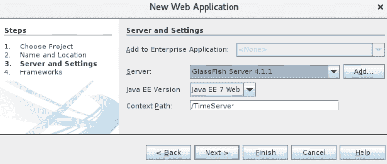

它可能已经适用于 GlassFish 服务器了，所以不需要做任何操作，直接点击 Finish 即可。

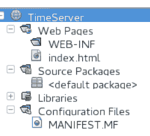

我稍后会添加一些更改，但这是一个功能完整的 HTML 文档，运行 NetBeans 项目会打开浏览器并显示以下页面：

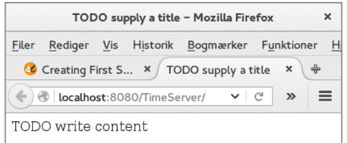

关于浏览器窗口，请注意标题栏显示的是文档中 `title` 元素的文本，页面内容本身是文档 `body` 部分的文本。最后，注意地址：

```
localhost:8080/TimeServer
```

`localhost` 是本地机器的名称，即安装 Web 服务器的物理服务器。如前所述，服务器是一个持续运行的程序，该程序在世界上被称为“服务器”（实际上是一个 Web 地址）和一个端口号。Web 服务器可以配置为使用特定的端口号，而 GlassFish 使用默认端口 8080。在这种情况下，调用了 `TimeServer` 应用，由于没有指定其他应用，服务器将使用应用程序的页面（发送主页作为响应），即 `index.html`。

目前，该应用程序没有 Servlet，我将添加一个 Servlet。这可以通过右键点击 `<Default package>` 并选择 `New | Servlet` 来实现。在接下来的窗口中，我将 Servlet 命名为 `TimeServlet`（窗口显示了一个在此处可以忽略的警告），当你点击 `Next` 时，将看到如下所示的窗口：

### 新 Servlet

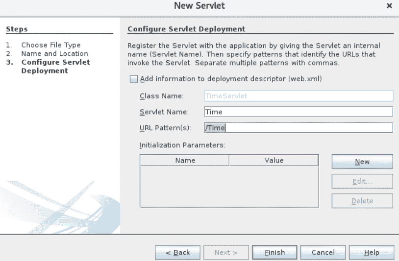

简约而高智

ŠKODA

你喜欢汽车吗？你想成为成功品牌的一员吗？

我们将赏识并奖励你的热情和才华。

向我们发送你的简历。你会惊讶于它能带你去哪里。

向我们发送你的简历：

www.employerforlife.com

在 bookoon.com 免费下载电子书

点击广告阅读更多

# Java 11：Web应用程序与 Java EE：软件开发

在这里你应该注意，我同时更改了 **Servlet Name** 和 **URL Pattern (s)**。这并非必须的，我没有展示它是被允许的。然后点击 `Finish`，NetBeans 会创建一个 Servlet（我删除了部分注释）：


```java
import java.io.IOException;
import java.io.PrintWriter;
import javax.servlet.ServletException;
import javax.servlet.annotation.WebServlet;
import javax.servlet.http.HttpServlet;
import javax.servlet.http.HttpServletRequest;
import javax.servlet.http.HttpServletResponse;

@WebServlet(name = "Time", urlPatterns = {"/Time"})
public class TimeServlet extends HttpServlet
{
    /**
     * 处理 HTTP GET 和 POST 请求
     * @param request 请求
     * @param response 响应
     * @throws ServletException 如果发生 Servlet 特有的错误
     * @throws IOException 如果发生 I/O 错误
     */
    protected void processRequest(HttpServletRequest request, HttpServletResponse response) throws ServletException, IOException {
        response.setContentType("text/html;charset=UTF-8");
        try (PrintWriter out = response.getWriter()) {
            /* 在此处输出页面。你可以使用以下代码示例。 */
            out.println("<!DOCTYPE html>");
            out.println("<html>");
            out.println("<head>");
            out.println("<title>TimeServlet</title>");
            out.println("</head>");
            out.println("<body>");
            out.println("<h1>TimeServlet at " + request.getContextPath() + "</h1>");
            out.println("</body>");
            out.println("</html>");
        }
    }

    /**
     * 处理 GET 方法
     * @param request 请求
     * @param response 响应
     * @throws ServletException 如果发生 Servlet 特有的错误
     * @throws IOException 如果发生 I/O 错误
     */
    @Override
    protected void doGet(HttpServletRequest request, HttpServletResponse response) throws ServletException, IOException {
        processRequest(request, response);
    }

    /**
     * 处理 POST 方法
     * @param request 请求
     * @param response 响应
     * @throws ServletException 如果发生 Servlet 特有的错误
     * @throws IOException 如果发生 I/O 错误
     */
    @Override
    protected void doPost(HttpServletRequest request, HttpServletResponse response) throws ServletException, IOException {
        processRequest(request, response);
    }

    /**
     * 返回 Servlet 的简短描述
     * @return 包含 Servlet 描述的字符串
     */
    @Override
    public String getInfo()
    {
        return "Short description";
    }
}
```

# Java EE：软件开发 Servlet

```java
case 9: return "October";
case 10: return "November";
case 11: return "December";
}
return "";
```

事实上，只有一条语句被更改了，但它现在调用`getTime()`方法，该方法返回一个带有当前日期和时间的字符串。这一切的目标都是为了说明 servlet 可以包含所有需要的 Java 代码，因为 servlet 本质上就是一个 Java 类。

我的 servlet 的另一个目标现在是动态的，因此发送到服务器的 HTML 取决于 servlet 执行的时间。以下是点击主页链接后的示例：


我加入 MITAS 是因为：

- 我想要真正的责任
- 研究生课程
- 工程师与地球质学家
- www.discovermitas.com


在 bookboom.com 免费下载电子书，点击广告阅读更多。

注意，你不需要通过点击主页上的链接来打开页面，你可以直接在浏览器中输入地址来打开页面——并获取创建页面的 servlet。

一旦你像上面那样编写了 Web 应用程序，它在浏览器中打开之前必须托管在应用程序服务器上。这项任务被称为部署（deployment），以前很复杂，现在仍然很复杂，但如果使用 NetBeans 开发应用程序，它本身就是构建过程的一部分，无需你进行任何操作。

如果你检查该项目，你会发现文件夹下有一个名为（在此例中为）`TimeServer.war`的文件，它是包含部署过程所需的所有文件的包。我稍后会回到部署过程，因为更复杂的应用程序需要更多操作，特别是当应用程序托管在另一台机器的服务器上时。

如果你打开浏览器并在地址栏输入：

```text
localhost:8080/TimeServer
```

应用程序的主页就会打开。这对应于向本地 GlassFish 服务器发送请求，要求其执行 TimerServer 应用程序，然后 GlassFish 将其作为响应发送到应用程序的启动页面，即`index.html`。

## 练习 1

以相同的方法，编写一个使用 servlet 的 Web 应用程序。应用程序必须以所示的页面（带有主页）开始：


# Servlet

如果你点击链接，结果可能是：

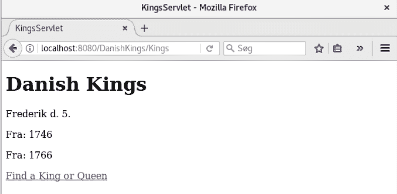

显示一位随机丹麦国王的名字和在位。如果你再次点击链接，你将获得另一个随机国王的名字和在位。

从创建一个 Web Application 项目开始，调整主页`index.html`显示第一个页面。然后添加一个响应为另一个页面的 servlet。这个 servlet 需要一个包含国王的列表。你可以在名为`kings`的文本文件中找到它，你可以将该文件内容作为静态数组放入你的 servlet 类中。

## 2.1 修改地址 1

作为 servlet 的另一个示例，我将展示一个 Web 应用程序，用户必须填写一个可以视为移动消息的表单。输入的信息被发送到服务器，并在那里进行验证；如果可以接受，将出现一个显示已收到消息的回据。否则，用户将被提示重新输入消息。

如果你在浏览器中打开应用程序，你将看到以下窗口：

在 bookboom.com 免费下载电子书。

# Servlet

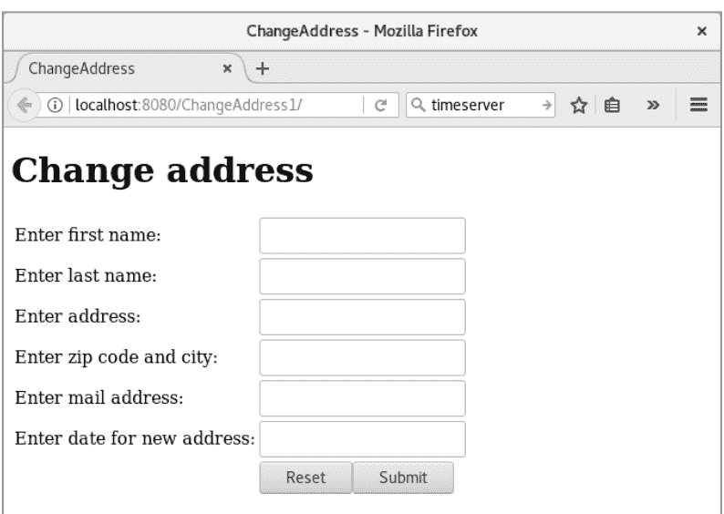


# 管理硕士

因为实现梦想是你最大的挑战。IE 商学院的管理硕士提供英语、西班牙语或双语教学，通过一项创新且具有刺激性的计划，培训职业生涯初的高绩效专业人士，帮助他们充分发挥潜力。

- 选择你的专业领域。
- 通过所提供的不同选项定制你的硕士课程。
- 在伦敦、硅谷或上海等地进行全球化体验。

因为你改变，我们随你改变。

www.ie.edu/master-management  
mim.admissions@ie.edu

在 bookboom.com 免费下载电子书。

# Java 11：Web 应用与 EE：软件开发 Servlet

如果你点击提交（Submit）按钮，表单数据将发送到服务器，服务器可能会返回以下消息：

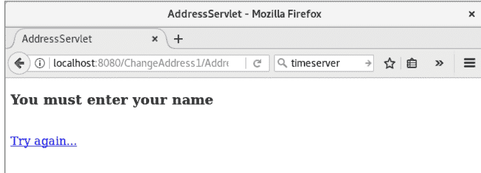

如果用户没有输入完整地址，你将不得不点击链接并重新填写表单。

如果你如下所示填写了所有字段，其中电子邮件地址字段未填写，且表单上的日期格式为 DD-MM-YYYY（即字段间用连字符），然后点击`Submit`，你将收到一个响应的回据（见下文）。

这当然是一个非常简单的应用程序，但它是一个将数据从客户端发送到服务器并在那里处理的应用程序，随后客户端获得响应，在许多方面这是许多 Web 应用程序的原理。

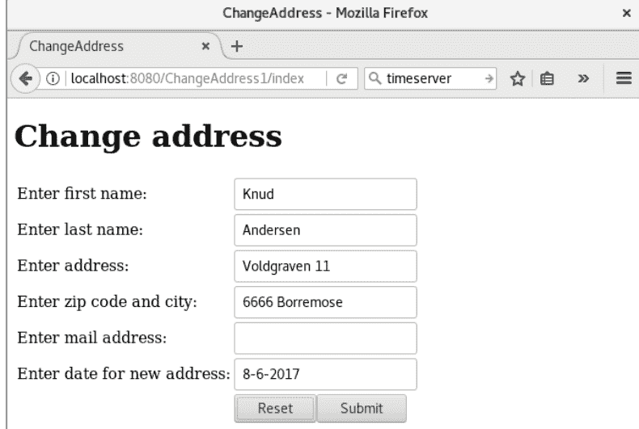

在 bookboom.com 免费下载电子书。

# Java 11：Web 应用与 EE：软件开发 Servlet

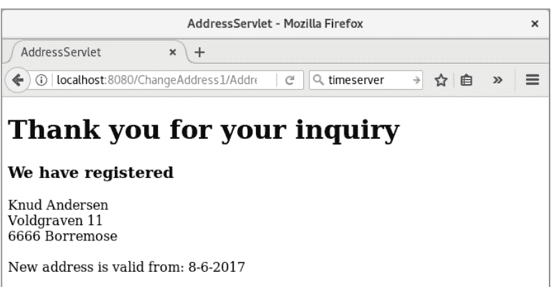

如果你点击链接，结果可能是：


等待，之前的文本很乱。让我们正确处理最终页面。

> 注：提供的 OCR 文本存在重复且混乱。我将根据逻辑流提供一个干净的版本。

```java
@WebServlet(name = "AddressServlet", urlPatterns = {"/AddressServlet"})
public class AddressServlet extends HttpServlet {

  protected void processRequest(HttpServletRequest request,
HttpServletResponse response) throws ServletException, IOException {
    response.setContentType("text/html;charset=UTF-8");
    request.setCharacterEncoding("UTF-8");
    try {
        PrintWriter out = response.getWriter();

        out.println("<!doctype html>");
        out.println("<html>");
        out.println("<head>");
        out.println("<title>AddressServlet</title>");
        out.println("</head>");
        out.println("<body>");

        String name = request.getParameter("fname");
        String ename = request.getParameter("lname");
        String addr = request.getParameter("addr");
        String post = request.getParameter("post");
        String mail = request.getParameter("mail");
        String date = request.getParameter("date");
        if (name.length() == 0 || ename.length() == 0) {
            out.println("<h3>You must enter your name</h3><br>");
            out.println("<a href=\"index.html\">Try again...</a>");
        } else if (addr.length() == 0 || post.length() == 0) {
            out.println("<h3>You must enter the address</h3><br>");
            out.println("<a href=\"index.html\">Try again...</a>");
        } else if (mail.length() > 0 && !isMail(mail)) {
            out.println("<h3>You must enter a legal mail address</h3><br>");
            out.println("<a href=\"index.html\">Try again...</a>");
        } else {
            try {
                SimpleDateFormat formatter = new SimpleDateFormat("dd-mm-yyyy");
                Date date = formatter.parse(date);
                out.println("<h1>Thank you for your inquiry</h1>");
                out.println("<h3>We have registered</h3>");
                out.println(name + " " + ename + "<br>");
                out.println(addr + "<br>");
```

# Servlet

```java
out.println(post + "<br>");
out.println(mail + "<br>");
out.println("New address is valid from: " + date);
}
catch (Exception ex) 
{
    out.println("<h3>You must enter a date on the form DD-MM-YYYY</h3><br>");
    out.println("<a href=\"index.html\">Try again...</a>");
}
out.println("</body>");
out.println("</html>");
```

```java
private boolean isMail(String mail)
{
return Pattern.compile(".*@\\..*").matcher(mail).matches();
}
```


```java
@Override
protected void doGet(HttpServletRequest request, HttpServletResponse response)
throws ServletException, IOException
{
    processRequest(request, response);
}
```

```java
@Override
protected void doPost(HttpServletRequest request, HttpServletResponse response)
throws ServletException, IOException
{
    processRequest(request, response);
}
```

原则上说，它与第一个示例相比没有任何新内容，几乎`processRequest()`方法也是由 NetBeans 生成的。请注意我添加了一个`isMail()`方法，这是之前用过的一个方法，用于使用正则表达式来验证邮箱地址（我没有显示该部分代码）。

`processRequest()`方法的工作原理与第一个示例相同，它动态地创建要作为响应发送的 HTML。首先，注意以下语句：

```java
request.setCharacterEncoding("UTF-8");
```

这对于确保丹麦语字母能被正确解码是必要的。接下来，你应该注意到如何获取表单的值，例如：

```java
String fname = request.getParameter("fname");
```


这决定了输入的““名”的值。其余部分在原则上只是按部就班的（常规工作），并包括对表单字段进行验证，以及在发生错误时发送错误消息作为响应。因此，服务器响应是动态的，因为它取决于数据。显然，servlet 可以做很多事情，例如将提交的数据保存到数据库。这只需要添加一些 Java 代码即可。

# 练习 2

你必须编写一个与 Address 示例类似的 Web 应用程序。这次应用程序应该显示一个带有电子留言板表单的页面。当应用程序启动时，它必须显示以下页面：


当访客可以输入他的姓名和城市（例如）。此外，你还可以输入邮箱地址以及关于访问的文本。姓名和城市必须填写，但你不需要输入邮箱地址，如果你输入了，它必须是一个合法的地址。文本也可以省略。一旦完成表单并点击提交（Submit）按钮，表单必须提交给 servlet。如果表单填写不正确，你将收到一条错误消息：

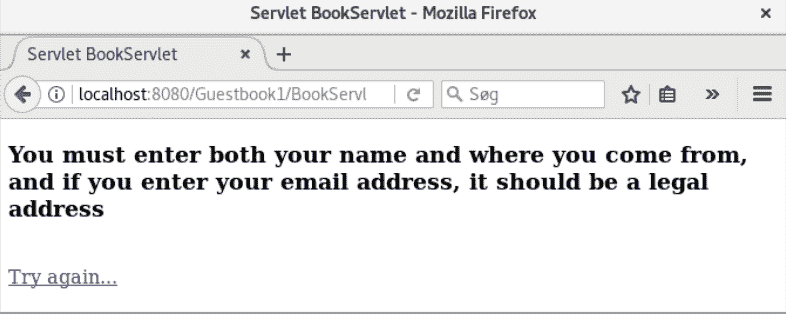

并且你能够重新打开表单以便重新输入。如果表单填写正确，用户将收到以下内容：

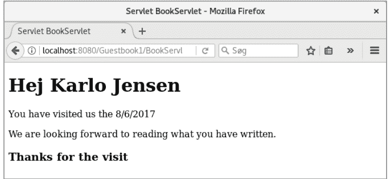

# 美国 LGS 大学

目前正在招生在线 BBA, MBA, MSc, DBA 和 PhD 项目：

- 在 2014 年 9 月 30 日前报名
- 学费优惠高达 16%！
- 分 10 期/2 年付款
- 互动式教育
- 访问 `www.liguniversity.com` 了解更多信息！

LGS 大学未获得美国教育部长列出的任何国际认可机构的认证。更多信息见此处。

## 3 参数、会话及更多

观察上面的示例可以发现，仅使用 HTML 文档和 servlet 在开发动态网站和 Web 应用程序方面可以取得很远进展，但同样明显，对于复杂的网站来说，编写 servlet 并让它看起来很真实可能是非常耗时的。这是 JSP 和 JSF 要解决的问题，但在向你们展示它们是什么之前，我会先给你们看一些 servlet 的示例。与其说是为了 servlet，不如是为了建立一些 Web 应用程序的基本概念。

### 3.1 向 servlet 传递参数

我将创建一个名为 Parameters 的新 Web 应用程序，结果再次是一个带有名为 `index.html` 主页的应用程序。我将首先展示如何将参数传递给 servlet。我添加了一个名为 `Init1` 的 servlet，并在配置窗口中定义了以下内容（注意选中“将信息添加到部署描述符 (web.xml)”的勾选框）：

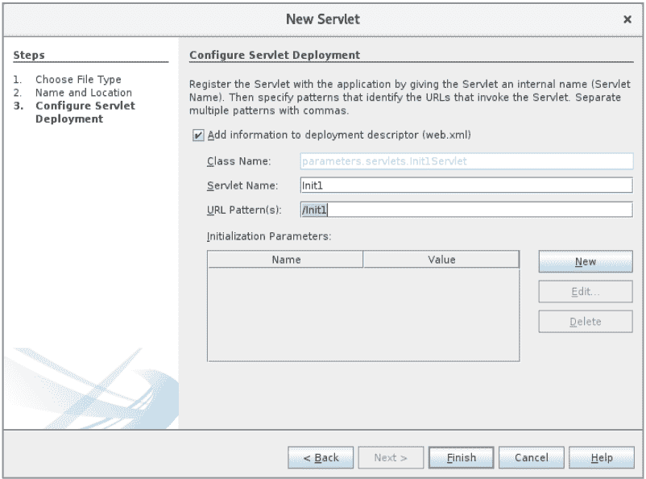

在创建相应的 servlet 后，NetBeans 在 `WEB-INF` 文件夹中创建了一个 XML 文档：

```xml
<?xml version="1.0" encoding="UTF-8"?>
<web-app version="3.1" xmlns="http://xmlns.jcp.org/xml/ns/javaee"
xmlns:xsi="http://www.w3.org/2001/XMLSchema-instance"
xi:schemaLocation="http://xmlns.jcp.org/xml/ns/javaee
http://xmlns.jcp.org/xml/ns/javaee/web-app_3_1.xsd">
<servlet>
<servlet-name>Init1</servlet-name>
<servlet-class>parameters.servlets.InitServlet</servlet-class>
</servlet>
<servlet-mapping>
<servlet-name>Init1</servlet-name>
<url-pattern>/Init1</url-pattern>
</servlet-mapping>
<session-config>
<session-timeout>
30
</session-timeout>
</web-app>
```

这是一个与应用程序部署相关的配置文件。我们必须注意我的 servlet 名称是如上面窗口中所示的 `Init1`，它指向 `parameters.servlets.InitServlet` 类。你还应该注意到应用程序中的 servlet 地址（URL）为 `/Init1`。

我扩展了 XML 文档，如下：

```xml
<?xml version="1.0" encoding="UTF-8"?>
<web-app version="3.1" xmlns="http://xmlns.jcp.org/xml/ns/javaee"
xmlns:xsi="http://www.w3.org/2001/XMLSchema-instance"
xi:schemaLocation="http://xmlns.jcp.org/xml/ns/javaee
http://xmlns.jcp.org/xml/ns/javaee/web-app_3_1.xsd">
<servlet>
<servlet-name>Init1</servlet-name>
<servlet-class>parameters.servlets.Init1Servlet</servlet-class>
<init-param>
<param-name>owner</param-name>
<param-value>Torus data</param-value>
</init-param>
</servlet>
<servlet-mapping>
<servlet-name>Init1</servlet-name>
<url-pattern>/Init1</url-pattern>
</servlet-mapping>
<session-config>
<session-timeout>
30
</session-timeout>
</session-config>
</web-app>
```

```xml
<servlet-mapping>
<session-config>
  <session-timeout>
    30
  </session-timeout>
</session-config>
</web-app>
```

这意味着我定义了一个名为 `owner` 且值为 `Torus data` 的键值对。随后我将 `InitServlet` 的代码更改为如下，这里只保留了类的第一部分：

```java
public class InitServlet extends HttpServlet {
  protected void processRequest(HttpServletRequest request, HttpServletResponse response) throws ServletException, IOException {
    response.setContentType("text/html;charset=UTF-8");
    try (PrintWriter out = response.getWriter()) {
      out.println("<!DOCTYPE html>");
      out.println("<html>>");
      out.println("<head>");
```


关于儿童在线学习（e-Learning for Kids）。它成立于2004年，是一个全球非营利基金会，致力于为 5-12 岁的儿童提供互联网上免费且便捷的学习，课程涵盖数学、科学、语言艺术、计算机、健康和环境技能。自2005年以来，已有来自190 多个国家的1500多万儿童受益于在线学习。我们是来自世界各地的教育志愿者、在线学习专家以及商务人士，致力于带来改变。加入 e-Learning for Kids，参与我们大量的资金、志愿者、赞助商和内容开发者的工作。更多信息请访问 `www.e-learningforkids.org`。

- 小学教育第一大 MOOC
- 为 5-12 岁儿童提供的免费数字学习
- 让 1500 万儿童受益

在 `bookboom.com` 下载免费电子书。点击广告阅读更多信息

```java
out.println("<title>Servlet InitServlet1</title>");
out.println("</head>");
out.println("<body>");
out.println("<h1>Greetings from " + 
getServletConfig().getParameter("owner") + " </h1>");
out.println("</body>");
out.println("</html>");

}
```

在这里你注意到该类没有被 `@WebServlet` 属性装饰。这是因为该 servlet 这次是在配置文件中定义的。使用注解是配置文件的替代方案，可以使编写 servlet 更加容易（你不需要维护 XML 配置文件），但相反，更改时可能需要重新翻译代码，而配置文件可以在不修改 servlet 代码的情况下进行维护。你还应该注意，在 `processRequest()` 中我只更改了一行代码（第三条语句），该语句获取了在 XML 文档中定义的参数。

然后我将起始页更改为：

```html
<!DOCTYPE html>
<html>
<head>
  <title>Parameters</title>
  <meta charset="UTF-8">
  <meta name="viewport" content="width=device-width, initial-scale=1.0">
</head>
<body>
  <h1>Parameters to servlets</h1>
  <p><a href="Init1">Init1</a>a</p>
</body>
</html>
```

执行应用程序并点击链接后，你将看到窗口：

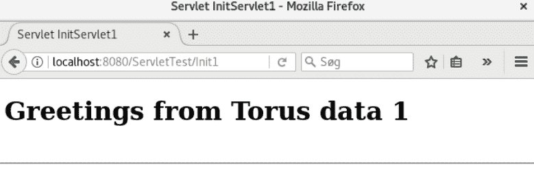

在 `bookboom.com` 下载免费电子书。

在这里你应该知道如何使用 XML 配置将参数传递到 servlet。

如果你查看上方 NetBean 的“配置 Servlet Deployment”窗口，底部的选项是指定 servlet 的初始化参数。这可以通过像上面那样手动编辑 XML 文档来实现。我添加了另一个 servlet，这次名为 `Init2Servlet`，我的部署配置如下：

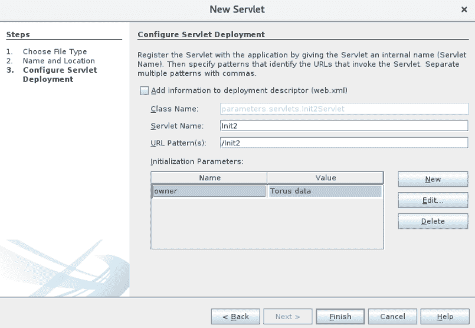

重要的是没有勾选“将信息添加到部署描述符 (web.xml)”，但已经添加了一个初始化参数（Initialization Parameter）。这意味着 `web.xml` 没有更新，但如果你查看代码，类定义被装饰了：

```java
@WebServlet(name = "Init2", urlPatterns = {"/Init2"},
initParams={@WebInitParam(name="owner", value="Torus data")})
public class Init2Servlet extends HttpServlet
{
```

它在部署期间作为 `web.xml` 的替代方案使用，你可以看到名称和 URL 定义。最后，我添加了一个参数。在起始页上添加另一个链接后，`processRequest()` 的代码基本相同，你可以向新的 servlet 发起请求，结果如下：

在 `bookboom.com` 下载免费电子书。

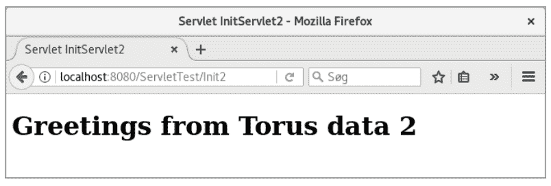

### 3.2 会话（SESSIONS）

HTTP 是无状态协议。这意味着客户端的每个请求都是独立的，服务器不会记住任何之前的请求。然而，在许多 Web 应用程序中，我们需要跨请求存储用户信息。这就是会话（sessions）的作用。会话是一种跨请求存储用户信息的方法。会话通常在用户登录应用程序时开始，并在用户注销或会话超时时结束。


在 Java EE 中实现会话，我们使用 `HttpSession` 接口。`HttpSession` 接口提供了创建、获取和销毁会话的方法。例如，你可以使用以下代码创建一个会话：

```java
HttpSession session = request.getSession(true);
```

`true` 参数表示如果不存在会话则创建一个新的会话。如果会话已存在，将返回现有会话。要在会话中存储数据，使用 `setAttribute` 方法：

```java
session.setAttribute("key", value);
```

从会话中检索数据，使用 `getAttribute` 方法：

```java
Object value = session.getAttribute("key");
```

从会话中移除属性，使用 `removeAttribute` 方法：

```java
session.removeAttribute("key");
```

使会话失效，使用 `invalidate` 方法：

```java
session.invalidate();
```

在 Java EE 中，会话通过会话 ID 识别，该 ID 通常存储在客户端的 cookie 中。客户端每次请求时都会发送会话 ID，服务器使用它来识别正确的会话。


在 `bookboom.com` 下载免费电子书。

会话 ID 默认存储在名为 `JSESSIONID` 的 cookie 中。然而，可以在 `web.xml` 文件中对其更改。另一个选项是将会话 ID 存储在 URL 中，但这通常被认为安全性较低。

会话超时（Session timeout）是会话在自动失效之前保持空闲的时间。会话超时可以在 `web.xml` 文件中配置：

```xml
<session-config>
  <session-timeout>
    30
  </session-timeout>
</session-config>
```

在此示例中，会话超时被设置为 30 分钟。这意味着如果用户在 30 分钟内未发起请求，其会话将失效。

`processRequest()` 方法首先通过从发送请求到此服务的页面确定两个字段的值。如果这些值是可能的，且它们不为空，则将它们用于创建一个 `Person` 对象。接下来，添加会话对象的引用：

```java
HttpSession session = request.getSession(true);
```

这意味着如果该对象尚不存在，则必须创建它。下一步，将 `Person` 对象根据键名 `person` 添加到会话对象的集合中。最后，返回一个响应，其中包含会话 ID。

起始页的代码如下：

```html
<!DOCTYPE html>
<html>
<head>
<title>ServletTest</title>
<meta charset="UTF-8">
<meta name="viewport" content="width=device-width, initial-scale=1.0">
</head>
<body>
<h3>Start page</h3>
</body>
</html>
```


```html
<form method="post" action="CreateServlet">
<table>
  <tr>
    <td>Enter name</td>
    <td><input type="text" name="name" id="name" /></td>
  </tr>
  <tr>
    <td>Enter job title&nbsp;&nbsp;</td>
    <td><input type="text" name="title" id="title" /></td>
  </tr>
  <tr>
    <td colspan="2"><input type="submit" value="OK" /></td>
  </tr>
</table>
</form>
<ol>
  <li><a href="NameServlet">Show name</a></li>
  <li><a href="TitleServlet">Show title</a></li>
</ol>
</body>
</html>
```

如果你运行该应用程序，将看到以下窗口：

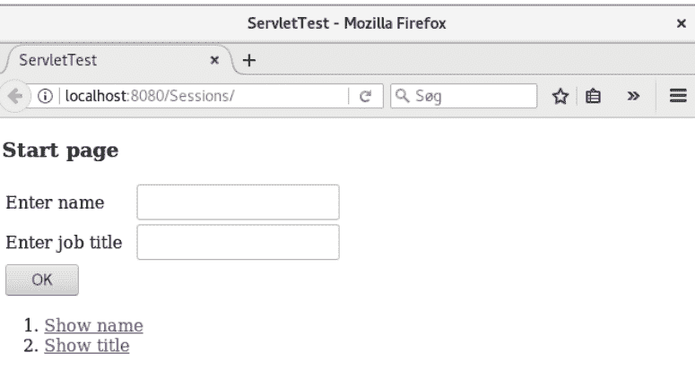

如果你输入了名称和职位名称并点击 OK，将得到以下结果：

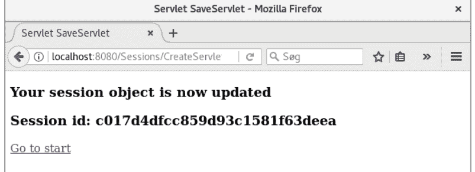

它告诉会话对象已更新，并且它被表示为一个大的十六进制数字，通常你无法用它做任何事情，但在这种情况下你可以使用它查看何时启动了新会话。

下一步，添加了一个 servlet，它显示了创建的人员名称：


```java
@WebServlet(name = "NameServlet", urlPatterns = {"/NameServlet"})
public class NameServlet extends HttpServlet
{
protected void processRequest(HttpServletRequest request,
    HttpServletResponse response) throws ServletException, IOException 
{
    response.setContentType("text/html;charset=UTF-8");
    try (PrintWriter out = response.getWriter()) {
        String name = null;
        try {
            name = ((Person) request.getSession().getAttribute("person")).getName();
        } catch (Exception ex) {
            name = ex.toString();
        }
        out.println("<!DOCTYPE html>");
        out.println("<html>");
        out.println("<head>");
        out.println("<title>NameServlet</title>");
        out.println("</head>");
        out.println("<body>");
```

```java
        out.println("<h1>Name</h1>");
        out.println("<h3>" + name + "</h3>");
        out.println("<a href=\"index.html\">Go to start</a>");
        out.println("</body>");
        out.println("</html>");
    }
}
```

同样，还创建了一个名为`TitleServlet`的 servlet，它发送一个带有`Person`对象职位名称的响应。如果你在起始页，输入：


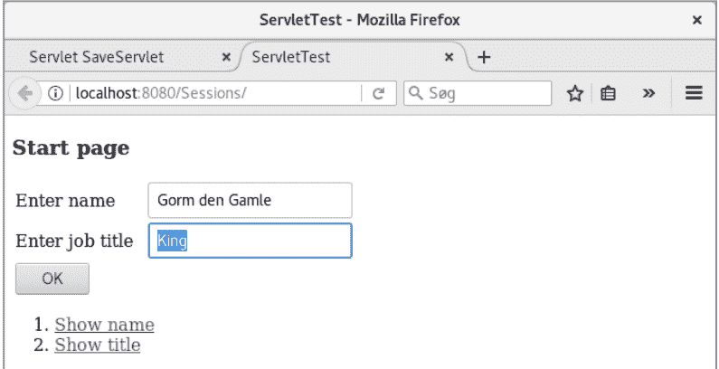

并点击 Ok，然后从起始页点击“Show name”链接，你将得到窗口：

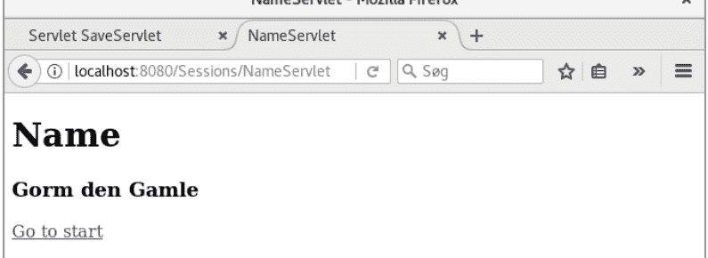

如果你向 servlet 发送请求，可以通过重定向（redirect）或转发（forward）来实现。在第一情况下，servlet 在 HTTP 响应中插入 Location 头，浏览器将遵循新的 URL。在第二种情况下，地址栏不会改变，因为服务器执行了请求。因此，重定向不涉及浏览器，而转发是`index.html`的起点并显示如下内容：

```html
<!DOCTYPE html>
<html>
<head>
<title>Calculations</title>
<meta charset="UTF-8">
<meta name="viewport" content="width=device-width, initial-scale=1.0">
</head>
<body>
<h2>Calculations</h2>
<form method="post" action="MathServlet">
<table>
  <tr>
    <td>Enter number</td>
    <td><input type="text" name="numbera" id="numbera" /></td>
  </tr>
  <tr>
    <td>Enter number</td>
    <td><input type="text" name="numberb" id="numberb" /></td>
  </tr>
  <tr>
    <td colspan="2">
      <select name="operation">
        <option value="add">Addition</option>
        <option value="sub">Subtraction</option>
        <option value="mul">Multiplication</option>
        <option value="div">Division</option>
      </select>
    </td>
  </tr>
  <tr>
    <td colspan="2"><input type="submit" value="Calculate" /></td>
  </tr>
</table>
</form>
```

如果你运行应用程序，将得到以下窗口：你可以输入两个数字，选择一种操作并点击按钮，将得到下所示页面。这里`AddServlet`、`SubServlet`、`MulServlet`和`DivServlet`，但在第一种情况下是重定向，而在其他情况下是转发。

```java
protected void processRequest(HttpServletRequest request,
    HttpServletResponse response) throws ServletException, IOException 
{
    response.setContentType("text/html;charset=UTF-8");
    try (PrintWriter out = response.getWriter()) {
        out.println("<!DOCTYPE html>");
        out.println("<html>");
        out.println("<head>");
        out.println("<title>AddServlet</title>");
        out.println("</head>");
        out.println("<body>");
        try {
            String a = request.getParameter("numbera");
            String b = request.getParameter("numberb");
            double s = Double.parseDouble(a) + Double.parseDouble(b);
            out.println("<p>" + a + " + " + b + " = " + s + "</p>");
        } catch (Exception ex) {
            out.println("<p>Illegal arguments</p>");
        }
        out.println("<a href=\"index.html\">Back to start</a>");
        out.println("</body>");
        out.println("</html>");
    }
}
```


最有趣的是`MathServlet`：

```java
protected void processRequest(HttpServletRequest request,
    HttpServletResponse response) throws ServletException, IOException 
{
    response.setContentType("text/html;charset=UTF-8");
    try (PrintWriter out = response.getWriter()) {
        out.println("<!DOCTYPE html>");
        out.println("<html>");
        out.println("<head>");
        out.println("<title>MathServlet</title>");
        out.println("</head>");
        out.println("<body>");
        String op = request.getParameter("operation");
        if (op.equals("add") || op.equals("sub"))
        {
            String a = request.getParameter("numbera");
            String b = request.getParameter("numberb");
            String site = op.equals("add") ? "AddServlet" : "SubServlet";
            response.sendRedirect(site + "?numbera" + a + "#numberb" + b);
        }
        else if (op.equals("mul") || op.equals("div"))
        {
            ServletContext context = getServletContext().getServletContext();
            RequestDispatcher dispatcher = op.equals("mul") ? context.getRequestDispatcher("/MulServlet") :
            context.getRequestDispatcher("/DivServlet");
            dispatcher.forward(request, response);
            return;
        }
        else 
            response.sendRedirect("index.html");
            
        out.println("<a href=\"index.html\">Back to start</a>");
        out.println("</body>");
        out.println("</html>");
    }
}
```

JAVA 11：Web 应用程序与 Java EE：软件开发参数、会话及更多

首先确定列表的值，并调用名为表单字段选择的`operation`（操作）。如果是 add（加）或 sub（减），则必须重定向到 Servlet 或 HttpServlet。然而，这会导致一个问题，因为浏览器将以 GET 方法重定向到 servlet，这意味着表单字段不会被发送。因此，我必须手动将它们作为参数添加到 URL，这通过初始化一个变量来实现，该变量具有示例值：

```
AddServlet?number=33&number=51
```

使用此地址，通过`sendRedirect()`方法执行重定向，这会将上述地址返回给浏览器，然后浏览器对该地址执行 HTTP GET 请求。

如果操作不是 add 或 sub，则会确定一个`ServletContext`对象，用于为`MultiServlet`或`DivServlet`创建一个`RequestDispatcher`对象。该对象有一个`forward()`方法，用于将请求转发到该 servlet。当发生这种情况时，请求会被转发，包括所有形式的字段，且不涉及浏览器。

鼓励你测试该应用程序，并在相同的上下文中，注意浏览器地址的变化。

### 3.4 COOKIES

作为关于 servlet 的最后一个，我将向你展示如何创建和使用 cookie。cookie 是在服务器和浏览器之间设置设置文本，可以像 session 变量一样用于维护状态信息。下面是一个创建 cookie 的 servlet：

```java
@WebServlet(name = "SetServlet", urlPatterns = {"/SetServlet"})
public class SetServlet extends HttpServlet
{
    private java.util.Random rand = new java.util.Random();

    protected void processRequest(HttpServletRequest request,
        HttpServletResponse response) throws ServletException, IOException
    {
        response.setContentType("text/html;charset=UTF-8");
        try (PrintWriter out = response.getWriter())
        {
            Cookie cookie = 
                new Cookie("randomvalue" + rand.nextInt(10) + "," + rand.nextInt(Integer.MAX_VALUE));
            cookie.setHttpOnly(true);
            cookie.setMaxAge(30);
            response.addCookie(cookie);
            out.println("<!DOCTYPE html>");
            out.println("<html><head>");
            out.println("<title>Servlet SetServlet</title>");
            out.println("</head>");
            out.println("<body>");
            out.println("<h1><a href>cookie created...</h1>");
            out.println("</body>");
            out.println("</html>");
        }
    }
}
```

cookie 由`Cookie`对象表示。在这种情况下，创建了一个名为`randomValue`加上一个数字的 cookie（例如`randomValue5`），并为其分配了一个随机值。随后，它被定义为浏览器已知的临时 cookie，最后定义为 30 秒超时。如果数字为负数，则意味着它将随当前 session 被移除。

下面是另一个读取 cookie 的 servlet：


```java
@WebServlet(name = "GetServlet", urlPatterns = {"/GetServlet"})
public class GetServlet extends HttpServlet {
    protected void processRequest(HttpServletRequest request,
        HttpServletResponse response) throws ServletException, IOException {
        response.setContentType("text/html;charset=UTF-8");
        try (PrintWriter out = response.getWriter()) {
            out.println("<!DOCTYPE html>");
            out.println("<head>");
            out.println("<title>GetServlet GetServlet</title>");
            out.println("</head>");
            out.println("<body>");
            out.println("<html>GetServlet at " + request.getContextPath() + "/html>");
            out.println("<table><tr><td>Name</td><td>Value</td></tr>");
            Cookie[] cookies = request.getCookies();
            if (cookies != null) {
                for (Cookie c : cookies) {
                    out.println("<tr><td>");
                    out.println(c.getName());
                    out.println("</td><td>");
                    out.println(c.getValue());
                    out.println("</td></tr>");
                }
            }
            out.println("</table>");
            out.println("<p><a href=\"index.html\">Set cookie</a></p>");
            out.println("</body>");
            out.println("</html>");
        }
    }
}
```

这里没有太多东西要解释的，但你应该注意如何遍历所有的 cookie —— 当前的 session。最后是起始页：

```html
<!DOCTYPE html>
<html>
<head>
    <title>Cookies</title>
    <meta charset="UTF-8">
    <meta name="viewport" content="width=device-width, initial-scale=1.0">
</head>
<body>
    <h1>Cookies</h1>
    <p><a href="SetServlet">Set cookie</a></p>
</body>
</html>
```

如果你运行程序，你会发现创建了更多 cookie，但如果你创建一个名称与已有的相同的 cookie，它也会发生变化。你还会发现单个 cookie 可能会在 30 秒超时后消失。

## 练习 3

你必须编写一个可以模拟非常简单的购物车的 Web 应用程序。主要目的是展示 session 变量使用的示例。从创建一个新应用程序开始，你可以将其命名为 `Shopping`。首页 `index.html` 应该是一个包含单个输入项简单表单：

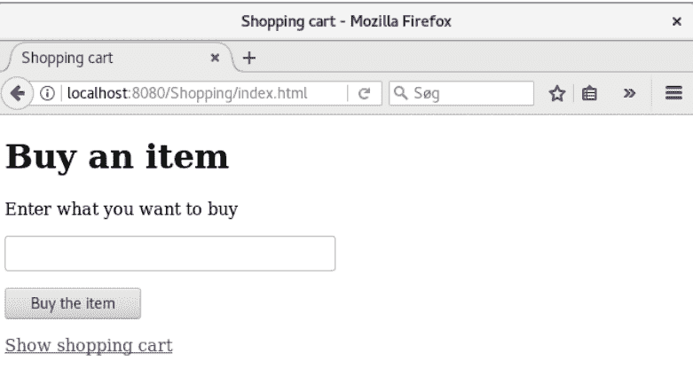

如果你输入一个产品（一段文本）并按下按钮，该文本必须发送到 servlet 并将其保存到 `ArrayList<String>` 中，之后用户将被送回首页。如果你点击底部的链接，你必须请求一个 servlet，该 servlet 将动态创建一个显示购物车内容的页面 —— 如果有的话。否则，你必须显示篮子是空的。购物车页面还必须有一个删除篮子内容的链接。你可以通过将链接指向一个删除 session 内容的 servlet 来解决。下面是一个购物车在添加了 2 个商品后可能后的示例：

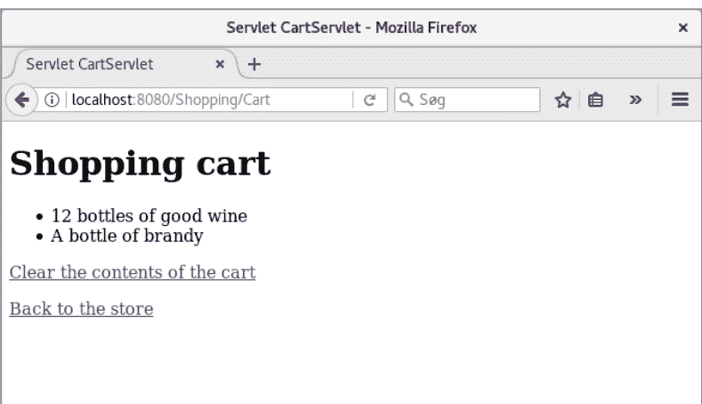

## 脑力驱动

到 2020 年，风能可以提供我们地球十分之一的电力需求。在今天，`SKF` 的创新知识对于运行世界上大部分涡轮至关重要。发电成本的 25% 与维护有关。得益于我们的在线状态监测和自动调整系统，这些可以大幅减少。我们帮助从空气中创造出更清洁的能量。通过分享我们的经验、专业知识和创意，行业可以获得超出预期的性能，而不需要那些能够应对挑战的最佳员工吗？

知识工程的力量

接入知识工程的力量。访问我们：`www.skf.com/knowledge`


## 4 JAVA BEANS

在接下来的部分将引用 Java Bean，因此关于它是什么的内容会较少（事实上，我在之前的一本书中提到过 Java Beans）。事实上，它只是一个普通的类，但必须满足几个规定：

1. Java Bean 必须是可序列化的。
2. Java Bean 必须有一个默认构造函数。
3. 所有实例变量必须是私有的。
4. 实例变量可以有 getter 和 setter 方法，并且必须符合命名规范，以便如果存在 `getName()` 方法，对应的 setter 方法必须是 `setName(...)`。

除此之外，Java Bean 可以是任何东西，和其他类一样，它可能有各种其他方法等。例如，下面展示了一个 Java Bean：

```java
package dates;

import java.util.*;

public class DateBean implements java.io.Serializable
{
    private String date;
    private String time;

    public DateBean() {
        Calendar dt = Calendar.getInstance();
        date = String.format("%02d-%02d-%04d", dt.get(Calendar.DATE),
        dt.get(Calendar.MONTH) + 1, dt.get(Calendar.YEAR));
        time = String.format("%02d:%02d:%02d", dt.get(Calendar.HOUR_OF_DAY),
        dt.get(Calendar.MINUTE), dt.get(Calendar.SECOND));
    }

    public String getDate() {
        return date;
    }

    public String getTime() {
        return time;
    }
}
```

JAVA 11：Web 应用与

JAVA EE：软件开发

```java
public void setDate(String date)
{
```

```java
try
{
    StringTokenizer tk = new StringTokenizer(date, "-");
    if (tk.countTokens() != 3) throw new Exception("Illegal date");
    int day = value(tk.nextToken(), 1, 31);
    int month = value(tk.nextToken(), 1, 12);
    int year = value(tk.nextToken(), 1900, 2100);
    if ((month == 4 || month == 6 || month == 9 || month == 11) && day == 31)
        throw new Exception("Illegal value");
    else if (month == 2 && day > (leapYear(year) ? 29 : 28))
        throw new Exception("Illegal value");
    this.date = String.format("%02d-%02d-%04d", day, month, year);
```

```java
catch (Exception ex)
{
    this.date = ex.toString();
}
```

```java
public void setTime(String time)
{
```

```java
try
{
    StringTokenizer tk = new StringTokenizer(time, ":");
    if (tk.countTokens() != 3) throw new Exception("Illegal time");
    int hour = value(tk.nextToken(), 0, 23);
    int min = value(tk.nextToken(), 0, 59);
    int sec = value(tk.nextToken(), 0, 59);
    this.time = String.format("%02d:%02d:%02d", hour, min, sec);
```

```java
catch (Exception ex)
{
    this.time = ex.getMessage();
}
```

```java
public String toString()
{
    return date + " " + time;
}
```

JAVA 11：Web 应用与

JAVA EE：软件开发

```java
private int value(String text, int a, int b) throws Exception
{
    int t = Integer.parseInt(text);
    if (a <= t && t <= b) return t;
    throw new Exception("Illegal value");
}
```

```java
private boolean leapYear(int aar)
{
    if (aar % 100 == 0) return aar % 400 == 0;
    return aar % 4 == 0;
}
```

选择这个示例是因为我稍后想应用它，同时也为了展示 Bean 就是一个普通的类，它可以包含类所能的所有内容。这是一个代表日期和时间的 Bean。


JAVA 11：Web 应用与

JAVA EE：软件开发

# 5 JSP

上面我介绍了 servlets 并展示了如何使用（以及如何被使用）它们来编写动态网站，但显而易见，仅使用 servlets 开发复杂的 Web 应用是一项庞大且艰巨的任务。因此引入了 JSP 页面，你可以将其简要表描述为 HTML 和 Java 代码的混合体文档。Java 代码会在文档发送到客户端浏览器之前在服务器上执行。通过一个示例可以最好地解释这一点。

我在 Beans 中创建了一个新的 Web 应用，将其命名为 `DateServer`，结果和之前一样，有一个名为 `index.html` 的主页应用程序。接下来，我右键点击 Web Pages 文件夹，选择 New 和 JSP，添加了一个新的 JSP 页面，我将其命名为 `start`，结果是项目中添加了一个名为 `start.jsp` 的文件，其内容是一个初始注释：

```jsp
<@page contentType="text/html" pageEncoding="UTF-8%">
<!DOCTYPE html>
<html>
<head>
<meta http-equiv="Content-Type" content="text/html; charset=UTF-8">
<title>JSP</title>
</head>
<body>
<h1>Hello World!</h1>
</body>
</html>
```

如你所见，它看起来像一个普通的 HTML 文档，只有两处不同：第一行，以及扩展名 `jsp`。后者同样重要，因为它告诉 Web 服务器该文档在发送到浏览器之前需要先被翻译（编译）。如果右键点击 Projects 选项卡的名称并选择 Run File，文档将自动翻译并在浏览器中打开。

目前是 Java 代码，但作为下一步，我右键点击 Packages 文件夹并添加了一个名为 `DateBean` 的类。代码就是 Java Bean，正如我在上一章所示。这个 Java Bean 随后可以这样在 JSP 页面中使用：

```jsp
<@page contentType="text/html" pageEncoding="UTF-8%">
<!DOCTYPE html>
<html>
<head>
<meta http-equiv="Content-Type" content="text/html; charset=UTF-8">
```

JAVA 11：Web 应用与

JAVA EE：软件开发

```jsp
<title>JSP Page</title>
</head>
<body>
<jsp:useBean id="dateBean" scope="page" class="dateserver.dateBean"/>
<h1>Hello World!</h1>
<h3>日期是: ${dateBean.date}</h3> <!-- 此处为翻译说明 -->
<h3>时间是: ${dateBean.time}</h3>
</body>
</html>
```

代码通过 `jsp:useBean` 元素进行了扩展，正如你所看到的，它定义了对类 `dateserver.dateBean` 的引用，并为 `dateBean` 调用了该引用。最后，它定义了一个作用域，告诉你 `DateBean` 对象是可以使用的。此外，还定义了两行用于在页面中插入相关值。例如，在 HTML 代码中插入了

`${dateBean.date}`

该属性。你应该注意这个引用，并且你写的 `date` 是属性名，这意味着正在执行的是 `getDate()` 方法，如果你在浏览器中打开该 JSP 页面，结果如下：

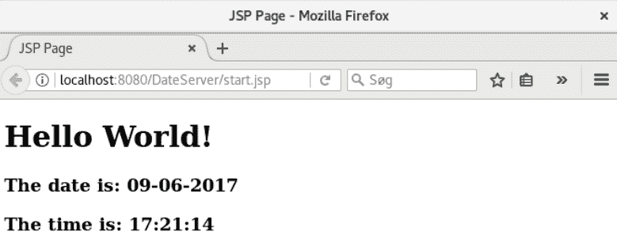

你可以看到 Bean 类被实例化，并且对象的值（当前日期和时间被插入到文档中）。特别是，如果你点击 F5（刷新浏览器），浏览器将更新时钟，对象将重新实例化。你可以以同样的方式在 Java Bean 中使用其他公共方法，但在这种情况下没有其他方法了。关于属性作用域（scope）的值，有四种选项：

- 1. `page`：默认值，表示 Bean 对象只能从当前页面使用。
- 2. `request`：表示 Bean 对象可以在涉及同一个请求的所有 JSP 页面中使用。

JAVA 11：Web 应用与
JAVA EE：软件开发

JSP

- 1. `session`：意味着 Bean 对象可以在关于同一个会话的所有 JSP 页面中使用 - 然而，创建该对象的页面必须带有 `session="true"` 的指令。
- 2. `application`：表示 Bean 对象可以在应用程序中的所有 JSP 页面中使用。

当接收到 JSP 页面的请求时，如果尚未转换，它会自动转换为 servlet。这里 Web 服务器会自动检查 JSP 页面是否新于任何 servlet，并重新翻译。这意味着 JSP 页面只有在需要时才会翻译成 servlet。

你还可以使用脚本段（scriptlets）在 JSP 页面中插入 Java 代码。我以此方式扩展了示例：

```jsp
<@page import="java.util.*">

<@page contentType="text/html" pageEncoding="UTF-8">

<!DOCTYPE html>

<% Calendar date = null;

String text = null;

%>
```


JAVA 11：Web 应用与
JAVA EE：软件开发

```java
String getTime(Calendar dt) {

    return String.format("%02d-%02d-%04d %02d:%02d:%02d",

dt.get(Calendar.DATE),

dt.get(Calendar.MONTH) + 1, dt.get(Calendar.YEAR),

dt.get(Calendar.HOUR_OF_DAY), dt.get(Calendar.MINUTE),

dt.get(Calendar.SECOND));

}
```

```jsp
<% date = Calendar.getInstance();
```


`text = getTime(date);`

```
%>

<html>

<head>

<meta http-equiv="Content-Type" content="text/html; charset=UTF-8">

<title>JSP Page</title>

</head>

<body>

<jsp:useBean id="dateBean" scope="page" class="dataserver.DateBean"/>

<h1>Hello World!</h1>

<h2 style="color:red">当前时间: <%=text%></h2>

<h3>日期是: ${dateBean.date}</h3>

<h3>时间是: ${dateBean.time}</h3>

</body>

</html>
```

# JAVA 11: Web 应用与 JAVA EE: 软件开发 JSP

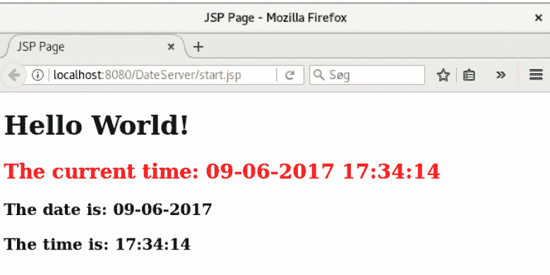

在 JSP 页面中以此方式包含代码（使用脚本）有其用处，但通常被认为是糟糕的编程方式。原因是因为 JSP 页面非常难以维护。因此，建议你尽可能地使用 Java beans。

现在我将对页面进行最后一次扩展：

```
<@page import="java.util.*"

<%@page contentType="text/html" pageEncoding="UTF-8%">

<!DOCTYPE html>

<% Calendar dato = null;

String tekst = null;

%>

String getTime(Calendar dt)

{

    return String.format("%02d-%02d-%04d %02d:%02d:%02d", dt.get(Calendar.DATE),

dt.get(Calendar.MONTH) + 1, dt.get(Calendar.YEAR),

dt.get(Calendar.HOUR_OF_DAY), dt.get(Calendar.MINUTE),

dt.get(Calendar.SECOND);

}

n

<% dato = Calendar.getInstance();

tekst = getTime(dato);

%>

<html

<head>

<meta http-equiv="Content-Type" content="text/html; charset=UTF-8">

<title>JSP Page</title>

</head>

<body
```

# JAVA 11: Web 应用与 JAVA EE: 软件开发

```jsp
<jsp:Bean id="dateBean" scope="page" class="dateserver.DateBean"/>

<jsp:setProperty name="dateBean" property="*"/>

<h1>Hello World!</h1>

<h2 style="color:red">当前时间: <%=text%></h2>

<h3>日期是 ${dateBean.date}</h3>

<h3>时间为: ${dateBean.time}</h3>

<form method="post">

<table>

<tr>

<td>日期</td>

<td><input type="text" id="date" name="date" style="width:120px"/></td>

</tr>

<tr>

<td>时间&nbsp;&nbsp;</td>

<td><input type="text" name="time" style="width:120px"/></td>

</tr>

</table>

<input type="submit" value="更新"/>

</form>

</body>

</html>
```


# JAVA 11: Web 应用与 JAVA EE: 软件开发 JSP

这里添加了一个表单。注意，表单元素没有定义任何 `action`。这意味着页面通过提交时会向自身发送请求。表单定义了两个输入组件。在这里，重要的是它们必须具有相同的 `name` 属性，这些名称应当是 `DateBean` 中两个属性的名称。此外，请注意此语句：

```
<jsp:setProperty name="dateBean" property="*"/>
```

它表示在执行提交时，`DateBean` 类中所有的 `set` 方法都必须执行，并用相应输入字段的值进行更新。如果你打开页面，结果可能如下，我在两个输入字段中输入了值：

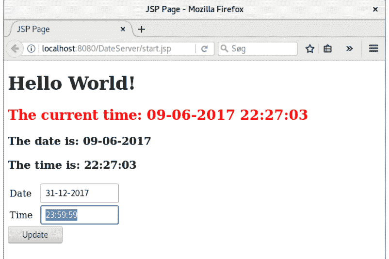

# JAVA 11: Web 应用与 JAVA EE: 软件开发 JSP

如果你点击按钮，会得到一个窗口，显示当前的 bean 对象已更新：

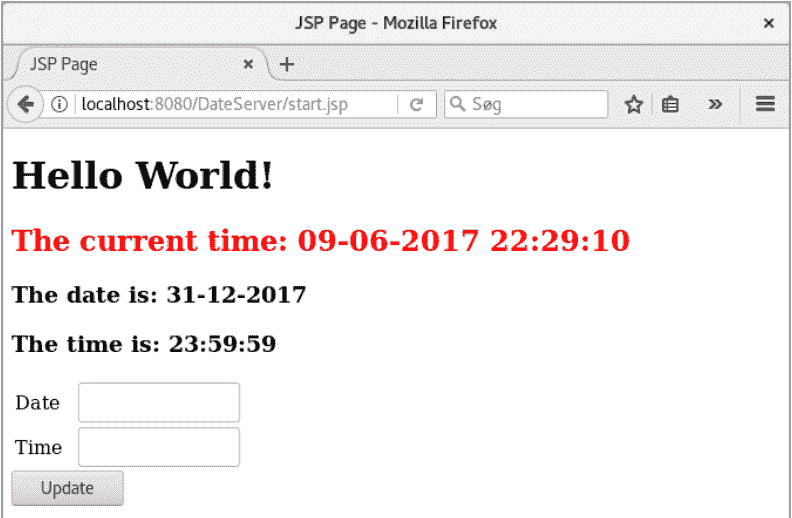

从上述可以看出，在 JSP 页面上将输入组件链接到 Java bean 中的属性是简单的。上面是所有关联的字段，但你可以逐个进行操作，例如写：

```
<jsp:setProperty name="dateBean" property="date"/>
```

如果你不想更新所有字段的话。另一件事是处理异常，我稍后会再回到这一点，但在这种情况下，它是通过给字段分配相关的异常来解决的，这这显然不是一个在实践中可以使用的解决方案。

作为最后的注释，一个新的 Web 应用程序开始创建一个主页，主页是一个 HTML 文档，并且没有用于任何地方。由于几个原因，建议用 HTML 文档启动 Web 应用程序，在这种情况下，可以将主页修改为如下内容：

```
<!DOCTYPE html>

<html>

<head>

<title>待提供标题</title>

<meta charset="UTF-8">
```

```
<meta name="viewport" content="width=device-width, initial-scale=1.0">

<script>

window.location = "start.jsp";

</script>

</head>

<body>

</html>
```

结果是，主页向 `start.jsp` 发送请求。这是通过 JavaScript 实现的，代码在客户端执行，你只需要接受这种语法。

然而，主页并非必须，如果你愿意，可以删除它并让 JSP 页面成为主页。


> 我们不发明轮子，我们重新发现。迷人的光提供了无限可能：创新技术和新市场提供了机遇和挑战。在一个你的知识需求巨大的环境中。享受全球范围内支持性的环境并从国际职业路径中获益。与其他专家密切合作实施可持续的想法并对我们的未来做出贡献。加入我们，每天重新发现光。

Light is OSRAM
SYLVANIA

# JAVA 11: Web 应用与 JAVA EE: 软件开发

## 5. 计算

JAVA 11: Web 应用与 JAVA EE: 软件开发

示例显示了如何将输入组件链接到 Java bean 中的属性。上面是所有关联的字段，但你可以逐个进行操作，例如写：

```
<jsp:setProperty name="dateBean" property="date"/>
```

如果你不想更新所有字段。另一件事是处理异常，我稍后会再回到这一点，但在这种情况下，它是通过给字段分配相关的异常来解决的，这显然不是一个在实践中可以使用的解决方案。

# JAVA 11: Web 应用与 JAVA EE: 软件开发

JAVA 11: Web 应用与 JAVA EE: 软件开发

如果你点击按钮，会得到一个窗口显示当前的 bean 对象已更新：


从上述可以看出，在 JSP 页面上将输入组件链接到 Java bean 中的属性是简单的。上面是所有关联的字段，但你可以逐个进行操作，例如写：

```
<jsp:setProperty name="dateBean" property="date"/>
```

如果你不想更新所有字段。另一件事是处理异常，我稍后会再回到这一点，但在这种情况下，它是通过给字段分配相关的异常来解决的，这显然不是一个在实践中可以使用的解决方案。

# JAVA 11: Web 应用与 JAVA EE: 软件开发

JAVA 11: Web 应用与 JAVA EE: 软件开发

另一件事是处理异常，我稍后会再回到这一点，但在这种情况下，它是通过给字段分配相关的异常来解决的，这显然不是一个在实践中可以使用的解决方案。

# JAVA 11: Web 应用与 JAVA EE: 软件开发

JAVA 11: Web 应用与 JAVA EE: 软件开发

JAVA 11: Web 应用与 JAVA EE: 软件开发

JAVA 11:

示例显示了如何将输入组件链接到 Java bean 中的属性。上面是所有关联的字段，但你可以逐个进行操作，例如写：

```
<jsp:setProperty name="dateBean" property="date"/>
```

如果你不想更新所有字段。另一件事是处理异常，我稍后会再回到这一点，但在这种情况下，它是通过给字段分配相关的异常来解决的，这显然不是一个在实践中可以使用的解决方案。

# JAVA 11：WEB 应用程序与 JAVA EE：软件开发 JSP

```java
public long getArgb() {

    return argb;

}
```

```java
public void setArga(long arga) {

    this.arga = arga;

}
```

```java
public void setArgb(long argb) {

    this.argb = argb;

}
```

```java
public long add() {

    return arga + argb;

}
```

```java
public long subtract() {

    return arga - argb;

}
```

```java
public long multiply() {

    return arga * argb;

}
```

```java
public long divide() {

    if (argb == 0) return 0;

    return arga / argb;

}
```

```java
public long modulus() {

    if (argb == 0) return 0;

    return arga % argb;

}
```

JAVA 11：WEB 应用程序与 JAVA EE：软件开发 JSP

该类填充了一些行，非常简单。你应该注意，该类是根据 Java bean 的规范编写的，这里你应该特别注意两个变量名以及遵循 Java bean 标准的 `get` 和 `set` 方法。还要注意该类还有其他方法（5 个计算方法）。这里你应该特别注意最后一个方法，如果计算无法进行，它将返回 0。事实上，它们应该抛出异常，但由于 JSP 页面始终使用函数的返回值，这种解决方案无法使用。

另一个 Java bean 如下所示：

```java
package beanfields.beans;

import java.io.*;

public class PrimeBean implements Serializable {

    private static final long max = 92233720368547757833L;

    private long prime = 2;

    public PrimeBean() {}

    public long getPrime() {

        return prime;

    }

    public void setPrime(long n) throws Exception {

        if (!isPrime(n)) throw new Exception("Illegal prime");

        prime = n;

    }

    public boolean next() {

        if (prime < max) {

            if (prime == 2) prime = 3;

            else for (prime += 2; !isPrime(prime); prime += 2) {}

            return true;

        }

        return false;

    }
```

```java
public boolean prev() {

    if (prime > 2) {

        if (prime == 3) prime = 2;

        else for (prime -= 2; !isPrime(prime); prime -= 2);

        return true;

    }

    return false;

}
```

```java
public static boolean isPrime(long n) {

    if (n == 2 || n == 3 || n == 5 || n == 7) return true;

    if (n < 11 || n % 2 == 0) return false;

    for (long t = 3, m = (long)Math.sqrt(n) + 1; t <= m; t += 2) {

        if (n % t == 0) return false;

    }

    return true;

}
```


SIMPLY CLEVER

ŠKODA

# 我们将把你的简历变成一生难得的机会

你喜欢汽车吗？你想成为一个成功品牌的一员吗？我们将欣赏并奖励你的热情和才华。向我们发送你的简历。你会对它能带你去哪里感到惊讶。

向我们发送你的简历至 `www.employerforlife.com`

# JAVA 11：WEB 应用程序与 JAVA EE：软件开发

这里还有一些代码，目标之一是展示 Java bean 可以包含与其他任何类类似的复杂代码。它有一个属性必须代表质数。因此，如果你尝试给它分配一个非质数值，它的 setter 可以抛出一个异常。除了这个属性外，还有两个方法分别将值赋值给下一个质数和上一个质数——如果可能。

程序还有另一个 Java 类，它是一个名为 `PrimesServlet` 的 servlet。该类位于 `beanfields.servlets` 包中，方法为 `processRequest(is)`：

```java
@WebServlet(name = "Primes", urlPatterns = {"/Primes"})
public class PrimesServlet extends HttpServlet
{
    protected void processRequest(HttpServletRequest request, IOException response) {
        PrimeBean bean = (PrimeBean)request.getSession().getAttribute("prim");
        String arg = request.getParameter("arg");
        if ("next".equals(arg)) {
            bean.next();
        } else {
            bean.prev();
        }
        response.sendRedirect("index.jsp");
    }
}
```

它是一个简单的 Java bean，通过创建会话引用来启动。最后，它重定向到 `index.jsp`。这些 JSP 代码包含几个 JSP 页面，你应该注意到：

```jsp
<page contentType="text/html" session="true" pageEncoding="UTF-8">
<page errorPage="error.jsp" %>
<!DOCTYPE html>
<html>
<head>
    <meta http-equiv="Content-Type" content="text/html; charset=UTF-8">
    <title>JSP</title>
</head>
<body>
    <h1>calculations</h1>
    <jsp:useBean id="math" scope="session" class="beanfields.beans.MathBean"/>
    <jsp:useBean id="prim" scope="session" class="beanfields.beans.PrimeBean"/>
    <form name="form1" method="post">
        <table>
            <tr>
                <td>Sum</td>
                <td><input type="text" name="arga" value="${arga}" style="width:120px"/></td>
                <td><input type="text" name="argb" value="${argb}" style="width:120px"/></td>
                <td><input type="submit" value="OK"/></td>
            </tr>
            <tr>
                <td>Difference</td>
                <td><input type="text" name="arga" value="${arga}" style="width:120px"/></td>
                <td><input type="text" name="argb" value="${argb}" style="width:120px"/></td>
                <td><input type="submit" value="OK"/></td>
            </tr>
            <tr>
                <td>Product</td>
                <td><input type="text" name="arga" value="${arga}" style="width:120px"/></td>
                <td><input type="text" name="argb" value="${argb}" style="width:120px"/></td>
                <td><input type="submit" value="OK"/></td>
            </tr>
            <tr>
                <td>Quotient</td>
                <td><input type="text" name="arga" value="${arga}" style="width:120px"/></td>
                <td><input type="text" name="argb" value="${argb}" style="width:120px"/></td>
                <td><input type="submit" value="OK"/></td>
            </tr>
            <tr>
                <td>Modulus</td>
                <td><input type="text" name="arga" value="${arga}" style="width:120px"/></td>
                <td><input type="text" name="argb" value="${argb}" style="width:120px"/></td>
                <td><input type="submit" value="OK"/></td>
            </tr>
        </table>
    </form>
    <form name="form2" method="post">
        <input type="text" name="prime" value="${prime}" style="width:120px"/>
        <input type="submit" value="OK"/>
    </form>
    <p><a href="Primes?arg=next">Next</a></p>
    <p><a href="Primes?arg=prev">Previous</a></p>
</body>
</html>
```

# JAVA 11：WEB 应用与 JAVA EE：软件开发

## JSP

### 5.2 函数

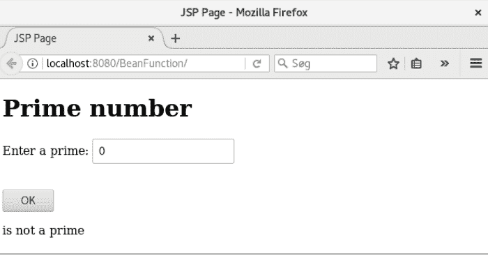

也可以在类中调用静态方法并将返回值应用于 JSP 页面，但这要求该方法必须注册在标签库描述符（Tag Library Descriptor，也称为 TLD）中。`BeanFunction` 程序打开了上面的窗口。该窗口包含一个单输入字段，该字段绑定到 Java Bean 的一个属性上，并有一个提交按钮。点击按钮会将字段的值设置到服务器端，程序将插入文本“不是质数”或“是质数”。这是通过调用一个静态方法实现的，该方法的参数是上述属性的值。该 bean 类遵循代码所示，看起来与上一个示例中的 bean 相同，但更加简单：

```java
package beanfunction.beans;

import java.io.*;

public class PrimeBean implements Serializable {
    private long prime = 0;

    public PrimeBean() {
    }

    public long getPrime() {
        return prime;
    }

    public void setPrime(long n) {
        prime = n;
    }
}
```

在 bookymoon.com 免费下载电子书

```java
public static boolean isPrime(long n)
{
  if (n == 2 || n == 3 || n == 5 || n == 7) return true;
  if (n < 11 || n % 2 == 0) return false;
  for (long t = 3, m = (long)Math.sqrt(n) + 1; t <= m; t += 2) {
    if (n % t == 0) return false;
  }
  return true;
}
```

注意，我使用的这个方法没有对值进行校验。为了创建一个标签库描述符，我在 `WEB-INF` 下添加了一个名为 `tlds` 的目录，然后将描述符添加到该目录：

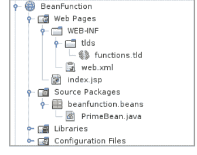

这个子目录不是必须的，但建议创建此类目录，因为较大的应用程序可能会有很多标签描述符。该描述符本身在 XML 文档中称为 `functions.tld`：

```xml
<?xml version="1.0" encoding="UTF-8"?>
<taglib version="2.1" xmlns="http://java.sun.com/ns/javaee"
xmlns:xsi="http://www.w3.org/2001/XMLSchema-instance"
xsi:schemaLocation="http://java.sun.com/ns/javaee
http://java.sun.com/ns/javaee/web-jsptaglibrary_2_1.xsd">
<taglib-version>1.0</taglib-version>
<short-name>f</short-name>
<url>WEB-INF/tlds/functions.tld</url>
<function>
<name>isPrime</name>
<function-class>beanfunction.beans.PrimeBean</function-class>
<function-signature>boolean isPrime(long)</function-signature>
</function>
</taglib>
```

在这种情况下，`functions.tld` 有一个称为 `f` 的所谓短名称。它被用于引用一个方法。定义了一个函数，该定义包含了函数的名称、函数类及其签名。文档必须包含每个供 JSP 页面可用的静态方法的描述。以下是 JSP 页面的代码：

```jsp
<page contentType="text/html" pageEncoding="UTF-8">
<!DOCTYPE html %>
<taglib prefix="c" uri="http://java.sun.com/jsp/jstl/core" %>
<taglib uri="WEB-INF/tlds/functions.tld" prefix="f" %>
<html>
<head>
<meta http-equiv="Content-Type" content="text/html; charset=UTF-8">
<title>JSP Page</title>
</head>
<body>
<jsp:use id="prim" scope="request" class="beanfunction.beans.PrimeBean"/>
<jsp:setProperty name="prim" property="prime"/>
<h1>${prim.prime}</h1>
<form name="form1" method="post">
<p>Enter a prime: <input type="text" name="prime" value="${prim.prime}"></p>
<br/>
<input type="submit" value="OK"/>
</form>
<p>
c:choose</p>
```

```jsp
<c:when test="${f:isPrime(prim.prime)}">
  is a prime
</c:when>
<c:otherwise>
  is not a prime
</c:otherwise>
```

# JAVA 11：WEB 应用与 JAVA EE：软件开发

那么，jsp 页面可以写如下所示：

```xml
<?xml version="1.0" encoding="UTF-8"?>
<jsp:root xmlns="http://java.sun.com/jsp/Page" version="2.0">
<jsp:directive contentType="text/html" pageEncoding="UTF-8"/>
<jsp:element name="text">
<jsp:attribute name="lang" value="EN"/>
<jsp:body>
<jsp:useBean id="dateBean" scope="page"
class="datimeserver.beans.DateBean"/>
<jsp:useBean id="timeBean" scope="page"
class="datimeserver.beans.CurrentTime"/>
<jsp:setProperty name="dateBean" property="*"/>
<h1>Hello World!</h1>
<h2 style="color:red">当前时间: ${timeBean.time}</h2>
<h3>日期是: ${dateBean.date}</h3>
<h3>时间是: ${dateBean.time}</h3>
<form method="post">
<table>
<tr>
<td>日期</td>
<td><input type="text" id="date" name="date" style="width:120px"/></td>
</tr>
</table>
```


在 bookboon.com 下载免费电子书，点击广告阅读更多

```xml
<tr>
  <td>时间</td>
  <td><input type="text" name="time" style="width:120px"/></td>
</tr>
</table>
<input type="submit" value="更新"/>
</form>
</jsp:body>
</jsp:element>
</jsp:root>
```

如你所见，它大部分是来自上一个示例的复制和粘贴，但你应该注意到三点。首先，它是关于格式良好的 XML。其次，这里没有脚本段（scriptlets），如果你尝试使用这些脚本，你将会得到一个错误。第三，有几个形式为 `jsp:xxxx` 的新元素，某些元素出现的次数可能比本示例中显示的更多。

如上所述，JSP 文档的目标是强制不使用脚本段。事实是过度使用脚本会导致代码更难以阅读和维护，但相反，它也有它的用处，我通常更倾向于使用标准的 JSP 页面。首先，有了像 NetBeans 这样的现代开发工具，很容易确保代码是格式良好的；其次，这意味着因为允许使用脚本，你并不必须使用它们，或者至少你可以尽量减少代码，仅在合理的地方使用脚本段。

### 5.4 修改地址 2

我将这个示例命名为 `ChangeAddress2`，因为它与 `ChangeAddress1` 示例中的问题有些相似。该示例展示了一个 Web 应用，该应用程序将模拟公司员工可以输入并维护个人信息，如姓名、地址、电子邮件等。此外，你应该能够获取所有员工数据的整体概览。

这个示例比书中上一个示例稍大，它应该展示许多作为典型 Web 应用部分的解决方案。这里有很多细节，但该示例的主要目标之一是展示使用数据库的 Web 应用。

因此，我将从描述数据库开始，在数据库 `patada` 中使用名为 `person` 的表。除了这张表，还使用了 `zipcode` 表。`person` 表定义如下：

```sql
use patada;
drop table if exists persons;
```

```sql
create table persons
(
  id int not null auto increment,
```


`firstname varchar(100) not null`,

`lastname varchar(100) not null`,

`address varchar(255)`,

`email varchar(100)`,

`phone varchar(20)`,

`zipcode varchar(10)`,

`primary key (id)`

);

# JAVA 11：Web 应用程序与 Java EE：软件开发

Web 应用开发中的主要挑战之一是视觉化表示，从而决定了页面在浏览器中的显示方式。这部分我将进行有限的探讨，但通常你通过样式来定义细节。也就是说，对于上述两个 `<td>` 元素中的每一个，都有一个定义的样式，用指示字体大小和颜色。更通地说，你可以在样式表中定义样式，样式表是应用程序页面可以应用的样式文档。作为此应用程序的一部分，我定义了以下样式表：

```css
body {

  font-family: "Liberation Sans"

}

p {

  width: 800px

}

li {

  margin: 10px 0

}
```


# JAVA 11：Web 应用程序与 Java EE：软件开发

### JSP

```css
.error

{

  font-weight: bold;

  color: red;

}
```

```css
.header-class

{

  background: bisque

}
```

```css
table.imagetable

{

  family: verdana,arial,sans-serif;

  font-size:1px;

  color:#333333;

  border-width: 1px;

  border-color: #999999;

  border-collapse: collapse;

}
```

```css
table.imagetable th

{

  background:#b5cf2 url('cell-blue.jpg');

  border-width: 1px;

  padding: 8px;

  border-style: solid;

  border-color: #999999;

}
```

```css
table.imagetable td

{

  background:#cdcdc0 url('cell-grey.jpg');

  border-width: 1px;

  padding: 8px;

  border-style: solid;

  border-color: #999999;

}
```

在 bookboom.com 下载免费电子书

# JAVA 11：Web 应用程序与 Java EE：软件开发

当然，有很多关于样式表的语法细节，但当你阅读单个样式时，它们很容易理解，而且 NetBeans 样式保留也为单个样式提供了帮助。在实践中，样式表可以非常全面，其核心思想是将单个 HTML 元素显示方式的定义从 HTML 和 JSP 文档中移出。这意味着，一方面这些文档变得更简单且易于理解，另一方面，维护网站的外观变得更容易，你只需要修改样式表即可。其理念是 HTML 和 JSP 文档应该只定义内容，而样式表定义内容在浏览器中的渲染方式。因此，样式表是随页面发送的文本文档，浏览器使用它来渲染文档。样式表不在服务器端使用。

在这种情况下，定义了 9 种样式。前三个非常简单，定义了 `<body>` 元素（以及整个文档）的默认应用样式，以及段落的宽度（如这样的文本行不一定会填满屏幕），以及 `<li>` 元素必须有 10 像素的上外边距。接两个定义了可以与特定元素关联的所谓类（class）。例如，上方头部使用的 `header-class`：

```html
<div class="header-class">
```

最后三个样式更为复杂，定义了可以在 HTML 表格中使用的样式，稍后会回来。这些样式被所有使用该样式表的文档使用。如果你查看主页的代码，你可以看到头部中的一个链接元素是如何定义如何使用相应的样式表的：

```jsp
<@page contentType="text/html" pageEncoding="UTF-8"%>

<!DOCTYPE html>

<html>

<head>

<meta http-equiv="Content-Type" content="text/html; charset=UTF-8">

<title>Start page</title>

<link rel="stylesheet" href="style.css" type="text/css">

</head>

<body>

<jsp:include page="header.jsp">

<h1>Employee information</h1>

<p>On this page .... </p>

<p>The individual employee ... .</p>

<ul>
```

```html
<ul>

  <li><a href="login.jsp">Enter employee information</a></li>

  <li><a href="show.jsp">Show employee skills</a></li>

  <li><a href="passwd.jsp">New password</a></li>

</ul>

</body>

</html>
```

你应该注意上述头部是如何通过 `jsp:include` 元素作为 body 部分的第一行插入的。你必须注意这是服务器端进行的，由服务器负责创建完成的文档。在此应用程序中，所有页面都以此头部开头，有助于确保 Web 应用程序中的所有页面具有共同的视觉效果，并且由于方便更改头部而很容易更改。你还应该注意这是在服务器端进行的，由服务器负责创建完成的文档。在此应用程序中，所有页面都以此头部开头，有助于确保 Web 应用程序中的所有页面具有共同的视觉效果，并且由于方便更改头部而很容易更改。你还应该注意这是在服务器端进行的，由服务器负责创建完成的文档。在此应用程序中，所有页面都以此头部开头，有助于确保 Web 应用程序中的所有页面具有共同的视觉效果，并且由于方便更改头部而很容易更改。你还应该注意这是在服务器端进行的，由服务器负责创建完成的文档。在此应用程序中，所有页面都以此头部开头，有助于确保 Web 应用程序中的所有页面具有共同的视觉效果，并且由于方便更改头部而很容易更改。你还应该注意这是在服务器端进行的，由服务器负责创建完成的文档。在此应用程序中，所有页面都以此头部开头，有助于确保 Web 应用程序中的所有页面具有共同的视觉效果，并且由于方便更改头部而很容易更改。你还应该注意这是在服务器端进行的，由服务器负责创建完成的文档。在此应用程序中，所有页面都以此头部开头，有助于确保 Web 应用程序中的所有页面具有共同的视觉效果，并且由于方便更改头部而很容易更改。你还应该注意这是在服务器端进行的，由服务器负责创建完成的文档。在此应用程序中，所有页面都以此头部开头，有助于确保 Web 应用程序中的所有页面具有共同的视觉效果，并且由于方便更改头部而很容易更改。你还应该注意这是在服务器端进行的，由服务器负责创建完成的文档。在此应用程序中，所有页面都以此头部开头，有助于确保 Web 应用程序中的所有页面具有共同的视觉效果，并且由于方便更改头部而很容易更改。你还应该注意这是在服务器端进行的，由服务器负责创建完成的文档。在此应用程序中，所有页面都以此头部开头，有助于确保 Web 应用程序中的所有页面具有共同的视觉效果，并且由于方便更改头部而很容易更改。你还应该注意这是在服务器端进行的，由服务器负责创建完成的文档。在此应用程序中，所有页面都以此头部开头，有助于确保 Web 应用程序中的所有页面具有共同的视觉效果，并且由于方便更改头部而很容易更改。你还应该注意这是在服务器端进行的，由服务器负责创建完成的文档。在此应用程序中，所有页面都以此头部开头，有助于确保 Web 应用程序中的所有页面具有共同的视觉效果，并且由于方便更改头部而很容易更改。（注：原文此处存在大量重复段落，翻译已按原文逻辑保留）...在此应用程序中，所有页面都以此头部开头，有助于确保 Web 应用程序中的所有页面具有共同的视觉效果，并且由于方便更改头部而很容易更改。你还应该注意这是在服务器端进行的，由服务器负责创建完成的文档。（此处为重复内容清理）...（此处为重复内容清理）...Web 应用开发中的主要挑战之一是视觉化表示，从而决定了页面在浏览器中的显示方式。（此处为重复）`img/589e4f95edc213964881c85e009923c9_92_0.png`

# JAVA 11：Web 应用程序与 Java EE：软件开发

### JSP

`img/589e4f95edc213964881c85e009923c9_93_0.png`

在 bookboom.com 下载免费电子书

# JAVA 11：Web 应用程序与 Java EE：软件开发

`img/589e4f95edc213964881c85e009923c9_94_0.png`

# JAVA 11：Web 应用程序与 Java EE：软件开发

### JSP

```java
package changeaddress.beans;

import java.io.*;

public class LoginBean implements Serializable {

    private String userid;

    private String passwd;

    private String error;

    public LoginBean() {

    }

    public String getUserId() {

        return userid;

    }

    public void setUserid(String userid) {

        this.userid = userid;

    }

    public String getPasswd() {

        return passwd;

    }

    public void setPasswd(String passwd) {

        this.passwd = passwd;

    }

    public String getError() {

        return error;

    }

    public void setError(String error) {

        this.error = error;

    }

}
```

# JAVA 11：Web 应用程序与 Java EE：软件开发

### JSP

没什么没什么需要解释的，但你应该注意到我增加了一个名为 `error` 的属性，它用于返回错误消息。那么， JSP 页面将编写如下：

```jsp
<@page contentType="text/html" pageEncoding="UTF-8" session="true"%>

<@page errorPage="error.jsp" %>

<!DOCTYPE html>

<html>

<head>

<meta http-equiv="Content-Type" content="text/html; charset=UTF-8">

<title>Login</title>

<link rel="stylesheet" href="styles.css" type="text/css">

<script src="scripts.js"></script>

  <script>

    function encryptPassword() {

      var passwd = ("" + document.getElementById("passwd").value.trim());

      if (passwd.length > 0) {

        document.getElementById("passwd").value = createHash(passwd);

      }

      return true;

    }

  </script>

</head>
```

`img/589e4f95edc213964881c85e009923c9_95_0.png`

```html
<body>

<jsp:useBean id="loginBean" class="changeaddress.beans.LoginBean" scope="session"/>

<jsp:include page="header.jsp"/>

<h2>登录</h2>

<form method="post" action="PersonServlet" onsubmit="return encryptPassword()">

<table>

<tr>

<td>输入工号：&nbsp;&nbsp;&nbsp;</td>

</tr>

<tr><input type="text" id="mdner" name="userid" style="width:120px" value="${loginBean.userid}"></td>

</tr>

<tr>

<td colspan="2"><div style="font-size: xx-small">

对于新员工，只需不输入工号即可

</div></td></td>

</tr>

<tr>

<td colspan="2" style="height: 10px"></td>

</tr>

<tr>

<td>输入密码</td>

</tr>

<tr><input type="password" id="passwd" name="passwd" style="width:120px" value="${loginBean.password}"></td>

</tr>

<tr>

<td colspan="2" style="height: 20px"></td>

</tr>

<tr>

<td colspan="2" style="text-align: right"><input type="submit" id="edit" name="edit" value="编辑员工"/></td>

</tr>

<tr>

<td colspan="2" style="height: 20px"></td>

</tr>

<tr>

<td colspan="2" style="text-align: right"><a href="start">取消</a></td>

</tr>

</table>

</form>

<div class="error">${loginBean.error}</div>

</body>

</html>
```

# JAVA 11：WEB 应用与 JAVA EE：软件开发

请注意第 2 行指向一个错误页面。从原则上说，你不永远应该进入此页面，因为服务器会对数据进行验证，但如果发生一个或多个严重错误（即发生异常），你会被重定向到错误页面。还要注意 `LoginBean` 是如何应用的，以及它的属性是如何与输入字段以及文档末尾的 `div` 元素关联的。它用于显示可能的错误信息。请注意，该 bean 的范围是会话（session）。这意味着分配对象的值在整个会话期间都会保留。最后，你应该注意该页面只读取了 bean 对象，而没有更新它。否则，你可能会发现页面使用了样式表，并且有一个输入字段的类型为密码。

然而，最重要的是表单元素，其 `action` 属性表示表单应该发送到 `PersonServlet`，最后表单元素指明在提交之前必须执行 JavaScript 函数 `encryptPassword()`。用户的密码必须以加密的形式存储在数据库中，我之前（在《Java 7》书中）已经展示过如何这样做。Java 有相应的类来实现它，它可以确定密码的消息摘要（message digest）并将其存储在数据库中。然而，这会导致一个问题，因为它只发生在服务器端，密码必须以明文发送到服务器，允许他人拦截。因此，加密必须在客户端完成，而这里我只有 JavaScript 可用。消息摘要是通过复杂的算法确定的，有几种可以使用的算法，它们的强度不同，因此破解的难度也不同。该算法在互联网上有详细的描述，你可以轻松地找到一个在 JavaScript 中实现的示例。`scripts.js` 文件实现了一种算法（SHA-1 算法）。我不想在这里审查该算法或展示代码，但简而言之，想法是修改文本使其无法被识别，并且你不会为此后悔，并不是为了该消息摘要来确定密码。然而，存在一个问题，因为它发生在客户端，所以每个人都能看到发生了什么，因此人们在讨论使用脚本代码加密密码是否安全，因为这种代码是不可指责的，但对于这个示例来说，它必须是足够的。尽管加密是安全的，人们通常需要比此示例所示的另一种方法（另一种实现）。

在开始查看 `PersonServlet` 之前，我将先查看 `PersonBean` 类，它是一个定义人的 Java Bean。该类非常详尽，我只展示了部分代码：

```java
public class PersonBean implements Serializable {

    private static ArrayList<Zipcode> list = new ArrayList<>();

    private int userId;

    private String firstName;
```

```java
private String lastname;

private String address1; // 注意：OCR 读取为 "address1"

private String address2;

private String code;

private String city;
```


`private String phone;`

`private String email;`

`private String title;`

`private Calendar date;`

`private String passwd;`

`private String error;`

```java
public PersonBean()
{}

public void setUserId(String userid) throws Exception {

    if (userid == null || userid.trim().length() == 0) {

        throw new Exception("Invalid userId");

    }

    int id = Integer.parseInt(userid);

    if (id < 1000 || id > 9999) {

        throw new Exception("Invalid userId range");

    }

    this.userId = id;

} catch (Exception ex) {

    throw new Exception("Illegal value for userid: " + ex.getMessage());

}
```

```java
public void setFirstName(String firstName) throws Exception {

    if (firstName == null || firstName.length() == 0) {

        throw new Exception("First name cannot be empty");

    }

    this.firstName = firstName;

}
```

```java
public void setCode(String code) throws Exception {

    code = code.trim();

    for (Zipcode zc : list) {

        if (zc.code.equals(code)) {

            this.code = zc.code;

            this.city = zc.city;

            return;

        }

    }

    throw new Exception("Illegal zipcode");

}
```

```java
public String getDate() {

    if (date == null) {

        return "";

    }

    return String.format("%02d-%02d-%04d", date.get(Calendar.DATE), date.get(Calendar.MONTH) + 1, date.get(Calendar.YEAR));

}
```

```java
public void setDate(String date) throws Exception {

    try {

        java.text.DateFormat formatter = new java.text.SimpleDateFormat("dd-MM-yyyy");

        if (this.date == null) {

            this.date = java.util.Calendar.getInstance();

        }

        this.date.setTime(formatter.parse(date));

    } catch (Exception ex) {

        throw new Exception("Illegal date");

    }

}
```

```java
static {

    try (Connection conn = DB.getConnection();

         Statement stmt = conn.createStatement()) {

        ResultSet res = stmt.executeQuery("SELECT * FROM zipcode");

        while (res.next()) {

            list.add(new Zipcode(res.getString("code"), res.getString("city")));

        }

    } catch (Exception ex) {

        // 处理连接错误

    }

}
```

```java
class Zipcode {

    public String code;

    public String city;

    public Zipcode(String code, String city) {

        this.code = code;

        this.city = city;

    }

}
```

# JAVA 11：WEB 应用程序与 JAVA EE：软件开发

```java
protected void processRequest(HttpServletRequest request,

HttpServletResponse response) throws ServletException, IOException

{

    request.setCharacterEncoding("UTF-8");

    LoginBean bean = (LoginBean)request.getSession(true).getAttribute("loginBean");

    String usr = request.getParameter("userid").trim();

    String pwd = request.getParameter("passwd").trim();

    if (pwd.length() == 0) {

        bean.setError("您必须输入密码");

        bean.setUserId(usr);

        bean.setPasswd("");

        response.sendRedirect("login.jsp");

        return;

    }

    PersonBean person = new PersonBean();

    if (usr.length() > 0) {

        if (!userOk(usr)) {

            bean.setError("非法的用户  ID");

            bean.setUserId(usr);

            bean.setPasswd("");

            response.sendRedirect("login.jsp");

            return;

        }

        if (!loadPerson(person, usr, pwd)) {

            bean.setError("未找到员工号或密码错误");

            bean.setUserId(usr);

            bean.setPasswd("");

            response.sendRedirect("login.jsp");

            return;

        }

    } else {

        person.setPasswd(pwd);

        request.getSession().setAttribute("personBean", person);

        request.getSession().removeAttribute("loginBean");

        request.getRequestDispatcher("/edit.jsp").forward(request, response);

    }

}

private boolean userOk(String userid) {

    try {

        int t = Integer.parseInt(userid);

        return t > 1000 && t < 10000;

    } catch (Exception ex)

    {

        return false;

    }

}
```

```java
private boolean loadPerson(PersonBean person, String userid, String passwd)

{

    try (Connection conn = DB.getConnection();

         Statement smt = conn.createStatement())

    {

        ResultSet res = smt.executeQuery("SELECT * FROM persons WHERE id = '" + 

        userid + "' AND passwd = '" + passwd + "'");

        if (res.next())

        {

            person.setUserId(res.getInt("id"));

            person.setFirstName(res.getString("firstname"));

            person.setLastName(res.getString("lastname"));

            person.setAddress1(res.getString("addrel1"));

            person.setAddress2(res.getString("addrel2"));

            person.setCode(res.getString("zipcode"));

            person.setPhone(res.getString("phone"));

            person.setEmail(res.getString("email"));

            person.setTitle(res.getString("title"));

            person.setDate(res.getDate("date").toString());

            return true;

        }

        return false;

    } catch (Exception ex)

    {

        return false;

    }

}
```

我只展示了说明发生过程的代码部分，主要是`processRequest()`。首先注意这一行代码：

```java
request.setCharacterEncoding("UTF-8");
```

有必要确保在提交表单时丹麦语字母能被正确处理。可能在这个例子中这并不那么重要，但在与下一个表单结合时它是很重要的。我们执行到的第一件事是对 bean 对象的引用：

```java
LoginBean login = (LoginBean)request.getSession().getAttribute("loginBean");
```

注意该对象是存在的，因为它是在会话作用域（session scope）定义的。接下来，确定员工号和密码（现在已加密）的值，并测试测试是否提交了密码。如果没有，则会将错误消息附加到 bean 对象上，服务器将执行重定向回`login.jsp`。由于 bean 对象仍然存在，页面将显示错误消息。在输入密码后，会创建一个`PersonBean`对象。如果输入了员工号（长度大于 0），首先会对其进行验证，检查它是否为正 4 位整数。如果不是，将以上述相同的方式返回错误消息。否则，调用方法`loadPerson()`尝试根据相应的员工号从数据库中读取人员。如果密码正确，`PersonBean`将使用所有数据初始化对象，否则将带错误消息返回`login.jsp`。另一方面，如果输入的员工号为空，`PersonBean`将用输入的密码初始化对象。

如果可以访问密码和员工号，则`PersonBean`将作为会话对象被保存，同时移除会话对象`loginBean`。有必要确保该项目在下次打开登录页面时不会继续存在。最后，跳转（forward）到`edit.jsp`页面，在该处可以编辑`PersonBean`对象。


赋能学生。BI 学院是欧洲最大的学院之一，拥有 20,000 多名学生。我们的项目提供了充满活力的环境和国际视野，为学生提供职业技能。英语教学的全制硕士（MSc）项目旨在开启职业生涯。

- 营销
- 财务经济
- 领导力
- 学


# JAVA 11：WEB 应用程序 JAVA EE：软件开发

```java
@WebServlet(name = "start", urlPatterns = {"/start"})

public class StartServlet extends HttpServlet {

    protected void processRequest(HttpServletRequest request,

HttpServletResponse response) throws ServletException, IOException

    {

        HttpSession session = request.getSession(false);

        if (session != null) {

            session.invalidate();

        }

        request.getRequestDispatcher("/index.jsp").forward(request, response);

    }

}
```

```jsp
<%@page contentType="text/html" pageEncoding="UTF-8" errorPage="error.jsp" %>

<!DOCTYPE html>

<html>

<head>

    <meta http-equiv="Content-Type" content="text/html; charset=UTF-8">

    <title>JSP 页面</title>

    <link rel="stylesheet" href="styles.css">

</head>

<body>

    <jsp:useBean id="personBean" class="beans.PersonBean" scope="session"/>

    <jsp:include page="header.jsp"/>

    <h2>编辑数据</h2>

    <form method="post" action="StoreServlet">

        <table>

            <tr>

                <td>员工号&nbsp;&nbsp;&nbsp;</td>

                <td><input type="text" name="userid" readonly="true" style="width:60px" value="${personBean.userid}" /></td>

            </tr>

            <tr>

                <td colspan="2" style="text-align: right"><a href="start">取消</a></td>

            </tr>

        </table>

    </form>

</body>

</html>
```

```jsp
<%@page contentType="text/html" pageEncoding="UTF-8" %>

<html>

<head>

    <title>错误页面</title>

</head>

<body>

    <jsp:include page="header.jsp"/>

    <br/><br/>

    <div class="error">${personBean.error}</div>

</body>

</html>
```

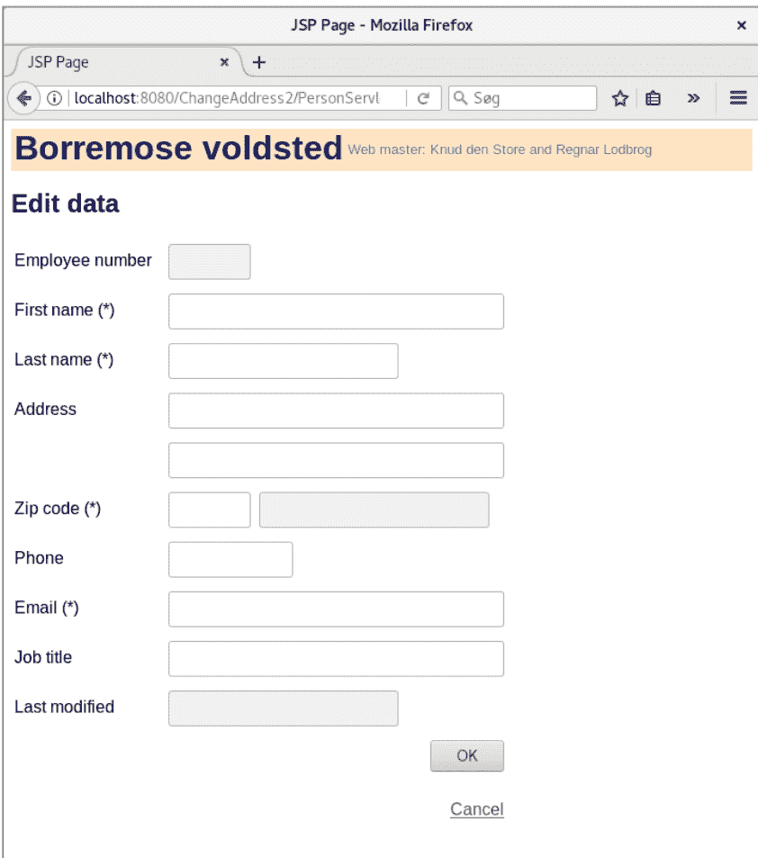

# JAVA 11：WEB 应用程序 JAVA EE：软件开发

与`login.jsp`相比没有什么解释的，原理上工作方式相同。你应该注意到对`personBean`对象的引用，当提交表单时，会向名为`StoreServlet`的 servlet 发送请求。它的`processRequest`如下：

```java
void processRequest(HttpServletRequest request,
```


```java
HttpServletResponse response) throws ServletException, IOException
{
    response.setContentType("text/html;charset=UTF-8");

    PersonBean person = (PersonBean) request.getSession().getAttribute("personBean");

    {
        request.setCharacterEncoding("UTF-8");

        person.setFirstName(request.getParameter("firstName"));
        person.setLastName(request.getParameter("lastname"));
        person.setAddressline1(request.getParameter("addrline1"));
        person.setAddressline2(request.getParameter("addrline2"));
        person.setCode(request.getParameter("code"));
        person.setPhone(request.getParameter("phone"));
        person.setEmail(request.getParameter("email"));
        person.setTitle(request.getParameter("title"));

        if (person.getDate().length() == 0)
    }
}
```

# JAVA 11：Web 应用程序与 JAVA EE：软件开发

```java
person.setUserId("" + create(person));

request.getRequestDispatcher("/employee.jsp").forward(request, response);

} else {
    update(person);

    request.getRequestDispatcher("/start").forward(request, response);

} catch (Exception ex) {
    person.setError(ex.toString());

    request.getRequestDispatcher("/edit.jsp").forward(request, response);
}
```

它首先使用表单数据初始化会话对象。如果值非法或发生意外，某些方法可能会抛出异常，此时服务器将返回 `edit.jsp` 并带有错误消息。在正确初始化对象后，日期字段被用于判断是更新还是向数据库中添加新行。这是通过使用我未展示的两个方法实现的，区别在于其中一个执行 SQL `INSERT`，而另一个执行 SQL `UPDATE`。如果这些方法执行不当，它们会抛出异常，并作为错误消息返回到 `edit.jsp`。

另一方面，如果数据库更新正确，在更新情况下将返回主页；但如果是新员工，你将被重定向到 `employee.jsp` 页面，该页面将显示分配你的员工编号。

如果你点击启动页面上的中间链接，将获得数据库中所有员工的概览。结果如下所示，其中创建了两个员工：

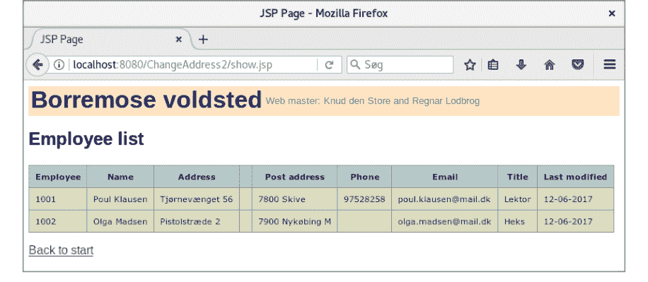

| 员工 | 姓名 | 地址 | 邮政地址 | 电话 | 邮箱 | 职位 | 最后修改时间 |
| --- | --- | --- | --- | --- | --- | --- | --- |
| 1001 | Poul Klausen | Tjarneværng 55 | 7800 Skive | 9752858 | poul.klausen@mail.dk | | 12-06-2017 |
| 1002 | Olga Madsen | Pistolstrade 2 | 7900 Nykaborg M | | olga.madsen@mail.dk | Heks | 12-06-2017 |

## JSP

表格的视觉效果由样式表决定，其中最后三个类用于设置标题样式化。JSP 页面内容如下：

```jsp
<page contentType="text/html" pageEncoding="UTF-8">

<%@ page errorPage="error.jsp" %>

<!DOCTYPE html>

<%@ taglib prefix="c" uri="http://java.sun.com/jsp/jstl/core" %>

<html>
<head>
    <meta http-equiv="Content-Type" content="text/html; charset=UTF-8">
    <title>JSP Page</title>
    <link rel="stylesheet" href="styles.css" type="text/css"/>
</head>

<body>
    <jsp:useBean id="personsBean" class="address.beans.PersonsBean" scope="page"/>

    <jsp:include page="header.jsp"/>

    <h2>Employee list</h2>

    <table class="imagetable">
        <tr>
            <th>Employee</th>
            <th>Name</th>
            <th>Address</th>
            <th>Post address</th>
            <th>Phone</th>
            <th>Email</th>
            <th>Title</th>
            <th>Last modified</th>
        </tr>

        <c:forEach items="${personsBean.persons}" var="pers">
            <tr>
                <td>${pers.userid}</td>
                <td>${pers.firstname} ${pers.lastname}</td>
                <td>${pers.addrdline1}</td>
                <td>${pers.addrdline2}</td>
                <td>${pers.code} ${pers.city}</td>
                <td>${pers.phone}</td>
                <td>${pers.email}</td>
                <td>${pers.title}</td>
                <td>${pers.date}</td>
            </tr>
        </c:forEach>
    </table>

    <p><a href="start">返回启动页</a></p>
</body>
</html>
```

该页面使用了一个名为 `Beans` 的 Java Bean。我不想在这里显示代码，但它创建了一个 `List<PersonBean>`，并用数据库中的所有员工进行了初始化。这里最重要的是注意此列表如何被用于动态创建表格，并为每个员工生成一行。在这里你应该特别注意在 JSP 页面中使用 `c:forEach` 元素插入循环的语法。

启动页面上还有另一个链接，成员有机会更改其密码。我不想显示这个，因为它没有添加任何新内容。这是一个表单，用户必须在其中输入员工编号、密码和新密码，页面使用 Servlet 来更新数据并更新数据库。

这个 Web 应用程序非常简单，并在许多地方被简化为了实际应用，当然，它可能有更多功能，例如搜索员工，但它是典型的 Web 应用程序，用户可以在其中编辑存储在数据库中的数据。实践中，许多 Web 应用程序都是数据库应用程序，例如，考虑经典的购物车。


到 2020 年，风可以提供我们星球十分之一的电力。今天，SKF 的创新——对于运行大部分世界的风力轮机至关重要。得益于我们的在线监控和自动，这些成本可以大幅减少。通过共享我们的经验、专业知识和创造力，行业可以实现超出预期的性能。与员工共同面对挑战！

# 知识的力量


# JAVA 11：Web 应用程序与 JAVA EE：软件开发

## JSP

页面使用了一个名为 `Beans` 的 Java Bean。我不想在这里显示代码，但它创建了一个 `List<PersonBean>`，并用数据库中的所有员工进行了初始化。这里最重要的是注意此列表如何被用于动态创建表格，并为每个员工生成一行。在这里应该特别注意在 JSP 页面中使用 `c:forEach` 元素插入循环的语法。

启动页面上还有另一个链接，成员有机会更改其密码。我不想显示这个，因为它没有添加任何新内容。这是一个表单，用户必须在其中输入员工编号、密码和新密码，页面使用 Servlet 来更新数据并更新数据库。

这个 Web 应用程序非常简单，并在许多地方被简化为了实际应用，当然，它可能有更多功能，例如搜索员工，但它是典型的 Web 应用程序，用户可以在其中编辑存储在数据库中的数据。实践中，许多 Web 应用程序都是数据库应用程序，例如，考虑经典的购物车。

# JAVA 11：Web 应用程序与 JAVA EE：软件开发

```java
person.setUserId("" + create(person));

request.getRequestDispatcher("/employee.jsp").forward(request, response);

} else {
    update(person);

    request.getRequestDispatcher("/start").forward(request, response);

} catch (Exception ex) {
    person.setError(ex.toString());

    request.getRequestDispatcher("/edit.jsp").forward(request, response);
}
```

它首先使用表单数据初始化会话对象。如果值非法或发生意外，某些方法可能会抛出异常，此时服务器将返回 `edit.jsp` 并带有错误消息。在正确初始化对象后，日期字段被用于判断是更新还是向数据库中添加新行。这是通过使用我未展示的两个方法实现的，区别在于其中一个执行 SQL `INSERT`，而另一个执行 SQL `UPDATE`。如果这些方法执行不当，它们会抛出异常，并作为错误消息返回到 `edit.jsp`。

另一方面，如果数据库更新正确，在更新情况下将返回主页；但如果是新员工，你将被重定向到 `employee.jsp` 页面，该页面将显示分配你的员工编号。

如果你点击启动页面上的中间链接，将获得数据库中所有员工的概览。结果如下所示，其中创建了两个员工：


| 员工 | 姓名 | 地址 | 邮政地址 | 电话 | 邮箱 | 职位 | 最后修改时间 |
| --- | --- | --- | --- | --- | --- | --- | --- |
| 1001 | Poul Klausen | Tjarneværng 55 | 7800 Skive | 9752858 | poul.klausen@mail.dk | | 12-06-2017 |
| 1002 | Olga Madsen | Pistolstrade 2 | 7900 Nykaborg M | | olga.madsen@mail.dk | Heks | 12-06-2017 |

## JSP

表格的视觉效果由样式表决定，其中最后三个类用于设置标题样式。JSP 页面内容如下：

```jsp
<page contentType="text/html" pageEncoding="UTF-8">

<%@ page errorPage="error.jsp" %>

<!DOCTYPE html>

<%@ taglib prefix="c" uri="http://java.sun.com/jsp/jstl/core" %>

<html>
<head>
    <meta http-equiv="Content-Type" content="text/html; charset=UTF-8">
    <title>JSP Page</title>
    <link rel="stylesheet" href="styles.css" type="text/css"/>
</head>

<body>
    <jsp:useBean id="personsBean" class="address.beans.PersonsBean" scope="page"/>

    <jsp:include page="header.jsp"/>

    <h2>Employee list</h2>

    <table class="imagetable">
        <tr>
            <th>Employee</th>
            <th>Name</th>
            <th>Address</th>
            <th>Post address</th>
            <th>Phone</th>
            <th>Email</th>
            <th>Title</th>
            <th>Last modified</th>
        </tr>

        <c:forEach items="${personsBean.persons}" var="pers">
            <tr>
                <td>${pers.userid}</td>
                <td>${pers.firstname} ${pers.lastname}</td>
                <td>${pers.addrdline1}</td>
                <td>${pers.addrdline2}</td>
                <td>${pers.code} ${pers.city}</td>
                <td>${pers.phone}</td>
                <td>${pers.email}</td>
                <td>${pers.title}</td>
                <td>${pers.date}</td>
            </tr>
        </c:forEach>
    </table>

    <p><a href="start">返回启动页</a></p>
</body>
</html>
```

# JAVA 11：Web 应用与 JAVA EE：软件开发

## JSP

### 练习 4

首先，创建 Web 应用 `ChangeAddress2` 的副本。你必须扩展该应用程序，在编辑页面上添加一个“删除”按钮：

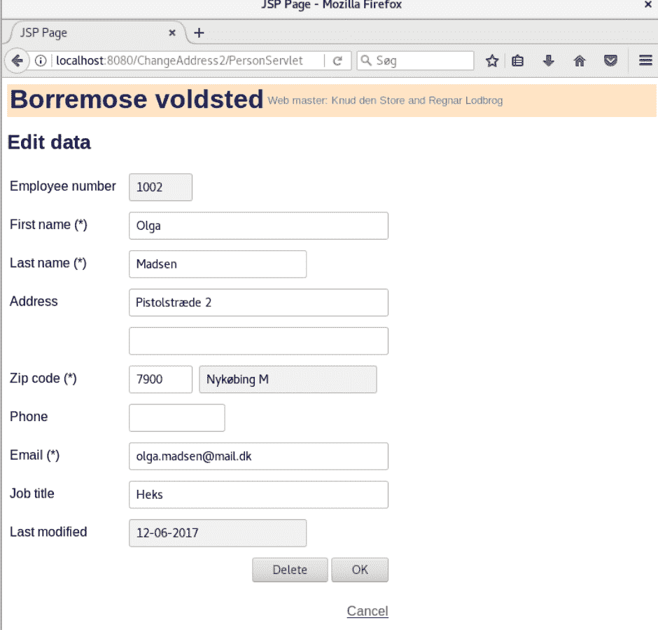

该按钮只有在编辑现有员工时才应该出现。当你点击该按钮时，必须从数据库中删除该员工。简单的方法是让按钮提交（post）到一个新的 Servlet，然后由它删除该员工。

# JAVA 11：Web 应用与 JAVA EE：软件开发

## JSF

# 6 JSF

JSF 的核心思想是将表现部分与应用程序的业务逻辑分离，这样 Web 应用的每个页面就可以写成 JSP 页面，这些页面通过向 Servlet 发请求来执行数据处理，而且正如前面提到的，JSP 页面本身会被翻译成 Servlet。要操作的数据由 Java Bean 表示，它是一个 Java 类，其属性可以立即链接到 JSP 页面的字段上。

通过这种模型，你可以开发高效的动态网站。这项技术已经不断完善，今天我们谈论 JSF，它是 Java Server Faces 的缩写，它让开发现代 Web 应用变得更容易，让使用新的 Web 技术变得更容易。它取代了 FacesServlet。也可以说，JSP 页面仅仅是开发高效 Web 应用过程中不断涌出的许多新需求所驱动的技术演进产物。

我将首先展示如何使用 NetBeans 编写带有 JSF 的 Web 应用。该应用程序基本上和我之前展示的相同，用户必须输入两个数字，程序就可以执行计算：

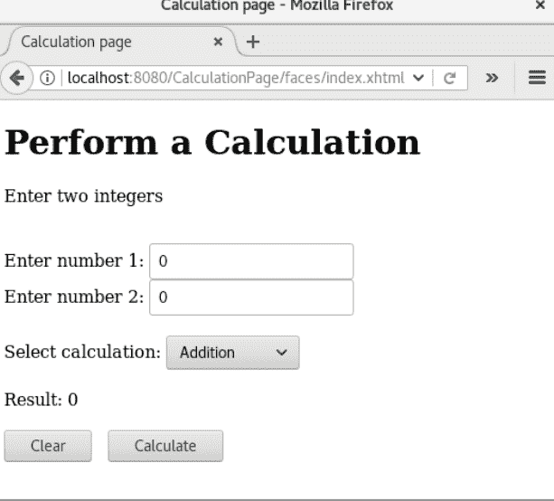

该计算是四种计算类型之一，有两个按钮：一个用于清除字段（两个输入字段和结果），另一个用于执行计算。

该项目名为 `CalculationPage`，在 NetBeans 中像其他 Web 应用一样创建它，但在服务器设置（Server Settings）窗口中，我点击 Next（下一步），然后进入选择框架（Frameworks）的窗口。在这里你勾选 JavaServer Faces 字段（见下文）。其余部分保持不变，当你点击 Finish（完成）时，就了一个 JSF Web 应用，它由一个名为 `index.xhtml` 的单文件组成。


# JAVA 11：Web 应用与 JAVA EE：软件开发

## JSF

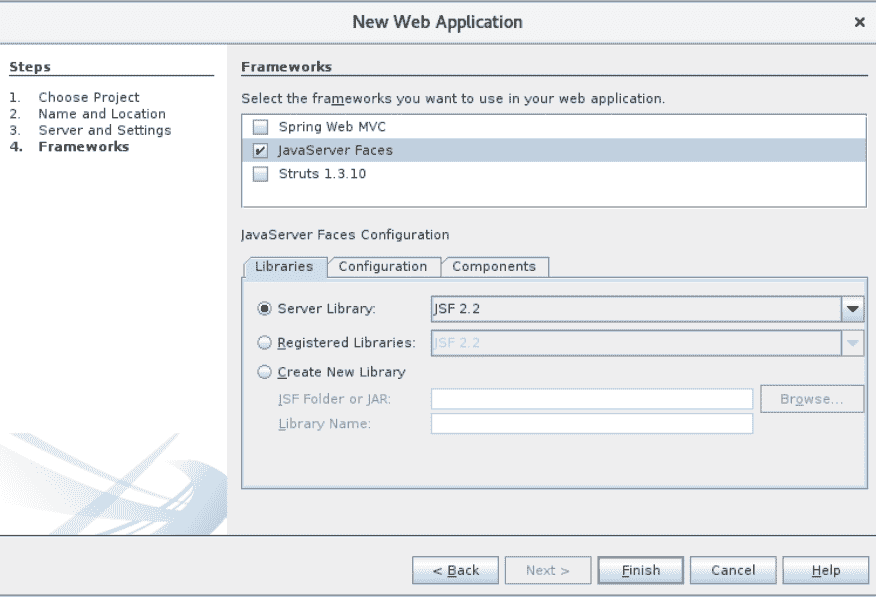

```xml
<?xml version='1.0' encoding='UTF-8' ?>

<!DOCTYPE html PUBLIC "//W3C//DTD HTML 1.0 Transitional//EN"
"http://www.w3.org/TR/xhtmlhtml/DTD/xhtml1-transitional.dtd">

<html xmlns="http://www.w3.org/1999/xhtml"
      xmlns:h="http://xmlns.jcp.org/jsf/html">

<head>
    <title>Facelet Title</title>
</head>

<body>
```


# Hello from Facelets

```html
</body>
</html>
```

如你所见，这是一个带有 HTML 语法的 XML 文档，实际上它是一个可以在浏览器中翻译并打开的完整 Web 应用。任务当然是修改此页面，使其显示上方所示的窗口。

# JAVA 11：Web 应用与 JAVA EE：软件开发

传递到 JSP 页面的数据由 Java Bean 表示，通常任何 JSP 页面对应一个 Java Bean。JSP 页也是命名 bean（准确说是 CDI bean）或控制器，但基本上它只是在类前面带有两个注解的 Java Bean。为了将命名 bean 与项目关联，我像之前一样添加了`calculation.beans`包。然后我右键点击并选择 JSF Managed Bean（见下文）。当我点击 OK 时，会弹出一个创建所需类的窗口（见下文）。名称为`CalculationController`，你应该注意到选择了上面的包。还有 Name 字段，它是该类在 JSF 页面中标识的名称。默认情况下，NetBeans 选择以小写字母开头的类名，很少有理由更改它。最后是 Scope 字段，我选择了 session。当你点击 OK 时，NetBeans 将创建一个命名 bean：

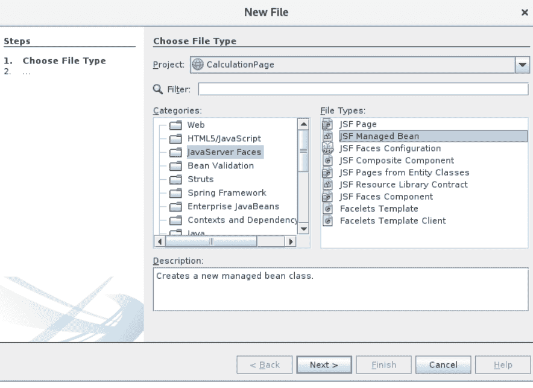

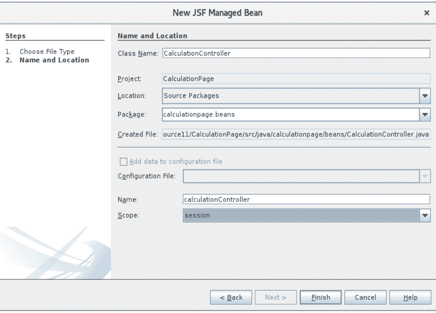

# JAVA 11：Web 应用与 JAVA EE：软件开发

```java
package calculationpage.beans;

import javax.inject.Named;

import javax.enterprise.context.SessionScoped;

import java.io.Serializable;

@Named(value = "calculationController")

@SessionScoped

public class CalculationController implements Serializable

{

    public CalculationController()

{

```

基本上，它只是在类前面带有两个注解的 Java Bean。为了将命名 bean 与项目关联，我像之前一样添加了`calculation.beans`包。然后我右键点击并选择 JSF Managed Bean（见下文）。当我点击 OK 时，会弹出一个创建所需类的窗口（见下文）。名称为`CalculationController`，你应该注意到选择了上面的包。还有 Name 字段，它是该类在 JSF 页面中标识的名称。默认情况下，NetBeans 选择以小写字母开头的类名，很少有理由更改它。最后是 Scope 字段，我选择了 session。当你点击 OK 时，NetBeans 将创建一个命名 bean：

```java
package calculationpage.beans;

import javax.inject.Named;

import javax.enterprise.context.SessionScoped;

import java.io.Serializable;

@Named(value = "calculationController")

@SessionScoped

public class CalculationController implements Serializable

{

    public CalculationController()

{

}
```

```java
package calculationpage.beans;

import javax.inject.Named;

import javax.enterprise.context.SessionScoped;

import java.io.Serializable;

@Named(value = "calculationController")

@SessionScoped

public class CalculationController implements Serializable

{

    private static final String ADDITION = "Addition";

    private static final String SUBTRACTION = "Subtraction";

    private static final String MULTIPLICATION = "Multiplication";

    private static final String DIVISION = "Division";

    private long number1;

    private long number2;

    private long result;

    private String calculation;

    public CalculationController()

    {

    }

    public void clear()

    {

        number1 = 0;

        number2 = 0;

        result = 0;

        calculation = null;

    }

    public void calculate()

    {

        if (calculation.equals(ADDITION)) {

            result = number1 + number2;

        } else if (calculation.equals(SUBTRACTION)) {

            result = number1 - number2;

        } else if (calculation.equals(MULTIPLICATION)) {

            result = number1 * number2;

        } else if (calculation.equals(DIVISION)) {

            try {

                result = number1 / number2;

            } catch (Exception ex) {

                FacesMessage facesMsg = new FacesMessage(FacesMessage.SEVERITY_ERROR, "Invalid", null);

                FacesContext.getCurrentInstance().addMessage(null, facesMsg);

            }

        }

    }

    public long getNumber1() {

        return number1;

    }

    public void setNumber1(long number1) {

        this.number1 = number1;

    }

    public long getNumber2() {

        return number2;

    }

    public void setNumber2(long number2) {

        this.number2 = number2;

    }

    public long getResult() {

        return result;

    }

    public void setResult(long result) {

        this.result = result;

    }

    public String getCalculation() {

        return calculation;

    }

    public void setCalculation(String calculation) {

        this.calculation = calculation;

    }

}
```

# JAVA 11：Web 应用与 JAVA EE：软件开发 JSF

(注：由于原文文本中存在大量代码片段重复和乱序，上述译文根据逻辑对齐并整合了代码结构，以确保可读性)

# JAVA 11：WEB 应用与 JAVA EE：软件开发 JSF

```html
</head>

<body>

<f:view>

<h1>执行计算</h1>

<p>输入两个整数</p>

<h:messages errorStyle="color: red" infoStyle="color: green" globalOnly="true"/>

<h:form id="calulationForm">

输入数字 1:

<h:inputText id="number1" value="#{calculationController.number1}"/>

<br/>输入数字 2:

<h:inputText id="number2" value="#{calculationController.number2}"/>

<br/>选择计算方式:

<h:selectOneMenu id="calculation" value="#{calculationController.calculation}">

<f:selectItems value="#{calculationController.calculations}"/>

</h:selectOneMenu>

<br/>

<br/>结果:
```


> 我们不重新发明轮子，我们重新发明光。

**光源来自 OSRAM**

迷人的灯光提供了无限可能：创新技术和新市场既提供了机遇和挑战。在这个环境中，您的专业知识需求非常迫盛。享受我们全球集团内的支持性工作环境，并从国际化职业路径中获益。与其他专家紧密合作实施可持续理念，并为影响我们的未来做出贡献。欢迎加入我们，每天重新发明光。

在 bookboom.com 免费下载电子书

# JAVA 11：WEB 应用与 JAVA EE：软件开发 JSF

```html
<h:outputText id="result" value="#{calculationController.result}"/>

<br/>

<br/>

<h:commandButton action="#{calculationController.clear()}"

value="重置"/>&nbsp;&nbsp;

<h:commandButton action="#{calculationController.calculate()}"

value="计算"/>

</h:form>

</f:view>

</body>

</html>
```

当您看到这些代码时，很容易理解，并立即注意到它是一个 XML 文档，且大部分代码与 HTML 相似。然而，使用了许多新的元素，这些元素不是标准的 HTML 元素，而是在两个标签库中定义的元素，通常称为 JSF 元素：

```xml
xmlns:f="http://xmlns.jcp.org/jsf/core"

xmlns:h="http://xmlns.jcp.org/jsf/html"
```

此类元素定义了可以初始化的不同属性，并且元素会被翻译成标准的 HTML。例如，有一个

```html
<h:messages errorStyle="color: red" infoStyle="color: green" globalOnly="true"/>
```

它通常不会产生任何代码，但如果计算过程中出现错误（除以 0），则会在文档中添加以下文本：

- <ul><li style="color: red">无效的计算 </li></ul>

重要的是，要意识到这些新元素并不意味着你不能使用标准 HTML。这和以前一样是可以行的。这只是由于新元素提供了新的机会，并且比从头开始编写，它们能更轻松地生成所需的 HTML。例如，下拉列表是如何定义的：

```html
<h:selectOneMenu id="calculation"

value="#{calculationController.calculation}"

<f:selectItems value="#{calculationController.calculations}"/>

</h:selectOneMenu>
```

在 bookoon.com 免费下载电子书

# JAVA 11：WEB 应用与 JAVA EE：软件开发 JSF

注意，特别是在引用 bean 属性时，原则上的实现方法与 JSP 页面中相同，只需使用`calculation #`代替`$`。查看上面的定义，它会生成如下 HTML：

```html
<select id="calculationForm:calculation" name="calculationForm:calculation" size="1">

  <option value="Addition" selected>加法</option>

  <option value="Subtraction">减法</option>

  <option value="Multiplication">乘法</option>

  <option value="Division">除法</option>

</select>
```

页面还定义了一个表单元素，但没有定义 action。该 action 反而是与按钮的定义关联，例如：

```html
<h:commandButton action="#{calculationController.clear()}" value="重置"/>
```

以下是 JSF 页面生成的 HTML 示例：

```xml
<?xml version="1.0" encoding="UTF-8" ?>

<!DOCTYPE html>

<html xmlns="http://www.w3.org/1999/xhtml">

<head id="j_idt2">

  <title>计算页面</title>

</head>

<body>

  <h1>执行计算</h1>

  <p>输入两个整数</p>

  <br />

  <form id="calculationForm" name="calculationForm" method="post"

    action="faces/index.xhtml"

    enctype="application/x-form-urlencoded">

    <input type="hidden" name="calculationForm" value="0">

    输入数字 1:

    <input id="number1" value="#{calculationController.number1}" type="text" />

    <br />

    输入数字 2:

    <input id="number2" value="#{calculationController.number2}" type="text" />

    <br />

    <br />

    选择计算方式:

    <select id="calculationForm:calculation" name="calculationForm:calculation" size="1">

      <option value="Addition">加法</option>

      <option value="Subtraction">减法</option>

      <option value="Multiplication">乘法</option>

      <option value="Division">除法</option>

    </select>

    <br/>

    <br/>

    结果:

    <span id="result">#{calculationController.result}</span>

    <br/>

    <input value="重置" type="submit" />

    <input value="计算" type="submit" />

  </form>

</body>

</html>
```

当你看到这些代码时，很容易理解，并立即注意到它是一个 XML 文档，且大部分代码与 HTML 相似。然而，使用了许多新的元素，这些元素不是标准的 HTML 元素，而是在两个标签库中定义的元素，通常称为 JSF 元素：

```xml
xmlns:f="http://xmlns.jcp.org/jsf/core"

xmlns:h="http://xmlns.jcp.org/jsf/html"
```

此类元素定义了可以初始化的不同属性，并且元素会被翻译成标准的 HTML。例如，有一个

```html
<h:messages errorStyle="color: red" infoStyle="color: green" globalOnly="true"/>
```


它通常不会产生任何代码，但如果计算过程中出现错误（除以 0），则会在文档中添加以下文本：

- <ul><li style="color: red">无效的计算 </li></ul>

重要的是，要意识到这些新元素并不意味着你不能使用标准 HTML。这和以前一样是可以行的。这只是由于新元素提供了新的机会，并且比从头开始编写，它们能更轻松地生成所需的 HTML。例如，下拉列表是如何定义的：

```html
<h:selectOneMenu id="calculation"
value="#{calculationController.calculation}"
<f:selectItems value="#{calculationController.calculations}"/>
</h:selectOneMenu>
```

在 bookoon.com 免费下载电子书

# JAVA 11：WEB 应用与 JAVA EE：软件开发 JSF

注意，特别是在引用 bean 属性时，原则上的实现方法与 JSP 页面中相同，只需使用 `calculation #` 代替 `$`。查看上面的定义，它会生成如下 HTML：

```html
<select id="calculationForm:calculation" name="calculationForm:calculation" size="1">
  <option value="Addition" selected>加法</option>
  <option value="Subtraction">减法</option>
  <option value="Multiplication">乘法</option>
  <option value="Division">除法</option>
</select>
```

页面还定义了一个表单元素，但没有定义 action。该 action 反而是与按钮的定义关联，例如：

```html
<h:commandButton action="#{calculationController.clear()}" value="重置"/>
```

以下是 JSF 页面生成的 HTML 示例：

```xml
<?xml version="1.0" encoding="UTF-8" ?>
<!DOCTYPE html>
<html xmlns="http://www.w3.org/1999/xhtml">
<head id="j_idt2">
  <title>计算页面</title>
</head>
<body>
  <h1>执行计算</h1>
  <p>输入两个整数</p>
  <br />
  <form id="calculationForm" name="calculationForm" method="post"
    action="faces/index.xhtml"
    enctype="application/x-form-urlencoded">
    <input type="hidden" name="calculationForm" value="0">
    输入数字 1:
    <input id="number1" value="#{calculationController.number1}" type="text" />
    <br />
    输入数字 2:
    <input id="number2" value="#{calculationController.number2}" type="text" />
    <br />
    <br />
    选择计算方式:
    <select id="calculationForm:calculation" name="calculationForm:calculation" size="1">
      <option value="Addition">加法</option>
      <option value="Subtraction">减法</option>
      <option value="Multiplication">乘法</option>
      <option value="Division">除法</option>
    </select>
    <br/>
    <br/>
    结果:
    <span id="result">#{calculationController.result}</span>
    <br/>
    <input value="重置" type="submit" />
    <input value="计算" type="submit" />
  </form>
</body>
</html>
```

当你看到这些代码时，很容易理解，并立即注意到它是一个 XML 文档，且大部分代码与 HTML 相似。然而，使用了许多新的元素，这些元素不是标准的 HTML 元素，而是在两个标签库中定义的元素，通常称为 JSF 元素：

```xml
xmlns:f="http://xmlns.jcp.org/jsf/core"
xmlns:h="http://xmlns.jcp.org/jsf/html"
```

此类元素定义了可以初始化的不同属性，并且元素会被翻译成标准的 HTML。例如，有一个

```html
<h:messages errorStyle="color: red" infoStyle="color: green" globalOnly="true"/>
```

它通常不会产生任何代码，但如果计算过程中出现错误（除以 0），则会在文档中添加以下文本：

- <ul><li style="color: red">无效的计算 </li></ul>

重要的是，要意识到这些新元素并不意味着你不能使用标准 HTML。这和以前一样是可以行的。这只是由于新元素提供了新的机会，并且比从头开始编写，它们能更轻松地生成所需的 HTML。例如，下拉列表是如何定义的：

```html
<h:selectOneMenu id="calculation"
value="#{calculationController.calculation}"
<f:selectItems value="#{calculationController.calculations}"/>
</h:selectOneMenu>
```

在 bookoon.com 免费下载电子书

# JAVA 11：WEB 应用与 JAVA EE：软件开发 JSF

注意，特别是在引用 bean 属性时，原则上的实现方法与 JSP 页面中相同，只需使用 `calculation #` 代替 `$`。查看上面的定义，它会生成如下 HTML：

```html
<select id="calculationForm:calculation" name="calculationForm:calculation" size="1">
  <option value="Addition" selected>加法</option>
  <option value="Subtraction">减法</option>
  <option value="Multiplication">乘法</option>
  <option value="Division">除法</option>
</select>
```

页面还定义了一个表单元素，但没有定义 action。该 action 反而是与按钮的定义关联，例如：

```html
<h:commandButton action="#{calculationController.clear()}" value="重置"/>
```

以下是 JSF 页面生成的 HTML 示例：

```xml
<?xml version="1.0" encoding="UTF-8" ?>
<!DOCTYPE html>
<html xmlns="http://www.w3.org/1999/xhtml">
<head id="j_idt2">
  <title>计算页面</title>
</head>
<body>
  <h1>执行计算</h1>
  <p>输入两个整数</p>
  <br />
  <form id="calculationForm" name="calculationForm" method="post"
    action="faces/index.xhtml"
    enctype="application/x-form-urlencoded">
    <input type="hidden" name="calculationForm" value="0">
    输入数字 1:
    <input id="number1" value="#{calculationController.number1}" type="text" />
    <br />
    输入数字 2:
    <input id="number2" value="#{calculationController.number2}" type="text" />
    <br />
    <br />
    选择计算方式:
    <select id="calculationForm:calculation" name="calculationForm:calculation" size="1">
      <option value="Addition">加法</option>
      <option value="Subtraction">减法</option>
      <option value="Multiplication">乘法</option>
      <option value="Division">除法</option>
    </select>
    <br/>
    <br/>
    结果:
    <span id="result">#{calculationController.result}</span>
    <br/>
    <input value="重置" type="submit" />
    <input value="计算" type="submit" />
  </form>
</body>
</html>
```

当你看到这些代码时，很容易理解，并立即注意到它是一个 XML 文档，且大部分代码与 HTML 相似。然而，使用了许多新的元素，这些元素不是标准的 HTML 元素，而是在两个标签库中定义的元素，通常称为 JSF 元素：

```xml
xmlns:f="http://xmlns.jcp.org/jsf/core"
xmlns:h="http://xmlns.jcp.org/jsf/html"
```

此类元素定义了可以初始化的不同属性，并且元素会被翻译成标准的 HTML。例如，有一个

```html
<h:messages errorStyle="color: red" infoStyle="color: green" globalOnly="true"/>
```

它通常不会产生任何代码，但如果计算过程中出现错误（除以 0），则会在文档中添加以下文本：

- <ul><li style="color: red">无效的计算 </li></ul>

重要的是，要意识到这些新元素并不意味着你不能使用标准 HTML。这和以前一样是可以行的。这只是由于新元素提供了新的机会，并且比从头开始编写，它们能更轻松地生成所需的 HTML。例如，下拉列表是如何定义的：

```html
<h:selectOneMenu id="calculation"
value="#{calculationController.calculation}"
<f:selectItems value="#{calculationController.calculations}"/>
</h:selectOneMenu>
```


在`bookoon.com`免费下载电子书

# JAVA 11：WEB 应用与 JAVA EE：软件开发 JSF

注意，特别是在引用 bean 属性时，原则上的实现方法与 JSP 页面中相同，只需使用`calculation #`代替`$`。查看上面的定义，它会生成如下 HTML：

```html
<select id="calculationForm:calculation" name="calculationForm:calculation" size="1">
  <option value="Addition" selected>加法</option>
  <option value="Subtraction">减法</option>
  <option value="Multiplication">乘法</option>
  <option value="Division">除法</option>
</select>
```

页面还定义了一个表单元素，但没有定义 action。该 action 反而是与按钮的定义关联，例如：

```html
<h:commandButton action="#{calculationController.clear()}" value="重置"/>
```

以下是 JSF 页面生成的 HTML 示例：

```xml
<?xml version="1.0" encoding="UTF-8" ?>
<!DOCTYPE html>
<html xmlns="http://www.w3.org/1999/xhtml">
<head id="j_idt2">
  <title>计算页面</title>
</head>
<body>
  <h1>执行计算</h1>
  <p>输入两个整数</p>
  <br />
  <form id="calculationForm" name="calculationForm" method="post"
    action="faces/index.xhtml"
    enctype="application/x-form-urlencoded">
    <input type="hidden" name="calculationForm" value="0">
    输入数字 1:
    <input id="number1" value="#{calculationController.number1}" type="text" />
    <br />
    输入数字 2:
    <input id="number2" value="#{calculationController.number2}" type="text" />
    <br />
    <br />
    选择计算方式:
    <select id="calculationForm:calculation" name="calculationForm:calculation" size="1">
      <option value="Addition">加法</option>
      <option value="Subtraction">减法</option>
      <option value="Multiplication">乘法</option>
      <option value="Division">除法</option>
    </select>
    <br/>
    <br/>
    结果:
    <span id="result">#{calculationController.result}</span>
    <br/>
    <input value="重置" type="submit" />
    <input value="计算" type="submit" />
  </form>
</body>
</html>
```

当你看到这些代码时，很容易理解，并立即注意到它是一个 XML 文档，且大部分代码与 HTML 相似。然而，使用了许多新的元素，这些元素不是标准的 HTML 元素，而是在两个标签库中定义的元素，通常称为 JSF 元素：

```xml
xmlns:f="http://xmlns.jcp.org/jsf/core"
xmlns:h="http://xmlns.jcp.org/jsf/html"
```

此类元素定义了可以初始化的不同属性，并且元素会被翻译成标准的 HTML。例如，有一个

```html
<h:messages errorStyle="color: red" infoStyle="color: green" globalOnly="true"/>
```

它通常不会产生任何代码，但如果计算过程中出现错误（除以 0），则会在文档中添加以下文本：

- `<ul><li style="color: red">无效的计算 </li></ul>`

重要的是，要意识到这些新元素并不意味着你不能使用标准 HTML。这和以前一样是可以行的。这只是由于新元素提供了新的机会，并且比从头开始编写，它们能更轻松地生成所需的 HTML。例如，下拉列表是如何定义的：

```html
<h:selectOneMenu id="calculation"
value="#{calculationController.calculation}"
<f:selectItems value="#{calculationController.calculations}"/>
</h:selectOneMenu>
```

在`bookoon.com`免费下载电子书

# JAVA 11：WEB 应用与 JAVA EE：软件开发 JSF

注意，特别是在引用 bean 属性时，原则上的实现方法与 JSP 页面中相同，只需使用`calculation #`代替`$`。查看上面的定义，它会生成如下 HTML：

```html
<select id="calculationForm:calculation" name="calculationForm:calculation" size="1">
  <option value="Addition" selected>加法</option>
  <option value="Subtraction">减法</option>
  <option value="Multiplication">乘法</option>
  <option value="Division">除法</option>
</select>
```

页面还定义了一个表单元素，但没有定义 action。该 action 反而是与按钮的定义关联，例如：

```html
<h:commandButton action="#{calculationController.clear()}" value="重置"/>
```

以下是 JSF 页面生成的 HTML 示例：

```xml
<?xml version="1.0" encoding="UTF-8" ?>
<!DOCTYPE html>
<html xmlns="http://www.w3.org/1999/xhtml">
<head id="j_idt2">
  <title>计算页面</title>
</head>
<body>
  <h1>执行计算</h1>
  <p>输入两个整数</p>
  <br />
  <form id="calculationForm" name="calculationForm" method="post"
    action="faces/index.xhtml"
    enctype="application/x-form-urlencoded">
    <input type="hidden" name="calculationForm" value="0">
    输入数字 1:
    <input id="number1" value="#{calculationController.number1}" type="text" />
    <br />
    输入数字 2:
    <input id="number2" value="#{calculationController.number2}" type="text" />
    <br />
    <br />
    选择计算方式:
    <select id="calculationForm:calculation" name="calculationForm:calculation" size="1">
      <option value="Addition">加法</option>
      <option value="Subtraction">减法</option>
      <option value="Multiplication">乘法</option>
      <option value="Division">除法</option>
    </select>
    <br/>
    <br/>
    结果:
    <span id="result">#{calculationController.result}</span>
    <br/>
    <input value="重置" type="submit" />
    <input value="计算" type="submit" />
  </form>
</body>
</html>
```

当你看到这些代码时，很容易理解，并立即注意到它是一个 XML 文档，且大部分代码与 HTML 相似。然而，使用了许多新的元素，这些元素不是标准的 HTML 元素，而是在两个标签库中定义的元素，通常称为 JSF 元素：

```xml
xmlns:f="http://xmlns.jcp.org/jsf/core"
xmlns:h="http://xmlns.jcp.org/jsf/html"
```

此类元素定义了可以初始化的不同属性，并且元素会被翻译成标准的 HTML。例如，有一个

```html
<h:messages errorStyle="color: red" infoStyle="color: green" globalOnly="true"/>
```

它通常不会产生任何代码，但如果计算过程中出现错误（除以 0），则会在文档中添加以下文本：

- `<ul><li style="color: red">无效的计算 </li></ul>`

重要的是，要意识到这些新元素并不意味着你不能使用标准 HTML。这和以前一样是可以行的。这只是由于新元素提供了新的机会，并且比从头开始编写，它们能更轻松地生成所需的 HTML。例如，下拉列表是如何定义的：

```html
<h:selectOneMenu id="calculation"
value="#{calculationController.calculation}"
<f:selectItems value="#{calculationController.calculations}"/>
</h:selectOneMenu>
```

# JAVA 11：WEB 应用与 JAVA EE：软件开发 JSF

```html
</head>
<body>
<f:view>
<h1>执行计算</h1>
<p>输入两个整数</p>
<h:messages errorStyle="color: red" infoStyle="color: green" globalOnly="true"/>
<h:form id="calulationForm">
输入数字 1:
<h:inputText id="number1" value="#{calculationController.number1}"/>
<br/>输入数字 2:
<h:inputText id="number2" value="#{calculationController.number2}"/>
<br/>选择计算方式:
<h:selectOneMenu id="calculation" value="#{calculationController.calculation}">
<f:selectItems value="#{calculationController.calculations}"/>
</h:selectOneMenu>
<br/>
<br/>结果:
```


> 我们不重新发明轮子，我们重新发明光。

**光源来自 OSRAM**

迷人的灯光提供了无限可能：创新技术和新市场既提供了机遇和挑战。在这个环境中，您的专业知识需求非常均衡。享受我们全球集团内的支持性工作环境，并从国际化职业路径中获益。与其他专家紧密合作实施可持续理念，并为影响我们的未来做出贡献。欢迎加入我们，每天重新发明光。

在`bookboom.com`免费下载电子书

# JAVA 11：WEB 应用与 JAVA EE：软件开发 JSF

```html
<h:outputText id="result" value="#{calculationController.result}"/>
<br/>
<br/>
<h:commandButton action="#{calculationController.clear()}"
value="重置"/>&nbsp;&nbsp;
<h:commandButton action="#{calculationController.calculate()}"
value="计算"/>
</h:form>
</f:view>
</body>
</html>
```

当你看到这些代码时，很容易理解，并立即注意到它是一个 XML 文档，且大部分代码与 HTML 相似。然而，使用了许多新的元素，这些元素不是标准的 HTML 元素，而是在两个标签库中定义的元素，通常称为 JSF 元素：

```xml
xmlns:f="http://xmlns.jcp.org/jsf/core"
xmlns:h="http://xmlns.jcp.org/jsf/html"
```

此类元素定义了可以初始化的不同属性，并且元素会被翻译成标准的 HTML。例如，有一个

```html
<h:messages errorStyle="color: red" infoStyle="color: green" globalOnly="true"/>
```

它通常不会产生任何代码，但如果计算过程中出现错误（除以 0），则会在文档中添加以下文本：

- `<ul><li style="color: red">无效的计算 </li></ul>`

重要的是，要意识到这些新元素并不意味着你不能使用标准 HTML。这和以前一样是可以行的。这只是由于新元素提供了新的机会，并且比从头开始编写，它们能更轻松地生成所需的 HTML。例如，下拉列表是如何定义的：

```html
<h:selectOneMenu id="calculation"
value="#{calculationController.calculation}"
<f:selectItems value="#{calculationController.calculations}"/>
</h:selectOneMenu>
```

在`bookoon.com`免费下载电子书

# JAVA 11：WEB 应用与 JAVA EE：软件开发 JSF

注意，特别是在引用 bean 属性时，原则上的实现方法与 JSP 页面中相同，只需使用`calculation #`代替`$`。查看上面的定义，它会生成如下 HTML：

```html
<select id="calculationForm:calculation" name="calculationForm:calculation" size="1">
  <option value="Addition" selected>加法</option>
  <option value="Subtraction">减法</option>
  <option value="Multiplication">乘法</option>
  <option value="Division">除法</option>
</select>
```

页面还定义了一个表单元素，但没有定义 action。该 action 反而是与按钮的定义关联，例如：

```html
<h:commandButton action="#{calculationController.clear()}" value="重置"/>
```

以下是 JSF 页面生成的 HTML 示例：


# JAVA 11：WEB 应用与 JAVA EE：软件开发 JSF

```html
<!DOCTYPE html>
<html xmlns="http://www.w3.org/1999/xhtml">
<head id="j_idt2">
  <title>计算页面</title>
</head>
<body>
  <h1>执行计算</h1>
  <p>输入两个整数</p>
  <br />
  <form id="calculationForm" name="calculationForm" method="post"
    action="faces/index.xhtml"
    enctype="application/x-form-urlencoded">
    <input type="hidden" name="calculationForm" value="0">
    输入数字 1:
    <input id="number1" value="#{calculationController.number1}" type="text" />
    <br />
    输入数字 2:
    <input id="number2" value="#{calculationController.number2}" type="text" />
    <br />
    <br />
    选择计算方式:
    <select id="calculationForm:calculation" name="calculationForm:calculation" size="1">
      <option value="Addition">加法</option>
      <option value="Subtraction">减法</option>
      <option value="Multiplication">乘法</option>
      <option value="Division">除法</option>
    </select>
    <br/>
    <br/>
    结果:
    <span id="result">#{calculationController.result}</span>
    <br/>
    <input value="重置" type="submit" />
    <input value="计算" type="submit" />
  </form>
</body>
</html>
```

```html
<f:view>
  <h1>执行计算</h1>
  <p>输入两个整数</p>
  <h:messages errorStyle="color: red" infoStyle="color: green" globalOnly="true"/>
  <h:form id="calulationForm">
    输入数字 1:
    <h:inputText id="number1" value="#{calculationController.number1}"/>
    <br/>输入数字 2:
    <h:inputText id="number2" value="#{calculationController.number2}"/>
    <br/>选择计算方式:
    <h:selectOneMenu id="calculation" value="#{calculationController.calculation}">
      <f:selectItems value="#{calculationController.calculations}"/>
    </h:selectOneMenu>
    <br/>
    <br/>结果:
    <h:outputText id="result" value="#{calculationController.result}"/>
    <br/>
    <br/>
    <h:commandButton action="#{calculationController.clear()}" value="重置"/>&nbsp;&nbsp;
    <h:commandButton action="#{calculationController.calculate()}" value="计算"/>
  </h:form>
</f:view>
```

> 我们不重新发明轮子，我们重新发明光。

**光源来自 OSRAM**

迷人的灯光提供了无限可能：创新技术和新市场既提供了机遇和挑战。在这个环境中，您的专业知识需求非常均衡。享受我们全球集团内的支持性工作环境，并从国际化职业路径中获益。与其他专家紧密合作实施可持续理念，并为影响我们的未来做出贡献。欢迎加入我们，每天重新发明光。

当你看到这些代码时，很容易理解，并立即注意到它是一个 XML 文档，且大部分代码与 HTML 相似。然而，使用了许多新的元素，这些元素不是标准的 HTML 元素，而是在两个标签库中定义的元素，通常称为 JSF 元素：

```xml
xmlns:f="http://xmlns.jcp.org/jsf/core"
xmlns:h="http://xmlns.jcp.org/jsf/html"
```

此类元素定义了可以初始化的不同属性，并且元素会被翻译成标准的 HTML。例如，有一个

```html
<h:messages errorStyle="color: red" infoStyle="color: green" globalOnly="true"/>
```

它通常不会产生任何代码，但如果计算过程中出现错误（除以 0），则会在文档中添加以下文本：

- `<ul><li style="color: red">无效的计算 </li></ul>`

重要的是，要意识到这些新元素并不意味着你不能使用标准 HTML。这和以前一样是可以行的。这只是由于新元素提供了新的机会，并且比从头开始编写，它们能更轻松地生成所需的 HTML。例如，下拉列表是如何定义的：

```html
<h:selectOneMenu id="calculation"
  value="#{calculationController.calculation}">
  <f:selectItems value="#{calculationController.calculations}"/>
</h:selectOneMenu>
```

注意，特别是在引用 bean 属性时，原则上的实现方法与 JSP 页面中相同，只需使用 `calculation #` 代替 `$`。查看上面的定义，它会生成如下 HTML：

```html
<select id="calculationForm:calculation" name="calculationForm:calculation" size="1">
  <option value="Addition" selected>加法</option>
  <option value="Subtraction">减法</option>
  <option value="Multiplication">乘法</option>
  <option value="Division">除法</option>
</select>
```

页面还定义了一个表单元素，但没有定义 action。该 action 反而是与按钮的定义关联，例如：

```html
<h:commandButton action="#{calculationController.clear()}" value="重置"/>
```

以下是 JSF 页面生成的 HTML 示例：

```xml
<?xml version="1.0" encoding="UTF-8" ?>
<!DOCTYPE html>
<html xmlns="http://www.w3.org/1999/xhtml">
<head id="j_idt2">
  <title>计算页面</title>
</head>
<body>
  <h1>执行计算</h1>
  <p>输入两个整数</p>
  <br />
  <form id="calculationForm" name="calculationForm" method="post"
    action="faces/index.xhtml"
    enctype="application/x-form-urlencoded">
    <input type="hidden" name="calculationForm" value="0">
    输入数字 1:
    <input id="number1" value="#{calculationController.number1}" type="text" />
    <br />
    输入数字 2:
    <input id="number2" value="#{calculationController.number2}" type="text" />
    <br />
    <br />
    选择计算方式:
    <select id="calculationForm:calculation" name="calculationForm:calculation" size="1">
      <option value="Addition">加法</option>
      <option value="Subtraction">减法</option>
      <option value="Multiplication">乘法</option>
      <option value="Division">除法</option>
    </select>
    <br/>
    <br/>
    结果:
    <span id="result">#{calculationController.result}</span>
    <br/>
    <input value="重置" type="submit" />
    <input value="计算" type="submit" />
  </form>
</body>
</html>
```


非常抱歉，在之前的回复中出现了严重的格式循环错误，请忽略重复部分，仅参考最后一次的完整翻译即可。

以下是 JSF 页面生成的 HTML 示例：

```xml
<?xml version="1.0" encoding="UTF-8" ?>

<!DOCTYPE html>

<html xmlns="http://www.w3.org/1999/xhtml">

<head id="j_idt2">

  <title>计算页面</title>

</head>

<body>

  <h1>执行计算</h1>

  <p>输入两个整数</p>

  <br />

  <form id="calculationForm" name="calculationForm" method="post"

    action="faces/index.xhtml"

    enctype="application/x-form-urlencoded">

    <input type="hidden" name="calculationForm" value="0">

    输入数字 1:

    <input id="number1" value="#{calculationController.number1}" type="text" />

    <br />

    输入数字 2:

    <input id="number2" value="#{calculationController.number2}" type="text" />

    <br />

    <br />

    选择计算方式:

    <select id="calculationForm:calculation" name="calculationForm:calculation" size="1">

      <option value="Addition">加法</option>

      <option value="Subtraction">减法</option>

      <option value="Multiplication">乘法</option>

      <option value="Division">除法</option>

    </select>

    <br/>

    <br/>

    结果:

    <span id="result">#{calculationController.result}</span>

    <br/>

    <input value="重置" type="submit" />

    <input value="计算" type="submit" />

  </form>

</body>

</html>
```


# JAVA 11：Web 应用程序与 Java EE：软件开发

## JSF

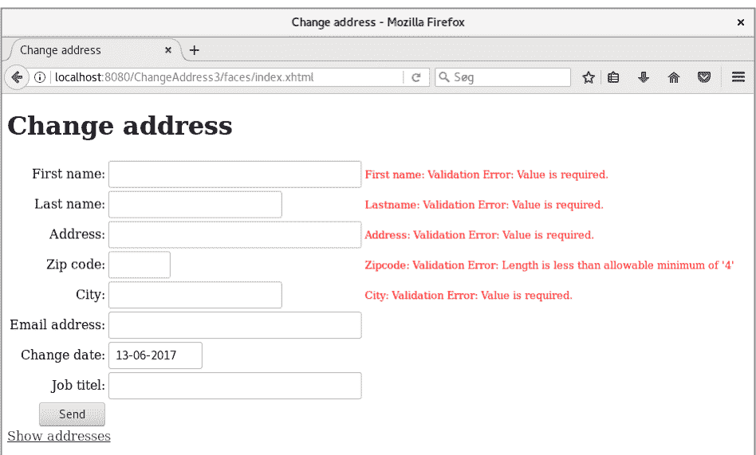

## 修改地址

- 名字（First名）：验证错误：此项必填。
- 姓氏：验证错误：此项必填。
- 地址：验证错误：此项必填。
- 邮编：验证错误：长度小于允许的最小值 `'4'`
- 城市：验证错误：此项必填。

SIMPLY CLEVER

ŠKODA


## 我们将把你的简历变成一生一次的机会

你喜欢汽车吗？你想成为成功品牌的一员吗？

我们将欣赏并奖励你的热情和才华。

向我们发送你的简历。你将对它能带你走向何方感到惊讶。

在 `www.employerforlife.com` 向我们发送你的简历

在 `bookboom.com` 下载免费电子版书

点击广告阅读更多信息

# JAVA 11：Web 应用程序与 Java EE：软件开发 JSF

一旦你输入了合法的地址，它就会被保存在列表中，并且字段会被清空，以便你输入另一个地址。如果你点击底部的链接，将请求一个页面，显示已输入地址的概览。结果例如：

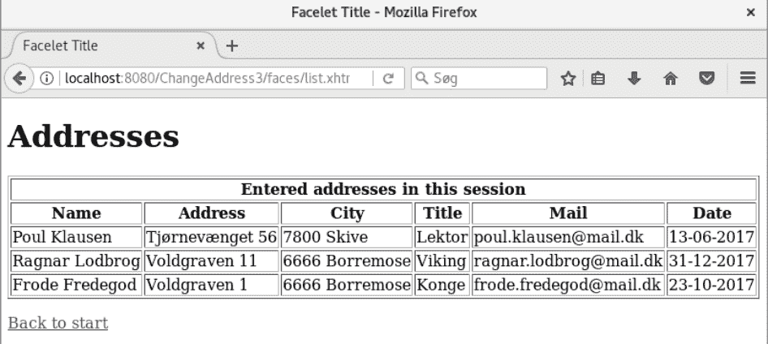

然后是代码。在 Source Packages（源包）下，创建了三个包：

1. `changeaddress.beans` 包含应用程序的 beans，其中有一个命名 bean（named bean）。
2. `changeaddress.models` 包含其他 Java 类，其中有一个类表示地址。
3. `changeaddress.validators` 包含用于验证用户界面字段的类，共有两个。

我想从代表地址的类开始。该类名为 `Person`，它是一个普通的模型类，实际上它是一个 Java bean：

```
package changeaddress.models;
public class Person implements java.io.Serializable
{
    private String firstName;
    private String lastName;
    private String address;
    private String code;
    private String city;
    private String email;
    private String title;
    private String date;
```

在 `bookboom.com` 下载免费电子版书

```
public Person()
{}
```

```
public Person(String firstname, String lastname, String address, String code,
String city, String email, String title, String date)
{
}
```

```
public boolean isLegal()
{
return firstname != null && firstname.length() > 0 && lastname != null &&
lastname.length() > 0 && date != null && date.length() > 0;
}
```

没什么需要解释的，我没有显示该类的 get 和 set 方法，因为它们都是显而易见的。你必须注意最后一个方法，该方法指出，如果对象有名字、姓氏和日期，则 `Person` 是合法的。该类的主要目的是为了 Web 应用程序可以像其他 Java 程序一样使用模型类，特别是在该类从 JSF 页面调用的这里。

作为下一个示例，我将展示一个 Validator（验证器）类，在这种情况下，它用于验证输入字段，这里字段的值必须是合法的日期：

```
package changeaddress.validators;
...

@Faces(value="dateValidator")
public class DateValidator implements Validator
{
@Override
public void validate(FacesContext facesContext, UIComponent uiComponent,
Object value) throws Validator
{
HtmlInputText inputText = (HtmlInputText) uiComponent;
String label = inputText.getLabel();
if (inputText == null || inputText.getLabel().trim().equals(""))
FacesMessage facesMessage =
new FacesMessage(label + ": Illegal value");
throw new ValidatorException(facesMessage);
}
}
```

```
private boolean isDate(String text)
{
```

没什么需要解释的，我没有显示该类的 get 和 set 方法，因为它们都是显而易见的。你必须注意最后一个方法，该方法指出，如果对象有名字、姓氏和日期，则 `Person` 是合法的。该类的主要目的是为了 Web 应用程序可以像其他 Java 程序一样使用模型类，特别是在该类从 JSF 页面调用的这里。

作为下一个示例，我将展示一个 Validator（验证器）类，在这种情况下，它用于验证输入字段，这里字段的值必须是合法的日期：

```
package changeaddress.validators;
...

@Faces(value="dateValidator")
public class DateValidator implements Validator
{
@Override
public void validate(FacesContext facesContext, UIComponent uiComponent,
Object value) throws Validator
{
HtmlInputText inputText = (HtmlInputText) uiComponent;
String label = inputText.getLabel();
if (inputText == null || inputText.getLabel().trim().equals(""))
FacesMessage facesMessage =
new FacesMessage(label + ": Illegal value");
throw new ValidatorException(facesMessage);
}
}
```

```
private boolean isDate(String text)
{
```


# JAVA 11：Web 应用程序与 Java EE：软件开发

### JSF


# 修改地址

- 名字：验证错误：此项必填。
- 姓氏：验证错误：此项必填。
- 地址：验证错误：此项必填。
- 邮编：验证错误：长度小于允许的最小值 '4'
- 城市：验证错误：此项必填。

SIMPLY CLEVER
ŠKODA


# 我们将把你的简历变成一生一次的机会

你喜欢汽车吗？你想成为成功品牌的一员吗？
我们将欣赏并奖励你的热情和才华。
向我们发送你的简历。你将对它能带你走向何方感到惊讶。

在 www.employerforlife.com 向我们发送你的简历

在 bookboom.com 下载免费电子版书

点击广告阅读更多信息

# JAVA 11：Web 应用程序与 Java EE：软件开发 JSF

一旦你输入了法的地址，它就会被保存在列表中，并且字段会被清空，以便你输入另一个地址。如果你点击底部的链接，将请求一个页面，显示已输入地址的概览。结果例如：


然后是代码。在 Source Packages（源包）下，创建了三个包：

- 1. `changeaddress.beans` 包含应用程序的 beans，其中有一个命名 bean（named bean）。
- 2. `changeaddress.models` 包含其他 Java 类，其中有一个类表示地址。
- 3. `changeaddress.validators` 包含用于验证用户界面字段的类，共有两个。

我想从代表地址的类开始。该类名为 `Person`，它是一个普通的模型类，实际上它是一个 Java bean：

```
package changeaddress.models;

public class Person implements java.io.Serializable
{
    private String firstName;
    private String lastName;
    private String address;
    private String code;
    private String city;
    private String email;
    private String title;
    private String date;
```

在 bookboom.com 下载免费电子版书

```
public Person()
{}
```

```
public Person(String firstname, String lastname, String address, String code,
String city, String email, String title, String date)
{
}
```

```
public boolean isLegal()
{
return firstname != null && firstname.length() > 0 && lastname != null &&
lastname.length() > 0 && date != null && date.length() > 0;
}
```

没什么需要解释的，我没有显示该类的 get 和 set 方法，因为它们都是显而易见的。你必须注意最后一个方法，该方法指出，如果对象有名字、姓氏和日期，则 `Person` 是合法的。该类的主要目的是为了 Web 应用程序可以像其他 Java 程序一样使用模型类，特别是在该类从 JSF 页面调用的这里。

作为下一个示例，我将展示一个 Validator（验证器）类，在这种情况下，它用于验证输入字段，这里字段的值必须是合法的日期：

```
package changeaddress.validators;
...

@Faces(value="dateValidator")
public class DateValidator implements Validator
{
@Override
public void validate(FacesContext facesContext, UIComponent uiComponent,
Object value) throws Validator
{
HtmlInputText inputText = (HtmlInputText) uiComponent;
String label = inputText.getLabel();
if (inputText == null || inputText.getLabel().trim().equals(""))
FacesMessage facesMessage =
new FacesMessage(label + ": Illegal value");
throw new ValidatorException(facesMessage);
}
}
}
```

```
private boolean isDate(String text)
{
```

（此处省略后续重复的截断片段）

# JAVA 11: Web应用程序与 JAVA EE: 软件开发


```xml
style="width: 60px" required="false"
value="#{indexController.code}"
<f:validateLength minimum="4" maximum="4"/>
<h:message for="code" class="error-message" />
<h:outputLabel value="City" for="city" />
<h:inputText id="city" label="City" required="true" style="width: 200px"
value="#{indexController.city}" />
<h:message for="city" class="error-message" />
<h:outputLabel value="Email address" for="email" />
<h:inputText id="email" label="Email address" required="false"
style="width: 300px" value="#{indexController.email}" />
<f:validator id="emailValidator"/>
</h:inputText>
<h:message for="email" class="error-message" />
<h:outputLabel value="Change date" for="date" />
<h:inputText id="date" label="Change date" required="true"
style="width: 100px" value="#{indexController.date}"
immediate="true" onchange="submit()"
<f:validator id="dateValidator"/>
</h:inputText>
<h:message for="date" class="error-message" />
<h:outputLabel value="Job title: " for="title" />
<h:inputText id="title" required="false" style="width: 300px"
```

我加入 MITAS 是因为我想要真正的责任感。

工程师与地质科学家研究生计划

www.discovermatis.com


第 16 个月

我在北海担任施工主管，负责建议并帮助工头解决问题。

真实工作

国际机会

三次工作实习

MAERSK

在 bookboom.com 免费下载电子书

点击广告阅读更多

# JAVA 11: Web应用程序与 JAVA EE: 软件开发

```xml
value="#{indexController.title}" />
<panelGroup>
<commandButton value="Send" action="#{indexController.add()}" />
</panelGroup>
<a href="list.xhtml">显示地址</a>
</form>
</body>
</html>
```

当你看到这些代码时，它们非常容易理解，但有些事情你需要注意。应用程序使用了位于目录下的样式表

`resources/css`

你应该知道如何在页头中引用此样式表。否则，表单主要由布局在 `h:panelGrid` 中的字段组成，它会被转换为 HTML 表格，其中每个字段占一行，并有三列。第一列是标签，第二列是输入字段，第三列可能存在错误消息。第一行用于姓名，定义如下：

```xml
<h:outputLabel value="First name:" for="firstname" />
<h:inputText id="firstname" label="first name" required="true"
style="width:300px" value="#{indexController.firstname}" />
<h:message for="firstname" class="error-message" />
```

第一个语句定义了标签，同时带有 `for` 属性的文本关联到了输入字段 `firstname` 上。当此字段具有 `label` 属性时，是因为它与错误消息配合使用。注意字段的值是如何绑定到 `indexController` 中的属性的。最后，最后一个语句用于错误消息的，你应该注意带有 `for` 属性的元素关联到了输入字段上。如果你考虑这个输入字段，它有一个属性

`required="true"`

这意味着验证器被关联到字段上，意味着必须输入姓名。如果没有，字段将显示错误消息。这是一个预定义验证器的示例。例如，如果你查看邮政码字段，它也有验证器来验证字段值的长度。这实际上是一个非常有用的验证器。如果你考虑输入字段 `date`，它使用了一个自定义验证器，Date 对象：

```xml
<h:inputText id="date" label="Change date"
required="true" style="width:100px"
value="#{indexController.date}" immediate="true" onchange="submit()"
<f:validator validatorId="dateValidator"/>
</h:inputText>
```

通常情况下，验证是在执行方法之前进行的。重要的是验证发生在服务端，并且向服务器发送了请求。如果所有字段未通过验证，则不执行执行方法，但会返回到 `index.xml` 并显示错误消息。你应该注意在这种情况下，输入具有两个属性：

```xml
immediate="true" onchange="submit()"
```

这意味着字段内容在失去焦点后立即进行验证，而不是在提交表单时。这个选项并不常用，因为你可以通过 ajax 做得更好。最后注意 `title` 字段，它没有验证器。

如前，示例中的组件使用 `panelGrid` 放置，这是一个 JSF 元素，会被转换为 HTML 表格。还有一个 `panelGroup` 元素用于收集多个项目作为表格中的单个单元格。这里有一个 `panelGroup`，意味着一个空单元格。点击上面的链接将显示一个包含输入地址概述的页面。这也是一个 JSF 页面（即 Facelet）`list.xhtml`：

```xml
<?xml version="1.0" encoding="UTF-8" ?>
<!DOCTYPE html PUBLIC "-DTD GlassFish Application Server 3.1 Servlet 3.0//EN" "http://glassfish.org/dtds/glassfish-web-app_3_0-1.dtd">
<html xmlns="http://www.w3.org/1999/xhtml" >
<head>
<meta http-equiv="Content-Type" content="text/html; charset=UTF-8"/>
<title>Facelet Title</title>
<h:outputStylesheet library="css" name="styles.css"/>
</head>
<body>
<h:form>
<h:messages global="{true}"
```

```xml
<facet>
<h:column id="nameCol">
  <facet name="header">Name</facet>
  <h:outputText id="name" value="${addr.firstname} ${addr.lastname}"/>
</h:column>
<h:column id="addrCol">
  <facet name="header">Address</facet>
  <h:outputText id="addr" value="${addr.address}"/>
</h:column>
<h:column id="cityCol">
  <facet name="header">City</facet>
  <h:outputText id="city" value="${addr.city}"/>
</h:column>
<h:column id="jobCol">
  <facet name="header">Title</facet>
  <h:outputText id="job" value="${addr.title}"/>
</h:column>
<h:column id="mailCol">
  <facet name="header">Mail</facet>
  <h:outputText id="mail" value="${addr.email}"/>
</h:column>
<h:column id="dateCol">
  <facet name="header">Date</facet>
  <h:outputText id="date" value="${addr.date}"/>
</h:column>
```


# 管理学硕士

因为实现梦想是你最大的挑战，IE 商务学院提供英语、西班牙语或双语教学的管理学硕士，通过一项创新且激励人心的计划，在职业生涯早期培养高性能人才，帮助他们发挥全部潜力。

- 选择你的专业领域。

- 通过不同的选项定制你的硕士学位。

- 在伦敦、硅谷或上海等地的全球沉浸周。

因为你的改变，我们随你一同改变。

www.ie.edu/master-management mim.admissions@ie.edu

在 bookboom.com 免费下载电子书

# JAVA 11: Web应用程序与 JAVA EE: 软件开发

```xml
</column>
</h:dataTable>
<p><a href="index.xhtml">回到开始</a></p>
</form>
</body>
</html>
```

该代码是一个动态构建表格的示例。你应该注意其语法以及该页面使用了与 `index.xhtml` 相同的命名 bean（同一个控制器）。特别是，你应该注意如何遍历 bean 对象列表中的所有对象。

然后应用程序就完成了，但还有一个待解决的问题。应用程序可能会错误地显示国家字符。问题在于，Glassfish 可能会使用错误的默认编码。如果你右键点击 `WEB-INF` 并选择新建，你就可以为服务器添加一个描述符：

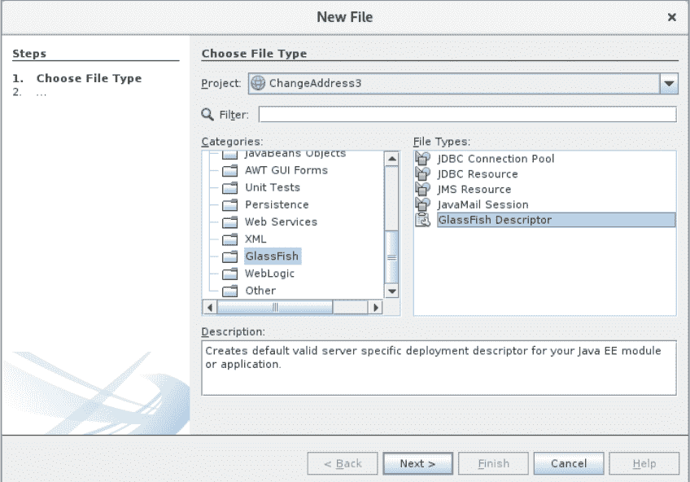

文件名为 `glassfish-web.xml`，内容必须为：

```xml
<?xml version="1.0" encoding="UTF-8"?>
```

JAVA 11：WEB应用程序与

JAVA EE：软件开发

```xml
<jboss-web-app error-url="">
  <class-loader delegate="true"/>
  <jsp-config>
    <property name="keepgenerated" value="true">
      <description> ... </description>
    </property>
  </jsp-config>
  <parameter-encoding default-charset="UTF-8" />
</jboss-web-app>
```

我在这里添加了蓝线。该应用程序已经完成。

### 6.2 页面导航

一个典型的 Web 应用包含许多页面（或视图），当用户在不同页面之间导航时，通常通过执行 `h:commandButton` 或 `h:commandLink` 元素的动作来工作。在这两种情况下，这意味着调用了一个命名的 Bean。对于大型应用程序，控制起来实际上非常复杂，特别是因为页面可能依赖于某个条件。由于这些原因，引入了一种特殊的描述文件，用于指定如何进行导航。示例 `ViewNavigation` 具有以下 `index.xhtml`：

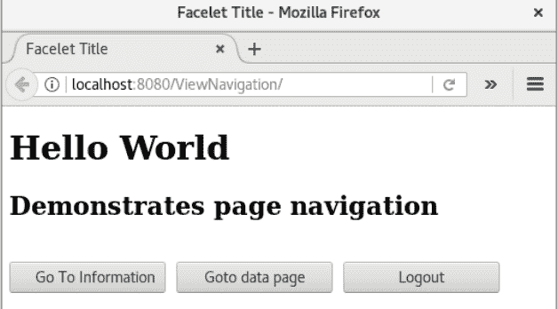

其中有三个按钮，每个按钮的类型均为 `h:commandButton` 且都有一个动作（action）。如果你点击第一个按钮，将看到下面的窗口，它是另一个视图（称为 `info.xhtml`）：

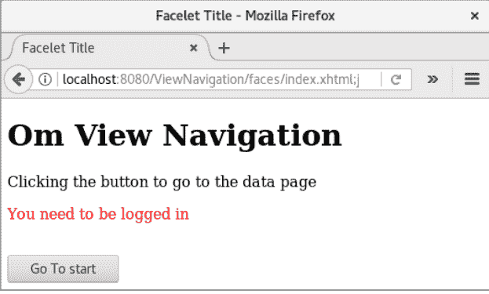

> “我学了16年英语，但是……我最终只用了六节课就学会了说它”

Jane，中国建筑师

英语世界很大

点击听听我在下载我独特课程前后的录音

在 bookboom.com 免费下载电子书

## JAVA 11：WEB应用程序与

JAVA EE：软件开发

JSF

并点击按钮，你将返回 `index.xhtml`。如果你点击起始屏幕上的中间按钮，你将看到下面的窗口：

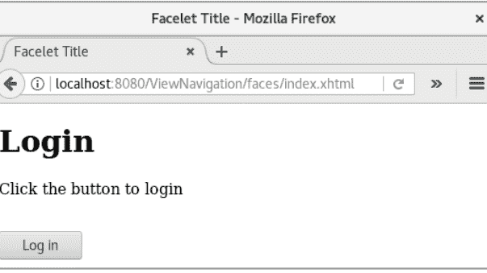

被称为 `login.xhtml`，点击按钮后你将来到 `data.xhtml` 窗口：

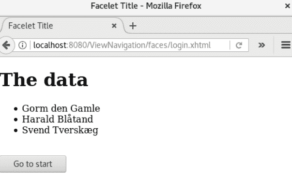

点击此按钮将返回起始页（`index.xhtml`）。如果你再次点击中间按钮，你将直接进入 `data.xhtml`，而无需经过 `login.xhtml`。起始页上的最后一个按钮用于注销，如果你点击它然后再点击中间按钮，你将必须去 `login.xhtml`。

为了控制这一行为，使用了一个名为 `NavigationController` 的命名的 Bean：

```java
package viewnavigation.beans;

import javax.inject.Named;
import javax.enterprise.context.SessionScoped;
import java.io.Serializable;
```

在 bookhoon.com 免费下载电子书

## JAVA 11：WEB应用程序与

JAVA EE：软件开发

```java
@Named(value = "navigationController")
@SessionScoped
public class NavigationController implements Serializable
{
    private boolean isLoggedIn = false;

    public NavigationController() {
    }

    public String toStart() {
        return "START";
    }

    public String toInfo() {
        return "INFO";
    }

    public String nextPage() {
        if (isLoggedIn) return "data"; else return "login";
    }

    public String login() {
        isLoggedIn = true;
        return "LOGIN";
    }

    public void logout() {
        isLoggedIn = false;
    }
}
```

## JAVA 11：WEB应用程序与

JAVA EE：软件开发 JSF

它定义了返回字符串并可以作为动作调用的方法。该类有一个变量来模拟用户是否登录。导航有两种类型。第一种被称为**显式导航**（explicit navigation），动作方法引用字符串（键），该键指向 `faces-config.xml` 配置文件，然后指示应该显示哪个视图。另一种被称为**隐式导航**（implicit navigation），动作方法返回当前视图的名称（但不带扩展名）。例如，考虑 `toStart()` 和 `toInfo()` 方法，它们使用 `faces-config.xml` 返回字符串，是显式导航的示例。另一个例子是 `nextPage()` 是隐式导航的示例，因为它简单地返回视图的名称（取决于某个条件）。还要注意最后两个方法，第一个也用作显式导航的动作方法，但它首先修改了 `login` 变量以模拟用户已登录。最后一个实际上是一个动作方法，但它不返回任何，这意味着没有跳转到另一个视图。

然后是配置文件（添加到 WEB-INF 中）：

```xml
<?xml version='1.0' encoding='UTF-8'?><faces-config version="2.2" ...>
<navigation-rule>
<from-view-id>index.xhtml</from-view-id>
```


在 bookoon.com 免费下载电子书


```xml
<navigation-case>
<from-outcome>INFO</from-outcome>
<to-view-id>info.xhtml</to-view-id>
</navigation-case>
</navigation-rule>
<navigation-rule>
<from-view-id>info.xhtml</from-view-id>
<navigation-case>
<from-outcome>START</from-outcome>
<to-view-id>index.xhtml</to-view-id>
</navigation-case>
</navigation-rule>
<navigation-rule>
<from-view-id>login.xhtml</from-view-id>
<navigation-case>
<from-outcome>LOGIN</from-outcome>
<to-view-id>data.xhtml</to-view-id>
</navigation-case>
</navigation-rule>
</faces-config>
```

在这种情况下，定义了三个导航规则。第一条的解释如下：如果你从`index.xhtml`过来（动作已执行），有一个单一的导航案例说如果值（键）是`INFO`，你必须导航到`info.xhtml`页面。你应该注意，一个导航规则可以有（多个）`navigation-case`条目。

通过使用`faces-config.xml`文件，你可以完全控制 Web 应用中各个视图之间的导航方式，但这意味着一个非常大的文件，你需要编写大量内容。因此，引入了隐式导航的概念，它不使用配置文件。

以下是`index.xhtml`的代码：

```xml
<?xml version="1.0" encoding="UTF-8" ?>
<!DOCTYPE html PUBLIC "-//W3C//DTD HTML 1.0 Transitional//EN" >
<html xmlns="http://www.w3.org/1999/xhtml"
xmlns:h="http://xmlns.jcp.org/jsf/html">
<head>
<title>Facetlet Title</title>
</head>
<body>
<h:form id="form">
<h1>Hello World</h1>
<h2>演示页面导航</h2>
<br/>
<h:commandButton style="width: 150px" action="#{navigation.toInfo}"
value="跳转到信息/&nbsp;"/>
<h:commandButton style="width: 150px" action="#{navigation.nextPage}"
value="跳转到数据页/&nbsp;"/>
<h:commandButton style="width: 150px" action="#{navigation.logout}"
value="注销"/>
</h:form>
</body>
</html>
```

这里没什么好解释的，但你应该注意有三个命令。第一个总是跳转到`info.xhtml`（通过显式导航）。另一个通过隐式导航的帮助跳转到`login.xhtml`或`data.xhtml`。最后一个不会产生跳转，因为`logout()`没有返回任何值。最后，我想显示`data.xhtml`：

```xml
<?xml version='1.0' encoding='UTF-8' ?>
<!DOCTYPE html PUBLIC "-//W3C//DTD HTML 1.0 Transitional//EN" >
<html xmlns="http://www.w3.org/1999/xhtml" xmlns:h="http://xmlns.jcp.org/jsf/html">
<head>
<title>Facetlet Title</title>
</head>
<body>
<form>
<h1>数据</h1>
<ul>
<li>Gorm den Gamle</li>
<li>Harald Blåtånd</li>
<li>Svend Tverskøg</li>
</ul>
<br/>
<h:commandButton action="index" value="返回起始页"/>
</form>
</body>
</html>
```

你应该注意这里使用了隐式导航，但不是调用方法，而是直接将视图名称列为`action`属性的参数。

## JAVA 11：WEB应用程序与 JAVA EE：软件开发 JSF

### 问题 2

在这个任务中，你必须为一个简单的留言板编写 Web 应用，类似于练习2。程序基本上应该打开相同的表单，但与练习2不同，数据必须存储在数据库中。首先创建一个名为`guestbook`的数据库。该数据库应该只有一个表，可以使用以下脚本创建：

```sql
use guestbook;
drop table if exists guests;

create table guests
(
id int auto_increment primary key,
name varchar(100) not null,
addr varchar(100) not null,
code char(4) not null,
mail varchar(100),
text text not null,
date date
);
```

在写入留言板时会自动分配日期。


程序必须使用 Java Faces 编写。除了写入访客簿的表单外，还必须有一个 JSF 页面，主页链接到该页面显示访客簿的内容。

### 6.3 模板

如所述，Web应用程序在实践中由许多页面或视图组成，通常它们之间彼此相似并且具有共同的设计。此外，可以使用模板，下面的应用程序展示了如何使用模板。具体而言，我将逐步展示应用程序的开发过程，包括如何使用模板。该示例还展示了关于 Web 开发的许多细节，特别是使用组件的能力，组件是可以在多个视图中使用的代码。此外，示例还展示了如何应用图像。该应用程序名为 PaWeb，它将展示一个非常简单的个人网站，某个人（以及作者）希望通过公共网站分享私人信息。

该应用程序的创建方式与本章中的所有 Web应用程序一样，创建了一个 Facelet 文件`index.xml`，作为应用程序的启动器。请注意，在创建应用程序后，除了`index.xml`之外还创建了描述符`web.xml`，基本上说明这是一个 JSF 应用程序。我编辑了`index.xml`，以下是完成的代码显示了一个欢迎页：

```xml
<?xml version='1.0' encoding='UTF-8' ?>
<!DOCTYPE html PUBLIC "//W3C//DTD XHTML 1.0 Transitional//EN"> <html xmlns="http://www.w3.org/1999/xhtml" xmlns="http://xmlns.jcp.org/jsf/">
<head>
<title>Facelet Title</title>
</head>
<body style="color: darkblue; background: bisque">
<form>
<div style="font-size: 144pt; font-weight: bold; text-align: center">Welcome</div>
<div style="font-size: 72pt; text-align: center">to my website</div>
<div style="font-size: 36pt; text-align: center">关于我生活中点滴事的网站</>
<p style="text-align: center"><h:commandLink value="听起来很有趣，请在此继续阅读" action="gallery/
```

没有什么需要解释的，但你应该注意，代码是复杂的 HTML 元素和如下所示 JSF 元素的混合：

```
<h:code ...>...</h:code>
```

JSF 元素是服务器端代码，因此是由服务器翻译为 HTML 并作为服务器响应一部分的元素。有许多这样的 JSF 元素，混合 JSF 元素和 HTML 元素并没有问题。同样请注意，上面的 JSF 视图定义了样式。样式将在下一书中处理，但当你看到上面的代码时，很容易解释每个视图使用了什么。注意，使用此类视图可以定义非常大的字体。该视图是一个表单，因为它包含单个元素，该元素包含一个`commandLink`，该链接会被服务器翻译成一个普通的链接元素。该项目有一个`action`属性，如果你点击链接，则视图应该显示名为`gallery.xhtml`的视图。虽然此视图尚未创建，但应用程序可以很容易地被翻译并在浏览器中打开。

然后我将展示如何定义一个模板来为视图定义整体设计。在 NetBeans 中，右键点击 Web Pages 并选择 Facets Template。

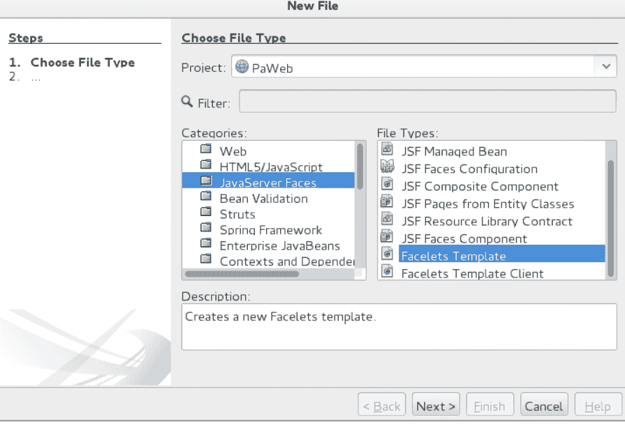

当你点击 OK 时，将进入以下窗口：

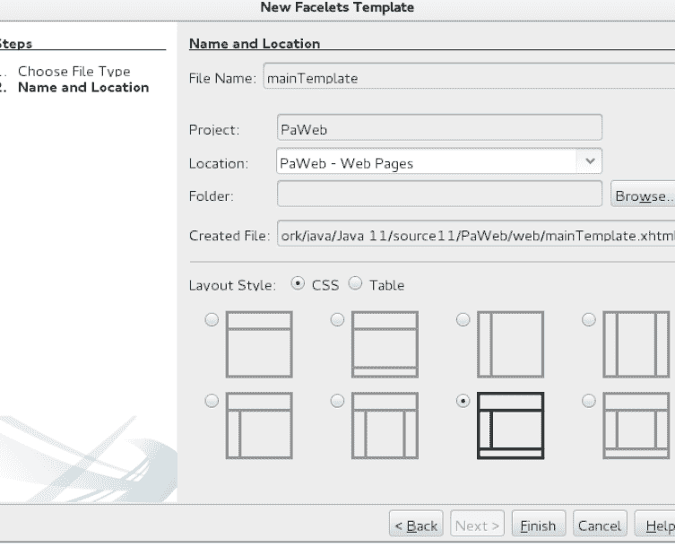


关于 e-Learning for Kids。e-Learning for Kids 成立于 2004 年，是一个全球非营利基金会，致力于为 5-12 岁的儿童提供互联网上有趣且免费的学习，课程涵盖数学、科学、语言、艺术、计算机、健康和环境技能。自2005 年以来，来自190 多个国家的 1500 万名儿童受益于 LI KI 开发的在线课程。全志愿者员工由来自世界各地的教育和在线学习专家以及业务专业人士组成，致力于让当地儿童都能获得易于获取且参与性的教育。更多信息请访问 www.e-learningforkids.org。

- 小学教育第 1 MOOC
- 为 5-12 岁儿童提供的免费数字学习
- 1500 万儿童受益

在这里你必须选择一个名称并指向设计。我输入了名称`mainTemplate`并选择了一个将视图分为四个部分（顶部、左侧、底部和中心）的设计。当你点击 Finish 时，NetBeans 创建了一个 JSF 页面：

`mainTemplate.xhtml`

此外，还创建了一个目录

`resources/css`

并包含两个样式表。如名称所示，`resources`是一个存放资源的目录，例如样式表，但它也可以包含脚本代码或图像。如果你检查`mainTemplate.xhtml`，其代码如下：

```xml
<?xml version='1.0' encoding='UTF-8' ?>
<!DOCTYPE html PUBLIC "//W3C//DTD XHTML 1.0 Transitional//EN"> <html xmlns="http://www.w3.org/1999/xhtml"
xmlns:ui="http://xmlns.jsp.com/jsf/facets"
xmlns:h="http://xmlns.jsp.com/jsf/html">
<head>
<meta http-equiv='Content-Type' content='text/html; charset=UTF-8' />
<h:outputStylesheet name="/css/default.css" />
<h:outputStylesheet name="/css/cssLayout.css" />
<title>Facelets Template</title>
</head>
<body>
<div id="top">
<ui:insert name="top"></ui:insert>
</div>
<div id="left">
<ui:insert name="left">/Left</ui:insert>
</div>
<div id="content" class="left_content">
<ui:insert name="content">/Content</ui:insert>
</div>
<div id="bottom">
<ui:insert name="bottom">/Bottom</ui:insert>
</div>
</body>
</html>
```

你必须注意，一个章节被定义为`ui:insert`元素，在默认情况下，会插入一段文本，而使用模板的 Facelets 将用这段文本替换为自己的内容。事实上，这是一个可以打开的 JSF 视图，在页头中，如果你打开它，结果如下所示。这并不重要，模板并不是为了一个真实值，而是作为其他视图可以应用的设计。从上面的代码可以看出，页头中引用样式表的两行代码需要更改：

```
<head>
<meta http-equiv="Content-Type" content="text/html; charset=UTF-8" />
<h:outputStylesheet library="css" name="default.css" />
<h:outputStylesheet library="css" name="cssLayout.css" />
<title>Facelets Template</title>
</head>
```

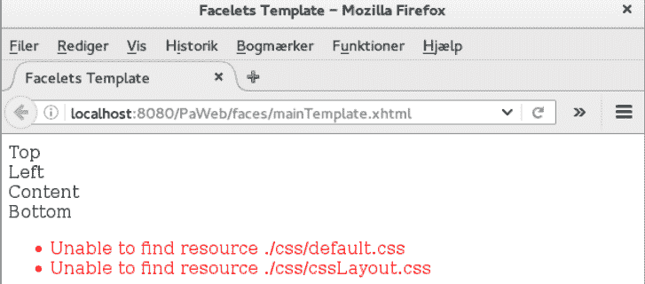

如果你随后打开该页面，结果为：

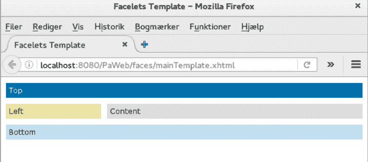

这就是模板现在使用的两个样式表，它们随后可以被使用该模板的所有视图使用。我不在这里向你展示这两个样式表，但鼓励你检查这两个文件的内容，通过与上面的窗口对比你可以很容易解释内容。

现在将为应用程序添加另一个名为`gallery.xhtml`的视图，但它应该作为 Facelet Template Client 创建：


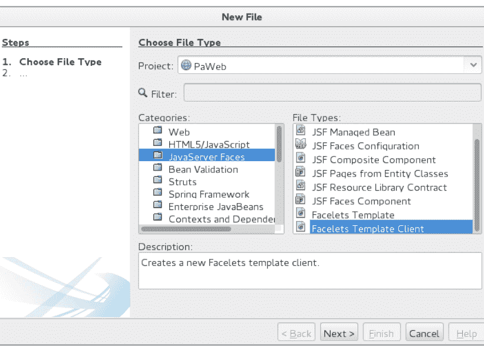

当你点击 *Next* 时，将进入以下窗口，在其中你输入名称并选择要使用的模板：

此外，你可以选择此视图中模板的哪些部分用于插入代码。结果如下：

```xml
<?xml version="1.0" encoding="UTF-8" ?>
<!DOCTYPE html PUBLIC "-//W3C//DTD HTML 1.0 Transitional//EN">
<html xmlns:ui="http://www.w3.org/1999/xhtml"
xmlns:ui="http://xmlns.jcp.org/jsf/facelets">
<body>
  <ui:composition template="/mainTemplate.xhtml">
    <ui:define name="top">
top
    </ui:define>
    <ui:define name="content">
content
    </ui:define>
  </ui:composition>
</body>
</html>
```

你应该注意，这是一个 JSF 页面，因此是一个视图，但它使用了模板并在顶部和中间插入了代码。如果你运行应用程序，打开首页（`index.xhtml`）并点击链接，将打开视图`gallery.xhtml`，它将显示如上所示窗口。

现在的任务是在四个区域中获取更有意义的内容。我将从模板开始。首先，我创建了一个名为`resources`的子目录，并拷贝了一张名为`thg.jpg`的图片。在这里，我将`Template.xhtml`修改为：

```xml
<?xml version="1.0" encoding="UTF-8" ?>
<!DOCTYPE html PUBLIC "-//W3C//DTD HTML 1.0 Transitional//EN">
<html xmlns:ui="http://www.w3.org/1999/xhtml">
<head>
  <meta http-equiv="Content-Type" content="text/html; charset=UTF-8" />
  <ui:outputStylesheet library="css" name="default.css" />
  <ui:outputStylesheet library="css" name="cssLayout.css" />
  <title>Facelets Template</title>
</head>
<body>
  <div id="top">
    <ui:insert name="top">
      <h1>Poul's Website</h1>
    </ui:insert>
  </div>
  <div>
```


```xml
<div id="left">
<ui:insert name="left">
<h:form>
  <h:commandLink value="My cars" action="mycars" /><br/>
  <h:commandLink value="My gallery" action="gallery" /><br/>
</h:form>
</ui:insert>
</div>
```

```xml
<div id="content" class="left_content">
<ui:insert name="content">Content</ui:insert>
</div>
```

```xml
<div id="bottom">
<ui:insert name="bottom">
  <ui:graphicImage library="images" style="width: 100%" name="thy.jpg"/>
</ui:insert>
</div>

<h:body>
</html>
```

也就是说，我已经在四个区域中的三个中插入了代码。如果你打开应用程序并点击首页上的链接，你将得到以下结果（即 `gallery.xhtml`）：


# Java 11：Web 应用与 Java EE：软件开发

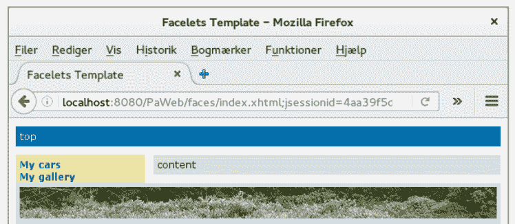

左侧区域有一个表单，包含包含 `commandLink` 元素的菜单。第一个链接指向视图本身，而其他链接指向一个尚未创建的视图。你应该注意底部以及如何插入图片。特别注意如何对图片设置样式以填充整个窗口。最后，顶部只包含一个 `h1` 元素，但显然它没有被使用。原因是顶部被 `gallery.xhtml` 覆盖了，该视图在顶部区域插入了默认内容，从而覆盖了来自模板的结果。

下一个任务是使 `gallery.xhtml` 视图变得完整。内容必须是一个指向图片链接的列表，你可以点击链接查看图片。该视图与其他视图一样有一个控制器，但首先我想定义一个可以表示图片的类：

```java
package paweb.models;

public class Data
{
    private String name;
    private String text;

    public Data(String name, String text)
    {
        this.name = name;
        this.text = text;
    }

    public String getName()
    {
        return name;
    }
```

# Java 11：Web 应用与 Java EE：软件开发

```java
public String getText()
{
    return text;
}
```

该类位于 `paweb.models` 包中。这是一个非常简单的模型类和一个普通的 Java 类。`text` 是显示在屏幕上的值，而 `name` 是该类应该代表的图片名称（或其他内容）。在实践中，图片可能关联有更多属性，为了说明这一点，我定义了以下派生类：

```java
package paweb.models;

public class Photo extends Data
{
    public Photo(String name, String text)
    {
        super(name, text);
    }

    public String toString()
    {
        return getText();
    }
}
```

然后，我为画廊视图写了一个控制器类：

```java
package paweb.beans;

import java.util.*;
import javax.inject.Named;
import javax.enterprise.context.SessionScoped;
import java.io.Serializable;

import paweb.models.*;

@Named(value = "galleryController")
@SessionScoped
public class GalleryController implements Serializable
{
    private List<Photo> photos = new ArrayList<>();
}
```

```java
public GalleryController()
{
    photos.add(new Photo("lion", "Lion, a mail"));
    photos.add(new Photo("cheetah", "Cheetah, maybe three siblings"));
    photos.add(new Photo("leopard", "Leopard with a kill"));
}
```

```java
public List<Photo> getPhotos()
{
    return photos;
}
```

这是一个带有单一属性（`Photo` 对象的列表）的简单控制器。然后我修改了 `gallery.xhtml`，使其在中间区域插入代码：

```xml
<?xml version='1.0' encoding='UTF-8' ?>
<!DOCTYPE html PUBLIC "-//W3C//DTD XHTML 1.0 Transitional//EN" ... <html xmlns="http://www.w3.org/1999/xhtml" xmlns:ui="http://xmlns.jcp.org/jsf/facelets" xmlns:f="http://xmlns.jcp.org/jsf/core" xmlns:h="http://xmlns.jcp.org/jsf/html">
```


# Java 11：Web 应用与 Java EE：软件开发 JSF

```xml
<body>
<ui:composition template="mainTemplate.xhtml">
  <ui:define name="top">
top
  </ui:define>
  <ui:define name="content">
    <h:form>
      <h:facet name="header">Some pictures</h:facet>
      <h:dataTable value="#{galleryController.photos}" var="img">
        <h:column>
          <h:commandLink value="#{img.text}" action="photoview">
            <f:param name="imagename" value="#{img.name}" />
          </h:commandLink>
        </h:column>
      </h:dataTable>
    </h:form>
  </ui:define>
</ui:composition>
</body>
</html>
```

## Java 11：Web 应用与 Java EE：软件开发

### JSF

### 新的 JSF 组合组件

| 步骤 |  |
|---|---|
| 1. 命名与位置 | 文件名：`search` |
| 项目：`PaWeb` | 位置：`PaWeb - Web 页面` |
| 文件夹：`resources/ezcomp` | 浏览 |
| 创建的文件：`src/java/Java 11/source11/PaWeb/web/ezcomp/search.xhtml` |  |
| 前缀： |  |
| 实现部分： |  |

在这里，我输入了名称（在本例中为 `search`）以及组件放置的位置。NetBeans 建议使用 `resources/ezcomp`，并建议保留此名称。当你点击 `Finish`（完成）时，NetBeans 会创建一个名为 `search.xhtml` 文件。


赋能人才。改进业务。挪威 BI 商学院是欧洲最大的商学院之一，欢迎超过 20,000 名学生。我们的课程提供了一个充满活力且多元文化的学习环境，具有国际视野，提供满足企业日益增长需求的专业技能。BI 提供了四个为期两年的英语教学科学硕士（MSc）课程，这些课程旨在提供满足企业增长增长的专业技能。硕士课程提供了一个充满活力且多元文化的学习环境，为你为你开启职业生涯提供最佳平台。

- 商业管理硕士
- 金融经济学硕士
- 战略营销管理硕士
- 领导力与组织心理学硕士

[www.bi.edu/master](http://www.bi.edu/master)

在 `ebook.com` 下载免费电子书。

# Java 11：Web 应用与 Java EE：软件开发 JSF

```xml
<?xml version='1.0' encoding='UTF-8' ?>
<!DOCTYPE html PUBLIC "-//W3C//DTD HTML 1.0 Transitional/EN"> ...
<html xmlns="http://www.w3.org/1999/xhtml"
xmlns:cc="http://xmlns.jcp.org/jsf/composite">
<!-- 接口部分 ---
<cc:interface>
</cc:interface>
<!-- 实现部分 ---
<cc:implementation>
</cc:implementation>
</html
```

这只是一个简单的骨架，其中接口部分必须定义组件的属性，而在实现部分，有必要定义由浏览器渲染的代码。完成后的组件所示：

```xml
<?xml version='1.0' encoding='UTF-8' ?>
<!DOCTYPE html PUBLIC "-//W3C//DTD HTML 1.0 Transitional/EN">
<html xmlns="http://www.w3.org/1999/xhtml"
xmlns:h="http://xmlns.jcp.org/jsf/html"
xmlns:f="http://xmlns.jcp.org/jsf/core"
xmlns:cc="http://xmlns.jcp.org/jsf/composite">
<cc:interface>
<cc:attribute name="searchList"/>
<cc:attribute name="searchAction"
default="#{searchController.searchData(cc.attrs.searchList)}"
method-signature="java.lang.String action(java.util.List)" />
</cc:interface>
<cc:implementation>
<h:form id="searchForm">
<h:outputText id="error" value="#{searchController.errorText}"/>
<h:inputText id="searchText" class="searchBox" style="width: 200px"
value="#{searchController.searchText}" />
<h:commandButton id="searchButton" value="Search"
action="#{cc.attrs.searchAction}" />
<h:commandLink value="#{searchController.foundText}" action="photoview">
<f:param name="imagename" value="#{searchController.imageText}.jpg" />
</h:commandLink>
</h:form>
</cc:implementation>
</html
```

在 `bookbom.com` 下载免费电子书。

# Java 11：Web 应用与 Java EE：软件开发

注意，首先我添加了两个关于 JSF 元素的默认命名空间。然后定义了两个属性，第一个属性 `searchList`。另一个名为 `searchAction` 并定义了一个方法。它有一个默认值，该方法是在命名为 `SearchController` 的 Bean 中定义的，并将 `searchList` 属性的值作为参数传递。此外，还定义了方法签名，作为一个返回 `String` 并带有 `List` 参数的方法。实现部分以一个 `OutputStream` 开始，用于来自 `searchController` 的错误消息（如果你正在查找不存在的内容）。接下来，是一个 `inputText`，用户可以在其中输入搜索文本，随后是一个 `commandButton`，其动作是接口部分定义的方法。最后，是一个 `commandLink`，其值绑定到 `searchController` 中的一个属性，其动作是 `photoview.xhtml`。此链接定义了一个参数，该参数也绑定到 `searchController` 中的一个属性。

可见，该组件使用了一个命名 Bean：

```java
package paweeb.beans;

import java.util.*;
import javax.inject.Named;
import javax.enterprise.context.SessionScoped;
import java.io.Serializable;

import paweeb.models.*;

@Named(value = "searchController")
@SessionScoped
public class SearchController implements Serializable {

    private String searchText;
    private String errorText;
    private String imageText;
    private String foundText;

    public SearchController() {
}

    public void searchData(List<Data> list) {
        errorText = "";
        for (Data data : list) {
            if (data.get().toLowerCase().contains(searchText.toLowerCase())) {
                imageText = data.getName();
                foundText = data.getText();
                return;
            }
        }
        imageText = "";
        foundText = "";
        setErrorText("Not found");
    }
```

```java
public String getSearchText(){
    return searchText;
}
```

```java
public void setSearchText(String searchText){
    this.searchText = searchText;
}
```

```java
public String getErrorText(){
    return errorText;
}
```


```java
public void setErrorText(String errorText)
{
    this.errorText = errorText;
}
```

```java
public String getImageText()
{
    return imageText;
}
```

```java
public String getFoundText()
{
    return foundText;
}
```

它定义了四个属性：

1. `searchText`：用于搜索的
2. `errorText`：在未找到时的错误消息
3. `imageText`：找到的文本
4. `foundText`：找到的名称

否则，组件就告完成。在组件完成后，必须在 `search.xhtml` 中使用：


```xml
<?xml version='1.0' encoding='UTF-8' ?>
<!DOCTYPE html PUBLIC "-W3C//DTD HTML 1.0 Transitional/EN">
<html xmlns="http://www.w3.org/1999/xhtml"
xmlns:ui="http://xmlns.jcp.org/jsf/facelets"
xmlns:f="http://xmlns.jcp.org/jsf/core"
xmlns:h="http://xmlns.jcp.org/jsf/html"
xmlns:ez="http://xmlns.jcp.org/jsf/composite">
<body>
<ui:composition template="../mainTemplate.xhtml">
<ui:define name="top">
<h2>我们的网站</h2>
<ez:search id="searchGallery" listBox="#{gallerycontroller.photos}"/>
</ui:define>
</ui:composition>
</body>
</html>
```

# JAVA 11：WEB 应用与 JAVA EE：软件开发

```xml
<ui:define name="content">
  <form>
    <html>来自非洲的一些图片/</html>
    <h:dataTable value="#{galleryController.photos}" var="img">
      <f:facet name="header">照片</f:facet>
      <h:column>
        <h:commandLink value="#{img.text}" action="photoview">
          <f:param name="imagename" value="#{img.name}.jpg" />
        </h:commandLink>
      </h:column>
    </h:dataTable>
  </form>
</ui:define>
```

在这里你应该注意如何使用该组件，特别是如何通过组件接口部分定义的属性来指定要搜索的列表。

然后应用程序的第一部分完成了，我必须实现与左侧第一个菜单项目对应的部分。它在原理上是上述内容的重复，但进行了以下处理。

我创建了一个与 `Photo:` 完全相同的模型类：

```java
package paweb.models;

public class Car extends Data {
  public Car(String name, String text) {
    super(name, text);
  }

  public String toString() {
    return getText();
  }
}
```

这个类的存在没有理由，包含它是为了说明在实际中，该类的内容会与 `Photo.` 不同。

## JAVA 11：WEB 应用与 JAVA EE：软件开发

添加了一个 `CarController` 类，它对应这里的代码 `GalleryController`，这两个类基本上相同，因此我不想在这里显示代码。还添加了 Facelet `carview.xhtml`，它与 `photview.xhtml` 几乎完全相同。然后是 Facelet `ncars.xhtml`，但在查看它之前，我将对代码组件进行一些细小的更改：

```xml
<?xml version='1.0' encoding='UTF-8' ?>
<!DOCTYPE html PUBLIC "-//W3C//DTD HTML 1.0 Transitional//EN" > ... >
<html xmlns="http://www.w3.org/1999/xhtml" > ... >
<cc:interface>
  <cc:attribute name="searchList"/>
  <cc:attribute name="action"
    default="#{searchController.searchData(cc.attrs.searchList)}"
    method-signature="java.lang.String(java.util.List)"/>
  <cc:attribute name="viewer"/>
    default="#{searchController.show(cc.attrs.viewer)}"
    method-signature="java.lang.String(java.lang.String)"/>
</cc:interface>
<cc:implementation>
  <h:form id="searchForm">
    <h:outputText id="error" value="#{searchController.errorText}"/>
    <br/>
    <h:inputText id="searchText" styleClass="searchBox" style="width: 200px"/>
  </h:form>
```

# 大脑力量

2020年，风能可以提供我们地球电力需求的十分之一。目前，SKF 的创新知识对于运行世界上大部分风力涡轮机至关重要。发电成本的一半与维护有关。得益于我们的在线状态监控和自动润滑系统，这些成本可以大幅降低。我们从虚空中创造出更廉价的清洁能源。

通过分享我们的经验、专业知识和创造力，行业可以获得超出预期的性能。如果没有能够迎接挑战的最优秀员工！


知识工程的力量

访问我们的网站 www.skf.com/knowledge

知识工程的力量

SKF

从 bookoon.com 免费下载电子书

## JAVA 11：WEB 应用与 JAVA EE：软件开发 JSF

```xml
value="#{searchController.searchText}"
<h:commandButton id="searchButton" value="Search"
action="#{cc.attrs.searchAction}" />
<h:commandLink value="#{searchController.foundText}"
action="#{cc.attrs.showAction}">
<f:param name="imagen" value="#{searchController.searchText}.jpg" />
</h:commandLink>
</h:form>
</cc:implementation>
</html
```

我扩展了两个新属性，其中一个指向 `SearchController` 中的一个方法。目标是对点击链接时要执行的操作进行参数化。`SearchController` 中的方法：

```java
public String show(String name)
{
return name;
}
```

在此更改之后，必须更新 `gallery.xhtml` 视图以初始化组件的属性。最后，`cars.xhtml` 可以写写如下：

```xml
<?xml version='1.0' encoding='UTF-8' ?>
<!DOCTYPE html PUBLIC "//W3C//DTD HTML 1.0 Transitional//EN" > ...
<html xmlns:ui="http://www.w3.org/1999/xhtml"
xmlns:f="http://xmlns.j.org/jsf/core"
xmlns:h="http://xmlns.j.org/jsf/html"
xmlns:ez="http://xmlns.j.org/jsf/composite/ezcomp">
<body><body>
<ui:composition template="./mainTemplate.xhtml">
<ui:define name="top">
<h:h2>Pouls website</h:h2>
<ez:search id="searchGallery" searchList="#{carController.cars}" 
viewer="carview"/>
</ui:define>
<ui:define name="content">
<h:form>
<html
<h:h1>That is my cars!</h:h1>
<p>The following ...</p>
<table>
<ui:repeat var="car" value="#{carController.cars}">
<tr>
<td>
<h:commandLink value="#{car.text}" action="carview">
```

```xml
<f:param name="imagename" value="#{car.name}.jpg" />
</h:commandLink>
</td>
<tr>
<ui:repeat>
<table>
<!-- (Missing tags in source) -->
</ui:repeat>
</table>
</h:form>
</ui:define>
</ui:composition>
</body>
</html>
```

注意，使用了另一个循环。这没有特别的原因，此外，如果你想处理表格的构建方式，例如样式。

最后，目录资源图像更新了三张图片，并执行了应用程序，如果你选择左侧菜单的“My cars”（我的汽车），你将看到窗口：

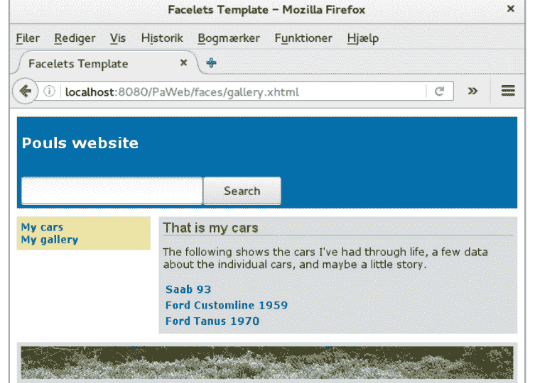

在 bookboom.com 免费下载电子书

### 6.4 主题

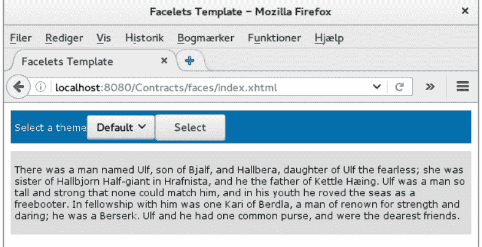


在 bookhoon.com 免费下载电子书

## JAVA 11：WEB 应用与 JAVA EE：软件开发

如果你有一个 Web 应用程序，可以应用主题，应用程序的视图将根据所选的主题进行渲染。例如，应用程序的外观可能会根据登录的用户而有所不同。主题基于模板，我将在本节中展示如何打开 Contracts 应用程序，你会得到窗口。那是一个带有文本的简单窗口。如果你在下拉列表中选择深色主题（dark theme）并点击，窗口将变为：

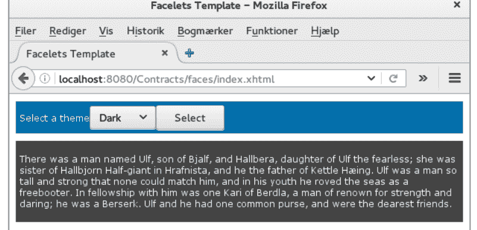

起点是一个名为 Contracts 的普通 JSF 应用程序。此外，我添加了资源库（Resource Library）：


从 bookhoon.com 免费下载电子书

## JAVA 11：WEB 应用与 JAVA EE：软件开发

并且当点击 Next 时，我分配了一个名称（default）并选择了一个模板（见下文）。NetBeans 创建了 `contracts/default` 目录和模板（两个样式表）。我随后重复了它并创建了另一个资源库，但这次是 dark（深色）。否则，没有区别。


## JAVA 11：与 JAVA EE：软件开发

在你创建 contracts 之后，项目的内容如下，其中还有：


在 bookhoon 免费下载电子书

## JAVA 11：WEB 应用与 JAVA EE：软件开发

在这里你应该注意它被 `fview` 元素包围，由 bean 对象决定使用哪种主题。否则，其余部分只是插入到模板定义的两个部分中。

```xml
<?xml version='1.0' encoding='UTF-8' ?>
<!DOCTYPE html PUBLIC "-//W3C//DTD HTML 1.0 Transitional//EN" > ...
<html>
<h:h1>That is my cars!</h:h1>
<p>The following ...</p>
<table>
<ui:repeat var="car" value="#{carController.cars}">
<tr>
<td>
<h:commandLink value="#{car.text}" action="carview">
```

```xml
<f:param name="imagename" value="#{car.name}.jpg" />
</h:commandLink>
</td>
<tr>
<ui:repeat>
<table>
<!-- (Missing tags in source) -->
</ui:repeat>
</table>
</h:form>
</ui:define>
</body>
</html>
```

（注：OCR 文本在中间包含了大量的重叠和碎片代码。我根据提供的文本片段合并了逻辑流，同时修复了明显的语法伪迹，例如将 `h:1>` 修复为 `<h:1>`，将 `h:2>` 修复为 `<h:2>`。由于 172-175 页的 OCR 文本非常重复且乱码。我将提供提供文本的最干净的版本。*纠正：用户要求我处理 OCR 文本。文本重复了。我将根据提供的文本块输出干净的版本。*）

### 问题 3

在这一项任务中，你必须编写一个能够打开简单欢迎页面的 Web 应用程序：


本电子书由 SetaPDF 制作

SETASIGN

面向 PHP 开发人员的 PDF 组件 www.setasign.com

在 bookboom.com 免费下载电子书 点击广告阅读更多

# JAVA 11：Web 应用程序与 JAVA EE：软件开发

内容本身并不重要，但必须有一个指向下方表单的链接。它应该描述一个想要订阅事事的人（在本例情况下是来自葡萄酒俱乐部或东方俱乐部的邮件）。目标是与 JS 元素交互，我还没有提到这些元素。任务的一部分是找出哪些具体的元素被调用了以及它们是如何使用的。


在 bookboom.com 免费下载电子书

# JAVA 11：Web 应用程序与 JAVA EE：软件开发

当表单提交到服务器时，必须验证是否输入了名和姓，以及输入了合法的电子邮件地址。还必须验证是否选择了性别。最后，必须验证两个密码字段的内容相同。

下面是一个完成后的表单示例：


在 bookhoon.com 免费下载电子书

# JAVA 11：Web 应用程序与 JAVA EE：软件开发

如果你点击“发送”（Send），你将收到下面的确认页面，你可以在那里点击“编辑”（Edit）来更改输入的数据：


### 6.5 上传图片

为了完成本章和 JavaServer Faces，我将展示一个 Web 示例，你可以将图片上传到 Web 服务器。事实上，这是一个常见问题，所以这个例子并不难。该示例只包含 `index.xhtml` 和单个 bean：

```xml
<?xml version="1.0" encoding="UTF-8" ?>
<!DOCTYPE html PUBLIC "//W3C//DTD HTML 1.0 Transitional//EN"\ > ... >
<html xmlns="http://www.w3.org/1999/xhtml"
xmlns:f="http://xmlns.jsp.org/jsf/core"
xmlns:h="http://xmlns.jsp.org/jsf/html">
<head>
<title>Upload image</title>
</head>
```

# JAVA 11：Web 应用程序与 JAVA EE：软件开发

```xml
<<body>
  <form enctype="multipart/form-data">
    <h2>选择一个文件上传到服务器：</h2>
    <h:inputFile value="#{uploadController.file}">
    <f:ajax listener="#{uploadController.save}" />
    </h:inputFile>
  </form>
</body>
</html>
```

这一切都是通过单一的 JSF 元素 `h:inputFile` 完成的，它绑定到 bean 中的一个文件属性。通过此组件，你可以浏览本地文件系统并上传图片（以及任何文件）。现在图片也必须被保存，这是通过 ajax 命令实现的。Ajax 将在下一书中讨论，而这里你只需要记住语法，结果是，bean 类中调用了一个方法，该方法负责保存图片。bean 类如下：


> 我们不重新发明轮子，我们重新发明光影。

迷人的光影提供了无限的可能性：创新技术和新市场既带来了机遇，也带来了挑战。在一个你的专业知识被极需求的的环境中。享受我们全球集团内部支持性的工作氛围，并从国际化的职业路径中获益。与其他专家合作实施可持续理念，并为影响我们的未来做出贡献。来加入我们，每天重新发明光影。

光就是欧司朗


在`bookboom.com`免费下载电子书 点击广告阅读更多

# JAVA 11：Web 应用程序与 JAVA EE：软件开发 JSF

```java
package upload.beans;

import java.io.*;
import java.nio.file.*;
import javax.inject.Named;
import javax.enterprise.context.*;
import javax.servlet.http.Part;

@Named(value = "uploadController")
@SessionScoped
public class UploadController implements Serializable
{
    private Part file;
    private String uploads = System.getProperty("user.home") + "/tmp";

    public UploadController() {
    }

    public Part getFile() 
{
        return file;
    }

    public void setFile(Part file)
{
        this.file = file;
    }

    public void save()
{
        try (InputStream input = file.getInputStream()) {
            Files.copy(input, new File(uploads, file.getSubmittedFileName()).toPath());
        } catch (IOException ex) {
        }
    }
}
```

# JAVA 11：Web 应用程序 JAVA EE：软件开发 JSF

与应用程序相关的一个需要解决的问题是，图片（文件）必须被保存。显然，应用程序必须知道在哪里，并且服务器上必须有一个在我主目录下可访问的目录，但在实践中，显然需要另一种解决方案。例如，你可以学习在最后一个示例中是如何解决这个问题的。

该类有一个名为`file`的变量，这里你应该特别注意它的类型：

```java
javax.servlet.http.Part
```

否则，除了`save()`方法外没什么好注意的，该方法创建了上传文件所选目录的副本。


在`www.deloitte.com/careers`发现真相

在`bookboom.com`免费下载电子书

# JAVA 11：Web 应用程序与

JAVA EE：软件开发

最后一个示例

# 7 示例

任务是为一个汽车俱乐部编写一个 Web 应用程序，该俱乐部展示他们的汽车。因此，应用程序有两个展示部分：

- 公共页面，所有人都可以访问

- 管理页面，只有网站管理员才能使用

对于公共端，每个人都应该有访问权限，网站基本上应该提供关于成员的信息。此外，网站必须是一个留言板，每个人都可以在添加评论。

### 7.1 分析

公共页面通常很简单，包含以下视图：

- `index`是首页或欢迎页，对网站进行简要介绍

- `cars`是搜索页面，用户有机会在成员的汽车中进行搜索

- `car`是展示页面，显示单辆汽车的详情，包括关于车主的信息

- `guests`是留言板，你将获得按日期排序的目录

- `guest`显示特定客人写了什么

- `edit`是用户可以在留言板上写内容的页面

对于管理部分，它必须包含以下页面：

- `logon`是网站管理员和成员的登录页面

- `start`是管理部分的首页

- `password`用于更改密码

- `showcars`显示成员汽车的概览，对网站管理员显示所有汽车

- `editcar`用于编辑汽车信息，包括创建新汽车以及删除现有汽车

- `members`显示俱乐部成员的概览 – 该功能仅网站管理员可用

- `member`用于编辑成员信息，包括创建新成员以及删除现有成员 – 该功能仅网站管理员可用

- `delguest`用于删除留言板上的页面，如果写了内容但俱乐部不接受 – 该功能仅网站管理员可用


## JAVA 11: Web 应用与

JAVA EE: 软件开发

## 最后一个示例

网页管理员可以专门维护不属于任何成员的汽车。如果是这样，这些汽车应该出现在公共页面上。

## 数据字典

成员：

- 数字（一个唯一的 5 位整数）

- 姓名

- 地址

- 邮政编码

- 邮箱（作为用户名）

- 电话

- 密码

- 描述

- 用户角色（0 = 默认网页管理员，1 = 网页管理员，2 = 网页管理员）

默认网页管理员是在创建数据库时创建的标准网页管理员（超级用户），无法删除。其他网页管理员原则上只是普通成员，但拥有管理员权限。


大智若若

斯柯达

我们将把你的简历变成一生一次的机会

你喜欢汽车吗？你想成为一个成功品牌的一员吗？我们将欣赏并奖励你的热情和才华。向我们发送你的简历。你会惊讶于它能带你去向何。

在`www.employerforlife.com`发送你的简历

在`bookboom.com`下载免费电子书

点击广告阅读更多

## JAVA 11: Web 应用与

JAVA EE: 软件开发

描述旨在作为成员介绍自己或其汽车的一种可能。

留言板：

- 姓名

- 邮政编码

- 邮箱

- 日期（写入留言板的日期）

- 文本

汽车：

- 国家代码（汽车产地）

- 生产（例如 欧宝、福特、……）

- 姓名

- 型号标识

- 模型内的变体标识

- 动机（例如 V8）

- 效果（HK 中的马力效果及可能的单位）

- 生产年份

- 所有者（成员）

- 描述

- 图片（一张或多张图片）

### 7.2 设计

`index.xhtml`页面显示以下视图，这是一个简单的欢迎页面。底部有一个指向公共页面（即`cars.xhtml`）的链接，而在右上角有一个指向管理部分部分（即`login.xhtml`）的链接。

## JAVA 11: Web 应用与

EE: 软件开发

## 最后一个示例


应用程序的数据必须存储在数据库中，上传到服务器目录的图像除外。数据库主要包含三个表：

1. 成员表

2. 汽车表

3. 留言板表

完整的数据库设计在如下所示：

```sql
use sys;
drop database if exists veteran;
create database veteran;
use veteran;

create table guest (
  id int auto_increment primary key,
  name varchar(100),
  code char(4),
  mail varchar(50),
  date date,
  text text
);
```

在`bookhoon.com`下载免费电子书

## JAVA 11: Web 应用与

JAVA EE: 软件开发

## 最后一个示例

```sql
create table owners {
id char(5) primary key,
name varchar(100),
address varchar(100),
code char(4),
mail varchar(50),
phone varchar(20),
text text,
role int default 1,
passwd varchar(150)
};
```

```sql
create table brands {
id int auto_increment primary key,
country char(2),
name varchar(100)
};
```

```sql
create table cars {
id int auto_increment primary key,
brand int,
name varchar(100),
model varchar(100),
```


在`bookboon.com`下载免费电子书 点击广告阅读更多

## JAVA 11: Web 应用与

EE: 软件开发

```sql
variant varchar(100),

motor varchar(100),

effekt varchar(20),

year int,

owner char(5),

text text,

foreign key (brand) references brands (id),

foreign key (owner) references owners (id);
```

```sql
create table image (
id int auto_increment primary key,
name varchar(100),
car_id int,
foreign key (car_id) references cars (id);
```

```sql
insert into owners (id, name, mail, text, role) values
("00000", "Web master", "poul.klausen@mail.dk", "Super User", 0);
```

该表包含图像名称（相对于图像目录）。该表的原因是更多图像可以附在同一辆汽车上。同样，有一个品牌表，包含了汽车列表。该表的原因部分是因为许多汽车具有相同的制造商，并且在搜索汽车时需要使用品牌。

整体设计如下：


## JAVA 11: Web 应用与

JAVA EE: 软件开发

所有关于管理的视图位于`admin`文件夹中，几乎与欢迎页面`logon.xhtml`关联，你必须输入用户名和密码。然后你进入管理部分的欢迎页面，`start.xhtml`。此页面顶部有菜单。

## JAVA 11: Web 应用与

JAVA EE: 软件开发

描述旨在作为成员介绍自己或其汽车的一种可能。

留言板：

- 姓名

- 邮政编码

- 邮箱

- 日期（写入留言板的日期）

- 文本

汽车：

- 国家代码（汽车产地）

- 生产（例如 欧宝、福特、……）

- 姓名

- 型号标识

- 模型内的变体标识

- 动机（例如 V8）

- 效果（HK 中的马力效果及可能的单位）

- 生产年份

- 所有者（成员）

- 描述

- 图片（一张或多张图片）

### 7.2 设计

`index.xhtml`页面显示以下视图，这是一个简单的欢迎页面。底部有一个指向公共页面（即`cars.xhtml`）的链接，而在右上角有一个指向管理部分（即`login.xhtml`）的链接。

## JAVA 11: Web 应用与

EE: 软件开发

## 最后一个示例


应用程序的数据必须存储在数据库中，上传到服务器目录的图像除外。数据库主要包含三个表：

1. 成员表

2. 汽车表

3. 留言板表

完整的数据库设计在如下：

```sql
use sys;
drop database if exists veteran;
create database veteran;
use veteran;

create table guest (
  id int auto_increment primary key,
  name varchar(100),
  code char(4),
  mail varchar(50),
  date date,
  text text
);
```

```sql
create table owners {
id char(5) primary key,
name varchar(100),
address varchar(100),
code char(4),
mail varchar(50),
phone varchar(20),
text text,
role int default 1,
passwd varchar(150)
};
```

```sql
create table brands {
id int auto_increment primary key,
country char(2),
name varchar(100)
};
```

```sql
create table cars {
id int auto_increment primary key,
brand int,
name varchar(100),
model varchar(100),
variant varchar(100),
motor varchar(100),
effekt varchar(20),
year int,
owner char(5),
text text,
foreign key (brand) references brands (id),
foreign key (owner) references owners (id);
```

```sql
create table image (
id int auto_increment primary key,
name varchar(100),
car_id int,
foreign key (car_id) references cars (id);
```

```sql
insert into owners (id, name, mail, text, role) values
("00000", "Web master", "poul.klausen@mail.dk", "Super User", 0);
```

## JAVA 11: Web 应用与

JAVA EE: 软件开发

描述旨在作为成员介绍自己或其汽车的一种可能。

留言板：

- 姓名

- 邮政编码

- 邮箱

- 日期（写入留言板的日期）

- 文本

汽车：

- 国家代码（汽车产地）

- 生产（例如 欧宝、福特、……）

- 姓名

- 型号标识

- 模型内的变体标识

- 动机（例如 V8）

- 效果（HK 中的马力效果及可能的单位）

- 生产年份

- 所有者（成员）

- 描述

- 图片（一张或多张图片）

### 7.2 设计

`index.xhtml`页面显示以下视图，这是一个简单的欢迎页面。底部有一个指向公共页面（即`cars.xhtml`）的链接，而在右上角有一个指向管理部分（即`login.xhtml`）的链接。

## JAVA 11: Web 应用与

JAVA EE: 软件开发

## 最后一个示例

应用程序'5 数据必须存储在数据库中，上传到服务器目录的图像除外。数据库主要包含三个表：

1. 成员表

2. 汽车表

3. 留言板表

完整的数据库设计在如下：

```sql
use sys;
drop database if exists veteran;
create database veteran;
use veteran;

create table guest (
  id int auto_increment primary key,
  name varchar(100),
  code char(4),
  mail varchar(50),
  date date,
  text text
);
```

```sql
create table owners {
id char(5) primary key,
name varchar(100),
address varchar(100),
code char(4),
mail varchar(50),
phone varchar(20),
text text,
role int default 1,
passwd varchar(150)
};
```

```sql
create table brands {
id int auto_increment primary key,
country char(2),
name varchar(100)
};
```

```sql
create table cars {
id int auto_increment primary key,
brand int,
name varchar(100),
model varchar(100),
variant varchar(100),
motor varchar(100),
effekt varchar(20),
year int,
owner char(5),
text text,
foreign key (brand) references brands (id),
foreign key (owner) references owners (id);
```

```sql
create table image (
id int auto_increment primary key,
name varchar(100),
car_id int,
foreign key (car_id) references cars (id);
```

```sql
insert into owners (id, name, mail, text, role) values
("00000", "Web master", "poul.klausen@mail.dk", "Super User", 0);
```

# JAVA 11: WEB应用程序与JAVA EE: 软件开发 最后一个示例

第一个功能非常简单，只能由具有管理员权限的用户执行。


它包含两个视图：

- `brands.xhtml`：显示所有已创建的汽车品牌概览，你可以通过点击某个品牌来进入该品牌的编辑页面。
- `brand.xhtml`：用于创建和维护汽车品牌。

下一个功能是最全面的，所有人都可以执行，但如果你在创建时没有获得管理员权限，则只会显示你自己的汽车。

该功能有三个视图：

- `cars.xhtml`：显示按汽车品牌分组的所有汽车概览，因此，如果你点击一个汽车品牌，就可以看到该品牌的所有汽车；点击一辆汽车，就可以看到该汽车的所有详细信息，还有一个链接可以让你编辑关于该汽车的信息。
- `car.xhtml`：用于创建和维护汽车信息。
- `showc.xhtml`：显示汽车的详细信息，包括任何图片。

当这个功能变得复杂时，部分是因为图片的上传，那里应该能够编辑说明，并且 `showc.xhtml` 能够显示图像（文件内容）。最后一个问题通过一个 servlet 解决了。

第三个功能让人想起第一个功能，可以由所有具有管理员权限的用户执行。该功能有两个视图：

- `owners.xhtml`：显示所有所有者的概览。
- `owner.xhtml`：用于创建和编辑所有者（成员）信息。

在实现这些功能后，我编写了公共页面的代码。

# 公共部分

从欢迎页你将进入 `main.xhtml`，这是网站的中心页面。在这里，你可以使用左侧菜单点击汽车，菜单中所有汽车按汽车品牌分组。你还可以使用任何文本搜索汽车，该搜索会匹配汽车品牌、名称、型号和文本。匹配的汽车将显示在下拉框中，你可以从中选择一辆汽车。

顶部还有一个指向访客簿的链接，它由两个视图组成：

- `guests.xhtml`：允许搜索访客簿，你可以按日期搜索，或者输入姓名和内容本身的文本进行搜索。
- `guest.xhtml`：允许你在访客簿中写字。

# 管理部分的完成

最后，我完成了管理部分。修改密码的功能非常简单，只包含一个带有控制器的单一视图。最后一个功能也只有一个视图，并且与 `guests.xhtml` 几乎相同，并使用相同的控制器。唯一的区别是它可以删除访客簿中的某个页面。

## 7.4 部署

为了执行 Web 应用程序（在浏览器中打开），应用程序必须安装在 Glassfish 服务器上，这个过程被称为部署。目前，我忽略了所有关于它的内容，因为 NetBeans 在本地运行的 Glassfish 服务器上非常自动地完成了这一切。现在我将作为一个示例，展示如何在另一台机器上部署当前应用程序。前提是该机器也运行着 Glassfish 服务器以及数据库服务器。该过程需要两个文件：

1. `veteran.sql`：创建数据库的 SQL 脚本。
2. `VeteranCars.war`：包含 Web 应用程序的 war 文件（位于项目的 `dist` 目录）。


第一步是创建数据库，只需运行上述脚本。接下来，必须为图片的目录。注意，如果你需要数据，可以从开发机器备份数据库并还原，同时记得从开发机器拷贝图片。

要进行部署，请在浏览器中打开管理程序：


在这里你必须点击左侧的 Applications，点击 Deploy ... 选项卡，然后浏览到文件（见下文）。所有其他设置都可以保持默认，然后点击 OK，应用程序将部署。


剩下的就是确保数据库服务器的 `web.xml` 参数和图片目录是正确的。你可以通过点击应用程序名称并选择 Descriptor 选项卡来编辑文件（见下文）。这里是 `web.xml` 的链接，你可以在那里编辑文件。


然后一切都准备绪，可以通过输入在另一台机器的浏览器中打开应用程序（假设 IP 地址是正确的）：

```text
http://192.168.1.4:8080/VeteranCars
```


# 8. 结语

在开发 Web 应用程序时，人们很快意识到，为了让应用程序变得优秀（无论如何定义）且用户友好，需要投入大量的精力。如何实现这一点并不是这些本书的主题，尽管它是基于个人观点和信念的。在后续章节中，我将关注以下几个方面：

1. 易于维护
2. 良好的用户界面
3. 客户端编程
4. 身份验证与安全
5. 分发

## 易于维护

在这一背景下，考虑到维护，我并没有深入考虑程序，这在小型示例中是可以的，但目前示例应用程序在这一点上有很大的改进空间。问题在于样式的使用，样式在许多视图中都被使用了，但仅仅使用样式表还不够，必须基于一个良好的计划。

事实上，我还没有提到样式，只是在需要时使用。这是我通常将关注的 Web 应用程序之一。

## 良好的用户界面

在查看 Web 应用程序时，人们很快意识到，为了让应用程序变得优秀（无论如何定义）且用户友好，用户才想要访问该网站。如何实现这一点并不是这些本书的主题，尽管它是基于个人观点和信念的，存在关于如何开发网站使其用户友好且易于使用的理论。这些包括颜色、字体和字体大小、图形以及导航的易用性。

## 客户端编程

通常，你会对客户端的某些动态内容感兴趣，且无需向服务器请求。这需要浏览器执行程序代码，而这里是首选的 JavaScript，它是解释型代码。如今的 Web 应用程序无法没有客户端代码进行开发，因此下一本书将包含 JavaScript 的介绍，它是一种与 Java 语法相同的简单编程语言。

## 身份验证与安全

在开发 Web 应用程序时，安全性是一个非常核心的问题。正如设计中提到的，这也是该应用程序有很大改进空间的地方，仅仅因为我尚未处理需要的内容，但以后会讨论的主题。

### JAVA 11：Web 应用程序与 Java EE：软件开发 - 结语

基本上，这关乎保护 Web 应用程序所维护的数据，并确保在客户端机器上执行的程序代码不会造成破坏。因为任何未经授权的用户都可以获得对数据的非预期访问，这通常通过身份验证来实现（例如用户必须登录），而且他们还必须确保服务器和客户端之间传输的数据安全，这是通过加密实现的。这听起来很简单，但无论对它的攻击多么频繁，事实都是如此的。第二个问题是防止恶意代码下载到客户端机器上，这既可以通过特殊的软件（防毒病毒程序）监控数据流量来解决，也可以通过确保浏览器应该执行的代码本身是不易攻击的，但这并不容易，而且有很多例子表明客户端机器受到了意外软件的攻击。

结论是，与 Web 应用程序相关的安全正发挥着日益增长且极其重要的作用。然而，有一种解决方案是不使用互联网，但根据我们今天世界的真实状况，这不是一种可行的方法。这有点像停止使用电力，大多数人可能也会拒绝这种方案。目前还没有公认的解决方案是开发出安全的系统——如果这是可能的话？


### 分布式编程

像 `VeteranCars` 这样的程序并不是专用程序，因为它是一个在 Web 服务器上配合数据库运行的程序，但在实践中，许多 Web 应用程序都是分布式程序。根据目前的程序，没有任何限制要求 Glassfish 服务器和数据库服务器位于两台不同的机器上，例如，上传的图像可以存放在第三台机器上。同样，参考其他提到的内容，你可以考虑将服务器上的单个 Java 对象视为被实例化并放置在不同机器上的对象，并以服务的形式存在，这些机器可以将这些服务提供给客户端，例如 Web 服务器，也可以是安装了独立应用程序的通用客户端机器或手机。

这意味着对程序有了一个完全不同的视角，并且具有更大的灵活性，程序通过使用网络（实践中通常是互联网）提供的不同机器的服务来执行工作。此类应用程序的开发对开发者提出了新需求，更不用安全需求。此类程序的开发是《Java 13》一书的主题。

总之，Web 应用程序和分布式应用程序的开发需要对许多技术和 Java API 有了解，后续书籍很大一部分将涉及这些内容。

# 附录 A：安装 GLASSFISH

要安装带有 Java EE 和 Glassfish 的 NetBeans 安装包，请前往 NetBeans 的下载页面：

https://netbeans.org/downloads/

在这里，选择第 2 列中的版本并按照通常方式下载：


下载包后，你必须赋予执行权限，然后使用命令安装程序（假设你的当前目录是下载包的目录）：

```bash
sudo sh netbeans-8.2-javaee-linux.sh
```

剩下的会自动完成（Fedora 23）。然而，你必须指定 Java 的安装位置（见下文）。一旦安装完成，NetBeans 和 Glassfish 均已安装。

在某些 Fedora 发行版中，我遇到过问题（Fedora 25），安装会异常终止。如果你遇到这种情况，请以 root 身份尝试以下命令：

```bash
xhost +
sh netbeans-8.2-javaee-linux.sh
xhost -
```

美国大学目前在线招生 BBA、MBA、MSc 和 PhD 课程：

- 9 月 30 日截止
- 节省高达 16%
- 分期 2 年
- 在线教育
- 访问 `ligiversity.com` 了解更多

大学未获得任何国家认可机构的认证。更多信息请访问：

在 ebook.com 下载免费电子书

点击广告以了解更多


后面是 Glassfish 服务器的开始。打开终端并将当前目录设置为 Glassfish 服务器，例如：

```bash
cd /usr/local/glassfish-4.1/bin
```

之后，可以使用命令启动服务器：

```bash
sudo asadmin start-domain
```

你可以通过以下地址测试服务器正在运行：

```text
localhost:8080
```

如果你想停止服务器，可以使用：

```bash
sudo asadmin stop-domain
```

如果你想创建一个域，可以使用：

```bash
sudo asadmin create-domain domain
```

# 附录 B：HTTP

HTTP 代表超文本传输协议，是一种属于应用层的协议，通常基于 TCP/IP 实现。它是一种无状态协议，如所述，基于请求和响应的，当客户端应用程序向服务器发送请求时。无状态意味着服务器在发送响应后就忘记了关于客户端的一切。每当客户端请求服务器时，服务器都会视为一个新的请求。因此，HTTP 协议在 Web 应用程序中面临许多挑战，有很多技术可以应对这些挑战，我已经提到的 Cookie 和会 对象。HTTP 的当前版本称为 `1.1`。

URL 是互联网上特定资源（文件）的引用，通常具有以下格式：

```text
http://服务器名/文件名
```

一个 URL 的示例可以是：

```text
http://www.eadania.dk/education/it/index.html
```


关于 e-Learning for Kids。e-Learning for Kids 成立于 2004 年，是一个全球非营利基金会，致力于为 5-12 岁的儿童提供有趣的免费在线学习，涵盖数学、科学、语言艺术、计算机、健康和环境技能。2005 年以来，来自 190 多个国家的 1500 万儿童受益于电子课程，来自各地的志愿者教育人员、在线学习专家和商务专业人士致力于做出改变。e-Learning for Kids 始终寻求资金、志愿者、赞助商和慷慨的开发者。欲了解更多信息，请访问我们的网站 `e-learningforkids.org`。

- 教育第一大 MOOC
- 5-12 岁儿童的免费数字学习
- 已触及 1500 万儿童

这里的 `www.eadania.dk` 是服务器名称，而 `education/it/index.xhtml` 是服务器上相对于服务器确定目录的文件名。标准的 URL 格式为：

```text
http://Servernav:port/Filenavn
```

其中 `port` 是 Web 服务器使用的端口号，但如果没有指定，浏览器将使用端口 `80`，这是互联网上的标准端口。

在 HTTP 中，来自客户端的请求和来自服务器的响应由三部分组成：

- 请求行或响应行
- 头部（a header）
- 数据（data）

一个 Web 事务包含：

- 客户端请求
- 服务器响应

它由客户端通过在预定义的端口与服务器建立连接来启动。如前所述，默认是端口 `80`。客户端发送一个 HTTP 命令，随后是文档地址和所使用的协议版本。例如，可以是：

```http
GET /index.htm HTTP/1.1
```

接下来发送头部，它由若干行格式如下的行组成：

```text
Keyword: Value
```

每行都以回车符和换行符结束。例如，可以是：

```http
User-Agent:Lynx/2.4 libwww/5.1k
Accept:image/gif, image/x-bitmap, image/jpeg, /*
```

在最后一行头部发送后（其后可能紧跟要发送到服务器的数据），所有内容以另一个空行结束。

## HTTP 方法

与请求相关的命令也称为方法（method），共有 7 种方法：

| 方法 | 描述 |
| --- | --- |
| `OPTIONS` | 用于询问服务器它提供哪些选项。 |
| `GET` | 请求服务器返回文档地址指定的文档。 |
| `HEAD` | 原则上与 `GET` 相同，服务器不返回文档的实际内容。它用于测试自上次请求以来文档是否发生了变化。 |
| `POST` | 用于在发送请求的同时向服务器发送一个数据块。 |
| `PUT` | 是 `GET` 的相反命令，并将数据块存储在文档地址上。 |
| `DELETE` | 删除服务器上由文档地址指定的文档。 |
| `TRACE` | 用于跟踪请求穿过不同防火墙和代理服务器的路由，并用于与复杂网络问题的调试。 |

如前所述，服务器的响应也包含三部分。第一行的格式为：

```text
Protocol Statuscode Description
```

例如：

```http
HTTP/1.1 200 OK
```

然后，服务器的头部包含有关服务器和正在发送的文档的信息。头部由与请求相同模式的行组成，并以相同的方式以一个空行结束。头部之后是数据块，它可能是一个文档、程序的输出，也可能是错误消息。

HTTP/1.0 和 HTTP/1.1 区别之一是，在 1.1 中，服务器完成响应后连接不会终止。原因是许多 HTML 文档包含对其他文件（如图像等）的引用，因此客户端可以请求此类资源而无需重新建立连接。

HTTP 协议定义了许多头部，但最重要的是以下，其中 Q 代表请求，S 代表响应：

| 头部 | S | 描述 |
| --- | --- | --- |
| `Accept:` | x | 指定客户端将接受的类型。 |
| `Accept-Charset:` | x | 指定浏览器可以接受的字符集。 |
| `Accept-Encoding:` | x | 指定客户端已知的编码类型。如果省略此项，客户端将接受所有编码。 |
| `Accept-Language:` | x | 指定客户端接受的语言。 |
| `Age:` | x | 与缓存控制配合使用。 |
| `Allow:` | x | 指定文档地址上的资源可以响应的方法。 |
| `Authorization:` | x | 与数字签名配合使用。 |
| `Cache-Control:` | x x | 服务器使用，描述如何处理请求和响应。 |
| `Code:` | x | 定义数据块的编码。标准是 Base64。 |
| `Content-Base:` | x | 用于解决返回文档中的相对 URL。此头部覆盖 `Content-Location`。 |


| 头部 | Q | 描述 |
| --- | --- | --- |
| `Content-Encoding:` |  | 表示在传输之前应用于文档的编码。 |
| `Content-Language:` |  | 表示内容的自然语言。 |
| `Content-Length:` |  | 表示内容的长度（字节数）。 |
| `Content-Location:` |  | 指定内容的位置。 |
| `Content-MD5:` |  | 用于数据块的校验和值。 |
| `Content-Type:` |  | 指定发送的数据类型。 |
| `Expires:` |  | 指定数据的过期日期。 |
| `From:` |  | 客户端的电子邮件地址。 |
| `Host:` |  | 主机名。 |
| `Last-Modified:` |  | 指定文档最后修改的时间。 |
| `Location:` |  | 用于错误时的重定向地址。 |
| `Referrer:` |  | 请求的来源。 |
| `User-Agent:` |  | 浏览器的标识。 |
| `Warning:` |  | 用于与响应相关的附加信息。 |


如前所述，HTTP 定义了许多方法，其中 `GET` 和 `POST` 是最重要的。`GET` 最简单，仅向服务器发送指定文档的请求。`GET` 连接中没有数据块。`GET` 所指的可以是程序（例如 `servlet`），你可以向程序传输数据。这发生在 URL 中：

```
GET /index.htm?code=7800 HTTP/1.1
```

并且位于浏览器的地址栏中：

```
http://server:8080/index.xhtml?code=7800
```

## JAVA 11：WEB 应用程序与 EE：软件开发

# 附录 B：HTTP

这里有两个数据元素传输到 `index.xhtml` 页面。文档地址后的问号表示以对的形式发送参数

`keyword=value`

如果发送多个参数，每对之间必须用 `&` 分隔。

`POST` 的不同之处在于它被封装在数据块中，当向服务器发送更大、更复杂的数据时使用。通过 `POST` 可以在同一个请求中包含不同类型的数据，也可以向服务器发送二进制数据。`GET` 和 `POST` 的另一个重要区别是，当 `GET` 数据添加到 URL 时，用户在浏览器地址栏中可以看到它们，这并不总是如意的。`POST` 方法并非如此。此外，应该注意服务器对 URL 长度可能有限制，从而限制了通过 `GET` 可以发送多少数据。
