# Java 12：WWW 与客户端部分软件开发

## 前言

本书是软件开发系列书籍中的第 12 本。书中使用的编程语言是 `Java`，该语言及其语法和语义显然涵盖了大量内容，但这些书也很大程度上关注了开发过程以及如何开发良好且健壮的应用程序。与关于 Web 应用开发的 `Java 11` 一书类似，但侧重于客户端。这意味着关键主题是样式表和 `JavaScript`，特别是最后一部分涵盖了这部分内容。另一个主题是 `Ajax`，就像书中对 `PrimeFacses` 进行了简要介绍。本书的主要目的是证明使用 `JavaScript` 进行复杂的客户端编程是可行的。本书要求具备服务器端的编程知识，这与在前一书中处理过的类似，两本书共同为 Web 应用开发提供了一个相对基础的介绍。

如标题所示，这一系列书籍涉及软件开发，目标是教读者如何用 `Java` 开发应用程序。可以通过阅读相关主题的内容和学习完整的示例程序来学习，但最重要的是通过亲身实践并从零开始编写自己的程序。因此，书中的一个重要部分是练习和问题，读者需要在其中编写与书中处理内容相应的程序。该系列中的所有书籍都围绕同一个骨架构建，由文本、示例、练习和问题组成，这些内容被放置在文本中自然的位置。练习与问题的区别在于，练习在很大程度上是重复文本中所述的内容，并且对要做什么描述得相对准确。而问题的描述则较为松散，通常规模稍大，且很少有明确的解决方案。这些书是应该从头到尾读完的，但许多代码示例（包括练习和问题）起着核心作用，让读者详细地研究许多示例代码，并解决练习和问题，或者只是研究推荐的解决方案，这是至关重要的。

所有书籍都以一个或两个较大的示例程序结束，重点主要关注过程以及对程序如何编写的解释。另一方面，代码仅在有限范围内出现——如果出现的话——读者应该学习完成的程序代码，可能是在测试程序时进行。为了展示比所呈现示例更大的程序开发，结论示例的目标也是展示来自不同应用领域的程序示例。

大多数书籍还以一个附录结束，处理书中未涉及的主题。这可能是软件安装问题或其他计算机技术主题，这些主题不属于软件开发，但需要具备基础知识。如果读者已经熟悉该主题，可以跳过当前附录。

如提到的，编程语言是 `Java`，此外书中使用了以下产品：

1. `NetBeans` 作为应用程序开发的 IDE（集成环境）
2. `MySQL` 在需要数据库服务器的情况下（从 `Java 6` 一书开始）
3. `GlassFish` 作为 Web 服务器和应用服务器（从 `Java 11` 一书开始）

这些产品都是免费且免费安装的，甚至提到了某些产品的安装可以自动进行，无需耗费精力或应对挑战。此外，网络上还有针对这三个产品的详细安装说明。这些产品可在 `Windows` 和 `Linux` 上运行，因此你使用 `Linux` 还是 `Windows` 并没有特殊区别。

所有示例程序都在运行 `Linux` 的机器上开发和测试。

## 1 引言

在 `Java 11` 书中，我提供了 `Java` 进行 Web 开发的基础介绍。我主要处理了服务器端，即浏览器向 Web 服务器发送请求，根据请求数据动态创建作为响应的 `HTML` 文档。这种客户端/服务器原理也是 Web 应用的核心理念，事实上，你可以根据 `Java 11` 中的概述在这里停止。然而，还有很多需要学习，在这里我想提到：

1. 视觉以及开发具有良好界面的应用程序（网站）的可能性，特别是易于维护的用户界面。
2. 客户端编程，即部分代码在浏览器中执行，旨在防止每次发生变化时向服务器发送请求。

第一个主要是提供了哪些组件（项目）以及有哪些选项可以自定义为你感兴趣的样式。这关于`样式表`和 `HTML5`。这两者与 `Java` 无关，但是 Web 开发者必须掌握的主题。然后是视觉部分，这比任何其他都更关于良好的用户界面以及如何设计 Web 用户界面的问题。遗憾的是，我对什么是良好的用户界面了解有限，所以我只需要介绍这项技术。

另一个主要是关于 `JavaScript`，它是作为脚本（文本）随服务器响应发送的程序代码，并在浏览器中执行无需向服务器发送请求。脚本代码意味着它只是文本而非二进制代码，这就是为什么它通常被认为是无害的且不包含恶意代码，但也因为通过 `JavaScript` 能做的事情是有限的。`JavaScript` 受关注的原因之一是器的 `JavaScript` 解释器已经过优化，为什么 `JavaScript` 现在是有效的，但也因为该语言已经演进，现在你可以编写易于维护的高级 `JavaScript`。尽管名字如此，`JavaScript` 并不是 `Java`，必须明确它是一种简单的脚本语言，但语法与 `Java` 相同——因此得名。`JavaScript` 将占据书中的一部分。

我还会提到 Java applet（小程序），它们是由浏览器执行的程序代码，但这些通常是从服务器下载的通用二进制 Java 代码，浏览器随后可以使用插件来执行这些代码。人们应该注意的是，你拥有完整的 Java 环境，且原则上，applet 可以执行 Java 应用程序能够完成的所有操作。正因如此，许多人对 Java applet 并不感兴趣，因为 applet 存在重大的安全风险，而且例子证明这种担心是有根据的。Java applet 目前的使用范围有限，书中将不再对其进行讨论。

书中还将包含与服务器相关的话题，特别是我将结合 facelets 探讨 Ajax，但书中也涉及其他与 JavaFaces 相关的的话题。

## 2 HTML

在《Java 11》一书中，我提到过我不想讲解 HTML，以下内容也只是一个极简短的介绍，仅仅突出了最重要的 HTML 概念，但由于浏览器基本上接收的是 HTML，因此对该主题进行简要介绍是有用的。这在引入 HTML5 之后尤其是如此，因为该标准增加了一些主题和原则，并且大多数浏览器都在逐渐支持该标准。

HTML 与层级样式表（也称为 CSS）紧密相连，其目标是让使用标记的 HTML 构建数据，而 CSS 则定义单个元素如何在浏览器中显示。HTML 元素的样式设置应该在它自己的文档中进行，通过调用 `Cascading Style Sheet`，而 HTML 文档本身必须负责数据的结构化。这样，网页将易维护得多。

一个 HTML 文档具有基本形式：

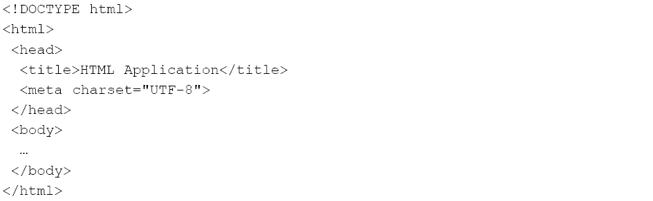

但许多开发工具会在头部添加它们自己的元素。HTML 定义了更多结构化元素，其中最重要的有：

* `section`：代表文档中的一个章节，它可以与 `h1`–`h6` 元素一起用于指示文档结构，且 section 必须以 `h` 元素开头
* `article`：代表文档中独立的内容块，正如其名所示是一篇文章，且 article 必须以 `h` 元素开头
* `aside`：代表与页面其他部分仅有微小关联的内容
* `header`：代表头部部分
* `footer`：代表页脚部分，通常包含作者信息、版权信息等
* `nav`：代表文档中用于导航（链接）的章节
* `dialog`：用于标记对话框
* `figure`：可以将标题与某些嵌入内容（如图形或视频）关联在一起

HTML 文档并不要求使用这些元素（这些元素是在 HTML5 中引入的），但建议使用，此外还建议它们可以在样式表中进行样式化。同样，建议 HTML 文档采用以下结构，其中可能有更多的章节，且某些元素可以被完全省略：

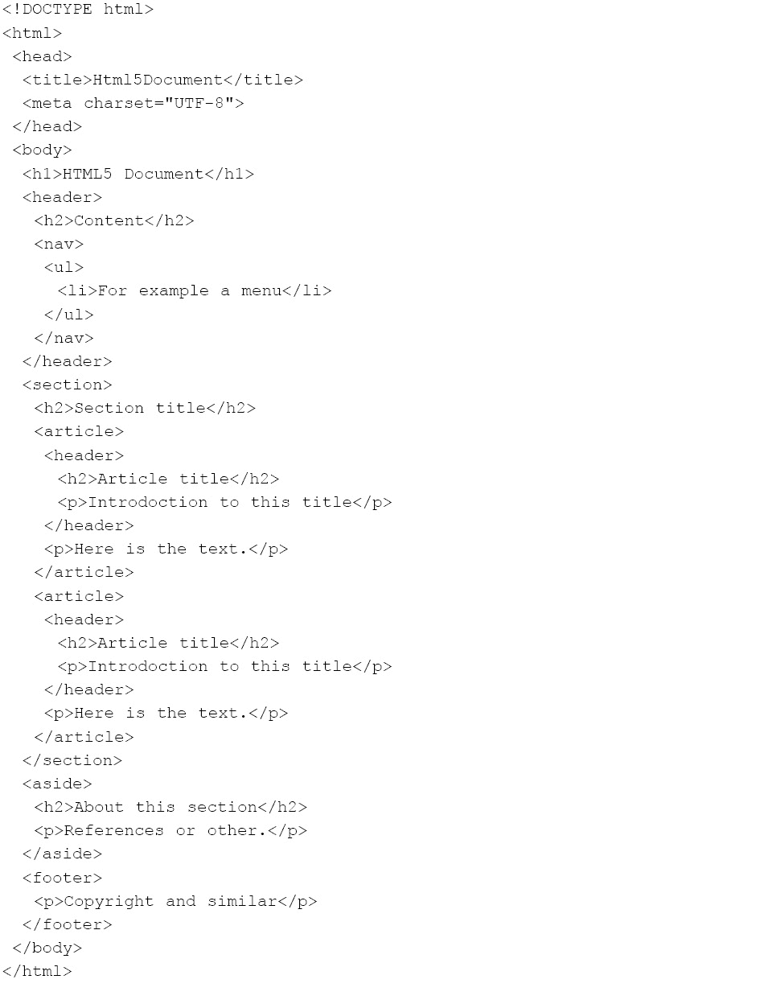

许多许多 HTML 元素，HTML5 中也有许多新元素，但我不想在这里列出所有元素。HTML 元素的通用形式如下：


其中可能会有多个属性。如果没有内容，允许写：


尽管在 HTML5 中实际上并不打算使用这种表示法。一个非常具体的例子可能是：

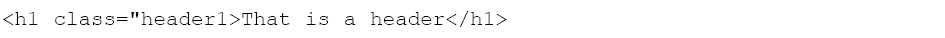

其中有一个属性指向样式表中的类。作为本章的开始，我创建了一个名为 `HTMLApplication` 的 Web 应用程序，目前它只有一个页面 `index.html`。我不想在这里显示内容，因为该页面会占据大量空间，而且该页面应该只展示如何使用上述结构化元素来构建 HTML 文档的内容。当你测试文档时，请注意结构化元素没有视觉效果。它们仅用于对文本进行结构化，而视觉效果仅适用于头部元素（`h1`–`h6`）以及链接列表。在任何情况下，视觉效果都是默认提供的。

还应该提到，允许定义自定义属性，如有必要，它们应该以 `data-` 单词开头，其应用在于它们可以从 `JavaScript` 引用，也可以从样式表中引用。

### 2.1 HTML 表单

在《Java 11》一书中，我展示了 HTML 表单的使用，它通常不涉及重大挑战，但 HTML 实际上定义了更多关于表单的内容。考虑以下作为 `HTMLApplication` 项目部分的文档：

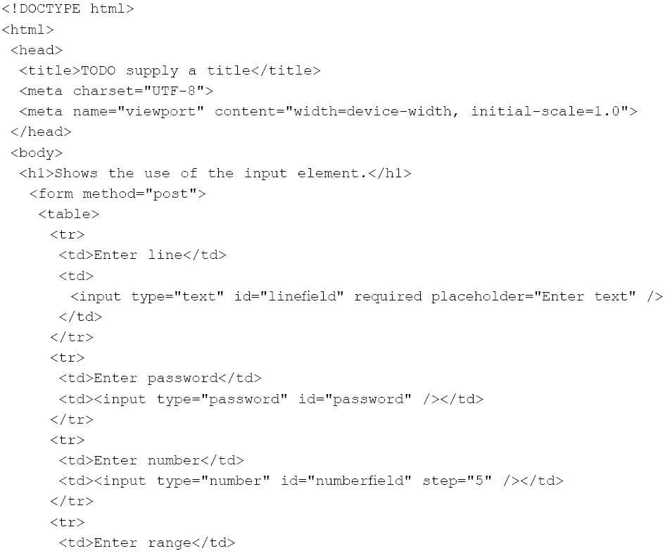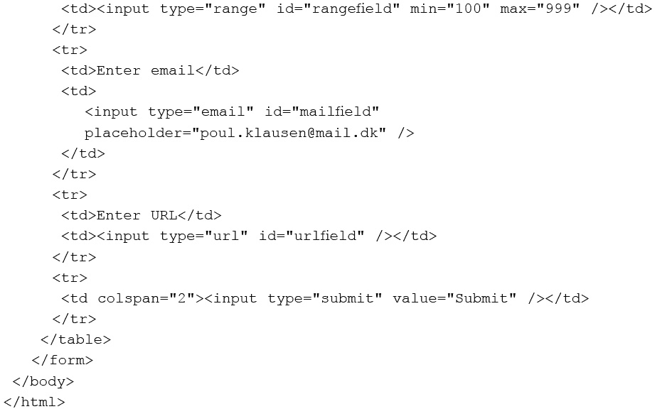

基本的表单元素是 `input`，通过 `type` 指定如何在屏幕上渲染该元素。默认是 `text`，这意味着你可以输入单行。注意（第一个 input）你可以指定 `required`，并且通过 `placeholder` 可以为输入的文本提供提示。最后是 `number` 和 `range` 类型，分别表示你可以输入 `email` 地址和 `URL`。


### 2.2 可矢量图形

在 HTML5 中，可以使用圆形和矩形等几何形状。考虑以下页面：

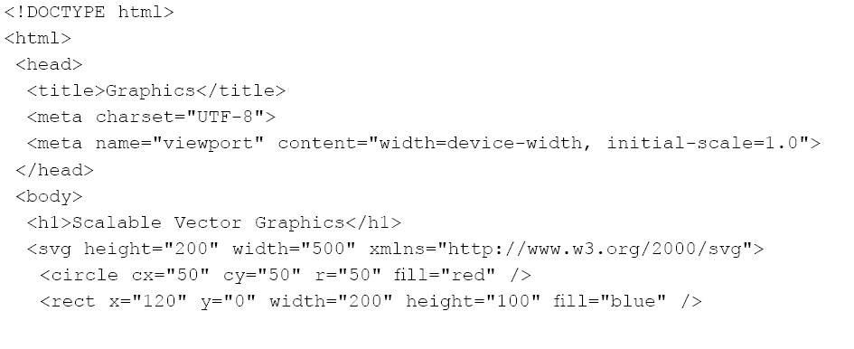

在浏览器中打开页面将得到结果：


代码非常易于理解，鼓励你研究其他可用内容。

## 问题 1

书的目录包含一个文档 `java12`，它是一个包含书中两个章节文本的文档，文本以纯文本保存。目录中还有名为 `screen1.png` 和 `screen2.png` 的 png 文件。这些文件是本章的截图。任务是创建一个带有 HTML 文档的 Web 应用程序，显示文件 `java12` 的内容和两个图片。页面应该只对文本进行结构化，你不应该对文本进行格式化。这是之后的主题。

## 3 层级样式表

在上述关于 HTML 的介绍之后，我准备好，将以上一章节相同的程序作为起点。我在项目中添加了一个新的 HTML 文档并命名为 `styleddoc.html`。其内容与 `index.html` 相同，目标是展示如何使用样式表更改文档的视觉呈现。最初我创建了一个 `resources` 目录，并在其中包含子目录 `css`，添加了名为 `styles.css` 的样式表：


最初，它只是一个空文件。需要使用样式表的文档必须在头部有一个 `link` 元素：

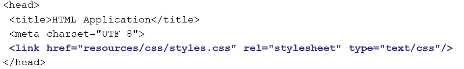

语法应该是正确的，你可以轻松地用鼠标将文件拖入文档，NetBeans 会自动插入正确的链接。

样式表的理念如前所述，是为了分离内容与呈现。样式表由`selectors`（选择器）标识的样式组成，例如，我在样式表中为 `h1` 选择器添加如下样式：

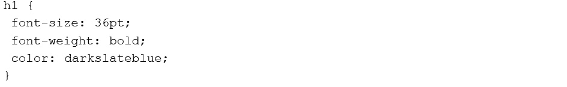

这种选择器被称为 `type selector`（类型选择器）或 `element selector`（元素选择器），这意味着文档中所有的 `h1` 元素将使用该选择器定义的样式。因此，你可以定义文档标题的呈现方式，并且它将适用于所有使用该样式表的文档。通常，你还想为 `body` 元素定义样式，例如定义默认使用的字体：

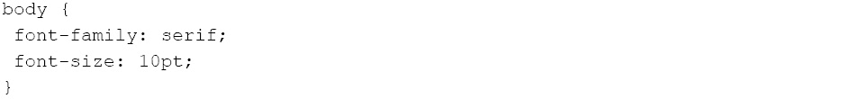

你也可以为两个选择器之间存在空格的 `descendent selectors`（后代选择器）定义样式：

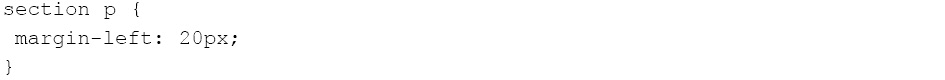

该选择器表示段落元素必须具有 20 的左缩进，但仅适用于嵌套在 `section` 元素中的段落。

你还可以定义所谓的 `ID selector`（ID 选择器），它以字符 `#` 开头：

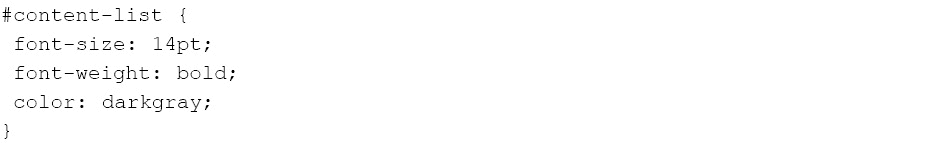

该选择器被一个 `id` 为 `content-list` 的元素使用，由于元素的 `id` 属性应该是唯一的，因此文档中只有一个元素可以直接使用此样式。在这种情况下，就是以下元素：

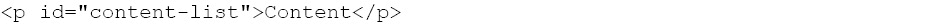

最后，你可以定义以点号开头的 `class selectors`（类选择器）：

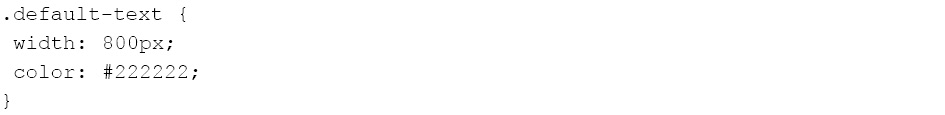

元素可以通过直接指定类属性（class attribute）来使用 `class selector`：

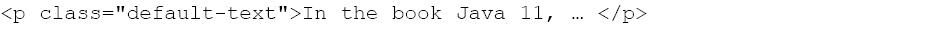

选择器的另一个例子是定义了一个名为 `forword` 的 `class`，将颜色定义为绿色：

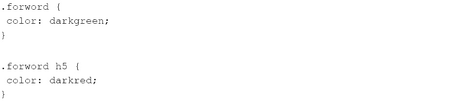

最后一个样式意味着 `style` 为 `forword` 的元素下的 `h5` 元素将以红色文本显示：

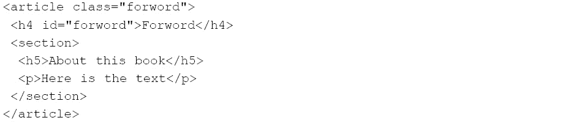

你还可以定义与属性相关的选择器。例如，以下样式意味着：

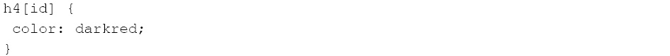

所有带有 `id` 属性的 `h4` 元素必须以深红色文本显示。另一个例子是，HTML 元素 `abbr` 可用于显示工具提示（tooltip）：


在这里，当鼠标指向 `syntax` 单词时，属性 `title` 的值将作为工具提示显示。考虑以下样式：

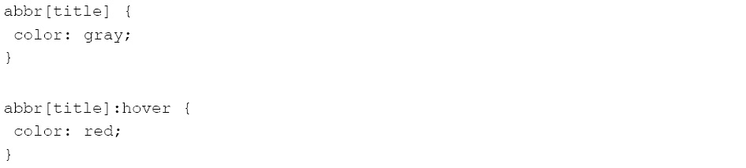

它们定义了对于带有 `title` 属性的 `abbr` 元素，文本应该显示为灰色，当鼠标悬停在文本上（mouse ower）时，文本应显示为红色。

作为选择器的属性对于自定义属性可能特别有趣。考虑以下段落：


例如，如果你想让所有带有此属性的段落以大字体显示，你可以写：

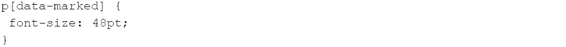

鼓励你学习最终结果（文档 `styleddoc.html`），特别是完成的样式表。

### 3.1 更多选择器

示例 `StyledDocument` 由一个单个 HTML 文档和一个样式表组成。如果你在浏览器中打开文档，结果如下：

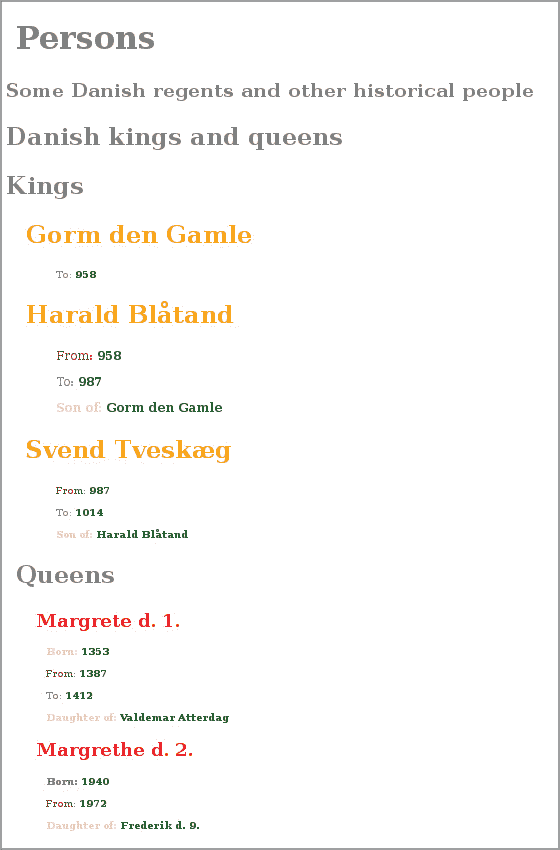

我不想在这里显示文档，因为没有太多需要解释的内容。样式表如下：

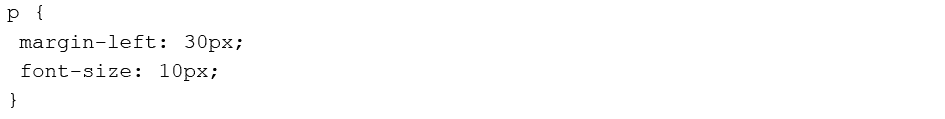

前两个样式不需要解释。第三个是 `article`。第四个样式是 `element`。第五个样式是 `element`。第六个样式是 `article`。

### 3.2 样式

上面我展示了如何从样式表引用单个元素...

如前所述，元素的位置被定义为 `static`（静态），这意味着元素浮动在窗口中，但你可以定义其他选项，通过示例可以很好地说明这一点。如果你在浏览器中打开应用程序 `PositionDocument`，你会得到如下窗口：

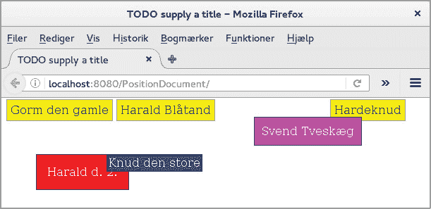

这些元素都是 `span` 元素，按照以下顺序渲染：

1. Gorm den gamle
2. Harald Blåtand
3. Svend Tveskæg


4. Harald d. 2.

5. Knud den store

6. Hardeknud

除非另有说明，否则它们将排列在一行中，如果行过长则会换行。在这种情况下，前两个和最后一个以默认（`static`）位置布局，而第三个具有 `relative`（相对）位置，这意味着它相对于上一个元素布局，`Harald Blåtand` 也是如此。你应该注意，最后一个元素（`Hardeknud`）的布局就像元素 `Svend Tveskeg` 以默认位置布局的一样，而且前两个元素的位置被忽略了，因为它们分别被布局为 `absolute`（绝对）和 `fixed`（固定）位置。`Absolute` 意味着元素放置在相对于文档左上角的固定位置。`Fixed` 是一个变体，但在这里元素也被放置在固定位置，不过这次是相对于文档的可见部分。你可以通过改变窗口大小然后滚动窗口来演示区别：

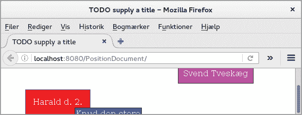

代码所示：

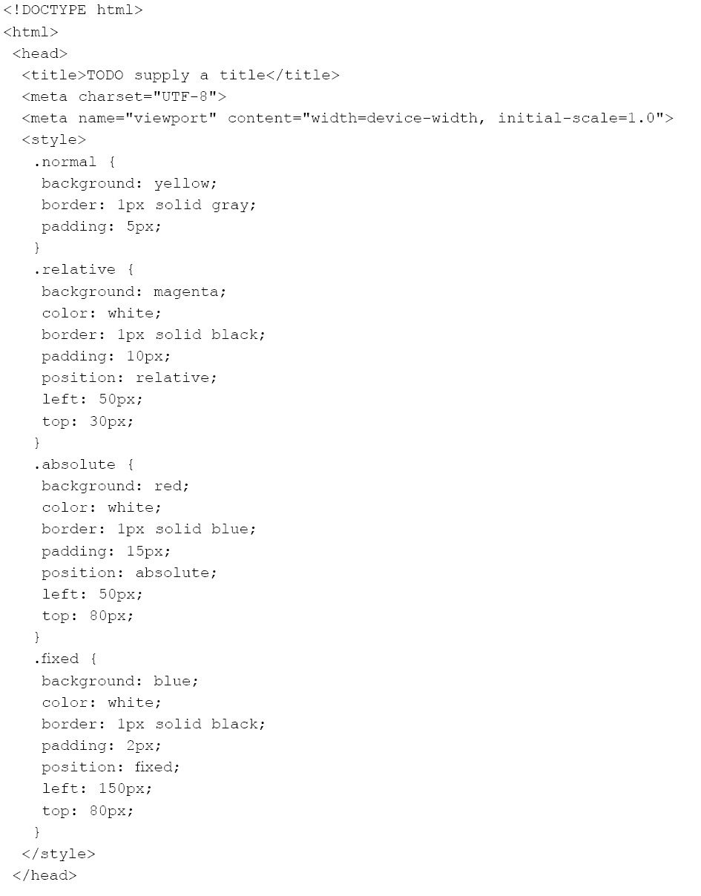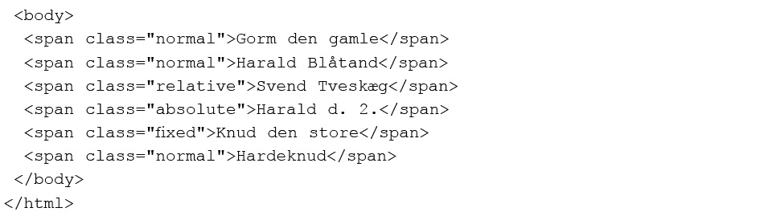

样式化包含远比本章所说的内容，但上述内容足以让你对可能的功能有一个了解。你经常处于这样的情况：想在某个元素上实现某种效果，但不知道该写什么。这里最好的来源其实是互联网，那里有无数关于如何样式化不同 HTML 元素的示例。作为结论，我在项目 `HtmlApplication` 中添加了一个名为 `styledform.html` 的文档。该文档显示了之前提到的相同表单，但这次没有使用表格，元素仅通过样式化放置：

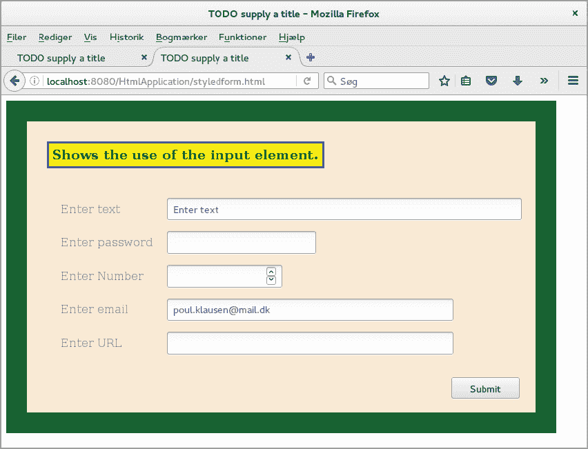

鼓励你学习该文档，特别是相应的样式表，以及各个元素是如何样式化的。

## Problem 2

从问题 1 的项目副本开始。你必须为项目添加一个样式表，以便使用样式来格式化文档，使其看起来像书籍的最终版本。所有样式都应该在样式表中，你必须通过必要的 `ID` 和 `class` 定义来扩展文档。

# 4 JavaScript

我将介绍 JavaScript，它是客户端代码的首选语言。该语言的语法本质上与 Java 相同，但除此之外这两种语言之间没有共同点，JavaScript 甚至是一门与 Java 非常不同的语言，但如果你想作为 Web 开发人员专业地工作，就必须了解 JavaScript。因此有了这一章。

JavaScript 是一种解释型编程语言，源代码像 Java 一样只是文本，但与 Java 不同，代码不会被翻译，而是作为文本发送给浏览器，浏览器内置了一个解释器来解释 JavaScript 代码。这是一个真正的解释器，它会逐句解释代码语句，并在解释和执行下一条语句之前执行每一条语句。为了展示 JavaScript 是什么，我想从一个非常简单的示例开始，称为 `LoadingDocument`。只有一个文件 `index.html`，其内容为：

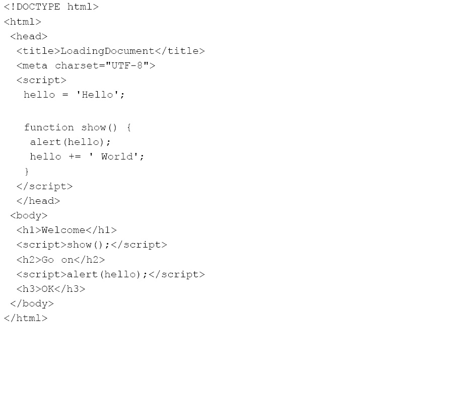

在 `head` 部分有一个 `script` 元素，它是可以包含 JavaScript 代码的元素。在这种情况下，定义了一个变量和一个函数。变量名为 `hello`，并用文本“Hello”初始化。原则上，JavaScript 使用变量的方式与其他编程语言（包括 Java）类似，但你应该主要注意该变量没有类型。脚本块还有一个函数，该函数基本上充当 Java 中的方法，并可以通过调用它来执行。在这种情况下，函数名为 `show()`，它有两个语句。第一条是 `alert()`，它打开一个简单的弹出窗口，显示变量 `hello` 的值。下一条语句改变变量的值，在这里你应该注意到语法正如你从 Java 中了解的那样。如果应用程序在浏览器中打开，它将从头到尾渲染文档的 `body`，从以下窗口开始渲染了 `h1` 元素（见下文）。在渲染 `h1` 元素之后，有一个新的脚本元素

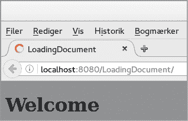

它调用了 JavaScript 函数 `show()`，这意味着浏览器停止并打开一个弹出窗口：

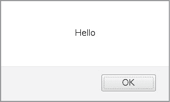

点击 `OK` 后，浏览器将继续渲染文档，然后浏览器将渲染 `h2` 元素：

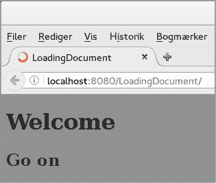

接着是一个脚本元素，这次它仅执行 `alert()`，在弹出窗口显示变量 `hello` 的值：

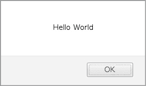

在这里注意变量在 `show()` 函数中被改变了。在显示弹出窗口后，浏览器恢复运行直到点击 `OK`，之后浏览器渲染 `h3` 元素，然后是

上述示例展示了一些关于 JavaScript 是什么以及如何将 JavaScript 添加到 HTML 文档的内容，但不是 JavaScript 可以做什么，这是后续内容的目标。首先，我想更多地介绍语言的语法。

## 4.1 语言的性质

当你开始学习 JavaScript 并来自 Java 等其他语言时，主要有三点看起来非常不同：

* 变量作用域

* 类型

* 对象与继承

而实际上是这三点使得 JavaScript 编程与例如 Java 编程大不同。JavaScript 是一门*弱类型*语言，变量不需要声明特定类型。这并不意味着该语言没有类型，而是意味着变量可以改变类型，且当前类型取决于变量的值及其使用方式。该语言的类型兼容性有很多规则，这些规则相当复杂，我将在下文中解释一些。JavaScript 在经典意义上不是面向对象的，但相反，对象在语言中起着重要作用。然而，与 Java 相比，创建和继承对象方面存在巨大的差异。JavaScript 与其他语言最大的区别可能是函数，因为函数实际上是具有属性和方法的对象。

本节的目的是阐述这些众多概念中的一些，无需涉及所有细节，但要达到你可以将 JavaScript 结合 Web 应用程序开发的程度。当浏览器解析 HTML 文档时，它会构建一个由文档元素组成的树。这棵树被称为 DOM（文档对象模型），JavaScript 的作用正是准确地修改这棵树。

### DOM 树

JavaScript 可以放置在文档的任何位置，但当文档加载时，浏览器会解析文档并构建 DOM 树。如果浏览器遇到任何 JavaScript，它将执行它，因此，只有当脚本引用的元素已经是 DOM 树的一部分时，它才可能生效。考虑以下示例：

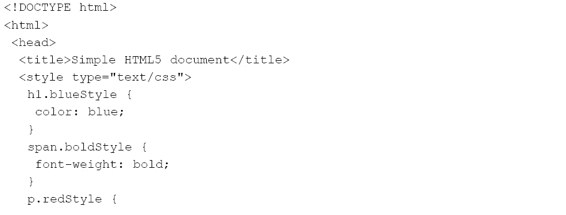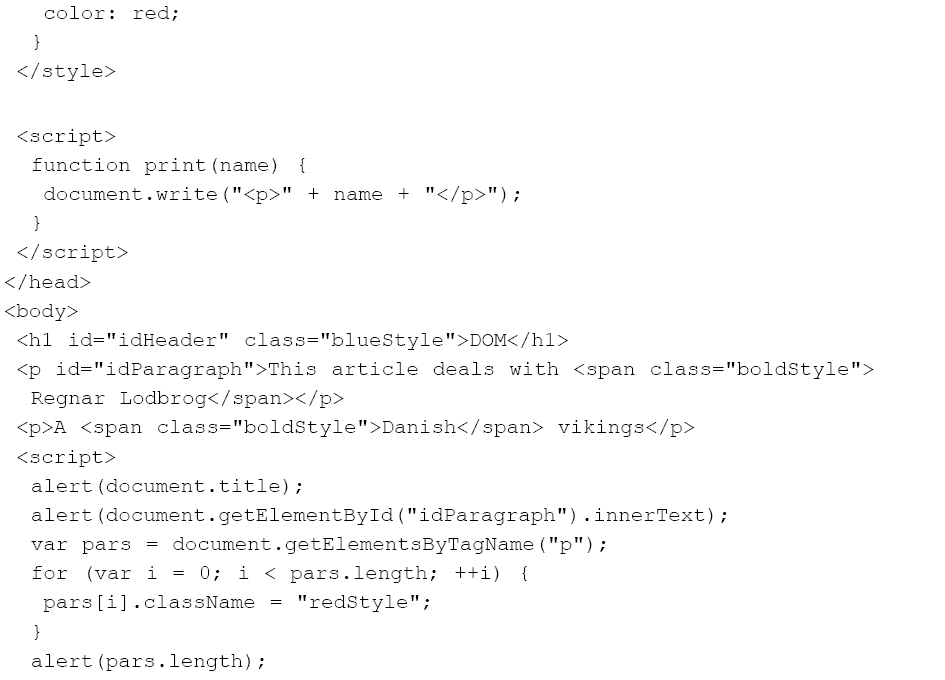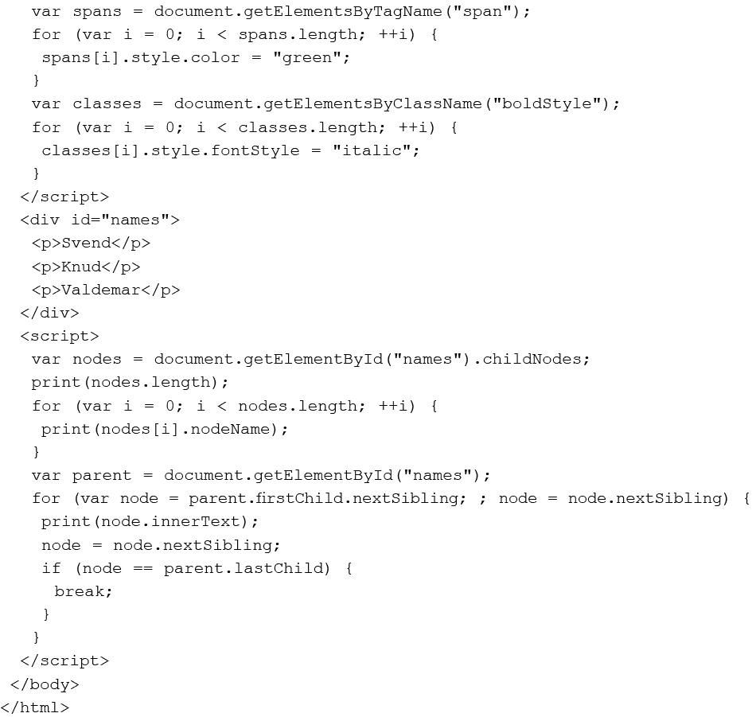

该示例展示了当浏览器加载带有 JavaScript 的文档时会发生什么，以及如何引用 DOM 层次结构中的项目。首先注意到在头部中定义了一个样式表。此外，还定义了一个脚本元素，该脚本元素定义了一个名为 `print()` 的单个 JavaScript 函数。该函数将名称作为段落打印，这意味着该函数在调用它的地方插入一个段落元素。浏览器不会在此处执行该函数，它只是一个函数的定义。`body` 部分以 `h1` 元素和两个段落开头，浏览器开始显示这些项目


这并没有什么奥秘，但在浏览器解释了上述元素之后，会进入一个 `script` 部分，这里有一个 `alert()` 显示一段文本。这意味着（如上一个示例所示），浏览器会停止并等待用户点击 `OK`。当发生这种情况时，浏览器继续处理文档，下一个元素是另一个显示第一个段落中文本的 `alert()`。你应该注意如何引用具有特定 ID 的元素，以及如何使用 `innerText` 引用元素的文本。`alert()` 显示整个文本，包括 `span` 元素中的文本，但最后部分不是粗体，因为 JavaScript 不解释 HTML。当你点击 `OK` 时，浏览器继续解释并执行 JavaScript 语句。这里 `pars` 是一个包含所有 `p` 元素的数组——此时有 2 个——随后的循环将它们的 `class` 设置为 `redStyle`，之后文本变为红色——包括 2 个 `span` 元素中的文本。一旦发生这种情况，就会执行一个新的 `alert()`，它显示数组 `pars` 的长度，其主要目的是让解析器停止，以便你就可以看到两个段落中的所有文本都是红色的：


当你点击 `OK` 时，浏览器继续执行 JavaScript。`spans` 同样是一个包含所有 `span` 元素的数组（有 2 个），接下来的循环将文本设置为绿色。

脚本的最后部分开始确定一个数组 `classes`，它包含所有类名为 `boldStyle` 的元素。接下来，将这些元素的字体设置为斜体，结果是浏览器显示如下内容：

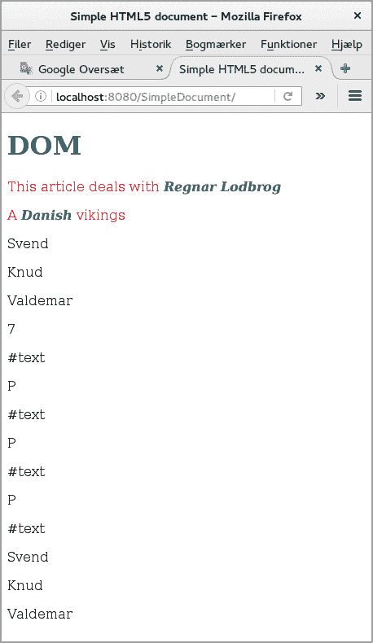

三个丹麦国王的名字是简单的 HTML 段落，它们有助于展示浏览器在第一个脚本块完成后，首先将这些元素插入 DOM 树中。接着是另一个脚本块。在这里，`nodes` 是一个包含 `div` 元素所有子节点的数组。有 7 个子节点并不是你预期的那样，其原因是各个段落之间的纯文本也算作一个节点。接下来，创建了一个引用 `div` 元素的变量 `parent`。随后的循环从第一个节点开始迭代遍历 `parent` 的所有子节点。循环跳过空白文本元素，并打印段落元素的文本。请注意，当遇到 `lastChild` 时，循环会通过 `break` 停止。

有几点是你应该注意的。JavaScript 使用点符号表示（dot notation）来引用对象的属性和方法——就像在 Java 中为人知的那样。此外，请注意 `alert()` 会停止浏览器对文档的解析，因此 `alert()` 可能是调试 JavaScript 的有用工具。

### JavaScript 中的对象

JavaScript 是一门面向对象的语言，但没有类似于类（class）的东西，构建新对象的唯一方法是通过原型（prototyping），这是复制现有对象的一种形式。通过这种方式，创建了一个新对象，人们最好将其视为另一个对象的拷贝。更精确一点，JavaScript 中的任何对象都有一个名为 `prototype` 的属性，该属性引用所有从父对象继承的属性（属性和方法）。这意味着如果你尝试引用一个对象的属性或方法，解释器将首先检查该属性是否定义在目标对象上。如果不是如此，将检查 `prototype` 所引用的对象，并在层次结构中找到该属性，直到到达一个定义了该属性的对象，或者解释器可以得出该对象是 `undefined`。属性和方法可以被重写，任何重写都会影响定义重写的对象以及继承层次结构下游的对象。最好将这种形式的继承视为一个简单的列表，其中 `prototype` 引用元素。这种继承形式的重要结果是，对象的属性会影响层次结构中的所有对象。

下面的示例应该说明这些概念中的一些，特别是创建对象的语法：

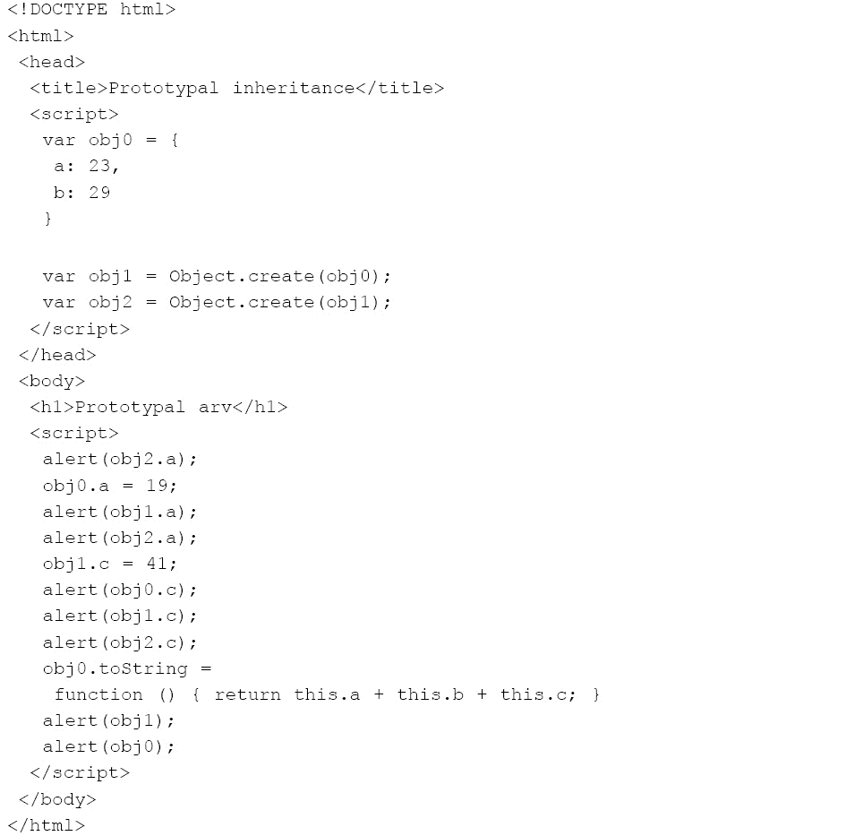

文档的头部有一个脚本块，创建了三个对象。第一个是 `obj0`，它具有值为 23 和 29 的两个属性。接下来创建了两个对象 `obj1` 和 `obj2`，它们都是 `obj0` 的扩展，但此时这三个对象具有相同的属性。

`body` 部分开始渲染 `h1` 元素，但其余部分是一个脚本块。接下来，使用 `alert()` 显示 `obj0` 属性 `a` 的值，结果是一个显示值为 13 的弹出窗口。接下来，将 `a` 修改为 19，然后显示 `obj1` 和 `obj2` 的 `a` 值，在两种情况下都是 19，这对应于 `obj1` 和 `obj2` 继承了 `obj0` 的值。作为下一步，为 `obj1` 分配了一个值为 41 的属性 `c`。在这里你应该注意，你可以立即为对象创建属性并赋值，而该属性对于父对象是不可知的。因此，接下来的三个 `alert()` 语句将显示 `undefined`、41 和 41，因为 `c` 在 `obj0` 中不可知，但在 `obj1` 和 `obj2` 中已知（`obj2` 继承自 `obj1`）。

在 JavaScript 中，变量作用域的规则与 Java 略不同，因为变量具有`函数作用域`（functional scope）。这意味着定义在函数中的变量仅在函数内部可见，但在函数内其定义的任何地方都是可见的。该变量在任何嵌套函数中也是可见。你还应该注意 JavaScript 使用了`提升`（hoisting），这意味着变量可以在创建它的函数任何地方使用——即使在定义之前。这是因为解释器在开始创建变量时，会认为所有变量在函数开始时就已经定义了。然而，你必须注意，此时变量并不一定被赋值。

变量也可以具有`全局作用域`（global scope），如果它定义在函数外部则是这种情况，这种变量可以在文档的任何地方使用。通常，我们在创建变量时会在前面写 `var`，但实际上并不是必须的（尽管建议这样做）。不带 `var` 定义的变量在任何创建的地方都具有自动全局作用域。

在大多数编程语言中，当程序离开变量定义的作用域时，变量会被移除，JavaScript 也是如此的。也就是说，变量在定义它们的函数执行时被创建。这至少是一个基本规则，但并不一定适用。这是因为在 JavaScript 中，函数本身是一个对象，因此函数可以返回一个函数，例如，它可以返回一个内部函数。这个内部函数可以引用闭层函数中的变量，因此在函数完成后，可能存在对局部变量的引用。如果是这样，变量将不会被移除，事实被称为`闭包`（closures）。

基本上，在 JavaScript 中，关于变量作用域的挑战并不多（也许除了闭包），接下来的名为 `ScopeDocument` 的文档将说明最重要的作用域规则：

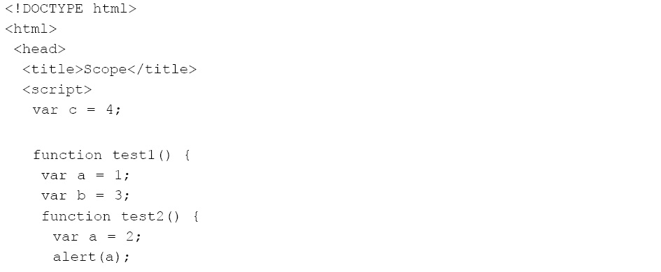[](image/Java_12_–_WWW_and_development_of_the_client_part_22-11-17_44.jpg)

如果你从文档头的 `script` 块开始，变量 `c` 被定义在所有函数之外，它具有全局作用域且随处可见。接下来，函数 `test1()` 定义了局部变量 `a` 和 `b`。它们仅在函数 `test1()` 中可见，因此在嵌套函数 `test2()` 中也是可见的。然而，只有 `b` 适用，因为 `test2()` 也定义了局部变量 `a`。函数 `test2()` 显示了局部变量 `b` 的值。此外，`test2()` 初始化了全局变量 `c` 并显示了其值。函数 `test2()` 从 `test1()` 调用，最终显示了局部变量 `a` 的值。

还定义了一个函数 `power2()`，这被称为闭包。`power2()` 有一个局部变量 `n`，并返回一个使用该变量的函数 `next()`。这意味着在 `power2()` 终止后，对变量 `n` 仍然引用。

`body` 部分从 `h1` 元素开始，之后调用了 `test1()`。注意这意味着内部函数 `test2()` 也被执行。接下来，全局变量 `c` 的值被显示。如果你尝试显示变量 `a` 的值，它在该处没有定义，文档渲染将会中断。

作为下一步，两个引用 `f` 和 `g` 被用于 `power2()`，结果是函数 `power2()` 执行了两次，部分地 `f` 和 `g` 引用局部变量 `n` 的每个副本。通过以下循环展示了函数 `f` 和 `g` 引用的局部变量 `n` 的每个副本。如果页面在浏览器中打开，将出现以下弹出窗口并显示：


最后页面显示


### 类型

当你遇到 JavaScript 时，可能认为语言是无类型的，但事实并非如此。这只是解释器根据上下文决定类型的问题，这意味着变量可以改变其类型。在下一个语法章节，我将更详细地描述 JavaScript 中的类型概念，但基本上有四种类型：

1. `Boolean`，值为 `false` 或 `true` 的变量或表达式。

2. `Number`，数字，且都是 64 位浮点数。

3. `String`，字符串。

4. `Object`，由属性和方法组成的集合，涵盖了上述三种以外的所有内容。

这种类型系统涉及多个方面，包括不断发生类型转换。这并不简单，我想在下一节中查看，但下面是一个可以说明关于 JavaScript 类型的示例（TypeDocument）：

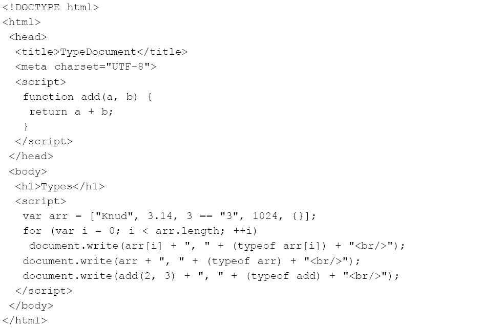

注意在头部定义了一个带有两个参数的简单函数。参数没有类型，你看到的只是函数在两个参数上执行 `+` 运算符并返回值。主体部分的 `script` 块创建了一个包含 5 个以下类型元素的数组：

1. 第一个 `String`

2. 第二个是 `Number`

3. 第三个是 `Boolean`（由于 JavaScript 的特殊转换规则，它是 `true`）

4. 第四个是 `Number`

5. 最后一个是 `Object`


你应该注意数组`arr`本身是一个`Object`。下一个语句`for`循环打印数组及其类型。注意`typeof`运算符，它决定变量的类型。最后，最后一个语句执行函数`add()`并打印其类型。函数的类型是`Object`，但你应该注意`typeof`将其显示为`function`。如果页面在浏览器中显示，结果如下：


### 模式

在本节中，我展示了一些关于 JavaScript 的基本概念，当然还有更多细节，但上述足以说明 JavaScript 是一种与 Java 非常不同的语言。在 JavaScript 存在期间，这种语言已经发展了很多，同时也出现了几种编写 JavaScript 代码的模式。特别是，函数似乎是一个对象，当函数定义作用域时，它允许函数实现某种形式的数据封装。我想通过以下示例来说说明。

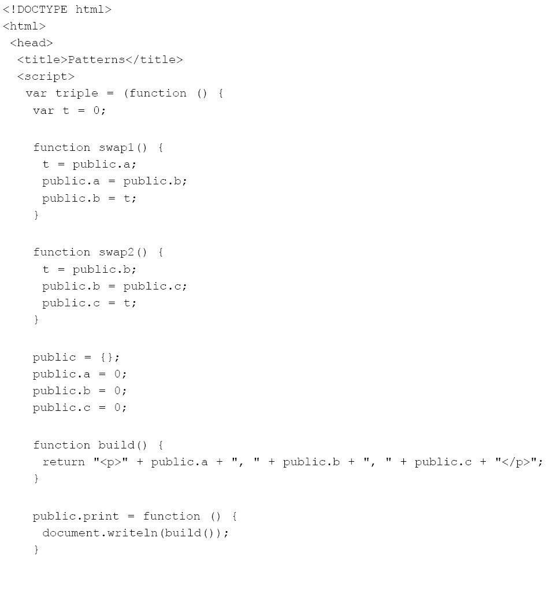[](image/Java_12_–_WWW_and_development_of_the_client_part_22-11-17_50.jpg)[](image/Java_12_–_WWW_and_development_of_the_client_part_22-11-17_51.jpg)[](image/Java_12_–_WWW_and_development_of_the_client_part_22-11-17_52.jpg)

有很多细节，我将从主体部分的`script`块开始。通常，函数封装了在函数执行时执行的代码，但在不带整个函数的情况下加上括号，如下

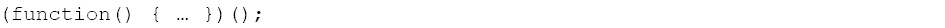

该函数（此处为匿名函数）将立即执行。

通过执行匿名函数将 3 和 5 中较小的数字插入文档中。当然，这并没有太大意义，但如果参数是变量，它就有意义了。因此，通过求值函数来插入表达式的值是非常常见的。虽然以这种方式写方法看起来看起来有点奇怪，但它非常有用，尽管这可能导致代码难以看出下一个表达式显示的内容：

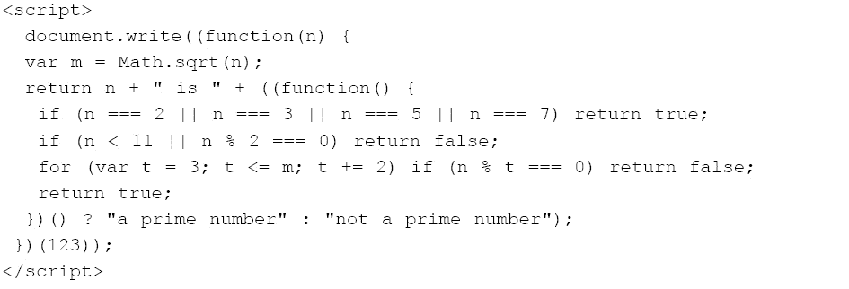

该脚本确定 123 是否为质数，并在文档中插入相应的文本。该示例展示了可以通过求值匿名函数来实现，并部分说明了 JavaScript 可以与 Java 相同的语法使用循环和条件，这在下一节中将进一步阐述。这段代码并不容易读，但插入的文本是一个带有一个参数`n`的匿名方法的值。该方法有一个局部变量`m`，其初始化为`n`的平方根。同样请注意，它的写法与 Java 相同。匿名函数返回一个值（即文本），但该值是由一个没有参数的内部匿名函数决定的，该函数使用常用的质数算法确定`n`是否为质数。在这种情况下，使用匿名函数有些过度，但在编写 JavaScript 时在某种程度上是很常见的。

如果你查看头部部分，它使用匿名函数将变量和函数嵌入到命名空间中，变量和函数将成为该命名空间的局部变量。这样使用的匿名方法通常被称为`module`（模块），因此`triple`就是一个模块的示例。模块可以被视为在 JavaScript 中实现某种数据封装的模式，在其他方面，名称是模块局部的，因此你不必担心他人可能使用了哪些名称。

如果你检查模块`triple`，`t`是匿名函数中的局部变量，因此也是模块的变量，它将作为私有变量工作。同样，两个函数`swap1()`和`swap2()`是`triple`模块的私有函数。该模块进一步定义了一个名为`public`的变量。在这里，你应该注意该变量是一个`Object`（目前没有属性），它具有全局作用域，因此在模块外部可见。在创建对象后，定义了属性，作为`triple`对象的公共属性（下文解释）。接下来，定义了另一个私有函数`build()`，然后两个作为`public`对象的函数，它们将作为`triple`对象的公共函数。当它们执行时，与`public`对象的属性方式相同，因为匿名函数返回了`public`对象。

在`body`部分中还有最后一个脚本块，它主要展示了如何使用`triple`模块，但首先显示了另一种显式的匿名函数用法。该函数确定了斐波那契数。块的剩余部分使用了对象（模块）`triple`及其属性和函数。首先调用了`triple`对象的`print()`方法，它只打印了属性。接下来，为属性赋值一个值并执行`sort()`方法，之后再次执行`print()`。

你可以使用匿名函数的语法扩展带有新功能的模块。以下是使用新函数扩展`triple`：

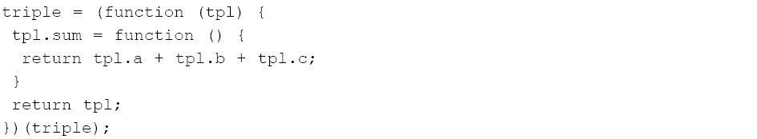

匿名函数有一个参数`tpl`，并将其解释为对象并扩展一个新属性（返回总和）。最后，匿名函数返回参数`tpl`（现在得到了一个新函数），并使用`triple`作为实际参数调用匿名函数，结果是`triple`被赋值一个值，执行了`sum()`函数。

你也可以通过相同的模式扩展模块`triple`（`triple`是一个对象）。这里有一个子模块`sub`，使用新函数扩展。

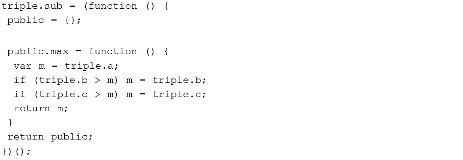

结果是可以使用函数定义命名空间，该命名空间拥有私有属性并提供公共属性和方法。如果你运行该程序，结果所示：


## 4.2 基本语法

接下来涉及 JavaScript 的基本语法，尽管通过示例说明了语法，但在某种程度上需要参考。后续的大部分在上一节中已经提到过。

基本上，JavaScript 使用与 Java 语言或受 C 语言启发的相同的语法。因此，我想以编写 Java 代码的方式编写 JavaScript，并应用相同的块（`{`和`}`）和缩进规则。关于块，许多人（以及许多开发工具）选择写成

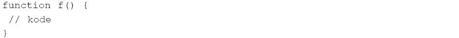

而不是


我将遵循这一习惯——主要是因为我的开发工具是这样。还有一种传统（受 Java 启发）让函数名以小字母开头，我也将遵循这一点。

在 JavaScript 中，语句像 Java 一样用分号结束，但实际上并不是必要的，因为大多数解释器能够自己设置缺失的分号。当然，如果你不用分号结束语句，则要求你遵循某些代码编写规则，但较新的解释器非常擅长自动确定语句何时结束——它们会在代码逻辑需要的地方间接地插入分号。然而，我想在处处都加上分号，部分是因为我习惯了其他语言，部分我认为它增加了可读性，但更重要的是，在某些情况下缺失分号可能会导致解释器对代码的误解。

### 表达式和语句

表达式是指具有值的代码。示例包括：

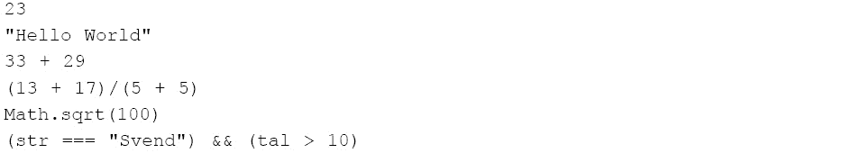

另一方面，语句是导致某些操作的表达式序列，例如赋值语句。语句特别可以组合成语句块，这在控制语句的情况下是一个重要术语。特别需要注意，块并不一定是语句。例如，对象

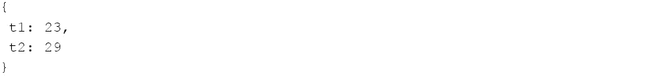

不是语句而是一个表达式。

运算符作用于表达式，JavaScript 在很多方面使用了与 Java 相同的运算符。主要的运算符是赋值运算符、算术运算符和比较运算符。运算符也使用从其他语言（包括 Java）已知的优先级规则。下表是 JavaScript 中所有运算符及其优先级。L/R 意味着运算符从左到右求值，而 R/L 意味着运算符从右到左求值。

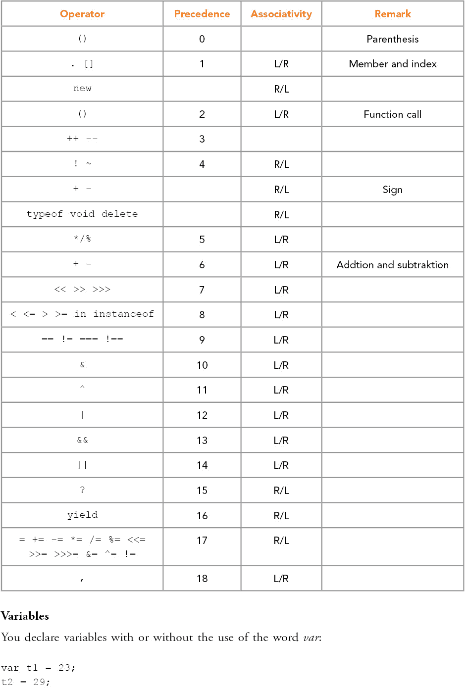

两种情况下都创建了变量，区别对于变量的作用范围至关重要。允许在同一个语句中声明多个变量


JavaScript 具有函数作用域。这意味着如果你使用`var`创建一个变量，它的作用域将局限于创建该变量的函数或内部函数。可以通过以下函数来说：

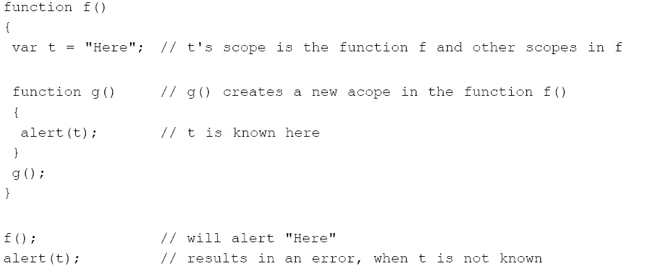

变量定义所在的作用域通常称为其`局部作用域`(local scope)。当引用变量时，运行时系统会在当前作用域中搜索该变量。如果在此未找到该变量，系统将在父级作用域中搜索，此过程将持续持续直到系统找到变量或到达顶层作用域（通常称为`全局作用域`global scope）。这一过程有时被称为`作用链查找`(scope chain lookup)。未在函数中声明的变量始终具有全局作用域，未使用`var`声明的变量也是如此。

变量始终在作用域开始时被创建——即使声明本身是在代码后部才编写的：

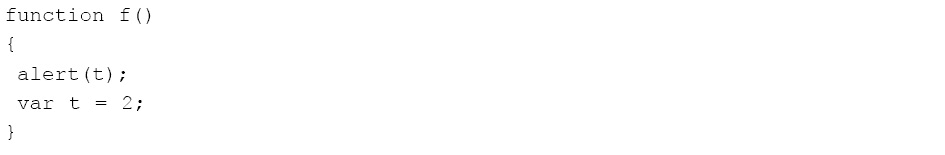

如果你执行此函数，它将通过`alert()`显示`undefined`。变量`t`因此被创建，但它没有被初始化。然而，如果你删掉`var`，你将得到一个错误，因为你引用了一个尚未创建的变量。这对应于解释器对上述函数的理解：

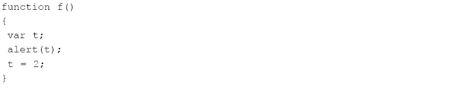

由于这有时会导致难以察觉的结果，建议你在函数开头始终一致地创建并初始化变量。

当函数终止时，它的作用域将会消失，同时运行时系统将移除该函数创建的所有局部变量。如果再次调用该函数，它的局部变量将重新创建。这至少是正常行为，但请考虑以下文档：


如果在浏览器中打开，第一个`alert()`将显示 1，下一个`alert()`显示 2。如果你考虑函数`f()`，它有一个局部变量`t`并被赋值值 1。内部函数`g()`显示该变量的值，之后将其加了 1。函数`f()`返回内部函数`g()`。注意，这是合法的，因为函数本质上是一个对象。在正文部分，执行了函数`f()`并将其返回值存储在变量`h`中，此时`h`指向一个函数且函数`f()`终止。接下来执行`h()`，这意味着执行的是函数`g()`，正如`alert()`显示值为 1（这是`f()`中局部变量`t`的值）。当第二次执行`h()`时，它将显示 2。在那里它仍然是`t`的值，你可以看到`t`没有再次被初始化，因此在`f()`终止后没有被移除。原因是通过`g()`间接引用了`t`。当`f()`终止时，`t`没有被移除，因为`h`指向`g()`，而`g()`又指向`t`。这种局部变量在创建它的函数终止后仍未被移除的情况被称为闭包 (closures)。

### 类型

在 JavaScript 中，创建变量时不应指定任何数据类型。它被认为是一种弱类型语言。然而，这不等同于 JavaScript 没有类型，它基本上有 4 种类型：

* `Boolean`，即值为`false`或`true`的变量或表达式。

* `Number`，即数字，为 64 位浮点数。

* `String`，即字符的随机序列。

* `Object`，即属性和方法的族。

该语言是弱类型意味着运行时系统根据变量和表达式的值自动确定类型。特别是这意味着变量的类型在其生命周期内可以改变，并且始终由变量的值决定。例如以下代码


其中函数`f()`如上所示，将告出以下类型名称（使用`typeof`运算符）：

* `string`

* `number`

* `boolean`

* `object`

* `function`

* `object`

在这里你应该注意，对于`f`，结果是`function`，即使其类型在形式上是`object`，且数组的类型也是`object`。

变量的值可以是`原始类型`(primitive)，具有以下选项：

* `true`或`false`，然后是`boolean`

* `number`，然后是所有可能的数字

* `string`

* `null`，意味着变量没有值

* `undefined`，意味着变量已定义但未初始化

所有非原始类型的内容都是`object`，因此特指数组和函数。

考虑以下代码，其中函数`f()`再次如上所示：


如果你执行这段代码，你会得到结果：


变量`v`的值为 19，类型为`number`。当你遍历数组时，首先确定`v`与值 47 之和。它们是两个数字，结果为 66。接下来加上`true`（这是一个`boolean`），这里发生了到数字的自动类型转换，值`true`被转换为 1，求和的结果为 67。在第三次迭代中，对`number`和`string`执行加法，此时两个操作数都发生了到字符串的自动转换。在第四次迭代中，对`string`和`object`执行运算符，结果是字符串拼接。最后一次也是如此，因为`f()`也是一个`object`，但字符串——`toString()`的结果——此时是函数的代码。

该示例应该说明，由于 JavaScript 是弱类型的，表达式完全可能由不同类型组成，因此隐式类型转换一直在进行。这自然会导致意外的结果，而且规则也很复杂。基本上如下：

首先注意，类型为`object`的变量有两个方法`toString()`和`valueOf()`（可以被重写），前者将对象的值作为`string`返回，而后者将值作为`primitive`返回。例如，如果你考虑以下代码：


定义了两个对象，后者重写了`toString()`和`valueOf()`。在浏览器中打开代码的结果为：


```
// 图中执行的结果
```

在这里你可以看到`toString()`和`valueOf()`默认返回`[object object]`，否则返回重写方法的值。

对于自动类型转换，JavaScript 使用了三个内部方法：`toPrimitive()`、`toNumber()`和`toBoolean()`。`toPrimitive()`接收一个参数并按照以下算法返回`primitive`：

1. 如果参数是`object`，如果是`primitive`则返回`valueOf()`，否则返回`toString()`（如果返回的是原始类型），否则报告错误。

2. 如果参数是原始类型，则返回参数。

`toNumber()`也接收一个参数并根据以下算法返回数字：

1. 如果参数类型为`Number`，返回参数。

2. 如果参数类型为`Boolean`，如果值为`true`则返回 1，否则返回 0。

3. 如果参数为`Null`，返回 0。

4. 如果参数类型为`object`，返回`toNumber(toPrimitive(argument))`。

5. 如果参数是`undefined`，返回`NaN`。

6. 如果参数是`string`，则返回`parseInt()`的值；如果参数可以解析为`Number`，否则返回`NaN`

此外，`toBoolean()`也接受一个参数并根据以下算法返回一个`boolean`：

1. 如果参数类型为`boolean`，返回该参数。

2. 如果参数为`Null`，返回`false`。

3. 如果参数为`undefined`，返回`false`。

4. 如果参数类型为`object`，返回`true`。

5. 如果参数类型为`number`，如果值为`0`或`NaN`则返回`false`，否则返回`true`。

6. 如果参数类型为`string`，如果字符串为空则返回`false`，否则返回`true`。

从这些规则可以看出，确定一个表达式的值可能困难，但在实践中这很少引起大问题，因为值通常是预期的，几乎就是条件的值（`Boolean`类型的表达式），但有时也可能产生意料之外的值，而这里特别是`==`运算符引起了问题。对于该运算符，使用下表：

| arg1 | arg2 | result |

| :--- | :--- | :--- |

| Null | Undefined | true |

| Undefined | Null | true |

| Number | String | `arg1 == toNumber(arg2)` |

| String | Number | `toNumber(arg1) == arg2` |


| `Boolean` | `any` | `toNumber(arg1) == ang2` |

| `any` | `Boolean` | `arg1 == toNumber(arg2)` |

| `String` 或 `Number` | `Object` | `arg1 == toPrimitive(arg2)` |

| `Object` | `String` 或 `Number` | `toPrimitive(arg1) == arg2` |

比较可能引起问题的经典示例如下代码：


如果你尝试这段代码，你将得到两个 `alert()`，它们都会显示 `false`，且这并不显而易见。`if` 条件的值为 `true`，这直接遵循 `toBoolean()` 算法。第一个 `alert()` 将应用上表中的倒数第三行，并因此结果为：


即 `false`。最后一个 `alert()` 本质上做了相同的操作：


结果是，并不总是容易找到使用 `==`（或 `!=`）比较的结果。因此，引入了运算符 `===`（以及 `!==`），它仅意味着不进行类型转换的比较，许多人倾向于使用 `===` 而不是 `==`。

另一个引起问题的是 `null` 和 `undefined`。`null` 意味着变量没有值，你可以给变量赋值为 `null`。`undefined` 意味着变量还没有赋值，例如，代码


导致了


作为上述某些转换规则的示例，你可以考虑文档：


如果在浏览器中打开该文档，你将得到结果：


### 对象

对象仅仅是属性的集合，这些属性可以是某些值。属性的类型可以是任何类型，尤其是对象，由于函数也是对象，因此对象也可以包含函数。你如下所示创建一个对象：


其中创建了对象。第一个有三个属性，另一个是空对象。在 JavaScript 中，你没有像在 Java 中熟悉的那样的类，你也无法以你所熟悉的这种语言的方式进行继承，但在 JavaScript 中，你使用一种被称为“原型链”（`prototyping`）的继承形式，简来说意味着你可以通过扩展现有对象来创建对象。例如，如果你写下


创建了一个继承 `obj1` 的对象，并通过额外的属性扩展了该对象。例如，如果你执行以下语句：

我将通过一个 `cup` 对象示例来完成关于对象的章节，该对象代表一个包含 5 个骰子的骰子杯，其中每个骰子由一个 `cube` 对象表示。该示例还应用了更多的控制语句（循环）以及下一节将处理的数组。示例还将使用上一节描述的模块概念。代码如下：


头部部分定义了一个名为 `cup` 的模块，它代表一个带有 5 个骰子的杯子和三个 `public` 属性：

1. `toss()`，这是一个方法，用于模拟杯子的使用。

2. `yatzy()`，这是一个方法，用于测试 5 个骰子的值是否相同。

3. `toString()`，这是 `toString()` 的重写。

最初，定义了一个构造方法来创建一个 `cube` 对象。定义了一个 `public` 对象，它使用构造方法创建一个包含 5 个 `cube` 对象的数组。该公共对象有三个函数来实现上述方法。主体部分模拟使用杯子，直到所有骰子的值相同。

## 练习 1

创建程序 `CupProgram` 的副本。然后你必须创建一个 `resources` 文件夹和一个子文件夹 `js`，并在该文件夹中创建一个 JavaScript 文件：


然后你必须将所有的脚本代码从 `index.xhtml` 移动到 `tools.js` 中 —— 但不要包含 `<script>` 元素。`index.xhtml` 头部必须包含一个指向 JavaScript 文件的链接。你通过将文件名拖动到头部来实现这一点。`index.xhtml` 的结果应该是：


测试该程序，它应该像以前一样工作。在使用 JavaScript 时，你通常会将代码放在它单独的文件中，如本练习所示。

### 数组

数组的工作方式与其他编程语言完全相同，并使用了从 Java 中熟悉的语法，但存在一些重要的区别。在 JavaScript 中，数组是动态的，不应为特定大小分配内存。以下函数会弹出一个窗口，显示数组的长度以及数组元素：


如果你考虑这个函数，请注意在语法上，数组的使用方式与 Java 相同。数组有一个 `length` 属性，并通过从 0 开始的索引引用单个元素。


该语句创建一个包含三个元素的数组并将此数组发送给函数 `show()`，你会收到如下所示的警框：


由于数组没有类型，数组可以包含不同类型的元素：


其中数组包含一个字符串、一个数字和两个对象。你也可以使用构造函数创建一个数组：


结果是一个空数组。如果你有一个数组，可以立即添加项，数组将动态扩展：


数组现在有了 4 个元素：


数组也可能存在“空洞”，即未定义的元素：


构造函数可以有参数：


这里第一个创建了一个长度为 4 包含 4 个未定义元素的数组，而另一个创建一个包含 4 个元素的数组。最后，你应该注意可以更改 `length` 属性的值从而删除数组中的项。如所述，你使用数字索引引用数组中的元素，但索引实际上比你预想的要灵活。考虑以下代码：


首先，注意代码不会报错，它将显示以下内容：


如果索引不是数字，解释器将尝试对其进行转换

`index.xhtml` 的结果应该是：


数组有 4 个元素，然后：

数组现在有 4 个元素，并且：

数组现在有 4 个元素：


在同一个作用域内允许多次声明函数，这仅仅意味着函数名被赋予了不同的值。它可能会导致意想不到的结果。例如，如果你考虑以下代码：


它将弹出 29。原因是 JavaScript 会在作用域开始时收集所有的定义，因此上面的代码等同于：


在 JavaScript 中，你也可以将函数定义为表达式：


变量 `show` 指向一个匿名函数，匿名函数在 JavaScript 中被广泛使用。考虑以下示例：


该函数有两个参数，后者被解释为一个验证第一个参数的函数。该函数可以如下使用：


其中函数应该验证第一个参数是否为 3 位数。验证函数作为匿名函数发送。

当执行一个函数时，它是在给定的上下文中，函数通过其作用域访问该上下文中的变量、对象和其他函数。在内部，该上下文通过 `this` 指针进行引用，该指针在函数被调用时会间接传递给函数。在此上下文中，必须区分函数和方法，方法是定义为对象属性的函数。如果你执行一个普通函数，它的上下文将是 `window` 对象，而方法的上下文是父对象。可以通过以下代码说明，其中 `m` 是对象 `obj` 中的一个方法，而 `f()` 是一个带有内部函数 `g()` 的全局函数。


如果你执行该代码，它会在 `alert()` 中显示三次 true。首先，执行方法 `m()`，它的上下文是对象 `obj`。接下来，执行 `f()`，它开始执行内部函数 `g()`，其上下文与外部函数 `f()` 相同，都是 `window` 对象。

`this` 最频繁的用法是与方法和构造函数相关。如果你有一个函数并在函数前加上 `new` 类型，这意味着意味着创建一个空对象，然后 `this` 将指向该对象的上下文。例如，下面显示了一个创建一个点的点的构造函数：


以下代码使用该函数创建了两个对象，你应该特别注意，这些对象之间并不互相继承，且每个对象都有自己独立操作的变量：


另外注意，上述内容想起了面向对象编程语言中的类概念，但它与类无关——JavaScript 只有对象。

通常，通过在函数名后指定括号（如果有的话）来执行函数，实际参数写在括号之间。在此上下文中，括号 `()` 被称为 `函数调用操作符`。然而，调用函数还有另一种方法。你可以使用 `apply()` 或 `call()`，在其中你可以指定函数应该工作的上下文。考虑以下代码：


它将分别通过 alert 显示 100、1000 和 10000。顶部定义了一个名为 `scale` 的变量，值为 10。接下来，定义了两个对象，它们各有一个名为 `scale` 的属性，值分别为 100 和 1000。这些对象每个定义了自己的它们的上下文（作用域）。函数 `sum()` 有三个参数，并在将这些参数之和与当前上下文变量 `scale` 的值相乘后返回结果。第一个 alert 通过普通方式调用函数显示了该函数的值，由于它是全局函数，它的上下文将是 `window` 对象，这就是为什么使用全局 `scale` 变量的原因。下一个 `alert()` 再次执行该函数，但这次使用了 `apply()`。第一个参数是函数应该工作的上下文，这里是 `obj1`。也就是说这次的 `scale` 是来自 `obj1` 的属性 `scale`。

#### 控制语句

在最后一节中，我想展示控制语句，这里没什么好解释的。其次，我已经多次使用了控制语句，基本上它们和 Java 一致。关于条件，JavaScript 有 `if` 语句，语法与 Java 相同，这是一个返回布尔值的表达式。JavaScript 还有 `switch` 语句，工作方式与 Java。`while` 和 `do` 循环也是如此。最常用的循环是 Java 中的 `for` 循环，它的工作方式如下：


在 Java 中，你还有一个 `foreach` 循环，它实际上是一个迭代器。JavaScript 中有一个对应的 `for` 循环变体，被称为 `for-in`。它可以遍历对象中的所有属性。下面是一个具有 4 个属性的对象，以下循环使用 `for-in` 循环确定这些属性的和：


## 4.3 全局对象和函数

JavaScript 出生时带有几个全局对象和一些立即可用的全局函数，并在方法方面提供了多种服务。全局对象有：

1. `Array`

2. `Boolean`

3. `Date`

4. `Math`

5. `Number`

6. `RegExp`

7. `String`

我不想在这里回顾这些对象及其方法，但名称已经告诉了你可以用它们做什么，并鼓励你研究这些属性。最后，还有以下全局函数，我们也鼓励你研究它们的行为：

1. `eval()`

2. `isFinite()`

3. `isNaN()`

4. `parseFloat()`

5. `parseInt()`

## 练习 3

创建一个名为 `ScriptLibrary` 的 Web 应用程序。创建一个 `resources` 文件夹和一个子文件夹 `js`，并添加一个名为 `pascript.js` 的 JavaScript 文件。该文件实现一个名为 `patools` 的模块，你应该将该模块视为 JavaScript 库。该库应该有四个属性：

1. `isInt`：一个带参数的函数，如果参数是合整数，则函数返回 `true`。

2. `isPrime`：一个带参数的函数，如果参数是质数，则函数返回 `true`。

3. `isLeapyear`，这是一个带有一个参数的函数，如果参数代表 1700 到 9999 年之间的闰年，则该函数应返回 `true`。

4. `isDate`，这是一个带有一个参数的函数，如果参数代表 1700 到 9999 年之间的一个合法日期，则该函数应返回 `true`。该参数必须是年、月、日格式的字符串（即 `YYYY_MM_DD`），其中分隔符必须是 `-`、`/`、空格或留空。

当你写完库方法后，你应该从 `index.html` 对该模块进行测试（见下文）。

!


你必须为这两个按钮编写事件处理器。第一个处理器必须测试第一个输入框中的值是否为质数，并用消息更新第一个`span`元素。第二个必须执行相同的操作，但针对其他元素并测试其值是否为合法日期。

事件处理器应该写在头部的`script`块中。注意，还需要为你的 JavaScript 库添加一个`link`元素。

## 4.4 DOM

DOM 代表`Document Object Model`（文档对象模型），它是 W3C 规定浏览器如何将 HTML 文档构建为对象树的标准。DOM 不是 JavaScript 的一部分，但 DOM 对象允许 JavaScript 操作这些对象，从而从脚本代码引用当前文档的内容。与 JavaScript 结合，DOM 是开发客户端具有交互功能网站的关键。DOM 是一个标准，但实现该标准取决于浏览器厂商，而标准的优劣取决于浏览器厂商对标准的遵守程度。这意味着不同浏览器以及同一浏览器的不同版本之间可能存在（确实存在）差异，但最基础对象的实现大致符合标准。

DOM 树的根节点被称为`window`，是一个由多个属性和集合组成的对象。主要属性是`document`，它代表浏览器显示的文档。例如，考虑以下文档（`DOMTree` 项目）：


在 DOM 树中，文档中的每个元素都由一个节点（node）表示，这同样适用于不可见的元素，例如`script`元素。JavaScript 的典型用途是修改 DOM 树，特别是更改单个节点。在这种情况下，`script`元素首先定义了一个全局变量。`parse()`函数接受一个节点作为参数，并从开始将该节点的名称添加到全局变量`tree`中。如果节点上附有属性，它们也会以键值对的形式添加到变量中。最后，如果有子节点，则会为每个子节点递归调用`parse()`函数。

你必须注意`parse()`函数的语法。当然，要猜出各个属性的名称并不容易，但当你看到结果时，很容易跟上发生了什么。

还有另一个名为`build()`的函数，它以`document`对象作为参数调用上述递归函数。当执行`parse()`函数时，`build()`函数将通过对 id 为`domTree`的元素（这是一个文本区域）的引用，插入全局变量`tree`的值。`build()`函数作为`onload`事件处理器被执行，该事件在文档加载并在浏览器中显示后触发，随后 DOM 树便被构建完成。

如果你在浏览器中打开该文档，你会得到下方的窗口，在这里你可以看到文档中的每个元素是如何被 DOM 树中的节点节点的。


### DOM 中的元素引用

关于 DOM 的的第一步是学习如何引用 DOM 树的各个元素，然后对这些元素进行操作。这基本上通过引用元素的`id`属性或`class`属性来实现，这在本章引言中通过`SimpleDocument`示例进行了说明。该示例简单介绍了在 DOM 树中查找特定元素或元素数组的可用选项。基本方法有：

* `getElementById()`

* `getElementsByTagName()`

* `getElementsByClassName()`

* `querySelector()`

* `querySelectorAll()`

这里，最后两个是最高级的，因为它们使用了本书第 3 章解释的 CSS 选择器，区别在于：前者返回第一个匹配选择器的元素，而后者返回所有匹配选择器的元素。此外，节点还具有以下属性：

* `firstChild`

* `lastChild`

* `nextSibling`

* `previousSibling`

这些属性可以用于遍历 DOM 树。

#### 修改 DOM 树

使用 JavaScript 修改 DOM 树也是可能的，尽管在上面的示例中已经实现过，但还有许多更多选项。你可以修改元素的属性并更改其内容，甚至可以在树中移动元素。你还可以删除元素，并插入新元素。再次，我将用一个示例来说说明一些可能性：


页面头部定义了两个类，分别为`blueClass`和`plainClass`。文档包含`h1`元素、`h3`元素和两个段落。第一个段落包含一个`link`，另一个是`span`元素。随后是一个`script`块，以一个`alert`开始：


显示最后一个段落中的文本。段落通过其 ID 被引用，你应该注意到你可以这样做。你还应该注意 HTML 元素`span`不是作为`innerText`显示的。结果是页面打开后，浏览器显示如下：


接是是`alert`：


下一个`alert`：


显示同一个元素，但这次是`innerHTML`。与`innerText`不同，`innerHTML`显示包括 HTML 元素在内的文本：


第一个段落有一个名为`adr`的 id。该段落有一个子元素`link`（元素），变量`link`被设置为引用该元素。在这里你应该特别注意`querySelector()`方法以及引用 id 为`adr`的元素的子元素的语法：


以下语句用于修改该元素的属性。

变量`txt`引用`h3`元素。HTML 元素（在 HTML5 中）有一个`class`对象列表。引用`txt`用于向`h3`元素添加`class`对象。结果是`h3`获得了蓝色背景且文本正常显示。下一个语句：


通过更改元素的`innerText`来更改`h1`元素中的文本。你必须主要注意引用（`h1`元素没有 id），`getElementsByTagName()`是一个包含所有`h1`元素的数组，你通过引用索引为 0 的项获取第一个（在此情况下也是唯一的）。

`par`是包含某些 HTML 的段的 id，以下语句将这些 HTML 替换为包含 3 个元素的列表：


因此，你可以具体地将一个 DOM 对象更改为完全不同的内容。接下来定义了两个变量`head`和`elem`，它们分别引用文档的头部（header）和一个新的`script`元素。你可以通过这种方式创建新的 HTML 元素：


接下来，将该元素的`innerText`定义为一个 JavaScript 函数。将新的`script`元素作为子节点添加到`head`变量中。这意味着在文档的头部部分动态地添加了一个带有 JavaScript 函数的`script`元素。接着又定义了两个变量。`body`是文档主体（body）的引用，`txt`是一个段落元素的引用。这个新的（空的）段落被分配了一个`id`并被添加到页面主体，这意味着它作为一个空节点被插入到 DOM 树中。最后，将新段落的内容更改为某些 HTML。注意，它包含了正在执行的动态添加的 JavaScript 函数，该值被插入到新段落中：


点击最后一个警告框（`alert`）的 OK 后，页面内容如下：


### 事件

DOM 准确通过事件（events）定义了如何与单个元素进行交互。大多数事件与鼠标有关，对于特定事件，你可以为文档中的元素关联一个事件处理器（event handler）。当用户与元素交互时，浏览器会检查该元素是否已注册了事件处理器，如果是，则会执行该处理器。元素位于文档的层级结构中，事件将通过所有父元素的树结构向上冒泡，并且对于所有注册了该事件处理处理器的父元素，该处理器都将被执行。当事件到达顶部——即`body`元素时——事件将沿着相同的路径返回，直到返回到最初触发事件的元素。这两个阶段分别称为`冒泡阶段`（bubbling phase）和`捕获阶段`（capturing phase），你可以指定你希望处理事件的阶段。

当执行事件处理器时，它的执行方式与在上下文中任何其他 JavaScript 函数相同，DOM 定义该上下文为该特定处理器相关的元素上下文。因此，你可以通过`this`引用引用事件所涉及的元素。

DOM 定义了以下事件：

* 鼠标事件：`click`, `mousedown`, `mouseup`, `mousemove`, `mouseover`, `mouseout` 等

* 键盘事件：`keypress`, `keydown`, `keyup`

* 对象事件：`load`, `error`, `scroll`

* 表单事件：`select`, `change`, `submit`, `reset`, `focus`

* 用户交互事件：`focusin`, `focusout`

例如，请考虑一个具有以下内容的页面：


这里的上部文本是一个`div`元素，而底部的三个是段落。代码如下：

```

```

在头部中定义了两个简单的事件处理器。你应该注意`this`引用的使用，它将引用触发事件的元素。HTML 代码不需要解释，但随后的脚本块为 HTML 元素分配了事件处理器。首先是对这三个段落的引用，然后为每个段落分配了两个`click`事件的事件处理器。一个是用于冒泡阶段的处理器（为`false`），另一个是用于捕获阶段的处理器（为`true`）。你应该注意如何将事件处理器与方法`addEventListener()`关联。结果是，点击三个段落中的一个将导致弹出一个警告框（`alert`），显示哪些事件被触发了。脚本块中的最后一个语句为第一个`div`元素分配了事件处理器。在这里你应该注意如何找到该项以及如何将事件处理器设置为匿名函数。

还有一个名为`removeEventListener()`的方法，它的参数与`addEventListener()`相同。该函数用于从元素中移除事件处理器。

当执行事件处理器时，一个事件对象会被传递给处理器。请考虑以下代码作为示例：

```

```

如果代码出现在浏览器中，结果将是：


带有`id list1`的列表有 7 个按字母顺序排列的名字。接下来，通过`class`属性识别出一个空列表。后续脚本块使用`class`属性设置指向空列表的引用，然后设置指向所有`li`元素数组的引用。最后一个循环为这些`li`元素关联了一个匿名事件处理器。该处理器使用事件对象`e`将元素移动到空列表。点击所有名称后的结果如下（正确的顺序）：

image/Image171.jpg

关于该示例最重要的点是如何传递参数给事件。它是带有许多属性和方法的对象。

`event`对象的属性

* `event.clientX`和`event.clientY`：在鼠标事件情况下相对于窗口的坐标。

* `event.offsetX`和`event.offsetY`：在鼠标事件情况下相对于触发事件元素的坐标。

* `event.keyCode`：在键事件情况下指示按键代码。

* `event.target`：指向 DOM 树中触发事件的节点的指针。

* `event.currentTarget`：指向 DOM 树中正在冒泡或捕获的节点的指针。

* `event.eventPhase`：指示阶段，1 表示捕获，2 表示目标，3 表示冒泡。

* `event.type`：指示事件类型，如`click`、`keypress`等。

* `event.relatedTarget`：对于某些事件（例如`mouseout`）指示最初触发的元素。

* `event.stopPropagation()`：一种可以调用的方法，用于停止事件在 DOM 树中的冒泡，但其他注册的事件处理器仍在执行。

* `event.stopImmediatePropagation()`：一种类似于`event.stopPropagation()`的方法，停止事件在 DOM 树中的冒泡，但它不会执行其他的事件处理器。

* `event.preventDefault()`：一种如果可能的停止默认事件处理的方法。

观察上面的代码，当你指向顶部列表中的单个元素时什么都没有发生。这可以通过为`mouseover`和`mouseout`分配事件处理器来解决。我添加了以下事件处理器：

```

```

前两个处理器必须分别用于顶部列表元素的`mouseover`和`mouseout`。你应该注意，后者有一个参数，该参数将是事件对象的引用。事件处理器必须用于移动元素。当元素被移动后，鼠标指向它时将不再被高亮。因此，移除了两个`mouseover`和`mouseout`事件处理器，你应该注意`e.target`引用触发事件的元素。此外，必须将颜色设置为黑色，然后以相同的方式将元素移动到底部列表。

HTML 代码与上述相同，包括关联事件处理器的脚本块：


在这里你首先应该注意，点击事件的事件处理器`moveKing()`被分配给列表本身，而不是单个列表元素。这里使用了事件冒泡机制，点击列表元素时，事件会冒泡到该元素的父元素（即`ul`元素），该元素绑定了事件处理器。在处理器中，`e.target`将指向触发事件的列表元素。

## 问题 3

创建一个名为`ChangeAddress`的新项目。该项目应该包含一个`index.html`页面，并且基本上是一个包含在表格中排列组件的表单：


当用户输入数据时，应对进行验证，并且必须在每次字段失去焦点时进行。所有字段都必须经过验证，对于名、姓、地址、城市和标题，唯一的要求是字段不能为空。邮政编码必须是 4 位，而电子邮件地址和日期必须分别是合法的电子邮件地址和合法的日期。所有验证必须在客户端的 JavaScript 中完成，下方是一个输入了名、姓、邮政编码、城市名和日期的窗口：


下方是一个在未输入数据的情况下点击 OK 按钮的窗口：


要验证电子邮件地址，你应该使用正则表达式。发现其语法如何写以及如何使用是任务的一部分。要验证日期，你应该使用练习 3 中的 JavaScript 库，并且必须能够以本练习中描述的相同格式输入日期。按钮应该是一个提交按钮，你可以通过`form`元素的`onsubmit`事件来测试点击按钮是否应该导致提交（如果不是所有字段都正确填写，则不应提交）。

如果所有字段都正确填写且点击了按钮，除了提交之外不应执行任何其他操作，结果是所有字段都为空。

# 5 JavaServer Faces 和 Ajax

在本书中，我单独查看了客户端，包括如何使用样式定义页面布局，以及如何使用 JavaScript 修改 DOM 树的单个元素。这些发生在浏览器中，且不需要服务器的参与。在本章中，我将再次查看服务端，代码根据浏览器的请求执行执行，服务器随后返回响应，这意味着浏览器应该重新渲染文档。通过 JavaScript 的帮助，可以以这种方式执行这种请求/响应，使用户不会观察到页面更新，且应用程序的行为本质上与标准的桌面应用程序相同。这种技术被称为`Ajax`。

Ajax 是一系列技术，它允许 JavaScript 在浏览器向服务器发送后台请求时异步执行任务，服务器向客户端返回响应，这些响应可以用于更新 DOM 树。该技术广泛应用于所有现代 Web 应用程序。


你基本上可以将 ajax 功能与带有 `f:ajax` 元素的 JSF 输入组件相关联，这意味着客户端和服务器之间基于特定事件的交互，这种交互是与用户使用应用程序同时异步并并行执行的。`f:ajax` 元素绑定了许多属性，其中所有未指定的属性都有一个默认值：

* `delay`：一个以毫秒为单位的指定值，表示请求和响应之间的最大延迟大小（`none` 禁用此功能）。
* `disabled`：一个 `boolean` 类型的值，表示功能已禁用（默认为 `false`）。
* `event`：触发 ajax 请求的组件的事件。
* `execute`：指定在服务器上执行的组件列表。
* `immediate`：一个 `boolean` 类型的值，表示应立即处理输入值。
* `listener`：指定要执行的监听器方法的名称。
* `onevent`：指定要执行的 JavaScript 函数的名称。
* `onerror`：指定用于错误处理的 JavaScript 函数。
* `render`：ajax 函数执行后要渲染的组件列表。

对于 `execute` 和 `render` 属性，可以使用以下术语指定组件：

* `@all`：表示所有组件
* `@form`：表示包含 ajax 函数组件的表单中的所有组件
* `@none`：表示无组件，且是 `render` 的默认值
* `@this`：表示 ajax 函数的父组件
* 由空格分隔的组件 ID
* 一个 JSF 表达式

为了说明 ajax 如何工作，我想展示几个示例，用如何用 ajax 功能扩展现有应用程序，这将基于 Java 11 书中的应用程序 `ChangeAddress3`。

## 5.1 字段验证

我从 Java 11 的项目 `ChangeAddress3` 开始开始，并将拷贝命名为 `ChangeAddress1`。如果你在浏览器中打开该应用程序，你会得到下面的窗口：


用户可以在此处输入地址和其他信息。点击 `Send` 按钮会将这些信息发送到服务器进行存储。如果你想查看列表，可以点击底部的链接。当数据发送到服务器时，首先对其进行验证，如果有错误，服务器会返回消息。

这运行良好，但更合适是在输入文本后立即对每个字段进行验证。由于是由服务器验证字段，必须向服务器发送请求，而 ajax 可以帮助实现这一过程对用户完全透明的。事实上，这非常简单，只需如下所示修改 `index.html` 文档：

[](image/Java_12_–_WWW_and_development_of_the_client_part_22-11-17_114.jpg)

例如，如果你考虑输入名字的字段，你必须指定要执行的验证器以及元素：


在这里你指定在字段失去焦点后执行 `ajax` 函数，以及发生错误时可以渲染的元素（即错误消息元素）。当该事件发生时，会向服务器发送请求，但是异步的且仅针对当前输入组件。结果是在表单完成时验证字段。

你应该注意，作为替代方案，情况下所有的验证函数都可以写成 JavaScript 函数，但在其他情况下，验证函数需要向服务器请求。

## 练习 4

在此练习中，你应该对上面的示例进行修改。首先创建 `ChangeAddress1` 项目的拷贝。你现在必须修改程序，将城市名称字段设置为 `readonly`（只读）。数据库 `padata` 有一个 `zipcode` 表，它是丹麦邮政编码的列表。你必须更改邮政编码字段的验证，使得只有当 `zipcode` 表中存在邮政编码时，邮政编码才是合法的。如果是这种情况，则将城市名称更新为相应的城市名称，否则城市名称为空。邮政编码字段的验证仍然必须使用 ajax 完成。

接下来，我想展示如何通过一个提交（submit）将所有字段发送到服务器，而无需刷新页面。这样做的好处并不大，但它提供了一个更安静的窗口，因为所有操作都是异步进行的，因此用户在很大程度上感知不到数据正在发送到服务器，而且整个文档不需要重新渲染。我将使用与相同的示例，并从一个名为 `ChangeAddress2` 的副本开始。在 `index.xhtml` 中，我修改了两个地方。`Submit` 按钮现在有一个 ajax 函数：


你应该注意，该函数是由一个 action 事件触发的，该函数应该关联所有表单字段，并且所有字段都必须被渲染。此外，最后一个链接必须更改为 `h:commandLink`：


这里你特别应该注意最后一个属性，它是必要的，因为命令不应该验证表单字段。

最后，页面 `list.xhtml` 上的链接被更改为 `commandLink`（它本就应该是这样的）。

在这种情况下，所有表单字段都通过提交发送到服务器，并且在 ajax 函数完成后更新的是所有表单字段。你并不总是对此感兴趣，事实上，可能只有几个字段。在这种情况下，我假设日期字段始终应该是今天，在 `index.xhtml` 中，我定义了组件 `readonly`：


你应该注意，该组件不再关联任何 ajax 函数，我还更改了相应标签（label）中的文本。

为了初始化字段 `date`，我修改了 `Person` 类中的构造函数，使其将 `date` 字段初始化为当前日期：


最后，更改了 `index.xhtml` 中提交按钮的 ajax 函数：


也就是说，我现在显式指定了哪些表单字段要发送到服务器，以及哪些表单字段在函数完成后必须被渲染。

在这种情况下，优势显然是有限的，但在其他上下文中它可能很重要。记住，ajax 的核心思想仅仅是更新页面必要的部分。

我将对应用程序进行另一项更改，并开始创建一个名为 `ChangeAddress3` 的副本。在 `index.xhtml` 中，每个字段通过各自的 ajax 函数进行验证。实际上，你可以通过将需要验证的字段封装在 `f:ajax` 元素中相同效果：


验证方式相同，但编写方法更加直观。注意，有必要指定要渲染的字段（用于错误消息）。然而，有一个区别，验证在每次发生失去焦点（lost focus）事件（即每次离开输入字段）时都会发生。这意味着只会显示与相关输入组件相关的错误消息——这有时也是最合适的。

## 5.3 转换器 (Converters)

在接下来的示例中，我将展示转换器的用法，你可以将转换器附加到输入组件上。这与 ajax 没有直接关系，但它通常与 ajax 配合使用。示例与上面相同，我从 `ChangeAddress3` 的副本开始，将其命名为 `ChangeAddress4`。作为一个使用转换器的示例，城市名称将自动转换为大写字母，而电子邮件地址将自动转换为小写字母。这样的转换器可以这样写：


这相对简单。这里有一个名为 `LowerConverter` 的对应转换器类。作为一个稍微有点趣的转换器使用示例，应用程序已更改，使得你可以再次编辑日期字段，但我保留了该字段初始化为今天。另一方面，我希望在输入日期方面具有更大的灵活性，因此允许使用空格代替连字符。为了解决这个问题，我在程序中添加了以下转换器：


这里是应用程序，展示了 `DateConverter` 的用法：


另外两个转换器的用法相同。由于字段中的值在输入后必须立即更新，因此必须更新 `f:ajax` 元素：


查看输入组件 `date`，它既有验证器又有转换器，在这里你应该注意这些方法的执行顺序：

1. `getAsObject()` // DateConverter
2. `validate()` // DateValidator
3. `getAsString()` // DateConverter

## 5.4 JSF 监听器 (Listeners)

JSF 组件在渲染时可以触发不同的事件（名称指示了发生的时间）：

- `preRenderComponent`
- `postAddTo`
- `preValidate`
- `postValidate`

你可以为这些事件定义监听器，监听器是在服务器上执行的 Java 代码。作为一个示例，我创建了 `ChangeAddress4` 的副本并命名为 `ChangeAddress5`。首先，我更改了 `index.xhtml` 的代码，像 `ChangeAddress1` 一样，为每个输入组件了 ajax 函数。下一步，`IndexController` 增加了两个方法：


`Person` 类有一个初始化为今天的 `date` 属性，第一个方法测试该日期是否为周末（周六或周日）。如果是，方法返回文本 `red`，否则返回 `darkgreen`。下一个方法是监听器方法。它的参数是一个事件，方法确定与事件关联的组件引用。如果 `Person` 对象的 `date` 属性是周末日期，则组件的值设置为 `Weekend`，否则设置为 `Everyday`。

这两个方法基本上是简单的 Java 方法，现在我将展示如何在 `index.xhtml` 中使用它们作为事件处理程序。表单增加了一个类型的 `outputText` 元素（唯一要求是它是一个具有值属性的组件）：


新元素具有一个值为 `weekend` 的 `id` 以及一个 `style` 属性，其中，你主要需要注意的是，颜色的值由方法 `isWeekend()` 的返回值决定，该返回有有 `red`（红色）或 `darkgreen`（深绿色）。因此，文本显示为红色或绿色。最后，该元素定义了一个类型为 `preRenderComonent` 的事件。也就是说，事件处理器（元素的监听器）在元素渲染之前执行，而该处理器是控制器类中的 `checkForWeekend()` 方法。它在每次元素渲染时都会执行一次，这自然发生在页面渲染时，但当日期的输入组件发生变化时也会发生这种情况，因为 ajax 函数表明 `id` 为 `weekend` 的元素必须被渲染。

# 6 组件库

如上一章所示，JSF 特别是结合 Ajax 使用时，提供了一系列功能，可以轻松开发出吸引人且动态的 Web 应用程序，但还有很多可以做的，其中包含了几个第三方 JSF 组件库。在本章中，我将对这些库之一——名为 `PrimeFaces` 的库进行介绍性说明。基本上，它是一个库，为每个标准 JSF 组件定义了它自己的组件，并扩展了一个 Web 应用程序的骨架，使得从零开始开发一个稳定的应用程序变得简单。使用 `PrimeFaces` 的动力主要是为了方便开发用户友好的 Web 应用程序，但也因为该库提供了 JSF 未立即提供的其他服务；事实上，其理念是让用户尽可能少地处理样式表和 JavaScript——这两者在实践中可能非常耗时。

如前面提到的，还有其他的 JSF 组件库，但我想介绍 `PrimeFaces`，因为该库由 NetBeans 直接支持，不需要安装相关的库（尽管安装也相当简单）。使用 `PrimeFaces` 可以获得显著的收益，但代价是你必须熟悉该库（有点像 `jQuery`），并且你应该意识到 `PrimeFaces` 的开发者对 Web 应用程序应该什么样以及如何工作有一自己的想法，如果你想偏离它，并不总是那么容易。

我想从一个普通的 Web 应用开始，我将其命名为 `ChangeAddress6`。当我来到框架时，我像往常一样选择了 `JavaFaces`，在这里点击了 `Components`（组件）标签页并选择了 `PrimeFaces`：


当我然后点击“Finish”（完成）时，NetBeans 像通常一样创建一个增加了三个文件的 Web 应用程序：


除了 `index.xhtml` 和 `web.xml` 之外，还创建了一个 `welcomePrimefaces.xhtml` 页面，这是应用程序的启动页。结果是一个完整的 Web 应用程序，并在浏览器中打开它，你会看到以下窗口：


它是 `index.xhtml`，但点击链接会打开窗口：


即 `welcomePrimefaces.xhtml`。也就是说，NetBeans 生成了一个页面的骨架，然后程序员的任务就是填充一些有意义的内容。你应该注意，页面的设计是在没有使用样式表或 JavaScript 的情况下完成的，全部内置于库。

`index.xhtml` 不包含任何新内容或关于 `PrimeFaces` 的内容，当然，目标是根据特定任务对其进行修改。新内容在 `welcomePrimes.xhtml` 中，NetBeans 在那里创建了以下页面：


如果你通读一遍代码，你会发现一切都是关于模板的，无论其模板的核心是什么。从顶部开始，你应该注意添加了一个新的命名空间：


这是定义所有 PrimeFaces 元素的命名空间，任何使用 PrimeFaces 的页面都必须包含它。然后是 body 部分，这次所有的元素都是 PrimeFaces (`p:`) 元素。第一个是 `p:layout` 元素，定义了整体设计。这是通过使用嵌套的 `p:layoutUnit` 元素实现的，将窗口分为五个区域：

1. `north`（北），定义页面顶部的区域。宽度将自动为整个浏览器窗口，而 `size` 属性指示高度。
2. `west`（西），定义左侧区域，其高度将自动为浏览器窗口中未被 `north` 和 `south` 使用的部分，而宽度由 `size` 定义。
3. `south`（南），底部区域，宽度自动为整个浏览器窗口，而高度由 `size` 属性决定。
4. `east`（东），右侧区域，但 NetBeans 不会插入这个区域（它并不经常使用）。该区域的高度与 `west` 相同，宽度由 `size` 属性定义。
5. `center`（中心），简单来说被其他四个区域使用的浏览器区域。

也就是说，`p:layout` 元素以 Java 中 `BorderLayout` 的方式划分窗口。在各个区域之间有可以用鼠标拖动的线条，从而改变区域的大小——有点像 Swing 中的 `GridSplitter`。使用了其他属性，例如 `north` 和 `south` 被定义为 `closeable`（可关闭）和 `collapsible`（可折叠），这意味着双击线条即可折叠区域。同样，左侧区域也被定义为可折叠，通过点击带有 `Left` 文字的线条来实现。

NetBeans 在四个区域中插入内容。对于前三个，它只是文本，而对于左侧则是一个菜单。在这里你应该特别注意，菜单是可以嵌套的。


现在我将展示如何修改该应用程序以类似于其他的 `ChangeAddress` 应用程序。首先，我重命名了（菜单项 `Refcator`）页面 `welcomeprimefaces.xhtml` 为 `start.xhtml`。注意这意味着需要手动修改 `index.xhtml` 中的名称。然后我将 `body` 部分修改为：


当然有很多值得注意的地方。在开头，定义了样式表的加载，见下文。接下来，你可以注意到 `north` 和 `south` 发生了变化，这两个区域都只包含纯 HTML。此外，`west` 区域也发生了变化，因此菜单现在有一个指向已输入地址概览页面的菜单项。由于只有一个菜单项，使用 `p:menu` 元素可能有点大小用，但我保留了它作为示例。相关的菜单项不再应该被翻译成普通链接，而是指向同一应用程序内另一个文档的引用（类似于 `commandLink`）。这是通过使用 `action` 属性而不是 `url` 属性实现的，但作为交换，菜单必须放在表单中，因为它应该被翻译为该表单的提交。

接下来是 `center` 区域，它包含了从 `ChangeAddress5` 项目复制的大部分代码。此外，该项目所有的 Java 类都被复制了，而且它们完全没有变化。如果你查看 `start.xhtml` 中的 `center` 区域，你会发现本质上没有发生任何变化，只是所有的 `h:` 元素都改为 `p:` 元素，从而变为 PrimeFaces 元素。然而，还有一些变化。`outputText` 作为 PrimeFaces 元素并不存在，这里该元素被更改为 `p:outputLabel`。早些，所有消息元素都有一个类，但现在已经将其移除，因为它不再起作用。`groupPanel` 元素作为 PrimeFaces 元素也不存在，被一个 `p:outputLabel` 元素取代。然而，最重要的变化与 `p:commandButton` 元素有关。它默认使用 ajax，但不识别 `action` 事件。相反，必须用 `actionListener` 属性来指定要执行的操作，以及应该更新用户界面的哪些部分，在这里是包含输入组件的面板。

如果你看代码，你会发现 PrimeFaces 非常简单，生成的网页结果看起来很漂亮，但如果你想偏离 PrimeFaces 定义的内容，就没那么简单了。PrimeFaces 基于样式表和许多内部样式，如果你想更改页面的外观和感受，其方法就是更改这些样式。你也可以用通常的方式定义样式（参见上述 `p:inputText` 元素的 `width`），但并不总是容易预测效果，因为你无法立即看到单个 PrimeFaces 元素被转换成了什么。在这里，研究浏览器中的源代码可能会有所帮助。`p:panelGrid` 默认设置一个没有单独单元格且没有整个组件边框的细边框，在这种情况下我想移除这个边框。此外，我想为错误消息使用较小的字体，因此我添加了以下样式表：


在这里，要确定重写哪些类并不容易。此外，请注意样式表必须在 PrimeFaces 自己的样式表之后加载，其中一种方法如上面代码所示，在 `body` 部分的开始处执行。

然后是页面 `list.xhtml`：


再次，代码 `list.xhtml` 与 `ChangeAddress5` 类似，最大的区别在于除了 `start.xhtml` 之外，`p:layout` 元素和大部分 `h:` 元素都被 `p:` 元素取代。这次布局扩展了一个 `east` 区域——仅仅是为了展示语法。在该区域内有一张图片（作为资源添加到应用程序中），它不仅是为了让那里有点东西，也为了强调你可以完美地结合 PrimeFaces 和普通的 HTML。当你尝试该应用程序时，请注意表格是如何格式化的，这是使用 PrimeFaces 的重要原因之一：你通常不需要与样式表等内容斗争就能得到漂亮的结果。

## 6.1 如何轮询服务器

当某些事情要发生时，总是客户端（浏览器）向服务器发送请求，而绝不是服务器主动联系客户端。例如，如果你想更新用户界面，客户端必须向服务器发送请求。你可以使用 PrimeFaces 自动化这种行为，接下来的示例将说明这一点。示例是 `ChangeAddress6` 的扩展，名为 `ChangeAddress7`，表单 `start.xhtml` 已经过更改，使其显示时钟（见下文）。原则上，这并不是什么大挑战，主要是在 `IndexController` 中扩展以下属性：


然而，时钟每秒更新一次，这意味着客户端每秒必须向服务器发送请求来更新时钟。据说客户端应该轮询服务器。可以使用 PrimeFaces 如下实现：


你应该注意 `p:poll` 元素会自动使用 ajax，所以只有当前标签被更新。为了很好地显示时钟，样式表扩展了以下类：


再次，你应该注意传统的网络技术可以毫不困难与 PrimeFaces 结合。相反的情况也适用于如 `p:poll` 等函数的使用。

## 6.2 一个 `p:autocomplete`

作为 PrimeFaces 的另一个应用，我想展示所谓的自动补全。`ChangeAddress8` 是另一个扩展，当你在名称字段中开始输入时，你会得到下拉列表：


具体来说，程序经过了修改，如果你在邮政编码字段中输入邮政编码（合法的），城市名称将自动填充，城市名称字段将更新。为了解决这个任务，我首先添加了以下类，它是邮政编码表：


这些方法不需要特殊的解释，但更动态的解决方案当然是从数据库中加载邮政编码。邮政编码还添加了一个验证器类，它只检查是否存在邮政编码。由于该类没有添加任何内容，我将不显示代码。接下来，修改了控制器类，我只显示了更改的代码：


注意 `getCode()` 已经更改，它现在从邮政编码表中初始化城市名称。`complete()` 方法是返回与名称字段中输入的文本匹配的城市列表的方法。最后是 `select()` 方法，它是当列表中选择了城市名称时执行的事件处理器。

回到 `start.xhtml`，其中邮政编码和城市名称字段发生了更改：


关于输入邮政编码，没有太多新内容，但请注意附加了另一个验证器。注意它还定义了城市名称字段必须更新。重要的是输入城市名称时，该元素现在已更改为 `p:autoComplete` 元素。当你看到语法时，很容易推断发生了什么，但请注意绑定返回列表数据的 `complete()` 方法的特殊方式，还要注意如何引用事件处理器。最后，注意输入邮政编码的字段必须更新。

样式表也被扩展了。

本章的示例展示了 PrimeFaces 的一些可能功能，但还有更多内容。如果你正在开发 Web 应用程序，值得花精力研究一下 PrimeFaces 提供的功能。在这里，你至少应该意识到你可以从互联网下载 PDF 格式的文档：


此外，请注意有一个非常好的在线文档，其中包含了示例：


最后，我想提到的是 JSF 还有其他的组件库，也值得一看。

# 8 WebSheet

作为本书的最后一个示例，我将编写一个简单的电子表格，一个 Web 应用程序。该程序名为 `WebSheet`，如果你在浏览器中打开它，你将看到以下窗口：


电子表格需要高度的用户交互，用户必须能够在单个单元格中输入数字和公式，如果是公式，必须对表达式进行求值。客户端需要完成大量工作，项目的目标是展示如何用 JavaScript 实现它，从而展示 JavaScript 的某些可能性。为了方便工作，我使用了 `jQuery`，它是一个 JavaScript 库，提供了广泛的功能，包括专门为用户界面定制的元素，如对话框、右键菜单等。如果你不了解 `jQuery`，可以阅读书的附录 A，其中对 `jQuery` 进行了简单介绍。

如上所述，目标是展示如何使用 JavaScript 编写 Web 应用程序的客户端，但它并不是一个功能完整的电子表格。并不是说这个程序不能用，而是缺少很多功能，或者有很多可以改进的地方。

## 8.1 程序的功能

要进入单元格，首先必须打开单元格，这通过按下 `CTRL + SHIFT` 并点击鼠标来实现。然后你可以输入数字、公式或文本。按下 `Tab` 或 `Enter` 接受输入。

你可以使用鼠标选择一个或多个单元格，并按照按住左键拖动鼠标的通常方式操作，`CTRL` 和 `SHIFT` 键具有通常的功能。

程序有一个包含 16 个功能的工具栏，从左到右对应的功能如下：

1. 创建一个新的电子表格并输入行数（默认 50）和列数（默认 20）。
2. 打开现有的电子表格，你可以在已创建并保存的电子表格中进行搜索。
3. 保存正在工作的电子表格——如果它已经保存过。否则调用 `Saveas` 函数。
4. 将电子表格另存为新电子表格，这意味着输入一个名称。
5. 将选中单元格的文本加粗。
6. 将选中单元格的文本设斜体。
7. 设置选中单元格的小数位数。
8. 设置选中单元格的文本左对齐。
9. 设置选中单元格的文本居中对齐。
10. 设置选中单元格的文本右对齐。
11. 设置选中单元格的字体颜色。
12. 设置选中单元格的背景颜色。
13. 删除选中单元格的所有格式，或者在未选择任何单元格时删除整个电子表格的格式。
14. 复制选中单元格。
15. 删除选中单元格的内容并存储该内容。
16. 插入已保存或删除的单元格。

此外，右键点击行标题会得到一个包含四个功能的右键菜单：

1. 选择该行所有的单元格。
2. 在当前行上方插入一个空行。
3. 在当前行下方插入一个空行。
4. 删除该行。

列也是如此：

1. 选择该列所有的单元格。
2. 在当前列之前插入一个空列。
3. 在当前列之后插入一个空列。
4. 删除该列。

## 8.2 设计

电子表格的内容必须保存，并且必须在服务器端完成。因此，内容必须在服务器之间进行传输。为了方便这种传输，电子表格被表示为一个 `JSON` 对象。如果你不了解 `JSON`，请阅读书的附录 B，其中对 `JSON` 进行了简单介绍。电子表格表示为如下形式的对象：


`values` 是一个包含电子表格数据元素的数组（每个数据单元格对应一个元素）。也就是说，数组不包含行标题和列标题的值。该数组每行有一个元素，其中每个元素都是一个包含如下数据元素的数组：


这里 `value` 是单元格的值，`type` 可以是数字的 `n`、字符串的 `s` 或表达式 `e`。

`values` 是一个包含电子表格数据元素的数组（每个数据单元格对应一个元素）。也就是说，数组不包含行标题和列标题的值。该数组每行有一个元素，其中每个元素都是一个包含如下数据元素的数组：


这里 `value` 是单元格的值，`type` 可以是数字的 `n`、字符串的 `s` 或表达式 `e`。

`values` 是一个包含电子表格数据元素的数组（每个数据单元格对应一个元素）。也就是说，数组不包含行标题和列标题的值。该数组每行有一个元素，其中每个元素都是一个包含如下数据元素的数组：


这里 `value` 是单元格的值，`type` 可以是数字的 `n`、字符串的 `s` 或表达式 `e`。

`values` 是一个包含电子表格数据元素的数组（每个数据单元格对应一个元素）。也就是说，数组不包含行标题和列标题的值。该数组每行有一个元素，其中每个元素都是一个包含如下数据元素的数组：


这里 `value` 是单元格的值，`type` 可以是数字的 `n`、字符串的 `s` 或表达式 `e`。

`values` 是一个包含电子表格数据元素的数组（每个数据单元格对应一个元素）。也就是说，数组不包含行标题和列标题的值。该数组每行有一个元素，其中每个元素都是一个包含如下数据元素的数组：


这里 `value` 是单元格的值，`type` 可以是数字的 `n`、字符串的 `s` 或表达式 `e`。

`values` 是一个包含电子表格数据元素的数组（每个数据单元格对应一个元素）。也就是说，数组不包含行标题和列标题的值。该数组每行有一个元素，其中每个元素都是一个包含如下数据元素的数组：


这里 `value` 是单元格的值，`type` 可以是数字的 `n`、字符串的 `s` 或表达式 `e`。

`values` 是一个包含电子表格数据元素的数组（每个数据单元格对应一个元素）。也就是说，数组不包含行标题和列标题的值。该数组每行有一个元素，其中每个元素都是一个包含如下数据元素的数组：


（此处省略重复的结构性描述，与原文保持一致）

（此处省略重复的结构性描述）

（此处省略重复 8.）

`values` 是一个包含电子表格数据元素的数组（每个数据单元格对应一个元素）。也就是说，数组不包含行标题和列标题的值。该数组每行有一个元素，其中每个元素都是一个包含如下数据元素的数组：

（此处省略重复的结构性描述）

（此处省略重复 8.1 和 8.）

`values` 是一个包含电子表格数据元素的数组（每个数据单元格对应一个元素）。也就是说，数组不包含行标题和列标题的值。该数组每行有一个元素，其中每个元素都是一个包含如下数据元素的数组：


这里 `value` 是单元格的值，`type` 可以是数字的 `n`、字符串的 `s` 或表达式 `e`。

`values` 是一个包含电子表格数据元素的数组（每个数据单元格对应一个元素）。也就是说，数组不包含行标题和列标题的值。该数组每行有一个元素，其中每个元素都是一个包含如下数据元素的数组：

（此处省略重复的结构性描述）

（此处省略重复 8.）

`SheetName` 是一个表示数据库表中 4 列的类。重要，它不表示电子表格的内容，因为它可以填充部分。该类用于在电子表格中。模型类名为 `SheetMode`，它派自 `SheetName` 并扩展了最后三列。该类用于表示你正在的工作表。


然后是`websheet.beans`包，它包含 6 个类，其中最重要类是`MainController`，它是一个被两个`xhtml`页面使用的命名 bean。其中两个类是`DateValidator`和`DateConverter`，它们分别在`open.xhtml`中用于验证日期和将日期（一个`Calendar`对象）转换为字符串，它们没有包含任何与前书中提到的不同的新内容。然后是三个类`TableHeader`、`TableRow`和`TableCell`，它们用于构建 HTML 表格。这些类实际上是冗余的（至少任务可以在没有它们的情况下解决），但包含它们是为了以后程序的任何扩展，在这些情况下这些类可以增加新属性进行扩展。

然后是`MainController`类，这是一个相对全面的类。原则上讲，它是简单的，最重要的一点是它为工具栏上的前四个功能提供了动作（actions），这些功能是唯一调用服务器端的函数。该类被用`index.xhtml`和`open.xhtml`的控制器，你应该考虑是否应该将该类拆分为两个，以便每个`xhtml`文档都有自己的控制器。

代码其余部分是客户端代码，主要是 JavaScript 和样式表。关于后者，有 4 个样式表，其中两个是 jQuery 的一部分且未修改。另外两个相对简单，分别被`index.xhtml`（`styles.css`）和`open.xhtml`（`dialogs.css`）使用。有 8 个 JavaScript 文件，但只有 3 个是为此项目编写的。四个属于 jQuery，而第五个是一个标准的 JSON 解析器。

应用程序主要使用 jQuery，除了轻松在 DOM 树中选择元素外，jQuery 还用于以下场景：

* 使用鼠标选择表格中的单元格，例如通过拖动鼠标
* 打开对话框，可以是简单的消息框，也可以是用户输入数据的地方
* 用户右键点击行或列标题时打开的菜单
* 打开一个简单的颜色选择器，用户可以在其中为文本或背景选择颜色

这需要下载与 jQuery 相关的多个文件并添加到项目中。需要注意的是，jQuery 提供的功能远比本示例中使用的。

出于项目的考虑，添加了 3 个 JavaScript 文件：

1. `Expressions.js`
2. `Websheet.js`
3. `ColorSelector.js`

第一个包含一个模块`expression`，它包含了公式所需的所有函数。在《Java 3》书的最后一个示例中，我展示了一个拥有可以解析和评估数学表达式方法的类。`expression`模块主要是将该类转换为 JavaScript，但有两处更改：

1. `expression`只支持两个数学函数，即平方根函数和求和函数。然而，通过实现运算符`^`也支持幂函数。
2. 表达式不再作用于普通变量，而是作用于单元格引用，这意味着解析器必须进行一些修改。

对于`sum`函数，它可以求和多个值（常量或单元格引用），这些值以逗号分隔的列表形式表示。你也可以在同一行或同一列中指定两个单元格引用并用分号分隔，函数将汇总这些引用之间的所有值。

因此，表达式（公式）的实现相对简单，因为可以直接应用《Java 3》中的算法。然而，挑战在于三种情况：

1. 当插入行或列时，表达式对单元格的引用可能会发生。例如，如果你插入了一行，表达式中所有大于新行索引的引用计数都要加 1。列也是如此。
2. 通过复制/粘贴公式，公式的单元格引用必须根据公式移动的距离进行更改。
3. 公式可以通过单元格引用引用其他公式，因此存在循环引用的可能。这个问题通过以下方式部分解决：每次输入公式后，程序都会检查该公式是否导致了循环引用。

模块的某些方法用于处理这些情况。

其中几个方法可能会抛出异常，如果发生异常，异常动作是`alert()`。对于一个完成的应用程序来说，这显然没有意义，但我保留了它们，因为如果其他人想在该项目上工作，它们可能会有用。事实上，排查 JavaScript 代码相对困难，JavaScript 的困难点之一是错误的可能性非常多，且很难对代码进行错误测试。在运行情况下，你可以将相关的 alert 替换为对服务器的请求，并使用 ajax 将相应的错误消息发送到服务器，服务器将其保存在日志文件或数据库表中。这允许你定期检查代码是否产生错误以及错误是由什么引起的，这可以使程序的维护变得容易得多。

然后是 JavaScript 文件`websheet.js`，它包含了所有用于处理用户交互的脚本。该文件内容广泛，由三个模块组成：

1. `datadefs`，当前电子表格的数据表示
2. `sheet`，包含操作电子表格的所有方法以及从工具栏使用的所有函数
3. `handlers`，包含编辑单元格内容的事件处理程序

我在设计期间提到的第一个和最后一个都较简单。为了编辑单元格的内容，表格中的单元格包含两个组件，其中一个带有`span`元素的`div`元素，它通常显示文本。该元素的内容会根据所选格式进行格式化。另一个元素是一个通常不可见的输入组件。按住 CTRL 和 SHIFT 键并点击鼠标会更改这些组件的可见性，然后你就可以编辑内容。当你再次点击或按下`Tab`或`Enter`时会再次切换可见性并更新用户界面。后者并不简单。首先，如果依赖的单元格发生了变化，电子表格中的其他公式可能必须更新。其次，如果输入的是公式，必须验证它是否导致了循环引用。这些是由`handlers`模块中的函数处理的。

还有一个函数`initCells()`，它不属于上述模块。该函数的任务是将`Handlers`模块中的事件处理程序关联到表格单元格上。该函数在浏览器初始化窗口时使用。

`sheet`模块的一个重要部分与格式有关，其中你必须对单元格进行格式化，并确保在加载保存的电子表格时保存并再次使用格式。此外，当插入/删除行列时，格式可能会被修改。你应该注意格式不会随复制/粘贴而复制。

另一部分涉及工具栏上打开和保存电子表格的按钮，这些按钮向服务器发送请求。特别要意识到，电子表格是使用 ajax 异步保存的。

最后是复制/粘贴按钮，特别是粘贴的事件处理程序并不简单。这些函数没有使用机器剪贴板，而是使用内部数组。原因是这样做简单，但你应该注意到实际上有一个 API 可以让你从 JavaScript 使用系统剪贴板。

然后是`ColorSelector.js`文件，它的唯一作用是定义一个用于颜色选择的简单对象。虽然可以选择少数颜色，但 jQuery 提供了一个更高级的颜色选择对话框，那会是一个不错的选择。当我决定自己编写时，仅仅是为了保持程序的简单。

后面是`xhtml`页面，共有两个。`open.xhtml`是一个用于打开电子表格的简单表单。你可以通过名称和日期搜索数据库，页面会显示符合搜索条件的电子表格列表。然后是`index.xhtml`，它是主页也是实际的电子表格。该页面内容并不多，除了电子表格的表格外，还有 jQuery 使用隐藏`div`元素实现的工具栏和对话框。你还应该注意，与服务器的通信主要是通过使用页面末尾的隐藏字段完成的。

## 8.4 结论

如所述，这个项目的目的是向大家展示 JavaScript 能够实现的一些功能，事实上，仅在客户端执行复杂的逻辑程序是完全可行的。JavaScript 实际上是一门相当复杂的编程语言，要学习的内容远超本书的涉及范围。然而，学习 JavaScript 并不比学习其他编程语言困难，如果你需要大量使用 JavaScript，只需系统地学习即可，例如专门读一本关于 JavaScript 的书。但是，有一点需要注意，由于 JavaScript 不通过编译器翻译，且不是强类型语言，代码包含错误的风险很高，更糟糕的是，发现错误既困难又耗时。因此，结论是：JavaScript 是一门成熟的编程语言，但远不是开发大型程序的有效语言。

目前的项目并不是一个完整的电子表格，不能作为例如`LibriOffice Calc`的替代品——尝试开发这样的替代品也没有意义。然而，该项目可能有应用场景，如果你考虑一个需要类似电子表格页面的 Web 应用，可以使用该项目或其部分。如果该项目需要扩展到看起来像一个真实的电子表格，目前还有一些缺失，我会提到一些可以显著改进程序的功能。事实上，每个功能本身就可以作为一个任务或项目。

1. 数据输入应该改进，因为你并不总是需要点击鼠标打开单元格。这主要关于如何处理与键盘相关的事件（如方向键）。
2. 程序应该应用系统剪贴板，以便将数据复制到其他程序中。这主要涉及到调用相应的 JavaScript API。
3. 表达式模块应该扩展更多的数学函数。这实际上是一个相对简单的任务，算法可以在《Java 3》一书中找到。
4. 然而，最大的缺失是性能，应用程序在大型电子表格上会变得低效。解决该问题的一个方案是在客户端仅显示电子表格的一部分，然后在工具栏中放置一些导航按钮。这种改进并不简单。

# 附录 A：jQuery

在第四章关于 JavaScript 中，我提到了 jQuery，它是一个大型 JavaScript 函数库。如果你是一名 Web 开发人员，你无法避免使用 jQuery，至少 jQuery 提供了如此多的函数，让你值得花精力研究一下它是什么。因此，这里做一个简短的介绍，也是因为我已经在上一章的最后一个示例中实际使用了 jQuery。

首先，你必须获取该产品，即最新版本，因为新版本在不断增加。你可以访问页面：


从那里你可以下载 JavaScript 文件格式的程序，即包含代码的纯文本文件（右键点击链接并选择“另存为”）。事实上，你必须下载两个文件：

1. `jquery-3.2.1.js`
2. `jquery-3.2.1.min.js`

当然，版本号可能会不同。两个文件包含相同的 JavaScript 代码，区别在于后者经过了压缩，因此体积要小得多（大约只有三分之一）。目标是在开发时使用第一个，其代码以可读的形式编写并带有注释；当程序完成后，你可以将其替换为最后一个。在这里你必须记住，JavaScript 是随 HTML 文档发送的文本，因此为了带宽考虑，你会希望发送尽可能少的数据。

下载文件后，无需进行其他操作，你就可以在项目中使用 jQuery 了（这正是你想要应用的地方）。作为一个示例，我创建了一个名为`JQueryExample1`的项目：


如你所示，在`resources`目录下，我创建了一个名为`js`的子目录并将`jquery-3.2.1.js`放在在那里。`index.html`的内容如下：


首先，注意在页头中有一个引用 jQuery 文件的`script`元素。此外，还有一个包含使用 jQuery 的 JavaScript 代码的`script`元素。这里


意味着在 DOM 树构建后执行以下 JavaScript 代码。在这种情况下，这意味着一个匿名函数为所有`div`元素关联了一个`click`事件处理器。具体来说，`body`部分只有一个`div`元素，如果你在浏览器中打开文档，结果如下：


这并不神秘，但如果你点击文本，会弹出一个：


示例展示了两个点。首先是使用 jQuery 技术上需要什么，其次是 jQuery 的理念，即如何方便地选择 DOM 树中的项并对其进行操作。前者非常简单，你只需将库拷贝到项目中即可（事实上，由于多个浏览器供应商提供了该库，你可以直接链接它）。至于后者，这一切都基于`$()`函数，它只是`jQuery()`的别名，上面的脚本块可以写成这样：


（项目`JQueryExample2`）。从程序的角度来看，写什么无所谓，但标准写法是`$()`。jQuery 的使用非常广泛，以至于大多数开发者将`$()`视为 jQuery 代码。

完全不同的可以是`$()`函数的参数，，你可以指定哪些函数可以在元素上运行（`click()`就是一个例子），这里有很多选择，远超本书的涵盖范围，因此需要阅读文档：


它提供了一个详尽且易读的文档。我想通过几个示例来证明 jQuery 可以做什么。

通常，`$()`的参数可以是与第三章关于样式表的讨论对应的任何选择器。例如，考虑以下 HTML 文档（`JQueryExample3`）：


`body`部分非常简单，由`div`元素中的 5 个`p`（段落）元素组成。你应该注意，前三个定义了类属性（尽管在任何地方都没有定义等效的 css 类），且第三个元素有一个 ID。JavaScript 代码（jQuery 函数`$().ready()`）执行了一个函数，该函数从选择所有段落元素开始，结果是一个包含 5 个元素的集合。接下来的`for`循环遍历这些元素，并将它们的颜色改为绿色。接着，执行了相同的操作，将颜色设置为蓝色，但仅针对类名为`first`的元素。最后，将颜色设置为红色，但这次仅针对具有特定`id`的元素（且只有一个）。如果在浏览器中打开文档，你将得到结果：


特别要注意，DOM 树中的元素在文档出现在浏览器之前就已经被 JavaScript 代码处理了。

上面的内容易于理解，但使用 jQuery 函数可以写得更简单：


注意，这次的最后两个段落元素具有类`last`。如果你考虑 JavaScript 函数中的第一个`select`，它选择了所有元素并将字体大小设置为 24 磅，但它是使用`css()`函数实现的，`css()`是一个 jQuery 函数，作用于所有选中的元素。接下来的三个语句也是如此，它们也使用了`css()`函数而不是编写必要的循环。这就是你体会到 jQuery 强大之处的地方，有大量的函数可以从上述提到的文档中查阅所有介绍。特别注意最后一条语句，它将所有 id 为`viking`或类为`last`的元素的字体设置为 36 磅。

作为另一个示例（`JQueryExample5`），下方显示了一个与上面类似的文档，但该示例展示了多个函数的使用：


首先注意，`body`部分与上一个示例基本相同，但扩展了一个`h1`元素和一个`h2`元素，两者都是空的。还要注意在第一个段落元素上添加了`title`属性。接着定义了三个简单的样式，每个样式都有自己的类名。

然后是 jQuery 块（函数）。首先，`title`属性的值被保存在变量中。这是通过选择所有段落并使用`attr()`函数实现的。它返回第一个具有`title`属性的元素的`title`值，在这种情况下只有一个元素（即第一个）。然后使用该变量的值将文本与`h1`元素关联，这是通过`text()`函数完成的。第三条语句定义了 id 为`viking`的元素的`title`属性，再次通过`attr()`函数以覆盖的方式实现，指定了属性本身及其值。然后为所有类名为`first`的元素添加了类`red-class`。请注意，一个元素可能有多个类值——一个元素可以是多个类。下一个语句对所有类名为`last`的元素执行相同的操作，但这次添加了类`blue-class`。

下一步为 id 为`viking`的元素添加了点击事件处理处理器。结果是，如果你点击该元素，颜色将从红色变为绿色；再次点击，颜色将变回红色。倒数第二语句显示带有`h1`元素`innerHtml`值的`alert()`，而最后一条初始化了`h2`元素。如果你打开文档，首先会看到以下弹出窗口，然后是以下窗口：


最后，我将展示一个修改 DOM 树的示例：


对于`body`部分，与之前的元素相比没有新变化，只是移除了`h2`元素。jQuery 函数开始向`div`元素添加一个`p`元素。这是通过`append()`函数实现的，它将元素作为最后一个子元素添加到`div`元素中。下一个语句使用`before()`函数添加另一个`p`元素，但这次该元素也是`div`的子元素，但在刚刚插入的元素（值为`Magnus`的元素）之前。第三条语句将 id 为`norwegian`的元素值存储在变量中，下一个语句用变量替换 id 为`norwegian`的元素。

上面的内容易于理解，但使用 jQuery 函数可以写得更简单：


下一步，为类名为 `last` 的元素添加了点击事件处理处理器。结果是，如果你点击该元素，颜色将从红色变为绿色；再次点击，颜色将变回红色。倒数第二语句显示带有 `h1` 元素 `innerHtml` 值的 `alert()`，而最后一条初始化了 `h2` 元素。如果你打开文档，首先会看到以下弹出窗口，然后是以下窗口：


最后，我将展示一个修改 DOM 树的示例：

```text

```

## 附录 B: JSON

JSON 是一种客户端和服务器之间数据交换的标准，但原则上，它可以用于许多场景，在数据交换方面，JSON 在某种程度上可以被视为 XML 的替代方案。JSON 的特点是易于编写和读取（规则非常少且简单）、基于文本且平台无关。

JSON 文档在原则上与 JavaScript 对象的语法相同，示例如下：

```text

```

JSON 的基本语法是数据以键值对的形式表示，并用冒号分隔。多个数据元素（键值对）可以聚集为对象，元素之间用逗号分隔。最后，数据元素的值可以是数组。通常，JSON 支持以下数据类型：

1. 与 JavaScript 相同的 `Number`
2. 使用双引号和反斜杠转义的 `String`
3. `true` 或 `false` 布值 `Boolean`
4. 用逗号分隔的值的有序序列 `Array`
5. 键值对的无序集合 `Object`

因此，上述内容可以写如下所示，年份周围没有引号：

```text

```

关于字符串中字符的转义，使用的符号与 Java 和 JavaScript 相同。换句话说法，JSON 数据结构与仅由属性组成的 JavaScript 对象语法相同。

作为示例，下方显示了一些打印上述 JSON 数据结构的 JavaScript：

```text

```

作为另一个示例，展示了一个定义二维数组的 JSON 结构：

```text

```

并且后面的 JavaScript 块打印这些数字：

```text

```

`body` 部分很简单，由 `div` 元素中的 5 个段落元素组成。你应该注意到，前三个定义了类属性（尽管在任何地方都没有定义等效的 CSS 类），第三个元素有一个 ID。JavaScript 代码（jQuery 函数 `$().ready()`）执行一个函数，该函数首先选择所有段落元素，结果是 5 个元素的集合。下一个 `for` 循环遍历这些元素并将颜色变为绿色。接下来，同样将颜色设置为蓝色，但仅针对类为 `first` 的元素。最后，将颜色设置为红色，但这次仅针对具有特定 `id` 的元素（并且只有一个）。如果在浏览器中打开文档，你会得到结果：

```text
image/Image16314.jpg
```

特别要注意，DOM 树中的元素在文档出现在浏览器中之前由 JavaScript 代码处理。

上述内容易于理解，但使用 jQuery 函数可以更简单地编写：

```text
image/Java_12_–_WWW_and_development_of_the_client_part_22-11-17_160.jpg
```

请注意，这次最后两个段落元素有一个类 `last`。如果你考虑 JavaScript 函数中的第一个选择，它选择所有元素并将字体大小设置为 24 磅，但它是使用函数 `css()` 完成的，这是一个 jQuery 函数，适用于所有被选中的元素。接下来的三个语句也是如此，它们也使用函数 `css()` 而不是编写必要的循环。这就是你遇到 jQuery 强大功能的地方，并且有大量的函数，你可以在上面提到的文档中阅读所有相关内容。特别要注意最后一条语句，它将所有具有 id `viking` 或类 `last` 的元素的字体设置为 36 磅。作为另一个示例（`JQueryExample5`），下面显示了一个与上述类似的文档，但该示例展示了多个函数的使用：

```text
image/Java_12_–_WWW_and_development_of_the_client_part_22-11-17_161.jpg!image/Java_12_–_WWW_and_development_of_the_client_part_22-11-17_162.jpg
```

首先要注意，`body` 部分与前面的示例基本相同，但扩展了一个 `h1` 元素和一个 `h2` 元素，两者都是空的。还要注意，第一个段落元素添加了一个 `title` 属性。然后注意，定义了三个简单的样式，每个样式都有自己的类名。然后是 jQuery 块（函数）。首先，`title` 属性的值保存在一个变量中。这是通过选择所有段落然后使用 `attr()` 函数完成的。它返回第一个具有 `title` 属性的元素的 `title` 值，在这种情况下只有一个元素（是第一个）。然后使用该变量的值将文本与 `h1` 元素关联，这通过函数 `text()` 发生。第三条语句定义了 id 为 `viking` 的元素的 `title` 属性，这再次通过 `attr()` 函数在覆盖中发生，该覆盖指定了属性以及值。然后将类 `red-class` 附加到所有类为 `first` 的元素。请注意，一个元素可能具有多个类值——一个元素可以属于多个类。下一条语句对所有类为 `last` 的元素执行相同操作，但这次添加了类 `blue-class`。下一步，为 id 为 `viking` 的元素添加了点击事件处理处理器。结果是，如果你点击该元素，颜色将从红色变为绿色；再次点击，颜色将变回红色。倒数第二语句显示带有 `h1` 元素 `innerHtml` 值的 `alert()`，而最后一条初始化了 `h2` 元素。如果你打开文档，首先会看到以下弹出窗口，然后是以下窗口：

```text
image/Image16321.jpg!image/Image16329.jpg
```

最后，我将展示一个修改 DOM 树的示例：

```text
image/Java_12_–_WWW_and_development_of_the_client_part_22-11-17_164.jpg!image/Image16336.jpg
```


As for the `body` part, there is nothing new compared to the previous element, only that the `h2` element is removed. The jQuery function starts by adding a `p` element to the `div` element. This happens with the function `append()`, which adds the element as the last child to the `div` element. The next statement uses the function `before()` to add another `p` element, but this time an element that is also a child to the `div` element, but in front of the element just inserted (the element with the value `Magnus`). The third statement stores the value of the element with id `norwegian` in a variable, and the next statement replaces the element with id `norwegian` with a variable. The above is easy to understand, but it can be written easier using a jQuery function:

`image/Java_12_–_WWW_and_development_of_the_client_part_22-11-17_160.jpg`

翻译：

`body` 部分非常简单，由 `div` 元素中的 5 个 `p`（段落）元素组成。你应该注意，前三个定义了类属性（尽管在任何地方都没有定义等效的 css 类），且第三个元素有一个 ID。JavaScript 代码（jQuery 函数 `$().ready()`）执行了一个函数，该函数从选择所有段落元素开始，结果是一个包含 5 个元素的集合。接下来的 `for` 循环遍历这些元素，并将它们的颜色改为绿色。接着，执行了相同的操作，将颜色设置为蓝色，但仅针对类名为 `first` 的元素。最后，将颜色设置为红色，但这次仅针对具有特定 `id` 的元素（且只有一个）。如果在浏览器中打开文档，你将得到结果：

`image/Image16314.jpg`

特别要注意，DOM 树中的元素在文档出现在浏览器之前就已经被 JavaScript 代码处理了。

上面的内容易于理解，但使用 jQuery 函数可以写得更简单：

`image/Java_12_–_WWW_and_development_of_the_client_part_22-11-17_160.jpg`

注意，这次的最后两个段落元素具有类 `last`。如果你考虑 JavaScript 函数中的第一个 `select`，它选择了所有元素并将字体大小设置为 24 磅，但它是使用 `css()` 函数实现的，`css()` 是一个 jQuery 函数，作用于所有选中的元素。接下来的三个语句也是如此，它们也使用了 `css()` 函数而不是编写必要的循环。这就是你体会到 jQuery 强大之处的地方，有大量的函数可以从上述提到的文档中查阅所有介绍。特别注意最后一条语句，它将所有 id 为 `viking` 或类为 `last` 的元素的字体设置为 36 磅。

作为另一个示例（`JQueryExample5`），下方显示了一个与上面类似的文档，但该示例展示了多个函数的使用：

`image/Java_12_–_WWW_and_development_of_the_client_part_22-11-17_161.jpg`!`image/Java_12_–_WWW_and_development_of_the_client_part_22-11-17_162.jpg`

首先注意，`body` 部分与上一个示例基本相同，但扩展了一个 `h1` 元素和一个 `h2` 元素，两者都是空的。还要注意在第一个段落元素上添加了 `title` 属性。接着定义了三个简单的样式，每个样式都有自己的类名。

然后是 jQuery 块（函数）。首先，`title` 属性的值被保存在变量中。这是通过选择所有段落并使用 `attr()` 函数实现的。它返回第一个具有 `title` 属性的元素的 `title` 值，在这种情况下只有一个元素（即第一个）。然后使用该变量的值将文本与 `h1` 元素关联，这是通过 `text()` 函数完成的。第三条语句定义了 id 为 `viking` 的元素的 `title` 属性，再次通过 `attr()` 函数以覆盖的方式实现，指定了属性本身及其值。然后为所有类名为 `first` 的元素添加了类 `red-class`。请注意，一个元素可能有多个类值——一个元素可以是多个类。下一个语句对所有类名为 `last` 的元素执行相同的操作，但这次添加了类 `blue-class`。

下一步，为 id 为 `viking` 的元素添加了点击事件处理处理器。结果是，如果你点击该元素，颜色将从红色变为绿色；再次点击，颜色将变回红色。倒数第二语句显示带有 `h1` 元素 `innerHtml` 值的 `alert()`，而最后一条初始化了 `h2` 元素。如果你打开文档，首先会看到以下弹出窗口，然后是以下窗口：

`image/Image16321.jpg`!`image/Image16329.jpg`

最后，我将展示一个修改 DOM 树的示例：

`image/Java_12_–_WWW_and_development_of_the_client_part_22-11-17_164.jpg`!`image/Image16336.jpg`

对于 `body` 部分，与之前的元素相比没有新变化，只是移除了 `h2` 元素。jQuery 函数开始向 `div` 元素添加一个 `p` 元素。这是通过 `append()` 函数实现的，它将元素作为最后一个子元素添加到 `div` 元素中。下一个语句使用 `before()` 函数添加另一个 `p` 元素，但这次该元素也是 `div` 的子元素，但在刚刚插入的元素（值为 `Magnus` 的元素）之前。第三条语句将 id 为 `norwegian` 的元素值存储在变量中，下一个语句用变量替换 id 为 `norwegian` 的元素。

上面的内容易于理解，但使用 jQuery 函数可以写得更简单：

`image/Java_12_–_WWW_and_development_of_the_client_part_22-11-17_160.jpg` (重复部分)

JSON 的基本语法是数据以键值对的形式表示，并用冒号分隔。多个数据元素（键值对）可以聚集为对象，元素之间用逗号分隔。最后，数据元素的值可以是数组。通常，JSON 支持以下数据类型：

1. 与 JavaScript 相同的 `Number`
2. 使用双引号和反斜杠转义的 `String`
3. `true` 或 `false` 布值 `Boolean`
4. 用逗号分隔的值的有序序列 `Array`
5. 键值对的无序集合 `Object`

因此，上述内容可以写如下所示，年份周围没有引号：

`image/Java_12_–_WWW_and_development_of_the_client_part_22-11-17_168.jpg`

## 附录 B: JSON

JSON 是一种客户端和服务器之间数据交换的标准，但原则上，它可以用于许多场景，在数据交换方面，JSON 在某种程度上可以被视为 XML 的替代方案。

JSON 文档在原则上与 JavaScript 对象的语法相同，示例如下：

`image/Java_12_–_WWW_and_development_of_the_client_part_22-11-17_167.jpg`

作为示例，下方显示了一些打印上述 JSON 数据结构的 JavaScript：

`image/Java_12_–_WWW_and_development_of_the_client_part_22-11-17_169.jpg`

作为另一个示例，展示了一个定义二维数组的 JSON 结构：


```image/Java_12_–_WWW_and_development_of_the_client_part_22-11-17_1691.jpg

并且后面的 JavaScript 块打印这些数字：


只要你只需要在客户端页面操作 JSON 数据，那么实际上除了上述内容之外，没什么特别要说的；但如果数据需要发送到服务器或从服务器接收，则必须对它们进行解析才能使用。

例如，如果你想从客户端将 JSON 数据发送到服务器端的 Java Bean，并且之后要能够使用这些数据，就必须使用服务器代码可以下载并使用的标准解析器，将它们解析或解码为 Java 对象。同样，在服务器端，你可以在将 Bean 发送到客户端之前将它们编码为 JSON 数据；而在客户端，相应地，你必须下载 JavaScript 解析器来解码从服务器发送的传输数据。我不想在这里详细回顾，但可以提一下，这非常简单，只需要在互联网上搜索一下即可。
