# Java 12：WWW 与客户端开发


在 bookboon.com 下载免费电子书

## 前言

这本书是软件开发系列中的第十二本。编程语言是 Java，语言及其语法显然涵盖了大部分内容，但书中很大程度上也关注如何开发良好的应用程序。这本书与 Java 11 关于 Web 应用程序开发类似，但重点关注客户端。这意味着关键主题是样式表和 JavaScript，特别是最后一部分。另一个主题是 Ajax，书中简要介绍了 PrimeFaces。书的主要目的是展示如何使用 JavaScript 进行复杂的编程。正如标题所示，这系列书籍是关于软件开发的，目标是通过学习主题和学习程序来学习如何 Java 开发应用程序，最重要的是让读者从头编写自己的程序。因此，书中重要的部分是练习和问题，读者需要编写与书中处理的内容相应的程序。所有的书籍都围绕相同的框架构建，由文本、示例、练习和问题组成，练习部分相对准确地描述了要做什么，而问题部分描述得比较随意，并且是真正的最佳解决方案。这些书籍应该从头读到尾，但大量的代码示例、练习和问题起着核心作用，重要的是读者在详细研究代码的同时解决练习和问题，或者只是研究推荐的解决方案。

Java 12: WWW 与客户端开发软件开发

大多数书籍都以附录结束，处理一个书中未涉及的主题。这可能是关于软件安装或其他计算机技术问题，这些不属于软件开发，但需要介绍性知识。如果读者已经熟悉该主题，可以跳过当前的附录。

编程语言如前提到的 Java，书中还使用了以下产品：

这些产品都是免费且可安装的，书中甚至提到了安装过程可以自动完成，不需要费力的努力和挑战。此外，在网上有所有产品的详细安装说明。这些产品在 Windows 和 Linux 上可用，因此无论你使用 Linux 还是 Windows 都没有特殊之处。

所有示例程序都是在运行 Linux 的机器上开发和测试的。事实上，这并没有主要影响，因为无论平台是哪一个，Java 和其他产品的工作方式完全相同。书中某些地方你会看到平台是 Linux，这主要适用于涉及文件系统的命令。否则，对于读者来说，程序在 Linux 机器上开发并没有意义，除非程序引用了可能需要更改文件名的文件系统，它们可以立即在 Windows 下运行。

最后，简单谈一下这些书籍不是什么。它们不是“如何编写”，也不是 Java 的参考手册，而是如标题所示，关于软件开发的书籍。我希望读者在阅读书籍并通过大量示例时，能够找到编写良好程序的灵感，但也可以将其作为一个资源集，包含许多解决你作为软件开发者经常面临的具体的日常编程问题的解决方案示例。

在 bookboon.com 下载免费电子书

## 引言

在 Java 11 书中，我提供了 Java Web 应用程序开发的入门介绍。我主要处理了服务端，即浏览器向 Web 服务器发送请求，服务器根据请求携带的数据动态创建发送给客户端的 HTML 文档。这种客户端/服务器原理也是 Web 应用程序的核心思想，事实上，在这里就可以停止了，因为所有的 Web 应用程序都可以根据 Java 11 中的概述进行开发。然而，还有很多需要学习，在这里我想提到：

我还会提到 Java applet（Java 小型程序），它们是由浏览器执行的程序代码，但这些通常是从服务器下载的通用二进制 Java 代码，浏览器随后可以使用插件来执行这些代码。应该注意的是，你拥有完整的 Java 环境，而且在原则上，applet 可以执行 Java 应用程序能够完成的所有操作。出于这个原因，许多人对 Java applet 并不感到兴奋，因为 applet 存在重大的安全风险，而且也有例子证明这种担心是有根据的。Java applet 目前的使用范围有限，书中将不再对其进行讨论。

书中还将包含与服务器相关的话题，特别是我将结合 facelets 介绍 Ajax，但书中也涉及了与 JavaFaces 相关的其他主题。

在 Java 11（此处可能指前章节）中，我提到过不想处理 HTML，接下来的内容也只是一个极短的演示，仅强调了最重要的 HTML 概念，但由于浏览器基本上接收的是 HTML，因此对该主题进行简短介绍是有用的。这在使用 HTML5 之后尤为如此，因为该标准增加了一些主题和原则，并且大多数浏览器已逐渐支持该标准。

HTML 与层叠样式表（也称为 CSS）关系非常密切，HTML 使用标记结构化数据，而 CSS 定义了单个元素在浏览器中应如何显示。HTML 元素的样式化应该在它自己的领域内进行（通过调用层叠样式表），而 HTML 文档本身必须负责数据的结构化。这样，网页将更容易维护得多。

一个 HTML 文档具有基本形式：

```
<!DOCTYPE html>
<head>
<title>HTML Application</title>
<meta charset="UTF-8">
</head>
<body>
...
</body>
</html>
```

但许多开发工具会向页头（header）中添加它们自带的元素。HTML 定义了更多结构性元素，其中最重要的有：

- `section`：代表文档中的一个章节，它可以与 `h1`–`h6` 元素一起使用以指示文档结构，且 `section` 必须以 `h` 元素开头
- `article`：代表文档中独立的内容，正如其名所示，是一篇文章，且 `article` 必须以 `h` 元素开头
- `aside`：代表与页面其他部分仅有微相关的内容
- `header`：代表页眉部分
- `footer`：代表页脚部分，通常包含关于作者、版权信息等内容
- `nav`：代表文档中用于导航（链接）的章节
- `dialog`：用于标记对话/对话框
- `figure`：可以将说明与某些嵌入内容（如图形或视频）关联

HTML 文档并不要求使用这些元素（这些是在 HTML5 中引入的），但除了其他因素，建议它们可以在样式表中进行样式化。同样，建议 HTML 文档采用以下结构，其中可能有更多的章节，且某些元素可以被完全省略：

```
<!DOCTYPE html>
<html>
<head>
<title>Html5Document</title>
<meta charset="UTF-8">
</head>
<body>
<h1>HTML5 Document</h1>
<header>
<h2></h2>
<nav>
<ul>
<li>例如一个菜单</li>
</ul>
</nav>
</header>
<section>
<h2>章节标题</h2>
<article>
<header>
<h2>文章标题</h2>
<p>该标题的引言</p>
</header>
<p>这里是文本。</p>
</article>
<article>
<header>
<h2>文章标题</h2>
<p>该标题的引言</p>
</header>
<p>这里是文本。</p>
</article>
</section>
<aside>
<h2>关于</h2>
<p>关于内容</p>
</aside>
<footer>
<p>版权信息</p>
</footer>
</body>
</html>
```

```
<line x1="0" y1="120" x2="320" y2="120" stroke-width="2"
stroke="darkgreen" />
<polygon points="390,0 440,120 320,120" fill="orange" />
</svg>
<body>
</html>
```

在浏览器中打开该页面将得到结果：

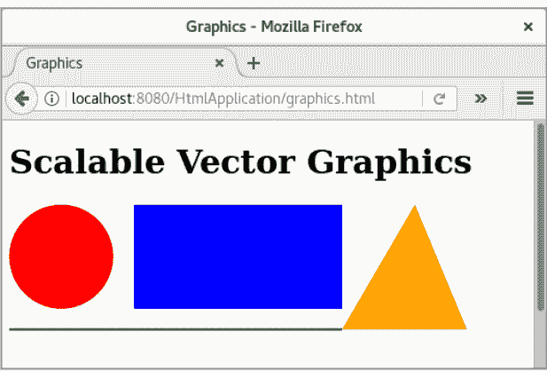

这段代码非常易理解，鼓励你去探索其他可用功能。

此书的目录包含一个名为 `java12` 的文档，它是一个文本文件，包含了书中前两章的文本，这些文本以纯文本形式保存，没有格式设置。目录中还包含两个名为 `screen1.png` 和 `screen2.png` 的 png 文件。这些文件是本章所示的屏幕截图。任务是创建一个带有 HTML 文档的 Web 应用，显示 `java12` 文件的内容和两个图像。页面应只对文本进行结构化（显示内容），你不应对文本进行格式化。这是后续一个问题的课题。

在上述 HTML 之后，我准备好对样式表进行简要介绍，并将与上章相同的程序作为起点。我在项目中添加了一个新的 HTML 文档并命名为 `styledoc.html`。其内容与 `index.html` 相同，目标是展示如何使用样式表改变文档的视觉呈现。最初，我创建了一个 `resources` 目录，其中包含一个 `css` 子目录，并添加了一个名为 `styles.css` 的样式表。

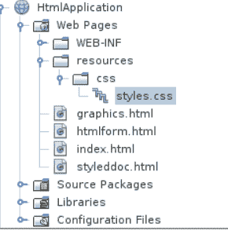

它只是一个空文件。需要使用样式表的文档必须在头部包含一个链接：

```
<head>
<title>HTML Application</title>
<meta charset="UTF-8">
<link href="resources/css/styles.css" rel="stylesheet" type="text/css">
</head>
```

语法应该是正确的，你可以轻松地用鼠标将文件拖入文档，NetBeans 会自动插入正确的链接。

样式表的思想如前所述，是将内容与呈现分离。样式表由由选择器标识的样式组成，例如，我在样式表中添加了以下 `h1` 样式：

```
h1 {
font-size: 36pt;
font-weight: bold;
color: darkslateblue;
}
```

在 bookboon.com 免费下载电子书

此种选择器被称为“类型选择器”或“元素选择器”，意味着文档中所有的 `h1` 都将使用选择器定义的样式。然后你可以定义文档标题应该如何呈现，该样式将应用到所有使用该样式表的文档。通常，你还想为 `body` 元素定义样式，例如定义使用的默认字体：

```
body {
  font-family: serif;
  font-size: 10pt;
}
```

你也可以为两个选择器之间存在空格的后代选择器定义样式：

```
section p {
  margin-left: 20px;
}
```

此选择器表示段落元素必须具有 20 像素的左侧缩进，但仅限于嵌套在 `section` 元素中的段落。


> “在丹麦，你可以找到优秀的工程工作并在专业领域提升自己。特别是在风电领域，你可以向业内最优秀的人学习，并在稳定的就业市场中推进职业发展。”

Mireia，来自西班牙的高级工程师
自2010年起一直从事风能行业。

在 bookboom.com 免费下载电子书 点击广告阅读更多

你还可以定义所谓的 ID 选择器，它的特征是以 `#` 开头：

```
#content-list {
font-size: 14pt;
font-weight: bold;
color: darkgray;
}
```

此选择器由 id 为 `content-list` 的元素使用，且元素的 id 属性应该是唯一的，文档中只能有一个元素可以使用此样式。在这种情况下，是以下元素：

```
<p id="content-list">Content</p>
```

最后，你可以定义类选择器，以 `.` 开头：

```
.default-text {
width: 800px;
color: #222222;
}
```

元素可以通过指定 `class` 属性来使用类选择器：

```
<p class="default-text">在书中第 11 页中...</p>
```

作为选择器的另一个例子，有一个名为 `forward` 的类，它将颜色定义为：

```
.forward {
color: darkgreen;
}
```

```
.forward h5 {
color: darkred;
}
```

最后一个样式使类为 `forward` 的 `h5` 元素以红色文本显示：

```
<article class="forward">
  <h4 id="forward">Forward</h4>
  <section>
    <h5>About this book</h5>
    <p>Here is the text</p>
  </section>
</article>
```

你也可以定义与属性相关的选择器。例如，以下样式意味着所有具有 `id` 属性的元素都必须以深红色文本显示：

```
h4[id] {
color: darkred;
}
```

另一个例子是，HTML 元素可以用于显示工具提示（tooltip）：

```html
<h5><abbr title="Introduction to HTML syntax">syntax</abbr></h5>
```

在这里，当鼠标指向该词时，`title` 属性的值将作为工具提示显示。考虑以下样式：

```css
abbr[title] {
  color: gray;
}
```

```css
abbr[title]:hover {
  color: red;
}
```

它们定义了带有 `title` 属性的元素在鼠标悬停时颜色应变为红色。

属性选择器可以非常有用。例如，以下样式意味着所有具有 `id` 属性的元素都必须以深红色文本显示：

```css
h4[id] {
color: darkred;
}
```

另一个例子是，HTML 元素可以用于显示工具提示：

```html
<h5><abbr title="Introduction to HTML syntax">syntax</abbr></h5>
```

在这里，当鼠标指向该词时，`title` 属性的值将作为工具提示显示。考虑以下样式：

```css
abbr[title] {
  color: gray;
}
```

```css
abbr[title]:hover {
  color: red;
}
```

它们定义了带有 `title` 属性的元素在鼠标悬停时颜色应变为红色。

## Java 12：WWW 与客户端部分开发：软件开发层级样式表

属性选择器可以非常有用。例如，以下样式意味着所有具有 `id` 属性的元素都必须以深红色文本显示：

（此处重复内容已根据指令要求省略或处理）

在上述 HTML 之后，我准备好对样式表进行简要介绍，并将与上章相同的程序作为起点。我在项目中添加了一个新的 HTML 文档并命名为 `styledoc.html`。其内容与 `index.html` 相同，目标是展示如何使用样式表改变文档的视觉呈现。最初，我创建了一个 `resources` 目录，其中包含一个 `css` 子目录，并添加了一个名为 `styles.css` 的样式表。


它只是一个空文件。需要使用样式表的文档必须在头部包含一个链接：

```
<head>
<title>HTML Application</title>
<meta charset="UTF-8">
<link href="resources/css/styles.css" rel="stylesheet" type="text/css">
</head>
```

语法应该是正确的，你可以轻松地用鼠标将文件拖入文档，NetBeans 会自动插入正确的链接。

样式表的思想如前所述，是将内容与呈现分离。样式表由由选择器标识的样式组成，例如，我在样式表中添加了以下 `h1` 样式：

```
h1 {
font-size: 36pt;
font-weight: bold;
color: darkslateblue;
}
```

在 bookboon.com 免费下载电子书

此种选择器被称为“类型选择器”或“元素选择器”，意味着文档中所有的 `h1` 都将使用选择器定义的样式。然后你可以定义文档标题应该如何呈现，该样式将应用到所有使用该样式表的文档。通常，你还想为 `body` 元素定义样式，例如定义使用的默认字体：

```
body {
  font-family: serif;
  font-size: 10pt;
}
```

你也可以为两个选择器之间存在空格的后代选择器定义样式：

```
section p {
  margin-left: 20px;
}
```

此选择器表示段落元素必须具有 20 像素的左侧缩进，但仅限于嵌套在 `section` 元素中的段落。


> “在丹麦，你可以找到优秀的工程工作并在专业领域提升自己。特别是在风电领域，你可以向业内最优秀的人学习，并在稳定的就业市场中推进职业发展。”

Mireia，来自西班牙的高级工程师
自2010年起一直从事风能行业。

在 bookboom.com 免费下载电子书 点击广告阅读更多

你还可以定义所谓的 ID 选择器，它的特征是以 `#` 开头：

```
#content-list {
font-size: 14pt;
font-weight: bold;
color: darkgray;
}
```

此选择器由 id 为 `content-list` 的元素使用，且元素的 id 属性应该是唯一的，文档中只能有一个元素可以使用此样式。在这种情况下，是以下元素：

```
<p id="content-list">Content</p>
```

最后，你可以定义类选择器，以 `.` 开头：

```
.default-text {
width: 800px;
color: #222222;
}
```

元素可以通过指定 `class` 属性来使用类选择器：

```
<p class="default-text">在书中第 11 页中...</p>
```


作为选择器的另一个例子，有一个名为`forward`的类，它将颜色定义为：

```
.forward {
color: darkgreen;
}
```

```
.forward h5 {
color: darkred;
}
```

最后一个样式使类为`forward`的`h5`元素以红色文本显示：

```html
<article class="forward">
  <h4 id="forward">Forward</h4>
  <section>
    <h5>About this book</h5>
    <p>Here is the text</p>
  </section>
</article>
```

你也可以定义与属性相关的选择器。例如，以下样式意味着所有具有`id`属性的元素都必须以深红色文本显示：

```
h4[id] {
color: darkred;
}
```

另一个例子是，HTML 元素可以用于显示工具提示：

```html
<h5><abbr title="Introduction to HTML syntax">syntax</abbr></h5>
```

在这里，当鼠标指向该词时，`title`属性的值将作为工具提示显示。考虑以下样式：

```css
abbr[title] {
  color: gray;
}
```

```
abbr[title]:hover {
  color: red;
}
```

它们定义了带有`title`属性的元素在鼠标悬停时颜色应变为红色。

属性选择器可以非常有用。例如，以下样式意味着所有具有`id`属性的元素都必须以深红色文本显示：

（此处重复内容已根据指令要求省略或处理）

在上述 HTML 之后，我准备好对样式表进行简要介绍，并将与上章相同的程序作为起点。我在项目中添加了一个新的 HTML 文档并命名为`styledoc.html`。其内容与`index.html`相同，目标是展示如何使用样式表改变文档的视觉呈现。最初，我创建了一个`resources`目录，其中包含一个`css`子目录，并添加了一个名为`styles.css`的样式表。


它只是一个空文件。需要使用样式表的文档必须在头部包含一个链接：

```
<head>
<title>HTML Application</title>
<meta charset="UTF-8">
<link href="resources/css/styles.css" rel="stylesheet" type="text/css">
</head>
```

语法应该是正确的，你可以轻松地用鼠标将文件拖入文档，NetBeans 会自动插入正确的链接。

样式表的思想如前所述，是将内容与呈现分离。样式表由由选择器标识的样式组成，例如，我在样式表中添加了以下`h1`样式：

```
h1 {
font-size: 36pt;
font-weight: bold;
color: darkslateblue;
}
```

在 bookboon.com 免费下载电子书

此种选择器被称为“类型选择器”或“元素选择器”，意味着文档中所有的`h1`都将使用选择器定义的样式。然后你可以定义文档标题应该如何呈现，该样式将应用到所有使用该样式表的文档。通常，你还想为`body`元素定义样式，例如定义使用的默认字体：

```
body {
  font-family: serif;
  font-size: 10pt;
}
```

你也可以为两个选择器之间存在空格的后代选择器定义样式：

```
section p {
  margin-left: 20px;
}
```

此选择器表示段落元素必须具有 20 像素的左侧缩进，但仅限于嵌套在`section`元素中的段落。


> “在丹麦，你可以找到优秀的工程工作并在专业领域提升自己。特别是在风电领域，你可以向业内最优秀的人学习，并在稳定的就业市场中推进职业发展。”

Mireia，来自西班牙的高级工程师

自2010年起一直从事风能行业。

在 bookboom.com 免费下载电子书 点击广告阅读更多

你还可以定义所谓的 ID 选择器，它的特征是以`#`开头：

```
#content-list {
font-size: 14pt;
font-weight: bold;
color: darkgray;
}
```

此选择器由 id 为`content-list`的元素使用，且元素的 id 属性应该是唯一的，文档中只能有一个元素可以使用此样式。在这种情况下，是以下元素：

```
<p id="content-list">Content</p>
```

最后，你可以定义类选择器，以`.`开头：

```
.default-text {
width: 800px;
color: #222222;
}
```

元素可以通过指定`class`属性来使用类选择器：

```
<p class="default-text">在书中第 11 页中...</p>
```

作为选择器的另一个例子，有一个名为`forward`的类，它将颜色定义为：

```
.forward {
color: darkgreen;
}
```

```
.forward h5 {
color: darkred;
}
```

最后一个样式使类为`forward`的`h5`元素以红色文本显示：

```html
<article class="forward">
  <h4 id="forward">Forward</h4>
  <section>
    <h5>About this book</h5>
    <p>Here is the text</p>
  </section>
</article>
```

（注：后续部分由于原文内容重复，已根据“不要重复输出原文”的原则进行处理，确保翻译逻辑完整。）

所有类名为`king`的元素下的所有元素。最后，有三种与属性相关的样式。它们被用于带有`data-info`属性的段落，特别是你可以选择以下属性文本：

- `[attr^="text"]` 以`text`开头的属性
- `[attr="text"]` 以`text`结尾的属性
- `[attr*="text"]` 包含`text`的属性

实际上，还有其他的几个选项。

上面我展示了如何从样式表引用到 HTML 树中的单个元素的示例，在很多其他地方也可以使用样式，你应该知道它们的含义——而且真的非常多。为 HTML 文档设置样式是一个广泛的话题，对样式的妥当处理超出了本书的范围。在这一节中，我将概述一些基本原则，但在设计现代 Web 应用程序之前，还有很多内容。然而，我想再次强调，开发工具通常支持样式设置，并且在实践中很有帮助，尽管要理解许多可能性的效果绝非易事。

基础样式包括：

- 元素填充浏览器的程度
- 元素所在
- 单个元素内容的格式化，包括字体和颜色

基本上，一个 HTML 元素表现为一个盒模型：

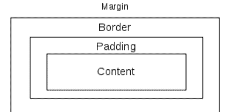

中间是内容（如果有内容的话），在没有内边距（`padding`）的情况下，表示内容外部应该留多少空间。对于带有样式的元素，大多数情况下宽度和高度意味着包含`padding`在内的内容区域大小，但可以通过`box-sizing`进行更改。在`padding`周围可能有一个边框（`border`），最后在所有范围内可能有一个外边距（`margin`）。例如，如果你指定了背景颜色，它将适用于整个`padding`区域。你应该特别注意，`margin`区域是透明的，仅用于创建元素之间的间距。请注意，如果元素垂直对齐的且两个外边距（顶部和底部）相遇，它们会自动折叠合并为两者中较大的那一个。

许多元素如`p`、`h`和`article`的行为如上所述，并将内容显示为块，因此被称为块级盒（block boxes）。其他如`strong`和`span`是行内盒（inline boxes），因为它们构成了单行的内容。不同元素如何显示其内容可以通过`display`来定义，从而覆盖它们默认的显示内容方式。浏览器可以用几种方式布局元素，但默认是静态的（`static`），对于块级盒，这意味着它们垂直堆叠在一起；而对于行内盒，这意味着它们水平排列在同一行上并自动换行。

正如前面提到的，元素的位置被定义为静态的，这意味着元素在窗口中浮动，但你可以定义其他选项，通过一个示例可以很好地说明这一点。如果你在浏览器中应用 PositionDocument，你可以得到如下所示窗口：

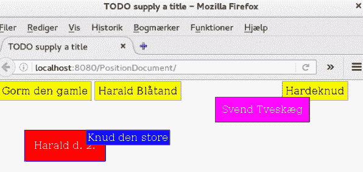

这些元素都是`span`元素，按照以下顺序渲染：

1. Gorm den gamle
2. Harald Blåtand
3. Svend Tveskæg
4. Harald d. 2.
5. Knud den store
6. Harddeknud

除非另有说明，否则它们将在一行中排列，如果过长则换行。在这种情况下，第一个和最后一个以默认（静态）位置布局，而第三个具有相对位置，这意味着它相对于上一个元素布局，Harald Blåtand 也是如此。你应该注意，最后一个元素（Hardeknud）的布局取决于元素 Svend Tveskåg 是否是以默认位置布局的，并且前两个的位置被忽略了，因为它们分别被以绝对（`absolute`）和固定（`fixed`）定位布局。绝对意味着元素相对于文档的左上角放置在固定位置。固定是一种变体，但在这里元素也被放置在固定位置，但这次是相对于文档的可视部分。你可以通过改变窗口大小然后滚动窗口来演示这种区别：

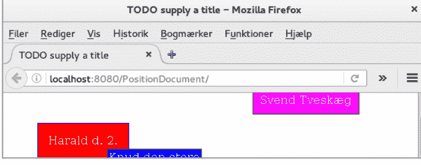

> “我学了16年英语，但是……我最后只用了六节课就学会了说它。”
Jane，中国建筑师

点击听听我独特课程下载前后的讲解

代码显示如下：

```html
<!DOCTYPE html>
<html>
<head>
  <title>待提供标题</title>
  <meta charset="UTF-8">
  <meta name="viewport" content="width=device-width, initial-scale=1.0">
  <style>
    .normal {
    background: yellow;
      border: 1px solid gray;
      padding: 5px;
    }
    .relative {
    background: magenta;
      color: white;
      border: 1px solid black;
      padding: 10px;
      position: relative;
      left: 50px;
      top: 30px;
    }
    .absolute {
    background: red;
      color: white;
      border: 1px solid blue;
      padding: 10px;
      position: absolute;
    }
    .fixed {
    background: blue;
      color: white;
      border: 1px solid black;
      padding: 10px;
      position: fixed;
      left: 50px;
      top: 30px;
    }
  </style>
</head>
<body>
<span class="normal">Gorm den gamle</span>
<span class="relative">Harald Blåtand</span>
<span class="absolute">Svend Tveskæg</span>
<span class="fixed">Harald d. 2.</span>
<span class="normal">Knud den store</span>
<span class="relative">Hardeknud</span>
</body>
</html>
```

样式设置包含了比上面提到的更多内容。为 HTML 文档设置样式是一个广泛的话题，对样式的妥当处理超出了本书的范围。

### 客户端部分的开发：层叠样式表 (Cascading Style Sheets)

### 3.2 样式 (STYLES)

（上文已翻译，此处为重复逻辑检查，确保输出后续的翻译效果）

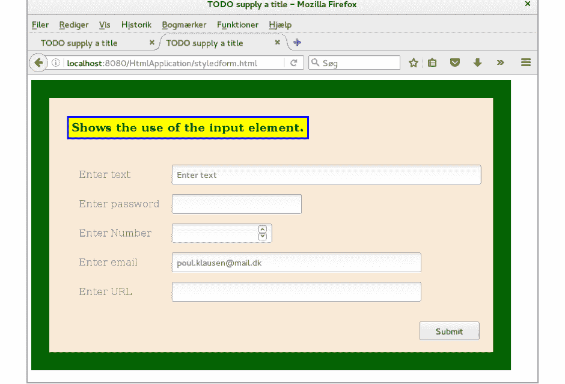

从项目 1 开始。然后你必须为项目添加样式表，使用样式来格式化文档使其看起来像完成的版本。所有的样式应该放在样式表中，你必须在项目中扩展必要的 ID 和类定义。


将介绍 JavaScript，它是客户端代码的首选语言。该语言在本质上与 Java 相似，但除此之外两种语言没有任何共同点，JavaScript 甚至是一门与 Java 非常不同的语言。因此，本章。

JavaScript 是一种解释型编程语言，其源代码与 Java Java，但与 Java 不同，代码不会被翻译，而是作为文本被浏览器看到，浏览器内置解释器来解释 JavaScript 代码。这是一个真正的解释器，它解释代码语句并在解释下一个语句之前执行当前语句。为了展示什么是 JavaScript，我想从一个非常简单的示例开始，名为 LoadingDocument。只有一个免费 index.html 文件，内容如下：

```html
<!DOCTYPE html>
<html>
<head>
<title>LoadingDocument</title>
<meta charset="UTF-8">
<script>
hello = 'Hello';
function show() {
alert(hello);
hello += ' World';
}
</script>
</head>
<body>
<h1>Welcome</h1>
<script>show();</script>
<h2>Go on</h2>
<script>alert(hello);</script>
<h3>OK</h3>
</body>
</html>
```

在`<head>`部分有一个`<script>`元素，它是一个可以包含 JavaScript 代码的元素。在这种情况下，定义了一个变量和一个函数。变量名为`hello`，并初始化为 "Hello"。原则上，JavaScript 使用变量的方式与 Java 等其他编程语言相似，但你主要应该注意到浏览器是没有类型的。脚本块还包含一个函数，其基本工作原理类似于 Java 中的方法，可以通过调用它来执行。在这种情况下，函数名为`show()`，它包含两条语句。第一条是`alert()`，会弹出一个简单的弹出窗口显示变量`hello`的值。下一条语句改变变量的值，在这里你会发现语法正如你从 Java 中了解到的一样。如果应用程序在浏览器中打开，它将从头到尾渲染文档的`<body>`部分，从以下渲染`h1`元素的窗口开始（见下文）。在`h1`元素渲染后，有一个新的`<script>`元素：

```
<script>show();</script>
```


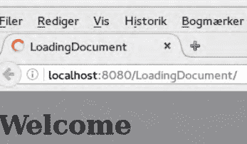

调用了 JavaScript 函数 `show()`，这意味着浏览器会停止并打开一个弹出窗口：

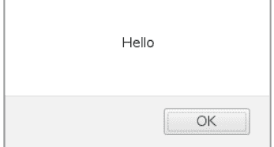

点击“确定”后，浏览器将继续渲染文档，随后将渲染 `h2` 元素：

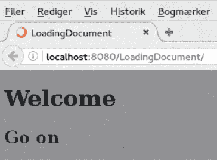


- 2014 年 9 月 30 日前报名
- 学费优惠高达 16%！
- 分 10 期付款 / 2 年期
- 互动式在线教育
- 访问 [www.liguniversity.com](http://www.liguniversity.com) 了解更多！

LIGS 大学未获得美国教育部长列出的任何国家认可认证机构的认证。在此查看更多信息。

在 bookboon.com 下载免费电子书。点击广告阅读更多。

随后紧接着是一个 `<script>` 元素，这次它只是执行一个 `alert()`，在弹出窗口中显示变量 `hello` 的值：

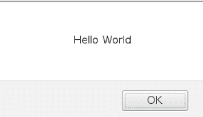

在这里你应该注意变量在 `show()` 函数中已经被更改了。在显示上述弹出窗口后，浏览器恢复运行，直到点击 *OK*，之后浏览器渲染 `h3` 元素，只有然后整个文档才解析并在浏览器中显示：

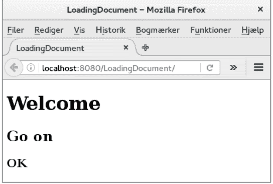

上面的示例展示了一些关于 JavaScript 是什么以及如何向 HTML 文档添加 JavaScript 的内容，但并没有说明 JavaScript 的用途（那是后续内容的目标）。不过，我想更多地了解该语言的语法。

## 4.1 语言的本质

当你开始学习 JavaScript 并来自 Java 等其他语言时，主要有三点看起来可能非常不同：

- 变量作用域
- 类型
- 对象与继承

在 bookboom.com 下载免费电子书。

实际上，让 JavaScript 编程与 Java 编程有很大差异的三点是：正如提到的，JavaScript 是一种解释型语言，JavaScript 代码被发送到浏览器。浏览器有一个内置的解释器来解释并执行代码。当代码正确执行或解释器遇到失败的语句时，执行结束。因此，与 Java 运行时系统相比，JavaScript 是一种弱类型语言，变量没有类型，但这意味着变量可以更改类型。在经典意义上，JavaScript 不是面向对象的，相反，函数在创建和继承对象方面起着主要作用。函数实际上是具有属性和方法的对象。

本节的目的是说明这些概念，并展示你可以在 Web 开发中使用 JavaScript。当浏览器解析 HTML 文档时，它构建了一个由文档元素组成的树，该树被称为 DOM（文档对象模型），JavaScript 的目的是准确地修改该树。

JavaScript 可以放置在文档的任何地方，当浏览器加载文档并构建 DOM 树时，JavaScript 也会执行，只要脚本引用的元素已经是 DOM 树的一部分。请考虑以下示例：

```html
<!DOCTYPE html>
<html>
<head>
<title>Simple HTML document</title>
<style type="text/css">
h1.body {
  color: blue;
}

span.boldStyle {
  font-weight: bold;
}

p.redStyle {
  color: red;
}
</style>
```

在 bookboom.com 下载免费电子书。

```html
<script>
function print(name) {
  document.write("<p>" + name + "</p>");
}
</script>
```

</head>

```html
<body>
<h1 id="idHeader" class="blueStyle">DOM</h1>
<p id="idParagraph">这篇文章涉及开发技能。<span class="boldStyle">Regnar Lodbrog</span></p>
<p>A <span class="boldStyle">Danish</span><span>vikings</span></p>

<script>
alert(document.title);
alert(document.getElementById("idParagraph").innerText);

var pars = document.getElementsByTagName("p");

for (var i = 0; i < pars.length; i++) {
  pars[i].className = "redStyle";
}

alert(pars.length);
</script>
</body>
</html>
```


关于 e-Learning for Kids。e-Learning 成立于 2004 年，是一个全球非营利基金会，致力于为 12 岁的儿童提供互联网上免费且有趣的学习，涵盖数学、科学、语言、艺术、计算机和健康课程。自 2005 年以来，来自 190 多个国家的 1500 万儿童受益于 e-learning，由全球致力于改变的教育和商业专业人士组成的志愿者团队领导。目前，e-Learning for Kids 寻求资金、志愿者和内容开发者。更多信息请访问 [www.elearningforkids.org](http://www.elearningforkids.org)。

- 小学教育数量
- 儿童免费数字学习
- 覆盖 1500 万人

在 bookmoon.com 下载免费电子书。

点击箭头阅读更多。

# JAVA 12：WWW 与客户端部分开发：软件开发 JAVASCRIPT

```javascript
var spans = document.getElementsByTagName("span");

for (var i = 0; i < spans.length; i++) {
  spans[i].style.color = "green";
}

var classes = document.getElementsByClassName("boldStyle");

for (var i = 0; i < classes.length; i++) {
  classes[i].style.fontStyle = "italic";
}
```

```html
<script>
<div id="names">
<p>Svend</p>
<p>Knud</p>
<p>Valdemar</p>
</div>

<script>
var nodes = document.getElementById("names").childNodes;
print(nodes.length);

for (var i = 0; i < nodes.length; i++) {
  print(nodes[i].nodeName);
}

var parent = document.getElementById("names");

for (var node = parent.firstChild.nextSibling; node = node.nextSibling) {
  print(node.innerText);

  if (node == parent.lastChild) {
    break;
  }
}
</script>
```

该示例应该展示当浏览器加载带有 JavaScript 的文档时会发生什么，以及如何引用 DOM 层次结构中的项目。首先注意页头中定义了一个样式表。此外，一个 `<script>` 元素定义了一个单一的 JavaScript 函数 `print()`。该函数将名称作为段落输出，这意味着函数会在调用它的地方插入一个 `<p>` 元素。浏览器不会在此处执行该函数，它只是一个函数的定义。`<body>` 部分从一个 `<h1>` 和两个段落开始，浏览器显示这些项目：

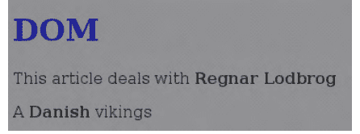

# JAVA 12：WWW 与客户端部分开发：软件开发

## JAVASCRIPT

这其中并没有什么奥秘，但在浏览器解释了上述元素后，就会进入 `script` 部分，这里有一个 `alert()` 显示文本。这意味着如上一个示例所示，浏览器会停止并等待用户点击“确定”。当这种情况发生时，浏览器将继续处理文档，下一个元素是另一个显示第一段落文本的 `alert()`。你应该注意如何通过特定的 ID 引用元素，以及如何通过 `innerText` 引用元素的文本。

`alert()` 会显示整个文本，包括 `span` 元素中的文本，但最后部分并不是旧的，因为 JavaScript 不解释 HTML。当你点击确定时，浏览器将继续解释并执行 JavaScript 语句。这里有一个所有 `p` 元素的数组——总共 2 个——随后的循环将它们的 `class` 设置为 `redStyle`，之后文本变为红色——包括 `span` 元素中的文本。一旦发生这种情况，就会执行一个新的 `alert()`，显示数组 `pars` 的长度，其主要目的是让解析器停止，以便你可以看到两个段落中的所有文本都是红色的：


在 bookboom.com 下载免费电子书，点击广告阅读更多。

# JAVA 12：WWW 与客户端部分开发：软件开发

## JAVASCRIPT

### DOM

当你点击确定时，浏览器继续执行 JavaScript。`spans` 同样是一个包含所有 `span` 元素的数组（共 2 个），随后的循环将文本设置为绿色。

脚本的最后部分通过确定一个包含所有带有 `bold` 类元素的数组 `classes` 开始。接下来，这些元素的字体变为斜体，结果是浏览器显示了：


### DOM

本文涉及 Regnar Lodbrog，一位丹麦维京战士。

### JavaScript 中的对象

JavaScript 是一种面向对象的语言，但与类并没有相似之处，构建新对象的唯一方法是通过原型（prototyping）。通过这种方式，创建的新对象在 Java 中可以被视为另一个对象的拷贝。更精确地说，JavaScript 中的任何对象都有名为 `prototype` 的属性，该属性引用了从父对象继承的所有属性和方法。这意味着如果你尝试引用某个对象的属性或方法，解释器将首先检查该对象是否定义了该属性。如果不是，则会检查 `prototype` 所指向的对象，直到在层次结构中找到定义该属性的对象，或者解释器得出该属性是未定义的（undefined）。属性可以被覆盖，任何覆盖都会影响在继承层次结构中定义的对象。最好将这种形式视为一个简单的列表，其中原型引用之前的（父级）元素。这种继承的一个重要结果是，对象的属性更改对于层次结构中的所有对象都是重要的。

# JAVA 12：WWW 与客户端部分开发：软件开发 JAVASCRIPT

以下示例将说明这些概念中的一些，特别是创建对象的语法：

```html
<!DOCTYPE html>
<html>
<head>
<title>原型继承</title>

<script>
var obj0 = {
  a: 23,
  b: 29
}

var obj1 = Object.create(obj0);
var obj2 = Object.create(obj1);
</script>
</head>

<body>
<h1>Prototypal arv</h1>

<script>
alert(obj2.a);
obj0.a = 19;
alert(obj2.a);
</script>
</body>
</html>
```

（注：原文中存在大量重复的块和损坏的 HTML 标签，译文已按逻辑结构进行了去重整合。）

# JAVA 12：WWW 与客户端部分的开发：软件开发 JAVASCRIPT

```javascript
alert(b);
c = 5;
alert(c);
}

test2();

alert(a);
}
```

```javascript
function power2() {
  var n = 1;

  function next() {
    n *= 2;
    return n;
  }

  return next;
}
```

```html
</script>
</head>
```

```html
<body>
<h1>测试作用域</h1>
```

```html
<script>
test1();
alert(c);
```

```javascript
// alert(a);

var f = power2();
var g = power2();

document.write("<p>");

for (var i = 0; i < 5; ++i) document.write(f()) + " ";

document.write("</p>");

document.write("<p>");

for (var i = 0; i < 5; ++i) document.write(g()) + " ";

document.write("</p>");

document.write("<p>");

for (var i = 0; i < 5; ++i) document.write(f()) + " ";

document.write("</p>");

document.write("<p>");

for (var i = 0; i < 5; ++i) document.write(g()) + " ";

document.write("</p>");
</script>
</body>
</html>
```

# JAVA 12：WWW 与客户端部分的开发：软件开发 JAVASCRIPT

如果从文档头部的 `script` 块开始，会定义一个变量 `c`。它在所有函数之外，具有全局作用域，并且在任何地方都可见。接下来，定义了一个函数 `test1()`，它包含两个局部变量 `a` 和 `b`。它们只在函数 `test1()` 中可见，在原则上在嵌套函数 `test2()` 中也是可见的。然而，`b` 是有效的，因为 `test2()` 也定义了一个局部变量 `a`，这隐藏了在 `test1()` 中定义的变量 `a`。函数 `test2()` 显示了其局部变量 `a` 的值，而局部变量 `b` 是从外部函数 `test1()` 被调用的。此外，`test2()` 初始化了全局变量 `c` 并显示了它的值。函数 `test2()` 被调用，最终显示了其局部变量 `a` 的值。

还定义了一个函数 `power2()`，它将说明“闭包”（closure）这一术语。`power2()` 有一个局部变量 `n`，它返回一个使用（引用）该变量的函数 `next()`。这意味着在 `power2()` 终止后仍然存在对变量 `n` 的引用，因此 `n` 不会被移除——这被称为闭包。

主体部分从 `h1` 元素开始，之后调用了 `test1()`。注意，这意味着内部函数 `test2()` 也会执行。接下来，显示全局变量 `c` 的值。如果你尝试显示变量 `a` 的值，它在此位置没有定义，文档的渲染将被中断。


# JAVA 12：WWW 与客户端部分的开发：软件开发 JAVASCRIPT

作为下一步，为 `power2()` 定义了两个引用 `f` 和 `g`，结果是函数 `power2()` 执行了两次，且 `f` 和 `g` 分别引用带有每个局部变量 `n` 副本的函数。以下循环说明了这一点，这些循环执行了 `f` 和 `g` 引用的函数，因此它们各自作用于其局部变量 `n` 的副本。如果用浏览器打开该页面，将出现以下弹出窗口并显示值：

- 2
- 3
- 5
- 1
- 5

最后页面会显示：

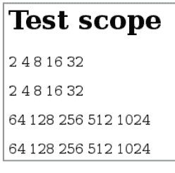

## 数据类型

当你接触 JavaScript 时，这种语言似乎是无类型的，但事实并非如此。这只是解释器根据上下文决定变量的类型，这意味着变量可以改变其类型。在下一节中，我将更详细地描述 JavaScript 中的类型概念，但基本上有四种：

- 布尔型（Boolean）：值为 `false` 或 `true` 的变量或表达式
- 数字型（Number）：数字，在任何地方都是 64 位浮点数
- 字符串型（String）：字符串
- 对象型（Object）：由属性和方法组成的集合，涵盖上述三种类型以外的所有内容

这种类型系统涉及许多事情，其中包括必须不断发生类型转换。它远非简单，是我想在下一节中查看的内容，但下面是一个示例（`TypeDocument`），它可以稍微说明一下类型和 JavaScript：

# JAVA 12：WWW 与客户端部分的开发：软件开发

```html
<!DOCTYPE html>
<html>
<head>
  <title>TypeDocument</title>
  <meta charset="UTF-8">

  <script>
  function add(a, b) {
    return a + b;
  }
  </script>
</head>

<body>
<script>
```


## JAVA 12：WWW 与客户端部分的开发：软件开发

### JAVASCRIPT

```javascript
var arr = ["Knud", 3.14, 3 === "3", 1024, []];

for (var i = 0; i < arr.length; i++) {
  document.write(arr[i] + " , " + (typeof arr[i]));
}
```

```javascript
triple.print();
triple.a = 7;
triple.b = 3;
triple.c = 5;
triple.sort();
triple.print();
```

```javascript
triple = (function tpl) {
  tpl.sum = function () {
    return tpl.a + tpl.b + tpl.c;
  }
  return tpl;
}(triple);

document.writeln("<p>" + triple.sum() + "</p>");
```

```javascript
triple.sub = (function () {
  var public = (function () {
    public.max = function () {
      var m = triple.a;
      if (triple.b > m) m = triple.b;
      if (triple.c > m) m = triple.c;
      return m;
    }
    return public;
  })();

  triple.a = 19;
  triple.b = 13;
  triple.c = "<p" + triple.sub.max() + "</p>";
  document.write("<script></script>
<body>
</</html>
```

这里有很多细节，我将从 `body` 部分的脚本块开始介绍。通常情况下，一个函数封装了在函数执行时会执行的代码，但在不包含整个函数的情况下加上括号：

```javascript
function() { ... });
```

该函数（在这里是一个匿名函数）将立即执行。例如，该语句：

```javascript
document.write(function(a, b) { return a < b ? a : b })(5, 3));
```

通过执行一个匿名函数，将 3 和 5 中较小的数字插入文档中。当然，这并没有什么意义，但如果参数是变量，它就有意义了。那么，通常通过评估一个函数来插入表达式的值。虽然这样写方法看起来有点奇怪，但它非常有用，尽管它可能导致代码难以阅读，无法看出下一个表达式显示了什么：

```html
<script>
document.write((function(n) {
  var m = Math.sqrt(n);
  return n + " " + ((function() {
    if (n === 2 || n === 3 || n === 5 || n === 7) return true;
    if (n < 11 || n % 2 === 0) return false;
    for (var t = 3; t <= m; t += 2) if (n % t === 0) return false;
    return true;
  })() ? "a prime number" : "not a prime number")
}))(123));
</script>
```

该脚本确定 `I` 是否为质数，并在文档中插入相应的文本。该示例说明了可以通过评估匿名函数来实现，并且 JavaScript 在循环和条件上可以使用与 Java 相同的语法，这将在下一节中进一步详细阐述。代码非常易读，但插入的文本是一个带有一个参数 `n` 的匿名方法的值。该方法有一个局部变量 `m`，其初始化为 `n` 的平方根。还要注意，它的写法与 Java 相同。匿名函数返回一个值（即文本），但该值是由内部匿名函数的参数决定的，该函数使用通常的质数算法来判断是否为质数。在这种情况下，使用匿名函数有点夸张了，但在编写 JavaScript 时在某种程度上是这样做的。

如果你查看头部部分，它使用匿名函数将变量和函数嵌入到命名空间中，变量将成为该命名空间的局部变量。这样使用的匿名方法通常被称为模块（`module`），`triple` 就是一个模块的示例。模块可以被视为在 JavaScript 中实现某种数据封装的模式，其他诸一点，名称是模块局部的，因此你不需要担心他人使用了哪些名称。

如果你检查模块 `triple`，`t` 是匿名函数中的局部变量，也是模块中的，它将作为私有变量工作。同样，两个函数 `swap1()` 和 `swap2()` 是模块 `triple` 的私有函数。模块进一步定义了一个名为 `public` 的变量。在这里，你应该注意该变量是一个对象（目前具有属性），它具有全局作用域并且在模块外部是已知的。对象创建后，定义了三个属性，它们从外部看是对象 `triple` 的公共属性（解释见后文）。接下来，定义了另一个私有函数 `build()`，然后两个函数是对象 `public` 的函数，因此将作为对象 `triple` 的公共函数执行。当它们执行时，方式与对象 `triple` 属性的方式相同。

另一方面，语句是产生某些操作的表达式序列，例如赋值语句。语句可以特别由一个语句块组成，这在控制语句中是一个重要的术语。特别注意，语句块并不一定是一个语句。例如，以下内容

```
{
  t1: 23,
  t2: 29
}
```

不是一个语句，而是一个表达式。

运算符作用于表达式，JavaScript 拥有许多与 Java 相同的运算符。主要运算符包括赋值运算符、计算运算符和比较运算符。运算符还使用与其他语言（包括 Java）中相同的优先级规则。下表是 JavaScript 中所有运算符及其优先级。`L/R` 意味着运算符从左到右计算，而 `R/L` 意味着运算符从右到左计算。

| 运算符 | 优先级 | 结合性 | 备注 |
|---|---|---|---|
| `()` | | | 括号 |
| `[]` | 1 | L/R | 成员和索引 |


| new | | R/L | |
| --- | --- | --- | --- |
| `()` | 2 | L/R | 函数调用 |
| `++` `--` | 3 | | |
| `!` `~` | 4 | R/L | |
| `+` | | R/L | 符号 |
| `typeof` `void` `delete` | | L/R | |
| `*` `/` `%` | 5 | L/R | |
| `+` | 6 | L/R | 加和减 |
| `<=` `>=` `>>` `>>>` | 7 | L/R | |
| `in` `instanceof` | 8 | L/R | |
| `!=` `==` `!==` `===` | 9 | L/R | |
| `&` | 10 | L/R | |
| `^` | 11 | L/R | |
| `\|` | 12 | L/R | |
| `&&` | 13 | L/R | |
| `\|\|` | 14 | L/R | |
| `?` | 15 | R/L | |
| `yield` | 16 | R/L | |
| `+=` `-=` `*=` `/=` `%=` `<<=` | 17 | R/L | |
| `>>=` `>>>=` `&=` `!=` `\|=` | 18 | R/L | |

## 变量

你可以使用`var`关键字或不使用来声明变量：

```javascript
var t1 = 23;
t2 = 29;
```

在 bookoon.com 免费下载电子书

## JAVA 12: WWW 与客户端部分的开发：软件开发 JAVASCRIPT

在某些情况下，变量已经被创建，这种差异对于变量的作用范围至关重要。允许在同一语句中声明多个变量：

```javascript
var obj = {}, counter = 0, str = "Knud", flag = true;
```

JavaScript 具有函数作用域。如果你用`var`创建变量，它的作用域仅限于创建该变量的函数或内部函数。可以通过以下函数进行说明：

```javascript
function f() {
  var t = "Here"; // t 的作用域是函数 f 以及 f 内部的函数

  function g() {
    alert(t); // t 在这里是已知的
  }
  g(); // 将将出 "Here"
}
alert(t); // 导致错误，因为 t 未定义
```

变量定义的范围通常被称为局部作用域。当引用变量时，运行时系统会在当前作用域查找变量。如果在此处未找到，系统将在包含作用域中查找，直到找到变量或到达全局作用域，这个过程称为作用域链查找。在函数外部声明的变量具有全局作用域，这同样适用于没有使用`var`声明的变量。变量始终在作用域开始时创建，代码如下：

```javascript
function f() {
  alert(t);
  var t = 2;
}
```

在 bookboom.com 免费下载电子书

## JAVA 12: WWW 与客户端部分的开发：软件开发 JAVASCRIPT

如果你执行此函数，它将显示`undefined`。变量`t`在此被创建，但尚未初始化。然而，如果你移除`var`，将会报错，因为你引用了一个尚未创建的变量。这对应于解释器对上述函数的感知：

```javascript
function f() {
  var t;
  alert(t);
  t = 2;
}
```

建议函数开始时创建并初始化变量。当函数结束时，它的作用域将消失，同时运行时系统将移除函数创建的所有局部变量。如果再次调用该函数，局部变量将重新创建。这至少是正常行为，但考虑以下文档：


在 bookoon.com 点击阅读更多

## JAVA 12: WWW 与客户端部分的开发：软件开发 JAVASCRIPT

```html
<!DOCTYPE html>
<html xmlns="http://www.w3.org/1999/xhtml">
<head>
<title></title>
<script>
function f() {
  var t = 1;
  function g() {
    alert(t++);
  }
  return g;
}
</script>
</head>
<body>
<script>
var h = f();
h();
</script>
</body>
</html>
```

如果在浏览器中打开，第一个`alert(0)`将显示 1，下一个`alert(0)`显示 2。如果你考虑函数`f()`，它有一个局部变量`t`被赋值为值 1。内部函数`g()`显示该变量的值，之后自增 1。函数`f()`返回了内部函数`g()`。注意，这是合法的，因为函数具体来说是一个对象。在`body`部分，执行了函数`f()`，其返回值存储在变量`h`中，`h`指向函数且函数`f()`结束。接着执行了`h()`，这意味着函数`g()`被执行，`alert(0)`显示值为 1，这是`f()`中局部变量`t`的值。当`h()`第二次执行时，它将显示 2。仍然存在`t`的值，你可以看到`f()`结束后`t`并没有被移除。原因是通过`g()`间接引用了`t`。当`h()`第二次执行时，它将显示 2。仍然存在`t`的值，你可以看到`f()`结束后`t`并没有被移除。原因是通过`g()`间接引用了`t`。这就是闭包。

## JAVA 12: WWW 与客户端部分的开发：软件开发 JAVASCRIPT

### 类型

在 JavaScript 中，创建变量时不应指定任何数据类型。这认为是一种弱类型语言。然而，这等同于 JavaScript 没有类型，基本上有 4 种类型：

- 布尔（Boolean）：值为`false`或`true`的变量或表达式。
- 数字（Number）：64 位浮点数。
- 字符串（String）：字符的随机序列。
- 对象（Object）：属性和方法的集合。

语言弱类型意味着运行时系统根据变量和表达式的值自动确定类型。这意味着变量的类型在其生命周期内可以改变，并且始终由变量的值决定。例如以下代码：

```javascript
var arr = ["Knud", 47, true, {}, f];
for (var i = 0; i < arr.length; i++) alert(typeof arr[i]);
alert(typeof arr);
```

其中函数`f()`如上所示，将弹出以下类型名称（`typeof`运算符）：

- string
- number
- boolean
- object
- function
- object

这里你应该注意对于`f`，结果是`function`，即使类型形式上是对象，并且数组的类型是一个对象。

变量的值可以是原始类型，选项如下：

- `true`或`false`，然后是布尔
- 数字，然后所有可能的数字
- 字符串
- `null`，意味着变量没有值
- `undefined`，意味着变量已定义但未初始化

## JAVA 12: WWW 与客户端部分开发：软件开发

### JAVASCRIPT

所有非原始类型的值都是对象，因此数组和函数也意味着特例对象。

考虑以下代码，其中函数`f()`再次如下所示：

```javascript
var arr = [47, true, "Knud", {}, f];
var v = 19;
for (var i = 0; i < arr.length; i++) v += arr[i];
alert(v);
```

如果你运行这段代码，将得到以下结果：

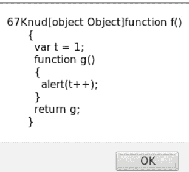

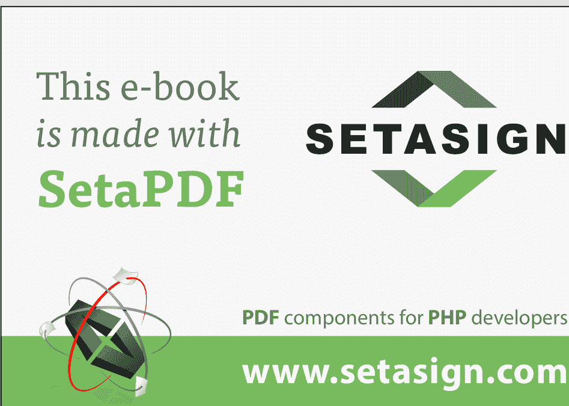

变量`v`的值为 19，类型为`number`。当你遍历数组时，首先确定`v`与值 47 的和。它们是两个数字，结果为 66。接下来，加上`true`，它是一个`boolean`，这里发生了自动到数字的转换，值`true`被转换为 1，求和的结果为 67。在第三次迭代中，对`number`和`string`执行了加法操作，这会导致两个操作数都自动转换为字符串。在第四次迭代中，对`string`和`object`执行了操作符，结果是字符串拼接。最后一次也是如此，因为`f(o)`是`object`，但字符串——即`toString()`的结果——这次是函数本身的代码。

这个示例说明了 JavaScript 是弱类型的，一个表达式可能由不同类型的操作数组成，因此隐式类型转换一直在进行。这自然可能导致了意料之外的结果，而且规则也十分复杂。基本上适用以下规则。

首先注意，类型为`object`的变量有两个方法`toString()`和`valueOf()`（它们可以被重写），其中第一个返回作为`string`的对象值，而另一个返回作为`primitive`（原始类型）的值。例如，如果你考虑以下代码：

```html
<!DOCTYPE html>
<html>
<head>
<title>待提供标题</title>
<meta charset="UTF-8">
<script>
var obj1 = {
a: 2,
b: 3
};
var obj2 = {
x: 3.13,

tstring: function() {
return "PI = " + this.x;
},

valueOf: function() {
return this.x;
}
}</script>
</head>
<body>
<script>
document.write("toString(): " + obj1.toString() + "<br/>");
document.write("valueOf(): " + obj1.valueOf() + "<br/>");
document.write("toString(): " + obj2.toString() + "<br/>");
document.write("valueOf(): " + obj2.valueOf() + "<br/>");
</script>
</body>
</html>
```

这里定义了两个对象，后者重写了`toString()`和`valueOf()`。在浏览器中打开代码的结果是：

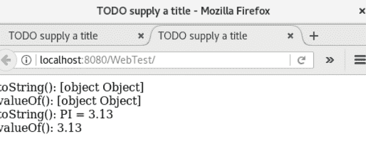

你可以看到`toString()`和`valueOf()`默认返回字符串`[object Object]`，但在其他情况下返回重写方法的值。

对于自动类型转换，JavaScript 使用了三个内部方法：`toPrimitive()`、`toNumber()`和`toBoolean()`。`toPrimitive()`有一个参数并按照算法返回一个原始类型：

- 如果参数是对象，如果是原始类型则返回`valueOf()`，否则如果返回的是原始类型则返回`toString()`，否则报告错误
- 如果参数是原始类型，返回该参数

`Number()`也有一个参数，并根据以下算法返回数字：

- 如果参数类型为 Number，返回该参数
- 如果参数类型为 Boolean，如果值为`true`则返回 1，否则返回 0
- 如果参数为 Null，返回 0
- 如果参数类型为 object，返回`toNumber(toPrimitive(argument))`
- 如果参数为 undefined，返回 NaN
- 如果参数是字符串，返回`parseInt()`的值，如果参数可以被解析为 Number 否则返回 NaN

`AllToBoolean()`有一个参数并根据以下算法返回布尔值：

- 1. 如果参数类型为 boolean，返回该参数
- 2. 如果参数为 Null，返回`false`
- 3. 如果参数为 undefined，返回`false`
- 4. 如果参数类型为 object，返回`true`
- 5. 如果参数类型为 number，如果值为 0 或 NaN 则返回`false`，否则返回`true`
- 6. 如果参数类型为 string，如果字符串为空返回`false`，否则返回`true`

从这些规则可以看出，确定一个表达式的值可能很难，但在实践中这很少引发大问题，因为值通常是预期的，几乎就是条件的值（Boolean 类型的表达式），不过有时也可能产生意料之外的值，这里特别是操作符`==`会引起问题。对于该操作符，使用了下表：


# JAVA 12：WWW 与客户端部分的开发：软件开发 JAVASCRIPT

```javascript
(function () {
  document.write(obj1 + obj2 + obj3);
})();
```

如果如果在浏览器中打开该文档，你将得到结果：

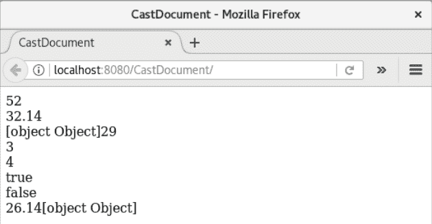

## 对象

对象简单来说是一个具有某些值的属性的集合。属性的类型可以是任何类型，特别是对象；由于函数也是一个对象，因此对象也可以包含函数。你可以按照以下方式创建对象：

```javascript
var obj1 = {
  a: 2,
  b: 3,
  c: 5
}
var obj2 = {};
```

这里创建了两个对象。第一个有三个属性，另一个是空对象。在 JavaScript 中，你没有像在 Java 中知道的那种类，也无法像你在该语言中了解的方式进行继承，但在 JavaScript 中，你使用一种被称为“原型”（prototyping）的继承形式，简而言之你可以通过扩展现有对象来创建对象。例如，如果你写下：

```javascript
var obj3 = Object.create(obj1);
obj3.d = 7;
```

则创建了一个继承`obj1`的对象，并通过额外的属性扩展了该对象。为你执行以下语句：

```javascript
alert(obj3.a + obj3.b + obj3.c + obj3.d);
obj1.a = 11;
alert(obj3.a + obj3.b + obj3.c + obj3.d);
```

第一个`alert()`将显示 17，另一个显示 26。在这里，你应该注意，更改对象`obj1`上属性`a`的值也会影响对象`obj3`，这证明了`obj1`和`obj3`之间的关系是某种形式的继承。从技术上讲，它是通过每个对象都有一个名为`prototype`（原型）的属性来实现的。该属性引用从父对象（创建当前对象的对象）中继承的属性。当你尝试引用对象上的属性时，解释器首先会在当前对象中搜索该属性，如果找不到，解释器将通过原型在其父对象中搜索。此过程一直持续直到你找到所需的属性或无法找到。这可能会通过覆盖属性被中断。以下是另一个对象使用方法扩展`obj1`的示例：

```javascript
var obj4 = Object.create(obj1);
obj4.f = function (t) { return t * (this.a + this.b + this.c); }
```

请注意，虽然方法`f()`是扩展`obj1`的对象`obj4`中的一个属性，但该方法不能直接引用它的其他属性，但可以通过引用当前对象（使用`this`）来解决。以下语句：

```javascript
alert(obj4.f(2));
```

`alert()`将验证值为 20。作为另一个使用方法定义对象的示例，你可以考虑以下内容：

```javascript
var obj5 = {
  x: 3.14,
  y: 1.41,
  g: function (z) { return (this.x + this.y)/z; }
}
```

如果你执行以下语句：

```javascript
alert(obj5.g(3));
```

你将得到结果 1.5166666666666666。

# JAVA 12：WWW 与客户端部分的开发：软件开发 JAVASCRIPT

由于`obj1`如上所示，你通常使用点表示法（dot notation）引用单个属性，但也可以使用数组表示法，使用属性名作为索引：

```javascript
alert(obj1.a);
alert(obj1["a"]);
```

这两个语句都将显示值为 2 的`alert()`。最后一种表示法的主要应用是它允许在不知道属性名称的情况下遍历对象的属性：

```javascript
for (var t in obj1) alert(obj1[t]);
```

该语句将弹出 2, 3 和 5。

你可以通过三种方式创建对象。你可以像上面使用`obj1`和`obj5`那样直接创建对象，即你直接编写对象应该拥有的属性。你也可以使用`Object.create()`像`obj3`和`obj4`那样创建对象，其中对象作为另一个对象的扩展创建的。最后，你可以使用构造函数创建对象。考虑以下函数：


SIMPLY CLEVER

ŠKODA

我们将你的简历变成一个一生难得的机会

你喜欢汽车吗？你想成为一个成功品牌的一部分吗？我们会欣赏并奖励你的热情和才华。向我们发送你的简历。你会惊讶它能带你去什么地方。

在 www.employerforlife.com 向我们发送你的简历

# JAVA 12：WWW 与客户端部分的开发：软件开发 JAVASCRIPT


```javascript
function pointConstructor(x, y) {
  this.x = x;
  this.y = y;
  this.dist = function (p) {
    return Math.sqrt((this.x - p.x) * (this.x - p.x) + (this.y - p.y) * (this.y - p.y));
  };
  this.toString = function () { return "" + this.x + ", " + this.y + ""; }
}
```

该函数创建一个具有 4 个属性的对象，其中最后两个是方法。对象被视为坐标系中的一个点，方法`dist()`有一个被解释为点的参数。该方法返回当前点与参数`p`之间的距离。最后一个方法是`toString()`的覆盖。你应该注意该方法有参数，但并不是必须的。以下是如何使用构造函数创建两个对象：

```javascript
var p1 = new pointConstructor(2, 3);
var p2 = new pointConstructor(5, 7);
```

以下语句

```javascript
alert(p1 + "\n" + p2 + "\n" + p1.dist(p2));
```

将打开如所示的弹出窗口：

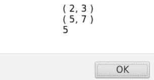

原则上，以哪种方式创建对象并不重要，但你必须注意构造函数在 Java 中是如何创建对象的。

# JAVA 12：WWW 与客户端部分的开发：软件开发 JAVASCRIPT

在本节中，我们将处理对象的控制语句（循环）和数组。示例还使用了上一节描述的模块概念。代码如下：

```html
<!DOCTYPE html>
<head>
  <title>CubesProgram</title>
  <meta charset="UTF-8">
  <meta name="viewport" content="width=device-width, initial-scale=1.0">
  <script>
    var cup = (function() {
      function cube() {
        this.eyes = 1;
        this.roll = function () {
          this.eyes = Math.floor(Math.random() * 6) + 1;
        };
        this.valueOf = function () {
          return this.eyes;
        }
      }

      public = {
        cubes: [new cube(), new cube(), new cube(), new cube(), new cube()],

        toss: function () {
          for (var i = 0; i < this.cubes.length; ++i) this.cubes[i].roll();
        },

        yatzy: function () {
          var t = this.cubes[0].eyes;
          for (var i = 1; i < this.cubes.length; ++i)
            if (this.cubes[i] != t) return false;
          return true;
        },

        toString: function () {
          var str = this.cubes[0].eyes;
          for (var i = 1; i < this.cubes.length; ++i)
            str += " " + this.cubes[i].valueOf();
          return str;
        }
      };

      return public;
    })()
  </script>
</head>
<body>
  <h1>Play Yatzy</h1>
  <script>
    var count = 0;
    do {
      cup.toss();
      document.write(cup + "<br/>");
      count++;
    } while (!cup.yatzy());
  </script>
  <h3>You've got yatzy after <script>document.write(count)</script> attempts</h3>
</body>
</html>
```

# JAVA 12: WWW 与客户端部分开发：软件开发 JAVASCRIPT

在头部定义中有一个修改过的骰子，它代表一个包含 5 个骰子和三个公共属性的骰子：

- `toss()`，一个方法，模拟骰子的使用
- `yatzy()`，一个方法，测试所有 5 个骰子的值是否都相同
- `toString()`，对`toString()`的重写

最初，一个构造方法定义了创建骰子对象的方法。定义了一个公共对象，通过构造方法创建一个包含 5 个骰子的数组。该公共对象有三个实现这些方法的函数。正文模拟使用骰子，直到所有骰子的值都相同。

## 练习 1

创建`CubesProgram`程序的副本。你必须创建一个`resources`文件夹并在该文件夹下创建一个`js`子文件夹，然后放入 JavaScript 文件：

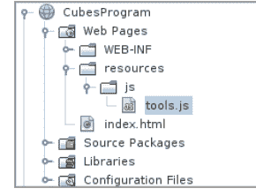

你必须将所有代码从`index.xhtml`移动到`tools.js`中——但不要包含`<script>`元素。`index.xhtml`必须在 JavaScript 文件中有一个链接。你通过将名称拖到头部来实现。`index.xhtml`的结果应该如下：

```
<!DOCTYPE html>
<html>
<head>
  <title>CubesProgram</title>
  <meta charset="UTF-8">
  <meta name="viewport" content="width=device-width, initial-scale=1.0">
  <script src="resources/js/tools.js" type="text/javascript"></script>
</head>
<body>
  <h1>Play Yatzy</h1>
  <script>
    var count = 0;
    do (
      cup.toss();
```

```
document.write(cup + "<br/>");
++count;
while (!cup.yatzy);
</script>
<h3>You've got yatzy（在经过 <script>document.write(count)</script> 次尝试后获得了 yatzy）</h3>
</body>
</html>
```

测试该程序，它应该像以前一样正常工作。

当使用 JavaScript 时，你通常会将代码放在它自己的文件中，正如本练习所示。

## 数组

数组的工作方式与其他编程语言完全相同，并使用了在 Java 中熟悉的语法，但存在一些重要的区别。在 JavaScript 中，数组是动态的，不应为特定大小分配内存。以下函数会弹出一个窗口，显示数组的长度以及数组元素：

```
function show(arr)
{
var str = arr.length + "\n";
for (var i = 0; i < arr.length; ++i) str += "\n" + arr[i];
alert(str);
}
```

考虑这个函数，请注意在语法上数组的使用方式与 Java 相同。数组有一个`length`属性，单个元素通过从 0 开始的索引引用。

```
var arr1 = {"Svend", "Knud", "Valdemar"};
```

该语句创建一个包含三个元素的数组并将将其发送到函数`show()`，你将收到如下所示的警框：

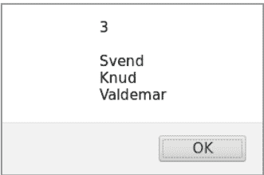

由于数组没有类型，数组可以包含不同类型的元素：

```
var arr2 = ["Gorm", 3.13, { x: 2, y: 3 }, obj1];
```

其中数组包含一个字符串、一个数字和两个对象。你也可以使用构造函数创建一个数组：

```
var arr3 = new Array();
show(arr3);
```

结果是一个空数组。如果你有一个数组，可以立即添加项，数组将动态扩展：

```
arr3[0] = 11;
arr3[1] = 13;
arr3[2] = 17;
arr3[3] = 19;
show(arr3);
```

现在数组有 4 个元素：

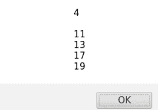

数组也可能存在“空洞”，因此存在未定义的元素：

```
arr1[5] = "Erik";
show(arr1);
```

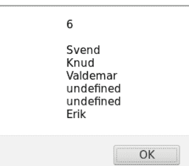

构造函数可以有参数：

```
var arr4 = new Array(4);
var arr5 = new Array(23, 29, 31, 37);
```

这里第一个创建一个长度为 4 包含 4 个未定义元素的数组，而另一个创建一个包含 4 个元素的数组。最后，你你可以更改`length`属性的值并删除数组中的元素。正如前面提到的，你使用数字索引引用数组中的元素，而索引实际上比你想象的要灵活。考虑以下代码：

```
var arr = new Array();
arr[0] = 2;
arr[1] = 3;
arr["3"] = 5;
arr["abc"] = 7;
show(arr);
```

首先，注意代码不会报错，它将显示以下警框：

```
4
2
3
undefined
5
OK
```

如果索引不是数字，解释器将尝试将其转换为整数，因此

```
arr["3"] = 5;
```

结果是索引为 3 的元素。另一方面，并不立刻清楚

```
arr["abc"] = 7;
```

意味着什么，因为`"abc"`无法转换为数字。数组是一个对象，因此你可以特意地定义它自己的属性。这正是发生的情况，因为`arr["abc"]`被解释为一个名为`abc`的属性，然后获得值 7。有理由意识到这种解释，因为很容易无意中给数组添加属性。在这种情况下，语句

```
alert(arr.abc);
```

将显示 7。数组中的元素可以是任何内容，特别是其他数组。它允许模拟多维数组。例如，以下代码将显示该值：

```
var v1 = [2, 3, 6];
var v2 = [7, 8, 9];
var v3 = [10, 11];
var v = [v1, v2, v3];
var s = 0;
for (var i = 0; i < v.length; ++i)
  for (var j = 0; j < v[i].length; ++j)
    s += v[i][j];
alert(s);
```

# JAVA 12: WWW 与客户端部分开发：软件开发

特别地，注意如何将数组`v`作为二维数组进行迭代，但这是程序员的责任确保`v`中的元素实际上是数组。否则你将得到错误。下面是一个由数组组成的数组：

```
var konger = [["Gorm", 958], ["Harald Blåt", 958, 986]];
for (var i = 0; i < konger.length; ++i) show(konger[i]);
```

你应该注意，我在后续章节中提到的数组标准函数。

## 练习 2

斐波那契数如你所知是以下序列：

0, 1, 1, 2, 3, 5, 8, 13, 21, ...

创建一个名为`FiboProgram`的新项目。该项目必须有一个起始页`index.html`，用表格显示前 95 个斐波那契数。程序应该如下编写：

1. 项目必须有一个 JavaScript 文件，其中包含一个`fibonacci`模块，该模块会自动创建一个私有数组，其中包含斐波那契数。该模块必须有两个公共属性，第一个名为`length`，另一个是数组长度的简单属性，而另一个是函数`get()`，用于返回第 n 个斐波那契数。
2. 表格和头部标题必须在 JavaScript 中生成。
3. 起始页`index.html`必须动态生成表格。

## 函数

在 JavaScript 中，函数可以被视为对象。这意味着例如函数可以从另一个函数返回，并作为另一个函数的参数。这也意味着函数可以像其他对象一样拥有属性和方法。这些关系在许多方面与 Java 等其他语言中的函数不同。

# JAVA 12: WWW 与客户端部分的开发：软件开发 JAVASCRIPT

通常使用保留关键字`function`创建函数：

```
function factorial(n)
{
}
```

函数可以有任意数量的参数，尤其是没有参数。由于函数可以引用其作用域内的所有变量，因此函数可以特地引用自身，你因此编写递归函数：

```
function factorial(n)
{
if (n < 1) return 1;
return n * factorial(n - 1);
}
```

在同一作用域内多次声明同一个函数是允许的，这意味着该函数被赋予了不同的值。它也可能导致意想不到的结果。例如，考虑以下代码：

```
function f()
{
return 23;
alert(f());
function f()
{
return 29;
}
}
```

它将弹出 29。原因是 JavaScript 在作用域开始时收集所有的定义，因此上述代码等于：

```javascript
function f()
{
return 23;
}
function f()
{
return 29;
}
alert(f());
```

在 JavaScript 中，你也可以将函数定义为表达式：

```javascript
var show = function (arr)
{
  var str = arr.length + "\n";
  for (var i = 0; i < arr.length; ++i) str += "\n" + arr[i];
  alert(str);
}
show([2, 3, 5, 7]);
```

变量`show`指向一个匿名函数，而匿名函数在 JavaScript 中被广泛使用。考虑以下示例：

```javascript
function validate(x, ok)
{
  if (ok(x)) return true;
  alert(x + " er en ulovlig værdi");
  return false;
}
```

> “我学习了16年英语，但是……我最终只用了六节课就学会了说英语”
> Jane，中国建筑师

该函数有两个参数，后者被解释为一个用于验证第一个参数的函数。该函数可以如下使用：

```javascript
validate(1234, function (t) { return t >= 100 && t <= 999 });
```

其中该函数应该验证第一个参数是否为三位数数字。该验证逻辑以匿名函数的形式发送。

当函数执行时，它是在给定的上下文中进行的，函数可以通过其作用域访问该上下文中的变量、对象和其他函数。在内部，上下文通过`this`指针进行引用，该指针会间接传递给被调用的函数。在此上下文中，有必要区分“函数”和“方法”，方法是指定义为对象属性的函数。如果你像通常一样执行，上下文将是`window`对象，而方法的上下文则是父对象。可以通过以下代码来说明，其中`m`是对象`obj`中的一个方法，而`f()`是一个带有内部函数`g()`的全局函数。

```javascript
var obj = {
  m : function() { alert(this); }
}
function f() {
  alert(this === window);
  function g() {
    alert(this === window);
  };
  g();
}
obj.m();
f();
```

如果你执行这段代码，`alert()`将三次显示`true`。首先执行了方法`m`，其上下文是对象`obj`。接着执行了`f()`，它开始执行内部函数`g()`，其上下文与外部函数`f()`相同，都是`window`对象。

这种用法最频繁的是与方法和构造函数有关。如果你有一个函数并在函数前面加上`new`类型，意味着创建一个空对象，并且这会指向该对象的上下文。例如，下面的代码显示了一个创建点的构造函数：


```javascript
function createPoint(x, y)
{
  this.x = x;
  this.y = y;

  this.move = function (p) { this.x = p.x; this.y = p.y; };
  this.add = function (p) { this.x += p.x; this.y += p.y; };
  this.scale = function (t) { this.x *= t; this.y *= t; };
  this.dist = function (p) {
    return Math.sqrt((this.x - p.x) * (this.x - p.x) + (this.y - p.y) * (this.y - p.y));
  }
  this.toString = function () { return "(" + this.x + ", " + this.y + ")"; };
}
```

以下代码使用该函数创建了两个对象，你应该特别注意这些对象并不互相继承：

```javascript
var p1 = createPoint(10, 20);
var p2 = createPoint(30, 40);
p1.move({x: 5, y: 5});
p1.add({x: 2, y: 2});
p1.scale(2);
alert(p1.toString());
alert(p2.toString());
alert(p1.dist({x: 30, y: 40}));
```

# JAVA 12：WWW 与客户端部分的开发：软件开发

在 Java 中，你有一个 `foreach` 循环，它实际上是一个迭代器。JavaScript 中有一个对应的 `for` 变体，有时被称为 `for-in`。它可以用于遍历对象中的所有属性。下面是一个具有 4 个属性的对象，以下循环通过 `for-in` 循环确定了这四个属性之和：

```javascript
var obj = {
  a: 2,
  b: 3,
  c: 5,
  d: 7
}
var s = 0;
for (var t in obj) s += obj[t];
alert(s);
```

## 4.3 全局对象和函数

JavaScript 天生就带有全局对象和一些全局函数，这些内容可以立即使用，并在方法方面提供了各种服务。全局对象有：

- `Array`（数组）
- `Boolean`（布尔值）
- `Date`（日期）
- `Math`（数学）
- `Number`（数字）
- `RegExp`（正则表达式）
- `String`（字符串）

我不想在这里回顾这些对象及其方法，但这些名称已经告诉了你可以用它们做些什么，鼓励你研究这些对象的属性（互联网上有许多描述这些对象和方法的资源）。最后，还有以下全局函数，我们也鼓励你研究它们的行为：

- `eval()`
- `isFinite()`
- `isNaN()`
- `parseFloat()`
- `parseInt()`

## 练习 3

创建一个可以调用 `ScriptLibrary` 的 Web 应用程序。创建一个 `resources` 文件夹和子文件夹 `js`，并添加一个名为 `pascript.js` 的 JavaScript 文件。该文件实现了一个名为 `patools`（或任何你喜欢的名称）的模块，你应该将该模块视为 JavaScript 库。该库应该有四个属性：

- `isInt`，这是一个带有一个参数的函数，如果参数是合法整数，函数返回 `true`。
- `isPrime`，这是一个带有一个参数的函数，如果参数是质数，函数返回 `true`。
- `isLeapyear`，这是一个带有一个参数的函数，如果参数代表 1700 年到 9999 年之间的闰年，函数返回 `true`。
- `isDate`，这是一个带有一个参数的函数，如果参数是 1700 年到 9999 年之间的合法日期，函数返回 `true`。该参数必须是年、月、日格式的字符串（即 `YYYY_MM_DD`），其中分隔符必须是 `-`、`/`、空格或无。


美国在线

LIGS 大学

正在招募在线 BBA、MBA、MSc、DBA 和博士学位课程：

- 在 2014 年 9 月 30 日前报名
- 学费可享受高达 16% 的优惠！
- 分 10 期支付 / 2 年完成
- 互动在线教育
- 访问 `www.ligsununiversity.com` 了解更多信息！

注意：LIGS 大学未获得美国教育部部长列出的任何国家认可的认证机构的认证。

在此处获取信息。

在 bookoon.com 免费下载电子书

点击广告阅读更多

# JAVA 12：WWW 与客户端部分的开发：软件开发

当你写完库方法后，你应该从 `index.html`（见下文）测试模块。html 代码可能如下：

```html
<body>
<h2>Test patools</h2>
<form>
<p>输入一个数字测试是否为质数</p>
<input type="text" id="txtnumber"&nbsp;&nbsp;
<input type="button" value="Test" onclick="validate();" />
<p><span id="result1"></span></p>
<br/>
<p>输入以 /、- 或空格分隔的年、月、日</p>
<input type="text" id="txtdate"&nbsp;&nbsp;
<input type="button" value="Test" onclick="validate2();" />
<p><span id="result2"></span></p>
</form>
</body>
```

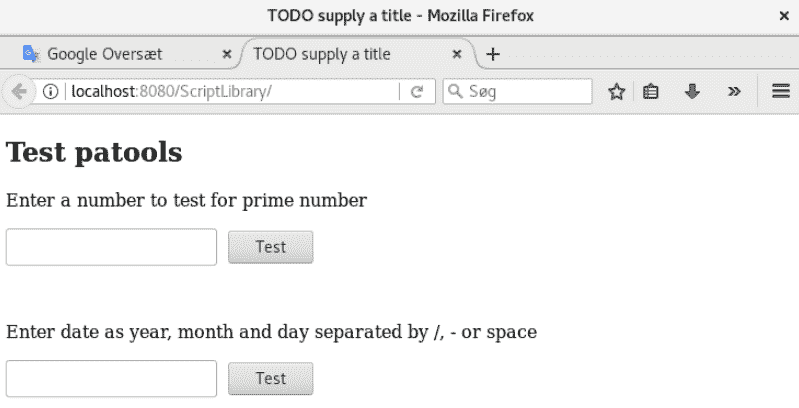

你必须为这两个按钮编写事件处理程序。第一个必须测试第一个字段中的值是否为质数，并更新 `span` 元素显示的消息。第二个必须执行相同的操作，但针对其他元素并测试值是否为合法日期。

事件处理程序应该写在头部的脚本块中。注意，还有必要为你的 JavaScript 库添加一个链接元素。

# JAVA 12：WWW 与客户端部分的开发：JavaScript

## 4.4 DOM

DOM 代表文档对象模型（Document Object Model），是一项 W3C 标准，规定浏览器如何将 HTML 文档构建为层次分化的对象。DOM 不是 JavaScript 的一部分，DOM 对象允许 JavaScript 操作对象并从脚本代码引用当前文档的内容。与 JavaScript 结合，DOM 是开发客户端侧有交互功能的网站的关键。DOM 是一个标准，但实现该标准取决于浏览器厂商，而标准的优劣取决于浏览器厂商对该标准的落实程度。这意味着可能存在（并且确实存在）差异。

# JAVA 12: 万维网与客户端开发：软件开发 JavaScript

如果你在浏览器中打开它，就会看到下面的窗口，在这里你可以看到文档中的每个元素是如何被 DOM 树中的节点表示的。

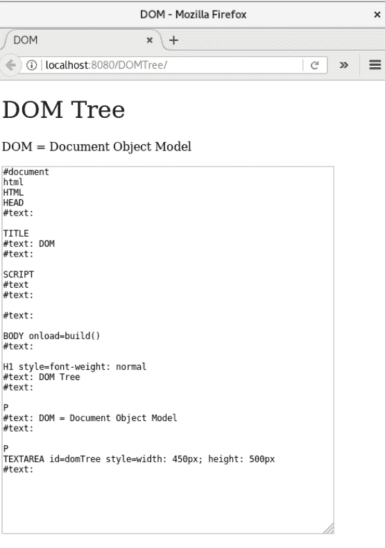

## DOM 中的元素

关于 DOM，第一步是学习如何引用 DOM 树中的单个元素，然后对这些元素进行操作。这基本上是通过引用元素的 `id` 属性或 `class` 属性来实现的，在本章的引言中通过 `SimpleDocument` 示例进行了说明。该示例简要介绍了在 DOM 树中查找特定元素或元素数组的可用选项。基本方法有：

- `getElementById()`
- `getElementsByTagName()`
- `getElementsByClassName()`
- `querySelector()`
- `querySelectorAll()`

在 ebook.com 免费下载

这里，后两个是最先进的，因为它们使用了本书第 3 章所解释的 CSS 选择器，它们的区别在于：第一个返回匹配选择器的第一个元素，而其他的返回所有匹配的元素。此外，节点具有以下属性：

- `firstChild`
- `lastChild`
- `nextSibling`
- `previousSibling`

这些属性可以用于遍历 DOM 树。

## 修改 DOM 树

也可以使用 JavaScript 修改 DOM 树，虽然在上面的示例中已经实现，但还有更多选项。你可以修改元素的属性并更改其内容，甚至可以移动树中的元素。你还可以删除元素，以及插入新元素。同样，我将通过一个示例来说展示一些可能性：

```html
<!DOCTYPE html>
<html>
<head>
<title>Modify document elements</title>
<style>
.blueClass {
  background-color: lightsteelblue;
}
.plainClass {
  font-weight: normal;
}
</style>
</head>
<body>
<h1><a="#">Header</a></h1>
<h3 id="txt">Modifies DOM elements using Javascript</h3>
<p id="adr"><a href="#">Torus data</a></p>
<p id="par">More text about <span style="font-weight:bold">DOM</span><span>objects</span></p>
<script>
alert(par.innerText);
alert(par.innerHTML);
var link = document.querySelector("#adr a");
link.href = "http://bookbook.com";

link.style.backgroundColor = "#ff0000";
link.style.color = "#ffffff";
link.target = "_blank";
document.getElementById("txt");
var txt = document;
txt.classList.add("blueClass");
txt.classList.add("plainClass");
document.getElementsByTagName("h1")[0].innerText = "Hello World";
par.innerHTML = "<ul><li>Svend</li><li>Knud</li><li>Valdemar</li></li></</ul>";
var head = document.head;
var elem = document.createElement("script");
elem.innerText = "function factorial(n) { if (n < 2) return 1; return n * factorial(n - 1); }";
head.appendChild(elem);
var body = document.body;
var txt = document.createElement("p");
txt.id = "fact";
body.appendChild(txt);
document.getElementById("fact").innerHTML = "10! + <b>" + factorial(10) + "</b>";
</script>
</body>
</html>
```


如果你可以构建自己的未来并创造未来会怎样？

一个时代的变革是下一代的常态。在不久的将来，人们可能会觉得设备曾经需要“插电”是很奇怪的。要达到那种状态，需要一次“转变”。

页面定义了两个类，分别称为 `blueClass` 和 `plainClass`。文档有 4 个元素：一个 `h1` 元素、一个 `h3` 元素和两个段落。第一个段落包含一个链接和一个 `span` 元素。紧接着是一个脚本块，它从一个 `alert` 开始：

```javascript
alert(par.innerText);
```

它显示了最后一段落中的文本。该段落通过其 ID 被引用，你应该注意你可以直接这样做。你还应该注意，HTML 元素 `span` 不会作为 `innerText` 的一部分显示。结果是页面打开后，浏览器显示了如下内容：

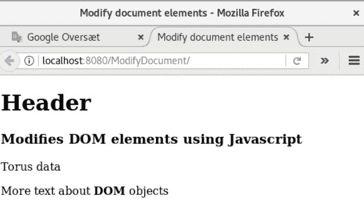

接着是下面的警框：


然后是下面的警框：

```javascript
alert(par.innerHTML);
```

## JAVA 12: WWW 与客户端部分开发：软件开发 JAVASCRIPT

例如，考虑具有以下内容的页面：

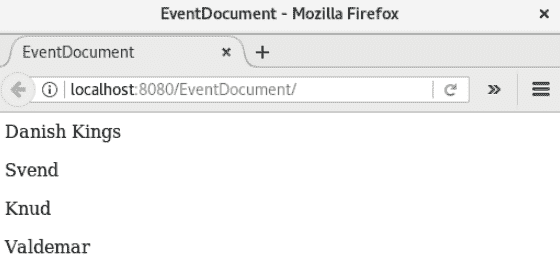

在这里，部的文本是一个 `div` 元素，而底部的三个是段落。代码如下：

```javascript
<!DOCTYPE html>
<html>
<head>
<title>EventDocument</title>
<script>
var text;

function kingCapture() {
text += "\n" + this.innerText + " capture";
}

function kingBubble() {
text += "\n" + this.innerText + " bubble";
}

function kingsCapture() {
text = "Kings capture";
}

function kingsBubble() {
text += "\nKings bubble";
alert(text);
}
</script>
</head>
</html>
```

在 bookhoon.com 免费下载电子书

## JAVA 12: WWW 与客户端部分开发：软件开发 JAVASCRIPT

```html
<body>
<div>Danish Kings</div>
<p id="paragraf1">Svend</p>
<p id="paragraf2">Knud</p>
<p id="paragraf3">Valdemar</p>
</div>
<script>
var p1 = document.getElementById("paragraf1");
var p2 = document.getElementById("paragraf2");
var p3 = document.getElementById("paragraf3");
p1.addEventListener("click", kingBubble);
p2.addEventListener("click", kingBubble);
p3.addEventListener("click", kingBubble);
p1.addEventListener("click", kingCapture, true);
p2.addEventListener("click", kingCapture, true);
p3.addEventListener("click", kingCapture, true);
document.getElementsByTagName("div")[1].
  addEventListener("click", kingCapture, true);
document.getElementsByTagName("div")[1].
  addEventListener("click", kingBubble);
</script>
</body>
</html>
```


从 book.com 免费下载电子书 点击广告阅读更多

## JAVA 12: WWW 与客户端部分开发：软件开发 JAVASCRIPT

在头部（header）中定义了两个简单的事件处理器。你应该注意 `this` 引用的使用，它将指向触发事件的事件。HTML 代码不需要解释，但是是脚本块将事件处理器分配给 HTML 元素。首先，是对三个段落的引用，然后为每个段落分配了两个点击事件的处理器。其中一个是冒泡阶段（`false`）的处理器，另一个是捕获阶段（`true`）的处理器。你应该注意如何使用 `addEventListener()` 方法与事件处理器关联。结果是，点击这三个段落之一将导致显示警框，说明触发了哪些事件。脚本块中的最后一个语句将事件处理器分配给第一个 `div` 元素。在这里，你应该注意如何找到该项并将事件处理器设置为匿名函数。

还有一个 `removeEventListener()` 方法，它的参数与 `addEventListener()` 相同。该函数用于从元素中移除事件处理器。

当执行事件处理器时，一个事件对象会被传递给处理器。请考虑以下代码作为示例：


```html
<!DOCTYPE html>
<html>
<head>
<title>MoreEvents</title>
<meta charset="UTF-8">
<meta name="viewport" content="width=device-width, initial-scale=1.0">
</head>
<body>
<h3>最古老的国王 - 字母排序列表！</h3>
<p>点击其中一个！</p>
<ul id="list">
<li>Gorm Gamlle</li>
<li>Harald 2.</li>
<li>Harald Blåtand</li>
<li>Hardeknud</li>
<li>Knud D. Store.</li>
<li>Magnus den Gode</li>
<li>Svend Tveskæg</li>
</ul>
<h3>国王列表！</h3>
<ul class="list2"></ul>
<script>
  var list = document.querySelector(".list2");
```

```javascript
kings[i].addEventListener("click",
function (e) { list.appendChild(e.target); }, false);
}
</script>
</body>
</html>
```

如果代码出现在浏览器中，结果如下：

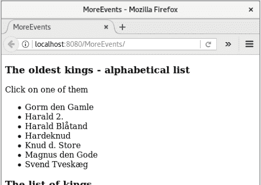

`id` 为 `list` 的列表有 7 个按字母顺序排列的名字。接下来，通过类属性识别出一个空列表。以下脚本块使用类属性设置对输入列表的引用，以及对所有 `li` 元素数组的引用。最后一个循环将匿名处理器关联到这些 `li` 元素。该处理器使用事件对象（在这里称为 `e`）将被点击的元素移动到下面的列表中。以下是点击顶部所有名称（按正确顺序）后的结果：

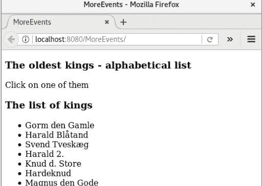

在 `book.com` 免费下载电子书

## JAVA 12: WWW 与客户端部分开发：软件开发 JAVASCRIPT

示例中最重要的点是如何将参数传递给事件处理器。它是一个名为 `event` 的对象，并且如下所示，它是一个具有许多属性和方法的高级对象。

### 事件对象的属性

- `event.clientX` 和 `event.clientY` 在鼠标事件情况下指示鼠标相对于浏览器窗口的坐标。
- `event.offsetX` 和 `event.offsetY` 在鼠标事件情况下指示鼠标相对于触发事件元素的坐标。
- `event.keyCode` 在按键事件情况下指示事件的代码。


## JAVA 12: WWW 与客户端部分开发：软件开发 JAVASCRIPT

- `event.stopPropagation()` 是一个停止事件传播（在 DOM 树中向下传播）的方法，但其他处理器仍在执行。
- `event.preventDefault()` 是一个在可能的情况下阻止事件处理的方法。

查看上面的代码，注意当你指向顶部列表中的元素时。这可以通过为 `mouseover` 和 `mouseout` 分配事件处理器来解决。我添加了以下处理器：

```javascript
function blue() {
  this.setAttribute("style", "blue;");
}
function black() {
  this.setAttribute("style", "black;");
}
function moveKing(e) {
  e.target.removeEventListener("mouseover", blue, false);
  e.target.removeEventListener("mouseout", black, false);
  e.target.setAttribute("style", "black;");
  list.appendChild(e.target);
}
```

前两个处理器必须分别用于顶部列表元素的 `mouseover` 和 `mouseout`。你应该注意后者有一个参数，该参数将是事件对象的引用。事件处理器必须用于移动元素。当元素被移动时，鼠标指向它时将不再高亮。因此，移除了 `mouseover` 和 `mouseout` 的事件处理器，你应该注意 `e.target` 指向触发事件的元素。此外，颜色必须设置为黑色，然后按照上述方式将元素移动到底部列表。

HTML 代码与上面相同，包括关联事件处理器的脚本：

```javascript
<script>
  var list = document.querySelector(".list2");
  document.getElementById("list").addEventListener("click", moveKing, false);
  var kings = document.querySelectorAll("li");
  for (var i = 0; i < kings.length; i++) {
}
</script>
```

# JAVA 12：WWW 与客户端部分的开发：软件开发 JAVASCRIPT

```javascript
kings[i].addEventListener("mouseover", blue, false);
kings[i].addEventListener("mouseout", black, false);
</script>
```

在这里你首先应该注意，点击事件的事件处理器 `moveKing()` 被分配给列表，而不是单独的列表元素。这里利用了事件冒泡机制，点击列表元素时，事件会冒泡到元素的父元素（即 `ul` 元素），该元素绑定了事件处理器。在处理程序中，`event.target` 将指向触发事件的列表元素。

## 问题 3

创建一个名为 `ChangeAddress` 的新项目。该项目应该只有一个 `index.html` 页面，并且应该包含一个排列好的表单：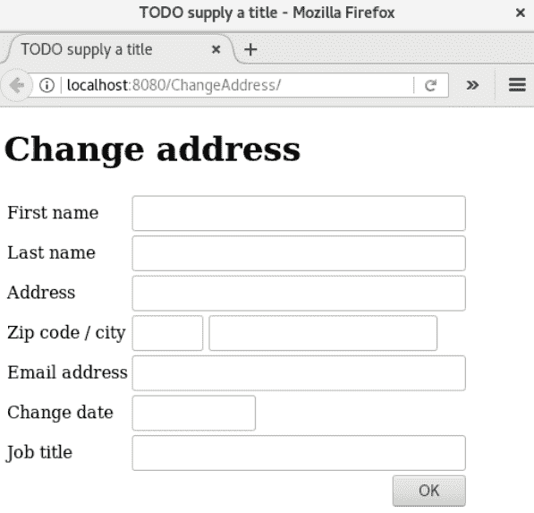 当用户输入数据时，应该进行验证，且验证必须在每次失去焦点时发生。所有字段（姓名、姓氏、地址、城市）都必须经过验证。邮政代码必须是 4 位数字，电子邮件地址和日期必须是合法的。所有验证必须在客户端侧通过 JavaScript 完成，下方是一个在点击 OK 按钮时已输入值的窗口：如果所有字段都正确填写，点击按钮的结果将是提交，否则将保持为空。下载免费电子书：`bookoon.com`

## JAVA 12：WWW 与客户端部分的开发：软件开发 JAVASCRIPT

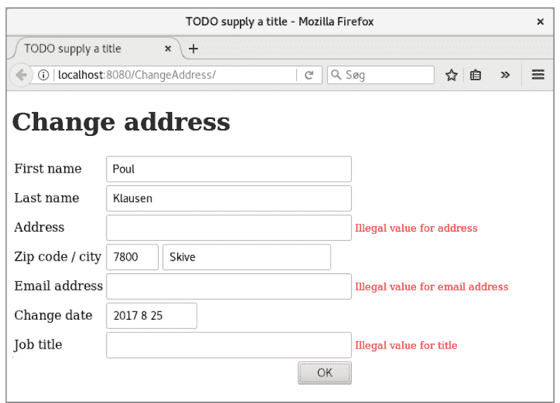 你的论文需要帮助吗？获取来自专家的深度反馈。了解你可以做什么来改进你的论文！立即获取帮助 `www.helpmyassignment.co.uk` 获取更多信息  下载免费电子书：`bookoon.com` 点击广告阅读更多

## JAVA 12：WWW 与客户端部分的开发：软件开发 JAVASCRIPT

下方是一个点击 OK 按钮时已输入数据的窗口：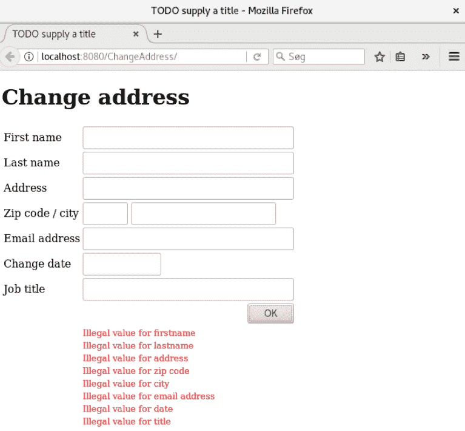 验证电子邮件地址应该使用正则表达式。验证日期应该使用练习 3 中描述的相同的 JavaScript 库。按钮应该是一个提交按钮，你可以使用 `onSubmit` 事件来测试表单，如果所有字段都正确填写，点击按钮将执行提交。

# 5 JSF SERVER FACES 与 AJAX

在本书中，我已经查看了客户端，包括如何定义页面布局以及如何使用 JavaScript 修改 DOM 树的单个元素。这发生在浏览器中，不需要服务器参与。在本章中，我将再次查看服务器端，服务器根据浏览器的请求做出响应，这意味着浏览器应该重新渲染文档。通过 JavaScript 的帮助，可以执行这种请求/响应形式，使用户观察不到页面正在更新，应用程序的行为与标准桌面应用程序相同。这种技术被称为 Ajax。

Ajax 是一系列技术，允许 JavaScript 在浏览器向服务器发送请求时异步执行任务，服务器随后返回给客户端以更新 DOM 树。该技术被应用于所有的 Web 应用程序。

你可以基本上通过 `f:ajax` 将 Ajax 功能与 JSF 输入组件关联，这意味着客户端和服务器之间的交互是基于特定事件异步并与用户并行进行的。`f:ajax` 绑定了许多属性，其默认值如下：

- `delay`：以毫秒为单位，表示请求和响应之间的最大延迟（`none`）。
- `disabled`：布尔值，表示函数是否禁用（`false`）。
- `event`：指定触发请求的事件。
- `execute`：指定在服务器上执行的组件列表。
- `immediate`：布尔值，表示应立即处理输入。
- `listener`：指定执行的监听方法名称。
- `onevent`：指定执行的 JavaScript 函数名称。
- `onerror`：指定用于错误处理的 JavaScript 函数名称。
- `render`：Ajax 函数后渲染的组件列表。

## JSF 与 AJAX

对于 `execute` 和 `render` 属性，可以使用以下术语指定组件：

- `@all`：表示所有组件。
- `@form`：表示包含组件函数的表单中的所有组件。
- `@none`：表示无，是默认值。
- `@this`：表示由空格分隔的父组件。
- `@id`：一个 JS 表达式。

为了说明 Ajax 如何工作，我想展示几个使用 Ajax 扩展现有应用程序的示例，它将基于 Java 11 的 `Change3`。

 到 2020 年，风能可以提供地球十分之一的电力需求。直到今天，风能的创新知识对于减少全球大部分的涡轮机至关重要。得益于在线系统，这一比例可以大幅降低。

```xml
<?xml version="1.0" encoding="UTF-8"?>

<!DOCTYPE html>

<html xmlns="http://www.w3.org/1999/xhtml" xmlns:h="http://java.jcp.com/xml/jsf" xmlns:f="http://java.jcp.com/xml/jsf">

<head>

    <meta charset="UTF-8">

    <title>Address</title>

    <link rel="stylesheet" type="text/css" href="style.css"/>

</head>

<body>

    <h1>Change address</h1>

    <h:form>

        <h:panelGrid columns="3" styleClass="rightalign">

            <h:outputLabel for="firstName" value="First name"/>

            <h:inputText id="firstName" value="#{controller.firstName}" style="width:300px">

                <f:validateRequired />

                <f:ajax event="blur" render="firstName"/>

            </h:inputText>

            <h:message for="firstName"/>

            <h:outputLabel for="lastName" value="Last name"/>

            <h:inputText id="lastName" value="#{controller.lastName}" style="width:200px">

                <f:validateRequired />

                <f:ajax event="blur" render="lastName"/>

            </h:inputText>

            <h:message for="lastName"/>

            <h:outputLabel for="address" value="Address:"/>

            <h:inputText id="address" value="#{controller.address}" style="width:300px">

                <f:validateRequired />

                <f:ajax event="blur" render="address"/>

            </h:inputText>

            <h:message for="address"/>

            <h:outputLabel for="code" value="Zip code"/>

            <h:inputText id="code" value="#{controller.code}" style="width:60px">

                <f:validateLength minimum="4" maximum="4"/>

                <f:ajax event="blur" render="code"/>

            </h:inputText>

            <h:message for="code"/>

            <h:outputLabel for="city" value="City"/>

            <h:inputText id="city" value="#{controller.city}" style="width:200px">

                <f:validateRequired />

                <f:ajax event="blur" render="city"/>

            </h:inputText>

            <h:message for="city"/>

            <h:commandButton value="Submit"/>

        </h:panelGrid>

    </h:form>

</body>

</html>
```

# JAVA 12：WWW 与客户端部分的开发：JAVASER FACES 和 AJAX

```xml
<h:outputLabel value="邮箱地址: for="email"/>
<h:inputText id="email" label="邮箱地址" style="width: 300px" value="#{controller.email}"/>
<f:validator validatorId="emailValidator"/>
<f:ajax event="blur" render="emailError"/>
<h:inputText>
<h:message for="email" class="error-message" id="emailError"/>
<h:outputLabel value="修改日期: for="date"/>
<h:inputText id="date" label="修改日期" required="true" style="width: 100px" value="#{controller.date}"/>
<f:validator validatorId="dateValidator"/>
<f:ajax event="blur" render="dateError"/>
<h:inputText>
<h:message for="date" class="error-message" id="dateError"/>
<h:outputLabel value="职位: for="title"/>
<h:inputText id="title" required="false" style="width: 300px" value="#{controller.title}" />
<h:panelGroup>
<h:commandButton value="发送" action="#{indexController.add()}" />
</h:innerGrid>
<a href="list.xml">显示地址</a>
</h:form>
<html>
</body>
</html>
```

## 你想做什么？

无论你对未来的职业生涯有何期待，一家在许多国家拥有广泛业务范围的雇主将始终是你的入场券。在沃尔沃集团工作意味着将与全球 80 个国家的超过 15 万名朋友和同事并肩。我们提供卓越的职业机会——请访问我们的网站 `www.volvogroup.com`。我们期待你的加入！

沃尔沃

`AB Volvo (pub)`

沃尔沃卡车 | `HEMANT` 卡车 | `MACH` 卡车 | 沃尔沃推土机 | 沃尔沃建筑设备 | 沃尔沃 Penta 动力 | 沃尔沃 IT

沃尔沃金融服务 | 沃尔沃 27 | 沃尔沃伙伴 | 沃尔沃港口 | 沃尔沃技术 | 沃尔沃贷款 | 亚太业务区

在 `bookboom.com` 下载免费电子书

点击广告阅读更多


# JAVA 12：WWW 与客户端部分的开发：软件开发

例如，如果你考虑为输入姓名的第一个字段，你必须指定要执行哪个验证器以及对应的元素：

```xml
<f:ajax event="blur" render="firstNameError"/>
```

在这里，你指明在输入字段失去焦点后必须执行 ajax 函数，以及在发生错误时可能渲染的元素（即错误消息所在元素）。当该事件发生时，将向服务器发送一个请求，且仅异步针对当前的输入组件。结果是，字段将在表单完成时进行验证，用户将体验到像在传统桌面应用程序中填写表单一样的感受。

你应该注意，作为替代方案，在这种情况下，所有的验证函数都可以写成 JavaScript 函数，但在其他验证函数中需要向服务器发送请求。

## 练习 4

在此练习中，你需要对上面的示例进行修改。首先创建一个项目 `ChangeAddress1` 的副本。现在你必须修改程序，使输入姓名的字段为只读。数据库 `databasewidata` 有一个尾部邮政编码（即丹麦邮编）。你必须更改邮编字段的验证代码，只有当尾部邮编中存在该邮编时，该邮编才是合法的。如果是，城市名称将更新为相应的城市名称，否则城市名称必须为空。邮编字段的验证仍必须使用 ajax 完成。

## 5.2 在不刷新的情况下提交字段

接下来，我想展示如何将所有字段提交到服务器，但不重新加载页面。这样做的好处不是很大，但它提供了一个更安静的窗口体验，因为所有操作都是异步进行的，用户在较小程度上能注意到数据正在发送到服务器，而且整个文档不需要重新渲染。我将使用上述示例，并已从一个名为 `ChangeAddress2` 的副本开始。

在 `Index.xhtml` 中，我修改了两个页面。提交按钮现在有一个 `action` 属性：

```xml
<f:commandButton value="发送" action="#{indexController.add()}" >
<f:ajax event="action" execute="@form" render="@all"/>
</h:commandButton>
```

你应该注意，该函数是由 `action` 事件触发的，该函数应该关联所有表单字段，并且这些字段必须被渲染。此外，最后一个链接应改为 `h:commandLink`。

# JAVA 12：WWW 与客户端部分的开发：软件开发

# JAVASERVER FACES 和 AJAX

```xml
<h:commandLink value="显示地址" action="list.xhtml" immediate="true" />
```

在这里你特别需要注意最后一个属性，它是必须的，因为命令不应该验证表单字段。

最后，`list.xhtml` 页面被更改为 `commandLink`（它本一直就应该是这样的）。在这种情况下，所有表单字段都通过提交发送到服务器，并在 ajax 函数完成后，所有表单字段都会被更新。你并不总是对这些感兴趣，事实上可能只有几个字段。在这种情况下，我假设日期字段应该始终是今天，在 `index.xhtml` 中我定义了该组件：

```xml
<h:outputLabel value="当前日期" for="date"
<h:inputText id="date" label="修改日期" readonly="true" style="width: 100px" value="#{controller.date}" />
```

你应该注意，该组件不再关联任何 ajax 函数。为了初始化日期字段，我还修改了 `Person` 类，将日期字段初始化为当前日期：

```java
// ... (代码省略)
```

最后，`index.xhtml` 中的按钮被更改为：

```xml
<h:commandButton value="发送" action="#{indexController.add()}" >
<f:ajax event="action" execute="@form" render="@all"/>
</h:commandButton>
```

（注：由于原文后部分存在大量重复和破碎标签，以下为根据上下文整理的 HTML 结构参考）

```xml
<?xml version="1.0" encoding="UTF-8"?>
<!DOCTYPE html>
<html>
<head>
<meta charset="UTF-8">
<title>JAVA 12 AJAX</title>
</head>
<body>
<h:form id="mainForm">
    <h:outputLabel value="邮箱地址:" for="email"/>
    <h:inputText id="email" label="邮箱地址" style="width: 300px" value="#{controller.email}"/>
    <f:validator validatorId="emailValidator"/>
    <f:ajax event="blur" render="emailError"/>
    <h:message for="email" class="error-message" id="emailError"/>

    <h:outputLabel value="修改日期:" for="date"/>
    <h:inputText id="date" label="修改日期" required="true" style="width: 100px" value="#{controller.date}"/>
    <f:validator validatorId="dateValidator"/>
    <f:ajax event="blur" render="dateError"/>
    <h:message for="date" class="error-message" id="dateError"/>

    <h:outputLabel value="职位:" for="title"/>
    <h:inputText id="title" required="false" style="width: 300px" value="#{controller.title}" />
    
    <h:panelGroup>
        <h:commandButton value="发送" action="#{indexController.add()}" />
    </h:panelGroup>
    
    <a href="list.xml">显示地址</a>
</h:form>
</body>
</html>
```

# JAVA 12: WWW 与客户端部分的开发：软件开发 JAVASERVER FACES 和 AJAX

```xml
</h:panelGrid>
<h:commandLink value="Show addresses" action="list.xhtml" immediate="true" />
</h:body>
<h:form id="form2">
</h:form>
<html></body>
</html>
```

验证过程是相同的，但编写方法更加直观。注意，有必要指定要渲染的字段（用于错误消息）。然而，有一点不同，因为验证在每次发生焦点事件（focus event）时以及每次离开输入字段时都会发生。这意味着对于相关的输入组件，只会显示一条错误消息——这有时恰是最恰当的。

## 5.3 转换器 (CONVERTERS)

在这个示例中，我将展示转换器的用法，你可以为输入组件挂载一个转换器。它与 ajax 没有直接关系，但通常会与 ajax 结合使用。示例与上面相同，我从 `ChangeAddress3` 的副本开始，并将其命名为 `ChangeAddress4`。作为一个使用转换器的示例，必须确保城市名称会被自动转换为小写字母。这样的转换器可以如下所示编写：

```java
package changeaddress.validators;

import javax.faces.component.UIComponent;
import javax.faces.context.FacesContext;
import javax.faces.converter.Converter;
import javax.faces.converter.FacesConverter;

@FacesConverter("changeaddress.validators.UpperConverter")
public class UpperConverter implements Converter
{
    @Override
    public Object getAsString(FacesContext context, UIComponent component, String value)
    {
        return value.toUpperCase();
    }
```

```java
@Override
public String getAsString
(FacesContext context, UIComponent component, Object value)
{
  return value.toString().toUpperCase();
}
```

并且相对简单。有一个对应的转换器类 `LowerConverter`。作为一个使用稍微有点有趣的转换器的示例，应用程序已经过修改，你可以再次编辑日期字段，但我保留了该字段初始化为今天的设置。另一方面，我希望在输入日期方面具有更大的灵活性，因此允许使用空格代替连字符。为了解决这个问题，我在程序中添加了以下转换器：

```java
package changeaddress.validators;

import javax.faces.component.UIComponent;
import javax.faces.context.FacesContext;
import javax.faces.convert.Converter;
import javax.faces.convert.FacesConverter;
```


```java
@FacesConverter("address.validators.DateConverter")
public class DateConverter implements Converter

```

```java
@Override
public Object getAsObject(FacesContext context, UIComponent component, String value) {
    String[] elems = value.split("-");
    if (elems.length == 3) return value;
    elems = value.split("/");
    if (elems.length == 3) return value.replace('/', '-');
    elems = value.split(" ");
    if (elems.length == 3) return value.replace(' ', '-');
    return value;
}
```

```java
@Override
public String getAsString(FacesContext context, UIComponent component, Object value) {
    String text = value.toString();
    String[] elems = text.split("-");
    if (elems.length == 3) return text;
    elems = text.split("/");
    if (elems.length == 3) return text.replace('/', '-');
    elems = text.split(" ");
    if (elems.length == 3) return text.replace(' ', '-');
    return value;
}
```

### 组件库

如上一章所示，JSF 特别是结合 Ajax 使用时提供了一系列功能，使得开发吸引且动态的 Web 应用程序变得简单，但还有很多可以做的，其中 JSF 组件库就包含几个部分。在本章中，我将对这些库之一——名为 PrimeFaces 的库进行介绍。基本上，它是一个为每个标准 JSF 组件定义了自己的组件的库，并扩展了一个 Web 应用程序的骨架，便于从零开始开发稳定的应用程序。使用 PrimeFaces 的主要目的是创建用户友型的 Web 应用程序，但该库还提供了 JSF 没有立即提供的其他功能；事实上，它的理念是尽可能减少使用样式表和 JavaScript —— 这两者在实践中可能非常耗时。

正如前面提到的，还有其他的 JSF 组件库，但我想通过 NetBeans 介绍 PrimeFaces，而无需安装相关的库（这非常简单）。使用 PrimeFaces 可以获得显著的益处，但代价是标必须熟悉该库（有点类似于 jQuery），并且你应该意识到 PrimeFaces 的开发者对 Web 应用程序的外观和工作方式有一套想法，如果你想偏离这一点，并不总是如愿意的。

我想从一个普通的 Web 应用程序开始，我将其命名为 `ChangeAddress6`。当我来到框架时，我像往常一样选择了 JavaFaces，在这里我点击了“组件”（Components）标签页并选择了 PrimeFaces：

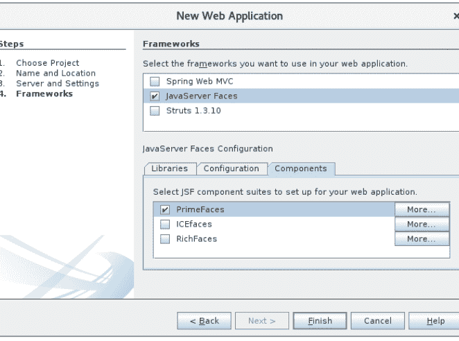

当我点击“完成”（Finish）时，NetBeans 像往常一样创建一个包含三个文件的 Web 应用程序：

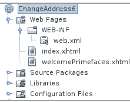

除了 `index.xhtml` 和 `web.xml`，还创建了另一个 `welcomePrimefaces.xhtml` 页面，它是应用程序的首页。结果是一个完整的 Web 应用程序，并在浏览器窗口中打开它：

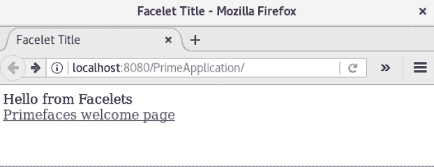


它是 `index.xhtml`，但点击链接会打开窗口：

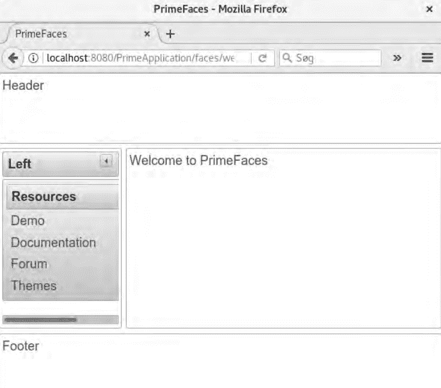

即 `welcomePrimefaces.xhtml`。也就是说，NetBeans 为页面生成了一个骨架，而程序员的任务是向其中填充有意义的内容。你会注意到，页面的设计没有使用样式表或 JavaScript，而是全部内置在库中。

`index.xhtml` 不包含任何关于 PrimeFaces 的新内容，当然，目标是根据特定任务对其进行修改。新内容可以在 `welcomePrimes.xhtml` 中找到，NetBeans 在那里生成了以下内容：

```xml
<!DOCTYPE HTML PUBLIC "//W3C//DTD HTML 4.01 Transitional//EN"
"http://www.w3.org/TR/html4/loase.dtd">
<html xmlns="http://www.w3.org/1999/xhtml"
xmlns:h="http://java.sun.com/jsf/html"
xmlns:f="http://java.sun.com/jsf/core"
xmlns:ui="http://java.sun.com/jsf/facelets"
xmlns:p="http://primefaces.org/ui">
<f:view contentType="html">
<head>
```

<f:facet name="first">

<meta content="text/html; charset=UTF-8" http-equiv="Content-Type"/>

<title>PrimeFaces</title>

</f:facet>

</head>

<body

<p:layout fullPage="true">

<p:layoutUnit position="north" size="100" resizable="true" closable="true"

collapsible="true">

Header

</p:layoutUnit>

<p:layoutUnit position="south" size="100" closable="true"

collapsible="true">

Footer

</p:layoutUnit>

<p:layoutUnit position="west" size="175" header="Left" collapsible="true">

<p:menu>

<p:submenu label="Resources">

<p:menuitem value="Demo"

url="http://www.primefaces.org/showcase-labs/ui/home.jsf" />

<p:menuitem value="Documentation"

url="http://www.primefaces.org/documentation.html" />

<p:menuitem value="Forum" url="http://forum.primefaces.org" />

<p:menuitem value="Themes"

url="http://www.primefaces.org/themes.html" />

</p:submenu>

</p:menu>

</p:layoutUnit>


# JAVA 12：WWW 与客户端部分的开发：软件开发组件库

```xml
<p:layoutUnit position="center">

Welcome to PrimeFaces

</p:layoutUnit>

</p:layout>

</p:layout>

</body

</f:view>

</html>
```

# JAVA 12：WWW 与客户端部分的开发：软件开发组件库

```xml
value="#{indexController.firstName}"

<f:validateRequired/>

<f:ajax event="blur" render="firstNameError" />

</f:inputText>

<f:message for="firstName" id="firstNameError" />

<f:outputLabel value="姓" for="lastName"/>

<f:inputText id="lastName" label="LastName" style="width:200px" value="#{indexController.lastName}">

<f:validateRequired/>

<f:ajax event="blur" render="lastNameError" />

</f:inputText>

<f:message for="lastName" id="lastNameError" />

<f:outputLabel value="地址" for="address"/>

<f:inputText id="address" label="Address" style="width:300px" value="#{indexController.address}">

<f:validateRequired/>

<f:ajax event="blur" render="addressError" />

</f:inputText>

<f:message for="address" id="addressError" />

<f:outputLabel value="邮编" for="code" />

<f:inputText id="code" label="Zipcode" style="width:60px" value="#{indexController.code}">

<f:validateLength minimum="4" maximum="4"/>

<f:ajax event="blur" render="codeError" />

</f:inputText>

<f:message for="code" id="codeError" />

<f:outputLabel value="城市" for="city" />

<f:inputText id="city" label="City" style="width:200px" value="#{indexController.city}">

<f:validateRequired/>

<f:converter converterId="changeaddress.validators.UpperConverter"/>

<f:ajax event="blur" render="cityError" />

</f:inputText>

<f:message for="city" id="cityError" />

<f:outputLabel value="电子地址" for="email" />

<f:inputText id="email" label="Email address" style="width:300px" value="#{indexController.email}">

<f:validator validatorId="emailValidator"/>

<f:converter converterId="changeaddress.validators.LowerConverter"/>

<f:ajax event="blur" render="emailError" />

</f:inputText>

<f:message for="email" id="emailError" />

<f:outputLabel value="输入日期" for="date" />

<f:inputText id="date" label="Change date" style="width:100px" value="#{indexController.date}">

<f:validator validatorId="dateValidator"/>

<f:converter converterId="changeaddress.validators.DateConverter"/>
```

# JAVA 12：WWW 与客户端部分的开发：软件开发

```xml
<f:ajax event="blur" render="dateError" />

</p:inputText>

<p:message for="date" id="dateError" />

<p:outputLabel>

<p:outputLabel id="weekend" style="font-style: italic; color: #{indexController.isWeekend()"

<f:event type="preRenderComponent" listener="#{indexController.checkForWeekend}"/>

</p:outputLabel>

<p:outputLabel>

<p:outputLabel value="职位名称" for="title"/>

<p:inputText id="indexController.title" required="false" style="width: 300px" value="#{indexController.title}"/>

</p:outputLabel>

<p:commandButton value="发送" actionListener="#{indexController.add}" id="commandId" update="panel" />

</p:panelGrid>

</h:form>

</p:layoutOut>

</p:layout>
```

# 丹麦正在招聘

你是否希望在一个具有卓越工作/生活平衡的创新环境中，进一步发展你的清洁技术职业？考虑一下丹麦吧！

访问 cleantech.talentattractiondenmark.com


> 在丹麦，你可以找到极佳的工程工作并在专业领域上提升自己。特别是在风电领域，你可以向行业内最优秀的人士学习，并在稳定的就业市场中推进你的职业。Maria，来自西班牙的高级工程师。自2010年起一直从事风电行业。助力你的职业，就选择丹麦。

在 book.com 免费下载电子书。点击广告阅读更多

# JAVA 12：WWW 与客户端部分的开发：软件开发

当然有很多变化。起初，样式表的加载被定义为如下所示。接下来，你可以注意到南北区域都发生了变化，且两个区域都是纯 HTML。此外，西侧区域也发生了变化，菜单现在包含一个项目，通向显示已输入地址概览的页面链接。由于只有一个项目，使用`p:menu`可能有些过时了，但仍将其作为示例。相关的菜单项不应再翻译为普通链接，而应该是对同一应用程序中另一个文档的引用（如`commandLink`）。使用属性代替 URL 帮助这一点，但作为回报，菜单必须放置在表单中，因为它会被翻译为该表单的提交。

然后是中间区域，它包含了项目中的大部分代码。此外，项目中的所有 Java 类都被复制了，而且它们完全没有变化。如果你考虑中间区域，你会发现除了所有元素都更改为 PrimeFaces 元素之外，什么都没有发生。然而，还有其他变化。`outputText`作为 PrimeFaces 元素并不存在，元素已更改为`p:outputLabel`。早些，所有元素都有一个类，但现在已删除，因为它不再起作用。然而，最重要的变化与`p:commandButton`元素有关，用于执行哪些用户界面部分的更新，这里是包含输入组件的面板。

如果你看到代码，你会发现 PrimeFaces 非常简单，页面中的结果看起来是，如果你想与 PrimeFaces 定义的有所不同，这并不简单。PrimeFaces 基于样式表和许多内部元素，如果你想更改页面的外观和感受，这种方法是更改这些样式。你也可以定义常规方法（使用上方`p:inputText`的宽度），但很难预测其效果，因为你不知道单个 PrimeFaces 元素被转换成了什么。在这里，研究浏览器中的代码可能会有所帮助。`p:panelGrid`默认设置一个没有单独单元格的细边框，在这种情况下我想移除该边框。我想为错误消息使用较小的字体，因此我添加了以下样式表：

```css
.ui-panelgrid > * > tr, .ui-panelgrid > * > td.ui-panelgrid-cell {

border: none;

}

.ui-message.ui-widget {

font-size: 10pt;

}
```

在 book.com 免费下载电子书

# JAVA 12：WWW 与客户端部分的开发：软件开发

并且并不容易知道重写哪些类。此外，注意样式表必须在 PrimeFaces 自身的样式表之后加载，一种方法是在代码部分的开始。

然后是页面`list.xhtml`：

```xml
<?xml version="1.0" encoding="UTF-8" ?>

<!DOCTYPE html PUBLIC >

<html xmlns="http://www.w3.org/1999/xhtml" ... >

  <f:view content="text/html">

  <head>

    <f:facet name="first">

      <meta content="text/html; charset=UTF-8" http-equiv="Content-Type"/>

      <title>地址</title>

    </f:facet>

  </head>

  <body>

    <p:layout fullPage="true">

      <p:layoutUnit position="north" size="100" resizable="true" closable="true"

        collapsible="true">

        <h1>地址</h1>

      </p:layoutUnit>

      <p:layoutUnit position="south" size="100" closable="true">

        <h3 style="text-align:center">输入你的地址、你的职位

        并根据这些信息</h3>

      </p:layoutUnit>

      <p:layoutUnit position="east" size="27%" resizable="false" header="鸟"

        closable="false" collapsible="true">

        <form>

          <br/><br/>

          <p:commandLink value="返回首页" action="start.xhtml"/>

        </form>

      </p:layoutUnit>

      <p:layoutUnit position="center">

        <h:form id="mainForm">

          <p:dataTable id="addrTable" var="addr"

            value="#{indexController.persons.size() > 0}"

            rendered="#{indexController.persons}">

            <f:facet name="header">本次会话输入的地址</f:facet>

            <p:column id="nameCol">

              <f:facet name="header">姓名</f:facet>

              <p:outputLabel id="name" value="#{addr.firstName}

#{addr.lastName}"/>

            </p:column>

          </p:dataTable>

        </h:form>

      </p:layoutUnit>

    </p:layout>

  </body>

</html>
```

# JAVA 12：WWW 与客户端部分的开发：软件开发组件库

```xml
</column>

<column id="addrCol">

  <facet name="header">地址</f:facet>

  <outputLabel id="addr" value="${addr.address}"/>

</p:column>

<p id="cityCol">

  <facet name="header">城市</f:facet>

  <outputLabel id="city" value="${addr.code} ${addr.city}"/>

</p:column>

<p id="jobCol">

  <facet name="header">职位</f:facet>

  <outputLabel id="job" value="${addr.title}"/>

</p:column>

<p id="mailCol">

  <facet name="header">邮箱</f:facet>

  <outputLabel id="mail" value="${addr.email}"/>

</p:column>

<p id="dateCol">

  <facet name="header">日期</f:facet>

  <outputLabel id="date" value="${addr.date}"/>

</p:column>

</p:dataTable>

</h:form>

</p:layoutUnit>
```

加入 MITAS 是因为我想要真正的责任。

工程师与地球质科学家研究生计划

www.discovermitas.com


第 16 个月

我在北海担任施工主管，负责建议并帮助工头解决问题。

真实的工作

国际化机会

三次实习


在 bookboom.com 下载免费电子书

点击广告阅读更多信息

# JAVA 12：WWW 与客户端部分的开发：软件开发

```xml
</p:layout>

</h:body>

</f:view>

</html>
```

`list.xhtml`与 ChangeAddress5 类似，最大的区别在于除了`start.xhtml`之外，`p:layout`元素和大部分`h:`元素都被`p`元素所取代。此布局扩展了一个东部区域（east area）——仅是为了展示语法。该区域（作为资源添加到应用程序中）的存在不仅是为了让那里有内容，而且也为了强调你可以完美地结合 PrimeFaces 和普通的 HTML。当你尝试输出应用程序时，注意代码是经过格式化的，这也是使用 PrimeFaces 的最重要原因之一：你通常不需要与样式表等内容苦斗争，就能获得良好的效果。

# 6.1 如何轮询服务器

当某些事情要发生时，总是客户端（浏览器）向服务器发送请求，而绝不会由服务器主动联系客户端。例如，如果你想更新用户界面，客户端必须向服务器发送请求。你可以使用 PrimeFaces 自动化这种行为，接下来的示例对此。该示例是 ChangeAddress6 的扩展，称为 ChangeAddress7，并且`start.xhtml`表单已经过修改以显示代码（见下文）。原则上讲，这并不是什么大挑战，主要通过以下属性扩展`IndexController`：

```java
public String getTime()

{

    Calendar time = Calendar.getInstance();

    return String.format("%02d:%02d", time.get(Calendar.HOUR_OF_DAY),

    time.get(Calendar.MINUTE), time.get(Calendar.SECOND));

}
```

# JAVA 12：WWW 与客户端部分的开发：软件开发组件库

# 修改地址 - Mozilla Firefox

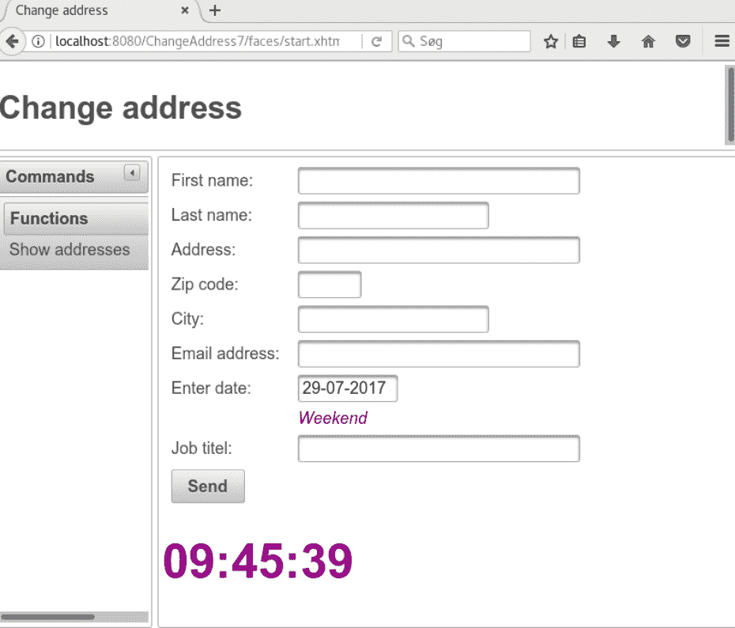

然而，时钟每秒更新一次，这意味着客户端每秒必须向服务器发送请求以更新时钟。据说客户端应该轮询服务器。可以使用 PrimeFaces 实现：

```xml
<p:poll id="poll" interval="1" update="timelabel"/>

<div class="time-text">
```


```html
<p:outputLabel id="timelabel" value="#{indexController.time}">
```

在 `bookboom.com` 下载免费电子书。

# Java 12：WWW 与客户端部分的开发：软件开发组件库

你应该注意 `p:poll` 元素会自动使用 `ajax`，因此只有当前的标签被更新。为了很好地显示时钟，样式表扩展了以下类：

```css
.time-text {
  margin-top: 30px;
  color: darkmagenta;
  font-weight: bold;
  font-size: 40pt;
}
```

再次，你应该注意传统的 Web 技术可以轻松地与 PrimeFaces 结合。反之也适用于在不用 PrimeFaces 的情况下使用 `p:poll` 等函数。

# 6.2 一个 `p:autoComplete` 元素

作为 PrimeFaces 的另一个应用，我想展示自动补全（autocomplete）。代码 `list.xhtml` 与 `ChangeAddress5` 类似，最大的区别在于除了 `start.xhtml` 之外，`p:layout` 元素和大部分 `h:` 元素都被 `p` 元素所取代。此布局扩展了一个东部区域——仅是为了展示语法。该区域（作为资源添加到应用程序中）的存在不仅是为了让那里有内容，而且为了强调你可以完美地结合 PrimeFaces 和普通的 HTML。当你尝试输出应用程序时，注意代码是经过格式化的，这也是使用 PrimeFaces 的最重要原因之一：你通常不需要与样式表等内容苦斗争，就能获得良好的效果。

你应该注意 `p:poll` 元素会自动使用 `ajax`，因此只有当前的标签被更新。为了很好地显示时钟，样式表扩展了以下类：

```css
.time-text {
  margin-top: 30px;
  color: darkmagenta;
  font-weight: bold;
  font-size: 40pt;
}
```

再次，你应该注意传统的 Web 技术可以轻松地与 PrimeFaces 结合。反之也适用于在不用 PrimeFaces 的情况下使用 `p:poll` 等函数。

# 6.2 一个 `p:autoComplete` 元素

作为 PrimeFaces 的另一个应用，我想展示自动补全（autocomplete）。代码 `list.xhtml` 与 `ChangeAddress5` 类似，最大的区别在于除了 `start.xhtml` 之外，`p:layout` 元素和大部分 `h:` 元素都被 `p` 元素所取代。此布局扩展了一个东部区域——仅是为了展示语法。该区域（作为资源添加到应用程序中）的存在不仅是为了让那里有内容，而且为了强调你可以完美地结合 PrimeFaces 和普通的 HTML。当你尝试输出应用程序时，注意代码是经过格式化的，这也是使用 PrimeFaces 的最重要原因之一：你通常不需要与样式表等内容苦斗争，就能获得良好的效果。

你应该注意 `p:poll` 元素会自动使用 `ajax`，因此只有当前的标签被更新。为了很好地显示时钟，样式表扩展了以下类：

```css
.time-text {
  margin-top: 30px;
  color: darkmagenta;
  font-weight: bold;
  font-size: 40pt;
}
```

再次，你应该注意传统的 Web 技术可以轻松地与 PrimeFaces 结合。反之也适用于在不用 PrimeFaces 的情况下使用 `p:poll` 等函数。

# 6.2 一个 `p:autoComplete` 元素

作为 PrimeFaces 的另一个应用，我想展示自动补全（autocomplete）。代码 `list.xhtml` 与 `ChangeAddress5` 类似，最大的区别在于除了 `start.xhtml` 之外，`p:layout` 元素和大部分 `h:` 元素都被 `p` 元素所取代。此布局扩展了一个东部区域——仅是为了展示语法。该区域（作为资源添加到应用程序中）的存在不仅是为了让那里有内容，而且为了强调你可以完美地结合 PrimeFaces 和普通的 HTML。当你尝试输出应用程序时，注意代码是经过格式化的，这也是使用 PrimeFaces 的最重要原因之一：你通常不需要与样式表等内容苦斗争，就能获得良好的效果。

你应该注意 `p:poll` 元素会自动使用 `ajax`，因此只有当前的标签被更新。为了很好地显示时钟，样式表扩展了以下类：

```css
.time-text {
  margin-top: 30px;
  color: darkmagenta;
  font-weight: bold;
  font-size: 40pt;
}
```

再次，你应该注意传统的 Web 技术可以轻松地与 PrimeFaces 结合。反之也适用于在不用 PrimeFaces 的情况下使用 `p:poll` 等函数。

## Java 12：WWW 与客户端部分开发：软件开发

这里回到 `start.xhtml`，其中邮政编码和城市名称的字段发生了变化：

```xml
<p:outputLabel value="Zip code:" for="code" />

<p:inputText id="Zipcode" label="Zipcode" style="width: 60px"
             value="#{indexController.code}" />

<f:validator validatorid="zipcodeValidator" />

<f:ajax event="blur" render="errorCode" />

</p:inputText>

<p:message for="code" id="errorCode"/>

<p:outputLabel value="City:" for="city"/>

<p:autoComplete id="city" value="#{indexController.city}" max="10"
                completeMethod="#{indexController.complete}" />

<p:ajax event="itemSelect" listener="#{indexController.select}"
        resetValues="true" update="code" />

</p:autoComplete>

<p:message for="city" id="cityError"/>
```

关于输入邮政编码，没有什么新变化，但请注意还附加了另一个验证器。注意这里还定义了城市名称字段必须更新。最重要的是输入城市名称时，该元素现在已更改为 `p:autoComplete` 元素。当你看到语法时，很容易看出发生了什么，这并不是绑定返回数据到列表的 `complete()` 方法的特殊方式，同时也请注意如何引用事件处理程序。最后，注意输入邮政编码的字段必须更新。

注意样式表也得到了扩展。

本章的示例展示了 PrimeFaces 可以实现的一部分功能，还有更多功能，如果你正在开发 Web 应用程序，值得研究一下 PrimeFaces 提供的功能。在这里，你应该意识到你可以从互联网下载 PDF 版本的文档。

<https://www.primefaces.org/docs/guide/primefaces_user_guide_6_0.pdf>

此外，请注意有一个非常好的在线文档带有示例：

<https://www.primefaces.org/showcase/>

最后，我想提到还有其他用于 JSF 的组件库，也值得去一看。

## Java 12：WWW 与客户端部分开发：软件开发

## WebSheet（电子表格）

# 8 WebSheet

作为本书的最后一个示例，我将编写一个简单的电子表格 Web 应用程序。该程序名为 WebSheet，如果你在浏览器中打开它，将看到如下内容：

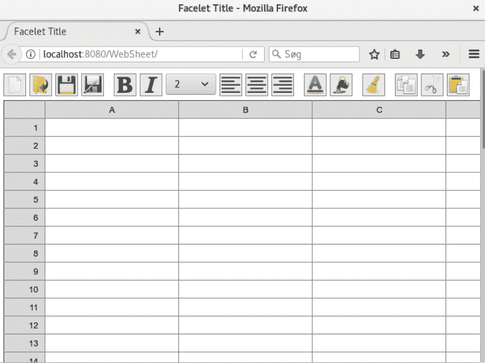

电子表格需要高度的用户交互，用户必须能够在单个单元格中输入数字和公式，在公式的情况下，必须对表达式进行求值。客户端需要完成大量工作，该项目的目标是展示如何用 JavaScript 实现它，展示 JavaScript 的某些可能性。为了方便工作，我使用了 jQuery，它是一个 JavaScript 库，提供了广泛可用的功能，包括为用户界面特意处理过的元素，如对话框、右键菜单等。如果你不知道 jQuery，可以阅读书的附录 A，其中对 jQuery 进行了简要介绍。

如上所述，目标是展示如何使用 JavaScript 编写 Web 应用程序的客户端，但它并不是一个完备的电子表格。并不是说这个程序可以使用，而是有很多很多缺失的内容或可以做得更好的地方。

在 `bookoon.com` 免费下载电子书。

## Java 12：WWW 与客户端部分开发：软件开发 WebSheet

### 8.1 程序的函数

要在单元格中输入内容，必须先通过 `CTRL + SHIFT` 并点击鼠标打开该单元格。然后你可以输入数字、公式或文本。按下 `Tab` 或 `Enter` 键接受输入。

你可以使用鼠标拖动鼠标来选择一个或多个单元格，`CTRL` 和 `SHIFT` 键具有通常的功能。

程序有一个包含 16 个功能的工具栏，如前面提到的，从左开始具有以下功能：

1. 创建新电子表格并输入行数（默认 50）和列数（默认 20）。
2. 打开现有的电子表格，你可以在已创建并保存的电子表格之间进行。
3. 保存正在工作的电子表格——如果它已保存。否则，调用“另存为”函数。
4. 将电子表格另存为新电子表格，这意味着输入一个名称。


5. 将选中单元格中的文本设置为粗体。
6. 将选中单元格中的文本设置为斜体。
7. 将选中单元格中的文本设置为左对齐。
8. 将选中单元格中的文本设置为右对齐。
9. 将选中单元格中的文本设置为居中。
10. 将选中单元格中的文本设置为右对齐。
11. 设置选中单元格的颜色。
12. 设置选中单元格的背景色。
13. 删除选中单元格的格式。
14. 复制选中单元格（此处原文应为复制）。
15. 设置选中单元格的内容。
16. 插入内容。

此外，对行点击右键会得到一个菜单：

- 选择所有行。
- 在上方插入行。
- 在下方插入行。
- 删除行。

列也是如此：

- 选择所有列。
- 在左侧插入列。
- 在右侧插入列。
- 删除列。

### 8.2 设计

内容必须发送到服务器。为了方便这一点，电子表格表示为 JSON。如果你不知道 jQuery，可以阅读书的附录 A，其中对 jQuery 进行了简要介绍。对象表示如下：

```javascript
var data = (function() {
  public = {};
  public.values = {};
```

## Java 12：WWW 与客户端部分开发：软件开发 WebSheet

对象 `options` 用于格式化，粗体和斜体包含如下对象：

```json
{
  "row": "",
  "col": ""
}
```

这定义了表格中的单元格。对齐包含如下对象：

```json
{
  "row": "",
  "col": "",
  "align": ""
}
```

其中最后一个属性的值为左、居中或右。两个数组背景和前景包含如下对象：

```json
{
  "row": "",
  "col": "",
  "val": ""
}
```


最后一个属性是颜色值。最后，最后一个数组 `decimals` 包含如下对象：

```json
{
  "row": "",
  "col": "",
  "dec": ""
}
```

其中最后一个属性是小数位数。

电子表格必须保存在某处，这里选择了一个数据库：

```sql
USE sys;

DROP DATABASE IF EXISTS websocket;

CREATE DATABASE websocket;

USE websocket;
```

```sql
CREATE TABLE sheets (
  id AUTO_INCREMENT PRIMARY KEY,
  name VARCHAR(256) NOT NULL,
  created DATE NOT NULL,
  modified DATE NOT NULL,
  rows INT NOT NULL,
  cols INT NOT NULL,
  content LONGTEXT NOT NULL
);
```


这是一个只有一个表的简单数据库。列名告诉你每一列的用途，但你应该特别注意`rows`和`cols`这两列，它们分别包含行数和列数。最后，注意最后一个列`content`，它用于电子表格的内容。

下面是项目文件的概述以及整体架构。有两个用于 Java 类的包，有两个 XHTML 页面，因此这是一个非常简单的应用程序。然而，大部分代码位于`js`文件夹中，其中包含了 JavaScript 文件。

## 8.3 编程

我想从服务器端开始，这里是`worksheet.models`包，它包含 7 个类。数据库的用户名和密码如之前所存储在`web.xml`中，其中两个类在其他示例中显示，并用于检索用户信息和创建数据库连接。最重要的类是`Repository`类，它是一个单例，提供了必要的数据库操作，由于数据库非常简单，该类也相对简单。该包还包含一个带有静态辅助方法的`Tools`类。

最后有两个模型类。一个名为`SheetName`，是一个代表数据库表中`id`、`name`、`created`和`modified`这四列的类，它并不代表电子表格的内容，因为它可以只填充部分。该类用于搜索电子表格。最后一个模型类名为`SheetMade`，它派生自`SheetName`并扩展了最后三列。该类用于表示你正在操作的电子表格。

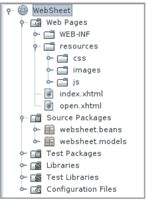

# JAVA 12：WWW 与客户端部分开发：软件开发

然后是`MainController`，这是一个相当综合的类。原则上，它是简单的，最重要的是它充当了工具栏上前四个函数的作用，这些是唯一调用服务器端的函数。该类被用作`index.servlet`和`open.servlet`的控制器，你应该考虑是否应该将该类拆分为两个，以便每个 servlet 文档都有自己的控制器。

代码其余部分是客户端代码，主要是 JavaScript 和样式表。关于后者，有 4 个样式表，其中两个是 jQuery 的且未经过修改。另外两个相对简单，分别被`index.servlet`（`styles.css`）和`open.servlet`（`dialogs.css`）使用。

有 8 个 JavaScript 文件，但只有 3 个是为此项目编写的。另外四个属于 jQuery，而第五个是一个 JSON 解析器。

应用程序很大程度上使用了 jQuery，除了轻松在 DOM 树中选择元素的能力外，jQuery 还用于以下场景：

- 使用鼠标选择表格中的单元格，例如拖动鼠标。
- 打开对话框，如简单的消息框，或者在用户右键点击行标题或列标题时打开的上下文菜单中让用户输入数据。
- 打开一个简单的颜色选择器，用户可以为文本或背景选择颜色。


关于面向儿童的在线学习（e-Learning for Kids）：成立于2004年，是一个全球非营利基金会，致力于为5-12岁的儿童提供免费的互联网学习，课程涵盖数学、科学、语言艺术、计算机和环境技能。自2005年以来，已有190多个国家的1500万名儿童受益于 e-learners。该平台由来自全球教育、在线学习专家以及业务专业人士组成的志愿者团队提供，他们致力于让每个人都能接受教育，这需要资金、志愿者、赞助商和关注开发者的支持。加入我们吧！更多信息请访问`www.e-learningforkids.org`。

在`bookboom.com`下载免费电子书 点击广告阅读更多

# JAVA 12：WWW 与客户端部分开发：软件开发

需要下载几个与 jQuery 相关的文件并将其添加到项目中。需要注意的是，jQuery 提供的功能远比本示例中使用的多。

出于当前项目的考虑，添加了 3 个 JavaScript 文件：

1. `Expressions.js`
2. `Websheet.js`
3. `ColorSelector.js`

第一个包含一个单模块表达式，包含了公式所需的所有函数。在《Java 3》一书的最后一个示例中，我展示了一个包含可以解析和评估数学表达式的方法类。该模块表达式主要是将此转换为 JavaScript，但有两处变化：

1. `expression`只支持两个数学函数：平方根函数和求和函数。然而，通过实现运算符`^`支持幂函数。
2. 表达式不再作用于普通变量而是作用于单元格引用，这意味着解析器必须进行一些修改。

对于求和函数，它可以求和多个值（常量或单元格引用），这些值以逗号分隔的列表表示。你也可以指定同一行或同一列中的两个单元格引用，并用分号隔开，函数会汇总这些引用之间的所有值。

表达式（公式）的实现相对简单，因为可以直接应用来自《Java 3》的算法。然而，挑战在于三种情况：

1. 当插入行或列时，表达式对单元格的引用可能会发生变化。例如，如果插入了一行，所有引用都必须更新。
2. 通过复制/粘贴，公式的单元格引用必须更改。
3. 如果是公式，必须验证它不会产生循环引用。这些问题都是通过模块中的函数处理的。

# JAVA 12：WWW 与客户端部分开发：软件开发

若干方法可能会抛出异常，如果发生异常，会触发相应的警报。对于已完成的应用程序，这显然没有意义，但在操作情况下，你可以将相应的错误消息发送到服务器并保存到日志文件或数据库表中。这允许你定期检查代码是否产生错误以及产生错误的原因。

然后是 JavaScript 文件`sheet.js`，它包含了用于处理用户交互的所有脚本。该文件内容很多，包含三个模块：

- `datef`：当前电子表格的数据展示。
- `sheet`：包含所有操作电子表格的方法。
- `handlers`：包含编辑单元格内容的事件处理器。

第一个在设计期间提到过，最后一个相对简单。为了编辑单元格的内容，表格中的单元格包含两个组件，其中一个是带有`span`元素的`div`元素，通常表示文本。该元素的内容将根据所选格式进行格式化。另一个元素是通常不可见的`input`组件。

按住`CTRL`和`SHIFT`键并点击鼠标将更改这两个组件的可见性，此时你可以编辑内容。当你再次点击或按`Tab`或`Enter`时会切换可见性并更新用户界面。后者并不简单。首先，可能意味着如果电子表格中的公式依赖于已更改的单元格，则它们必须更新。其次，如果是公式，必须验证它不会产生循环引用。

有一个`initCells()`函数，它不属于上述模块。该函数的作用是将`handlers`模块中的事件处理器与表格的单元格关联。该函数在浏览器初始化窗口时使用。

`sheet`模块的一个重要部分与格式化有关，其中你可能对单元格进行格式化，并确保格式被保存并在加载保存过的电子表格时使用。此外，在插入/删除行和列时，格式可能会被修改。你应该注意到，格式不会随着复制/粘贴而复制。

# JAVA 12：WWW 与客户端部分开发：软件开发

另一部分控制工具栏按钮，用于打开和保存电子表格，并在其中将请求发送到服务器。特别需要注意的是，电子表格是使用 AJAX 异步保存的。

最后，还有复制/粘贴按钮，尤其是粘贴事件的事件处理器并不简单。这些函数没有使用机器的剪贴板，而是使用了一个内部数组。其原因是为了简单化，但你应该注意，实际上有一个 API 可以让你通过 JavaScript 使用系统剪贴板。

然后是`ColorSelector.js`，它无所事事，仅仅是定义了一个用于颜色选择的简单对象。只能选择少数颜色，但 jQuery 提供了一个更高级的颜色选择对话框。当我决定自己编写时，它能让程序变得更加独立。

后面是 HTML 页面，其中有两个：`open.html`是一个用于打开电子表格的简单表单。你可以根据名称和日期搜索数据库，页面会显示符合搜索标准的已存在电子表格列表。然后是`index.html`，它是首页也是实际的电子表格所在。该页面内容不多，但除了电子表格外，还有工具栏以及 jQuery 使用隐藏`div`元素实现的对话框。你还应该注意，服务器的通信主要通过页面底部的隐藏字段实现的。


在`bookhoon.com`下载免费电子书

# JAVA 12：WWW 与客户端部分开发：软件开发

## 8.4 结论

如所述，这个项目的目的是为了向大家展示 JavaScript 能做到什么，事实上，是可以编写在客户端执行的复杂逻辑的。JavaScript 是一门相当复杂的编程语言，要学习的内容比本书介绍的要得多。然而，学习 JavaScript 并不比其他编程语言困难，如果你需要大量使用 JavaScript，没有什么是比这更系统的方法了（例如，专门读一本关于 JavaScript 的书）。

但是，有一点需要注意，JavaScript 并不是通过编译器翻译的，而且不是强类型的，代码包含错误的风险很高，更糟糕的是，发现错误既困难又耗时。因此，结论是，JavaScript 是一门完整的编程语言，但对于开发大型项目来说，它远不是一种高效的语言。

当前项目不是一个完整的电子表格，不能用作 LibreOffice Calc 等替代品——开发此类替代品没有意义。然而，该项目可能有应用场景，如果你考虑一个需要类似电子表格页面的 Web 应用程序，该项目或其部分就可以被使用。如果项目得到扩展，使其看起来像一个真实的电子表格，目前还有一些缺失，我将提到一些可以显著提高项目的功能。事实上，每个功能本身都可以是一个任务或项目。

- 数据输入应该改进，因为你并不总是需要点击鼠标来打开单元格。这主要关于如何处理与键盘相关的事件，例如使用方向键。
- 程序应该应用系统剪贴板，以便你可以将数据复制到其他程序中。这主要是获取相应的 JavaScript API 的问题。
- 表达式模块应该扩展更多的数学函数。这实际上是一个相对简单的任务，算法可以在《Java 3》一书中找到。
- 然而，最大的缺失是性能，应用程序在处理大型电子表格时会变得低效。解决这个问题的一种方案是在客户端仅显示电子表格的一部分，然后在工具栏中放置一些导航按钮。这种改进并不简单。

# 附录 A：JQUERY

在第 4 章关于 JavaScript 中，我提到了 jQuery，它是一个大型的 JavaScript 函数库，如果你担任 Web 开发人员，你就无法避免 jQuery，即使没有别的，jQuery 提供的许多函数也值得你花精力研究一下。因此，这里做一个简要介绍，也是因为我实际上在最后一章的示例中使用了 jQuery。

首先，你必须获取该产品，即最新版本，因为新版本在不断发布。你可以访问页面：

```
https://jquery.com/download/
```

从那里你可以下载作为 JavaScript 的文件，即带有代码的纯文本文件（右键点击链接并选择“另存为”）。事实上，你必须下载两个文件：

1. `jquery-3.2.1.js`
2. `jquery-3.2.1.min.js`

版本号可能会有所不同。两个文件包含相同的 JavaScript 代码，区别在于后者经过了压缩，因此体积要小得多（大约只有三分之一）。目标是在开发时使用第一个（它的代码是以可读格式编写并带有注释），当程序完成后，你可以用最后一个替换它。这里必须记住，JavaScript 是随 HTML 文档一起发送的文本，因此为了带宽考虑，你希望发送尽可能少的数据。

下载文件后，无需进行其他操作，你就可以在你的项目中使用 jQuery（以及你想要应用的地方）。作为一个示例，我创建了一个名为`JqueryExample`的项目：

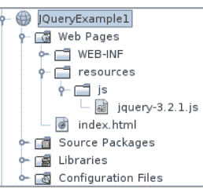

在`bookhoon.com`下载免费电子书

# JAVA 12：WWW 与客户端部分开发：软件开发

## 附录 A：JQUERY

你可以看到，在目录下，我创建了一个名为`js`的子文件夹并将`jquery-3.1.js`放在其中。`index.html`的内容如下：

```html
<!DOCTYPE html>

<html>

<head>

  <title>TODO</title>

  <meta charset="UTF-8">

  <meta name="viewport" content="width=device-width, initial-scale=1.0">

  <script src="resources/js/jquery-3.1.js" type="text/javascript"></script>

  <script>

    $(document).ready(function() {

      $("div").click(function() {

        alert("Hello world!");

      });

    });

  </script>

</head>

<body>

  <div>Click to open an alert</div>

</body>

</html>
```


加入最好的马斯里希特大学！

- 《金融时报》排名第33位：国际商业硕士。
- 排名第1位：国际商业硕士。
- 排名第2位：管理硕士。
- 排名第2位：经济学硕士。
- 排名第2位：计量经济学与运筹硕士。
- 排名第2位：供应链与变革硕士。
- 来源：Keyset University 2013；Elsevier“最佳研究”排名2012；金融时报全球管理排名。

马斯里希特大学是荷兰最好的专业大学（Biev）

硕士开放日：2月22日

`mastersopenday.nl`

# JAVA 12：WWW 与客户端部分开发：软件开发

## 附录 A：JQUERY

首先，注意在头部有一个`script`标签引用了 jQuery 文件。此外，还有一个包含一些 JavaScript 代码的`script`标签。这里意味着：

```javascript
$(document).ready
```

在 DOM 树构建之后、浏览器渲染树元素之前执行以下 JavaScript。在这种情况下，它执行一个匿名函数，为所有`div`元素关联一个点击事件处理器。具体来说，注意语法`$()`，它是一个 jQuery 函数，指向 DOM 中的元素集合；而另一方面，body 部分只有一个简单的`div`元素，如果你在浏览器中打开文档，结果是：

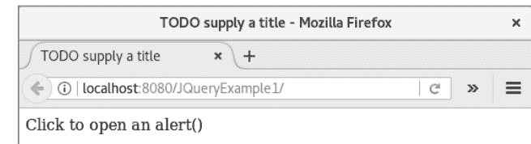

这并不神秘，但如果你点击文本，就会弹出一个窗：

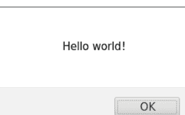

示例展示了两点。首先，使用 jQuery 在技术上需要什么；其次，jQuery 的理念是什么，即以简单的方式选择 DOM 树中的项目并对其进行操作。

第一点非常简单，你只需要将库复制到项目中（事实上，也有其他方案，因为多个浏览器供应商都提供了该库，你可以直接链接到当前的库）。至于后者，这一切都基于`$()`函数，它只是`jQuery()`的别名，上面的脚本块可以写成：

## JAVA 12：网页与客户端部分开发：软件开发

## 附录 A：jQuery

```html
<script>

jQuery(document).ready(function() {

  jQuery("div").click(function() {

    alert("Hello World!");

  });

});

</script>
```

（项目名为 jQueryExample）。从程序的角度来看，你写什么并不重要，但标准的写法是使用`$()`，这是被推荐的。jQuery 的使用是如此广泛，以至于大多数开发者都将`$()`视为 jQuery 代码。

完全另一件事是你可以可以使用什么作为`$()`函数的参数，以及你可以指定哪些函数作用于元素（`click()`就是一个例子），而这里有非常多的选项，远超本书能容纳的范围，因此有必要阅读文档：

`http://www.tutorialspoint.com/jquery/jquery_tutorial.pdf`

它提供了一个详尽且易于阅读的文档。我想通过几个使用 jQuery 可以实现的操作示例来证明其合理性。

通常情况下，`$()`的参数可以是与第 3 章关于样式表中讨论的内容对应的任何选择器。考虑以下 HTML 文档（jQueryExample3）：

```html
<!DOCTYPE html>

<html

<head>

  <title>请提供标题</title>

  <meta charset="UTF-8">

  <meta name="viewport" content="width=device-width, initial-scale=1.0">

  <script src="resources/js/jquery-3.2.1.js" type="text/javascript"></script>

  $(document).ready(function() {

    var e = $("p");

    for (var i = 0; i < e.length; i++) e[i].style.color = 'green';

    var c = $(".first");

    for (var i = 0; i < c.length; i++) c[i].style.color = 'blue';

    var v = "#viking";

    for (var i = 0; i < v.length; i++) v[i].style.color = 'red';

  });

</script>
```

```html
<head>

<body>

<div>

  <p class="first">Gorm den gamle</p>

  <p class="first">Harald blåtand</p>
```


# 引言

主体部分非常简单，由 `div` 元素中的 5 个段落 `p` 元素组成。你应该注意，前三个定义了一个类属性（尽管在任何地方都没有定义等效的 jQuery 类），并且第三个元素有一个 `id`。JavaScript 代码（jQuery 函数 `$.ready()`）执行了一个函数，该函数通过选择所有元素，结果是一个包含 5 个元素的集合。下一个 `for` 循环遍历这些元素并将颜色变为绿色。接着，对同样的操作，将颜色设置为蓝色，但仅针对类名为 `first` 的元素。最后，将颜色设置为红色，但这次仅针对具有特定 `id` 的元素（只有一个）。如果如果在浏览器中打开文档，你将得到结果：


特别地，DOM 树中的元素在文档出现在浏览器之前就已经被 JavaScript 处理了。

上面的内容很容易理解，但使用 jQuery 函数可以很容易地编写：

```html
<!DOCTYPE html>
<html>
<head>
  <title>请提供标题</title>
  <meta charset="UTF-8">
  <meta name="viewport" content="width=device-width, initial-scale=1.0">
  <script src="resources/js/jquery-3.2.1.js" type="text/javascript"></script>
  <script>
$(document).ready(function() {
  $("*").css("font-size", "24pt");
  $("p").css("color", "darkgreen");
  $(".first").css("color", "blue");
  $("#viking").css("color", "red");
  $(".last, #viking").css("font-size", "36pt");
});
</script>
</head>
<body>
<div>
  <p class="first">Gorm den gamle</p>
  <p class="first">Harald blåtand</p>
  <p id="viking" class="first">Svend Tveskøg</p>
  <p class="last">Harald den 2.</p>
  <p class="last">Knud den store</p>
</div>
</body>
</html>
```

注意，这次的最后一个段落有一个类 `last`。如果你考虑 JavaScript 函数中的第一个语句，它选择了所有元素并将字体大小设置为 `24pt`，但这是使用 `css()` 函数完成的，该函数作用于所有元素。接下来的三个元素也是如此，它们也使用 `css()` 函数而不是编写必要的循环。这正是你领略到 jQuery 强大之处的地方，有大量的函数你可以查阅文档。特别地，注意最后一条语句，它将所有 `id` 为 `last` 或类为 `last` 的元素的字体都设置为 `36pt`。

作为另一个示例（QueryExample5），下方显示了与上述类似的文档，其中示例展示了多个函数的使用：

```html
<!DOCTYPE html>
<html>
<head>
  <title>请提供标题</title>
  <meta charset="UTF-8">
  <meta name="viewport" content="width=device-width, initial-scale=1.0">
  <script src="resources/js/jquery-3.2.1.js" type="text/javascript"></script>
  <style>
    .red-class {
      color: red;
    }
    .blue-class {
      color: blue;
    }
    .green-class {
      color: darkgreen;
    }
  </style>
  <script>
$(document).ready(function () {
    var text = $("p").attr("title");
    $("h1").text(text + " s");
    $("#viking").attr("title", "Last Danish king");
    $(".first").addClass("red-class");
    $(".last").addClass("blue-class");
    $("#viking").click(function () {
      $(this).toggleClass("green-class");
    });
    alert($("h1").html());
    $("h2").html("but there are more Kings");
  });
  </script>
</head>
```

```html
<body>
<div>
  <h1></h1>
  <p class="first" title="The first king">Gorm den gamle</p>
  <p class="first">Harald blåtand</p>
  <p id="viking" class="first">Svend Tveskøg</p>
  <p class="last">Harald den 2.</p>
  <p class="last">Knud den store</p>
  <h2></h2>
</div>
</body>
</html>
```

注意，主体部分与之前相同，但这里添加了 `title` 属性。这里有 `h1` 和 `h2` 元素，但它们是空的。注意第一个段落添加了 `title` 属性。特别注意三种样式是根据其类名定义的。


BI 商学院是欧洲最大的商学院之一，每年接待超过 20,000 名学生。我们的课程提供了充满活力且多元文化的学习环境和国际视野，为学生提供日益增长的专业技能。BI 提供为期两年、全日制的硕士（MSc）课程，采用英语教学，旨在为您的职业生涯提供最佳路径。

- 商学硕士
- 金融经济学硕士
- 战略营销管理硕士
- 领导力与组织心理学硕士

bi.edu/master

# JAVA 12: WWW 与客户端部分的开发：软件开发

最后，我将展示一个修改 DOM 树的示例：

```html
<!DOCTYPE html>
<html>
<head>
  <title>待补充</title>
  <meta charset="UTF-8">
  <meta name="viewport" content="width=device-width, initial-scale=1.0">
  <script src="resources/js/jquery-3.2.1.js" type="javascript"></script>
  <script>
    jQuery(document).ready(function() {
      $("div").append(<p id="norwegian">Magnus</p>);
      $("norwegian").before(<p>Hardeknud</p>);
      var text = $("norwegian").text();
      $("norwegian").replaceWith("<h2><span>" + text + "<span>den gode code</span></span></h2>");
      $("span").css("color", "blue");
    });
  </script>
</head>
<body>
  <div>
    <h1></h1>
    <p class="first" title="第一位丹麦国王">Gorm den gamle</p>
    <p class="first">Harald blåtnand</p>
    <p id="viking" class="first">Svend Tveskæg</p>
    <p class="last">Harald den 2.</p>
    <p class="last">Knud den store</p>
  </div>
</body>
</html>
```

# JAVA 12: WWW 与客户端部分的开发：软件开发

## 附录 A：JQUERY

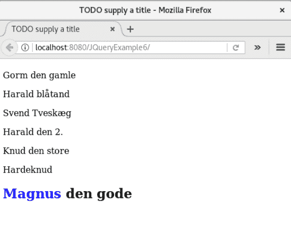

论文需要帮助吗？
从你所在领域的专家那里获取深度反馈和建议。了解你可以做什么来提高论文的质量！

立即获取帮助

访问 www.helpmyassignment.co.uk 了解更多信息

在 bookboom.com 下载免费电子书

点击广告阅读更多

# JAVA 12: WWW 与客户端部分的开发：软件开发

## 附录 A：JQUERY

至于正文部分，与之前的元素相比没有新变化，只是 `h2` 元素被删除了。jQuery 函数首先通过 `append()` 函数向其所在的 `div` 添加一个 `p` 元素，该函数会将该元素作为 `div` 元素的最后一个元素添加。下一条语句使用 `before()` 函数添加另一个 `p` 元素，但这次该元素也是 `div` 元素的元素，位于刚刚插入的元素（值为 Magnus 的元素）之前。第三条语句将 `id` `norwegian` 的值赋予变量，下一条语句将该 `id` 元素替换为另一个元素（一个包含 `span` 元素的 `h2` 元素）。最后将元素的颜色更改为蓝色。

上述仅是 jQuery 可以实现的一小部分，鼓励你去探索还有什么可能。特别是，我想提到该程序库还包含了用于使用 ajax 的函数。这意味着通过使用 JavaScript，你可以与服务器进行异步通信，这为 JavaScript 的使用提供了一个全新的维度。

除了上述提到的内容外，还有更多 jQuery 的扩展，我特别想提到 jQuery UI，它可以从以下地址下载：

```
https://jqueryui.com/
```

它是一个扩展，定义了许多用户界面元素，如对话框和使用鼠标选择元素的能力等。当你下载该产品时，将得到一个 JavaScript 文件（`jquery-ui.js`）、关联的样式表（`jquery-ui.css`）以及一个说明应用程序演示的项目。

# JAVA 12: WWW 与客户端部分的开发：软件开发

## 附录 B：JSON

JSON 是 Web 应用中客户端和服务器之间数据交换的标准，但原则上，JSON 可以用于许多其他语境，在数据交换方面，JSON 在某种程度上可以作为 XML 的替代方案。JSON 的特点是易于读写（规则非常少且简单）、基于文本且与平台无关。

JSON 文档在原则上与 JavaScript 对象具有相同的语法，示例如下：

```javascript
danish = {
  "kings": [
    {
      "name": "Gorn den Gamle",
      "to": "958"
    },
    {
      "name": "Harald Blåtand",
      "from": "958",
      "to": "987"
    },
    {
      "name": "Svend Tverskøg",
      "from": "987",
      "to": "1014"
    }
  ]
};
```

基本语法是数据以由冒号分隔的键/值对形式表示。多个数据元素（键/值对）可以作为对象组合在逗号分隔的。最后，数据元素的值可以是数组。通常，JSON 支持以下数据类型：

1. 数字：类似于 JavaScript
2. 字符串：使用双引号并带有反斜杠转义
3. 布尔值：`true` 或 `false`
4. 数组：由逗号分隔的有序序列
5. 对象：无序集合的键:值对

因此，上述内容也可以写成如下，其中年份周围没有引号：

```javascript
danish = {
  "kings": [
    {
      "name": "Gorn den Gamle",
      "to": "958"
    },
    {
      "name": "Harald Blåtand",
      "from": "958",
      "to": "987"
    },
    {
      "name": "Svend Tverskøg",
      "from": "987",
      "to": "1014"
    }
  ]
};
```


# JAVA 12: WWW 与客户端部分的开发：软件开发

## 附录 B：JSON

只要你只需要在客户端处理 JSON 数据，实际上除了上述内容外没有什么好说的，如果数据需要发送到服务器或从服务器接收，必须对其进行解析。例如，如果你将 JSON 数据发送到服务器端的 Java Bean，并且之后它可以使用这些数据，则必须将其解析或解码为 Java 对象，使用服务器可以下载并使用的标准解析器。同样，在服务器端，可以将 Bean 编码为 JSON 数据发送到客户端，而在客户端端，相应的必须下载 JavaScript 解析器来解码从服务器发送的数据。

```javascript
numbers = {
  "primes": [
    [2, 3, 5, 7],
    [11, 13, 17, 19],
    [23, 29],
    [31, 37],
    [41, 43, 47]
  ]
};
```

```javascript
<script>
for (var i = 0; i < numbers.primes.length; i++) {
  for (var j = 0; j < numbers.primes[i].length; j++) {
    document.write(numbers.primes[i][j] + " ");
  }
  document.write("<br>");
}
</script>
```
