# Java 13：分布式编程与 Java EE 软件开发

## 前言

本书是软件开发系列书籍中的第十三本。编程语言是 `Java`，该语言及其语法和语义显然占据了大量内容，但这些书籍很大程度上也关注过程以及如何开发良好且健壮的应用程序。本书是 `Java 11` 内容的延续，但侧重于企业级应用的开发。这些程序使用托管在不同计算机并位于不同位置的组件或服务执行工作，并通过网络进行通信和协调工作。主要主题是 `Java EE` 技术，如 `JPA`、`EJB` 和 Web Services。本书要求具备 Web 应用程序编程的知识，这与 `Java 11` 和 `Java 12` 书中处理的内容类似。

正如标题所示，这一系列书籍涉及软件开发，目标是教读者如何用 `Java` 开发应用程序。可以通过阅读相关主题的内容和学习完整的示例程序来学习，但最重要的是亲力实践，并从零开始编写自己的程序。因此，书籍的一个重要部分是练习和问题，读者需要在其中编写与书中处理内容相应的程序。该系列中的所有书籍都围绕同一个骨架构建，将由文本、示例、练习和问题组成，并且这些内容被放置在文中自然所在的位置。

练习与问题的区别在于，练习很大程度上是针对文中阐述内容的重复，并且对需要做什么的描述相对准确。相比之下，问题的描述较为松散，规模通常也稍大一些，而且很少有明确的最佳解决方案。这些书籍是要从头到尾阅读的，但大量的代码示例（包括练习和问题）起着核心作用，读者详细地预测并研究许多示例代码，并解决练习和问题，或者只是研究推荐的解决方案是非常重要的。

所有书籍都以一或两个较大的示例程序结束，这些程序主要关注于过程以及对程序是如何编写的解释。另一方面，代码仅在有限范围内出现——如果有的话——读者应该在测试程序时可能学习完成的程序代码。此外，除了展示比其他呈现示例更大的程序开发外，结论示例的目标还为了展示不同应用领域的程序示例。

大多数书籍还以一个附录结束，处理一个书中未涉及的主题。它可能是关于软件安装的问题或计算机技术中的其他主题，这些主题不关于软件开发，但拥有介绍性知识是必要的。如果读者已经熟悉该主题，可以跳过当前附录。

如前所述，编程语言是 `Java`，此外这些书籍还使用了以下产品：

1. `NetBeans` 作为应用程序开发的 IDE。
2. `MySQL` 用于需要数据库服务器的场景（从 `Java 6` 书开始）。
3. `GlassFish` 作为 Web 服务器和应用服务器（从 `Java 11` 书开始）。

这些产品是免费且可免费安装的，甚至提到了某些产品的安装过程可以完全自动进行，而无需付出巨大的努力和挑战。此外，在网上有针对这三个产品的详细安装说明。这些产品适用于 Windows 和 Linux，因此无论你使用 Linux 还是 Windows 都没有特殊影响。

所有示例程序都是在运行 Linux 的机器上开发和测试的。事实上，这并没有起什么主要作用，因为无论平台是其中哪一个，`Java` 和其他产品的工作方式都是完全相同的。书中某些地方你会看到平台是 Linux，这主要适用于涉及文件系统的命令。在其他情况下，对于读者来说，程序在 Linux 机器上开发并没有意义，它们也可以立即在 Windows 下运行，除非程序引用了文件系统，此时可能需要更改文件名。

最后简要介绍一下这些书籍不是什么。它们不是“如何编写”的指南，或者说不是 `Java` 的参考手册，而是正如标题所言，是关于软件开发的书籍。我希望读者在阅读书籍并通过许多示例时，可以找到如何编写良好程序的灵感，也可以将其作为解决方案集，提供许多你作为软件开发者经常面对的具体日常编程问题的解决方案示例。

# 1 引言

在之前的两本书中，我一直开发 Web 应用程序，本书是其自然的延续，但侧重于分布式程序的开发。这些程序使用托管在不同计算机上的组件或服务执行工作，并通过网络进行通信和协调工作。核心思想是，这些组件很大程度上有自己的生命，彼此独立存在，并且通常不知道使用它们所提供的服务的客户端。事实上，要精确定义我们所理解的分布式程序并不容易，但通常我们将其理解为具有以下特征的程序：

1. 有多个独立的计算单元（计算机），每个单元都有自己的本地内存。
2. 计算单元通过在网络上传递消息相互通信。

分布式程序（或系统）的目标可能是解决某个特定任务，用户会将这一系列计算单元感知为单一设备（或系统），但相反，它们可能是一个面向服务的系统，提供一系列用户可以使用并感知为共享资源的服务。分布式程序还具有并行性特征，即在多台计算机和多处位置上同时执行多个活动。

你有时也可以将分布式编程看作面向对象编程的进一步发展。一个面向对象的程序由对象组成，每个对象的内部数据和逻辑对外部世界隐藏，仅通过对象以公共方法形式提供的服务已知。这些对象随后协同工作以解决要解决的任务。同样，你可以将分布式程序看作通过提供位于世界各地、独立运行的服务来解决任务的程序，如果允许，应用程序可以使用它们。

除了展示如何在实践中开发分布式程序（或者更多与此相关的）之外，目标也是描述更具体的技术，如下所示：

- `Java Persistence API`
- `Java Enterprise Beans`
- `Contexts and Dependency Injection`
- `Java Web Services`
- `RESTful web services`
- `Java EE security`

似乎，本书描述了许多 Java API，很大一部分内容与 `NetBeans` 和 `GlassFish` 直接相关。

# 2 Java Persistence API

在之前的书籍（从 Java 6 开始）以及包含 Java 11 的 Web 应用程序中，我考虑过几个使用数据库的示例。这一直包括为每个数据库表编写模型类（model classes）以对数据库进行面向对象的封装，并编写一个或多个类来封装操作关系型数据库内容的 SQL 语句。这意味着对于每个示例，都需要编写许多 Java 代码。虽然这在开销上是可以接受的（因为从原理上讲每次发生的情况都是样的），但可以通过更简单（更好）的方法来实现，因为 Java EE 提供了一个名为 `Java Persistence API`（Java 持久化 API）的 API，它的任务正是为关系型数据库提供面向对象的接口。本章的目的是介绍这一 API，内容大部分侧重于介绍“如何做”。

我将从《Java 11》书中的项目 `ChangeAddress3` 开始，我将该副本命名为 `ChangeAddress1`。如果你在浏览器中打开该应用程序，你会看到下面的窗口，可以在其中输入地址；点击底部的链接，你会得到另一个窗口，显示已输入地址的概述。

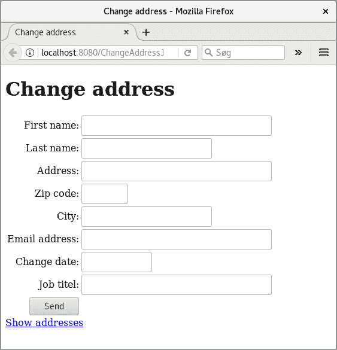

在输入地址时，它们被存储在 `Person` 对象的列表中。然而，数据并没有持久化地存储。正如我在之前的示例中所展示的，创建一个带有表的数据库并在该表中保存数据是相对简单的。在这个示例中，我将向你展示如何使用 JPA 来实现这一点。

在这个示例中，我想使用 `JavaDB` 作为数据库产品。主要是为了展示这个数据库，因为它在许多需要简单数据库的语境下非常有用且易于使用。它是一个标准的 SQL 数据库服务器，由 `Glassfish` 服务器支持，不需要任何特殊安装，`NetBeans` 也支持该产品。

这种方法基本上是为每个数据库表定义一个实体类（entity class），我想先将一个类与 `model` 包关联。它必须是一个 `Entity Class`（实体类）：

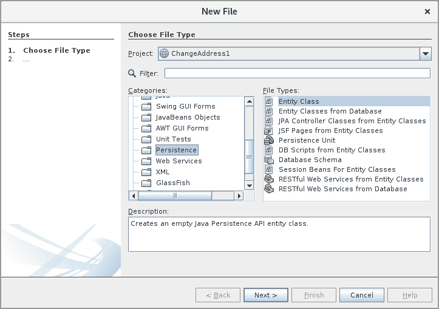

并且它应该命名为 `Address`：

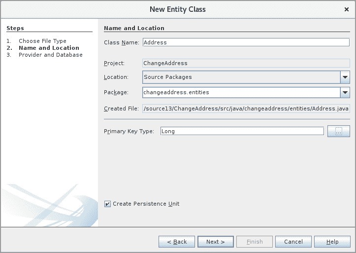

你应该注意，已经选择了正确的包名（如果不在列表中，可以手动输入），并且勾选了 `Create Persistence Unit`（创建持久化单元）。持久单元是一个名为 `persistence.xml` 的 XML 配置文件，由 `NetBeans` 创建。当你点击上方窗口中的 `Next` 时，会得到一个初始化此 XML 文件的窗口。如果你愿意，可以更改名称，并注意已勾选了 `Use Java Transaction APIs`（使用 Java 事务 API）。默认选择了 `Create`（创建），这意味着如果数据库尚未创建则必须创建。

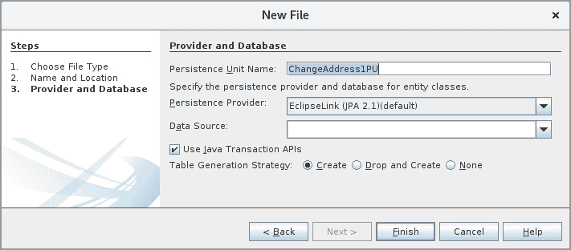

然而，最重要的是 `Data Source`（数据源）字段，它是指向当前数据库的引用。在这里你可以选择现有的数据源，也可以创建一个新的：

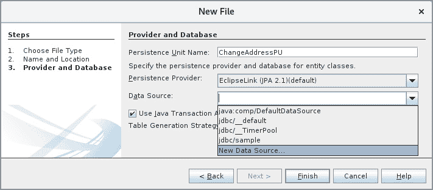

如果你点击 `New Data Source`（新建数据源），你会得到一个创建数据源的窗口：

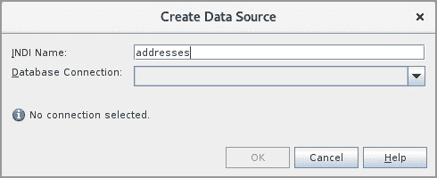

我在其中输入了名称 `addresses`。还必须定义到数据库的连接。在这里你可以选择现有的或创建一个新的。在这种情况下，你必须创建一个新的，并选择一个驱动程序，我选择了 `Java DB (Network)`：

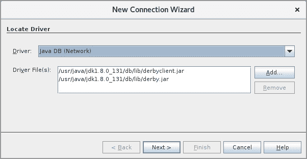

点击 `Next` 后，输入有关数据库的信息：

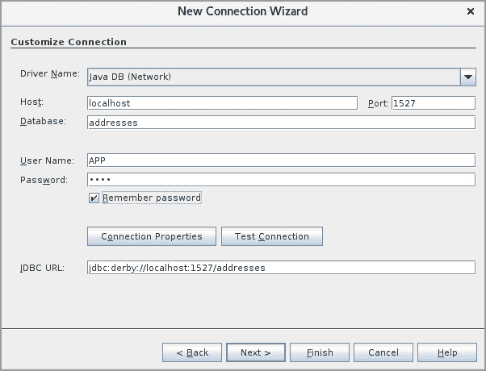

数据库服务器——`Glassfish` 服务器——运行在 localhost 上并使用 1527 作为端口号。我选择数据库名称为 `addresses`。`Java DB` 有一个默认名为 `APP` 的用户，我输入了密码（1234）。然后点击两次 `Next`，最后点击 `Finish`，之后数据源就创建了：

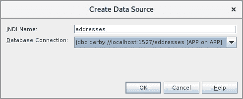

当我点击 `OK` 时，实体类被创建：

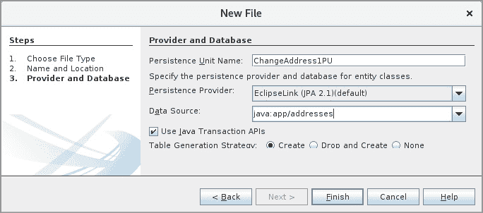

然后我点击 `Finish`，`NetBeans` 创建了以下类（我删除了注释并稍微修改了 `equals()` 方法）：

```
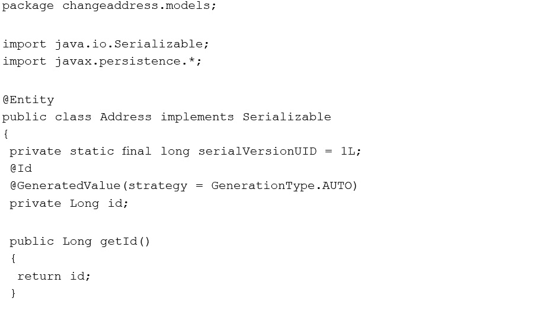
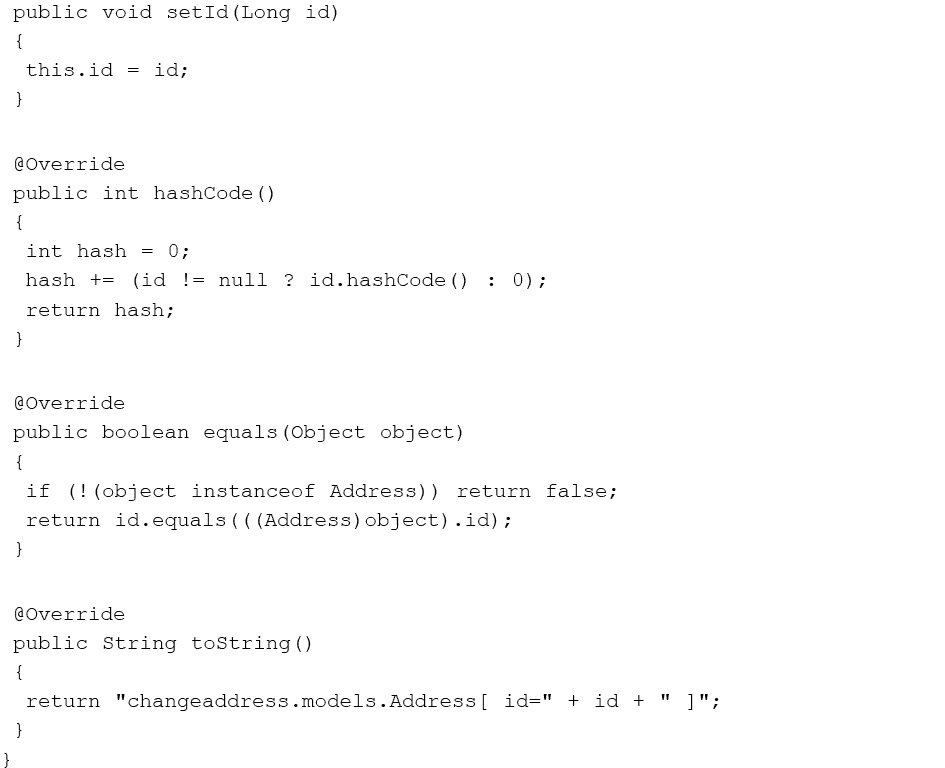
```

结果是一个具有类型为 `Long` 的单个属性 `ID` 的类。你应该注意，该属性被两个注解装饰，第一个指示它是主键，另一个告诉该值应由数据库服务器作为自动编号进行分配。最后，你应该注意该类还装饰了一个注解，说明它是一个实体类。该类随后必须扩展以下属性：

```
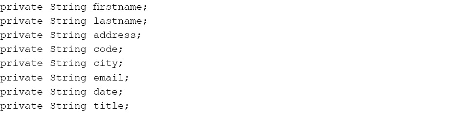
```

并带有相关的 `get` 和 `set` 方法。然后我删除了模型类 `Person`，在 `IndexController` 中，所有对 `Person` 的引用必须改为 `Address`，并且应该删除 `add()` 方法中的代码。之后，可以再次在浏览器中打开程序。

在 `IndexController` 中，你必须添加一些语句：

```
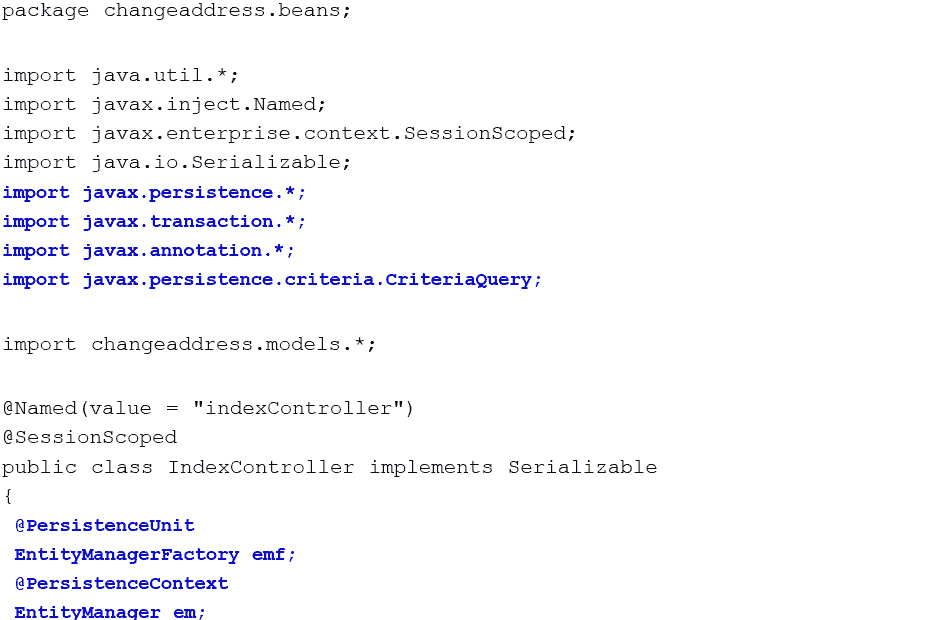

```

所示。这种表示法的精确含义将在第 4 章中解释，例如，`em` 的类型为 `EntityManager`，代表数据库。最后一个变量 `utx` 定义了一个事务。这些对象用于 `getPersons()` 和 `add()` 方法。例如，`persist()` 将 `person` 对象写入数据库。在可以使用应用程序之前，必须创建数据库。它发生在 `Services` 下，右键点击 `Java DB`：

## 2.1 改进的地址程序

在本节中，我想展示上述程序的另一个版本，它在两个方面发生了变化：

1. 数据库这次是一个现有的 MySQL 数据库。
2. 数据库操作移动到了控制器中。

在完成任务之前，我必须创建数据库：

```
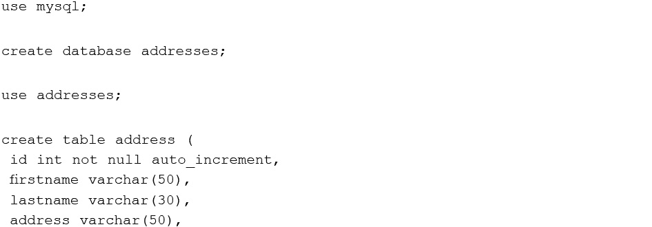
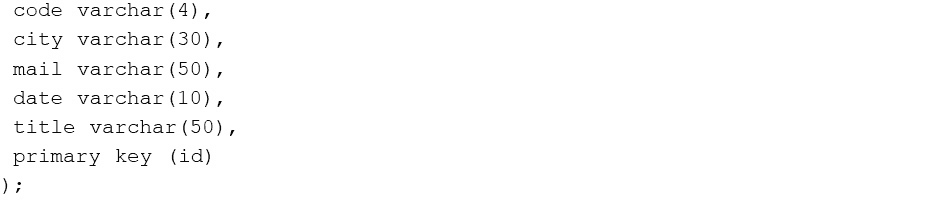
```

结果与之前的示例内容相同。

起点是上述程序的副本，命名为 `ChangeAddress2`。首先，我删除了以下文件：

1. 模型类 `Address`。
2. 配置文件 `glassfish-resources.xml`。
3. 配置文件 `persistence.xml`。

然后我重新创建了模型类（使用相同的名称），但这次作为 `Entity Class from Database`（从数据库创建实体类）（所示）。当我点击 `Next` 时，你会看到下面的窗口，我在其中选择了一个 `Data Source`。这里的操作方式与之前的示例相同，但这次对于数据库连接，必须选择 `MySQL driver` 以指定数据库（`addresses`）、数据库用户和密码。

完成后，数据源（我将其命名为 `addresses`）的表显示在 `Available Tables` 下，然后应将其添加到 `Selected Tables`。然后点击两次 `Next` 并接受所有设置，最后点击 `Finish`。然后，`Address` 类被再次创建。

```
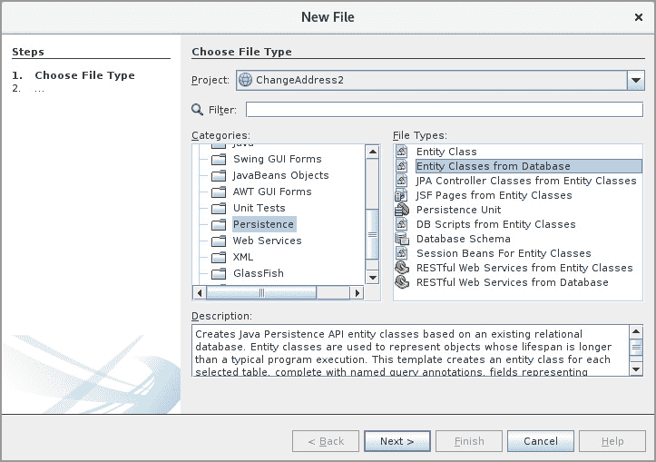
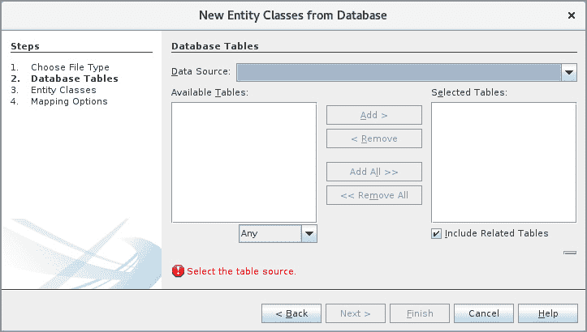
```

然而，有一个小问题，因为类中用于电子邮件地址的 `Address` 属性名称是 `mail` 而不是 `email`，因此在 `IndexController` 中必须更改一些名称。然后程序就可以再次运行，唯一的区别是应用程序现在使用了 MySQL 数据库。

你应该检查 `Address` 类，其中添加了许多注解（所有属性都经过了装饰），但你可以轻松地理解其含义。你必须注意，所有的注解都是 `NetBeans` 通过从数据库中检索信息确定的。此外，尝试检查 Glassfish 资源文件 `resources.xml` 配置文件。

我将进行单项改动。通过 `EntityManager` 对象和 `UserTransaction` 对象，你可以执行数据库操作，而不需要编写大量代码，也不需要了解 SQL。由于每次发生的情况都是相同的，你可以将这些操作封装到一个类中，无论是哪个数据库表都可以使用。这是通过添加一个数据库控制器来实现的（在此处添加到 `changeaddress.models` 中），它是一个类型为 `JPA Controller Classes from Entity` 的类：

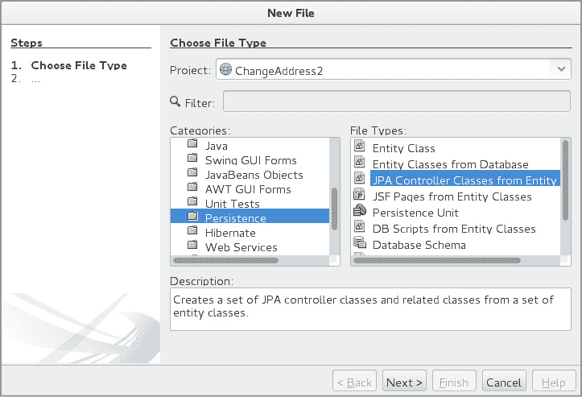

当你点击“Next”（下一步）时，你必须选择应该为哪个对象创建控制器的实体类：

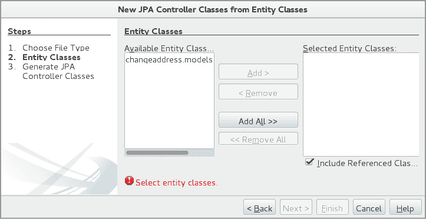

在这种情况下，只有一个选项，当它被添加到 `Selected Entity Classes` 时，你可以创建控制器类。该类名为 `AddressJpaController`，它封装了维护数据库表所必需的内容，以及允许你根据特定主键读取行的方法和检索多个行的方法。代码下所示：

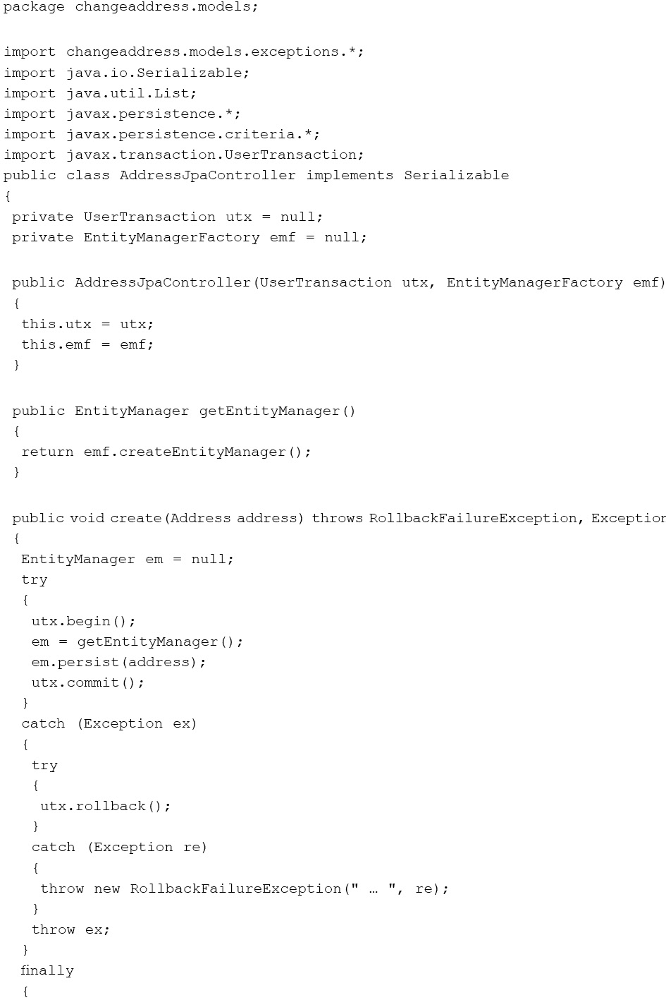
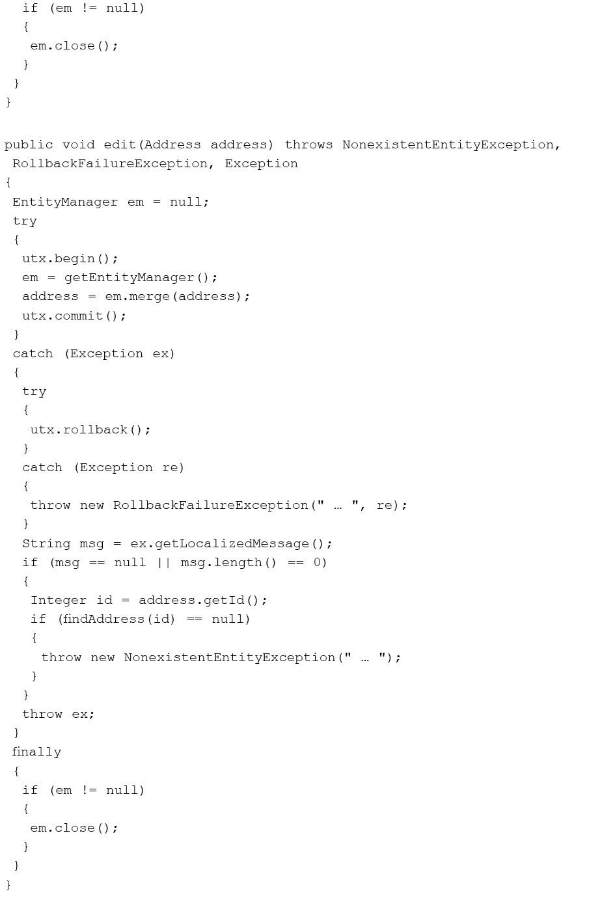
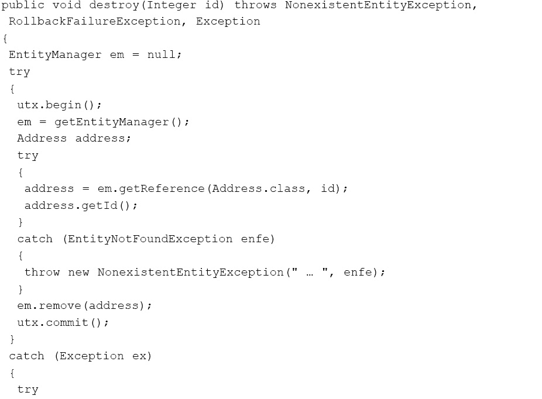
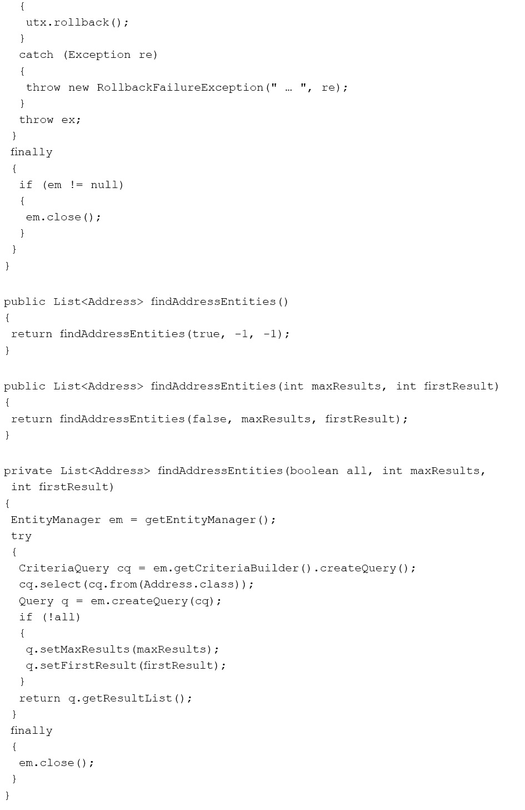
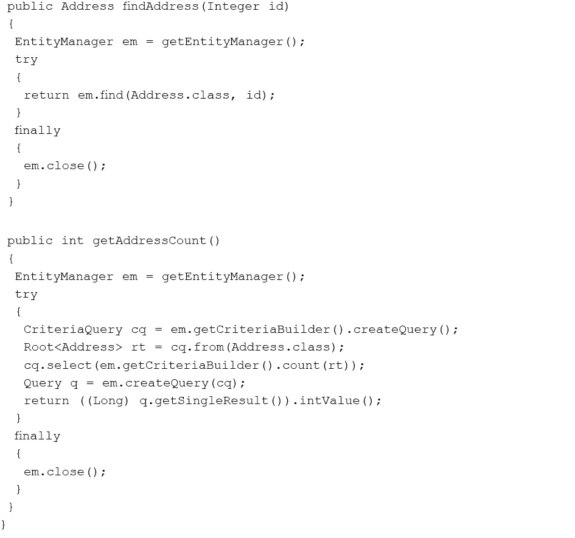

代码填充完成后，但这个类非常容易理解，最重要的一点是所有关于数据库更新的内容都封装在方法中，包括回滚所需的逻辑。此外，该类定义了一些简单的 `find()` 方法，这些方法可以返回具有特定 `id` 的对象或通常为所有对象的对象列表。这些 `find()` 方法使用一个私有的 `find()` 方法，在这里你应该注意下文解释的 `CriteriaQuery` 和 `Query` 类型，但根据名称（以及应用程序），你可以看出这些是用于用于构建 SQL SELECT 的类型。最后，注意该类还包含一个返回数据库表行数的方法。

在将类添加到项目后，必须更改 `IndexController` 类：

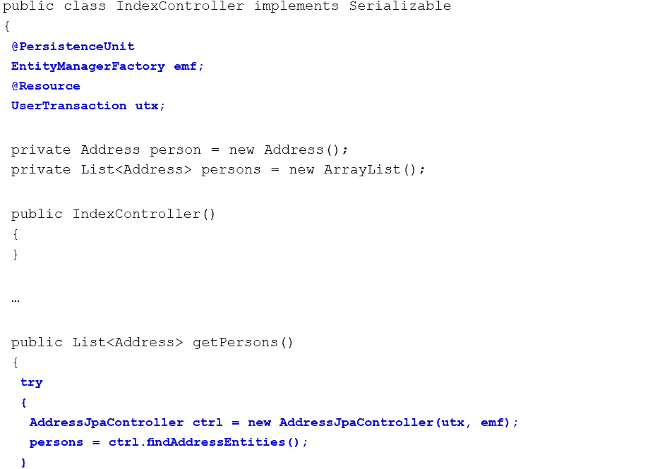
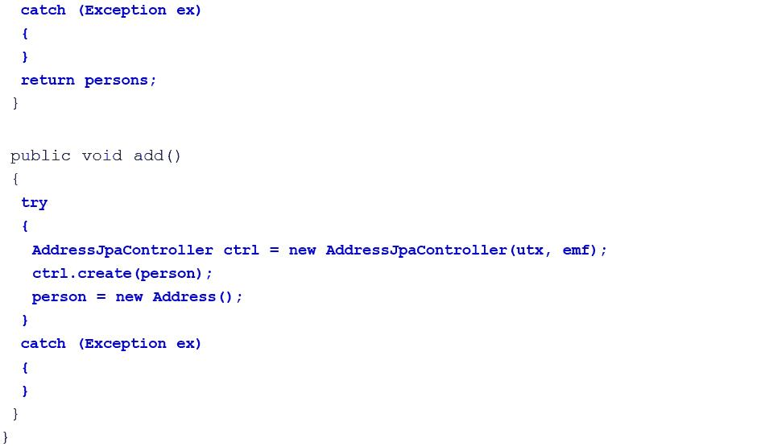

在这里，最重要的是前两个语句，它们定义了一个 `EntityManagerFactory` 和一个 `UserTransaction`。特别注意定义两个待实例化对象的两个注解。你还应该注意，返回所有地址和创建地址的两个方法现在已经更改，因此所有关于数据库操作的逻辑已移动到控制器类中。

如果你查看示例，你应该注意所有关于 SQL 的内容都消失了，并移动到了属于 JPA API 的代码中。结果是需要编写的代码显著减少，特别是，你应该注意 `AddressJpaController` 类是由 `NetBeans` 自动生成的。

### 练习 1


在本次练习中，你必须编写一个 Web 应用程序，当应用程序需要使用 JPA 时打开并显示数据库 `padata` 中 `zipcode` 表的内容。从一个新的 Web 应用程序项目开始，你可以将其命名为 `ZipcodePage`。然后你必须作为 `Entity Classes from Database` 添加一个实体类。

你必须为数据库 `padata` 定义一个 `Data Source`（数据源），完成后，你应该能够查看数据库中的所有表。在这里，你必须选择 `zipcode` 表。当你到达下一个窗口（见下文）时，你必须选择一个包并取消某些勾选，但不要取消最后一个勾选。

运行向导后，你创建了一个名为 `Zipcode` 的实体类。当检查代码时，你应该注意这次创建的命名查询较少。原因是后续窗口中没有勾选 `Generate Named Query Annotations for Persistent Fields`（为持久字段生成命名查询注解）。

注意，`Named Query`（命名查询）是一个使用 SQL 变体 `JPQL` 编写的 `SELECT` 语句示例。

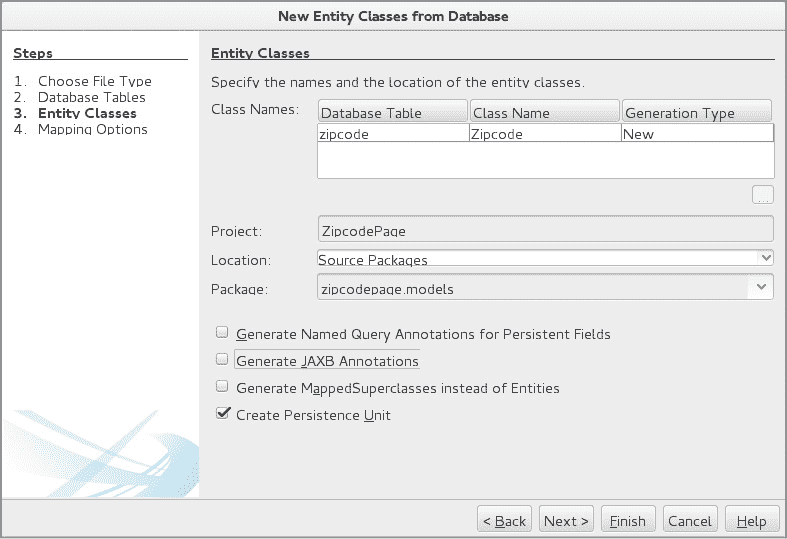

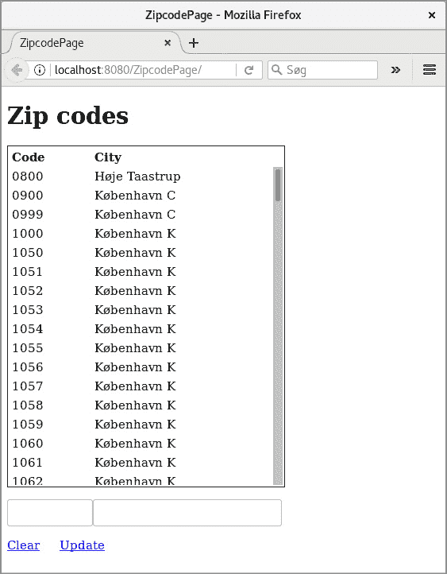

下一步，你需要为你的实体类添加一个名为 `ZipcodeJpaController` 的数据库控制器，如上一个示例所示。

当结果必须是上述显示邮政编码表格的窗口时，必须为 `index.xhtml` 创建命名 bean。底部的输入字段应作为过滤器：

1. 第一个字段的内容必须匹配所有邮政编码开头。
2. 第二个字段的内容必须匹配所有城市。

`Clear`（清除）链接应该清除两个字段，而 `Update`（更新）链接应该更新对应的内容。加载数据库表应该在程序启动时发生。你可以在你的 bean 中编写 `init()` 方法并如下所示装饰：

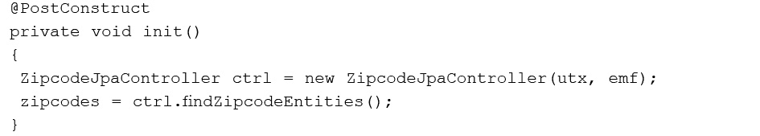

## 2.2 相关表

使用 JPA 编写上面的 Web 应用程序是非常简单的，但当然，这是因为数据库只有一个表。在本节中，我将展示一个具有多个表且表之间存在关系的示例，在这里 JPA 的优势变得更加明显。

作为示例，我将使用来自书籍 Java 7 的数据库：

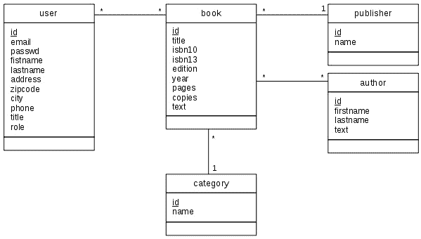

我将仅使用四个实体 `book`、`publisher`、`category` 和 `author`。在这里你应该注意 `publisher` 与 `book` 之间以及 `category` 与 `book` 之间一对多的关系。此外，`book` 与 `author` 之间存在多对多的关系。

该示例是一个名为 `PaBooks` 的 Web 应用程序，它应该能够维护上述四个实体对应的表。应该注意的是用户界面是简单的——以便关注数据库事务和 JPA。在下文中，正如本章的前两个示例一样，我将主要关注程序是如何制作的，特别是如何使用 JPA 开发数据库应用程序。

开始是一个名为 `PaBooks` 的 Web 应用程序。在创建应用程序后，我选择了 `Entity Classes from Database`，在这里我创建了数据源 `booklibrary` 连接到 `library` 数据库。完成后，你会获得数据库表的概览：

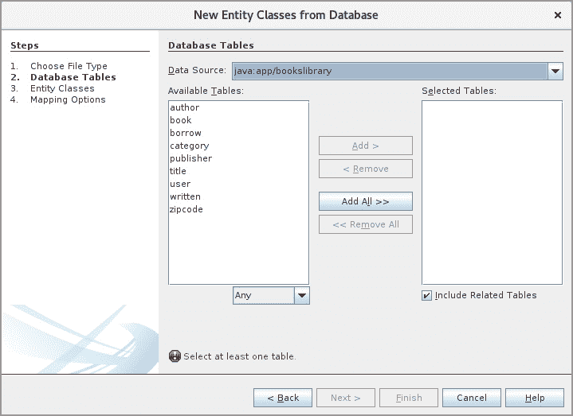

这里是表：

- `author`
- `book`
- `category`
- `publisher`
- `written`

将它们添加到 `Selected Tables`：

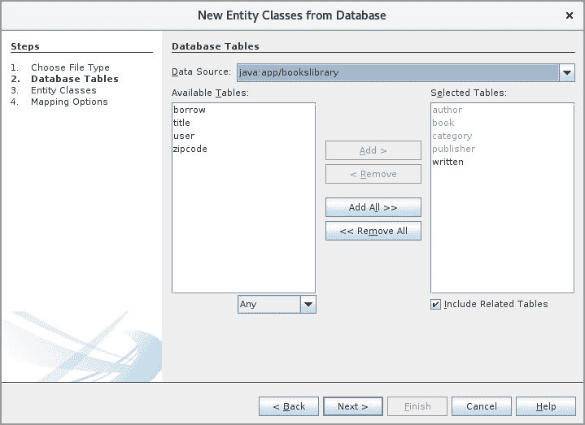

特别注意 `written` 表显示为粗体，这是因为它是 `book` 和 `author` 之间的关系表。

在这里你可以看到创建了四个实体类。请注意，如果你愿意，可以更改这些类的名称。在本例中，我不会这样做。还要注意创建这些类所在的包名称，我将其命名为 `pabooks.models`。当你点击 `Next` 时，会看到以下窗口：

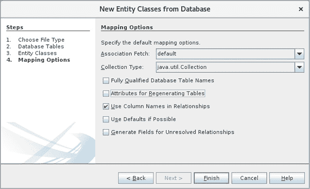

当你点击 `Finish` 时，四个实体类就会被创建。通常情况下，很少需要更改这些实体类，但有时我会更改这些类的 `toString()` 方法，在本例中，我也对 `Author`、`Category` 和 `Publisher` 类执行了此操作。鼓励你学习这些代码。

在这里你应该注意，除其他外，`Publisher` 类有一个用于 `Book` 对象的集合 `bookCollection`。它代表指向 `Book` 对象的外键，因此引用了由该发行商出版的 `Book` 对象。`Category` 类也是如此。

如果你研究 `Book` 类，应该会看到它有一个对 `Publisher` 对象和 `Category` 对象的引用，因此是这两个多对一关系的另一端。`Book` 类还拥有一个带有 `Author` 对象的集合 `authorCollection`，它代表了 `book` 和 `author` 之间的多对多关系。

检查 `Author` 类你会发现该类有一个对应的用于 `Book` 对象的集合 `bookCollection`，它是多对多关系的另一端。在检查类时，请注意装饰上述关系属性的注解。

在添加实体类后，我想要通过选择 `JPA Controller Classes from Entity Classes` 来添加控制器类：

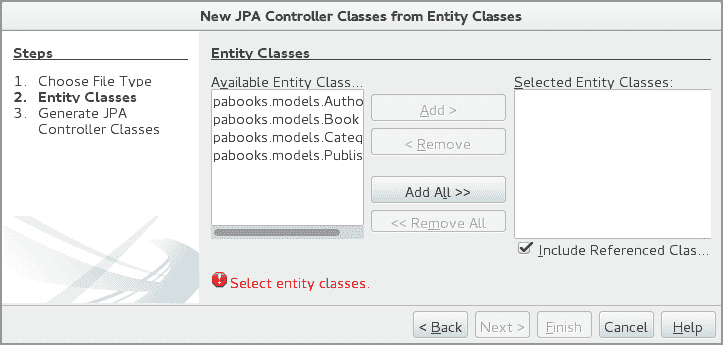

对于所有添加到 `Selected Entity Classes` 的四个实体类都必须创建一个控制器。在点击 `Next` 并选择所需的包（这里是 `pabooks.models`）后点击 `Finish`，这四个控制器类就会被创建：

- `AuthorJpaController`
- `BookJpaController`
- `CategoryJpaController`
- `PublisherJpaController`

通常情况下，这些类是不被修改的，但可能需要扩展这些类以添加用于数据库查询的方法。在本例中，我通过一个新方法扩展了 `BookJpaController` 类。然而，这需要一些如何在 JPA 中编写 SQL `SELECT` 语句的语法。

### Criteria API

如果你看我目前为止编写数据库应用程序的方式，最全面的类型之一就是 SQL `SELECT` 语句——至少为了正确编写它们，JPA 也是如此。要编写和执行 `SELECT` 语句，你必须使用 `Query` 对象，而 JPA 定义了一种类似于 SQL 的语言，称为 `JPQL`。

该语言的语法与 SQL 基本上相同，在书中不会被显式对待。当很难正确编写 SQL `SELECT` 语句时，是因为它仅仅是文本，因此语法无法通过编译器验证。`JPQL` 的问题也是一样的。为了帮助解决这个问题，定义了一个名为 `Criteria API` 的 API。

事实上，使用此 API 编写 `SELECT` 语句并不更容易，但 `SELECT` 表达式的不同部分是使用 Java 类定义的，因此编译器可以验证表达式是否编写正确。在本书中，我将在大多数地方使用此 `Criteria API`，以下是对其语法的简要介绍。

该 API 用于定义条件查询，这本质上是一个对象图，你通过构建这样一个图来定义条件查询。这是通过类型为 `CriteriaBuilder` 的对象实现的，该对象可以创建构成条件查询的部分。

由于它本质上都是关于表示 `SELECT` 语句的，这意味着对表、列以及从数据库中提取行的条件进行了面向对象的表示。例如，你可以通过如下形式的语句从 `EntityManager` 获取一个 `CriteriaBuilder`：


其中 `em` 是一个 `EntityManager`。这样的构建器有三个返回条件查询的方法：

- `CriteriaQuery<T> createQuery(Class<T>)`
- `CriteriaQuery<Tuple> createTupleQuery()`
- `CriteriaQuery<Object> createQuery()`

区别在于查询返回什么种类的对象。在拥有了创建查询的条件构建器后，任务是初始化这个查询，这正是 API 发挥用场的地方。

我想从上述方法中的第一个开始，该方法创建一个查询，其中参数类型指示了查询结果预期的对象类型，原则上它可以是任何任意的对象类型。例如，下面显示了一个条件查询，它确定了库数据库中所有页码值为 520 的书籍：

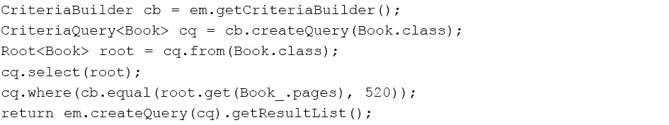

注意如何创建一个 `CriteriaBuilder`（`em` 是一个 `EntityManager`）以及如何使用它来为 `Book` 对象创建条件查询。对于这个查询，为对象图创建了一个 `root`，并定义查询对象必须从此根节点提取对象。

`root` 随后对应于 SQL `SELECT` 语句中的 `FROM` 部分。接下来，通过 `select()` 方法定义哪些属性是结果的一部分，这里是 `root`，意味着 `Book` 对象。因此，`select()` 函数指示了要包含哪些列。最后，定义了只在页码为 520 时提取对象。

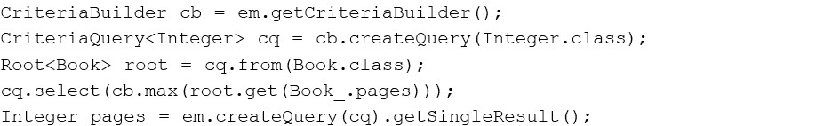

或者更短的形式为：

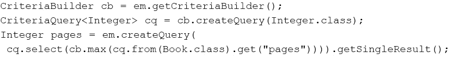

随后我将通过一些示例展示如何确定特定列（即实体类中的特定属性）的值。接下来查询确定了页码大于 300 的所有 `Book` 对象的 `id` 和 `title`：

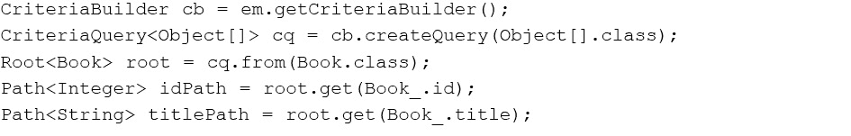

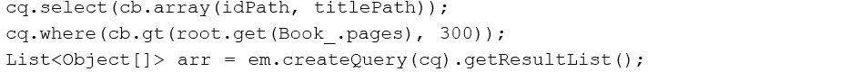

在这里你应该主要注意如何使用 `Path` 对象引用各个列。还要注意如何指示结果应该是一个列表，其对象是数组，而这里是包含两个元素的数组，它们是由 `select()` 方法定义的。该查询也可以写为：

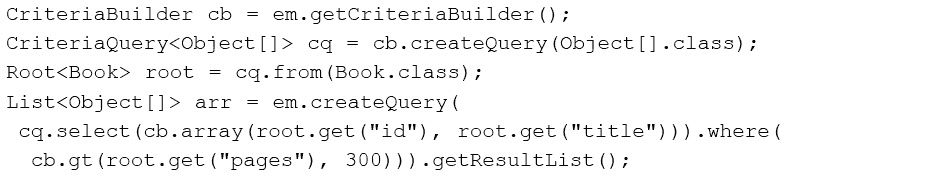

但在这种情况下，表达式并不那么易读，而且至少需要你深入掌握 `Criteria API`。

上面的示例类型强度不强——结果是一个类型为数组的对象的列表。可以通过包装类来解决：

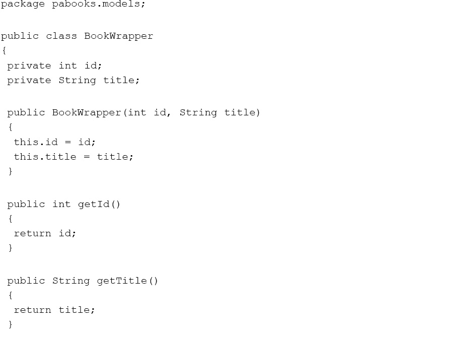

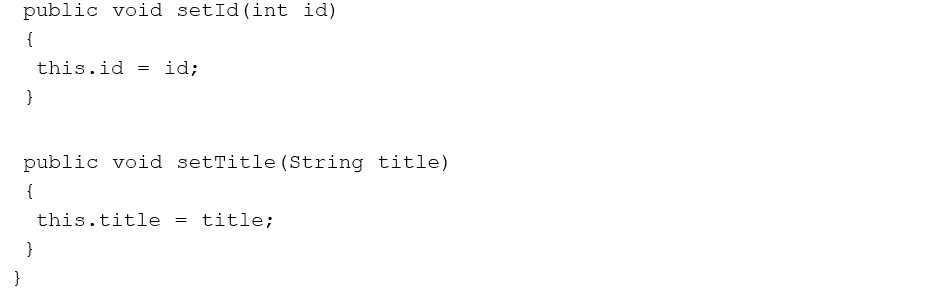

它仅仅是一个封装了书籍 `id` 和 `title` 的类。该查询可以写如下：

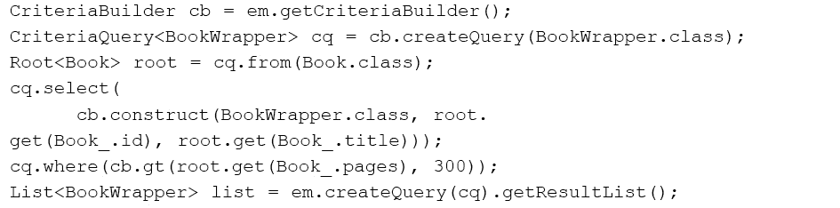

首先，注意你为 `BookWrapper` 对象定义了一个 criteria 查询。接下来，你使用来自构建器的 `select()` 方法和 `construct()` 方法，它告诉你构造 `BookWrapper` 对象。其余部分在原则上与之前的示例相同。

查询也可以返回 `Tuple` 对象，语法上最大的区别是查询对象是通过 `createTupleQuery()` 创建的：

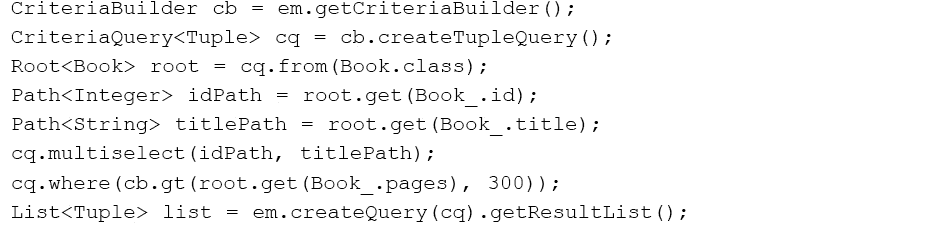

优点是你不必编写包装类。注意使用 `multiselect()` 来指定包含在结果中的列，这些列用于指定结果中的多个属性。

另一点是如何使用单独的 `Tuple` 对象。我在这里不想详细介绍，并鼓励你去研究 `Tuple` 类型——它是一个接口，但你可以写出以下内容（尽管代码在此语境下并没有意义）：

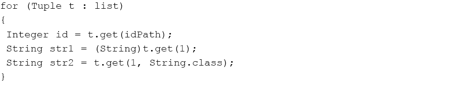

`criteria` 查询对象定义了一个从一个或多个实体的查询（在上面的示例中，每次只有一个 `Book`）。当然，你可以指定更多的实体，这对应于 SQL 中的连接（join）操作。

我将从一个查询开始，确定所有出版商名称以 `Sams` 开头的书籍：

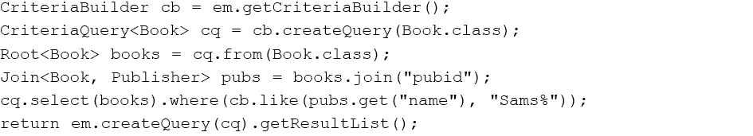

首先，我为 `Book` 对象创建了一个查询，并为实体类 `Book` 定义了一个根——这次命名为 `books`。书籍和出版商之间存在一对多的关系，因此更多的书籍可以由同一个出版商出版，而一本书总是由特定的出版商出版。

然后，我为 `Book` 和 `Publisher`（两个实体类）之间定义了一个名为 `pubs` 的连接，通过指定实体类 `Book` 中的属性 `pubid` 作为连接属性。其余部分不包含任何新内容，但你应该注意在 `where()` 方法中如何使用名称 `pubs` 引用 `Publisher` 类中的属性 `name`。

下一个示例是相同的连接，但查询确定所有标题包含 `Fedora` 单词或出版商以 `Sams` 开头的书籍：

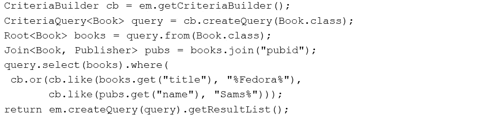

你应该主要注意如何使用 `or()` 方法来构建条件。

`Book` 和 `Category` 之间也存在一对多的关系，因此你也可以定义从 `Book` 到 `Category` 的连接。后续查询确定所有标题包含搜索值、出版商名称包含搜索值且类别名称包含搜索值的 `Book` 对象：

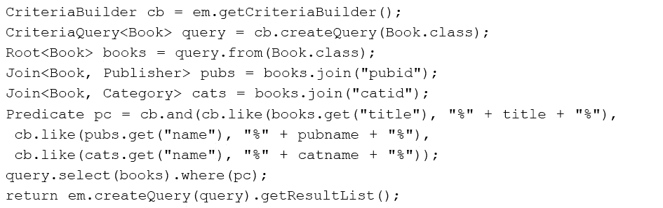

注意为对象图定义了两个连接对象。接下来，定义了一个表示条件的 `Predicate` 对象。在这种情况下，有三个 `equal()` 函数的 `and`（与）关系，并将该谓词用作参数。

作为最后一个示例，我将展示 `Book` 和 `Category` 之间的一对多的关系，以便你也可以定义从 `Book` 到 `Category` 的连接。后续查询确定所有标题包含搜索值、出版商名称包含搜索值且类别名称包含搜索值的 `Book` 对象。

提供的文本中存在重复部分。以下内容与前文重复，因此不再重复列出：

- 查询出版商名称以 `Sams` 开头的书籍；
- `Book` 与 `Publisher` 之间的连接；
- 使用 `or()` 方法构建条件；
- `Book` 与 `Category` 之间的连接；
- 使用 `Predicate` 对象组合多个 `equal()` 条件；
- 关于 `Path`、包装类 `BookWrapper` 和 `Tuple` 查询的说明。


优点是你不必编写包装类。注意使用`multiselect()`来指定包含在结果中的列，这些列用于指定结果中的多个属性。另一点是如何使用单独的`Tuple`对象。我在这里不想详细介绍（并鼓励你去研究`Tuple`类型——它是一个接口），但你可以写出以下内容（尽管代码在此语境下并没有意义）：

```
criteria 查询对象定义了一个从一个或多个实体的查询（在上面的示例中，每次只有一个`Book`）。当然，你可以指定更多的实体，对应于 SQL 中的连接操作。我将从一个查询开始，确定所有出版商名称以`Sams`开头的书籍：
```

首先，我为`Book`对象创建了一个查询，并为实体类`Book`定义了一个根——这次命名为`books`。书籍和出版商之间存在一对多的关系，因此更多的书籍可以由同一个出版商出版，而一本书总是由特定的出版商出版。然后，我为`Book`和`Publisher`（两个实体类）之间定义了一个名为`pubs`的连接，通过指定实体类`Book`中的属性`pubid`作为连接属性。其余部分不包含任何新内容，但你应该注意在`where()`方法中如何使用名称`pubs`引用`Publisher`类中的属性`name`。

下一个示例是相同的连接，但查询确定所有标题包含`Fedora`单词或出版商以`Sams`开头的书籍：

```
你应该主要注意如何使用`or()`方法来构建条件。
```

`Book`和`Category`之间也存在一对多的关系，所以你也可以定义从`Book`到`Category`的连接。后续查询确定所有标题包含搜索值、出版商名称包含搜索值且类别名称包含搜索值的`Book`对象：

```
注意为对象图定义了两个连接对象。接下来，定义了一个表示条件的`Predicate`对象。在这种情况下，有三个`equal()`函数的`and`（与）关系，并将该谓词用作参数。
```

作为最后一个示例，我将展示`Book`和`Category`之间的一对多的关系，以便你也可以定义从`Book`到`Category`的连接。后续查询确定所有标题包含搜索值、出版商名称包含搜索值且类别名称包含搜索值的`Book`对象：

```
数据库`padata`包含三个表：

1. `world`，包含该世界各个洲的名称

2. `currency`，包含一个货币表

3. `country`，包含关于国家的信息

(参见书籍`Java 6`中的可能问题 1)。作为文档，数据库是使用以下脚本创建的：

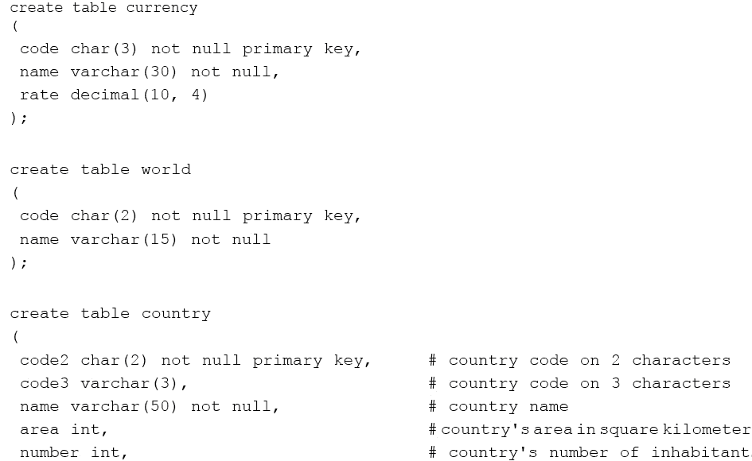!(image/Java_13_–_Distributed_programming_and_Java_EE_21-2-18_50.jpg)
```

任务是编写一个 Web 应用程序，在使用`JPA`执行数据库操作时，能够维护这些表。

该应用程序必须有三个页面。起始页应该所示，仅显示了几个国家：

```

```

顶部有一个指向用于创建国家的面的链接——如果你点击列表中的国家代码，将使用同一个页面来编辑国家信息。`Currency`链接用于维护货币表。最后，有一个下拉框，你可以在其中选择大洲，然后点击`Update`链接，列表就会更新，从而只显示所选大洲的国家。

维护国家信息的页面所示，其中点击了`Andora`的代码：

```

```

最后，显示下方的货币表维护页面（仅显示了几个货币）：

```

```

该页面应该是自显易懂的。

# 3 Enterprise Java Beans (企业级 Java Bean)

Enterprise Java Beans 或`EJB`是运行在服务器上并封装业务逻辑的组件，在这里它们可以被 Web 应用程序和独立应用程序等程序使用。因此，你可以将`EJB`认为是一个在应用程序服务器（如`Glassfish`）上开发、测试和托管的组件，就像其他应用程序可以应用的那样。开发`EJB`并将其托管在应用程序服务器上并不简单，其架构也不易于审查，但 NetBeans 提供了帮助，因为它有专门用于开发`EJB`s的项目。在本章中，我将部分演示如何使用 NetBeans 开发和使用`EJB`s，并解释最重要的概念。

使用`EJB`s的优势在于，除了为多个应用程序提供相同的服务外，应用程序服务器还处理各种状况如事务和安全问题，因此`EJB`组件可以简化企业级应用程序的开发。因此，`EJB`在现代应用程序（包括分布式应用程序）的开发中起着重要作用，但必须立即指出，由于 Web 服务的存在，它们不再扮演同样的角色。

有三种变体：

* `Stateless`（无状态）：在组件方法的多次调用之间不保留状态的组件。

* `Stateful`（有状态）：与当前应用程序相比，在组件整个生命周期内维护状态的组件。

* `Singleton`（单例）：相对于应用程序恰好存在一个版本的组件。

话虽如此编写`EJB`模块并不容易，但问题不在于编写单独的`EJB`类（因为它们与编写其他类没有区别），问题出现在部署以及从客户端程序使用模块时，这更多与 Glassfish 有关，而不是编写代码。因此，我将从简单的开始，创建一个`Enterprise Application`（企业级应用程序）项目，它由单个`EJB`模块以及使用该模块的 Web 应用程序组成。该`EJB`模块应由单个无状态会话 Bean（stateless session bean）组成，该 Bean 为客户端（此处为 Web 应用程序）提供五个方法（服务）。

在接下来我将描述该步骤。我将通过选择`Java EE and Enterprise Application`开始一个新项目：

```

```

点击`Next`后，我将在下一个窗口中输入项目名称，我输入了`CalcEJB`。再次点击`Next`后，我得到下面的窗口，该窗口默认包含一个`EJB`模块和一个`Web Application`：

```

```

当你点击`Finish`时，NetBeans 会创建一个 Enterprise Application，它关联了两个项目：

```

```

其中第一个是名为`CalcEJB-ejb`的`EJB Module`项目，另一个是名为`CalcEJB-war`的`Web Application`项目。注意，名称是 NetBeans 选择的，如果需要，当然可以更改。

下一步，`CalcEJB-ejb`项目应该有一个`EJB`。要做到这一点，右键点击项目并选择`Enterprise Javabeans`，然后选择`Session Bean`：

```

```

当你点击`Next`时，得到下面的窗口，你必须为你的`EJB`输入一个名称（这里为`CalcSession`）以及包名（这里为`calcejb.ejbs`）：

```

```

此外，选择`Session Type`，已选择`Stateless`。最后，勾选了`Local`。这意味着将创建一个定义`EJB`的接口。在这里选择`Local`，意味着它是可以被托管在同一应用程序服务器上的 Web 应用程序（这在实践中通常是这样的）使用的`EJB`，准确地说，意味着由与`EJB`相同的 JVM 执行的应用程序。

点击`Finish`后，NetBeans 会创建一个类和接口：

```

```

接口所示：

```

```

接下来，需要为`EJB`添加方法。要做到这一点，右键点击类名并选择`Insert Code`，然后在弹出菜单中选择`Add Method`，然后你得到下面的窗口：

```

```

，NetBeans 向类添加方法，这也可以手动完成。这里是定义了 5 个方法的接口：

```

```

以及下面是实现了接口所有方法的类：

```

```

现在我的会话 Bean 完成了，然后编写客户端。首先，我添加了一个命名 Bean`CalcBean`（在包`calcejb.beans`中）。在添加类后，我右键点击类名并选择`Insert Code`，在这里再次选择`Call Enterprise Bean`，结果如下：

```

```

也就是说，已经对`EJB`模块进行了引用，这里的关键点是它被`@EJB`装饰了。这意味着相关的会话 Bean 可以被类的方法使用。完成的命名 Bean 所示：

```
!(image/Image3383.jpg)!(image/Image3384.jpg)
```

并且代码不需要进一步解释。然而，注意类的方法是如何引用`calcSession`对象的，就像引用其他任何对象一样。

我删除了`index.html`页面并创建了同名的 JSF 页面（`index.xhtml`），并输入了以下代码：

```

```

这里没有新内容需要解释的，你应该注意到我的命名 Bean 是像往一样使用的。

代码编写完成后，你必须构建项目。然后，右键点击企业应用`CalcEJB`名称并选择部署（deploy）。如果你再次右键点击并点击运行（Run），将弹出以下窗口：

```

```

在第一个两个输入框中输入值并点击 ADD（添加）。

## 3.1 有状态会话 bean (Stateful Session Bean)

在本节中，我将展示一个`stateful`会话话 bean 的示例。实际上，它的开发方式与上述完全相同，但它会在各个方法调用之间保留实例变量的值。当无状态或有状态会话 bean 托管在服务器上（部署）时，服务器会创建多个会话 bean 实例，这通常被称为 EJB 池。当客户端想要使用 EJB 实例时，Glassfish 服务器会从池中取出一个实例并交给客户端一个引用。此过程的目标显然是为了性能，因为创建一个 EJB 实例需要较长时间。如果是有状态会话 bean，服务器会与客户端保持对话，因此会不断使用同一个实例。无状态会话 bean 则并非如此，每次方法调用都不能保证使用的是同一个实例。表面上看，使用有状态会话 bean 有益的，但对于服务器来说维护状态是有开销的，因此只有在需要时才使用有状态会话 bean。

当前的示例打开了以下窗口，其中索引输入了 200 并点击了 SHOW（显示）：

```

```

斐波那契数众所周知：

```
0, 1, 1, 2, 3, 5, 8, 13, 21, 34, 55, …
```

索引从 0 开始，上述窗口显示了索引为 200 的斐波那契数。`PREV`（上一个）和`NEXT`（下一个）按钮用于前后切换数字。

为了编写程序，我从一个名为`FiboEJB`的企业应用项目开始，并规定该项目必须包含一个 EJB 模块和一个 Web 应用——这与第一个项目一样。在 EJB 模块`FiboEJB-ejb`旁边，添加了一个名为`FiboSession`的会话 bean。此外也与第一个项目相同，唯一的例外是我规定它应该是一个`stateful`会话 bean，但其他方面与第一个示例一样，它应该有一个本地接口。

然后我编写了接口，但这次是手动编写的，没有使用 NetBeans 创建必要的方法：

```

```

各个方法的含义应在上述浏览器窗口的说明中解释，但你应该注意其中两个方法可能会抛出异常，且`getValue()`方法返回一个`Object`——该方法返回当前的斐波那契数。

实现如下，代码是手动编写的：

```

```

首先，注意一个注解表示这是一个`stateful`会话 bean。否则，代码应该足够容易理解，但除了展示有状态会话 bean 示例外，目标是展示一个使用非简单类型（此处为`BigInteger`）的 bean，以及一个非平凡算法的示例。

然后完成了该会话 bean。为了编写客户端，我从一个使用上述会话 bean 的命名 bean 开始。我创建了一个名为`FiboBean`的命名 bean，然后使用 NetBeans 创建了 EJB 实例的引用——与第一个示例相同。完成后的 bean 所示：

```

```

该类非常简单，主要由将工作委托给 EJB 实例的方法组成。该示例在许多方面展示了将企业 Java Bean 作为封装业务逻辑的对象，并将其从用户界面控制器的命名 bean 中分离出来。通过这种方式，你简化了单个命名 bean。

最后是`index.xhtml`的代码，它不包含新内容，我不想在这里显示。

## 3.2 远程单例会话 bean (Remote Singleton Session Bean)

在前两个示例中，会话 bean 和客户端应用都是同一个企业应用的一部分。在本节中，我将展示一个作为单模块开发并独立部署到服务器的会话 bean 示例。接下来，示例将包含一个独立于上述 bean 开发但使用该会话 bean 的通用 Web 应用。这意味着应用程序和 bean 可以托管在每个应用服务器上。

实际的会话 bean 也应该写成`singleton`（单例）——主要是为了演示如何实现。`单例会话 bean`是每个应用程序服务器恰好有一个实例的会话 bean。一个典型的应用是一个在整个生命周期内仅初始化一次数据的 bean，并且这些数据对整个应用可用。通常使用`@PostConstruct`注解的方法来初始化数据，在本例中，数据是硬编码的。

按照之前示例的方法，我创建一个名为`KingsEJB`的企业应用，并在`Server and Settings`窗口中，我勾选了`Create Web Module`（创建 Web 模块）：

```

```

点击`Finish`后，NetBeans 创建企业应用，但只包含一个 EJB 模块。这次需要对 EJB 进行远程访问，并且必须定义接口。作为下一步，我创建了类库项目`KingsEJB`。

现在必须编写企业 Java Bean，它必须有两个方法，都返回字符串数组。第一个方法必须返回统治该年份的丹麦国王（如果该年份是信仰变更年，可能有两个）。另一个方法原理相同，但必须有两个年份作为参数，方法必须返回在该期间内的所有国王名称。为了创建这个 bean，我右键点击`KingsEJB-ejb`模块并选择`Session Bean`。你将看到以下窗口，我在其中输入了类名`KingsSession`和包名`kingsejb.ejbs`。此外，我选择了它为`Singleton`（单例）。最后，规定必须创建一个本地接口（Local）和一个远程接口（Remote）。勾选`Remote`时，选择包含接口的类库，在本例中是`KingsEJBRemote`。对于当前示例，不需要本地接口。

在点击`Finish`之后，NetBeans 创建了所需的会话 bean 以及两个接口：

```

```

接下来，应该添加两个方法。我右键点击`KingsSession`类的名称，选择`Insert Code`（插入代码），并在此再次选择`Add Business Method`（添加业务方法，见下方窗口）。第一个方法必须名为`getKing`，返回字符串数组并有一个类型为`int`的单个参数。在底部点击了最后一个单选按钮，表示应使用两个接口。你应该注意 NetBeans 提供了一个警告，提示该方法在两个接口中的名称相同。

```

```

当你点击`OK`时，NetBeans 将创建该方法并在两个接口中都插入原型。为了应对上述警告，我将它们分别重命名为

```
`getKingLocal(int year)`

`getKingRemote(int year)`
```

结果是`KingsSession`类必须实现这两个方法。另一个服务必须相应地定义，例如，我在下方显示了`KingsSessionRemote`接口：

```

```

这些方法必须在`KingsSession`类中实现，我在这里只显示了几行数据：

```

```

这个会话豆（session bean）没有什么新奇的，只是它被定义为一个`Singleton`（单例）会话豆。但请注意，该类实现了两个接口，因此实现了所有四个方法。

EJB 模块已完成，可以进行编译并部署到服务器。


然后是客户端应用程序，我在其中创建了一个名为`KingsClient`的普通 Web 应用项目。为了让应用程序引用`KingsSession`，它必须知道`KingsSessionRemote`接口的定义。因此，我将包含此接口的 jar 文件添加到了项目中。下一步，我定义了一个命名豆（named bean）：


此外，这里没什么新变化，但请注意该类使用了 EJB 模块`KingsEJB`。这与之前的示例一样，通过右键点击类名，选择`Insert Code`（插入代码），然后选择`Call Enterprise Bean`（调用企业豆）。相关的 bean 使用在`Search()`方法中。

如果你运行应用程序（在浏览器中打开），你将得到以下窗口，它已应用于 1200 年到 1300 年间的所有国王：


我不打算显示`index.xhtml`的代码，因为它没有显示任何新内容。

## 练习 2

在此练习中，编写一个功能与上面示例几乎相同的程序，你从中搜索丹麦国王，但用户界面需要进行更改，以便也能显示统治时期：


开始创建一个新项目，你可以命名为`KingsEJB-ejb`，但这次它不应该是`Enterprise Application`（企业应用）项目，而是一个`EJB Module`（EJB 模块）项目：


接下来，你应该创建一个普通的`Class Library`（类库）项目，可以为`KingsEJBRemote`。对于这个库，你必须在包`kingsejb.ejbs`中添加以下类：


它代表一个国王。基本上它是一个普通的 Java 类，但你应该注意它被装饰了`@Remote`并且是`serializable`（可序列化的），这意味着该类型的对象可以通过网络发送到客户端。

在`KingsEJB-ejb`中，你应该添加一个名为`KingsSession`的单例会话豆，并带有远程接口（但这次没有本地接口），就像之前的示例所示。接口必须在你的类库中创建，内容必须是：


区别在于，这次这两个方法返回的是`King`对象的列表而不是字符串。这个练习的目的正是展示如何编写一个返回自定义类型而非简单 Java 类型和字符串的会话豆。步骤是：该类型在远程接口中必须定义为可序列化，并用`@Remote`装饰。

然后你必须实现`KingsSession`，它本质上是上一个示例类的副本，区别是两个方法将返回`King`对象的列表。

最后，你必须实现用户界面，它与上一个示例几乎相同，但如上所示，表格有三列，且`KingsBean`类必须根据新的会话豆进行微调。最后，添加一个转换器（converter），使得未知的年份（为 0）显示为空白。

## 3.3 EJB 和 JPA

在本节中，我将展示一个在 EJB 中使用 JPA 执行数据库操作时，创建对象并将其存储在数据库中的应用程序。例如，我将使用输入地址的表单，与上一章的最后一个版本相比，仅仅是将保存数据和检索数据的代码从控制器移动到了会话豆。

我从一个包含单个 EJB 模块和一个 Web 应用的企业级应用项目开始：


然后我添加了一个实体类（entity class），它代表数据库`addresses`中的`Address`表。该类与上一章显示的相同，此处不再显示。接下来，我添加了一个名为`AddressSession`的无状态会话豆（stateless session bean）并带有本地接口：


这次，直接创建了`EntityManager`而没有使用注入（见下一章）。它需要持久化单元，如`persistence.xml`所示。特别注意`save()`方法使用了`EntityTransaction`以及如何启动该事务。同样注意`getAddresses()`方法使用了`NamedQuery`。它是 NetBeans 在类中生成的。结果：


后面还有`index.xhtml`和`list.xhtml`，页面基本上没有变化，对应的引用已更改。我不显示这两个页面。

### 练习 3

在此练习中，你必须解决与上一个相同的练习，但区别在于国王应该从数据库加载。数据库`padata`有一个`history`表，包含了丹麦国王的信息。如果表不存在，你可以在 Java 6 书中查看如何创建该表——书中的示例包含了创建和初始化表的脚本。解决该练习，可以按照以下步骤操作：

1. 创建一个名为`HistoryEJB`的新企业应用项目，它应该只包含一个 EJB 模块。NetBeans 会创建`HistoryEJB-ejb`模块。

2. 创建一个`Class Library`项目，可以命名为`HistoryEJBRemote`。此外，添加上一个练习中的`King`类。

3. 在`HistoryEJB-ejb`中添加一个名为`HistorySession`的状态会话豆（stateful session bean），它应该有一个添加到`HistoryEJBRemote`的远程接口。接口应与上一个练习相同（两个返回`List<King>`的方法）。实现必须有一个`List<King>`类型的实例变量，并且必须在`@PostConstruct`方法中通过从数据库`history`表加载数据来初始化它。你可以像上一个示例一样地通过“从数据库创建实体类”来实现。

4. 编译并部署`HistoryEJB`。

5. 创建一个客户端，基本上与练习 2 中的客户端相同。

6. 测试应用程序并确保一切运行正常。

使用企业级 Java Bean 的主要优势之一是`EJB`使用事务，这通常意味着方法执行的更改如果都正确执行，则将会生效；否则将执行相应的回滚，不做任何操作。如果发生异常，则属于后者情况。目前来说这没问题，但如果在事务正在进行时调用该方法，其工作原理就不那么显而易见了。该方法应该是当前事务的一部分，还是在为新的方法调用创建新事务时，必须挂起现有事务？由于这些问题，可以配置事务的工作方式。这是通过注解`@TransactionAttribute`实现的：


其中`TransactionAttribute`的值表示事务的工作方式。有以下选项：

1. `TransactionAttributeType.MANDATORY`：该方法只能作为现有事务的一部分执行。如果在事务之外调用该方法，将抛出`TransactionRequiredException`异常。

2. `TransactionAttributeType.NEVER`：如果从客户端调用该方法，则不创建事务。如果作为事务的一部分调用该方法，将抛出`RemoteException`异常。

3. `TransactionAttributeType.NOT_SUPPORTED`：如果作为现有事务的一部分调用方法，它将被挂起并在事务之外执行。如果在事务之外调用该方法，则不创建事务。

4. `TransactionAttributeType.REQUIRED`：如果作为现有事务的一部分执行方法，该方法将作为该事务的一部分执行。如果在现有事务之外调用该方法，将创建一个新事务。

5. `TransactionAttributeType.REQUIRES_NEW`：如果作为现有事务的一部分调用方法，它将被挂起并创建一个新事务。在方法完成后，之前的事务将恢复。如果在现有事务之外调用该方法，将创建一个新事务。

6. `TransactionAttributeType.SUPPORTS`：如果作为现有事务的一部分执行方法，它将作为该事务的一部分执行。如果在事务之外调用该方法，则不会启动新事务。

上面显示了如何对方法进行事务装饰，但你也可以对类进行装饰，这样装饰将关联到类的所有方法。

## 3.5 拦截

在会话 Bean（session bean）中执行方法时，人们有时会对方法执行之前（被调用时）以及方法完成之后后的某个操作感兴趣。典型的原因是调试，例如，你可以向服务器的日志文件写入内容。作为一个示例，我将以下类添加到`AddressEJB-ejb`项目中：


这是一个常见的 Java 类，包含一个简单的方法，首先要注意的是，该方法用一个注解装饰了。该方法有一个`InvocationContext`参数，提供了更多服务。`getTarget()`方法返回执行方法的对象，而`getMethod()`返回一个代表`interceptedObject`对象中被执行方法的对象。最后，有一个`proceed()`方法，它负责执行`interceptedMethod()`方法。在`proceed()`调用的两边都执行了`System.out.println()`，这简单意味着在 Glassfish 服务器的日志中写一行。结果是，如果方法执行了`logMethodCall()`，日志文件中就会写入一行，随后执行该方法，然后再次写入日志文件。

问题是类获取执行的方法并让它发生，这（当然）是通过注解实现的：


也就是说，在创建地址之前向日志文件写入，并在数据库更新后再次写入。

## 3.6 定时器服务

会话 Bean 有一种特殊的变实现了定时器。因此，你可以让实际的 Bean 在特定间隔执行操作，例如，你可以向日志文件写入内容。在这种情况下，我将编写一个每半秒确定下一个质数的会话 Bean。我从一个名为`PrimesEJB`的`Enterprise Application`项目开始，包含一个 EJB Module 和 Web Application。对于 EJB Module，我添加了一个 EJB，但这次是一个`Timer Session Bean`：


你将得到下面的窗口，你应该你应该按照常理输入一个名称（这里是`PrimesSession`）和一个包（`primesejb.ejbs`）。我还选择了它必须是`Singleton`并且创建一个`Local`接口：


最后，我设置了定时器跳动的时间间隔。在这种情况下，模式意味着定时器必须每半分钟跳动一次。点击`Finish`后，NetBeans 创建了以下类：


以及一个定义的接口。可见，这是一个普通的会话 Bean，唯一的区别是了一个定时器方法，使用`@Schedule`注解定义了它是定时函数以及执行的频率。定义的接口如下：


除了定时器外，还定义了三个方法。`PrimesSession`类将实现：

[](image/Java_13_–_Distributed_programming_and_Java_EE_21-2-18_94.jpg)

你应该注意到该类有三个实例变量，由于它是单例会话 Bean，在服务器 停止之前，这些变量将保留其值。也就是说，多次启动应用程序，会话 Bean 的状态将保留。该类最重要的部分当然是定时方法，它修改了`prime`的值，代表下一个质数。定时方法还修改了`index`。

然后 EJB 模块完成了。我在 Web 应用中添加了一个命名的 Bean：

[](image/Java_13_–_Distributed_programming_and_Java_EE_21-2-18_95.jpg)

这是一个非常简单的 Bean，没什么好注意，但你需要意识到它使用了我的会话 Bean。JSF 页面同样简单并在浏览器中打开，结果如下所示，其中链接用于更新用户界面：


## 3.7 单表 CRUD


在数据库上下文中，CRUD 代表创建（Create）、读取（Read）、更新（Update）和删除（Delete）操作。在本节中，我将向你展示如何使用 EJB 编写程序对单个数据库表执行这些操作。应用程序必须使用带有远程接口的 EJB。作为一个示例，我将使用来自`padata`数据库的`zipcode`表，应用程序应该打开如所示的窗口，其中输入的邮编 78 已查询。按钮的含义应该是自而易见的，点击表格中的链接会将邮编插入顶部的两个字段中，可以在其中对其进行编辑。

我已开始创建一个`EJB Module`项目，并将其命名为`ZipcodesEJB`。然后，我创建了一个普通的`Class Library`项目，命名为`ZipcodesRemote`。对于这个项目，我添加了一个类`ZipcodeRemote`，它代表在 Web 应用程序和会话豆（session bean）对象之间传输的对象（我没有显示`get`和`set`方法）：


然后，我在`ZipcodesEJB`项目中添加了一个名为`ZipcodesSession`的远程无状态会话豆（remote stateless session bean），它为类库添加了远程接口：


最主要的工作是实现`ZipcodesSession`类。在`zipcodes.models`包中，我为数据库表添加了一个实体类`Zipcode`。该类与 NetBeans 生成的代码保持一致。我想添加一个用于数据库操作的类，但 JPA 控制器类无法直接从 EJB 使用，因此我添加了自己的类（这只是 NetBeans 创建的控制器类经过修改和缩减的版本——参见下一个示例），我将其命名为`ZipcodeDAO`：


该类与 NetBeans 创建的 DAO（数据访问对象）类非常相似，但你你应该注意如何创建`EntityManager`对象，以及如何定义与`Create`、`Update`和`Delete`关联的事务。还要注意最后一个方法，即搜索方法。这里使用了 JPQL 而不是 Criteria API。这取决于个人喜好，使用其中一种都行，但如果你熟悉 SQL，使用 JPQL 是最简单的。

有了这两个类后，你就可以编写`ZipcodesSession`类了，其实代码其实非常简单，因为所有工作都委托给了 DAO 类：


注意，这些方法包含了`ZipcodeRemote`类型对象与实体类型`Zipcode`对象之间的相互转换。这并非必须，且这个问题可以通过在类库中定义实体类型来解决（参见下一个示例）。

现在 EJB 模块已经准备就绪，可以托管在服务器上了。在 Web 应用程序端，我创建了一个名为`ZipcodesClient`的 Web 应用程序。该应用程序只包含`index.xhtml`和一个命名豆（named bean），我不想显示应用程序的代码，因为没有新内容。

## 3.8 涉及更多表的 CRUD 操作


作为 Enterprise Java Beans 的最后一个示例，我将回顾上一章节中的`PaBooks`程序。它必须与之前的程序完全相同，唯一的变化是将整个数据库操作逻辑移动到 EJB 中，由该 EJB 使用 JPA 来维护数据库。将会有三个项目：

1. `BooksEJB`：托管在服务器上的 Enterprise Java Bean，用于维护`Library`数据库。
2. `BooksRemote`：一个类库，定义了指向上述 EJB 的远程接口。
3. `BooksClient`：Web 应用程序，使用`BooksEJB`。

在接下来，我将描述应用程序开发的过程以及主要的挑战。

我已开始创建一个`EJB Module`项目：


我将项目命名为`BooksEJB`。

下一步，我创建了一个名为`BooksRemote`的经典类库项目。对于这个库，我选择了`Entity Classes from Database`并选择了到`library`数据库的连接：


然后，我选择了要应用的的 5 张表，并在下一个窗口中输入了包名：


当我点击 Next（下一步）和 Finish（完成）时，就会像之前一样创建了 4 个实体类：


你应该注意，这四个类位于类库中，以便客户端程序可以使用。相对于 NetBeans 创建的代码，这四个类不应被修改，除非是我对`Author`、`Publisher`和`Category`修改了`toString()`方法。


下一步，我向项目`BooksEJB`中添加了一个无状态会话豆：


我定义了必须向我的类库中添加一个远程接口，结果是 NetBeans 创建了一个名为`LibraryDAORemote`的接口。

在`BooksEJB`项目中，我创建了一个名为`booksejb.daos`的包。对于这个包，我添加了`JPA Controller Classes`：


这 4 个类都经过了修改，但本质上是`EntityManager()`方法发生了变化。例如`create()`方法：

```

```

此外，我修改了类，使它们单独抛出`Exception`，这在`PaBooks`程序中也是一样。最后，`BookDAO`类添加了一个确定`Book`对象的方法。

注意，到目前为止还没有写很多代码，但 NetBeans 已经创建了所有代码。缺失的是定义`LibraryDAORemote`接口并实现`LibraryDAO`。接口定义如下：


各个方法的名称应该解释它们的用途。由于有 12 个方法（每个实体 4 个），`LibraryDAO`的代码是一大块内容，但我将只显示实体`Category`的部分代码：


在实现`LibraryDAO`类后，`BooksEJB`已经完成，可以编译并托管到服务器上。

接下来是客户端程序，它基本上可以从`PaBooks`复制。我创建了一个名为`BooksClient`的Web应用项目。该项目应该包含`BooksRemote`的引用，除此之外，应该包含以下可以从`PaBooks`复制的文件：


然而，这五个命名豆（named bean）类必须进行一些修改，例如，我展示了`CategoryBean`，它是用于`categories.xhtml`的命名豆：


在`BooksClient`编译并托管到服务器后，就可以对程序进行测试，结果应该与`PaBooks`相同。

在本章的开始，我注意到开发和测试企业级豆（Enterprise Java Beans）可能很困难。在编写代码方面，它与其他Java代码没有区别，但将项目部署到服务器并在遇到问题时找出原因可能会很麻烦。这里你应该注意日志文件：


或者Glassfish服务器现在应该安装的位置。每当你部署一个项目时，服务器都会向该日志文件中写入内容，特别是在部署失败时，该文件中还会记录问题的原因。这个日志文件是调试的非常重要的来源（也可以从NetBeans中访问）。

### 问题 2

你必须解决与问题1相同的任务，区别在于程序应该以如上一个示例所示的方式编写，将数据库操作移动到EJB中，由EJB使用JPA维护数据库。因此你必须编写三个项目：

1. `WorldRemote`，一个远程接口
2. `WorldEJB`，一个EJB模块项目
3. `WorldClient`，一个Web应用程序

# 4 CDI

CDI代表`Context and Dependency Injection`（上下文和依赖注入），它描述了应用服务器如何创建和移除对象，特别是你在代码中可以以及应该写什么。例如，如果你考虑一个带有支持豆（backing bean）的JSF页面，它只是一个普通的Java类，你不需要执行任何操作来创建该类的对象，对象的生命周期由其注解定义的范围（scope）决定。

JavaBean只是按照特定且简单的模式编写的类，程序员使用`new`运算符创建对象（豆）。之后，当不再有该对象的引用时，由垃圾回收器负责移除该对象。相比之下，托管豆（managed bean）是一种豆，它由应用服务器形式的容器负责创建对象，并在程序超出对象作用范围时再次移除该对象。这种豆也称为CDI对象。你不能通过`new`创建托管豆。相反，CDI对象是使用一种名为“注入”（`injection`）的技术创建的，这意味着由容器来处理。当使用`injection`定义豆时，容器将检查该豆是否已创建，如果没有，它将实例化一个新的新对象，并对所有当前豆依赖的豆进行注入，最后执行被`@PostConstruct`装饰的方法。然后你就可以使用对象的方法了。当豆必须被移除时，容器将先执行被`@PreDestroy`装饰的方法，然后由容器移除该对象。可以通过下面的图来说：


CDI对象有一个称为`context`（上下文）的范围，它基本上可以是：

* request（请求）
* session（会话）
* application（应用）
* conversation（会话）

例如，下面展示了一个简单的托管豆：


通过`@Named`可以看出它是一个托管豆，在其中你可以看到NetBeans为小写字母写的类分配了名称。注解通常是一个接口，在一种情况下，它是一个带有单个属性`value`的接口（其默认值为空，意味着容器选择类名`person`）。此外，你可以看到对象的上下文是`session`，而`SessionScoped`再次是一个接口。因此，`Named`和`SessionScoped`这两个接口是容器的信息，告诉容器应该如何维护`Person`类的对象。

有了上述命名豆后，你可以编写以下JSF页面：


有趣的是，打开页面时，Glassfish服务器会注入一个上下文为`session`的`Person`对象，而程序员无需（也无法）执行任何操作来创建该对象。

在之前的示例中，我经常需要从另一个豆使用命名豆，这是通过语句实现的：


这并没有问题，但很难记忆。人们可以使用CDI来简化语法。考虑以下豆，它代表一个带有`subject`的学生：


名称由类型为`Person`的变量`person`表示。然而，你必须注意这里没有创建`Person`类型的对象，相反，它装饰了`@Inject`。这表示托管豆`Student`依赖于`Person`（另一个托管豆），当容器通过注入创建`Student`时，它会查找是否需要创建`Person`对象，如果是则创建。下面展示了如何编写一个带有`Student`支持豆的JSF页面：


## 4.1 修饰符（Qualifiers）

如果你考虑`Student`豆，它依赖于`Person`豆。现在我将定义一个派生类，将其命名为`Man`，但首先我将`Person`类改为抽象类，并扩展一个返回人物性别的抽象方法：


然后我可以编写以下豆：


如果你忽略`@Male`注解，这个类中并没有新内容。它是一个继承托管豆的托管豆，而豆只是一个类。如果你从容器的角度看`Student`类，它定义了一个类型为`Person`的变量`person`，容器随后必须创建一个实际的对象，例如`Man`对象。由于`Person`类可能有更多派生类，人们应该能够告诉容器实例化对象时意味着什么，这是通过修饰符（`qualifier`）实现的。`Male`是一个修饰符，是一个如下所示定义的接口：


在`Man`类中，你通过`@Male`告诉该类被限定符`Male`标识。`CDIProgram`项目还定义了一个派生类`Woman`，它被限定符`Female`标识。从原则上说，编写限定符是简单的，但语法可能很难记忆，因此NetBeans为此提供了一个`File Type`（文件类型）：


如果你想让`Student`类创建一个`Woman`对象，语法如下：


查看上面的解决方案，定义容器在结合注入时使用的特定类型是足够简单的，但如果你考虑到`Person`类有许多子类的情况，则必须编写许多限定符。相反，你可以定义一个参数。先考虑以下`enum`：


有了这个类型后，我可以创建另一个限定符：


该限定符现在有一个名为`value`的属性。注意，限定符完全可以更多属性。然后你可以如下所示装饰类`Man`（以及`Woman`）：


对于注入，你可以写：


## 4.2 上下文 (Contexts)

当通过注入或因为从JSF页面引用而需要托管豆（managed bean）时，CDI将尝试在特定bean的作用域（scope）内寻找实例。如果成功，则使用该对象；否则将创建一个属于当前作用域的对象。通常，一个对象（托管bean）必须跨越多个页面“存在”，你不能使用`RequestScoped`，因为它只关系当前页面。对象在每次页面请求时都会被创建。到目前为止（在这本书以及之前的两本书中），我通过将bean定义为`SessionScoped`来解决这个问题。它行得通，但也是一种简单的解决方案，而且`SessionScoped` bean也有缺点。首先，这些bean在整个会话期间存在，甚至在会话结束后一段时间内仍然存在。这意味着会话对象不必要地填充机器内存。然而，更大的问题是，由于`SessionScoped` bean（以及所有的会话对象）的生命周期比需要的长，因此存在它们在逻辑上已不存在后仍被使用的风险。后者实际上会导致Web应用程序中的错误变得难以修正。

有一个名为`conversation`（对话）的上下文，bean可以在多个页面上存在，但不会贯穿整个会话，它专门旨在解决会话上下文带来的挑战。代价是必须由程序员告诉容器何时开始、何时结束。我想通过`ChangeAddress`示例来展示，其区别在于输入地址的表单被分为三个页面——无特殊原因，同时也展示`ConversationScoped`是如何工作的。我从一个名为`ChangeAddress4`的项目开始，它是`ChangeAddress1`的副本。除了`list.xhtml`（未更改）外，还有三个新的JSF页面，地址输入通过这三个JSF页面以向导的形式进行：


`index.xhtml`现在简化为以下非常简单的页面：


它打开了以下窗口：


点击顶部的链接将进入一个输入名称的页面，`ChangeAddress1`项目的表单通常分为三个页面，如下所示。三个页面称为：

* `page1.xhtml`
* `page2.xhtml`
* `page3.xhtml`

实体类`Address`与之前保持不变，但定义了一个简单的包装类`Person`（一个托管bean），你只需要注意的是它被定义为`ConversationScoped`的命名bean：


三个新的JSF页面的代码非常简单，我不想在这里显示，但新之处在于`IndexController`，它已经发生了更改。代码所示，但我没有显示`get`和`set`方法，因为它们和以前一样：


## 5 Web 服务 (Web services)

Web服务是一个托管在Web服务器上并客户端提供服务的组件，Web服务在某种程度上可以被视为企业Bean的替代品。Web服务的特点是易于开发且平台无关。后者意味着Web服务与客户端之间的通信是以XML进行的，并且完全是文本形式。因此，使用Web服务被认为是一种安全的技术，代价是XML消息的编码可能会稍微影响性能。Web服务及其服务必须根据参数和返回值对客户端进行定义，这是通过一个名为Web服务定义语言（WSDL）的XML文档完成的。编写Web服务的挑战是编写这个文档，它非常复杂，但在这里NetBeans帮助生成它，你可以在不需要了解WSDL的情况下编写Web服务。

我想从一个具有两个简单Web服务开始：

* `double celsiusToFahrenheit(double value)` 将摄氏度转换为华度
* `double fahrenheitToCelsius(double value)` 将华度转换为摄氏度

我从一个名为`ConversionService`的Web应用开始，它只需要是一个空的Web应用。然后我添加一个`Web Service`：


在接下来的窗口中我必须输入名称（此处是`ConversionService`）并选择一个包：


点击`Next`时，NetBeans创建如下类：


注意使用了哪些注解，以及NetBeans创建了一个单一服务——你应该当然删除它。这可以直接完成，但点击工具栏上的`Design`按钮将给你一个可以用于生成最终代码的向导（注：原文`finally`应为`final`的笔误，此处保留了逻辑意境）：


使用向导的最大且唯一的优势是NetBeans会插入正确的注解。

然后你可以构建项目并选择部署（deploy）。在NetBeans项目标签页中，会创建一个`Web Servers`元素：


如果你右键点击`ConversationService`并选择`Test Web Service`（测试Web服务），浏览器将打开一个窗口来测试该服务：


在这里你应该特别注意`WSDL File`链接。点击它将显示定义该服务的WSDL代码。

服务测试完成后，必须编写一个客户端，这次应该是一个名为`ConversionClient`的简单控制台应用程序。在我创建应用程序后，我添加了一个`Web Service Client`（Web服务客户端）：


在下一个屏幕，在`Project`下选择当前的Web服务，NetBeans将自动插入它的URL。最后，输入一个包名（package）：


NetBeans现在创建了该服务的引用，你可以使用它提供的服务：


要使用某个服务，你需要编写一段复杂的语句，但你可以简单地将服务拖入客户端代码中，NetBeans就会创建所需的语句。以下是客户端的完整代码：


你应该特别注意NetBeans创建的两个方法，除此之外，程序已准备就绪：


### 练习 4

从创建一个`ConversionService`项目的副本开始。然后，你必须扩展相应的Web服务，添加两个新服务：

* `double kilometerToMiles(double value)`
* `double milesToKilometer(double value)`

用于在公里和英里之间进行转换。

当你写完服务并部署了它后，编写一个可以称为`ConversionClient`的客户端程序，但这次应该是一个Web应用程序。如果在浏览器中打开该应用程序，必须打开以下窗口：


上面的表单应该有一个使用你Web服务的后端豆（backing bean）。原则上，它的工作方式与介绍示例完全相同，区别在于你需要将`localhost_8080`文件夹复制到WEB-INF下的`wsdl`文件夹：


### 练习 5

在这个练习中，你必须编写一个可以搜索丹麦国王的Web应用程序：


你可以将项目命名为`DanishKings`，与之前的区别在于这次搜索应该通过Web服务完成。

从创建一个名为`KingsServices`的Web应用程序项目开始，并添加一个名为`KingService`的Web服务。添加一个简单的模型类：


该Web服务必须包含两个服务：


第一个将返回统治某年份的国王，而另一个将返回统治时期重叠某个间隔的国王。丹麦国王的名字和统治期可以像之前的示例一样以常量的形式存储在程序中。

## 5.1 作为 Web 服务的 EJB

如上所示，Web服务无非是一个装饰了几个注解的普通Java类，并全部封装在Web应用程序中。也可以使用无会话豆（stateless session bean）作为Web服务。它允许从Java以外语言使用无状态EJB，以及使用企业Java Bean的其他属性（如事务）。事实上，你可以通过两种方式实现：通过在EJB中创建Web服务，或者将EJB嵌入为Web服务。

例如，我设置了一个`EJB Module`项目，将其命名为`EJBConversion`。对于这个项目，我添加了一个名为`Conversion`的Web服务：


注意选择了`Create Web Service from Scratch`（从头开始创建Web服务），并勾选了底部的复选框。点击`Finish`（完成）后，创建一个Web服务，其中主要有一个区别，即它是一个无会话话豆。完成的服务所示：


然后按照通常方式构建并部署项目。`ConversionProgram`项目与`ConversionClient`相同，区别在于像上面一样，使用了另一个Web服务，它是作为企业Java Bean托管的Web服务。

作为最后一个例子，我将编写一个使用现有EJB的Web服务，我将使用`ZipcodesEJB`，它对数据库`padata`中的`zipcode`表执行CRUD操作。涉及的EJB提供了4个服务，目标是为这些服务提供Web服务。

起点是一个名为`ZipcodesServices`的空Web应用程序。作为第一步，我放入了jar文件`ZipcodesRemote`的引用，它是`ZipcodesEJB`的远程接口。接下来，我在项目中添加了名为`ZipcodesWS`的Web服务：


在这里你应该特别注意选择了`Create Web Service from Existing`（从现有创建Web服务），并浏览了特定的豆。点击`Finish`后，NetBeans创建了：


可以看到它是`ZipcodesEJB`的封装。服务随后完成，并托管在服务器上。然后我写了一个客户端，名为`ZipcodesProgram`。它与`ConversionClient`基本相同，名称有所不同。

### 练习 6

你必须编写一个对应上述`3codesProgram`的程序，它使用Web服务`ZipcodesWS`对`zipcode`表执行CRUD操作，但不是Web应用程序，而是一个GUI应用程序，你可以命名为`Zipcodes`。用户界面所示：


## 6 REST Web 服务

REST代表`Representational State Transfer`（表述状态转移），也称为`RESTful` Web服务。与其他Web服务一样，它们被视为通过URI可用并标识的资源，其特点是易于开发并专门为前端设计。RESTful Web服务通常非常灵活，客户端与服务之间的通信可以通过多种方式进行，但通常数据以XML或JSON格式发送。Web服务至少支持一种HTTP方法：

1. `GET`，用于获取现有资源。
2. `POST`，用于更新现有资源。
3. `PUT`，用于创建新资源。
4. `DELETE`，用于删除现有资源。

我想从一个简单的“hello”服务开始，我设置了一个普通的（空白）Web应用程序，将其命名为`HelloApp`。在我创建项目后，我添加了`RESTful Web Services from Patterns`（从模式创建RESTful服务）：


在双击`Next`后，进入下面的窗口：


在其中输入了`Resource Package`、`Path`和`Class Name`。你应该注意MIME类型是XML。当我点击`Finish`时，NetBeans创建了两个文件：


这里最后一个是我的RESTful Web服务。代码如下，我删除了注释，并在`getXml()`方法中输入了代码：

你必须注意不同的注解。在这里，`@Path`指定了当前服务（资源）的名称。`@GET`定义了当从浏览器发生HTTP GET请求时执行的方法，同样，`@PUT`定义了用于HTTP PUT的方法。注意，第一个方法被`@Produces`装饰，这表示该方法返回XML；而另一个方法被`@Consumes`装饰，这表示该方法将参数的内容解释为XML。在这种情况下，最后一个方法是空的，而第一个方法返回了一些XML。

容器必须知道资源被称为什么，这就是第二个类的目的：


这是一个继承自`Application`的类，该类被`@ApplicationPath`装饰，它指定了一个名称（这里是webresources），该名称被包含在资源的URI中。最后一个方法将实际的资源对象添加到集合中（这里是一个`HashSet`）。所有这些操作的结果是，资源的URI为：


如果你翻译项目并执行部署，资源就可以就绪了。会创建一个`RESTful Web Services`条目，如果你右键点击`HelloResource [hello]`：


你可以选择`Test Resource URI`，之后浏览器会打开以下窗口：


结果是执行了`getXml()`方法，该方法已向浏览器发送了响应。下一步，我将编写一个使用该资源的客户端，它应该是一个简单的控制台应用程序。因此，我创建了一个名为`HelloREST`的Java Application项目。对于这个项目，我添加`RESTful Java Client`：


当你点击Next时，你会看到以下窗口：


在这里我输入了`Class Name`，选择了一个包，并使用`Browse`按钮设置了对资源的引用。注意`Authentication`为NONE（默认值）。点击`Finish`后，NetBeans会创建以下代表面向客户端服务的类：


然后我写了以下`main()`方法：


运行程序的结果如下：


这可能看起来并不多，但你可以看到请求的服务已经执行了。

看以上内容，创建和使用RESTful Web服务并编写客户端是非常简单的，但当然，问题在于你收到的结果是XML，如果你向服务发送某些内容，它也应该是XML。然而，在XML和自定义类型之间进行转换是容易的，这需要该类型上有一个注解，并且该类型必须是服务和客户端程序都已知的地方。解决这个问题的一个非常简单的方案是定义一个包含自定义类型的类库，在这种情况下，我创建了一个名为`HelloRemote`的类库，它包含一个类：


它只是一个普通的bean，唯一有趣的地方是该类被装饰了一个注解：


该注解确保对象可以自动与XML之间转换。要使用该类型，需要更改服务：


首先，应该有一个对类库`HelloRemote`的引用。然后创建一个类型`Message`的对象，`getXml()`的返回类型已更改为`Message`。方法的`MediaType`仍然是XML。结果是对象`msg`在发送到客户端之前被编码为XML。同样，`putXml()`也更改了，它接受一个`Message`对象作为参数，并且方法更新了`msg`对象。这当然是伪代码，因为这些更改并没有用于任何地方——在服务的两次调用之间，消息`msg`并不存在。

在更改服务后，必须更新客户端程序。首先，应该更改`HelloService`。它是一个`WebTarget`类型的对象，我不想显示该类，但另一个的代码如下：


// (Code representation for HelloService)

```
最后，必须更改 `HelloREST`：

```java
// (Code representation for HelloREST main method)
```

## 6.1 ChangeAddress

以上是一个非常简单的 RESTful Web 服务，并不是一个典型的例子。在这个例子中，我想展示程序的另一个版本 `ChangeAddress`，其中程序使用了数据库。我从创建一个名为 `AddressesRemote` 的 `Class Library` 项目开始，对于这个项目我添加了 `Entity Classes from Database`，这是 MySQL 数据库 `addresses` 中 `address` 表的实体类。我的库不应该包含任何内容并应该被翻译，因此它是就绪的。然后我创建了一个名为 `AddressesREST` 的新 `Web Application` 项目，对于这个项目，我添加了作为 `RESTful Web Service from Entity Classes` 的服务：


然后我必须选择一个实体类（只有一个）：


然后在后续窗口中必须选择/输入一个包，我输入了 `addressrest.service`。结果是 NetBeans 创建了三个文件：

* `AbstractFacade.java`
* `AddressFacadeREST.java`
* `ApplicationConfig.java`

这里最后一个与第一个例子中的配置类相同，而其他两个定义了使用 JPA 维护数据库的方法。`AbstractFacade` 是 `AddressFacadeREST` 的基类，我不想显示该类，但另一个的代码如下：

```java
// (Code representation for AddressFacadeREST)
```

这是一个 RESTful 服务，你可以看到它也是一个无状态会话 bean。类使用 CDI 创建了 `EntityManager`，但其余的是可以被客户端使用的方法。你应该注意有方法被装饰为：

* `@POST` 用于创建地址
* `@PUT` 用于更新地址
* `@DELETE` 用于删除地址

以及四个被 `@GET` 装饰的方法，它们被用于请求数据库。该服务是完整的，可以对数据库进行 CRUD 操作。它看起来并不多，但由于是由于 JPA 处理了一切（当然也是因为只有一个表）。注意：如果你在部署服务时遇到问题，请检查配置文件：


在这里，你可能需要在 `Include Entity Classes`（包含实体类）下方添加实体类。之后，你应该能够部署该项目了。

接下来，必须编写一个客户端，我从项目 `ChangeAddress1` 的复制开始，并将其命名为 `ChangeAddress5`。在这里，我删除了模型类 `Address` 并添加了对类库 `AddressesRemote` 的引用。下一步是，我添加了一个名为 `AddressesClient` 的 `RESTful Java Client`。它与上一个示例中的对应类相似，但你应该注意，它同时为 XML 和 JSON 创建了方法。下面我展示了该类的部分内容，但仅包含我的程序需要的方法：


该类与上一个示例中的对应方法相似。构造函数创建了一个指向 `WebTarget` 类型对象所代表的引用。该对象可以使用四种 HTTP 方法之一对资源执行请求。在当前示例中，使用 GET 执行请求（返回所有地址），使用 POST 创建新地址。

注意 `findAll_XML()` 方法，它是泛型的。在这里，你必须指定方法应该返回的对象类型，即 `List<Address>`。由于结果是 XML，它必须被自动解析为 `List<Address>` 对象，正如上一个示例所示。然而，这产生了一个问题，因为 `List<Address>` 类型没有被标记为


因此，有必要在一个包装类中嵌入一个 `List<Address>`：


有了这个类，你就可以编写完成的具名 Java Bean（named bean），它只是对现有类的简单更新（我没有显示 `get` 和 `set` 方法）：


两个有趣的方法是 `getPersons()` 和 `add()`，它们是使用资源的方法。

### 练习 7

你需要扩展上述示例，以便你能够更改和删除现有的地址，但要使用与上一个示例相同的 Web 服务。你可以按照以下步骤进行：

从项目 `ChangeAddress5` 的复制开始，你可以将其命名为 `ChangeAddress6`。这可能需要你更改对 `AddressesRemote` 的引用。创建完复制后，你应该测试程序是否仍正常工作。

1. 接下来，创建一个新页面 `edit.xhtml`，它本质上与 `index.xhtml` 相同（见下文）。
2. 你必须修改页面 `list.xhtml`，使名称变成指向新页面的链接。当打开此页面时，表单必须填充当前地址的数据。
3. 你需要扩展控制器 `IndexController`，使其拥有方法来点击 `list.xhtml` 中的链接，以及点击新表单中的三个按钮

然后一切都应该可以工作了。

# 7 安全

在开发在网络上使用的应用程序（Web 应用、企业级应用等）时，同时——或者非常经常——存在需要解决的安全问题。这是我在本书以及之前的两本书中都忽略的问题。基本上，它关于：

1. 只有被允许的用户可以使用程序或应用程序的部分，且所有用户不应具有相同的权限
2. 未经授权的用户不一定可以访问用户和服务器之间通过网络传输的数据

第一个问题通过使用用户身份识别和密码来解决，而另一个问题通过使用加密来解决，这样没人能读取通过网络发送的数据。原则上来说，这听起来很简单，但正如我们在媒体上听到的许多网络攻击所证明的那样，事实如此。或许完全保护企业级应用是不可能的，但你可以做很多，而且很多时候这些工作并没有被完成。

许多与安全相关的挑战并不完全是因为我们不知道怎么做，而是因为它们让日常工作变得困难，因此许多人可能倾向于放松安全策略。研究实际上表明，大多数安全问题源于程序的使用方式，而不是程序的制作方式。在本章中，我将介绍作为开发工作一部分的安全关注事项，并提到除非 IT 解决方案的用户也重视安全问题，否则这并没有太大帮助。

反之，加密的挑战是最容易解决的，因为主要是使用安全传输线路的问题，数据以加密形式发送，问题通过正确配置程序来解决。然而，身份验证和用户授权问题可以通过两个地方解决，即通过容器（应用程序服务器，这是一个配置任务）以及通过程序本身。

## 7.1 演示应用程序

我使用了一个简单的 Web 应用名为 `Security1`。应用程序由三个 HTML 页面组成，其中 `index.html` 是首页 image/3847.jpg

如果你点击顶部的链接，会得到一个输入名称的窗口 image/3854.jpg

回到首页并点击 `Administration` 链接，你会得到以下可以编辑时间的页面：image/3862.jpg

代码非常简单，将不再显示。下面是项目文件，在这里你应该注意页面 `start.html` 位于 `admin` 文件夹，并且在 `WEB-INF` 中添加了一个配置文件 `glassfish-web.xml`（Glassfish 符）：image/3869.jpg

## 7.2 容器管理的身份验证与授权

我将首先演示如何让容器（Glassfish 服务器）控制用户对页面的访问。这完全通过配置文件完成，无需更改应用程序代码，并通过创建 Glassfish 用户来实现。

Glassfish 使用所谓的“安全域”（security realms）来管理用户和权限，这基本上是一个关联了组的用户集合。用户可以关联到一个或多个组，这些组定义了容器允许用户执行的操作。例如，一个应用程序可能有执行特定任务的普通用户和执行所有任务的管理员。

Glassfish 有时就有三个域，但你可以创建自己的。三个预定义的域是：

1. `admin-realm`，专门用于 Glassfish 管理 Web 应用的用户，不应用于其他应用程序的用户。
2. `certificate`，用于通过客户端进行用户身份验证。
3. `file`，存储通用用户信息 image/3877.jpg

点击 `file` 域将获得该域的属性，点击 `Manage Users` 按钮将获得用户概览。我创建了三个，将在后续应用：image/3884.jpg

现在我将使用这些用户对上述应用程序的页面进行身份验证，当：

1. 属于 `student` 组的用户仅能访问 `index.html`。
2. 属于 `staf` 组的用户访问 `index.xhtml` 和 `enter.html`。
3. 属于 `admin` 组的用户访问所有三个页面。

我添加了以下 `web.xml`：

[](image/Java_13_–_Distributed_programming_and_Java_EE_21-2-18_176.jpg)[](image/Java_13_–_Distributed_programming_and_Java_EE_21-2-18_177.jpg)

用户权限定义为 `security-constraint` 元素，在这种情况下有三个。`security-constraint` 元素定义了它涉及的页面以及用户应该拥有的角色。第一个通过 `url-pattern` 元素发生，而另一个通过 `role-name` 元素发生。观察第一个 `security-constraint`，它适用于所有名称以 `admin` 开头的页面，因此适用于 `admin` 文件夹中的所有页面。只有角色为 `admin` 的用户才能访问这些页面。下一个 `security-constraint` 元素适用于所有页面，但在这里要求用户必须拥有 `staf` 角色。最后是最后一个 `security-constraint`，它适用于特定的页面（起始页）以及角色为 `student` 的用户。

最后一个元素称为 `login-config`，用于定义如何进行身份验证。基本上有三种选项：

1. `BASIC`：由浏览器进行身份验证。
2. `FORM`：由程序执行身份验证。
3. `CLIENT-CERT`：需要证书。

观察上面的角色名称，它们仅指于当前应用程序，而不指于特定的用户组。因此，必须对这些名称进行映射，这种映射在 `glassfish web.xml` 中进行：

[](image/Java_13_–_Distributed_programming_and_Java_EE_21-2-18_178.jpg)

在这种情况下，名称是相同的，但其含义显然不需要相同。服务器通常只有相对少的组，而应用程序则独立于服务器定义的任何用户组来定义角色。

如果你在 Firefox 中打开上述内容，它将显示以下窗口：


以及你可以用程序执行的操作取决于你用哪个用户登录。

在这个示例中，使用了 `BASIC` 身份验证，这意味着用户名和密码是以 Base64 编码发送到服务器的。它没有提供密码保护。`FORM` 身份验证也是如此，用户名和密码以明文发送。如果你解决了这个问题，并确保所有数据在客户端和服务器之间以加密方式发送，那么解决方案是使用 HTTPS（安全互联网协议），并简单地扩展 `web.xml`：

[](image/Java_13_–_Distributed_programming_and_Java_EE_21-2-18_179.jpg)[](image/Java_13_–_Distributed_programming_and_Java_EE_21-2-18_180.jpg)

通常，安全的 Internet 连接需要从 `Certificate Authority`（CA，如 `Verisign` 或 `Thawte`）购买证书。这种证书需要花费费用（大约 500 美元）并且每年都需要更新。对于开发目的来说这可能有点不幸，因此 Glassfish 自带了一个自签名证书，并预配置为支持端口 8181 上的 HTTPS。这种自签名证书任何人都可以制作，因此不可靠。如果你在对上述 `web.xml` 进行更改后打开应用程序，你将得到以下窗口（Firefox）：


如果你点击“高级（Advanced）”，将获得以下选项（这是一个警告）：


如果你点击该按钮，将获得另一个警告：


点击最后一个按钮意味着你接受了该不安全的证书，随后会出现常规的登录窗口。如果你关闭浏览器并重新打开程序，你将不再收到上述警告，登录窗口将立即打开。

你应该注意，如果你通过输入地址通常的方式打开程序


将如下所示的登录窗口。也就是说，地址自动重定向到了 HTTPS 协议和端口 8181：


## 7.3 Form 身份验证

在上面的示例中，是由浏览器显示登录窗口，这在原则上是非常好的，但你也可以编写自己的登录表单。这至少有两个原因，包括你可以决定表单的外观，同时也允许你实现注销功能。在下面的示例中，我将展示如何这样做，但首先将修改程序本身。

在介绍示例中，项目包含三个 HTML 页面，但在实践中，它们通常是带有 backing beans 的 JSF 页面，这需要一些更改。与之前的项目相比，`SecurityApp2` 项目扩展了两个新的 JSF 页面，此外，三个原始页面也发生了变化。


与其使用用户名和密码进行身份验证，你可以使用上文提到的、从 `Certificate Authority`（`Verisign` 或 `Thawte`）购买的证书。该证书必须由 Glassfish 和浏览器共同安装。为了测试和开发目的，可以创建一个自签名证书。这是通过一个名为 `keytool` 的工具完成的，它附带于 `jdk`。在我的机器上，`keytool` 位于


但当然，这取决于 Java 的安装位置和版本。首先，我将使用以下命令创建一个包含密钥对的 `keystore`（密钥库），在执行过程中，用户必须通过简单的对话框输入可以识别用户及其公司的值（其中这些值是证书颁发机构验证的值）：


对于大多数信息来说，填写什么（对于自签名证书）并不重要，但对于命令参数来说，你的 `keystore` 名称必须以 `.p12` 结尾，且 `storepass` 和 `keypass` 应该相同。命令完成后，在当前目录下创建了一个名为 `client_keystore.p12` 的 `keystore`。你必须将你的 `keystore` 导入浏览器，在 Firefox 中的操作方法是选择 `Settings`（设置）和 `Advanced`（高级），在这里你必须选择 `Certificates`（证书）并再次点击 `Show Certificates`（显示证书）：


在接下来的窗口中，你将看到浏览器安装的证书列表，点击 `Import`（导入）按钮，你可以浏览到你的 `keystore`（文件 `client_keystore.p12`）并安装它。

证书必须导出到 Glassfish，并且必须首先将其转换为 Glassfish 可以使用的格式。这再次可以使用 `keytool` 完成：


结果是一个名为 `pasigned.cer` 的文件。名称并不重要，但建议名称以 `.cer` 结尾。Glassfish 拥有一个包含它信任的 `Certification Authorities`（证书颁发机构）名称的文件（它已经认识 `Verisign` 和 `Thaute`），这些名称位于文件中：


为了让 Glassfish 使用我的自签名证书，它必须识别我——并作为一个 `Certificate Authority` 信任我——我可以使用 `keytool` 将 `pasigned.cer` 文件导出到 Glassfish：


然后我就可以使用该证书进行身份验证了。我想使用 `SecurityApp1` 项目的副本，我将其命名为 `SecurityApp3`。代码不需要更改，但 `web.xml` 和 `glassfish-web.xml` 配置文件需要修改。以下是显示的 `web.xml`：


这一次只有一个 `security-constraint`（安全约束）元素，因为所有具有 `student` 角色的用户都必须访问整个应用程序，并且定义了应该使用安全的互联网连接。此外，在没有 SSL 连接的情况下，无法使用证书进行身份验证。然后是 `login-config` 元素，它定义了这次使用证书。

使用哪个证书在 `glassfish-web.xml` 中定义：


在这里，必须将用户角色 `student` 映射到证书。在这里重要的是 `principal-name` 元素的写入必须正确。建议使用 `keytool`：


然后从 `Issuer`（颁发者）行进行复制。

在你翻译并部署应用程序并在浏览器中打开它后，你将看到以下窗口：


点击 OK 将像以前一样打开应用程序，不同的是所有页面现在都是可访问的。

## 7.5 程序员定义的身份验证

在上面的示例中，是由应用程序服务器处理身份验证的，在很多情况下这也是一种可行的方法，但最好的方法是控制应用程序的身份验证，从而控制用户是否有权访问特定的应用程序。另一方面，如果你想确保所有用户无法访问 Web 应用程序相同的功能（页面），你需要更多的操作，可以使用一个包含各个用户角色的数据库，然后在应用程序中测试哪些角色可用。在本节中，我将通过示例 `SecurityApp2` 的副本来说明这一点，我将其命名为 `SecurityApp3`。

基本上，它是一个相同的应用程序，带有 `index.xhtml`、`enter.xhtml` 和 `start.xhtml`（位于 `admin` 文件夹中），它们具有相同的后端 bean。然而，添加了另一个页面 `list.xhtml` 及其关联的 bean，`index.xhtml` 有它的它。到目前为止应用程序是简单的，唯一的目的是展示如何实现身份验证，以及根据登录情况访问页面。

最初，我创建了一个数据库 `authentication` 以及一个表 `user`：


该表只有两列，第一列代表用户名并作为主键，第二列根据 Glassfish 的相同语法指示角色。作为示例，表中添加了 4 个用户。

在项目中，我删除了 `LogoutBean`，而是添加了另一个名为 `AuthenticationCtrl` 的 bean，但在查看它之前，我将展示一个最重要的登录 EJB。仍然由应用程序服务器来检查用户名和密码。注意，上述数据库表不包含用户密码，因此由服务器负责加密密码。

为了编写 EJB，我创建了一个 EJB 模块项目 `AuthenticationEJB`。然后在这里创建一个类库项目 `AuthenticationRemote` 并为上述表添加实体类。该类相对于 NetBeans 生成的内容没有更改，内容不是新的，也不会在此出现。对于 `AuthenticationEJB`，我添加了上述类库的引用，并添加了一个位于类库中的远程无状态会 bean `AuthenticationBean`。接口如下：


定义了两个属性，一个是用户密码（`AuthenticationBean` 必须使用它通过 Glassfish 执行身份验证），另一个是 `User` 类型的对象，它是类库中的实体类型。最后是 `login()` 方法，它是身份验证的方法。以下是 `AuthenticationBean` 类：

该类实现了两个属性，这两个属性不需要任何特殊解释，重点自然是 `login()` 方法。首先发生的是该方法初始化了变量 `request`，它代表当前用户请求。对于此请求，将调用 `login()` 方法并将用户的用户名和密码作为参数（前提是它们在当时有值），这意味着使用服务器进行身份验证。如果服务器无法验证用户，你将获得一个异常；否则，当前会话的超时时间被设置为 10 分钟，并定义一个值为 `true` 的会话对象，表示已完成登录。接下来，将检查用户是否在数据库中，如果是，则初始化属性 `user`。如果服务器无法执行身份验证，则将在 `request` 上执行 `logout()` 方法，这意味着你将返回到登录页面。

然后是 `AuthenticationCtrl`，它是一个托管豆（managed bean）。它使用了 `AuthenticationBean`，通常代表登录表单的两个属性：`username` 和 `password`。此外，还有一个 `authenticated` 属性，指示用户是否已登录。


还有两个属性 `isAdmin()` 和 `isStaff()`，用于测试这些用户的角色。它们被 `index.xhtml` 用于根据当前用户的角色来决定内容（取决于按钮是否显示）：


最后，`login.xhtml` 页面已更改为了了一个普通的 JSF 页面：


通过上述解决方案，应用程序服务器负责用户密码的身份验证和加密，而程序（即程序员）则负责每个用户可以访问哪些页面。当然，也可以处理所有事情并让程序来处理有关用户的所有事务。在这里你应该注意，用户密码是以加密形式存储在数据库中的。

# 8 最后一个示例

作为最后一个示例，我将编写一个典型的计算器程序，因此它是一个可以模拟数学计算器的程序。与之前的示例（Java 3 籍）相比，必须有两个重要的区别：

1. 程序现在必须是一个 Web 应用程序。
2. 机器（计算器）现在必须支持随机小数位数的计算。

除此之外，该程序基本上应该具有与典型的（且相对简单的）的数学计算器相同的功能，重要的是程序应该支持非常大的数字。

程序的目的是使用书中介绍过的一些主题，特别是企业级 Java 豆（Enterprise Java Beans）。此外，这也是一个关注算法的示例。

## 8.1 分析

关于两个要求中的最后一个，这意味着程序必须处理 `BigDecimal` 类型的数据。

程序必须支持以下数学函数：

1. `sqr(x)`：计算 `x` 的平方，它是 
2. `sqrt(x)`：计算 `x` 的平方根，它是 
3. `pow(x,y)`：计算 
4. `root(x, y)`：计算 `x` 的 y 次方根，它是 
5. `log10(x)`：计算 `x` 的以 10 为底对数
6. `antilog(x)`：计算 `x` 的反对对数然后 
7. `log(x)`：计算 `x` 的自然对数
8. `exp(x)`：指数函数然后计算 
9. `sin(x)`：计算 `x` 的正弦
10. `asin(x)`：`sinus` 的反函数
11. `cos(x)`：计算 `x` 的余弦
12. `acos(x)`：`cos` 的反函数
13. `tan(x)`：计算 `x` 的正切
14. `atan(x)`：`tan` 的反函数
15. `cot(x)`：计算 `x` 的余切
16. `acot(x)`：`cotangens` 的反函数
17. `abs(x)`：计算 `x` 的绝对值
18. `floor(x)`：计算 `x` 的整数值
19. `frac(x)`：计算 `x` 的分数部分
20. `recp(x)`：计算 `x` 的倒数
21. `fact(x)`：计算 `x` 的阶乘
22. `deg(x)`：计算 `x` 的角度值
23. `rad(x)`：计算 `x` 的弧度值
24. `E`：常数 `e`
25. `PI`：常量 

## 8.2 设计

在设计期间，我将考虑算法的设计以及整体程序的设计。

### 算法设计

我想从可以使用的算法开始。大多数是简单的，另一些是标准的，而另一些你可以在网上找到很好的解决方案。算术本身是使用 `java.math.BigDecimal` 类实现的。找到分析中提到的函数的算法并不困难，问题在于产生有效的算法，因为许多算法在渐近线处会变得无效。因此，可能需要对某些值实现特殊的解决方案。

```
public BigDecimal sqr(BigDecimal x)
```

```
public BigDecimal sqrt(BigDecimal x) throws BigException
```

```java
public BigDecimal pow(BigDecimal x, BigDecimal y) throws Exception
```

```java
public BigDecimal root(BigDecimal x, BigDecimal y) throws Exception
```

```java
public BigDecimal log10(BigDecimal x) throws BigException
```

它是双射的，其逆函数为 `antilog`。有几种基于泰勒级数的优秀算法，可以用于确定一个数的对数，但它们的共同点是当 `x` 接近渐近线时它们会失效。当参数表示为 `BigDecimal` 且它是底数为 10 的对数时，算法可以如下进行：


该算法仅适用于 `x` 大于或等于 1 的情况。如果 `x` 小于 1，可以使用相同的算法，但要在  上操作并使用 。

当 `x` 为负或 0 时，该方法将抛出异常。

```java
public BigDecimal antilog(BigDecimal x) throws BigException
```


该函数可以使用 `exp` 和 `log` 实现：`exp(x log(10))`

```java
public BigDecimal log(BigDecimal x) throws BigException
```

由于可以使用 `log10`，该方法变得微且简单，因为它只是 `log10` 乘以一个常数：


其中 `e` 是欧常数。

```java
public BigDecimal exp(BigDecimal x) throws BigException
```


该方法可以使用泰勒级数相对高效地实现：


```java
public BigDecimal sin(BigDecimal x)
```


该函数是周期性的，周期为 。该函数可以使用泰勒级数实现：


```java
public BigDecimal asin(BigDecimal x) throws BigException
```

正弦函数的限制：


是一个双射，其逆函数是


并可以使用 `atan` 定义：


```java
public BigDecimal cos(BigDecimal x)
```


该函数是周期性的，周期为 。该函数可以使用泰勒级数实现：


```java
public BigDecimal acos(BigDecimal x) throws BigException
```

余弦函数的限制：


是一个双射，其逆函数是


并可以使用 `atan` 定义：


然而，该公式仅适用于 。

```java
public BigDecimal tan(BigDecimal x) throws BigException
```

`tan` 定义于所有实数 `x`，其中 `cos(x)` 不为 0，即所有不形式为  的数字。其实现非常简单：


`public BigDecimal atan(BigDecimal x) throws BigException`

如果你考虑 `tan` 的限制：


它是一个双射，因此有一个逆函数


该函数有一个泰勒级数，但它并不有效。有几种替代方案，其中一个例子是：


只要 `x` 不大于 1，这个算法就是相对有效的。如果是这样，可以应用


这个 `atan` 的实现是合理的——但很重要，因为其他函数依赖于它。

```java
public BigDecimal cot(BigDecimal x) throws BigException
```

`cot` 定义于所有实数 `x`，其中 `sin(x)` 不为 0，即所有不形式为  的数字。其实现非常简单：


```java
public BigDecimal acot(BigDecimal x) throws BigException
```

考虑到 `cot` 的限制：


它是一个双射，因此有一个逆函数


该函数可以定义为


```java
public BigDecimal abs(BigDecimal x)
```

这个功能非常简单，因为它被 `BigDecimal` 类直接支持。

```java
public BigDecimal floor(BigDecimal x)
```

这也是一个简单的方法，因为它可以使用 `BigDecimal` 的 `round()` 方法实现。

```java
public BigDecimal frac(BigDecimal x)
```

可以使用 `floor()` 方法和减法实现。

```java
public BigDecimal recp(BigDecimal x) throws BigException
```

该方法仅仅是一个除法，但可能会因为除以 0 而抛出异常。

```java
public BigDecimal fact(BigDecimal x) throws BigException
```

它是未实际经过优化的复杂方法之一。参数是一个实数，当参数 `x` 小于或等于 0 时，实数的阶设置为 1。如果参数为正，阶阶定义为


其中  是 `gamma` 函数。问题在于有效地实现  是困难的，所以  是 `gamma` 函数。为了实现 `log(gamma)`，还需要实现 `sinh`，为了完整，我将实现所有双曲函数的逆函数。

```java
public BigDecimal sinh(BigDecimal x) throws BigException
```


是一个双射。有一个由指数函数表达式的公式：


```java
public BigDecimal rad(BigDecimal x)
```

最后是两个常量函数 `PI` 和 `E`。这些函数硬编码自包含 1000000 位有效数字的文件中。

## 程序设计

该程序应该是一个简单的单页 Web 应用程序。由于上述函数可能被其他程序使用，决定实现一个包含这些函数的类库。Web 应用程序应该使用一个使用类库的无状态会话豆（EJB），该 EJB 必须提供两个服务：

`BigDecimal evaluate(String expression)`

它将评估数学表达式的值并作为 `BigDecimal` 返回结果。此外，必须有一个服务

`List<String> reserved()`

该方法返回 EJB 支持的所有函数名（保留字）。

`evaluate()` 方法是一个极其复杂的方法，因为它的参数是以字符串形式输入的数学表达式，因此该方法必须同时对表达式进行扫描、解析和求值。然而，这与我之前在《Java 3》书的最后一个示例中查看过的任务相同。因此，可以使用相同的算法/解决方案，因为主要的区别在于 Java 3 中的数据类型是 `double`，而在本例中是 `BigDecimal`。

然后该任务的解决方案将包含以下 NetBean 项目：

1. `FunctionsLib`，这是一个类库项目，实现了各种数学函数。
2. `FunctionsRemote`，这是一个类库项目，是 EJB 的远程接口。
3. `FunctionsEJB`，这是一个 EJB 模块，包含一个单无状态会话豆。
4. `BigCalc`，这是一个 Web 应用程序。

此外，还有一个普通的 Java 项目 `BigFunctionsTest`，用于测试 `FunctionsLib`。

## 8.3 编程

以下是关于编程如何实现、做了哪些重要决策以及与上述内容变化的描述。

实数用 `BigDecimal` 表示，它提供了基础算术运算，当使用机器时，必须设置为处理特定数量的有效数字。任务说明规定机器应该能够处理任意数量的有效数字，但在当前的实现中，它被限制为 1000000，但在实践中这远超过了实际需求，主要是由于性能考虑，同时也因为在用户界面中难以呈现如此巨大的数字。

### FunctionsLib

我想从 `FunctionsLib` 类库开始，它包含了 6 个类：


第一个 `BigException` 是显易的，定义了一个异常类型。`Functions` 类是包含算法的类，其他四个类定义了数学常数：

1. `E` 代表多达 1000000 位小数的常数
2. `PI` 代表多达 1000000 位小数的常数
3. `Log10` 代表多达 1000000 位小数的 10 的对数
4. `Log10E` 代表多达 1000000 位小数的 E 的对数

这些常数应该从某个地方获取，它们可以从这里下载，例如


在这里你找不到最后一个，但  中有自然对数。这就是为什么  并且可以通过上述常数中的第三个来确定。下面我展示了一个方法，根据我下载的数据为前三个常数创建了字符串：


该方法非常简单，其参数指示包含数据的文件名（下载的文件），而另一个包含结果，共有 1000 行每行 1000 个数字的 Java 字符串。以下方法为数字  创建数字：


你应该注意，在实现 `Log10` 类之前无法执行此方法。参数是结果文件的文件名，有了这个文件，你就可以使用 `createConst()` 方法创建最后一个常数的文本行。

例如，下面显示了 `PI` 类的部分代码：


该类只有一个方法将 `PI` 以具有特定小数位数的 `BigDecimal` own 返回。其他三个常数类在原则上是相同的。

然后是 `Functions` 类，那里的代码量很大，我不想在这里显示代码。原则上，它只是关于实现设计中的公式，但正如提到的，当参数给出渐近值时，某些公式会导致性能低下的。为了获得合理的结果，可能需要对 `x` 的某些值进行特殊处理。最后，大多数方法可能会抛出异常。

该类为每个函数都有一个方法，作为一个示例，我将展示 `exp()` 函数的代码。根据设计，参数 `x` 的指数函数值可以通过公式确定：


该公式通常是有效的，因为阶乘的增长远比 `x` 的幂增长快。只要 `x` 不太大（或趋向于负无穷）。如果是这样， 在某一时刻将大于

该项目创建一个控制台应用程序，用于测试上述库。有两点需要测试：即函数是否返回了正确的值，以及性能。为此，项目包含许多测试类，作为一个示例，我将展示 `LogTest` 类，它测试了 `log()` 和 `exp()` 函数——我在这里只展示了部分代码：


首先，注意该类继承了 `Test` 类。这是一个简单的类，其作用仅创建一个 `Functions` 对象并定义了一个可以读取机器时钟的方法。`LogTest` 类有三个测试方法，所有方法都从构造函数调用。第一个方法测试函数 `log()` 和 `exp()` 函数是否返回正确的值，最后测试了这两个函数的组合，其结果应该与应用于函数的值相同。另外两个测试方法分别用于测试对数函数和指数函数的性能。在这种情况下，创建了具有 1000 位的数字，函数 `test2()` 确定小数点前有 100 位随机数的对数。此操作执行了 100 次。同样，`test3()` 对小数点前有 3 位随机数执行指数函数，该操作也执行了 100 次。在我的机器上运行，第一个测试耗时约 13 秒，而第二个测试仅耗了 2 秒。指数函数的结果是正常的，但对数的实现是薄弱环节，寻找该函数的更好实现可能是一个合适的任务。`atan()` 也是如此，你也可以尝试寻找更好的算法。

程序还有其他测试类来测试其他函数，这些类在原理上与 `LogTest` 工作方式相同。

### FunctionsRemote 项目

该项目再次是一个类库，为 EJB 编写了一个远程接口。该库只有一个接口，定义了两个方法：


### FunctionsEJB 项目

该项目是一个 EJB 模块项目，包含一个 EJB，即无状态会话 bean。项目由三个文件组成，中间的是 bean 类，另外两个是处理表达式的类：


你应该注意，该项目应该引用 `FunctionsLib` 项目中的 jar 文件。

在分析和设计方面，项目已扩展以支持额外的 9 个函数：

* `random()`，一个随机生成器，返回 0 到 1 之间的随机数。该方法被重写带有一个参数，即小数点前的位数。
* `sinh()`、`asinh()`、`cosh()`、`acosh()`、`tanh()`、`atanh()`、`coth()` 和 `acoth()`，即这 8 个双曲函数。

`Tokens` 类（一个包含许多类的文件）和 `Expression` 类可以从书籍《Java 3》中的 `Calc` 项目中复制。它们需要进行一些修改，例如，所有 `double` 类型的变量、参数和返回值必须改为 `BigDecimal`。此外，必须为新函数定义新的 token 类，并应该删除 `VarToken` 类。在 `Expression` 类中，变化非常细微，鼓励你调查一下发生了什么。然后是实现上述远程接口的 `FunctionSession` 类：


该类非常简单，因为所有工作都在上述两个类中——当然，还有 `FunctionsLib` 中的 `Functions` 类。然后，EJB 模块就准备就绪，可以部署到 Glassfish 服务器上。

### BigCalc

最后是 Web 应用程序。用户界面基本上与分析期间显示的相同，且只有一个扩展，因为通过 `STO` 按钮存储的值出现在页面下方的表格中。程序需要计算的表达式在底部字段中输入，而顶部显示计算结果。要将值存储在变量中（`STO`），你必须在 `STO` 之后的字段中输入名称。名称必须以字母开头，后面最多跟 4 个字符（字母和数字）。不区分大小写，且名称不能是保留字（函数名）。存储的值是结果字段的值。如果你输入现有变量的名称并点击 `RCL`，该值就会出现在结果字段中。例如，如果我想将 2 的平方根保存到变量 `X2` 中，我必须输入公式


并点击 `Calculate`，之后值会被添加到结果字段。要保存该值，你必须在 `STO` 之后输入名称 `X2` 并点击 `STO`。如果你现在想在公式中使用该变量，如下所示输入变量：


当我选择这种语法，由于变量值可能非常长且直接插入公式中，很容易导致无法阅读的表达式。

该应用程序只有一个页面，非常简单，但它有一个使用我的 session bean 的后端 bean。没有多少新内容，我不想在这里展示代码，但当你研究代码时，请注意是这个 bean 在表达式发送到我的 session bean 之前替换了变量的值。
