# Java 13：分布式编程与 Java EE

在 `bookboom.com` 免费下载电子书。

我们不是在发明轮子，我们是在重新发明光。

迷人的光影提供了无限可能：创新的技术和新的市场带来了机遇与挑战。在这个环境中，你的专业知识极受需求。在我们在全球集团内部享受支持性的工作氛围，并从国际化的职业路径中受益。与其他专家紧密合作实施可持续理念，并为影响我们的未来做出贡献。来加入我们，每天重新发明光。

光，来自 OSRAM SYLVANIA。

在 `bookboom.com` 免费下载电子书。点击广告阅读更多信息。

# 序言

本书是软件开发系列书籍中的第十三本。编程语言是 Java，该语言及其语法和语义显然涵盖了大量内容，但这些书籍很大程度上也关注流程以及如何开发良好且健壮的应用。本书是 Java 11 主题的延续，但重点是企业级应用程序的。这些程序使用托管在不同计算机、位于不同位置的组件或服务来执行工作，并通过网络进行通信和协调工作。主要主题是 Java EE 技术，如 JPA、EJB 和 Web 服务。本书要求具备 Web 应用程序的知识，这与 Java 11 和 Java 12 中处理的内容类似。

正如标题所示，本系列书籍涉及软件开发，目标是教读者如何使用 Java 开发应用程序。读者可以通过阅读相关主题和学习示例程序来掌握，最重要的是通过亲手实践并从零开始编写自己的程序。因此，书中的重要部分是练习题和问题，读者必须编写与书中内容相对应的程序。该系列中的所有书籍都围绕骨架构建，由文本、示例和问题组成，这些内容被放在文中自然的位置。

练习题和问题之间的区别在于，练习题很大程度上是对文中介绍内容的重复，并且准确地描述了要做什么。而问题的描述较为松散，规模稍大，且很少有明确的最佳解决方案。这些书籍应该从头读到尾，但大量的代码示例（包括练习题和问题）起着核心作用，读者详细研究这些示例代码并亲自解决练习题和问题（或只是研究推荐的解决方案）是非常重要的。

所有书籍以一个或两个较大的示例程序作为结束，这些程序主要关注流程以及程序是如何编写的。相比之下，代码出现的程度有限——如果有的话——读者可能应该研究完成的程序代码，并对其进行测试。

除了展示如何在实践中开发分布式程序（或者可能更多与此相关），目标是描述如标题所示更具体的技术：

- Java 持久化 API（Java Persistence API）
- Java 企业 Bean（Java Enterprise Beans）
- 上下文与依赖注入（Contexts and Dependency Injection）
- Java Web 服务
- RESTful Web 服务
- Java EE 安全性

如其表面所示，这本书描述了许多 Java API，其中大部分内容与 NetBeans 和 GlassFish 直接相关。

# Java 持久化 API

在之前的书籍（从 Java 6 开始）以及包括关于 Web 应用的 Java 11 中，我考虑了几个使用数据库的示例。这一直是通过为每个数据库表创建模型类的形式，对数据库进行面向对象的封装编程；通过一个或多个封装了 SQL 语句的类来操作关系型数据库的内容。

这意味着对于每个示例，都需要编写许多行 Java 代码，虽然这可能是可以接受的（而且更好），因为原则上每每次发生的情况都是相同的，但由于 Java EE 提供了一个名为 Java Persistence API 的 API，可能会变得更容易，该 API 的任务正是为关系型数据库提供一个面向对象的接口。本章的目的是介绍这个 API，内容很大程度上描述了“如何做”。

我将从书籍 11 中项目 `ChangeAddress3` 的副本开始，我将该副本命名为 `ChangeAddress1`。如果你在浏览器中打开应用程序，将看到下面的窗口，你可以在其中输入地址，如果点击底部的链接，将得到另一个窗口，显示已输入地址的概览。

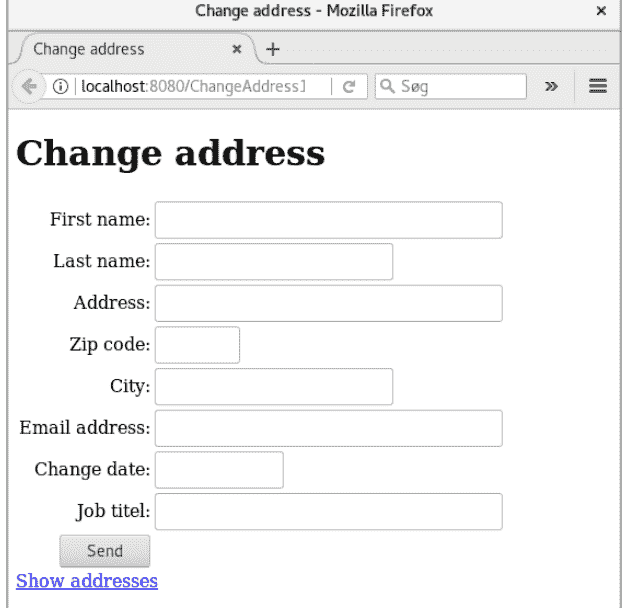

在输入地址时，它们被存储在 `Person` 对象的列表中。然而，数据并没有持久化地存储。正如我在之前的示例中所示，创建一个带有表的数据库并在其中保存数据是相对简单的。在这个示例中，我将向你展示如何使用 JPA 来实现。

在这个示例中，我想使用 JavaDB 作为数据库产品。主要是为了展示这个数据库，它在许多需要简单数据库的语文中非常有用且易于使用。它是一个标准的 SQL 数据库服务器，受 Glassfish 服务器支持，不需要特殊安装，且该产品也受 NetBeans 支持。

该方法基本上是为每个数据库定义一个实体类，我想从将类与 `model` 包关联开始。它必须是一个实体类（Entity Class）：

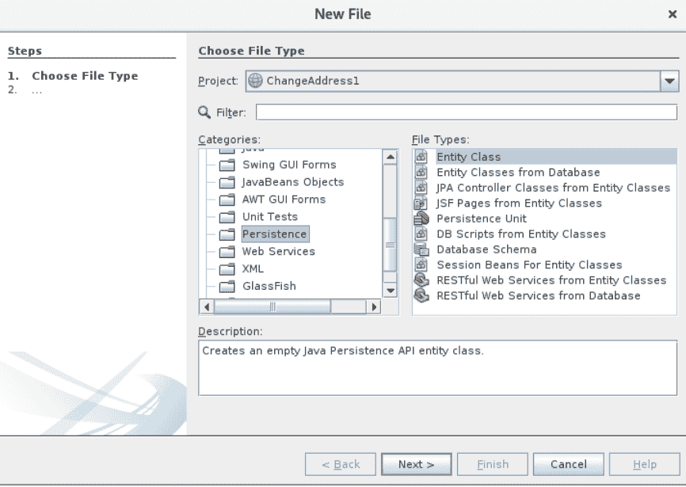

并且它应该命名为 `Address`：

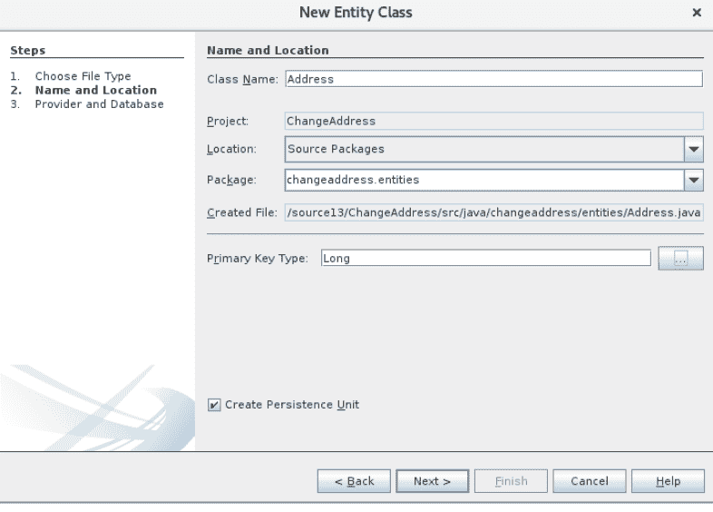

你应该注意已经选择了正确的包名（如果不在列表中可以手动输入），并且勾选了“创建持久化单元”（Create Persistence Unit）。持久化单元是由 NetBeans 创建的名为 `persistence.xml` 的 XML 配置。

当你点击窗口中的“下一步”时，将得到一个初始化此 XML 文件的窗口。你可以根据需要更改名称，并且勾选了“使用 Java 事务 API”。默认情况下选择了“创建”，这意味着如果数据库不存在则必须创建它。

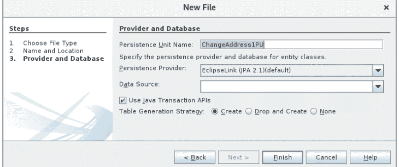

然而，最重要的是数据源（Data Source）字段，它是对当前数据库的引用。在这里你可以选择一个现有的数据源，也可以创建一个新的：

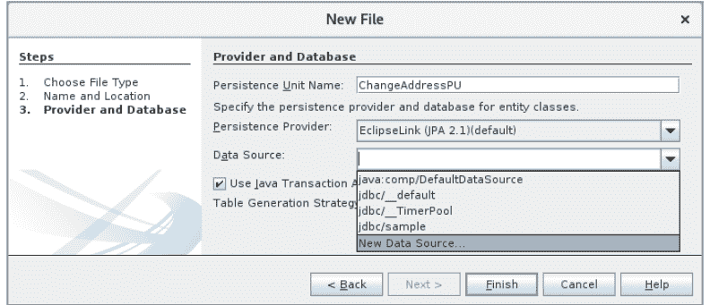

如果你点击“新建数据源”（New Data Source），将得到一个创建数据源的窗口：

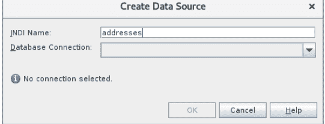

其中我输入了名称 `addresses`。必须定义与数据库的连接。在这里你可以选择现有的，也可以创建一个新的。在这种情况下，你必须创建一个，并选择我选的驱动程序 Java DB (Network)：

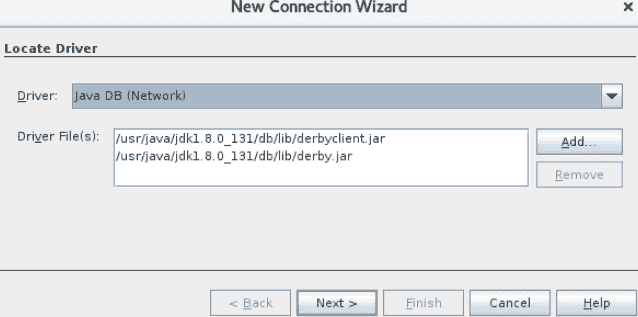

点击“下一步”后，输入关于数据库的各项信息：

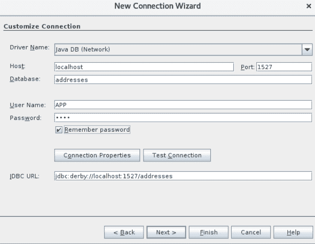

数据库服务器 – Glassfish 服务器 – 运行在 `localhost` 并使用端口号。我选择了数据库名为 `addresses`。


APP，我输入了密码。然后点击“下一步”最后点击“完成”，NetBeans 创建了：

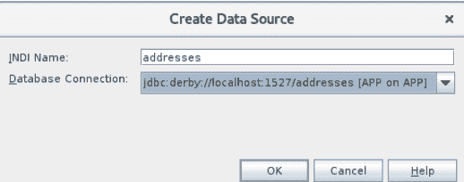

当我点击“确定”时，实体类被创建了：

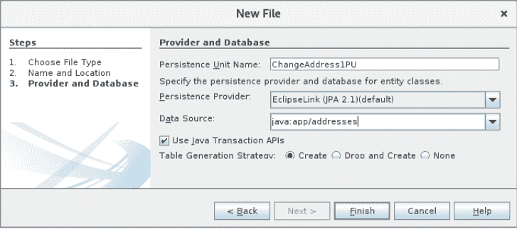

```java
package changeaddress.models;

import java.io.Serializable;
import javax.persistence.*;

@Entity
public class Address implements Serializable {
    private static final long serialVersionUID = 1L;

    @Id
    @GeneratedValue(strategy = GenerationType.AUTO)
    private Long id;

    public Long getId() {
        return id;
    }

    public void setId(Long id) {
        this.id = id;
    }

    @Override
    public int hashCode() {
      int hash = 0;
      hash += (id != null ? id.hashCode() : 0);
      return hash;
    }

    @Override
    public boolean equals(Object object) {
      if (!(object instanceof Address)) return false;
      return id.equals(((Address)object).id);
    }

    @Override
    public String toString() {
      return "changeaddress.models.Address[id=" + id + "]";
    }
}
```

结果是一个类型的类。你应该注意该属性被两个注解标记，指示它是主键，另一个告诉该值应该由数据库自动分配。最后，你应该注意该类也被标记为它是一个实体。该类随后必须扩展包含以下属性：

```java
private String firstName;
private String lastName;
private String address;
private String code;
private String city;
private String email;
private String date;
private String title;
```

以及相应的 `get` 和 `set` 方法。然后我删除了 `Person` 模型类，并在 `IndexController` 中将所有对 `Person` 的引用改为 `Address`，并删除了 `add()` 方法中的代码。之后，可以再次在浏览器中打开程序。

在 `IndexController` 中，你必须添加一些语句：

```java
package changeaddress.beans;

import java.util.*;
import javax.inject.Named;
import javax.enterprise.context.SessionScoped;
import java.io.Serializable;
import javax.persistence.*;
import javax.transaction.*;
import javax.annotation.*;
import javax.persistence.criteria.CriteriaQuery;

import changeaddress.models.*;

@Named(value = "indexController")
@SessionScoped
public class IndexController implements Serializable {
    @PersistenceUnit
    EntityManagerFactory emf;
    @PersistenceContext
    EntityManager em;
}
```


`@Resource`

```java
UserTransaction utx;

private Address person = new Address();
private List<Address> persons = new ArrayList();

public List<Address> getPersons() {
  try {
    CriteriaQuery cq = em.criteriaBuilder().createQuery();
    cq.select(cq.from(Address.class));
    Query q = em.createQuery(cq);
    return persons = q.getResultList();
  } catch (Exception ex) {
    return persons;
  }
}
```

```java
public void add() {
  try {
    utx.begin(person);
    em.persist(person);
    utx.commit();
    person = new Address();
  } catch (Exception ex) {
    try {
      utx.rollback();
    } catch (Exception e) {
    }
  }
}
```

在类的开始处定义了三个对象，每个对象都装饰有一个注解。这种标记的确切含义在第 4 章中会有解释，但作为一个示例，变量 `em` 的类型是 `EntityManager`，之前的注解表示根据项目的持久化单元（Persistence Unit），JPA 会实例化一个类型为 `EntityManager` 的对象，该 JPA 类型代表一个数据库表，并提供了可以执行数据库操作的服务。最后一个变量为数据库操作定义了一个事务。

这些对象被用于 `getPersons()` 和 `add()` 方法中。例如，如果你看最后一个，它启动了一个事务，并且 `persist()` 方法将 `person` 对象写入数据库。在应用程序可以使用之前，必须创建数据库。这在“Services（服务）”下通过右键点击 `JAVA DB` 来完成：

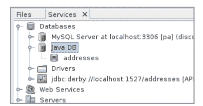

在这里我们点击“Create Database”（创建数据库）。通过这些更改，程序的运行方式与《Java 11》书中的相同，但现在地址存储在数据库表中。

在本节中，我想要展示展示上述程序的另一个版本，该版本在两个方面进行了更改：

1. 此次数据库是一个现有的 MySQL 数据库。
2. 数据库操作已移动到数据库控制器（database controller）。

在完成任务之前，我必须创建数据库：

```sql
use mysql;

create database addresses;

use addresses;

create table address (
id int not null auto_increment,
firstname varchar(50),
lastname varchar(30),
address varchar(50),
code varchar(4),
city varchar(30),
mail varchar(50),
date varchar(10),
title varchar(50),
primary key (id);
);
```

结果是一个与上一个示例内容相同的数据库。

起点是上述程序的副本，名为 `ChangeAddress2`。首先，我删除了以下文件：

1. 模型类 `Address`
2. 配置文件 `glasfish-resources.xml`
3. 配置文件 `persistence.xml`

然后我重新创建了模型类（使用相同的名称），但这次是作为从数据库生成的实体类（Entity Class，见下文）。当我点击“Next”（下一步）时，会出现下面的窗口，我在其中选择了一个数据源（Data Source）。这与上一个示例的方法相同：


这次，对于数据库连接，必须选择 MySQL 驱动程序来指定数据库（`addresses`）、数据库用户和密码。

完成后，数据源（由于我有 `addresses`）的表将显示在“Available Tables”（可用表）下，应将其添加到“Selected Tables”（已选表）中。然后双击“Next”并接受所有设置，最后点击“Finish”（完成）。然后，`Address` 类被再次创建。

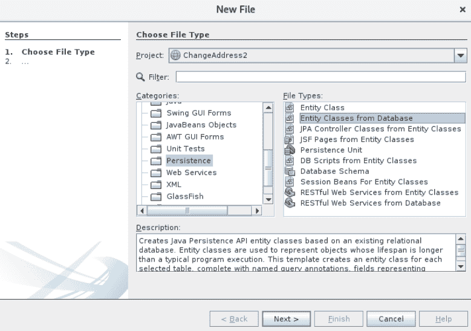

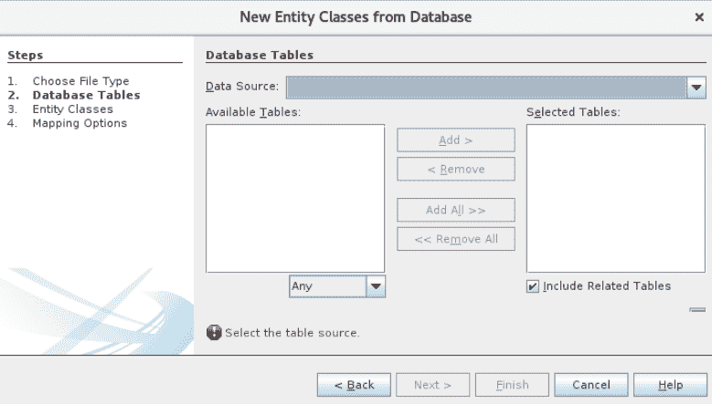

然而这里有一个小问题，因为 `Address` 类中表示电子邮件的属性名称是 `mail` 而不是 `email`，因此在 `IndexController` 中必须更改一些名称。

程序可以再次运行了，唯一的区别是应用程序现在使用了 MySQL 数据库。

你应该检查一下 `Address` 类，其中添加了许多注解（所有属性都装饰了注解），但你可以轻松理解其含义。你还应该尝试检查 `glassfish resource resources.xml` 配置文件。

# Java 持久化 API

```java
public void destroy(Integer id) throws NonexistentEntityException,
RollbackFailureException, Exception

{
  EntityManager em = null;
  try {
    utx.begin();
    em = getEntityManager();
    Address address;
    try {
      address = em.getReference(Address.class, id);
      address.getid();
    } catch (EntityNotFoundException enfe) {
      throw new NonexistentEntityException(" ... \ ", enfe);
    }
    em.remove(address);
    utx.commit();
  } catch (Exception ex) {
    try
```


# 管理学硕士

因为实现梦想是你最大的挑战，IE 商学院（IE Business School）提供的英语、西班牙语或双语授授的管理学硕士课程，通过一项创新且具有刺激性的计划，为职业生涯的高绩效人士提供培训，帮助他们充分发挥潜力。

- 选择你的专业领域。
- 通过所提供的不同选项定制你的硕士课程。
- 在伦敦、硅谷或上海等地点进行全球沉浸。
- 因为你而改变，我们也随你而改变。

www.ie/master-management mim.admissions@ie.ie

在 bookboom.com 下载免费电子书

```java
{
  utx.rollback();
} catch (Exception re) {
  throw new RollbackFailureException(" ...", re);
  throw ex;
} finally {
  if (em != null) {
    em.close();
  }
}
```

```java
public List<Address> findAddressEntities() {
  return findAddressEntities(true, -1, -1);
}
```

```java
public List<Address> findAddressEntities(int maxResults, int firstResult) {
  return findAddressEntities(false, maxResults, firstResult);
}
```

```java
private List<Address> findAddressEntities(boolean all, int maxResults, int firstResult) {
  EntityManager em = getEntityManager();
  try {
    CriteriaQuery cq = em.getCriteriaBuilder().createQuery();
    cq.select(cq.from(Address.class));
    Query q = em.createQuery(cq);
    if (!all) {
      q.setMaxResults(maxResults);
      q.setFirstResult(firstResult);
    }
    return q.getResultList();
  } finally {
    em.close();
  }
}
```

在 bookoon.com 下载免费电子书

```java
public Address findAddress(Integer id) {
  EntityManager em = getEntityManager();
  try {
    return em.find(Address.class, id);
  }
  finally {
    em.close();
  }
}
```

```java
public int getAddressCount() {
  EntityManager em = getEntityManager();
  try {
    CriteriaQuery cq = em.getCriteriaBuilder().createQuery();
    Root<Address> rt = cq.from(Address.class);
    cq.select(em.getCriteriaBuilder().count(rt));
    Query q = em.createQuery(cq);
    return ((Long) q.getSingleResult()).intValue();
  }
  finally {
    em.close();
  }
}
```

代码虽然冗长，但该类易于理解，最重要的一点是更新到数据库的所有内容都封装在方法中，包含了必要的回滚逻辑。此外，该类定义了一些 `find()` 方法，这些方法可以返回具有特定 id 对象或通常为所有对象的对象列表。`find()` 方法使用一个私有的 `find()` 方法，在这里你应该注意下文解释的 `CriteriaQuery` 和 `Query` 类型，但根据名称（以及应用程序），你可以看到这些是用于构建 SQL SELECT 的类型。最后，请注意该类还包含一个返回数据库表行数的方法。

在将该类添加到项目后，必须修改 `IndexController` 类：

```java
public class IndexController implements Serializable {
  @PersistenceUnit
  EntityManagerFactory emf;
  @Resource
  Transaction utx;
```

```java
private Address person = new Address();
private List<Address> persons = new ArrayList();
```

```java
public IndexController() {
}
...
```

```java
public List<Address> getPersons() {
  try {
    AddressJpaController ctrl = new AddressJpaController(utx, emf);
    persons = ctrl.findAddressEntities();
```

在 bookboom.com 下载免费电子书 点击广告阅读更多信息

```java
catch (Exception ex)
{
  return persons;
}
```

```java
public void add()
{
  try {
    AddressJpaController ctrl = new AddressJpaController(utx, emf);
    ctrl.create(person);
    person = new Address();
  } catch (Exception ex) {
}
```

代码虽然填充了，但该类足够容易理解，最重要的一点是更新到数据库的所有内容都封装在方法中，包含了必要的回滚逻辑。此外，该类定义了一些 `find()` 方法，这些方法可以返回具有特定 id 对象或通常为所有对象的对象列表。`find()` 方法使用一个私有的 `find()` 方法，在这里你应该注意下文解释的 `CriteriaQuery` 和 `Query` 类型，但根据名称（以及应用程序），你可以看到这些是用于构建 SQL SELECT 的类型。最后，请注意该类还包含一个返回数据库表行数的方法。

在将该类添加到项目后，必须修改 `IndexController` 类：

在此练习中，你必须编写一个显示表格内容的 Web 应用程序。创建一个新项目，命名为 `Zipcode`。你必须为数据库添加数据源，完成后，你应该查看数据库中的所有表。当你进入下一个窗口（见下文），必须选择某些选择框，但不是最后一个。运行向导后，你创建名为 `Zipcode` 的实体类，当你检查代码时，你应该注意以下内容没有勾选：

字段。注意 `Named Query` 是 SQL 的变体 JPQL。

| 步骤 | 实体类 | |
| :--- | :--- | :--- |
| 1 选择文件类型 | 指定实体的名称和位置 | |
| 2 数据库表 | | |
| 3 实体类 | 数据库表 | 类名 | 生成类型 |
| 4 映射选项 | zipcode | 新 |
| | |
| --- | --- |
| 项目 | zipcodePage |
| 位置 | 源包 |
| 包 | zipcode models |

- 生成查询注解
- 生成 JAXB 注解
- 生成映射超类而非实体
- 创建持久化单元

卓越的经济和商学课程位于：

格宁根大学（University of Groningen）

> “成功国际职业的完美起点。”

点击此处

发现为什么格宁根大学在社交和学术上都是学生的理想去处

www.rug.nl/feb/education

## 下一步，你需要为之前的实体类添加一个数据库控制器 *ZipcodeJpaController*。

你必须为 *index.xhtml* 创建一个 bean，其结果将如所示，显示一个带有邮编的表格。底部的输入字段应作为过滤器：

- 第一个字段的内容匹配所有以该值开头的邮编
- 第二个字段的内容匹配所有包含该值的城市名称

`Clear` 链接应该清除两个输入字段（但不更新表格），而 `Update` 链接应该根据过滤器的内容更新表格。加载数据库表应该仅在程序启动时进行。你可以在 bean 中编写一个 `init()` 方法并按所示对其进行装饰：

```java
@PostConstruct
private void init() {
    ZipcodeJpaController ctrl = new ZipcodeJpaController(utx, emf);
    zipcodes = ctrl.findZipcodeEntities();
}
```

这是一个在对象实例化后立即执行的方法。

编写像上面那样的 Web 应用是因为 JPA 变得非常简单，但当然这只是一个简单的应用程序，而且主要是因为数据库只有一个表。在本节中，我将展示数据库在什么情况下拥有更多表、各个表之间存在什么关系，以及 JPA 的优势在何情况下变得更加明显。

作为一个示例，我将使用第 7 本中的数据库库；

| user | book | publisher |
|---|---|---|
| id | id | id |
| email | isbn10 | name |
| password | isbn13 | |
| firstname | edition | |
| lastname | year | |
| address | pages | author |
| zipcode | text | |
| city | | | |
| phone | | | |
| title | | | |
| category |
|---|
| id |
| name |

我将使用 book、publisher、category 和 author 这四个实体。在这里你应该注意，publisher 与 book 之间以及 category 与 book 之间存在多对一（many-to-one）的关系。此外，book 与 author 之间存在多对多（many-to-many）的关系。示例是一个名为 PaBooks 的 Web 应用，它通常应该能够维护与上述四个实体对应的表。需要注意的是，用户界面非常简单——只需关注数据库事务和 JPA。在接下来的本章前两个示例中，我将主要关注程序是如何构建的，特别是如何使用 JPA 开发数据库应用程序。

起点是一个名为 PaBooks 的 Web 应用，在创建创建后，我从数据库中选择了实体类（Entity Classes），在这里我创建了一个名为 booklibrary 的源码，它用于创建到库数据库的连接，之后，我们得到了数据库表的概览：

这些是表：

- author
- book
- category
- publisher
- written

已添加到已选表：

## 美国在线大学

LIGS University

正在招收互动在线 BBA、MBA、MSc、DBA 和 PhD 项目：

- 在 2014 年 9 月 30 日前报名并
- 学费优惠高达 16%！
- 分 10 期 / 2 年付款
- 互动式在线教育
- 访问 www.ligsuniversity.com 了解更多信息！

LIGS 大学未获得美国教育部长列出的任何国家认可认证机构的认证。更多信息请点击此处。

特别注意 **written** 显示为粗体，这是因为它是 book 和 author 之间的关系表。当你点击“下一步”（Next）时，你会看到以下窗口：

在这里你可以看到创建了四个实体类，注意你可以更改你喜欢的类名。我在这里没有进行修改。还要注意创建这些类的包名，我们使用的是 `pabooks.models`。当你点击“下一步”（Next）时，你会看到以下窗口：

当你点击“完成”（Finish）时，进一步的实体类被创建。通常情况下，很少需要修改这些实体类的 `toString()` 方法，我在本例也对 Author、Category 和 Publisher 类这样做了。我们鼓励研究代码。除其他外，你应该注意 Publisher 类包含一个 `bookCollection` Book 对象集合。它代表了指向 Book 对象的外键，从而引用了在该出版商出版的 Book 对象。Category 类也是如此。如果你研究 Book 类，应该注意它有一个指向 Publisher 对象和 Category 对象的引用，即这两个多对多关系的另一端。Book 类还有一个包含 Author 对象的 `authorCollection`，代表了 book 和 author 之间的多对多关系。检查该类你会发现，该类有一个对应的针对 Book 对象的 `bookCollection`。检查该类你会发现该类有用于数据库的方法：

- AuthorController
- BookController
- CategoryController
- PublisherController

起点是一个名为 PaBooks 的 Web 应用，在应用程序创建后，我从数据库中选择了实体类，在这里我创建了一个名为 booklibrary 的源码，它用于创建到库数据库的连接，之后，我们得到了数据库表的概览：

回顾我目前为止编写数据库的方式，最困难的是 SQL 语句——正确编写它们，是因为它们只是文本，因此无法通过编译进行语法检查。JPQL 也存在相同的问题，为了解决这些问题，定义了一个名为 Criteria 的 API。事实上，使用此 API 编写 SELECT 语句并不更容易，但 SELECT 表达式的不同部分是用 Java 类定义的，因此编译器可以验证表达式。

该 API 用于定义条件查询（Criteria Queries），这本质上是一个对象图，你通过构建这样的图来定义条件查询。这是通过 `CriteriaBuilder` 类型的对象实现的，该对象可以创建查询组成的部分，由于这一切都是关于表示 SELECT 语句的，这意味着是对表的面向对象的表示，

关于 e-Learning Kids

e-Learning Kids 成立于 2004 年，是一个全球非营利组织，致力于为5-12 儿童儿童提供免费的网络学习资金，课程涵盖数学、科学、语言艺术、计算机、健康和环境技能。自 2005 年以来，来自 190 多个国家的1500 多万儿童受益于 ELKI 志愿者员工提供的在线课程，这些志愿者来自世界各地，是教育、在线学习专家和商务专业人士，致力于做出贡献。e-Learning for Kids 寻求资金、志愿者、赞助商和内容开发者，欢迎加入我们！更多信息请访问 www.e-learningforkids.org。

以及从数据库中提取行的列和条件。例如，我们可以通过形如下所示的语句从 `EntityManager` 获取 `CriteriaBuilder`：

```
CriteriaBuilder cb = em.getCriteriaBuilder();
```

其中 em 是一个 `EntityManager`。构建器有三个返回准则查询的方法：

- CriteriaQuery<T> createQuery(Class<T>)
- CriteriaQuery<Tuple> createTupleQuery()
- CriteriaQuery<Object> createQuery()

它们的区别在于查询返回的对象类型。在获取查询后，任务是初始化此查询，而这正是 API 介入路径的地方。

我想从上述方法中的第一个开始，该方法通过参数类型创建一个查询，该类型标识了查询结果预期的对象类型，原则上它可以是任何任意的对象类型。例如，下面是一个准则查询，用于确定图库中所有页码值为 520 的书：

```
CriteriaBuilder cb = em.getCriteriaBuilder();
CriteriaQuery<Book> cq = cb.createQuery(Book.class);
Root<Book> root = cq.from(Book.class);
cq.select(root);
cq.where(cb.equal(root.get("Book_pages"), 520));
return em.createQuery(cq).getResultList();
```


注意如何创建`CriteriaBuilder`（`em`是一个`EntityManager`）以及如何使用它为`Book`对象创建准则查询。对于每个部分，都为图对象创建一个根（root），并定义了查询必须从该根提取对象。root对应SQL语句中的`FROM`部分。接下来，由具有`Book`对象的根定义。`select(t)`属性是结果的一部分，定义了要包含的列。最后，定义必须提取页数为520的对象，这对应于`WHERE`部分。结果是这些对象的集合。你应该特别注意如何引用列`pages`（`Book`类中的属性`pages`）。查询也可以写如下所示：

```
CriteriaBuilder cb = em.getCriteriaBuilder();
CriteriaQuery<Book> cq = cb.createQuery(Book.class);
Root<Book> root = cq.from(Book.class);
return em.createQuery(cq);
cq.select(root).where(cb.equal(root.get("pages"), 520))).getResultList();
```

除了稍微短一点外，没有特殊优势，因此它看起来更像一个SQL SELECT语句。然而，你必须注意我用另一种方式定义了列（`pages`），即作为一个字符串，这应该是`Book`类中该属性的名称。

如果你查看代码，可以发现准则查询对象具有以下方法：

- `from()`
- `select()`
- `where()`

其含义从`SELECT`语句中是已知的，如果你检查`CriteriaQuery`类型，你会发现还有用于`SELECT`其他部分的方法，如`ORDER BY`、`GROUP BY`等。最后，你可以注意到`CriteriaBuilder`类除了创建`CriteriaQuery`对象外，还有定义条件的方法——谓词（predicates）以及许多其他（在相同的`equals`中），下面说明了其中几个。

作为另一个示例，下面的查询确定了所有标题包含"Fedora"文本的书的页码：

```
CriteriaBuilder cb = em.getCriteriaBuilder();
CriteriaQuery<Integer> cq = cq.createQuery(Integer.class);
Root<Book> root = cq.from(Book.class);
q.select(root.get(Book.pages));
q.where(cb.like(root.get(Book.title), "%Fedora%%"));
List<Integer> pages = em.createQuery(cq).getResultList();
```

与SQL相比，你可以说通过`Root`指定了想要执行`SELECT`的表，在JPA连接中，这意味着一个实体对象。通过`select(method)`，你指定了将包含在结果中的列或属性。这里只有页码的属性，`Book..pages`是实体对象`Book`中的属性`pages`。最后，如上面所述，指定了要包含哪些实体对象，这里只有属性`title`包含单词"Fedora"的对象。注意结果是`Integer`对象的列表，从开始就创建了一个针对`Integer`对象的`CriteriaQuery`。

作为一个进一步的示例，显示了一个确定`book`表中最大页码的查询，你应该首先注意到准则构建器支持多个函数（这里是`max`函数），并且结果由`getSingleResult()`而不是`getResult()`决定：

```
CriteriaBuilder cb = em.getCriteriaBuilder();
CriteriaQuery<Integer> cq = cq.createQuery(Integer.class);
Root<Book> root = cq.from(Book.class);
cq.select(cb.max(root.get(Book.pages)));
Integer pages = em.createQuery(cq).getSingleResult();
```

或者更短的：

```
CriteriaBuilder cb = em.getCriteriaBuilder();
CriteriaQuery<Integer> cq = cq.createQuery(Integer.class);
Root<Book> root = cq.from(Book.class);
Integer pages = em.createQuery(
cq.select(cb.max(root.get(Book.pages))).from(Book.class);
```

我将展示一些示例如何确定大于500的特定属性值：

```
CriteriaBuilder cb = em.getCriteriaBuilder();
CriteriaQuery<Object> cq = cq.createQuery(Object.class);
Root<Book> root = cq.from(Book.class);
cq.select(cb.max(root.get(Book.pages))).from(Book.class)
.where(cb.equal(root.get("pages"), 500));
```

# JAVA 持久化 API (JPA)

```java
for (Tuple t : list) {
  Integer id = t.get(idPath);
  String str1 = (String)t.get(1);
  String str2 = t.get(1, String.class);
}
```

`Criteria`对象定义了从一个或多个实体查询（在上面的示例中，每次只有一个名为`Book`的实体）。当然，你可以指定对应于SQL位置的更多实体。我将从一个根据出版社包含"Sams"字样的所有书籍查询开始：

```java
CriteriaBuilder cb = em.getCriteriaBuilder();
CriteriaQuery<Book> cq = cb.createQuery(Book.class);
Root<Book> books = cq.from(Book.class);
Join<Book, Publisher> pubs = books.join("pubid");
cq.select(books).where(cb.like(pubs.get("name"), "Sams%"));
return em.createQuery(cq).getResultList();
```

首先，我为`Book`对象创建了一个查询，并为实体类定义了一个根（这次我们命名为`books`）。`books`和`publisher`之间存在一对多的关系，因此同一个出版社可以出版多部书，而一本书总是由特定的出版社出版。

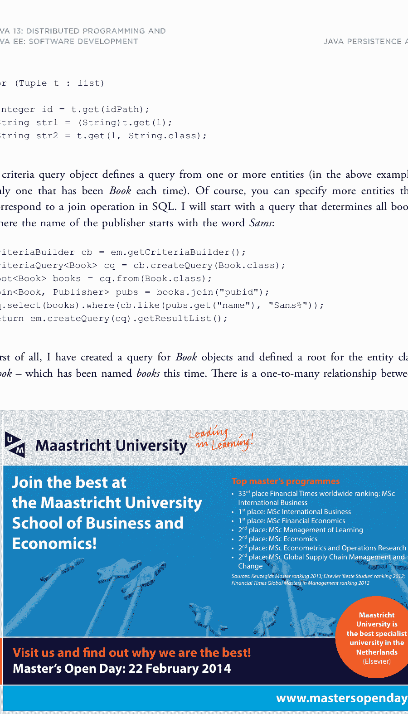

访问我们并发现我们为什么是最好的！硕士开放日：2014年2月22日

然后，我通过在实体类`Book`中指定属性`pubid`为连接（join），定义了`Book`和`Publisher`（两个实体类）之间的连接，命名为`pubs`。其余部分不包含任何内容，但你应该注意`where()`方法中如何使用名称`pubs`来引用`Publisher`类中的属性名。

下一个示例是相同的连接，但查询确定了所有标题包含"Fedora"字样或出版社以"Sams"开头的书籍：

```java
CriteriaBuilder cb = em.getCriteriaBuilder();
CriteriaQuery<Book> query = cb.createQuery(Book.class);
Root<Book> books = query.from(Book.class);
Join<Book, Publisher> pubs = books.join("pubid");
query.select(books).get("title"), "%Fedora%%"
cb.or(cb.like(books.get("title"), "%Fedora%%"),
     cb.like(pubs.get("name"), "%Sams%%"));
return em.createQuery(query).getResultList();
```

你可能知道`or()`方法是如何用于构建条件的。

`Book`和`Category`之间也存在一对多的关系，因此你也可以定义从`Book`到`Category`的查询。以下查询确定了标题包含搜索值、出版社名称包含搜索值且类别名称包含搜索值的所有`Book`对象：

```java
CriteriaBuilder cb = em.getCriteriaBuilder();
CriteriaQuery<Book> query = cb.createQuery(Book.class);
Root<Book> books = query.from(Book.class);
Join<Book, Publisher> pubs = books.join("pubid");
Join<Book, Category> cats = books.join("catid");
Predicate pc = cb.and(cb.like(books.get("title"), "%" + title + "%%"),
                     cb.like(pubs.get("name"), "%" + pubname + "%%"),
                     cb.like(cats.get("name"), "%" + catname + "%%"));
query.select(books).where(pc);
```

注意为对象图定义了两个连接对象。`Predicate`对象表示一个条件。在这种情况下，有三个`equal()`函数的`and`操作，谓词被用作`where()`函数的参数。你应该特别注意如何在搜索字符串中使用变量。

最后一个示例中，我将向你展示查找特定书籍作者的查询。`Book`和`Author`之间存在多对多的关系，该查询可以写成：

```java
CriteriaBuilder cb = em.getCriteriaBuilder();
CriteriaQuery<Author> cq = cb.createQuery(Author.class);
Root<Author> root = cq.from(Author.class);
Join<Author, Book> books = root.join("Book");
cq.where(equal(books.get("isbn"), "0-672-32584-5"));
cq.select(root);
List<Author> list = em.createQuery(cq).getResultList();
```

首先为`Author`类创建了root。接下来，定义了`Author`到`Book`的连接，并使用`where()`方法定义了所有isbn为`0-672-32584-5`的作者。在这种情况下，页面上我想显示数据库中的所有书籍，可以通过以下方式过滤书籍：

1. 标题包含文本
2. 出版社名称包含文本
3. 类别名称包含文本

我在`Book`类中添加了以下方法：

```java
public List<Book> findEntities(String title, String pubname, String catname) {
  EntityManager em = entityManager();
  try {
    CriteriaBuilder cb = em.getCriteriaBuilder();
    CriteriaQuery<Book> query = cb.createQuery(Book.class);
    Root<Book> books = query.from(Book.class);
    if (pubname.length() > 0 && catname.length() > 0) {
      Join<Book, Publisher> pubs = books.join("pubid");
      Join<Book, Category> cats = books.join("catid");
      Predicate predicate = cb.and(cb.like(books.get("title"), "%" + title + "%"),
                               cb.like(pubs.get("name"), "%" + pubname + "%"),
                               cb.like(cats.get("name"), "%" + catname + "%"));
      query.select(books).where(predicate);
    } else if (pubname.length() > 0) {
      Join<Book, Publisher> pubs = books.join("pubid");
      Predicate predicate = cb.and(cb.like(books.get("title"), "%" + title + "%"),
                               cb.like(pubs.get("name"), "%" + pubname + "%"));
      query.select(books).where(predicate);
    } else if (catname.length() > 0) {
      Join<Book, Category> cats = books.join("catid");
      Predicate pc = cb.and(cb.like(books.get("title"), "%" + title + "%"),
                           cb.like(cats.get("name"), "%" + catname + "%"));
      query.select(books).where(pc);
    } else {
      query.select(books).where(cb.like(books.get("title"), "%" + title + "%"));
    }
    return em.createQuery(query).getResultList();
  } catch (Exception ex) {
    return new ArrayList<>();
  } finally {
    em.close();
  }
}
```


该方法可能并不简单，但主要是因为搜索文本为空，且数据库中没有出版社或类别的值。

完成上述工作后，返回单独的JSF页面，尽管有一些细节需要解决，但基本上没有新内容，我主要参考完成的代码。如果你在浏览器中打开应用程序，将看到以下窗口（数据库中有三本书）：

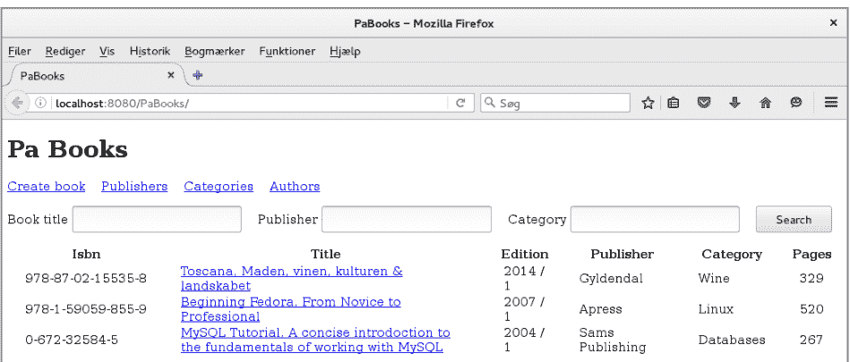

| ISBN | 标题 | 版本 | 出版社 | 类别 | 页数 |
| :--- | :--- | :--- | :--- | :--- | :--- |
| 978-02-215535-8 | Java, Maden, vis, kulturen & landscape | 2014/1 | Oydendal | Wine | 329 |
| 978-1-50959-855-9 | Beginning Fedora, Preface to professional | 2007/1 | Apress | Linux | 520 |
| 0-672-32584-5 | MySQL Tutorial: A complete introduction to the fundamentals of working with MySQL! | 2004/1 | Same Publishing | Databases | 267 |

页面有三个输入搜索的输入字段，此外还有四个引用页面的：

- 1. `book.xhtml`，用于创建新书籍
- 2. `publishers.xhtml`，用于维护出版社
- 3. `categories.xhtml`，用于维护类别
- 4. `authors.xhtml`，用于维护作者

最后，每本书书的标题都是一个链接，点击它，你会被发送到`book.xhtml`，并可以选择编辑该书。`index.xhtml`（上面的窗口）非常简单，但有一个控制器`IndexController`。该类是一个相对简单的命名Bean。你应该特别注意它是如何调用添加到`BookJpaController`类中的方法的，该方法执行了一个SQL SELECT查询。

# JAVA 13：分布式编程

JAVA EE：软件开发

JAVA 持久化 API (JPA)


其他页面包含一个 JSP 页面和一个命名 Bean。在学习代码时，请特别注意各个 Bean 如何实现 JSP 页面中命令的动作元素，以及这些方法如何使用数据库控制器类。由于这本书及其 Bean 并不简单，因为必须维护书籍（book）表与作者（author）表之间的多对多关系。特别是，你应该意识到 `BookJpaController` 类处理了更新数据库所需的所有内容，包括涉及 `INSERT`、`UPDATE` 和 `DELETE` 的关系维护。实际上，正在这里你发现了 JPA 的巨大益处，否则如之前书籍中的示例所示，需要编写大量的代码。此外，应该补充的是，JPA 甚至是极其高效的。

# 问题 1

数据库 `padata` 包含三个表：

- `world`，包含该世界各个洲的名称。
- `currency`，包含一个货币表。
- `country`，包含有关国家的信息。

（参见《Java 6》书中的可能问题 1）。作为文档，数据库使用以下脚本创建：

```sql
create table currency
{
  code char(3) not null primary key,
  name varchar(30) not null,
  rate decimal(10, 4)
}
```

```sql
create table world
{
  code char(2) not null primary key,
  name varchar(15) not null
}
```

```sql
create table country
{
  code2 char(2) not null primary key, # 2位国家代码
  code3 varchar(3), # 3位国家代码
  name varchar(50) not null, # 国家名称
  area int, # 国家的平方公里面积
  number int, # 国家的人口
  continent char(2), # 所属大洲
  currency char(3), # 货币代码
  foreign key (continent) references world(code),
  foreign key (currency) references currency(code);
}
```

```sql
insert into world values('AS', 'Asia');
insert into world values('AF', 'Africa');
insert into world values('NA', 'North America');
insert into world values('SA', 'South America');
insert into world values('AN', 'Antarctica');
insert into world values('EU', 'Europe');
insert into world values('OC', 'Oceania');
```

任务是编写一个 Web 应用程序，在使用 JPA 执行数据库操作时能够维护这些表。

应用程序必须有三个页面。起始页应如下所示，仅显示少数国家：


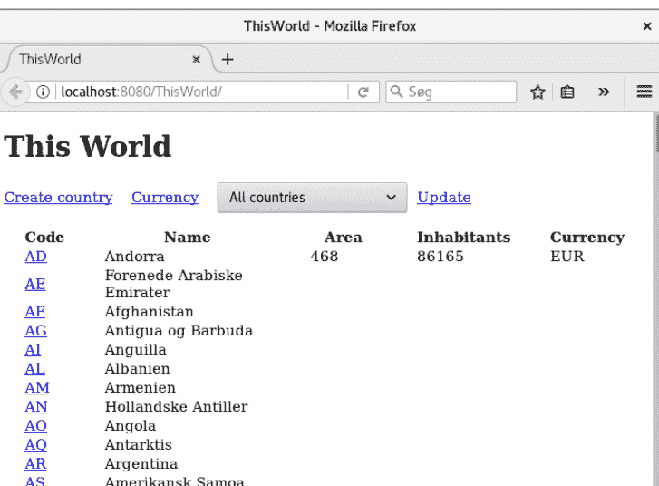

如果有指向用于创建国家的页面链接——如果你点击链接中代码里的国家，则将使用同一个页面来编辑国家信息。**货币**（Currency）用于维护货币表。最后，有一个下拉框可以在其中选择一个大洲，然后点击**更新**（Update）链接，即可只显示所选大洲的国家。

维护国家信息的页面如下，其中点击了 *Andora* 的代码：

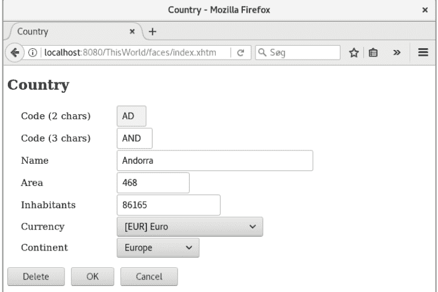

最后，下方显示了货币表的维护页面（仅显示了少数货币）：

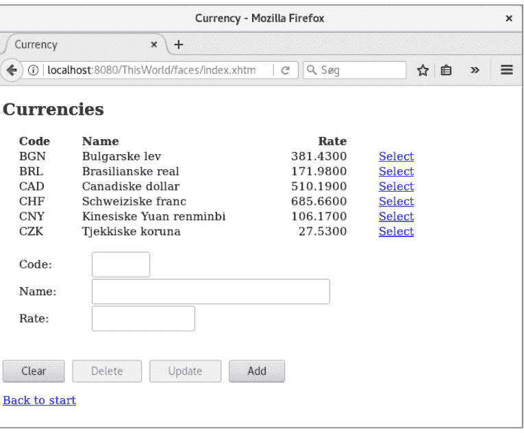

并且该页面应该是自足其明的。

## 企业级 Java Beans

企业级 Java Beans 或 EJB 是运行在服务器上并封装了业务逻辑的组件，在这里它们可以被 Web 应用程序和独立应用程序等应用使用。你可以将 EJB 视为一个在应用程序服务器（如 Glassfish）上开发、测试和托管的组件，正如其他应用程序可以调用它一样。开发 EJB 并将其托管在应用程序服务器上并不简单，其架构也不易于审查，但 NetBeans 提供了帮助，因为它有专门用于开发 EJB 的项目。在本章中，我将部分演示如何使用 NetBeans 开发和使用 EJB，并解释最重要的概念。

EJB 的优势在于，除了为多个应用程序提供相同的服务外，应用程序服务器还处理诸如事务和安全问题等各种情况，而 EJB 简化了开发。


如下所示，EJB 在现代应用中起着重要作用（等等，EJB 在现代应用中起着重要作用）。

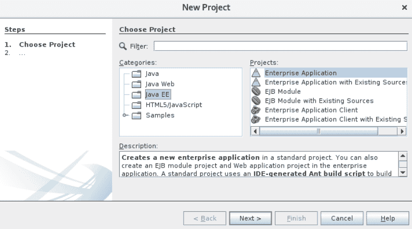

有三种变体：

- 无状态（Stateless）：调用之间不保留状态。
- 有状态（Stateful）：在组件的生命周期内维护状态。
- 单例（Singleton）：仅存在实例。

EJB 简化了开发。接下来，我将通过选择 Java EE 和 Enterprise Application 开始创建一个新项目。

点击 Next 后，出现以下窗口，输入项目名称（CalCEJB）。点击 Next 后，出现以下窗口，默认由一个 EJB 模块和一个 Web 应用程序组成：

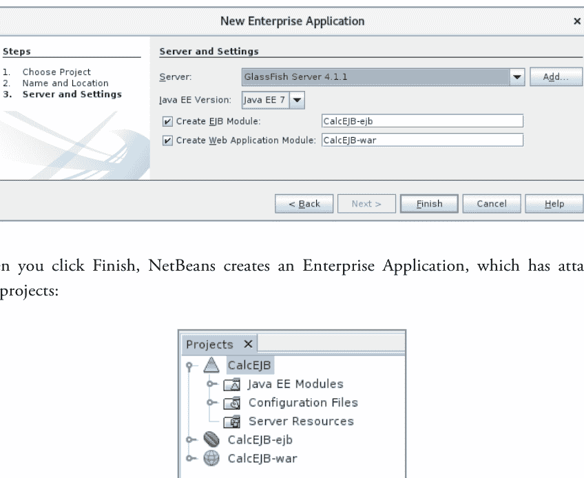

点击 Finish 后，NetBeans 会创建一个企业应用程序，它包含两个项目：第一个名为 `CalCEJB-ejb` 的 EJB 模块，另一个名为 `CalCEJB-war` 的 Web 项目。

注意 NetBeans 选择了名称，根据需要可以修改。要这样做，右键点击项目并选择 Enterprise Beans，然后选择 Session Bean。

点击 Next 后出现以下窗口，你必须为你的 EJB 命名（此处为 `CalcSession`）并命名包（此处为 `calcejb.ejjs`）：

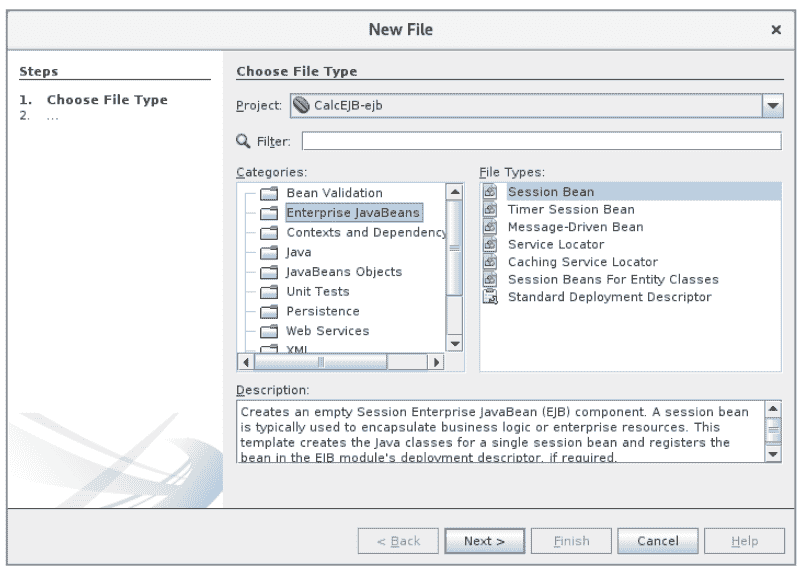


此外，选择 Session 类型，此处选择了 Stateless。最后，勾选了 Local。这意味着创建一个定义 EJB 的接口。当此处选择 Local 时，意味着它是一个被托管在同一服务器上的 Web 应用程序（在实践中将是这样）使用的 EJB，准确地说，意味着由与 EJB 模块相同的同一个 JVM 执行的应用程序。点击 Finish 后，NetBeans 会创建一个类和一个接口。

## 类如下

```java
package calcejb.ejbs;

import javax.ejb.Stateless;

@Stateless
public class CalcSession implements CalcSessionLocal
{}
```

你可以部分看到它实现了该接口，并且被一个注解装饰，说明这是一个会话 Bean（session bean）。该接口是一个空接口，被一个注解装饰说明这是一个本地会话 Bean（local session bean）：

```java
package calcejb.ejbs;

import javax.ejb.Local;

@Local
public interface CalcSessionLocal
{}
```

接下来，应该为 EJB 类添加方法。要执行此操作，右键点击类名并选择“插入代码”（Insert Code），在随后的菜单中选择“添加业务方法”（Add Business Method），之后就会看到以下窗口：

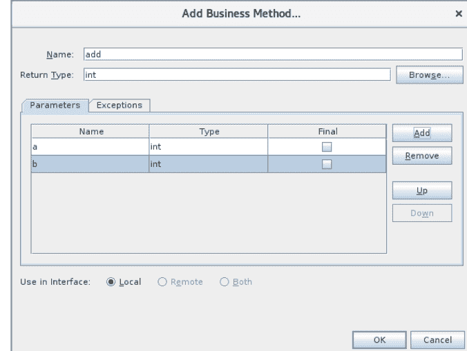

# JAVA 13：分布式编程与 JAVA EE：软件开发——企业级 Java Bean

此后，NetBeans 为 `CalcSession` 类添加了一个方法。使用上述工具的优势在于它也会更新接口，当然，这也可以手动完成。下面是完整的接口，定义了 5 个方法：

```java
package calcejb.ejjs;

import javax.ejb.Local;

@Local
public interface CalcSessionLocal
{
    int add(int a, int b);
    int sub(int a, int b);
    int mul(int a, int b);
    int div(int a, int b);
    int mod(int a, int b);
}
```


沃尔沃股票代码 | 德国股票代码 | 上海股票代码 | 沃尔沃集团 | 沃尔沃建筑设备 | 沃尔沃 PUNK | 沃尔沃亚洲 | 沃尔沃 IT

沃尔沃金融服务 | 沃尔沃 3P | 沃尔沃 PENETR | 沃尔沃零件 | 沃尔沃技术 | 沃尔沃贷款 | 亚太业务区

# JAVA 13：分布式编程与 JAVA EE：软件开发

在完成实现了所有接口方法的类之后：

```java
package calcejb.ejbs;

import javax.ejb.Stateless;

@Stateless
public class CalcSession implements CalcSessionLocal
{
    @Override
    public int add(int a, int b)
    {
        return a + b;
    }

    @Override
    public int sub(int a, int b)
    {
        return a - b;
    }

    @Override
    public int mul(int a, int b)
    {
        return a * b;
    }

    @Override
    public int div(int a, int b)
    {
        try
        {
            return a / b;
        } catch (Exception ex)
        {
            return 0;
        }
    }

    @Override
    public int mod(int a, int b)
    {
        return a % b;
    }
```

# JAVA 13：分布式编程 JAVA EE：软件开发——企业级 Java Bean

```java
catch (Exception ex) {
  return 0;
}
```

现在我的会话 Bean 已经完成，然后必须编写客户端了。首先，我添加了一个名为 `CalcBean` 的命名 Bean（在包 `calejb.beans` 中）。在添加该类后，我右键点击类名并选择“插入代码”（Insert Code），在这里再次选择“调用企业 Bean”（Call Enterprise Bean），结果如下：

```java
package calejb.beans;

import calejb.ejbs.CalcSessionLocal;
import javax.inject.Named;
import javax.enterprise.context.SessionScoped;
import java.io.Serializable;
import javax.ejb.EJB;

@Named(value = "CalcBean")
@SessionScoped
public class CalcBean implements Serializable {
  @EJB
  private CalcSessionLocal calcSession;
  public CalcBean() {
  }
}
```

这意味着对 EJB 模块进行了引用，这里的关键点是它被 `@EJB` 装饰了。这意味着相关的会话 Bean 可以被类的方法使用。完成的 Bean 如下：

```java
package calejb.beans;

import calejb.ejbs.CalcSessionLocal;
import javax.inject.Named;
import javax.enterprise.context.SessionScoped;
import java.io.Serializable;
import javax.ejb.EJB;

@Named(value = "CalcBean")
@SessionScoped
```

```java
public class CalcBean implements Serializable
{
    @EJB
    private CalcSessionLocal calcSession;

    private int value1;
    private int value2;
    private int value3;

    public CalcBean() {
    }

    public int getValue() {
        return value1;
    }

    public void setValuel(int value1) {
        this.value1 = value1;
    }
```


```java
    public int getValue2() {
        return value2;
    }

    public void setValue2(int value2) {
        this.value2 = value2;
    }

    public int getValue3() {
        return value3;
    }

    public void setValue3(int value3) {
        this.value3 = value3;
    }

    public void clear() {
        value1 = 0;
        value2 = 0;
        value3 = 0;
    }

    public void addition() {
        calcSession.add(value1, value2);
    }

    public void subtract() {
        calcSession.sub(value1, value2);
    }

    public void multiply() {
        calcSession.mul(value1, value2);
    }

    public void divide() {
        calcSession.div(value1, value2);
    }

    public void modulus() {
        calcSession.mod(value1, value2);
    }
```

# JAVA 13：分布式编程 JAVA EE：软件开发——企业级 Java Bean

代码不需要进一步解释。然而，请注意类的方法是如何引用 `calcSession` 对象的。不过，我删除了 `index.html` 并创建了新的 `index.html`，内容如下：

```xml
<?xml version="1.0" encoding="UTF-8" ?>

<!DOCTYPE html>

<html xmlns="http://www.w3.org/1999/xhtml"
      xmlns:h="http://java.jcp.org/jsf/html">

<head>
    <title>Title</title>
</head>

<body>
    <h1>Calculations</h1>

    <form>
        <p>
            <h:inputText value="#{calcBean.value1}" />
            <h:inputText value="#{calcBean.value2}" />
            <h:inputText value="#{calcBean.value3}" />
        </p>

        <p>
            <h:commandButton value="CLR" action="#{calcBean.clear()}" />
            <h:commandButton value="ADD" action="#{calcBean.addition()}" />
            <h:commandButton value="SUB" action="#{calcBean.subtract()}" />
            <h:commandButton value="MUL" action="#{calcBean.multiply()}" />
            <h:commandButton value="DIV" action="#{calcBean.divide()}" />
```


```html
<h:commandButton value="MOD" action="#{calcBean.modulus()}" />
```

代码不需要进一步解释。然而，请注意类的方法是如何引用`calcSession`对象的。不过，我删除了`index.html`并创建了新的`index.html`，内容如下。你需要构建项目。右键点击企业应用名称并部署。再次右键点击并运行，你会看到以下窗口：

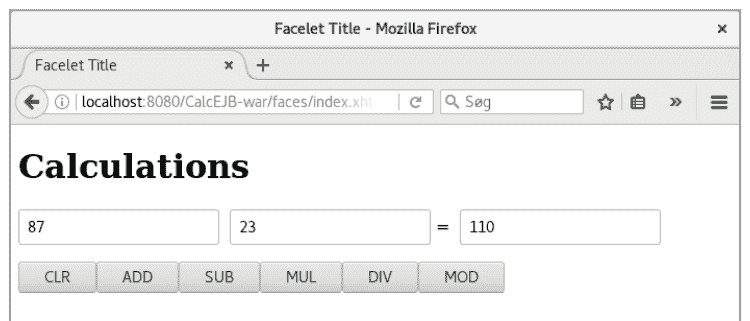

# 计算

在两个输入框中输入数值并点击显示。

## 3.1 有状态会话豆（Stateful Bean）

在本节中，我将展示有状态会话豆的示例。事实上，它的开发方式与上述相同，但它会在方法调用之间保留实例值。当无状态或有状态会话豆部署在服务器上时，服务器会创建实例，这通常被称为 EJB 池。当客户端想要创建 EJB 实例时，服务器从池中取一个实例并给客户端引用。这一过程的目标是性能，因为创建 EJB 实例需要相对长时间。如果是有状态会话豆，服务器会与客户端保持对话，因此它一直使用同一个实例。无状态会话豆则并非如此，对于方法的每一次调用，无法保证使用的是同一个实例。当前示例打开了以下窗口，其中输入 200 作为索引并点击显示：

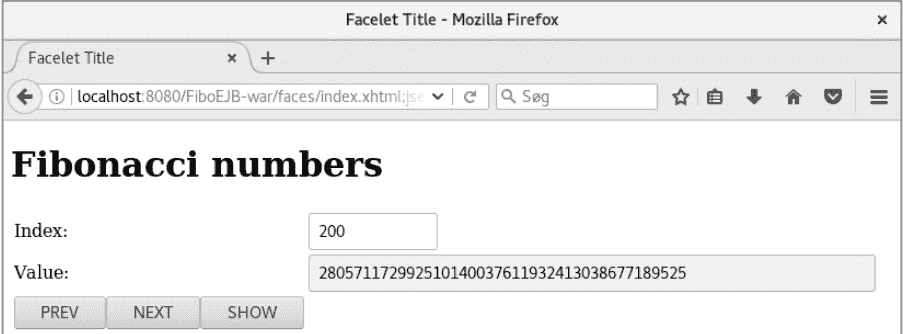

# JAVA 13：分布式编程与 JAVA EE：软件开发

## 企业级 Java Bean（Enterprise Java Beans）

我已经编写了接口，这次我是手动完成的，没有使用 NetBeans 来创建必要的方法：

```java
package fiboejb.ejbs;

import javax.ejb.Local;

@Local
public interface FiboSessionLocal {
    int getIndex();

    void setIndex(int index) throws Exception;

    Object getValue();

    void next();

    void prev() throws Exception;
}
```

各个方法的含义将在上方浏览器窗口的解释中说明，你应该注意有两个方法可能会抛出异常，并且`getValue()`方法返回一个`Object`——该方法返回的是波那契数。

实现代码如下，代码是手动编写的：

```java
package fiboejb.ejbs;

import javax.ejb.Stateful;
import java.math.BigInteger;

@Stateful
public class FiboSession implements FiboSessionLocal {
    private int index = 0;

    private BigInteger value1 = BigInteger.ZERO;

    private BigInteger value2 = BigInteger.ZERO;

    @Override
    public int getIndex() {
        return index;
    }

    @Override
    public void setIndex(int index) throws Exception {
        if (index < 0) throw new Exception("Index must be none negative");

        while (this.index > index) prev();

        while (this.index < index) next();
    }

    @Override
    public Object getValue() {
        return value2;
    }

    @Override
    public void next() {
        if (index == 0) {
            value1 = BigInteger.ZERO;
            value2 = BigInteger.ONE;
            index = 1;
        } else {
            BigInteger value3 = value1.add(value2);
            value1 = value2;
            value2 = value3;
        }

        ++index;
    }

    @Override
    public void prev() throws Exception {
        if (index == 0) throw new Exception("Index is 0");

        if (index == 1) {
            value2 = BigInteger.ZERO;
            index = 0;
        } else {
            BigInteger value3 = value2.subtract(value1);
            value2 = value1;
            value1 = value3;
            --index;
        }
    }
}
```


> ## 我们不重新发明轮子，我们重新发明光影。
>
> 迷人的光影提供了无限的可能性：创新技术和新市场提供了机遇与挑战。在一个您的专业知识需求旺盛的环境中。在我们全球范围内享受良好支持性的工作环境，并从国际化的职业路径中获益。与其他专家紧密合作实施可持续理念，为影响我们的未来贡献力量。加入我们，每天重新发明光影。


# JAVA 13：分布式编程与 JAVA EE：软件开发

## 企业级 Java Bean（Enterprise Java Beans）

首先，注意一个注解表示这是一个有状态 Bean（stateful bean）。否则，代码应该易于理解，除了展示有状态会 Bean 的示例外，目标是展示一个使用非简单类型（如`BigInteger`）的 Bean，以及一个非平凡算法的示例。

然后是会 Bean。为了编写客户端，我从一个使用上述会 Bean 的命名 Bean（named bean）开始。我创建了一个名为`FiboBean`的命名 Bean，然后使用 NetBeans 创建了 EJB 实例的引用——与第一个示例完全相同。完成后的 Bean 所示所示：

```java
package fiboejb.beans;

import fiboejb.ejbs.FiboSessionLocal;

import javax.Named;
import javax.enterprise.context.SessionScoped;
import java.io.Serializable;
import javax.ejb.EJB;
import java.math.*;

@Named(value = "FiboBean")
@SessionScoped
public class FiboBean implements Serializable {
    @EJB
    private FiboSessionLocal fiboSession;

    public FiboBean() {
    }

    public int getIndex() {
        return fiboSession.getIndex();
    }

    public void setIndex(int index) throws Exception {
        fiboSession.setIndex(index);
    }

    public BigInteger getValue() {
        return (BigInteger) fiboSession.getValue();
    }

    public void next() {
        fiboSession.next();
    }

    public void prev() throws Exception {
        fiboSession.prev();
    }
}
```

该类非常简单，主要由将工作委托给 EJB 实例的方法组成。示例在许多方面展示了将企业级 Java Bean 作为封装业务逻辑的对象，并不再将命名 Bean 作为用户界面的控制器。通过这种方式，你简化了单个的命名 Bean。

最后，是索引的代码。

# JAVA 13：分布式编程与 JAVA EE：软件开发

## 企业级 Java Bean（JB）

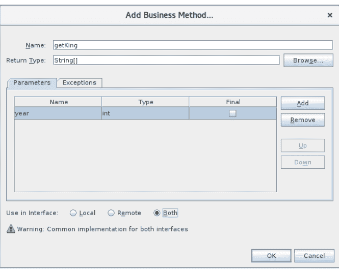

当你点击 OK 时，NetBeans 将创建该方法并在两个接口中都插入原型。为了上述警告，我将它们分别重命名为：


你喜欢汽车吗？你愿意成为成功品牌的一部分吗？

我们将感谢并奖励你的热情和才华。向我们发送你的简历。你会对它能带你走向何方感到惊讶。

通过 `www.employerforlife.com` 向我们发送简历。

在 `bookboom.com` 下载免费电子书。

点击点击广告阅读更多。

```text
getKingLocal(int year)
getKingRemote(int year)
```

结果是`KingsSession`类必须实现这两个方法。另一个服务也必须相应地定义，例如，我在下方显示了`KingsSessionRemote`接口：

```java
package kingsejb.ejjs;

import javax.ejb.Remote;

@Remote
public interface KingsSession {
    String[] getRemote(int year);

    String[] getRemote(int year1, int year2);
}
```

这些方法必须在`KingsSession`类中实现，我只显示了几行数据：

```java
package kingsejb.ejjs;

import javax.ejb.Singleton;
import java.util.*;

@Singleton
public class KingsSession implements KingsSessionRemote, KingsSessionLocal {
    @Override
    public String[] getRemote(int year) {
        return getKing(year);
    }

    @Override
    public String[] getKingsRemote(int year1, int year2) {
        return getKings(year1, year2);
    }

    @Override
    public String[] getKingLocal(int year) {
        return getKing(year);
    }
}
```

# JAVA 13：分布式编程与 Java EE：软件开发

```java
@Override
public String[] getKingsLocal(int year1, int year2) {
    return getKings(year1, year2);
}
```

```java
private String[] getKing(int year) {
    List<String> list = new ArrayList<>();

    for (String king : names) {
        int a = king[1].length() > 0 ? Integer.parseInt(king[1]) : 0;
        int b = king[2].length() > 0 ? Integer.parseInt(king[2]) : 9999;

        if (a <= year && year <= b) list.add(king[0]);
    }

    String[] arr = new String[list.size()];
    return list.toArray(arr);
}
```

```java
private String[] getKings(int year1, int year2) {
    List<String> list = new ArrayList<>();

    for (String king : names) {
        int a = king[1].length() > 0 ? Integer.parseInt(king[1]) : 0;
        int b = king[2].length() > 0 ? Integer.parseInt(king[2]) : 9999;

        if (year2 >= a && year <= b) list.add(king[0]);
    }

    String[] arr = new String[list.size()];
    return list.toArray(arr);
}
```

```java
private static String[] names = {
    {"Gorm Demle", "", "958"},
    {"Haraid Blåt", "958", "986"},
    {"Svend Tvesåg", "986", "1014"},
    {"Margrethe d.", "1972", ""}
};
```

关于这个 session 没有新内容，除了它被定义为 Singleton。注意，该类实现了两个接口，从而实现了所有方法。

EJB 模块是完整的，并且可以部署到服务器。

# JAVA 13：分布式编程与 Java EE：软件开发

然后是客户端应用程序，我创建了一个名为`KingsClient`的项目。为了引用`KingsSession`，必须知道`KingsRemote`的定义。因此，我已向项目添加了该 jar 文件。下一步，我定义了一个命名 bean：

```java
package kingsclient.beans;

import javax.inject.Named;
import javax.enterprise.context.SessionScoped;
import java.util.*;
import javax.ejb.EJB;
import kingsjejb.ejb.KingsSessionRemote;

@Named(value = "kingsBean")
@SessionScoped
public class KingsBean implements java.io.Serializable {
    @EJB
    private KingsSessionRemote kingsSession;
```


> 在丹麦，你可以找到工程工作并专业发展。特别在这个领域，你可以从最优秀的人那里学习并提升你的职业。来自西班牙的资深工程师。自2010年起在丹麦工作。

# JAVA 13：分布式编程与 Java EE：软件开发

## 企业级 Java Bean

```java
private int year;

private int year2;

private List<String> names = new ArrayList();
```

```java
public KingsBean() {
}

public int getYear() {
    return year;
}

public void setYear(int year) {
    year = year;
}

public int getYear2() {
    return year2;
}

public void setYear2(int year2) {
    year2 = year2;
}

public List<String> getNames() {
    return names;
}
```

```java
public void search() {
    String[] arr = year2 > 0
        ? kingsSession.getRemote(year, year2)
        : kingsSession.getRemote(year);

    names.clear();

    for (String name : arr) names.add(name);
}
```


此外，这里没有很多新闻，但注意 EJB 模块 `KingsJB`。在之前的示例中，通过右键点击类名，选择插入，然后调用 Bean。如果你运行应用程序（在浏览器中打开），将得到下面的窗口，它适用于1200年至1300年的所有国王：

# JAVA 13：分布式编程与 Java EE：软件开发 企业级 Java Bean

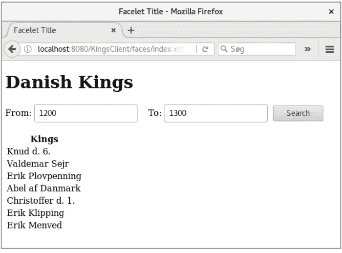

我不想显示`index.xhtml`的代码，因为它什么都没有显示。

# 练习 2

在这个练习中，编写一个与上面的示例几乎相同的程序，搜索丹麦国王，但需要更改用户界面以允许：

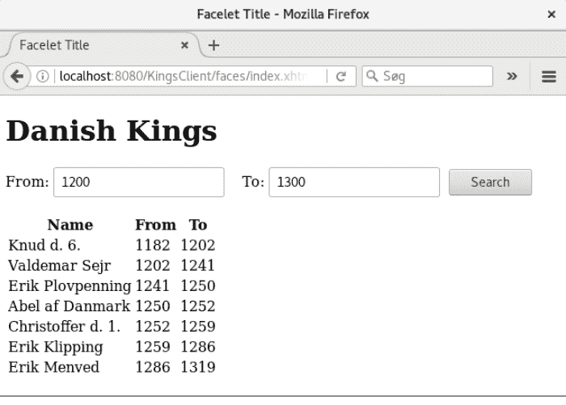

# JAVA 13：分布式编程与 Java EE：软件开发 企业级 Java Bean

启动一个名为`KingEJB-ejb`的新项目，但这次它应该是企业级应用程序项目，而是一个 EJB 模块项目：

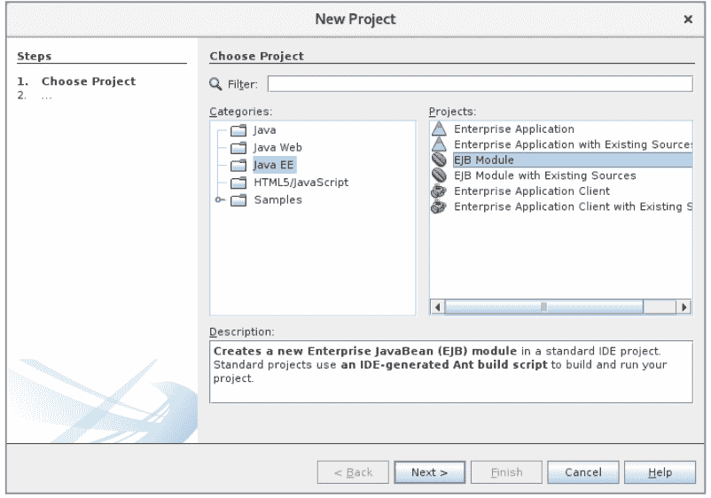

我加入 JPA 是因为我想真正的责任。工程师和地质科学家毕业计划


# JAVA 13：分布式编程与 Java EE：软件开发

接下来，你应该创建一个类库项目，因为你可以调用`KingsJBRemote`。对于这个库，在包`kingsejb.ejbs`中添加以下类：

```java
package kingsejb.ejbs;

import javax.ejb.Remote;

@Remote

public class King implements java.io.Serializable

{

    private String name;

    private int from;

    private int to;

    public King(String name, int from, int to)

    {

        this.name = name;

        this.from = from;

        this.to = to;

    }

    public String getName()

    {

        return name;

    }

    public int getFrom()

    {

        return from;

    }

    public int getTo()

    {

        return to;

    }

}
```

它代表一个国王。基本上这是一个普通的 Java 类，但你应该注意它被装饰为`@Remote`并且`Serializable`，这意味着这种类型的对象可以发送到客户端。

在`KingEJB-ejb`中，你应该添加一个名为`KingsSession`的单例 bean，它有一个远程接口（但这次没有本地接口），如之前的示例所示。该接口必须在你的类库中创建，内容如下：

```java
package kingsejb.ejbs;

import javax.ejb.Remote;

import java.util.List;

@Remote

public interface KingsSessionRemote extends java.io.Serializable

{

    List<King> getKing(int year);

    List<King> getKings(int year, int year2);

}
```

区别在于这两个方法返回`King`对象的列表，而不是字符串。示例的目的正是展示如何编写一个 session bean，返回自定义类型而不是简单的 Java 类型和字符串。

你必须实现`KingsSession`，它基本上是示例中类的副本，区别在于两个方法返回`King`对象的列表。

你必须实现用户界面，它与之前的示例几乎相同，但如上所示，表格有三列，`KingsBean`类也需要进行相应的调整。最后，添加一个转换器，使得未知的年份（为 0）显示为空。

# JAVA 13: 分布式编程
JAVA EE: 软件开发
企业级 JavaBeans

我添加了一个实体类，代表数据库中的`addresses`表。该类与前一节所示的内容相同，在此不再显示。接下来，我添加了一个名为`AddressSession`的免费无状态会话 Bean（Session Bean），并带有一个本地接口：

```java
package addressejb.beans;

import javax.ejb.Local;

import java.util.List;

@Local

public interface AddressSessionLocal

{

    void save(Address address) throws Exception;

    List<Address> getAddresses();

}
```

然后是 Bean 本身，它实现了该接口：

```java
package addressejb.beans;
```


管理学硕士
因为实现梦想是你最大的挑战，IE 商学院（IE Business School）管理学硕士提供英语、西班牙语或双语教学，通过一项创新且具有启发性的计划，在职业生涯初期培养高高性能专业人士，帮助他们充分发挥潜力。

- 选择您的专业领域。
- 通过提供的不同选项定制您的硕士学位。
- 全球沉浸：地点包括伦敦、硅谷或上海。
因为你而改变，我们亦随你而改变。

www.ie.edu/master-management mim.admissions@ie.edu

在 bookoon.com 免费下载电子书

# JAVA 13: 分布式编程与
JAVA EE: 软件开发
企业级 JavaBeans

```java
import java.util.*;

import javax.ejb.Stateless;

import javax.persistence.*;
```

```java
@Stateless

public class AddressSession implements AddressSessionLocal

{

    @Override

    public void save(Address address) throws Exception

    {

        EntityManager em = null;

        try {

            em = Persistence.createEntityManagerFactory(

                "AddressEJB-ejbPU").createEntityManager();

            em.getTransaction().begin();

            em.persist(address);

            em.getTransaction().commit();

        } catch (Exception ex) {

            throw new Exception();

        } finally {

            if (em != null) em.close();

        }

    }

}
```

```java
@Override

public List<Address> getAddresses()

{

    List<Address> list = null;

    try {

        em = Persistence.createEntityManagerFactory(

            "AddressEJB-ejbPU").createEntityManager();

        list = em.createQuery("Address.findAll").getResultList();

    } catch (Exception ex) {

        list = new ArrayList<>();

    } finally {

        if (em != null) em.close();

    }

    return list;

}
```

在 bookoon.com 免费下载电子书
84

# JAVA 13: 分布式编程与
JAVA EE: 软件开发 企业级 JavaBeans

这一次，直接创建了`EntityManager`而没有使用注入（见下一节）。这要求我必须知道持久化单元（persistence unit）的名称，如`persistence.xml`所示。具体而言，我知道使用实体事务（`EntityTransaction`）的`save()`方法以及如何启动此事务。此外，`getAddresses()`方法使用了命名查询（`NamedQuery`），它是由 NetBeans 在类中创建的。结果是`AddressSession`是一个无状态 Bean，封装了更新地址和执行查询所需的必要逻辑。用于用户界面的命名 Bean 同样变得更加简单，因为它将工作委托给了`AddressSession`：

```java
package javax.ejb.EJB;
```

```java
import javax.ejb.EJB;

import javax.inject.Named;

import javax.enterprise.context.SessionScoped;

import java.util.List;
```

```java
@Named(value = "addressBean")

@SessionScoped

public class AddressBean implements java.io.Serializable

{

    @EJB

    private AddressSessionLocal addressSession;

    private Address address = new Address();

    private List<Address> addresses;

    public AddressBean() {

    }

    public Address getAddress() {

        return address;

    }

    public void setAddress(Address address) {

        this.address = address;

    }

    public List<Address> getAddresses() {

        return addresses = addressSession.getAddresses();

    }
```

```java
public void save() {

  try {

    addressSession.save(address);

    address = new Address();

  } catch (Exception ex) {

  }

}
```

后面是`index.xhtml`和`list.xhtml`，这些页面本质上保持不变，区别在于 Bean 的引用发生了变化。我不想在这里展示这两个页面。


# JAVA 13: 分布式编程与
JAVA EE: 软件开发
企业级 JavaBeans

# 练习 3

在这个练习中，你必须解决与上一个练习相同的练习，但区别在于国王应该从数据库加载。数据库`padata`有一个`history`表，其中包含了关于丹麦国王的信息。如果该表不存在，你可以在 Java 6 中查看如何创建此表——书籍示例创建并初始化表的脚本。要解决此练习，你可以按照以下步骤进行：

- 1. 创建名为`History`的新实体。
- 2. 创建名为`HistorySession`的有状态 Bean（Stateful Bean）。
- 3. 向项目添加名为`HistorySession`的会话 Bean。
- 4. 在数据库中创建表。
- 5. 创建客户端。
- 6. 测试应用程序。

## 3.4 事务

使用企业 Bean 的主要优势之一是它们使用事务，这通常意味着如果所有操作执行正确，更改将会生效；否则什么都不执行。在事务正在进行时调用方法，其工作方式并不明显。可以通过注解进行配置：

```java
@Stateless

public class Helloworld

{

    @Override

    @TransactionAttribute(TransactionAttributeType.REQUIRES_NEW)

    public String hello()

    {

        return "Hello World";

    }

}
```

分布式编程与
JAVA EE: 软件开发

其中`TransactionAttribute`的值指示了事务如何工作。有以下选项：

- `TransactionAttributeType.MANDATORY`：只能在现有事务中执行方法。如果在事务之外调用，则将抛出`TransactionRequiredException`。
- `TransactionAttributeType.NEVER`：如果从客户端调用，则不创建事务。如果作为事务的一部分调用，则将抛出`RemoteException`。
- `TransactionAttributeType.NOT_SUPPORTED`：如果在现有事务中调用，则将挂起并在事务之外执行方法。不创建事务。
- `TransactionAttributeType.REQUIRED`：如果在现有事务中执行方法，则该方法将作为该事务的一部分执行。如果在事务之外调用，则将创建一个新事务。
- `TransactionAttributeType.REQUIRES_NEW`：如果在现有事务中调用方法，则将创建一个新事务。方法完成后，将恢复之前的事务。如果在事务之外调用，则将创建一个新事务。
- `TransactionAttributeType.SUPPORTS`：如果在现有事务中执行方法，则将其作为该事务的一部分执行。如果在事务之外调用，则不会启动新事务。

上面显示了如何对方法进行事务装饰，但你也可以对类进行装饰，这样装饰将关系到类中的所有方法。

## 3.5 拦截

在会话 Bean 中执行方法时，你可能对方法执行之前（调用时）以及方法完成之后立即某些操作感兴趣。典型的理由调试，例如，你可以写入服务器日志文件。作为示例，我已向`AddressEjB-ejb`项目添加了以下类：

在 bookoon.com 免费下载电子书
88

# JAVA 13: 分布式编程与 JAVA EE：软件开发企业级 Java Beans

```java
package adresseje.beans;

import javax.interceptor.AroundInvoke;

import javax.interceptor.InvocationContext;

import java.lang.reflect.Method;

public class AddressInterceptor {

    @AroundInvoke

    public Object logMethodCall(InvocationContext invocationContext) throws Exception {

        Object interceptedObject = invocationContext.getTarget();

        Method interceptedMethod = invocationContext.getMethod();

        System.out.println("Entering: " + interceptedObject.getClass().getName() + " ." + interceptedMethod.getName() + "()");

        Object obj = invocationContext.proceed();

        System.out.println("Leaving: " + interceptedObject.getClass().getName() + " ." + interceptedMethod.getName() + "()");

        return obj;

    }

}
```


# JAVA 13: 分布式编程与 EE 企业级 Java Beans

这是一个非常典型的 Java 类，包含一个简单的方法，首先注意到的是该方法被一个注解装饰了。该方法有一个`InvocationTarget`参数，提供了更多服务。`getType()`方法返回执行方法的对象，而`getMethod()`返回一个代表被拦截的`interceptedObject`的对象。最后，`proceed()`方法执行被拦截的`interceptedMethod()`。在`proceed()`调用的两边都会执行一个`System.out.println`，如果方法执行了`logMethodCall()`，Glassfish 服务器日志中就会写入一条记录，随后执行该方法并写入日志文件。

问题在于如何获取方法的执行并使其发生，而这（当然）是通过注解实现的：

```java
@Override
```


@Interceptors(`AddressInterceptor.class`)

`public void save(Address address) throws Exception` {

    `EntityManager em = null`;

    try {

        `em = Persistence.createEntityManagerFactory("AddressEJB-ejbPU")`;

        `createEntityManager()`;

        `em.getTransaction().begin()`;

        `em.persist(address)`;

        `em.getTransaction().commit()`;

    } catch (`Exception ex`) {

        throw new `Exception()`;

    } finally {

        if (`em != null`) `em.close()`;

    }

}

因此，在创建地址之前和数据库更新之后，会在日志文件中写入记录。

## 3.6 定时服务 (TIMER SERVICE)

有一种 session bean 的特殊变体实现了定时器。因此，你可以让实际 bean 在特定间隔内执行操作，例如写入日志文件。在这种情况下，我将编写一个 session bean，每半秒确定一次下一个素数。我从一个名为 `PrimesEJB` 的企业应用开始，包含一个 EJB 模块和一个 Web 应用。对于 EJB 模块，我添加了一个 EJB，但此时它是一个定时器 Session Bean：

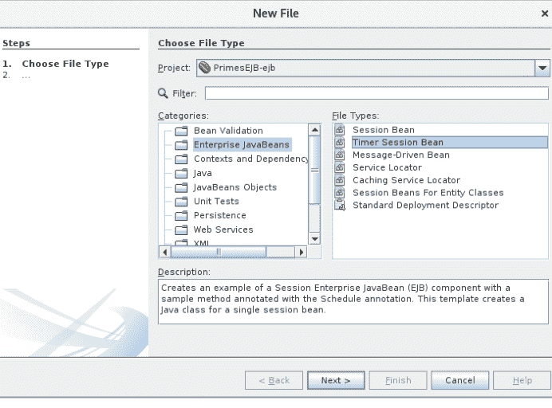

随后你将看到下面的窗口，在其中你应该像照常一样输入名称（这里是 `PrimesSession`）和包名（`primeejb.ejbs`）。我选择选择了它必须是单例（Singleton），并且创建一个本地接口（Local interface）：

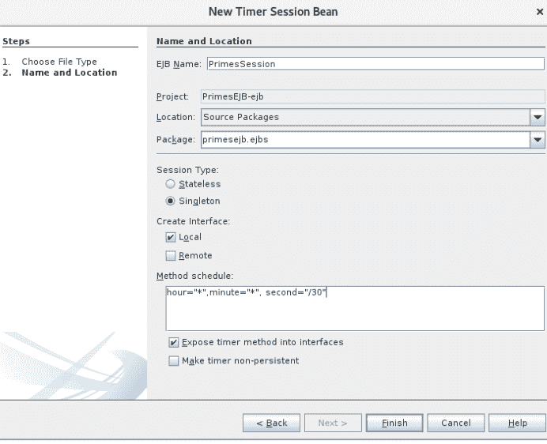

最后，我设置了定时器触发的间隔。在这种情况下，模式意味着定时器必须每半分钟触发一次。点击“完成”后，NetBeans 会创建以下类：

```java
package primesej.ejbs;

import javax.ejb.Schedule;
import javax.ejb.Singleton;

@Singleton
public class PrimesSession implements PrimesSessionLocal
{
    @Schedule(hour = "", minute = "", second = "*/30")
    public void myTimer()
    {
    }
}
```

以及一个定义的接口。如所示，它是一个普通的 session bean，唯一的区别是了一个定时器方法，并使用 `@Schedule` 注解定义它是一个定时函数以及触发的频率。完成后的接口是：


# 企业级 Java Beans (ENTERPRISE JAVA BEANS)

```java
package primesejb.ejjs;
```

```java
import javax.ejb.Local;
import java.math.BigInteger;

@Local
public interface PrimesSessionLocal
{
    public void myTimer();
    public void reset();
    public BigInteger getPrime();
    public int getIndex();
}
```

其中除了定时器外，还定义了三个方法。`PrimesSession` 类将该接口：

```java
package primesejb.ejjs;

import javax.ejb.Local;
import java.math.BigInteger;
import javax.ejb.Schedule;
import javax.ejb.Singleton;

@Singleton
public class PrimesSession implements PrimesSessionLocal
{
    private BigInteger two = new BigInteger("2");
    private BigInteger prime = new BigInteger("2");
    private int index = 0;

    @Schedule(hour = "*", minute = "*", second = "*/30")
    public void myTimer()
    {
        if (prime.isProbable(50)) {
            prime = prime.add(two);
        } else {
            prime = prime.add(two);
        }
        index++;
    }

    public void reset()
    {
        prime = new BigInteger("2");
        index = 0;
    }
}
```

# JAVA 13: 分布式编程与 EE：软件开发企业级 Java Beans

```java
package primesjb.beans;

import javax.inject.Named;
import javax.enterprise.context.RequestScoped;
import java.math.BigInteger;
import javax.ejb.EJB;
import primesjb.ejb.PrimesSessionLocal;

@Named(value = "primesBean")
@RequestScoped
public class PrimesBean {
    @EJB
    private PrimesSessionLocal primesSession;

    public PrimesBean() {
    }

    public BigInteger getPrime() {
        return primesSession.getPrime();
    }
}
```

# JAVA 13: 分布式编程与 EE：软件开发企业级 Java Beans

```java
public int getIndex() {
  return primesSession.getIndex();
}
```

```java
public void reset() {
  primesSession.reset();
}
```

这是一个非常简单的 bean，没什么需要注意的，但你需要意识到它使用了我的 session bean。JSF 页面同样简单，并在浏览器中打开，结果如下，通过链接来更新用户界面：


关于 e-Learning for Kids：e-Learning for Kids 成立于2004年，是一个全球性的非营利基金会，致力于为5至12岁的儿童在互联网上提供有趣且免费的学习，课程涵盖数学、科学、语言艺术、计算机、健康和环境技能。自2005年以来，来自190多个国家的1500万名儿童受益于 LU Ki提供的电子课程。我们的志愿者团队由世界各地的教育和在线学习专家以及商务人士组成，致力于带来改变。e-Learning for Kids 正在寻求资金、志愿者、赞助商和内容开发人员。更多信息，请访问 www.e-learningforkids.org。

- 领先的小学教育大规模在线课程
- 面向5-12岁儿童的免费数字学习
- 触及1500万儿童

JAVA 13: 分布式编程
JAVA EE: 软件开发
企业级 Java Beans (EJB)

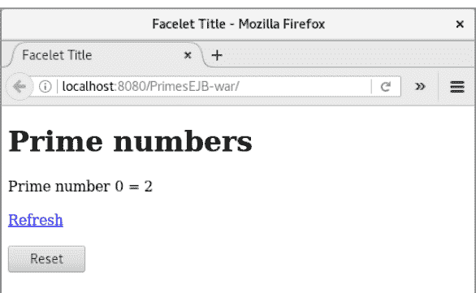

## 3.7 单表 CRUD

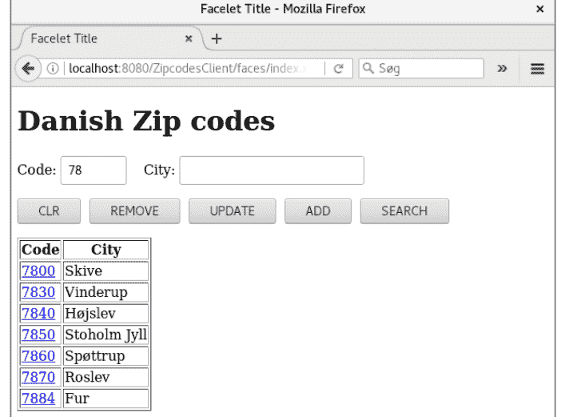

在数据库上下文中，CRUD 代表*创建（Create）、读取（Read）、更新（Update）*和*删除（Delete）*操作。在本节中，我将展示如何使用 EJB 编写程序对单个数据库表执行这些操作。应用程序必须使用带有远程接口的 EJB。例如，我将使用数据库 *padata* 中的 *zipcode*，应用程序像上面所示打开一个窗口，其中搜索了邮政编码 78。按钮的含义应该是不言自明的，点击表格中的链接会将邮政编码插入到顶部可编辑的两个字段中。接下来，我将解释程序的编写方法以及实现过程。

JAVA 13: 分布式编程
JAVA EE: 软件开发
企业级 Java Beans (EJB)

我已开始创建一个 EJB 模块项目，将其命名为 `ZipcodesEJB`。然后，我创建了一个普通的类库项目，命名为 `ZipcodesRemote`。对于此项目，我添加了 `ZipcodeRemote` 类，它代表在 Web 应用程序和会话对象之间传输的对象（我没有展示 get 和 set 方法）：

```java
package zipcodes.beans;

import javax.ejb.Remote;

@Remote
public class ZipcodeRemote implements java.io.Serializable
{
    private String code;
    private String city;

    public ZipcodeRemote()
    {
    }
}
```

然后，我在 `ZipcodesEJB` 项目中添加了一个名为 `ZipcodesSession` 的远程无状态会话 bean（state session bean），它为上述类库添加了远程接口：

```java
package zipcodes.beans;

import javax.ejb.Remote;
import java.util.List;

@Remote
public interface ZipcodesSessionRemote
{
    public boolean create(ZipcodeRemote obj);
    public boolean update(ZipcodeRemote obj);
    public boolean remove(String code);
    public List<ZipcodeRemote> search(String code, String City);
}
```

最大的工作是实现 `ZipcodesSession`。在 `zipcodes.models` 包中，我添加了对应数据库表的实体类 `Zipcode`。该类与 NetBeans 生成的代码保持不变。我想添加一个用于数据库操作的类，但无法从 EJB 中直接使用 JPA 控制器，因此我添加了自己的类（这只是由 NetBeans 创建的控制器类的修改和精简版本——参见下一个示例），我将其命名为 `ZipcodeDAO`。

JAVA 13: 分布式编程
JAVA EE: 软件开发
企业级 Beans

```java
package zipcodes.models;

import java.util.*;
import javax.persistence.*;

public class ZipcodeDAO {
    public EntityManager getEntityManager() {
        return Persistence.createEntityManagerFactory("ZipcodesEJBPU").createEntityManager();
    }

    public void create(Zipcode zipcode) throws Exception {
        EntityManager em = null;
        try {
            em = getEntityManager();
            em.getTransaction().begin();
            em.persist(zipcode);
            em.getTransaction().commit();
        } catch (Exception ex) {
            if (em != null) em.getTransaction().rollback();
            throw ex;
        } finally {
            if (em != null) em.close();
        }
    }
```


```java
public void edit(Zipcode zipcode) throws Exception
{
    EntityManager em = null;
    try {
        em = getEntityManager();
        em.getTransaction().begin(zipcode);
        em.merge(zipcode);
        em.getTransaction().commit();
    } catch (Exception ex)
    {
        if (em != null) em.getTransaction().rollback();
        throw ex;
    }
    finally {
        if (em != null) em.close();
    }
}

public void destroy(String code) throws Exception
{
    EntityManager em = null;
    try {
        em = getEntityManager();
        em.getTransaction().begin();
        Zipcode zipcode;
        try {
            zipcode = em.getReference(Zipcode.class, code);
            zipcode.getCode();
        } catch (Exception e) {
            throw new Exception("邮政编码 " + code + " 不再存在");
        }
        em.remove(zipcode);
        em.getTransaction().commit();
    } catch (Exception ex) {
        if (em != null) em.getTransaction().rollback();
        throw ex;
    } finally {
        if (em != null) em.close();
    }
}

public List<Zipcode> getZipcodes(String code, String city) {
    if (code == null) code = "";
    if (city == null) city = "";
    EntityManager em = null;
    try {
        em = getEntityManager();
        Query cq = em.createQuery("SELECT z FROM Zipcode z WHERE z.code like :code AND z.city like :city");
        cq.setParameter("code", code + "%");
        cq.setParameter("city", "%" + city + "%");
        return cq.getResultList();
    } catch (Exception ex) {
        throw ex;
    } finally {
        if (em != null) em.close();
    }
}
```

该类与创建的 DAO（数据访问对象）非常相似，但你应该注意如何使用 `EntityManager` 来创建、读取、更新和删除。还要注意搜索方法，那里使用了 JPQL 而不是 Criteria API。

JAVA 13: 分布式编程
JAVA EE: 软件开发
企业级 Beans

```java
package zipcodes.beans;

import java.util.*;
import javax.ejb.Stateless;
import zipcodes.models.*;

@Stateless
public class ZipcodesSession implements ZipcodesSessionRemote
{
    @Override
```


```java
public boolean create(ZipcodeRemote obj) {
    try {
        new ZipcodeDAO().create(new Zipcode(obj.getCode(), obj.getCity()));
        return true;
    } catch (Exception ex) {
        return false;
    }
}

@Override
public boolean update(ZipcodeRemote obj) {
    try {
        new ZipcodeDAO().edit(new Zipcode(obj.getCode(), obj.getCity()));
        return true;
    } catch (Exception ex) {
        return false;
    }
}

@Override
public boolean remove(String code) {
    try {
        new ZipcodeDAO().destroy(code);
        return true;
    } catch (Exception ex) {
        return false;
    }
}

@Override
public List<ZipcodeRemote> search(String code, String city) {
    List<Zipcode> zipcodes = new ZipcodeDAO().getZipcodes(code, city);
    List<ZipcodeRemote> list = new ArrayList<>();
    for (Zipcode zipcode : zipcodes) {
        list.add(new ZipcodeRemote(zipcode.getCode(), zipcode.getCity()));
    }
    return list;
}
```


注意这些方法包含了 `ZipcodeRemote` 类型对象与 `Zipcode` 实体类型对象之间的转换。这几乎没有必要，可以通过在类库中定义实体类型来解决该问题（参见下一个示例）。

# JAVA 13：分布式编程与 JAVA EE：软件开发——企业级 Java Beans

现在 EJB 模块已经准备就绪，并可以托管在服务器上。后面是 Web 应用程序，我在其中创建了一个名为 `ZipcodesClient` 的 Web 应用程序。该应用程序仅连接到 `index.xhtml` 和单个命名的 bean，我不想显示该应用程序的代码，因为里面没什么内容。

## 3.8 更多表格的 CRUD

作为企业级 Java Beans 的最后一个示例，我将回顾上一个章节中的 `PuBooks` 程序。它与之前的程序完全相同，唯一的变化是将整个数据库操作逻辑都移动到一个 EJB 中，由该 EJB 使用 JPA 来维护数据库。会有三个项目：

- `BooksEJB`：这是一个托管在服务器上的企业级 Java Bean，可以维护 `Library` 数据库。
- `BooksRemote`：这是一个类库，定义了指向上述 EJB 的远程接口。
- `BooksClient`：这是 Web 应用程序，它使用了 `BooksEJB`。

接下来将描述应用程序开发的过程和面临的主要挑战。

我已经开始创建一个 EJB 模块项目了：

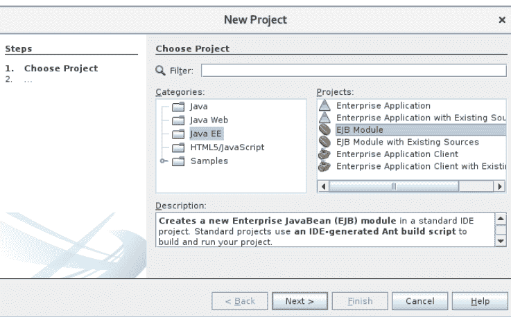

我将项目命名为 `BooksEJB`。

在 bookboom.com 下载免费电子书

# JAVA 13：分布式编程与 JAVA EE：软件开发——企业级 Java Beans

作为下一步，我创建了一个名为 `BooksRemote` 的经典类库项目。对于这个库，我从数据库选择了实体类（Entity Classes），并选择了到库数据库的连接：

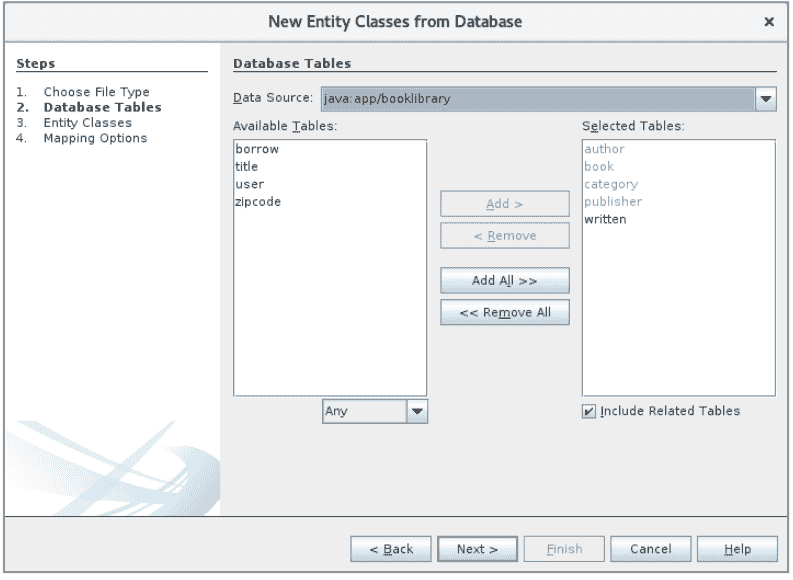


# JAVA 13：分布式编程与 JAVA EE：软件开发——企业级 Java Beans

我选择了要应用的 5 个表格，并在接下来的窗口中输入了包名：

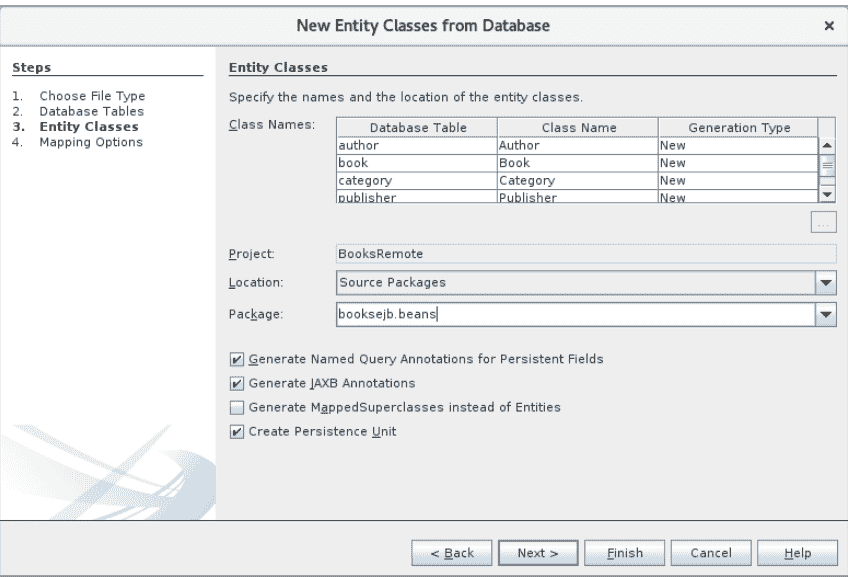

当我随后点击 Next 和 Finish 时，像以前一样创建了 4 个实体类：

你应该注意，这四个类位于类库中，以便客户端程序可以使用它们。这四个类不应该相对于由 NetBeans 创建的代码进行修改，除了 `Author`、`Publisher` 和 `Category` 它们的 `toString()` 方法已发生更改。

在 bookboom.com 下载免费电子书

# JAVA 13：分布式编程与 JAVA EE：软件开发

## 企业级 Java Beans

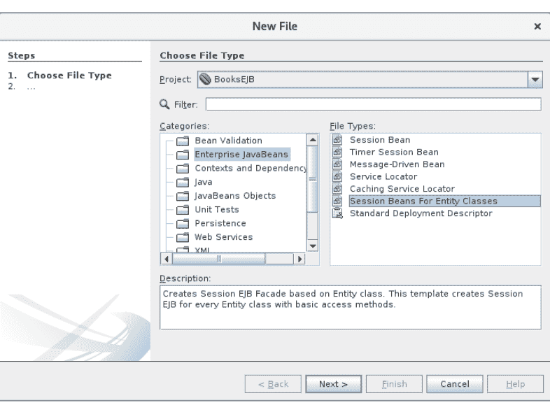

下一步，我为 `BooksEJB` 项目添加了一个无状态 bean（stateless bean）：

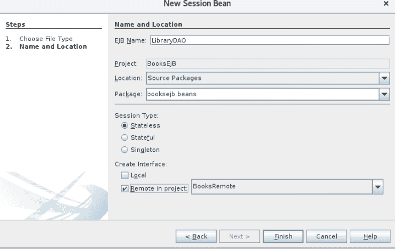

我定义了一个远程接口并将其添加到我的类库中，结果是 NetBeans 创建了一个名为 `LibraryDAORemote` 的接口。

在 `BooksEJB` 项目中，我创建了一个名为 `booksejb.daos` 的包。对于这个包，我从实体类添加了 JPA 控制器类：

在 bookboom.com 下载免费电子书

# JAVA 13：分布式编程与 JAVA EE：软件开发——企业级 Java Beans


这 4 个类都经过了微调，但这仅仅是因为构造函数被删除了，`getEntityManager()` 方法被更改，且事务定义的方式不同。这些类的代码占据了大量空间，我不想在这里展示，但下面是 `CategoryDAO` 类和 `create()` 方法的：


在 bookboom.com 下载免费电子书

# JAVA 13：分布式编程与 JAVA EE：软件开发——企业级 Java Beans

```java
public class CategoryDAO {
    public EntityManager getEntityManager() {
        return Persistence.createEntityManagerFactory("BooksRemotePU")
            .createEntityManager();
    }

    public void create(Category category) throws Exception {
        if (category.getBookCollection() == null)
            category.setBookCollection(new ArrayList<Book>());
        EntityManager em = null;
        try {
            em = getEntityManager();
            em.getTransaction().begin();
            Collection<Book> attachedBookCollection = new ArrayList<Book>();
            for (Book bookCollectionToAttach : category.getBookCollection()) {
                attachedBookCollection.add(bookCollectionToAttach);
            }
            em.persist(category);
            em.getTransaction().commit();
        } catch (Exception ex) {
            if (em.getTransaction().isActive())
                em.getTransaction().rollback();
            throw ex;
        } finally {
            if (em != null)
                em.close();
        }
    }
}
```

在 bookboom.com 下载免费电子书

# JAVA 13：分布式编程与 JAVA EE：软件开发——企业级 Java Beans

此外，我修改了类以便它们抛出异常并删除了其他类型。当然，这没有特殊理由，但我觉得这样产生的代码稍微易读一些。注意，这里我没有写代码，但 NetBeans 基本上已经创建了。缺失的是定义 `LibraryDAemote` 接口并实现 `LibraryDAO`。接口定义如下：

```java
package booksejb;

import javax.ejb.Remote;
import java.util.List;

@Remote
public interface LibraryDAemote {
    public boolean addCategory(Category category);
    public boolean modCategory(Category category);
    public boolean delCategory(Category category);
    public List<Category> getCategories();
    public boolean addPublisher(Publisher publisher);
    public boolean modPublisher(Publisher publisher);
    public boolean delPublisher(Publisher publisher);
    public List<Publisher> getPublishers();
    public boolean addAuthor(Author author);
    public boolean modAuthor(Author author);
    public boolean delAuthor(Author author);
    public List<Author> getAuthors();
    public boolean addBook(Book book);
    public boolean modBook(Book book);
    public boolean delBook(Book book);
    public List<Book> getBooks(String title, String pname, String catname);
}
```

各个方法的名称应该解释了它们的用途。由于有 12 个方法（每个实体 4 个），`LibraryDAO` 的代码只是部分，但由于每个实体的实现基本上是相同的，我将只展示实体 `Category` 的代码：

在 bookboom.com 下载免费电子书

# JAVA 13：分布式编程与 JAVA EE：软件开发

## 企业级 Beans

```java
package booksejb.beans;

import javax.ejb.Stateless;
import java.util.List;
import booksejb.daos.*;

@Stateless
public class LibraryDAO implements LibraryDAemote {
    @Override
    public boolean addCategory(Category category) {
        try {
            CategoryDAO dao = new CategoryDAO();
            dao.create(category);
            return true;
        } catch (Exception ex) {
            return false;
        }
    }
}
```


访问 www.helpmyassignment.co.uk 了解更多信息

在 bookbo.com 下载免费电子书 点击广告阅读更多

# JAVA 13: 分布式编程

## JAVA EE: 软件开发

### 企业级 Java Beans

```java
@Override
public boolean modCategory(Category category) {
  try {
    CategoryDAO dao = new CategoryDAO();
    dao.edit(category);
    return true;
  } catch (Exception ex) {
    return false;
  }
}
```

```java
@Override
public boolean delCategory(Category category) {
  try {
    CategoryDAO dao = new CategoryDAO();
    dao.destroy(category.getId());
    return true;
  } catch (Exception ex) {
    return false;
  }
}
```

```java
@Override
public List<Category> getCategories() {
  List<Category> list = (new CategoryDAO()).findCategoryEntities();
  for (Category c : list) c.getBookCollection().size();
  return list;
}
```

这段代码如下，由于所有的工作都由 DAO 类完成，原则上来说，它是关于创建一个 DAO 对象并调用当前 DAO 的方法。然而，有一个需要特殊解决方案的问题。JPA 使用了一种称为“延迟更新”（LAZY update）的技术。例如，如果你获取实体 `Category`，它有一个名为 `bookCollection` 的集合，其中包含了该分类下所有书籍的 `Book` 对象。这些对象在读取数据库时必须被初始化，由于这些对象并不总是被使用，JPA 使用了一种技术，即在引用这些对象时才先创建它们（从数据库中读取）。当然，其原因是性能考虑，而且你应该记住所有的分类都有一个集合，出版者、作者和书籍也是如此。这种技术被称为延迟更新，但当对象要序列化到远程客户端时，会出现一个问题：客户端可能会在相关集合更新之前看到序列化的对象。关于如何解决这个问题有各种建议，其中之一——也可能是最简单的，但也许不是最好的——是在对象被序列化之前，该方法对相关的集合执行 `size()` 方法，导致对象被初始化（通过从数据库读取）。这就是 `getCategories()` 方法中出现的循环的目的。

实现 `LibraryDAO` 类后，`BooksEJB` 就完成了，并且可以部署在服务器上。

这里是客户端程序，基本上可以从 `PaBooks` 复制。我创建了一个名为 `BooksClient` 的 Web 项目。该项目应该引用 `BooksRemote`，除此之外，还应该包含以下可以从 `PaBooks` 复制的文件：

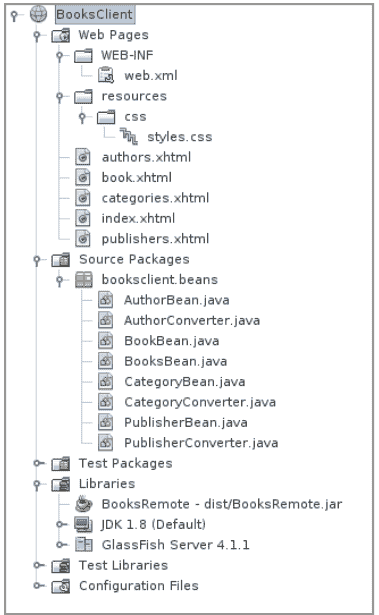

然而，这五个命名的 Bean 类必须稍作修改，例如我展示了 `CategoryBean`，它是用于 `categories.html` 的命名 Bean。

# JAVA 13: 分布式编程与 JAVA EE: 软件开发

## 企业级 Java Beans

```java
package bookejb.beans;

import bookejb.beans.LibraryDAORemote;
import javax.ejb.EJB;
import javax.inject.Named;
import javax.enterprise.context.SessionScoped;
import java.util.*;
```

```java
package bookejb.beans;
```


```java
@Named(value = "categoryBean")
@SessionScoped
public class CategoryBean implements java.io.Serializable {
    @EJB
    private LibraryDAORemote libraryDAO;
    private Category category = new Category();
    private String error = "";
}
```


# 知识的力量

到2020年，风能可以提供我们地球十分之一的电力需求。今天，SKF 的创新知识对于运行世界上大部分的风力发电机至关重要。

到2025年，发电成本主要与维护有关。得益于我们的在线状态监控和自动调整系统，这些成本可以大幅降低。我们让风能变得更加经济，从空气中创造更清洁的能量。

通过分享我们的经验、专业知识和创造力，行业可以提升超出预期的性能。与能够应对这一挑战的最佳员工共同努力！

## 知识工程的力量

接入知识工程的力量，访问我们的网站`www.skf.com/knowledge`。

# JAVA 13：分布式编程与 JAVA EE：软件开发

## 企业级 Java Beans

```java
public int getId() {
    return category.getId() == null ? 0 : category.getId();
}
```

```java
public String getName() {
    return category.getName();
}
```

```java
public void setName(String name) {
    this.category.setName(name);
}
```

```java
public String getError() {
    return error;
}
```

```java
public Collection<Category> getCategories() {
    return libraryDAO.getCategories();
}
```

```java
public void select(Category cat) {
    category = cat;
}
```

```java
public void clear() {
    error = "";
}
```

```java
public void clear() {
    error = "";
    category = new Category();
}
```

```java
public void add() {
    error = "";

    if (libraryDAO.add(category)) {
        category = new Category();
    } else {
        error = "Category not created";
    }
}
```

```java
public void update() {
    error = "";

    if (libraryDAO.update(category)) {
        category = new Category();
    } else {
        error = "Category not updated";
    }
}
```

```java
public void remove() {
    error = "";

    if (libraryDAO.remove(category)) {
        category = new Category();
    } else {
        error = "Category not deleted";
    }
}
```

# JAVA 13：分布式编程与 JAVA EE：软件开发

## 企业级 Java Beans

# 问题 2

你必须使用`JPA`解决以下内容：

- `WorldRemote`，一个远程接口
- `WorldEJB`，一个 EJB 模块
- `WorldClient`，一个 Web 应用程序

# JAVA 13：分布式编程

## JAVA EE：软件开发

# 4 CDI

`CDI`代表上下文和依赖注入（Context and Dependency Injection），它描述了应用服务器如何创建和移除对象，特别是关于你可以在代码中编写什么内容。例如，如果你考虑一个带有后备 Bean（backing bean）的`JSP`（它只是一个普通类），那么你不需要执行任何操作来创建该类的对象，对象的生命周期由其范围（scope）决定。

JavaBean 只是按照特定且简单的模式编写的类，程序员使用`new`操作符创建对象（Bean）。之后，垃圾回收器负责在不再有该对象的引用时移除它。相比之下，托管 Bean（managed bean）是一种 Bean，其由应用服务器形式的容器负责在程序超出范围时移除对象。这种 Bean 也称为`CDI`对象。你不能用`new`创建托管 Bean。相反，`CDI`对象是使用称为注入（injection）的技术创建的，这意味着由容器负责。

在定义带有注入的 Bean 时，容器将检查该 Bean 是否已创建。如果尚未创建，将实例化一个新对象，并对当前 Bean 依赖的所有 Bean 执行注入，最后执行标记了`@PostConstruct`的方法。

# JAVA 13：分布式编程与 Java EE：软件开发

然后你可以使用该对象的方法。当 Bean 需要被移除时，容器会首先执行带有`@PreDestroy`装饰的方法，然后由容器移除该对象。可以通过下图进行说明：

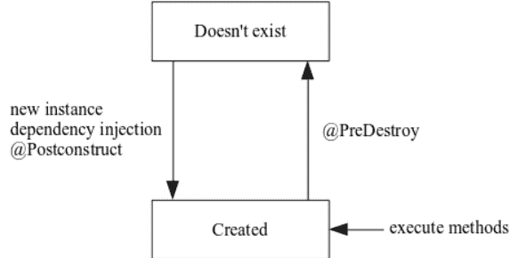

`CDI`对象有一个称为“上下文”（context）的作用范围，它基本上可以是：

- 请求（request）
- 会话（session）
- 应用（application）
- 会话（conversation）

例如，下面展示了一个托管 Bean（managed bean）：

```java
package cdiprogram.beans;

import javax.inject.Named;
import javax.enterprise.context.SessionScoped;
import java.io.Serializable;

@Named(value = "person")
@SessionScoped
public class Person implements Serializable {
    private String firstName;
    private String lastName;

    public Person() {
    }

    public String getFirstName() {
        return firstName;
    }

    public void setFirstName(String firstName) {
        this.firstName = firstName;
    }

    public String getLastName() {
        return lastName;
    }

    public void setLastName(String lastName) {
        this.lastName = lastName;
    }
}
```

这是一个你通过`@Named`看到的托管 Bean，其中你可以看到 NetBeans 为该类分配了小写的名称。注解（annotation）通常是一个接口，在这种情况下，它是一个带有单个属性值的接口（其默认值为空字符串，意味着容器选择了类名`person`）。

此外，你可以看到该对象的上下文是`session`，且`SessionScoped`是一个接口。`Named`和`SessionScoped`这两个接口为容器提供了这些信息，告诉容器应该如何维护`Person`类的对象实例。

使用上述 Bean 版本，你将能够编写以下 JSF 页面：

```xml
<?xml version="1.0" encoding="UTF-8" ?>

<!DOCTYPE html PUBLIC "//W3C//DTD HTML 1.0 Transitional//EN" >

<html xmlns="http://www.w3.org/1999/xhtml"
      xmlns:h="http://xmlns.jcp.org/jsf/html">

<head>
    <title>Facelet Title</title>
</head>

<body>
    <h:form>
        <h:panelGrid columns="2">
            <h:outputLabel for="firstName" value="First Name"/>
            <h:inputText id="firstName" value="#{person.firstName}"/>
            <h:outputLabel for="lastName" value="Last Name"/>
            <h:inputText id="lastName" value="#{person.lastName}"/>
            <h:commandButton value="OK" />
        </h:panelGrid>
    </h:form>
</body>

</html>
```

# JAVA 13：分布式编程 JAVA EE：软件开发

有趣的地方在于打开页面时，Glassfish 服务器会在 session 上下文中注入`Person`对象，而无需程序员手动创建该对象。

在之前的示例中，我选择通过以下语句的形式获取另一个命名的 Bean：

```java
ELContext elc = FacesContext.getCurrentInstance().getELContext();

SomeBean someBean = (SomeBean) FacesContext
    .getCurrentInstance()
    .getApplication()
    .getELResolver()
    .getValue(elc, null, "person");
```

这本身没有问题，但编写起来很困难且难以记忆。然而，可以使用`CDI`来简化语法。考虑以下这个命名的 Bean，它有一个名称`student`和一个属性`subject`：

```java
package cdiprogram.beans;

import javax.inject.Named;
import javax.inject.Inject;
import javax.enterprise.context.SessionScoped;
import java.io.Serializable;
```


```java
@Named(value = "student")
@SessionScoped
public class Student implements Serializable {
    @Inject
    private Person person;

    private String subject;

    public Student() {
    }

    public Person getPerson() {
        return person;
    }

    public void setPerson(Person person) {
        this.person = person;
    }

    public String getSubject() {
        return subject;
    }

    public void setSubject(String subject) {
        this.subject = subject;
    }
}
```

名称由`Person`类型的变量表示。但你必须注意，我们没有在任何地方创建`Person`类型的对象（该属性似乎没有初始化），而是对`person`使用了`@Inject`装饰。这表明`Student`托管 Bean 依赖于`Person`（另一个托管 Bean）。当容器通过注入创建`Student`对象时，它会查找是否需要创建一个`Person`对象，如果是则创建。

下面是编写一个以`Student`为后端 Bean 的 JSF 页面：

```xml
<?xml version="1.0" encoding="UTF-8" ?>

<!DOCTYPE html PUBLIC "-//W3C//DTD HTML 1.0 Transitional//EN" >

<html xmlns="http://www.w3.org/1999/xhtml"
      xmlns:h="http://xmlns.jcp.org/jsf/html">

<head>
```

```xml
    <title>Facelet Title</title>
</head>

<body>
    <h:form>
        <h:panelGrid columns="2">
            <h:outputLabel for="firstName" value="First Name"/>
            <h:inputText id="firstName" value="#{person.firstName}"/>
            <h:outputLabel for="lastName" value="Last Name"/>
            <h:inputText id="lastName" value="#{person.lastName}"/>
            <h:inputText id="subject" value="Subject"/>
            <h:commandButton value="OK" />
        </h:panelGrid>
    </h:form>
</body>

</html>
```

## 4.1 限定符（QUALIFIERS）

如果你考虑`Student` Bean，它依赖于`Person` Bean。我现在将定义一个派生类，将其命名为`Man`，但首先将该类设为抽象类，并添加一个返回人员性别的抽象方法：

```java
@Named(value = "person")
@SessionScoped
public abstract class Person implements Serializable {
    public abstract String getGender();
}
```

然后我可以写下面的 Bean：

```java
package cdiprogram.beans;

import javax.inject.Named;
import javax.enterprise.context.SessionScoped;
import java.io.Serializable;

@Named(value = "man")
@SessionScoped
public class Man extends Person implements Serializable {
    public Man() {
    }

    public String getGender() {
        return "man";
    }
}
```

如果你忽略`@Male`注解，这个类中并没有新内容。它是一个继承自托管 Bean 的托管 Bean，而 Bean 只是一个类。

如果你从容器的角度看到`Student`类，它定义了一个类型为`Person`的变量，那么容器必须随后创建一个实际的对象，例如`Man`对象。由于`Person`类可能有更多的派生类，人们应该能够告诉容器实例化对象时具体是指哪一个，这通过“限定符”（qualifier）来实现。

`Male`是一个限定符，是一个如下所示定义的接口：


```java
package cdiprogram.beans;

import static java.lang.annotation.ElementType.TYPE;
import static java.lang.annotation.ElementType.FIELD;
import static java.lang.annotation.ElementType.PARAMETER;
import static java.lang.annotation.ElementType.METHOD;

import static java.lang.annotation.RetentionPolicy.RUNTIME;

import java.lang.annotation.Retention;
import java.lang.annotation.Target;
import javax.inject.Qualifier;

@Qualifier
@Retention(RUNTIME)
@Target({METHOD, FIELD, PARAMETER, TYPE})
public @interface Male {
}
```


在`Male`类中，你通过`@Male`告诉该类被限定符标识。CDI 项目还定义了一个派生类，使用限定符`Female`。在原则上，编写一个限定符很容易，但语法很难记忆，因此 NetBeans 为此提供了类型：

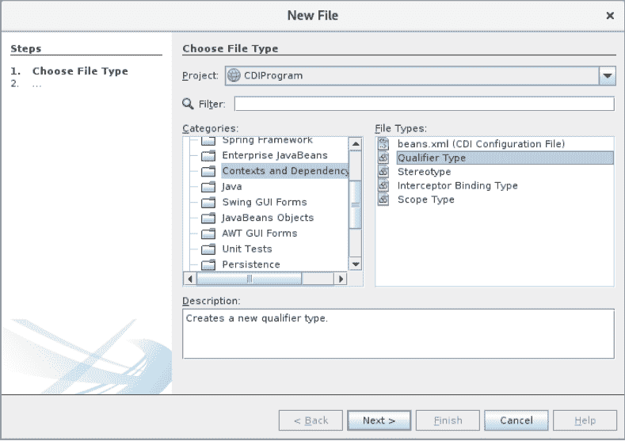

如果你想让`Student`类创建一个*Woman*对象，语法如下：

```java
public class Student implements Serializable {

  @Inject

  @Female

  private Person person;

}
```

# JAVA 13：分布式编程

JAVA EE：软件开发

对于注入，你可以写：

```java
@Named(value = "student")

@SessionScoped

public class Student implements Serializable {

    @Inject

    @Gender(value = People.FEMALE)

    private Person person;

    private String subject;

}
```

## 4.2 上下文 (CONTEXTS)

当通过注入或因为被 JSF 页面引用而需要一个托管 bean 时，CDI 会尝试在特定 bean 的作用域内寻找一个实例。如果成功，则将使用该对象；否则，将创建一个属于当前作用域的对象。通常情况下，一个对象（托管 bean）必须跨越多个页面“存在”，你可以使用`RequestScoped`，因为它只与当前页面相关。该对象在每次发出请求时都会被创建。到目前为止（在本本书和之前的两本书中），我一直通过将 bean 定义为`SessionScoped`来解决问题。这种方法有效，而且也是最简单的解决方案，但`SessionScoped`bean 也有缺点。首先，这些对象在整个会话期间以及会话结束后一段时间内一直存在。这意味着会话对象会不必要地填充机器内存。然而，更大的问题是，`SessionScoped`bean（可以说，所有的会话对象）存活时间比它们需要的要长，存在它们不再存在的风险。后者实际上会让修复 Web 应用程序中的错误变得非常困难。

有一个名为“对话”（conversation）的上下文，bean 可以在几个页面上持续存在，但不会贯穿整个会话，这正是为了解决会话上下文带来的挑战。代价是必须由程序员来告诉容器对话何时开始以及何时结束。我想通过`ChangeAddress`示例展示，在没有其他原因的情况下，如何将地址输入拆分为三个页面——同时也展示`ConversationScoped`是如何工作。我从项目`ChangeAddress4`开始，它是`ChangeAddress1`的副本。除了`list.xhtml`（未更改）之外，还有三个新的 JSP 页面，地址的输入通过这三个 JSP 页面以向导的形式进行：


`index.xhtml`现在简化为以下简单页面：

```xml
<?xml version="1.0" encoding="UTF-8" ?>

<!DOCTYPE html PUBLIC "//W3C//DTD HTML 1.0 Transitional//EN" >

<html xmlns="http://www.w3.org/1999/xhtml"

xmlns:h="http://xmlns.jcp.org/jsf/html"

xmlns:f="http://xmlns.jcp.org/jsf/core">

<head>

  <meta http-equiv="Content-Type" content="text/html; charset=UTF-8"/>

  <title>Change address</title>

  <link:outputStylesheet library="css" name="styles.css"/>

</head>

<body>

 <h1>Change address</h1>

 <form>

  <p><h:commandLink value="Create new address" action="#{indexController.page(0)}" /></p>

  <p><h:commandLink value="Show addresses" action="list" /></p>

 </form>

</body>

</html>
```

它会打开以下窗口：

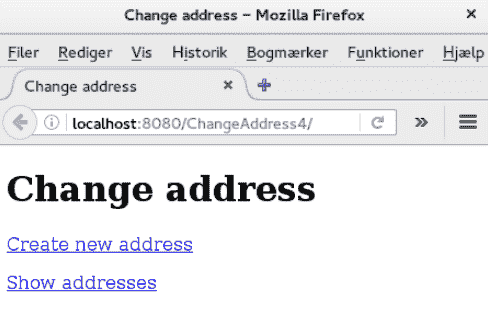

点击顶部的链接将进入一个输入名称的页面，`ChangeAddress1`项目的表单通常分为三个页面，如下所示。这三个页面称为：

- `page1.xhtml`
- `page2.xhtml`
- `page3.xhtml`

实体类`Address`保持不变，但需要注意的是`Person`包装类被定义为`ConversationScoped`：


输入地址：

邮编：

城市：

返回名称

取消地址输入字段


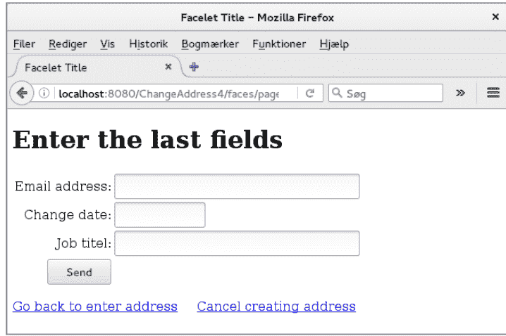

# JAVA 13：分布式编程

JAVA EE：软件开发

CDI

```java
@Named(value = "person")

@ConversationScoped

public class Person implements Serializable {

    private Address address;

    public Person() {

        address = new Address();

    }

    public Address getAddress() {

        return address;

    }

    public void setAddress(Address address) {

        this.address = address;

    }

}
```

JAVA 13：分布式编程

JAVA EE：软件开发

这里你应该注意到现在现在是`RequestScoped`。此外注意两个方法`page1()`和`cancel()`。第一个在`index.xhtml`选择创建地址时调用。它调用`conversation.begin()`方法启动一个新的对话。`cancel()`方法在三个编辑页面之一中点击取消时调用，重要的是它执行了`conversation.end()`方法来完成进行中的对话。

```java
@Named(value = "indexController")

@RequestScoped

public class IndexController {

    @Inject

    private Conversation conversation;

    @Inject

    private Person person;

    @PersistenceContext

    private EntityManager em;

    @Resource

    private UserTransaction utx;

    private List<Address> persons = new ArrayList<>();

    public IndexController() {

    }

    public String page1() {

        conversation.begin();

        return "page1";

    }

    public String cancel() {

        conversation.end();

        return "index";

    }

    public List<Address> getPersons() {

        try {

            CriteriaQuery<Address> cq = em.getCriteriaBuilder().createQuery();

            cq.select(cq).from(Address.class);

            Query<Address> q = em.createQuery(cq);

            return persons = q.getResultList();

        } catch (Exception ex) {

        }

        return persons;

    }

    public String add() {

        try {

            utx.begin();

            em.persist(person.getAddress());

            utx.commit();

            conversation.end();

            return "index";

        } catch (Exception ex) {

            try {

                utx.rollback();

            } catch (Exception e) {

                return "";

            }

        }

    }

}
```

## WEB 服务 (WEB SERVICES)

Web 服务是一种可以托管在 Web 服务器上并为客户端提供服务的组件，在某种程度上，Web 服务可以被视为企业 Java Bean（EJB）的替代方案。Web 特点是易于开发且平台无关。后者意味着 Web 服务与客户端之间的通信是以 XML 格式进行的，并遵循 SOAP 协议，因此完全以文本形式存在。因此，使用 Web 服务被认为是一种安全技术，但代价是由于消息编码为 XML 可能会在性能上有所消耗。必须根据参数和返回值向客户端定义 Web 服务及其服务，这是通过一个名为 Web 服务定义语言（WSDL）的 XML 文档完成的。编写 Web 服务最大的挑战是编写该文档，它非常复杂（语法困难且全面），而 NetBeans 可以提供帮助，因为它能生成所有内容，你实际上可以在不需要了解任何 WSDL 的情况下编写 Web 服务。

我想从一个简单的 Web 服务开始，它包含以下转换方法：

- `double celsiusToFahrenheit(double value)` 将摄氏度转换为华度
- `double fahrenheitToCelsius(double value)` 将华度转换为摄氏度

我从一个 Web 应用开始，我将其命名为`ConversionService`，它只需要是一个空的 Web 应用。然后我添加一个 Web 服务

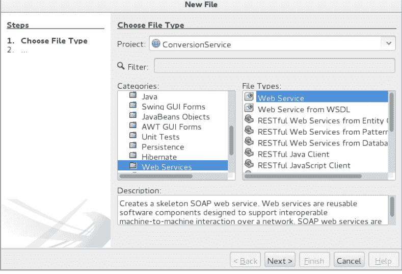

## JAVA 13: 分布式编程与 JAVA EE：软件开发 Web 服务

在下一个窗口中，我必须输入一个名称（此处为`ConversionService`）并选择一个包：

### 新 Web 服务 (New Web Service)

| 步骤 | 名称和位置 |
|---|---|
| 1 选择文件类型 | Web 服务名称: `ConversionService` |
| 2 命名和位置 | |
| 项目: `ConversionService` | |
| 位置: 源包 (Source Packages) | |
| 包: `conversionservervices` | |
| 从头开始创建 Web 服务 | |
| 从现有 Bean 创建 Web 服务 | |
| 企业 Bean: 浏览 | |
| 作为无状态 Bean 实现 Web 服务 |


## JAVA 13: 分布式编程与 JAVA EE：软件开发

当我点击“下一步”时，NetBeans 会创建以下类：

```java
package conversionservice.services;

import javax.jws.WebService;

import javax.jws.WebMethod;

import javax.jws.WebParam;

@WebService(serviceName = "ConversionService")

public class ConversionService {

    @WebMethod(operationName = "hello")

    public String hello(@WebParam(name = "name") String txt) {

        return "Hello " + txt + "!";

    }

}
```

注意使用了哪些注解，NetBeans 创建了一个单一服务——直接点击“设计 (Design)”按钮就可以完成，这将为你提供一个向导，可用于生成最终的代码：

```java
package conversionservice.services;

import javax.jws.WebService;

import javax.jws.WebMethod;

import javax.jws.WebParam;

@WebService(serviceName = "ConversionService")

public class ConversionService {

    @WebMethod(operationName = "celsiusToFahrenheit")

    public double celsiusToFahrenheit(@WebParam(name = "value") double value) {

        return 1.8 * value + 32;

    }

    @WebMethod(operationName = "fahrenheitToCelsius")

    public double fahrenheitToCelsius(@WebParam(name = "value") double value) {

        return (value - 32) / 1.8;

    }

}
```

使用向导最大且唯一的优势是 NetBeans 插入了正确的注解。

## JAVA 13: 分布式编程与 JAVA EE：软件开发

当你构建项目并部署后，在 NetBeans 中选择 Web 服务：

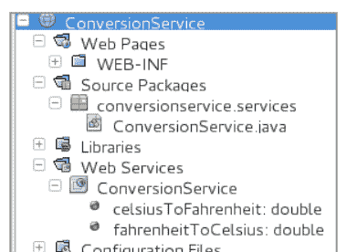

右键点击`ConversionService`选择“测试 Web 服务”，浏览器将打开并显示服务：

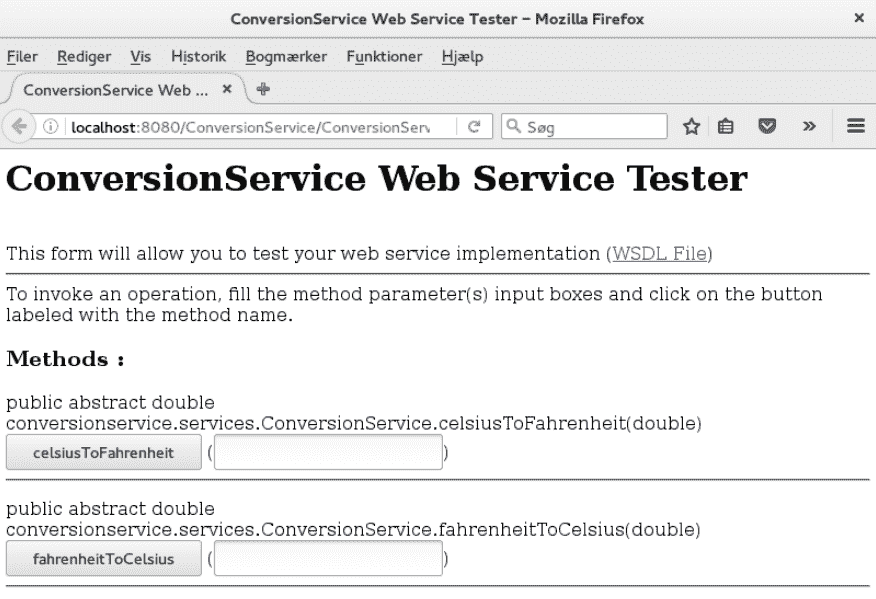

你应该注意服务的 WSDL。在部署服务后，你必须编写一个客户端，但这次它应该是名为`ConversionClient`的应用程序。NetBeans 创建了它：

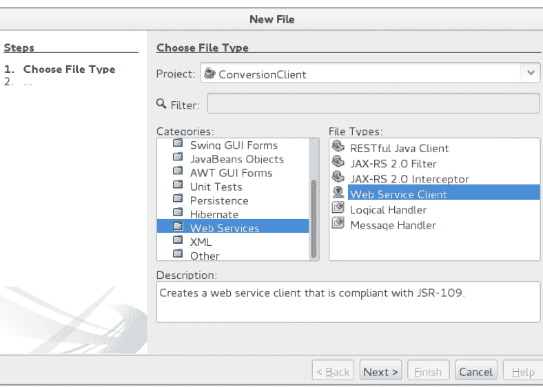

在下一个屏幕中，选择*Web 服务*，最后，输入一个包：


NetBeans 现在创建了对服务的引用并可以使用它提供的服务：

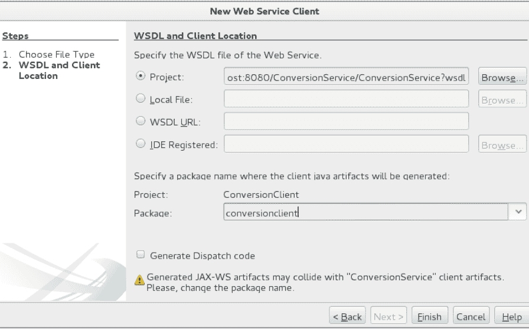

为了使用该服务，你需要编写一个复杂的语句，但你可以只需将服务拖入客户端中，NetBeans 会生成最终的代码：

## MITAS

为了工程师和地质学家的项目

1234567890

我们在北海，帮助带领工程师解决问题：

## JAVA 13: 分布式编程与 JAVA EE：软件开发 Web 服务

为了使用该服务，你需要编写一个复杂的语句，但你可以只需将服务拖入客户端中，NetBeans 会生成最终的代码：

```java
package conversionclient;

public class ConversionClient {

    public static void main(String[] args) {

        System.out.println("30 摄氏度 = " + celsiusToFahrenheit(30) + " 华度");

        System.out.println("100 华度 = " + fahrenheitToCelsius(100) + " 摄氏度");

    }

    private static double celsiusToFahrenheit(double value) {

        conversionclient.ConversionService service =

        new conversionclient.ConversionService_Service();
```


```java
conversionclient.ConversionServicePort port = service.getServicePort();

return port.celsiusToFahrenheit(value);

}

private static double fahrenheitToCelsius(double value) {

conversionclient.ConversionService service =
    new conversionclient.ConversionService_Service();

conversionclient.ConversionServicePort port = service.getServicePort();

return port.fahrenheitToCelsius(value);

}

}
```

## 练习 4（EXERCISE 4）

开始创建一个 `ConversionService` 项目的副本。你必须扩展相应的 Web 服务以提供两个新服务：

- `double kilometerToMiles(double value)`：将公里转换为英里。
- `double milesToKil(double value)`：将英里转换为公里。

部署服务后，编写一个可以调用 `ConversionClient` 的客户端程序，但这次它应该是 Web 应用。如果从浏览器中打开应用程序，它将打开以下窗口：

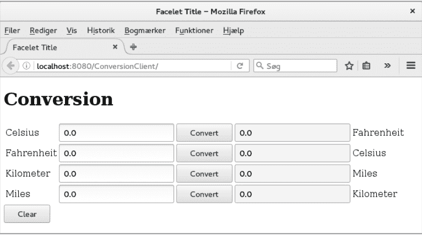

## 管理硕士（MASTER IN MANAGEMENT）

因为实现梦想是你最大的挑战。IE 商务学院的管理硕士采用英语、西班牙语或双语授课，通过一个创新且充满活力的项目培训职业生涯早期的高性能人才，帮助他们充分发挥潜力。

- 选择你的专业领域。
- 通过提供的不同选项定制你的硕士课程。
- 在伦敦、硅谷或上海等地进行全球沉浸式周。
- 因为你而改变，我们也随之改变。

`www.ie.edu/master-management`  
`mim.admissions@ie.edu`

# JAVA 13：分布式编程与 JAVA EE：软件开发

上述表单应该有一个使用你 Web 服务的后端豆（backing bean）。原则上，它的工作原理与介绍示例完全相同，不同之处在于你需要将 `localhost_8080` 文件夹复制到 `WEB-INF` 下的 `wsdl` 文件夹中。

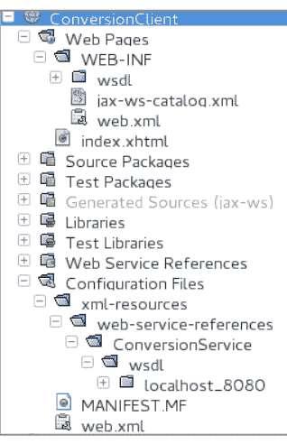

# 练习 5

在这个练习中，你必须编写一个 Web 应用程序，可以在其中搜索丹麦国王：

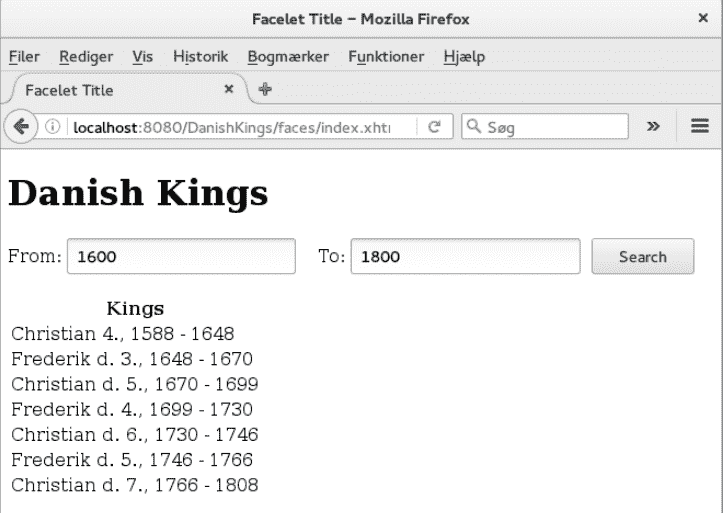

在 `bookboom.com` 免费下载电子书。

# JAVA 13：分布式编程与 JAVA EE：软件开发

你可以将项目命名为 `DanishKings`，与之前的区别应该是搜索操作将由 Web 服务完成。

首先，创建一个可以调用 `KingsServices` 的 Web 应用程序，并添加一个名为 `KingService` 的 Web 服务。添加一个简单的模型类：

```java
package kings.services;

public class King {

    private String name;

    private int from;

    private int to;
```

该 Web 服务必须包含两个服务：

```java
@TestMethod(operationName = "getKing")
public List<King> getKing(@PathParam(name = "year") int year) {

@TestMethod(operationName = "getKings")
public List<King> getKings(
    @PathParam(name = "yearly") int yearly,
    @PathParam(name = "year2") int year2
) {
```

其中第一个将返回统治特定年份的国王，而另一个将返回统治期重叠某个区间的国王。丹麦国王的名字和统治期可以像之前的示例一样作为常量存储在程序中。

## 5.1 作为 Web 服务的 EJB

如所示，Web 服务无非是一个装饰了几个注解的普通 Java 类，并全部封装在 Web 应用程序中。也可以将无状态会话（stateless session）作为豆，用于从 Java 的其他语言使用无状态 EJB，也可以使用企业级豆的其他属性，如事务。事实上，你可以通过两种方式实现：通过在 EJB 中创建 Web 服务，或者通过将 EJB 嵌入为 Web 服务。

# JAVA 13：分布式编程与 JAVA EE：软件开发

## Web 服务

例如，我设置了一个 EJB 模块项目，将其命名为 `EJBCversion`。对于这个项目，我添加了一个名为 `Conversion` 的 Web 服务：


> “我学了16年英语，但是……我最终只用了六节课就学会了开口”  
> Jane，中国建筑师

英语就在这里。

点击听听我独特课程前后的下载。

在 `bookboom.com` 免费下载电子书。

# JAVA 13：分布式编程与 JAVA EE：软件开发

注意已选择“从头开始创建 Web 服务”（Create Web Service from Scratch），并勾选了底部的复选框。点击“完成”（Finish）后，创建了一个 Web 服务，其中主要区别在于它是一个无状态豆（stateless bean）。完成的服务如下所示：

```java
package ejb.services;

import javax.jws.WebService;
import javax.jws.WebMethod;
import javax.jws.WebParam;
import javax.ejb.Stateless;

@WebService(serviceName = "Conversions")
@Stateless()
public class Conversions {

    @WebMethod(operationName = "celsiusToFahrenheit")
    public double celsiusToFahrenheit(
        @WebParam(name = "value") double value
    ) {
        return 1.8 * value + 32;
    }

    @WebMethod(operationName = "fahrenheitToCelsius")
    public double fahrenheitToCelsius(
        @WebParam(name = "value") double value
    ) {
        return (value - 32) / 1.8;
    }

}
```

然后可以按照通常的方式构建并部署项目。`ConversionProgram` 项目与 `ConversionClient` 相同，区别在于使用了另一个 Web 服务（如上），这是一个企业级豆托管的 Web 服务。

作为最后一个示例，我将编写一个使用现有 EJB 的 Web 服务，我将使用 `ZipcodesEJB`，它对数据库数据中的 `zipcode` 表执行 CRUD 操作。涉及的 EJB 提供了 4 个服务，目标是通过 Web 服务提供这些服务。

起点是一个名为 `ZipcodesServices` 的空应用程序。作为第一步，我放入了 `ZipcodesRemote` jar 文件的引用，它是 `ZipcodesEJB` 的远程接口。接下来，我向项目添加了一个名为 `ZipcodesWS` 的 Web 服务。

# 新 Web 服务

| 步骤 | 名称和位置 |
|---|---|
| 1. 选择文件类型 | Web 服务名称：`ZipcodesWS` |
| 2. 命名和位置 | 项目：`ZipcodesServices` |
| 位置 | 源包（Source Packages） |
| 包名 | `zipcodesservices` |
|  | 从头开始创建 Web 服务 |
|  | 从现有会话豆创建 Web 服务 |
|  | 企业豆：`Enterprise Beans#ZipcodesSession` [浏览] |
|  | 作为无状态会话豆实现 Web 服务 |

在这里你应该特别注意，选择了“从现有会话豆创建 Web 服务”（Create Web Service from Existing Session Bean），并勾选了底部的复选框。点击“完成”后，创建了一个 Web 服务，其中主要区别在于它是一个无状态豆。完成的服务如下：

```java
package ejb.services;

import javax.jws.WebService;
import javax.jws.WebMethod;
import javax.jws.WebParam;
import javax.ejb.Stateless;

@WebService(serviceName = "Conversions")
@Stateless()
public class Conversions {

    @EJB
    private ZipcodesRemote ejbRef;

    @WebMethod(operationName = "create")
    public boolean create(@WebParam(name = "obj") Zipcode obj) {
        return ejbRef.create(obj);
    }

    @WebMethod(operationName = "update")
    public boolean update(@WebParam(name = "obj") Zipcode obj) {
        return ejbRef.update(obj);
    }

    @WebMethod(operationName = "remove")
    public boolean remove(@WebParam(name = "code") String code) {
        return ejbRef.remove(code);
    }

    @WebMethod(operationName = "search")
    public List<Zipcode> search(@WebParam(name = "code") String code) {
        return ejbRef.search(code);
    }

}
```


然后可以按照通常的方式构建并部署项目。`ConversionProgram` 项目与`ConversionClient`相同，区别在于使用了另一个 Web 服务（如上），这是一个企业级豆托管的 Web 服务。

作为最后一个示例，我将编写一个使用现有 EJB 的 Web 服务，我将使用`ZipcodesEJB`，它对数据库数据中的`zipcode`表执行 CRUD 操作。涉及的 EJB 提供了 4 个服务，目标是通过 Web 服务提供这些服务。

起点是一个名为`ZipcodesServices`的空应用程序。作为第一步，我放入了`ZipcodesRemote` jar 文件的引用，它是`ZipcodesEJB`的远程接口。接下来，我向项目添加了一个名为`ZipcodesWS`的 Web 服务：

## 新 Web 服务

| 步骤 | 名称和位置 |
|---|---|
| 1. 选择文件类型 | Web 服务名称: `ZipcodesWS` |
| 2. 命名和位置 | 项目: `ZipcodesServices` |
| 位置 | 源包 (Source Packages) |
| 包名: `zipcodesservices` |
| | 从头开始创建 Web 服务 |
| | 从现有会话豆创建 Web 服务 |
| | 企业豆: `Enterprise Beans#ZipcodesSession` [浏览] |
| | 作为无状态会话豆实现 Web 服务 |

在这里你应该特别注意，选择了“从现有会话豆创建 Web 服务”（Create Web Service from Existing Session Bean），并勾选了底部的复选框。点击“完成”后，创建了一个 Web 服务，其中主要区别在于它是一个无状态豆。完成的服务如下：

```java
package ejb.services;

import javax.jws.WebService;
import javax.jws.WebMethod;
import javax.jws.WebParam;
import javax.ejb.Stateless;

@WebService(serviceName = "Conversions")
@Stateless()
public class Conversions {

    @WebMethod(operationName = "celsiusToFahrenheit")
    public double celsiusToFahrenheit(@WebParam(name = "value") double value) {
        return 1.8 * value + 32;
    }

    @WebMethod(operationName = "fahrenheitToCelsius")
    public double fahrenheitToCelsius(@WebParam(name = "value") double value) {
        return (value - 32) / 1.8;
    }
}
```

# JAVA 13：分布式编程与 JAVA EE：软件开发

上述表单应该有一个使用你 Web 服务的后端豆（backing bean）。原则上，它的工作原理与介绍示例完全相同，不同之处在于你需要将`localhost_8080`文件夹复制到`WEB-INF`下的`wsdl`文件夹中：


## 练习 5

在这个练习中，你必须编写一个 Web 应用程序，可以在其中搜索丹麦国王：


在 bookboom.com 免费下载电子书

# JAVA 13：分布式编程与 JAVA EE：软件开发

你可以将项目命名为`DanishKings`，与之前的区别应该是搜索操作将由 Web 服务完成。

首先，创建一个可以调用`KingsServices`的 Web 应用程序，并添加一个名为`KingService`的 Web 服务。添加一个简单的模型类：

```java
package kings.services;

public class King
{
    private String name;
    private int from;
    private int to;
```

该 Web 服务必须包含两个服务：

```java
@TestMethod(operationName = "getKing")
public List<King> getKing(@PathParam(name = "year") int year)
{

@TestMethod(operationName = "getKings")
public List<King> getKings(@PathParam(name = "yearly") int yearly,
    @PathParam(name = "year2") int year2)
}
```

其中第一个将返回统治特定年份的国王，而另一个将返回统治期重叠某个区间的国王。丹麦国王的名字和统治期可以像之前的示例一样作为常量存储在程序中。

## 5.1 作为 Web 服务的 EJB

如所示，Web 服务无非是一个装饰了几个注解的普通 Java 类，并全部封装在 Web 应用程序中。也可以将无状态会话（stateless session）作为豆，用于从 Java 的其他语言使用无状态 EJB，也可以使用企业级豆的其他属性，如事务。事实上，你可以通过两种方式实现：通过在 EJB 中创建 Web 服务，或者通过将 EJB 嵌入为 Web 服务。

# JAVA 13：分布式编程与 JAVA EE：软件开发

WEB 服务

例如，我设置了一个 EJB 模块项目，将其命名为`EJBCversion`。对于这个项目，我添加了一个名为`Conversion`的 Web 服务：


> “我学了16年英语，但是……我最终只用了六节课就学会了开口”
> 
> Jane，中国建筑师
> 
> 英语就在这里
> 
> 点击听听我独特课程前后的下载

在 bookboom.com 免费下载电子书

# JAVA 13：分布式编程 JAVA EE：软件开发

注意已选择“从头开始创建 Web 服务”（Create Web Service from Scratch），并勾选了底部的复选框。点击“完成”（Finish）后，创建了一个 Web 服务，其中主要区别在于它是一个无状态豆（stateless bean）。完成的服务如下所示：

```java
package ejb.services;

import javax.jws.WebService;
import javax.jws.WebMethod;
import javax.jws.WebParam;
import javax.ejb.Stateless;

@WebService(serviceName = "Conversions")
@Stateless()
public class Conversions {

    @WebMethod(operationName = "celsiusToFahrenheit")
    public double celsiusToFahrenheit(@WebParam(name = "value") double value) {
        return 1.8 * value + 32;
    }

    @WebMethod(operationName = "fahrenheitToCelsius")
    public double fahrenheitToCelsius(@WebParam(name = "value") double value) {
        return (value - 32) / 1.8;
    }
}
```

然后可以按照通常的方式构建并部署项目。`ConversionProgram` 项目与`ConversionClient`相同，区别在于使用了另一个 Web 服务（如上），这是一个企业级豆托管的 Web 服务。

作为最后一个示例，我将编写一个使用现有 EJB 的 Web 服务，我将使用`ZipcodesEJB`，它对数据库数据中的`zipcode`表执行 CRUD 操作。涉及的 EJB 提供了 4 个服务，目标是通过 Web 服务提供这些服务。

起点是一个名为`ZipcodesServices`的空应用程序。作为第一步，我放入了`ZipcodesRemote` jar 文件的引用，它是`ZipcodesEJB`的远程接口。接下来，我向项目添加了一个名为`ZipcodesWS`的 Web 服务：

## 新 Web 服务

| 步骤 | 名称和位置 |
|---|---|
| 1. 选择文件类型 | Web 服务名称: `ZipcodesWS` |
| 2. 命名和位置 | 项目: `ZipcodesServices` |
| 位置 | 源包 (Source Packages) |
| 包名: `zipcodesservices` |
| | 从头开始创建 Web 服务 |
| | 从现有会话豆创建 Web 服务 |
| | 企业豆: `Enterprise Beans#ZipcodesSession` [浏览] |
| | 作为无状态会话豆实现 Web 服务 |

在这里你应该特别注意，选择了“从现有会话豆创建 Web 服务”（Create Web Service from Existing Session Bean），并勾选了底部的复选框。点击“完成”后，创建了一个 Web 服务，其中主要区别在于它是一个无状态豆。完成的服务如下：

# JAVA 13：分布式编程与 JAVA EE：软件开发

## REST Web 服务


在这里我输入了资源包、路径和类名。你应该注意 MIME 类型是 XML。当我点击“完成”（Finish）时，NetBeans 会创建两个文件：


# 美国在线

LIGS 大学

目前正在招收互动在线 BBA、MBA、MSc、DBA 和博士学位课程：

- 在 2014 年 9 月 30 日前报名并
- 学费最高可节省 16%！
- 分 10 期支付 / 2 年
- 互动在线教育
- 访问 www.ligsuniversity.com 了解更多信息！

LIGS 大学未获得任何美国教育部长列出的国家认可认证机构的认证。

更多信息请见此处。


# JAVA 13：分布式编程 JAVA EE：软件开发

最后一个是我的 RESTful 服务。代码如下，我删除了注释，并输入了`getXml()`方法：

```java
package helloapp.services;

import javax.ws.rs.Context;
import javax.ws.rs.core.UriInfo;
import javax.ws.rs.Produces;
import javax.ws.rs.Consumes;
import javax.ws.rs.GET;
import javax.ws.rs.Path;
import javax.ws.rs.PUT;
import javax.ws.rs.core.MediaType;

@Path("hello")
public class HelloResource {
    @Context
    private UriInfo context;

    public HelloResource() {
    }

    @GET
    @Produces(MediaType.APPLICATION_XML)
    public String getXml() {
        return
        "<message>\n"
        + "<hello>Hello</hello>\n"
        + "<firstName>Ragnar</firstName>\n"
        + "<lastName>Lodbrog</lastName>\n"
        + "<job>Viking</job>\n"
        + "</message>\n";
    }

    @PUT
    @Consumes(MediaType.APPLICATION_XML)
    public void putXml(String content) {
    }
}
```

你必须注意不同的注解。在这里，`@Path`指定了当前服务（资源）被标识的名称。`@GET`定义了当从浏览器发生 HTTP GET 时执行的方法，同样，`@PUT`定义了用于 HTTP PUT 的方法：注意，第一个方法带有`@Produces`装饰，表示该方法返回 XML，而另一个方法带有`@Consumes`装饰，表示该方法将参数的内容解释为 XML。在这种情况下，最后一个方法是空的，而第一个方法返回了一些 XML。

容器必须知道资源被称为什么，这就是第二个类的目的：

```java
package helloapp.services;

import java.util.Set;
import javax.ws.rs.core.Application;

@javax.ws.rs.Path("webresources")
public class ApplicationConfig extends Application {

    @Override
    public Set<Class<?>> getClasses() {
        Set<Class<?>> resources = new java.util.HashSet<>();
        addResourceClasses(resources);
        return resources;
    }

    private void addResourceClasses(Set<Class<?>> resources) {
        resources.add(helloapp.services.HelloResource.class);
    }
}
```

这是一个继承自`Application`的类，该类被`@Path`装饰，它指定了一个包含在资源 URI 中的名称（这里是 resources）。最后一个方法将实际资源添加到集合中（这里是`HashSet`）。所有这些操作的结果是，该资源的 URI 为：

```
http://localhost:8080/helloapp/webresources/hello
```

如果你翻译项目并执行部署，资源就可以使用了。会创建一个 RESTful Web 项目，如果你点击`HelloResource [hello]`:


# JAVA 13：分布式编程与 JAVA EE：软件开发

## REST Web 服务

你可以选择测试资源 URI（Test Resource URI），之后浏览器会打开以下窗口：


结果是执行了`getXml()`方法，该方法已对浏览器做出响应。下一步，我将编写一个使用该资源的客户端，它应该是一个简单的控制台应用程序。因此我创建了一个名为`HelloREST`的 Java Application 项目。对于这个项目，我添加了 Java 客户端：


# JAVA 13：分布式编程 JAVA EE：软件开发

## REST Web 服务


当你点击“下一步”（Next），你会得到以下窗口：


在这里我输入了资源包、路径和类名。你应该注意 MIME 类型是 XML。当我点击“完成”（Finish）时，NetBeans 会创建两个文件：

结果是执行了`getXml()`方法，该方法已对浏览器做出响应。下一步，我将编写一个使用该资源的客户端，它应该是一个简单的控制台应用程序。因此我创建了一个名为`HelloREST`的 Java Application 项目。对于这个项目，我添加了 Java 客户端：


```java
package hellorest;

import javax.ws.rs.client.Client;
import javax.ws.rs.client.WebTarget;
import javax.ws.rs.core.MediaType;

public class HelloClient {
    private static final String BASE_URI = "http://localhost:8080/helloapp/webresources/";
    private WebTarget webTarget;

    public HelloClient() {
        Client client = Client.newClient();
        webTarget = client.target(BASE_URI).path("hello");
    }

    public String getXml() {
        return webTarget.request(MediaType.APPLICATION_XML).get(String.class);
    }

    public static void main(String[] args) {
        HelloClient client = new HelloClient();
        System.out.println(client.getXml());
    }
}
```

运行程序的结果是：

```xml
<message>
<hello>Hello</hello>
<firstName>Ragnar</firstName>
<lastName>Lodbrog</lastName>
<job>Viking</job>
</message>
```

这可能看起来不多，但你可以看到相关服务正在执行。创建和使用 RESTful 服务以及客户端非常简单，但当然问题在于你收到的结果是 XML，如果你向服务发送某些内容，它也应该是 XML。然而，将 XML 转换为自定义类型很容易的，它需要该类型的注解，并且该类型是服务和客户端程序所知的。解决这个问题的非常简单的方法是定义一个包含自定义类型的类库，在这种情况下我创建了一个名为 `HelloRemote` 的类库，它包含一个类：

```java
package hellremote.entities;

import javax.xml.bind.annotation.XmlRootElement;
import java.io.Serializable;

@XmlRootElement
public class Message implements Serializable {
    private String firstName;
    private String lastname;
    private String job;
    private String text;

    public Message() {}

    public Message(String firstName, String lastname, String job, String text) {
        this.firstName = firstName;
        this.lastname = lastname;
        this.job = job;
        this.text = text;
    }

    public String getFirstName() {
        return firstName;
    }

    public void setFirstName(String firstName) {
        this.firstName = firstName;
    }

    public String getLastname() {
        return lastname;
    }

    public void setLastname(String lastname) {
        this.lastname = lastname;
    }

    public String getJob() {
        return job;
    }

    public void setJob(String job) {
        this.job = job;
    }

    public String getText() {
        return text;
    }

    public void setText(String text) {
        this.text = text;
    }
}
```

```java
public String getJob()
{
    return job;
}
```

```java
public void setJob(String job)
{
    this.job = job;
}
```

```java
public String getText()
{
    return text;
}
```

```java
public void setText(String text)
{
    this.text = text;
}
```

```java
@Override
public String toString()
{
    return "firstname=\t" + firstName + "\nlastname=\t" + lastname + "\njob=\t" + job + "\ntext=\t" + text;
}
```

这不是一个普通的 Bean，唯一有趣的地方是该类被装饰上了一个注解：

`@javax.xml.bind.annotation.XmlRootElement`

确保对象可以自动在 XML 之间进行转换。要使用该类型，需要更改服务类：

```java
package helloapp.services;
```

```java
import javax.ws.rs.core.Context;
import javax.ws.rs.core.UriInfo;
import javax.ws.rs.Produces;
import javax.ws.rs.Consumes;
import javax.ws.rs.GET;
import javax.ws.rs.Path;
import javax.ws.rs.PUT;
import javax.ws.rs.core.MediaType;
```

```java
import helloremote.entities.*;
```

# JAVA 13: 分布式编程

## JAVA EE: 软件开发

REST Web 服务

```java
@Path("hello")
public class HelloResource
{
@Context
private UriInfo context;
```

```java
private Message msg = new Message("Ragnar", "Lodbrog", "Viking", "Hello from");

public HelloResource() {
  }
```

```java
@GET
@Produces(MediaType.APPLICATION_XML)
public Message getXml() {
  return msg;
}
```

```java
@PUT
@Consumes(MediaType.APPLICATION_XML)
public void putXml(Message msg) {
```


# JAVA 13: 分布式编程与

## JAVA EE: 软件开发

# REST Web 服务

```java
this.msg.setFirstName(msg.getFirstName());
this.msg.setLastName(msg.getLastName());
this.msg.setJob(msg.getJob());
this.msg.setText(msg.getText());
}
```

首先，应该有一个对类 `HelloRemote` 的引用。然后创建一个类型为 `Message` 的对象，并将 `getXml` 的返回类型更改为 `Message`。方法的 MediaType 仍然是 XML。结果是对象 `msg` 在发送到客户端之前会被编码为 XML。同时，`putXml()` 也发生了更改，它接受一个 `Message` 对象作为参数，并且方法更新了 `msg` 对象。这显然没有意义，因为这些更改没有被用于任何地方——消息 `msg` 在两次服务调用之间并不存在。

服务更改并部署后，必须更新客户端。首先，应该稍微更改 `HelloService` 类。资源由类型为 `WebTarget` 的对象表示，如果你在该对象上执行 `request()` 方法，它将调用装饰了 `@GET` 的服务方法（在这里是 `getXml()`）。它告诉要将数据编码为 XML。最后，通过 `get()` 方法，你指定结果应该转换为什么什么，之前是 `String`。现在它更改为了 `Message` 类型，这就是 `HelloClient` 类中所有需要更改的地方：

```java
public String getXml() throws ClientErrorException
{
    WebTarget resource = webTarget;
    return resource.request(javax.ws.rs.core.MediaType.APPLICATION_XML);
    get(Message.class);
}
```

最后，必须更改 `HelloREST` 中的 `main()` 方法：

```java
package hellorest;

import hellorestore.entities.Message;

public class HelloREST
{
    public static void main(String[] args)
{
    Message msg;
    HelloClient client = new HelloClient();
    System.out.println(msg = client.getXml());
    msg.setJob("Danish Viking");
    client.putXml(msg);
}
```

```java
client.close();
System.out.println();
System.out.println(msg);
}
```

如果程序应该像以前一样工作，实际上实际上不需要更改任何内容，这些更改仅关于我想展示如何使用 `putXml()` 以及 `Message` 对象是如何自动编码为 XML 的。

## 6.1 再次更改地址

上面是一个非常简单的 RESTful Web 服务，并不是一个典型的例子。在这个例子中，我想展示 `ChangeAddress` 程序的另一个版本，其区别点应当是该程序使用 RESTful Web 服务来维护数据库。

我首先创建一个名为 `AddressesRemote` 的类库项目，对于这个项目，我从数据库添加了实体类（Entity Classes），这是我 MySQL 数据库 `addresses` 中地址的实体类。我的库不应该包含任何其他内容并且应该是可翻译的，因此我准备好了它，然后我创建了一个名为 `AddressesREST` 的 Web 项目，对于这个项目，我从实体类添加了作为 RESTful Web 服务的 Web 服务：


# JAVA 13: 分布式编程与

## JAVA EE: 软件开发

# REST Web 服务

这是一个非常简单的 RESTful Web 服务，并不是一个典型的例子。在这个例子中，我想展示 `ChangeAddress` 程序的另一个版本，其区别点应当是该程序使用 RESTful Web 服务来维护数据库。

我首先创建一个名为 `AddressesRemote` 的类库项目，对于这个项目，我从数据库添加了实体类，这是我 MySQL 数据库 `addresses` 中地址的实体类。我的库不应该包含任何其他内容并且应该是可翻译的，因此我准备好了它，然后我创建了一个名为 `AddressesREST` 的 Web 项目，对于这个项目，我从实体类添加了作为 RESTful Web 服务的 Web 服务：

)

如果你在部署服务时遇到问题，请检查配置文件：

| | Add |

|---|---|

| AddressesREST | Remove |

| General: | |

| Persistence Unit Name: | AddressesREST |

| Persistence Provider: | EclipseLink (IPA 2.1 (default)) |

| Data Source: | java app |

| Use Java Transaction APIs | Create Drop and Create |

| Table Generation Strategy: | Auto Callback |

| Validation Strategy: | |

| Shared Cache Mode: | All None Disable Unspecified |

| Include All Entity Classes in "AddressesREST" Module | |

| Include Entity Classes: | Add Class... |

| addressesremote Address | Remove |

# JAVA 13: 分布式编程与

## JAVA EE: 软件开发

# REST Web 服务

这是一个非常简单的 RESTful Web 服务，并不是一个典型的例子。在这个例子中，我想展示 `ChangeAddress` 程序的另一个版本，其区别点应当是该程序使用 RESTful Web 服务来维护数据库。

我首先创建一个名为 `AddressesRemote` 的类库项目，对于这个项目，我从数据库添加了实体类，这是我 MySQL 数据库 `addresses` 中地址的实体类。我的库不应该包含任何其他内容并且应该是可翻译的，因此我准备好了它，然后我创建了一个名为 `AddressesREST` 的 Web 项目，对于这个项目，我从实体类添加了作为 RESTful Web 服务的 Web 服务：

# JAVA 13: 分布式编程与

## JAVA EE: 软件开发

# REST Web 服务

这是一个非常简单的 RESTful Web 服务，并不是一个典型的例子。在这个例子中，我想展示 `ChangeAddress` 程序的另一个版本，其区别点应当是该程序使用 RESTful Web 服务来维护数据库。

我首先创建一个名为 `AddressesRemote` 的类库项目，对于这个项目，我从数据库添加了实体类，这是我 MySQL 数据库 `addresses` 中地址的实体类。我的库不应该包含任何其他内容并且应该是可翻译的，因此我准备好了它，然后我创建了一个名为 `AddressesREST` 的 Web 项目，对于这个项目，我从实体类添加了作为 RESTful Web 服务的 Web 服务：

# JAVA 13: 分布式编程与

## JAVA EE: 软件开发

# REST Web 服务

这是一个非常简单的 RESTful Web 服务，并不是一个典型的例子。在这个例子中，我想展示 `ChangeAddress` 程序的另一个版本，其区别点应当是该程序使用 RESTful Web 服务来维护数据库。

我首先创建一个名为 `AddressesRemote` 的类库项目，对于这个项目，我从数据库添加了实体类，这是我 MySQL 数据库 `addresses` 中地址的实体类。我的库不应该包含任何其他内容并且应该是可翻译的，因此我准备好了它，然后我创建了一个名为 `AddressesREST` 的 Web 项目，对于这个项目，我从实体类添加了作为 RESTful Web 服务的 Web 服务：

# JAVA 13: 分布式编程与

## JAVA EE: 软件开发

# REST Web 服务

这是一个非常简单的 RESTful Web 服务，并不是一个典型的例子。在这个例子中，我想展示 `ChangeAddress` 程序的另一个版本，其区别点应当是该程序使用 RESTful Web 服务来维护数据库。

如果你在部署服务时遇到问题，请检查配置文件：

（省略表格）

我首先创建一个名为 `AddressesRemote` 的类库项目，对于这个项目，我从数据库添加了实体类，这是我 MySQL 数据库 `addresses` 中地址的实体类。我的库不应该包含任何其他内容并且应该是可翻译的，因此我准备好了它，然后我创建了一个名为 `AddressesREST` 的 Web 项目，对于这个项目，我从实体类添加了作为 RESTful Web 服务的 Web 服务：

# JAVA 13: 分布式编程与

## JAVA EE: 软件开发

# REST Web 服务

这是一个非常简单的 RESTful Web 服务，并不是一个典型的例子。在这个例子中，我想展示 `ChangeAddress` 程序的另一个版本，其区别点应当是该程序使用 RESTful Web 服务来维护数据库。

(注：由于提供的文本存在大量重复和断句，上述翻译基于文本中的逻辑片段进行了整合与处理)

# JAVA 13: 分布式编程

JAVA EE: 软件开发


在这里，现在需要在“包含实体类”（`Include Entity Classes`）下方添加实体类。之后，我们应该部署项目。

接下来，必须编写一个客户端，我从项目 `ChangeAddress1` 的副本开始，将其命名为 `ChangeAddress5`。在这里，我开发了模型类 `Address` 并添加了类库 `AddressesRemote` 的引用。下一步，我添加了一个名为 `AddressClient` 的 RESTful 客户端。它与上一个示例中的相应类相似，但你应该注意，已经为 XML 和 JSON 创建了方法。下面我展示了该类的一部分，但只显示我的程序需要的方法：

```java
package changeaddress.beans;

import javax.ws.rs.ClientErrorException;
import javax.ws.rs.client.Client;
import javax.ws.rs.client.WebTarget;

public class AddressesClient
{
    private WebTarget webTarget;
    private Client client;
    private static final String BASE_URI = 
        "http://localhost:8080/AddressesREST/webresources";

    public AddressesClient()
    {
        client = javax.ws.rs.client.ClientBuilder.newClient();
        webTarget = client.target(BASE_URI).path("addressesremote");
    }

    public void create_XML(Object requestEntity) throws ClientErrorException
    {
        webTarget.request(javax.ws.rs.core.MediaType.APPLICATION_XML)
            post(javax.ws.rs.client.Entity.entity(requestEntity));
    }

    public void create_JSON(Object requestEntity) throws ClientErrorException
    {
        webTarget.request(javax.ws.rs.core.MediaType.APPLICATION_JSON)
            post(javax.ws.rs.client.Entity.entity(requestEntity,
                javax.ws.rs.core.MediaType.APPLICATION_JSON));
    }

    public <T> T findAllXML(Class<T> responseType) throws ClientErrorException
    {
```

# JAVA 13: 分布式编程与 JAVA EE: 软件开发

## REST Web 服务

```java
WebTarget resource = webTarget;
return resource.request(javax.ws.rs.core.MediaType.APPLICATION_XML).
get(responseType);
```

```java
public <T> findAll_JSON(Class<T> responseType)
throws ClientErrorException
{
    WebTarget resource = webTarget;
    return resource.request(javax.ws.rs.core.MediaType.APPLICATION_JSON);
    get(responseType);
}
```

```java
public void close() {
    client.close();
}
```

该类与上一个示例中的相应方法相似。构造函数创建了指向由 `WebTarget` 类型对象表示的目标引用。该对象可以使用四个 HTTP 方法之一对资源执行请求。在当前示例中，使用 GET 执行请求（返回所有地址），使用 POST 创建新地址。

注意 `findAll_JSON()`，它是泛型的。在这里，你必须指定方法应该返回的对象类型，这里是 `List<Address>`。由于结果是 XML，它必须被解析为 `List<Address>` 对象，这如上一个示例所示会自动完成。然而，这导致了一个问题，因为 `List<Address>` 类型没有被标记为：

```java
@RootElement
```

因此，有必要在包装类中嵌入 `List<Address>`：

```java
package changeaddress.beans;

import java.util.List;
import javax.xml.bind.annotation.*;
import addressesremote.*;
```

```java
@RootElement(name="addresses")
@XmlAccessorType(XmlAccessType.FIELD)
public class Addresses {
    @XmlElement(name = "address")
    private List<Address> addresses = null;
```

```java
public Addresses()
{
}
public List<Address> getAddresses()
{
    return addresses;
}

public void setAddresses(List<Address> addresses)
{
    this.addresses = addresses;
}
```

有了这个类，你就可以编写完成的命名 bean，它只是对现有类的简单更新（我没有显示 get 和 set 方法）：

```java
package changeaddress.beans;

import java.util.List;
import javax.xml.bind.annotation.*;
import addressesremote.*;
```

# JAVA 13: 分布式编程与 JAVA EE: 软件开发

## REST Web 服务

![img/0a9d86aea6b178e4945a7a3e9444cb9166.png]

# JAVA 13: 分布式编程与 JAVA EE: 软件开发

## REST Web 服务

```java
import javax.inject.Named;
import javax.enterprise.context.SessionScoped;
import java.io.Serializable;

@Named(value = "index")
@SessionScoped
public class IndexController implements Serializable {
    private Address person = new Address();
    private List<Address> persons = new ArrayList<>();

public IndexController() {
}

public List<Address> getPersons() {
    try {
        AddressesClient client = new AddressesClient();
        Addresses wrapper = client.findAllXML(Address.class);
        persons = wrapper.getAddresses();
        client.close();
    } catch (Exception ex) {
        persons = new ArrayList<>();
    }
    return persons;
}

public void add() {
    try {
        AddressesClient client = new AddressesClient();
        client.create_XML(person);
        client.close();
    } catch (Exception ex) {
    }
}
```

# JAVA 13: 分布式编程与 JAVA EE: 软件开发

## REST Web 服务

### 练习 7

你需要扩展上面的示例，以便能够更改和删除地址，使用与上一个示例相同的 Web 服务。从项目 `Address5` 的副本开始，将其称为 `Address6`。

- 创建一个新的页面 `edit.html`，它与 `index.html` 基本相同（见下文）。

- 你必须修改 `list.html`，使名称成为新页面的链接。打开此页面时，必须填写表单数据。

- 你需要扩展控制器 `IndexController`，以便 `list.html` 中的链接以及新表单中的三个按钮。

![img/0a9d86aea6b178e4945a7a3e9444cb9168.png]

# JAVA 13: 分布式编程与 JAVA EE: 软件开发

## 安全

# 安全

在开发网络使用的应用程序（Web 应用、企业应用等）时，经常需要解决一个安全问题。这是我在本书以及之前的两本书中忽略的问题。基本上它关于

- 只有允许的用户可以使用程序或应用程序的一部分，并且所有用户不应具有相同的权限

- 未经授权的用户无法访问在用户和服务器之间通过网络传输的数据

第一个问题通过用户识别和密码解决，而另一个问题通过使用加密来解决，以便无人读取网络上的数据。从原则上讲，听起来很简单，但正如媒体报道的，无论网络攻击如何，完全保护企业应用程序是不可能的，但你可以做得很多，而且通常如此。

![img/0a9d86aea6b178e4945a7a3e9444cb9169.png]

到2020年，风能可以提供地球十分之一的电力。现在，SKF的专业知识对于世界上大部分风力涡轮机的运行至关重要。发电成本中25%与维护有关。得益于我们的在线状态监测和自动化系统，这些成本可以大幅减少。我们帮助让清洁能源变得更具效益。

# JAVA 13: 分布式编程与 JAVA EE: 软件开发

许多与安全相关的挑战，并不是因为我们不知道如何做，而是因为这些挑战让日常工作变得困难，正因如此，许多人可能会倾向于放松安全策略。研究实际上表明，大多数安全问题源于程序的使用方式，而不是程序的制作方式。在本章中，我将对开发工作中相关的重点内容进行介绍，并提指出，除非 IT 解决方案同样重视安全问题，否则这些工作将帮助不很大。

反之，加密的挑战是最容易解决的，因为它主要是一个关于使用安全传输线路以加密形式发送数据的问题，该问题通过正确配置程序即可解决。然而，身份验证和用户授权问题可以通过两个方面来解决：一个是通过容器（应用程序服务器），这是一项配置任务；另一个是通过程序本身，由程序员来解决该任务。

## 7.1 示例应用程序

我使用一个名为 `SecurityApp1` 的简单 Web 应用程序。该应用程序仅三个简单的 HTML 页面组成，其中 `index.html` 是首页，并打开以下窗口：


如果你点击顶部链接，将得到一个输入名称的窗口（名称不会被保存）：


如果你返回首页并点击 Administration（管理）链接，将获得以下页面，你可以在其中编辑时间（时间不会被保存）：


代码非常简单，此处不再显示。以下是项目文件，在这里你应该注意页面 `start.html` 位于 `admin` 文件夹中，并且在 `WEB-INF` 中添加了一个配置文件 `glassfish-web.xml`（一个 Glassfish 描述符文件）：

# 安全


## 7.2 容器托管身份验证与授权

我将首先演示如何让容器（Glassfish 服务器）控制用户对各个页面的访问。这完全通过配置文件实现，无需更改应用程序代码，只需创建 Glassfish 用户即可。

Glassfish 使用所谓的“安全域”（security realms）来管理用户及其权限，这基本上是一组带有关联安全组的用户集合。每个组都定义了容器允许用户执行的操作。例如，一个应用程序可能有只能执行特定任务的普通用户，以及可以执行所有任务的管理员。

Glassfish 初始就有三个域，但你可以创建自己的。这三个预定义的域是：

- 1. **admin-realm**，专门用于 Glassfish 管理 Web 应用程序的用户维护，不应用于其他应用程序的用户。

- 2. **certificate**，用于通过客户端证书用户身份验证。

- 3. **file**，存储普通用户信息。


点击 **file realm** 将获得该域的属性，点击 **Manage Users**（管理用户）按钮将提供用户概览。我创建了三个用户，将在后续中使用：


现在我在使用这些用户对上述应用程序页面进行身份验证，如下：

- 1. 属于 `student` 组的用户只能访问 `index.html`。

- 2. 属于 `staff` 组的用户访问 `index.xhtml` 和 `enter.html`。

- 3. 属于 `admin` 组的用户访问所有三个页面。

我添加了以下 `web.xml`：

```xml
<?xml version="1.0" encoding="UTF-8"?>

<web-app xmlns="http://xmlns.jcp.org/xml/ns/javaee"
  xmlns:xsi="http://www.w3.org/2001/XMLSchema-instance"
  xsi:schemaLocation="http://xmlns.jcp.org/xml/ns/javaee http://xmlns.jcp.org/xml/ns/javaee/web-app_3_1.xsd"
  version="3.1">

  <session-config>
    <session-timeout>30</session-timeout>
  </session-config>

  <security-constraint>
    <web-resource-collection>
      <web-resource-name>Admin Pages</web-resource-name>
      <url-pattern>/*</url-pattern>
    </web-resource-collection>
    <auth-constraint>
      <role-name>admin</role-name>
    </auth-constraint>
  </security-constraint>

  <login-config>
    <auth-method>BASIC</auth-method>
    <realm-name>file</realm-name>
  </login-config>

</web-app>
```

# JAVA 13 分布式编程与 JAVA EE: 软件开发

```xml
<url-pattern>/admin/*</url-pattern>
<web-resource-collection>
  <auth-constraint>
    <role-name>admin</role-name>
  </auth-constraint>
  <user-data-constraint>
    <transport-guarantee>CONFIDENTIAL</transport-guarantee>
  </user-data-constraint>
</security-constraint>
<security-constraint>
  <web-resource-collection>
    <web-resource-name>AllPages</web-resource-name>
    <url-pattern>/*</url-pattern>
  </web-resource-collection>
  <auth-constraint>
    <role-name>staff</role-name>
  </auth-constraint>
  <user-data-constraint>
    <transport-guarantee>CONFIDENTIAL</transport-guarantee>
  </user-data-constraint>
</security-constraint>
<web-resource-collection>
  <web-resource-name>Start Page</web-resource-name>
```


```xml
<url-pattern>index.html</url-pattern>
<web-resource-constraint>
  <auth>
    <role>student</role>
  </auth>
  <user-data-constraint>
    <transport-guarantee>CONFIDENTIAL</transport-guarantee>
  </user-data-constraint>
</security-data-constraint>
<login-config>
  <auth-method>BASIC</auth-method>
  <realm-name>file</realm-name>
</login-config>
</web-app>
```

通常情况下，安全的 Internet 连接需要一个从证书颁发机构（CA，如 Verisign 或 Thawte）购买的证书。这种证书需要花费费用（约 500 美元）并且每年需要更新。对于开发目的来说，这可能不太幸运，因此 Firefox 使用自签名证书并预配置为支持端口 8181 的 HTTPS。这种自签名证书任何人都可以创建，因此并不可靠。如果在修改`web.xml`之后打开应用程序，你将看到以下窗口（Firefox）：


如果你点击“高级”，将看到以下选项（这是一个警告）：


如果你点击该按钮，将收到另一个警告：


点击最后一个按钮意味着你已经接受了该不安全的证书，随后会出现常规登录窗口。如果你关闭浏览器并重新打开程序，将不会再次收到上述警告，登录窗口将立即打开。

你应该注意的是，如果你通过输入地址常规方式打开程序：

```
http://localhost:8080/SecurityApp/
```

它会显示如下所示的登录窗口。这意味着地址被自动重定向到了 HTTPS 协议和端口 8181：


## 7.3 表单认证

在上面的示例中，是由浏览器显示了登录窗口，这在原则上是非常棒的，但你也可以编写自己的登录表单。这样做可能至少有两个原因，包括你可以决定表单的外观，但它还允许你实现注销功能。在接下来的示例中，我将展示如何实现，但首先我会修改程序本身。

在介绍示例中，项目包含三个 HTML 页面，但在实践中，它们通常是带有备份豆（backing beans）的 JSF 页面，这需要一些更改。与之前的项目相比，`SecurityApp`项目增加了两个新的 JSF 页面，此外原始的三个页面也被更改为 JSF 页面：


# 安全

三个原始页面`index.xhtml`、`enter.xhtml`和`start.xhtml`一个备份豆。还添加了一个名为`LogoutBean`的托管豆（managed bean）。前三个页面的设计发生了一些变化，但原则上其工作方式相同。`error.xhtml`页面非常简单，由一些文本和一个指向`login.xhtml`的链接组成，当使用未找到的用户或输入了非法密码时会显示该页面。该示例中最重要的页面是`login.xhtml`。

```xml
<?xml version="1.0" encoding="UTF-8" ?>
<!DOCTYPE html>
<html xmlns="http://www.w3.org/1999/xhtml" xmlns:h="http://xmlns.java.org/jsf/html">
<head>
<title>登录</title>
</head>
<body>
<h2>登录</h2>
<form method="POST" action="security_check">
<table cellpadding="0" border="0">
<tr>
<td>用户名：</td>
<td><input type="text" name="username"/></td>
</tr>
<tr>
<td>密码：</td>
<td><input type="password" name="password"/></td>
</tr>
<tr>
<td></td>
<td><input type="submit" value="登录"/></td>
</tr>
</table>
</form>
</body>
</html>
```

# JAVA 13: 分布式编程与 Java EE: 软件开发安全

该方法确定了当前会话的引用并将其失效（移除所有会话对象）。然后用户将被重定向到登录窗口。

## 7.4 客户端证书

与其使用用户名和密码进行身份验证，您可以使用上述提到的、从证书颁发机构（Verisign 或 Thwaite）购买的证书。此证书必须由客户端和浏览器共同安装。为了测试和开发，可以创建一个自签名证书。这是通过一个名为`keytool`的工具完成的，该工具随 jdk 一起提供。在我的机器上，`keytool`存放在：

```
/usr/java/jdk1.8.0_131/bin
```

但当然，这取决于 Java 的安装方式和版本。首先，我将创建一个带有密钥对的密钥库，可以通过以下命令完成，其中用户必须通过简单的对话框输入可以识别用户及其公司的值（其他内容是由证书颁发机构验证的）：

```
/keytool -genkey -v -alias pake -keyalg RSA -storetype PKCS12 -keystore client_keystore.p12 -storepass Volmer1234 -keypass Volmer1234
您的姓和名是什么？
[未知]: Paul Klausen
您的组织单元名称是什么？
[未知]: Development
您的组织名称是什么？
[未知]: Tor
您的城市或所在地名称是什么？
[未知]: Skive
您的州或省份名称是什么？
[未知]: Jylland
该单元的两个字母国家代码是什么？
[未知]: dk
CN=Paul Klausen, OU=Development, O=Torus Data, L=Skive, ST=Jylland, C=dk 正确吗？
[否]: 是的
正在生成 2048 位 RSA 密钥对和自签名证书 (SHA256withRSA)，有效期为 90 天，针对：CN=Paul Klausen, OU=Development, O=Torus Data, L=Skive, Jylland, C=dk
[正在存储 client_keystore.p12]
```

关于更多信息，（对于自签名证书而言）您写什么并不重要；对于命令参数，您的密钥库名称必须以`.p12`结尾，且`storepass`和`keypass`应该相同。命令完成后，在当前目录下已创建了一个名为`client_keystore.p12`的密钥库。您必须将密钥库导入浏览器，在 Firefox 中，操作方法是：选择“设置”和“高级”，在这里您必须选择“证书”并再次点击“显示证书”：

### 高级

| 通用 | 数据删除 | 网络 | 更新 | 证书 |
| :--- | :--- | :--- | :--- | :--- |
| 当服务器使用我的个人证书进行请求时： | - 选择自动<br>- 每次都询问我<br>- 向 QCSP 响应服务器发送请求以确认证书的当前有效性 | | | |
| 显示证书 | 安全模块 | | | |

在接接的窗口中，您将看到浏览器中已安装的证书列表，点击“导入”按钮，您可以浏览到您的密钥库（文件`client_keystore.p12`）并将其安装。


您喜欢汽车吗？您想成为成功品牌的一部分吗？我们将感谢并奖励您的热情和才华。向我们发送您的简历。您将惊讶它能带您走向何方。

在 www.employerforlife.com 向我们发送您的简历

# JAVA 13: 分布式编程 JAVA EE: 软件开发

证书必须导出到 Glassfish，并且首先必须转换为 Glassfish 可以使用的格式。这仍然可以通过`keytool`完成：

```
# keytool -export -alias pake -keystore client_keystore.p12 -storetype PKCS12 -storepass Volmer1234 -rfc -file signed.cer
证书已存储在文件 <signed.cer> 中
```

结果是一个名为`signed.cer`的文件。名称并不重要，但建议名称以`.cer`结尾。Glassfish 拥有一个包含其所信任的证书颁发机构名称的文件（其中包含了 Verisign 和 Thwaite，这些名称位于`glassfish/domains/domain1/config/certs`文件中）。

为了让 Glassfish 使用我的自签名证书，它必须认识我——并相信我是一个证书颁发机构——我可以使用`keytool`将`signed.cer`文件导出到 Glassfish：

```
# keytool -import file signed.cer -keystore /usr/local/glassfish-4.1.1/glassfish/domains/domain1/certs.jks -keypass changet -storepass changet
所有者: CN=Paul Klausen, OU=Development, O=Torus Data, L=Skive, ST=Jylland, C=dk
发行者: CN=Paul Klausen, OU=Development, O=Torus Data, L=Skive, ST=Jylland, C=dk
序列号: 17f52e72
有效期于：周五 03 14
有效期至：周五 01 14
证书指纹：
MD5:
SHA1:
SHA256withRSA
扩展：
关键性=false
主体标识符：
密钥标识符：
信任此证书？ [否]: 是的
存储 client_keystore.p12
```


关于更多信息，（对于自签名证书而言）您写什么并不重要；对于命令参数，您的密钥库名称必须以`.p12`结尾，且`storepass`和`keypass`应该相同。命令完成后，在当前目录下已创建了一个名为`client_keystore.p12`的密钥库。您必须将密钥库导入浏览器，在 Firefox 中，操作方法是：选择“设置”和“高级”，在这里您必须选择“证书”并再次点击“显示证书”：

### 高

| 通用 | 数据删除 | 网络 | 更新 | 证书 |
| :--- | :--- | :--- | :--- | :--- |
| 当服务器使用我的个人证书进行请求时： | - 选择自动<br>- 每次都询问我<br>- 向 QCSP 响应服务器发送请求以确认证书的当前有效性 | | | | |
| 显示证书 | 安全模块 | | | |

在接接的窗口中，您将看到浏览器中已安装的证书列表，点击“导入”按钮，您可以浏览到您的密钥库（文件`client_keystore.p12`）并将其安装。


您喜欢汽车吗？您想成为成功品牌的一部分吗？我们将感谢并奖励您的热情和才华。向我们发送您的简历。您将惊讶它能带您走向何方。

在`www.employerforlife.com`向我们发送您的简历

# JAVA 13: 分布式编程 JAVA EE: 软件开发

证书必须导出到 Glassfish，并且首先必须转换为 Glassfish 可以使用的格式。这仍然可以通过`keytool`完成：

```
# keytool -export -alias pake -keystore client_keystore.p12 -storetype PKCS12 -storepass Volmer1234 -rfc -file signed.cer
```

证书已存储在文件`<signed.cer>`中

结果是一个名为`signed.cer`的文件。名称并不重要，但建议名称以`.cer`结尾。Glassfish 拥有一个包含其所信任的证书颁发机构名称的文件（其中包含了 Verisign 和 Thwaite，这些名称位于`glassfish/domains/domain1/config/certs`文件中）。

为了让 Glassfish 使用我的自签名证书，它必须认识我——并相信我是一个证书颁发机构——我可以使用`keytool`将`signed.cer`文件导出到 Glassfish：

```
# keytool -import file signed.cer -keystore /usr/local/glassfish-4.1.1/glassfish/domains/domain1/certs.jks -keypass changet -storepass changet
```

所有者: CN=Paul Klausen, OU=Development, O=Torus Data, L=Skive, ST=Jylland, C=dk

发行者: CN=Paul Klausen, OU=Development, O=Torus Data, L=Skive, ST=Jylland, C=dk

序列号: 17f52e72

有效期于：周五 03 14

有效期至：周五 01 14

证书指纹：

MD5:

SHA1:

SHA256withRSA

扩展：

关键性=false

主体标识符：

密钥标识符：

信任此证书？ [否]: 是的

# JAVA 13：分布式编程与 Java EE：软件开发

```
/keytool -printcert -file assigned.cer
```

Owner: CN=Poul Klausen, OU=Development, O=Torus

Data, L=Skive, ST=Jylland, C=dk

Issuer: CN=Poul Klausen, OU=Development, O=Torus

Data, L=Skive, ST=Jylland, C=dk

然后复制 Issuer 这一行。

在你翻译并部署了应用程序并在浏览器中打开它后，将看到以下窗口：


点击 OK 将像以前一样出现，只是所有页面现在都可以访问了。

# 7.5 程序员定义的身份验证

在上面的示例中，是由应用服务器处理了身份验证，在某些情况下这也是一种可行的方法，但最好的方法是控制应用程序的身份验证以及用户是否有权访问特定的应用程序。另一方面，如果你想确保所有用户无法访问 Web 应用程序的相同功能（页面），你需要更多的额外操作，你可以使用一个包含各个用户角色的数据库，并在应用程序测试中提供可用的角色。在本节中，我将通过 SecurityApp2 的副本来演示这一点，我将其命名为 SecurityApp4。

# JAVA 13：分布式编程 Java EE：软件开发安全

基本上，它是同一个应用程序，具有相同的`index.xhtml`、`enter.xhtml`和`start.xhtml`页面（后者位于`admin`文件夹中），并且相同的 backing bean（支持豆）。然而，添加了另一个简单易的页面`list.xhtml`及其关联的 backing bean，从`index.xhtml`中有一个指向它的链接。因此，到目前为止整个应用程序仍然非常简单，唯一的目的是展示如何实现身份验证，并且根据登录用户的身份来决定其对每个页面的访问权限。

最初，我创建了一个名为`authentication`的数据库，并包含一个单表`user`：

```
use sys;

drop database if exists authentication;

create database authentication;
```

```
use authentication;
```

```
create table user (

name varchar(256) not null,

role varchar(2048),

primary key);
```

```
insert into user (name, role) values ('poul', 'student:root');

insert into user (name, role) values ('knud', 'admin:staff:student');

insert into user (name, role) values ('svend', 'staff:student');

insert into user (name, role) values ('valdemar', 'student');
```

该表有两个列，第一列代表用户名并作为主键，第二列根据与 Glassfish 相同的语法指示用户角色。在示例中，表中添加了 4 个用户。

在项目中，我删除了`LogoutBean`并插入了另一个名为`AuthenticationCtrl`的 bean，但在我查看之前，我将先向你展示包含登录最重要内容的 EJB。需要应用服务器来身份验证并检查用户的用户名和密码。请注意，上述数据库表不包含用户的密码，由服务器负责存储加密后的密码。

为了编写这个 EJB，我创建了一个名为`AuthenticationJB`的 EJB 模块项目。在这里处，我创建了一个名为`AuthenticationRemote`的类库项目，并为上述表添加了一个实体类。该类相对于 NetBeans 生成的内容没有进行更改，其内容不是新的，将不会在此处出现。对于`AuthenticationJB`，我添加了上述类库的引用，并添加了一个名为`AuthenticationBean`的无状态会 bean，其远程接口位于类库中。接口如下：

```java
package javax.ejb.beans;

import javax.ejb.Remote;

import javax.authentication.remote.entities.User;

@Remote

public interface AuthenticationBeanRemote {

    public String getPassword();

    public void setPassword(String password);

    public User getUser();

    public void setUser(User user);

    public boolean login();

}
```

它定义了两个属性：一个是用户的密码，`AuthenticationBean`必须使用它来通过 Glassfish 执行身份验证；另一个是`User`类型的对象，它是类库中的实体。最后，有一个`login()`方法，这是身份验证的方法。以下是`AuthenticationBean`类：

```java
@Stateless

public class PersistenceBean implements AuthenticationBeanRemote {

    @PersistenceContext(unitName = "AuthenticationJB")

    private EntityManager em;

    private String password = null;

    private User user;

    public AuthenticationBean() {

    }

    @Override

    public boolean login() {

        HttpSession session = getSession();

        HttpServletRequest request = null;

        try {

            request = (HttpServletRequest) FacesContext.getCurrentInstance().getExternalContext().getRequest();

            // 注意：下方的逻辑在 OCR 中似乎是碎片化的

            session.setMaxInactiveInterval(600);

            session.setAttribute("authenticated", new Boolean(true));

            em.flush();

            Query query = em.createQuery("select count(u) from User u where u.name = :name");

            query.setParameter("name", getUser().getName());

            Long count = (Long)query.getSingleResult();

            if (count > 0) {

                query = em.createQuery("select u from User u where u.name = :name");

                query.setParameter("name", getUser().getName());

                setUser((User)query.getSingleResult());

            }

            return true;

        } catch (Exception ex) {

            setUser(null);

            session.setAttribute("authenticated", new Boolean(false));

            if (request != null) {

                try {

                    request.logout();

                } catch (Exception e) {

                }

            }

        } catch (Exception e) {

            return false;

        } finally {

            setPassword(null);

        }

    }

    public HttpSession getSession() {

        HttpServletRequest request = (HttpServletRequest) FacesContext.getCurrentInstance().getExternalContext().getRequest();

        return request.getSession(false);

    }

    @Override

    public String getPassword() {

        return this.password;

    }

    @Override

    public void setPassword(String password) {

        this.password = password;

    }

    @Override

    public User getUser() {

        if (this.user == null) user = new User();

        return user;

    }

    @Override

    public void setUser(User user) {

        this.user = user;

    }

}
```

该类实现了两个属性，它们不需要特殊的解释，重要的是`login()`方法。最初发生的是方法初始化了`request`变量，它代表当前请求。对于该请求，使用用户的用户名和密码作为参数调用`login()`方法（前提它们此时有值），这意味着通过服务器进行身份验证。如果服务器无法身份验证用户，则会抛出异常，否则会话超时时间将设置为 10 分钟，并定义一个值为`true`的会话对象，表示已完成登录。接下来，检查用户是否存在于数据库中，如果是，则初始化`user`属性。如果服务器无法执行身份验证，将对`request`执行`logout()`方法，这意味着你将被返回到登录页面。

然后是`AuthenticationCtrl`，它是一个 bean。它使用`AuthenticationBean`并通常代表登录表单的`username`和`password`两个属性。

```java
@Named(value = "authenticationCtrl")

@SessionScoped

public class AuthenticationCtrl implements Serializable {
```

# JAVA 13: 分布式编程与
JAVA EE: 软件开发

# 安全

```java
@EJB

private AuthenticationBeanRemote authenticationBean;

private User user;

private boolean authenticated = false;
```

```java
public AuthenticationCtrl()

{
}
```

```java
public String getUsername()

{

return getUser().getName();

}
```

```java
public void setUsername(String username)

{

getUser().setName(username);

}
```

```java
public String getPassword()

{

return authenticationBean.getPassword();

}
```

```java
public void setPassword(String password)

{

authenticationBean.setPassword(password);

}
```

```java
public User getUser()

{

if (this.user == null)

{

user = new User();

setUser(authenticationBean.getUser());

}

return user;

}
```

```java
public void setUser(User user)

{

this.user = user;

}
```

```java
public boolean isAuthenticated()

{

try

authenticated = (Boolean)getSession().getAttribute("authenticated");

catch (Exception ex)

{

  authenticated = false;

  return authenticated;

}

}
```

```java
public void setAuthenticated(boolean authenticated)

{

  this.authenticated = authenticated;

}
```

```java
public boolean isStaff()

{
```


`return user != null && hasRole(user.getRole(), "staff");`

```java
public boolean isAdmin() {
  return user != null && hasRole(user.getRole(), "admin");
}
```

```java
public String login() {
  authenticationBean.setUser(getUser());
  boolean authResult = authenticationBean.login();
  if (authResult) {
    authenticated = true;
    setUser(authenticationBean.getUser());
    return "index";
  } else {
    authenticated = false;
    setUser(null);
    return "";
  }
}
```

```java
public String logout() {
  user = null;
  this.authenticated = false;
  authenticationBean.setUser(null);
  ExternalContext externalContext =
  FacesContext.getCurrentInstance().getExternalContext();
}
```

```java
externalContext.invalidateSession();
return "login?faces-redirect=true";
```

```java
public HttpSession getSession() {
  HttpServletRequest request = (HttpServletRequest)
  FacesContext.getCurrentInstance().getExternalContext().getRequest();
  return request.getSession();
}
```

```java
private boolean hasRole(String roles, String role) {
  String[] elems = roles.split(":");
  for (String elem : elems) if (elem.equals(role)) return true;
  return false;
}
```

还有两个属性 `isAdmin()` 和 `isStaff()`，用于测试这些用户的角色。它们被 `index.xhtml` 用于根据当前用户的角色来决定显示内容（如果显示了按钮）：


```xml
<?xml version='1.0' encoding='UTF-8' ?>
<!DOCTYPE html PUBLIC " ... />
<html xmlns="http://www.w3.org/1999/xhtml"
xmlns:h="http://xmlns.jcp.org/jsf/html">
<head>
<title>Facelet Title</title>
</head>
<body>
<h1>Security</h1>
<form>
<h:commandLink value="Your names" action="#{indexBean.show()}" /><br><br>
<h:commandButton rendered="#{authenticationCtrl.staff}" value="Enter data" 
action="#{indexBean.enter()}" />&nbsp;&nbsp;
<h:commandButton rendered="#{authenticationCtrl.admin}" 
value="Administration" action="#{indexBean.admin()}" /><br></br>
<h:commandLink value="Logout" action="#{authenticationCtrl.logout()}" />
</form>
</body>
</html>
```

最后，`login.xhtml` 已更改为普通的 JSP 页面：

```html
<body>
<h2>Enter username and password</h2>
<form id="login">
<h:panelGroup rendered="#{authenticationCtrl.authenticated}">
<a href="index.xhtml">Authenticated successfully...go to Application</a>
</h:panelGroup>
<h:panelGrid columns="2" rendered="#{authenticationCtrl.authenticated}">
<h:outputText value="Username:" />
<h:inputText id="j_username" value="#{authenticationCtrl.username}" />
<h:outputText value="Password:" />
<h:inputText id="j_password" value="#{authenticationCtrl.password}" />
</h:panelGrid>
<h:commandButton id="login" action="#{authenticationCtrl.login"
value="Login"/>
</h:panelGrid>
</form>
</body>
```

通过上述解决方案，应用程序服务器负责用户的身份验证和加密，而程序（以及程序员）负责决定每个用户可以访问哪些页面。当然，也可以处理一切并让程序来处理所有关于用户的问题。在这里请注意，用户的密码是以加密形式存储在数据库中的。

# 8 最后一个示例

作为最后一个示例，我将编写一个典型的计算器程序，因此该程序是一个典型的计算器。

与之前的示例相比，这个程序有两个重要的不同：

1. 该程序现在是一个 Web 应用程序。
2. 计算器必须支持非常大的数字。

该程序的目标是使用那些在书中讨论过的话题，特别是 Enterprise Beans。此外，该程序的关注点是算法。

## 8.1 分析

关于最后的要求，程序必须支持以下函数：

- `sqr(x)` 计算 $x$ 的平方，即 $x^2$。
- `sqrt(x)` 计算 $x$ 的平方根，即 $\sqrt{x}$。
- `pow(x,y)` 计算 $x^y$。
- `root(x,y)` 计算 $x$ 的 $y$ 次方根，即 $\sqrt[y]{x}$。
- `log10(x)` 计算以 10 为底的对数。
- `antilog(x)` 计算对对数 $10^x$。
- `log(x)` 计算自然对数。
- `exp(x)` 是指数函数并计算 $e^x$。
- `sin(x)` 计算 $x$ 的正弦。
- `asin(x)` 是正弦的反函数。
- `cos(x)` 计算 $x$ 的余弦。
- `acos(x)` 是余弦的反函数。
- `tan(x)` 计算 $x$ 的正切。
- `atan(x)` 是正切的反函数。
- `cot(x)` 计算 $x$ 的余切。
- `acot(x)` 是余切的反函数。
- `abs(x)` 计算 $x$ 的绝对值。
- `floor(x)` 计算 $x$ 的整数部分。
- `frac(x)` 计算 $x$ 的分数部分。
- `rep(x)` 计算 $x$ 的倒数。
- `fact(x)` 计算 $x$ 的阶乘。
- `deg(x)` 将 $x$ 从弧度转换为角度。
- `rad(x)` 将 $x$ 从角度转换为弧度。
- `E` 是常数 $e$。
- `PI` 是常数 $\pi$。

该程序应该有一个类似下面的用户界面：


顶部有一个结果显示区域。下一个字段是数学表达式的输入字段。最后一行命令指示显示中应包含多少行、计算表达式应使用什么精度、从注册表中保存和检索值的命令（在其中输入名称）、两个清除上述字段的按钮，最后是一个执行计算的按钮。

因此，该程序基本上是一个相当简单的程序，最大的挑战在于实现数学算法。以足够的效率来实现它们可能会是一个问题。

## 8.2 设计

在设计过程中，我将查看数学算法的设计以及整个程序的架构。

# 算法设计

我想从用于实现数学函数的算法开始。其中许多是简单的，另一些是标准的，而对于其他一些，你可以在互联网上找到很好的解决方案。算术运算本身是使用 `java.math.BigDecimal` 类实现的。找到分析中提到的函数的算法并不困难，但如果目标是产生有效的算法，由于许多后续公式在渐近线处会失效。因此，可能需要对渐近值实现特殊的解决方案。

`public BigDecimal sq(BigDecimal x)`

`sq`: $\mathbb{R} \to \mathbb{R}$

该函数定义在整个实轴上，在非负半轴上是双射。该算法是显而易见的，因为它只是简单的乘法。

`public BigDecimal sqrt(BigDecimal x) throws BigException`

该函数是双射，反函数是 `sq` 的限制。通常，该函数使用所谓的巴比伦法（其他其他选项）基于以下序列实现：

```
$x_0 \approx \sqrt{(x)}$
$nx_{n+1} = \frac{1}{2}(x_n + \frac{x}{x_n})$
$\lim_{x\to\infty} x_n = \sqrt{(x)}$
```

该算法的特征是收敛快速，但它取决于对第一个估计值 ($x_0$) 有多“幸运”，即使你选择 $x_0 = x$，该方法仍然是有效的。

如果参数为负，该方法将抛出异常。

`public BigDecimal pow(BigDecimal x, BigDecimal y) throws Exception`

`pow`: $\mathbb{R} \to \mathbb{R}$

并适用于任何不同于 0 的 $y$。如果 $y = 0$，它是值为 1 的常数函数。该算法是简单的，值可以确定为 `exp(ylog(x))`。如果 $x$ 不是正数，则抛出异常。

`public BigDecimal root(BigDecimal x, BigDecimal y) throws Exception`

通常与上述算法相同，值可以确定为 `exp (/log(x))`。它要求 $y$ 不为 0。否则将抛出异常。

`public BigDecimal log10(BigDecimal x) throws Exception`

`log10`: ℝ → ℝ

是双射的，反函数是反对对数（`antilog`）。有几种基于泰勒级数的优秀算法可以用于确定数的对数，但它们都有共同点：当 $x$ 接近渐近线时会失效。当参数被表示为 `BigDecimal` 且由于它是以 10 为底的对数时，算法可以如下进行：


`d` = $x-1$ 中小数点前的位数
向结果中加上 $d$
向结果中加上 ','
循环所需的小数
{
将 $x$ 中的数点向左移动 $d$ 位
将 $x$ 取 $\log 10$ 次幂
`d` = $x-1$ 中小数点前的位数
向结果中加上 $d$
}

该算法仅适用于大于或等于 1 的 $x$。如果 $x$ 小于 1，你可以对 1 使用相同的算法，并使用公式 $log10(1/x) = -log10(x)$。

如果 $x$ 为负或 0，该方法将抛出异常。

`public BigDecimal antilog(BigDecimal x) throws BigException`

`antilog`: ℝ → ℝ₊

该函数可以使用 `exp` 和 `log` 实现：`exp(x log(10))`

`public BigDecimal log(BigDecimal x) throws BigException`

由于有了 `log10`，该方法是显而易见的，因为它只是 `log10` 乘以一个常数：

$log(x) = \frac{log10(x)}{log10(e)}$

其中 $e$ 是欧拉常数。

`public BigDecimal exp(BigDecimal x) throws BigException`

`exp`: ℝ → ℝ₊

该方法可以使用泰勒级数相对高效地实现：

$e^x = \sum_{n=0}^{\infty} \frac{x^n}{n!}$

`public BigDecimal sin(BigDecimal x)`

`sin`: ℝ → [-1; 1]

该函数是周期性的，周期为 $2\pi$。该函数可以使用泰勒级数实现：

```
sin(x) = \sum_{n=0}^{\infty} \frac{(-1)^n x^{2n+1}}{(2n+1)!}
```

`public BigDecimal asin(BigDecimal x) throws BigException`

正弦函数的限制：

```
sin:[-\frac{\pi}{2}, \frac{\pi}{2}] \to [-1;1]$
```

是一个双射，反函数是：

```
$asin:[-1; 1] \to [\frac{\pi}{2}, \frac{\pi}{2}]$
```

并可以使用 `atan` 定义：

```
$asin(x) = 2atan(\frac{x}{\sqrt{1-x^2}})$
```

`public BigDecimal cos(BigDecimal x) throws BigException`

$cos: ℝ → [-1;1]$

该函数是周期性的，周期为 $2\pi$。该函数可以使用泰勒级数实现：

```
sin(x) = \sum_{n=0}^{\infty} \frac{(-1)^n x^{2n+1}}{(2n+1)!}
```

（注：提供的 OCR 包含大量的重复块。我已经按时间顺序合并了唯一内容。）

# JAVA 13: 分布式编程
## JAVA EE: 软件开发

上述公式确定了一个近似值，如果参数是整数，这种结果并不理想。因此，`fact()` 方法必须处理参数可以被视为整数的特殊情况，以便阶乘仅通过乘法确定。

`public BigDecimal deg(BigDecimal x);`

此函数非常简单，因为从弧度到角度的转换可以通过表达式完成：

```
xradian = 180 * x / π.
```

`public BigDecimal rad(BigDecimal x);`

此函数类似于 `xdegrees = x * π / 180`。

### PI 和 E

最后，还有两个常量函数 `PI` 和 `E`。这两个函数是硬编码的文件，包含了带有 1000000 位有效数字的常量。


# JAVA 13: 分布式编程与
## JAVA EE: 软件开发

为了实现 `log(x)` 函数，还需要实现 `sinh`，为了完整性，我将实现所有的四个双曲函数以及它们的反函数。

`public BigDecimal sinh(BigDecimal x) throws BigException`

`sinh`: ℝ → ℝ

是一个双射。指数函数表示的公式为：

```
sinh(x) = \frac{e^x - e^{-x}}{2}
```

`public BigDecimal asinh(BigDecimal x) throws BigException`

`sinh(x)` 的反函数可以通过以下公式确定：

```
asinh(x) = log(x + \sqrt{x^2 + 1})
```

`public BigDecimal cosh(BigDecimal x) throws BigException`

`cosh`: ℝ → [1; ∞)

指数函数表示的公式为：

```
cosh(x) = \frac{e^x + e^{-x}}{2}
```

`public BigDecimal acosh(BigDecimal x) throws BigException`

`cosh` 限制在 [0; ∞] 上是一个双射，`cosh` 的反函数可以通过公式计算：

```
acosh: [1; ∞] → [0; ∞]
acosh(x) = log(x + \sqrt{x^2 - 1})
```

`public BigDecimal tanh(BigDecimal x) throws BigException`

`tanh`: ℝ → (-1; 1)

该函数是双射的，定义为：

```
tanh(x) = \frac{sinh(x)}{cosh(x)}
```

# JAVA 13: 分布式编程与
## JAVA EE: 软件开发

### 最终示例

`public BigDecimal atanh(BigDecimal x) throws BigException`

`atanh`: (-1; 1) → ℝ

```
$atanh(x) = \frac{1}{2} \log(\frac{1+x}{1-x})$
```

`public BigDecimal coth(BigDecimal x) throws BigException`

`coth`: ℝ\{0} → ℝ\{0}

该函数定义为：


$coth(x) = \frac{\cosh(x)}{\sinh(x)}$$

```
public BigDecimal acoth(BigDecimal x) throws BigException
```

`coth` 的限制定义了一个双射

该反函数可以通过公式计算：

$acoth(x) = \frac{1}{2} \log(\frac{x+1}{x-1})$$

# 程序设计

该程序应该是一个单页的简单 Web 应用。由于上述函数可能被其他程序使用，决定实现一个包含这些函数的类库。Web 应用应该使用该库的无状态会话豆（stateless session bean），该 EJB 必须提供两个服务：

```
BigDecimal evaluate(String expression)
```

它将计算数学表达式的值并将结果作为 `BigDecimal` 返回。此外，还必须有一个服务

```
List<String> reserved()
```

它返回 EJB 支持的所有函数名（保留字）。

# JAVA 13: 分布式编程与

## JAVA EE: 软件开发

### 最终示例

`evaluate()` 方法是一个极其复杂的方法，因为参数是以字符串形式输入的数学表达式，因此该方法必须对表达式进行扫描、解析和评估。然而，这和我之前在书中最后一个示例中看到的任务是相同的。因此可以使用该算法，因为主要的区别在于 Java 中的数据类型是 `double`，而在本示例中是 `BigDecimal`。

那么，任务的解决方案将包含以下 NetBean 程序：

- `FunctionLib`：一个实现数学函数的类库。

- `FunctionsRemote`：一个作为 EJB 接口的类库项目。

- `FunctionsEJB`：一个带有无状态会话豆的 EJB 模块。

- `BigCalc`：Web 应用。

- 此外，还会有一个普通的 Java 项目 `BigTest`，用于测试 `FunctionsLib`。

以下是关于编程如何实现的描述：实数被表示为 `BigDecimal`，它提供了基本的算术运算，用于它的机器必须设置为处理特定数量的有效数字。任务规定机器应该能够处理任意数量的有效数字，但在当前实现中，它限制为 1000000，因为很难展示这么大的数字。

我想从 `FunctionsLib` 库开始，它包含 6 个类：第一个 `BigException` 是微而简单的，定义了异常类型。该类包含算法，其他类定义了数学常量：

- `E` 表示精确到 1000000 位的常量。

- `Pi` 表示精确到 1000000 位以内的常量。

- `Log10` 表示带有 1000000 位有效数字的常量。

- `Log10E` 表示精确到 1000000 位以内的对数。

这些常量应该从某个地方获取，1000000 位对数可以被确定，

下面展示了我用于创建字符串的方法：

```
private static void createConst(String input, String output)
{
  try {
    BufferedReader reader = new BufferedReader(new FileReader(input));
    BufferedWriter writer = new BufferedWriter(new FileWriter(output));
    char[] buff = new char[1000];
    int n = 0;
    StringBuilder builder = new StringBuilder();
    while (builder.length() < 1000000)
    {
      n = reader.read(buff);
      for (int i = 0; i < n; i++)
        if (buff[i] >= '0' && buff[i] <= '9') builder.append(buff[i]);
    }
    builder.deleteCharAt(0);
    n = 0;
    for (int i = 0; i < builder.length(); i += 1000)
    {
      String line = builder.substring(i, Math.min(i + 1000, builder.length()));
      if (line.length() < 1000)
        {
          writer.write("\"" + line + "\",\n");
          n += line.length();
        }
    }
    writer.close();
  } catch (Exception ex) {
    System.out.println(ex);
  }
}
```

该方法很简单，它的参数指示包含数据的文件（下载的文件），而另一个包含结果，有 1000 个 Java 字符串作为行。以下的方法创建了 $log_{10}(e)$ 的位数：

```
private static void createLog1OE(String output)
{
  try {
    BigDecimal x = Log10.value(1000000);
    BigDecimal y = BigDecimal.ONE.divide(x, new MathContext(1000000, RoundingMode.HALF_EVEN));
    BufferedWriter writer = new BufferedWriter(new FileWriter(output));
    writer.write(y.toString());
    writer.close();
  }
catch (Exception ex) {
  System.out.println(ex.getMessage());
}
}
```

你应该注意，在实现 `Log10` 类之前无法执行此方法。参数是包含结果的文件名，有了这个文件，你可以使用 `createConst()` 方法创建最后一个常数的文本行。

作为一个示例，下面显示了 `PI` 类的一些代码：


# JAVA 13：分布式编程与 JAVA EE：软件开发之终极示例

```java
package functionslib;

import java.math.*;

public class PI {

    public static BigDecimal value(int n) throws BigException {

        if (n < 1 || n > 100000) throw new BigException("Can not create PI");

        StringBuilder builder = new StringBuilder("3.");

        n++;

        for (int i = 0; builder.length() <= n && i < digits.length; i++) {

            builder.append(digits[i]);

        }

        return new BigDecimal(builder.substring(0, n));

    }

    private static final String[] digits = {

        "14159265358979238462438327950284197", ...

    };

}
```

该类只有一个方法，用于返回具有指定小数位的 `BigDecimal` 格式的 `PI`。另外三个常量类在原理上是相同的。

然后是 `Functions` 类，它的代码量非常大，我在此不再全部显示。原理上，它只是实现设计中的公式，但正如前面提到的，当参数给出渐近值时，某些公式会导致性能不佳。为了获得合理的结果，可能需要对 `x` 的值进行特殊情况处理。最后，大多数方法可能会抛出异常。

该类为每个函数提供一个方法，作为一个示例，我将展示 `exp(x)` 函数的代码。根据设计，指数函数在参数 $x$ 处的值可以通过公式确定：

$e^x = \sum_{n=0}^{\infty} \frac{x^n}{n!}$

该公式通常是有效的，因为阶乘的增长速度远快于 $x$ 的幂。只要 $x$ 不太大（或不趋于负无穷）即可。如果是，$n!$ 最终会大于 $x^n$，但可能需要很长时间，因此分数只会缓慢地收于 0。为了解决这个问题，对于较大的 $x$ 值，使用：

$x = (x - n) + n$

其中 $n = [x]$ 是 $x$ 的整数部分，且 $|x - n| < 1$。那么 $exp(x) = exp(x - n) \cdot e^n$。如果 $|x| < 1$，可以相当快速地利用级数求解；在 $n$ 可以转换为 `int` 的情况下，`BigDecimal` 有方法可以计算 $e^n$。这可能限制了 $x$ 大小的范围，但如果 $x$ 的大小使得 $n$ 无法用 `int` 表示，那么计算实际上没有意义，因为会导致溢出（指数函数增长非常快）。在参数为负的情况下，也可以进行类似的考虑和重写，对应这些说明，`exp()` 函数实现如下：

```java
public BigDecimal exp(BigDecimal x) throws BigException
{
    if (x.abs().compareTo(MAX) >= 0)
        throw new IllegalArgumentException("Illegal argument to exp");
    BigDecimal p = floor(x.abs());
    int m = x.signum() < 0 ? p.negate() : p.intValue();
    if (m != 0)
    {
        if (x.signum() < 0) x = x.add(p, mc); else x = x.subtract(p, mc);
        BigDecimal y = x.add(BigDecimal.ONE);
        BigDecimal n = BigDecimal.ONE;
        BigDecimal f = BigDecimal.ONE;
        BigDecimal z = x;
        while (true)
        {
            z = z.multiply(x, mc);
            n = n.add(BigDecimal.ONE);
            f = f.multiply(n, mc);
            BigDecimal e = z.divide(f, mc);
            if (e.abs().compareTo(epsilon) <= 0) break;
            y = y.add(e, mc);
        }
        if (m > 0) y = y.multiply(E.value(precision).pow(m), mc);
        else if (m < 0) y = y.divide(E.value(precision).pow(Math.abs(m)), mc), mc);
        return scale(y);
}
```

简而言之，发生了以下情况：首先测试 $x$ 的值。如果太大，会抛出异常，因为计算没有意义。接下来的行应该考虑数值大于 1 的情况：

```java
BigDecimal p = floor(x.abs());
int m = (x.signum() < 0 ? p.negate() : p.intValue());
if (m != 0)
{
if (x.signum() < 0) x = x.add(p, mc); else x = x.subtract(p, mc);
```

你应该注意 `floor()` 函数，它是 `Functions` 类中的另一个函数。接下来的 13 行实现了 `exp(x)` 的开发，类定义如下：

```java
public class Functions
{
    private static final BigDecimal TWO = new BigDecimal("2");
    private static final BigDecimal HALF = new BigDecimal("0.5");
    private static final BigDecimal MAX = new BigDecimal("9999999");
    private int precision;
    private MathContext mc;
    private BigDecimal epsilon;
    public Functions(int n) {
      precision = n;
      mc = new MathContext(n + 2);
      epsilon = new BigDecimal(BigDecimal.ONE, n);
    }
}
```

最初，定义了一些常量，通常用于算法的实现，而变量 `precision` 指定精度，最后指示一个近似值 0。鼓励研究其他方法的实现。大部分是显而易见的（见设计），而其他在原理上相似。

# 项目 BigTest

该项目创建一个应用程序，用于测试上述库。有两个点需要测试，即函数是否返回正确的值以及性能。我将展示 `LogTest` 类，它测试了 `log()` 和 `exp()` —— 我只显示了部分代码。

```java
package bigfunctionstest;

import java.math.*;
import functionslib.*;

public class LogTest extends Test
  public LogTest()
  {
    super(1000);
    test1();
    test2(F().random(100), 100);
    test3(F().random(4), 100);
  }
  private void test1()
  {
    try {
      System.out.println(F().exp(new BigDecimal("0")).toPlainString());
      System.out.println(F().exp(new BigDecimal("1")).toPlainString());
      System.out.println(F().exp(new BigDecimal("0.25")).toPlainString());
      System.out.println(F().exp(new BigDecimal("1.5")).toPlainString());
      System.out.println(F().exp(new BigDecimal("-12345.6789")).toPlainString());
      System.out.println("-----------------------");
      System.out.println(F().log(E.value(10000)));
      System.out.println(F().log(new BigDecimal("1")));
      System.out.println(F().log(new BigDecimal("10000000000000000000")));
      System.out.println(F().newBigDecimal("12345.67890123456789012345678901234567890"));
      --------------------------------------
      System.out.println("-----------------------");
      System.out.println(E.value(10000) + ":");
      System.out.println(F().exp(F.value(10000)));
      System.out.println(new BigDecimal("1") + ":");
      System.out.println(F().log(new BigDecimal("1")));
      System.out.println(new BigDecimal("10000000000000000000") + ":");
      System.out.println(F().exp(F().log(new BigDecimal("10000000000000000000"))));
      ...
      System.out.println("-----------------------");
      System.out.println(F().log10(new BigDecimal("0")));
    }
    catch (Exception ex) {
      System.out.println(ex);
      System.out.println("-----------------------");
    }
  private void test2(BigDecimal value, int n) {
    try {
        long t1 = getTime();


## JAVA 13: 分布式编程与 JAVA EE：软件开发

### 最终示例

```java
private void test3(BigDecimal value, int n)
{
    try {
        long t1 = getTime();
        for (int i = 0; i < n; ++i) F().exp(value);
        long t2 = getTime();
        System.out.println(String.format(
            "Performance: %d milliseconds", n, t2 - t1));
        System.out.println(value);
    } catch (Exception ex) {
        System.out.println(ex.getMessage());
    }
}
```

首先，注意该类继承了`Test`类。这是一个简单的类，除了创建一个`Functions`对象和定义一个可以读取主时的方法外什么都没做。`LogTest`类有三个测试方法，都是从构造函数中调用的。第一个方法测试函数`log()`和`exp()`是否返回正确的值，最后测试了这两个函数的组合，结果在应用这些函数时应该是相同的值。另外两个测试方法分别用于测试对数函数和指数函数的性能。在这种情况下，创建了 1000 位的数字，函数`test(2)`确定小数点前有 100 位随机数的对数。该操作执行了 100 次。同样，`test(3)`对小数点前有 3 位随机数执行指数函数，该操作也执行了 100 次。在我的机器上运行，第一个测试大约花了 13 秒，而第二个测试花费了 2 秒。指数函数的结果很好，但对数的实现是薄弱环节，寻找该函数的更好实现可能是一个合适的任务。`atan()`也是如此，你也可以找到更好的算法。

程序还有其他测试类来测试其他函数，这些类原理上的工作方式与`LogTest`相同。


## FunctionsRemote 项目

该项目是一个类库，为 EJB 定义了一个远程接口。该库只有一个接口，定义了两个方法：

```java
package functionsejb;

import java.util.List;
import java.math.BigDecimal;
import javax.ejb.Remote;

@Remote
public interface FunctionsSessionRemote {
    BigDecimal evaluate(String text, int precision) throws Exception;
    List<String> reserved();
}
```

## FunctionsEJB 项目

该项目是一个 EJB 模块，包含一个 EJB，这是一个无状态会话豆（stateless session bean）。项目由三个文件，中间的是 Bean 类，另外两个是处理表达式的类：


你应该注意，该项目应该引用来自`FunctionsLib`项目的 jar 文件。

在分析和设计方面，项目已扩展以支持额外的 9 个函数：

- `random()`，这是一个随机生成器，返回 0 到 1 之间的随机数。该方法通过一个参数进行重写，即小数点前的位数。
- `sinh()`、`asinh()`、`cosh()`、`acosh()`、`tanh()`、`atanh()`、`coth()`和`acoth()`，即这 8 个双曲函数。

`Tokens`类（包含许多类的类）和`Expression`类可以从书中《Java 3》的`Calc`项目中复制。它们需要进行修改，例如，`double`的变量、参数和返回值必须改为`BigDecimal`。此外，必须为新函数定义新的标记，并删除`Token`类。在`Expression`类中，只有细微的变化，鼓励你研究改变了什么。

然后是实现上述远程接口的`FunctionSession`类：

```java
package functionSession;

import java.util.List;
import java.math.BigDecimal;
import javax.ejb.Stateless;

@Stateless
public class FunctionsSession implements FunctionsSessionRemote
{
    public BigDecimal evaluate(String text, int precision) throws Exception
{
        Expression expression = new Expression(text, precision);
        return expression.getValue();
    }
    public List<String> reserved()
{
    return Tokens.getNames();
    }
}
```

该类非常简单，因为所有工作都在上述两个类中完成——当然，还有`FunctionsLib`库中的`Functions`类。

然后，EJB 模块就准备就绪，可以部署到 Glassfish 服务器上。

## BigCalc

最后是 Web 应用程序。用户界面与分析期间展示的基本上相同，并且只有一个扩展，因为通过 ST 存储的值将出现在页面下方的表格中。程序要计算的表达式输入在下方的字段中，而上方显示结果。要将值保存到变量（STO），你必须在后面的字段中输入名称。名称必须以字母开头，后面跟着 4 个字符（字母或数字）。这里有


