# Java 14：JavaFX 软件应用开发指南

第一版

## 前言

本书是软件开发系列书籍中的第 14 册，涉及 JavaFX。本书介绍了 JavaFX 如何作为 Swing 和 Java2D 的替代方案，因此讨论了如何在 JavaFX 中处理 2D 图形，以及主要的组件和布局。目标是让你能够快速地使用 JavaFX 编写带有图形用户界面的程序。书中有许多主题，特别是 `JavaFX properties`，本书未涵盖这些内容，但这些主题将在接下来的书中进行讨论。JavaFX 旨在作为 Swing 的替代方案，特别用于用户界面中更好的图形和其他媒体。通过 JavaFX，可以更容易开发出具有现代用户界面的应用程序，并具备用户从 Web 应用程序中所期望并习惯的所有功能。本书并不要求读者详细了解 Swing 和 Java2D，但假设读者已经具备开发带有图形用户界面的程序的入门知识。

正如标题所示，该系列书籍涉及软件开发，目标是教导读者如何在 Java 中开发应用程序。可以通过阅读相关主题和学习完整的示例程序来掌握，但最重要的是通过亲身实践并从零开始编写自己的程序。因此，书中的重要部分是练习和问题，读者必须其中编写与书中处理内容对应的程序。该系列中的所有书籍都围绕同一个骨架构建，将由文本、示例、练习和问题组成，这些内容被放置在文本中自然的位置。练习和问题的区别在于，练习在很大程度上是对文中介绍内容的重复，并且对要做什么描述得相对准确。相比之下，问题的描述较为松散，通常规模稍大，且很少有明确的最佳解决方案。这些书是应该从头到尾读完的，但大量的代码示例（包括练习和问题）起着核心作用，读者在详细预测并研究许多示例代码的同时，解决练习和问题（或者可能只是研究推荐的答案）是非常重要的。

所有书籍都以一个或两个较大的示例程序结束，重点主要关注过程以及对程序如何编写的解释。另一方面，代码仅在有限范围内出现——如果有的话——读者反而应该学习完成的程序代码，也许是在测试程序时。除了展示比其他示例更大的程序开发外，结尾示例的目的还在于展示来自不同应用领域的程序示例。

大多数书籍还以一个附录结束，处理一个书中未涉及的主题。这可能是软件安装问题或其他计算机技术的其他主题，这些主题不属于软件开发，但对于入门知识是必要的。如果读者已经熟悉该主题，可以跳过当前附录。

编程语言如前所述是 Java，除了书籍外，还使用了以下产品：

1. `NetBeans` 作为应用程序开发的 IDE
2. `MySQL` 在需要数据库服务器时使用（从 `Java 6` 书籍开始）
3. `GlassFish` 作为 Web 服务器和应用程序服务器（从 `Java 11` 书籍开始）

这些产品都是免费且免费安装的，甚至谈到了某些产品的安装是完全自动进行的，不需要费力的努力和挑战。此外，网上还有所有这三个产品的详细安装说明。这些产品适用于 Windows 和 Linux，因此你使用 Linux 还是 Windows 并没有特殊影响。

所有示例程序均在运行 Linux 的机器上开发和测试。事实上，这并没有什么主要影响，因为无论平台是哪一个，Java 和其他产品的工作方式完全相同。书中某些地方你会看到平台是 Linux，这主要适用于涉及文件系统的命令。否则，对于读者来说，程序在 Linux 机器上开发并没有意义，它们也可以立即在 Windows 下运行，除非程序引用了文件系统，在此时可能需要更改文件名。

最后，简单介绍一下这些书不是什么。它们不是关于 Java 的“如何编写”指南，或者说它们不是参考手册，而是正如标题所示，是关于软件开发的书籍。我希望读者在阅读书籍并通过许多示例时，能够找到如何编写良好程序的灵感，也可以将其作为资源集，包含许多你作为软件开发人员经常面对的具体日常编程问题的解决方案示例。

## 1 引言

在 `Java 2`、`Java 9` 尤其是 `Java 10` 书中，我处理了如何编写带有图形用户界面的独立 Java 应用程序。所有内容都是基于 `Swing`，它是一个通过综合类库提供必要功能的 API。`Swing` 本身没有问题，它在未来的许多年里仍然存在，部分原因是因为有许多基于 Swing 的程序。然而，也有替代方案，其中一种就叫做 `JavaFX`，作为开发带有图形用户界面的 Java 应用程序的新 API。

JavaFX 旨在作为 Swing 的替代方案，特别用于用户界面中更好的图形和其他媒体。通过 JavaFX，可以更容易开发出具有现代用户界面的应用程序，并具备用户从 Web 应用程序中所期望并习惯的所有功能。然而，重要的是强调，你仍然可以使用 Swing 组件，因此所有已 Swing 功能依然可用。

JavaFX 是 Swing 的替代方案，但该想法实际上源于世界维网，在其中可以使用标记语言构建用户界面，并在很大程度上可以使用样式来设计应用程序的用户界面。本书的目标是展示如何使用 JavaFX，我将单独查看独立应用程序的，但 JavaFX 的目标也是开发 Web 应用程序的客户端，这意味着 JavaFX 应用程序可以作为：

1. 独立桌面应用程序
2. 使用 `Java Web Start` 技术
3. 作为网页的一部分

目前，我将只考虑第一种。

### 1.1 HelloFX

作为开始，我将展示一个非常简单的应用程序，它打开一个带有几个按钮和其他内容的窗口，但这是一个使用 JavaFX 而不是 Swing 的程序。我从 `Netbeans` 中新建项目开始，但必须是一个 `JavaFX Application` 项目。我将项目命名为 `HelloFX`，创建项目后，NetBeans 创建了单个类（我删除了所有注释）：

```
image/Java_14_–_Development_of_applications_with_JavaFX_9-4-18_8.jpg
```

事实上，这是一个完整的程序，启动程序后会打开以下窗口：

```
image/Image1760.jpg
```

- 并且点击按钮后，它会在控制台上打印一条消息。如果你观察这段代码，首先注意该类继承了 `Application`，这意味着它是一个 `JavaFX` 应用程序。该类与其他 Java 应用程序一样有一个标准的 `main()` 方法，并通过调用静态方法 `launch()`（在 `Application` 类中）启动。它基本上执行了以下操作：

1. 实例化类的对象（在这里是 `HelloFX` 类）
2. 执行 `init()` 方法，该方法在 `Application` 中是一个空方法
3. 执行 `start()` 方法，该方法在 `Application` 中是一个空方法
4. 等待程序终止，此时执行 `stop()` 方法，该方法在 `Application` 中也是空方法

如果你想让应用程序打开一个窗口，通常需要重写 `Application` 类的 `start()` 方法，如上面的示例所示。

一个 JavaFX 程序基本上由一个 `Stage` 对象组成，该对象包含一个 `Scene` 对象，而 `Scene` 对象又包含一组以树形结构排列的 `Node` 对象。`Stage` 对象代表一个窗口，主 `Stage` 对象由运行时系统创建并作为参数传递给 `start()` 方法，在上面的示例中它的名字是 `primaryStage`。`Scene` 对象包含了窗口的所有对象，并组织成一个称为 `scene graph`（场景图）的树。该树的元素是 `Node` 对象，节点可以是 `branch node`（具有子节点）也可以是 `leaf node`（没有子节点）。节点是窗口中的组件，例如可以是一个按钮或一个输入字段。

在上面的示例中，`start()` 方法首先开始创建一个按钮，它就是一个节点。该对象被命名为 `btn`，除了给按钮绑定文本外，还关联了一个动作，该动作是一个只有一个方法的对象，简单地执行 `System.out.println()`。你应该注意，这看起来像在 Swing 中已知的普通事件处理，但事实并非如此，它使用了其他类型，尽管它们的名称与 Swing 中的某些已知类型相同。

下一步，创建了一个类型为 `StackPane` 的 `root` 对象，它是场景图的根节点，并将按钮作为子节点插入到 `root` 中。因此，该程序有一个非常简单的场景图，由一个根节点和一个单个叶子节点组成。然后将根对象添加到 `Scene` 对象中，该对象代表窗口内容，同时定义了窗口大小。这个 `Scene` 对象必须附加到 `Stage` 对象，该对象也被分配了一个标题，最后在 `primaryStage` 对象上执行 `show()` 方法，在屏幕上显示窗口。

因此，很容易理解上述程序中发生了什么，但要发现它的好处较为困难。这些好处之后才会出现，但我可以立即指出，其中一个优势是用于绘制带有所有内容的窗口的技术是非常高效的。

在我离开这个示例之前，我将稍微修改代码（目前代码看起来是 NetBeans 创建的）。我将代码修改为如下：

```
img/Java_14_–_Development_of_applications_with_JavaFX_9-4-18_10.jpg
!(image/Java_14_–_Development_of_applications_with_JavaFX_9-4-18_11.jpg)
```

如果你运行该程序，它首先会在控制台上写入以下几行：

```
img/Java_14_–_Development_of_applications_with_JavaFX_9-4-18_111.jpg
```

之后你将得到以下窗口：

```
img/Image1767.jpg
```

如果你输入文本 `Frode Fredegod` 并点击 `Hello`，窗口将更新为：

```
img/Image1776.jpg
```

点击 `Exit` 则在向控制台上写入以下文本后终止程序：

```
img/Java_14_–_Development_of_applications_with_JavaFX_9-4-18_13.jpg
```

这一次，`start()` 方法创建了一个具有 5 个叶子节点的 `root` 场景图。注意 `root` 的类型是 `VBox`。除了展示有更多选项外，没有特殊的理由，而且该类型关系到图节点在窗口中的布局方式。这 5 个节点的类型分别为 `Label`、`TextField`、`Label`、`Button` 和 `Button`，其中第一个和最后一个是在被添加到 `root` 时创建的（最后一个是通过 `createButton()` 方法创建的），而其他三个是显式创建的。

注意 `start()` 方法开始时会打印一段文本（在控制台上）。我还重写了 `init()` 和 `stop()` 两个方法使它们都打印文本，最后我添加了一个默认构造函数。它们显示了构造函数首先执行，然后是 `init()`，最后是 `start()`。最后，它们显示了程序终止时执行了 `stop()` 方法。在这里你应该注意，构造函数、`start()` 和 `stop()` 在同一个线程（称为 `JavaFX Application Thread`）中执行，而 `init()` 在它自己的线程中执行（称为 `JavaFX Launcher`）。

如果你查看 `dist` 目录，你会发现已经以通常的方式创建了一个名为 `HelloFX.jar` 的 jar 文件，因此可以从命令行执行该程序（假设当前目录是 `dist` 文件夹）：

```
img/Java_14_–_Development_of_applications_with_JavaFX_9-4-18_111.jpg
```

```
img/Image1784.jpg
```

### 1.2 HelloLines

作为 JavaFX 程序的另一个示例，将展示一个打开以下内容的示例：

```
img/Image1791.jpg
```

项目名为 `HelloLines`，窗口包含一个场景图，由一个带有 4 个节点的根节点组成。代码如下：

```
img/Java_14_–_Development_of_applications_with_JavaFX_9-4-18_14.jpg
```

当你看到代码时，很容易理解并且看起来与第一个示例相似。该类定义了一个 `Line` 元素数组（一个 `Line` 对象代表一条直线），数组在构造函数中创建，以便包含三个 `Line` 对象。`Line` 对象是通过使用 `createLine()` 方法创建的，其中你特别应该注意对象是如何初始化的以及使用了哪些类型。还有一个 `createText()` 方法，它创建并返回一个 `Text` 对象。如果你考虑创建 `Line` 和 `Text` 对象所使用的类型，它们并不是你在 `Java2D` 中熟悉的类型，但它们具有相同的名称并基本具有相同的特性。

## 2 JavaFX 架构

JavaFX 是用于创建 GUI 应用程序完整 API，由分布以下包的类组成：

1. `javafx.animation`
2. `javafx.application`
3. `javafx.css`
4. `javafx.event`
5. `javafx.geometry`
6. `javafx.stage`
7. `javafx.scene`

后者还有更多的子包。如前所述，一个 JavaFX 程序由场景图组成，场景图是一个包含节点的树，这些节点可能是：

- 几何对象，可以是 2D 和 3D 对象，例如 `Circle`、`Sphere` 等
- UI 控件，例如 `Button`、`Label` 等
- 容器，如 `StackPane`、`VBox`、`Group` 等
- 媒体元素，用于图像、音频和视频

场景图中的每个节点都有一个唯一的父节点，根节点除外（它没有父节点）。所有没有子节点的节点如前所述被称为叶节点，而所有其他节点统称为分支节点。同一个节点在树中只能出现一次，且每个节点可能定义了效果、透明度、变换和事件处理器。

为了渲染图形，JavaFX 使用 `openGL`（在 Linux 系统上），并尽可能使用显卡的硬件加速器，这使得 JavaFX 在渲染图形方面非常高效。

如上所述，JavaFX 应用程序由一个 `Stage` 对象表示，该对象包含了应用程序所有的对象，且 `Stage` 对象是由实际平台创建的。`Stage` 对象除了内容（场景图）外，还有宽度和高度，并有如`标题行`和`边框`等装饰。`Stage` 对象有以下几类类型：

- `Decorated`（有装饰的）
- `Undecorated`（无装饰的）
- `Transparent`（透明的）
- `Unified`（统一的）
- `Utility`（工具）

具体的对象将结合示例连续讨论。

`Stage` 对象的内容由一个 `Scene` 对象表示，它定义了宽度、高度以及场景图。具体的节点将结合示例进行讨论，其中许多节点都有其特定的用途。此外，还有不同的分支节点，其中简单的是 `Group` 节点，它主要是子节点的集合。其他示例是带有多个特定派生类的 `Pane` 节点，它们的作用类似于 Swing 中的布局管理器。所有特定的节点都是类层级结构的一员，并派生自以下类中的之一：

```
img/Image1799.jpg
```

### 练习 1

你必须编写一个 JavaFX 应用程序来打开以下窗口，其中列表框的顶部和底部有两个输入字段：

```
img/Image1808.jpg
```

如果你点击 `Add` 按钮（且两个字段中都输入了内容），必须在列表框中插入一行，其中名称和标题之间用逗号分隔。如果你点击另一个按钮，必须删除列表框的内容。要求两个输入字段的大小以及列表框的大小要随窗口大小而变化，并且按钮紧贴窗口边缘。

下面是 6 个人输入信息后的窗口。请注意，任务的一部分是找出应该使用哪些控件以及如何将它们放置在窗口中：

```
img/Image1815.jpg
```

## 3 2D 形状

在本章中，我将回顾如何在窗口中绘制几何形状，正如第 1 章的最后一个示例所示，这与 Java2D 几乎相同，只是使用了不同的类。几何形状是 `Shape2D` 类型的对象，因此它是一个节点对象，并可以包含在场景图中。通常，有以下预定义的形状（节点）：

- `Line`（直线）
- `Rectangle`（矩形）
- `Circle`（圆形）
- `Ellipse`（椭圆）
- `Polygon`（多边形）
- `Polyline`（折线）
- `CubicCurve`（三次贝塞尔曲线）
- `QuadCurve`（二次贝塞尔曲线）
- `Arc`（弧）

此外，你可以通过 `Path` 对象定义通用曲线，它由以下类型的段组成：

- `Line`
- `CubicCurve`
- `QuadCurve`
- `Arc`

最后，你可以定义类似 `SVG Path` 的形状。

本章的目的是展示如何创建和应用上述几何形状，但与其复习语法（这很大都是你从 Java2D 中了解的知识），我将制定一系列练习，其挑战主要是查出 JavaFX 中这些类型的具体名称。

### 练习 2

编写一个 JavaFX 应用程序来打开以下窗口：

```
img/Image1823.jpg
```

蓝线的端点为 (20, 20) 和 (320, 20)，宽度为 21；而红线的端点为 (20, 40) 和 (320, 40)，宽度为 1。最后，绿线的端点为 (20, 60) 和 (320, 60)，宽度为 21。

### 练习 3

编写一个 JavaFX 程序来打开以下窗口：

```
img/Image1831.jpg
```

显示三个矩形，每个形的大小为 300 × 50。这三个矩形的左上角分别为 (20, 20)、(20, 90) 和 (20, 160)。顶部有一个宽度为 21 的蓝色边框，但内部是空的。中间没有边框，最后一个有一个宽度为 1 的黑色边框。

### 练习 4

编写一个程序显示一个带有三个圆角矩形的窗口：

```
img/Image1838.jpg
```

请注意，JavaFX 没有圆角矩形的特定类型，这些形状的类型均为 `Rectangle`。

### 练习 5

编写一个 JavaFX 程序来打开以下窗口：

```
img/Image1848.jpg
```

此时形状的类型必须是 `Circle`。

### 练习 6

编写一个程序打开以下窗口：

```
img/Image1855.jpg
```


其中三个形状的类型为`Ellipse`。

### 练习 7

多边形是由直线界围的闭合形状。编写一个 JavaFX 程序打开以下窗口：

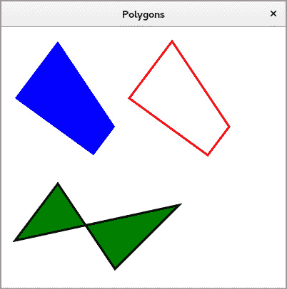

### 练习 8

折线定义为直线的序列。通常情况下，折线不是填充形状，但如果你定义了填充颜色，它就是填充的。在此练习中，你必须编写一个程序打开以下窗口：

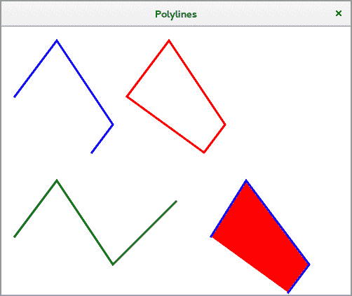

### 练习 9

编写一个程序显示两个`quadCurve`。如果你不记得`quadCurve`的定义，可能需要在书中查阅。该程序应打开以下窗口：

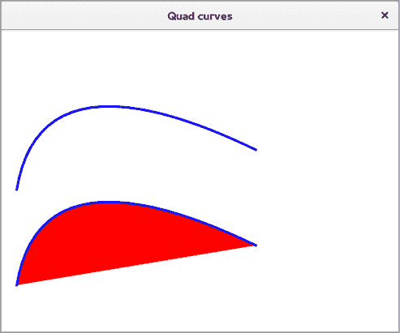

### 练习 10

编写一个程序显示两个`cubicCurve`。如果你不记得`cubicCurve`的定义，可能需要在书中查阅。该程序应打开以下窗口：

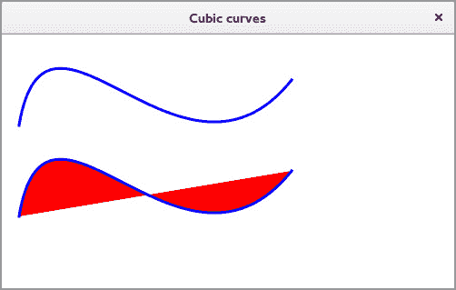

### 练习 11

编写一个程序打开下面的窗口，显示 6 个圆形/椭圆扇。所有扇从 0 开始，跨越 60 度。上方三个是半径为 100 的圆，下方三个是半径为 200 和 100 的椭圆：

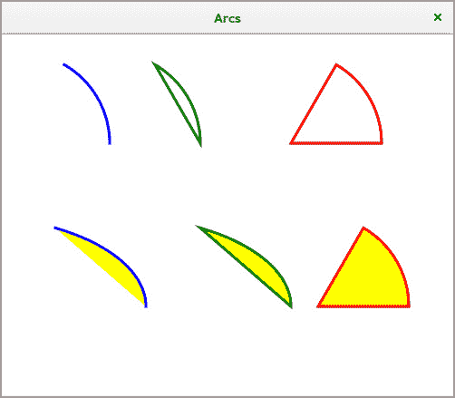

## 3.1 SVG

SVG 代表可缩矢量图形，在 JavaFX 中，你通过包含命令的字符串形式路径来定义形状。以下是代表光标工具的命令：

1. `M` 或 `m`，表示移动到（move to）。结果是光标移动到后续坐标。如果命令是 `M`，坐标表示绝对位置；如果是 `m`，则表示相对位置。如果你指示了多个坐标，它们将被视为一系列连续的移动操作。
2. `Z` 或 `z`，表示关闭（close），并从光标当前位置到路径起点画一条直线来关闭路径。
3. `L` 或 `l`，表示线（line to）。结果是光标从当前点到后续坐标画一条直线。如果命令是 `L`，坐标表示绝对位置；如果是 `l`，则表示相对位置。如果你指示了多个坐标，它们将被视为一系列连续的连线操作。
4. `H` 或 `h`，表示水平移动（horizontal to）。结果是光标从当前点到后续的 `x` 坐标画一条水平线。如果命令是 `H`，坐标表示绝对位置；如果是 `h`，则表示相对位置。如果你指定了多个 `x` 坐标，它们将被视为一系列连续的水平移动操作。
5. `V` 或 `v`，表示垂直到。结果是光标从当前点到坐标 `y` 绘制一条垂直线。如果命令是 `V`，坐标表示绝对位置；`v` 则表示相对位置。如果你指定多个坐标，它们被视为连续的垂直操作。
6. `C` 或 `c`，表示三次曲线。结果是光标从当前点到后续三个坐标对绘制一条三次曲线。前两个是控制点。如果命令是 `C`，坐标表示绝对位置；`c` 则表示相对位置。如果你指定多个坐标，它们将被视为连续的曲线操作。
7. `Q` 或 `q`，表示二次曲线。结果是光标从当前点到后续两个坐标对绘制一条二次曲线。第一个是控制点。如果命令是 `Q`，坐标表示绝对位置；`q` 则表示相对位置。如果你指定多个坐标，它们将被视为连续的二次操作。
8. `A` 或 `a`，表示圆弧到。结果是光标从当前点到 `(x, y)` 绘制一个圆弧。参数（`rx ry large sweep x y`），`rx` 和 `ry` 是椭圆的半径，`large` 和 `sweep` 指示选择哪一个圆弧。命令 `A` 指定绝对位置，`a` 指定相对位置。如果你指定多个参数集，它们被视为连续的圆弧操作。

例如，下面的应用程序打开了以下窗口：

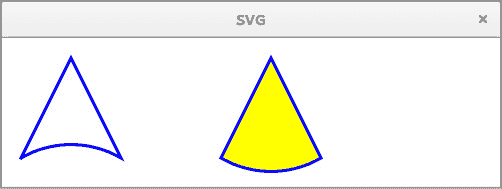

显示了两个形状，类型均为`Path`。两个形状都通过`line to`命令和一个`arc to`命令绘制。代码如下：


这里是 SVG 命令的用法。必须注意语法以及命令是如何通过空格分隔的。唯一明显的是命令 `A`，它定义了一个圆弧。在这种情况下，它是从 `(120, 120)` 到 `(20, 120)` 的半径为 100 的圆弧：

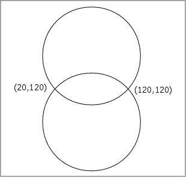

选择哪一个由两个参数`large`和`sweep`决定（其值为 0 或 1）。

### 练习 12

编写一个程序打开以下窗口，显示两个`Path`形状，其中蓝色曲线由`move to`、两个`line to`和一个`arc to`操作组成，而红色由一个`quad to`、两个`line to`、一个`cubic to`和一个`close`操作组成：

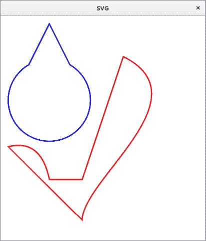

## 3.2 Path

与其像上面那样通过字符串定义路径，不如将绘制对象添加到绘制对象的`Path`对象中。这样做的好处主要是编译器可以检查语法，从而在运行之前检测到错误。有以下绘制对象：

- `MoveTo`
- `LineTo`
- `HLineTo`
- `VLineTo`
- `ArcTo`
- `QuadCurveTo`
- `CubicCurveTo`

例如，下面的程序绘制了与上例相同的窗口：

[](image/Java_14__Development_of_applications_with_JavaFX_9-4-18_34.jpg)[](img/Image1935.jpg)

事实上，没什么需要解释，但你应该注意如何创建`Path`对象以及如何添加绘制对象。还要注意如何创建每个绘制对象，以及对象是按照添加到`Path`对象的顺序使用的。

### 练习 13

你必须编写一个程序打开与练习 12 相同的窗口，但这次两个形状的类型必须是`Path`。

### 练习 14

编写一个程序打开以下窗口，此时形状应该是一个`Path`对象：

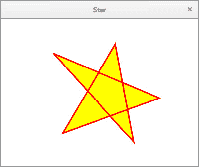

## 3.3 形状属性

上述主要关注直线、矩形、圆形等图形的形状，但形状还有一些其他属性，包括它们如何填充以及轮廓如何绘制。本节将讨论这些特性中最重要的部分。

轮廓——即线/曲线——可以用三种方式绘制：

1. `StrokeType.CENTERED`，默认值，意味着绘制轮廓时，形状的边缘恰好是轮廓线的中心。
2. `StrokeType.INSIDE`，轮廓在形状内部绘制。
3. `StrokeType.OUTSIDE`，轮廓在形状外部绘制。

程序`StrokeProgram`打开了以下窗口，说明了绘制轮廓的三种方式：

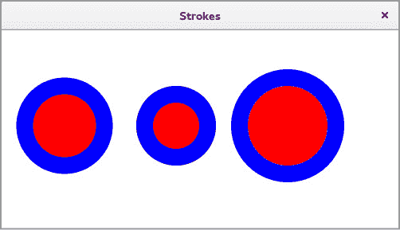

代码如下：


另一种是线条的端点，有三种选项（正如你从 Java2D 中熟悉的）：

1. `StrokeJoin.MITER`，默认值
2. `StrokeJoin.BEVEL`
3. `StrokeJoin.ROUND`

你可以在关于 Java2D 的书中找到这些端点的详细解释。应用程序`JoinProgram`打开以下窗口，显示了三种的效果：

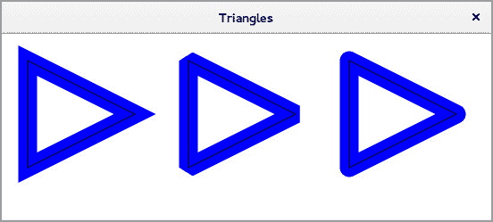[](image/Java_14__Development_of_applications_with_JavaFX_9-4-18_37.jpg)[](image/Java_14__Development_of_applications_with_JavaFX_9-4-18_38.jpg)[](image/Java_14__Development_of_applications_with_JavaFX_9-4-18_39.jpg)

线条端点也有类似的选项（请查看书籍 10）：

1. `StrokeLineCap.BUTT`
2. `StrokeLineCap.SQUARE`
3. `StrokeLineCap.ROUND`

### 练习 15

编写一个可以调用`LineCaps`的程序。该程序必须打开以下窗口，显示 6 个`Line`对象（每个长度为 200），并且蓝色线条的端点分别为`BUTT`、`SQUARE`和`ROUND`：

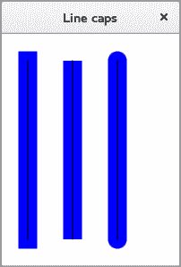

## 3.4 形状操作

通常，如果你向`Group`添加两个`Shape`对象且这两个形状重叠，那么后添加的形状将覆盖第一个形状的部分。`Shape`类有三个静态方法：

- `union()`
- `intersect()`
- `subtract()`

它们都将两个`Shape`对象作为参数，并将这两个对象合并成单个的`Shape`对象。应用程序`OperationProgram`展示了如何应用这种操作并打开以下窗口：

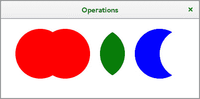[](image/Java_14__Development_of_applications_with_JavaFX_9-4-18_41.jpg)

# 4 文本

文本可以用`Text`对象表示，重要的是`Text`继承自`Shape`，因此它可以作为任何其他`Shape`对象使用，并作为节点进入场景图。事实上，没什么需要解释，但应用程序`TextProgram`打开了以下窗口：

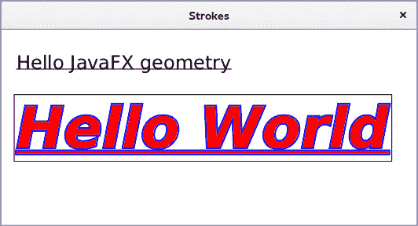

它的工作原理与你熟悉的 Java2D 几乎相同，但使用了不同的类。完整的代码如下：

[](image/Java_14__Development_of_applications_with_JavaFX_9-4-18_44.jpg)

顶部的文本通过`text1()`方法作为一个`Text`对象被创建。在这里你需要注意，带有参数的构造函数包含了文本的坐标，这些坐标表示基线的左端点（文本“所处”的基准线）。此外，你应该特别注意如何创建字体。这是通过`Font`类中的静态方法`font()`以及两个枚举`FontWeight`和`FontPosture`实现的。

`line()`方法接受一个`Shape`对象作为参数，该方法创建一个与`text1()`创建的文本基线相对应的`Line`对象。在这里，你应该特别注意`getBoundsInLocal()`方法，它返回一个`Bounds`对象（定义在`javafx.geometry`包中），该对象包含了`Shape`对象的宽度、高度以及其位置，因此包含了外接矩形。关于后者，它不是一个简单的 `(x, y)` 值，而是分别是可能出现的最小和最大 `x` 和 `y` 值。

`getBoundsInLocal()`方法返回任何变换之前的外接矩形。还有一个`getBoundsInParent()`方法，它返回变换后的外接矩形。在这种情况下，仅使用`Bounds`对象就足以确定要绘制的线的长度。

`text2()`方法为下方的文本创建一个`Text`对象。由于`Text`对象也是一个`Shape`对象，你可以像处理其他形状对象一样指定填充（fill）和描边（stroke）。在这种情况下，对象的位置并不是由构造函数定义的，这只是为了展示还有其他选项。特别要注意如何指示文本需要下划线。

最后，有一个方法`rect()`用于返回最后一段文本的外接矩形，在这里你应该主要注意如何使用`Bound`对象定义矩形。

# 5 效果

如前所述，JavaFX 程序将用户界面的内容表示为场景图（scene graph）中的节点。可以使用所谓的“效果”（effects）来更改单个节点的显示方式，效果是一个用于修改节点绘制方式的对象。这对于表示图像和几何图形等图形对象的节点来说，主要很有意义。本章将对这些效果进行简要介绍。基本上，以下效果被表示为`javafx.scene.effect`包中的类：

- `ColorAdjust`，可用于修改图像的颜色，你从中调整色调、饱和度、亮度和对比度。
- `ColorInput`，对应于绘制填充颜色的矩形。
- `ImageInput`，用于用图像填充矩形区域。
- `Blend`，用于合并两个输入的像素。
- `Bloom`，用于为节点的部分区域提供更多色调。
- `Glow`，用于增加节点的色调。
- `BoxBlur`，用于通过框滤（box filter）对节点进行模糊操作。
- `GausienBlur`，也用于对节点进行模糊处理，但使用的是核（kernel）。
- `MotionBlur`，一种高斯模糊，其中还包含一个角度。
- `Reflection`，对节点执行反射。
- `SepiaTone`，为节点染上棕色色调。
- `Shadow`，通过边缘模糊产生阴影效果。
- `DropShadow`，在节点后面创建阴影效果。
- `InnerShadow`，在节点边缘内部创建阴影效果。
- `Lighting`，用于模拟光效，你从中指定光源，如点光源、距离光或聚光灯。
- `Light.Distant`，`Lighting`的变体。
- `Light.Spot`，`Lighting`的变体。
- `Point.Spot`，`Lighting`的变体。

作为一个示例，我展示了一个调整图像颜色的程序。该程序名为`ColorAdjustProgram`，并打开以下窗口：

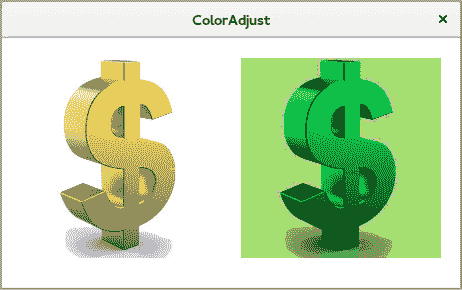

其中左侧图像是原图，而右侧是调整后的图像。程序应该只显示使用`ColorAdjust`的语法，但在这种情况下并没有对图像产生任何改进。程序还展示了如何从本地磁盘将图片加载到 JavaFX 程序中。程序代码如下：

```
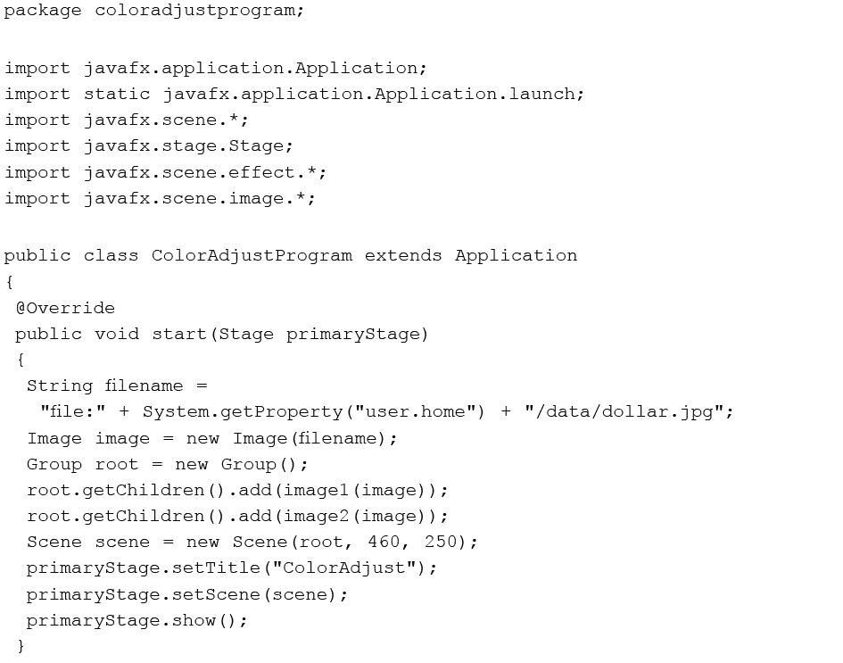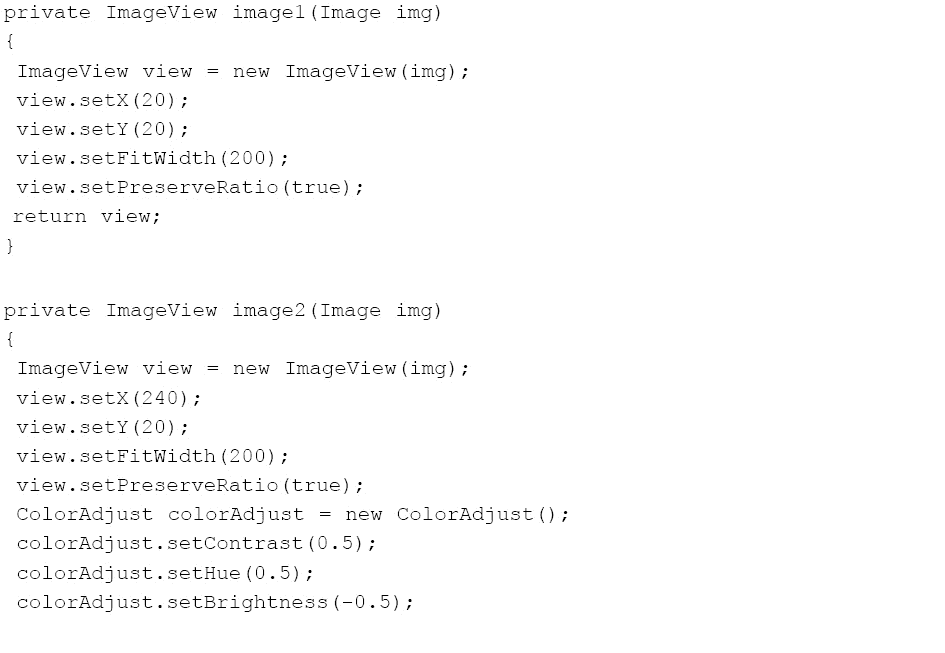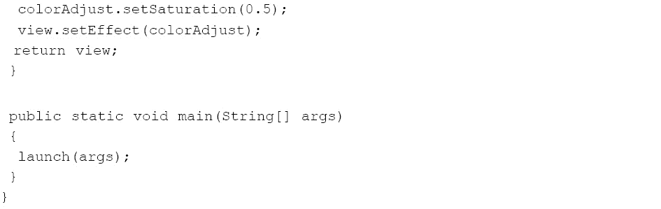
```

图像在`start()`方法中加载，通常通过定义图像的路径来实现，这是一个`jpg`图像。在这种情况下，图像被放置在我主目录下的`data`目录，但图像也是包含示例的书籍 zip 文件的一部分。与文件名唯一的区别是它以协议名称开头，因为图像位于本地文件系统中。在其他情况下，它将是`http`协议。图像是通过创建一个`Image`对象来加载的。

图像作为`ImageView`对象插入到程序的场景图中，`image1()`方法为原图创建一个`ImageView`对象并指定图像左侧的坐标。`image2()`方法为原图创建一个`ImageView`对象并指定图像左侧的坐标。

### 问题 1


编写一个打开上述窗口的程序。目标是可以实验四个属性：亮度、对比度和饱和度。图片名为`stone.jpg`，包含在书中。你必须能够通过窗口顶部的`Slider`控件来调整这些属性。这意味着你需要处理在移动时触发的事件。这是通过定义`javafx.beans`中的`ChangedListener`实现的。

## 5.1 颜色

在上面的示例（以及之前的章节练习）中，我使用了颜色并展示了如何填充形状以及绘制边界。通常有四种选择：

1. 均匀颜色，对应于`Color`类对象。
2. 线性渐变色，对应于`LinearGradient`类对象。
3. 径向渐变色，对应于`RadialGradient`类对象。
4. 图像，对应于`ImagePattern`类对象。

`ColorProgram`程序打开以下窗口：


程序的场景图有 8 个节点，分别是 4 个`Text`节点和 4 个`Circle`节点。通过以下方法创建文本节点：

```
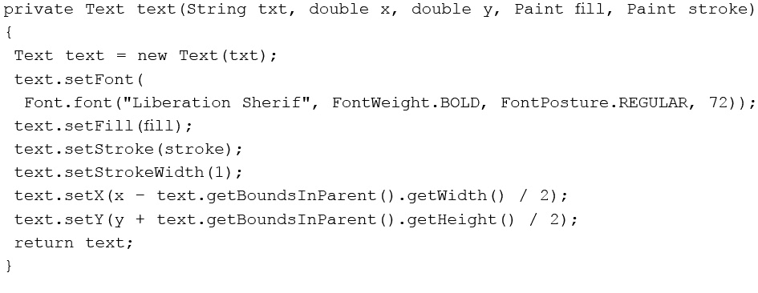
```

参数是文本、形状的位置坐标以及用于填充图形和绘制边界的颜色。你应该注意，颜色可以是上述四种选项之一，每个选项的基类类型都是`Paint`。

通过以下方法创建圆：

```
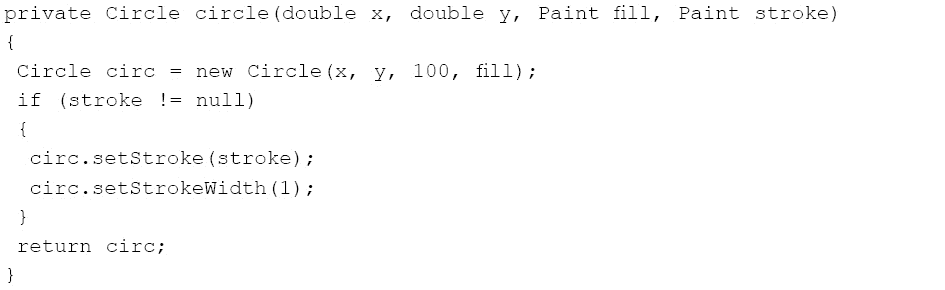
```

在这里，参数与文本节点相同。窗口显示了四个图形，每个图形由一个`Text`节点和一个`Circle`节点组成。第一个使用均匀颜色绘制，对于之前说过的颜色来说，这没有什么特别可说的。下一个图形使用了线性渐变色，其定义如下：

```
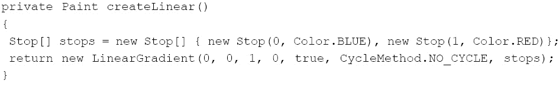
```

线性渐变画由两个或多个颜色定义，这些颜色被定义为`Stop`类型的对象。每个停止点表示一种颜色和一个位置，该位置可以是相对的也可以是绝对的。在这种情况下，第一个颜色停止点是蓝色，位置为 0，这意味着该颜色是起始颜色。另一个颜色是红色，位置为 1，这意味着最后一个颜色值必须是红色。这两个极值之间的所有颜色都是蓝色和红色的混合。

`LinearGradient`的参数是起始位置（此处为 `(0.0)`）和结束位置（此处为 `(1.0)`），下一个参数指示坐标必须被解释为相对（`true`）或绝对的。在这种情况下，坐标表示它们必须沿着从形状的左边缘到形状的右边缘的 x 轴进行混合。倒数第二个参数表示如果坐标没有定义整个形状，是否应该重复该模式，最后一个参数是颜色停止点。

径向渐变画的定义方式几乎相同：


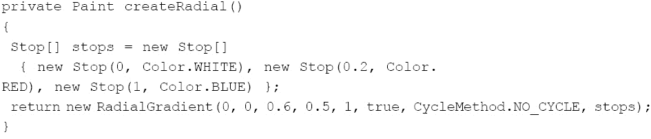

同样，必须定义两个或多个颜色停止点，在这种情况下定义了三个。它们表示从白色开始，在 20% 之后颜色应变为红色，最后一个是蓝色。`RadialGradient` 的参数从定义一个起点开始，该点是焦点点，也是第一个停止点。第一个参数是该焦点的角度，而下一个是到焦点的距离。接两个参数是焦点的坐标，而下一个是定义 `Paint` 对象所围区域的圆半径。最后三个参数的含义与 `LinearGradient` 相同。

最后，还有一个 `ImagePattern`，它是一个绘制图像的 `Paint` 对象。在程序的 `start()` 方法中，一个图像（`Bean.png`）被加载为一个 `Image` 对象。然后可以使用此图像来创建一个 `ImagePattern` 对象：

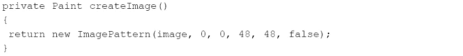

除了图像外，参数还包括图形的起始坐标（左上角）、图形的宽度和高度（图形被缩放为此大小），以及坐标应该被解释为相对的还是绝对的。

## 5.2 图像

在之前的示例中，我已经展示了如何加载图像并将其显示在窗口中。实际上，图片与效果关系不大，但上面的示例中用到了一些图片，还有几点备注需要添加，因此这里提供几个额外的示例。

图像在场景图中作为 `ImageView` 节点显示，图像本身在程序中被表示为 `Image` 对象，可以通过指定图像路径作为构造函数的参数从机器的硬盘中加载。接下来的程序被称为 `ImageViewProgram`，它会打开以下窗口：

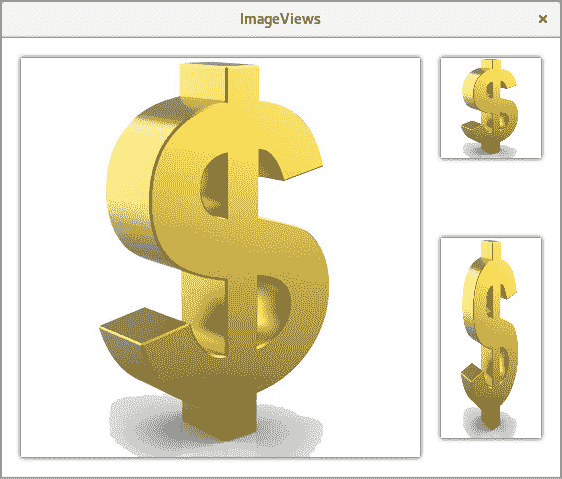

显示了三次相同的图像，该示例主要应展示如何缩放图像。第一张图像（大的那张）未缩放，而另外两张经过了缩放。代码如下：

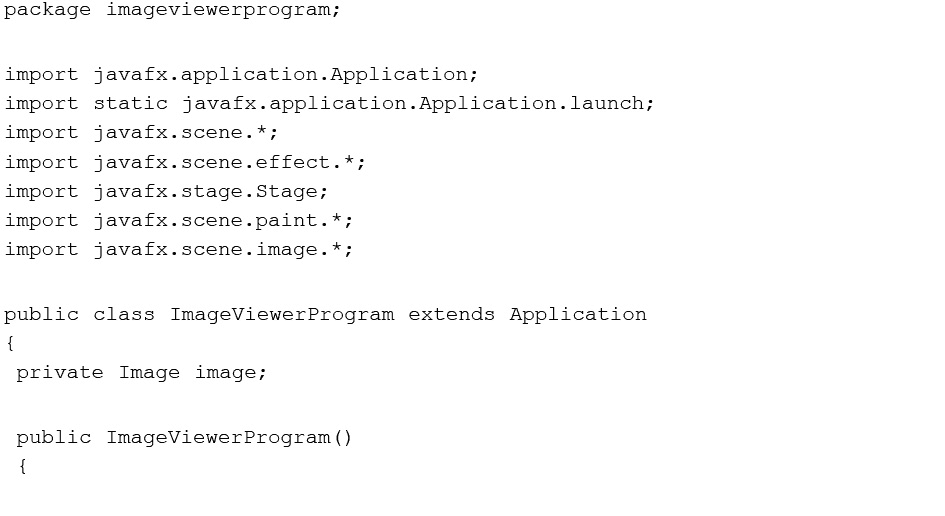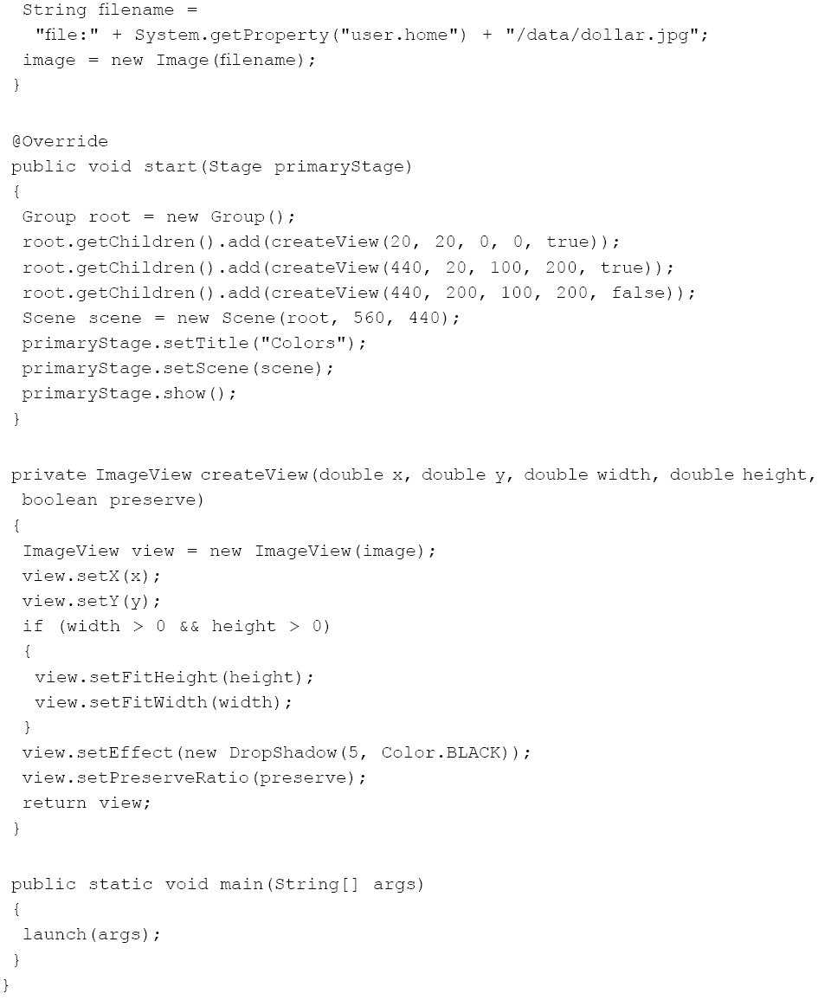

图像在类的构造函数中加载，然后可以使用实例变量 `image` 进行引用。`createView()` 方法为图像创建一个 `ImageView`，它有五个参数，前两个是 `ImageView` 对象左上角的坐标，接两个指示宽度和高度。最后一个指示图像的属性是否被保留。该方法的语句很容易理解，可能除了 `setEffect()` 的含义外，但结果是在图像外绘制了一个帧。如果没有指定 `width` 或 `height`，则这些属性将不会被设置，结果是应用图像的物理尺寸。

检查 `start()` 方法可以发现第一张图像没有尺寸。因此，图像尺寸变为物理尺寸，即 400 × 400。对于下一张图像，尺寸被设置为 100 × 200，它将在该框架内缩放，但由于提到了要保留属性，结果是图像在两个方向上都等缩放了 1/4，你得到一张 100 × 100 的图片。对于最后一张图像，指定了相同的尺寸，但没有保留属性，因此图像在两个方向上都进行了缩放，所以它将填充 100 × 200。

作为关于图像的最后一个示例，我将展示一个名为 `PixelProgram` 的程序。该程序应该展示如何操作图像中的单个像素。起点是上面所示相同的图片。这里有一图像的像素是白色的（背景），程序应该将背景改为黑色。也就是说，所有白色像素必须改为黑色。通常情况下这是简单的，但由于它是一张 jpg 图像，靠近图形的像素不会完全是白色，因此有必要对像素何时为白色允许不确定性。执行程序后将得到结果：


最重要的重要的是 `createImage()` 方法，它返回一个带有修改图像的 `ImageView`。首先确定图像的宽度和高度，创建一个相同大小的内存表示。类型为 `WritableImage`，我将其命名为 `buffer`。接下来为原始图像定义一个 `PixelReader`，这意味着你可以引用像素。此外，为 `buffer` 创建一个 `PixelWriter`，允许你修改缓冲区。接下来程序使用读取器遍历原始图像的像素（逐行），对于每个像素，更新 `buffer` 中的像素。在这里你应该注意 `isWhite()` 方法，它测试像素是否可以被视为白色。

## 5.3 光

在效果章节的引言中，我列出了可以应用的不同效果，并且远没有说明它们（也打算这样做），但我想通过对光的简单介绍来结束这个章节。原理是光源照射在图形上，图形的颜色取决于光源的性质及其相对于图形的位置。

通常，你可以使用 `Lighting` 对象将光效果关联到图形，如果你不指示光源，则使用默认光源，这对应于直接射入图形的光，产生微弱的 3D 效果。你也可以显式地指示光源，有选择：

1. `Light.Distant`
2. `Light.Point`
3. `Light.Spot`

第一个对应于距离光源，因此从远程光源向一个方向发送光：

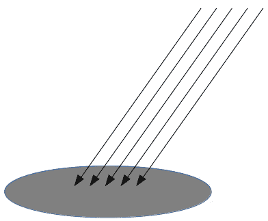

你可以设置两个值（均为 `double` 类型）：

1. `azimuth`（方位角），指示光源绕 z 轴旋转的角度
2. `elevation`（仰角），指示光源绕 x 轴旋转的角度

此外，你可以指示光源的颜色。

光强度取决于光源到图形的距离。最后还有第三种选择，它与上述相似，但不同在于你可以指定一个 `specular` 来控制光源的聚焦。

如果你运行程序 `LightingProgram`，它会打开以下窗口：

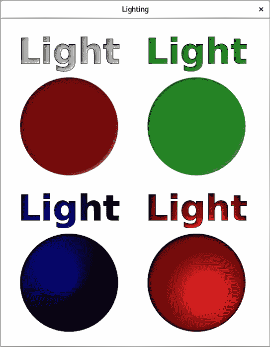

该示例看起来和 `ColorProgram` 相似，但它不是在展示颜色的效果，而是展示光照的效果。顶行的图形分别显示了标准光源和远光源的效果，而底行的两幅图分别显示了聚光灯和点光源的效果。程序的代码如下：

```
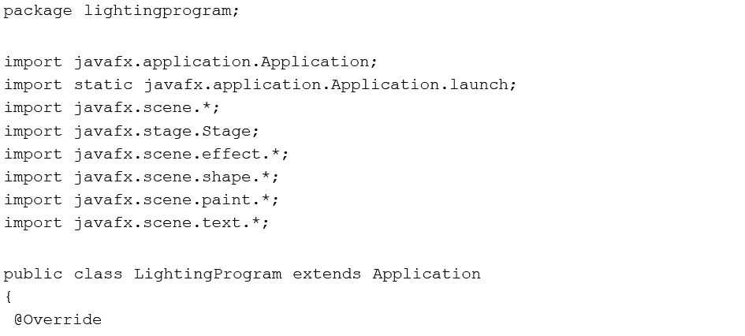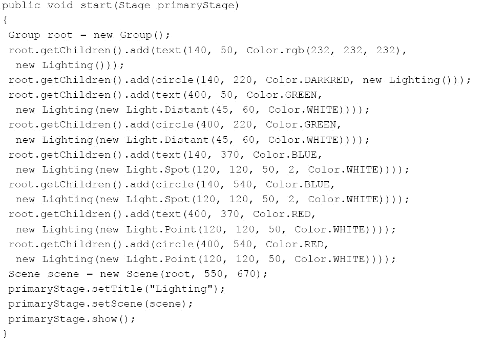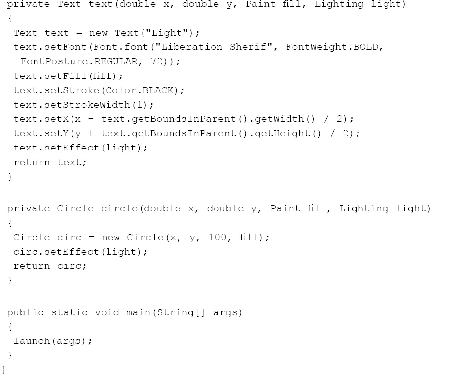
```

`text()` 和 `circle()` 方法与之前的对应方法相似。你应该主要关注 `start()` 方法，以及这里如何创建 `Light` 对象作为光源，作为 `Lighting` 对象（这是一个效果）的参数。注意，具体的 `Light` 类被定义为 `Light` 类中的内部类。

## Problem 2

为了对光源进行一些实验，请编写一个打开以下窗口的程序：

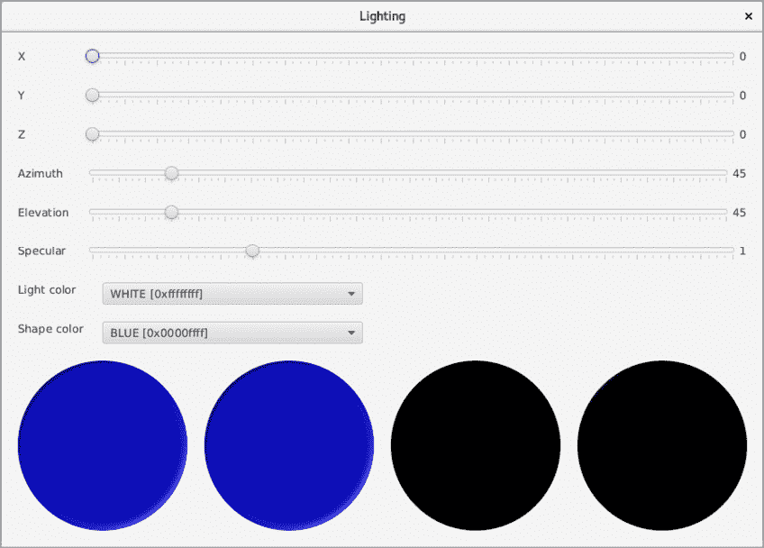

从左到右提到的四个圆使用了以下光源：

1. default
2. distant
3. spot
4. point

设置选项通过 `Slider` 控件和 `ComboBox` 控件实现，且名称应该解释其含义。某个设置选项并不一定对所有光源都有效，但如果改变了某项设置，这种变化必须反映在相关的形状上。对于 `ComboBox` 控件，必须用颜色初始化，我已经在下面的包装类中封装了一个颜色：

```
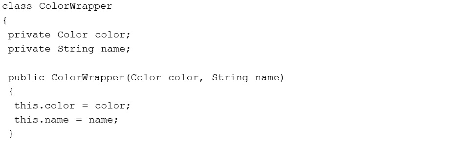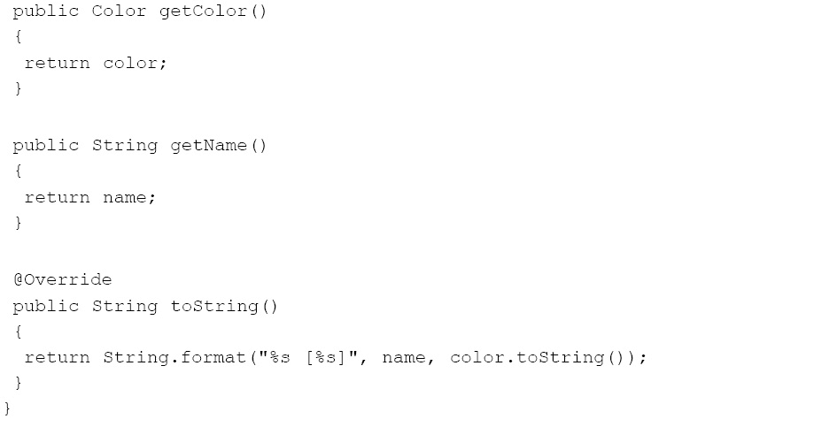
```

你可以使用适当数量的标准颜色（`Color` 类中的静态对象）初始化两个 `ComboBox` 控件，但你实际上可以使用以下方法决定所有的颜色：

```
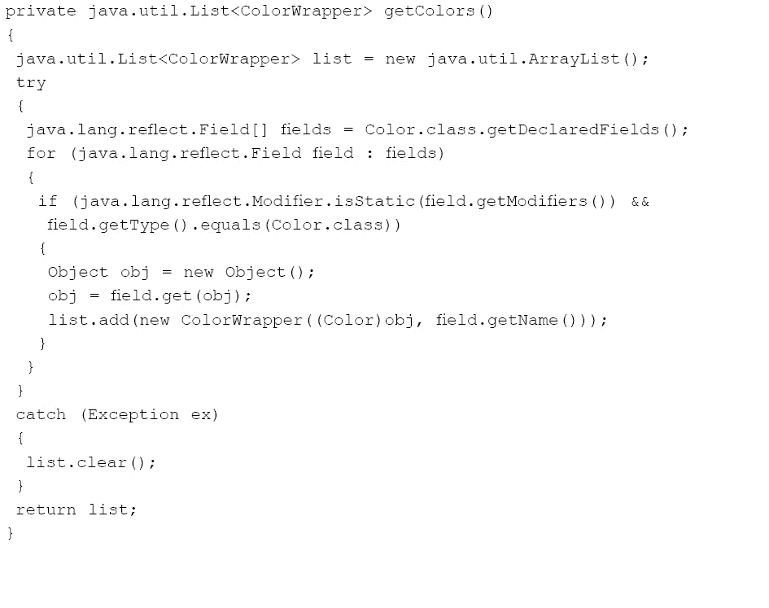
```

# 6 变换

JavaFX 也支持场景图中节点的变换，其发生方式在很大程度上与你在 Java2D 中熟悉的方式相同。通常有 4 种变换：

1. Translater（平移）
2. Scaling（缩放）
3. Rotation（旋转）
4. Shearing（倾斜）

其含义与 Java2D 中相同。作为一个简单的示例，以下程序执行了矩形的平移：

```
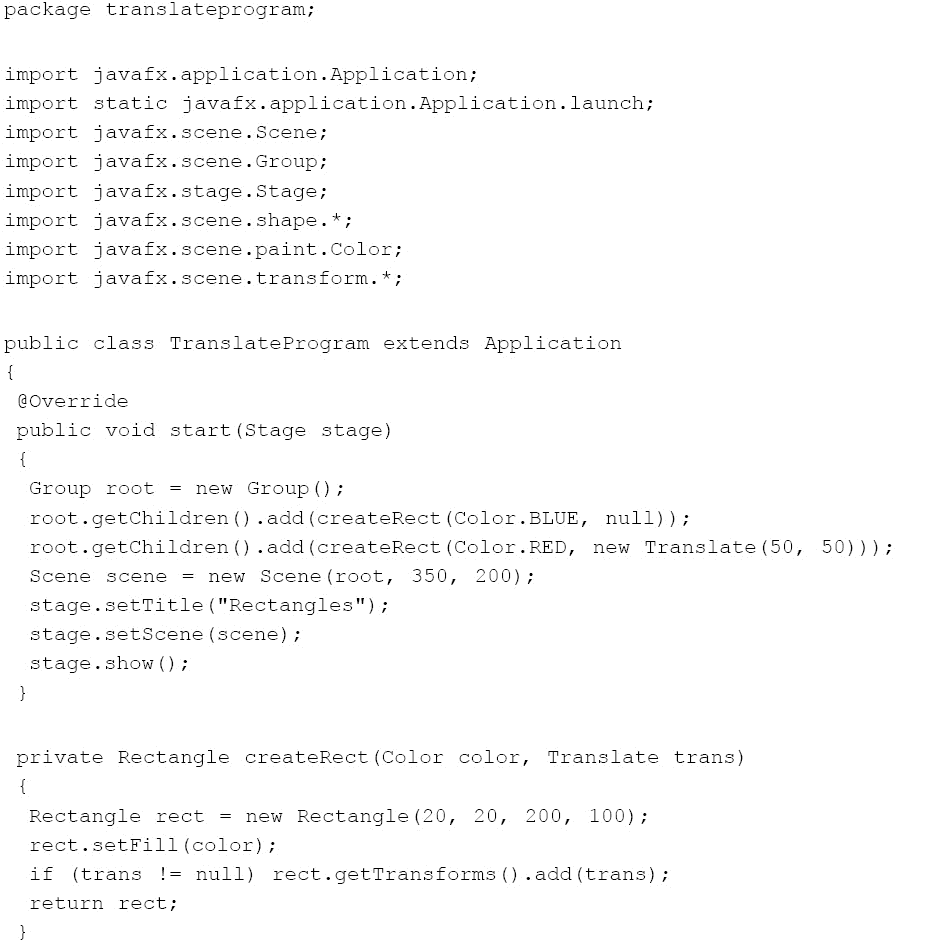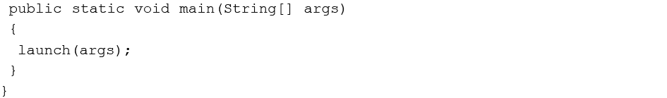
```

方法 `createRect()` 创建了一个具有固定位置和大小的 `Rectangle`，以及一个颜色参数。最后，还有一个参数可以指示变换，从而将矩形移动到另一个位置。也就是说，程序创建了两个大小和位置相同的矩形，但其中一个（红色）在两个方向上都平移了 50 像素：

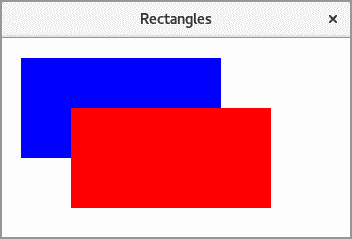

## Exercise 16

编写一个打开以下窗口的程序：

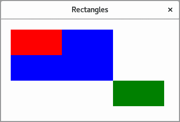

蓝色矩形位于 (20, 20)，大小为 200 × 100。红色矩形是蓝色矩形的缩放，它在两个方向上都缩放为 50%，且从点 (20, 20) 开始。绿色矩形是相应的缩放，但随后进行了平移。注意，在复合变换的情况下，顺序是有意义的。

## Exercise 17

编写一个打开下方窗口的程序。这里蓝色矩形的左上角位于 (180, 180)，大小为 200 × 100。红色矩形是蓝色矩形绕点 (180, 180) 旋转 45 度。绿色矩形是绕同一点旋转，但角度为 -45 度，且旋转后进行了平移。

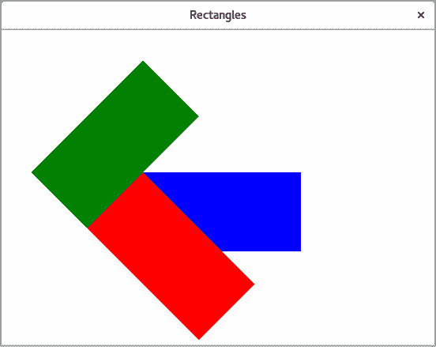

## Exercise 18

编写一个程序，当红色矩形是蓝色矩形的倾斜时，打开一个类似下面的窗口：

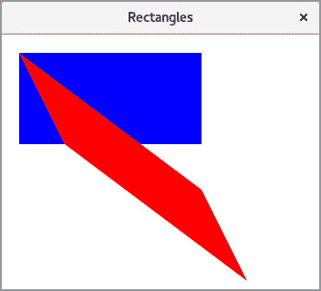

## 6.1 动画

在本节中，我介绍了动画，你也可以将其视为节点变换的一种形式。动画基本上意味着改变节点的一个或多个属性，如果你多次这样做并在很短的间隔内进行，在用户看来，该节点就像是“活”的了一样。正如 Java 10 所述，节点需要在短时间间隔内重绘，使得该值被重绘。在 JavaFX 中，基类是 `Transition`，具体的类有：

- `FadeTransition`
- `FillTransition`
- `RotateTransition`
- `ScaleTransition`
- `StrokeTransition`
- `TranslateTransition`
- `PathTransition`
- `SequentialTransition`
- `PauseTransition`
- `ParallelTransition`

作为一个示例，我将向你展示如何使用 `FadeTransition`。如果你运行程序 `FadeAnimation`，以下窗口显示了一个圆：

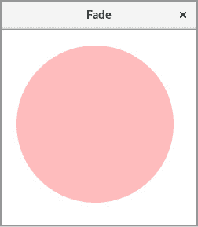

圆变得逐渐透明并消失。然后它再次增大直到显示原始状态。这个循环重复 5 次。代码如下：

```
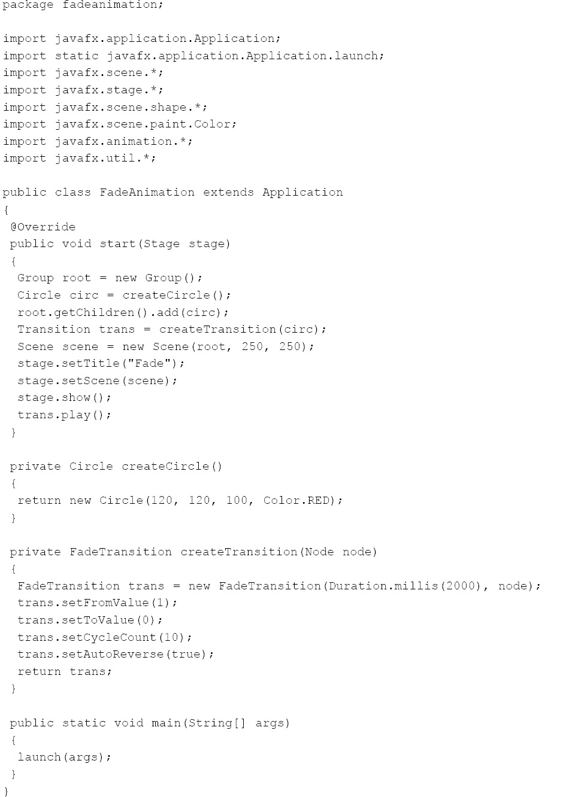
```

`createCircle()` 方法显而易见，而 `createTransition()` 方法创建了过渡。在这种情况下，它是 `FadeTransition`，构造函数告诉动画应该持续 2 秒。动画将值从 1（不透明）变为 0（完全透明）。下一个语句告诉动画重复 10 次，最后在动画完成后，下一个必须反向进行。在 `start()` 中，创建一个 `Transition` 对象并使用语句

```
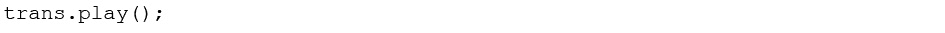
```

启动动画。

其他动画类的使用方式相同，但不是展示示例，而是制定了一系列练习来说明重要类的应用。

## Exercise 19

编写一个打开带有蓝色圆窗口的应用程序：

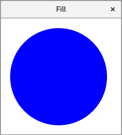

然后程序应该通过 `FillTransition` 将颜色变为红色。动画必须持续 5 秒，然后重新开始变为蓝色圆。动画必须重复 50 次。注意，`FillTransition` 不能应用于通用的节点，但它必须是一个 `Shape`。

## Exercise 20

编写一个可以调用 `ScaleAnimation` 的程序，它打开一个带有红色圆的窗口：

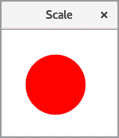

程序必须通过动画改变圆的大小，使其能够缩小和增大。

## Exercise 21

编写一个可以调用 `TranslateAnimation` 的程序。该程序必须打开一个如下所示窗口，其中一个带有动画的红圆从左上角移动到右下角。你可以使用 `TranslateTransition`。动画周期为 2 秒，且动画必须重复 50 次。你必须将 `AutoReverse` 设置为 true。

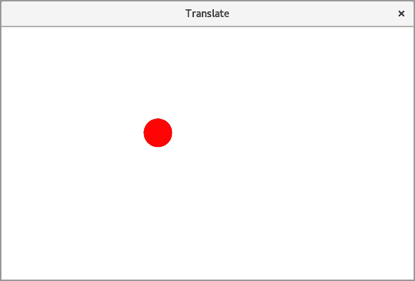

### 练习 22

你必须编写一个名为 `RotateAnimation` 的程序，显示一个矩形。该矩形应该从 0 度旋转到 360 度，同时颜色必须从红色变为蓝色——并在下一次旋转中再次变回：

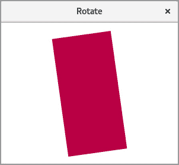

注意，这次你将需要使用两个过渡（transitions）。

### 练习 23

编写一个程序 `PathAnimation`，其中一个红圆沿着 `CubicCurve`（见下）移动。该曲线必须定义为一个 `Path` 对象，并且作为过渡对象可以使用 `PathTransition`。圆圈的动画必须运行两秒，你必须将 `AutoReverse` 设置为 `true`。

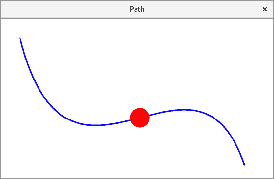

### 练习 24

作为动画的最后一个示例，编写一个与类似的程序 `SequentialAnimation`，其中一个红圆沿着 `CubicCurve` 移动，但动画只重复一次。当圆到达曲线末端时（动画停止），圆应该通过动画将颜色更改为蓝色，并再次变回红色。因此，该程序必须使用两个顺序执行的动画。

# 7 组件

回顾上述内容，我主要关注了你在 JavaFX 中如何与几何对象交互，但我只概括性地提到了用户可以交互的组件。从实际程序的角度来看，这无疑是最有趣的部分，也是本章及后续章节的主题。这涉及到哪些组件可用以及它们如何在窗口中布局。此外，还有事件管理。

## 7.1 布局

程序的场景图（scene graph）由组件组成，这些组件可以像我结合几何对象使用时那样进行绝对布局，但通常，节点是通过布局面板（layout panes）放置在场景图中的，布局面板是一个分支节点。从程序员的角度来看，布局面板的特性（和目的）与 Swing 中的布局管理器（layout manager）相同，且理论类似于你从 Swing 中了解的知识。所有的布局面板都有一个共同的基础类 `Pane`，并且有特定的面板：

* `HBox`
* `VBox`
* `BorderPane`
* `StackPane`
* `Flow Pane`
* `TextFlow`
* `AnchorPane`
* `TitlePane`
* `Grid Pane`

在本节中，我将展示如何使用布局面板来布局组件，当然，它们可以像你从 Swing 中了解那样进行嵌套。以下示例相互相似，简要展示了不同面板的应用，但你应该查看在线文档以及可以使用哪些属性。

我想从 `HBox`（`HBoxProgram` 应用程序）开始，它在窗口中水平地放置组件，这里有三个按钮：

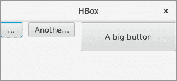

如你所示，按钮的大小（宽度）根据可用空间变化，下面我展示了尺寸变化后的相同窗口：


如你所示，组件默认是左对齐的，但可以通过属性进行更改。代码如下：

```

```

你可能注意到最后一个方法 `createButton()` 为按钮分配了一个首选大小，在 JavaFX 中，基本上组件的大小也适用此，正如你从 Swing 中了解的那样。对于 `start()` 方法，没什么好解释的，但你应该注意如何定义组件之间的间隙。`HBox` 是一个非常简单的布局面板，只能用于相对于它们的首选大小在行上排列组件。

有一个名为 `VBox` 的布局面板，它与 `HBox` 平行，区别在于它将组件放置在垂直线上。`VBoxProgram` 程序展示了该布局面板的应用：

!(image/Java_14_–_Development_of_applications_with_JavaFX_9-4-18_81.jpg)!(image/Java_14_–_Development_of_applications_with_JavaFX_9-4-18_82.jpg)

没什么新内容需要解释的，但你应该注意如何指示组件应该在窗口中居中显示。鼓励你研究 `Pos` 类型其他还定义了哪些选项。

`BorderPane` 看起来像 `BorderLayout`，并将窗口分为 5 个区域，称为 `center`、`top`、`right`、`bottom` 和 `left`，通常按此顺序引用。与 `BorderLayout` 一样，中心将填充其他区域未使用的空间。`BorderProgram` 程序打开如下所示的窗口。除了显示 `BorderPane` 之外，该程序还应该展示嵌套面板的使用。窗口有 9 个组件：


1. `center`：一个 `TextArea`
2. `top`：一个带有 `TextField` 和一个 `Button` 的 `BorderPane`
3. `right`：一个带有 `Button` 和一个 `TextArea` 的 `BorderPane`
4. `bottom`：一个带有 `TextField` 的 `BorderPane`
5. `left`：一个带有 `Button` 的 `BorderPane`

你应该注意组件之间的间距以及它们在代码中是如何定义的。

!(image/Java_14_–_Development_of_applications_with_JavaFX_9-4-18_82.jpg)!(image/Java_14_–_Development_of_applications_with_JavaFX_9-4-18_83.jpg)

各个区域是通过三个命名为 `createField()` 的方法创建的。第一个用于中心并创建一个带有 `TextArea` 的 `BorderPane`。你应该注意通过 `setPadding()` 为剩余区域设置 10 的间距。此外注意 `BorderPane` 构造函数指定了单个参数，即要在显示的组件。第二个 `createField()` 用于创建位于顶部和底部。在 `BorderPane` 构造函数中指定了 5 个参数，解释为 `center`、`top`、`right`、`bottom` 和 `left`。

```

```

在这里，`setMargin()` 是 `BorderPane` 类中的一个静态方法，定义了第一个参数的边距。最后一个 `createField()` 方法用于为左右区域创建 `BorderPane`，基本上，它的工作原理与上一个方法相同。你应该注意为两个组件定义了底部边距。

最后，是 `start()` 方法，此时 `root` 元素是一个 `BorderPane`（它是一个分支节点）。在这里你应该注意如何创建 `root`，并设置 20 的边距。

`StackPane` 是一种按添加顺序堆叠组件的布局面板。`StackProgram` 展示了三个堆叠的按钮：


该应用可能有限，但主要对于 `Shape` 对象，这种可能性可能是用的。使用 `StackPane` 非常简单：

```

```

`FlowPane` 是一种布局面板，其行为类似于 Swing 中的 `FlowLayout`：


如果你增加了窗口宽度，所有组件将出现在同一行。关于代码，你应该首先注意如何定义组件之间的间隙：

```

```

还有一种布局面板，称为 `TextFlow`，它的行为与 `FlowPane` 相同，但仅用于 `Text` 节点。程序 `TextflowProgram` 展示了如何使用此面板。它可能不是最常用的布局面板，但如果你需要编写一个支持文本换行的自定义组件，它可能会很有用——这在 Swing 中实际上是相对复杂的。

（注：此处由于原文图片标签乱码，保留原样格式）

`AnchorPane` 将组件相对于容器的边缘进行放置：


在这种情况下，`root` 具有 30 的外边距，组件的位置使其距离右边缘 30（相对于外边距），距离底部上方 50（相对于外边距）。如果窗口大小发生变化，组件将跟随底部和右边缘。

然后是 `TilePane`，它将组件放入相同大小的单元格中。单元格的大小由最大的首选尺寸（在本例中为最后一个按钮）决定。一行内没有空间放置所有组件，行就会换行，因此最后一个组件将出现在下一行。


在这种情况下，组件是水平排列的（这是默认设置），但通过一个属性，可以指定组件应该垂直排列。

最后是 `GridPane`，这是一个非常实用的布局面板。与 Swing 相比，你可以实现与 `GridBagLayout` 类似的效果，但使用起来要简单得多。基本上，它是一个网格，但单元格的大小并不一定相同。程序 `GridProgram` 打开了以下窗口：


它包含 5 个组件：

*   2 个 `Label` 组件
*   2 个 `TextField` 组件
*   1 个 `Button` 组件

如果你更改窗口大小，组件将保持其位置和大小不变——至少只要窗口足够大。因此，它是一个典型的对话框。代码非常简单：

```

```

在 `start()` 方法中，创建了一个 `GridPane` 作为根节点。注意，你没有说明行数和列数。它有 20 的外边距，且行与行之间必须有 20 的间隙。然后我添加了一个宽度为 80 的 `Label`，并定义它应该位于 (0, 0) 单元格中，即左上角的单元格。下一个组件是一个宽度为 300 的 `TextField`，它应该位于 (1, 0) 单元格，这可以翻译为第 1 列第 0 行。同样，接下来两个组件的放置仅在于它们应该放在第 1 行。最后，将按钮放在 (1, 2) 单元格中，即第 1 列第 2 行。注意 (0, 2) 单元格没有放置任何内容。这不是必要的——单元格可以是空的。特别需要注意的是，`GridPane` 有一个静态方法，可以使用它来指定组件在单元格内的对齐方式：

```

```

## 7.2 事件

JavaFX 有它自己的事件类型，基本类型称为 `Event`。特定事件类型的示例包括：

*   `MouseEvent`
*   `KeyEvent`
*   `DragEvent`
*   `WindowEvent`
*   `ActionEvent`

一个事件的特征是：

1.  目标（target），即事件发生的节点，例如窗口、场景或节点
2.  源（source），即产生事件的源，例如鼠标
3.  事件类型（event type），例如鼠标按下、鼠标释放等

当事件发生时，人们会提到事件分发链（event dispatch chain），这是从阶段（stage）到该节点的路径。例如，对于 `Circle` 节点，路径可能是：

`Stage` – `Scene` – `Group` – `Circle`

当事件发生时，它会从上到下发送到其 `分发链` 中的所有节点。如果某个节点注册了该事件的过滤器（`filter`），则会执行该操作，随后事件将发送到目标节点，如果有事件处理器，它将在那里被处理。这一阶段被称为“事件捕获阶段”（`Event Capturing Phase`）。之后，事件向回传递，这一阶段被称为“事件冒泡阶段”（`Event Bubbling Phase`）。

在这种情况下，一种是过滤器（捕获阶段），另一种是处理器（冒泡阶段）。如下：

```

```

如果你打开程序，你会看到：

```

```

例如，点击鼠标时，标准输出内容如下：

```

```

当事件遵循链时，可以通过 `consume()` 方法停止它，这意味着它将不再被传递。如下：

```

```

这种情况下你会得到：

```

```

例如，检查 `Scene` 并点击时：

```

```

然后是代码：

```

```

首先，创建了 12 个 `CheckBox` 组件，其中前 6 个用于过滤器（捕获阶段），接后 6 个用于处理器（冒泡阶段）。如果你考虑 `start()` 方法，这次将过滤器和处理器都分配给了 `Stage` 节点——该节点是场景图的顶端。通过 `addEventFilter()` 关联过滤器，通过 `addEventHandler()` 关联处理器。在任何情况下，为 `mouse clicked` 关联事件处理器，如下：

```

```

其中第一个参数指示要监听的事件，另一个参数是事件处理器，这里有一个对象（在本例中）实现了 `EventHandler<MouseEvent>` 接口。这样的对象由 `Handler` 类定义，其构造函数接收要打印在屏幕上的文本作为参数，并接收要测试的 `CheckBox` 的引用。该类应该实现方法：

```

```

在这种情况下，该方法执行 `System.out.println()`，然后测试相应的 `CheckBox` 是否被选中，如果有必要，将事件标记为已消费（`consumed()`），这意味着它将不会在分发链中继续传递。

这些方法都非常简单且以相同的方式构建，你应该主要关注如何像上述描述的那样将过滤器（filters）和处理器（handlers）分配给各个节点。你应该注意 `createButton()`，它没有附加任何过滤器或处理器。如果你运行程序并点击按钮，你会发现分发链（dispatch chain）中没有执行任何事件处理器，这是因为通过 `setOnAction()` 关联的按钮与类型为 `EventHandler<ActionEvent>` 的事件处理器相关。这意味着通过鼠标点击，按钮将处理事件动作，而不是触发普通的鼠标事件，而是触发一个 `ActionEvent`。此外，注意按钮的 `ActionEvent` 事件处理器会打开一个简单的消息框，其中还包含了 JavaFX 中实现该操作的语法。

下一个示例称为 `KeyEventProgram`，它会打开以下窗口：


如果你在输入框中输入 `Enter` 键，绿色正方形将会旋转，点击正方形则将停止旋转。代码如下：


该类定义了一个过渡变量，它是旋转正方形的动画。它是通过 `createRotate()` 方法创建的，该方法在动画方面没有包含任何新内容。实际 `Transition` 对象在 `start()` 方法中创建。在这里你也应该注意如何设置窗口的背景颜色。正方形在 `createRect()` 方法中创建。在这里，使用 `setOnMouseClicked()` 方法为正方形附加了鼠标点击事件处理器，你应该注意如何使用 lambda 表达式定义事件处理器。

然后是 `createField()` 方法，它用于创建输入框。它是一个 `TextField`，最重要的是事件处理器的关联。它是一个过滤器，且处理器与类型为 `KEY_TYPED` 的 `KeyEvent` 关联。处理器使用 `getCharacter()` 方法来测试输入的内容，如果第一个字符的编码为 13，则表示了 `Enter` 键，如果是这样，动画将开始。对于任何事件，该事件都会被标记为已消费（consumed），这样它就不会在链中传递，其效果是按键的字符永远不会显示在输入框中。

因此，该示例展示了如何捕获鼠标和键盘事件。在示例中，它通过两种不同的方式实现：在 `createField()` 中通过 `addEventFilter()` 在低级别发生，而在 `createRect()` 中则是使用方便方法发生。许多 JavaFX 类将事件处理器定义为属性，你随后可以使用该方便方法的 set 方法来注册事件处理器。目标是更容易关联事件处理器，接下来的程序 `HandlerProgram` 应该说明这一点：


点击 Start（开始）按钮会启动动画，圆形沿着曲线移动，动画一直运行到你点击 Stop（停止）按钮为止。如果你点击圆形，它会改变颜色。


关于如何创建动画和曲线并没有新内容，发生在 `createTrans()` 和 `createRect()` 方法中。如果你考虑创建圆形的 `createCircle()` 方法，它使用一个名为 `setOnMouseClicked()` 的方便方法关联了鼠标点击事件处理器。你应该注意事件处理器是参数，并且是一个 lambda 表达式。

`createButton()` 方法用于创建按钮。它有三个参数：按钮的文本、在窗口中位置的 x 坐标以及按钮的事件处理器。后者的类型为 `EventHandler<ActionEvent>`，并与 `setOnActionEvent()` 方法关联。

## 7.3 组件

然后是组件（或控件），JavaFX 有许多组件，但最重要的是以下：

| Label | MenuButton | Slider | ColorPicker |
|-------|------------|--------|-------------|
| Button | MenuItem | ScrollPane | DatePicker |
| TextField | Menu | ScrollBar | ProgressIndicator |
| PassWordField | ContextMenu | TabPane | ProgressBar |
| TextArea | Separator | SplitPane | FileChooser |
| RadioButton | ChoieBox | TitlePane | HTMLEditor |
| Hyperlink | ComboBox | Accordion | TableView |
| CheckBox | ListView | Pagination | TreeView |
| ToggleButton | WebView | Tooltip | TreeTableView |

这些组件中的一些已经在之前的示例中使用过，本节的其余部分由练习和问题组成，你应该尝试使用上述组件（但最后一列的最后三个推迟到下一本书）。大多数组件都是易于使用的并占据了很大一部分，正如你从 Swing 中了解的那样。其他组件更为复杂，总体来说，以下练习要求你使用文档，必要时还在互联网上寻找示例和帮助。

### 练习 25

你必须编写一个打开以下窗口的程序：


其中有 4 个控件：1 个 `Label` 和 3 个 `Button` 控件。如果你点击 `New`，文本必须更改为

`Creatring a new document…`

点击 `Save` 文本应更改为

`Saving…`


如果你点击`Cancel`按钮，文本必须恢复原始文本。要求窗口不可调整大小，并且三个按钮都有快捷键。

关于绿色框，可以通过样式定义。这是下一章的主题，但你可以尝试能走多远。

### 练习 26

你必须编写一个打开以下窗口的应用程序：


顶部左侧有三个`Hyperlink`控件。`Hyperlink`与`Button`相同但绘制方式不同。在这种情况下，这三个链接必须指向一个网页（由你决定）。右侧有一个`MenuButton`，它是带有下拉列表的按钮，你可以在其中点击`MenuItem`控件。这种情况下必须有三个项目，每个项目指向一个网页。中间有一个`WebView`控件，它是可以打开并显示网页的控件。

底部有三个`ToggleButton`控件和一个`Label`。当你点击按钮时，`Label`控件必须更新为按钮文本，否则显示*None*。

注意顶部的命令和底部的命令相互无关，目标只是说明典型的控件。

### 练习 27

编写一个使用`ChoiceBox`控件的程序：


当人员由`Person`类型对象表示时，你必须从下拉列表中选择人员。它必须是一个姓名和职位表示人的简单模型类。要求`Person`类不能有任何`toString()`方法，相反，必须`ChoiceBox`控件关联一个转换器。选择人员后，必须用`Label`显示姓名和职位：


当你点击`Clear`按钮时，此标签必须清空，且`ChoiceBox`控件中没有选中的人员。

### 练习 28

你必须编写与上一个练习相同的程序，但有一个不同点：不是使用`ChoiceBox`，而是使用`ComboBox`。

当你写完程序后，尝试调查`ChoiceBox`和`ComboBox`之间的区别。

从 Swing 中你已经熟悉组件`JList`，它是一个列表框，广泛使用的组件之一。在 JavaFX 中，它被`ListView`取代，这是一个更高级的组件，具有许多新选项，并使用了多个辅助类。你必须编写一个打开以下窗口的应用程序，该窗口显示四个`ListView`控件（实际上是 5 个），每个`ListView`显示 10 个`Person`对象，其中`Person`是练习题 27 中的类。


1. 左上角的`ListView`控件应显示如何选择项目。你可以使用鼠标选择项目，也可以使用顶部的 5 个按钮选择项目。每当你选择一个项目时，空白的`ListView`必须显示哪些项目被选中了。

2. 右上角的`ListView`控件应显示如何编辑`Person`对象。如果你双击某个人，列表框必须打开一个字段，以便你编辑内容（这是组件内置的）。在控件下方有一个`TextField`，用于向列表添加新的`Person`对象。

3. 左下角的`ListView`控件应显示项目，其中每个元素都是一个`ChoiceBox`，你可以通过选择另一个`Person`对象来更新项目（这也是组件内置的）。

4. 最后，最后一个`ListView`将项目作为`CheckBox`控件显示（这也被集成到了`ListView`组件中）。如果你点击按钮，程序必须弹出一个消息框，显示被选中（通过复选框）的对象。

任务要求你查阅文档以确定需要写什么，也许你也可以在网上找到帮助。

### 练习 29

JavaFX 有一个名为`ColorPicker`的组件，这是一个用于选择颜色相对复杂的组件。另一方面，该组件既灵活又易用。你必须编写一个程序打开一个窗口，在其中你可以选择一种颜色给矩形上色：


### 练习 30

JavaFX 有一个很好的`DatePicker`控件可以用于选择日期。你必须编写一个程序打开以下窗口，其中选中了 2017 年 11 月 15 日：


选择日期后，底部的`Label`必须更新。

### 练习 31

JavaFX 有一个像 Swing 一样的进度条，但还有一个`ProgressIndicator`，两者的区别在于绘制方式。`ProgressIndicator`控件是`ProgressBar`的基类。进度组件的更新方式与 Swing 相同，使用由`javafx.concurrent`包中的`Task`对象表示的线程。你必须编写一个程序显示一个`ProgressIndicator`和一个`ProgressBar`，两者都可以通过点击按钮启动（并停止）：


下方是点击两个按钮后的窗口：


下方是两个进度组件完成后的窗口：


### 练习 33

你必须编写一个程序打开以下窗口，该窗口包含一个`Label`、一个`TextField`和两个`Button`控件：


按钮不需要动作，但输入字段和按钮必须有一个`Tooltip`（提示）。这里有趣的是，你可以为提示框附加样式，样式是下一章的主题。

### 练习 34

编写一个程序，该窗口包含位于`SplitPane`中的两个`TextArea`控件：


### 问题 4

在项任务中，你应该处理 JavaFX 中的菜单。你必须编写一个打开以下窗口的应用程序：


窗口有一个包含两个菜单的菜单栏，窗口本身（中心）有一个`Canvas`对象。第一个菜单必须具有以下功能：


如果你点击三个顶部菜单项之一，窗口中应该出现一个带有黑色边框的深绿色形状，例如：


第四个菜单项必须清除窗口，而最后一个应该关闭程序。`Options`菜单有一个菜单项和一个`Slider`（滑动条）：


第一个菜单项必须指示是否绘制形状的周长，而滑动条指示周长的大小。如果你移动滑动条，任何形状的周长都应该更新。

如果你在画布对象上右键点击，应该得到一个上下文菜单：


点击两个菜单项之一，窗口底部应出现一个`ColorPicker`对象，你可以选择两种颜色中的一种：


作为最后一个要求，所有菜单项都必须提供快捷键，并且必须为三个形状定义加速键（accelerator keys）。

### 练习 35

你必须编写一个打开以下窗口的应用程序：


即一个使用标签页（两个标签）的程序。在第一个标签上，你必须输入名称和注册日期，而在另一个标签上，你可以输入地址和电子邮件地址。如果你点击按钮，将得到一个显示数据的消息框：


### 练习 36

JavaFX 有一个名为`HTMLEditor`的控件，它是一个完整的编辑器。你必须编写一个打开以下窗口的应用程序，可以在其中编辑 HTML：


## 7.4 对话框

你也可以使用对话框，就像 Swing 中有现成的对话框一样。最简单的是对应`MessageDialog`的`Alert`。应用程序打开以下窗口：


如果你点击`Info`按钮，你会得到下方的消息框，显示一条简单的消息，这里是消息，最后最后一个按钮将导致一个警告，它会要求你删除条目：


按钮在`createCommands()`方法中创建，这里是`ActionEvent`监听器，它们被定义为程序最后的类。`InfoListener`类为`Info`按钮创建一个事件对象，并在处理器中创建一个类型为`AlertType.INFORMATION`的`Alert`对象，结果就是上面显示的对话框。你必须注意对话框是如何初始化的，以及各个消息是如何出现在消息框中的。对话框通过`show()`方法打开。该方法是非阻塞的，程序不会等待返回值。

`SaveListener`类定义了`Save`按钮的监听器，并模拟保存了输入的文本。它测试文本长度，如果长度小于 5，则打开一个与上面类似的警框。区别在于类型，因为这里是`AlertType.ERROR`，对应错误消息，然后打开对话框，但用的是`showAndWait()`方法。这意味着消息框是阻塞的，随后的语句只有在对话框关闭后才会执行。

最后一个监听器类与其他类相似，但这次类型是`AlertType.CONFIRMATION`，它打开一个有两个按钮的对话框，用户必须选择*YES*或*NO*。它也通过`showAndWait()`打开，你应该注意这次有返回值，以及是如何测试该值的。

还有一个`ChoiceDialog`，用户可以在多个选项之间选择一个值。程序`ChoiceProgram`打开一个带有按钮的窗口，点击该按钮会弹出以下对话框：


在下拉菜单中，你可以选择一段文本（在此例中是一个丹麦国王的名字）。如果你点击 OK，选中的名称将返回给应用程序并显示在窗口中。代码如下：


最初，定义了一个名为`dialogData`的列表，其中包含 5 位丹麦国王的名字。`start()`方法简单地构建了一个包含按钮和一个`Text`控件的场景图。按钮的事件处理器调用了`showDialog()`方法，该方法创建一个类型为`ChoiceDialog`的对话框。构造函数的参数是要在下拉字段中显示的数据，以及默认应该选中的某一个。此外，你应该注意如何获取返回值并对其进行测试。

作为标准对话框中的最后一个，你有一个`TextInputDialog`，用于输入文本。程序`InputProgram`与上一个程序一样打开一个带有按钮的窗口，点击按钮会弹出一个可以在其中输入文本的对话框：


该程序与上一个程序基本相同，因此我展示从按钮事件处理器调用的方法。与之前的示例相比，没什么好解释的，只是对话框的类型现在是`TextInputDialog`：


作为本节的最后一个示例，以下应用程序打开了两个自定义对话框。程序名为`DialogProgram`，如果你运行该程序，将得到以下窗口：


如果你点击顶部的按钮，将得到一个对话框，需要在其中输入人的姓名和职位并选择一个日期（可以解释为生日、预约日期或其他）：


如果你点击底部的按钮，程序会打开另一个对话框，显示在第一个对话框中输入的人（这里是在输入了两个人之后）：


这个程序看起来像我以前在 Swing 相关（《Java 2》书）中看到的程序。人通过一个简单的模型类定义：


在程序开始时，定义了一个`Person`对象的列表，这些对象是在输入对话框中创建的。`start()`方法非常简单，唯一需要注意的是的是两个按钮关联了哪些事件处理器。第一个调用`enterDialog()`方法，该方法创建一个类型为`Person`的`Dialog`对象。参数`Person`指定了如果对话框通过点击 OK 结束，返回哪个对象。接下来，必须定义对话框的内容，这是通过布局对话框的`GridPane`实现的，该`Pane`如下所示分配了对话框：


下一步定义对话框应该拥有哪些按钮，然后定义如何点击`OK`来创建一个`Person`对象，该对象必须是对话框的返回值。另一个对话框基本上以相同的方式构建的，但这次使用了`BorderPane`。主要的区别是这次没有返回值。你应该注意，这个对话框有一个标题文本（header text），而第一个没有，以及标题文本对结果意味着什么。

# 样式

从 Web 应用中你已经了解了级联样式表，你也可以在 JavaFX 中使用它。其思路与 Web 应用相同，即将窗口及其内容的定义与呈现分离，以便在不改变代码的情况下更改外观和感觉。另一方面，语法略有不同，就像 Web 应用一样，最大的挑战是学习如何编写样式以及它们称为什么什么。这个主题通过示例来说效果最好，程序`StyleProgram`打开以下窗口：


其中窗口包含两个`Label`控件、两个`TextField`控件和`Button`控件。所有组件都关联了一个样式。对于`TextField`和`Button`控件，样式是在样式表中实现的，这是一个名为`styles.css`的文件：


这里定义了三种样式。以 Web 相同的方式，样式由一个数字和一个单位（必须是`deg`度或`rad`弧度）指定。因此，这是`Button`的样式。在场景中，你可以指定一个属性，属性是小写的。这里是`-fx-background-color`属性的语法。如果属性是两个由连字符分隔的单词，这是`TextField`的选择器，属性名为`-fx-background-color`：


你也可以指定百分比值。示例可以是：


在窗口中，你有一个自定义选择器，这是框架的样式。注意的是，JavaFX 知道样式表以及哪些属性是可用的。对于属性的值如下：

- `inherit`，值继承自父节点，例如：


- `boolean`，值可以是`true`或`false`，例如：


- `string`，你在引号中输入值，例如：


- `number`，你以数字形式输入值，例如：


你还可以指定单位，如`px`（像素）、`mm`（毫米）、`cm`（厘米）、`in`（英寸）、`pt`（磅）、`pc`（份）或`em`。你也可以指定百分比值。示例可以是：


- `angle`，由一个数字和一个必须为`deg`（度）或`rad`（弧度）的单位指定，例如：


- `point`，使用由空格分隔的两个数字`x`和`y`坐标指定，例如：


对于属性还有其他几种可以指定的值，你应该查阅文档以获得完整概述，例如


上面显示了一个包含三个样式的样式表，它必须位于某个地方。项目`StyleProgram`由以下文件组成：


因此，该样式表位于`resources`文件夹下的`css`目录（该文件夹再次位于`src`目录下）。这不是强制性要求，但通常建议这样做，因为该文件将成为项目 jar 文件的一部分。下面是上述程序的代码：


这是一个简单的程序，组件使用`GridPane`进行布局。样式表可以分配给场景图（scene graph）或分支节点（branch node）。在这种情况下，它被分配给了场景图：


这里使用的是样式表的相对路径，但你也可以指定绝对路径。结果是，程序中所有的`TextField`和`Button`节点（另有说明外）都将应用样式表中定义的样式。语句


表示`GridPane`节点应该应用选择器为`border`的样式，结果是出现了灰色的边框。

样式也可以通过内联（inline）方式定义，正如那两个`Label`控件的情况所示。这种方式确实有其用处，但通常建议在样式表里定义样式，因为内联样式只能在代码中更改。

如果你在应用程序中考虑一个属性，它的值可以在多个地方确定，以下列表列出了哪个值的优先级最高：

1. 内联（优先级最高）
2. 父级节点
3. 场景图
4. 在代码中赋值的值（Java 属性）
5. 默认样式表

在这里你应该特别注意，样式的优先级高于在 Java 代码中以通常方式赋值的值。还要注意优先级最低的选项。如果你没有指定某些内容，属性的值将由默认样式表确定。

### 练习 37

你必须编写一个应用程序，打开以下登录窗口：


其中有 2 个`Label`控件、1 个`TextField`控件、1 个`PasswordField`控件和 2 个`Button`控件。对于这些控件，必须设置以下属性：

1. `Label`：必须使用 18 号加粗`Arial`字体。
2. `TextField`：必须使用 14 号加粗`Arial`字体，且文本为深蓝色。
3. `PasswordField`：必须具有灰色背景和蓝色边框。
4. `Button`：必须具有蓝色背景和白色文本，以及 14 号加粗`Arial`字体。

这些值都必须使用样式表中定义的样式进行赋值。

# 9 FXML

`FXML`是一种 XML 语言，可以用于定义 JavaFX 程序中的用户界面，因此它是编写 Java 代码的替代方案。通过 FXML，你可以定义整个场景图或它的某一部分。如果在 NetBeans 中为`New Project`选择`JavaFX`并选择`JavaFX FXML Application`：


当点击`Next`时，你必须输入项目名称，我在那里输入了`HelloFXML`，当点击`Finish`时，NetBeans 会创建一个包含三个文件的项目：


这又是一个可以翻译并执行的完整程序：


如果你点击按钮，会得到一个标签更新的窗口：


然后是代码，我想从`HelloFXML.java`开始：


紧接着，这是一个普通的 JavaFX 应用程序，包含一个`start()`方法，唯一的区别在于语句：


它加载了`FXMLDocument.fxml`文件。这是定义用户界面以及程序场景图的 XML 文档。当你看到内容时，它几乎就像一个常见的 XML 文档：


文档以一些导入指令开头，你可以很容易地理解它们。否则，文档由对应于场景图中节点类的元素组成，甚至名称也相同。对于单个元素，你可以定义与节点属性相匹配的属性。唯一的异常是`fx:id`，它引用一个变量。此外，注意`Button`的`onAction`，它指向控制器中的方法。


类定义了两个方法。第一个是 FXML 中定义的控件引用，这里你应该注意`@FXML`。这意味着`Button`是在 FXML 中定义的。对于事件处理器也是如此，这里你应该注意`@FXML`。这意味着`FXMLLoader`可以创建一个 FXML 中定义的对象。你应该注意该类实现了`Initializable`，这定义了一个可以使用的初始化方法。上面是 NetBeans 创建的内容，现在我必须修改`FXMLDocument.fxml`和`FXMLController.java`。`FXMLDocument.fxml`如下：


增加了新的导入指令，`AnchorPane`元素被`VBox`元素替换。然后添加了样式元素和`TextField`元素，许多属性也发生了更改。当你看到代码时，理解起来很容易——如果你熟悉 JavaFX 的话。结果是窗口变成了：


在字段中输入文本，然后点击按钮。在控制器中，除了增加了一个变量外没有其他变化。


## 9.1 创建对象

如前一个示例所示，FXML 用于定义程序的场景图或图的一部分，但 FXML 可以更通用地定义对象图。在本节中，我将展示一个名为`ObjectsFXML`的程序，它将演示如何使用 FXML 创建对象。`ObjectsFXML.java`程序类没有包含任何新内容，此处不再显示。`FXMLDocument.fxml`包含内容：


例如，如果你查看项：

```xml
<VBox ...
```

这意味着正在实例化`VBox`类型的对象。首先，它需要包含`VBox`类的包的导入指令，并且该类有一个默认构造函数，因为语法并没有包含任何直接向构造函数传递值的方式。同样，元素：

```xml
<TextField ...
```

这意味着创建了一个`Text`对象，并且在变量`header`的控制器中引用了它。在这里，该对象还分配了一个我在下文中将返回的值。接下来发生的事情是创建一个名为`lstKings`的`ComboBox`（这是对应对象在控制器中的名称）。特别地，注意`ComboBox`是如何初始化的。这是通过一个`ObservableList`完成的，这里的语法意味着列表是使用工厂方法创建的，见下文。列表中的单独项类型为`String`，而该项：


通过执行用当前值初始化的静态方法`valueOf()`来创建一个`String`对象。这要求要实例化对象的类具有这样一个方法，并且它拥有`String`类。所有操作的结果是创建了一个包含 5 个`String`对象的`ComboBox`。

下一步，创建了一个按钮，这里没有什么新的需要解释的，然后是一个名为`lstPersons`的空`ComboBox`，最后是另一个按钮。最后，创建了一个`Label`，在这里你会注意到这个`Label`是如何用一个`String`对象初始化的。如果你运行程序，将得到下面的窗口：


在顶部的 combobox 中选择一个名称，然后点击顶部的按钮。另一个`ComboBox`也被初始化了，它是使用工厂完成的，如下所示。`ComboBox`使用类型为的对象初始化：


这是一个我之前展示过的简单模型类。注意，该类没有默认构造函数，如果你想实例化对象，就有必要将参数传递给构造函数。由于在 FXML 中无法这样做，因此使用了一个构建器类（builder class），即实现一个接口的类：


以及一个实现该接口以实例化类型为`T`的类的。该类由实现另一个接口的工厂类使用：


如果`FXMLLoader`类无法创建对象，它会使用`BuilderFactory`，这是通过带有类型作为参数调用`getBuilder()`方法来实现的。如果此方法返回一个`Builder`对象，`FXMLLoader`将使用该对象来初始化要实例化的对象的属性，并最终调用`build()`方法返回该对象。构建器类必须为构造函数的所有参数提供`get`和`set`方法。在这种情况下，你必须如下为`Person`类定义一个`Builder`：


因此，`Builder`是一个解决在不向构造函数传递参数的情况下无法构造类对象（此处为`Person`）问题的类。

除了`Builder`之外，你必须有一个`BuilderFactory`，在这种情况下可以写如下：


`getBuilder()`方法有一个类型作为参数，如果该类型是`Person`，则返回`PersonBuilder`。否则，将返回该类型的默认构建器。

对于项目`ObjectsFXML`，我创建了一个目录`resources /fxml`，并添加了一个名为`Persons.fxml`的文件，其内容为：


这是一个定义了 5 个`Person`对象的 XML 文档，但为了实例化这些对象，需要一个`Builder`。这发生在控制器中：


注意，在控制器的开始，定义了与 FXML 文档中定义的元素对应的变量。接下来是两个按钮的事件，它们不需要特别的解释。在`initialize()`方法中，对象`header`由加载器初始化，`lstPersons`也是如此，它是底部的`ComboBox`。这是通过调用`loadPersons()`方法完成的，正如使用`FXMLLoader`加载包含`Person`对象定义的 XML 文档一样，使用了一个`BuilderFactory`，这里是：

## 9.2 DialogFXML

在顶部的 combobox 中选择一个名称，然后点击顶部的按钮。另一个`ComboBox`也被初始化了，它是使用工厂完成的，如下所示。`ComboBox`使用类型为的对象初始化：

（重复内容）这是一个我之前展示过的简单模型类。注意，该类没有默认构造函数，如果你想实例化对象，就有必要将参数传递给构造函数。由于在 FXML 中无法这样做，因此使用了一个构建器类，即实现一个接口的类：

（image）以及一个实现该接口以实例化类型为`T`的对象的类。该类由实现另一个接口的工厂类使用：

（image）如果`FXMLLoader`类无法创建对象，它会使用`BuilderFactory`，这是通过带有类型作为参数调用`getBuilder()`方法来实现的。如果此方法返回一个`Builder`对象，`FXMLLoader`将使用该对象来初始化要实例化的对象的属性，并最终调用`build()`方法返回该对象。构建器类必须为构造函数的所有参数提供`get`和`set`方法。在这种情况下，你必须如下为`Person`类定义一个`Builder`：

（images）因此，`Builder`是一个解决在不向构造函数传递参数的情况下无法构造类对象（此处为`Person`）问题的类。

除了`Builder`之外，你必须有一个`BuilderFactory`，在这种情况下可以写如下：

（image）`getBuilder()`方法有一个类型作为参数，如果该类型是`Person`，则返回`PersonBuilder`。否则，将返回该类型的默认构建器。

对于项目`ObjectsFXML`，我创建了一个目录`resources / fxml`，并添加了一个名为`Persons.fxml`的文件，其内容为：

（image）这是一个定义了 5 个`Person`对象的 XML 文档，但为了实例化这些对象，需要一个`Builder`。这发生在控制器中：

（images）注意，在控制器的开始，定义了与 FXML 文档中定义的元素对应的变量。接下来是两个按钮的事件，它们不需要特别的解释。在`initialize()`方法中，对象`header`由加载器初始化，`lstPersons`也是如此，它是底部的`ComboBox`。这是通过调用`loadPersons()`方法完成的，正如使用`FXMLLoader`加载包含`Person`对象定义的 XML 文档一样，使用了一个`BuilderFactory`，这里是：

本章对 FXML 进行了简要介绍，尽管还有更多需要解释，但上述内容已足够在实践中使用 FXML。那么问题在于使用 FXML 能获得什么，它主要有两个目的：

1. 将用户界面的设计/定义与 Java 代码分离。
2. 使复杂用户界面的开发更容易。

第一点直接源于将 XML 部分的窗口代码与带有 Java 代码的控制器分离。从原则上说，这是很好的，但它需要学习 FXML，虽然 NetBeans 提供了良好的支持，但仍有许多东西需要学习。在我看来，用 Java 编写用户界面至少和用 FXML 编写一样容易。通过将代码移动到控制器层中各个类的类的事件处理器中，可以轻松实现代码的分离。结论是，我并没有发现使用 FXML 有什么巨大的益处，事实上，我觉得花精力详细学习 JavaFX 比花精力去精通 FXML 更有价值。这只是我的个人观点，并不一定是真理，我也知道他人的看法可能不同。因此，只能说，去尝试并获得你自己的经验。

根据我上面提到的内容，FXML 本身并没有让编写用户界面变得更容易，但在使用工具时确实如此。有一个名为`Scene Builder`的程序，你可以用它来设计用户界面。你不需要编写代码本身，而是从工具箱中拖入组件并放置在你认为它们应该在的窗口位置。该工具会为用户界面生成 FXML 代码，FXML 正是在这种情况下体现了它的价值。可以从此处下载`Scene Builder`产品：


它的安装非常简单。当然，你应该学习使用这个产品，但同时也相对容易。如果你经常需要编写复杂的用户界面，那么了解这个产品是值得的，因为它可以为开发项目带来显著进展。

# 10 最后一个示例


作为最后一个示例，我将使用与前一书中相同的程序，不同之处在于这次程序应该是一个桌面应用程序。这意味着我可以复用实现数学函数的类库`FunctionsLib`，用于解析和评估表达式的类也可以被复用。因此，我只需要实现用户界面。程序的目的当然是展示一个 JavaFX 程序的示例，它比书中显示的其他示例稍大一些。

程序必须具有与前一书中相同的功能，并且基本上以相同的方式使用，即用户输入一个数学表达式，程序对其进行评估。与上一个程序不同，程序应该具有用于数学函数的按钮，这些按钮的作用仅仅是将函数名插入到表达式的输入字段中。在上一个程序中，你可以将值保存在变量中，并在稍后将其到表达式中。在新版本的程序中，你必须能够保存任意表达式，以便将一个表达式插入到另一个表达式中，并且还可以将程序的变量保存到文件中。

## 10.1 开发

程序的开发是以原型的形式实现的，下面我将简要描述开发是如何完成的。从开始，我计划了以下迭代：

1. 第一个原型
2. 增强型原型
3. 实现平方根和平方函数
4. 实现存储（`Store`）和调用（`Recall`）
5. 实现其他函数
6. 实现设置精度（`Set Precision`）
7. 实现表达式（`Expressions`）菜单项
8. 实现文件（`File`）菜单
9. 实现缺失的功能
10. 程序样式设计
11. 重构

目标是在完成最后一次迭代后，你将获得一个完成的程序。迭代规模很小，但每次迭代后，你都会得到一个可以测试并使用已实现功能的程序版本。

### 第一个原型

目标是编写一个程序的早期版本，它本身应该只是用户界面的草图。因此，程序不能具备计算功能。


除了按钮之外，程序看起来和前一书中的应用程序一样。窗口必须是可以调整的，两个文本字段必须随窗口大小变化，但底部必须固定高度。按钮应该对齐窗口的右边缘和底部。`File`菜单必须具有保存和加载变量的功能，而`Functions`菜单必须有一个更改精度的功能，以及一个显示概述和已创建变量的功能。

### 增强型原型

下一次迭代的结果仍然是用户界面的原型，但在按钮方面进行了一些更改，并在组件进行了适当的间距和内边距处理。


按钮右侧是一个显示程序变量的列表框，大小必须占据窗口未用于按钮的部分。此外，还添加了一个进度条，因为某些计算可能花费很长时间。

### 实现平方根和平方函数

我添加了对前一书中项目的 jar 文件`FunctionsLib.jar`的引用。然后，我创建了一个包`bigcalc.models`，并将来自`FunctionsEJB`项目的`Tokens.java`和`Expression.java`文件复制到该包中。之后，整个数学逻辑应该到位了，所需的函数也是可用的。

然后我创建了一个包`bigcalc.ctrls`，并在其中包含一个`MainController`类：


在`BigCalc`类为以下按钮分配了事件处理器：

* `Sqr`
* `Sqrt`
* `Clear Result`，清除结果字段的内容
* `Clear Editor`，清除编辑器的内容
* `Enter`

这些都是简单的事件处理器。你可以进行算术运算并评估表达式，计算器原则上已经完成了。特别是，你可以点击`Sqr`和`Sqrt`按钮向编辑器中粘贴文本。

### 实现存储（`Store`）和调用（`Recall`）

如果你点击`STO`按钮，会得到下面的对话框：


输入变量的名称。如果你点击`OK`，将保存最后计算的结果。相反，如果你勾选了`Store Expression`复选框，则保存编辑器中输入的表达式。在点击`OK`并将值赋值给变量后，列表框将更新（按钮左侧的列表框）。

为了跟踪变量，添加了以下模型类：

!(image/Java_14_–_Development_of_applications_with_JavaFX_9-4-18_165.jpg)

如果你点击列表框中的变量，相应的值将插入到编辑器字段中（光标所在位置）。使用了与上一个程序相同的语法，即`@A1`，区别在于该值可以是值或表达式。这意味着必须更新控制器，以便在表达式发送到解析器之前替换变量的值。

如果你点击`RCL`按钮，你会得到下面创建两个变量的窗口：


如果你点击变量名称，窗口将关闭，变量的值将插入到编辑器字段中光标所在的位置。如果你勾选一个或多个复选框并点击`Remove`按钮，这些变量将被删除。

窗口中心是一个按照如下方式创建的`ListView`：


在这里你应该注意，`ListView`可以包含任何内容，特别是带有带有组件的布局面板（layout pane）。因此，它是一个极其灵活的组件，主窗口上的列表框最初是以相同的方式初始化的。

原则上，这个对话框包含的信息与按钮左侧的列表框相同，但包含该对话框部分是为了删除变量，部分是为了提供更好的概览。

### 实现其他功能

这次迭代非常简单，因为剩余按钮必须执行的操作与`Sqr`和`Sqrt`相同，即只需在编辑器字段的光标所在位置插入一段文本即可。唯一的挑战在于确保文本是正确的。

然而，必须实现进度条的影响。我将组件更改为`ProgressIndicator`，它是持续运行的，但从开始是不可见的。当开始计算（点击`Enter`）时，组件变为可见，当计算完成且用户界面更新后再次变为不可见。唯一的挑战是让用户界面（`ProgressIndicator`）更新，并且计算必须在自己的线程中执行：


在此迭代之后，机器在原则上已经完成，但精度固定为 200。

### 实现设置精度 (`Set Precision`)

此函数打开一个简单的对话框，你可以在其中输入所需的精度：


如果你点击`OK`，控制器和主窗口中的状态栏都必须更新。该功能已从菜单移动到`Enter`键上方的按钮。菜单已更改，使得在`Functions`下为程序的每个按钮都有一个菜单项。其原因部分是为了对各个功能进行更好的描述，并为所有功能和命令定义按键组合。

### 实现菜单项 `Expressions` (表达式)

这次迭代是空的，因为该功能对应于点击`RCL`，且该功能已经实现。由于`RCL`也有一个菜单项，因此该功能已经存在于菜单中了。

### 实现文件菜单 (`File`)

必须实现五个功能，均位于`File`菜单下：

1. `Save`：将所有变量保存到现有文件中
2. `Save as`：将所有变量保存到新文件中
3. `Open`：打开之前保存的带有变量的文件
4. `New`：删除所有现有变量
5. `Exit`：终止程序

变量必须使用简单的对象序列化进行保存。因此，`Memory`类部分定义为`Serializable`，此外还增加了两个静态方法：


然后使用`FileChooser`组件实现这 5 个事件处理器就很简单了。

### 实现缺失的功能

缺失的内容并不多，但应该添加以下内容：

1. 如果你尝试通过文件加载变量或关闭程序时覆盖现有变量，且变量未保存，则应该给出警告。
2. 同样，如果你删除结果字段的内容，或者相应地在显示变量列表的对话框（命令`RCL`）中删除变量，应该给出警告。这同样适用于输入变量名称的对话框以及输入非法值时更改精度的对话框。
3. 如果你使用许多有效数字（高精度），计算可能会花费很长时间，因此应该定义一个超时时间，以便程序在超时后放弃。

第一个点很容易解决，主要涉及包含一个一个`boolean`变量，用于跟踪程序变量的变化。因此，问题仅限于确保该变量在正确的位置被设置，然后在`File`菜单的事件处理器中测试该变量。此外，你可以重写`stop()`方法并在那里测试该变量，以便在存在未保存变量的情况下不经警告就关闭程序。

第二个点同样简单，涉及到在删除结果字段内容的事件处理器中显示确认框，以及在三个对话框中进行测试。

另一方面，最后一个问题解决起来并不简单。首先，我在控制器类（`MainController`）中包含了一个`timeout`属性，它表示超时值的秒数。默认值为 15。接下，我通过以下对话框扩展了程序：


你可以在其中输入超时值。该对话框没有按钮，但可以通过菜单或快捷键打开。

当你在主窗口中点击`Enter`按钮时，会执行以下事件：


这看起来有点复杂。计算是由`Expression`类中的一个方法执行的，如果直接执行，它将阻塞主窗口，这意味着进度指示不会运行。因此计算必须在自己的线程中执行，即`calculator`线程。在 Java 中，你无法中断运行的线程，这可以通过`Executor`和`Future`对象来解决（可能参见 Java 8）。因此`calculator`线程从禁用`Enter`按钮开始，然后创建一个类型为`Calculator`的任务：

```

```

由它的`call()`方法执行计算。当该任务（在`calculator`线程中）创建后，线程被设置为等待任务执行或发生超时。在后者的情况下，结果被定义为文本`Timeout`，随后执行：

```

```

这会导致任务执行的线程终止，即使它仍在运行。此后调用以下方法更新结果：

```

```

并且按钮将再次启用。在定义`calculator`线程后，启动它，结果是计算在一个线程（任务对象）中执行，该线程是由`calculator`线程在点击`Enter`按钮时启动的。

### 程序样式化

在上述迭代之后，所有的窗口和节点都是基于 JavaFX 的默认样式显示的，通常对于此类类型的程序来说，它已经很不错了，但如果你想给组件外观添加自己的特色，或者出于某种原因想更改特定组件的外观和感受，你可以添加样式表。有几种策略，但你可以按照以下步骤进行。程序（主窗口）具有以下组件组：

* 1 个`TextArea`用于显示（结果）
* 1 个`TextField`用于编辑器字段
* 1 个`ListView`用于变量
* 1 个`Button`用于`Enter`按钮
* 5 个`Button`控件对应命令 (`Clr Result`, `Clr Editor`, `Precision`, `RCL`, `STO`)
* 2 个`Button`控件对应常量 (`Pi`, `e`)
* 36 个`Button`控件对应函数
* 7 个`Menu`控件
* 41 个`MenuItem`控件
* 1 个`ProgressIndicator`
* 1 个用于状态行文本的`Label`
* 1 个用于精度的`Label`
* 1 个用于文件名的`Label`
* 1 个用于列表框变量名的`Label`
* 1 个用于列表框变量值的`Label`

然后你可以在样式表中为这些组中的每一组定义一个类（空类，共 15 类），然后将这些类与各个组件关联。之后你可以编写想要使用的样式，这样做的好处是可以在可以在不更改`Java`代码的情况下更改控件的呈现，而且重要的一点是，你可以将这项工作交给具有样式设计特长的开发者。

在这种情况下，我添加了一个名为`mainstyles.css`的样式表，并写了一些样式——为了示例起见，甚至可能写了大部分。

你可以对应用程序的所有窗口和对话框重复此操作，并可能对所有或大部分对话框使用同一个样式表。这样，你只需要在某处编写样式，应用程序的所有对话框就具有相同的外观感受。在这种情况下，我添加了一个名为`dlgstyles.css`的样式表，它被所有对话框使用。在许多示例中，你可能希望使用一个所有窗口通用的样式表，当然（至少对于小型程序来说）这样做是合适的。

### 重构

现在程序在原则上已经完成，包含以下文件：


我之前主张过，在此时你应该进行代码审查，检查代码、添加注释、移除无用代码等。这种代码审查通常具有重构的性质，可能会导致代码被移动到新类中或以另一种方式重新组织代码。特别是当程序像这种情况一样通过许多小规模迭代（具有原型开发的特征）进行开发时，存在很大风险它可能会超出架构范围，特别是主窗口类可能会变得臃肿且设计不当。因此，为了未来的维护，重构是非常，你应该关注以下几点：

* 如果存在不再需要的`import`语句（`NetBeans`会显示哪些是需要的），应该将它们删除。
* 如果存在不再使用的变量，也应该删除它们。
* 如果存在未使用的代码（如方法），应该将其移除。
* 实例变量和方法应具有合适的名称。如果不是，考虑更改名称以更好地反映其用途。
* 考虑可见性，只有那些应当是`public`的部分才设为`public`，其余部分设为`private`且可能是`protected`。
* 变量和属性是否位于正确的位置（正确的类中）？在这里你必须记住 MVC 模式。用户界面通常会包含应该移动到控制器或模型中的变量。
* 特别注意代码重复，即相同的代码在多处被编写。此类代码通常应该被移动到它自己的方法中，然后通过调用该方法来替换重复代码。
* 注意类的大小。如果类非常大（例如有数百行或更多），你可能想要考虑将该类拆分成几个类。并不是说你必须这样做，但一个长达千行或以上的类是很难被忽视的。
* 注意事件处理程序，因为它们倾向于包含与业务逻辑相关的代码，如有必要，这些代码应该移动到控制器类（可能移动到模型）。通常情况下，事件处理程序应该尽可能简单，只包含直接涉及用户界面的代码。这是一个艰难的平衡，因为将代码委托给控制器和模型层也会导致代码难以阅读，并且用户界面需要观察控制器和模型。然而，应该注意的是，用户界面应该只包含更新组件所需的必要内容。

因此：重构是未来维护的一项活动，但要确保该过程不会给程序引入新错误。在活动完成后，必须对程序进行再次测试。

还有注释，它们也是重构过程的一部分，或者说是对注释的维护。我之前主张过注释的重要性，特别是编写注释的过程。这些观点仍然有效，但如果你看我的程序示例（读者们希望是这么做的），我不得不承认注释之间存在着很长的间距。如果事实成真，我必须承认自己对注释持有些矛盾的态度：我知道对代码编写注释是正确的，但我并不经常这样做，所以关于这个问题我有一些见解。

编写注释是一项艰巨的工作——至少如果你必须使其完整，而且注释还必须向你传达某些信息。因此，你必须考虑这些工作是否值得。注释记录了代码，这无疑是重要的，但我发现良好的程序架构以及良好的变量和方法命名要重要得多——这本身也是注释的形式。这一切的目标都是让代码更容易阅读和理解，在这里我发现我上面提到的关于重构的内容超过了注释的价值。注释有其应用场景，但有了良好的命名和良好的架构，注释往往倾向于自言自语，并且为了注释而注释，如果是这样的话，就不值得花费精力——那时几乎没有人会为这项任务买单。

现在可能也不对，但为了解释一下我的想法，我将提到当我阅读和理解外来代码时，我做的第一件事就是删除所有注释。它们对我来说似乎很干扰——至少如果是一段良好的代码。这样做很重要。

我知道并不是所有人都会同意这些观点，但至少它们解释了为什么我的代码经常缺少注释，这也反映了许多我应该写成注释的内容实际上书中的文本。
