# Java 14：JavaFX 应用开发指南


Ove Thomsen, EA Dania 同评审


## 我们不重新发明轮子，我们重新发明光影

迷人的光影提供了无限可能：创新的技术和新市场带来了机遇与挑战。在一个您的专业知识被高度渴求的环境中。在我们全球集团内享受支持性的工作环境，并从国际化的职业路径中获益。与其他专家紧密合作实施可持续理念，并为影响我们的未来贡献力量。加入我们，每天重新发明光影。

光，源于 OSRAM

OSRAM SYLVANIA

练习 24 79

# 序言

本书是软件开发系列书籍中的第 14 册，涉及 JavaFX。本书介绍了 JavaFX 作为 Swing 和 Java2D 的替代方案，因此重点讨论了如何在 JavaFX 中处理 2D 图形，以及主要的组件和布局。其目标是让您能够快速使用 JavaFX 编写带有图形用户界面的程序。书中包含许多主题，特别是 JavaFX 属性，本书未涵盖这些内容，这些主题将在后续书中讨论。JavaFX 旨在作为 Swing 的替代方案，特别适用于用户界面中更好的图形和其他媒体。通过 JavaFX，可以更容易开发出具有现代用户界面的应用程序，并满足用户期望从 Web 应用程序中获得的所有可能。本书并不要求读者详细了解 Swing 和 Java2D，但假设读者具有开发图形界面程序的入门知识。

正如这系列软件开发书籍的标题所示，本书的目标是教导读者如何在 Java 中开发应用程序。可以通过阅读相关主题和学习完整的程序来掌握，但最重要的是通过亲身实践从零开始编写自己的程序。因此，书中的重要部分是练习和问题，读者需要在其中编写与文中内容相对应的程序。该系列的所有书籍都围绕骨架构建，由文本、示例、练习和问题组成，且这些内容被放置在文中自然的位置。练习和问题的区别在于，练习侧重于对文中内容的重复，并且会准确描述需要做什么。

正如标题所示，这系列软件开发书籍的目标是教导读者如何在 Java 中开发应用程序。

# 导论

## 1.1 HelloFX

作为开始，我将展示一个非常简单的应用程序，它打开一个带有几个按钮和其他内容的窗口，但这是一个使用 JavaFX 而非 Swing 的程序。我在 Netbeans 中新建了一个项目，但必须是一个 JavaFX 应用程序项目。我将其命名为 HelloFX，项目创建后，NetBeans 创建了一个类（我已删除了所有注释）：

# 介绍言

```java
package hellox;
```

```java
import javafx.application.Application;
import javafx.event.ActionEvent;
import javafx.event.EventHandler;
import javafx.scene.Scene;
import javafx.scene.control.Button;
import javafx.scene.layout.StackPane;
import javafx.stage.Stage;
```

```java
public class HelloFX extends Application {
    @Override
    public void start(Stage primaryStage) {
        Button btn = new Button();
        btn.setText("Say Hello World!");
        btn.setOnAction(new EventHandler<ActionEvent>() { {
            @Override
            public void handle(ActionEvent event) {
                System.out.println("Hello World!");
            }
        });
        StackPane root = new StackPane();
        root.getChildren().add(btn);
        Scene scene = new Scene(root, 300, 250);
        primaryStage.setTitle("Hello World!");
        primaryStage.setScene(scene);
        primaryStage.show();
    }

    public static void main(String[] args) {
        launch(args);
    }
}
```

事实上，它是一个完整的程序，启动程序后会打开以下窗口：

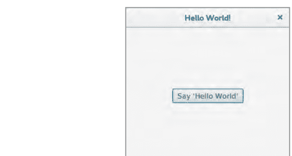

点击按钮后，它会在控制台上打印一条消息。如果你观察代码，首先注意该类继承了 `Application`，这意味着它是一个 JavaFX 应用程序。该类与其他 Java 应用程序一样有一个 `main()` 方法，并通过调用静态方法 `launch()`（在 `Application` 类中）启动。它基本上执行了以下操作：

1. 实例化类的对象（这里是 `HelloFX` 类）。
2. 执行 `init()` 方法，在 `Application` 中这是一个空方法。
3. 执行 `start()` 方法，在 `Application` 中这是一个空方法。
4. 等待程序终止，此时执行 `stop()` 方法，在 `Application` 中也是空方法。

如果你想让应用程序打开一个窗口，通常是重写 `Application` 类的 `start()` 方法，如上面的示例所示。

一个 JavaFX 程序基本上由一个包含 `Scene` 对象的 `Stage` 组成，`Scene` 又包含以树形结构排列的 `Node` 对象。`Stage` 代表窗口，主 `Stage` 对象由运行时系统创建并作为参数传递给 `start()` 方法，在示例中它的名字是 `primaryStage`。`Scene` 对象包含了所有组织成树形图的窗口对象。树的元素是 `Node` 对象，节点可以是分支节点（有子节点），也可以是叶子节点（没有子节点）。节点是窗口中的组件，例如，可以是按钮或输入字段。

在上面的示例中，`start()` 方法首先创建一个按钮，它是一个节点。该对象名为 `btn`，在给按钮附加文本的同时，还关联了一个动作，该动作是一个具有单个方法的对象，它简单地执行 `System.out.println()`。你应该注意，这看起来像是 Swing 中常见的事件事件处理，但事实并非如此，它使用的是其他类型，尽管这些类型的名称与 Swing 中的某些已知类型相同。

在 bookstore.com 免费下载电子书

# 介绍

作为下一步，创建了一个 `StackPane` 类型的根节点，它是场景图的根，按钮作为子节点插入到根节点。此程序有一个非常简单的场景图，由一个根节点和一个叶子节点组成。根对象被添加到 `Scene` 对象中，代表窗口的内容，同时定义了窗口的大小。`Scene` 对象必须附加到 `Stage` 对象，该对象还被分配了一个标题，最后在 `primaryStage` 对象上执行 `show()` 方法，在屏幕上显示窗口。

跟上上述程序发生了什么很容易的，但最好是发现其中的好处。这些好处在稍后才会体现，但我可以立即指出其中一个优势是：用于绘制整个窗口的技术是非常高效的。

在我离开这个示例之前，我将稍微修改代码（目前代码看起来是 NetBeans 创建的）。我将代码修改为如下：

```java
package hellofx;

import javafx.application.Application;
import javafx.event.ActionEvent;
import javafx.event.EventHandler;
import javafx.scene.Scene;
import javafx.scene.control.Button;
import javafx.stage.Stage;
import javafx.scene.control.Label;
import javafx.scene.control.TextField;
import javafx.scene.layout.VBox;
import javafx.application.Platform;

public class HelloFX extends Application {
    @Override
    public void start(Stage stage) {
        System.out.println("Start " + Thread.currentThread().getId());
        TextField txtName = new TextField();
        Label lblText = new Label();
        lblText.setStyle("-fx-text-fill:blue;");
        Button btnHello = new Button("Hello");
        btnHello.setOnAction(new EventHandler<ActionEvent>() {
            @Override
            public void handle(ActionEvent e) {
                String name = txtName.getText();
                lblText.setText(name.trim().length() > 0 ? "Hello " + name : "Hello there");
            }
        });
```

```java
        }
        );
        VBox root = new VBox();
        root.setSpacing(10);
        root.getChildren().addAll(new Label("Enter your name:"), txtName, lblText,
        btnHello, createButton("Exit", e -> Platform.exit()));
        stage.setScene(new Scene(root, 300, 200));
        stage.setTitle("Hello FX");
        stage.show();
    }
```

```java
    private Button createButton(String text, EventHandler<ActionEvent> handler) {
        Button cmd = new Button(text);
        cmd.setOnAction(handler);
        return cmd;
    }

    public static void main(String[] args) {
        launch(args);
    }

    public HelloFX() {
        System.out.println("Constructor " + Thread.currentThread().getId());
    }

    @Override
    public void init() {
        System.out.println("Init " + Thread.currentThread().getId());
    }

    @Override
    public void stop() {
        System.out.println("Stop " + Thread.currentThread().getId());
    }
```

如果你运行该程序，它首先会在控制台上写入以下几行：

```text
Constructor 12
Init 13
Start 12
```

之后你将得到以下窗口：

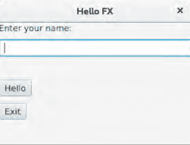

如果你输入文本 `Frode Frodegod` 并点击 `Hello`，窗口将更新为：

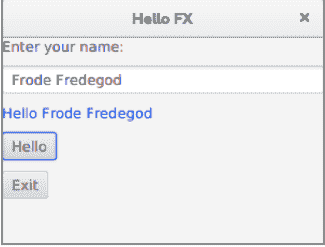


在 www.deloitte.ca/careers 发现真相

# Deloitte

© Deloitte & Touche LLP 关联实体。

在 bookboom.com 免费下载电子书

点击 `Exit` 后，程序会在控制台上写入以下文本后终止：

```text
Stop 12
```

这一次，`start()` 方法创建了一个带有 5 个叶子节点的根的场景图。注意根节点的类型是 `VBox`。除了显示有更多选项外，没有特殊的理由，而且该类型关系到图节点在窗口中的布局方式。5 个节点的类型分别为 `Label`、`TextField`、`Label`、`Button` 和 `Button`，其中第一个和最后一个是在它们被添加到根节点时创建的（最后一个通过 `createButton()` 方法），而另外三个是显式创建的。

注意 `start()` 方法首先开始打印文本（在控制台上）。我重写了 `init()` 和 `stop()` 两个方法，因为它们都会打印文本，并且我添加了一个默认构造函数。它们显示了构造函数首先执行的，然后是 `init()`，最后是 `start()`。最后，它们显示了程序终止时会执行 `stop()` 方法。你应该注意，构造函数、`start()` 和 `stop()` 在同一个线程（称为 JavaFX 线程）中执行，而 `init()` 在其自己的线程（称为 JavaFX 启动器）中执行。

如果你查看 `dist` 目录，可以看到按照通常的方式创建了一个名为 `HelloFX.jar` 的 jar 文件，因此可以从命令行执行程序：

```bash
java -jar HelloFX.jar
```

`dist` 目录还包含其他文件：


这些文件我不想在这里提到，但它们都与作为 Web 应用程序执行有关。

## 1.2 HELLOLINES

作为 Java 程序的另一个示例，我将展示一个打开以下窗口的示例：

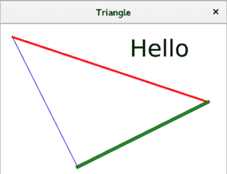

该项目名为 `HelloLines`，窗口包含一个场景图，由一个根节点和 4 个子节点组成：一个 `Text` 对象和三个 `Line` 对象。代码如下：

```java
package hellolines;
```

```java
import javafx.application.Application;
import javafx.scene.Scene;
import javafx.scene.Group;
import javafx.scene.stage.Stage;
import javafx.scene.shape.Line;
import javafx.scene.paint.Color;
import javafx.scene.text.Text;
import javafx.scene.text.Font;
```

```java
public class HelloLines extends Application {
    private Line[] lines;

    public HelloLines() {
        lines = new Line[] {
            createLine(20, 20, 320, 120, 3, Color.RED),
            createLine(320, 120, 120, 220, 5, Color.GREEN),
            createLine(120, 220, 20, 1, Color.BLUE)
        };
    }

    private Line createLine(
        double x1,
        double y1,
        double x2,
        double y2,
        double width,
        Color color
    ) {
```

```java
        Line line = new Line(x1, y1, x2, y2);
        line.setStroke(color);
        line.setStrokeWidth(width);
        return line;
```

```java
    private Text createText() {
        Text text = new Text("Hello");
        text.setText(200);
        text.setY(50);
        text.setFont(new Font(36));
        return text;
    }
```


```java
@Override
public void start(Stage stage) {
  Group root = new Group(lines);
  root.getChildren().add(createText());
  Scene scene = new Scene(root, 350, 250);
```

```java
stage.setTitle("Triangle");
stage.setScene(scene);
stage.show();
```

```java
public static void main(String[] args)
{
    launch(args);
}
```

看到这些代码，很容易理解，并且看起来和第一个示例相似。该类定义了一个 `Line` 元素数组（一个 `Line` 对象表示直线），该数组在构造函数中创建，因此包含了三个 `Line` 对象。`Line` 对象是通过 `createLine()` 方法创建的，你应该特别注意对象是如何初始化的以及使用了哪些类型。还有一个 `createText()` 方法，它创建并返回一个 `Text` 对象。如果你使用这些类型来创建 `Line` 和 `Text` 对象，它们与你在 Java2D 中熟悉的类型不同，但它们具有相同的名称，并且基本上具有相同的特性。场景图是以与一个示例相同的方式在 `start()` 方法中创建的，但这次根元素的类型是 `Group`，它是分支节点的基本类型。你应该特别注意如何通过 `getChildren()` 获取一个包含所有子节点的列表。

这个示例非常简单，但你应该注意几何对象和文本元素是如何像 `Button`、`Label` 等其他节点一样，以节点的形式包含在场景图中的。

SIMPLY CLEVER

ŠKODA


你喜欢汽车吗？你愿意成为成功品牌的一部分吗？

我们将感谢并奖励你的热情和才华。

向我们发送你的简历。你会惊讶于它能带你去向哪里。

在 `www.employerforlife.com` 向我们发送简历

在 `bookboom.com` 免费免费电子书

点击广告阅读更多信息

## JAVFX 架构

JavaFX 是用于创建 GUI 应用程序的完整 API，由分布在以下包中的类组成：

1. `javafx.animation`

2. `javafx.application`

3. `javafx.css`

4. `javafx.event`

5. `javafx.geometry`

6. `javafx.stage`

7. `javafx.scene`

其中后者有更多的子包。如所述，一个 JavaFX 程序由场景图组成，它是一棵包含节点的树，这些节点可能是：

- 几何对象，可以是 2D 和 3D 对象，如 `Circle`、`Sphere` 等

- UI 控件，如 `Label`、`Button` 等

- 容器，如 `StackPane`、`VBox`、`Group` 等更多

- 媒体元素，用于图像、音频和视频

场景图中的每个节点都有唯一的父节点，根节点除外（它没有父节点），所有没有子节点的节点被称为所谓的叶子节点，而所有其他节点被称为分支节点。同一个节点只能在树中出现一次，且每个节点都可以定义效果、不透明度、变换和事件处理器。

为了渲染图形，JavaFX 使用 OpenGL（在 Linux 系统上），并尽可能使用图形图的硬件加速器，结果是 JavaFX 在渲染图形方面非常高效。

如上所述，JavaFX 应用程序由 `Stage` 对象表示，它包含了应用程序的所有对象，`Stage` 对象由实际平台创建。`Stage` 对象除了内容（场景图）外还有宽度和高度，以及标题行和框架等装饰。有以下类型的 `Stage` 对象：

- 有装饰的 (`Decorated`)

- 无装饰的 (`Undecorated`)

- 透明的 (`Transparent`)

- 统一的 (`Unified`)

- 工具 (`Utility`)

具体的对象将结合示例持续讨论。

`Stage` 对象的内容由 `Scene` 对象表示，它定义了宽度、高度以及场景图。具体的节点将结合示例讨论，每种用途都有许多节点。此外，还有不同的分支节点，其中最的是 `Group` 节点，它主要是子节点的集合。其他示例是具有特定派生类的 `Pane` 节点，它们的作用与 Swing 中的布局管理器相同。所有特定节点都是类层次结构的一部分，并派生自以下类之一：


> “在丹麦，你可以找到出色的工程工作并在专业领域发展自己。特别是在风能领域，你可以从行业中最优秀的人那里学习，并在稳定的就业市场中推进职业生涯。”

Mireia Mare,

来自西班牙的高级工程师。

在风能行业工作。

赋能你的职业

- 丹麦


## 练习 1

你必须编写一个 JavaFX 应用程序，打开以下窗口，其中顶部和底部有两个输入框：


如果你点击 `Add` 按钮（并且两个框都输入了内容），列表框中将插入一行，名称和标题由逗号隔开。如果你点击另一个按钮，将删除列表框的内容。要求两个输入框的大小以及列表框的大小遵循窗口的大小，并且按钮遵循窗口边缘。

下面是 6 个人输入后的窗口。任务的一部分是找出使用了哪些控件以及如何将它们放在窗口中：


我加入 MITAS是因为

我想要真正的责任感

针对工程师和地质科学家的毕业生计划

`www.discovermitas.com`


第6个月

我在北海担任施工主管，提供建议并帮助工头解决问题

真实的工作

国际机会

三次实习


## 3 2D 形状

在本章中，我将回顾如何在窗口中绘制几何形状，正如第1章的最后一个示例所示，它与 Java2D 几乎相同，只是使用了不同的类。几何形状是 `Shape2D` 类型的对象，因此是可以包含在场景图中的对象。通常有以下预定义的形状（节点）：

- `Line`

- `Rectangle`

- `Circle`

- `Ellipse`

- `Polygon`

- `Polyline`

- `CubicCurve`

- `QuadCurve`

- `Arc`

此外，你还可以作为 `Path` 对象来定义通用曲线，它由以下类型的段组成：

- `Line`

- `CubicCurve`

- `QuadCurve`

- `Arc`

最后你可以定义一个类似 SVG Path 的形状。

本章的目的是展示如何创建和应用上述几何形状，但不是回顾语法（这很多是你在 Java2D 中已知的内容），我将转而制定一系列练习，挑战主要是找出这些类型在 JavaFX 中被称为什么。

## 练习 2

编写一个 JavaFX ，打开以下窗口：

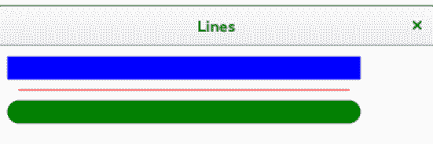

蓝线的端点为 `(20, 20)` 和 `(320, 20)`，宽度为 21；而红线的端点为 `(20, 40)` 和 `(320, 40)`，宽度为 1。最后，绿线的端点为 `(20, 60)` 和 `(320, 60)`，宽度为 21。

## 练习 3

编写一个 JavaFX 程序，打开以下窗口：

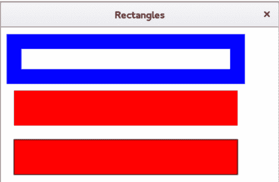

显示三个矩形，每个矩形的大小为 `300 × 50`。这三个矩形的左上角分别为 `(20, 20)`、`(20, 90)` 和 `(20, 160)`。顶部有一个宽度为 21 的蓝色边框，但内部为空。中间没有边框，而最后一个有一个宽度为 1 的黑色边框。

# 2D 形状

## 练习 4

编写一个程序，显示一个带有三个圆角矩形的窗口：

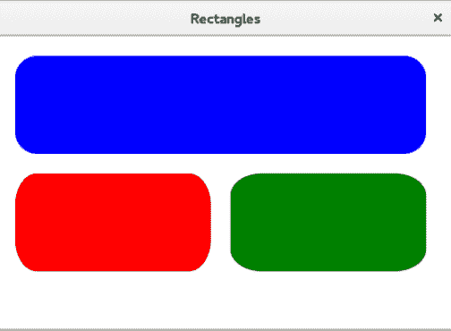

注意，JavaFX 并没有用于圆角矩形的特定类型，这些形状的类型都是 `Rectangle`。


## 练习 5

编写一个 JavaFX 程序，打开以下窗口：

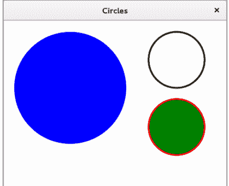

此时形状的类型必须是 `Circle`。

## 练习 6

编写一个程序，打开以下窗口：

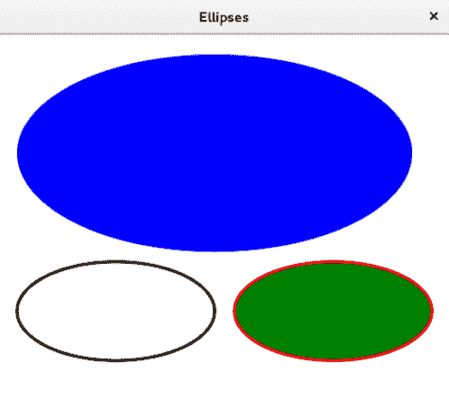

其中三个形状的类型均为 `Ellipse`。

## 练习 7

多边形是一个由直线边界的封闭形状，你通过指定顶点的坐标来定义多边形。编写一个 JavaFX 程序，打开以下窗口，显示三个多边形：

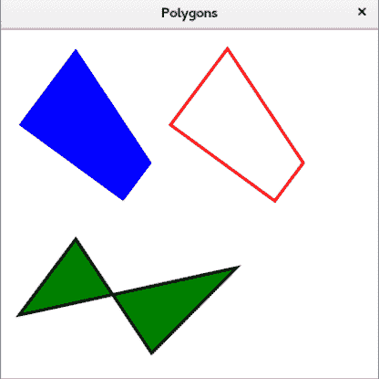

## 练习 8

折线（`polyline`）被定义为多边形，由直线组成。该形状的定义方式相同，即一系列顶点，但不需要是一个闭合形状。通常情况下，折线不是填充形状，但如果你定义了填充颜色，该形状将像多边形一样被填充。在练习中，你必须编写一个程序，打开包含 4 个折线形状的窗口：

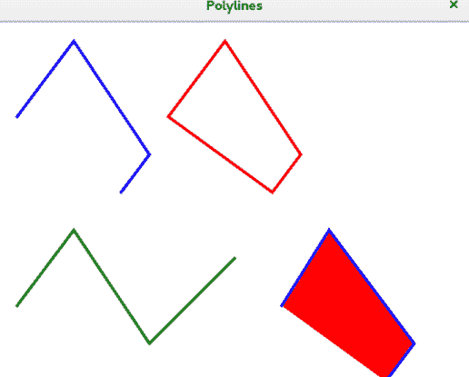

2D 形状

## 练习 9

你必须编写一个程序，显示两条二次贝塞尔曲线（`quad curves`）。如果你不记得二次贝塞尔曲线的定义，可能想阅读《Java 10》书中关于曲线的内容。该程序必须打开以下窗口：

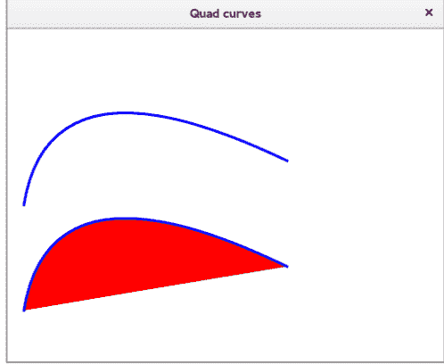

> “我学了16年英语，但……我最终只花了六节课就学会了说它。”

Jane，中国建筑师

英语走向世界

点击听我在下载我独特的课程前后的语音录音

在 `bookboom.com` 免费下载电子书

点击广告阅读更多

2D 形状

## 练习 10

你必须编写一个程序，显示两条三次贝塞尔曲线（`cubic curves`）。如果你不记得三次贝塞尔曲线的定义，可能想阅读《Java 10》书中关于曲线的内容。该程序必须打开以下窗口：

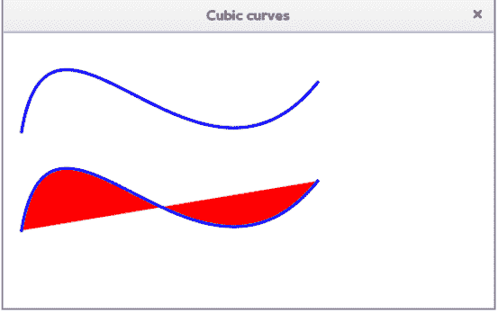

## 练习 11

编写一个程序，打开下面的窗口，显示 6 个圆形/椭圆扇形。所有扇形从 0 开始，跨越 60 度。顶部三个是半径为 100 的圆扇形，而底部三个是半径为 200 和 100 的椭圆扇形：

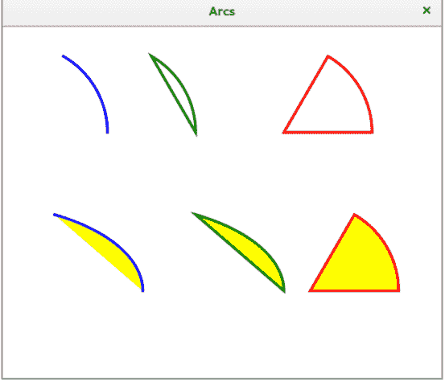

## 3.1 SVG

SVG 代表缩放矢量图形，在 JavaFX 中，通过字符串定义路径：

- `M` 或 `m`：移动到（绝对或相对）。

- `L` 或 `l`：画线（绝对或相对）。

- `H` 或 `h`：水平线（绝对或相对）。

- `V` 或 `v`：垂直线（绝对或相对）。

- `C` 或 `c`：三次贝塞尔曲线（绝对或相对）。

- `Q` 或 `q`：二次贝塞尔曲线（绝对或相对）。

- `A` 或 `a`：圆弧（绝对或相对）。

- `Z` 或 `z`：关闭路径。

这里是课程中有趣的部分：两个 SVG 命令。你必须注意语法以及这些命令如何简单地定义为由空格分隔的列表。唯一不那么直观的是命令 `A`，它定义了一个圆弧。在这种情况下（在第一种情况下），它是从 `(120, 120)` 到 `(20, 120)` 的曲线，半径为 100 的圆，它提供了两个选项：

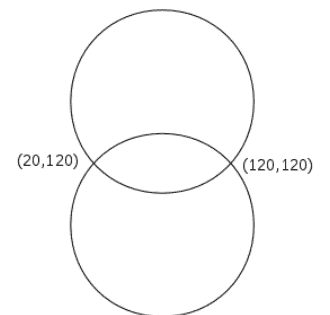

选择哪一个由 `large` 和 `sweep` 两个参数（其值为 0 或 1）决定的。

## 练习 12

编写一个程序打开以下窗口，该窗口显示两个 `SVGPath` 形状，其中蓝色曲线由一个移动到（`move to`）、两个画线到（`line to`）和一个圆弧到（`arc to`）操作组成，而红色曲线则由一个二次贝塞尔曲线（`quad`）、两个画线到（`line to`）、一个三次贝塞尔曲线（`cubic to`）和一个关闭（`close`）操作组成：

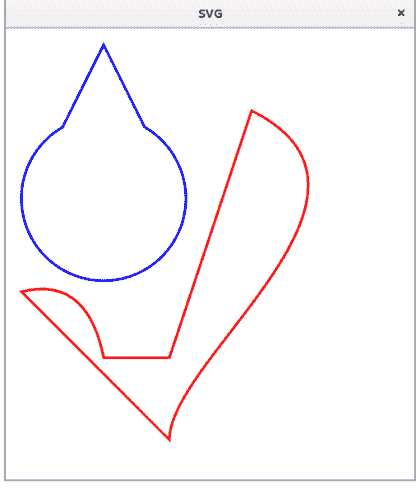

在 `bookbo.com` 下载免费电子书

2D 形状

## 3.2 路径 (PATH)

与其像上面所示通过定义字符串定义绘制操作来绘制路径，不如你可以将对象添加到 `Path` 对象中，该对象代表一组绘制对象的集合。这样做的好处主要是编译器可以检查语法，从而使任何错误在运行时之前被检测到。有以下绘制对象：

- `MoveTo`

- `LineTo`

- `HLineTo`

- `VLineTo`

- `ArcTo`

- `QuadCurveTo`

- `CubicCurveTo`


在 `bookhoon.com` 下载免费电子书 点击广告阅读更多

例如，以下程序绘制了与上一个示例相同的窗口：

```java
package pathprogram;

import javafx.application.Application;
import static javafx.application.Application.launch();
import javafx.scene.*;
import javafx.stage.Stage;
import javafx.scene.shape.*;
import javafx.scene.paint.*;

public class PathProgram extends Application {
    @Override
    public void start(Stage primaryStage) {
        Group root = new Group();
        root.getChildren().add(path1());
        root.getChildren().add(path2());
        Scene scene = new Scene(root, 500, 150);
        primaryStage.setTitle("Paths");
        primaryStage.setScene(scene);
        primaryStage.show();
    }

    private Path path1() {
        Path path = new Path();
        path.getChildren().add(new MoveTo(20, 120));
        path.getChildren().addAll(new LineTo(70, 20), new LineTo(120, 120));
        path.getChildren().add(new ArcTo(100, 100, 0, 20, 120, false, false));
        path.setStroke(Color.BLUE);
        path.setStrokeWidth(3);
        path.setFill(null);
        return path;
    }

    private Path path2() {
        Path path = new Path();
        path.getChildren().add(new MoveTo(220, 120), new LineTo(270, 220),
        new LineTo(320, 120), new ArcTo(100, 100, 0, 220, 120, false, true));
        path.setStroke(Color.BLUE);
        path.setStrokeWidth(3);
        path.setFill(Color.YELLOW);
        return path;
    }

    public static void main(String[] args) {
        launch(args);
    }
}
```

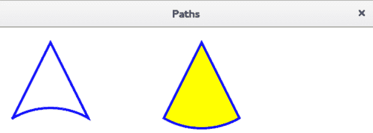

事实上，没什么好解释的，但你应该注意如何创建 `Path` 对象以及如何添加绘制对象。还要注意如何创建每个绘制对象，以及这些对象按照它们被添加到 `Path` 对象的顺序使用的。

## 练习 13

你必须编写一个程序打开与练习 12 相同的窗口，但这次两个形状的类型必须是 `Path`。

## 练习 14

编写一个程序打开以下窗口，其中形状应该是一个 `Path` 对象：

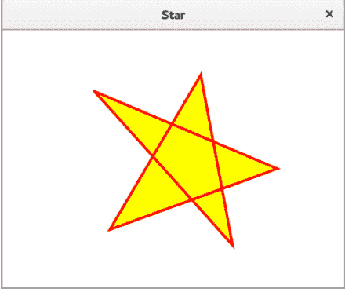

2D 形状 

## 3.3 形状属性 (SHAPE PROPERTIES)

上述内容主要涉及直线、矩形、圆形等图形的形状，但形状还具有其他属性，包括它们如何填充以及如何绘制轮廓。本节将讨论这些特征中最重要的。

轮廓——一条线/曲线——可以通过三种方式绘制：

1. `Stroke.CENTERED`，这是默认值，意味着绘制轮廓时，形状的边缘恰好是轮廓线的中心。

2. `StrokeType.INSIDE`，轮廓绘制在形状内部。

3. `StrokeType.OUTSIDE`，轮廓绘制在形状外部。

`Stroke` 程序打开以下窗口，展示了绘制轮廓的三种方式，其中第一种是默认的：


2D 形状


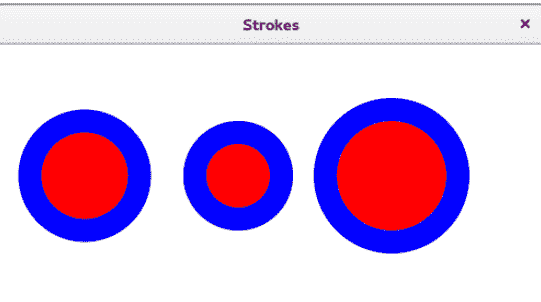

代码如下，展示了`start()`方法：

```java
public void start(Stage primaryStage) {
  Group root = new Group();
  root.getChildren().add(circ1);
  root.getChildren().add(circ2);
  root.getChildren().add(circ3);
  Scene scene = new Scene(root, 500, 250);
  primaryStage.setTitle("Strokes");
  primaryStage.setScene(scene);
  primaryStage.show();
}
```

（注：由于原文代码片段中`circ1`、`circ2`、`circ3`变量在示例中未完全定义，此处根据上下文保留翻译逻辑。）

另一个点是由直线组成的形状（如多边形）的端点。有三种选项（你可能从 Java2D 了解过）：

1. `StrokeLineJoin.MITER` 是默认值
2. `StrokeLineJoin.BEVEL`
3. `StrokeLineJoin.ROUND`

你可以在 Java2D 书中找到关于这些端点如何计算的精确解释。应用程序显示了这三种的效果：

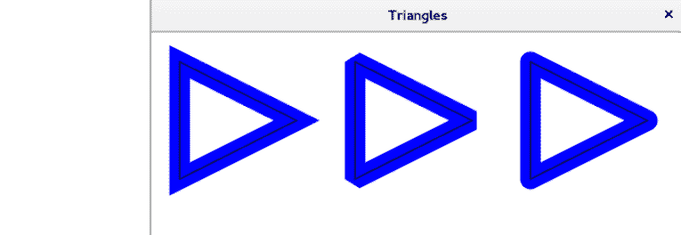

```java
public void start(Stage primaryStage) {
    Group root = new Group();
    root.getChildren().add(poly1());
    root.getChildren().add(poly2());
    root.getChildren().add(poly3());
    root.getChildren().add(poly4());
    root.getChildren().add(poly5());
    root.getChildren().add(poly6());
    Scene scene = new Scene(root, 550, 210);
    primaryStage.setTitle("Triangles");
    primaryStage.setScene(scene);
    primaryStage.show();
}

private Polygon poly1() {
    Polygon poly = new Polygon(30, 30, 150, 90, 30, 150);
    poly.setStroke(Color.BLUE);
    poly.setStrokeWidth(21);
    poly.setFill(null);
    poly.setStrokeLineJoin(StrokeLineJoin.MITER);
    return poly;
}

private Polygon poly2() {
    Polygon poly = new Polygon(20, 30, 330, 90, 210, 150);
    poly.setStroke(Color.BLUE);
    poly.setStrokeWidth(21);
    poly.setFill(null);
    poly.setStrokeLineJoin(StrokeLineJoin.BEVEL);
    return poly;
}
```

（注：原文此处代码不完整，`poly3`到`poly6`未列出，翻译保留原文结构。）

## 2D 形状

```java
private Polygon poly3() {
    Polygon poly = new Polygon(390, 30, 510, 90, 390, 150);
    poly.setStroke(Color.BLUE);
    poly.setStrokeWidth(21);
    poly.setFill(null);
    poly.setStrokeLineJoin(StrokeLineJoin.ROUND);
    return poly;
}
```

```java
private Polygon poly4() {
    Polygon poly = new Polygon(30, 30, 150, 90, 30, 150);
    poly.setStroke(Color.BLACK);
    poly.setStrokeWidth(1);
    poly.setFill(null);
    return poly;
}
```

```java
private Polygon poly5() {
    Polygon poly = new Polygon(210, 30, 330, 90, 210, 150);
    poly.setStroke(Color.BLACK);
    poly.setStrokeWidth(1);
    poly.setFill(null);
    return poly;
}
```

```java
private Polygon poly6() {
    Polygon poly = new Polygon(390, 30, 510, 90, 390, 150);
    poly.setStroke(Color.BLACK);
    poly.setStrokeWidth(1);
    poly.setFill(null);
    return poly;
}
```

指定线条端点有类似的选项（请查阅书籍 Java 10 以获取说明）：

1. `StrokeLineCap.BUTT`
2. `StrokeLineCap.SQUARE`
3. `StrokeLineCap.ROUND`

## 练习题 15

编写一个可以调用`LineCaps`的程序。该程序必须打开以下窗口，显示 6 个`Line`对象（每个长度为 200），并且每个端点（蓝色线条的）分别设置为`BUTT`、`SQUARE`和`ROUND`：

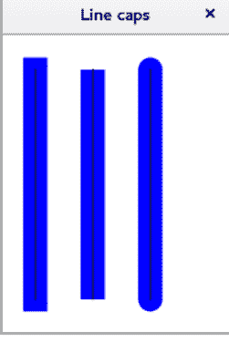

## 3.4 形状操作

通常情况下，如果你向`Group`中添加两个`Shape`对象且这两个形状发生重叠，那么后添加的形状将覆盖第一个形状中重叠的部分。`Shape`类有三个静态方法：

- `union()`
- `intersect()`
- `subtract()`

这些方法都接受两个`Shape`对象作为参数，并将这两个对象合并成单一的`Shape`对象。`OperationProgram`展示了如何应用此操作并打开以下窗口：

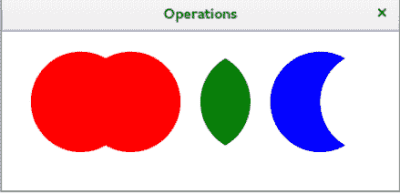

## 2D 形状

```java
public void start(Stage primaryStage)
{
    Group root = new Group();
    root.getChildren().add(shape1);
    root.getChildren().add(shape2);
    root.getChildren().add(shape3);
    Scene scene = new Scene(root, 400, 160);
    primaryStage.setTitle("Operations");
    primaryStage.setScene(scene);
    primaryStage.show();
}
```

```java
private Shape shape1()
{
    Circle circ1 = new Circle(80, 70, 50);
    Circle circ2 = new Circle(130, 70, 50);
    Shape shape = Shape.union(circ1, circ2);
    shape.setFill(Color.RED);
    return shape;
}
```

```java
private Shape shape2()
{
    Circle circ1 = new Circle(200, 70, 50);
    Circle circ2 = new Circle(250, 70, 50);
    Shape shape = Shape.intersect(circ1, circ2);
    shape.setFill(Color.GREEN);
    return shape;
}
```

```java
private Shape shape3()
{
    Circle circ1 = new Circle(320, 70, 50);
    Circle circ2 = new Circle(370, 70, 50);
    Shape shape = Shape.subtract(circ1, circ2);
    shape.setFill(Color.BLUE);
    return shape;
}
```

## 4 文本

文本可以用`Text`对象表示，重要的是`Text`继承自`Shape`，因此它可以像任何其他`Shape`对象一样被使用，并作为节点进入场景图。实际上，没什么需要解释的，但应用程序`Text/Program`会打开以下窗口：

| Strokes（描边） |
| --- |
| Hello JavaFX geometry |
| Hello World |


它的工作原理与你在 Java2D 中了解的几乎相同，但使用了其他的类。完整的代码如下：

```java
package textprogram;

import javafx.application.Application;
import static javafx.application.Application.launch;
import javafx.scene.*;
import javafx.scene.Stage;
import javafx.scene.shape.*;
import javafx.scene.paint.*;
import javafx.scene.text.*;
import javafx.geometry.*;

public class TextProgram extends Application {

    @Override
    public void start(Stage primaryStage)
    {
        Group root = new Group();
        Shape shape = text1(root);
        root.getChildren().add(shape);
        shape = line(shape);
        root.getChildren().add(shape);
        shape = text2();
        root.getChildren().add(shape);
        Scene scene = new Scene(root, 530, 250);
        primaryStage.setTitle("Strokes");
        primaryStage.setScene(scene);
        primaryStage.show();
    }

    private Text text1(Group root)
    {
        Text text = new Text(20, 50, "Hello JavaFX geometry");
        text.setFont(Font.font("Liberation Serif", FontWeight.NORMAL, FontPosture.REGULAR, 24));
        return text;
    }

    private Line line(Shape shape)
    {
        Bounds bounds = shape.getBoundsInLocal();
        return new Line(20, 50, 20 + bounds.getWidth(), 50);
    }

    private Text text2()
    {
        Text text = new Text("Hello World");
        text.setX(20);
        text.setY(150);
        text.setFont(Font.font("Liberation Serif", FontWeight.BOLD, FontPosture.ITALIC, 72));
        text.setFill(Color.RED);
        text.setStroke(Color.BLUE);
        text.setStrokeWidth(2);
        text.setStrokeType(StrokeType.OUTSIDE);
        return text;
    }

    private Rectangle rect(Shape shape)
    {
        Bounds bounds = shape.getBoundsInLocal();
        Rectangle rect = new Rectangle(bounds.getXX(), bounds.getYY(), bounds.getWidth(), bounds.getHeight());
        rect.setFill(null);
        rect.setStroke(Color.BLACK);
        rect.setStrokeWidth(1);
        return rect;
    }

    public static void main(String[] args)
    {
        launch(args);
    }
}
```

# JAVA 14：使用 JAVAFX 开发应用程序：软件开发

## 效果

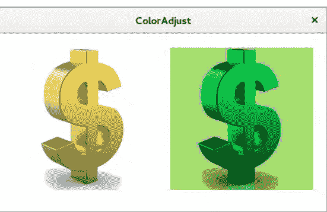

左图是原图，右图是调整后的图像。程序应该只显示使用`ColorAdjust`的语法，但在这种情况下，并没有对图像产生任何改进。程序还展示了如何从本地磁盘加载图片到 JavaFX 程序中。程序代码如下：

```java
package coloradjust;
```

```java
import javafx.application.Application;
import static javafx.application.Application.launch;
import javafx.scene.*;
import javafx.scene.Stage;
import javafx.scene.effect.*;
import javafx.scene.image.*;

public class ColorAdjustProgram extends Application
{
    @Override
    public void start(Stage primaryStage)
    {
        String filename = 
            "file:" + System.getProperty("user.home") + "/data/dollar.jpg";
        Image image = new Image(filename);
        Group root = new Group();
        root.getChildren().add(image);
        root.getChildren().add(image2(image));
        Scene scene = new Scene(root, 460, 250);
        primaryStage.setTitle("ColorAdjust");
        primaryStage.setScene(scene);
        primaryStage.show();
    }
}
```

```java
private ImageView image1(Image img)
{
ImageView view = new ImageView(img);
view.setX(20);
view.setY(20);
view.setFitWidth(200);
view.setPreserveRatio(true);
return view;
}
```

```java
private ImageView image2(Image img)
{
ImageView view = new ImageView(img);
view.setX(240);
view.setY(20);
view.setFitWidth(200);
view.setPreserveRatio(true);
ColorAdjust adjust = new ColorAdjust();
adjust.setContrast(0.5);
adjust.setHue(0.5);
adjust.setBrightness(-0.5);
```


BI挪威商学院是欧洲最大的商学院之一——招收超过 20,000 名学生。我们的课程提供了一个充满活力且多元文化的学习环境，具有国际视野，能够为学生提供满足业务需求的专业技能。


BI 提供四种不同的两年全日制科学硕士（MSc）课程，完全用英语授课，旨在提供专业技能以满足日益增长的业务需求。硕士课程提供了一个充满活力且多元文化的学习环境，为您开启职业生涯提供平台。

- 商业管理硕士
- 金融经济学硕士
- 战略营销管理硕士
- 领导力与组织心理学硕士

`www.bi.edu/master`

在 `book.com` 下载免费的电子书

点击广告阅读更多

```java
colorAdjust.setSaturation(0.5);
view.setEffect(colorAdjust);
return view;

public static void main(String[] args) {
    launch(args);
}
```

图像在 `start()` 方法中加载，通常是通过定义图像路径（这是一个 jpg 图像）完成的。在这种情况下，图像被放置在我主目录下的一个目录下，与文件名唯一的区别是它以协议名称开头，因为图像位于本地文件系统中。在其他情况下，将使用 `http` 协议。图像通过创建 `Image` 对象来加载。

图像作为 `ImageView` 对象插入到程序的场景图（scene graph）中，`image1()` 方法为原始图像创建一个 `ImageView` 对象并指定了图像左上角的坐标。此外，你指定了图像的宽度，且这些属性不可更改。

`image2()` 方法相应地为同一图像创建另一个 `ImageView` 对象，但这次使用了不同的坐标。此外，创建了一个 `ColorAdjust` 对象，它具有调整亮度、对比度、饱和度和色调的方法。参数值介于 -1 和 1 之间，负值表示减少该属性，正值表示增加该属性。

# JAVA 14：使用 JAVAFX 开发应用程序：软件开发

## 效果

## 问题 1

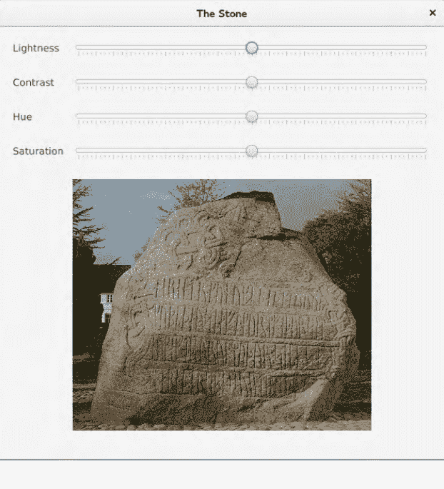

编写一个打开上方窗口的程序。目标是你可以尝试四种属性：光度、对比度、色调和饱和度。图片名为 `stone.jpg`，包含在书籍 zip 压缩文件中。你必须能够使用窗口顶部的 `Slider` 控件调整这四个属性。这意味着你应该处理在移动滑块时触发的事件。这是通过在 `javafx.beans.value` 包中定义的 `ChangeListener` 实现的。

## 5.1 颜色

在上面的示例中（以及之前章节的练习题中），我使用了颜色，并展示了如何用颜色填充形状并绘制轮廓。通常有四种选项：

1. 均匀颜色和 `Color` 类对象
2. 线性渐变画漆和 `LinearGradient` 类对象
3. 径向渐变画漆和 `RadialGradient` 类对象
4. 图像以及 `ImagePattern` 类对象

在 `bookboom.com` 下载免费的电子书

`ColorProgram` 程序打开了以下窗口：

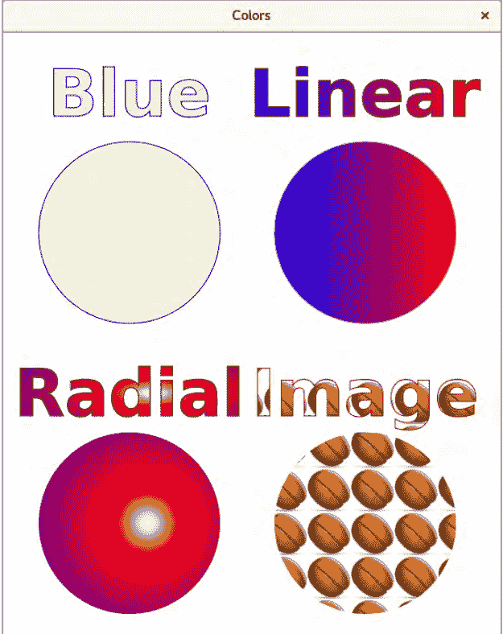

程序的场景图通过 `ImageView` 对象插入图像，`image1()` 方法为原始图像创建一个 `ImageView` 对象并指定了图像左上角的坐标。此外，你指定了图像的宽度，且这些属性不可更改。

```java
private Text text(String txt, double x, double y, Paint fill, Paint stroke) {
    Text text = new Text(txt);
    text.setFont(Font.font("Liberation", FontWeight.BOLD));
    text.setFill(fill);
    text.setStroke(stroke);
    text.setX(x - text.getParent().getWidth() / 2);
    text.setY(y - text.getParent().getHeight() / 2);
    return text;
}
```

`image2()` 方法相应地为同一图像创建另一个对象，但这次不同。圆通过以下方法创建：

```java
private Circle circle(double x, double y, Paint fill, Paint stroke) {
    Circle circ = new Circle(x, y, 100, fill);
    if (stroke != null) {
        circ.setStroke(stroke);
        circ.setStrokeWidth(1);
    }
    return circ;
}
```

这里的参数与 `text` 相同。窗口显示了四个图形，每个由 `Text` 节点和 `Circle` 节点组成。第一个使用均匀颜色绘制，关于这一点没有要说的：

# JAVA 14：使用 JAVAFX 开发应用程序：软件开发

已经说过了颜色。下一个图形使用线性渐变画漆，定义如下：

```java
private Paint createLinear(){
    Stop[] stops = new Stop(0, Color.BLUE), new Stop(1, Color.RED);
    return new LinearGradient(0, 0, 1, 0, true, CycleMethod.NO_CYCLE, stops);
}
```

线性渐变由两个或多个颜色定义，这些颜色是 `Stop` 类型对象。每个 `stop` 指定一个颜色和一个位置，位置可以是相对或绝对的。第一个停止在这种情况下，位置为 0，这意味着该颜色是起始颜色。另一种颜色是红色，位置为 1，这意味着最后一个值必须是红色。这些极端值之间的所有颜色都是蓝色的混合。

`LinearGradient` 参数是起始位置 (0.0) 和最终位置 (1.0)，下一个参数指示坐标是相对的（true）还是绝对的。在这种情况下，坐标指示它们必须沿着 x 轴从形状的左边缘到形状的右边缘混合。下一个参数指示如果坐标没有定义整个形状，是否应该重复该模式，最后最后一个参数是颜色停止点。

径向渐变的定义方式几乎相同：

```java
private Paint createRadial(){
    Stop[] stops = new Stop(0, Color.WHITE), new Stop(0.2, Color.RED), new Stop(1, Color.BLUE);
    return new RadialGradient(0, 0, 0.6, 0.5, 1, true, CycleMethod.NO_CYCLE, stops);
}
```

必须定义两个或多个颜色停止点，在这种情况下定义了三个。它们说明使用白色颜色，在 20% 之后颜色应该是红色，最后一个是蓝色。

# JAVA 14: 使用 JAVAFX 开发应用程序：软件开发

最后，还有一个 `ImagePattern`，这是一个绘制图像的 `Paint` 对象。在程序的 `start()` 方法中，图像（`Bean.png`）被加载为一个 `Image` 对象。然后可以使用此图像来创建一个 `ImagePattern` 对象：

```java
private Paint createImage()
{
    return new ImagePattern(image, 0, 0, 48, 48, false);
}
```

除了图像之外，参数是图形的起始坐标（左上角）、图形的宽度和高度（图形将缩放到此尺寸），以及 t 坐标应该被解释为相对的还是绝对的。

## 5.2 图像

在之前的示例中，我已经展示了如何加载图像并在窗口中显示它。实际上，图片与效果并没有太大关系，但上面的示例使用了图片，并且有几点需要说明，因此增加几个额外的示例。


图像在场景图中以 `ImageView` 节点的形式显示，而图像本身在程序中被表示为 `Image` 对象，可以通过指定图像路径作为构造函数的参数从机器的硬盘中加载。以下程序称为 `ImageViewProgram`，它打开了以下窗口：


显示的是三次相同的图像，该示例主要展示了如何缩放图像。第一张图像（较大的那个）未经过缩放，而另外两个经过了缩放。代码如下：

```java
package imageviewerprogram;

import javafx.application.Application;
import static javafx.application.Application.launch;
import javafx.scene.*;
import javafx.scene.effect.*;
import javafx.stage.Stage;
import javafx.scene.paint.*;
import javafx.scene.image.*;

public class ImageViewerProgram extends Application
{
    private Image image;

    public ImageViewerProgram()
    {
        String filename = "file:" + System.getProperty("user.home") + "/data/dollar.jpg";
        image = new Image(filename);
    }

    @Override
    public void start(Stage primaryStage)
    {
        Group root = new Group();
        root.getChildren().add(createView(20, 20, 0, 0, true));
        root.getChildren().add(createView(440, 100, 200, 0, true));
        root.getChildren().add(createView(440, 200, 100, 200, false));
        Scene scene = new Scene(root, 560, 440);
        primaryStage.setTitle("Colors");
        primaryStage.setScene(scene);
        primaryStage.show();
    }

    private ImageView createView(double x, double y, double width, double height,
    boolean preserve)
    {
        ImageView view = new ImageView(image);
        view.setX(x);
        view.setY(y);
        if (width > 0 && height > 0)
        {
            view.setFitHeight(height);
            view.setFitWidth(width);
        }
        view.setEffect(new DropShadow(5, Color.BLACK));
        view.setPreserveRatio(preserve);
        return view;
    }

    public static void main(String[] args)
    {
        launch(args);
    }
}
```

图像在类的构造函数中加载，并可以被引用用于图像，它有一个实例变量 `image`。`createView()` 方法为该图像创建一个 `ImageView`，前两个参数是 `ImageView` 对象左上角的坐标，接下来的两个参数表示宽度和高度。最后一个参数表示是否要保留图像的比例。该方法的语句很容易理解，可能除了 `setEffect()` 的含义外，但结果是在图像外绘制了一个框。如果没有指定宽度或高度，这些属性将不会被设置，结果是应用图像的物理尺寸。

检查 `start()` 方法发现第一张图像没有尺寸。之前的图像尺寸变为物理尺寸，即 400 × 400。对于下一张图像，尺寸设置为 100 × 200，它将在该框架内缩放，但由于说是保留比例，结果是图像在两个方向上都缩小了 1/4，你得到一张 100 × 100 的图片。对于最后一张图像，指定了相同的尺寸，但没有保留比例，因此图像在两个方向上都被缩放，这将填充 100 × 200。

关于图像的最后一个示例，我将向你展示一个名为 `PixelProgram` 的程序。该程序应该展示如何操作图像中的单个像素。起点是上面所示的图片。图像的部分像素是白色（背景），程序应该将背景改为黑色。也就是说，所有白色像素必须改为黑色。通常情况下这很简单，但由于它是 jpg 图像，靠近图形的像素不会完全是白色，因此需要对像素是否为白色允许不确定性。执行程序将得到结果：

```java
package pixelprogram;

import javafx.application.Application;
import static javafx.application.Application.launch;
import javafx.scene.*;
import javafx.scene.effect.*;
import javafx.stage.Stage;
import javafx.scene.paint.*;
import javafx.scene.image.*;

public class PixelsProgram extends Application
{
    private Image image;

    public PixelsProgram() {
        String filename = "file:" + System.getProperty("user.home") + "/data/dollar.jpg";
        image = new Image(filename);
    }

    @Override
    public void start(Stage primaryStage)
    {
        Group root = new Group();
        root.getChildren().add(createView());
        Scene scene = new Scene(root, 440, 440);
        primaryStage.setTitle("Pixels");
        primaryStage.setScene(scene);
        primaryStage.show();
    }

    private ImageView createView()
    {
        int width = (int)image.getWidth();
        int height = (int)image.getHeight();
        WritableImage buffer = new WritableImage(width, height);
        PixelReader reader = image.getPixelReader();
        PixelWriter writer = buffer.getPixelWriter();
        for (int y = 0; y < height; y++) {
            for (int x = 0; x < width; x++) {
                Color color = reader.getColor(x, y);
                if (isWhite(color)) color = Color.BLACK;
                writer.setColor(x, y, color);
            }
        }
        ImageView view = new ImageView(buffer);
        view.setX(20);
        view.setY(20);
        return view;
    }

    private boolean isWhite(Color color)
    {
        double epsilon = 0.1;
        return 1 - color.getRed() < epsilon && color.getGreen() < epsilon &&
               1 - color.getBlue() < epsilon;
    }

    public static void main(String[] args)
    {
        launch(args);
    }
}
```


## JAVA 14: 使用 JAVAFX 开发应用程序：软件开发

## 5.3 光 (LIGHT)

在关于效果的章节介绍中，我列出了你可以应用的各种效果，在这里我并没有详尽说明所有的效果（也不会这样做），但我想用“光”这种效果作为本章的收尾。其原理是光源照射在图形上，而图形的颜色取决于光源的性质以及它相对于图形的位置。


通常，你可以通过`Lighting`对象将光照效果与图形相关联。如果你没有指定光源，则将使用默认光源，它对应于直接射入图形的光，导致边缘产生微弱的 3D 效果。你也可以显式指定光源，共有三种选项：

1. `Light.Distant`（远光）
2. `Light.Point`（点光）
3. `Light.Spot`（聚光灯）


## JAVA 14：使用 JAVAFX 开发应用程序：软件开发

第一种对应于位于远处的光源，它从远程光源向一个方向发射光线：

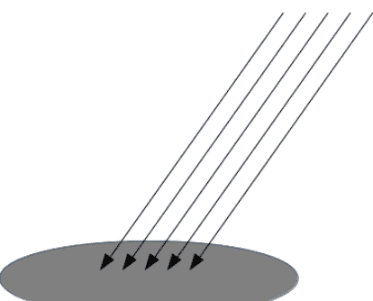

你可以设置两个值作为参数（均为`double`类型）：

1. `azimuth`（方位），表示光源绕 z 轴旋转的角度。
2. `elevation`（仰角），表示光源绕 x 轴旋转的角度。

此外，你还可以指定光源的颜色。

第二种选项是光源从某一点发射光，由 3 个坐标表示。光向所有方向扩散，与远光源一样，你可以指定光源的颜色。

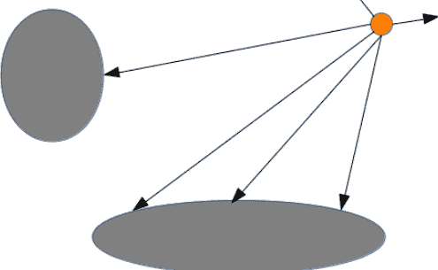

光强度取决于光源到图形的距离。最后是第三种选项，与上述类似，但不同在于你可以指定一个`specular`（高光）参数来控制光源的聚焦。

## JAVA 14：使用 JAVAFX 开发应用程序效果

如果你运行`LightingProgram`程序，它会打开以下窗口：

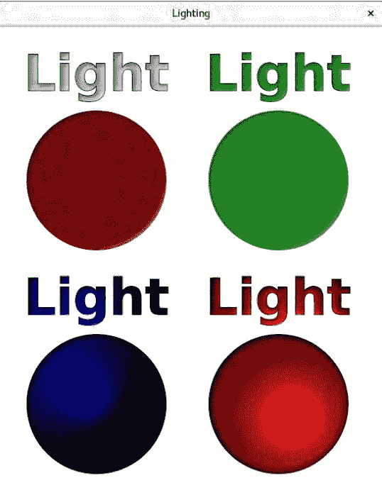

该示例看起来像`ColorProgram`，但程序展示的不是颜色的效果，而是光光的效果。顶行的图形分别显示了标准光源和远光源的效果，而底行的两个图形分别显示了聚光灯和点光源的效果。程序的代码如下：

```java
package lightingprogram;

import javafx.application.Application;
import static javafx.application.Application.launch;
import javafx.scene.*;
import javafx.stage.Stage;
import javafx.scene.effect.*;
import javafx.scene.shape.*;
import javafx.scene.paint.*;
import javafx.scene.text.*;

public class LightingProgram extends Application
{
    @Override
```

## JAVA 14：使用 JAVAFX 开发应用程序：软件开发 - 效果

```java
public void start(Stage primaryStage)

{
Group root = new Group();
root.getChildren().add(text(140, 50, Color.rgb(232, 232, 232, new Lighting()));
root.getChildren().add(circle(140, 220, Color.DARKRED, new Lighting()));
root.getChildren().add(text(400, 50, Color.GREEN,new Lighting(new Light.Distant(45, 60, Color.WHITE))));
root.getChildren().add(circle(400, 220, Color.GREEN,new Lighting(new Light.Distant(45, 60, Color.WHITE))));
root.getChildren().add(text(140, 370, Color.BLUE,new Lighting(new Light.Spot(120, 120, 50, Color.WHITE))));
root.getChildren().add(circle(140, 540, Color.BLUE,new Lighting(new Light.Spot(120, 120, 50, Color.WHITE))));
root.getChildren().add(text(400, 370, Color.RED,new Lighting(new Light.Point(120, 120, 50, Color.WHITE))));
root.getChildren().add(circle(400, 540, Color.RED,new Lighting(new Light.Point(120, 120, 50, Color.WHITE))));
Scene scene = new Scene(root, 550, 670);
primaryStage.setTitle("Lighting");
primaryStage.setScene(scene);
}
```


```java
private Text text(double x, double y, Paint fill, Lighting light) {

Text text = new Text("Light");
text.setFont(new Font("Liberation Sherif", FontWeight.BOLD, FontPosture.REGULAR, 72));
text.setFill(fill);
text.setStroke(Color.BLACK);
text.setStrokeWidth(1);
text.setX(x - text.getBoundsInParent().getWidth() / 2);
text.setY(y + text.getBoundsInParent().getHeight() / 2);
text.setEffect(light);
return text;
```

```java
private Circle circle(double x, double y, Paint fill, Lighting light) {

Circle circ = new Circle(x, y, 100, fill);
circ.setEffect(light);
return circ;
```

```java
public static void main(String[] args) {
  launch(args);
}
```

这两个方法`text()`和`circle()`与之前的对应方法相似。你应该主要考虑`start()`方法，在这里通过创建`Light`对象作为`Lighting`对象（一种效果）的参数。注意，特定的`Light`类被定义为类中的内部类。

## 问题 2

为了实验一下光源，请编写一个打开以下窗口的应用程序：

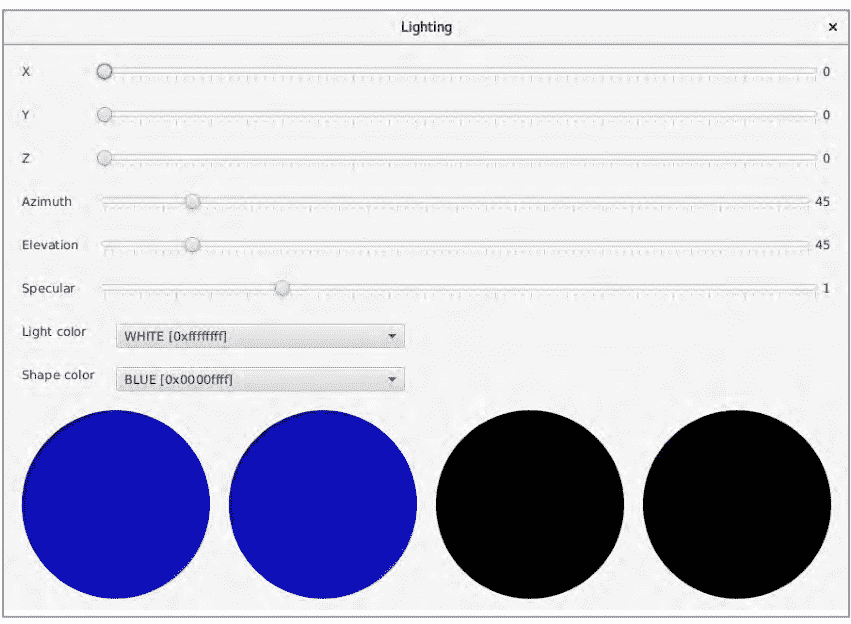

左侧的四个圆形使用了光源：

1. `default`（默认）
2. `distant`（远光）
3. `spot`（聚光灯）
4. `point`（点光）

这些设置选项通过`Slider`和`ComboBox`控件实现，并且名称反映在设置中。对于`Color`控件，必须将它们封装在以下包装类中：

```java
class ColorWrapper {
    private Color color;
    private String name;

    public ColorWrapper(Color color, String name) {
        this.color = color;
        this.name = name;
    }
}
```

```java
public Color getColor()
{
    return color;
}
```

```java
public String getName()
{
    return name;
}
```

```java
@Override
public String toString()
{
    return String.format("%s [%s]", name, color.toString());
}
```


## 我们不发明轮子，我们重新发明光

迷人的光照领域提供了无限的可能性：创新技术和新市场提供了机遇与挑战。在这个你的专业知识备受青睐的环境中享受在全球范围内的支持性工作，并从国际职业道路中受益。与其他专家紧密合作实施可持续想法，为未来做出贡献。加入我们，每天重新发明光。

光是 OSRAM


你可以使用适当数量的标准颜色初始化新的`ComboBox`控件（`Color`类中的静态对象），但实际上可以使用以下方法决定所有的颜色：

```java
private java.util.List<ColorWrapper> getColors()
{
    java.util.List<ColorWrapper> list = new java.util.ArrayList();
    try {
        java.lang.reflect.Field[] fields = Color.class.getDeclaredFields();
        for (java.lang.reflect.Field field : fields) {
            if (java.lang.reflect.Modifier.isStatic(field.getModifiers()) &&
                field.getType().equals(Color.class)) {
                Object obj = new Object();
                obj = field.get(obj);
                list.add(new ColorWrapper((Color)obj, field.getName()));
            }
        }
    } catch (Exception ex) {
        list.clear();
    }
    return list;
}
```

# 变换

JavaFX 也支持对场景图中的节点进行变换，这在很大程度上与你在 Java2D 中熟悉的用法相同。通常，有 4 种变换：

1. 平移（`Translate`）
2. 缩放（`Scaling`）
3. 旋转（`Rotation`）
4. 倾斜（`Shearing`）

其含义与 Java2D 中的相同。作为一个简单的示例，以下程序对一个矩形执行平移：

```java
package translateprogram;

import javafx.application.Application;
import static javafx.application.Application.launch;
import javafx.scene.Scene;
import javafx.scene.Group;
import javafx.stage.Stage;
import javafx.scene.shape.*;
import javafx.scene.paint.Color;
import javafx.scene.transform.*;

public class TranslateProgram extends Application {
  @Override
  public void start(Stage stage) {
    Group root = new Group();
    root.getChildren().add(createRect(Color.BLUE, null));
    root.getChildren().add(createRect(Color.RED, new Translate(50, 50)));
    Scene scene = new Scene(root, 350, 200);
    stage.setTitle("Rectangles");
    stage.setScene(scene);
    stage.show();
  }

  private Rectangle createRect(Color color, Translate trans) {
    Rectangle rect = new Rectangle(20, 20, 200, 100);
    rect.setFill(color);
    if (trans != null) rect.getTransforms().add(trans);
    return rect;
  }

  public static void main(String[] args) {
    launch(args);
  }
}
```

`createRect`方法创建了一个固定位置和大小的矩形，并带有一个颜色参数。最后，还有一个参数可以指示变换，从而将矩形移动到另一个位置。也就是说，程序创建了两个大小和位置相同的矩形，但其中一个（红色的）在两个方向上都平移了 50 像素：

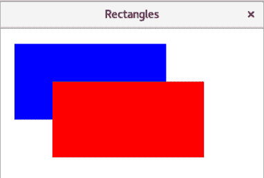


## 练习 16

编写一个程序打开以下窗口：

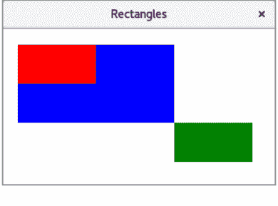

蓝色矩形的左上角位于 (20, 20)，大小为 200 × 100。红色矩形是蓝色矩形的缩放，它在两个方向上都缩放为 50%，并从点 (20, 20) 开始。绿色矩形是相应的缩放，随后是平移。请注意，在复合变换的情况下，顺序是有意义的。

## 练习 17

编写一个应用程序打开下方的窗口。在这里，蓝色矩形的左上角位于 (180, 180)，大小为 200 × 100。红色矩形是蓝色矩形绕点 (180, 180) 旋转 45 度。绿色矩形是绕同一个点旋转，但角度为 -45 度，并且旋转之后是平移。

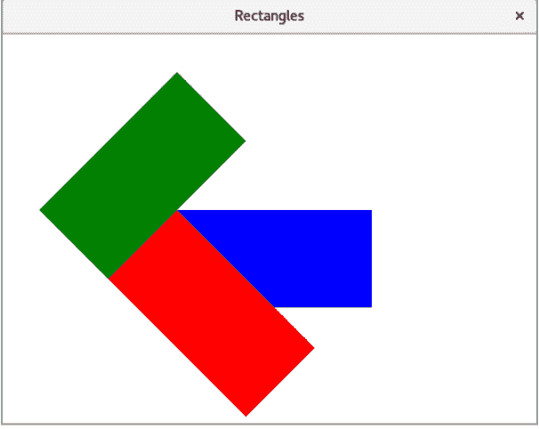

## 练习 18

编写一个程序，当红色矩形是蓝色矩形的倾斜时，打开一个类似于下面的窗口：

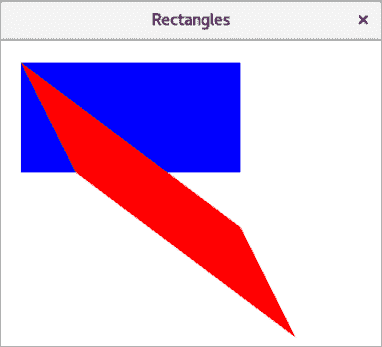

## 6.1 动画

在本节中，我将介绍动画，你也可以将其视为节点变换的一种形式。如果你在短间隔内多次更改节点的一个或多个属性并执行，那么对用户来说，该节点看起来就像是“活”的一样。正如 Java 10 中描述的，节点需要在短间隔内进行重绘，并且每次重绘时某个选项的值都发生了变化。在 JavaFX 中，这种逻辑封装在许多类中，每个类都为特定的值或属性定义了一个动画。基类称为`Transition`，但还有以下特定的过渡类：

- `FadeTransition`
- `FillTransition`
- `RotateTransition`
- `ScaleTransition`
- `StrokeTransition`
- `TranslateTransition`
- `PathTransition`
- `SequentialTransition`
- `PauseTransition`
- `ParallelTransition`

名称已经告诉了我们该类是针对什么属性的动画。例如，我将向你展示如何使用`FadeTransition`。视觉节点有一个`opacity`（不透明度）属性，表示节点显示透明的程度。如果你对该属性执行动画，你可以看到图形先是完全绘制的，然后它变得越来越透明，直到完全消失。这就是`FadeTransition`的任务。如果你运行`FadeAnimation`程序，下面的窗口显示一个红圆：

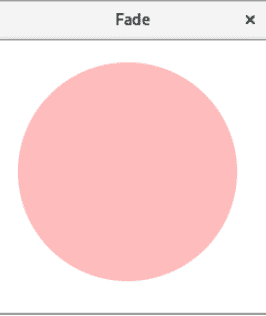


圆变得越来越淡并最终消失。然后它再次增大直到回到原始状态。这个循环重复了 5 次。代码如下：


```java
package fadeAnimation;

import javafx.application.Application;
import static javafx.application.Application.launch;
import javafx.scene.*;
import javafx.stage.*;
import javafx.scene.shape.*;
import javafx.scene.paint.Color;
import javafx.animation.*;
import javafx.util.*;

public class FadeAnimation extends Application {
  @Override
  public void start(Stage stage) {
    Group root = new Group();
    Circle circ = createCircle();
    root.getChildren().add(circ);
    Transition trans = createTransition(circ);
    Scene scene = new Scene(root, 250, 250);
    stage.setTitle("Fade");
    stage.setScene(scene);
    stage.show();
    trans.play();
  }

  private Circle createCircle() {
    return new Circle(120, 120, 100, Color.RED);
  }

  private Transition createTransition(Node node) {
    FadeTransition trans = new FadeTransition(Duration.millis(2000), node);
    trans.setFromValue(1);
    trans.setToValue(0);
    trans.setCycleCount(10);
    trans.setAutoReverse(true);
    return trans;
  }

  public static void main(String[] args) {
    launch(args);
  }
}
```

其他动画类的用法方法相同，但我没有提供示例，而是制定了一系列练习来展示这些重要类的应用。你可以直接从上面的程序开始，但对于某些练习，需要阅读文档来确定写什么——应该初始化哪些值。

## 练习 19

编写一个应用程序打开一个包含蓝色圆的窗口：

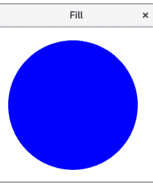

然后程序使用`FillTransition`将颜色变为红色。动画必须持续 5 秒，然后再次从蓝色圆开始。该动画必须重复 50 次。请注意，`FillTransition`不能应用于通用节点，它必须是一个`Shape`（形状）。

# JAVA 14：使用 JAVAFX 开发应用程序：软件开发

## 练习 20

编写一个可以调用`ScaleAnimation`的程序，该程序会打开一个包含红色圆的窗口：

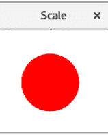

该程序必须通过动画改变圆的大小，使其产生收缩和放大。

# 练习 21

编写一个可以调用`TranslateAnimation`的程序。该程序必须打开如下所示的窗口，其中一个红色圆通过动画从左上角移动到右下角。你可以使用`TranslateTransition`。动画周期必须


为 2 秒，且动画必须重复 50 次。你还必须将`AutoReverse`设置为`true`。

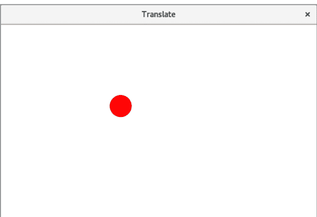

## 练习 22

你必须编写一个名为`RotateAnimation`的程序显示一个矩形。矩形应该从 0 度旋转到 360 度，同时颜色必须从红色变为蓝色——并在下次旋转时再次变回：

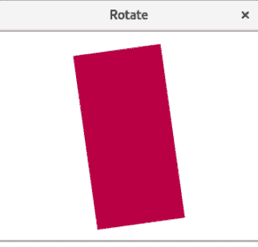

注意，这次你需要使用两个过渡动画。

## 练习 23

编写一个程序`PathAnimation`，其中一个红色圆沿着`CubicCurve`（见下文）移动。该曲线必须定义为一个`Path`对象，并可以使用`PathTransition`作为过渡对象。圆的动画必须运行两秒，你必须将`AutoReverse`设置为`true`。

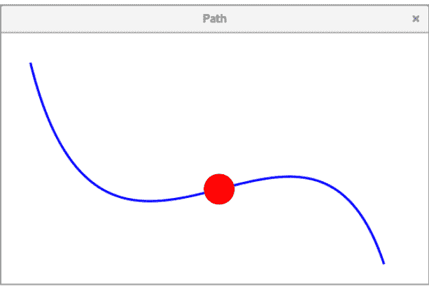

## 练习 24

作为动画的最后一个示例，编写一个与上述类似的程序`SequentialAnimation`，其中一个红色圆沿着`CubicCurve`移动，但动画只重复一次。当圆到达曲线末端时（动画停止），圆应该通过动画将颜色变为蓝色并变回红色。因此，该程序必须使用顺序执行的两个动画。

JAVA 14：使用 JAVAFX 开发应用程序：软件开发

组件

# 7 个组件

回顾上述内容，我主要关注了你在 JavaFX 中如何与几何对象交互，但我只泛泛地提到了用户可以交互的组件。从实际程序的角度来看，这无疑是最有趣的，也是本章及后续章节的主题。这涉及到哪些组件可用以及它们如何在窗口中布局的。此外，还有事件管理。

## 7.1 布局

程序的场景图（scene graph）由组件组成，这些组件可以像我结合几何对象时那样绝对放置，但通常，节点是使用布局面板（layout panes）放置在场景图中的，布局面板是一个分支节点。从程序员的角度来看，布局面板具有与 Swing 中的布局管理器（layout manager）相同的特性（目的），且理论与你从 Swing 中了解的相似。所有的布局面板都有一个共同的基类`Pane`，并有以下特定的面板：

> 我加入 MITAS 是因为我想要真正的责任

工程师与地质科学家

研究生课程

www.discovermates.com


第 16 个月

我曾在北海

担任施工

主管

提供建议并

帮助工头解决问题

真实的工作

国际机会

三次工作实习

MAERSK

在 bookboom.com 免费下载电子书

点击广告阅读更多信息

# JAVA 14：使用 JAVAFX 开发应用程序：软件开发

- `HBox`

- `VBox`

- `BorderPane`

- `StackPane`

- `FlowPane`

- `TextFlow`

- `AnchorPane`

- `TitlePane`

- `GridPane`

在这一节中，我将展示如何使用布局面板来布局组件，当然，它们可以像你在 Swing 中熟悉的那样进行相同的嵌套。以下示例彼此相似，并简要展示了不同面板的应用，但你应该查看在线文档以及可用的属性。

我想从`HBox`开始（`HBoxProgram`程序），它在窗口中水平放置组件，这里有三个按钮：

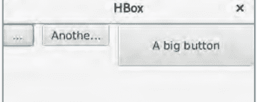

如你所见，按钮的大小（宽度）会根据可用空间改变，下面显示了大小改变后的相同窗口：

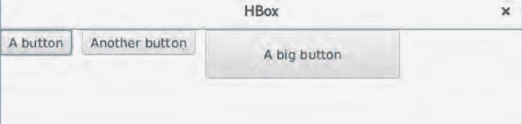

如你所见，组件默认是左对齐，但可以通过属性进行更改。代码如下：

```java
package hboxprogram;

import javafx.application.Application;
import static javafx.application.Application.launch;
import javafx.scene.*;
import javafx.scene.layout.*;
import javafx.scene.control.*;
import javafx.stage.*;

public class HBoxProgram extends Application {
    @Override
    public void start(Stage stage) {
        HBox root = new HBox();
        root.setSpacing(10);
        root.getChildren().add(createButton("A button"));
        root.getChildren().add(createButton("Another button"));
        root.getChildren().add(createButton("A big button", 200, 50));
        Scene scene = new Scene(root, 300, 100);
        stage.setTitle("HBox");
        stage.setScene(scene);
        stage.show();
    }

    private Button createButton(String text) {
        return new Button(text);
    }

    private Button createButton(String text, int width, int height) {
        Button cmd = new Button(text);
        cmd.setPrefSize(width, height);
        return cmd;
    }

    public static void main(String[] args) {
        launch(args);
    }
}
```

你可能注意到最后一个方法`createButton()`分配了按钮的首选尺寸，在 JavaFX 中，基本上这也适用于组件的大小，正如你从 Swing 中了解的那样。对于`start()`方法，没什么好解释的，但你应该知道如何定义组件之间的间隙。`HBox`是一个非常简单的布局面板，可以用于相对于其首选尺寸在行上排列组件。

# JAVA 14：使用 JAVAFX 开发应用程序：软件开发

有一种名为`VBox`的布局面板，它与`HBox`平行，区别在于它将组件放置在垂直直线上。`VBoxProgram`程序展示了该面板的应用：

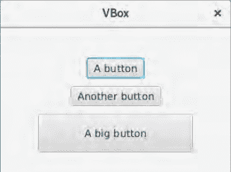

```java
public void start(Stage stage)
{
  VBox root = new VBox();
  root.setSpacing(10);
  root.setAlignment(Pos.CENTER);
  root.getChildren().add(createButton("A button"));
  root.getChildren().add(createButton("Another button"));
  root.getChildren().add(createButton("A big button", 200, 50));
  Scene scene = new Scene(root, 300, 200);
  stage.setTitle("VBox");
  stage.setScene(scene);
  stage.show();
}
```


# JAVA 14：使用 JAVAFX 开发应用程序：软件开发组件

```java
public class BorderProgram extends Application
{
@Override
public void start(Stage stage)
{
  BorderPane root =
```

# JAVA 14：使用 JAVFX 开发应用程序：软件开发

```java
new BorderPane(createField()), createField("Top"), createField("Right", 100),
createField("Button"), createField("Left", 100);
root.setPadding(new Insets(20, 20, 20, 20));
Scene scene = new Scene(root, 500, 300);
stage.setTitle("Border");
stage.setScene(scene);
stage.show();
```

```java
private Pane createField()
{
BorderPane pane = new BorderPane(new TextArea());
pane.setPadding(new Insets(10, 10, 10, 10));
return pane;
}
```

```java
private Pane createField(String text)
{
Button cmd = new Button(text);
cmd.setPrefWidth(80);
BorderPane pane = new BorderPane(new TextField(), null, cmd, null, null);
BorderPane.setMargin(cmd, new Insets(0, 0, 0, 10));
return pane;
}
```

```java
private Pane createField(String text, int width)
{
Button cmd = new Button(text);
cmd.setPrefWidth(width);
TextArea field = new TextArea();
field.setPrefWidth(width);
BorderPane pane = new BorderPane(field, cmd, null, null, null);
BorderPane.setMargin(cmd, new Insets(10, 0, 10, 0));
BorderPane.setMargin(field, new Insets(0, 0, 10, 0));
return pane;
}
```

```java
public static void main(String[] args)
{
launch(args);
}
```

这 5 个独立的区域是通过三个名为`createField()`的辅助方法创建的。第一个用于中心区域，并创建了一个带有`TextArea`组件的`BorderPane`。你应该注意如何使用`setPadding()`为剩余的 4 个区域设置 10 的内边距。此外，`BorderPane`构造函数指定了一个单个参数，即显示在中心的组件。第二个`createField()`用于创建分别放置在顶部和底部的`BorderPane`。你为`BorderPane`的构造函数指定了 5 个参数，它们解释为中、上、右、下、左。特别要注意如何定义按钮在容器中具有外边距：

```java
BorderPane.setMargin(cmd, new Insets(0, 0, 0, 10));
```

在这里，`setMargin()`是`BorderPane`类中的静态方法，用于定义当前布局面板中第一个参数的外边距。最后一个`createField()`用于为右侧和左侧区域的内容创建`BorderPane`，原则上它的工作原理与之前的方法相同。你应该注意这两个组件都定义了底部外边距。

最后是`start()`方法，这一次的根元素是一个`BorderPane`（分支节点）。

`StackPane`是一种布局面板，它按照组件添加的顺序将它们堆叠在一起。`StackProgram`程序显示了三个堆叠在一起的按钮：


# JAVA 14：使用 JAVAFX 开发应用程序：软件开发

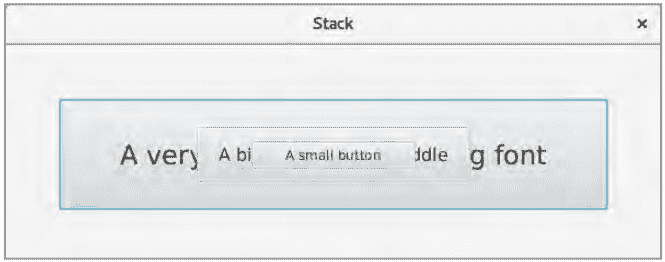

该应用可能局限限，但主要对于`Shape`对象，这种可能性是有用的。使用`StackPane`非常简单：

```java
public void start(Stage stage) {
  StackPane root = new StackPane();
  root.getChildren().add(createButton("A very big button with a big font", 500, 100, 24));
  root.getChildren().add(createButton("A big button in the middle", 250, 50, 16));
  root.getChildren().add(createButton("A small button", 150, 25, 12));
  Scene scene = new Scene(root, 600, 200);
  stage.setScene(scene);
  stage.show();
}
```


```java
private Button createButton(String text, int width, int height, int size) {
  Button cmd = new Button(text);
  cmd.setFont(Font.font(size));
  cmd.setPrefSize(width, height);
  return cmd;
}
```

`FlowPane` 是一种布局面板，其行为本质上类似于 Swing 中的 `FlowLayout`：

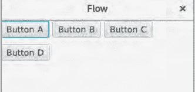

JAVA 14：使用 JAVAFX 开发应用程序：软件开发组件

如果你增加窗口宽度，所有组件将出现在同一行。关于代码，你首先应该注意如何定义组件之间的间隙：

```java
public void start(Stage stage)
{
  FlowPane root = new FlowPane();
  root.setAlignment(Pos.TOP_LEFT);
  root.setHgap(5);
  root.setVgap(10);
  root.getChildren().add(new Button("A"));
  root.getChildren().add(new Button("B"));
  root.getChildren().add(new Button("C"));
  root.getChildren().add(new Button("D"));
  Scene scene = new Scene(root, 300, 150);
  stage.setTitle("Flow");
  stage.setScene(scene);
  stage.show();
}
```

还有一种布局面板叫做 `TextFlow`，它的行为与 `FlowPane` 相同，但仅用于 `Text` 节点。`Textflow` 程序展示了如何使用此面板。它不是最常用的面板，但如果你需要编写支持文本换行的自定义组件，它在 Swing 中实际上是复杂的。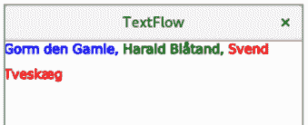

```java
public void start(Stage stage)
{
  TextFlow root = new TextFlow();
  root.setSpacing(10);
  root.getChildren().add(createText("First line", Color.BLUE));
  root.getChildren().add(createText("Second line", Color.GREEN));
  root.getChildren().add(createText("Third line", Color.RED));
  Scene scene = new Scene(root, 300, 150);
  stage.setTitle("TextFlow");
  stage.setScene(scene);
  stage.show();
}
```

# JAVA 14：使用 JAVAFX 开发应用程序：软件开发

```java
private Text createText(String text, Color color)
{
    Text node = new Text(text);
    node.setFill(color);
    return node;
}
```

`AnchorPane` 是一种将组件锚定到边缘的布局面板：

```java
public void start(Stage stage)
{
    AnchorPane root = new AnchorPane();
    root.setPadding(new Insets(30, 30, 30, 30));
    Button cmd = new Button("Button");
    root.getChildren().add(cmd);
    AnchorPane.setAnchor(cmd, Anchor.TOP_LEFT, new Insets(0, 0, 30, 30));
    Scene scene = new Scene(root, 300, 200);
    stage.setTitle("Anchor");
    stage.setScene(scene);
    stage.show();
}
```


# JAVA 14：使用 JAVAFX 开发应用程序：软件开发组件

`GridPane` 是一种在网格中排列组件的布局面板。与 `FlowPane` 不同，你可以为每个组件指定列和行：

```java
public void start(Stage stage)
{
  GridPane root = new GridPane();
  root.setPadding(new Insets(20, 20, 20, 20));
  root.setHgap(10);
  root.setVgap(10);
  root.add(new Label("First name:"), 0, 0);
  root.add(new TextField(), 1, 0);
  root.add(new Label("Last name:"), 0, 1);
  root.add(new TextField(), 1, 1);
  Scene scene = new Scene(root, 300, 150);
  stage.setTitle("Grid");
  stage.setScene(scene);
  stage.show();
}
```

`GridPane` 是一种强大的布局面板，允许你自己在行和列的网格中排列组件。它对于创建表单和其他复杂的布局非常有用。

# JAVA 14: 使用 JAVFX 开发应用程序：软件开发

```java
Button cmd = createButton("OK");
root.add(cmd, 1, 2);
GridPane.setHorizontal(cmd, HPos.RIGHT);
Scene scene = new Scene(root, 500, 200);
stage.setTitle("Grid");
stage.setScene(scene);
stage.show();
```

```java
private Label createLabel(String text, int width)
{
    Label label = new Label(text);
    label.setPrefWidth(width);
    return label;
}
```

```java
private TextField createField(int width)
{
    TextField field = new TextField();
    field.setPrefWidth(width);
    return field;
}
```


```java
private Button createButton(String text)
{
    return new Button(text);
}

public static void main(String[] args)
{
    launch(args);
}
```

在 `start()` 方法中，创建了一个 `GridPane` 作为根节点。注意，你没有说明行数和列数。它有一个 20 的边距，且每行之间必须有 20 的间隙。然后，我添加了一个宽度为 80 的 `Label`，并定义它应该位于单元格 (0, 0)，即左上角的单元格。下一个组件是一个宽宽为 300 的 `TextField`，它应该位于单元格 (1, 0) ，这可以翻译为第 1 列第 0 行。同样，这两个组件的放置方式相同，区别在于它们被放置在第 1 行。最后，按钮位于单元格 (1, 2)，即第 1 列第 2 行。注意单元格 (0, 2) 没有放置任何内容。这是没必要的——单元格是空的。特别需要注意的是，`GridPane` 有一个静态方法，可以使用它来指定组件在单元格内的对齐方式：

```java
GridPane.setHalignment(cmd, HPos.RIGHT);
```

## 7.2 事件

JavaFX 有其自己的事件类型，基础类型称为 `Event`。特定事件类型的示例有：

- `MouseEvent`
- `KeyEvent`
- `DragEvent`
- `WindowEvent`
- `ActionEvent`

事件具有以下特征特征：

1. 目标（target），即事件发生的节点，例如窗口、场景或节点。
2. 来源（source），即产生事件的物体，例如鼠标。
3. 事件类型（event type），如鼠标按下、鼠标释放等。

当事件发生时，我们称之为为“事件分发链”（event dispatch chain），它是从根阶段（stage）到该节点的路径。例如，如果是一个圆形（`Circle`）节点，它的路径可能是：

`Stage` – `Scene` – `Group` – `Circle`

当事件发生时，它会从上到下发送到分发链中的所有节点。如果某个节点注册了该事件的过滤器（filter），则会执行操作，随后事件将发送到其目标节点，如果存在事件处理器（handler），则将在那里进行处理。这一阶段被称为**事件捕获阶段**（Event Capturing Phase）。之后，事件将沿着返回路径移动，对于每个节点，如果分配了处理器，则将在那里进行处理。这一阶段被称为**冒泡阶段**（Bubbling Phase）。因此，一个事件可能会导致多个事件处理器；捕获阶段的事件处理器被称为**过滤器**（filters），而冒泡阶段的事件处理器被称为**处理器**（handlers）。

当事件遵循分发链移动时，可以随时通过 `consume()` 方法停止它，这意味着事件将不再在链中传递。作为一个示例，我将展示一个名为 `EventPhaseProgram` 的程序，它创建了以下场景图：

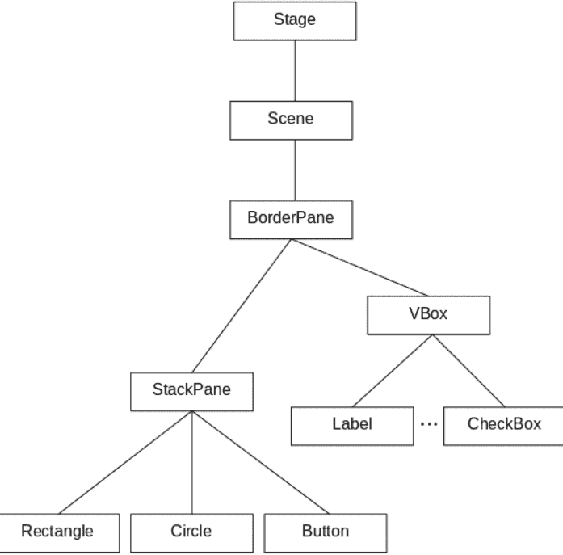

其中 `VBox` 下有 14 个节点。如果你打开该程序，会得到这个窗口：

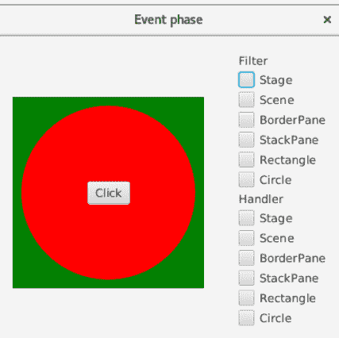


例如，如果你点击绿色区域的某个位置，标准输出将显示以下内容：

- `Stage` - capturing
- `Scene` - capturing
- `BorderPane` - capture
- `StackPane` - capture
- `Rectangle` - capture
- `Rectangle` - bubbling
- `StackPane` - bubbling
- `BorderPane` - bubbling
- `Scene` - bubbling
- `Stage` - bubbling

在这里你可以看到鼠标点击事件是如何贯穿整个分发链并返回的。你用于检查事件处理的含义应该被中断。例如，勾选 *Filter Scene* 并点击绿色矩形，将得到结果：

- `Stage` - capturing
- `Scene` - capturing

鼓励你测试该程序，以及根据所选的不同复选框，在不同节点上点击鼠标会发生什么。以下是代码：

```java
public class EventPhaseProgram extends Application {
    private CheckBox filterStage = new CheckBox("Stage");
    private CheckBox filterScene = new CheckBox("Scene");
    private CheckBox filterBorder = new CheckBox("BorderPane");
    private CheckBox filterPane = new CheckBox("StackPane");
    private CheckBox filterRect = new CheckBox("Rectangle");
    private CheckBox filterCircle = new CheckBox("Circle");
    private CheckBox handleStage = new CheckBox("Stage");
    private CheckBox handleScene = new CheckBox("Scene");
    private CheckBox handleBorder = new CheckBox("BorderPane");
    private CheckBox handlePane = new CheckBox("StackPane");
    private CheckBox handleRect = new CheckBox("Rectangle");
    private CheckBox handleCircle = new CheckBox("Circle");

    @Override
    public void start(Stage stage) {
        GridPane root = new GridPane();
        Rectangle rect = new Rectangle(100, 100, Color.GREEN);
        Circle circle = new Circle(50, Color.RED);
        Button cmd = createButton("OK");
        
        root.add(rect, 0, 0);
        root.add(circle, 1, 0);
        root.add(cmd, 1, 2);
        
        root.setHgap(20);
        root.setVgap(20);
        root.setPadding(new Insets(20));

        Scene scene = new Scene(root, 500, 400);
        stage.setTitle("Event Phase");
        stage.setScene(scene);
        
        // Event handling logic would go here
        
        stage.show();
    }

    private Button createButton(String text) {
        return new Button(text);
    }
    // ... other helper methods
}
```

# JAVA 14: 使用 JAVAFX 开发应用程序：软件开发组件

```java
pane.addEventHandler(MouseEvent.MOUSE_CLICKED,
new Handler("StackPane - bubbling", handlePane);
return pane;
```

```java
private Button createButton()
{
    Button cmd = new Button("Click");
    cmd.setOnAction(new EventHandler<ActionEvent>()(){
        @Override
        public void handle(ActionEvent e)
        {
            new Alert(Alert.AlertType.INFORMATION,
                "You have clicked the button!").showAndWait();
        }
    });
    return cmd;
}
```


```java
private Circle createCircle()
{
    Circle circle = new Circle(20, 20, 100, Color.RED);
    circle.addEventFilter(MouseEvent.MOUSE_CLICKED,
        new Handler("Circle capture", filterCirc);
    circle.addEventHandler(MouseEvent.MOUSE_CLICKED,
        new Handler("Circle bubbling", handleCirc);
    return circle;
}

private Rectangle createRect()
{
    Rectangle rect = new Rectangle(0, 0, 220, 220);
    rect.setFill(Color.GREEN);
    rect.addEventFilter(MouseEvent.MOUSE_CLICKED,
        new Handler("Rectangle capture", filterRect));
    rect.addEventHandler(MouseEvent.MOUSE_CLICKED,
        new Handler("Rectangle bubbling", handleRect));
    return rect;
}

public static void main(String[] args)
{
    launch(args);
}

class Handler implements EventHandler<MouseEvent>
{
    private String text;
    private CheckBox chkBox;

    public Handler(String text, CheckBox chkBox)
    {
        this.text = text;
        this.chkBox = chkBox;
    }

    @Override
    public void handle(MouseEvent e)
    {
        System.out.println(text);
        if (chkBox.isSelected()) e.consume();
    }
}
```

首先，创建了 12 个 CheckBox 组件，其中前 6 个用于过滤器（捕获阶段），后 6 个用于处理器（冒泡阶段）。如果你考虑 `start()` 方法，此时，一个过滤器和一个处理器被分配给了 Stage —— 节点是场景图的顶层。与 `addFilter()` 方法关联的是过滤器，而处理器与 `addEventHandler()` 方法关联。无论何种情况，都为鼠标点击关联了一个事件处理器，例如：

```java
stage.addEventHandler(MouseEvent.MOUSE_CLICKED, new Handler("...", filterStage));
```

其中第一个参数指示要监听哪个事件，而事件处理器中有一个对象（在本例中）实现了 `EventHandler<MouseEvent>` 接口。该对象由 `Handler` 类定义，它是一个内部类，其构造函数接收一个要在屏幕上打印的文本（`text`）作为参数，以及一个用于测试的 `CheckBox` 引用。该类应该实现该方法：

```java
public void handle(MouseEvent e)
{
}
```

在这种情况下，该方法执行了 `System.out.println()`，然后测试相应的 `CheckBox` 是否被选中，如果有必要，则将事件设为 `consumed`（已消费），这意味着它不会在分发链中继续传递。你应该注意通过调用创建 eBook 节点的方法是如何构建场景图的。

这些方法都非常简单且构建方式相同，你应该主要关注如何按照上述描述的方法将过滤器分配到单个节点上。你应该注意 `createButton()`，它没有附加任何过滤器或处理器。如果你运行程序并点击按钮，你会发现分发链中没有执行任何事件处理器，原因是按钮通过 `setOnAction()` 关联的是类型为 `EventHandler<ActionEvent>` 的事件处理器。这意味着当发生鼠标点击时，按钮将处理事件动作（event action）而不是普通的鼠标事件，而是一个 `ActionEvent`。另外注意，按钮的 `ActionEvent` 事件处理器会打开一个简单的消息框，包含了在 JavaFX 中实现该点的语法。

下一个示例名为 `KeyEventProgram`，它会打开以下窗口：

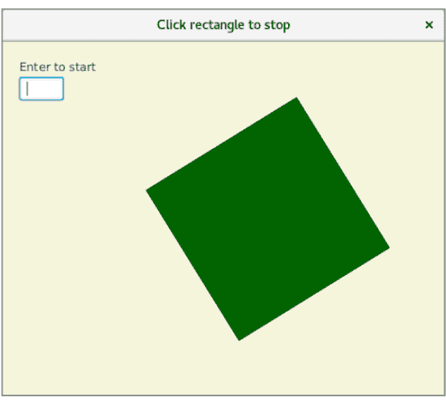

如果你位于输入字段并按下 Enter 键，绿色正方形将会旋转，点击该正方形将停止旋转。代码如下：


```java
public class KeyEventProgram extends Application
{
    private Transition trans;

    @Override
    public void start(Stage stage)
    {
        Rectangle rect = createRect();
        trans = createRotate(rect);
        Group root = new Group(createLabel(), createField(), rect);
        Scene scene = new Scene(root, 500, 400);
        scene.setFill(Color.BEIGE);
        stage.setTitle("Click rectangle to stop");
        stage.setScene(scene);
        stage.show();
    }
}
```

```java
private Rectangle createRect()
{
    rect = new Rectangle(200, 100, 200, 200);
    rect.setFill(Color.DARKGREEN);
    rect.setOnMouseClicked(e -> trans.stop());
    return rect;
}
```

```java
private Transition createRotate(Shape shape)
{
    RotateTransition trans = new RotateTransition(Duration.millis(1000), shape);
    trans.setByAngle(360);
    trans.setCycleCount(50);
    trans.setAutoReverse(true);
    return trans;
}
```

```java
private TextField createField()
{
    TextField field = new TextField();
    field.setLayoutX(20);
    field.setLayoutY(40);
    field.setPrefWidth(500);
    field.addEventFilter(KeyEvent.KEY_TYPED, new EventHandler<KeyEvent>() {
        public void handle(KeyEvent e)
        {
            if (e.getCharacter().charAt(0) == '\r') trans.play();
            e.consume();
        }
    });
    return field;
}
```

```java
private Label createLabel() {
    Label label = new Label("Enter to start");
    label.setLayoutX(20);
    label.setLayoutY(20);
    return label;
}
```

```java
public static void main(String[] args) {
    launch(args);
}
```

该类定义了一个过渡变量，即旋转正方形的动画。它是通过 `createRotate()` 方法创建的，该方法本身不包含任何动画内容。实际的 `Transition` 对象是在 `start()` 方法中创建的。你还应该注意如何为窗口设置背景颜色。正方形是在 `createRect()` 方法中创建的。在这里使用 `setMouseClicked` 方法为正方形附加了鼠标点击事件处理器，并展示了如何使用 Lambda 表达式定义事件处理器。

然后是创建事件字段的 `createField()` 方法。它是一个 `TextField`，最重要的关联是事件处理器。它是一个过滤器，并且为类型为 KEY_TYPED 的 `KeyEvent` 关联了处理器。处理器使用 `getCharacter()` 方法测试输入的内容，如果是，动画将开始。对于任何事件，该事件都被标记为已消费，使其不会在链中传递，效果是按键字符永远不会显示在输入字段中。

示例展示了如何捕获鼠标和键盘事件。对于本示例，它通过两种不同的方式实现：在 `createField()` 中通过底层的 `addEventListener` 实现，而在 `createRect()` 中则使用便利方法。许多 JavaFX 类将事件处理器定义为属性，你可以使用便利方法的 set 方法来注册事件处理器。目标是让你更容易与以下程序关联事件处理器：

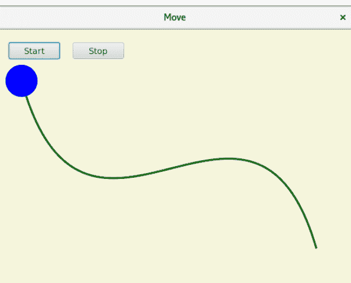

点击 Start 按钮将启动一个动画，圆体会沿曲线移动，动画将持续到你点击 stop 按钮。点击圆时它会改变颜色。


## JAVA 14：使用 JAVAFX 开发应用程序

### 软件开发组件

```java
public class HandlerProgram extends Application
{
    private boolean blue = true;
    private Transition trans;
}
```

```java
@Override
public void start(Stage stage) {
    Circle circle = createCircle();
    Path path = createPath();
    trans trans = createTrans(circle, path);
    Group root = new Group(createButton("Start", 20, e -> trans.play()),
    createButton("Stop", 120, e -> trans.stop()), path, circle);
    Scene scene = new Scene(root, 560, 400);
    scene.setFill(Color.BEIGE);
    stage.setTitle("Move");
    stage.setScene(scene);
    stage.show();
}
```

```java
private Button createButton(String text, int pos,
EventHandler<ActionEvent> handler) {
    Button cmd = new Button(text);
    cmd.setLayoutX(pos);
    cmd.setLayoutY(20);
    cmd.setPrefSize(80, 25);
    cmd.setOnAction(handler);
    return cmd;
}
```

```java
private Transition createTrans(Shape shape, Path path) {
    PathTransition trans = new PathTransition();
    trans.setDuration(Duration.millis(3000));
    trans.setNode(shape);
    trans.setPath(path);
    trans.setOrientation(PathTransition.OrientationType.ORTHOGONAL_TO_TANGENT);
    trans.setCycleCount(50);
    trans.setAutoReverse(true);
    return trans;
}
```

```java
private Circle createCircle() {
    Circle circle = new Circle(40, 80, 25, Color.BLUE);
    circle.setStrokeWidth(20);
    circle.setOnMouseClicked(
        e -> {
            blue = !blue;
            circle.setFill(blue ? Color.BLUE : Color.RED);
            return circle;
        });
```

```java
private Path createPath()
{
    Path path = new Path(new MoveTo(40, 80),
    new CubicCurveTo(140, 440, 400, 0, 500, 340));
    path.setStroke(Color.DARKGREEN);
    path.setStrokeWidth(3);
    return path;
}
```

```java
public static void main(String[] args)
{
    launch(args);
}
```

关于如何创建动画和曲线，这些都发生在 `createTrans()` 和 `createRect()` 两个方法中。如果你考虑创建圆的 `createCircle()` 方法，它是一个使用 `setMouseClicked()` 方便方法的鼠标点击事件处理器。你应该注意，事件处理器是参数并且是一个 Lambda 表达式。

`createButton()` 方法用于创建按钮。它有三个参数：按钮的文本、窗口中位置的 x 坐标以及按钮的事件处理器。后者的类型为 `EventHandler<ActionEvent>` 并与 `setActionEvent()` 方法关联。

## 7.3 组件

然后是 JavaFX 提供的许多组件（或控件），但最重要的是以下：

| Label | MenuButton | Slider | ColorPicker |
|---|---|---|---|
| Button | MenuItem | ScrollPane | DatePicker |
| TextField | Menu | ScrollBar | ProgressIndicator |
| PassWordField | ContextMenu | TabPane | ProgressBar |
| TextArea | Separator | SplitPane | FileChooser |
| RadioButton | ChoiceBox | TitlePane | HTMLEditor |
| Hyperlink | ComboBox | Accordion | TableView |
| CheckBox | ListView | Pagination | TreeView |
| ToggleButton | WebView | Tooltip | Tree |

这些组件中的一些已经在之前的示例中使用过，本节的其余部分将由练习和问题组成，你应该尝试使用上述组件（但最后一列的最后三个推迟到下一本书）。大多数组件都易于使用，并占据很大一部分内容，正如你从 Swing 中了解的那样。其他组件更为复杂，总的来说，练习要求你查阅文档，并在必要时在互联网上寻找示例和帮助。


## 赋能人类

### 改进商业

BI挪威商学院（BI Norwegian Business School）是欧洲最大的商学院之一，欢迎超过 20,000 名学生。我们的课程提供了一个充满活力且多元文化的学习环境，具有国际视野，为学生提供满足商业需求的专业技能。

BI 提供四种不同的两年制全日制科学硕士（MSc）课程，均采用英语授课，旨在提供满足企业日益增长需求的专业技能。硕士课程提供了一个充满活力且多元文化的学习环境，为你开启职业生涯提供最佳平台。

- 商业管理硕士
- 金融经济学硕士
- 战略营销管理硕士
- 领导与组织心理学硕士

`www.bi.edu/master`

## 练习 25

你必须编写一个程序来打开以下窗口：

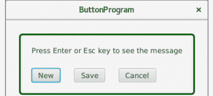

其中其中有 4 个控件：如果你点击 New（新建），文本必须改变。如果你点击 Save（保存），文本必须改变。如果你点击 Cancel（取消），文本必须改变。要求窗口是可调整的，并且可以查看列表中的所有内容。

## 练习 26

你必须编写一个程序来打开以下窗口：


## 练习 27

你必须编写一个使用 ChoiceBox（选择框）的程序：


你必须从列表中选择一个人。选择人员后，姓名和职位名称必须通过`Label`（标签）显示：

## 练习 28

你必须编写与上一个练习相同的程序，但区别在于：不再使用`ChoiceBox`，而是使用`ComboBox`（组合框）。编写程序后，尝试研究`ChoiceBox`和`ComboBox`之间的区别。

## 问题 3

从 Swing 中熟悉组件`JList`，它是一个列表框，是常用组件之一。在 JavaFX 中，它被`ListView`替代，这是一个更先进的组件，具有许多新选项并涉及多个类。你必须编写一个应用程序来打开以下窗口，其中窗口显示四个控件（实际上是 5 个），每个`ListView`显示 10 个`Person`对象，`Person`是练习 27 中的类。

- 3. 左下角的`ListView`控件应该显示项目，每个元素都是一个`ChoiceBox`，你可以通过选择另一个`Person`对象来更新该项目（它也内置在组件中）。

- 4. 最后，最后一个`ListView`以`Checkbox`控件的形式显示项目（它也集成在`ListView`组件中）。如果你点击按钮，程序可能会打开一个消息框，显示已选择（通过复选框）的对象。

该任务要求你查阅文档以确定要写的内容，也许你也可以在网上找到帮助。

## 练习 29

JavaFX 拥有一个`ColorPicker`组件，这是一个用于选择色的相对复杂的组件。另一方面，该组件既灵活又易用。你必须编写一个程序，打开一个窗口，可以在其中选择一种颜色来给矩形上色：

## 练习 30

JavaFX 有一个很好的`DatePicker`控件，用于选择日期。你必须编写一个程序，打开以下窗口，其中选择了 2017 年 11 月 15 日：

选择日期后，底部的`Label`必须更新。

## 练习 31

JavaFX 有像 Swing 一样的进度条，但也有`ProgressIndicator`，区别在于这两个组件的绘制方式。`ProgressIndicator`控件是`ProgressBar`的基类。进度组件的更新方式与 Swing 相同，使用由`javafx.concurrent`包中的`Task`对象表示的线程。你必须编写一个程序，显示一个`ProgressIndicator`和一个`ProgressBar`，两者都可以通过点击按钮启动（停止）：

以下是点击两个按钮后的窗口：

以及是两个进度组件完成后的窗口：

## 练习 33

你必须编写一个程序，打开以下窗口，该窗口包含一个`Label`、一个`TextField`和两个`Button`控件：

| 名字 | 保存 | 关闭 |
|---|---|---|

按钮不需要动作，但输入字段必须有一个`Tooltip`（提示框）。有趣的是，你可以为`tooltip`附加样式，而样式是下一章的主题。

## 练习 34

编写一个程序，拥有一个位于`SplitPane`中包含两个`TextArea`控件的窗口：

## 问题 4

在此任务中，你应该处理 JavaFX 中的菜单。你必须编写一个打开以下窗口的应用程序：

窗口有一个包含两个菜单的菜单栏，且窗口本身（中心）有一个`Canvas`对象。第一个菜单必须具有以下功能：

如果你点击三个顶部菜单项之一，窗口中应该出现一个带有黑框的绿色形状，例如：

第四个菜单项必须清除窗口，而最后一个应该关闭程序。`Options`（选项）菜单有一个菜单项和一个`Slider`（滑动条）。第一个菜单项必须指示是否绘制形状，而滑动条则指示大小。如果你移动滑动条，任何形状的周长都应该更新。如果你右键点击`canvas`对象，将获得一个上下文菜单：

并点击两个菜单项之一，窗口底部将出现一个`ColorPicker`对象，你可以选择其中一种颜色：

作为最后一项要求，所有菜单项都必须提供快捷键，并且必须为这三个形状定义加速键（accelerator keys）。

## 练习 35

你必须编写一个应用程序，打开以下窗口：

以及一个使用标签（tabs）的程序。在第一个标签上，你必须输入名称和注册日期，而在另一个标签上，你可以输入地址和电子邮件地址。如果你点击按钮，将得到一个显示所输入数据的消息框：

## 练习 36

FX 有名为`HTMLEditor`的控件，它是一个完整的 HTML 编辑器。你必须编写一个应用程序，打开一个可以编辑 HTML 文档的窗口：

程序必须拥有按钮，以便你加载和保存本地文件的 HTML 文档。

## 7.4 对话框

你可以使用对话框，就像 Swing 一样，有开箱即用的类；另一方面，也有自定义的对话框。最的是`Alert`，它对应于 Swing 中的`MessageDialog`。`AlertProgram`应用程序打开以下窗口：

如果你点击`Info`按钮，将得到下方显示简单消息的消息框；点击`Save`按钮，可能会收到相应的消息框（但带有错误消息），最后最后一个按钮将产生一个带有警告的消息框，询问你是否要删除输入字段：

```java
public class AlertProgram extends Application {
    private TextField txtField = new TextField();
    private Button cmdInfo;
    private Text status = new Text();

}
```

```java
@Override
public void start(Stage stage) {
    textField.promptText("Enter some text and save.");
    status.setFont(Font.font("Arial", FontWeight.NORMAL, 20));
    vbox = new VBox(20, txtField, createCommands(), status);
    vbox.setPadding(new Insets(20, 20, 20, 20));
    Scene scene = new Scene(vbox, 400, 180);
    stage.setTitle("AlertProgram");
    stage.setScene(scene);
    stage.show();
    cmdInfo.requestFocus();
}
```

```java
private Pane createCommands() {
    HBox pane = new HBox(10, cmdInfo = createButton("Info", new InputListener()),
    createButton("Save", new SaveListener()), createButton("Clear",
    new ClearListener()));
    pane.setAlignment(Pos.CENTER_RIGHT);
    return pane;
}
```

```java
private Button createButton(String text, EventHandler<ActionEvent> handler) {
    Button cmd = new Button(text);
    cmd.setOnAction(handler);
    return cmd;
}
```

```java
private class InfoListener implements EventHandler<ActionEvent> {
    @Override
    public void handle(ActionEvent e) {
        Alert alert = new Alert(AlertType.INFORMATION);
        alert.setTitle("About this program");
        alert.setHeaderText("How to use this program");
        alert.setContentText("Enter a text at least 5 characters\n then click Save.");
        alert.show();
    }
}
```

```java
private class SaveListener implements EventHandler<ActionEvent> {
    @Override
    public void handle(ActionEvent e) {
        String txt = textField.getText().trim();
        String msg = "Text is saved";
        boolean valid = true;
        if ((txt.isEmpty()) || (txt.length() < 5)) {
            valid = false;
            Alert alert = new Alert(AlertType.ERROR);
            alert.setTitle("Error message");
            alert.setContentText("Text should be at least 5 characters long.\nEnter a valid text and save.");
            alert.showAndWait();
            msg = "Invalid text entered";
        }
        status.setText(msg);
        status.setFill(valid ? Color.DARKGREEN : Color.DARKRED);
        if (!valid) textField.requestFocus();
    }
}
```

```java
private class ClearListener implements EventHandler<ActionEvent> {
    @Override
    public void handle(ActionEvent e) {
        Alert alert = new Alert(AlertType.CONFIRMATION);
        alert.setTitle("Warning message");
        alert.setContentText("Are sure you want to delete the text field?");
        Optional<ButtonType> result = alert.showAndWait();
        if (result.isPresent() && result.get() == ButtonType.OK) {
            textField.clear();
            status.setText("");
            cmdInfo.requestFocus();
        }
    }
}

public static void main(String [] args) {
    launch(args);
}
```

按钮在`createCommands()`方法中创建，这里是有趣的`ActionEvent`监听器，它们定义为程序末尾类。`InfoListener`类为`Info`缓冲区创建了一个事件对象，处理器中是一个类型为`AlertType.INFORMATION`的`Alert`对象，结果就是上面显示的对话框。你必须注意，对话框是单独初始化的，具体的消息显示在消息框中。对话框通过`show()`方法打开。该方法是非阻塞的，程序不会等待返回值。

`SaveListener`类定义了`Save`按钮的监听器，并模拟了保存输入的文本。它测试文本长度，如果长度小于 5，则会弹出与上面类似的警报。区别在于类型，这里是`AlertType.ERROR`对应于错误消息，然后通过`showAndWait()`方法打开对话框。这意味着消息框是阻塞的，随后的语句

```java
msg = "Invalid text entered";
```

只有在对话框关闭后才会执行。

最后一个监听器类与其他类相似，但这次类型是`AlertType.CONFIRMATION`，打开一个带有两个按钮的对话框，用户必须选择 YES 或 NO。它也通过`showAndWait()`打开，你应该注意这次有一个返回值，以及如何测试该值。

还有一个`ChoiceDialog`，用户可以在多个选项之间选择一个值。

`ChoiceProgram`程序打开一个带有按钮的窗口，点击该按钮将向你展示下图所示的对话框：

在下拉菜单中，你可以选择一个文本（在此处是一个丹麦国王的名字）。如果你点击 OK，所选的名称将返回给应用程序，它将显示在窗口中。代码如下：


```java
public class ChoiceProgram extends Application {
    private List<String> dialogData = Arrays.asList("Gorm den Gamle", "Harald Blåtand", "Svend Tveskæmg", "Harald d.2.", "Knud den Store");
    private Text status = new Text();

    @Override
    public void start(Stage stage) {
        Button cmd = new Button("Get a King");
        cmd.setOnAction(() -> showAndWait());
        HBox command = new HBox(cmd);
        command.setAlignment(Pos.CENTER);
        status.setFont(new Font("Arial", FontWeight.NORMAL, 20));
        status.setStyle(Color.DARKGREEN);
        HBox message = new HBox(status);
        message.setAlignment(Pos.CENTER);
        Vbox root = new Vbox(30, command, message);
        root.setPadding(new Insets(20, 20, 20, 20));
        Scene scene = new Scene(root, 400, 180);
        stage.setTitle("ChoiceProgram");
        stage.setScene(scene);
        stage.show();
    }

    private void showAndWait() {
        ChoiceDialog<String> dialog = new ChoiceDialog<>(dialogData.get(0), dialogData);
        dialog.setTitle("Danish Kings");
        dialog.setHeaderText("Choice a");
        Optional<String> result = dialog.showAndWait();
        if (result.isPresent()) {
            status.setText(result.get());
        }
    }

    public static void main(String [] args) {
        launch(args);
    }
}
```

# Java 14：使用 JavaFX 开发应用程序

## 软件开发组件

```java
private void showDialog() {
    ChoiceDialog<String> dialog = new ChoiceDialog<>(dialogData.get(0), dialogData);
    dialog.setTitle("Danish Kings");
    dialog.setHeaderText("Choice a");
    Optional<String> result = dialog.showAndWait();
    if (result.isPresent()) {
        status.setText(result.get());
    }
}
```

作为最后一个标准对话框，你有一个用于输入文本的 `TextInputDialog`。`InputProgram` 程序像之前的程序一样打开一个带有按钮的窗口，点击该按钮将给你显示一个可以在其中输入文本的对话框：

```java
private void showDialog() {
    TextInputDialog dialog = new TextInputDialog("A name?");
    dialog.setTitle("Enter text");
    dialog.setHeaderText("Enter some text.");
    Optional<String> result = dialog.showAndWait();
    status.setText(result.isPresent() ? result.get() : "");
}
```

作为本部分的最后一个示例，以下应用程序打开了两个自定义对话框。该程序被称为 `DialogProgram`，如果你运行该程序，将得到以下窗口：


如果你点击顶部的按钮，将得到一个对话框，在其中你应该输入人的姓名和职位，并选择一个日期（可以解释为生日、预约日期或其他内容）：


如果你点击底部的按钮，程序会打开另一个对话框，显示在第一个对话框中输入的人（此处显示已经输入了两个人）：


这个程序看起来像我以前在关于 Swing（《Java 2》这本书）中看过的程序。人（Person）由一个简单的模型类定义：

```java
package dialogprogram;

import java.time.*;

public class Person
{
    private String name;
    private String job;
    private LocalDate date;
}
...
```

## `Person.toString()`

```java
@Override
public String toString()
{
    return String.format("%s, %s", name, job, date.toString());
}
```

然后是程序的代码：

```java
public class DialogProgram extends Application {
    private List<Person> persons = new ArrayList();

    @Override
    public void start(Stage stage) {
        VBox root = new VBox(20, createButton("Enter person", 150, e ->enterDialog()), createButton("Show persons", 150, e ->showDialog()));
        root.setAlignment(Pos.TOP_CENTER);
        root.setPadding(new Insets(20, 20, 20, 20));
        Scene scene = new Scene(root, 300, 150);
        stage.setTitle("DialogProgram");
    }
```


```java
stage.setScene(scene);
stage.show();

private Button createButton(String text, double width,
EventHandler<ActionEvent> handler)
{
  Button cmd = new Button(text);
  cmd.setPrefSize(width, 25);
  cmd.setOnAction(handler);
  return cmd;
}
```

```java
private void enterDialog(){

  Dialog<Person> dialog = new Dialog();

  dialog.setTitle("Enter person");

  dialog.setResizable(false);

  TextField name = new TextField();

  TextField job = new TextField();

  DatePicker date = new DatePicker();

  name.setPrefWidth(300);

  job.setPrefWidth(300);

  date.setPrefWidth(150);

  GridPane grid = new GridPane();

  grid.setHGap(10);

  grid.setVGap(20);

  grid.setPadding(new Insets(10, 10, 10, 10));

  grid.add(new Label("Name"), 0, 0);

  grid.add(new Label("Job"), 0, 1);

  grid.add(job, 1, 1);

  grid.add(new Label("Date"), 0, 2);

  grid.add(date, 1, 2);

  dialog.getDialogPane().setContent(grid);

  dialog.getDialogPane().getButtons().add(

    new Button("OK"), ButtonData.OK_DONE);

  dialog.getDialogPane().getButtons().add(

    new Button("Cancel"), ButtonData.CANCEL_CLOSE);

  dialog.setResultConverter(new Callback<ButtonType, Person>() {

    @Override

    public Person call(ButtonType type) {

      if (type == ButtonData.OK_DONE) {

        return new Person(name.getText(), job.getText(), date.getValue());

      }

      return null;

    }

  });
```

```java
Optional<Person> result = dialog.showWait();

if (result.isPresent()) persons.add(result.get());
```

```java
private void showDialog() {

    ListView<Person> view = new ListView();

    view.setPref(400, 300);

    view.getItems().addAll(persons);

    BorderPane pane = new BorderPane(view);

    DialogList<Person>> dialog = new Dialog();

    dialog.setTitle("Persons");

    dialog.setHeaderText("You have entered the following persons:");

    dialog.getDialogPane().setContent(pane);

    dialog.getDialogPane().getButton().add(new ButtonType("Close", ButtonData.CANCEL_CLOSE));

    dialog.show();

}
```

```java
public static void main(String [] args) {

    launch(args);

}
```

在程序开始时，定义了一个 `Person` 对象的列表，这些对象是在输入对话框中创建的。`start()` 方法非常简单，唯一需要注意的是与两个按钮关联的事件处理器。第一个调用 `enterDialog()`，它创建了一个类型为 `Person` 对象的 `Dialog` 对象。参数类型 `Person` 指定了如果对话框通过点击 OK 结束，将返回哪个对象。接下来，必须定义对话框的内容，这是通过 `GridPane` 实现的，它布局了对话框组件，并将此 Pane 分给对话框：

```java
dialog.getDialogPane().setContent(grid);
```

下一步定义了对话框应该包含哪些内容，然后定义了如何点击 OK 来创建一个 `Person` 对象，该对象必须是对话框的返回值。

另一个对话框基本上是完全相同，但使用的是 `BorderPane`。主要的区别是它没有返回值。你应该注意这个对话框有一个标题文本（header text），而第一个没有，以及标题文本对结果意味着什么。

# 8 样式

在 Web 应用程序中，你使用级联样式表，你也可以在 JavaFX 中使用它。理念与 Web 应用程序相同，即将窗口及其内容的定义与呈现分离，这样你就可以在不更改代码的情况下更改程序的外观。另一方面，语法略有不同，像 Web 应用程序一样，最大的挑战是学习如何编写样式以及它们称为什么。这个主题通过示例来说效果最好，且 `StyleProgram` 程序打开了以下窗口：


因此，CSS 样式表作为资源存放在 `/css` 文件夹中（同样位于 `/src` 目录下）。这不是强制要求，但建议此这样做，因为该文件将成为项目 jar 文件的一部分。以下是上述程序的代码：

```java
package styleprogram;

import javafx.application.Application;
import javafx.event.*;
import javafx.Scene;
import javafx.scene.control.*;
import javafx.scene.layout.*;
import javafx.stage.Stage;
import javafx.geometry.*;

public class StyleProgram extends Application {
    private TextField txtName;
    private TextField txtJob;

    @Override
```


`public void start(Stage stage)` {

    `HBox commands = new HBox(10);`

    `createButton("Save", e -> {new Alert(Alert.Type.INFORMATION, "Object saved.", ButtonType.CLOSE).show();});`

    `createButton("Clear", e -> { txtName.clear(); txtJob.clear(); });`

    `commands.setAlignment(Pos.CENTER_RIGHT);`

    `GridPane root = new GridPane();`

    `root.add(0, createLabel("Name", "-fx-font-size: 18; -fx-text-fill: darkred"));`

    `txtName = createField(300);`

    `root.add(1, createLabel("Job", "-fx-font-size: 18; -fx-text-fill: darkgreen"));`

    `txtJob = createField(300);`

    `root.add(commands, 1, 2);`

    `root.setHgap(10);`

    `root.setPadding(new Insets(20, 20, 20, 20));`

    `root.setStyleClass().add("border");`

    `Scene scene = new Scene(root);`

    `scene.getStylesheets().add("resources/css/styles.css");`

    `stage.setTitle("StyleProgram");`

    `stage.setScene(scene);`

    `stage.show();`

}

`private Label createLabel(String text, String style)` {

    `Label label = new Label(text);`

    `label.setStyle(style);`

    `return label;`

}

`private TextField createField(double width)` {

    `TextField field = new TextField();`

    `field.setPrefWidth(width);`

    `return field;`

}

`private Button createButton(String text, EventHandler<ActionEvent> handler)` {

    `Button cmd = new Button(text);`

    `cmd.setOnAction(handler);`

    `return cmd;`

}

`public static void main(String[] args)` {

    `launch(args);`

}

这是一个简单的程序，使用 `GridPane` 布局组件。样式表可以分配给场景图或分支节点。在这种情况下，它被分配给了场景图：

```java
scene.getStylesheets().add("resources/css/styles.css");
```

这里使用了样式表的相对路径，但你也可以指定绝对路径。结果是，程序中所有的 `TextField` 和 `Button` 节点（另有规定外）将应用样式表中定义的样式。该语句

```java
root.getStyleClass().add("border");
```

表示 `GridPane` 节点应应用选择器为 `border` 的样式，结果是出现了灰色的边框。

样式也可以内联定义，就像这两个 `Label` 控件那样。这确实有其用途，但通常建议在样式表中定义样式，因为内联样式只能在代码中更改。

如果你在应用程序中考虑某个属性，其值可以在多个地方确定，以下列表指示了哪个值的优先级最高：

1. 内联（优先级最高）
2. 父级节点
3. 场景图
4. 在代码中赋值的值（Java 属性）
5. 默认样式表

这里你应该特别注意，样式的优先级比 Java 代码中通常赋值的方式要高。还要注意最后一个优先级最低的选项。如果你不指定某些内容，属性的值将由默认样式表决定。

## 练习 37

你必须编写一个应用程序，打开以下登录窗口：


其中包含 2 个 `Label` 控件、1 个 `TextField` 控件、1 个 `PasswordField` 控件和 2 个 `Button` 控件。对于这些控件，必须设置以下属性：

- `Label`: 字体必须为粗体
- `TextField`: 字体必须为粗体
- `PasswordField`: 必须有灰色背景
- `Button`: 必须有灰色背景

# JAVA 14：使用 JAVAFX 开发应用程序

## FXML

FXML 是一种 XML 语言，可以用于定义用户界面，作为编写 Java 代码的替代方案。通过 FXML，你可以定义整个场景图或其部分部分。


# JAVA 14：使用 JAVAFX 开发应用程序

## FXML

当你点击“Next”时，NetBeans 会创建文件：


# JAVA 14：使用 JAVAFX 开发应用程序

## FXML

FXML 文件是：

```xml
<?xml version="1.0" encoding="UTF-8"?>

<AnchorPane id="AnchorPane" prefHeight="200" prefWidth="320" xmlns:fx="http://javafx.com/fxml/1" fx:controller="hellofxml.FXMLDocumentController">

   <children>

      <Button layoutX="126" layoutY="90" text="Click Me!" onAction="#handleButton" fx:id="button" />

      <Label layoutX="126" layoutY="120" minHeight="16" minWidth="69" fx:id="label" />

   </children>

</AnchorPane>
```

# JAVA 14: 使用 JAVAFX 开发应用程序：软件开发

```java
@FXML

private void handleButtonAction(ActionEvent event)

{

    System.out.println("You clicked me!");

    label.setText("Hello World!");

}
```

```java
@Override

public void initialize(URL url, ResourceBundle rb)

{

}
```

该类定义了一个变量和两个方法。第一个方法是对 XML 部分中定义的控件的引用，这里你应该注意 `@FXML` 注解。这意味着 `FXMLLoader` 可以通过注入创建在 FXML 中定义的对象。同样的概念也用于按钮的事件处理程序，这意味着它可以从 XML 部分被引用。你应该注意，该类实现了 `Initializable` 接口，该接口定义了一个单方法，该方法可以用于初始化控制器。

上述是 NetBeans 自动创建的内容，现在我必须对 `FXMLDocument.fxml` 和 `FXMLDocumentController.java` 进行更改。`HelloFXML.java` 类将保持不变。`FXMLDocument.fxml` 已经发生了发生了变化：

```xml
<?xml version="1.0" encoding="UTF-8"?>

import java.lang.*;

import javafx.util.*;

import javafx.scene.*;

import javafx.scene.control.*;

import javafx.scene.layout.*;

import javafx.scene.geometry.*

import javafx.scene.text.*
```

```xml
<VBox alignment="CENTER" spacing="20" prefWidth="400"

     xmlns:fx="http://javafx.com/fxml/1"

     fx:controller="hellofxml.FXMLDocumentController">

<style>

    -fx-padding: 20;

    -fx-border-style: solid;

    -fx-border-width: 2;

    -fx-border-insets: 25;

    -fx-border-radius: 10;

    -fx-border-color: darkred;

</style>

<children>

<TextField fx:id="name" prefWidth="300" maxWidth="300" />
```

```xml
<Button text="Click Me!" prefWidth="100" onAction="#handleAction" fx:id="button" />

<Label minHeight="20" fx:id="label" fillColor="red">

<font>

<Font name="Aria" size="24.0" />

</font>

</Label>

</children>

</VBox>
```

添加了两个导入指令，`AnchorPane` 元素被 `VBox` 替换。然后添加了一个元素和一个 `TextField` 元素，许多属性也发生了更改。当你看到这些代码时，如果你了解 JavaFX，理解起来很容易。结果窗口变成了如下：


其中在输入框中输入文本 Carlo，然后点击按钮。在控制器中，没有添加其他内容，增加了一个变量，并且事件处理程序发生了变化：

```java
package hellofxml;

import java.net.URL;

import java.util.ResourceBundle;

import javafx.event.ActionEvent;

import javafx.fxml.FXML;

import javafx.fxml.Initializable;

import javafx.scene.control.Label;

import javafx.scene.control.TextField;

public class FXMLDocumentController implements Initializable

{

@FXML

private Label label;

@FXML

private TextField name;

@FXML

private void handleButtonAction(ActionEvent event) 

{

  label.setText("Hello: " + name.getText());

  name.setText("");

}

@Override

public void initialize(URL url, ResourceBundle rb)

{

}

}
```

## 9.1 创建对象

如之前的示例所示，FXML 用于定义程序的场景图（scene graph），但 FXML 可以更广泛地用于定义对象。在本节中，将展示一个名为 `ObjectsFXML` 的程序，它将展示如何使用 FXML 创建对象。`ObjectsFXML.java` 类不包含任何新内容。在这里显示 `FXMLDocument.fxml` 文件的内容：

```xml
<?xml version="1.0" encoding="UTF-8"?>
```


```xml
<import java.lang.*?>

<import java.util.*?>

<import javafx.scene.*?>

<import javafx.scene.control.*?>

<import javafx.scene.layout.*?>

<import javafx.scene.text.*?>

<import javafx.geometry.*?>

<import java.lang.*?>

<import javafx.collections.*?>

<import objectsfxml.*?>

<VBox prefHeight="200" prefWidth="320" spacing="20" alignment="CENTER"

xmlns:fx="http://javafx.com/fxml/1"

fx:controller="objectsfxml.FXMLLoader">

<padding>

  <Insets top="20" right="20" bottom="20" left="20"/>

</padding>

<children>

  <Text fx:id="header" />

  <ComboBox fx:id="lstPersons">

    <items>

      <FXCollections factory="observableArrayList">

        <String value="Gamle" />

        <String value="Harald" />

        <String value="Svend" />

        <String value="Harald 2." />

        <String value="Knud" />

      </FXCollections>

    </items>

  </ComboBox>

  <Button text="Select a king" onAction="#handleKings" fx:id="button" />

  <ComboBox fx:id="lstPersons">

    <Button text="Select a king" onAction="#handlePersons" />

    <Label fx:id="label">

      <String value="A Person" />

    </Label>

  </ComboBox>

</children>

</VBox>
```

例如，如果你查看项 `<VBox prefHeight="200" ...`，这意味着正在实例化 `VBox` 类型的对象。首先，它需要一个包含 `VBox` 类的导入指令，并且该类有一个默认构造函数，因为语法中没有直接向构造函数传递值的方法。

```xml
<Text fx:id="header" />
```

意味着创建了一个 `Text` 对象，并引用了控制器的变量 `header`。在这里，还分配了一个名为 `lstKings` 的 `ComboBox`（对应的对象在控制器中调用）。接下来发生的事情是创建一个 `ComboBox`。特别地，注意 `ComboBox` 是如何初始化的。这是通过 `ObservableList` 实现的，在这里通过下文工厂方法创建列表。列表中的单独项是 `String` 类型，而项

```xml
<String value="Gayle"/>
```


通过执行`valueOf()`静态方法创建一个`String`对象。这要求要实例化对象的类具有此类方法，并且具有`String`类。结果是创建了一个带有5个`String`对象的`ComboBox`。

作为下一步，创建了一个没有任何说明的按钮，然后是一个名为`lstPersons`的空`ComboBox`以及另一个按钮。最后，创建了一个`Label`，在这里你会注意到这个`Label`是用一个`String`对象初始化的。如果你运行程序，将得到如下窗口：


其中在顶部组合框中选择一个名称，然后点击顶部按钮。另一个`ComboBox`也是初始化的，使用工厂完成的，如下所示。`ComboBox`使用`Person`类型的对象初始化：

```java
package objectsfxml;

public class Person
{
    private String name;
    private String job;

    public Person(String name, String job)
    {
        this.name = name;
        this.job = job;
    }

    public String getName()
    {
        return name;
    }

    public void setName(String name)
    {
        this.name = name;
    }

    public String getJob()
    {
        return job;
    }

    public void setJob(String job)
    {
        this.job = job;
    }

    @Override
    public String toString()
    {
        return String.format("%s, %s", name, job);
    }
}
```

这是一个我之前展示过的简单模型类。注意，该类没有默认构造函数，如果你想实例化对象，必须将参数传递给构造函数。因为你无法在FXML中这样做，所以使用了构建器类（builder class），即实现接口的类：

```java
public interface Builder<T>
{
    public T build();
}
```

以及一个实现此接口的如何实例化类型`T`对象的类。该类被实现另一个接口的工厂类使用：

```java
public interface BuilderFactory
{
    public Builder<?> getBuilder(Class<?> type);
}
```

如果`FXMLLoader`无法通过其他方式创建对象，它将使用`BuilderFactory`，这是通过带参数调用`getBuilder()`方法实现的。如果该方法返回一个`Builder`对象，`FXMLLoader`将使用它来初始化要实例化对象的所需的属性，并最终调用返回对象的`build()`方法。构建器类必须为构造函数的所有参数提供对应的set方法。在这种情况下，你必须为`Person`类定义一个`Builder`：

```java
package objectsfxml;

import javafx.util.*;

public class PersonBuilder implements Builder<Person>
{
    private String name;
    private String job;
}
```

```java
public String getName() {
    return name;
}
```

```java
public void setName(String name) {
    this.name = name;
}
```

```java
public String getJob() {
    return job;
}
```

```java
public void setJob(String job) {
    this.job = job;
}
```

```java
@Override
public Person build() {
    return new Person(name, job);
}
```

因此，`Builder`是一个解决无法在不向构造函数传递参数的情况下构造类（这里是`Person`）对象的问题的类。

除了`Builder`之外，你必须有一个`BuilderFactory`，在这种情况下，它可以写成如下：

```java
package objectsfxml;

import javafx.util.*;
import javafx.fxml.*;

public class PersonFactory implements BuilderFactory {
    private final JavaFXBuilder fxFactory = new JavaFXBuilder();

    @Override
    public Builder<?> getBuilder(Class<?> type) {
        if (type == Person.class) return new PersonBuilder();
        return fxFactory.getBuilder(type);
    }
}
```

## JAVA 14: 使用JAVAFX开发应用程序：软件开发

`getBuilder`方法有一个类型作为参数，如果该类型是`Person`，则返回`PersonBuilder`。否则，将返回该类型的默认builder。

对于`ObjectsXML`项目，我创建了一个目录`resources/fxml`，并添加了一个名为`Persons.xml`的文件，其内容如下：

```xml
<?xml version="1.0" encoding="UTF-8"?>
<?import objectsfxml.*?>
<?import java.util.ArrayList?>
<ArrayList>
    <Person name="Hardeknud" job="Konge"/>
    <Person name="Magnus den Gode" job="Konge"/>
    <Person name="Sved Stridsen" job="Konge"/>
    <Person name="Harald Hen" job="Konge"/>
    <Person name="Knud Helligige" job="Konge"/>
</ArrayList>
```

也就是说，这是一个定义了5个`Person`对象的XML文档，但实例化这些对象需要`Builder`。这发生在控制器中：


美国在线大学LIGS目前正在招收互动在线BBA、MBA、MSc、DBA和PhD课程：

- 在2014年9月30日之前可节省高达16%的学费！
- 分10期/2年支付
- 互动式在线教育
- 访问www.liguniversity.com了解更多信息！

LIGS大学未获得美国教育部长列出的任何国家认可的认证机构的认证。更多信息请点击此处。

在bookoon.com免费下载电子书，点击广告阅读更多

## JAVA 14: 使用JAVAFX开发应用程序：软件开发

```java
public class FXMLDocumentController implements Initializable {
    @FXML
    private Text header;

    @FXML
    private Label label;

    @FXML
    private ComboBox lstKings;

    @FXML
    private ComboBox lstPersons;

    @FXML
    private void handleKings(ActionEvent event)
    {
        label.setText("'" + lstKings.getSelectionModel().getSelectedItem() + "'");
        lstKings.getSelectionModel().clearSelection();
    }

    @FXML
    private void handlePersons(ActionEvent event)
    {
        label.setText("'" + lstPersons.getSelectionModel().getSelectedItem() + "'");
        lstPersons.getSelectionModel().clearSelection();
    }

    @Override
    public void initialize(URL url, ResourceBundle rb)
    {
        header.setText("Objects");
        header.setFont(new Font("Arial", FontWeight.BOLD, FontPosture.REGULAR, 24));
        try {
            lstPersons.getPersons().addAll(
                FXCollections.observableArray(loadPersons(new PersonFactory()))
            );
        } catch (Exception ex) {
            System.out.println(ex);
        }
    }

    public ArrayList loadPersons(BuilderFactory builderFactory) throws Exception {
        URL url = FXMLDocumentController.class.getClassLoader().getResource(
            "resources/fxml.fxml");
        FXMLLoader loader = new FXMLLoader();
        loader.setLocation(url);
        loader.setBuilderFactory(builderFactory);
        return loader.load().getAll();
    }
}
```

注意，在控制器的开始处，定义了对应FXML文档中定义元素的变量。接下来是两个按钮的事件，不需要任何特殊解释。在`initialize()`方法中，`header`对象由加载器初始化，`listPersons`也是如此，`ComboBox`也是如此。这是通过调用`loadPersons()`方法实现的，使用`FXMLLoader`配合`BuilderFactory`（这里是`PersonFactory`）来加载带有`Person`对象定义的XML文档。

## 9.2 DIALOGFXML

我将编写一个与第7章中的`DialogProgram`类似的程序，区别在于用户界面是用FXML编写的。我从一个JavaFX FXML应用开始，将其命名为`DialogFXML`。主程序保持不变，但`FXMLDocument`变为如下：

```xml
<?xml version="1.0" encoding="UTF-8"?>
<?import java.lang.*?>
<?import java.util.*?>
<?import javafx.scene.*?>
<?import javafx.scene.control.*?>
<?import javafx.scene.layout.*?>
<VBox prefHeight="200" prefWidth="320" xmlns:fx="http://javafx.com/fxml/1"
      fx:controller="dialogfxml.FXMLController"
      spacing="20" alignment="CENTER">
    <children>
        <Button prefWidth="150" text="Enter person" onAction="#handleEnterAction" />
        <Button prefWidth="150" text="Show persons" onAction="#handleShowAction" />
    </children>
</VBox>
```

## JAVA 14: 使用JAVAFX开发应用程序：软件开发

定义了带有两个按钮窗口的FXML：


然后我添加了`DialogProgram`项目中的`Person`类。窗口的控制器可以写如下：

```java
public class FXMLDocumentController implements Initializable
{
    private List<Person> list = new ArrayList<>();

    @FXML
    private void handleEnterAction(ActionEvent event)
    {
    }
}
```


关于e-Learning for Kids。e-Learning for Kids成立于2004年，是一个全球非营利基金会，致力于为5-12岁的儿童提供资金支持和免费互联网学习，涵盖数学、科学、语言艺术、计算机、健康和基础技能课程。自2005年以来，超过190个国家的1500万儿童受益于LU KI的在线学习。我们的全志愿者员工团队由教育和在线学习专家、全球致力于改变世界的业务专业人士组成。我们需要在设立资金、志愿者、赞助商和内容开发者方面提供帮助。更多信息请访问www.e-learningforkids.org。

- 小学教育第一MOOC
- 为5-12岁儿童提供的免费数字学习
- 覆盖1500万儿童

在bookoon.com免费下载电子书

点击广告阅读更多

```java
try {
    FXMLLoader loader = new FXMLLoader(getClass().getResource("EnterDocument.fxml"));
    Parent root = loader.load();
    ((DocumentController)loader.getController()).setList(list);
    Dialog<Person> dlg = new Dialog();
    dlg.getDialogPane().setContent(root);
    dlg.setTitle("Enter person");
    dlg.showAndWait();
} catch (Exception ex) {
}
```

```java
@FXML
private void handleShowAction(ActionEvent e) {
    try {
        FXMLLoader loader = new FXMLLoader(getClass().getResource("ShowDocument.fxml"));
        Parent root = loader.load();
        ((DocumentController)loader.getController()).setList(list);
        Dialog<Person> dlg = new Dialog();
        dlg.setTitle("Persons");
        dlg.setHeaderText("You have entered the following persons:");
        dlg.getDialogPane().setContent(root);
        dlg.showAndWait();
    } catch (Exception ex) {
    }
}
```

```java
@Override
public void initialize(URL url, ResourceBundle rb) {
}
```


注意，定义了一个 `Person` 对象的列表，但该类主要由两个按钮的事件处理器组成。原则上，这两个方法的工作方式相同，它们开始加载定义用户界面的 XML，然后必须将 `Person` 对象列表传递到对话框的控制器。在这里你应该特别注意如何引用控制器。为了创建一个对话框，我添加了一个空的 FXML 文件。

## JAVA 14: 使用 JAVAFX 开发应用程序：软件开发

### FXML


点击 *Next* 之后，我必须输入名称（例如，*ShowDocument*），在下一个窗口中你可以选择是否创建控制器：


最后，有一个窗口允许你指定是否有样式表，然后 NetBeans 添加了两个新文件。如果是为了输入人员信息的对话框，那么它们被称为 *EnterDocument.fxml* 和 *EnterDocumentController.java*。下面是定义 *GridPane* 的 FXML 代码：

```xml
<xml version="1.0" encoding="UTF-8"?>

<import java.lang.*>
<import java.util.*>
<import javafx.scene.control.*>
<import javafx.scene.layout.*>
<import javafx.geometry.*?>
```

```xml
<GridPane id="GridPane" xmlns:fx="http://javafx.com/fxml/1"
    fx:controller="dialogfxml.EnterDocumentController" hgap="10" vgap="20">
  <padding><Insets top="10" right="10" bottom="10" left="10"/></padding>
  <Label GridPane.rowIndex="0" GridPane.columnIndex="0">Name:</Label>
  <TextField id="txtName" GridPane.rowIndex="0" GridPane.columnIndex="1" prefWidth="300"/>
  <Label GridPane.rowIndex="1" GridPane.columnIndex="0">Job:</Label>
  <TextField id="txtJob" GridPane.rowIndex="1" GridPane.columnIndex="1" prefWidth="300"/>
  <Label GridPane.rowIndex="2" GridPane.columnIndex="0">Date:</Label>
  <DatePicker id="ctlDate" GridPane.rowIndex="2" GridPane.columnIndex="1" prefWidth="150" />
  <HBox GridPane.rowIndex="3" GridPane.columnIndex="1" alignment="CENTER_RIGHT" spacing="10">
    <Button text="OK" onAction="#handleOkAction" />
    <Button text="Cancel" onAction="#handleAction" />
  </HBox>
</GridPane>
```

这里与之前展示的内容相比没什么新意，但你应该注意添加了一个 `DatePicker`，它是与其他节点相同类型的节点。控制器如下：


```java
public class EnterDocumentController implements Initializable
{
    @FXML
    private TextField txtName;
    @FXML
    private TextField txtJob;
    @FXML
    private DatePicker ctlDate;

    public void setList(List<Person> list) {
        this.list = list;
    }

    @FXML
    private void handleOkAction(ActionEvent e) {
        list.add(new Person(txtName.getText(), txtJob.getText(), ctlDate.getValue()));
        ((Stage) (Node) e.getSource()).getScene().getWindow().close();
    }

    @FXML
    private void handleCancelAction(ActionEvent e) {
        ((Stage) (Node) e.getSource()).getScene().getWindow().close();
    }

    @Override
    public void initialize(URL url, ResourceBundle bundle) {
    }
}
```

同样，这里没什么新意，但你应该注意添加了一个 `setList()` 方法，因此在 OK 按钮的事件处理器中可以访问 `Person` 对象列表。你还应该注意通过获取表示窗口的 `Stage` 对象的引用来关闭窗口。如果你运行程序并点击顶部的按钮，将得到以下窗口：

### FXML


另一个对话框的 XML 代码是：

```xml
<?xml version="1.0" encoding="UTF-8"?>
<?import java.lang.*?>
<?import java.util.*?>
<?import javafx.scene.control.*?>
<?import javafx.scene.layout.*?>
<?import javafx.scene.geometry.*?>

<BorderPane xmlns="http://javafx.com/fxml/1"
    fx:controller="dialogfxml.ShowDocumentController">
    <padding><Insets top="20" right="20" bottom="0" left="20"/></padding>
    <center>
        <ListView prefWidth="400" prefHeight="300" fx:id="lstPersons" />
    </center>
    <bottom>
        <HBox alignment="CENTER_RIGHT">
            <padding><Insets top="20" right="0" bottom="0" left="0"/></padding>
            <Button text="Close" onAction="#handleActionBar" />
        </HBox>
    </bottom>
</BorderPane>
```

它本质上是一个 `BorderPane`。注意中心是一个 `ListView`，它在这里没有初始化，而是在控制器中完成的，这很容易：

```java
public class ShowDocumentController implements Initializable
{
    @FXML
    private ListView lstPersons;

    public void setList(List<Person> list)
    {
        lstPersons.getItems().addAll(list);
    }

    @FXML
    private void handleAction(ActionEvent e)
    {
        ((Stage)(Node) e.getSource()).getWindow().close();
    }

    @Override
    public void initialize(URL url, ResourceBundle rb)
    {
    }
}
```


## JAVA 14: 使用 JAVAFX 开发应用程序：软件开发

### FXML


## 9.3 关于 FXML

本章提供了 FXML 的简要介绍，尽管还有更多可以解释，但这些足够了。其目的是：

- 将用户界面与代码分离。
- 使开发复杂的界面变得更容易。

程序的开发是以原型的方式实现的，在下面我将简要描述它是如何完成的。从一开始，我计划了以下迭代：

1. 第一原型
2. 增强原型
3. 实现平方根和平方函数
4. 实现存储和取回
5. 实现其他函数
6. 实现精度设置
7. 实现菜单项表达式
8. 实现文件菜单
9. 实现缺失的功能
10. 程序样式化
11. 重构

# 10 最终示例

作为最后一个示例，我将使用与之前书中相同的程序，不同之处在于该程序应该是一个桌面应用程序。这意味着我可以复用实现数学函数的 `FunctionsLib` 类，以及用于解析和评估表达式的类。因此，我只需要实现用户界面。程序的目的当然是展示一个 JavaFX 程序的示例，它比其他展示的示例稍大。

程序必须具有与之前书中相同的功能，并基本上以相同的方式使用，即用户输入一个数学表达式，程序对其进行评估。与之前的程序不同，程序应该具有数学函数的按钮，这些按钮的作用只是将函数名称插入到表达式输入框中。在新版本的程序中，你必须能够保存任意表达式，以便将表达式插入到表达式中，而且还可以将程序的变量保存到文件中。

## 10.1 开发

目标是在完成最后迭代后，你将拥有一个完成的程序。迭代是小小的，但每次迭代后，你都会获得一个可以测试并使用已实现功能的程序版本。

## 第一个原型

目标是编写程序的早期版本，它应该只是用户界面的草图。因此，程序不应包含计算函数。


除了按钮之外，程序看起来和上一本书中的应用程序一样。窗口必须是可以调整大小的，两个文本框必须随窗口大小变化，但底部必须固定高度。按钮应该对齐窗口的右边缘和底部。文件（File）菜单必须具有保存和加载变量的功能，而函数（Functions）菜单必须具有更改精度的功能以及显示已创建变量概述的功能。

## 增强原型

下一次迭代的结果仍然是用户界面原型，但在按钮方面有一些变化，并对组件进行了适当的间距和填充处理。

## JAVA 14：使用 JAVAFX 进行应用程序开发
软件开发

## 最终示例


## 赋能个人。
改进商业。

挪威商学院（BI Norwegian Business School）是欧洲最大的商学院之一，欢迎超过 20,000 名学生。我们的课程提供了一个启发性和多元文化的学习环境，具有国际视野，提供满足商业需求的专业技能。

BI 提供四个两年的全日制科学硕士（MSc）课程，采用英语教学，旨在提供满足日益增长的需求的专业技能。硕士课程提供了一个启发性和多元文化的学习环境，为你的开启职业生涯提供最佳路径。

- 商业管理硕士
- 金融经济学硕士
- 战略营销管理硕士
- 领导力与组织心理学硕士

www.bi.edu/master


在 ebook.com 免费下载电子书

点击广告阅读更多

## JAVA 14：使用 JAVAFX 进行应用程序开发
软件开发

按钮的右侧是一个列表框，用于显示程序的变量，其尺寸必须是窗口中未用于按钮的部分。此外，添加了一个进度条，因为某些计算可能需要很长时间。

## 实现平方根和平方函数

我从上一本书的最终项目中引用了 `FunctionsLib.jar` 单元。然后，我创建了 `bigcalc.models` 包，并从 `FunctionsEJB` 项目中拷贝了 `Tokens.java` 和 `Expression.java` 文件到该包中。之后，整个数学逻辑就绪了，所需的计算函数也可用了。

然后我创建了 `bigcalc.ctrls` 包，并在其中创建了 `MainController` 类：

```java
package bigcalc.ctrls;

import bigcalc.models.*;

public class MainController
{
    private int precision = 200;

    public String calculate(String text)
    {
        try
        {
            return (new Expression(text, precision)).getValue().toString();
        } catch (Exception ex)
        {
            return "Error: " + ex.getMessage();
        }
    }

    public int getPrecision()
    {
        return precision;
    }

    public void setPrecision(int precision)
    {
        this.precision = precision;
    }
}
```

在 bookhoon.com 免费下载电子书

## JAVA 14：使用 JAVAFX 进行应用程序开发
软件开发

在 `BigCalc` 类中，为以下分配了事件处理器：

- Sqr（平方）
- Sqrt（平方根）
- Clear Result（清除结果），会删除上方结果字段的内容
- Clear Editor（清除编辑器），会删除输入字段的内容
- Enter（回车）

这些都是简单的事件处理器。然后你可以进行算术运算并评估表达式，计算器在原则上就完成了。特别是你可以通过点击 `Sqr` 和 `Sqrt` 按钮将文本粘贴到编辑器中。

## 实现存储和调回

如果你点击 `STO` 按钮，将出现以下对话框：


其中输入变量名称。如果你点击确定，则保存上一次计算的结果。另一方面，如果你勾选了 `Store Expression`（存储表达式）框，则保存的是编辑器字段中输入的表达式。点击确定并将所需值分配给变量后，列表框将更新（按钮左侧的列表框）。

为了跟踪变量，增加了以下模型类：

```java
package bigcalc.models;

import java.util.*;

public class Memory implements Iterable<String>
{
    private Map<String, String> variables = new TreeMap();
```

## JAVA 14：使用 JAVAFX 进行应用程序开发
软件开发

## 最终示例

```java
    public void store(String key, String value)
    {
        variables.put(key, value);
    }
```

```java
    public String getValue(String key)
    {
        return variables.get(key);
    }
```

```java
    public boolean remove(String key)
    {
        return variables.remove(key) != null;
    }
```

```java
    public Iterator<String> iterator()
    {
        return variables.keySet().iterator();
    }
```

如果你点击列表框中的变量，相应的值将插入到编辑器字段中（光标位置）。使用了与上一个程序相同的语法，


即 `@A1`，区别在于该值可以是一个值也可以是一个表达式。这意味着必须更新控制器，以便在表达式发送到解析器之前替换变量的值。

如果你点击 `RCL` 按钮，你将得到以下窗口，其中创建了变量：


如果你点击变量名，相应的值将插入编辑器字段（光标位置）。如果你勾选一个或多个复选框并点击 `Remove`，这些变量将被删除。

窗口中心是一个 `ListView`，创建如下：

```java
ListView view = new ListView();
for (String key : memory)
{
    Checkbox check = new CheckBox("");
    check.setPrefWidth(20);
    HBox pane = new HBox(10, check);
```


`pane.setAlignment(Pos.CENTER_LEFT);`

`Label name = new Label(key);`

`name.setPrefWidth(60);`

`Label value = new Label(memory.getValue(key));`

`pane.getChildren().add(name);`

`pane.getChildren().add(value);`

`view.getItems().add(pane);`

在这里请注意，`ListView` 可以包含任何内容，特别是带有组件的布局。它是一个极其灵活的组件，主窗口上的列表框最初以相同的方式初始化。

## JAVA 14：使用 JAVAFX 进行应用程序开发

软件开发

使用 JAVAFX 软件开发

原则上，这个对话框包含了与按钮左侧列表框相同的信息，但该对话框用于删除变量并提供更好的概述。

## 实现其他功能

这次迭代非常简单，其余按钮的操作与 `Sqr` 和 `Sqrt` 相同，只需将文本插入到编辑器字段的光标位置。唯一的挑战是结果文本。

然而，必须实现进度条的影响。我将组件更改为 `ProgressIndicator`，它是持续运行的，但从开始是不可见的。当开始计算（点击 Enter）时，它变为可见，并在计算完成并更新用户界面后，它再次变为不可见。唯一的挑战是获取用户界面（`ProgressIndicator`）更新，计算必须在自己的线程中执行：

```
private void calculate(ActionEvent e)
{
    String expression = txtEditor.getText().trim();
    calculator = new Thread(){
        public void run()
        {
            lastValue = ctrl.calculate(expression, memory);
            updateResult();
        }
    };
    progress.setVisible(true);
    calculator.start();
}
```

```
private void updateResult()
{
    String text = txtDisplay.getText();
    if (text.length() > 0) text += "\n";
    txtDisplay.setText(text + lastValue);
    calculator = null;
    progress.setVisible(false);
}
```

在此迭代之后，计算器在原则上已经完成，但精度固定为 200。

# JAVA 14：应用程序开发

使用 JAVAFX：软件开发

# 最终示例

# 实现设置精度 (Set Precision)

此函数会打开一个简单的对话框，你可以在其中输入所需的精度：


如果你点击确定，主窗口中的控制器和状态栏都必须更新。该函数已从菜单移动到 Enter 键上方的按钮。菜单已更改，使得在“功能（Functions）”下，为程序的每个按钮都有一个相应的菜单项。其原因部分是为了对单个功能进行更好的描述，并为所有函数和命令定义按键组合。


到 2020 年，风能可以提供我们地球十分之一的电力需求。时到今天，SKF 知道对于运行世界上大部分风力涡轮机来说，它是多么关键。高达 25% 的发电成本与维护有关。得益于我们的在线监控和自动调整系统，这些成本可以大幅降低。我们帮助让从空气中创造清洁能量变得更加便宜。通过分享我们的经验、专业知识和创意，行业可以提升超出预期的性能。与能够应对这一挑战的最佳员工共同努力！

在 bookboom.com 下载免费电子书

点击广告阅读更多

# 实现“表达式 (Expressions)”菜单项

此迭代是空的，该函数对应于点击 `RCL`，且该函数已经实现。由于 `RCL` 也有菜单项，因此该函数已存在于菜单中。

# 实现“文件 (File)”菜单

必须实现五个函数，它们都位于“文件”菜单下：

1. 保存（Save）：将所有变量保存到现有文件中
2. 另存为（Save as）：将所有变量保存到新文件中
3. 打开（Open）：打开之前保存的带有变量的文件
4. 新建（New）：删除所有现有变量
5. 退出（Exit）：终止程序

变量必须使用简单的对象序列化进行保存。因此，`Memory` 类部分实现了 `Serializable` 接口，并且添加了两个静态方法：

```
public static boolean store(Memory memory, String filename)
{
    try (ObjectOutputStream stream =
        new ObjectOutputStream(new FileOutputStream(filename)))
    {
        stream.writeObject(memory);
        return true;
    } catch (Exception ex) {
        return false;
    }
}

public static Memory load(String filename)
{
    try (ObjectInputStream stream =
        new ObjectInputStream(new FileInputStream(filename)))
    {
        return (Memory)stream.readObject();
    } catch (Exception ex) {
        return null;
    }
}
```

# JAVA 14：应用程序开发

使用 JAVAFX：软件开发

# 最终示例

那么，使用 `FileChooser` 组件实现这 5 个事件处理器就简单了。

# 实现缺失的功能

缺失的内容不多，但应该添加以下内容：

1. 如果你尝试从文件覆盖现有变量，或者关闭程序且变量未保存，应该有警告。
2. 同样，如果你删除结果字段的内容，或者相应地在显示变量列表的对话框（`RCL` 命令）中删除变量，也应该有警告。这同样适用于输入变量名的对话框以及输入非法值时更改精度的对话框。
3. 如果你使用许多有效数字（高精度），计算可能会花费很长时间，因此应该定义一个超时时间，程序在超时后将放弃。

第一个点很容易解决，主要关乎包含一个布尔变量，以跟踪程序中变量的变化。因此，问题仅限于确保该变量在正确的位置被设置，并在“文件”菜单的事件处理器中测试该变量。此外，你可以重写 `stop()` 方法并测试该变量，以便在有未保存变量时不经警告就关闭程序。

第二点同样简单，指的是在删除结果字段内容的事件处理器中显示一个确认框，并在两个对话框中进行测试。

另一方面，最后一个问题解决起来并不简单。首先，我在控制器类（`MainController`）中包含了一个 `timeout` 属性，它表示超时值的秒数。默认值为 15。接下来，我通过以下对话框扩展了程序：


你可以在其中输入超时值。该对话框没有按钮，但可以通过菜单或快捷键打开。

# JAVA 14：应用程序开发

使用 JAVAFX：软件开发

一个最终示例

当你点击主窗口中的 Enter 按钮时，会执行以下事件：

```java
private void calculate(ActionEvent e)
{
  String expression = txtEditor.getText().trim();
  Thread calculator = new Thread(
  {
    public void run() {
      cmdCalc.setDisable(true);
      ExecutorService executor = Executors.newFixedThreadPool(1);
      Future<Void> task = executor.submit(new Calculator());
      try {
        task.get(10, TimeUnit.SECONDS);
      } catch (Exception ex) {
        lastValue = "Timeout";
      }
      executor.shutdown();
    }
  });
  Platform.runLater(new Runnable() {
  });
```


# JAVA 14：应用程序开发

使用 JAVAFX：软件开发

```java
@Override
public void run()
{
    updateResult();
    cmdCalc.setDisable(false);
}
});
progress.setVisible(true);
calculator.start();
```

这看起来有点复杂。计算是在主线程中执行的，如果直接执行将阻塞主窗口，因此计算必须在自己的线程中进行。可以通过 `Executor` 和 `Future` 对象解决。

```java
class Calculator implements Callable<Void>
{
    try {
        lastValue = ctrl.calculate(txtEditor.getText(), memory);
    } catch (Exception ex) {
        lastValue = "Error";
    }
    return null;
}
```

然后由它的 `call()` 方法执行计算。任务完成后或发生超时后，调用以下方法更新结果：

```java
private void updateResult() {
    String text = txtDisplay.getText();
    if (text.length() > 0) text += "\n";
    txtDisplay.setText(text + lastValue);
    progress.setVisible(false);
    txtEditor.requestFocus();
    int position = txtEditor.getText().trim().length();
    txtEditor.selectRange(position, position);
}
```

并且按钮将再次启用。定义计算器后，启动它并点击 Enter 查看结果。

# 程序样式化

在迭代之后，所有的窗口和节点都根据 JavaFX 的默认样式显示，通常对于这类程序，效果已经很不错了，但如果你想对出现的组件添加自己的特色，或者出于某些原因想更改特定组件的外观，可以添加一个样式表。最好不要在代码中直接为属性赋值，因为样式表会让代码维护容易得多。

有几种策略，你可以按照以下方式进行。程序（主窗口）具有以下组件组：

- 1 个用于显示（结果）的 `TextArea`
- 1 个用于编辑字段的 `TextField`
- 1 个用于变量的 `ListView`
- 1 个 Enter 按钮
- 5 个用于命令的按钮（`Clr Result`, `Clr Editor`, `Precision`, `RCL`, `STO`）
- 2 个用于常数的按钮（`Pi`, `e`）
- 36 个用于功能的按钮
- 7 个菜单控件
- 41 个多项控件
- 1 个进度条 (`ProgressIndicator`)

# JAVA 14: 使用 JAVAFX 开发应用程序：软件开发

一个最终示例

- 状态行中文本的标签
- 精确度的标签
- 文件名的标签
- 列表框中变量名的标签
- 列表框中变量值的标签

然后，你可以在样式表中为这些组中的每一组定义一个类（一个空类，总共 15 类），并将这些类与各个组件相关联。之后，你可以编写你想要使用的样式，其优势在于，你可以在不更改 Java 代码的情况下更改控件的呈现，而且最重要的一点是，你可以将这项工作委托给具有特殊样式设计技能的开发者。

在这种情况下，我添加了一个名为 `mainstyles.css` 的样式表，并编写了几个样式——为了示例起见，可能甚至写了大部分样式。

你可以对应用程序所有的窗口和对话框重复此操作，并可能对所有或大多数对话框使用同一个样式表。这样，你只需要在某个地方编写样式，应用程序的所有对话框就有相同的外观和感受。在这种情况下，我添加了一个名为 `dlgstyles.css` 的样式表，它被所有对话框使用。在许多示例中，你可能想使用一个被所有窗口使用的样式表，当然这（至少对于小型程序来说）是合适的。

# 重构

现在程序在原则上已经完成，由以下文件组成：


我之前主张，在此时你应该进行代码审查，检查代码、添加注释、移除禁用的功能等。这种代码审查通常具有重构的性质，可能会导致代码被移动到新类或以另一种方式重新组织代码。特别是如果程序是通过许多具有原型设计特征的小型迭代开发的，在这种情况下，有很大风险可能会超出架构，特别是主窗口可能会膨胀并导致设计不恰当。因此，为了未来的维护，重构是重要的，你应该关注以下几点：

- 如果有不再需要的导入语句（NetBeans 会显示哪些语句），应该将它们删除。
- 如果有不再使用的变量，也应该删除它们。
- 如果有未使用的代码（如方法），应该将其移除。
- 确保实例变量和方法具有适当的名称。如果不是，考虑更改它们以便更好地反映其用途。
- 考虑可见性，只有需要公开的才是公共的，其余的私有且可能是受保护的。
- 变量和属性是否位于正确的位置（在正确的类中），在这里你必须记住 MVC 模式。用户界面将包含应该移动到控制器或模型中的变量。
- 特别注意代码重复，即在多个地方编写了相同的代码。此类代码通常应该被移动到它自己的方法中，然后可以通过调用该方法来替换重复代码。
- 注意类的大小。如果类非常大（例如有几百行或更多代码），你可能想要考虑将该类拆分成几个类。你不一定非要这样做，但一个一千行或更多的类是很难被忽视的。
- 注意事件处理器，因为它们倾向于包含与业务逻辑相关的代码，如果必要，这些代码应该移动到控制器类（可能移动到模型中）。通常，事件处理器应该尽可能简单，只包含直接涉及界面的代码。这是一个艰难的平衡，因为将代码委托给控制器和模型层会导致代码难以阅读，并且用户界面需要一个观察者来对应控制器和模型。然而，需要注意的是，用户界面应该只包含更新组件所必需的内容。

因此：重构是未来维护的一项活动，但要确保该过程不会在程序中引入新错误。活动完成后，必须再次测试程序。

然后是注释，它们也是重构过程的一部分，或者确切说是注释的维护。我之前主张过注释的重要性，尤其是编写注释的过程。这些观点仍然有效，但如果你看我的程序示例（读者们乐于这么做），我不得不承认注释之间存在着很长的间距。如果事实成真，我也必须承认我对注释持有某种矛盾的态度：我知道应该对代码进行注释，但如果我没有这样做，那么关于这个问题就有这样一些言论。

编写注释是一项艰巨的工作——至少当你必须使其变得完整时，那时注释还必须告诉你一些信息。因此，你必须参考工作所在的地方。注释记录了代码，这确实很重要，但我发现良好的程序架构以及良好的变量和方法命名要重要得多——这也是注释的形式。所有这一切的目标都是让代码更容易阅读和理解，我发现我上面提到的关于重构的那些超过了注释的价值。注释确实有其应用场景，但有了良好的命名和架构，注释往往倾向于自嗨，并为了注释而注释，如果是这样，那么投入精力就是值得的——但几乎没有人会为这项任务付钱。

现在可能不是这样，但为了解释一下我的做法，我会提到当我必须阅读和理解外部代码时，我做的第一件事之一就是删除所有注释。它们对我来说似乎是干扰——至少这是一段良好的代码。这难道很重要吗？当然，写注释没有意义。当然，这与它是哪种代码有关，界面代码的注释很少有价值，而控制器和模型层中复杂算法的注释可能是需要的。

我知道并不是所有人都会同意这些观点，但至少它们解释了为什么我的代码经常缺乏注释，这反映了我应该作为注释的大部分内容实际上书籍中的文本。


