# Java 15：深入了解 JavaFX 软件开发

本书是软件开发系列书籍中的第十五本，它是之前关于使用 `JavaFX` 编写 GUI 应用程序书籍的自然延续。本书主要关注 `JavaFX` 属性和数据绑定，同时也将 `JavaFX` 应用的基本架构视为模型-视图-演示器（Model-View-Presenter）。其他重要主题包括 `TableView` 和 `TreeView` 等高级控件，还提到了图表和 3D 图形。本书要求具备与 `Java 14` 书中内容对应的 `JavaFX` 知识。在阅读本书并完成相应的练习和任务后，你应该能够使用 `JavaFX` 编写完整的 GUI 应用程序，并将 `JavaFX` 作为 `Swing` 的替代方案。

正如标题所示，这一系列书籍涉及软件开发，目标是教读者如何用 `Java` 开发应用程序。这可以通过阅读相关主题和学习完整的示例程序来掌握，但最重要的是亲自动实践并从零开始编写自己的程序。因此，书中一个重要部分是练习和问题，读者必须编写与书中处理的内容相对应的程序。该系列的所有书籍都围绕同一个骨架构建，由文本、示例、练习和问题组成，这些内容被自然地放置在文中。练习与问题的区别在于，练习很大程度上是对文中介绍内容的重复，并且对做什么描述得相对准确。而问题的描述则较为松散，通常规模更大，且很少有明确的最佳解决方案。这些书是要从头到尾阅读的，但大量的代码示例（包括练习和问题）起着核心作用，让读者详细地研究许多示例的代码，并解决练习和问题，或者只是研究推荐的解决方案，这是非常重要的。

所有书籍都以一两个较大的示例程序结束，重点主要在于过程以及对程序如何编写的解释。另一方面，代码仅在有限范围内出现——如果有的话——读者应该可能在测试程序时来学习完成的程序代码。除了所展示的比示例更大的程序开发外，结束示例的目的还在展示来自不同应用领域的程序示例。

大多数书籍还以附录结束，处理书中未涉及的主题。这可能是关于软件安装的问题或其他计算机技术的主题，这些主题不属于软件开发，但有必要具备基础知识。如果读者已经熟悉该主题，可以跳过当前附录。

编程语言如前所述为 `Java`，此外书中还使用了以下产品：

1. `NetBeans` 作为应用程序开发的 IDE
2. `MySQL` 在需要数据库服务器时视情况使用（从 `Java 6` 书籍开始）
3. `GlassFish` 作为 Web 服务器和应用服务器（从 `Java 11` 书籍开始）

这些产品都是免费且免费安装的，甚至提到了某些产品的安装可以自动完成，不需要费大的努力和挑战。此外，网上有所有这三个产品的详细安装说明。这些产品适用于 Windows 和 Linux，因此无论你使用 Linux 还是 Windows，并不会产生特殊影响。

所有示例程序都是在运行 Linux 的机器上开发和测试的。事实上，这并没有什么主要影响，因为无论平台是哪一个，`Java` 和其他产品的工作方式完全相同。书中某些地方可能会显示平台是 Linux，这主要适用于涉及文件系统的命令。对于读者来说，程序在 Linux 机器上开发并没有特殊意义，它们也可以立即在 Windows 下运行，除非程序引用了文件系统，此时可能需要更改文件名。

最后，简单介绍一下这些书不是什么。它们不是 `Java` 的“如何编写”指南，或者说不是参考手册，而是正如标题所示，是关于软件开发的书籍。我希望读者在阅读书籍并通过大量示例时，能够找到编写良好程序的灵感，也可以将其作为解决方案的集合，针对你作为软件开发者经常面对的具体日常编程问题提供许多示例。

本书是之前关于 `JavaFX` 书籍的直接延续，由于页数限制或主题更具技术性，以下内容未包含在：

* 属性和数据绑定
* 高级控件
* 拖放操作
* 架构和 MVC
* 用户自定义控件
* JavaFX 与并发
* 3D 形状
* 图表
* 最后的示例

你也可以说，本书完善了编写图形用户界面的 Java 桌面应用程序所需的内容。

如上述列表所示，本书包含了许多主题，但除了第一个关于属性和绑定的主题外，各个主题之间互不影响，你可以根据当前需求阅读这些主题。因此，本书应该通过示例展示如何解决具体问题，与之前的书籍相比，练习只有少数几个。

在之前的书籍中已多次提到属性（Properties）和 Bean，`JavaFX` 中的所有类都定义了程序员可以读取或修改的属性。在典型的 Bean 中，属性无非是 `get` 方法和可能的 `set` 方法，表示当前类的属性，并通常对应于一个关联有 `get` 和 `set` 方法的变量。此外，Java Bean 使用特定的命名规范。然而，在 JavaFX 中，属性要多出一些，这在某些时候是必要的。JavaFX 中的所有属性都是可观察的，观察者可以接收有关失效（invalidation）和更改的通知。读写属性和只读属性之间有严格的区别。属性的值可以是单个值，也可以是一个集合。

另一个重要区别是属性始终是一个对象，其类属于特定的属性类层次。示例可以提到 `IntegerProperty`、`DoubleProperty`（其他简单数据类型也有相应的类）。这些类实际上是抽象类，对于每个类都有两个具体的类，对于 `IntegerProperty` 来说是 `SimpleIntegerProperty` 和 `ReadOnlyIntegerWrapper`，前者表示读写属性，后者表示只读属性。属性类像通常一样定义 `get` 和 `set` 方法，但该类还定义了两个名为 `getValue()` 和 `setValue()` 方法。对于基本类型，`get` 和 `set` 方法作用于基本类型（*int*、*double* 等），而另外两个作用于对象（如 *Integer*、*Double* 等）。对于 `StringProperty`、`ObjectProperty<T>` 等引用类型，所有四个方法都作用于对象，由于自动装箱，在实际操作中没有区别，例如 `get` 和 `getValue()`。作为示例，下面显示了一个创建读写 `IntegerProperty` 的方法。

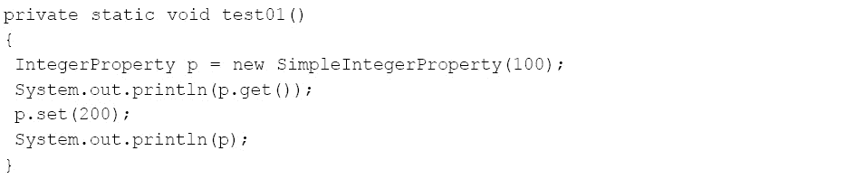

并且执行该方法（它是项目 `FXProperties` 中的一个方法）后，你得到了结果：

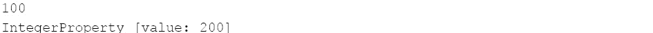

这里你应该注意最后一行，它是 `SimpleIntegerProperty` 类中 `toString()` 方法的输出，而第一行打印的是 `int` 类型的值。

只读属性实际上稍微复杂一点，因为它们是两个属性的包装器，系统确保这两个属性是同步的。在这里，一个是只读属性，而另一个是读写属性。其思路是：从外部来看它是一个只读属性，但它可以在定义它的类内部进行修改，并且在应用程序中它通常表现为一个私有实例变量。

例如，下面显示了一个包含两个 JavaFX 属性的类：

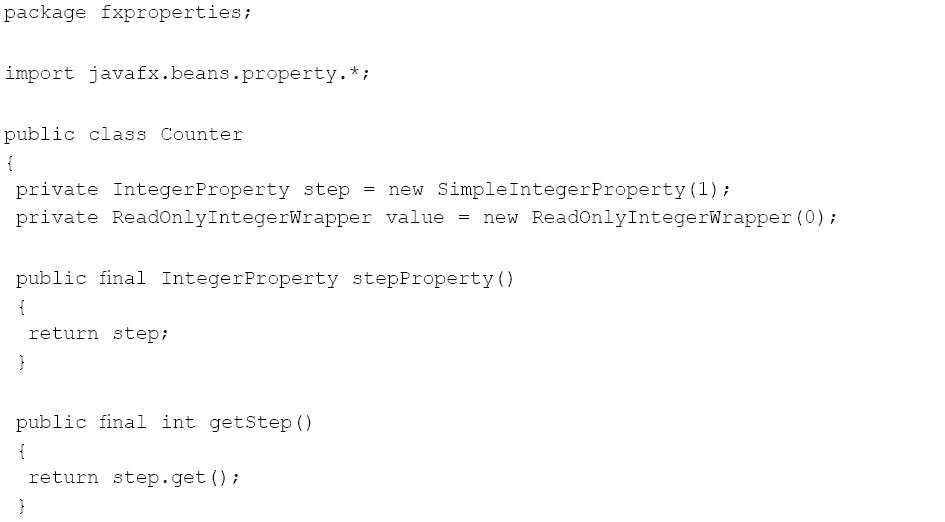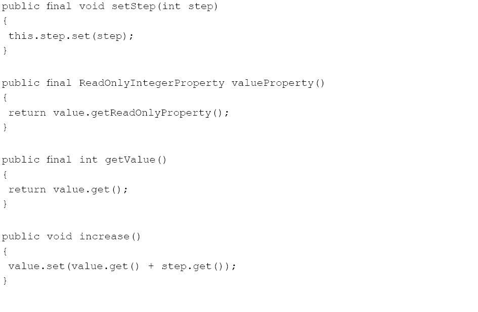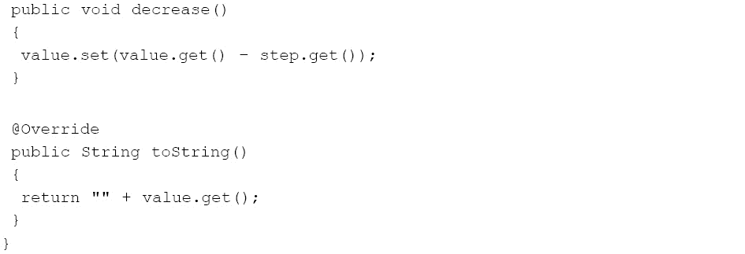

这是一个 JavaFX Bean 的示例。这两个属性被命名为 `step` 和 `value`，它们分别是一个读写属性和一个只读属性。这两个属性都定义了一个返回值的方法，例如：

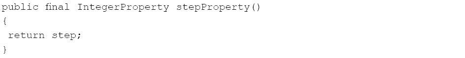

在这里你应该注意命名规范，即名称后面跟着 `Property` 单词，此外它还被定义为 `final`。最后，还定义了通用的 `get` 和 `set` 方法（这些也被定义为 `final`）。从原则上讲，它们并不是必要的，但这也是惯例的一部分，以符合通常的 Java Bean 惯例。你应该注意 `increase()` 和 `decrease()` 方法对属性 `value` 执行了 `set` 方法 —— 即使它是只读的。这没关系，因为这种操作发生在 `Counter` 类的内部。下面是一个使用该类的方法：

```
` 返回的是一个只读属性，因此没有 `set()` 方法。

属性类封装了三个值：

1. 属性所属的 bean 引用
2. 一个名称，其类型仅为 `String`
3. 一个值

该类拥有构造函数，因此你可以根据需要初始化这些值。例如，对于 `SimpleIntegerProperty` 类：

* `SimpleIntegerProperty()`
* `SimpleIntegerProperty(int value)`
* `SimpleIntegerProperty(Object bean, String name)`
* `SimpleIntegerProperty(Object bean, String name, int value)`

并且属性有一个 `getBean()` 和 `getName()` 方法。为了展示 JavaFX 在属性方面使用的另一种模式的示例，下面显示了一个类，它是一个普通的 Bean：

```
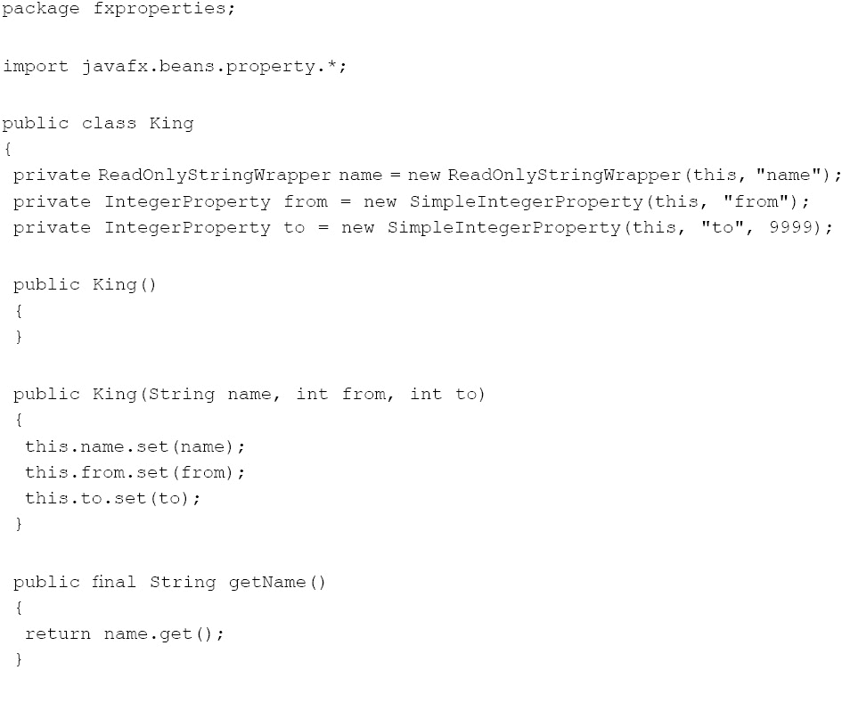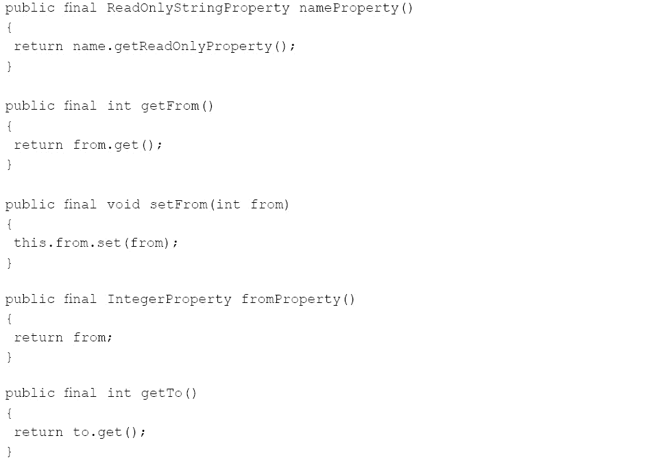`。这也是该模式的一部分。最后，你应该注意 `name` 是一个只读属性，因此没有 `set` 方法。还要注意 `nameProperty()` 方法返回的是一个 `ReadOnlyStringWrapper` 而不是 `StringProperty`。

如上所示的属性是类类型，这意味着必须实例化许多对象。将属性定义为对象类型的原因与属性关联的许多高级功能（如触发事件和绑定），但这些功能通常并不被使用，因此 JavaFX 很大程度上使用了*惰性更新*，即在需要时才实例化对象。该原理可以用 `King` 类来说：

```
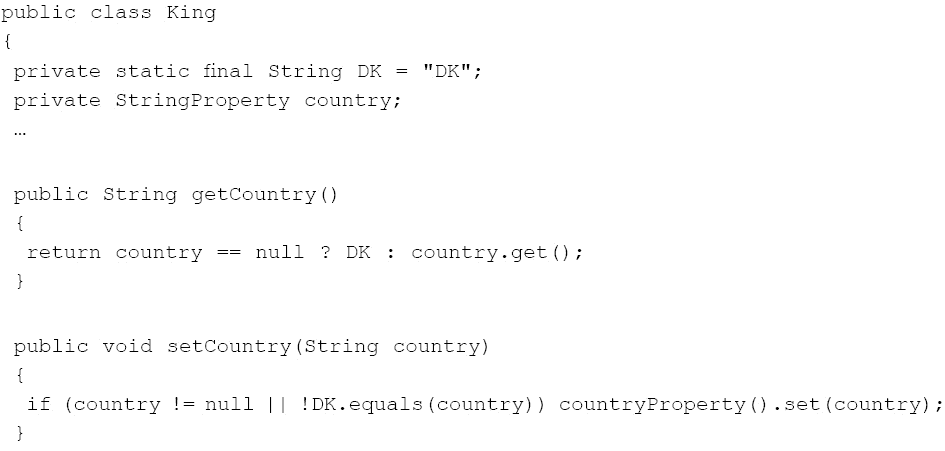` 方法，它可以执行两个属性值的相加操作，并返回这两个属性之和的绑定，这是一个类型为 `NumberBinding` 的表达式，表示两个属性值的和。然后将此绑定链接到属性 `z`。接下来的语句将打印：


显示变量 `z` 被绑定了，且其值为 8（即 `x` 和 `y` 的和）。也就是说，`z` 的值发生了变化。接下来，当属性 `x` 和 `y` 改变时，下一个语句打印：


这就是绑定的含义：属性 `x` 和 `y` 的改变会自动更新 `z`。下一个语句再次移除 `z` 的绑定，随后 `x` 和 `y` 再次改变。最后一个语句将打印：


部分显示 `z` 不再被绑定，且其值没有随之改变。

因此，绑定是一个求值为值的表达式。该表达式由一个或多个可观察的值组成，称为依赖项。当依赖项的值变化时，绑定的值会自动更新。JavaFX 中的所有属性类都内置了绑定支持。绑定有两种形式：*单向绑定*（Unidirectional binding）和*双向绑定*（bidirectional binding）。上面是单向绑定示例，由 `bind()` 方法定义。单向绑定有一些局限性，例如你不能直接更改被绑定的属性值 `z`。此外，一个属性只能绑定到一个单向表达式，再次绑定它会覆盖之前的绑定。

绑定也可以是双向的，这意味着你也可以更改被绑定的属性值。显然，像上面的绑定不能是双向的，对于更改 `z`，没有办法自动更新 `x` 和 `y` 的值。为了使绑定变为双向，必须在相同类型的属性之间进行，但属性可以绑定到多个属性。以下方法展示了双向绑定的原理：

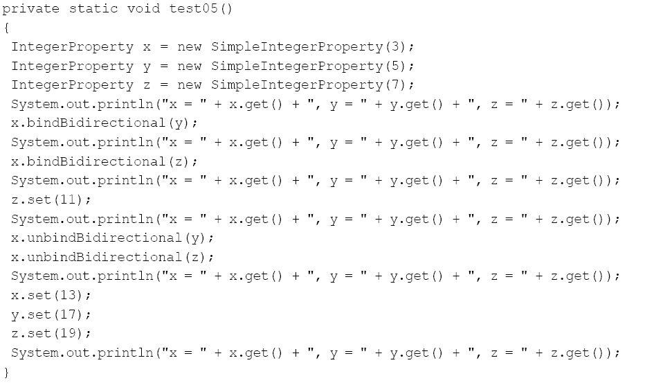

再次创建三个属性，第一个 `println()` 在绑定前显示这些属性的值。接下来，`x` 绑定到 `y`，下一个 `println()` 显示 `x` 现在与 `y` 值相等。然后 `x` 绑定到 `z`，这意味着 `x` 与 `z` 值相等，由于 `x` 绑定到 `y` 且是双向绑定，`y` 的值也变成了 `x` 的值。下一个 `println()` 显示三个属性现在值相等。现在，`z` 的值变为 11，当再次打印三个属性时，它们的值都是 11。然后移除绑定并再次打印三个属性，你可以看到它们仍然是 11。最后，更改三个属性的值，随后打印它们并显示新值：

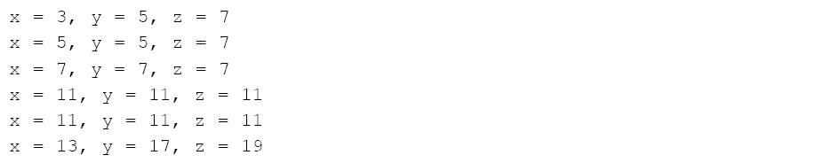

在 JavaFX 中，所有读/写属性都支持双向绑定，作为其使用的示例，考虑以下类：

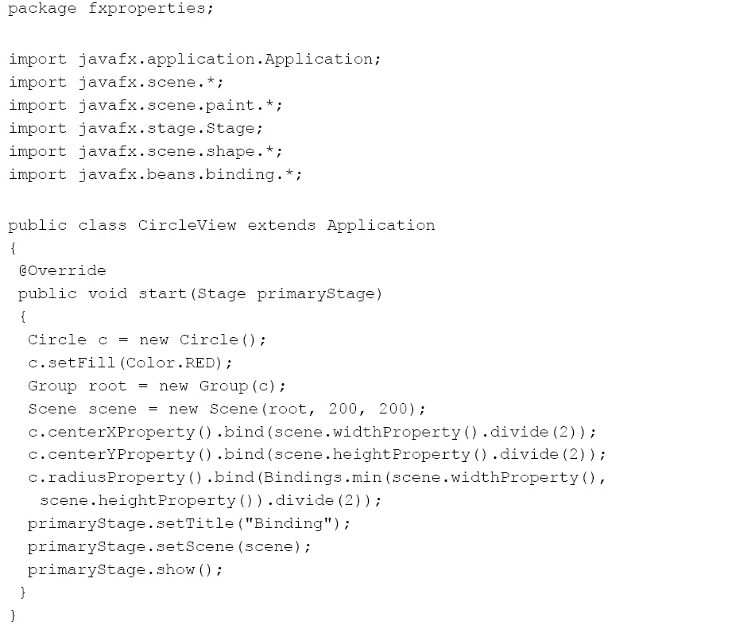

注意这是 JavaFX (`Application`) 且只有一个 `start()` 方法。在 JavaFX 中，所有读/写属性都支持双向绑定，作为其使用的示例，考虑以下类：


在 JavaFX 中，所有读/写属性都支持双向绑定，作为其使用的示例，考虑以下类：


在 JavaFX 中，所有读/写属性都支持双向绑定，作为其使用的示例，考虑以下类：

另一个例子是`test07()` 打开了如下窗口：

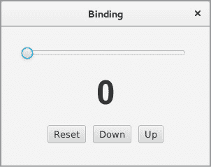

包含一个 `Slider`、一个 `Label` 和三个 `Button` 控件。这里，`Slider` 组件通过双向绑定到 `Counter` 中的属性 `step`，而 `Label` 组件通过单向绑定绑定到 `Counter` 中的属性 `value`：

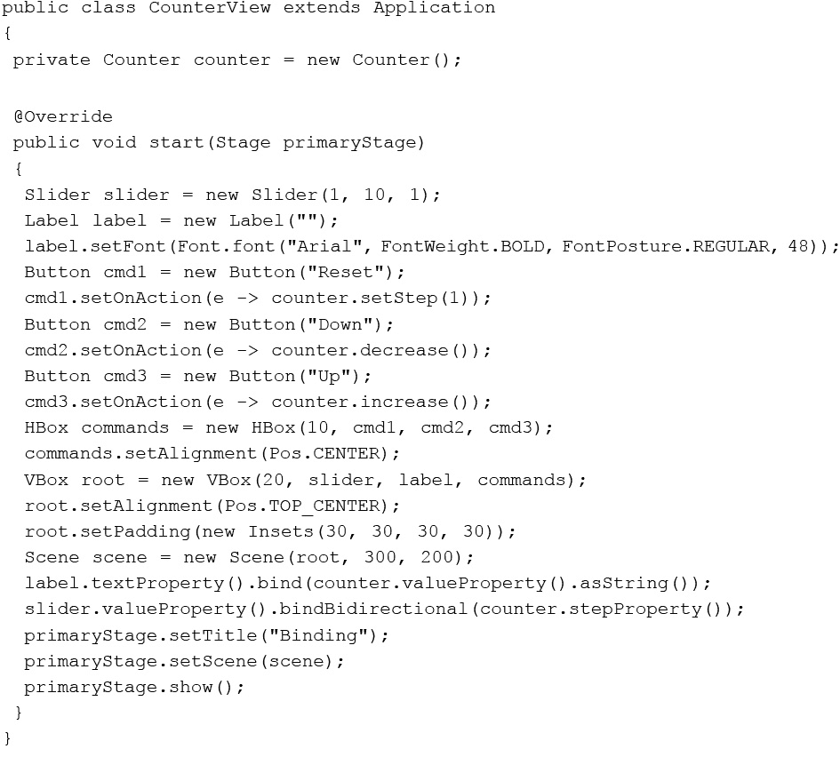

`Label` 控件有一个 `StringProperty` 属性 `textProperty`，而 `Counter` 有一个 `ReadOnlyIntegerWrapper`  `valueProperty`。由于后者是只读的，你无法创建双向绑定，但 `ReadOnlyIntegerWrapper` 有一个 `asString()` 方法，返回一个 `StringBinding` 对象，允许创建单向绑定。结果是，如果 `Counter` 对象中的属性 `value` 发生（点击 `Down` 和 `Up` 按钮），`Label` 对象将自动更新。`Slider` 控件有一个 `IntegerProperty` 类型的 `valueProperty`，`Counter` 类也是如此，它具有相同类型的 `stepProperty`。因此，你可以在这两个属性之间创建双向绑定。结果是，如果你改变滑块，`Counter` 对象的步属性就会更新。如果你点击 `Reset` 按钮，它会将 `step` 的值设置为 1，由于滑块绑定是双向的，滑块组件会自动更新。

你必须编写一个应用程序打开如下窗口：

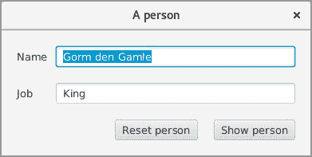


在其中维护人员信息。显示的名称和职位是默认值。如果点击最后一个按钮，必须弹出一个显示人员姓名和职位的警框；点击第一个按钮，值必须更改为默认值。

程序必须使用以下模型类：

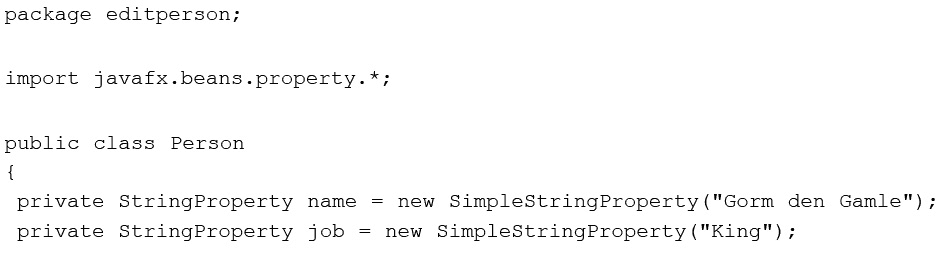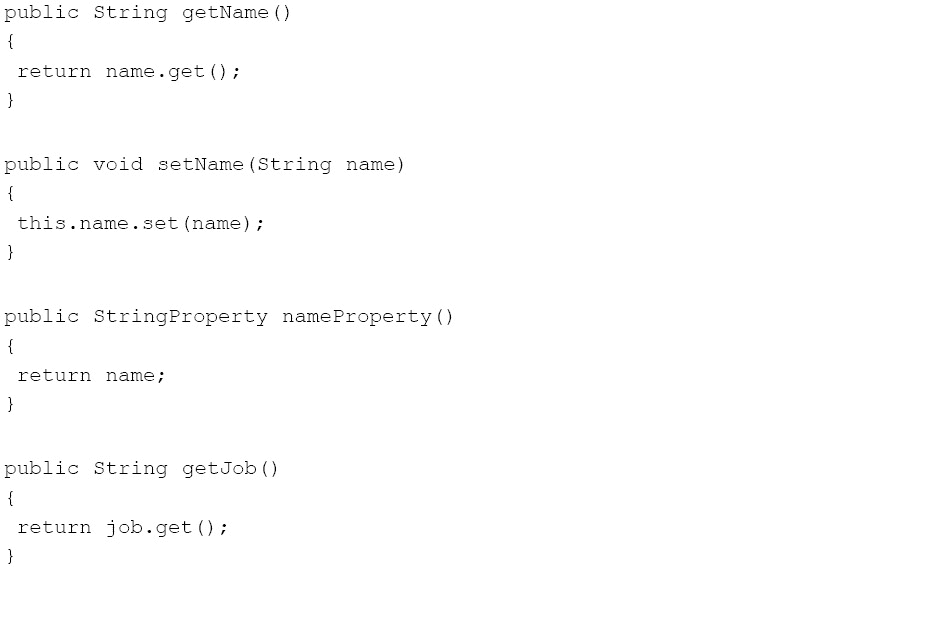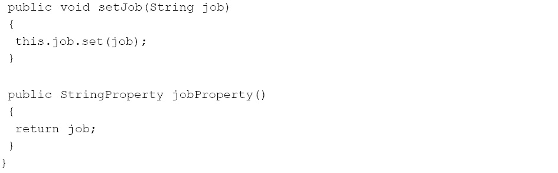

两个输入字段必须通过双向绑定到模型上。当点击`Default`按钮时，必须通过更新模型来设置默认值，从而执行`setName()`和`setJob()`方法。

## JavaFX 可观察集合

JavaFX 定义了多种集合，它们是经典集合类的扩展。定义了三个接口：

- `ObservableList<T>`
- `ObservableSet<T>`
- `ObservableMap<K,V>`

它们分别继承了`List<T>`、`Set<T>`和`Map<K, V>`，同时也继承了`Observable`接口。JavaFX 并没有直接提供实现这些接口的类，而是通过`FXCollections`类提供的静态方法来获取，这些方法返回实现了这些接口的对象。从程序员的角度来看，可观察集合是一个列表、集合或映射，可以对其内容的失效和变化进行观察。

请考虑以下示例：

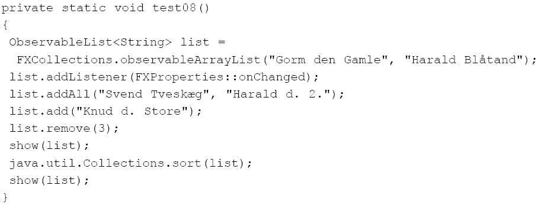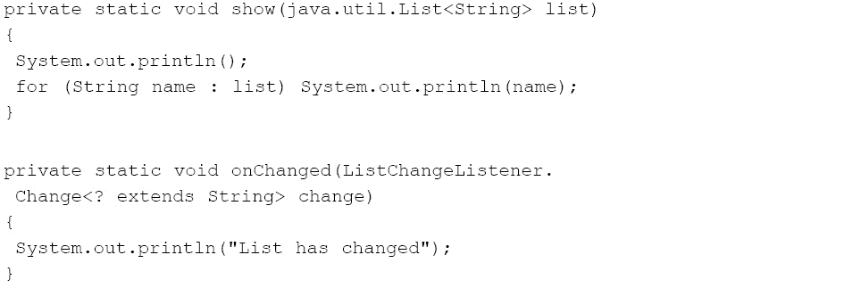

如果执行该方法，结果如下：

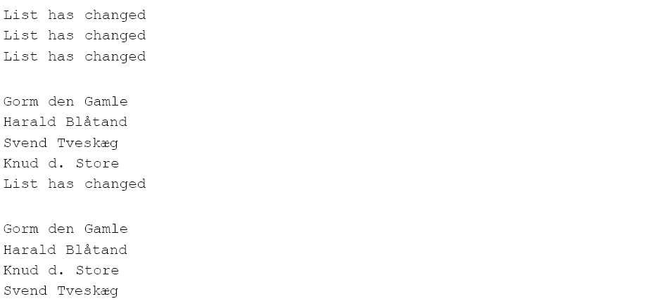

该列表创建了两个元素，然后关联了一个`ChangeListener`，它除了在控制台上打印一条消息外什么都不做。第一个事件发生在额外添加两个项目之后，下一个事件发生在添加了另一个元素之后。最后，第三个事件发生在删除一个项目之后。`show()`方法在控制台上显示列表内容，然后读取列表。注意，该参数是一个`List<String>`，这是可以的，因为`ObservableList<String>`特别上就是`List<String>`。在打印列表后，对其进行了排序，由于这意味着列表元素的顺序发生了变化，因此发生了另一个`ChangeEvent`。

`ListChangeListener.Change`类有多种不同的方法可以告诉你事件的原因，鼓励你研究一下哪些方法。接下来的示例将简要介绍如何使用这些方法。首先，我添加了一个简单的模型类，包含两个遵循 JavaFX beans 模式的属性：

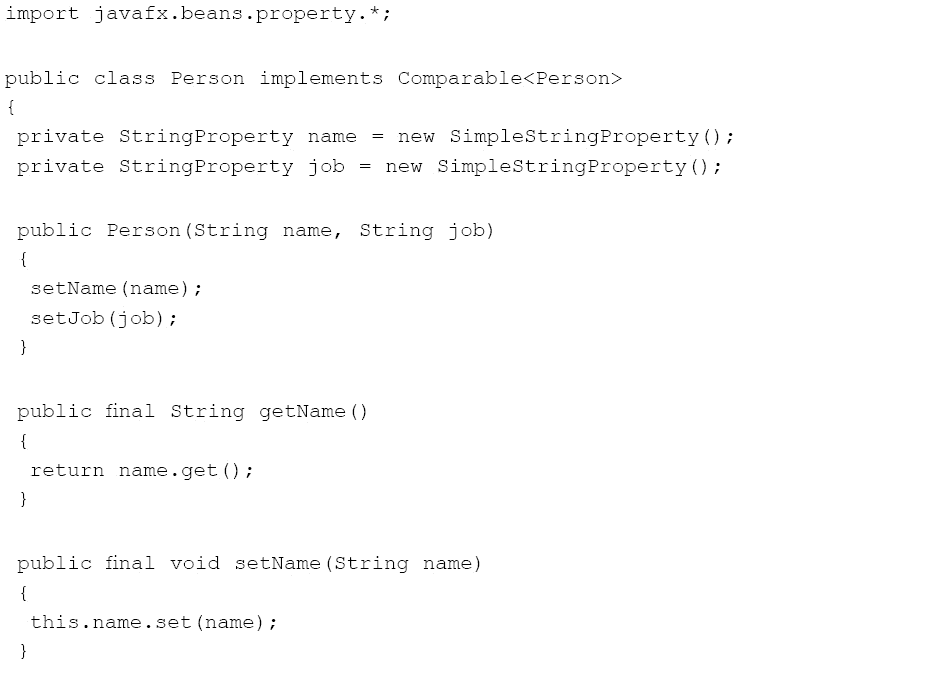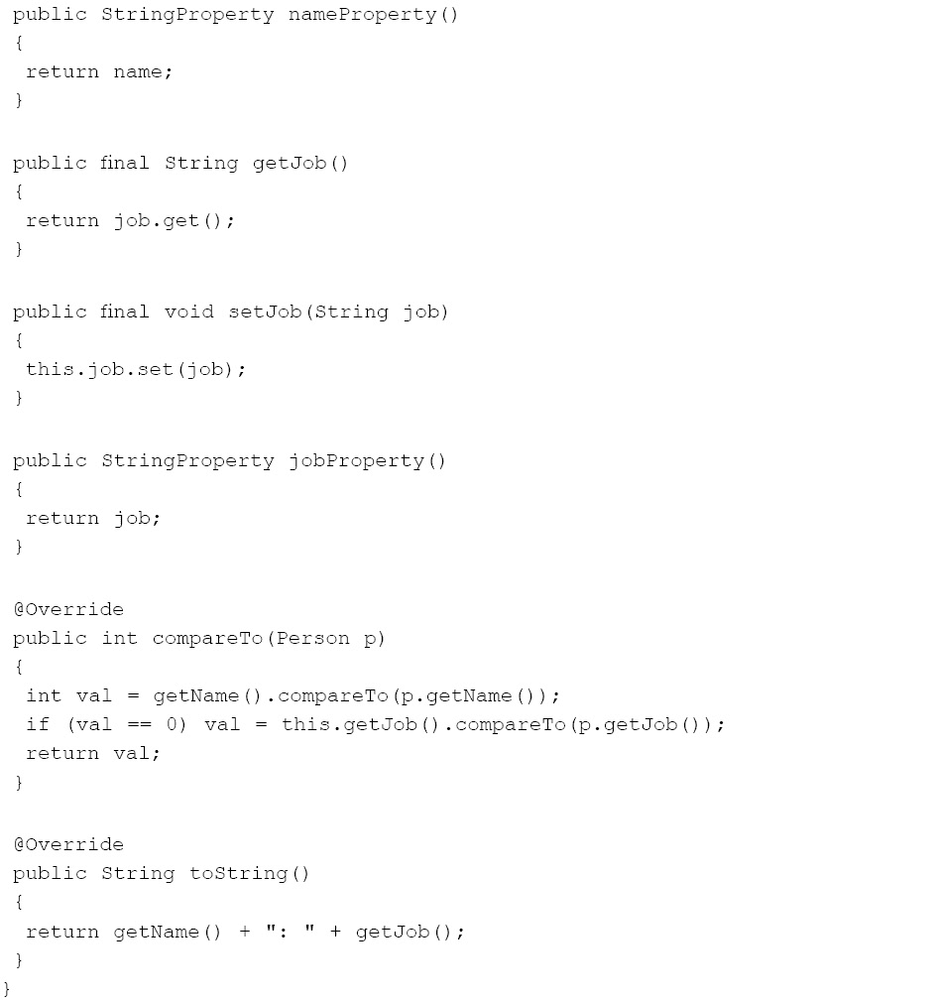

结合之前提到的内容，没有什么新奇的。但请注意，该类的对象是可以比较的，因此可以排序。然后，我为包含`Person`对象的`ObservableList`集合定义了一个变更事件监听器类：

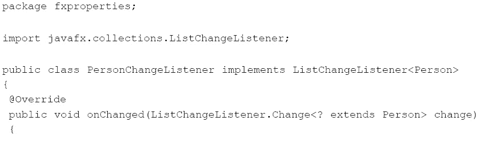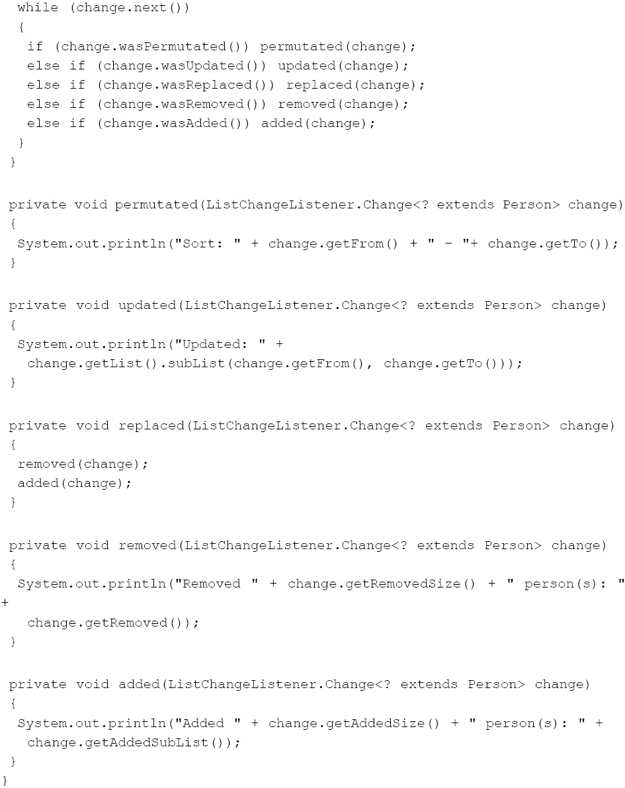

必须实现一个名为`onChanged()`的单一事件处理器，其参数是一个：

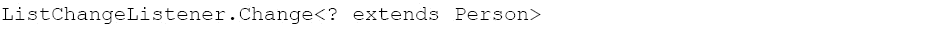

名为`change`的对象。当事件发生并调用该方法时，事件可能由列表的一个或多个更改触发，因此该方法从一个遍历这些更改的循环开始。正如方法所示，可能有 5 种不同类型的更改，循环的每次迭代都会调用对应相关更改的方法。在这种情况下，所有方法都是微不足道的，除了在屏幕上打印文本外什么都不做，其目的只是在事件发生时显示。

有了上述两个类，你可以执行以下方法：

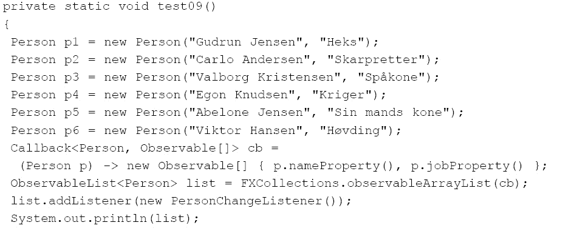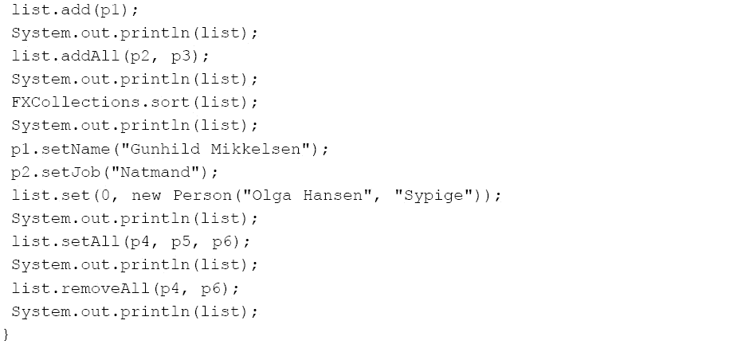

执行该方法得到的结果如下：

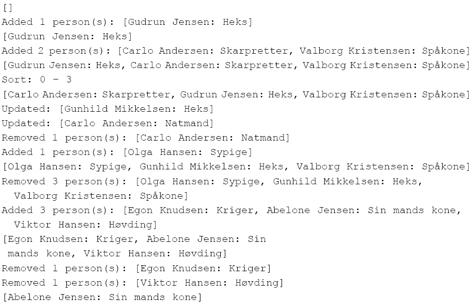

测试方法从创建 6 个`Person`对象开始。接下来，定义了一个`Callback`对象，指示`Person`对象的哪些属性需要观察。下一步，使用`FXCollections`类创建一个带有上述`Callback`对象参数的`ObservableList<Person>`。接下来，在屏幕上打印列表，它是结果中的第一行，是一个空列表。下一个语句将`p1`添加到列表中，然后再次打印列表。结果显示事件处理器执行了`added()`方法并添加了一个对象列表，列表包含一个对象。作为下次操作，`p2`和`p3`被添加到列表中并再次打印。结果显示事件处理器再次执行了`added()`方法并添加了两个对象，列表现在包含 3 个对象。接下来，列表被排序并再次打印。如结果所示，事件处理器执行了对应于两个或多个列表对象的`permuted()`方法。注意参数是`List<String>`，这是可以的，因为`ObservableList<String>`特别上就是`List<String>`。在打印列表后，对其进行了排序，由于列表元素的顺序发生了变化，发生了另一个`ChangeEvent`。

`ListChangeListener.Change`类有多种不同的方法告诉你事件的原因，鼓励你研究它们。以下示例介绍了如何使用这些方法。首先，我添加了一个两个遵循 JavaFX beans 模式属性的简单模型类：


结合之前提到的内容，没有什么新奇的。但请注意，该类的对象是可以比较的，因此可以排序。然后，我为包含`Person`对象的`ObservableList`集合定义了一个变更事件监听器类：


必须实现一个名为`onChanged()`的单一事件处理器，其参数是一个：


名为`change`的对象。当事件发生并调用该方法时，事件可能由列表的一个或多个更改触发，因此该方法从一个遍历这些更改的循环开始。正如方法所示，可能有 5 种不同类型的更改，循环的每次迭代都会调用对应相关更改的方法。在这种情况下，所有方法都是微不足道的，除了在屏幕上打印文本外什么都不做，其目的只是在事件发生时显示。

有了上述两个类，你可以执行以下方法：


执行该方法得到的结果如下：


测试方法从创建 6 个`Person`对象开始。接下来，定义了一个`Callback`对象，指示`Person`对象的哪些属性需要观察。下一步，使用`FXCollections`类创建一个带有上述`Callback`对象参数的`ObservableList<Person>`。接下来，在屏幕上打印列表，它是结果中的第一行，是一个空列表。下一个语句将`p1`添加到列表中，然后再次打印列表。结果显示事件处理器执行了`added()`方法并添加了一个对象列表，列表包含一个对象。作为下次操作，`p2`和`p3`被添加到列表中并再次打印。结果显示事件处理器再次执行了`added()`方法并添加了两个对象，列表现在包含 3 个对象。接下来，列表被排序并再次打印。如结果所示，事件处理器执行了对应于两个或多个列表对象的`permuted()`方法。注意参数是`List<String>`，这是可以的，因为`ObservableList<String>`特别上就是`List<String>`。在打印列表后，对其进行了排序，由于列表元素的顺序发生了变化，发生了另一个`ChangeEvent`。

## `ListProperty`

有一个`ListProperty`类代表`ObservableList`的属性，你可以将其类为`ObservableList`的包装器。它与本章介绍的其他属性类似。你可以为`ListProperty`关联三种监听器：

- `InvalidationListener`
- `ChangeListener`
- `ListChangeListener`

当`ObservableList`变化时，这些监听器会收到通知。考虑以下方法：

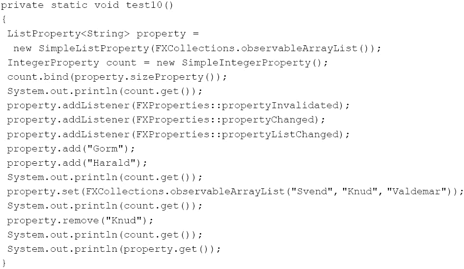

该方法创建一个名为`property`的`ListProperty`，作为`SimpleListProperty`包装一个`ObservableList`。此外，定义了一个名为`count`的属性，并绑定到列表的大小。在这里，你应该注意`ListProperty`实现了`ObservableList`接口，因此具有与`ObservableList`相同的属性。`property`因此有一个`sizeProperty`，它可以绑定到`count`。下一个打印语句因此会在屏幕上打印 0，因为列表目前是空的。下一步，为这三个事件定义了监听器方法。第一个是微不足道的，除了打印文本外什么都不做：

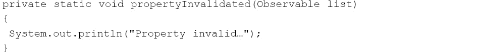

你必须注意参数是一个`Observable`。下一个监听器方法也是微不足道的，它打印列表变化前后的内容：

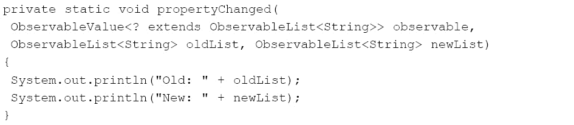

你应该主要注意作为列表引用（引起相关事件的对象）的参数，以及列表变化前后的值。最后一个事件处理器除了打印文本（可能更多）外什么都不做，但区分了事件的原因：

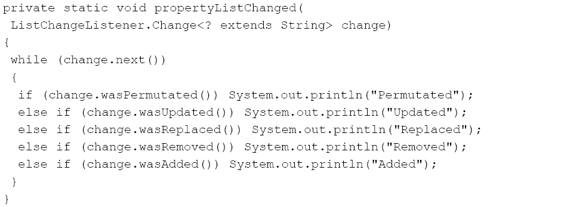

下方显示执行测试方法的结果：

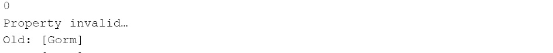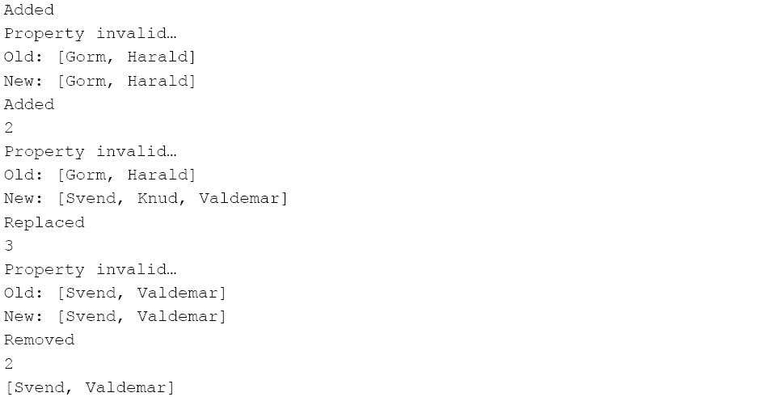

很容易跟踪程序代码并与结果进行比较，而重要的事情当然是观察每个事件处理器何时执行的。

你还可以将两个`ListProperty`对象绑定到彼此，这意味着它们封装的列表也是相互绑定的。考虑以下方法：

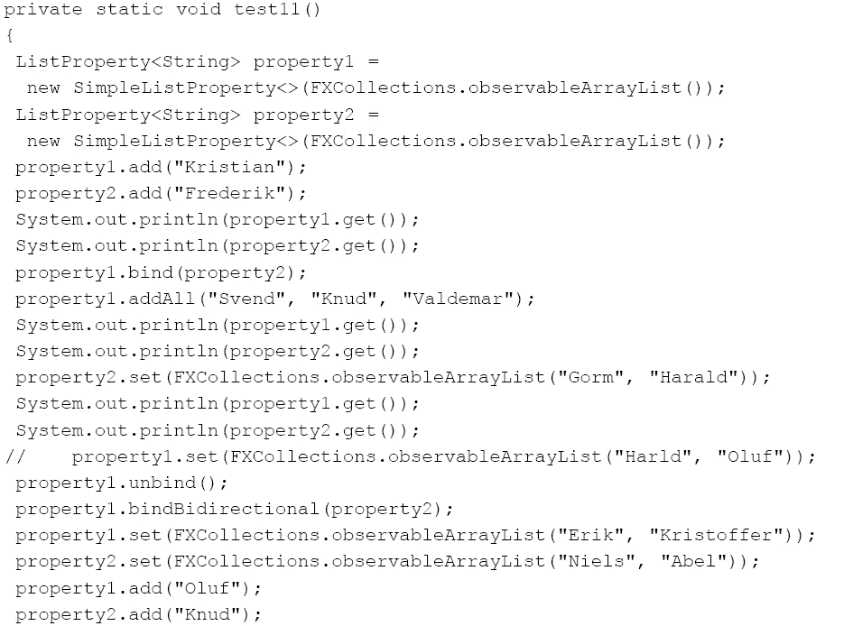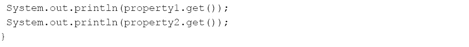

上方定义了两个`ListProperty`对象，它们分别封装了一个`ObservableList`，因此前两个`print`语句将输出：

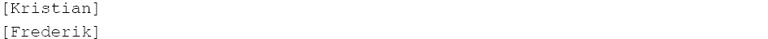

这并不奇怪。由于使用了 JavaFX 属性，它们当然可以进行绑定：

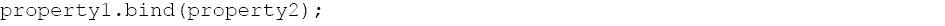

这通过单向绑定将`property1`绑定到`property2`。确切地说，这意味着`property1`封装的列表与`property2`封装的列表是同一个列表。下一个语句向`property1`添加了三个名称，下一个语句再次向`property2`添加了一个名称。接下来的两个`print`语句的结果是：

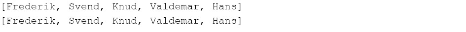

这可能不是人们预期的，因为它是一个单向绑定，但由于两个属性对象封装的是同一个列表（以及`property2`原本封装的列表），因此两种情况下更新的都是该列表。如果你执行执行语句：

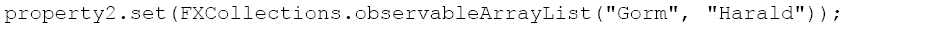

`property2`现在封装了一个包含两个名称的列表，并且由于绑定，两个属性都将引用此列表。如果你尝试执行被注释掉的语句，你将得到一个异常，因为`property1`是通过单向绑定绑定到`property2`的。因此，不要更改`property1`所封装的对象。接下来，移除绑定并取而代之创建一个双向绑定。现在你可以更改两个属性的列表，因为现在的绑定是双向的，且最后一个值生效。因此，最后的`print`语句的结果为：

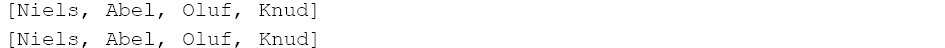

上面的绑定绑定了属性封装的列表，但你也可以像`bindContent()`和`bindContentBidirectional()`方法那样绑定它们的内容：

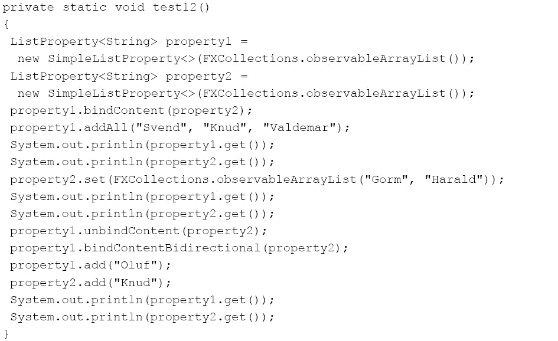

上方定义了两个列表内容的绑定，但这意味着两个列表的内容通过单向绑定并不会同步的：

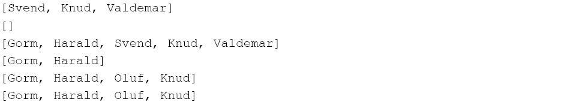

在最后一个示例中，我将展示如何绑定到`ObservableList`中的单个元素：

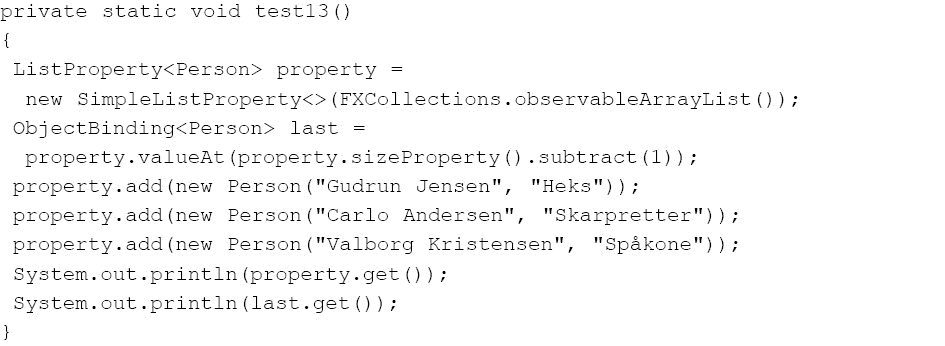

`property`是一个`ListProperty`，封装了一个包含`Person`对象的`ObservableList`。`last`是一个针对`Person`对象的`ObjectBinding`，它绑定到`property`封装的列表中的最后一项。注意该语法。`valueAt()`方法的参数是一个索引，并返回指向列表中索引所引用对象的`ObjectBinding`。在向列表中添加三个对象后，`print`语句显示：

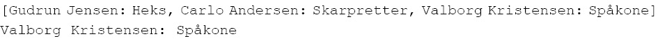

与本节所示一样，还有分别针对`ObservableSet`和`ObservableMap`的封装属性，称为`SetProperty`和`MapProperty`。

## `BindingElements`应用程序

创建一个简单的控制台应用程序，你可以将其命名为`BindingElements`。项目`FXProperties`有一个类`Person`。将此类复制到新项目中，并在`BindingElements`类中添加以下简单方法：

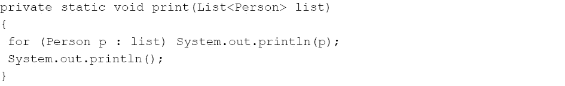

然后编写以下`main()`方法：

```

```

在顶部的两个输入字段中，你可以输入一个人的姓名和职位。如果点击`OK`，该人员将被添加到`ListView`中。在上面的窗口中创建/输入了 6 个人。双击`ListView`控件中的某个人，该人员的数据就会插入到输入字段中，然后可以进行编辑。如果双击某个人，可以通过点击`Remove`按钮将其删除。最后，`Clear`按钮用于删除`ListView`中的任何选择。程序使用了`Person`类。

`PersonProgram`的代码如下：

```
[](image/Java_15_–_More_about_JavaFX_5-4-18_44.jpg)[](image/Java_15_–_More_about_JavaFX_5-4-18_45.jpg)[](image/Java_15_–_More_about_JavaFX_5-4-18_46.jpg)
```


该类有 6 个实例变量，前三个是控件。下一个是 `Person` 类型，代表你操作的对象。下一个是 `ObservableList`，代表 `ListView` 的内容。最后是一个表示选中内容的属性。

检查 `start()` 方法，首先发生的是 `lstView` 被参数 `persons` 创建。这意味着在 `ListView` 和 `persons` 之间创建了双向绑定。`ListView` 还关联了一个事件处理器。最后，`selected` 属性绑定到 `ListView` 中的选中索引。`start()` 方法的其余部分没有新内容，仅用于创建场景图。然而，你必须注意创建 `GridPane` 的 `createTop()` 方法。在这里你应该特别注意两个 `TextField` 控件是如何绑定到 `Person` 对象的属性的。

然后有 5 个事件处理器，但通常很简单。第一个涉及 `OK` 按钮，并检查姓名和职位是否有输入。如果是，则使用 `selected` 属性来判断是添加新对象还是修改现有对象。你应该注意，在任何情况下，都会实例化一个新的 `Person` 对象。这是因为 `person` 变量不能指向另一个对象，因为它绑定了输入字段。无论是添加对象还是修改对象，都会调用 `Clear` 按钮的事件处理器，清除 `person` 对象的字段并移除 `ListView` 中的任何选择。`Remove` 和 `Delete` 按钮的事件处理器都是非常简单的，`ListView` 中鼠标点击的事件处理器也很简单，你应该特别注意如何测试双击。

测试程序时，注意用户界面是如何由于绑定而自动更新的。

## 2.5 屏幕

在本节和后续两节中，将简要介绍屏幕以及关于程序 `Stage` 对象的更多备注——尽管它与属性关系不大，但示例是 `FXProperties` 项目的一部分。以下类打开一个窗口并在控制台上打印关于屏幕和组件尺寸的信息：

[](image/Java_15_–_More_about_JavaFX_5-4-18_48.jpg)[](image/Java_15_–_More_about_JavaFX_5-4-18_49.jpg)

该程序非常简单，其功能仅仅创建一个带有按钮的窗口。你应该注意，当根对象（root object）被场景对象（scene object）时，窗口的大小就被定义了，因此它成为了 `Stage` 对象的大小，同时也根对象（即一个 `BorderPane`）的大小。这个大小在 `start()` 方法中被修改，部分是为了展示这种操作是可行的，部分是为了展示它不会改变根对象的大小。窗口在屏幕上显示后，会调用三个方法，它们会在控制台上打印文本。你应该注意，这些方法必须在 `Stage` 对象显示且场景图组件渲染完成后才能被调用。

第一个方法使用了 `Screen` 类，该类具有静态方法，可以返回一个表示屏幕的 `Screen` 对象，该对象用于确定屏幕的属性。在这种情况下，使用了两个方法，它们返回一个 `Rectangle2D` 对象，包含屏幕大小信息（以像素为单位，即屏幕分辨率）。第一个方法返回屏幕的物理尺寸，而另一个返回程序可用的尺寸。这种差异取决于当前平台，但结果可能如下：


产生差异是因为我的屏幕顶部有 `Activity` 栏（`Fedora`），且下方有一个任务栏。

下一个方法打印 `Stage` 对象在屏幕上左上角的大小和位置。在这里你应该注意 `Stage` 类在位置和大小方面拥有哪些属性，以及大小是由我在 `start()` 方法中分配的值决定的：


最后一个方法打印关于节点大小的信息，因为这里是 `root`，因此是一个 `BorderPane`。该大小通过三个方法确定，所有这些方法都返回一个 `Bound` 对象：

1. `getBoundsInLocal()`：获取在任何可能的变换之前的位置和大小。
2. `getBoundsInParent()`：获取在可能变换之后的位置和大小。
3. `getLayoutBounds()`：获取布局面板用于计算时使用的位置和大小，可能与其它尺寸不同，在你编写自定义控件时会使用它。

在这种情况下，它们都是相似的。

## 2.6 装饰（Decorations）

一个典型的窗口看起来如下：


其中有一个标题栏和一个边框，以便你可以改变窗口大小。此外，还有窗口内容，例如这里有一个包含标签（label）和按钮的场景图。标题栏和边框的显示取决于当前平台，对于标题栏，平台决定了哪些按钮是可用的。窗口的标题栏还用于通过鼠标拖动在屏幕上移动窗口，例如通过双击标题栏来将其最大化。

标题栏和边框被称为窗口的装饰（decorations）或样式（styles），这里实际上更多选项，它们被定义为 `Stage` 对象的属性。我想提到三个：

1. `StageStyle.DECORATED`：默认值，窗口具有标题栏和边框。
2. `StageStyle.UNDECORATED`：窗口未经过装饰，因此没有标题栏或边框。
3. `StageStyle.TRANSPARENT`：窗口未经过装饰且具有透明背景。

例如，如果你将上述窗口定义为 `UNDECORATED`，结果如下：


如果你将窗口定义为 `TRANSPARENT`，结果如下：


上述内容可以通过以下类来说：


其中 `start()` 方法中的注释指示了窗口应该如何装饰。除了创建场景图和初始化 `Stage` 对象外，`start()` 方法中没有多少额外操作。请注意，这次该类有一个引用 `Stage` 对象的实例变量，以便可以从其他类方法引用它。还要注意绑定到 `Close`（关闭）按钮的事件处理器，它会关闭窗口，从而终止程序。在当前情况下它是有效的，但在其他程序中不一定如此。如果你对 `Stage` 对象执行 `close()`，它会隐藏窗口（执行基类 `Stage` 中名为 `Window` 的 `hide()` 方法），如果没有其他窗口了，程序将终止。如果你想在点击按钮时立即终止程序，你应该执行 `Platform.exit()`。

窗口在 `show()` 方法中打开，该方法有三个参数，分别是场景图、它的 `Label` 控制以及窗口的样式（即它应该如何被装饰）。该方法开始时设置窗口 `Label` 控制的文本，然后设置 `Stage` 对象必须如何装饰。在这里你必须注意语法，并且这必须在 `Stage` 对象出现在屏幕之前完成。如果样式是 `TRANSPARENT`，则表示没有背景。如果窗口是 `UNDECORATED`，就会有一个问题，因为你无法用鼠标移动它。如果你愿意，可以如上面所示，为 `Scene` 对象关联一个事件处理器。

正如你从 Swing 中熟悉的，对话框可以是非模态（modeless）或模态（modal）的，这同样适用于 JavaFX，它是 `Stage` 对象的一个属性。有三种选项：

1. `Modality.NONE`：非模态窗口，这是 `Stage` 的默认值。
2. `Modality.WINDOW_MODAL`：窗口模态，阻塞所有拥有它的窗口。
3. `Modality.APPLICATION_MODAL`：应用程序模态，阻塞整个应用程序。

下面的示例展示了语法，但也展示了应用程序可能有多个 `Stage` 对象，即多个窗口（对话框）。`StageView` 类打开了以下窗口：


其中顶部按钮通过实例化一个新的 `Stage` 对象来打开对话框，其区别在于模态性以及对话框是否有所有者（owner）。例如，第一个是非模态且没有所有者的。这意味着点击顶部按钮，程序将打开一个对话框，然后点击主窗口的叉号（因为对话框是非模态的）会关闭主窗口但不关闭对话框，程序不会终止。

最后一个按钮的包含是为了展示 `Stage` 对象也拥有一个方法，你可以说窗口应该全屏显示。注意，全屏显示后按下 `ESC` 或再次点击*全屏*按钮即可返回。

代码如下：


没什么好解释的，但你应该注意 `showDialog()` 方法，它通过实例化一个新的 `Stage` 对象来创建对话框。

## 问题 1

在任务任务中，你必须编写一个与 2.4 节程序原理类似的程序。数据库 `padata` 有一个名为 `history` 的表，包含有关历史人物的信息（如果适用，请参考《Java 6》）。该表通过以下脚本创建：


你必须编写一个可以维护该数据库表的程序。例如，你可以调用 `History` 项目。

任务可以通过多种方式解决，但核心思想是使用数据绑定，部分在显示数据时，部分在编辑单个人物信息时。

当程序启动时，它必须显示数据库中所有人物的列表，可以使用如下所示窗口，其中用 `ListView` 显示所有人物的名称：


该按钮应用于创建新人员，如果双击列表中的名称，程序必须显示关于该人员的所有信息，并且能够编辑这些信息。在这两种情况下，你都应该使用同一个对话框，该框可以是：


在本章中，我将阐述三个在前书中未包含的控件的使用：

1. `TableView`
2. `TreeView`
3. `TreeTableView`

其中第一个对应于组件 `JTable`，第二个对应组件 `JTree`，而后者最好被描述为两者的结合。之前的书中没有包含这三个组件，部分是因为它们非常复杂且有许多可能性，部分是因为它们的工作方式在提到上一章的属性和绑定之后最能得到很好的描述。

## 3.1 `TableView`

我想从 `TableView` 组件开始，它像 `JTable` 一样，是一个极其复杂的控件，以行和列排列数据，而且它是这三个控件中最用的。该组件的类名为 `TableView`，但与组件一起还有几个辅助类：

- `TableColumn`
- `TableRow`
- `TableCell`
- `TablePosition`
- `TableView.TableViewFocusModel`
- `TableView.TableViewSelectionModel`

这些名称应该告诉我们每个单独类的用途。`TableView` 类的使用方式有点像 `JTable`，你必须定义一个数据模型，即组件应该显示的数据，以及应该包含哪些列。我将从一个示例开始，将其命名为 `ShowKingsProgram`，它展示了作为 `King` 类型对象（上一章中的类）表示的丹麦国王的概览：


如果你运行该程序，它会打开下面的窗口，显示一个有 5 列的表格，这比 `King` 类型拥有的属性列多了一列：


如果你研究程序代码（主程序），它是：


非常简单。起初，定义了一个模型（下文解释）。否则，除了 `start()` 方法外什么都没有发生，在该方法中为 `King` 对象创建了一个 `TableView` 并用数据模型进行初始化，最后使用数据模型中的方法了四列。相应的 `TableView` 被封装在 `BorderPane` 中并插入到程序的场景图中。包含最多的是模型类 `KingTableModel`：


该类开始于为 `King` 对象创建一个 `ObservableList`，该列表在构造函数中使用类末尾数组中定义的数据进行初始化。注意，作为替代方案，列表也可以通过读取数据库表来初始化。该类有一个可以返回列表的方法，该方法在构造函数中用于 `TableView` 组件的 `start()` 方法。类的其余部分由创建各个列的方法组成。第一个用于 `name` 属性，列的类型是 `TableColumn`，参数指示对象是什么类型（这里是 `King`）以及相关属性的类型（这里是 `String`）。`TableColumn` 构造函数的参数是列头中显示的文本。接下来，你必须指定每个单元格包含哪些值，这是通过 `PropertyValueFactory` 实现的，其构造函数的参数是 `King` 类中单元格必须包含的属性名称，这里是 `name`。

接两列基本上以相同的方式定义，只是这次类型是 `Integer`。然而，这些列没有直接插入表格，而是通过 `getPeriodCol()` 方法创建的另一个列插入的。列是可以嵌套的，`getPeriodCol()` 创建的列是一个由另外两个列组成的列。在用户界面上，这对应于表头为 `Period` 的列有两个子列，分别为 `from year` 和 `to year`。在这种情况下，除了展示这是可行的以及语法是什么外，没有特别的理由。

该类还为 `country` 属性创建了一列，这里没什么新意，实际上 `getCountryCol()` 方法并没有被使用。目标是说明你不需要在用户界面上显示所有列。

最后是 `getYearCol()` 方法，它显示了该国王统治了多少年，如果你不知道执政时期则显示文本 `Unknown`。这一列与不同，因为在 `King` 类中没有对应的属性，因此单元格中要显示的值必须计算。这再次使用了 `setCellValueFactory()` 方法。它具有以下原型：


`Callback<P, R>` 是一个带有两个类型的接口：


在这种情况下，对于 `Year` 列，使用了以下形式的方法进行初始化：


如果你运行程序，注意默认可以使用鼠标更改列宽，并通过点击表头进行排序。

下一个示例称为 `MapKingProgram`，基本上与程序相同，并打开以下窗口：


程序显示了一个有 3 列的 `TableView`，对应 `King` 类的三个属性。然而，区别在于组件显示的对象（行）不是 `King` 对象，而是 `Map<String, Object>` 对象。除了示例语法外没有特别的理由，但在表格行不匹配领域对象的情况下，可以使用该选项。

`King` 类与之前的示例相同，但 `KingTableModel` 类发生了变化：


首先，`persons` 集合这次是带有 `Map<String, Object>` 对象的 `ObservableList`。该列表在构造函数中创建，区别是这次 Map 对象必须实例化，其中键是 `String` 而值是对象（`String` 或 `Integer`）。注意用连续数字创建的键，但它们在国家代码之前。

然后是创建列的方法。列对象像第一个示例中那样创建，但 `setCellValueFactory()` 的参数是 `MapValueFactory` 对象，其构造函数的参数是键。结果是列根据键引用的 Map 对象的值进行初始化。

在 `start()` 方法（`MapKingsProgram` 类）中，没有重大变化，我不想在这里显示代码，但在创建表格并初始化列之后，添加了两个语句：


其中 `idCol` 是带有 `id` 行（因此是键）的第一列的名称。第一条语句表示应该能够隐藏列，而第二条语句表示 `idCol` 在启动时应该被隐藏。如果你运行该程序，你会注意到滚动条上方的标题行中有一个小的加号。点击它，会弹出一个小窗口，你可以在其中点击以决定是否隐藏或显示各个列。


下一个示例名为 `RenderKingsProgram`，它会打开以下窗口：


并将向你展示如何定义各个单元格内容的显示方式。在这种情况下，如果 `From` 列的值为 0，则内容将显示为空，这意味着你不知道国王统治期的开始时间。如果 `To` 列的值为 9999，情况也是如此。此外，由于列列都是右对齐的。最后，最后一列将 `country` 属性的值显示为一个复选框，如果值为 DK，则复选框被选中。

再次显示的对象类型为 `King`，而最重要的变化仍然在 `KingTableModel` 类中：


该类的起始部分与第一个示例基本相同。也就是说，构造函数、`getKing()` 方法和 `getNamCol()` 方法没有更改，因此此处未显示它们。然而，`getFromCol()` 方法有所不同。它仍然需要为属性 `from` 返回一个 `TableColumn`，该列对象像以前一样创建，但随后使用 `setCellFactory()` 方法来告诉如何显示该值。这是通过一个 `TableCell` 对象实现的，该对象是一个定义了 `update()` 方法的接口。该方法的参数是待渲染的对象，以及一个告知单元格是否为空的 `boolean` 值。如果有非零内容，则使用它来更新单元格。在与 `TableCell` 关联后，该列被分配了一个首选宽度，并且一个样式附加到列及其表头，其中表头定义在样式表中。`getToCol()` 方法以相同的方式编写，此处未在此出现。

然后是 `getCountryCol()` 方法，它创建了一个用于 `Boolean` 对象的 `TableColumn`。分配了一个 `CellValueFactory` 来指定根据 `country` 属性的值，`King` 对象应该产生什么值。如果是 `DK`，则值必须为 `true`，否则为 `false`。你应该注意，值包装器在只读属性中，原因是 `TableView` 组件应该能够绑定到该值。最后，与该列关联了一个 `CellFactory`，告诉如何显示该值，以及它应该像一个 `CheckBoxTableCell`（它是复选框的包装器）。注意，你还指明了复选框必须用当前列的值进行初始化。

然后是带有 `start()` 方法的主程序：


它看起来与上面的示例相似，但应该简单介绍如何选择行。首先，你应该能够选择 `MULTIPLE`，并且不应该选择单个单元格。接下来，是一个每当你更改选择时都会触发的事件处理器。该处理器非常简单，所做的只是在控制台上写一段文本，该段文本显示了所选行的索引。

数据库 `padata` 包含一个带有丹麦邮政编码的 `zipcode` 表。你必须编写一个可以调用为 `PostProgram` 的程序。该程序应该只在 `TableView` 中显示数据库表的内容，你不应该对各个列的格式进行任何特殊处理（只有两列）。

## 3.2 在 TableView 中编辑单元格

现在我将展示一个示例，它在原理上与上面的示例相似，但你可以编辑各个单元格的内容。虽然这可能并不新奇，但它仍然相对简单。通常情况下，它的原理是：双击你想编辑的单元格，之后单元格将打开并提供更改值的选项。当单元格打开时，是通过单元格显示另一个控件实现的，该控件基本上可以是：

1. `CheckBoxTableCell`（参见上一个示例）
2. `ChoiceBoxTableCell`
3. `ComboBoxTableCell`
4. `TextFieldTableCell`

并且你也可以定义自己的控件。为了展示它是如何工作的，我这次将使用另一种对象类型，即一个代表人的类：


这是一个标准的 JavaFX 模型类，因此我在这里不显示细节。该类是我在上一章中使用过的 `Person` 类的扩展。该类的起始部分与之前的示例基本相同，但这次要注意的是，除了 `Id` 类的类对象被分配了一个只读属性。事实上，重要的不是解释，但它可以是出生年份（对于 `year`）、工资（对于 `salary`）以及是周薪（对于 `weekly`）还是每月（对于 `monthly`）。最后，最后一个属性可以解释为入职日期。当你运行程序时，结果所示，除了 `Id` 列之外的所有列都是可编辑。`Add` 按钮用于向表格添加新行。


除了 `Person` 类，项目还有一个名为 `PersonModel` 的类：


它代表了程序处理的人。`initialize()` 方法创建了 6 个人，因此程序启动时表格不是空的。注意 `Person` 对象被存储在 `ObservableList` 中，并注意 `add()` 和 `remove()` 方法是如何维护该列表的。

否则，我想从 `EditPersonsProgram` 类开始：


该类首先定义了一个模型对象——不是为了 `TableView` 组件，而是为了程序需要的数据。此外，定义了用于 `Person` 对象的 `TableView`。在创建表格的 `start()` 方法中，没有太多新内容需要解释，但你应该注意表格列是通过 `PersonTableModel` 类的方法创建的。最后，注意表格被定义为 `editable`：


如果某个列对应读写属性且该列具有作为 `TableCell` 控件的 `CellFactory`，那么你就可以编辑单元格。你还应该注意事件处理器，`Add` 按钮处理器非常简单，而 `Remove` 按钮的处理器需要你确定所选行的索引。最后，是 `Test` 按钮的处理器，它在控制台上打印列表中的对象。该处理器的目标是测试 `TableView` 控件显示与模型包含的内容是否保持一致。这是为了展示 `TableView` 控件的变化会自动更新模型。

然后是 `PersonTableModel` 类，它拥有创建表格列的方法。另一方面，它也是程序类中最复杂的类。

!(image/Java_15_–_More_about_JavaFX_5-4-18_78.jpg)!(image/Java_15_–_More_about_JavaFX_5-4-18_79.jpg)!(image/Java_15_–_More_about_JavaFX_5-4-18_80.jpg)

第一种方法返回一个 `id` 列的 `TableColumn`，这是最简单的方法，你只需要注意的是它没有 `CellFactory`，因为该列是不可编辑的。

接下来的两个方法在原理上是相同的，因为在这两种情况下，它们都是值为文本列。因此，它们拥有一个 `TextFieldTableCell` 作为 `CellFactory`，结果是，当你双击这些列中的单元格时，会打开一个 `TextField` 控件，可以在其中编辑内容。你应该注意，是 `forTableColumn()` 方法打开了输入字段。

然后是 `getGenderCol()` 方法，它返回一个 `Gender` 列的 `TableColumn`。它有一个类型为 `ChoiceBoxTableCell` 的 `CellFactory`，结果是，如果你双击单元格，会弹出一个包含两个值 `Male`（男）和 `Female`（女）的 `ChoiceBox`，用户可以在其中选择值。这里你必须注意 `forTableColumn()` 方法，它的参数是初始化 `ChoiceBox` 控件所需的值。

下一个方法是用于年份列，它使用了 `ComboBoxTableCell`，结果是单元格会打开一个 `ComboBox`。该类有一个私有方法可以创建一个包含可选年份的 `ObservableList`。它被用作 `forTableColumn()` 的参数，还有一个 `YearConverter` 参数（在文件末尾定义）。通常会对 `forTableColumn()` 进行重写，你可以在其中指定转换器作为参数，在这种情况下，这仅仅是为了确保缺失的年份不会显示为 0。

然后是 `getSalaryCol()` 方法，它返回一个 `Double` 类型的 `TableColumn`，并且应该能够编辑 `Double`。这里有几点需要注意。首先，作为 `CellFactory` 使用了 `TextFieldTableCell` 来输入随机小数。为了让结果看起来好看，挂载了一个类型为 `SalaryConveter` 的转换器，它可以显示两位小数的 `Double` —— 但只有当数字不为 0 时有效。如果是那样，结果将显示为空。当用户输入数字时，他们当然可以输入非法内容，如果是这种情况（输入的内容无法转换为数字），就会出现一个异常，导致值被设置为 0。然而，问题是模型随后被更新为值 0，这并不是初衷，模型应该保留旧值。这个问题通过添加一个事件处理器来解决，该句柄在输入完成（且 `TextField` 组件关闭）时执行。如果值为 0，则设置旧值，否则设置新值。重新引入旧值看起来有点奇怪，而且事实上模型仍然持有旧值，但用户界面没有更新。这个问题通过将 `Person` 对象赋值给自身来解决，这意味着模型会触发一个更新用户界面的事件。最后，列内容是右对齐的，这与上一个示例相同。

然后是 `getWeeklyCol()` 方法，它使用了 `CheckBoxTableCell`。这里没有太大新意，但请注意 `forTableColumn()` 的参数，它是要编辑的列。

最后是 `getDateCol()`，该方法的目标是显示一个使用自定义 `CellFactory` 的列。它是一个 `DatePickerTableCell`，因为希望用户通过双击单元格来获得一个 `DatePicker`。自定义 `CellFactory` 是实现 `TableCell` 接口的类，并包含所需的控件（在本例中为 `DatePicker`）。该类必须能够重写以下方法：
*   `startEdit()`
*   `commitEdit()`
*   `cancelEdit()`
*   `updateItem()`

除此之外，该类由构造函数和静态 `forTableColumn()` 方法组成。下面仅显示类的重写方法：

!(image/Java_15_–_More_about_JavaFX_5-4-18_83.jpg)

运行程序（包括编辑人员、创建新人员以及删除现有人员）时，请注意模型会自动更新，窗口也会自动更新（`Add` 和 `Remove` 按钮）。这一切都是由于双向绑定实现的。要测试窗口中有一个 `Test` 按钮。

## 问题 2

你必须解决与任务 1 相同的任务，但用户界面应该如下方所示。`Add` 按钮向列表添加新人员（所有字段为空），点击 `Remove` 按钮将删除选中的人员。所有单元格都应该是可编辑的，`Name`、`Title`、`Birth` 和 `Death` 列应使用 `TextFieldTableCell`，而 `Country` 列应使用 `ComboBoxTableCell`。数据库有一个 `Country` 列，`ComboBox` 必须初始化国家代码。使用 `TextField` 来过滤列表，`TableView` 被封装在 `FilteredList` 和 `SortedList` 中。

## 3.3 过滤器

`TableView` 的重要功能之一是使用过滤器，使用 `TableView` 这一切变得简单许多。`TableView` 显示 `ObservableList` 的内容，你可以通过过滤器设置过滤器。为了结束对 `TableView` 组件的审查，我将展示一个设置过滤器的示例。

该示例名为 `FilterKings`，我想重用 `King` 类型的对象，`TableView` 的数据模型与之前基本没有变化，在此不再显示。

代码如下：

!(image/Java_15_–_More_about_JavaFX_5-4-18_86.jpg)

`start()` 方法中没有新内容，新操作在 `initialize()` 方法中完成，该方法初始化表格控件。首先为要在表中显示的数据创建一个过滤器，过滤器的类型为 `FilteredList`。接下来，必须与输入字段关联一个监听器，它被定义为过滤器的谓词，在本例中，如果 `King` 对象的名称属性包含输入字段的值，则返回真 —— 不区分大小写。最后，将过滤器作为 `SortedList` 插入包装器中，它拥有一个绑定到表格比较器的比较器。最后，使用 `sorter` 对象作为表格的数据模型。

运行程序，你会得到下面的窗口，底部有一个输入字段，用于输入 `Name` 列的过滤器：


## 练习 4

创建练习 3 中 `PostProgram` 项目的副本。你需要扩展程序，使其拥有针对邮编和城市名称的过滤器：


## 3.4 TreeView 控件

JavaFX 也有一个 `TreeView` 控件，它对应 Swing 中的 `JTree`，是一种用于可视化分级数据的控件。基本上，它有两个类 `TreeItem` 和 `TreeView`，前者表示树中的一个元素，而后者是实际的组件。`TreeItem` 要么是复合节点，叶子节点，这取决于它是否具有子元素。

### ShowWorldProgram


在上方，这些世界中的所有大洲（包括南极洲）都是复合节点，如箭头所示，这意味着它是一个带有子节点的节点，可以通过鼠标点击箭头来展开。下方是同一个窗口，其中亚洲和北美洲已展开（你应该注意，该组件在必要时会自动显示滚动条）：


`TreeView` 显示在模型中定义的数据，模型是 `TreeItem` 元素的层级结构，在本例中，模型是在 `build()` 方法中定义的：


该程序的代码非常简单：


没有什么需要解释的。然而，你必须注意，通过 `setShowRoot()` 我定义了不显示树的根。你可以尝试在这一行前面设置一个注释，看看会发生什么。

### MaintainWorldProgram

下一个示例称为 `MaintainWorldProgram`，是上述程序的变体，并会打开以下窗口：


正如按钮所示，区别之一在于你还应该能够编辑树的内容：

1. 点击 `Add` 按钮可以向选中的项添加一个节点——如果该项不是叶子节点。
2. 点击 `Delete` 按钮会删除选中的节点，但仅当它为叶子节点时如此。
3. 双击叶子节点将允许你更改名称。

最后，有一个 `Test` 按钮，它可以打印树中叶子节点的数量，你应该注意，这是 `TreeView` 组件模型中的叶子节点数量，该按钮用于测试上述操作不仅更新了 `TreeView` 控制器，也更新了模型。

程序还应该显示一些关于使用 `TreeView` 时发生的事件的内容。

`TreeView` 组件的模型与上一个示例相同，此处不再显示。另一方面，`MaintainWorldProgram` 类填充了部分内容，因此我将只最重要方法的代码。

`start()` 方法本质上没有变化，但现在有了针对 `TreeView` 控件和模型的实例变量：


此外，`start()` 方法中最重要的是它调用了 `addHandlers()` 方法，该方法为 `TreeView` 组件添加了事件处理器：


总共有 5 个事件处理器。名称告诉了你事件处理器执行的时机。前三个（只显示了第一个代码）除了在控制台上打印文本外，什么都没做。第四个使用了一个 `printModel()` 方法，该方法在控制台上打印子树的内容，实际上打印了整棵树。它的目的是展示模型已更新，并鼓励你检查代码。最后一个事件处理器涉及鼠标，并测试鼠标双击。如果是这样，则执行 `modify()` 方法：


对于叶子节点，会打开一个简单的 `TextInputDialog`，你可以在其中更改值。这样做会更新当前的 `TreeItem`，你应该注意，它也更新了用户界面。

`Add` 按钮的事件处理器在原理上是相同的，而 `Remove` 按钮的事件处理器如下：


在这里你应该注意如何引用被选中的项，再次注意用户界面是自动更新的。最后一个事件处理器关于 `Test` 按钮，它计算叶子节点的数量，然后弹出一个带有结果的 `Alert`。

### EditWorldProgram

在上面的示例中，`TreeItem` 的内容是通过打开简单的 `TextInputDialog` 编辑的，但你也可以像 `TableView` 那样进行内联编辑。它在 `EditWorldProgram` 示例中使用。用户界面与上面相同，但模型发生了细微变化：


`start()` 方法如下：


在这里你应该注意 `TreeView` 必须是可编辑的，并且必须附加 `CellFactory`。正如你为 `TableView` 所看到的，有其他的 `CellFactory` 类型。两个组合框分别包含所有大洲和货币，用于更改国家的货币或大洲。注意，带有 `TreeView` 组件的上方窗口包含了世界。`createCommands()` 方法创建一个带有三个按钮的 `Pane`，关联的事件处理器都很简单。

### Exercise 5

数据库 `padata` 有四个表，包含关于丹麦地区、丹麦市和邮政编码的信息，而第四张表表示 `municipality` 和 `zipcode` 之间的多多关系。这四个表通过以下脚本创建：


你必须编写一个可以调用 `Denmark` 的程序，它在 `TreeView` 中显示这些数据。注意程序应该只显示名称，你不应该能够编辑内容。当程序启动时，你应该看到以下窗口：


在相同窗口的下方，根节点 `Region Midtjand` 和市 `Holstebro` 已展开：


### UpdateWorldProgram

作为 `TreeView` 的最后一个示例，我将展示一个名为 `UpdateWorldProgram` 的程序。程序与上一个相似，但部分对象是自定义类型而不仅仅是字符串，部分数据更多。`padata` 数据库（如适用，请参考《Java 6》）包含三个关于货币、大洲和国家数据的表：


其中国家表的最后两列是外键。程序将显示所有国家的概览，但组织在 `TreeView` 中，并且可以编辑国家信息。如果你打开程序，你将得到以下窗口，其中北美已展开：


例如，如果你双击美国，你将看到以下窗口，你可以在其中编辑美国的数据：


两个组合框分别包含所有大洲和货币，用于更改国家的货币或大洲。注意，程序没有提供创建新国家或删除现有国家的机会，但当然很容易通过这些功能扩展程序。

第一步，必须为三张数据库表编写模型类。对于 `currency`，对应的类如下所示：


在这里我没有包含汇率列。由于这些信息无法更改，因此两个属性都被定义为只读（readonly）。`world` 表使用以下模型类：


在程序中，不应该是允许更改洲名称的，但当属性 `name` 被定义为读/写时，是因为 `Country` 类被定义为一个派生类：


原因主要是因为 `TreeView` 基本上包含相同类型的元素，在本例中是 `World`，因此树也可以直接包含 `Country` 对象。

有了这些模型类，我拥有了如下的数据模型：


构造函数调用了 `load()` 方法，该方法通过读取数据库内容来初始化三个列表。我没有显示 `load()` 的代码，它只包含简单的数据库操作。同样，应该能够将程序返回的更改写入数据库，因此有了 `save()` 方法。在检查代码时，注意它通过批量更新（batch update）写回所有国家。这可能有点夸张，完全可以通过扩展 `Country` 类并添加一个额外的 `Boolean` 属性来轻松解决，当值发生变化时将其设置为 `true`。对于 `Model` 类，你还应该注意 `getWorld()` 和 `getCurrency()` 方法，它们分别根据大洲代码和货币代码返回相应的对象。这些方法在编辑国家数据时被使用。

`TreeModel` 类是 `TreeView` 组件的数据模型，它仅仅仅仅是 `Model` 类与用户界面之间的一个薄层，但它的任务是将模型层的数据排列成 `TreeItem` 对象的层级结构：


有了这 5 个类，就可以为主窗口和对话框编写程序类了。由于原则上这些类中没有都不包含新内容，我不想在这里显示代码，但鼓励你学习一下代码，这个对话框并不简单，其中它还复杂了更改国家所属大洲的任务，因为这意味着国家必须在树中进行移动。要解决这个问题，请删除旧节点并在其他地方创建一个新节点，并注意树的视觉表示会自动更新。

## 3.6 一个 TreeTableView

JavaFX 还有一个 `TreeTableView` 控件，它可以被表征为 `TableView` 和 `TreeView` 的结合。这意味着该组件像 `TreeView` 一样显示对象的层级结构，但其中每个对象都作为包含多个值的行出现，因此有更多列。这听起来很复杂，事实也如此，但该组件在原理上与之前的组件一样，只是编程时有更多的技巧。我将从一个简单的示例开始，它将展示基本语法，我将再次使用按层级组织的国家数据，其中国家的父级是该国家所属的大洲（假设——并不完全正确——国家属于一个特定的大洲）。如果你运行程序，你将看到下面的窗口，其中 `This World` 和 `Asia` 被展开了。


也就是说，对于每个国家，都显示了名称、面积和人口。在这里你应该注意，如果某行是大洲，则显示的面积和人口数字是其子节点对应数字的和。

该程序名为 `ShowCountriesProgram`，使用了两个名为 `World` 和 `Country` 的模型类。这些类与 `UpdateWorldProgram` 程序中的对应类相同，此处不再赘述。`CountriesModel` 类为 `TreeTableView` 组件定义了一个模型：


该类看起来非常像其他组件（`TableView` 和 `TreeView`）的模型类，主要由返回列对象的方法组成。构造函数调用了 `load()` 方法，我在其中只显示了少数语句，但该方法将 20 个国家的数据组织在大洲之下的层级结构中。除了代码填充了部分内容外，代码中并没有神秘之处。你应该注意，国家包含的数据比程序显示的要多，且 `CountryModel` 类实际上为每一列都有一个方法。在上面我只包含了这三列的方法。与之前控件的列类似，它关联了一个 `CellValueFactory` 对象，其一个参数指定了从何处检索值。对于 `name` 列，`TreeItemPropertyValueFactory` 使用单个单元格的内容作为包含该值的 `Label`。`TreeItemPropertyValueFactory` 类型实现了 `Callback` 接口，因此如果你想确定列的值，可以以类的形式编写你自己的 `CellValueFactory`。我已经在接下来的两列中这样做了，形式为 `SumValueFactory` 类。该类有一个参数 `field`，它是 `Country` 类中与列相关的属性名。目标是让同一个类同时适用于 `Area` 和 `Inhabitants` 两列。否则，该类主要由重写由 `Callback` 接口定义的 `call()` 方法组成。该方法拥有代表当前单元格的参数，并测试单元格是否包含一个没有大洲引用的 `Country`。如果是那样，对象本身代表一个大洲，该方法调用 `calculate()` 方法，计算当前属性的所有子对象值的和。你应该注意 `calculate()` 方法是递归的，这就是为什么树的根显示了所有国家的总和。如果当前单元格不是大洲，则值由默认的 `TreeItemPropertyValueFactory` 决定。

列也可以关联一个 `CellFactory`，虽然 `CellValueFactory` 决定值，但 `CellFactory` 决定由哪个对象显示值。`CellFactory` 的含义是关联一个用于编辑单元格内容的对象（将在下一个示例中处理），但在这种情况下，`CellFactory` 仅用于将 0 值显示为空白（这也可以转换器实现）。单元格的内容是一个 `TreeTableCell` 对象，而 `LongFactory` 类是一个 `CellFactory`（实现 `Callback` 接口），它实现了 `call()` 方法，因此它返回一个重写了 `updateItem()` 方法的 `TreeTableCell`。

上面的代码可能难以理解，但如果你考虑到，`TreeTableView` 就像 `TableView` 和 `TreeView` 一样，是基于数据模型的，并且模型（对于 `TreeTableView` 而言）应该以分级结构组织数据并定义各个列，那么它就没那么糟糕了，而且每次都会以这种相同的方式顺利运行。你是否先写好了模型，其他部分就会自动完成？对于这个示例，这是 `start()` 方法的代码：


## 3.7 TreeTableView，一个扩展示例


在结束本章节之前，我将展示一个与上面类似的示例，但展示的是在 `padata` 数据库中创建的国家，在数据库中你也可以编辑国家、创建新国家和删除国家，但国家的编辑是内联完成的，就像示例 `EditPersonProgram` 中的 `TableView` 所示。当前的示例名为 `UpdateCountriesProgram`，它打开了上面的窗口，其中名为 `Other countries` 的行包含了数据库中不属于任何大洲的国家，其中 `Code` 列显示了三个字符的国家代码。事实上，模型实际上还有两列，显示为两个字符的国家代码，并部分显示了货币代码。为了简化程序，我没有从数据库中加载货币表，因此程序不会对输入的代码进行验证。如果你输入一个不存在的货币代码，由于数据库中的外键限制，该国家将无法更新。因此，该列默认是隐藏的。

事实上，在 `TreeTableView` 中编辑单个单元格的内容并不容易，而且结果很容易导致产生很多行代码，正如当前示例所示那样——而且它在任何地方都无法正常工作。我不想在这里展示代码，而只是强调你在学习这些代码时应该注意的关键要点。

`World` 类与之前的示例相比没有变化。相比之下，`Country` 类发生了一些变化，主要包括向三位字符的国家代码中添加了一个名为 `code3` 的属性，然后将 `area` 和 `inhabitants` 两个属性的类型改为 `Long`。这是因为世界人口之多，无法用 `int` 来表示。

`Model` 类与 `UpdateCountriesProgram` 中的对应类相似，但不同在于它包含一个 `load()` 方法来加载 `world` 和 `country` 表，并且这次添加了 `ChangeListener` 来监听列表的变化。


顾如名，它是拖放最简单的形式，用于操作仅涉及单个节点的情况，该节点即启动手势的节点。在操作期间，会触发所有的 `MouseDragEvent` 类型事件：

* `MouseDragEntered`
* `MouseDragOver`
* `MouseDragExited`
* `MouseDragReleased`

但它们仅被发送到源节点。例如，下方显示了一个包含两个 `Label` 控件的窗口应用程序。通过指向顶部并按住鼠标，窗口背景会变为浅绿色；移动鼠标时，文本颜色变为黄色，背景变为浅蓝色。如果你在窗口内到处移动鼠标，什么都不会发生——即使你将鼠标拖到底部的 `Label` 上也是如此。然而，当你松开鼠标时，顶部 `Label` 的背景颜色和文本颜色将分别恢复白色和黑色。该示例展示了如果为 `Label`（以及任何其他节点）启动拖动手势并在窗口内移动鼠标，会发生什么。


该程序定义了两个 `Label` 控件作为实例变量，并分别有两个 `Color` 和 `Background` 属性。这里你应该特别注意，静态方法 `background()` 为特定颜色创建了一个 `Background` 对象。`getRoot()` 方法初始化组件并创建程序的视图。这里你应该注意 root 是一个 `VBox`，并且该方法将其背景绑定到属性 `bg`，类似地，顶部 `Label` 的文本颜色绑定到属性 `fg`。最后是 `start()` 方法，而这里最重要的一点是，每个 `Label` 控件都关联了 4 个事件处理器。顶部分配了两个拖动事件处理器，而底部则分配了全部 4 个拖动事件处理器。这意味着你必须观察到这些事件处理器永远不会被执行。简单的“按下-拖动-释放”手势仅与节点相关——并且仅向该节点发送有关拖动的通知——即操作启动的节点（按下按钮时鼠标指向的节点）。操作在松开鼠标时结束，无论此时鼠标指向何处处。

## 4.2 完整的“按下-拖动-释放”手势

当源节点接收到 `MouseDragDetected` 事件的通知时，可以通过调用 `startFullDrag()` 方法启动一个完整的“按下-拖动-释放”手势。此外，源节点的 `mouseTransparent` 属性必须设置为 `false`，这样该节点就不会接收所有的拖动通知。`FullpressDnD` 示例与上面的程序几乎相同，并打开相同的窗口。点击顶部 `Label` 会启动拖动操作，结果立即产生与上述相同的结果，但当鼠标拖到底部 `Label` 上时，窗口背景变为深蓝色，而底部 `Label` 中的文本变为白色。如果鼠标再次从底部 `Label` 拖出，顶部 `Label` 的文本颜色将变为紫色。当松开鼠标时，它会恢复默认值。这次的代码如下：


这次定义了两个 `Color` 对象的属性，以便两个 `Label` 控件的文本颜色都绑定到一个属性（通过 `getRoot()` 方法）。否则，你应该先注意哪些事件处理器关联了两个 label。当鼠标指向顶部 label 并按下鼠标时，`mouseTransparent` 被设置为 `true`（`startDrag()` 方法），并在松开鼠标时被置回 `false`（`endDrag()` 方法）。最后，注意 `lbl1` 在 `dragDetected` 处执行了 `startFullDrag()`，结果是这次组件 `lbl2` 接收了拖动通知。鼓励你实验该程序并观察每个事件发生的时机。这里你应该特别注意底部 label 的 `dragReleased`，它会改变顶部 label 中的文本。如果你在鼠标指向底部 label 时释放鼠标，它就会执行。

## 4.3 拖放手势

拖放手势的最后形式通常是通用的，也可能也是最常用的，用于从源节点提取数据并将其放置在目标节点上。该手势可能涉及同一个应用程序内的节点，也可能涉及两个不同 Java 应用程序中的节点。事实上，两个应用程序并不一定都是 Java 应用程序。

通常情况下，一个拖放操作包含以下动作：

* 指向节点并按住鼠标的一个按键
* 在按住按钮的同时移动鼠标，节点获取 `DragDetected` 事件并必须执行 `startDragAndDrop()`，之后该节点成为手势源节点，且当前数据被放置在剪贴板上
* 启动拖放手势后，系统不再发送 `MouseEvents`，而是发送 `DragEvents`
* 如果手势源被拖动到手势目标上方，它将检查是否接受
* 如果用户在指向手势目标时释放鼠标，它将应用数据并发送 `DragDropped`
* 当手势源接收到 `DragDone` 事件时，表示操作已完成（注：此处原文漏掉了动词，已意译补全）

在本节中，我将通过三个示例来演示拖放，第一个示例是 `TextDnd` 并打开如下：


与之前的示例窗口基本相同，除了在 Label 控件之外增加了一个框架，并添加了一个按钮。在这个示例中，拖放手势从顶部 label 拖动文本并将其到底部 label。拖放手势可以通过两种方式执行（实际上 Java 10 书中提到三种），其中一种是复制数据（此处顶部 label 中的文本），另一种是移动它。这里的按钮文本 `Copy` 意味着执行复制手势。点击按钮会更改文本，这是一个移动手势，同时重置窗口。代码如下：


关于实例变量，它们是不言自明的，但请注意用于指示手势应该是复制还是移动的最后一个。其类型是一个枚举。创建程序视图的 `getRoot()` 方法没有包含新内容，但在 `start()` 方法中你应该注意关联了哪些事件处理器。通常，源节点必须关联两个事件处理器：`DragDetected` 和 `DragDone`。目标节点相应地必须关联两个事件处理器：`DragOver` 和 `DragDropped`。与之对应的是示例中最重要的这 4 个事件处理器。

`dragDetected()` 方法首先测试是否存在实际的数据元素，在这里如果顶部 label 显示了文本。如果是，则在源节点上执行 `startDragAndDrop()`，参数是要执行的操作。该方法返回一个 `DragBoard` 对象，它是代表剪贴板的对象。事实上，`DragBoard` 是 `Clipboard` 类的子类。`dragDetected()` 方法还引用了剪贴板，它将文本保存到剪贴板上并最终用剪贴板上的当前内容更新 `DragBoard` 对象。

`dragDone()` 方法并非总是必要的，但在这种情况下，它会测试是否为一次 `Move`（移动）操作，如果是，则该方法负责删除 `Label` 组件（即源节点）中的文本。当用户将鼠标悬过目标节点时，会执行 `dragOver()` 方法。该方法会测试剪贴板上是否有内容，如果是，则执行 `acceptTransferModes()`，这意味着光标会发生，这样你就可以直观地看到自己正悬浮在一个可以放置物品的节点上。

最后，是 `dragDropped()` 方法。在这种情况下，它会开始测试剪贴板上是否有字符串，如果是，则获取文本并更新标签组件的文本。然后执行 `dropCompleted()` 方法，向源节点发送通知，表示操作已完成。在离开程序之前，你还应该注意 `reset()` 方法，它被用作按钮的事件处理器，并用于切换模式等操作，因此下一次拖放操作可能是一个 `Move` 手势。

在接下来的示例中，我将向你展示如何将图像拖入应用程序，该图像既可以是图片，也可以是包含图像的文件。也就是说，你可以从另一个程序（例如 `Files` 程序）将一个代表图像的数据元素拖到当前应用程序中。该示例名为 `ImageDnD`，它会打开以下窗口，该窗口包含一个按钮和一个 `ImageView` ：


创建程序视图的 `createRoot()` 方法没有包含任何新内容，任务是初始化 `ImageView` 控制器。但注意，按钮被分配了一个事件处理器，它会删除 `ImageView` 组件的内容。`start()` 方法为 `Scene` 对象分配了两个事件处理器，这意味着你可以在应用程序窗口中放置对象。这里只有两个处理器，因为这次程序没有源手势节点——拖放操作是在另一个应用程序中发起的。`dragOver()` 的功能与上一个示例相同，你应该注意如何测试剪贴板是否包含程序可以接受的数据元素。这在 `dragDropped()` 方法中同样会被测试，并根据数据项的类型（图像或文件），调用执行数据传输的方法。在这里，你应该特别注意 `transferImageFile()` 方法及其使用的语法。这意味着必须使用文件名从文件中加载该图像。

作为拖放的最后一个示例，我将展示一个你可以在其中拖动自定义类型对象的程序。该示例名为 `PersonDnD`，并打开以下窗口：


窗口包含两个 `ListView` 控制器。左侧 `ListView` 中的每一行代表一个 `Person` 对象，这些对象可以通过拖放手势拖到右侧。同样，你也可以将右侧的对象拖到左侧。`Person` 对象是一个非常常见的模型类，代表一个具有两个特征的人：


只有一个需要观察的地方，即该类是可序列化的（serializable）。这是对象用于拖放手势中的前提条件。同样注意，这意味着类的实例变量类型必须是可序列化的。`PersonDnD` 类如下：


自定义类型无法直接通过剪贴板传输，因为它们没有已知的 MIME 类型。这意味着目标节点无法测试剪贴板上的内容。因此，程序开始时创建一个类型为 `DataFormat` 名为 `PERSON_LIST` 的静态对象。该值并不重要，它只需要是一个对于程序而言唯一的名称。`getRoot()` 方法填充一部分内容，并且必须初始化左侧的 `ListView` 以 6 个 `Person` 对象。这些对象是在 `getPersons()` 方法中创建的，但我没有显示代码。注意，对于两个 `ListView` 控制器，都选择了 `MULTIPLE`，这样用户可以选择多个 `Person` 对象。然而，最重要的是每个控制器都分配了 4 个事件处理器，因为这两个控制器都可以作为源手和和目标目标手节点。

事件处理器调用的方法（共 4 个）是 `dragDetected()`、`dragOver()`、`dragDropped()` 和 `dropCompleted()`。`dragDetected()` 方法用于启动切换操作，而 `dragOver()` 用于检查目标是否可以接受数据。`dragDropped()` 方法处理实际的数据传输，`dropCompleted()` 通知源节点操作已完成。`dragDone()` 方法用于清理资源。

# 5 MVC

我之前介绍过 `Module-View-Controller` 模式，这是一种 GUI 程序的设计模式，在这种语境下，我也提到过模式有多个版本，部分是由于所使用的开发工具，部分由于所使用的 API。如果你完全使用 JavaFX，你应该使用 `Module-View-Presenter` 模式，有时简写为 `MVP`。该模式可以如框所示：


其原理是程序的视图负责所有视觉内容，但可以转向模型获取要显示的数据。用户交互在视图层发生，但当发生用户交互时，会被发送给演示器模块，由它来处理。也就是说，窗口的事件处理器被放在演示器类中，结果它可以更新视图并执行模型命令。当模型由于演示器的命令被更新时，它可以发送通知，视图组件可以监听通知并可能读取模型以确保模型与视图之间的同步。

这是原理，实际上与我之前提到的 MVC 并不相似，只是模式的绘制方式直接支持了 JavaFX。然而，另一点是代码中意味着什么，特别是谁负责创建各个对象，这通过示例说明最好。

在本书之前的示例中，它们基本上是由于视图层和模型层组成的二层架构。上述模式中最重要的点实际上是对视图层进行了更准确的拆分，分为视图组件和演示器组件。在之前的书中，我使用的数据库 `addresses` 只有一个表：


作为示例，我将查看一个可以维护此数据库的程序，当程序启动时，必须打开以下窗口：

其中一个 `TableView` 显示了数据库地址的概述。如果你点击按钮，将看到下面的窗口，你可以在那里创建一个新地址；如果你双击表格中的某个地址，你将得到相同的窗口（但已初始化数据）：


该程序由 9 个类组成：


在下文中，我将提到这些类中最重要的以及所做的选择。如果你从模型层开始，它有两个类，其中一个目的是让模型通过数据绑定向用户界面发送通知，但同时视图组件类也应该自动更新模型。例如，`Address` 类必须具有与数据库表所有列相对应的 JavaFX 属性，由于 `Addresses` 类应该代表上述窗口中的表格，它必须拥有一个 `ObservableList<Address>`，并拥有可以将列返回给 `TableView` 组件的方法。因此，模型类 `Address` 和 `Addresses` 必须按照支持 JavaFX 的精确模式编写。以某种方式，这与你想要将模型及其类与其他代码分离，以便它们能够独立于模型的使用方式进行编写的想法是不符的。因此，在模型层下面定义了一个 DAL 层，它由两个类 `Person` 和 `Persons` 组成，第一个是普通的模型类，代表数据库中的实体，仅包含使用常规 `get` 和 `set` 方法的实例变量。`Persons` 类主要由 4 个方法组成，其中一个方法返回包含数据库内容的 `List<Person>`，另外三个用于 SQL INSERT、UPDATE 和 DELETE 操作。有了这个 DAL 层后，`Address` 类仅仅是 `Person` 类的一个薄封装，每个属性都封装在 JavaFX 属性中。然而，该类有一个方法 `invalidate()`，与当前任务有关，它可以验证一个 `Address` 对象是否合法。

`Addresses` 类拥有 `Persons` 类的实例，从读取数据库中的数据开始，创建一个 `ObservableList<Address>`。与示例所示，该类为各个列定义了方法，以便它们可以绑定到 `TableView`。此外，该类还有 `save()` 和 `remove()` 方法，用于保存和删除数据。原则上，这些方法是简易的，除了调用 `Persons` 类中的相应方法外没有做其他事情，但它们同时必须确保类的 `ObservableList` 与数据库同步。

后面是演示和视图组件。`AddressesView` 类必须定义主窗口：


除了上述内容，只有 `createForm()`，它初始化了一个带有 `TableView` 和 `Button` 的 `BorderPane`。因此，该类中不包含包括事件处理程序在逻辑。你应该注意该类继承了 `BorderPane`。还要注意构造函数的参数，它是模型，即类型为 `Addresses` 的对象。最后，注意两个实例变量，它们是对窗口控件的引用。这些变量没有可见性，因此它们具有包级可见性，以便可以在演示者（presenter）类中使用，该类的任务是创建事件处理程序。因此，视图和演示者必须在同一个包中。演示者类如下：


因此是演示者类创建了视图类。这实际上与模式并不完全一致，因为大多数人选择在类外部创建视图对象，然后将其作为参数传递给构造函数。由于我没有这样做，有必要添加一个 `getView()` 方法，以便在主类中引用该视图对象。类的构造函数的参数是模型和对主 `Stage` 对象的引用。它被用作编辑地址的对话框所有。你应该注意 `addHandlers()` 方法，它是将事件处理程序关联到视图组件中定义的节点的方法。在这种情况下，必须为 `TableView` 组件中的行双击附加一个事件处理程序，以及为按钮附加一个事件处理程序。无论哪种情况，`add()` 方法都会打开对话框来创建新地址（此时当前参数是一个新的 `Address` 对象）或编辑现有地址（该地址是双击行对应的对象）。

对话框定义为以下类，它是一个 `GridPane`：


在这里你应该注意，所有可以被事件处理程序引用的节点都是用包级可见性定义的，以便可以在演示者类中引用。这在某种程度上违反了面向对象的原则（即变量必须是私有的），但如果希望遵守这些原则，就有必要为所有实例变量编写 get 方法。因此，通常实现 MVP 模式，并要求视图和演示者在同一个包中。你应该注意 `bindFields()` 方法，它为所有字段创建双向绑定，在这里有必要 `Address` 类具有可以绑定的 JavaFX 属性。这意味着输入的值会自动更新模型，反之，对模型的修改会自动更新用户界面。

相应的演示者类非常简单，类似于之前的演示者类，此外是该类创建了视图组件。然而，有一个问题需要解决。如果你编辑地址，由于绑定的存在，模型会自动更新，如果你取消关闭对话框则是错误的。在这种情况下，所做的输入必须被取消。因此，对话框必须在副本上操作，只有在点击 `OK` 时才会更新原始的 `Address` 对象。

最后是主程序，它启动了一这一切：


没什么好解释的，但你应该注意 `start()` 方法如何创建演示者和模型，并将其作为参数传递给演示者类的构造函数。完成程序的架构所示：


# 自定义控件

很少需要编写自己的控件，但这种可能性是，并且这可能是开发自己的自定义控件的任务。控件必须直接或间接继承自 `Node` 类，以便它可以像所有其他控件一样成为场景图的一部分，但在大多数情况下，人们会通过继承现有控件的类来编写自定义控件，因为它是为了最重要的功能设计的。如果你打开 `UserControlProgram` 程序，将得到下面的窗口：

其中包含 7 个自定义控件。上面的三个是 `LabelField` 类型，由 `Label` 和 `TextField` 组成，而下面的四个是 `Spinner` 类型。它是一种按钮，点击圆形时它会旋转（默认 2 秒），之后组件将触发一个 `ActionEvent`。程序的 `start()` 方法如下：


最初，创建了 4 个 `Spinner` 控制，目标是展示如何创建一个 `Spinner`（可以通过构造函数指定参数）以及此后可以设置哪些属性。在这里，你应该特别注意如何关联事件处理器。这些操作都非常简单，目标是（通过控制台上的文本）观察相关事件何时发生。这 4 个 `Spinner` 控制被放置在一个 `HBox` 中，该 HBox 可以添加到窗口的根节点。当 `root` 创建（作为一个 `VBox`）时，首先添加了 3 个 `LabelField` 控制，其中你将主要观察到构造函数的参数。第一个控件关联了一个事件处理器——这很简单易懂，其目标是展示你可以为输入字段关联事件处理器。

这两个用户控件都非常简单，几乎没有太大的实际意义，但它们展示了如何创建用户控件。在本章的剩余部分中，我将描述这两个控件是如何编写的。

## 6.1 A LabelField

在编写自定义控件时，两个主要的决策是应该包含哪些属性，以及该控件将触发哪些事件。事实上，实际的控件并不比一个包含 `Label` 和 `TextField` 的 `HBox`，除了 `HBox` 的属性外，你应该能够分别设置 `Label` 和 `TextField` 的宽度，并为这两个组件设置文本。最后，必须有一个字体属性，它应该同时应用于 `Label` 和 `TextField`，以便两个组件始终使用相同的字体。当你输入文本或其他通过方式更改 `TextField` 组件的文本时，它应该发送 `ChangeEvents`，为了让应用程序捕获到这些事件，组件返回了 `TextField` 组件的 `textProperty`。该组件可以这样编写，我在其中只包含了 5 个构造函数中的一个以及两个属性：


事实上，没什么需要注意的，最重要的代码位于构造函数中，其中两个组件应该被“漂亮地”放置在容器中。注意，该类继承了 `HBox`，因此它和其他所有控件一样，是一个可以插入场景图的组件。

## 6.2 A Canvas

在看最后一个控件之前，我将提到 `Canvas`，这是一个我之前没有提到的控件。`Canvas` 是一个由绘图表面组成的控件，你可以在其中使用绘图功能绘制几何图形、文本并插入图像。你还可以使用 `PixelWriter` 操控单个像素。

`Canvas` 关联了一个 `GraphicsContext` 类，该类代表图形内容并提供了可用的绘图函数。鼓励你研究 `GraphicsContext` 提供了哪些方法。

例如，程序 `CanvasProgram` 打开了以下窗口：


其中绘制了一个正方形、一个圆、一段文本和一条曲线（比喻），并添加了一张图片。新之处在于这些是使用 `Canvas` 完成的：


代码非常容易理解。在 `start()` 方法中，创建了一个特定大小的 `Canvas` 对象，并创建了该 `Canvas` 对象的 `GraphicsContext` 的引用。对于这个对象，定义了绘图用笔的宽度，然后使用绘图工具绘制了一个矩形。由于没有提到颜色，它是用黑色笔绘制的。接下来，添加了红色的填充颜色并绘制了一个实心圆。特别注意绘图函数是如何调用的。下一步定义了一个字体并绘制了文本。最后插入了一张图像，最后调用了 `writeGraph()` 方法，该方法绘制了曲线。曲线并不太“漂亮”——有些像素化——有其他更好的方法来绘制这样的图，但示例应该展示如何操控 `Canvas` 中的单个像素。最后，注意 `Canvas` 是一个节点，因此可以被添加到场景图中。

## 6.3 A Spinner

自定义控件可以如下所示，其中我没有显示设置旋转速度和颜色的三个属性的代码，并且只显示了一个构造函数：


大部分工作发生在构造函数中，其中初始化属性并为旋转创建一个 `Transition`。你应该注意，一个事件处理器关联到了旋转结束时发生的事件，如果有监听器，它会触发 `ActionEvent`。构造函数还调用了 `draw()` 方法，该方法在 `Canvas` 上绘制组件。注意，使用 `Canvas` 没有特殊的理由（除了展示如何使用），因为你可以使用现有的 `Node` 类实现相同的效果。该类还有一个 `Circle` 对象，用于方便在鼠标中进行测试。

Java GUI 应用程序通常是多线程的，类似于 Swing，JavaFX 使用一个特殊的线程来更新用户界面。这个线程被称为 `JavaFX Application Thread`。由于场景图中的所有节点都不是安全的（出于性能考虑），你面临着在 Swing 中熟悉的同样的挑战：你不能从另一个线程更新它们，而应该通过在 `JavaFX Application Thread` 中调用方法来实现。在本章中，我想展示 JavaFX 提供了哪些功能来简化操作。程序 `UpdateGUI` 打开了以下窗口：


如果你点击 `Start` 按钮，程序将启动一个耗时很长的方法，在方法完成后，顶部的标签将会更新。点击 `Clear` 按钮会删除顶部标签的内容。如果你在顶部单选按钮被按下状态下尝试程序，你会发现点击 `Clear` 按钮时什么都没有发生——至少在 `Start` 按钮启动的方法完成之前是这样。用户体验到程序“卡死”了。解决方案当然是在自己的线程中执行那个耗时的方法。按下中间单选按钮并再次点击 *Start* 会在后台线程执行该方法，但现在你得到了异常。原因是后台线程尝试更新 `JavaFX Application Thread`，这引发了异常。另一方面，按下底部单选按钮并再次点击 *Start*，它将按预期方式运行，顶部标签会定期更新，并且你可以随时点击 `Clear` 按钮删除该标签。


要执行的方法在 `work1()` 和 `work2()` 中执行，它们都分别执行 `calculate()` 方法 10 次。在每次执行方法之前，程序的标签都会更新。`calculate()` 没有执行任何有趣的内容，但它执行了大量耗时的计算，目标是让它成为持续使用机器处理器的方法。

关于用户界面，没有什么好解释的，你应该主要关注 `work()` 方法，它是 `Start` 按钮的事件处理器。该方法测试点击了哪个单选按钮，如果是顶部的，那么除了调用 `work1()` 方法外，什么都不会发生。也就是说，它在 JavaFX Application Thread 中执行，结果是程序会“挂起”，直到 `work1()` 完成。例如，你将不会看到 `Start` 按钮被禁用。如果按下中间的单选按钮，则会再次执行 `work1()` 方法，但是在它自己的线程中执行的。结果是当方法尝试更新 `Label` 组件时会抛出异常。另一方面，如果按下底部的单选按钮，将执行 `work2()` 方法，它在原理上与 `work1()` 相同，但当要更新用户界面时，是通过以下语句实现的：


这简单意味着组件 `label` 在 JavaFX Application Thread 中被更新。`Platform` 类有两个与 JavaFX Application Thread 相关的静态方法：

*   `public static boolean isFxApplicationThread()`
*   `public static void runLater(Runnable runnable)`

其中第一个如果调用线程是 JavaFX Application Thread，则返回 `true`；而另一个则创建一个 `Runnable` 对象，以便在线程运行的某一点由 JavaFX Application Thread 执行。

## 7.1 Task（任务）

为了在 GUI 编程中支持线程，JavaFX 提供了一个基于现有 Java 并发框架的非常简单的并发框架。该框架由一个名为 `State` 的枚举组成，它定义了线程可能处于的状态，以及一种名为 `WorkerStateEvent` 的单一事件类型，线程在切换状态时会触发此类事件。此外，只有四种线程构成了一个简单的层级结构，最顶端是一个接口，其他三个是特定类型：


确切地说，`Worker` 接口的实例是一个由一个或多个后台线程执行的任务。任务的状态可以从 JavaFX Application Thread 观察。`Task`、`Service` 和 `ScheduledService` 类是实现 `Worker` 接口的抽象类，代表不同类型的任务。`Task` 类代表可以执行一次的任务，且 `Task` 对象不能重用。`Service` 类代表可以重复的任务，最后，`ScheduledService` 类代表可以在特定时间执行的 `Service`。在下文中我将展示一个 `Task` 和 `Service` 的示例。

任务必须是确定质数——这是一个你在之前的书中见过很多次的任务。目标是让任务在处理大数时花费长时间。运行程序 `PrimesProgram1` 会打开以下窗口：


如果你点击 `Start` 按钮，程序将确定输入范围内的所有质数，并将它们连续插入列表框。这当然是在辅助线程中进行的，在线程运行时，`Clear` 按钮可以删除列表框的内容，通过 `Cancel` 按钮你可以停止线程，最后通过 `Exit` 按钮你可以终止程序。

为了执行该任务，我将定义一个 `Task` 对象。你应该查看 `Worker<V>` 和 `Task<V>` 的文档，但在本例我定义了以下 `Task`，我没有显示关于类属性的 own：


首先注意该类继承了 `Task<ObservableList<Long>>`。这里的参数类型指定了抽象方法 `call()` 返回的类型。两个属性 `from` 和 `to` 定义了确定质数的范围。它们被定义为 JavaFX 属性，因为它们必须能够绑定到用户界面。然后是 `call()` 方法，这是在它自己的线程中执行的方法。它从删除列表内容开始（在这个示例中这是没的），然后执行一个遍历当前范围的循环。对于每次迭代，都会调用 `updateMessage()`、`updateValue()`（仅当发现质数时）和 `updateProgress()`。这些是在 `Task` 类中定义的方法，代表用户界面可以绑定的观察属性。

最后，重写了三个方法，它们根据状态变化执行，发生的事情只是在 `Task` 对象上更新了一个属性。

然后是 `PrimesProgram1` 类：


该类有一个 `PrimesTask` 实例，代表要执行的任务。注意该类使用了上一章节中的自定义控件。我不想在这里显示完整代码，但从 `start()` 调用了以下方法：

# 8 3D Shapes（3D 形状）

JavaFX 在某种程度上支持 3D 图形，尽管可能性有限，但语言未来的版本无疑将提供更多。以下是关于其内容的简要介绍，而非实际应用示例。

只有少数几个类派自 `Shape3D`，事实上，只有四种特定形状的示例：`Box`、`Sphere`、`Cylinder` 和 `MeshView`，后者代表自定义形状。你可以使用光和相机来实现 3D 可视化，光和相机也是节点并可以包含在场景图中，而形状如何显示取决于场景图中光源和相机的位置。

然而，Java3D 并不一定被支持，但在大多数现代机器上都是的。你可以通过以下程序（或等效语句）测试这种情况：

3D 图学的起点是一个 3D 坐标系，原点位于屏幕左上角，z 轴指向屏幕内部，而 x 轴和 y 轴的方向与 2D 图形相同。在 2D 中，如果你向场景图添加了两个重叠的形状，那么最后添加的图形会覆盖在第一个图形上，但在 3D 中并不一定如此，因为深度也起了作用。可以通过程序 `Rectangles3D` 来说明，它会打开以下窗口：


在这里你应该注意，绿色矩形画在红色矩形前面。程序的代码如下：

```


在 `start()` 方法中，定义了两个矩形（一个红色一个绿色），新之处在于，这次还为 z 轴定义了一个值，分别为 400 和 300。也就是说，红色矩形比绿色矩形远。这两个矩形被添加到一个 `Group` 节点中，但由于红色是最后添加的，按理应该覆盖绿色，但实际情况恰恰相反，因为红色更远。要实现这一点，还需要做另外两件事：当你创建 `Scene` 对象时，必须指定另一个参数来指示使用 3D 图形，并且你应该将相机挂载到场景图上。

窗口中还有一个复选框，它的含义是你可以开启或关闭 3D 效果，取消勾选会将图形显示为通常的 2D 图形，此时红色矩形将覆盖在绿色矩形。

## 8.1 箱体、球体与圆柱

如所述，JavaFX 天生就带有三个形状类，分别代表箱体、球体和圆柱。所有类都继承自 `Shape3D` 并在这里继承了三个关键属性：

1. 材质（material）
2. 绘制模式（drawing mode）
3. 背面剔（cull face）

所有这些在稍后都会解释，但第一个在以下示例中使用了，正如其名，它告诉我们应该如何绘制表面。当你创建一个 `Shape3D` 时，它的中心位于坐标系的起始点，但由于它是一个节点，可以使用变换进行移动。最后，它的位置和大小取决于用于显示图形的相机，以及相机在坐标系中的位置。相机的当前位置可能会很难预测图形的实际位置。应用程序 `ShapesProgram` 打开以下窗口并展示了三种形状的示例：


箱体对象通过平移移动了，但也经过了旋转。其他的也通过平移移动，但当圆柱体轻微变形时，是因为相机位于左侧。你还应该注意，颜色是由光源的位置决定的。代码如下：

```

```

代码实际上非常简单易于理解，但另一方面，效果却较难理解。这一切都发生在最后 5 个方法中，分别创建了 `Box` 对象、`Sphere` 对象、`Cylinder` 对象、`PointLight` 对象和 `PerspectiveCamera` 对象。关于 `Box` 对象，它是一个 100 × 150 × 300 的箱体，位移在 (150, 200, 200) 点，因此位于屏幕后 200 像素处。之后，箱体旋转了 20 度。特别地，你应该注意如何使用 `Material` 对象为表面分配颜色。`Sphere` 和 `Cylinder` 原则上的创建方式相同，对于 `Sphere` 对象必须定义半径，而对于圆柱体则需要同时指示半径和高度。相机位于 (100, 100, -100) 点，因此位于屏幕左侧并略在屏幕前方。请注意光源也位于同一位置，这显然并非必须。

在 `start()` 方法中，光源以与其他任何节点完全相同的方式挂载到场景图上，而相机则直接挂载到 `Stage` 对象上。

鼓励你尝试该程序，并观察改变这 5 个方法中的值会发生什么。特别是，尝试改变窗口大小。这时形状也会随之改变。

## 8.2 材质


其中一个有一个颜色（`Color.BEIGE`），而另一个的表面是图片。

```

```

在 `start()` 方法中创建，通过 `setDiffuseColor()` 和 `setDiffuseMap()` 来指定表面。它是一个抽象类，具体的类是 `PhongMaterial`。

## 8.3 绘制模式

`Shape3D` 的表面实际上是以三角形绘制的，而且你还可以通过一个参数指示如何绘制。默认情况下，这些三角形是填充的，但有两种绘制模式：

1. `DrawMode.FILL`
2. `DrawMode.LINE`

程序 `SphereProgram` 打开以下窗口，展示了三个 `Sphere` 对象，最后一个是用 `DrawMode.LINE` 绘制的：


代码与之前的程序基本相同，只是在 `Box()` 中添加了事件：


## 8.4 背面剔

当 3D 图形出现在屏幕上时，由于自然原因，你无法看到整个图形——看不到背后的部分。你能看到什么取决于相机的位置。如前节所述，3D 形状是以三角形绘制的。三角形有两个面，即外部和内部，默认情况下你可以看到外部。通常只有可见的三角形会被剔除。这里有一个名为 `CullFace` 的属性，它可以取三个值：

1. `CullFace.BACK`
2. `CullFace.FRONT`
3. `CullFace.NONE`

其中第一个是默认值，意味着你只能看到外部三角形，而另一种意味着你只能看到通常不可见的内部三角形。最后一种选项意味着你可以看到两类三角形，从而绘制所有三角形。程序 `CylinderProgram` 打开以下窗口：


显示用 `DrawMode.LINE` 和 `CullFace.BACK` 绘制的圆柱。如果你用鼠标点击圆柱，就会将其切换到 `CullFace.FRONT`：


再次点击切换到 `CullFace.NONE`，然后这一切就会重复。代码简单且类似于上述程序，只是为鼠标添加了事件：

```

```

## 8.5 相机与光

相机是 3D 图学中最关键的因素，但很难预测效果。例如，如果你创建一个半径为 50 的球体且不带任何过渡，并以相同的方式创建一个相机，你会得到以下窗口：


这对应于坐标系的起点 (0, 0, 0)，即球体的中心。相机也位于相同的位置，如果你更改了窗口大小，形状不会发生任何变化。由于球体没有 `Material`（材质），它被赋予了一个默认值（浅灰色），由于没有提到光，因此使用了一个与相机位置相同的光源。

如果你在每个方向上移动形状 100 个单位，球体中心将移动到 (100, 100, 100)，结果如下所示。你会注意到图形变小了，因为它向屏幕内部移动了 100 个单位，从而远离了观察者：


请注意，相机和光仍然位于 (0, 0, 0)。如果你此时将相机沿 z 轴方向移动 -200 单位，你会发现图形变得更小了，因为相机现在向观察者移动得更远，因此相机与图形之间的距离更长了：


上述使用的相机类型是 `PerspectiveCamera`（透视相机），但也有 `ParallelCamera`（平行相机），它们的区别在于使用了何种投影。`PerspectiveCamera` 是最常用的，因为它顾其名，它是以透视方式观察对象的。相机上附有一个裁剪区域（clip area），使得靠近相机的形状不会显示，远处的形状也是如此。

为了简单演示许多选项中的一些效果并进行实验，我将查看一个我命名为 `Options3D` 的程序：


窗口有一个位于左上角的 `Sphere`（球体）对象，尽管不可见，但表面具有红色的 `Material`。右侧有 10 个 `Slider`（滑动条）控件，用于更改以下设置：

1. 图形的位置 – (x, y, x) 坐标
2. 半径
3. 光源位置 – (x, y, x) 坐标
4. 相机位置 – (x, y, x) 坐标

下面显示了移动图形和光源后的结果：


程序的代码如下：

```

```

代码中有很多点需要注意。至少有 13 个实例变量，第一个是对 `Sphere` 对象的引用。接下来的两个分别是光源和相机。最后是 10 个 `Label` 控件，用于显示 10 个 `Slider` 控件的数值。

至于 `start()` 方法，除了在 `HBox` 中放置两个组件外，没有什么可说的。然而，这里存在一个挑战。`Scene` 对象通常无法同时显示 3D 和 2D 对象——至少不能显示得完全正确。为了解决这个问题，我引入了 `SubScene`（子场景）的概念，它允许你在窗口中拥有多个 `Scene` 对象。它可以用于多个用途（主要用于 3D 图形），并可用于将窗口分为部分部分用于 3D 对象，另一部分用于普通的 2D 对象。这正是本例的情况。

`create3D()` 方法创建了一个 3D `Scene`，其根是一个 `Group`，其中包含一个半径为 100 的 `Sphere`。注意也定义了一个 `Material`。对于这个根，创建了一个 `SubScene`。特别注意如何指定使用抗锯齿（anti-aliasing）以及将相机附加到 `SubScene` 对象上。这就是为什么初始图像显示为黑色，因为相机在 (0,0,0) 的位置对应于球体内部。

`create2D()` 方法也创建了一个 `SubScene` 对象，但这次是一个普通的 2D `Scene`。代码是不完整的，是因为必须创建许多控件，且代码在原则上不包含任何新内容。在创建各个控件（`Slider` 控件）时，注意 `value` 属性是如何绑定到 `Shape` 对象、`Light` 对象或 `Camera` 对象的属性上的。同样，10 个 `Label` 控件也绑定到相同的属性上，但这里是单向绑定，因为值需要被转换为字符串。

鼓励你对该程序进行实验。

## 练习 6

你必须编写一个与 `Options3D` 类似的程序，但不是显示红色的 `Sphere`，程序必须显示蓝色的 `Box`（盒子），初始位置为 (100, 100, 100)。下面的窗口显示了在移动几个 `Slider` 控件后的图形。注意增加了两个新的 `Slider` 控件（以及相关的 `Label` 控件），以便你可以设置 `Box` 的宽度、高度和深度。简单的方法是从 `Options3D` 程序的副本开始。


编写上述程序的另一个版本，但这次的 `ShapeD` 对象是一个绿色的 `Cylinder`（圆柱），初始大小为 (50, 100)。你必须能够设置半径和高度，结果所示：


## 8.6 最后备注

正如所述，`ShapeD` 形状是由三角形构建的，通过单个三角形定义自定义形状并非易事。我不想在书中深入讨论这一点，可以使用 `MeshView`。

# 9 图表（Charts）

在 Java 10 的最后一个示例中，我查看了一个用于表示的库。正如提到的，有许多这样的库，拥有常见的图表。图表是数值序列的图形说明，`PieChart` 可以显示单个数值，而其他图形可以在坐标系中显示多个系列。在下面的示例中，我想演示以下图表：

- `PieChart`
- `BarChart`（两个版本）
- `StackedBarChart`

对于所有图表，自然有许多设置，示例没有显示所有设置，目标是你自己查阅文档并尝试不同的设置，包括上述三种以外的类型。应该立即提到，使用该 API 是相当容易，而且它同样独立于图形类型。

程序名为 `ChartProgram`，它打开了如下窗口：


在显示图表（`Chart`）时，你需要一些数值形式的数据。数字的含义对于当前示例并不重要，但这些数字可以解释为一年中 12 个月的收入，上面的数字显示了 2008–2017 年的收入。为了实验图表，数字是随机生成的，你可以随时点击 `Generate Data` 链接创建新数字：


你也可以通过直接编辑来更改数据。上面的对话框称为 `ModelView`，但我不想在这里显示代码，因为它不包含任何新内容。表格本身显示 `Year` 类型的对象，表格的数据模型称为 `DataModel`，这些类由于相同的原因也没有显示。

如果你点击 `A Pie chart` 链接，将执行以下操作：

```

```


该方法确定了被选第一行的索引，并为该行创建了一个类型为 `ObservableList<PieChart.Data>` 的列表。你应该注意此列表是如何用 `PieChart.Data` 对象初始化的，这些对象由对组成，其中第一个值是月份名称（数组 `names` 之上），而另一个值是所选行中的数值。接下来，将弹出一个窗口显示一个 `PieChart`：


这里没什么好解释的。最困难实际上是最后一个将工具提示（tooltips）链接到 `PieChart` 组件的方法。你应该注意如何创建一个 `PieChart` 组件，特别是定义了哪些属性。

如果你在主窗口中标记了三年的数字并点击链接 `A vertical bar chart`，将得到下面的窗口：


这是一个 `XYChart` 的示例。事件处理器如下：


首先，在所选行上确定索引，并在此基础上，图表数据被创建为类型为 `ObservableList<XHChart.Series<String, Number>>` 的对象，用于显示图表。该对象通过以下方法确定：


该方法原则上是简单的，但你应该注意图表的数据模型是如何构建为类型为 `XYChart.Series<String, Number>` 的对象的，每个对象都是由名称和值组成的对。

图表窗口的代码如下：


在这里你应该注意如何创建坐标轴，以及如何将 `Chart` 对象本身作为一个节点创建。事实上，一旦你创建了数据模型，在场景图中将 `Chart` 显示为 `Node` 是简单的。正如本章引言提到的，你应该研究 `BarChart` 还有哪些其他选项。

程序还有两个链接，第一个显示水平条形图，而后者显示堆叠条形图。对于后者，其实现方法与上面相同，数据模型的创建方式也相同，只是类型是 `StackedBarChart`。对于第一个，它是一个 `BarChart`，唯一的区别是需要更换两个坐标轴，这反过来意味着模型数据也必须进行交换。我不想在这里展示最后两个图表的代码，因为它们在原则上与第一个 `BarChart` 的代码是相同的。

# 10 最终示例

本书书的最后一个示例是一个程序，用户可以在其中输入一个单实变量数学函数的表达式，例如


然后程序必须能够绘制该函数的图表。要求是随着程序的开发而不断明确的，因为程序将通过原型设计的形式进行开发，但程序的主要目的是，当你坐标系中绘制了一个或多个函数的图表时，你必须能够将图表复制到剪贴板并粘贴到文字处理器中（例如）。因此，你可以将该程序认为是一个数学笔记或书籍作者使用的工具，甚至可能供日常数学教育中的学生使用。

关于程序的其他功能，主要是对灵活性和易用性的要求，以及程序可以绘制的图表类型。程序的一些功能将与设置有关，例如颜色和线条粗细设置，以及坐标系的设置将非常重要。

预计开发方面会有更多挑战，最大的挑战假设与性能有关，因为绘制完整的图表可能需要时间。特别是，预计会改变窗口的大小，因为这既意味着对图表本身的调整（重绘），也意味着对坐标系的调整。

另一个挑战是将图表保存到文件中，图表不是通过简单的对象序列化保存，因为对程序的新版本敏感。

关于函数必须是什么（合法表达式），这是一个我之前解决过的问题，因此对于解析和评估表达式，可以使用或直接的代码，这些代码已经过开发和测试。

## 10.1 开发

如上所述，程序将通过原型设计的形式开发，计划了以下迭代：

1. 一个简单的原型
2. 绘制 x 轴
3. 绘制 y 轴
4. 绘制坐标系
5. 从公式绘制函数
6. 绘制点图
7. 实现其他功能
8. 实现选项
9. 样式化程序
10. 重构

但可能会发生多次迭代。每次迭代的结果都是一个可以使用的完整程序，每次迭代都是前一个扩展。

## 10.2 一个简单的原型

程序的第一个原型打开以下窗口：


程序的函数定义为菜单项，但目前仅显示标题。8 个功能具有快捷键：

1. 新建绘制
2. 打开绘制
3. 保存绘制
4. 坐标系设置
5. 在绘制中插入新函数
6. 缩小
7. 放大
8. 两轴相同分度

工具栏还包含一个表达式，想法是绘制的函数应该显示为链接，这样可以通过链接更改函数数据。

带框的交叉线通过 `showImage()` 方法说明绘制，图形由附加到 `Group` 对象的三个 `Shape` 对象组成。这是一个初步方案，可能会随窗口大小变化而改变。在双击标题栏时全屏显示有一个小问题。这里是正确绘制窗口的问题，显然是 JavaFX 的问题，通过更新窗口的定时器解决。

## 10.3 绘制坐标轴

这次迭代涉及绘制坐标系的两个轴，因此接下来的两个迭代合并为一个迭代。通常，绘制坐标系的轴有很多挑战，其中之一是因为它们在窗口大小变化时必须表现良好，但 JavaFX 在 `Chart API` 中有表示坐标系的类，特别是 `NumberAxis` 类。由于该类实际上非常通用（具有足够的设置），决定使用它而不是编写自定义组件。因此，坐标轴的两个迭代合并为一个迭代。


其含义如下：

* 轴上的最小值
* 轴上的最大值
* 显示轴数值时使用的小位数
* 轴上点之间的间隔长度
* 轴的标签（名称）
* 轴交叉第二个轴的位置
* 轴是否自动根据最小值和最大值确定分度
* 是否显示轴分度
* 是否显示网格线
* 是否显示数字

`FDrawer` 类包含两个用于轴的对象：


此外，该类扩展了两个内部类，其中一个用于创建和绘制轴，而另一个用于将图表作为 `Path` 对象绘制出来。这两个类将是关键，并且会被多次扩展。如果你运行程序，你将看到以下窗口，其中函数仍然是硬编码的：


重要点在于坐标系和图表会随窗口大小进行调整。目前仍然缺少关于坐标系统的部分，包括对上述设置的使用（到目前这些设置只被部分使用）。这是下一次迭代的主题。

## 10.4 坐标系的设置

在这次迭代中，我从一个较小的架构开始。在在上一次迭代中，我添加了一个 `fdrawer.models` 包，其中包含 `AxisModel` 类。我通过以下类扩展了模型：


它仅仅是两个轴的封装。此外，我还添加了以下类


目前它它是微不足道的，但在未来它将是程序的主模型。本次迭代的核心内容是下面这个对话框，它用于设置坐标系轴的选项：


这是一个相对复杂的对话框，基本上由一个包含两个 `GridPane` 节点的 `HBox` 组成。代码位于 `fdrawer.views` 包中，由 `AxesPresenter` 和 `AxesView` 两个类组成。

除了对话框，还必须更新主窗口以使用当前设置，这是一项相对较大的工作，并涉及两个内部类 `Axes` 和 `Plot`，但在此之后，坐标系基本上也算完工了。然而，有两个选项尚未实现：

1. `Number of decimals`（小数位数），因为 JavaFX 本身决定小数位数，由于这看起来是合理的，以后可能会删除该函数。
2. `Auto division axis`（自动分轴）。此功能由 `NumberAxis` 类实现，但由于这并不总是合适，该功能的实现被推迟到以后，也许以后应该删除该功能。

为了打开对话框，已经在工具栏的按钮上添加了事件处理器，稍后会将相同的事件处理器被添加到菜单中。

## 10.5 从公式绘制函数

这次迭代可以认为是最重要的一次迭代，在迭代完成后，原则上你拥有了一个准备就绪的绘图器，可以在其中绘制典型的数学函数。起点是用 `Expression` 和 `Tokens` 两个类来扩展模型，它们代表一个数学表达式。这些类在书籍《Java 3》的最后一个示例中实现，并支持数学表达式，你可以在其中使用四种算术运算和以下函数：

| Sin | Cos | Tan | Cot | Ln | Log |
| --- | --- | --- | --- | --- | --- |
| Asin | Acos | Atan | Acot | Exp | Alog |
| Sqr | Sqrt | Pow | Root | Abs | Floor |


函数依赖于一个变量，例如函数

可以输入为


Java 3 中的 `Expression` 和 `Tokens` 类几乎可以原样使用，但它们支持多个变量，由于这在程序中不应该是一个选项，因此对这些类进行了修改，使得你只能使用名为 `x` 的单个变量。

为了创建一个函数，程序扩展了以下对话框（`ExpressionView` 和 `ExpressionPresenter` 类）：


你可以在此输入一个函数（上方是一个简单的线性函数）。你还可以根据几个固定值指定颜色，同样地你还可以指定线宽（也是基于几个固定值）。下面是程序窗口，其中绘制了两个函数：


由于你需要在同一个坐标系中绘制更多函数（实际中是几个），因此对工具栏进行了更改，添加了一个显示图表函数的组合框框（combobox）。此外，还添加了一个按钮，用于打开上述对话框，但针对的是在组合框中选中的函数。

这样，程序就能够在坐标系中显示一个或多个函数的图表。

## 10.6 程序架构

上述结果是，程序代码的大部分位于 `FDrawer` 类中，在架构不变的情况下，后续开发意味着该类将变得更大，甚至可能大得多。这意味着该类变得不可逆转了，部分是因为程序没有遵循 MVP 模式，而这两点都会使未来维护程序变得更加困难。这就是为什么我额外安排了一个迭代，其目的是为了将 `FDrawer` 类拆分为更小的类，从而确保更好的程序架构。因此，这是一个不会直接为项目产生动能的迭代。

当然，如果能在项目早期就做出这些考虑，并从一开始就规划更好的架构会更好。然而，这并不容易，特别是当目标不完全明确且需求不断变化时。这可能意味着你最初专注于在屏幕上显示东西，然后停下来进行重构。

在这种情况下，以下类被添加到了 `fdrawer.views`：

* `Axes`，作为 `FDrawer` 的内部类，已移动到独立的类中
* `Plot`，作为 `FDrawer` 的内部类，已移动到独立的类中
* `MainMenu`，即菜单的代码，已移动到独立的类中
* `MainView`，主窗口本身
* `MainPresenter`，主窗口的演示器

`FDrawer` 类已相应修改，它现在只是一个负责实例化 `Model` 和 `MainPresenter` 的类。

最后，`fdrawer.views` 添加了一个仅包含静态方法的 `ViewTools` 类。

## 10.7 绘制散点图

我所说的散点图是指由一组点定义的函数。程序必须将函数图表作为坐标系中相应的点显示，并可能与线条关联。因此，坐标系必须能够显示两种图表：一种是已经实现的单变量普通函数，另一种是本次迭代实现的散点图。到为止，函数由 `ExpressionModel` 类表示，但为了以相同的方式处理两种类型，模型扩展如下：


`FunctionModel` 类必须为每个函数分配 ID，并跟踪颜色和线宽：


注意该类被定义为抽象类，因此不能被实例化。`ExpressionModel` 类变得简单易的  但应该实现 `equals()` 和 `toString()`。`PlotModel` 类需要更多处理，因为散点图表有更多的设置：


这种扩展意味着代码其他地方的一些细微变化，此外，模型已更改如下：


该迭代添加了用于定义绘图图的对话框：


在左侧的表格中，你可以输入点，表格下方的两个按钮用于创建点和删除点，其中 `Remove row` 按钮用于删除选中的行。模型中已添加了以下类型：


它代表绘图图中的点。在右侧，你可以定义绘图图的选项。图必须有一个名称，用于在用户界面标识该图。`PlotType` 类型用于指定点的几何形状：


而接下来的两个框框了点的大小和颜色。下面的复选框表示是否应该用线条连接点，如果适用，则有两个选项：


为了实现该对话框，视图层扩展了两个类：`PlotView` 和 `PlotPresenter`。工具栏上添加了一个新按钮，但除此之外，最大的变化是扩展了 `Plot` 类，使其现在也能够绘制绘图图了。

## 10.8 重构表达式对话框

程序在绘图方面存在一些遗漏，因为 `Plot` 类没有考虑到函数的定义域。这可能会导致图表错误或显示错误的图表。因此，我引入了一个专门用于解决此问题的迭代。基本上，指定函数的定义域至关重要，因此 `ExpressionView` 对话框扩展为：


现在可以添加多个区间，这些区间的并集为定义域。如果你不输入任何区间，`domain` 被视为实轴。对于每个区间，你可以输入 4 个值：

2. `Start` 表示起始点的标记。如果为空，则不显示标记，否则它可以是 `Close`（表示实心圆）或 `Open`（表示空圆）。
3. `B` 是右端点。如果值为空，则右端点为无穷大。
4. `End` 表示终点的标记。如果为空，则不显示标记，否则它可以是 `Close`（表示实心圆）或 `Open`（表示空圆）。

这一扩展意味着模型发生了一些变化，其中有一个区间的模型类：


并且 `ExpressionModel` 类也发生了变化


然而，这次迭代中最全面的变化是 `Plot` 类，因为它必须考虑到函数现在可以有定义域，并且最终可能会绘制端点。最后，如果你绘制的是一个没有在整个实轴上定义但未能指定定义域的图，该类应该表现良好。结果是该类逐渐变得相对复杂，最终可能会被包含在重构中。

## 10.9 实现函数菜单

根据计划，下一次迭代包含了实现菜单中的所有函数。有些函数，有些甚至非常复杂，因此我将迭代分成了多次迭代，每个菜单一个迭代。在这次迭代中，我将查看 `Functions` 菜单，它应该包含以下菜单项：

* `Create new function`（创建新函数）
* `Create/modify tanget`（创建/修改切线）
* `Create/modify vertical lines`（创建/修改垂直线）
* `Insert/modify hatching`（插入/修改阴影）
* `Create point series`（创建点系列）
* `Modify functions`（修改函数）
* `Modify point series`（修改点系列）

相应更新了 `MainMenu` 类。该类有一个具有包可见性的实例变量


其中每个菜单项通过键标识，`map` 用于允许 `MainPresenter` 为单个菜单项分配事件处理器。倒数第一个和第三个菜单项对应于函数（创建新函数和创建图），已作为工具栏中的按钮实现，因此除了 `MainPresenter` 类之外没有其他地方需要关联正确的事件处理器。

`Create/modify tangent` 菜单项是一个新功能，它能够在给定点处绘制函数的切线。如果你选择该函数，将收到以下窗口，该窗口底部显示添加到绘图中的函数摘要，如果你选择其中一个函数，你可以在上方表格中为切线添加点，以及切线的颜色和粗度的参数：


当你点击 OK 时，将绘制相应的切线。函数需要扩展 `ExpressionModel` 类，因为函数现在可以有关联的切线：


这里 `LineModel` 是一个简单的类，扩展了 `Function` 类的一个切线属性。

`Create/modify vertical lines` 菜单项用于在图中插入垂直线，例如渐近线。函数打开以下窗口：


你可以在此处添加垂直线交叉 x 轴的点（x 值）。该函数相对简单，但需要扩展模型：


并且同样，`Plot` 类必须更新以绘制垂直线。


在此选择函数。如果你点击 OK，你将得到窗口：


在这里你可以为阴影区域插入垂直和水平限制，以及选择阴影的颜色，以及它应该是标准填充还是图案。该函数的实现并不简单，`Plot` 类需要大幅扩展。此外，模型类 `ExpressionModel` 必须扩展一个新的变量：


如果设置了 x 和 y 的限制且函数图穿过所选区域，函数可能会阴影意外的区域。原因是阴影区域被定义为 `Path`，在程序未来的版本中应该对其进行更改。

`Functions` 菜单的最后两个函数原则上已经实现，因为它们对应于编辑已创建的函数或图。唯一缺失的是选择要编辑的函数或图的方法，这与上述处理阴影的方法相同。在这次迭代中，绘制图的函数得到了扩展，因此连接点的线条类型现在也可以是回归线。

## 10.10 实现缩放菜单

菜单必须包含以下功能：

* `Zoom out`（缩小）
* `Zoom in`（放大）
* `Divide after x-axis`（按 x 轴划分）
* `Divide after y-axis`（按 y 轴划分）
* `Default`（默认）

在这里，第三和第四个功能意味着分别划分 x 轴和 y 轴确定的两个轴，在轴上点之间的距离必须相同。最后一个菜单项必须将轴重置为默认。工具栏最初有三个缩放按钮，但最后一个被另外两个按钮替换，因此现在有 4 个按钮对应于前 4 个菜单项。

原则上，实现这些功能非常简单，只需要对 `AxisModel` 和 `AxesModel` 两个类进行简单的修改，当然还需要对 `MainPresenter` 类进行修改，以便将事件处理器关联起来。

然而，有一个待解决的挑战。在此之前，假设两个轴交于窗口的中心。如果可以进行缩放，更通地说，如果改变了轴的最小值和最大值，这种方法就失效了。因此在 `Axes` 类和 `Plot` 类中都需要进行修改，以考虑到坐标系的原点并不一定位于窗口中心。

## 10.11 实现“编辑”菜单

此菜单必须包含 4 个菜单项：

* `Undo`（撤销）
* `Redo`（重做）
* `Screen clip`（截图）
* `Axes`（轴）

这里是维护坐标系轴的最后一个函数，它也实现在工具栏的一个按钮上。`Screen clip` 功能是程序最重要的功能之一，也是整个应用程序的目标之一。另一方面，该函数的实现非常简单，因为 JavaFX 提供了所有相关支持：


`Node` ——在这里是 `StackPane` —— 有一个 `snapshot()` 方法，可以简单地获取组件快照。事实上，它是一个 PNG 图像，可以立即放入剪贴板。

另外还有两个功能，另一方面它们并不简单。由于某些原因，JavaFX 不支持 Undo/Redo，但必须假设它们会被包含在后续版本的 API 中。你可以在网上找到更多 Undo/Redo 的开源 API，将以下内容替换为其中一个 API 可能会是一个很好的任务。另一方面，这也不完全容易，部分是因为涉及的 API 可能不够全面，部分是因为它们可能过于通用，以至于学习如何使用它们本身就是一项工作。在这种情况下，我通过从头编写必要的代码解决了解决问题。事实上，这并不困难，但问题在于它是不可修改的，且无法立即用于其他程序。

原则上讲，Undo/Redo 的原理是：当你在程序中执行某项操作时，它会被同时存储在栈中；如果你执行撤销（按键 `Ctrl + Z`），该操作必须被回滚然后放入重做栈中。重做（按键 `Ctrl + Y`）基本上以相同的方式发生，只需不撤销操作而是恢复它并将其移动到撤销栈。到目前为止这一切都是简单的，但有两个突出的问题：

1. 什么是“操作”——什么是你应该能够撤销和重做的？
2. 什么应该被推入栈中？

在这种情况下，决定要回滚的操作有：

* 修改坐标系设置 —— 一个 `AxesModel` 对象
* 添加新函数 —— 一个 `ExpressionModel` 对象
* 修改函数 —— 一个 `ExpressionModel` 对象
* 删除函数 —— 一个 `ExpressionModel` 对象
* 在图表中添加一个新图表 —— 一个 `PlotModel` 类型的对象
* 修改图表 —— 一个 `PlotModel` 类型的对象
* 删除图表 —— 一个 `PlotModel` 类型的对象
* 修改函数的切线 —— 一个 `OberservableList object<LineModel>` 对象
* 修改图表的垂直线 —— 一个 `OberservableList object<LineModel>` 对象
* 给函数添加阴影线线 —— 一个 `HatchModel` 类型的对象
* 修改函数的阴影 —— 一个 `HatchModel` 类型的对象
* 删除函数的阴影 —— 一个 `HatchModel` 类型的对象

这些可能的操作（用于撤销的保存操作）使用以下枚举定义：


Undo / Redo 操作定义如下：


因此你可以保存任何对象，但要注明该对象对应哪种操作。接下来是 `UndoManager` 类，它是保存操作并执行 `undo()` 或 `redo()` 的类：


该类被写成单例，所有的工作都在私有方法 `doOperation()` 中完成，其中对应每个可能的操作都有一个 `case` 分。

每当程序执行一次操作时，必须将其保存，因此必须执行上述的 `add()` 方法。这发生在各个对话框的演示器类中，各个操作的副本被封装在 `GraphOperation` 对象中，然后推入撤销栈。当你通过点击菜单或按下 `Ctrl+Z` 或 `Ctrl+Y` 执行撤销或重做时，会在 `UndoManager` 类中执行对应的方法。

## 10.12 实现“计算”菜单

这是一个非常简单的迭代，因为此菜单应该包含一个功能：

* `Function table`（函数表格）

设计思路是该菜单以后会扩展其他功能。当前功能为特定函数打开一个窗口：


上述对话框的实现：`TableView` 和 `FuncPresenter` 以及其他功能。

## 10.13 实现“文件”菜单

这次迭代包含了最后的菜单，它必须有 5 个功能：

* `New`（新建）
* `Open`（打开）
* `Save`（保存）
* `Save as`（另存为）
* `Exit`（退出）

前三个是显而易见的，同时也分配到了工具栏按钮。目标是能够保存图表并在以后加载。由于程序是一个易于安装的工具，图表不得保存在数据库中，而是保存在普通文件中。这里有四种方案：

1. 以 JSON 文档保存绘制
2. 以 XML 文档保存绘制
3. 使用传统的对象序列化保存绘制
4. 使用自定义格式保存绘制

第一种是最直观的，因为 JSON 不占空间，是标准且是文本，所有人都可以读取。它要求 `Model` 对象可以转换为 JSON，并且 JSON 文本再次创建 Java 对象。有很多开源 API 可以做到这一点，例如 `GSON` 和 `Jackson`，它们都是优秀的产品。遗憾的是，它们在当前情况下不起作用，原因是对象结构深层且复杂，但主要是 JavaFX 导致了问题。这两个产品都给出了某种程度上解决了问题的方案。这显然并不简单，但预计未来的版本可以直接使用。因此，我放弃了使用 JSON。

对于 XML，情况类似，除了 XML 占用空间大外优点相同。这里也有现成的产品可以使用，`JAXB` 甚至是 Java 的集成组成部分。如果你经常需要处理 XML 文档，可能值得学习 JAXB，将以下内容替换为 XML 可能会是一个很好的工作。

在这种情况下，使用对象序列化存储图表是不恰当的。除了其他原因外，在项目开始时我就提到过这不是理想的，但事实上这也给 JavaFX 带来了问题，因为属性和其他 JavaFX 类型不是可序列化的。至少，对象的序列化将需要一些额外工作。

因此，我将选择上述选项中的最后一个，并将绘图保存为文本文件，但采用自定义格式。在实践中，这有时会有意义，而且并不困难，但反过来，也有一些明显的缺点。由于它是自定义且不透明的格式，很难在当前应用程序之外的其他场景中应用这些文件。文件内容不遵循任何标准，这本身通常意味着像下面的方法会被拒绝。其次，像下面这样的自定义格式易于维护，如果模型发生了变化，必须相应地更改保存绘图和重新读取绘图的代码，这意味着更改模型的成本非常高。问题在于这是否有任何好处，几乎没有，但如果非要说两个优点的话，应该是格式非常紧凑，且保存的绘图不会占用过多空间，这在绘图需要通过网络发送时可能很重要；其次，它可以作为从文本构建对象层次结构的一个示例（这本质上就是解析 JSON 或 XML 所做的事情）。

回到具体的解决方案。通常需要完成两件事：

1. 必须将 `Model` 对象转换为可以保存到文件中的文本。
2. 文件内容（已保存的绘图）必须被拆分为多个值，用于构建一个与保存的对象完全相同的 `Model` 对象。

为了解决这些问题，必须使用一些可以分隔值的分隔符，唯一的要求是它们应该是不能出现在单个数据元素中的字符。在这种情况下，我需要三个分隔符，我想应用换行符、回车符和制表符，即 `\n`、`\r` 和 `\t`。作为下一步，每个要作为绘图部分保存的对象的模型类都扩展了一个方法 `asText()`，该方法返回用分隔符隔开的对象数据元素。例如，`AxisModel` 类扩展了以下方法：


也就是说，该方法返回一个包含数字轴所有设置的字符串，其中各个值由制表符（tab）分隔。同样，`AxesModel` 类也使用以下方法进行了扩展：


该方法分别返回 x 轴和 y 轴的数据，并用回车分隔。同样的情况适用于其他模型类：

* `ColorWrapper`
* `PlotPoint`
* `PlotModel`
* `LineModel`
* `Interval`
* `HatchModel`
* `ExpressionModel`
* `Model`


其结果在技术上是一个被分成行的文本。然后，`MainPresenter` 中的一个事件处理器可以写入文件的文本：


此时再次读取文件内容就简单了：


构建一个包含文件内容的字符串，该字符串由 `Model` 类中的 `parse()` 方法进行解析。该方法负责将文件内容拆分为多个值，并使用这些值来初始化 `Model` 对象。`parse()` 方法的代码如下：


但它使用了几个辅助方法。该方法的工作原理概述如下：

1. 将文件中读取的字符串拆分为行（分隔符字符 `\n`）。
2. 将第一行解析为 `AxesModel` 对象。
3. 然后遍历剩余的行（原则上，只需要处理轴的那几行），并将每个元素解析为 `ExpressionModel`、`PlotModel` 或 `LineModel` 对象。

如果在此过程中发生异常，解析将中断且方法返回 `false`；但如果一切顺利，则会用解析出的值初始化当前的 `Model` 对象，方法返回 `true`。

迭代过程包含比上面显示的内容稍多一点，但与其它程序中显示的内容无二致。你需要跟踪绘图何时发生了更改，并且在删除它之前应该获得警告。这是一个留给 `UndoHandler` 类处理的任务，尽管由于内聚性的考虑，该任务可能不应该位于那里。

## 10.14 最后的迭代

根据计划，现在应该还有两个迭代，但它们已经合并为了一个。程序在原则上已经完成，可以用于其目的。在下文中，我将回顾程序的类以消除不便，并在某些地方调整用户界面。下面我简要提到了最重要的调整。

* 为应用程序添加了一个样式表，其中主要包含用于对话框的空类，以便后续对程序进行样式设置。

* `MainView` 发生了些变化，替换了一些图标并使用样式更改了背景颜色。工具栏上添加了一个图标用于复制绘图到剪贴板，并为所有工具栏图标添加了提示。

* `MainPresenter` 在几处进行了更新。删除了两个事件处理器 `axes()` 和 `func()`，它们被调用 `openDialog()` 方法取代。该方法之前作为 `ViewTools` 类中的静态方法以及 `MainPresenter` 中的私有方法存在。后者已被删除，因此 `MainPresenter` 现在使用 `ViewTools` 中的静态方法。最后，所有对 `Alert` 的调用都被替换为 `MessageDialogs` 类中的静态方法。结果是删除了多余的代码。

* `AxesView` 在两个轴上都有未使用的字段（`小数位数` 和 `自动刻度`）。这四个字段已被删除。输入数字的字段使用了转换器 `ValueConverter`。它是一个内部类，但被移动到了包可见的类中，位于 `Converters.java` 文件。更多的对话框使用了转换器，目标是将这些转换器收集在一起。

* *Functions* 菜单中的三个函数以及 *Calculations* 菜单中的函数会打开一个简单的对话框来选择函数。相应的视图为 `FuncSelectView`、`FuncTableSelectView`、`HatchSelectView` 和 `TangentSelectView`。这四个类实际上是相同的，被一个 `SelectView` 取代。对应的处理器类也几乎相同，但并非完全相同，我没有替换它们，而是保留了旧的，因为它们很小且简单。

* 总的来说，我遍历所有的对话框并为所有控件分配了样式。

* 模型类通常没有变化，但其中两个类使用了转换器，它们像视图层一样，被移动到了独立的文件 `Converters.java` 中。然而，`Model` 和 `UndoManager` 类被修改如下。

* `UndoManager` 类实际上封装了两个概念，即撤销/重做，以及跟踪模型是否发生了更改。原则上，这是遗憾的，因此关于模型状态的最后功能已移动到了名为 `ChangedManager` 的独立类中。该类以单例模式编写，非常简单。

在之前的迭代中，`Model` 类扩展了 `parse()` 方法，用于解析解析从文件中读取的文本。其缺点是 `Model` 类现在变得非常臃肿，因此我将 `parse()` 方法移动到了一个名为 `Parser` 的独立类中。该类没有其他方法，唯一的优点是模型类变得更加简单且易于管理，同时它可能更容易将绘图的保存方式替换为其他方式。

此后，程序已经完成并可以投入使用了。最后，我写写了一个安装脚本，以便程序可以方便地安装在机器上。

## 10.15 最后的备注

正如本章引言提到的，`FDrawer` 程序是以一种原型开发（prototyping）的形式开发的。“原型开发”一词有时被用来描述上述的开发方式，尽管这个词的使用并不完全准确。通过“原型开发”一词，人们指的是程序的开发，其目的是演示应用程序的想法；在原型开发并展示之后，真正的系统开发将从头开始，而不是基于原型进行进一步开发。原型本身是一个不作为最终系统开发一部分的模型。因此，更准确的说法是 `FDrawer` 程序是通过非常短的迭代（有时被称为 `sprints`）进行的迭代系统开发形式开发的。

今天，所有规模稍大一点的程序都是通过迭代开发的，主要的区别在于这些迭代的大小。在目前的情况下，迭代非常小，这既有优点也有缺点。优点是你通常能观察到工作的进展，未来的用户通过演示演示可以频繁地体验到“有事情正在发生”，从而保持对程序的兴趣。它也支持了需求在整个开发期间是持续确定的这一事实，从而避免了从一开始开始就不完全清楚一切最终将归于何处的困境。另一个优点是，你可以迅速检测到错误的决策和不幸的解决方案，从而在某个特定功能的开发走得太远之前迅速纠正。具有许多非常微小迭代的系统开发可以与未来用户保持非常紧密的接触，并有助于最终得出一个满足用户对完成程序要求的解决方案。然而，它也存在缺点，特别是存在必须不断修改已写代码的风险。当你一个又一个迭代的基础上进行构建时，很有可能需要回溯修改之前迭代中编写的内容，其等原因之一就是总会有新的需求和愿望。这正是为什么传统系统开发提到了分析和设计——即通过分析来定义完成程序的需求，而在设计阶段，会在进行实际编程之前决定如何编写程序。

现在，这并非二选一，你可以完美地将迭代系统开发与更传统的系统开发结合起来，而且总是会这样做。今天，人们已经承认，仅通过一个稍大一点的程序是不可能进行识别并确定所有需求的分析的。所有经验表明，即使你这样做，它仍然无法满足需求。考虑到所有事情是不可能的，而且在开发期间肯定会有新的需求产生；如果开发过程中没有用户交互，几乎可以肯定程序的终点会有如此多的缺陷和不便，以至于用户根本不想使用它。因此，在迭代系统开发中，一次迭代本身就是一次系统开发，但并不一定像当前示例建议的那么小。一次迭代通常会有有限的时间限制，并且必须引导程序从一个稳定状态到达另一个稳定状态。迭代的结果是系统开发中的一个里程碑，未来用户或客户可以借此展示并评估程序状态，并可能导致某些问题的修正和新需求的设定。通常，一次迭代本身就是一个系统开发过程，包括分析、设计、编程和测试，但其权重随时间推移而变化：在前面的迭代中重点是分析和设计，而在后的迭代中，由于需求已经确立，关于程序设计的决策决策也已经到位，分析和设计占据的比例就会减少。
