# Java 16：手机与 Android 软件开发

## 前言

本书是该`Java`软件开发系列书籍中的第十六本，同时也是两本专注于开发`Android`应用（特别是手机应用）书籍中的第一本。本书要求具备`Java`基础知识以及一般的系统开发知识，目标是让读者在读完本书后，能够为`Android`手机编写简单的应用程序。重要的主题包括常用的组件（widgets）、布局以及关于活动（activities）的基础，还会处理文件和数据库的使用。手机编程在许多方面与为普通电脑编程不同，例如，手机是不同于传统计算机的机器，而且手机以及其他`Android`设备（如平板电脑）具有 PC 不具备的功能。然而，这些功能将在下一本书中讨论。

正如标题所示，这一系列书籍涉及软件开发，目标是教读者如何用`Java`开发应用程序。这可以通过阅读相关主题和学习完整的示例程序来掌握，但最重要的是亲自动实践并从零开始编写自己的程序。因此，书籍的重要部分是练习和问题，读者需要在其中编写与书中所讲内容相对应的程序。该系列的所有书籍都围绕同一个骨架构建，由文本、示例、练习和问题组成，这些内容被放置在文本中自然的位置。练习（exercises）与问题（problems）的区别在于，练习很大程度上是重复文中介绍的内容，并且对要做什么描述得相对准确。相比之下，问题的描述较为松散，通常规模稍大一些，且很少有明确的最佳解决方案。这些书应该从头到尾完整读完，但大量的代码示例（包括练习和问题）起着核心作用，让读者详细研究许多示例代码，并解答练习和问题，或者可能只是研究推荐的答案，这一点是非常重要的。

所有书籍都以一或两个较大的示例程序结束，这些程序主要关注流程以及对程序如何编写的解释。另一方面，代码仅在有限范围内出现——如果出现的话——读者应该在在测试程序时学习完成后的程序代码。除了展示比其他示例更大的程序开发外，结语示例的目的还为了展示不同应用领域的程序示例。

大多数书籍还以一个附录结束，处理书中未涉及的主题。这可能是关于软件安装问题或其他计算机技术的主题，这些主题不属于软件开发，但在必要时需要介绍性知识。如果读者已经熟悉该主题，可以跳过当前附录。编写编程语言如前所述是`Java`，除了书籍外，还使用了以下产品：

1. `etBeans` 作为应用开发的 IDE
2. `MySQL`，在需要数据库服务器时使用（从`Java 6`书籍开始）
3. `GlassFish` 作为 Web 服务器和应用服务器（从`Java 11`书籍开始）
4. `Android Studio`，一个用于开发手机 App 的工具

这些产品都是免费且可免费安装的，甚至提到有些产品的安装可以完全自动完成，不需要费大的努力和挑战。此外，网上有针对这三个产品的详细安装说明。这些产品支持`Windows`和`Linux`，因此，无论你使用`Linux`还是`Windows`并没有特殊区别。

所有示例程序都在运行`Linux`的机器上开发和测试。事实上，这并没有主要影响，因为无论平台是哪一个，`Java`和其他产品的工作方式都完全相同。书中某些地方你会看到平台是`Linux`，这主要适用于涉及文件系统的命令。否则，对于读者来说，程序在`Linux`机器上开发并没有意义，它们也可以立即在`Windows`下运行，除非程序引用了文件系统，在此时可能需要更改文件名。

最后简单介绍一下这些书**不是**什么的。它们不是`Java`的“如何编写”指南或参考手册，而是正如标题所示，是关于软件开发的书籍。我希望读者在阅读这些书籍并通过许多示例时，能够找到如何编写良好程序的灵感，也可以将其作为解决方案集，包含许多你作为软件开发人员经常面对的具体日常编程问题的解决方案示例。

## 1 引言

简而言之，本书是关于手机编程的，尽管它在原则上与为普通 PC 编写程序没有太大，但也存在显著的差异。首先，程序是用`Java`编写的，所以这方面没有问题，但让编程变得不同的是硬件差异。

`Android`被用在手机、平板电脑、智能电视等各种设备上的操作系统，尽管本书的起点是智能手机，但它们在屏幕尺寸和其他选项上也有很大不同。此外，手机市场的发展如此之快，为最新的手机编写程序时，你无法确定它们是否仅被少数手机支持。因此，在编写手机应用时有一系列新因素需要考虑。

作为开发工具，本书其余部分将使用`Android Studio`，这是一个 IDE。附录 A 解释了如何下载和安装该产品，以及设置`Android`应用开发环境的要求。在接下来假设`Android Studio`已安装，在本节的剩余部分中，我将向你展示如何编写一个简单的应用程序，可以将公里转换为英里，这比`Hello World`稍微复杂一点。我想关注你应该做什么，而不是它是如何运作的，后者我想以后再说。

我首先打开`Android Studio`。如果是你第一次打开该程序，你会看到以下窗口：


在这里点击顶部的链接`Start a new Android project`，结果是下面的窗口，我必须输入项目名称（这里是`KmMiles`），以及项目在文件系统中的创建位置：


我还输入了公司域名`Company domain`，这通常是一个网址，该名称会被包含在项目的包名中。点击 Next 后，你会得到一个窗口：


从中选择你要创建的应用类型以及你想支持的操作系统版本。我选择了应用为`Phone and Tablet`，并且支持`API 22`（对应`Android 5.1`）。你应该注意，`Android Studio`写道预计我的应用可以在 62.6% 的设备上运行。

在下一个窗口中，你必须为手机选择一个`activity`，它对应屏幕的整体布局以及屏幕上应该包含哪些元素：

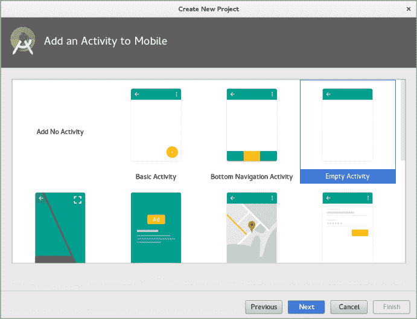

在这种情况下，我选择了默认的`Empty Activity`。在下一个窗口中，再次为该 activity 命名（这将成为一个类名），你还必须为布局命名。我没有特殊理由去选择`Android Studio`默认设置之外的名称，所以我保留了这些默认名称。当你点击`Next`时，会弹出一个窗口，`Android Studio`在其中构建项目，然后你只需要点击`Finish`。

如果这是你第一次运行程序，`Android Studio`会要求你下载更多文件，你应该按照提示操作。在`Android Studio`打开带有程序代码的窗口后，你可能还需要点击几个下载链接，但此时项目已经创建完成并准备就绪，你可以开始编程了。

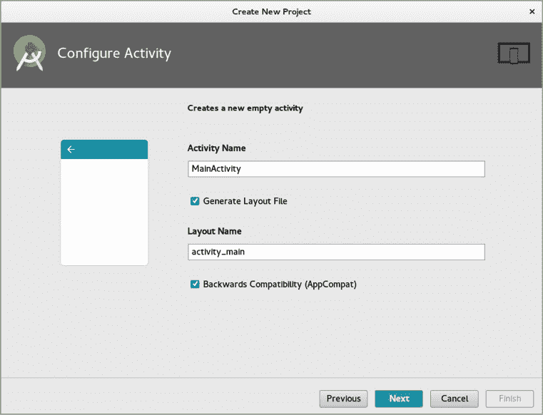

下面是项目创建后`Android Studio`的截图：

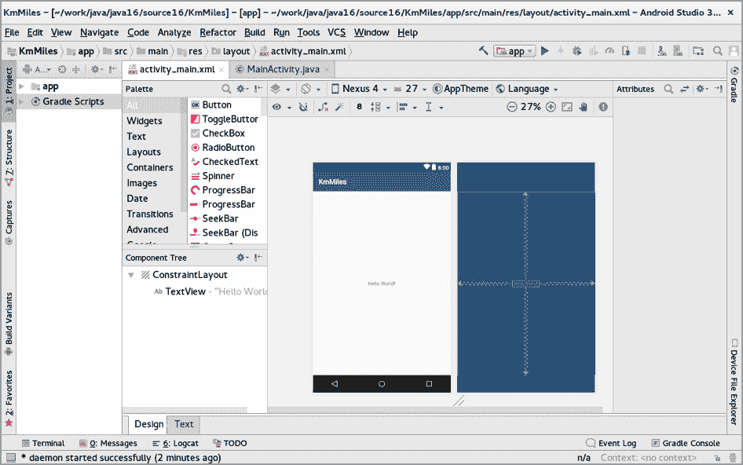

在左侧是项目文件的概览，这里我不再详细提到了。除此之外，有两个标签页，第一个显示应用程序布局，另一个显示一个 Java 类，该类对应传统 Java 中的主类。

布局被称为`activity_main`，是一个定义用户界面的 XML 文档。你可以在设计模式下处理该文档，此时你可以使用鼠标放置组件，也可以直接在 XML 代码中进行。你可以通过点击底部的`Design`和`Text`标签在这两种模式之间切换。

该项目实际上是一个完整的应用程序，你可以对其进行构建和测试。要测试程序，点击工具栏中`app`之后的绿色箭头。当你点击时，会弹出以下窗口：

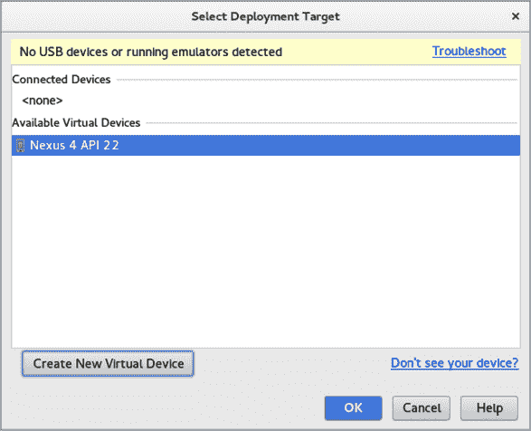

在其中选择要在哪个设备上测试程序。第一次运行时，该窗口是空的，因为没有连接任何设备，但你可以点击底部的按钮创建一个虚拟设备。在这里，你首先会获得一个可用虚拟设备的概览。当我创建项目时，我选择了应用程序必须支持`API 22`，因此我选择一个支持该版本的虚拟设备。我选择了`Nexus 4`，在下一个窗口中你需要下载当前设备。这需要一些下载时间，但完成后，你就会拥有一个如上方窗口所示的虚拟设备。

当我点击`OK`时，`Android Studio`将打开模拟器（见下文）。这需要一些时间，因为你需要下载模拟器本身，而且启动需要很长时间，但只需一点麻烦，你就能得到一个模拟手机并运行当前应用程序的窗口。目前，该应用程序是基础的，因为它除了在窗口中写一段文字外什么都没做。现在我将程序从`Android Studio`自动生成的程序扩展为如下所示的打开模拟器的应用程序——也就是说，一个你可以输入数字然后点击`Convert`按钮的应用程序，根据选中了哪个单选按钮，输入的数字被解释为英里或公里，并将该数字转换为相反单位的值。这是一个经典的转换程序。它当然是一个非常简单的程序，由以下

* 一个文本字段
* 两个单选按钮
* 以及两个按钮组成

但它是一个执行数据处理的程序，而不仅仅是显示文本。

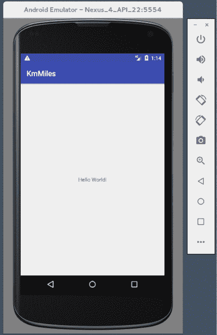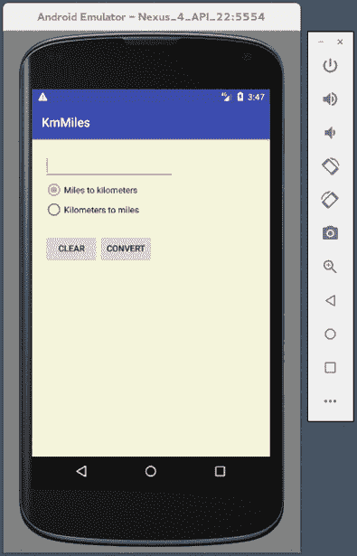

编写程序我将从设计窗口开始，并将工具箱中的组件拖到设计窗口的`Component Tree`中：

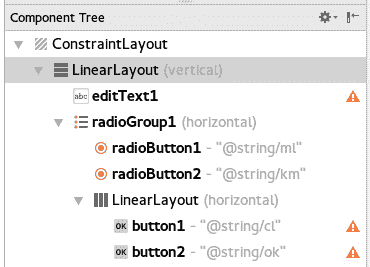

设计原本有一个显示`Hello World`文本的组件。我删除了这个组件，然后添加了

* 一个`LinearLayout`，它是某种布局管理器
* 一个`EditText`（`Plain Text`），这是一个输入字段
* 一个`RadioGroup`，它是组件的容器
* 两个`RadioButton`组件
* 一个`LinearLayout`
* 两个`Button`组件

你应该注意，设计面板显示了各个组件如何在层级结构中嵌套。同样请注意，如果你用鼠标选择一个组件，窗口右侧会出现一个面板，你可以在那里为该组件指定属性。

如果你检查项目文件，查看`app | res | values`，会有一个名为`strings.xml`的文件。这是一个定义字符串以及应用程序可以应用的其他资源的 XML 文档，其中只定义了一个，即程序的名称。我扩展了文件并增加了 5 个新定义，前 4 个是单选按钮和其他按钮的文本，最后一个用于窗口的背景颜色：

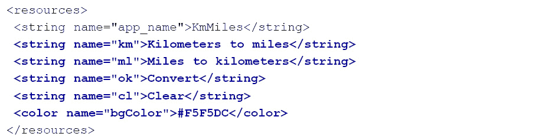

随后我将显示用户界面的完成 XML，它本质上是由设计窗口自动生成的，但我在其中做了一些调整：

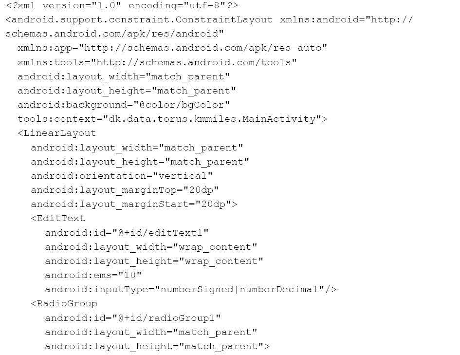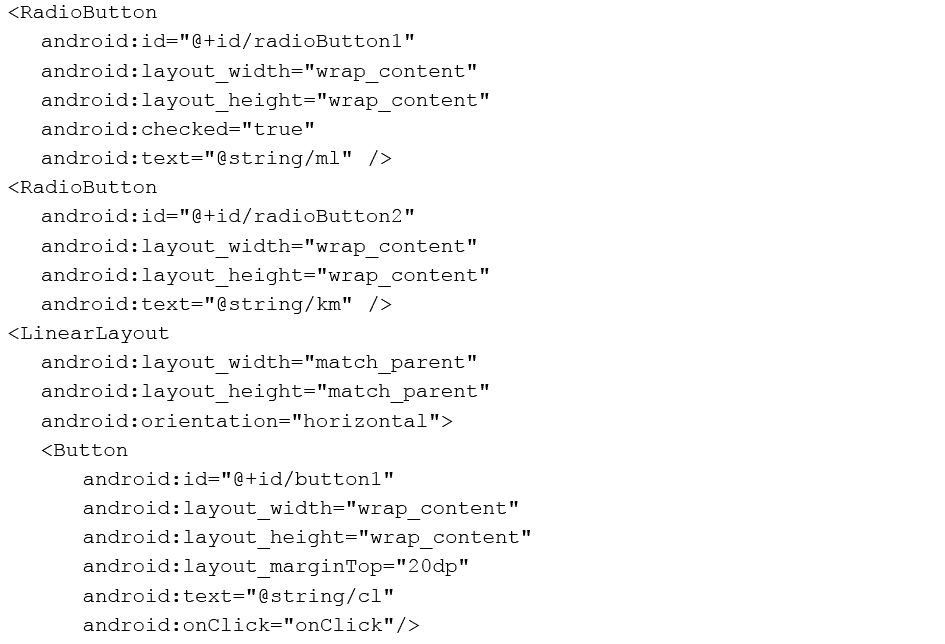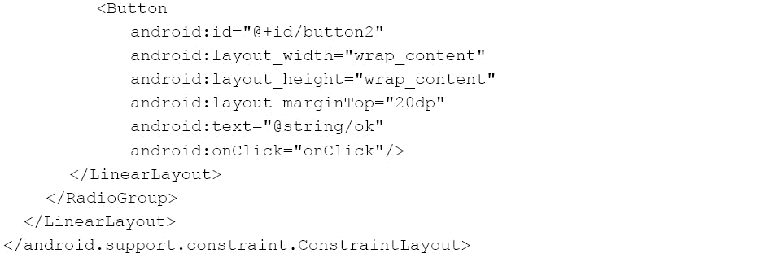

当你看到代码时，你当然无法知道它应该是这样写的，但你可以轻松地理解代码和每一行的含义。你应该注意看如何为组件（控件）创建一个标识符，例如：


你还应该注意如何引用资源（在`strings.xml`中定义），例如：

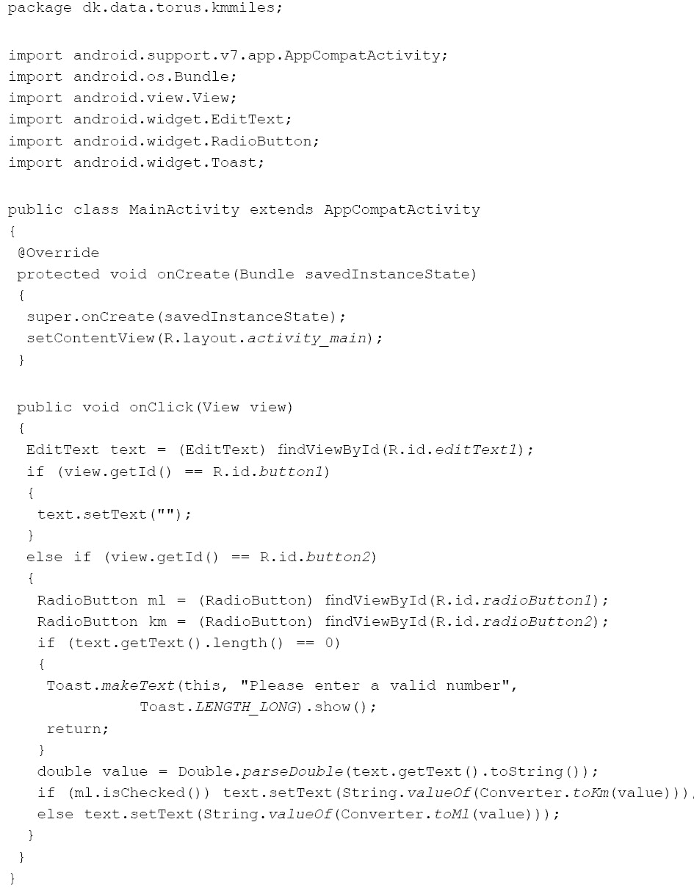

最后，注意已为按钮定义了事件处理器。基本上，该文档定义了窗口应该拥有哪些组件以及它应该如何布局。为了实现转换，我在`app | java | dk.torus.miles`目录下添加了一个名为`Converter`的类：


该类显然是基础的，包含它是为了说明 Android 应用程序可以像其他 Java 应用程序一样包含 Java 类，而且它只是一个普通的 Java 类。那里是主类`MainActivity`：


如你所示，这又是一个普通的 Java 类。这里`Android Studio`创建的`onCreate()`，而事件处理器应该由你编写。

### 练习 1：计算

你必须按照上述步骤编写一个程序。当你在模拟器中打开程序时，你应该得到一个如下所示的窗口，其中包含以下控件：

* 一个`LinearLayout`
* 一个`TextView`
* 一个`EditText`
* 一个包含两个`RadioButton`控件的`ButtonGroup`
* 一个包含两个`Button`控件的`LinearLayout`
* 一个`TextView`
* 一个`EditText`
* 一个`TextView`
* 一个`EditText`
* 一个`TextView`
* 一个`EditText`

在顶部的输入框中，你能够输入单价，而在下一个框中必须能够输入数量。点击`OK`按钮时，应用程序必须计算不含税的总价（取决于按了哪个单选按钮）、税额以及含税总价，然后更新下方的三个输入字段。

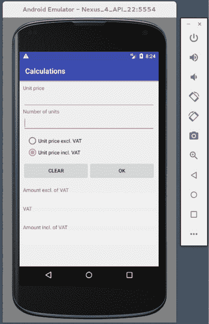

如果你点击`Clear`按钮，所有输入字段都必须清空。

当你完成这个练习时，应该像介绍性示例那样将文本放在`strings.xml`文件中。

底部的三个输入字段原则上应该是只读的。尝试找出如何实现这一点。

## 2 Widgets

如果你考虑介绍性示例，它包含了 5 个控件：

* 一个输入框 – 一个`EditText`控件
* 两个单选按钮 – `RadioButton`控件
* 两个按钮 – `Button`控件

在 Android 中，这些被称为`widgets`（控件），但上述内容和你从 Swing 或 JavaFX 中熟悉的是一样的。有许多这样的控件，学习编写 Android 应用程序的首要任务之一当然是学习哪些控件以及如何使用它们。我不想在书中系统地回顾各种组件，而是通过示例来说明其中的一些，但基本上它们的使用方法与你在 Java 控件中熟悉的方法相同。这些东西的名称当然不同，还有其他你可以设置的属性，但原理是相同的。Widgets 排列在一个广泛的类层次结构中，其总的基类被称为`View`。在这种情况下，知道这个网址是有好处的


它是 Android 许多功能的基础参考。

与 Swing 和 JavaFX 一样，最大的挑战是将组件放置在窗口中你恰好希望它们所在的位置，以及如何让窗口在不同的屏幕尺寸下看起来很好，但那是下一章的主题。

总的来说，Android 拥有与你在 Swing / JavaFX 中熟悉的相同的控件，但可能名称不同。然而，它也有一些在 Java 中没有的新控件，例如，我想展示一个包含两个新控件的应用程序：

* 一个`Switch`，它是`CheckBox`的替代方案
* 一个`AnalogClock`，它显示一个时钟（该控件现在已弃用）

该项目命名为`TheClock`，如果你在模拟器中打开应用程序，结果如下所示。应用程序显示了一个按分钟计数的模拟时钟。时钟上方有一个`Switch`（你从手机上见过这个控件），它显示一段文本并是一个你可以开启和关闭的开关。如果你运行应用程序，可以通过点击`Switch`控件来隐藏时钟，并通过再次点击它可以重新显示。

项目的创建方式与介绍章节中的示例完全相同，我遵循了相同的向导，唯一的区别是我输入了另一个项目名称。然后我删除了`Android Studio`添加的`TextView`控件，取而之添加了`LinearLayout`和另一个`Switch`控件。`AnalogClock`不在工具箱中（因为其已弃用），所以我我必须通过输入 XML 代码来添加它。


代码非常简单，最重要的是`main_activity.xml`，它定义了用户界面：

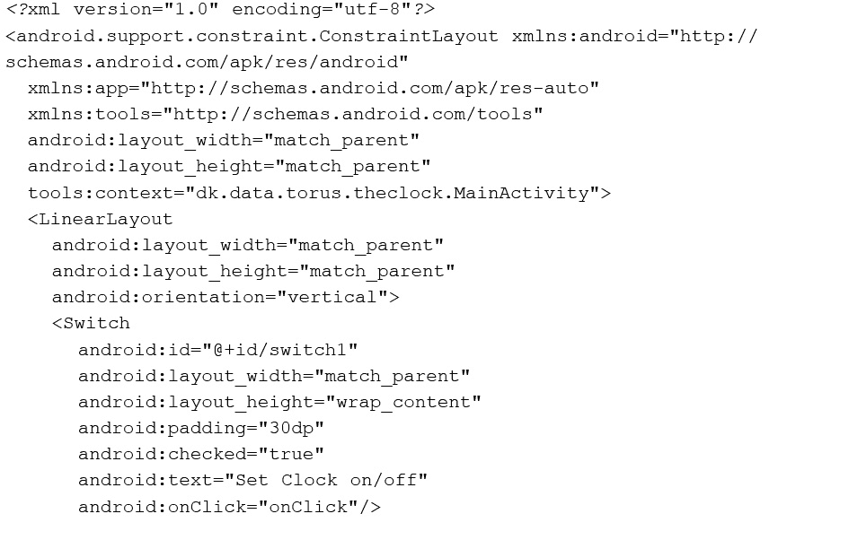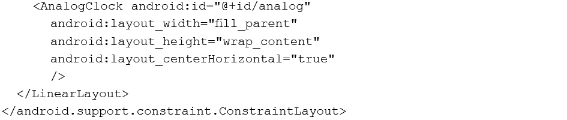

再次，当你看到代码并记住`Android Studio`创建了大部分内容时，理解这些代码是非常容易的。唯一难以理解的是宽度和高度属性，但它们将在下一章中解释。请注意，`Switch`对象有一个事件处理器，必须在 Java 代码中编写，任务是根据`Switch`开关的状态更改时钟的可见性：

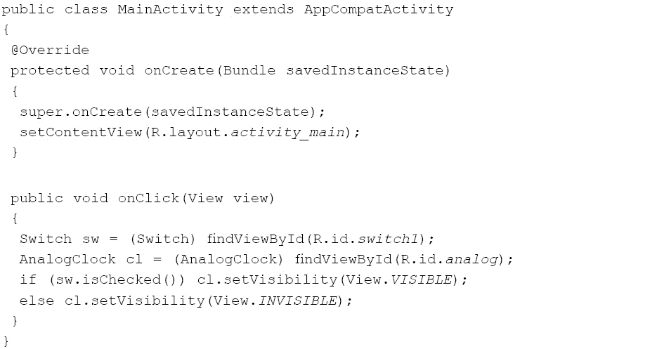

### 2.1 一个邮政编码应用

我想用另一个简单的应用程序示例来结束关于 widgets 的章节。这必须是一个应用程序，你可以通过输入邮政编码搜索文本和城市名称来搜索丹麦邮政编码——我已经多次使用该应用程序作为示例。与上面的示例相比，该应用程序稍大，因此能更好地反映一个典型的手机应用程序的外观。如果你在模拟器中运行该程序，将得到如下结果，其中搜索城市名为`Sk`。结果是所有城市名包含`Sk`的邮政编码。相反，搜索数字时你会得到以搜索文本开头的邮政编码。

这次代码内容多了一点，我想从资源文件`strings.xml`开始：


它定义了用户界面的文本以及背景颜色。这并不是要求定义为资源，但建议你这样做以避免修改代码。

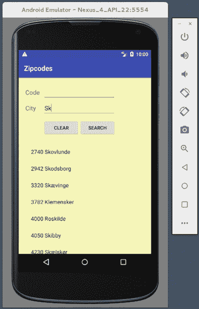 用户界面是在设计窗口中通过工具箱提取组件构建的，然后我编辑了 XML 代码：


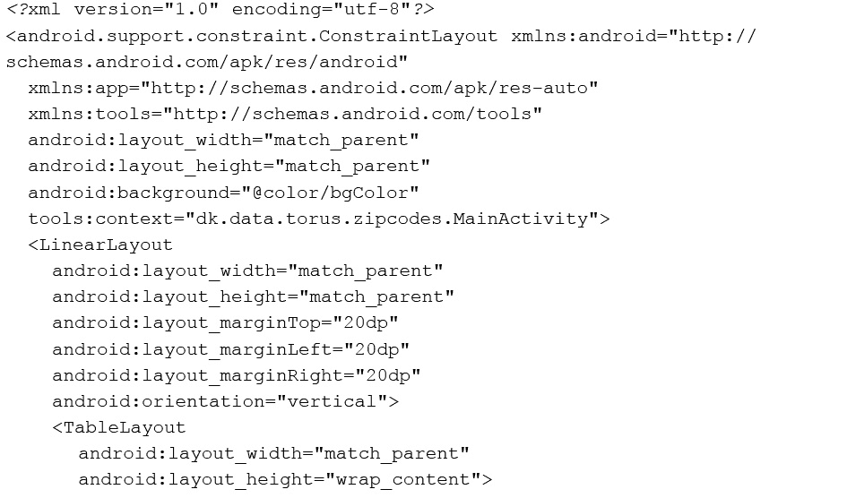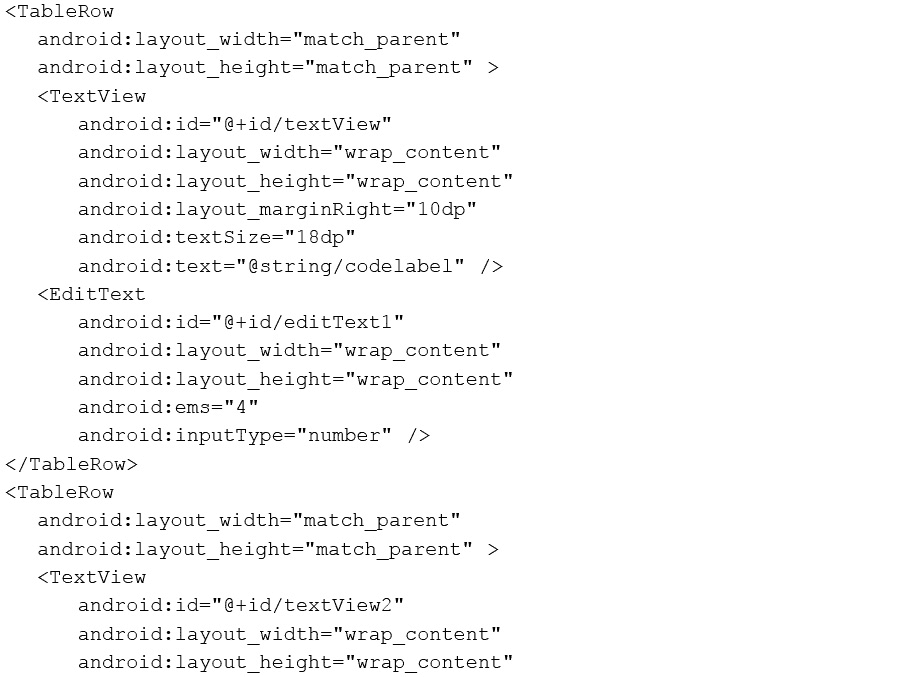

再次，代码非常易理解。基础布局是一个垂直排列两个元素的`LinearLayout`：

- 一个`TableLayout`
- 一个`ListView`

你可以将`TableLayout`想象成 HTML 表格，其中元素按行和列组织。在这种情况下，该组件用于创建一个带有输入字段和按钮的表单。共有三行，第一行有一个标签（`TextView`控件）和一个输入框（`EditText`控件）。注意定义的属性，特别是后者，你只能输入整数。下一行原则上相同，而最后一行不同。每行有两个单元格，最后行的第一个单元格标签为空。第二个单元格有一个两个按钮（`Button`控件）。注意两个按钮都有一个事件处理器，必须在程序代码——`MainActivity`类中定义。`ListView`是对应列表框的控件，目前是空的，因为它应该在代码中初始化。

从上文所示，activity 的 XML 部分可能会变得非常复杂，但如果你为手机编写应用程序，由于屏幕尺寸的原因，建议一个窗口只包含少量 widgets，如果需要许多控件，应用程序应该改为使用更多的 activity，我稍后会展示示例。

回到 Java 代码，这次除了`MainActivity`之外还有另外两个类，它们是常见的模型类。此目的是为了展示 Android 应用程序与其他应用程序相同的方式由类组成，再次，原则上，编写移动应用与编写其他 PC 应用程序并不一样。

首先，我想将以下简单的模型类添加到到项目中：

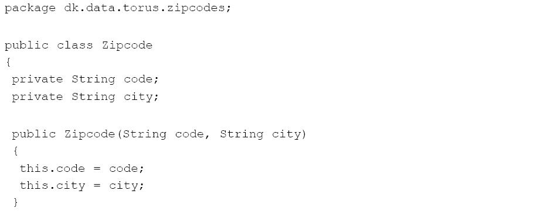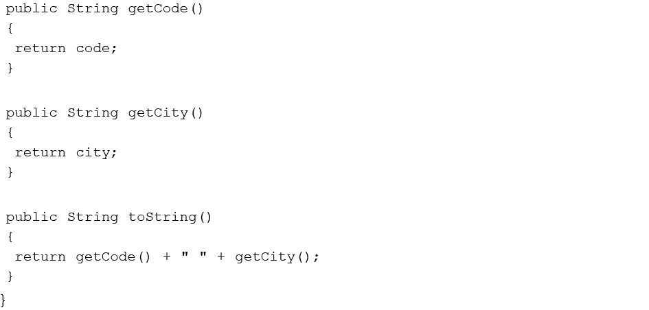

它代表一个邮政编码。然后我添加了`Zipcodes`类，其中邮政编码被定义为常量，该类创建一个包含`Zipcode`对象的自定义列表。

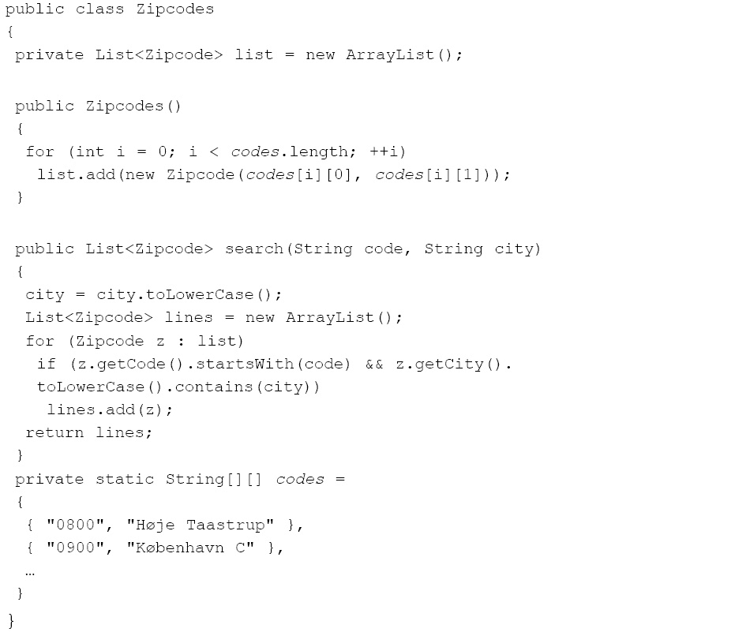

这里是重要的方法`search()`，它用于搜索邮政编码。这里你应该特别注意，它返回的是一个`List<Zipcode>`，即一个符合搜索标准的`Zipcode`对象的列表。

然后是`MainActivity`类：

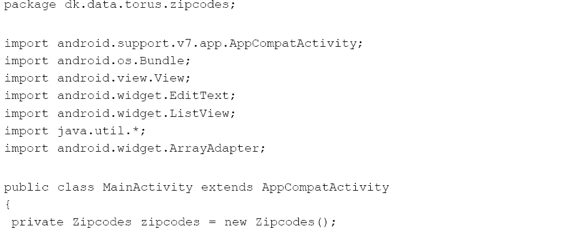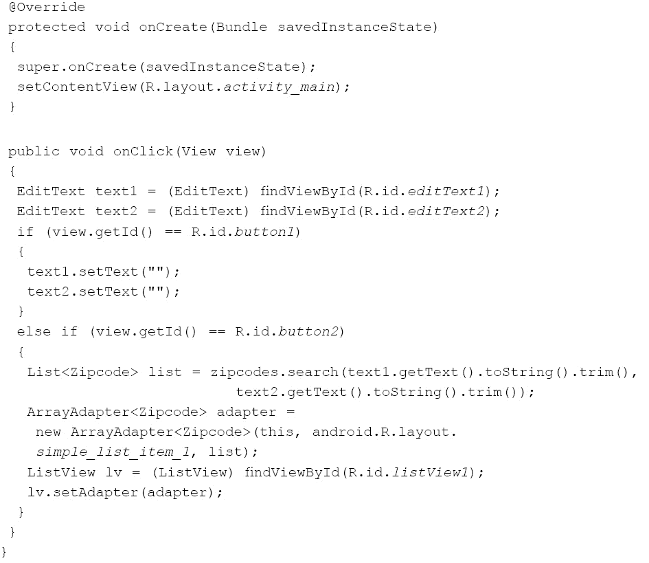

该类拥有一个`Zipcodes`类的实例，因此拥有可用的邮政编码。至于事件处理器，只有`Search`按钮的代码包含新内容。当你执行搜索时，必须使用结果来更新`ListView`组件，这是通过用于`Zipcode`对象的`ArrayAdapter`实现的。这里的参数并不直观。第一个参数是当前对象的引用，即由`ListView`的对象。另一个参数看起来很神秘，但它表示一个常量，该常量是 Android 定义的一部分，并指示它是`ListView`的适配器。最后，最后一个参数是初始化`ListView`组件的对象。随后使用该适配器来初始化该组件。

## 练习 2：人员 (People)

你必须编写一个与上述示例类似的程序，用于打开下方的窗口。顶部有两个输入字段，底部有一个`ListView`。在顶部的两个字段中，你必须能够输入人的名字，当点击`OK`时，名字必须插入到列表视图。在下面的示例中，输入了 4 个名字。


你可以按照下面的描述解决此练习：

1. 在 Android Studio 中创建一个新项目，可以命名为`People`。
2. 在`string.xml`中创建所有文本。
3. 编写设计，即从工具箱中拖动所有组件并将其到`Component Tree`（组件树）中，然后调整 XML 代码，但不要添加事件处理器。
4. 在模拟器中测试程序，并重复此过程，直到你认为一切看起来都很好。
5. 添加一个简单的模型类`Person`，用名和姓来表示一个人。
6. 在你的`MainActivity`中添加一个`List<Person>`。
7. 在你的列表和`ListView`之间添加一个适配器。注意，适配器在你的列表和组件之间创建了一种形式的数据绑定。
8. 为`Clear`按钮编写事件处理器。
9. 为`OK`按钮编写事件处理器，该处理器（如果同时输入了姓和名）必须创建一个`Person`对象并将其添加到你的列表中。

完成后，程序就应该了。

# 3 布局 (Layout)

在本章中，我将更详细地讨论布局，布局当然已经是之前示例的一部分，但本章重点在于关于如何在窗口中放置组件，从而与你在 Swing 中了解的作为布局管理器的知识相匹配。有了这一背景（以及对 JavaFX 中窗格的了解），处理布局如何工作变得相对简单，之前的示例也展示了这一点。然而，存在一些语法问题，以下内容不是参考手册，我将通过示例展示哪些可以的操作。

## 3.1 相对布局 (RelativeLayout)

作为示例，我将展示第 1 章程序的改进版本，该版本通过华氏度和摄氏度的转换进行了增强：

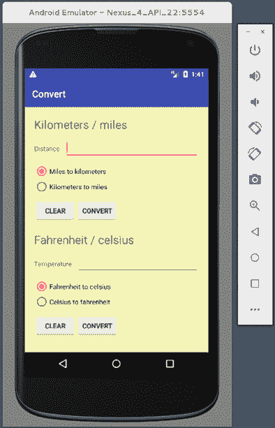

此外，主要区别在于使用了另一个布局管理器，称为`RelativeLayout`。起点是一个新项目，我将其命名为`Convert`。创建项目后，Android Studio 创建了如下用户界面设计（即`main_activity.xml`）：

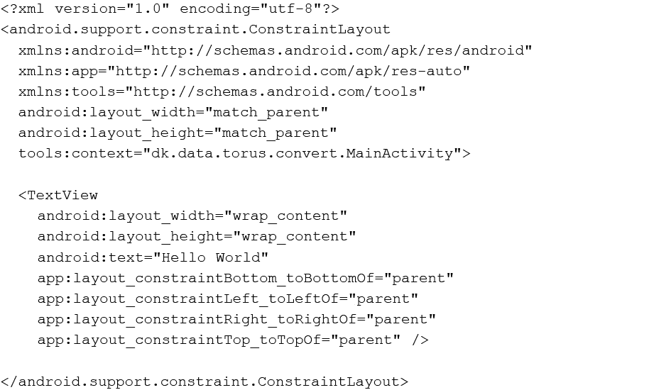

该设计包含一个名为`ConstraintLayout`的布局管理器，正如稍后我会提到的，你可能会注意到定义了两个属性`android:layout_width`和`android:layout_height`，两者的值都是`match_parent`。这意味着布局应该占据父容器（即屏幕）提供的所有空间，并同时应用于宽度和高度。在这个布局中，Android Studio 插入了一个我想删除的`TextView`组件。然后我在布局窗口中添加了一个`RelativeLayout`，并从工具箱中将当前组件拖到布局中，这样几乎所有的组件现在已以正确的层级结构添加到窗口中（在此我更改了单个组件的名称）：

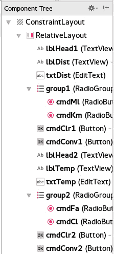

结果是所有组件都在窗口的左上角，Android Studio 生成了如下 XML：

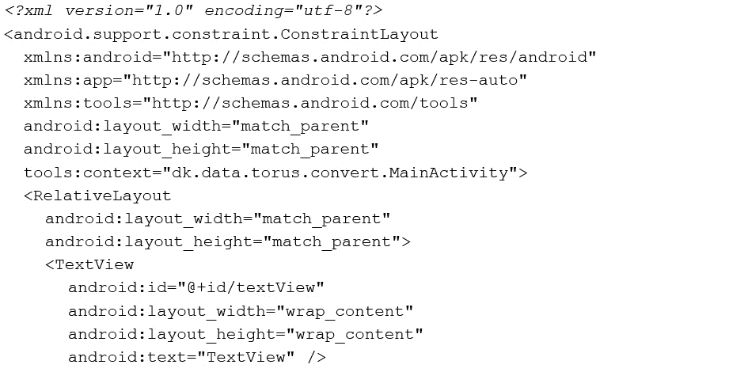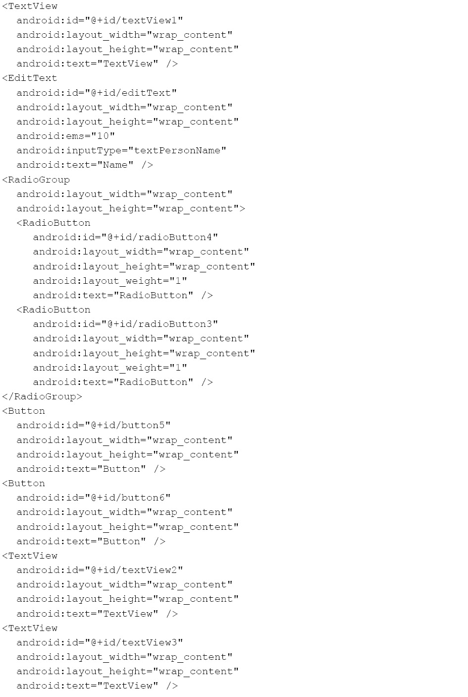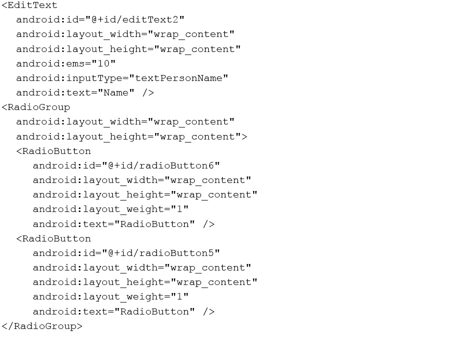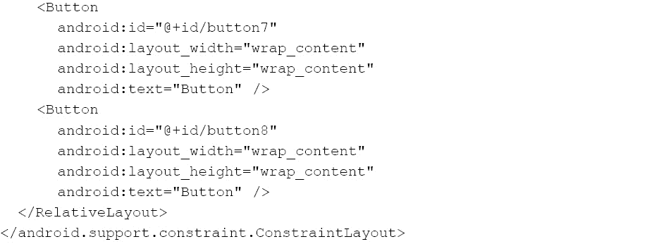

在这里你应该特别注意 Android Studio 分别为`android:layout_width`和`android:layout_height`分配的值。对于`RelativeLayout`，它是`match_parent`，这意味着它占据父容器提供的所有空间，这里是一个填充整个窗口的`ConstraintLayout`。对于其他组件，到处都使用了`wrap_content`，这意味着组件的大小由内容决定，以`TextView`为例，它就是组件的内容。

在我像上面描述的那样不加批判地将组件填充窗口后，我的工作是让它们放置得美观，这就是布局管理器介入的地方，这里是`RelativeLayout`。正如其名所示，它通过指定属性设置单个组件之间的相对位置，因此我有一个通过添加属性来调整 XML 代码的过程，直到符合我的要求。在这个过程中，我也为单个组件了命名，使它们比 Android Studio 分配的名称更明确。以下是完成后的 XML：

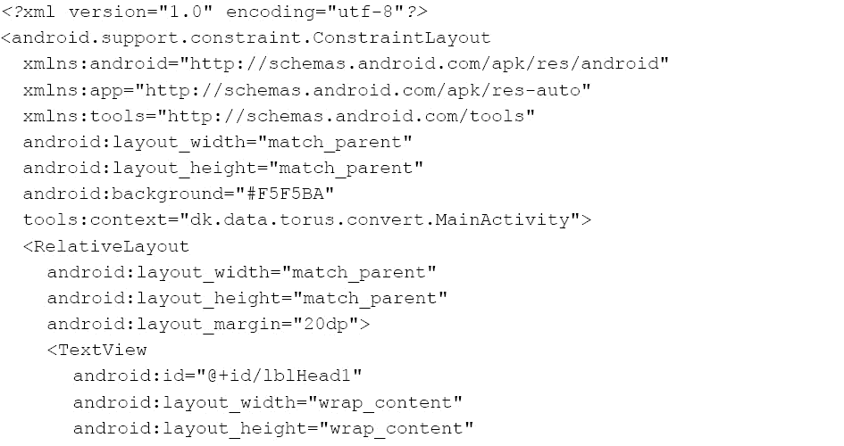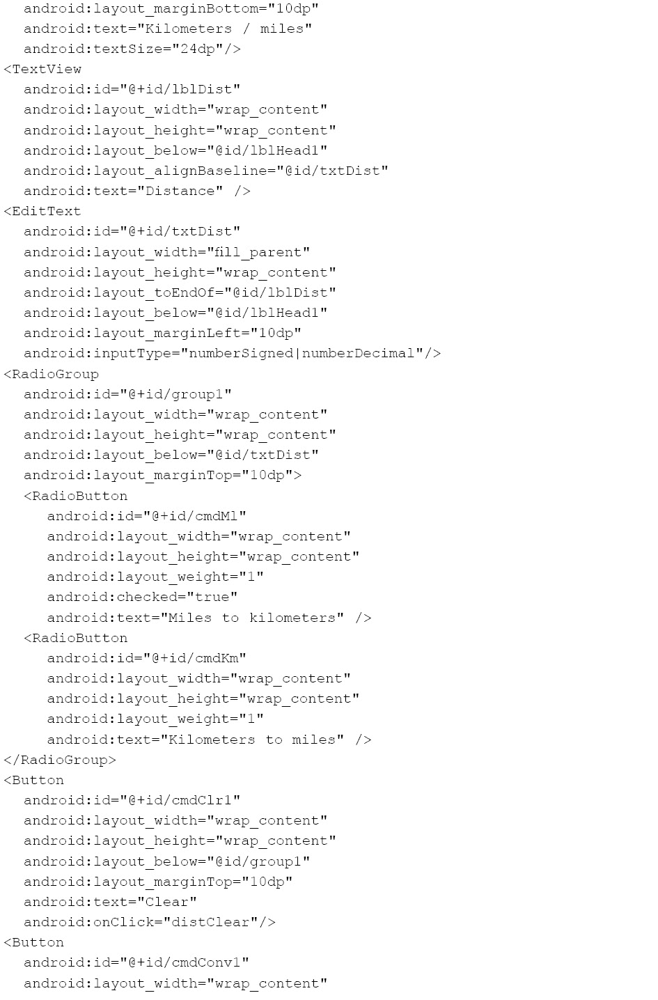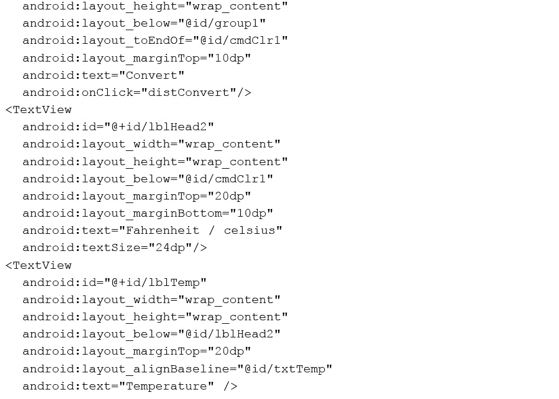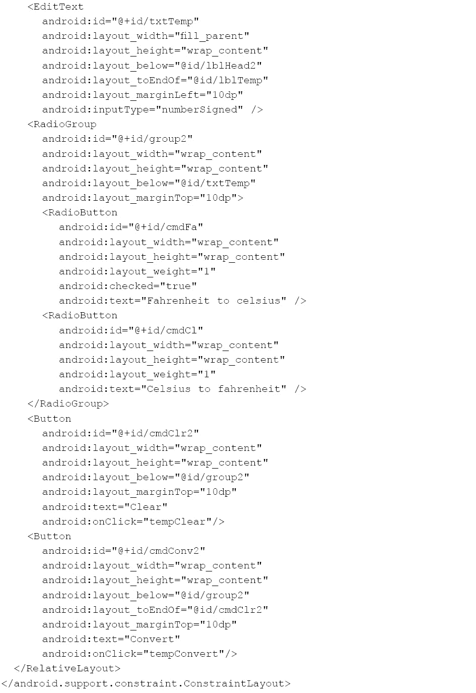

在接下来的内容，我将简要提到发生了什么。在`ConstraintLayout`中，我定义了背景颜色，而在`RelativeLayout`中，我定义了 20 的外边距。无论单个组件放置在哪里，这些都是全局设置，甚至独立于当前的布局管理器。

对于第一个`TextView`组件，我将名称更改为`lblHead1`，然后在组件下方定义了 10 的外边距。我还更改了文本（显示在屏幕上的文字）并定义了字体大小。

我将下一个`TextView`小部件命名为`lblDist`，然后通过`android:layout_below`定义了该组件应该位于`lblHead1`下方。这就是相对布局（relative layout）发挥作用的地方。接着，通过`android:layout_alignBaseline`，我定义了显示的文本与后续组件（即输入字段）位于同一条基线（baseline）上，目标是让这两个组件在垂直方向上相互对齐。这里你应该特别注意，在 XML 中允许引用一个尚未定义的组件`txtDist`。它是下一个被定义的组件，除了名称被更改为`txtDist`之外，请注意`android:layout_width`已更改为`fill_parent`，这意味着组件的宽度应该填充父组件（此处为`RelativeLayout`）所留出的剩余空间，即它需要使用窗口的剩余宽度。此外，定义了三个属性：通过`android:layout_toEndOf`，该组件应该位于`TextField`组件的右侧；通过`android:layout_below`让它位于标题文本下方；最后通过`android:layout_marginLeft`在输入字段与前面的文本之间留出空间。

下一个组件是`RadioGroup`。这里没什么好解释的，但我给它起了一个名字，并定义了它位于输入字段下方，且与输入字段之间有 10 的间距（margin）。对于两个`RadioButton`组件，也没有什么需要注意的，除非我再次更改了名称并指示第一个必须被选中。同样请注意`android:layout_weight`属性。它实际上并不是必须的，而是由 Android Studio 插入的，意味着要使用整个高度，但在其他语文中它是重要的。

接下来是两个（顶部的）按钮，与之前解释过的相比，没有新内容，但你应该注意这两个按钮都定义了事件处理程序。

XML 代码的其余部分原则上只是上述内容的重复，最终结果是各个组件布局得非常美观且彼此协调。这个过程听起来可能有点复杂，确实如此，但只要稍微练习，这实际上是一种非常安全且相对有效的设计复杂窗口的方法。实际窗口对于手机来说已经很复杂，不应该比这更复杂了。

你应该注意，这次我没有将文本定义为资源，而是直接写在 XML 代码中。这没有特殊理由，仅仅为了编写代码更简单。后面是 Java 代码，这里`Converter`类扩展了两个新的静态转换方法。`MainActivity`类现在为四个按钮中的每个按钮提供了四个事件处理程序。它们都很简单，我不想在这里显示代码。然后应用程序就完成了，可以在模拟器中进行翻译和测试，甚至可以像引言章节那样安装在手机上。

## 3.2 LinearLayout

在本书的示例中，我使用了`LinearLayout`，这是一种以行或列形式组合组件的布局管理器。它可以立即与 JavaFX 中的`VBox`和`HBox`进行比较，并且像 JavaFX（以及 Swing）一样，布局管理器可以嵌套，你可以使用`LinearLayout`解决许多布局挑战。下面显示的示例称为`ButtonApp`，它使用两个嵌套的`LinearLayout`实例在屏幕上放置了 6 个按钮：

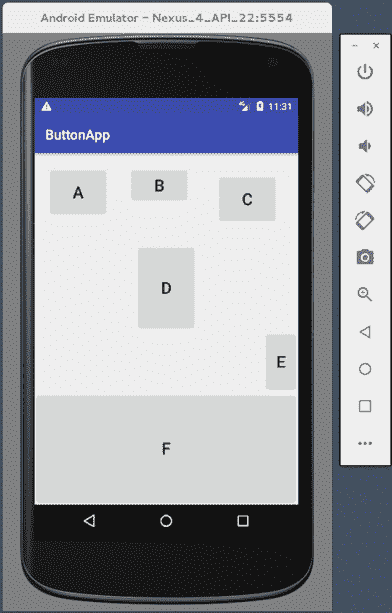

该应用程序除了显示 6 个按钮外什么都不做，而且它们没有功能，因此唯一需要显示的代码是`main_activity.xml`：

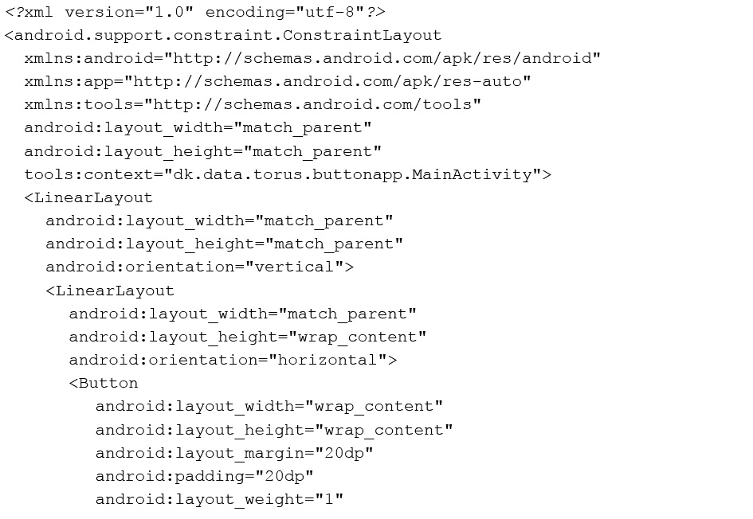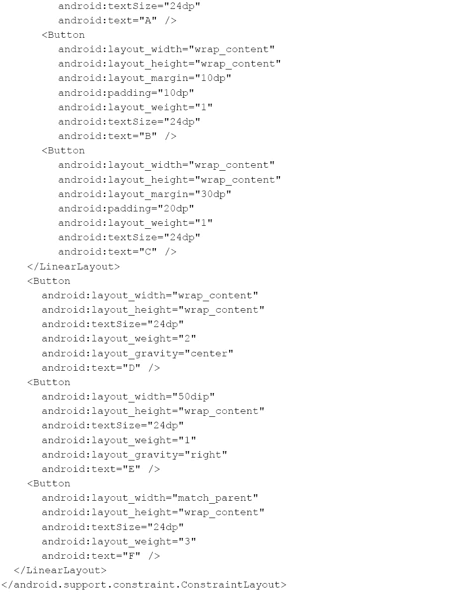

布局从一个`LinearLayout`开始，它有一个属性`android:orientation`，告诉我们组件应该垂直定位。第一个元素是一个新的`LinearLayout`，因此是一个嵌套布局，它的方向反而是`horizontal`（水平）。这里你应该注意它将`android:layout_height`设置为`wrap_content`，这样它就不会占据整个窗口。

内部的`LinearLayout`包含三个文本分别为 A、B 和 C 的按钮，结果是它们水平排列。对于每个按钮，都定义了一个间距（margin），指示按钮外部应该留出多少空间。还定义了内边距（padding），它指定了文本到组件边缘的距离（如果它是带框的组件）。对于所有三个按钮，`android:layout_weight`均为 1，这意味着它们必须平分空间并获得相同的宽度。

外层的`LinearLayout`除了上述`LinearLayout`元素外，还有三个按钮，这些按钮垂直排列在带有 A、B、C 按钮的布局下方。下方的三个按钮 D、E 和 F 的权重分别为 2、1 和 3。这意味着它们按照 2/6、1/6 和 3/6 的比例平分垂直空间。关于组件的宽度，请注意 D 的宽度由内容决定，而 E 给出的是绝对宽度。对于 F，它是父容器的宽度，因此是窗口的宽度。你还应该注意`android:layout_gravity`属性，它表示对齐方式。

以前，`LinearLayout`是一个非常常用的布局管理器，在需要非常简单的布局的情况下仍然是有意义的。

## 3.3 TableLayout

我在上一节连接 zip 应用程序时使用了这种布局管理器，我不想展示其他示例，但实际上还有很多要解释。最好的方法是将其视为 HTML 表格，它支持跨列合并（colspan）和将组件放置在特定列中的概念，但基本上它是一个易用的布局管理器。

## 3.4 GridLayout

还有一种名为`GridLayout`的布局管理器，原则上它对应 JavaFX 中的`GridPane`。基本上，它是一个将屏幕划分为若干单元格的布局管理器，你可以将组件加载到管理器中，如果没有其他设置，它会将所有组件放在一个大行中，但你可以指定列数以确定应该有多少列。你也可以定义行数，并为单个单元格定义跨度（span）。`IntCalc`程序是一个如下布局的简单计算器：

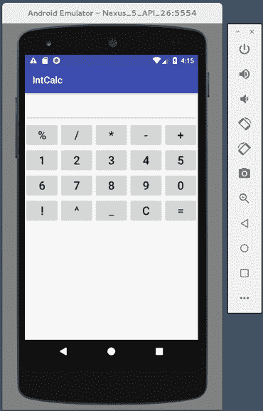

计算器仅对整数操作，例如执行整数除法。输入字段是只读的，你只能通过按钮输入数字。表达式必须以后置形式输入，即在参数之后输入运算符。例如，如果你想计算：

```
23 + 19
```

你必须输入 23 并点击回车，这意味着 23 将被保存在栈中。然后输入 19，再点击加号按钮，程序计算显示内容与从栈弹出的数字之和，之后显示更新为结果。底行的命令可能并不直观，但`!`决定内容的阶乘，`^`是幂运算而`_`是改变内容的正负。最后，`C`是删除显示内容的命令，但它同时也会删除栈的内容，尽管这应该是两个命令。

程序设计得很简单，仅由`activity_main.xml`和`MainActivity.java`组成。XML 部分占据大量空间，我在下面只展示了较小的一部分，因为其余部分引用了更多按钮，而这些按钮原则上是完全相同的：

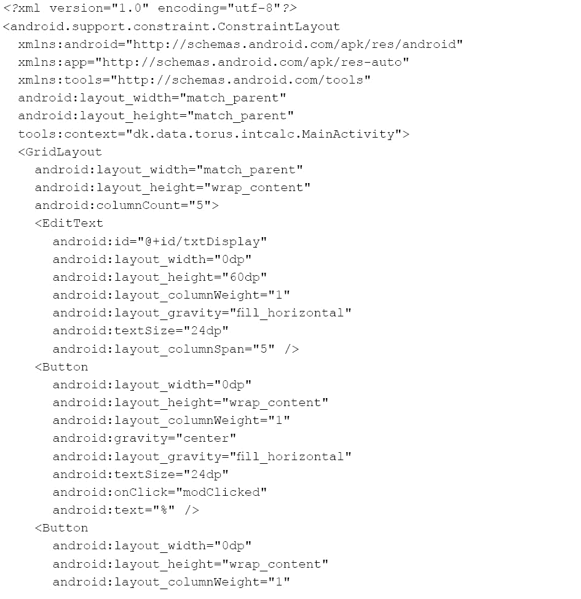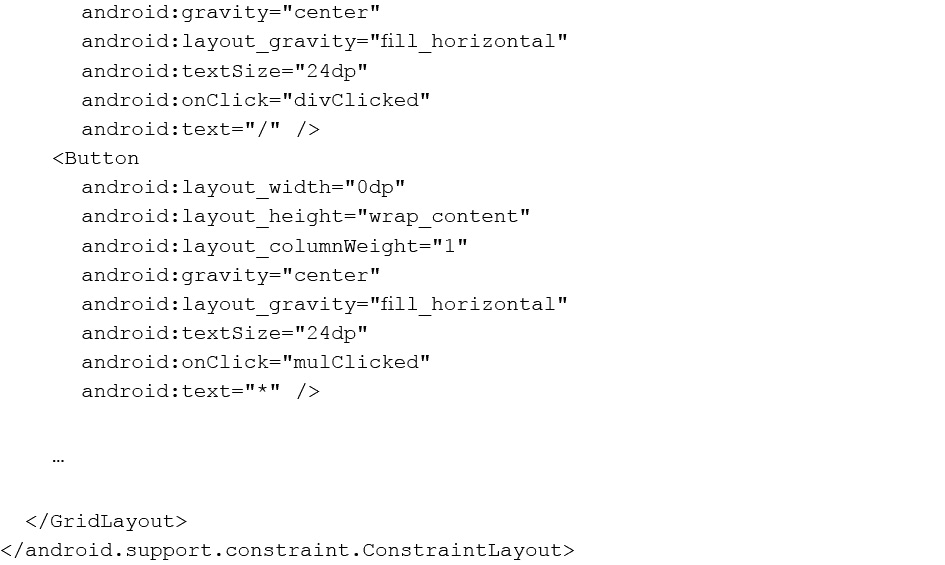

首先，注意`GridLayout`定义了 5 列。在这里你也可以指定行数，但没有必要，因为行数是从 XML 代码中确定的。第一个组件是`EditText`，你应该注意它的宽度被设置为 0。这是因为宽度是由`weight`（权重）属性和`graverty`属性决定的，这些是`GridLayout`用于确定组件应该填充多大空间的属性。还要注意，该组件定义了 5 个`columnSpan`（列跨），因为机器的显示器应该填充整个窗口宽度。最后，注意该组件有一个 ID，以便在 Java 代码中引用它，但它是布局中唯一一个带有 ID 的组件。

其余所有（20 个）组件都是`Button`组件，事实上，除了定义了哪些尺寸的属性外，没有什么特别需要注意的。由于任何地方的权重都设为 1，这意味着它们都具有相同的宽度，因为`gravirty`被设置为`fill_horizontal`。

Java 代码也比较冗长，因为有 20 个事件处理器，以下仅代码的一部分：


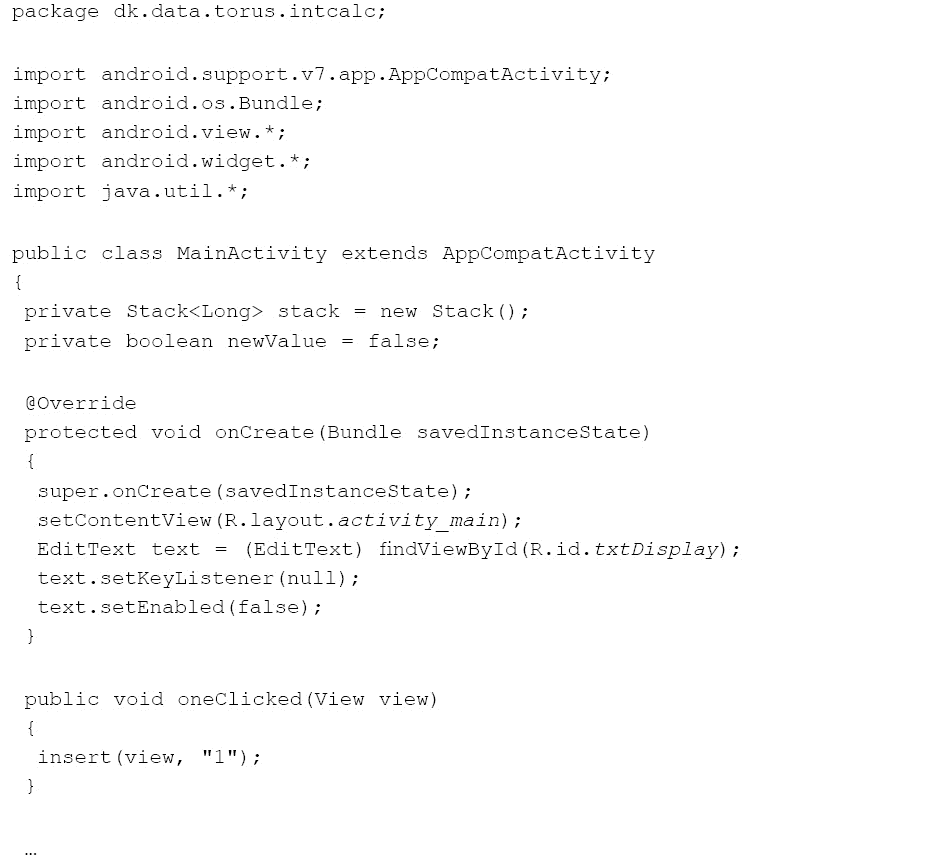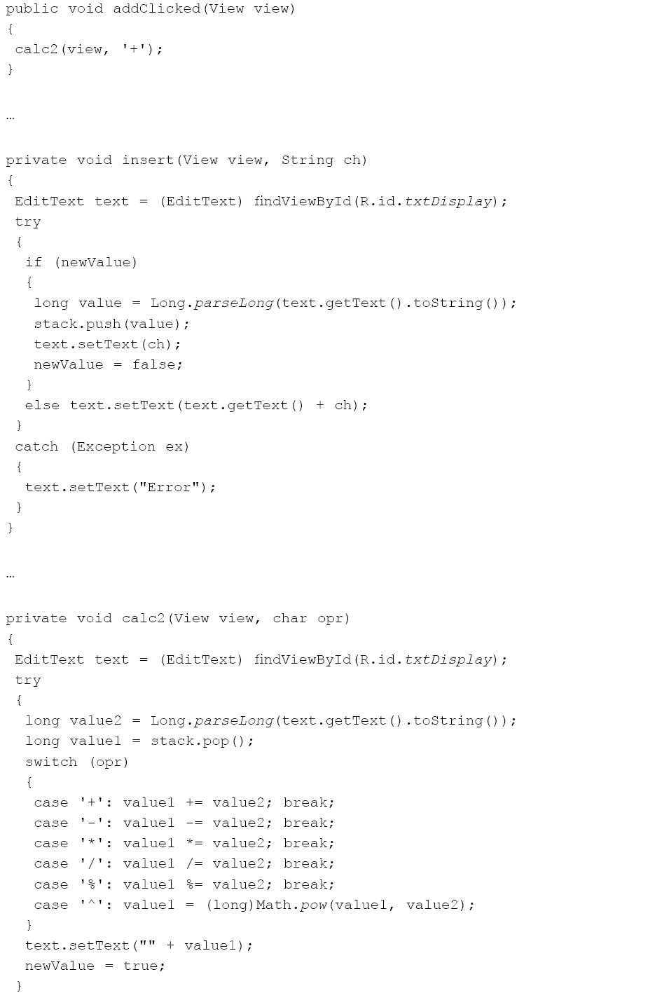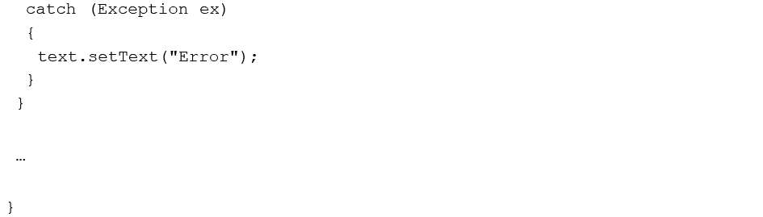

该类有两个实例变量，第一个是栈（`stack`），另一个用于控制在点击数字时，显示内容是否应该存放在栈上。构造函数扩展了两个语句，用于设置显示器为只读，这样你就无法直接输入数字。注意，这意味着不会显示虚拟键盘。

如果你点击某个数字按钮，将执行 `insert()` 方法。它会测试变量 `newValue`，如果为 `true`，则意味着正在输入一个新数字，该方法尝试将显示内容解析为整数并放入栈中。然后将点击的数字作为显示器的值插入。如果 `newValue` 为 `false`，除了将点击的数字添加到显示内容外，没有发生其他操作。

点击带有两个参数的运算符时，事件处理器调用 `clac2()` 方法。它解析显示内容并弹出栈以执行实际计算，之后更新显示。注意 `newValue` 被设置为 `true`，因为下一次点击按钮时，结果必须添加到栈中。相反，点击仅有一个参数的运算符（对于当前机器它显示为 `!` 和 `_`），会调用 `calc1()` 方法，它会改变显示器的值。

## 3.5 ConstraintLayout

作为最后一个布局管理器，我想提到 `ConstraintLayout`，这是 Android Studio 定义为活动（activity）默认的布局管理器。原则上，它的工作方式有点像 `RelativeLayout`，但它更灵活，目标是让你仅使用鼠标和 Android Studio 的布局编辑器就能设计复杂的布局。也就是说，你可以从工具箱将组件拖到窗口中，并用鼠标将其拖到想要的位置。这样，你就不需要自己编写 XML 就能完成最终的设计。

要定义视图组件的位置，它必须至少有一个水平和一个至少一个垂直 `constraint`（约束），每个约束都是相对于另一个视图或父布局的附加或对齐。因此，每个约束都定义了沿水平或垂直轴的视图位置，但通常每个轴会有更多的约束。

如果你在布局编辑器中丢入一个视图，它没有约束，而是停留在你丢入的位置。可能有一些属性，例如：

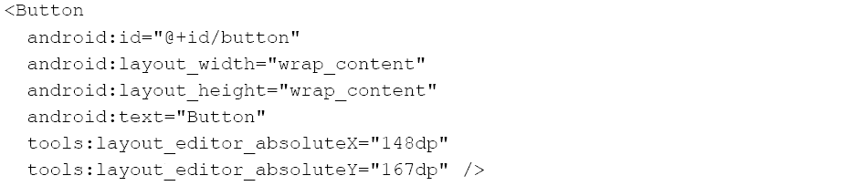

其中最后两个属性告诉你组件在布局编辑器中的位置，但如果你运行程序，你会发现按钮位于左上角，因此这两个属性对最终程序没有影响。

下面是在我添加了 `EditText` 组件并并将两个视图都绘制到我认为它们应该在的位置后的 XML 代码：

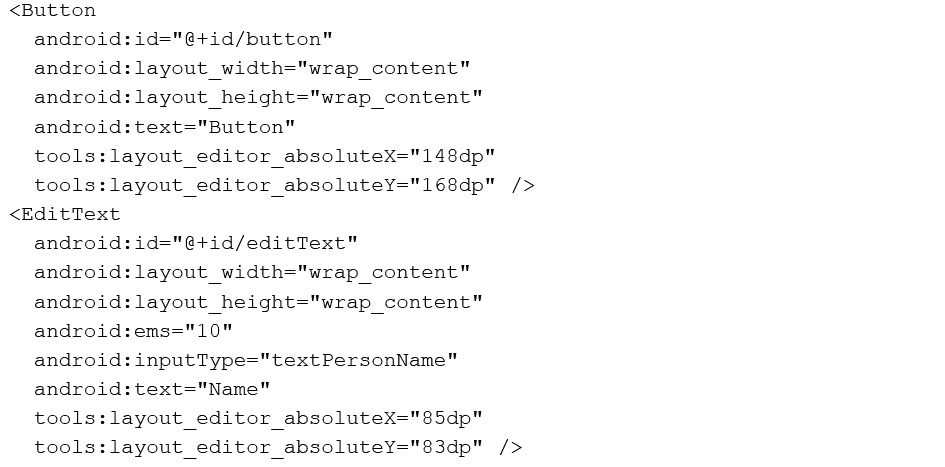

如果你现在选择一个视图（例如 `EditText` 组件），你将看到四个小圆。如果你指向其中一个，就可以将该组件拖到另一个与之建立关系的组件或布局上。下方是布局管理器本身。接下来，你可以调整窗口右侧 *Properties*（属性）下的距离，并在工具栏中指定对齐方式。

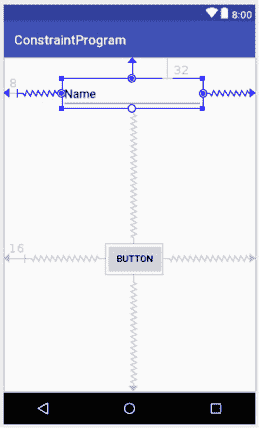

当我完成两个组件的操作后，XML 代码如下：

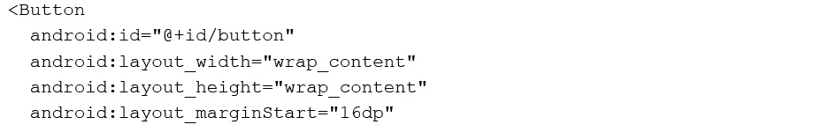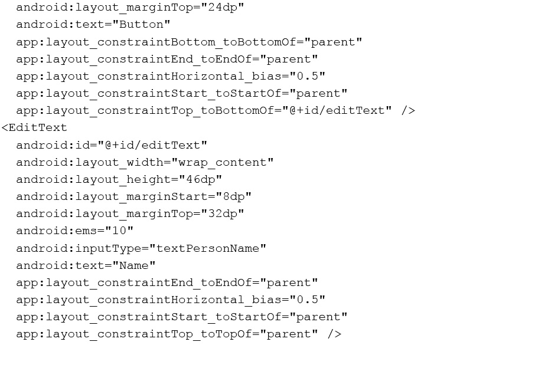

Android Studio 已将所有的编辑器约束转换为实际约束，之后程序就可以编译并运行，组件的位置与上述 XML 对应。

当然，学习如何使用布局编辑器需要一点时间，但如果你不是每天都写 Android 应用，这是值得的。在 `ConstraintLayout` 的帮助下，你可以设计一个完整的应用。

## 3.6 Containers

Android 还提供了多个可以显示一组对象的组件。这些被称为容器（containers），虽然布局管理器不是容器，但它们与布局有关系。事实上，我已经在 `Zipcodes` 应用中展示了一个示例，它使用了 `ListView`，这是一个可以显示大量对象的容器。如果容器的对象超过了屏幕空间，你可以滚动内容，还可以为容器关联一个事件处理器，每次选择对象时都会触发。原则上，不同的容器使用方法相同：使用数据源、容器本身（如 `ListView`）以及一个负责更新容器的适配器。我将从一个显示*丹麦国王*概述的程序开始：

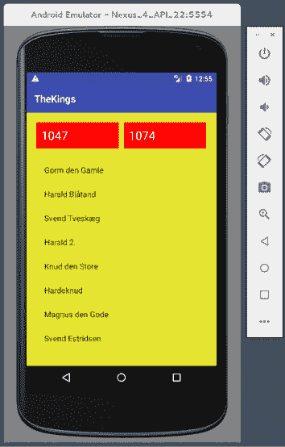

其中点击 `Svend Estridsen`，执政时期出现在顶部两个字段中。用户界面的设计相当简单，除了 `LinearLayout` 之外还包含三个组件：


有两个 `EditText` 组件，这里没有什么新的需要解释的，但请注意名称和定义的属性。后者是一个 `ListView`，除了名称外没什么可注意的，但它是需要初始化数据的容器，并需要挂载事件处理器。这发生在 Java 代码中。

首先，数据资源和起点是以下模型类：


它也是非常简单的类，除了当前程序需要的之外没有包含其他内容，你应该特别注意 `toString()` 方法，它返回 `ListView` 容器中每个对象显示的值。作为数据资源的第二部分，`Kings` 类提供了当前的 `King` 对象：


在这里我只展示了少量数据。该类显然是伪代码，因为所有数据都是硬编码的，显然这些数据应该来自另一个源，例如文件、数据库或等内容，但由于我尚未展示如何实现，所以必须留到以后，不过这并不改变原理。

适配器（Adapter）实际上是 Android 中的一个基本概念，其目标是将数据源与呈现层分离，这样对于程序员来说，处理方式都是相同的，无论使用哪种数据源，无论使用哪种列表组件来显示数据。在这种情况下，类的代码位于 `MainActivity` 类中：


首先，创建了一个 `King` 类型的对象列表，作为程序的数据源。此外，为两个 `EditText` 组件定义了变量，并在 `onCreate()` 中对它们进行了初始化。此外，对两个对象都调用了 `disable()` 方法，禁用了两个输入字段，因此无法输入文本。接下来，定义了 `ListView` 组件的引用并用适配器进行了初始化：


其类型是 `ArrayAdapter`，它是一种用于数组或列表作为数据源的适配器，因此这种数据源通过索引来识别单个对象。此外，一个参数（用于泛型类型）告知适配器表示 `King` 对象。构造函数有三个参数，其中第一个是容器需要初始化的成员对象（这里是当前对象），而最后一个参数是数据资源。然后是中间的参数，它告诉容器应该如何呈现对象，这里是一个常量，其含义并不易理解，但它告诉对象应该以字符串的形式呈现，因此即使用对象的 `toString()` 方法的值进行显示。

最后，在 `ListView` 组件上挂载了一个事件处理器，这是通过 `setOnItemClickListener()` 方法实现的，该参数是一个 `OnItemClickListener`，这是一个定义事件处理器的接口。它有四个参数，其中最重要的是 `position`，它指示被点击（用手指触摸）对象的索引。在这种情况下，它执行了 `update()` 方法，用国王的统治时期更新顶部的两个输入字段。

我想展示上述应用程序的变体，我将其命名为 `SelectKings`。程序打开以下手机界面，再次显示了丹麦国王，但这次有两个 `ListView` 组件，顶部显示底部选中的国王。在底部，你现在可以使用复选框（checkboxes）选择对象，并且可以选择多个并选择更多对象。在示例中，选择了两个，如果你取消勾选复选框，名称就会从顶部的 `ListView` 中消失。

同样，该程序包含一个用于定义用户面的 XML 文件，以及 `MainActivity` 类（以及模型类 `King` 和 `Kings`），该程序主要展示了如何使用适配器动态更新用户界面。


这次 XML 文件中的布局如下：


没什么特别需要注意的，但你应该注意到如何在底部指示可以进行多选。此外，注意在设计中使用 `layout_weight` 来定义两个组件应平分空间。最重要的部分发生在 Java 部分，这里 `King` 和 `Kings` 类保持不变，而 `MainActivity` 发生了变化：


与之前的示例相同，创建了一个 `King` 对象的列表作为底部 `ListView` 的数据源。此外，还创建了一个字符串列表作为顶部 `ListView` 的数据源，并定义了顶部 `ListView` 的引用。由于是你不需要在每次点击底部 `ListView` 时都重新查找引用。该引用在 `onCreate()` 中初始化。在这里，底部的 `ListView` 也被初始化，原理上与之前的示例相似，但这次对适配器的第二个参数使用了另一个参数：


它表示这次 `King` 对象不仅应该显示为字符串，还要带有一个随后的复选框，并且应该允许多选。相反，如果你只能单选，你将会写成：


底部 `ListView` 以之前示例相同的方式挂载了事件处理器，但它执行的是不同的操作。`update()` 方法将当前的 `King` 对象转换为字符串，如果该字符串已经在数据源中，则将其删除，否则将其添加。然后使用适配器更新顶部的 `ListView`。

作为国王的最后一个示例，程序 `SpinKings` 打开以下窗口：


我将更多介绍基础用户交互，包括如何使用菜单和对话框。不过，我想从虚拟键盘开始。

Android 设备可能拥有硬件键盘，但包括智能手机在内的大多数设备都有一个在你点击输入字段时弹出的虚拟键盘。输入字段是一个 `EditText` 组件，但如果你查看 `Text` 调色板下的设计编辑器，你会发现有很多选项，每个选项都告诉你如何显示内容，但主要是指示使用哪种虚拟键盘：


每一行都会插入一个 `EditText` 视图，不同的选项表示 `InputType` 属性的值。如你所看到的，这里有很多选项，特别是你应该注意，它有针对典型任务（如输入文本、电子邮件地址、数字等）的属性。需要注意的是，`InputType` 属性主要告诉我们虚拟键盘应该什么样，从而决定有哪些按键。例如，如果你选择了 `Number`，你将获得一个只有数字键、正负号键的键盘，因此这是一个非常有限的键盘：


注意，你无法切换到带有字母的键盘。程序 `EnterText` 用于实验并展示虚拟键盘的含义。该程序打开了一个包含 5 个 `TextView` 控件和 5 个 `EditText` 控件的窗口。我在这里不想显示 `activity_main.xml`，因为唯一需要注意的是 `InputText` 属性的值，但你应该注意以下几：

*   顶部是空的，意味着你可以输入任何内容。
*   下一个值是 `textPassword`，意味着你输入的内容将显示为点。
*   第三个值是 `number`，意味着你可以输入整数。
*   第四个值是 `numberDecimal`，所以你可以输入小数。
*   最后一个值是 `textMultiline`，意味着你可以输入多行，即你所知的 `TextArea`。


如上所述，我将不会显示 XML 代码，因为它占据了大量空间但没有增加多少新内容。基本上，它是一个带有 `TextView` 和 `EditText` 控件的 `TableLayout`，但布局管理器被放置在 `ScrollView` 中：


这意味着用户可以垂直滚动内容。如果你想水平滚动，请改用 `HorizontalScrollView`。

## 4.1 上下文菜单（Context menu）

菜单在手机应用中经常使用，在本节中，我将向你展示如何将上下文菜单绑定到控件上。作为示例，我将使用 `TheKings` 程序，正如我上面展示的，我想为 `ListView` 组件中的单个国王绑定一个上下文菜单。我是从该项目的一个拷贝开始的，并将其命名为 `AboutKings`。用户界面完全相同，因此更改仅涉及 Java 部分。因此，我不想再次显示用户界面的 XML 代码。

`Kings` 类包含一个静态数组，其中丹麦国王的数据被定义为常量。每个国王有三个值，但数组扩展了第四个值，即对当前国王的简要描述。信息从这里获取：


但对于程序而言，信息并不是至关重要的（它只是文本），而且文本没有被翻译成英文。与此扩展类似，`King` 类也扩展了一个额外的属性来返回该描述，并且该类通过一个 `getKing()` 方法进行了扩展，该方法返回一个包含国王姓名和执政期的字符串。

然后是 `MainActivity` 类，它被扩展了很多：


首先，定义了两个常量，用于定义上下文菜单中的两个菜单项。实际上，它们只需要是唯一的整数，但文档推荐像示例中那样这样做，因为 Android 在其他上下文中会创建其他菜单项，它们在同一个 activity 中必须具有唯一的标识符。`onCreate()` 中的最后一条语句表示，必须为程序的 `ListView` 组件注册上下文菜单。如果还有其他应该拥有上下文菜单的控件，也应该以相同的方式注册。

然后是创建菜单的 `onCreateContextMenu()` 方法。在这种情况下，它只有两个菜单项，所以很简单，但当然可以有更多。最后是事件处理器，在当种情况下，每当在上下文菜单中选择一个菜单项时，就会执行一次。参数是被选中的菜单项。首先，确定点击了哪行以及对应的 `King` 对象。如果是第一个菜单项，除了显示一个带有国王姓名和执政期文本的简单 `Toast` 之外，其他什么都不会发生。这是一个显示在窗口之上的消息，并在设备决定的短时间后自动消失。你唯一能控制的是参数可以指示时间是较长（几秒钟 = 3.5）还是较短（= 2 秒）。下面是激活上下文菜单的窗口：


如何激活上下文菜单取决于 Android 版本（没有可以右键点击的鼠标），但在较新的 Android 版本中，它是通过长按组件直到菜单弹出时触发的。

第二个菜单项会打开一个警报框（alert），这是一个简单的消息框。你使用一个复杂的 `builder` 来创建一个警报，它作为一个参数指示了应该作为所有者的 activity。然后 `builder` 定义了标题行应该包含的内容以及消息本身。接着你必须定义应该有哪些按钮。可能会有两个你通过 `setPositiveButton()` 和 `setNegativeButton()` 方法定义的按钮。无论点击哪个按钮，对话框都会关闭。如下所示是点击名称后的警报样式。文本所说的并不重要，但文本太多了导致你会得到滚动条。


## 4.2 主菜单（Main menu）

我将展示如何定义主菜单（在 Android 中称为选项菜单）。作为示例，我想使用 `SelectKings` 程序的修改版本，将其命名为 `MoreKings`。如果你打开程序，将得到如下所示的窗口，其中有一个 `ListView` 显示带有复选框的国王，但在标题栏（称为 `ActionBar` 窗口）中，现在有三个点，表示有一个菜单。菜单有两个菜单项，其中一个菜单项删除所有带有标记的国王，而另一个菜单项执行重置并重新插入所有国王。程序仍然具有与上一个示例相同的上下文菜单。

由于上述原因，`King` 和 `Kings` 类被替换为上一个示例中的对应类。`activity_main.xml` 与 `SelectKings` 中的对应文件几乎相同，不同在于 `ListView` 控件被删除了，所以 XML 部分现在非常简单。因此，需要注意的新内容涉及 `MainActivity.java`：


当你看到代码时，它并没有那么奥秘，尽管与`SelectKings`相比发生了很大变化。首先，注意用于标识菜单项的四个常量。此外，还有三个实例变量分别引用程序数据、`ListView`控件以及一个适配器。`ListView`控件在`reset()`方法中初始化，该方法由`onCreate()`调用。这是因为在菜单中选择“重置”（Reset）时也必须执行该方法。接下来的两个方法是上一个示例中的方法，用于创建上下文菜单以及事件处理器。

`onCreateOptionsMenu()`方法创建主菜单。除了参数和`Menu.NONE`值外，没有什么需要解释的。正如其名所示，它意味着你没有为某个参数设置值。在这种情况下，它是一个关于菜单项是否可以分组的问题，但在在这里没有使用该功能。

`onOptionsItemSelected()`方法是相关的事件处理器，它同样简单，但它调用了`remove()`方法来删除`ListView`组件中选中的所有项。在这里你应该特别注意如何确定被选中项的索引（位置），以及结果是一个`SparseBooleanArray`，你可以将其认为是一个指向被选中项索引的数组。你还必须注意最后一条语句，它是用于移除`ListView`组件中勾选标记的。

结果与之前的程序相同，即将菜单与应用程序关联起来是足够简单了。


## 4.3 在 XML 中定义菜单

在上面的示例中，菜单是在 Java 中定义的，这本身没有问题，但你也可以将其作为 XML 资源进行定义。事实上，我们建议这样做，部分是为了将代码与用户界面的定义分离，部分是为了便于应用程序的多语言版本。此外，这非常简单。

项目`LastKings`是上述项目的副本，但在`res`目录下我创建了一个名为`menu`的新子目录，其中包含两个 xml 文件：


第一个文档的内容为如下：


另一个在原则上是相同的：


在 Java 代码中，应该修改`onCreateContextMenu()`和`onCreateOptionsMenu()`方法


并删除菜单项的 4 个常量。事件处理器也必须更改，以便它们不再使用常量，而是使用 XML 文档中的标识符。例如，下面显示了两个事件处理器中的一个：


然后一切又恢复正常了。

## 练习 4: ImageApp

创建一个可以称为`ImageApp`的新项目。书籍源码有一个名为`images`的文件夹，包含四张图片。将这些图片拷贝到你的项目中：


图片为`img1.jpg`、`img2.jpg`、`img3.jpg`和`img4.jpg`，在拷贝图片后，它们被作为资源添加到你的项目中。项目必须（在模拟器中）打开以下窗口，该窗口有两个组件，分别为`TextView`和`ImageView`：


在`strings.xml`文件中，你必须定义 4 个字符串，它们是图片中显示的鸟的名字：


对于`TextView`组件，必须定义一个包含四个菜单项的上下文菜单（见下文）。菜单必须在 XML 中定义，如果你选择一个菜单项，程序必须显示对应的图片并用正确的名称更新`TextView`组件。


一旦测试了程序，你可以选择性将图片替换为你自己的图片，也许可以有 6 张图片而不是 4 张。

## 4.4 关于 Activity

我想通过仔细观察`Activity`类来结束本章，正如之前的示例所示，每个移动应用都有一个`Activity`对象。人们可能会将`Activity`视为表示程序窗口并实现应用程序所用逻辑的对象，因此一个程序可能有多个活动。一个活动可以处于四种模式：

1. `Launched`：当活动被创建时，通常是用户执行某些启动应用程序的操作的结果。

2. `Running`：在完成所有各种设置步骤后，用户实际看到你的活动。

3. `Killed`：即 Android 操作系统决定终止应用程序的状态。

4. `Shut down`：所有持久化状态信息被删除的状态。

更改基于回调方法进行的，其中`onCreate()`是一个例子，但还有其他一些，它们都是你可以重写的方法。在下文中，我将提到主要的回调方法。

`onCreate()`在活动开始生命周期时执行，通常是因为用户请求了该活动，或者由于环境变化（例如设备旋转）导致活动重启。正因为是重启，`onCreate()`有一个`Bundle`类型的参数，其中可以包含关于活动状态的信息。基本上，`onCreate()`用于：

1. 在`onStart()`中加载活动使用的布局。

2. 初始化活动的实例变量。

有些任务与`onCreate()`相关，主要涉及活动的重启，包括跟踪现有资源。例如，`onStart()`，它在`onCreate()`创建对象后执行，任务是向用户展示界面。通常不需要重写此方法。而且如果你重写了，必须调用`super.onStart()`。

`onResume()`在界面变得可见之前执行，其功能与`onStart()`相似，但是在另一个状态切换时执行，如下所示：


`onPause()`在应用程序切换到后台状态后执行。从程序员的角度来看，该方法可以用于在应用程序挂起时保存数据。

`onStop()`将活动发送到后台，你可以认为该方法是`onStart()`的相反，此时活动不再可见，但视图和属性仍然存在并传递到`onResume()`和`onStart()`。注意，如果 Android 决定终止应用程序，不一定执行`onStop()`，因此很少重写此方法。

`onRestart()`在从停止切换到启动时执行，允许在一定程度上决定如何重启活动。

`onDestroy()`在活动关闭时执行，但注意它涉及的是活动而非整个应用程序。该方法只能用于与当前活动相关的清理。

上面的图表显示了不同的回调方法在状态切换时何时以及如何执行。在上面的示例中，我只使用了`onCreate()`，但由于示例使用了更多手机的功能，上述其他回调方法也很有趣。

有几个方法与活动的状态变化有关并可以被重写，作为示例我想提到两个：

1. `onRestoreInstanceState()`：当用户通过点击返回按钮或执行应用程序的其他逻辑离开活动时执行，该方法可以在需要保存用户数据的情况下使用。

2. `onSaveInstanceState()`：负责存储状态信息，主要与`onDestroy()`关联。

## 4.5 多个 Activity

作为本章的最后，我将展示一个包含两个活动（activity）的应用程序示例。该应用程序非常简单，仅用于演示如何向应用程序中添加更多活动。你必须注意，应用程序可以包含所有需要的活动。

我从一个名为`MoreActivities`的项目开始，创建项目后，有一个名为`MainActivity`的活动，其布局文件名为`activity_main.xml`。接下来，我在项目文件（project files）中右键点击`app`，并选择了

`New | Activity | Empty Activity`

在下一个窗口中，我将名称设置为`SecondActivity`，并将布局文件设置为`activity_second.xml`。结果是我的项目现在包含了两个活动。

对于第一个活动（即`MainActivity`），我添加了一个事件处理器：


除了注意该处理器打开了另一个活动，结果导致手机屏幕内容发生变化并显示另一个活动之外，没有什么需要解释的。XML 代码以及布局如下：


这是一个极其简单的布局，包含一个文本和一个按钮。

对于另一个活动，必须发生几乎相同的操作。XML 代码在原则上是相同的。只是出现了另一个文本，且按钮有了另一个事件处理器：


就是这些，然后应用程序就可以进行编译和测试了，结果是一个包含两个活动的应用程序。

## 问题 1：LoanApp

在《Java 3》一书中（以及其他地方）中，我展示过一个实现贷款计算器的应用程序，用户可以在其中计算贷款还款。这次贷款都是等额本息贷款，程序必须打开以下窗口：


该窗口只包含标签（labels）、输入框（entry fields）和按钮。在前两个字段中，必须能够输入借贷成本和贷款本金；而在接下来两个字段中，必须能够输入贷款还款的年数和每年的期数。在最后一个字段中，必须能够输入利率，利率是以每年百分比的形式录入。当你点击`CALCULATE`按钮时，程序必须计算每期还款额，并将其显示在文本`Payment`之后的字段中，这是一个只读的`EditText`。

在计算之前（点击`CALCULATE`按钮时），程序必须对数据数据：

1. 成本不能为负数

2. 贷款必须为正数

3. 年数必须是 1 到 60 之间的整数（包含边界在内）

4. 每年的期数必须是 1 到 12 之间的整数（包含边界在内）

5. 利率必须为正数且小于 50

如果发生错误，程序必须以简易`Toast`的形式显示错误消息。下方显示了完成计算后的窗口：


如果你点击`AMORTIZATION`按钮，程序必须打开另一个显示摊还计划的活动：


在这里你应该特别注意，窗口的 Action Bar 有一个返回按钮。弄清楚如何添加这个按钮是任务的一部分——这相当简单，你可以尝试在网上搜索。实际表格通过`GridView`显示。弄清楚如何使用`GridView`也是任务的一部分，但它与`TextView`几乎相同。

# 5 文件（Files）

考虑到上述示例，现在展示的主题可以成为开发手机应用的一个良好进展，但手机提供了一系列普通计算机之外的其他服务，我可以提到短信、电话、GPS、摄像头等。这些功能我将在接下来的书中首先介绍，但也可以将数据保存在文件和数据库中，对于许多应用程序是必要的，我将在本章及接下来的章节中重点关注如何实现。本章将介绍文件，包括如何像在普通 PC 上一样操作文件系统，但我想从另一个地方开始，即你只能读取的文件。如果文件只对当前应用程序感兴趣，可以将文件保存为应用程序内的资源文件。示例可以是文本、图像、音频等。

## 5.1 读取资源

如果你在 Android Studio 中创建项目，在项目文件下有两个目录`java`和`res`，后者包含资源文件。这些是与程序代码一起打包在`apk`文件中的文件。在这里你会发现一个名为`layout`的子目录，其中包含`activity_main.xml`，它定义了应用程序的用户界面，在相同位置还有其他用于其他活动的 XML 文档。你还遇到了`values`子目录下的`strings.xml`文件。以这种方式为程序提供数据有几个优点，例如：

* 易于定义数据，数据对程序始终可用。

* 它确保了代码与数据的分离。

* 它允许将资源放在库中，以便多个应用程序使用。

* 简单的数据可以以 XML 等格式可用。

它也有缺点，其他方面可以提到：

* 数据本质上是只读的，尽管在原则上可以修改。

* 确保数据是最新的可能会有问题。

为了展示如何操作，我回到关于丹麦国王的示例，它们代表很少变化的数据。问题的数据存储在一个名为`regents.xml`的 XML 文中，内容如下：


然后我创建了一个项目，命名为`DanishRegents`。布局只定义了一个组件：


剩下的就是在这个`ListView`中填充丹麦国王的名字。为了使数据可用，我创建了`raw`子目录并将`regents.xml`复制到该目录。此时该文档就是应用程序的资源。然后我添加了一个模型类`Regent`，它可以代表一个摄，除了名称之外，该类与之前使用的`King`类相同。现在只有`MainActivity`类：


首先，注意有很多新的导入语句（import statement），是因为程序应该读取并解析 XML 文档。该类有一个实例变量，是一个用于`Regent`对象的`List`，即`ListView`组件应该显示的对象。否则，该类只有一个`onCreate()`方法。它从加载资源开始。在这里你应该注意如何使用`getResources()`方法引用程序资源，以及如何使用`openRawResource()`方法加载原始文件，并其结果是一个普通的`InputStream`。有了这个流，可以使用`DocumentBuilder`读取文档并将其解析为 XML，之后你可以创建当前的`Regent`对象并初始化列表。在数据加载并初始化列表后，为`ListView`添加了适配器（adapter）。此外，还添加了一个事件处理器，当你点击`ListView`组件中的名称时，程序会显示一个`Toast`。

## 练习 5：邮政编码（Zipcodes）

在 2.1 节中我展示了一个应用程序`Zipcodes`，你可以在其中搜索丹麦邮政编码。首先创建一个`Zipcodes`项目的副本。在`res`目录下，你必须创建一个名为`raw`的子目录。书籍源码包含一个`zipcodes.txt`文件，该文件以逗号分隔的形式包含了丹麦邮政编码。将此文件复制到新目录`raw`。在`Zipcodes`类中，所有的邮政编码都定义在一个静态数组中。你现在必须删除这个数组并修改类，使其通过读取你的资源文件`zipcodes.txt`内容来创建`Zipcode`对象。你可以执行以下操作：

1. 删除静态数组

2. 为类的构造函数添加一个类型为`InputStream`的参数

3. 构造函数必须通过读取参数所代表的流的内容来初始化邮政编码列表

`MainActivity`类中必须添加一个改动。在`onCreate()`中，你必须创建该资源的引用并将其作为参数传递给`Zipcodes`类的构造函数。然后一切应该就能恢复正常运行。

## 5.2 普通文件

你也可以像在 PC 上所了解的那样使用普通文件，不仅如此，这与《Java 5 程序》书中关于 IO 的描述大同小异。主要的区别在于文件可以存储在两个地方：内部存储（与程序一起存储在内部存储空间中）或外部存储（可以存储在外部 SD 卡上）。我只想展示第一种方案，因为将文件远程保存到 SD 卡在 Android 中是一个安全问题，这也就是为什么 Google 大幅收紧了对外部文件的要求，而且他们可能还没有找到最终的解决方案。实际上可以打开设备以便你轻松地在 SD 卡上创建文件，但不被建议这样做，所以我只关注内部文件，但从代码角度来看，区别并不大。

当文件在内部创建时，它们存储在手机内存中，这在语境下被称为内部存储。它有其优缺点，我可以提到：

* 内部存储是始终存在的，并且是任何 Android 设备的一部分，但其容量有限，明显少于 SD 卡提供的空间，而且存在一个不容忽视的风险：如果应用程序频繁在内部存储中保存文件，它就会满。

* 基本上，存储在内部存储中的文件与应用程序关联，且只能由该应用程序直接使用。如果文件需要被其他应用程序使用，则需要特殊的努力，事实上，使用内部文件的目的完全不是为了在应用程序之间共享信息。

* 存储在内部存储中的文件被视为与其关联应用程序的一部分，如果你删除了应用程序，也会删除其内部文件。

因此，内部文件主要适用于存储较少的数据，这些数据在程序下次启动时必须可用，但在许多示例中也有这种需求，所以结论不是避免使用内部文件，而是要思考它们的用途。

如前文提到的，内部文件与应用程序关联，应用程序通常对文件有无限的访问权限，因此既可以读取也可以写入该文件——该程序直接拥有该文件。

当你打开一个文件时，可以指定以下模式：


* `MODE_PRIVATE`，这是默认模式，只有创建文件的应用程序被允许访问该文件
* `MODE_APPEND`

在下文中，我将查看一个展示如何使用文件的示例。

## 5.3 内部存储

该程序是一个简单的联系人程序，你可以在其中为某人输入姓名、电话号码、电子邮箱地址和一段文本：


一旦你输入了联系人（必须输入姓名），你就可以通过将其保存到内部存储中的文件来保存该联系人。如果你点击 `SHOW` 按钮，你将看到下面的窗口，显示已输入联系人的概览。如果你手指按住一个联系人，将得到一个包含两个函数的上下文菜单，你可以在其中删除联系人（然后从文件中删除）并选择查看联系人的详情（见下窗口）。因此，这是一个包含三个 Activity 的应用程序。

我不想看这三个布局的 XML 代码，因为这里没什么新意，所以后续内容主要涉及 Java 代码。这里有两点你应该注意的：

1. 如何写入文件，这是该示例的主要目的
2. 如何将参数从一个 Activity 传输到另一个 Activity

程序使用了以下模型类，我没有显示 get 和 set 方法：


该类代表具有四个所需属性的人。其核心思想是将联系人作为文本行保存在文件中，因此有必要分离字段，以便再次从文件中读取。必须使用一个分隔符，它只是一个不在文本字段中出现的字符，在这里我使用换页符（分页符）。因此，`getPerson()` 方法返回一个由换页符分隔的个人字段的字符串。你应该注意，如果某个字段为空（如果不是姓名，这些字段可能是空的），则会保存一个制表符。

它在内部存储中打开一个输出文件，同样它是通过 `context` 对象中的一个方法实现的。该方法返回一个 `FileOutputStream` 对象。文件以追加模式打开以向文件中添加内容，如果文件不存在，它将自动创建。

最后，有一个 `remove()` 方法用于删除文件中的 `Person`。此时文件是以如下方式打开的：


这意味着现有内容将被覆盖。该方法的工作原理是将列表 `persons` 的所有内容写回文件（但不包括被删除的对象）。这是必要的，因为它是一个顺序文件，如果你可以修改联系人的信息，也会采用类似的原理。

然后是 `MainActivity` 类：


在 `onCreate()` 中，除了方法实例化 4 个输入字段的变量外，没有发生其他事情，但该方法调用了 `loadPersons()`，它通过创建一个新的 `Persons` 对象来初始化变量 `persons`，从而读取文件中所有的联系人。注意该参数，它是 `Context` 对象。如果由于某种原因无法正确读取文件，`Persons` 类中的构造函数可能会抛出异常。如果是这样，就无事可做，只能停止应用程序，该方法可以被视为停止应用的标准方式。

除了 `onCreate()` 方法外，该类主要有针对三个按钮的三个事件处理器。在这里，`onSave()` 是全面的，因为它必须创建一个与用户输入内容对应的 `Person` 对象。否则，该方法没有做的其他事情就是调用 `Persons` 类中的 `save()` 方法，最后方法显示一个 `Toast` 告知联系人是否保存成功。

事件处理器 `onShow()` 必须打开另一个 activity，其发生方式与之前所示相同，但有一个不同：


它表示对象 `persons` 必须作为参数传递并由键 `persons` 标识。`Intent` 类有许多 `puExtra()` 的重写，包括针对所有简单类型和字符串的重写，也有针对可序列化对象的重写，这就是为什么 `Person` 和 `Persons` 类被定义为 `Serializable`。

然后是 `ShowActivity` 类，它是显示所有联系人概览的窗口：


代码填充了一部分，但主要是窗口上下文菜单的事件处理器填充了内容。注意 `onCreate()` 方法如何确定从 `MainActivity` 传递的参数：


在这里，使用相同的键和正确的类型转换至关重要。同样注意 `onCreate()` 定义了窗口的 `Action Bar` 应该有一个返回按钮：


以及相应的重写方法 `onSupportNavigationUp()`。上下文菜单被定义为资源，类必须实现 `onConextItemSelected()`。该方法填充了大量内容，但没有包含任何新东西。你应该注意，这次你将一个 `Person` 对象传递到 activity `DetailActivity`。我不想显示 `DetailActivity` 的代码，因为没有新内容。

## 练习 6: NameBook

你应该扩展 `NameBook` 示例，以便你也可以修改联系人的信息。从 `NameBook` 项目的副本开始。你必须向项目添加一个新的可以用于编辑联系人的 activity。注意这个 activity 的布局应该与 `MainActivity` 类似，但你不能编辑名称，且只有一个按钮。新的 activity 应该通过在 `ShowActivity` 中扩展菜单菜单的新菜单项来打开。此外，`Persons` 类必须扩展一个新方法，以便你可以更新更改。这应该以删除相同的方式进行，所有更改都会被保存。

这里有一个唯一的挑战，即何时保存更改。最简单的方法是在 `ShowActivity` 中执行，但这要求新的 activity 在你点击 `Save` 窗口关闭时可以返回一个值。你应该通过这种方式解决问题，特别是因为在其他上下文中可能有用。要解决这个问题，请遵循以下步骤：

在 `ShowActivity` 中你必须添加一个常量（值不重要）：


然后你必须添加以下方法：


`onActivityResult()` 方法现在可以在你的新 activity 结束时调用的方法。它要求新的 activity 返回一个值。


在你的新 activity 中，你可以这样写 `Save` 按钮的事件处理器：


## 问题 2: PuzzleApp

作为 Java 4 书中的最后一个示例，我展示了一个模拟简单游戏的程序，它由一个随机顺序的方块组成。其中一个方块是空的，你可以将邻居移动到空碎片处。在下面的情况下（左侧的正方形）中，你可以移动碎片 H、E 和 J（你不能对角线移动）。当碎片如右侧示例所示排列时，游戏即完成。


正方形基本上是一个 5 × 5 正方形，但必须像 Java 4 那样可以配置程序，以便你也可以玩 3 × 3、7 × 7 和 9 × 9 正方形。此外，程序还有一个排行榜，保存前五个结果。一个结果由解决正方形所需的移动次数组成，因此是为了尽可能少移动碎片来解决正方形。

程序的工作方式应该与 Java 4 相同，但这次必须为手机编写，用户界面可能如下：


# 6 SQLite

你也可以编写使用数据库的手机应用，因为 Android 生带了一个非常简单的数据库 SQLite。该数据库在 Android 设备之外的许多地方也被广泛使用。它是一个简单的数据库（这正是目标），它远没有其他数据库产品（如 `MySQL`、`Oracle` 等）提供的辅助功能，但它是一个完整的 SQL 数据库，你可以在其中创建本地数据库并执行常规操作——就像你从 `MySQL` 中了解的那样。在本章中，我将通过一个示例向如何使用 SQLite。

作为示例，我将编写一个名为 `PhoneBook` 的应用，它对应于手机自带的联系人应用，但并不是作为该应用程序的替代品，而只是为了展示数据库的使用。应用程序的数据必须存储在带有两个表的数据库中：


其中一张表包含丹麦邮政编码，而另一张表包含人的联系信息。`addresses` 表中的 `code` 列是指向 `zipcodes` 表的外键。当你打开应用程序时，会看到一个显示邮政编码概述的窗口（见下文）。顶部有两个输入字段和两个按钮，作为邮政编码的过滤器。通常，联系人按邮政编码组织，若要找到某个联系人，长按邮政编码，随后会弹出上下文菜单，你可以在其中查看该邮政编码下的联系人，或添加新联系人。如果你选择查看现有联系人，会有三种情况：

1. 没有联系人，你只会收到一个简单的 `Toast` 提示。
2. 仅有一个联系人，程序会打开一个显示信息的窗口（见下文）。在该窗口中，你还可以编辑删除该联系人。
3. 你将看到一个窗口，显示当前邮政编码下的所有联系人。我在这里没有显示该窗口，但它只是一个包含这些联系人名称的 `ListView`。如果你在这里点击某个名称，将进入显示所有联系人信息的窗口。

关于用户界面的最后一点，`MainActivity` 有一个包含单个菜单项的选项菜单。点击它会打开一个活动，你可以在其中输入搜索条件（姓、名、地址和标题），程序将找到匹配搜索条件的联系人。结果与上述描述的三种选项相同。


这涉及到程序的功能，然后是程序的编写方式。程序少于 4 个活动，但没有一个包含任何新内容，因此我不想显示布局的 XML 代码，接下来的内容仅涉及 Java 代码，主要关于如何：

1. 创建数据库
2. 执行 `SQL INSERT`
3. 执行 `SQL UPDATE`
4. 执行 `SQL DELETE`
5. 执行 `SQL SELECT`

接下来的内容将集中在这 5 个主题上。

程序必须使用丹麦邮政编码进行初始化，为了方便起见，我添加了一个资源：

`raw/zipcodes.txt`

这是一个包含丹麦邮政编码的逗号分隔文件。

## 6.1 创建数据库

你可以通过两种方式创建数据库。你可以在开发机外部创建，然后将数据库作为资源拷贝到应用程序中，但如果以后需要更新数据库，这很容易导致困难。出于这个原因，有一个辅助类可以方便地在代码中创建数据库，并确保数据库在第一次使用应用程序时自动创建，同时也确保在你稍后更改它时数据库也会更新——前提是你已经添加了所需的代码。在当前情况下，我添加了以下类：


最初定义了一个随机生成器，它不应该是完成的应用程序的一部分，但我稍后会解释该语句。否则，该类定义了大量定义数据库的常量。这些常量并非绝对必要，但它们可以使后续代码更容易易读和理解，并能显著简化代码的维护工作。因此，建议引入这些常量，在本例中，两个数据库表各有一两组常量。当你看到这些常量时，很容易理解它们的含义。注意，数据库名称本身有一个常量，注意版本号也有一个常量。此外，还有创建数据库表的两个 SQL 表达式的常量。

该类继承自 `SQLiteOpenHelper`，基类中的构造函数会检查是否存在同名的数据库。如果没有，它将执行 `onCreate()`。如果找到了数据库，会测试版本号，如果版本大于数据库版本号，则执行 `onUpgrade()` 方法。如果版本小于数据库版本号，则执行 `onDowngrade()` 方法。因此，`SQLiteOpenHelper` 类应该重写这三个方法——但在许多情况下，你不需要重写最后一个（版本号总是更高的）。

在这种情况下，`onCreate()` 创建了两个表。注意，是基类的构造函数创建了数据库，而 `onCreate()` 创建了表。`onCreate()` 调用了 `insertZipcodes()` 方法。它使用 `StringBuilder` 使用带有邮政编码的资源动态创建一个 `SQL INSERT`，方法返回字符串结果。`onCreate()` 有一个类型为 `SQLiteDatabase` 的参数，它拥有诸如 `execSQL()` 头部的方法，该方法执行 SQL 语句。该方法用于创建两个表，通常可以执行表示为字符串的 SQL 语句，因此也可以执行 `insertZipcodes()` 的结果。

程序还重写了基类的另外两个方法：`onUpgrade()` 和 `onDowngrade()`。两者都无关紧要，因为所有代码都被注释掉了，但其意思是当版本号增加时你需要插入代码。当你开发程序时，通常会在每次运行时创建数据库。

## 6.2 SQL SELECT

项目中添加了两个模型类 `Zipcode` 和 `Person`，分别表示邮政编码和联系人。这两个类都很简单，只包含 get 和 set 方法，但你应该注意这两个类都实现了 `Serializable`，这样类对象就可以作为参数传递给其他活动。

还有一个名为 `Zipcodes` 的类，代表所有邮政编码：


该类有一个实例变量，用于 `Zipcode` 对象。该列表在构造函数中初始化，构造函数的参数是一个打开的数据库。构造函数首先创建一个 `Cursor`，它是一个代表 SQL SELECT 的对象，并用于遍历结果。在这种情况下，使用 `query()` 方法执行 SELECT 语句，这是一个相当复杂的方法


该方法为包含在 SELECT 语句中的每个元素提供一个参数，在上面我只为前两个参数设置了值，因为该语句应该检索数据库中的所有邮政编码。你应该注意如何使用 `DbHelper` 类中的常量来定义表名和列名。语句完成后，你可以使用 `Cursor` 对象遍历行，该对象的基本原理与 `ResultSet` 相同。

还有一个名为 `Persons` 的类，原则上工作原理相同，但构造函数改为确定一个 `Person` 对象列表：

这里最重要的的一点是，基于搜索标准的两个构造函数决定了数据库中的联系人数量。它们的区别在于定义 SQL SELECT 语句的方式。

第一个构造函数查找所有特定邮政编码的联系人，但这次 `Cursor` 对象是使用 `rawQuery()` 方法创建的。它有两个参数，第一个参数是以字符串形式编写的普通 SELECT 语句。正如你之前看到的，SQL 语句可能包含由 `?` 标示的参数，而 `rawQuery()` 方法的最后一个参数应该是用于替换 `?` 占位符的值数组。语句完成后，`Cursor` 以与上面相同的方式使用该对象，但这次创建的是 `Person` 对象。注意它是如何使用 `DbHelper` 类中的常量来引用各个列的。

另一个构造函数除了对已打开数据库的引用外，还有四个参数，全部都是字符串。该构造函数必须找到满足以下条件的联系人：名字以某个值开头、姓以某个值开头、地址包含某个值以及头衔包含特定值。这次 `Cursor` 对象是使用 `query()` 方法创建的，但前四个参数用于定义一个 `WHERE` 部分。实际的 `WHERE` 部分是一个字符串（一个表达式），随后的参数是对应该表达式占位符的字符串数组。除此之外，这两个构造函数的作用似乎完全相同，但请注意，在最后一种，必须通过读取数据库来确定邮政编码。

## 6.3 SQL INSERT, UPDATE 和 DELETE

应用程序有一个名为 `PersonActivity` 的活动，用于显示联系人详情（见上方窗口），同时也用于创建新联系人、编辑现有联系人以及删除联系人。因此，代码同样完整：


该类定义了几个变量，但为了代码起见，最重要的是前两个，它们分别定义了一个`Zipcode`对象和一个`Person`对象。其他变量是用户界面的组件，并在`onCreate()`中初始化。当打开相关活动时，会传递一个参数：一个`Zipcode`对象（如果你想创建新联系人）或一个`Person`对象（如果你想查看或编辑联系人）。`onCreate()`从引用一个`Zipcode`对象开始，如果该引用不为空，则它是一个传递过的`Zipcode`对象，变量`zipcode`被初始化（此时变量`person`仍为`null`）。接下来，将字段`txtDate`赋值为`date`，因为该字段必须包含联系人最后修改的日期。如果`obj`为 0，说明传递的参数是一个`Person`对象，此时变量`person`将用该对象进行初始化。它是要在用户界面中显示的对象，所有字段都用对象的值进行初始化。最后，注意`txtDate`和`txtZip`字段是只读的，因为这些字段无法更改。

该类定义了两个事件处理器`onOk()`和`onRem()`，其中第一个在点击`OK`按钮时使用，最后一个在点击`REMOVE`按钮时使用。`onOk()`测试是否输入了名字（假设联系人必须有一个名字）。如果是，则处理器将确定用户界面中输入的其他值，然后创建一个代表数据库的对象。在这里你必须注意语法，因为数据库是以`writeable`模式打开的。接下来，创建一个`ContentValue`对象，其中包含要写入数据库的值，无论是因为需要创建新行还是为了更新现有行。再次注意语法，并注意如何使用`DbHelper`类中定义的常量来引用各个列。接下来测试变量`person`，如果它为`null`，则执行`INSERT`，否则应执行`UPDATE`。基本上，两者的处理方式是一样的：在一种情况下，你使用`insert()`方法；而在第二种情况下，你使用`update()`方法，只不过后者需要指定一个`WHERE`部分。

最后，有一个用于删除联系人并执行 SQL `DELETE`的最后一个事件处理器。它的实现方式与上面完全一样，不同之处在于你必须使用`delete()`方法。

## 6.4 其他活动

应用程序还有三个额外的活动。`PersonsActivity`显示数据库中找到的联系人列表，这是一个带有`ListView`的简单活动，点击联系人后会显示`PersonActivity`。Java 代码不包含任何关于数据库的内容。`SearchActivity`也是简单的，用于输入搜索标准，代码执行一个 SQL `SELECT`，但使用的是`Persons`类。最后是`MainActivity`，它将所有内容整合在一起并填充大量内容。我不想显示这三个活动的代码，因为它们没有包含任何关于数据库的新内容，顺便说，没有任何新东西。

## 练习 7：电话录 (PhoneBook)

在本次练习中，你需要对上述程序进行一些修改，目标是添加一些改进，但为了更多地操作数据库。从创建项目的副本开始。

作为第一个更改，扩展`addresses`表以一个额外的列，将其命名为`text`，其类型为`VARCHAR(1000)`。其想法是为联系人关联一个简短描述。你必须开始修改`DbHelper`类：

1. 删除类开头的`rand`变量

2. 删除构造函数中的注释行

3. 删除`onDowngrade()`方法

4. 在类中添加一个名为`ACOL_TEXT`值为 9 的`int`常量

5. 在`ATABLE_COLUMNS`数组中添加字符串 "text"

6. 更新 SQL 表达式（`AINITIAL_SCHEMA`）以创建一个名为`text`类型为`varchar(1000)`的列

接下来，你必须将`onUpgrade()`方法改为：


测试程序。结果应该是`addresses`表多了一个新列，但它仍然包含旧的联系人。

然后你必须扩展程序以便能够输入文本，这意味着进入和编辑联系人的窗口必须扩展一个输入字段：


你可以执行以下操作：

1. 扩展`Person`类，添加一个名为`text`的额外`String`属性。有必要扩展两个构造函数以包含该新属性。

2. 修改`Persons`类，使其现在考虑到数据库表有了新列以及`Person`类有了新属性。

3. 扩展`activity_person.xml`布局以包含新字段（带标签），该字段应该是一个多行的`EditText`。

4. 更新`PersonActivity`，将新字段的值存储在数据库中。

测试应用程序以确保文本已保存。记得要测试创建新联系人和编辑现有联系人。

按照目前程序的编写方式，所有文本都是硬编码的，即标签文本、按钮文本、吐司消息和菜单项。用`string.xml`中的常量替换这些文本，同时为 4 个活动标题行定义其他文本，这样你就能知道自己在应用程序的哪个位置。

该应用程序还有另一个问题，你在物理设备上安装应用程序之前可能不会发现。问题是`PersonActivity`包含太多字段，导致它们被虚拟键盘遮挡。你可以通过将窗口布局放置在`ScrollView`中来解决这个问题。

# 7 线程

Android 是一个多线程操作系统，因此你使用线程的方式几乎与你在 PC 上了解的方式完全相同。一旦 Android 应用程序启动，运行时系统就会创建一个主线程（primary thread），所有的应用程序组件默认都会在这个线程中运行。主线程的主要任务是处理用户界面，包括处理事件，但该线程当然也可以执行任何其他操作，无论该操作是否是默认。就像你在 PC 上了解的那样，主线程可以启动子线程（secondary thread），这可能有许多充分的理由，这些理由和你之前学过的一样，但也面临着同样的挑战：如果子线程直接更新用户界面，程序将抛出异常并停止。如果你使用线程，你需要更多的技巧，本章的目的就是展示这些所需的内容。

我将使用我之前用过的一个示例，这是一个打开以下窗口的应用程序：


在两个输入框中，你可以输入两个正整数，点击`CALCULATE`，程序将确定两个输入数字之间的所有素数，并将它们插入到按钮下的`ListView`中。使用素数的想法是因为对于大数，确定一个数字是否为素数需要长时间，如果你输入的数字像上面那样大，结果就是程序会间断地向`ListView`组件添加素数。为了限制内存消耗，输入的两个数字差值不能超过 1000，但你可以根据需要更改。

输入框下方有三个单选按钮。如果你执行计算并按下了顶部的单选按钮，计算将在主线程执行，这意味着你会发现应用程序没有响应；如果数字足够大，你将收到如下所示的警告，你可以在那里中断程序：


如果允许程序执行计算，在找到所有素数后，它将会使用找到的所有数字更新`ListView`组件。

另一方面，如果你在按下中间单选按钮时运行程序，计算将在第二个线程执行，每找到一个素数就会更新一次`ListView`组件。由于没有对更新组件做任何特殊处理，结果是程序将抛出异常并停止。另一方面，如果你在按下底部单选按钮时运行程序，一切都按预期运行。程序更新了`ListView`组件且程序保持运行，但这次没有引起问题，因为这是通过一个`Handler`对象实现的。

用户界面由 10 个组件组成，使用`RelativeLayout`布局，设计并不包含任何新内容，因此我不想在这里显示 XML 代码，新颖之处在于`MainActivity`类中。完整代码如下：


该类以一个`isPrime()`方法结束，该方法测试一个数字是否为素数，这是我使用很多次的常用方法。该类定义了至少 10 个实例变量。首先是对用户界面中组件的引用，名称说明了它们的用途。接着是一个用于`ListView`组件内容的`List<Long>`及其关联适配器（adapter），最后是两个`Handler`类型的变量，我稍后会返回它们。在`onCreate()`中也没有什么新内容，除了最后两个创建两个`Handler`变量对象的语句外（下文将解释）。

程序有两个按钮的事件处理器，第一个是简单而易的，除了删除`ListView`组件的内容外什么都不做。另一个是`CALCULATE`按钮的事件处理器，即使代码看起来很长，该处理器也足够简单。它必须确定用户界面中输入的两个数字的值并测试它们是否合法。如果不合法，将出现一个带有错误消息的简单`Toast`。如果值合法，事件处理器将调用以下方法之一：

1. `calc1()`

2. `calc2()`

3. `calc3()`

取决于按了哪个单选按钮。如果是顶部单选按钮，则调用`calc1()`方法并传入两个数字作为参数，该方法包含一个循环，用当前范围内确定的素数更新`ListView`组件：


由于`calc1()`是一个普通方法，它由主线程执行，原则上这已经足够了，但该方法的执行可能需要很长时间（对于大的输入参数），并且在此期间程序不会响应，你可能会收到上方所示的警告。

如果执行的是`calc2()`，会发生相同的情况，但这次是在子线程中进行，该线程执行上述循环。一旦找到一个素数，就会调用适配器的`add()`方法，由于数据绑定，它将更新用户界面；但由于是从另一个线程发生的，程序将失败并抛出异常。

这个问题在`calc3()`中得到了解决，它使用`Handler`对象更新用户界面，该对象是在主线程执行的。在`MainActivity.java`的末尾定义了两个类：


这两个类都重写了`handleMessage()`方法，这是一个由主线程执行的回调方法，类之间的区别在于传递了参数。在第一个类中，`handleMessage()`是简单的，因为它只执行一个`Toast`；但在第二个类中，必须传递参数。这是通过`Bundle`对象实现的，在这种情况下它必须是`Long`类型，即要添加到`ListView`组件的素数。

有了这两个`Handler`类型后，程序可以在`onCreate()`中创建这些类型的实例变量。特别注意参数的类型为`Message`，并注意引用传递值的语法。

# Android 服务

Service 是一种在后台执行且不与用户直接交互的组件，它没有用户界面。Service 用于执行特殊操作，且通常是耗时较长的操作。例如，它可以从互联网下载文件、测试新数据等。服务的执行优先级高于 Activity，因此在可用资源不足时，Service 被 Android 中断的概率较小。不过，也可以提供一个优先级与前台 Activity 相同的的服务，如果是这样，则必须提供一个可见的指示来告知该服务正在运行，这通常用于视频和音乐播放器。

## 服务的类型

主要有两种类型的 Service：

1. 当应用程序（一个 Activity）通过调用`startService()`方法启动服务时，该服务被标记为`started`（已启动）。一旦启动，服务就可以在后台无限运行，即使启动该服务的应用程序被销毁也是如此。通常，一个启动的服务会执行单一操作（如在网络上下载或上传文件），并且不会向调用者返回结果。操作完成后，服务应该停止自己。

2. 当应用程序组件通过调用`bindService()`方法绑定到服务上时，该服务被标记为`bounded`（已）。绑定的服务提供了一个客户端-服务器接口，允许组件与服务进行交互、发送请求、获取结果，并支持跨进程交互。只要有另一个应用程序组件绑定在该服务，绑定服务就会运行。多个组件可以同时绑定到服务，但当所有组件都解绑时，服务就会被销毁。

## 服务的执行与生命周期

默认情况下，Service 在应用程序的主线程所在的进程中执行，但如果是由应用程序启动的服务，该服务通常会在辅助线程中执行工作，并在将随着辅助线程的结束而终止。

Android 执行了许多预定义的服务，如果被允许，任何应用程序都可以使用这些服务。这些服务的使用通常通过特殊的`Manager`类并使用`getSystemService()`方法来实现，并且`Context`类为这些服务定义了更多常量。除了这些系统服务外，应用程序还可以定义并应用行为与系统服务相同的新服务。`Custom`（自定义）服务通常可以从其他 Android 组件（即 Activity、广播接收器和其他 Service）启动。

服务的整个生命周期发生在调用`onCreate()`方法和调用`onDestroy()`方法之间，其中`onCreate()`用于所有的初始化设置，而资源的释放将在`onDestroy()`中完成。无论通过`startService()`还是`bindService()`创建，所有服务都会调用这些方法。服务通过调用`onStartCommand()`或`onBind()`开始工作。每个方法都会接收一个分别向`startService()`或`bindService()`传递的`Intent`对象。如果服务是`started`状态，它会在`onStartCommand()`返回时结束工作；如果服务是`bound`状态，它会在`onUnbind()`返回时结束。

## 实现

Service 必须在`AndroidManifest.xml`中定义，并编写为一个继承自`Service`类或其某个子类的类。例如，Android 组件（到目前为止指 Activity）可以使用`startService()`方法启动服务，作为替代方案，可以使用`bindService()`来与服务进行直接通信。

`started`服务通过`startService()`方法开始其生命，如果服务尚未运行，则会在服务的`onCreate()`方法中创建一个服务对象。一旦运行，服务可以使用`Toast`通知或`Status Bar`（状态栏）通知通知用户事件，但服务不能直接调用用户。

### onStartCommand

`onStartCommand()`方法返回一个`int`，用于指示如果服务被 Android 终止，应该如何重启服务，有以下选项：

1. `Service.START_STICKY`，意味着服务会被重启，但此时`Intent`对象为 null，适用于服务维护自己的状态且不依赖于`Intent`对象的情况。

2. `Service.START_NOT_STICKY`，表示服务将不会自动重启。

3. `Service.START_REDELIVER_INTENT`，含义与第一个选项相同，但不同之处原始的`Intent`对象会被发送到`onStartCommand()`。

可以使用`stopService()`方法结束一个服务，服务也可以通过`stopSelf()`结束自己。

## 绑定服务的详情

要创建一个绑定的服务，你必须实现`onBind()`方法，该方法返回一个`IBinder`，它定义了与服务通信的接口。其他应用程序随后可以调用`bindService()`获取该接口并开始调用服务上的方法。只要有应用程序绑定到它，服务就是存活的；当没有组件绑定到该服务时，系统就会销毁它，你不需要像在使用`onStartCommand()`启动服务时那样去停止绑定服务。你有两种方式来定义`IBinder`接口：

1. 扩展`Binder`类。如果你的服务对于你自己的应用程序是私有的，并且在应用程序相同的进程中运行（这通常是如此），你应该通过扩展`Binder`类来创建接口，并在`onBind()`中返回它的实例。然后客户端接收到`Binder`对象，并可以使用它直接访问`Binder`实现或`Service`中可用的`public`方法。当服务仅仅是应用程序的后台工作器时，这是创建`Binder`的方法；而不采用这种方式创建接口的唯一理由是该服务必须被其他应用程序或跨独立进程使用。

2. 使用`Messenger`。如果你的接口必须跨不同的进程工作，你可以使用`Messenger`为服务创建一个接口。通过这种方式，服务定义了一个`Handler`来响应不同类型的`Message`对象。这个`Handler`是`Messenger`的基础，`Messenger`可以与客户端共享`IBinder`，允许客户端使用`Message`对象向服务发送命令。此外，客户端也可以定义自己的`Messenger`，以便服务可以发回消息。这是执行进程间通信最简单的方法，因为`Messenger`将所有请求队列到单个线程中，这样你就不需要将服务设计为线程安全的。

### 绑定过程


应用程序组件可以通过调用`bindService()`绑定到服务，随后 Android 会调用服务的`onBind()`方法，该方法返回一个用于与服务交互的`IBinder`对象。这是异步发生的，`bindService()`会立即返回而不会返回`IBinder`对象。要接收该对象，客户端必须创建一个`ServiceConnection`实例并将其传递给`bindService()`。`ServiceConnection`是一个接口，定义了一个`onServiceConnected()`方法，系统调用它来获取`IBinder`对象。该接口还定义了一个`onServiceDisconnected()`方法，当由于服务崩溃或被杀死导致与服务的连接丢失时，Android 会调用该方法。当应用程序解绑时，不会调用此方法。要断开服务的连接，必须调用`unbindService()`方法。当应用程序被销毁时，它会自动从服务解绑，但你应该在完成后始终解绑，以便服务在不再使用时可以关闭。

服务也可以是一个前台服务（foreground service），它是与用户可感知的某些内容相关，因此在内存不足时不会成为系统杀掉的候选对象。前台服务必须在状态栏中提供一个通知，该通知在服务停止或从前台移除之前是无法消除的。要启动一个前台服务，你使用`startForeground()`方法，该方法接收两个参数，其中第一个是一个`int`，用于唯一标识该通知以及状态栏中的通知。

在简单的情况下，活动（activity）和服务之间不需要任何通信。服务从活动组件接收一个`Intent`对象，然后执行其工作；但在其他语境下，活动和之间之间需要直接通信，这时你可以使用接收器（receiver）。活动可以检测用于某个事件的广播接收器，而服务可以为该事件发送通知，并通常通过向活动对象发送信号来响应其已完成工作：


广播接收器是一个扩展自`BroadcastReceiver`的类，可以在`AndroidManifest.xml`或代码中注册为应用程序或其他接收器。该接收器能够接收通过`Context.sendBroadcast()`方法生成的意图（intents）。`BroadcastReceiver`类定义了`onReceive()`方法，应用程序可以使用该方法获取接收到的对象。

这里简要介绍了一些理论，在接下来的部分我将展示使用服务具体需要写什么，至少是简单服务的启动以及本地服务的使用，但这个主题实际上相对复杂，我将在下一本书中回到它。此外，书中没有介绍`BroadcastReceiver`对象。

不过，我想对`Intent`类添加几点注释。

## 8.1 Intent 类

`Intent`类并不仅仅与服务有关，我已经多次使用过该类，但没有提到它作为一个类是干什么用的。由于该类在服务中起着至关重要的作用，我将在这里简要提到它。

该类主要应用于活动、服务和广播接收器。这些组件是通过被称为“意图”（intents）的消息创建的，意图是组件的一种后期绑定形式，因此这种方式总是以相同的方式发生。`Intent`对象是一个数据结构，包含了对要执行的操作的抽象描述，或对已发生并需要发布的事件的描述。有几种机制可以将意图发送给不同类型的组件：

1. 将`Intent`对象传递给`Context.startActivity()`或`Activity.startActivityForResult()`以启动活动或获取现有的活动以执行新操作。它也可以被传递给`Activity.setResult()`，以返回来自通过`startActivityForResult()`执行的活动的信息。

2. 将`Intent`对象传递给`Context.startService()`以启动服务或向正在运行的服务递送新指令。同样，意图可以传递给`Context.bindService()`以在调用者活动和服务之间建立连接。如果服务尚未运行，它也可以用于启动该服务。

3. `Intent`对象可以传递给广播方法（见下一本书），例如`Context.sendBroadcast()`、`Context.sendOrderedBroadcast()`或`Context.sendStickyBroadcast()`，并被递交给所有感兴趣的广播接收器。

意图在服务中非常有用，用于在调用对象和服务之间交换信息和通知。鼓励你查看`Intent`类的文档。

## 8.2 ServiceApp1

服务被写为一个继承自`Service`或`IntentService`的类，后者派生自前者。`IntentService`的目标是尽可能简化服务的启动。服务在它们自己的线程中异步执行请求，可以花费需要的时间，且不会阻塞应用程序。单个请求被添加到队列中，并逐个执行。`IntentService`是一个由活动启动的后台服务，此时服务和活动之间没有直接通信。一个典型的应用是启动耗时较长的操作，例如下载文件。

示例`ServiceApp1`打开了以下窗口：


如果你点击顶部的按钮，窗口会获得随机颜色；点击底部的按钮会启动一个作为`IntentService`的服务。该服务写如下类：


该类应该只有一个默认构造函数，该构造函数以服务名称为参数执行基类的构造函数，并且它必须重写`onHandleIntent()`方法，该方法是负责执行所需的操作。在这种情况下，该方法执行一个长长的（无意义的）操作，之后它会激活一个铃声。关于该操作，目标是展示你如何通过`Intent`将值传递给服务，以及服务在运行了一段时间后，你因为声音而观察到服务已经完成了它的工作。

当应用程序使用服务时，必须在程序的清单（manifest）中定义它：


一个需要记住的细节。

关于程序（`MainActivity`），顶部按钮的目标是展示在服务执行工作时应用程序并没有被阻塞——同时也为了稍微展示如何更改窗口的背景颜色。当你尝试程序时，请注意你可以启动多个服务以及它们是如何进入队列的。`MainActivity`的代码如下：


这里重要的是事件处理器`onStart()`，它启动了服务。首先为服务创建一个`Intent`对象，然后使用`startService()`方法启动服务。

## 8.3 ServiceApp2

通常，`IntentService`提供的选项不够，例如如果你想停止正在运行的服务，你就必须编写一个直接继承`Service`类的服务。`ServiceApp2`展示了如何这样做。程序的窗口与上面几乎相同，只是多了三个按钮：


用于停止正在运行的服务。这次服务被写为：

[](image/Java_16_–_Mobil_phones_and_Android_29-6-18_160.jpg)

后台服务（没有用户界面的）可以通过两种方式与环境通信，其中一种是简单的`Toast`，它只是短暂显示在屏幕上的简单消息。该类这次继承了`Service`类，服务拥有一个`onCreate()`方法，你可以在其中初始化服务。在这种情况下，除了服务显示一个说已创建的`Toast`之外什么都没有发生。还有一个名为`onBind()`的方法是由 Android Studio 插入的，但只用于绑定服务。然后是最后一个方法`onDestroy()`，它在服务停止时执行，在这种情况下它也只显示一个简单的`Toast`。

最后是`onStartCommand()`，它是当服务启动时执行的方法，即当启动活动执行`startService()`时。在这种情况下，一个循环将运行大约 30 秒。在每次迭代中，都会执行一个`Toast`，之后服务等待 5 秒。

`MainActivity`类与之前的示例几乎相同，只是`Start`按钮的事件处理器变得简单了一些（不需要传递参数），并且为`Stop`按钮添加了一个事件处理器：


如果你尝试运行程序并点击开始按钮，你会发现其他按钮似乎不起作用，你也看不到`Toasts`——至少在服务完成工作之前是这样，在之后背景颜色会发生变化（如果你点击了按钮的话）。如果你没有点击`Stop`按钮，而现在点击它，你将看到一个`Toast`，提示服务已停止。原因是服务和程序本身是运行在同一个线程中的，由于服务临时挂起了该线程，导致程序看起来无响应——而且你可能还会收到来自 Android 的消息，说明情况确实如此。

## 8.4 ServiceApp3

这个示例与之前的示例完全相同，只是展示了上述上述解决解决方案。也就是说，布局和`MainActivity`（以及清单文件）完全没有变化。解决方案当然是服务必须在第二个线程中执行工作，这在原理上相当简单，但仍有一些需要注意的事项。代码如下：


注意，在类的开始处定义了一个实例变量。必须使用它来确保服务只能启动一个线程。这并不是必须的，但包含它是为了展示如何停止由服务启动的线程。特别注意，该变量在`onDestroy()`方法中设置为`false`，它的执行是因为线程停止，或者是因为从活动调用了`onDestroy()`。`onStartCommand()`方法开始测试该变量，如果它为`true`，则除了执行一个`Toast`之外没有发生其他事情。否则，该方法创建一个线程，其执行的操作与之前的示例相同，在循环中，它先执行一个`Toast`，然后执行`wait()`。然而，这里有一个小问题。现在消息是从次要线程发送的，尽管它只是一个`Toast`，线程仍然必须更新用户界面。这需要一个`Handler`并在`sendMessage()`方法中完成。`Handler`链接到消息循环，由于线程没有消息循环，因此使用了`getMainLooper()`方法。然后`Handler`对象将使用`post()`方法插入一个执行所需`Toast`的`Runnable`对象。

## 8.5 ServiceApp4

在本节中，我将展示一个本地服务的示例，即应用程序可以绑定并与之通信的服务。它是本地服务意味着它是在与应用程序相同的进程中执行的服务，并且在应用程序关闭时会自动终止。程序打开以下包含一个`TextView`和 3 个`Button`组件的窗口：


程序启动后，文本显示`Disconnected`（未连接），点击上方两个按钮什么都不会发生，因为程序尚未连接到服务。如果你点击底部的按钮，文本将变为`Connected`（已连接），因为程序现在已绑定到服务，当你点击上方两个按钮时，文本会分别显示当前的日期和时间。这些值是由程序（按钮事件处理器）通过调用服务方法确定的，而读取时钟的是服务本身。

用户界面非常简单，此处不再显示，且清单文件的修改方式与本章中之前的示例相同。服务的代码如下：


首先注意，该类继承了`Service`类，但这次我没有重写`onStartCommand()`和`onDestroy()`方法。相反，实现了`onBind()`方法，因此它返回一个`Binder`对象。该对象在类的开始处作为内部类对象被创建。它是一个继承自`Binder`的类（实现了`IBinder`接口），并实现了一个单一方法`getService()`，该方法返回当前服务的引用。此外，`TheService`类实现了两个服务方法，两者都非常简单。

然后是`MainActivity`类，它负责通过绑定到服务来启动该服务：


在这里你应该首先注意到该类实现了`ServiceConnection`接口。该接口定义了两个方法，第一个是`onConnected()`，在程序连接到服务后执行。另一个是`onDisconnected()`，在程序与服务断开连接时执行。在这种情况下，程序使用`bindService()`，如果尚未绑定，则创建一个`Intent`对象。最后一个参数类型为`IBinder`，通过`getService()`方法获取服务的引用，该引用可以在事件处理器中使用。

你应该注意，像上面的本地服务可以被视为程序的一部分，且两个服务方法都非常简单。通常，程序需要执行耗时的工作，程序会在次要线程中启动服务。

下一个示例展示了一个远程服务，它只是一个简单的示例，更多内容见下一本书。应用程序打开一个带有两个按钮的窗口。点击上方按钮，窗口背景颜色发生改变；点击底部按钮，向远程服务发送消息（当前日期和时间），远程服务在 5 秒后显示包含该消息的`Toast`。带有 5 秒延迟的颜色改变按钮意味着你会发现服务不会阻塞应用程序，因为它在另一个进程中执行。服务非常简单：


该类与其他示例一样继承了`Service`。它定义了一个继承`Handler`的内部类，并重写了`handleMessage()`方法。方法的参数类型为`Message`，代表客户端发送的消息。它被封装在`Bundle`对象中。该方法开始阻塞当前线程 5 秒，之后显示带有该消息的`Toast`。

`TheService`类有一个实例变量，是一个`Messenger`对象，该对象使用上述内部类对象（它是一个`Handler`）作为参数创建。`Messenger`对象拥有一个`Binder`，`onBind()`方法返回这个`Binder`。

为了让服务在程序外的进程中创建，请在清单文件中录入：


最后，是`MainActivity`类：


当你看到这段代码时，它非常简单，并且和上一个例子一样，方法应该使用一个`ServiceConnection`对象。该类没有继承`ServiceConnection`接口，而是创建了一个匿名对象。除了展示这是可行的之外，没有特别的理由。与服务的绑定在`onCreate()`中完成，其发生方式与上一个例子相同。否则，你应该主要注意`sendMessage()`方法，它是按钮`Send`的事件处理器，以及向服务发送消息的方法。

## 8.7 手机响铃

接下来的示例将打开一个如下所示的简单窗口。如果你点击顶部的按钮，手机会响铃并持续直到你点击底部的按钮。注意，如果你点击了顶部的按钮然后关闭程序，手机将继续响铃。这是因为程序启动了一个服务，由于它不是本地服务，因此在应用程序关闭后它仍然保持活动状态。

手机响铃 10 秒后，手机将打开下面的窗口（允许你停止响铃），无论应用程序是否关闭。

我不想展示用户界面的布局，`MainActivity`也很简单：


这里只有一个`onCreate()`，而且关于服务的内容并不多。按钮的事件处理器是一个实现了`View.OnClickListener`接口的类对象。该接口定义了一个名为`onClick()`的方法，并以一个`View`对象作为参数。该方法通过创建匿名类对象将事件处理器与两个按钮关联起来。按钮`cmdStart`的事件处理器只有一条语句，调用了`startService()`方法，其参数是当前类的`Intent`对象以及作为服务类的`RingService`类。关于`startService()`方法，它是`Activity`继承自`Context`类的方法，该方法启动`RingService`服务——如果它尚未运行。第二个按钮的事件处理器相应地实现，但调用的是`stopService()`方法。

服务本身的写法如下：


当你看到这段代码时，它非常简单，并且和上一个例子一样，方法应该使用一个`ServiceConnection`对象。该类没有继承`ServiceConnection`接口，而是创建了一个匿名对象。除了展示这是可行的之外，没有特别的理由。与服务的绑定在`onCreate()`中完成，其发生方式与上一个例子相同。否则，你应该主要注意`sendMessage()`方法，它是按钮`Send`的事件处理器，以及向服务发送消息的方法。

## 8.7 手机响铃

接下来的示例将打开一个如下所示的简单窗口。如果你点击顶部的按钮，手机会响铃并持续直到你点击底部的按钮。注意，如果你点击了顶部的按钮然后关闭程序，手机将继续响铃。这是因为程序启动了一个服务，由于它不是本地服务，因此在应用程序关闭后它仍然保持活动状态。

手机响铃 10 秒后，手机将打开下面的窗口（允许你停止响铃），无论应用程序是否关闭。

我不想展示用户界面的布局，`MainActivity`也很简单：


这里只有一个`onCreate()`，而且关于服务的内容并不多。按钮的事件处理器是一个实现了`View.OnClickListener`接口的类对象。该接口定义了一个名为`onClick()`的方法，并以一个`View`对象作为参数。该方法通过创建匿名类对象将事件处理器与两个按钮关联起来。按钮`cmdStart`的事件处理器只有一条语句，调用了`startService()`方法，其参数是当前类的`Intent`对象以及作为服务类的`RingService`类。关于`startService()`方法，它是`Activity`继承自`Context`类的方法，该方法启动`RingService`服务——如果它尚未运行。第二个按钮的事件处理器相应地实现，但调用的是`stopService()`方法。

服务本身的写法如下：


该类有一个`MediaPlayer`类型的变量，用于响铃。类中只有一个`onCreate()`，关于服务的内容并不多。按钮的事件处理器是一个实现了`View.OnClickListener`接口的类对象。该接口定义了一个名为`onClick()`的方法，并以一个`View`对象作为参数。该方法通过创建匿名类对象将事件处理器与两个按钮关联起来。按钮`cmdStart`的事件处理器只有一条语句，调用了`startService()`方法，其参数是当前类的`Intent`对象以及作为服务类的`RingService`类。关于`startService()`方法，它是`Activity`继承自`Context`类的方法，该方法启动`RingService`服务——如果它尚未运行。第二个按钮的事件处理器相应地实现，但调用的是`stopService()`方法。

## 8.8 本地服务

这里将展示一个本地服务，如下所示：


本地服务与远程服务的不同之处在于，它允许与同一个应用程序的组件进行更高效的通信。你可以通过`bindService()`方法来绑定，或者通过`startService()`方法来启动一个本地服务。

例如：

```java
public class MyService extends Service {
    private LocalBinder binder = new LocalBinder();

    @Override
    public IBinder onBind(Intent intent) {
        return binder;
    }

    public class LocalBinder extends Binder {
        MyService getService() {
            return MyService.this;
        }
    }

    public void sendMessage(String message) {
        Log.d("MyService", message);
    }
}
```

在客户端（例如`Activity`中），你可以这样绑定服务：

```java
ServiceConnection connection = new ServiceConnection() {
    MyService m;

    @Override
    public void onServiceConnected(ComponentName name, IBinder service) {
        MyService.LocalBinder binder = (MyService.LocalBinder) service;
        m = binder.getService();
    }

    @Override
    public void onServiceDisconnected(ComponentName name) {
        m = null;
    }
};
bindService(intent, connection, Context.BIND_AUTO_CREATE);
```

作为服务的最后一个示例，我将展示一个启动服务的程序，该服务每 20 秒更新一次数据库。示例还包含了另一个程序（客户端），它可以读取数据库的内容，其目标是展示：

1. 应用程序和服务如何向数据库写入
2. 另一个应用程序如何读取同一个数据库

然而，我将从一个数据库适配器开始，它对于本任务来说并不是必须的，但是一种非常常用的模式。事实上，它只是一个封装了`SQLiteOpenHelper`类和数据库操作的类。在这种情况下，数据库必须只有一个包含三列的表：


其中`time`列包含`YYYY-MM-DD HH:MM:SS`格式的时钟时间，而最后一列仅为文本。适配器可以写写如下：


事实上，这个类非常易理解，除了其他内容外，还包含了我之前展示过的`DbHelper`类。此外，还有数据库操作，这些操作取决于具体的数据库以及如何使用它。在这种情况下，操作比应用程序使用的要多，只是为了让你对通常需要的操作有个直观的。该类最重要的原因是它使得从多个程序中运行同一个数据库变得简单。

创建数据库和服务的项目被称为`LaunchPosts`，因此它是该数据库所属的应用程序。该项目使用了两个类，我在之前的示例中使用过它们：一个是`King`类，它代表一个丹麦国王；另一个是`Kings`类，它是`King`对象的列表，并有一个返回`List<King>`的方法。该服务如下：


请注意，这是一个普通服务，由于`onBind()`是非常简单的，所以它不是一个客户端可以连接的服务，而是一个启动并运行直到完成的服务，在这种情况下就是运行到执行`onDestroy()`。`onStartCommand()`很简单，但它启动了一个每 20 秒触发一次的定时器，每次触发时，它都会使用最后一个方法创建一个丹麦国王的问候语，并发送到`writePost()`方法。该方法使用数据库适配器用当前的问候语更新数据库。在这里你应该注意，该方法每次都会更新同一行（数据库表只有 1 行），原因是数据库不应该无限制增长。目标仅仅是展示服务可以向数据库写入数据。

运行`LaunchPosts`应用会打开以下窗口：


该窗口有 6 个组件。顶部两个是`TextView`组件，如果你点击按钮，它们会更新。如果你点击顶部按钮，程序读取数据库，字段将根据读取到的记录进行更新。接下来的测试服务正在运行并更新顶部的`TextView`组件。`Start`按钮启动服务，而最后一个按钮停止服务。用户界面当然很简单，但`MainActivity`类包含了一些代码：


特别注意最后两个方法。这里是第一个通过`Class`识别的服务正在运行测试。除了指出这一点外没什么好解释的，但简而言之，你使用`getSystemService()`方法来确定哪些服务正在运行，结果是一个`ActivityManager`对象。该对象拥有一个运行的服务集合，你可以遍历这个集合来确定该服务是否正在运行。最后一个方法的工作方式相同，但它更新的是`TextView`组件。这两个方法是从事件处理器调用的，这里你应该特别注意如何指示`Class`对象。

事件处理器`onStart()`和`onStop()`原则上除了使用上述方法外，没有包含任何新内容，`onCheck()`也是如此。最后是事件处理器`onRead()`，它读取数据库，这是通过适配器完成的。请注意，适配器的 get 方法返回的是一个`Cursor`对象，你可以通过返回`King`对象或`King`对象列表来创建一个更优雅封装。

如果你查看`MainActivity`类（以及`PostService`类），并没有关于数据库应该能够被另一个程序使用的说明。也没有什么需要发生，只是另一个程序应该使用相同的数据库适配器，然后在清单文件中添加内容：


然后是第二个程序，名为`ReadPosts`。首先，该程序的清单必须按照上述方式进行更新，以便它具有相同的`sharedUserId`。该程序的用户界面与上面几乎相同，只是缺少了底三个按钮。然后添加了`DbAdapter`类的副本，最后是`MainActivity`：


在这里事件处理器`onRead()`是相同的，你只需要注意到应该使用`Context`来处理数据库，以及如何通过`context.getResources()`确定。

之后，两个程序都可以安装在手机上，一切都应该正常工作。如果你在物理设备上安装了程序，请务必在测试程序后停止服务，否则它将继续每 20 秒更新一次数据库。

日历的其他功能位于程序的主菜单中，以及日历本身的右键菜单中。此手机版本不包含“导出到 XML”功能。起初，只实现了工具栏中的前四个按钮，因此你可以对日历进行一个月的前后切换或一年的年前后切换。


我从程序的上一个版本复制了`Date`和`MainModel`两个类。这两个类都放置于一个名为`models`的子包中。`Date`类本身完全没有变化，只是包名发生了变化。原则上讲，这也适用于`MainModel`类，但这里的某些内容目前还没有意义，因此被注释掉了。

用户界面完全在 XML 中定义。它非常详尽（占据了大量空间），但使用复制/粘贴设计用户界面非常简单，并且在代码中定义了各个组件的引用，结果是得到了一个既简单又稳定的用户界面。因此，到目前为止，`MainActivity`类的编写一直很简单。

在审查代码时，你应该首先注意到如何在 XML 中创建一个`ImageButton`，这是一个带有图像的按钮。单个图像作为资源被添加到`res.drawable`中。在 Java 代码中，你应该注意如何通过名称而不是 ID 来引用各个控件。你还应该注意代码中的事件处理程序是如何链接到四个按钮的。

## 9.2 数据访问层

程序应该能够维护有关笔记、预约和纪念日的数据。在原始的 PC 应用中，我使用了对象序列化，但在当前版本中，我将改用 SQLite 数据库。这次迭代的目标是明确用于持久化数据的模型。结果如下：

1. 从 Java 8 项目复制了`Note`、`Appointment`和`Anniversery`类。这些模型类没有发生任何变化。

2. 复制了`Repository`接口，它也保持不变。

3. 复制了`Time`类。它扩展包含了一个额外的构造函数，用于将`HH:MM`格式的字符串解析为`Time`对象。

4. 同样，`Date`类扩展了一个构造函数，用于将`YYYY-MM-DD`格式的字符串解析为`Date`对象。

最后两项更改的原因是`SQLite`没有`Date`和`Time`列的类型。

项目中添加了一个`dal`包，在这里我为`notes`、`appointments`和`anniversaries`三张表创建了一个`DbHelper`类。

`IORpository`类从原始项目中复制而来。该类具有相同的接口（`Repository`），但其他部分已经过完全修改，现在它将数据持久化在 SQLite 数据库中。该类尚未经过测试，此外它的翻译没有错误，且测试与各个日历函数的实现相关。因此，预计在接下来的三个冲刺阶段，该类将会发生变化。

## 9.3 笔记

本次迭代的任务是实现笔记的维护，原则上包含 3 个功能：

1. 创建和维护笔记（CRUD）

2. 显示所有笔记的概述

3. 删除两个日期范围内的所有笔记

后两个功能从程序的选项菜单中选择，而第一个功能可以从右键菜单或笔记列表中选择。结果是项目中添加了三个新的活动（Activity），但`MainActivity`类也发生了重大变化。

由于所有数据库操作都在上一次迭代中实现，因此它们应该已经就绪，且对这些操作没有更改。然而，`IORepository`类以及`Repository`接口扩展了一个新方法，用于通过标题搜索笔记。

上述活动中的第一个称为`NoteActivity`，用于 CRUD 操作。它从程序的右键菜单或活动`NotesActivity`打开。它是一个简单的活动，可以带有两个参数调用：参数可以是一个`Date`对象（当从右键菜单打开时使用），也可以是一个`Note`对象（当从`NotesActivity`打开时使用）。在后一种情况下，你将看到笔记的所有数据，可以编辑笔记（而不是指定笔记创建日期的日期），并且可以删除它。

另一个活动称为`NotesActivity`，显示所有笔记的概述。如果没有带参数，它将显示所有笔记，但你可以搜索标题，其作用类似于过滤器。如果在不带参数的情况下调用该活动，则它来自程序的选项菜单。如果日历中的某个特定日期创建了笔记，右键菜单将增加一个名为“显示笔记”的额外菜单项，选择此菜单项将再次打开`NotesActivity`，这次以日期作为参数，窗口仅显示当天的笔记。

最后一个活动称为`RemoveActivity`，非常简单。它只需要能够输入两个日期，然后调用删除该范围内所有笔记的数据库操作即可。该功能从程序的选项菜单执行。由于其基本功能与用于预约和纪念日的函数相同，因此该活动有一个参数，指示该函数用于何处。

然后是`MainActivity`，那里存在变化。当然，打开上述活动的部分有所更改，但最大的变化涉及右键菜单。首先，每个日期字段都应该能够打开自己的右键菜单，对应于


这必须对所有代表日期的`TextView`控件执行。为了读取日期，还应该能够确定用户手指按在了哪个`TextView`上，这无法立即实现。一种解决方案是当触摸`View`对象时执行`onTouch()`方法，这是在`OnTouchListener`接口中定义的事件处理程序。如果你将此事件与所有`TextView`组件关联，可以使用实例变量存储最后查看的`View`引用，并在执行右键菜单事件处理程序时确定关联是哪个`View`。这需要知道它的坐标（行和列），但可以通过向组件挂载`tag`对象来实现。

另一个要解决的问题是右键菜单应该是动态的。除了三个固定的菜单项外，如果某个日期创建了笔记、预约或纪念日，则必须为这三者每种都增加一个额外的菜单项。最后，如果该日期是节假日，也必须有一个额外的菜单项。由于这些原因，菜单现在在代码中定义（并删除了`context_menu.xml`文件）。

最后，在用户界面中应该能够通过（红色）显示给定日期是否存在右键菜单扩展。这需要对模型进行更改（之前被注释掉的三个静态方法应该激活并进行微调）。

## 9.4 纪念日

在下一次冲刺中，我将实现纪念日的维护。原则上，它们必须以与笔记相同的方式进行，但更为简单，因为大多数挑战已经解决，而且大部分功能可以通过复制/粘贴来实现。基本上，需要添加两个活动：

1. `AnniversaryActivitiy`用于 CRUD 功能

2. `AnniversariesActivity`用于纪念日概述

这两个活动都可以通过复制相应的笔记活动来实现。与维护笔记一样，有必要在`IORepository`中添加一个关于纪念日的额外搜索方法。

最后是移除周年纪念功能，这已经在`RemoveActivity`中实现。不过，有必要更改`IORepository`类中的方法。


作为本次迭代的一部分，`MainActivity`也经过了更新，但这只是更新菜单事件处理程序的问题。

在迭代结束时，进行了以下更改：

1. 我删除了接口`Repository`。

2. 我将`IORepository`重命名为`Repository`，并同时将类更改为单例。

进行这些更改的原因主要是因为它提供了稍微简单的的代码，并且并不总是需要`IORepository`类的实例。另一个原因是`Repository`类包含几个未被使用的方法，但它们之所以存在是因为接口，以及作为将`IORepository`类转换为当前项目的一部分。我想在下一次冲刺中移除这些方法。

## 9.5 预约管理 (Appointments)

这次冲刺本质上与上一次相同，但不再涉及大量的复制/粘贴。CRUD 窗口更加复杂，因为它还必须显示同一天的其他预约概览，而且程序必须验证预约不会与已创建的预约冲突。这部分代码来自程序的 PC 版本。

在此冲刺之后，所有与数据库相关的功能都已完成，所有菜单项功能也就位（时钟菜单项除外）。最后，更新了`Repository`类并删除了未使用的方法。

## 9.6 其他工具

### 工具：选择月份

这是一个简单的功能。在工具栏中选择此工具会打开活动`GotoActivity`，你可以在其中输入年份并选择月份。点击`OK`，你将返回`MainActity`，日历将显示所选月份。除了添加`GotoActivity`类外，还添加了一个`Month`类，用于返回所选月份。

### 工具：秒表

秒表以按钮和只读`EditText`组件的形式显示在日历下方，该组件显示时钟。默认情况下，这两个组件是不可见的。点击工具栏上的按钮将显示这些组件并开始计时。如果你再次点击该按钮，组件将消失，因此工具栏中的按钮变成了一个“开启/关闭”按钮。如果秒表可见并正在运行，你点击日历下方的按钮，它将停止计时，你可以通过再次点击按钮重新开始。

为了实现秒表，向项目模型中添加了以下类型：

* `Stopwatch`

* `StopEvent`

* `StopListener`

这些类型取自 PC 版本且很大程度上没有变化。`Stopwatch`原上是一个每秒跳动一次计时器的封装，每当计时器跳动时，都会作为`StopEvent`通知`StopListener`。这是一个`MainActivity`实现的接口。

### 工具：倒计时

计数器以按钮和只读`EditText`组件的形式显示在秒表下方，该组件显示时钟。默认情况下，这两个组件是不可见的。如果你点击工具栏上的按钮，将切换到活动`WatchActivity`，你需要在其中设置时间（时钟将倒计时到 0）。点击`OK`将显示组件并开始计时。如果你再次点击按钮，什么都不会发生（它不是“开启/关闭”按钮），但点击日历下方的按钮会停止计数，两个组件将再次变为不可见。

当启动计数器时，程序会启动一个服务，该服务一直运行到计数器变为 0 之前。当发生这种情况时，手机会响 10 秒并打开`MainActivity`窗口（如果它尚未打开）。该服务类名为`CounterService`。

为了实现计数器，项目模型中还添加了以下类型：

* `Watch, som er basisklasse til Counter`

* `TimeEvent`

* `TimeListener`

* `Counter`

这些类型取自 PC 版本且很大程度上没有变化。`Counter`原上是一个每秒跳动一次计时器的封装，每当计时器跳动时，都会作为`TimeEvent`通知`TimeListener`。这是一个`MainActivity`实现的接口。在计数器开始和停止时也会发送通知。

### 工具：闹钟

该工具在原则上与上述计数器相同，并显示在计数器下方的窗口中。区别在于，闹钟会选择一个闹钟时间（通过活动`WatchActivity`），并在时钟到达该时间时触发闹钟。添加了以下类型：

* `Alarm`

* `AlarmService`

### 工具：时钟

这是一个简单的功能。在菜单中，你可以选择开启或关闭手表。该功能仅由启动每秒跳动一次的计时器，并在模型中添加了以下类型：

* `Clock`

* `ClockEvent`

* `ClockListener`

### 预约服务 (AppointmentService)

事实上，还缺少另一个功能，即在预约时间时提醒用户。该功能实现为一个服务，在程序启动时启动（如果它尚未运行）。该服务每两分钟检查一次预约：

1. 如果预约在 5 分钟内发生，服务将发送一个 Toast。

2. 如果预约在 15 分钟内发生，服务将发送一个 Toast。

3. 如果预约在 1 小时内发生，服务将发送一个 Toast。

如果预约时间已过，将发生以下情况：

1. 从数据库中删除该预约。

2. 手机响 2 秒。

3. 服务打开日历的`MainActivity`（如果它尚未打开）。

4. 服务将在窗口的操作栏中插入一条通知。

预约有一个属性`Save`，表示该预约不应被删除（从 PC 版本继承的功能）。这个功能实际上没有意义，而且由于它使当前变得复杂，因此删除了该选项。数据库没有更改，唯一发生的是活动`AppointmentActivity`中删除了一个`CheckBox`。

## 9.7 项目评审

最后一次冲刺包括代码审查、进一步测试以及纠正缺陷和不便之处。

关于后者，发生了两处变化：

在维护笔记、预约和纪念日时，必须更新用户界面，以显示本月内某个日期发生了变化。这种变化是可预测的，且仅适用于通过选项菜单进行的更改。该更改主要包括使用`startActivityForResult()`方法代替`startActivity()`来切换活动。

关于`AppointmentService`服务，让该服务一直运行可能并不是理想的，至少如果它是一个演示程序的话。因此，选项菜单中扩展了两个新的菜单项，用于启动和停止此服务。因此，你必须手动启动服务，但随后它应该一直运行到设备启动为止。人们也可以考虑在程序开始时启动服务（像现在这样做的那样），并保留菜单项，从而获得停止服务的机会。

除此之外，只引入了细微的颜色调整、新图标以及一些更改，以确保你使用正确的虚拟键盘。

这次迭代的大部分工作都花在了测试，并纠正了一些错误。

如果你查看最终结果，本应该会有一些不同的地方，例如，应用程序的一些活动（activities）应该替换为对话框（dialogs），但在这里我缺乏基础，所以这必须留到以后再说。然而，最大的问题是程序完全无法工作——至少不是如预期那样。只要手机处于开启状态，原则上一切运行良好，但如果手机进入睡眠状态，这三个服务就无法唤醒应用程序，因此这个想法有点付诸东流了。因此这是下一本书的一个伏笔。

# 附录 A，安装 Android Studio

以下是关于如何为 Android 配置开发环境的简要介绍。有多种选择，你可以为 NetBeans 添加插件，从而使用你熟悉的开发工具。然而，大多数人使用`Eclipse`或`Android Studio`，由于我使用了后者，因此它是如下文评论所示的产。一个`Android`开发工具需要两样东西：

1. 一个常用的 IDE，你可以在其中输入和编辑代码。

2. 一个模拟器，这是一个在你的 PC 上运行虚拟 Android 机器的程序，例如模拟手机，以便在将编写的程序安装到手机等物理设备之前对其进行测试。

事实上，这两个产品之间的集成是一个挑战，因为从开发者的角度来看，必须简单且高效且没有大问题。这就是为什么没有多少人使用 NetBeans 作为 Android 软件开发的平台。

编写 Android 应用程序你需要两样东西：

1. `Android SDK`，最好可以被描述为一组库，包含了 Android 应用程序可能需要的所有组件。

2. `Android Tools`，一组在应用开发中使用的工具，包括模拟器等等。

当 Android 问世时，最广泛使用的开发环境是`Eclipse`结合上述两个产品，从那时起它一直是稳定且高效的开发平台。我在这里提到`Eclipse`，也是因为该产品出于完全其他的原因而值得了解，因为它通常是开发 Java 应用程序的有效工具，而且在各方面都是 NetBeans 的替代方案，许多人倾向于使用`Eclipse`而不是 NetBeans。关于哪一个产品更好，可能会有——且将会有——长讨论，事实上，它可能是对用户来说最知名且经验最丰富的产品。在这些书中，我处处都使用了 NetBeans，但知道有名为`Eclipse`的东西是好的，你可以轻松地进入一个使用该工具的开发组织，特别是当任务涉及手机或其他移动设备的应用开发时。

`Android SDK`和`Android Tools`这两个产品来自 Google，Android 开发背后的公司也是它。与这些产品一起，Google 还开发了一个用于开发 Android 应用程序的 IDE。这已经持续了很长时间，但今天它已经达到了一个非常用户友好且高效的阶段。这就是为什么我处处都使用这个工具，一个 Google 称为`Android Studio`的工具。

原则上，安装`Android Studio`是非常简单的，因为它被封装在一个单一包中，可以立即下载并安装，在 Windows 下非常容易，而 Linux 则需要稍更多操作。在接下来，我将概述我在 Fedora 机器上配置开发环境所做的工作，实际上编写一份精确的指南并不容易，部分是因为更新和更改在不断添加，部分是因为命令稍微取决于当前的 Linux 发行版。幸运的是，网上有很多指南，最好的做法是遵循这些说明（如果手册是最近的）。因此，以下主要作为良好指南的参考。

为了让你在实践中开发 Android 应用程序，你需要安装受硬件加速支持的虚拟化软件，否则模拟器的运行速度会慢得难以忍。你可以在以下地址（分别对应 Fedora 和 Ubuntu）：


模拟器本身是 32 位软件，如果你有 64 位的机器（无论你是什么），也应该安装一个名为`ia32-libs`的特殊库。对于 Fedora，你可以在以下地址查看：


对于 Ubuntu，以下文档解释了如何操作，以及如何下载和安装`Android Studio`：


该文档也是对 Android 是什么的简要介绍，并展示了如何编写第一个应用程序。

通过上述参考（或替代方案），配置你的开发环境应该不会遇到大挑战，但请记住，Android 是一个不断变化的动态世界。
