# Java 16：手机与 Android


由 Ove Thomsen, EA Dania 进行同行评审


> 我们不是在发明轮子，我们是在重新发明光。

> 迷人的光影提供了无限的可能性：创新的技术和新的市场提供了机遇与挑战。在一个你的专业知识需求极盛的环境中。享受在全球集团内的支持性工作环境，并从国际化的职业路径中受益。与其他专家紧密合作实施可持续的想法，并为我们的未来做出贡献。来加入我们，每天一起重新发明光。


- 6.1 创建数据库 124
- 6.2 SQL 查询 128
- 6.3 SQL 插入、更新和删除 132
- 6.4 其他活动 137
- 练习 7：电话簿 137
- 8.1 Intent 类 153
- 8.2 ServiceApp1 154
- 8.3 ServiceApp2 158
- 8.4 ServiceApp3 161
- 8.5 ServiceApp4 164
- 8.6 ServiceApp5 169
- 8.7 手机响铃 172
- 8.8 本地服务 – ServiceApp 176
- 8.9 服务与 SQLite 184
- 9.1 项目启动与 MainActivity 196
- 9.2 数据访问层 198
- 9.3 笔记 199
- 9.4 纪念日 201
- 9.5 预约 202
- 9.6 其他工具 202
- 9.7 项目回顾 206

# 前言

本书是 Java 软件开发系列书籍中的第十六本，同时也是两本专注于安卓应用开发（特别是针对手机）的书中的第一本。这些书籍要求具备 Java 基础知识和 Java 系统开发知识，目标是读者在阅读本书后能够为安卓编写简单的应用程序。书中处理了重要主题，如最常用的控件、布局以及文件和数据库的使用。手机编程在许多方面与普通电脑编程不同，例如手机和平板电脑等设备具有 PC 上不具备的其他功能。然而，这些功能在书中会有涉及。

简而言之，本书是关于手机编程的，尽管在原理上与为电脑编程没有太大区别，但存在显著差异。首先，程序是用 Java 编写的，这一点是一致的，但让编程变得不同的是硬件。此外，安卓是用于各种设备上的操作系统，虽然重点是手机，但通过书中可以学习的。

最后，关于本书不是什么。它不是“如何编写”的参考手册，而是关于软件开发的书籍。我希望读者在阅读本书并通过许多示例，能够找到编写良好程序的灵感，并将其作为日常编程问题的解决方案集。

# 引言

简而言之，本书是关于手机编程的，尽管在原理上与为普通电脑编程没有太大区别，但存在显著差异。首先，程序是用 Java 编写的，这一点是一致的，但让编程变得不同的是硬件。此外，安卓是用于各种设备上的操作系统，虽然重点是手机，但通过书中可以学习的。

作为开发工具，在本书剩余部分，我将使用 Android Studio，这是 Google 的一个 IDE。附录 A 解释了如何下载和安装该产品以及如何设置安卓开发环境。在下文中，假设已经安装了 Android Studio，在接下来的部分，我将向你展示如何编写一个简单的应用程序，它可以将公里转换为英里，反之亦可以将英里转换为公里，这比 Hello World 多一点。

我从打开 Android Studio 开始。如果是你第一次打开该程序，你会看到以下窗口：

我点击顶部的“创建一个新的 Android Studio 项目”（Start a new Android Studio project）链接，结果是以下窗口，在其中我输入项目名称（这里是 KMiles），以及在文件系统中创建项目的路径：

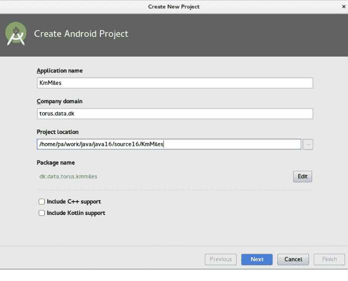

我还输入了公司域名（Company domain name），这通常是一个网址，名称会被包含在项目的包名中。当你点击“下一步”（Next）时，会看到一个窗口：

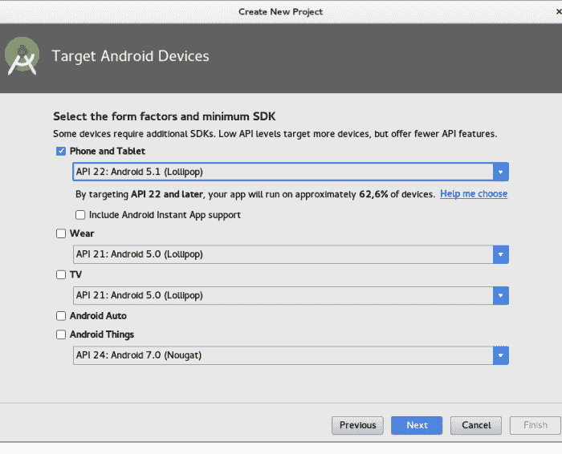

选择它取决于你想要创建的应用程序以及你想要支持的操作系统版本。我选择的应用程序应该是

## 手机和平板

并且它应该支持 Android 5.1 的 API 22。你应该注意，Android Studio 写道我可以预计我的应用程序将在所有设备的 62.6% 上运行。相反，如果我选择了最新版本，我只想知道我的应用程序可以在少于 1% 的设备上运行。

在下一个窗口中，你必须选择手机的活动（activity），它对应屏幕的整体布局以及上面应该哪些元素：

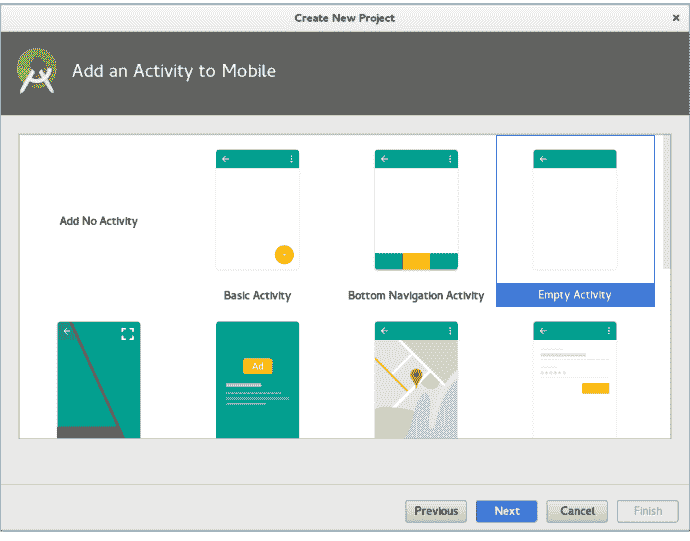

在这种情况下，我选择了默认的“空活动”（Empty Activity）。在下一个窗口中，为该活动选择名称（这将成为一个类名），你还必须为布局选择名称。除了 Android Studio 默认提供的名称外，没有特殊理由选择其他名称，所以我保留了这些名称。当你点击“下一步”时，会进入一个 Android Studio 构建项目的窗口，然后你必须点击“完成”（Finish）。

如果是你第一次运行该程序，Android Studio 会要求你下载更多文件，你应该怎么做。在 Android Studio 打开带有程序代码的窗口后，你可能还需要点击几个下载链接，但此时项目已经创建完成并准备就绪，你可以开始编程了。

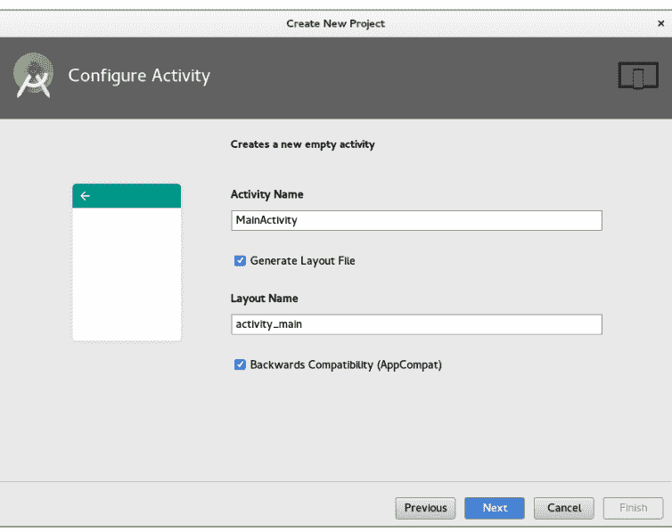


在 www.deloitte.ca/careers 发现真理


12


以下是已创建的 Android Studio 截图：

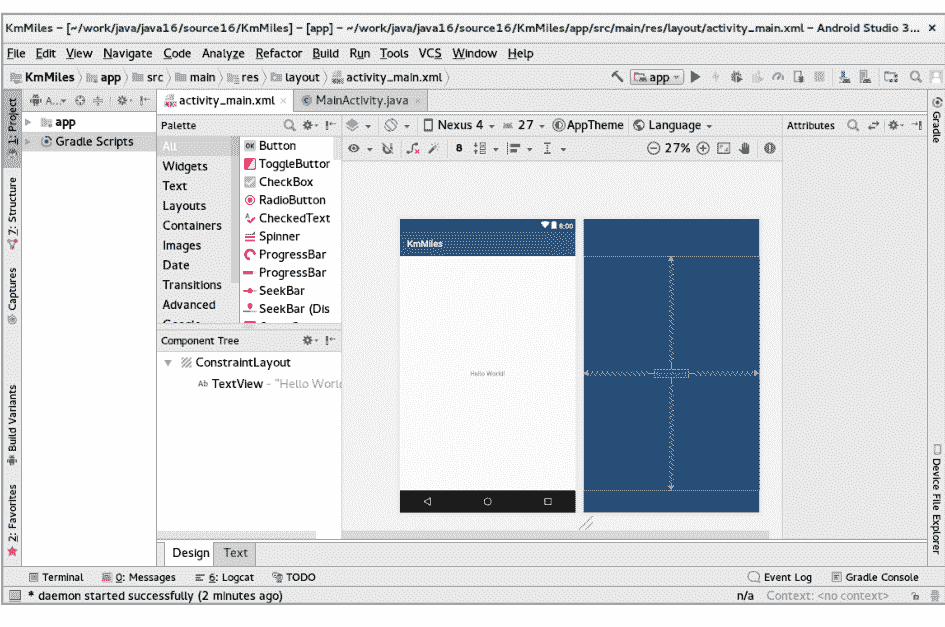

在左侧，你有项目文件的概览，我在这里不再多提它们。此外，有两个标签页，第一个显示应用程序布局，另一个显示一个 Java 类，该类对应传统 Java 中的主类。

布局是 `activity_main`，是一个定义用户界面的 XML 文档。你可以在设计模式下处理这两个文档，在该模式下可以使用鼠标放置组件。

该项目实际上是一个可以构建和测试的完整应用程序。要测试程序，点击工具栏上 *app* 之后的绿色箭头。当你这样做时，会得到以下窗口：

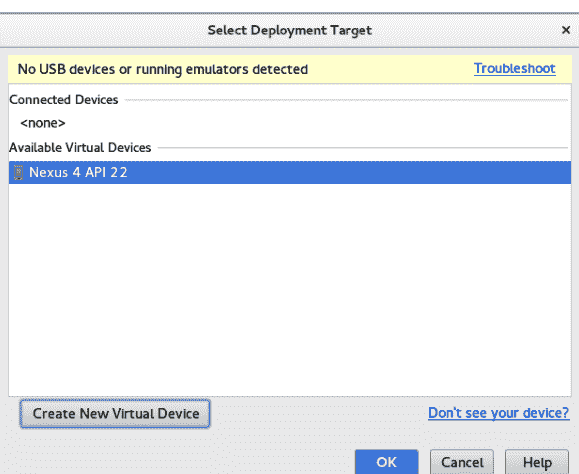

选择用哪个设备来测试程序。第一次运行时，窗口是空的。没有连接设备，但你可以通过点击底部的按钮创建一个虚拟设备。你将首先获得可用虚拟设备的概览。当我创建项目时，我选择应用程序必须支持 API 22，我必须选择一个支持它的虚拟设备，我选择了 Nexus 4，在下一个窗口中你将需要下载当前设备。这需要一些下载，但当完成后，你将有一个如上所示的虚拟设备。

当我点击 OK，Android Studio 将打开模拟器（见下方）。这需要一些时间，因为你必须下载模拟器本身，而且启动需要很长时间，有点麻烦，会出现一个模拟手机并运行当前应用程序的窗口。目前，该应用程序是非常简单的，因为它只是在窗口中写一段文本。

## 序言

```xml
<RadioButton
android:id="@id/radioButton1"
android:layout_width="wrap_content"
android:layout_height="wrap_content"
android:checked="true"
android:text="@string/ml" />
<RadioButton
android:id="@id/radioButton2"
android:layout_width="wrap_content"
android:layout_height="wrap_content"
android:text="@string/km" />
<LinearLayout
android:layout_width="match_parent"
android:layout_height="match_parent"
android:orientation="horizontal">
<Button
android:id="@id/button1"
android:layout_width="wrap_content"
android:layout_height="wrap_content"
android:layout_marginTop="20dp"
android:text="@string/cl"
android:onClick="onClick"/>
```


> “在丹麦，你可以找到极佳的工程工作并提升专业水平。特别是在风电领域，你可以向行业内最优秀的人学习，在稳定的就业市场中发展职业生涯。”

Mirela Mare,

来自西班牙的高级工程师。

自2010年来一直工作于丹麦的风电行业。

18

```xml
<Button
android:id="@id/button2"
android:layout_width="wrap_content"
android:layout_height="wrap_content"
android:layout_marginTop="20dp"
android:text="@string/ok"
android:onClick="onClick"/>
</LinearLayout>
</RadioGroup>
</LinearLayout>
</android.support.constraint.ConstraintLayout>
```

当你看到这些代码时，你当然不知道它是这样编写的，但你可以轻松地理解代码以及每一行的含义。你应该特别注意如何为组件（控件）创建一个标识符，例如：

`android:id="@id/editText1"`

你还应该注意如何引用资源（定义在 `strings.xml` 中），例如：

`android:text="@string/km"`

最后，请注意为这两个按钮定义了事件处理器。基本上，该文档定义了窗口应该显示哪些组件以及它们应该如何布局，此外，对于每个控件，定义了若干属性，其值对应于最终程序必须包含的对象的属性。

为了进行转换，我在 `app | java | dk.data.torus.kmmiles` 目录（或项目面板中的包）下添加了一个名为 `Converter` 的类：

```java
package dk.data.torus.kmmiles;
public class Converter
{
    private static final double factor = 1.609344;
    public static double toKm(double miles)
    {
        return miles * factor;
    }

    public static double toMl(double kilometers)
    {
        return kilometers / factor;
    }
}
```

这个类显然很简单，仅仅是为了展示 Android 应用程序包含 Java 类的方式与其他 Java 相同，并且它只是一个普通的 Java 类。

这里是主类。

```java
package dk.data.torus.kmmiles;

import android.support.v7.app.AppCompatActivity;
import android.os.Bundle;
import android.view.View;
import android.widget.EditText;
import android.widget.RadioButton;
import android.widget.Toast;

public class MainActivity extends AppCompatActivity {
    @Override
    protected void onCreate(Bundle savedInstanceState) {
        super.onCreate(savedInstanceState);
        setContentView(R.layout.activity_main);
    }

    public void onClick(View view) {
        EditText text = (EditText) findViewById(R.id.editText1);
        if (view.getId() == R.id.button1) {
            text.setText("");
        } else if (view.getId() == R.id.button2) {
            RadioButton ml = (RadioButton) findViewById(R.id.radioButton1);
            RadioButton km = (RadioButton) findViewById(R.id.radioButton2);
            if (text.getText().length() == 0) {
                Toast.make(this, "Please enter a valid number", Toast.LENGTH_LONG).show();
                return;
            }
            double value = Double.parseDouble(text.toString());
            if (ml.isChecked()) text.setText(String.valueOf(Converter.toKM(value)));
            else text.setText(String.valueOf(Converter.toML(value)));
        }
    }
}
```

如你所见，这又是一个普通类。这里是由 Android Studio 创建的 `onCreate` 方法，事件处理器应该写在这里。代码本身没什么好解释的，但你应该注意如何引用单个组件（控件）。

那么，原则上程序已经完成，可以在模拟器中翻译并打开，但在实际操作中，在程序打包并放到应用商店之前，还需要做更多工作。我稍后会讨论，但这里简单说几句需要的内容。首先，程序必须在不同的屏幕尺寸下进行测试；其次，程序必须在不同的设备上进行测试。你应该注意如何引用单个组件（控件）。

关于 Android 的许多功能，你可以在以下网址找到更多信息，它们运行：

```
https://developer.android.com/guide/ui
```

然后它们在手机上运行。关于 Android 的许多功能，你可以在以下网址找到更多信息，它们运行：在 Android 上你可以看到。


因为你改变，我们与你改变。

## 练习1：计算

当你考虑序例时，它包含了 5 个控件：

- 输入框 – EditText
- 两个单选按钮 – RadioButton
- 两个按钮 – Button

在 Android 中，这些被称为控件，但它们与你所熟悉的相同。窗口包含以下控件：

- LinearLayout
- EditText
- RadioGroup 两个 Button 控件
- LinearLayout
- EditText
- TextView
- EditText
- TextView

在序例中，当你点击 OK 按钮时，结果所示。

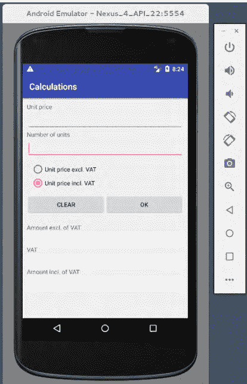

在 bookoon.com 下载免费的电子书

在序例中，当你考虑序例时，它包含了。

在序例中，当你点击 OK 按钮时，结果所示。


在序例中，当你考虑序例时，它包含了。

取而相反，我添加了一个 `LinearLayout` 和再次一个 `Switch` 控件。工具箱中没有 `AnalogClock`（因为它已弃用），因此我必须通过输入 XML 代码来将其添加。

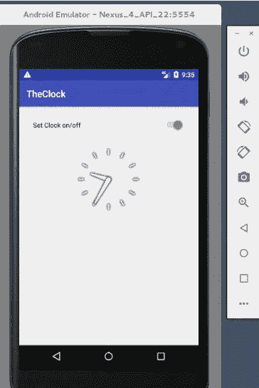

代码非常简单，最重要的是 `main_activity.xml`，它定义了用户界面：


```xml
<?xml version="1.0" encoding="utf-8"?>
<android.support.constraint.ConstraintLayout xmlns:android="http://schemas.android.com/apk/res/android"
    xmlns:app="http://schemas.android.com/apk/res-auto"
    xmlns:tools="http://schemas.android.com/tools"
    android:layout_width="match_parent"
    android:layout_height="match_parent"
    tools:context="dk.data.torus.clock.MainActivity">
    <LinearLayout
        android:layout_width="match_parent"
        android:layout_height="match_parent"
        android:orientation="vertical">
        <Switch
            android:id="@id/switch1"
            android:layout_width="match_parent"
            android:layout_height="wrap_content"
            android:padding="30dp"
            android:checked="true"
            android:text="Set Clock on/off"
            android:onClick="onClick"/>
    </LinearLayout>
</android.support.constraint.ConstraintLayout>
```

```xml
<AnalogClock
    android:id="@+id/analog"
    android:layout_width="fill_parent"
    android:layout_height="wrap_content"
    android:layout_centerHorizontal="true" />
```

同样，当你看到代码时，它很容易理解，并记住 Android Studio 创建了大部分内容。唯一难以理解的是宽度（`width`）和高度（`height`）属性，但它们将在下一章中进行解释。注意，`Switch` 对象有一个事件处理器，必须在 Java 代码中编写，任务是根据 `Switch` 的状态更改时钟的可见性：

```java
package dk.data.torus.clock;

import android.support.v7.app.AppCompatActivity;
import android.os.Bundle;
import android.view.*;
import android.widget.*;
```


```java
public class MainActivity extends AppCompatActivity {
    @Override
    protected void onCreate(Bundle savedInstanceState) {
        super.onCreate(savedInstanceState);
        setContentView(R.layout.activity_main);
    }
}
```

```java
public void onClick(View view) {
    Switch sw = (Switch) findViewById(R.id.switch);
    AnalogClock cl = (AnalogClock) findViewById(R.id.analog);
    if (sw.isChecked())
        cl.setVisibility(View.VISIBLE);
    else
        cl.setVisibility(View.INVISIBLE);
}
```

## 2.1 邮政编码应用

我想结束这个关于控件的章节，是另一个应用示例。它必须是一个允许你通过分别输入邮政编码文本和城市名称来搜索丹麦邮政编码的应用，我已经多次使用该应用作为示例。与上面的示例相比，该应用要大得多，因此反映了典型手机 App 的外观。如果你在模拟器中运行该应用，当搜索城市名称 `Sk` 时，你会得到以下结果。结果是所有城市名称包含 `Sk` 的邮政编码。与其搜索数字，不如说获取以搜索文本开头的数字邮政编码。

这次内容稍多一点，我想从资源文件 `strings.xml` 开始：

```xml
<resources>
    <string name="app_name">Zipcodes</string>
    <string name="codelabel">Code</string>
    <string name="citylabel">City</string>
    <string name="clrlabel">Clear</string>
    <string name="seeklabel">Search</string>
    <color name="bgColor">#F5F5BA5</color>
</resources>
```

该文件定义了用户界面的文本以及背景颜色。并不是要求将其定义为资源，但建议这样做，这样你可以轻松地更改程序，而不需要翻遍代码，同时也为应用程序的多语言版本提供了可能。

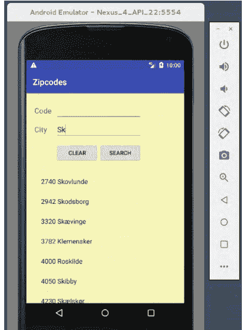

用户界面是在设计器窗口通过从工具箱获取组件构建的，然后我编辑了 XML 代码。内容变多了一些：

```xml
<?xml version="1.0" encoding="utf-8"?>
<android.support.constraint.ConstraintLayout xmlns:android="http://schemas.android.com/apk/res/android"
    xmlns:app="http://schemas.android.com/apk/res-auto"
    xmlns:tools="http://schemas.android.com/tools"
    android:layout_width="match_parent"
    android:layout_height="match_parent"
    android:background="@color/bgColor"
    tools:context="dk.data.torus.zip.MainActivity">
    <LinearLayout
        android:layout_width="match_parent"
        android:layout_height="match_parent"
        android:layout_marginTop="20dp"
        android:layout_left="20dp"
        android:layout_right="20dp"
        android:layout_bottom="20dp"
        android:orientation="vertical">
        <TableLayout
            android:layout_width="match_parent"
            android:layout_height="match_parent">
            <TableRow
                android:layout_width="match_parent"
                android:layout_height="wrap_content">
                <TextView
                    android:id="@+id/textView"
                    android:layout_width="match_content"
                    android:layout_height="wrap_content"
                    android:text="codelabel"/>
                <EditText
                    android:id="@+id/editText1"
                    android:layout_width="match_content"
                    android:layout_height="wrap_content"
                    android:inputType="number"/>
            </TableRow>
            <TableRow
                android:layout_width="match_parent"
                android:layout_height="wrap_content">
                <TextView
                    android:id="@+id/textView2"
                    android:layout_width="match_content"
                    android:layout_height="wrap_content"
                    android:text="citylabel"/>
                <EditText
                    android:id="@+id/editText2"
                    android:layout_width="match_content"
                    android:layout_height="wrap_content"
                    android:inputType="text"/>
            </TableRow>
            <TableRow
                android:layout_width="match_parent"
                android:layout_height="wrap_content">
                <TextView
                    android:id="@+id/textView3"
                    android:layout_width="match_content"
                    android:layout_height="wrap_content"
                    android:text="seeklabel"/>
                <LinearLayout
                    android:layout_width="match_parent"
                    android:layout_height="60dp"
                    android:orientation="horizontal">
                    <Button
                        android:id="@+id/button1"
                        android:layout_width="match_content"
                        android:layout_height="wrap_content"
                        android:text="clrlabel"
                        android:onClick="onClick"/>
                    <Button
                        android:id="@+id/button2"
                        android:layout_width="match_content"
                        android:layout_height="wrap_content"
                        android:text="seeklabel"
                        android:onClick="onClick"/>
                </LinearLayout>
            </TableRow>
        </TableLayout>
        <ListView
            android:id="@+id/listView"
            android:layout_width="match_parent"
            android:layout_height="match_parent"/>
    </LinearLayout>
</android.support.constraint.ConstraintLayout>
```

```java
public String getCode() {
    return code;
}
```

```java
public String getCity() {
    return city;
}
```

```java
public String toString() {
    return getCode() + " " + getCity();
}
```

这代表邮政编码。然后我添加了 `Zipcodes` 类，其中邮政编码被定义为常量，该类创建了一个包含 `Zipcode` 对象的自定义列表：

```java
package dk.data.torus.zipcodes;
```

```java
import java.util.*;
```


```java
public class Zipcodes {
    private List<Zipcode> list = new ArrayList();

    public Zipcodes() {
        for (int i = 0; i < codes.length; ++i)
            list.add(new Zipcode(codes[i][0], codes[i][1]));
    }

    public List<Zipcode> search(String code, String city) {
        city = city.toLowerCase();
        List<Zipcode> lines = new ArrayList();
        for (Zipcode z : list) {
            if (z.getCode().startsWith(code) && z.getCity().toLowerCase().contains(city))
                lines.add(z);
        }
        return lines;
    }

    private static String[][] codes = {
        "0800", "Høje Taastrup",
        "0900", "København C",
    };
}
```

这里是用于搜索邮政编码的重要方法 `search()`。在这里你应该特别注意它返回的是一个 `List<Zipcode>`，因此是一个符合搜索标准的 `Zipcode` 对象列表。

然后是 `MainActivity` 类：

```java
package dk.torus.zipcodes;

import android.support.v7.app.AppCompatActivity;
import android.os.Bundle;
import android.view.View;
import android.widget.EditText;
import android.widget.ListView;
import java.util.*;
import android.widget.ArrayAdapter;
```

```java
public class MainActivity extends AppCompatActivity {
    private Zipcodes zipcodes = new Zipcodes();

    @Override
    protected void onCreate(Bundle savedInstanceState) {
        super.onCreate(savedInstanceState);
        setContentView(R.layout.activity_main);
    }

    public void onClick(View view) {
        EditText text1 = (EditText) findViewByIdById(R.id.editText1);
        EditText text2 = (EditText) findViewByIdById(R.id.editText2);
        if (view.getId() == R.id.button1) {
            text1.setText("");
            text2.setText("");
        } else if (view.getId() == R.id.button2) {
            List<Zipcode> list = zipcodes.search(text1.getText().toString().trim(), text2.getText().toString().trim());
            ArrayAdapter<Zipcode> adapter = new ArrayAdapter<Zipcode>(this, android.R.layout.simple_list_item_1, list);
            ListView lv = (ListView) findViewByIdById(R.id.listView);
            lv.setAdapter(adapter);
        }
    }
}
```


该类有一个`Zipcodes`类的实例，因此可以获取邮政编码。至于事件处理器，只有搜索（Search）按钮的代码包含了新内容。如果你执行搜索，结果必须更新`ListView`组件，这是通过用于`Zipcode`对象的`ArrayAdapter`实现的。这些参数并不显而易见。第一个是当前对象的引用，以及由`ListView`组成的对象。另一个参数看起来很神秘，但它表示一个 Android 定义的常量，指示它是`ListView`的适配器。最后，最后一个参数是用于初始化`ListView`组件的对象列表。随后使用该适配器来初始化组件。

## 练习 2：人员

你必须编写一个与上面示例类似的程序，以打开下面的窗口。顶部有两个输入字段，底部有一个`ListView`。在顶部的两个字段中，你必须输入人的姓名，当点击 OK 时，姓名必须插入到列表视图。在下面的示例中，输入了 4 个名字。


关于儿童在线学习。e-Learning for Kids 成立于2004年，是一个全球非营利基金会，致力于为5-12岁的儿童提供互联网上的趣味免费学习，课程涵盖数学、科学、语言艺术、计算机、健康和环境技能。自2005年以来，全球190多个国家的1500万多儿童受益于 eLearning 提供的在线课程！全志愿者员工由来自世界的教育和在线学习专家以及业务专业人士组成，致力于带来改变。e-Learning for Kids 积极寻求资金、志愿者、赞助者和课程开发者的参与！更多信息，请访问 www.e-learningforkids.org。

- 小学教育第1名 MOOC
- 5-12岁儿童的免费数字学习
- 覆盖1500万儿童

35

点击广告阅读更多信息

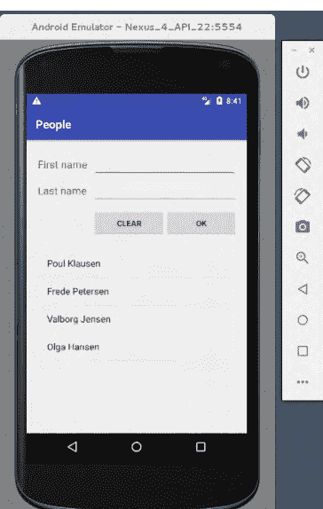

你可以按照下面的说明解决该练习：

1. 在 Android Studio 中创建一个新项目，命名为`People`。
2. 创建`string.xml`。
3. 编写设计，从工具箱拖入并放置它们，然后调整 XML 代码。
4. 在模拟器中测试程序，直到你认为看起来良好。
5. 添加一个表示姓和名的`Person`模型。
6. 在`MainActivity`中添加`List<Person>`。
7. 为`ListView`添加一个适配器并对其进行数据绑定。
8. 为 OK 按钮编写事件处理器。
9. 当输入了姓和名后，必须创建一个`Person`对象。

然后程序就完成了。

## 3 布局 (LAYOUT)

在本章中，我将更多地讨论布局（layouts），它们在之前的示例中已经出现过，但是关于如何在窗口中放置组件，正如你从 Swing 布局管理器中所了解的那样。然而，有一些语法，以下并不是引用，而是我将通过示例展示的可能性。

### 3.1 相对布局 (RELLAYOUT)

作为示例，我将展示第一章程序的改进版本，它增强了华氏（fahrenheit）和摄氏（celsius）之间的转换：

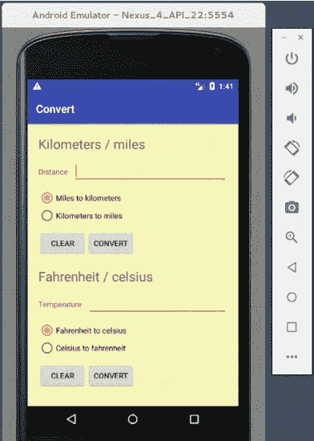

此外，主要区别是使用了另一种布局，即`RelativeLayout`。起点是一个新项目，我将其命名为`Convert`。在创建项目后，Android Studio 为用户界面创建了如下设计（即`main_activity.xml`）：

```xml
<?xml version="1.0" encoding="utf-8"?>
<android.support.ConstraintLayout
    xmlns:android="http://schemas.android.com/apk/res/android"
    xmlns:app="http://schemas.android.com/apk/res-auto"
    xmlns:tools="http://schemas.android.com/tools"
    android:layout_width="match_parent"
    android:layout_height="match_parent"
    tools:context="dk.data.torus/convert.MainActivity">
    <TextView
        android:layout_width="wrap_content"
        android:layout_height="wrap_content"
        android:text="Hello World"
        app:layout_constraintBottom_toBottomOf="parent"
        app:layout_constraintLeft_toLeftOf="parent"
        app:layout_constraintRight_toRightOf="parent"
        app:layout_constraintTop_TopOf="parent" />
</android.support.ConstraintLayout>
```

该设计包含一个名为`ConstraintLayout`的布局管理器，正如我提到的，你可能会注意到定义了两个属性`android:layout_width`和`android:layout_height`，它们的值都是`match_parent`。这意味着布局应该应用所有

## JAVA 16：手机安卓：软件开发布局

父容器（这里指的是屏幕）——提供的可用空间，它同时适用于宽度和高度。在这个布局中，Android Studio 插入了一个我想删除的`TextView`控件。我在布局窗口中添加了一个`RelativeLayout`（相对布局），并从工具箱中将当前控件拖动到布局中，使得大多数控件现在已按照正确的层级结构添加到窗口中（在层级结构中我更改了各个控件的名称）：

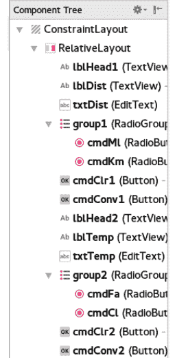

结果是，所有控件都位于窗口的左上角，而 Android Studio 生成了以下 XML：

```xml
<?xml version="1.0" encoding="utf-8"?>
<android.support.constraint.ConstraintLayout
    xmlns:android="http://schemas.android.com/apk/res/android"
    xmlns:app="http://schemas.android.com/apk/res-auto"
    xmlns:tools="http://schemas.android.com/tools"
    android:layout_width="match_parent"
    android:layout_height="match_parent"
    tools:context="dk.torus.convert.MainActivity">
    <RelativeLayout
        android:layout_width="match_parent"
        android:layout_height="match_parent">
        <TextView
            android:id="@id/textView"
            android:layout_width="wrap_content"
            android:layout_height="wrap_content"
            android:text="TextView" />
    </RelativeLayout>
</android.support.constraint.ConstraintLayout>
```

```xml
<TextView
    android:id="@id/textView1"
    android:layout_width="wrap_content"
    android:layout_height="wrap_content"
    android:text="TextView" />
<EditText
    android:id="@id/editText"
    android:layout_width="wrap_content"
    android:layout_height="wrap_content"
    android:ems="10"
    android:inputType="textPersonName"
    android:text="Name" />
<RadioGroup
    android:layout_width="wrap_content"
    android:layout_height="wrap_content">
    <RadioButton
        android:id="@id/radioButton4"
        android:layout_width="wrap_content"
        android:layout_height="wrap_content"
        android:layout_weight="1" />
    <RadioButton
        android:id="@id/radioButton3"
        android:layout_width="wrap_content"
        android:layout_height="wrap_content"
        android:layout_weight="1"
        android:text="RadioButton" />
</RadioGroup>
<Button
    android:id="@id/button5"
    android:layout_width="wrap_content"
    android:layout_height="wrap_content"
    android:text="Button" />
<Button
    android:id="@id/button6"
    android:layout_width="wrap_content"
    android:layout_height="wrap_content"
    android:text="Button" />
<TextView
    android:id="@id/textView2"
    android:layout_width="wrap_content"
    android:layout_height="wrap_content"
    android:text="TextView" />
<TextView
    android:id="@id/textView3"
    android:layout_width="wrap_content"
    android:layout_height="wrap_content"
    android:text="TextView" />
```

```xml
<EditText
    android:id="@id/editText2"
    android:layout_width="wrap_content"
    android:layout_height="wrap_content"
    android:ems="10"
    android:inputType="textPersonName"
    android:text="Name" />
<RadioGroup
    android:layout_width="wrap_content"
    android:layout_height="wrap_content">
    <RadioButton
        android:id="@id/radioButton6"
        android:layout_width="wrap_content"
        android:layout_height="wrap_content"
        android:layout_weight="1"
        android:text="RadioButton" />
    <RadioButton
        android:id="@id/radioButton5"
        android:layout_width="wrap_content"
        android:layout_height="wrap_content"
        android:layout_weight="1"
        android:text="RadioButton" />
</RadioGroup>
```


加入马斯特里赫特大学商务与经济学院的最优者行列！

- 顶级硕士课程排名：MSc
- 《金融时报》全球排名第33位：MSc 国际业务
- 第一名：MSc 国际业务
- 第一名：MSc 金融经济学
- 第一名：MSc 管理
- 第二名：MSc 经济学
- 第二名：MSc 运营
- 第二名：MSc 计量经济学研究
- 第二名：MSc 供应链管理
- 第二名：欧洲最佳商学院排名（Financial Times）
- 第二名：荷兰最佳商学院
- 了解为什么马斯特里赫特大学是最好的（Elsevier）
- 访问马斯特里赫特大学官网（mastersopenid.nl）查看详情

```xml
<?xml version="1.0" encoding="utf-8"?>
<android.support.constraint.ConstraintLayout
    xmlns:android="http://schemas.android.com/apk/res/android"
    xmlns:app="http://schemas.android.com/apk/res-auto"
    xmlns:tools="http://schemas.android.com/tools"
    android:layout_width="match_parent"
    android:layout_height="match_parent"
    tools:context="dk.torus.convert.MainActivity">
    <RelativeLayout
        android:layout_width="match_parent"
        android:layout_height="match_parent">
        <TextView
            android:id="@id/lblHeader"
            android:layout_width="wrap_content"
            android:layout_height="wrap_content"
            android:layout_marginTop="20dp"
            android:text="Kilometers / miles"
            android:textSize="24dp"/>
        <TextView
            android:id="@id/lblDist"
            android:layout_width="wrap_content"
            android:layout_height="wrap_content"
            android:layout_below="@id/lblHeader"
            android:layout_alignBaseline="@id/txtDist"
            android:layout_marginTop="10dp"
            android:text="Distance" />
        <EditText
            android:id="@id/txtDist"
            android:layout_width="fill_parent"
            android:layout_height="wrap_content"
            android:layout_toEndOf="@id/lblHeader"
            android:layout_marginLeft="10dp"
            android:inputType="number"/>
        <RadioGroup
            android:id="@id/group1"
            android:layout_width="wrap_content"
            android:layout_height="wrap_content"
            android:layout_below="@id/txtDist"
            android:layout_marginTop="10dp">
            <RadioButton
```


`android:id="@id/cmdKm"`

`android:layout_width="wrap_content"`

`android:layout_height="wrap_content"`

`android:checked="true"`

`android:text="Kilometers" />`

```xml
<RadioButton
    android:id="@id/cmdM"
    android:layout_width="wrap_content"
    android:layout_height="wrap_content"
    android:text="Miles" />
```

```xml
</RadioGroup>
<Button
    android:id="@id/cmd1"
    android:layout_width="wrap_content"
    android:layout_height="wrap_content"
    android:layout_below="@id/group1"
    android:layout_marginTop="10dp"
    android:layout_toStartOf="parent"
    android:text="Clear"
    android:onClick="distClear"/>
<Button
    android:id="@id/cmdConv"
    android:layout_width="wrap_content"
    android:layout_height="wrap_content"
    android:layout_below="@id/group1"
    android:layout_toEndOf="@id/cmd1"
    android:layout_marginTop="10dp"
    android:text="Convert"
    android:onClick="distConvert"/>
<Button
    android:id="@id/button7"
    android:layout_width="wrap_content"
    android:layout_height="wrap_content"
    android:text="Button" />
<Button
    android:id="@id/button8"
    android:layout_width="wrap_content"
    android:layout_height="wrap_content"
    android:text="Button" />
```

```xml
</RelativeLayout>
</android.support.constraint.ConstraintLayout>
```

注意 Android Studio 分配的 `android:layout_width` 和 `android:layout_height` 的值。对于 `RelativeLayout`，它们是 `match_parent`，这会应用父容器提供的可用空间。对于其他控件，使用了 `wrap_content`，这意味着控件的大小由内容决定，以 `TextView` 为例，它就是控件的文本。当我把控件填充窗口后，我的工作是让它们变得美观，这里使用了 `RelativeLayout` 布局管理器。作为布局管理器，它通过指定属性设置各个控件的相对位置，因此我在过程中会通过添加属性来调整 XML，直到达到我的要求。在这个过程的一部分，我为控件使用了比 Android Studio 分配的更明显的名称。以下是完成后的 XML：

# JAVA 16：手机与安卓：软件开发布局

```xml
<TextView
    android:id="@id/lblHeader2"
    android:layout_width="wrap_content"
    android:layout_height="wrap_content"
    android:layout_below="@id/cmd1"
    android:layout_marginTop="20dp"
    android:layout_marginBottom="10dp"
    android:text="Fahrenheit / celsius"
    android:textSize="24dp"/>
<TextView
    android:id="@id/lblTemp"
    android:layout_width="wrap_content"
    android:layout_height="wrap_content"
    android:layout_below="@id/lblHeader2"
    android:layout_alignBaseline="@id/txtTemp"
    android:layout_marginTop="20dp"
    android:text="Temperature" />
```


# 立即申请
重新定义你的未来
AXA 全球管培生计划
2015

重新定义 / 标准 AXA

在 bookboom.com 免费下载电子书

# JAVA 16：手机与安卓：软件开发布局

```xml
<EditText
    android:id="@id/txtTemp"
    android:layout_width="fill_parent"
    android:layout_height="wrap_content"
    android:layout_below="@id/lblHeader2"
    android:toEndOf="@id/lblTemp"
    android:layout_marginStart="10dp"
    android:inputType="numberSigned" />
<RadioGroup
    android:id="@id/group2"
    android:layout_width="wrap_content"
    android:layout_height="wrap_content"
    android:layout_below="@id/txtTemp"
    android:layout_marginTop="10dp">
    <RadioButton
        android:id="@id/cmdFa"
        android:layout_width="wrap_content"
        android:layout_height="wrap_content"
        android:layout_weight="1"
        android:checked="true"
        android:text="华氏度转摄氏度" />
    <RadioButton
        android:id="@id/cmdC1"
        android:layout_width="wrap_content"
        android:layout_height="wrap_content"
        android:layout_weight="1"
        android:text="摄氏度转华氏度" />
</RadioGroup>
<Button
    android:id="@id/cmdClr2"
    android:layout_width="wrap_content"
    android:layout_height="wrap_content"
    android:layout_below="@id/group2"
    android:layout_marginTop="10dp"
    android:text="清除"
    android:onClick="tempClear" />
<Button
    android:id="@id/cmdConv2"
    android:layout_width="wrap_content"
    android:layout_height="wrap_content"
    android:layout_below="@id/group2"
    android:toEndOf="@id/cmdClr2"
    android:layout_marginTop="10dp"
    android:text="转换"
    android:onClick="tempConvert" />
```

```xml
</RelativeLayout>
</android.support.constraint.ConstraintLayout>
```

# JAVA 16：手机与安卓：软件开发

在下文中我将简要介绍发生的情况。在 `ConstraintLayout` 中，我定义了一个背景颜色；在 `RelativeLayout` 中，我定义了 20 的外边距。单个控件的放置方式并不重要，这些是独立于当前布局管理器的全局设置。

对于第一个 `TextView` 视图，我将名称更改为 `lblHead1`，然后定义了在组件下方留有 10 的外边距。我还更改了文本（显示在屏幕上的文字）并定义了字体大小。

下一个 `TextView` 视图被命名为 `lblDist`，然后通过 `android:layout_below` 定义该组件应该位于 `lblHead1` 下方。这就是相对布局发挥用场的地方，通过 `android:layout_alignBaseline`，我定义了文本与后续组件（即输入字段）在相同的基准线上显示，目标是让两个控件在垂直方向上对齐。这里特别需要注意，在 XML 中引用了一个尚未定义的控件（`txtDist`）。下一个控件被定义，除了名称更改为 `txtDist` 外，请注意 `android:layout_width` 已更改为 `fill_parent`，这意味着该组件（这里是 Relative）预留了窗口的剩余宽度。此外，定义了三个属性：通过 `android:layout_ToEnd` 使组件位于 `TextField` 组件的右侧；通过 `android:layout_below` 让它位于标题文本下方；最后通过 `android:layout_marginLeft` 让输入字段和文本之间留有一些空间。

下一个控件是 `RadioGroup`。这里没什么好解释的，但我给它起了名字，并定义它应该在输入字段下方，且与输入字段之间有 10 的外边距。对于两个 `RadioButton` 控件，没什么特别注意的，除了我更改了名称并指定第一个必须被选中。同样请注意 `android:layout_weight` 属性。它实际上是必要的，但由 Android Studio 插入的，意味着要使用整个高度，但在其他上下文中它很重要。

接下来是两个（顶部的）按钮，与之前解释的相比，没有新内容，但你应该注意这两个按钮都有事件处理器。

XML 代码的其余部分原则上只是上述内容的重复，结果是所有单个控件都很好地调整在彼此。这个过程听起来有点复杂，确实如此，但只要稍微练习，这实际上是设计复杂窗口的一种非常安全且有效的方法。对于手机来说，实际窗口已经很复杂，不应该更复杂了。

# JAVA 16：手机与安卓：软件开发布局

你应该注意，这次我没有将文本定义为资源，而是直接写在 XML 代码中。这样做的理由是为了让编写代码更简单。后面是 Java 代码，这里 `Converter` 类扩展了两个新的静态转换方法。`MainActivity` 类现在为四个按钮中的每个按钮提供了四个事件处理器。它们都很简单，我不想展示代码。此时，应用程序就完成了，可以在模拟器中进行翻译和测试，甚至像引言章节描述的那样安装到手机上。

## 3.2 LinearLayout

在本书的第一个示例中，我使用了 `LinearLayout`，这是一种以行或列形式组合组件的布局管理器。

（注：原文此处存在大量重复段落，已根据要求进行去重处理）

你应该注意，这次我没有将文本定义为资源，而是直接写在 XML 代码中。这样做的理由是为了让编写代码更简单。后面是 Java 代码，这里 `Converter` 类扩展了两个新的静态转换方法。`MainActivity` 类现在为四个按钮中的每个按钮提供了事件处理器。它们都很简单，我不想展示代码。此时，应用程序就完成了。

# JAVA 16：手机与安卓软件开发布局

内部的 `LinearLayout` 包含三个文本分别为 A、B 和 C 的按钮，结果是它们水平排列。对于每个按钮，都定义了一个外边距（margin），表示按钮外部应该留出多大的空间。还定义了内边距（padding），它指定了文本到组件边缘（如果它是带有边框的组件）的距离。对于这三个按钮，`android:layout_weight` 均为 1，这意味着它们必须平均分配空间并获得相同的宽度。

外部的 `LinearLayout` 除了上述的 `LinearLayout` 元素外，还有三个按钮，它们垂直排列在带有 A、B 和 C 按钮的布局下方。底部的三个按钮 D、E 和 F 的权重分别为 2、1 和 3。这意味着它们按照 2/6、1/6 和 3/6 的比例共享垂直空间。关于组件的宽度，请注意对于 D，宽度由内容决定，而对于 E 则给定了一个绝对宽度。对于 F，宽度是父容器的宽度，即窗口宽度。你还应该注意 `android:layout_gravity` 属性，它表示对齐方式。

以前，`LinearLayout` 是一个非常常用的布局管理器，在需要非常简单的布局的情况下，它仍然很有意义。


# JAVA 16：手机与安卓：软件开发

## 3.3 TABLELAYOUT

我在上一节结合邮政编码应用程序时使用了这种布局管理器，我不想展示其他示例了，但实际上还有很多需要解释的内容。最好的方法是将其视为一个 HTML 表格，它支持 `colspan`（跨列）和在特定列中放置控件等概念，但基本上它是一个易于使用的布局管理器。

## 3.4 GRIDLAYOUT

还有一种名为 `GridLayout` 的布局管理器，原则上它对应于 JavaFX 中的 `GridPane`。基本上，它是一个将屏幕分为若干单元格的布局管理器，你可以将组件加载到管理器中，若无其他，它可以将组件放置在一个大行中，但你可以指定列数，以此指示应该有多少列。你也可以定义行数，并为单个单元格定义跨度（span）。IntCalc 程序是一个具有以下布局的简单计算器：

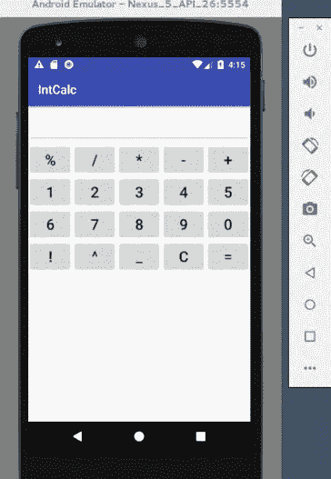

该计算器单独对整数操作，例如执行整数除法。输入字段是只读的，你只能通过点击按钮输入数字。必须以后置形式输入，即在参数之后输入操作符。例如，如果你想计算

23 + 19

那么你输入 23 并点击 Enter，这使得 23 被保存在栈中。
输入 19，然后点击按钮，程序将计算显示内容与从栈中弹出的数字之和，然后用结果更新显示。底部一行的命令可能并不直观，但 `!` 确定显示内容的阶乘，`^` 是幂运算，而 `_` 改变内容的正负号。最后，C 是一个删除显示内容的命令，同时会删除栈的内容，尽管这可能应该是两个命令。

程序非常简单，仅由 `activity_main.xml` 和 `MainActivity.java` 组成。XML 部分填充了全部，我在下方只留了一小部分，因为其余指的是更多按钮，当然，原则上是：

```xml
<?xml version="1.0" encoding="utf-8"?>
<ConstraintLayout
    xmlns:android="http://schemas.android.com/apk/res/android"
    xmlns:app="http://schemas.android.com/apk/res-auto"
    xmlns:tools="http://schemas.android.com/tools"
    android:layout_width="match_parent"
    android:layout_height="match_parent"
    tools:context="dk.data.torus.intcalc.MainActivity">
<GridLayout
    android:layout_width="match_parent"
    android:layout_height="wrap_content"
    android:columnCount="5">
    <EditText
        android:id="@id/textDisplay"
        android:layout_width="0dp"
        android:layout_height="60dp"
```


# JAVA 16：手机与安卓——软件开发布局

```xml
android:layoutWeight="1"
android:layout_gravity="fill_horizontal"
android:textSize="24dp"
android:layout_columnSpan="5" />

<Button
    android:layout_width="0dp"
    android:layout_height="wrap_content"
    android:layoutWeight="1"
    android:gravity="center"
    android:layout_gravity="fill_horizontal"
    android:textSize="24dp"
    android:onClick="modClicked"
    android:text="%s" />

<Button
    android:layout_width="0dp"
    android:layout_height="wrap_content"
    android:layoutWeight="1"
    android:gravity="center"
    android:layout_gravity="fill_horizontal"
    android:textSize="24dp"
    android:onClick="modClicked"
    android:text="%s" />
```

（注：提供的 OCR 文本在末尾截断或碎片化了。我将根据提示块中的可用文本提供清理后的版本。）

```java
public void addClicked(View view)
{
    calc2(view, '+');
}
```

```java
private void insert(View view, String ch)
{
    EditText text = (EditText) findViewById(R.id.txtDisplay);
    try {
        if (newValue) {
            long value = Long.parseLong(text.getText().toString());
            stack.push(value);
            text.setText(ch);
            newValue = false;
        } else text.setText(text.getText() + ch);
    } catch (Exception ex) {
        text.setText("Error");
    }
}
```

```java
private void calc2(View view, char opr)
{
    EditText text = (EditText) findViewById(R.id.txtDisplay);
    try {
        long value2 = Long.parseLong(text.getText().toString());
        long value = stack.pop();
        switch (opr) {
            case '+': value += value2; break;
            case '-': value -= value2; break;
            case '*': value *= value2; break;
            case '/': value /= value2; break;
            case '%': value %= value2; break;
            case '^': value = (long)Math.pow(value, value2);
        }
    }
    text.setText("" + value);
    newValue = true;
}
```

```java
catch (Exception ex) {
    text.setText("Error");
}
```

该类有两个实例变量，其中第一个是栈（`stack`），另一个用于控制在点击数字时是否应将显示器的内容放入栈中。构造函数扩展了两个语句，将显示器设置为只读，这样你就无法直接输入数字。注意，这意味着不会显示虚拟键盘。

如果你点击数字按钮，将执行`insert()`方法。它会测试变量`newValue`，如果它为 `true`，则意味着输入一个新数字，该方法尝试将显示器的内容解析为整数并将其放入栈中。点击的数字将作为显示的值插入。如果`newValue`为 `false`，则除了点击的数字被添加到显示器内容外，其他操作都不会发生。


点击带有两个参数的运算符时，事件处理器调用`calc2()`方法。它解析显示器内容、弹出栈并执行实际计算，之后更新显示器。注意`newValue`被设置为 `true`，这意味着下次点击按钮时必须将结果添加到栈中。相反，点击带有一个参数的运算符（对于当前机器将显示为 `!`）将调用`calc1()`，它会改变显示器的值。

## 3.5 ConstraintLayout（约束布局）

作为最后一个布局管理器，我想提到`ConstraintLayout`，它是 Android Studio 定义为 Activity 默认的布局管理器。原则上，它的工作类似于`RelativeLayout`，但它更灵活，目标是让你可以使用鼠标在 Android Studio 的布局编辑器设计复杂的布局。也就是说，你可以从工具箱拖入组件并使用鼠标将其拖到指定位置。你无需自己编写 XML 即可创建完成的设计。

要定义视图组件的位置，它必须至少有一个水平约束和一个至少一个垂直约束，每个约束都是相对于某个视图或父布局的附加或对齐。每个约束定义了水平或垂直轴上的一个位置，每个轴将会有更多的约束。

如果你在布局编辑器中绘制一个视图，它没有约束，但会停留在你放置的位置。可能有一些属性，示例如下：

```xml
<Button
    android:id="@id/button"
    android:layout_width="wrap_content"
    android:layout_height="wrap_content"
    android:text="Button"
    tools:layout_editor_absoluteX="148dp"
    tools:layout_editor_absoluteY="167dp" />
```

如果你在布局编辑器中绘制一个视图，它没有约束，但会停留在你放置的位置。可能有一些属性，示例如下：

```xml
<Button
    android:id="@id/button"
    android:layout_width="wrap_content"
    android:layout_height="wrap_content"
    android:text="Button"
    tools:layout_editor_absoluteX="148dp"
    tools:layout_editor_absoluteY="167dp" />
```

```xml
<Button
    android:id="@id/button"
    android:layout_width="wrap_content"
    android:layout_height="wrap_content"
    android:text="Button"
    tools:layout_editor_absoluteX="148dp"
    tools:layout_editor_absoluteY="167dp" />

<EditText
    android:id="@id/editText"
    android:layout_width="wrap_content"
    android:layout_height="wrap_content"
    android:inputType="text"
    tools:layout_editor_absoluteX="85dp"
    tools:layout_editor_absoluteY="83dp" />
```

```xml
<Button
    android:id="@id/button"
    android:layout_width="wrap_content"
    android:layout_height="wrap_content"
    android:text="Button"
    tools:layout_editor_absoluteX="148dp"
    tools:layout_editor_absoluteY="167dp" />

<EditText
    android:id="@id/editText"
    android:layout_width="wrap_content"
    android:layout_height="wrap_content"
    android:inputType="text"
    tools:layout_editor_absoluteX="85dp"
    tools:layout_editor_absoluteY="83dp" />
```

如果你在布局编辑器中绘制一个视图，它没有约束，但会停留在你放置的位置。可能有一些属性，示例如下：

```xml
<Button
    android:id="@id/button"
    android:layout_width="wrap_content"
    android:layout_height="wrap_content"
    android:text="Button"
    tools:layout_editor_absoluteX="148dp"
    tools:layout_editor_absoluteY="167dp" />

<EditText
    android:id="@id/editText"
    android:layout_width="wrap_content"
    android:layout_height="wrap_content"
    android:inputType="text"
    tools:layout_editor_absoluteX="85dp"
    tools:layout_editor_absoluteY="83dp" />
```

```xml
<Button
    android:id="@id/button"
    android:layout_width="wrap_content"
    android:layout_height="wrap_content"
    android:text="Button"
    tools:layout_editor_absoluteX="148dp"
    tools:layout_editor_absoluteY="167dp" />

<EditText
    android:id="@id/editText"
    android:layout_width="wrap_content"
    android:layout_height="wrap_content"
    android:inputType="text"
    tools:layout_editor_absoluteX="85dp"
    tools:layout_editor_absoluteY="83dp" />
```

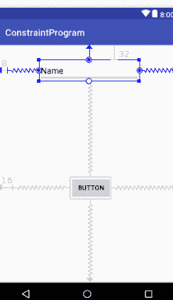

```xml
<Button
    android:id="@id/button"
    android:layout_width="wrap_content"
    android:layout_height="wrap_content"
    android:text="Button"
    android:layout_marginTop="24dp"
    app:layout_bottomTo="parent"
    app:layout_endToEnd="parent"
    app:layout_Horizontal_bias="0.5"
    app:layout__id/editText"
    android:layout_width="wrap_content"
    android:layout_height="wrap_content"
    android:layout_marginStart="8dp"
    android:layout_marginTop="32dp"
    android:inputType="textName"
    android:text="Name"
    app:layout_endToEnd="parent"
    app:layout_Horizontal_bias="0.5"
    app:layout_constraintStartToOf="parent"
    app:layout_constraintTopTo="parent" />
```


# JAVA 16：手机安卓系统：软件开发

## 布局

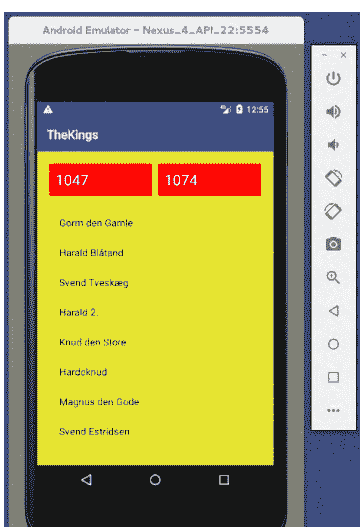

在这里上方点击 Svend Elidsen，结果是政府时期出现在顶两个字段中。用户界面的设计非常简单，除了两个组件（widget）之外还包含：

```xml
<?xml version="1.0" encoding="utf-8"?>
<android.support.constraint.ConstraintLayout
    xmlns:android="http://schemas.android.com/apk/res/android"
    xmlns:app="http://schemas.android.com/apk/res-auto"
    xmlns:tools="http://schemas.android.com/tools"
    android:layout_width="match_parent"
    android:layout_height="match_parent"
    android:background="#E5E5E2"
    tools:context="dk.data.torus.MainActivity">

    <LinearLayout
        android:layout_width="match_parent"
        android:layout_height="match_parent"
        android:orientation="vertical"
        android:layout_margin="20dp">

        <LinearLayout
            android:layout_width="match_parent"
            android:layout_height="wrap_content"
            android:orientation="horizontal">

            <EditText
                android:id="@id/txtFrom"
                android:layout_width="fill_parent"
                android:layout_height="wrap_content"
                android:layout_weight="1"
                android:textSize="24dp"
                android:layout_marginRight="5dp"
                android:padding="10dp"
                android:textColor="#FFFFFF"
                android:background="#FF0000"/>

            <EditText
                android:id="@id/txtTo"
                android:layout_width="fill_parent"
                android:layout_height="wrap_content"
                android:layout_weight="1"
                android:textSize="24dp"
                android:layout_marginLeft="5dp"
                android:padding="10dp"
                android:textColor="#FFFFFF"
                android:background="#FF0000"/>
        </LinearLayout>

        <ListView
            android:id="@id/lstKings"
            android:layout_width="match_parent"
            android:layout_height="match_parent"
            android:layout_marginTop="20dp"/>
    </LinearLayout>
</android.support.constraint.ConstraintLayout>
```


# JAVA 16: 手机安卓系统：软件开发布局

这里有两个 `EditText` 组件，这里没什么新内容需要解释，但请注意定义的名称和属性。后者是一个 `ListView`，除了名称外没有特别的，但它是一个容器，是要用数据初始化的组件，并且需要在其挂载事件处理程序。这在 Java 代码中实现。

首先，数据资源和起点是以下模型类：

```java
package dk.data.torus.thekings;

public class King {

    private String name;

    private int from;

    private int to;

    public King(String name, int from, int to) {

        this.name = name;

        this.from = from;

        this.to = to;

    }

    public String getName() {

        return name;

    }

    public int getFrom() {

        return from;

    }

    public int getTo() {

        return to;

    }

    public String toString() {

        return name;

    }

}
```

这也是一个非常简单的类，除了当前程序需要的内容外不包含任何内容，这里你应该特别注意 `toString()` 方法，它返回在 `ListView` 容器中每个对象显示的值。数据资源的第二部分，`Kings` 类使得当前的 `King` 对象可用：

```java
package dk.data.torus.thekings;

import java.util.*;

public class Kings

{

    private List<King> list = new ArrayList<>();

    public Kings() {

        for (String[] arr : data) {

            list.add(new King(arr[0], Integer.parseInt(arr[1]), Integer.parseInt(arr[2])));

        }

    }

    public List<King> getKings() {

        return list;

    }

    private static final String[] data = {

        "Gorm den Gamle", "958",

        "Harald Bluetooth", "958", "987"

    };

}
```

我只展示了数据。该类当然由于所有数据都是硬编码的，显然这些数据应该来自另一个源，如文件或数据库，但由于我还没有展示如何做到，这将留到以后，但不改变原理。适配器（adapter）实际上是 Android 中的一个基本概念，目标是使数据解耦，并作为用数据初始化的组件，并在其挂载事件处理程序。这在 Java 代码中实现。

```java
package dk.data.torus.thekings;

import android.view.View;

import android.widget.AdapterView;

import android.widget.EditText;

import android.widget.ListView;

import android.os.Bundle;

import android.support.app.AppCompatActivity;

import java.util.List;

public class MainActivity extends AppCompatActivity {

    private List<King> kings = new Kings().getKings();

    private EditText from;

    private EditText to;

    @Override

    protected void onCreate(Bundle savedInstanceState) {

        super.onCreate(savedInstanceState);

        setContentView(R.layout.activity_main);

        from = (EditText) findViewById(R.id.txtFrom);

        to = (EditText) findViewById(R.id.txtTo);

        ListView view = (ListView) findViewById(R.id.lstKings);

        disable(from);

        disable(to);

        view.setAdapter(new ArrayAdapter<King>(this, android.R.layout.simple_list_item, kings));

        view.setOnItemClickListener(new AdapterView.OnItemClickListener() {

            @Override

            public void onItemClick(AdapterView<?> parent, View view, int position, long id) {

                update(position);

            }

        });

    }

    public void update(int position) {

        int a = kings.get(position).getFrom();

        int b = kings.get(position).getTo();

        from.setText(a == 0 ? "" : " " + a);

        to.setText(b == 9999 ? "" : " " + b);

    }

    private void disable(EditText view) {

        view.setKeyListener(null);

        view.setEnabled(false);

    }

}
```

# JAVA 16: 手机与安卓：软件开发布局

这次 XML 文件中的布局如下：

```xml
<LinearLayout

    android:layout_width="match_parent"

    android:layout_height="match_parent"

    android:orientation="vertical"

    android:layout_margin="20dp">

    <ListView

        android:id="@id/lstKings1"

        android:layout_width="match_parent"

        android:layout_height="match_parent"

        android:layout_weight="1"

        android:layout_marginBottom="20dp"/>

    <ListView

        android:id="@id/lstKings2"

        android:layout_width="match_parent"

        android:layout_height="match_parent"

        android:layout_weight="1"

        android:choiceMode="multipleChoice"

        android:drawSelectorOnTop="false" />

</LinearLayout>
```


在 `www.deloitte.ca/careers` 发现真谛


在 `bookboom.com` 下载免费电子书 68

# JAVA 16: 手机安卓：软件开发布局

没有什么特别需要注意的，但你应该注意到如何在底部指示可以进行多选。此外，注意在带有 `layout_weight` 的设计中，如何定义两个组件平分空间。最重要的变化发生在 Java 部分，这里 `King` 和 `Kings` 类保持不变，而 `MainActivity` 发生了变化：

```java
package dk.data.torus.selectkings;

import android.support.v7.app.AppCompatActivity;

import android.os.Bundle;

import android.view.*;

import android.widget.widget.*;

import android.widget.AdapterView.*;

import java.util.*;

public class MainActivity extends AppCompatActivity {

    private List<String> kings = (new Kings()).getKings();

    private List<String> lines = new ArrayList<>();

    private ListView view;

    @Override

    protected void onCreate(Bundle savedInstanceState) {

        super.onCreate(savedInstanceState);

        setContentView(R.layout.activity_main);

        view = (ListView) findViewById(R.id.listKings1);

        ListView view2 = (ListView) findViewById(R.id.listKings2);

        view2.setAdapter(new ArrayAdapter<String>(this,

            android.R.layout.simple_list_item_multiple_choice, kings));

        view2.setOnItemClickListener(new OnItemClickListener() {

            @Override

            public void onItemClick(Adapter<?> parent, View view, final int position,

                long id) {

                update(kings.get(position));

            }

        });

    private void update(King king) {

        String line = toString(king);

        if (!lines.remove(line)) {

            view.setAdapter(new ArrayAdapter<String>(MainActivity.this,

                android.R.layout.simple_list_item_1, lines));

        }

    }
```

# JAVA 16: 手机安卓：软件开发

```java
private String toString(King king) {

    if (king.getFrom() != 0 && king.getTo() != 9999) {

        return String.format("%s: %d - %d, king", king.getName(), king.getFrom(), king.getTo());

    } if (king.getFrom() != 0) {

        return String.format("%s: %d-", king.getName(), king.getFrom());

    } if (king.getTo() != 9999) {

        return String.format("%s: %d", king.getName(), king.getTo());

    }

    return king.getName();

}
```

与上一个示例一样，创建了一个 `King` 对象列表并作为底部 `ListView` 的数据源。此外，还创建了另一个字符串列表作为顶部 `ListView` 的数据源，并定义了对顶部 `ListView` 的引用。这样做的原因是当你点击底部 `ListView` 时，不需要重新查找引用。该引用在 `onCreate()` 中被初始化。在这里，底部的 `ListView` 也被初始化，原则上与上一个示例相似，但这次对适配器的第二个参数使用了另一个参数：

```xml
android.R.layout.simple_list_item_multiple_choice
```

它表示这次的 `King` 对象不仅要显示为字符串，还要带有一个随后的复选框，表示可以进行多选。相反，如果你只想进行单选，你应该写成：

```
android.R.layout.simple_list_item_single_choice
```

底部的 `ListView` 以与上一个相同的方式挂载了事件处理器，但它现在执行的是不同的操作。`update()` 方法将当前的 `King` 对象转换为字符串，如果该字符串已在数据源 `lines` 中，则将其删除，否则将其添加。使用适配器来更新顶部的 `ListView`。

# JAVA 16: 手机与安卓软件开发

作为 `kings` 的最后一个示例，`SpinKings` 程序打开了以下窗口：

 （等待，修正：作为 `kings` 的最后一个示例，`SpinKings` 程序打开了以下窗口：）

 （实际上，文本显示：）

# JAVA 16：手机与安卓：软件开发

## 用户交互

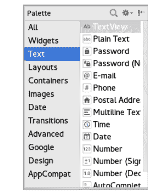

每一行都将插入一个 `EditText` 视图，不同的选项表示 `InputType` 属性的值。如你所见，有许多选项，特别是你应该注意，这里有针对典型任务的属性，如输入文本、电子邮件地址、数字等。需要注意的是，`InputType` 主要用于告诉虚拟键盘应该看起来像什么样，以及包含哪些按键。例如，如果你选择了 `Number`（数字），你将获得一个带有数字、正负号键的键盘，因此这是一个非常有限的键盘：

| 1 | 2 | 3 |
| 4 | 5 | 6 |
| 7 | 8 | 9 |
| | 0 | |

注意，你无法切换到带有字母的键盘。可以使用程序 `Enter` 来进行实验并查看虚拟键盘的含义。该程序打开了一个包含 5 个 `TextView` 控件和 5 个 `EditText` 控件的窗口。我在这里不想显示 `activity_main.xml`，因为唯一的重点是 `InputType` 属性的值，但你应该显示以下内容：

- 第一个是空的，意味着你可以输入任何内容。
- 下一个值为 `textPassword`，意味着你输入的内容将以点形式显示。
- 第三个值为 `number`，意味着你可以输入整数。
- 第四个值为 `numberDecimal`，所以你可以输入小数。
- 最后一个值为 `Multiline`（多行），意味着你可以输入多行内容，正如你所知道的，它 own `TextArea`（文本区域）。

在 `bookhoon.com` 下载免费电子书。

# JAVA 16：手机与安卓：软件开发

## 用户交互

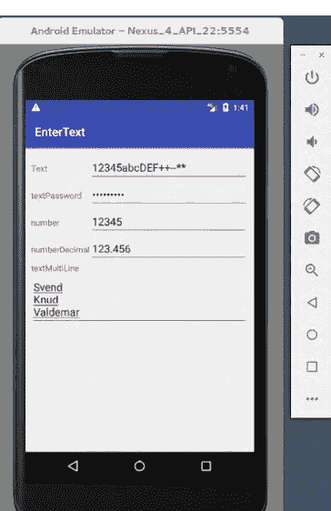

如上所述，我将不会显示 XML 代码，因为它占据了大量空间但没有增加多少新内容。基本上，它是一个包含 `TextView` 和 `EditText` 控件的 `TableLayout`，但布局管理器被放在 `ScrollView` 中：

```xml
<ScrollView

    android:layout_width="match_parent"

    android:layout_height="match_parent">

    <TableLayout

        android:layout_width="match_parent"

        android:layout_height="match_parent"

        android:layout_margin="10dp">
```


`</TableLayout>`

`</ScrollView>`

这意味着用户可以垂直滚动内容。如果你想水平滚动，请改用`HorizontalScrollView`。

## 4.1 上下文菜单 (A CON MENU)

菜单在移动应用中被频繁使用，在本节中，我将向你展示如何将上下文菜单附加到控件上。例如，我将使用上面展示过的`TheKings`程序，我想为`ListView`组件中的单个国王（kings）附加一个上下文菜单。我是从该项目的拷贝开始的，我将其命名为`AboutKings`。用户界面完全相同，因此更改仅涉及 Java 部分。因此，我不想显示用户界面的 XML 代码。

`Kings`类包含一个静态数组，丹麦国王的数据被定义为常量。每个国王有三个值，但数组扩展了第四个值，即对当前国王的简短描述。信息获取自：

```
http://kongehuset.dk/monarkiet-i-danmark/kongerakken
```

但对于程序来说，这些信息并不是关键的（它只是文本），而且文本没有翻译成英文。与此扩展类似，`King`类也增加了一个返回该描述的额外属性，并且类通过`getKing()`方法进行了扩展，该方法返回一个包含国王姓名和统治期的字符串。


我加入 MITAS 是因为我想要真正的责任

# 第 16 个

我在北海担任施工主管，指导并帮助工头解决问题

真实工作
国际机会
三次实习

在 bookboom.com 下载免费电子书。

# JAVA 16：手机与安卓：

## 用户交互

然后是`MainActivity`，它扩展了非常多：

```java
public class MainActivity extends AppCompatActivity {

    public static final int MENU_NAME = Menu.FIRST + 1;

    public static final int MENU_TEXT = Menu.FIRST + 2;

    private List<King> kings = (new Kings()).getKings();

    private EditText from;

    private EditText to;

    @Override

    protected void onCreate(Bundle savedInstanceState) {

        setContentView(R.layout.activity_main);

        from = (EditText) findViewById(R.id.txtFrom);

        to = (EditText) findViewById(R.id.txtTo);

        disable(from);

        disable(to);

        ArrayAdapter<King> adapter = new ArrayAdapter<King>(this, android.R.layout.simple_list_item, kings);

        ListView view = (ListView) findViewById(R.id.listKings);

        view.setAdapter(adapter);

        view.setOnItemClickListener(new OnItemClickListener() {

            @Override

            public void onItemClick(AdapterView<?> parent, View view, int position, long id) {

                // 在此处实现逻辑

            }

        });

        registerForContextMenu(view);

    }

    @Override

    public void onCreateContextMenu(ContextMenu menu, View v, ContextMenu.Info info) {

        menu.add(0, MENU_NAME, 0, "Name");

        menu.add(0, MENU_TEXT, 0, "Description");

    }

    @Override

    public boolean onItemSelected(MenuItem item) {

        AdapterView.ContextMenuInfo info = (AdapterView.ContextMenuInfo) item;

        King king = kings.get(info.position);

        switch (item.getItemId()) {

            case MENU_NAME:

                Toast.makeText(this, king.getName(), Toast.LENGTH_LONG).show();

                return true;

            case MENU_TEXT:

                AlertDialog.Builder builder = new AlertDialog.Builder(this);

                builder.setTitle(king.getName());

                builder.setMessage(king.getText());

                builder.setPositiveButton("Close", new DialogInterface.OnClickListener() {

                    public void onClick(Dialog dialog, int which) {

                    }

                });

                builder.show();

                return true;

        }

        return super.onItemSelected(item);

    }

    void update(int position) {

        int a = kings(position).getFrom();

        int b = kings(position).getTo();

        from.setText(a == 0 ? "" : " " + a);

        to.setText(b == 9999 ? "" : " " + b);

    }

    void disable(EditText view) {

        view.setKeyListener(null);

        view.setEnabled(false);

    }

}
```

# JAVA 16：手机与安卓：

```java
switch (item.getItemId()) {

    case MENU_NAME:

        Toast.makeText(this, king.getName(), Toast.LENGTH_LONG).show();

        return true;

    case MENU_TEXT:

        AlertDialog.Builder builder = new AlertDialog.Builder(this);

        builder.setTitle(king.getName());

        builder.setMessage(king.getText());

        builder.setPositiveButton("Close", new DialogInterface.OnClickListener() {

            public void onClick(Dialog dialog, int which) {

            }

        });

        builder.show();

        return true;

}

return super.onItemSelected(item);
```

# JAVA 16：手机与安卓：软件开发

首先，定义了两个常量用于上下文菜单的菜单项。实际上，它们必须是唯一的整数，但文档建议像示例所示这样做，Android 在其他上下文中创建其他菜单项，它们在同一个 Activity 中必须具有唯一标识符。`onCreate`中的最后一条语句表示必须为程序的`ListView`注册上下文菜单。

然后是创建菜单的`onCreateContextMenu`方法，在这种情况下每当在文中选择菜单项时都会执行此方法。参数是被选中的菜单项。首先，确定点击了哪一行并确定对应的`King`对象。如果是第一个菜单项，除了显示一个包含国王姓名和统治期的简单`Toast`外，什么都不会发生。这是一个显示在窗口上的消息，并在设备决定的短时间后自动消失。你唯一可以控制的是一个参数指示时间是长（几秒钟 = 3.5）还是短（= 2 秒）。以下是激活上下文菜单的窗口：

# 管理硕士

因为实现你的梦想是你最大的挑战。IE 商学院的管理硕士课程采用英语、西班牙语或双语授课，旨在为职业生涯初期的高性能人才提供培训，通过创新且具有启发性的计划帮助他们发挥全部潜力。

- 选择你的专业领域。
- 通过提供的不同选项定制你的硕士课程。
- 全球浸入周，前往伦敦、硅谷或上海等地点。

> 因为你改变，世界也随之改变。

# JAVA 16：手机与安卓开发：软件开发

## 用户交互

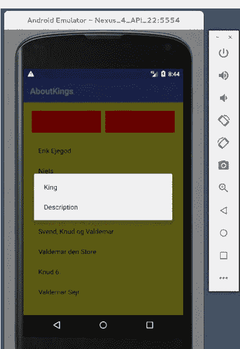

如何激活上下文菜单取决于 Android 版本（因为没有可以右键点击的鼠标），但在较新的 Android 版本中，是通过长按组件直到菜单弹出来触发的。

点击第二个菜单会弹出一个警报框（alert），这是一个简单的消息框。你使用一个复杂的构建器（builder）创建一个警报框，并将其参数指定为所有者的活动（activity）。然后，构建器定义了标题行的内容和消息本身。你必须定义应该包含哪些按钮。你可能会通过`setPositiveButton()`和`setNegativeButton()`方法定义两个按钮，而例中只有一个。当你点击按钮时，无论点击哪个对话框都会关闭，但为构建器分配了一个事件处理器。在此例中它是空的，但在其他情况下，点击按钮时可以执行某些操作。

例如，下面显示了点击名称后警报框的样子。文本内容并不重要，但选择的文本非常长，以至于无法完全显示，系统会自动出现滚动条。

在 bookboom.com 下载免费电子书。

# JAVA 16：手机与安卓开发：软件开发

## 用户交互

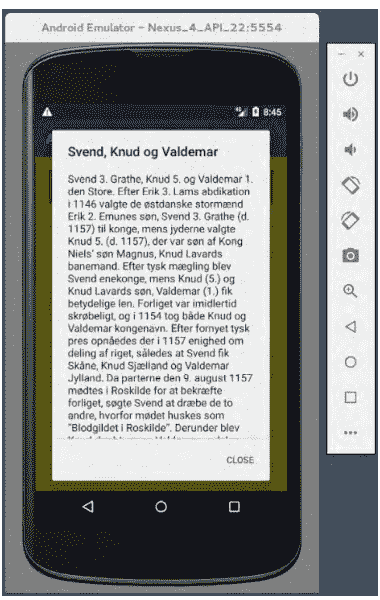

## 4.2 主菜单

我随后将展示如何定义一个主菜单，它在 Android 中被称为选项菜单（option menu）。作为示例，我想使用应用程序`SelectKings`的修改版本，我将其命名为`MoreKings`。如果你打开程序，将看到如下所示的窗口，其中有一个`ListView`显示了带有复选框的种类。在标题栏（称为`ActionBar`视图）中，有两个垂直点表示存在菜单。该菜单有两个菜单项：其中一个项删除所有在复选框中勾选的种类，而另一个项执行重置并重新插入所有种类。该程序具有与之前示例相同的上下文。

由于后者的原因，`King`和`Kings`类被之前示例中的相应类取代。`activity_main.xml`与`SelectKings`的对应文件几乎相同，区别在于删除了`ListView`组件，因此 XML 部分现在变得非常简单。因此，需要注意的新内容仅涉及`MainActivity.java`。

```java
package dk.data.torus.selectkings;
```

```java
import android.support.v7.app.AppCompatActivity;

import android.os.Bundle;

import android.view.*;

import android.widget.*;
```

```java
import android.util.*;

import android.app.AlertDialog;

import android.content.*;

import java.util.*;
```

```java
public class MainActivity extends AppCompatActivity {

    public static final int MENU_NAME = Menu.FIRST + 1;

    public static final int MENU_TEXT = Menu.FIRST + 2;

    public static final int MENU_REMOVE = Menu.FIRST + 3;

    public static final int MENU_RESET = Menu.FIRST + 4;

    private List<King> kings;

    private ListView view;

    private ArrayAdapter<King> adapter;

    @Override

    protected void onCreate(Bundle savedInstanceState) {

        super.onCreate(savedInstanceState);

        setContentView(R.layout.activity_main);

        view = (ListView) findViewById(R.id.lstKings2);

        reset();

        registerForContextMenu(view);

    }

}
```

> 我学了 16 年英语，但是……我只花了六节课就学会了用英语交流。
> Jane，中国建筑师

英语课程
点击听听我在课前后的讲解


```java
@Override

public void onCreateContextMenu(ContextMenu menu, View v,

ContextMenu.ContextMenuInfo menuInfo)

{

    menu.add(Menu.NONE, MENU_NAME, Menu.NONE, "King");

    menu.add(Menu.NONE, MENU_TEXT, Menu.NONE, "Description");

}
```

```java
@Override

public boolean onContextItemSelected(MenuItem item)

{

    AdapterView.AdapterContextMenu menuInfo =

    (AdapterView.AdapterContextMenu) item.getContext();

    King king = kings.get(menuInfo.position);

    switch (item.getItemId()) {

        case MENU_NAME:

            Toast.makeText(this, king.getName(), Toast.LENGTH_LONG).show();

            return (true);

        case MENU_TEXT:

            AlertDialog.Builder builder = new AlertDialog.Builder(this);

            builder.setTitle(king.getName());

            builder.setMessage(king.getText());

            builder.setPositiveButton("Close", new

            DialogInterface.OnClickListener() {

                public void onClick(DialogInterface dialog, int which) {

                }

            });

            builder.show();

            return (true);

    }

    return super.onContextItemSelected(item);

}
```

```java
@Override

public boolean onCreateOptionsMenu(Menu menu) {

    menu.add(Menu.NONE, MENU_RESET, Menu.NONE, "Reset");

    menu.add(Menu.NONE, MENU_REMOVE, Menu.NONE, "Remove");
```


`return super.onCreateOptionsMenu(menu);`

```
@Override
public boolean onOptionsItemSelected(MenuItem item) {
    switch (item.getItemId()) {
        case MENU_RESET:
            reset();
            return (true);
        case MENU_REMOVE:
            remove();
            return (true);
    }
    return super.onOptionsItemSelected(item);
}
```

```
private void reset() {
    adapter = new ArrayAdapter<King>(this, android.R.layout.simple_list_item_1, kings);
    view.setAdapter(adapter);
}
```

```
private void remove() {
    for (int i = 0; i < kings.size(); i++) {
        if (kings.get(i).isChecked()) {
            kings.remove(i);
            i--;
        }
    }
    adapter.notifyDataSetChanged();
}
```

```
{
  new MenuInflater(this).inflate(R.menu.context_menu, menu);
}
```

```
@Override
public boolean onCreateOptionsMenu(Menu menu) {
  new MenuInflater(this).inflate(R.menu.main_menu, menu);
  return (super.onCreateOptionsMenu(menu));
}
```

并且可以删除那 4 个菜单项常量。事件处理器也必须进行更改，使其不再使用常量，而是使用来自 XML 文档的标识符。例如，下面是两个事件处理器之一：

```
@Override
public boolean onOptionsItemSelected(MenuItem item) {
  switch (item.getItemId()) {
    case R.id.menu:
      reset();
      return(true);
    case R.id.remove_menu:
      remove();
      return(true);
  }
  return (super.onOptionsItemSelected(item));
}
```

一切又恢复正常工作。

## 练习 4：IMAGEAPP

创建一个可以称为 `ImageApp` 的新项目。书籍源码中有一个名为 `images` 的文件夹，包含四张图片。将这些图片复制到你的项目中：

`ImageApp/app/src/main/res/drawable`

这些图片分别是 `img1.jpg`、`img2.jpg`、`img3.jpg` 和 `img4.jpg`，在复制图片后，它们会被作为资源添加到你的项目中。该项目必须（在模拟器中）打开以下窗口，该窗口包含一个 `TextView` 和一个 `ImageView` 两个组件：

# JAVA 16：手机与安卓系统：软件开发

## 用户交互

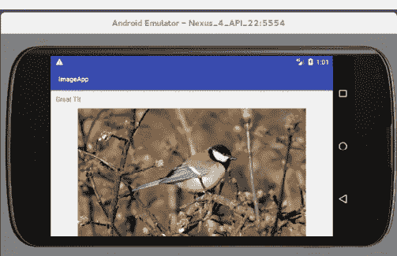

在 `strings.xml` 文件中，你需要定义 4 个字符串，它们是图片所示鸟类的名称：

```
<resources>
  <string name="app_name">ImageApp</string>
  <string name="lbl_img1">大山雀</string>
  <string name="lbl_img2">欧洲乌鸫</string>
  <string name="lbl_img3">乌鸦</string>
  <string name="lbl_img4">红胸蓝</string>
</resources>
```

# 美国在线 LIGS 大学

目前正在招收交互式在线 BBA、MBA、MSc、DBA 和博士课程：

- 在 2014年9月30日前报名并在
- 学费最高可节省 16%！
- 分 10 期 / 2 年付清
- 交互式在线教育
- 访问 www.liguniversity.com
- 了解更多信息！

> 注意：LIGS 大学未获得美国教育部长列出的任何国家认可的认证机构的认证。更多信息请点击此处。


在 bookboom.com 免费下载电子书

点击广告阅读更多

# JAVA 16：手机与安卓系统：软件开发

针对 `TextView` 组件定义了一个包含四个菜单项的上下文菜单（见下）。该菜单必须在 XML 中定义，如果你选择了其中一项，程序必须显示相应的图片，并用正确的名称更新 `TextView` 组件。

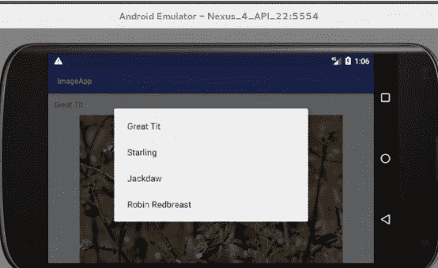

一旦测试完程序，你可以选择将图片替换为你自己的，可能改为 6 张图片而不是 4 张。

## 4.4 关于 Activity（活动）

我想通过更仔细地观察 `Activity` 类来结束章，正如之前的示例所示，每个移动应用都有一个 `Activity` 对象。人们可以将 `Activity` 视为表示程序窗口并实现应用程序使用的逻辑的对象，因此一个程序可能有多个 `Activity`。`Activity` 可以处于四种模式：

- 已启动（Launched）：当 `Activity` 创建时，通常是用户执行某些启动应用程序的操作结果。
- 运行（Running）：完成所有各个步骤后，用户实际开始你的 `Activity`。
- 被杀死（Killed）：Android 操作系统决定终止应用程序的状态。
- 关闭（Shut down）：`Activity` 被销毁的状态。

## 4.5 多个 Activity

作为本章的最后一节，我将展示一个包含两个 `Activity` 的应用程序示例。该应用程序非常简单，它展示了如何向应用程序中添加更多 `Activity`。你必须注意，应用程序可以拥有所有需要的 `Activity`。

我从一个名为 `MoreActivities` 的项目开始，创建项目后，有一个名为 `MainActivity` 的 `Activity`，其布局文件名为 `activity_main.xml`。接下来，我在 `projects` 文件夹下右键点击 `app`，并选择：

**New | Activity | Empty Activity**

在下一个窗口中，我将名称选择了 `SecondActivity` 和 `activity_second.xml`。结果是，我的项目现在包含包含了两个 `Activity`。

对于第一个（即 `MainActivity`），我添加了一个事件处理器：

```
package dk.data.moreactivities;

import android.support.v7.app.AppCompatActivity;
import android.os.Bundle;
import android.content.Intent;
import android.view.*;

public class MainActivity extends AppCompatActivity {
    @Override
    protected void onCreate(Bundle savedInstanceState) {
        super.onCreate(savedInstanceState);
        setContentView(R.layout.activity_main);
    }

    public void openActivity(View view) {
        Intent intent = new Intent(this, SecondActivity.class);
        startActivity(intent);
    }
}
```

没什么好解释的，只需说明处理器打开了另一个 `Activity`，结果是手机屏幕发生了变化并显示出另一个 `Activity`。XML 代码和布局如下：

```
<?xml version="1.0" encoding="utf-8"?>
<RelativeLayout xmlns:android="http://schemas.android.com/apk/res/android"
    xmlns:tools="http://schemas.android.com/tools"
    android:id="@+id/activity_main"
    android:layout_width="match_parent"
    android:layout_height="match_parent"
    android:padding="20dp"
    tools:context="dk.data.moreactivities.MainActivity">

    <TextView
        android:id="@+id/lbl_main"
        android:layout_width="wrap_content"
        android:layout_height="wrap_content"
        android:layout_centerHorizontal="true"
        android:text="Go to the second activity" />

    <Button
        android:layout_width="wrap_content"
        android:layout_height="wrap_content"
        android:text="Open Activity"
        android:layout_below="@id/lbl_main"
        android:layout_marginTop="50dp"
        android:layout_centerHorizontal="true"
        android:onClick="openActivity" />
</RelativeLayout>
```

这是一个极其简单的布局，包含一个文本和一个按钮。对于另一个 `Activity`，发生了几乎相同的事情。XML 代码原则上是相同的。只是出现了另一个文本，并且按钮有了另一个处理器：

```
public class SecondActivity extends AppCompatActivity {
    @Override
    protected void onCreate(Bundle savedInstanceState) {
        super.onCreate(savedInstanceState);
        setContentView(R.layout.activity_second);
    }

    public void closeActivity(View view) {
        finish();
    }
}
```

就是这些，然后应用程序就可以进行翻译和测试了，结果是一个包含两个 `Activity` 的应用程序。

## 问题 1：贷款应用 (LOANAPP)

在《Java3》书（以及其他地方）中，我展示了一个实现贷款计算器的应用程序，用户可以在其中计算贷款还款额。这次的贷款是等额贷款，程序必须打开以下窗口：


 它只包含标签、输入字段和按钮。在前两个字段中，必须能够输入借贷成本和贷款本金；而在接下来两个字段中，必须能够输入还款年限和每年的期数。在最后一个字段中，必须输入利率，利率是以年百分比的形式输入的。当你点击 `CALCULATE`（计算）按钮时，程序必须计算期金额并将其显示在文本 *Payment* 之后的字段中，该字段是一个只读的 *EditText*。

在计算之前（点击 `CALCULATE` 按钮时），程序必须验证数据：

1. 成本不能为负数
2. 贷款必须为正数
3. 年数必须是 1 到 60 之间的整数（包含两者）
4. 每年的期数必须是 1 到 12 之间的整数（包含两者）
5. 利率必须为正且小于 50

在出现错误的情况下，程序必须以简单 `Toast` 的形式显示错误消息。下面是完成贷款计算后的窗口：


如果你点击 **AMORTIZATION**（摊还）按钮，程序必须打开另一个显示摊还计划的 `Activity`：


在这里你特别应该注意，窗口的 Action Bar 有一个返回按钮。发现如何添加这个按钮是任务的一部分——它非常简单，你可以尝试搜索互联网。实际表格通过 *GridView* 显示。发现如何使用 *GridView* 也是任务的一部分，但它几乎与 *TextView* 一直一样。

## 5.1 读取资源 (READING RESOURCES)

如果你在 Android Studio 中创建一个项目，在 `project` 下会有 `java` 和 `res` 两个目录，后者包含资源文件。这种方式为程序提供数据有几个优点，例如：

- 易于定义程序始终可用的数据。
- 它确保了代码和数据的分离。
- 它允许将资源放在库中，供多个应用程序使用。
- 简单数据可以以 XML 等标准格式提供。

也有一些缺点需要提到，其他包括：

- 数据根本上是只读的，尽管原则上可以修改资源的内容。
- 确保数据是最新的可能会很麻烦或繁琐。

为了展示如何做的示例，我将回到丹麦国王的例子，它们代表了很少变化的数据。因此，这些数据可以很方便地作为资源放置。


# JAVA 16：移动端与安卓：软件开发

唯一需要做的就是用丹麦国王的名字填充这个 `ListView`。为了让数据变得可用，我创建了一个 `raw` 子目录并将 `reigns.xml` 文件复制到该子目录中。然后该文档就变成了应用程序的一个资源。接着，我添加了一个模型类 `Regent`，它可以代表一个摄政王，除了名称之外，该类与我之前使用的 `King` 类相同。这里只有 `MainActivity` 类：

```
package dk.torus.danishregents;

import android.support.v7.app.AppCompatActivity;
import android.os.Bundle;
import android.widget.*;
import android.view.*;
import java.util.*;
import java.io.*;
import java.xml.parsers.*;
import org.w3c.dom.*;
import android.widget.AdapterView.*;

public class MainActivity extends AppCompatActivity {
    List<Regent> regents = new ArrayList();

    @Override
    protected void onCreate(Bundle savedInstanceState) {
        super.onCreate(savedInstanceState);
        ContentView(R.layout.activity_main);
        try {
            InputStream stream = getResources().openRawResource(R.raw.regents);
            DocumentBuilder builder = 
            DocumentBuilderFactory.newInstance().newDocumentBuilder();
            Document doc = builder.parse(stream, null);
            NodeList nodes = doc.getElementsByTagName("regent");
            for (int i = 0; i < nodes.getLength(); i++) {
                Element elem = (Element) nodes.item(i);
                String attr = elem.getAttribute("from");
                int from = attr == null || attr.length() == 0 ? 
```


```
Integer.MIN_VALUE : Integer.parseInt(attr);

attr = elem.getAttribute("to");

int to = attr == null || attr.length() == 0 ? 

    Integer.MAX_VALUE : Integer.parseInt(attr);

regents.add(new Regent(elem.getAttribute("name"), from, to));

}

stream.close();

}
```

```java
catch (Exception e) {

    ListView view = (ListView) findViewById(R.id.lst);

    view.setAdapter(new ArrayAdapter<Regent>(this,

     android.R.layout.simple_item, regents));

    view.setOnItemClickListener(new OnItemClickListener() {

        @Override

        public void onItemClick(AdapterView<? extends View> parent, View,

            final int position, long id) {

            Regent regent = regents.get(position);

            Toast.makeText(MainActivity.this, regent.getName(),

            Toast.LENGTH_LONG).show();

        }

    });
```

首先，注意有许多`import`语句，因为程序应该读取并解析 XML 文档。该类有一个实例变量，是一个`Regent`对象的列表，因此`ListView`组件应该显示这些对象。否则，该类只有`onCreate()`开始加载资源。


# JAVA 16：移动手机与安卓

现在你知道如何使用`getResources()`方法引用程序的资源，以及如何使用`openRawResource()`方法加载原始文件，结果是一个`InputStream`。有了这个流，`DocumentBuilder`可以读取文档并将其解析为 XML，之后你可以创建`Regent`对象并初始化列表。数据加载并列表初始化后，适配器被添加到`ListView`组件中。此外，添加了一个事件处理器，当你点击`ListView`组件中的名称时，程序会显示`Toast`。

## 练习 5：邮编

在第 2.1 节显示了一个`Zipcodes`，你可以在其中搜索丹麦邮政编码。从`Zipcodes`项目开始，在`res`目录下你必须创建一个`raw`子目录。源码包含一个`zipcodes.txt`文件，其中包含逗号分隔的丹麦邮政编码。

- 内部存储是应用程序的专用区域。
- 外部存储是应用程序与用户之间的共享区域。

- `String attr = elem.getAttribute("from");`
- `int from = attr == null || attr.length() == 0 ? Integer.MIN_VALUE : Integer.parseInt(attr);`
- `int to = attr == null || attr.length() == 0 ? Integer.MAX_VALUE : Integer.parseInt(attr);`

- 内部存储是应用程序的专用区域。
- 外部存储是应用程序与用户之间的共享区域。

- `String attr = elem.getAttribute("from");`
- `int from = attr == null || attr.length() == 0 ? Integer.MIN_VALUE : Integer.parseInt(attr);`
- `int to = attr == null || attr.length() == 0 ? Integer.MAX_VALUE : Integer.parseInt(attr);`

- 内部存储是应用程序的专用区域。
- 外部存储是应用程序与用户之间的共享区域。

- `String attr = elem.getAttribute("from");`
- `int from = attr == null || attr.length() == 0 ? Integer.MIN_VALUE : Integer.parseInt(attr);`
- `int to = attr == null || attr.length() == 0 ? Integer.MAX_VALUE : Integer.parseInt(attr);`

- 内部存储是应用程序的专用区域。
- 外部存储是应用程序与用户之间的共享区域。

- `String attr = elem.getAttribute("from");`
- `int from = attr == null || attr.length() == 0 ? Integer.MIN_VALUE : Integer.parseInt(attr);`
- `int to = attr == null || attr.length() == 0 ? Integer.MAX_VALUE : Integer.parseInt(attr);`

- 内部存储是应用程序的专用区域。
- 外部存储是应用程序与用户之间的共享区域。

- `String attr = elem.getAttribute("from");`
- `int from = attr == null || attr.length() == 0 ? Integer.MIN_VALUE : Integer.parseInt(attr);`
- `int to = attr == null || attr.length() == 0 ? Integer.MAX_VALUE : Integer.parseInt(attr);`

- 内部存储是应用程序的专用区域。
- 外部存储是应用程序与用户之间的共享区域。

- `String attr = elem.getAttribute("from");`
- `int from = attr == null || attr.length() == 0 ? Integer.MIN_VALUE : Integer.parseInt(attr);`
- `int to = attr == null || attr.length() == 0 ? Integer.MAX_VALUE : Integer.parseInt(attr);`

- 内部存储是应用程序的专用区域。
- 外部存储是应用程序与用户之间的共享区域。

- `String attr = elem.getAttribute("from");`
- `int from = attr == null || attr.length() == 0 ? Integer.MIN_VALUE : Integer.parseInt(attr);`
- `int to = attr == null || attr.length() == 0 ? Integer.MAX_VALUE : Integer.parseInt(attr);`

- 内部存储是应用程序的专用区域。
- 外部存储是应用程序与用户之间的共享区域。

- `String attr = elem.getAttribute("from");`
- `int from = attr == null || attr.length() == 0 ? Integer.MIN_VALUE : Integer.parseInt(attr);`
- `int to = attr == null || attr.length() == 0 ? Integer.MAX_VALUE : Integer.parseInt(attr);`

- 内部存储是应用程序的专用区域。
- 外部存储是应用程序与用户之间的共享区域。

- `String attr = elem.getAttribute("from");`
- `int from = attr == null || attr.length() == 0 ? Integer.MIN_VALUE : Integer.parseInt(attr);`
- `int to = attr == null || attr.length() == 0 ? Integer.MAX_VALUE : Integer.parseInt(attr);`

- 内部存储是应用程序的专用区域。
- 外部存储是应用程序与用户之间的共享区域。

- `String attr = elem.getAttribute("from");`
- `int from = attr == null || attr.length() == 0 ? Integer.MIN_VALUE : Integer.parseInt(attr);`
- `int to = attr == null || attr.length() == 0 ? Integer.MAX_VALUE : Integer.parseInt(attr);`

# JAVA 16: 手机与安卓
软件开发文件

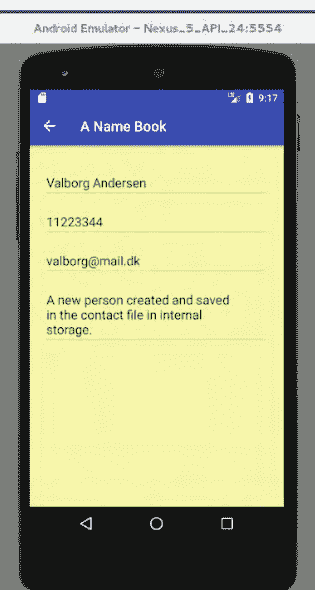

```java
public class Person implements Serializable

{

    private String name;

    private String phone;

    private String mail;

    private String text;

    public Person(String name, String phone, String mail, String text)

    {

        this.name = name;

        this.phone = phone;

        this.mail = mail;

        this.text = text;

    }

    public Person(String line) throws Exception

    {

        String[] elems = line.split("\\|");

        if (elems.length != 4) throw new Exception("Invalid format");

        this.name = elems[0];

        this.phone = elems[1];

        this.mail = elems[2];

        this.text = elems[3];

    }

}
```

由于可序列化（`Serializable`）接口，该类可以被序列化到字节流。

下载自 book.com

# JAVA 16: 手机与安卓

```java
public class Persons implements Serializable {

    private static final String filename = "persons";

    private List<Person> persons = new ArrayList<>();

    private transient Context context;

    public Persons(Context context) throws Exception

    {

        this.context = context;

        FileInputStream stream = null;

        try {

            stream = context.openFileInput(filename);

        } catch (Exception ex) {

            return;

        }

        BufferedReader reader = new BufferedReader(new InputStreamReader(stream));

        for (String line = reader.readLine(); line != null; line = reader.readLine()) {

            try

            {

                persons.add(new Person(line));

            }

            catch (Exception ex)

            {

                reader.close();

            }

        }

    }

    public Person getPerson(int n)

    {

      return persons.get(n);

    }

    public List<Person> getPersons()

    {

      return persons;

    }

    public void save(Person person) throws Exception

    {

      FileOutputStream stream =

      context.openFileOutput(filename, Context.MODE_APPEND);

      BufferedWriter writer = new BufferedWriter(new

      OutputStreamWriter(stream));

      writer.write(person.getPerson());

      writer.newLine();

      writer.close();

      persons.add(person);

    }

    public void remove(Context context, Person person) throws Exception

    {

      if (persons.remove(person))

      {

        FileOutputStream stream =

        context.openFileOutput(filename, Context.MODE_PRIVATE);

        BufferedWriter writer = new BufferedWriter(new

        OutputStreamWriter(stream));

        for (Person p : persons)

        {

          writer.write(p.getPerson());

          writer.newLine();

        }

        writer.close();

      }

      else throw new Exception("Person could not be removed");

    }

}
```

```java
    @Override

    public String getPerson()

    {

      return name + "|" + phone + "|" + mail + "|" + text;

    }

    @Override

    public boolean equals(Object obj)

    {

      if
```


# JAVA 16: 手机与安卓

该类代表联系人。你应该注意到将`Person`对象保存到文件中。读取和写入文件的操作在`Persons`类中完成。

该类具有两个构造函数。

最后，你必须注意该类是可序列化的。这是为了可以将`Person`对象从一个活动传输到另一个活动。

当你研究代码时，首先应该注意到所有基础知识与你在 Java IO 中了解的完全相同，甚至同样的...

# JAVA 16: 手机与安卓
软件开发

```java
public void onCreate(View view)

{

    String name = txtName.getText().toString().trim();

    String phone = txtPhone.getText().toString().trim();

    String mail = txtMail.getText().toString().trim();

    String text = txtText.getText().toString().trim();

    if (name.length() > 0)

    {

        try

        {

            persons.save(new Person(name, phone, mail, text));

            Toast.makeText(this, getResources().getString(R.string.msg_save),

            Toast.LENGTH_LONG).show();

            clear();

        }

        catch (Exception ex)

        {

            Toast.makeText(this, getResources().getString(R.string.err_save),

            Toast.LENGTH_LONG).show();
```


# JAVA 16: 移动与安卓：软件开发

在`onCreate()`中没有发生太多操作，只是将变量实例化到 4 个输入字段，但该方法调用了`loadPersons()`，它通过创建一个新的`Person`对象来初始化变量`persons`，从而读取文件中的所有联系人。注意参数，它是`Context`对象。如果`Persons`类中的构造函数由于某种原因无法正确读取文件，可能会抛出异常。如果是这样，能做的就只有停止应用程序，该方法可以被视为停止应用的标准方式。

除了`onCreate()`方法外，该类主要有针对三个按钮的三个事件处理器。这里，`onSave()`是最全面的，因为它必须创建一个与用户输入内容对应的`Person`对象。否则，该方法没有别的事情就是调用`Persons`类中的`save()`方法，最后该方法显示一个`Toast`来告知上下文是否已保存。


无论你对未来的职业有什么要求，一个在许多国家拥有广泛业务的雇主始终是你的入场券。在沃尔沃集团工作意味着与全球 185 多个国家的 100,000 多位朋友和同事共事。我们提供巨大的职业机会；请访问我们的网站 www.volvogroup.com。我们期待与您相识！

# 你做什么？

沃尔沃卡车 | 翻新卡车 | 曼卡车 | 沃尔沃客车 | 沃尔沃工程设备 | 沃尔沃普鲁 | 沃尔沃音频 | 沃尔沃IT
沃尔沃金融服务 | 沃尔沃3P | 沃尔沃动力系统 | 沃尔沃技术 | 物流 | 亚太业务区

在 bookebook.com 下载免费电子书

# JAVA 16: 手机与安卓：软件开发

事件处理器`setShow()`必须打开另一个活动，其发生方式与之前所示相同，但有一个不同：

```java
intent.putExtra("persons", persons);
```

它表示对象`persons`必须作为参数发送，并通过键`persons`进行标识。`Intent`类对`putExtra()`有许多重写，包括针对所有简单类型和字符串的重写，还有一个针对序列化（serializable）对象的重写，这就是为什么`Person`和`Persons`类被定义为`Serializable`。

然后是`ShowActivity`类，它是显示所有联系人概述的窗口：

```java
public class ShowActivity extends AppCompatActivity {

    private Persons persons;
    private ListView view;
    private ArrayAdapter<Person> adapter;

    @Override
    protected void onCreate(Bundle savedInstanceState) {
        super.onCreate(savedInstanceState);
        setContentView(R.layout.activity_show);

        Intent intent = getIntent();
        persons = (Persons)intent.getSerializableExtra("persons");
        view = (ListView)view.findViewById(R.id.listView);
        reset();
        getSupportActionBar().setDisplayHomeAsEnabled(true);
        registerForContextMenu(view);
    }

    @Override
    public boolean onNavigateUp() {
        finish();
        return true;
    }

    @Override
    public void onCreateContextMenu(ContextMenu menu, View v,
        ContextMenu.ContextMenuInfo menuInfo) {
        new MenuInflater(this).inflate(R.menu.context_menu, menu);
    }

    @Override
    public boolean onMenuItemSelected(MenuItem item) {
        AdapterView.AdapterContextInfo menuInfo = 
        (AdapterView.AdapterContextInfo) item.getMenuInfo();
        Person person = person.getPerson(menuInfo.position);

        switch (item.id.getItemId()) {
          case R.id.details_menu:
            Intent intent = new Intent(this, DetailActivity.class);
            intent.putExtra("person", person);
            startActivity(intent);
            return(true);

          case R.id.remove_menu:
            try {
                persons.remove(this, person);
                reset();
                Toast.makeText(this, getResources().getString(R.string.msg_rem),
                Toast.LENGTH_LONG).show();
            } catch (Exception ex) {
                Toast.makeText(this, getResources().getString(R.string.err_rem),
                Toast.LENGTH_LONG).show();
            }
            return(true);
        }
        return (super.onContextItemSelected(item));
    }
```

```java
private void reset() {
    view.setAdapter(adapter = new ArrayAdapter<Person>(this,
    android.layout.simple_list_item, persons.getPersons()));
}
```

代码填充了一部分，但填充的是窗口上下文菜单的第一个事件。注意`onCreate()`方法如何确定从`MainActivity`传递的参数：

```java
Intent intent = getIntent();
person = (Persons)intent.getSerializableExtra("persons");
```

在这里，使用相同的键和正确的类型转换非常重要。同样注意`onCreate()`定义了窗口的 Action Bar 应该有一个返回按钮：

```java
getSupportActionBar().setDisplayAsUpEnabled(true);
```

# JAVA 16: 手机与安卓：软件开发文件

以及相应的重写方法`getSupportNavigationUp()`。上下文菜单定义为资源，该类必须实现`onContextItemSelected()`。该方法填充了很多内容，但没有包含任何新内容。你应该注意，这次你将`Person`对象传递到了活动`DetailActivity`。我不想显示`DetailActivity`的代码，因为没有新内容。

## 练习 6：联系人录

你应该解释 NameBook 示例，以便你也能更改联系人的信息。从 NameBook 项目的副本开始。你必须向项目中添加一个可以用于编辑联系人的新活动。注意，该活动的布局应与`MainActivity`类似，但你可以编辑名称且只有一个按钮。新活动应该通过展开`ShowActivity`中的上下文菜单来打开。此外，`Persons`类必须扩展一个新方法，以便你更新更改。这应该以与删除相同的方式进行，其中所有操作都会被保存。


# JAVA 16: 手机与安卓：软件开发

有一个唯一的挑战，即何时保存更改。简单的方法是在`ShowActivity`中执行，但这要求新活动在您点击保存并关闭窗口时返回一个值。你应该解决这个问题，特别是因为它在其他语境下可能可能有用。要解决这个问题，请遵循以下步骤：

在`ShowActivity`中，你必须添加一个常量（值不重要）：

```java
private static final int PERSON_UPDATED = 1;
```

然后你必须添加以下方法：

```java
public void onActivityResult(int requestCode, int resultCode, Intent data) {
    if (requestCode == PERSON_UPDATED) {
        if (resultCode == RESULT_OK) {
            // 在这里可以将更改保存到文件中
            Person person = (Person)data.getSerializableExtra("person");
        }
    }
}
```

`onActivityResult()`方法现在是一个可以在你的活动结束并想要返回一个值时调用的方法。它要求以以下方式打开新活动：

```java
startActivityForResult(intent, PERSON_UPDATED);
```

在新活动中，你可以像下面编写保存按钮的事件处理器：

```java
public void onSave(View view) {
    person.setPhone(txtPhone.getText().toString().trim());
    person.setMail(txtMail.getText().toString().trim());
    person.setText(txtText.getText().toString().trim());

    Intent data = new Intent();
    data.putExtra("person", person);
    setResult(RESULT_OK, data);
    finish();
}
```


## JAVA 16：移动端与安卓：软件开发文件

## 问题 2：PUZZLEAPP

作为《Java 4》一书中的最后一个示例，我展示了一个模拟简单小程序的程序，该游戏由一个 5 x 5 的随机排列方块矩阵组成。其中一个方块是空的，你可以通过移动到相邻方块来移动方块。在下面的例子中（左侧的正方形），你可以移动 H、E、L 和 J（不能对角线移动）。当方块按右侧所示的方式排列时，游戏即完成。

| K G V M R | A B C D E |
|---||---|
| I S X U F | F G H I J |
| C O A E T | K L M N O |
| Q Y H L | P Q R S T |
| N D P J B | U V X Y |

这个正方形基本上是一个 5 x 5 的正方形，但必须像在 Java 4 中一样可以配置程序，以便你也能玩 3 x 3、7 x 7 和 9 x 9 的正方形。程序必须有一个高分列表，用于保存五个最佳结果。结果由解决正方形所需的移动次数组成，因此解决正方形的目标是通过移动尽可能少的方块来完成的。

该程序的运行方式应与 Java 4 相同，但这次必须为手机编写，且用户界面可能像这样：

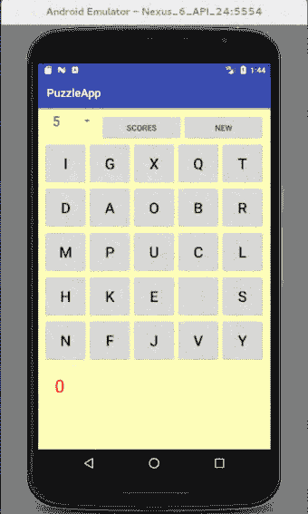

## JAVA 16：手机电话与安卓：软件开发文件

你可以复用 Java 4 中的大部分代码——如果不是直接复用，也可以通过较小的调整来实现。当然，两个挑战是用户界面（需要以不同的方式编写）以及保存必须保存在本地文件的高分列表。


## JAVA 16：手机电话与安卓：软件开发

# SQLITE

你也可以编写使用数据库的手机应用，因为 Android 出生就带有一个名为 SQLite 的非常简单的数据库。该数据库在 Android 设备之外的许多地方也被广泛使用。它是一个简单的数据库（确切的目标是什么），它远没有其他数据库产品（如 MySQL、Oracle 等）所提供的所有功能，它是一个完整的 SQL 数据库，你可以在其中创建本地数据库并执行常规数据库操作——几乎就像你从 MySQL 中了解的那样。在本章中，我将通过一个示例向你展示如何使用 SQLite。

例如，我将编写一个名为 PhoneBook（通讯录）的应用，它对应于手机自带的联系人应用，但它并不是该应用程序的替代品，只是为了演示数据库的使用，而且它应该是比之前的示例稍大一点、因此更真实的应用示例。应用程序的数据必须存储在具有两个表格的数据库中：

| addresses | zipcodes |
|---|---|
| id: integer | code: char(4) |
| firstname: varchar(50) | city: varchar(30) |
| lastname: varchar(30) | |
| address: varchar(50) | |
| code: char(4) | |
| phone: varchar(20) | |
| mail: varchar(50) | |
| date: varchar(10) | |
| title: varchar(50) | |

其中一个表是丹麦编码表，而另一个表包含关于人的联系信息。`addresses` 表中的 `code` 列是 `zipcodes` 表的外键。当你打开应用程序时，你会看到一个显示邮政编码概述的窗口（见下方）。顶部有两个输入字段和两个作为邮政编码过滤器的按钮。通常，联系人按邮政编码组织，要找到某个联系人，长按某个邮政编码手指，随后会弹出一个上下文菜单，你可以在其中查看按该邮政编码组织的联系人，或添加新联系人。如果你选择查看现有联系人，有三个选项：

- 1. 没有联系人，你只会收到一个简单的 Toast 提示。
- 2. 有一个联系人，程序会打开一个显示信息的窗口（见下文）。在这个窗口中你还可以编辑和删除该联系人。
- 3. 你将看到一个显示当前邮政编码下所有联系人的窗口。我在这里没有显示该窗口，但它只是一个包含这些联系人名字的 ListView。如果你点击一个名字，将进入显示所有联系人信息的窗口。

## JAVA 16：移动端与安卓：软件开发

关于用户界面的最后一个部分，MainActivity 有一个包含单个菜单项选项菜单。点击它会打开一个 Activity，你可以在其中输入搜索标准（姓、名、地址和头衔），程序将找到匹配搜索标准的联系人。结果具有上述的三个选项。

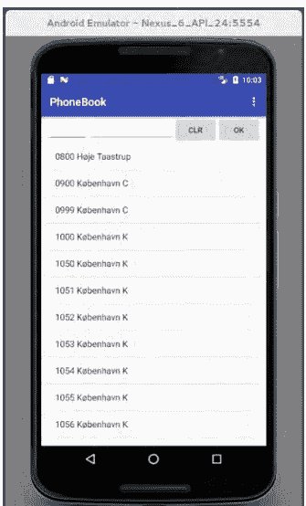
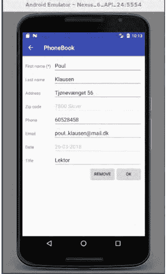

## JAVA 16：手机电话与安卓软件开发 SQLITE

是程序的功能，然后是程序的编写方式。程序至少有 4 个 Activity，但它们没有一个包含任何新内容，因此我不想显示布局的 XML 代码，唯一的关注点是 Java 代码，这里主要关于如何：

- 1. 创建数据库
- 2. 执行 SQL INSERT
- 3. 执行 SQL UPDATE
- 4. 执行 SQL DELETE
- 5. 执行 SQL SELECT

接下来的内容将集中在这 5 个主题上。

程序必须使用丹麦编码初始化，并且为了方便起见，我添加了一个资源：

`raw/zipcodes.txt`


> 我们不发明轮子我们创新光 

## JAVA 16：移动端与安卓：SQLITE

## 6.1 创建数据库

你可以通过两种方式创建数据库。你可以在开发机上创建，然后将其作为资源放入应用程序，但如果数据库需要更新，这可能会导致困难。因此，有一个辅助类以便在应用程序首次使用时自动创建数据库，并在你更改它时更新数据库。在当前的情况下，我添加了以下类：

```java
package dk.data.torus.phonebook;

import android.content.Context;

import android.database.sqlite.SQLiteDatabase;

import android.database.sqlite.SQLiteOpenHelper;

import java.io.*;

public class DbHelper extends SQLiteOpenHelper {

    public static java.util.Random rand = new java.util.Random();

    public static final String TABLE_NAME="zipcodes";

    public static final int ZCOLNO_CODE = 0;

    public static final int ZCOLNO_CITY = 1;

    public static final String[] ZCOLNO_COLUMNS = new String[] {"code","city"};

    public static final String TABLE_NAME="addresses";

    public static final int ACOLNO_ID = 0;

    public static final int ACOLNO_FIRSTNAME = 1;

    public static final int ACOLNO_LASTNAME = 2;

    public static final int ACOLNO_ADDRESS = 3;

    public static final int ACOLNO_CODE = 4;

    public static final int ACOLNO_PHONE = 5;

    public static final int ACOLNO_MAIL = 6;

    public static final int ACOLNO_DATE = 7;

    public static final int ACOLNO_TITLE = 8;

    public static final String[] ATABLEN_COLUMNS = new String[] {"id","firstname","lastname","address","code","phone","mail","date","title"};

    private static final String DBFILENAME="phonebook.db";

    private static final int DBVERSION = 1;

    private static final String ZINITIAL_SCHEMA = "create table zipcodes (code char(4) primary key, city varchar(30) not null)";

    private static final String AINITIAL_SCHEMA = "create table addresses (" + 

"id integer primary key autoincrement," + 

"firstname varchar(50) not null," + 

"lastname varchar(30)," +

"address varchar(50)," +

"code char(4) not null," +

"phone varchar(20)," +

"mail varchar(50)," +

"date varchar(10)," +

"title varchar(50)," +

"foreign key (code) references zipcodes (code)";

    public DbHelper(Context context) {

        super(context, FILENAME, null, DBVERSION);

        // super (context, FILENAME, null, rand.nextInt(20) + 1);

        this.context = context;

    }

    @Override

    public void onCreate(SQLiteDatabase db) {

        db.execSQL(ZINITIAL_SCHEMA);

        db.execSQL(AINITIAL_SCHEMA);

        db.execSQL(insertZipcodes());

    }

    @Override

    public void onUpgrade(SQLiteDatabase db, int oldVersion, int newVersion) {

        // db.execSQL("DROP TABLE IF EXISTS zipcodes");

        // db.execSQL("DROP TABLE IF EXISTS addresses");

        // db.execSQL("ZINITIAL_SCHEMA");

        // db.execSQL("AINITIAL_SCHEMA");

        // db.execSQL(insertZipcodes());

    }

    @Override

    public void onDowngrade(SQLiteDatabase db, int oldVersion, int newVersion) {

        // db.execSQL("DROP TABLE IF EXISTS zipcodes");

        // db.execSQL("DROP TABLE IF EXISTS addresses");

        // db.execSQL("ZINITIAL_SCHEMA");

        // db.execSQL("AINITIAL_SCHEMA");

        // db.execSQL(insertZipcodes());

    }

    private String insertZipcodes() {

        InputStream stream = context.getResources().

        openRawResource(R.raw.zipcodes);

        StringBuilder builder = new StringBuilder("insert into zipcodes (code, city) values ");

        try (BufferedReader reader = new BufferedReader(new InputStreamReader(stream)))

        {

            addRow(builder, reader.readLine());

            for (String line = reader.readLine(); line != null; line = reader.readLine())

            {

                if (line.length() > 0)

                {

                    builder.append(",");

                    addRow(builder, line);

                }

            }

        }

        catch (Exception e)

        {

            return builder.toString();

        }

    }

    private void addRow(StringBuilder builder, String line)

    {

        String[] elems = line.split(",");

        builder.append("'");

        builder.append(elems[0]);

        builder.append("','");

        builder.append(elems[1]);

        builder.append("");

    }

}
```


在 www.deloitte.ca/careers 发现真相

德勤。
Deloitte & Touche LLP 及其关联实体。

在 bookboom.com 下载免费电子书

点击广告阅读更多信息

# JAVA 16: 手机与安卓：软件开发 SQLITE

最初，定义了一个随机生成器，它不会包含在最终的应用程序中，但我稍后会解释该语句。否则，该类定义了许多定义数据库的常量。这些常量并非绝对必要，但它们可以使后续代码易于阅读和理解，并可以显著简化代码的维护。在这种情况下，建议引入这些常量，并且对于两个数据库表中的每个表都有两组常量。当你看到这些常量时，很容易理解它们的含义。注意，数据库名称本身有一个常量，并注意版本号也有一个常量。此外，还有两个用于创建数据库表的 SQL 表达式。

该类导入了 SQLiteHelper，基类中的构造函数会检查是否存在同名的数据库。如果没有，它将执行 `onCreate()`。如果找到了数据库，将测试版本号，如果版本大于数据库版本，则执行 `onUpgrade()`。如果版本小于数据库版本，则执行 `onDowngrade()`。因此，SQLiteHelper 类应该重写这三个方法——然而在许多情况下，你不需要重写最后一个（版本号会更高）。

在这种情况下，`onCreate()` 创建了两个表。注意，是基类中的构造函数创建了数据库，而 `onCreate()` 创建了表。`onCreate()` 调用了 `insertZipcodes()` 方法。它使用 `StringBuilder` 使用带有邮政编码的资源动态创建一个 SQL `INSERT` 语句，并方法结果作为字符串返回。`onCreate()` 有一个类型为 `SQLiteDatabase` 的参数，并带有如 `execSQL()` 等方法执行 SQL 语句。该方法用于创建两个表，并且通常可以执行表示为字符串的 SQL 语句以及 `insertZipcodes()` 的结果。

程序还提供了基类中的另外两个方法：`onUpgrade()` 和 `onDowngrade()`。由于代码已被注释掉，这两个方法都是空操作，这意味着如果版本号增加（直到你定义了最终版本），你必须插入代码来使用它们。当你开发程序时，你通常感兴趣在每次运行程序时都创建数据库。这通过增加版本号并在 `onUpgrade()` 中添加创建它们的代码来强制执行。这就是你的随机生成器在每次程序运行时运行的目的是：它获取一个随机版本号（通过构造函数），结果是执行了每次 `onUpgrade()` 或 `onDowngrade()`。请务必记住在应用应用程序之前删除此操作，否则每次应用程序运行时都会删除数据库。

# JAVA 16: 手机与安卓：软件开发

## 6.2 SQL SELECT

项目增加了两个模型类 `Zipcode` 和 `Person`，它们分别代表邮政编码和联系人。这两个类都非常简单，只包含 get 和 set 方法，但你应该注意，这两个类都定义为 `Serializable`（可序列化），这样类对象就可以作为参数传递到其他 Activity。

还有一个名为 `Zipcodes` 的类，它代表所有的邮政编码：

```java
package dk.data.torus.phone;

import android.database.Cursor;

import android.database.sqlite.SQLiteDatabase;
```


## JAVA 16: 手机安卓: 软件开发

### SQLite

```java
import java.util.ArrayList;
import java.util.List;

public class Zipcodes implements java.io.Serializable {

    private List<Zipcode> zipcodes = new ArrayList();

    public Zipcodes(SQLiteDatabase db) {

        try {

            Cursor cursor = db.query(DbHelper.ZTABLE_NAME, DbHelper.ZTABLE_COLUMNS,

                null, null, null, null);

            for (cursor.moveToFirst(); !cursor.isAfterLast(); cursor.moveToNext()) {

                String code = cursor.getString(DbHelper.ZCOLNO_CODE);

                String city = cursor.getString(DbHelper.ZCOLNO_CITY);

                zipcodes.add(new Zipcode(code, city));

            }

            cursor.close();

        } catch (Exception ex) {

            zipcodes.clear();

        }

    }

    public List<Zipcode> getZipcodes() {

        return zipcodes;

    }

}
```

该类有一个实例变量，用于存储`Zipcode`对象。该列表在构造函数中初始化，构造函数的参数是一个打开的数据库。构造函数开始创建一个`Cursor`，这是一个表示 SQL SELECT 语句的对象，并用于遍历结果。在这种情况下，使用`query()`方法执行 SELECT 语句，这是一个相当复杂的方法：

```java
query(String table,
    String columns[],
    String selection,
    String selectionArgs,
    String groupBy,
    String having,
    String orderBy,
    String limit)
```

该方法为可以包含在 SELECT 语句中的每个元素提供一个参数，在上面我只为前两个参数设置了值，因为语句应该检索数据库中所有的邮政编码。你应该注意表名和列名是在`DbHelper`类中定义的。语句完成后，你可以使用`Cursor`对象遍历行，该对象的工作方式基本上与`ResultSet`相同。

还有一个名为`Persons`的类，在原理上工作方式相同，但其构造函数定义了一个`Persons`对象的列表：

```java
package dk.data.torus.phonebook;
```

```java
import android.database.Cursor;
import android.database.sqlite.SQLiteDatabase;
import java.util.ArrayList;
import java.util.List;

public class Persons implements java.io.Serializable {

    private List<Persons> persons = new ArrayList();

    public Persons(SQLiteDatabase db, Zipcode zipcode) {

        try {

            String[] params = new String[]{zipcode.getCode()};

            Cursor cursor = db.query("select * from address where code = ?", params);

            for (cursor.moveToFirst(); !cursor.isAfterLast(); cursor.moveToNext()) {

                int id = cursor.getInt(DbHelper.ACOLNO_ID);

                String fname = cursor.getString(DbHelper.ACOLNO_FIRSTNAME);

                String lname = cursor.getString(DbHelper.ACOLNO_LASTNAME);

                String addr = cursor.getString(DbHelper.ACOLNO_ADDRESS);

                String phone = cursor.getString(DbHelper.ACOLNO_PHONE);

                String mail = cursor.getString(DbHelper.ACOLNO_MAIL);

                String date = cursor.getString(DbHelper.ACOLNO_DATE);

                String title = cursor.getString(DbHelper.ACOLNO_TITLE);

                persons.add(new Person(id, fname, lname, addr, zipcode, phone, date, title));

            }

            cursor.close();

        } catch (Exception ex) {

            persons.clear();

        }

    }

    public Persons(SQLiteDatabase db, String firstname, String lastname, String address, String personsontitle) {

        try {

            Cursor cursor = db.query(DbHelper.ATABLE_NAME, DbHelper.ATABLE_COLUMNS,

                "firstname like ? and lastname like ? and address like ? and title like ?",

                new String[] { firstName + " ", lastName + " ", "%" + address + "%", "%" + personsontitle + "%" });

            for (cursor.moveToFirst(); !cursor.isAfterLast(); cursor.moveToNext()) {

                int id = cursor.getInt(DbHelper.ACCOLNO_ID);

                String fname = cursor.getString(DbHelper.ACCOLNO_FIRSTNAME);

                persons.add(new Person(id, fname, lname, addr, getZipcode(db, code), phone, mail, date, title));

            }

            cursor.close();

        } catch (Exception ex) {

            persons.clear();

        }

    }

    public List<Person> getPersons() {

        return persons;

    }

    private Zipcode getZipcode(SQLiteDatabase db, String code) {

        Cursor cursor = db.query(DbHelper.ZTABLE_NAME, DbHelper.ZTABLE_COLUMNS,

            "code = ?", new String[] { code }, null, null);

        cursor.moveToFirst();

        return new Zipcode(cursor.getString(DbHelper.ZCOLNO_CODE),

            cursor.getString(DbHelper.ZCOLNO_CITY));

    }

}
```

最重要的一点是，基于搜索标准的两个构造函数决定了数据库中的联系人数量。区别在于它们如何定义 SQL SELECT 语句。

第一个构造函数查找具有特定邮政编码的所有联系人，但这次`Cursor`对象是使用`rawQuery()`方法创建的。它有两个参数，第一个是写成字符串的普通`SELECT`语句。正如你之前看到的，SQL 语句可以包含由`?`指示的参数，而`rawQuery()`方法的最后一个参数应该是用于替换`?`占位符的值数组。语句完成后，`Cursor`以与上述相同的方式使用该对象，但这次创建的是`Person`对象。注意它是如何使用`DbHelper`类中的常量引用单个列的。

另一个构造函数除了对已打开数据库的引用外，还有四个参数（均为字符串类型）。该构造函数必须找到以下条件的联系人：名字以某个值开头、姓以某个值开头、地址包含某个值且头衔包含特定值。这次`Cursor`对象使用`query()`方法创建，但前四个参数用于定义`WHERE`部分。实际的`WHERE`部分是一个字符串（表达式），随后的参数是用于表达式占位符的字符串数组。除此之外，这两个构造函数的功能是完全相同的，但请注意，在需要通过读取数据库来确定邮政编码的情况下。

## 6.3 SQL INSERT, UPDATE AND DELETE

该应用有一个名为`PersonActivity`的 Activity，用于显示联系人详情（见上方窗口），同时也用于创建新联系人、编辑现有联系人以及删除联系人。因此，代码同样非常全面：

```java
package dk.data.torus.phonebook;

import android.support.v7.app.AppCompatActivity;
import android.os.Bundle;
import android.content.Intent;
import android.widget.*;
import android.view.*;
import android.database.sqlite.SQLiteDatabase;
import android.content.ContentValues;
import java.util.*;
```

```java
Calendar cal = Calendar.getInstance();

values.put(DbHelper.TABLE_COLUMNS(DbHelper.ACOLNO_DATE),

String.format("%02d-%02d-%d", cal.get(Calendar.DAY_OF_MONTH), cal.get(Calendar.MONTH) + 1, cal.get(Calendar.YEAR)));

String[] args = { "" + person.getId() };

db.update(DbHelper.TABLE_NAME, values, "id = ?", args);

db.close();

onSupportNavigate();

}

public void onRem(View view) {

    if (person != null) {

        DbHelper dbHelper = new DbHelper(this);

        SQLiteDatabase db = dbHelper.getWritableDatabase();

        String[] args = { "" + person.getId() };

        db.delete(DbHelper.TABLE_NAME, "id = ?", args);

        db.close();

    }

    onSupportNavigateUp();

}
```

```java
private void disable(EditText view) {

    view.setKeyKeyListener(null);

    view.setEnabled(false);

}
```

# SIMPLY CLEVER
ŠKODA

我们将你的简历变成一生难得的机会

你喜欢汽车吗？你想成为一个成功品牌的一部分吗？我们会欣赏并奖励你的热情和才华。向我们发送你的简历。你会惊讶于它能带你去哪里。

向我们发送简历至：
www.employerforlife.com

# 我加入 MITAS 是因为我想要承担真正的责任

工程师与地质学家研究生计划
www.discovermitas.com

第 16 个月
曾在北海担任施工主管，指导并帮助工头解决问题

真实工作
国际机会
三次工作实习

马士基

在 bookboom.com 免费下载电子书

点击广告阅读更多


该类定义了几个变量，但为了代码起见，最重要的前两个，它们分别定义了一个邮政编码（Zipcode）和一个人员（Person）对象。其他变量是用户界面组件，并在`onCreate()`中初始化。当打开相应的 activity 时，会传递一个参数，要么是一个`Zipcode`对象（如果你想创建一个新联系人），要么是一个`Person`对象（如果你想查看或编辑联系人）。`onCreate()`开始引用一个`Zipcode`对象，如果该引用不为空，则它是一个已传递的`Zipcode`对象，且变量`zipcode`被初始化（此时`person`仍为 null）。接下来，字段`txtDate`被设置为`date`，因为此字段必须包含联系人的最后修改日期。如果`id`为 0，是因为传递的参数是一个`Person`对象，然后变量`person`将用该对象进行初始化。它是要在用户界面中显示的对象，所有字段都用对象的值初始化。最后，注意`txtDate`和`txtZip`是只读字段，无法更改。

该类定义了两个事件处理器`onClick()`和`onRem()`，前者用于点击 OK 时，后者用于点击 REMOVE（删除）按钮时。`onClick()`测试是否已输入了名字（假设联系人必须有一个名字）。如果是的话，处理程序（handler）将确定在用户界面中输入的其他值，然后创建一个代表数据库的对象。你必须注意其语法，因为数据库是打开可写状态的。接下来，创建一个`ContentValue`对象，包含要写入数据库的值，因为必须创建一个新行或更新现有的行。再次注意语法以及如何使用`DbHelper`类中定义的常量来引用单独列。接下来，测试变量`person`，如果它为 null，则是`INSERT`（插入），否则则是`UPDATE`（更新）。基本上，处理方式是一样的：在一种情况下你使用`insert()`方法，在另一种情况下你使用`update()`方法，只是在最后一种情况下你应该指定`WHERE`部分。

最后，是最后一个事件处理器，用于删除联系人并执行 SQL DELETE 操作。这基本上与上述的操作完全一样，但你必须使用`delete()`方法。

# JAVA 16：手机安卓：软件开发 SQLITE

## 6.4 其他 Activity

该应用有三个额外的 activity。`PersonsActivity`显示数据库中找到的联系人列表，它是一个带有`ListView`的简单 activity，点击联系人后显示`PersonsActivity`。Java 代码不包含任何关于数据库的内容。`SearchActivity` activity 也很简单，用于输入搜索标准，代码执行一个 SQL SELECT 语句，但使用的是`Persons`类。最后是`MainActivity`，它将所有内容整合在一起并填充了大量内容。我不想显示这三个 activity 的代码，因为它们不包含任何关于数据库的内容，顺便说一句，也没有新东西。

## 练习 7：电话录

在练习中，你需要对`PhoneBook`程序进行修改，目标是添加一些小改进，但主要为了更多地接触数据库编程和 SQLite。通过创建项目的副本来实现。

作为第一个更改，扩展`addresses`表增加一个额外的列，你可以将其命名为`text`，类型应为`VARCHAR(1000)`。这个想法是可能为联系人关联一个短描述。你必须开始修改`DbHelper`类：

1. 删除类开头的`rand`变量。
2. 删除带有构造函数的行的行。
3. 在类中添加一个名为`COLNO_TEXT`且值为 9 的`int`。
4. 在`ATABLE_COLUMNS`数组中添加一个字符串`"text"`。
5. 更新`INITIAL_SCHEMA`表达式，创建一个类型为`varchar(1000)`的列。

接下来，你必须修改`onUpgrade`方法：

```java
public void onUpgrade(SQLiteDatabase db, int oldVersion, int newVersion) {
    if (newVersion > oldVersion) {
        try {
            db.execSQL("ALTER TABLE addresses ADD text VARCHAR(1000) DEFAULT ''");
        } catch (Exception ex) {
        }
    }
}
```

在 bookboom.com 免费下载电子书。

# JAVA 16：手机安卓：软件开发 SQLITE

测试程序。现在`addresses`表应该有一个新列，但它仍然包含旧的联系人。

你必须扩展程序以便能够输入`text`，这意味着输入和编辑联系人的窗口必须扩展一个输入字段：


# 管理硕士

实现梦想是你最大的挑战。IE 商学院的管理硕士提供英语、西班牙语或双语教学，通过一个创新且激励人心的项目培养职业人才，帮助他们释放全部潜力。

- 选择你的专业领域。
- 通过提供的选项定制你的硕士。
- 在伦敦、硅谷或上海等地进行全球沉浸周。

因为你改变，我们与你共同改变。

# JAVA 16：手机安卓：软件开发 SQLITE

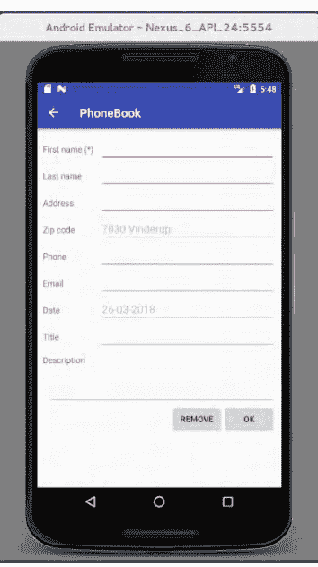

你可以执行以下操作：

1. 扩展`Person`类一个额外的`String`属性，也有必要扩展两个构造函数以包含新属性的额外参数。
2. 更改`Persons`类，使其现在考虑到数据库表有一个新列且`Person`类有一个新属性。
3. `activity_person.xml`应该扩展一个新字段（以及一个标签），它应该是一个多行`EditText`。
4. 更新`PersonActivity`将新字段的值存储在数据库中。

测试应用程序以确保文本已保存。记得测试创建新联系人和编辑现有联系人。

按照目前的编写方式，所有文本都是硬编码的，即标签、按钮、Toast 消息和菜单项的文本。将这些文本替换为`string.xml`中的常量，同时为四个 activity 标题行定义其他文本，以便知道自己在应用程序的哪个部分工作。

在 bookboom.com 免费下载电子书。

# JAVA 16：手机安卓：软件开发 SQLITE

目前，你无法更改邮政编码。这可能太受限制了。解决这个问题，让邮政编码字段始终包含合法的邮政编码。

该应用程序还有另一个问题，你在将应用程序安装到物理设备之前可能无法发现。问题是`PersonActivity`的字段太多，导致被虚拟键盘遮挡。你可以通过将窗口布局放置在`ScrollView`中来解决这个问题。

## JAVA 16：手机与安卓：软件开发

### 第 7 线程

Android 是一个多线程操作系统，因此你可以以与你在 PC 上了解几乎相同的方式使用线程。一旦应用程序启动，运行时系统将创建一个主线程（primary thread），所有的应用程序组件默认都在此线程中运行。主线程的主要任务是处理用户界面，包括处理事件，但该线程也可以执行任何其他操作（这是默认行为）。就像你在 PC 上了解到的那样，主线程可以启动子线程（secondary thread），这有很多充分的理由正如你之前了解的那些），但也面临着同样的挑战：如果子线程直接更新用户界面，程序将抛出异常并停止。如果你使用线程，你需要更多的操作，此处的目的是展示所需的内容。

我将使用一个我之前用过的示例，它是一个打开以下窗口的应用程序：

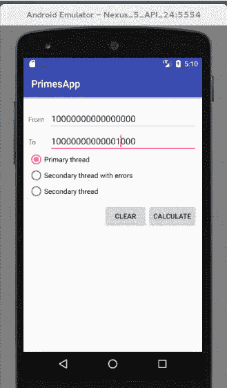

在两个输入字段中，你可以输入两个正整数，并点击 CALCULATE（计算），程序将确定这两个输入数字之间的质数，并将它们插入到按钮下方的`ListView`中。使用质数的想法是，对于大数字，确定一个数是否为质数需要长时间，如果你输入了像那么大的数字，结果就是程序会间歇地向`ListView`组件添加质数。为了限制内存消耗，两个输入数字的差值必须大于 1000，但如果你愿意，也可以更改它。输入字段下方有三个单选按钮（radio buttons）。如果你执行计算并按下了顶部的单选按钮，计算将在主线程执行，这意味着你会发现应用程序无响应；如果数字足够大，你将收到如下所示的警告，你可以在那里中断程序：

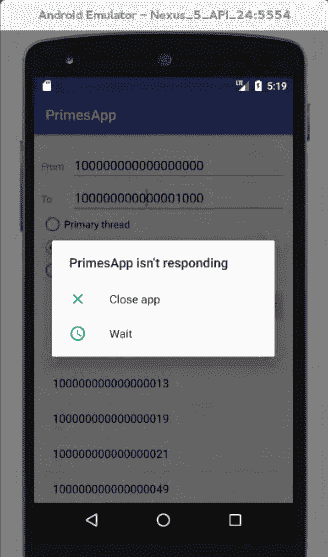

如果允许程序执行计算，在找到所有数字后，它将用所有数字更新`ListView`组件。

另一方面，如果你在按下中间单选按钮时运行程序，计算将在第二个线程执行，每当发现一个质数就会更新一次`ListView`组件。由于没有对更新组件进行任何特殊处理，结果是程序抛出异常并停止。此外，如果你在按下底部单选按钮时运行程序，一切都会按预期运行。程序会更新`ListView`组件且程序保持活跃，但这次不会引起问题，因为它是通过`Handler`对象实现的。

用户界面连接了 10 个使用 Relative 布局放置的组件，且设计中不包含任何新内容，因此我不想在这里显示 XML 代码，只需显示`MainActivity`类中新的内容部分。完整代码如下：

```java
package dk.data.torus.primesapp;
```

```java
import android.support.v7.app.AppCompatActivity;
import android.os.Bundle;
import android.view.*;
import android.widget.*;
import android.os.*;
import android.content.*;
import java.util.*;
```

```java
public class MainActivity extends AppCompatActivity {
    private EditText txtFrom;
    private EditText txtTo;
    private RadioButton cmdPrim;
    private RadioButton cmdSec1;
    private RadioButton cmdSec2;
    private List lstPrimes;
```


```java
private ArrayAdapter<Long> adapter;

private List<Long> primes = new ArrayList<>();

private Handler messageHandler;

private Handler primeHandler;

@Override

protected void onCreate(Bundle savedInstanceState)

{

  super.onCreate(savedInstanceState);

  setContentView(R.layout.activity_main);

  txtFrom = (EditText) findViewById(R.id.txtFrom);

  txtTo = (EditText) findViewById(R.id.txtTo);

  cmdPrim = (RadioButton) findViewById(R.id.cmdPrim);

  cmdSec1 = (RadioButton) findViewById(R.id.cmdSec1);

  cmdSec2 = (RadioButton) findViewById(R.id.cmdSec2);

  lstPrimes = (ListView) findViewById(R.id.lstPrimes);

  adapter = new ArrayAdapter<Long>(this, android.R.layout.simple_list_item_1, primes);

  lstPrimes.setAdapter(adapter);

  messageHandler = new Handler() {

    @Override

    public void handleMessage(Message msg) {

      adapter.notifyDataSetChanged();

    }

  };

  primeHandler = new Handler() {

    @Override

    public void handleMessage(Message msg) {

      long prime = msg.getData().getLong("prime");

      primes.add(prime);

    }

  };

}

public void onClear(View view)

{

  adapter.clear();

}

public void onCalculate(View view)

{

  try {

    long from = Long.parseLong(txtFrom.getText().toString());

    long to = Long.parseLong(txtTo.getText().toString());

    if (from > 0 && to > from && to - from > 1000)

    {

      if (cmdPrim.isChecked()) calci(from, to);

      else if (cmdSec1.isChecked()) calc2(from, to);

      else calc3(from, to);

    }

    return;

  }

  catch (Exception ex)

  {

    Toast.makeText(this, "Illegal values", Toast.LENGTH_LONG).show();

  }

}

private void calci(long a, long b)

{

  final long a = a;

  final long b = b;

  Runnable runnable = new Runnable() {

    public void run() {

      for (long t = a; t <= b; t++) if (isPrime(t))

      {

        adapter.add(t);

      }

    }

  notify

    (

}

  }

}

private void calc2(long a, long b)

{

    final long a = a a

    final long b = b;

    Runnable

 = new Runnable() {

        public void run() {

 {for (long t = a; t <= b; ++t) if (isPrime(t)) {

{adapter.add(t);

            }

            notifyDataSet.notify

            }

        }

    };

    new Thread(runnable).start();

}

private void calc3(long a, long b)

{

    final long a = a;

    final long b = b;

    Runnable runnable = new Runnable() {

        public void run() {

            for (long t = a; t <= b; ++t) if (isPrime(t)) {

                Message msg = primeHandler.obtainMessage();

                Bundle bundle = new Bundle();

                bundle.putLong("prime", t);

                msg.setData(bundle);

                primeHandler.sendMessage(msg);

            }

            messageHandler.sendEmptyMessage(0);

        }

    };

    new Thread(runnable).start();

}

private boolean isPrime(long n)

{

    if (n == 2 || n == 3 || n == 5 || n == 7) return true;

    if (n < 11 || n % 2 == 0) return false;

    for (long t = 3, m = (long)Math.sqrt(n) + 1; t <= m; t += 2) {

        if (n % t == 0) return false;

    }

    return true;

}

```

# JAVA 16：手机与安卓：软件开发

这取决于按了哪个单选按钮。如果是顶部的单选按钮，方法`calc1()`将两个数字作为参数被调用，该方法包含一个循环，根据当前范围内确定的质数来更新`ListView`组件：

```java
for (long t = a; t < b; ++t) if (isPrime(t))
{
```


`adapter.add(t);`

}

由于 `calc1()` 是一个常用方法，它由主线程执行，这在原则上没有问题，但该方法可能执行很长时间（对于较大的输入参数），并且在此期间程序将无响应，你可能会收到如所示的警告。

相反，如果执行 `calc2()`，会发生相同的情况，但这次是在辅助线程中，该线程执行上述循环。一旦找到质数，就会调用适配器的 `add()` 方法，由于数据绑定，它将更新用户界面，由于恰好另一个线程在运行，程序将失败并抛出异常停止。

这个问题在 `calc3()` 中得到了解决，它使用 `Handler` 对象更新用户界面，`Handler` 是在主线程中执行的对象。在文件末尾 `MainActivity.java` 仅包含两个类：

```java
class MessageHandler extends Handler
{
    private Context context;
    public MessageHandler(Context context)
    {
        this.context = context;
    }
```

```java
@Override
public void handleMessage(Message msg) {
    Toast.makeText(context, "Primes generated", Toast.LENGTH_LONG).show();
}
```

```java
class PrimeHandler extends Handler
{
    private Context context;
    private ArrayAdapter<Long> adapter;
    public PrimeHandler(Context context, ArrayAdapter<Long> adapter)
    {}
```

```java
this.context = context;
this.adapter = adapter;
}
@Override
public void handleMessage(Message msg) {
    Bundle bundle = msg.getData();
    Long prime = bundle.getLong("prime");
    adapter.add(prime);
}
```

这两个类都重写了 `handleMessage()` 方法，这是一个由主线程执行的回调方法，而这两个类之间的区别在于（其他方面外）传输了哪些参数。在第一个类中，`handleMessage()` 是微不足道的，因为它只是执行了一个 `Toast`，但在第二个类中，必须传输一个参数。这是通过一个 `Bundle` 对象实现的，在这种情况下它必须是一个 `Long` 类型，即要添加到 `ListView` 组件的质数。注意，特别是参数的类型为 `Message`，而且引用传输值的语法也是如此的。

有了这两种 `Handler` 类型，程序可以创建相应类型的实例变量，这在 `onCreate()` 中发生。

然后是 `calc3()` 方法，它在原则上与 `calc2()` 相同，并在辅助线程中执行确定质数的任务，但 `run()` 方法被修改了：

```java
public void run() {
    for (long t = a; t <= b; ++t) if (isPrime(t)) {
        Message msg = primeHandler.obtainMessage();
        Bundle bundle = new Bundle();
        bundle.putLong("prime", t);
        msg.setData(bundle);
        primeHandler.sendMessage(msg);
    }
    messageHandler.sendEmptyMessage(0);
}
```

在循环中，使用 `primeHandler` 对象来创建一个 `Message` 对象。此外，初始化了一个带有当前质数的 `Bundle` 对象，并将此 `Bundle` 对象与 `Message` 对象关联。之后调用了 `primeHandler` 对象的 `sendMessage()` 方法。当循环完成后，使用第二个处理器对象来发送消息，但调用的是 `sendEmptyMessage()` 方法。

# 8 服务

服务（Service）是一种在后台执行且不与用户直接交互的组件，并且服务没有用户界面。服务用于执行特殊操作，通常是耗时较长的操作。例如，它可以从互联网下载文件、测试新数据等。服务的优先级高于活动（Activity），因此，当可用资源不足时，Android 中断服务的概率较小。然而，可以提供一个与前台活动具有相同优先级的服务，如果是这样，则必须有一个可见的指示告诉用户服务处于激活状态，这是视频和音乐播放器使用的功能。

服务主要有两种类型：

- 1. 当应用程序（活动）通过调用 `service()` 启动时，服务启动。一旦启动，服务就可以在后台无限运行，即使启动该服务的应用程序被销毁。通常情况下，启动的服务执行单一操作（如通过网络下载或上传文件），并且不向调用者返回结果。操作完成后，服务应该自行停止。

- 2. 当应用程序组件通过调用方法 `bindService()` 绑定到它时，服务变为绑定。绑定的服务提供了一个客户端-服务器接口，允许组件与服务进行交互、发送请求，并且跨进程交互。多个组件可以同时绑定到该服务，但当它们解绑时，服务就会被销毁。

默认情况下，服务在与应用程序主线程相同的进程中执行，但如果是由应用程序启动的服务，该服务通常会在辅助线程中执行工作，并且将随着辅助线程的结束而终止。

Android 执行了一些预定义的服务，如果被允许，任何应用程序都可以这些服务。这些服务的使用通常是使用特殊的 `Manager` 类通过 `SystemService()` 方法来实现，并且 `Context` 类为这些服务定义了更多常量。应用程序除了这些系统服务外，还定义并应用了行为与系统服务相同的新服务。自定义服务通常可以从其他 Android 组件（即活动、广播接收器和其他服务）生成。

服务的整个生命周期发生在 `onCreate()` 方法调用和 `onDestroy()` 方法调用之间，其中 `onCreate()` 用于所有的初始设置，而资源的释放将在 `onDestroy()` 中完成。所有服务（无论是通过 `startService()` 还是 `bindService()` 创建的）都会调用这些方法。服务从其工作开始于 `onStartCommand()` 或 `onBind()`。每个方法都处理一个传递给 `startService()` 或 `bindService()` 的 `Intent` 对象。如果服务被启动，它在 `onStartCommand()` 返回时结束工作；如果服务被绑定，则它在 `onUnbind()` 时结束。

服务可以在 `AndroidManifest.xml` 中定义，并写成继承自 `Service` 类或其任一个子类的类。例如，一个 Android 组件（到目前为止指活动）可以使用 `startService()` 方法启动服务，作为替代方案，可以使用 `bindService()` 允许与服务进行直接通信。

服务通过 `startService()` 方法开始生命，如果服务尚未运行，则会在服务的 `onCreate()` 方法中创建一个服务对象。一旦运行，服务可以使用 `Toast` 通知或状态栏通知通知用户事件，但服务不能直接调用用户。

`onStart()` 方法返回一个 `int`，指示如果服务被 Android 终止是否应该重启服务，有以下选项：

- 1. `START_STICKY`，意味着服务会被重启，但 `Intent` 为 `null`，如果服务维持其状态且不依赖于 `Intent` 则使用它。
- 2. `START_NOT_STICKY`，表示服务不会被重启。
- 3. `START_REDELIVER_INTENT`，与第一个选项相同，但区别在于原始 `Intent` 被发送到 `onStartCommand()`。

可以使用 `stopService()` 结束服务，服务可以通过 `stopSelf()` 结束。

要创建一个绑定服务，你必须实现 `onBind()`，它返回一个用于与服务交互的 `Binder` 对象。其他应用程序可以调用 `bindService()` 获取接口并开始调用服务上的方法。只有当有应用程序绑定到它时，服务才存，当没有组件绑定到它时，系统就会销毁它，你不需要停止绑定服务，你必须在服务通过 `onStartCommand()` 启动时停止。你有两种方法定义 `IBinder`：

- 1. 扩展 `Binder`。如果你的服务是你自己的并且与应用程序在同一个进程中运行（通常是如此），你应该通过扩展 `Binder` 类来创建你的接口，并在 `onBind()` 中返回它的实例。客户端接收 `Binder` 并可以使用它直接访问 `Binder` 实现或服务中可用的公共方法。当服务仅仅是应用程序的后台工作者时，这是创建 `Binder` 的方法，不以此方式创建接口的唯一原因是服务已被其他应用程序或跨进程使用。
- 2. 使用 `Messenger`。如果你的接口必须跨不同进程工作，你可以使用 `Messenger` 为服务创建一个接口。通过这种方式，服务定义了一个响应不同类型 `Message` 对象的 `Handler`。这个 `Handler` 是 `Messenger` 的基础，它可以与客户端共享 `IBinder`，允许客户端使用 `Message` 对象向服务发送命令。此外，客户端也可以定义自己的 `Messenger`，以便服务发送消息。这是执行进程通信的最简单方法，因为 `Messenger` 将所有请求队列到单个线程中，因此你不需要将服务设计为线程安全。

应用程序组件可以通过调用 `bindService()` 绑定到服务，Android 调用服务的 `onBind()` 方法，该方法返回一个用于与服务交互的 `IBinder` 对象

# JAVA 16: 移动安卓：软件开发

该服务。它是异步发生的，且 `bindService()` 会立即返回，不会返回 `IBinder` 对象。要接收该对象，客户端必须创建一个 `ServiceConnection` 实例并将其传递给 `bindService()`。`ServiceConnection` 是一个接口，定义了 `onServiceConnected()` 方法，系统通过调用该方法获取 `IBinder` 对象。接口还定义了 `onDestroy()` 方法，当服务崩溃或被杀死导致与连接丢失时，Android 会调用该方法。当应用程序取消绑定时，该方法不会被调用。要与服务断开连接，必须调用 `unbindService()` 方法。当应用程序销毁时，它会自动从服务解绑，但你应该始终在完成后进行解绑，以便服务在不再使用时关闭。

服务也可以是一个前台服务（foreground service），它是与用户感知的事物相关的服务，因此在内存不足时不是系统杀掉的对象。前台服务必须在状态栏中提供一个通知，除非服务停止或从前台移除，否则该通知无法关闭。要在前台启动服务，你使用 `startForeground()` 方法，该方法接受两个参数，第一个是唯一标识通知和状态栏通知的 `int` 类型。


# JAVA 16: 手机与安卓：软件开发

在简单的情况下，活动（activity）和服务（service）之间不需要任何通信。服务从活动组件接收一个 `Intent` 对象并执行其工作，但在其他上下文中，活动和服务之间需要直接通信，这时你可以使用接收器（receiver）。活动可以检测用于某个事件的广播接收器，服务可以为该事件发送通知，并通常报告服务将向活动对象信号其已完成工作：


广播接收器是一个扩展自 `BroadcastReceiver` 的类，并在 Android 的 `AndroidManifest.xml` 或代码中注册为应用程序或其他地方的接收器。该接收器能够接收通过 `Context.sendBroadcast()` 方法生成的意图。`BroadcastReceiver` 类定义了 `onReceive` 方法，应用程序可以通过它获取接收到的对象。

关于理论的部分较少，在接下来的内容中我将具体展示如何编写服务、简单服务的启动以及本地服务的使用。这个主题实际上相对复杂，我将在下一书中回归它。此外，`BroadcastReceiver` 对象未在书中介绍。

不过，首先，我想对 `Intent` 类添加几点注释。

## 8.1 Intent 类

`Intent` 类不仅与服务有关，我已经多次使用该类，而没有提到它的用途。该类在服务中起着至关重要的作用，我将在这里简要提及。

该类主要应用于活动、服务和广播接收器。这些组件是通过称为“意图”（intents）的消息创建的，它是组件绑定的一种形式，因此其发生方式总是相同的。`Intent` 对象是一个数据结构，包含对要执行的操作的抽象描述，或对已发生并要发布的某事的描述。有几种机制可以将意图发送给不同类型的组件：

- `Intent` 对象可以传递给 `Context.startActivity()` 或 `Activity.startForResult()` 以启动活动或让活动执行新操作。它也可以被传递给 `Activity.setResult()`，以返回通过 `startActivityForResult()` 执行的活动信息。
- 2. 一个 `Intent` 对象可以传递给 `Context.startService()` 以启动服务或向正在运行的服务传递新指令。同样，意图可以传递给 `Context.bindService()` 以在调用者活动和服务之间建立连接。如果服务尚未运行，可以使用它启动服务。
- 3. `Intent` 对象可以作为广播方法（见下一本书）中的 `Context.sendBroadcast()`、`Context.sendOrderedBroadcast()` 或 `Context.sendStickyBroadcast()` 传递，并交付给最感兴趣的广播接收器。

`Intent` 在服务中非常有用，用于在调用对象和服务之间交换信息和通知。鼓励你查看 `Intent` 类的文档。

## 8.2 SERVICEAPP1

服务被写为一个继承自 `Service` 或 `IntentService` 类的类，后者派生自前者。`IntentService` 的目标是尽可能简化服务的启动。服务在自己的线程中异步执行请求，它可以花费任何需要的时间，且不会阻塞应用程序。单个请求被添加到队列中并逐个执行。`IntentService` 是一个由活动启动的后台服务，此时服务与活动之间没有直接通信。一个典型的应用是启动一个耗时较的操作，例如下载文件。

示例 `ServiceApp1` 打开了以下窗口：

# 服务

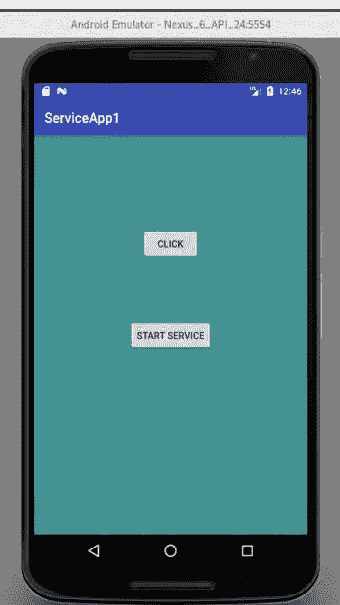

# 马斯里赫特大学：学习的先锋！

加入最优秀的行列，马斯里赫特大学
工商与经济学院！

- 《金融时报》全球排名第 33 位：国际商业硕士
- 第一名：国际商业硕士
- 第一名：金融经济学硕士
- 第二名：学习管理硕士
- 第二名：计量经济学与运筹学硕士
- 第二名：全球供应链管理与变革硕士

来源：路透社，2013年 Master 排名；爱思唯“最佳专业”排名 2012年；
《金融时报》2012年管理类硕士排名。

访问我们并发现为什么我们是最好的！
硕士开放日：2014年2月22日

马斯里赫特大学并非荷兰最顶尖的专业大学（爱思唯）

www.masteropopenday.nl

# JAVA 16: 手机与安卓：软件开发

如果你点击顶部的按钮，窗口会变成随机颜色，点击底部的按钮会启动一个 `IntentService` 服务。该服务被写为如下类：

```java
import android.app.IntentService;
import android.content.Intent;
import android.net.Uri;
import android.media.RingtManager;
import android.media.Ringtone;

public class TheService extends IntentService {
    public TheService() {
        super("TheService");
    }

    @Override
    protected void handleIntent(Intent intent) {
        long n = intent.getLongExtra("todo", 0);
        for (long i = 0; i < n; i++) Math.sin(Math.sqrt(i));
        Uri notification = RingtoneManager.getDefaultUri(RingtManager.TYPE_NOTIFICATION);
        Ringtone r = RingtoneManager.getRingtone(getApplicationContext(), notification);
        r.play();
    }
}
```


该类应该只有一个默认构造函数，该函数以服务名称为参数执行基类的构造函数，并且必须重写`onHandleIntent()`方法，该方法是执行所需操作的方法。在这种情况下，该方法执行一个耗时的（无意义的）操作，随后激活铃声。关于该操作，目标是展示你如何通过`Intent`向服务传递值，以及服务在运行一段时间后，你如何通过声音观察到服务已完成其工作。

当应用程序使用服务时，它必须在程序的清单文件中定义服务：

```xml
<application>
...
<activity />
<service android:name=".TheService" />
</application>
```

这是一个需要记住的细节。

# JAVA 16：手机与安卓：软件开发

关于该程序（`MainActivity`），顶部按钮的目标是显示在服务执行工作时，应用程序不会被阻塞——并顺便演示如何更改窗口的背景颜色。当你尝试运行该程序时，请注意你可以启动多个服务，并观察它们是如何排队列的。`MainActivity`的代码如下：

```java
package serviceappl.dk.torus.serviceappl;

import android.graphics.Color;
import android.support.v7.app.AppCompatActivity;
import android.os.Bundle;
import android.view.*;
import android.view.content.*;
import java.util.Random;

public class MainActivity extends AppCompatActivity {

    private static Random rand = new Random();

    @Override
    protected void onCreate(Bundle savedInstanceState) {
        super.onCreate(savedInstanceState);
        setContentView(R.layout.activity_main);
    }

    public void onClick(View view) {
        getWindow().getDecorView().setBackgroundColor(getColor());
    }

    public void onStart(View view) {
        Intent intent = new Intent(this, TheService.class);
        intent.putExtra("todo", 100000000L);
        startService(intent);
    }

    private int getColor() {
        return Color.rgb(rand.nextInt(256), rand.nextInt(256), rand.nextInt(256));
    }
}
```

这里最重要的是`onStart()`事件处理程序，它启动了一个服务。首先，为服务创建一个`Intent`对象，并使用`startService()`方法启动服务。

## 8.3 SERVICEAPP2

通常，`IntentService`提供的选项不够，例如，如果你想停止正在运行的服务，那么你就必须编写一个直接继承`Service`类的服务。`ServiceApp2`程序展示了如何实现。程序的窗口与上述几乎相同，只是多了第三个按钮：


## 服务

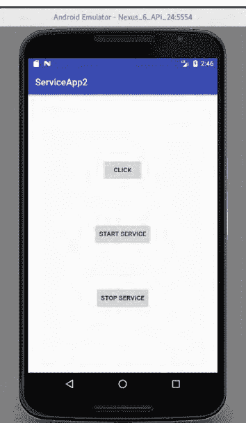

这用于停止正在运行的服务。这次服务的编写方式如下：

```java
package serviceapp2.dk.data.torus.serviceapp2;

import android.app.Service;
import android.content.Intent;
import android.os.IBinder;
import android.widget.Toast;
import android.os.Bundle;

public class TheService extends Service {

    @Override
    public void onCreate(Bundle savedInstanceState) {
        Toast.makeText(this, "Service created", Toast.LENGTH_LONG).show();
    }

    @Override
    public IBinder onBind(Intent arg) {
        return null;
    }

    @Override
    public int onStartCommand(Intent intent, int flags, int startId) {
        long timeout = System.currentTimeMillis() + 30000;
        while (System.currentTimeMillis() < timeout) {
            synchronized (this) {
                Toast.makeText(this, "Service " + startId + " is working",
                    Toast.LENGTH_LONG).show();
            }
            try {
                wait(5000);
            } catch (Exception e) {
            }
        }
        return Service.START_STICKY;
    }

    @Override
    public void onDestroy() {
        Toast.makeText(this, "Service destroyed", Toast.LENGTH_LONG).show();
    }
}
```

后台服务（不带界面）可以通过两种方式与环境通信，其中一种是使用`Toast`的，它只是一个在屏幕上短暂显示的简单消息。该类继承自`Service`类，服务有一个`onCreate`方法，你可以在其中初始化服务。在这种情况下，除了服务显示一个它已创建的`Toast`之外，什么都没有发生。还有一个名为`onBind`的方法，它由 Android Studio 插入，但它仅用于绑定服务（bound service）。最后是`onDestroy`方法，在服务停止时执行，在这种情况下它也显示了一个简单的`Toast`。最后是`onStartCommand()`，它是服务启动时执行的方法，即当启动的 Activity 调用`startService()`时。在这种情况下，一个循环会运行大约 30 秒。对于每次迭代，都会执行一次`Toast`，每个服务等待 5 秒。`MainActivity`类与上一个示例几乎相同，Start 按钮的事件处理程序简单一些（不需要传递参数），并为 Stop 按钮添加了事件处理程序：

```java
public void onStart(View view) {
    Intent intent = new Intent(this, TheService.class);
    startService(intent);
}
```

```java
public void onStop(View view) {
  Intent intent = new Intent(this, TheService.class);
  stopService(intent);
}
```

如果你尝试运行程序并点击启动按钮，你会发现其他按钮不起作用，或者你也看不到`Toast`——至少在服务完成工作、背景颜色改变之前是这样。如果你现在没有点击 Stop 按钮，你将看到一个`Toast`，告诉你有服务已停止。原因是服务本身在同一个线程中执行，当服务挂起该线程时，程序将表现为无响应——而且服务必须在另一个线程中执行。

## 8.4 SERVICEAPP

这个示例与上一个完全相同，只是`MainActivity`的布局和`manifest`文件没有变化。代码如下：


## 赋能人才。改进业务。BI商学院是欧洲最大的商学院之一，每年欢迎超过2000名学生。我们的课程提供国际化的视野，为学生进入职业生涯提供最佳平台。

- 商业硕士
- 金融经济硕士
- 战略管理硕士
- 领导力与组织心理学

在原则上非常简单，但仍有一些需要注意的事：

```java
package serviceapp3.dk.data.torus.serviceapp3;

import android.app.Service;
import android.content.Intent;
import android.os.IBinder;
import android.widget.Toast;
import android.os.*;

public class TheService extends Service {

    private boolean running = false;

    @Override
    public void onCreate() {
        Toast.makeText(this, "Service created", Toast.LENGTH_LONG).show();
    }

    @Override
    public IBinder onBind(Intent arg) {
        return null;
    }

    @Override
    public int onStartCommand(Intent intent, int flags, int startID) {
        if (running) {
            Toast.makeText(this, "Service already running", Toast.LENGTH_LONG).show();
        } else {
            final int currentID = startID;
            Runnable r = new Runnable() {
                public void run() {
                    long timeout = System.currentTimeMillis() + 30000;
                    running = true;
                    while (running && System.currentTimeMillis() < timeout) {
                        synchronized (this) {
                            try {
                                wait(5000);
                            } catch (Exception e) {
                            }
                        }
                    }
                    stopSelf();
                }
            };
            Thread t = new Thread(r);
            t.start();
        }
        return Service.START_STICKY;
    }

    @Override
    public void onDestroy() {
        running = false;
        Toast.makeText(this, "Service destroyed", Toast.LENGTH_LONG).show();
    }

    private void sendMessage(int id) {
        final int currentID = id;
        Handler handler = new Handler(Service.this.getMainLooper());
        handler.post(new Runnable() {
            @Override
            public void run() {
                Toast.makeText(getContext(), "Service " + currentID + " is working", Toast.LENGTH_LONG).show();
            }
        });
    }
}
```

## 8.5 SERVICEAPP4

在本节中，我将展示一个本地服务的示例，由此说明服务意味着应用程序可以绑定到并与其进行通信。本地服务意味着它是在与应用程序相同的进程中执行的服务，并且当应用程序关闭时会自动终止。该程序将打开下面包含一个`TextView`和 3 个`Button`（按钮）组件的窗口：


# JAVA 16：手机与安卓：软件开发

# 服务

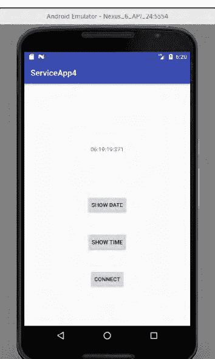

程序启动后，文本显示为*Disconnected*（已断开），点击顶部的两个按钮没有任何都不会发生，因为程序尚未连接到该服务。如果你点击底部的按钮，文本将变为*Connected*（已连接），因为程序现在已绑定到服务，当你点击顶部的两个按钮时，文本会分别显示当前的日期和时间。这些值由程序（按钮事件处理程序）通过调用服务方法确定，而读取时钟的是服务。

用户界面是视觉化的，此处不再在此显示，且清单（manifest）的更改方式与本章之前的示例相同。服务的代码如下：

```java
package dk.data.torus.serviceapp;

import android.app.Service;
import android.content.Intent;
import android.os.Binder;
import android.os.IBinder;
import java.util.Calendar;

public class TheService extends Service {

    private final IBinder binder = new TheBinder();
```

# JAVA 16：手机与安卓：软件开发

```java
@Override
public IBinder onBind(Intent intent) {
    return binder;
}
```

```java
public String getCurrentDate() {
    Calendar cal = Calendar.getInstance();
    return String.format("%04d-%02d-%02d", cal.get(Calendar.MONTH) + 1, cal.get(Calendar.DAY_OF_MONTH));
}
```

```java
public String getCurrentTime() {
    Calendar cal = Calendar.getInstance();
    return String.format("%02d:%02d:%02d", cal.get(Calendar.HOUR_OF_DAY), cal.get(Calendar.MINUTE), cal.get(Calendar.SECOND));
}
```

```java
public class TheBinder extends Binder {
    TheService getService() {
        return TheService.this;
    }
}
```

首先注意该类继承了`Service`，但这次我没有重写`onStartCommand()`和`onDestroy()`方法。相反，实现了`onBind()`方法，因此它返回一个`Binder`对象。该对象在类的开始处作为内部类创建。它是一个继承`Binder`（实现了`IBinder`接口）的类，并实现了一个单一方法`getService()`，该方法返回当前实例的引用。此外，`TheService`类实现了两个服务方法，两者都非常简单。

然后是`MainActivity`类，它负责通过绑定到服务来启动该服务：

```java
package dk.torus.serviceapp4;

import android.support.v7.app.AppCompatActivity;
import android.os.Bundle;
```


```
import android.view.*;
import android.widget.*;
import android.os.*;
import android.content.*;
```

# JAVA 16：手机与安卓：软件开发服务

```
public class MainActivity extends AppCompatActivity
    implements ServiceConnection {

    private TheService theService;
    private boolean isBound = false;
    private TextView txtResult;

    @Override
    public void onServiceConnected(ComponentName className, IBinder service) {
        theService = (TheService.Binder) service;
        theService = binder.getService();
        isBound = true;
        txtResult.setText("Connected");
    }

    @Override
    public void onServiceDisconnected(ComponentName className) {
        isBound = false;
        theService = null;
    }

    @Override
    protected void onCreate(Bundle savedInstanceState) {
        super.onCreate(savedInstanceState);
    }
```

# 脑力

到 2020 年，风能可以产生我们地球十分分之一的电力需求。直到今天，`SKF` 的创新技术对于运行世界上大部分风力涡轮机至关重要。发电成本的 25% 与维护有关。得益于我们的在线监控和自动润滑系统，维护阶段可以大幅减少。我们帮助创造更清洁、更廉价的能源变得更加经济。通过分享我们的经验、服务和创造力，行业可以提升超出预期的性能。因此，我们需要能够应对挑战的优秀员工！

知识工程的力量

接入知识工程的力量。
访问我们的网站：`www.skf.com/knowledge`


在 `bookboom.com` 免费下载电子书

# JAVA 16：手机与安卓：软件开发

```
setContentView(R.layout.activity_main);
txtResult = findViewByIdById(R.id.txtResult);
```

```
public void onCreate(View view)
{
    if (isBound) txtResult.setText(theService.getCurrentDate());
}
```

```
public void onTime(View view)
{
    if (isBound) txtResult.setText(theService.getCurrentTime());
}
```

```
public void onConnect(View view)
{
    if (!isBound) {
        Intent intent = new Intent(this, TheService.class);
        bindService(intent, this, Context.BIND_AUTO_CREATE);
    }
}
```

在这里你应该首先注意到该类实现了 `ServiceConnection` 接口。该接口在程序连接到服务后调用 `onServiceConnected()`，另一个在程序与服务断开连接时调用 `onDisconnected()`。在这种情况下，上述本地服务可以被视为程序的一部分，且两个服务方法都非常简单。通常情况下，程序需要执行耗时工作，程序会启动一个在辅助线程中执行该工作的服务。

## 8.6 SERVICEAPP

下一个示例展示了一个远程服务，它只是一个简单的示例，更多请见本书。应用程序打开了一个包含两个按钮的窗口。点击顶部的按钮会更改窗口背景颜色，点击底部的按钮向远程服务发送一条消息（当前日期和时间），该服务在 5 秒后显示该消息的 Toast。通过 5 秒延迟和颜色按钮，你会发现服务不会阻塞应用程序，因为它是在另一个进程中执行的。该服务非常简单：

```
package dk.data.torus.serviceapp5;

import android.app.Service;
import android.content.Intent;
import android.os.*;
import android.widget.Toast;
import android.os.Messenger;
import android.os.Handler;

public class TheService extends Service {

    private final Messenger theMessenger = new Messenger(new Handler());

    class TheHandler extends Handler {

        @Override
        public void handleMessage(Message msg) {
            Bundle data = msg.getData();
            synchronized (this) {
                try {
                    wait(5000);
                } catch (Exception e) {}
            }
            Toast.makeText(getContext(), data.getString("message"), Toast.LENGTH_LONG).show();
        }
    }

    @Override
    public IBinder onBind(Intent intent) {
        return theMessenger.getBinder();
    }
}
```

该类与其他示例一样继承自 `Service`。它定义了一个继承 `Handler` 的内部类，并重写了 `handleMessage()` 方法。该方法的参数类型为 `Message`，代表客户端发送的消息。它封装在 `Bundle` 对象中。

该方法会阻塞当前线程 5 秒钟，之后会显示一个包含所发送消息的 Toast。

`TheService` 类有一个唯一的实例变量，是一个 `Messenger` 对象，该对象是使用上述内部类的对象（这是一个 `Handler`）作为参数创建的。`Messenger` 对象拥有一个 `Binder`，而 `onBind()` 方法返回此 `Binder`。

为了让服务在程序之外的进程中创建，请在清单文件中输入它：

```xml
<service android:name=".TheService"
    android:process=":app5_process"
</service>
```

最后，是 `MainActivity` 类：

```java
package dk.data.torus.serviceapp5;

import android.support.v7.app.AppCompatActivity;
import android.view.View;
import android.os.*;
```


# JAVA 16: 手机安卓：软件开发

```java
import android.content.*;
import android.graphics.Color;
import java.util.Calendar;
import java.util.Random;
```

```java
public class MainActivity extends AppCompatActivity {

    private static final Random rand = new Random();
    private Messenger theService = null;
    private boolean isBound;

    @Override
    protected void onCreate(Bundle savedInstanceState) {
        super.onCreate(savedInstanceState);
        setContentView(R.layout.activity_main);
        bindService(new Intent(this, TheService.class), theConnection,
                Context.BIND_AUTO_CREATE);
    }

    private ServiceConnection theConnection = new ServiceConnection() {

        public void onServiceConnected(ComponentName className, IBinder service) {
            theService = new Messenger(service);
            isBound = true;
        }

        public void onServiceDisconnected(ComponentName className) {
            theService = null;
            isBound = false;
        }
    };

    public void sendMessage(View view) {
        if (!isBound) return;
        Message msg = Message.obtain();
        Bundle bundle = new Bundle();
        bundle.putString("message", getMessage());
        msg.setData(bundle);
        try {
            theService.send(msg);
        } catch (RemoteException e) {
            e.printStackTrace();
        }
    }

    public void onClick(View view) {
        getWindow().getDecorView().setBackgroundColor(getColor(0));
    }

    private int getColor() {
        return Color.rgb(rand.nextInt(256), rand.nextInt(256), rand.nextInt(256));
    }

    private String getMessage() {
        // 返回消息
    }
```

当你使用这段代码时，它非常简单，并且和上一个示例一样，方法使用了一个 `ServiceConnection` 对象。该类没有继承 `ServiceConnection` 接口，而是创建了一个匿名对象。除了展示可行性之外，没有特殊理由。对服务的绑定在 `onCreate()` 中，其发生方式与上一个示例相同。否则，你应该主要注意 `sendMessage()` 方法，它是 Send 按钮的事件处理器，以及向服务发送消息的方法。

## 8.7 手机响铃

下面的示例打开了如下所示的简单窗口。如果你点击顶部的按钮，手机就会响铃，直到你点击底部的按钮。请注意，如果你点击顶部的按钮并关闭程序，手机将继续响铃。这是因为程序启动了一个服务，由于它不是本地服务，在应用程序关闭后它仍然会保持活跃。

手机响铃 10 秒后，手机将打开下面的窗口（允许你停止响铃），无论应用程序是否关闭。

我不想展示用户界面的布局，`MainActivity` 也很简单：

```java
public class MainActivity extends AppCompatActivity {

    @Override
    protected void onCreate(Bundle savedInstanceState) {
        super.onCreate(savedInstanceState);
        setContentView(R.layout.activity_main);

        ((Button) findViewById(R.id.cmdStart)).setOnClickListener(
            new View.OnClickListener() {
                public void onClick(View v) {
                    startService(new Intent(MainActivity.this, RingService.class));
                }
            });

        ((Button) findViewById(R.id.cmdStop)).setOnClickListener(
            new View.OnClickListener() {
                public void onClick(View v) {
                    stopService(new Intent(MainActivity.this, RingService.class));
                }
            });
    }
}
```

JAVA 16: 手机安卓：软件开发

## 8.8 本地服务 – SERVICEAPP

随后我将展示一个使用本地服务的应用程序。该应用程序将打开以下窗口：

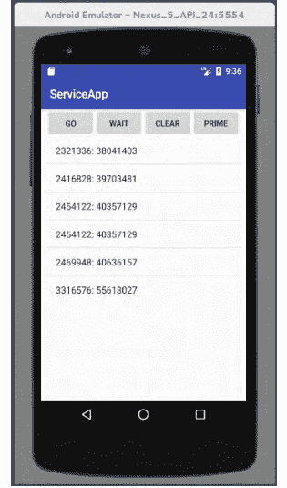

# JAVA 16: 手机与安卓：软件开发服务

该程序使用一个始终寻找下一个素数的服务。在开始时，它运行很快，但如果程序运行很长时间，确定下一个素数就会花费更多时间。窗口有 4 个按钮和一个 `ListView`。如果你点击 `PRIME` 按钮，服务会将素数添加到 `ListView` 中，其中部分作为该数在素数序列中的索引，部分作为素数本身。点击 `CLEAR` 按钮将删除 `ListView` 的内容。如果你点击 `WAIT` 按钮，服务将停止工作，但可以通过点击 `GO` 重启（如果仍在运行）。上方在程序运行一段时间后，点击了如下：

- `PRIME`
- `PRIME`
- `WAIT`
- `PRIME`
- `PRIME`
- `GO`
- `PRIME`
- 以及好几次 `PRIME`

布局非常简单，只包含 5 个组件：

```xml
<?xml version="1.0" encoding="utf-8"?>
<android.support.ConstraintLayout xmlns:android="http://schemas.android.com/apk/res/android"
    xmlns:app="http://schemas.android.com/apk/res-auto"
    xmlns:tools="http://schemas.android.com/tools"
    android:layout_width="match_parent"
    android:layout_height="match_parent"
    tools:context="dk.data.torus.service.MainActivity">

    <LinearLayout
        android:layout_width="match_parent"
        android:layout_height="wrap_content"
        android:layout_margin="10dp">

        <LinearLayout
            android:layout_width="match_parent"
            android:layout_height="match_parent"
            android:orientation="horizontal">

            <Button
                android:id="@id/cmdRestart"
                android:layout_width="wrap_content"
                android:layout_height="wrap_content"
                android:layout_weight="1"
                android:onClick="onGo"
                android:text="Go" />

            <Button
                android:id="@id/cmdPause"
```


## 布局文件

```xml
<Button
    android:id="@id/cmdWait"
    android:layout_width="wrap_content"
    android:layout_height="wrap_content"
    android:layout_weight="1"
    android:onClick="onWait"
    android:text="Wait" />

<Button
    android:id="@id/cmdClear"
    android:layout_width="wrap_content"
    android:layout_height="wrap_content"
    android:layout_weight="1"
    android:onClick="onClear"
    android:text="Clear" />

<Button
    android:id="@id/cmdCalc"
    android:layout_width="wrap_content"
    android:layout_height="wrap_content"
    android:layout_weight="1"
    android:onClick="onService"
    android:text="Prime" />

<ListView
    android:id="@id/listView"
    android:layout_width="match_parent"
    android:layout_height="wrap_content" />
```

唯一需要注意的是我给按钮和`ListView`起的名称，以及按钮调用的事件处理器名称。`MainActivity`的代码如下：

```java
package dk.data.torus.service;

import android.support.v7.app.AppCompatActivity;
import android.content.ComponentName;
import android.content.Context;
import android.os.*;
import android.view.*;
import android.widget.*;
import java.util.*;

public class MainActivity extends AppCompatActivity implements ServiceConnection {

    private ArrayAdapter<String> adapter;
    private List<String> primesList = new ArrayList();
    private LocalService service;
    private ListView lstView;

    @Override
    public void onCreate(Bundle savedInstanceState) {
        super.onCreate(savedInstanceState);
        setContentView(R.layout.activity_main);
        lstView = (ListView) findViewById(R.id.listView);
        adapter = new ArrayAdapter<>(this, android.R.layout.simple_list_1, primesList);
        lstView.setAdapter(adapter);
    }

    @Override
    protected void onResume() {
        super.onResume();
        Intent intent = new Intent(this, LocalService.class);
        bindService(intent, this, Context.BIND_AUTO_CREATE);
    }

    @Override
    protected void onPause() {
        super.onPause();
        unbindService(this);
    }

    public void onGo(View view) {
        service.start();
    }

    public void onWait(View view) {
        service.pause();
    }

    public void onService(View view) {
        adapter.add(String.format("%:d", service.getIndex()), service.getPrime());
        Toast.makeText(this, "List is updated", Toast.LENGTH_SHORT).show();
    }

    @Override
    public void onServiceConnected(ComponentName name, IBinder service) {
        service = (LocalService) service;
    }

    @Override
    public void onServiceDisconnected(ComponentName name) {
        service = null;
    }
}
```

## JAVA 16: 手机与安卓软件开发服务

`LocalService`类定义如下：

```java
public class LocalService extends Service {

    private final Binder binder;
    private int index = 0;
    private long prime = 0;
    private boolean running = false;
    private Thread thread;

    public LocalService() {
        binder = new PrimesBinder();
    }

    @Override
    public IBinder onBind(Intent intent) {
        return binder;
    }

    public void start() {
        if (!running) {
            running = true;
            thread = new Thread(new Generator());
            thread.start();
        }
    }

    public void pause() {
        running = false;
    }

    public int getIndex() {
        return index;
    }

    public long getPrime() {
        return prime;
    }

    private class PrimesBinder extends Binder {
        public LocalService getService() {
            return LocalService.this;
        }
    }

    private class Generator implements Runnable {
        public void run() {
            long t = index == 0 ? 3 : prime + 2;
            for (; running; t += 2) {
                if (isPrime(t)) {
                    index++;
                    prime = t;
                }
            }
        }

        private boolean isPrime(long n) {
            if (n == 2 || n == 3 || n == 5) return true;
            if (n < 11 || n % 2 == 0) return false;
            for (long t = 3, m = (long)Math.sqrt(n); t <= m; t += 2) {
                if (n % t == 0) return false;
            }
            return true;
        }
    }
}
```

## JAVA 16: 手机与安卓软件开发服务

在这里只有一件事需要做：更新清单文件（manifest）：

```xml
<?xml version="1.0" encoding="utf-8"?>
<manifest xmlns:android="http://schemas.android.com/res/android"
    package="dk.data.torus.serviceapp">

    <application>
        <activity>
        </activity>
        <service
            android:name=".LocalService"
            android:label="A local service" />
    </application>
</manifest>
```

## 8.9 服务与 SQLITE

作为服务的最后一个示例，我将展示一个启动程序，该程序每 20 秒更新一次数据库。该示例还包含了另一个程序（客户端），它可以读取数据库的内容，目标是展示：

1. 应用程序和应用如何向数据库写入数据
2. 另一个应用程序如何读取同一个数据库

然而，我将从一个数据库适配器开始，这个适配器对于这项任务并不是必须的，但是一种常用模式。它本质上是一个封装了`SQLiteOpenHelper`类和数据库操作的类。在这种情况下，数据库必须只有一个表，该表有三列：

```sql
create table posts (
  id integer key autoincrement,
  time varchar(19) not null,
  post varchar(100) not null)
```

其中`time`列包含`YYYY-MM-DD HH:MM:SS`格式的时钟时间，而最后一列仅仅是文本。该适配器可以写成：

```java
package dk.data.torus.launchposts;
```

```java
import android.content.ContentValues;
import android.content.Context;
import android.database.Cursor;
import android.database.sqlite.SQLiteDatabase;
import android.database.sqlite.SQLiteOpenHelper;
```

```java
public class DbAdapter {

    public static final String TABLE_NAME = "posts";
    public static final int COLNO_ID = 0;
    public static final int COLNO_TIME = 1;
    public static final int COLNO_POST = 2;
    public static final String[] TABLE_COLUMNS =
        new String[] {"id", "time", "post"};

    private static final String DBFILENAME = "posts.db";
    private static final int DBVERSION = 1;
    private static final String INITIAL_SCHEMA =
        "create table posts (id integer primary key autoincrement, " +
        "time varchar(100) not null, " +
        "post varchar(100) not null);";

    private final Context context;
    private DatabaseHelper dbHelper;
    private SQLiteDatabase db;

    public DbAdapter(Context context) {
        this.context = context;
        dbHelper = new DatabaseHelper(context);
    }
```

```java
public DbAdapter open() {
    db = dbHelper.getWritableDatabase();
    return this;
}
```

```java
public void close() {
    dbHelper.close();
}
```

```java
public long insert(String time, String post) {
    ContentValues values = new ContentValues();
    values.put(TABLE_COLUMNS[COLNO_TIME], time);
    values.put(TABLE_COLUMNS[COLNO_POST], post);
    return db.insert(TABLE_NAME, null, values);
}
```

```java
public boolean update(String time, String post) {
    ContentValues values = new ContentValues();
    values.put(TABLE_COLUMNS[COLNO_TIME], time);
    values.put(TABLE_COLUMNS[COLNO_POST], post);
    return db.update(TABLE_NAME, values, "id = 1", null) != 0;
}
```

```java
public boolean delete(int id) {
    return db.delete(TABLE_NAME, "id = ?", new String[]{"" + id}) != 0;
}
```

```java
public void delete() {
    db.delete(TABLE_NAME, null, null);
}
```

```java
public Cursor getRows() {
    Cursor cursor;
    cursor = db.query(TABLE_NAME, TABLE_COLUMNS, null, null, null, null, null);
    return cursor;
}
```

```java
public Cursor getRow(int id) {
    Cursor cursor = db.query(TABLE_NAME, TABLE_COLUMNS, "id = ?",
        new String[]{"" + id}, null, null, null);
    return cursor;
}
```

```java
public Cursor getRows(String date) {
    Cursor cursor = db.query(TABLE_NAME, TABLE_COLUMNS, "time like ?",
        new String[]{"" + date + "%"}, null, null, null);
    return cursor;
}
```

```java
private static class DatabaseHelper extends SQLiteOpenHelper {

    DatabaseHelper(Context context) {
        super(context, DBFILENAME, null, DBVERSION);
    }
```

```java
    @Override
    public void onCreate(SQLiteDatabase db) {
```


`db.execSQL(INITIAL_SCHEMA);`

}

```

```java
@Override
public void onUpgrade(SQLiteDatabase db, int oldVersion, int newVersion) {
    db.execSQL("DROP TABLE IF EXISTS " + TABLE_NAME);
    onCreate(db);
}
```

```java
@Override
public void onDowngrade(SQLiteDatabase db, int oldVersion, int newVersion) {
    // Not implemented
}
```

# JAVA 16：手机安卓——软件开发

```java
private String getPost() {
    King king = kings.getKings().get(rand.nextInt(kings.getKings().size()));
    if (king.getTo() > 0 && king.getTo() < 9999)
        return String.format("Kind regards: %s, %d - %d", king.getName(),
        king.getTo(), king.getTo());
    if (king.getTo() > 0) return String.format("Kind regards: %s, %d -",
        king.getName(), king.getTo());
    if (king.getTo() < 9999) return String.format("Kind regards: %s, %d",
        king.getName(), king.getTo());
    return "Kind regards: " + king.getName();
}
```

请注意，这是一个普通服务。由于`onBind()`是空实现，因此它不是一个客户端可以连接的服务，而是一个运行到结束的服务（在本例中是运行到执行`onDestroy`）。`StartCommand()`方法很简单，但它会每隔 20 秒启动一次计时，每次计时时，它都会根据丹麦国王的最后问候方法创建一个并发送到`writePost()`方法。该方法使用数据库适配器每次更新同一行数据（数据库表只有一行），原因是数据库不应无限制地增长。目标是展示服务如何写入数据库。

运行`LaunchPosts`应用将打开以下窗口：

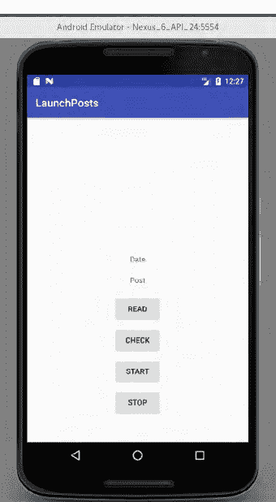

# JAVA 16：手机与安卓——软件开发服务

窗口包含 6 个组件。其中两个是`TextView`组件，点击按钮时会更新。如果你点击顶部的按钮，程序会读取数据库并用读取到的记录更新字段。接下来的测试显示服务正在运行并更新`TextView`组件。按钮启动服务，而最后一个按钮停止服务。用户界面当然很简单，但`MainActivity`类包含了一些代码：

```java
package dk.data.torus.launchposts;

import android.app.ActivityManager;
import android.content.Context;
import android.content.Intent;
import android.database.Cursor;
import android.os.Bundle;
import android.support.v7.app.AppCompatActivity;
import android.view.View;
import android.widget.TextView;
```

```java
public class MainActivity extends AppCompatActivity {
    private TextView txtDate;
    private TextView txtPost;
    private PostService service;
```

# JAVA 16：手机与安卓——服务

```java
@Override
protected void onCreate(Bundle savedInstanceState) {
    super.onCreate(savedInstanceState);
    setContentView(R.layout.activity_main);
    txtDate = (TextView) findViewById(R.id.txtDate);
    txtPost = (TextView) findViewById(R.id.txtPost);
    service = new PostService(this);
}
```

```java
public void onCheck(View view) {
    checkState(service.getClass());
}
```

```java
public void onStart(View view) {
    if (!isRunning(service.getClass())) {
        startService(new Intent(this, service));
        if (isRunning(service.getClass())) txtDate.setText("Post service started");
        else txtDate.setText("Service could not be started");
    } else {
        txtDate.setText("Service is already started");
    }
}
```

```java
public void onStop(View view) {
    stopService(new Intent(MainActivity.this, PostService.class));
    if (isRunning(service.getClass()))
        txtDate.setText("Service could not be stopped");
    else txtDate.setText("Post service stopped");
}
```

```java
public void onRead(View view) {
    try {
        DbAdapter db = new DbAdapter(getApplicationContext());
        db.open();
        Cursor cursor = db.getRows();
        cursor.moveToFirst();
        if (!cursor.isAfterLast()) {
            txtDate.setText(cursor.getString(DbAdapter.COLNO_TIME));
            txtPost.setText(cursor.getString(DbAdapter.COLNO_POST));
        } else {
            txtDate.setText("Database is empty");
        }
        cursor.close();
        db.close();
    } catch (Exception ex) {
        txtDate.setText(ex.getMessage());
    }
}
```

```java
private boolean isRunning(Class<??> serviceClass) {
    ActivityManager manager =
      (ActivityManager) getSystemService(Context.ACTIVITY_SERVICE);
    for (ActivityManager.RunningServiceInfo service :
      manager.getRunningServices(Integer.MAX_VALUE)) {
        if (serviceClass.equals(service.className)) {
            return true;
        }
    }
    return false;
}
```

```java
private void checkState(Class<??> serviceClass) {
    ActivityManager manager =
      (ActivityManager) getSystemService(Context.ACTIVITY_SERVICE);
    for (ActivityManager.RunningServiceInfo service :
      manager.getRunningServices(Integer.MAX_VALUE)) {
        if (serviceClass.equals(service.className)) {
            txtDate.setText("Post service");
            return;
        }
    }
    txtDate.setText("Service not running");
}
```

# 9 最后一个示例

作为本书的最后一个示例，我将编写同一个程序，该程序是《Java 8》书中的最后一个示例，这是一个可以在日历中进行导航并输入备注和预约的日历程序。该程序基本上应该具有与 Java 8 相同的功能，目标是尽可能多地重用设计和代码。因此，将此任务视为一个项目，你需要将一个 PC 应用程序迁移到手机。

本示例的目的是展示一个稍大一点手机应用，并部分应用本书中提到的许多元素。关于程序的具体，请参考 Java 8 的书籍，接下来的内容将仅关注我是如何开发这个程序的，我从上一个版本中重用了哪些内容，哪些部分采用了不同的实现（主要与 Android 和手机有关）。程序通过一系列小范围迭代或冲刺（sprints）开发，以下是这些冲刺的简要介绍，包括最重要的决策。

## 9.1 项目启动与 MainActivity

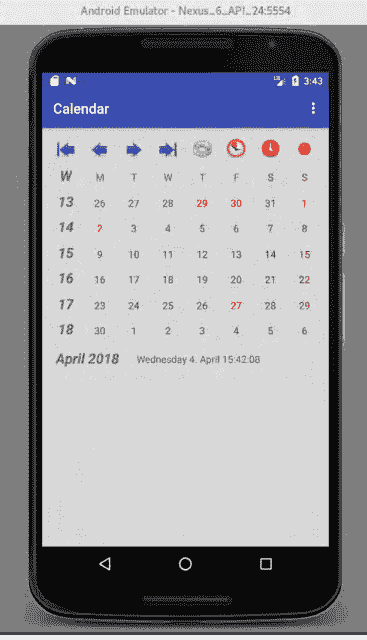

# JAVA 16：手机与安卓软件开发——最后一个示例

窗口的整体设计在此处，工具栏中的图标（按钮）用于：

- 向后导航日历跨年
- 向后导航日历一个月
- 向后导航日历一个月
- 向后导航日历跨年
- 导航到特定年份的月份日历
- 设置秒表
- 设置倒计时
- 设置闹钟

日历的其他功能位于程序的主菜单以及日历自身的右键菜单中。导出到 XML 的功能未包含在此手机版本中。最初，只实现了工具栏中的前四个按钮，因此你可以前后导航一个月或前后导航一年的日历。

从程序的上一个版本中，我复制了`Date`和`MainModel`两个类。这两个类都放在一个名为`models`的子包中。`Date`类完全


# JAVA 16：手机与安卓：开发

与包名已更改这一事实保持不变。原则上，这也适用于`MainModel`类，但这里的某些内容还没有意义，因此被注释掉了。

用户界面完全在 XML 中定义。它非常详尽（占据大量空间），使用复制/粘贴设计用户界面很简单，并在代码中定义到各个组件，结果是一个简单且易于更新的用户界面。因此，`MainActivity`类被保留。在查看代码时，你应该首先注意到如何在 XML 中创建`IconButton`，这是一个添加了资源图像的按钮。在 Java 代码中，你应该注意到如何通过名称而非 ID 来引用单个微小部件（widgets）。你还应该注意代码中的事件处理程序是如何链接到四个按钮的。

## 9.2 数据访问层

程序应该能够维护有关备注、预约和纪念日的数据。在原始 PC 应用程序中，我使用了序列化，而在当前版本中我将使用 SQLite 数据库。这次迭代的目标是持久化数据。结果如下：

1. `Note`、`Appointment`和`Anniversary`类从 Java 8 项目复制过来。这些模型类没有变化。
2. 复制了`Repository`接口，且保持不变。
3. 复制了`Time`类。它扩展了一个额外的构造函数，可以将`HH:MM`格式的字符串解析为`Time`对象。
4. 同样，`Date`类扩展了一个构造函数，可以将`YYYY-MM-DD`格式的字符串解析为`Date`对象。

最后这些更改的原因是 SQLite 没有对应的`Date`和`Time`类型。项目中添加了 dal（数据访问抽象层），在这里我为`notes`、`appointments`和`anniversaries`表创建了`DbHelper`类。`IRepository`类从原始项目复制。该类具有相同的接口（`Repository`），但其他部分已完全修改，以便在 SQLite 数据库中持久化数据。该类尚未经过测试。因此，必须预计在随后的冲刺中该类将会发生变化。

## 9.3 备注

这次冲刺关于实现备注的维护，上包含 3 个功能：

1. 创建和维护备注（CRUD）
2. 显示所有备注的概览
3. 删除两个日期范围内的所有备注

下方的函数从程序的选项菜单选择，而第一个要么来自上下文，要么来自备注列表。结果是项目中添加了三个新的活动（activities），但`MainActivity`类也发生了重大变化。由于所有数据库操作都在上一次迭代中实现，因此此处没有变动。然而，`IRepository`类和`Repository`接口扩展了一个新方法，用于通过标题搜索备注。

上述活动中的第一个称为`NoteActivity`，用于 CRUD 操作。它从程序的右键菜单或`NotesActivity`打开。它是一个简单的活动，可以使用两个参数调用：如果从右键菜单打开，则可以使用一个`Date`对象；如果从`NotesActivity`打开，则可能使用一个`Note`对象。在后的情况下，你将看到备注的所有数据，可以编辑备注（创建备注的日期）并可以删除它。

另一个活动称为`NotesActivity`，显示所有备注的概览。如果没有参数，它会显示所有备注，但你可以通过标题进行搜索，类似于过滤器。如果是在没有参数的情况下调用，则来自选项菜单。如果日历的某一天创建了备注，右键菜单将扩展一个“显示备注”菜单项，再次选择此菜单项并调用`NotesActivity`（此时传入日期作为参数），窗口将只显示当天的备注。

最后一个活动称为`RemoveActivity`，非常简单。只需输入两个日期，然后调用删除该范围内所有备注的数据库操作。该功能从程序的选项菜单执行。由于这是用于预约和纪念日的相同功能，该活动有一个参数指示使用哪种功能。

然后是`MainActivity`，那里也有变化。当然是为了打开上述活动，但最大的变化涉及右键菜单。首先，每个日期字段都应该能够打开自己的右键菜单，这对应于必须对所有代表日期的`TextView`执行

```
registerForContextMenu()
```

为了读取日期，人们还需要确定手指在哪个`TextView`上，这无法立即做到。一种解决方案是触摸`View`对象，执行`onTouch()`方法，这是`OnTouchListener`接口中定义的事件处理程序。如果你将此事件与所有日期的`TextView`组件关联，就可以用最后查看 View 的引用初始化实例变量，当执行右键菜单的事件处理程序时，你可以判断哪个 View 相关事件。这需要知道它的坐标（行和列），但可以通过向组件附加标签对象（tag）来实现。这听起来有点复杂，可以作为一种通宜方案。

# JAVA 16：手机与安卓软件开发——最终示例

另一个需要解决的问题是上下文菜单应当是动态的。除了三个固定的菜单项外，如果某个日期创建了笔记、预约或纪念日，则这三个中的每一个类型都必须有一个额外的菜单项。最后，如果该日期是公共假期，也必须有一个额外的菜单项。由于这些原因，菜单现在定义在代码中（并删除了`context_menu.xml`文件）。

最后，在用户界面中，应该能够（用红色）看到给定日期是否有上下文菜单的扩展。这需要对模型进行更改（之前注释掉的三个静态方法应该激活并进行细微修改）。

## 9.4 纪念日

在下一次冲刺（Sprint）中，我将实现纪念日的维护。原则上，它们的操作方式与维护笔记相同，但会更简单，因为大部分挑战已经解决了，而且该功能在很大程度上可以通过复制/粘贴来实现。基本上需要添加两个活动：

1. 添加到 CRUD 增删改功能的`AnniversaryActivity`
2. 添加到纪念日概览的`AnniversaryActivity`

这两个活动可以通过复制相应的笔记活动来实现。与维护笔记一样，有必要在`IORepository`中针对纪念日添加一个额外的搜索方法。

最后，是删除纪念日，但这已经在`RemoveActivity`中实现了。不过，有必要更改该方法：


public boolean deleteAnniversaries(SQLiteDatabase db, Date from, Date to)

在`IORepository`类中。

作为本次迭代的一部分，`MainActivity`也进行了更新，但这只是更新菜单事件处理程序的问题。

迭代结束时，完成了以下更改：

- 1. 我删除了`Repository`接口。
- 2. 我将`IORepository`的名称更改为`Repository`，同时将该类改为单例。

# JAVA 16：手机与安卓：软件开发 最终示例

这些更改的主要原因是它提供了稍微更简洁的代码，且并不总是需要`IORep`类的实例。另一个原因是`Repository`类包含了几个未被使用的方法，但它们是因为接口的原因，并且作为将`IORep`类转换为当前项目的一部分。我想在下一次冲刺中移除这些方法。

## 9.5 预约

这次冲刺本质上与上一次相同，但涉及复制/粘贴的内容较少。CRUD 窗口更加复杂，因为它还必须显示同一天的其他预约概览，而且程序必须验证预约不会与已创建的预约冲突。该代码取自程序的 PC 版本。

在此冲刺之后，所有与数据库相关的函数都已完成，所有菜单项功能已就位（时钟菜单除外）。最后，更新了`Repository`类并移除了未使用的方法。

## 9.6 其他工具

本次迭代的任务是实现最后的功能，即工具栏中的四个工具以及开启和关闭时钟。

### 工具：选择月份

这是一个简单的功能。在工具栏中选择此工具会打开活动`GotoActivity`，你可以在其中输入年份并选择月份。点击 OK，你将返回`MainActivity`，日历将显示所选月份。除了添加`GotoActivity`类外，还添加了一个用于返回所选月份的`Month`类。

### 工具：秒表

秒表以按钮和只读的`EditText`组件的形式显示在日历下方，该组件显示时钟。默认情况下，这两个组件是不可见的。点击工具栏上的按钮将显示组件并开始计时。如果再次点击该按钮，组件将消失，因此工具栏上的按钮变成了一个开启/关闭按钮。如果秒表可见且正在运行，你点击日历下方的按钮，计时将停止，你可以通过点击按钮再次启动。

为了实现秒表，项目模型添加了以下类型：

- `Stopwatch`
- `StopEvent`
- `StopListener`

这些类型取自 PC 版本且很大程度上没有变化。`Stopwatch`原则上是对每秒跳动一次计时器的封装，每当计时器跳动时，就会作为`StopEvent`发送给`StopListener`。这是一个`MainActivity`实现的接口。

### 工具：倒计时

计数器以按钮和只读`EditText`组件的形式显示在秒表下方，该组件显示时钟。默认情况下，这些组件是不可见的。如果你点击工具栏上的按钮，将切换到活动`WatchActivity`，在其中你必须设置时钟（计时倒计时到 0）。点击 OK 将显示组件并开始计时。如果再次点击该按钮，什么都不会发生（它不是开启/关闭按钮），但点击日历下方的按钮会停止计数且两个组件将变为不可见。


启动计数器时，程序会同时启动一个服务，在计数器变为 0 之前运行。当发生时，手机将响 10 秒并打开`MainActivity`窗口（如果尚未打开）。服务类是`CounterService`。

为了实现计数器，项目模型还添加了以下类型：

- `Watch`（作为`Counter`的基类）
- `TimeEvent`
- `TimeListener`
- `Counter`

这些类型取自 PC 版本且很大程度上没有变化。`Counter`原则上是对每秒跳动一次计时器的封装，每当计时器跳动时，就会作为`TimeEvent`发送给`TimeListener`。这是一个`MainActivity`实现的接口。计数器开始和停止时也会通知。

### 工具：闹钟

该工具原则上与上述计数器相同，显示在计数器下方。区别在于闹钟选择闹钟时间（通过`WatchActivity`），并在时钟到达该时间时触发报警。添加了以下类型：

- `Alarm`
- `AlarmService`

### 工具：时钟

这是一个简单的功能。在菜单中你可以选择开启或关闭时钟。它仅由一个每秒跳动一次的计时器组成，模型添加了以下类型：

- `Clock`
- `ClockEvent`
- `ClockListener`

# JAVA 16：手机与安卓 最终示例

## AppointmentService

事实上，还缺少一个功能，即在预约时间到达提醒用户。该功能被实现为一个服务，在程序启动时启动（如果尚未运行）。该服务每分钟测试一次预约：

- 1. 如果预约在 5 分钟内发生，服务发送 Toast。
- 2. 如果预约在 15 分钟内发生，服务发送 Toast。
- 3. 如果预约在 1 小时内发生，服务发送 Toast。

当预约时间到达时，会发生以下情况：

- 1. 从数据库中删除相应的预约。
- 2. 手机响 2 秒。
- 3. 服务打开日历的`MainActivity`（如果尚未打开）。
- 4. 服务将在窗口的操作栏中插入一条通知。

预约有一个“保存”功能，表示不应删除预约（一个继承自 PC 版本的功能）。这个功能并没有意义，而且由于它使服务变得复杂，因此被移除了。数据库没有更改，唯一发生的变化是`AppointmentActivity`中移除了一个`CheckBox`。

为了处理来自服务的通知，程序的选项菜单扩展了一个删除操作栏中所有通知的功能。

服务在应用程序启动时启动（如果尚未在运行）。

然后是服务本身的实现，这并不简单，而且它曾用于向客户端发送通知，这是我没有提到的。服务启动一个执行任务的线程，该线程的代码（至少是算法）取自 PC 程序。服务变得复杂的地方在于线程必须以 Toast 消息或状态栏通知的形式与程序通信。因此有必要创建`Handler`对象进行通信。

# JAVA 16: 手机与安卓：软件开发

一个最终示例

## 9.7 项目评审

最后一次迭代包含了代码审查、进一步的测试以及对缺陷和不便之处的修正。

关于后者，有两点发生了变化：

在维护备注、预约和纪念日时，必须更新用户界面，以便用户看到本月某个日期发生了变化。这是在预料之中的，它仅适用于从选项菜单进行的更改。该更改主要通过使用`startActivityForResult`方法代替`startActivity()`来切换活动。

关于`AppointmentService`服务，让它一直运行可能并不理想，至少它只是一个演示程序。因此，选项菜单扩展了两个新的菜单项，用于启动和停止该服务。你必须在程序开始时手动启动服务（如现在所做），并保留菜单项，从而获得停止服务的机会。

除此之外，仅引入了细微的颜色调整、新图标以及更改，以确保你使用正确的虚拟键盘。

这次迭代的大部分工作都用在了测试上，并修正了一些错误。

如果你查看最终结果，应该会有一些应该不同的地方，例如，应用程序的一些活动应该被对话框（dialogs）替换，但此处我缺乏基础，所以这必须留到以后。然而，最大的问题是程序完全无法运行——至少不符合预期。只要手机处于开启状态，原则上一切运行良好，但如果手机进入睡眠状态，三个服务就无法唤醒应用程序，因此这个想法几乎没有实现。因此，这是下一本书的另一个伏笔。

# JAVA 16: 手机与安卓：软件开发

附录 A，安装 Android Studio

以下是关于如何设置 Android 开发环境的简要介绍。有几种选择方案，你可以为 NetBeans 添加插件，从而使用你熟悉的开发工具。然而，大多数人使用 Eclipse 或 Android Studio，由于我采用了后者，因此接下来的评审将围绕该产品。一个 Android 开发者工具需要两样东西：

- 1. 一个常用的 IDE，你可以在其中输入和编辑代码。
- 2. 一个模拟器，这是一个在你的 PC 上运行虚拟 Android 机器的程序，用于模拟手机，例如以便在程序安装到物理手机设备之前进行测试。

事实上，这两个产品之间的集成是一个挑战，因为从开发者的角度来看，它必须简单高效且没有大问题。这就是为什么没有多少人使用 NetBeans 作为 Android 软件开发的平台。


关于 e-Learning for Kids。e-Learning for Kids 成立于2004年，是一个全球非营利基金会，致力于为5-12岁的儿童提供有趣的免费在线学习，课程涵盖数学、科学、语言艺术、计算机、健康和环境技能。自2005年以来，已有来自190国家的超过1500万儿童受益于电子课程。所有志愿者员工都由来自全球的教育和在线学习专家以及业务专业人士组成，他们致力于做出改变。eLearning for Kids 积极寻求资金、志愿者、赞助商和课件开发者：请加入我们！更多信息请访问 www.e-learningforkids.org。

# JAVA 16: 手机与安卓：软件开发

附录 A，安装 Android Studio

编写 Android 应用程序你需要两样东西：

- 1. Android SDK 最好被描述为一组库，包含了 Android 应用程序可能需要的所有组件。
- 2. Android Tools，这是在应用开发中使用的一系列工具，包括模拟器等等。

当 Android 上市时，最广泛使用的开发环境是结合了上述两个产品的 Eclipse，从那以后它一直是一个稳定高效的开发平台。我在这里提到 Eclipse，也是由于该产品本身值得拥有（出于其他原因），因为它通常是开发 Java 应用程序的有效工具，而且在各方面都是 NetBeans 的替代品，且许多人倾向于使用 Eclipse 而不是 NetBeans。关于这两个产品中哪一个更好可能会有长期的讨论，而且将会持续，事实上，最好的产品可能是用户最熟悉且最有经验的产品。在这些书中，我处处都使用了 NetBeans，但知道有一个叫 Eclipse 的东西是好的，而且你可以轻松地进入一个使用该工具的开发组织，特别是当任务涉及手机或其他移动设备的应用开发时。

Android SDK 和 Android Tools 这两个产品均来自 Google，随着这些产品的出现，Google 也开发了一个用于开发 Android 应用程序的 IDE。它已经运行了一段时间，但今天它已经达到了一个非常用户友好且高效的工具阶段。这就是为什么我将在处处使用它，一个 Google 称为 Android Studio 的工具。

原则上，安装 Android Studio 非常简单，因为它所有的内容都封装在一个包中，可以立即下载并安装，而 Linux 则需要更多操作。在接下来，我将概述我在 Fedora 机器上设置开发环境的操作，实际上要写出一份精确的指南并不容易，部分是因为更新和更改不断被添加，部分是因为命令取决于当前的 Linux 发行版。幸运的是，网上有很多指南，最好的做法是遵循这些指令（如果它们是最近的手册）。因此，以下主要作为良好指南的参考。

为了让你能够实践开发 Android 应用程序，你需要安装受硬件加速支持的虚拟化软件，因为模拟器的运行速度慢得难以接受。可以通过以下地址查看分别针对 Fedora 和 Ubuntu：

```
https://fedaproject.org/wiki/Getting_started_with_virtualization
```

```
https://software.intel.com/en-us/blogs/2012/03/12/how-to-start-intel-hardware-assisted-virtualization-hypervisor-on-linux-to-speed-up-intel-android-x86-emulator
```

模拟器本身是 32 位的，如果你有 64 位的机器（无论你是什么机器），你也应该安装一个名为`ia32-libs`的特殊库。对于 Fedora，你可以在以下地址查看：

```
https://ask.fedoraproject.org/en/question/9556/how-do-install-32bit-libraries-on-a-64-bit-fedora/
```

而对于 Ubuntu，以下文档解释了如何操作，以及如何下载和安装`Android Studio`：

```
http://www.vogella.com/tutorials/Android/article.html
```

该文档也是对 Android 是什么的简要介绍，并展示了如何编写第一个应用程序。

通过上述参考（或替代方案），设置你的开发环境应该可以顺利运行而没有大挑战，但请记住 Android 是一个不断变化的动态世界。
