# Java 17：深入了解 Java 和 Android 软件开发

© 2018 Poul Klausen & [bookboon.com](http://bookboon.com)

ISBN 978-87-403-2422-8

同行评审：Ove Thomsen, EA Dania

## 前言

本书是 Java 软件开发系列书籍中的十七本，是上一本关于手机应用开发书籍的延续。本书要求读者具备 `Java` 和 `Android` 的知识，这与 `Java 16` 书中涉及的内容相当，其目标是介绍书中未涵盖的话题。此外，本书将介绍如何使用碎片（fragments），这对于开发大型应用程序以及确保当前设备的独立性至关重要。其他重要主题是介绍如何使用手机相对于传统 PC 所提供的功能（如 `GPS` 和相机）。最后，本书将扩展关于服务（services）的内容，并针对上一本书末提到的某些不足提供解决方案。目标是让读者在读完上一本书和本书后，能够实践开发用 `Java` 编写的 Android 应用程序。

标题所示，该系列书籍涉及软件开发，目标是教读者如何用 `Java` 开发应用程序。读者可以通过阅读相关主题和学习完整的示例程序来掌握，但最重要的是亲自动实践并从零开始编写自己的程序。因此，书籍的一个重要部分是练习和问题，读者必须编写与书中处理的内容相对应的程序。该系列的所有书籍都围绕同一个骨架构建，并由文本、示例、练习和问题组成，这些内容被放置在文本中自然的位置。练习（exercises）与问题（problems）的区别在于，练习很大程度上是对文中阐述内容的重复，并且对做什么描述得相对准确。相比之下，问题的描述较为松散，通常规模大一些，且很少有明确的完美解决方案。这些书是从头到尾阅读的，但大量的代码示例（包括练习和问题）起着核心作用，让读者详细研究许多示例代码，并解决练习和问题（或者可能只是研究推荐的解决方案），这是非常重要的。

所有书籍都以一或两个较大的示例程序结束，重点主要关注流程以及对程序如何编写的解释。另一方面，代码仅在有限范围内出现——如果出现的话——读者应该通过学习完成的程序代码，也许是在测试程序时来进行。除了展示比其他示例更大的程序开发外，总结示例的目标还为了展示来自不同应用领域的程序示例。

大多数书籍还以一个附录结束，其中处理一个书中未涉及的主题。这可能是关于软件安装的问题或其他计算机技术的其他主题，这些主题虽然与软件开发无关，但有必要具备基础知识。如果读者已经熟悉该主题，可以跳过当前附录。

编程语言如前所述是 `Java`，此外，书籍还使用了以下产品：

1. `NetBeans` 作为应用开发的 IDE
2. `MySQL`，在需要数据库服务器的情况下使用（从 `Java 6` 书开始）
3. `GlassFish` 作为 Web 服务器和应用服务器（从 `Java 11` 书开始）
4. `Android Studio`，即用于手机 App 开发的工具

这些产品都是免费（free of charge）且可以免费安装的，甚至有些产品的安装过程是自动完成的，不需要费费精应对挑战。此外，网上有所有这三个产品的详细安装说明。这些产品支持 Windows 和 Linux，因此无论你使用 `Linux` 还是 Windows，都没有特殊区别。

所有示例程序均在运行 `Linux` 的机器上开发和测试。事实上，这并没有主要影响，因为无论平台是其中哪，`Java` 和其他产品的工作方式完全相同。书中的某些地方你会看到平台是 `Linux`，这主要适用于涉及文件系统的命令。否则，对于读者来说，程序在 `Linux` 上开发并没有意义，它们也可以立即在 Windows 下运行，除非程序引用了文件系统，此时可能需要更改文件名。

最后，简单介绍一下这些书**不是**什么。它们不是“如何编写”指南，或者说不是 `Java` 的参考手册，而是如标题所示，是关于软件开发的书籍。我希望读者在阅读书籍并通过许多示例时，能够找到编写良好程序的灵感，同时它也可以作为解决方案的集合，为你这类作为软件开发人员经常面对的具体日常编程问题提供许多示例。

# 1 引言

在上一书中，我处理了如何为 `Android` 设备（此处主要是手机）编写 `Java` 应用程序。像很多事情一样，这是一个巨大的领域，有许多特殊问题，与上一本书所说的相比，还有很多空白，接下来的目标是提到一些缺失的内容。

手机（以及平板电脑等其他 `Android` 设备）是计算机，原则上的编程方式与任何其他 PC 相同，但有两个重要的区别：

1. 它是一个非常小的计算机，无论从物理上还是容量上都是。
2. 设备具有比传统 PC 更多、不同的功能。

简单来说，你可以说上一本书处理的是由于第一种差异而特殊之处，而本书处理的是最后一种差异。对于任何具有用户交互的计算机程序，两个关键问题是：

1. 如何编写应用程序的用户界面，对于手机来说，就是如何编写 `activity` 以及在 `activities` 之间导航。
2. 如何持久化数据，对于手机，它是使用 `SQLite` 数据库实现的，它提供了许多与数据库系统类似的功能。

这两个问题在上一书中已经讨论过，但与传统 PC 相比，手机提供了其他功能，例如：

* 你可以拨打和接电话
* 你可以发送和接收短信
* 使用 `GPS` 系统确定位置
* 设备有相机，你可以拍照
* 你可以通过振动手机引起用户的注意
* 以及其他许多功能

这些是程序员也可以使用的功能。与完成的程序相比，它提供了一些新的可能性，但也意味着要学习如何使用这些功能。`Android` 以类的形式提供了这些功能，大多数情况下，这取决于要写什么。本书提供了关于如何使用特定功能的典型示例。

然而，本书从碎片（fragments）开始，它是开发灵活性并根据当前设备屏幕自定义用户界面的解决方案。如果设备是平板电脑而不是较小的手机，`activity` 应该以不同的方式使用屏幕。最后，本书更多关于服务（services）的内容，这对于开发手机等 `Android` 设备的应用程序至关重要。

# 2 碎片

我想从“片段（fragments）”开始这本书，这实际上是我在上一本书的最后一个示例中缺乏的内容。就像活动（activity）一样，`fragment` 是一种布局，它是一个 XML 文档，定义了窗口（窗口的一部分 = 一个 `fragment`）的布局和内容，然后是一个 Java 类。因此，一个窗口（一个活动）可以由几个片段组成，每个片段定义窗口的一个部分。它的用途是，在运行时你可以用一个片段替换另一个片段，从而窗口可以获得不同的布局，因此片段通常可以作为使用更多活动的替代方案。然而，在应用程序中更重要的应用是更好地利用屏幕，这在平板电脑等类似的大型屏幕上尤为重要。在这里，屏幕可以容纳更多的活动，但由于无法做到这一点，你反而可以并排查看多个片段。最后，片段还用于标签页显示、列表显示以及比上一本书中显示的更强大的对话框。

你应该意识到，片段绝不是活动的替代品，但片段可以简化应用程序布局的设计，并有助于布局在多个活动中的更易复用。一个活动可以由多个片段组成，但一个特定的片段对象只能与一个活动关联。你也可以说，片段将用户界面的组件与相关的逻辑组合在一起。

我想从一个名为 `TheBooks` 的简单示例开始，这是一个没有使用片段的应用程序。该程序打开以下窗口：

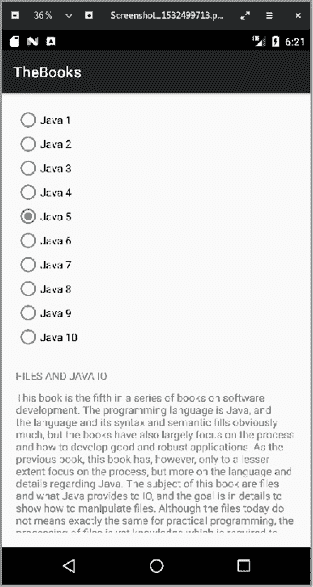

目标是展示如何修改该程序使其使用片段。必须立即提到，片段并不是解决所有问题的方案，如果应用程序只需要像 `TheBooks` 应用程序中那样的功能，那么使用片段就没有意义了。在当前的示例中，目标仅仅是展示片段是什么，但首先要简单介绍一下该应用程序是如何制作的。布局完全由 `activity_main.xml` 组成：

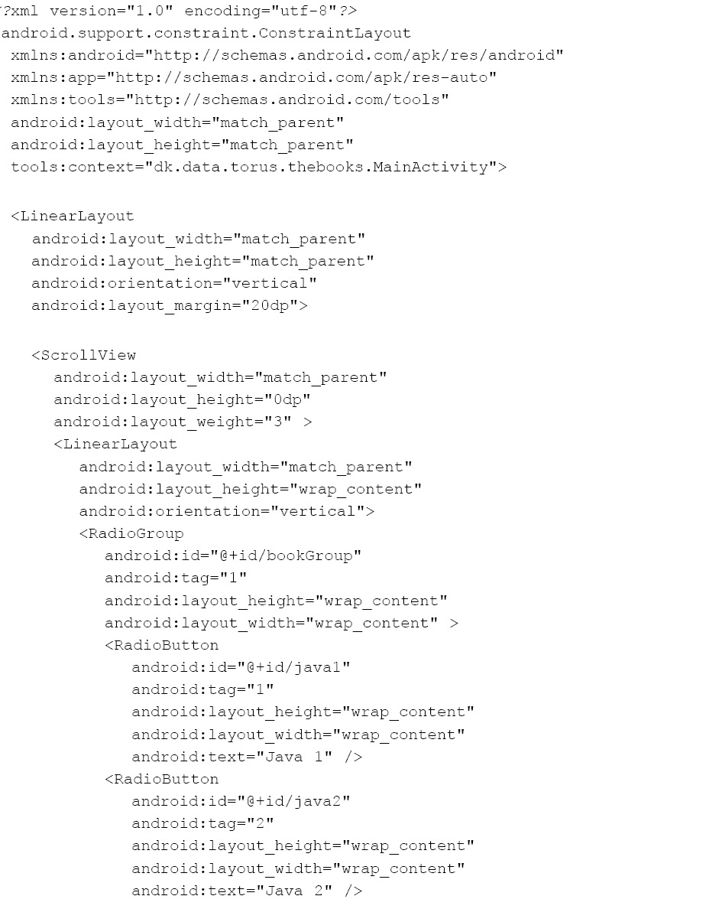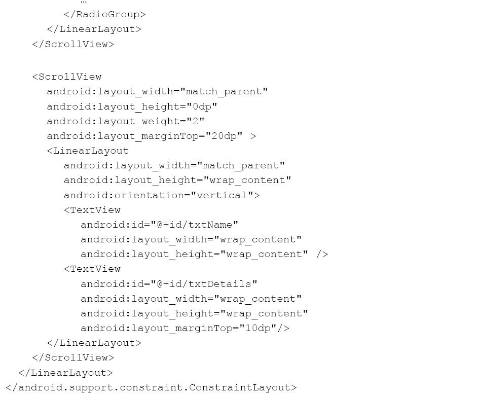

布局非常广泛，因为它定义了 20 个 `RadioButton`（我只显示了前 2 个），但在布局其他方面没有新内容。它基本上由垂直方向的 `LinearLayout` 中的两个 `ScrollView` 元素组成，这两个 `ScrollView` 元素按 3:2 的比例共享空间。注意每个 `RadioButton` 元素都定义了一个 `tag` 属性，用于在代码中确定点击了哪个单按钮。

关于 Java 代码，添加了一个类来定义具有两个属性的图书：

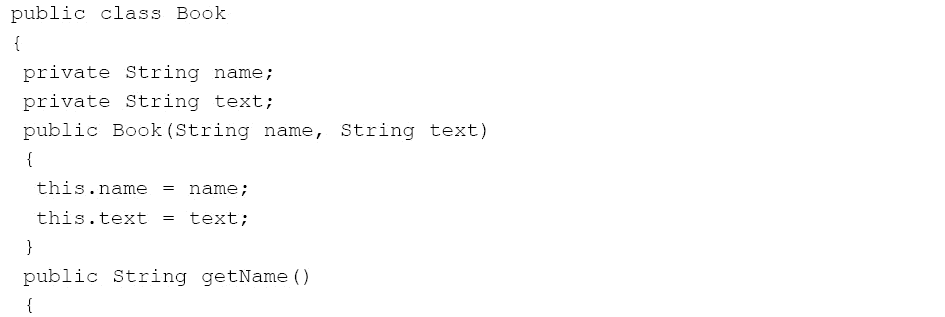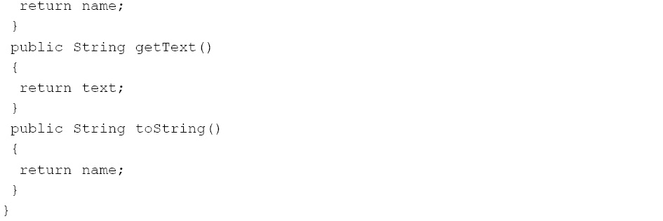

最后，添加了一个创建 20 个 `Book` 对象的类：

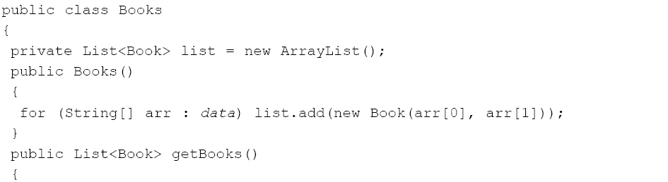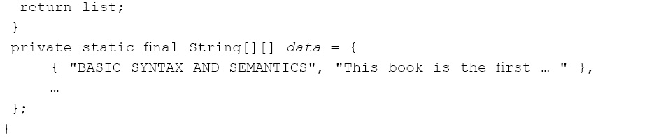

最后是 `MainActivity` 类，没有什么需要解释的：

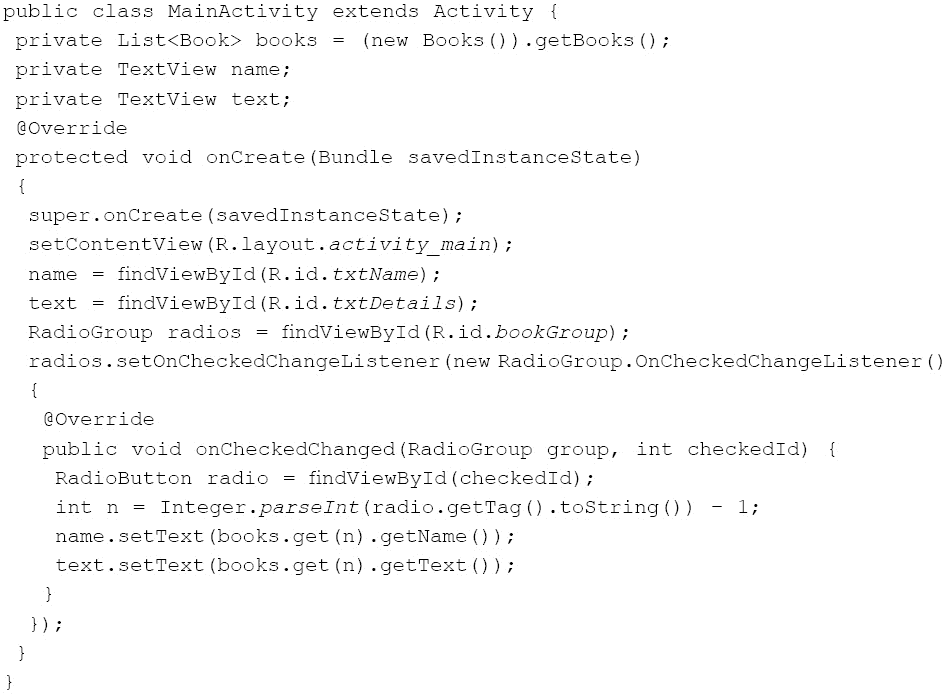

到目前为止，这是一个简单的应用程序，没有添加太多新内容，但我想将用户界面分为两个片段，以便每个片段包含两个 `ScrollView` 元素之一。我从 `TheBooks` 项目的副本开始，并将该副本命名为 `TheBooks1`。作为第一步，我在 `res / layout` 目录中添加了一个文件 `fragment_books.xml`：

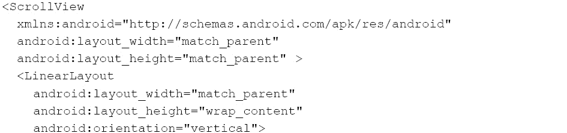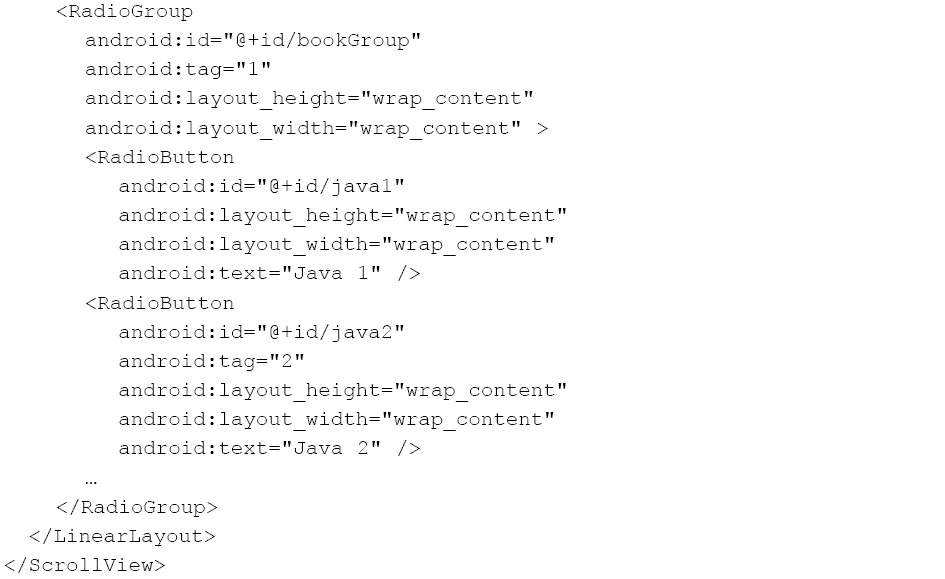

内容只是 `activity_main.xml` 中第一个 `ScrollView` 元素的复制——但有很多变化。有必要在 `ScrollView` 元素中添加一个 `namespace` 元素，然后将 `width` 属性的值从 0 改为 `wrap_content`，同时删除了 `weight` 属性。因为不应该是片段来决定它应该填充多少空间，而是应该使用该片段的布局。

然后，同样，我为最后一个 `ScrollView` 元素添加了布局，我将其命名为 `fragment_book.xml`：

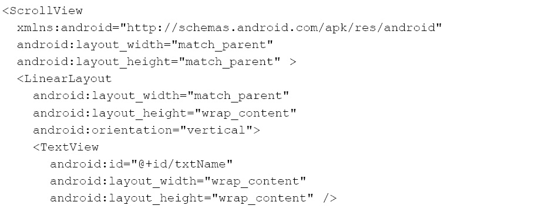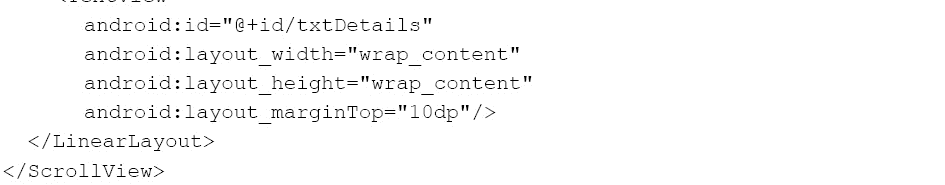

片段的组成（通常）与活动相同，一个 XML 文件形式的布局以及一个 Java 类。因此，我为第一个片段添加了以下类：

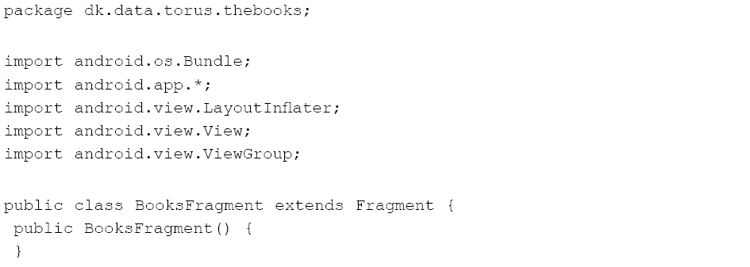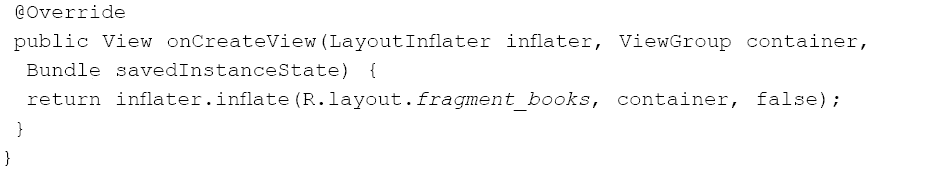

显然，很容易猜到它看起来应该是这样的，但它是一个继承自 `Fragment` 的类。当片段被创建时，Android 会调用多个方法，最常见的是覆盖 `onCreateView()`。此方法返回片段的 `View` 层次结构。`onCreateView()` 有三个参数，第一个是 `LayoutInflater` 的引用（读取布局的对象）。另一个参数是……（此处原文存在重复/乱码）。

关于 Java 代码，添加了一个类来定义具有两个属性的图书：


最后，添加了一个创建 20 个 `Book` 对象的类：


最后，是 `MainActivity` 类，没有什么需要解释的：


到目前为止，这是一个简单的应用程序，没有添加多少东西，但我想将用户界面分为两个片段，以便每个片段包含两个 `ScrollView` 元素之一。我从 `TheBooks` 项目的副本开始，并将该副本命名为 `TheBooks1`。作为第一步，我在 `res / layout` 目录中添加了一个文件 `fragment_books.xml`：


内容只是 `activity_main.xml` 中第一个 `ScrollView` 元素的复制——但有很多变化。有必要在 `ScrollView` 元素中添加一个 `namespace` 元素，然后将 `width` 属性的值从 0 改为 `wrap_content`，同时删除了 `weight` 属性。因为不应该是片段来决定它应该填充多少，而是使用该片段的布局。

然后，同样，我为最后一个 `ScrollView` 元素添加了布局，我将其命名为 `fragment_book.xml`：


片段的组成（通常）与活动相同，一个 XML 文件形式的布局以及一个 Java 类。因此，我为第一个片段添加了以下类：


显然，很容易猜到它看起来应该是这样的，但它是一个继承自 `Fragment` 的类。当片段被创建时，Android 会调用多个方法，最常见的是覆盖 `onCreateView()`。此方法返回片段的 `View` 层次结构。`onCreateView()` 有三个参数，第一个是 `LayoutInflater` 的引用（读取布局的对象）。另一个参数是……（此处原文存在重复/乱码）。最后一个参数在后面提到。在这种情况下，`onCreateView()` 方法除了在 `LayoutInflater` 对象上执行 `inflate()` 方法外没有做什么，该参数是资源的名称。

有一个对应的类 `BookFragment`，其代码与上面几乎相同，只是指向了另一个资源。然后是布局 `activity_main.xml`，它当然必须更改。在这里，大部分代码被移动到了两个片段中，这些代码块必须被片段元素替换：

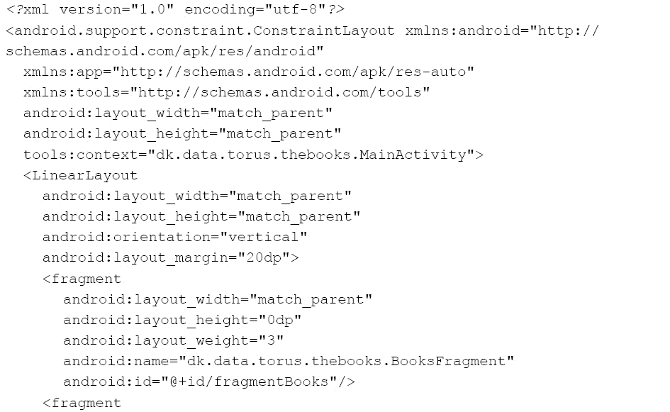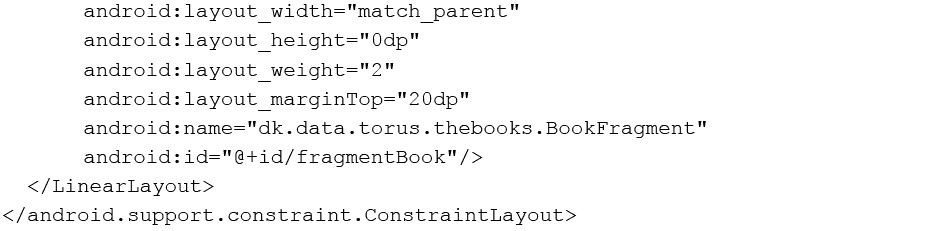

每个片段元素都有一个 `id` 属性（在本示例中未使用）和一个 `name` 属性，用于指示要实例化并关联什么样的 `Fragment`。然后，新版本的程序就完成了，可以进行编译和运行。程序运行方式与之前完全相同，区别是用户界面现在是用两个片段构建的。

## 2.1 旋转手机

上面的程序显示两个 `ScrollView` 组件纵叠排列，但旋转手机使其横向握持时，屏幕利用变得糟糕，因为包含标题的部分占据了大部分屏幕：

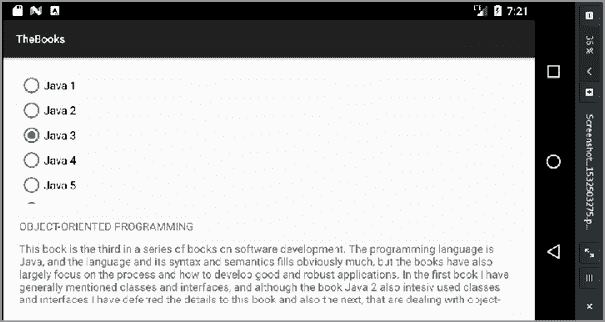

在这里使用以下布局会更好：

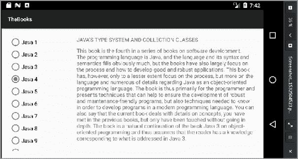

当然，解决方案是定义一个不同的布局，确保在横向握持时使用它。当然，这可以通过编程实现，但由于布局被定义为资源，Android 有一种内置功能可以在运行时根据手机的握持方式选择资源。

这是片段可以用到的第一个示例。我将重写一个**新**版本的 `activity_main.xml`，但它是非常简单的布局资源，因为所有工作都已移动到两个资源中，无论是第一个还是第二个布局，使用的都是相同的资源。

作为第一步，你必须添加名为 `res/layout-land` 的新目录。最简单的方法是右键点击 `res` 目录并选择


然后你会看到以下窗口：

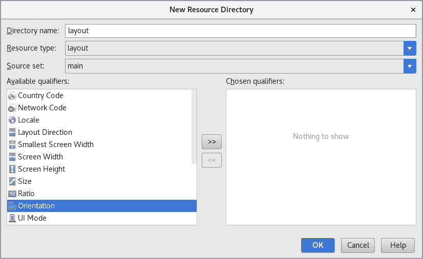

其中我作为 `Resource type`（资源类型）选择了 `layout`。接下来，在 `Available qualifiers`（可用限定符）下，我选择了 `Orientation`（方向），点击 `>>` 按钮后，会出现下面的窗口：

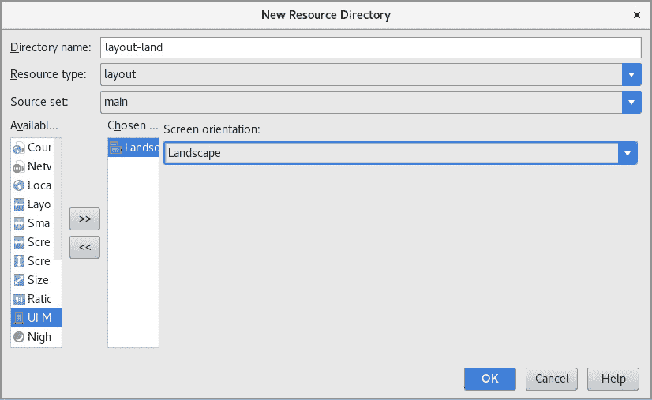

在这里，我在 `Screen orientation`（屏幕方向）下选择了 `Landscape`（横屏）。当你点击 `OK` 时，Android Studio 会 `res` 下创建一个名为 `layout-land` 的目录。

然后你必须将 `activity_main.xml` 文件复制到新目录中（如果 Android Studio 没有显示新目录，你可以从外部使用 `Files` 进行操作）。现在项目有两个版本的 `activity_main.xml`，这里的新版本将根据横屏模式进行调整。没有什么需要做的，下面显示了更改的内容：


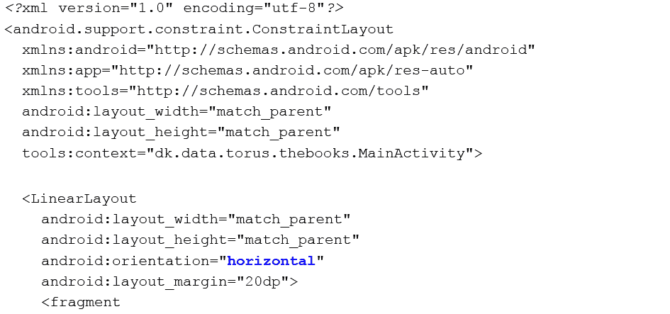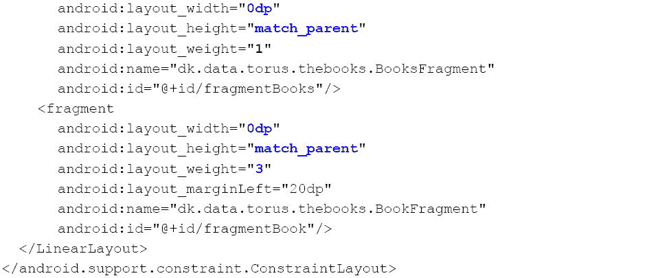

之后，程序就可以进行编译和测试了，你会发现如果手机垂直握持，则会使用旧设计；如果水平握持，则会使用新设计。在两种情况下，使用的都是相同的 `fragments`（片段），并且运行时系统会处理（因为现在有一个 `layout-land` 目录），确保 `MainActivity` 使用的是正确的设计。

## 2.2 屏幕尺寸

上面我展示了如何让 Android 根据手机的方向应用特定的布局，其中 Android 根据特定的命名约定决定使用哪种资源。你也可以在屏幕尺寸上做相同的操作。然而，这并不简单，因为现在有许多不同的屏幕尺寸，尤其是是因为你还必须考虑平板电脑。

我将从上述项目的副本开始，我将其命名为 `TheBooks3`。首先，我将以另一种方式实现关于手机旋转的解决方案。我更改了 `layout-land` 目录下的 `activity_main.xml` 版本名称为 `activity_main_wide.xml`，然后将文件复制到 `layout` 目录，并再次删除了 `layout-land` 目录。结果是 `layout` 目录现在包含了四个文件：

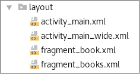

下一步，我按照上面显示的方法（使用相同的向导）添加了一个资源目录：


名称为 `values-land`。对于这个目录，我添加了以下 XML 文件，我将其命名为 `refs.xml`：

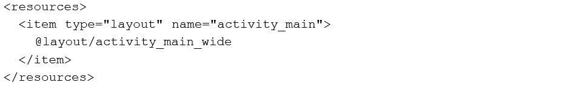

它是 `land` 目录中的资源，结果是，如果设备水平握持，Android 会发现运行时系统作为 `activity_main.xml` 引用的布局，必须使用 `activity_main_wide.xml` 而不是 `activity_main.xml`。现在你尝试运行应用程序，你会发现它一切运行正常，并且手机根据垂直握持还是水平握持使用不同的布局。目前，这种解决方案与上一个示例相比没有优势。这种技术被称为 `layout aliasing`（布局别名），优点是你可以轻松扩展解决方案以包含具有不同屏幕尺寸的设备。

正如提到的，现在有许多在物理尺寸和分辨率上都不同的屏幕尺寸。同样，Android 使用了一种名为 `density independent pixel`（密度无关像素）的测量单位，称为 `dp`，这是我在上一本书中使用的测量单位。`1 dp` 定义为在 `160 dpi` 设备上 `1 pixel` 的物理尺寸，因此它独立于屏幕的物理像素尺寸。例如，如果你考虑 `160 dpi` 设备上的 7 英寸屏幕，对角线方向有 1120 个像素。如果屏幕格式为 16 × 9，通过略微舍入得到的分辨率为 `1000 × 600 dp`。

Android 使用 `resource screen size qualifiers`（资源屏幕尺寸限定符）定义屏幕尺寸，这里有三个使用资源目录定义的选项：

1. `Smallest width screen size qualifier`（最小宽度屏幕尺寸限定符）。它对应于独立设备方向的屏幕最窄处的 `dp` 数。资源目录的名称为 `sw`，后跟所需的屏幕尺寸。例如，针对最小宽度至少为 `600 dp` 的设备的布局资源目录名为 `layout-sw600dp`。

2. `Available width screen size qualifier`（可用宽度屏幕尺寸限定符）。它对应设备当前方向从左到右量的 `dp` 数。如果你更改设备方向，可用宽度也会改变。资源目录的名称为 `w`，后跟宽度。例如，针对可用宽度至少为 `600 dp` 的设备的布局资源目录名为 `layout-w600dp`。

3. `Available height screen size qualifier`（可用高度屏幕尺寸限定符）。它对应设备当前方向从上到下量的 `dp` 数。如果你更改设备方向，可用高度也会改变。资源目录的名称为 `h`，后跟高度。例如，针对可用高度至少为 `600 dp` 的设备的布局资源目录名为 `layout-h600dp`。（注：原文在此处对 3 点的描述出现了错乱，重复了宽度描述，翻译时已根据逻辑修正）。

`Available width screen size qualifier`（可用宽度屏幕尺寸限定符）。它对应设备当前方向从左到右量的 `dp` 数。如果你更改设备方向，可用宽度也会改变。资源目录的名称为 `w`，后跟宽度。例如，针对可用宽度至少为 `600 dp` 的设备的布局资源目录名为 `layout-w600dp`。

与其使用屏幕尺寸限定符指定资源目录，不如使用旧的方法将设备分为四组：`small`、`normal`、`large` 或 `xlarge`，资源目录名称可以是 `layout-large`。

在当前案例中，我以相同的方法添加了资源目录 `values-large`：


在接下来的窗口中，我为 `Resource Type` 选择了 `values` 并选择了 `Size`，当我点击 `>>` 按钮时，将选择 `large`。

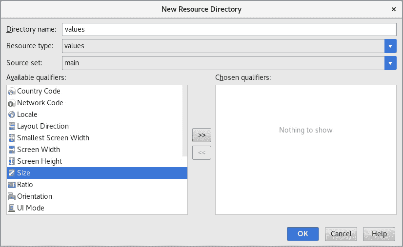

同样，我创建了另一个资源目录，这次是 `values-v600dp`。区别在于在上面的屏幕中，我将选择宽度名称，而在下面的窗口中将输入名称：

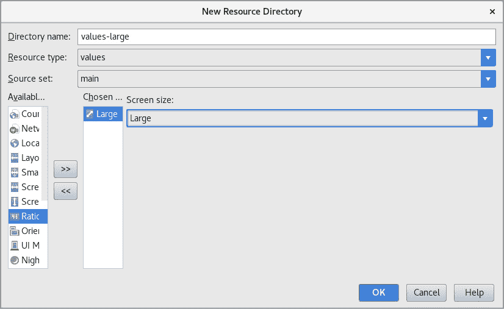

创建这两个目录后，必须将 `values-land` 目录中的 `refs.xml` 文件复制到这两个新目录中。

## 2.3 Fragments 之间的通信

上面的程序使用 `fragments` 解决了 Android 应用的许多挑战，并且程序按预期工作。有两个 `fragments`，这两个片段之间必须相互通信，以便当在一个片段中点击单选按钮时，另一个片段必须被更新。在程序中，这种通信由 `MainActivity` 解决，它接收单选按钮被点击的通知，事件处理程序将确定点击了哪个单选按钮，以找到要更新另一个片段的数据，然后更新片段的 `TextView` 组件。从原理上讲这样做没有问题，但这意味着程序的 `activity` 和 `fragments` 之间紧密耦合，使得在其他 `activity` 中复用单个片段变得更加困难。

在本节中，我想向你展示一个实现了片段（`fragments`）之间松耦合的程序版本。起点是上一个程序的拷贝，我将其命名为 `TheBooks4`。当你研究代码时，可能不会立即看到它的优势，因为代码量更多且更复杂，但对于具有多个使用相同片段的任务的大型应用程序来说，这种工作是非常值得的，因为结果是一个更易维护的程序。在接下来的中，我将展示了哪些变化，这些变化仅涉及 Java 代码。

当 Java 中的对象需要通信且你想要使用松耦合时，通常的模式是定义一个接口（`interface`）。同样，我在项目中添加了以下接口：

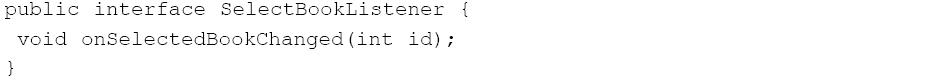

该接口定义了一个方法，其含义是如果点击了单选按钮（`radio button`），`BooksFragment` 类必须向 `SelectBookListener` 发送通知。方法的参数必须是被点击的单选按钮的索引。`BooksFragment` 类必须进行修改，结果如下：

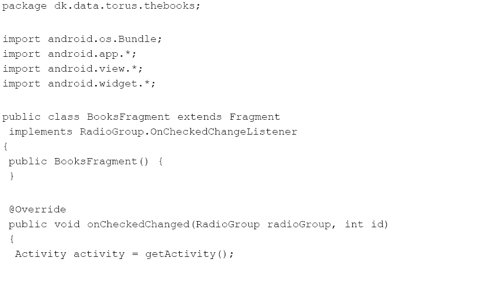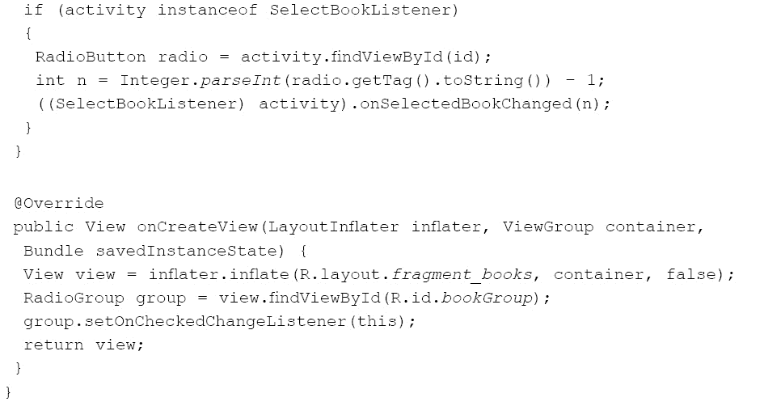

首先，注意该类现在实现了 `RadioGroup.OnCheckeChangeListener` 接口，然后该类必须实现 `onCheckedChanged()` 方法。首先，使用 `getActivity()` 方法来确定此片段所属的 `activity`。如果是一个 `SelectBookListener`（这是 `BooksFragment` 对象无法知道——也不应该知道的），该方法将确定点击了哪一个单选按钮（注意代码是从 `MainActivity` 复制的）。然后，将当前 `activity` 的类型强制转换为 `SelectBookListener` 对象，之后调用 `onSelectedBookChanged()` 方法，并将书籍索引作为参数传入。你还应该注意 `onCreateView()` 也被修改了，它现在会确定对布局中 `RadioGroup` 组件的引用，并使用它将事件处理器关联到 `RadioGroup` 组件上。

`BookFragment` 类也被修改了：

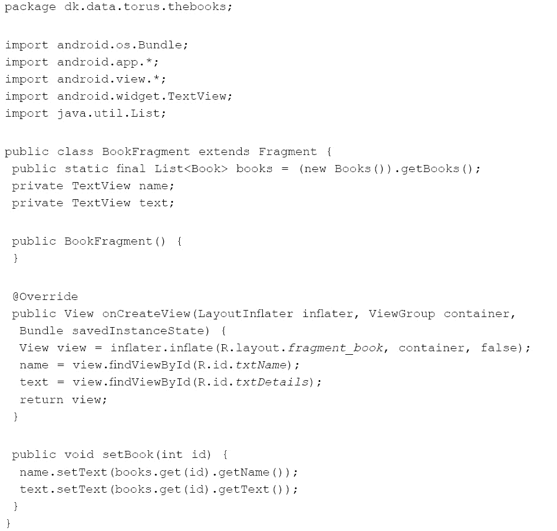

注意该类现在有三个变量，它们都是从 `MainActivity` 拷贝的。也就是说，`Book` 对象列表是该类的一部分，这并不自然，但为了解决引用问题，将其设置为 `static`，这样 `BookFragment` 类的多个实例就不会创建各自的拷贝。更好的选项是将书籍信息放在 `String` 资源中。在其他上下文中，信息将从数据库检索，此时 `setBook()` 的参数将是一个键。`setBook()` 更新两个 `TextView` 组件，这两个组件在 `onCreateView()` 中创建了对组件的引用。

这里是 `MainActivity`，它现在被修改为：

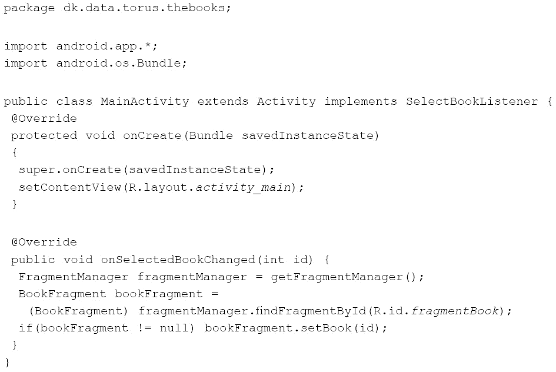

所有变量都被删除了，`onCreate()` 变得简单（因为 Android Studio 已经创建了它）。该类实现了 `SelectBookListener` 接口，因此需要实现事件处理器 `onSelectedBookChanged()`。当点击单选按钮时，它会从 `BooksFragment` 被调用，参数是被点击的书籍索引。当这种情况发生时，你应该调用 `BookFragment` 类中的 `setBook()` 方法。你不能直接从 `activity` 引用 `Fragment`，但你可以通过 `FragmentManager` 对象来实现，任何 `activity` 都有一个返回此类对象的方法。有了这个对象，你就可以确定片段的引用并成功地调用 `setBook()`。

在此之后，这些已经已经实现——经过了一段相当漫长的路——但结果是一个类之间耦合更弱的解决方案。

## 练习 1: TheBirds

你必须编写一个可以称为 `TheBirds` 的应用程序。书的源目录包含一个有 7 张图片的子目录。当程序打开时，它必须显示这些图片的概览以及第一张图片。当你点击图片的名称时，该图片将出现在窗口中。界面必须由两个片段组成，一个显示列表，另一个显示图片。此外，程序必须支持手机旋转。你不需要考虑不同的屏幕尺寸。

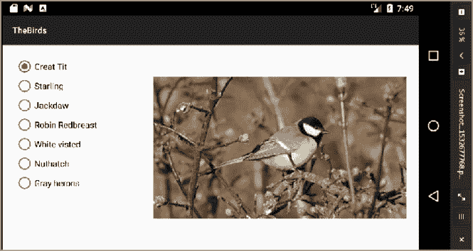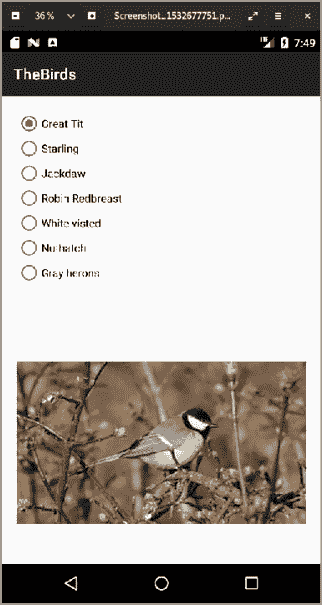

## 2.4 Two activities

上面的应用程序是一个所谓的列表/详情应用程序，并根据手机握持方式或设备是否为平板电脑显示两种不同的布局。这是一个显示多个对象（这里是书名）概览的应用程序，点击书籍将向你显示详情。如果手机竖着握，列表显示在顶部；如果手机横着握或在大屏幕情况下，列表显示在左侧，详情显示在右侧。此类应用程序被广泛使用，但由于空间原因，当手机竖着时，整个屏幕都用于列表通常很有趣，而当你触摸一个对象查看详情时，它们会在另一个 `activity` 中出现。在本节中，我想展示让上述应用程序运行所需的内容。

我从 `TheBooks4` 的拷贝开始，我将其命名为 `TheBooks5`。首先，我添加了一个新的 `activity`，命名为 `BookActivity`。布局如下：

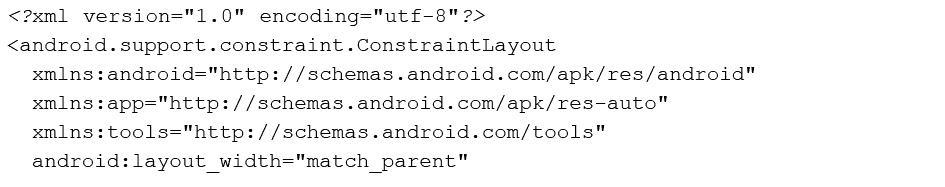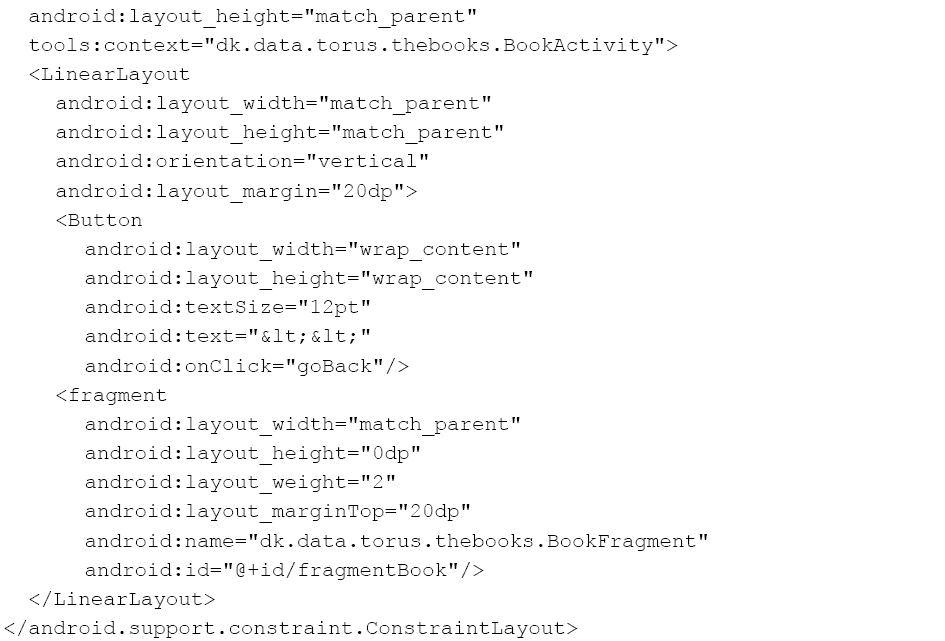

除了按钮外，还需要从 `activity_main` 中移除片段。该元素也必须从 `activity_main.xml` 中移除：


结果是，在手机竖持的情况下，`MainActivity` 将整个屏幕用于列表。如果你的手机横握或是平板电脑，程序像以前一样工作并使用 `activity_wide.xml`。下面显示新 `activity` 类：

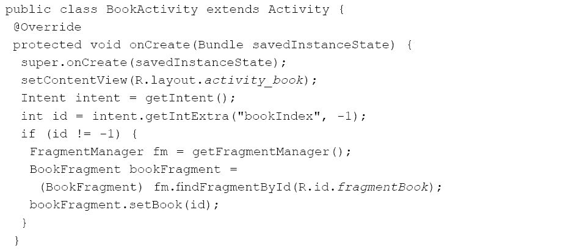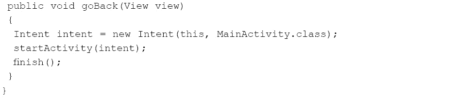

在 `onCreate()` 中，程序测试是否传递了参数（如果有，则是书籍索引），如果是，则使用 `FragmentManager` 查找 `Fragment` 对象的引用并调用 `setBook()` 方法。

这里是 `MainActivity` 类，需要更新事件处理器 `onSelectedBookChanged()`：


与一样，程序尝试确定 `BookFragment` 的引用。如果不可能（或者该片段不可见），则以书籍索引作为参数打开新的 `activity`，否则除了片段更新外不会发生其他任何事情。

当你测试程序时，请注意，如果是平板电脑或你横握手机，它像以前一样工作。

## 2.5 The fragment life cycle

在 Java 16（第 4.4 节）中，我提到了 `activity` 的生命周期以及与状态切换相结合的回调方法。片段也有类似的内容，由于片段与 `activity` 相关，因此当然有密切的联系。这里值得注意的是，经常会出现 `activity` 被创建、关闭并重新创建的情况，手机旋转就是一个很好的例子。

正如与一组回调方法相关的 `Activity` 一样，`Fragment`（片段）也是如此，而且它们在这些方法执行的时机上显然存在联系的。当一个 `fragment` 初始化时，会执行以下回调方法，其中左侧的方法与 `activity` 相关，而右侧的方法与 `fragment` 相关：

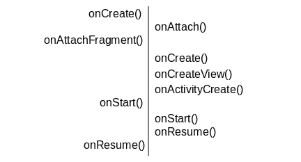

最重要的方法是 `onCreateView()`，如之前的示例所示。当一个 `fragment` 与一个 `activity` 关联时，会执行 `onAttach()` 方法，随后 `fragment` 就能知道该 `activity`，你可以使用 `getActivity()` 方法。然后 `fragment` 会向 `activity` 发送通知，之后会顺序执行 `onCreate()` 和 `onCreateView()`，在后者中创建布局。这两个方法是最重要的，而且对于很多 `fragment` 来说，它们是唯一被重写的回调方法。区别在于，如果初始化操作包含耗费时间的任务（例如连接到数据源、复杂计算和资源分配），则应该在 `onCreate()` 中执行，而其余部分以及布局的主要初始化应该应该在 `onCreateView()` 中完成。原因在于，通常只有 `fragment` 的视图层级结构会被销毁，因此没有必要在手机每次发生某些变化时都执行耗时的初始化。

### 四个方法

1. `onAttach()`

2. `onAttachFragment()`

3. `onCreate()`

4. `onCreateView()`

它们总是一起执行的，如果一个 `activity` 关联了多个 `fragment`，这一点非常。当所有 `fragment` 都执行了这个方法序列后，剩余的回调方法可以单独执行。在这里，`onActivityCreated()` 通知 `fragment` `activity` 已创建，而 `onStart()` 和 `onResume()` 对 `fragment` 的功能与 `activity` 基本相同。

当 `fragment` 被隐藏或关闭时，会发生类似的情况：

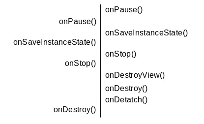

基本上与 `activity` 是一样的，但在 `onStop()` 之后，每个 `fragment` 会执行三个方法：

1. `onDestroyView()`

2. `onDestroy()`

3. `onDetach()`

它们是一起执行的。随后 `fragment` 不再与 `activity` 关联，你也无法再执行 `getActivity()`。

将创建和关闭 `fragment` 的方式分开有几个原因，其中之一是：如果 `fragment` 被隐藏，只会执行 `onDestroyView()`，而一旦 `fragment` 再次可见，则只会执行 `onCreateView()`。

你还应该注意 `onSaveInstanceState()` 方法，它的功能与 `activity` 相同，用于在 `fragment` 关闭之前持久化其状态。

## 2.6 一个 ListFragment

如果你看我在本章中使用的示例，书籍的概述是用单选按钮列出的。在这里，在包含概述的 `fragment` 中使用 `ListView` 会更明显，而且如果程序需要扩展新书籍，使用它也会更灵活。本节的主题是将单选按钮替换为 `ListView`。初看看起来很简单，但你不能仅仅修改 `fragment_books.xml` 布局并将所有 `RadioButton` 组件替换为 `ListView` 组件。相反，有必要将 `BooksFragment` 类改为 `ListFragment`，但这相当简单。


我从`TheBooks4`项目的拷贝开始，并将该拷贝命名为`TheBooks6`。不过，我将先稍微修改数据源，让`Book`对象获得额外的字段：

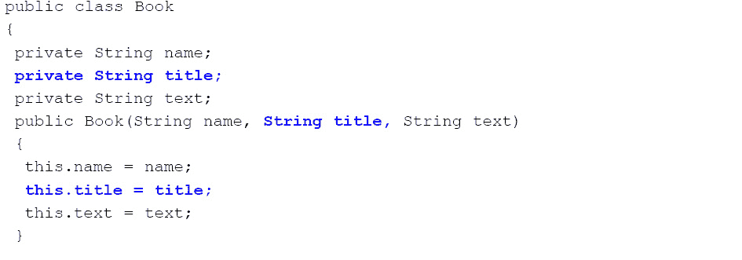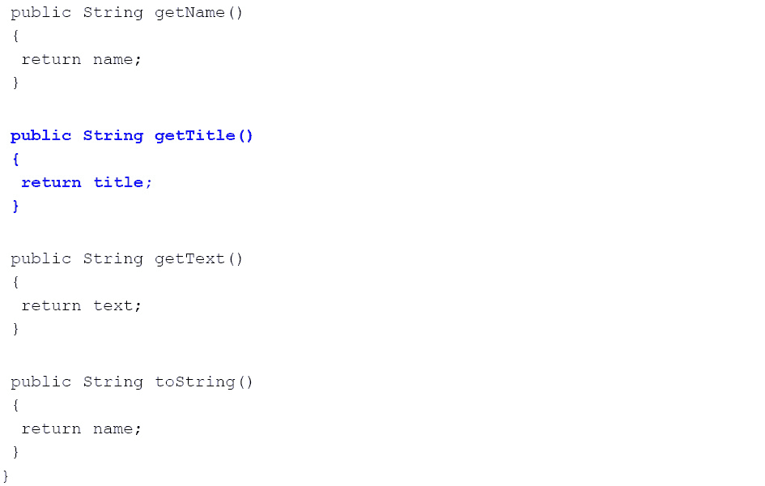

当然，这还需要修改`Books`类，因为在创建`Book`对象时现在必须添加额外的参数。此外，该类已更改为单例：

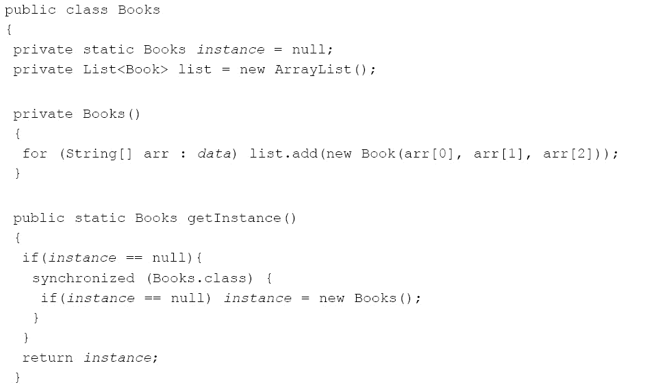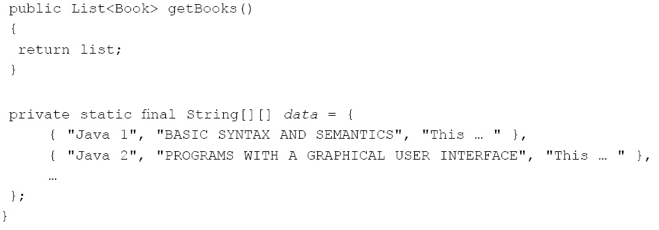

通过这些更改，`BookFragment`类可以更新如下：

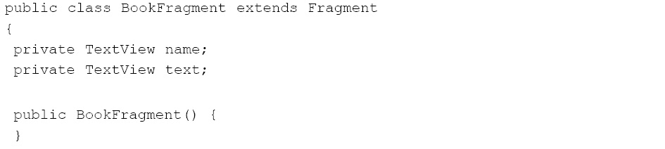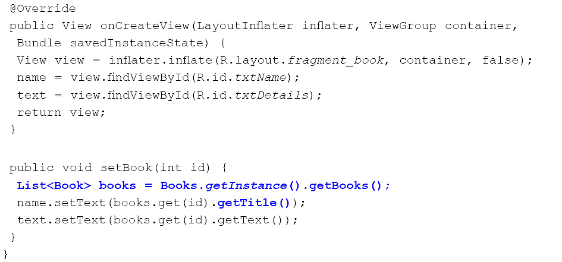

也就是说，变量`book`被删除了，`setBook()`方法发生了微调。

此外，这些更改与我想要使用`ListView`代替`RadioButton`组件无关。这些更改发生在`BooksFragment`类中。该类必须继承`ListFragment`而不是`Fragment`。它是`Fragment`的一种特化，封装了一个`ListView`组件，从而形成具有特定目的和布局的 fragment。因此，该 fragment 不使用 XML 布局文件。`BooksFragment`类必须更改为：

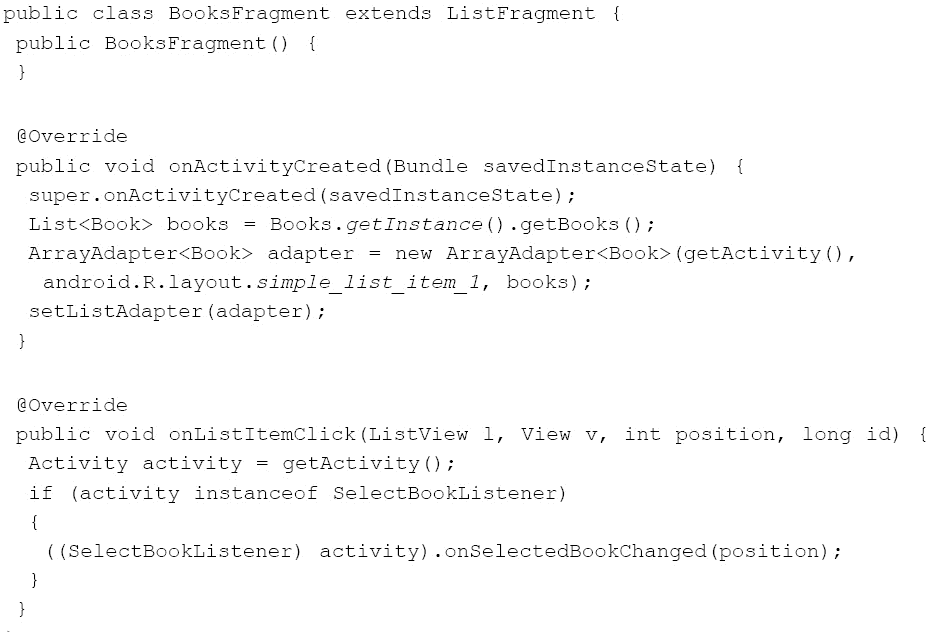

注意，该类现在继承了`ListFragment`，并且没有`onCreateView()`方法。相反，重写了回调`onActivityCreated()`，它通常会初始化适配器。你应该意识到，`ListFragment`有一个方法`getListView()`，它返回`ListView`对象。

## 练习 2：Kings

你必须编写一个与上面（`TheBooks6`）类似的应用程序，但该程序必须显示丹麦国王的概述。如果你打开应用程序，你必须得到以下窗口，其中有`Knud den Store`：


开始创建一个名为`TheKings`的新项目。在本书中有一个名为`AboutKings`的项目，它包含两个类`King`和`Kings`。将这些类拷贝到你的新项目中。`King`类不应更改，但你应该更改`Kings`类使其成为单例。

## 2.7 一个`DialogFragment`

fragment 也可以用于打开对话框。在上一本书中，我讨论了对话框，而`Dialog`类为对话框提供了更多功能，将`Dialog`对象封装在 fragment 中更简单、更好，而这正是`DialogFragment`类所做的。例如，它解决了旋转手机带来的问题。程序`ThePersons`打开以下窗口：


它在列表中显示了 4 个人。点击名称会打开一个对话框（见下文），你可以在那里编辑人物信息并可选地删除该人物。程序有一个只有一个菜单项的菜单，点击它会打开同一个对话框，你可以在那里创建一个人物。


示例实际上包含了一些代码。并不是因为使用`DialogFragment`困难，而是因为仍然有一些你需要了解的细节，以及如何向对话框传递数据并接收通知。程序启动时带有 4 个人以便窗口有显示内容，但你应该注意，你所做的更改（创建或修改的人员）不会被保存。当然，添加这个选项将相对简单。

首先，为人物定义了一个模型类：

```
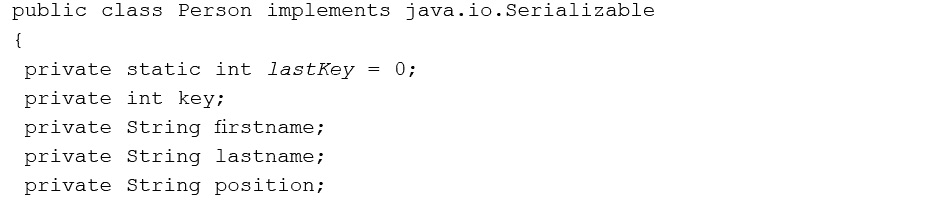
```

这里没有太多需要注意的，但人员通过在创建`Person`对象时连续分配的键来标识，这正是静态变量`lastKey`的目的。另请注意，该类被定义为`Serializable`，因为该类的对象应该能够作为参数传递给对话框。还有一个类是`Person`对象的集合：

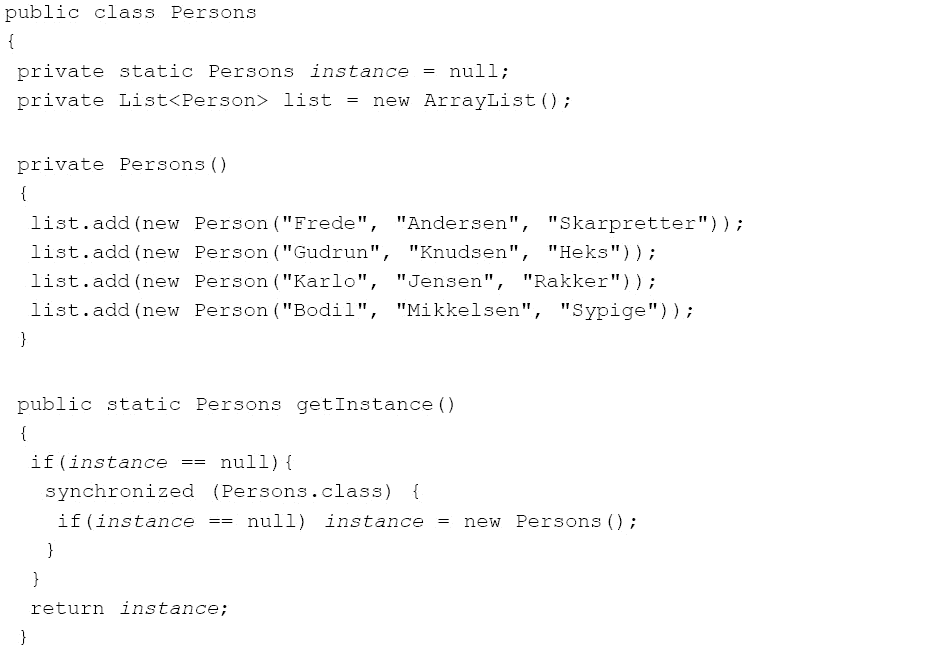!!(image/Java_17_–_More_about_Java_and_Android_28-8-18_46.jpg)

这里也没有什么需要注意的。该类被实现为单例模式。`update()`方法用于修改现有的人员或添加新人员。

窗口（程序的 activity）显示了`Person`对象的列表，它本质上就是一个`ListFragment`，窗口的布局非常简单：

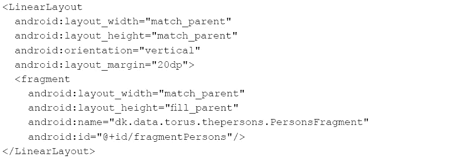

除了 fragment 元素的`name`属性指向`PersonsFragment`之外，没有其他需要注意的：

!(image/Java_17_–_More_about_Java_and_Android_28-8-18_47.jpg)

这里与前一节相比没有新内容。`ListView`组件的初始化被移动到自己的方法中，以便在列表数据模型更改时从`MainActivity`调用。调用到列表的、用于确定 fragment activity 引用并判断其类型是否为`SelectPersonListener`的事件处理器被称为方法`personSelected()`，它是对 activity 的一个通知，告知其点击了哪一个项目（索引）。`SelectPersonListener`是一个只定义了`personSelected()`方法的接口。如果你现在运行程序（带有上述更改），窗口将打开并显示四个人人的列表。

如果你点击（即手指触摸）某个人员，程序必须打开一个包含该人员数据的对话框，如果你选择程序主菜单中的`Add`菜单，也应该执行相同的操作。此时所有字段必须为空。对话框需要一个通常作为资源创建的布局，在这种情况下，必须有三个`TextView`组件、三个`EditText`组件和三个`Button`组件。该布局占据了大量空间，我不想在这里显示 XML 代码，但它是`layout`目录下一个名为`dialog_person.xml`的资源，它仅仅是使用`LinearLayout`布局部署的 9 个组件。作为回报，我将显示整个 Java 代码：

!(image/Java_17_–_More_about_Java_and_Android_28-8-18_48.jpg)!(image/Java_17_–_More_about_Java_and_Android_28-8-18_49.jpg)

首先，注意该类继承了`DialogFragment`。这意味着该类是一个`Fragment`，并且是一个作为`Dialog`对象包装器的 fragment。`DialogFragment`拥有的样式如下：

1. `STYLE_NORMAL`（默认）
2. `STYLE_NO_TITLE`
3. `STYLE_NO_FRAME`
4. `STYLE_NO_INPUT`

对话框由三部分组成：布局区域本身、标题和框架。第一个样式常量表示必须显示所有三个部分，第二个表示没有标题，第三个既没有标题也没有框架，最后一个既没有标题也没有框架，且对话框不接收输入事件。在这种情况下，样式为`STYLE_NORMAL`，你必须在`onCreate()`中通过`setStyle()`定义它。`setStyle()`的最后一个参数是 0，表示 Android 必须决定使用哪个主题，因此你可以设置自己的主题。当对话框打开并执行`onCreate()`时，会传输一个`Person`对象，你应该注意如何通过`getArguments()`建立该对象的引用。

然后是`onCreateView()`，这次它相当详尽。首先，必须与三个按钮关联事件处理器。对于`Cancel`按钮，它是一个简单的处理器，除了关闭对话框外不应做其他事情。这通过`dismiss()`方法实现。对于 OK 按钮，分配了一个`OkHandler`类型的处理器，即一个内部类。最后是`Remove`按钮，其处理器是作为匿名类的对象创建的。处理器测试该人员是否有姓氏（因此它不是新人员）。如果是这种情况，则确定 fragment 的 activity，如果其类型为`OnDialogClickListener`（定义在`PersonDialog`类中的内部接口的接口），则调用`onDialogClick()`方法并以常量`CMD_REMOVE`作为参数。目标是包含 fragment 的 activity（即显示对话框的活动）将接收到一个通知，告知点击了哪个按钮。

```java
if (condVar > someVal) {console.log("xxx")}
```

因此我修改了两个地方：为`LinearLayout`元素添加了`id`（以便在代码中引用），并删除了`fragment`元素，布局也变得相当简单。除此之外，更改主要涉及`MainActivity`类，但也有必要修改`BookFragment`类，其中添加了两个常量，就像更新`onCreateView()`一样：

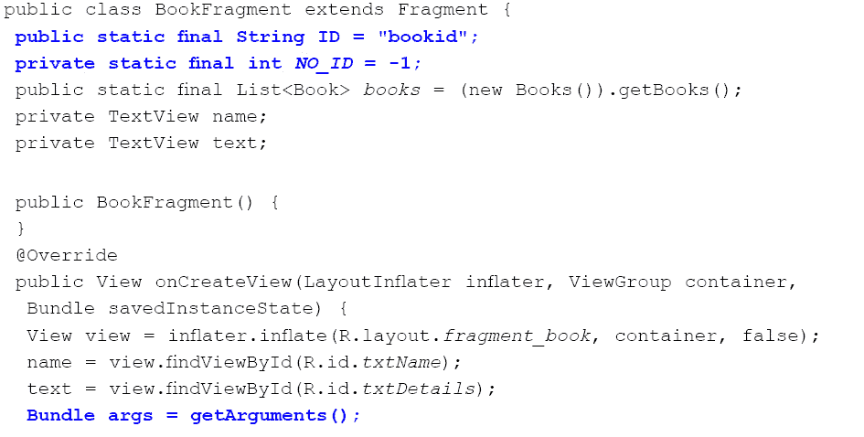

目前还不完全清楚这些更改能带来什么收益，但目标是能够向`onCreateView()`传递一个参数，该参数必须是用户从列表中选择的书籍索引。第一个常量仅用于标识参数的名称，而另一个是默认值，表示未传递参数。参数或参数被封装在`Bundle`对象中，该对象在`onCreateView()`中通过`getArguments()`确定，如果存在参数，则尝试将值确定为`int`。如果成功且不是默认值，则调用`setBook()`并该值作为参数。

另一方面，`MainActivity`中的更改更为广泛：


首先，引入了变量`isDynamic`，用于控制是否使用碎片的动态更新，这取决于设备是纵向还是横向的。该变量在`onCreate()`中通过`FragmentManager`初始化，用于测试`BookFragment`碎片是否存在，从而决定使用`activity_main.xml`还是`activity_main_wide.xml`布局。如果`isDynamic`为`true`，则必须动态插入碎片。然而，这要求你使用`transaction`。`FragmentManager`可以启动一个作为`FragmentTransaction`的事务，你可以对其添加关于碎片的操作。在这种情况下，只添加了一个操作，即`add()`操作，它向 activity 中添加了`BooksFragment`。这里你应该注意，XML 文档中的`LinearLayout`元素现在有一个`id`。还要注意`add()`方法的最后一个参数，它简单意味着碎片获得了一个名称，以便以后可以引用。结果是，当`FragmentTransaction`对象执行`commit()`时，添加到事务中的操作将作为一个单一操作执行。

此外，事件处理器`onSelectedBookChanged()`也发生了更改。如果变量`isDynamic`为`true`（且手机手机竖持），则必须将带有列表的碎片替换为显示详情的碎片。因此，再次创建了一个事务。此外，`BookFragment`对象的创建和所选书籍的`id`作为参数关联到`Bundle`对象中。请注意，这里你使用了在`BookFragment`类中定义为常量的名称。在创建并参数初始化`BookFragment`对象后，通过向事务添加`replace()`来替换列表碎片。现在，返回键可能仍然有效，因此你必须执行`addToBackStack()`操作，以便当前窗口（当前事务）被压入回栈中。

之后，一切都应该正常工作了——至少在理论上如此，但如果手机是竖持的，这并不适用于返回键。因此，最后一个方法只在某种程度上解决了问题。寻找更好的解决方案可能是件不错的工作。

程序测试后，我终于可以删除`BookActivity.java`和`activity_book.xml`，因为这些文件不再被使用。

# 3 手机

编写 Android 应用程序时，与通常的 PC 应用程序有些不同，仅仅是因为设备通常提供其他功能，如果设备是手机，你就可以打电话。在本章中，我将展示如何在软件中实现这一点，并编写用户能够拨打电话的应用程序。对于程序员来说，有两种选择：一种情况下是由手机用户拨打电话，而另一种情况来说是编写一个程序，当别人拨打当前电话时可以激活该程序。最后一种并不简单。首先，它需要某些接收通话通知的服务，其中存在一些安全问题，但这里不讨论这些问题。第一种问题（即由应用程序用户拨打电话）非常简单，接下来的示例展示了如何实现。如果你打开`ThePhone`应用程序，你会看到以下窗口：


这里有一个输入字段，你可以输入电话号码，并有两个按钮可以用来拨打你输入的号码。如果你点击`DIAL`按钮，你会得到普通的窗口，就像你平时拨打电话时一样，你输入的号码已被插入，你仍需要像常一样按下`Call`按钮打电话。如果你点击`CALL`，手机会在没有用户干预的情况下立即执行通话——在允许的情况下。你必须在`AndroidManifest.xml`中分配权限，但对于最新的手机这是不够的，手机会显示对话框，用户必须接受手机正在通话。在这种情况下，清单更新如下：


`uses-permission`元素允许程序打电话而无需用户点击`Call`按钮。`uses-feature`元素用于告知应用程序只能支持通话的设备上使用（运行）。尽管大多数 Android 设备都是手机，但非手机 Android 设备的数量正在增加，在这些设备上打电话是没有意义的。请注意，如果上述步骤过于严格，你可以在软件中测试设备是否可以打电话：


我不想显示当前应用程序的布局，因为它没有新内容，但 Java 代码如下：


`onDial()`方法是`DIAL`按钮的事件处理器，非常简单。发生的第一件事是方法确定了一个`TelephonyManager`对象。它有一个`getCallState()`方法，用于测试是否正在通话。这并不是绝对必要的，但建议这样做，否则你可能会中断正在进行的对话。如果没有，则确定输入的电话号码，并注意它带有前缀`tel:`，这表示这是一个电话号码。接下来，使用`startActivity()`和`Intent`对象执行通话。`Intent`对象的第一个参数表示必须以通常方式拨打电话，即用户获得一个输入号码的对话框，而其他参数是号码。

如果你点击`CALL`按钮，将执行事件处理器`onCall()`，这与上述类似，但调用本身发生在`call()`方法中。在这里你需要注意，只有当在`AndroidManifest.xml`中指定了`CALL_PHONE`权限时，才能执行`startActivity()`方法。否则，你只会得到一个转换错误。该方法开始时会测试手机的旧程度，以及清单文件（manifest）是否具有所需的权限。如果是较新的手机，则意味着手机会打开一个对话框，用户必须在那里授予权限允许手机拨打电话。如果你这样做了，事件处理器将执行`onRequestPermissionsResult()`，然后它会再次执行`call()`，但这次，执行的是`if`语句的`else`部分。结果是拨通了电话。

## 3.1 发送短信


与上面的示例以及如何拨打电话类似，我将在接下来的示例中向你展示如何发送短信，原则上它的发生方式是相同的。该示例名为`SendSMS`，它会打开上面的窗口输入手机号码和消息。我不想展示布局，但与使用手机一样，清单文件必须允许应用程序发送短信：


发送短信非常简单，通过以下方法即可：


在这里，两个变量`phone`和`message`必须分别用手机号码和要发送的消息进行初始化。然而，条件与拨电话有些相似，尽管在`AndroidManifest.xml`中已经声明应用程序允许发送短信，但不能确定设备是否允许，它会打开一个对话框，让用户显式地接受发送消息。因此，必须多一点代码：


这让你想起了你在上一个示例中看到的内容。代码并不容易阅读，因此建议查阅文档，但简而言之发生了以下情况。该方法


测试清单中的应用程序是否指定了`SEND_SMS`权限，如果是，则执行方法


并且应该出现对话框来发送短信。如果是那样，Android会打开一个对话框，当用户在这里点击接受（或反之）时，将执行事件处理器：


# 4 使用相机

在本章中，我将向你展示如何从程序使用手机的相机。我只会展示如何拍照并将其保存到外部存储器文件中。事实上，这非常简单，当代码变得很多时，是因为你不能立即将图像保存到文件中。我想展示一个名为`TheCamera`的示例，它会打开下面的窗口，窗口中已拍摄了照片：


当图片有点简单，是因为图片是用模拟器拍摄的。窗口打开后，它只显示按钮，点击按钮就会启动手机的相机。


这让你想起了你在上一个示例中看到的内容。代码并不容易阅读，因此建议查阅文档，但简而言之发生了以下情况。该方法


测试清单中的应用程序是否指定了`SEND_SMS`权限，如果是，则执行方法


并且应该出现对话框来发送短信。如果是那样，Android会打开一个对话框，当用户在这里点击接受（或反之）时，将执行事件处理器：


# 4 使用相机

在本章中，我将向你展示如何从程序使用手机的相机。我只会展示如何拍照并将其保存到外部存储器文件中。事实上，这非常简单，当代码变得很多时，是因为你不能立即将图像保存到文件中。我想展示一个名为`TheCamera`的示例，它会打开下面的窗口，窗口中已拍摄了照片：


当图片有点简单，是因为图片是用模拟器拍摄的。窗口打开后，它只显示按钮，点击按钮就会启动手机的相机。


这让你想起了你在上一个示例中看到的内容。代码并不容易阅读，因此建议查阅文档，但简而言之发生了以下情况。该方法


测试清单中的应用程序是否指定了`SEND_SMS`权限，如果是，则执行方法


并且应该出现对话框来发送短信。如果是那样，Android会打开一个对话框，当用户在这里点击接受（或反之）时，将执行事件处理器：


# 4 使用相机

在本章中，我将向你展示如何从程序使用手机的相机。我只会展示如何拍照并将其保存到外部存储器文件中。事实上，这非常简单，当代码变得很多时，是因为你不能立即将图像保存到文件中。我想展示一个名为`TheCamera`的示例，它会打开下面的窗口，窗口中已拍摄了照片：


当图片有点简单，是因为图片是用模拟器拍摄的。窗口打开后，它只显示按钮，点击按钮就会启动手机的相机。


这让你想起了你在上一个示例中看到的内容。代码并不容易阅读，因此建议查阅文档，但简而言之发生了以下情况。该方法


测试清单中的应用程序是否指定了`SEND_SMS`权限，如果是，则执行方法


并且应该出现对话框来发送短信。如果是那样，Android会打开一个对话框，当用户在这里点击接受（或反之）时，将执行事件处理器：


# 4 使用相机

在本章中，我将向你展示如何从程序使用手机的相机。我只会展示如何拍照并将其保存到外部存储器文件中。事实上，这非常简单，当代码变得很多时，是因为你不能立即将图像保存到文件中。我想展示一个名为`TheCamera`的示例，它会打开下面的窗口，窗口中已拍摄了照片：


当图片有点简单，是因为图片是用模拟器拍摄的。窗口打开后，它只显示按钮，点击按钮就会启动手机的相机。


这让你想起了你在上一个示例中看到的内容。代码并不容易阅读，因此建议查阅文档，但简而言之发生了以下情况。该方法


测试清单中的应用程序是否指定了`SEND_SMS`权限，如果是，则执行方法


并且应该出现对话框来发送短信。如果是那样，Android会打开一个对话框，当用户在这里点击接受（或反之）时，将执行事件处理器：


*(注：由于输入文本中存在大量重复的乱码片段，译文已根据逻辑进行了去重处理，仅保留核心内容的翻译。)*


如果你点击 `CALL` 按钮，将执行事件处理器 `onCall()`，这与上述类似，但调用本身发生在 `call()` 方法中。在这里你需要注意，只有在 `AndroidManifest.xml` 中指定了 `CALL_PHONE` 权限时，才能执行 `startActivity()` 方法。否则，你只会得到一个转换错误。该方法开始时会测试手机的旧程度，以及清单文件（manifest）是否具有所需的权限。如果是较新的手机，则意味着手机会打开一个对话框，用户必须在那里授予权限允许手机拨打电话。如果你这样做了，事件处理器将执行 `onRequestPermissionsResult()`，然后它会再次执行 `call()`，但这次，执行的是 `if` 语句的 `else` 部分。结果是拨通了电话。

## 3.1 发送短信


与上面的示例以及如何拨打电话类似，我将在接下来的示例中向你展示如何发送短信，原则上它的发生方式是相同的。该示例名为 `SendSMS`，它会打开上面的窗口输入手机号码和消息。我不想展示布局，但与使用手机一样，清单文件必须允许应用程序发送短信：


发送短信非常简单，通过以下方法即可：


在这里，两个变量 `phone` 和 `message` 必须分别用手机号码和要发送的消息进行初始化。然而，条件与拨电话有些相似，尽管在 `AndroidManifest.xml` 中已经声明应用程序允许发送短信，但不能确定设备是否允许，它会打开一个对话框，让用户显式地接受发送消息。因此，必须多一点代码：


这让你想起了你在上一个示例中看到的内容。代码并不容易阅读，因此建议查阅文档，但简之发生了以下情况。该方法


测试清单中的应用程序是否指定了 `SEND_SMS` 权限，如果是，则执行方法


并且应该出现对话框来发送短信。如果是那样，Android 会打开一个对话框，当用户在这里点击接受（或反之）时，将执行事件处理器：


# 4 使用相机

在本章中，我将向你展示如何从程序使用手机的相机。我只会展示如何拍照并将其保存到外部存储器文件中。事实上，这非常简单，当代码变得很多时，是因为你不能立即将图像保存到文件中。我想展示一个名为 `TheCamera` 的示例，它会打开下面的窗口，窗口中已拍摄了照片：


当图片有点简单，是因为图片是用模拟器拍摄的。窗口打开后，它只显示按钮，点击按钮就会启动手机的相机。窗口打开后，它只显示按钮，点击按钮就会启动手机的相机。窗口打开后，它只显示按钮，点击按钮就会启动手机的相机。窗口打开后，显示显示显示显示显示，显示显示显示显示显示显示显示显示显示显示显示显示显示显示，，，，，，，，，，，。，，，，，，，，，，，，，，，，，，，，，_，____，，___________________________________________________________________________，，，，，，，， ` `显示`：


显示显示显示显示显示显示显示显示显示显示显示显示显示显示显示显示显示显示显示显示显示显示显示显示显示显示显示显示显示显示显示显示：


显示显示显示显示显示显示显示显示显示显示显示显示显示显示显示显示显示显示显示显示显示显示显示显示显示显示显示显示显示显示显示显示：，，显示，显示，显示，显示，显示，显示，显示，显示，显示，显示，显示，显示，显示，显示，显示，显示，显示，显示，显示，显示，显示。

### 3. `PASSIVE_PROVIDER`

这意味着设备本身并不想要确定位置，而是使用由其他应用程序或服务确定的位置。其目的是节省电。

应用程序 `TheLocation` 使用上述三个提供者中的前两个来确定设备的位置（见下方的窗口）。程序打开了一个用于确定设备位置坐标（经度和纬度）的窗口。该窗口有两个按钮，初始文本都为 `Start`。点击上方按钮会将文本更改为 `Stop`，程序将使用 `GPS` 提供者定期根据当前位置更新 `Longitude`（经度）和 `Latitude`（纬度）的值。底部按钮的工作原理相同，但使用的是 `network` 提供者。

关于应用程序的用户界面，没有新内容，布局由使用 `RelativeLayout` 放置的 8 个小部件组成，我不想在这里显示代码。为了让应用程序使用设备的 `GPS`，必须在 manifest 中允许：


并且实际上只需要第一个权限元素。


然后是 Java 代码，它立即填充了更多内容，其中有许多新内容：


该类除了一个常量外还有 6 个变量，这里是用户界面中需要更新的 4 个 `TextView` 组件的最后 4 个引用。变量 `permission` 用于测试程序是否有权确定位置，最后是一个类型为 `LocationManager` 的变量，它代表一个用于处理位置的对象，当然，使用这个对象是最重要的。

在 `onCreate()` 中，当创建 `LocationManager` 对象时，什么都不会发生，并且初始化了 4 个引用用户界面组件的变量。manifest 定义了程序可以使用 `GPS` 系统，但出于安全考虑，用户必须显式授予权限，这与我在上一个程序所示所示，必要的语句被放置在方法 `requestPermission()` 中。从这个程序来看，初始化变量 `permission` 是非常重要的。

`gpsOnOff()` 方法是上方按钮的事件处理器。首先测试变量 `permission`，如果其结果为 `true`，则根据按钮的文本来判断你是否想要开始读取 `GPS` 位置，反之亦然。最终，从 `LocationManager` 对象中移除事件处理器，否则调用 `requestLocationUpdates()` 来开始读取位置。在这里，首先说明必须使用 `GPS` 提供者，然后是每次读取之间的最小时间（至少 30 秒）。下一个参数表示执行新读取的最小距离（米），最后一个参数是每次读取时要执行的事件处理器。它被称为 `gpsListener`，并定义为基于匿名类创建的对象，该匿名类的类型为 `LocationListener`，这是一个定义了 4 个方法的接口。在这种情况下，每次读取只调用其中一个。该方法的参数是一个 `Location` 对象，它指示了经度和纬度等信息，但该对象实际上还包含其他值。该方法很简单，但你应该注意 `runOnUiThread()` 的使用，因为该方法是从另一个线程调用的。

其他按钮也有类似的事件处理器和一个关联的监听器类，但我不想在这里显示代码，因为它们在原则上是相同的。

### 练习 3: Google Play Services

在这个练习中，你必须编写一个程序，该程序在原则上与上述程序相同，即显示用户的位置，但这次应该使用 `Google Play Services`。目标是简单介绍一下使用 `Google Play Services` 的要求以及它是什么，因为这在实践中可能很重要。

从创建一个名为 `TheLocation` 的新项目开始。在模拟器中翻译并测试项目，确保你有一个正在运行的 `Hello World` 项目。在 `activity_main.xml` 中，为你的 `TextView` 组件添加以下 ID：


如果你还没有安装 `Google Play Services`，请安装它。在 Android Studio 中，选择：

`Tools | Android | SDK Manager`

点击中间标签页：


在这里勾选 `Google Play Services` 并点击 OK，之后 `Google Play Services` 将安装在机器上。

下一步，你必须告诉 Android Studio 必须使用此 API，你可以在 `Gradle Scripts` 下的 `build.gradle (Module: app)` 文件中操作：


最后，以与之前相同的方式更新 manifest：


然后你就可以准备使用 `Google Play Services` 来确定你的位置，因此你需要更新 `MainActivity` 类。作为第一步，`MainActivity` 必须实现两个 Google Play Services 接口：


注意它需要哪些 `import` 语句。翻译程序并检查它是否能运行。这应该是可能的。接下来，添加以下方法以便用户允许应用程序获取 `ACCESS_FINE_LOCATION` 权限（注意与上一个示例相同）：


该方法需要添加多个 `import` 语句和一个单一 `int` 常量 `REQUEST_PERMISSION`。添加另一个 `import` 语句：


并添加另一个方法：


当无法连接到 `Google Play Services` 时使用此方法。下一步，在类中添加 4 个变量并按如下所示扩展 `onCreate()` 方法：


翻译程序并检查它是否能运行。`MainActivity` 还需要实现 `onResume()`，并且你必须添加一个 `display()` 方法来更新布局中的 `TextView` 组件：


然后你必须实现两个接口定义的四个方法：


原则上，Preferences（偏好）可以用于设置以外的内容，因为它仅仅是存储键/值对，唯一的限制是值必须是字符串或简单数据类型的值。然而，Preferences 不仅仅是存储数据的方式，它还包含了维护这些数据的组件，如下例所示。

Preferences 可以被分配给一个 `Activity`，而 `Activity` 对象有一个方法 `getPreferences()`，该方法返回一个 `SharedPreference` 对象。Preferences 也可以与应用程序关联，通过 `getSharedPreferences()` 方法，你可以获取一个由名称标识的 `SharedPreferences` 对象，因此同一个应用程序可能关联了多个偏好。最后，还有属于整个设备的偏好，它们使用 `PreferenceManager` 对象进行维护，其中你可以使用 `getDefaultSharedPreferences()` 方法获取一个 `SharedPreferences` 对象。该方法接受一个 `Context` 对象作为参数，并返回该对象的偏好。你可以从这三种方法中选择你认为最合适的，但在大多数情况下，你会使用最后一种方法。

`SharedPreferences` 对象具有 `get` 方法，可以用于确定值，例如如下方法：

*   `getString()`
*   `getInt()`

以及其他方法，这些方法有两个参数，第一个是键，另一个是默认值。你（自然地）也可以创建并修改 `SharedPreference` 标识的值，这通过类似的 `set` 方法实现，其参数是键和值。然而，这与普通操作有所不同，因为 `SharedPreference` 对象有一个 `edit()` 方法返回一个 `Editor` 对象，而方法被分配给这个对象。要使更改生效，通过 `Editor` 对象完成更改并执行 `commit()` 方法（或 `apply()` 方法）。`Editor` 对象还有一个 `remove()` 方法，可以删除单个偏好，以及一个 `clear()` 方法，可以删除所有偏好。

如果应用程序需要维护设置，你当然可以为此目的定义你自己的活动，而且这些活动可以是全面的。因此，Android 提供了一个特殊的活动 `PreferenceActivity` 和一个片段 `PreferenceFragment`，可以用于实现应用程序的设置。除了让变得更容易之外，最重要的是，通过这种方式进行的设置在每个应用程序中工作都是相同的。在接下来，我将通过示例 `ThePreferences` 向你展示如何操作。如果你打开应用程序，你会看到以下窗口：


这只是一个简单的 Hello World 活动，但带有一个包含两个菜单项菜单。如果你选择顶部的那个，将收到一个显示程序设置标题的窗口：


有两个地方需要设置，第一个设置涉及颜色和文本应该如何显示（见下窗口），而另一个选项是开启或关闭设置。在第一情况下，你可以选择文本应该是**粗体**还是*斜体*（或两者都是），并且你可以选择字体大小。如果你选择字体大小，你会得到一个带有单选按钮的对话框，你可以点击所需字体大小的按钮。你也可以选择输入文本，结果是一个用于文本文本的对话框。最后，你可以选择文本颜色和背景颜色，在这两种情况下，你都会得到一个带有单选按钮的对话框。


在最后一个设置窗口中，两个开关组件允许你设置这两个设置的开启和关闭：


在这种情况下，除了作为典型设置的示例外没有意义。下面是两个开关组件都开启且在第一个设置窗口中选择值后的窗口：


特别需要注意的是，如果你关闭程序并重新打开，设置将仍然有效，它们被保存在某处——在设备的偏好存储库中。

起点是一个名为 `ThePreferences` 的普通项目。添加了更多资源，这里是更新了两个字符串的 `string.xml`：


这将用于菜单中的文本。在 `res` 目录下添加了一个名为 `menu` 的文件夹，这里再次有一个名为 `main.xml` 的 XML 文档，它定义了一个包含两个菜单项的菜单：


在 `values` 目录下添加了一个文件 `arrays.xml`：


它定义了三个数组作为资源。第一个数组定义了用作字体大小的值。接下来的两个分别定义了颜色名称和颜色代码的颜色，它们用于选择文本颜色和背景颜色。

布局 `activity_main.xml` 仅由一个 `TextView` 组件组成，与 Android Studio 创建的相比没有变化，只是我将组件名称更改为 `txtLine`，然后布局元素有了一个名称，以便我从 Java 代码中引用它。Java 部分填充了内容并如下：


// Java 代码将根据上下文在此，

// 但文本在此结束。


该类只有一个指向 `txtLine` 组件的变量，它在 `onCreate()` 中进行初始化。你应该注意该类还重写了 `onResume()`，它调用了 `refreshActivity()`。结果是每当窗口需要初始化时（例如手机旋转时），该方法就会执行。否则，还有创建菜单（基于 `main.xml`）并处理菜单事件的方法。

如果你选择下方菜单 `Clear Preferences`，将执行 `setDefault()` 方法。它首先确定此活动的 `SharedPreference` 对象，并对该对象建立指向 `Editor` 的引用，随后使用它初始化 8 个偏好。这意味着如果该偏好不存在，它将被创建，否则将被覆盖。在方法终止之前，执行了 `commit()`，因此所有偏好都被保存，最后调用了 `refreshActivity()` 方法。该方法还确定了此活动的 `SharedPreferences` 对象，并使用这些偏好根据背景颜色、要显示的文本以及在该背景下的字体、大小和颜色更新用户界面。在这里你应该特别注意两个 `Switch` 设置是如何用于测试使用其他设置还是使用默认值的。`refreshActivity()` 方法填充了部分，但除了读取偏好外没有新内容，结论是底部菜单 `Clear Preferences` 将所有设置重置为默认值。

然后是第一个菜单项，它打开了一个由 `ChangePreferences` 类定义的新活动。该活动派自 `PreferenceActivity` 类：


该类没有填充多少，因为它们都存储在基类中。当活动打开时，执行 `onBuildHeaders()` 方法，该方法通过加载名为 `pref_headers.xml` 的资源（这是一个在 `xml` 目录的 XML 文档）来初始化 `Header` 对象列表：

在这种情况下，定义了两个 `Header` 对象（标题），结果是设置列表的窗口。点击这些标题之一会执行 `isValidFragment()` 方法，该方法会验证名称是否为合法的片段，此处为 `DefPrefFragment`：


如果是如此，则插入该片段。请注意，该类继承了 `PreferenceFragment`，并且根据点击了哪个标题，将使用两个布局中的一个，即 `xml / preference_1.xml` 或 `xml / preference_2-xml`（注：此处可能有误，应为.xml）。第一个如下：


在这里定义了两个 `PreferenceCategory` 元素，它们的作用除了在标题下对偏好设置进行分组外没有别的。注意使用的项目。`CheckBoxPreference` 以 `CheckBox` 的形式出现，但它会更新其所关联的引用，例如键为 `bold` 的偏好设置。`ListPreference` 会打开一个带有单选按钮列表的对话框，你可以选择一个值，如果你选择 OK 更新偏好设置，也是如此。注意如何通过使用来自 `arrays` 的资源 `listPreference` 来定义单选按钮应该显示的文本以及它们应该拥有的值。最后，有一个 `EditTextPreference`，它会打开一个可以在其中输入文本的对话框。

`xml / preference_2-xml` 如下：


其中只使用了 `SwitchPreference`，原则上它的工作方式与其他偏好元素相同。应该提到，除了此示例中使用的之外，还有其他偏好元素。

此时示例已完成，只需注意的是 manifest（清单文件）：


## 问题 1：`PuzzleApp`

在之前的书籍问题 2 中，你编写了一个名为 `PuzzleApp` 的程序。该程序是一个简单的游戏，你需要解一个包含 9、25、49 或 81 个碎片的谜。创建一个 `PuzzleApp` 项目的副本。

在这项任务中，你必须对程序实现一个更改。程序维护了一个高分列表——实际上有 4 个高分列表，因为每个难度级别都有一个。在 Java 16 书的解决方案中，高分列表存储在文件中。现在你必须更改解决方案，将列表保存为偏好设置（preferences）。注意，这与设置无关，因此你不应该使用 `PreferenceActivity` 或 `PreferenceFragment`。事实上，只需要更改 `HighscoreList` 类即可。

# 7 外部存储

在之前关于文件的书中，我只展示了使用内部存储的示例，内部存储是与单个应用程序相关的存储。在本章中，我将展示一个如何使用外部存储的示例，外部存储可能包含被多个应用程序使用的数据。

实际上有两种类型的外部存储：

1. `Primary External Storage`（主外部存储），物理上是手机的一部分，其大小由手机制造商决定。
2. `Secondary External Storage`（次外部存储），通常是 SD 卡，也可以是通过电缆连接到手机的设备。

以下示例仅涉及第一类外部存储，因为它是最有效的外部存储形式，而且设备并不一定有 SD 卡。从 Android 6 版本开始，在 SD 卡上使用外部存储相当简单，但供应商可能没有开启这种可能性。由于由于缺乏安全性，Android 实际上建议不要将 SD 卡作为外部存储。

当我在下文中提到外部存储时，指的是主外部存储，否则外部存储的使用在原则上与之前的书中展示的内部存储使用方法相似。`TheStorage` 项目打开了一个窗口：


在窗口顶部，有一个用于输入文本的 `EditText` 组件。其下方是一个用于显示文本的 `TextView` 组件，最后有三个按钮，其中第一个按钮用于将输入文本保存到外部存储中的文件中，下一个按钮用于加载文件内容并显示在 `TextView` 组件中。最后，最后一个按钮用于显示有关文件系统的信息。

第一步是 manifest，在其中必须赋予使用外部存储的权限：


列出了两个 `uses-permission` 元素。在这里，`WRITE_EXTERNAL_STORAGE` 权限会自动提供 `READ_EXTERNAL_STORAGE` 权限，所以如果你只想读取外部存储，则最后一个是必要的。

关于布局，我在这里不显示 XML 代码，因为只使用了 `RelativeLayout` 放置了 5 个组件，作为回报，Java 代码填充了大量内容：


最初定义了两个常量，用于关联回调方法。接下来，有两个用于文本组件的变量。这些变量在 `onCreate()` 中初始化，但 `onCreate()` 仅由关联按钮的事件处理器组成。

`SAVE` 按钮的事件处理器调用 `askWritePermission()`。Android 23 版本之前，应用程序拥有外部存储的写入权限，正如 manifest 所示，但从 23 版本及以后，要求变得严格，用户现在必须在简单的对话框中积极授予权限（这是第一次，参见该章节）。

在 `askPermission()` 中，首先测试 Android 版本，如果小于 23，什么都不发生且方法返回 `true`。否则，使用以下方法


来测试是否拥有所需的权限，如果不是，则调用


并且 `askPermission()` 返回 `false`。是 `requestPermissions()` 方法打开了对话框，用户必须在其中积极分配所需的权限。`requestPermissions()` 调用回调方法


返回用户选择的结果。在这种情况下，如果用户授予了权限，则调用 `writeFile()`，该方法会写入文件，否则会显示一个简单的 `Toast` 表明未授予权限。

如果 `askPermission()` 方法返回 `true`，`askWritePermission()` 将调用 `writeFile()`。

然后是 `writeFile()` 方法，它对于之前处理内部存储的内容并没有增加多少新内容，最重要的是调用：


这决定了外部存储中文件的名称。你应该注意，文件存储在外部存储的根目录下，这显然不一定如此。文件名是硬编码的以便方便，在实践中显然是不合适的。

`askReadPermission()` 方法是从中间按钮的事件处理器调用的，它在原理上的工作方式与 `askWritePermission()` 完全相同，不同之处在于它调用的是 `readFile()` 方法。在这个方法中，也没有什么需要解释的，特别需要注意的是，文件名的确定方式与上面相同。

上一个事件处理器调用了 `showStorage()` 方法。该方法显示了一些关于文件系统的信息，Android 提供了几种方法来实现这一目的。我将其中一些方法封装为辅助类 `ExternalTools` 中的静态方法，目标是让该类能够根据需要不断扩展。鼓励你学习这个类，它非常简单。

# 8 Web 开发

手机本质上是一台微型计算机，但具有电话通话、发送短信、内置 GPS、摄像头等特殊功能，更具体地说，你可以访问互联网。因此，Android 也有专门为此设计的特殊组件，以下是介绍。这主要关于：

1. `WebView`，一个可以显示 HTML 的组件
2. `HttpURLConnection`，一个用于操作网络服务的类
3. `DownloadManager`，一个用于下载数据的类

作为一个简单的开始，我将展示一个使用 `WebView` 组件显示网页的程序。该项目名为 `TheWeb1`，如果你运行该程序，它会打开以下窗口：


布局如下：


如你所见，这只需要一个 `WebView` 组件。然后是 `MainActivity`：


这里没什么需要解释的，几乎不可能写得更简单了。然而，还有一个细节，必须在清单（manifest）中插入一个权限：


## 练习 4：微浏览器（`MiniBrowser`）

在上面的示例中，网页地址是硬编码的，这并不经常需要。因此，你必须编写一个简单的应用（可以命名为 `MiniBrowser`），可以在其中输入地址，程序随后应使用 `WebView` 显示该网页（见下窗口）。可能会出现一个问题，即较新的 Android 手机会自动重定向到你的手机浏览器。如果你的 `WebView` 被命名为 `webView`，可以通过添加以下代码（在 `onCreate()` 中）来解决这个问题：


## 8.1 `LoadData()`

`WebView` 组件通常可以显示 HTML，并不非像上面那样必须来自上网页的结果。应用场景更多，例如，你可以显示包含 HTML 的文件的内容，在原理上，你可以将整个用户界面定义为 HTML 并使用 `WebView` 组件显示它。项目 `TheWeb2` 展示了如何实现。布局与 `TheWeb1` 相同。此外，我添加了书中《Java 16》项目中的 `King` 和 `Kings` 两个类，并修改了 `King` 类中的 `toString()` 方法。有了这两个类后，我将 `MainActivity` 修改为：


唯一需要注意的是 `buildHtml()` 方法，它动态构建了一个带有 HTML 的字符串，并且 `WebView` 组件使用 `loadData()` 方法显示此文本。如果你运行程序，结果如下：


## 8.2 连接到 URL

`WebView` 组件可以用于显示网站，但从手机上的应用来看，这远不是互联网的典型用法。更多情况下，你感兴趣的是通过连接到 URL 获取数据到你的手机上。这可能是一个以某种格式返回数据的网络服务，实际上有很多此类服务是公开的，任何想要使用它们的人都可以直接使用。这些许多服务返回 JSON 数据，这并不重要，而且由于有标准的解析器，所以它们很容易使用。在本节中，我将展示一个连接到此类服务并获取服务数据的应用。该应用没有使用相关数据（不解释数据），但在获取数据后，`Toast` 会告诉获取了多少字符。

相关服务的地址为：


该服务引用的地址是：


它是一个提供免费数据的服务。项目名为 `TheWeb3`，布局是点击按钮连接到上述地址，并获取 JSON 数据，但没有解释它们。`MainActivity` 的代码如下：


按钮的事件处理器创建了一个 `InternetTask` 并执行 `execute()`。`InternetTask` 是一个继承自 `AsyncTask` 的内部类，这是一个带有三个参数的泛型类。该类的目标是启动一个在后台线程执行的操作，并更新 UI 线程。你必须重写四个方法，其中 `onPreExecute()` 在操作发生前由 UI 线程执行，位于 `InBackground()` 方法之前。类的第一个参数类型指示 `InBackground()` 的参数类型。第三个重写的方法是 `onProgressUpdate()`，它同样在 UI 线程执行并从 `InBackground()` 间接调用以说明操作进度。类的其他参数类型指示该方法。最后一个重写的方法是 `onPostExecute()`，它也由 UI 线程执行，但在 `InBackground()` 方法完成后执行。第三个参数类型指示该方法的参数类型，通常是 `InBackground()` 的返回值。操作从 `execute()` 方法开始，它执行 `onPreExecute()`，创建一个执行 `InBackground()` 的线程，在线程结束后 `execute()` 执行 `onPostExecute()` 方法。

在这种情况下，只有两个方法是不简单的。`MainActivity` 有一个名为 `fetchUrl()` 的方法，`InBackground()` 调用该方法并返回结果。也就是说，`fetchUrl()` 在后台线程执行，在方法完成后，`Toast`（`onPostExecute()` 方法）出现，显示 `InBackground()` 返回了多少字符。

然后是 `fetchUrl()`，它是发生一切的地方。它有一个参数是从 `InBackground()` 传递过来的网页地址——在这里是硬编码的，在实践中可能会以不同的方式发生，至少可以将地址移动到资源。该方法为该地址创建一个 URL 并使用该 URL 创建 `HttpURLConnection` 对象，该对象代表当前 URL 的连接。对于此连接，将其定义为用于 HTTP 请求，之后创建连接：


接下来，为连接的输入流打开一个 `BufferedReader`，原则上以类似于另一个流的方式读取结果，并将其填充到 `StringBuilder` 中。最后，方法返回构建器的内容。

此示例中的要点是使用了 `HttpURLConnection` 类，它代表与 URL 的连接。

## 8.3 下载文件

作为 Web 程序的最后一个示例，我将展示一个下载文件并将其保存到外部存储中的程序。该程序名为 `TheWeb4`。程序的清单（manifest）有两个权限：


应用程序的用户界面仅包含一个可以开始下载文件的按钮。文件的下载是使用 `DownloadManager` 类完成的，该类提供了所需的功能。我在这里不想显示 `MainActivity` 的代码，但鼓励你检查一下代码。在这种情况下，要下载的文件是硬编码的，但当然不必如此。

# 9 关于服务的更多内容

在之前的书中，我已经介绍过服务（services），但还有更多内容可以补充，特别是 activity 如何与服务通信。这是本章的主题。

如果一个组件通过调用 `startService()` 启动服务，该服务将一直运行直到它通过 `stopSelf()` 停止，或者另一个组件通过调用 `stopService()` 停止它。如果组件是通过调用 `bindService()` 启动服务的，只要有组件绑定到它，服务就会一直运行，只有当服务不再绑定客户端时，Android 才会将其关闭。然而，如果系统缺少内存且需要为用户正在操作的 activity 获取资源，服务也可以被停止。

如果使用 `startService()` 启动服务，则启动 activity 与服务之间没有直接通信。服务执行其工作，无法向它发送消息（除了停止它之外），服务也无法调用启动 activity 的方法，但你只能通过 toast（吐司）或通知的形式了解它的情况。如果需要直接通信，则有必要放置一个名为“接收器”（receiver）的中间件。如果服务必须能够接收来自 activity 的消息，服务必须实例化一个接收器对象（这是一个 `BroadcastReceiver` 对象），并将该对象注册为想要接收特定 ID 消息的接收器。想要从服务接收消息的 activity 也是如此，它也必须创建并注册一个接收器对象。

应用程序 `TheServices1` 打开了以下窗口：


如果你点击 START 按钮，服务将启动并每秒发送一条消息（计数器加 1），这意味着 activity 每秒都会收到来自来自服务的消息。点击 STOP 按钮会停止服务。最后，最后一个按钮用于向服务发送消息（即输入字段中输入的文本），之后服务会将文本转换为大写字母并回传给 activity。这意味着 activity 也必须实例化一个接收器对象，以便其接收来自服务的消息。当服务将收到的消息转换为大写字母时，仅仅是为了显示服务已经执行了操作。以下是点击 START 按钮并在输入文本后点击 SEND 按钮后的应用程序窗口：


在布局方面，没有新内容，只是关于在窗口中放置 6 个组件。该服务名为 `TheService`，代码如下：


请先注意这是一个服务，因为该类继承了 `Service`。然后注意 `TheService` 类有两个内部类。该类开始时定义了 6 个常量，用于定义与 `Intent` 对象相关的参数，以及服务必须执行的操作。唯一的要求是你拥有严格的标识，但实际值并不重要——仅与调试有关。

在 6 个常量之后，定义了三个变量，第一个表示接收器——类型为 `TheReceiver`——这样应用程序就可以向服务发送消息。下一个代表一个每秒将计数器加 1 的线程，最后一个变量是计数器。

接收器对象在 `onCreate()` 中创建，是一个类型为 `TheReceiver` 的对象，它是一个内部类。你应该注意该类继承了 `BroadcastReceiver`，因此你必须实现 `onReceive()` 方法。它有两个参数，第一个是发送消息的 `Context` 对象，最后一个是封装在 `Intent` 对象中的消息。该方法确定 `Intent` 对象中 `getAction()` 的值，如果该值是 6 个常量之一，则确定一个键为 `KEY_MESSAGE_SERVICE` 的参数。该参数的值被转换为大写字母并封装到名为 `GET_MESSAGE_SERVICE` 的 `Intent` 对象中，之后通过 `sendBroadcast()` 发送。你应该注意它是 `Context` 中的一个方法。

程序还实现了 `onStart()`，在其中触发接收器。`IntentFilter` 定义了接收器必须处理的两个动作，之后对其注册。同样注意 `onStop()` 的实现，它移除了注册。

然后是 `Mainvity` 类：


该类开始定义 3 个变量，用于引用用户界面中的文本字段。此外，有一个接收器变量，类型为 `TheReceiver`，这是一个内部类。最后，有一个 `Intent` 变量用于启动服务。在 `onCreate()` 中，三个变量初始化为组件，并为三个按钮关联事件处理器。

START 按钮的事件处理器调用 `startService()`，这与之前的书中一样，启动一个类型为 `TheService` 的服务。该服务在 STOP 按钮的事件处理器中停止。最后，是最后一个事件处理器发送输入字段中输入的文本。这与上面通过 `sendBroadcast()` 实现的方式相同。在这里你应该注意，如果服务没有启动，则什么都不会发生，因为这仅仅意味着没有该动作的监听器。

为了让这一切正常工作，必须在清单（manifest）中添加一个元素，它定义了服务，然后可以通过模拟器或物理设备对应用进行测试：


## 9.1 一个 `IntentService`

在上面的示例中，服务使用定义为内部类的线程来执行工作。相反，你可以将服务定义为 `IntentService`（可以参考之前的书籍），它会自动将工作分发给线程。项目 `TheServices2` 与上面的示例相同，但服务变成了 `IntentService`。该服务的工作原理基本上相同，但它不再是启动服务并一直运行到停止，而是在启动后执行一个任务，并在运行若干秒钟（该值为一个参数）后停止。服务的用户界面基本相同，但少了一个按钮。服务的代码如下：


现在类继承了 `IntentService`，其他主要区别是 `TheThread` 类已被移除，取而代之的是 `onHandleIntent()` 方法。这里你应该注意，它有一个 `Intent` 参数，在这种情况下，该参数用于传递一个 `int` 类型参数，指示循环应该迭代的次数，以及该方法应该执行的工作量。对于每次迭代，该方法的执行方式与之前的示例相同，并将计数器的值广播给客户端（在本例中为 `MainActivity`）。

`MainActivity` 与上一个示例几乎相同（稍微简单一点），我不想在这里显示代码。

## 9.2 一个永不结束的服务

作为关于服务的最后一部分内容，我将展示一个由两个程序组成的示例：

1. 一个启动服务后停止的程序。服务仍在运行并生成质数，对于每个质数，服务都会广播该质数。
2. 一个注册为质数监听器的程序，并在屏幕上显示每个新质数。

原则上讲，这非常简单，但有一个简单的挑战，即在启动活动完成后保持服务存活。该服务是项目 `TheService3` 的一部分，有三个 Java 文件需要注意。

第一个是 `PrimesRestarter`，它是一个简单的接收器类：


如你所见，`onReceive()` 中发生的唯一仅仅是启动了一个服务。目前，很难看出这个类在执行什么，但它应该解决这样一个问题：如果应用程序启动了服务，随后应用程序关闭了，那么服务就会被终止。

服务类名为 `PrimesService`：


`onStartCommand()` 创建并启动了一个线程。线程的类型是一个内部类，由一个循环组成，只要变量 `running` 为 `true`，循环就会一直运行（直到执行 `terminate()` 方法为止）。对于每次迭代，都会确定下一个质数并对该数字进行广播。其理念是，如果允许服务运行很长时间，确定下一个质数将花费时间，从客户端来看，你会发现每个数字显示之间存在时间间隔。

然后是 `onDestroy()`，它会发送一个值为 `dk.torus.data.RestartPrimes` 的广播。这意味着上述类 `PrimesRestarter` 中的 `onReceive()` 方法会被执行并重启服务。这确保了在启动活动关闭后，服务仍然在运行。

然后是 `MainActivity`，这次它非常平易易人：


`onCreate()` 启动了服务，随后活动会自动关闭。你应该注意，这里没有 `content view` ——应用程序没有用户界面。项目有一个 `activity_main.xml`，可以很容易删除。它是由 Android Studio 自动创建的，可能对测试很有用。

然后，创建并启动服务的应用程序几乎已经完成。唯一缺失的是将所有内容整合在一起的清单：


这里是 `PrimesService` 类中最重要的 `onDestroy()` 接收器。最后是客户端。布局是由 Android Studio 自动生成的。`MainActivity` 是：


# 10 通知

作为关于手机应用开发的最后一部分，我想提到一下通知（Notifications），即程序希望让用户意识到某个事件的发生。这通过引起用户的注意来实现，例如通过播放声音或让手机振动，通常还结合在通知栏中显示图标。`TheNotifications` 程序展示了如何操作，实际上非常简单，因为 Android 有提供所需的 `NotificationManager` 类。程序打开如下窗口：


顶部按钮发送通知，另一个移除通知（这样图标从应用程序通知栏中消失）。布局非常简单，仅包含两个按钮的 `RelativeLayout`。除了布局外，程序只包含 `MainActivity` 类：


在编写程序时，安全性正起着越来越重要的角色，这同样适用于手机和其他 Android 设备的应用程序，甚至比 PC 应用程序更为如此，因为你不断地在设备上下载并安装各种应用。Android 的历史相对较短，安全问题从一开始开始就是 Android 的一部分，但尽管如此，Android 设备的安全性一直面临挑战，这不断使 Google 加强了安全要求，因此他们一直在不断改变用户可以在手机上下载和安装的应用的要求。因此，在结束关于开发手机应用的这本书时，我想对安全要求以及应用可以做什么做一些说明。

只要一切都是关于开发应用，并且像在这本书和前一本书中那样完成的（即应用在模拟器中进行测试，或者可能通过 USB 线缆在物理设备上进行安装和测试），那么问题就不多，至少是开发者对自己的程序负责。另一方面，如果是从应用商店下载应用（这是普通用户的做法），那么情况完全是另一了，因为在这里你允许了那些不知道它们是如何制作的以及它们在做什么的程序在你自己的机器上安装并运行。在这里，仅仅有信任是不够的，需要程序和控制来确保这些应用不会损坏设备和用户数据，并可能窃取用户数据——如果这是可能的话；如果不可能，至少要把风险降至最低。这一切并不简单，它极大地复杂了程序的开发。

## 11.1 `AndroidManifest.xml`

正如在许多示例所示，应用不能立即使用许多设备功能，例如拨打电话、写入文件、打开网站等。在这里，应该由开发者使用清单文件中的 `permission` 元素赋予权限：


你可以拥有所有需要的权限元素。名称（name）是一个在 `android.permission` 包中定义的常量，示例如下：


版本号指定了 Android 版本的阈值，该版本会在应用安装时进行测试，如果 Android 版本大于 `masSdkVersion`，则将简单忽略权限请求。其意图不是忽略权限要求，而是为了解决权限检查要求随版本变化产生的问题。例如，从版本 19 开始的应用将不再需要 `WRITE_EXTERNAL_STORAGE` 权限来写入文件，因为安全性通过另一种方式解决了。

## 11.2 Marshmallow 及后续

从 Android 6.0 Marshmallow 开始，你可以以更灵活的方式解决安全问题，即用户显式允许使用特定功能，如手机摄像头、GPS 等。早些时候所有功能都是在应用安装时根据清单文件中的信息被授权的，但这并不灵活。现在，如果是第一次使用相关功能，你将看到一个简单的对话框，在其中你可以对每个功能允许或拒绝，并且你可以回到“设置 | 应用”（Settings | Apps）下并移除该权限。这对程序员的要求更高，尽管我已经展示了如何做，但我将通过一个示例来说明如何操作。

应用 `ThePermissions` 打开了以下窗口：


点击底部的按钮会让你知道没有权限：

*你没有权限*（You have no permission）

这意味着你不被允许读取 GPS 坐标。如果你点击顶部的按钮，你就获得了该权限，即 `ACCESS_FINE_LOCATION`，但在第一次使用该功能时，系统会提示授予权限，否则你只会收到一个告知你已经拥有权限的 `Toast`。

点击顶部按钮后，每次你点击底部按钮，都会得到一个带有 GPS 坐标的 `Toast`。

程序的代码如下：


最初，除了定义的常量外，还有 5 个变量，其中第一个指向 `LocationManager`，接下来的两个是对两个按钮的引用。变量 `permission` 用于控制是否点击了顶部按钮以及用户是否已被授予读取位置的权限。当点击底部按钮时，变量 `waitingGps` 被设置为 `true`，表示位置读取已开始。目标是避免在第一次读取返回之前再次启动读取。

`onCreate()` 填充了很多内容，但主要由于两个按钮的事件处理器。顶部按钮的事件处理器测试变量 `permission` 并调用方法 `hasPermission()` 来查看用户是否已经拥有该权限。`hasPermission()` 方法使用


来测试用户是否已拥有权限。如果用户已拥有权限，则显示 `Toast` 并将变量 `permission` 设置为 `true`。否则，调用方法 `requestPermission()`。在这里调用


测试 `ACCESS_FINE_LOCATION`，这意味着你可以告诉用户该权限的意思。在这种情况下，会出现一个简单的 `Toast`（这在下一个 `Toast` 出现之前是没有意义的）。然后调用


打开一个对话框，用户必须在其中接受或拒绝请求的权限。该对话框会回调 `onRequestPermissionsResult()`，在其中程序通过 `Toast` 显示结果并初始化变量 `permission`。

第二个按钮的事件处理器读取 GPS 坐标，前提是应用是被允许的。首先，测试是否已经启动了读取，如果是，则除了方法返回外什么都不会发生。否则，测试变量 `permission`，如果为 `false`，则显示 `Toast`。否则，将变量 `watingps` 设置为 `true`，并使用 `locationManager` 对象发送读取坐标的请求。这与程序 `TheLocation` 所示，并使用程序末尾创建的 `gpsListener` 对象。当坐标返回时，会在 `gpsListener` 对象上调用 `onLocationChanged()` 方法，它会显示带有坐标的 `Toast` 并使用 `locationManager` 对象移除监听。

## 11.3 应用商店

一旦应用完成并测试，通常应该将其放在像 Google Play 这样的应用商店中，供他人下载和应用。我不想在这里展示如何操作，因为这取决于当前的商店，但对于 Google Play，我可以提到你需要一个 `Google Play Developer Account`，这需要支付一小笔初始费用，之后你就可以按照定义的程序上传应用。然而，以下内容是通用的，适用于任何需要上传到商店的应用。

在你将应用发布到应用商店以便在 Android 设备上下载和安装之前，它必须使用证书进行签名。此类证书必须从 PKI（如 `Verisign` 或 `Thawte`）购买，该证书允许你对项目的 `.apk` 文件（包含应用组成的所有内容）进行签名。证书存储在 `keystore` 中，为此你可以使用 `JDK` 自带的名为 `keytool` 的工具。如果你开发了一个应用并在手机上测试过它，你实际上已经使用过证书和 keystore，因为 Android Studio 会创建一个 keystore（`Debug Keystore`）并用所谓的自签名证书对你的应用进行签名。当然，这种证书是无人信任的证书，因此有必要从他人信任的机构（`Verisign` 或 `Thawte`）购买证书。

一旦你有了证书，就可以对你的应用（即你的 `.apk` 文件）进行签名，你可以使用另一个名为 `jarsigner` 的工具。然后，你的应用就可以准备上传到 Google Play 等应用商店了。

# 12 最后一个示例：`WineApp`

书籍 `Java 6` 的最后一个示例是一个用于管理私人酒窖的程序。该程序在功能和能力方面原则上是非常出色的，但在实际使用中存在一个大问题，即它是一个 PC 程序，这意味着你必须坐在电脑前才能访问（购买）葡萄酒，相应地，每次使用一瓶酒时（尤其是最后一瓶）都是问题。你无法完成它。你会将其推迟到你在电脑前的时候。因此，考虑一个像手机应用这样的解决方案是理所当然的，这意味着你将随身携带这个程序。这样，使用该程序的机会将大得多，以下将关于如何将 `WineApp` 程序实现为手机应用。因此，你可以将此任务视为程序从一个平台迁移到另一个平台的任务。

程序基本上应该与之前的版本相同且工作方式一致，但程序必须使用 `SQLite` 代替 `MySQL`。此外，应该考虑是否有需要更改的功能，最后特别是从简化应用程序使用的角度来看。此外，你应该使用手机的摄像头，这样就可以保存酒瓶的照片。

将应用程序迁移到手机的挑战之一正是小屏幕。应用程序的用户界面必须分别为手机和平板进行定制，但由于用户对话大部分由数据输入组成，且由于手机没有适当的用户界面（由于虚拟键盘），因此决定程序不应支持横屏模式。

## 12.1 开发计划

应用程序的开发计划包括以下迭代，其中每次迭代的结果都是上一次迭代结果的扩展。

| 任务 | 复杂度 |
|---|---:|
| `MainActivity`。启动活动上应该包含什么，特别是如何在应用程序功能之间导航。 | 2 |
| 程序架构、设计以及数据库的实现。 | 2 |
| 葡萄酒属性维护：生产者。 | 1 |
| 葡萄酒属性维护：供应商。 | 1 |
| 葡萄酒属性维护：国家。 | 1 |
| 葡萄酒属性维护：地区。 | 1 |
| 葡萄酒属性维护：分类。 | 1 |
| 葡萄酒属性维护：葡萄。 | 1 |
| 葡萄酒属性维护：酒类型。 | 1 |
| 葡萄酒属性维护：类别。 | 1 |
| 葡萄酒属性维护：酒瓶 / 包装。 | 1 |
| 创建葡萄酒。包括拍照。 | 4 |
| 维护葡萄酒。包括照片的维护。 | 3 |
| 购买葡萄酒。 | 3 |
| 消费葡萄酒。 | 3 |
| 搜索葡萄酒。 | 4 |
| 监控可以饮用的葡萄酒。 | 3 |
| 重构和测试。 | 4 |
| 部署 | 2 |

右列的数字表示迭代的复杂度。它们没有指定具体的时间预估，但表达了程度以及在何处会有特殊挑战。假设 `1` = 半个工作日，这意味着预计工作量约为 20 个工作日。经验表明，总会有事情花费更长的时间，通常建议将预估时间延长例如 25%，如果是这样，我将时间估计为大约 25 个工作日，如果程序由一个开发者编写，那么大约需要 1 个月。

最后，在开发过程中可能会出现新功能，如果是这样，非常有必要扩展预估。

查看上述时间预估，它们并不精确，人们可以预料某些预估的任务可能会比预期的要长，但也可能有其他任务花费的时间比预估的少，部分原因是由于几次迭代是相似的，因此在某种程度上它们是彼此的重复。如果事实是你节省了时间并领先于进度，在原则上是好的，但你应该在项目早期谨慎调整你的预期耗时，因为存在其他迭代可能被低估的风险风险，如果其他迭代留出了时间储备，那是好的，因为你稍后在过程中会有事情可以处理。

时间估计是软件开发中最困难的决策之一，软件开发者倾向于低估（或出于政治/商业原因故意这样做）。这种方法是将一个任务分解许多许多小的子任务，每个子任务都足够小且复杂度足够，以至于你可以评估任务所需的时间。即使达到了这一步，时间也伴随着巨大的不确定性，因为实践表明总会有任务由于某些原因比比预期的要长。原因有很多，从简单任务突然比预期的要长，到在开发过程中出现新需求。对于后者需要特别注意，必须对新需求进行时间预估并纳入项目计划中。

## 12.2 项目

该项目名为 `WineApp`，但我不想在这里描述项目的开发过程。我只想提到，该项目已经根据上述的任务拆解顺利完成。当我不想描述开发过程时，是因为那只会产生很多文字，但实际上并不能为你提供太多信息。另一方面，我鼓励你学习这个项目并尝试运行它，即使不在模拟器中，也可以在手机上运行。该程序相对于本书及前一书中所示的内容，是一个主要的程序，而且使用的 `Android` 相关内容比其他地方提到的要多。

考虑到这个项目新增了内容（甚至可能只是其中一部分），这两本书为移动应用开发提供了基础，但实际上在完成这一切之前，还有很多内容需要学习。特别是你应该意识到，手机领域的发展仍然非常快，新事物在不断演变，新的处理方法也在不断被开发出来。之前的内容完全致力于用 `Java` 编写的应用开发，通过练习，你可以像 `Android` 设备应用开发者一样高效。然而，还有其他工具存在，如果你打算使用这些工具，那么你完全有理由对它们感兴趣，因为这些工具有时比用 `Java` 编写应用程序更有效。总来说，你应该预见到在手机应用开发组织中，你会遇到其他工具，而这是一件好事，因为毕竟它们之间的差异并不大。

