# Java 18：算法与数据结构软件开发

## 前言

本书是 Java 软件开发系列丛书中的第十八本。本书要求读者具备 Java 和系统开发的基础知识，特别是需要掌握在 `Java 3` 和 `Java 4` 书中介绍的面向对象编程原理。本书重点关注算法，并介绍了若干经典算法，但结合算法，首要目标是介绍算法分析，从而让读者能够比较和评估各种算法的复杂度。此外，本书还处理了列表和树等经典数据结构，并展示了如何在 `Java` 中实现这些数据结构。在展示许多经典数据结构的实现并讨论相关算法之外，本书还介绍了一些对于作为专业软件开发人员有用或必须的编程技术。

正如标题所示，这一系列书籍涉及软件开发，目标是教导读者如何在 `Java` 中开发应用程序。可以通过阅读相关主题和学习完整的示例程序来掌握，但最重要的是通过亲身实践并从零开始编写自己的程序。因此，书中的重要部分是练习和问题，读者必须编写出与书中处理内容对应的程序。该系列中的所有书籍都围绕同一个骨架构建，由正文、示例、练习和问题组成，这些内容被自然地安排在正文中。练习（exercises）与问题（problems）的区别在于，练习很大程度上侧重于文中内容的重复，并且对要做什么描述得相对准确；而问题的描述则较为松散，通常规模大一些，且很少有明确的完美解。这些书应该是从头到尾通读的，但其中大量的代码示例（包括练习和问题）起着核心作用，读者详细研究许多示例代码，并解决练习和问题，或者只是研究推荐的解决方案是至关重要的。

所有书籍都以一两个较大的示例程序结束，重点主要关注过程以及对程序是如何编写的解释。另一方面，代码只在有限范围内出现——如果出现的话——读者应该通过在测试程序时来学习完成的程序代码。除了展示比其他示例更大的程序开发过程外，结尾示例的目的还在于展示来自不同应用领域的程序示例。

大多数书籍还以一个附录结束，处理书中未涉及的主题。这可能是关于软件安装问题或其他计算机技术中的主题，这些主题不属于软件开发，但是是必要的介绍性知识。如果读者已经熟悉该主题，可以跳过当前的附录。

编程语言如前所述是 `Java`，此外，书中还使用了以下产品：

1. `NetBeans` 作为应用程序开发的 IDE
2. `MySQL`，在需要数据库服务器时使用（从 `Java 6` 书及开始）
3. `GlassFish` 作为 Web 服务器和应用服务器（从 `Java 11` 及及开始）
4. `Android Studio`，一个用于开发移动手机 App 的工具

这些产品都是免费且可免费安装的，书中甚至提到了有些产品的安装可以全自动完成，而不需要费大的精力和挑战。此外，网上还提供了针对这三个所有产品的详细安装说明。这些产品可以在 Windows 和 Linux 上运行，因此无论你使用 Linux 还是 Windows，都不会产生特殊影响。

所有示例程序均在运行 `Linux` 的机器上开发和测试。事实上，这并不起主要作用，因为无论平台是哪一个，`Java` 和其他产品的工作方式都是完全相同的。书中某些地方可能会看到平台是 `Linux`，这主要适用于涉及文件系统的命令。其他情况下，程序在 `Linux` 机器上开发对读者来说没有意义，它们也可以立即在 Windows 下运行，除非程序引用了文件系统且在那种情况下需要更改文件名。

最后，简要说明一下这些书不是什么。它们不是 `Java` 的“如何编写”指南，或者说不是参考手册，而是正如标题所示，是关于软件开发的书籍。我希望读者在阅读这些书籍并通过许多示例，可以找到关于编写良好程序的灵感，同时将其作为资源集，其中包含许多解决你作为软件开发人员经常面对的具体日常编程问题的示例。

## 1 引言

ADT 代表`抽象数据类型`（你也可以将其理解为通用集合），本书主要处理如何在 `java` 中实现列表、映射（maps）等经典集合。在书中，我更想谈论`数据结构`而非集合。数据结构必须通过实现才能发挥作用，因此算法起着重要作用，接下来的内容将同时关注数据结构和算法。

你经常听说编程很难学，这确实没错。至少有很多人放弃了，但更多是因为许多人没有发现编程非常有趣，而不是因为困难，事实上，它已经比以前更简单了。随着新编程语言的出现，它变得更容易了，因为你需要写的代码更少，并在某种程度上导致了更健壮的程序，因为语言提供了比以前更丰富的工具箱。相反，创建程序的要求也随之增长，而对于程序员来说，挑战实际上是相同的，即能够编写良好的算法来解决特定问题。

事实上，我应该从算法开始我的编程历史，因为这才是核心所在。一个人应该擅长算法才能成为优秀的程序员，但光靠此是不够的，另一个重要的因素是动力，包括对编程和软件开发的渴望。

如前所述，数据结构只是集合类（collection class）的另一种名称。除了算法之外，这里的目的是解释经典的集合类，并将它们实现为用 Java 编写完成类。你可能会问，既然这些类已经作为完成且经过测试的类存在，为什么还要这样做呢？这有两个原因。首先，了解类是如何构建的是非常重要的，这样你就能知道类的方法在原理上是如何工作的，并具备文档中所描述的特性。只有掌握了这些知识，你在实践中才能做出正确的选择，并选择最适合所写算法的集合类。关于实现经典集合类的另一个原因，我还要提到，学习这些实现可以引入一些对实际编程至关重要的技术和方法。因此，需要强调的是，编写新的集合 API 和集合类的**目标并不是为了替换 Java 自带的类**，而是为了解释这些类在原理上是如何实现的，并借此应用一些专业软件开发者必须掌握的有用/必要的技术。

由于许多数据结构以及说明算法和数据结构应用的示例非常多，因此我在书中只包含了部分代码。因此，为了发挥其最大价值，正如本系列中的其他书籍一样，你还需要学习那些完整的程序，特别是数据结构在 Java 中是如何实现的。最重要的算法和数据结构被添加到一个名为 `palib` 的类库中，该库被书中的示例使用。

书通常分为两部分，第一部分处理算法，另一部分处理数据结构，但由于数据结构的实现本质上就是算法，人们也可以把本书看作一本关于算法的书。

第一部分算法（接下来的 4 章）的目标是提供一些经典算法的示例，包括搜索和排序的特殊算法。此外，还介绍了如何确保算法正确并给出正确的结果，以及如何评估算法之间的有效性。

书的第二部分包含 5 章，涉及数据结构和集合类，其中最重要的列表和树的实现以及相关的各种算法。一些数据结构的实现既复杂又全面，书中主要描述原理，而代码必须在书源文件中查找。

源代码与其他书籍一样，包含了许多示例，但大部分是收集在 `palib` 类库中的算法和数据结构实现，大多数示例和任务都使用了这个库。

# 2 算法的概念

算法是一种描述如何通过固定数量步骤解决问题的方法，因此算法是一种（通常从输入开始）解决特定问题的解决方案。算法在算法语言中表述，以便以简短且准确的方式表达。编程语言是算法语言的一个例子，但通常使用更简单的语言会更容易，从而不受编程语言中许多细节的影响。此外，许多算法具有共同性质，可以从一个通用模板描述一类算法。除了 `Java` 编程语言外，本书没有使用正式的算法语言，而是有时在通用语言和 Java 程序代码之间的中间状态非正式地描述算法。在接下来，我通常会用通用语言非正式地描述算法，随后以 `Java` 完成算法的形式呈现。

作为算法的示例，我将查看一个计算数字 `n` 的 `p` 次方的算法——即计算 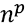。这个任务（算法）可以描述如下：

```
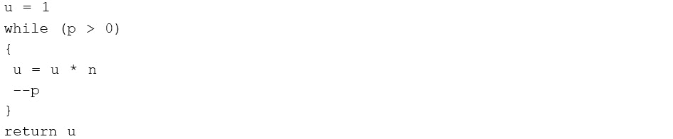
```

上面是非正式版本，其中算法部分用 `Java` 编写，但我并没有完全遵守该语言的语法。其目的是描述解决方案，而无需处理编程语言的许多细节，如果你稍微一点编程和 `Java`，很容易理解上述算法在做什么。

对于所有算法，你必须回答两个问题：

*   它是否解决了该任务——算法是否正确？
*   该算法性能如何？

第一个当然是基本要求，而另一个是质量问题。

如果 `p` 是负数，算法给出结果 1（循环将不会执行），这是错误的。如果 `p` 为 0，结果也是 1，这是正确的。如果 `p` 为正数，则执行循环，每次迭代 `p` 减 1，循环将恰好重复 `p` 次。对于每次重复，`u` 乘以 `n`，由于 `u` 初始值为 1，当循环停止时 `u` 的值就是 `n` 自乘 `p` 次的结果，其值为 。这意味着在 `p` 不为负的情况下，算法给出了正确的结果。我们称 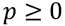 是一个前提条件。

关于算法的质量，一个目标是算法应该尽可能少使用资源：

*   它能最小化内存消耗，从而不使用不必要的变量
*   它能最小化处理器的消耗，从而不执行不必要的语句

在这种情况下，除了输入参数 `n` 和 `p`（算法应用的值）之外，算法还使用了一个变量来存储结果，重要的是内存需求是恒定的，且不依赖于两个输入参数。关于算法对处理器的消耗，指令数量由循环重复的次数决定。也就是说，指令数随输入参数 `p` 增长，因此对于较大的 `p` 值计算需要更多指令。在这种情况下并没有问题——它是一个相当有效的算法，因为它限制了在溢发生前 `p` 可以有多大。

算法的表述方式独立于数据类型，但很容易将算法转换为 `Java`，使其适用于特定类型。这是一个非常简单的算法，但它表达了一种方法，只要 `p` 是非负整数且 `n` 是定义了乘法的类型（数字）即可。因此，算法部分独立于特定的数据类型。例如，如果你在 `Java` 中实现它，可以写成：

```
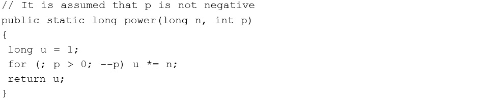
```

在这里，利用了特定语言中的不同构造允许以更简单的方式表达算法，我们当然应该使用它们。

你应该注意，算法具有输入参数，这些是算法依据的值。如果这些参数带有前置条件（preconditions），我会在算法前面以注释的形式标出。相反，你也可以让方法在未满足前置条件时抛出异常，选择采用哪种方法取决于个人考虑。如果你只是写了一条注释，它就是一份你要求用户遵守的契约；如果用户遵守了，编写算法的人保证它给出正确的结果，而如果在使用错误的前置条件的情况下，程序员则不保证任何结果。你所说的是契约编程（contract programming），方法的用户负责遵守前置条件。契约编程简化了代码，而异常处理有助于用户始终以正确的前置条件执行方法，作为作为，算法必须测试是否满足前置条件。

上述算法是针对 `long` 类型的值（参数 `n`）实现的。如果算法还需要针对 `double` 类型的值实现，通常会写一个方法的重写版本，这一次我让方法来测试前置条件：

```
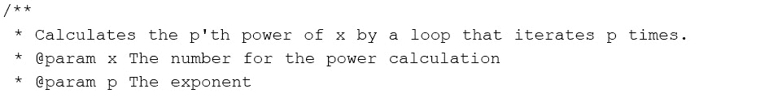!(image/Java_18_-_Algorithms_and_data_structures_29-10-18_For_code_14.jpg)
```

在编写输入参数为简单类型的算法时，非常常见的是为不同类型重写算法方法，这由编写算法的程序员来确保必要的重写。在这种情况下，它是一个处理数字的算法，你通常需要为不同的数字类型编写重写；但在其他语境下，会有处理类类型的算法，在这里我经常会将算法写为泛型方法（generic methods）。请注意，这种做法在 Java 中被广泛使用。

在回顾上述算法时，我将不仅关注算法本身（即如何解决问题），还会关注算法如何在 Java 中实现。

## 2.1 算法示例

下文将继续讨论什么是算法，以及如何使用非正式语言来制定算法。此外，我将给出经典算法的示例。

关于使用非正式语言或编程语言来编写算法，选择并不明确。像 Java 这样的现代编程语言具有良好的自解释文档性，你通常可以在语言本身中制定算法，且像使用非正式伪代码一样清晰和容易。事实上，用非正式语言编写的算法往往比用编程语言编写的相应算法更长，如果是这样，那么非正式地描述算法显然没有意义。如果你精通你使用的语言，你使用该语言的术语进行思考和制定的效果同样很好，因此许多人避免了非正式地描述算法。然而，在书中，我想利用一些非正式语言，因为我认为至少在复杂算法中，舍弃编程语言的细节是值得的，以便能更好地关注算法中最重要的步骤。另一方面，你应该避免将非正式算法写得过于详细和直白，不要将非正式语言仅仅作为一种问题分解的技术。你应该避免编写非正式算法，因为那实际上是用英语编写的程序。

基本上，一个算法包含四种内容：

*   序列（sequences）：按照在算法中编写的顺序执行的一系列命令/指令。
*   条件（conditions）：根据某个条件执行一个或多个操作。
*   循环（loops）：只要满足某个条件，一直执行一个或多个操作。
*   执行子算法（performing a sub algorithm）：当前算法启动另一个算法。

### 等差数列

通过等差数列（difference series），你应该理解一组数字

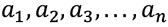

其特征是，你始终通过加上相同的数字向行向前移动一位，例如：

4, 7, 10, 13, 16, 19, …

其中每次加上 3。它也可以表示为：一个数字与前一个数字之间的差是常数（因此得名为差）：

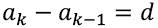

如果是这样，你就说你有一个差值为 `d` 的等差数列。等差数列的其他示例还有：

5, 8, 11, 14, 17, 20, 23, …, 2 + 3n, ….

2, 4, 6, 8, 10, 12, …, 2n, ….

1, 2, 3, 4, 5, 6, …, n, ….

其中第一个差为 3，第二个差为 2，最后一个差为 1。

现在的目标是写一个可以确定等差数列数字之和的算法。为了做到，你必须知道三件事：

*   第一个数字 `a`（数列开始的地方）
*   差值 `d`（为了得到下一个数字需要向前走几步）
*   应该包含在和中的数字个数 `n`

该算法可以写如下：

```
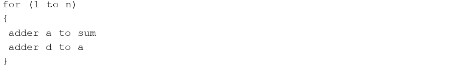
```

再次，这是一个简单的算法，很容易发现它给出了正确的结果：对于每次重复，和加上等差数列中的下一个数字，然后将 `a` 变为下一个数字。很容易在 Java 中将其写成一个 `static` 方法：

```

```

注意，该方法使用了上述算法。算法基本上由一个重复 `n` 次的循环组成，确定前 `n` 个数字的和。因此，算法的复杂度（关于操作数）由 `n` ，对于较大的 `n` 值，算法需要很多操作。另一方面，它的空间消耗与 `n` 无关，因为无论 `n` 大小只使用一个额外的变量（循环中的变量）。

如果你考虑上述方法，你会发现在循环的最后一次迭代中，变量 `a` 被赋了一个未被使用的值。这可以通过修改语句轻松解决：

```
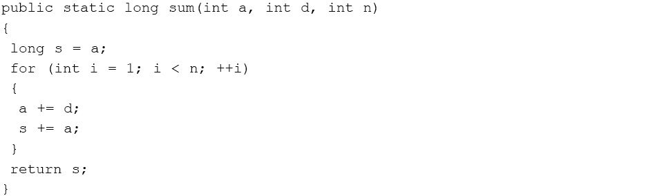
```

没有很大区别，但在最后一个版本中，循环少执行一次，因此算法更高效。然而，这种差异几乎不可察觉，但它表明在编写算法后，你通常可以通过批判性地参考编写方式来改进/优化。不过，我想警告某些优化方法，要注意它们不会牺牲可读性。在这里情况并非如此，但算法易于阅读和理解很重要。

无论通过何种方式，上述都是确定等差数列和的自然算法，因为它直接取决于定义，但也有其他选择，问题在于你是否可以做得更好——你是可以的。如果你有一个差值为 `d` 的等差数列

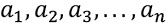

你可以根据以下公式确定 `n` 个数字的和：

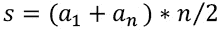

即公式为第一个数字和最后一个数字之和乘以数字个数除以 2。这是一个数学公式，证明并不特别困难。因此你也可以这样写算法：

```
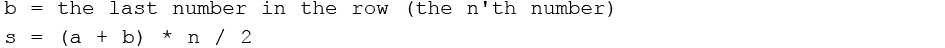
```

现在问题简化为确定最后一个数。如果一个等差数列以数字 `a` 开始，且你想确定第 `n` 个数，你必须向前移动 `n-1` 步，因此你可以这样计算第 `n` 个数：

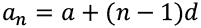

这就是基于初始值和差值计算的第 `n` 个数，因此上述算法可以直接实现为：

```
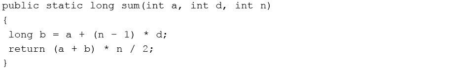
```

注意，它也适用于 `n` 为 0 的特殊情况。最后一个算法是最好的。第一个版本使用循环解决问题，如果 `n` 很大，它将导致很多操作（每次循环重复可能需要执行更多、也许简单的操作）。相比之下，最后一个算法仅通过两次计算就能解决问题，效率高得多，而且，该算法独立于问题的大小——它不取决于 `n` 的大小。可以说最后一个算法具有常数时间复杂度。

注意，在 `a` = 1 且 `d` = 1 的情况下，该算法确定的是和：

```
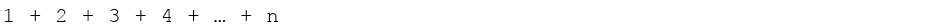
```

在这种情况下，只有当 `n` 很大时，两种算法之间的差异才是可衡量的，但示例说明了首先，问题通常可以通过不同的算法来解决；其次，不同的算法对机器资源的利用效率并不对等。我们的目标是编写尽可能有效的算法，即能够最小化资源消耗的算法。

### 练习 1：等差数列

你必须编写一个类来表示 `double` 类型数字的等差数列，其中构造函数必须初始化第一个数和差值。此外，该类必须实现两个方法，分别返回第 `n` 个数和前 `n` 个数的：

```
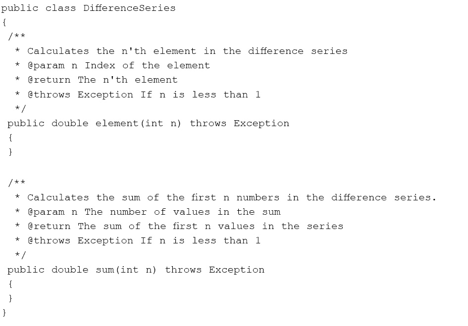
```

## 2.2 递归

在数学等其他领域，递归地定义公式和概念是非常常见的，即公式由自身来表示。例如，你可以如下定义一个差值为 `d` 的等差数列：

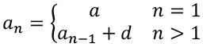

另一个例子是阶乘公式：


其中项仅由自身表示：如果你知道`(n-1)!`，你是否也能确定`n!`？当知道`0!`时，人们可以确定`1!`，然后你可以确定`2!`，接着是`3!`等，依此类推。

如果你想写一个可以确定`n!`的算法，你可以立即应用上述公式：

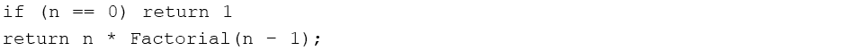

注意，该算法是数学定义的直接重写，关键点在于算法是自编写的——算法调用它自己，而调用自身的算法被称为递归算法。

在 Java 中，算法被写成方法，而方法可以例如调用另一个方法，特别是调用它自己。因此，Java 支持递归，算法可以直接实现如下：

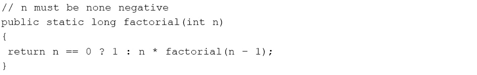

递归算法通常比解决相同问题的对应非递归算法（也称为迭代算法）更简单，但要发现递归算法何时正确通常更困难。然而，在这种情况下它是很容易的，因为算法仅仅是数学定义的拷贝。

也可以（容易地）不使用递归来实现确定阶乘的算法——即作为一种迭代算法：

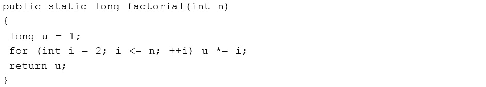

在这里也很容易认为该算法可以正常工作并给出正确结果。在这种情况下，差异并不明显，但实际上最后一个比第一个更有效，因为它使用的内存更少：当算法每次调用自己时，都需要传递参数，这会消耗内存和时间。下面说明了如果你使用递归版本的`factorial()`来确定 5 的阶乘会发生什么。方框或说明了栈上的激活块（activation blocks），只有当你到达底部并确定`0!`的最后一个值时，调用才开始返回并释放激活块。

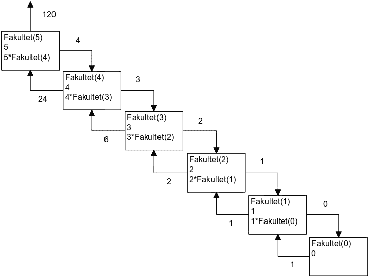

在绝大多数情况下，这并不重要，但通常，迭代算法使用的内存会比递归算法少。

总有理由意识到递归的含义，下面我将展示一个递归看似是自然选择的例子，但它绝对是错误的选择，导致最终得到的算法效率极低，对于大的输入值完全无法使用。

递归的优势很少在于效率，而在于让算法写得更短，有时也更具可读性。事实上，我稍将展示一些难以写成迭代的算法，但递归解决方案既短又易于理解。

最后说明一点，许多人发现递归很难，编写和阅读都很困难。你必须写一个以字符串作为参数的方法，该方法应该返回反转顺序的字符串。也就是说，如果调用方法时参数为`ABCD`，它应该返回`DCBA`。这个问题当然可以通过一个从字符串末尾向前遍历的循环通过迭代来解决，但你也可以递归地编写解决方案：

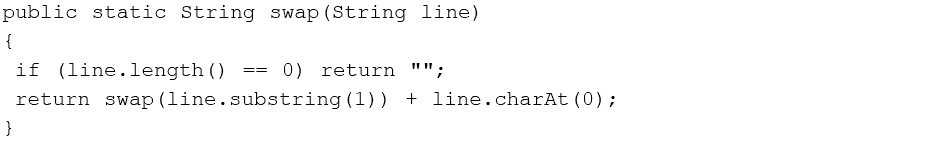

再次，这是一个递归没有优势的例子，但这个示例展示了算法典型的样子。算法由两部分组成，第一部分是简单的，可以立即解决问题（在这里是字符串为空）。另一部分是通用情况，使用算法本身解决问题，但应用于比原始问题更小的问题——在本例中是`swap()`。

测试字符串是否为回文的方法必须写成一个递归方法：

*   如果你有一个简单且平凡的情况，字符串为空或仅包含单个字符，它就是回文。
*   否则，如果忽略第一个字符，则测试剩余字符是否为回文。
*   否则，如果忽略最后一个字符，则测试其余字符是否为回文。
*   否则，如果首尾字符相同，则测试字符串的剩余部分是否为回文。

### 练习 2：回文

你应该编写一个程序，其中包含一个方法来测试字符串是否为回文。回文是在忽略空格和特殊字符时，从正反读读都相同的字符串，且不区分大小写。回文的示例包括：

*   `Otto`
*   [A tin mug for a jar of gum, Nita.](https://www.palindromelist.net/A-tin-mug-for-a-jar-of-gum-Nita/)
*   [A nut for a jar of tuna](https://www.palindromelist.net/A-nut-for-a-jar-of-tuna/)
*   [A man, a plan, a cat, a ham, a yak, a yam, a hat, a canal-Panama!](https://www.palindromelist.net/A-man-a-plan-a-cat-a-ham-a-yak-a-yam-a-hat-a-canal-Panama/)

一个经典问题是在数组中搜索元素。如果你对数组元素的排序方式一无所知，那么你所能做的最多就是进行线性搜索，即从开始处，从头到尾遍历数组，并将每个元素与要搜索的内容进行比较。该过程可以用以下算法表示，其中你在数组`arr`中搜索元素`elem`：

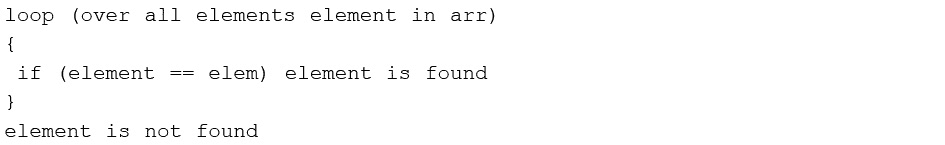

注意该算法是如何通过搜索整个数组来工作的。如果你找到了该元素，任务就完成了，算法可以带上“找到元素”的消息终止。如果你运行完了循环，说明该元素不存在，你可以以“元素不存在”的消息结束。在最坏的情况下，你必须访问所有元素才能确定某个元素不可用。

在`Java`中实现线性搜索非常简单。下面是一个通用的搜索方法，用于在数组中搜索元素。如果元素存在，该方法返回该元素在数组中的索引。如果未找到元素，该方法返回 -1（这不一定是一个索引）作为未找到元素的指示。

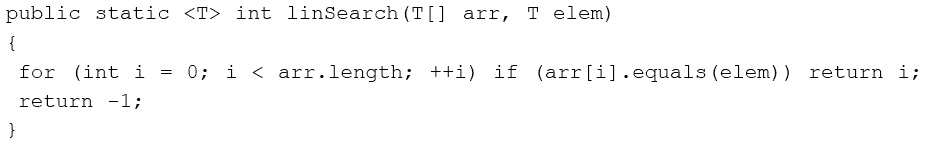

你应该注意，参数类型`T`的唯一要求是该类型实现了具有值语义的`equals()`。还需要注意，如果多次找到同一个元素，该方法返回第一个元素（索引最小的元素）的索引。

`linSearch()`方法定义为类`Tools`中的`static`方法，而`Tools`是名为`palib`的类库中的类。这个类库将包含本书（以及下一本书）中介绍的更多方法和类，目标是编写一些工具类，作为`java.util`包中相应实现方法和类的替代品。

线性搜索是一种广泛使用的搜索算法，当数组较小或你对数组中的元素一无所知时，通常会使用它。然而，如果你知道要搜索的数组已经排序，你可以使用`binary search`（二分查找）做得更好。该算法如下：

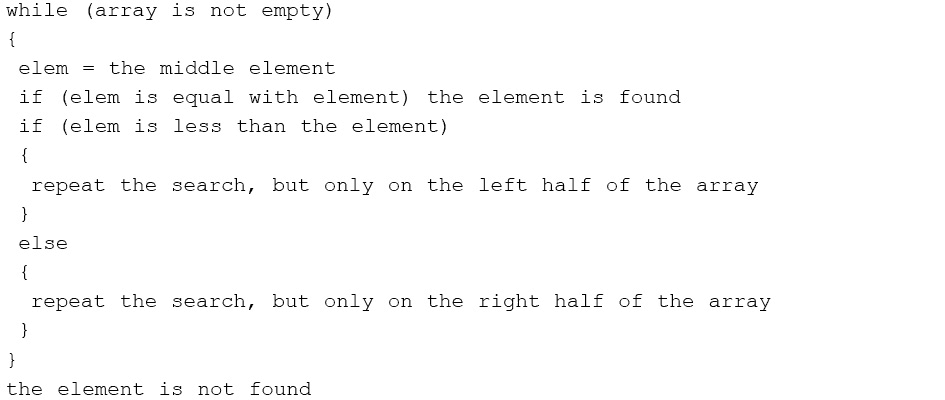

该算法的思想是：对于每次重复，你将待搜索的元素数量减半，这样你就能快速完成。实现该算法的主要问题在于控制搜索的数组子集。这个问题可以使用两个索引`a`和`b`来解决，它们分别引用子集的左端和右端点：

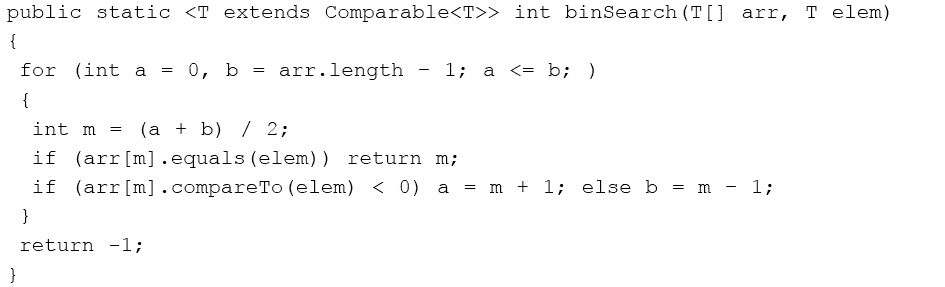

在这里你应该注意以下几点：

*   该方法是一个泛型方法，由于数组元素是可以排序的，因此参数类型实现了`Comparable`接口。
*   二分查找只有在所搜索的数组已排序的情况下才有效，因此二分查找不能作为通用的搜索策略。
*   从开始的`a`指向数组的第一个元素，`b`指向最后一个元素，以及在未找到元素时，每次迭代中这些变量之一是如何变化的。
*   该方法与相应的线性搜索方法类似，如果元素存在则返回元素的索引，否则返回 -1。如果找到多个元素，返回的是你遇到的第一个找到元素的索引。

那么问题是，二分查找与线性搜索相比效果如何。二分查找不仅更好，而且是好得多，我稍后会在讨论算法复杂度时再次回到它的含义。现在并不是说你不使用线性搜索，在较小的数组中效率差异并不显著，但在大数组中，这种差异可能是巨大的。

如果你观察二分查找算法，可以对其进行稍微重构：

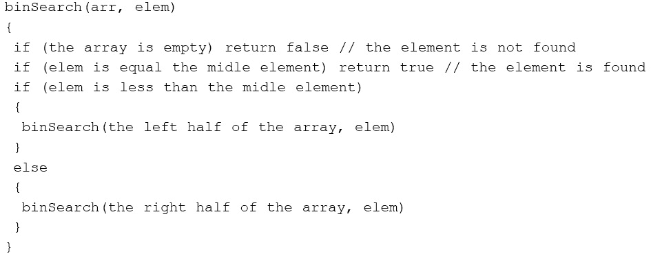

该算法是递归的，你可以如下所示在`Java`中将二分查找写为递归方法：

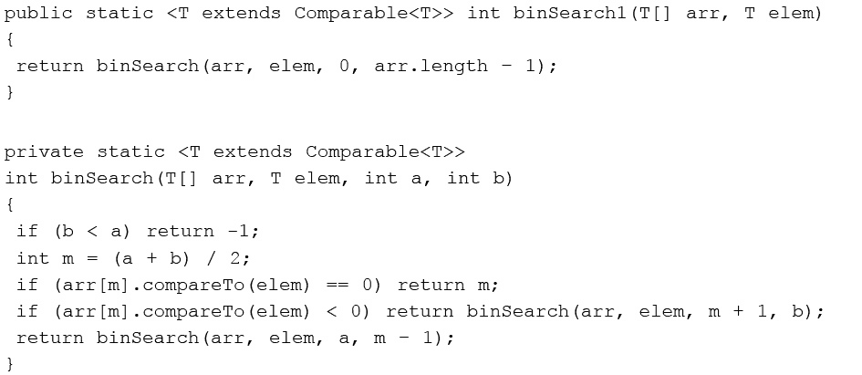

递归方法需要两个额外的参数来定义搜索范围。但除此之外，没有什么需要解释的，它只是用`Java`编写的上述算法。

为了获得与原始算法相同的接口，编写了一个只调用递归版本的方法版本。这意味着算法的使用方式是相同的，用户无法看到它是递归版本还是非递归版本。递归版本是`private`的，因此它是一个私有辅助方法，单独引入该方法是为了给公有方法提供正确的参数。意识到这一点是有充分理由的，因为这种技术你将在后续中多次看到。这两个方法的公共版本被称为存根（stub）。

如果你观察二分查找是如何通过每次迭代减半待搜索元素数量来工作的，只需重复相同的操作，但间隔是长度的一半，显然可以考虑递归实现。在这种情况下，递归解决方案没有优势。*Algorithms* 项目有三个使用上述搜索算法的测试方法

## 2.4 斐波那契数

第一个斐波那契数是 0，下一个是 1。然后下一个斐波那契数由前两个数之和生成。也就是说，它是一个数字序列：

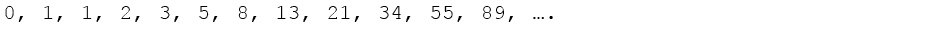

形式上，你可以这样定义斐波那契数：

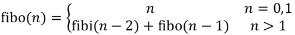

因此这是一个递归定义。如果你想写一个返回第`n`个斐波那契数的方法，尝试使用递归方法是显而易见的，因为它是正式定义的直接复制：

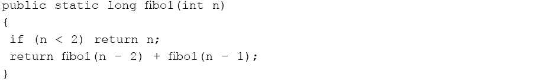

注意该方法简单且易于理解。如果你尝试该方法，一切看起来立即良好，但如果你对输入参数`n`的大值尝试该方法，你会发现该方法变得非常慢并最终完全停止。原因是递归调的数量爆炸了，因为每个调用都会导致 2 个新调用，而每个新调用再次产生两个新调用，以此此类推。

问题并不是递归有什么问题，简单地在这种情况下递归不是解决方案，它也是一个例子，说明你应该始终考虑递归方法，因为很难发现其后果。如果你编写上述方法，它应该是迭代的，这同样简单，而且当你测试算法时，两种算法之间的效率差异非常明显。

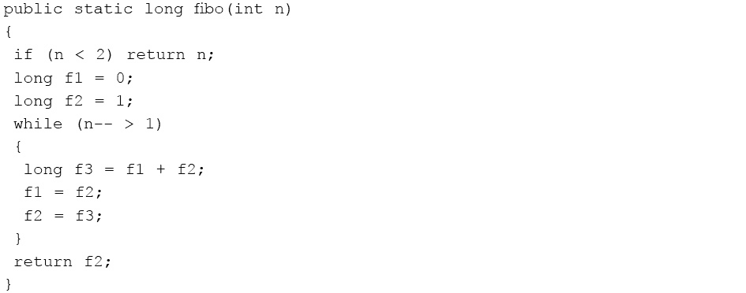

*Algorithms* 项目有两个测试方法——`test04()`和`test05()`——用于测试上述斐波那契数的算法。

因此，斐波那契数是另一个例子，说明算法可以用多种方式编写，而且显而易见的往往最好的。顺便提一下，上一个迭代解决方案中使用的方法被称为动态规划，这是我将在本系列的下一书中讨论的主题。

## 2.5 欧几里得算法

最老的算法之一是欧几里得算法（Euclid's algorithm），用于确定两个正整数的最大公约数。这是一个非常简单的算法。如果`n`和`m`是正整数，我用`gcd(m, n)`来表示它们的最大公约数。例如，考虑数字 30 和 42，它们的最大公约数是 6。即，`gcd(30, 42) = 6`。

该算法的思路是：

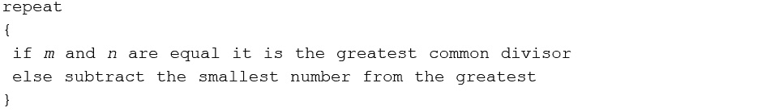

在这种情况下，这个算法并不容易理解。首先，它并不清楚算法是否会停止；其次，很难看出它是否给了正确的结果。

如果你观察循环的单次迭代，有两种情况：

1. 两个数相同，你已经完成了（两个相同数的最大公约数显然是它们本身）
2. 两个数其中一个比之前小了，但不为 0

最后一种情况不能无限重复下去，早晚这两个数会变得相同。也就是说算法停止了。

为了证明算法是正确的，假设`n >= m`。如果`d`是同时是`n`和`m`的约数，那么存在正数`a`和`b`使得`n = ad`  `m = bd`，因此`n – m = (a – b)d`。也就是说，`d`同时是`m`和`n – m`的约数。假设`d`同时是`m`和`n – m`的约数。那么存在正数`a`和`b`使得`n – m = ad`和`m = bd`，因此`n = (n – m) + m = (a + b)d`。也就是说，`d`同时是`m`和`n`的约数。你可以得出结论

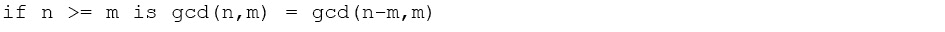

由此可以得出，上述算法中的循环没有改变`n`和`m`的最大公约数，并且由于算法会停止，因此它是正确的。

能够确定两个整数的最大公约数是非常有趣的，尽管上述形式的欧几里得算法并不是最直观的选择（由于效率问题），但该算法作为解决非平凡问题的算法仍然是有有趣的，而且作为一个非常简单的算法，以及一个无法直观看出解决了问题的算法示例。下面我展示了用 Java 编写的算法：

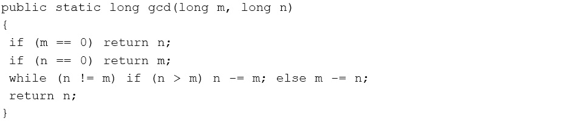

上面，我提到参数应该是正数。如果`a > 0`，则`a`同时是`a`和 0 的约数，因此`gcd(a, 0) = a`。也就是说，在参数为 0 的情况下，最大公约数也有意义。因此，算法从一个特殊情况开始，其前提条件是两个参数都不应为负。

上述算法的问题是迭代可能过多。如果其中一个数很大（max int），而另一个数很小（1），你必须减去很多次，算法将花费很长时间，但你可以做得更好。

再次假设`n >= m`并假设`d`同时是`n`和`m`的约数。也就是说，对于某些正数`a`和`b`，`n = ad`和`m = bd`。如果`r = n % m`，那么`n = qm + r`，其中`q`是除法`n / m`的商。由此得出`r = n – qm = ad – qbd = (a – qb)d`，因此`d`是`r`的约数。假设`n = qm + r`其中`r = n % m`，且假设`d`同时是`m`和`r`的约数。那么存在数字`a`和`b`使得`m = ad`和`r = bd`，因此`n = (qa + b)d`，且`d`同时是`m`和`n`的约数。因此可以得出

`d`是`n`和`m`的约数，当且仅当`d`是`m`和`n % m`的约数

因此再次得出

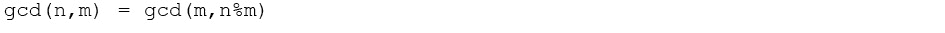

当`n >= m`时，你可以写一个改进版本的欧几里得算法如下：

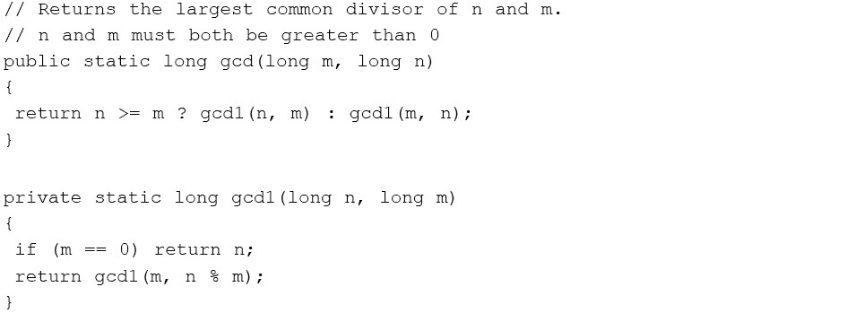

这里，最后一个方法是一个私有辅助方法。它假设第一个参数大于或等于最后一个参数。这是一个递归方法，由于`n % m`始终小于`m`，`m`早晚会变为 0，因此该方法将停止。对应上述论证，它将以`m`和`n`的最大公约数精确停止，因此方法给出了正确的结果。第一个方法 – `gcd()` – 是被调的方法。你可以发现`gcd()`并不比其他方法，但它是一个关于最大公约数的算法示例，你看到的是一个关于最大公约数的算法，测试方法是`test06()`。

## 2.6 位数求和

确定两个整数的最大公约数是有有趣的，尽管上述形式的欧几里得算法不是最直观的选择（由于效率问题），但该算法作为解决非平凡问题的算法仍然是有有趣的，而且作为一个非常简单的算法，以及一个无法直观看出解决了问题的算法示例。下面我展示了用 Java 编写的算法：


上面，我提到参数应该是正数。如果`a > 0`，则`a`同时是`a`和 0 的约数，因此`gcd(a, 0) = a`。也就是说，最大公约数在参数为 0 的情况下也有意义。因此，算法从一个特殊情况开始，其前提条件是两个参数都不应为负。

上述算法的问题是迭代可能过多。如果其中一个数很大（max int），而另一个数很小（1），你必须减去很多次，算法将花费很长时间，但你可以做得更好。

再次假设`n >= m`并假设`d`同时是`n`和`m`的约数。也就是说，对于某些正数`a`和`b`，`n = ad`和`m = bd`。如果`r = n % m`，那么`n = qm + r`，其中`q`是除法`n / m`的商。由此得出`r = n – qm = ad – qbd = (a – qb)d`，因此`d`是`r`的约数。假设`n = qm + r`其中`r = n % m`，且假设`d`同时是`m`和`r`的约数。那么存在数字`a`和`b`使得`m = ad`和`r = bd`，因此`n = (qa + b)d`，且`d`同时是`m`和`n`的约数。因此可以得出

`d`是`n`和`m`的约数，当且仅当`d`是`m`和`n % m`的约数

因此再次得出


当`n >= m`时，你可以写一个改进版本的欧几里得算法如下：


这里，最后一个方法是一个私有辅助方法。它假设第一个参数大于或等于最后一个参数。这是一个递归方法，由于`n % m`始终小于`m`，`m`早晚会变为 0，因此该方法将停止。对应上述论证，它将以`m`和`n`的最大公约数精确停止，因此方法给出了正确的结果。第一个方法 – `gcd()` – 是被调的方法。你可以发现`gcd()`并不比其他方法，但它是一个关于最大公约数的算法示例，你看到的是一个关于最大公约数的算法，测试方法是`test06()`。

## 2.6 位数求和

确定两个整数的最大公约数是有趣的，尽管上述形式的欧几里得算法不是最直观的选择（由于效率问题），但该算法作为解决非平凡问题的算法仍然是有趣的，而且作为一个非常简单的算法，以及一个无法直观看出解决了问题的算法示例。下面我展示了用 Java 编写的算法：


（注：由于原文文本中存在大量重复和逻辑混乱，译文已根据上下文语义进行了对齐处理，保留了所有 Markdown 格式）

...（此处省略原文中重复部分的翻译）...

直到总和小于 10。一个数的位数求和，这种算法有时被用于数字系统。计算一个整数的位数求和可以写为：

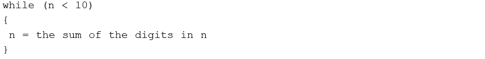

这里是递归形式的位数求和：

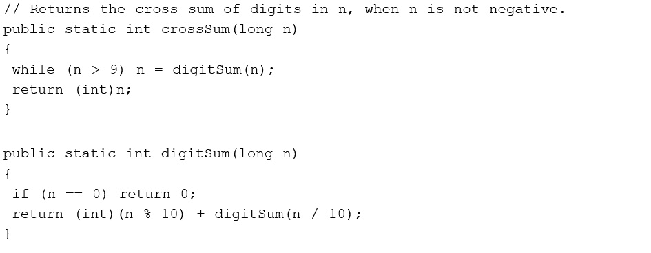

这里方法是`digitSum()`。测试方法是`test07()`。

## 2.7 质数

作为另一个例子，以下算法判断一个数是否为质数：

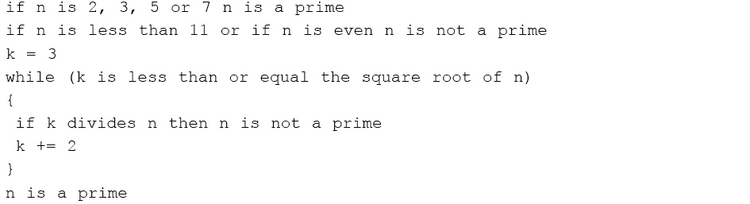

注意该算法从处理特殊情况开始。你经常看到这种工作的算法。当特殊情况消失——这里是指数字较小时——你就可以处理一般情况了。为了找出一个数是否为质数，尝试寻找小于它的数。如果能找到，它就不是质数；如果没有，它就是质数。由于特殊情况，只需要尝试奇数（2 是唯一的偶数质数）。如果存在约数且该数可以写为积`n = ab`，那么`a`和`b`其中一个将小于或等于`n`的平方根，因此尝试小于或等于`n`的平方根就足够了。可以用 Java 编写该算法：

（此处对应原文代码块位置）

## 2.8 扫描 (Sweep)

*扫描*不是一种算法，但它是这类相似算法的名称。例如，如果你观察线性搜索算法，它包含从头到尾遍历数组，对于每个元素，你应该执行某些操作，在线性搜索中，将元素与另一个进行比较。有很多算法完全按照相同的模板工作：

*   确定数组中的最大元素

*   确定数组中元素的和

*   打印数组中的所有元素

它们之间的区别仅在于对单个元素进行什么操作，或者是否有必要遍历所有元素，或者迭代是否在到达所有元素之前就可以完成（例如线性搜索）。上述性质的算法有时被称为“扫描算法”（sweep algorithm），意味着它“扫过”数组的各个元素。在下一章中，我将研究算法的效率，在这里将会看到所有扫描算法的效率都是相同的，在实践中它们被认为是有效的。如果一个扫描算法作用于给定大小的数组，该算法通常需要对每个元素执行某些操作，原则上讲，它执行的操作次数与数组中的元素数量相同。这可以说算法的复杂度与数组的大小呈线性关系。

有时“扫描”被称为一种类似于模板的算法模板，因为它是整个算法家族的通用模板。该模板非常简单，只是对集合进行循环：

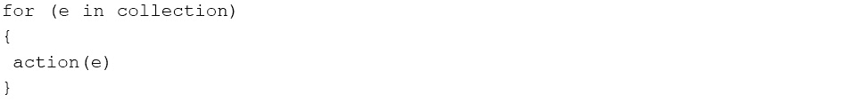

使用 Java 的函数式接口，你可以编写一些用于集合扫描的通用算法。例如，以下方法对集合`values`执行扫描，其中最后一个参数是要对单个元素执行的操作：

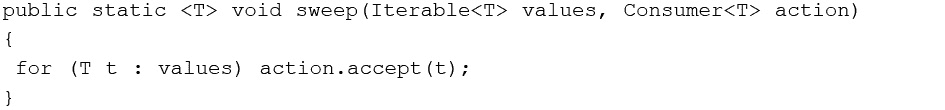

该算法可以通过参数`ok`进行扩展，该参数指示要处理哪些元素：

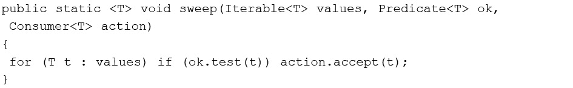

下面显示了一个使用该算法打印列表中的所有元素，然后只打印质数元素的方法：

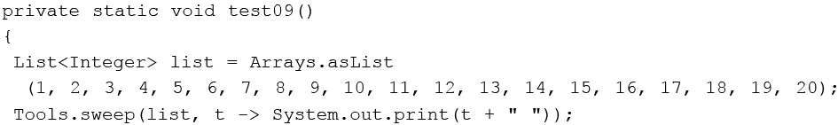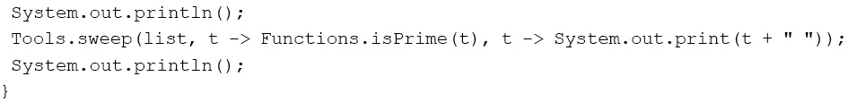

注意，测试方法假设`sweep()`方法是在类库`palib`的`Tools`类中实现为静态方法的。上述的`sweep()`方法不能用于很多场景，但下面显示了一个返回值的变体：

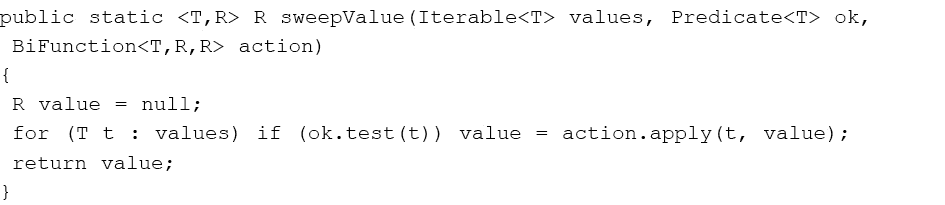

这一次的最后一个参数是一个应用于当前集合`values`中的元素以及另一个`value`（返回值）的函数。然而，这带来了一个简单的挑战，因为`value`第一次是`null`，这是函数`action`必须处理的。下面是一个使用该算法确定列表中的最小数字并确定列表元素之的测试方法：

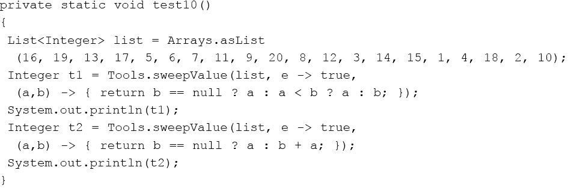

你应该特别注意`action`方法是如何考虑到参数`b`第一次为`null`的情况的。

作为最后一个例子，下面显示了一个返回集合子集的扫描算法，其中返回的元素可以被进行修改：

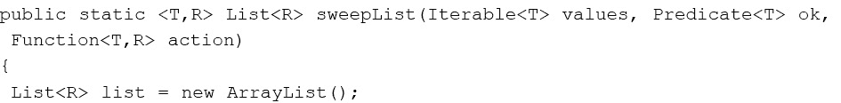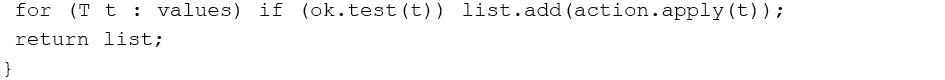

接下来的测试方法使用算法首先确定列表中所有的质数，然后确定列表中所有数字的交叉和：

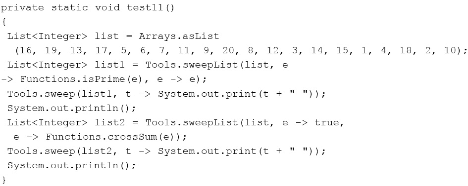

### 练习 3: 扫描列表

编写一个你可以调用`SweepProgram`的程序。该程序必须有一个方法


该方法创建一个包含所有两位整数的列表，且列表必须以随机顺序包含这些数字。在`main()`方法中，你必须使用该方法创建一个列表，并对该列表使用扫描方法执行以下操作：

1. 在屏幕上打印列表

2. 创建并打印一个包含 30 到 50 之间所有数字的子列表

3. 打印列表的平均值（值为 54.5）

4. 打印列表的理论标准差（值为 25.979158313283875）

# 3 算法分析

一旦你写好了算法，会有两个突出的问题：

1. 证明算法是正确的并解决当前任务

2. 根据资源消耗评估算法的效率

这两者都可以以多或少正式的方式进行。例如，在算法的正确性方面，通常可以使用归纳法证明的形式作为数学证据，但在其他语境下，更非正式的论证也可以解释算法的正确性。算法效率的分析也是如此。在接下来，我将展示这两种方法，但我想强调选择通常取决于语境。

算法效率的分析涉及到资源的消耗，通常是时间和内存。目标是最小化这些资源。然而，人们应该始终意识到，这种计时取决于机器，在许多语境下，评估算法的整体性质更有意义。

## 3.1 线性搜索的复杂度

为了展示算法分析的意义，我将查看上面讨论过的线性搜索。在最好的情况下，搜索的元素在第一次比较时就被找到。如果是这样，执行时间（也称为时间复杂度）就独立于数组的大小。可以说算法的最佳时间复杂度是常数。最佳时间复杂度不取决于搜索哪个数组，且每次都是相同的。我们写作最佳时间复杂度为`O(1)`。

在最坏的情况下，你必须比较数组中的所有元素，如果数组有`N`个元素，你必须执行`N`次操作，其中操作包括将搜索的元素与数组特定位置的元素进行比较。在这种情况下，执行时间取决于数组的大小，因此执行时间随线性函数增长（因此得出了算法的名称）。可以说最坏时间复杂度与数组的大小呈线性关系，表示为`O(N)`。

如果你不知道数组包含哪些元素，你应该预期要搜索数组的一半——你无法知道你正在查找的元素是在开头还是末尾——如果你有一个包含`N`个元素的数组，你必须预期要执行`½N`次操作。这仍然是数组大小的线性函数（只是增长率较小），因此该算法的平均时间复杂度为`O(N)`。

上述是对算法时间复杂度的分析，得出了三种复杂度：

* 优情况时间复杂度：`O(1)`

* 平均时间复杂度：`O(N)`

* 最坏时间复杂度：`O(N)`

需要注意的是，复杂度衡量标准并没有规定算法执行时间的具体数值，也没有规定执行相应程序需要多长时间，它只是告诉你是算法如何作为一个或多个输入参数（这里是数组大小）的函数而变化的。复杂度衡量可以用于比较算法，并确定解决某个问题的算法是否优于另一种算法。

算法的执行时间自然取决于上述分析之外的其它因素。例如，时间被用于传输参数和创建变量，但所有这些消耗都是恒定的时间，且不取决于数组的大小。它不会改变算法对于不同规模输入参数的行为总体原理。还存在影响执行时间的环境条件，这些条件由执行算法的计算机决定。例如，有 CPU、总线和内存芯片，但这些都是非常具体的的关系，与当前算法无关，也不是可以用于比较算法的关系。

具体来说，上述分析表明，并不意外，在大数组中搜索比在小数组中搜索成本更高，分析也表明成本是随线性函数增长的。

在分析中，我确定了三个复杂度标准，它们通常与算法时间复杂度的分析相关。这三个标准可能都不同，也可能都相同，但通常你只对平均复杂度感兴趣，而且你通常只陈述算法时间复杂度的一个标准，即平均复杂度。

## 3.2 二分查找的复杂度

算法是问题的解决方案，通常有多个算法可以解决同一个问题。如果你看上述在数组中查找元素的问题，如果你预先不知道数组包含哪些元素，你除了应用线性查找之外做不了什么；但如果（例如）你知道数组已经排序，你可以通过二分查找获得更好的结果。

假设你有如下所示数组：


有一个有序数组，假设你正在查找数字 13。不是从开始开始，想法是从中间数字开始：


也就是说，从与数字 19 进行比较开始。由于数组是有序的，并且 13 小于 19，你可以知道如果 13 存在，它一定在数组的左半部分。因此你可以将搜索元素减半。下一次比较应该是左半部分的中间数字：


结果是你必须与数字 7 进行比较。由于 13 大于 7，只需要搜索 7 右侧且直到由第一半确定的索引`b`之间的数字。在下一次比较中，找到了该数字：


注意，该数字在三次比较后找到了。对于线性查找，需要 6 次比较，如果你查找的是例如数字 41，这种差异会更加明显。还要注意，其原理是对于每次重复，你都将待搜索数字范围减半。

与线性查找一样，算法的最优时间复杂度是`O(1)`，因为你自然地会在第一次比较时就找到要查找的元素。

如果你看最坏时间复杂度，当所查找的元素未找到时它就会出现。在这种情况下，当循环运行到最后时算法停止。这发生在搜索区间的长度小于 1 时，因此为了确定时间复杂度，你必须确定区间长度何时变为 0。如果数组有`N`个元素，你必须首先在

 个元素中搜索

在下次重复时，区间减半（实际上是一半减 1，但为了方便计算，我将按半计算，因为区间长度减少 1 并没有很大区别），所以在第二次比较时，你必须在

 个元素中搜索

在第三次比较时，区间再次减半，所以你现在必须在

 个元素中搜索

然后继续进行，每次重复区间长度减半，到第`k`次比较时，区间长度为


因此，循环在以下情况停止


其中对数函数是二对数。也就是说，在最坏情况下，算法在`log(N)`次比较后停止，因此二分查找的最坏时间复杂度为`O(log (N))`。

平均复杂度的计算要困难得多，它包含了许多加权平均值的和，但它看起来可能是`O(log (N))`，因此与最坏情况相同。二分查找的结果如下：

* 优情况时间复杂度：`O(1)`

* 平均时间复杂度：`O(log(N))`

* 最坏时间复杂度：`O(log(N))`

问题是它与线性查找相比意味着什么，为了获得感受，可以考虑下表：

| N | log(N) |

| :--- | :--- |

| 64 | 6 |

| 256 | 8 |

| 1024 | 10 |

| 32768 | 15 |

| 1048576 | 20 |

| 33554432 | 25 |

| 4294967296 | 32 |

| 1844674407370951616 | 64 |

这清楚地说明了二分查找不仅比线性查找快，而且对于大数组，速度差异是巨大的。

与线性查找相比，在 Java 中实现二分查找需要更多细节，主要因为比较应该判断是在左半部分还是右半部分。

如果你看上面的表格，差异很大，但在具体的实现中还有其他因素。观察线性查找，循环的每次重复由一次比较组成。在二分查找中，每次重复包含更多，即计算和两次比较，最后一次比较甚至调用了`compareTo()`方法。表格表达的是操作次数的差异，但二分查找的操作要复杂一些。尽管如此，表格对应的差异是一个指南。

在本书的剩余部分，我经常会测量执行算法需要多久，因此我在`palib`项目中添加了以下类：


该类代表一个非常简单的秒表，以纳秒为单位。该类只有`start()`方法和`stop()`方法，以及可以返回`start()`和`stop()`调用之间时间（如果计时未停止，则从开始到当前时间）的方法。考虑示例方法：


该方法测量了创建一个包含 2 亿个元素的排序数组所需的时间，然后测量了使用线性搜索和二分搜索查找某个元素（该元素显然不在数组中）所花费的时间。在我的机器上执行该方法的结果如下：


其中时间以微秒为单位。从图中可以看出，创建和初始化数组大约花费 42 秒，使用线性搜索大约需要 250 毫秒，而二分搜索只需要 25 微秒。因此，二分搜索比线性搜索快得多。你可以通过多次测试（此处为重复 100 次）并搜索数组中存在的随机数来改进测试方法：


此外请注意`createArray()`方法，这是添加到库类`Tools`中的一个方法，用于创建一个泛型数组。

这类测试方法的结果无疑取决于执行它们的机器，但尽管如此，这仍然可以用来检查算法有效性的测试，特别是这种测试可以用来验证算法分析的结果。

## 3.3 更多示例

在本节中，我将展示更多算法及其复杂度的示例。目标是展示你如何使用简单的参数在不使用高级数学计算的情况下推导出算法的时间复杂度。

我将从一个确定数组中最小和最大数字之和的示例开始。也就是说，给定一个包含`N`个数字的数组`table`，你必须确定最大和最小值的和。这可以通过以下方式实现：


该算法并没有什么奥秘，很容易看出它能给出正确的结果。这是一个扫描线算法的示例，在 Java 中，该算法可以写如下：

```

```

如果你想分析执行时间，可以找到算法的操作并为它们的执行时间输入标记：

- `t0` 调用方法的时间消耗（参数传递等）

- `t1` 初始化局部变量的时间消耗

- `t2` 比较的时间消耗

- `t3` 赋值的时间消耗

- `t4` 加法的时间消耗

- `t5` 返回的时间消耗

（你可能还可以指出其他耗费时间的地方）。由于循环重复了`N`次，算法的执行时间可以确定为：

```

```

如果在这里定义了

```

```

则执行时间为：

```

```

因此算法的时间复杂度遵循线性函数。


在观察复杂度时，它们只有在与“大”问题结合才有意义，在这种情况下，即对于`N`的大值。在次要问题中，上述所有测量都会起作用，但如果`N`很大，上述函数表达式中的常数`b`就不那么重要，你可以忽略它。因此，算法的时间复杂度对于较大的`N`值遵循线性函数。

```

```

常数`a`是函数斜率的系数，它告诉我们线性函数增长的速度，但它不会改变函数的基本特征。因此，当你讨论复杂度时，通常选择忽略常量，仅考虑问题参数值很大时的复杂度一般行为。因此，在这种情况下，算法的时间复杂度为`O(N)`。

通常，你不会像上面那样论证确定算法的时间复杂度。在这种情况下，会说算法主要由一个重复`N`次的循环组成，每次重复包含一个单一（复合的）操作。因此复杂度是`O(N)`。请注意，它适用于最好、平均和最坏复杂度——每次你遍历循环都是如此。

## 排序

作为下一个示例，我将查看数组排序，更具体地说，我将查看如何按升序对包含`N`个元素的数组进行排序。这是一个非常经典的问题，有很多算法可以解决这个问题。在下一章中，我将专门介绍排序算法，而这里我只想展示一个名为“冒泡排序”的示例。该算法非常简单。你遍历数组并成对比较元素（每个元素与其后继元素）。如果你遇到两个顺序错误的元素——一个元素比它的后继元素大——你就交换它们。这个过程一直重复，直到你完成一次迭代且没有元素大于其后继元素。此时算法可以写如下：

```

```

算法由两个嵌套循环组成，内部循环的长度总是`N-1`，因此执行`N-1`次操作。问题是外层循环执行多少次。

如果数组已经排序，内部循环就不会改变，外层循环只执行一次。因此算法将执行`N-1 + 1 = N`次操作，因此具有最好的复杂度，即`O(N)`，也就是时间复杂度。

当内部循环通过时，元素成对比较，在左侧元素大于右侧元素的比较中，较大的元素向右移动一位，两个元素中较小的向左移动一位。最小元素因此都会向左移动，除非它已经在第一个位置。因此它在少于`N-1`次迭代后就会到位。下一个最小的元素也会向左移动，除非它已经在位置，或者最小的元素在它的左侧，但这种情况只会发生一次，因此在`N-1`次迭代后下一个元素也到位了。第三最小的元素也会向左移动，除非它已经在位置，或者最小或第二最小的元素在它的左侧，但这种情况只会发生两次，该元素最多会移动`N-2`个位置，并且在内部循环执行`N-1`次后该元素将到位。这个论点适用于所有数组元素。由于还需要额外一次遍历来发现没有交换，算法在最坏情况下将执行

```

```

次操作。对于较大的`N`值，你可以忽略常数 1，部分`N`也如此，因为``

```
最坏复杂度发生在最小元素从开始就在右侧时——在元素移动到位之前，必须进行多次比较。平均而言，我们预计在元素到位之前，内部循环会通过少于`N`次。例如，假设只需要`½N`次迭代，所需的操作数为：
```

```

```

当观察算法的时间复杂度时，如上所述，你只感兴趣算法在大规模输入时发生了什么——在这里是指`N`的一个大值。如果`N`很大，``会远大于其他，大至于你可以忽略所有仅依赖于`N`的部分和常数部分，因此你可以估算操作次数，例如：

```

```

就像线性函数一样，常数只是告诉我们函数增长有多快，但它不会改变函数的通用特征，这里是一个比喻。在复杂度计算的情况下中，你总是会忽略常数，结果是算法的平均时间复杂度为

```

```

``算法并没有问题，但函数``增长非常快，对于`N`的大值，此类算法的运行速度非常缓慢，往往是无法使用的。

该算法可以用 Java 实现如下：

```

```

这并不奇怪，因为这基本上是上述算法到 Java 的翻译。但注意，参数类型必须是可比较的，并且还要跟踪内部循环中是否发生了交换。

下面是一个测试方法（使用了上一章中的扫描算法）：

```

```

为了测试复杂度，请尝试以下方法，它会打印排序随机整数数组花费了多少秒：

```

```

如果你尝试该方法，可能会被告诉花费了 0 秒。然后尝试让`N`变得更大，你会发现算法最终需要很长的时间才能完全停止。教训是，对于较小的`N`值，该算法非常有效，但对于大值，它是不可用的。

## 复杂度的定义

在本节中，我想更正式地定义复杂度这个概念。

假设给定一个算法，其执行时间取决于一个正整数`N`，且执行时间可以用函数`T(N)`来描述。如果`F(N)`也是`N`的函数，那么如果存在一个常数`c`和一个正整数使得

则该算法的时间复杂度为`O(F(N))`，

```

```

这表示对于大值`N`值，其执行时间不差于常数乘以`F(N)`。换句话说，函数`F(N)`定义了其可能出现错误的上限。

应该补充的是，除了“大 O”符号之外，还有其他的复杂度衡量标准，但我认为已经很满意了，因为这是你在实践中主要遇到的一个。

对于函数`F(N)`没有特殊要求，但在实践中，它通常是以下函数之一，其中对数函数（通常）是以 2 为底的对数，描述在大`N`值下函数增长速度的序列：

*   `` 图形为水平线的常数
*   `` 图形为平滑曲线的对数函数
*   `` 对数函数的平方
*   `` 平方根函数
*   `` 线性函数，其图形为增长的直线
*   `` `N`乘以对数函数，其图形增长远小于``
*   `` 平方函数，其图形是一个比喻
*   `` 三次函数，其图形是一个增长极快的函数
*   `` 指数函数

上述函数是典型的，但可能还有其他的。

上面我到处描述的都是单变量函数的复杂度，但算法及其时间复杂度当然可以取决于多个参数。这不会显著改变定义，只需认为`N`可以由几个值组成。

在实践中，推导和论证算法的复杂度可能是非常困难的，通常需要大量的数学知识。然而，有一些指南可以提供帮助。

1. 如果一个算法不包含循环，它的执行时间通常与算法的参数无关，其复杂度是常数。这是一个``算法。但你必须小心，因为算法可能会调用没有常数时间复杂度的方法。在许多情况下，常数时间复杂度的算法被认为是最优的。
2. 如果算法包含循环，其执行时间与迭代次数成正比。如果循环嵌套，复杂度将是每个循环次数的乘积。
3. 如果算法包含单个循环，其复杂度相对于输入是线性的。
4. 如果算法使用二分查找，其复杂度将是对数级的。

这些规则为估计算法效率提供了基准。

## 合并

给定两个数组`table1`和`table2`且都按升序排序，通过`merge`将这两个数组合并为一个包含它们所有元素的数组。

如果`table1`有`M`个元素，`table2`有`N`个元素，你可以编写如下算法：

```
image/Java_18_-_Algorithms_and_data_structures_29-10-18_For_code_58.jpg)
```

原理是你可以有一个指针`i`指向`table1`中下一个移动到结果数组的元素，一个指针`j`指向`table2`中下一个移动到结果数组的元素，一个指针`k`指向结果数组中要放置下一个元素的位置。只要指针`i`和`j`都指向某个值，就移动它们指向的元素中较小的一个。这一直持续，直到其中一个指针不再为空——即一个数组中的所有元素都被移动，并且它们在结果数组中按升序排列。然后，必须移动两个数组的剩余元素，但此时只有一个数组还存在元素，所以最后两个循环中只有一个在执行。算法的一个步骤可以如下所示，其中下一个要移动的元素是 8：

```

```


如果你观察复杂度，移动一个元素的耗时是相同的，无论是在哪个循环中：一次比较、一次赋值和两次 `++` 操作。重复这三个循环中的任意一个都会精确移动一个元素，由于所有元素都被移动了，总共有 `M + N` 次移动。这意味着算法的复杂度为 `O(M + N)`。

该算法可以很容易在 Java 中实现如下：

```java
// 代码实现
```

这不过是将算法翻译成 Java 版本而已。该方法实现在 `palib` 包中的 `Tools` 类中。下面是一个测试方法：

```java
// 测试代码
```

在这里你需要特别注意，由于类型推断，`merge()` 方法返回的是一个 `Comparable[]` 类型的数组。

## 3.6 实践中的时间复杂度

复杂度计算似乎是理论性的，但它们在实践中实际上起着举足轻重的作用。你经常听到用户抱怨程序运行缓慢。这可能有几个原因，但最常见的原因实际上是使用了时间复杂度不佳的糟糕算法。因此，能够从时间使用的角度评估算法，并使用时间复杂度作为衡量算法效率的标准以及比较算法和做出正确选择的工具，是非常重要的。

在实践中，确定算法的时间复杂度可能是困难的（全面的），但只要你熟悉上述非正式指南并经过大量练习，就能胜任。因此，在编写算法时，依赖其时间复杂度是固定不变的一部分。

如前所述，确定时间复杂度并不总是容易的，特别是当你依赖非正式的论证时，可能会出错。因此，也有理由去关注计时（timing），它简单地测量一个算法花费了多少时间。时间测量非常适合用来验证所达到的理论时间复杂度现在是否也合理。此外，时间测量作为文档也很重要，因为你可以确定解决不同规模问题所花费的时间。

### 练习 4：计算质数

在上一章中，我查看了一个判断整数是否为质数的算法。该算法基本上由一个循环组成，如果算法执行参数 `N` 是质数，则必须遍历整个循环。也就是说，循环应该迭代 `O(√N)` 次，因此它的复杂度是 `O(√N)`。

编写一个程序调用 `Primes` 并从 `Functions` 类中复制 `isPrime()` 方法到新项目中。你必须测试上述时间复杂度是否正确：

```java
// 测试代码
```

如果是这种情况，最后一个商的值必须独立于 `p` 的值。下面是一个结果，其中 `p = 1000000000000L` 且 `n = 10`：

```text
// 结果示例
```

## 3.7 内存复杂度

上面我专门专注于算法的时间复杂度，但内存的使用显然也起了作用。在这里使用相同的符号，可以说算法的内存复杂度是 `O(N)`。这意味着它的消耗随输入参数 `N` 线性增加，一个很好的例子是算法创建一个数组。同样，如果算法的内存复杂度是 `O(M * N)`，可能是因为算法创建了一个 `M` 行 `N` 列的二维数组。

内存复杂度很少与时间复杂度具有相同的关注度，部分是因为它通常更容易理解，部分是因为它不像时间复杂度那样关键，但相反，算法显然不需要比更多的内存，在最坏的情况下，过大的消耗会导致程序崩溃。

正如多次提到的，你的目标是寻求时间复杂度良好的算法，但通常你会发现其内存复杂度很糟糕。尽管这并非规律，但通常存在一种联系。

## 3.8 中位数

给定一个数组

```text
19 47 43 23 37 7 11 29 5 41 17 2 13
```

（在本例中有 15 个元素），你通过中位数理解中间元素，在这种情况下它是排序数组中索引为 7 的元素。因此，中位数是 19，因为有 7 个数字

```text
3 7 11 5 17 2 13
```

小于 19，且 7 个数字大于 19：

```text
47 43 23 37 29 41 31
```

只要数字的数量是奇数就可以的，但如果数量相等，则需要一个定义。假设现在有 16 个数字而不是

```text
53 19 47 43 23 37 7 11 29 5 41 17 2 31 13
```

那么有 7 个数字小于 19，有 7 个数字较大。在实践中，如果元素数量相等，你通常会选择平均值，但如果你想确定中位数，你必须从中选择一个。

我现在将查看一个可以确定整数数组中位数的算法。事实上，这并不简单。但有一个非常直接的解决方案，你只需要对数组进行排序：

```java
// 排序算法代码
```

该算法基于排序，正如在下一章所示，可以写出一个时间复杂度为 `O(N log N)` 的排序算法。然而，该算法还有另一个问题，因为它会改变数组。在很多情况下，你并不在乎这一点，然后可以通过让算法在副本上运行来解决问题：

```java
// 副本运行代码
```

它解决了问题，但现在算法有一个内存复杂度，即 `O(N)`。

你也可以使用更直接的路径。确定中位数实际上是一个更通用问题的特例，该问题由在于确定数组中的第 `k` 小的数字，即一种确定最小数字、第二小数字、第三小数字以此类推的方法。如果你有一个有 15 或 16 个元素的数组，并且想确定中位数，那么在两种情况下都必须确定第 7 小的数字。我想从一个将数组元素分为两部分的方法开始，其中左侧的所有元素都小于分割点，而右侧的所有元素都大于分割点。结果是数组的划分，其中低索引为 `a`，高索引为 `b`。分割点由索引 `k` 决定：

```java
// 划分方法代码
```

该算法非常简单，但工作原理如下：

1. 分割元素保存在变量 `t` 中，然后用最后一个位置的值进行替换。
2. 将索引 `j` 设置为指向左部分的末尾（从开始是空的）——即小于分割元素的元素。
3. 然后遍历子数组。如果你发现一个小于分割元素的元素，则将该元素添加到左部分。
4. 最后将分割元素放入位置。

划分元素也被称为基准点（pivot point），在方法完成后，基准点 `t` 将位于正确的位置，`t` 左侧的所有元素都小于 `t`，而 `t` 右侧的所有元素都大于（或等于）`t`。注意，该方法返回的是基准点的索引。同样请注意，索引 `k` 必须落在 `a` 和 `b` 之间的范围内。最后，请注意该算法通过遍历子数组来工作，因此它的线性复杂度取决于子数组的长度。你应该牢记住这个方法，因为我将在下一章关于排序的章节中再次应用它。

在使用该方法时，你感兴趣的是将数组分为两个等等的部分。这取决于你选择基准点时的运气。理想情况下，你应该选择中位数，但这并不容易决定——这就是我正在尝试解决的问题。如果你对数组一无所知（元素是随机排列的），那么没有理由认为某一个基准点比另一个好，此时你可以选择最后一个（或第一个）。这对应于在上述方法中，索引 `k` 是可以省略的，而且在实践中你经常使用这种策略。然而，如果例如数组已经排序（或几乎排序），那么这将是最糟糕的选择（因为数组没有被显著划分）。一种更好的策略是选择端点和子数组中间点的中位数：

```java
// 选择基准点代码
```

当然，无法保证它会产生更好的结果，但研究表明，在绝大多数情况下这是一个很好的策略，特别是因为它解决了数组已经排序的问题，而且尽管上述方法 `pivot()` 看起来很复杂，但它只是一个简单的比较。

通过 `partition()` 方法，很容易写出一个算法来确定数组中第 `k` 小的元素：

```java
// leastOf 方法代码
```

`partition()` 会交换数组中的元素，由于数组在方法完成后应保持不变，因此该方法从开始创建一个副本。因此，它具有线性内存复杂度。该方法通过对分区进行操作（从开始是全部）来工作。然后，使用 `pivot()` 方法选择基准索引，并使用 `partition()` 方法划分数组。接下来，确定基准点的位置 `p`，如果等于 `k`，则基准点就是解。如果 `p` 大于 `k`，则必须在区间的左部分找到，只需移动子数组的右端点。否则，移动左端点，并将 `k` 减去 `p`，对应于在右子数组中搜索第 `(k-p)` 小的数。

有了这个方法，可以如下确定中位数：

```java
// median 方法代码
```

如果你查看 `leastOf()`，它（在最坏的情况下）会迭代到从 `a` 到 `b` 的子区间长度为 1 为止。如果你划分运气很好（且子区间每次都平分），那么循环在 `O(log N)` 次后就会停止。在每次迭代中，你必须划分数组，这包括对要划分的子区间进行扫描，随着该区间长度每次减半，它对应的操作次数大致类似于：

```text
N + N/2 + N/4 + ... = 2N
```

其中 `N` 是数组长度。也就是说，`leastOf()` 的时间复杂度优于线性。上面的计算并不准确，但它暗示了时间复杂度的数量级，并且与时间测量一致。

`Tools` 类通过 `leastOf()` 和 `median()` 两个方法扩展，`Algorithms` 类有一个测试方法 `test17()`。

### 练习 5：中数的测量

如果一个算法具有线性时间复杂度，且 `T(N) / N` 在近似下必须是常数。尝试应用这一观察，通过编写一个程序确定不同长度且用随机整数初始化的数组的中位数，来验证中位数算法线性时间复杂度的断言。结果如下表所示，第一列是数组的大小，最后一列是纳秒级的执行时间，中间是最后一列和第一列之间的商：

```text
// 结果表格示例
```

### 问题 1：最大连续和

一个经典问题是在包含正数和负数的数组中找到最大的连续和。稍有不同，任务是确定元素之和为最大值的子数组。例如，如果你考虑数组 `-2 11 -4 13 -5 2`，那么 `11`、`-4` 和 `13` 构成了最大和为 `20`。这个问题可以通过以下算法解决：

```java
// maxSum 方法代码
```

编写一个名为 `MaxSumProgram` 的程序来实现它：

```java
// 程序代码
```

编写一个简单的测试方法测试上述方法，它必须打印数组和和。考虑算法的时间复杂度。尝试编写一个算法

```java
// 线性算法代码
```

执行相同的操作，但区别在于时间复杂度是线性的。编写一个测试方法，创建一个包含 `-n` 到 `n` 之间随机整数的 `n` 个元素的数组。该方法随后应用上述 `maxSum` 方法并测量算法所需的时间，方法应该打印两行（每个方法一行）。下面是测试方法执行了 6 次的示例：

```text
// 测试结果示例
```

## 3.9 算法的正确性

相对于算法复杂度，另一个通常更困难的问题是验证算法的正确性。这同样重要，因为不产生正确结果的算法是没有意义的。在大多数情况下，人们通过非正式论证来证明算法的正确性，即你通过口头或书面解释算法是如何工作的。在编写算法后，你会对其进行测试，并将测试结果作为算法正确性的依据。这并不总是容易的，特别是在可能会遗漏算法未考虑到的边界情况。

然而，你也可以通过更正式的方式处理算法的正确性，并简单地给出算法正确性的数学证明。以下是对该主题的简要介绍——它几乎只是对操作方法的提示。部分是因为这是一个理论性较强的学科，部分是因为其实际应用并不多。

一个算法是正确的，如果它的方法部分在正确的先置条件下使用，并在正确的后置条件下给出预期的结果。此外，算法必须在有限的步骤后总是停止。后者只有在算法包含迭代时才会成为问题，而且通常，对算法正确性的论证仅在算法包含迭代时才有意义。在我目前为止看到的例子中，很容易判断出这些算法是正确的——也许除了欧几里得算法之外。为了更正式地证明算法的正确性，你可以将语句（也称为 `assertions`，断言）与算法中的特定位置相关。它们表达了在这些地方必须为 `true` 的陈述，因此可以用来论证算法的正确性。断言原则上可以出现在算法的任何地方，但它们通常用于最感兴趣的选择和迭代中，在这种语境下它们被称为 `invariants`（不变式）。观察幂算法，你可以引入以下 `invariant`（不变式）：

```java
// 不变式代码
```

这里是

```text
r * n^p = n^p'
```

迭代的不变式，它必须在执行迭代之前立即和执行迭代之后立即满足。`p'` 表示参数 `p` 在算法开始之前的值（即传递给算法的值）。如果不变式在每次检查迭代条件时（即每次迭代的前后）都为 `true`，则称该不变式是有效的。假设这种情况确实如此。当迭代停止时，`p = 0`，且不变式说明：

```text
r = n^p'
```

由于算法返回 `r`，这这意味着算法是正确的。因此，证明算法的正确性简化为证明不变式在每次迭代中保持不变。通常，这通过归纳法来证明：

当循环开始时，`r = 1` 且 `p = p'`，所以不变式从开始就满足；在第一次迭代后，`r = n` 且 `p = p'-1`，使得

```text
r * n^p = n * n^(p'-1) = n^p'
```

因此不变式被满足。也就是说，归纳的起点是正确的。

假设不变式成立，即 `r * n^p = n^p'`。让 `r''` 和 `p''` 为下次迭代后 `r` 和 `p` 的新值。即 `r'' = r * n` 且 `p'' = p - 1`。那么

```text
r'' * n^p'' = (r * n) * n^(p-1) = r * n^p = n^p'
```

其中最后的等号源自归纳假设。因此，证明了不变式在下次迭代后仍然适用，可以得出算法是正确的结论。

如果你结合循环来看不变式的概念，它是在循环中每次迭代之前和之后都为 `true` 的陈述：

```java
while(B) // I
```


由于循环只要条件 `B` 为 `true` 就会迭代，那么在循环完成后，你可以得出：


这就是用于得出算法正确性结论的陈述。上面的语句是：


然后：


另一个例子，在欧几里得算法中，可以如下方式表示不变式：


上面，在演示算法期间，我解释了算法会停止且不变式是成立。因此，当算法停止时，你有：


然后方法返回：


这就是预期的结果。

# 4 排序

在本章中，我将提到一组用于排序集合的算法，作为集合的示例，我将到处使用数组。我将查看以下算法：

- 冒泡排序 
- 选择排序 
- 插入排序 
- 壳排序 
- 合并排序 
- 快速排序 

从它们的时间复杂度可以看出，它们在效率上差异很大。在实践中，最后两种使用最广泛。

## 4.1 冒泡排序

我在上面已经提到了这个算法，所以接下来的有些重复，但首先简单介绍一下冒泡排序是如何工作的（以及如何实现）。如果你有一个数组：


那么你从后到前遍历数组。对于每一轮，你执行一个从开始到箭头指向位置的内部循环。如果你在这次迭代中遇到一个比其后继项大的项，就交换它们。也就是说，将 11 变为 5，将 19 交换为 3，然后是 13，然后是 2、7，最后是 17：


另一种排序方法被称为选择排序。在这里，遍历数组并找到最小元素的索引。一旦完成此操作，第一个元素就会被替换。然后再次遍历数组，但只处理最后 `n-1` 个元素——第一个元素已经就位了——在最后 `n-1` 个元素中找到最小元素的索引，并用它来替换第二个元素。现在，前两个元素已经就位了。如何继续呢？每次找到未就位元素最小元素的索引并将其放置。每次需要处理的数组都会少一个元素。如果数组如上所示，你将在第一次扫描中找到数字 2 的索引：


然后 11 和 2 将被替换：


现在 2 已经就位。你随后重复该操作，但只对最后 7 个元素进行操作，你找到了 3 的索引：


然后必须对 5 和 3 进行替换：


前两个元素已经就位了。如果你继续这个过程，在重复 `n-1` 次后将得到一个排序后的数组。该算法可以用 Java 编写如下：


很容易看出该算法是正确的，而且因为它由两个嵌套循环组成，它与冒泡排序 `O(n²)` 算法相似。该算法在时间和内存方面通常与冒泡排序具有相同的优缺点——如果非要提到一个优点，那么选择排序可能甚至比冒泡排序更容易实现。如果你对这两个算法进行时间测量，你会发现它们的行为相同（对大数组来说都很糟糕），但冒泡排序花费的时间大约是选择排序的两倍。原因是冒泡排序倾向于进行过多的交换。

## 4.3 插入排序

上述方法的变体被称为 `插入排序`。假设数组被分为一个已排序的左部分和一个未排序的右部分。然后你取右部分的第一个元素，并将其与左部分的元素进行交换，直到新元素就位——此时左部分仍然保持排序。继续此操作直到完成。从开始假设，仅由一个元素的左部分始终是排序的。如果示例如上所示：


那么你从一个仅包含元素 11 的左部分开始，因此它是排序的。你必须将 5 放入左部分：


现在左部分包含两个元素，且左部分是排序的。作为下一步，必须将 19 放入：


但很简单什么都不应该发生。现在必须将 3 放入左数组中，反过来，这意味着左数组中的所有元素都必须移动：


下一次，13 将就位，只需要一次交换：


如果你继续操作，将得到一个排序后的数组。该算法可以实现为：


该算法除了是选择排序的一种变体外没有太大区别，很显然它具有相同的特性。然而，插入排序对于几乎已经排序的数组非常快，因为元素在几次交换后就会就位。

上述排序算法主要具有理论意义，有助于理解排序是如何运行的以及如何编写排序算法。在接下来，我将展示另外三种有效得多（另一方面也复杂得多）因此具有更大实际价值的排序方法，但所有排序算法都有一个共同点，即关于遍历数组和交换元素。区别主要在于你实现得有多巧妙。

上述算法的平均时间复杂度都是 `O(n²)`，对于较大的 `n` 值（大数组），这些算法的效率太低了，甚至可以说是毫无用处。然而，在实践中你不应该完全拒绝这些算法，因为正如提到的，它们易于实现，并且应用于小数组时实际上非常有效。

## 4.4 希排序

下一种算法被称为 `希排序`。它的特点是比上述算法有效得多，具有常数内存复杂度，但在实现和审查上都更困难。

其思想是将数组分成若干个称为段（segments）的子数组。这些段中的每一个段都使用上述方法之一进行排序，利用它们在小数组上的有效性。一旦完成，重复该过程，但这次使用更少且更大的段，这里利用了像插入排序这样的方法在数组已经几乎排序时是有效的特性。该过程重复直到只剩下一个段。第一个问题是选择段的数量，它由以下序列决定：


首先，请注意代码并没有占用多少空间，而且该方法只使用了简单的辅助变量，因此具有常数级内存复杂度。另一方面，这段代码并不容易理解。辅助方法 `segmentCount()` 从 `shellSort()` 中调用，用于确定使用多少个段。`segmentSort()` 方法有一个外层循环，用于遍历段数。每次迭代实际上都执行一次插入排序，而这里最困难的部分是控制一个段不是连续的划分区域，而是分布在整个数组上的。因此，你必须确保访问了正确的地址。在后面是 `shellSort()` 方法，它会重复执行 `segmentSort()` 直到段数变为 0 为止。

如果你考虑 `segmentSort()`，它包含三个嵌套循环，从复杂性上听起来并不理想，但可以证明，希尔排序的时间复杂度约为 `O(n^1.25)`，对于大的 `n` 值来说远优于 `O(n²)`。事实上，希尔排序的效率取决于段序列的选择，以及数组是否已经排序。希尔排序是一种非常高效的排序算法，具有良好的内存复杂度，有趣的是接下来的两种排序算法都比希尔排序快，但在内存内存的情况下，希尔排序是一个很好的选择。

## 4.5 合并排序

我之前提到过合并以及如何合并两个有序数组。这里应该注意，如果合并两个有序数组，结果是排序的：


合并可以用于排序数组。如果你要排序的数组只只有一个元素，那么任务就是平凡的。如果有两个元素，你可以将数组视为两个各有一个元素的子数组：


现在合并这两个数组（一个包含 1 个元素，另一个包含 1 个元素），结果将是排序。如果有三个元素，你可以考虑前两个元素作为一个子数组，另一个包含 1 个元素。然后合并这些子数组，整个数组即排序：


如果有四个元素，你将其分成两个两个元素的子数组。每个子数组通过合并进行排序。然后合并这些子数组，整个数组即排序：


这种策略持续进行。数组被划分为子数组，直到长度为 1，此时所有子数组都自动排序。之后，合并所有子数组直到它们重新组合成一个排序后的数组。这种方法被称为合并排序。

算法可以写如下：


该算法与其他排序方法的原型相同，但通过递归版本工作。作为参数，它有一个额外的数组用于合并结果——发送给 `merge()` 方法以免每次创建数组。最复杂的是 `merge()` 方法，但原理上与我处理的方法相同，不同之处在于跟踪子数组。

每次递归调用将数组长度减半，每次都传递整个数组。它得到的复杂度 `O(n log n)`，并且实际上比希尔排序快。另一方面，该方法需要数组的副本，因此其内存复杂度为 `O(n)`，这是处理大数组时的缺点。即你付出了空间来换取高效率。事实上，Java（`Arrays` 和 `Collections` 类）使用合并排序（具体称为 `TimSort` 的变体）作为排序算法。

## 4.6 快速排序

上面我看了二分查找。其思想是查看中间元素。这允许你判断要查找的元素是在左半还是右部分。也就是说问题规模缩小了一半。你继续这种方法，每次问题规模都减半。当找到元素或问题变得平凡时即可完成。二分查找是一种通用的问题解决技术，通常称为分治：

给定一个问题 `P`，该技术是：将 `P` 分分为若干个子问题 `P₁, P₂, ...`，每个子问题都比原始问题 `P` 简单。然后解决子问题并获得若干解决方案。最后，组合部分解决方案解决原始问题。

结合二分查找，问题是在 `n` 元素中搜索元素 `x`。这个问题被划分为三个子问题，每个都比原始问题简单（即搜索元素）：

1. 将 `x` 与中间元素进行比较。
2. 在中间元素的左侧搜索 `x`。
3. 在中间元素的右侧搜索 `x`。

有很多可以像如下表示的问题：


该方法的先决条件是不需要进一步划分。`divide()` 将问题 `P` 分分为子问题，而 `conquer()` 是合并解决方案的算法。注意该算法是递归的。当你实现一个分治问题时，通常会使用语言选项：


此外，合并排序也是用分治模板编写的算法示例。待排序的数组被划分为更小的数组，直到排序问题变得简单（数组只有一个元素）。然后，通过合并来合并子数组。工作量在于合并，因为划分为子数组只是移动索引的问题。

我想展示另一种基于分治的排序方法。假设你需要排序以下数组：


现在的方法是选择一个元素——例如第一个——然后围绕该元素划分数组：只要第 `i` 个元素小于第 `k` 个元素，`i` 就向右移动一位；只要第 `j` 个元素大于第 `k` 个元素，`j` 就向左移动一位：


现在第 `i` 个元素和第 `j` 个元素应该交换：


`i` 和 `j` 按照相同的再次移动：


并且第 `i` 个元素和第 `j` 个元素必须交换：


`i` 和 `j` 再次移动：


并交换元素：


`i` 和 `j` 再次移动，仍然遵循相同的规则，但直到 `j` 小于 `i` 时停止：


最后，交换第 `k` 个和第 `j` 个元素：


数组尚未被排序，但所有 23 左侧的数字都小于 23，而 23 右侧的所有数字都大于 23。也就是说，23 已经处于正确的位置。该问题也被分成了两个较小的子问题，即对数组的左部分和右部分进行排序。如果你按照相同的原则划分左部分，则需要围绕数字 11 处进行划分：


一旦完成操作，11 就到位了，你得到了两个子数组，其中左部分只有一个元素——这是一个简单的问题——而右部分有三个元素。该方法在这三个元素上重复执行，但由于这个子数组已经是排序过的，什么也没有发生。

现在，原始数组的右部分必须按照相同的原则进行排序：


最后数组被排序了：


这种方法被称为 `quick sort`（快速排序）。它的复杂度取决于你在选择用于划分数组的元素时有多么幸运。上面我每次都选择第一个。如果你足够幸运，这意味着问题每次都被划分为两个相等的问题，那么子问题的长度每次都会减半，这与 `log(n)` 成正比。每次都必须遍历整个数组来划分问题，结果就是快速排序具有理论最优复杂度 `O(n log n)`。如果数组已经是排序好的，那么使用第一个元素作为基准点（pivot point）意味着左部分始终为空，因此划分次数为 `n`。结果是在最坏情况下的复杂度，其为 `O(n²)`，这与简单的排序方法相同。假设数组从从开始就是随机的，那么有理由相信划分产生的子问题大小大致相同，并且可以证明平均复杂度也是 `O(n log n)`。

快速排序背后的思想与我之前在确定数组中位数时展示的是相同的。在里面，我描述了一种确定数组中第 `k` 小元素的方法，它实际上实际上是部分快速排序。快速排序通常是一种很好的排序方法，甚至是实践中使用频率最高的方法。如上所述，它的有效性取决于你选择子数组时有多么幸运。如果数组已经是排序的或几乎排序的，那么选择第一个元素（或最后一个元素）作为基准点是不利的，因为结果将是一个 `O(n²)` 算法。问题实际上比这糟糕，因为在大型数组上，递归实现会导致突然溢出。因此，你可能感兴趣是否可以做得更好，处理数组几乎已经排序的情况。一种简单的策略是每次选择中间元素作为基准元素。它解决了几乎排序数组的问题，但它它没有提供保证，因为你可能同样不幸，每次都划分成两个非常不同的区间。然而，选择中间元素的策略大大降低了数组划分不佳的概率。理想情况下，你应该选择中位数作为基准点，但问题是中位数很难确定，所以你通常采用另一种方法，选择第一个、中间和最后一个元素的中位数（就像我之前在确定中位数的方法中描述的那样）。这显著改进了快速排序。

快速排序通常通过递归实现，如上面所述对数组进行分割，然后分别对每个部分进行排序——递归地使用快速排序：


这里是 `partition()` 和 `pivot()`，也就是我在关于中位数部分看过的相同方法。

### Problem 2：排序方法

在本次任务中，你应该测试本章讨论的 6 种排序方法，并将它们与 Java 的排序方法进行比较。

你必须首先检查这 6 方法是否排序正确。也就是说，你必须创建一个未排序的数组，并对这 6 种排序方法每一个打印该数组、排序并再次打印。

接下来，你必须使用这 6 种方法以及 Java 自身的排序方法来测试排序一个随机整数数组需要多久。

结果可能如下：


# 5 数据结构

书的其余部分涉及经典数据结构，即 Java 中已知的集合类（collection classes），但重点放在实现上。如引言所述，目标是：

- 介绍用于实际编程中最重要的集合类及其主要特征。
- 展示如何在 Java 中实现这些类，特别是这些类在 Collection API 中是如何实现的。
- 学习在实践中有用的编程技术，特别是如何处理链接对象。
- 提供实现你自己的 Java API 中未包含的自定义集合类的示例。

必须强调的是，目标不是写一个新的作为 Java 类替代品的 API，而是为了展示这些类是如何工作的。

## 5.1 缓冲区（Buffer）

为了开始学习，我将编写一个 `Buffer` 类，这是我在第 4 章中结合泛型类型时看过的类。

所有集合类都是容器类的一种，可以包含许多类型的对象。在内部，这些类在表示或存储对象方面可能有很大不同，对于容量也是如此，取决于集合是固定大小还是原则上是无限的并随着填充元素数量而增长。这意味着某个特定集合类的用户不应该（也不需要）了解这些细节，但一个特定类必须通过其方法及其提供的功能来认知。因此，你有时也称之为抽象数据类型或 ADT。在本节中，我想查看一个集合 `Buffer`，它实际上只是数组的包装器，但它的特征、特性和应用是由该类型的方法和属性决定的。缓冲区可以通过三个重要特征来描述：

1. 它有一个 `add()` 方法，可以向缓冲区添加对象——所以你可以向缓冲区插入元素。
2. 它有一个 `remove()` 方法，可以从缓冲区移除最旧的元素。
3. 缓冲区具有最终的大小，因此其容量无法扩展。

因此，缓冲区可以如下所示：


缓冲区可以容纳多达 10 个元素，当前包含 3 个。缓冲区有两个指针，其中 `head` 指向最旧的元素，即下一个可以从缓冲区中移除的元素；而 `tail` 指向新添加到缓冲区中的元素必须被放置的位置。下面是插入额外的 3 个元素后的缓冲区显示：


如果你移除两个元素，结果如下：


请注意，被移除的元素仍然留在缓冲区中——只是无法访问它们，因为只能访问 `head` 所指向的元素。下面是添加了其他 4 个元素后的缓冲区显示：


也就是说，`tail` 现在指向了第一个元素，作为可以插入元素的下一个可用位置。因此，当这两个指针移动到最后一个元素的右侧时，它们必须交换位置。当然，只有在有剩余空间时你才能向缓冲区添加元素，而且在实现缓冲区时，你必须确保不会覆盖尚未移除的元素。以下是执行三次 `remove()` 操作后紧跟两次 `add()` 操作的结果：


缓冲区也被称为 FIFO（先进先出）结构，这对应于首先插入缓冲区的元素是最先被移除的元素。如果缓冲区如上图所示实现，它通常被称为循环缓冲区（circular buffer）。

缓冲区通常用于需要固定大小容器的情况，并且经常与对性能要求重要的任务结合。因此，有必要确保其操作是高效，在实践中，这意味着它们应该具有常数时间复杂度。

在本书中，集合类通常会被实现为一个泛型类，此外，该类通常由一个接口定义。在这种情况下，类由以下接口定义：


顺便提一下，这与《Java 4》书中 `Generic` 类中的接口相同。与上述内容相比，增加了一些可以返回有关缓冲区状态属性的方法。我习惯使用接口名称以大写字母 I 开头的约定，这里是 `IBuffer`。

在实现/定义集合类时有许多选择，当然也包括类应该拥有哪些方法。作为其他重要决策，我将提到哪些方法应该抛出异常，通常你不应该抛出异常，只需捕获由 Java 自身类抛出的异常，特别是 Java `RuntimeExceptions`，它表示被认为是严重的异常，在这些情况下继续执行程序是没有意义的。在这种情况下，有三个方法可以抛出异常，并且定义了一种异常类型，该类型与后续所有的集合类以及通用 `palib` 库中的类配合使用。

除了 `IBuffer` 接口外，`dk.data.torus.collections` 包还添加了一个 `Buffer<T>` 类，它根据上述指南实现了该接口。

### 练习 6：测试缓冲区

你必须编写以下程序来测试 `Buffer` 类。也就是说，你应该为以下两个方法编写代码：


## 5.2 ArrayList

在实践中，最常用的集合类是 `ArrayList`，在本节中，我将展示该类是如何实现的，以及为什么它是非常高效的。

在内部，`ArrayList` 是一个可以存放给定数量元素的数组，因此元素存储在从索引 0 开始的位置中。因此，`ArrayList` 根据元素的位置或数量/索引定义了元素的排列方式。`ArrayList` 不能有空隙。也就是说，如果列表在位置 `n` 处有一个元素，那么在位置 0, 1, 2, …, n-1 处也存在元素。如果 `ArrayList` 完全不包含任何元素，则可以是空的。你可以将 `ArrayList` 视为一种数据结构，即元素的数组，以及一个指向第一个可用空位置的内部指针：


这里有空间存放 20 个元素，而当前有 8 个。因此索引 `n` 的值为 8，作为下一个元素必须放置的位置。

`ArrayList` 与其他数据结构类似，其特征在于其属性和方法，且 `ArrayList` 基本上提供了以下操作：

1. `add()`：在列表末尾添加元素。
2. `insert()`：在列表的特定位置插入元素。
3. `remove()`：删除指定索引的元素。
4. `get()`：返回指定索引的元素。
5. `getSize()`：返回列表中的元素数量。

有三个操作——`insert()`、`remove()` 和 `add()`——需要更详细的解释。如果你在位置 `n` 处插入元素，所有后续元素必须向右移动一位，以便为新元素留出空间。例如，如果你在索引为 4 的位置插入项目 13，结果如下：


如果你删除第 `n` 个元素，所有后续元素必须向左移动一位。如果你删除索引为 7 的元素，结果如下：


观察这两个操作，这意味着列表必须移动，如果列表包含 `N` 个元素，平均必须移动 `N/2` 个元素。也就是说，这两个操作的时间复杂度都是 `O(N)`。

然后是 `add()` 方法，用于在箭头指向的地方插入元素，然后将箭头向右移动一位。因此，操作不依赖于元素的数量，因此具有常数时间复杂度，而且甚至是一个简单的操作。只要有空间，这至少是真实的，但如果列表满了，就有更多工作要做了。策略是创建一个容量翻倍的新数组，然后将旧数组复制到新数组，之后将旧数组留给垃圾回收器。

扩展包括创建一个新数组并将旧数组的内容复制到新数组中。这种复制具有线性时间复杂度，因为它对数组进行了循环并且数组有 `N` 个元素，因此复制大约需要 `N` 次操作。假设一个数组恰好包含 `N` 个元素。如果你随后执行以下操作：


那么第一次赋值将由于数组的扩展而需要 `N` 次操作，而接下来的 `N-1` 次操作都具有常数时间复杂度，因为它们不需要扩展数组。这 `N` 次操作的平均复杂度则为：


也就是说，`add()` 操作的平均具有常数时间复杂度，这就是 `ArrayList` 的核心思想，即在列表末尾添加元素是非常高效的，列表会自动扩展而无需涉及用户。然而，代价是内存的使用。

上面我描述了 `ArrayList` 如何通过双倍数组来扩展，但这不是强制要求的，几种实现使用了另一个因素。然而，结果是 `add()` 方法的常数时间复杂度，这种选择是性能与内存消耗之间的权衡。

我将列表定义为具有以下属性和方法的数据结构：


方法的名称应该解释它们的用途，但在其他情况下，你可以从代码的注释中看到它们。在实现一个数据结构时，有许多考虑因素，包括它应该提供哪些服务。因此，上面的接口告诉我们我决定列表应该有的服务，但可能还有其他和更多服务，而 `java.util` 中对应的接口定义了更多服务。你还应该注意，我的接口扩展了 `Iterable<T>`，因此列表将实现迭代器模式。另外请注意，没有方法会抛出异常。这也是一种选择，意味着所有方法都可以在不将代码放入 `try/catch` 块的情况下使用。作为回报，有几个方法返回 `boolean` 值，以便用户可以测试方法是否执行正确。该接口由类 `ArrayList` 实现，我们鼓励你研究这些代码，它们也相当简单。

### 练习 7：测试 ArrayList

你必须编写一个可以测试 `ArrayList` 类的程序：


# 6 链表

链表是一个集合，与 `ArrayList` 一样，它可以包含按特定顺序组织的任意对象。它是一种顺序结构，新元素通过直接或间接地指定新元素的前驱或后继者来放置，你可以遍历列表并按照元素插入的顺序处理对象。例如，你可以从头到尾浏览列表。链表是数组或 `ArrayList` 的替代方案。数组（以及 `ArrayList`）是机器内存中的一个连续数据结构：


它的特点是通过索引直接访问其元素，也就是说，你可以通过 `t[i]` 引用第 `i` 个元素。因此，数组提供了对单个元素的直接访问，这意味着它是一个非常高效的数据结构。对于链表，情况恰恰相反。链表由一个指向列表开头的引用组成，列表中的每个元素都有一个指向下一个元素的引用：


你可以随时向列表添加新项或删除现有项，因此列表可以根据需要增长或缩小。另一方面，要引用列表中的特定项，你必须从 `start` 开始并搜索列表，直到找到该元素。你必须注意，与数组（以及 `ArrayList`）不同，链表不是一个连续结构，相对于数组来说，这既是它的优点也是缺点。

在实践中，列表可以用许多不同的方式组织，下面将讨论更多结构化列表的方法以及使用的相关算法。上面插示的列表是*单链表*的一个示例。

## 6.1 单链表

你可以拥有的最简单的列表是单向无序链表。它的特点是列表由元素（也称为节点）组成，这些元素包含一个数据对象和一个指向下一个元素/节点的引用：


而列表仅仅是对应于上图中列表中第一个节点的元素的引用。基本上，需要以下操作：

1. 在列表开头插入新元素。
2. 在现有元素之后插入新元素。
3. 返回列表中的元素数量。
4. 检查列表是否为空。
5. 遍历列表，以便列表中的所有元素都得到处理。
6. 删除列表中的第一个元素。
7. 删除列表中的特定元素。

在列表开头插入元素的操作是简单的。如果列表为空，除了创建一个新节点外，什么都不会发生，并将 `start`（或 `first`）指向此节点：


如果列表不为空，应该创建一个新节点，指向之前是开头的节点：


之后将 `start` 指向新节点：


插入的另一种选择是在列表内部插入元素，例如，将一个元素作为现有元素的后继插入。该函数的算法将包含一个搜索，以找到元素 `current`，因为新节点必须紧随其后：


然后你可以像下面所示插入新元素，其中新元素指向 `current` 的后继，而 `current` 应该指向新元素：


也就是说，找到元素 `current` 后，可以通过创建一个新节点并设置两个指针来插入新元素，从而具有常数时间复杂度。

如果你想从列表中删除元素，你必须在搜索中找到要删除的元素，之后该元素的前驱应该指向被删除元素的后继：


之后不再有对要删除元素的引用，垃圾回收器会处理剩余部分。然而，应该注意，删除第一个元素是一个特殊情况，此时 `start` 指向后继。最后，注意删除元素后列表可能会为空。

`SingleList` 类实现了上述的单链表，但扩展之处是它还有一个指向列表最后一个元素的引用，这在实践中可能很有用。在 Java 中实现列表，你必须表示一个节点：


该类非常简单，只是变量的封装，但你必须注意构造函数和 `setNext()` 方法是以包可见性定义的。然后列表可以如下定义：


再次，对应上述单链表讨论的方法应该是自然而易见的。该接口由类 `SingleList` 实现。

### 练习 8：测试 SingleList

你必须编写以下可以测试 `SingleList` 类的程序：


你必须注意 `test3()` 方法的结果，与上一个练习相比，它显示链表没有 `ArrayList` 高效。事实上，它的内存复杂度并不更好。`ArrayList` 在最坏情况下填充的空间是所需的两倍，并且它包含 `N` 个元素，它最坏可能包含 `N` 个未使用的引用。链表中的每个节点始终有一个引用（指向下一个节点），并且列表包含 `N` 个元素，它也会分配 `N` 个节点引用，因此它的内存复杂度并不优于 `ArrayList`。因此，你可以问优势在哪里，优势在于在列表开头插入元素的 `insert()` 方法的时间复杂度，它是 `O(1)`。

## 6.2 双向链表

上述单链表有其用处，其特点是实现简单，但你通常会选择实现双链表，在双向链表中，每个节点不仅记录了后续节点，还记录了前驱节点。通过给单个节点一个指向前驱节点的引用，你也将能够进行反向搜索，例如从列表的末尾开始并反向遍历列表。这对于许多任务是有利的，而且某些方法实际上可以更容易实现，但代价是单个节点必须包含一个额外的引用：


为了访问单个元素，列表必须包含一个指向第一个元素的引用 `start`，以及一个可能指向最后一个元素的引用 `end`：


元素的插入和删除在原则上与单链表相同，但现在有几个引用需要被跟踪。例如，`insertAfter()` 方法可以描述如下：

1. 找到节点 `current`，新元素必须跟在其后面。
2. 创建一个新节点，该节点指向 `current` 并指向 `current` 的后继节点。
3. `current` 的后继节点必须指向新节点。
4. `current` 应该向前指向新节点。

你还应该考虑如果元素插入在最后一个元素之后，该实现是否仍然有效，这通常是一个特殊情况。同样地，你可以描述一个 `insertBefore()` 方法。删除节点的方法是最复杂的，可以描述为如下内容：

1. 找到包含要删除项目的节点 `current`。
2. `current` 的后继节点必须指向 `current` 的前驱节点。
3. `current` 的前驱节点必须指向 `current` 的后继节点。

当删除比插入复杂时，是因为删除第一个元素和最后一个元素通常是特殊情况。此外，应该注意的是，删除一个元素可能会导致列表为空。

要实现双链表，从一个节点开始：


该类看起来就像 `SingleNode` 仅仅扩展了一个额外的引用，实际上，该类可以写为 `SingleNode` 的特化版本。这样做的好处是有限的，在某些地方可能需要大量的类型转换。有了这个类，你可以按照如下方式定义双链表：


Java 有一个 `LinkedList` 类，它就是对应上述描述的双链表。实现双链表相对简单，但与单链表不同，有几个引用需要跟踪。`DoubleList` 类实现了上述接口。

### 练习 9：测试 DoubleList

你必须编写一个可以测试 `DoubleList` 类的程序：


### 问题 3：循环列表

双向链表可以用多种方式实现，其中一个选项是类似于循环列表，其中最后一个节点指向第一个节点，而第一个节点又指向最后一个节点：


此时不再有所谓的第一个和最后一个元素，你使用内部引用来引用列表元素，该引用指向一个当前节点 `current`。因此，实现此类数据结构的类必须具有能够移动此内部引用的方法，列表中的插入发生在 `current` 所指向的节点之前或之后。同样，删除意味着移除 `current` 当前所在位置的节点。

你的任务是实现这样一个列表。事实上，这并不容易，但你可以通过引入一个哨兵节点（dummy node）来使其变得更容易，哨兵节点是一个始终存在且不存储数据的节点：


这意味着空列表的形式为：


在空列表的情况下，有一个节点可以插入在其之前或之后。任务是编写一个类，实现如下循环双端列表接口：


编写该类时，使用 `DoubleNode` 类。由于它在另一个包中，这会带来问题。为了解决这个问题，请复制该类并将其添加到项目中。我的项目命名为 `AnotherList`。

记得编写一个测试程序。

## 6.3 有序列表

单链表和双链表都可以实现为有序列表，这意味着元素根据特定的排列进行排序。例如，观察双向链表，与普通链表相比的区别在于元素的插入方式发生了变化。类应该只有一个 `insert()` 方法用于根据当前排列插入元素，而其他插入方法不再适用。除了插入元素外，所有其他方法必须与 `DoubleList<T>` 类中的完全相同。

`SortedList<T extends Comparable<T>>` 类实现了有序双链表，并由如下接口定义：


除了插入方法外，该接口与 `IDoubleList` 相同——此时数据类型 `T` 必须实现 `Comparable`。因此，`SortedList<T extends Comparable<T>>` 基本上可以按照 `DoubleList<T>` 的相同方式实现。四个插入方法被移除并替换为一个新方法。当元素需要可比较时，在列表头部、末尾或特定节点前后插入元素是没有意义的。每次插入元素都需要通过搜索来找到插入的位置。

### 练习 10：双链表

创建一个名为 `SortedLinkedListTest` 的新项目。从 `palib` 项目复制以下类（文件）到新项目中：

- `DoubleNode`
- `IDoubleList`
- `DoubleList`
- `ISortedList`
- `SortedList`

添加一个简单的模型类 `Name` 来表示人的姓名，其中人通过姓和名表示。`Name` 类型的对象必须是可比较的，排序时先按姓，再按名。

然后你必须编写项目的 `main()` 方法：


创建一个名为 `IAbstractList<T>` 的接口，它与 `IDoubleList<T>` 相同，但删除了插入方法。然后编写一个抽象类 `AbstractList<T>`，它实现接口 `IAbstractList<T>`，该类必须与 `DoubleList<T>` 相同，但所有的插入方法都应该被删除。此外，你必须将三个实例变量定义为 `protected`。修改接口 `IDoubleList<T>` 以继承 `IAbstractList<T>`。也就是说，它应该只定义向双向链表中插入元素的四个方法。然后，你必须修改类 `DoubleList<T>`，使其继承 `AbstractList<T>` 并实现 `IDoubleList<T>`。也就是说，该类本身必须包含在列表中插入元素的四个方法。下一步，修改接口 `ISortedList<T extends Comparable<T>>` 使其继承 `IAbstractList<T>`，因此该接口应该只定义 `insert()` 方法。最后，修改类 `SortedList<T extends Comparable<T>>`，使该类继承 `AbstractList<T>` 并实现 `ISortedList<T extends Comparable<T>>`。结果是让你创建了如下类型的层次结构：


再次运行测试程序，程序应该像以前一样正常工作。

## 6.4 栈（Stack）

我之前描述过数据结构 `Stack` 是一种后进先出（LIFO）结构，这种数据结构基本上有两个操作 `push()` 和 `pop()`。这是一个非常简单的数据结构，但非常有用，实现起来同样简单。唯一重要的决定是它应该具有固定大小，还是你可以在不考虑内存的情况下向栈中放入元素。在这里我将查看最后一种栈，即一种可以定义如下的数据结构：


这种栈可以立即作为 `ArrayList` 的封装来实现，`ArrayStack<T>` 类就是一个例子。

### 练习 11：固定大小的栈

你必须实现一个固定大小的栈。接口必须与上述相同，但现在还必须包含一个 `isFull()` 方法，且 `push()` 方法现在可以抛出异常。你可以使用简单的数组来实现栈，但这次必须有一个指定大小的构造函数。

一旦你写好了栈，你必须在测试程序中创建一个整数栈并为 10 个数字留出空间。然后你遍历一个循环，向栈中推入数字直到栈满。接下来，你应该同样遍历一个循环，从栈中弹出并打印值直到栈为空。

## 6.5 队列（Queue）

栈是一种可以通过 `push()` 和 `pop()` 操作处理的数据结构或抽象数据类型。它是 LIFO 结构（后进先出），因为通过 `pop()` 从栈中移除的是最后一个放入栈的元素。与栈非常相似的数据结构是队列，但它是 FIFO 结构（先进先出）。你可以将队列想象为一个具有两个引用的对象序列：


其中 `head` 指向队列的开始，而 `tail` 指向队列的结束。这与我上面说的缓冲区（buffer）完全相同，像 `Buffer<T>` 这样的类就是一个队列，区别在于（其他方面）操作名称不同：

1. `enqueue()`：在队列末尾插入一个元素——在 `tail` 指向的元素之后。
2. `dequeue()`：移除队列中的第一个或最旧的元素——`head` 指向的元素。

如所述，队列可以实现为 `Buffer<T>`。这样做，队列就具有了容量，通过在创建时设置缓冲区的大小来实现。队列并不总是建议或期望具有固定大小，如果不是这样，那么很难使用数组来实现队列以使得上述操作具有常数时间复杂度。然而，你可以使用链表来实现队列，允许根据需要扩展队列，使得插入和删除都具有常数时间复杂度。队列可以定义如下：


注意，接口没有定义迭代器模式（iterator pattern），这没有特殊的理由，但你可以说基本上并不是你应该能够遍历队列中的元素的意图。因此，是否应该可行取决于选择，而 Java 的实现使其成为可能。

如果你查看 `SingleList<T>` 类，它有删除第一个元素和在列表末尾插入元素的方法，且两个都具有常数时间复杂度。因此，你可以通过一个封装 `SingleList` 的类来实现队列，正如 `Queue<T>` 类所做的那样。

优先队列是一种你可以根据给定的优先级插入元素的队列，这意味着你并不非要在队列末尾插入。例如，如果队列如上所示，那么应该能够在 5 和 7 之间插入一个元素。所有其他操作都应该像普通队列一样工作。我不想在这里实现优先队列，因为在介绍了另一种数据结构后，我可以做得更好，但在接下来的练习中，你必须编写一个像优先队列的类，但并不是所需的时间复杂度。

### 练习 12：优先队列

创建一个名为 `QueueTester` 的项目。程序必须有一个方法 `test1()` 来创建一个 `Queue<String>`。然后该方法向队列中放入 10-15 个名称，之后该方法必须从队列中移除所有元素并在屏幕上打印名称。注意顺序。

优先队列有一种非常简单的实现方法，即将优先队列实现为队列数组，每个优先级有一个队列。下面展示了一个具有 5 个优先级的优先队列，它包含 10 个元素，其中 3 个元素优先级为 0，没有优先级为 1 的元素，2 个优先级为 2，没有优先级为 3 的元素，5 个优先级为 4：


向你的项目添加以下接口：


定义了一个优先队列，可以根据给定的优先级向队列插入元素。你必须添加一个实现该接口的类，并根据上面的图形通过 `Queue` 对象数组来实现优先队列。你应该考虑队列每个方法的时间复杂度。

编写队列后，编写一个与第一个测试方法 `test1()` 相同的测试方法，但这次将名称插入到具有 26 个优先级的优先队列中，并且根据名称的首字母确定插入的优先级，例如：


# 7 树

树是一种按层级结构组织对象的集合，例如：


这是一个包含 11 个对象的树。这些字母没有意义，但我可以引用这些单独的对象。据说，树由节点组成，每个节点包含一个对象，在这种情况下有 11 个节点。其中一个节点起着特殊作用，是数据结构的入口，在这种情况下它是节点 `A`。该节点被称为树的 `root`（根节点）。为了让这些对象构形成一棵树，从 `root` 到任何其他节点必须存在一条唯一的路径。也就是说，任何不同于 `root` 的节点都有唯一的前驱节点，称为它的 `parent`（父节点）。例如，`E` 的父节点是 `A`，而 `I` 的父节点是 `E`。这种通过从一个节点到另一个节点的线条来展示，每个节点从 `root` 到该节点都有一条唯一的路径或道路。可以提到的道路示例有：


[ A, D ]

[ A, D, H ]

[ A, B, G ]

[ E, J, K ]

其中第一个是从`A`到`D`的路径，第二个是从`A`到`H`的路径，第三个是从`A`到`G`的路径，最后一个是从`E`到`K`的路径。道路中线条的数量被称为道路长度（或路径长度）。这里，第一条路径长度为 1，而另外三个长度为 2。注意，从`A`到`K`的路径长度为 3。从`root`到节点存在唯一路径，这也可以表示为每个节点的特征是其作为某个子树的`root`。例如，`B`是一个 3 节点子树的`root`。注意，树可以特殊地是空的。

关于树还有许多其他定义。一个给定的节点可能有若干个直接后继节点。例如，`E`有两个直接后继节点，即`I`和`J`。它们也被称为`E`的 child nodes（子节点），人们说`I`和`J`是`siblings`（兄弟节点）。同样地，`root` `A`有 4 个子节点（`B`、`C`、`D`、`E`），它们都是兄弟节点。某些节点没有子节点，例如`H`和`K`。这类节点被称为`leaf`（叶子）节点。每个节点还关联一个`degree`（度），定义为孩子的数量。因此，`root` `A`的度为 4，而`D`的度为 1。注意，叶子节点的特征是度为 0。树的度应该理解为树中所有节点的最大度。因此，上述树的度为 4。每个节点还有一个高度（height），即从树的`root`到该节点的路径长度。也就是说，`B`的高度为 1，而`K`的高度为 3。树的高度应该理解为树中所有叶子节点的最大高度，上述树的深度为 3。有时你会用 depth（深度）代替 level（层级），并说相同深度的节点在同一层。特别，人们说空树的高度为 -1，而只包含`root`的树高度为 0。树有几个简单的规则，例如，如果节点`N`有父节点`P`，那么：

```
Depth(N) = Depth(P) + 1
```


有时人们说从一个节点到其后继节点的线条是 `edge`（边）。由于每个节点（`root` 除外）都有唯一的前驱节点（从父节点到节点有一条唯一的线），你可以观察到，具有 `n` 个节点的树的边数为 `n-1`。

树在实践中出现在许多场景中，作为最广为人知的例子，可以考虑硬盘上的文件系统，其中文件存储在组织成树的文件夹中。其他例子包括零件列表，例如，`XML` 文档的元素也被组织成树。那么问题在于如何将树实现为一个集合类（`collection class`），这并不容易。要实现一个上文描述的通用树实际上非常困难，这将在下一书中首先处理。然而，有几种特殊的树，被称为 `binary trees`（二叉树），这是本章的主题，包括描述它们的主要特征，以及演示如何在 `Java` 中实现它们。

## 7.1 Binary trees（二叉树）

二叉树是棵度不超过 2 的树。这意味着对于一个给定的节点，子节点的数量不能超过 2。例如，下面展示了一个具有 10 个节点的二叉树：


二叉树的特征是：它要么为空，要么由一个 `root` 和两个分别称为左子树和右子树的子树组成，其中每个子树都是二叉树（特别地可以是空的）。例如，`S` 是一个子树的 `root`，`V` 也是如此。注意，该树有 4 个叶子节点，树的高度为 4（从 `K` 到 `X` 的路径是 4）。上述树的画法好像其元素有一个顺序，但在通用的二叉树中并非如此。

在通用二叉树上执行的操作是有限的，事实上，除了作为具有更多结构的其他二叉树的基类外，你可以用通用二叉树的用途也是有限的。有些操作可以在通用二叉树上执行，实际上，有几种适用于二叉树的操作，其中一种是是确定树的高度。这里将二叉树的高度定义为树中所有叶子节点的最大深度，因此上述树的高度为 4。具体来说，空树的高度计算为 -1，你可以通过以下方式确定二叉树的高度：


因此，树的高度可以通过 `degree` 算法来确定。注意，如果树只有一个节点，则结果为 0。其他几种操作涉及二叉树的遍历。经典上有三种方式，被称为 `in-order`（中序）、`pre-order`（前序）和 `post-order`（后序）。`in-order` 遍历如下：你从根开始，然后按照以下模式递归：

1. 遍历左子树（如果非空）
2. 对根节点执行操作
3. 遍历右子树（如果非空）

这意味着在上述树中按以下顺序处理元素：

`B D G H K S`

`pre-order` 遍历使用相同的递归方法，但按照以下模式：

1. 对根节点执行操作
2. 遍历左子树（如果非空）
3. 遍历右子树（如果非空）

`K D B H G S`

最后是 `post-order`：

1. 遍历左子树（如果非空）
2. 遍历右子树（如果非空）
3. 对根节点执行操作

`B G H D P X`

也可以定义其他的遍历序列，但上述是最常用的。例如，你有时会遇到层序遍历（`level order`），即从左到右处理同一层的元素：

`K D S B H P V G X`

如所述，实现通用二叉树并不容易（可能也不有趣），但我想展示两个实现二叉树的接口和类。二叉树是以链式结构实现的，与链表的方式相同，其中节点必须包含数据元素以及对左、右子树的引用，起点可以是以下类型：


然而，它与 `DoubleNode<T>` 类型相同，只是该类型使用的节点引用 `prev` 和 `next` 代替了 `left` 和 `right`。由于这些名称在理解上没有引起显著问题，我不会引入新的节点类型，并将结合 `DoubleNode<T>` 使用二叉树。

`IBinTree<T>` 接口定义了二叉树的基本方法和属性，因此所有二叉树必须具备的属性如下：

[](image/Java_18_-_Algorithms_and_data_structures_29-10-18_For_code_133.jpg)

特别地，你必须注意，上述三种遍历方法都有对应的迭代器，并且定义了一个 `contains()` 方法，这是二叉树的核心方法。二叉树的整个目的实际上是用对数时间复杂度来实现这个方法。注意，接口并没有定义在树中插入元素或删除元素的方法——这些方法可以在你对树有更多了解后先定义。该接口由类 `ABinTree<T>` 实现，但它是一个抽象类，因为它没有实现 `contains()` 方法。另一方面，它可以实现三个迭代器，这三个迭代器是该类的全部目的，因为它们的实现方式是相同的（使用栈 `stack`），且不依赖于当前的树结构。为了实现这三个迭代器，该类为每个迭代器都定义了内部类，下面展示了中序遍历类的类示例：

[](image/Java_18_-_Algorithms_and_data_structures_29-10-18_For_code_134.jpg)

在中序遍历中，你从尽可能向左开始，且该类有一个构造函数，你可以在其中尽可能地向左走，并将遇到的所有节点放入栈中。`hasNext()` 方法只需要测试栈是否为空。`next()` 方法从栈中弹出元素，栈顶的元素就是迭代器应该返回的元素。在进入节点的右子树之前，你再次尽可能向左走，并将相应的节点推入栈中。另外两个遍历迭代器在原理上的实现方式相同，然而，后序遍历需要额外的努力，因为你需要将同一个节点多次放入栈中，因此需要统计一个节点被放入栈的次数。这个问题通过一个封装了带有计数器的节点的包装器来解决。

该接口 `IBaseTree` 分别定义了两个方法，用于在二叉树中查找节点和删除元素：


必须实现 `remove()` 方法来删除以特定元素为根的空子树。类 `BinTree<T>` 继承自 `ABinTree<T>` 并实现了 `IBaseTree<T>` 接口。因此，该类也必须实现 `contains()` 方法，但对于通用二叉树，它的复杂度是线性的，因为除了遍历所有节点并搜索元素外别无选择。接口没有定义向树插入元素的方法，但类 `BinTree<T>` 有一个 `static` 方法 `merge()`，它可以执行两个二叉树（左子树和右子树）的合并，并将新元素作为新二叉树的根。`merge()` 方法可以用于构建二叉树。`BinTree<T>` 类没有特殊的实际意义它的主要应用是测试 `ABinTree<T>` 类中的遍历方法，并提供一个具体二叉树的示例。

`BinTree<T>` 类还重写了 `toString()`，该方法使用 `TreePrinter` 类中的静态方法，返回一个在视觉上展示树的文本。此方法仅用于调试和测试，不应作为二叉树完整实现的一部分。此外，`TreePrinter` 类通常可以用于文本展示二叉树。

### 练习 13：通用二叉树

你必须编写一个名为 `BinTreeTester` 的程序。该程序应该使用 `merge()` 方法来构建本节开头所示的二叉树：

[](image/Java_18_-_Algorithms_and_data_structures_29-10-18_For_code_136.jpg)

## 7.2 二叉搜索树

二叉搜索树是一种带有附加条件的二叉树：对于任意节点，其元素都大于左子树中的所有元素，且小于右子树中的所有元素。如果你考虑上述二叉树的示例（第 8.1 节开头），它实际上是一个二叉搜索树。为了在二叉搜索树中放置元素，元素必须是可以排序的，在 `Java` 术语中，它们应该是可比较的（`comparable`）。我假设二叉搜索树中的所有元素必须是不同的，事实上我在定义中也要求了这一点。这并非必须，你也可以按照如下方式定义树：对于任意节点，其元素大于或等于左子树中的所有元素，且小于右子树中的所有元素（或者：对于任意节点，其元素大于左子树中的所有元素且小于或等于右子树中的所有元素），实现上主要是在某些地方使用“小于或等于”代替“小于”。然而，在大多数实际应用中，你感兴趣的是元素可能只出现一次搜索树。

二叉搜索树的定义如下：


一个二叉树是*平衡的*，如果它的左和右子树的高度几乎相同。任务是编写一个 `SearchTree<T>` 类，它继承自 `ABinTree<T>` 并实现了上述方法，其中 `contains()` 方法可以使用对数复杂度实现，这正是二叉树的目标。确保二叉搜索树正确平衡是另一个问题，也是下一节的主题，但如果你认为元素是随机添加的，二叉搜索树通常会是良好的。

再次考虑二叉树：


假设你想搜索 `G`。你从根开始，由于 `G` 小于 `K`，你必须查看 `K` 的左子树。由于 `G` 大于 `D`，你应该查看 `D` 的右子树。由于 `G` 小于 `H`，你需要查看 `H` 的左子树。此之后找到了元素。因此，原理是从根开始，如果是你要找的元素，就完成了。否则，在左或右子树中重复搜索。直到找到元素或到达空树。与二分一样，原理是每次搜索元素数量减半，所以它是 `O(log N)` 算法。

插入新元素的方法类似。从根开始，判断新元素是要插入到左子树还是右子树。如果你到达空子树，就可以将元素作为新节点插入。否则，重复该过程。再次，你向下查找树直到找到新节点必须成为后继的节点，因此插入也可以实现为 `O(log N)` 算法。例如，如果你必须在上面的树中插入 `J`，你会得到下面的树。步骤是：

1. 从 `K` 开始
2. 去 `D`
3. 去 `H`
4. 将 `J` 作为 `H` 的右孩子插入

最后的操作对应于 `H` 的右子树是空的，为什么新元素作为新的叶子节点插入到 `H`。


接下来你想插入 `I`，你必须：

1. 从 `K` 开始
2. 去 `D`
3. 去 `H`
4. 去 `J`
5. 将 `I` 作为 `J` 的节点插入


因此实现 `insert()` 方法相对简单，最重要的是注意的是该方法可以用对数时间复杂度来实现。

最难实现的方法是 `remove()`。你从根节点开始向下遍历树结构，直到找到要删除的元素。现在有三种选择：

* 如果该元素的右子树为空，则该元素必须被左子树替换（例如上树树中的元素 `Y` 和 `X`）。
* 否则，如果该元素的左子树为空，则该元素必须被右子树替换（例如上面树中的元素 `V`）。
* 否则，如果该元素既有左子树又有右子树，则它被右子树中最小的元素替换，然后必须删除该节点（例如上面树中的 `H`）。

同样，该算法是在树中向下搜索，因此可以用对数级复杂度来实现。以下是删除 `V` 后的树：


如果你也删除了 `H`，就会得到：


需要注意的是，二叉树中的删除保留了二叉搜索树的特性。

如接口所示，二叉搜索树还有其他服务：返回最小和最大的元素。然而，这些方法的实现非常简单，主要由尽可能地向左遍历或尽可能地向右遍历组成。当你学习 `SearchTree<T>` 类的代码时，注意 `insert()` 和 `remove()` 方法都是递归实现的。它们也可以用迭代方式实现，我在下一个二叉树的实现中就是这样做的，那是一棵 `AVL tree`。

### 练习 14：二叉搜索树

你必须编写一个可以称为 `SearchTreeTester` 的程序。该程序应该测试 `SearchTree<T>` 类。首先，编写一个可以创建二叉树的方法：


即，一棵树：


并且按照以下顺序添加元素：`K D B B H G J I S P V Y X`

该方法随后还必须执行以下语句：


当


编写另一个测试方法 `test2()`，执行以下操作：

1. 创建与上面相同的树
2. 使用上述的 `print()` 方法打印树
3. 删除元素 `K D B H G J I S P V Y`（按此顺序）
4. 再次打印树

在程序中添加一个常量：


然后写一个方法 `test3()`，执行以下操作：

1. 为 `Integer` 对象创建一个二叉搜索树
2. 向树中添加 `N` 个随机整数，其中数字的范围必须在 0 到 `2N` 之间
3. 在树中对 0 到 `2N` 之间的随机数进行 `N` 次搜索
4. 最后，该方法应该打印：
5. 树的高度
6. 叶子节点数
7. 树中元素的数量
8. 搜索次数
9. 上述 `N` 次搜索中有多少次结果是匹配
10. 执行 `N` 次搜索所花费的毫秒数

结果可能：


### 练习 15：层序遍历 (LevelOrder)

编写一个可以称为 `LevelProgram` 的程序。在项目中添加一个类，当类必须继承 `SearchTree` 时，你可以将其命名为 `MyBinTree`。该类应扩展出一个方法：


该方法返回一个迭代器，执行层序遍历（层序遍历的定义见上文）。写完该类后，程序必须创建一个 `MyBinTree<Character>` 并构建与上一个练习相同的二叉树。程序随后必须按层序打印树的元素。

## 7.3 平衡二叉树

实践中所有二叉树的使用都建立在二叉搜索树（或派自二叉搜索树的树）的基础上。树有两个非常重要的特征：

1. 元素的搜索时间（如所述）是对对数的。
2. 树的中序遍历会按升顺序通过元素。

然而，第一点并不一定正确。例如，假设你按顺序插入元素：

`A B C D E F`

结果仍然是一个二叉搜索树，但它是一个退化树，具有与列表相同的特性：


这被称为树是不平衡的。因此有必要修改插入和删除元素的方法。这些方法必须确保在操作完成后树是平衡的。这是通过被称为旋转的特殊操作实现的。

## 7.4 AVL 树

如果你如上所述向二叉搜索树中插入元素，结果并不一定是平衡树，在最坏的情况下甚至像一个列表。因此，有必要使用旋转。

### 右旋转

考虑以下二叉树（或子树）：


在 `D` 处进行右旋转，可以理解为 `B` 变为根的操作（你需要更改两个指针）：


这里是红色的箭头、被更改的指针，如果操作完成后绘制树，结果为：


### 左旋转

原则上与右旋转相同，只是方向相反。再次考虑该树：


在这种情况下，`F` 必须成为新根，`F` 的左子树必须是 `D` 的右子树，而 `D` 将是 `F` 的左子树：


### 左右旋转

这种操作是一种双旋转，首先对根的左孩子执行左旋转，然后对根执行右旋转。假设树如下，你想对根 `F` 执行左右旋转：


你首先对 `B` 进行左旋转，然后对 `F` 进行右旋转：


结果是 `B` 的右孩子变成了根：

1. 第一次左旋转将 `D` 向上移动一级
2. 下一次右旋转进一步将 `D` 向上移动一级

最后一个操作与上述操作并列，首先对根节点的右子节点进行右旋转，然后对根节点进行左旋转。假设树如下所示，你想围绕根节点 `B` 执行一次右-左旋转：


你首先对 `F` 进行右旋转，然后对 `B` 进行左旋转：


在执行了上述操作后，我就可以开始实现平衡二叉搜索树了。它被称为 `AVL` 树，它使用上述操作来确保树是平衡的。`AVL` 树是一种二叉搜索树，其额外要求是：对于任意节点，其左子树的高度与右子树的高度之差不超过 1。

例如，下图所示是一个 `AVL` 树，但你应该注意，它不是一个平衡树，因此 `AVL` 树的要求比平衡树的要求稍微弱一些。


如果你向上述树中插入元素 `A`，你会得到：


但它不是 `AVL` 树，因为根据 `AVL` 树的要求，`G` 和 `E` 存在不平衡，但如果你对 `E` 执行右旋转，`AVL` 的不平衡就会消除：


这展示了旋转的目的是什么：恢复不平衡树的平衡。因此，你可以像普通二叉搜索树中那样实现元素的插入，但在返回时，你需要测试通往新节点路径上的每个节点是否满足 `AVL` 条件，如果不满足，则执行旋转。这听起来很简单，在原则上也是如此，但情况比上述示例暗示的要多，这正是其他旋转派上用场的地方。

### 算法如下：

1. 你以与通用二叉搜索树相同的方式插入新元素。
2. 你在树中回溯，直到到达根节点。
3. 如果你遇到不平衡点，则使用旋转恢复平衡。

最初，你应该注意，插入操作自然会产生一棵二叉搜索树。一旦你进入了新节点，只有在其路径上的节点可能会出现不平衡，因为只有它们的子树高度发生了变化。

对于节点 `X` 出现不平衡有四种情况：

1. 插入到 `X` 的左子节点的左子树
2. 插入到 `X` 的左子节点的右子树
3. 插入到 `X` 的右子节点的左子树
4. 插入到 `X` 的右子节点的右子树

观察上面的示例，在 `A` 插入到 `E` 的左子节点 `C` 的左子树后，`E` 出现了不平衡：该问题通过对 `E` 进行右旋转解决。

也就是说，左-左不平衡通过对检测到不平衡的节点进行右旋转来解决。考虑下面的树，数字表示相应子树的高度：


这是一棵 `AVL` 树。假设插入 `B`，它被插入为 `C` 的左子节点的右子树。结果是有一棵在 `C` 处存在不平衡的树。


你遇到了左-右不平衡，这通过左-右旋转来解决：确定 `C` 存在不平衡，对 `C` 的左子节点进行左旋转，对 `C` 进行右旋转。对 `A` 进行左旋转：


然后对 `C` 进行右旋转：


平衡恢复了。接下来的树也是一棵 `AVL` 树：


如果你插入 `G`，你会得到一棵在 `F` 处存在不平衡的二叉搜索树：


因此这是右-左不平衡的树。这次问题通过对 `F` 执行右-左旋转解决。首先，对 `H` 进行右旋转：


然后对 `F` 进行左旋转：


也就是说，右-左不平衡通过右-左旋转来解决：确定 `F` 的不平衡，对 `F` 的右子节点右旋转，对 `F` 进行左旋转。

最后一种情况是右-右不平衡，即插入到右节点的右子树中。如果检测到 `X` 的不平衡，通过对 `X` 进行左旋转来解决问题。

再次考虑这棵树：


如果你插入 `I`，你会得到 `F` 处出现不平衡：


如果你现在对 `F` 执行左旋转，树再次恢复了平衡：


上述内容说明了在 `AVL` 树中实现插入所需的步骤。你按照通常插入元素，之后回溯检查新节点插入的子树的父节点是否存在不平衡，如果是，则执行四种旋转之一，此过程持续到到达根节点。与通用搜索树相比，`AVL` 树的插入要复杂一些，但有了这个类，原则上是可以实现的。`insert()` 和 `remove()` 两个方法需要编写大量的代码，并且要确保引用是正确的。然后是删除，问题是一样的，删除元素后可能会产生不平衡，需要恢复平衡，但删除实现较困难。对于 `insert()` 和 `remove()`，对于每个节点都可以判断是否存在不平衡，因为 `SearchTree<T>` 类有一个 `getHeight()` 方法返回子树的高度。然而，问题在于它具有线性时间复杂度，如果你对路径上的每个节点都测试高度，最终算法将是 `O(N)`，这非常遗憾。

现在不再需要这样做，相反，你可以在每个节点上附加一个因子，然后在向下遍历树时对其调整。`DoubleNode<T>` 类没有这样的因子，因此需要扩展。当你回溯恢复平衡时，你需要控制父节点，这个问题可以通过将单个节点放在栈中来解决，但另一种更简单的方法是每个节点关联一个父指针。这需要额外的空间，但会让插入和删除变得容易，而且你不需要每次插入或删除都保存节点。为了这一点，`AVLTree<T>` 类具有以下内部类：

```


[](image/Java_18_-_Algorithms_and_data_structures_29-10-18_For_code_1611.jpg)


该类有一个因子`height`，在这里你会注意到`getBalance()`方法，它返回左右子树的权重差。如果这个差值数值大于 1，则表示存在不平衡。`updateHeight()`方法将该因子更新为左右子树的最大因子加 1，分别对应于发生变化的的子树。

### 练习 16: 测试 AVLTree

编写一个可以调用`AVLProgram`的程序，它应该使用 3 个测试方法来测试`AVLTree<T>`类。第一个测试方法必须随机顺序将 A 到 Z 的字母插入`AVLTree<Character>`中，然后使用`TreePrinter`类的方法在屏幕上打印该树。

下一个测试方法`test2()`必须创建一个相同的`AVLTree<Character>`。接下来，该方法应该在循环中打印树，删除一个随机元素并打印被删除了哪个元素。该循环必须重复，直到树为空。`test2()`方法应该执行 10 次。

最后一个测试方法必须创建一个包含`M`个随机不同整数的`List<Integer>`。然后该方法必须创建三棵树，每棵树包含上述列表中的数字：

1. 一个`AVLTree<Integer>`
2. 一个`SearchTree<Integer>`
3. 一个`TreeSet<Integer>`

其中最后一个是 Java 集合类之一，它实际上实现为平衡二叉树（不是`AVLTree`，而是红黑树）。对于这三棵树中的每一棵，方法必须测量将`M`个元素放入树中花费的毫秒数。随后，方法必须在三棵树上分别执行`N`次随机数搜索，并测量搜索花费的时间。最后，方法应该打印结果以及前两棵树的高度，示例如下：


这里你应该特别注意，当元素随机插入时，二叉搜索树的性能通常与 AVL 树一样好。

# 8 堆 (Heap)

堆（Heap）是一种在某种程度上类似于栈和队列的数据结构，因此你基本上可以执行两种操作：

1. `add()`：将元素添加到数据结构中
2. `remove()`：返回并移除数据结构中的最小元素

由此可以立即推导出，堆是一个有序的数据结构，以便其元素可以进行比较。

堆可以组织为满足以下两个额外特征的二叉树：

1. 它是一棵完全二叉树。
2. 任意节点都小于或等于它的子节点。

例如，以下数据被组织为一个堆：


特别注意，对于所有节点，它的子节点要么为空（null），要么其值大于（父）节点。它也是一棵完全二叉树，因为第 1 层填满了，而第 2 层从左侧开始填充。例如，如果 47 是 31 的右孩子，它将不是一棵完全二叉树。

由于堆以这种方式像二叉树一样组织元素，有时也称之为二叉堆（binary heap）。

如果你想向堆中插入一个新元素，可以通过一个新节点扩展树：


注意它仍然是一棵完全树。你现在从名为`current`的新节点开始并在树中向上移动。每一步，你都查看父节点。如果它大于要插入的新元素，则交换父节点与`current`的值，即`current`向上移动一级。当父节点的值小于或等于新值时，过程停止，并将新值存储在`current`指向的地方。例如，假设新元素是 19。在移动元素并把 19 插入`current`后，如下图所示：


下面是如果你也插入元素 7 时，堆的样子：


当然，注意较低的一层可能会被填满，此时你就有一棵满二叉树了。如果是这种情况，且如果你想插入另一个元素，树将增加另一层，但由于它仍然必须是一棵完全二叉树，你必须从左侧开始，为上一层最左侧的节点创建一个新的左孩子。还要注意，在插入新节点后，你必须向上查找树以找到新元素必须放置的节点。在最坏的情况下，你必须回到根节点，但如果你到达那里，新元素必须小于根节点，因此小于根节点的节点，该元素因此作为新根插入。这意味着最坏情况下你需要回到根节点，这意味着插入新元素的时间复杂度为`O(log (N))`。

向堆中插入元素的结果如所示，最小元素始终位于根节点，因此实现`remove()`非常简单，因为它只需返回根节点的值。然而，问题在于确保移除根节点后树仍然是堆，这需要一个类似于插入的过程。

在上面的示例中，`remove()`返回 7，值为 59 的节点将消失。你从根节点开始并到最小孩子，这里是 13。由于它小于 59，它移动到根节点。你现在重复这个过程并到 13 的最小孩子，即 17。由于它小于 59，17 向上移动一个位置（父节点指向的位置）：


由于`current`（值为 17 的节点）没有孩子，59 被放入此处：


结果是一个堆：它是一棵完全二叉树，且每个节点的值小于或等于它的孩子（如果它们存在）。再次删除时，13 消失了，此时 31 被放入此处，结果是一个堆。删除时，你从根节点开始向下移动直到找到必须插入值的位置。最坏的情况下，你需要到达树的底部，因此时间复杂度为`O(log (N))`。除了`add()`和`remove()`，堆还有其他操作，典型的示例包括：

1. `peek()`：返回最小元素（但不移除它）
2. `clear()`：删除堆的所有内容
3. `getSize()`：返回堆中元素的数量

你还可以实现一个迭代器以便遍历堆，这可以像通用二叉树一样通过多种方式完成，但层序遍历可能是最自然的选择。相应地，我将堆定义如下所示：


除了最后一个方法外，其他方法应该是自明易懂的。上面我定义的堆是每个节点小于或等于其孩子的树。这种堆有时被称为最小堆（minimum heap）。你当然也可以定义最大堆（maximum heap），即每个节点都大于或等于它的孩子，并且上述接口中的最后一个方法应指示应用于堆元素的顺序。

### 问题 4：TreeHeap

你必须编写一个可以调用`HeapProgram`的程序。该程序必须包含一个实现上述堆接口的`TreeHeap<T>`类，其按照上述指南作为二叉树实现。你可以方便地使用以下内部类定义单个节点：


其中`left`指左子树，`right`指右子树，`parent`指前驱。该类随后可以定义如下：


记得你还要编写测试方法来测试你的类。

## 8.1 Heap 类

如果你解决了上面的问题，你已经实现了一个`add()`和`remove()`时间复杂度均为对数级的堆，这已经很不错了，但你可以使用数组做得更好。

堆是一个完全二叉树。你现在可以将根节点放在位置 1，将根节点的子节点放在位置 2 和 3。然后你可以将根节点的孙子节点放在位置 4, 5, 6 和 7，接的一层（有 8 个节点）可以被放在位置 8, 9, 10, 11, 12, 13, 14 和 15 上。也就是说，树的元素是按层排列在树中的，由于它是一棵完全树，这意味着树没有空隙。换句话说，你可以通过以下公式计算树节点的索引：


例如，考虑以下完全二叉树：


事实上，它是一个堆。它有四层，其中三层是满的，如果你用数组实现这棵树，你会得到如下结果：


其核心思想是基于上述公式，你可以直接计算元素的父节点和子节点的位置。例如：

1. 3 的右孩子在位置`2 * 2 + 1 = 5`
2. 5 的左孩子在位置`2 * 3 = 6`
3. 13 的父节点在位置`11 ⁄ 2 = 5`

通过这种方式实现完全二叉树，可以很容易实现堆。这在`Heap`类中完成。

查看上面的图和`Heap`类，你可以发现我没有使用数组的第一个位置。原因是数组的实现和索引将变得更简单，从而产生更高效的实现。当然，你也可以这样做并从位置 0 开始放置根节点，但这会导致索引计算变得更复杂，而且在原则上，代码效率更低。

## 8.2 堆排序

如果你将数组中的元素插入到一个堆中，然后清空堆，结果将是数组被排序了。因此，你可以如下所示编写排序算法：


该方法在`Tools`类中实现。

由于堆的插入和删除操作复杂度都是对数级的，因此算法的复杂度为`O(N log (N))`，这与快速排序相同。然而，该方法主要具有理论意义。首先，时间测量将显示，在大多数情况下，该方法的效率低于快速排序；其次需要注意的是，它的内存复杂度并不理想，因为它基于堆，即数组的副本，这与归并排序的方式类似。

## 8.3 优先级队列

作为堆的最后一个用途，我想提到优先级队列。我之前提到过队列的实现，并与之相关的，在关于优先级队列的问题实现中，也将其实现为队列的数组，其中队列的数量之前被定义为构造函数的参数。如果你考虑一个元素顺序由优先级决定的堆，那么从堆中移除元素将始终获得优先级最高的元素（优先级值最小的元素）。结果就是你得到了优先级队列。因此，你可以非常容易地将堆作为薄层封装来实现优先级队列。一个例子是`PriorityQueue<T>`类，它实现了以下接口：


### 练习 17：测试 Heap 类

你必须编写一个名为`HeapTester`的程序，该程序有三个测试方法，可以测试`Heap<T>`类。

第一个方法必须创建一个堆，并在其中随机插入 A 到 Z 的大写字母。接下来，该方法必须使用迭代器打印堆的内容，之后从堆中删除所有元素并再次打印内容。结果可能是：


下一个方法必须创建一个包含`N`个元素的整数数组，并用随机整数初始化数组。接下来，该方法必须创建该数组的副本，然后必须测量使用 Java 的`sort`方法和`heapSort()`分别排序这两个数组的时间。以毫秒为单位测量时间，结果可能是：


最后一个方法应该测试`PriorityQueue<T>`类。该方法首先必须向优先级队列中放入 10 个随机的三位数整数，此时优先级必须是数字的各位之和。接下来，该方法向队列中插入数字 2, 3, 5 和 7，但不指定优先级。然后再次添加 10 个随机的三位数，其优先级仍然是各位之和。最后，该方法应该从队列中移除所有数字并打印结果，结果：


### 问题 5：基数排序

`radix-sort`是一种用于对相同长度字符串进行排序的方法，在原则上具有线性时间复杂度。假设例如你拥有数字字符串，一个例子如下：


该思想是为每个可能出现的字符创建一个队列，在这种情况下是 10 个。每次迭代遍历数组，将元素分到队列中，这可以在线性时间内完成。迭代次数由键长度决定，如果长度为 M 且数组中有 N 个元素，该方法可以实现为`O(MN)`算法。由于 M 是常数且在实践中很小，结果如下：


接下来重复该过程，但将数字移回数组，结果如下：


最后一次迭代在第一位数字后将数字放入队列，结果如下：


你必须编写一个名为`RadixProgram`的程序，它应该对一个代表固定长度键的字符串数组进行排序，其中单个字符为数字。程序在使用`PriorityQueue<String>`时必须使用基数排序排序数组。当你测试程序时，尝试与快速排序进行比较并测量排序数组所需的时间。

# 9 哈希

集合类是对象的容器，主要有两个点区分不同的集合类：

1. 该类提供的服务，以及用户可以使用该类做什么
2. 对象在内部是如何存储和组织的

后者只是一个内部类属性，它的基本意图是用户不应该（不需要）感知到它。用户需要知道单个方法的复杂度，但无论发生什么，都由实现该类的代码来处理。

到为止，我提到了两种存储对象的方法。它们既可以通过数组来实现，也可以通过引用或指针将元素连接在一起来实现。这两种方法各有优劣，选择取决于你希望该集合具有什么种特征。事实上，存储对象的方法只有这两种，但在两种情况下，都可能恰当地地组织对象，这对于类的方法至关重要。例如，`ArrayList`将对象存储在数组中，但其组织方式是让它们从第一个元素开始存储，直到最后一个元素。`ArrayList`有一个内部计数器，用于跟踪最后一个元素的位置。

数组作为容器的特征是，每个对象都位于特定的索引上，有了这个索引，你就可以以常数复杂度直接访问元素。数组是一个高效的容器，但由用户（即集合类）决定使用哪个索引来查找特定元素。它的问题在于，在很多场景下（大多数情况下），通过直接对应物理位置的数值索引来引用特定对象是不合适的，最好根据例如名称（键）来查找对象，但在没有键的情况下，应该以搜索的形式进行。该问题的解决方案可能是哈希（hashing）。

从技术上讲，哈希结构是一个对象数组，它使用键而不是索引来标识单个对象。其思想是将键转换为索引，该索引指示对象在数组中的位置。这种转换就被称为`hashing`。也就是说，当在数组中查找对象时，并不是通过搜索实现的，而是通过计算对象所在的位置，通过一种具有常数时间复杂度的操作来实现。

为了说明这一原理，我将看一个例子，我想在数组中保存丹麦的邮政编码。对象的示例是


假设起点是一个长度为 10 的数组（见下文）。如上所述，我将使用邮政编码作为键，第一个任务是将邮政编码转换为索引。我将使用以下函数：


其中`digetsum()`是一个确定邮政编码数字之和的函数。10 来自于数组的大小，因此索引的值将始终是 0, 1, 2, …, 9 之一，从而是一个合法的索引。`digetsum()`方法就是所谓的哈希函数（hash function），你应该注意，在 Java 中无论代码类型是`String`还是`int`，实现这个函数都是很容易的。


如果键是`7800`，则邮政编码对象必须放在位置


下面我展示了插入`7800, Skive`之后的数组：


下面我展示了添加另外三个对象后的表：

* `8800, Viborg`
* `7950, Erslev`
* `8000, Aarhus C`

重要的是要注意，每次找到对象的位置都是通过计算而不是搜索的：


假设你想进一步插入对象

* `7900, Nykøbing`

该元素应该被放在位置 6，但那里被占用了，我们正在谈论的是冲突（collision）。有两个对象具有不同的键，它们通过哈希函数确定了表中的相同位置。因此，你可以得出，实现数组哈希面临两个基本挑战：

1. 哈希函数的定义方式必须能够将键均匀地分布在整个数组上。
2. 必须有一个解决冲突问题的方案。

在哈希函数方面，原则上这是一个关于你是否有一个给定大小为`n`的数组和一组各种类型的对象的问题。如果你有一个对象`obj`，哈希函数`f`必须从对象`obj`计算出一个`int f(obj)`，该值被称为哈希值（hash value）或哈希码（hash code）。然后你可以确定对象在数组中的索引为`i = f (obj) mod n`，这只是指定了数组范围内的一个值。

函数`f`必须是有效的，但其他最重要的特征是索引均匀地分布在数组中。如果不是这样，对象将聚集在数组中的一个或多个位置，这意味着数组的部分将不会被使用，且冲突的风险将会增加。

针对数字和字符串定义了许多良好的哈希函数示例，它们通常通过像上面邮政编码示例那样查看单个字符，并通过某种形式的计算处理数值来工作。通常键是字符串，或者键中包含字符串。因此，适用于字符串的哈希函数需要将字符串转换为整数，这通常通过使用字符编码来实现。对于字符串，这种计算可能如下：让`n`表示字符串的字符数，让 image/text73.jpg) 是位置`i`字符的代码。那么  是一个计算字符串哈希值的示例。如果对给定字符串对数组长度取模，字符串就被转换为数组索引。上面的哈希函数很容易实现（31 是因为它是质数），并且它是 Java 中使用的函数。我在这里展示了这个函数。

众周知，`Object`类有一个`hashCode()`方法，它返回对象的哈希值。它返回对象引用，这通常没有太大用（通常我们需要具有值语义的代码），但该方法可以被重写。该方法通常与`equals()`一起重写，唯一的要求是如果两个对象是`equal()`的，它们也必须具有相同的哈希码。相反，并不是要求的，你可能拥有两个哈希码相同但并不`equal()`的对象。

`hashCode()`是一个哈希函数，结果是 Java 中的每个类型都有自己的哈希函数，但对于自定义类型，留给程序员实现该函数以获得具有值语义的哈希函数。对于大多数 Java 类，包括`String`类，这已经完成了，不需要进一步操作。例如，`Integer`的`hashCode()`直接返回数字本身，而`Long`的`hashCode()`返回高 32 位与低 32 位的异或结果。如果`n`是`Long`的值，哈希码确定为：


然后就是冲突问题。通常，可能的键的数量总是比包含这些对象的数组位置多。因此，冲突在实践中总是会发生的。哈希的核心思想是根据键以常数复杂度找到对象的位置。要取得成功，必须有少的冲突和短短的冲突链。因此，在使用哈希实现集合时，解决冲突问题也是其的一部分。我想提到四种方法。

第一种是使用覆盖区域（overlay area）。对于数据结构来说，产生冲突的对象列表是以链表形式的。这种解决方案意味着无论是否发生冲突，你都可以以常数时间复杂度将对象插入数据结构中。如果你添加一个新对象并导致了冲突，那么该对象会被添加到覆盖区域中，由于两个操作都是常数时间复杂度，因此总操作的时间是常数。缺点无疑是数据结构中元素访问的开销会增加。基本上，是先计算位置，如果你没有通过正确的键找到该对象，就必须搜索覆盖区域。如果冲突很多，覆盖区域中的对象数量可能会很大，此时对元素的访问时间将具有线性时间复杂度。使用覆盖区域解决冲突问题是简单的，但反之访问时间可能会很长。然而，这种技术值得关注，因为它实际上是你在实践中通常使用的一种变体。

另一种简单的方法是使用下一个可用空间，这种方法也称为线性探测（linear probing）。如果要插入一个对象且结果发生冲突，你就检查下一个位置，如果该位置可用，则将元素放置在那里。如果不可用，则再次尝试下一个，一直直到找到一个空闲为止。如果你在上面的邮政编码表中想要插入

`7900, Nykøbing`

你会得到结果：


如果你进一步添加

`6000, Kolding`

它也必须放置在第 6 位，并导致冲突。然后尝试放在第 7 位，然后第 8 位，直到你在第 9 位找到一个空闲空间。线性探测的优点在于其原理易于实现，且不需要为覆盖区域准备任何额外的数据结构。另一方面，它一些显著的缺点。如果数组几乎填满，冲突会导致在找到空闲空间之前进行多次搜索，访问特定元素也是如此。另一个问题是很难在数据结构中删除一个对象，因为这会在冲突链中产生“空洞”。因此，删除必须通过标记一个已删除的对象来实现，而不是在物理上移除元素并释放空间。这必须结合某种形式的重新哈希（rehashing），并重新组织数据结构，从而释放被删除对象占的位置。

对线性探测的研究还表明，该方法倾向于形成簇（clusters），即键指向一组索引，而另一些索引组则很少被使用。这很遗憾，因为这意味着冲突数量的增加。然而，可以通过使用平方探测（square probing）来改进该方法。其原理与线性探测相同，产生冲突的对象存储在与主对象相同的数组中。区别在于，位置不是通过不断取下一个来选择的，而是通过从以下序列获取索引：


其中`h`是主哈希索引（键的哈希函数值），`n`是数组大小。也就是说，如果发生冲突（空间`h`被占用），则尝试`h + 1`，然后是`h + 4`，然后是空间`h + 9`，依此类推。研究表明，平方探测比线性探测更好，且不会导致过多的冲突，但并不显而易见上述索引是否总能能找到一个空闲空间，即使数组没有满且没有进入循环。可以证明，如果数组大小是一个质数，且填充率（数组使用位置的比例）不超过 50%，平方探测将始终提供解决方案。平方探测比线性探测好得多，但反过来，问题也是一样的，特别是移除元素的问题可能会在冲突链中产生空洞。最后，平方探测的实现并不十分简单。

如上所述，你可以使用覆盖区域解决冲突问题。一种非常自然的改进是将覆盖区域绑定到数组中的每个位置。这样，每个元素都有它自己的冲突链，冲突链自然会变得更短，如果你有一个良好的哈希函数来均匀地分布对象，那么中间所有的冲突链将是相等的。这听起来可能像是一个昂贵的解决方案，因为数组中的每个空间都必须与列表（或类似结构）关联，事实确实如此，而且与平方探测相比，这种解决方案需要额外的内存，但可以通过其实现简单来抵消。在 Java 中，你拥有像`HashSet<T>`和`HashMap<K, T>`这样基于哈希的集合类。它们之所以解决冲突问题，仅仅是因为每个位置都有它自己的冲突链。

哈希结构内部是一个数组，因此它也有一个容量。如果你保存的对象超过了容量，结果将不可避免地产生冲突。相反，显而易见的是如果数组中的几乎所有位置都是可用的，冲突的概率非常小。因此，问题在于，在冲突变成问题之前，数组必须有多满，换句话说，填充率必须是多少。无论如何，如果填充率超过给定值，就有必要扩展数组的容量。正如我在结合`ArrayList`时观察的那样，你可以使用数组翻倍的方法，这样如果填充率超过设置的最大值，你就可以增加数组容量。然而，这不仅仅是创建一个新数组并复制旧数组的问题，因为需要对所有对象进行重新哈希，由于数组的大小包含在索引计算中。这意味着在哈希结构中，你永远无法对单个对象的物理位置做出任何假设。

## 9.1 Hashing 类

我想从一种使用哈希在数组中存储对象的数据结构开始。这是一个简单的数据结构，你基本上可以做其中的三件事：

1. 你可以添加（保存）一个对象
2. 你可以移除一个对象
3. 你可以询问数据结构是否存在某个对象

该类的定义如下：

[](image/Java_18_-_Algorithms_and_data_structures_29-10-18_For_code_184.jpg)

这里的方法应该是自而易懂的，可能最后两个不是，它们分别读取和更改位于 0 到 1 之间的填充率值。接口由`Hashing`类实现：


第一个常量表示内部数组的大小。这里被设置为 11，但为了实际使用，选择一个较大的起始值是合理的。下一个变量是填充率，设置为 0.5，对应 50% 的填充率。设置得较低是为了减少冲突次数，在实践中我经常选择 0.8。该变量上绑定了属性，这样如果你想实验填充率，就可以更改它。接下来是内部数组，它是一个列表数组。对于数组中的每个条目使用列表是有点昂贵的，特别是当填充率较低且冲突很少时，因此只对有元素的条目链接一个列表。最后一个变量是一个简单的计数器，用于跟踪数据结构中的元素数量。

例如，我将展示`insert()`方法，它向数据结构中添加一个对象：


它使用一个辅助方法`index()`，该方法返回对象在数组中的位置。


它使用了`hashCode()`，因此要求参数类型`T`必须实现具有值语义的`hashCode()`，并也必须实现`equals()`。请注意，我使用了绝对值，因为你无法确定`hashCode()`的值是非负的。最后，请注意该方法返回哈希码的模，因此结果是数组边界内的索引。在方法`insert()`确定索引后，它会测试数据结构是否已经包含了该对象，如果是，则忽略该操作并返回`false`。如果情况并非如此，则会测试填充率，如果插入导致填充率超过选定的最大值（max），则会进行重哈（rehashing）。它会通过翻倍的方式来扩展数组，这与我之前在`ArrayList`中看到的方式是一样的。最后，将元素添加到索引指向的数组列表中。如果发生冲突，意味着列表将包含更多元素，而目标是在如此低的填充率下运行，使得列表中的元素数量较少，最好只有 1 个。

`insert()`方法相对复杂——至少如果你考虑到重哈的话是这样。尽管重哈操作很复杂且具有线性复杂度，但它应该偶尔执行，并且与`ArrayList`一一样，结果是`insert()`的平均时间复杂度是常数。然而，其前提条件是列表中的元素较少，这等同于冲突较少。

### 练习 18：测试哈希

创建一个名为`HashTester`的测试程序，当程序需要测试`Hash`类时可以调用它。从添加一个方法开始：


该方法可以打印`IHash<T>`的内容。然后添加一个简单的测试方法`test1()`，在其中：

1. 创建一个`IHash<String> names = new Hash()`
2. 添加 5 个名字
3. 打印你的`IHash<String>`
4. 再添加一个名字
5. 打印你的`IHash<String>`
6. 添加 5 个名字
7. 打印你的`IHash<String>`
8. 再添加一个名字
9. 打印你的`IHash<String>`

注意，这意味着你的`IHash<String>`需要扩展 3 次。

添加一个名为`Person`的类，当该类必须通过姓和名表示一个人时使用：


尝试使用 NetBeans 生成：

1. 一个带有两个值作为参数的构造函数
2. 针对两个属性的`get`和`set`方法
3. 一个`toString()`
4. `equals()`和`hasCode()`

并研究 NetBeans 为你生成的代码。每当你需要 true 操作，必须添加另一个测试方法`test2()`：

1. 创建一个`IHash<Person>`
2. 向你的哈希中添加 7 个`Person`对象，其中两个对象必须代表相同的人
3. 打印你的哈希
4. 当你的哈希中应该存在一个与某个对象同名的人时，移除该人员
5. 打印你的哈希

你必须在项目中添加另一个类：


然后向你的测试类`HashTester`中添加以下打印方法：


下一步一步，编写一个测试方法`test3()`来创建一个`Hash<Integer>`。该方法应该打印在你的哈希中放置 1000000 个元素需要多长时间，并在最后调用上述打印方法。你还必须编写一个类似的方法`test4()`，其区别在于类型是`String`，且该方法应该将随机字符串放入你的哈希中：


最后，编写一个测试方法`test5()`，它与`test4()`几乎相同，唯一的区别是仅将填充率设置为 0.25。如果你喜欢，可以尝试不同的填充率。

### 问题 6：二次探测法

创建一个名为`HashTester2`的新项目。你必须编写一个`Hashing<T>`类，它实现了接口`IHash<T>`，因此具有与`Hash<T>`类相同的方法。区别在于，这次的冲突问题必须通过二次探测法来解决。

注意，你还必须编写必要的测试方法，这些方法也应该包括与`Hash<T>`类的时间比较。

# 10 集合 (Sets)

从数学上，你了解集合（set）的概念，这是一个定义良好的对象容器。换句话说，它是一个集合。在集合中，你可以执行以下操作：

1. 询问某个元素是否在集合中
2. 创建两个集合的交集（intersection），包含两个集合共同的元素
3. 创建两个集合的并集（union），包含其中一个集合中的元素
4. 创建两个集合的差集（difference），包含其中一个集合中但不在另一个集合中的元素
5. 创建一个子集（subset），它是另一个集合的子集

然而，通常还有其他操作，你可以如下所示定义一个集合：


其中每个方法的含义应该是自言易懂的。集合并不保证元素的顺序，如果你遍历集合中的所有元素，你无法知道它们的处理顺序。因此，使用哈希来实现集合是显而易见的，而`HashSet<T>`类只是`Hash<T>`的一个包装。

假设`insert()`、`remove()`和`contains()`方法具有常数复杂度，那么`HashSet<T>`中的相同方法也可以常数复杂度实现，而`union()`、`intersection()`和`difference()`则可以用线性复杂度实现。`HashSet<T>`类对应 Java 中同名的类。

在实践中，人们可能对`ISet<T>`元素的排列感兴趣，相反，你可以使用二叉树来实现`ISet<T>`。`TreeSet<T>`类实现了`ISet<T>`，但使用的是`AVLTree<T>`。这无疑意味着复杂度发生了变化，常数复杂度变为对数级复杂度，而`union()`、`intersection()`和`difference()`的复杂度不再是线性的，但在实践中这种差异并不大，因为部分开销与`Hash<T>`类有关。

### 练习 19：集合类

你必须编写一个名为`SetTester`的程序来测试`HashSet<T>`和`TreeSet<T>`。从添加一个可以打印`ISet<T>`内容的方法开始：


接下来，添加一个测试方法：


然后你必须编写一个测试方法`test2()`，它与上面相同，但两个类型改为`TreeSet`。再写一个测试方法`test3()`，其中`A`是`TreeSet`而`B`是`HashSet`；最后写一个测试方法`test4()`，其中`A`是`HashSet`而`B`是`TreeSet`。

添加一个初始化包含*n*个 0 到 2n 之间随机整数的集合的方法，当该方法应该返回该集合时：


添加以下测试方法，打印执行（以毫秒计）`union()`、`intersection()`和`difference()`需要多长时间：


编写一个类似的测试方法`test6()`，其工作方式相同，但集合的类型应该设为`TreeSet`。

# 11 映射 (Maps)

作为本书中的最后一种数据结构，我想介绍（并实现）一种映射（map）。它是一个包含键/值对（key/value pair）的集合，其中值（值属性）通过键来识别，因此类似于数据库中的表。映射可以定义如下：


其中方法应该是自而易懂的。注意，该类型有两个参数化参数，第一个参数是键的类型，第二个是值的类型。映射还必须实现迭代器模式，返回一个用于键的迭代器。

如果你想实现一个映射，有几种选择，但基本上你可以将其实现为`HashMap`，这原则上意味着键是使用哈希（hashing）保存的。如果你选择这种解决方案，意味着通过遍历键，你找到对象的顺序是不可预测的，这与遍历`HashSet<K>`对应。或者，你可以将映射实现为`TreeMap`，这对应于键存储在二叉搜索树中。这种解决方案意味着在遍历时对象根据键进行排序，但另一方面，该类的方法性能略低。

特定的类`HashMap<K, T>`仅仅是如下形式元素的哈希：


这是一个内部类，然后类`HashMap<K, T>`可以定义如下：


各个方法的实现都是显而易见的，因为`Hash<Entry<K, T>>`类已经实现了必要的服务。

对于`TreeMap<K, T>`类，情况也是如此。这次参数类型 K 必须是可比较的（comparable），`Entry`类也必须如此，否则`TreeMap<K, T>`类定义如下：


### 练习 20：映射类

与书中的示例一起，四个文本文件：`firstnames`、`lastnames`、`streetnames`和`zipcodes`，它们包含了一些（丹麦）人名、姓氏、街道名称以及丹麦邮政编码。这些文件应该在练习中使用，因此请将它们复制到方便引用的地方。

编写一个程序`MapTester`，其中你应该测试两个类`HashMap<K, T>`和`TreeMap<K, T>`。添加一个简单的模型类`Zipcode`：


当除了构造函数外，还需要针对两个属性的`get`方法时，相应地编写一个模型类：


同样地只需要一个构造函数和`get`方法。对于测试程序，定义以下数据结构：


然后添加一个`initialize()`方法，根据这四个文本文件的内容初始化这些数据结构（860 个名字、778 个姓氏、401 个街道名称和 1214 个邮政编码）。然后添加一个方法


当人必须有一个键（该键必须是随机的 9 位整数），并且必须使用来自上述数据结构中的随机值创建`Person`时，该方法可以创建一个人。同样编写方法


该方法可以打印出包含`Person`信息的行。

你必须写一个测试方法


该方法必须向映射中创建并添加`n`个人。接下来，使用迭代器打印映射的内容。从`main()`中执行该测试方法，首先传递`HashMap`作为参数，然后传递`TreeMap`。再写另一个测试方法


该方法向`map`创建并添加`n`个人。然后该方法必须执行`map.contains()`方法。测量需要多久。当你创建人时，可以将键保存到列表中，以便搜索已存在的人。使用`HashMap`和`TreeMap`进行测试。

# 12 最后一个示例

在数学中，向量是一个元素（通常为实数）数组，你可以执行不同的操作，例如两个向量相，这简单意味着对应元素相加。你还可以确定两个向量的内积，结果是一个实数。类似的术语是矩阵，它本质上是一个二维数组，其元素和向量一样都是实数。对于矩阵，也适用许多规则，例如矩阵的加，并且在某些条件下你可以乘两个矩阵，结果再次是一个矩阵。编程中的经典任务之一是编写表示向量和矩阵的类以及对这些数据结构的常用操作，目前有许多库形式的解决方案。也许这与其说是是为了解决这个问题，而不是实际应用。算法在其中起着至关重要的作用。解决方案将扩展 palib 库，该库包含一个`dk.data.torus.math`包，其中包含了实现简单矩阵代数的类。

具体来说，我将实现以下类：


查看上面的类图，`Matrix`表示`m x n`矩阵，具有`m`行`n`列，但`SquareMatrix`类是行数和列数相同的方阵。`RowVector`是`1 x n`矩阵，而`ColVector`是`m x 1`矩阵。最后是`Vector`类，它表示一个具有`n`个坐标的向量。

基本上来说，`Matrix`是一个相当简单的数据结构，无多只是一个二维数组的封装，但其中一些操作很难以令人满意的复杂度实现，特别是`SquareMatrix`类中的方法。我想从`Matrix`类开始，但首先对异常做一些说明。通常情况下，类的方法不会检查索引错误（index errors），在这里我让运行时系统（runtime system）处理错误。在类的方法检查错误的情况下，它们会抛出一个`MathException`（这也是一种`RuntimeException`），这通常由于对向量/矩阵进行了不兼容的操作引起的。因此，类的方法不需要`try/catch`。

`matrix`类可以定义如下：


并且基本上应该具有矩阵加法、减法以及矩阵与常数相乘的方法。此外，还添加了方法，分别用于向矩阵加上或减去一个常数（尽管这不是经典的矩阵操作）。最后，是两个矩阵的乘法，这一直是一个挑战，因为对于大小相近的矩阵，它们的复杂度为 。实际上存在性能更好的算法，其中之一是`Strassen algorithm`，它的复杂度约为 。首先，该算法的实现并不十分简单；其次，它只适用于方阵；第三，为了性能考虑，当你处理非常大的矩阵时才需要它。在考虑实现该算法之前，也许只需要像在`SquareMatrix`类中进行重写（override）那样，甚至可以用于大矩阵。我只实现了经典形式的矩阵乘法，所以还有改进空间。其他其他矩阵乘法算法，它们具有更优的时间复杂度，但它们主要具有理论意义。

与上述类似，`Matrix`类的实现非常简单，只使用了简单的算法。`RowVector`和`ColVector`两个类也是如此，这里不再需要进一步说明。

然后是`SquareMatrix`类，它立即变得复杂起来。该类的存在是因为特定的矩阵操作只对方阵有意义，它主要关于计算矩阵的行列式以及确定矩阵的逆。这两个操作都是复杂的，这在代码中也有体现。实现这些操作有多种方法，但总体来说，基础定义提供的解决方案性能较差，因为行列式的定义是递归的。另一种方法是使用 LU 分解，尽管我不想在这里描述该算法，但其步骤如下：

如果你有一个方阵，你必须交换两行且不影响行列式，但你必须将结果乘以 ，其中`n`是交换次数。允许将一行的倍数减去另一行，从而将方阵`A`还原为三角矩阵`U`，得到一个对角线下方所有坐标均为 0 的矩阵。行列式可以确定为对角线上所有坐标的乘积，乘以上述符号。这会导致许多计算，因此会给结果引入显著的不确定性，可以通过始终将行中最大值的坐标设为 0 来部分修正。这对应于在过程中确定了对应隐式替换的行置换。当从某行减去另一行的倍数时，使用由特定位置赋值为 0 的减法次数决定的比例，所有这些比例可以收集在一个下三角矩阵`L`中，其对角线为 0。对于两个矩阵`L`和`U`，则`A = L * U`。这两个矩阵被组合在一个公共矩阵`LU = L + U`中。该过程称为 LU 分解，是一个相对复杂的过程，时间复杂度为 。

如果你先执行 LU 分解，确定行列式就很简单，因为它只是对角线坐标的乘积。事实上，LU 分解由求解含有`n`个变量的`n`个方程组成，即求解矩阵方程`Ax = b`，其中`x`和`b`是列向量。因此，`SquareMatrix`类还有一个`solve()`方法，可以用于此类方程组。事实上，它与其说是为了解方程，不如说是该方法可以立即用于确定逆矩阵。如果`v(i)`表示一个在第`i`位上为 1 其余坐标为 0 的列向量，你可以将逆矩阵的第`i`列确定为`A * x = v(i)`的解，从而使用`solve()`方法。

`SquareMatrix`类定义如下：


这三个变量的含义是，如果你已经执行了 LU 分解，那么在每次确定逆矩阵、求解线性方程或确定行列式时不需要都重新执行。当当前矩阵更改时，要失效 LU 矩阵，`SquareMatrix`类也是这样做的。

## 12.1 一个测试程序

在我写完上述类之后，我写了一个名为`Matrices`的测试程序，可以用于测试上述的一些类。如果你运行该程序，将看到下面的窗口，其中创建了一个单个 3×3 方阵。左侧有一个`ListView`显示已创建的矩阵概览，双击矩阵会打开一个显示矩阵值的`TableView`。你也可以编辑这些值以获得具有特定值的矩阵。在`ListView`组件顶部有一个输入字段和几个按钮。输入字段用于输入矩阵表达式，例如`A + B`，点击`OK`将将表达式插入`ListView`组件中，你可以通过双击表达式来查看结果（如果结果是矩阵）。注意，如果你打开多个矩阵，它们将出现在一个长行中。`ListView`组件下方有三个按钮和一个组合框。最后一个用于指示显示结果时的小数。如果你编辑数组中的值（你只能编辑通过`Create`按钮创建的矩阵），公式的值可能是错误的，这就是`Recalc`按钮的目标，它可以重新计算选中的公式。你可以使用`Remove`按钮删除所选矩阵的公式。


最后，点击`Create`按钮你将得到以下窗口：


你可以在其中创建一个新矩阵。如果点击`Real numbers`或`Integers`单选按钮，函数将在选定范围内创建一个随机矩阵。如果你点击底部的单选按钮获取零矩阵并点击`Identity`（仅在选择`Square`矩阵时可用），将得到对角线为 1 的单位矩阵。

在表达式方面，该程序相对有限，但你可以输入现有矩阵名称和数值常数。你可以使用 +, –, 和 * 运算符以及括号。此外，你可以使用以下函数：

- `DET(A)`：确定`A`的行列式
- `INV(A)`：确定`A`的逆矩阵
- `NORM(A)`：确定`A`的范数
- `CON(A)`：确定`A`的条件数
- `TRANS(A)` 用于确定 A 的转置矩阵

但当然，扩展程序以包含更多函数是很容易的。下面我展示了在确定了 A 的行列式、确定逆矩阵并将其打开后的窗口界面：


