# Java 18：算法与数据结构


> 我们并不是在发明轮子，我们是在重新发明光。

> 迷人的光照提供了无限的可能性：创新技术和新市场带来了机遇与挑战。在这个环境中，您的专业知识在全球集团范围内备受青求，并能受益于国际化的职业路径。与其他专家紧密合作实施可持续理念，并为我们的未来做出贡献。来加入我们，每天都在重新发明光。

光，属于 OSRAM，OSRAM SYLVANIA

# 3 算法分析 39

3.5 合并 56

3.7 内存复杂度 61

练习 5：中位数的测量 67

问题 1：最大连续和 68

3.9 算法的正确性 70

# 4 排序 73

4.6 快速排序 86

问题 2：排序方法 93

# 5 数据结构 94

练习 7：测试 ArrayList 104

问题 6：二次法探测 189

# 前言

本书是 Java 软件开发系列丛中的第八本。本书要求具备 Java 和系统开发的基础知识，特别是掌握如《Java 3》和《Java 4》中所述的面向对象编程原理。本书重点关注算法和几种经典算法，但结合算法，首要目标是介绍算法分析，并让读者能够比较和评估算法。此外，书中介绍了列表和树等经典数据结构，并展示了如何在 Java 中实现它们。

正如标题所示，该系列书籍涉及软件开发，目标是教读者如何使用 Java 开发。书中的一个重要部分是练习和问题，读者需要根据书中内容编写程序。该系列书籍围绕核心内容构建，并由文本组成。

编程语言如前所述为 Java，此外书中还使用了以下产品：

- NetBeans：用于应用程序开发的 IDE

- MySQL：在需要数据库服务器时（从 Java 6 版开始）

- GlassFish：作为 Web 服务器和应用服务器（从 Java 11 版开始）

- Android Studio：用于手机开发的工具

这些产品都是免费且可安装的，书中还讨论了这些产品，如何在没有重大困难和挑战的情况下完成安装。此外，书中为所有产品提供了详细的安装说明。这些产品支持 Windows 和 Linux，因此无论你使用哪种系统，都没有特殊要求。

所有示例程序都在运行 Linux 的机器上开发和测试。事实上，这并没有什么重大影响，因为 Java 和其他产品在上述两个平台上的工作方式是完全相同的。书中某些地方可能会显示平台是 Linux，这主要适用于涉及文件系统的命令。否则，对于读者来说，程序在 Linux 机器上开发并没有意义，除非程序引用文件系统（此时在 Windows 下可能需要更改文件名），否则它们可以直接运行。

最后简要说明这些书籍不是什么。它们不是“如何编写”的教程，也不是 Java 的参考手册，而是如其名所示的关于软件开发的书籍。我希望读者在阅读书籍并学习许多示例时能够获得编写良好程序的灵感，同时也可以作为解决方案集合，提供许多作为软件开发人员经常面对的具体日常编程问题的示例。

## 导言

ADT 代表抽象数据类型（你也可以将其理解为通用集合），本书主要讨论如何在 Java 中实现如列表（lists）、映射（maps）等经典集合。在本书中，我倾向于讨论数据结构，而不是集合。数据结构必须通过实现才能发挥作用，因此算法起着至关重要的作用，接下来的内容将重点关注数据结构和算法。

你经常听说编程很难学，这确实没错。至少有许多人放弃了，但那是因为许多人没有发现编程比困难更有趣，而且事实上，它已经比以前简单了。随着新编程语言的出现，编程变得更加容易，因为你只需要写少代码就能完成工作，并且在一定程度上导致了更健壮的程序，因为这些语言提供的工具箱比以前要丰富得多。相反，对所创建程序的要求也随之增加，而对于程序员来说，挑战是一致的：即能够写出良好的算法来解决特定问题。并不是所有的程序都写得同样好，有很多例子显示程序效率低下，或者以不恰的方式解决了某些任务，通常问题在于没有关注算法，但在很大程度上，开发者只专注于解决任务，而不去质疑任务是如何解决的。因此，算法是编程中的关键问题。

事实上，我应该从算法开始讲述我的编程史，因为这才是核心。要成为一名优秀的程序员，必须精通算法，但光靠算法是不行的，另一个是动力——对编程和软件开发的渴望。你可以学习算法和方法，但如果没有编程语言，你就无法编写出可以在机器上运行的完整程序。因此，大多数编程和软件开发的起点都是语言，你很快就能准备好编写完整的程序。大多数人都想快速“指尖敲击键盘”，写出一些趣味有趣的程序。

如前所述，数据结构只是集合类（collection class）的另一种说法。除了算法之外，接下来的目标是解释经典类，并将它们实现为用 Java 编写的完整类。你可能会问为什么不需要这样做呢，既然它们已经作为完成且测试过的类存在了，这有两个原因。首先，了解类是如何构造的很重要，这样你就能从原理上理解类方法的工作，并具备文档所描述的特性。只有拥有这些知识，你才能在实践中做出正确的选择，选择最适合所编写算法的集合类。另一个处理经典集合类实现的原因是，我也想提到，学习这些实现引入了一些对实际编程非常重要的技术和方法。因此，必须强调，编写新的集合 API 和集合类的目标并不是为了替换 Java 自带的类，而是目标是解释这些类在原理上是如何实现的，并在此过程中应用一些作为专业开发者必须掌握的有用/必要的技术。

由于许多数据结构以及说明算法和数据结构应用的示例占据了大量篇幅，我在书中包含了一部分代码。因此，为了发挥其最大价值，正如本系列的其他书籍一样，你学习这些完整程序至关重要，特别是数据结构如何在 Java 中实现的。最重要的算法和数据结构被添加到一个名为 `palib` 的类库中，该库被书中的示例调用。

本书大部分分为部分：第一部分处理算法，另一部分处理数据结构，但由于数据结构的实现本质就是算法，人们也可以将整本书看作一本关于算法的书。

第一部分算法（接下来的 4 章）的目标是提供一些经典算法的示例，包括搜索和排序的特殊算法。此外，第二部分（数据结构）的目标是提供一些经典类的示例，并将它们实现为用 Java 编写的完整类。由于数据结构的实现仅涉及算法，人们也可以将整本书看作一本关于算法的书。

（注：原文中存在大量重复段落，已根据指令要求去重，仅翻译唯一核心内容）

指令。在这种情况下，这没有问题 —— 这是一个非常有效的算法，因为在发生溢出之前，大 `p` 是受限制的。

该算法的公式化方式使其与数据类型无关，但很容易将算法转换为 Java，并在特定类型上工作。这是一个非常简单的算法，但它表达了一种当 `p` 为非负整数且 `n` 为定义了乘法的类型（数字）时可以使用的方法。因此，该算法部分地独立于特定的数据类型。例如，如果你在 Java 中为整数实现它，可以写成：

```
// 假设 p 不为负数
public static long power(long n, int p)
{
    long u = 1;
    for (; p > 0; --p) u *= n;
    return u;
}
```

在这里，利用了特定语言中的不同构造允许以更简单的方式表达算法，这当然是理应当的。

你应该注意，算法有输入参数，这些是算法运行的值。在这些参数上附带前提条件的情况下，我在算法前面用注释指出。相反，你也可以在前提条件未满足时使用 `raise exception` 方法，这取决于你选择哪一种方法。如果你只是发布一个注释，它就是你要求用户遵守的契约；如果用户遵守了，编写算法的人就保证它给出正确的结果，而如果在使用不符合前提条件的情况下使用算法，程序员则不保证任何结果。你谈论的是契约编程，方法的调用者负责遵守前提条件。契约编程简化了代码，而使用异常处理可以帮助用户始终以正确的前提条件执行方法，但作为回报，算法必须测试前提条件是否满足。

上述算法的实现适用于 `long` 类型的值（参数 `n`）。如果算法还必须为 `double` 类型的值实现，人们通常会写一个方法的重写版本，如果我这里有时间，该方法测试了前提条件：

- 通过一个迭代 `p` 次的循环计算 `x` 的 p 次方。

- @param x 用于幂计算的数字

- @param p 指数

```
* @return x 的 p 次方
* @throws Exception 如果 p 为负数则抛出异常
public static double power(double x, int p) throws Exception {
    if (p < 0) throw new Exception("指数不能为负数");
    double y = 1;
    for (; p > 0; --p) y *= x;
    return y;
}
```

在编写输入参数为简单类型的算法时，取决于程序员是否重写算法方法以确保必要的重写。在这种情况下，这是一个运行在数字上的算法，你通常需要为不同的数字类型编写重写方法，但在其他语境下，会有运行在类类型上的算法，在这里我经常会把算法写成泛型方法。请注意，这种做法在 Java 中被广泛使用。

在算法的审查中（如上），我将不仅关注算法本身（即如何解决问题），还将关注算法如何在 Java 中实现。

下文继续关于什么是算法的讨论，以及如何使用非正式语言来公式化算法。此外，我将给出经典算法的示例。


关于使用非正式语言或编程语言来编写算法，选择上并不容易。像 Java 这样的现代编程语言是自文档化的，因此你通常可以像使用非正式伪代码一样，在语言本身中轻松地公式化算法。事实上，用非正式语言公式化的算法往往比用编程语言编写的相应算法长，如果是这样，当然用非正式地描述算法就没有意义了。如果你精通你的语言，你会使用该语言的术语进行同样良好的思考和公式化，许多人避免了非正式地描述算法。然而，在本书中，我想使用一些非正式语言，因为我认为至少在复杂算法中，忽略编程语言的细节而关注算法中最重要的步骤是值得的。另一方面，你应该避免让非正式算法变得过于详细和直白，从而将非正式语言作为问题分解的技巧。你应该避免编写非正式算法，那实际上是用英语编写的程序。

基本上，一个算法包含四个内容：

- 序列：按照在算法中编写顺序执行的一系列命令/指令
- 条件：根据某个条件执行一个或多个操作
- 循环：只要满足条件，就执行一个或多个操作
- 执行子算法：当前算法启动另一个算法时

通过差分数列，你应该理解一组数字

$a_1, a_2, a_3, \dots, a_n$

其特征是你始终通过加上相同的数字在行中向前移动，例如

4, 7, 10, 13, 16, 19, ...


每次加上 3。也可以表示为一个数字与前一个数字之间的差是常数（因此得名）：

```
$a_k - a_{k-1} = d$
```

如果是这样，你可能有一个公差为 $d$ 的差分数列。差分数列的其他示例如：

- 5, 8, 11, 14, 17, 20, 23, ..., 2 + 3n, ....
- 2, 4, 6, 8, 10, 12, ..., 2n, ....
- 1, 4, 6, 8, 10, 12, ..., ....

如果是这样，你可能有一个公差为 $d$ 的差分数列。

目标是计算差分数列的求和。为了这一点，你需要知道三件事：

- 首项 $a$ （从哪里）
- 公差 $d$ （增加多少）
- 项数 $n$ （有多少个数）

该算法可以写为：

```
for (1 to n)
{
  adder a to sum
  adder d to a
}
```

## JAVA 18: 算法与数据结构：软件开发

b = 行中的最后一个数字（第 n 个数字）

s = (a + b) * n / 2

现在问题简化为确定最后一个数字。如果一个等差数列以数字 a 开始，要确定第 mn 个数，你必须向前移动 $n-1$ 步，从而就可以计算出第 $n$ 个数：

$an = a + (n - 1)d$

这就是基于初始值和差值的第 $m$ 个数，上述算法可以实现为：

```java
public static long sum(int a, int d, int n) {
    long b = a + (n - 1) * d;
    return (a + b) * n / 2;
}
```

注意，这也适用于 $n=0$ 的特殊情况。最后的算法是使用循环解决问题的第一个版本，如果 $n$ 很大，将导致大量操作（在每次循环中，可能需要执行更多简单的操作）。


### 算法概念

相比之下，最后的算法通过两次计算即可解决问题，效率高得多。此外，该算法与问题的大小无关——它不依赖于 $n$ 的大小。可以说最后的算法具有常数时间复杂度。

注意，在 $a=1$ 且 $d=1$ 的情况下，该算法确定和：

```
1 + 2 + 3 + 4 + ... + n
```

在这种情况下，两种算法之间的差异只有在 $n$ 很大时才能体现出来，但示例首先说明了问题通常可以通过不同的算法解决，其次说明不同的算法对于利用机器资源的好处并不等。编写尽可能高效的算法是一个目标，即编写最小化资源消耗的算法。

你必须编写一个可以表示 `double` 类型等差数列的类，构造函数必须初始化第一个数字和差。此外，该类必须实现两个方法，分别返回第 $n$ 个数和前 $n$ 个数的和：

```java
public class DifferenceSeries
{
    /**
     * 计算等差数列中的第 n 个元素
     * @param n 元素的索引
     * @return 第 n 个元素
     * @throws Exception 如果 n 小于 1
     */
    public double element(int n) throws Exception {
    }

    /**
     * 计算等差数列中前 n 个数的和。
     * @param n 和中值的个数
     * @return 等差数列中前 n 个值之和
     * @throws Exception 如果 n 小于 1
     */
    public double sum(int n) throws Exception {
    }
}
```

在 bookboon.com 下载免费电子书

## JAVA 18: 算法与数据结构：软件开发

### 算法概念

## 2.2 递归

除其他外，在数学中，递归地定义公式和定义非常常见，公式通过自身来表示。你可以如下定义一个差值为 $d$ 的等差数列：

```
a_n = \left(\begin{array} a & n = 1 \\ a_{n-1} + d & n > 1 \end{array}\right)
```

另一个例子是阶乘公式：

```
n! = \left(\begin{array} 1 & n = 0 \\ n(n-1) & n > 0 \end{array}\right)
```

其中项仅通过自身表示：如果你知道 $(n-1)!$，你也可以确定 $n!$，而当知道 $0!$ 时，就可以确定 $1!$，然后可以确定 $2!$，接着是 $3!$ 等等。

如果你想写一个可以确定 $n!$ 的算法，可以立即应用以下公式：

```java
if (n == 0) return 1
return n * Factorial(n - 1);
```

注意，该算法是数学定义的直接改写，关键点在于算法是自身编写的——算法调用自身，调用自身的算法被称为递归算法。

在 Java 中，算法是以方法的形式编写的，方法可以调用另一个方法，而且非常容易地。因此，Java 支持递归，算法因此可以直接实现如下：

```java
// n 必须是非负数
public static long factorial(int n)
{
    return n == 0 ? 1 : n * factorial(n - 1);
}
```

递归算法通常比解决相同问题的对应非递归算法（也称为迭代算法）更简单，但找出递归算法何时正确通常更困难。然而，在这种情况下这很容易，因为算法仅仅是数学定义的拷贝。

也可以（容易地）不使用递归实现确定阶乘的算法——即作为迭代算法：

```java
public static long factorial(int n)
{
    long u = 1;
    for (int i = 2; i <= n; i++) {
        u *= i;
    }
    return u;
}
```

## 算法的概念

## 2.3 搜索

一个经典问题是在数组中搜索元素。如果你对数组元素的排序方式一无所知，你只能进行线性搜索，也就是说，从开始一直遍历整个数组到结束，并将每个元素与要搜索的元素进行比较。该过程可以用以下算法表示，你在数组 `arr` 中搜索元素 `elem`：

```
loop (over all elements element in arr)
{
  if (element == elem) element is found
}
element is not found
```

注意该算法是如何通过搜索整个数组工作的。如果你找到了该元素，就完成了，算法可以带有“已找到元素”的消息终止。如果你完成了循环，说明该元素不存在，你可以以“元素不存在”的消息结束。在最坏的情况下，你必须访问所有元素才能确定某个元素不可用。


因为实现梦想是你最大的挑战。IE 商学院的管理学硕士提供英语、西班牙语或双语教学，通过一项创新且具有启发性的计划，在职业生涯早期培训高绩效专业人士，释放他们的全部潜力。

- 选择你的专业领域。
- 通过提供的不同选项定制你的硕士课程。
- 在伦敦、硅谷或上海等地进行全球沉浸周周。

因为你改变，所以我们改变你。

www.ie.edu/master-management mim.admissions@ie.edu

在 boom.com 下载免费电子书

## 算法的概念

在 Java 中实现线性搜索非常简单。下面是一个通用的搜索方法，用于在数组中搜索元素。如果元素存在，该方法返回元素在数组中的位置索引。如果未找到元素，该方法返回 -1（可能是一个索引）作为未找到元素的指示。

```java
public static <T> int linSearch(T[] arr, T elem)
{
  for (int i = 0; i < arr.length; ++i) if (arr[i].equals(elem)) return i;
  return -1;
}
```

你应该注意，对参数类型 `T` 的唯一要求是该类型实现了具有值语义的 `equal()` 方法。还要注意，如果多次找到同一个元素，该方法将返回第一个元素的索引（索引最小的元素）。

`linSearch` 方法被定义为 `Tools` 类中的静态方法，而 `Tools` 类是名为 `palib` 的类库中的类。该类将包含本书（以及下一本书）中介绍的更多方法和类，其编写一些工具类，这些类可以作为 `java.util` 包中实现的搜索方法和类的替代方案。

线性搜索是一种广泛使用的搜索算法，当你数组较小或不知道数组中的元素时通常会使用它。然而，如果你知道数组已经排序，你可以使用二分搜索来做得更好。该算法是：

```
while (array is not empty)
{
  elem = the middle element
  if (elem is equal with element) the element is found
  if (elem is less than the element)
  {
    repeat the search, but only on the left half of the array
  }
  else
  {
    repeat the search, but only on the right half of the array
  }
}
element is not found
```

该算法的思路是，对于每次重复，你都有待搜索的元素数量，这样就能快速完成。实现该算法的主要问题是控制搜索的子集。可以使用两个索引 `a` 和 `b` 来解决该问题，它们分别指向搜索子集的左端和右端：

在 booknoon.com 下载免费电子书

```java
public static <T extends Comparable<T>> int binSearch(T[] arr, T elem)
{
    for (int a = 0, b = arr.length - 1; a <= b ) {
        int m = (a + b) / 2;
        if (arr[m].equals(elem)) return m;
        if (arr[m].compareTo(elem) < 0) a = m + 1; else b = m - 1;
    }
    return -1;
}
```

在这里你应该注意以下几：

- 该方法是泛型方法，并且要求数组的元素实现了 `Comparable` 接口。
- 只有当数组已排序时，二分搜索才有效，然后它可以作为通用搜索策略。
- `a` 指向元素的开头，`b` 指向元素的末尾，每次迭代中这些变量都会改变——直到未找到元素。
- 该方法与线性搜索类似，如果找到元素，则返回第一个元素的索引；否则返回 -1。

那么问题是，二分搜索与线性搜索相比如何。二分搜索并不更好，这取决于算法复杂度。现在在较小数组中差异并不明显，但在大数组中差异是巨大的。如果你观察二分搜索算法，可以将其重构为：

```
binSearch(arr, elem)
{
    if (array is empty) return false // 未找到元素
    if (elem is equal the middle element) return true // 找到了元素
    if (elem is less than the middle element)
    {
        binSearch(the left half of the array, elem)
    }
    else
    {
        binSearch(the right half of the array, elem)
    }
}
```

在 bookhoon.com 下载免费电子书

26

## 算法的概念

为了获得与原始算法相同的接口，编写了一个只调用递归版本的方法。这意味着算法以相同的方式使用，用户无法看到它是递归的还是非递归的。递归版本是私有的辅助方法，仅用于给方法提供正确的参数。

```java
public static <T extends Comparable<T>> int binSearch(T[] arr, T elem)
    return binSearch(arr, elem, 0, arr.length - 1);

private static <T extends Comparable<T>> int binSearch(T[] arr, T elem, int a, int b)
{
    if (a > b) return -1;
    int m = (a + b) / 2;
    if (arr[m].equals(elem)) return m;
    // (此处省略逻辑，根据上文调整 a 或 b 逻辑)
}
```

递归方法需要额外的参数来定义范围。有理由意识到这一点，因为你会经常看到这种技术。


## 算法的概念

`Algorithms` 项目有三个使用搜索算法的测试方法。

两个斐波那契数是 0 和 1。下一个斐波那契数是前两个数之和。也就是说，它是一个数字序列：

0, 1, 1, 2, 3, 5, 8, 13, 21, 34, 55, 89, ...

从形式上，你可以这样定义斐波那契数：

```
fibo(n) = { fibo(n-2) + fibo(n-1 n=0,1 n > 1
```

这是一个递归定义。如果你想写一个返回第 n 个斐波那契数的方法，尝试使用递归方法是显而易见的，因为它是形式定义的直接拷贝：

```java
public static long fibol(int n)
{
  if (n < 2) return n;
  return fibol(n - 2) + fibol(n - 1);
}
```

这是一个简单易于理解的方法。如果你尝试对输入参数 `n` 的大值使用该方法，你会发现该方法变得缓慢并最终完全停止。原因是

递归调用的次数会爆炸式增长，因为每次调用都会导致 2 次新调用，而其中每一个调用会再次产生 2 次新调用，以此类推。

问题不在于递归本身有什么错，而仅仅是因为在这种情况下递归不是解决方案。它也是一个例子，说明你应该始终考虑递归方法，因为很难发现其后果。你应该编写上述方法，因此它应该是迭代的，这也很容易实现，而且当你测试这些算法时，两种算法效率之间的差异将非常直观。

```java
public static long fibo(int n)
{
  if (n < 2) return n;
  long f1 = 0;
  long f2 = 1;
  while (n-- > 1)
    {
      long f3 = f1 + f2;
      f1 = f2;
      f2 = f3;
    }
  return f2;
}
```

`Algorithms` 项目有两个测试方法——`test04()` 和 `test05()`——它们测试斐波波契数的算法。

因此，斐波那契数是另一个例子，证明算法可以用多种方式编写，而且绝不是最明显的那个就是最好的。顺便提一下，最后一个迭代解决方案中使用的方法被称为动态规划，这是我将在该系列的下一书中讨论的话题。

最老的算法之一是欧几里得算法，它确定两个正整数的最大公约数。这是一个非常简单的算法。如果 $n$ 和 $m$ 是正整数，我用 $gcd(m, n)$ 表示它们的最大公约数。例如，考虑数字 30 和 42，它们的最大公约数是 6。即 $gcd(30, 42) = 6$。

该算法的思想是：

```
重复{
  如果 m 和 n 相等则是最大公约数
  否则从较大的数中减去较小的数
}
```

在这种情况下，算法并不容易想出来。首先，并不清楚算法是否会停止；其次，很难看出它是否给了正确的结果。

如果你观察循环的单次迭代，有两种情况：

- 两个数字相同，你就完成了（两个相同数字的最大公约数自然是数字本身）
- 两个数字中的一个比之前小，但不是 0

最后一种情况不能无限重复下去，早晚这两个数字会变得相同。也就是说算法停止了。


为了证明算法是正确的，假设例如 `n >= m`。如果 `d` 是同时是 `m` 和 `n` 的因子，则存在正数 `a` 和 `b`，使得 `n = ad` 且 `m = bd`，因此 `n - m = (a - b)d`。这意味着 `d` 也是 `m` 和 `n - m` 的因子。假设 `d` 是同时是 `m` 和 `n - m` 的因子。存在正数 `a` 和 `b`，使得 `n - m = ad` 且 `m = bd`，因此 `n = (n - m) + m = (a + b)d`。这意味着 `d` 同时是 `m` 和 `n` 的因子。你可以得出：

```
if n >= m is gcd(n,m) = gcd(n,m)
```

从此可以得出，上述算法中的循环没有改变 `n` 和 `m` 的最大公约数，并且算法会停止，因此它是正确的。

能够确定两个整数的最大公约数是有趣的，尽管上述形式的欧几里得算法（由于效率问题）不是最明显的，但该算法作为解决非平凡问题的算法仍然是有趣的，并且作为一个非常简单的例子，以及一个无法一眼看出它解决了 Java 中编写的算法的例子：

```java
public static long gcd(long m, long n) {
    if (m == 0) return n;
    if (n == 0) return m;
    while (n != m) if (n > m) n -= m; else m -= n;
    return n;
}
```

上面，我说明了参数应该是正数。如果 `a > 0` 是同时是 `a` 和 `0` 的因子，那么 `gcd(a, 0) = a`。也就是说，在参数为 0 的情况下，最大公约数也有意义。算法从一个特殊情况开始，其前提条件是参数不应为负。

上述算法的问题是迭代可能太多。如果其中一个数字很大（`max int`）而另一个数字很小（1），你会有很多迭代。

# JAVA 18: 算法与数据结构：软件开发 算法的概念

在计算机科学（数学）领域，重点一直是算法的开发，这能比上述方法更有效地测试一个正整数是否为质数，特别是如何确定质数序列。上述算法的测试方法被称为 `test0()`。

扫描（Sweep）并不是一种算法，而是一类相似算法的统称。例如，如果你观察线性搜索算法，它包含从头到尾遍历数组，并且对于每个元素，你应该执行某些操作，在线性搜索中，是将元素与另一个元素进行比较。有很多算法在完全相同的模板下工作：

- 确定数组中的最大元素

- 确定数组中元素之和

- 打印数组中的所有元素

之间的区别仅在于对单个元素做什么，或者是否有必要遍历所有元素，迭代可以在到达末尾之前完成（对于线性搜索）。具有上述性质的算法有时被称为扫描算法，意味着它“扫过”数组元素。在下一章中，我将研究算法的效率，你会发现所有扫描算法的效率都是相同的，而且在实践中它们被认为是有效的。如果一个扫描算法作用于给定大小的数组，该算法通常需要对每个元素执行某些操作，原则上，它执行的操作次数与数组中的元素数量相同。可以说，算法的复杂度与数组的大小线性相关。

有时扫描被称为一种类似于它的算法模板，因为它是整个系列算法的通用模板。该模板非常简单，只是对一个集合进行循环：

```java
for (e in collection)
{
  action(e)
}
```

使用 Java 的函数式接口，你可以编写一些对集合进行扫描的通用算法。例如，以下方法对集合 `values` 进行扫描，其中最后一个参数是要在单个元素上执行的操作：

```java
public static <T> void sweep(Iterable<T> values, Consumer<T> action)
{
  for (T t : values) action.accept(t);
}
```

该算法可以通过参数 `ok` 进行扩展，该参数指示了要处理哪些元素：

```java
public static <T> void sweep(Iterable<T> values, Predicate<T> ok,
Consumer<T> action)
{
  for (T t : values) if (ok.test(t)) action.accept(t);
}
```

下面是一个使用该算法打印列表中所有元素以及仅打印质数元素的方法：

```java
private static void test09()
{
  List<Integer> list = Arrays.asList(1, 2, 3, 4, 5, 6, 7, 8, 9, 10, 11, 12, 13, 14, 15, 16, 17, 18, 19, 20);
  Tools.sweep(list, t -> System.out.print(t + " "));
}
```


关于儿童在线学习（e-Learning for Kids）。成立于 2004 年，是一个全球非营利基金会，致力于为 190 个国家 5-12 岁的儿童提供免费的互联网学习资金，涵盖数学、科学、语言艺术、计算机、健康和环境技能。自 2005 年以来，已有 190 多个国家的 1500 万儿童受益于 e-Learning 提供的课程。所有志愿者员工均来自全球的教育和在线学习专家以及业务专业人士，致力于带来改变。eLearning for Kids 积极寻求资金、志愿者、赞助商和课件开发人员。加入我们吧！更多信息请访问 www.e-learningforkids.org。

- 小学教育第一大 MOOC

- 5-12 岁儿童的免费数字学习

- 覆盖 1500 万儿童

在 cookbook.com 下载免费电子书

请注意，该测试方法假设 `sweep()` 方法是在库中作为静态方法实现的。上述 `sweep()` 方法无法用于很多场景，但下面展示了一个返回值的变体：

```java
public static <T,R> sweep(Iterable<T> values, Predicate<T> ok,
Function<T,R> action)
{
  R value = null;
  for (T t : values) if (ok.test(t)) value = action.apply(t);
  return value;
}
```

最后一个参数是应用于当前集合中元素的函数，它是返回值。然而，如果第一次值是 `null`，那就是由 `action` 处理的。下面是一个使用该算法确定列表中所有元素以及仅质数元素的测试：

```java
private static void test09()
{
  List<Integer> list = Arrays.asList(1, 2, 3, 4, 5, 6, 7, 8, 9, 10, 11, 12, 13, 14, 15, 16, 17, 18, 19, 20);
  Tools.sweep(list, t -> System.out.print(t + " "));
}
```

# 算法分析

基本上关于 CPU 时间和内存，这两者是始终受限的资源。从原则上讲，你可以为机器配备更快的 CPU 并增加机器的内存，但无论如何这无法解决算法低效的问题。然而，现代机器拥有如此多的内存，以至于内存太少是一件稀事（至少当你谈论普通个人电脑时），而且你通常认为 CPU 是一个更具限制性的资源。对于算法而言，重点主要在于编写能够尽可能利用 CPU 的算法，也就是说让算法和执行的程序运行越快越好。人们说，算法必须具有最优的时间复杂度。

如果你写了一个程序，你可以通过时钟来测量它的时间复杂度，从而发现执行一个算法需要多长时间，这在实践中显然是有意义的，至少与之相关。然而，人们应该意识到，这种计时取决于执行算法的机器，而且在许多语境下，评估算法的整体性质并与算法关联一个函数表达式（该表达式可以以某种方式或另一种方式表征其效率）更有趣——至少在这方面，因为你能够以更大程度上对算法之间进行比较。

为了展示算法分析的意义，我将查看上面讨论过的算法——线性搜索。但最好的情况下，搜索的元素在第一次比较时就被找到了。如果是这样，执行时间——也称为其时间复杂度——与数组的大小无关。人们说该算法的最佳复杂度是常数。最佳时间复杂度不取决于搜索的是哪个数组，而且每次都是相同的。我们写作最佳时间复杂度为 `O(1)`，读作“big o of I”。

在最坏情况下，你会与数组中的所有元素进行比较，如果数组有 `N` 个元素，你必须执行 `N` 次操作，其中一次操作是将元素与该情况下某个特定位置的元素进行比较。执行时间取决于数组的大小，因此执行时间随线性函数增长（从而也是该算法名称的由来）。人们说最坏时间复杂度与数组大小呈线性关系，即 `O(N)` —— 读作“big o of N”。它表示最坏执行时间表现为数组长度的线性函数。

如果你不知道数组中包含哪些元素，你应该搜索数组的一半——你无法知道你正在寻找的元素是在开头还是末尾——如果你有一个有 `N` 个元素的数组，你必须预计执行 `N/2` 操作。这仍然是数组大小的线性函数（增长较小），因此算法的平均时间复杂度为 `O(N)`。

上述是对算法时间复杂度的分析，得出了三种复杂度：

- 最佳时间复杂度：`O(1)`

- 平均时间复杂度：`O(N)`

- 最坏时间复杂度：`O(N)`

需要注意的是，复杂度衡量并没有规定关于算法执行时间的具体数字，以及执行相应程序需要多长时间，它只是告诉你算法如何作为一个或多个输入参数（这里是数组大小）的函数表现。复杂度衡量可以用于比较算法，并确定解决某个问题的算法是否优于另一个算法。

算法的执行时间自然取决于上述分析之外的其它因素。例如，时间被用于传输参数和创建变量，但所有这些都是具有恒定时间量且不取决于数组的大小。它不会改变算法对于不同输入参数大小时行为的总体原理。还有影响执行时间的环境条件，这些是由执行算法的计算机决定的。在这里，有 CPU、总线和内存芯片，但这些都是非常具体的联系，与当前算法无关，也没有可以用于比较算法的关系。

具体来说，上述分析显示，在某些情况下，执行算法的成本更高，取决于算法的性质。

算法是一种解决问题的方法。如果你不知道数组中包含哪些元素，你应该搜索数组的一半——你无法知道你正在寻找的元素是在开头还是末尾——如果你有一个有 `N` 个元素的数组，你必须预计执行 `N/2` 操作。这仍然是数组大小的线性函数（增长较小），因此算法的平均时间复杂度为 `O(N)`。

上述是对算法时间复杂度的分析，得出了三种复杂度：

- 最佳时间复杂度：`O(1)`

- 平均时间复杂度：`O(N)`

- 最坏时间复杂度：`O(N)`

需要注意的是，复杂度衡量并没有规定关于算法执行时间的具体数字，以及执行相应程序需要多长时间，它只是告诉你算法如何作为一个或多个输入参数（这里是数组大小）的函数表现。复杂度衡量可以用于比较算法，并确定解决某个问题的算法是否优于另一个算法。

# 算法分析

在第三次比较时，区间再次减半，因此你现在需要在

$$\frac{N}{2} = \frac{N}{4} = \frac{N}{2^2}$$ 个元素中进行搜索。

然后继续进行，每次重复时区间长度都减半，到第 `k` 次比较时，区间长度为：

$$\frac{N}{2^{k-1}}$$

因此，循环满足以下条件时停止：

$$\frac{N}{2^{k-1}} < 1 \Rightarrow N < 2^{k-1} \Rightarrow \log(N) < \log(2^{k-1}) \Rightarrow \log(N) < k - 1 \Rightarrow \log(N) + 1 < k$$

其中对数函数是以 2 为底的。也就是说，在最坏情况下，算法在 `log(N)` 次比较后停止，二分查找的最坏时间复杂度为 `O(log(N))`。

复杂度的计算要困难一些，它包含了许多加权平均值的和，但它看起来可能是 `O(log(N))`，因此与最坏复杂度相同。二分查找的结论如下：

- 最佳时间复杂度：`O(1)`

- 平均时间复杂度：`O(log(N))`

- 最坏时间复杂度：`O(log(N))`

那么，这与线性查找相比意味着什么？为了有感觉，你可以考虑下表：

| N | log(N) |

|---|---|

| 64 | 6 |

| 256 | 8 |

| 1024 | 10 |

| 32768 | 15 |

| 1048576 | 20 |

| 33554432 | 25 |

| 4294967296 | 32 |

| 1844674403709551616 | 64 |

# 算法分析

这清楚地说明了二分查找不仅比线性查找快，而且对于大数组来说，速度差异是巨大的。

与线性查找相比，在 Java 中实现二分查找需要更多的细节，主要是比较应该能够确定是在左半部分还是右半部分进行搜索。

如果你看上面的表，差异是巨大的，但在具体的实现中还有其他考虑的因素。观察线性查找，循环的每次重复包含单次比较。在二分查找中，每次重复的内容更多，既包含计算也包含两次比较，最后一次比较甚至包含了对 `compareTo()` 方法的调用。表格表达了操作次数的差异，但二分查找的操作比线性查找要复杂一些。尽管如此，表格对应的差异只是一个指导，而且不仅于此，因为它是你可以衡量的。

在书的其余部分中，我将经常测量执行一个算法需要多长时间，因此我在项目 `palith:` 中添加了以下类：


# 算法分析

```
package algorithms;
```

```
public class Stopwatch {
    private boolean running = false;
    private long start = 0;
    private long stop = 0;
    public boolean isRunning() {
        return running;
    }

    public void start() {
        if (!running) {
            start = System.nanoTime();
            running = true;
        }
    }
    public void stop() {
        if (running) {
            stop = System.nanoTime();
            running = false;
        }
    }

    public long getNanoSeconds() {
        if (isRunning()) return System.nanoTime() - start;
        return stop - start;
    }

    public int getMicroSeconds() {
        return (int) (getNanoSeconds() / 1000.0);
    }

    public int getMilliSeconds() {
        return (int) (getNanoSeconds() / 1000000.0);
    }
```

```java
public int getSeconds()
{
return (int) (getNanoSeconds() / 1000000000.0);
}
```

该类代表了一个非常简单的秒表，以纳秒为单位进行测量。该类只有 `start()` 方法和 `stop()` 方法，以及可以返回 `start()` 和 `stop()` 调用之间时间的方法（如果时钟未停止，则从开始到当前时间）。考虑以下方法：

```java
private static void test12()
{
StopWatch sw = new Stopwatch();
sw.start();
Integer[] table = Tools.createArray(200000000);
for (int i = 0; i < table.length; ++i) table[i] = i;
sw.stop();
System.out.printf("%d\n", sw.getMicroSeconds());
int elem = Integer.MAX_VALUE;
sw.start();
int n1 = Tools.binarySearch(table, elem);
sw.stop();
System.out.printf("%d\n", sw.getMicroSeconds());
sw.start();
int n2 = Tools.binarySearch(table, elem);
sw.stop();
System.out.printf("%d\n", sw.getMicroSeconds());
}
```

该方法测量了创建一个包含 2 亿个元素的排序数组需要多长时间，以及使用线性查找和二分查找搜索某个元素（该元素显然不在数组中）需要多长时间。在我机器上执行该方法的结果是：

42305691

241953

25

其中时间单位是微秒。从这可以看出，创建和初始化数组大约花费 42 秒，使用线性查找大约花费 250 毫秒，使用二分查找花费 25 毫秒。二分查找比线性查找快得多。你可以通过多次重复测试方法（这里是 100 次）并搜索数组中存在的随机数来改进测试方法。


```java
private static void test13() {
    StopWatch sw = new Stopwatch();
    Integer[] table = Tools.createArray(200000000);
    for (int i = 0; i < table.length; ++i) table[i] = i;
    for (int i = 0; i < 100; ++i) {
        int elem = rand.nextInt(table.length);
        sw.start();
        int n1 = Tools.linSearch(table, elem);
        sw.stop();
        long t1 = sw.getMicroseconds();
        sw.start();
        int n2 = Tools.binSearch(table, elem);
        sw.stop();
        long t2 = sw.getMicroseconds();
        System.out.printf("%d %d] [%d %d]\n", elem, n1, t1, t2);
    }
}
```

同样注意`createArray()`方法，它是一个通用数组。


# JAVA 18：算法与数据结构：软件开发

## 算法分析

### 示例

在本节中，我将展示更多算法及其复杂度。目标是展示如何使用简单的参数推导出算法的复杂度，而不需要复杂的数学计算。

我将从一个确定数组中最小数字的示例开始。也就是说，给定一个包含 N 个数字的数组，确定最大和最小数字之和。可以这样操作：

```
min = max = table[0]
for (i = 1 to N-1)
{
  if (table[i] < min) min = table[i]
  else if (table[i] > max) max = table[i]
  i = i + 1
}
return min + max
```

这个算法并没有什么奥妙之处，很容易看出它给出了正确的结果。这是一个遍历算法的示例，在 Java 中，算法可以这样写：

```java
private static int maxSum(int[] arr)
{
  int min = Integer.MAX_VALUE;
  int max = Integer.MIN_VALUE;
  for (int i = 0; i < arr.length;++i) {
    if (min > arr[i]) min = arr[i];
    if (max < arr[i]) max = arr[i];
  }
  return min + max;
}
```

## 算法分析

- `t0` 调用方法的时间消耗（参数传递等）
- `t1` 初始化局部变量的时间消耗
- `t2` 比较的时间消耗
- `t3` 赋值的时间消耗
- `t4` 加法的时间消耗
- `t5` 返回的时间消耗

（你也可以指出其他耗时的地方）。由于循环重复 N 次，算法的执行时间可以确定为：

```
T = t0 + 3*t1 + N*(3*t2 + 2*t3 + t4) + t4 + t4
```

如果你定义：

- `a = 3*t2 + 2*t3 + t4`
- `b = t0 + 3*t1 + t4 + t5`

那么执行时间为：

```
T = a*N
```

（此处保留原文逻辑）

因此，算法的时间复杂度遵循线性函数。

在观察时间复杂度时，我们只关注与“大”问题相关的问题，在这种情况下，即 N 的大值。在小问题中，上述所有的测量值都起着作用，但如果 N 很大，上述表达式中的常数 `b` 就不那么重要，你可以忽略它。对于大值的 N，算法的时间复杂度遵循线性函数。

常数 `a` 是函数斜率的系数，但它不会改变函数的基本特征。当你谈论复杂度时，它会增长，因此你通常选择忽略常数，并考虑参数大值时的复杂度通用行为。因此，在这种情况下，算法的时间复杂度为 `O(N)`。

通常，你不需要争论如何确定算法的时间复杂度。在这种情况下，会说算法主要由一个重复 N 次的循环和每次重复的单个（经过良好计算的）操作组成。因此，复杂度为 `O(N)`。注意，每当你遍历一次循环时，它适用于最佳、中等和最坏复杂度。

## 排序

如示例所示，我将查看数组排序，具体地说，我将查看对一个包含 N 个元素的数组进行升序排序。这是一个经典问题，有很多算法可以解决这个问题。在下一章中，我将专门介绍排序算法，而在这里我只想展示一个名为泡泡排序的示例。该算法非常简单。你遍历数组并成对比较元素（每个元素与其后继元素比较）。如果你遇到两个顺序不正确的元素——一个比另一个大——你就交换它们。这个过程不断重复，直到你完成一次迭代交换。此时，数组已经排序完毕——此时没有元素比后继元素大。

该算法可以写如下：

```
do {
  for (i = 0 to N-1)
  {
    if (table[i] < table[i + 1]) swap table[i] and table[i + 1]
  }
} while (there was a swap)
```


### 算法分析

该算法包含两个嵌套循环。内层循环的长度始终是 N-1，执行 N-1 次操作。问题是外层循环执行了多少次。

如果数组已经排序，内层循环就不会改变，外层循环只执行一次。因此算法将执行 N-1 + 1 = N 次操作，因此它具有最佳时间复杂度，即 `O(N)`，这是一种线性时间复杂度。

当通过内层循环时，元素成对进行比较，在左侧元素大于右侧元素的比较中，最大的元素向右移动一位，两个元素中较小的元素向左移动一位。因此，除非它位于第一位，否则最小元素在每次遍历中都会向左移动。在超过 N-1 次迭代后，它将到位。下一个较小的元素向左移动一位，除非它已经到位或最小的元素在它的左侧，但这种情况只会发生，所以 N-1 次迭代后最小元素也会到位。这同样适用于第三小元素，它也会向左移动一位，除非它已经到位，或者最小元素或次小元素在它的左侧，但这种情况只会发生两次，该元素将最高移动 N-2 个位置，在内层循环不超过 N-1 次迭代后该元素将到位。这个论适用于所有数组元素。由于需要额外遍历一次来确认没有发生交换，该算法在最坏情况下将执行：

```
N(N - 1) + 1 = N^2 - N + 1
```

操作。对于大值的 N，你可以忽略常数 1，N 部分也同样，因为对于大值的 N，N^2 远大于 N。最坏时间复杂度是：

```
O(N^2)
```

最坏复杂度发生在最小元素从开始就位于右侧时——在元素到位之前，必须进行多次比较。平均而言，预计在元素到位之前，内层循环通过少于 N 次。例如，假设只需要 ½N 次迭代，所需的操作为：

```
½N(N - 1) + 1 = N^2 - N + 1
```

观察算法的时间复杂度，我们只关注与“大”问题相关的问题，在这种情况下，即 N 的大值。½N^2 很大，因为对于大值的 N，N^2 远大于 N。最坏时间复杂度是这个：

```
O(N^2)
```

最坏复杂度发生在最小元素从开始就位于右侧时——在元素到位之前，必须进行多次比较。平均而言，预计在元素到位之前，内层循环通过少于 N 次。

## 实现

该算法可以如下在 Java 中实现：

```java
public static <T extends Comparable<T>> void bubbleSort(T[] t) {
  boolean ok;
  do {
    ok = true;
    for (int i = 0; i < t.length - 1; i++) {
      if (t[i].compareTo(t[i + 1]) > 0) {
        T e = t[i];
        t[i] = t[i + 1];
        t[i + 1] = e;
        ok = false;
      }
    }
  } while (!ok);
}
```

由于参数类型必须是可比较的，以便跟踪是否发生了交换。

以下是一个测试方法（使用了上一节的算法）：

```java
private static void test14() {
    Integer[] arr = {16, 19, 13, 17, 5, 6, 7, 11, 9, 20, 8, 12, 3, 14, 15, 1, 4, 18, 10};
    Tools.sort(Arrays.asList(arr), t -> System.out.print(t + " "));
    System.out.println();
    bubbleSort(arr);
    Tools.sort(Arrays.asList(arr), t -> System.out.print(t + " "));
    System.out.println();
}
```

为了测试复杂度，尝试以下方法，它打印排序一个随机数组花费了多少秒：

```java
private static void test15() {
    int N = 1000;
    StopWatch sw = new Stopwatch();
    Integer[] table = Tools.createArray(N);
    for (int i = 0; i < table.length; ++i) table[i] = rand.nextInt(N);
}
```

## 算法分析

```java
sw.start();
bubbleSort(table);
sw.stop();
System.out.println(sw.getSeconds());
```

如果你尝试这个方法，可能会发现它耗时 0 秒。然后通过增大 N 的值，你会发现算法最终需要很长的时间才能完全停止。教训告诉我们，对于较小的 N 值，该算法是相当有效的，但对于较大的 N 值，它是不可用的。

## 3.4 复杂度的定义

在本节中，我想更正式地定义一下“复杂度”这个概念。

假设有一个算法，其执行时间取决于一个正整数 $N$，且执行时间可以用函数 $T(N)$ 来描述。如果 $F(N)$ 也是一个关于 $N$ 的函数，如果存在常数 $c$ 和正整数 $p$，使得

该算法的复杂度为 $O(F(N))$，当：

```
T(N) ≤ cF(N)  N ≥ N_0
```

这表示对于较大的 $N$ 值，执行时间不会坏于常数乘以 $F(N)$。换句话说，函数 $F(N)$ 定义了其可能出现错误的程度上限。

应该补充的是，还有其他的复杂度度量（如“大O表示”），但我认为这个已经足够了，因为这是你最常遇到的那种。

对函数 $F(N)$ 没有特殊要求，但在实践中，它通常是以下函数之一，其中对数函数（通常）是以 2 为底的对数，该序列描述了函数在大 $N$ 值下的增长速度：

- 常数：其图象为水平线
- $\log(N)$ 对数函数：图像为平缓曲线
- $\log^2(N)$ 对数函数的平方
- $\sqrt{N}$ 平方根函数
- $N$ 线性函数：其图像为增长的直线
- $N\log(N)$ $N$ 乘以对数函数：其图像增长速度远小于 $N^2$
- $N^2$ 平方函数：图像为抛物线
- $N^3$ 立方函数：其图像是一个增长极快的函数
- $2^N$ 指数函数

上述函数是典型的，但可能还有其他。

上面我随处描述了单变量函数的复杂度，但算法及其时间复杂度显然取决于多个参数。这并不会显著地改变定义，只需认为 $N$ 可以由几个值组成即可。

在实践中，推导和论证算法的复杂度可能是相当困难的，通常需要大量的数学知识。然而，有一些指南可以提供帮助。

- 如果一个算法不包含循环，它的执行时间通常与算法的参数无关，其复杂度是常数。这是一个 $O(1)$ 算法。但你必须小心，因为算法可能会调用一个没有常数时间复杂度的方法。在许多情况下，常数时间复杂的算法被认为是最优的
- 如果一个算法包含一个循环且该循环运行一次，那么它的复杂度将是 $O(N)$。有很多算法具有这种复杂度，在许多情况下，它们被视为良好的算法。
- 如果一个算法包含两个嵌套循环，其中一个重复 $N$ 次，另一个重复 $M$ 次，复杂度通常为 $O(MN)$。如果特别地 $M = N$（通常如此），复杂度将是 $O(N^2)$。
- 另一种常见情况是（考虑二分查找），你有一个循环，并且每次循环时循环的长度减半。如果是这样，时间复杂度将是 $O(\log(N))$。

你应该对这些规则保持小心，因为它们可能会给出错误的结论，主要是方法/算法调用会使用其他时间复杂度不是常数的方法，但相反，这些规则可能有助于快速评估算法的复杂度。例如，考虑一个具有三个嵌套循环且长度都相等的算法。这种算法的复杂度为 $O(N^3)$，在绝大多数情况下，这种复杂度会使算法无法用于实际目的。

## 3.5 合并 (MERGE)

给定两个数组 $table1$ 和 $table2$，且它们都按升序排序，所谓的“合并”是指将这两个数组合并成一个数组，该数组包含 $table1$ 和 $table2$ 中的所有元素，并按升序排列。

如果 $table1$ 有 $M$ 个元素，$table2$ 有 $N$ 个元素，你可以写如下的算法：

```java
i = j = k = 0
while (i < M and j < N)
{
  if (table1[i] < M)
  {
    table3[k] = table1[i]
    ++i
  }
  else
  {
    table3[k] = table2[j]
    ++j
  }
  ++k
}
while (i < M)
{
  table3[k] = table1[i]
  ++i
  ++k
}
```


```java
while (j < N)
{
  table3[k] = table2[j]
  ++j
  ++k
}
return table3
```

其原理是：你有一个指针 $i$ 指向 $table1$ 中需要移动到结果数组的下一个元素，指针 $j$ 指向 $table2$ 中需要移动到结果数组的下一个元素，指针 $k$ 指向结果数组中放置下一个元素的位置。只要指针 $i$ 和 $j$ 有指向，你就移动这两个指针所指元素中较小的一个。这种持续持续直到其中一个指针不再指向任何内容——即一个数组中的所有元素都已移动并按升序位于结果数组中。然后，两个数组中剩余的元素必须移动，但只有其中一个数组还有剩余元素，所以两个循环中只有一个在执行。算法中的一步可以如下所示，其中下一个移动的元素是 8：

| 2 | 3 | 5 | 7 | 11 | 13 | 17 | 19 |
|---|---|---|---|---|---|---|---|
| | 2 | 4 | 8 | 16 | 32 | | |

该算法在 Java 中可以简单实现如下：

```java
for (; i < t1.length && j < t2.length; ++k)
  if (t1[i].compareTo(t2[j]) < 0) t1[i++] else t[k] = t2[j++];
for (; i < t1.length; ++k) t[k] = t1[i++];
for (; j < t2.length; ++k) t[k] = t2[j++];
return t;
```

编写一个测试方法：

```java
private static void test16()
{
    Integer[] arr1 = { 2, 3, 5, 7, 11, 13, 17, 19 };
    Integer[] arr2 = { 1, 2, 4, 8, 16, 32 };
    Comparable[] arr3 = Tools.merge(arr1, arr2);
    Tools.sweep(Arrays.List(arr3), t -> System.out.print(t + " "));
    System.out.println();
}
```

在这里你应该特别注意，由于类型推断，`merge()` 方法返回一个类型

## 练习 4：计算质数

在上一章中，我查看了一个用于判断整数是否为质数的算法。该算法基本上由一个循环组成，如果使用一个质数作为参数 $N$ 执行该算法，则你必须遍历整个循环。也就是说，循环应该迭代 $\sqrt{N}$ 次，因此它的复杂度为 $O(\sqrt{N})$。

编写一个可以命名为 `PrimesProgram` 的程序，并将来自 `Functions` 类的 `Prime()` 方法复制到新项目中。然后，你必须使用以下算法测试上述时间复杂度是否看起来正确：

```
p 是一个大奇数
n 是一个正整数
循环从 i 到 n
{
    s = 测试 p 是否为质数所需的纳秒数
    if p 是质数
    {
        打印 p
        s 除以 p 的平方根
        ++1
    }
    ++p
}
```


如果是这样的话，最后一个商的值必须与 $p$ 的值无关。
以下是一个结果，当 $p = 10000000000000001L$ 且 $n = 10$ 时：


100000000000000037 3,82199069270498

100000000000000091 3,853895953717437

1000000000000000159 3,933701517010898

1000000000000000187 3,89801934704227

1000000000000000223 3,8793855647977734

1000000000000000241 3,895585748581058

1000000000000000249 4,043631228548585

1000000000000000259 3,842355212241957

1000000000000000273 3,8678590922172431

1000000000000000279 3,8493545422787636

## 3.7 内存复杂度

上面，我完全专注于算法的时间复杂度，但算法对内存的使用显然也起了作用。在这里你使用相同的符号，可以说算法的内存复杂度是 `$O(N)$`，它根据输入参数 `$N$` 线性增加，一个很好的例子是算法创建了一个数组或列表。同样，如果一个算法的内存复杂度是 `$O(MN)$`，可能是因为该算法创建了一个 `$M$` 行 `$N$` 列的二维数组。

内存复杂度很少与时间复杂度有相同的面貌，因为复杂度通常更容易理解，而且因为它很少像时间复杂度那样至关重要，但相反，算法显然不需要比需要的更多的内存，在最坏的情况下，大量的内存消耗会导致程序崩溃。

正如多次提到的，你的目标是获得一个时间复杂度良好的算法，但你经常会发现代价是糟糕的内存复杂度。虽然这绝非定律，但它们之间通常存在联系。

## 3.8 中位数

给定一个数组
`19 47 43 23 37 71 11 25 41 17 2 31 13`
（在此例中它有 15 个元素），你将中位数理解为中间的元素，在这种情况下，它是对应排序数组中索引为 7 的元素。因此，中位数是 19，因为有 7 个数字
`3 7 11 5 17 2 13`
小于 19，且有 7 个数字大于 19：
`47 43 23 37 29 41 31`

只要数字的数量是奇数，就没有问题，但如果数字相等，就需要一个定义。假设有 19 个数字
`53 19 47 43 23 37 71 11 29 54 41 17 2 31 13`
那么有 7 个数字小于 19 和 23，有 7 个数字大于它们。中位数有两种选择。在实践中，你通常会选择平均值，但当我查看整数数组时，我希望结果是这些数字之一，如果元素个数相等，我选择最小的那个。现在我将看一个算法。

## JAVA 18：算法与数据结构：软件开发

# 算法分析

```java
}

  return tmp[a];

}
```

`partition()` 方法对数组中的元素进行交换，由于方法执行完成后数组应保持不变，该方法从开始就会创建一个副本。因此，它具有线性内存复杂度。该方法通过对分区（初始时是整个数组）进行工作。然后，使用 `pivot()` 方法选择枢轴索引，并使用 `partition()` 方法划分数组。接下来确定枢轴点的位置 `p`，如果 `p == k`，则枢轴点就是解。如果 `p > k`，则必须在区间的左部分查找元素，只需移动子数组的边界。否则，移动左边界，并将 `k` 减去 `p`，以便在右数组中寻找第 `(k-p)` 小的数。

有了该方法，可以如下确定确定中位数：

```java
public static <T extends Comparable<T>> T median(T[] arr)
{
  return leastOf(arr, arr.length / 2 + arr.length % 2);
}
```

> 我们不重新发明轮子，我们重新发明光芒。迷人的照明提供了无限的可能性。创新技术和新市场提供了机遇与挑战。在一个你的专业知识供不应求的环境中。享受我们全球集团支持性的工作氛围，并从国际化的职业路径中获益。与其他专家紧密合作实施可持续理念，为影响我们的未来贡献力量。加入我们，每天重新发明光芒。

光，来自 OSRAM

从 bookboom.com 下载免费电子书

## JAVA 18：算法与数据结构：软件开发
算法分析

如果你查看 `leastOf()`，它（最坏情况下）会一直迭代到子区间 `a` 到 `b` 的长度为 1。如果你在划分足够足够（且子区间每次都分裂），循环将在 `log(n)` 次后停止。在每次迭代中，你必须划分数组，这包含了对被划分子区间的扫描，随着该区间长度的减半，对应的操作次数类似于：

```
\sum_{k=0}^{M} n^k = n\sum_{k=0}^{M} (1/2)^k = n\frac{(1/2)^M-1}{1/2-1} = 2n(1-(1/2)^M) < 2n
```

其中 `M = log(n)`。这意味着，`leastOf()` 的时间复杂度优于线性。上面的计算并不精确，但它暗示了时间复杂度的数量级，且与时间测量存在偏差。

`Tools` 类通过 `leastOf()` 和 `median()` 两个方法进行了扩展，`Algorithms` 类有一个测试方法 `test17()`。

## 练习 5：中数的测量

如果算法具有线性时间复杂度，且 `T(n)` 表示执行时间随尺寸函数，即 `T(n) = cn`，那么：

```
T(n)
n
```

近似值必须是常数。尝试应用这一观察结果，通过编写程序来确定不同长度且用随机整数初始化的数组的中位数，以验证中位数算法线性时间复杂度的假设。结果如下表所示，第一列是数组的大小，最后一列是纳秒级的最后执行时间，中间是第一列和最后一列之间的商：

| 100000 | 552552 | 552521 |
| 200000 | 127290 | 245796 |
| 400000 | 175783 | 703138 |
| 800000 | 191032 | 1528259 |
| 1600000 | 246048 | 3936761 |
| 3200000 | 214919 | 68774160 |
| 6400000 | 373755 | 239203352 |
| 12800000 | 408904 | 523397121 |
| 25600000 | 181694 | 465137509 |
| 51200000 | 477739 | 2446228111 |
| 102400000 | 277632 | 2842947688 |

在 bookmoon.com 下载免费电子书

## 问题 1：最大连续和

一个经典问题是在包含正数和负数的数组中找到最大的连续和。任务是确定元素之和结果最大的子数组。例如，如果你考虑数组 `11 -4 13 -5 20`，以下算法可以解决这个问题：

```
a = 0
s = 0
for (i = 0; i < n; i++) {
  s += arr[i]
  if (s > sum) {
    sum = s
    b = i
  }
  if (s < 0) {
    s = 0
  }
}
```

```java
public int[] maxSum(int[] arr)
{
}
```

编写一个方法用数组测试该算法并测量所需时间。其复杂度是线性的。

## JAVA 18: 算法与数据结构：软件开发算法分析

为了确保算法是正确的，你可以将语句（也称为断言，assertions）关联到算法中的特定位置。它们表达了在这些位置必须为真的陈述，并可用于论证算法的正确性。原则上，断言可以出现在算法的任何地方，但它们通常用于最感兴趣的选择和迭代结构中，在这种语境下，它们被称为“不变式（invariants）”。在幂算法中，你可以引入以下不变式：

```java
// Pre: n > 0 and p = 0
// Post: return n^p
tokens(int n, int p) {
  int r = 1;
  while (p > 0) // Inv: r*n^p = n^p
    r = r * n;
    p = p - 1;
  }
  return r;
}
```

这里是 `Inv: r*n^p = n^p`，循环的不变式，它在循环执行之前和执行执行之后都必须满足。`$p'$` 表示参数 `$p$` 在之前的值（即传递给算法的值）。如果循环条件在每次迭代之前和之后都为，则称不变式是有效的。证明算法的正确性简化为证明不变式在每次迭代中都保持不变。通常，这通过归纳法来证明：当循环开始时，`$r = 1$` 且 `$p = n$`，因此不变式从开始就满足；在第一次迭代后，`$r = n$` 且 `$p = n-1$`，因此不变式依然满足。也就是说，归纳的起点是正确的。

假设不变式成立，即 `$rn^p = n''$`。令 `$r'$` 和 `$p'$` 为下次迭代后 `$r$` 和 `$p$` 的新值。即 `$r'' = r'$` 且 `$p'' = p-1$`，那么最后的等式是由假设推导出的。因此，证明了不变式在下次迭代后依然适用，可以得出算法是正确的。如果你观察与循环相关的不变式概念，它是循环中每次迭代之前和之后都为真的陈述：

```java
while(B) // I
```

由于循环只要条件 `$B$` 为真就会迭代，那么在循环完成后，你可以得出结论：

```java
I \wedge \neg B
```

并且 `$p = 0 \wedge rn^p = n'$`，然后 `$r = rn^0 = n'$`。另一个，在欧几里得算法中，可以将不变式表述如下：

- Pre: `$n > 0, m > 0$`
- Post: `$n = gcd(n,m)$`

```java
int gcd(int n, int m) {
  while (m != n) // Inv: gcd(n,m) = gcd(n',m')
    if (n > m) n = n - m;
    else m = m - n;
  return n;
}
```

上面，在演示算法时，我已经解释了算法何时停止以及不变式何时成立。因此，当算法停止时，你拥有 `$n = m \wedge gcd(n,m) = gcd(n',m')$`，然后该方法返回 `$n = gcd(n',m')$`，这就是所需的结果。

## 4 排序

在本章中，我将提到一组用于对集合排序的算法，作为集合的示例，我将在各处使用数组。我将查看以下算法：

| 算法 | 复杂度 |
| :--- | :--- |
| 冒泡排序 | `$O(N^2)$` |
| 选择排序 | `$O(N^2)$` |
| 插入排序 | `$O(N^2)$` |
| 壳排序 | `$O(N(\log N)^2)$` |
| 合并排序 | `$O(N\log N)$` |
| 快速排序 | `$O(N\log N)$` |

从它们的时间复杂度可以看出，它们在效率上有很大差异。在实践中，最后两种使用最广泛。

### 4.1 冒泡排序

我已经提到过这个算法了，所以下面的内容有些重复，但首先简单介绍一下冒泡排序是如何工作的（以及如何实现）。如果你有一个数组：

| 11 | 5 | 19 | 3 | 13 | 2 | 7 | 17 |

那么你从后向往前遍历数组。对于每一轮，你执行一个从开始到箭头所指位置的内部循环。如果在在此迭代中遇到一个比其后续元素大的项，就交换它们。将 11 与 5 交换，19 与 3 交换，然后与 13，然后与 2，最后与 17 交换：

| 5 | 11 | 3 | 13 | 2 | 7 | 17 | 19 |

这是向正确方向的一步，19 现在到位了。因此，在下一次迭代中，你只需要看剩下的 7 个位置：

| 5 | 11 | 3 | 13 | 2 | 7 | 17 | 19 |

现在，最大的元素到达最后一个位置——重复此过程直到数组有序。该算法用 Java 编写如下：

```java
public static <T extends Comparable<T>> void bubbleSort(T[] arr) {
  boolean ok = false;
  for (int i = arr.length - 1; i > 0; --i) {
    ok = true;
    for (int j = 0; j < i; j++) {
      if (arr[j].compareTo(arr[j + 1]) > 0) {
        T temp = arr[j];
        arr[j] = arr[j + 1];
        arr[j + 1] = temp;
        ok = false;
      }
    }
    if (ok) break;
  }
}
```

注意，首先如果数组从开始就是有序的，第一轮就不会发生任何交换，算法就会停止。这是因为 `ok` 标志保持为 `true`。最坏情况是最小元素在开头。在这种情况下，数组需要 n 次传递（内部循环必须执行 n 次），产生复杂度 `O(n²)`。平均情况也是 `O(n²)`。当数组已经有序时，最好情况是 `O(n)`。

### 4.2 选择排序

另一种排序方法称为选择排序。在这里遍历数组并找到最小元素的索引。一旦完成，就替换第一个元素。再次遍历数组，但只传递 n-1 个元素——排除第一个：

```java
public static <T extends Comparable<T>> void selectionSort(T[] arr) {
  for (int i = 0; i < arr.length - 1; i++) {
    int min = i;
    for (int j = i + 1; j < arr.length; j++) {
      if (arr[j].compareTo(arr[min]) < 0) {
        min = j;
      }
    }
    T temp = arr[i];
    arr[i] = arr[min];
    arr[min] = temp;
  }
}
```

被就位——在最后 n-1 个元素中找到最小元素的索引，并将其与第二个元素交换。现在第一个元素已经就位。如何继续呢？每次都找到未就位的最小元素的索引并将其放置。每次待排序的数组都会减少一个元素。如果数组如上所示，你将找到数字 2 的索引：

| 11 | 5 | 19 | 3 | 13 | 2 | 7 | 17 |

然后 11 和 2 被交换：

| 2 | 5 | 19 | 3 | 13 | 11 | 7 | 17 |

在 bookboom.com 免费下载电子书

# JAVA 18: 算法与数据结构：软件开发
排序

现在 2 已经就位。你只需重复该操作，但仅对最后 7 个元素进行，你找到了数字 3 的索引：

| 2 | 5 | 19 | 3 | 13 | 11 | 7 | 17 |

然后 5 和 3 必须交换：

| 2 | 3 | 19 | 5 | 13 | 11 | 7 | 17 |

前两个元素已经就位。如果你继续这个过程，将在 n-1 次重复后得到一个排序后的数组。该算法可以用 Java 编写为：

```java
public static <T extends Comparable<T>> void selectionSort(T[] t) {
    for (int i = 0; i < t.length - 1; ++i) {
        int k = i;
        for (int j = k + 1; j < t.length; ++j) if (t[k].compareTo(t[j]) > 0) k = j;
        if (k != i) swap(t, i, k);
    }
}
```

很容易看出该算法是正确的，这是因为有两个嵌套循环，它类似于复杂度为 `O(n²)` 的冒泡排序。该算法在时间和内存方面通常与泡泡排序具有相同的优缺点——如果我一定要提到一个优点，那就是选择排序在可能的情况下甚至更容易实现。如果你对这两个算法进行时间测量，你会发现它们的行为相同（对大数组来说都很糟糕），但冒泡排序花费的时间是选择排序的两倍。原因是冒泡排序倾向于进行过多的交换。

### 4.3 插入排序

上述算法的一个变体称为插入排序。假设数组被分为已排序的左部分和未排序的右部分。然后你取右部分的第一个元素，并与左部分的元素交换，直到新元素就位——此时左部分将是排序的。继续操作直到完成。从开始假设左部分始终是有排序的。如果示例如上：

| 11 | 5 | 19 | 3 | 13 | 2 | 7 | 17 |

那么你从一个仅包含元素 11 的左部分开始，因此它是排序的。我们必须将 5 插入左部分的正确位置：

| 5 | 11 | 19 | 3 | 13 | 2 | 7 | 17 |

现在左部分包含两个元素，且左部分是排序的。下一步，必须将 19 插入正确位置：

| 5 | 11 | 19 | 3 | 13 | 2 | 7 | 17 |

但很简单，什么都不会发生。现在 3 必须插入左数组的正确位置，因此，这意味着左数组中的所有元素都必须移动：

| 3 | 5 | 11 | 19 | 13 | 2 | 7 | 17 |

下一次，13 将就位，只需要一次交换：

| 3 | 5 | 11 | 13 | 19 | 2 | 7 | 17 |

如果你继续，最终将得到一个排序后的数组。该算法可以实现为：

```java
public static <T extends Comparable<T>> void insertionSort(T[] t) {
    for (int i = 1; i < t.length; i++) {
        boolean ok = false;
        for (int j = i; j > 0 && !ok; --j)
```


```
if (t[j].compareTo(t[j - 1]) < 0) swap(t, j, j - 1); else ok = true;
```

该算法除了是选择排序的变体外没有太大区别，很明显它具有相同的特征。然而，插入排序适用于几乎有序的数组，因为元素在几次交换后就会就位。

上述排序算法主要具有理论意义，有助于理解排序是如何进行的以及如何编写排序算法。在接下来的，我将展示另外三种有效得多（另一方面更复杂）因此具有更大实际价值的排序方法，但所有排序算法都有一个共同点，即关于遍历数组和交换元素。区别主要在于你实现得有多么“聪明”。

上述算法的平均时间复杂度均为 `O(n²)`，对于较大的 `n` 值（大数组），这些算法效率太低，甚至可以说毫无用处。然而，在实践中你不应该完全拒绝这些算法，因为前面提到的它们实现简单，而且应用于小数组时实际上非常有效。


### 4.4 壳排序

下一个算法称为插入排序。它的特点是远比上述算法有效，具有恒定的内存，但实现更困难。其思想是将数组分为若干子数组。然后对这些段中的每一段进行排序。完成后，重复该过程，但这次使用的段数更少，直到数组已经排序。假设后续数组如下：

| 41 | 11 | 29 | 37 | 2 | 7 | 17 | 31 | 5 | 19 | 13 |

由于有 14 个元素，因此有 7 个段（序列中的下一个数字）：

`$a_k = \begin{cases} 0 & k=0 \\ a_{k-1} + 1 & k>0 \end{cases}$`

各段的内容为：

- 第 0 段：41
- 第 1 段：11, 31
- 第 2 段：29, 5
- 第 3 段：37, 19
- 第 4 段：2, 13
- 第 5 段：7, 23
- 第 6 段：17

每个段都经过了排序，这很容易，因为在这种情况下每个段只有 2 个元素：

| 17 | 11 | 5 | 37 | 2 | 7 | 41 | 31 | 29 | 19 | 43 | 13 |

注意实际上有两个地方被替换了。还要注意大数字向右移动而小数字向左移动。下一次将有 3 个段：

`$(7 - 1)/2 = 3$`

- 第 0 段：17, 3, 7, 29, 13
- 第 1 段：11, 37, 41, 19, 23
- 第 2 段：5, 2, 31, 43

注意这些段是部分有序的。它们现在已经完全排序，结果如下：

| 3 | 11 | 2 | 7 | 19 | 5 | 13 | 23 | 31 | 17 | 37 | 43 | 29 | 41 |

下一次只有一个段，且它是排序的：

| 2 | 3 | 5 | 7 | 11 | 13 | 17 | 19 | 29 | 31 | 37 | 41 | 43 |

# JAVA 18: 算法与数据结构：软件开发排序

该算法可以用 Java 编写如下：

```java
public static <T extends Comparable<T>> void shellSort(T[] t)
{
    for (int a = segmentCount(t.length, 1); a > 0; a = (a - 1) / 2)
        segmentSort(t, a);
}

private static <T extends Comparable<T>> void segmentSort(T[] arr, int a)
{
    for (int k = 0; k < a; ++k)
        for (int i = a; i < arr.length; i += a)
            for (int j = k + i; j >= a && arr[j].compareTo(arr[j - a]) < 0; j -= a)
                swap(arr, j, j - a);
}

private static int segmentCount(int n, int a)
{
    int b = 2 * a + 1;
    return b > n ? a : segmentCount(n, b);
}
```


管理学硕士
因为实现梦想是您最大的挑战。IE 商学院的管理学硕士提供英语、西班牙语或双语授课，通过创新的项目为职业生涯初的高性能专业人士提供培训，帮助他们发挥最大的潜力。
- 选择您的专业领域。
- 通过提供的不同选项定制您的硕士课程。
- 在伦敦、硅谷或上海等地进行全球沉浸周。
因为你而改变，我们亦随你而改变。

`www.ie.edu/master_management` `mim.admissions@ie.edu`
在 `bookboom.com` 免费免费电子书

# JAVA 18: 算法与数据结构：软件开发排序

首先，请注意代码量并不大，而且该方法使用了简单的辅助变量，因此具有常数级内存复杂度。另一方面，这段代码并不那么容易理解。辅助方法 `segmentCount()` 被 `shellSort` 调用，用于确定使用多少个段。辅助方法 `segmentSort()` 有一个外层循环遍历段的数量。每次迭代执行一次插入排序，最困难的是控制一个段不是连续的划分，而是分布在整个数组上。你必须确保处理了正确的地址。后面是 `shellSort()` 方法，它重复执行 `segmentSort()` 直到段数变为 0。

如果你考虑 `segmentSort()`，它包含三个嵌套循环，从复杂度上来说似乎并不明智，但可以证明近似跳壳排序的复杂度为 `$O(n(\log(n))^2)$`，对于较大的 `n` 值，这比 `$O(n^2)$` 好得多。事实上，跳壳排序的效率取决于几个因素，包括如何选择段序列，而不是数组如何排序。跳壳排序是一种具有良好内存复杂度的高效排序算法，而这是最有趣的部分。接下来的两种排序算法都比跳壳排序快，但代价是内存使用的增加，在内存重要的情况下，跳壳排序是一个很好的选择。

### 4.5 合并排序

我之前提到过合并以及如何合并两个有序数组。在这里你应该注意，如果你合并两个有序数组，结果将是一个有序数组：

| 2 | 4 | 5 | 8 | 10 |
|---|---|---|---|---|
| 2 | 3 | 5 | 7 |
| 2 | 3 | 4 | 5 | 5 | 7 | 8 | 10 |

合并用于对数组排序。如果你想对一个数组排序而它只有一个元素，那么任务是轻而易举的。如果有元素，你可以将数组视为由两个子数组组成，每个如下：

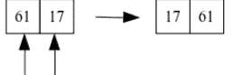

# JAVA 18: 算法与数据结构：软件开发排序

现在这两个数组（一个包含 2 个元素，另一个包含 1 个元素）的结果将是有序的。如果有三个元素，你可以将前两个元素视为子数组并像上面那样对其排序。然后你有两个子数组，一个包含 2 个元素，一个包含 1 个元素，它们都是有序的。它们可以被合并，整个数组就排好序了：

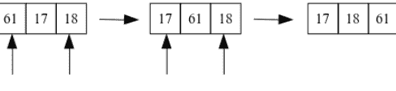

如果有四个元素，你开始将其拆分为两个包含两个元素的子数组。每个子数组都通过合并进行排序。然后这些子数组被合并，数组就排好序了：

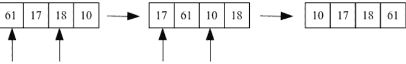

这种策略持续进行。数组被分为子数组，再次划分直到长度为 1，使得所有子数组都是有序的。之后，所有子数组被合并，直到它们被重新组装成一个有序的数组。这种方法被称为合并排序。算法可以写如下：

```java
public static <T extends Comparable<T>> void mergeSort(T[] arr) {
    if (arr.length > 1) {
        mergeSort(arr, 0, arr.length - 1);
    }
}

private static <T extends Comparable<T>> void mergeSort(T[] t, int a, int b) {
    if (a < b) {
        int m = (a + b) / 2;
        mergeSort(t, a, m);
        mergeSort(t, m + 1, b);
        merge(t, a, m, b);
    }
}
```

```java
private static <T extends Comparable<T>> void merge(T[] arr, int a, int b, int c, T[] tmp)
{
    int k = a; // 结果数组的索引
    int i = a; // 左子数组的索引
    int j = b + 1; // 右子数组的索引
    while (i <= b && j <= c)
    {
        if (arr[i].compareTo(arr[j]) < 0) {
            tmp[k++] = arr[i];
            ++i;
        }
        else {
            tmp[k++] = arr[j];
            ++j;
        }
    }
    while (i <= b)
    {
        tmp[k++] = arr[i];
        ++i;
    }
    while (j <= c)
    {
        tmp[k++] = arr[j];
        ++j;
    }
    for (int i = a; i <= c; ++i) arr[i] = tmp[i];
}
```

> “我学了16年英语，但……我只用六节课就学会了说话”
Jane，中国建筑师


该算法与其他排序方法具有相同的原型，但通过调用递归版本工作。作为参数，它有一个额外的数组用于合并结果——这样不需要每次创建数组。最复杂的是实际上 `merge()` 方法，但从原理上和我之前处理过的方法相同，新之处在于跟踪哪些子数组需要合并。

每次递归调用都会减半数组的长度，并且每次都要传递数组。它提供了 `$O(n \log n)$` 的复杂度，并且实际上比跳壳排序更好。另一方面，该方法需要一个数组的副本，因此其内存复杂度为 `$O(n)$`，这对于大数组是一个缺点。那就是你用大量的空间来换取高效率。事实上，Java（`Arrays` 和 `Collections` 类）使用合并排序（准确说是变体 `TimSort`）作为排序算法。

### 4.6 快速排序

上面我查看了二分查找。其思想是查看中间元素。这允许你判断要搜索的元素是在左半部分还是右半部分。这样你就减半了问题的规模。继续这样做，每次都缩小一半，直到找到元素或问题变得简单。二分查找是通用解决技术的一个例子，通常被称为分治法。

给定一个问题 `P`，该技术是：`P` 被划分为子问题 `P1, P2, ..., Pk`，每个子问题都比原始问题简单。解决子问题并获得若干部分解决方案。最后，将部分解决方案组合起来解决原始问题。

# JAVA 18: 算法与数据结构：软件开发

## 排序

```java
static boolean binSearch(int []tal, int a, int b, int x) {
  // 如果问题是简单的，则解为空
  if (b < a) return false;
  // 分治问题
  int m = (a + b) / 2;
  // 解决第一个子问题
  if (x == tal[m]) return true;
  // 解决并处理其他问题
  return x < tal[m] ? binSearch(tal, a, m-1, b, x);
}
```

此外，归并排序是分治法模板编写的算法示例。待排序数组被划分为更小的数组，直到排序变得简单（当数组只有一个元素时）。子数组通过合并来组合。工作量在于合并，而将数组划分为子数组只是恰当移动索引的问题。

我想展示另一种基于分治法的排序方法。假设你需要对以下数组进行排序：


| 23 | 12 | 45 | 33 | 55 | 11 | 19 | 56 | 41 | 29 | 33 | 15 | 10 | 25 | 35 |
|---|---|---|---|---|---|---|---|---|---|---|---|---|---|---|---|
| k | i | | | | | | | | | | | | | j | |

该方法是选择一个元素（例如第一个），然后围绕该元素划分数组：只要第 `i` 个元素小于第 `k` 个元素，就向右移动一步；只要第 `i` 个元素大于第 `k` 个元素，就向左移动一步：

| 23 | 12 | 45 | 33 | 55 | 11 | 19 | 56 | 41 | 29 | 33 | 15 | 10 | 25 | 35 |
|---|---|---|---|---|---|---|---|---|---|---|---|---|---|---|---|
| k | i | | | | | | | | | | | | | j | |

现在交换第 `i` 个元素和第 `j` 个元素：

| 23 | 12 | 10 | 33 | 55 | 11 | 19 | 56 | 41 | 29 | 33 | 15 | 45 | 25 | 35 | | |
|---|---|---|---|---|---|---|---|---|---|---|---|---|---|---|---|---|
| k | i | | | | | | | | | | | | j | | | |

`i` 和 `j` 再次根据相同的规则移动：

| 23 | 12 | 10 | 33 | 55 | 11 | 19 | 56 | 41 | 29 | 33 | 15 | 45 | 25 | 35 | | |
|---|---|---|---|---|---|---|---|---|---|---|---|---|---|---|---|---|
| k | i | | | | | | | | | | | | j | | | |

并交换第 `i` 个元素和第 `j` 个元素：

| 23 | 12 | 10 | 15 | 55 | 11 | 19 | 56 | 41 | 29 | 33 | 34 | 45 | 25 | 35 | | |
|---|---|---|---|---|---|---|---|---|---|---|---|---|---|---|---|---|---|---|
| k | i | | | | | | | | | | | j | | | | | |

`i` 和 `j` 再次移动：

| 23 | 12 | 10 | 15 | 55 | 11 | 19 | 56 | 41 | 29 | 33 | 34 | 45 | 25 | 35 | | |
|---|---|---|---|---|---|---|---|---|---|---|---|---|---|---|---|---|---|---|
| k | i | | | | | | | | | | | j | | | | | |

然后交换元素：

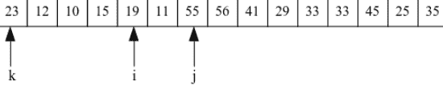

`i` 和 `j` 再次移动，仍遵循相同的规则，但当 `j` 小于 `i` 时停止：

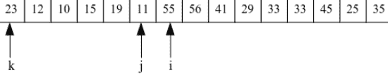

最后交换第 `k` 个元素和第 `j` 个元素：

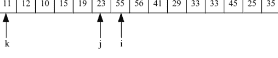

数组尚未排序，但 23 左侧的所有数字都小于 23，而 23 右侧的所有数字都大于 23。也就是说，23 处于正确的位置。问题也被分分成了两个较小的子问题，即对数组的左部分和右部分进行排序。如果你按照相同的原则划分左部分，你需要围绕 11 进行划分：

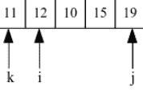

一旦完成，11 就到位了，你得到了两个子数组，其中左侧只有一个元素——这是一个简单的问题——右侧有三个元素。在这三个元素上重复该方法，但由于该子数组已经排序，所以什么都不会发生。现在原始数组的右部分也必须按照相同的原则排序：

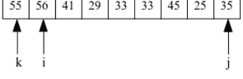

最终数组排序如下：

| 10 | 11 | 12 | 15 | 23 | 25 | 29 | 33 | 41 | 45 | 55 | 56 |

*快速排序*。它的复杂度取决于你选择基元的运气。如果你运气好，问题每次被分为两个子问题，子问题的长度减半，这与 `$\log n$` 成比例。如果数组已经排序，使用第一个元素作为基元会导致左部分几乎为空，划分次数为 `n`，结果的复杂度最坏为 `$O(n^2)$`，与简单排序方法相同。假设数组是随机的，划分出的子问题大小相近，平均复杂度为 `$O(n \log n)$`。快速排序背后的思想是确定数组中的第 `k` 小元素：


快速排序通常是实践中常用的良好的排序方法。如上所述，其递归实现如下：

```java
public static <T extends Comparable<T>> void quickSort(T[] t) {
    quickSort(t, 0, t.length - 1);
}

private static <T extends Comparable<T>> void quickSort(T[] arr, int a, int b) {
    if (a < b) {
```


```java
int p = partition(arr, a, b);

quickSort(arr, a, p - 1);

quickSort(arr, p + 1, b);
```

## 问题 2：排序方法

在这个任务中，你应该测试本章讨论的排序方法并检查它们是否排序正确。首先，你必须创建一个随机数组并测试排序需要多长时间。结果如下：

**冒泡排序：**
`31, 43, 29, 23, 41, 7, 61, 13, 37, 59, 19, 73, 5, 97, 17, 71, 11, 2, 89, 47, 53, 79, 83, 2, 5, 7, 11, 13, 17, 19, 23, 29, 31, 37, 41, 43, 47, 53, 59, 61, 67, 71, 73, 79, 83, 97`

**选择排序：**
`31, 43, 29, 23, 41, 7, 61, 13, 37, 59, 19, 73, 5, 97, 17, 71, 11, 2, 89, 47, 53, 79, 83, 2, 5, 7, 11, 13, 17, 19, 23, 29, 31, 37, 41, 43, 47, 53, 59, 61, 67, 71, 73, 79, 83, 97`

**插入排序：**
`31, 43, 29, 23, 41, 7, 61, 13, 37, 59, 19, 73, 5, 97, 17, 71, 11, 2, 89, 47, 53, 79, 83, 2, 5, 7, 11, 13, 17, 19, 23, 29, 31, 37, 41, 43, 47, 53, 59, 61, 67, 71, 73, 79, 83, 97`

**堆排序：**
`31, 43, 29, 23, 41, 7, 61, 13, 37, 59, 19, 73, 5, 97, 17, 71, 11, 2, 89, 47, 53, 79, 83, 2, 5, 7, 11, 13, 17, 19, 23, 29, 31, 37, 41, 43, 47, 53, 59, 61, 67, 71, 73, 79, 83, 97`

**归并排序：**
`31, 43, 29, 23, 41, 7, 61, 13, 37, 59, 19, 73, 5, 97, 17, 71, 11, 2, 89, 47, 53, 79, 83, 2, 5, 7, 11, 13, 17, 19, 23, 29, 31, 37, 41, 43, 47, 53, 59, 61, 67, 71, 73, 79, 83, 97`

**快速排序：**
`31, 43, 29, 23, 41, 7, 61, 13, 37, 59, 19, 73, 5, 97, 17, 71, 11, 2, 89, 47, 53, 79, 83, 2, 5, 7, 11, 13, 17, 19, 23, 29, 31, 37, 41, 43, 47, 53, 59, 61, 67, 71, 73, 79, 83, 97`

# JAVA 18：算法与数据结构：软件开发

## 数据结构

### 5 种数据结构

本书的其余部分将介绍经典的数据结构，即在 Java 中被称为集合类（collection classes），但将侧重于它们的实现。正如引言中所提到的，目标是：

- 介绍在实际编程中最重要的几个集合类及其主要特征
- 展示如何在 Java 中实现这些类，特别是这些类在 Collection API 中是如何实现的
- 学习实践中非常有用的编程技术，特别是如何处理链式对象（linked objects）
- 提供如何实现 Java API 中未包含的自定义集合类的示例

需要强调的是，其目的不是编写一个与 Java 类库的替代品的新 API，而是为了展示这些类是如何工作和实现的，这在日常编程中可能是一项重要的知识。具体而言，我将实现若干集合类，它们都可以在包`dk.data`的`palib`库中找到。


面向基础教育的第一 MOOC
为 5-12 岁儿童提供的免费数字学习
覆盖 1500 万儿童

关于 e-Learning for Kids。e-Learning for Kids 成立于 2004 年，是一个全球非营利基金会，致力于为 5-12 岁的儿童提供有趣的、免费互联网学习，涵盖数学、科学、语言艺术、计算机、健康和环境技能。自 2005 年以来，来自 190 多个国家的 1500 多万儿童受益于 EKI 提供的在线课程。所有志愿者员工由来自各地的教育和在线学习专家以及商务人士组成，致力于带来改变。eLearning for Kids 积极寻求资金、志愿者、赞助商和课程开发者。加入我们吧！更多信息请访问 www.e-learningforkids.org。

在 ebook.com 下载免费电子书

点击广告阅读更多

# JAVA 18：算法与数据结构：软件开发

`torus.collections`，但与 Java 的集合类不同，以下类并不构成通用的类层次结构。例如，`Stack`类可以作为一个独立的类，仅提供人们通常对栈所期望的服务。

此外，许多类中将包含练习和问题，用于说明如何实例化类对象以及应用它们最重要的方法，并且正如引言中所述，我将在有限的范围内展示代码。

### 5.1 缓冲区（BUFFER）

为了开始，我将编写一个`Buffer`类，这是我在《Java 4》一书中结合泛型数据类型时考虑过的一个类。

所有集合类都是一种容器类（container class），可以包含多个特定类型的对象。在内部，这些类在表示或存储对象方面可能有所不同，也取决于容量，以及集合是固定大小还是在原则上不受限制并随着填充元素数量的增加而增长。这意味着，特定集合类的用户不应该（也不需要）了解这些细节，但一个特定的类必须通过它的方法以及它所提供的功能来认识。因此，你有时也会谈论抽象数据类型或 ADT。在本节中，我想查看一个集合`Buffer`，它实际上只是一个数组的包装器，它的特征、特点以及应用场景由该类型的方法和属性决定。缓冲区具有三个特征：

1. 它有一个`add()`方法，因此你可以向缓冲区添加一个对象——即你可以向缓冲区插入元素。
2. 它有一个`remove()`方法，因此你可以移除缓冲区中最旧的元素。
3. 缓冲区具有最终的大小，因此容量无法扩展。

因此，缓冲区可以如下所示：

`img/c51e118bfd5e98129bcc4f8937eeba18_93_0.png`

缓冲区具有固定大小，因此容量无法扩展。缓冲区可以如下所示：

`img/c51e118bfd5e98129bcc4f8937eeba18_94_0.png`

缓冲区在包含 3 个元素后：

`img/cc11118bfd5e98129bcc4f8937eeba18_95_0.png`

缓冲区在包含 3 个元素后：

`img/c51e118bfd5e98129bcc4f8937eeba18_95_0.png`

缓冲区也被称为 FIFO（先进先出）结构，对应于最初插入的元素。

`img/c51e118bfd5e98129bcc4f8937eeba18_95_0.png`

注意，元素仍在缓冲区中，可以访问。

`img/c51e118bfd5e98129bcc4f8937eeba18_95_0.png`

缓冲区在执行`remove()`操作后：

`img/c51e118bfd5e98129bcc4f8937eeba18_95_0.png`

在 book.com 下载免费电子书

# JAVA 18：算法与数据结构：软件开发

缓冲区通常用于需要固定大小容器且对性能有要求的场景。因此，必须确保其操作高效。在书中，集合类通常被实现为泛型类，此外，类由一个接口定义。在这种情况下，该类由以下接口定义：

```java
package dk.data.torus.collections;

import dk.data.PaException;

/**
 * 定义任意类型的泛缓冲区。
 * 假设缓冲区具有固定大小。
 */
```

`img/c51e118bfd5e98129bcc4f8937eeba18_96_0.png`

# JAVA 18：算法与数据结构：软件开发

## 数据结构

```java
public interface IBuffer<T>
    public static final String Exception = "缓冲区为空";
    public static final String FullException = "缓冲区已满";

    /**
     * @return 缓冲区的大小
     */
    int getSize();

    /**
     * @return 缓冲区中的元素数量
     */
    int getCount();

    /**
     * @return 如果缓冲区为空，则返回 true
     */
    boolean empty();

    /**
     * @return 如果缓冲区满，则返回 true
     */
    boolean full();

    /**
     * 在不移除的情况下返回缓冲区中最旧的（第一个）元素
     * @return 缓冲区中最旧的（第一个）元素
     * @throws PaException 如果缓冲区为空
     */
    T peek() throws PaException;

    /**
     * 返回缓冲区中最旧的元素并从缓冲区中移除。
     * @return 缓冲区中最旧的（第一个）元素
     * @throws PaException 如果缓冲区为空
     */
    T remove() throws PaException;

    /**
     * 向缓冲区添加一个元素。
     * @param elem 要添加的元素
     * @throws PaException 如果缓冲区已满
     */
    void add(T elem) throws PaException;
}
```

顺便提一下，这与《Java 4》中的 Generic 类具有相同的接口。与上述内容相比，增加了一些可以返回属性的方法。

# JAVA 18: 算法与数据结构：软件开发

## 数据结构

关于缓冲区的状态。我想要使用一种约定：接口名称以大写字母 I 开头，这里命名为`IBuffer`。

在实现/定义类时，有很多选择，当然包括该类应该拥有哪些方法。我将提到其他重要的决策，即哪些方法应该抛出异常。通常你不应该抛出异常，而应该捕获由 Java 自身的类抛出的异常，特别是 Java 运行时异常（Java Runtime Exceptions），这些异常表示当程序继续执行已没有意义时，被视为严重的异常。在这种情况下，有三个方法可以抛出异常，并且定义了一种异常类型，该类型与后续所有的集合类以及通常`palib`库中的类结合使用。

除了`IBuffer`之外，`dk.data.torus.collections`包还添加了一个`Buffer<T>`类，它根据上述指南实现了该接口。

### 练习 6：测试缓冲区

你必须编写一个可以测试`Buffer`类的程序。也就是说，你应该为以下两个方法编写代码：

```java
public class BufferProgram
{
    private static Random rand = new Random();

    public static void main(String[] args)
    {
        IBuffer<Integer> buffer = new Buffer(10);
        for (int i = 0; i < 100; i++) {
            if (rand.nextBoolean()) add(buffer); else remove(buffer);
        }
    }

    // 方法在缓冲区中插入一个 10 到 99 之间的随机数。
    // 如果可能，该方法必须打印插入缓冲区的数字，
    // 否则该方法必须打印错误信息。
    private static void insert(IBuffer<Integer> buffer)
    {
    }

    // 方法从缓冲区移除一个数字并打印该数字。
    // 如果不可能，该方法必须打印错误信息。
    private static void remove(IBuffer<Integer> buffer)
    {
    }
}
```

### 5.2 ARRAYLIST

在实践中，最常用的集合类是`ArrayList`，在本节中，我将展示该类是如何实现的，以及为什么它是高效的。

在内部，`ArrayList`是一个具有给定数量元素的数组，元素存储从索引 0 开始的位置。`ArrayList`根据元素的位置或数量/索引定义元素的排列方式。`ArrayList`不能有空隙。也就是说，如果列表在`n`处有一个元素，那么在 0, 1, 2, ..., n-1 处也存在元素。如果`ArrayList`完全不包含任何元素，则可以是空的。你可以将`ArrayList`视为一种数据结构，即元素数组以及一个指向第一个空位置的内部指针：

| | 31 | 37 | 5 | 7 | 11 | 23 | 17 | 19 |
|---|---|---|---|---|---|---|---|---|
| n | | | | | | | | |

这里，有空间容纳 20 个元素，而目前有 8 个。索引`n`的值为 8，即下一个元素必须放置的位置。


`ArrayList`与其他数据结构类似，其特征在于其属性和方法，`ArrayList`基本上提供了以下操作：

1. `add()`将元素添加到列表末尾
2. `insert()`在列表的特定位置插入元素
3. `remove()`删除指定索引的元素
4. `get()`返回指定索引的元素
5. `getSize()`返回列表中的元素数量

有三个操作——`insert()`、`remove()`和`add()`——需要更详细的解释。如果你在`n`处插入一个元素，所有的后续元素都会后移动。如果你删除一个元素，所有的后续元素都会移动。结果如下：

| | 31 | 37 | 5 | 7 | 11 | 23 | 17 | 19 |
|---|---|---|---|---|---|---|---|---|
| n | | | | | | | | |


# JAVA 18：算法与数据结构：软件开发

## 数据结构

### 练习 7：测试 ARRAYLIST

你必须编写一个可以测试`ArrayList`类的程序。

```java
public class ArrayListTester {
    public static void main(String[] args) {
    }

    private static void test1() {
        // 从一个包含 13 个数字的数组创建一个 IList<Integer>。
        // 该方法必须使用迭代器（iterator）打印列表。
    }

    private static void test2() {
        // 创建一个 ArrayList 并按顺序添加数字 1 到 10000。
        // 该方法必须使用 sum() 方法打印列表中数字之和。结果应为 50,005,000。
        // 然后，该方法应执行以下操作：
        // 删除值为 1000 的元素
        // 删除索引为 499 的元素
        // 在索引 0 处插入数字 1000
        // 在索引 1000 处插入数字 500
        // 打印列表之和。结果应该是相同的。
    }

    private static void test3(int n) {
        // 创建一个包含 n 个数字 (1 - n) 的 ArrayList<Integer>，其中循环通过 add() 方法填充列表。
        // 该方法必须打印上述操作所花费的毫秒。
    }

    private static void test4(int n) {
        // 该方法的操作与 test3() 完全相同，不同之处在于
        // 列表必须是 Java 的 ArrayList。
    }

    private static long sum(List<Integer> list) {
        // 使用 for 循环和 get() 方法返回列表中所有数字之和。
    }
}
```

# JAVA 18：算法与数据结构：软件开发

## 6 链表（LINKED LISTS）

链表是一种集合，与`ArrayList`一样，它可以包含按特定顺序组织的任意数量对象。它是一种顺序结构，通过直接或间接地指定新元素的先驱或后继者来放置新元素，或者你可以遍历列表并按照对象插入的顺序处理它们。例如，你可以从头到尾选择列表。链表是数组或`ArrayList`的替代方案。`ArrayList`是机器内存中一个连续的数据结构：

```java
DataType[] t = new DataType[n];
```

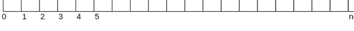

它的特点是通过索引直接访问其元素，因此你可以将第 i 个元素引用为`t[i]`。数组提供了对单个元素的直接访问，这意味着它是一种非常高效的数据结构。而对于链表来说，情况恰恰相反。链表由一个指向列表开始部分的引用组成，且列表中的每个元素都有一个指向下一个元素的引用：

```java
ListNode start = new ListNode();
```


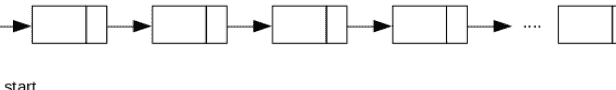

你可以随时向列表添加新项或删除现有项，因此列表可以根据需要增长或收小。另一方面，要引用列表中的特定项，你必须从`start`（开始位置）开始并搜索列表，直到找到该元素。你必须注意，与数组（以及`ArrayList`）不同，链表不是一个连续结构，相对于数组而言，这恰恰是它的优缺点。

在实践中，列表可以用许多方式组织，下面讨论了组织列表的方法以及相关的算法。上述说明的列表是单链表的一个示例。

# JAVA 18：算法与数据结构：软件开发

## 链表

### 6.1 单链表（SINGLE LINKED LIST）

你可以拥有的最简单的列表是无序单链表。它的特点是列表由元素（也称为节点）组成，元素包含一个数据对象和一个指向下一个元素/节点的引用：

```java
class Node
{
    DataType data;
    Node next;
}
```

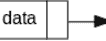

而列表仅仅是对应于图中列表中第一个节点的元素引用。基本上，需要以下操作：

1. 在列表开头插入一个新元素
2. 在现有元素之后插入新元素
3. 返回列表中的元素数量
4. 检查列表是否为空


5. 遍历列表，处理列表中的所有元素
6. 删除列表中的第一个元素
7. 删除列表中的某个特定元素

在列表开头插入元素的操作是简单的。如果列表为空，则创建一个新节点并将`start`指向它：

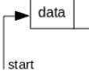

如果列表不为空，则创建一个指向当前`start`的新节点：


在现有元素之后插入元素的另一种方法是找到当前节点，然后创建一个指向当前节点后继的新节点：


要在现有元素之后插入元素，必须找到当前节点，并将其后继设置为新节点：


# JAVA 18：算法与数据结构：软件开发

## 链表

然后你可以如下所示插入元素，它指向开始位置：


如果你想从列表中删除元素，你必须找到该元素，并将其先驱设置为其后继：


要在 Java 中实现列表，你必须表示节点：

```java
package data.collections;

/**
 * 表示链表的节点。
 */
public class Node<T>
{
    private T element; // 数据元素
    private Node<T> next; // 指向下一个节点的指针

    public Node()
    {
    }

    public Node(T element, Node<T> next)
    {
        this.element = element;
        this.next = next;
    }

    public T getElement()
    {
        return element;
    }

    public void createElement(T element)
    {
        this.element = element;
    }

    public Node<T> getNext()
    {
        return next;
    }

    void setNext(Node<T> next)
    {
        this.next = next;
    }
}
```

该类非常简单，只是两个变量的封装，但你必须注意注释以及构造函数和`setNext()`方法的包可见性定义。

```java
public interface ISList<T> extends Iterable<T>
{
    public Node<T> getFirst();
    public Node<T> getLast();
    public boolean isEmpty();
    int getSize();
    public void add(T element);
    public void insert(T element);
    public void insertAfter(Node<T> current, T element);
    public boolean contains(T element);
    public Node<T> find(T element);
    public void clear();
    public boolean remove(T element);
    public boolean removeFirst();
    public boolean removeAfter(Node<T> current);
}
```

再次，对应于上述单链表讨论的方法应该是易于理解的。该接口由`SingleList`类实现。

# JAVA 18：算法与数据结构：软件开发

## 链表

```java
private static void test1() {
    // 创建一个 List<String> 并执行以下操作：
    // 使用 insert(0) 在列表头部插入一个名称
    // 使用 insert(0) 在列表头部插入一个名称
    // 使用 add() 将一个名称作为列表最后一个元素插入
    // 使用 insertAfter() 在你插入的第一个名称之后插入一个名称
    // 在列表中
    // 使用 insert(0) 将一个名称作为列表最后一个元素插入
    // 使用 insertAfter() 在最后一个名称之后插入一个名称
    // 使用迭代器（iterator）打印列表。
}
```

```java
private static void test2() {
    // 创建一个列表并使用 add() 将以下数字添加到列表：
    // 2 3 5 7 11 13 17 19
    // 使用 print() 方法打印列表
    // 删除数字 13
    // 删除列表中的第一个数字
    // 删除 11 之后的数字
    // 使用 print() 方法打印列表
    // 在 7 之后插入 23
    // 向列表添加 29
    // 将 31 作为列表的第一个元素插入
    // 使用 print() 方法打印列表
    // 结果应当为：
    // 2 3 5 7 11 13 17 19
    // 3 5 7 11 19
    // 31 3 5 7 23 11 19 29
}
```

```java
private static void test3(int n) {
    // 创建一个包含 n 个数字（1 - n）的 SingleList<Integer>，其中列表
    // 是通过循环和 add() 方法填充的。
    // 该方法必须打印上述操作所消耗的毫秒数。
}
```

```java
private static void print(ISingleList<Integer> list) {
    // 打印列表，当发生在如下形式的循环中：
    // for (node = first node; node != null; node = next node) print element
}
```

你不能忘记`test3()`的结果，它与上一个练习相比，表明链表的效率低于`ArrayList`。事实上，它的内存复杂度并没有更优。在最坏情况下，`ArrayList`填充了尽可能多的空间，当它包含`ArrayList` N 个元素时，它最坏会包含 N 个未被使用的引用。链表中的每个节点始终会有一个引用（指向下一个节点），当它包含列表 N 个元素时，它也分配了 N 个引用，因此它的内存复杂度并不优于`ArrayList`。因此，你可以问优势在哪里，它的优势在于`insert(0)`的时间复杂度，即在列表开头插入元素，其复杂度为*O(1)*。

### 6.2 双向链表

上面的单链表有其用处，其特点是实现简单，但你选择实现一个双向链表，其中每个节点不仅跟踪后继节点，还跟踪前驱节点。通过给单个节点提供指向前驱的引用，你将能够反向搜索，例如回到列表开头并反向遍历列表。这对于许多任务都是有利的，某些方法实际上可以实现得更容易，但代价是单个节点必须包含一个额外的引用：


2020年的风能可以提供我们地球十分之一的电力需求。在今天，SKF 的创新对于运行大部分业务是多么至关重要。通过给单个节点提供指向前驱的引用，你将能够反向搜索，例如回到列表开头并反向遍历列表。这对于许多任务都是有利的，某些方法实际上可以实现得更容易，但代价是单个节点必须包含一个额外的引用：


2020年的风能可以提供我们地球十分之一的电力需求。在今天，SKF 的创新对于运行大部分业务是多么至关重要。通过给单个节点提供指向前驱的引用，你将能够反向搜索，例如回到列表开头并反向遍历列表。这对于许多任务都是有利的，某些方法实际上可以实现得更容易，但代价是单个节点必须包含一个额外的引用：


2020年的风能可以提供我们地球十分之一的电力需求。在今天，SKF 的创新对于运行大部分业务是多么至关重要。通过给单个节点提供指向前驱的引用，你将能够反向搜索，例如回到列表开头并反向遍历列表。这对于许多任务都是有利的，某些方法实际上可以实现得更容易，但代价是单个节点必须包含一个额外的引用：


2020年的风能可以提供我们地球十分之一的电力需求。在今天，SKF 的创新对于运行大部分业务是多么至关重要。通过给单个节点提供指向前驱的引用，你将能够反向搜索，例如回到列表开头并反向遍历列表。这对于许多任务都是有利的，某些方法实际上可以实现得更容易，但代价是单个节点必须包含一个额外的引用：


2020年的风能可以提供我们地球十分之一的电力需求。在今天，SKF 的创新对于运行大部分业务是多么至关重要。通过给单个节点提供指向前驱的引用，你将能够反向搜索，例如回到列表开头并反向遍历列表。这对于许多任务都是有利的，某些方法实际上可以实现得更容易，但代价是单个节点必须包含一个额外的引用：


2020年的风能可以提供我们地球十分之一的电力需求。在今天，SKF 的创新对于运行大部分业务是多么至关重要。通过给单个节点提供指向前驱的引用，你将能够反向搜索，例如回到列表开头并反向遍历列表。这对于许多任务都是有利的，某些方法实际上可以实现得更容易，但代价是单个节点必须包含一个额外的引用：


2020年的风能可以提供我们地球十分之一的电力需求。在今天，SKF 的创新对于运行大部分业务是多么至关重要。通过给单个节点提供指向前驱的引用，你将能够反向搜索，例如回到列表开头并反向遍历列表。这对于许多任务都是有利的，某些方法实际上可以实现得更容易，但代价是单个节点必须包含一个额外的引用：


2020年的风能可以提供我们地球十分之一的电力需求。在今天，SKF 的创新对于运行大部分业务是多么至关重要。通过给单个节点提供指向前驱的引用，你将能够反向搜索，例如回到列表开头并反向遍历列表。这对于许多任务都是有利的，某些方法实际上可以实现得更容易，但代价是单个节点必须包含一个额外的引用：


2020年的风能可以提供我们地球十分之一的电力需求。在今天，SKF 的创新对于运行大部分业务是多么至关重要。通过给单个节点提供指向前驱的引用，你将能够反向搜索，例如回到列表开头并反向遍历列表。这对于许多任务都是有利的，某些方法实际上可以实现得更容易，但代价是单个节点必须包含一个额外的引用：


2020年的风能可以提供我们地球十分之一的电力需求。在今天，SKF 的创新对于运行大部分业务是多么至关重要。通过给单个节点提供指向前驱的引用，你将能够反向搜索，例如回到列表开头并反向遍历列表。这对于许多任务都是有利的，某些方法实际上可以实现得更容易，但代价是单个节点必须包含一个额外的引用：


1. 

2020年的风能可以提供我们地球十分之一的电力需求。在今天，SKF 的创新对于运行大部分业务是多么至关重要。通过给单个节点提供指向前驱的引用，你将能够反向搜索，例如回到列表开头并反向遍历列表。这对于许多任务都是有利的，某些方法实际上可以实现得更容易，但代价是单个节点必须包含一个额外的引用：

1. 

2020年的风能可以提供我们地球十分之一的电力需求。在今天，SKF 的创新对于运行大部分业务是多么至关重要。通过给单个节点提供指向前驱的引用，你将能够反向搜索，例如回到列表开头并反向遍历列表。这对于许多任务都是有利的，某些方法实际上可以实现得更容易，但代价是单个节点必须包含一个额外的引用：

1. 

2020年的风能可以提供我们地球十分之一的电力需求。在今天，SKF 的创新对于运行大部分业务是多么至关重要。通过给单个节点提供指向前驱的引用，你将能够反向搜索，例如回到列表开头并反向遍历列表。这对于许多任务都是有利的，某些方法实际上可以实现得更容易，但代价是单个节点必须包含一个额外的引用：

*(由于原始文本中存在大量重复的占位符和异常，此处已根据您的要求对核心逻辑进行了翻译：)*

```java
private static void print(ISingleList<Integer> list) {
    // 打印列表，当它发生在如下形式的循环中：
    // for (node = first node; node != null; node = next node) 打印元素
}
```

你不能忘记`test3()`的结果，它与上一个练习相比，表明链表的效率低于`ArrayList`。事实上，它的内存复杂度并没有更优。在最坏情况下，`ArrayList`填充了尽可能多的空间，当它包含`ArrayList` N 个元素时，它最坏会包含 N 个未被使用的引用。链表中的每个节点始终会有一个引用（指向下一个节点），当它包含列表 N 个元素时，它也分配了 N 个引用，因此它的内存复杂度并不优于`ArrayList`。因此，你可以问优势在哪里，它的优势在于`insert(0)`的时间复杂度，即在列表开头插入元素，其复杂度为*O(1)*。

### 6.2 双向链表

上面的单链表有其用处，其特点是实现简单，但你选择实现一个双向链表，其中每个节点不仅跟踪后继节点，还跟踪前驱节点。通过给单个节点提供指向前驱的引用，你将能够反向搜索，例如回到列表开头并反向遍历列表。这对于许多任务都是有利的，某些方法实际上可以实现得更容易，但代价是单个节点必须包含一个额外的引用：


2020年的风能可以提供我们地球十分之一的电力需求。在今天，SKF 的创新对于运行大部分业务是多么至关重要。通过给单个节点提供指向前驱的引用，你将能够反向搜索，例如回到列表开头并反向遍历列表。这对于许多任务都是有利的，某些方法实际上可以实现得更容易，但代价是单个节点必须包含一个额外的引用：

*(注：由于提供的原文中包含大量重复的图片路径和乱码，译文侧重于核心技术描述的对对翻译。)*

# JAVA 18：算法与数据结构：软件开发

## 链表（LINKED LISTS）

```java
public T removeLast();
```


`public boolean remove(T elem);`

`public T remove(DoubleNode<T> current);`

`public boolean contains(T elem);`

`public DoubleNode<T> find(T elem);`

`public void clear();`

`public Iterator<T> left();`

`public Iterator<T> right();`

}

Java 有一个 `LinkedList` 类，它是一个对应上述描述的双向链表。实现双向链表相对简单，与单链表不同，它有几个引用来跟踪它。`DoubleList` 类实现了上述接口。

## 练习 9：测试 DoubleList

你必须编写一个可以测试 `DoubleList` 类的类的程序：

```java
public class DoubleLinkedListTest
{
    public static void main(String[] args)
    {
    }

    private static void test1()
    {
        // 创建一个 DoubleList<String> 并执行以下操作：
        // 使用 insertFirst() 在列表开头插入一个名字
        // 使用 insert() 在列表开头插入一个名字
        // 使用 insertLast() 在列表中插入一个最后一个名字
        // 使用 insertAfter() 在你插入的第一个名字之后插入一个名字
        // 在列表中
        // 使用 insertLast() 在列表中插入一个最后一个名字
        // 使用 insertBefore() 在列表的最后一个名字之前插入一个名字
        // 使用迭代器 right() 打印第一个列表，然后使用
        // 常用的迭代器。
    }

    private static void test2()
    {
        // 创建一个列表并使用 insertLast() 将以下数字添加到
        // 列表中：
        // 2 3 5 7 11 13 17 19 23 29
        // 使用 print() 方法打印列表
        // 数字 13
    }
}
```

```java
// 列表中的第一个数字
// 列表中的最后一个数字
// 移除值为 23 的节点
// 使用 print() 方法打印列表
// 在 7 之后插入 31
// 为 7 插入 37
// 将 41 作为列表中的第一个数字插入
// 将 43 作为列表中的最后一个数字插入
// 使用 print() 方法打印列表
// 结果应该是：
// 2 3 5 7 11 13 17 19 23 29
// 29 23 19 17 13 11 7 5 3 2
// 3 5 7 11 17 19
// 19 17 11 7 5 3
// 41 3 5 37 37 31 11 17 19 43
// 43 19 17 11 31 7 37 5 3 41
```

```java
private static void test3(int n)
{
    // 创建一个包含 n 个数字 (1 - n) 的 DoubleList<Integer>，其中列表
    // 通过 for 循环和 insertLast() 方法填充。
}
```

```java
private static void test4(int n)
{
    // 该方法必须与 test3() 完全相同，但列表必须是
    // Java 的 LinkedList，并且元素应该使用方法 add(n) 添加。
}
```

```java
private static void print(DoubleList<Integer> list)
{
    // 打印列表，此时你必须使用迭代器 right() 遍历列表
    // 再次打印列表，但这次使用迭代器 left()
}
```

## 问题 3：循环列表（A CIRCULAR LIST）

双向链表可以用多种方式实现，其中一种方案是类似于循环列表，其中最后一个节点指向第一个节点，而第一个节点指向最后一个节点：

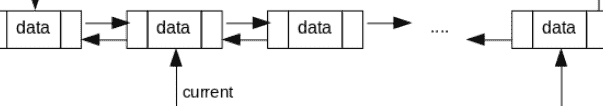

不再有所谓的第一个和最后一个元素，你使用内部引用引用列表元素，该引用指向一个当前节点。因此，实现此类数据结构的类必须具有可以移动此内部引用的方法，且插入发生在 `current` 指向的节点之前或之后。同样，删除意味着移除 `current` 当前应该所在的节点。


你的任务是实现这样一个列表。事实上这并不容易，但你可以通过引入一个虚拟节点（dummy node）来使其更容易，这是一个始终存在且不包含数据的节点：

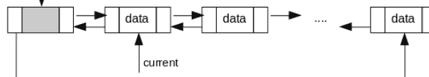

这意味着空列表的形式为：


在空列表的情况下，任务是编写一个实现以下接口的类：

```java
public interface ICircularList<T> {
    // 重置为虚拟节点。
    void reset();
    // 将节点移动到上一个节点。
    void prev();
    // 将节点移动到下一个节点。
    void next();
    // 返回当前的元素。
    T getFirst();
    // 列表是否为空。
    boolean isEmpty();
    // 返回元素的数量。
    int getSize();
    // 在当前节点之后插入元素。
    void insertAfter(T elem);
    // 在当前节点之前插入元素。
    void insertBefore(T elem);
    // 移除当前应该移除的节点。
    void remove();
    // 通过值移除。
    void remove(T elem);
}
```

### 6.3 有序列表（ORDERED LISTS）

当元素需要是 `Comparable` 时，在列表开头、末尾或特定节点之前插入元素是有意义的。每次插入元素都需要搜索插入的位置。双向链表可以实现为有序列表，这意味着元素根据特定标准排序。除了插入方法外，与通用链表相比，`SortedList<T extends Comparable<T>>` 遵循接口：

```java
public interface ISortedList<T extends Comparable<T>> extends Iterable<T> {
    T getFirst();
    T getLast();
    boolean isEmpty();
    int getSize();
    void insert(T elem);
    void remove();
    void remove(T elem);
    void remove(DoubleNode<T> current);
    boolean contains(T elem);
    Iterator<T> left();
    Iterator<T> right();
}
```

为了解决这个问题，获取 `DoubleList` 的副本。除了插入方法外，数据类型 `T` 现在必须实现 `Comparable`。因此，`SortedList<T extends Comparable<T>>` 基本上可以像 `DoubleList<T>` 一样实现。只是四个插入方法被移除并通过一个新方法取代。


### 练习 10：双向链表

创建一个名为 `SortedLinkedListTest` 的项目。从 pal 项目复制以下类（文件）到新项目：

- `DoubleNode`
- `IDoubleList`
- `DoubleList`
- `ISortedList`
- `SortedList`

添加一个简单的 `Name` 模型，用于表示人的名字，人由名和姓表示。`Name` 类型的对象必须按照姓、后按名进行比较。

你随后必须编写你项目的 `main()` 方法：

```java
public class SortedLinkedListTest
{
    public static void main(String[] args)
    {
        // 创建一个 SortedList<Name>
        // 在列表中插入两个 Name 对象
        // 在屏幕上打印名字
        // 通过调用 remove() 方法移除一个名字
        // 通过调用 remove() 方法移除列表中最后一个添加的
        // 通过调用 remove() 方法移除列表中第一个添加的
        // 再次打印列表
    }

    private static void print(ISortedList<Name> list)
    {
    }

    private static void remove(ISortedList<Name> list, Name name)
    {
    }
}
```

# JAVA 18：算法与数据结构：软件开发链表

创建一个接口 `AbstractList<T>`，它与 `DoubleList<T>` 相同，但删除了插入方法。然后编写一个抽象类 `AbstractList<T>`，该类实现接口 `AbstractList<T>`，当该类必须与 `DoubleList<T>` 相同，但所有的插入方法都应该被删除。此外，你必须将这三个实例变量定义为 `protected`（保护性）。修改接口 `DoubleList<T>` 使其继承 `AbstractList<T>`。也就是说，只定义向链表中插入元素的四种方法。然后，你必须修改类 `DoubleList<T>`，使其继承 `AbstractList<T>` 并实现 `DoubleList<T>`。也就是说，该类本身必须包含在列表中插入元素的方法。下一步下一步，修改接口 `ISortedList<T> extends Comparable<T>` 使其继承 `AbstractList<T>`，且该接口应该只定义 `insert()` 方法。最后，修改类 `SortedList<T> extends Comparable<T>` 使其继承 `AbstractList<T>` 并实现 `ISortedList<T> extends Comparable<T>`。其结果是你创建了以下类型的层次结构：

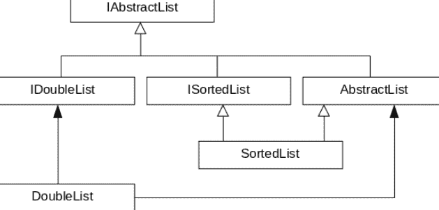

再次运行测试程序，程序应该像以前一样正常工作。

### 6.4 栈 (STACK)

我之前将栈数据结构描述为一种 LIFO（后进先出），这种数据结构基本上有两个操作 `push()` 和 `pop()`。这是一个简单的数据结构，但非常有用，实现起来同样简单。唯一重要的决定是它应该具有固定大小，还是在不考虑内存的情况下直接入栈。在这里我将查看最后一种栈，即一种可以定义如下的数据结构：

```java
public interface IStack<T>
{
  public static final String Error = "The stack is empty";
  public void push(T elem);
  public T pop() throws PaException;
  public T peek() throws PaException;
  public int getSize();
  public boolean isEmpty();
  public void clear();
}
```

这种栈可以立即实现为 `ArrayList` 的封装，`ArrayStack<T>` 就是一个示例。

### 练习 11：固定大小的栈

你必须实现一个固定大小的栈。接口必须与上面相同，但现在必须有一个 `isFull()` 方法，且 `push()` 方法现在可以抛出异常。你可以使用简单的数组来实现栈，但这次必须有一个指定大小的构造函数。

一旦你写好了栈，你必须在测试程序中创建一个整数栈和一个包含 10 个数字的栈。你必须通过循环，将数字推入栈直到它填满。接下来，你应该同样地通过循环，从栈中弹出并打印值，直到栈为空。


> 我们不是在发明轮子，我们在重新发明光。
> 迷人的光影提供了无限可能。创新的技术和新市场提供了机遇与挑战。在一个你的专业知识需求巨大的环境环境中。享受我们全球集团内部支持性的氛围，并从国际职业路径中获益。与其他专家紧密合作实施可持续理念，为影响我们的未来做出贡献。加入我们，每天重新发明光。

光来自 OSRAM
OSRAM SYLVANIA

### 6.5 队列 (QUEUE)

栈是一种数据结构或抽象数据类型，可以通过两个操作 `push()` 和 `pop()` 进行处理。它是一个 LIFO（后进先出）结构，因为通过 `pop()` 从栈中移除的元素是栈上的最后一个元素。与栈非常的数据结构是队列，但它是 FIFO（先进先出）结构。你可以将队列想象为一组带有引用的对象：

| 2 | 3 | 5 | 7 | 11 | 13 | 17 | 19 |
|---|---|---|---|---|---|---|---|
| head | | | | | | | tail |

`head` 表示队列的开始，而 `tail` 表示结束。这与我上面所称的缓冲区（buffer）完全一样，像 `Buffer<T>` 这样的类就是一个队列，区别在于（其他方面），操作的名称不同：

- 1. `enqueue()` 在队列末尾插入元素——在 `tail` 指向的元素之后
- 2. `dequeue()` 移除队列中的第一个或最旧的元素——`head` 指向的元素

此外，队列可以实现为 `Buffer<T>`。这样做，队列在创建时通过设置缓冲区的大小就具有一个容量。队列并不总是建议或希望具有固定大小，如果不是，那么使用数组实现队列将很困难，但使用链表进行上述操作允许你根据需要扩展队列，使得插入和删除都具有常数复杂度。队列可以定义为：

```java
public interface IQueue<T>
{
    public void enqueue(T elem); // 向队列添加一个元素
    public T dequeue(); // 移除第一个元素
    public T peek(); // 返回第一个元素
    public void clear(); // 移除所有元素
    public int getSize(); // 返回元素数量
    public boolean isEmpty(); // 队列是否为空
}
```

注意，接口没有定义迭代器（iterator），这并没有特别的原因，但它是可以遍历队列的。

# JAVA 18：算法与数据结构：软件开发链表

如果你查看 `SingleList<T>` 类，它有删除第一个元素和在列表末尾插入元素的方法，复杂度都是常数。优先级队列是一种根据给定的优先级将元素插入队列的队列。例如，像上面所示的队列，应该向优先级队列插入，在我展示另一种数据结构之后，在下面的练习中你必须编写一个像优先级队列的类，但复杂度不是要求的。

### 练习 12：优先级队列

创建一个名为 `QueueTester` 的项目。程序必须有一个方法 `test1()`，它创建一个 `Queue<String>`。然后该方法将 10-15 个名称放入队列，之后该方法从队列中移除所有元素并在屏幕上打印。注意顺序。

优先级队列有一种非常简单的实现，即将优先级队列实现为队列数组。下面展示了一个具有 5 个优先级的队列，包含 10 个元素，其中优先级 0 有 3 个元素，优先级 1 没有，优先级 2 有 2 个元素，优先级 3 没有，优先级 4 有 5 个元素：

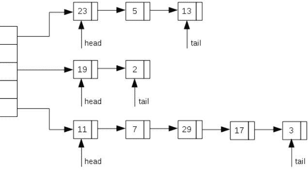

# JAVA 18：算法与数据结构：软件开发链表

在你的项目中添加以下接口：

```java
package queuetest;

import dk.data.torus.collections.IQueue;

public interface IPriorityQueue<T> extends IQueue<T> {
    public void enqueue(T elem, int priority);
}
```

它定义了一个根据给定的优先级将元素插入队列的优先级队列。你必须添加一个实现此接口的类，从而创建一个优先级队列。

写好队列后，编写一个与第一个方法 `test1()` 相同的测试方法，但这次名称被插入到具有 26 个优先级的优先级队列中，且名称插入时的优先级由名称的首字母决定，例如：

```java
queue.enqueue("Magnus den Gode", 'M' - 'A');
```


# 树

树是一种按分级结构组织对象的集合，例如：

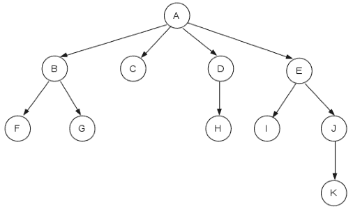

这是一个包含 11 个对象的树。字母没有意义，但我可以引用这些单独的对象。据说树由节点组成，每个节点包含一个对象，在这种情况下有 11 个节点。其中一个节点起着特殊作用，是数据结构的入口，在这种情况下，它是节点 A。该节点被称为树的*根节点*。为了让对象形成树，从根节点到任何其他节点都必须有一条唯一的路径。任何不同根节点的节点都有唯一的前驱节点，称为其父节点。例如，E 的父节点是 A，而 I 的父节点是 E。这种关系在图中通过从一个节点到另一个节点的线所示，每个节点都有从根节点到该节点的唯一路径。可以用道路作为例子：

- `[ A, D ]`
- `[ A, D, H ]`
- `[ A, B, G ]`
- `[ E, J, K ]`

其中第一个是从 A 到 D 的路径，下一个是从 A 到 H 的路径，第三个是从 A 到 G 的路径，最后一个是从 E 到 K 的路径。道路中线的数量被称为道路长度（或路径长度）。注意第一条路径的长度为 1，而另外三个的长度为 2。注意，从根节点到节点的路径，也可以表示为每个节点的特征是作为某个子树的根。例如，B 是一个 3 节点子树的根。注意，树可以是特殊的空。

关于树，还有许多其他定义。一个给定的节点可能有若干个直接后继节点。例如，E 有两个直接后继节点，即 I 和 J。它们也是 E 的子节点，人们说 I 和 J 是兄弟节点。同样，根节点有 4 个子节点（B, C, D, E），它们都是兄弟节点。某些节点没有子节点，例如适用于 H 和 K。这样的节点被称为叶子节点。每个节点还关联一个度，定义为子节点的数量。因此，根节点的度为 4，D 的度为 1。叶子节点的特征是度为 0。树的度是指树中所有节点中的最大度。因此，上面的树的度为 4。每个节点都有一个高度，即从根节点到该节点的路径长度。因此，B 的高度为 1，K 的高度为 3。树的高度是指树中所有叶子节点中的最大高度，上面的树深度为 3。有时你用深度（depth）代替层级（level）来说。特别地，认为空树的高度为 -1，而有根节点的树的高度为 0。树有几个简单规则，如果节点 N 有父节点 P，那么：

`Depth(N) = Depth(P) + 1`

有时说从一个节点到其后继节点的线被称为边。每个节点（根节点外）都有唯一的前驱节点（从父节点到节点有一条唯一的线），你可以观察到，具有 `n` 个节点的树的边数为 `n-1`。

树在实践中出现在许多场景中，正如那个广为人知的例子，你可以考虑硬盘上的文件系统，其中文件存储在组织成树状的文件夹中。其他例子包括零件列表，例如，XML 文档的元素也是组织成树的。问题是如何将树实现为一个集合类，这并不容易。实现上述描述的通用树实际上是困难的，我们将在后续章节中讨论。

## 7.1 二叉树

二叉树是一种度不超过 2 的树。这意味着对于一个节点，其子节点的数量不超过 2。例如，下面所示是一棵具有 10 个节点的二叉树：

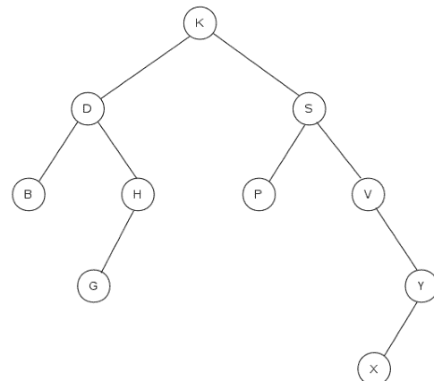

二叉树的特征是它是空的，或者由一个根和两个左右子树组成，例如，S 是一个子树的根，同样也适用于 V。注意，树有 4 个叶子节点，且从根到 X 的路径为 4。上面的二叉树按照元素的顺序绘制的，但对于通用树来说并非如此。

二叉树可以作为其他更复杂结构的二叉树的基类。我将提到对二叉树可以执行的操作。第一个是确定树高度的操作。上上，我定义树的高度为树中叶子节点的最大深度，相应地，上面的二叉树高度为 4。具体来说，空二叉树的高度计算为 -1，然后你按照如下方式确定高度：

```
getHeight(
  if (the tree is empty) return -1
  return 1 + max(getHeight(the left), getHeight(the right))
)
```

另外三个关于树的遍历，这是一种遍历所有元素的操作。传统上有三种方式，称为中序（in-order）、先序（pre-order）和后序（post-order）。中序遍历的工作方式如下：从根开始，然后按照以下顺序进行递归：

- 遍历左子树（如果为空）
- 对根节点执行操作
- 遍历右子树（如果为空）

先序遍历使用相同的递归方法：

- 对根节点执行操作
- 遍历左子树（如果为空）
- 遍历右子树（如果为空）

最后是后序遍历：

- 遍历左子树（如果为空）
- 遍历右子树（如果为空）
- 对根节点执行操作

也可以定义其他的遍历序列，但上述是是最常用的。作为一个例子，你有时可以使用层序遍历（level order traversing），即从左到右处理同一层级的元素。

# JAVA 18: 算法与数据结构：软件开发树

```
public void clear(); // 移除所有元素
public boolean contains(T elem); // 测试树是否包含 elem
public Iterator<T> inOrder(); // 返回一个中序迭代器
public Iterator<T> preOrder(); // 返回一个前序迭代器
public Iterator<T> postOrder(); // 返回一个后序迭代器
```

特别地，你必须注意，对于上述三种遍历方法都有相应的迭代器，并且定义了 `contains()` 方法，这是二叉树的核心方法。二叉树的整个目的是用对数时间复杂度实现该方法。该接口没有定义向树中插入元素或删除元素的方法——当你对树有更多了解时可以定义它们。该接口由类 `ABinTree<T>` 实现，它是一个抽象类，因为它没有实现 `contains()`。另一方面，它可以实现三个迭代器，这三个迭代器是该类的主要目的所在，因为它们的实现方式是相同的（使用栈），且独立于当前树的结构。为了实现这些迭代器，该类为每个迭代器都定义了内部类，例如，下面展示了中序遍历的类。

```
private class InOrderIterator implements Iterator<T>
```


> “在丹麦，你可以找到很好的工程工作并提升自己的专业水平。特别是在风电领域，你可以向行业内优秀的人学习，并在稳定的就业市场中推进职业发展。”
>
> Mireia Marre,
> 来自西班牙的高级工程师。
> 自2010年来一直于丹麦的风电行业工作。

在 bookboom.com 下载免费电子书

# JAVA 18: 算法与数据结构：软件开发树

```
private IStack<DoubleNode<T>> stack = new ArrayStack();
```

```
public InorderIterator() {
    for (DoubleNode<T> node = root; node != null; node = node.getPrev())
        stack.push(node);
}
```

```java
@Override
public boolean hasNext() {
    return !stack.isEmpty();
}
```

```java
@Override
public T next() {
    try {
        DoubleNode<T> node = stack.pop();
        T element = node.getElement();
        for (node = node.getNext(); node != null; node = node.getPrev())
            stack.push(node);
        return element;
    } catch (Exception ex) {
        return null;
    }
}
```

在中序遍历中，你尽可能向左开始，该类有一个构造函数，其中你尽可能向左移动，并将遇到的所有节点都放入栈中。`hasNext()` 方法只需要测试栈是否为空。`next()` 方法从栈中弹出元素，栈顶的元素就是迭代器应该返回的元素。在进入节点的右子树之前，你会再次在尽可能向左移动时向栈中推入节点。另外两个遍历迭代器原则上的实现方式相同，然而，后序遍历需要额外的努力，因为你会将同一个节点多次放入栈中，因此需要计算一个节点被放入栈的次数。这个问题通过一个封装了带计数器的节点的包装器来解决。

`IBaseTree` 接口定义了两个方法分别用于在二叉树中查找节点和删除元素：

```java
public interface IBaseTree<T> {
    public DoubleNode<T> find(T elem);
    public boolean remove(T elem);
}
```

`remove()` 方法必须实现以删除以特定元素为根节点的空子树。`BinTree<T>` 类继承自 `IBaseTree<T>` 并实现了 `IBaseTree<T>` 接口。因此，该类也必须实现 `contains()` 方法，但对于通用二叉树，它具有线性复杂度，因为你只能遍历所有节点并搜索元素。接口没有定义向树插入元素的方法，但 `BinTree<T>` 类有一个静态方法 `merge()`，它可以执行两个二叉树（左、右子树）的合并，关于一个新元素成为新树的根。`merge()` 方法可以用于构建二叉树。`BinTree<T>` 类没有特殊意义，它的主要应用是测试 `ABTree<T>` 类中的遍历方法，然后提供一个具体的二叉树示例。

`BinTree<T>` 类重写了 `toString()`，使用了 `TreePrinter` 类中的静态方法，该方法返回一个视觉化树的文本。此方法仅在调试和测试时有用，不应作为二叉树完整实现的一部分。此外，`TreePrinter` 类通常可以用于用文本演示二叉树。

## 练习 13：通用二叉树

你必须编写一个可以调用 `BinTreeTester` 的程序。该程序应该使用 `merge()` 方法在本节开始处构建二叉树：

```java
public class BinTreeTester {
    public static void main(String[] args) {
        // 构建树
        show(tree);
        print(tree.inOrder());
        print(tree.preOrder());
        print(tree.postOrder());
    }
}
```

# JAVA 18: 算法与数据结构：软件开发树

## 7.2 二叉搜索树

搜索树是一种满足附加条件的二叉树：对于任意一个节点，其元素都大于左子树中的所有元素，且小于右子树中的所有元素。如果你考虑上述（8.1节开头）的二叉树示例，它实际上是一棵搜索树。为了在搜索树中放置元素，元素必须是可以排序的，在 Java 术语中，它们应该是可比较的（comparable）。我假设搜索树中的所有元素必须是不同的，并且实际上

```java
public interface ISearchTree<T extends Comparable<T>> extends IBinTree<T> {
    public T getMin(); // 返回第一个元素
    public T getMax(); // 返回最后一个元素
    public boolean insert(T elem); // 在树中插入元素
    public boolean remove(T elem); // 从树中移除元素
}
```

如果对于任意节点，左、右子树的高度“几乎”相同，则该二叉树是平衡的。任务是编写一个 `SearchTree<T>` 类，它继承自 `ABTree<T>` 并实现上述方法，包括基类中的抽象方法 `contains()`。如果树是平衡的，所有这些方法都可以用对数时间复杂度实现，这正是二叉树的目标。如何确保二叉搜索树良好平衡是另一个问题，也是下一节的主题，但如果你认为元素是随机顺序添加的，二叉搜索树通常会相当平衡。

再次考虑这棵二叉树：

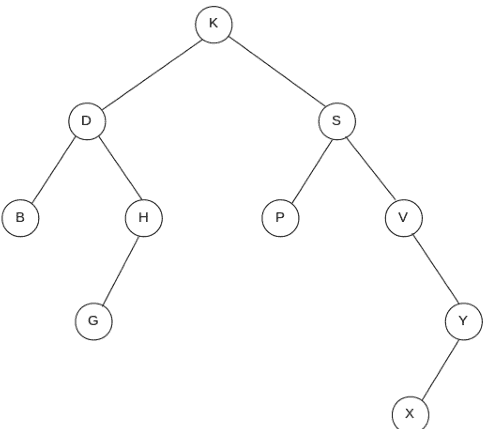

假设你想搜索 `G`。你从根节点开始，由于 `G` 小于 `K`，你必须在 `K` 的左子树中查找。由于 `G` 大于 `D`，你应该在 `D` 的右子树中查找。由于 `G` 小于 `H`，你必须在 `H` 的左子树中查找。此此，元素已找到。因此，原理是：你从根节点开始，如果它就是你要找的元素，就完成了。否则，重复搜索，但在左子树或右子树中进行。这一直持续，直到你找到该元素或到达空树。作为二分查找，其原理是每次搜索的元素数量减半，因此是一个 `O(log (N))` 算法——假设树是合理平衡的。

插入新元素的方法也类似。你从根节点开始，找到要插入到左子树或右子树的新元素。如果你已经到达了一个空子树，可以将该元素作为新的子节点插入。否则，重复该过程。同样，你向下遍历树，直到找到新节点必须是其继任的节点，随后的插入也实现为 `O(log (N))` 算法。例如，如果你必须在上面的树中插入 `J`，你会得到下面的树。步骤如下：

1. 从 K 开始
2. 到 D
3. 到 H
4. 将 J 作为 H 的右孩子插入

最后的操作对应于：如果 `H` 的右子树为空，则新元素将作为新的叶子节点插入到 `H`。

# JAVA 18: 算法与数据结构：软件开发树

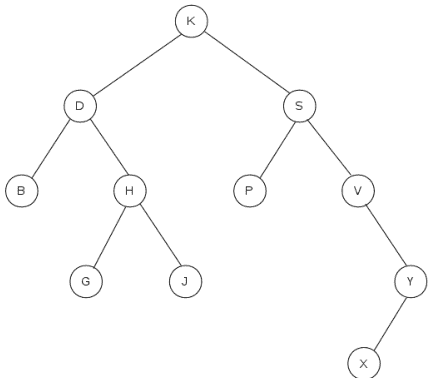

如果你接下来想插入 I，你必须：

1. 从 K 开始
2. 到 D
3. 到 H
4. 到 J
5. 将 I 作为 J 的子节点插入


# JAVA 18: 算法与数据结构：软件开发树

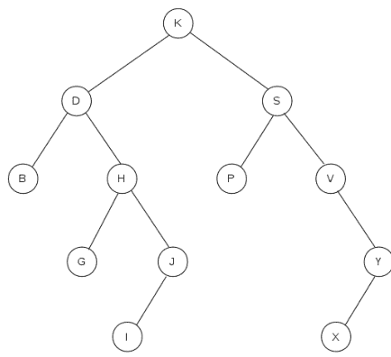

因此，实现 `insert()` 方法相对简单，最重要的是 true到，该方法可以用对数时间复杂度来实现。

最难实现的方法是 `remove()`。你从根节点开始并向下遍历树，直到找到要删除的元素。现在有三种选择：

- 如果元素的右子树为空，则该元素必须由左子树替换（例如上面树中的元素 `Y` 和 `X`）。
- 否则，如果元素的左子树为空，则该元素必须由右子树替换（例如上面树中的元素 `V`）。
- 否则，如果元素既有左子树又有右树，它将被右子树中最小的元素替换，然后必须删除该节点（例如上面树中的 `H`）。

同样，该算法是向下遍历树，因此可以用对数复杂度实现。下面是删除 V 后显示的树：

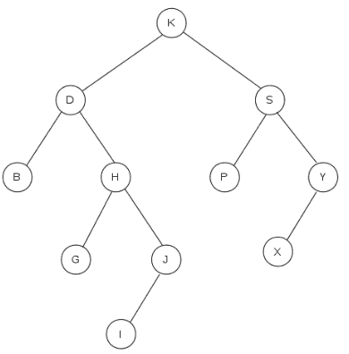

# JAVA 18: 算法与数据结构：软件开发树

如果你也删除 H，就会得到：

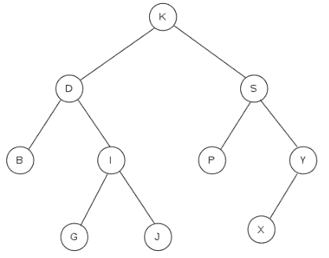

需要注意的是，二叉树中的删除保留了二叉搜索树的标准。如接口所示，二叉树还具有某些服务：返回最小和最大的元素。然而，这些方法很容易实现，主要由尽可能向左走或尽可能向右走组成。当你在你研究 `SearchTree<T>` 类的代码时，注意 `insert()` 和 `remove()` 方法都是递归实现的。它们也可以用迭代方式实现，正如我在下一个二叉树实现中所做的那样，那是一个 `AVL tree`。

## 练习 14：二叉搜索树

你必须编写一个可以调用 `SearchTester` 的程序。该程序应该测试 `SearchTree<T>` 类。首先，写一个可以创建二叉树的方法：

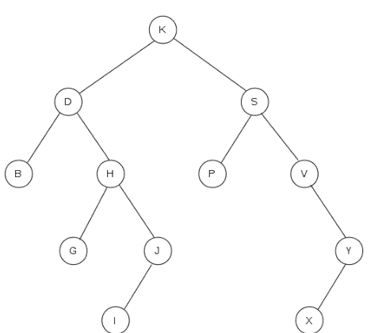

# JAVA 18: 算法与数据结构：软件开发树

即，一棵树：`SearchTree<Character> tree = new SearchTree()`，按以下顺序添加元素：K D B H G I S P V X

该方法随后必须执行以下语句：

```
print(tree.inOrder());
print(tree.preOrder());
print(tree.postOrder());
```

```
private static <T extends Comparable<T>> void print(SearchTree<T> tree) throws Exception
{ // 打印树的元素
  // 打印树的高度
  // 打印树的叶子节点
```


# JAVA 18: 算法与数据结构：软件开发树

```
private static <T> void print(Iterator<T> itr)
{
  // 打印树的最小元素
  // 打印树的最大元素
}
```

```
private static int N = 1000000;
```

编写一个 `test3()` 方法执行以下操作：

1. 创建一个整数的二叉搜索
2. 在 0 到 2N 之间添加 N 个随机整数
3. 在 0 到 2N 之间对树进行 N 次
4. 最后，方法应该打印：
5. 树的高度
6. 树的叶子节点
7. 树中的元素
8. N 次搜索
9. 匹配结果
10. 执行的毫时

结果可能是：

```
Height: 48
Leaves: 32930
1000000 
665 毫秒
```

## 练习 15：层序


编写一个可以调用`LevelProgram`的程序。在项目中添加一个类`MyBinTree`，它继承自`SearchTree`。该类应该扩展一个方法：

```java
public Iterator<T> levelOrder()
```

返回一个执行层序遍历的迭代器（层序遍历定义见上）。编写该类后，程序必须创建一个`MyBinTree<Character>`并构建与练习相同的二叉树。程序必须按层序打印树的元素。

## 7.3 平衡二叉树

实际上实际上基于二叉搜索树（或源自二叉搜索树的树）。树有两个重要的特征：

1. 元素的搜索时间（如所述）是对数级的。
2. 升序遍历树元素。

然而，这里一点并不一定正确。假设你按此顺序插入 A B C D D。结果仍然是一个二叉搜索树，但它是一个与列表相同的退化树：

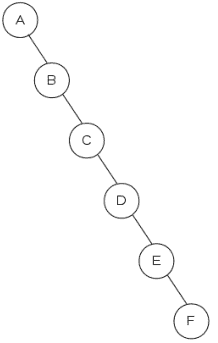

# JAVA 18: 算法与数据结构：软件开发 树

这说明树完全是不平衡的。例如，`contains()`变成了线性复杂度，因此二叉树的整个理念失去了。因此，有必要进行一些更改以确保树不会如上面所示那样。树必须是平衡的，因此插入和删除必须以在操作后树保持平衡的方式进行。我想展示两种定义特殊搜索树的方法，分别称为 AVL 树和红黑树，我首先（在空间考虑方面）将在下一书中处理红黑树。但先来看几个定义。

所有层都填满的二叉树被称为满二叉树。

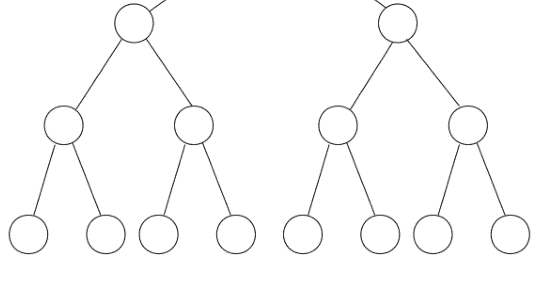


如果靠近底部的所有层都已满，且底部是从左到右填充的，则称之为完全二叉树。

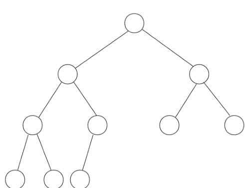

如果一个二叉树对于任意节点，其左子树节点数与右子树节点数之差最多为 1，则该二叉树被称为平衡二叉树。

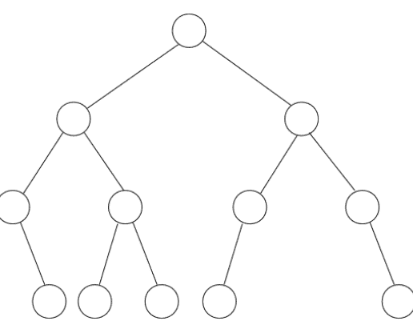

为了使二叉搜索树的操作具有对数复杂度，树必须是平衡或至少是相当平衡，在下一节我将展示平衡二叉树。其思想是按照二叉搜索树的方法插入（并删除）元素。结果可能是一个不平衡的二叉树，任务是使用称为“旋转”的特殊操作来恢复平衡。

## 7.4 AVL树

如果你向二叉搜索树中插入元素，在最坏的情况下，甚至可能出现像列表一样的树。因此，必须更改树中插入和删除元素的方法。这些方法必须确保在操作完成后树仍然是平衡的。这是通过四种操作实现的，我现在将描述它们。

### 右旋转

考虑以下二叉树（或子树）：

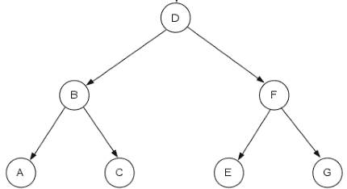

在 D 中进行右旋转，是指 B 变成根的操作（你需要改变两个指针）：

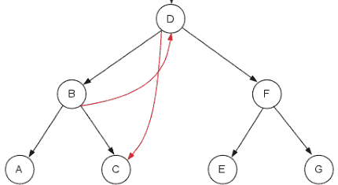

这些是红色箭头，即已改变的指针。操作完成后画出树，结果如下：

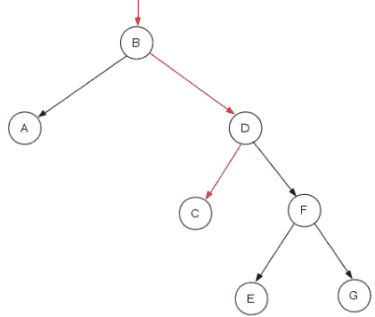

### 左旋转

原理上与右旋转相同，只需向相反方向旋转。再次考虑这棵树：

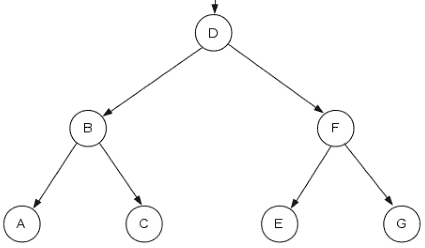

在这种情况下，F 必须是一个新根，F 的左子树必须是 D 的右子树，而 D 将成为 F 的左子树：

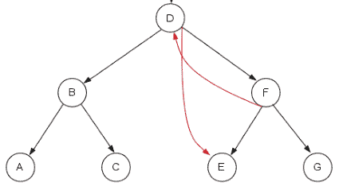

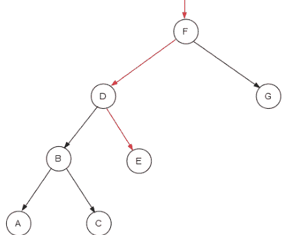

### 左右旋转

这种操作是双旋转，首先对根的左孩子进行左旋转，然后对根节点进行右旋转。假设树如下，且你想对根 F 执行左右旋转：

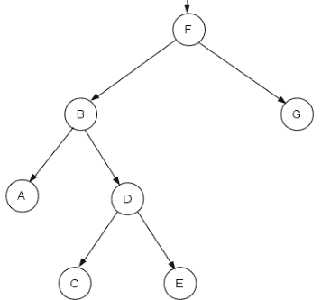

你从对 B 进行左旋转开始，然后对 F 进行右旋转：

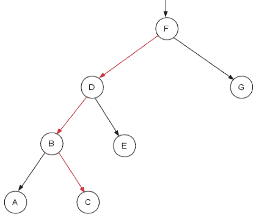

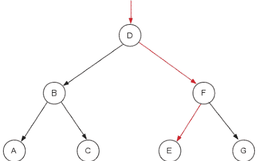

作为结果：

1. B 的左旋转变为绕 F 的右旋转。
2. 向上移动一层。

### 右左旋转

这种操作是双旋转，首先对根的右孩子进行右旋转，然后对根节点进行左旋转。假设树如下，你想对根 F 执行右左旋转：


## JAVA 18：算法与数据结构：软件开发

你遇到了左-右不平衡，可以通过左-右旋转来解决：确定 C 存在不平衡，在 C 的左子节点进行左旋，在 C 中右旋。在 A 中进行左旋：

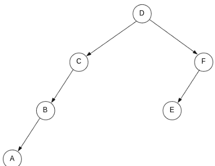

然后在 C 中进行右旋：

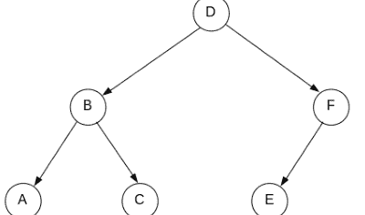

平衡就恢复了。下面的树也是一个 AVL 树：

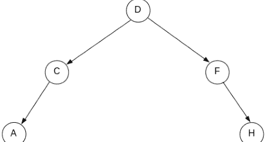

JAVA 18：算法与数据结构：软件开发

如果你插入 G，你会得到一个在 F 处不平衡的二叉搜索树：

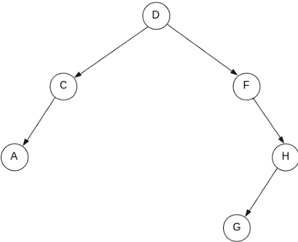

# 马斯里赫特大学

领先学习！

# 加入马斯里赫特大学的最尖团队

商与经济学院！

- 《金融时报》全球排名第 33 位：国际业务硕士
- 第1 名：国际业务硕士
- 第 第1 名：金融经济学硕士
- 第2 名：学习管理硕士
- 第2 名：经济学硕士
- 第2 名：计量经济学与运筹学硕士
- 第2 名：全球供应链管理与变革硕士

来源：排名，2013年硕士排名；爱思唯：2012年“最佳学生”排名；《金融时报》，2012年全球管理类硕士排名

访问我们，发现我们为什么是最好的！

硕士开放日：2014年2月22日

马斯里赫特大学是荷兰最好的专科类大学（爱思唯）

www.maastersopenday.nl

# JAVA 18：算法与数据结构：软件开发树

因此这些树是右-左不平衡的。这次通过在 F 中进行右-左旋转来解决。首先，在 H 中进行右旋：

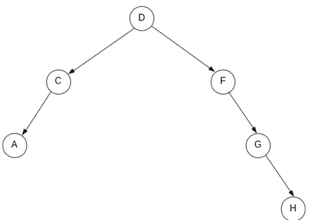

然后在 F 中进行左旋：

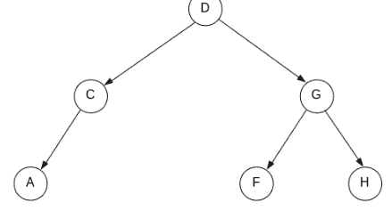

这意味着右-左不平衡通过右-左旋转解决：确定 F 中的不平衡，在 F 的右子节点右旋并在 F 中左旋。

最后一种情况是右-右不平衡，即插入到右子树中作为右节点。如果检测到 X 不平衡，通过在 X 中进行左旋来解决问题。

再次考虑该树：

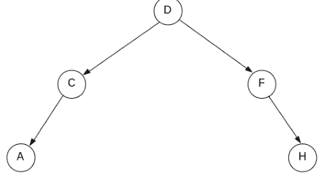

## JAVA 18：算法与数据结构：软件开发

如果你插入 I，你会得到 F 处不平衡：

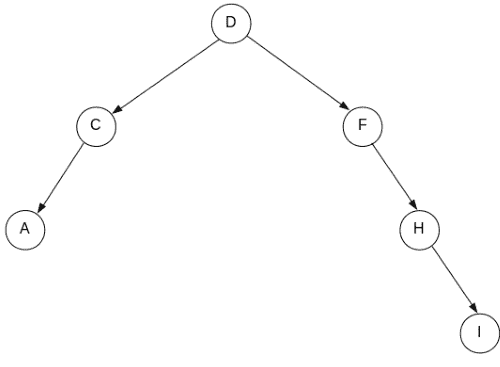

如果你现在在 F 中进行左旋，树将再次恢复平衡：

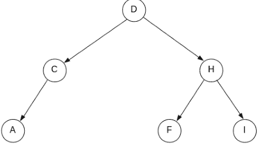

上述内容说明了在 AVL 树中实现插入所需的。你按照通常方式插入项，之后回溯检查新节点所插入的子树的父节点是否存在不平衡，如果执行了上述描述的四种旋转中的一种，平衡就会恢复。这一过程持续到你到达根节点，结果就是 AVL 树。

与普通二叉树相比，向 AVL 树中插入元素较为复杂，鼓励你研究相关代码，这些代码只是对`SearchTree<T>`类中对应方法的重写。然后是删除，问题与删除元素类似，可能会产生不平衡，并需要恢复平衡，但删除的实现更难，因为需要考虑的情况更多。

# JAVA 18：算法与数据结构：树

对于`insert()`和`remove()`，对于每个节点，都可以确定是否存在不平衡，原则上是简单的，因为`SearchTree<T>`类有一个`getHeight`方法，可以返回子树的高度。然而，问题在于它的复杂度是线性的，如果你在回溯时测试每个节点的树，复杂度将是 O(N)。这并不是必要的，你可以在每个节点上挂载一个因子，如下类所示：

```java
private class AVLNode<T> extends DoubleNode<T>
```


# JAVA 18：算法与数据结构：软件开发

```java
AVLNode(T elem, DoubleNode<T> next, AVLNode<T> parent)
{
  super(elem, next);
  this.parent = parent;
}
```

```java
public int getBalance()
{
  int getHeight = prev == null ? 0 : ((AVLNode<T>)prev).height;
  int rightHeight = next == null ? 0 : ((AVLNode<T>)next).height;
  return getHeight - rightHeight;
}
```

```java
public int updateHeight()
{
  int left = prev == null ? 0 : ((AVLNode<T>)prev).height;
  int rightHeight = next == null ? 0 : ((AVLNode<T>)next).height;
  if (left > rightHeight) height = left + 1;
  else height = rightHeight + 1;
  return height;
}
```

该类有一个`height`变量，你会注意到`getBalance()`返回左和右子树的差异。如果这个差异大于 1，则表示不平衡。`updateHeight()`将左和右子树的因子加 1。

然而，对于这个类实现`remove()`方法并不简单，但必须编写大量的代码，并且很难确保引用被更改。你应该检查代码以获取细节。

# 练习 16：测试 AVL TREE

编写一个可以调用`AVLProgram`的程序，它应该使用三个测试方法测试`AVLTree<T>`。第一个测试方法必须将 A 到 Z 随机放入`AVLTree<Character>`中，然后使用`TreePrinter`类在屏幕上打印树。

# JAVA 18：算法与数据结构：树

下一个测试方法`test2()`必须创建`AVLTree<Character>`。接下来，方法应该在循环中打印、删除一个随机元素并打印删除了哪个元素。循环重复直到树为空。`test2()`方法应该执行 10 次。

最后一个测试方法必须创建一个包含 M 个随机整数的`List<Integer>`。该方法随后创建三个树，每个树包含上述数字：

1. 一个`AVLTree<Integer>`
2. 一个`SearchTree<Integer>`
3. 一个`TreeSet<Integer>`

后者是 Java 集合类，它实际上实现为平衡二叉树（不是 AVLTree，而是红黑树）。对于这三个树中的每一个，方法必须测量将 M 个元素放入树中需要多少毫秒。随后，这三个树中的每个方法都必须执行 N 次随机搜索，并测量搜索花费的时间。最后，方法应该打印结果，以及前两个树的高度，示例例如：

```
M = 100000
N = 10000000
Insert elements
AVL tree 39
SearchTree 25
SortedSet 32
Search elements
AVL tree 2149
SearchTree 2153
SortedSet 1751
Hight of the trees
AVL tree 19
SearchTree 37
```

在这里你应该特别注意，当元素随机插入时，二叉搜索树通常和 AVL 树一样好。

# JAVA 18：算法与数据结构：软件开发堆

## 8 堆 (HEAP)

堆在某种程度上类似于栈（stack）和队列（queue），因此你基本上可以执行以下两种操作：

1. `add()`：向数据结构中添加一个元素
2. `remove()`：返回并移除数据结构中的最小元素

由此可以立即推导出，堆是一个**有序的数据结构**，因此它的元素是可以比较的。

堆可以组织为二叉树，并需要满足以下两个额外特征：

1. 它是一棵完全二叉树（complete binary tree）。
2. 任何节点的值都小于或等于其子节点。


# JAVA 18：算法与数据结构：软件开发堆

例如，以下数据被组织成一个堆：

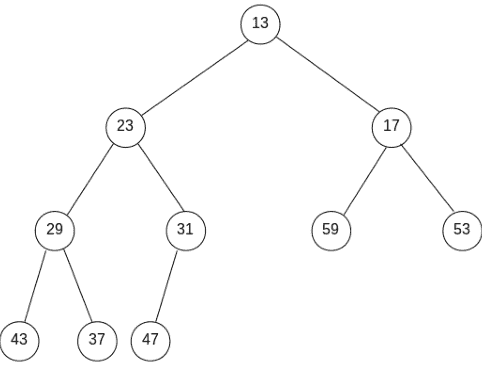

特别注意，对于所有节点，其子节点要么为空（null），要么其值大于（父）节点。它也是一棵完全二叉树，因为第 1 层是满的，而第 2 层是从左侧填充。例如，如果 47 是 31 的右孩子，那么它将不是一棵完全二叉树。

堆以这种方式像二叉树一样组织元素，有时我们也称之为二叉堆（binary heap）。

如果你想向堆中插入一个新元素，可以通过一个新节点扩展树：

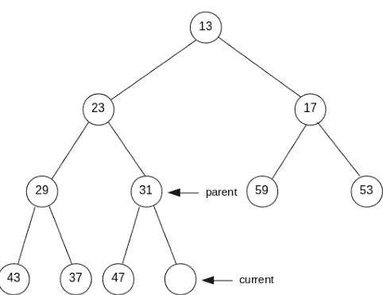

注意，它仍然是一棵完全树。你现在从名为 *current* 的新节点开始在树中向上移动。对于每一步，你查看父节点`parent`。如果它大于要插入的新元素，则交换`parent`与 *current* 的值，即 *current* 向上移动一层。当`parent`的值小于或等于新值时，过程停止。

新值存储在 *current* 指向的地方。例如，假设新元素是 19。在元素移动并将 19 插入到 *current* 后，图片所示：

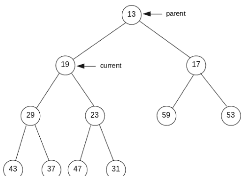

下面是如果你也插入元素 7，堆的样子：

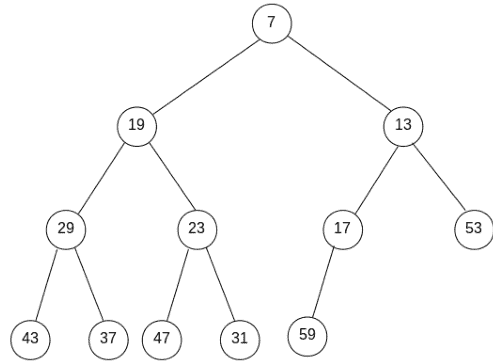

注意，当然，较低层可能会被填满，你就有了一棵满二叉树。如果是这种情况，且你想插入另一个元素，树将增加另一层，但它仍然是一棵完全树，你必须从左侧开始，为上一层最左的节点创建一个新的叶子节点。此外注意，插入新节点后，你必须向上查找树以找到新元素必须放置的节点。在坏的情况下，你必须回到根节点，但如果你找到了，新元素必须小于根节点，因此也小于根节点的节点，该元素就可以作为新根节点插入。这意味着最坏情况下你必须回到根节点，这意味着插入新元素的时间复杂度为 $O(\log (N))$。

# JAVA 18：算法与数据结构：软件开发堆

向堆中插入元素的结果如所示，最小元素始终位于根节点，因此实现`remove()`非常简单，因为它只需要返回根节点的值。然而，问题在于要确保移除根节点后树仍然是一个堆，这需要一个类似于插入的过程。

在上面的示例中，`remove()`返回 7，值为 59 的节点将消失。你从根节点开始移动到最小孩子，这里是 13。由于它小于 59，它移动到了根节点。你现在重复这个过程并找到 13 的最小孩子，即 17。由于它小于 59，17 向上移动一个位置（父节点指向的地方）：


由于 *current*（值为 17 的节点）没有孩子，将 59 放在该处：


结果仍然是一个堆：它是一棵完全二叉树，每个节点的值都小于或等于其子节点。删除时，你从根节点开始向下移动，直到找到元素必须插入的位置。在坏的情况下，你必须回到根节点，时间复杂度为 $O(\log (N))$。堆还有其他操作：

- `add()`：添加一个新元素
- `clear()`：删除所有元素
- `getSize()`：返回元素数量
- `peek()`：返回最小元素

# JAVA 18: 算法与数据结构：软件开发

按层划分的，并且基于完全树，这意味着该树没有空隙。换句话说，你可以通过以下公式计算树的节点索引：

```
Index(root) = 1
Index(node.Left) = 2 * Index(node)
V node ∈ heap: Index(node.Right) = 2 * Index(node) + 1
Index(node.Parent) = Index(node) / 2
```


例如，考虑以下二叉树：


事实上，它是一个堆。共有四层，其中三层是满的，如果你将这棵树实现为数组，将得到结果：

| | 2 | 3 | 5 | 11 | 7 | 19 | 29 | 23 | 31 | 17 | 13 | 37 | | | | | | |
|---|---|---|---|---|---|---|---|---|---|---|---|---|---|---|---|---|---|---|---|
| 0 | 1 | 2 | 3 | 4 | 5 | 6 | 7 | 8 | 9 | 10 | 11 | 12 | 13 | 14 | 15 | 16 | 17 | 18 | 19 |

该思想是，基于上述公式，你可以计算元素的父节点和孩子的位置。例如：

- 1. `3` 的右孩子在位置 `2 * 2 + 1 = 5`
- 2. `5` 的左孩子在位置 `2 * 3 = 6`
- 3. `13` 的父节点在位置 `11 / 2 = 5`

通过实现这种完全二叉树，很容易实现堆。这在 `Heap` 类中完成。

查看上面的图形和 `Heap` 类，你可以发现我没有使用数组的第一个位置。原因是这样数组的实现和索引将变得更简单，从而产生更高效的实现。当然，你可以这样做并从位置 `0` 开始根节点，但这会导致索引计算变得更复杂，原则上代码效率也较低。

## 8.2 堆排序

如果你将数组中的元素插入到堆中，然后清空堆，结果将是数组经过排序的。之后你可以编写如下的排序算法：

```
public static <T extends Comparable<T>> void heapSort(T[] t) {

  Heap<T> heap = new ArrayHeap<T>(true, t);

  try {

    for (int i = 0; !heap.isEmpty(); ++i) t[i] = heap.remove();

  } catch (Exception ex) {

  }

}
```

该方法在 `Tools` 类中实现。

由于堆的插入和删除都是对数级复杂度，该算法的复杂度为 `O(N log N)`，因此与快速排序相同。然而，该方法主要具有理论意义。时间测量将显示，在大多数情况下，该方法的效率低于快速排序，并且应该，它的内存复杂度并不理想，因为它基于堆（即数组的副本），这与归并排序相当。

## 8.3 优先级队列

作为堆的最后一个用途，我想提到优先级队列。我之前提到过队列的实现，并与之相关的，在优先级队列的问题实现中，它被实现为队列的数组，其中队列的数量之前被定义为构造函数的参数。如果你考虑一个元素顺序由优先级决定的堆，那么从堆中移除元素将始终获得优先级最高的元素（优先级值最小的元素）。结果是，你拥有了一个优先级队列。因此，你可以非常容易地通过堆的薄层封装来实现优先级队列。一个例子是 `PriorityQueue<T>` 类，它实现了以下接口：

```
public interface IPriorityQueue<T> extends IQueue<T>

{

    public void enqueue(T elem, int p);

}
```

## 练习 17：测试 Heap 类

你必须编写一个程序，当程序运行时可以调用 `HeapTester`，该程序有三个方法可以测试 `Heap<T>` 类。

第一个方法必须创建一个堆，并随机插入从 `A` 到 `Z` 的大写字母。接下来，该方法必须使用迭代器打印堆的内容，然后从堆中移除所有元素并打印内容。结果可能是：

```
ACBDFELTHNHMGJYQXVSKWPUZUOIR
ABCDEFGHIJKLMQRSTUVWXYZ
```


下一个方法必须创建一个包含 `N` 个元素的整数数组，并用随机整数初始化数组。再下一个方法必须创建一个包含 `N` 个元素的整数数组。结果可能是：

```
ACBDFELTHNHMGJYQXVSKWPUZUOIR
ABCDEFGHIJKLMQRSTUVWXYZ
```

## 问题 5：基数排序

基数排序是一种用于排序单个字符为数字的相同长度字符串的方法。该思想是将数字放入队列中，这些队列可以在线性时间内合并。每次迭代都对数组进行一次，将元素分到队列中。迭代次数由键的长度决定，如果长度为 `M` 且数组中有 `N` 个元素，则该方法可以实现为 `O(MN)` 算法。由于在实践中 `M` 很小，因此可以将该算法视为线性时间算法。

下一个方法必须创建一个包含 `N` 个元素的整数数组，并用随机整数初始化数组。再下一个方法必须创建一个包含 `N` 个元素的整数数组。结果可能是：

```
ACBDFELTHNHMGJYQXVSKWPUZUOIR
ABCDEFGHIJKLMQRSTUVWXYZ
```

## 9 哈希（HASHING）

集合类（collection class）是对象的容器，区分集合类的主要有两点：

- 1. 该类提供了哪些服务，以及用户可以使用该类做什么。
- 2. 对象在内部是如何存储和组织的。

后者仅仅是类的内部属性，基本上它的设计意图是让用户不需要（也不需要感知到）它。用户需要知道单个方法的复杂度，但无论发生什么，这些都留给实现该类的开发者去处理。

到此为止，我已经提到了两种存储对象的方法。这可以通过数组来实现，也可以通过引用或指针将元素连接起来来实现。这两种方式各有优缺点，选择取决于集合希望具备的特征。事实上，这是存储对象的唯一两种方式，但在两种情况下，都可能恰当法组织对象，这对于类的方法至关重要。例如，`ArrayList` 将对象存储在数组中，但它的组织方式使得它们从开始到最后一个元素连续存储。`ArrayList` 拥有一个内部计数器，用于跟踪最后一个元素的位置。

数组作为容器的特征是每个对象都位于特定的索引上，有了这个索引，你就可以以常数复杂度直接访问元素。数组是一个高效高效的容器，但决定使用哪个索引来查找特定元素取决于用户（即集合类）。它的问题在于，在许多语境下，通过直接对应物理位置的数值索引来引用特定对象并不合适，最好通过示例或名称（键）来查找对象，但如果没有它，应该以搜索的形式存在。解决这个问题的方案可能是哈希。

从技术上讲，哈希结构是一个对象数组，它使用键而不是索引来标识单个对象。其思想是将键转换为索引，该索引指示对象在数组中的位置。这种转换就被称为哈希。也就是说，在数组中查找对象时，并不是通过搜索完成，而是通过计算对象的位置，通过这种操作实现了常数时间复杂度。

为了说明这一原理，我将来看一个例子，我想在数组中保存丹麦的邮政编码。对象示例是 `7800, Skive`。

## JAVA 18：算法与数据结构：软件开发哈希

假设起点是一个拥有 10 个位置的数组（见下方）。如上所述，我将使用邮政编码作为键，第一个任务是将邮政编码转换为索引。我将使用以下函数：

```
index = digitsum(code) % 10;
```

其中 `digitsum()` 是一个确定邮政编码中数字之和的函数。`10` 来源于数组的大小，因此 `index` 的值将始终是 `0, 1, 2, ..., 9` 之一，因此是一个合法的索引。`digitsum()` 方法就是所谓的哈希函数，应该注意，无论 `code` 的类型是 `String` 还是 `int`，在 Java 中实现这个函数都是容易的。

| 0 |
|---|
| 1 |
| 2 |
| 3 |
| 4 |
| 5 |
| 6 |
| 7 |
| 8 |
| 9 |

如果键是 `7800`，则邮政编码对象必须放在位置：

```
(7 + 8 + 0 + 0)%10 = 5
```

下面显示了插入 `7800, Skive` 后的数组：

| 0 |
|---|
| 1 |
| 2 |
| 3 |
| 4 |
| 5 7800, Skive |
| 6 |
| 7 |
| 8 |
| 9 |

下面显示了我添加了另外三个对象后的表：

- `8800, Viborg`
- `7950, Erlev`
- `8000, Aarhus C`

重要的点是要注意，每次找到对象的位置都是通过计算而不是搜索的：

| | |
|---|---|
| 1 | 7950, Erlev |
| 2 | |
| 3 | |
| 4 | |
| 5 | 7800, Skive |
| 6 | 8800, Viborg |
| 7 | |
| 8 | 8000, Aarhus C |
| 9 | |


假设你想进一步插入对象 `7900, Nykobing`

该元素应该被放在位置 `6`，但该位置是占用的，我们正在讨论的是冲突（collision）。有两个对象具有不同的键，但通过哈希函数确定了表中的相同位置。因此你可以得出结论，实现数组哈希有两个基本挑战：

- 1. 哈希函数必须将键分布在数组上。
- 2. 必须有处理冲突的解决方案。

在这方面，哈希函数必须是快速的，例如，如果我们使用质数来改进分布，可以使用：

```
index = (key * prime) % array_size;
```

然而，主要问题是如何处理冲突。处理冲突主要有两种方法：

1. 链法（Chaining）：数组中的每个槽位指向一个哈希到相同索引的对象列表。
2. 开放寻法（Open addressing）：当发生冲突时，我们在数组中寻找另一个空槽。

如果我们使用链法，数组将变成一个链表的数组。当发生冲突时，我们只需将新对象添加到该索引的列表即可。这实现简单，但如果列表变长，性能可能会变差。

如果我们使用开放寻法，我们在数组中寻找另一个空槽。一种常用方法是线性探测，即检查下一个槽位（`index+1`, `index+2`, 等），直到找到空槽为止。另一种方法是二次探测，它使用二次序列来寻找下一个槽位。还有双重哈希，它使用第二个哈希函数来确定步长。

冲突解决的选择取决于数据的特征和应用程序的性能需求。例如，当内存不紧张时，通常倾向于链法；而如果数组不是太满，开放寻法可能更缓存缓存。

## JAVA 18：算法与数据结构：软件开发哈希

下一次并继续，直到找到一个空闲空间。如果你在上面的带有邮政编码的表中插入 `7900, Nykøbing`，你将得到结果：

| | |
|---||-|
| 1 | 7950, Erslelev |
| 2 | |
| 3 | |
| 4 | |
| 5 | 7800, Skive |
| 6 | 8800, Viborg |
| 7 | 7900, Nykøbing |
| 8 | 8000, Aarhus C |
| 9 | |


> 我们不是在发明轮子，我们是在重新发明光。迷人的光影提供了无限的可能性。创新技术和新市场提供了机遇与挑战。在一个你的专业知识需求旺盛的环境中。享受我们全球集团内部支持性的工作氛围，并从国际职业路径中获益。与其他专家密切合作实施可持续的想法，并为影响我们的未来贡献力量。加入我们，每天重新发明光。

光来自 OSRAM

## JAVA 18：算法与数据结构：软件开发哈希

如果你进一步添加 `6000, Kolding`，由于冲突的结果，它也必须放置在 `6` 位置。然后尝试放置 `7`，然后放置 `8`，直到在位置 `9` 处找到一个空闲空间。线性探测法的优点部分在于其原理易于实现，并且不需要为覆盖数组准备任何额外的数据结构。另一方面，它也有显著的缺点。如果数组几乎填满，冲突可能会在找到空闲空间之前导致多次搜索，访问特定元素也是如此。另一个问题是很难在数据结构中删除对象，因为这会在冲突链中产生“空洞”。因此，删除操作必须通过标记一个已删除的对象来实现，而不是在物理上移除元素并释放空间。这必须与某种形式的哈希结合，并重新组织数据结构，从而释放被删除对象所占的空间。

对线性探测的研究还表明，该方法倾向于形成簇，即键指向一组索引，而另一些索引组则很少被使用。这是很遗憾的，因为它意味着增加了冲突次数。然而，可以使用二次探测法（square probing）来改进该方法。其原理与线性探测相同，冲突的结果存储在与主对象相同的数组中。区别在于，位置不是通过不断获取下一个选取的，而是通过从以下序列获取索引：

```
i = (h + k^2) mod n k=0,1,2,3,...
```

其中 `h` 是主索引哈希（键中的哈希值），`n` 是数组大小。也就是说，如果发生冲突（空间 `h` 忙碌），尝试 `h+1`，然后放置 `h+4`，然后是 `h+9`，依此类推。研究表明，二次探测比线性探测更好，且不会导致许多冲突，但显而易见的是上述索引可以找到空闲空间，即使数组没有填满且没有进入环形。可以证明，如果数组大小是一个质数，且填充率（数组使用的比例）不超过 `50%`，二次探测将始终提供解决方案。二次探测法远好于线性探测，相反，它们存在的问题也是相同的，特别是移除元素的问题可能会导致冲突链中产生空洞。最后，二次探测的实现并不十分简单。

如上所述，你可以使用覆盖数组来解决冲突问题。一种非常自然的改进是为数组中的每个位置绑定一个覆盖。通过这种方式，每个元素都有自己的冲突链，这使得链自然会变短，如果你有一个良好的哈希函数来均匀地分布对象，那么中间所有的冲突将是相等的。这听起来可能是一个昂贵的解决方案，因为数组中的每个空间都必须与列表（或类似结构）关联，事实如此，与二次探测相比，这种解决方案需要额外的内存，但简单易于实现的优点抵消了这一点。在 Java 中，你拥有像 `HashSet<T>` 和 `HashMap<K, T>` 这样的集合类，它们基于哈希。它们解决了冲突问题，因为每个位置都有自己的冲突链。

哈希结构内部是一个数组，因此它具有容量。如果你保存的对象超过了它的容量，结果将不可避免地产生冲突。相反，显然，如果数组中的所有位置都可用，冲突发生的概率就很小。因此，问题在于，数组必须填满到什么程度冲突才会成为问题，也就是说，填充率必须是多少。无论如何，如果填充率超过给定值，就有扩展数组的容量。在这里，我看到与 `ArrayList` 相关，你可以使用翻倍法，这样如果填充率超过最大设置，你就可以增加数组的容量。然而，这不仅仅创建一个新数组并复制旧数组的问题，因为需要对所有对象进行重新哈希，因为数组的大小包含索引计算中。这意味着在哈希结构的情况下，你无法对顺序做任何假设。

## JAVA 18：算法与数据结构：软件开发哈希

均匀分布对象的哈希函数，中间所有的冲突将是相等的。这听起来可能是一个昂贵的解决方案，因为数组中的每个空间都必须与列表（或类似结构）关联，事实如此，与二次探测相比，这种解决方案需要额外的内存，但简单易于实现的优点抵消了这一点。在 Java 中，你拥有像 `HashSet<T>` 和 `HashMap<K, T>` 这样的集合类，它们基于哈希。它们解决了冲突问题，因为每个位置都有自己的冲突链。

哈希结构内部是一个数组，因此它具有容量。如果你保存的对象超过了它的容量，结果将不可避免地产生冲突。相反，显然，如果数组中的所有位置都可用，冲突发生的概率就很小。因此，问题在于，数组必须填满到什么程度冲突才会成为问题，也就是说，填充率必须是多少。无论如何，如果填充率超过给定值，就有扩展数组的容量。在这里，我看到与 `ArrayList` 相关，你可以使用翻倍法，这样如果填充率超过最大设置，你就可以增加数组的容量。然而，这不仅仅创建一个新数组并复制旧数组的问题，因为需要对所有对象进行重新哈希，因为数组的大小包含索引计算中。这意味着在哈希结构的情况下，你无法对顺序做任何假设。

## 9. 哈希类 (HASHING)

哈希结构内部是一个数组，因此它具有容量。如果你保存的对象超过了它的容量，结果将不可避免地产生冲突。相反，显然，如果数组中的所有位置都可用，冲突发生的概率就很小。因此，问题在于，数组必须填满到什么程度冲突才会成为问题，也就是说，填充率必须是多少。无论如何，如果填充率超过给定值，就有扩展数组的容量。在这里，我看到与 `ArrayList` 相关，你可以使用翻倍法，这样如果填充率超过最大设置，你就可以增加数组的容量。然而，这不仅仅创建一个新数组并复制旧数组的问题，因为需要对所有对象进行重新哈希，因为数组的大小包含索引计算中。这意味着在哈希结构的情况下，你无法对顺序做任何假设。

（注：原文后续存在大量重复段落，此处已根据要求进行去重处理）

## JAVA 18：算法与数据结构：软件开发 - 哈希

`insert()` 方法相对复杂——至少如果你也考虑了重哈（rehashing）时是如此。虽然重哈操作非常复杂且具有线性复杂度，但它只需要偶尔执行，且与 `ArrayList` 的方式相同，结果是 `insert()` 的平均时间复杂度是常数级。然而，这成立的条件是列表中的元素较少，这等同于冲突也较少。

## 练习 18：测试哈希

创建一个测试程序，当程序需要测试 `Hash` 类时调用 `HashTester`。从添加一个方法开始：

```
private static <T> void print(IHash<T> hash)

{}
```

该方法可以打印 `IHash<T>` 的内容。然后添加一个简单的测试方法 `test1()`，在其中：

- 1. 创建一个 `IHash<String> names = new Hash()`
- 2. 添加 5 个名称
- 3. 打印你的 `IHash<String>`
- 4. 再添加一个名称
- 5. 打印你的 `IHash<String>`
- 6. 添加 5 个名称
- 7. 打印你的 `IHash<String>`
- 8. 再添加一个名称
- 9. 打印你的 `IHash<String>`

注意，这意味着你的 `IHash<String>` 需要扩展 3 次。

添加一个类，当类需要通过姓和名表示一个人时，你可以调用 `Person`：

```
public class Person

{

  private String firstName;

  private String lastName;
```


## JAVA 18：算法与数据结构：软件开发

### 哈希

尝试使用 NetBeans 生成：

1. 一个包含两个值作为参数的构造函数
2. 拥有两个属性的 `get` 和 `set` 方法
3. 一个 `toString()`
4. `equals()` 和 `hashCode()`

并研究 NetBeans 为你创建的代码。每当你需要时，必须添加另一个测试方法 `test2()`：

1. 创建一个 `IHash<Person>`
2. 向哈希中添加 7 个 `Person` 对象，其中两个对象必须代表具有相同[姓氏]的人
3. 打印你的哈希
4. 当哈希中应该有一个与某个对象同名的人时，删除该人员
5. 打印你的哈希


你喜欢汽车吗？你想成为成功品牌的一部分吗？
我们将感谢并奖励你的热情和才华。
向我们发送你的简历。你会对它能带你去哪里感到惊讶。

向我们发送你的简历：
`www.employerforlife.com`

在 `bookboom.com` 下载免费电子书

### JAVA 18：算法与数据结构：软件开发

你必须向你的项目添加另一个类：

```java
public class HashingTester<T> extends Hashing<T>
{
    public HashingTester() { }
    public HashingTester(int n) { }

    // 返回内部数组的容量。
    public int getCapacity() { }

    // 返回当前的填充率（百分比）。
    public double getFillDegree() { }

    // 返回冲突数量
    public int getAllCollisions() { }

    // 返回最大冲突链的长度。
    public int getMaxCollisions() { }
}
```

然后向你的测试类 `HashingTester` 中添加 `print` 方法：

```java
private static <T> void print(HashingTester<T> hash)
{
    System.out.println("Capacity: " + hash.getCapacity());
    System.out.println("Size: " + hash.getSize());
    System.out.println("Fill degree: " + hash.getFillDegree());
    System.out.println("Collisions: " + hash.getAllCollisions());
    System.out.println("Max collision: " + hash.getMaxCollisions());
}
```

下一步，编写一个方法 `test3()` 来创建一个 `Hash<Integer>`。该方法应该打印在你的哈希中插入 1000000 个元素所需的时间，最后调用上述 `print` 方法。你必须编写一个类似的方法 `test4()`，区别在于类型为 `String`，且该方法应该在你的哈希中产生随机字符串：

```java
private static String create(int n)
{
    StringBuilder builder = new StringBuilder();
    while (n-- > 0) builder.append(char('A') + rand.nextInt(26));
    return builder.toString();
}
```

最后，编写一个测试方法 `test5()`，它与 `test4()` 几乎相同，仅区别于将速率设置为 0.25。如果你喜欢，可以对填充率进行实验。

### JAVA 18：算法与数据结构：软件开发

#### 问题 6：二次探测法

创建一个名为 `HashTable2` 的新项目。你必须编写一个 `Hashing<T>` 类，它实现了 `IHash<T>` 接口，因此具有与 `Hash<T>` 类相同的方法。区别在于，这次的冲突问题必须通过**二次探测**来解决。

注意，你还必须编写必要的测试方法，这些方法还应该包括与 `Hash<T>` 类的时间比较。


### 集合

从数学上来说，你了解集合（set）的概念，它是一个定义良好的容器。在集合中，你可以执行以下操作：

1. 询问元素是否在集合中
2. 两个集合创建一个新的交交集（intersection）
3. 两个集合创建一个新的并集（union）
4. 两个集合创建一个新的差集（difference）
5. 创建一个新的子集（subset）

然而，你可以这样定义一个 `ISet`：

```java
public interface ISet<T> extends Iterable<T> {
    boolean insert(T elem);
    boolean remove(T elem);
    boolean contains(T elem);
    Set<T> union(Set<T> S);
    Set<T> intersection(Set<T> S);
    Set<T> difference(Set<T> S);
    Set<T> subset(Predicate<T> ok);
    int getSize();
    boolean isEmpty();
}
```

集合不保证元素的顺序，如果你遍历集合中的所有元素，你不知道它们的处理顺序。因此，使用哈希来实现集合是显而易见的，而 `HashSet<T>` 类只是 `Hash<T>` 的封装。假设 `insert()`、`remove()` 和 `contains()` 方法具有常数复杂度，那么 `HashSet<T>` 中的这些方法可以用常数时间实现，而 `intersection()` 和 `difference()` 方法是线性复杂度。

### JAVA 18：算法与数据结构：软件开发 集合

在实践中，人们可能对 `ISet<T>` 中元素的排列方式感兴趣，这时你可以使用二叉树来实现 `ISet<T>`。`TreeSet<T>` 类实现了 `ISet<T>` 接口，但使用的是 `AVLTree<T>`。这意味着复杂度发生了变化，常数时间变为对数时间，而 `union()`、`intersection()` 和 `difference()` 的复杂度不再是线性的，但在实践中与 `Hash<T>` 类相比差异。

#### 练习 19：集合类

你必须编写一个名为 `Tester` 的程序来测试 `HashSet<T>` 和 `TreeSet<T>`。从添加一个可以打印 `ISet<T>` 内容的方法开始：

```java
private static <T> void print(ISet<T> S)
{
}
```

接下来，添加一个测试方法：

```java
private static void test1() 
ISet<Character> A = new HashSet('A', 'B', 'C', 'D');
ISet<Character> B = new HashSet('C', 'D', 'E');

// 打印 A
// 打印 B
// 打印 A 和 B 的并集
// 打印 A 和 B 的交集
// 打印 A 和 B 的差集
// 打印包含 B 和 C 的 A 的子集
```

你必须编写测试方法 `test2()`，它与上面相同，但类型改为 `TreeSet`。再编写一个测试方法 `test3()`，其中 A 是 `TreeSet` 而 B 是 `HashSet`；最后编写一个测试方法 `test4()`，其中 A 是 `HashSet` 而 B 是 `TreeSet`。

添加一个方法，用 $n$ 个在 0 到 $2n$ 之间的随机整数初始化集合，该方法应返回该集合：

```java
private static ISet<Integer> create(ISet<Integer> S, int n)
{\}
```

### JAVA 18: 算法与数据结构：软件开发教程

添加以下测试方法，用于打印执行 `union()`、`intersection()` 和 `difference()` 所需的时间（以毫秒计）：

```java
private static void test5() {
    int N = 100000000;
    Set<Integer> A = create(new HashSet(), N);
    Set<Integer> B = create(new HashSet(), N);
}
```

编写一个类似的测试方法 `test6()`，其工作方式相同，但集合的类型应为 `TreeSet`。


### JAVA 18: 算法与数据结构：软件开发

#### 11 映射 (MAPS)

作为本书中的最后一个数据结构，我想提到（并实现）一种映射。它是一个包含键/值对的集合，其中值（属性）通过键来标识，因此与数据库非常相似。映射可以定义为：

```java
public interface Map<K, T> extends Iterable<K> {
    public T get(K key);
    public void set(K key, T value);
    public boolean contains(K key);
    public boolean insert(K key, T value);
    public T remove(K key);
    public int getSize();
    public boolean isEmpty();
}
```

其中方法应该是自包含的。注意，该类型有两个参数化参数，第一个是键的类型，后者是值的类型。映射还必须实现迭代器模式，返回一个用于键的迭代器。

如果你想实现一个映射，有几种选择，但基本上你可以将其实现为 `HashMap`，其原理是使用哈希（hashing）保存键。如果你选择这种解决方案，意味着在遍历时，找到对象的顺序相对于遍历 `HashSet<K>` 来是不可预测的。相反，你可以将映射实现为 `TreeMap`，这对应于键存储在二叉搜索树中。这种解决方案意味着对象根据键进行排序，但另一方面，该类方法的性能略差。

特定的类 `HashMap<K, T>` 注意对这种形式元素进行哈希：

```java
private class Entry<K, T> {
    public K key;
    public T value;

    public Entry(K key) {
        this.key = key;
    }

    public Entry(K key, T value) {
        this.key = key;
    }
}
```

### JAVA 18: 算法与数据结构：软件开发 映射

```java
this.value = value;
}

@Override
public boolean equals(Object obj)
{
    if (getClass() == obj.getClass()) {
        return (Entry<K,T>)obj.key.equals(key);
    }
    else return false;
}

@Override
public int hashCode()
{
    return key.hashCode();
}
```

这是一个内部类，类类 `HashMap<K, T>` 可以定义如下：

```java
public class HashMap<K, T> implements IMap<K, T>
{
    private IHash<Element<K,T>> hash = new Hash();
```

各个方法的实现都是显而易见的，因为 `Hash<Entry<K, T>>` 类实现了必要的服务。

对于 `TreeMap<K, T>` 类，情况也是如此。这次参数类型 `K` 必须是可比较的，`Entry` 类也必须是如此，否则类 `TreeMap<K, T>` 定义如下：

```java
public class TreeMap<K> extends Comparable<K>,T> implements Map<K,T>
{
    private SearchTree<Entry<K,T>> tree = new AVLTree();
```

#### 练习 20：映射类

结合书中的示例，四个文本文件：`firstnames`、`lastnames`、`streetnames` 和 `zipcodes`，它们包含了一些（丹麦）名字、姓氏、街道名称和丹麦邮政编码。本次练习可以使用这些文件，请将它们复制到你可以方便引用的地方。

### JAVA 18: 算法与数据

#### 映射

编写一个程序 `MapTester`，在其中测试两个类 `HashMap<K, T>` 和 `TreeMap<K, T>`。添加一个简单的模型类 `Zipcode`：

```java
public class Zipcode {
    private String code;
    private String city;
```

除了构造函数外，对于这两个属性的 `get` 方法外，不需要其他内容。相应地编写一个模型类：

```java
public class Person {
    private int key;
    private String firstName;
    private String lastname;
    private String street;
    private Zipcode zipcode;
```


### JAVA 18: 算法与数据结构：软件开发 映射

同样地，只需要构造函数和 `get` 方法。对于测试程序，定义数据结构：

```java
public class MapTester{
    private static IList<String> firstnames = new ArrayList();
    private static IList<String> lastnames = new ArrayList();
    private static IList<String> streetnames = new ArrayList();
    private static IList<Zipcode> zipcodes = new ArrayList();
```

同样地，只需要构造函数和 `get` 方法。对于测试程序，定义数据结构：

```java
public class Person {
    private int key;
    private String firstName;
    private String lastname;
    private String street;
    private Zipcode zipcode;
```

同样地，只需要构造函数和 `get` 方法。对于测试程序，定义数据结构：

```java
public class MapTester{
    private static IList<String> firstnames = new ArrayList();
    private static IList<String> lastnames = new ArrayList();
    private static IList<String> streetnames = new ArrayList();
    private static IList<Zipcode> zipcodes = new ArrayList();
```


# JAVA 18：算法与数据结构：软件开发

## 12 最后一个最终示例

在数学中，向量是一个数组，其元素（通常）是实数，你可以执行不同的操作，例如两个向量相加，这简单来说是元素成对相加。你还可以确定两个向量的标量积，这是一个实数。一个类似的术语是矩阵，它无非是一个二维数组，其元素与向量一样是实数。对于矩阵，适用许多计算规则，例如矩阵相加，你可以在（某些条件下）相乘两个矩阵，其结果仍然是一个矩阵。编程中的经典任务之一是编写表示向量的类，在数学库的形式上有许多解决方案，本章的主题是展示此类库的另一个示例。也许这与集合无关，而是关于数据结构，算法在其中起着至关重要的作用。最后一个示例的目标更多是为了解决这个问题，而不是实际应用。解决方案将扩展库路径，包含一个与简单矩阵代数实现相关的包`dk.torus.math`。

具体来说，我将实现以下类：


实现此类类时，需要明确对象何时兼容，并且根据数学定义，我通常认为两个向量在具有相同数量运行时是兼容的。还有其他选择，你可能会假设，例如缺失的坐标可以被视为 0。这将提供更大的灵活性，但会出现产生意外之外结果的情况。同样，我假设矩阵的加减法要求两个矩阵具有相同的行数和列数，矩阵乘法要求第一个矩阵的列数等于第二个矩阵的行数。

观察上面的类图，`Matrix` 表示一个 $m$ 行 $n$ 列的矩阵，但 `SquareMatrix` 类是一个方阵，其行数和列数是相同的。`RowVector` 是一个 1 x n 矩阵，而 `ColVector` 是 m x m 矩阵。最后，有一个名为 `Vector` 的类，它代表一个具有 $n$ 个坐标的向量。这是一个非常简单的类，主要是为了完整性，我不想在本章的其余部分使用该类，因此请参考已完成的代码。

基本上，`Matrix` 是一个相当简单的数据结构，无多无是对二维数组的封装，但其中一些操作很难以满意的复杂度复杂度实现，特别是 `SquareMatrix` 类中的方法。我想从 `Matrix` 类开始，但首先对异常做一些说明。通常情况下，类的方法会检查错误，而在这里我让运行时处理错误处理。在类方法检查错误的情况下，它们可能会抛出 `Math` 异常（这也是 `RuntimeException`），这通常是由于向量/矩阵的操作不兼容导致的。因此，类的方法不需要 `try/catch`。

`Matrix` 类的定义如下：

```java
public class Matrix
{
    protected double[][] values; // 用于坐标的底层数组
```


它基本上应该具有矩阵加法、减法以及矩阵与常数相乘的方法。此外，还有额外的方法可以分别向矩阵加上常数或从矩阵中减去一个常数（尽管这不是经典的矩阵操作）。最后是两个矩阵的乘法，这一直是一个挑战；对于大小相近的矩阵，它们的复杂度为 $O(N^3)$。实际上存在更好的算法，其中之一是 Strassen 算法，其复杂度约为 $O(N^{2.7})$。首先，该算法实现起来并不简单；其次，它只适用于方阵；而且它在性能上正受到关注，当你处理非常大的矩阵时，在实现该算法之前，可能只需要在 `SquareMatrix` 类中进行重写，甚至可能用于大矩阵。我只实现了经典形式的矩阵乘法，因此还有改进空间。还有其他矩阵乘法算法具有更优的时间复杂度，但它们主要具有理论意义。

与上述类似，`Matrix` 类的实现非常简单，只使用了简单的算法。`RowVector` 和 `ColVector` 两个类也是如此，它们不需要额外的注释。

后面是 `SquareMatrix` 类，它立即变得更加复杂。该类是因为特定的矩阵操作只对方阵有意义，它主要涉及计算矩阵的行列式以及确定矩阵的逆矩阵。这两种操作都是复杂的，这在代码中也有所体现。实现这些操作有多种方法，但总的来说，基本的定义方案性能较差，特别是因为行列式的定义是递归的。然而，可以使用 LU 分解，尽管我不想在这里描述该算法，但步骤如下：

如果你有一个方阵，你必须在不影响行列式的情况下交换两行，但此时需要将结果乘以 $(-1)^n$，其中 $n$ 是交换次数。还允许从某行中减去另一行的倍数，从而将方阵 $A$ 还原为上三角矩阵 $U$ 和一个对角线以下坐标均为 0 的矩阵。行列式可以确定为对角线上所有坐标的乘积，并乘以上述符号。这会导致许多计算，从而会给结果带来显著的不确定性，可以通过对行中最大值为 0 的所有时间坐标进行部分修正。这对应于在过程中，确定了一个遵循隐式替换的行置换。当从某行减去另一行的倍数时，使用由减法次数决定的比例因子赋值为 0。

## 示例

如果 $v(i)$ 表示列向量，通过 `solve()` 方法可以确定矩阵。

`SquareMatrix` 类定义如下：

```java
public class SquareMatrix extends Matrix
{
    private SquareMatrix LU = null; // 分解矩阵
    private int[] perm; // 置换数组
    private boolean odd = false; // 行列式的符号
```

这三个变量的意义在于，不需要每次都计算行列式或逆矩阵。

## 12.1 测试程序

在写完上述类之后，我写了一个程序来测试这些类。如果你运行程序，你将看到下面的窗口，已创建一个 3x3 矩阵。左侧有一个显示值的 `ListView`。你可以通过点击“创建”按钮来编辑值，公式可能是错误的，该按钮的作用是删除公式。

在表达式方面，该程序是有限的，但你可以输入现有矩阵名称和常数。你可以使用 `+`、`-`、`*` 运算符以及括号。此外，你可以使用以下函数：

- `DET(A)`：计算 A 的行列式
- `INV(A)`：计算 A 的逆矩阵
- `NORM(A)`：计算 A 的范数
- `CON(A)`：计算 A 的条件数
- `TRANS(A)`：计算 A 的转置矩阵

但显然，很容易扩展更多功能。下面展示了我确定 A 的行列式和逆矩阵后的窗口：

# 矩阵


> “成功职业生涯的完美起点。”

[点击此处以了解为什么格罗宁根大学在社交和学术上都是学生的理想之选](https://www.rug.nl/feb/education)

# JAVA 18：算法与数据结构：软件开发

## 最终示例

# 矩阵


