# Java 19：更多算法与数据结构软件开发

## 前言

本书是 Java 软件开发系列书籍中的第 19 本，它是前一本书的延续。书中提供了各种算法范式的示例，包括经典算法。此外，还描述了其他几种数据结构，包括红黑二叉树的实现。还以 B 树和 B+ 树的形式处理了通用树，并将它们实现为 Java 类。书中很大一部分涉及了图论，包括如何在 Java 中以类的形式实现图。此外，还描述并实现了经典的图算法，例如 `Dijkstra` 算法和 `Prim` 算法。书的最后以一个形式结束，该章节介绍了旅行商问题，主要将其作为算法的一个示例，在这一问题中，人们并不知道任何可以在实践中使用的解决方案。

正如标题所示，这一系列书籍涉及软件开发，目标是教读者如何用 Java 开发应用程序。可以通过阅读有关该主题的内容和学习完整的示例程序来学习，但最重要的是亲自动实践并从零开始编写自己的程序。因此，书中的一个重要部分是练习和问题，读者必须编写与书中处理的内容相对应的程序。该系列中的所有书籍都围绕同一个骨架构建，由文本、示例、练习和问题组成，这些内容被放在文中自然的位置。练习（`exercises`）和问题（`problems`）的区别在于，练习主要涉及对文中介绍内容的重复，并且对要做什么描述得相对准确。相比之下，问题的描述较为松散，通常规模更大，且很少有明确的最佳解。这些书是应该从头到尾读完的，但许多代码示例（包括练习和问题）起着核心作用，读者详细地研究许多示例的代码，并解决练习和问题，或者只是学习推荐的解决方案，这是非常重要的。

所有书籍都以一个或两个较大的示例程序结束，这些程序主要关注过程以及对程序如何编写的解释。另一方面，代码仅在有限范围内出现——如果有的话——读者应该通过在测试程序时来学习完成的程序代码。除了展示比文中呈现示例更大的程序开发外，总结示例的目的还在展示来自不同应用领域的程序示例。

大多数书籍还以一个附录结束，处理书中未涉及的主题。这可能是软件安装问题或其他计算机技术领域的课题，这些主题不关于软件开发，但是拥有必要的基础知识。如果读者已经熟悉该主题，可以跳过当前的附录。

编程语言如前所述为 Java，除了书籍外还使用了以下产品：

- `NetBeans` 作为应用程序开发的 IDE
- `MySQL`，在需要数据库服务器时（从 Java 6 版的书开始）
- `GlassFish` 作为 Web 服务器和应用服务器（从 Java 11 版的书开始）
- `Android Studio`，即用于开发手机端 App 的工具

这些产品都是免费且可免费安装的，甚至提到了某些产品可以自动完成安装，不需要费力的努力和应对挑战。此外，网络上为这三个产品提供了详细的安装说明。这些产品适用于 Windows 和 Linux，因此你使用 Linux 还是 Windows 并没有什么特殊影响。

所有示例程序都是在运行 Linux 的机器上开发和测试的。事实上，这并没有主要影响，因为无论平台是哪一个，Java 和其他产品的运行方式都完全相同。书中某些地方你会看到平台是 Linux，这主要适用于涉及文件系统的命令。其他情况下，对于读者来说，程序在 Linux 机器上开发并没有意义，它们也可以立即在 Windows 下运行，除非程序引用了文件系统，在该时可能需要更改文件名。

最后，简单介绍一下这些书不是什么。它们不是关于“如何编写”的指南，或者说是 Java 的参考手册，而是正如标题所示，关于软件开发的书籍。我希望读者在阅读这些书籍并通过许多示例时，能够找到编写良好程序的灵感，也可以将其作为一个解决方案汇集，提供许多你作为软件开发人员经常面对的具体日常编程问题的解决方案示例。

## 1 引言

本书是前一本关于算法和数据结构书籍的直接延续，主要包含了在前书中未出现的主题。本书由两部分组成，第一部分处理算法范式，并扩展了前一书中关于算法的内容，而另一部分处理若干数据结构，特别是图。主题如下：

1. `贪心算法`，并以装载问题（`load problem`）和 `Huffman` 编码作为贪心算法的示例。
2. `分治法`（`Divide and conquer`），并以最近点问题（`closest-points problem`）和哈利诺塔（`The Tower of Hanoi`）作为此类算法的示例。
3. `动态规划`（`Dynamic programming`），并以使用此模板解决问题的硬币问题（`coin problem`）和 0/1 背包问题（`0/1 Knapsack`）作为示例。
4. `回溯法`（`Backtracking`），并以皇后问题（`Eight Queens Problem`）以及正整数 `n` 的全排列作为示例。
5. `DisjointSet` 类，表示一种等价关系。该类用于实现一种寻找迷宫路径的算法。
6. `随机算法`（`Randomization algorithms`），即通过随机生成器选择算法下一步的算法。以创建一个数独（`Sudoku`）的算法作为示例。
7. 将二叉树实现为红-black 树。二叉树在前书中讨论过，但该算法由于空间原因被推到了本书。
8. 通用树，包括通用搜索树。作为示例，将 B 树和 B+ 树实现为 Java 类。
9. 最后处理图，包括一个将图实现为数据结构的示例。在图方面，讨论了典型的图算法：
   - `Dijkstra 算法`
   - `Bellman-Ford`
   - `拓扑排序`
   - `Prim 算法`
   - 旅行商问题（`The Traveling Salesman Problem`）的总体介绍

许多示例的代码占据空间很大，在书中显示较少。请参考从书籍网站下载的完整示例，以及最后一个活动计划程序示例的代码。

## 2 贪心算法

有一种被称为贪心算法（`greedy algorithms`）的算法族，它们通过一系列步骤尝试构造问题的最优解。在每一步中，根据给定的标准选择一个被认为是通向最终解决方案的最佳选择。

贪心算法分阶段或步骤执行，在每个阶段中，它执行看起来是最好的操作，但不会考虑未来的后果。这意味着你总是能找到一个局部最优解，因此采用“现拿现有的”的策略，这也是该算法命名的由来。当算法停止时，人们希望局部最优解接近最优解。如果是这样，则算法是正确的；否则，它就是一个次优解。

目前来看，虽然这类算法的应用场景并不显而易见，但通常它们是那些易于实现且有效的算法；在不一定需要最优解的情况下，贪心算法是非常合理的。

虽然有一点抽象，但你可以将贪心算法的解决方案表述如下：

- `C`：解的候选者集合
- `S`：所选候选者的集合
- `solution()`：检查一组候选者是否为解
- `feasible()`：检查一组候选者是否能导出一个解
- `select()`：返回解的最优候选者

贪心算法的一个经典示例是所谓的“找零问题”（或硬币问题），你必须用最少的硬币（货币单位）兑换出一个金额。可以将此问题与自动售货机联系起来：一个人投入的钱超过了商品的价格，售货机将退回多余金额，但要使用尽可能少的硬币。使用贪心算法描述该问题的解决方案（其中 `b` 是要找回的金额），可能如下：

- `C`：持有的硬币
- `S`：要找回的硬币
- `solution()`：`S` 的值等于 `b`
- `feasible()`：如果机器中含有该硬币且可以使用
- `select()`：可以使用的最大硬币

例如，如果你考虑丹麦的硬币：1 克朗、2 克朗、5 克朗、10 克朗和 20 克朗，且兑换的金额 `b` 总是整数克朗，那么策略也是如此：

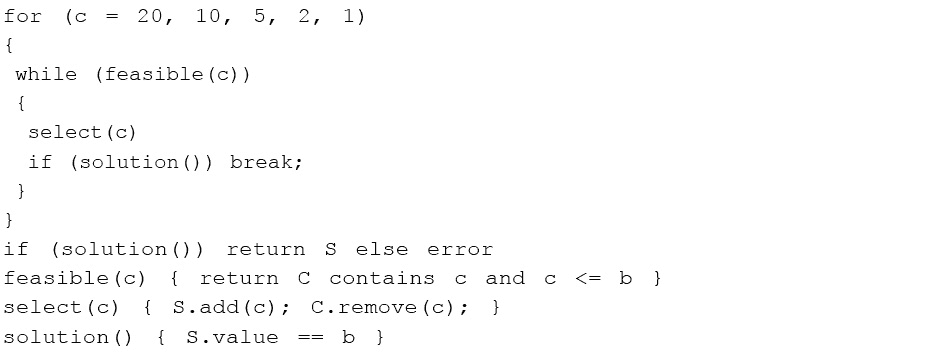

注意，在假设机器有足够硬币的情况下，算法会找到一个解（`b` 是整数克朗，因此可以用 1 克朗硬币兑换）。这是一种对硬币价值具有贪心的算法。它首先尝试尽可能取出所有的 20 克朗硬币，然后尽可能取出所有的 10 克朗硬币，以此此类推，且每次都不考虑这是否是最佳选择。

在 Java 中实现该算法（`CoinProblem` 项目），我首先为硬币写了一个模型类：

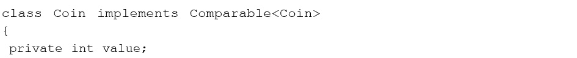

这里唯一需要注意的是，`Coin` 对象是可比较的，因此它们根据硬币的价值降序排列。然后，我写了一个类，将硬币数量分配给 `Coin` 对象：

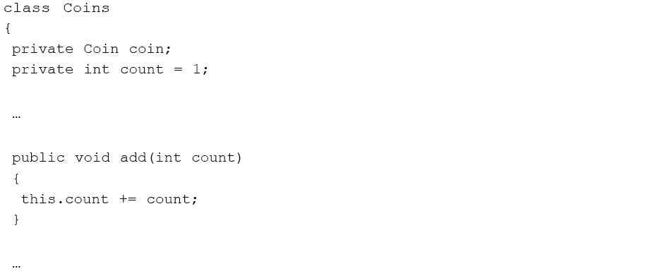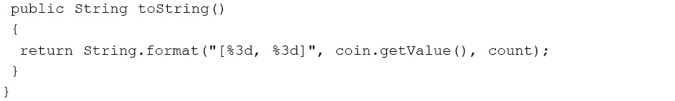

没什么好解释的，但该类必须代表给定值的 `Coin`，并用于跟踪机器应该退回多少枚该值的硬币。接下来，是实现上述算法的 `Greedy` 类：

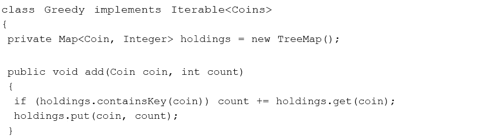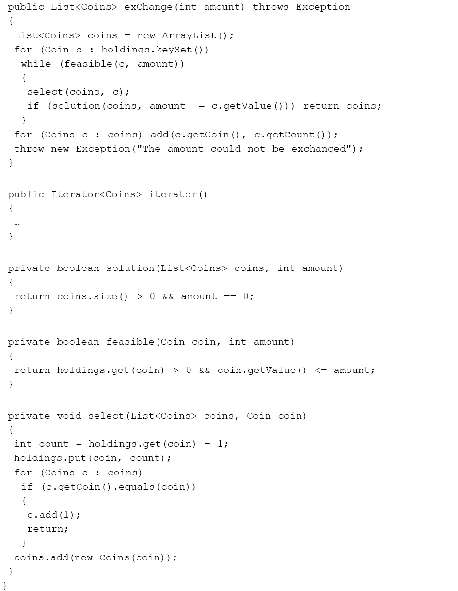

类持有的硬币存储在 `Map<Coin, Integer>` 中。这是一个 `TreeMap`，确保硬币根据其值降序排序。该类有一个 `add()` 方法，用于向机器填充硬币。最重要的方法是 `exChange()`，它用于兑换金额。该方法开始创建一个解决方案列表，初始为空，这与算法对应。`solution()` 方法表示如果列表不为空且金额为 0，则存在解，因此整个金额已兑换；该方法持续迭代直到找到解或尝试了所有硬币仍未找到解。`feasible()` 测试硬币是否可以使用，如果硬币值小于金额且机器有该种硬币，则可以使用。`select()` 通过减少机器持有量并将硬币添加到结果中选择硬币。特别要注意 `exChange()` 方法中的最后一个循环，用于在机器必须放弃兑换金额时取消已选择的硬币。

最后，是一个尝试兑换金额 20 的程序或测试方法：

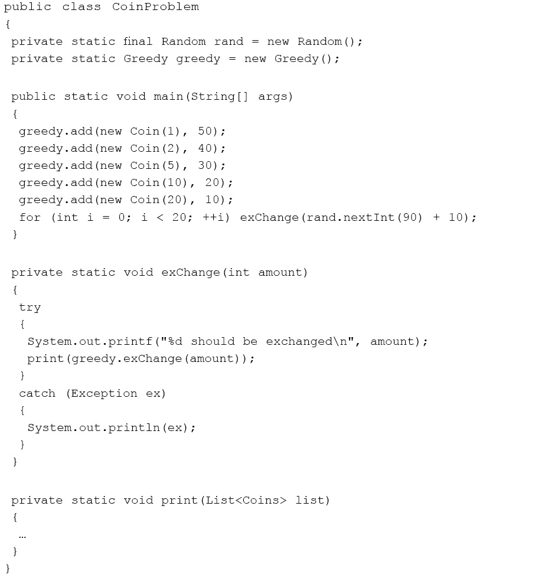

在实践中，编写贪心算法必须同时对正确性和最优性进行论证。上面我论证了正确性。至于算法是否最优，这取决于是否假设金额小于。在本章的引言中，我提到过贪心算法通常是有效的，上述算法就是如此。如果你有金额 N，需要 N 次操作来找到，最坏情况下是线性的。然而，你可以做得更好。如果你在 `Greedy` 类中将 `feasible()` 修改为

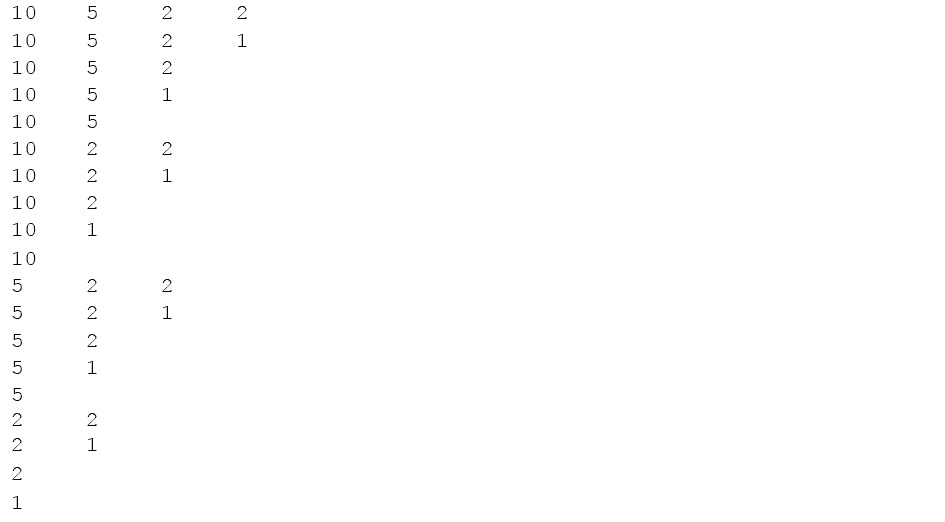

并将 `select()` 修改为

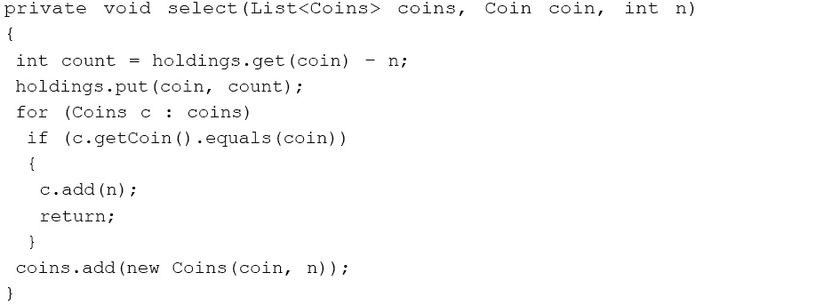

那么算法可以写成这样：

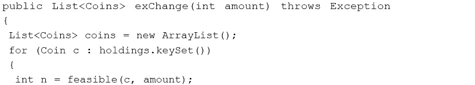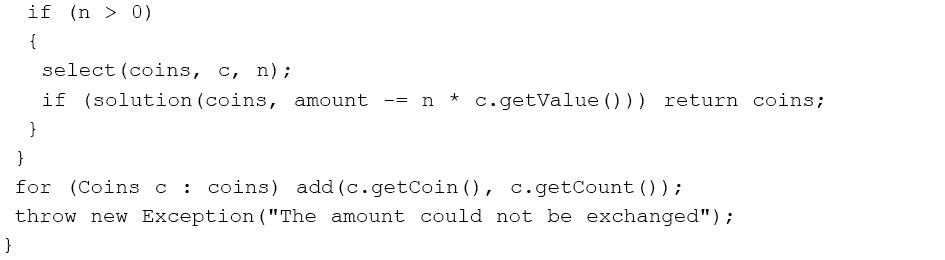

基本上，这是同一个算法，但现在它在原则上与金额无关，且只有常数次操作，因此具有常数时间复杂度。

### 2.1 装载问题

我想展示另一个贪心算法的示例，这也是一个经典示例：

*一个货舱（例如船）必须装满集装箱，所有集装箱的大小相同但重量不同。假设有 n 个集装箱，第 i 个集装箱的重量为 image/Java_1.jpg)。问题是尽可能装载集装箱，但条件是最大重量不能超过 c。*

让 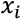 为二值变量（取值为 0 或 1 的变量）。如果变量 为 1，意味着第 i 个集装箱应该装载；如果为 0，则不装载第 i 个集装箱。那么问题可以通过确定 n 个二值变量的值来满足要求

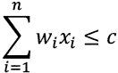

并优化函数

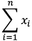

任何满足条件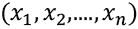（上述不等式）的解都被称为**可能解**，而能够优化目标函数的可能解被称为**最优解**。

如果使用贪心算法来解决这个问题，方法如下：

1. 将所有变量 设置为 0。
2. 将解置为空。
3. 如果所有容器都已被选取，则完成。
4. 在尚未加载的容器中选择重量最小的某一个。
5. 如果该容器的重量加上解的重量超过了容量，则已完成。
6. 将所选的容器添加到解中（将  设置为 1）。
7. 回到第 3 步。

这意味着只要有空间，你每次都会加载重量最小的容器。首先，你应该考虑上述方法是否提供了解决方案，但从步骤 3 和步骤 5 可以显而易见：当没有更多容器或重量超过容量时，你就完成了。其次，应该考虑它是否是最优解，但将解中的其中一个容器替换为另一个将增加解的重量，从而无法为更多容器留出空间。在每一步中，都选择最有希望的候选者而不而不考虑其他情况。因此，该方法是贪心的。

上述问题通常被称为*装载问题 (load problem)*。请注意，上述算法的复杂度基本上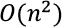，其中 `n` 是容器的数量。如果你开始按重量对容器进行排序，你必须始终选择剩余的容器，例如通过选择快速排序，复杂度可以变为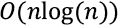。

#### 练习 1：装载问题

编写一个可以解决装载问题的程序，其中有 12 个容器，容量为 600：

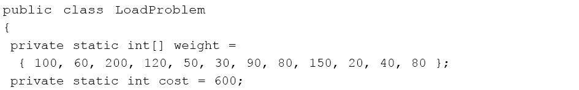

程序的运行如下：

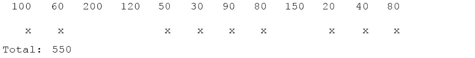

### 2.2 哈夫曼编码

作为贪心算法的另一个例子，你可以查看文本的*哈夫曼编码 (Huffman encoding)*，它可以用于压缩文本文件。以前这是一种广泛使用的方法，例如，如果你要在通信线上传输文本。如果你查看 ASCII 格式的文本，你有 256 个不同的字符，每个字符被编码为 8 位，因此文件填充的字节数取决于文件中的字符数量（包括各种控制字符）。这意味着非常频繁使用的字符如 `e` 和 `t` 使用了 8 位，这同样适用于不那么经常使用的字符。因此，可以考虑一种编码方式：频繁使用的字符使用较少的位进行，而较少使用的字符使用较多的位进行。这正是哈夫曼编码的核心思想。

假设，你只需要字符 A, B, C, D, E, F, G 和 H，总共 8 个字符。因此需要 8 种字符编码，相应的字母表可以编码为：

| A | 000 |
| B | 001 |
| C | 010 |
| D | 011 |
| E | 100 |
| F | 101 |
| G | 110 |
| H | 111 |

此时所有 8 个字符都将被编码为 3 位。这种编码可以通过以下二叉树来说明，从根节点开始，每次向左走添加一个 0，每次向右走添加一个 1：

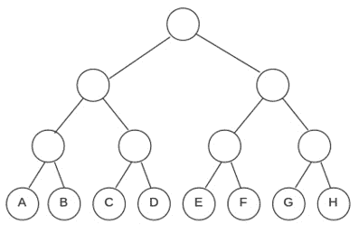

假设你还知道这些字符出现的频率，例如：

| A | 000 | 0.04 |
| B | 001 | 0.28 |
| C | 010 | 0.12 |
| D | 011 | 0.08 |
| E | 100 | 0.11 |
| F | 101 | 0.19 |
| G | 110 | 0.02 |
| H | 111 | 0.16 |

其中最后一列表示字符的频率。然后你可以通过从 8 个子树开始构建二叉树，数字表示树的权重：

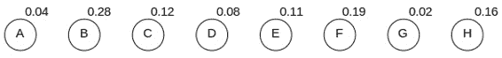

现在你选择权重最小的两个树（即 A 和 G），并将它们合并为一个新的子树，其权重为 0.06：

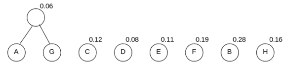

现在重复该过程，现在权重最小的两个树是新的子树以及 D：

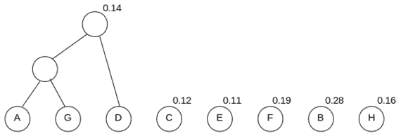

现在，权重最小的两个子树 C 和 E 应该合并为一个权重为 0.23 的新子树：

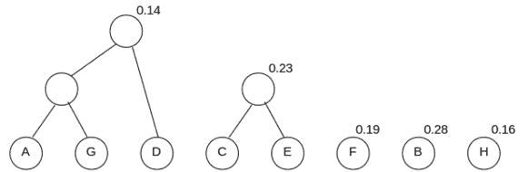

接下来，H 必须与上述子树的左侧合并，得到一个权重为 0.30 的子树：

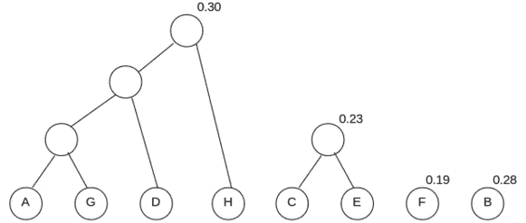

下一步是合并权重最小的子树，即新子树 (0.23) 和 H (0.30)。现在，权重最小的两个子树是新子树 (0.53) 和 F (0.19)，它们合并后权重为 0.72。

接下来，权重最小的两个子树是新子树 (0.72) 和 G (0.02)，它们合并后权重为 0.74。

现在，权重最小的两个子树是新子树 (0.74) 和 B (0.28)，它们合并后权重为 1.02。

接下来，权重最小的两个子树是新子树 (1.02) 和 C (0.12)，它们合并后权重为 1.14。

最后，权重最小的两个子树是新子树 (1.14) 和 E (0.11)，它们合并后权重为 1.25。

上述编码被表示为一棵树，有时被称为代码树 (code tree)。它的特点是只有叶子节点代表字符，其结果是从位模式中可以明确地确定该模式代表哪一个字符。假设你有一个位模式 0110110100111001000011。你现在从根节点开始，沿着树走直到到达叶子节点，你就确定了一个字符。然后你再次从根节点开始，沿着树走直到确定下一个字符，一直持续到确定所有字符。

*Huffman* 程序实现了文件的哈夫曼压缩。该程序作为命令执行，有两个选项：

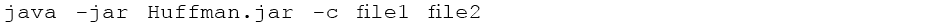

用于压缩 *file1*并将结果保存到 *file2*。


用于解压缩 *file1*并将结果保存到 *file2*。


除了实际程序外，该项目由三个类组成。一个被称为`Bitmap`，表示一个简单的位图，因此字符的编码为变长位模式。我不想在这里显示这个类。首先，它填充了一部分内容，该类的大部分与常规位操作有关。`HuffmanTree`类表示代码树：

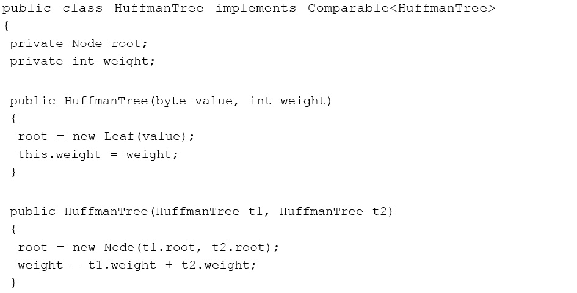[](image/Java_19_–_More_algorithms_and_data_structures_15-11-18_26.jpg)[](image/Java_19_–_More_algorithms_and_data_structures_15-11-18_27.jpg)

首先，注意该类实现了`Comparable<HuffmanTree>`，它根据权重比较两棵树。它被用于通过以权重为权重的贪心算法构建完成的代码树。该类有两个变量，除了权重外，还有一个树的根，其类型为`Node`，`Node`是一个内部类，仅包含两个指向子树的引用。另一个内部类`Leaf`继承自`Node`，代表一个叶子节点，即一个字符。`Leaf`通过一个字符变量扩展了`Node`。该类有两个构造函数，第一个创建一个仅由一个叶子节点组成的树，而另一个则从两棵树创建一个以这两棵树为子树的新树。

然而，最重要的方法是`create()`，它从两个映射创建编码。第一个映射为每个键（`Byte`类型的每个字符）以位图的形式分配该字符的二进制代码。第二个映射为每个键（根据编码确定的每个二进制代码）分配该特定`Bitmap`所代表的字符。这些映射通过一个私有方法`create()`遍历代码树（实际上是通过前序遍历）来初始化。

然后是`CodeTable`类，它构建代码树并因此生成一个`HuffmanTree`：

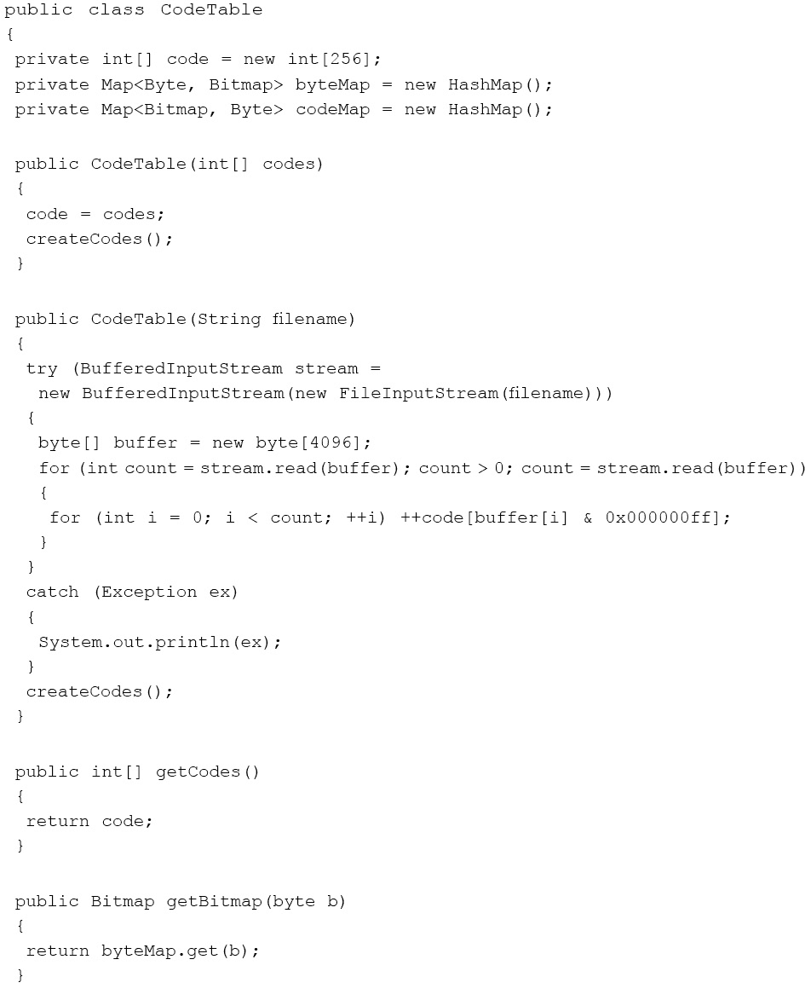[](image/Java_19_–_More_algorithms_and_data_structures_15-11-18_29.jpg)

该类首先定义了一个空间可以容纳 256 个值的数组`code`。其原因为程序必须能够编码 256 个不同的字符，这对应于一个字节可以表示的值的数量。结果是程序可以“压缩”任何文件，无论内容如何。下文将详细说明。此外，该类还创建了上述两个映射。

该类有两个构造函数，我想从最后一个以文件名作为参数的构造函数说起。它是要压缩的文件名，构造函数开始确定文件中每个字节的频率。共有 256 种选择，对于文件的每个字节，在`code`数组中的对应位置计数加 1。在指定频率后，调用`createCodes()`方法。该方法开始将 256 个字节中的每一个作为`HuffmanTree`（因此也是一个叶子节点）放入优先级队列中，其中优先级是频率。接下来的`while`循环合并树：每次都从队列中取出前两棵树，将它们合并并将结果放入优先级队列。最后，只剩下一棵树，通过这棵代码树，两个映射被初始化了编码。

在执行完此构造函数后，对于文件中的每个字节，你都可以返回对应的`Bitmap`（即其二进制编码），随后将结果保存到压缩文件中，但必须能够反向操作并解压缩内容。因此，频率（`code`数组）与文件内容一起存储，而这就是使用另一个构造函数来恢复代码树的地方。

最后是实际程序（`Huffman`类），但我不想在这里展示该类，因为它的大部分内容与读和写文件有关，但基本上程序有两个方法`compress()`和`deCompress()`。简而言之，这些方法的工作如下：

`compress()`首先为当前文件创建一个`CodeTable`对象。接下来，它读取文件并创建一个大位图，由文件中的所有字节转换为对应当前霍夫曼编码的二进制代码组成。接下来，将 256 个代码、位图长度以及位图本身保存到输出文件中。

`deCompress()`开始读取代码表并据此创建一个`CodeTable`对象，该对象与原始文件转换时使用的霍夫曼编码相同。之后，读取文件的其余部分并用于创建一个包含文件内容的大位图。使用编码，该位图被解析为文件的原始字节并写入输出文件。

如上所述，程序可以压缩任何文件，问题在于该程序的效果有多好。首先，注意在压缩文件时，输出文件开头包含 256 个用于编码频率的代码和一个用于位图长度的整数，因此总共 1028 字节。因此可以得出，该程序无法压缩小文件，甚至相反，因为小文件实际上占据的空间比原始文件还要多（一个带`int`的文件将占据 1032 字节而不是 4 字节）。如果文件很大，1028 字节并没有什么，也不会决定你是否获胜。重要的是单个字节的频率。如果所有 256 个字节都能出现，且它们大多数时候以高频率出现，那么程序将没有任何益处。例如，如果你在图像上测试该程序（压缩和解压缩），你会发现程序可以工作（压缩后的文件解压缩为

# 3 分治法

另一类算法被称为*分治算法*，它们是递归算法，但并非所有的递归算法都是分治算法。分治算法包含两个部分：

1. *分治（Divide）*：将问题分为两个或多个更简单的问题，如果未达到基本情况，则递归地解决。

2. *解决（Conquer）*：通过结合子问题的解决方案找到原始问题的解决方案。

分治问题的经典例子是归并排序和快速排序，但寻找集合中的第 *k* 小元素（即中位数）也是用分治算法解决的。

因此，为了使用分治算法，必须将问题分解为更小的子问题，每个子问题都按照相同的模板进行解决。这里重要的是，这种分解应该产生比原始问题更简单的子问题。同样重要的是，分解应该至少产生两个子问题，例如，递归二分查找就不是分治算法。最后，重要的是子问题必须是互斥的。例如，我之前看过一个返回第 *n* 个斐波那契数的递归方法：

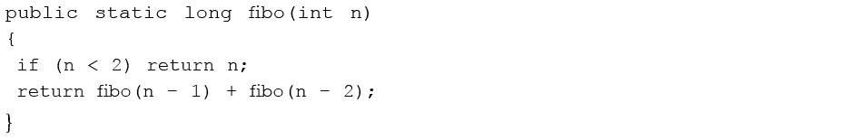

并且该算法对于较大的 *n* 值非常无效。虽然该算法将问题分为两个递归子问题，但由于子问题不互斥，它不是分治算法。

## 3.1 最近邻点问题

作为分治算法的一个例子，我将查看所谓的*最近点问题*。给定坐标系中的 *n* 个点

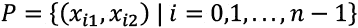

该问题在于确定两个点之间的最短距离，其中 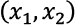 和 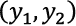 之间的距离确定为

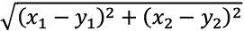

注意，允许两个或多个点是相同的，两个相同点之间的距离为 0。该问题可以通过下图进行说明，其中与线关联的两个点是彼此最近的点：

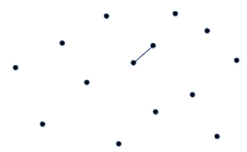

如果有 `n` 个点，那么就有 `n(n – 1) / 2` 组距离，一个简单的解决方案就是确定所有点对之间的距离，然后选择最小的一个。这种算法非常简单（而且容易实现），但很显然，它具有平方级的时间复杂度。因此，寻找更好的算法是显而易见的。

假设你有一个包含这些点的数组，并且假设数组已经根据点的 x 坐标进行了排序。你可以立即将这些点分成两半。

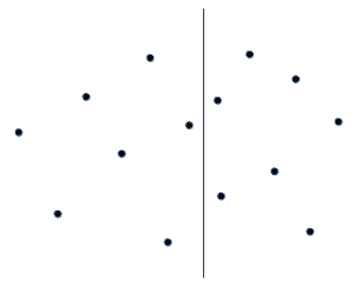

现在有三种选择：

1. 最近的两个点在左半部分

2. 最近的两个点在右半部分

3. 最近的两个点分别在两个半部分中，即位于分割直线的两侧

然后，可以通过从这三个子问题的解决方案中选择最佳的一个（通过点之间的距离来衡量）来确定结果。这里，前两个子问题很容易解决，因为它们通过对每个子问题重复上述分解方法（即通过递归）来解决。因此，问题在于解决第三个问题，如果你用线性时间复杂度来解决，它就像我为归并排序展示的那样，算法实现的时间复杂度为 。因此，解决方案是将问题划分为两个递归子问题和一个通过迭代解决的第三个问题。这是一个分治算法。

为了分析中间的问题，让 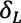 和 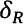 分别表示左两个子问题的解（点之间的最小距离），并设置为 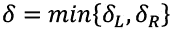。让 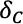 表示第三个子问题的解。只有当  小于 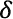，即对于落在分割线附近带状内的点时才有关注价值：

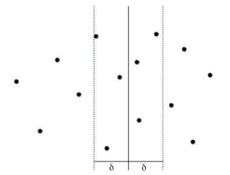

这减少了需要处理的点数。可以通过以下方式完成，其中 `a` 和 `b` 是带状内点的起始和结束索引：

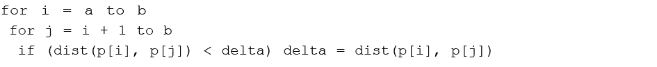

该算法仍然具有平方复杂度，但将点 `p[i]` 与带状内的点进行比较就足够，这些点的 y 值之差小于 （其他点不会提供更好的解决方案）。同时假设当前带状内的点已按 y 值排序，如果你考虑一个特定的点 `p[i]`，由于对  的选择（它小于或等于左右部分点之间的最短距离），在一个  正方形内可能不会超过 7 个点：

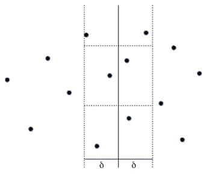

因此算法可以如下所示进行改进，其中内层循环由于最多 7 个点可以被视为常数：

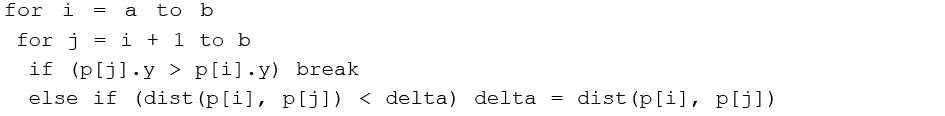

结果是，第三个问题的问题的现在是线性的，完成后的算法复杂度为 。然而，有两并不显而易见。首先，点数组不能同时按 x 值和 y 值排序。这个问题可以通过拥有两个副本并分别根据这两个标准进行排序来解决。另一点是，从开始就假设点数组已经过排序（按 x 值），但由于数组可以通过例如归并排序进行排序，其复杂度为 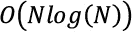，你可以从对数组排序开始，而不会改变算法的时间复杂度 。

## 问题 1：实现最近点问题

在这一问题中，你应该尝试实现上述描述的解决最近点问题的算法。一旦你实现了该算法，当然，你还应该对其进行测试，并尝试编写一个测试方法来支持时间复杂度为  的算法。

## 3.2 汉诺塔

另一个经典问题是*汉诺塔*问题，示例中包含了该问题作为使用分治算法的良好例子。该问题通常描述如下：

在 19 世纪末，一个名为*汉诺塔*的游戏作为新闻引入了欧洲。这个游戏的流行源于一个轶闻，据说*梵罗马神庙*的司祭正致力于解决一个问题，当这个问题被解决时，世界就会终结。司祭们处理的游戏由一个铜质板组成，上面有三根钻石形的“棒”，上面放着 64 个直径不同的金色圆盘。最初，所有圆盘都放在左棒上，最大的在底部，其次大的在上，以此类推，即形成一个塔。现在必须将整个塔移动到右棒，但每次只能移动一个圆盘，且圆盘永远不能放置在直径较小的圆盘上。

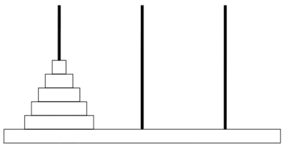

首先，并不完全清楚这个游戏是可以被解决的，其次，正如很多人观察到的，你必须移动很多圆盘——对于 64 个圆盘，真的很多。

在这一节中，我想写一个程序来模拟这个游戏，用户可以通过拖拽移动圆盘，还有一个程序自动移动圆盘的选项，即演示功能。我不想展示代码，代码大部分关注用户界面，它实际上是演示功能的事件处理器，这是一个分治问题。

如果你看上面的图（有 `n` 个圆盘），你可以将步骤描述为：

1. 将 `n-1` 个点的塔移动到中间棒

2. 将底部圆盘移动到右棒

3. 将 `n-1` 个点的塔从中间棒移动到右棒

这显然不是解决方案，但这意味着原始问题被分成了两个更简单的问题和一个平凡的问题——移动 `n-1` 个点的塔比移动 `n` 个点的塔要容易。解决方案因此是朝着正确方向的一，由于塔总可以移动到更大的圆盘上，显然可以通过递归算法解决这个问题。

如果你有一个 2 个圆盘的塔，算法是：

1. 将顶部圆盘移动到 2 号棒

2. 将底部圆盘移动到 3 号棒

3. 将中间棒上的圆盘移动到 3 号棒

也就是说，塔可以通过 3 次移动或 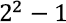。假设移动 `n-1` 个圆盘需要 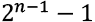 次移动。如果你现在有一个 `n` 个圆盘塔，你可以按照上述步骤通过 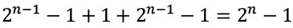 次移动移动塔，上述算法就是一个 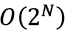 算法。思考  这样世界就不会因为汉诺塔问题而终结。用 Java 编写，该算法可以实现如下：

```

```

如前多次所示，许多问题可以使用递归算法来描述，这可能是因为问题本身本质上具有递归性。实现递归算法很容易，但正如提到的，这可能导致算法效率极低，因为递归调用的次数呈爆炸式增长。这种算法的经典示例是确定斐波那契数的递归方法，而这里的解决方案是写成一个迭代方法。这是一个动态规划的示例。其思想是从一个可以解决的简单情况开始。你现在保存解决方案并继续，以便下一个方案由已经解决的方案决定。确定斐波那契数的迭代算法从前两个数（0 和 1）开始，然后继续，使得下一个数始终是前两个数之和。这与递归相反，是从复杂情况开始并逐渐向前，直到达到简单情况。

结合贪心算法，我曾见过硬币问题，即需要用最少的硬币兑换某个金额，在这种背景下，贪心算法可能提供最优解决方案。然而，问题可以通过使用动态规划的算法进行最优求解。如果你需要兑换金额 `amount`，策略是确定兑换 `1, 2, 3, …, amount` 所有金额所需的硬币最小数。你通过决定兑换 1 需要多少硬币开始，然后遍历从 1 到 `amount` 的所有金额。对于每个值 `a`，遍历所有硬币 `c`（标记为 `c1, …, cn`），其值小于或等于 `a`，并确定 `m = min { exchange(a – c1), …, exchange(a – cn) }`。然后兑换 `a` 的最小硬币数等于 `m + 1`。正式一点，该方法可以描述为：


你应该注意，这是一个基于动态规划的算法，通过确定小于等于所需金额的所有值来应用于已解决的子问题。为了实现该算法，我从 `CoinProblem` 程序的一个副本开始，类 `Coin` 和 `Coins` 保持不变，位置 0 处添加一个空列表，因为不需要硬币兑换金额 0。下一步遍历从 1 到 `amount` 的所有金额 `b`。每次迭代将 `min` 设置为 `b`，并将 `val` 设置为值为 1 的硬币。这对应于兑换 `b` 使用 `val` 硬币。`n` 是用于跟踪已选择硬币的索引。对于每个金额，有一个遍历所有硬币的内部循环。如果硬币的值大于 `b`，显然在使用，你可以继续下一个硬币。否则，测试 `b` 去硬币的值是否可以用比 `min` 更少的硬币兑换，如果是，则将 `min` 设置为该值并将 `val` 设置为当前硬币。遍历所有硬币后，数组更新为找到的结果。

最后，程序必须测试是否有足够的硬币，如果没有则抛出异常。否则，计算硬币的数量并返回结果。

如果你考虑该方法，可以说它由一个遍历 `N` 次的外层循环（如果金额为 `N`）和一个遍历 `K` 次的内部循环（如果有 `K` 种硬币）组成。后面跟着两个各有 `K` 次迭代的循环。因此，算法执行次数大约为：


操作。现在 `K` 通常相对于 `N` 较小，且具有固定大小（对于丹麦硬币为 5），因此你可以将 `K` 视为常数。这样做，算法具有线性复杂度。

## 4.1 质数

通常的测试一个整数是否为质数的算法是关于检查该数是否有因子的的。这可以通过尝试用所有小于测试数的数字对其进行除法来实现。由于 2 是唯一的偶质数，你将通过只对奇数进行除法来优化算法，如果你发现除以所有小于或等于测试数平方根的数字就足够了，该算法可以写如下：


但注意，迭代次数为 ，因此算法的时间复杂度为 ，这是一个相当不错的时间复杂度，但对于大值，仍然需要执行大量除法，算法会变慢。

如果你观察该算法，可以发现除以所有小于或等于  平方根的质数就足够了。在其他相同的情况下，它将提供更少的除法并得到更高效的算法。如果 `primes` 是所有小于或等于  平方根的质数的列表，则该算法可以写如下：


在这里只有 `exChange()` 方法被了。该方法创建一个 `List<Coins>` 对象数组，位置 `n` 处必须包含兑换金额 `n` 的 `Coin` 对象。在位置 0 处添加空列表，因为它不需要硬币兑换金额 0。

问题在于你不知道要除以哪些数字（`primes`）。假设任务是写一个可以返回第 `n` 个质数的方法。使用上述第一个方法，你可以实现：


该方法包含确定前 `n` 个质数（索引为 0 的质数设置为 2），如果你将这些质数存储在列表中，你可以使用另一个质数方法并使用动态规划：

[](image/Java_19_–More_algorithms_and_data_structures_15-11-18_41.jpg)

现在的问题是是否有任何收益，实际上非常有限，但与最后方法相比有 4 倍的差异。最后方法可能基于更少的除法，但相反，必须维护列表，这也需要时间。以下是一个测试程序：


[](image/Java_19_–More_algorithms_and_data_structures_15-11-18_43.jpg)

在贪心算法中讨论的负载问题是一个更通用的问题——`0/1 背包问题`的特例。它是算法理论中一个非常经典的问题，以下是对该问题的简要介绍，以及如何使用动态规划实现算法解决该问题的示例。该问题可以表述如下：

最大化函数


其中  是不等式解中的二进制变量


作为一个 0/1 背包问题的简单示例，当 `n = 3`，`c = 7` 且

`w = { 3, 4, 3 }`

`p = { 5, 2, 3 }`

此时问题是在当 `x`，`y` 和 `z` 为二进制变量且

 时，最大化函数


在这种情况下，该问题很容易解决，因为每个变量只有 2 个取值（0 和 1）。只有 8 种可能的解，你可以在表格中列出所有组合：

| x | y | z | 3x + 4y + 3z | 5x + 2y + 3z |
| :--- | :--- | :--- | :--- | :--- |
| 0 | 0 | 0 | 0 | 0 |
| 0 | 0 | 1 | 3 | 3 |
| 0 | 1 | 0 | 4 | 2 |
| 0 | 1 | 1 | 7 | 5 |
| 1 | 0 | 0 | 3 | 5 |
| 1 | 0 | 1 | 6 | 8 |
| 1 | 1 | 0 | 7 | 7 |
| 1 | 1 | 1 | 10 | 10 |

在这里你可以看到，最后一个选项不能使用，因为它不符合不等式，对于剩余的 7 种选项，最后一列显示最优解是 (1, 0, 1)。

在这种情况下，该问题通过`暴力破解算法`解决，这简单意味着你系统地测试所有选项，并以此方式确定最佳结果。这显然是你总是可以使用的算法，但问题在于时间复杂度。如果你有一个具有 `n` 个变量的 0/1 背包问题，那么结果将是一个时间复杂度为  的算法，这是没有希望的。因此，有理由对更好的算法感兴趣。

解决问题有多种策略，例如，你可以应用针对 `p` 值（利润）的贪心算法，并不断选择 `p` 值最大的元素。你可以对 `w` 值（重量）进行贪心，始终选择 `w` 值最小的元素，或者你也可以对商值 `p / w` 进行贪心。在第 2 章表述的负载问题中，所有的 `p` 值都等于 1，算法是对重量是贪心的，但正如硬币问题所示，贪心算法并不一定提供最优解，相反，你可以考虑动态规划。

当解可以描述为一系列决策的结果时，可以使用动态规划来解决问题。考虑第 `n` 个斐波那契数，它是通过确定第一个、第二个、第三个等等来实现的。这种策略可以用于解决 0/1 背包问题。

假设  是 0/1 背包问题的最优解。从问题中移除第一个变量会导致另一个 0/1 背包问题：

最大化


在  的解中

其中 

那么很明显（通过普通的控制） 是简化后问题的解。假设它不是最优解。那么存在另一个解 （一个更好的解），使得


当

 时

推导出  是原问题的解，因此（因为  是最优解）


这产生了矛盾。也就是说，一个 0/1 背包问题满足：如果你移除一个变量，你可以在最优解中移除相同的变量，并得到简化后背包问题的最优解（因为通过移除第一个变量而不是其他变量并没有什么魔法）。

给定一个 0/1 背包问题，你可以考虑以下子问题 ：

最大化


在  的解中

即第一个变量已被移除的问题。这里是  原问题。令  表示子问题的最优解值，其中  对于所有 `d > 0`，因为在这种情况下优化函数恒等于 0（空）

*    对于所有 `k`，因为只有当二进制变量为 0 时才能满足约束

*    对于所有 `d < 0` 和所有 `k`，这意味着解为空

让  为  的最优解，值为 。根据上述，  是  的最优解，然后  源于  为 0。这意味着可以从  决定 。这里就需要动态规划，因为  可以连续地决定 。最后的公式是：

1.  对于所有 `d > 0`

2.  对于所有 `k`

3.  对于所有 `d < 0`

考虑一个 0/1 背包问题，其中 `n = 5`，`c = 10` 且 `w = { 3, 4, 2, 1, 5 }`，`p = { 5, 10, 2, 4, 8 }`。注意问题是：最大化  。手动计算该示例很容易（你有 `d` 的可能值并使用上述公式填充表格）：

| p | w | 1 | 2 | 3 | 4 | 5 | 6 | 7 | 8 | 9 | 10 |
| :--- | :--- | :--- | :--- | :--- | :--- | :--- | :--- | :--- | :--- | :--- |
| 5 | 3 |  | 0 | 0 | 0 | 0 | 0 | 0 | 0 | 0 |
| 10 | 4 |  | 0 | 0 | 5 | 5 | 5 | 5 | 5 | 5 |
| 2 | 2 |  | 0 | 0 | 5 | 10 | 10 | 15 | 15 | 15 |
| 4 | 1 |  | 0 | 2 | 5 | 10 | 10 | 12 | 15 | 15 | 17 |
| 8 | 5 |  | 4 | 4 | 6 | 10 | 14 | 14 | 16 | 19 | 19 |
| | |  | 4 | 4 | 6 | 10 | 14 | 14 | 16 | 19 | 19 | 22 |

结果最大值为 22。然后，为了确定产生最大解的序列，从最大容量 10 开始，比较  和 。因为它们是不同的， 对容量有贡献，所以 ，容量减少 。然后  比较 ，由于它们是不同的 ，然后减少容量 (image/Java_91.jpg)。下一次  和  比较，它们都是 10，然后  对容量没有贡献，所以 。下一次比较是  与 ，它们是不同的 ，容量减少到 。最后  比较 ，它是 0，因此是 。总体结果如下：

对于以下序列，最大值为 22：


注意 。

还要注意，如果问题有 `N` 个变量且容量为 `C`，则该算法的时间复杂度为 。

## 练习 2：背包程序

编写一个程序来实现对应上述描述的 0/1 背包问题。最困难的部分实际上是确保所用数组的索引正确。

# 5 回溯

通常情况下，解决问题的算法是显而易见的，但在其他语境下，可能很难找到算法，特别是很难选择正确的算法。在本章中，我将介绍一组被称为`回溯`（backtracking）的算法，它最好的特征是通过检查所有可能的解决方案来系统地搜索问题的解。作为一个示例，我将介绍所谓的“八皇后问题”：

*国际象棋盘由 64 个格子组成，排列成 8 行 8 列的正方形。在国际象棋游戏中，皇后可以水平、垂直和对角线移动，从而攻击它可以到达的某个位置上的另一个棋子。现在的问题是在棋盘上放置 8 个皇后，使得它们之间互不能相互攻击。*

解决该问题的一种方法是让计算机系统地检查所有选项，直到找到解决方案为止。棋盘有 64 个格子，在棋盘上放置 8 个皇后相当于从 64 个格子中选择 8 个，其方法数是二项式系数 $\binom{64}{8}$，结果为 4426165368，因此即使在快速计算机上也不是一条特别可行的路径。然而，通过观察到每行最多包含一个皇后，每列也是如此，这可以显著减少问题规模。对于这些选项中的每一个，检查是否没有皇后会在对角线上相互攻击。然而，通过更加系统化的方法可以进一步改进求解方法。你首先在第一行的第一列放置一个皇后。接着，在第二列放置一个皇后，从该列的顶部开始，直到你找到一个不会攻击第一列皇子的位置。现在继续第三列，再次从顶部开始向下移动，直到找到一个不会攻击前两个皇后之一的位置。然后你尽可能地继续下去。当在第六列放置皇后时，出问题了。无论你尝试哪一行，它都能攻击已存在的五个皇后中的一个。


你现在跳过最后一个已放置的皇后（第五列的皇后）。你正在进行回溯，然后尝试一个尚未尝试过的位置。在最后一个位置进展顺利。然后你再次尝试第六列，但仍然不理想。


因此，你必须跳过最后一个皇后，但由于这一列没有更多位置（第五列），你必须再次回溯，跳过第四列的皇后并尝试一个新的位置。再次尝试，这次可以在前七列放置皇后，但在第八列出问题了，你必须进行回溯。


你必须持续直到找到解决方案为止。在这里，重要的是问题必须有解，否则你将无限持续下去。其思想是系统地尝试寻找解决方案，直到你找到解决方案，或者直到你发现自己进入了死胡同。如果是那样，你将返回并重试。注意，该问题有许多解，而该方法仅提供单一的解。


如果你要编写一个可以解决此问题的程序，你必须能够表示游戏，并且必须跟踪哪些位置已经被尝试过。对于前者，游戏可以简单地表示为`boolean` 元素的二维数组，用来说指示某个位置是否包含皇后。为了跟踪哪些位置已经被尝试过，你可以使用两个计数器，分别用于行和列。以下类展示了八皇后问题的解决方案：

!!(image/Java_19_–_More_algorithms_and_data_structures_15-11-18_55.jpg)

注意，类的构造函数有一个参数指示国际象棋游戏的大小。与真实的国际象棋游戏（大小始终为 8 × 8）相比，这并不重要，但八皇后问题实际上是通用的，适用于 8 以外的尺寸，因此构造函数需要此参数。`ok()` 方法测试你是否可以在 `(row, col)` 位置放置皇后，而 `nextQueen()` 方法使用了回溯。如果 `col` 等于广场大小，则问题解决，方法返回 `true`。如果不是，你遍历列 `col` 中的所有行，并对每一行尝试设置一个皇后。如果你可以这样做，就放置一个皇后


并继续（递归地）处理下一列，如果不可能，你必须回溯：

```

```

同样注意，如果你开始以不同的方式设置第一个皇后（不在第 1 行），你将发现另一个解，该问题实际上有许多解。

以下程序使用 `Queens` 类来解决八皇后问题，部分针对 8 个皇后，部分针对 15：

!(image/Java_19_–_More_algorithms_and_data_structures_15-11-18_57.jpg)

回溯是一种可以在许多语境下使用的求解技术，你尝试通过部分解决方案寻找解，并在发现所构建的解决方案无法导致结果时返回。回溯比仅仅尝试所有可能性（暴力破解算法）要好得多，但应该注意回溯通常没有良好的复杂度。

## 练习 3：八皇后，所有解

创建 `EightQueens` 的副本。你必须添加另一个测试方法来解决八皇后问题（8 个皇后），该方法必须确定所有解（共有 92 个）。

## 5.1 排列

作为另一个可用回溯算法解决问题的示例，我将介绍一个确定 `n` 的排列的问题，其中 `n` 是一个正整数。通过正数 `n` 的排列，人们理解以某种顺序小于或等于 `n` 的 `n` 个正整数。例如，3 有 6 种排列：


注意通常 `n` 有 `n!` 种排列。确定 `n` 的排列的策略可以是：

1. 对于 1 到 `n` 的所有 `k` 和空排列重复。

2. 将 `k` 添加到排列中。

3. 如果它产生了合法的部分解，递归地对 1 到 `n` 的所有 `j` 重复步骤 2–4。

4. 否则回溯

也就是说，你连续尝试所有数字，直到找到可以使用的数字。当然，你应该在放置数字时注意多次尝试同一个数字。它可以通过以下算法表述：

```
!(image/Java_19_–_More_algorithms_and_data_structures_15-11-18_59.jpg)!(image/Java_19_–_More_algorithms_and_data_structures_15-11-18_60.jpg)
```

`Permutation` 类用数组形式表示一个排列。该类有两个私有构造函数，因此只能通过类自身的方法进行实例化，这些方法发生在 `permutations()` 和 `permute()` 方法中。除了构造函数外，该类还具有用于排列大小及其取值的属性。最重要的方法是 `permutations()`，它返回一个数字 $n$ 的所有排列的列表。该方法创建列表，但排列是在递归方法 `permute()` 中创建并添加到列表中的，该算法通过回溯（backtracking）工作。该方法有 3 个参数，其中第一个是排列列表，下一个是正在处理的排列，最后一个是方法当前到达的深度。

该算法并不那么容易理解，但该方法如下：调用 `permute()` 方法时，传入一个形式为  的平凡排列（trivial permutation），然后该方法必须通过系统地切换数字来创建排列。从开始时 `i` 等于 0，这等于没有数字被选择用于排列。每次调用该方法时，循环都会从 `i` 运行到末尾（已选择的数字不变），然后你在未使用的数字中为排列选择一个新的数字。然后，该方法递归地调用自己，但 `i` 增加了 1，因为现在已经选择了一个数字。当所有数字都被选择且排列被添加到列表（创建一个副本）时，递归停止。当排列被添加到列表时，当前的 `permute()` 方法终止，这意味着 `p` 中的最后一次交换被取消，这等同于回溯。

## 5.2 并集集合（A DisjointSet）

我将提到一种简单的数据结构，通常被称为 `DisjointSet`（并集集合）。它与回溯没有关系，之所以在此处介绍这种数据结构，是因为我在接的示例中需要它。

在数学中，等价关系（equivalence relation）起着至关的作用，它作为一种将集合划分为若干互不相交子集的关系。如果将该关系称为 `~`，那么在集合 $S$ 上的等价关系是指满足以下条件的关系：


所有通过该关系与元素 `a` 相关的元素都称为由 `a` 确定的等价类（equivalence class），有时被称为 `[a]`。根据上面的定义可以得出，同一等价类中的两个元素决定同一个等价类。这意味着：


带有等价关系的集合有时也被称为集合的划分（class division）。我将描述一个可以用于创建数字 $0, 1, \dots, n-1$ 划分的类。起点是一个包含 `n` 个元素的数组，所有元素从开始值都为 -1，对于 10 个元素，可以如下所示：


必须将其解释为从 0 到 9 的每个数字各构成它们自己的等价类。你也可以将这种关系看作 10 棵树，每棵树单独由一个根组成：


该类必须有一个方法 `union()` 来合并两个等价类，如果你想合并 4 和 5 的等价类，可以这样操作：


4 的值为 -2，必须解释为该数字是负数，因为 4 是（决定了）一个深度为 2 的等价类的根。位置 5 上的值为 4，意味着 5 与位置 4 元素在同一个等价类中，因此 4 和 5 现在处于同一个等价类中。用树来演示如下：


如果你合并合并 6 和 7 的等价类，你会得到：


写成树的形式：


也就是说，10 个元素现在被划分为 8 个等价类。下一步，我想执行包含 5 和 6 的两个等价类的并集操作。这里 5 不是等价类中的根，而 `union` 方法通过使用类的根来合并两个等价类工作。因此，需要一个 `find()` 方法，它可以找到包含特定元素的等价类的根。对于 5，`find()` 方法找到了元素 4，而对于 6 则找到了元素本身。你必须合并根为 4 和 6 的两个等价类：


在这里你应该注意，元素 7 指向 6，6 指向 4，4 是新等价类的根，而元素 5 也指向 4。因此，方法的实现必须使得从一个元素到其根的路径尽可能短，这正对应于以树形式组织的元素的感知：


作为下一个操作，我想合并 0 和 9 的子树，这很简单，因为两个元素都是子树中的根：


如果你合并 2 和 3：


如果你合并合并 0 和 2 的等价类，你会得到：


0 和 2 各自都是等价类的根，但 `union()` 方法确保从一个元素到根的路径尽可能短：那么 10 个元素现在被划分为 4 个等价类。如果你对 0 和 3 进行 `union()` 操作，什么都不会发生，因为这两个元素已经在同一个等价类中了。任务是编写一个如上述的 `DisjointSet` 类，这实际上非常简单，但我会将其添加到我的 `palib` 中。该类除了构造函数外，只有两个方法 `find()` 和 `union()`：

```
find() 方法返回元素等价类的根（负值）。该方法是递归的，并修改指向根的路径。`union()` 方法通过两个元素调用，并假设这些元素都是等价类的根。如果不是这样，或者两个元素相同，方法将中断。如果最后一个元素的值（负值）小于 `a` 的值，则元素 `a` 指向 `b`（b 为根的等价类），否则 `b` 的值必须指向 `a`，但 `a` 的值减 1。

下面是对应上述说明的测试程序：

```


该程序假设 `DisjointSet` 类扩展了一个 `print()` 方法来打印数组的内容，然后测试方法给出的结果：


```

## 5.3 迷宫（A Maze）

我将用一个显示迷宫的程序来结束关于回溯的章节：


用户基本上应该做两件事：

1. 你必须通过点击鼠标将红色字段从左上角移动到右下角，但你不能在被墙隔开的单元之间移动。
2. 用户应该能够启动一个演示，让程序自己移动字段。

程序填充了部分，但大部分与用户界面有关，实际上只有两个挑战：

1. 如何创建一个具有特定行和列数的迷宫。
2. 如何编写一个自动在迷宫中移动字段的算法。

在看代码之前，我想提到程序中有一个名为 `Options`（选项）的菜单项，用户可以在那里进行一些设置：


*   你可以根据行数和列数选择迷宫的大小。
*   你可以选择单个单元格的大小——即在屏幕上填充多少空间。
*   你可以选择当前单元格的颜色，从而改变红方块的颜色。
*   你可以选择用于绘制单元格之间墙壁的颜色。
*   你可以指定在演示函数中，计算机移动方块之间的时间间隔（以毫秒为单位）。
*   最后，可以选择两个难度级别（尽管差异不大），但具体含义将在下文中进行解释。

我不想展示上述对话框的代码，但基本上该对话框维持了以下模型：


前两个常量表示对话框中 `ComboBox` 的最小值和最大值，而颜色是一个 `Map<String, Color>`，表示应用程序可以使用的通过名称识别的颜色。

迷宫的单元格由以下类定义：


该类原则上是简单的，但由于属性很多，代码占据了一部分篇。前两个属性表示目标单元格的行和列。接下来的四个属性表示是否存在墙（从开始就有墙），然后它将成为创建迷宫的算法的一部分，用于移除其中一些墙。最后，是最后一个属性 `state`，其含义如下：

*   0，单元格未被访问
*   1，单元格已访问
*   2，单元格是当前单元格且包含红方块

注意，该类继承自 `Canvas`，因此它是负责通过 `draw()` 方法绘制单个单元格的类。最后，该类可以抛出一个 `ActionEvent`，这会在点击单元格时发生；在当前情况下，这意味着主窗口将通知有一个单元格被点击，以及点击的是哪一个单元格。

后面是 `Mazes` 类，它占据了部分篇幅，但重要的是上述两个算法的实现。

要创建一个新迷宫，首先开始创建单元格并将它们放置在 `GridPane` 中。从开始所有的墙都存在，用户界面只显示一定数量的方块：


现在的任务是随机移除墙壁直到迷宫制完成。现在你不能简单地随机移除墙，因为迷宫必须是连通的，即必须有一条路径。这时你可以使用 `DisjointSet` 类。如果迷宫像上面一样有 10 行 20 列，就有 200 个单元格；如果你将这些单元格排列成数组并使用 `DisjointSet`，当第一个和最后一个属于同一个等价类时，迷宫中就会存在路径。因此，算法应该如下运行：


原则上，该算法非常简单且运行良好，但它有一个问题，因为它可能会提供一些封闭的单元格组，你无法在其中移动红方块。这个问题可以通过将算法中的最后一条语句改为来解决：

```


在这里，程序将尝试通过迷宫。程序使用了一种策略：如果可能，它尝试向右走，并且该地方是它之前没去过的。如果不可，它将按照相同的准则尝试向下，然后向左，最后是向上。如果它无法到达任何地方，就必须回溯，直到回到一个可以继续前进的单元格。原则上，它是通的（但并不特别有效），唯一的挑战是在回溯时跟踪应该去哪一个单元格。这可以用栈简单地解决。

# 6 其他算法

上面我提到了 4 种广为人知的算法模板，如果你想写算法且解决方案并不显而易见，你可以考虑是否可以使用上述范式之一。如果是，它可以为问题的解决方案提供指南，并对解决方案的复杂度提供指示。然而，并不是所有算法都能通过这些描述来表征，在本章中我将给出几个无法这样描述的算法示例。

## 6.1 暴力算法

我之前提到过 `brute force algorithms`（暴力算法），它们简单地通过尝试所有可能的情况来解决问题。原则上，这类算法没有问题。作为一个例子，下面展示了一个确定整数因数的算法：

```
` 并的方法来测试一个整数是否为质数：


其中 `random()` 是一个从闭区间 [a; b] 内返回随机整数的方法。你无法完全确定结果，其他原因之一是 `fermat()` 方法中的参数 `a` 的值是随机选择的，但这里你应该注意 `fermat()` 方法是在 for 循环中执行的，每次迭代都会使用新的（随机）值 `a`。也就是说，如果 `fermat()` 返回可能是一个质数，请尝试几次（至少当 `t` 大于 1 时）。也就是说，`t` 的值越高，方法返回正确结果的概率越大，但是性能。

下面是一个测试方法（类似于第 3 章中对应的程序）：


`test()` 方法测试从 0 到 N 的数字哪些是质数（其中 N 为 10000000），每次都会使用常用的质数算法（可以得到正确结果）和上述算法，并由方法确定哪些结果是错误的。`prime1()` 方法使用常用的质数算法确定前 N 个质数并返回最后一个（即第 N 个）质数。`prime2()` 方法执行相同的操作，但使用的是新的质数算法。`main()` 方法执行这三个测试方法并打印结果，对于后两个方法，还会打印操作所需的时间（以毫秒计）。这里你应该注意常量 `T`，它表示新质数算法应该尝试的次数，从而决定结果正确的可能性。下面是程序运行的一个示例，其中 T = 1：


你可以看到在 1000 万次质数测试中，程序在 186 情况下给出了错误的结果。这就是为什么最后两个质数不同的原因。另一方面，时间因素上大约有 10 倍的差异。另外一次运行的结果如下所示，其中 T = 5：


现在没有错误了，但代价是时间。

## 6.3 数独

数独是一种流行的益智游戏，你需要在一个正方形内填充 81 个数字，这些数字必须是 1 到 9。例如所示，定义了一个数独，其中 36 个字段已填好，因此必须解数独的人必须填充剩下的 45 个位置，且必须遵守以下规则：

1. 每行必须包含数字 1–9

2. 每列应包含数字 1–9

3. 9 个 3×3 方格中的每一个必须包含数字 1–9

当所有位置都填满时，任务即完成。显然，难度取决于预先填充了多少位置（由定义者决定）。


在本节中我将展示一个可以玩数独的程序以及它的实现方式。通常有两个挑战：

1. 用户界面

2. 生成数独

至于用户界面，应用程序会打开一个窗口，如下。在顶部有一个可以创建新数独的类型。工具栏有两个组件，分别是一个输入字段和一个复选框。这些组件的含义见下文。


如果值为 0，则被解释为相应的单元格为空白。如果值为负数，则被解释为计算机填充的值，而正值则被解释为用户设置的值。该类通常非常简单，只有简单的方法。

下一个类名为 `Solver`，用于填充数独。这是一个相对复杂的类，下文将解释其最重要的部分，但您应该查看代码以获取细节：

[](image/Java_19_–_More_algorithms_and_data_structures_15-11-18_83.jpg)[](image/Java_19_–_More_algorithms_and_data_structures_15-11-18_84.jpg)[](image/Java_19_–_More_algorithms_and_data_structures_15-11-18_85.jpg)

有了这个类，我可以写一个 `Generator` 类，它实现了一个创建并返回具有特定数量空白的数独的方法。再次，我只想概述解决方案，并参考完成的代码获取细节：

[](image/Java_19_–_More_algorithms_and_data_structures_15-11-18_86.jpg)[](image/Java_19_–_More_algorithms_and_data_structures_15-11-18_87.jpg)[](image/Java_19_–_More_algorithms_and_data_structures_15-11-18_88.jpg)

然后我可以解释用户界面工具栏最后两个组件的含义，您可以在那里输入程序显示单元格时允许的最大秒数，并部分决定解是否应该是唯一的。如果数独有唯一的解（原则上它应该是唯一的），那么解决它会更困难，但程序是为了普通娱乐设计的，这两个设置可能并不意味着什么，因此。


# 7 关于树的更多信息

在之前的书中，我处理了二叉树，特别是二叉搜索树。作为平衡二叉搜索树的一个例子，我展示了 AVL 树。在本章，我将更多地讨论树，部分展示另一种名为`红黑树`的平衡二叉搜索树的实现，并将介绍通用搜索树。

## 7.1 2-3-4 树

在查看红黑树的实现之前，我将查看一种被称为 2-3-4 树的树，这是一个为 4 的树，因此节点最多可以有 4 个孩子。我不想实现这种树，但它被用来解释另一种平衡二叉树的方法。


一个节点可能包含一个、两个或三个值：


它是一个带有根节点的树。假设相同元素不会出现两次，其规则如下：

1. 节点中的元素按升序排列。
2. 2-节点（单值节点）有两个子树，其值大于左子树中的所有元素，小于右子树中的所有值。
3. 3-节点（双值节点）有三个子树，其中第一个元素大于左子树的所有元素并小于中间子树的所有值，而第二个元素大于中间子树的所有值，并小于右子树的所有值。
4. 4-节点（三值节点）有四个子树（分别从左到右编号为第一、第二、第三和第四个子树），其中第一个元素大于第一个子树的所有值并小于第二个子树的所有值；中间元素大于第二个子树的所有值并小于第三个子树的所有值；最后一个元素大于第三个子树的所有值并小于第四个子树的所有值。

如果您想插入一个元素，可以从根节点开始搜索并找到要插入该元素的节点。如果是 2-节点或 3-节点，可以直接插入该元素。另一方面，如果是 4-节点，该节点将分为两个 2-节点，并将中间值插入到父节点中。然后，新元素可以插入到分裂产生的两个 2-节点之一。

当中间元素移动到父节点时，结果自然可能是父节点也变满了。如果是这样，则必须在该层级重复分裂。

作为一个示例，下面展示了如何由元素 `A`、`T`、`B`、`N`、`C`、`L`、`G`、`J`、`I` 构造一个 2-3-4 树，并按此顺序插入：

[](image/2985.jpg)[](image/2998.jpg)[](image/3005.jpg)[](image/3013.jpg)[](image/3028.jpg)[](image/3035.jpg)[](image/3043.jpg)[](image/3050.jpg)[](image/3058.jpg)[](image/3067.jpg)[](image/3071.jpg)

假设然后插入 `K`。插入必须在一个 4-节点中进行，这会导致再次分裂：

[](image/3072.jpg)

结果是 `G` 变成了根节点，如下所示：


删除元素要更困难一些（有几种情况），它基于旋转和合并。删除元素可以描述如下：

- 找到要删除的元素。
- 如果该元素不是叶子节点，则可以用后继节点替换它。
- 如果要删除的元素位于叶子节点中且不是 2-节点，则可以直接删除。
- 如果在从根节点到叶子节点的过程中遇到了 2-节点（根节点除外），则执行以下操作：
  1. 如果父节点是 2-节点且兄弟节点也是 2-节点，则将所有三个节点合并成一个新的 4-节点。这样父节点的当前节点就不会是 2-节点。
  2. 如果一侧的兄弟节点不是 2-节点，则与该兄弟节点执行旋转。结果是将兄弟节点的元素移动到父节点，而父节点的一个元素移动到当前节点，该节点随后变为 3-节点。
  3. 如果没有多个值的兄弟节点，则与父节点和节点执行合并。结果是一个新的 4-节点。

通过几个示例最好地说明这一过程。假设在上面你想删除 `I`。在到达 `I` 的路径上，你不会遇到 2-节点（根除外），因此不对树进行任何调整。你处于一个 2-节点中，它有一个不是 2-节点的兄弟节点。因此，必须执行旋转，让 `K` 向上移动，同时 `J` 移动到与 `I` 相同的节点，然后就可以删除 `I`。结果如下所示：


假设然后你想删除 `J`。在到达 `J` 的路径上没有 2-节点，因此没有树的调整。`J` 位于一个 2-节点中，它的兄弟节点也是 2-节点，因此必须将包含 `J` 和 `L` 的两个节点以及父节点中的元素 `K` 进行合并。结果是一个 4-节点，可以从中删除 `J`：


最后，假设你也想删除 `K`。在搜索 `K` 时，你到达 `N`，这里有一个 2-节点。由于它的兄弟节点也是 2-节点，因此必须发生一次合并（fusion）：


然后搜索可以继续，你找到了包含 `K` 的节点。该元素可以立即删除，因为它不是一个 2-节点：


假设最后一个例子中你想删除 `G`。你标记包含 `G` 的节点，并继续搜索它的后继节点 `L`：


`L` 的兄弟节点是 2-节点，因此必须与其中一个发生合并，例如与 `T`：


之后，必须在选定的节点中用 `L` 替换 `G`：


## 7.2 红黑树

如上述，你不会直接实现 2-3-4 树，部分原因是因为有多种类型的节点，而且插入和删除都会导致许多特殊情况。然而，你可以轻松地将 2-3-4 树转换为二叉树，这被称为`红黑树`，结果将得到一个平衡良好的树。

其核心思想是两个节点之间所有的链接都被赋予红色或黑色。如果一个节点的父节点链接是黑色的，则该节点为黑色；如果父节点链接是红色的，则该节点为红色。2-3-4 树可以如下转换为二叉树。

2 节点被转换为一个带有两个黑色子节点的普通二叉节点（可以是空的）：


3 节点映射到两个二叉节点，其中一个是红色的（有两种选择）：


最后，4 节点被映射到三个二叉节点，其中两个孩子都是红色的：


这种转换的结果如下，它构成了`红黑树`的定义：

1. 不能有两个红色节点相邻（在上面的图中，未显示的后继链接均为黑色）。
2. 节点的深度（black depth）是指从根节点到相应节点的黑色链接的数量。在红黑树中，所有叶节点具有相同的黑色深度。这是因为所有红色链接都对应 3 节点和 4 节点，因此它们不增加相应 2-3-4 树的高度。
3. 没有指向根节点的链接，假设这意味着根节点是黑色的。

考虑如下所示的 2-3-4 树：


如果将其转换为红黑树，结果如下：


在这里你应该注意，现在没有两个后继的红色节点，且所有叶节点具有相同的黑色深度，该深度等于相应 2-3-4 树的高度。

红黑树并不是平衡的，但如果你只计算黑色链接，它就是平衡的。3 节点和 4 节点可能会在树中增加额外的深度，因此红黑树的高度不超过相应 2-3-4 树的两倍，从而使树是合理平衡的。

红黑树本质上是一种二叉搜索树，因此，在前一书中关于二叉搜索树的所有内容（包括平衡二叉搜索树）仍然有效，即可以实现插入和删除以维持红黑树的要求。这是可行的，但不简单。

我将从插入开始。上面我描述了向 2-3-4 树的插入，是在树中向下搜索以找到新元素的插入位置，然后返回并分裂任何满的 4 节点。这意味着既有自上而下的遍历过程，也有自底向上的遍历（类似于 AVL 树）。

可以通过单次自上而下的遍历完成这种插入，只需确保新元素不插入到满的 4 节点中。这可以通过向下搜索树，并将遇到的所有 4 节点拆分为两个 2 节点来实现。

在红黑树中，这是一个极其简单的过程，因为已知 4 节点有两个红色孩子，而分裂仅涉及简单的颜色变化：


这保持了所有叶节点的黑色深度。由于 `B` 现在是红色的，如果 `B` 的父节点也是红色的，就会出现问题，因为你有两个连续的红色节点。这个问题通过旋转来解决。

如果一个 4 节点的后继是 2 节点，有两种选择：

!(image/Image3204.jpg)

这些情况都不会导致问题。如果 4 节点后继的是 3 节点，则有三种选择，因为 4 节点可以是左孩子、右孩子或中间孩子。如所示，3 节点到红黑树的转换可能导致两种方向，因此实际上有 6 种情况。

下面是两种情况，4 节点作为 3 节点的右孩子和左孩子，但具有两种不同方向的 3 节点：

!(image/Image3220.jpg)


这些操作的结果是，当你找到插入新元素的叶节点时，可能遇到了需要分裂的 4 节点，但在通往叶节点的过程中所有的 4 节点都被移除了，父节点有了额外的空间。

这意味着插入可以通过单次自上而下的遍历完成，并以保持树深度且良好平衡的方式进行。

红黑树可以像 AVL 树一样，实现为继承自`BinSearchTree<T extends Comparable<T>>`的类（参见之前的二叉树书籍）。为了实现该树，需要在节点中添加一个控制颜色的额外属性：


在这里，`TreeColor` 是定义两种颜色的简单枚举。之后，元素的插入按上述描述实现，但需要一些代码行，很难追踪发生的过程。鼓励你研究代码，最简单的方法始终是思考 2-3-4 树。

回到删除节点，其实现方法如 2-3-4 树所示。遇到 2 节点时执行合并并创建一个新的 4 节点，这在红黑树中将涉及颜色变化。这可能导致两个连续红色节点的问题，然后必须通过旋转恢复平衡。

有多种选择，我在这里不会用示例说明所有情况，但你可能想查看冗长且复杂的完整代码。

在`palib`库中的完成类名为`RBTree`。

## 练习 4：测试红黑树

你必须编写一个与《Java 18》书籍中的`AVLProgram`（练习 16）几乎相同的程序，唯一的区别是必须将所有的`AVLTree`替换为`RBTree`。

## 7.3 通用树

在本章的剩余部分，我将介绍通用树的实现，这种树在之前的书中简要提到过。事实上，编写一个表示通用树的抽象数据类型并不容易，至少要做到既有效又实用的很难；但相反，有很多例子显示数据被组织成通用树（只需想想磁盘的文件系统，或者例如`JavaFX`中的`TreeView`控件），因此有兴趣编写一个表示通用树的类是有充分理由的。

在本节中，我只想处理一种树，即元素是按层次结构组织的，每个元素都有唯一的父节点（除没有父节点的根节点外）。该树可以定义如下：


在这里你应该注意到，只有少数方法主要限于插入元素、删除元素以及使用`find()`查询元素是否存在于树中。你还应该注意到，这些方法直接引用了内部节点，从而引用了树的实现，这是实现通用树的问题之一。数据封装并没有那么理想。

最后，你应该注意到接口规定了树应该实现迭代器模式。

树是由`TreeNode<T>`节点构建的，其中`T`是树必须组织的元素的数据类型。该类如下：


这一次该类有更多的引用，节点可以引用其他节点。由于节点的度可以是任意的，因此节点拥有一个指向子节点的引用列表，从而指向子树。

你应该注意到这个列表总是被创建的，这并不是必要的，因为所有叶子节点都不需要这个列表。因此，只需为复合节点创建列表就可以获得更好的效率，而我总是创建这些列表是为了让代码更简单一点。

另外注意，节点有一个父节点指针，因此引用其父节点。这些指针的目的是使某些方法的实现更有效。最后，注意节点有一个层级（level），所以你知道它处于树的哪一层。注意子节点列表中的元素数量就是该节点的度。

类的方法相当显而易见，但你必须注意`add()`方法，它创建一个新节点并将其作为当前节点的子。你还应该注意`remove()`方法，它删除当前元素。这是通过在父节点的子列表中删除当前元素来实现的。注意，这意味着删除了以当前元素为根的子树。`remove()`方法首先测试节点的父是否为零，因为是不可能的删除根节点的。

树本身可以这样实现：


在这里方法的实现非常简单，唯一的异常是作为内部类实现的迭代器。首先要决定各个元素的访问顺序，我选择了按层序（level order）进行。因此，迭代器可以使用队列来实现，这与我在前一书中实现二叉树层序遍历的方式非常相似。

如果你考虑`add()`和`remove()`方法，它们实际上极其高效，因为它们是以常数时间复杂度实现的，但这种高效显而易见是因为它们要求你知道要插入新元素的节点或要删除的节点。

另外注意，以常数时间复杂度实现`remove`，是因为节点有一个父节点指针。要找到一个节点（必须被删除或作为新节点的父节点），请使用`find()`方法，这就是问题所在，因为它具有线性时间复杂度。

最后，注意`getPath()`方法，它返回从根到节点的路径。当你能以合理的效率实现这个方法时，再次归功于父引用。

该类没有实现返回树的高度或树度的方法。要很好地这样做并不容易，因为它们通常具有线性复杂度。可以尝试维护两个实例变量分别表示高度和度，它们应该在`add()`和`remove()`的同时进行维护。在`add()`方面很简单，但在`remove()`方面就不那么容易。根据目前的实现，你可以通过遍历树来确定高度度和。

## 练习 5：测试通用树

你必须编写一个程序，当调用`TreeTester`时测试上述`GeneralTree`。程序可以概述如下：


## 7.4 搜索树

在之前的书中以及上面的红黑树中，我看过二叉搜索树，可以在对数时间内找到元素。你也可以考虑通用搜索树，它是度为`n`的树，由节点组成，每个节点包含`n-1`个搜索值和`n`个指向子树的指针：


其中：

1. 
2.  是有序的搜索值。
3.  每个指针要么为空，要么指向一个节点。

如果指针 `P` 指向节点，必须满足以下条件：

1. 如果 `P` 是第一个指针，所有子树中的值满足 
2. 如果 `P` 是最后一个指针，所有子树中的值满足 
3. 如果 `P` 是第 `i` 个指针（`1 < i < m`），所有子树中的值满足 

注意上面的空白区域，这说明节点并不总是填满的，这意味着 `m < n`。2-3-4 树就是一个度为 4 的搜索树。

作为一个示例，下图展示了一个搜索树，其中灰色框表示空指针：


如果你想在这样的树中搜索特定元素，你需要递归地搜索树，直到找到元素或发现元素不存在。假设，你将在上图中搜索数字 89：

1. 通过搜索根节点，你可以发现如果数字在树中，它在右侧子树中。
2. 通过搜索该子树的根节点，你可以推断如果在树中找到 89，它在左侧子树中。
3. 通过搜索该子树的根节点，你可以再次发现数字在左侧树中。
4. 通过搜索该子树的根节点（这是一个叶子节点），找到了该数字。

因此，必须访问 4 个节点。

假设另一个例子是，你想找到数字 47：

1. 当在搜索根节点时，你可以发现如果数字在树中，它在位于 23 和 71 之间的指针的子树中。
2. 通过在该子树的根节点进行搜索，你会发现该数字必须在 43 右侧的子树中，但那里是空的，因此没有找到 47。

因此，这棵树在许多方面与二叉搜索树具有相同的特性。

最坏的情况下，你必须向下到较低级别来确定一个元素是否存在（这与二叉搜索树相同）。假设树有 `t` 个元素，所有节点都已满且树是“良好”平衡的。

如果你从根节点开始搜索，对应于选择一个包含  个元素的子树。在这里重复搜索，下次将选择一个包含  个元素的子树。重复该操作 `k` 次后，你将拥有包含  个元素的子树。

在最坏情况下，当满足时完成搜索：


也就是说在一个阶为 `n` 的良好平衡搜索树中，深度为 ，其中 `t` 是元素数量，因此你最坏情况下可以通过搜索  个节点来找到一个元素。

注意，你可以在单个节点中使用二分查找。假设你有一个阶为 100 的搜索树且有 10000000 个元素。在最坏情况下，你必须搜索：


节点。

示例告诉我们，平衡搜索树的深度非常小，这正是目标所在，因为搜索树通常用于存储在磁盘上的数据。此时一次加载一个磁盘块，由于读取一个磁盘块与相应的内存操作相比需要很长时间，因此减少磁盘操作是非常重要的——尽管之后你必须搜索单个磁盘块，但那是在内存中进行的。

可以实现上述描述的搜索树，但它并没有太大意义，因为它的效率完全取决于树在何处平衡，而且它还应该确保单个节点几乎不为空。因此，我想描述一种能够兼顾这两个条件的变体。

它是一种实现了通用平衡树并确保良好搜索复杂度的数据结构，但正如提到的，这种数据结构主要对于永久存储在磁盘上的对象具有意义，因为搜索单个节点的时间可能非常长。


## 7.5 B 树

阶为 `n` 的 `B tree` 是一种阶为 `n` 的搜索树，但其数据元素是形式为 `[K, Q]` 对，其中 `K` 是键，`Q` 是指向存储键 `K` 数据位置的指针。例如 `Q` 可以（在实践中也是）磁盘块的地址。同样，`B tree` 中的节点可以如下所示：


其中 `P` 指针与普通搜索树一样，而 `Q` 指针指向数据块。此外，树必须满足：

1. 除了根节点和叶子节点外，所有节点至少有 `[n/2]` 个 `P` 指针（即至少 `[n/2]` 个子树）。
2. 除非根节点是树中唯一的节点，否则根至少有两个 `P` 指针。
3. 所有叶子节点都在同一层，且叶子节点的特征是所有 `P` 指针均为零。

例如，所示是一个阶为 4 的 `B tree`（注意我没有显示 `Q` 指针）：


这些要求确保了树是良好平衡的，挑战在于如何实现元素的插入和删除，以始终遵守上述要求。

在 `B tree` 中插入元素可以非正式地描述如下：

`B tree` 从单个根节点开始，只要有空间，元素就会被插入到这里。当根节点填满且你添加下一个元素时，根节点将分裂为第 1 层的两个节点。中间元素将留在根节点中，而剩余元素将分布在两个新节点之间。如果元素被插入到一个非根的满节点中，它将分裂为同一层级的两个节点，并将中间元素移动到父节点。如果父节点也填满了，则在此处重复该过程，并持续下去最终以创建一个新根节点结束。

以下是向上述树中插入以下元素的结果：

`2, 3, 5, 7, 41, 53, 29, 31, 37, 63, 59`

当元素按所示顺序插入时。上述树的阶为 4，当你必须分裂节点时，会有 4 个元素，其中中间的元素必须移动到父节点，而其他的将分配到两个子节点上。由于技术原因，我不想显示单个节点中的指针空间，因此起始点是如下树：


以下是随着 11 个数字的插入，树的变化。在插入 2 之后：


插入 3 之后：


插入 5 之后：


插入 7 之后：


插入 42 之后：


插入 53 之后：


插入 29 之后：


插入 31 之后：


插入 37 之后：


插入 63 之后：


插入 59 之后：


在这种情况下，节点的元素个数是奇数。如果是偶数，则需要选择一个元素向上移动。

在 B 树中删除时，节点可能会少于一半，此时与相邻节点的合并可能会向上传播，并导致树的深度减小。事实上，实现删除并不容易。策略大致如下：

首先找到要删除元素的节点。接下来，类似于 2-4 树，找到该元素的后继节点，它是一个叶子节点。用后继元素替换要删除的元素，并在叶子节点中删除该后继。之后，可能发生叶子节点不再满半，结果不再是 B 树，你必须调整树。如果节点有一个直接兄弟且其超过一半，可以通过旋转来解决问题，从该兄弟移动一个元素到父节点，同时从父节点移动一个元素到被删除元素的叶子节点。如果不是这种情况，则删除元素的叶子节点与相邻兄弟合并。

以下是在上述树中删除元素的一些示例，但由于节点最多有 4 个子树，节点只有在为空时才会半，因此旋转和合并只有在叶子节点为空时才是必要的。

删除 2 之后。执行了左旋转：


删除 11 之后。包含 11 的节点不会为空，因此不需要进一步操作：


删除 7 之后。结果是一个空节点，并与右兄弟合并且从父节点移动元素：


删除 5 之后。只有替换后继的操作，可以立即删除而无需进一步调整树：


删除 13 之后。13 被替换为 19，导致产生空节点。与左兄弟合并并从父节点移动 19 元素。然后父节点为空，与右兄弟合并并从父节点移动 23 元素：


B 树的实现方式与二叉树基本相同，最大的区别在于节点的定义不同：它应该容纳多个元素，并能够引用多个子树。`BTree` 类实现了具有典型操作的 B 树，但它更多是为了演示而非为了实用。其工作内容主要包括实现 `insert()` 和 `remove()`，以确保在操作完成后树仍然是一棵 B 树。该类在 B 树中组织内存对象，这意味着对于较大的阶数（节点中包含许多元素），树的深度较低，从而通往叶子节点的搜索路径变短，但这被必须在单个节点内进行搜索的特性所抵消了。在这种情况下，节点是通过线性搜索的，由于节点是有序的，你可能通过二分查找来改进树。特别是对于大阶树，应该考虑在单个节点内部实现二分查找。

出于上述原因，B 树在组织内存对象方面并不具备优势，B 树的目标是在内存中组织键和指向磁盘块的引用，从而能够在文件中进行高效搜索，并仅在需要时加载磁盘块。

## 练习 6：测试 BTree

你必须编写一个名为 `BTreeTester` 的程序，用于测试 `BTree` 类。程序必须包含一个 `test1()` 方法，创建一个用于 `Integer` 对象的阶数为 6 的 `BTree`。然后你必须打印树的阶数、元素数量和树的高度。该方法必须将 10 到 99 的数字插入树中，但顺序是随机的。接下来，该方法必须打印上述相同的信息、最小和最大元素、使用迭代器在一行内打印树的元素，最后使用类的 `toString()` 方法打印树本身。

你还必须编写一个 `test2()` 方法，创建一个用于 `Character` 对象的 `BTree`。接下来，该方法将 A–Z 的 26 个字母插入树中，且必须随机插入。该方法必须执行一个循环，每次迭代打印与 `test1()` 相同的信息，然后删除树中的随机元素。这种迭代必须一直重复直到树为空。

`RBTreeTester` 类（练习 5）有一个 `test3()` 方法。将此方法复制到当前的 `BTreeTester` 类中。该方法比较了三棵树的性能（`RBTree<Integer>`、`BinSearchTree<Integer>` 和 `java.util.TreeSet<Integer>`）。扩展该方法增加第四种树，但这次类型为 `BTree<Integer>`，以便在树上执行相同的操作。尝试实验不同的树的阶数（树的分叉因子）以及它对性能是否重要。

## 7.6 B+ 树

B 树的特点是大分叉因子——这就是它的核心所在：大分叉因子和低深度 = 少的磁盘操作。对于所有叶子节点，这意味着它们包含了许多指向子树的指针（这些指针始终为 `null`），为了避免这种情况，你通常实现 B 树的一种变体，称为 B+ 树。B+ 树是具有两种节点的 B 树：

1. 内部节点
2. 叶子节点

内部节点的格式与通用搜索树中的节点相同：


但它没有数据指针，只有搜索值（键）和指向子树的指针。通常，内部节点必须满足与 B 树相同的标准，但关于子树规定了以下要求：

1. 如果 `P` 是第一个指针，则 `P` 指向的子树中的所有值 `X` 满足 。也就是说，搜索值 `K` 是之前指针指向的子树中最大的搜索值。

叶子节点的形式如下：


其中 `Q` 指针是键 `K` 对象（数据块）的数据指针。也就是说，叶子节点由对 `[K, Q]` 组成，根据键字段排列。

接下来有一个指向下一个叶子节点的指针，从而提供了按键排序遍历树的所有元素的简单可能性。

`BTree2` 类实现了 B+ 树，但它的实现与 `BTree` 类不同，因为这次将两种类型的节点定义为内部类：


`Node` 是一个抽象基类，包含键：


而两个具体的节点定义如下：


（此处后续重复的类定义部分已根据指令要求去重或逻辑处理，由于用户提供的原始文本非常混乱，我将按逻辑进行处理。）

## 练习 7：测试 BTree

你必须编写一个可以调用 `BTreeTester` 的程序，用于测试 `BTree` 类。程序必须包含一个 `test1()` 方法，创建一个用于 `Integer` 对象的阶数为 6 的 `BTree`。然后你必须打印树的阶数、元素数量和树的高度。该方法必须将 10 到 99 的数字插入树中，但顺序是随机的。接下来，该方法必须打印上述相同的信息、最小和最大元素、使用迭代器在一行内打印树的元素，最后使用类的 `toString()` 方法打印树本身。

你还必须编写一个 `test2()` 方法，创建一个用于 `Character` 对象的 `BTree`。接下来，该方法将 A–Z 的 26 个字母插入树中，且必须随机插入。该方法必须执行一个循环，每次迭代打印与 `test1()` 相同的信息，然后删除树中的随机元素。这种迭代必须一直重复直到树为空。

`RBTreeTester` 类（练习 5）有一个 `test3()` 方法。将此方法复制到当前的 `BTreeTester` 类中。该方法比较了三棵树的性能（`RBTree<Integer>`、`BinSearchTree<Integer>` 和 `java.util.TreeSet<Integer>`）。扩展该方法增加第四种树，但这次类型为 `BTree<Integer>`，以便在树上执行相同的操作。尝试实验不同的树的阶数（树的分叉因子）以及它对性能是否重要。

## 7.6 B+ 树

B 树的特点是大分叉因子——这就是它的核心所在：大分叉因子和低深度 = 少的磁盘操作。对于所有叶子节点，这意味着它们包含了许多指向子树的指针（这些指针始终为 `null`），为了避免这种情况，你通常实现 B 树的一种变体，称为 B+ 树。B+ 树是具有两种节点的 B 树：

1. 内部节点
2. 叶子节点

内部节点的格式与通用搜索树中的节点相同：


但它没有数据指针，只有搜索值（键）和指向子树的指针。通常，内部节点必须满足与 B 树相同的标准，但关于子树规定了以下要求：

1. 如果 `P` 是第一个指针，则 `P` 指向的子树中的所有值 `X` 满足 。也就是说，搜索值 `K` 是之前指针指向的子树中最大的搜索值。

叶子节点的形式如下：


其中 `Q` 指针是键 `K` 对象（数据块）的数据指针。也就是说，叶子节点由对 `[K, Q]` 组成，根据键字段排列。

接下来有一个指向下一个叶子节点的指针，从而提供了按键排序遍历树的所有元素的简单可能性。

像上面的图被称为**无向图**（non-oriented graph），其中边被解释为对应双向关系的双向边。也就是说，既有从 `A` 到 `B` 的边，也有从 `B` 到 `A` 的边。你也可以拥有边没有方向性的有向图：

`E = { (A,B), (A,C ), (A ,D ), (C ,D), (C,G), (C,H), (D,H), (H,F), (F,G), (B,C), (B,E), (E,G)}`


虽然如果图是有向的，则必须存在两个方向上的边——如果是这样，你通常用双箭头来表示，并且必须有一条从顶点到自身的边：


在无向图中，你始终可以在两个方向上移动，因此你也可以将无向图刻画为每条边都是双箭头的有向图——即两个方向都有边。

在有向图中，如果两个顶点相同，则两个顶点之间的路径被称为**环**（cycle），即路径从一个顶点开始并结束于同一个顶点。在上面的示例中：

`(C, B, C)`

是一个环。没有环的有向图被称为**有向无环图**（oriented acyclic graph）。

由于顶点可以指向自身，因此所有顶点都可以连接到任何其他顶点（包括顶点本身）。如果图有 `n` 个顶点，那么它最多可能有  条边。

边很多的图被称为`稠密`（dense）图，而边较少的图被称为`稀疏`（sparse/thin）图。对于图是稠密还是稀疏没有精确的衡量标准，这仅仅取决于图可能更稀疏或更稠密。另一方面，这会影响如何实现图。

上面的图都是无权图，但我们也可以拥有加权图，这意味着对于每条边，我们都有数字形式的权重：


在实践中，权重可以代表距离或成本。

图是一种数据结构，如上所述，图可以定义为两个集合 `G = {V, E}`，分别表示顶点和边。当然，操作也与该数据结构相关，对于给定的实现，必须有构建图以及删除边和顶点的操作。此外，还有以下操作：

* **遍历图**（Traverses the graph）：从一个顶点开始，通过遵循图的边到达可能的所有其他顶点。
* **最短路径**（The shortest way）：即找到从顶点到所有其他顶点的最短路径。“最短”的含义取决于图是否加权。
* **最小生成树**（The least spanning tree）：处理（如果可能）删除足够的边，使得结果是一棵树。
* **拓扑排序**（A topological sorting）：按照特定顺序排列图的顶点。

关于图的最后一点，上面的图示说明了**连通图**（coherent graphs），但这并不是必要条件，下面的图示也展示了一个图：


然而，在大多数情况下，你会对连通图感兴趣（因为非连通图只是连通图的一个族），在下文中除非另有说明，我假设图是连通的。

图也被称为**网络**（network），许多应用与之相关，例如计算机网络或地理位置网络。

### 备注

图论实际上是一个巨大的领域，包含许多复杂的算法，以下内容绝非详尽，仅是对该主题的介绍。图论是广泛的，并且基于严谨的数学证明，以涵盖算法的正确性和时间复杂度。以下方法侧重于实践，主要目标是在 `Java` 中将图实现为数据结构，并且在说明不同算法时没有精确的证明，其有效性也是如此。

## 8.1 实现图

通常情况下，将图实现为数据结构并不容易，特别是要实现图的操作具有通用性且具有合理的复杂度是非常困难的。经典图操作的实现通常取决于图的内部表示，因此与数据的呈现形式紧密相关。

实现图的一种方法是使用二维数组。再次考虑该图：


如果你使用二维数组，其中索引是图的顶点，数组中的元素是边的权重，你可以如下所示表示图：

|   | A | B | C | D | E | F | G | H |
|---|---|---|---|---|---|---|---|---|
| **A** |   | 2 | 7 | 3 |   |   |   |   |
| **B** |   |   | 1 |   | 3 |   |   |   |
| **C** |   |   |   | 1 |   |   | 4 | 1 |
| **D** |   |   |   |   |   |   |   | 2 |
| **E** |   |   |   |   |   |   | 5 |   |
| **F** |   |   |   |   |   |   |   | 6 |
| **G** |   |   |   |   |   |   |   |   |
| **H** |   |   |   |   |   |   |   |   |

如果你使用二维数组，其中索引是图的顶点，数组中的元素是边的权重，你可以如下所示表示图：

在这里你需要注意，`Vertex` 对象精确对应于上图中的元素，并包含一个顶点的集合；而 `Edge` 对象则精确对应于边集合中的一个元素。也就是说，`Vertex` 和 `Edge` 这两个类定义了对应于上述图示的类型。与上述图相比，`Vertex` 类进一步拥有 4 个属性。对于图的实现来说，这 4 个属性没有用处，但它们被用作单个图算法的辅助变量。基本上，这些变量不应该是 `Vertex` 类的属性，相反，你可以应用特化类（specialization）或包装类（wrapper class），但允许变量作为 `Vertex` 类的属性的方案简化并优化了图算法的实现，因此选择了这种方法。

`Graph<T>` 类实现了 `IGraph<T>` 接口，因此表示一个图。你应该注意，该类本身支持使用顶点和边构建图，但不支持任何图的操作——我目前还没有提到这些操作。这里有一些代码，你应该主要关注以下几点。

首先是数据呈现部分，我使用了一个 map 来存储顶点，并用泛型 `T` 作为键。这要求类型 `T` 必须重写 `equals()` 和 `hashCode()` 方法以实现值语义。然后注意，为图的类型（有向或无向）定义了一个属性，该类型在构造函数中初始化，默认将类型设置为有向。假设一个顶点只有少量边（无论这些边是什么），对于大多数操作，我们可以预期的时间复杂度在近似情况下是常数级的。然而，如果图是密集的（即从每个顶点都有条边通向所有（许多）其他顶点），那么其中几个方法将具有线性复杂度。估计复杂度非常困难，因为它们取决于图的密度，但由于实践中的图的边通常比顶点多，而且这些边通常均匀分布在各个顶点上，这种复杂度通常被视为 `log (N)`，其中 `N` 是顶点的数量。


最重要的方法之一是用于添加边的`add()`方法。它首先测试两个顶点之间是否已经存在边，如果存在，则忽略该操作（对于无权图）或更新权重。如果边不存在，则通过“在 map 中查找（pick the corner up）”找到顶点，如果它不存在，则将创建它。也就是说，如果顶点不在图中，`add()`方法将添加新顶点。然后你可以用这两个顶点向其中一个添加边。如果图是非向的，则会自动添加另一条边。这是一个简单（但也有些昂贵）的解决方案，你可以对其讨论，也有其他更好的方法，但我认为无向图是例外，因此允许通过再次添加一条边来简化它。

还要注意迭代器的实现，它简单地返回了 map 的迭代器。这意味着你不能对顶点的迭代顺序做任何假设。`remove()`方法的实现并不简单，删除顶点是非常困难的。如果你删除一个顶点，必须同时删除该顶点参与的所有边，在这里特别是那些该顶点作为后继节点的边会产生问题，因为你无法在不搜索所有边的情况下找到它们，即遍历所有顶点并遍历每个顶点的所有边。

然后是`getSuccessors()`方法，它将返回特定顶点的所有后继节点。这是一个简单的方法，因为顶点包含其后继节点的列表。相反，返回顶点所有前驱节点的`getPredecessors()`方法就没有那么简单。在这里，你必须遍历所有顶点，并对每个顶点检查它是否有指向目标顶点的边。如果你再次假设图是稀疏的，你会预期`getSuccessors()`具有常数复杂度（你只需要检查顶点的边，这可以被设置为常数时间），而`getPredecessors()`具有线性复杂度，因为你必须遍历所有顶点。相反，对于密集图，两种复杂度将是`O(N)`和。

最后，注意`getVertices()`方法，它返回一个遍历所有顶点的迭代器，该迭代器返回`Vertex`对象。这对于图算法的实现非常重要。

## 练习 8：构建一个图

编写一个可以调用`GraphTester1`的程序。添加一个方法：


该方法创建并返回上图所示的图。也就是说一个具有 9 个顶点和 17 条边的权有向图。

程序还必须具备以下方法：


从`main()`执行测试方法。再写一个方法：


创建一个相同的图，但它应该是无权且无向的图。同样，在该图上执行测试方法。

## 问题 2：密集图

在这个任务中，你必须编写一个图类，可以命名为`ArrayGraph`。从一个新项目开始，命名为`GraphTester2`并添加类`ArrayGraph<T>`。该类应该实现`IGraph<T>`接口，但现在必须使用二维数组来实现，正如本章引言所述。与其直接创建二维数组，不如通过如下方式定义数据结构来简化工作：


其中第一个变量是一个 map，将顶点映射到数组的索引，而下一个变量代表二维数组。注意，实现`IGraph<T>`中的某些方法具有良好的时间复杂度可能是困难的。

写好数据结构后，以与`GraphTester1`相同的方式进行测试。最后扩展另一个测试方法：

[](image/Java_19_–_More_algorithms_and_data_structures_15-11-18_147.jpg)

如果一切运行正常，尝试对`N`进行实验。

## 8.2 GraphTools

如果你查看图类，除了使用顶点和边构建图以及遍历顶点之外，你无法对该类做很多事情。作为一种数据结构或集合，图本身并不有趣，但有很多与图相关的算法，而图在实践中经常出现（城市间的道路、计算机网络中的路由器、机场间的飞机等），这使得图算法变得有趣。在接下来，我将给出一些经典算法的示例，但也许多其他算法。这些算法都实现为`GraphTools`类中的静态方法。作为参数，`GraphTools`类中的所有方法都有一个`Graph<T>`对象作为要处理的图。这些方法通过`getVertices()`方法以及两个类`Vertex<T>`和`Edge<T>`了解`Graph`类的内部结构，并与该类紧密相关。

作为另一种方案，你也可以将所有图算法实现为`Graph`类中的实例方法，或者更好是实现在专门的类中。当我选择在特殊的工具类中将其作为静态方法实现时，这样做是为了更好地专注于算法本身；同时也是因为尽管存在上述的强耦合，但图的实现与算法的实现之间仍然存在某种形式的解耦，不过代价是拷贝顶点带来的开销。

## 8.3 遍历图

按照上述图的实现方式，它立即支持遍历图，并返回一个可以用于遍历所有顶的迭代器。然而，这个迭代器的问题在于，它不保证你访问各个顶的顺序。通常，你感兴趣的是从某个顶点开始，然后根据某种规则沿着图的边移动。这两种方式分别被称为：

1. 深度优先遍历 (DFS)

2. 广度优先遍历 (BFS)

对于这两种方式，你都从起始顶点开始。

### 深度优先

在深度优先中，你会到达起始顶点，然后是该顶的后继顶点（如果存在你尚未访问过的顶点）。这会一直持续，直到你无法到达更多的顶点为止（你已经到达图中尽可能深的地方了）。然后回溯，直到你到达一个可以前往尚未访问过的后继顶点的顶点。最后，你无法无法继续，要么是因为你已经访问了所有顶点，要么是因为某个顶点从起始顶点没有路径。观察上图，从 A 开始的深度优先遍历，结果可能是：


注意，还有其他的序列，因为算法并没有告诉你当有更多选择时该怎么做，也就是说当你处于一个顶点，并且有多个未访问的后继顶点时。

该过程可以描述得更精确一点：


其中`Print`必须被解释为处理你所到达顶点的操作。例如，考虑以下具有 8 个顶角的简单图：


下面是深度优先遍历的示例，以及当从 A 开始遍历时栈的变化情况。当我必须选择一个节点的后继节点时，我每次都选择未被使用且索引（值）最小的节点。注意，选择最小索引并不是算法的一部分，如果选择不同，序列将会是另一个。


在 Java 中实现该算法需要两个样东西：一个栈（Stack）和一种标记已处理顶点的方法。为了实现后者，在`GraphTools`类的文件中定义了一个扩展顶点并带有多个字段的类：


在这种情况下，只使用了`used`字段，并用它来标记顶点为已访问。其他字段被其他图算法使用，我稍后会介绍。`GraphTools`类有一个方法，可以将图的顶点封装在`Node`对象中：


在这里你应该注意，该方法使用了`Graph`类中定义的`getVertices()`迭代器。这是一个具有包级可见性的方法，因此可以在`GraphTools`类中获取顶点。该方法很简单，但它被用于后续所有的图算法中——当然会有轻微的性能损失，因为创建了一个 map。

所有图算法都使用起始顶点，因此`GraphTools`类也实现了一个简单的辅助方法来寻找起始顶点。如果顶点不存在，该方法返回`null`：


最后，还有一个辅助方法：


如果存在未标记的节点后继节点，则它返回该节点的后继节点。如果不是如此，该方法返回`null`。在有了这些条件后，深度优先遍历的算法可以写如下：


其中


是一个静态内部类。与之前所说的相比，没有什么需要解释的。迭代器类中的构造函数首先创建一个带有角的新 map，但这次扩展到了带有图算法额外信息的节点。接下来是起始顶点——即具有该值的顶点。接下来创建一个栈，并将第一个元素放入栈中。然后迭代器指向该元素。只要栈不为空，循环就会运行，尝试寻找栈顶节点的后继节点。如果可能，你弹出栈，否则如果找到了后继节点，将其标记并放入栈中。然后迭代器指向该节点。当栈为空时，迭代器已经指向了所有从起始顶点到达的顶点。

### 广度优先

广度优先看起来像深度优先。你从某个顶点开始，然后处理该顶点的所有后继。然后你处理这些后继顶点（如果它们尚未被处理）。这一直持续到处理所有顶点为止——可能除了从起始顶点到达的顶点。与深度优先一样，挑战在于跟踪哪些顶点已经处理过，哪些还需要继续。在深度优先中，任务是通过栈解决的，而在广度优先中，问题改为使用队列（Queue）：


对于深度相同的简单图，广度优先遍历的结果（我在选择后继节点时再次选择了最小索引）如下所示。我也展示了队列的变化。左侧列显示了最后从队列中出的元素，即下一个要处理其后继的元素。


在 Java 中实现该算法与深度优先相似，该方法使用了相同的辅助方法。

原则上，两种遍历算法的实现是相同的，它们都实现了迭代器模式。问题是移动迭代器到下一个节点的代价，这里的工作在辅助方法`getSuccessor()`中，它的复杂度取决于图的密度。如果图是稀疏的，实际复杂度将接近常数，但如果图是密密的，复杂度是线性的。

编写一个程序，能够测试图的深度优先遍历和广度优先遍历。你可以调用`GraphTester3`项目。该项目必须包含以下方法：


构建与`GraphTester1`程序中相同的图（具有 9 个顶点和 17 条边）。使用上述方法打印该图，其中 A 应该是起始顶点。

此外，再构建另一个图，其顶点由字母表示，但这次应该包含 A、`B`、……`Z`顶点，并按随机顺序添加到图中。接下来，添加随机边，直到图拥有 200 条边。以与上述相同的方式打印图，但请注意可能存在没有路径到达的顶点。

## 8.4 最短路径

这是一整族算法，它们的目标都是找到从一个顶点到另一个顶点的路径，且该路径是最短的。通常，算法的实现方式是：从起始顶点开始找到图中所有其他可达顶点的最短路径。为了使算法具有意义，必须测量某些东西，而这正是权重引入场景的地方。从一个顶点到另一个顶点的“最短路径”是指路径上各边权重之和最小的路径。例如，考虑下面的图，从 A 到 I 的最短路径是 (A, C, G, I)，其长度（或成本）为 9。在这种情况下很容易看出，但对于更复杂的图，这依然很容易。我将问题描述为寻找最短路径，但当然你也可以将其视为寻找最长路径的问题，区别主要在于反转不等式。在接下来，我将只关注最短路径。


### MinPath

最短路径算法自然定义在加权图中。然而，我想从别的地方开始观察一个非加权图，其中最短路径应该衡量边的数量，任务是找到从起始顶点到任何其他顶点的路径，但路径包含的边尽可能少。算法可以描述如下：


其思想是：如果你首先找到了到某个顶点的最短路径（如边数），你就无法通过其他方式获得更好的结果。如果你考虑上面的图（忽略所有权重）并从 A 开始，显然到直接后继者 B 和 C 的最短路径长度为 1，你无法做得得更好。如果你继续处理 B（从队列中取出），你已经找到了通到其后继者 C 的路径，当然，多算一条边并不会更好。相反，还没有找到通往 E 的路径，最短路径变为通到 B 的路径加 1，即为 2。为了继续进行，下一次将从队列中取出 C。

我将实现此算法的方法命名为`minPath()`。它必须返回一个迭代器，遍历所有顶点，并为每个顶点返回到起始顶点的最短路径。为了这一点，我定义了以下类：


它代表了从一个节点到另一个节点的路径，以及沿着该路径的相应成本或权重。`GraphTools`类扩展了两个新的辅助方法，可以创建通到`node`的路径：


它们用于构建通到`node`的路径（一个`Path`对象）。这些方法假设之前已经执行了一个算法，该算法找到最短路径存储在`Node`对象的`distance`属性中，且`Node`对象的`prev`变量指向该节点的前驱。也就是说，知道到该顶点的距离，可以通过`prev`回到起始顶点并从而获取路径。

基于这些说明，算法可以实现为如下迭代器：


基本上，该算法的工作原理类似于遍历算法，会创建一个包含`Node`对象的局部映射，但其他部分代码与上述算法完全对应。你应该注意如何通过比较`distance`与`infinity`来测试是否找到了最短路径。`distance`变量在`Node`类中被初始化为此值。

注意，在非加权图中寻找最短路径的算法实际上是下一个最短路径算法的特例，其中所有边的权重均为 1。

### Dijkstra 算法

这是一种用于在有向加权图中寻找最短路径的已知且经典的算法。该算法假设所有权重不为负。过程与`minPath()`类似，但你必须记住你确定的第一个路径并不一定是最好的：

1. 将所有顶点的距离设置为无穷大。

2. 选择一个起始顶点并将距离设置为 0。

3. 在未完成的顶点中选择一个已找到最短路径的顶点。

4. 对于选定的顶点，查看其所有未完成的邻居并计算通过该顶点的距离。如果计算距离小于已知距离，则更新它并设置其前驱。

5. 重复步骤 3–4，直到所有顶点都完成。

例如，考虑以下图：


最简单的方法是用表格来可视化算法，第一列表示顶点，第二列用于跟踪路径，第三列表示距离，最后一列表示前驱。

| Vertex | Distance | Predecessor |

| :--- | :--- | :--- |

| A | 0 | - |

| B | ∞ | - |

| C | ∞ | - |

| D | ∞ | - |

| E | ∞ | - |

| F | ∞ | - |

| G | ∞ | - |

| H | ∞ | - |

| Vertex | Distance | Predecessor |

| :--- | :--- | :--- |

| A | 0 | - |

| B | 2 | A |

| C | 6 | A |

| D | ∞ | - |

| E | ∞ | - |

| F | ∞ | - |

| G | ∞ | - |

| H | ∞ | - |

| Vertex | Distance | Predecessor |

| :--- | :--- | :--- |

| A | 0 | - |

| B | 2 | A |

| C | 6 | A |

| D | 4 | B |

| E | ∞ | - |

| F | 9 | B |

| G | ∞ | - |

| H | ∞ | - |

| Vertex | Distance | Predecessor |

| :--- | :--- | :--- |

| A | 0 | - |

| B | 2 | A |

| C | 6 | A |

| D | 4 | B |

| E | 7 | D |

| F | 9 | B |

| G | ∞ | - |

| H | ∞ | - |

| Vertex | Distance | Predecessor |

| :--- | :--- | :--- |


| A | 0 | - |
| B | 2 | A |
| C | 6 | A |
| D | 4 | B |
| E | 7 | D |
| F | 9 | B |
| G | 13 | E |
| H | ∞ | - |

注意新的距离被确定为到 `B` 的距离加上从 `B` 到后继节点的权重。现在重复该过程，找到距离最小且尚未被标记为完成的顶点。`D` 有一个后继节点 `E`，由于它尚未被标记为完成，我检查是否可以找到一条到达 `G` 的更好路径。通过 `E` 的距离为 6（如果通过 `D` 则距离为无穷大）：

| A | 0 | |
| B | 2 | A |
| C | 6 | A |
| D | 4 | B |
| E | 6 | D |
| F | 9 | B |
| G | 8 | E |
| H | 10 | G |

接下来，根据算法，选择距离为 8 的 `G`。`G` 只有一个名为 `H` 的后继节点，且尚未被访问，表格更新如下：

| A | 0 | |
| B | 2 | A |
| C | 6 | A |
| D | 4 | B |
| E | 6 | D |
| F | 9 | B |
| G | 8 | E |
| H | 10 | G |

下一个顶点是 `F`，其唯一的后继节点是 `H`。到 `F` 的距离为 9，到 `H` 的距离为 3，总距离为 12，这并不比通过 `G` 时已经找到的 10 好：

| A | 0 | |
| B | 2 | A |
| C | 6 | A |
| D | 4 | B |
| E | 6 | D |
| F | 9 | B |
| G | 8 | E |
| H | 10 | G |

此时任务完成，因为 `H` 没有未完成的后继节点（在这种情况下完全没有）。那么问题就是找到了什么。例如，如果你选择 `G`，那么从 `A` 的最短路径为 8，它通过 `E` 访问，从 `E` 来自 `D`，而到 `D` 则来自 `B` 来自 `A`。因此，你可以这样总结结果：

| 到 | 距离 | 路径 |
| :--- | :--- | :--- |
| A | 0 | A |
| B | 2 | AB |
| C | 6 | AC |
| D | 4 | ABD |
| E | 6 | ADE |
| F | 9 | ABF |
| G | 8 | ACEG |

Dijkstra 算法的一个要求是所有权重都为非负。虽然这种情况并不经常发生，但并没有规定图不能包含负权重。如果是这样的话，人们仍然对最短路径感兴趣，但确定最短路径变得困难，且无法直接使用 Dijkstra 算法。问题在于，一旦你找到到某个顶点（即当前顶点）的最短路径，一个带有负权重的后继节点可能会通向你已经确定了最短路径的某个顶点更短路径。另一个问题是，如果环中包含负权重，该环会导致距离变得越来越短，你将无法确定最短路径。这增加了算法实现的复杂性，鼓励你研究一下相关代码。

`Bellman Ford` 的实现不仅更难理解，而且它的时间复杂度也比 Dijkstra 差。Dijkstra 基本上由对顶点进行迭代组成，对每个顶点必须执行的操作取决于其直接后继节点的数量。如果图是稀疏的（边较少），这意味着具有良好近似效果的 Dijkstra 复杂度如上所示。在 `Bellman Ford` 中，你最坏情况下也必须将所有路径与所有边进行比较（每当你尝试一条边时，你最坏必须检查它对所有路径意味着什么），因此结果的最坏复杂度为 `O(EV)`，其中 `E` 是边的数量，`V` 是顶点的数量。

## 练习 10：最短路径

在练习中，你应该编写一个可以测试三种最短路径算法的程序。从一个名为 `GraphTester4` 的项目开始。首先添加一个方法：


该方法用于构建并返回以下图：


你必须编写一个方法 `test1(IGraph<Character> graph)`，该方法通过使用 `minPath()`、`dijkstra()` 和 `bellmanFord()` 方法为图确定并打印最短路径。使用用 `build1()` 方法创建的图来测试该方法。

编写一个相应的方法 `test2(IGraph<Character> graph)`，执行相同的操作，但仅使用 `bellmanFord()`。编写一个 `build2()` 方法，创建一个与上面相同的图，但区别在于从 `G` 到 `H` 的边权重为 -6。使用由 `build2()` 创建的图测试方法 `test2()`。

编写一个方法 `build3(int n)`，它返回一个 `IGraph<Integer>`，当按随机添加顶点时，它具有值从 1 到 `n` 的 `n` 个顶点。该方法还尝试添加 `20n` 条随机边，其中每条边的权重必须是 0 到 1 之间的随机 `double`。然后尝试以下测试方法：


你可以用它来测试上述关于复杂度的假设是否合理。

## 8.5 拓扑排序

现在我将查看一种执行所谓拓扑排序的算法。这与无环有向图（也称为无环图）相关的算法。拓扑排序对有向无环图中的顶点进行排序，使得如果从 `U` 到 `V` 有路径，那么 `V` 出现在 `U` 之后。

首先注意，无环图的要求是必要的，否则如果两个顶点 `U` 和 `V` 是一个环的顶点，那么既有从 `U` 到 `V` 的路径，也有从 `V` 到 `U` 的路径：


如 `[U, W, V]` 和 `[V, U]`。注意拓扑排序对于无权图是有意义。最后，注意拓扑排序通常不是唯一的，通常会有多个解来构成一个拓扑排序。实现拓扑排序相对简单，最好通过示例来解释该算法。考虑以下图：


很容易说服人们它是一个无环图。顶点的入度（fan-in）指的是前驱节点的数量。入度为 0 的顶点没有前驱节点。这适用于顶点 `A`，例如 `D` 的入度为 3。现在的方法是为每个顶点标记上其入度：


你现在从入度为 0 的顶点开始（如果有多个，则选择其中一个）。这将是拓扑排序中的第一个顶点（见下文）。同时，你减小所选顶点的所有直接后继节点的入度。在这种情况下，有 `B`、`C` 和 `D`。这些顶点中至少有一个顶点的入度为 0，因为否则图中存在环。该算法现在在每次迭代中选择一个入度为 0 的顶点（如果有多个，则选择哪一个并不重要），并将其添加到拓扑排序的顶点列表中。此外，所有直接后继节点的入度都减 1。继续进行直到所有节点（如果可能的话）都被添加到拓扑排序列表中。下面是第一次迭代的结果：


作为下一步，应该将 `B` 添加到列表中：


以及后续步骤的结果：


### 算法细节与复杂度

算法可以描述如下：遍历所有顶点，在每次迭代中选择一个入度为 0 的顶点，将其添加到结果中，并减少所有后继节点的入度。你必须“查看”所有的边，因此时间复杂度与边的数量成线性关系。

实现该算法相对容易。每当你获得一个入度为 0 的顶点，就将其插入队列，直到队列为空。事实上，我实现了两个版本的算法：


用于确定图中元素的拓扑排序并以列表形式返回，以及：


用于测试图中是否存在环。

### 应用：最短路径

拓扑排序的应用是确定最短路径。假设你有如下无环权图，出于技术原因，我在各个顶点中写了入度：


我想从 `A` 开始并确定到所有其他顶点的最短路径。现在的想法按照拓扑排序遍历顶点并持续更新直接后继节点的距离。当你处于一个入度为 0 的顶点时，没有后继节点可以提供更好的结果（没有未访问的前驱节点），因此你找到了最短路径。从 `A`（入度为 0）开始时，你确定了后继节点的初步最短路径（如图中蓝色所示），同时减少了后继节点（`B`、`C` 和 `D`）的入度：


下一个处理的顶点是 `B`。由于 `B` 没有其他前驱节点，到 `B` 的最短路径为 4。接下来确定后继节点的最短路径，为 `B` 的距离加上边的权重。如果它比已经发现的路径更好（可能是无穷大），则更新距离，否则什么都不发生。在这种情况下，`E` 的距离被设置为 6，而 `D` 的距离不改变（4 + 1 > 2）。更新距离后，后继节点的入度减 1：


下一个顶点是 `E`。此时你已经找到了到 `A`、`B` 和 `E` 的最短路径，并且正在更新到 `D` 和 `G` 的距离。特别注意，到 `G` 的距离变成了负数。这种确定最短路径的方法与 Bellman-Ford 算法处理负权重时的方法相同。另一方面，要求是图必须是无环的。


下一个顶点是 `D`：


它仅会导致 `F` 距离的更新。下一个顶点是 `G`：


这意味着必须更新 `F` 的距离，因为 -3 + 6 < 6。最后，必须处理顶点 `F`：


这导致了 `C` 的距离的更新。注意，在上面的图中，我只显示了到顶点的距离，而没有显示路径。同样注意，在示例中我是从 `A` 开始的，它没有前驱节点。这并非必须，即使你从一个有前驱节点的顶点开始，该方法同样有效。

该算法的实现与拓扑排序的实现相同，只是你在每次重复时必须测量到后继节点的距离。

## 练习 11：GraphTester5

创建一个名为 `GraphTester5` 的项目。该项目必须包含一个方法创建以下图：


添加一个测试方法，打印该图中顶点的拓扑排序。

添加一个方法来创建以下图：


添加一个测试方法，测试此图是否包含环（它确实包含环的）。尝试删除从 `D` 到 `A` 的边，再次测试该图是否包含环。

最后，编写一个测试方法，在使用 `GraphTools.acyclicPaths()` 方法时，确定以 `A` 为起点在上述第一张图中的最短路径。

## 8.6 最小生成树

树可以被看作是一个具有起始元素的图，因为树由节点（顶点）组成，每个节点都有一个唯一的父节点（边）。由于每个节点恰好有一个父节点，因此它是一个无环图。通常情况下，图并不是树，但给定一个无向加权图，例如：


你可以删除边使其成为一棵树：


它是一棵树，这样的树被称为生成树，因为从根节点到任何其他顶点都有路径——所有顶点都被包含在内。在这种情况下，图是加权的，然后你可以尝试确定最小生成树，即一种从根到所有顶点的距离最小的生成树。

有几种算法可以确定无向加权图的最小生成树，我将展示一种名为 `Prim’s algorithm` 的非常简单的算法。该步骤如下：

1. 首先选择一个起始顶点并将其加入最小生成树。
2. 只要所有顶点未加入树，就重复以下操作：从树到尚未加入树的顶点找到最小边，并将其加入树中。

如果你使用上面的树作为示例并从 `A` 开始，它将作为根加入树中，同时你将后继节点标记为候选节点：


现在你选择到候选节点的最路径，即到 `C` 的边，此时该顶点被添加到树中，同时选择它的后继节点为候选节点：


这意味着树现在包含了 `A` 和 `C` 之间的边。下一步，现在选择离树距离最小的候选节点：


这次有几个选项：

- `[A, B]`
- `[C, E]`
- `[C, D]`

其中到树的距离均为 2，我选择了第一个。通过将 `B` 加入树中，它现在包含三个节点，并且有一个新的边作为候选节点（`B` 和 `C` 之间的边将不会是候选节点，因为 `C` 已经是树中的节点了）。为了为树选择一个新顶点，我再次选择权重最小的候选节点，这次有两个选项。我选择了 `E`：


同时，`E` 和 `I` 之间的边变成了一个候选节点。下一次只有一个选项，即 `C` 和 `D` 之间的边：


以及 `D` 和 `H` 之间的边变成了候选节点。现在将顶点连接树的最小候选边是 `E` 和 `I` 之间的边，因此将其插入树中：


同时有两个新的候选节点，这里 `I` 和 `G` 之间权重为 2 的边是最好的：


下一条边变成 `G` 和 `H` 之间的边：


最后是 `H` 和 `F` 之间的边：


结果是一个如下所示的生成树：


该算法相对简单，但当然，还有关于算法如何解决任务、它的好坏以及如何实现的问题。

关于第一点，有几件事需要考虑。首先，应该考虑一个连通的无向图通常有一个生成树。在它的基础上，如果图是加权的，你必须解释上述过程导致最小生成树。上述内容说明了一种算法，但并没有证明它，尽管这超出了本书的范围，但我可以形式化地证明 Prim 算法。

`GraphTools` 类实现了该算法（`prim()` 方法），其中注释应该解释该过程。该方法返回如下形式结构的生成树：


我不展示 `prim()` 方法的代码。

## 练习 12：Prim’s algorithms

编写一个程序，使用 Prim 算法确定以下图的最小生成树：


即包含一个构建图的方法和一个确定并打印最小生成树的方法。

可以证明 Prim 算法的时间复杂度为：


其中 `V` 是顶点的数量，`E` 是边的数量。添加以下方法来创建一个具有 `n` 个顶点的图：


使用该方法通过时间测量来验证上述时间复杂度公式。

# 9 旅行推销问题

本书和前本书提供了算法和数据结构，我将以一个章节介绍一个问题，文献中称为*旅行推销问题*（简称 TSP）作为结束。该问题表述如下：

> 给定若干城市以及城市之间的道路及其长度，任务是确定一条从特定城市出发并返回的路线，该路线恰好访问每个城市一次，并且路线总长度最小。

当然，这个问题具有实际意义（即使在许多不同的情况下也是如此）。这个问题于 20 世纪 30 年代初提出，长期以来具有极大的理论价值，但当我在这里提到这个问题时，部分是将其作为一个非常复杂问题的例子，另一部分是将其作为一个目前未知解决方案的例子——至少没有通用解。然而，存在一些可以找到 TSP（旅行商问题）局部解的算法，在下文中我将提到一个例子。需要说明的是，理论和算法的数量都非常详尽，以下内容并不比一个简短的介绍多少，但研究一下你在网上能找到的内容（包括许多算法示例）可能是一个很好的练习。

## 9.1 关于图的更多

为了后续的内容以及 TSP，我想对图添加一些额外的定义/备注，在下文中 `G = (V, E)` 指代图。

如果两个顶点之间存在一条边，则称这两个顶点是**相邻的**（`adjacent`）。一个顶点 `v` 的度是指与 `v` 相邻的顶点数量，通常使用符号 `deg(v)`。如果图有 `n` 个顶点，那么顶点的度最大可以为 `n - 1`（如果该顶点没有指向自己的边）。

所谓**完全图**是指图中任意两个不同顶点都是相邻的图：


在上一章中，我将两个顶点之间的路径定义为连接这两个顶点的边序列。在当时，允许同一个顶点出现多次，但在本章中，我希望路径除了第一个和最后一个顶点外，由不同的顶点组成。特别是，**环**除了起始顶点外没有重复，有时人们将环称为闭合路径。

一条包含图中所有顶点的路径被称为**哈密顿顿路径**（Hamiltonian path），特别是，你谈论的是哈密顿环。

在第 7 章中我提到了连通图（上面显示的所有例子都是连通图），但准确来说，如果对于每一对顶点 `A` 和 `B` 都存在从 `A` 到 `B` 的路径，则该图是连通的。如果一个图是不连通的，意味着它由几个子图组成，这里每个子图称为一个连通分支。如果你有一个连通图，并且有一条边，移除该边后图变成了不连通图，那么这条边被称为**桥**（bridge）。例如，下方的边 `{B, G}` 就是一个桥：


如果你有一个完全图，显然存在哈密顿环，因为每对顶点之间都有边，但如果图不是完全的，你就无法确定这一点。例如，如果图有一个桥，那么不存在哈密顿环，因为如果起始顶点在桥的一侧，不经过这条桥就无法到达另一侧，无法返回。


显然，一个图是否具有哈密顿环，取决于图的密度。有几个陈述可以指示图何时具有哈密顿环，例如，我想提到其中一个。如果一个图有 `n` 个顶点，其中 `n >= 3`，且


则该图具有哈密顿环。该陈述在图论领域已得到证明。

## 9.2 关于复杂性的更多

如果你考虑一个具有 `n` 个顶点和一个起始顶点的完全图中的哈密顿环，那么你可以从起始顶点去到 `n-1` 个其他顶点。从这里有 `n-2` 种选择进入下一个顶点，下一次有 `n-3` 种选择，这意味着有 `(n-1)!` 种方案绕一圈。由于也有选择起始顶点的可能，图包含 `n!` 个哈密顿环。这并不完全错误，因为每个环都有一个相反的环，区别仅在于你向一个方向还是另一个方向走。可以得出，对于给定的起始顶点，哈密顿环的最大数量是


这对应于顶点的排列。因此，你可以使用暴力算法解决 TSP，即对于给定的图和给定的起始顶点，确定所有的哈密顿环，然后确定路径长度最短的那一个。问题在于阶乘增长得极其惊人，因此，稍微大一点的 TSP 问题就需要另一种算法。其思想是将 TSP 问题分解为子问题，并希望它们属于更简单的复杂度类。

复杂度类涵盖了一系列复杂度相互相似的问题。如果一个问题可以用用多项式表示的时间复杂度来解决，则称该问题的复杂度类为 `P`，且它是一个 `P` 问题。请注意，这适用于我在本书和前一本书中展示的大部分问题，例如线性算法、平方算法等。

**决策问题**是一个解为“是”或“否”的问题。可以通过确定性算法解决的决策问题族称为复杂度类 `NP`。TSP 就是这样的问题，因为该问题可以表述为：

*给定一个无向图和所有顶点之间的距离，是否存在一个距离小于给定总距离 `c` 的哈密顿环？*

这是一个“是”或“否”的问题，因此它是一个 NP 问题。

设 `P1` 和 `P2` 为两个决策问题。如果一个算法可以在多项式时间内从 `P1` 归约为 `P2`，则称 `P1` 多项式时间归约 `P2`。如果一个问题可以被证明属于复杂度类 `NP`，并且可以证明它可以多项式时间归约一个已知的 NP 完全问题，则该问题是 **NP 完全**的。

如果一个问题当且仅当它与 NP 完全问题一样困难时，它就是 **NP 困难**的。TSP 就是这样一个问题，因为它的解决方案包括寻找所有的哈密顿环然后找到最短的一个。因此，旅行商问题被归类为 NP 困难。


该方法创建一个顶点为 A, B, C, … 的图，参数表示顶点的数量。该方法创建一个完全图，并分配 10 到 100 之间的随机权重。然后，随机顺序对顶点的值进行洗牌，并将 A 置于第一位。最后，更改随机环上的权重，使其它们都具有 1 到 10 之间的随机值。结果是图中存在一个权重比算法应该找到的更小的哈密顿环。如果你尝试用该方法创建的图测试 `test1()` 方法，它看起来似乎没问题，但仅在 `n` 较小时是如此。如果 `n` 超过 10，该方法就会变得缓慢，并最终完全停止。

注意，该算法实际上解决的是 TSP，但它的时间复杂度太慢了，在实践中无法用于任何场合。注意，通过不使用 `Graph` 类而改为使用二维数组表示图，可以提高效率。同样，使用 `Permutation` 类也有些昂贵，因为它的复杂度也是 `O(N!)`，在这里你也可以也可以寻找更好的解决方案，但其中任何部分都没有改变暴力破解算法的复杂度，因此它在实践中是不可用的。

## 9.4 最近邻算法

一种非常简单的算法是从一个顶点开始，在这里你选择通往最近后继者的路径，然后到达另一个顶点。在这里重复该过程，并选择权重最小的顶点作为后继，如果有多个选项，必须选择其中一个。这是一个极其简单的算法，唯一需要注意的是你不应该去已经去过的顶点。如果图如上所示且你从 A 开始，有 4 个选项，你必须前往权重为 6 的 D：


然后有三个选项，你必须前往权重为 5 的 C：


下一次只有 2 个选项，因为 A 和 D 已经添加到路径中，并且由于 B 和 E 的最小权重为 9，所以前往 E：


然后只有一个选项，即前往 B：


最后，通过返回 A 使路径关闭：


因此，算法找到返回


这是一个贪心算法。当你站在一个顶点时，你选择从该处开始看起来是最佳解决方案的路径，而不考虑长期来看另一个选择是否可能更好。如果你将结果与暴力算法进行比较，你可以发现在这种情况下最近邻算法并没有决定最优解，但另一方面，它既是一个简单又有效的算法。该算法可以用 Java 如下实现：


这一次你可以指定起始顶点，如果将该方法应用于使用 `build2()` 方法创建的图，结果可能如下，但这次参数的值值为 26：


你应该注意，该方法在 26 个节点的图中找到了最短路径，并且没有花费很长时间，而且结果是正确的（否则路径的总长度至少为 260）。然而，无法确定算法是否找到了正确的解，正如第一个例子所示——这是它作为贪心算法的代价。

按照该算法目前的写法，它也适用于非完全图。然而，即使图具有哈密顿环，也无法确定它是否找到了解决方案。考虑以下方法，它构造了一个具有 `n` 个顶点的图，因此每个顶点的度至少为 `n / 2`：


该方法是有效的，因为它尝试添加随机边，直到所有顶点的度都足够大，但根据理论，之后图应该具有哈密顿环。测试方法 `test3()` 测试了 `nearestNeigbor()`，但对于每个图，都会尝试所有顶点作为起始顶点，直到找到解决方案——如果存在。尽管图具有哈密顿环，但不能确定 `nearestNeigbor()` 能找到它。

如果你发现该方法很慢，不是由于 `nearestNeigbor()`，而是由于 `build3()`。在这里你可以尝试将循环改为：


# 10 最终示例：活动

为了管理和跟踪项目花费的时间，通常使用时间图作为工具。时间图由用箭头连接的活动组成，以显示活动之间的相互依赖关系，例如：


图的读取方式如下：活动 A 必须在活动 B 和 C 开始之前完成。在活动 B 完成之前，活动 D 不能开始，B 是 D 的直接前驱，因此 A 是 D 的间接前驱。与活动相关的有几个术语或值如下所示：


我将使用以下缩写：

*   活动：A

*   持续时间：D

*   最晚直接前驱：P

*   最早直接后继：S

*   最早开始：Es

*   最早结束：Ee

*   最晚开始：Ls

*   最晚结束：Le

*   自由松动：Fs

*   总松动：Ts

项目的开始时间设置为 0。它被用作所有可以在项目开始时开始的活动的最早开始时间，因为它们没有前驱。

然后，对于这些活动，确定计算出的最早结束时间并将其添加到框中。活动的最早结束时间通过加上最早开始时间和持续时间得到 (`Ee = D + Es`）。

其他活动的最早开始时间通过转移最近直接前驱的最早结束时间来确定 (`Es = Max (Ee, Ee, … | all predecessors)`）。也就是说所有直接前驱都预计在活动开始之前完成。然后按照上述方法计算最早结束时间。

项目的持续时间是最大的最早结束时间。计算出的项目持续时间被认为是构成项目完成活动的最晚接受结束时间，即所有没有后继的活动。

项目的持续时间被应用于所有没有后继的活动作为最晚结束时间，之后这些活动的最晚开始时间可以通过从最晚结束时间减去持续时间算出 (`Ls = Le-D`)。

其他活动的最近开始结束时间现在可以通过从右到左扫描所有活动来计算。活动的最后结束通过转移最早直接后继的最早开始时间确定 (`Le = Min (Ls, Ls, … | all successors)`)。其他活动的最后开始时间通过从活动的最晚结束时间减去持续时间得到。

### 关键活动、关键路径和松动

在对最近的时间计算后，图表显示了哪些活动可以临时推迟，哪些活动是固定的。最后一类活动可以通过以下事实识别：每个活动的最早结束时间和最晚结束时间相同，它们也被称为**关键活动**，因为它们构成了穿穿网络从开始到结束的一条或多条关键路径。关键路径的特点是：

1. 它是通过网络中时间最长的路径衡量的

2. 如果关键路径上一个或多个活动的持续时间延长，则项目的持续时间也将随之延长

每个活动的最大位移选择称为总时差（total slack）。因此，关键路径上的所有活动总时差 = `0`。

总时差是在所有前驱任务都尽可能完成且所有后继任务都尽可能开始的情况下计算的。活动总时差的计算是用最晚结束时间减去最早结束时间得到的（`Ts = Le – Ee`）。

关键网络活动的延迟会导致项目持续时间的相应延长，除非后续一个或多个关键活动的持续时间相应地减少到它们的计划时间。因此，总时差较小的活动在项目期间必须被特别关注。

正如在假设所有前驱任务尽可能完成且所有后继任务尽可能开始的情况下可以计算活动的位移选择一样，在所有后继任务都尽可能开始的情况下，也可以计算活动的位移选择。这种位移选择称为自由时差（free slack）。活动自由时差的计算是用其最早直接后继任务的最早开始时间减去该活动的最早结束时间得到的：

`Fs = Min(Es, Es, … | all successors) – Ee.`

自由时差用于项目监控。由于您在完成项目时通常使用最早开始和结束时间，因此知道在这些假设下活动还具有哪些位移选择可能会很有帮助

## 10.1 任务描述

现在的任务是编写一个程序，可以作为计算和打印项目及其活动信息的工具。也就是说，对于每个活动

1. 名称

2. 持续时间

3. 最早开始

4. 最早结束

5. 最晚开始

6. 最晚结束

7. 总时差

8. 自由时差

9. 活动的直接后继任务

对于整个项目：

1. 项目的持续时间

2. 关键路径

只有在计划中没有循环的情况下才能进行时间和和时间留量的计算。如果是这种情况，必须打印一条消息。

## 10.2 分析

我将从活动图的简单示例以及如何执行上述计算开始。第一个图表仅由四个活动组成，其中只有一个开始活动：


下面是我确定了最早开始时间和最早结束时间后的图表：


下面是我确定了最晚结束时间和最晚开始时间后的图表：


最后，我展示了在计算时差后的图表：


结果如下：

| 活动 | 持续时间 | Es | Ee | Ls | Le | Fs | Ts | 后继 |

| :--- | :--- | :--- | :--- | :--- | :--- | :--- | :--- | :--- |

| A | 1 | 0 | 1 | 0 | 1 | 0 | 0 | B C |

| B | 2 | 1 | 3 | 2 | 4 | 1 | 1 | D |

| C | 3 | 1 | 4 | 1 | 4 | 0 | 0 | D |

| D | 1 | 4 | 5 | 4 | 5 | 0 | 0 | |

整个项目的持续时间：5

有一条关键路径：A C D

下面是填充所有时间后的另一个示例：


图中两个可以并行启动的开始活动。结果如下：

| 活动 | 持续时间 | Es | Ee | Ls | Le | Fs | Ts | 后继 |

| :--- | :--- | :--- | :--- | :--- | :--- | :--- | :--- | :--- |

| A | 1 | 0 | 1 | 2 | 3 | 0 | 2 | C |

| B | 2 | 0 | 2 | 0 | 2 | 0 | 0 | D E |

| C | 3 | 1 | 4 | 3 | 6 | 2 | 2 | F |

| D | 4 | 2 | 6 | 2 | 6 | 0 | 0 | F |

| E | 4 | 2 | 6 | 2 | 6 | 0 | 0 | G |

| F | 2 | 6 | 8 | 6 | 8 | 0 | 0 | H |

| G | 2 | 6 | 8 | 6 | 8 | 0 | 0 | H |

| H | 1 | 8 | 9 | 8 | 9 | 0 | 0 | |

项目持续时间：9

关键路径：BEGH 和 BDFH

作为最后一个示例，我将展示一个包含两个结束活动的图表：


| 活动 | 持续时间 | Es | Ee | Ls | Le | Fs | Ts | 后继 |

| :--- | :--- | :--- | :--- | :--- | :--- | :--- | :--- | :--- |

| A | 1 | 0 | 1 | 0 | 1 | 0 | 0 | B C |

| B | 8 | 1 | 9 | 1 | 9 | 0 | 0 | E |

| C | 2 | 1 | 3 | 5 | 7 | 0 | 4 | D |

| D | 1 | 3 | 4 | 7 | 8 | 0 | 4 | E |

| E | 1 | 9 | 10 | 9 | 10 | 0 | 4 | F |

| F | 2 | 4 | 6 | 8 | 10 | 4 | 4 | |

项目持续时间：10

关键路径：ABE

## 10.3 用户界面

程序的用户界面由一个简单的 `TableView` 组成，结果如下，显示了上面的第二个示例：


窗口有一个菜单，包含以下功能：

文件

新建

打开

保存

另存为

工具

添加活动

计算

显示结果

## 10.4 设计

程序的模型基本上由两个类组成，分别代表活动和活动集合：


这里是 `Activity` 类，一个非常简单的模型类，拥有与活动相关的属性。`Activities` 类原则上是 `Activity` 对象的列表。此外，它还有一个关键路径列表和一个指示项目持续时间的变量。否则，类的方法将允许您保存和打开活动图。此外，还有维护计划的方法，最后有一个计算时间的方法。

为了保存活动计划，决定对每个活动只保存活动名称、持续时间和后继任务。所有与计算相关的变量都不保存，关键路径和项目总持续时间也是如此。原因是这样做可以方便保存活动计划，但在加载时需要重新计算计划。活动计划保存为简单的单文本文件，每行一个活动，上面的示例保存为：


# 4. 确定关键路径

从最早开始时间为 0 且总松弛为 0 的活动开始，使用回溯法确定关键路径。

## 10.5 编程

完成后的程序由 6 个类组成：


### 关键类

我不在这里展示代码，但最重要的类是两个模型类的实现。在这里，你应该特别学习：

- `Activities`

- `Graph`

具体来说，你应该学习 `Activities` 类以及如何使用 `Graph` 类。

对于测试，书中的文件包含一个含有 6 个活动计划文件的目录。
