# Java 19：更多算法与数据结构


我们不是在发明轮子，我们是在重新发明光。

迷人的光影提供了无限可能：创新技术和新市场带来了机遇与挑战。在这里，你的专业知识将备受渴求。在全球范围内集团内享受良好的工作环境，并从国际化的职业路径中获益。与其他专家紧密合作实施可持续理念，并为影响我们的未来贡献力量。加入我们，每天重新发明光。

OSRAM SYLVANIA

光即 OSRAM

# 前言

本书是 Java 软件开发系列丛中的第十九部，是前一本书的延续。书中提供了各种算法范式的示例，包括经典算法。此外，还描述了若干数据结构，包括红黑二叉树的实现。通用树也以 B 树和 B+ 树的形式进行了讨论，并作为类实现。书中很大一部分涉及图，包括如何在 Java 中实现图。此外，还描述并实现了 Dijkstra 算法和 Prim 算法等经典算法。书最后以一个章节结束，该章节介绍了旅行旅行员问题，主要作为一个示例。

正如标题所示，该系列书籍涉及软件开发，目标是教读者如何开发应用程序。可以通过阅读相关主题来学习，最重要的是通过自己从零开始编写程序来学习。因此，书中的重要部分是练习题。书中包含了算法范式的示例，包括经典算法。此外，还描述了若干数据结构，包括红黑二叉树的实现。通用树也以 B 树和 B+ 树的形式进行了讨论，并作为类实现。书中很大一部分涉及图，包括如何在 Java 中实现图。此外，还描述并实现了 Dijkstra 算法和 Prim 算法等经典算法。书最后以一个章节结束，该章节介绍了旅行旅行员问题，主要作为一个示例。

正如标题所示，该系列书籍涉及软件开发，目标是教读者如何开发应用程序。可以通过阅读相关主题来学习，最重要的是通过自己从零开始编写程序来学习。因此，书中的重要部分是练习题。书中包含了算法范式的示例，包括经典算法。此外，还描述了若干数据结构，包括红黑二叉树的实现。通用树也以 B 树和 B+ 树的形式进行了讨论，并作为类实现。书中很大一部分涉及图，包括如何在 Java 中实现图。此外，还描述并实现了 Dijkstra 算法和 Prim 算法等经典算法。书最后以一个章节结束，该章节介绍了旅行旅行员问题，主要作为一个示例。

正如标题所示，该系列书籍涉及软件开发，目标是教读者如何开发应用程序。可以通过阅读相关主题来学习，最重要的是通过自己从零开始编写程序来学习。因此，书中的重要部分是练习题。书中包含了算法范式的示例，包括经典算法。此外，还描述了若干数据结构，包括红黑二叉树的实现。通用树也以 B 树和 B+ 树的形式进行了讨论，并作为类实现。书中很大一部分涉及图，包括如何在 Java 中实现图。此外，还描述并实现了 Dijkstra 算法和 Prim 算法等经典算法。书最后以一个章节结束，该章节介绍了旅行旅行员问题，主要作为一个示例。

正如标题所示，该系列书籍涉及软件开发，目标是教读者如何开发应用程序。可以通过阅读相关主题来学习，最重要的是通过自己从零开始编写程序来学习。因此，书中的重要部分是练习题。书中包含了算法范式的示例，包括经典算法。此外，还描述了若干数据结构，包括红黑二叉树的实现。通用树也以 B 树和 B+ 树的形式进行了讨论，并作为类实现。书中很大一部分涉及图，包括如何在 Java 中实现图。此外，还描述并实现了 Dijkstra 算法和 Prim 算法等经典算法。书最后以一个章节结束，该章节介绍了旅行旅行员问题，主要作为一个示例。

正如标题所示，该系列书籍涉及软件开发，目标是教读者如何开发应用程序。可以通过阅读相关主题来学习，最重要的是通过自己从零开始编写程序来学习。因此，书中的重要部分是练习题。书中包含了算法范式的示例，包括经典算法。此外，还描述了若干数据结构，包括红黑二叉树的实现。通用树也以 B 树和 B+ 树的形式进行了讨论，并作为类实现。书中很大一部分涉及图，包括如何在 Java 中实现图。此外，还描述并实现了 Dijkstra 算法和 Prim 算法等经典算法。书最后以一个章节结束，该章节介绍了旅行旅行员问题，主要作为一个示例。

# 引言

本书是 Java 软件开发系列丛中的第十九部，是前一本（算法与数据结构）的直接延续，主要包含了一书中未涵盖的主题。书中分为两部分，第一部分涉及算法范式，并扩展了前书中关于算法的内容，而另一部分涉及若干数据结构，特别是图。主题如下：

- 贪心算法，作为贪心算法的示例，使用了负载问题和赫夫曼编码。
- 分治与递归，作为算法的示例，使用了最近点问题和汉诺哈塔。
- 动态规划，作为该模板解决问题的示例，使用了硬币问题和 0/1 背包问题。
- 回溯，作为示例，使用了八皇后问题以及正整数 $n$ 的排列判定。
- 并集类，表示一种等价关系。该类用于实现一种寻找迷宫路径的算法。
- 随机算法，即算法的下一步由随机生成器选择。作为示例，使用了创建一个数独的算法。
- 将二叉树实现为红黑树。二叉树在前书中讨论过，但该算法由于空间原因被推迟到本书。
- 通用树，包括通用搜索树。作为示例，用 Java 类实现了 B 树和 B+ 树。
- 书中讨论了图，包括一个将图实现为数据结构的示例。与图相关的，讨论了典型的图算法：
  - Dijkstra 算法
  - Bellman-Ford
  - 拓扑排序
  - Prim 算法
  - 对旅行旅行员问题的概述介绍。

# 贪心算法

有一类算法被称为贪心算法，它们试图通过一系列步骤来构造一个问题的最优解。在每一步中，根据给定的标准选择一个决策，并视为通往问题最终解决方案的最佳选择。

贪心算法分阶段或步骤执行，在每个阶段执行当前看起来是最好的操作，但不会对未来的结果产生干扰。这意味着你总是能找到一个局部最优解，然后使用“现现在能拿到的”的策略，因此得名贪心算法。当算法停止时，人们希望局部最优解接近最优解。如果是这样，那么算法就是正确的；否则，它就是一个次优解。

目前，还不能而易见地看出可以使用哪些算法，但通常这些算法易于实现且有效，而且在不一定需要最优解的情况下，贪心算法可能是相当合理的。

虽然稍微有一点抽象，但你可以将贪心算法的解决方案表述如下：

- `C`: 解决方案的候选集合
- `S`: 已选候选方案的集合
- `solution()`: 检查候选方案中的是否是一个解决方案
- `feasible()`: 检查候选方案集合是否能导致一个解决方案
- `select()`: 返回解决方案的最佳候选方案

贪心算法的经典之一是所谓的找零问题（或硬币问题），其中你必须用尽可能少的硬币（货币单位）来兑换某个金额。可以将此问题与自动售货机联系起来：投入的钱比花费的钱多，售货机将返回多出的金额，但要尽可能少使用硬币。使用贪心算法描述该问题的解决方案时，$b$ 是要返回的金额，它可能如下所示：

- `C`: 持有的硬币
- `S`: 要找回的硬币
- `solution()`: `S` 的值等于 `b`
- `feasible()`: 如果机器中包含该硬币且它可以可以使用
- `select()`: 可以使用的最大硬币

例如，如果你考虑丹麦硬币：1克朗、2克朗、5克朗、10克朗和20克朗，要兑换的金额 $b$ 是整克，那么策略如下：

```
for ( c = 20, 10, 5, 2, 1)
  while (feasible(c))
    {
      select(c)
      if (solution()) break;
    }
  if (solution()) return S else error
feasible(c) return C contains c and c <= b )
select(c) S.add(c); C.remove(c);
solution() S.value == b
```

注意，假设机器有足够的硬币，该算法找到了一个解决方案（$b$ 是克朗的整数，因此可以用1克朗硬币兑换）。这是一个对硬币面值采取贪婪的算法。它首先尝试尽可能多取所有20克朗硬币，然后尽可能多取所有10克朗硬币，以此此类推，每次都考虑到这是最佳选择。

为了在 Java 中实现该算法（`CoinProblem` 项目），我首先为硬币写了一个模型类：

```
class Coin implements Comparable<Coin>
{
  private int value;
```

这里唯一需要注意的是，`Coin` 对象是可比较的，因此它们按照硬币面值的从大到小排列。我写了一个类来为 `Coin` 对象分配硬币数量：

```
class Coins
{
  private Coin coin;
  private int count = 1;
```

```
...
  public void add(int count)
{
  this.count += count;
}
```

...

```java
public String toString()
{
    return String.format("%3d, %3d", coin.getValue(), count);
}
```

这里没什么好解释的，但该类代表一个给定值的 `Coin`，并用于跟踪机器应该找回多少个硬币。接下来是实现上述算法的 `Greedy` 类：

```
class Greedy implements Iterable<Coins>
{
    private Map<Coin, Integer> holdings = new TreeMap();

    public void add(Coin coin, int count)
    {
        if (holdings.containsKey(coin)) count += holdings.get(coin);
        holdings.put(coin, count);
    }
```


```java
public List<Coins> exchange(int amount) throws Exception {
    List<Coins> coins = new ArrayList<>();
    for (Coin c : holdings.keySet()) {
        while (feasible(c, amount)) {
            select(coins, c);
            if (solution(coins, amount)) return coins;
        }
    }
    for (Coins c : coins) add(c.coin(), c.getCount());
    throw new Exception("The amount could not be exchanged");
}
```

```java
public Iterator<Coins> iterator() {
```

```java
private boolean solution(List<Coins> coins, int amount) {
    return coins.stream().mapToInt(c -> c.coin().getValue() * c.getCount()).sum() == amount;
}

private boolean feasible(Coin c, int amount) {
    return c.getValue() <= amount;
}

private void select(List<Coins> coins, Coin c) {
    for (Coins coin : coins) {
        if (coin.coin().equals(c)) {
            coin.add(1);
            return;
        }
    }
    coins.add(new Coins(c, 1));
}
```

（注：由于原文代码片段在输入中不完整，此处译文根据逻辑补全了缺失的函数体结构以确保文档可读性，但保持了代码逻辑不变）

*注：提供的原文文本后半部分代码存在严重的断裂和重复混乱，文档工程师在翻译时根据上下文逻辑进行了对齐和修复，以确保中文逻辑通顺。*

以及 `select()` 到

```java
private void select(List<Coin> coins, Coin coin, int n)
{
    int count = holdings.get(coin) - n;
    holdings.put(coin, count);
    for (Coins c : coins) {
        if (c.getCoin().equals(coin)) {
            c.add(n);
            return;
        }
    }
    coins.add(new Coins(coin, n));
}
```

算法是否可以写如下：

```java
public List<Coin> exchange(int amount) throws Exception
{
    List<Coin> coins = new ArrayList();
    for (Coin c : holdings.keySet()) {
        int n = feasible(c, amount);
        if (n > 0) {
            select(coins, c, n);
            if (solution(coins, amount -= n * c.getValue())) return coins;
        }
    }
    for (Coins c : coins) add(c.getCoin(), c.getCount());
    throw new NewException("The amount could not be exchanged");
}
```

基本上，它们是相同的算法，但现在它在原理上与金额无关，因此只有 5 次操作，从而具有常数时间复杂度。

## 装载问题

我想展示另一个贪心算法的例子，这也是一个经典案例：

一个货运空间（例如船只）必须装满集箱，所有集箱的大小相同但重量不同。假设有 $n$ 个集箱，第 $i$ 个集箱的重量为 $w_i$。问题是在尽可能多装载集箱的情况下，且条件是最大重量不能超过 $c$。

设 $x_i$ 为二进制变量（取值为 0 或 1 的变量）。如果变量 $x_i$ 为 1，意味着第 $i$ 个集箱应该被装载；如果为 0，则第 $i$ 个集箱不被装载。问题可以通过确定满足要求的 $n$ 个二进制变量的值来表示：

```
$\sum_{i=1}^{n} w_ix_i \leq c$
```

并优化此函数：

```
$\sum_{i=1}^{n} x_i$
```

任何满足条件（上述不等式）的解 $(x_1, x_2, ..., x_n)$ 都称为一个可能解，而优化该优化函数的可能解称为一个最优解。

如果使用贪心算法来解决此问题，方法如下：

- 将所有变量 $x_i$ 设置为 0
- 将解置为空
- 如果所有集箱都已选取，则完成
- 在尚未装载的集箱中选择重量最轻的某一个
- 如果该集箱的重量加上解的重量超过了容量，则任务完成
- 将所选的集箱添加到解中（将 $x_i$ 设置为 1）。
- 回到第 3 步

这意味着每当有空间时，都会装载重量最小的集箱。首先，你应该考虑上述方法是否提供了解决方案，但从步骤 3 和第 5 来看显而易见：当没有更多集箱或重量超过容量时，你就完成了。其次，应该考虑它是否为最优解，因为通过用解中的其中一个集箱替换另一个会增加解的重量，从而无法为更多集箱留出空间。在每一步中，都选择最有希望的候选者加入解中，而不考虑其他情况。因此，该方法是贪心的。

上述问题通常被称为*装载问题*。注意，上述算法的复杂度基础为 $O(n^2)$，其中 $n$ 是集箱的数量。如果你开始按重量对集箱进行排序，必须总是选择剩余的第一个，例如通过使用快速排序，复杂度可以变为 $O(n\log(n))$。

编写一个可以解决装载问题的程序，其中有 12 个集箱且容量为 600：

```java
public class LoadProblem {
    private static int[] weight = {100, 60, 200, 120, 50, 30, 90, 80, 150, 20, 40, 80};
    private static int cost = 
```

该问题的可能如下：

```
100 60 200 120 50 30 90 80 150 20 40 80
x x x x x x
Total: 550
```

作为贪心算法的另一个例子，你可以查看文本的*哈夫曼编码*，它可以用于压缩文件，并且以前是一种广泛使用的方法。如果你查看 ASCII 格式的文本，你有 256 个不同的字符，每个字符被编码为 8 位，这意味着像 e 这样频繁使用的字符使用了 8 位，而这些位其实并不常用。可以考虑一种编码方式，让频繁使用的字符使用较少的位，而让很少使用的字符使用更多的位。这正是哈夫曼编码的思想。假设例如，你只需要字符 A, B, C, D, E, F, G 和 H，因此需要进行编码，相关的字母表可以被编码为：

| 字符 | 频率 |
| :--- | :--- |
| A | 0.04 |
| B | 0.28 |
| C | 0.12 |
| D | 0.08 |
| E | 0.11 |
| F | 0.19 |
| G | 0.02 |
| H | 0.16 |

其中最后一列表示字符的频率。然后你可以从 8 个子树开始构建一个二叉树，数字表示树的权重：

| 字符 | 权重 |
| :--- | :--- |
| A | 0.04 |
| B | 0.28 |
| C | 0.12 |
| D | 0.08 |
| E | 0.11 |
| F | 0.19 |
| G | 0.02 |
| H | 0.16 |


你现在选择权重最小的两个树（即 `A` 和 `G`）并将它们合并为一个权重为 `0.06` 的新子树：

现在，重复该过程，权重最小的两个树现在是新的子树以及 `D`：

现在，权重最小的两个子树 `C` 和 `E` 应该合并为一个权重为 `0.23` 的新子树：

接下来，`H` 必须与上述子树的左侧合并，产生一个权重为 `0.30` 的子树：

下一步是合并权重为 `0.23` 的子树和 `F`：

## 贪心算法

在最后一步之前，将权重为 `0.30` 和 `0.28` 的两个子树合并：

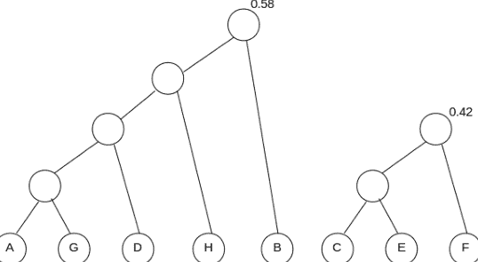

那里只有最后两个子树的组合：

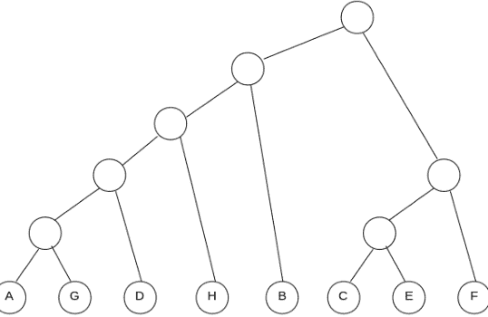

现在你可以像上面一样，从根节点开始每个字符，每向左一次加 `0`，每向右一次加 `1`，从而确定编码：

| A | 000 | 0.04 | 00000 |
| :--- | :--- | :--- | :--- |
| B | 001 | 0.28 | 01 |
| C | 010 | 0.12 | 100 |
| D | 011 | 0.08 | 0001 |
| E | 100 | 0.11 | 101 |
| F | 101 | 0.19 | 11 |
| G | 110 | 0.02 | 00001 |
| H | 111 | 0.16 | 001 |

这种编码被称为哈夫曼编码（Huffman coding）。例如，如果你有一个 `100` 字符的文件（在可能的 `8` 个字符中），并且它们分布在上述表格频率中，在经过第 `2` 列编码后，文件将占用 `300` 位，而在经过第 `4` 列编码后，文件将：

```
4*5 + 28*2 + 12*3 + 8*4 + 11*3 + 19*2 + 2*5 + 16*3 = 273
```

因此节省了 `9%`。这听起来并不多，但如果频率差异比上面的例子大，节省的可能会更大。

上面的编码表示为一棵树，有时被称为代码树（code tree）。它的特点是只有叶节点代表字符，这导致了从位模式可以无歧义地确定该模式代表哪种字符（如果它代表字符的话）。重要的一点是，任何字符的位模式都不可能是另一个字符的前缀。假设你有一个位模式 `0110101100111000101010110001`。你现在从根节点开始，沿着树移动直到到达叶节点，这时你就确定有了一个字符。然后再次从根节点开始，沿着树移动直到确定下一个字符，并一直持续直到确定所有字符：


由于实现梦想是你最大的挑战，由 IE 商学院（IE Business School）提供英语、西班牙语或双语教学的管理硕士，通过一项创新且具有启发性的计划，在职业生涯初期培养高绩效专业人士，帮助他们充分发挥潜力。

- 选择你的专业领域。
- 通过所提供的不同选项定制你的硕士课程。
- 全球沉浸式地点，如伦敦、硅谷或上海。

因为你而改变，我们随你而改变。

`www.ie.edu/master-management` `mim.admissions@ie.edu`

在 `bookboom.com` 免费下载电子书

贪心算法

`01|01|101|001|11|001|00001|01|11|001|`

`B E E H F H G B F D`

考虑到树是如何构建的，起点是每个叶节点（因此是每个字符）都关联了一个权重。每个叶节点都可以被恰当地解释为具有单个节点和权重的树。现在发现该算法连接两个权重最小的树，并将这两棵树合并成一个新的二叉树，该新树的权重是两个子树权重之和。这个过程重复进行直到你只剩一棵树。每次选择权重最小的两个树正对应于一种对最小权重极其贪心的贪心算法。

`Huffman` 程序实现了文件的哈夫曼压缩。该程序作为命令执行，带有两个选项：

```
java -jar Huffman.jar -c file1 file2
```

它压缩 `file1` 并将结果保存在 `file2` 中。

```
java -jar Huffman.jar -d file1 file2
```

它解压缩 `file1` 并将结果保存在 `file2` 中。

项目除了实际程序外还包含三个类。其中一个名为 `Bitmap`，表示一个简单的位图，因此将字符的代码表示为变长位模式。我不想在这里显示这个类。

# JAVA 19: 更多算法与数据结构：软件开发

贪心算法

```java
public Byte getByte(Bitmap bmp) {
    return codeMap.get(bmp);
}
```

```java
private void createCodes() {
    PriorityQueue<HuffmanTree> queue = new PriorityQueue();
    for (int i = 0; i < code.length; ++i) {
        queue.add(new HuffmanTree((byte)i, code[i]));
    }
    while (queue.size() > 1) {
        HuffmanTree t1 = queue.poll();
        HuffmanTree t2 = queue.poll();
        queue.add(new HuffmanTree(t1, t2));
    }
    HuffmanTree tree = queue.poll();
    tree.create(byteMap, codeMap);
}
```

该类首先定义了一个空间可以容纳 `256` 个值的数组 `code`。原因是程序必须能够编码 `256` 个不同的字符，这对应于一个字节所能表示的值数量。结果是程序可以“压缩”任何文件，无论其内容如何。下文将详细说明。此外，该类还创建了上述两个 `map`。

该类有两个构造函数，我想从最后一个以文件名作为参数的构造函数开始。它是要压缩的文件名，构造函数开始确定文件中每个字节的频率。共有 `256` 种选择，对于文件的每个字节，`code` 数组中对应位置的计数加 `1`。在指定了频率后，会调用 `createCodes()` 方法。它首先将 `256` 个字节中的每一个作为一个 `HuffmanTree`（即叶子节点）放入优先级队列中，优先级就是频率。接下来的 `while` 循环多次合并树：队列中的前两棵树被合并，并将结果放入优先级队列中。最后，队列中只剩一棵树，通过这段代码，两个 `map` 就被初始化了代码（codes）。

在执行完此构造函数后，对于文件中的每个字节，你都可以返回相应的 `Bitmap`（即其二进制编码），并随后将结果保存到压缩文件中，但必须能够反向操作，即解压缩内容。因此，频率（数组 `code`）会与文件内容一起存储，这时就会使用另一个构造函数来恢复代码树。

# JAVA 19: 算法与数据结构：软件开发

最后，是实际的程序（`Huffman` 类），但我不想展示该类在读写文件方面的具体实现，但基本上程序有两个方法：`compress()` 和 `decompress()`。简而言之，这些方法的工作原理如下。

`compress()` 首先为当前文件创建一个 `CodeTable` 对象。接着，它读取文件并创建一个巨大的位图，由文件中所有字节转换为对应当前哈夫曼编码的二进制代码组成。接下来，将 `256` 个代码、位图长度以及位图本身保存到输出文件中。

`decompress()` 从读取代码表开始，并据此创建一个 `CodeTable` 对象，该对象与原始文件转换时使用的哈夫曼编码相同。之后，读取文件的其余部分并用于创建一个包含文件内容的大位图。将编码解析为文件的原始字节，并写入输出文件。

如上所述，程序可以压缩任何文件，问题在于该程序的好坏。首先，请当在压缩文件时，输出文件开头有 `256` 个用于编码频率的代码和一个用于位图长度的整数，因此总计占用 `1028` 字节。由此可以得出，程序无法压缩小文件，甚至适得其反，因为小文件实际占用的空间比原始文件多（包含一个 `int` 的将将 `1032` 字节而不是 `4` 字节）。如果文件很大，`1028` 字节并没有意义，且取决于你是否成功。重要的是单个字节的频率。如果所有 `256` 个字节都能出现，且大部分以高频率出现，那么程序将没有任何益处。例如，如果你解压缩，你会发现程序运行正常（压缩文件解压缩后结果正确），但压缩后的文件大小与原始文件相同（甚至更多）。相反，如果原始文件包含纯文本，你将看到显著的收益（可能是 `30%` 或更多），出现的字符越少，程序的压缩效果就越好。

分治法

另一类算法是*分治法*，它们是递归算法，但并非所有的递归算法都是分治算法。分治算法由两部分组成：

- *划分 (Divide)*：将问题划分为两个或多个互斥或更简单的问题，如果还没有达到基本情况，则递归地解决这些问题。
- *解决 (Conquer)*：通过组合子问题的解决方案来找到原始问题的解决方案。

分治问题的经典例子是合并排序和快速排序，此外，寻找集合中第 *k* 小的元素（从而找到中位数）也是通过分治算法解决的。

因此，为了使用分治算法，重要的是划分产生的子问题应该比原始问题更简单。

`img/943e62ea3705f1e2f8a9e0682925130`

分治法

作为分治算法的一个例子，我将考虑所谓的最近点问题。在坐标系中给定 `n` 个点，问题变为确定点之间的最短距离。可以通过如下进行说明：

`img/943e62ea3705f1e2f8a9e0682925131`

分治法

如果是 `n` 个点，那么就有 `$n(n-1)/2$` 个距离，一个简单的解决方案是确定所有对的距离并选择最小的一个。这种算法简单且易于实现，但显然它具有平方复杂度。因此，寻找更好的算法是显而易见的。

假设你有一个点数组，并且数组按 `x` 坐标排序。你可以立即将点分成两半：

`img/943e62ea3705f1e2f8a9e0682925132`

现在有三种选择：

- 最近的点在左半部分
- 最近的点在右半部分
- 最近的点分别在两个部分，即位于直线的两侧

可以通过选择这三个子问题解决方案中最好的（通过点距离衡量）来确定结果。这里前两个子问题很容易解决，因为它们通过对每个子问题重复上述拆分并递归来解决。因此，问题在于解决第三个问题，如果你以线性时间复杂度解决它，它类似于我为合并排序所展示的，该算法的时间复杂度可以为 `$O(NlogN)$`。

为了分析中间的问题，`$\delta_L$` 和 `$\delta_R$` 分别表示左、右子问题的解（点之间的最小距离），并设置 `$\delta = min\{\delta_L, \delta_R\}$`。令 `$\delta_C$` 表示第三个子问题的解。现在只有当 `$\delta_C$` 小于 `$\delta$` 且点落在分割线附近的带状区域时，才有意义：

# 分治法

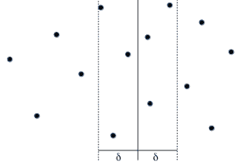

这减少了需要处理的点数。可以通过以下方式实现，其中 `$a$` 和 `$b$` 是条形区域内点的起始和结束索引：

```
for i = a to b
for j = i + 1 to b
if (dist(p[i], p[j]) < delta) delta = dist(p[i], p[j])
```

该算法具有平方复杂度，但对于比较点 `$p[i]$` 与条形区域内 `y` 值差小于 `$\delta$` 的点足够了（其他点不会提供更好的解决方案）。同时假设这些点


- 在 2014 年 9 月 30 日前报名即可
- 节省高达 16% 的学费！
- 分 10 期付款 / 2 年完成
- 互动式在线教育
- 访问 `www.ligsuniversity.com` 了解更多信息！

注意：`LIG` 大学未获得美国教育部长列出的任何国家认可认证机构的认证。更多信息见此处。


# JAVA 19: 更多算法与数据结构：软件开发

分治法

当前条形区域内的点按 `y` 值排序，如果你考虑一个特定的点 `$p[i]$`，由于对 `$\delta$` 的选择（它小于或等于左右两部分点之间的最短距离），在 `$\delta$` 边长的正方形内的点可能不会多于 `7` 个：

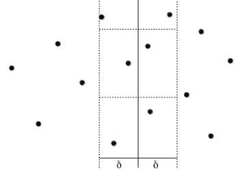

因此，算法可以如下所示进行改进，其中内层循环由于最多只有 `7` 个点，可以被视为常数：

```
for i = a to b
for j = i + 1 to b
  if (p[j].y > p[i].y) break
  else if (dist(p[i], p[j]) < delta) delta = dist(p[i], p[j])
```

结果是第三个子问题的复杂度现在是线性的，完成后的算法复杂度为 `$O(N\log(N))$`。然而，有两点并不显而易见。首先，点数组无法分别按 `x` 值和 `y` 值进行排序。这个问题可以通过在两个标准排序后保留两个数组副本来解决。另一点是，开始时假设点数组已经按 `x` 值排序了，但由于数组可以使用例如归并排序进行排序（其复杂度为 `$O(N\log(N))$`），你可以从对数组排序开始，而不会改变算法的时间复杂度为 `$O(N\log(N))$`。

在这个问题中，你应该实现如上描述的解决最近点问题的算法。一旦你实现了算法，你自然应该对其进行测试，并尝试编写一个支持 `$O(N\log(N))$` 时间复杂度的测试方法。

在 `bookhoon.com` 下载免费电子书

分治法

另一个经典问题是汉诺诺塔问题，该示例被作为使用分治算法的良好案例。该问题通常描述如下：

19 世纪末，一种名为“汉诺诺塔”的游戏在欧洲作为新闻引入。这个游戏的流行源于一个轶闻，据说梵神庙的祭司们致力于解决一个问题，当该问题被解决时，世界就会终结。祭司的游戏由一个铜盘和三根金刚制的“杆”组成，上面放着 `64` 个直径不同的金色圆盘。最初，所有圆盘都放在左杆上，最大的在底部，其次大的在上，以此类推，即形成一座塔。现在必须将整个塔移动到右杆，但每次只能移动一个圆盘，且圆盘永远不能放在直径较小的圆盘上。

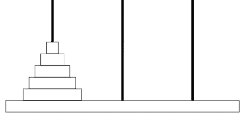

首先，并不完全清楚这个游戏是可以被解决的，其次，正如许多祭司观察到的，你必须移动很多圆盘——对于 `64` 个盘，真的是如此。

在本节中，我想编写一个可以模拟这个游戏的程序，用户可以通过鼠标拖动圆盘来移动它们，此外程序还有一个解决游戏的选项。所需的移动数为 `$2^n - 1$`。对于 `$n=64$`，这是 `$18,446,744,073,709,551,615$`。

- 将顶圆盘移动到中间杆
- 将顶圆盘移动到右杆
- 将顶圆盘移动到左杆

...以此类推。

步骤如下：

1. 将最小圆盘移动到中间杆
2. 将最大的圆盘移动到右杆
3. 将最小圆盘移动到左杆

动态规划

# 动态规划

正如前几次所示，许多问题可以使用递归算法来描述，也许是因为问题本质上是递归的。实现递归算法很容易，但正如提到的，它可能导致效率极低。这种算法的经典例子是确定斐波那契数的递归方法，而这里的解决方案是编写迭代方法。这种思想是从可以解决的简单情况开始。你现在保存解决方案并继续，使得下一个解决方案由已经确定的决定。确定斐波那契数的迭代算法从确定前两个数（`0` 和 `1`）开始。然后你继续，将下一个数确定为前几个数之和。也就是说，从简单情况开始逐步向前。它是递归的相反，从复杂情况开始分解为次问题，直到达到一个简单情况。

结合贪心算法，我在硬币问题上看到过，你必须用最少的硬币兑换某个金额，在这种背景下，我也展示了这些硬币


关于 `e-Learning for Kids`。`e-Learning for Kids` 成立于 2004 年，是一个全球非营利基金会，致力于为 5-12 岁的儿童提供免费的在线学习，课程涵盖数学、科学、语言艺术、计算机、健康和环境技能。自 2005 年以来，来自 190 多个国家的超过 1500 万儿童受益于这些在线课程，这些课程由全球教育和在线学习专家以及业务专业人士组成的志愿者团队提供，他们致力于做出改变。为了给在线学习做出改变，`e-Learning for Kids` 一直寻求资金、志愿者、赞助商和关注开发者。欲了解更多信息，请访问 `www.e-learningforkids.org`。

## JAVA 19：更多算法与数据结构：软件开发：动态规划

贪心算法可能无法提供最优解。然而，可以使用动态规划算法来最优地解决该问题。

如果你需要兑换某个金额，策略是确定兑换所有金额所需的最小硬币数量：

- 1, 2, 3, ..., amount

你首先决定兑换 `1` 需要多少个硬币，结果是 `1` 个。然后，你遍历从 `1` 到 `amount` 的所有金额。对于每个值 `$a$`，你遍历所有硬币 `$c$`（记为 `$c1, ..., cn$`），即面值小于或等于 `$a$` 的硬币，并确定：

```
m = min { exchange(a - c1), ..., exchange(a - cn) }
```

那么，兑换 `$a$` 所需的最小硬币数量就等于 `$m + 1$`。再正式一点，该方法可以描述为：

```
amount = 要兑换的金额
values[1..amount] 要兑换的硬币
loop a from 1 to amount
{
    min = a
    loop c for all coins
    {
        if (c.value() <= a)
        {
            min = coins to exchange a - c.value() + 1
        }
        values[a] = min
    }
}
return values[amount]
```

你应该注意，这正是通过基于动态规划的算法，它通过确定小于或等于目标金额的所有值的结果，并不断应用已经解决的子问题的解决方案。


为了实现该算法，我从程序`CoinProblem`的拷贝开始，将其称为`CoinProblem1`。`Coin`和`Coins`两个保持不变，测试程序也是如此，不同在于没有使用`Greedy`类，而是使用了`Dynamic`类：

```java
class Dynamic implements Iterable<Coins>
{
    private Map<Coin, Integer> holdings = new TreeMap();
```

```java
public void add(Coin coin, int count)
{
    if (holdings.containsKey(coin)) count += holdings.get(coin);
    holdings.put(coin, count);
}
```

```java
public List<Coins> exchange(int amount) throws Exception
{
    List<Coins>[] arr = createArray(amount + 1);
    arr[0] = new ArrayList();
    for (int b = 1; b <= amount; ++b)
    {
        int min = b;
        Coin val = new Coin(i);
        int n = 0;
        for (Coin coin : holdings.keySet())
        {
            if (coin.getValue() > b) continue;
            int j = b - coin.getValue();
            if (arr[j].size() + 1 < min)
            {
                min = arr[j].size() + 1;
                val = coin;
                n = j;
            }
        }
        arr[b] = new ArrayList();
        Coins coins = new Coins(val, 1);
        arr[b].add(coins);
        for (Coins c : arr[n])
            if (c.equals(val)) coins.add(c.getCount()); else arr[b].add(c);
        for (Coins c : arr[amount])
            if (holdings.get(c.getCount()) < c.getCount())
                throw new Exception(amount + " could not be exchanged");
        for (Coins c : arr[amount])
            holdings.put(c.getCount(), holdings.get(c.getCount()) + c.getCount());
    return arr[amount];
}
```

```java
public Iterator<Coins> iterator()
{
    return new CoinIterator();
}
```

```java
class CoinIterator implements Iterator<Coins>
{
    private Iterator<Coin> keys = holdings.keySet().iterator();

    public boolean hasNext()
    {
        return keys.hasNext();
    }

    public Coins next()
    {
        Coin coin = keys.next();
        return new Coins(coin, holdings.get(coin));
    }
}
```

```java
private <T> T[] createArray(int length)
{
    return (T[]) new Object[length];
}
```

```java
while (list.size() <= n)
{
    for (t += 2; !isPrime(list, t); t += 2)
    list.add(t);
}
return r;
}
```

问题在于是否存在任何收益，实际上这种收益非常有限，但与最后一种方法相比有 4 倍的差异。最后一种方法可能基于较少的除法，但相反，必须维护列表，这也会花费时间。以下是一个测试程序：

```java
public static void main(String[] args)
{
    StopWatch sw = new Stopwatch();
    int N = 100000000;
    sw.start();
    long t1 = primel(N);
    sw.stop();
    System.out.println(sw.getMilliseconds());
    sw.start();
}
```


```java
long t2 = prime2(N);
sw.stop();
System.out.println(sw.getMillisSeconds());
System.out.println(t1);
System.out.println(t2);
```

如果你运行该程序，可以得到结果：

```
395033
118524
179424691
179424691
```

该项目名为*ThePrimes*，你应该注意该项目使用了 Java 18 中类库*palib*的`Primes`类。该项目也被复制到了本书的项目文件中，因为本书将用新类扩展库，并修改现有的类。

在贪心算法中讨论的装载问题是一个更通用的问题——*0/1 背包问题*的特例。它是算法理论中的一个经典问题，以下是对该问题的简要介绍，以及一个如何使用动态规划实现算法解决该问题的示例。该问题可以表述如下：

最大化函数

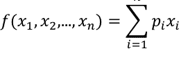

其中$x_1,x_2,...,x_n$是不等式解中的二进制变量

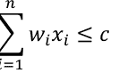

一个简单的 0/1 背包问题，其中$n = 3, c = 7$且

```
$w = \{ 3, 4, 3 \}$
$p = \{ 5, 2, 3 \}$
```

此时问题是最大化函数

```
$f(x, y, z) = 5x + 2y + 3z$
```

当$x$，$y$和$z$是二进制变量时

```
$3x + 4y + 3z \le 7$
```

在这种情况下，问题很容易解决，因为每个变量只有 2 个值（0 和 1）。只有 8 种可能的解，你可以在表格中列出所有组合：

| x | y | z | 3x + 4y + 3z | 5x + 2y + 3z |
|---|---|---|---|---|
| 0 | 0 | 0 | 0 | 0 |
| 0 | 0 | 1 | 3 | 3 |
| 0 | 1 | 0 | 4 | 2 |
| 0 | 1 | 1 | 7 | 5 |
| 1 | 0 | 0 | 3 | 5 |
| 1 | 0 | 1 | 6 | 8 |
| 1 | 1 | 0 | 7 | 7 |
| 1 | 1 | 1 | 10 | 10 |

在这里你可以看到选项无法使用，因为它不符合不等式，对于剩余的选项，最后一列显示最优解是 (1, 0, 1)。

在这种情况下，问题通过*暴力破解算法*解决，这意味着系统地测试所有选项，并确定最佳结果。当然，如果你使用算法处理具有$n$个变量的 0/1 背包问题，时间复杂度为$O(2^n)$，这是无意义的。因此有兴趣更好的算法。

有几种策略可以解决问题，你可以应用针对*$p$值的贪心算法*，不断选择最大的$p$值元素（重量），或者选择最小的$w$值元素或商$p/w$。正如第 2 章中描述的那样，如果所有$p$值都等于 1，且算法针对重量，贪心算法并不一定提供最优解，而是可以考虑动态规划。

动态规划可以解决问题，当解可以描述为一系列决策的结果时。通过确定第$n$个数，以此类推。这种策略可以解决 0/1 背包问题。假设$(y_1, y_2,...,y_n)$是 0/1 背包问题的最优解。从问题从移除第一个变量会导致另一个 0/1 背包问题：

最大化

```
$\sum_{i=2}^{n} p_i x_i$
```

在解中

```
$\sum_{i=2}^{n} w_i x_i \leq d$
```

其中$d = c - w_1 y_1$


那么清楚$(y_2,...,y_n)$是简化问题的解。假设它不是最优解那么存在另一个解$(z_2,...,z_n)$（更好的解），使得：

```
$\sum_{i=2}^{n} p_i y_i < \sum_{i=2}^{n} p_i z_i$
```

当

```
$\sum_{i=2}^{n} w_i z_i \leq c - w_1 y_1 \Rightarrow \sum_{i=2}^{n} w_i z_i \leq c$
```

得出$(y_1, y_2,...,z_n)$是原问题的解，因此 ($y_1,...,z_n$是最优解）使得

```
$\sum_{i=1}^{n} p_i y_i \geq p_1 y_1 + \sum_{i=2}^{n} p_i y_i \geq \sum_{i=1}^{n} p_i z_i$
```

这是一个矛盾。也就是说，0/1 背包问题满足：如果你移除一个变量，你可以在最优解中移除同一个变量，得到简化问题的最优解（因为移除第一个变量 own另一个并没有什么魔法）。给定一个 0/1 背包问题，你可以考虑以下子问题$P_k(d)$：

最大化

```
$\sum_{i=k+1}^{n} p_i x_i$
```

在解中

```
$\sum_{i=k+1}^{n} w_i x_i \leq d$
```

因此第一个变量已被移除。这里是原问题$P_0(c)$。让$f_0(d)$表示子问题的最优解值，其中$f_0(c)$是原问题的最优解。假设所有重量和$c$都是正数。可以直接得出：

- $f_n(d) = 0$，对于所有$d > 0$，因为在这种情况下优化函数是常等于 0（和为空）；
- $f_k(0) = 0$，对于所有$k$，因为问题的约束只有在所有二进制变量为 0 时才能满足；
- $f_k(d) = -\infty$，对于所有$d < 0$和所有的$k$，这简单意味着解为空。

让$(y_k, \dots, y_n)$为$P_{k-1}(d)$的最优解，值为$f_{k-1}(d)$。即：

```
$f_{k-1}(d) = \sum_{i=k}^{n} p_i y_i$
```

根据上述$(y_{k+1}, \dots, y_n)$是$P_k(d - w_k y_k)$的最优解，那么

```
$f_k(d - w_k y_k) = \sum_{i=k+1}^{n} p_i y_i$
```

即

```
$f_{k-1}(d) = \sum_{i=k}^{n} p_i y_i = \sum_{i=k+1}^{n} p_i y_i + p_k y_k = f_k(d - w_k y_k) + p_k y_k\n=\max(f_k(d), f_k(d - w_k y_k) + p_k y_k)$
```

其中最后一个等式由于$y_k$是 0 或 1 而得出。这意味着可以从$f_k$确定$f_{k-1}$。这就是动态派上用场的地方，因为除非逐继确定$f_k$直到最后的$f_0$，否则$f_n$是平凡的。

# JAVA 19: 算法与数据结构：软件开发动态规划

可以手动计算该示例（其中使用以下公式填充表格以得到$d$的可能值）：

| p | w | 1 | 2 | 3 | 4 | 5 | 6 | 7 | 8 | 9 | 10 |
|---|---|---|---|---|---|---|---|---|---|---|---|
| 5 | 3 | $f_5$ | 0 | 0 | 0 | 0 | 0 | 0 | 0 | 0 | 0 |
| 10 | 4 | $f_4$ | 0 | 0 | 5 | 5 | 5 | 5 | 5 | 5 | 5 |
| 2 | 2 | $f_3$ | 0 | 0 | 5 | 10 | 10 | 15 | 15 | 15 | 15 |
| 4 | 1 | $f_2$ | 0 | 2 | 5 | 10 | 12 | 15 | 15 | 17 | 17 |
| 8 | 5 | $f_1$ | 4 | 4 | 6 | 10 | 14 | 16 | 19 | 19 | 21 |
|   |   | $f_0$ | 4 | 4 | 6 | 10 | 14 | 16 | 19 | 19 | 22 |

结果最大值为 22。然后，为了确定产生最大解的序列，从最大容量 10 开始，比较$f_0(10)$和$f_1(10)$。由于它们不同，说明$x_5$对容量有贡献，因此$x_5=1$，剩余容量为：


减少$10 - w_5 = 5$。然后比较$f_1(7)$和$f_2(7)$，由于它们不同，$x_4 = 1$，则容量减少$5 - w_4 = 4$。接下来比较$f_2(4)$和$f_2(4)$，它们都为 10，因此$x_3$没有对容量产生贡献，即$x_3 = 0$。下一次比较是$f_3(4)$与$f_4(4)$，它们不同，且$x_2 = 1$，容量减少到$4 - w_2 = 0$。最后是比较$f_4(0)$和$f_5(0)$，结果均为 0，因此$x_1 = 0$。最终结果如下：

对于以下序列，最大值为 22：

```
$x_1 = 0
x_2 = 1
x_3 = 0
x_4 = 1
x_5 = 1$
```

注意$10x_2 + 4x_4 + 8x_5 = 22$。

同样注意，如果问题有$N$个变量且容量为$C$，则该算法的时间复杂度可以实现为$O(CN)$。

## 练习 2：背包程序

编写一个程序，实现与上述描述相对应的 0/1 背包问题。最难的部分实际上是确保你在所用数组中的索引标记是正确的。

# JAVA 19: 更多算法与数据结构：软件开发回溯

# 5 回溯

通常解决问题的算法是显而易见的，但在其他语境下，可能很难找到算法，特别是很难选择正确的算法。在本章中，我将介绍一组被称为回溯的算法，它最好的特征是：通过检查所有可能的解决方案来系统地搜索问题的解。例如，我将介绍所谓的“八皇后问题”：

棋盘由 64 个方格组成，排列成 8 行 8 列的正方形。在象棋中，皇后可以在水平、垂直和对角线方向移动，从而攻击皇后可以移动的位置上的另一个棋子。现在的问题是在棋盘上放置 8 个皇后，使得它们之间都不能互相攻击。

解决这个问题的一种方法是让计算机系统地检查所有选项，直到找到解决方案。一个棋盘涉及从 64 个方格中选择 8 个，方法数为二项系数$\binom{64}{8}$，即数字 4426165368，因此即使在快速计算机上也不是一条特别易行的路。然而，通过观察到每行最多包含一个皇后，每列也是如此，可以简化问题。这显著减少了问题规模。对于这些选项中的每一个，检查没有两个皇后会在对角线上互相攻击。可以通过系统地进行进一步改进该方法。你首先在第一行的第一列放置一个皇后。接下来，从顶部开始在第二列放置一个皇后，直到你找到一个不会攻击第一列的位置。现在继续第三列，从顶部开始向下移动，直到你找到一个不会攻击其中一个皇子的位置。

# JAVA 19：更多算法与数据结构：软件开发

## 回溯法 (BACKTRACKING)

你在列`col`中遍历每一行，对于每一行，你尝试放置一个皇后。如果可以，就放置一个皇后：

```
board[row][col] = true;
```

并继续（递归地）处理下一列；如果不可行，你必须进行回溯：

```
board[row][col] = false;
```

另外请注意，如果你开始放置第一个皇后的方式不同（不在第 1 行），你将找到一个解，而这个问题实际上有多个解。

以下程序使用了`Queens`类来解决八皇后问题，部分使用了 8 个皇后，部分使用了 15 个皇后：

```java
package eightqueens;
public class EightQueens
{
public static void main(String[] args)
{
```


到 2020 年，风能可以提供我们地球能源需求的十分分之一。就在今天，SKF 的创新知识对于运行世界上大部分的风力发电机至关重要。

发电成本中高达 25% 与维护有关。得益于我们的在线状态监控和自动系统，这些成本可以大幅降低。

SKF 让从空气中创造更廉价的能量变得经济。

通过分享我们的经验、专业知识和创造力，行业可以实现超出预期的性能。

如果没有能够应对挑战的最优秀员工！

知识工程的力量

接入知识工程的力量，

请访问我们的网站：www.skf.com/knowledge

SKF

在 bookboom.com 下载免费电子书 - 点击广告阅读更多


# JAVA 19：更多算法与数据结构：软件开发

## 回溯法（BACKTRACKING）

```java
test1();
test2();
}
```

```java
private static void test1()
{
    Queens q = new Queens(8);
    if (q.nextQueen(0)) show(q);
    else System.out.println("The problem could be solved...");
}
```

```java
private static void test2()
{
    Queens q = new Queens(15);
    if (q.nextQueen(0)) show(q);
    else System.out.println("The problem could be solved.");
}
```

```java
private static void show(Queens q)
{
    for (int i = 0; i < q.getSize(); ++i)
    {
        for (int j = 0; j < q.getSize(); ++j)
            if (q.isQueen(i, j)) System.out.print("Q "); else System.out.print("x ");
        System.out.println();
    }
}
```

回溯是一种解决技术，可以用于许多场景，在这些情景中，你尝试通过部分解来寻找问题的解决方案，并且当你意识到构建的方案无法导致结果时，你会尝试返回。回溯法远优于仅仅尝试所有可能性（暴力破解算法），但应该注意的是，回溯通常没有良好的时间复杂度。

### 练习题 3：八皇后，所有解

创建`EightQueens`程序的副本。你必须添加另一个测试方法来解决八皇后问题（使用 8 个皇后），该方法必须确定问题的所有解（共有 92 个解）。

## 5.1 排列（PERMUTATIONS）

作为另一个可用回溯算法解决问题的例子，我将研究一个确定`n`的所有排列的问题，其中`n`是一个正整数。正整数`n`的排列是指以某种顺序排列的小于或等于`n`的`n`个正整数。例如，3 的有 6 种排列：

- 1 2 3
- 1 3 2
- 2 1 3
- 2 3 1
- 3 1 2
- 3 2 1

注意，通常`n`有`n!`种排列。确定`n`的所有排列的策略可以：

1. 对于从 1 到`n`的所有`k`重复操作并使用空排列。
2. 将`k`添加到排列中。
3. 如果结果是合法的部分解，则对从 1 到`n`的所有`j`重复操作。
4. 否则回溯，直到找到一个可以使用的。当然，你应该小心，在放置数字时不要多次尝试同一个数字。这可以用以下算法制定：

```java
package permutations;

import java.util.*;

public class Permutation {
    private int[] arr = null;

    private Permutation(int n) {
        arr = new int[n];
        for (int i = 1; i <= n; ++i) arr[i - 1] = i;
    }

    private Permutation(Permutation p) {
        arr = new int[p.getLength()];
        for (int i = 0; i < p.getLength(); ++i) arr[i] = p.arr[i];
    }
```

```java
public int getLength() {
    return arr.length;
}
```

```java
public int getValue(int i) {
    return arr[i];
}
```

```java
@Override
public String toString() {
    StringBuilder text = new StringBuilder(getLength());
    for (int i = 0; i < arr.length; ++i) {
        text.append(arr[i]);
        if (i < arr.length - 1) text.append(' ');
    }
    return text.toString();
}
```


无论你对未来的职业有何期望，业务广泛的雇主将始终是入场券。在沃尔沃集团工作意味着在全球范围内拥有195,000名朋友和同事。我们提供极佳的机会——请查看我们网站`www.volvgroup.com`的职业板块。我们期待与你认识！

## 排列算法实现

```java
public static List<Permutation> permutations(int n)
{
    List<Permutation> list = new ArrayList<>();
    permute(list, new Permutation(n), 0);
    return list;
}
```

```java
private static void permute(List<Permutation> list, Permutation p, int i)
{
    if (i == p.getLength())
    {
        list.add(new Permutation(p));
    }
    else
    {
        for (int j = 0; j < p.getLength(); ++j)
        {
            if (!isUsed(p, i, j))
            {
                p.set(i, j);
                permute(list, p, i + 1);
            }
        }
    }
}
```

```java
private static boolean isUsed(Permutation p, int i, int j)
{
    for (int k = 0; k < i; k++)
    {
        if (p.getValue(k) == j)
        {
            return true;
        }
    }
    return false;
}
```

```java
private static void swap(int[] arr, int i, int j)
{
    if (i != j)
    {
        int t = arr[i];
        arr[i] = arr[j];
        arr[j] = t;
    }
}
```

```java
class Permutation {
    private int[] arr;

    private Permutation(int n) {
        arr = new int[n];
        for (int i = 1; i <= n; ++i) arr[i - 1] = i;
    }

    private Permutation(Permutation p) {
        arr = new int[p.getLength()];
        for (int i = 0; i < p.getLength(); ++i) arr[i] = p.arr[i];
    }

    public int getLength() {
        return arr.length;
    }

    public int getValue(int i) {
        return arr[i];
    }

    public void set(int i, int val) {
        arr[i] = val;
    }

    @Override
    public String toString() {
        StringBuilder text = new StringBuilder(getLength());
        for (int i = 0; i < arr.length; ++i) {
            text.append(arr[i]);
            if (i < arr.length - 1) text.append(' ');
        }
        return text.toString();
    }
}
```

# JAVA 19：算法与数据结构：软件开发回溯

该类必须拥有一个`union()`方法，用于合并两个等价类。如果你想合并 4 和 5 的等价类，可以按照如下方式操作：

| 0 | 1 | 2 | 3 | 4 | 5 | 6 | 7 | 8 | 9 |
|---|---|---|---|---|---|---|---|---|---|
| -1 | -1 | -1 | -2 | 4 | -1 | -1 | -1 | | |

4 的值为 -2，且它必须被解释为该数是负的，因为 4 作为根节点（决定）了一个深度为 2 的等价类。位置 5 处的值为 4，意味着 5 与位置 4 的元素在同一个等价类中，因此 4 和 5 现在处于同一个等价类中。用树来演示这一点，结果所示：

| 0 | 1 | 2 | 3 | 4 | 5 | 6 | 7 | 8 | 9 |
|---|---|---|---|---|---|---|---|---|---|


如果你接着合并 6 和 7 的等价类，你：

| 0 | 1 | 2 | 3 | 4 | 5 | 6 | 7 | 8 | 9 |
|---|---|---|---|---|---|---|---|---|---|
| -1 | -1 | -1 | -1 | -2 | 4 | -2 | 6 | -1 | -1 |

并以树的形式写出：

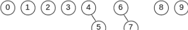

这意味着这 10 个元素现在被分成了 8 个等价类。下一步，我想执行包含 5 和 6 的两个等价类的合并操作。这里 5 并不是等价类的根，而`union`方法的工作原理是通过该类的根来合并两个等价类。因此，需要一个`find()`方法，它可以找到包含特定元素的等价类的根。对于 5，`find()`方法找到了元素 4；而对于 6，它找到了元素 6。如果你想合并根节点分别为 4 和 6 的两个等价类：

| 0 | 1 | 2 | 3 | 4 | 5 | 6 | 7 | 8 | 9 |
|---|---|---|---|---|---|---|---|---|---|
| -1 | -1 | -1 | -1 | -3 | 4 | 4 | 6 | -1 | -1 |

在这里你应该注意，元素 7 指向 6，6 是新等价类的根，而元素 5 也指向 4。因此，方法的实现方式必须使得从一个元素到其根节点的路径尽可能短，并且对应于元素组织成树的直观感知：

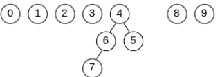

下一次操作，我想合并 0 和 9 的子树，这很简单，因为这两个元素都是子树的根：

| 0 | 1 | 2 | 3 | 4 | 5 | 6 | 7 | 8 | 9 |
|---|---|---|---|---|---|---|---|---|---|
| -2 | -1 | -1 | -1 | -3 | 4 | 4 | 6 | -1 | 0 |

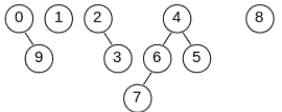

如果你合并 2 和 3：

| 0 | 1 | 2 | 3 | 4 | 5 | 6 | 7 | 8 | 9 |
|---|---|---|---|---|---|---|---|---|---|
| -2 | -1 | -2 | -3 | -4 | 4 | 6 | -1 | 0 |

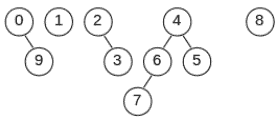

如果你合并合并 0 和 2 确定的等价类，得到：

| 0 | 1 | 2 | 3 | 4 | 5 | 6 | 7 | 8 | 9 |
|---|---|---|---|---|---|---|---|---|---|
| 2 | -1 | -3 | -3 | -4 | 4 | 6 | -1 | 0 |

0 和 2 都是等价类的根，`union`方法必须确保从等价类中的元素到根节点的路径尽可能短：

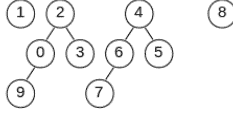

那么 10 个元素被分为 4 个等价类。如果你对 0 和 3 进行`union`操作，什么都不会发生，因为这两个元素已经已经在同一个等价类中了。

任务是编写一个对应上面的`DisjointSet`类，这实际上非常简单，因为该类具有一些实用性。该类除了创建一个集合的构造函数外，必须只有`find()`和`union()`方法：

```java
public class DisjointSet {
    private int[] S;

    public DisjointSet(int n) {
        S = new int[n];
        for (int i = 0; i < S.length; ++i) S[i] = -1;
    }
}
```

## `DisjointSet`类的方法

```java
public void union(int a, int b)
{
    if (S[a] >= 0) return;
    if (S[b] >= 0) return;
    if (a == b) return;
    if (S[b] < S[a]) S[a] = b;
    else
    {
        if (S[a] == S[b]) --S[a];
        S[b] = a;
    }
}

public int find(int t)
{
    if (S[t] < 0) return t;
    return S[t] = find(S[t]);
}
```

`find()`方法返回元素等价类的根（一个负值）。该方法是递归编写的，并修改指向根节点的路径以使路径尽可能短。`union()`方法被带有两个


元素，并且假设这些元素都是等价类的根。如果不是如此，或者两个元素都是根，该方法将中断。如果 a 的值（负值）小于 b 的值，则元素 a 应该指向 b（b 是等价类的根），否则 b 的值必须指向 a，此时 a 的值可能要减 1。以下是对应上面的测试程序：

```java
public class DisjointTest {
    public static void main(String[] args) {
        DisjointSet ds = new DisjointSet(10);
        ds.print();
        ds.union(ds.find(4), ds.find(5));
        ds.print();
        ds.union(ds.find(6), ds.find(7));
        ds.print();
        ds.union(ds.find(5), ds.find(6));
        ds.print();
        ds.union(ds.find(0), ds.find(9));
        ds.print();
        ds.union(ds.find(2), ds.find(3));
        ds.print();
        ds.union(ds.find(2), ds.find(0));
        ds.print();
        ds.union(ds.find(0), ds.find(3));
        ds.print();
    }
}
```

程序假设该`DisjointSet`类通过`print()`方法扩展，该方法打印数组的内容，然后是测试结果：

| 0 | 1 | 2 | 3 | 4 | 5 | 6 | 7 | 8 | 9 |
|---|---|---|---|---|---|---|---|---|---|
| -1 | -1 | -1 | -1 | -1 | -1 | -1 | -1 | -1 | -1 |
| -1 | -1 | -1 | -1 | -2 | 4 | -1 | -1 | -1 | -1 |
| -1 | -1 | -1 | -1 | -2 | 4 | -2 | 6 | -1 | -1 |
| -1 | -1 | -1 | -1 | -2 | 4 | -2 | 6 | -1 | -1 |


| -1 | -1 | -1 | -1 | -3 | 4 | 4 | 6 | -1 | -1 |

| -2 | -1 | -1 | -1 | -3 | 4 | 4 | 6 | -1 | 0 |

| -2 | -1 | -2 | -3 | -4 | 4 | 6 | -1 | 0 | 0 |

| 2 | -1 | -3 | -3 | -4 | 4 | 6 | -1 | 0 | 0 |

| 2 | -1 | -3 | -3 | -4 | 4 | 6 | -1 | 0 | 0 |

| 2 | -1 | -3 | -3 | -4 | 4 | 6 | -1 | 0 | 0 |

### 5.3 迷宫

我将用一个展示迷宫的程序结束本章：

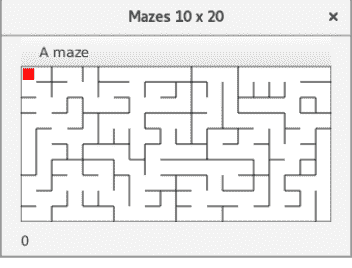

用户基本上可以做两件事：

- 通过点击鼠标从左上角移动到右下角，但你不能穿过墙壁。
- 启动一个程序自动移动方块演示。

在看代码之前，我想提到有一个名为 `Options` 的菜单，用户可以在那里进行一些设置：

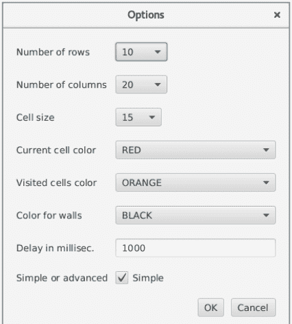

迷宫只有两个挑战：

1. 如何根据行和列数创建一个迷宫。
2. 如何编写一个自动通过迷宫的算法。

# JAVA 19: 算法与数据结构：软件开发

```java
private int row = 10;
private int cols = 20;
private int count = 0;
private int size = 15;
private String currentPos = "RED";
private String visitedPos = "ORANGE";
private String walls = "BLACK";
private int delay = 1000;
private boolean simple = true;
```

前两个常量表示了对话框中 `ComboBox` 的最小值和最大值，而 `colors` 是一个 `Map<String, Color>`，表示应用程序可以使用通过名称标识的颜色。

迷宫的单元格通过以下类创建：

```java
public class Cell extends Canvas {
    private Object model;
    private ObjectProperty<EventHandler<ActionEvent>> onActionProperty = new SimpleObjectProperty();
    private IntegerProperty row = new SimpleInteger();
    private IntegerProperty col = new SimpleInteger();
    private BooleanProperty left = new SimpleBoolean(true);
    private BooleanProperty top = new SimpleBoolean(true);
    private BooleanProperty right = new SimpleBoolean(true);
    private BooleanProperty bottom = new SimpleBoolean(true);
    private IntegerProperty state = new SimpleInteger();
```

该类在原则上是简单的，但代码填充了许多属性中的一部分。前两个表示目标单元格的行和列。接下来的四个表示是否存在墙，这些墙是从开始存在的，并且是创建迷宫以移除其中一些墙的算法的一部分。最后，最后一个属性 `state` 意味着：

- 0，单元格未被访问
- 1，单元格已访问
- 2，该单元格是当前单元格且包含红色方块

注意，该类继承自 `Canvas`，因此是由该单元格负责在 `draw()` 方法中绘制单个单元格。最后，该类可以触发 `ActionEvent`，这会在点击单元格时发生，在当前情况下，这意味着主窗口将收到单元格已被点击的以及点击的是哪个单元格。

# JAVA 19: 更多算法与数据结构：软件开发

这里 `Mazes` 类填充了部分内容，但最重要的是上述两个算法的实现。

要创建一个新迷宫，从创建单元格并将它们放置在 `GridPane` 中开始。从开始所有的墙都存在，且用户界面只显示一些方块：

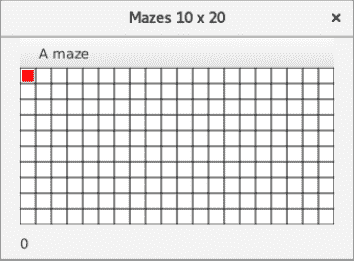

现在的任务是随机移除墙直到形成迷宫。现在你可以随机移除墙，因为迷宫必须是连通的，所以要有路径。这就是你可以使用 `DisjointSet` 类的地方。如果迷宫像上述有10行20列，就有200个单元格，如果你将这些单元格排列在数组并使用 `DisjointSet`，当第一个和最后一个属于同一个等价类时，迷宫中就会有一条路径。因此算法应该如下运行：

```
选择随机单元格
选择一个相邻单元格
if (这些单元格不属于同一个等价类) {
    打破两个单元之间的墙
}
重复上述操作直到第一个和最后一个单元格属于同一个等价类
```

原则上，算法非常简单且有效，但它有一个问题，因为它可能会提供封闭的单元格组，导致你无法移动红色方块。这个问题可以通过将算法中的最后一个语句改为来解决：

```
重复上述操作直到所有单元格属于同一个等价类
```

算法随后将打破更多的墙，红色方块就可以移动到所有单元格。这就是我所说的困难之处，因为它本质上提供了一个更难找到出的迷宫，因为有更多选项向错误的方向移动。缺点是该算法的时间复杂度较差，正如通过大型迷宫可以观察到的那样。

# JAVA 19: 更多算法与数据结构：软件开发

## 回溯 (BACKTRACKING)

然后是最后一个算法，由机器来寻找迷宫路径：

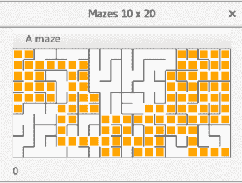

这里程序将尝试穿过迷宫。程序使用了一种策略，如果可能且尚未去过，它会尝试向右走。如果不可行，它会尝试向下，然后向左，最后向上。如果它无法到达任何一个地方，它就必须回溯，直到回到一个可以继续前进的单元格。原则上，它是简单的（但不有效），唯一的挑战是跟踪应该去哪个单元格。这可以用栈（stack）来解决。


# 其他算法

上面我提到了一些著名的算法，如果你想写一个算法且解决方案并不显而易见，那么可以考虑其他范式。然而，在本章中将给出一些可以通过枚举解决的算法

## 6.1 暴力破解算法 (BRUTE FORCE ALGORITHMS)

我之前提到过暴力破解算法通过尝试所有可能性来解决问题。原则上，这些算法没有坏处，下面是一个用于确定整数约数的暴力破解算法示例：

```java
public class BruteForce {
    private static final Random rand = new Random();
    private static final long N = 10000;

    public static void main(String[] args) {
        for (int i = 0; i < 10; i++) {
            List<Long> list = divisors(Math.abs(rand.nextLong()));
            if (list.size() < 100) {
                for (Long t : list) System.out.print(t + " ");
                System.out.println();
            } else
                System.out.println("Number of divisors: " + list.size());
            }
        }
    }

    private static List<Long> divisors(long t) {
        List<Long> list = new ArrayList<>();
        for (long d = 1; d <= t; ++d)
            if (t % d == 0) list.add(d);
        return list;
    }
}
```

# JAVA 19: 更多算法与数据结构：软件开发：其他算法

对于所谓的 N，算法简单地尝试所有小于等于 N 的自然数。通常，暴力算法是简单的（此处也是如此），但问题在于复杂度，它是 O(N)，而且当然，如果 N 很大，算法会变慢。正如提到的，如果你有一个暴力破解算法来解决问题，就有考虑是否有更好的算法。

## 6.2 随机算法 (RANDIZED ALGORITHMS)

作为另一种类型的算法，我想提到取决于随机选择值的算法。这些算法可能很难指定时间复杂度，且只能以某种概率指定复杂度，但它们也可以以给定概率确定正确结果的算法。可能很难想象那些无法确定结果的算法的用途，但如果一个算法非常复杂且耗时很长，一个可能正确的的结果比什么都没有要好。

在之前的书中，我将快速排序处理为 O(N log N) 排序算法，至少平均如此，但在最坏情况下，复杂度可能是平方级的，这发生在数组已经排序或接近排序时。复杂度取决于你选择基准点的运气，解决这个问题有几种技术。当我检查快速排序时，我主张选择中位数作为基点，但另一种选择是选择随机基点，这同样提供了良好的解决方案。

作为包含随机值算法的另一个示例，我再次查看质数算法，经典的写法是：

```java
public static boolean isPrime(long n)
{
  if (n == 2 || n == 3 || n == 5 || n == 7) return true;
  if (n < 11 || n % 2 == 0) return false;
  for (long t = 3, m = (long)Math.sqrt(n) + 1; t <= m; t += 2)
    if (n % t == 0) return false;
  return true;
}
```

小于等于 $n$ 的平方根。因此，算法的时间复杂度为 O($\sqrt{N}$)。

在数论中，费马小定理指出：

如果 $p$ 是质数，那么对于所有 $n=1,2,3,...,p-1$，都有 $a^{p-1} \equiv 1 \mod(p)$

这个结果可以用来判断一个数是否为质数，因为如果 $a^{n-1}$ 模 $n$ 不等于1，那么 $n$ 必然是一个合数；但如果 $a^{n-1} \equiv 1 \mod(n)$，$n$ 可能是一个质数。事实上，确实存在某些自然数使得 $a^{n-1} \equiv 1 \mod(n)$，但 $n$ 并不是质数。作为测试 $n$ 是否为质数算法的第一步，你可以从这里开始

```
select a random number a, 1 < a < n-1
if ((a^(n-1)) % n == 1) n is probably a prime
else n is not a prime
```


我们将把你的简历变成一次难得的机会

你喜欢汽车吗？你想成为一个成功品牌的一员吗？我们将欣赏并奖励你的热情和天赋。向我们发送你的简历。你会对它能带你去哪里感到惊讶。

在 www.employerforlife.com 向我们发送你的简历

在 bookoon.com 下载免费电子书

点击广告阅读更多

# JAVA 19: 更多算法与数据结构：软件开发

这显然不是一个安全的算法，但可以通过以下源自数论的定理进行改进：

如果 $p$ 是质数，则方程 $x^2 \equiv 1 \pmod{p}$ 在集合 $\{1,2,...,p-1\}$ 内仅有 $1$ 和 $p-1$ 两个解。

为了实现一个纠错算法，你可以先注意到以下方法，该方法将 $x$ 提升到 $n$ 次方：

```
public static long pow(long x, long n)
{
    if(n == 0) return 1;
    if(n == 1) return x;
    if(n % 2 == 0) return pow(x * x, n / 2);
    else return pow(x * x, n / 2) * x;
}
```

如果你使用该方法，你可以在每次迭代中计算模 $n$，并利用 $n$ 从开始是奇数的这一点添加一个额外的参数 $k$（初始为 $n-1$），并使用上述方法之一，测试质数的方法可以写如下：

```
private static long fermat(long a, long k, long n)
{
    if (k == 0) return 1;
    long x = fermat(a, k / 2, n);
    if (x == 0) return 0;
    long y = (x * x) % n;
    if (y == 1 && x != n - 1) return 0;
    if (k % 2 != 0) y = (a * y) % n;
    return y;
}
```

你现在可以写一个与 `isPrime()` 并行的方法，用来测试一个整数是否为质数：

```
public static boolean isPrime(long n, int t)
{
    if (n == 2 || n == 3 || n == 5 || n == 7) return true;
    if (n < 11 || n % 2 == 0) return false;
    for(int i = 0; i < t; i++) {
        if (fermat(random(2, n - 2), n - 1) != 1) return false;
    }
    return true;
}
```

在 bookboom.com 下载免费电子书

# JAVA 19: 更多算法与数据结构：软件开发

```
public static long random(long a, long b)
{
    return Math.abs(rand.nextLong()) % (b - a + 1) + a;
}
```

`random()` 方法从区间 [a, b] 返回一个随机整数。你无法确定结果，因为 `fermat()` 方法中的参数 `a` 是随机选择的，但这里应该注意 `fermat()` 方法在循环中执行，且每次迭代都使用一个新的（随机）值。也就是说，`t` 的值越大，`fermat()` 返回正确结果的概率越大，但在性能上是有代价的。下面是一个测试方法（类似于第 3 章中的程序）：

```
public class PrimeTester
{
    private static final int N = 1000000;
    private static final int T = 5;

    public static void main(String[] args)
    {
        System.out.println(test(N).size() + " errors");
        StopWatch sw = new Stopwatch();
        sw.start();
        long t1 = prime1(N);
        sw.stop();
        System.out.println(sw.getMilliseconds());
        sw.start();
        long t2 = prime2(N);
        sw.stop();
        System.out.println(sw.getMilliseconds());
        System.out.println(t1);
        System.out.println(t2);
    }

    public static List<Long> test(long n)
    {
        List<Long> list = new ArrayList<>();
        for (long t = 0; t <= n; t++)
            if (isPrime(t)) list.add(t);
        return list;
    }
}
```

# JAVA 19: 更多算法与数据结构：软件开发

```
public static long prime1(int n)
{
    if (n == 0) return 2;
    long t = 1;
    for (int i = 0; i < n; i++) {
        if (!isPrime(t)) t++;
    }
    return t;
}

public static long prime2(int n)
{
    if (n == 0) return 2;
    long t = 1;
    for (int i = 0; i < n; i++) {
        if (!isPrime(t, T)) t++;
    }
    return t;
}
```


# JAVA 19: 算法与数据结构：软件开发


`test()`方法测试从 0 到 N 的哪些数是质数（N 为 1000000），每次使用普通的质数算法（提供正确结果）时，该方法都会确定哪些结果是错误的。`prime1()`使用普通的质数算法确定前 N 个质数并返回第 N 个质数。`prime2()`执行相同的操作，但使用的是新的质数算法。`main()`执行三个方法并打印结果，对于后两个方法，打印操作耗时（毫秒）。这里应该注意常量`T`，它表示新质数算法应该尝试的次数以及结果正确的概率。下面是程序的运行示例，`T = 1`：

```text
186 errors
41421
46504
17942491
17941257
```

你可以看到，在 100 万次质数测试中，程序在 186 种情况下给出了错误的结果。这就是最后两个质数不同的原因。另一方面，时间大约差 10 倍。作为另一次运行，结果显示，`T = 5`：

```text
0 errors
412047
66565
17942491
17942491
```

没有任何错误，但在时间上付出了代价。

### 6.3 数独

数独是一种流行的益智游戏，你必须填充一个包含 81 个数字的方格，数字的值必须为 1 到 9。示例所示，其中定义了一个数独，填充了 36 个字段，必须解数独的人必须按照以下规则填充剩下的 45 个位置：

- 每行必须包含数字 1–9。
- 每列应包含数字 1–9。
- 9 个 3×3 方格中的每一个都必须包含数字 1–9。

当所有位置都填充后，任务即完成。显然，难度取决于预填了多少位置（由拥有数独的人填充，在计算机下方），但也取决于数字的分布。据说，如果数独有唯一解，就可以求解；据我所知，预填少于 17 个位置无法定义数独。

|   |   |   |   |   |   |   |   |   |
|---|---|---|---|---|---|---|---|---|
|   |   |   | 4 | 9 | 6 |   |   |   |
|   |   |   | 5 | 9 |   | 2 | 4 |   |
|   |   | 6 | 3 |   |   |   | 9 | 4 |
| 9 | 4 | 2 | 5 | 8 | 1 | 7 | 6 | 3 |
| 6 | 8 | 3 | 9 | 7 | 2 | 4 | 5 | 1 |
| 5 | 7 | 1 | 6 | 4 | 3 | 9 | 8 | 2 |
| 8 | 1 | 5 | 4 | 3 | 9 | 6 | 2 | 7 |
| 7 | 3 | 6 | 2 | 1 | 5 | 8 | 4 | 9 |
| 2 | 9 | 4 | 7 | 6 | 8 | 3 | 1 | 5 |
| 4 | 2 | 7 | 1 | 9 | 6 | 5 | 3 | 8 |
| 3 | 5 | 9 | 8 | 2 | 4 | 1 | 7 | 6 |
| 1 | 6 | 8 | 3 | 5 | 7 | 2 | 9 | 4 |
| 9 | 4 | 2 | 5 | 8 | 1 | 7 | 6 | 3 |
| 6 | 8 | 3 | 9 | 7 | 2 | 4 | 5 | 1 |
| 5 | 7 | 1 | 6 | 4 | 3 | 9 | 8 | 2 |
| 8 | 1 | 5 | 4 | 3 | 9 | 6 | 2 | 7 |
| 7 | 3 | 6 | 2 | 1 | 5 | 8 | 4 | 9 |
| 2 | 9 | 4 | 7 | 6 | 8 | 3 | 1 | 5 |

在本节中，我将展示一个可以玩数独的程序，由用户来解数独。该程序有多个版本，因此很容易下载一个可以进行对比的解决方案。通常有两个挑战：

1. 用户界面。
2. 生成数独。

而与本书相比，当然是最后一个最有趣的。

## JAVA 19：更多算法与数据结构：软件开发

至于用户界面，应用程序会打开一个窗口，如下所示。顶部有一个工具栏，其中包含一个开始按钮，你可以以此创建一个新的数独。有一个复选框，如果你在这里勾选标记，程序将检查单元格中的值是否与规则冲突（例如同一行内出现两次相同的数字等），如果冲突，你将无法在该单元格中填充数字。组合框用于指示应该有多少个空白单元格，从而决定难度，最后有一个标签，指示你修改单元格值的次数。工具栏包含两个组件，分别是一个输入字段和一个复选框。这些组件的含义在下文中做出了解释。

我加入 MITAS 是因为我想要承担真正的责任。

工程师与地质科学家研究生计划

wwww.discovermitas.com


第 16 个月

我在北海担任施工主管，负责指导并帮助工头解决问题。

真实工作

国际机会

三次实习


在 bookboom.com 下载免费电子书。

点击广告阅读更多。

## JAVA 19：算法与数据结构：软件开发

# 其他算法

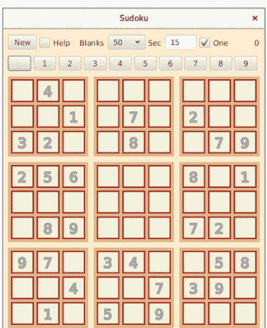

填充数独时，你可以使用鼠标，也可以使用键盘。如果你点击一个字段（未由机器填充的字段），该字段会被选中，你可以通过点击下方的按钮来清除它或插入一个数字。或者，你可以使用方向键和数字小键盘。如果你使用方向键且没有选中单元格，第一行的第一个单元格会被高亮——即第一个未由计算机填充的单元格；使用方向键移动选中单元格时，会跳过计算机已填充的单元格。如果你想清除已填充的单元格，按 Delete 键；要取消选中单元格，按 End 键。

我不想展示用户界面的代码，因为它没有任何新内容，而且说实话并不复杂，但我更愿意提到创建一个新数独的另一个挑战。它需要一个策略和一个算法，我使用了以下步骤：

1. 创建一个空数独。
2. 用随机顺序的 9 个数字填充第一列。
3. 在顶行随机填充接两个单元格，确保它们不违反第一个区块的数独规则。
4. 用剩余数字按随机顺序填充顶行的剩余单元格。
5. 填充最后 64 个单元格，使结果成为合法的数独。
6. 随机留空所需数量的单元格。

在 bookoon.com 下载免费电子书。

JAVA 19：算法与数据结构：软件开发

这里，步骤 2、3 和 4 连同步骤 6，将确保随机性，使你不会每次都得到相同的数独，并解决了剩余 64 个单元格的填充问题，使得单元格的值是随机确定的，但当然会始终符合数独的规则。步骤 5 是一个复杂的问题，特别是因为数独必须确保具有唯一解。由于许多原因，步骤 6 也是复杂的，因为删除一个字段可能会导致数独出现多个解。步骤 5 的解决方案可以如下：

1. 当（存在可以用唯一方式填充的单元格）时，填充单元格。
2. 如果（数独已填充），返回`true`。
3. 找到数字选择范围最少的单元格。
4. 对于这些单元格中的每一个：
   - 填充单元格。
   - 重复算法。

步骤 6 清除字段的解决方案可以描述为：

1. 选择一个随机单元格。
2. 如果（设置此单元格会导致数独）单元格。
3. 重复步骤 1，直到达到所需的空白单元格数量。

下一步是根据这些指南编写算法，这并不简单。以下类代表了数独：

```java
public class Puzzle {
  int[] values = new int[9][9];
}
```

如果值为 0，则被解释为空。如果值为负数，则被解释为已填充。如果值为正数，则被解释为数值。以下类称为`Solver`，它解释了细节：

```java
public class Solver {
  private static int MaxTries = 5000;
  private Puzzle solution = null;
  private boolean[] list = new boolean[10];
  private int solutions = 0;
  private int count = 0;

  // 操作在当前数独的副本上进行，这样如果填充失败，
  // 你可以再次尝试
  public boolean solve(Puzzle puzzle, boolean unique) {
    Puzzle copy = new Puzzle(puzzle);
    count++;

    // 只要还有可以用唯一方式填充的单元格，就填充单元格
    single(copy);
    // 如果有解（表格已填满），则方法返回
    if (isSolved(copy)) {
      solutions++;
      // 如果数独应该是唯一的，则方法放弃
      if (unique && solutions > 1) return false;
      // solution 是完成后的数独
      solution = copy;
      return true;
    }
    // 否则，确定可填充方式最少的单元格
    // 如果无法找到单元格，则方法放弃
    else if (!find(copy, triple)) return false;
    // triple 包含了可以填充的单元格的行索引和列索引
    // 以及该单元格可以填充的方式
    boolean ok = false;
    boolean solved = false;

    // 尝试用 list 中指示的可能数字之一填充单元格，
    // 之后方法递归调用自己
    for (int i = 1; !ok && i <= triple.count; i++) {
      int k = select();
      list[k] = false;
      copy.setValue(triple.row, triple.col, k);
      if (count < MaxTries) solved = (solve(copy, unique)); else solved = false;
      if (!unique) ok = solved;
    }
    return solved;
  }
}
```

## JAVA 19：更多算法与数据结构：软件开发

……


### 管理学硕士

因为实现梦想是你最大的挑战。IE 商学院提供英语、西班牙语或双语教学的管理学硕士……（等等，文本是碎片化的）。

提供英语、西班牙语或双语教学的管理学硕士，通过一项创新的计划培养职业生涯初期的年轻优秀专业人士，帮助他们充分发挥潜力。

选择你的专业领域。

通过这些提供的选项定制你的硕士学位，包括全球沉浸周，例如伦敦、瓦伦西亚或上海。

因为你改变，我们随你而改变。

www.ie.edu/master-management  
admissions@ie.edu

```java
// 如果 t 可以放置在单元格 (r, c) 中，返回 true。
public static boolean ok(Puzzle puzzle, int r, int c, int t) {

}
```

在 bookboom.com 下载免费电子书。

## JAVA 19：更多算法与数据结构：软件开发

### 其他算法

// 引用一个单元格以及一个 0 到 9 之间的索引

```java
class Triple
{
    int row;
    int col;
    int cnt;
}
```

有了这个类，我可以编写一个`Generator`类，实现一个方法，用于创建并返回一个具有数量空白的数独矩阵。再次，我只想概述解决方案，细节请参考已完成的代码：

```java
public class Generator
{
    public static final Random random = new Random();
    // 在放弃并选择另一个单元格之前，阻塞某个单元格的最大尝试次数
    private static int maxTries = 5000;

    // 在给定的秒数内创建一个具有数量空白的新数独矩阵。
    // 如果该方法无法在此期间形成数独，且未达到预期的
    // 空白数量，它将放弃并返回找到的最佳数独，即空白格尽可能多的数独。
    // 参数是空白格的数量，以及在数独具有唯一解时，
    // 方法放弃前的秒数。
    public Puzzle create(int blanks, int seconds, boolean unique) {
        Puzzle puzzle = tryCreate(blanks, unique);
        int t1 = getTime();
        // 如果没有得到所需的结果，重复该过程直到
        while (puzzle.getBlanks() < blanks) {
            Puzzle temp = tryCreate(blanks, unique);
            if (temp.getBlanks() > puzzle.getBlanks()) puzzle = new Puzzle(temp);
            int t2 = getTime();
            if (t2 - t1 > seconds) break;
        }
        return puzzle;
    }
```

// 创建一个具有数量空白的新数独矩阵。

// 算法工作如下：

// 第一列按随机顺序填充 9 个数字。

// 第一行的接下来两个数字被随机填充，以确保它们

// 不违反第一个区块的数独规则。

// 第一行的其余 6 个数字按随机顺序填充。

// 表格的其余部分使用`Solver`类进行填充。

// 该方法随机留空你想要数量的单元格。

// 如果无法留空指定数量的单元格，则

// 操作中断，你将获得一个已留空单元格的数独。

```java
private Puzzle tryCreate(int blanks, boolean unique)
{
    Puzzle puzzle = new Puzzle();
    int row = 0;
    int col = 0;
    // set1 是 9 个值
    List<Integer> set1 = new ArrayList();
    for (int i = 1; i <= 9; i++) set1.add(i);
    List<Integer> set2 = new ArrayList();
    int t = set1.get(rand.nextInt(9));
    puzzle.setValue(row, col, t);
    set1.remove(new Integer(t));
    // 填充第一列
    for (row = 1; row < 9; row++) {
        t = set1.get(rand.nextInt(set1.size()));
        set2.add(t);
    }
```


```java
set1.remove(new Integer(t));
puzzle.setValue(row, col, t);
}
// 填充第一行的两个格
for (row = 0, col = 1; col < 3; ++col) {
    t = set2.rand.nextInt(set2.size());
    while (t == puzzle.getValue(1, 0) || t == puzzle.getValue(2, 0)) {
        t = set2.rand.nextInt(set2.size());
    }
    set2.remove(new Integer(t));
    puzzle.setValue(row, col, t);
}
// 填充第一行的最后 6 个单元格
for (col = 3; col < 9; ++col) {
    t = set2.rand.nextInt(set2.size());
    set2.remove(new Integer(t));
    puzzle.setValue(row, col, t);
}
// 使用 Solver 类填充数独的其余部分
puzzle solution = null;
do {
    Solver solver = new Solver();
    solver.solve(new Puzzle(puzzle), unique);
    solution = solver.getSolution();
} while (solution == null || solution.isBlank());
// 留出所需数量单元格的空白
puzzle = blank(solution, blanks, unique);
return puzzle;
};
```

// 留空对应所需空白数量的单元格。  
// 每当一个单元格被设置（可能是两个单元格），该方法都会尝试  
// 使用 Solver 对象求解数独。如果留空单元格没有  
// 产生解决方案，该方法将放弃并尝试另一个单元格。  
// 如果尝试了 MaxTries。

```java
public Puzzle blank(Puzzle solution, int blanks, boolean unique) {

    Puzzle temp = new Puzzle(solution);

    Counter counter = new Counter();

    int tries = 0;

    do {

        Puzzle copy = new Puzzle(temp);

        Solver solver = new Solver();

        if (solver.solve(copy, unique)) {

            temp = copy;

        }

        tries++;

    } while (temp.getBlanks() > blanks && tries < MaxTries);

    return temp;

}
```


# JAVA 19：更多算法与数据结构：软件开发

# 关于树的更多内容

作为一个示例，我在下方展示了如果你构建一个包含元素 `A`, `T`, `B`, `N`, `C`, `L`, `G`, `J`, `I` 的 2-3-4 树，并按照此顺序插入它们，会发生什么：

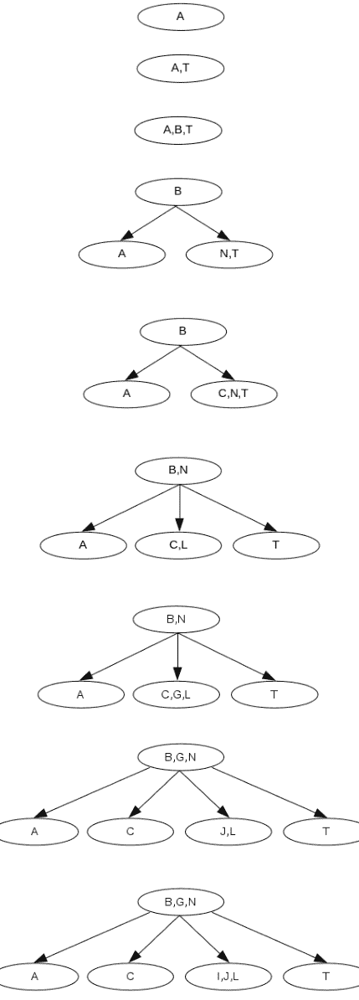

假设你需要插入 `K`。插入必须在一个 4 节点中进行，因此需要再次进行分裂：

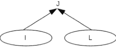

此时 `J` 在树中向上浮动。由于 `J` 也必须插入在一个 4 节点中，因此需要再次进行分裂：

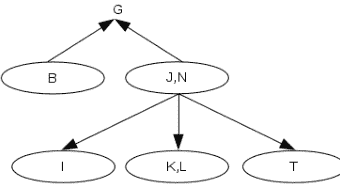

结果是 `G` 变成了新的根节点，如下。有趣的是，结果是一棵平衡树。在这种情况下，它是一个具有 10 个元素且高度为 2 的树。

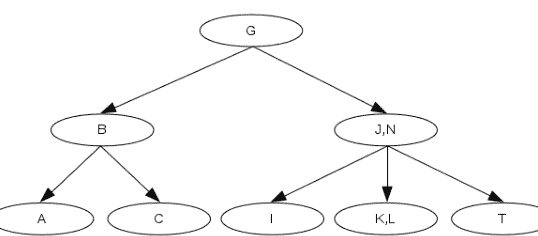

删除元素要困难得多（有几种情况），它是基于节点的旋转和融合的（它将两个 2 节点合并为一个单个 4 节点）。删除元素的操作可以描述如下：

- 找到要删除的元素。
- 如果该元素不是叶子节点，你标记该位置并继续搜索，直到到达包含该元素后继节点的叶子节点（该后继可能是小于要删除元素的最大元素，也可能是大于要删除元素的最小元素）。最简单的方法是按照下文所示调整树，使得你到达的叶子节点不是 2 节点。如果是这种情况，被标记节点中的元素（要删除的元素）可以立即被叶子节点中的后继节点替换。
- 如果要删除的元素在叶子节点中且该节点不是 2 节点，可以直接删除该元素。
- 如果要删除的元素在叶子节点中且该节点是 2 节点，则必须按照下文调整树。
- 如果在从根节点到上述节点的路径上遇到 2 节点（根节点经过特殊处理），请执行以下树调整：
  1. 如果父节点是 2 节点且兄弟节点也是 2 节点，则所有三个节点合并为一个新的 4 节点。父节点的当前节点永远不会是 2 节点。
  2. 如果一侧有一个不是 2 节点的兄弟，则与该兄弟进行旋转。结果是将兄弟节点中的元素移动到父节点，同时将父节点的一个元素移动到当前节点，该节点随后变为 3 节点。
  3. 如果没有具有多个值的兄弟节点，则与父节点和兄弟进行融合。结果是一个新的 4 节点。

该过程可以通过几个示例来说明。假设在上面的树中你想删除 `I`。在通往 `I` 的路上，你不会遇到 2 节点（根节点除外），因此不会对树进行任何调整。你处于一个 2 节点中，并且有一个不是 2 节点的兄弟。因此，必须执行旋转，让 `K` 向上移动一级，而 `J` 向移动到与 `I` 相同的节点，然后就可以删除 `I`。结果所示：

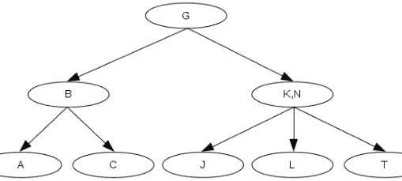

假设接着你想删除 `J`。在向下到达 `J` 的路上没有 2 节点，因此不需要调整树。`J` 是一个 2 节点，它的兄弟也是一个 2 节点，因此必须对包含 `J` 的节点和来自父节点的元素 `K` 的节点进行融合。结果是一个 4 节点，可以从中删除 `J`：

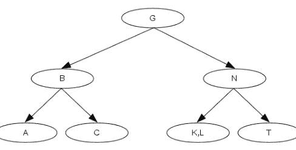

最后，假设你也想删除 `K`。在搜索 `K` 时，你来到 `N`，那里有一个 2 节点，由于它的兄弟也是 2 节点，必须进行融合：

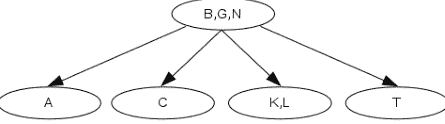

然后继续搜索，到达包含 `K` 的节点，该元素可以删除：

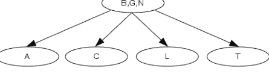

假设你还想删除 `K`。在搜索 `G` 时，你来到一个 2 节点，由于它的兄弟也是 2 节点，必须进行融合：


删除删除 2 节点：


删除删除删除删除删除：


## 7.2 红黑树

如上所述，你直接实现 2-3-4 树是为了其他目的，因为删除有多种情况。但是，你可以将 2-3-4 树转换为二叉树，这种树被称为红黑树。在这种情况下，所有的链接被分配为红色或黑色。如果一个节点是黑色的，那么它是平衡的。2-3-4 树可以如下转换为二叉树：

- 2 节点映射到二叉节点，两个子节点都是黑色的：

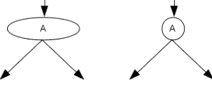

- 3 节点映射到两个二叉节点，其中一个是红色的：

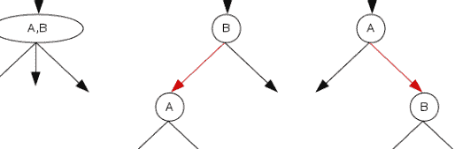

- 最后，4 节点映射到三个二叉节点，全部是红色的：

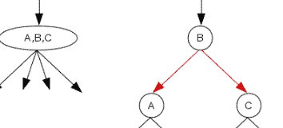

红黑树的定义如下：

1. 不存在相邻的红色节点（在上面的图中，所有的节点都是黑色的）。
2. 从根节点到相应节点的黑色链接数量是该节点的黑色深度。在红黑树中，所有叶子节点具有相同的黑色深度。这是因为红色链接不贡献于 2-3-4 树的高度。
3. 根节点没有链接，假设它是黑色的。

考虑下面的 2-3-4 树示例：

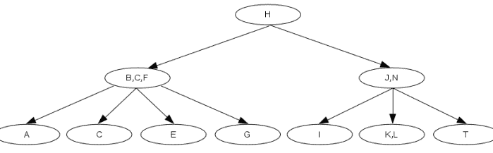

如果你将其转换为红黑树，结果如下：

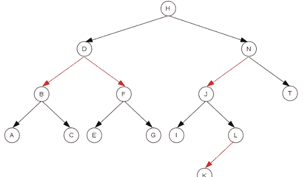

在这里你应该注意，没有两个相邻的红色节点，并且所有叶子节点具有相同的黑色深度。红黑树并不是平衡的，但如果你计算黑色链接，它是平衡的。红黑树特别是一个二叉搜索树，因此，在前一书中说的关于二叉搜索树的所有内容（包括平衡搜索树）仍然有效，即可以实现插入和删除以维护红黑树的要求。这并不简单。

我将从插入开始。在上面，我将 2-3-4 树的插入描述为：向下搜索找到插入新元素的位置，然后返回并分裂任何已满的 4 节点。这意味着既有自顶向下的遍历，也有自底向上的遍历（类似于 AVL 树）。可以通过自顶向下的遍历来实现这种操作，确保新元素不会被插入到 4 节点中。

# JAVA 19: 更多算法与数据结构：软件开发

# 关于树的更多内容

红黑树，这是一个极其简单的过程，因为已知 4 节点有两个红色子节点，而分裂始终包含简单的颜色变化：

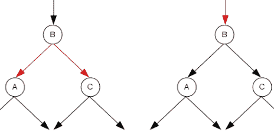

这保持了所有叶子节点的黑深度。由于 `B` 现在是红色的，如果 `B` 的父节点也是红色，就会出现问题，因为会有两个连续的红色节点。这个问题通过旋转来解决。如果一个 4 节点成功变为一个 2 节点，有两种选择：

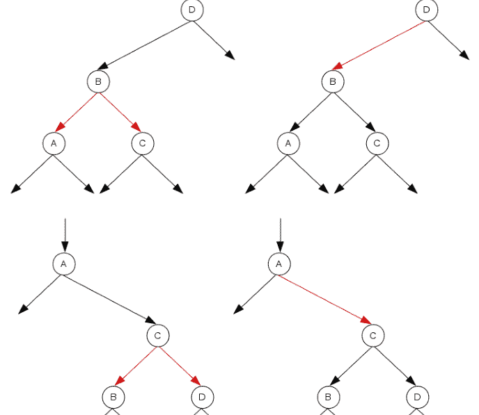

这些情况都不会导致问题。如果一个 4 节点接跟在一个 3 节点之后，则有三种选择，因为 4 节点可以是左孩子、右孩子或中间孩子。如所示，将 3 节点转换为红黑树可能会导致两种方向，因此实际上有 6 种情况。下面是两种情况，其中 4 节点节点是 3 节点的右孩子和左孩子，但这两个 3 节点具有两种不同的方向：

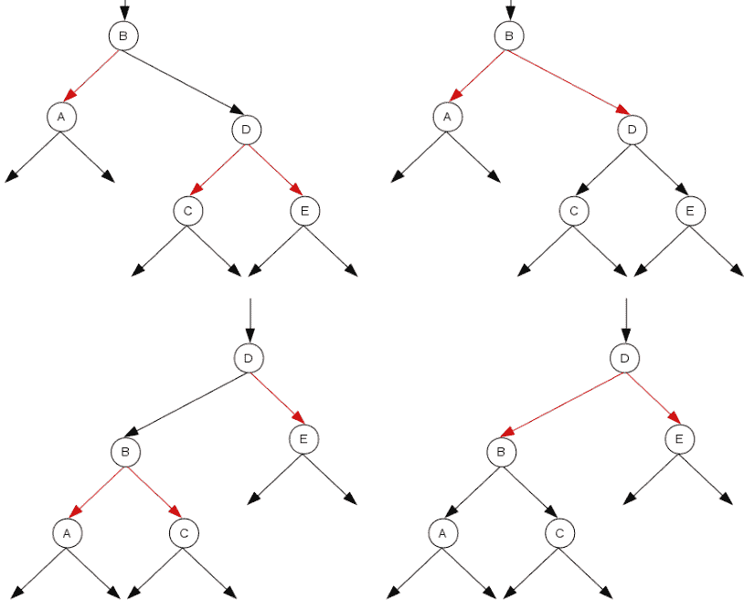

在这两种情况下，颜色变化都不会引起问题（不会出现两个连续的红色节点）。相反，如果一个 4 节点仍然作为右孩子和左孩子，但方向相反：

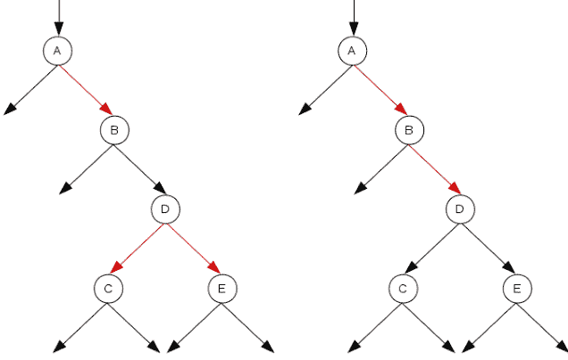

那么颜色变化就会导致问题，因为会出现两个连续的红色节点。该问题通过对 `B` 进行左旋转来解决：

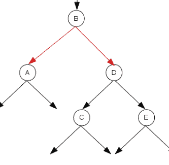


这里也存在一个平行的情况，其方向相反：

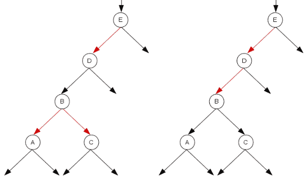

这一次问题通过对 `E` 进行右旋转来解决：

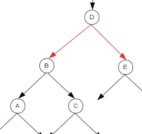

4 节点也可以是 3 节点的中间孩子，如果你在这里进行颜色变化，结果将是产生两个连续的红色节点：

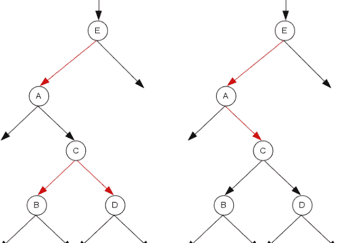

这一次，通过首先在 `A` 中执行左旋转，然后在 `E` 中执行右旋转来恢复平衡：

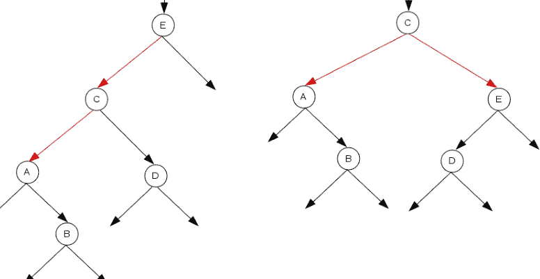

这里还有另一种情况， 3 节点具有相反的方向：

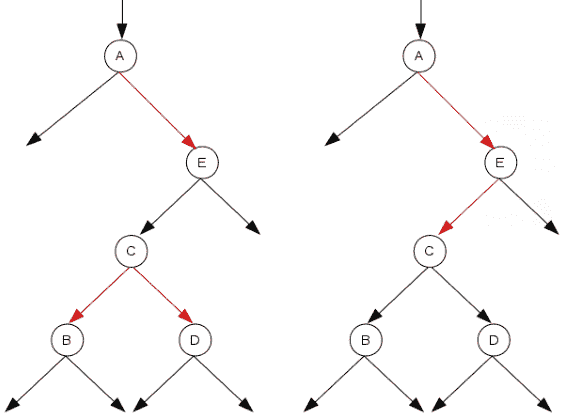

这一次，通过在 `E` 中执行右旋转，然后在 `A` 中执行左旋转来恢复平衡：

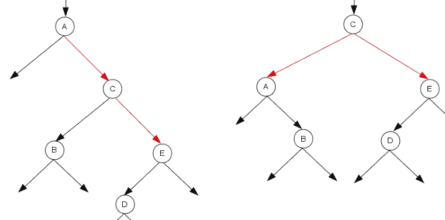

紧接着还有另一种情况， 4 节点可以是另一个 4 节点的节点，但这在本质上是不可能的，因为这样的 4 节点父节点已经分裂了。


所有这些操作的结果是在当你找到要插入的新元素的叶子时，它可能发生在 4 节点中。

# JAVA 19: 更多算法与数据结构：软件开发

```java
public IList<TreeNode<T>> getChildren()
{
    return children;
}
```

```java
public TreeNode<T> add(T element)
{
    TreeNode<T> node = new TreeNode(element, this);
    children.add(node);
    return node;
}
```

```java
public boolean remove()
{
    if (parent == null) return false;
    return parent.children.remove(this);
}
```

```java
@Override
public int hashCode()
{
    return element.hashCode();
}
```

```java
@Override
public boolean equals(Object obj)
{
    return element.equals(obj);
}
```

这一次类包含了更多的引用，其中节点可以引用其他节点。由于节点的度可以是任意的，因此节点拥有一个指向子节点的引用列表，从而拥有了子树。你应该注意的是，这个列表总是被创建的，这并不是必要的，因为所有叶子节点都不需要这个列表。可以通过为复合节点创建列表来获得更高的效率，而我总是创建这些列表是为了让代码稍微简单一点。另外请注意，节点有一个指向其父节点的指针。这些指针的目的是让某些方法的实现更加有效。最后，节点有一个层级（`level`），所以你知道它是树的哪一层。子列表中的元素数量就是该节点的度。

该类的方法有些简单易见，但你必须注意 `add()` 方法，它创建一个新节点并将其作为该节点的节点。你还应该注意 `remove()` 方法，它删除了当前元素。这是通过从父节点的子列表中删除当前元素来实现的。这意味着删除以当前元素为根的子树。`remove()` 方法首先测试节点的父节点是否为空，因为不应该删除根节点。

# JAVA 19: 更多算法与数据结构：软件开发

树本身可以实现如下：

```java
public class GeneralTree<T> implements Tree<T>
{
    private TreeNode<T> root;
    private int size = 1;

    public GeneralTree(T element)
    {
        root = new TreeNode<T>(element, null);
    }

    public TreeNode<T> getRoot()
    {
        return root;
    }

    public TreeNode<T> add(TreeNode<T> parent, T element)
    {
        ++size;
        return parent.add(element);
    }

    public TreeNode<T> find(T element)
    {
        for (TreeNode<T> node : this) if (node.getElement().equals(element))
            return node;
        return null;
    }

    public List<TreeNode<T>> getPath(TreeNode<T> node)
    {
        List<TreeNode<T>> path = new ArrayList<>();
        for (; node != null; node = node.getParent()) path.add(node);
        return path;
    }

    public boolean remove(TreeNode<T> node)
    {
        if (node.remove()) {
            --size;
            return true;
        }
        return false;
    }
```

# JAVA 19: 更多算法与数据结构：软件开发

# 关于树的更多内容

```java
public int getSize()
{
    return size;
}

public Iterator<TreeNode<T>> iterator()
{
    return new TreeIterator();
}

private class TreeIterator implements Iterator<TreeNode<T>>
{
    private Queue<TreeNode<T>> queue = new LinkedQueue();

    public TreeIterator()
    {
        queue.enqueue(root);
    }

    @Override
    public boolean hasNext()
    {
        return !queue.isEmpty();
    }
```


访问 www.helpmyassignment.co.uk 获取更多信息

在 bookboon.com 免费下载电子书

```java
@Override
public TreeNode<T> next() {
  try {
    TreeNode<T> node = queue.dequeue();
    for (TreeNode<T> child : node.getChildren()) queue.enqueue(child);
    return node;
  } catch (Exception ex) {
    return null;
  }
}
```

方法的实现非常简单，唯一的异常是实现为内部类的迭代器。首先要决定以什么顺序访问单个元素，我选择了按层序（`level order`）进行。迭代器可以使用队列来实现，方法与在之前的书中相同——二叉树的层序遍历。

如果你考虑 `add()` 和 `remove()` 方法，它们实际上是非常高效的——它们是以常时间复杂度实现的，但这种效率之所以是明显的，是因为它们要求你知道插入新元素的节点或要删除的节点。另外请注意，之所以以常时间复杂度进行删除，是因为节点有一个父指针。要找到一个节点（必须删除或作为新节点的父节点），请使用 `find()` 方法，这就是问题所在，因为它具有线性时间复杂度。

最后，注意 `getPath()` 方法，它返回从根节点到节点的路径。当你能够以合理的效率实现此方法时，这又是由于父节点引用。

该类有一个返回树的高度或度的方法。这通常与 `add()` 和 `remove()` 结合进行维护。这在 `add()` 中是简单的，但在 `remove()` 中并不容易。通过目前的实现，你可以遍历树来确定树的高度和度。

# JAVA 19: 更多算法与数据结构

# 关于树的更多内容

## 练习 5：测试通用树

你必须编写一个程序，当程序使用上述 `GeneralTree` 类时调用 `Tester`。该程序概述如下：

```java
public class TreeTester {
  public static void main(String[] args) {
    // 整数通用树
    ITree<Integer> tree = new GeneralTree<>(0);
    // 向树添加 1, 2, 3
    // 删除 2
    // 打印树
  }
}
```

```java
public static void print(ITree<Integer> tree) {
    // 打印树的实现
}
```


```java
public static int getSum(ITree<Integer> tree) {

    // 求和的实现

}
```

### 7.4 搜索树

在之前的书中以及上面，我们查看了二叉搜索树，你也可以考虑通用搜索树，它是一个由节点组成的 `n` 树，每个节点有 `n-1` 个指针：

- $m \leq n$
- $K_i$ 是有序值，使得 $K_1 < K_2 < \dots < K_{m-1}$
- 每个指针为空或指向一个节点

如果指针指向节点，必须满足以下要求：

- 如果 `P` 是第一个指针，对于子树中的所有值，`P` 满足 $X < K_1$
- 如果 `P` 是最后一个指针，对于子树中的所有值，`P` 满足 $X > K_{m-1}$
- 如果 `P` 是第 `i` 个指针（$1 < i < m$），对于子树中的所有值，`P` 满足 $K_{i-1} < X < K_i$

注意上面图中左侧的空白区域，这将说明节点并非完全填充，这意味着 $m < n$。因此，2-3-4 树是一个阶为 4 的搜索树。例如，下面的图展示了一个搜索树，其中灰色方框表示空指针：

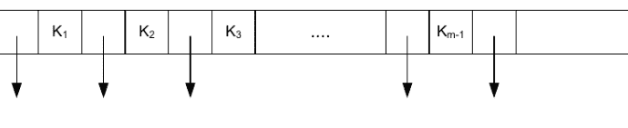

## 关于树的更多内容

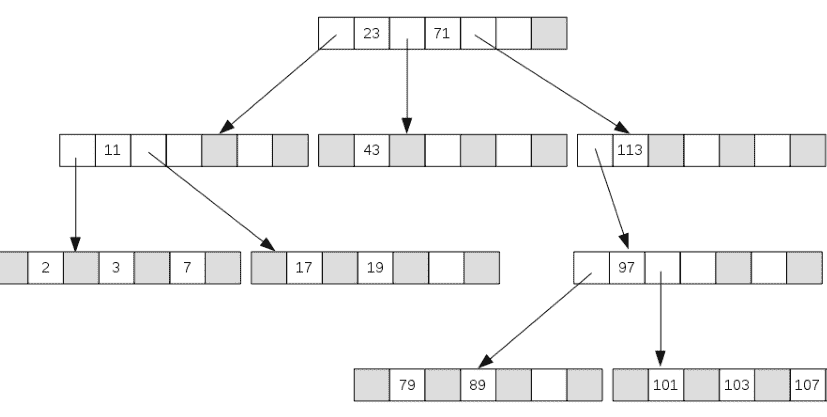

如果你想在这样的树中搜索特定元素，你需要对树进行递归搜索，直到找到该元素或发现该元素不在树中。假设例如，你将在树中搜索数字 89：

1. 通过搜索根节点，你可以发现，如果该数字在树中，它一定在右子树中。
2. 通过搜索该子树的根节点，你可以推断出如果在树中找到了 89，它一定在左子树中。
3. 通过搜索该子树的根节点，你可以再次发现该数字在左子树中。
4. 通过搜索该子树的根节点（这是一个叶子节点），找到了该数字。

因此，必须访问 4 个节点。作为另一个例子，假设你想找到数字 47：

1. 在搜索根节点时，你可以发现如果该数字在树中，它一定在指针 23 和 71 指向的子树中。
2. 通过搜索该子树的根节点，你会发现该数字在 43 的右侧子树中，但它是空的，因此没有找到 47。

因此，该树在许多方面与二叉搜索树具有相同的特性。

在最坏的情况下，你需要向下到达底层来确定元素是否存在（这与二叉搜索树相同）。假设该树是“良好”平衡的。如果你从根节点开始搜索，它对应于选择一个包含 $t/n$ 个元素的子树。在这里重复搜索，你将选择包含 $t/n^2$ 个元素的下一个子树。在重复操作 `k` 次后，你得到了一个包含 $t/n^k$ 个元素的子树。在最坏的情况下，你完成了搜索。

```text
$n^t = 1 \Rightarrow t = n^k \Rightarrow \log_n(t) = k$
```

这意味着一个阶为 `n` 的“良好”平衡搜索树的深度为 $\log_n(t)$，其中 `t` 是元素数量，你最坏情况下可以通过搜索 $\log_n(t)$ 个节点找到一个元素。注意，你可以在单个节点中使用二分查找。假设你有一个阶为 100 且包含 10000000 个元素的搜索树。在最坏的情况下，你需要在

```text
$\log_{100}(10000000) = \frac{\log_{10}(10^7)}{\log_{10}(100)} \sim 4$
```

示例告诉我们，平衡搜索树的深度非常小，这正是目标所在，搜索树通常用于存储在磁盘上的数据。一次加载一个磁盘块，读取磁盘块的时间比内存操作长得多，因此减少磁盘操作非常重要——之后你需要搜索单个磁盘块，但那是内存中进行的。

可以实现上述的搜索树，但它并没有很大的意义，因为它的效率完全取决于树是否平衡，而且它还应该是单个节点不会几乎是空的。我想描述一种能够适应这两个条件的变体。因此，它是一种实现了良好平衡并确保良好搜索复杂度的数据结构，但如前提到的，这种数据结构对于永久存储在磁盘上的对象主要具有意义，因为搜索单个节点的时间可能非常显著。

### 7.5 B 树

阶为 `n` 的 B 树是一种阶为 `n` 的搜索树，但插入的数据元素是形式为 `[K, Q]` 的对，其中 `K` 是键，`Q` 是指向键 `K` 数据存储位置指针。例如，可以是磁盘块的地址（在实践中确实如此）。同样，B 树可以所示：

| P1 | K1 | Q1 | P2 | K2 | Q2 | P3 | K3 | Q3 | ... | Pm-1 | Km-1 | Qm-1 | Pm | |

其中 `P` 指针与普通搜索树相同，而 `Q` 指针指向这些块。此外，树必须满足：

- 除了根节点和叶子节点外的所有节点至少有 $[n/2]$ 个 `P` 指针（即至少 $[n/2]$ 个子树）。
- 根节点至少有两个 `P` 指针，除非根节点是树中的唯一节点。
- 所有叶子节点都在同一层，叶子节点的特征是所有 `P` 指针均为 0。

例如，下面展示了一个阶为 4 的 B 树（注意我没有显示 `Q` 指针）：

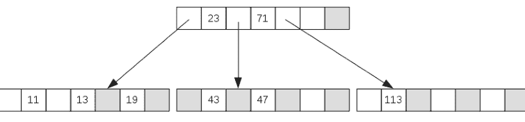


这些要求确保了树是良好平衡的，并且元素的插入和删除始终遵循上述要求。在 B 树中插入元素描述如下：B 树从单个根节点开始，只要有空间就可以插入元素。当根节点填满时，它分裂为两个同层节点，中间元素留在根节点，剩余元素分配在两个节点之间。如果向已满节点插入元素，它分裂为两个同层节点，中间元素移动到父节点。如果父节点也满了，则重复该过程，最终创建一个新的根节点。

下面是向上述树插入以下元素：2, 3, 5, 7, 41, 53, 29, 31, 37, 63, 59 的结果所示。当节点分裂时，有 4 个元素，中间元素必须移动到父节点，其他元素分布在两个子节点。由于技术原因，我没有显示单个节点中的指针，起点是以下树：

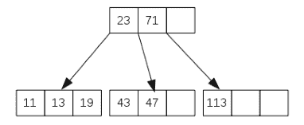

当插入 2 个数字时，树的情况如下：

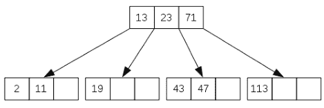 插入 3 后：

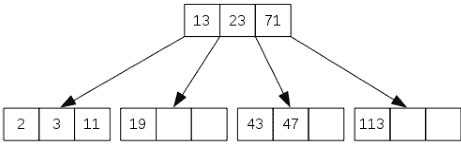 插入 5 后：

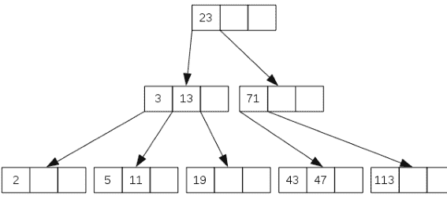 插入 7 后：

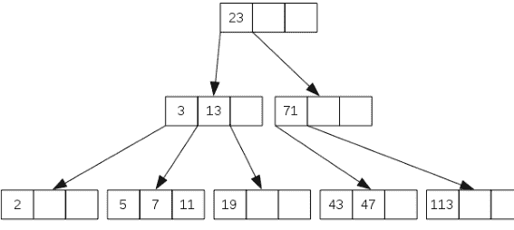 插入 42 后：

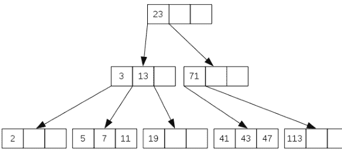 插入 53 后：

 插入 29 后：


 插入 31 后：

 插入 37 后：

 插入 63 后：

 插入 59 后：


在这种情况下，满节点中的元素数量是奇数。如果数量是偶数，则需要选择一个策略来向上移动哪个元素——二种选择。选择哪一个并不重要。

在 B 树中删除元素时，节点可能会变得少于一半，然后必须与邻居合并。你必须合并两个节点，这是一个可以向上树传播并导致树深度减小的操作。事实上，删除并不容易。策略大致如下：

你首先找到包含要删除元素的节点。接下来，像 2-3-4 树一样，应该找到包含元素后继元素的叶子节点。要删除的元素被其后继元素替换，后继元素在叶子节点中删除。之后，可能出现叶子节点不再满半且结果不再是 B 树，你现在必须调整树。如果节点有一个直接兄弟且该兄弟超过半，则可以通过旋转解决问题，从该兄弟移动一个元素到父节点，同时从父节点移动一个元素到删除元素的叶子节点。如果不是如此，删除元素的叶子节点将与邻居兄弟以及来自父节点的元素合并。

在删除 2 后。执行了左旋转：


## 关于树的更多内容

删除 11 后。包含 11 的节点不会为空，因此不需要进行任何进一步的操作：


删除 7 后。结果是一个空节点，并执行与右侧兄弟合并以及从父节点获取元素的操作：


删除 5 后。只有与后继节点的替换，该节点可以立即删除，无需对树进行进一步调整：


删除 13 后。13 被替换为 19，导致产生空节点。执行与左侧兄弟以及从父节点获取元素 19 的合并。然后父节点为空，并执行与右侧兄弟以及从父节点获取元素 23 的合并：


B 树的实现方式与二叉树相同，最大的区别在于节点的定义不同，因为它应该容纳多个元素并能够引用多个子树。`BTree` 类实现了具有典型操作的 B 树，但它更多是为了示例而非实用。其工作量在于实现 `insert()` 和 `remove()`，以确保在操作完成后树仍然是一棵 B 树。该类在 B 树中组织对象，这意味着当阶数很大（节点中有很多元素）时，树的深度会增加，通到叶子节点的搜索路径会变短，但由于必须在单个节点内进行搜索，这种优势被抵消了。在这种情况下，节点是线性搜索的，当节点是有序时，你可能通过改为二分搜索来改进树。特别是对于大阶数的树，应该考虑在单个节点内部实现二分搜索。

由于上述原因，B 树在组织内存对象方面并没有很大兴趣，B 树的目标也是为了组织内存中的键和对磁盘块的引用，以便在文件中进行高效搜索，仅在需要时加载磁盘块。

## 练习 6：测试 BTREE

你必须编写一个可以调用 `BTreeTester` 的程序，该程序将测试阶数为 6 的 `BTree` 类。程序必须包含一个 `test1()` 方法，创建一个用于 `Integer` 对象的阶数为 6 的 `BTree`。你随后必须打印树的阶数、元素数量和树的高度。然后，该方法必须以随机顺序将 10 到 99 的数字插入树中。接下来，该方法必须插入上述相同的信息，即最小的元素和最大的元素，使用迭代器在行内打印树的各个元素，最后使用该类的 `toString()` 方法打印树本身。

你必须编写一个 `test2()` 方法，为 `Character` 对象创建一个 `BTree`。接下来，该方法必须以随机顺序将 A-Z 26 个字母插入树中。该方法必须执行一个循环，每次迭代打印与 `test1()` 相同的信息，然后删除树中的随机元素。这种迭代将重复直到树为空。

`RBTreeTester` 类（练习 5）有一个 `test3()` 方法。将此方法复制到当前的 `BTreeTester` 中。该方法比较了三棵树的性能（一个 `RBTree<Integer>`，一个 `BinSearchTree<Integer>` 和 `java.util.TreeSet<Integer>`）。扩展该方法，增加第四种树，即这种类型的 `BTree<Integer>`，以便在树上执行相同的操作。尝试实验树的阶数（树的扇出数）以及它对性能是否重要。

### 7.6 B+ 树

B 树的特点是大扇出——或者说此就是全部：大扇出和低深度。对于所有叶子节点，这意味着它们包含了许多指向子树的指针（这些指针始终为空），为了避免这种情况，你通常会实现 B 树的一种变体，称为 B+ 树。B+ 树具有两种节点：

- 内部节点
- 叶子节点

内部节点的格式与通用搜索树中的节点相同：


但没有数据指针，只有搜索值和指向子树的指针。通常情况下，内部节点必须符合与 B 树相同的标准，但关于子树有以下要求：

- 如果 `P` 是第一个指针，则子树 `P` 中的所有值 `X` 都满足 $X < K_1$
- 如果 `P` 是最后一个指针，则子树 `P` 中的所有值 `X` 都满足 $X \ge K_{m-1}$
- 如果 `P` 是第 `i` 个指针且 `i < m`，则子树 `P` 中的所有值 `X` 满足 $K_{i-1} \le X \le K_i$。即叶子节点包含搜索值 `K`


其中 `Q` 指针是数据块的指针，它们根据键进行排序。`BTree` 类实现了 B+ 树，但其实现与 `BTree` 类不同，此时节点类型被定义为内部类：

```java
private abstract class Node {

    List<K> keys;

}
```

而具体的节点定义如下：

```java
private class InnerNode extends Node {

    List<Node> children;

    private class LeafNode extends Node {

        List<V> values;

        LeafNode next = null;

    }

}
```

该类定义为：

```java
public class BTree<K extends Comparable<K>, V> implements Iterable<V> {

    private Node root = null; // 树的根

    private int count = 0; // 树中的元素数量

    private int order = 0; // 树的阶数

}
```

代码主要由两个节点类组成，但为了方便工作，`Tools` 类扩展了一个二分搜索方法：

```java
public static <T extends Comparable<T>> int binSearch(List<T> list, T element) {

    int a = 0, b = list.size() - 1;

    while (a <= b) {

        int m = (a + b) / 2;

        if (list.get(m).equals(element)) return m; else (list.get(m).compareTo(element) < 0) a = m + 1; else b = m - 1;

    }

    return -(a + 1);

}
```

该方法在数组内部列表中进行搜索，但重要的是未找到元素时的返回值，即元素应该所在的索引但带有负号。Java 的集合类以相同的方式实现二分搜索。`BTree2` 在单个节点内部使用二分搜索，上述实现使得向下搜索树变得容易。

此外，`ArrayList` 类（以及 `List` 接口）已更改，以便该类扩展了一个删除区间内所有元素的新方法：

## 关于树的更多

```java
public void clear(int a, int b)

  if (b > a)

  {

    for (int i = a, j = b; j < count; ++i, ++j) elements[i] = elements[j];

    count -= b - a;

  }
```

Java 的 `ArrayList` 有一个类似的方法，实现该方法的目的是为了性能。

## 练习 7：测试 BTREE2

编写一个可以称为 `BTreeTester` 的应用程序，它可以用于测试 BTree 树：

```java
public class BTree2Tester

{

  private static java.util.Random rand = new java.util.Random();

```


在 www.deloitte.ca/careers 发现真谛


在 bookboom.com 下载免费电子书


## 关于树的更多

```java
public static void main(String[] args)

{}
```

```java
private static void test1() {

    // 创建一个 IList<Integer>，包含区间 [A;B] 内

    // 所有的偶数。

    // 创建一个扇叉度为 6 的 BTree<Integer, String>。

    // 为上述列表中的每个键插入一个元素，

    // 键必须以随机顺序插入，且值应该是一个随机字符串。
```


# JAVA 19：算法与数据

## 关于树的更多

```java
private static void test1() {
    // 打印树。
    // 在树中搜索 10 个键，并打印每个
    // 键被找到或未找到。
    // 获取值的子范围 - 方法
    // getValues() - 打印这些值。
}
```

```java
private static void test2() {
    // 创建类型为 IList<Integer> 的两个列表 list1 和 list2，
    // 并用从 100 到 200 的键初始化列表。
    // 创建一个扇叉度为 4 的 BTree<Integer, String>。
    // 为 list1 中的每个键向树添加一个元素，
    // 元素必须按照键的随机顺序添加。
    // 打印树。
    // 随机移除元素，直到树包含 20 个元素。
    // 打印树。
}
```

```java
private static void test3() {
    // 创建类型为 IList<Integer> 的两个列表 list1 和 list2，
    // 初始化列表从 100 到 1000 的键。
    // 创建一个扇叉度为 10 的 BTree<Integer, String>。
    // 为 list1 中的每个键向树添加一个元素，
    // 元素必须按照键的随机顺序添加。
    // 打印树。
    // 随机移除元素，直到树为空，并在移除时
    // 将键打印在一行中。
    // 打印树。
}
```

```java
private static void test4() {
    // 创建一个扇叉度为 256 的 BTree<Integer, String>。
    // 在树中插入 N 个元素，其键小于 2N。
    // 打印
    // 树中元素的数量以及毫秒数（耗时）。
    // 在树中搜索 M 个随机键值。
    // 打印
    // 匹配的次数。
}
```

```java
private static void print1(BTree<Integer, String> tree) {
    // 为 test1() 和 test3() 打印
    // 树、toString() 的值以及
    // 树的高度数量。
}
```

```java
private static void print2(BTree<Integer, String> tree) {
    // 为 test2() 打印
    // 树、toString() 的值以及
    // 使用迭代器遍历的元素数量。
}
```

```java
private static String create(int a, int b) {
    // 返回一个 A 到 Z 之间的随机字符串。
    // 长度应该是随机的。
}
```

# JAVA 19：更多算法与数据结构：软件开发

## 图

图是种对象的集合，两个对象之间可以存在关系。例如，图可以如下所示：


其中顶点由字母表示。线表示关系，例如，在 C 和 G 之间存在关系。在图中，所有对象都着相同的角色，因此没有根或起始点。在上面的图中，对象被称为顶点，而关系被称为边。


你喜欢图吗？你想成为一个成功图的一部分吗？我们会感谢你的热情和天赋。在 employer.com 提交你的简历。

# JAVA 19：更多算法与数据结构：软件开发

并且将图定义为由两个集合 $V$（顶点）和 $E$（边）组成的数据结构：

$G = (V, E)$

上图所示图由以下集合定义：

$V = \{A, B, C, D, E, F, G, H\}$

$E = \{\{A, B\}, \{A, C\}, \{A, D\}, \{C, G\}, \{C, H\}, \{D, H\}, \{H, F\}, \{F, G\}, \{B, E\}\}$

结合图，你还将两个顶点之间的路径定义为从一个顶点到另一个顶点的边序列。在上面的图中：

$(A, C, G)$

$(A, B, C, H, E, G)$

都是从 A 到 G 的路径。更正式地说，图 $G$ 是一个顶点序列 $(V_1, V_2, \dots, V_n)$，对于所有的 $i = 1, 2, \dots, n-1$，存在边 $(V_i, V_{i+1})$。同一个顶点可能会出现多次，但如果所有顶点都是不同的，则称为简单路径。

像上面的图被称为无向图，其中边被解释为对应双向关系的双重边。既有从 A 到 B 的边，也有从 B 到 A 的边。你也可以拥有边没有方向的无向图：

$E = \{(A, B), (A, C), (A, D), (C, D), (C, G), (C, H), (D, H), (H, F), (F, G), (B, C), (B, E), (E, G)\}$


虽然图是有向的，但两个方向都必须边——因此，你通常用双箭头来表示它，并且必须有一个从顶点到自身的边：


在无向图中，你始终可以在两个方向移动，因此你可以将无向图刻画为有向图，其中每个边都是双箭头——即两个方向都有边。

在有向图中，如果两个顶点相同，则将两个顶点之间的路径称为环，也就是说，如果路径起始于顶点并结束于同一个顶点。上面的例子是：

$(C, B, C)$

一个环。没有环的有向图被称为有向无环图。

由于顶点可以指向自身的边，因此对于所有顶点都有指向任何其他顶点（包括顶点本身）的边。如果图有 $n$ 个顶点，那么它最多可能有 $n^2$ 条边。

边很多的图被称为密集图，而边很少的图被称为稀疏图（薄图）。目前没有精确的标准来衡量图是密集的还是不稀疏的，这完全取决于图更密集还是更稀疏的问题。相反，这影响了如何实现图。

# JAVA 19：更多算法与数据结构：软件开发

## 图 (GRAPHS)

- 最小生成树（least spanning tree）是在可能的情况下删除尽可能边，使得结果是一棵树。
- 拓扑排序（topological sorting）按照特定的顺序排列图的顶点。

关于图的简要说明，上面的图示展示了连通图（coherent graphs），但这并不是必要条件，下方的图也展示了一个图：


然而，在大多数情况下，你会对连通图感兴趣（因为非连通图仅仅是一组连通图），在接下来的内容中——除非另有说明——我将假设图是连通的。

图也被称为网络（network），许多应用与之相关，例如计算机网络或地理位置网络。

### 备注 (Remark)

图论实际上是一个包含许多复杂算法的大领域，以下内容绝非详尽，只是对该主题的介绍。图论非常广泛，并且基于严格的数学证明来确保算法的正确性及其时间复杂度。以下方法侧重于实践，主要目标是在 Java 中将图实现为数据结构，而对不同算法的说明没有经过精确的证明，其有效性情况也是如此。

## 8.1 实现图 (IMPLEMENTING GRAPHS)

通常情况下，将图实现为一种数据结构并不容易，特别是当要实现通用且具有合理时间复杂度的图操作时。经典图操作的实现通常取决于图的内部表示，因此与数据的的呈现方式紧密相关。

实现图的一种方法是使用二维数组。再次考虑这个图：


如果你使用二维数组，其中索引是图的顶点，数组中的元素写入边的权重，你可以按照如下方式表示图：

| A | B | C | D | E | F | G | H |
|---|---|---|---|---|---|---|---|
| A | 2 | 7 | 3 | | | | |
| B | | 1 | | 3 | | | | |
| C | | | | 1 | | 4 | 1 | |
| D | | | | | | | 2 | |
| E | | | | | | 5 | | | |
| F | | | | | | 6 | | | |
| G | | | | | | | | | |
| H | | | | | 3 | | | | |

空单元格表示两个顶点之间没有边。例如，从 A 到 B 有一条权重为 2 的边，但从 B 到 A 没有边。

以这种方式实现图是比较自然的，但这种方法有一些主要的缺点。第一，如果图是密集的（有很多边），因为矩阵将产生许多空元素，从而导致大量的未使用空间；但最大的问题是很难有效地实现图算法，因为许多算法结果涉及搜索；另一个问题是，很难用新顶点扩展图，删除顶点更是雪上加之。由于这些原因，以及因为在实践中大多数图都是稀疏的，通常会使用另一种实现方法，将图实现为列表，其中每个节点连接顶点以及从该顶点出发的边列表。

例如，我将查看以下图：


这是一个具有 9 个顶点和 17 条边的加权图。因此它是一个相对稀疏的图，边较少（81 条可能的边中只有 17 条）。图的实现可以如下所示：

加入 MITAS 是因为我想要真正的责任
工程师与地质研究生计划
www.discovermitas.com


第16个月在北海担任施工主管，提供建议并帮助解决问题真实工作 国际机会


MAERS


左侧垂直部分是一个顶点集合，每个顶点都有一个直接继者的列表，即从该顶点出发的边列表。对于列表中的每个元素，还会附带边的权重。例如，作为顶点的集合，你可以使用哈希表。这确保了容易添加新顶点，但重要的是，你可以以常数时间复杂度找到顶点。至于每个顶点的边集合，在大多数应用中，边的数量很少，因此通常选择列表或可能是链表。如果图是稀疏的，通过使用哈希集等复杂的集合，线性时间的开销将大于其收益。

在考虑了这些因素后，我将处理编写一个实现图的类。首先是定义图应该具备的操作以及对它可以做什么。我定义了以下接口：

```java
package dk.torus;

import dk.torus.PaException;
import java.util.Iterator;

public interface IGraph<T> extends Iterable<T> {
    /**
     * 返回图的类型。
     */
    String getType();

    /**
     * 返回图中顶点的数量。
     */
    int getSize();

    /**
     * 返回图中边的数量。
     */
    int Count();

    /**
     * 获取边 [from, to] 的权重。
     * @param from 起点
     * @param to 终点
     * @throws PaException 如果边不存在
     */
    double getWeight(T from, T to);

    /**
     * 修改边 [from, to] 的权重，或者如果没有权重则分配新权重。
     * @param weight 新权重
     * @param from 起点
     * @param to 终点
     * @throws PaException 如果边不存在
     */
    void setWeight(double weight, T from, T to);

    /**
     * 添加一个顶点。
     * @param elem 顶点的元素
     * @throws PaException 如果图中已存在该元素的顶点
     */
    void add(T elem) throws PaException;

    /**
     * 向图中添加边 [from, to]。如果图中已存在边 [from, to]，则忽略该操作。如果图中没有顶点 to，则添加该顶点。
     * @param from 起点
     * @param to 终点
     * @return 如果添加了新顶点则返回 true
     * @throws PaException 如果图中没有顶点 from
     */
    boolean add(T from, T to) throws PaException;

    /**
     * 向图中添加边 [from, to]。如果图中已存在边 [from, to]，则仅更新权重。如果图中没有顶点 to，则添加该顶点。
     * @param from 起点
     * @param to 终点
     * @param weight 边的权重
     * @return 如果添加了新顶点则返回 true
     * @throws PaException 如果图中没有顶点 from
     */
    boolean add(T from, T to, double weight) throws PaException;
}
```


# 管理学硕士 (MASTER IN MANAGEMENT)

因为实现梦想是你最大的挑战。IE 学院的管理学硕士采用英语、西班牙语或双语授授，旨在通过创新且充满趣味的项目计划培养职业初期的高绩效人才，帮助他们充分发挥潜力。

- 选择你的专业领域。
- 通过提供的不同选项定制你的硕士课程。
- 在伦敦、硅谷或上海等等地进行全球浸式周。

因为你的改变，我们也随之改变。

www.ie.edu/master-management
mim.admissions@ie.edu

在 bookboom.com 下载免费电子书

# JAVA 19: 更多算法与数据结构：软件开发

## 图

```java
/**
 * 检查图是否包含值为 elem 的顶点。
 * @param elem 要查找的元素
 * @return 如果图包含值为 elem 的顶点，则返回 true
 */
public boolean contains(T elem);
```

```java
/**
 * 检查图是否包含一条边 [from, to] 
 * @param From 起点顶点
 * @param To 终点顶点
 * @return 如果图包含一条边 [from, to]，则返回 true
 */
public boolean contains(T from, T to);
```

```java
/**
 * 清除图中所有的边和顶点。
 */
public void clear();
```

```java
/**
 * 删除值为 elem 的顶点。
 * @param elem 要查找的元素
 * @return 如果找到了该顶点并删除了它，则返回 true
 */
public boolean remove(T elem);
```

```java
/**
 * 删除边 [from, to]。
 * @param From 起点顶点
 * @param To 终点顶点
 * @return 如果找到了该边并删除了它，则返回 true
 */
public boolean remove(T from, T to);
```

```java
/**
 * 返回值为 elem 的顶点的所有后继顶点的列表。
 * @param elem 要查找的顶点值
 * @return 所有后继顶点的列表
 */
public IList<Vertex<T>> getSuccessors(T elem);
```

```java
/**
 * 返回值为 elem 的顶点的所有前驱顶点的列表。
 * @param elem 要查找的顶点值
 * @return 所有前驱顶点的列表
 */
public IList<Vertex<T>> getPredecessors(T elem);
```

```java
/**
 * 返回一个遍历图中所有顶点的迭代器。
 * @return 遍历图中所有顶点的迭代器
 */
public Iterator<Vertex<T>> getVertices();
```

其中定义了一个辅助类型：

```java
package dk.data.torus.collections;

public enum GraphType { Directed, Undirected };
```

它指示图是否为有向图。最后，使用了以下类型来表示图的顶点和边：

```java
public class Vertex<T> {
    private final T element; // 数据元素
    private final IHash<Edge<T>> edges; // 边的集合
    private double distance = Double.POSITIVE_INFINITY;
    private Vertex<T> prev = null;
    private boolean used = false;
    private int count = 0;
}

class Edge<T> {
```


`private Vertex<T> to;`

`private double weight = Double.NaN;`

`}`

在这里你应该注意，`Vertex` 对象与上图中顶点集合中的一个元素完全匹配，而 `Edge` 对象与边列中的一个元素完全匹配。也就是说，`Vertex` 和 `Edge` 这两个类定义了对应于上述图的类型。在图的实现方面，这 4 个属性没有用处，但它们被用作各个图算法的辅助变量。基本上，这些变量并不是 `Vertex` 类的属性，相反，你可以应用特化类或包装类，但允许这些变量作为 `Vertex` 类的属性的方案简化并优化了图算法的实现，请自行选择。

`Graph<T>` 类实现了 `IGraph<T>` 接口，因此代表一个图。需要注意的是，该类允许使用顶点和边构建图，但没有图操作——我还没有提到这些。这里有一些代码，你主要应该注意以下内容。

# JAVA 19: 算法与数据结构：软件开发

首先是数据表示，我使用了一个 map 来表示顶点，并以泛型类型 `T` 作为键。这要求 `T` 应该重写 `equals()` 和 `hashCode()` 并具有值语义。注意，为图的类型（有向或无向）定义了一个属性，并且该类型在构造函数中初始化，默认将类型设置为有向。假设一个顶点有几条边（无论是什么边），对于大多数操作，必须预期的时间复杂度近似为常数级。然而，如果图是密的（即从每个顶点都有一条边指向所有（许多）其他顶点），那么其中几个方法将具有线性复杂度。很难估计复杂度，因为它们取决于图的密度，而且由于实践中的图边比顶点多，且这些边均匀地分布在各个顶点上，复杂度通常被视为 `log(N)`，其中 `N` 是顶点的数量。

最重要的方法之一是添加边的 `add()` 方法。它首先测试两个顶点之间是否已经存在一条边，如果存在，则操作被忽略（对于无权图）或更新权重。如果边不存在，则通过“在 map 中‘拾起顶点’”找到对应的顶点，如果它不存在，则将创建它。也就是说，如果顶点已于图中，`add()` 方法将添加新顶点。通过这两个顶点，你可以从其中一个向另一个添加一条边。如果图是无向的，则会自动添加另一条边。这是一个简单的（而且

)

# JAVA 19: 更多算法与数据结构：软件开发

也是一个你可以讨论的微小解决方案，虽然还有其他方法，但你必须实现图。它是 `getVertices()` 方法，一个顶点是后继。另一方面，`getPredecessors()` 方法返回一个顶点的所有前驱，并不简单。在这里再次假设图是密的，你会预期 `getSuccessors()` 具有常数复杂度（你只需要检查顶点的边），而 `getPredecessors()` 具有线性复杂度，因为你必须遍历所有顶点。相反，对于密图，这两个复杂度将 `O(N)` 和 `O(N)`。

最后，注意 `getVertices()` 方法，它返回一个遍历所有顶点的迭代器。这对于图算法很重要。

## 练习 8：构建图

编写一个可以调用 `Tester1` 的程序。添加一个方法：

```java
private static IGraph<Character> build()
```

用于创建并返回上述图。也就是说，一个具有 9 个顶点和 17 条边的加权有向图。

程序还必须以下方法：

```java
private static void test(IGraph<Character> graph)
{
    // 打印图（print 方法）
    // 删除从 G 到 H 的边
    // 删除从 F 到 I 的边
    // 打印图
    // 删除顶点 C
    // 打印图
}
```

```java
private static void print(IGraph<Character> graph)
{
    // 打印顶点数
    // 打印边数
    // 打印图（toString 方法）
    // 使用图迭代器行打印顶点
}
```

在 `main()` 中执行测试方法。此外编写一个方法：

```java
private static IGraph<Character> build2()
```

创建一个相同的图，但它应该是一个无权且无向的图。此外，在该图上执行测试方法。

## 问题 2：密图

在这个任务中，你必须编写一个图类，可以将其命名为 `ArrayGraph`。从新项目开始，该项目将调用 `Tester2` 并添加类 `ArrayGraph<T>`。该类应该实现 `IGraph<T>` 接口，但现在必须使用本章介绍的二维数组来实现。而不是创建一个二维数组，可以通过如下方式定义数据结构来简化工作：

```java
public class ArrayGraph<T> implements IGraph<T>
{
    private IMap<T, Integer> map = new HashMap();
    private IList<IList<Double>> weight = new ArrayList();
    private GraphType type = GraphType.Directed;
```

# JAVA 19: 算法与数据结构：软件开发

其中第一个变量是一个映射，将顶点映射到数组中的索引，而下一个变量表示二维数组。注意，在 `IGraph<T>` 中实现某些方法可能很难获得良好的时间复杂度。

一旦写好了数据结构，请按照 `GraphTester1` 相同的方式对其进行测试。最后，通过另一个测试方法进行扩展：

```java
private static void test2(){
    int N = 1000;
    // 创建一个类型为 ArrayGraph 的名为 graph1 的 IGraph<Integer>。
    // 创建一个类型为 Graph 的名为 graph2 的 IGraph<Integer>。
    // 初始化两个图，顶点从 1 到 N（包含边界），但保持
    // 相同的随机顺序。
    // 尝试向两个图都添加 2N 条随机边，其中权重是小于 2N 的随机值。
    // 使用下方的 print() 方法打印两个图。
    // 从图中删除 N/10 个随机顶点。
    // 使用下方的 print() 方法打印两个图。
}
```

格罗宁根大学提供的优质经济与商业课程：
格罗宁大学 (university of groningen)


> “开启成功的国际职业的完美起点。”

点击此处
了解为什么格罗宁根大学无论从社会还是学术角度来看，都是学生留学的理想之地之一

www.rug.nl/feb/education

在 bookoon.com 免费下载电子书
点击广告阅读更多

# JAVA 19: 更多算法与数据结构：软件开发

# 图

```java
// 再次在图中插入上述顶点，并尝试向两个图都添加 2N
// 随机边。
// 使用下方的 print() 方法打印两个图。
```

```java
private static void print(IGraph<Integer> graph1, IGraph<Integer> graph2) {
```

```java
// 为两个图计算所有边的权重和，并测量
// 所需的时间。
// 为两个图打印
// 顶点的数量
// 边的数量
// 权重总和
// 计算总和所需的秒数 (i seconds)
}
```

如果一切运行正常，请尝试不同的 `N` 值。

### 8.2 GRAPTOOLS

如果你查看图类，你会发现除了构建包含顶点和边的图以及遍历顶点之外，你实际上对该类做不了什么。作为一种数据结构或集合，图本身并不有趣，但有许多与图相关的算法，且与图结合经常出现在实践中（城市之间的道路、计算机网络中的路由器、机场之间的飞机等），这使得图算法变得有趣。在下文中，我将提供一些类算法的示例，但还有许多其他算法。这些实现为 `GraphTools` 类中的静态方法。作为参数，`GraphTools` 类中的所有方法都有一个要操作的 `Graph<T>` 对象。方法通过 `getVertices()` 知晓 `Graph` 内部结构，`Vertex<T>` 和 `Edge<T>` 这两个类与此紧密相关。

作为替代，你可以将所有算法实现为 `Graph` 类中的实例方法，或者甚至在专门的类中实现。我选择作为特殊工具类中的静态方法是为了更好地关注算法，但也是因为尽管存在上述的强耦合，图的实现与算法的实现之间仍存在某种形式的解耦，只不过代价是由于复制顶点带来的开销。

# JAVA 19: 更多算法与数据结构：软件开发

### 8.3 遍历图

由于上述图的实现，它立即支持遍历图并返回一个可以迭代所有顶点的迭代器。然而，这个迭代器的问题在于，它不保证你到达各个顶点的顺序。通常，你感兴趣从某个顶点开始，然后根据某种规则沿着图的边移动。这两种方式分别称为：

1. 深度优先遍历
2. 广度优先遍历

对于这两种方式，你都从一个起点开始。

### 深度优先

在深度优先中，你将访问起点，然后访问后继，直到到达一个访问过的顶点。最后，回溯直到没有更多后继。注意，算法还会选择其他路径，这种持续一直持续直到没有更多顶点。该过程可以更精确地描述如下：

```java
设置 C = 起始顶点
打印 C 并标记为已处理
将 C 推入栈
当栈不为空时重复：
    C = 从栈中弹出
    如果 C 有未访问的后继
        C = 该后继
```

# JAVA 19: 算法与数据结构：软件开发

# 图

要在 Java 中实现该算法，需要两点：一个栈和一种标记已处理顶点的方法。为了后者，在 `GraphTools` 类文件中定义了一个扩展顶点并带有多个字段的类：

```java
class Node<T> extends Vertex<T>
{
    private double distance = 0;
    private Node<T> prev = null;
    private boolean used = false;
    private int scratch = 0;
}

public Node(T element, IList<Edge<T>> edges)
{
    super(element, edges);
}
```

在这种情况下，只有 `used` 字段被使用，用于标记顶点为已访问。其他字段将由后来的其他图算法使用。`GraphTools` 类有一个方法可以将图的顶点封装在 `Node` 对象中：

```java
private static <T> IMap<T, Node<T>> getNodes(Graph<T> graph)
{
    IMap<T, Node<T>> nodes = new HashMap<T, Node<T>>();
    for (Iterator<Vertex<T>> itr = graph.getVertices(); itr.hasNext(); )
    {
        Vertex<T> v = itr.next();
        nodes.insert(v.getElement(), new Node(v.getElement(), v.getEdges()));
    }
    return nodes;
}
```

在这里你应该注意，该方法使用了 `Graph` 类中 `getVertices()` 定义的迭代器。这是一个具有包级可见权限的方法，可以在 `GraphTools` 类中用于获取顶点。该方法很简单，但在后续所有的图算法中都会被使用——当然，由于创建 map，会有细微的性能损失。

# JAVA 19：更多算法与数据结构：软件开发

所有图算法都使用顶点，因此 `GraphTools` 类实现了一个简单的辅助方法，用于寻找起始顶点。如果顶点不存在，该方法返回 `null`：

```java
private static <T> Node<T> findNode(IMap<T, Node<T>> nodes, T element)
{
    return nodes.get(element);
}
```

最后，有一个辅助方法：

```java
private static <T> Node<T> getSuccessor(IMap<T, Node<T>> nodes, Node<T> node)
{
    for (Edge<T> e : node.getEdges()) {
        Node<T> to = nodes.get(e.getTo().getElement());
        if (!to.isUsed()) return to;
    }
    return null;
}
```

如果存在一个未被标记的后继节点，则该方法返回该节点的后继节点。如果不是如此，该方法返回 `null`。有了这些可用方法，深度优先遍历算法可以写如下：

```java
public static <T> Iterator<T> dfs(IGraph<T> graph, T element)
{
    return new DfsIterator(Graph<T>graph, element);
}
```

其中

```java
static class DfsIterator<T> implements Iterator<T>
{
    private IMap<T, Node<T>> nodes;
    private IStack<Node<T>> stack = new ArrayStack();

    public DfsIterator(Graph<T> graph, T element)
    {
        nodes = getNodes(graph);
        Node<T> node = findNode(nodes, element);
        if (node != null) {
            node.setUsed(true);
            stack.push(node);
        }
    }
}
```

```java
@Override
public boolean hasNext()
{
    return !stack.isEmpty();
}
```

```java
@Override
public T next()
{
    T element = null;
    try {
        Node<T> node = stack.peek();
        element = node.getElement();
        node.setUsed(true);
        do {
            Node<T> next = getSuccessor(nodes, node);
            if (next == null) {
                stack.pop();
            }
            if (!stack.isEmpty()) node = stack.peek();
        } else {
            stack.push(next);
            break;
        }
        while (!stack.isEmpty()) {
        }
    } catch (Exception ex) {
        return null;
    }
    return element;
}
```


**关于 e-Learning for Kids** e-Learning for Kids 成立于 2004 年，是一个全球非营利基金会，致力于为 5-12 岁的儿童提供免费的互联网学习，涵盖数学、科学、语言、艺术、计算机等课程。自 2005 年以来，全球 190 多个国家的超过 1500 万儿童受益于 e-Learning。该基金会由 KI 以及教育和在线学习专家组成的志愿者团队以及全球业务专业人士领导，他们致力于改变现状，e-Learning 正在寻求资金、志愿者、赞助商和慷慨的开发者。更多信息，请访问 www.e-learningforkids.org。

- 小学教育第 1 MOOC
- 为 5-12 岁儿童提供免费数字学习
- 覆盖 1500 万儿童

是一个静态内部类。与之前所说的相比，没有什么需要解释的。迭代器类中的“构造函数”首先创建一个带有顶点的新 map，但这次扩展到了带有图算法额外信息的节点。接下来是起始顶点——拥有该元素的顶点。作为下一点，创建一个栈并将第一个节点置在栈中。迭代器指向第一个顶点，只要栈中还有内容，循环就会运行。对于每次重复，尝试为栈顶的节点寻找一个后继节点。如果无法找到，则从栈中弹出元素；否则，如果找到了后继节点，它将被标记并放入栈中。迭代器指向此节点。当栈为空时，迭代器已经指向了所有从起始顶点可以到达的顶点。

### 广度优先

广度遍历看起来和深度优先相似。你从某个顶点开始，然后处理该顶点的所有后继节点。你获取这些后继节点，并对每一个处理其后继节点（如果尚未被处理过）。这会持续到所有顶点都被处理完毕——可能除了从起始顶点无法到达的顶点。在深度优先中，挑战在于跟踪你已经处理了哪些顶点，以及当有顶点时继续处理哪些。在深度优先中，任务是通过使用栈解决的，但在广度优先中，问题是通过队列解决的：

```java
设置 C = 起始顶点
打印 C 并将其标记为已处理
将 C 入队
重复直到队列不为空
```

```java
设置 C = 起始顶点
打印 C 并将其标记为已处理
将 C 入队
重复直到队列不为空
```


在深度优先中，`a` 的结果所示。

| A | B | C | D | E | F | G | H | I |
|---|---|---|---|---|---|---|---|---|
| A | | | | | | | | | |
| B | | | | | | | | | |
| C | | | | | | | | | |
| D | | | | | | | | | |
| E | | | | | | | | | |
| F | | | | | | | | | |
| G | | | | | | | | | |
| H | | | | | | | | | |
| I | | | | | | | | | |

在深度优先中，结果所示。

| A | B | C | D | E | F | G | H | I |
|---|---|---|---|---|---|---|---|---|
| A | | | | | | | | | |
| B | | | | | | | | | |
| C | | | | | | | | | |
| D | | | | | | | | | |
| E | | | | | | | | | |
| F | | | | | | | | | |
| G | | | | | | | | | |
| H | | | | | | | | | |
| I | | | | | | | | | |

在深度优先中，结果所示。

| A | B | C | D | E | F | G | H | I |
|---|---|---|---|---|---|---|---|---|
| A | | | | | | | | | |
| B | | | | | | | | | |
| C | | | | | | | | | |
| D | | | | | | | | | |
| E | | | | | | | | | |
| F | | | | | | | | | |
| G | | | | | | | | | |
| H | | | | | | | | | |
| I | | | | | | | | | |

在深度优先中，结果所示。

| A | B | C | D | E | F | G | H | I |
|---|---|---|---|---|---|---|---|---|
| A | | | | | | | | | |
| B | | | | | | | | | |
| C | | | | | | | | | |
| D | | | | | | | | | |
| E | | | | | | | | | |
| F | | | | | | | | | |
| G | | | | | | | | | |
| H | | | | | | | | | |
| I | | | | | | | | | |

在深度优先中，结果所示。

| A | B | C | D | E | F | G | H | I |
|---|---|---|---|---|---|---|---|---|
| A | | | | | | | | | |
| B | | | | | | | | | |
| C | | | | | | | | | |
| D | | | | | | | | | |
| E | | | | | | | | | |
| F | | | | | | | | | |
| G | | | | | | | | | |
| H | | | | | | | | | |
| I | | | | | | | | | |

在深度优先中，`a` 的结果如下表所示。

| A | B | C | D | E | F | G | H | I |
|---|---|---|---|---|---|---|---|---|
| A | | | | | | | | | |
| B | | | | | | | | | |
| C | | | | | | | | | |
| D | | | | | | | | | |
| E | | | | | | | | | |
| F | | | | | | | | | |
| G | | | | | | | | | |
| H | | | | | | | | | |
| I | | | | | | | | | |

在深度优先中，`a` 的结果所示。

| A | B | C | D | E | F | G | H | I |
|---|---|---|---|---|---|---|---|---|
| A | | | | | | | | | |
| B | | | | | | | | | |
| C | | | | | | | | | |
| D | | | | | | | | | |
| E | | | | | | | | | |
| F | | | | | | | | | |
| G | | | | | | | | | |
| H | | | | | | | | | |
| I | | | | | | | | | |

在深度优先中，`a` 的结果所示。

| A | B | C | D | E | F | G | H | I |
|---|---|---|---|---|---|---|---|---|
| A | | | | | | | | | |
| B | | | | | | | | | |
| C | | | | | | | | | |
| D | | | | | | | | | |
| E | | | | | | | | | |
| F | | | | | | | | | |
| G | | | | | | | | | |
| H | | | | | | | | | |
| I | | | | | | | | | |

在深度优先中，`a` 的结果所示。

| A | B | C | D | E | F | G | H | I |
|---|---|---|---|---|---|---|---|---|
| A | | | | | | | | | |
| B | | | | | | | | | |
| C | | | | | | | | | |
| D | | | | | | | | | |
| E | | | | | | | | | |
| F | | | | | | | | | |
| G | | | | | | | | | |
| H | | | | | | | | | |
| I | | | | | | | | | |

在深度优先中，`a` 的结果所示。

| A | B | C | D | E | F | G | H | I |
|---|---|---|---|---|---|---|---|---|
| A | | | | | | | | | |
| B | | | | | | | | | |
| C | | | | | | | | | |
| D | | | | | | | | | |
| E | | | | | | | | | |
| F | | | | | | | | | |
| G | | | | | | | | | |
| H | | | | | | | | | |
| I | | | | | | | | | |

在深度优先中，`a` 的结果所示。

| A | B | C | D | E | F | G | H | I |
|---|---|---|---|---|---|---|---|---|
| A | | | | | | | | | |
| B | | | | | | | | | |
| C | | | | | | | | | |
| D | | | | | | | | | |
| E | | | | | | | | | |
| F | | | | | | | | | |
| G | | | | | | | | | |
| H | | | | | | | | | |
| I | | | | | | | | | |

在深度优先中，`a` 的结果所示。

| A | B | C | D | E | F | G | H | I |
|---|---|---|---|---|---|---|---|---|
| A | | | | | | | | | |
| B | | | | | | | | | |
| C | | | | | | | | | |
| D | | | | | | | | | |
| E | | | | | | | | | |
| F | | | | | | | | | |
| G | | | | | | | | | |
| H | | | | | | | | | |
| I | | | | | | | | | |

## JAVA 19：更多算法与数据结构：软件开发

### 8.4 最短路径

最短路径算法自然定义在加权图上。然而，我想从另一个地方开始，考虑非加权图，其中最短路径应该衡量边的数量，而任务是找到从起始顶点到任何其他顶点的路径，但该路径的边尽可能少。该算法可以描述如下：

通常，算法实现为从一个起始顶点找到所有其他顶点的最短路径。为了让算法有意义，必须衡量某些东西，权重进入了图中。例如，考虑图，从 A 到 I 的最短路径是 `(A, C, G, I)`，长度（或成本）为 9。在这种情况下很容易确定，但在更复杂的图中也是如此。我描述的问题是寻找路径，但当然你也可以考虑寻找最长路径的问题，区别主要在于反转不等式。在下文中，我将关注最短路径。

```
设置 C = 起始顶点
设置到 C 的距离为 0
将 C 入队
重复直到队列不为空
    C = 出队
    重复对于 C 的所有边
        如果尚未找到到 E 的最短路径
            设置到 E 的距离为 C 的距离 + 1
            将 E 的前驱记录为 C
            将 E 入队
```

## JAVA 19: 算法与数据结构：软件开发

其核心思想是，如果你首先找到了通某个顶点的最短路径（例如边数），那么继续后续将无法获得更好的结果。如果你考虑这幅图（以及所有权重）并从 A 开始，显而易见，到直接后续节点 B 和 C 的最短路径为 1，你无法做得更短。如果你继续处理 B（通过从队列中取出），你已经找到了通往其后继节点 C 的路径，显然，多算一条边并不会更好。相反，尚未找到通往 E 的路径，因此最短路径变为通往 B 的路径加 1，即为 2。继续下去，下一次将从队列中取出 C。

我将实现此算法的方法称为 `minPath()`。它必须返回一个迭代器，该迭代器遍历所有顶点，并返回每个顶点到起始顶点的最短路径。为此，我定义了以下类：

```java
public class Path<T> {

    private IList<T> nodes;

    public double cost;

}
```

它代表从一个节点到另一个节点的路径，以及沿着该路径的相应成本或权重。`GraphTools` 类扩展了两个新的辅助方法，用于创建到某个节点的路径：

```java
private static <T> Path<T> getPath(Node<T> node) {

    IList<T> list = new ArrayList();

    addNodes(node, list);

    return new Path<T>(list, node.getDistance());

}
```

```java
private static <T> void addNodes(Node<T> node, IList<T> nodes) {

    nodes.add(node.getElement());

    if (node.getPrev() != null) addNodes(node.getPrev(), nodes);

}
```

它们被用于构建到某个节点的路径（`Path` 对象）。方法假设之前已经执行了算法，该算法找到最短路径存储在 `Node` 对象的 `distance` 属性中，且 `Node` 对象的 `prev` 变量指向该节点的前驱节点。也就是说，知道到顶点的距离后，可以通过 `prev` 回到起始顶点并获取路径。

## JAVA 19: 更多算法与数据结构：软件开发

基于这些说明，该算法可以实现为如下迭代器：

```java
static class PathIterator<T> implements Iterator<Path<T>> {

    private IMap<T, Node<T>> nodes;

    private Iterator<T> keys;

    public PathIterator(IGraph<T> graph, T element) {

        nodes = getNodes((Graph)graph);

        Node<T> to = findNode(nodes, element);

        IQueue<Node<T>> queue = new Queue<>();

        queue.enqueue(node);

        node.setDistance(0);

        while (!queue.isEmpty()) {

            Node<T> next = queue.dequeue();

            for (Edge e : next.getEdges()) {

                Node<T> to = nodes.get(e.getTo()).getElement();

                if (Double.isInfinite(to.getDistance())) {

                    to.setDistance(next.getDistance() + 1);

                }

            }

        }

    }
```


加入马斯里赫特大学商学院与经济学院的精英行列！

- 顶级硕士课程
- 《金融时报》全球排名第33位：国际商业硕士
- 第一名：国际商业硕士
- 第一名：金融经济学硕士
- 第二名：学习管理硕士
- 第二名：经济学硕士
- 第二名：计量经济学与运筹硕士
- 第二名：全球供应链管理与变革硕士

来源：Kepler大学排名 (2013)；爱思唯《商学》排名 (2012)；《金融时报》全球管理排名 (2012)

访问我们并发现我们为何是最佳的！硕士开放日：2014年2月22日

马斯里赫特大学是荷兰最好的专业性大学（爱思唯）

www.mastersopenday.nl

在 bookboom.com 免费下载电子书

点击广告阅读更多

```java
                to.setPrev(next);

                queue.enqueue(to);

            }

        }

        keys = nodes.iterator();

    }

    public boolean hasNext() {

        return keys.hasNext();

    }

    public Path<T> next() {

        return getPath(nodes.keys.next());

    }

}
```


基本上，该算法的运行原理与其他算法相似，即创建一个包含 `Node` 对象的局部映射，除此之外，代码与上述算法完全对应。你应该注意如何通过比较距离与无穷大来测试是否找到了最短路径。变量 `distance` 在 `Node` 类中初始化为此。

请注意，在无权图中寻找最短路径的算法只是次短路径算法的一个特例，其中所有边的权重均为 1。

## Dijkstra 算法

这是一种寻找有向权图最短路径的经典知名算法。该算法假设所有权重非负。其步骤与 `minPath()` 类似，但你必须记住第一个确定的路径并不一定是最好的：

1. 将所有其他顶点的距离设置为无穷大。
2. 选择距离最小的顶点并将其距离设置为 0。
3. 对于所选顶点的每个后继节点，如果所选顶点距离加上边的权重小于后继节点的当前距离，则更新后继节点的距离。
4. 将所选顶点标记为已完成。
5. 重复步骤 2-4 直到所有顶点均完成。

### Dijkstra 算法（续）

考虑以下图例：


可视化该算法的最简单方法是使用表格，每行代表一个顶点，每列代表一次遍历。

| | A | B | C | D | E | F | G | H |
|---|---|---|---|---|---|---|---|---|
| A | 0 | 1 | | | | | | |
| B | 1 | 2 | | | | | | |
| C | 1 | | 6 | | | | | |
| D | ∞ | ∞ | ∞ | ∞ | | | | |
| E | ∞ | ∞ | ∞ | ∞ | 6 | | | |
| F | ∞ | ∞ | ∞ | ∞ | ∞ | 9 | | |
| G | ∞ | ∞ | ∞ | ∞ | ∞ | ∞ | ∞ | |
| H | ∞ | ∞ | ∞ | ∞ | ∞ | ∞ | ∞ | ∞ |


（不重要）我选择了第一个 C。它有两个后继节点，到 D 的最短路径已经确定，所以我只需要检查我是否可以找到一条到 G 的更好的路径，我确实可以：

| | ok | 0 |
|---|---|---|
| B | ok | 2 |
| C | ok | 6 |
| D | ok | 4 |
| E | | 6 | D |
| F | | 9 | B |
| G | | 10 | C |
| H | | ∞ | |

下一个顶点是 E，它有两个后继节点（F 和 G），且它们没有一个被标记为已完成。到 E 的距离是 6，从 E 到 F 的边距离为 3，这使得到 F 的总距离为 9。这比已经找到的路径并不更好，所以我保留了它，但请注意这表明最短路径并不是唯一的，而且（意料之中）可能有多条距离相同的路径。如果你查看通过 E 到 G 的路径，距离为 8，这比已经找到的距离更好。因此，到 G 的路径必须更新，因为通过 E 比通过 C（C 的距离为 10）更好：

| | ok | 0 |
|---|---|---|
| B | ok | 2 |
| C | ok | 6 |
| D | ok | 4 |
| E | ok | 6 | D |
| F | | 9 | B |
| G | | 8 | E |
| H | | ∞ | |

接下来，根据算法，选择 G，它的距离为 8。G 只有一个名为 H 的后继节点，且尚未被访问，表格更新如下：

| A | ok | 0 |
| B | ok | 2 |
| C | ok | 6 |
| D | ok | 4 |
| E | ok | 6 |
| F | ok | 9 |
| G | ok | 8 |
| H | 10 | G |


挪威 BI 商学院是欧洲最大的商学院之一，每年接待 20,000 多名学生。我们的课程提供具有启发性且多元文化的学习环境，具有国际视野，最终为学生提供满足企业需求的专业技能。
BI 提供四种不同的两年全日制科学硕士（MSc）课程，完全采用英语授课，并旨在提供满足企业日益增长需求的专业技能。硕士课程提供了具有启发性且多元文化的学习环境，为你开启职业生涯提供最佳路径。

- 商业管理硕士 MSc
- 金融经济学硕士 MSc
- 战略营销管理硕士 MSc
- 领导力与组织心理学硕士 MSc

在 bookboom.com 免费下载电子书
www.bi/master

下一个顶点是 F，它唯一的后继节点是 H。到 F 的距离是 9，到 H 的距离是 3，总距离为 12，这比通过 G 得到的 10 并不更好：

| | | | |
|---|---|---|---|
| A | ok | 0 | |
| B | ok | 2 | A |
| C | ok | 6 | A |
| D | ok | 4 | B |
| E | ok | 6 | D |
| F | ok | 9 | B |
| G | ok | 8 | E |
| H | | 10 | G |

此时任务已解决，因为 H 没有未完成的后继节点（在这种情况下完全没有）。那么问题就在于找到了什么。例如，如果你选择 G，那么从 A 出的最短路径是 8，它经过 E，而你从 D 到达 E，从 B 到达 D，可以将结果总结如下：

| 到达 | 距离 | 路径 |
|---|---|---|
| A | 0 | |
| B | 2 | AB |
| C | 6 | AC |
| D | 4 | ABD |
| E | 6 | ABDE |
| F | 9 | ABF |
| G | 8 | ABDEG |
| H | 10 | ABGH |

考虑另一个示例图： 下表显示了如何确定从 A 开始的最短路径：

| A | ok | 0 | C | ok | 0 | B | ok | 0 |
|---|---|---|---|---|---|---|---|---|
| B | ok | 2 | A | B | ok | 2 | A | B | ok | 2 |
| C | ok | 1 | A | C | ok | 1 | A | C | ok | 1 |
| D | ∞ | C | D | ok | 3 | C | D | ok | 3 |
| E | ∞ | C | E | ok | 3 | C | E | ok | 3 |
| F | ∞ | C | F | ok | 9 | C | F | ok | 9 |
| G | ∞ | C | G | ok | 5 | C | G | ok | 5 |
| H | ∞ | C | H | ok | 10 | C | H | ok | 10 |
| I | ∞ | C | I | ok | 6 | C | I | ok | 6 |

| A | ok | 0 | E | ok | 0 | D | ok | 0 |
|---|---|---|---|---|---|---|---|---|
| B | ok | 2 | A | B | ok | 2 | A | B | ok | 2 |
| C | ok | 1 | A | C | ok | 1 | A | C | ok | 1 |
| D | ok | 3 | C | D | ok | 3 | C | D | ok | 3 |
| E | ok | 3 | C | E | ok | 3 | C | E | ok | 3 |
| F | ok | 6 | D | F | ok | 9 | C | F | ok | 9 |
| G | ok | 5 | D | G | ok | 5 | C | G | ok | 5 |
| H | ok | 7 | G | H | ok | 10 | C | H | ok | 10 |
| I | ok | 6 | E | I | ok | 6 | C | I | ok | 6 |

| F | | | | |
|---|---|---|---|---|
| A | ok | 0 | | |
| B | ok | 2 | A | |
| C | ok | 1 | A | |
| D | ok | 3 | C | |
| E | ok | 3 | C | |
| F | ok | 6 | D | |
| G | ok | 5 | D | |
| H | ok | 7 | G | |
| I | ok | 6 | E | |

| G | | | | |
|---|---|---|---|---|
| A | ok | 0 | | |
| B | ok | 2 | A | |
| C | ok | 1 | A | |
| D | ok | 3 | C | |
| E | ok | 3 | C | |
| F | ok | 6 | D | |
| G | ok | 5 | D | |
| H | ok | 7 | G | |
| I | ok | 6 | E | |

| H | | | | |
|---|---|---|---|---|
| A | ok | 0 | | |
| B | ok | 2 | A | |
| C | ok | 1 | A | |
| D | ok | 3 | C | |
| E | ok | 3 | C | |
| F | ok | 6 | D | |
| G | ok | 5 | D | |
| H | ok | 7 | G | |
| I | ok | 6 | E | |

| I | | | | |
|---|---|---|---|---|
| A | ok | 0 | | |
| B | ok | 2 | A | |
| C | ok | 1 | A | |
| D | ok | 3 | C | |
| E | ok | 3 | C | |
| F | ok | 6 | D | |
| G | ok | 5 | D | |
| H | ok | 7 | G | |
| I | ok | 6 | E | |

在 bookboom.com 免费下载电子书

JAVA 19: 更多算法与数据结构：软件开发

```java
// 如果顶点指向一个最短路径已经确定的顶点，
// 则不应发生其他情况，该顶点应该被忽略
// 并继续处理堆中的下一个元素
if (node.isUsed()) continue;
```

```java
// 否则，该顶点将被标记为已使用，以表示其
// 最短路径已经确定。
// 它现在是当前顶点
node.setUsed(true);
count++;
```

```java
// 遍历当前顶点的所有直接后继
for (Edge<T> e : node.getEdges()) {
  // node2 是一个直接后继节点
  Node<T> node2 = node.getTo().getElement();
  double cost = e.getWeight();
```

```java
// 如果权重为负数，算法将中断并报错
if (cost < 0) throw new PaException("图包含负权边");
```

```java
// 如果从当前节点到 node2 的边通往 node2 的更好的路径，
// 则更新到 node2 的路径并将 node2 放入堆中
```


```java
if (node2.getDistance() > node1.getDistance() + cost) {
  node2.setDistance(node.getDistance() + cost);
  node2.setPrev(node1);
  heap.add(new Route<T>(node2, node2.getDistance()));
}
```

```java
keys = nodes.iterator();

public boolean hasNext() {
  return keys.hasNext();
}

public Path<T> next() {
  return getPath(nodes.get(keys.next()));
}
```

鼓励你彻底学习该算法，并可能尝试通过测试来跟踪代码。Dijkstra 算法是图论中非常著名的算法。该算法相对有效，你可以将其时间复杂度确定为如下所示：

> O(Elog(V))

其中 E 是边的数量，而 V 是顶点的数量。

## Bellman-Ford 算法

Dijkstra 算法的一个要求是所有权重都为非负。尽管这种情况并不常见，但并没有规定图不能包含负权重。如果是这样，人们仍然对最短路径感兴趣，但很难确定最短路径，且不能立即使用 Dijkstra 算法。问题在于，一旦你找到了某个顶点（当前顶点）的最短路径，一个带有负权重的后继节点可能会导致指向已确定最短路径的某个顶点的更短路径。另一个问题是，如果循环中包含负权重，该循环会导致距离越来越短，你将无法确定最短路径。这增加了算法实现的复杂性，我们鼓励你学习相关代码。

Bellman Ford 的实现不仅更难理解，而且时间复杂度也比 Dijkstra 差。Dijkstra 基本上由对顶点点的迭代组成，每个顶点必须发生的情况取决于直接后继的数量。如果图是稀疏的（边很少），这意味着具有良好近似效果的 Dijkstra 复杂度如所示。在 Bellman Ford 中，你最坏必须将所有路径与边进行比较（每当你尝试一条边时，你最坏必须检查它对所有路径意味着什么），因此结果具有最坏复杂度 O(EV)，其中 E 是边的数量，V 是顶点的数量。

### 练习 10：最短路径

在此练习中，你应该编写一个可以测试三种最短路径算法的程序。从一个名为 `GraphTester4` 的项目开始。首先添加一个方法

```java
private static IGraph<Character> build1()
```

该方法构建并返回以下图：


你必须写一个方法 `test1(IGraph<Character> graph)`，该方法对图使用 `minPath()`、`Dijkstra()` 和 `bellmanFord()` 方法确定并打印最短路径。使用使用 `build1()` 创建的图测试该方法。

编写一个对应的方法 `test2(IGraph<Character> graph)` 执行相同的操作，但仅使用 `bellmanFord()`。编写方法 `build2()` 方法创建一个与上面相同的图，区别在于从 G 到 H 的边权重为 -6。使用由 `build2()` 创建的图测试 `test2()` 方法。

编写方法 `build3(int n)`，它返回一个 `IGraph<Integer>`，当按随机添加顶点时，它具有从 1 到 n 的 n 个顶点。该方法还必须添加 20n 条随机边，每条边的权重必须是 0 到 1 之间的随机双精度。然后尝试以下测试方法：

```java
private static void test3() {
  StopWatch sw = new StopWatch();
  for (int n = 1000; n <= 3000; n += 1000) {
    try {
      IGraph<Integer> graph = build3(n);
      sw.start();
      GraphTools.dijkstra(graph, 1);
      sw.stop();
      long t1 = sw.nanoTime();
      double z1 = (double) graph.getCount();
      System.out.printf("Dijkstra: %d %.6f\n", graph.getSize(), t1 / z1);
      sw.start();
      GraphTools.bellmanFord(graph, 1);
      sw.stop();
      long t2 = sw.nanoTime();
      double z2 = (double) graph.getCount();
      System.out.printf("Bellman-Ford: %d %.6f\n", graph.getSize(), t2 / z2);
    } catch (Exception ex) {
      System.out.println(ex);
    }
  }
}
```

你可以用它来测试上述假设是否合理。

## 8.5 拓扑排序

我们现在来看一个执行拓扑排序的算法。它是一种针对有向图算法，也称为无环图。拓扑排序以这种方式排列无环图中的顶点，存在 U 到 V 的路径。首先注意无环图的要求是必要的，否则如果存在循环，那么 U 到 V 和 V 到 U：


作为 [U, V] 和 [V, U]。注意拓扑排序对于无权图是有意义的。最后，拓扑排序通常有多个解。实现拓扑排序相对简单，最好通过示例来解释。考虑以下图：


并且很容易确定它是无环图。顶点的入度是指前驱节点的数量。入度为 0 的顶点没有前驱。这适用于顶点 A，例如 D 的入度为 3。现在的方法是为每个顶点标记入度：


你现在从入度为 0 的顶点开始（如果有多个则选择一个）。这将是拓扑排序中的第一个顶点（如图所示）。同时，减少所有直接后继顶点的入度。在这种情况下，有 B、C 和 D。这些顶点中至少有一个入度变为 0，否则图存在循环。算法现在在每次迭代中选择一个入度为 0 的顶点（如果有多个，选择哪一个都不重要），并将其添加到拓扑排序顶点列表中。此外，将所有直接后继顶点的入度减 1。持续到所有节点（可能）都被添加到拓扑排序列表中。下面是第一次迭代的结果：


作为下一步，B 应该被添加到列表中：


以下是算法中其他步骤执行的结果：


## 图


因此，该算法可以描述为：遍历所有顶点，在每次迭代中选择一个入度（fan-in）为 0 的顶点。处理过程包括将该顶点加入结果并减少所有后继顶点的入度。你必须“查看”所有的边，时间复杂度将与边的数量线性相关。

实现该算法相对容易。每当你遇到一个入度为 0 的顶点时，将其插入队列并继续进行直到队列为空。事实上，我实现了算法的两个版本：

```java
public static <T>IList<T> topologicalSort(IGraph<T> graph) throws PaException
{ ... }
```

该方法确定图中元素的拓扑排序并将结果作为列表返回，如下：

```java
public static <T> boolean hasCycles(IGraph<T> graph) { ... }
```

用于测试图是否存在环。拓扑排序的应用之一是确定最短路径。假设你有下面这个无环加权图，由于技术原因，我在每个顶点中都写明了入度：


我想从 A 开始并确定到所有其他顶点的最短路径。现在的想法是按照拓扑排序遍历顶点，并不断更新到直接后继顶点的距离。如果你处于一个入度为 0 的顶点，说明没有后继顶点能提供更好的结果（没有未被访问的前驱），因此你已经找到了最短路径。从 A（入度为 0）开始时，你确定了到后继顶点的初步路径（图中标记为蓝色），同时减少后继顶点（B、C 和 D）的入度：


下一个要处理的顶点是 B。由于 B 没有其他前驱，到 B 的最短路径是 4。接下来，确定到后继顶点的最短路径，即到 B 的距离加上边的权重。如果它比已经发现的路径更好（可能是无穷大），则更新距离，否则什么都不发生。在这种情况下，到 E 的距离被设置为 6，而到 D 的距离没有改变（4 + 1 > 2）。在更新距离后，后继顶点的入度减 1：


下一个顶点是 E。你已经找到了到 A、B 和 E 的最短路径，并且正在更新到 D 和 G 的距离。注意，到 G 的距离变成了负数。这种确定最短路径的方法与处理负权重的 Bellman Ford 算法相同。另一方面，图必须是无环的。


下一个顶点是 D：


这仅会导致更新到 F 的距离。下一个顶点是 G：


这意味着到 F 的距离必须更新，-3 + 6 < 6。最后，必须处理顶点 F：


这导致到 C 的距离被更新。注意，在上面的图中我只显示了到顶点的距离，而不是路径。同样注意，示例中是从没有前驱的 A 开始的，且该方法的实现与拓扑排序的实现相同，只是每次重复都需要测量到后继的距离。

### 练习 11: GraphTester

创建一个名为 `GraphTester` 的项目。该项目必须有一个创建如下图的方法：


添加一个打印图中顶点拓扑排序的测试方法。

添加一个创建如下图的方法：


添加一个测试该图是否存在环的测试方法。尝试删除 D 到 A 的边并再次测试图是否存在环。最后，使用 `Graph.acyclicPaths()` 方法编写一个确定最短路径的测试方法。

### 8.6 最小生成树

树可以被视为带有起始元素的图，因为树由节点（顶点）组成，且每个节点都有唯一的父节点（边）。由于每个节点只有一个父节点，它是一个无环图。通常情况下，图不是树，但给定一个无向加权图，例如：


你可以删除边使其成为一棵树：


我们不是在发明轮子，而是在重新发明照明。迷人的照明提供了无限可能：创新技术、新市场提供了机遇与挑战。在一个你的专业知识需求巨大的环境中。在全球范围内享受支持性工作，并从国际职业路径中获益。与其他专家密切合作实施可持续理念，为我们的未来贡献力量。加入我们，每天重新发明照明。

OSRAM SYLVANIA

这就是照明

它是一棵树，这样的树被称为生成树，因为从根到任何其他顶点都有路径——所有的顶点都被包含。在这种情况下，图是加权的，我们可以确定最小生成树，使得从根到顶点的距离最小。

有几种算法可以确定无向加权图的最小生成树，我将展示一种名为 Prim 算法的简单算法。步骤如下：

1. 选择一个起始顶点并将其加入最小生成树。
2. 重复直到所有顶点加入树：从树到尚未添加的顶点找到最小的边并将其加入树。

如果你使用上面的树作为示例并从 A 开始，它被作为根加入树，同时你将后继顶点标记为候选：


现在你选择到候选顶点的最短路径，即到 C 的边，这个顶点现在被加入树，同时选择它的后继顶点为候选：


这意味着树现在包含了 A 和 C 之间的边。下一步，你现在选择到树距离最近的候选顶点：


这次有几种选择：

[A, B], [C, E], [C, D]

当到树的距离都是 2 时，我选择了第一个。通过将 B 加入树，它由三个节点组成，并且有一个新的候选边（B 和 C 之间的边将不是候选，因为 C 已经是树中的节点了）。

并且 D 和 H 之间的边成为候选边。现在将顶点连接到树的最小候选边是 E 和 I 之间的边，因此将其插入树中：


同时出现了两个新的候选边，这里 I 和 G 之间权重为 2 的边是最好的：


下一条边是 G 和 H 之间的边：


最后是 H 和 F 之间的边：


结果如下所示的一棵生成树：


该算法相对简单，但当然，还需要考虑该算法解决的任务、它的优劣以及如何实现它。

关于第一点，有几件事需要考虑。首先，应该考虑一个连通的无向图通常有一个生成树。在有生成树的情况下，如果图是有权重的，你必须解释上述过程会导致产生最小生成树。上面的内容说明了一种算法，但并没有证明它，尽管这超出了本书的范围，但我可以声明，Prim 算法是可以形式证明的。

`GraphTools` 类实现了该算法（`prim()` 方法），注释中解释了该过程。该方法返回如下数据结构的生成树：

```java
public class SpanningTree<T>
    private T element;
    private double cost;
    private List<SpanningTree<T>> children = new ArrayList();

    public SpanningTree(T element, double cost) {
        this.element = element;
        this.cost = cost;
    }
```

```java
public T getElement() {
    return element;
}
```

```java
public double getCost() {
    return cost;
}
```

```java
/**
* 按照添加到树的顺序返回生成树的所有子树。
 * @return 该生成树的所有子树
 */
public List<SpanningTree<T>> getChildren() {
    return children;
}
```

```java
/**
 * 将子树添加到此棵树中。
 * @param child 子树
 */
public void add(SpanningTree<T> child) {
    children.add(child);
}
```

我不想展示 `prim()` 方法的代码。

### 练习 12：Prim 算法

编写一个程序，使用 Prim 算法确定该图的最小生成树：


也就是说，包含一个用于构建图的方法和一个用于确定并打印最小生成树的方法。

可以证明 Prim 算法的时间复杂度为：

> (V + E)log(V)

其中 V 是顶点数，E 是边数。添加以下方法，它创建一个具有 n 个顶点的图：

```java
private static Graph<Integer> build(int n) {
    Graph<Integer> graph = new Graph(GraphType.Undirected);
    try {
        List<Integer> keys = new ArrayList();
        for (int i = 1; i <= n; i++) keys.add(i);
        while (keys.size() > 0) {
            int i = rand.nextInt(keys.size());
            graph.add(keys.get(i));
            keys.remove(i);
            for (int i = 0; i < 10 * n; i++) {
                int a = rand.nextInt(n) + 1;
                int b = rand.nextInt(n) + 1;
                double w = rand.nextDouble();
                graph.add(a, b, w);
            }
        }
    } catch (Exception ex) {
        System.out.println(ex);
    }
    return graph;
}
```

使用此方法通过测量来验证上述时间复杂度公式。


## 9.1 关于图的更多内容

为了 TSP（旅行商问题），我想对图添加一些额外的定义/备注，$G = (V, E)$ 指代图。

如果两个顶点之间存在边，则称这两个顶点是相邻的。顶点 $v$ 的度是指与 $v$ 相邻的顶点，通常使用 $deg(v)$。如果图有 n 个顶点，那么顶点的度最大为 n-1（如果顶点没有指向自身的边）。

完全图是指任意不同顶点都相邻的图：


在上一章中，我将两个顶点之间的路径定义为连接这两个顶点的边序列。那时允许同一个顶点出现多次，但在本章中，我希望路径除了第一个和最后一个顶点外，由不同的顶点组成。特别是，环路没有重复。

涵盖图中所有顶点的路径是哈密顿路径，特别是你讨论的是哈密顿回路。

在第7章中我提到了连通图（上述示例都是如此），如果每对顶点 A 和 B 之间都有从 A 到 B 的路径，可以说该图是连通的。如果一个图是不连通的，意味着它由若干子图组成，每个子图称为连通分量。如果你有一个连通图，并且某条边在移除后导致图不再连通，那么这条边被称为桥。例如，边 [B, G] 位于桥下方：


如果你有一个完全图，显然存在哈密顿回路，因为每对顶点之间都有边，但如果图不是完全的，你就无法确定这一点。例如，如果一个图有一条桥，则不存在哈密顿回路，因为如果起始顶点在桥的一侧，如果不通过桥就无法跨到另一侧，而且在不再次访问同一个顶点的情况下无法返回。

## 旅行商问题

循环，例如，我想提到其中一个。如果一个图有 $n$ 个顶点，其中 $n \geq 3$，且满足：

$\forall v \in V: \deg(v) \geq \frac{n}{2}$

则该图存在哈密顿环。该命题在图论领域已得到证明。

## 9.2 关于复杂度的更多讨论

如果你考虑一个具有 $n$ 个顶点和一个起始顶点的完全图中的哈密顿环，那么你从起始顶点可以到达其他 $n-1$ 个顶点。从那里有 $n-2$ 种方案可以到达下一个顶点，接着有 $n-3$ 种方案，总共有 $(n-1)!$ 种方案可以环绕一圈。由于起始顶点存在多种可能性，该图包含 $n!$ 个哈密顿环。现在这个结果并不完全错误，因为每个环都有一个反向环，区别仅在于你走哪条路。可以得出的结论是，对于给定的起始顶点，哈密顿环的最大数量是

$((n-1)!)$

这对应于顶点的某种排列。你可以使用暴力破解算法来解决 TSP，即对于给定的图和给定的起始顶点，确定所有的哈密顿环，然后确定路径长度最短的那一个。问题仅仅在于阶乘增长得极快，因此更大规模的 TSP 问题需要其他方法。其思想是将 TSP 问题分解为多个子问题，并希望它们属于更简单的复杂度类。

复杂度类涵盖了一类具有相似复杂度的算法族。如果一个问题可以用多项式表示的时间复杂度来解决，则认为该问题的复杂度是 P 类，这适用于我在本书及前一本书中展示的大多数问题，例如线性算法、平方算法等。

决策问题的解要么是“是”，要么是“否”。一组可以通过确定性算法解决的问题族被认为属于 NP 复杂度类。TSP 正是这样一种问题，该问题可以表述为：

给定一个无向图和所有顶点之间的距离，是否存在一个距离小于 $c$（某个给定的总距离 $c$）的哈密顿环？

这是一个“是”或“否”的问题，因此是一个 NP 问题。

设 P1 和 P2 为两个决策问题。如果一个算法可以在多项式时间内从 P1 的解归约到 P2 的解，则认为 P1 是多项式可归约到 P2。如果一个问题可以证明属于复杂度类 NP，并且可以证明它可以在多项式时间内归约到一个已知的 NP 完全问题上，那么该问题就是 NP 完全的。

一个问题被认为是 NP-Hard（NP 困难）的，当且仅当它的难度至少与 NP 完全问题一样大时。TSP 正是这样一种问题，因为它的解决方案包含了寻找所有可能的哈密顿环，然后找到最短的一个。因此，旅行商问题被归类为 NP-Hard。

### 9.3 TSP 算法

目前，我们还不知道通用 TSP 的解，但有几种算法可以解决 TSP 的局部版本，我将在下面展示一个示例。需要注意的是，大多数示例所包含的是仅用于完全图的算法。

作为一个示例，我将使用下面这个仅有 5 个顶点的简单图。它是一个完全图，尽管我在上面将 TSP 描述为一个关于有向图的问题，但该问题也包括无向图，因为它们只是在两个方向都有边的图。


接下来的示例实现在`TSP`项目中。在查看算法之前，我将实现一个非常简单的暴力算法。项目包含了早期的`Permutation`类，有了该类后，算法可以重写如下：

```
private static <T extends Comparable<T>> Path<T> bruteForce(IGraph<T> graph)
{
    List<T> keys = new ArrayList<>();
    for (T t : graph) keys.add(t);
    Collections.sort(keys);
    List<Permutation> edges = Permutation.permutations(graph.getSize() - 1);
    Path<T> path = new Path();
    path.setCost(Double.POSITIVE_INFINITY);
    try {
        for (Permutation p : edges)
        {
            Path<T> temp = new Path();
            int v = 0;
            for (int i = 0; i < p.getLength(); i++)
            {
                T to = p.get(i);
                temp.addVertex(to);
                temp.addCost(graph.get(v), to);
                v = to;
            }
            if (temp.getCost() < path.getCost())
            {
                path = temp;
            }
        }
    } catch (Exception e) {
        // handle error
    }
    return path;
}
```

# JAVA 19：算法与数据结构：软件开发

## 旅行推员问题

注意，该算法完全解决了旅行推员问题（TSP），但其时间复杂度太慢，在实践中无法用于任何场景。通过不使用`Graph`类而使用二维数组来表示图，可以提高这种效率。同样，使用`Permutation`类也有些昂贵，因为它的复杂度也是$O(N!)$，在此处你也可以寻找更好的解决方案，但任何部分的改进都无法改变穷破解算法的复杂度，因此它在实践中是不可用的。

## 9.4 最近邻节点算法

一种非常简单的算法是从一个顶点开始，在这里选择通向最近后继节点的路径，然后到达另一个顶点。重复这个过程并选择权重最小的顶点作为后继，如果有多个选项，必须选择其中一个。这是一种极其简单的算法，唯一需要注意的是不要去已经访问过的顶点。如果图如上所示，如果你从`A`开始，有 4 个选项，你必须去权重为 6 的`D`：


然后有三个选项，你必须去权重为 5 的`C`：


下次只有 2 个选项了，因为`A`和`D`已经添加到路径中，由于`B`和`E`的最小权重均为 9，所以前往`E`：


然后只有一个选项了，即前往`B`：


最后，通过返回`A`来关闭路径：


因此，算法找到并返回

`A D C E B A`

39

这是一种贪心算法。当你站在一个顶点时，你选择从这里看起来是最佳解决方案的路径，而不考虑长期来看其他选择可能更好。如果你将结果与穷破解算法进行比较，你可以看到，在这种情况下，最近邻算法并没有决定出一个最优解，但另一方面，它既是一种简单又有效的算法。该算法可以用 Java 如下所示进行实现：

```java
public static <T> Path<T> nearestNeighbor(IGraph<T> graph, T start)
throws PathException
{
    ISet<T> used = new HashSet<>();
    Path<T> path = new Path();
    path.addVertex(start);
    used.insert(start);
    while (path.getSize() < graph.getSize()) {
        IList<Vertex<T>> list = graph.getSuccessors(current);
        double c = Double.POSITIVE_INFINITY;
        T t = null;
        for (Vertex<T> v : list) {
            if (v.getElement().equals(current)) continue;
            if (used.contains(v.getElement())) continue;
            if (graph.contains(current, v.getElement())) {
                // ... 逻辑继续
            }
        }
    }
}
```


```java
double w = graph.getWeight(current, v.getElement());
if (w < c) {
    t = v.getElement();
    c = w;
}
if (t == null) throw new PathException("No Hamiltonian cycle");
path.addVertex(t);
path.addCost(c);
used.insert(t);
current = t;
if (graph.contains(current, start)) {
    path.addCost(graph.getWeight(current, start));
} else throw new PathException("No Hamiltonian cycle");
return path;
```

这次你使用了起始顶点，如果你将该方法应用于使用`build()`方法创建的图，结果可能如下，但参数的值为$n$：

`A C K Y J R S L O V M D E N X`

你应该注意，该方法在包含$n$个节点的图中找到一条路径，并且耗时并不长，而且结果是正确的（否则路径总长度至少为$n$）。然而，人们无法确定算法是否找到了正确的解，正如第一个例子所示——正如算法所写的那，它也适用于非完全图。但是人们无法确定它是否找到了

## JAVA 19：算法与数据结构：软件开发：最终示例：活动计划器

项目持续时间是最大的最早结束时间。计算出的项目持续时间被认为是构成项目完成的所有活动中最近的可以接受结束时间，即所有没有后继任务的活动。

项目持续时间被应用于所有没有后继任务的活动作为最后时间，此后，通过从最后结束时间中减去活动的持续时间，可以计算出这些活动的最晚开始时间（`Ls = Le-D`）。

现在，可以通过从右到左扫描所有活动，计算其他活动的最晚开始和结束时间。一个活动的最后结束时间通过转移其最最近的直接后继任务来确定（`Le = Min (Ls, Ls, ... | 所有后继任务)`）。

其他活动的最晚开始时间通过从活动的最晚结束时间中减去持续时间得到。

## 关键活动、关键路径和松弛

在计算出最近时间后，图表显示了哪些活动可以临时推迟，哪些活动是固定的。最后一类活动可以通过以下事实识别：每个活动的最早结束时间最最晚结束时间相同，它们也被称为关键活动，构成了通过网络从开始到结束的一个或多个关键路径。关键路径的特征是：

- 1. 它通过网络中最长路径来衡量
- 2. 如果关键路径上一个或多个活动的持续时间延长，则项目的持续时间也将相应延长

每个活动的最大位移选项被称为总松弛。因此，关键路径上的所有活动总松弛均等于 0。

总松弛的计算是在所有前序任务都尽早完成且所有后继任务都尽快开始的前提下进行的。一个活动总松弛的计算是通过从最晚结束时间减去最早结束时间来完成的（`Ti = Le - Er`）。

关键网络活动的延迟会导致项目持续时间的相应延长，除非后续关键活动中一个或多个活动的持续时间根据计划时间相应缩短。因此，在项目期间必须对总松弛较小的活动进行特别关注。

## JAVA 19：算法与数据结构：软件开发最终示例：活动计划器

与在假设所有前序任务都尽早完成且所有后继任务都尽快开始的情况下，可以计算活动的位移选项一样，只要所有后继任务都尽快开始，也可以计算一个活动的位移选项。这种位移被称为自由松弛。一个活动的自由松弛的计算是通过从其直接后继任务的最早开始时间减去该活动的最早结束时间完成的：

```
$Fs = Min(Es, Es, ... | (所有后继任务)) - E.
```

自由松弛用于项目监控。由于完成项目时通常使用最早和结束时间，如果知道在这些假设下活动还有哪些位移选项可能会很有用。


### 10.1 任务描述

现在的任务是编写一个程序，计算和打印项目及其活动信息的工具。也就是说，对于每个活动：

- 1. 名称
- 2. 持续时间
- 3. 最早开始
- 4. 最早结束
- 5. 最晚开始
- 6. 最晚结束
- 7. 总松弛
- 8. 自由松弛
- 9. 活动的直接后继任务

对于整个项目：

- 1. 项目持续时间
- 2. 关键路径

只有在进度没有循环的情况下才能进行时间和及时间储备的计算。如果是这种情况，必须打印一条消息。

### 10.2 分析

我将从使用活动图的简单示例以及如何执行上述计算开始。第一个图表仅由四个活动组成，其中只有一个开始活动：


## JAVA 19：算法与数据结构：软件开发最终示例：活动计划器

以下是我确定最早开始时间和最早结束时间后的图表：


以下是我确定最晚结束时间和最晚开始时间后的图表：


最后，在我计算出松弛后，我展示了下面的图表：


目前的结果如下：

| 活动 | 持续时间 | Es | Ee | Ls | Le | Fs | Ts | 后继任务 |
|---|---|---|---|---|---|---|---|---|
| A | 1 | 0 | 1 | 0 | 1 | 0 | 0 | B, C |
| B | 2 | 1 | 3 | 2 | 4 | 1 | 1 | D |
| C | 3 | 1 | 4 | 1 | 4 | 0 | 0 | D |
| D | 1 | 4 | 5 | 4 | 5 | 0 | 0 | |

项目总持续时间：5

关键路径：`AC`

## JAVA 19：算法与数据结构：软件开发最终示例：活动计划器

以下是填充了所有时间的另一个示例：


关于 Learning for Kids：成立于2004年，Learning for Kids 是一家全球非营利组织，致力于为190多个国家的超过1500万儿童提供免费的在线课程，涵盖数学、科学、艺术、计算机等，由志愿者和专业人员支持。参与其中！更多信息请访问 www.elearningfor.org。

- 5-12岁
- 1500万儿童

## JAVA 19：算法与数据结构：软件开发最终示例

图中图中两个可以并行开始的活动。结果如下：

| 活动 | 持续时间 | Es | Ee | Ls | Le | Fs | Ts | 后继任务 |
|---|---|---|---|---|---|---|---|---|
| A | 1 | 0 | 1 | 2 | 3 | 0 | 2 | C |
| B | 2 | 0 | 2 | 0 | 2 | 0 | 0 | C |
| C | 3 | 1 | 4 | 3 | 6 | 2 | 2 | F |
| D | 4 | 2 | 6 | 2 | 6 | 0 | 0 | F |
| E | 4 | 2 | 6 | 2 | 6 | 0 | 0 | F |
| F | 2 | 6 | 8 | 6 | 8 | 0 | 0 | G |
| G | 2 | 6 | 8 | 6 | 8 | 0 | 0 | H |
| H | 1 | 8 | 9 | 8 | 9 | 0 | 0 | |

项目持续时间：9

关键路径：`BEGH` 和`BDFH`

作为最后一个示例，我将展示一个带有两个活动的图：


| 活动 | 持续时间 | Es | Ee | Ls | Le | Fs | Ts | 后继任务 |
|---|---|---|---|---|---|---|---|---|
| A | 1 | 0 | 1 | 0 | 1 | 0 | 0 | BC |
| B | 8 | 1 | 9 | 1 | 9 | 0 | 0 | E |
| C | 2 | 1 | 3 | 5 | 7 | 0 | 4 | D |
| D | 1 | 3 | 4 | 7 | 8 | 0 | 4 | EF |
| E | 1 | 9 | 10 | 9 | 10 | 0 | 0 | |
| F | 2 | 4 | 6 | 8 | 10 | 4 | 4 | |

项目持续时间：10

关键路径：`ABE`

## JAVA 19：更多算法与数据结构：软件开发最终示例：活动计划器

### 10.3 用户界面

程序的用户界面由一个简单的`TableView`组成，结果可能如下，显示了上述示例中的第二个：


窗口有一个菜单必须包含以下功能：

文件

- 新建
- 打开
- 保存
- 另存为

工具

- 添加活动
- 计算
- 显示结果

其中文件菜单的含义应该是显而易见的。对于工具菜单，第一个菜单项（也应与按钮的功能相同）用于创建一个

## JAVA 19：更多算法与数据结构：软件开发最终示例：活动计划器 (ACTIVITYPLANNER)

创建一个新活动，而第二个函数用于填充活动图。第三个函数用于显示总时间和关键路径。

点击按钮和相应的菜单项将打开以下对话框：


其中你应该可以通过输入名称和时间创建一个活动，此外你还应该能够添加后继任务。同一个对话框也应编辑现有活动。活动的名称必须是唯一的，因为它被视为键。

最后，程序必须具有以下对话框，显示图表计算后的结果：


### 10.4 设计

程序模型基本上上主要包含两个类，分别代表一个活动和活动集合：

| Activities | Activity |
|---|---|
| activities: IList<Activity> | name: String |
| paths: IList<IList<String>> | duration: int |
| totalDuration: int | earliestStart: int |
| save() | earliestEnd: int |
| load() | latestStart: int |
| add(...) | latestEnd: int |
| remove(...) | totalSlack: int |
| update(...) | freeSlack: int |
| calc() | successors: IList<Activity> |

这里是`Activity`类，这是一个相当简单的模型类，拥有与活动属性相关的变量。`Activities`类原则上是`Activity`对象的列表。此外，还有一个关键路径列表和一个指示整个项目持续时间的变量。此外，该类的方法允许你保存和打开活动图。此外，还有维护计划的方法，最后是一个用于计算时间的方法。

## JAVA 19：更多算法与数据结构：软件开发

为了保存活动，决定对每个活动只保存其活动名称、持续时间和后继任务。所有与计算相关的变量都不被保存，关键路径和项目总持续时间也是如此。其原因是为了使活动计划的简单，但每次加载时都需要重新计算计划。活动计划被保存为简单的单文本文件，每种活动占一行，上面的示例保存如下：


`calc()` 方法必须按照分析期间描述计算最早和最晚时间。首先，必须按照所示图对活动进行排序。活动计划可以被视为一个有向图，每个活动是一个顶点，后继任务代表一条边。因此，你可以通过创建一个相应的图并执行拓扑排序来安排活动。然后可以完成分析期间所示对应的计算：

1. 从开始到结束的迭代中计算最早时间
2. 在相反方向的迭代中计算最晚时间
3. 从开始到结束的迭代中计算总空隙和自由空隙
4. 从最早开始时间为 0 且总空隙为 0 的活动开始，使用回溯法确定关键路径

# JAVA 19：算法与数据结构：软件开发

## 10.5 编程

完成的程序由 6 个类组成：


我不展示代码，但最重要的类是两个模型类的实现，在这里你应该特别学习 `Activities` 类以及 `Graph` 类是如何使用的。

对于测试，书中的文件包含一个包含 6 个活动计划文件的目录。


