# Java 2：带有图形用户界面的程序

Ove Thomsen, EA Dania 同同行评审

> 我们不重新发明轮子，我们重新发明光影。

> 迷人的光影提供了无限可能：创新技术和新市场带来了机遇与挑战。在这里，你的专业知识是高度缺的。享受支持性的工作环境，在全球集团范围内蓬勃发展，并从国际职业路径中受益。与其他专家紧密合作实施可持续理念，并为影响我们的未来贡献力量。加入我们，每天重新发明光影。

光来自欧司讯

OSRAM SYLVANIA

在 bookboon.com 下载免费电子书。点击广告阅读更多信息

## 前言

本书是软件开发系列书籍中的第二本。编程语言是 Java，语言及其语法和语义填充了大量内容……本书的主题是介绍带有图形用户界面的程序开发，因此也是对 Swing 的介绍。带有图形用户界面的程序称为 GUI 程序。Swing 是 Java 用于开发 GUI 程序的 API。Swing 功能非常详尽，在《Java 9》书中首次详细介绍，而本书的目标是尽可能地介绍 Swing，让读者能够编写具有实际意义的小型应用程序。本书假设读者已具备与本系列中《Java 1》书籍对应的 Java 基础知识，但目标是让读者接触图形用户界面的开发，本书跳过了许多面向对象的概念，这些概念自然是关于 GUI 编程书籍的一部分。这些概念将在系列中的下一本书中详细讨论。

标题说明该系列书籍涉及软件开发，目标是教导读者如何用 Java 开发应用程序。这可以通过阅读主题和学习示例程序来掌握，但最重要的是亲手操作并从零编写自己的程序。因此，书中的重要部分是练习和问题，读者必须编写与书中讲解内容相应的程序。该系列中的所有书籍都围绕同一个骨架构建，并且它们自然是相互所属的。练习和问题的区别在于，练习在很大程度上是重复文中介绍的内容，并且准确地描述了要做什么。问题的描述较为松散，通常规模大一些，且很少有明确的解决方案。这些书应该从头到尾阅读，但大量的代码示例（包括练习和问题）起着核心作用，让读者在学习许多示例之前先详细地预测代码，并解决练习和问题，或者可能研究推荐的解决方案，这是至关重要的。

每本书都以一两个较大的示例程序结束，重点主要关注过程以及对程序如何编写的解释。另一方面，代码出现的程度有限——如果有的话——读者应该在测试程序时可能查看完成的程序代码。除了展示比文中的示例更大的程序开发外，结束示例的目标还在展示来自不同应用领域的程序示例。

在 bookhoon.com 下载免费电子书

大多数书籍的末尾还带有一个附录，处理书中未涉及的主题。可能是软件安装问题或其他计算机技术中的其他主题，这些主题不关于软件开发，但是有必要的介绍性知识。如果读者已经熟悉该主题，可以跳过当前附录。

正如前面提到的，编程语言是 Java，此外书中还使用了以下产品：

- NetBeans 作为应用程序开发的 IDE
- MySQL 在需要数据库服务器时使用（从《Java 6》书籍开始）
- GlassFish 作为 Web 服务器和应用服务器（从《Java 11》书籍开始）

这些都是免费产品，甚至谈到了某些产品的安装过程完全自动进行，没有重大的努力和挑战。此外，所有产品都有详细的安装说明。这些产品适用于 Windows 和 Linux，因此你使用 Linux 还是 Windows 都没有特殊影响。

所有示例程序都在运行 Linux 的机器上开发和测试。事实上，你使用 Linux 还是 Windows 都没有特殊影响。

一个 GUI 程序通常由几个或多个类组成，但起初你可以将每个窗口看作一个类。此外，程序必须处理的数据通常也使用类来定义，可能还会有类用于实现处理应用程序数据的逻辑。正是在这种背景下，我遗漏了一些关于类和接口的理论知识，这就像在关于面向对象编程的第三本书中首次解释的那样。因此，接下来的将在某种程度上涉及面向对象的概念，但会将所有细节推迟到以后考虑。

重点在于如何使用 Swing 编写 GUI 程序，我将主要使用最基础的组件，而更复杂的组件将稍后介绍。目标是让你在阅读此本书并详细研究相关示例以及解决相关的练习和问题后，能够编写出用于实际用途的少量 GUI 程序。

## 2 Hello Swing

我将像在第一书中那样，从写一个简单的程序开始，但这次程序会打开一个窗口，你可以在其中输入名称。当你点击“Add”（添加）按钮时，输入的名称会被添加到列表框中，你可以输入新名称。在窗口底部还有一个按钮，允许你删除列表框的内容。

此外，你还可以对窗口进行其他操作。你可以移动窗口，也可以更改窗口大小。在标题栏上点击右键，会出现常规菜单；双击标题栏，窗口会最大化。你稍稍思考一下，程序实际上能做的事情非常多。

为了编写这个程序，我在 NetBeans 中按照与书中相同的方式创建了一个通用项目，并将该项目命名为 `HelloSwing`。接下来，我向项目中添加了一个名为 `MainWindow` 的类，这是该类的文件，包含了所有的代码：

```java
package helioswing;

import java.awt.event.*;
import java.awt.event.*;
import javax.swing.*;
```

```java
public class MainWindow extends JFrame {
    private JTextField txtName = new JTextField();
    private JButton cmdAdd = new JButton("Add");
    private JButton cmdClr = new JButton("Clear");
    private JList list;
    private DefaultListModel model = new DefaultListModel();
```

```java
public MainWindow()
{
  setTitle("Hello Swing");
  setSize(500, 300);
  setDefaultCloseOperation(EXIT_ON_CLOSE);
  addListeners();
  createWindow();
  setVisible(true);
}
```

```java
private void createWindow()
{
  add(createLabel(), BorderLayout.NORTH);
  add(createLabel(), BorderLayout.WEST);
  add(createLabel(), BorderLayout.EAST);
  add(createLabel(), BorderLayout.SOUTH);
  JPanel panel = new JPanel(new BorderLayout());
  panel.add(createTop(), BorderLayout.NORTH);
  panel.add(createBottom(), BorderLayout.SOUTH);
  panel.add(createCenter());
  add(panel);
}
```

```java
private JLabel createLabel()
{
  JLabel label = new JLabel("");
  label.setPreferredSize(new Dimension(10, 10));
  return label;
}
```

```java
private JPanel createTop()
{
  JPanel panel = new JPanel(new BorderLayout(10, 10));
  JLabel label = new JLabel("Enter a name");
  panel.add(label, BorderLayout.WEST);
  panel.add(cmdAdd, BorderLayout.EAST);
  panel.add(txtName);
  return panel;
}
```

```java
private JPanel createCenter()
{
  JList lstNames = new JList(model);
  JPanel panel = new JPanel(new BorderLayout());
  panel.add(createLabel(), BorderLayout.NORTH);
  panel.add(createLabel(), BorderLayout.SOUTH);
  panel.add(new JScrollPane(lstNames));
  return panel;
}
```

```java
private JPanel createBottomPanel() {
    JPanel panel = new JPanel(new FlowLayout(FlowLayout.RIGHT));
    panel.add(cmdClr);
    return panel;
}
```

```java
private void addListeners() {
    cmdAdd.addActionListener(new AddAction());
    cmdClr.addActionListener(new ActionListener() {
        public void actionPerformed(ActionEvent e) {
            model.clear();
        }
    });
}
```

```java
class AddAction implements ActionListener {
    public void actionPerformed(ActionEvent e) {
    }
```

```java
String name = txtName.getText();
if (name.length() > 0) {
    model.addElement(name);
    txtName.setText("");
}
```

如果我从最后一个开始，它创建了一个带有 `FlowLayout` 布局器的 `JPanel`。它是一种布局管理器，其中组件水平流向。在这种情况下，我指定了组件必须对齐到右边缘。在创建面板后，我添加了两个按钮之一（一个用于删除列表框）。结果是，你在窗口的右下角得到了一个按钮，但由于这两个布局属性，当窗口大小改变时，组件将填充窗口的底部和右边缘。

`createTop()` 方法在顶部创建一个组件：一个带有布局器的 `JPanel`，它左侧有一个标签（label），右侧有一个按钮，中间有一个输入框。这三个组件通过 `BorderLayout` 放置，其中输入字段 `txt` 被放置在 `CENTER`（中心）。由于 `CENTER` 区域总是会填充所有空间，布局的结果是：输入字段将始终填充面板中未被其他两个组件使用的部分，并根据窗口宽度进行调整。你应该注意面板是按如下方式的：

```
JPanel panel = new JPanel(new BorderLayout(10, 10));
```

在这里你指定了 `BorderLayout` 类构造函数的参数，即组件之间应该留多少空隙。

你喜欢汽车吗？你想成为成功品牌的一员吗？

我们将感谢并奖励你的热情和才华。

向我们发送你的简历。它能带去的地方将让你大惊讶。

在 www.employerforlife.com 向我们发送你的简历

在 bookboom.com 下载免费电子书

点击广告阅读更多

`createCenter` 方法创建列表框。当你将列表框分配给数据模型时——一种 `DefaultListModel` 类型——该模型必须包含列表框应该显示的数据。该方法创建一个带有 `BorderLayout` 的 `JPanel`，并分别分配空标签 `NORTH` 和 `SOUTH` 以在顶部和底部留出一些空间。当列表框被放置在面板中时，它被封装在 `JScrollPane` 中，这允许你滚动内容。

以上所有内容仅涉及如何创建和设计窗口。你应该注意，这种设计是稳定的，因为组件会随着窗口的大小而变化。剩下的工作是为两个按钮附加功能。当用户点击按钮时，它会触发一个事件。这具体意味着其他对象可以为此事件注册监听器，并指定一个具有特定签名的方法。该方法被称为事件处理器。当按钮被点击时，它会检查是否有监听器，如果有，它将调用这些监听器。它向监听器对象发送消息，告诉它们按钮已被点击，监听器就可以执行某些操作。

上方有一个内部类，它仅仅是另一个类内部的类。它被称为 `AddAction` 并实现了一个名为 `ActionListener` 的接口。该接口只定义了一个名为 `actionPerformed()` 的方法，它是事件处理器的一个示例。处理器应该与 `Add` 按钮链接，就像通过 `addActionListener()` 方法实现的那样。事件处理器从输入字段中获取文本，如果文本不为空，处理器用文本更新列表框的模型，结果是输入的名称出现在列表框中。接下来，删除输入字段的内容，最后，该字段获得焦点，准备好输入新名称。`AddAction` 类实现了 `ActionListener` 接口，意味着 `AddAction` 类型的对象可以作为按钮的监听器对象。这在 `addListeners()` 方法中通过以下语句实现：

```
cmdAdd.addActionListener(new AddAction());
```

`cmdAdd` 是按钮名称，`JButton` 类（其类型）有一个 `addActionListener()` 方法，它可以注册一个监听器对象。结果是，当你点击 `Add` 按钮时，监听对象的 `actionPerformed()` 方法就会执行。你应该注意，该方法可以引用 `MainWindow` 类中的实例变量。这是可能的，因为 `AddAction` 是一个内部类。

现在必须对第二个按钮执行同样的操作，但这次事件处理器非常简单，因为它只需要删除列表框模型的内容。此后，我没有编写新的监听器类，而是添加了一个基于匿名类创建的监听器对象：

```
cmdClr.addActionListener(new ActionListener()
{
    public void actionPerformed(ActionEvent e)
{
        model.clear();
    }
});
```

到此时，你只需要接受这种语法：`cmdClear` 是按钮名称，我使用它的 `addActionListener()` 来关联一个监听器对象。如上所述，这是一个实现了 `ActionListener` 接口的对象，这种对象可以基于匿名类通过上所示的语法进行实例化。人们可以讨论匿名类的优缺点，因为它们可能难以理解和阅读，但它们是非常简单的类——在本例情况下——它们可能非常棒。

现在窗口完成了，但这本身并不是一个程序。必须实例化一个类型为 `MainWindow` 的对象，并且应该位于主程序中：

```
package helloswing;

public class HelloSwing
{
    public static void main(String[] args)
{
        new MainWindow();
    }
}
```

然后程序就完成并可以运行了。正如提到的，虽然这是一个非常简单的程序，但写了很多内容，不过这个例子夸大了，部分是因为每次都会发生这种情况，其次是因为代码可以写得更简单。

在这个练习中，你必须对 `HelloSwing` 程序进行一些更改和改进。从创建一个副本并在 NetBeans 中打开它开始。`MainWindow` 中有一个名为 `createLabel()` 的方法，用于在窗口内容外部添加边距并在组件之间创建空间。这可以通过其他方式实现。删除这个方法。你会得到 6 条语句（引用该方法），NetBeans 在那里报告错误。删除这 6 条语句。如果你运行运行程序，结果如下：

为了定义边距，你需要添加一个导入：

```
import javax.swing.border.*;
```

`createWindow()` 方法必须更改为如下：

```
private void createWindow() {
  JPanel panel = new JPanel(new BorderLayout(0, 10));
  panel.setBorder(new EmptyBorder(10, 10, 10, 10));
  panel.add(createTop(), BorderLayout.NORTH);
  panel.add(createBottom(), BorderLayout.SOUTH);
  panel.add(panel);
}
```

这样它看起来又正常了。

你可以按如下方式操作：

1. 为按钮创建一个新的实例变量，命名为 `cmdCount`
2. 在 `createBottom` 方法中将按钮（组件）添加到窗口

现在窗口应该另一个按钮。底部的两个按钮可能可能相等，但由于它们使用了 `FlowLayout` 布局，你可以在 `createBottom()` 中如下定义它们的大小：

```
cmdCount.setPreferredSize(new Dimension(80, 27));
```

为清除按钮分配相同的大小。

剩下的是为新按钮附加动作。当按钮被点击时，程序必须打开以下消息框，显示输入了多少名称：

从添加另一个定义监听器对象的类开始：


```
class CountAction implements ActionListener {
  public void actionPerformed(ActionEvent e) {
    JOptionPane.showMessageDialog(MainWindow.this, "You have entered " + model.getSize() + " names", "Message", JOptionPane.INFORMATION_MESSAGE);
  }
}
```

在定义了这个类后，你只需要在`addListeners()`方法中让你的应用程序监听按钮的事件。

你必须对程序进行最后一次更改。清除按钮会删除列表框的内容，但如果没有警告，在实践中这可能会是不幸运的。带有警告会更好：

HELLO SWING

要添加该功能，你必须更改清除（Clear）按钮的事件处理器，代码如下：

```
if (JOptionPane.showConfirmDialog(MainWindow.this,
"Are you sure you want to delete the list?", "Warning",
JOptionPane.YES_NO_OPTION, JOptionPane.QUESTION_MESSAGE)
== JOptionPane.YES_OPTION) model.clear();
```

我加入 MITAS 是因为

我想要真正的责任感

工程师与地质科学家研究生计划 www.discovermitas.com

第 16 个月

曾在北海担任施工主管，指导并帮助工头解决问题

真实工作

国际机会

三次实习

在 bookboom.com 免费下载电子书

点击广告阅读更多内容

创建一个新的 NetBeans 项目，可以命名为`Calculator`。你应该编写一个程序，打开如下所示的窗口：

窗口有两个输入框，你必须在其中输入数字。此外，还有四个按钮——对应四种算术运算。当你点击按钮时，程序应该在列表框中插入一行，显示计算结果。如果发生错误，程序将简单插入错误消息。清除（Clear）按钮的工作方式与第一个程序相同。

当窗口大小发生变化时，所有按钮必须跟随窗口的右边缘，否则两个输入框将平均使用剩余空间。

显然，该程序与`HelloSwing`相似，但我建议你从零开始，并遵循下面的指南。你可以参考`HelloSwing`来查看各个语句应该如何编写。

## 1) 向项目添加一个新类`MainWindow`

首先输入以下代码：

```
package calculator;

import java.awt.event.*;
import java.awt.event.*;
import javax.swing.*;

public class MainWindow extends JFrame {
    public MainWindow() {
```

```
setTitle("Calculator");
setSize(500, 300);
setDefaultCloseOperation(EXIT_ON_CLOSE);
setVisible(true);
}
```

你必须编辑主类来打开窗口：

```
package calculator;

public class RegneMaskine {
    public static void main(String[] args) {
        new MainWindow();
    }
}
```

测试程序。这应该打开一个窗口，虽然它是一个极简的 GUI 程序，但仍然是一个带有标题栏、可以在屏幕上移动和调整大小的窗口程序。

## 2) 向程序添加实例变量

需要 9 个变量：

- 两个命名为`xtNum1`和`xtNum2`的输入框
- 五个命名为`cmdAdd`、`cmdSub`、`cmdMul`、`cmdDiv`和`cmdClr`的按钮
- 一个命名为`list`的列表框（你不能创建对象，只需定义变量）
- 一个列表模型，名称必须为`model`

编译并运行程序。没有视觉上的区别，这是为了确保你没有任何语法错误。

## 3) 添加`create()`方法

它基本上与练习 1 中的方法相同，任务是创建列表框并将其放置在`JScrollPane`中。唯一的区别是列表框现在有了不同的名称。接下来，添加`createWindow()`方法，用于创建窗口的组件：

```
private void createWindow() {
    JPanel panel = new JPanel(new BorderLayout(0, 10));
    panel.setBorder(new EmptyBorder(10, 10, 10, 10));
    panel.add(createCenter());
    add(panel);
}
```

记住需要添加导入语句

```
import javax.swing.border.*;
```

你还应该调用`createWindow()`方法。运行程序，结果应该是你获得了一个带有列表框的窗口。

## 4) 添加`createBottom()`方法

它必须与`HelloSwing`程序中的方法相同，用于向窗口添加清除按钮。然后你必须在`createWindow()`中添加语句，以便`createBottom()`创建的面板被添加到窗口底部：

```
private void createWindow() {
  JPanel panel = new JPanel(new BorderLayout(0, 10));
  panel.setBorder(new EmptyBorder(10, 10, 10, 10));
  panel.add(createBottom(), BorderLayout.SOUTH);
  panel.add(createCenter());
  add(panel);
}
```

如果你运行运行程序，结果如下：

## 5) 编写顶部面板的代码

这稍微困难一点。首先添加以下方法：

```
private void initButton(JButton cmd)
{
    cmd.setPreferredSize(new Dimension(29, 29));
    cmd.setFont(new Font("Liberation Serif", Font.PLAIN, 16));
    cmd.setMargin(new Insets(0, 0, 0, 0));
}
```

它接收一个按钮作为参数，并为按钮分配 29 × 29 的尺寸，定义字体，按钮应该应用并移除按钮默认的内边距。

然后你可以添加以下方法：

```
private JPanel createRight()
{
    JPanel panel = new JPanel(new FlowLayout(FlowLayout.LEFT, 10, 0));
    initButton(cmdAdd);
    initButton(cmdSub);
    initButton(cmdMul);
    initButton(cmdDiv);
    panel.add(cmdAdd);
    panel.add(cmdSub);
    panel.add(cmdMul);
    panel.add(cmdDiv);
    return panel;
}
```

该方法对四个按钮分别调用`initButton()`，然后将四个按钮放入一个带有`FlowLayout`的面板中。

作为下一步，你需要为两个输入框创建一个面板：

```
private JPanel createLeft()
{
    JPanel panel = new JPanel(new GridLayout(1, 2, 10, 0));
    panel.add(txtNum1);
    panel.add(txtNum2);
    return panel;
}
```

这里我使用了`GridLayout`。它将面板划分为指定数的行和列。在这种情况下，是一行两列，结果是面板由两个单元格组成，且大小相同。

最后，添加以下方法：

```
private JPanel createTop()
{
    JPanel panel = new JPanel(new BorderLayout(10, 10));
    panel.add(createRight(), BorderLayout.EAST);
    panel.add(createLeft());
    return panel;
}
```

它返回一个带有`BorderLayout`的面板。在此面板中添加了按钮面板以位于右侧，以及输入框面板以使用剩余空间。如果你在`createWindow()`中应用`createTop()`，就可以添加顶部面板，窗口的设计就完成了。

## 6) 为 5 个按钮附加事件处理器

首先添加以下方法：

```
private void calculate(char ch)
{
  try {
    double tall = Double.parseDouble(txtTall.getText());
    double tal2 = Double.parseDouble(txtTal2.getText());
    double res = 0;
    switch (ch) {
      case '+': res = tall + tal2; break;
      case '-': res = tall - tal2; break;
      case '*': res = tall * tal2; break;
      case '/': res = tall / tal2; break;
    }
    model.addElement(String.format("%f %s %f = %f", "" + ch, tall, tal2, res));
  } catch (Exception ex) {
    model.addElement(ex.toString());
  }
}
```

点击在下载我的独特课程之前听听我说话

```
txtTall.setText("");
txtTall2.setText("");
txtTall.requestFocus();
```

它有一个参数，用于指示执行哪种计算。该方法执行计算并在列表框的模型中插入一行。

此方法必须从按钮的事件处理程序中调用。这应该通过`HelloSwing`程序中的相同方式来实现添加一个方法`addListeners()`，该方法为按钮添加事件处理器，但这次是借助匿名类为所有 5 个按钮添加的。记得在`MainWindow`的构造函数中调用`addListeners()`方法。

然后程序就完成了，可以进行测试了。

## 字体与颜色

大多数可以插入到窗口/面板的组件都显示文本，你可以定义它们必须使用的字体。同样，你可以定义文本使用的颜色，最后，你可以定义背景颜色。程序`TextColor`打开了以下窗口：

这是一个非常简单的程序，实际上什么都不做。它与之前的程序具有相同的架构，其中主类打开一个窗口，在这种情况下，窗口定义如下：

```java
package textcolor;

import java.awt.*;
import javax.swing.*;

public class MainWindow extends JFrame {
    public MainWindow() {
        setTitle("Font og farver");
        setSize(500, 300);
        setDefaultCloseOperation(EXIT_ON_CLOSE);
        setLocationRelativeTo(null);
        createWindow();
        setVisible(true);
    }

    private void createWindow() {
        add(createLabel("North", Color.blue, Color.white,
            new Font("Liberation Serif", Font.PLAIN, 24), 0, 30),
            BorderLayout.NORTH);
    }
```

## 字体与颜色

```java
add(createLabel("South", Color.green, Color.black,
new Font("Liberation Serif", Font.BOLD, 36), 0, 50),
BorderLayout.SOUTH);
add(createLabel("West", Color.magenta, Color.black,
new Font("Liberation Serif", Font.ITALIC, 18), 60, 0),
BorderLayout.WEST);
add(createLabel("East", Color.red, Color.white,
new Font("Liberation Serif", Font.BOLD | Font.ITALIC, 24), 60, 0),
BorderLayout.EAST);
add(createLabel("Center", new Color(240, 240, 240), Color.pink,
new Font("Liberation Serif", Font.BOLD, 96, 0), 0));
```

```java
private JLabel createLabel(String text, Color bg, Color fg, Font font,
int width, int height) {
{
JLabel label = new JLabel(text);
label.setOpaque(true);
label.setBackground(bg);
label.setForeground(fg);
label.setFont(font);
label.setHorizontalAlignment(JLabel.CENTER);
label.setPreferredSize(new Dimension(width, height));
return label;
}
```

优秀的经济学与商业课程位于：

> “成功的国际职业的完美起点。”

点击此处发现为什么格罗宁根大学无论从社交还是学术角度来看，都是学生留学的最佳地点之一

www.rug.nl/feb/education

在 bookoon.com 下载免费电子书

点击广告阅读更多

字体与颜色

```java
return label;
}
```

我将从`createLabel()`方法开始介绍，它创建并返回一个`JLabel`类型的组件。这是一个显示文本的组件。该方法有 6 个参数：

- 第一个是文本。
- 下一个是背景颜色，是一个`Color`类型的对象。
- 第三个是前景颜色和文本颜色。它同样是一个`Color`类型的对象。
- 第四个参数是字体，是一个`Font`类型的对象。
- 最后两个参数分别是组件的宽度和高度。

该方法的语句已经足够理解，但你必须再次注意如何使用`setPreferredSize()`来定义组件的大小。`JLabel`默认以透明背景显示，因此除非你说明背景不应该是透明的，否则它不能有背景颜色。这是通过`setOpaque()`实现的。

窗口默认带有`BorderLayout`，你可以立即添加 5 个组件，就像在`createWindow()`方法发生的那样。

正如提到的，`BorderLayout`将窗口/面板分为 5 个区域，分别为`NORTH`、`EAST`、`SOUTH`、`WEST`和`CENTER`，后者是默认。每个区域可以包含一个组件，也可以为空。如果是空，该区域将填充屏幕。如果区域包含组件，则关于尺寸遵循以下规则：

- `NORTH`：宽度为面板的宽度，高度由其首选大小定义的组件高度决定。组件相对于首选大小的宽度被忽略。
- `SOUTH`：宽度为面板的宽度，高度由其首选大小定义的组件高度决定。组件相对于首选大小的宽度被忽略。
- `WEST`：高度为面板的高度减去`NORTH`和`SOUTH`区域的高度，宽度由其首选大小定义的组件宽度决定。组件相对于首选大小的高度被忽略。
- `EAST`：高度为面板的高度减去`NORTH`和`SOUTH`区域的高度，宽度由其首选大小定义的组件宽度决定。组件相对于首选大小的高度被忽略。
- `CENTER`：宽度为面板的宽度减去`WEST`和`EAST`区域使用的宽度，高度为面板的高度减去`WEST`和`EAST`区域的高度。

在 ebook.com 下载免费电子书

在这种情况下，放置了 5 个`JLabel`组件，它们通过`createLabel()`方法创建。在这里，它们的尺寸为 0。

你应该注意此程序没有定义任何事件处理。这自然是因为它是简单的演示程序，而在实践中 GUI 程序总是会有事件处理的。

最后，在构造函数中你应该注意语句：

```
setLocationRelativeTo(null);
```

这是一个确保窗口在屏幕中间打开语句。

复制`TextColor`程序。你应该修改这 5 个`JLabel`组件，使得：

1. `North`必须使用加粗且 16 号的`Liberation Sans`字体。
2. `South`必须是深绿色文本。
3. `West`的宽度为 100，字体为 48 号。
4. `East`必须是标准黄色文本。
5. `Center`必须有一个浅灰色背景和灰色文本。

## 对话框


在上面的示例中，每次都只有一个窗口，但在实际操作中，GUI 程序有许多窗口，在本章中，我将向你展示如何从一个窗口打开另一个窗口。主窗口被称为帧窗口（frame window），派自`JFrame`类。另一个窗口通常是对话框（dialog box），它是派自`JDialog`类。我将向你展示一个包含三个窗口的程序：

这里是一个普通的帧窗口，在这种情况下，它必须有两个按钮，用于打开另外两个窗口中的每一个：

右侧的窗口是一个对话框示例，你需要在其中输入一个名字（名和姓）：

它必须是一个**模态对话框**（modal dialog），这意味着当对话框打开时，应用程序的其他窗口将失去焦点，在关闭对话框之前，你无法与其他窗口进行交互。

在 bookoon.com 免费下载电子书

第三个窗口也必须是一个对话框，并显示一个已输入名字的列表框（见下方），但它必须是一个**非模态对话框**（modless dialog box），这意味着对话框打开时，其他窗口可以获取焦点。

对话框的定义方式（几乎）与帧窗口相同，因此程序中没有新内容，但这三个窗口之间必须进行通信，这样如果你在上面的对话框中输入一个名字，那么带有列表框的对话框必须用输入的名字进行更新。

程序应该将名字表示为一个对象，为此，我使用了书中《Java 1》中`Comparison`程序里的`Name`类。该类非常简单且完全没有变化，因此在此不再讨论。

我将从输入名字的对话框开始：

```java
package dialogs;

import java.awt.*;
import java.awt.event.*;
import javax.swing.*;
import javax.swing.border.*;
```

## 对话框

```java
public class EnterView extends JDialog {
    private DefaultListModel model;
    private JTextField txtname = new JTextField();
    private JTextField txtLastName = new JTextField();

public EnterView(DefaultListModel model) {
    super(null, "Enter a name", Dialog.ModalityType.APPLICATION_MODAL);
    this.model = model;
    setSize(400, 200);
    setLocationRelativeTo(null);
    setDefaultCloseOperation(DISPOSE_ON_CLOSE);
    createView();
}
}
```

```java
private void createView() {
    setLayout(new BorderLayout());
    JPanel panel = new JPanel(new BorderLayout(0, 20, 20, 20));
    panel.setBorder(new EmptyBorder(20, 20, 20, 20));
    panel.add(createTop(), BorderLayout.NORTH);
}
```

- 小学教育第 1 号 MOOC
- 为 5-12 岁儿童提供的免费数字学习
- 覆盖 1500 万儿童

在 bookboom.com 免费下载电子书

## 对话框

```java
panel.add(createBottom());
add(panel);
```

```java
private JPanel createTop()
{
    JPanel panel = new JPanel(new GridLayout(2, 1, 0 ,10));
    panel.add(createLine("First name", txtFirstname));
    panel.add(createLine("Last name", txtname));
    return panel;
}
```

```java
private JPanel createBottom()
{
    JPanel panel = new JPanel(new FlowLayout(FlowLayout.RIGHT, 0, 0));
    panel.add(createButton("OK", 90, 25,this::ok));
    panel.add(createSpace());
    panel.add(createButton("Close", 90, 25,this::close));
    return panel;
}
```

```java
private JPanel createLine(String text, Jext field)
{
    JPanel panel = new JPanel(new BorderLayout());
    JLabel label = new JLabel(text);
    label.setPreferredSize(new Dimension(90, 22));
    panel.add(label, BorderLayout.WEST);
    panel.add(field);
    return panel;
}
```

```java
private JButton createButton(String text, int width, int height,
ActionListener listener)
{
    JButton cmd = new JButton(text);
    cmd.addActionListener(listener);
    cmd.setPreferredSize(new Dimension(width, height));
    return cmd;
}
```

```java
private JPanel createSpace()
{
    JLabel label = new JLabel();
    label.setPreferredSize(new Dimension(10, 20));
    return label;
}
```

## JAVA 2：带有图形界面的程序

## 清除对话框

```java
private void clear() {

txtFirstname.setText("");
txtLastname.setText("");
txtFirstname.requestFocus();
}
```

```java
private void ok(ActionEvent e) {
  String firstname = txtFirstname.getText().trim();
  String lastname = txtLastname.getText().trim();
  if (firstname.length() > 0 && lastname.length() > 0) {
    model.addElement(new Name (firstname, lastname));
    clear();
  } else {
    JOptionPane.showMessageDialog(this, "You must enter first name and last name", "Error", JOptionPane.WARNING_MESSAGE);
  }
}
```

```java
private void close(ActionEvent e) {
  dispose();
}
```

该类名为`EnterView()`，首先要注意的是，该类继承了`JDialog`而不是`JFrame`。这表明它是一个对话框。这里有三个实例：两个输入字段和一个列表框的模型。这看起来可能很奇怪，对话框并不包含列表框，但它必须被用于保存要在第二个对话框中显示的`Name`对象。模型是作为参数传递给构造函数的。除此之外，构造函数中没有新内容，但你必须注意第一行，那是通过向`JDialog`的构造函数发送参数来指定这是一个模态对话框的地方。最后，注意`setDefaultCloseOperation()`语句，它使用了不同的参数，表示如果你点击标题栏上的交叉符号，对话框将被关闭，程序不应终止。

然后是`create()`方法，它初始化了窗口组件。与其他示例一样，它被分散在几个方法中，显然足够复杂，但相反，与之前提到的相比并没有什么新东西。然而，你应该研究用户界面是如何定义的，特别要观察当你运行程序并更改窗口大小时窗口发生了什么。

## JAVA 2：带有图形用户界面的程序

## 对话框

然而，有一个地方添加了一些新内容。对话框有两个按钮，它们必须附载事件处理器。在之前的示例中，我通过定义内部类或定义匿名类来为按钮附载事件处理器。编写内部类需要写大量的代码，而匿名类产生的代码是可以读的。还有其他替代方案，在这个示例中，我使用了一种简单易读的表示法。如果，例如，关闭按钮的事件处理器带有`dispose()`语句，并且添加了以下方法：

```java
private void close(ActionEvent e) {
  dispose();
}
```

你必须注意这个参数，它表示该方法可以作为事件处理器使用。它必须附载到按钮上，这在`createBottom()`方法是通过以下方式实现的：

`this::close`


在 booboon.com 免费下载电子书 点击广告了解更多

## JAVA 2：带有图形用户界面的程序

没有比这更简单的。具体发生了什么，我在这里不再解释，但从原理上说，编译器会自动生成我通常编写的代码。关于更详细的解释请见《Java 4》一书，但这种表示法极大增强了可读性，我建议你直接开始使用它，而你也已经在用了。

第二个按钮也有一个类似的事件处理器。它显然更复杂一些，但简而言之会发生以下情况：输入的值从两个输入字段被复制到变量中。如果第一个和名称（Name）都输入了内容，就会创建一个`Name`对象并更新模型。如果没有，则对话框会显示一条错误消息。

然后是另一个对话框，用于显示输入的名称：

```java
package dialogs;

import java.awt.*;
import java.awt.event.*;
import javax.swing.*;
import javax.swing.border.*;

public class ShowView extends JDialog {
    private DefaultListModel model;
    private CloseListener listener;

    public ShowView(DefaultListModel model, CloseListener listener) {
        super(null, "Names", Dialog.ModalityType.MODLESS);
        this.model = model;
        this.listener = listener;
        setSize(400, 500);
        setLocationRelativeTo(null);
        setDefaultCloseOperation(DISPOSE_ON_CLOSE);
        addWindowListener(new ClosingHandler());
        createView();
        setVisible(true);
    }

    private void createView() {
        setLayout(new BorderLayout());
        JPanel panel = new JPanel(new BorderLayout(0, 20));
        panel.setBorder(new EmptyBorder(20, 20, 20, 20));
        panel.add(new JScrollPane(new JList(model)));
        panel.add(createBottom(), BorderLayout.SOUTH);
        add(panel);
    }
```

```java
private JPanel createBottom()
{
    JPanel panel = new JPanel(new FlowLayout(FlowLayout.RIGHT, 0, 0));
    panel.add(createButton("Close", 90, 25, this::close));
    return panel;
}
```

```java
private JButton createButton(String text, int width, int height,
ActionListener listener)
{
    JButton cmd = new JButton(text);
    cmd.addActionListener(listener);
    cmd.setPreferredSize(new Dimension(width, height));
    return cmd;
}
```

```java
private void close(ActionEvent e)
{
    listener.dialogClosed();
    dispose();
}
```

```java
class ClosingHandler extends WindowAdapter
{
    public void windowClosing(WindowEvent e)
    {
        listener.dialogClosed();
    }
}
```

它与继承`JDialog`的类类似。它有两个实例变量，第一个是必须在列表中显示的模型和对象，而另一个的类型是`CloseListener`。我稍后会解释该类型，但两个变量的值都在构造函数中进行了设置。此外，只有一点需要注意，第一行定义了它是一个非模态（modeless）对话框。

窗口的设计非常简单，因为它仅仅是放置一个列表框和一个按钮。按钮分配了一个与上述提到的语法相同的事件处理器，但这里出现了一个复杂之处。对话框是通过点击主窗口中的按钮打开的，并且因为它是非模态对话框，你可以再次点击按钮并多次打开对话框。我不对此感兴趣，但相反，如果对话框关闭，必须能够再次打开它。因此，当对话框关闭时，需要向主窗口发送一条消息。如所述，构造函数有一个名为`listener`的参数，其类型在与类`View`相同的文件中定义的`CloseListener`；

## JAVA 2：带有图形用户界面的对话框

```java
interface CloseListener {
    void dialogClosed();
}
```

对话框关闭时，必要的。如所述，构造函数有一个名为`listener`的参数，其类型在与类`View`相同的文件中定义的`CloseListener`；

# JAVA 2：带有图形用户界面的程序

## 对话框

```java
JOptionPane.showMessageDialog(null, model.getElementAt(n));
}
}
```

它定义了一个鼠标点击的事件处理器，并且必须链接到列表框上，你可以通过更改`createView()`方法来实现。

```java
JList list = new JList(model);
list.addMouseListener(new MouseHandler());
panel.add(new JScrollPane(list));
```

在继续之前，你应该测试一下程序。创建几个名称并打开带有列表框的对话框。双击一个名称，看是否弹出一个显示该名称的消息提示框。完成这一步就意味着双击功能已全部就绪。

上面的鼠标事件处理器现在应该被修改，使其不再是打开消息框，而是将最后一个参数改为被双击名称的索引。`EnterView`应该显示该名称，为了实现这一点，修改`scrollTop()`方法，使用相对于模型的名称名称来初始化输入字段。当你点击 OK 时，不要创建新的`Name`对象，而必须更新被点击的对象。因此，有必要修改事件处理器`ok()`，使其（使用索引）区分两种情况：是创建新对象，还是编辑现有对象。

一旦你完成了这些更改，你会发现列表框似乎没有更新，但关闭对话框 View 并重新打开，你现在就能看到更改是可见的，这意味着模型已经更新。为了解决这个问题，你必须在主窗口中添加以下类：

```java
class EnhancedListModel extends DefaultListModel
{
    public void update(int index) {
        fireContentsChanged(this, index, index);
    }
}
```

# JAVA 2：带有图形用户界面的程序

这是一个继承自`DefaultListModel`并带有方法的类。你还必须更改`MainView`中模型的定义。

```java
private DefaultListModel model = new EnhancedListModel();
```

在对象更新后，必须在`EnterView`类的事件处理器`ok()`中调用新方法：

```java
((EnhancedListModel)model).update(index);
```

注意这里的类型转换。之后，列表框将正确更新。


你还必须添加最后一项改进：对话框 `EnterView` 必须有一个额外的按钮，用于删除正在编辑的对象，但该按钮只有在对话框被用于编辑 `Name` 时才被启用。

## 对话框


# JAVA 2：带有图形用户界面的程序

## 组件

### 更多 5 个组件

在本节中，我将展示一个示例，该示例原则上与第一个示例相似，程序仅由单个窗口组成，但它是一个稍微复杂的例子：

1. 在组件数量和类型上都有多个组件。
2. 这是一个复杂布局的示例。
3. 具有完善的事件管理。

如果你运行该程序，它会打开以下窗口：

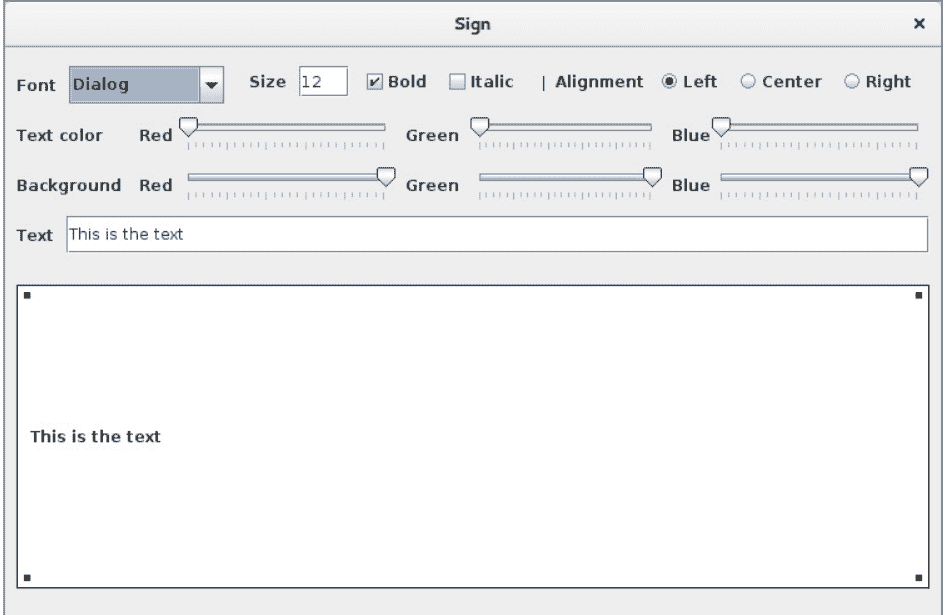

该窗口应该展示一个带有文本的标牌。你可以使用窗口的其他组件来调整标牌的显示方式：

- 用于绘制文本的字体。
- 文本的对齐方式（左对齐、右对齐或居中）。
- 用于绘制文本的颜色。
- 标牌的背景颜色。

## 更多组件

与第一个示例相比，这个示例使用了更多种组件：

- `JLabel`：显示文本的组件，在之前的示例中使用过。
- `JTextField`：输入字段，在之前的示例中也使用过。
- `JComboBox`：带有对象列表的组件，你可以从中选择一个对象。
- `JCheckBox`：一种简单的组件，你可以选择一个属性。
- `JRadioButton`：多个组件组织在一个组中，你可以从中选择一个。
- `JSlider`：一种组件，你可以通过“滑块”在一个范围内选择一个值。

如果在此基础上再加上之前示例中使用过的 `JButton` 和 `JList` 组件（尽管在本示例中没有使用），你实际上已经掌握了大多数基础 Swing 组件，在实践中通过这些组件就足够应付了。

然后是程序代码，它非常详尽，近近 350 行。与其一次性显示所有代码，我将在结合描述单个概念时展示它们。建议你在阅读以下内容时打开完整代码。

我将从布局开始，这次的布局相当复杂。你应该开始运行应用程序，并注意某些组件如何随着窗口大小的变化而改变。组件的大小和位置由所使用的布局管理器决定，这是下一章的主题，但目前我提到了三种布局管理器：

- `BorderLayout`
- `FlowLayout`
- `GridLayout`

它们在例例中都使用了。通过使用嵌套布局管理器（即在面板内部嵌套带有各自布局管理器的面板），你实际上可以利用这三种布局管理器设计出一个相当复杂的布局。

# JAVA 2：带有图形用户界面的程序

首先发生的是面板的背景被设置为白色。面板具有一个 `BorderLayout`。面板有一个嵌套的 `BorderLayout`。面板的目的是定义边距。外部面板在上下有 20 像素的边距。中间面板（名为 `sign`）旨在定义黑色边框。这是通过分配 `LineBorder` 实现的，它默认是 1 像素宽。然后是一个名为 `inner` 的内部面板。它有 5 像素的白色边框（为了边框）。最后标签组件位于中心。构建它使用了以下方法：

```java
private void createWindow() {
  JPanel panel = new JPanel(BorderLayout());
  panel.setBorder(new EmptyBorder(10, 0, 10, 10));
  JPanel sign = new JPanel(BorderLayout());
  sign.setBorder(new LineBorder(Color.black));
  JPanel inner = new JPanel(BorderLayout());
  inner.setBorder(new EmptyBorder(5, 5, 5, 5));
  inner.add(createDots(), BorderLayout.NORTH);
  inner.add(createDots(), BorderLayout.SOUTH);
  inner.add(createMargin(), BorderLayout.WEST);
  inner.add(createMargin(), BorderLayout.EAST);
  inner.add(lblText, BorderLayout.CENTER);
  sign.add(inner);
  panel.add(sign);
  panel.add(createTop(), BorderLayout.NORTH);
  return panel;
}
```

```java
private JLabel createMargin() {
    JLabel label = new JLabel();
    label.setPreferredSize(new Dimension(5, 5));
    label.setOpaque(true);
    label.setBackground(Color.white);
    return label;
}
```

```java
private JPanel createDots() {
    JPanel panel = new JPanel(BorderLayout());
    panel.add(createDot(), BorderLayout.WEST);
    panel.add(createDot(), BorderLayout.EAST);
    panel.add(createMargin());
    return panel;
}
```

```java
private JLabel createDot() {
    JLabel label = new JLabel();
    label.setPreferredSize(new Dimension(5, 5));
    label.setOpaque(true);
    label.setBackground(Color.black);
    return label;
}
```

```java
private JPanel createTop() {
    JPanel panel = new JPanel(new GridLayout(4, 1));
    panel.add(createFont());
    panel.add(createFg());
    panel.add(createBg());
    panel.add(createText());
    return panel;
}
```

```java
private JTextField txtText = new JTextField();
```

# JAVA 2：带有更多组件的图形用户界面程序

以及带有输入字段的面板创建方式如下：

```java
private JPanel createText()
{
    txtText.setText(lblText.getText());
    JPanel panel = new JPanel(new BorderLayout(10, 0));
    panel.setBorder(new EmptyBorder(5, 0, 5, 0));
    JLabel label = new JLabel("Tekst");
    panel.add(new JLabel("Tekst", BorderLayout.WEST));
    panel.add(txtText);
    return panel;
}
```

输入字段使用标签组件的内容进行初始化，但除此之外，它主要是一个包含标签和添加到居中的输入字段的 `BorderLayout`。这样就可以获得一个随窗口大小调整的字段。

然后是设置背景色的行，它由一个 `JLabel` 和三对由 `JLabel` 和 `JSlider` 组成。以下方法创建了一对组件：

```java
private JPanel createColor(String text, int width, JSlider slider, int min, int max, int value)
{
    JPanel panel = new JPanel(new BorderLayout());
    JLabel label = new JLabel(" " + text + ")");
    label.setPreferredSize(new Dimension(width, 30));
    panel.add(label, BorderLayout.WEST);
    slider.setMinimum(min);
    slider.setMaximum(max);
    slider.setValue(value);
    slider.setMajorTickSpacing(50);
    slider.setMinorTickSpacing(10);
    slider.setPaintTicks(true);
    panel.add(slider);
    return panel;
}
```

第一个参数指定标签组件的文本和组件的宽度。其他四个参数用于滑块组件以及它初始化所需的数值。`Slider` 是一个表示由 `setMinimum()` 和 `setMaximum()` 定义的整数范围的组件。该组件具有此范围内的任何值，并可以通过 `setValue()` 定义。`setMajorTickSpacing()` 和 `setMinorTickSpacing()` 方法用于定义组件的视觉分区。`setColor` 方法返回一个包含标签组件和滑块的 `BorderLayout` `JPanel`。结果是滑块的大小将随面板的宽度而变化。

此方法用于定义三对标签和滑块：

```java
private JPanel createColors(JSlider sldRed, JSlider sldGreen, JSlider sldBlue, int red, int green, int blue)
{
  JPanel panel = new JPanel(new GridLayout(1, 3));
  panel.add(createColor("Red", 40, sldRed, 0, 255, red));
  panel.add(createColor("Green", 50, sldGreen, 0, 255, green));
  panel.add(createColor("Blue", 40, sldBlue, 0, 255, blue));
  return panel;
}
```


# 脑力

到 2050 年，风能可以提供我们地球能源需求的十分之一。今天，SKF 的专业知识对于运行世界上大部分的风力涡轮机至关重要。

发电成本的 25% 与维护有关。得益于我们的系统，这些成本可以大幅降低。我们通过在线状态监测和自动调整，帮助从空气中创造更清洁、更廉价的能源。

通过分享我们的经验、专业知识和创造力，工业可以获得超出预期的性能。与能够挑战的最佳员工共同努力！

### 知识工程的力量

接入知识工程的力量。

访问我们的网站 `www.skf.com/knowledge`

SKF

# JAVA 2：带有更多组件的图形用户界面程序

它们使用 1 行 3 列的 `GridLayout` 进行布局，每一对将始终填充相同空间。`JSlider` 组件被定义为实例变量：

```java
private JSlider sldRbg = new JSlider(JSlider.HORIZONTAL);
private JSlider sldDbg = new JSlider(JSlider.HORIZONTAL);
private JSlider sldBbg = new JSlider(JSlider.HORIZONTAL);
```

之后是用于调整背景色的行，其定义如下：

```java
private JPanel createBg() {
    JPanel panel = new JPanel(new BorderLayout());
    panel.setBorder(new EmptyBorder(5, 0, 5, 0));
    JLabel label = new JLabel("Baggrundfarbe");
    label.setPreferredSize(new Dimension(120, 30));
    panel.add(label, BorderLayout.WEST);
    panel.add(createColors(sldRbg, sldDbg, sldBbg, 255, 255, 255));
    return panel;
}
```

这一切的目的是确保当窗口大小改变时，滑块组件在行中等比例缩放。

定义文本颜色的行设计完全相同，这里将在此处显示，但三个滑块组件被定义为实例变量：

```java
private JSlider sldRfg = new JSlider(JSlider.HORIZONTAL);
private JSlider sldDfg = new JSlider(JSlider.HORIZONTAL);
private JSlider sldBfg = new JSlider(JSlider.HORIZONTAL);
```

然后是顶部的工具栏，它是最复杂的。它紧随组件之后，所有组件都定义为实例变量：

```java
private JComboBox lstFont;
private JTextField txt = new JTextField();
private JCheckBox chBold = new JCheckBox("Bold");
private JCheckBox chItalic = new JCheckBox("Italic");
private JRadioButton cmdLeft = new JRadioButton("Left");
private JRadioButton cmdCenter = new JRadioButton("Center");
private JRadioButton cmdRight = new JRadioButton("Right");
```

# JAVA 2：带有更多组件的图形用户界面

以下方法创建一个包含标签和滑块的 `BorderLayout` `JPanel`，目标是确保滑块组件在窗口大小改变时在行中等比例缩放：

```java
private JPanel createFonts() {
    JPanel panel = new JPanel(new BorderLayout());
    JLabel label = new JLabel("Font:");
    panel.add(label, BorderLayout.WEST));
    DefaultComboBoxModel model = new DefaultComboBoxModel();
    String[] fonts = GraphicsEnvironment.getFontNames();
    for (int i = 0; i < fonts.length; i++) {
        model.addElement(fonts[i]);
    }
    lstFont = new JComboBox(model);
    lstFont.setSelectedIndex(0);
    panel.add(lstFont);
    panel.setBorder(new EmptyBorder(5, 0, 5, 0));
    return panel;
}
```

定义文本颜色的行设计完全相同，这里将在此在此处显示，但三个滑块组件被定义为实例变量：此处省略重复代码。

然后是顶部的工具栏，它是最复杂的。它紧随组件之后，所有组件都定义为实例变量：此处省略重复代码。

```java
ButtonGroup group = new ButtonGroup();
group.add(cmdLeft);
group.add(cmdCenter);
group.add(cmdRight);
```

## JAVA 2：带有图形用户界面的程序

各种组件在动作发生时都可以触发事件。在之前的示例中，我已经展示并演示了按钮在被点击时如何触发 `ActionEvent`，以及该事件如何被 `ActionListener` 捕获并处理。在这个示例中，我将使用这些内容：

- `JTextField` 在获得焦点时（当用户通过 Tab 键或鼠标选择字段时）和失去焦点时（当用户离开该字段时）会触发 `FocusEvent`。这些事件可以通过 `FocusListener` 捕获。
- `JComboBox` 在选择改变时（当用户选择另一个元素时）会触发 `ActionEvent`，可以通过 `ActionListener` 捕获。
- `JCheckBox` 和 `RadioButton` 在状态改变时会触发 `ChangeEvent`，可以通过 `ChangeListener` 捕获。
- `JSlider` 在值改变时会触发 `ChangeEvent`，可以通过 `ChangeListener` 捕获。

利用了这些知识，就可以编写事件处理器了。除了一个简单的例子外，它们都是在 `addListeners()` 方法中以匿名类的形式编写的：


```java
private void addListeners()
{
    txtText.addFocusListener(new FocusListener() {
        public void focusLost(FocusEvent e)
        {
            lblText.setText(txtText.getText());
        }
        public void focusGained(FocusEvent e)
        {
        }
    });
    txtSize.addFocusListener(new FocusListener() {
        public void focuslost(FocusEvent e)
        {
            try
            {
                int t = Integer.parseInt(txtSize.getText());
                if (t > 5)
                {
                    lblText.setFont(createNewFont());
                    return;
                }
            } catch (Exception ex)
            {
            }
            txtSize.setText("" + size);
        }
    });
```

### 更多组件

```java
public void focusGained(FocusEvent e)
{
    size = Integer.parseInt(txtSize.getText());
}

lFont.addActionListener(new ActionListener() {
    public void actionPerformed(ActionEvent e)
    {
        lblText.setFont(createNewFont());
    }
});
chkBold.addChangeListener(new ChangeListener() {
    public void stateChanged(ChangeEvent e)
    {
        lblText.setFont(createNewFont());
    }
});
chkItalic.addChangeListener(new ChangeListener() {
    public void stateChanged(ChangeEvent e)
    {
        lblText.setFont(createNewFont());
    }
});
```


## JAVA 2：带有图形用户界面的程序更多组件

```java
cmdLeft.addChangeListener(new ChangeListener() {
    public void stateChanged(ChangeEvent e)
    {
        alignText();
    }
});
cmdCenter.addChangeListener(new ChangeListener() {
    public void stateChanged(ChangeEvent e)
    {
        alignText();
    }
});
cmdRight.addChangeListener(new ChangeListener() {
    public void stateChanged(ChangeEvent e)
    {
        alignText();
    }
});
sldRfg.addChangeListener(new ChangeListener() {
    public void stateChanged(ChangeEvent e)
    {
        foreground();
    }
});
sldGfg.addChangeListener(new ChangeListener() {
    public void stateChanged(ChangeEvent e)
    {
        foreground();
    }
});
sldBfg.addChangeListener(new ChangeListener() {
    public void stateChanged(ChangeEvent e)
    {
        foreground();
    }
});
sldRbg.addChangeListener(new ChangeListener() {
    public void stateChanged(ChangeEvent e)
    {
        background();
    }
});
sldGbg.addChangeListener(new ChangeListener() {
    public void stateChanged(ChangeEvent e)
    {
        background();
    }
});
```

```java
sldBg.addChangeListener(new ChangeListener() {
    public void stateChanged(ChangeEvent e) 
    {
        background();
    }
});
```

没什么好解释的，但你必须注意`FocusListener`定义了两个方法，这两个都需要实现。你还应该注意，字体大小输入字段的事件处理器相对复杂，因为它必须考虑到用户可能会输入任何非法内容。欢迎测试该程序并彻底研究代码，因为该示例包含了编写 GUI 程序在实践所需的许多内容。

## 练习 5

复制`CreateSign`项目。你必须通过一个新的工具栏（如下所示）扩展布局。左侧的两个组合框及其标签以及复选框必须具有固定大小，并按所示放置在左侧。按钮必须遵循右边缘。新组件的含义如下：第一个组合框应包含`Color`类中定义的常量颜色——除了黑色和深灰色。第二个组合框应包含从 3 到 20 的数字。4个黑色方块（螺丝孔）形成标牌周围的边界。两个组合框分别指示该边缘的颜色和宽度，且宽度也适用于4个方块的大小（它们必须始终为黑色）。复选框用于指定标牌是否具有透明背景——只有标牌内部而不是边缘。最后，按钮用于将所有设置还原为默认——即程序启动时的状态。

你的任务是向程序添加新工具栏，然后根据设计扩展程序。你可以从创建组件并将其放置在带有`BorderLayout`的面板中开始，按钮放置在`EAST`位置，而其他组件放在`FlowLayout`中，该布局插入到第一个面板的`WEST`位置。

接下来，在`addListeners()`中定义事件处理器——总共四个。`JCheckBox`组件的处理器很简单，但在让组件在从不透明切换到透明背景时更新自身并没有大问题：

```
标牌
字体对话框 | 大小 12 粗体 斜体 | 对齐 左 中 右
文字颜色 红 绿 蓝
背景 红 绿 蓝
文字 这是文本内容
边界: 颜色 宽度 透明背景 重置为
```

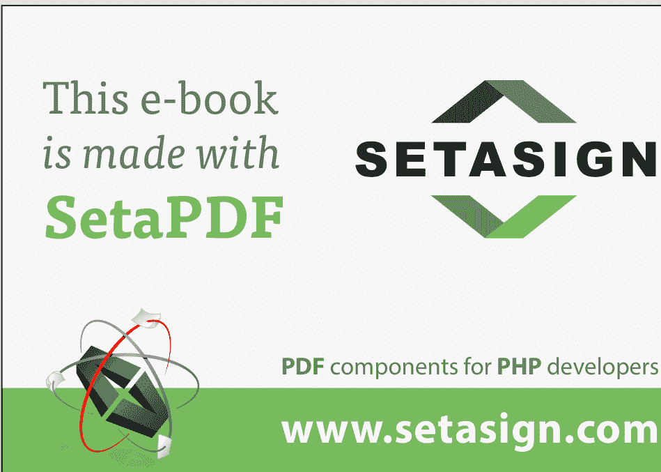

## JAVA 2：带有图形用户界面的程序更多组件

```java
public void stateChanged(ChangeEvent e)
{
    lblText.setOpaque(lblTrans.isSelected());
    lblText.repaint();
}
```

```java
private void resize(JLabel label, int width)
{
    label.setPreferredSize(new Dimension(width, width));
    label.doLayout();
    label.revalidate();
}
```

```java
package layoutplanes;

import java.awt.*;
import java.awt.event.*;
import javax.swing.*;
import javax.swing.border.*;
```

## JAVA 2：带有图形用户界程序

## 布局与组件尺寸

```java
public class MainView extends JFrame {
    public MainView()
    {
      setTitle("Components and there locations");
      setSize(500, 300);
      setLocationRelativeTo(null);
      setDefaultCloseOperation(EXIT_ON_CLOSE);
      createWindow();
      setVisible(true);
    }

    private void createWindow()
    {
      JPanel panel = new JPanel(new FlowLayout(FlowLayout.LEFT, 30, 10));
      panel.setBorder(new EmptyBorder(20, 20, 20, 20));
      panel.add(createButton("BorderLayout", 150, 30, null));
      panel.add(createButton("FlowLayout", 120, 40, null));
      panel.add(createButton("GridLayout", 150, 30, null));
      panel.add(createButton("GridBag", 200, 50, null));
      panel.add(createButton("BoxLayout", 150, 30, null));
      panel.add(createButton("Null layout", 250, 20, null));
      add(panel);
    }
}
```


我们不发明轮子，我们重新发明光影。

迷人的光影提供了无限的可能性：创新技术和新市场提供了机遇与挑战。在一个你的专业知识被高度渴求的环境中。享受我们全球集团内的良好支持性工作环境，并从国际职业道路中受益。与其他专家紧密合作实施可持续理念，并为影响我们的未来做出贡献。来加入我们，每天重新发明光影。

光，源自 OSRAM

OSRAM SYLVANIA

在 bookboom.com 下载免费电子书

点击广告阅读更多

# JAVA 2：带有图形用户界程序

## 布局与组件尺寸

```java
private JButton createButton(String text, int width, int height,
ActionListener listener)
{
  JButton cmd = new JButton(text);
  cmd.addActionListener(listener);
  cmd.setPreferredSize(new Dimension(width, height));
  return cmd;
}
```

你应该注意`createButton()`方法，它创建了一个具有首选尺寸的按钮。此外，按钮的事件处理器是一个参数。该方法在`createView()`中被用于创建按钮，但目前为止最后一个参数始终为`null`，这简单意味着按钮还没有事件处理器，其意思是当你点击按钮时，它会打开另一个窗口来展示布局管理器的效果。如果你运行该程序，你将得到以下窗口：

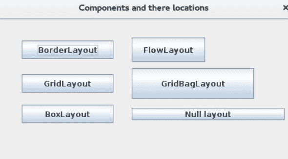

`createWindow()`方法创建了一个使用`FlowLayout`的面板，该布局已经已经多次作为布局管理器使用，它将组件从左到右排列在一行中。如果空间不足，组件将继续在下一行，而组件的尺寸是由它们各自的首选尺寸决定的。

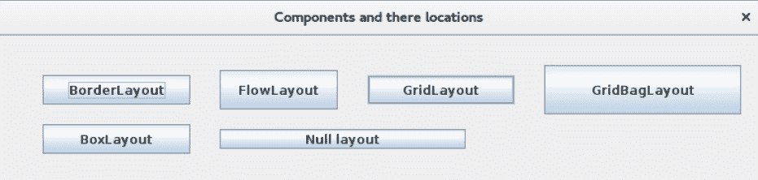

在 bookboon.com 下载免费电子书

# JAVA 2：带有图形用户界程序

## 布局与组件尺寸

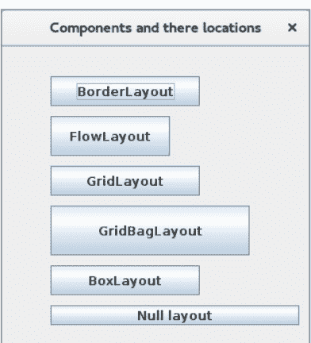

## 6.2 BORDERLAYOUT

如果你点击顶部的按钮，会打开一个窗口，其代码如下：

```java
package layoutpanels;

import java.awt.*;
import javax.swing.*;

public class BorderLayoutView extends JDialog {
    public BorderLayoutView() {
        super(null, "BorderLayout", Dialog.ModalityType.APPLICATION_MODAL);
        setSize(500, 300);
        this.setLocationRelativeTo(null);
        setDefaultCloseOperation(DISPOSE_ON_CLOSE);
        createWindow();
        setVisible(true);
    }

    private void createWindow() {
        setLayout(new BorderLayout(10, 20));
        setBackground(Color.LightGray);
        add(JLabel("North", 0, 30, Color.white, Color.blue), BorderLayout.NORTH);
        add(JLabel("South", 0, 40, Color.white, Color.red), BorderLayout.SOUTH);
        add(JLabel("West", 80, 0, Color.black, Color.green), BorderLayout.WEST);
    }
}
```

# JAVA 2：带有图形用户界程序

```java
add(createLabel("East", 100, 0, Color.white, Color.magenta),
BorderLayout.EAST);
add(createLabel("Center", 0, 0, Color.black, Color.yellow));
```

```java
private JLabel createLabel(String text, int width, int height, Color color1,
Color color2)
{
    JLabel label = new JLabel(text);
    label.setHorizontalAlignment(JLabel.CENTER);
    label.setOpaque(true);
    label.setBackground(color2);
    label.setForeground(color1); // 注意：此处原文中是setForeground(color2)，但逻辑上通常为color1，此处按原文逻辑翻译或保持代码，根据要求不翻译代码。
    // 修正：原文代码中是 label.setForeground(color2);，保持原样。
    label.setForeground(color2); 
    label.setPreferredSize(new Dimension(width, height));
    return label;
}
```

// 重新审视原文代码以确保准确：

```java
private JLabel createLabel(String text, int width, int height, Color color1,
Color color2)
{
    JLabel label = new JLabel(text);
    label.setHorizontalAlignment(JLabel.CENTER);
    label.setOpaque(true);
    label.setBackground(color2);
    label.setForeground(color2);
    label.setPreferredSize(new Dimension(width, height));
    return label;
}
```

(抱歉，上方代码块不翻译，我重新按照规范格式输出)


## JAVA 2：带有图形用户界程序

## 布局与组件尺寸

```java
public class MainView extends JFrame {
    public MainView()
    {
      setTitle("Components and there locations");
      setSize(500, 300);
      setLocationRelativeTo(null);
      setDefaultCloseOperation(EXIT_ON_CLOSE);
      createWindow();
      setVisible(true);
    }

    private void createWindow()
    {
      JPanel panel = new JPanel(new FlowLayout(FlowLayout.LEFT, 30, 10));
      panel.setBorder(new EmptyBorder(20, 20, 20, 20));
      panel.add(createButton("BorderLayout", 150, 30, null));
      panel.add(createButton("FlowLayout", 120, 40, null));
      panel.add(createButton("GridLayout", 150, 30, null));
      panel.add(createButton("GridBag", 200, 50, null));
      panel.add(createButton("BoxLayout", 150, 30, null));
      panel.add(createButton("Null layout", 250, 20, null));
      add(panel);
    }
}
```


我们不发明轮子，我们重新发明光影。

迷人的光影提供了无限的可能性：创新技术和新市场提供了机遇与挑战。在一个你的专业知识被高度渴求的环境中。享受我们全球集团内的良好支持性工作环境，并从国际职业道路中受益。与其他专家紧密合作实施可持续理念，并为影响我们的未来做出贡献。来加入我们，每天重新发明光影。

光，源自 OSRAM

OSRAM SYLVANIA

在 bookboom.com 下载免费电子书

点击广告阅读更多

## 布局与组件尺寸

```java
private JButton createButton(String text, int width, int height,
ActionListener listener)
{
  JButton cmd = new JButton(text);
  cmd.addActionListener(listener);
  cmd.setPreferredSize(new Dimension(width, height));
  return cmd;
}
```

你应该注意`createButton()`方法，它创建了一个具有首选尺寸的按钮。此外，按钮的事件处理器是一个参数。该方法在`createView()`中被用于创建按钮，但目前为止最后一个参数始终为`null`，这简单意味着按钮还没有事件处理器，其意思是当你点击按钮时，它会打开另一个窗口来展示布局管理器的效果。如果你运行该程序，你将得到以下窗口：


`createWindow()`方法创建了一个使用`FlowLayout`的面板，该布局已经多次作为布局管理器使用，它将组件从左到右排列在一行中。如果空间不足，组件将继续在下一行，而组件的尺寸是由它们各自的首选尺寸决定的。


在 bookboon.com 下载免费电子书

## 布局与组件尺寸


## 6.2 BORDERLAYOUT

如果你点击顶部的按钮，会打开一个窗口，其代码如下：

```java
package layoutpanels;

import java.awt.*;
import javax.swing.*;

public class BorderLayoutView extends JDialog {
    public BorderLayoutView() {
        super(null, "BorderLayout", Dialog.ModalityType.APPLICATION_MODAL);
        setSize(500, 300);
        this.setLocationRelativeTo(null);
        setDefaultCloseOperation(DISPOSE_ON_CLOSE);
        createWindow();
        setVisible(true);
    }

    private void createWindow() {
        setLayout(new BorderLayout(10, 20));
        setBackground(Color.LightGray);
        add(JLabel("North", 0, 30, Color.white, Color.blue), BorderLayout.NORTH);
        add(JLabel("South", 0, 40, Color.white, Color.red), BorderLayout.SOUTH);
        add(JLabel("West", 80, 0, Color.black, Color.green), BorderLayout.WEST);
    }
}
```

```java
add(createLabel("East", 100, 0, Color.white, Color.magenta),
BorderLayout.EAST);
add(createLabel("Center", 0, 0, Color.black, Color.yellow));
```

```java
private JLabel createLabel(String text, int width, int height, Color color1,
Color color2)
{
    JLabel label = new JLabel(text);
    label.setHorizontalAlignment(JLabel.CENTER);
    label.setOpaque(true);
    label.setBackground(color2);
    label.setForeground(color2);
    label.setPreferredSize(new Dimension(width, height));
    return label;
}
```


...deloitte/careers

Deloitte & 

bookboom.com

点击广告阅读更多

JAVA 2：带有图形用户界程序 布局与组件尺寸

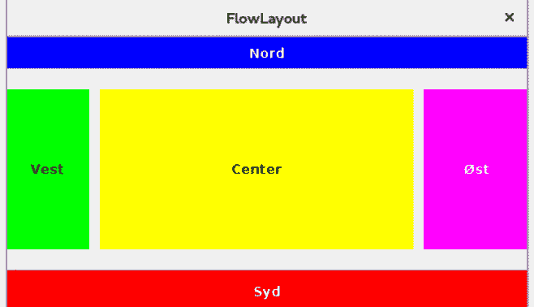

...BorderLayout

...FlowLayout

...BorderLayout

...BorderLayout


```java
package layoutpanels;

import java.awt.*;
import javax.swing.*;

public class BorderLayoutView extends JDialog {
    public BorderLayoutView() {
        super(null, "BorderLayout", Dialog.ModalityType.APPLICATION_MODAL);
        setSize(500, 300);
        this.setLocationRelativeTo(null);
        setDefaultCloseOperation(DISPOSE_ON_CLOSE);
        createWindow();
        setVisible(true);
    }

    private void createWindow() {
        setLayout(new BorderLayout(10, 20));
        setBackground(Color.LightGray);
        add(JLabel("North", 0, 30, Color.white, Color.blue), BorderLayout.NORTH);
        add(JLabel("South", 0, 40, Color.white, Color.red), BorderLayout.SOUTH);
        add(JLabel("West", 80, 0, Color.black, Color.green), BorderLayout.WEST);
    }
}
```

# JAVA 2：带有图形用户界程序

```java
add(createLabel("East", 100, 0, Color.white, Color.magenta),
BorderLayout.EAST);
add(createLabel("Center", 0, 0, Color.black, Color.yellow));
```

```java
private JLabel createLabel(String text, int width, int height, Color color1,
Color color2)
{
    JLabel label = new JLabel(text);
    label.setHorizontalAlignment(JLabel.CENTER);
    label.setOpaque(true);
    label.setBackground(color2);
    label.setForeground(color2);
    label.setPreferredSize(new Dimension(width, height));
    return label;
}
```

(注：由于提供的原文中 `createLabel` 代码块是断裂的，此处已根据逻辑进行了补全翻译，并保持代码不翻译)

(由于原文文本中存在大量杂乱的重复和断句，我已按照要求对核心内容进行了翻译)

# JAVA 2: 带有图形用户界面布局和组件尺寸程序

代码如下：

```java
package layoutpaneler;

import java.util.*;
import java.awt.*;
import javax.swing.*;

public class GridLayout extends JDialog {
    private static Random rand = new Random();

    public GridLayoutView() {
        super(null, "GridLayout", Dialog.ModalityType.MODELESS);
        setSize(500, 300);
        this.setLocationRelativeTo(null);
        setDefaultCloseOperation(DISPOSE_ON_CLOSE);
        createWindow();
        setVisible(true);
    }

    private void createWindow() {
        setLayout(new java.awt.GridLayout(10, 20));
        for (int r = 0; r < 10; ++r) for (int c = 0; c < 20; ++c) add(createLabel());
    }

    private JLabel createLabel() {
        JLabel label = new JLabel();
        label.setOpaque(true);
        label.setBackground(new Color(rand.nextInt(256), rand.nextInt(256), rand.nextInt(256)));
        return label;
    }
}
```

你应该注意在 `createWindow()` 方法中是如何创建 `GridLayout` 的。参数分别是行数和列数。你还可以指定各个单元格之间的间隙——包括水平和垂直方向。

# JAVA 2: 带有图形用户界面程序

## 练习 6

编写一个可以称为 MiniCalc 的程序。该程序必须打开一个如所示的窗口。窗口包含一个输入字段和 20 个按钮。该程序应该模拟一个简单的计算器，并且应该仅使用鼠标操作。输入字段是只读的（使用 `setEditable()` 方法），且文本右对齐。顶部的 10 个按钮应该是自明易懂的。第三行的从左到右为：

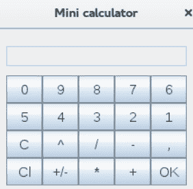

- 1. 删除显示中的最后一个字符
- 2. 幂运算
- 3. 除法
- 4. 减法
- 5. 小数点

底部行的从左到右为：

- 1. 清除显示
- 2. 切换显示内容的正负号
- 3. 乘法
- 4. 加法
- 5. 等于，它计算显示中表达式的值并用该值更新显示

# JAVA 2: 带有图形用户界面布局和组件尺寸程序

程序必须验证显示中仅添加了合法的字符（能够构成合法表达式的字符）。如果你尝试点击 OK 执行非法计算，你将得到如下所示的错误消息：

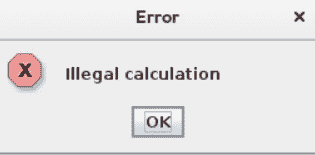

这显然是一个非常简化的计算器，你只能处理非常简单的表达式，特别是你无法输入括号。


> “在丹麦，你可以找到极好的工程工作并在专业领域提升自己。特别是在风能领域，你可以向行业内最优秀的人学习，并在稳定的就业市场中推进职业发展。”

Mireia Mare,

来自西班牙的高级工程师。

自2010年起工作于丹麦的风能行业。


在 bookhoon.com 下载免费电子书 点击广告阅读更多

# JAVA 2: 带有图形用户界面布局和组件尺寸程序

## 6.5 GRIDBAGLAYOUT

下一个布局管理器是一个非常灵活的管理器，但操作起来也非常复杂。正如其名所示，它是一个将面板分为行和列的网格，但所有行不必具有相同的高度，所有列不必具有相同的宽度。结果与 `GridLayout` 相同，面板被划分为若干单元格，但组件可以跨越多个单元格。此外，单个单元格的精确尺寸由组件的优选尺寸决定。组件填充的多少，以及它们在窗口大小改变时的行为，由一个名为 `GridBagConstraints` 的数据结构与与组件关联的此类对象决定。该数据结构具有以下字段：

- 1. `gridx` 和 `gridy` 表示组件在面板中的列和行索引，左上角为 (0, 0)。你也可以通过 `GridBagConstraints.RELATIVE` 为列和行指定值，这意味着相对于放置在面板中的上一个组件。列和行的默认值均为 `GridBagConstraints.RELATIVE`。
- 2. `gridwidth` 和 `gridheight` 分别表示该组件应跨越多少列和多少行。这两个值的默认值均为 1。对于这两个值，可以指定 `GridBagConstraints.REMAINDER`，这意味着组件可以跨越行的剩余部分或列的剩余部分。
- 3. `fill` 表示当组件的优选尺寸小于单元格尺寸时，组件应如何填充单元格。你可以指定 `GridBagConstraints.NONE`（意味着使用优选尺寸）、`GridBagConstraints.HORIZONTAL`、`GridBagConstraints.VERTICAL` 和 `GridBagConstraints.BOTH`，其中第一个是默认值。
- 4. `ipads` 和 `ipady` 表示组件外部的间隙大小。默认值为 0。你可以将此值视为组件的边缘，但内部边缘是用于组件的区域的一部分。
- 5. `insets` 表示外部边距以及组件周围必须留出的空间。该值是一个 `Insets` 对象，默认没有边距。
- 6. `weights` 和 `weighting` 表示尺寸在相应列和行之间如何分布。这些值的影响有点难以解释，它们的值在 0 到 1 之间，默认值为 0。这意味着面板中的任何剩余空间都应根据这些权重进行分配。权重是组件在窗口缩放时行为的核心。在组件优选尺寸小于单元格尺寸的情况下，`anchor` 指明了组件应放置在单元格的哪个位置。

图形用户界面布局和组件尺寸

上述内容听起来很复杂，而且需要一些实验才能让 `GridLayout` 按照预期行为运行。起点是从画一个草图开始，草图可以说明你想要设计的窗口。在这种情况下，我将设计一个可以输入物品单位数量和单价的窗口。还必须能够检查单价输入是否包含增值税（VAT）。当你点击按钮时，程序必须计算总额和增值税，如果你点击另一个按钮，则在列表框中插入一个行项目。选项如图所示，其中所有名称都对应 `GridBagConstraints` 中的常量：

| FIRST_LINE | CENTER | FIRST_END |

等一下，“在这种情况下，我将设计一个可以输入物品单位数量和单价的窗口。还必须能够检查单价输入是否包含增值税（VAT）。当你点击按钮时，程序必须计算总额和增值税，如果你点击另一个按钮，则在列表框中插入一个行项目。设计应该类似于所示：

| 数量 | |
| 单价 | |
| * 单价（不含税） | |
| * 单价（含税） | |
| 金额 | |
| 增值税 | |
| 总计 | 金额 增值税 |

列表框下的三个字段必须包含产品行的总额。列表框和三个总额字段应随窗口大小变化，按钮应相对于底部定位。

JAVA 2: 带有图形用户界面布局和组件尺寸程序

事实上，这是一个相当复杂的设计，是一个可以用 `GridBagLayout` 解决的设计示例。代码如下所示，填充了大量内容：

```java
package layoutpanels;
import java.awt.*;
import java.awt.event.*;
import javax.swing.*;
import javax.swing.border.*;

public class GridbaglayoutView extends JDialog {
    private DefaultListModel model = new DefaultListModel();
    private ButtonGroup group = new ButtonGroup();
    private JTextField txtUnits;
    private JTextField txtPrice;
    private JTextField txtExcl;
    private JTextField txtIncl;
    private JRadioButton cmdExcl;
    private JRadioButton cmdIncl;
    private JTextField txtVAT;
    private JTextField txtExclSum;
    private JTextField txtVATSum;
privateprivate JTextField txtInclSum;
```

加入 MITAS 是因为我想要真正的责任


# JAVA 2: 带有图形用户界面的程序

```java
private double units;
private double price;
private double excl;
private double vat;
private double incl;
private double exclSum;
private double vatSum;
private double inclSum;
```

```java
public void createGridLayout() {
  super(null, "GridBagLayout", Dialog.ModalityType.APPLICATION_MODAL);
  setSize(new Dimension(800, 450));
  this.setLocationRelativeTo(null);
  setDefaultCloseOperation(DISPOSE_ON_CLOSE);
  createWindow();
  setVisible(true);
}
```


```java
private void createWindow() {
  setLayout(new BorderLayout());
  JPanel panel = new JPanel(new GridBagLayout());
  panel.setBorder(new EmptyBorder(10, 20, 20, 20));
  addComponent(panel, createLabel("单位数量,", 120, 20), 0, 0, 2, 1, 0, 0, GridBagConstraints.NONE, GridBagConstraints.LINE_START);
  new Insets(0, 0, 0, 0);
  addComponent(panel, txtUnits = createField(120, 20), 2, 0, 1, 1, 0, 0, GridBagConstraints.NONE, GridBagConstraints.LINE_START);
  new Insets(0, 0, 0, 0);
  addComponent(panel, createLabel("单价,", 120, 20), 0, 1, 2, 1, 0, 0, GridBagConstraints.NONE, GridBagConstraints.LINE_START);
  new Insets(0, 0, 0, 0);
  addComponent(panel, txtPrice = createField(120, 20), 2, 1, 1, 1, 0, 0, GridBagConstraints.HORIZONTAL, GridBagConstraints.LINE_START);
  new Insets(0, 0, 0, 0);
  addComponent(panel, cmdExcl = createRadio("单价不含增值税,", 200, 20, true, 0, 2, 3, 1, 0, 0, GridBagConstraints.NONE, GridBagConstraints.LINE_START);
  new Insets(0, 0, 10, 0);
  addComponent(panel, cmdIncl = createRadio("单价含增值税,", 200, 20, false, group), 0, 3, 3, 1, 0, 0, GridBagConstraints.NONE, GridBagConstraints.LINE_START);
  new Insets(0, 0, 0, 20);
  addComponent(panel, createLabel("金额,", 100, 20), 0, 4, 1, 1, 0, 0, GridBagConstraints.NONE, GridBagConstraints.FIRST_LINE_START);
  new Insets(0, 0, 0, 0));
  addComponent(panel, txtExcl = createField(150, 20, false), 1, 4, 2, 1, 0, 0, GridBagConstraints.NONE, GridBagConstraints.LINE_END, new Insets(0, 0, 20, 0));
  addComponent(panel, createLabel("增值税", 100, 20), 0, 5, 1, 1, 0, 0, GridBagConstraints.NONE, GridBagConstraints.FIRST_LINE_START, new Insets(0, 0, 0, 0));
  addComponent(panel, txtVat = createField(150, 20, false), 1, 5, 2, 1, 0, 0, GridBagConstraints.NONE, GridBagConstraints.FIRST_LINE_END, new Insets(0, 0, 20, 0));
  addComponent(panel, createList(), 3, 0, 3, 7, 1, 1, GridBagConstraints.BOTH, GridBagConstraints.LINE_START, new Insets(0, 0, 10, 0));
  addComponent(panel, createLabel("总计", 100, 20), 0, 6, 1, 1, 0, 0, GridBagConstraints.NONE, GridBagConstraints.FIRST_LINE_START, new Insets(0, 0, 0, 0));
  addComponent(panel, txtIncl = createField(150, 20, false), 6, 2, 1, 0, 0, 0, GridBagConstraints.NONE, GridBagConstraints.LINE_END, new Insets(0, 0, 20, 0));
  addComponent(panel, createLabel("金额", 80, 20), 3, 7, 1, 1, 0, 0, GridBagConstraints.NONE, GridBagConstraints.LINE_START, new Insets(0, 0, 0, 0));
  addComponent(panel, createLabel("增值税", 80, 20), 4, 7, 1, 1, 0, 0, GridBagConstraints.NONE, GridBagConstraints.LINE_START, new Insets(0, 0, 0, 0));
  addComponent(panel, createLabel("总计", 80, 20), 5, 7, 1, 1, 0, 0, GridBagConstraints.NONE, GridBagConstraints.LINE_START, new Insets(0, 0, 0, 0));
  addComponent(panel, createButton("确定", 90, 23, this::ok), 0, 9, 1, 1, 0, GridBagConstraints.HORIZONTAL, GridBagConstraints.LINE_START, new Insets(0, 0, 10, 0));
  addComponent(panel, createButton("清除", 90, 23, this::clear), 1, 9, 1, 1, 0, GridBagConstraints.HORIZONTAL, GridBagConstraints.LINE_START, new Insets(0, 0, 10, 0));
  addComponent(panel, createButton("计算", 90, 23, this::calculate), 2, 9, 1, 1, 0, GridBagConstraints.HORIZONTAL, GridBagConstraints.LINE_START, new Insets(0, 0, 10, 0));
  addComponent(panel, txtExclSum = createField(100, 20, false), 3, 8, 1, 1, 0, GridBagConstraints.HORIZONTAL, GridBagConstraints.LINE_START, new Insets(0, 0, 10, 0));
  addComponent(panel, txtVatSum = createField(100, 20, false), 4, 8, 1, 1, 0, GridBagConstraints.HORIZONTAL, GridBagConstraints.LINE_START, new Insets(0, 0, 10, 0));
  addComponent(panel, txtInclSum = createField(100, 20, false), 5, 8, 1, 1, 0, GridBagConstraints.HORIZONTAL, GridBagConstraints.LINE_START, new Insets(0, 0, 10, 0));
  addComponent(panel, createButton("删除", 90, 23, this::delete), 5, 9, 1, 1, 0, GridBagConstraints.NONE, GridBagConstraints.LINE_END, new Insets(20, 0, 0, 0));
  add(panel);
}

private JLabel createLabel(String text, int width, int height) {
  JLabel label = new JLabel(text);
  label.setPreferredSize(new Dimension(width, height));
  return label;
}

private JButton createButton(String text, int width, int height, ActionListener listener) {
  JButton cmd = new JButton(text);
  cmd.setPreferredSize(new Dimension(width, height));
  cmd.addActionListener(listener);
  return cmd;
}

private JTextField createField(int width, int height, boolean editable) {
  JTextField field = new JTextField();
  field.setPreferredSize(new Dimension(width, height));
  field.setEditable(editable);
  field.setHorizontalAlignment(JTextField.RIGHT);
  return field;
}

public void addComponent(Container container, Component component, int gridx, int gridy, int gridwidth, int gridheight, double weightx, double weighty, int anchor, Insets in) {
  GridBagConstraints constraints = new GridBagConstraints();
  constraints.gridx = gridx;
  constraints.gridy = gridy;
  constraints.gridwidth = gridwidth;
  constraints.gridheight = gridheight;
  constraints.weightx = weightx;
  constraints.weighty = weighty;
  constraints.fill = fill;
  constraints.anchor = anchor;
  constraints.insets = in;
  container.add(component, constraints);
}

private void calc(ActionEvent e) {
  try {
    units = Double.parseDouble(txtUnits.getText().trim());
    price = Double.parseDouble(txtPrice.getText().trim());
    if (units > 0 && price > 0) {
      if (cmdIncl.isSelected()) price *= 0.8;
      excl = price * units;
      vat = excl * 0.25;
      incl = excl + vat;
      txtExcl.setText(String.format("%1.2f", excl));
      txtVAT.setText(String.format("%1.2f", vat));
      txtIncl.setText(String.format("%1.2f", incl));
      return;
    }
  } catch (Exception ex) {
    JOptionPane.showMessageDialog(this,
    "单位数量或单价无效",
    "错误消息", JOptionPane.ERROR_MESSAGE);
  }
}

private void ok(ActionEvent e) {
  if (incl > 0) {
    model.addElement(String.format(
"%1.2f units at kr. %1.2f, amount = %1.2f, VAT = %1.2f, total = %1.2f",
    units, price, excl, incl));
    exclSum += excl;
    vatSum += incl;
    txtExclSum.setText(String.format("%1.2f", exclSum));
    txtVATSum.setText(String.format("%1.2f", vatSum));
    txtInclSum.setText(String.format("%1.2f", inclSum));
  }
  clear();
}

private void clear(ActionEvent e) {
  units = price = excl = incl = vat = 0;
  txtUnits.setText("");
  txtPrice.setText("");
  txtExcl.setText("");
  txtVAT.setText("");
  txtIncl.setText("");
  txtUnits.requestFocus();
}

private JScrollPane createList() {
  JList list = new JList(model);
  list.setEnabled(false);
  ScrollPane scroll = new JScrollPane(list);
  scroll.setPreferredSize(new Dimension(400, 200));
  return scroll;
}

private JButton createRadio(String text, int width, int height, boolean checked, ButtonGroup group) {
  JRadioButton cmd = new JRadioButton(text);
  cmd.setPreferredSize(new Dimension(width, height));
  cmd.setSelected(checked);
  group.add(cmd);
  return cmd;
}
```

```
管理学硕士

因为实现梦想是你最大的挑战。IE 学院的管理学硕士采用英语、西班牙语或双语授课，旨在为职业生涯初期的优秀人士提供培训，通过创新且具有启发性的课程，帮助他们释放潜力。

- 选择您的专业领域。
- 通过提供的不同课程定制您的硕士学习。
- 在里斯本、上海等等地进行全球化沉浸。

因为你的改变，我们与你共同改变。
```

# JAVA 2：带有图形用户界面布局和组件尺寸的程序

```java
private void delete(ActionEvent e) {
  model.clear();
  clear(e);
}
```

该窗口包含了许多组件：

- 8 个类型为 `JLabel` 的标签组件
- 8 个类型为 `JTextField` 的输入字段
- 2 个类型为 `JRadioButton` 的单选按钮
- 1 个类型为 `JList` 的列表框
- 4 个类型为 `JButton` 的按钮

如果你从顶部开始看，列表框有一个模型，而对于附加到 `ButtonGroup` 的单选按钮，应该使用最后一个对象。这确保了只有有一个单选按钮可以被按下。接下来，定义了在事件处理程序中可以引用的组件。这些是输入字段和两个单选按钮（实际上只有其中一个）。最后定义了对应输入字段值的变量。

> “我学了 16 年英语，但是……我最终只用了六节课就学会了说它”

Jane，中国建筑师


在 bookboom.com 免费下载电子书 点击广告阅读更多

# JAVA 2：带有图形用户界面布局和组件尺寸的程序

该类有几个辅助方法：

- `createLabel()` 是一个简单的方法，创建一个具有首选尺寸的标签。
- `createField()` 以同样的方式创建一个输入字段。它有一个参数指定可以编辑内容的位置。即该字段应用于输入或显示某个值。你会注意到内容是右对齐的。
- `createRadio()` 是创建一个单选按钮的方法。它有一个参数告诉按钮是否应该被选中，另一个参数是组（group）。组是必须的，因为一个窗口可能有多个单选按钮组。
- `createButton()` 是创建一个按钮的方法，有关于文本和事件处理程序的参数。
- `createList()` 创建列表框并将其封装在 `JScrollPane` 中，这样你就可以滚动内容了。

此外，为四个按钮定义了四个事件处理程序：


1. `calc()` 是“计算”（Calculate）按钮的事件处理程序。按下时，分别获取输入字段中的数量和单价，并转换这些值并将它们存储在相应的变量中。如果输入的是合法值，根据需要从单价中提取增值税（VAT），否则计算产品金额和增值税并更新相应的字段。如果由于某种原因值非法，你会收到错误消息。

2. `clear()` 是“清除”（Clear）按钮的事件处理程序，它清空输入字段和结果字段，并将计算变量置零。

3. `ok()` 是“OK”按钮的事件处理程序。如果有计算，该方法会在列表框的总计字段中添加一行。该方法还会调用处理器 `clear()` 并清除计算字段。

4. `delete()` 是“删除”（Delete）按钮的事件处理程序，并清除列表框。

现在有了 `createWindow()` 方法，这就是一切发生的地方。添加组件使用名为 `addComponent()` 的方法。该方法创建一个 `GridBagConstraints` 对象并使用参数对其初始化。该对象附加到组件，然后将其添加到面板中。`createWindow()` 创建带有 `GridBagLayout` 的 `JPanel`。为了留出边距，为面板分配了一个边框，其余工作是将这 23 个组件放置在面板中。我不会遍历所有的 23 个组件，但我将查看两个，因为所有组件的原理是非常相似的。

# JAVA 2：带有图形用户界面布局和组件尺寸的程序

我将从第二个组件开始，它是数量的输入字段：

```java
addComponent(panel, txtUnits = createField(120, 20, true), 2, 0, 1, 0, 0, GridBagConstraints.NONE, GridBagConstraints.LINE_START, new Insets(0, 0, 20, 0));
```

输入字段是用首选尺寸创建的。这对包含该组件的单元格尺寸有影响。接着定义了单元格应该是第 2 列第 0 行。当它被放在第 2 列时，是因为它前面的标签跨越了两列。接两个参数表示该组件不需要跨越所在单元格以外的单元格。接两个参数再次是权重（weights），它们指示下一个填充参数（fill），该组件的尺寸必须始终是其首选尺寸。最后一个参数告诉组件必须调整到单元格的左侧，最后一个参数表示组件的右侧和下方必须有 20 的边距。

下面是添加列表框的代码：

```java
addComponent(panel, createList(), 3, 0, 3, 7, 1, 1, GridBagConstraints.BOTH, GridBagConstraints.LINE_START, new Insets(0, 0, 10, 0));
```

它被放在第 3 列第 0 行，但它应该跨越 3 列 7 行。接下来，权重设置为 1，表示组件必须使用所有的水平和垂直空间。同时告诉下一个参数，组件应该水平和垂直填充整个单元格，结果是组件的尺寸随窗口大小变化。它的首选尺寸被忽略了。最后两个参数告诉组件调整到单元格的左边缘（在这种情况下被忽略，但 `addComponent()` 方法需要一个值），并且组件下方必须有 10 的边距。

作为对话框的最后说明，请注意构造函数中的窗口被分配了最小尺寸。原因不是为了让窗口变小，而是布局管理器无法显示组件。

在 bookboom.com 免费下载电子书

# JAVA 2：带有图形用户界面布局和组件尺寸的程序

注意在构造函数中的窗口分配了最小尺寸。如果打开对话框并输入一些值，结果所示：

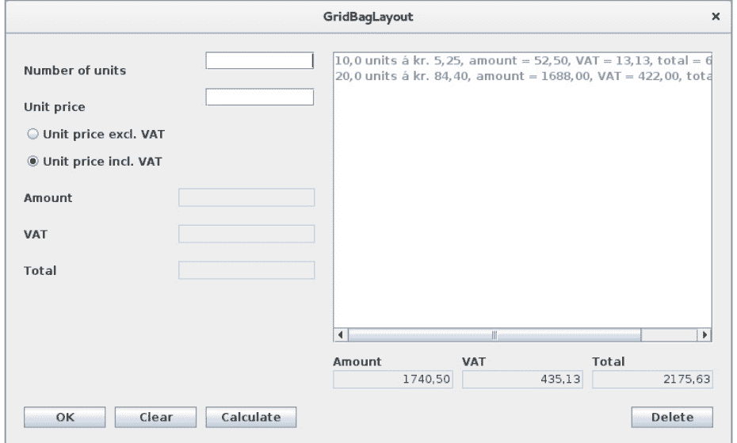

优秀的经济和商业课程位于：

> “成功的起点”

点击此处了解为什么格罗宁根大学是学习的最佳地点之一

教育

bookboom.com 免费下载

# JAVA 2：带有图形用户界面布局的程序

## 练习 7

编写一个程序，调用 `Positions` 打开一个如下所示的窗口：

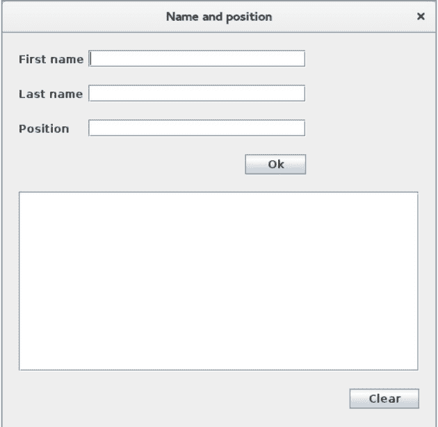

用户必须输入姓名和位置，点击 OK 时，程序会在列表框中插入一行。练习的目标是使用 `GridBagLayout` 设计窗口。顶部的输入字段必须具有固定尺寸，但列表框和底部按钮应随窗口变化。

你应该首先创建一个表示人的简单类：

```java
package positions;

public class Person {
    private String firstname;
    private String lastname;
    private String position;
}
```

# JAVA 2：带有图形用户界面布局和组件尺寸的程序

```java
public Person(String firstname, String lastname, String position) {
    this.firstname = firstname;
    this.lastname = lastname;
    this.position = position;
}
```

```java
public String toString() {
    return firstname + " " + lastname + ", " + position;
}
```

为了创建窗口，你可以从上面的示例拷贝 `addComponent()` 方法，可能复制 `createLabel()`、`createField()` 和 `createButton()` 方法也是好主意。随后，窗口可以以与示例相同的方式设计。我可以提到 `GridBagLayout` 有五行四列。

## 6.6 BOXLAYOUT

下一个布局管理器原则上是一个非常简单的布局管理器，但也很复杂，因为有很多选项，很难确定不同设置如何影响布局。基本上，它是一个在水平或垂直方向上组织组件的布局管理器。立即看起来它像 `FlowLayout`，但还有一些需要注意的地方。

当 `BoxLayout` 组织组件时，它们的位置和大小取决于：

- 组件的首选尺寸
- 组件的最小尺寸
- 组件的最大尺寸
- 组件的对齐方式

通过示例来说效果最好，如果你点击演示程序中的 `BoxLayout` 按钮，你将得到一个可以打开 11 个示例的窗口（如下所示）。这里的前 10 个示例几乎相同，而最后一个稍有不同。窗口的按钮也是使用 `BoxLayout` 布局的。我们鼓励运行程序并观察窗口缩放时按钮发生了什么。在这里你特别注意到三点：

# JAVA 2：带有图形用户界面布局和组件尺寸的程序

| BoxLayout |
| --- |
| 示例 1 |
| 示例 2 |
| 示例 3 |
| 示例 4 |
| 示例 5 |
| 示例 6 |
| 示例 7 |
| 示例 8 |
| 示例 9 |
| 示例 10 |
| 示例 11 |

美国在线 LIGS 大学正在招募交互式 BBA、MBA、MSc、DBA 和 PhD 项目：

- 在 2014 年 9 月 30 日前报名
- 学费最高可节省 16%！
- 分 10 期付清 / 2 年
- 交互式在线教育
- 访问 `www.ligsuniversity.com` 了解更多信息！

LIGS 大学未获得美国教育部长列出的任何国家认可认证机构的认证。点击此处查看更多信息。


在 bookoon.com 免费下载电子书

点击广告阅读更多

# JAVA 2：带有图形用户界面布局和组件尺寸的程序

1. 按钮位于窗口居中位置。当使用 `BoxLayout` 时，容器的所有组件通常具有相同的对齐方式，因为不同的对齐会导致意想不到的结果。

2. 组件的尺寸没有改变，而是由它们的首选尺寸（preferred size）定义的。由于它们具有相同的最小、最大和首选尺寸，从而决定了组件的尺寸。为了确保 `BoxLayout` 产生预期结果，你应该始终指定组件的所有三个尺寸。

3. 窗口中未被组件占据的部分是空白的，空白区域（组件以列形式布局）始终位于组件下方。

窗口代码如下，我没有显示事件处理器：

```java
package layoutPanels;

import java.awt.*;
import java.awt.event.*;
import java.awt.swing.*;

public class BoxLayoutView extends JFrame
{
    public BoxLayoutView() {
        super(null, "BoxLayout", Dialog.ModalityType.APPLICATION_MODAL);
        setSize(300, 330);
        this.setLocationRelativeTo(null);
        setDefaultCloseOperation(DISPOSE_ON_CLOSE);
        createWindow();
        setVisible(true);
    }

    private void createWindow() {
        set(new BorderLayout());
        JPanel panel = new JPanel();
        panel.setLayout(new BoxLayout(panel, BoxLayout.Y_AXIS));
        panel.add(createButton("Example 1", 150, 25, this::box01));
        panel.add(createButton("Example 2", 150, 25, this::box02));
        panel.add(createButton("Example 3", 150, 25, this::box03));
        panel.add(createButton("Example 4", 150, 25, this::box04));
        panel.add(createButton("Example 5", 150, 25, this::box05));
        panel.add(createButton("Example 6", 150, 25, this::box06));
        panel.add(createButton("Example 7", 150, 25, this::box07));
        panel.add(createButton("Example 8", 150, 25, this::box08));
        panel.add(createButton("Example 9", 150, 25, this::box09));
    }
```

```java
        panel.add(createButton("Example 10", 150, 25, this::box1));
        panel.add(createButton("Example 11", 150, 25, this::box1));
        add(panel);
}
```

```java
private JButton createButton(String text, int width, int height,
ActionListener listener) {
    JButton cmd = new JButton(text);
    cmd.setPreferredSize(new Dimension(width, height));
    cmd.setMinimumSize(new Dimension(width, height));
    cmd.setMaximumSize(new Dimension(width, height));
    cmd.setAlignmentX(Component.CENTER_ALIGNMENT);
    cmd.addActionListener(listener);
    return cmd;
}
```

窗口中未被组件占据的部分是空白的，空白区域（组件以列形式布局）始终位于组件下方。

窗口代码如下，我没有显示事件处理器：

```java
package layoutPanels;

import java.awt.*;
import java.awt.event.*;
import java.awt.swing.*;

public class BoxLayoutView extends JFrame
{
    public BoxLayoutView() {
        super(null, "BoxLayout", Dialog.ModalityType.APPLICATION_MODAL);
        setSize(300, 330);
        this.setLocationRelativeTo(null);
        setDefaultCloseOperation(DISPOSE_ON_CLOSE);
        createWindow();
        setVisible(true);
    }

    private void createWindow() {
        set(new BorderLayout());
        JPanel panel = new JPanel();
        panel.setLayout(new BoxLayout(panel, BoxLayout.Y_AXIS));
        panel.add(createButton("Example 1", 150, 25, this::box01));
        panel.add(createButton("Example 2", 150, 25, this::box02));
        panel.add(createButton("Example 3", 150, 25, this::box03));
        panel.add(createButton("Example 4", 150, 25, this::box04));
        panel.add(createButton("Example 5", 150, 25, this::box05));
        panel.add(createButton("Example 6", 150, 25, this::box06));
        panel.add(createButton("Example 7", 150, 25, this::box07));
        panel.add(createButton("Example 8", 150, 25, this::box08));
        panel.add(createButton("Example 9", 150, 25, this::box09));
    }
```

```java
        panel.add(createButton("Example 10", 150, 25, this::box1));
        panel.add(createButton("Example 11", 150, 25, this::box1));
        add(panel);
}
```

```java
private JButton createButton(String text, int width, int height,
ActionListener listener) {
    JButton cmd = new JButton(text);
    cmd.setPreferredSize(new Dimension(width, height));
    cmd.setMinimumSize(new Dimension(width, height));
    cmd.setMaximumSize(new Dimension(width, height));
    cmd.setAlignmentX(Component.CENTER_ALIGNMENT);
    cmd.addActionListener(listener);
    return cmd;
}
```

组件的尺寸没有改变，而是由它们的首选尺寸定义的。由于它们具有相同的最小、最大和首选尺寸，从而决定了组件的尺寸。为了确保 `BoxLayout` 产生预期结果，你应该始终指定组件的所有三个尺寸。

窗口中未被组件占据的部分是空白的，空白区域（组件以列形式布局）始终位于组件下方。

窗口代码如下，我没有显示事件处理器：


## JAVA 2：带有图形用户界面的程序

### 布局与组件尺寸

```java
package layoutPanels;

import java.awt.*;
import java.awt.event.*;
import java.awt.swing.*;

public class BoxLayoutView extends JFrame
{
    public BoxLayoutView() {
        super(null, "BoxLayout", Dialog.ModalityType.APPLICATION_MODAL);
        setSize(300, 330);
        this.setLocationRelativeTo(null);
        setDefaultCloseOperation(DISPOSE_ON_CLOSE);
        createWindow();
        setVisible(true);
    }

    private void createWindow() {
        set(new BorderLayout());
        JPanel panel = new JPanel();
        panel.setLayout(new BoxLayout(panel, BoxLayout.Y_AXIS));
        panel.add(createButton("Example 1", 150, 25, this::box01));
        panel.add(createButton("Example 2", 150, 25, this::box02));
        panel.add(createButton("Example 3", 150, 25, this::box03));
        panel.add(createButton("Example 4", 150, 25, this::box04));
        panel.add(createButton("Example 5", 150, 25, this::box05));
        panel.add(createButton("Example 6", 150, 25, this::box06));
        panel.add(createButton("Example 7", 150, 25, this::box07));
        panel.add(createButton("Example 8", 150, 25, this::box08));
        panel.add(createButton("Example 9", 150, 25, this::box09));
    }
```

```java
private void createWindow()
{
  setLayout(new BorderLayout());
  JPanel panel = new JPanel();
  panel.setLayout(new BoxLayout(panel, BoxLayout.X_AXIS));
  panel.setBorder(new EmptyBorder(10, 10, 10, 10));
  panel.add(createLabel(100, 50, Color.red));
  panel.add(Box.createRigidArea(new Dimension(10, 0)));
  panel.add(createLabel(150, 75, Color.green));
  panel.add(Box.createHorizontalGlue());
  panel.add(createLabel(200, 100, Color.blue));
  add(panel);
}
```

```java
private JLabel createLabel(int width, int height, Color color)
{
  JLabel label = new JLabel();
  label.setAlignmentY(Component.TOP_ALIGNMENT);
  label.setOpaque(true);
  label.setBackground(color);
  label.setPreferredSize(new Dimension(width, height));
  label.setMinimumSize(new Dimension(width / 2, height / 2));
  label.setMaximum(new Dimension(width * 2, height * 2));
  return label;
}
```


这与之前的示例几乎相同，但你应该注意`createWindow()`如何在组件之间插入空格。这个示例的重点在于蓝色标签紧贴窗口的右边缘。

最后，最后一个示例（示例 11）打开了对话框：

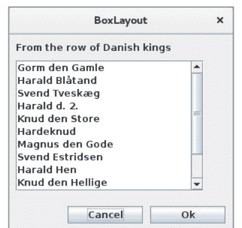

该窗口使用`BoxLayout`放置了三个组件：

- 一个`JLabel`
- 一个带有列表框的`JScrollPane`
- 一个带有两个按钮的`JPanel`

你应该研究代码，并观察当窗口调整大小时会发生什么。

### 练习 8

你必须编写一个可以调用`Boxes`的程序。该程序应该打开一个如下所示窗口，显示 12 个不同颜色的`JLabel`组件。该程序不执行任何操作，且不应事件处理。

设计是一个带有`BoxLayout`的面板，其中包含另外两个带有`BoxLayout`的面板（左右各一个）。此外，应用以下设置：

- 组件必须具有固定尺寸。
- 组件之间垂直方向要有 5 的间隙。
- 当窗口调整大小时，右侧的 6 个组件必须跟随窗口边缘，而下方的 6 个组件必须跟随窗口底部边缘。

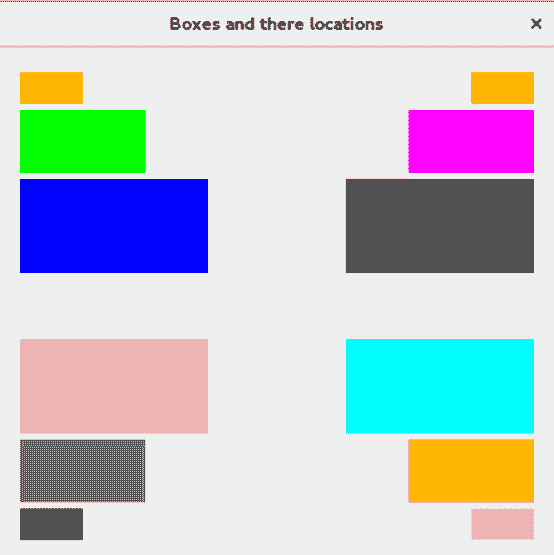

### 6.7 空布局（NULL LAYOUT）

上面我提到了 Java 最重要的布局管理器，但实际上可以在不使用布局管理器的情况下在窗口中放置组件。如果你在演示程序中点击“Null layout”按钮，将得到以下对话框，它包含六个组件（按钮没有功能）。

```java
package layoutpanels;

import java.awt.*;
import javax.swing.*;
```

```java
public class NullayoutView extends JFrame
{
    public NullayoutView()
    {
        super(null, " Layout", Dialog.ModalityType.MODELESS);
        setSize(340, 200);
        setResizable(false);
        this.setLocationRelativeTo(null);
        setDefaultCloseOperation(DISPOSE_ON_CLOSE);
        createWindow();
        setVisible(true);
    }

    private void createWindow()
    {
        setLayout(null);
        addComponent(this, new JLabel("Zip code"), 20, 20, 100, 20);
        addComponent(this, new JLabel("Town"), 20, 60, 100, 20);
        addComponent(this, new JTextField(100, 20, 50, 20));
        addComponent(this, new JTextField(100, 60, 20, 20));
        addComponent(this, new JButton("Cancel"), 230, 110, 90, 24);
        addComponent(this, new JButton("OK"), 120, 110, 90, 24);
    }
}
```


```java
private void addComponent(Container container, Component component, int left, int top, int width, int height)
{
    component.setBounds(left, top, width, height);
    container.add(component);
}
```


`createWindow()`中的第一条语句将布局设置为`null`，这意味着窗口没有布局管理器。然后该方法使用`addComponent()`添加组件。它定义了组件的大小和位置，最后两个参数是宽度和高度。虽然上面的方法看起来简单，但通常建议使用布局管理器，因为组件的大小不会改变（注意这在上面的示例中是不可能的），但使用绝对位置是可以的。

### 贷款计算

贷款与还款之间的关系由以下公式给出：

$G = y \frac{1-(1+r)^n}{r} \Rightarrow y = \frac{rG}{1-(1+r)^n}$

该公式假设在整个贷款期内利率不变，且第一次还款必须在贷款后第 1 个时期进行，你应该假设这些假设成立。以下公式决定了第 $k$ 次还款后的剩余债务：

$Rest = G(1+r)^k - y \frac{(1+r)^k-1}{r}$

程序必须打开一个窗口，用户需要在其中输入：

- 贷款形成费用
- 贷款金额
- 年百分比利率
- 还款期限（年）
- 每年期数

利用这些信息，程序必须计算还款额。此外，应该能够打开一个显示摊还表的窗口，从而对贷款进行概述，每个周期显示还款额、利息、还款金额以及该日期之后的剩余债务。

### 6.8 MVC

当你学习上述某些问题时，主要关注程序的架构以及可以以不同且更简单的方式编写的类——所选的架构是 GUI 程序设计模式的一步，被称为 MVC，即 Model View Controller（模型-视图-控制器）。在《Java 7》书中我会回到这种模式，虽然该模式在本书中首次被介绍，但我已经开始使用它了。该模式非常简单，意味着使用三层架构开发 GUI 程序。

| View (视图) |
| :--- |
| Controller (控制器) |
| Model (模型) |

其中模型（model）由定义程序数据和状态的类组成，而控制器层（controller）主要负责输入的控制，并可选包含必要的计算函数（业务逻辑）。最后，视图层（view）包含了所有用户界面、窗口和对话框的类。

该模式的目标是分离代码，使得与程序数据相关的代码放在模型中的类中并用于控制和逻辑操作，而视图层则仅包含与视觉表示和用户交互相关的代码。遵循该模式，你得到的代码可能会稍微大一点，但作为回报，它更容易阅读和理解。

在接下来的书中，当程序变得稍大时，我会开始使用这种模式。到目前为止，这只是程序类在逻辑层面的划分问题，尽管听起来没什么什么，但该模式已被证明是非常适合 GUI 程序的架构。因此，我会在很小范围内开始使用这种模式，作为代码做出合理决策的一种方式。关于 MVC 还有很多可以说的，包括每层应该如何与其他层通信，而且可能存在多个层，但细节我将推迟《Java 7》书中。


## 7 PAEDIT

在本章中，我将展示一个简单的文本编辑器程序，即一个用户可以输入文本并将文本保存到文件的程序。该程序相对简单，只有一个窗口。布局通过单个`BorderLayout`解决，关于 GUI，程序主要显示以下内容：

- 如何创建和使用菜单
- 如何创建和使用工具栏
- 如何使用`JTextArea`组件
- 如何使用 Swing API 提供的成品对话框
- 如何使用剪贴板

关于第 4 点，我之前展示过`JOptionPane.showMessageDialog()`的用法，但`JOptionPane`类还有其他我将使用的对话框。此外，我展示了`JFileChooser`类的使用，它实现了一个浏览文件系统的对话框。

程序要求你需要能够读取和写入文件，我在《Java 1》书中解释了如何做这一点。事实上，该程序涉及大量算法和问题解决的内容，程序大部分在处理如何向文件写入以及从文件中读取文本，这是你只需要注意的，但在这一切背后，有许多细节我将在以后能够详细解释。

正如所说，该程序具有非常简单的架构，由一个视图和一个模型组成，到目前程序的大部分代码都在视图中。该程序采用 2 层架构。

### 7.1 模型

模型仅包含一个类，称为`Document`，它封装了一个文本文件，因此代表了程序必须能够编辑的文档。该类的编写方式如下：

```java
package paedit;

import java.io.*;

public class Document {
    private String text; // 文档文本
    private File file; // 代表文档名的对象
```

```java
public Document()
{
    text = "";
    file = null;
}
```

```java
public Document(File file) throws Exception
{
    BufferedReader reader = null;
    try {
        StringBuilder builder = new StringBuilder();
        reader = new BufferedReader(new FileReader(file));
        for (String line = reader.readLine(); line != null; line = reader.readLine()) {
            builder.append(line);
            builder.append("\n");
        }
        text = builder.toString();
        this.file = file;
    } catch (Exception ex) {
        text = "";
        this.file = null;
        throw new Exception("无法读取文件内容");
    } finally {
        if (reader != null) reader.close();
    }
}
```

```java
public String getText()
{
    return text;
}
```

```java
public void setText(String text)
{
    this.text = text;
}
```

```java
public boolean save()
{
    if (file == null) return false; else return save(file);
}
```

```java
public boolean save(File file)
{
    BufferedWriter writer = null;
    try {
        writer = new BufferedWriter(new FileWriter(file));
        writer.write(text);
        this.file = file;
        return true;
    } catch (Exception ex) {
        return false;
    } finally {
        if (writer != null) {
            writer.close();
        }
    }
}
```


```java
catch (Exception ex)
{
}
```

有两个变量，第一个用于文本，另一个代表文件，是一个代表文件路径的`File`对象。

默认构造函数创建一个尚未保存且与文件关联的文档。另一个构造函数有一个`File`对象参数，并尝试读取该文件的内容作为文本。大多数文件方法可能会抛出异常，或者可能有很多原因无法执行特定的文件操作。在这种情况下文件不存在，因此文件的语句几乎总是放在`try/catch`块中。在示例中如果文件不存在，结果是一个空文档。`save()`方法尝试将内容（文档）保存到文件中，但只有在变量引用文件时才可行。否则方法返回 false。它还处理换行符。

注意该类还有文本的 getter 和 setter 方法，程序的视图可以读取并更新文本。

### 7.2 视图


程序的视图层有两个类，分别是`ModelAndView`和`Tools`类。后者是一个简单的类，包含了对其他程序感兴趣的工具。如果你运行程序，它会打开一个如下所示的窗口，顶部有菜单和工具栏，底部是状态栏（程序启动时为空）。中心是一个`JTextArea`区域，这是一个类似于`JTextField`的输入字段，但是一个可以输入行的字段。

## TOOLS 类

程序有一个`Tools`类，它只有静态成员，这意味着无需`Tools`类型的对象即可引用成员：

```java
package paedit;

import java.awt.*;
import java.awt.event.*;
import javax.swing.*;

public class Tools {
    public static Font defFont = new Font("Liberation Sans", Font.PLAIN, 14);
    public static Font txtFont = new Font("FreeMono", Font.PLAIN, 16);

    public static Color statusLine = new Color(240, 240, 240);

    public static Image imageIcon(String path, int width) {
        java.net.URL imgURL = Tools.class.getResource(path);
        if (imgURL != null) return new ImageIcon(
            new ImageIcon(imgURL, "").getImage().ScaledInstance(
                width, width, Image.SCALE_SMOOTH, ""));
        return null;
    }
}
```

# JAVA 2：带有图形用户界面的程序

```java
public static JButton createCommand(Icon icon, String toolTip,
        ActionListener listener)
{
    JButton cmd = new JButton();
    cmd.setFont(defFont);
    cmd.setIcon(icon);
    cmd.setMargin(new Insets(0, 0, 0, 0));
    cmd.setToolTipText(toolTip);
    cmd.addActionListener(listener);
    return cmd;
}
```

最初了三个常量，前两个分别定义了默认字体和按钮字体。第三个定义了状态栏的颜色。在很多情况下，你必须控制字体和颜色，窗口必须应用这些设置，因此建议将这些值定义为常量，如上所示，这样你可以轻松地更改值，并且可以在多个窗口中使用它们。


# JAVA 2：带有图形用户界面的程序

该类有两个方法，它们很难理解（再次是因为你仍然缺乏许多 Java 细节），所以你应该很大程度上接受它们的原样。第一个方法用于从应用程序文件中加载图标。两个参数是图像名称和图标尺寸。第一条语句定义了对文件中图片的引用，而下一条语句创建一个图标并将其缩放到所需的大小。最后一个方法创建一个带有图标的按钮，并为该按钮关联一个事件处理器。此外，按钮上还添加了提示文字。

## 菜单

在窗口中添加菜单非常简单。菜单基本上是按钮的集合，只是以菜单项的不同形式显示，但效果是一样的，你可以点击菜单项，该项会发送一个 Action。必须定义菜单，虽然它可以包含很多内容，本例展示了在`MainView`中是如何定义菜单的：

```java
private void createMenu() {
JMenuBar menuBar = new JMenuBar();
menuBar.add(createMenuItem());
menuBar.add(createEditMenuItem());
setJMenuBar(menuBar);
}
```

```java
private void createMenuItem() {
JMenu menu = new JMenu("Files");
menu.add(createMenuItem("New document", this::blank));
menu.add(createMenuItem("Open document", this::open));
menu.add(createMenuItem("Save document", this::save));
menu.add(createMenuItem("Save document as", this::saveas));
menu.addSeparator();
menu.add(createMenuItem("Exit", this::close));
return menu;
}
```

```java
private void createEditMenuItem() {
JMenu menu = new JMenu("Edit");
menu.add(createMenuItem("Copy", this::copy));
menu.add(createMenuItem("Paste", this::paste));
menu.add(createMenuItem("Cut", this::cut));
menu.addSeparator();
menu.add(createMenuItem("Search", this::search));
return menu;
}
```

# JAVA 2：带有图形用户界面的程序

```java
private JMenuItem createMenuItem(String text, ActionListener listener)
{
    JMenuItem item = new JMenuItem(text);
    item.addActionListener(listener);
    return item;
}
```

原则上，代码非常简单且易于理解。有三个组件。

菜单是一个`JMenuBar`，它是一个组件，包含了菜单并可以添加到窗口中，且会自动放置在窗口顶部。通过`setJMenuBar()`方法将`JMenuBar`添加到窗口。第二个组件是`JMenu`，代表一个菜单，而列表是`JMenuItem`，代表一个菜单项。你应该注意，你分配监听器的方式与给按钮分配监听器非常相同。各个事件处理器写在类的末尾。

## 工具栏

程序的窗口有一个工具栏，它仅仅是一个可以包含组件的容器。在这种情况下，有四个按钮，但这次按钮不是由文本表示，而是由图像表示。

这些控件中的每一个都包含一个图像（图标），该图像必须程序可用。可以通过多种方式实现，但由于这里是小图标，你可以使用以下步骤：

- 1. 将包添加到 NetBeans 项目中 – 在这种情况下，它是`paedit`的一个子包，名为`images`，创建包后包名为名为`paedit.images`

- 2. 将图像复制到相应的文件夹（在这种情况下，`images`文件夹内有 4 个 png 文件）

这种方法的优点是，图标会与类文件一起通过项目的 jar 文件打包在一起。

然后是工具栏，其定义如下：

```java
private JToolbar createToolbar()
{
    JToolbar toolbar = new JToolbar();
    toolbar.setPhysicalDevice(Tools.statusLine);
    toolbar.add(Tools.createCommand(
        Tools.createImage("/paedit/images/copy.png", 26),
        "Copy text to the clip board", this::copy));
    toolbar.addSeparator(new Dimension(10, 10));
```

# JAVA 2：带有图形用户界面的程序

```java
toolBar.add(Tools.createCommand(
  Tools.createImageIcon("/images/paste.png", 26,
  "Insert text from the clip board", this::paste));
toolBar.addSeparator(new Dimension(10, 10));
toolBar.add(Tools.createCommand(
  Tools.createImageIcon("/images/cut.png", 26,
  "Delete text and the copy to the clip board", this::cut));
toolBar.addSeparator(new Dimension(20, 20));
toolBar.add(Tools.createCommand(
  Tools.createImageIcon("/images/search.png", 26,
  "Search the document", this::search));
toolBar.setPreviewSize(new Dimension(0, 36));
return toolBar;
```

在这里我使用了`Tools`类中的方法，应该主要注意如何引用单个图像。图像是应用程序 jar 文件中的一种资源，你必须指定指向当前图像的路径，该路径相对于项目。此外，还使用了与菜单相同的事件处理器。`JTextField`支持复制/粘贴，所以实际上并不真的需要按钮，但包含它们是因为目标是展示如何创建工具栏。在这种情况下包含了工具栏按钮，但它也可以包含任何其他组件。


到 2020 年，风能可以提供地球能源需求之一。今天，SKF 的创新知识对于运行世界上大部分的风力机组至关重要。高达 25% 的发电成本与维护有关。得益于我们的在线状态监控和自动调整系统，这些成本可以大幅减少。我们帮助能源生产更加经济，创造比任何时候都更清洁的能源。通过分享我们的经验、专业知识和创意，行业可以获得预期的性能。因此，我们了能够应对这一挑战的最佳员工。

知识工程的力量

接入知识工程的力量，

访问我们的网站 www.skf.com/knowledge

SKF

# JAVA 2：带有图形用户界面的程序

## 状态栏

它不是真正的状态栏，而只是一个显示左对齐文本的`JLabel`：

```java
private JLabel createStatus()
{
    JLabel label = new JLabel();
    label.setFont(Tools.defFont);
    label.setOpaque(false);
    label.setBackground(Tools.statusLine);
    label.setHorizontalAlignment(JLabel.LEFT);
    label.setPreferredSize(new Dimension(0, 25));
    return label;
}
```

将标签分配给更新文本的方法：

```java
private void setStatus()
{
    status.setText(String.format("%d line, %d tegn",
    txtDoc.getLineCount(), txtDoc.getText().length() + 1));
}
```

它引用了名为`txtDoc`组件，状态栏显示字段中的行数和字符数。

## 布局

`Main`定义了四个实例变量：

```java
private JTextArea txtDoc = new JTextArea();
private JLabel status;
private Document doc = new Document();
private boolean changed = false;
```

第一个是`JTextArea`组件，它是一个组件，可以在其中输入和编辑任意数量的行，因此可以处理任意文档。下一个是用于状态栏的`JLabel`，第三个是`Document`然后是模型。最后一个跟踪文档是否已更改。

`createWindow()`方法与之前的示例类似，定义了窗口的设计：

```java
private void createWindow()
{
    createMenu();
    setLayout(new BorderLayout());
}
```

# JAVA 2: 带有图形用户界面程序

```java
JPanel panel = new JPanel(new BorderLayout());
panel.setBorder(new EmptyBorder(3, 3, 3, 3));
panel.add(createToolbar(), BorderLayout.NORTH);
panel.add(status = createStatus(), BorderLayout.SOUTH);
panel.add(createField());
add(panel);
txtDoc.requestFocus();
```

第一条语句创建并向窗口添加了一个菜单。其余部分包含一个带有`BorderLayout`的`JPanel`，其中 NORTH 部分有一个工具栏，SOUTH 部分有一个状态栏（上述标签），而封装在`JScrollPane`中的`JTextArea`组件填充了窗口其余部分。

以下方法初始化了作为器的组件`txtDoc`：

```java
private JScrollPane createField()
{
txtDoc.setFont(Tools.setFont());
txtDoc.setWrapStyleWord(true);
txtDoc.setLineWrap(true);
txtDoc.addKeyListener(new ChangedListener());
return new JScrollPane(txtDoc);
}
```

该方法定义了当行没有足够空间时将文本换行到下一行，并且换行必须在单词边界处进行。最后，绑定了一个`KeyListener`，这是一个在每次按下按键时执行的事件处理器。它将变量`changed`设置为`true`，表示文档已更改，并调用了`setStatus()`方法，该方法用当前行数和当前字符数更新状态行：

```java
class TextChanged extends KeyAdapter
{
public void keyTyped(KeyEvent e)
{
changed = true;
setStatus();
}
}
```

# JAVA 2: 带有图形用户界面程序

事件处理器被定义为继承`KeyAdapter`的类中的方法。当按下按键时，`TextArea`会触发更多事件，而`KeyAdapter`是一个实现`KeyListener`接口的类，定义了三个调节键盘的事件处理器。`KeyAdapter`将这些处理器实现为空空方法，你可以编写一个类来重写你想要使用的这些处理器。注意，这与我在上一个关于窗口大小变化事件程序中使用的原理完全相同，而且你在示例 4 中也使用了相同的原理来捕获双击列表框中项目时的事件。

## 事件处理器

最后，有 8 个事件处理器（对应 8 个菜单项）。下面是打开文档的事件处理器：

```java
private void open(ActionEvent e)
{
if (changed && JOptionPane.showDialog(this,
"文档已更改。是否保存文档？", "警告",
JOptionPane.YES_NO_OPTION, JOptionPane.WARNING_MESSAGE) ==
JOptionPane.YES_OPTION) save());
JFileChooser fileChooser = new JFileChooser();
```


# JAVA 2: 带有图形用户界面程序

```java
fileChooser.setCurrentDirectory(new File(System.getProperty("user.home")));
fileChooser.setDialog("打开文档");
if ((fileChooser.showDialog(this)) == JFileChooser.APPROVE_OPTION) {
File file = fileChooser.getSelectedFile();
try {
 doc = new Document(file);
 txtDoc.setText(doc.getText());
 changed = false;
} catch (Exception ex) {
 JOptionPane.showMessageDialog(this, "无法打开文档", "错误消息", JOptionPane.OK_OPTION);
 txtDoc.setText("");
 changed = false;
}
setStatus();
}
```


第一条语句测试当前文档是否被修改。在这种情况下，它会弹出一个窗口，但这次是一个确认对话框（带有“是”和“否”按钮的对话框），询问用户是否应该保存文档。在这种情况下，调用了`save()`方法，该方法保存文档。接下来我定义了一个`JFileChooser`，它会打开一个对话框，可以在其中浏览文件系统以你想打开的路径。接受文件后，你会获得一个表示文件路径的`File`对象，该对象用于`Document`类的构造函数以打开文件。输入字段使用文件内容初始化后，你应该注意，文档的创建放在`try/catch`中，因为`Document`类的构造函数可能会抛异常。

事件处理器可能会调用`save()`方法：

```
private void save() {
 doc.setText(txtDoc.getText());
 if(doc.save()) changed = false; else saves();
}
```

此方法将输入字段的内容复制到模型，并要求模型使用`save()`方法将文本写回文件。不可能（因为这是一个尚未保存的新文档）该方法调用了`saves()`，其中用户再次使用`JFileChooser`对象将浏览文件系统并输入文件名。

# JAVA 2: 带有图形用户界面程序

保存、另存和新建文档的事件处理器在原理上的工作方式是相同的，我在这里不再显示代码。

然后是三个关于剪贴板的事件处理器。下面是将文本复制到剪贴板的处理器：

```
private void copy(ActionEvent e)
{
  try {
    String text = txtDoc.getSelectedText();
    Clipboard cb = Toolkit.getDefaultToolkit().getClipboard();
    cb.setContents(new StringSelection(text), null);
  } catch (Exception ex) {
    JOptionPane.showMessageDialog(this,
      "文本无法复制到剪贴板",
      "错误消息", JOptionPane.OK_OPTION);
  }
}
```

第一个选中的文本存储在变量中。接下来，定义剪贴板的引用，并将文本存储在`StringSelection`类型的对象中，该对象保存在剪贴板上。下一个处理器将剪贴板上的文本插入文档中：

```
private void paste(ActionEvent e)
{
  try {
    Clipboard cb = Toolkit.getDefaultToolkit().getClipboard();
    Transferable data = cb.getContent(this);
    if (data == null) return;
    String str = (String)data.getDataTransfer(DataFlavor.stringFlavor);
    String text = txtDoc.getSelectedText();
    int p = txtDoc.selectionStart();
    int q = txtDoc.selectionEnd();
    if (q > p) {
        txtDoc.setText(text.substring(0, p) + str + text.substring(q));
    } else {
      p = txtDoc.getCaretPosition();
      txtDoc.setText(text.substring(0, p) + str + text.substring(p));
    }
  } catch (Exception ex) {
    JOptionPane.showMessageDialog(this,
      "无法从剪贴板粘贴文本",
      "错误消息", JOptionPane.OK_OPTION);
  }
}
```

第一个处理器获取剪贴板的引用，并将值取为`Transferable`类型对象。该对象通过`getDataTransfer()`方法转换为`String`。此字符串必须插入输入字段中，要么替换选中的文本，要么插入到光标位置。`cut()`事件处理器的工作原理原理上相同。

后面是搜索的事件处理器：

```
private void search(ActionEvent e) {
String str = JOptionPane.showInputDialog(this, "输入搜索文本", "搜索",
JOptionPane.INFORMATION_MESSAGE);
}
```


# JAVA 2: 带有图形用户界面程序

```
if (str != null && str.length() > 0) {
    String text = txtDoc.getText();
    int p = text.indexOf(str);
    if (p >= 0) {
        txtDoc.select(p, p + str.length());
        txtDoc.requestFocus();
    }
    else JOptionPane.showMessageDialog(this, "不存在该文本",
    "信息", JOptionPane.OK_OPTION);
}
```

代码中没有奥秘，但窗口必须被定义为事件的监听器，这在构造函数中发生：

```
class WindowCloser extends WindowAdapter {
    public void windowClosing(WindowEvent e) {
        if (changed && JOptionPane.showConfirmDialog(Main.this,
        "文档已更改。你想保存它吗？",
        "警告", JOptionPane.NO_OPTION) == JOptionPane.YES_OPTION) save();
    }
}
```

```
addListener(new WindowCloser());
```

# JAVA 2：带有图形用户界面的程序

## 测试

程序完成后，必须进行测试。在这种情况下，除了尝试运行程序外，没别的事情可做了。然而，要确保你测试了所有可能发生的情况可能是困难的。此时，制定一个测试计划，写下你想要测试的内容可能会有所帮助。当然，这不能保证结果，但编写计划本身就意味着你仔细思考了必须测试的内容，其次，它可以帮助你记得在测试时覆盖所有要点。例如，测试计划如下：

- 1. 程序的视觉外观和感受
- 2. 输入一个文档
- 3. 保存文档
- 4. 在同一份文档中输入更多文本
- 5. 再次保存
- 6. 关闭程序
- 7. 再次打开文档
- 8. 编辑内容
- 9. 保存文档
- 10. 将文本复制到剪贴板
- 11. 在文档中粘贴文本且不替换
- 12. 在文档中粘贴文本并替换所选文本
- 13. 剪切所选文本
- 14. 再次在文档中粘贴文本
- 15. 从另一个程序复制文本到此程序
- 16. 测试搜索功能
- 17. 保存文档
- 18. 创建新文档
- 19. 再次打开测试文档
- 20. 修改文档
- 21. 在不保存文档的情况下关闭程序
- 22. 再次打开程序
- 23. 打开测试文档
- 24. 打开另一个测试文档，例如一个 java 程序
- 25. 打开一个非文本文档

稍后我将处理程序测试，但一个像上面这样简单的测试计划也比没有要好。然而，应该意识到，如果在测试过程中发现错误，必须修正这些错误，然后重复测试——再次执行测试计划中的所有点，并重复此过程，直到你完成一次无误的测试。

## 8 最终示例

任务是编写一个模拟纸接牌的程序。这是一个非常简单的纸接牌游戏，规则如下：

桌面上上有 16 张牌。必须根据以下两个标准移除牌：

- 1. 相同颜色且点数小于 10 的牌，且牌面点数之和为 15（例如，同一种色的 5 和 9，或者同一种色的 7 和 8）
- 2. 相同颜色的 10、Jack、Queen 和 King

当你移除牌后，如果牌中还有剩余，则必须用它们填充空位。当所有的牌都被移除时，游戏解决；但如果你处于无法移除牌的情况，则意味着该纸接牌无法解决。


## 8.1 程序_类

原则上讲，这是一个非常简单的程序，用户界面必须显示扑牌的图像，用户应该能够点击这些牌。程序在原则上没有其他功能，但必须有能够选择新游戏的可能性。

必须跟踪哪些牌在桌面上，哪些牌留在牌堆中，哪些牌已被取走，为了这个目的，程序应该定义一个始终表示程序当前状态的模型。因此，程序原则上必须这样工作：当用户点击一张牌时，向模型发送一条消息，说明点击了哪张牌，然后模型应该根据标记的牌判断是否可以根据纸接牌规则从桌面上移除这些牌。如果是这样，模型必须从桌面上移除牌并从牌堆中选择新牌。

程序的基本概念是扑克牌，这是一个简单的概念。扑克牌必须具有三个特征：

- 1. 数值必须是 1 到 13 之间的数字：11 = Jack，12 = Queen  13 = king
- 2. 颜色应该是一个字符：D（菱形）、H（红心）、S（黑桃）、C（梅花）
- 3. 牌的图像

否则，牌是被动的，可以定义为：

| Card |
| :--- |
| value: int |
| color: char |
| img(): ImageIcon |
| getValue(): int |
| getColor(): char |
| getImage(): ImageIcon |

除了扑克牌，自然会考虑到一副 52 张牌的牌堆。它并不比一个包含 52 个对象的数组和一个可以跟踪牌堆中剩余多少张牌的变量：

| Cards |
| :--- |
| top: int |
| empty(): boolean |
| getTop(): int |
| get(): Card |
| shuffle() |

第一个方法在牌堆为空时返回，下一个方法返回牌堆中剩余多少张牌。第三个方法返回顶部的牌。最后一个方法洗牌组，并应在选择新游戏时使用。

模型必须有一个`Cards`类型的对象，因此有一副扑牌。为了控制游戏状态，需要三个数据结构：

- 一个已取过的牌的列表
- 一个跟踪哪些牌在桌面上的数组
- 一个跟踪桌面上哪些牌被标记的数组

因此，你可以这样勾勒模型类：

| Model |
| :--- |
| used: List<Card> |
| table: Card[4][4] |
| marked: boolean[4][4] |
| getCard(int, int): Card |
| reset() |
| move(int, int): boolean |

该类只有两个本质方法，其中`move()`是最重要的，并且在用户每次点击牌时都会被调用。`reset()`方法用于选择新游戏。程序的设计将由以下类组成：


## 8.2 编程

起点是一个名为`Solitaire16`的 NetBeans 项目。要编写程序，你必须拥有扑克牌图片。文件夹中有一个名为`cards.tar`的包，包含图像。除了 52 张牌外，还有两张背面的牌和一个用于简单工具栏的图标。为了将图像封装在应用程序的 jar文件中，我创建了一个名为`solitaire16.images`的包，解压 tar 文件并将所有图像复制到该文件夹中。

## 模型层

模型层由上述三个类组成，`Card`类是显而易见的，不再进一步讨论。原则上`Cards`类也是如此，但是这个类需要将图像加载到牌上，为此我添加了一个辅助类，其中包含一个可以从 jar 文件中加载图像的方法：

```java
package solitaire16;

import java.awt.Color;
import javax.swing.*;
```


我们不发明轮子，我们重新发明光。

迷人的光影提供了无限的可能性：创新技术和新市场既提供了机遇也带来了挑战。在一个你的专业知识需求迫切的环境中。在我们全球集团内部享受支持性的工作环境，并从国际职业路径中获益。与其他专家紧密合作实施可持续的想法，并为影响我们的未来贡献力量。来加入我们，每天重新发明光。

```java
public class Tools
{
    public static Color selected = Color.darkGray;

    public static ImageIcon createImage(String path, String description) {
        java.net.URL imgURL = Cards.getResource(path);
        if (imgURL == null) return new ImageIcon(imgURL, description);
        return null;
    }
}
```

该类实际上并不属于模型层，因为它的目的是创建`ImageIcon`对象，而这些对象属于视图界面。总的来说，当前解决方案中模型层和视图层之间的边界并不完全清晰，因为模型层的类使用了属于视图层的对象，而且程序没有符合 MVC 之前的原则，因为模型层以某种方式模仿了视图层。可以对程序进行不同的设计，让模型层中的类不知道图像，但你也可以将程序的当前解决方案作为示例，说明模式和原则是好的，但相反，你不应该仅仅为了复制模式而使代码复杂。

有了上面的类后，编写`Cards`类的代码就很简单。它必须将 52 张扑克牌加载到数组中，此外还有两张背面牌的图像。该类 true有一个洗牌的方法，通过以下算法实现：

```java
public void shuffle()
{
    for (int n = 0; n < 1000; ++n)
    {
        int i = rand.nextInt(array.length);
        int j = rand.nextInt(array.length);
        Card temp = array[i];
        array[i] = array[j];
        array[j] = temp;
    }
    top = array.length;
}
```

# JAVA 2：带有图形用户界面的程序

Model 类定义了以下实例变量：

```java
public class Model
    private Cards deck = new Cards(); // 要使用的牌牌组
    private ArrayList<Card> used = new ArrayList(); // 已取出的牌牌
    private Card[][] table = new Card[4][4]; // 桌上的牌牌
    private boolean[][] marked = new boolean[4][4]; // 被标记的牌牌
```

除了设计中所示的内容外，该类还扩展了许多其他方法，其唯一目的是让用户界面能够访问模型的状态。如前所述，`move()`方法是最复杂的，因为它是测试牌牌是否可以从桌面上移除的方法。通过以下算法实现：

```java
if all cards has the same color then
    calculate the sum of the cards values
if there is a face card then
    if the sum = 46 then move cards
else
    if the sum = 15 then move cards
```

## 程序的视图

界面只包含一个类，即 MainWindow。该类并没有占用太大空间，并定义了以下实例变量：

```java
public class MainWindow extends JFrame
    private Model model = new Model();
    private JLabel[][] center = new JLabel[4][4];
    private JLabel[] left = new JLabel[36];
    private JLabel[] right = new JLabel[52];
```

这里是桌上牌的中心区域，left 是牌组，必须显示牌组中还剩下哪些牌，right 是已取出的牌。center 显示正面朝上散落在桌面上的牌，而 right 以牌组的形式显示已取出的牌。left 仅显示一张背面的牌：

JAVA 2：带有图形用户界面的程序

最终示例

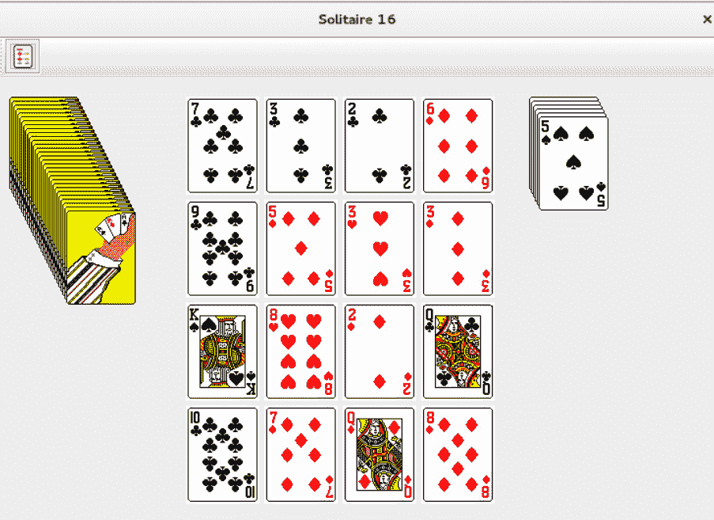


在 www.deloitte.ca/careers 发现真理

© Deloitte & Touche LLP 及其关联实体

在 bookboom.com 下载免费电子书

JAVA 2：带有图形用户界面的程序

最终示例

“窗口布局是一个 BorderLayout，其中 NORTH 有一个带有单个按钮的工具栏，

WEST 有包含未发牌牌的牌组，EAST 有一个包含已取出牌的牌组，

最后，桌面上的 16 张牌位于 CENTER。”


牌牌的图像通过专门可以显示图像的`JLabel`显示。为了在牌牌被点击时显示它已被标记，会更改包含图像的`JLabel`组件的背景颜色，它看起来就像图片周围的一个边框。

该颜色在`Tools`类中定义。

这是一个非常简单的接龙游戏，但解决这个接龙游戏相对困难，而且当你面临不得不放弃的情况时会很快陷入这种境地，所以毫无疑问，它不是最娱乐的接龙游戏。

# JAVA 2：带有图形用户界面的程序

## 9 最后一个示例

如本书所示，编写图形用户界面需要许多行代码，甚至有些代码都很难记住如何编写。相反，书中的示例也表明，你每次编写的内容都是相同的，或者至少各种用户界面的开发具有许多共同特征。可以通过创建一个类库（包含处理所遇到任务方法的类）来方便工作，然后该库可以供你开发的所有 GUI 程序使用。

我将在本章中展示如何编写这样一个类库，我将其命名为`PaLib`，还会展示一个使用该库的程序。该类库将用于后续所有的书籍，不仅如此，该库将不断扩展，后续的练习和问题绝对与如何扩展该库有关。因此，鼓励你学习类库是如何制作的，以及如何在`History`（我在本章展示的测试程序）中使用。尽管该程序相对于 GUI 程序没有包含任何新内容，但作为对 GUI 应用和 Swing 引言的结论是非常合适的。

## 9.1 创建库

原则上，创建一个类库非常简单，在 NetBeans 中，你按照通常的方式创建一个项目，只是它必须是一个 Class Library 项目：

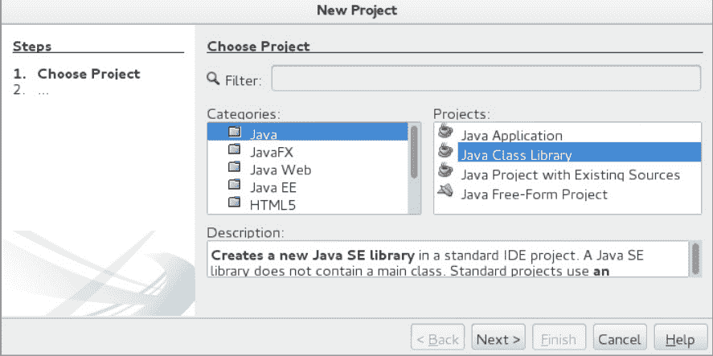

结果是一个空项目，然后你可以开始添加包和类。

我的库如所述名为`PaliLib`，到目前它只包含一个名为`pali`的包和一个名为`Tools`的类（见下文）。该类完全由静态方法组成，这些是我设计用户界面时认为非常有用的方法。我将在这里展示代码，因为内容非常多（超过了 800 行），但许多行是注释，而且许多行是……

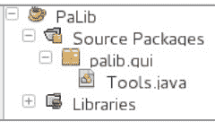


我不将展示该类的其余部分，但有类似的方法可以创建最基础的 Swing 组件。此外，还有方法可以将组件放置在容器中。这是一个带有工具的类，随着你的需要，该类不断扩展新方法是很自然而然。同样，类库也可以用新类进行扩展，作为一个示例，我将扩展库增加一个具有从文件写入和读取对象的方法的类。

首先，我通过名为`palib.util`的新包扩展了库，其中有一个名为`Files`的类：

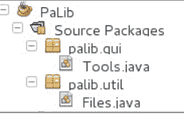

你是否希望在一个具有良好工作/生活平衡的创新环境中进一步发展清洁技术职业？考虑一下丹麦吧！访问 cleantech.talentattractiondenmark.com


> “在丹麦，你可以找到很棒的工程工作并提升专业水平。特别是在风能领域，你可以向行业内最优秀的人学习，并在稳定的工作中推进你的职业。”

Mireia Mare,

来自西班牙的高级工程师。

自2010年来一直一直丹麦的风能行业工作。

在 bookboom.com 免费下载电子书 点击广告阅读更多信息

在《Java 1》一书中，展示了如何向文件中存储任意对象（对象序列化）以及如何再次读取该对象（对象反序列化）。记住如何编写这些语句可能很困难，而且当需要时你每次都必须编写，因此为了这些目的编写两个类方法是非常有价值的：

```
package palib.util;

import java.io.*;

public class Files {
    public static boolean serialize(Object obj, String filename) {
        try {
            ObjectOutputStream stream =
                new ObjectOutputStream(new FileOutputStream(filename));
            stream.writeObject(obj);
            stream.close();
            return true;
        } catch (Exception ex) {
            return false;
        }
    }

    public static Object deserialize(String filename) {
        try {
            ObjectInputStream stream =
                new ObjectInputStream(new FileInputStream(filename));
            Object obj = stream.readObject();
            stream.close();
            return obj;
        } catch (Exception ex) {
            return null;
        }
    }
}
```

## 9.2 测试程序

我将最后展示我的类库如何在程序中使用。我写了一个名为`History`的程序，你可以在其中维护一个历史人物列表。它要求程序将列表保存在某处。当程序第一次运行时，它会初始化丹麦国王列表，每当列表发生变化时，它就会存储在你硬盘上的一个文件中。当程序下次打开时，它将开始从文件中读取更新后的列表——如果可能的话。否则，文件将初始化为丹麦国王。文件存储在程序相同的位置，你不需要研究文件是如何存储和读取的，因为类库已经包含了必要的方法。

人的定义如下（这里我删除了注释以及所有的 get 和 set 方法）：

```
package history;

import java.io.*;

public class Person implements Comparable<Person>, Serializable {
    private String name; // 人的名字
    private String job; // 人的职位
    private String text; // 描述
    private int from; // 出生、统治开始或其他
    private int to; // 人去世的年份

    public Person(String name, String job, String text, int from, int to) {
        this.name = name;
        this.job = job;
        this.text = text;
        this.from = from;
        this.to = to;
    }

}
```

当你阅读代码时，应该特别注意对象的比较是通过`compareTo()`方法定义的，在该方法中，对象按年份数字进行比较（该类实现了`Comparable<Person>`接口），并且该类实现了`Serializable`接口。你还应该注意该类重写了`equals()`，因此人们仅根据姓名进行比较。

有一个代表`Person`对象列表的`Persons`类。

```
package history;

import java.util.*;
import palib.util.*;

public class Persons implements Iterable<Person>
{
    private static String filename = "persons.dat";
    private ArrayList<Person> list;

    public Persons()
    {
        list = (ArrayList<Person>) Files.deserialize(filename);
        if (list == null) initialize();
    }
    public Iterator<Person> iterator()
    {
        return list.iterator();
```

我加入 MITAS 是因为我想要真正的责任


第16个月

我在北海的一名施工主管，指导并帮助工头解决问题

真实工作

国际机会

三次工作实习


在 bookboom.com 免费下载电子书

点击广告阅读更多信息

```
public void add(Person pers)
{
    list.add(pers);
    Collections.sort(list);
    Files.serialize(list, filename);
}
```

```
public void remove(Person pers)
{
    list.remove(pers);
    Files.serialize(list, filename);
}
```

```
public void update(Person pers)
{
    for (Person p : list)
    {
        if (p.equals(pers))
        {
            p.setJob(pers.getJob());
            p.setText(pers.getText());
            p.setFrom(pers.getFrom());
            p.setTo(pers.getTo());
            break;
        }
    }
    Files.serialize(list, filename);
}
```

```
private void initialize()
{
    list = new ArrayList<>();
    for (int i = 0; i < navname.length; i++)
    {
        String job = navname[i][0].equals("Magrete d. 1.") ? "King":
        navname[i][0].equals("Magrete d. 2.") ? "Queen": 
        int fra = navname[i][1].length() > 0 ? Integer.parseInt(navname[i][1]) : -9999;
        int til = navname[i][2].length() > 0 ? Integer.parseInt(navname[i][2]) : 9999;
        list.add(new Person(navname[i][0], job, "", fra, til));
    }
    Collections.sort(list);
}
```

```
private static String[][] navname = {
    { "Gorm Gamle", "", "958" },
    { "Harald Blåtand", "958", "986" },
};
```

首先注意导入语句

```
import palib.util.*;
```

指向包含`Files`类的包。为了使可行，类库的 jar 文件必须对程序可用。可以通过项目（即`History`程序）获取，通过右键点击 Libraries 并选择 JAR / Folder...你可以浏览到类库的 jar 文件并将其添加到项目中：

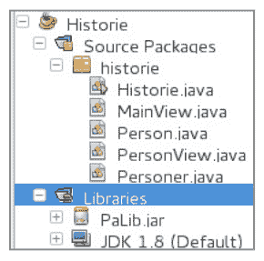

应用程序可以使用该 jar 文件及其。如果我们构建项目并将`History.jar`文件复制另一个文件夹并从终端窗口运行程序，你会得到一个错误消息，因为程序找不到类库。类库并不是程序 jar 文件的一部分。如果你打开项目的`dist`文件夹，你会发现有一个名为`lib`的子目录。它包含了类库的 jar 文件，为了程序运行，该子目录也必须复制。

`Persons`类在原理上很简单，你应该注意到`Person`对象存储在`ArrayList`中，该类具有添加项、更新项和删除的方法。具体来说，每个方法都使用`Files`类中的`serialize()`方法对列表进行序列化，该类是类库中的一个类。

该类中最复杂的是构造函数。从文件中反序列化列表。

这意味着意味着可以使用`for`语句遍历`Persons`对象的项。

在 bookboom.com 免费下载电子书

运行程序后，你会得到如下所示的窗口。该窗口是程序的主窗口，我在这里不再显示代码，因为没有什么新内容，但你应该注意到该类是如何使用类库来构建用户界面的。

如果你双击列表中的某行（名称），将得到一个可以查看所有信息的窗口，我可以对它们进行编辑并可能删除该人员（见下文）。该类名为`PersonView`，我将在此显示代码，但窗口布局是由`GridBagLayout`定义的，且该类广泛使用了类库。如果你在主窗口，点击“Create person”（创建人员）按钮会打开同一个窗口，但包含所有字段，然后你可以输入人员姓名，从而向列表中添加新的`Person`。


# 管理硕士

由于实现梦想是你面临最大的挑战，IE 商学院（IE Business School）提供的英语、西班牙语或双语教学的管理硕士课程，通过一项创新计划培养职业生涯初的高性能专业人士，帮助他们充分发挥潜力。

- 选择你的专业领域。

- 通过提供的不同选项定制你的硕士课程。

- 在伦敦、硅谷或上海等地进行全球沉浸周学习。

> 因为你而改变，我们也随你而改变。

www.ie.edu/master-management mim.admissions@ie.edu f t youtube linkedin in

在 bookboom.com 免费下载电子书

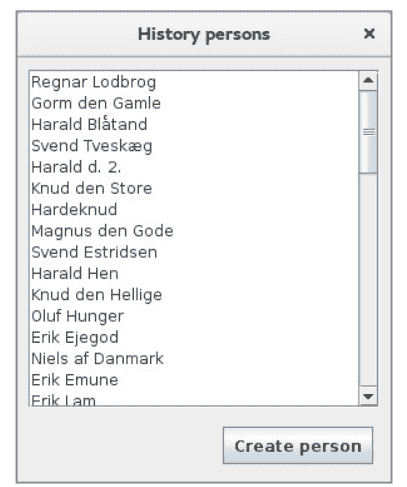

下面是在双击列表框中的某行时，`PersonView`窗口的示例：

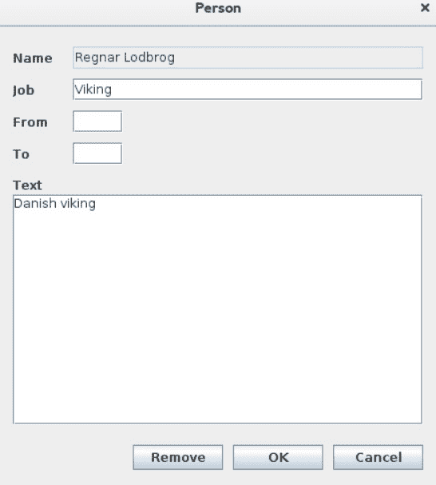

在 bookboom.com 免费下载电子书

如果你有许多程序使用该类库，那么每个程序都必须有一份类库的`jar`文件。当然，这并不特别有用，理想情况应该是只有一个所有程序都在使用的单一副本。这可以通过多种方式解决，但一种非常简单的方法（尽管远非最好）是将如下所示放置`jar`文件：

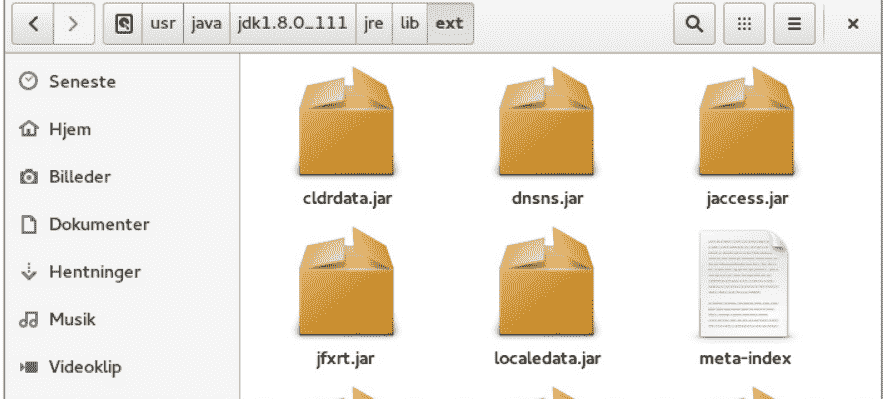

这里是`jdk1.8.0_111`文件夹，它包含了我的 Java 环境，当然也可以被其他文件夹替换。通过像上所示的方式将文件放置在该文件夹中来使`jar`文件可用并不一定是最好的方法，但是一种简单的方法，非常值得了解。
