# Java 20：系统开发流程简介

## 前言

这是关于 Java 软件开发系列书籍中的最后一本书。本书关注系统开发中的过程，并主要与大型系统开发项目相关。此外，书中介绍了三种具体的系统开发方法：`Unified Process`（统一过程）、`SCRUM` 和 `Extreme Programming`（极限编程）。此外，还描述了现代系统开发中许多其他活动和技术，无论人们是否使用某种特定方法都是如此。在你读完这 20 本关于 Java 系统开发的书籍并完成了所有的练习和任务后，你可能还不能称自己为专业的 Java 开发人员。这只能通过经验来获得，但你拥有了良好的基础，并已经准备好加入专业的软件开发团队。软件开发人员没有所谓的“毕业”，因为总会有新版本的产品和方法需要你学习，但我希望这些书籍能提供良好的基础。并不是所有内容都涵盖了，要么是因为空间不足，要么是被遗漏，而且某些内容可能已经过时，也许未来的版本可以修复这些问题，但如果真的发生了，我还是回到起点：某些东西没有出现而另一些过时了。软件开发永远不会停止。

正如标题所示，系列书籍涉及软件开发，目标是教读者如何用 Java 开发应用程序。可以通过阅读相关主题和学习完整的示例程序来学习，但最重要的是亲自动手从零开始编写自己的程序。因此，书籍的一个重要部分是练习和问题，读者必须编写与书中内容相应的程序。该系列中的所有书籍都围绕同一个骨架构建，由文本、示例、练习和问题组成，这些内容被放置在文本中自然出现的位置。练习与问题的区别在于，练习很大程度上是对文中所介绍内容的重复，并且对需要做什么描述得相对准确。而问题的描述则较为松散，通常规模稍大，且很少有明确的最佳解决方案。这些书应该从头到尾阅读，但许多代码示例（包括练习和问题）起着核心作用，读者详细地研究许多示例中的代码至关重要，并且还要解决练习和问题，或者可能只是研究推荐的解决方案。

所有书籍都以一个或两个较大的示例程序结束，这些程序主要关注过程以及程序是如何编写的说明。另一方面，代码只在有限范围内出现——如果有的话——读者应该可能在测试程序时来学习完成的程序代码。除了所介绍的比示例更大的程序开发外，总结示例的目标还为了展示来自不同应用领域的程序示例。

大多数书籍还以一个附录结束，处理书中未涉及的主题。这可能是关于软件安装问题或其他计算机技术中的其他主题，这些主题与软件开发无关，但有必要具备基础知识。如果读者已经熟悉该主题，可以跳过当前附录。

编程语言如前所述是 Java，除了书籍外，还使用了以下产品：

1. `NetBeans` 作为应用程序开发的 IDE
2. `MySQL`，在需要数据库服务器时使用（从 `Java 6` 书籍开始）
3. `GlassFish` 作为 Web 服务器和应用服务器（从 `Java 11` 书籍开始）
4. `Android Studio`，一个用于开发手机 App 的工具

这些产品都是免费且可免费安装的，甚至提到有些产品的安装可以自动完成，无需巨大的努力和挑战。此外，网络上还有针对这三个产品的详细安装说明。这些产品适用于 Windows 和 Linux，因此你使用 Linux 还是 Windows 并没有特殊区别。

所有示例程序都是在运行 Linux 的机器上开发和测试的。事实上，这并没有主要影响，因为无论平台是其中一个还是另一个，Java 和其他产品的运行方式完全相同。在书中某些地方你可以看到平台是 Linux，这主要适用于涉及文件系统的命令。否则，对于读者来说，程序在 Linux 机器上开发并没有意义，它们也可以立即在 Windows 下运行，除非程序引用了文件系统，此时可能需要更改文件名。

最后，简单介绍一下这些书籍不是什么。它们不是关于“如何编写”的，或者说不是 Java 的参考手册，而是正如标题所示，是关于软件开发的书籍。我希望读者在阅读这些书籍并通过许多示例时，可以找到编写良好程序的灵感，也可以将其作为解决方案集，包含许多你作为软件开发人员经常面对的具体日常编程问题的示例。

## 1 引言

该系列之前的旧书籍都是关于系统开发以及如何使用 Java 编程语言编写程序的。如果回首看，这本可能是内容最充实的一本，而且如果你打算成为一名优秀的软件开发人员，其实并不公平：你应该努力摆脱对工具的束缚，转而关注所有系统开发任务共同的方法和原则。然而这并不容易，因为最终，人们必须变得具体，并学习如何处理实现解决方案所需的技术和工具。事实上，这是软件开发中的一个困境，人们一直强调学习良好的系统开发方法的重要性，并关注分析、设计和模式，而技术和某种语言的编程是次要的。

我们已经开发了软件超过 50 年，在此期间开发了许多新的编程语言、许多不同的开发工具，以及若干种系统开发方法和其他程序开发准则，因此从原则上说，今天开发程序应该比以前更简单。事实也如此——你只是拥有了比以前更好的工具，但相反，你今天正在开发的程序往往比以前大得多、复杂得多，而且多样性也更高。例如，编写 PC 应用程序和 Web 应用程序有巨大差异，为手机编写 App 又是另一种。特别是后者，意味着很难在所有方面都精通，软件开发者有必要进行专业分工。最后，新工具（包括编程语言）不断被推向市场以解决特定任务，因此作为专业软件开发人员，日常工作中总会有新工具需要学习和使用。

幸运的是，还有一些东西是稳定的，例如算法和其他解决方案技术，这正是你必须保持专注的地方。事实上，编程语言和其他开发工具并不意味着什么。如果你先学习了一种编程语言，在需要时可以很容易切换到另一种语言。这种情况经常会遇到，通常是因为不同的开发组织不使用相同的工具，而且总会有新工具可能特别适合当前开发部门正在进行的任务类型。作为一个开发者，你对工具的选择具有影响力这远非事实，因为工具通常基于组织的基础决策，但你受到需要保持批判性思维并在将其用于特定项目之前对工具进行彻底测试的影响。那些开发了新工具的人往往会许下很多愿景，尽管市场上也有新的、良好的工具，但意识到采用新工具需要时间并因此产生成本是非常重要的。你必须考虑背景：是否比花时间变得更精通你已经使用的工具，并调整和完善对已知工具的使用会更好。通常，新工具承诺了许多愿景，但当你初开始深入研究它们时，这种新鲜感远非如想象中那么大。

这些书中的主要工具是 `Java` 和 `NetBeans`，但实际上还有许多与 `Java` 世界相关的工具，它们的目的都是为了简化软件开发过程。除其他之外，我之前提到过 `NetBeans` 的替代方案（`Eclipse` 就是一个例子），而另一些工具可能会与 `NetBeans` 冲突。这些许多工具在实践中都是良好且被广泛使用的，虽然这些书中没有空间介绍，但我将提到实际的项目管理工具。有很多这样的工具，各有其优势，但它们是支持具有许多参与者的大型项目实现的工具。它们具有管理多个开发人员紧密协作的大型项目的功能，包括版本控制，这样你就可以一直回到之前的版本，某些开发者就不会在不确定可以重建代码的情况下覆盖他人的代码。这些是全面的工具，需要时间来学习使用，而且部分是二选一的工具。这些工具是根据开发组织的决策并在广泛调查后实施的，所有人都必须承担并应用。另一方面，它们是所有主要开发组织使用的工具，因此你一定会遇到它们，而且它是开发大型复杂 IT 解决方案的必备。

作为一名软件开发者，你必须了解你的工具和开发方法，除了 `Java` 之外，书中没有介绍这些主题，但作为这些书的最后，提到了几种经典的系统开发方法。

## 2 系统开发方法

本章对三种系统开发方法进行了简要回顾：

1. 统一过程 (Unified Process)
2. `SCRUM`
3. 极端编程 (Extreme programming)

这些方法将将不进行详细讨论，我建议你找到专门介绍这三种方法的文献。特别是 `SCRUM` 是一种非常流行的系统开发方法，尽管另外两种无疑也有自己的追随者。

我之前在书 `Java 7` 中提到过瀑布模型作为一种系统开发方法，尽管这种方法今天被认为不够灵活，但在风险较小的小程序开发中它确实有其用处。然而，我想从一种更简单的方法开始，实际上它根本不是一种方法，但它描述了一种实践中经常使用的方法。

### 2.1 代码与测试

它不是一种系统开发方法，但在这里提到它是因为实践中的许多程序是根据这种模型开发的，而且它适用于小型程序。这种方法非常简单：开发者开始理解编写程序的目的是什么，然后开发者编写一些代码并测试结果，重新编写并再次测试，一直直到程序编写完成。

你可以说你实际上是在不使用任何方法的情况下工作，这与所有关于系统开发的说过的和写过的内容都背道而驰，但这种方法非常广泛，而且在某些假设下它在实践中也能给出良好的结果。

当然，在你理解编写程序的目的是之前，你无法着手代码和测试过程，因此该过程从一种形式的分析开始，其中你可以与客户明确程序的需求。然后你开始编程并测试你编写的代码是否符合需求，并以此通过许多小步骤进行，直到任务解决。

为了让这种简单的方法获得成功的结果，必须满足两个前提条件：

1. 它必须是一个小型项目，并且是由单人解决的项目（例如这些书中最后的示例）。
2. 任务必须定义明确，并且对于如何解决任务以及最终结果应该没有更大的不确定性。

如果存在这些前提条件，在代码和测试模型之后就没有解决任务的问题，现实中可能也没有其他有意义的方法。这里重要的是，现实世界中的许多任务符合上述两个假设，因此代码和测试编程有其用处，而且使用频率远高于许多系统开发书籍规定的。

### 2.2 瀑布模型

它是我已经提到过的系统开发方法（`Java 7`）。它曾是最常用的系统开发方法之一，但它是目前最过时的系统开发方法，尽管这种说法并不完全公平。我之前关于瀑布模型各个阶段的所有仍然适用，并且是任何其他系统开发方法的一部分。瀑布方法的问题不在于其本身的内容，而在于作为按顺序执行的一系列阶段对于解决当今大型复杂的 IT 系统来说不够灵活。实际上，瀑布方法本身并没有问题。它只是不适用于大型复杂系统，特别是对于周期较长的项目，以及项目组由几个或多个系统开发人员组成项目。

我不会深入探讨该方法的内容，仅参考 `Java 7` 一书，但对于较小且定义明确的任务，该方法仍然很有趣并且可以很好地使用。一些人尝试改进这种方法，主要通过引入其他系统开发方法的思想，其中文献中描述了一种被称为“带反馈的瀑布模型”的瀑布模型版本，这是试图将迭代系统开发正式整合到瀑布模型中，而这在原则上是不支持的。无论你怎么做，对于大型复杂的 IT 系统，瀑布模型永远不会正确的系统开发方法。在这里，你必须使用下面描述的敏捷系统开发方法之一。

### 2.3 统一过程 (Unified Process)

`Unified Process` 是一种面向对象的系统开发方法，但在文献中，该方法通常被称为 `Rational Unified Process`（理性统一过程），它是原始方法的进一步发展。它是一种迭代系统开发方法，通过向 4 个阶段迭代实现解决方案来解决当前任务：

1. 启动阶段 (Inception)
2. 弹性阶段 (Elaboration)
3. 构建阶段 (Construction)
4. 过渡阶段 (Transition)

统一过程作为一种方法，在任务相对明确且项目涉及更多开发人员的大型项目中最为成功。在许多方面，该方法可以看作瀑布模型的替代方案，承认了这种方法不适用于大型复杂 IT 解决方案的开发。它是一种迭代方法，通过多次迭代来解决任务，人们可以合理地将每次迭代理解为瀑布方法之后实现的局部解决方案。

统一过程也是一种敏捷系统开发方法，因此其目标是快速为客户交付有价值的解决方案，同时在客户对交付的子解决方案进行测试后，可以根据客户的意愿轻松且准确地调整需求。今天所有的现代系统开发方法都被称为敏捷的，这可能仅仅是一项观察，即今天的 IT 系统比以前大得多，也复杂得多。

我不想详细回顾这种方法，但我强烈建议阅读一本介绍该方法并提供如何在实践中使用该方法指导说明的书籍。

如前所述，该方法由 4 个阶段组成，每个阶段通过若干次迭代执行。每个阶段包含多少次迭代取决于任务的复杂程度，但核心思想是，每次迭代不应耗时过长。建议每次迭代的截止日期不要超过几周，但相反，迭代不应太短，至少应该持续几周。在开始迭代之前，你必须定义要解决哪些任务。这些任务取决于阶段，但原则上，每次迭代可以包含分析、设计、编程和测试任务，尽管其权重随过程发生变化，例如弹性阶段的迭代主要侧重于分析和设计，而构建阶段的任务最多侧重于编程和测试。

#### 启动阶段 (Inception)

此阶段通常只包含一次迭代。这是一个启动阶段，你必须分析解决某个任务的目标。目标不是准备一份完整的需求规格书，启动阶段是一个短阶段，在其中阶段你分析关键需求并确定系统的基本愿景。你不应该尝试列出尽可能的系统需求列表。必须对系统开发进行风险分析并做出决策。

启动阶段的结果通常是：

* 任务制定
* 需求规格书
* 一个或多个原型
* 附件
* 结论

启动阶段以结论结束，系统开发人员在结论中强调继续项目的后果，并可能提出调整建议。如果结果是项目继续进行的决定，则将准备项目计划，包括弹性阶段首次迭代的规划。

#### 弹性阶段 (Elaboration)

在此阶段，会执行一次或多次迭代（通常会有更多，可能很多），在其中每次迭代都会开发整个系统的一部分。因此，可以将每次迭代视为一个微型开发项目，其结果基本上是一个任务经理可以测试的程序（产品）。可以将迭代看作一个将整个项目从一个状态带到另一个状态的开发过程。

你并不是在单个迭代中遵循瀑布模型，这并非事实，而是通常你会以迭代的方式工作，即进行分析、设计、编程，然后返回某些分析任务。

一次迭代的结果是：

* 项目处于稳定状态，可以提交给任务经理或客户。它通常是一个任务测试人员可以进行测试并提供意见的软件产品。
* 根据与本次迭代实施相关的决策，更新后的任务说明书版本，并扩展包含当前迭代重要结果的章节。
* 根据迭代期间执行的分析，更新后的需求说明书版本。
* 一份结论，包括客户在测试产品后的意见以及开发人员对系统持续开发的建议。
* 项目计划的调整，包括下一次或未来几次迭代的计划。

看到以上这些，似乎认为你是在没有计划的情况下工作，并随着项目的进展来决定应该发生什么。当然，你不能这样开发 IT 系统，因为任务经理或客户必须知道系统预计何时交付以及成本是多少；但反过来，应该注意的是，当统一用过程（unified process）不断调整需求并不断规划迭代时，这恰恰就是敏捷方法的含义。这并不意味着你是在没有计划的情况下工作，而是承认对于大型复杂系统，无法描述一份完整的需求说明书并估计开发所需的时间和成本，而问题在于，你如何能做到。统一用过程的想法是，你不断地完善需求说明书和项目计划，以便在细化阶段（elaboration）完成后，需求说明书是完整的，并包含了解决方案的最终价格以及何时可以交付和应用。在此之前，一切都必须基于不断支撑和调整的估算，而这恰恰是系统开发的困境。然而，在统一用过程中，目标是细化阶段之后需求必须就绪，并有完整的项目计划和资源项目需求。

除了上述内容外，我想提一下，当估计一个系统开发项目如此困难时，不仅是因为开发人员计划能力差，同样也是因为大型复杂 IT 解决方案的任务经理和客户无法制定任务。这需要一个不断识别需求并决定做什么、哪些应该被界定的过程，并记住，界定也可以推迟到以后。这正是细化阶段所处理的过程。

统一用过程的核心概念是迭代，其跨度通常在一个一个月左右。正如提到的，迭代必须将系统从一个稳定状态带到另一个稳定状态，重要的是迭代的结果是：让任务经理通过结果展示感受到进展。单个迭代的规划始于启动阶段（inception），贯穿整个细化阶段，随着新迭代的加入不断扩展。对于每次迭代，必须：

1. 计划迭代应该包含什么
2. 以及迭代必须何时完成

关于第一点，迭代必须包含整个项目过程中定义良好的工作，且迭代通常在一个月内结束，很少持续更久。更多人可能同时同一个迭代，但人数不多。另一个问题是如果迭代没有按时完成该怎么办。在这里，统一用过程的一个强制性是迭代必须按时终止，缺失的部分必须推迟到后续迭代。

#### 构建 (Construction)

这是时间最长的阶段。它与细化阶段一样由多次迭代组成，由于已制定并就绪（需求说明书已完成），且所有重要的决策和风险评估都已明确。因此，编程和测试是主要的缺项。

构建阶段通常持续很长，因为许多任务可以推迟到构建阶段。通常，构建阶段的每次迭代比细化阶段可以在更大程度上并行进行，几名开发人员分别负责各自的迭代。

迭代的结果在原则上与细化阶段相同，区别在于通常不会有任务说明和需求说明书的更新，在最坏的情况下只有微调；除了产品外，结果只是对当前迭代的简短且准确的总结，包括迭代测试的结果。

人们也可以将构建视为一个阶段，在该阶段，项目已经进入了稳定且有计划的轨道，通过这一精心规划的轨道，项目向最终产品移动。在那个时刻，风险消失了，只剩下“硬”工作。

#### 过渡 (Transition)

最后一个阶段也是迭代阶段，但通常迭代很少，往往只有一个。它是交付阶段，任务可能变动很大，但与我之前在书籍 `Java 7` 中描述的相同。该阶段迭代的规划发生在细化阶段。

### 2.4 SCRUM

这些书中关于系统开发所说的一切内容，都仅与开发人员的特定任务有关，包括开发人员如何推进以编写和测试各个程序。当然，从某种意义上说，其核心内容（是什么）也很重要，但对于开发人员团队协作开发当前系统的大型项目，项目管理是必不可少的，IT 项目有时出错的原因之一实际上是缺乏管理。随着时间的推移，开发出了几种项目管理方法，其中非常成功的一种被称为 `SCRUM`。事实上，该方法并不直接针对软件系统开发，但该方法被证明特别适用于管理 IT 开发项目。以下是对 `SCRUM` 的简要介绍。

`SCRUM` 背后的一个原则之一是承认，由于许多不确定性，无法预先定义系统的所有需求，这与我在上面统一用过程中提到的完全相同。因此，需要一种足够灵活的项目管理方法，来处理以整个开发过程中需求不断变化为特征的系统开发，同时确保项目的进展。这种系统开发过程被称为敏捷，而 `SCRUM` 是一种敏捷项目用管理方法，也是实践中应用最广泛的项目管理方法。

现在 `SCRUM` 并不总是正确的方法，为了让 `SCRUM` 产生意义，项目规模必须合理，并且是一个应该由开发团队解决的项目。此外，它通常是一个具有许多不确定性和复杂性特征、并且需要敏捷方法的项目，但如果一个项目在某种程度上具有这些特征，`SCRUM` 已经证明了自己是一种有效的项目管理方法。

#### SCRUM 中的元素


基本上，SCRUM 的原理是将项目划分为一系列小型的迭代，这些迭代被称为 `sprints`（冲刺）。起点是已经决定要开发一个系统（在书中是一个应用程序），并且任务经理或客户已经对开发的系统的含义有了相对准确的理解。项目从开发两份文档开始：

1. `愿景声明（Vision Statement)`，对项目目标进行简要描述，在项目执行过程中，这将帮助项目团队关注任务经理视角来看的重要事项。

2. `产品路线图（Product Map)`，这是一个关于重要子产品交付时间的介绍性计划表。

项目过程分为两个阶段，分别称为

1. `冲刺准备（Pre-sprints）`

2. `时箱活动（Timeboxed activities）`

你可以将第一阶段视为规划，第二阶段视为生产，但大部分时间是在最后阶段使用的。事实上，“阶段”并不是准确的词汇，因为你不是处于某一个阶段或另一个阶段之间，而是一切都从 `pre-sprints` 开始，之后你执行一系列冲刺，并最终（通常）回到冲刺准备阶段。你通常用类似下面的图来勾勒 SCRUM：

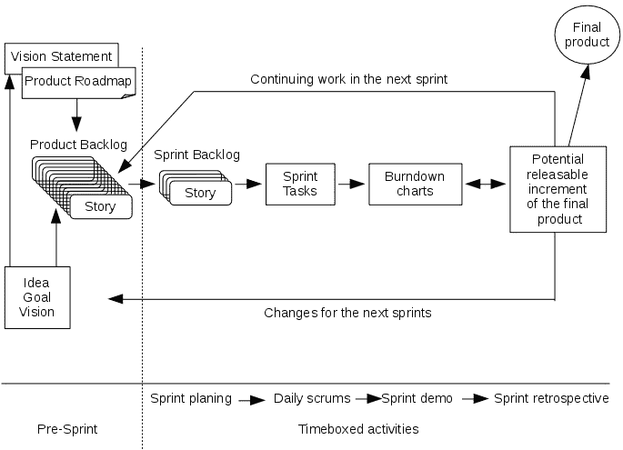

在冲刺准备期间，重点在于注入用户需求并将其描述为待解决的任务。这些描述被称为“故事（stories）”。结果通常是一个巨大的故事集合，被称为 `产品待办列表（Product Backlog）`。通常在开始单个冲刺之前你不需要完成产品待办列表，一旦你发现收集了足够的信息使得某些故事已经描述清楚，就可以开始第一次冲刺了。目标是完成一些端用户可以联系和评估的东西，然后返回冲刺准备阶段并可能更新产品待办列表。

看看冲刺阶段，它包含了每个冲刺的冲刺计划（sprint planning），在会议上，你计划将产品待办列表中的故事转移到 `冲刺待办列表（Sprint Backlog）`，从而在随后的冲刺中处理哪些故事。一个冲刺被安排持续特定的时间，时间可能有所不同，但通常持续约 4 周，建议一个冲刺时间不要超过一个月。团队将选定的故事拆分为任务，然后将其分配给团队成员。在冲刺期间，每天举行名为 `每日 Scrum（Daily Scrum）` 的会议，每个团队成员简要汇报与当前任务相关的进展（或反之）。这些每日 Scrum 是短会，可能花费 15 分钟。冲刺结束时，会举行一个名为 `冲刺演示（Sprint Demo）`（或 `冲刺评审`）的会议。会议与任务经理一起举行，团队展示当前冲刺的结果，即各个故事是如何解决的。整个冲刺以 `Scrum 回顾` 结束，这是一次回顾冲刺的会议，团队回顾过程以进行改进。

在 SCRUM 项目中有三个角色（可能没有其他角色），这些角色由 Scrum 团队完成：

1. `产品所有者（Product Owner)`，一个全职或兼职参与项目的人，代表项目内部所锚定的业务领域。

2. `Scrum 师（Scrum Master)`，一个全职或兼职参与项目的人，是开发团队的教练和协调者。

3. `开发团队（The Development Team)`，由 3–9 名全职员工（也称为专家）组成，是开发组织的一部分，执行各个冲刺。

此外，可能还有其他利益相关者，他们通常代表客户或其组织。

假设团队满足两个基本假设，这些假设被认为是确保灵活性、创造力和生产力所的，也是敏捷环境所必需的：

1. 团队是自组织的，并且在没有外部明确领导的情况下规划自己的工作。团队中的一个或多个人负责管理，而其他参与者专门负责特定的专家活动，但在 SCRUM 中没有管理和专家职能的划分。

2. 团队参与者都拥有解决任务所需的所有专业知识和能力，不需要从外部寻求帮助。

### 产品所有者（The Product Owner）

任何项目都需要一个熟悉业务领域的人员，其任务是使团队产出的价值最大化，这个人就被称为 `产品所有者（Product Owner）`。通常，这个人来自开发组织。重要的是，产品所有者必须了解问题领域，但此人不需要关于系统开发的特殊知识。是 `产品所有者` 负责项目的产品待办列表，这是一份待解决故事的优先级列表，它是 SCRUM 中的核心规划工具。故事根据其对用户组织的价值进行优先级排序，以便先解决高质量的故事。同样由 `产品所有者` 负责确保每个用户故事对于 Scrum 团队和其他利益相关者来说都是易理解的。

是 `产品所有者` 与任务所有者用户组织通信，并利用这些信息更新项目的产品待办列表。也是 `产品所有者` 掌握项目进度，并向利益相关者更新截止日期。

整个组织必须尊重产品所有者的决策，这被认为是项目成功的先决条件。即使产品所有者的上级通常也不能纠正产品所有者的决策，除了产品所有者，没有其他人可以决定开发团队应该交付什么。但是，允许产品所有者委托决策（例如向产品待办列表添加项目），只要产品所有者拥有全局视图。

### Scrum 师（Scrum Master）

`Scrum 师` 的任务是通过教练他们并确保遵守所有 SCRUM 原则来协助 Scrum 团队。因此，Scrum 师必须对 SCRUM 及其原则有深入了解。这是一个管理职能，但不是项目经理。Scrum 师将引导 Scrum 过程，而不是领导 Scrum 团队。除了确保开发团队正确理解和使用 Scrum 外，`Scrum 师` 的任务还是消除开发团队的障碍，减轻日常生活并通常对参与者进行教练。

Scrum 师还必须支持产品所有者向项目利益相关者传递正确信息，并通常为产品所有者提供可用的专家知识。

允许一个人既担任 `Scrum 师` 又担任 `开发团队` 成员，但不建议这样做。

### 开发团队（The Development Team）

`Development Team` 的成员是 IT 专家，负责为待办列表（backlog）中的元素交付解决方案。成员通常具备与待办列表任务开发相关的 A 到 Z 的所有知识，并且必须能够独立工作并解决出现的挑战。某项任务可以在某个迭代（sprint）中分配给特定成员，但整个 `Development Team` 对该任务承担责任并问责，因此没有某个人拥有特定的任务。

`Development Team` 交付通过项目产品待办列表（Product Backlog）管理的迭代过程开发的完工产品。强烈建议团队成员全职投入当前项目工作，并应尽可能确保 `Development Team` 成员在过程中不被更换，因为确保成员的专注和敏捷是非常关重要的。

经验表明，`SCRUM` 在拥有 3–9 名成员的 `Development Team` 中效果最显著，但对于大型项目，可以建立更多的 `Scrum Teams`。

注意的是，`Development Team` 的成员没有像设计师、架构师、经理之类的头衔。每个人都必须拥有相同的角色，头衔仅仅是 `Development Team` 的成员。`SCRUM` 的核心理念是团队合作。这是因为否则成员们将专注于自己的角色，而不会充分关注完工产品。每位成员都对所有项目结果负责。

#### 迭代 (The sprints)

然后是单个迭代的内容，即实际系统开发发生的地方。由 `SCRUM` 管理的系统开发项目通过多次迭代（称为 sprints）来解决任务，每个迭代都是时间限制的，并持续特定的时期。一个迭代包含 4 项活动：

1. `Sprint Planning`（迭代计划）是迭代中的第一项活动，`Scrum Team` 在此处计划迭代的结果以及要交付的内容。

2. `Daily Scrum`（每日站会）。`Development Team` 在 `Sprint Planning` 完成后立即开始工作。在迭代期间，`Development Team` 举行名为 `Daily Scrum` 的每日会议。这是一个大约 15 分钟的短会，用于协调未来 24 小时的工作。作为 `SCRUM` 的一部分，建议这些会议站立进行。

3. `Sprint Review`（迭代评审）。在迭代结束之前，`Development Team` 向用户组织展示迭代结果并获取反馈。

4. `Sprint Retrospective`（迭代回顾）。在 `Sprint Review` 之后并作为迭代的最后一项，`Development Team` 召开内部会议，对迭代过程进行某种回顾，以便从中学习。

时间箱模型（Time boxing）被认为是 `SCRUM` 的核心，是确保事情完成的手段，且对于项目而言，每个迭代通常应该具有相同的固定长度。迭代的长度通常约为一个月，可以更短，但很难只有一周。产品在经过若干次（可能是很多次）迭代后完成，每个迭代都让产品向完工结果迈进一步。如果一个迭代的结果是完工产品中一个可能发布的部分（这是每个迭代的目标），则称为达到了 `increment`（增量），因此，增量是项目到目前为止在 `Product Backlog` 中完成的所有元素的总和。因此，可以将每个增量视为对上一个增量的更新，以及带有新功能和特性的产品扩展。增量可能不被应用，但如果有增量，应该是可能的。

通常情况下，一个增量（`Sprint Review` 的结果）需要更改，这些更改将作为新的故事（stories）被添加到 `Product Backlog`。

`Product Backlog` 中的每个故事通常应在单个迭代中开发，这样更容易保持整体视图。`Product Owner` 和 `Development Team` 为每个迭代从 `Product Backlog` 中选择若干故事，目标是在接下来的迭代中将其完全完成，以便在迭代结束后团队拥有一个新的增量。因此，从开始就决定好何时完成一个故事是至关重要的。

#### 迭代计划 (Sprint Planning)

`Sprint Planning` 是一个时间限制的会议，所有团队成员都参与作为起点。如果是一个 4 周的迭代，会议可能持续 8 小时，但在短周期迭代中，会议时间会更短。`Development Team` 的参与者将估计他们在迭代中可以交付多少小时的工作。在此之前，`Product Owner` 对项目 `Product Backlog` 中的单个元素进行了优先级排序，并确保每个故事都易于理解。然后，`Development Team` 从 `Product Backlog` 顶部选择合适数量的项，并将它们移动到 `Sprint Backlog`（迭代待办列表），作为当前迭代中要执行的工作。每个故事的工作由 `Development Team` 估算，`Sprint Backlog` 任务的总工作量应尽可能与团队的可用容量匹配。

然后，会编写一个 `Sprint Goal`（迭代目标），它仅仅是一段描述当前迭代目标的短文本，包括迭代完成的标准以及解决了哪些任务。`Sprint Goal` 必须包含至少一个针对迭代前几日的详细计划。`Sprint Goal` 是 `Sprint Backlog` 的一部分，对文档或格式没有特殊要求，通常使用看板，这使得计划易于维护，并确保计划对所有人可见。`Sprint Backlog` 因此由以下部分组成：

1. `Sprint Goal`

2. 为当前迭代从 `Product Backlog` 中选出的故事。

3. 迭代的详细工作计划，其中任务（故事）可以被分类为 `To Do`（待办）、`Doing`（进行中）或 `Done`（已完成）。

原则上，迭代不能被中断，但 `Product Owner` 作为唯一的例外，可以决定由于项目环境/先决条件变化引起的迭代中断。

#### 每日站会 (Daily Scrum)

正如其名，它是整个迭代期间举行的每日会议。在会议上，只有开发团队成员参与。会议持续不超过 15 分钟，在会议上每个团队参与者必须回答三个问题：

1. 自上次会议以来完成了什么？

2. 在下次会议之前将完成什么？

3. 有哪些障碍/困难？

团队成员必须将进度与 `Sprint Goal` 进行比较，还应估计在迭代结束完成任务的可能性。

#### 迭代评审 (Sprint review)

这是一个在迭代结束时举行的会议，对于 4 周的迭代，会议最多持续 4 小时，但对于较短的迭代，会议通常更短。会议包括整个 Scrum 团队以及其他利益相关者，在会议上展示当前迭代所有任务的解决方案。目标是尽早获取反馈并调整需求，以便 `Product Owner` 更新项目的 `Product Backlog`。

产品是由 `Development Team` 展示的，但仅针对已 `Done` 的任务，而不是那些“几乎”完成的任务。`Product Owner` 必须在会议前确保所展示的产品也是 `Done` 的。

在整个迭代结束后，还会举行另一次名为 `Sprint Retrospective` 的会议，持续 2–3 小时。这是一次对迭代进行回顾以寻求改进的会议，适用于个人团队成员的工作程序、流程以及你们所使用的工具。

#### 关于 SCRUM 的更多信息

一项原则上始终与单个冲刺并行活动被称为 `Product Backlog Grooming`（产品待列表梳理）。它始终关于审查和调整 `Product Backlog`（产品待列表）中的项，通常包括添加细节、调整估计等。`Product Owner`（产品所有）负责对 `Product Backlog` 中的项进行排序，而 `Development Team`（开发团队）负责对项进行估计。

虽然它不是 `SCRUM` 的一部分，但建议在每个冲刺之间安排一两天的休息时间，你可以利用这段时间阅读文章、参加课程或研讨会，或者让自己熟悉新主题，或者简单地去散步享受大自然。也许这个想法很难向经理推销，但研究表明，这段时间花得非常值，部分是为了取得项目进展，部分是为了确保团队参与者跟上技术发展。这一理念支持 `SCRUM`，在 `SCRUM` 中，始终以产品为导向而非以活动为导向至关重要。

另一个问题是，如果你在冲刺结束时发现某些工作未完成，该怎么办？这里的规则非常明确：

1. 未完成或未撤销的元素（`stories`）被放回 `Product Backlog`。

2. `Product Owner` 重新排列待办列表，通常将未完成的元素放在顶部，但并不一定如此。

3. 未撤销的故事不能重新调整大小以仅代表剩余的未完成工作。正在处理的故事不能被拆分为已完成和未完成的部分。故事要么完成，要么未完成。

总的来说，可以认为 `SCRUM` 包含了以下产物：

1. `Product Backlog`，即最终产品中可能需要的所有故事有序列表。

2. `Sprint Backlog`（冲刺待办列表），即从 `Product Backlog` 中选择的要在冲刺中交付的故事，以及 `Sprint Goal`（冲刺目标）和针对 `Sprint Backlog` 中所有故事的冲刺计划。

3. `Increment`（增量），即项目到为止完成的所有 `Product Backlog` 故事的集合。

4. `Definition of Done`（完成定义），即对一项工作何时被视为完成的理解。

5. `Monitoring Progress`（监控目标进度），即对整个项目的性能衡量和预测。

6. `Monitoring Sprint Progress`（监控冲刺进度），即对单个冲刺的性能衡量和预测。

你应该意识到，关于 `SCRUM` 的文献定义了这些产物的具体内容以及你可以使用的典型工具。

作为对 `SCRUM` 的最后评论，重要的是强调，其目标是提供一个框架，指导你如何有效地组织大型且复杂的（IT）系统的开发，该方法表达了专业开发人员在实施复杂开发项目方面的经验。另一方面，`SCRUM` 并没有说明每个冲刺应该包含什么，以及每个团队成员应该如何执行日常工作，在这里你必须应用所学到的关于系统开发的其他知识（例如本系列书籍中解释的内容），或者最好是下文关于极端编程的章节中所说明的内容。在实践中，你将结合各种系统开发和编程技术。

## 2.5 极端编程

`Extreme Programming`（极端编程），也称为 `XP`，是一种系统开发方法，顾如其名，与上述方法不同，它侧于编程。你不应该将 `XP` 视为例如统一化过程或 `SCRUM` 的替代方案，而是将其视为如何成功完成单次迭代中编程部分的建议。`XP` 与其他系统开发方法一样，由多次迭代组成，每次迭代将项目从一个状态带到另一个状态。它与其他方法的活动相同，但在 `XP` 中，`design`、`program` 和 `test` 三个活动共同形成单一活动。

该方法基于四个主要原则：

1. `Heavy customer involvement`（深度客户参与），用户组织的代表被纳入开发团队，持续参与并积极贡献单个迭代的计划以及各种验收测试，并在很大程度上也执行这些测试。

2. `Test-driven development`（测试驱动开发），要求开发者在编写任何代码之前为每个新功能编写单元测试。通过这种方式，在成功执行所有单元测试之前，函数无法转移进行测试（见下一章关于测试驱动开发）。

3. `Pair programming`（结对编程），所有代码由两个程序员编写，分别称为 `driver`（驾驶员）和 `navigator`（导航员）。两个程序员坐在同一台电脑前。`driver` 写代码，而 `navigator` 监控过程、提出建议、思考设计和程序质量等。每半小时，他们交换这两个角色。这个想法很简单，两个脑袋胜过一个脑袋。当然，结对编程的效果不如两个程序员分别编写各自的代码，但经验表明，产生的代码质量更好，错误远少。

4. `Short iteration cycles and frequent releases,`（短迭代周期和频繁发布），你在不超过几周的短迭代中开发软件。目标是频繁发布可以交付给用户组织并在原则上由其使用的版本。一个发布周期跨越几个月，并在几次迭代中完成。其理念是用户组织必须体验到进展，并且要有事情发生。

与所有其他系统开发方法一样，`XP` 的目标是做得更好，`XP` 正确地将软件开发最大的问题视为风险。显而易见，随着项目变得越来越大和复杂，无法按计划执行会导致错误率增加，而误解任务意味着产品包含了客户完全不需要的功能，最坏的情况下，可能面临项目必须被完全放弃的风险。`XP` 试图通过控制四个变量来最小化风险：

1. `cost`

2. `time`

3. `quality`

4. `features`

其中后者可能是衡量程序能力的的最重要指标，但由于四个变量显然不是独立的，为了满足成本和时间要求，很容易意味着需要牺牲质量（这是短期的）或功能。这些变量的新奇之处在于，该方法从一开始就关注并控制这四个关键领域。


除了这些控制变量外，`XP` 项目参与者还需要根据多个核心价值观工作，其中我想提到 `communication`（沟通），所有参与者都承诺将价值知识传播给整个团队。这可以通过较小的开发团队、如结对编程以及代码的共同所有来实现。

此外，极端编程为开发过程定义了 12 条原则：

1. `Planning`
2. `Small releases at short intervals`
3. `System metaphors`
4. `Simple design`
5. `Test`
6. `Frequent refactorization`
7. `Pair-programming`
8. `Common ownership of the program code`
9. `Continuous integration`
10. `Affordable work rate`
11. `An overall development team`
12. `Common code standard`

并且要成功使用该方法，遵守这些原则是至关重要的。

关于 `XP` 还有很多内容，关于 `XP` 的著作和积累的经验也很多，这一切表明——至少如果你询问该方法的支持者的话——该方法在目标是开发高质量软件时特别有用。

## 3 测试驱动开发

如上一章提到的，`测试驱动开发`（Test-Driven Development，也简称为 `TDD`）是`极端编程`的要求之一。它的过程非常简单：你从编写一些单元测试开始。然后实现被测试的代码，并对代码进行单元测试，最后进行重构。这个过程不断重复直到完成：

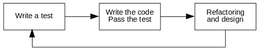

`TDD` 基于单元测试的使用，在本书中使用了 `JUnit`（可以参考 Java 3 相关书籍），但作为一个说明 `TDD` 理念的简单示例，我将展示一个可以在三个温度单位之间转换的程序的开发：

1. 摄氏度 (celsius)
2. 华氏度 (fahrenheit)
3. 开尔文 (kelvin)

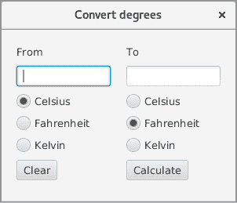

下面显示操作步骤。

我从一个 JavaFX 项目开始，将其命名为 `Degrees`。在这种情况下，程序必须由一个用户界面类（由 NetBeans 创建，名为 `Degrees`）以及一个实现必要转换方法的 `Converter` 类组成。我想将 `Converter` 类作为程序的模型，在编写该类时，我将从一个测试类开始。

第一步，在 Projects（项目）下，右键点击项目名称并选择 `New | JUnit Test`（见下文）。在这里我：

* 将测试类命名为 `ModelsTest`
* 指定测试类应添加到包 `models` 中（位于 `Test Packages` 之下）
* 取消勾选 `Generated Code` 下的所有复选框

后者并不是必要的，但在这种情况下，我没有应用这些初始化方法；不过通常你可以让 NetBeans 创建它们，因为它们默认是空的，因此不会执行任何操作。当你点击 `Finish`（完成）时，NetBeans 会创建以下测试类：

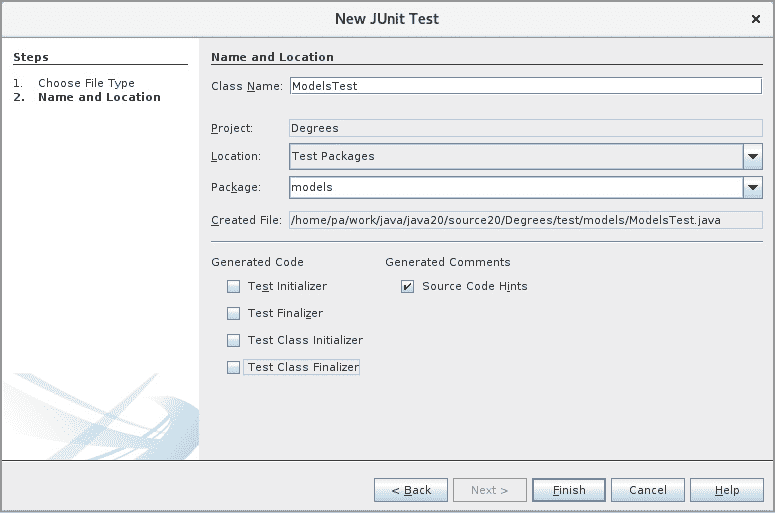!!(image/Java_20_34.jpg)

这仅仅是一个简单的测试方法。在这里我添加了一条语句：

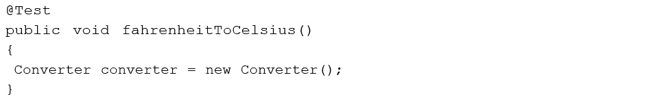

显然，这会导致翻译错误，因为 `Converter` 类并不存在，但如果你按下 `ALT + Enter`，就会出现以下弹出窗口：

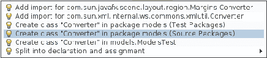

如果你选择`在 package models (Source Packages) 中创建类 "Converter"`，NetBeans 会创建一个包 `models`，并包含一个 `Converter` 类。该类目前是空的。该类必须有一个方法 `ftoc()`，它可以将华氏度测量的温度转换为摄氏度。如果 `f` 代表华氏度，而 `c` 代表摄氏度，那么这种关系可以用以下公式表示：


为了测试 `ftoc()` 方法，我扩展了测试类并添加了静态数组，该数组可以根据选定的华氏度显示对应的摄氏度：

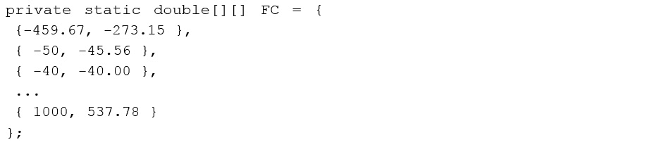

注意，你可以通过在网上寻找连贯的值或通过自己计算值来创建此表格。有了这个静态数组后，测试方法可以如下完成：

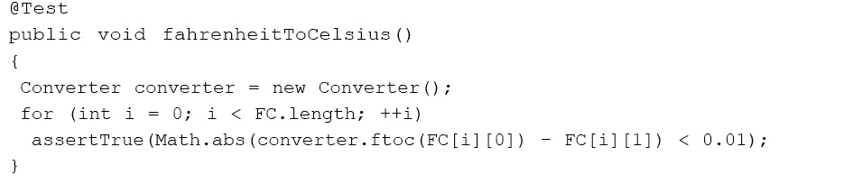

你再次得到了翻译错误，但你可以像上面一样使用 `ALT + Enter`，通过点击鼠标，你可以让 NetBeans 创建 `ftoc()` 方法：

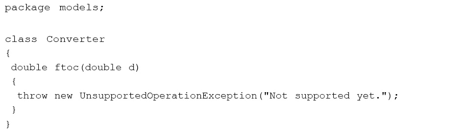

如果你尝试执行单元测试，它将失败，因为该方法尚未实现。因此，下一步是实现 `ftoc()` 方法——编写代码并通过测试：

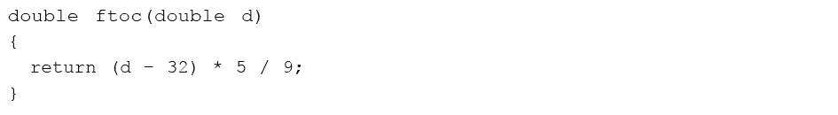

然后你应该能够成功地测试该方法（执行上述测试方法）。

对应于引言，下一步是进行重构。在这种情况下，`Converter` 类和 `ftoc()` 方法都必须是 `public` 的。此外，-459.67 是华氏温度的绝对零度，因此如果参数值小于绝对零度，该方法应该抛出异常，因此该方法可以重构为：

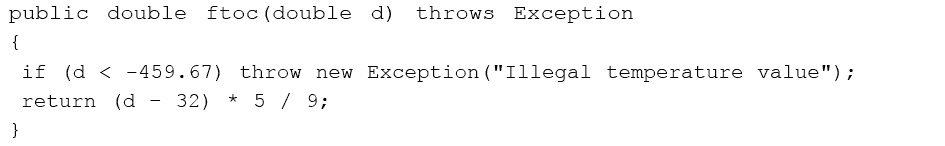

如果你重复测试，将会失败，因为方法现在可以抛出异常。因此，必须更新测试方法：

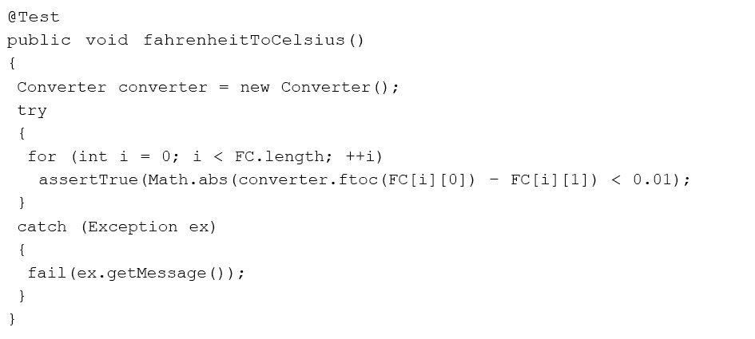

然后就可以正确执行测试了。

`Converter` 类还必须有一个方法 `ctof()` 可以将摄氏度转换为华氏度，因此我开始向测试类添加新的测试方法：

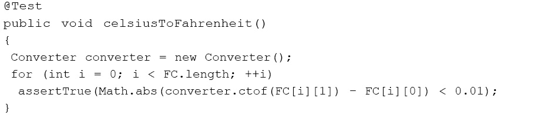

唯一的区别是，现在测试方法测试的是 `ctof()` 方法，并且表格中的摄氏度值被用作参数。必须创建 `ctof()` 方法，我让 NetBeans 像上面那样创建它。接下来，必须实现该方法，它简单地是从上述公式中分离变量 `f`：

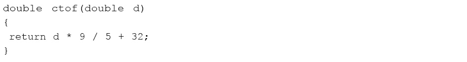

然后再次执行单元测试，它应该是没有错误的。同样，必须对 `ctof()` 方法进行重构，以便在参数值低于摄氏度绝对零度（273.15）时抛出异常。测试方法也必须更新，以处理任何可能的异常。

`Converter` 类还应该有四个额外的方法：

1. `ktoc()` – 将开尔文转换为摄氏度
2. `ctok()` – 将摄氏度转换为开尔文
3. `ktof()` – 将开尔文转换为华氏度
4. `ftok()` – 将华氏度转换为开尔文

开尔文转换为摄氏度的公式为：


其中 `k` 表示开尔文度。同样，开尔文转换为华氏度的公式为：

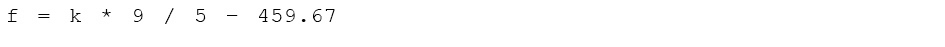

`design pattern`（设计模式）是对解决特定问题的解决方案的描述。其起点是一个简单的观察：在许多不同的软件项目中，某些问题会或或少直接地、反复地出现。如果是这样的话，人们可以尝试从抽象角度描述问题，然后给出一个具体的解决方案。通过这样，作为一名开发者，如果你面对的问题可以归类为某种设计模式，你就可以轻松地找到如何解决这个问题。这意味着几个重要的优势，最重要的一点是你利用其他开发者的经验来解决特定问题，而不是自己去摸索方法。这意味着程序会更廉价且稳定得多。

作为设计模式的一个例子，我会提到 `iterator pattern`（迭代器模式），我之前提到过并使用过好几次。给定一组某种类型的对象集合，问题在于你需要遍历所有对象并对它们进行某些操作。如果你使用“面向接口编程”的设计原则，那么集合类 `Collection` 就可以由接口 `ICollection` 定义，使得 `Client` 程序只通过定义的接口知道集合类。该接口定义了一个方法 `createIterator()`，该方法返回一个迭代器。迭代器是一个初始指向集合中第一个对象的对象，并有两个方法：一个返回迭代器所指向的对象并使迭代器向前移动，另一个方法则测试是否到达末尾。`Iterator` 类也可以由接口定义，因此迭代器模式可以如下所示：

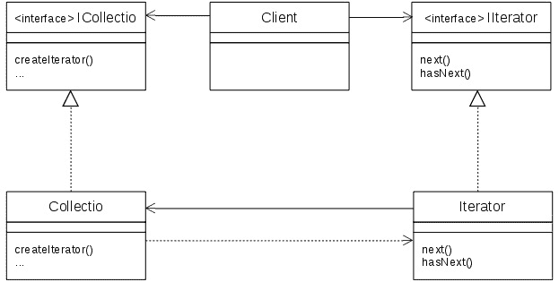

如果一个集合类实现了这种模式，意味着无论该类是否是用于集合，都可以以相同的方式对待它。例如，想想 Java 对集合类的实现。

我在之前的书中用过其他设计模式：

* `Singleton`（单例模式）
* `Factory`（工厂模式）
* `Adapter`（适配器模式）
* `Observer`（观察者模式）

还有许多其他，由于 `Gang of Four`（四人帮）定义了 23 种，后来又定义了许多。后者可能是一个挑战，因为许多模式看起来相似且难以区分，而且存在一种为任何事物都定义模式的倾向，但这改变不了模式是重要的事实，以及教授它们是有价值的。

`Gang of Four` 的模式以及许多其他模式涉及编程中的具体问题，但其他模式更通用，且通常由几个模式组成。一个例子是 `MVC`，它是一种用于 GUI 程序设计的模式。它也是一种表达了他人如何设计 GUI 程序经验的设计模式。如果你这样做了，必须维护程序的人就知道了程序是如何设计的。该模式在这些书中有所描述。它是一个复杂的模式，并且出现在多个变体中。它表达了这样一个事实：如果设计模式要具有通用性，实际上很难定义，因此 `MVC` 存在如此多的变体，这些变体取决于软件平台和开发工具。

使用设计模式的另一个重要原因是开发者通过这种方式拥有一组共同的概念。例如，如果我说程序中的某个类是 `adapter`（适配器），我告诉了别人这是一个用于平滑与其他类差异的类，我甚至可以查阅一本关于设计模式的书，看看 `adapter` 是什么以及如何使用。

## 5 重构和其他

为了使一个开发项目取得成功，完成的程序必须满足：

* 程序满足需求
* 程序无错误运行
* 程序是健壮的
* 程序易于维护

如果你阅读相关文献，你会看到许多其他质量因素，但除此之外，你还可以补充项目是在估计的资源消耗内完成的并且按时完成。

### 5.1 Refactoring

为了满足这些要求，你必须系统地工作并遵循一种方法，系统开发中的四个基本活动正如已经多次提到的：

1. 分析
2. 设计
3. 编程
4. 测试

然后与迭代系统开发相结合，但除此之外，总会有一个名为 `refactoring`（重构）的活动，你在某种程度上必须重写代码以使其更容易阅读和维护，同时你必须保留代码的功能。

一旦你写了代码并测试它发现它满足了需求，代码已经经历了一个对代码进行开发、测试、纠正、调整、扩展等过程，结果通常是具有以下特征的代码：

* 未使用的 `Variables`（变量），因此必须删除。
* 未使用的 `Methods`（方法），因此应该删除。
* 两个或多个功能几乎相同的方法，你可以使用参数将其简化为单个方法。
* `Methods` 的名称可能不同但功能相同，而你应该只有一个方法，并可以放置在特定的工具类中。
* 不依赖于实例的 `Instance methods`（实例方法），方法可以定义为静态或移动到工具类中。
* 几乎相同的 `Classes`（类），这些类可以更改为公共父类的特化类，并将相同的方法移动到父类中。
* 被注释的代码，因为这些代码不应该被使用。此类代码必须被删除。
* 解决了任务但使其变得不恰当的代码。在这里你应该找到更好的代码，通常它等同于更好的算法。
* 缺失的注释，应该被编写。
* 耦合性极高的 `Classes`。如果是这样，你应该考虑是否可以以某种方式降低耦合。一个例子可以使用接口实现 `observer pattern`（观察者模式）。
* 内聚性极低的 `Classes`。如果是这样，应该考虑将该类拆分为几个类。
* 不必要的 `Import statements`（导入语句）。它们应该被删除，以便你只保留必要的导入语句。

还有许多其他例子。这些关系意味着两点：

1. 代码填充比需要的多。
2. 代码维护比需要的要困难得多。

这里绝对是最后一点，也是最大的问题。因此，代码必须进行重构，这可以被视为一种清理过程，以消除上述不便。

正如前面提到的，重构的目标是获得更简单的代码，从而获得更容易维护的代码。相反，你应该注意重构不会演变成直接的重新编程。如果是这样，原因通常是开发过程中严重的错误决策，如果有必要，你应该将重构推迟到一个新项目，该任务直接是对现有程序进行重构。为了避免陷入这种情况，解决方案是频繁重构，也许它应该成为每次迭代的一部分，这里值得注意的是，在极端编程中重构是每次迭代中不可或缺的一部分。

### 5.2 日志文件

作为对系统开发的最后说明，我想提到日志文件。日志文件通常是文本文件，程序会在其中间断存储与应用程序使用相关的数据。现在它不必是文本文件，也可以是数据库表，如果有必要，请确保程序具有数据库访问权限。如果你使用文本文件，请确保日志文件创建在具有写权限的目录中，通常你会使用用户的主目录，但如果日志要供多个用户使用，这显然不是一个可行选项。如果程序使用日志文件，让程序在不受限制且未经检查的情况下写入文件或数据库表可能会有一点点危险，因此，日志文件通常应该结合一个禁用/启用该功能的选项。

使用日志文件可能有几个原因，其中之一是收集与应用程序使用相关的统计数据，也许是为了以后改进程序。另一个可能更重要的应用是记录错误信息。一旦程序投入运行并发生错误，错误会被报告给开发者，然后由他们获取正确的错误信息。为了实现这一点，你需要一些信息，在这里我想说，那种错误处理方式——即程序直接崩溃且屏幕上满是关于异常的错误信息——是无法使用的。首先，用户不会接受这样的恶意软件，这会产生他们对开发组织的挫败感和抵触情绪；其次，这与“用户会被报告此类错误”的假设相去甚远，最好的情况下你只会收到程序无法运行的。作为开发者，你清楚程序可能崩溃的关键位置，在这里你可以将可能失败的代码封装在 `try/catch` 块中，并在发生异常时在日志文件中写入消息。作为开发者，在发生错误时，你可以请求获取日志文件，通过这里你可以看到程序在何时、何地发生了错误。

这种错误日志记录对排查故障会有很大帮助，但要小心你在代码的哪个位置向日志文件中写入内容。原则上讲，错误日志应该是空的，因此定期检查日志文件可以作为程序的一项很好的检查方法。

需要注意的是，错误日志记录绝不是测试的替代品，它只能在程序完成、测试通过并准备好交付给客户时使用；但相反，如果程序首先投入运行，它也可以成为极其重要的错误报告来源。

## 6 扑克游戏

我想通过另一个程序示例来结束这本书，以及这一系列关于 Java 软件开发的书籍。其目标与其他书中的最终示例相似，旨在展示开发过程，但该任务/项目并没有直接遵循之前的任何一种系统开发方法，而是使用了其中几种方法的元素以及这些书中提到的其他内容。原因部分是因为程序的大小，它在规模上仍然很小，部分是因为程序是由单人编写的。由于这些原因，使用例如 `SCRUM` 或 `Unified Process`（统一过程）没有意义，相反，将使用这些方法的元素。事实上，这也反映了系统开发方法在实践中是如何使用的，即使用具体方法的元素，由于下面的程序比我在这些书中介绍的要大一点，但相对于实践中许多 IT 系统的开发，它仍然是一个非常小的程序。

我之前在 `Java 4, Problem 2` 书中展示过一个可以与三个虚拟玩家对战扑克的程序。那个程序经过了简化，主要是因为没有包含任何下注。接下来的也是一个扑克程序，但目的是为了解决 `Java 4` 程序中的某些缺陷。

### 6.1 愿景

任务是编写一个程序，让玩家（用户）可以在单台电脑上玩扑克游戏，有点像许多人非常熟知的 Windows 程序 `Hearts Free`，但这里的纸牌游戏是扑克。用户将与多个虚拟玩家对战。因此，这是一个典型的 GUI 程序。

游戏必须支持以下扑克变体：

1. 德州扑克（Texas Hold’em）
2. 奥马哈（Omaha）
3. 七点酷（7 Card Stud）
4. 五抽牌（5 Card Draw）

并且由玩家（用户）决定开始哪种游戏。

程序的愿景是娱乐，你不应该用真钱玩，而只使用筹码（jetons）。玩家必须有一个账户，随着时间的推移记录玩家（用户）输赢的情况，并且能够向账户存款和提取。

实现一个模拟真实扑克玩家的虚拟玩家是一个重要的挑战，以便虚拟玩家的行为得足够智能。目标是让用户觉得与其他虚拟玩家对战很有趣，并且难以猜出虚拟玩家的行为逻辑。

### 6.2 扑克游戏分析

以下是对扑克游戏的分析，即游戏的规则，或者更准确地说，扑克游戏在这个程序中是如何解释的，以及程序应该支持哪些选项。

扑克使用全部 52 张牌，不使用王牌。基本上，牌面值的升序排列为：

* 两、三、四、五、六、七、八、九、十、将、女、王和王

在某些情况下，花色也有意义，此时牌面值（升序）为：

* 方形、红心、梅桃和黑花

玩家必须在一个回合中组成一个由 5 张牌组成的 `hand`，手的结果是 9 种选项之一，按价值从高到低排列：

#### 同花顺 (Straight flush)

五张同花色的连续牌，是价值最高的牌。示例可以是：

* 5 张梅桃：8、9、10、J 和 Q

如果有两个或多个玩家拥有同花顺，则由最大的牌决定面值，如果牌相同，则由花色决定面值。

#### 四条 (Four of a kind)

四张相同面值的牌，示例可以是：

* 方形 4、红心 4、梅桃 4、黑花 4 和另一张牌

最后一张牌对面值没有意义，如果有两个或多个玩家拥有四条，由四条中最大的牌决定面值。

#### 葫芦 (Full house)

三条加对，例如：

* 方形 8、梅桃 8、黑花 8、红心 K、梅桃 K

如果有两个或多个玩家拥有葫芦，由三条中最大的牌决定面值。

#### 同花 (Flush)

五张同花色的牌，但面值不一定连续，例如：

* 方形 2、方形 7、方形 8、方形 10 和方形 Q

如果有两个或多个玩家拥有同花，由第一张牌的最大值决定面值（它们是不同的），且如果所有牌相同，则由花色决定面值。

#### 顺子 (Straight)

五张连续的牌，但不一定同花色，例如：

* 方形 5、黑花 6、梅桃 7、红心 8 和梅桃 9

多个玩家拥有顺子时，由最大的牌决定面值，如果所有牌相同，则由最大牌的花色决定面值。

#### 三条 (Three of a kind)

三张相同面值的牌，最后两张牌面值不同且不是一对，例如：

* 红心 J、梅桃 J、黑花 J、方形 2 和红心 5


在两个或多个玩家拥有三条的情况下，由三条中最大的牌的面值决定面值。因此，最后两张牌对面值没有任何意义。

### 两对 (Two pairs)

两对：两个不同的对，最后一张牌必须是另一个面值，例如：

* 方形 2、黑花 2、红心 K、梅桃 K 和黑花 A

如果两个或多名玩家拥有两个对子，则由最大的对子决定排名。如果最大的对的值相同，则由较小对子中的最大者决定排名，如果这对对的值也相同，则由最后一张牌决定排名。如果最后一张牌的值也相同，则由最后一张牌的颜色决定排名。

### 单对子

两张点值相同的牌，其中最后三张牌的值各不相同，且与组成对子的两张牌的值也不相同，例如：

- `黑桃 A、梅桃 A、红心 4、红心 7 和方块 J`

如果有两个或多名玩家拥有（多个）对子，则由最大的对子决定排名。如果他们拥有两个值相同的对子，则由剩余三张不同牌中第一张的最高牌决定排名；如果剩余的三张牌值都相同，则由这些牌中最高值牌的颜色决定排名。

### 高牌

未出现上述的任何一种牌型，例如：

- `梅桃 5、方块 6、红心 9、黑桃 10 和黑桃 A`

如果多个玩家拥有高牌，则由第一张不同牌的最高值决定排名；如果 5 张牌的值都相同，则由最高牌的颜色决定排名。

### 每一回合

单局游戏称为一个“回合”（round），每一回合玩家都会轮流担任庄家。游戏通过玩家在发牌过程中不断构建自己的手牌来进行。具体情况以及手牌如何形成取决于当前的变体（`Texas Hold’em`、`Omaha` 等）。每种变体都有若干个下注回合，玩家可以在这些回合向底池（pot）中投入资金，或者离开回合（因此他们已经投入的资金将损失）。在扑克中，你有两种方式赢得一个回合：

1. 在`showdown`（比牌）时拥有最好的牌（所有下注回合结束且回合结束）。

2. 成为当前回合中最后剩下的玩家。

如上所述，一个回合会有更多下注回合，每个剩余玩家都会进行投注，从而向底池中投入金额或离开当前回合（退出）。你有以下选项（稍微取决于当前的变体）：

1. `FOLD`（弃牌），玩家放弃并不再是当前回合的玩家。

2. `CHECK`（过牌），玩家希望继续回合，但不进行注资（仅在当前下注回合中没有玩家已向底池投入资金时可行）。

3. `BET`（下注），玩家向底池投入一个金额（仅在没有玩家已投入金额，或者有其他玩家选择了`CHECK`时可行）。

4. `CALL`（跟注），你投入与上一次`BET`或`RAISE`相同的金额，因此这是允许你继续下去的最小金额。

5. `RAISE`（加注），如果已经有了`BET`，玩家可以增加投注金额，所有仍在场的剩余玩家必须选择`CALL`、`RAISE`或`FOLD`。

与`BET` 和 `RAISE` 关，通常对你需要投入的金额会有一个上限。

关于不同的变体，当前程序应支持 5 种变体：

- `Texas Hold’em`（德州扑克）

- `Omaha`（奥马哈）

- `7 Card Stud`（七圈明牌）

- `5 Card Draw`（五番牌）

- `5 Card Stud`（五圈明牌）

这里可能没有像最后一个版本那样的游戏，至少它不是在通常扑克游戏页面找到的游戏，但这是一个非常简单的扑克游戏，这也是我学习玩扑克的方式。这个游戏类似于`7 Card Stud`，因此得有了上面的名称。

### 筹码

在这个程序中，最小金额是一个筹码（chip 或 jeton），原则上它只是一个单位。当新游戏开始时，每个玩家获得一定数量的筹码，当玩家没有更多筹码时，该玩家将被移出游戏。如果该玩家是用户，则游戏结束。

在游戏开始时，将确定每个玩家在回合中需要投入多少筹码数量（默认为 1）。这个值在程序中被称为 `blind`（盲注）。

`blind` 然后是玩家在`BET`时必须向底池投入的最小值。

在本程序中，必须应用以下关于玩家必须向底池投入多少以及游戏的规则：

1. 在新回合开始时，所有玩家都投入一个`blind`。

2. 回合在任何时候都有值，并且是任何时候底池中的最后一次投入。也就是说，在第一个下注回合开始时，值的大小等于一个`blind`。

3. 在`BET` 时，你可以投入该值或值的 2 倍，这即为该回合的值。

4. 在`RAISE` 时，你可以加注到值的 2 倍或 4 倍，这即为该回合的值。

此外，在单个下注回合中，应该对玩家执行`RAISE`的次数进行限制（例如 2 或 3 次）。

如果玩家没有更多筹码，玩家必须离开游戏。

已经决定（主要为了用户界面），无论变体如何，可以有 2–6 名玩家。

### 德州扑克

在这个游戏中，每个玩家有两张朝底牌（只有玩家自己可以看到）。此外，桌上会放置 5 张朝上的牌。每个玩家然后用自己的两张朝底牌组成最好的手牌。游戏有 4 个下注回合，游戏流程如下：

1. 在游戏开始时，所有玩家投入一个`blind`。庄家每回合顺时针更换。

2. 然后玩家获得两张朝底牌。现在桌上放置三张朝上的牌——所谓的`flop`（翻牌）。它是公共牌，所有玩家可以使用。然后第一个下注回合从仍在场的庄家之后的玩家开始。

3. 桌上放置另一张朝上的公共牌。这被称为`turn`（转牌）。然后是另一个下注回合。

4. 第五张也是最后的公共牌——`river`（河牌）放在桌上，之后进行游戏的最后一个下注回合，完全正如。

5. 如果在最后一个下注回合后有两个或多个玩家没有弃牌，胜者将在`showdown`时产生。每个玩家从自己的两张个人牌和桌上的五张公共牌组成最好的五张牌。拥有最好扑克牌的玩家赢得底池。如果只有一个玩家，该玩家赢得底池。

### 奥马哈

这种变体基本上以`Texas Hold’em`的方式进行。但在`Omaha`中，你拿到四张牌（4 张朝底牌），当你将你的手牌与公共牌结合时，你需要恰好使用手中的两张牌和桌上的三张牌。

### 七圈明牌

这种变体有 5 个下注回合。该变体与`Texas Hold’em`和`Omaha`的区别在于，每个玩家被分配到自己的朝上个人牌——即只能由一个玩家使用的牌。因此没有公共牌。在`7 Card Stud`中，每个玩家从开始获得两张朝底牌和朝上的牌，随后每次获得一张三张朝上的牌，每次之间有一个下注回合，最后是另一张朝底牌。因此，每个玩家最终在回合结束时拥有七张牌——三张朝底和四张朝上。

1. 每位玩家向底池支付底盲注（blind）。

2. 每位玩家获得两张底牌（面朝下）和明牌（面朝上）。随后进行第一轮下注，由明牌数值最低的玩家开始。如果两名玩家的明牌数值相同，则由牌的颜色来决定由谁开始。

3. 尚未弃牌的玩家现在获得第四张明牌，并开始新的一轮下注（第二轮下注）。这次由明牌组合中牌型最佳的玩家开始。

4. 再次给出一张面朝上的牌牌，并按照上一轮下注的相同模式进行另一轮下注（第三轮下注）。

5. 再次给出一张面朝上的牌牌，并按照上述模式进行另一轮下注（第四轮下注）。

6. 本轮剩余的玩家将获得第七张也是最后一张牌，但是面朝下的（底牌），最后一轮下注（第五轮下注）按照与前一轮相同的模式进行。

7. 如果最后一轮下注后还有两名或以上玩家未弃牌，则将通过比牌（showdown）产生胜者，每位玩家将从自己的七张牌中选出最好的五张扑克牌。牌型最佳的玩家赢得底池。如果只剩一名玩家，则该玩家获胜。

### 五牌抽 (5 Card Draw)

这是原始的扑克游戏，比上述变体更简单，且只有两轮下注。流程如下：

1. 每位玩家支付一次底盲注。

2. 每位玩家获得 5 张底牌。

3. 进行第一轮下注，从庄家左侧的玩家开始。

4. 第一轮下注后，留在游戏中的玩家必须弃掉 0–5 张牌，之后他们将从庄家处获得相应数量的新牌。

5. 当玩家完成换牌后（如果他们选择换牌），将进入第二轮下注。

6. 如果剩余多名玩家，则通过比牌确定胜者；如果只剩一名玩家，则由该玩家获胜。

如果有 6 名玩家，意味着原则上你需要 60 张牌，这是不可能的。决定忽略这个问题，因为在理论上这被理解为所有玩家都会弃掉所有的牌。如果发生这种情况，假设该局被忽略，但底池将保留到下一轮。

### 五牌圈 (5 Card Stud)

如前所述，这是一种简化游戏，有四轮下注，流程如下：

1. 每位玩家向底池支付底盲注。

2. 每位玩家获得一张底牌和一张明牌。随后是第一轮下注，由明牌数值最高的玩家开始。

3. 尚未弃牌的玩家现在获得第三张明牌，并开始新的一轮下注（第二轮下注），由两张明牌组合最佳的玩家开始。

4. 给出第四张面朝上的牌，并按照上一轮下注的相同模式进行另一轮下注（第三轮下注）。

5. 给游戏中剩余的玩家第五张也是最后一张明牌，最后一轮下注按照与前两轮相同的模式进行。

如果最后一轮下注后还有两名或以上玩家未弃牌，则将通过比牌确定胜者，否则剩余玩家将赢得底池。

## 6.3 流程

开发计划包含以下迭代：

1. **迭代 (iteration)**

开发 `5 Card Stud` 的原型。主要目的是为了启动项目，包括用户界面初步设计的准备。你不应该能够完成整局游戏，但应该能够分发前两张牌，以便所有关于显示牌的牌工作已就绪。

2. **迭代 (iteration)**

必须开发一种算法，规定虚拟玩家如何玩 `5 Card Stud`。算法应包含：

* 虚拟玩家在下注轮中如何行动，例如玩家必须下注多少（`BET` 或 `BIG BET`）、玩家何时必须加注（`RAISE` 或 `BIG RAISE`）以及玩家何时应该弃牌（`FOLD`）并可能诈唬

* 由谁开始下注轮

* 谁在比牌中获胜

此外，该迭代必须包含一种算法，根据是由用户还是虚拟玩家开始下注轮来决定每轮下注应如何进行。

3. **迭代 (iteration)**

程序类的整体设计，包括关于程序应主要由哪些类组成的重要决策。

实现扑克变体 `5 Card Stud`。因此，该迭代包含了迭代 2 中所有算法的实现。在此迭代之后，你应该能够与程序玩扑克，但仅限于简单的 `5 Card Stud` 变体，且不应用户管理。

4. **迭代 (iteration)**

迭代包含关于如何保存程序数据以及保存什么数据的决策和设计。决定数据应存储在公共文件中，部分因为安装程序应该简单，部分因为数据不是至关重要的，这意味着程序的愿景仅仅是娱乐。它还包含了用户账户所需的类的设计和实现。

最后，该迭代必须包含对迭代 3 版本的扩展，增加登录功能，包括对用户及其账户的维护。

该迭代还实现启动新游戏的用户对话。

5. **迭代 (iteration)**

实现 `7 Card Stud` 变体。它包含了与 `5 Card Stud` 开发的算法对应的新算法，但预计这些算法将与迭代 2 中的算法非常相似，部分算法可以直接使用。此外，该迭代将包括用户界面的更改，以适应玩家拥有更多牌的情况。

6. **迭代 (iteration)**

实现德州扑克 (Hold’em)。与迭代 5 相同，此迭代包含了新游戏算法的实现以及新的用户界面开发。

7. **迭代 (iteration)**

实现奥马哈 (Omaha)。这被认为是一个简单的迭代，主要涉及修改迭代 6 的结果。

8. **迭代 (iteration)**

实现五牌抽 (5 Card Draw)。这是游戏的最后一个变体，在此迭代之后，程序原则上就完成了。该迭代包含了对应 `5 Card Draw` 的新算法，包括虚拟玩家必须决定想要交换哪些牌的部分。此外，该变体要求对用户界面进行更改。

9. **迭代 (iteration)**

此迭代包括改进用户界面，包括颜色和字体。可选地必须实现一种设置形式。

该迭代还包括代码审查和重构。

最后，该迭代必须包含安装脚本以及程序的图标。

## 6.4 迭代 1

下方的窗口显示了一个原型，其中已经开始了一场 5 人参与的 `5 Card Stud` 游戏，5 名玩家各获得了前 2 张牌：

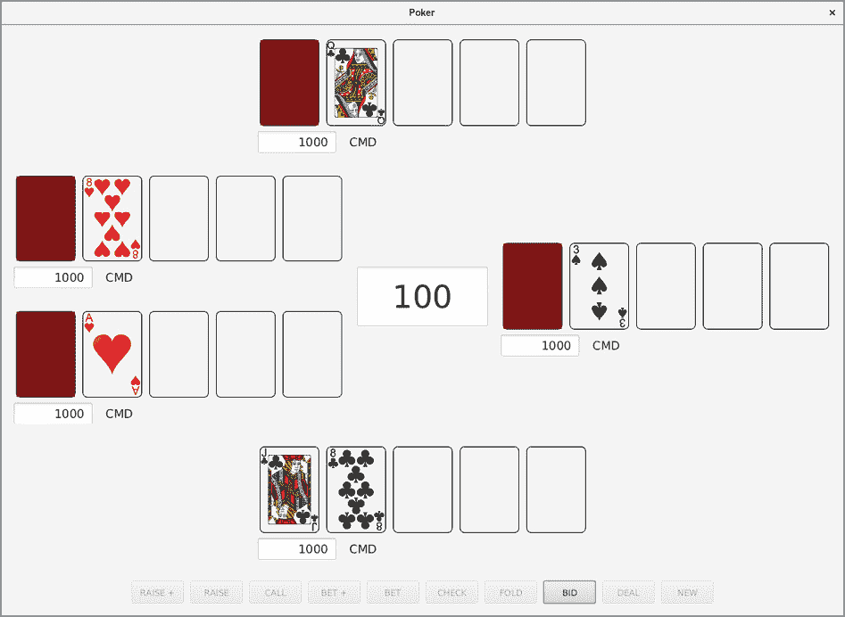

底部的玩家是用户。每个玩家下方都有一个 `TextField` 显示玩家的金额（筹码数量），中间的区域是底池（pot）。

在底部，按钮是用户游戏时必须使用的命令。含义如下：

*   当你开始一个新游戏时，只有 `NEW` 启用状态，当用户点击它时，将开始新的一轮游戏。

*   之后，只有 `DEAL` 启用状态，点击后，牌牌将从庄家之后的玩家开始发牌。在原型中，用户是庄家。发完牌后，只有 `BID` 按钮被启用。

*   当你点击 `BID` 时，将开始下注轮。当轮到用户下注时，剩余的 7 个按钮将根据实际情况启用，它们是：

    *   `CHECHK`, `BET`, `BET+`, `FOLD`

    *   `CALL`, `RAISE`, `RAISE+`, `FOLD`

*   在玩家点击其中一个按钮后，所有按钮都将被禁用，剩余的（虚拟）玩家将下注。然后有三种选择：

    1.  下注轮尚未完成，因为某个玩家提高了筹码。如果是这种情况，`BID` 将被启用，下注轮将按上述描述继续，但玩家只能选择：

        *   `CALL`, `RAISE`, `RAISE+`, `FOLD`

    2.  下注轮已完成，如果不是最后一轮，`DEAL` 将启用，当用户点击它时，将发放下一张牌，然后 `BID` 将启用。

    3.  下注轮已完成，但是最后一轮。此时 `DEAL` 被启用，但文本变为 `SHOW`，这提示你回合已结束，当点击 `SHOW` 时，将更新赢者的筹码并清空底池。然后 `NEW` 被启用，你已准备好进入下一轮。

你应该注意，这些按钮的功能尚未实现。

### 项目架构

该项目的初步架构如下所示，其中包 `resources.images` 包含扑克牌的图像：

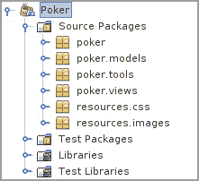

`resources.css` 包含一个样式表，目前仅包含此程序中使用的一种样式——位于 `CardView` 类中。`poker.tools` 包含辅助类。其中一个类名为 `Images`，是一个单例，提供扑克牌图像。另一个类是 `CardView`，它是一个带有 `ImageView` 的 `GridPane`，因此是一个带框显示扑克牌的简单组件。

关于 `poker.models` 包，定义了 4 个枚举：

1.  `CardColor`，代表四种牌的颜色

2.  `CardValue`，代表 13 种牌值

3.  `PokerGames`，列出了 5 种扑克变体

4.  `PokerBets`，指示玩家的注

以及 5 个类。`Card` 代表一张扑克牌：

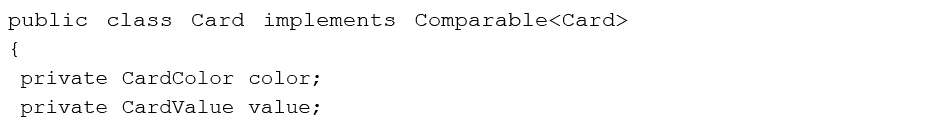

而 `Cards` 代表一组包含 52 张牌的扑克牌：

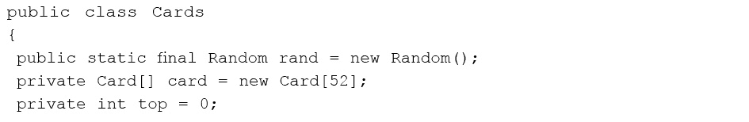

这些是我之前展示过的类，它们的工作方式与 `Poker` 程序中基本相同。接下来的类是游戏本身模型的开头，也被定义了，但尚未广泛使用：

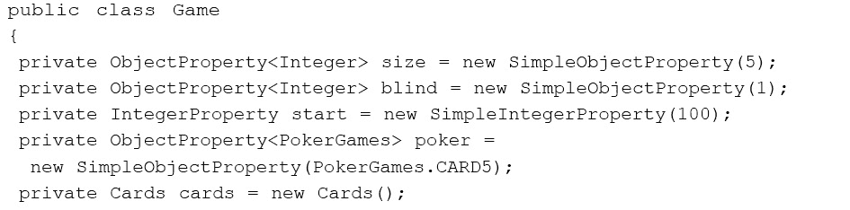

最后，有一个类代表给定玩家持有的牌：

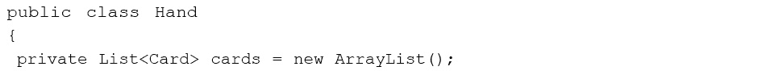

此外还有一个异常类。然后是 `poker.views` 包，它包含视图（view）和演示器（presenter）类。初步包括：

1.  `MainView` 和 `MainPresenter`，定义了带有按钮的主工具栏或菜单。

2.  `HandView` 和 `HandPresenter`，显示单个玩家的牌和筹码数量。

3.  `Card5View` 和 `Card5Presenter`，定义了当前变体的面板。

4.  `TableView` 和 `TablePresenter`，是上述内容的类的类。

迭代以简单的重构结束，这无非是清理工作。

## 6.5 迭代 2

以下算法具有 `Card[]` 类型的参数，代表玩家的牌。假设牌是按降序排列的。前面的算法用于确定玩家牌的值。这些算法会被其他算法调用：

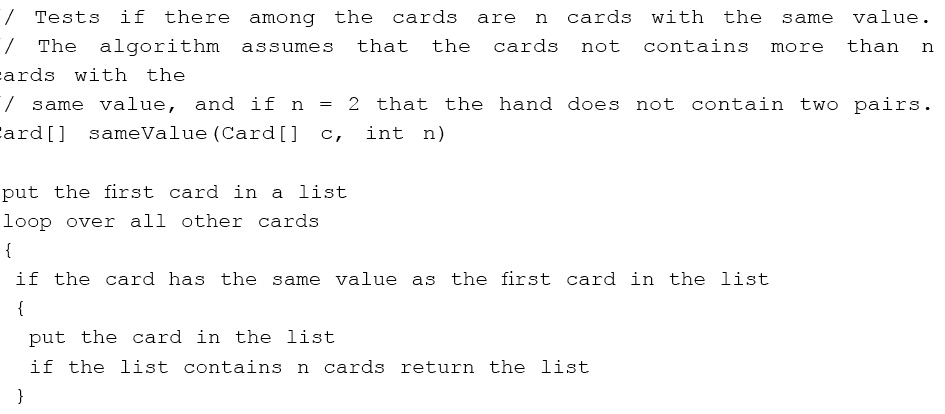(image/Java_20_65.jpg)(image/Java_20_66.jpg)

可能需要多个类似的算法，因为在测试中，牌序列可能具有特定的值，如果合适，它们将看起来像上面一样且通常非常简单。在 `5 Card Stud` 中，明牌中最好的玩家必须始终开始下注轮。共有 4 轮下注，每轮下注都定义了一个算法，该算法返回开始下注轮的玩家索引。作为参数，算法拥有待测试的牌数组，并假设 0 始终表示用户的手牌。

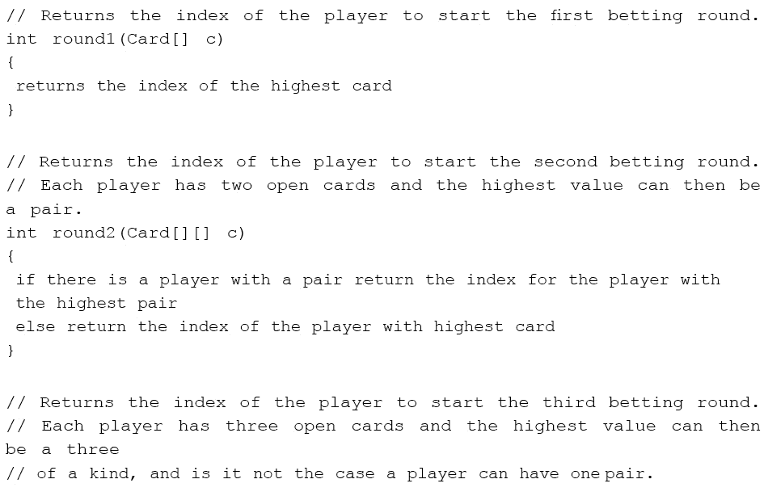(image/Java_20_67.jpg)(image/Java_20_68.jpg)

在比牌（showdown）时，需要一个算法来返回拥有最大牌（hand）的玩家索引：

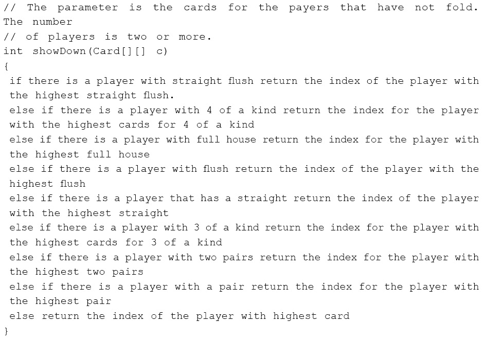

最后的算法涉及虚拟玩家在下注轮中如何行动，例如说明玩家需要下注多少（`BET`），当玩家加注（`RAISE`）时下注多少，以及玩家应该何处选择 `CHECK`，并可能诈唬。该玩家将根据自己的牌和其他玩家的明牌来做出选择。玩家如何做出选择取决于当前的下注轮，因此取决于玩家能看到多少张牌，这使得预测下注变得困难，选择在某种程度上是随机的。对于每轮下注，有两种情况：

1.  该玩家是第一个，或者该轮最后一次下注是 `CHECK`，然后玩家有四种选择：`BE = BET`, `B+ = BET`, `CH = CHECK`, `FO = FOLD`

2.  玩家已经下注，因此已投入底池资金，在这种情况下有四个选项：`RA = RAISE`, `R+ = RAISE`, `CA = CALL`, `FO = FOLD`

# 概述

与迭代 1 的原型相比，整体设计没有显著变化，开发遵循 JavaFX 应用程序的经典 MVP 设计模式。在模型层，主要扩展了三个新类。添加了一个 `Model` 类。


变量 `pot` 代表桌上的底池，以及玩家在每个下注轮次中向其存入金额（筹码）的地方。它被定义为 JavaFX 属性，因此用户界面可以绑定到它。下一个变量 `game` 是类型 `Game` 对象的程序设置。初始只有 4 个属性，但该类在以后可能需要进行扩展。变量 `value` 是当前回合的值，每当玩家下注 `BET` 或 `RAISE` 时就会更新。因此，该变量指示了在特定回合中继续游戏所需的费用。最后是 `hands` 变量，它是当前玩家的列表，代表他们的手牌。

该类的方法通常非常简单，主要由 `get` 和 `set` 方法组成。此外，还有维护变量 `pot` 和 `value` 的方法：


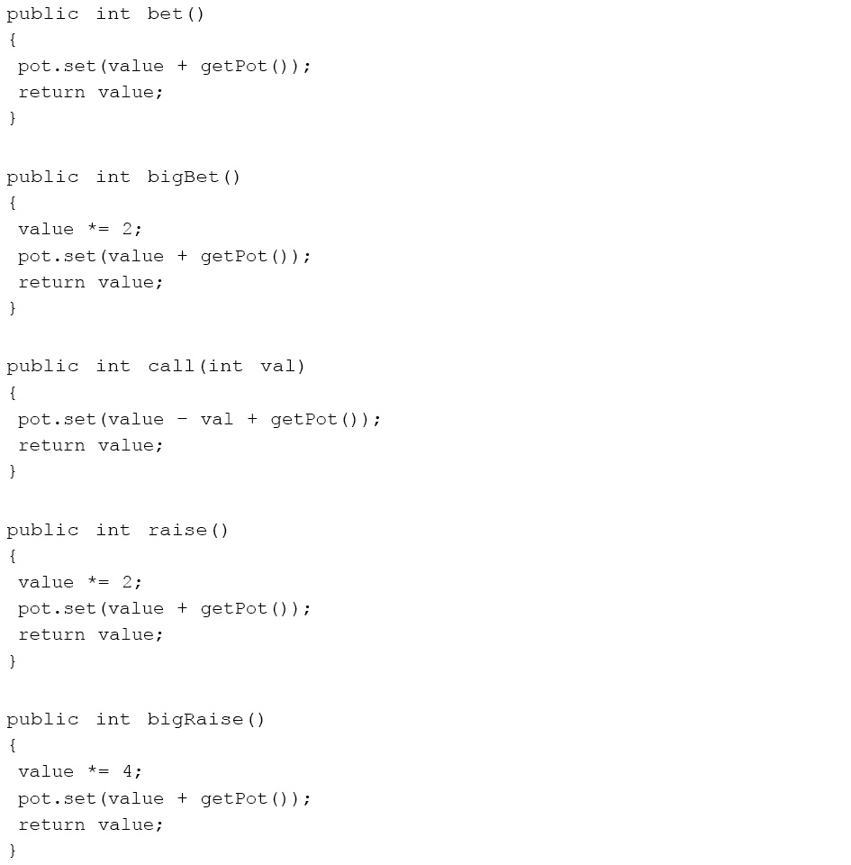

这些方法非常简单，但非常重要，因为这些是玩家在各个下注轮次中调用的方法。你应该特别注意带有参数的`call()`方法。如果一个玩家加注（raise），而另一个玩家已经在底池中投入了金额，则在更新底池之前需要减去该金额，这正是该参数的目的。因此，上述方法决定了在各个下注轮次中进行游戏的费用。与迭代 1 中的决策类似，它相对于“真实”扑克游戏经过了简化，方法的另一个用途是，可以通过在派生类中重写方法来更改这些规则。这也是为什么`pot`和`value`两个变量被定义为`protected`的原因。

## 新类

增加了两个类：

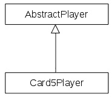

其中`Card5Player`类代表一个玩“五张牌派克”（5 Card Stud）的虚拟玩家。创建基类是因为其他 4 种扑克变体中的每种都会会有相应的类。我将在下面解释这两个类。

## Hand 类

与原型相比，`Hand`类被大幅扩展：

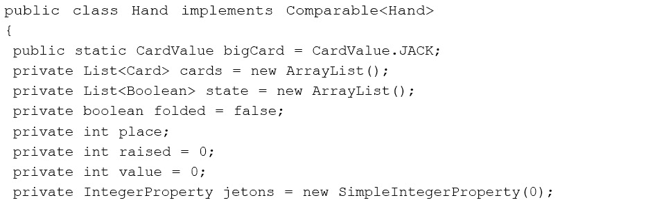

第一个变量`bigCard`决定虚拟玩家应该将什么视为大牌（JACK、QUEEN、KING 和 ACE），该值与下注轮次结合使用。该值以后可能需要更改为关于程序设置的选项。下一个变量`cards`是玩家手牌的列表，变量`state`用于跟踪牌是开牌的（朝上）还是隐藏的（朝下）。变量`folded`表示玩家是否已经弃牌（fold）并退出了该回合。变量`place`指明玩家在桌上的位置，其中位置 0 始终被视为物理玩家，而变量`raise`指明玩家在一个下注轮次中下注`RAISE`或`BIGRAISE`的次数。该值用于设置玩家在同一下注轮次中必须`RAISE`的次数限制。最后是`value`变量，它指示玩家在当前下注轮次中已向底池存了多少筹码。如果另一个玩家下注`RAISE`，该值将结合`CALL`使用。最后是`jetons`变量，指示玩家的筹码数量，它被定义为 JavaFX 属性，以便为每个玩家都能绑定到用户界面。

关于玩家在一个下注轮次中可以下注`RAISE`的次数限制，这与真实的扑克游戏不一致，但包含在这里是因为否则很难让虚拟玩家正确行动。到目前，该限制在前三个下注轮次为 2，最后一个下注轮次为 3，但该限制可能需要更改为一个选项。

该类有许多方法，并实现了所有关于手牌价值的算法，包括虚拟玩家在下注轮次中必须用于确定下注的方法。有很多方法，其中许多既定义为实例方法也定义为静态方法。

对于`AbstractPlayer`和`Card5Player`类（以及`Card5Presenter`）中方法的实现，`Card`、`Cards`和`Hand`类中的方法能够运行至关重要，尤其是对象的比较，因为在某些上下文中是升序比较的，而在另一些上下文中是降序比较的。因此，为这三个类中的每一个都了单元测试类。在测试这些类后，我可以返回`AbstractPlayer`和`Card5Player`类。

## AbstractPlayer 类

基类目前是一个简单的类：

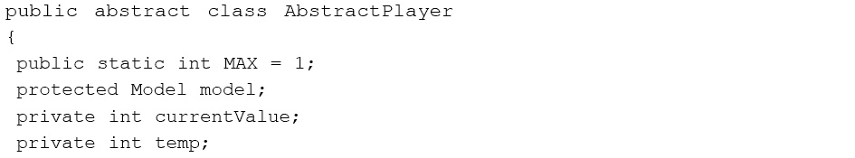

第一个常量是玩家必须`RAISE`的次数限制，下一个变量是程序的模型。当程序必须发牌时，在每张牌之间会插入一个较小的延迟（以便用户可以跟踪发牌的过程）。下注也是如此，每个玩家的下注之间会有延迟——同样是为了让用户跟踪虚拟玩家的行动（模拟他们的思考）。这要求发牌算法和下注轮次算法在它们自己的线程中执行，这使得代码变得有点复杂，以确保用户界面的正确更新，用户界面需要通过`Platform.runLater()`进行更新。`AbstractPlayer`类中的最后两个变量用于此处。

此外，该类主要由辅助方法组成。该类定义了 9 个抽象方法：

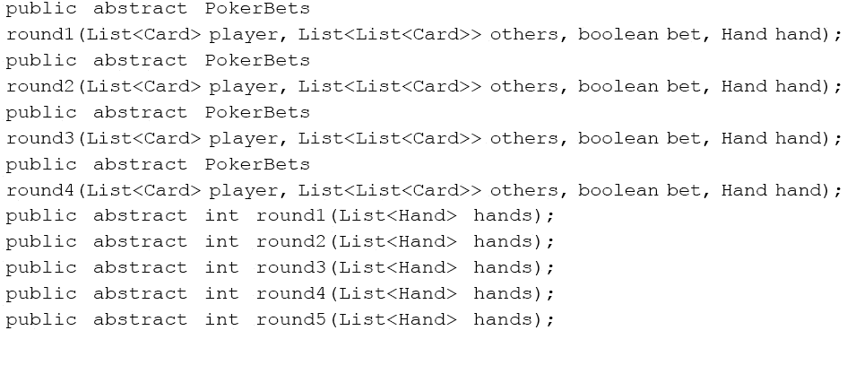

其中前 4 个是 4 个下注轮次的方法。第一个参数是玩家的牌，下一个参数`others`是其他玩家的开牌。第三个参数指示是否是第一个下注轮次，最后一个参数指示当前玩家。最后 5 个方法用于确定由谁开始下注轮次，这由玩家的开牌决定。

`AbstractPlayer`类在开发过程中可能会发生变化，肯定会有更多其他的抽象方法。

`Card5Player`是一个详尽的类，完全由实现基类的 9 个抽象方法组成。这里特别是前 4 个对应迭代 2 算法的完整方法。

## 用户界面层

除了模型类，用户界面中还有相应的类，这里的更改主要涉及`Card5Presenter`类。它也被大幅扩展，并且到目前为止它是程序中最复杂的类，这等同于该类包含了整个游戏逻辑。

与原型一样，该类派生自

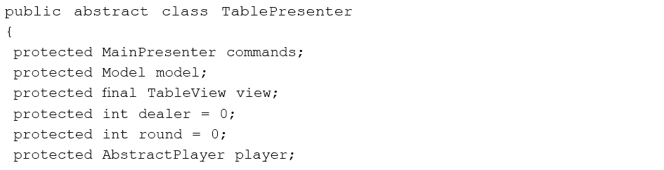

现在有一个类型为`AbstractPlayer`的对象的引用。同样注意第一个变量，它是对程序`MainPresenter`的引用，其目的是让`Card5Presenter`类能够引用窗口的按钮。哪些按钮可用取决于玩家是谁（虚拟玩家还是物理玩家）。相对于原型，该类扩展了 7 个抽象方法：

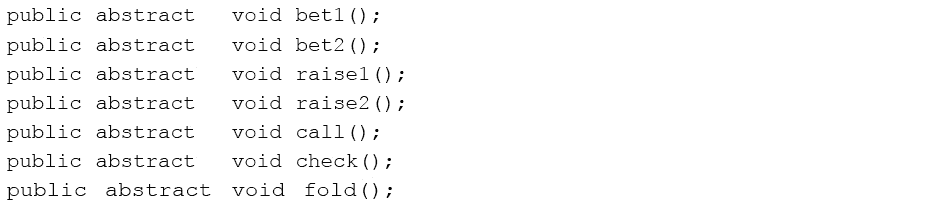

每个方法对应下注轮次中 7 种可能的下注中的每一种。

然后是`Card5Presenter`类。代码内容并不多，主要的挑战在于让线程正确运行，特别是如何测试这些代码。例如，`RAISE`（加注）增加了逻辑的复杂性，因为`RAISE`必须返回并让前面的玩家重新下注，而且由于他们也可以`RAISE`，因此有很多情况需要考虑。在测试方面，有必要测试程序，即玩游戏。在这里你可以发现错误和不便之处，但要追踪错误发生在何时以及如何发生可能会困难。因此，我通过一个额外的类扩展了模型层，该类代表了一种日志文件的形式：

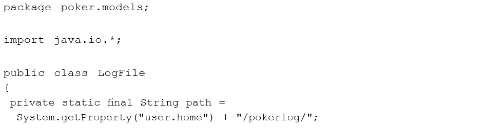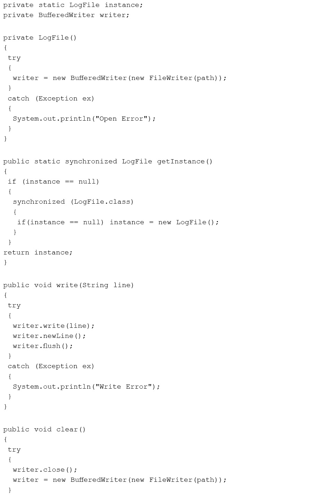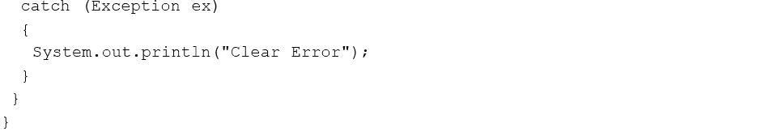

这个类非常易理解。然后你可以让程序在特定位置写入日志，这可以让你更容易找到程序在何处失败了。

当然，日志文件不应该是完成后的程序的一部分，而且该类——以及代码中所有的引用——必须在应用程序使用之前移除。我目前还没有这样做。部分是因为我稍可以在其他迭代中使用这个类，另一部分是因为读者可以看到我是如何使用日志文件的。

也有理由要稍微警告这种技术，即将日志文件作为开发过程的一部分来记录错误。风险在于如果你没有移除代码中所有的引用，程序可能会因为你引用了不再存在的内容而突然失败。在这种情况下，`LogFile`类是一个单例，如果我删除了该类，编译器会找到所有对该类的引用，我就可以确保关于日志文件的所有内容都被移除。

作为同类的另一个问题，程序的工作方式是：当你选择`SHOW`查看谁获胜了时，所有的牌都会出现——即使对于那些已经弃牌的玩家。这不应该发生，当显示所有牌时，是因为`Card5Presenter`类中`deal()`方法的某些代码必须被其他内容替换：

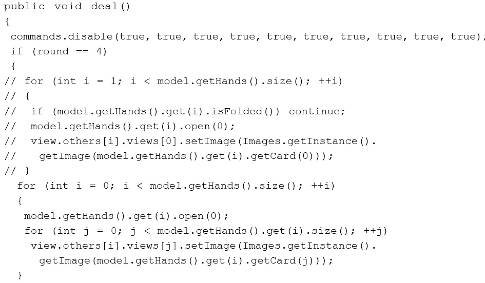

同样，我必须记住在某一点删除底部的`for`循环并替换为被注释掉的代码。其目的当然是为了在测试过程中，我可以观察弃牌玩家是否也做出了合理的决定。

## 6.7 迭代 4

在第 3 次迭代结束后，*五哨扑克 (5 Card Stud)* 在原则上已经实现，至少用户可以与其他 4 个虚拟玩家玩这种扑克变体。在这次迭代中，必须实现以下功能：

每个每个用户（玩家）的用户账户维护，你必须注册：

*   用户名，必须唯一标识用户
*   密码
*   余额，即账户中有多少钱
*   交易记录，何时以及多少钱被添加到/或从账户中取出，但不是单轮游戏的结果

除非账户中有钱，否则用户将无法游戏。

登录功能，玩家在程序开始时必须通过用户名和密码识别身份为玩家。作为该功能的一部分，必须能够创建新账户。

开始新游戏是一个用户可以随时选择的功能。该函数打开一个对话框，用户必须在其中选择：

1.  扑克变体（五哨扑克、七哨扑克、德州扑克、奥马哈、抽牌扑克）
2.  玩家人数（2–6 人）
3.  盲注（1–10，加入新轮回合的筹码数，默认 1）
4.  起始金额（每个玩家的筹码数，默认 1000）

程序必须能够保存每一轮的结果，程序在每个下注回合存储牌牌和注额，从而记录游戏。尚未决定这些结果将用于何处，但可以用于某些形式的统计，以改进虚拟玩家的行为。该功能必须能够开启和关闭，并且可能默认禁用。

### 开始新游戏

这个功能的实现非常简单，它会打开以下对话框：

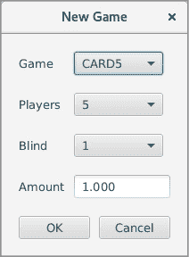

对话框可以从登录窗口打开，也可以从应用程序窗口顶部的按钮打开。该函数可以随时执行，因此你可以中断正在进行的游戏。

实现主要包括向视图层添加两个类`GameView`和`GamePresenter`，并对`MainView`和`MainPresenter`类进行一些改更改。

### 用户账户

已经决定从程序中完全移除此功能，因为这真的没有意义。该功能的理由是，如果你玩很长时间的扑克，追踪你长时间的赢或输可能很有趣，但考虑到游戏的初衷，这是一个几乎不会被使用的设施。因此，程序在这一功能上被精简了，而且因为如果你必须确保它也反映了实际情况，并且存在与功能相关的决策（例如何时更新账户以及在不中断程序的情况下如何将修改写回磁盘），那么实现这个功能并不容易。

这也意味着登录功能将被舍弃，因为整个用户概念因此变得毫无趣味，因此用户（玩家）将始终是机器的当前用户。

由于这个决定，这次迭代的内容显著减少了。

### 日志文件

日志文件必须是一个普通的文本文件，其内容取决于具体的变体。例如：每当开始一新轮游戏时，都会根据玩家所在的位置写入一行。牌的颜色为 D（方片）、H（红桃）、S（黑桃）和 C（梅花），牌的值为 2, 3, 4, 5, 6, 7, 8, 9, 0, J, Q, A。如果有 5 个玩家，第二次发牌的结果可能是：


对于每个下注回合，每当玩家下注时都会写入一行，其中记录了玩家的位置、注额、添加到池中的金额、游戏的新值、玩家的金额以及池的内容。注意每个下注回合的行数可能会变化，但单行的结果可能是：


关于玩家注额，使用了以下术语：

*   `B1` = 注
*   `B2` = 大注
*   `CH` = 牌
*   `FO` = 弃牌
*   `R1` = 加注
*   `R2` = 大加注
*   `CA` = 跟注

最后，在轮结束时会写入一行显示获胜玩家的结果。该行显示了玩家的位置、牌值、游戏进行后的玩家金额以及牌。一个结果可能是：


其中牌值使用了以下缩写：

*   `SF` = 同花顺
*   `C4` = 四条
*   `FH` = 葫芦
*   `FL` = 同花
*   `ST` = 顺子
*   `C3` = 三条
*   `TP` = 两对
*   `C2` = 一对
*   `HC` = 高牌

由于该功能默认情况下是禁用的，程序通过以下对话框进行了扩展：

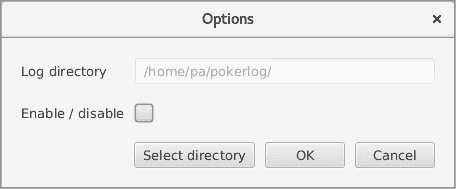

它维护了以下数据结构：

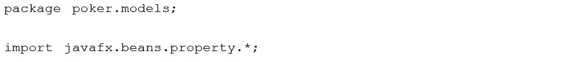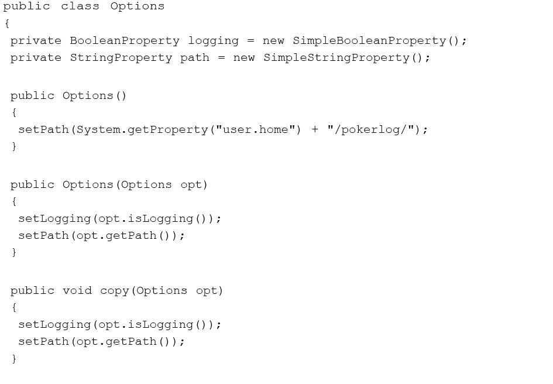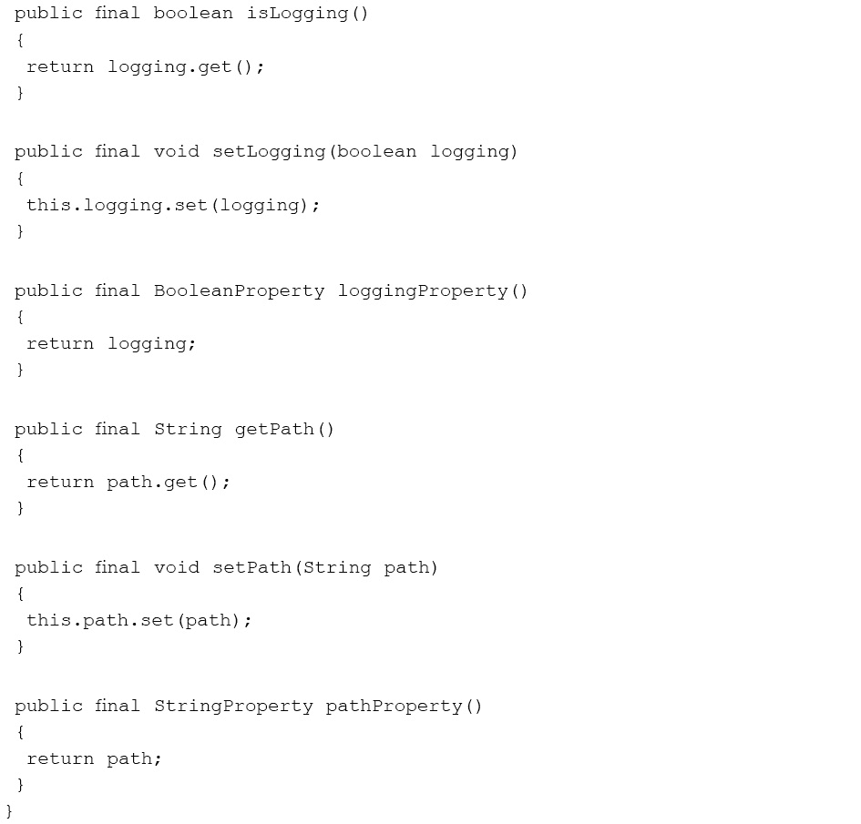

对话框本身由两个类定义：`OptionsView`和`OptionsPresenter`。此对话框中的设置应该保存在某处，目前设想是通过在用户主目录中进行对象序列化来实现。然而，该功能尚未实现，因为预计程序之后还会接收其他设置，届时`Options`类和上述对话框将进行相应的扩展。

使用类似于上一个迭代中`LogFile`类的功能来实现日志文件本身是简单的。该类现在已经被删除，并被`Logfile`类所取代，该类为要写入的四行中的每一行都包含一个`write`方法：

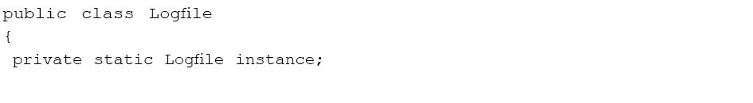[](image/Java_20_96.jpg)

在这里你需要注意，程序每向文件写入一行，就会打开并关闭一次文件。其原因是由于默认情况下该功能是禁用的，设计思路是只有当你出于某种原因想要收集程序信息时，才使用该函数。否则，挑战在于将相关的写入操作放在代码的正确位置，然后自然进行测试。

你需要注意的是，为了将卡牌写入日志，`Hand`类扩展了一个新方法，该方法针对卡牌返回要写入文件中的文本。

## 6.8 迭代 5

接下来的四个迭代彼此相似，都是关于实现另一种扑克变体，并且原则上将针对另一种游戏重复上述大部分内容。我想从`7 Card Stud`（七牌休闲）开始，仅仅是因为这种变体看起来非常像`5 Card Stud`（五牌休闲）。最重要的区别在于：

1. 每个玩家有 7 张牌，其中 3 张是底牌，4 张是明牌。
2. 有 5 轮下注。
3. 最后两轮下注的玩家分别有 6 张和 7 张牌可选。
4. 由牌最小玩家开始第一轮下注。

与`5 Card Stud`相比，最大的挑战是：

1. 实现`Card7Player`类作为`Card5Player`的替代方案。
2. 实现用户界面，因为现在必须留出更多卡牌的空间。

我如下开始最后一项：

*   创建了两个类`Card7View`和`Card7Presenter`，它们是`Card5View`和`Card5Presenter`的副本。
*   修改了`Card7Presenter`类，使其实例化一个`Card7View`对象而不是`Card5View`对象。
*   更改了`Game`类，将属性`poker`初始化为值`CARD7`。
*   更改了`MainPresenter`类中的`initialize()`方法，现在为`CARD7`增加了一个 case 分目。
*   在`Card7View`类中，我注释掉了显示底池（pot）的行：

之后，程序再次运行，因此使用了新类`Card7View`和`Card7Presenter`作为用户界面，并且每个玩家现在都有容纳 7 张牌的空间（容纳卡牌的数量已经在基类`TableView`中实现）。

然后我修改了`Card7View`类，使底池移动到左上角：

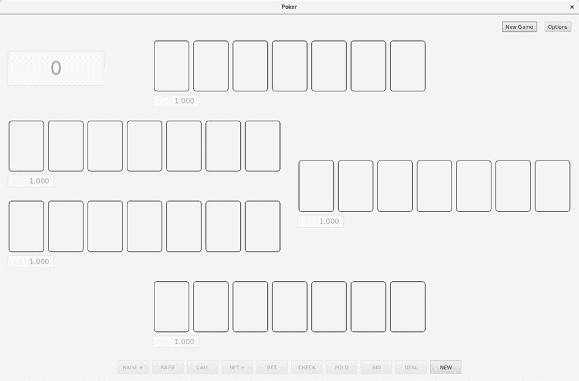

然后用户界面在原则上就完成了。

作为下一步，模型扩展了一个新类`Card7Player`，该类到目前只是`Card5Player`类的副本。此外，`Card7Presenter`类中的构造函数被修改了，使其创建一个`Card7Player`对象。之后，程序可以再次运行，尽管它仍在玩`5 Card Stud`，但任务现在大幅减少为修改`Card7Player`和`Card7Presenter`这类。

第一步，我在`Card7Presenter`类中修改了`deal()`和`deal1()`方法，现在我可以分发 7 张牌，其中前两张和最后一张是底牌。

`Card7Player`类非常复杂，因为关于下注轮的算法需要更改。由于现在多了一个下注轮，基类`AbstractPlayer`扩展了两个抽象方法：

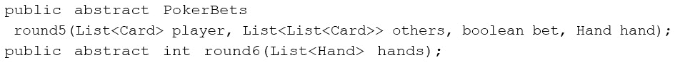

这要求在`Card5Player`类中也实现这些方法，在其中它们仅被实现为简单的方法，例如。

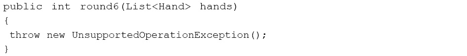

决定由谁开始下注轮的方法很大程度上没有变化，更改主要涉及确定虚拟玩家注额的五个方法。原则上，这些方法的工作方式与`Card5Player`中相同，并且基于明牌来确定注额。这主要通过`Hand`类中的方法完成，但由于这次玩家可能有更多的牌（6 张或 7 张），有必要修改`Hand`类中的某些方法并添加一些新方法。这些方法对于游戏算法运行至关重要，因此在算法中使用它们之前必须对其进行彻底测试。因此，单元测试的测试类已经过扩展，并添加了一个新的测试方法。之后，就可以按照`Card5Player`中相同的模式实现`Card7Player`类中的算法。

当然，也必须修改`Card7Presenter`类。实际上需要更改的内容不多，主要涉及该类现在必须支持 5 轮下注。此外，该类还被更改，以便在比牌（showdown）时显示玩家使用的 5 张牌。

观察`Card7Player`和`Card7Presenter`类，它们包含了许多对应迭代的重复，这意味着某些代码应该移动到基类中。我将此推到迭代 9 再重构。

## 6.9 迭代 6

作为下一个扑克变体，我将实现德州扑克（Hold’em）。在这里，与`5 Card Stud`一样有 4 轮下注，但玩家像`7 Card Stud`一样拥有 7 张牌，其中 2 张是底牌，其余 5 张是桌上的明牌。此迭代的挑战与之前的迭代相似，不同之处在于用户界面会有所不同。

与上一个迭代相同，我添加了以下类：

1. `TexasView`，`Card7View`的副本。
2. `TexasPresenter`，`Card7Presenter`的副本。
3. `TexasPlayer`，`Card7Player`的副本。

然后我修改了`Game`类，将默认扑克变体设为德州扑克，并扩展了`MainPresenter`类中的`initialize()`方法。然后程序可以再次运行，并使用上述类作为默认。下一步，修改了`TexasView`类，用户界面如下：

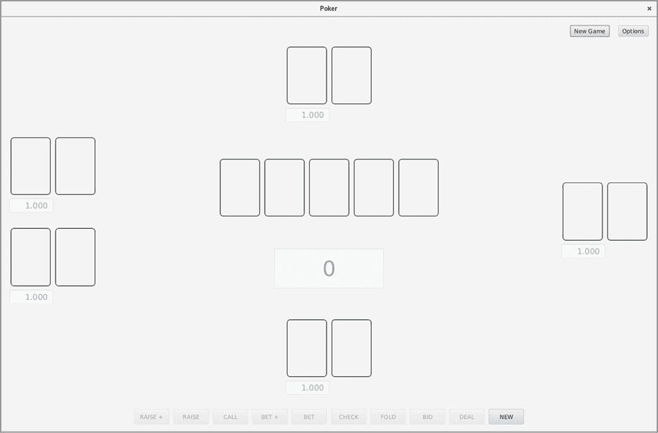

其中每个玩家现在有容纳 2 张牌的空间，而桌上有容纳 5 张牌的空间。

用户界面还有一个额外的挑战，即我必须以某种方式在回合结束后展示玩家的手牌。解决办法是，在比牌阶段后，我用另一个与`Card7View`用户界面类似的面板替换掉上面的面板。这是一个相对简单的解决方案，仅需添加另外两个类即可：

*   `ResultView`
*   `ResultPresenter`

然后从`deal1()`方法打开窗口。


最大的任务是`TexasPlayer`类中游戏算法的更改。那些涉及由哪个玩家开始一轮下注的初始算法不适用于这种扑克变体，因此它们都是一些微不足道的算法。其他决定玩家注额的算法在恰恰实现上立即变得更加困难，因为此时玩家只能看到少数几张牌。在第一轮下注回合中，玩家只能看到自己的两张底牌，因此规则必须非常简单、数量较多，并且在很大程度上看起来是随机的。在另外三轮回合中，玩家分别能看到 5、6 或 7 张牌，其中 3、4 或 5 张牌是与其他玩家共享的。在目前的实现中，算法仅考虑了当前玩家拥有的牌，但通过同样考虑其他玩家可以从桌上的明牌牌中获得哪些牌，可以改进算法。

## 6.10 迭代 7

`Omaha`变体基本上与`Texas Hold’em`相似。实现包含了以下类：

1. `OmahaPlayer`，作为`TexasPlayer`的副本
2. `OmahaView`，作为`TexasView`的副本
3. `OmahaPlayer`，作为`TexasPresenter`的副本

接下来，对应其他变体修改了以下类：

1. `Game`
2. `MainPresenter`
3. `OmahaPresenter`，其中由 showdown 调用的`showResult()`参数必须更改为 9，然后重新运行程序，但显然程序仍在玩`Texas Hold’em`。然而，在用户界面方面，存在一个小问题，因为`ResultView`中的牌占据了太多空间。然而，最大的任务是更改`OmahaPlayer`类中的游戏规则。关于由谁开始下注回合没有更改，因为我将应用与`Texas Hold’em`相同的规则，即由庄家之后的玩家开始下注。尽管这与真实的扑克世界相比有点过于简化，但我保留了这个简单的规则，因为它对当前程序没有产生影响。

关于决定玩家在下注回合中必须注多少的算法，我使用了与`Texas Hold’em`相同的规则，但这次对可以使用哪些牌进行了扩展。

在第一轮下注回合中，必须从玩家的四张底牌中选择两张，提供 6 种选择。对于这 6 种选择中的每一种，我都会选择能导致最好牌的两张牌，并在这两张牌上使用与`Texas Hold’em`相同的算法。在第二轮下注回合中，必须从玩家的底牌中选择两张，这又提供了 6 种选择，这两张牌与桌面上的三张明牌结合，我选择产生最高牌的组合。对于这种组合，我使用了与`Texas Hold’em`相同的算法。第三轮下注回合也是一样。从 4 张底牌中选 2 张（6 种方式），然后从 4 张明牌中选 3 张（4 种方式），产生 24 种组合。在这里选择最佳组合，并对此组合应用与`Texas Hold’em`相同的算法。最后是第四轮下注回合，需要从 5 张明牌中选择 3 张，这有 10 种方法。在这种情况下，有 60 种组合，同样选择值最高的牌型。

在 showdown 时，没有弃牌的玩家应该展示他们所选择的获胜的牌。对于每个玩家，只需展示 9 张牌中的 5 张（即玩家能组成的最好牌）即可，因此有点像`Texas Hold’em`变体，但这次我将在对话框中显示结果：

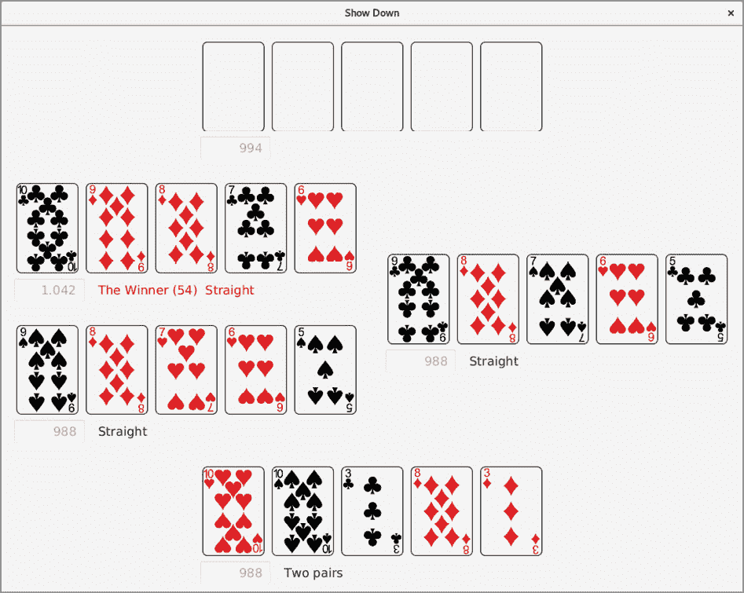

也许`Texas Hold’em`变体也应该更改为使用相同的对话框显示结果。

## 6.11 迭代 8

最后一个变体是`5 Card Draw`，它也是最简单的变体，因为只有两轮下注，而且由于游戏规则非常简单，玩家始终只能看到自己的 5 张牌。关于注额，我想使用与`Texas Hold’em`相同的算法，但对于高额注额的概率略高。此外，第一个算法必须进行扩展，以便玩家可以决定换哪些牌。它基于一个非常简单的算法：

1. 如果玩家有同花顺，则不换任何牌
2. 如果玩家有四条，则不换任何牌
3. 如果玩家有葫芦，则不换任何牌
4. 如果玩家有同花，则不换任何牌
5. 如果玩家有顺子，则不换任何牌
6. 如果玩家有三条，则换两张牌
7. 如果玩家有两对，则换一张牌
8. 如果玩家有一对，则换三张牌
9. 如果玩家有高牌，则换掉所有比 Jack 小的牌

这些规则非常简单，甚至简单得过头，因为用户相对容易推断出虚拟玩家可能持有哪些牌。因此，最后 4 条规则被更改了，以便玩家可以更少数量的牌。

最后，物理玩家必须能够换牌，因此能够选择要换的牌。这在用户点击他想要交换的牌时发生：

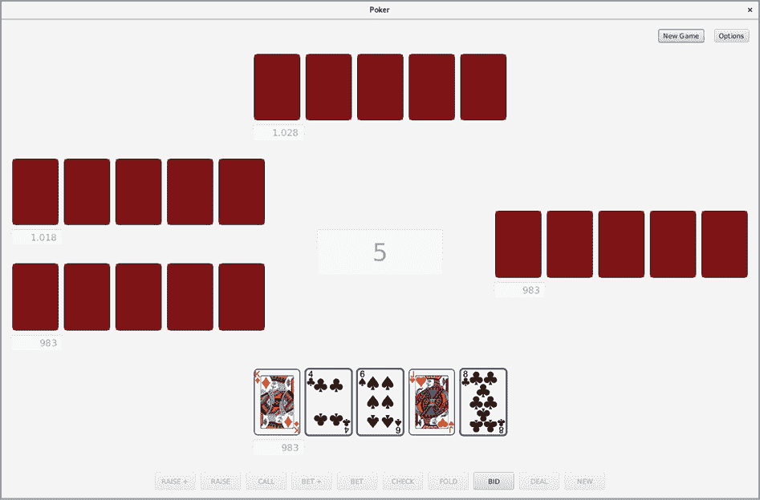

为了让用户能够点击牌，`CardView`类已更改，如下：


`clicked`变量用于表示牌是否被点击，而`clickOn`变量用于表示支持此功能。只有`5 Card Draw`变体支持此功能，且仅在第一轮下注回合支持。此外，模型类`Hand`扩展了：


以便用户指定要换的牌。在`DrawPlayer`类中，由玩家在第一轮下注时调用的`round1()`方法进行了扩展，以便它初始化玩家想要交换的牌数组，最后`DrawPresenter`类扩展了`deal()`。

## 6.12 迭代 9

这是最后一个迭代。在规划方面，迭代发生了变化，但包含了：

1. 程序的选项
2. 用户界面
3. 代码审查和重构
4. 一个安装脚本

这是一项相当大的工作，我想先对以下类型进行代码审查：

* 程序使用了 5 个枚举：`CardColor`、`CardValue`、`PokerValue`、`PokerGames`和`PokerBets`。
* `Card`和`Cards`类，是简单的类，但是可以在其他应用程序使用的类。
* `Game`类，没有更改。在审查该类时，我也看到了`GameView`和`GamePresenter`，它们也没有更改。

### 程序的选项

到目前为止有两个选项：

1. 用于记录各个游戏回合的应用程序日志文件的目录。
2. 该功能的禁用或启用状态。

已决定扩展两个新选项。玩家可以在同一下注回合中加注两次，在最后一轮下注回合中加注三次。已决定这应该是一个选项，以便第一轮下注回合的玩家可以加注 1、2、3、4 或 5 次，而最后一轮下注回合的玩家可以再加注一次。最后，决定程序应该有一个错误日志的选项，并且该功能的启用或禁用也必须是一个选项。

同样，`Option`类扩展了两个新属性：


相应的方法也随之发生了变化。然后`OptionsView`和`OptionsPresenter`类需要进行调整，这看起来非常简单。在视图类中没有什么特别需要注意的，但必须将设置保存到某个处，决定将其保存在用户主目录下的`poker.init`文件中，并通过简单的对象序列化来实现。决定在每次更改设置时都保存这些设置。然而，这存在一个小问题，因为 JavaFX 属性不能立即被序列化。因此，编写了一个很小的类来封装这些属性，以便你能够序列化该类的对象。

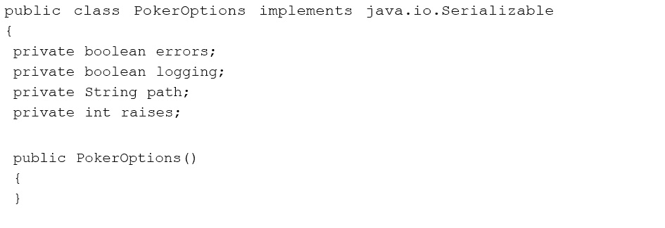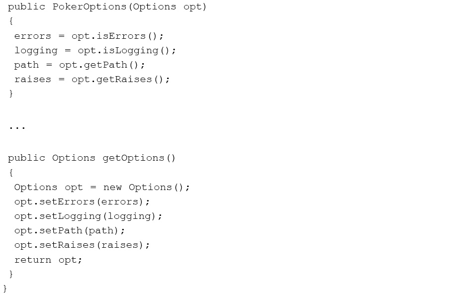

有了这个类后，可以很容易扩展`OptionsPresenter`类，添加一个方法，在点击`OptionsView`中的`OK`按钮时，将带有程序设置的`PokerOptions`对象序列化。同样，`Model`类也扩展了一个`deserialize()`方法，该方法在可能的情况下反序列化一个`PokerOptions`对象并实例化`Options`对象。

在错误日志方面，它必须记录在用户主目录下名为`poker.error`的文本文件中。该功能通过以下类实现：


反之，只需在启用该功能时调用`write()`方法。一个示例可以是：


这是`OptionsPresenter`类中的错误处理。当时，必须在相关的地方实现错误处理，这与随后的代码审查和重构有关。

### 用户界面

用户界面在某些地方需要改进（而且在很多地方无疑完全可以改进）。该程序目前在高分辨率显示器（1920 × 1080）上运行良好，但在分辨率明显更低的屏幕上，没有空间容纳所有的卡牌。以下内容主要关于如何让用户界面依赖于当前的屏幕分辨率，同时依赖于当前的游戏变体。

程序在窗口的右上角有两个按钮，用于打开游戏选择和设置的对话框。我将这两个按钮移动到了实际的游戏视图中，它们位于顶部手牌的右侧。


目标是在顶部节省一点空间。另一方面，这一更改必须在所有 5 个游戏视图中实现。为此，在`poker.tools`包中添加了以下组件：


在这里你应该首先注意到构造函数的参数，它是一个`MainPresenter`，这样这两个按钮就可以调用该类中的事件处理器。在`MainView`中，删除了原来的两个按钮，并相应地修改了`MainPresenter`类。上述组件必须插入到 5 个游戏视图中。决定是在基类`TableView`中添加以下方法：

```

```

然后使用该方法将组件插入到`Card5View`（它是一个`BorderPane`）：

```

```

然后，在`Card7View`、`TexasView`、`OmahaView`和`DrawView`中必须进行相同的更改。

然后我减小了显示玩家金额的`TextField`组件（`HandView`类）的字体，底池也是如此。`Card5View`类有一个名为`createCenter()`的方法，用于创建一个底池组件。我将此方法移动到`TableView`并将其命名为`createPot()`。接下来，必须在`Card7View`、`TexasView`、`OmahaView`和`DrawView`中进行更改，结果是底池在所有 5 变体中以相同的方式和位置（窗口中间）显示。

每次用户选择新游戏时，`MainPresenter`类中执行`newGame()`方法。执行此方法时，会创建一个新视图，你可以根据当前游戏自定义窗口大小。决定视图大小的主要是卡牌，你可以通过压缩卡牌来减少窗口尺寸的要求。为此，`CardView`类扩展了 4 个静态变量：

```

```

其中前两个是常量，表示卡牌的默认大小。如果你想缩放图像大小，可以更改另外两个变量，它们随后被用于定义组件的大小。它们也被用于`HandView`类来定义手牌组件的大小。结果是，卡牌填充屏幕的程度由`width`和`height`两个变量决定。

`CardView`类额外扩展了以下静态方法：

```

```

该方法用于初始化两个静态变量并计算窗口大小，其中窗口由最后一个`Stage`对象表示。这两个部分都取决于当前的屏幕分辨率和要运行的扑克变体。方法的前两个参数表示屏幕分辨率，接下来的两个表示该视图所需的空间。后续两个参数表示在水平和垂直方向上需要多少空间，除了卡牌之外还需要多少缩放空间，最后最后两个参数指向要更改大小的窗口。

```

```

`MainPresenter`类有一个`setSize()`方法，使用上述方法来确定窗口大小，基于人数以及桌上应显示的卡牌数量。它分为 2 个玩家、3 或 4 个玩家以及 5 或 6 个玩家，每种划分都根据当前的扑克变体确定大小。

有了上述更改，窗口将适应当前的屏幕分辨率。如果你玩`Omaha`，程序在结算时会打开一个对话框，该对话框应以相同的方式配置，使其也考虑到屏幕分辨率。这要求`OmahaPresenter`类有一个类似于上面的`setSize()`方法，但简单得多，因为对话框始终显示 5 张卡牌。

如果你玩`Texas Hold’em`，结算时会打开另一个视图，但最好使用相同的对话框。这意味着`TexasPlayer`和`TexasPresenter`类需要修改。在`TexasPlayer`中，最后下注轮调用`round4()`，应根据`OmahaPlayer`中的相应方法进行调整，并在`TexasPresenter`中，必须打开对话框而不是`ResultView`窗口。然后可以删除`ResultView`和`ResultPresenter`两个类。

`GamePresenter`、`GameView`、`OptionsPresenter`和`OptionsView`这四个类以及相关的接口`IGameUpdater`在本次迭代中经过间接审查，因此它们已全部就绪。`HandView`和`HandPresenter`是简单的类，审查并不意味着任何更改。

`MainView`和`MainPresenter`是重要的类，但它们是相对简单的类，审查的结果仅仅是对代码进行了简单的清理。

接下来是 5 种扑克变体视图的类，它们同时也是用户界面的关键类。这 5 个视图类`Card5View`、`Card7View`、`TexasView`、`OmahaView`和`DrawView`都是简单的，除了简单的清理外没有其他需要要做的操作。基类`TableView`也是如此，因为本次迭代早期从派生类的的方法已经移动到了基类中。

查看这 5 个演示器类`Card5Presenter`、`Card7Presenter`、`TexasPresenter`、`OmahaPresenter`和`DrawPresenter`，它们非常相似，这表明大部分代码可以移动到基类中。这 5 个类中相同的方法可以立即移动到基类，此时你可能需要将可见性从`private`更改为`protected`。还有一些方法几乎相同，这里的选择就不那么简单了，在这里始终记住首要目的是增加可维护性。如果方法几乎相同，基本上有三种选择：

1. 你可以在基类中创建一个与当前方法签名相同的方法，并实现公共代码。在子类中，你可以实现一个重写（override），调用基类方法并包含该子类特有的代码。
2. 你可以将方法移动到基类中，然后添加考虑特定类的条件。
3. 你可以保持方法原样，即使这意味着相同的代码重复。

每个选项都有其优缺点，要决定哪种才是是非常准确的，但总的来说，我更倾向于代码重复（即最后一种选项），而不是让代码复杂化（中间选项倾向于这样做）。在当前的情况下，我实际上应用了所有三种选项。

这 5 个类还包含仅在某些类中使用的方法。如果是这样，可以考虑将这些方法作为静态方法移动到辅助类中。`poker.tools`包中的`Utils`类就是此类类的一个示例。

上述重构的结果是`TablePresenter`类显著增长，而这 5 个具体的视图类现在不再占据大量空间。

然后是模型的重构，这里有 20 个类（类型），在本次迭代开始时，我已经对其中 10 种类型进行了审查。这些是这些类：

* `Model`
* `Hand`
* `AbstractPlayer`
* `Card5Player`
* `Card7Player`
* `TexasPlayer`
* `OmahaPlayer`
* `DrawPlayer`
* `Logfile`
* `PokerException`

其中最后一个没有特别的。`Model`类也是如此，它是一个中心类，但一个非常简单的类。

`Hand`类既全面又重要，对于程序的其余部分，该类的正确工作至关重要。在代码审查方面，只进行了普通的清理，但该类存在类似于低内聚性的设计问题。问题在于最后两个变量：

* `selected`
* `clicked`

这对于所有的扑克变体来说都是意义的。第一个只与`Texas Hold’em`（德州扑克）和`Omaha`结合，而后者只与`CardDraw`（抽牌扑克）结合。问题在于，你可以在变量未初始化或无意义的上下文中引用这些变量，特别是程序的未来维护可能会更加困难。这个问题可以通过引入两个派生类，然后在当前的变体中使用这些类来解决。在当前情况下，我省略了这一更改，因为这意味着要更改其他一些类，而该问题仅通过代码中的注释即可解决。

关于日志文件，也没有重要的更改。不过，在`writeLine2()`方法中进行了一项调整以支持`Texas Hold’em`和`Omaha`。

接下来是这 6 个玩家类：

* `AbstractPlayer`
* `Card5Player`
* `Card7Player`
* `TexasPlayer`
* `OmahaPlayer`
* `DrawPlayer`

其中第一个是其他类的基类。重构基本上与上述视图类的操作相同，方法可以从特定类移动到基类，但这次可以移动的方法较少。

另一件事是算法，那里有改进空间，但我目前只只在`Texas Hold’em`和`Omaha`上看到了。至于第一个，算法只看玩家自己的牌，但没有考虑到其他玩家可以根据桌面上的牌组成什么牌。例如，如果桌上有三张牌（这是第二轮下注的情况），每个其他玩家可以使用其他 47 张牌中的任意两张组成手牌（47 = 52 – 当前玩家的牌 – 桌面上的三张牌）。

为了确定玩家应该选择什么，可以使用以下内容，其中`player`是一个包含 7 张牌（玩家知道的）降序排列的`List<Card>`：

```
(image/Java_20_121.jpg)
```

这里的`createHand()`是一个创建`Hand`对象的简单方法。在玩家牌可用的情况下，以下方法计算其他玩家可以组成的牌的频率：

```
(image/Java_20_122.jpg)(image/Java_20_123.jpg)
```

该方法返回 0 到 1 之间的值，大值（接近 1）表示玩家的牌很好，因此可以高注。有了这个方法，三个下注方法可以写得不同，，其值根据上述方法的返回值来确定。

你可以在`Omaha`中使用相同的策略，只需注意玩家可以组成牌的方式是不同的，而且你会获得更高的频率，因为`Omaha`通常给出的结果更大。


#### 最后一点

仍然缺少一些东西。首先，有一个测试是检查玩家是否有足够的钱存入池中。如果不是这样，玩家必须离开游戏，从而退出当前游戏。原则上，实现此功能非常简单，主要关乎在`Hand`类中添加一个变量：

```
(image/Java_20_1231.jpg)
```

如果玩家下注且没有足够的筹码，该变量将设置为 true（调用`setLost()`方法）。然后玩家的筹码数量显示为 0，玩家弃牌。此外，在随后的回合中不能给该玩家发牌。

如果特别是用户输掉了筹码，已经决定游戏结束，你会得到以下对话框：

```
(image/Image3580.jpg)
```

之后，用户可以选择开始一个新游戏，但点击交叉号关闭对话框将关闭程序。

然后是错误日志记录部分，在此处应该编写代码，将这些信息写入日志文件。正如之前提到的，重要的是只存储重要的信息，即你认为至关重要的方法。例如，下面所示是日志文件中的一行内容（由除以 0 引起）：

```

```

最后，纠正了一些缺陷和遗漏，作为最后一项的是安装脚本。
