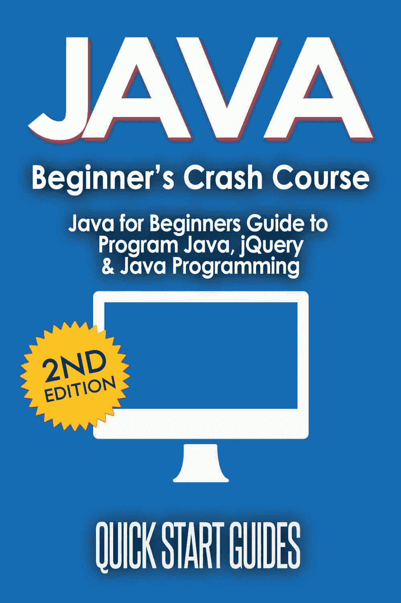

# JAVA：第二版！初学者速成课程 - Javascript 初学者指南：程序 Java、jQuery 及 Java 编程 (Java 初学者、学习 Java、... 编程语言、编码书籍 1)



# 引言

1995 年，Sun Microsystems（太阳系统公司）开发了一种名为 Java 的高级编程语言。James Gosling 发起了 Java 项目，并将其作为 Sun 公司 Java 平台的核心组件发布。这是 Java 的第一个版本，称为 Java 1.0。

Java 代码可以在任何带有 Java 虚拟机的设备上运行。Java 为用户提供了“一次编写，到处运行”（Write Once, Run Anywhere）的概念。

Java 编程语言非常灵活，其面向对象的概念易于使用。与许多其他过时的编程语言不同，Java 是一种不断进化的语言，每个新版本都会添加额外的功能。

在本教程中，我们将讨论 Java 的核心概念和特征，任何具有编程语言基础知识的人都可以学习 Java。我们将通过示例逐步讨论这些主题，使其易于理解和吸收。

我希望这本书对你有所帮助。

阅读愉快！！

# 第 1 章：Java 概述

让 Java 与其他编程语言脱颖出的主要特征有：

- **面向对象**：Java 中的一切都被视为一个对象。由于其对象模型，它很容易进行扩展。
- **平台无关**：当 Java 代码被编译时，它将是平台无关的字节码（Byte code），这是其他编程语言不具备的。这些字节码将由运行平台上的 Java 虚拟机解释。
- **简单**：Java 的设计易于运行。如果你了解面向对象编程的基本概念，就可以轻松掌握 Java。
- **安全**：得益于 Java 的特性，可以开发防篡改和无病毒的系统。Java 使用密钥加密技术。
- **架构中立且可移植**：Java 编译器生成的文件是架构中立的对象格式。这些文件可以在任何运行 Java 虚拟机的处理器上执行。这使得 Java 成为一种可移植的语言。
- **健壮**：通过运行时检查和编译时检查，可以消除错误情况，使 Java 成为一种健壮的语言。
- **多线程**：Java 支持多线程。通过多个线程，程序可以同时运行不同的任务。这有助于开发者构建交互式。
- **解释型**：Java 字节码可以转换为机器语言。这不需要存储在任何地方。Java 的链接过程是轻量级且增量的，使得开发过程更加高效和快速。
- **高性能**：Java 通过其即时编译器确保用户的高性能。
- **分布式**：Java 的设计适用于互联网分布式环境。
- **动态**：Java 程序能够在运行时携带大量信息，反过来用于验证和解析对象的访问。这是一种动态编程语言。

# 第 2 章：Java 基础语法

在本章中，我们将学习方法、类、对象等的各种语法。我们知道 Java 是一种面向对象的编程语言，Java 程序无非对象的集合。这些对象通过调用其他对象的方法进行通信。现在，我们将查看对象、类、实例和方法的含义。

## 对象

对象具有状态和行为。例如：汽车具有状态——颜色、名称、型号，以及行为——加速、制动、巡航。对象可以定义为类的实例。

## 类

计算机中的类可以定义为蓝图或模板，描述了对象支持的状态或行为。

## 方法

方法基本上可以定义为一种行为。逻辑写在方法内部。一个类可以包含任意数量的方法。所有的操作和数据处理都在方法内部执行。

## 实例变量

每个对象都拥有自己的一组唯一变量。这些变量被称为实例变量。这些`instance variables`会被赋予值，并用于定义对象的状态。

## 基础语法

在 Java 中进行编程时，应始终遵循以下几点。

- 大小写敏感 - Java 语言对大小写敏感。因此，在编写 Java 程序时必须小心。`Phoenix`和`phoenix`并不是同一个词，它们在 Java 中的含义也不同。
- 类名 - 在编写类名时，第一个字母应该始终为大写字母。例如`Car`、`Bike`、`Laptop`等。如果使用多个单词组合成类名，其中每个单词的首字母都应该大写。例如类名`JavaExampleClass`。
- 方法名 - 在调用方法时，方法的名称应该以小写字母开头。如果使用多个单词来命名该方法，方法的第一个字母将是小写字母，而内部单词的第一个字母应该大写。例如：`public void exampleJavaMethodName()`
- 程序文件名 - 类名和程序文件名必须完全相同。
- 始终记住使用类名保存文件，并在名称末尾添加`.java`。例如，如果类名是`BananaNutellaPancake`，则文件名应该是`BananaNutellaPancake.java`。
- `public static void main (String args[])` - 编译器将从`main()`方法开始处理程序。因此，没有`main()`方法就无法在 Java 中编写程序。

# 第 3 章：对象与类

在各种类型的语言中，Java 被归类为面向对象的语言。所有面向对象的语言都支持以下基本概念：

- 多态：一个对象可以采取多种形式的情况。例如，`+`既可以用于加法，也可以用于字符串的拼接。
- 继承：子对象获得其父类属性的情况。
- 封装：数据受到保护的情况。
- 抽象：类的声明已完全完成，但可以使用抽象类中存在的变量和方法以不同的方式编写功能的情况。
- 类：对象是使用类创建的。类由成员变量和成员函数组成。它可以被视为一个蓝图。
- 对象：在面向对象编程中，对象起着至关重要的作用。对象执行所有功能。它们拥有状态（变量所在的地方）和行为（变量在放入特定方法时以特定方式运行）。
- 实例：实例可以被视为声明在类内部但在类方法之外的变量。
- 方法：方法可以被视为用于执行特定任务的语句集合。

## 更多关于 Java 中的对象

你周围看到的任何具有物理特征的物理实体都可以被视为对象。所有这些都有可以观察到的状态和行为。

这些对象都有状态和行为。这些是现实世界的对象，现在让我们考虑软件对象，它们具有由变量显示的相似状态以及通过方法显示的行为。

Java 类的示例：

```java
public class Dog{
    String breed;
    int age;
    String color;
    void barking(){
    }
    void hungry(){
    }
    void sleeping(){
    }
}
```

有多种类型的变量，如局部变量、全局变量、类变量、实例变量。根据变量的作用范围，变量可以分为局部变量和全局变量。

- 局部变量定义在函数内部，只能在函数内部使用。换句话说，局部变量在函数完成后就会销毁。
- 全局变量定义在外部，其作用范围贯穿整个程序。
- 实例变量：实例变量声明在类内部但在方法之外。它们只能被该特定类的所有方法使用。
- 实例变量：实例变量是类内部但在任何方法之外的变量。这些变量在类加载时被实例化。
- 类变量是与实例变量类似的变量。唯一的区别是它们是用`static`关键字声明的。

一个类可以有多个变量和方法。

# 第 4 章：构造函数

构造函数在涉及类时起着至关重要的作用。在创建类时可以显式创建构造函数，否则 Java 编译器会自动创建一个构造函数。每创建一个对象时，至少会调用一次构造函数。一个类可以有多个构造函数。构造函数的名称必须与类相同。每个构造函数都必须有一个析构函数。

构造函数的示例：

```java
public class Puppy{
    public Puppy(){
    }
    public Puppy(String name) {
        // 这个构造函数有一个参数，name。
    }
}
```

## 创建对象

如前所述，类为对象提供了蓝图。所以基本上对象是从类中创建的。在 Java 中，使用`new`关键字来创建新对象。

从类创建对象有三个步骤：

1. 声明：带有对象类型和变量名称的变量声明。
2. 实例化：使用`new`关键字创建对象。
3. 初始化：`new`关键字后紧跟对构造函数的调用。此调用初始化了新对象。

创建对象的示例所示：

```java
public class Puppy{
    public Puppy(String name) {
        // 这个构造函数有一个参数，name。
        System.out.println("Passed Name is :" + name );
    }
    public static void main(String args){
        // 下述语句创建一个对象 myPuppy
        Puppy myPuppy = new Puppy( "jimmy" );
    }
}
```

编译并运行上面的程序，将产生以下结果：

```
Passed Name is :jimmy
```

## 访问实例变量和方法

实例变量和方法通过创建的对象来访问。访问实例变量的完全限定路径如下：

```java
/* 首先创建一个对象 */
ObjectReference = new Constructor();

/* 现在调用变量 */
ObjectReference.variableName;

/* 现在你可以调用类方法 */
ObjectReference.MethodName();
```

示例：

此示例解释了如何访问类的实例变量和方法：

```java
public class Puppy{
    int puppyAge;
    public Puppy(String name) {
        // 这个构造函数有一个参数，name。
        System.out.println("Passed Name is :" + name );
    }
    public void setAge( int age ) {
        puppyAge = age;
    }
    public int getAge( ) {
        System.out.println("Puppy's age is :" + puppyAge );
        return puppyAge;
    }
    public static void main(String []args){
        /* 对象创建 */
        Puppy myPuppy = new Puppy( "jimmy" );
        /* 调用类方法设置狗的年龄 */
        myPuppy.setAge( 2 );
        /* 调用另一个类方法获取狗的年龄 */
        myPuppy.getAge( );
        /* 你也可以这样访问实例变量 */
        System.out.println("Variable Value :" + myPuppy.puppyAge );
    }
}
```

在此示例中，此行将告诉编译器加载存在`java_installation/java/io`目录中的类。

```java
import java.io.*;
```

## 一个简单的案例研究

在这里，我们将创建两个类`Employee`和`EmployeeTest`进行案例研究。

- 打开记事本并编写下方的代码。你应该记住这是`Employee`类，并且它是一个公共类（public class）。
- 将此文件保存为`Employee.java`。

`Employee`类中存在四个实例变量，分别为`name`、`age`、`designation`和`salary`。该类还有一个显式定义的构造方法。该构造方法接受一个参数。

### 示例：

```java
import java.io.*;

public class Employee{

  String name;
  int age;
  String designation;
  double salary;

  // 这是 Employee 类的构造方法

  public Employee(String name){
    this.name = name;
  }

  // 将 Employee 的年龄龄赋值给变量 age。

  public void empAge(int empAge){
    age =  empAge;
  }

  /* 将职位赋值给变量 designation.*/
  public void empDesignation(String empDesig){
    designation = empDesig;
  }

  /* 将工资赋值给变量             salary.*/
  public void empSalary(double empSalary){
    salary = empSalary;
  }

  /* 打印 Employee 详情 */
  public void printEmployee(){
    System.out.println("Name:"+ name );
    System.out.println("Age:" + age );
    System.out.println("Designation:" + designation );
    System.out.println("Salary:" + salary);
  }

}
```

如之前提到的，程序的运行只有在`main()`方法之后才开始。因此，为了让这个`Employee`类运行，应该有一个`main`方法以及几个对象。对于这些任务，将单独创建一个类。

下面是`EmployeeTest`类，它创建了两个属于`Employee`类的实例。这些对象调用每个对象的方法，并为所有变量分配值。

将给定的代码保存到`EmployeeTest.java`文件中。

```java
import java.io.*;

public class EmployeeTest{

  public static void main(String args[]){
    /* 使用构造方法创建两个对象 */
    Employee empOne = new Employee("James Smith");
    Employee empTwo = new Employee("Mary Anne");

    // 为每个创建的对象调用方法
    empOne.empAge(26);
    empOne.empDesignation("Senior Software Engineer");
    empOne.empSalary(1000);
    empOne.printEmployee();

    empTwo.empAge(21);
    empTwo.empDesignation("Software Engineer");
    empTwo.empSalary(500);
    empTwo.printEmployee();
  }
}
```

编译这两个类并运行`EmployeeTest`，它将给出以下输出。

```bash
C :> javac Employee.java
C :> vi EmployeeTest.java
C :> javac  EmployeeTest.java
C :> java EmployeeTest
Name:James Smith
Age:26
Designation:Senior Software Engineer
Salary:1000.0
Name:Mary Anne
Age:21
Designation:Software Engineer
Salary:500.0
```

# 第 6 章：Java 数据类型

变量可以定义为用于存储值的内存位置的结果。当你创建一个变量时，你实际上是在系统上预留了内存空间。

操作系统将根据变量的数据类型分配内存。然后操作系统将决定在预留的内存中可以存储什么。不同的数据类型可以分配给变量，允许你在这些预留的空间或变量中存储字符、整数。

在 Java 中，有两种可用的数据类型。它们是：

- 基本数据类型
- 引用/对象数据类型

## 基本数据类型：

Java 支持八种基本数据类型。这些基本数据类型由关键字命名，并且是预定义的。现在我们来看 Java 中的这 8 种基本数据类型。

### byte:

- `Byte`数据类型是 8 位有符号补码整数。
- `byte`的最小值为`-128`（`-2⁷`）。
- `byte`的最大值为`127`（包含）（`2⁷ -1`）。
- `byte`的默认值为`0`。
- 使用`byte`数据类型可以为大数组节省空间，因为它是`int`的四分之一。
- 示例：`byte x= 20, y= -4`

### short:

- `Short`数据类型是 16 位有符号补码整数。
- `short`可以存储的最小值为`-32768`。
- `short`可以存储的最大值为`32767`（包含）（`2¹⁵ -1`）。*注：原文公式有误，应为 2¹⁵-1*。
- `short`的默认值为`0`。
- `short`的大小是`int`的一半。
- `short`默认`0`。

### int:

- `int`是 32 位有符号补码整数。
- `int`可以存储的最小值为`-2147483648`。
- `int`可以存储的最大值为`2147483647`（包含）（`2³¹ -1`）。
- `int`的默认值为`0`。
- `int`是`short`的两倍。
- `int`默认`0`。
- 示例：`int x= 10, y= -20`

### long:

- `long`是 64 位有符号补码整数。
- `long`可以存储的最小值为`-9223372036854775808`。


在此示例中，此行将告诉编译器加载存在`java_installation/java/io`目录中的类。

```java
import java.io.*;
```

## 一个简单的案例研究

在这里，我们将创建两个类`Employee`和`EmployeeTest`进行案例研究。

* 打开记事本并编写下方的代码。你应该记住这是`Employee`类，并且它是一个公共类（public class）。
* 将此文件保存为`Employee.java`。

`Employee`类中存在四个实例变量，分别为`name`、`age`、`designation`和`salary`。该类还有一个显式定义的构造方法。该构造方法接受一个参数。

### 示例：

```java
import java.io.*;

public class Employee{

  String name;
  int age;
  String designation;
  double salary;

  // 这是 Employee 类的构造方法

  public Employee(String name){
    this.name = name;
  }

  // 将 Employee 的年龄赋值给变量 age。

  public void empAge(int empAge){
    age =  empAge;
  }

  /* 将职位赋值给变量 designation.*/
  public void empDesignation(String empDesig){
    designation = empDesig;
  }

  /* 将工资赋值给变量             salary.*/
  public void empSalary(double empSalary){
    salary = empSalary;
  }

  /* 打印 Employee 详情 */
  public void printEmployee(){
    System.out.println("Name:"+ name );
    System.out.println("Age:" + age );
    System.out.println("Designation:" + designation );
    System.out.println("Salary:" + salary);
  }

}
```

如之前提到的，程序的运行只有在`main()`方法之后才开始。因此，为了让这个`Employee`类运行，应该有一个`main`方法以及几个对象。对于这些任务，将单独创建一个类。

下面是`EmployeeTest`类，它创建了两个属于`Employee`类的实例。这些对象调用每个对象的方法，并为所有变量分配值。

将给定的代码保存到`EmployeeTest.java`文件中。

```java
import java.io.*;

public class EmployeeTest{

  public static void main(String args[]){
    /* 使用构造方法创建两个对象 */
    Employee empOne = new Employee("James Smith");
    Employee empTwo = new Employee("Mary Anne");

    // 为每个创建的对象调用方法
    empOne.empAge(26);
    empOne.empDesignation("Senior Software Engineer");
    empOne.empSalary(1000);
    empOne.printEmployee();

    empTwo.empAge(21);
    empTwo.empDesignation("Software Engineer");
    empTwo.empSalary(500);
    empTwo.printEmployee();
  }
}
```

编译这两个类并运行`EmployeeTest`，它将给出以下输出。

```bash
C :> javac Employee.java
C :> vi EmployeeTest.java
C :> javac  EmployeeTest.java
C :> java EmployeeTest
Name:James Smith
Age:26
Designation:Senior Software Engineer
Salary:1000.0
Name:Mary Anne
Age:21
Designation:Software Engineer
Salary:500.0
```

# 第 6 章：Java 数据类型

变量可以定义为用于存储值的内存位置的结果。当你创建一个变量时，你实际上是在系统上预留了内存空间。

操作系统将根据变量的数据类型分配内存。然后操作系统将决定在预留的内存中可以存储什么。不同的数据类型可以分配给变量，允许你在这些预留的空间或变量中存储字符、整数。

在 Java 中，有两种可用的数据类型。它们是：

* 基本数据类型
* 引用/对象数据类型

## 基本数据类型：

Java 支持八种基本数据类型。这些基本数据类型由关键字命名，并且是预定义的。现在我们来看 Java 中的这 8 种基本数据类型。

### byte:

* `Byte`数据类型是 8 位有符号补码整数。
* `byte`的最小值为`-128`（`-2⁷`）。
* `byte`的最大值为`127`（包含）（`2⁷ -1`）。
* `byte`的默认值为`0`。
* 使用`byte`数据类型可以为大数组节省空间，因为它是`int`的四分之一。
* 示例：`byte x= 20, y= -4`

### short:

* `Short`数据类型是 16 位有符号补码整数。
* `short`可以存储的最小值为`-32768`。
* `short`可以存储的最大值为`32767`（包含）（`2¹⁵ -1`）。
* `short`的默认值为`0`。
* `short`的大小是`int`的一半。
* `short`默认`0`。

### int:

* `int`是 32 位有符号补码整数。
* `int`可以存储的最小值为`-2147483648`。
* `int`可以存储的最大值为`2147483647`（包含）（`2³¹ -1`）。
* `int`的默认值为`0`。
* `int`是`short`的两倍。
* `int`默认`0`。

### long:

* `long`是 64 位有符号补码整数。
* `long`可以存储的最小值为`-9223372036854775808`。
* `long`可以存储的最大值为`9223372036854775807`（包含）（`2⁶³ -1`）。
* `long`的默认值为`0`。
* `long`是`int`的两倍。
* `long`默认`0`。
* 示例：`long x= 100, y= -200`

### float:

* `float`数据类型是 32 位单精度 IEEE 754 浮点数。
* `float`的最小值为约为`-1.40128E-45`。
* `float`的最大值为约为`3.40282E+38`。
* `float`的默认值为`0.0f`。
* `float`是`double`的一半。
* 示例：`float x= 10.5f, y= -20.2f`

### double:

* `double`数据类型是 64 位双精度 IEEE 754 浮点数。
* `double`的最小值为约为`-4.9407E-324`。
* `double`的最大值为约为`1.79769E+308`。
* `double`的默认值为`0.0`。
* `double`是`float`的两倍。
* 示例：`double x= 10.5, y= -20.2`

### boolean:

* `boolean`数据类型表示一个位信息。
* `boolean`数据类型只有两个值：真或假。
* 该数据类型用于真假条件。
* `boolean`的默认值为`false`。
* 示例：`boolean one = false;`

### char:

* `char`数据类型是单个 16 位 Unicode 字符。
* `char`的最小值为`\u0000`（或 0）。
* `char`的最大值为`\uffff`（或 65535）。
* `char`的默认值为`'\u0000'`。
* 示例：`char letterA='A'`


# Java 数据类型

## `byte`

*   `byte` 的默认值为 `0`。
*   使用 `byte` 数据类型可以为大数组节省空间，因为它是 `int` 的四分之一。
*   示例：`byte x= 20, y= -4`

## `short`

*   `short` 数据类型是 16 位有符号补码整数。
*   `short` 可以存储的最小值为 `-32768`。
*   `short` 可以存储的最大值为 `32767`（包含）（`2¹⁵ -1`）。
*   `short` 的默认值为 `0`。
*   `short` 的大小是 `int` 的一半。
*   `short` 默认 `0`。

## `int`

*   `int` 是 32 位有符号补码整数。
*   `int` 可以存储的最小值为 `-2147483648`。
*   `int` 可以存储的最大值为 `2147483647`（包含）（`2³¹ -1`）。
*   `int` 的默认值为 `0`。
*   `int` 是 `short` 的两倍。
*   `int` 默认 `0`。

## `long`

*   `long` 是 64 位有符号补码整数。
*   `long` 可以存储的最小值为 `-9223372036854775808`。
*   `long` 可以存储的最大值为 `9223372036854775807`（包含）（`2⁶³ -1`）。
*   `long` 的默认值为 `0`。
*   `long` 是 `int` 的两倍。
*   `long` 默认 `0`。
*   示例：`long x= 100, y= -200`

## `float`

*   `float` 数据类型是 32 位单精度 IEEE 754 浮点数。
*   `float` 的最小值为约为 `-1.40128E-45`。
*   `float` 的最大值为约为 `3.40282E+38`。
*   `float` 的默认值为 `0.0f`。
*   `float` 是 `double` 的一半。
*   示例：`float x= 10.5f, y= -20.2f`

## `double`

*   `double` 数据类型是 64 位双精度 IEEE 754 浮点数。
*   `double` 的最小值为约为 `-4.9407E-324`。
*   `double` 的最大值为约为 `1.79769E+308`。
*   `double` 的默认值为 `0.0`。
*   `double` 是 `float` 的两倍。
*   示例：`double x= 10.5, y= -20.2`

## `boolean`

*   `boolean` 数据类型表示一个位信息。
*   `boolean` 数据类型只有两个值：真或假。
*   该数据类型用于真假条件。
*   `boolean` 的默认值为 `false`。
*   示例：`boolean one = false;`

## `char`

*   `char` 数据类型是单个 16 位 Unicode 字符。
*   `char` 的最小值为 `\u0000`（或 0）。
*   `char` 的最大值为 `\uffff`（或 65535）。
*   `char` 的默认值为 `'\u0000'`。
*   示例：`char letterA='A'`

`byte`、`short`、`int` 和 `long` 数据类型也可以十进制（基 10）、十六进制（基 16）或八进制（基 8）数制表示。

当这些数制用于字面量时，我们使用 `0` 作为八进制的前缀，使用 `0x` 表示十六进制值。以下是一个示例。

```java
int decimal = 100;
int octal = 0144;
int hexa = 0x64;
```

Java 中的字符串字面量定义方式与其他编程语言相似。这是通过在一对双引号内包含一组字符来实现的。以下是一些字符串字面量的示例。

```java
"Hello World"
"two\nlines"
"\"This is in quotes\""
```

只有 Unicode 字符可以赋予字符串和 `char` 数据类型。例如：

```java
char a = '\u0001';
String a = "\u0001";
```

Java 还为 `char` 和字符串字面量支持一些特殊的转义序列。它们如下：

| 符号 | 表示的字符 |
| :--- | :--- |
| `\n` | 新行 (0x0a) |
| `\r` | 回车 (0x0d) |
| `\f` | 换页 (0x0c) |
| `\b` | 退格 (0x08) |
| `\s` | 空格 (0x20) |
| `\t` | 制表符 |
| `\"` | 双引号 |
| `\'` | 单引号 |
| `\\` | 反斜杠 |
| `\ddd` | 八进制字符 (ddd) |
| `\uxxxx` | 十六进制 Unicode 字符 (xxxx) |

# 第 7 章：变量

当声明一个变量时，它为用户提供了一个命名的存储空间，程序可以对其进行操作。在 Java 中，每个变量都有特定的类型，类型反过来决定了该变量内存的布局和大小、可以在该变量上执行的操作，以及其中可以存储的最大和最小值。

始终记住，在使用变量之前应该对其声明。基本的变量声明形式如下：

`数据类型 变量 [ = 值][, 变量 [= 值] ...] ;`

在上面的示例中，`data type` 是 Java 的数据类型，变量名是 `variable`。如果你想声明多个相同数据类型的变量，可以使用逗号（`,`）来分隔列表。

以下是关于变量声明和变量初始化的示例。

```java
int a, b, c;        // 声明了三个 int：a, b 和 c。
int a = 10, b = 10;  // 初始化示例
byte B = 22;        // 初始化一个字节类型的变量 B。
double pi = 3.14159; // 声明并分配 PI 的值。
char a = 'a';        // char 变量 a 初始化为 'a'
```

在本主题中，我们将查看 Java 中可用的各种变量。在 Java 中，有三种类型的变量。

* 局部变量
* 实例变量
* 类/静态变量

## 局部变量

* 局部变量是在块、方法或构造函数内部声明的变量。
* 局部变量仅在其所在的块、方法或构造函数存在时才有效。一旦离开块、方法或构造函数，局部变量将被销毁。
* 我们不能在局部变量上使用访问修饰符。
* 局部变量只能在声明它的块或方法或构造函数内部可见。
* 在内部，局部变量的实现是在栈级别完成的。
* 由于局部变量没有默认值，因此在使用它们之前应该通过声明来为其赋值。

以下是一个使用局部变量的示例。

示例：

在这里，`age` 是局部变量。它在 `pupAge()` 方法内部定义，其作用域仅限于该方法。

```java
public class Test{
  public void pupAge(){
    int age = 0;
    age = age + 7;
    System.out.println("Puppy age is : " + age);
  }
  public static void main(String args[]){
    Test test = new Test();
    test.pupAge();
  }
}
```

上述代码将产生以下输出：

`Puppy age is: 7`

示例：

在下面的示例中，我们在没有进行初始化的情况下使用了 `age` 变量。因此在编译期间会导致错误。

```java
public class Test{
  public void pupAge(){
    int age;
    age = age + 7;
    System.out.println("Puppy age is : " + age);
  }
  public static void main(String args[]){
    Test test = new Test();
    test.pupAge();
  }
}
```

上述代码将产生错误：

`Test.java: variable age might not been initialized`

## 实例变量

* 实例变量是在类内部但在任何方法之外声明的变量。
* 可以从实例变量创建任意数量的对象，但每个对象只有一个实例变量。
* 实例变量在分配对象内存时创建。
* 实例变量的可见性与静态变量相似。然而，静态变量定义在整个类中。
* 数字类型的默认值为 0，布尔类型为 false，对象引用的默认值为 NULL。
* 值只能在声明期间或构造函数内部赋值给实例变量。

这是一个示例。

示例：

```java
import java.io.*;

public class Employee{
  public String name;
  private double salary;

  public Employee (String empName){
    name = empName;
  }

  public void setSalary(double empSal){
    salary = empSal;
  }

  public void printEmp(){
    System.out.println("name : " + name );
    System.out.println("salary :" + salary);
  }

  public static void main(String args[]){
    Employee empOne = new Employee("Ransika");
    empOne.setSalary(1000);
    empOne.printEmp();
  }
}
```

程序将产生以下输出：

`name : Ransika`

`salary :1000.0`

## 类/静态变量

* 类变量也称为静态变量。这些变量在类内部使用 `static` 关键字声明，但在任何块、构造函数或方法之外。
* 可以从类变量创建任意数量的对象，但每个类只有一个类变量。
* 类变量在程序启动期间创建，并在程序结束时销毁。
* 类变量的可见性与实例变量相似。然而，静态变量通常声明为 public，以便该类的其他用户可以使用它们。
* 数字类型的默认值为 0，布尔类型为 false，对象引用的默认值为 NULL。
* 值只能在声明期间或构造函数内部赋值给静态变量。如果你想添加更多值，可以使用特殊的静态初始化块进行赋值。
* 通过类名调用静态变量来访问它们。语法：`ClassName.VariableName`。

这是一个使用静态变量的示例。

```java
import java.io.*;

public class Employee{

  // salary 变量是一个私有静态变量
  private static double salary;

  // DEPARTMENT 是一个常量
  public static final String DEPARTMENT = "Development ";

  public static void main(String args[]){
    salary = 1000;
    System.out.println(DEPARTMENT+"average salary:"+salary);
  }
}
```

该程序将产生以下输出。

`Development average salary:1000`

## 修饰符 (Modifiers)

在某些情况下，你可能需要更改某些定义的含义。在这种情况下，你可以使用修饰符。修饰符本身是指用于更改定义含义的关键字。在 Java 中，有很多修饰符，包括以下两种。

* [Java 访问修饰符](http://www.tutorialspoint.com/java/java_access_modifiers.htm)
* [非访问修饰符](http://www.tutorialspoint.com/java/java_nonaccess_modifiers.htm)

要使用修饰符，你应该在变量、方法或类的定义中包含关键字。修饰符应该像下面示例所示，放在语句的开头。它们以斜体形式给出。

```java
public class className {
  // ...
}

private boolean myFlag;

static final double weeks = 9.5;

protected static final int BOXWIDTH = 42;

public static void main(String[] arguments) {
  // 方法体
}
```

### 访问控制修饰符 (Access Control Modifiers)

为了给构造函数、变量、类和方法设置访问级别，Java 为用户提供了一组访问修饰符。Java 中四种访问级别。它们是：

* 对包可见，默认级别。不需要修饰符。
* 仅对类可见（`private`）。
* 所有人可见（`public`）。
* 对包和所有子类可见（`protected`）。

### 非访问修饰符 (Non Access Modifiers)

在 Java 中有很多非访问修饰符。

* `static` 修饰符用于创建类变量和方法。
* 为了确定变量、类和方法的最终实现，我们使用 `final` 修饰符。
* 你可以通过 `abstract` 修饰符创建抽象类和抽象方法。
* 为了处理线程，我们使用 `volatile` 和 `synchronized` 修饰符。

# 第 8 章：运算符 (Operators)

在编程过程中，你可能不断需要操作变量，为此，Java 为用户提供了一组运算符。所有运算符可以分为以下几组。

* 算术运算符
* 关系运算符
* 位运算符
* 逻辑运算符
* 赋值运算符

## 算术运算符 (The Arithmetic Operators)

算术运算符用于处理数学表达式。所有的算术运算符都列在下表中。

在这里，我们假设变量 `A` 的值为 5，变量 `B` 的值为 10。那么以下表达式的结果如下：

| Operator | 描述 | 示例 |
| :--- | :--- | :--- |
| `+` | 加法 - 将运算符两侧的值相加 | `A + B` 将得到 15 |
| `-` | 减法 - 从左侧操作数中减去右侧操作数 | `A - B` 将得到 -5 |
| `*` | 乘法 - 将运算符两侧的值相乘 | `A * B` 将得到 50 |
| `/` | 除法 - 将左侧操作数除以右侧操作数 | `B / A` 将得到 2 |
| `%` | 取模 - 将左侧操作数除以右侧操作数并返回余数 | `B % A` 将得到 0 |
| `++` | 自增 - 将操作数的值加 1 | `B++` 得到 11 |
| `--` | 自减 - 将操作数的值减 1 | `B--` 得到 9 |

## 关系运算符 (The Relational Operators)

Java 支持以下关系运算符。

假设变量 `A` 的值为 1，变量 `B` 的值为 2，那么：

| Operator | 描述 | 示例 |
| :--- | :--- | :--- |
| `==` | 此运算符将比较两个操作数并检查它们是否相等。如果它们相等，则返回真值。 | |
| `!=` | 此运算符将比较两个操作数并检查它们是否相等。如果它们不相等，则返回真值。 | |
| `>` | 此运算符将比较两个操作数并检查它们是否相等。如果前者大于后者，则返回真值。 | |
| `<` | 此运算符将比较两个操作数并检查它们是否相等。如果前者小于后者，则返回真值。 | |
| `>=` | 此运算符将比较两个操作数并检查它们是否相等。如果前者大于或等于后者，则返回真值。 | |
| `<=` | 此运算符将比较两个操作数并检查它们是否相等。如果前者小于或等于后者，则返回真值。 | |

## 位运算符 (The Bitwise Operators)

在 Java 中有很多非访问修饰符。位运算符在 `byte`、`short`、`int`、`long` 和 `char` 上运行。

| Operator | 描述 | 示例 |
| :--- | :--- | :--- |
| `&` | 二与运算符，如果位在两者中存在，则复制该位。 | |
| `\|` | 二或运算符，如果位在其中任一个存在，则复制该位。 | |
| `^` | 二异或运算符，如果位在其中一个中存在，则复制该位。 | |
| `~` | 二取反运算符，单目运算符，效果是翻转位。 | |
| `<<` | 二左移运算符。左侧操作数的值向左移动位数。 | |
| `>>` | 二右移运算符。左侧操作数的值向右移动位数。 | |
| `>>>` | 无符号右移运算符。左侧操作数的值向右移动位数，并填充零。 | |

## 逻辑运算符 (The Logical Operators)

这里是 Java 中所有逻辑运算符的列表。假设 `A` 和 `B` 是 `Boolean` 变量。`A` 持有 `true`，`B` 持有 `false`。那么：

| Operator | 描述 | 示例 |
| :--- | :--- | :--- |
| `&&` | 此称为与运算符，如果两个操作数都持有非零值，则返回真。 | `A && B` 为假。 |
| `\|\|` | 此称为或运算符，如果两个操作数中任一持有非零值，则返回真。 | `A \|\| B` 为真。 |
| `!` | 此称为逻辑非运算符，用于反转其所用操作数的当前逻辑状态。 | `!(A && B)` 为真。 |

## 赋值运算符 (The Assignment Operators)

Java 支持的所有赋值运算符列表如下表所示。


| 运算符 | 描述 | 示例 |
| :--- | :--- | :--- |
| `=` | 这是一个简单的赋值运算符，将右操作数的值赋值给左侧操作数。 | `C = A + B` 将 `A + B` 的值赋值给 `C` |
| `+=` | 这是加赋值运算符。此运算符将两个操作数相加并将结果赋值给左侧操作数。 | `C += A` 等同于 `C = C + A` |
| `-=` | 这是减赋值运算符。此运算符从左侧操作数中减去右侧值并将结果赋值给左侧操作数。 | `C -= A` 等同于 `C = C - A` |
| `*=` | 这是乘法赋值运算符。它将两个操作数相乘，并将结果赋值给左操作数。 | `C *= A` 等同于 `C = C * A` |
| `/=` | 这是除赋值运算符。该运算符将左操作数除以右操作数。得到的结果将赋值给左操作数。 | `C /= A` 等同于 `C = C / A` |
| `%=` | 这是取模赋值运算符。该运算符取两个操作数的模并将结果赋值给左操作数。 | `C %= A` 等同于 `C = C % A` |
| `<<=` | 左移赋值运算符 | `C <<= 2` 等于 `C = C << 2` |
| `>>=` | 右移赋值运算符 | `C >>= 2` 等于 `C = C >> 2` |
| `&=` | 位与赋值运算符 | `C &= 2` 等于 `C = C & 2` |
| `^=` | 位异或赋值运算符 | `C ^= 2` 等于 `C = C ^ 2` |
| `|=` | 位或赋值运算符 | `C |= 2` 等于 `C = C | 2` |

### Java 运算符的优先级

给定表达式中项的分组将由运算符优先级决定。某些运算符的优先级高于其他运算符。例如，与加法运算符相比，乘法运算符的优先级总是更高的。优先级高的运算符将先执行。

下面列出了按照优先级排序的所有运算符列表。优先级较高的运算符位于顶部，并按递减顺序向下排列。

| 类别 | 运算符 | 结合性 |
| :--- | :--- | :--- |
| 后置 | `() []` `.` (点运算符) | 从左到右 |
| 一元 | `++ - - ! ~` | 从右到左 |
| 乘法 | `* / %` | 从左到右 |
| 加法 | `+ -` | 从左到右 |
| 移位 | `>> >>> <<` | 从左到右 |
| 关系 | `> >= < <=` | 从左到右 |
| 等于 | `== !=` | 从左到右 |
| 位与 | `&` | 从左到右 |
| 位异或 | `^` | 从左到右 |
| 位或 | `|` | 从左到右 |
| 逻辑与 | `&&` | 从左到右 |
| 逻辑或 | `||` | 从左到右 |
| 条件 | `?:` | 从右到左 |
| 赋值 | `= += -= *= /= %= >>= <<= &= ^= |=` | 从右到左 |
| 逗号 | `,` | 从左到右 |

# 第 9 章：条件语句

Java 为用户提供了两种类型的决策语句。它们是：

- `if` 语句
- `switch` 语句

### if 语句

Java 中的 `if` 语句由一个布尔语句组成。布尔语句将包含一个或多个语句。如果满足条件，这些语句将执行。

这里是 `if` 语句的语法。

语法：

```
if(Boolean_expression)
{
  // 如果布尔表达式为真，则执行这些语句
}
```

`if` 语句内部的代码块只有在布尔表达式返回真时才会执行。如果返回假，控制流将跳转到 `if` 语句之后的代码。这里有一个示例：

示例：

```java
public class Test {
  public static void main(String args[]){
    int x = 10;
    if( x < 20 ){
      System.out.print("This is if statement");
    }
  }
}
```

程序将给出以下输出。

```
This is if statement
```

### if...else 语句

在 `if` 语句之后，你可以添加一个可选的 `else` 语句。如果 `if` 语句不满足，则执行 `else` 语句中的代码。所以简单来说，如果 `if` 语句返回假，将执行 `else` 语句中的代码。

语法：

这里是 `if...else` 语句的语法。

```java
if(Boolean_expression){
  // 当布尔表达式为真时执行
}else{
  // 当布尔表达式为假时执行
}
```

示例：

```java
public class Test {
  public static void main(String args[]){
    int x = 30;
    if( x < 20 ){
      System.out.print("This is if statement");
    }else{
      System.out.print("This is else statement");
    }
  }
}
```

这段代码将给出以下输出。

```
This is else statement
```

### if...else if...else 语句

在 `if` 语句之后，可以添加可选的 `else if...else` 语句。这种语句在需要测试各种条件的情况下被证明非常有用。

在使用 `if`、`else if` 和 `else` 语句时，有几点需要记住：

- `if` 条件可以有任意数量的 `else` 条件，且 `else` 条件应该始终放在最后。
- `if` 语句后面可以跟接任意数量的 `else if` 语句。
- 一旦 `else if` 语句满足条件，则在 `else` 语句之前。

语法：

`if...else` 的语法如下：

```java
if(condition_1){
  // 当条件 1 为真时执行
}else if(condition_2){
  // 当条件 2 为真时执行
}else if(condition_3){
  // 当条件 3 为真时执行
}else{
  // 当以上都不满足时执行
}
```

示例：

```java
public class Test {
  public static void main(String args[]){
    int x = 30;
    if( x < 20 ){
      System.out.print("This is if statement");
    }else if( x == 20 ){
      System.out.print("This is else statement");
    }else if( x == 30 ){
      System.out.print("Value of 30");
    }else{
      System.out.print("This is else");
    }
  }
}
```

上面的代码将产生：

```
Value of 30
```

### 嵌套 if...else 语句

嵌套 `if...else` 是另一个 `if` 语句内部。如果一个语句包含了另一个 `if` 语句，则它是嵌套的。

语法：

```java
if(condition_1){
  if(condition_2){
    // 嵌套代码
  }
}
```

示例：

```java
public class Test {
  public static void main(String args[]){
    int x = 30;
    int y = 10;
    if( x == 30 ){
      if( y == 10 ){
        System.out.print("X = 30 and Y = 10");
      }
    }
  }
}
```

### switch 语句

`switch` 语句用于与给值列表进行等性测试。这些值每一个被称为 `case`。变量将与每个 `case` 进行比较并测试。

这里有一个示例。

```java
switch(expression){
  case value :
    // 语句
    break; // 可选
  case value :
    // 语句
    break; // 可选
  default : // 可选
    // 语句
}
```

以下规则适用于 `switch` 语句：

- `byte`、`short`、`int` 和 `char` 是可以用于 `switch` 语句的唯一变量类型。
- `switch` 语句的 `case` 语句数量不限于一个。它可以有多个 `case` 语句，且没有限制。每个 `case` 都有一个与其进行比较的值并在末尾有一个冒号。
- `switch` 变量和 `case` 的值应该是相同的数据类型。
- `switch` 变量和 `case` 的数据类型应该是字面量或常量。
- 如果 `switch` 变量和 `case` 相等，则 `case` 之后的语句将继续执行，直到控制流找到 `break` 语句。
- 控制流到达 `break` 语句后，`switch` 终止。现在控制流将跳转到 `switch` 语句之后的后续行。
- `case` 并不强制包含 `break`。如果没有提供 `break`，控制将继续执行后续的 `case`，直到遇到 `break` 为止。
- 你可以为给定的 `switch` 语句添加一个可选的 `default` case。这个 `case` 选项应该是 `switch` 的最后一行。如果上述任一 `case` 都不满足条件，将执行此 `default` case。当使用 `default` case 时，不需要添加 `break`。

这里是一个示例。

示例：

```java
public class Test {

  public static void main(String args[]){
    //char grade = args[0].charAt(0);
    char grade = 'C';
    switch(grade)
    {
        case 'A' :
            System.out.println("Excellent!");
            break;
        case 'B' :
        case 'C' :
              System.out.println("Well done");
              break;
        case 'D' :
              System.out.println("You passed");
        case 'F' :
              System.out.println("Better try again");
              break;
        default :
              System.out.println("Invalid grade");
    }
    System.out.println("Your grade is " + grade);
  }
}
```

使用各种命令行参数编译并运行程序将得到以下输出。

```
$ java Test
Well done
Your grade is a C
$
```

# 第 10 章：异常

异常可以定义为中断正常执行流的问题。简单来说，它可以被定义为程序执行期间发生的问题。导致异常发生的原因有很多，其中一些包括：

* 传递了非法数据。
* Java 虚拟机内存耗尽。
* 通信期间网络连接终止。
* 找不到所需的文件。

某些异常是由人为错误引起的，另一些是由程序员错误引起的，其余的由于物理资源的故障。

在 Java 中，异常分为三类。为了让你理解异常处理的概念，你应该了解异常的类型。不同类别的异常如下：

* **检查型异常 (Checked exceptions)**：如果一个异常无法被程序员预见，或者它是典型的用户错误，则可以定义为检查型异常。检查异常在编译期间不能被忽略。
* **运行时异常 (Runtime exceptions)**：运行时异常可以定义为程序员可能解决的异常。与检查型异常不同，运行时异常在编译期间会被忽略。
* **错误 (Errors)**：错误可以定义为用户或程序员无法控制的问题。这些不能被视为异常。错误通常会被忽略，因为它们无法被解决。例如，在栈溢出的情况下会抛出一个错误。该错误在程序编译期间会被忽略。

下面是最常见的检查型和未检查型异常列表。所有这些异常都是 [Java 内置异常](http://www.tutorialspoint.com/java/java_builtin_exceptions.htm) 的子集。

## 异常方法

下面是从 `Throwable` 类提供的所有重要方法的列表。

| SN | 方法描述 |
| :--- | :--- |
| 1 | `public String getMessage()` 此方法将返回关于所发生异常的详细信息，并在构造函数 `Throwable` 内部初始化。 |
| 2 | `public Throwable getCause()` 此方法将返回导致异常的原因，这由一个 `Throwable` 对象表示。 |
| 3 | `public String toString()` 此方法将返回类名与 `getMessage()` 结果的拼接字符串。 |
| 4 | `public void printStackTrace()` 此方法将 `toString()` 的结果结合堆栈树打印到错误输出流 `System.err`。 |
| 5 | `public StackTraceElement [] getStackTrace()` 此方法将返回一个包含给定栈跟踪上每个元素的数组。索引 0 处的元素代表给定调用栈顶部的起始，而索引 0 处的方法... |
| 6 | `public Throwable fillStackTrace()` 使用此方法可以用当前信息填充栈跟踪。 |

## 捕获异常

在 Java 中，可以使用 `try` 和 `catch` 关键字捕获异常。如果 `try` 块中出现异常，它将传递给 `catch` 块。

语法：

```java
try {
    // code
} catch (Exception e) {
    // catch block
}
```

示例：

```java
import java.io.*;

public class Test {
  public static void main(String args[]) {
    try {
      int a[] = new int[2];
      System.out.println(a[3]);
    } catch (ArrayIndexException e) {
      System.out.println("Exception: " + e);
    }
  }
}
```

输出：

```
Exception: java.lang.ArrayIndexException: 3
```

### 多个 catch 块

`try` 块后的 `catch` 块数量不限于 1。你可以有任意数量的 `catch` 块。在实际情况下，你将不得不编写多个 `catch` 块。

语法：

```java
try {
    // code
} catch (ExceptionType1 e1) {
    // catch block
} catch (ExceptionType2 e2) {
    // catch block
} catch (ExceptionType3 e3) {
    // catch block
}
```

如果抛出的异常匹配 `ExceptionType1`，它将在那里被捕获。如果异常类型不匹配，它将传递给下一个 `catch` 块。这一过程一直持续到抛出的异常被捕获或所有 `catch` 块结束。

示例：

在代码段中，我们将查看多个 `try/catch` 块。

```java
try {
    file = new FileInputStream(fileName);
    x = (byte) file.read();
} catch (IOException i) {
    i.printStackTrace();
    return -1;
} catch (FileNotFoundException f) //无效！
{
    f.printStackTrace();
    return -1;
}
```

示例 2：


```java
package com.myjava.exceptions;

import java.net.MalformedURLException;
import java.net.URL;

public class MyCatchBlocks {
  public static void main(String a[]) {
    MyCatchBlocks mmcb = new MyCatchBlocks();
    mmcb.execute(1);
    mmcb.execute(2);
  }

  public void execute(int i) {
    try {
      if (i == 1) {
        getIntValue("7u");
      } else {
        getUrlObj("www.junksite.com");
      }
    } catch (NumberFormatException nfe) {
      System.out.println("Inside NumberFormatException... " + nfe.getMessage());
    } catch (MalformedURLException mue) {
  }
}
```

```java
System.out.println("Inside MalformedURLException... "+mue.getMessage());
} catch (Exception ex) {
    System.out.println("Inside Exception... "+ex.getMessage());
}
}

public int getIntValue(String num) {
    return Integer.parseInt(num);
}

public URL getUrlObj(String urlStr) throws MalformedURLException {
    return new URL(urlStr);
}
```

### throw/throws 关键字

如果给定的方法没有处理指定的检查异常（checked exception），则必须使用 `throws` 关键字进行声明。该关键字用于方法签名的末尾。

使用 `throw` 关键字可以处理新实例化的异常或刚刚捕获的异常。`throw` 和 `throws` 关键字之间存在区别。

在下面的示例中，方法将抛出 `RemoteException`。

```java
import java.io.*;

public class className {
    public void deposit(double amount) throws RemoteException {
        // 方法实现
        throw new RemoteException();
    }
    // 类定义的剩余部分
}
```

一个方法可以声明抛出多个异常，在这种情况下，异常在用逗号分隔的列表中声明。例如，下面的方法声明它会抛出一个 `RemoteException` 和一个 `InsufficientFundsException`：

```java
import java.io.*;

public class className {
    public void withdraw(double amount) throws RemoteException, InsufficientFundsException {
        // 方法实现
    }
    // 类定义的剩余部分
}
```

### finally 关键字

`finally` 关键字用于创建一个跟在 `try` 块之后的代码块。无论是否发生异常，`finally` 块的代码始终会被执行。

使用 `finally` 块允许你运行任何想要执行的清理类型语句，无论受保护的代码发生了什么情况。

`finally` 块出现在 `catch` 块的末尾，其语法如下：

```java
try {
    // 受保护的代码
} catch(ExceptionType1 e1) {
    // 捕获块
} catch(ExceptionType2 e2) {
    // 捕获块
} catch(ExceptionType3 e3) {
    // 捕获块
} finally {
    // finally 块始终执行。
}
```

示例：

```java
public class ExcepTest{
    public static void main(String args[]) {
        int a[] = new int[2];
        try {
            System.out.println("Access element three :" + a[3]);
        } catch(ArrayIndexOutOfBoundsException e) {
            System.out.println("Exception thrown :" + e);
        } finally {
            a[0] = 6;
            System.out.println("First element value: " +a[0]);
            System.out.println("The finally statement is executed");
        }
    }
}
```

这将会产生以下结果：

```
Exception thrown :java.lang.ArrayIndexOutOfBoundsException: 3
First element value: 6
The finally statement is executed
```

注意以下几点：

- 没有 `try` 语句就不会有 `catch` 子句。
- 当存在 `try/catch` 块时，并不强制要求有 `finally` 子句。
- 没有 `catch` 子句或 `finally` 子句，就没有 `try` 块。
- `try`、`catch`、`finally` 块之间不能存在任何代码。

这里是更多关于异常处理的示例。

**示例 1：Try-Catch 块**

```java
package com.myjava.exceptions;

public class MyExceptionHandle {
    public static void main(String a[]) {
        try {
            for(int i=5;i>=0;i--) {
                System.out.println(10/i);
            }
        } catch(Exception ex) {
            System.out.println("Exception Message: "+ex.getMessage());
            ex.printStackTrace();
        }
        System.out.println("After for loop...");
    }
}
```

输出：

```
2
2
3
5
10
Exception Message: / by zero
java.lang.ArithmeticException: / by zero
    at com.myjava.exceptions.MyExceptionHandle.main(MyExceptionHandle.java:12)
After for loop…
```

**示例 2：Throws 子句**

```java
package com.myjava.exceptions;

public class MyThrowsClause {
    public static void main(String a[]) {
        MyThrowsClause mytc = new MyThrowsClause();
        try {
            for(int i=0; i<5; i++) {
                mytc.getJunk();
                System.out.println(i);
            }
        } catch (InterruptedException iex) {
            iex.printStackTrace();
        }
    }
    public void getJunk() throws InterruptedException {
        Thread.sleep(1000);
    }
}
```

**示例 3：Throw 子句**

```java
package com.myjava.exceptions;

public class ExplicitThrow {
    public static void main(String a[]) {
        try {
            ExplicitThrow met = new ExplicitThrow();
            System.out.println("length is "+met.getStringSize(null));
        } catch (Exception ex) {
            System.out.println("Exception: "+ex.getMessage());
        }
    }
    public int getStringSize(String str) throws Exception {
        if(str == null) {
            throw new Exception("String is null");
        }
        return str;
    }
}
```

### 自定义异常

你可以在 Java 中创建自己的异常。记住以下几点：

- 所有异常必须是 `Throwable` 的子类。
- 如果你想写检查异常，继承 `Exception`。
- 如果你想写运行时异常，继承 `RuntimeException`。

示例：

```java
class InsufficientFunds extends Exception {
    private double amount;
    InsufficientFunds(double amount) {
        amount = amount;
    }
    public double getAmount() {
        return amount;
    }
}
```

为了演示使用自定义异常，下面的 `CheckingAccount` 类包含一个抛出 `InsufficientFunds` 的 `withdraw` 方法。

```java
import java.io.*;

public class CheckingAccount {
    private double balance;
    private int number;
    CheckingAccount(int number) {
        this.number = number;
    }
    public void deposit(double amount) {
        balance += amount;
    }
    public void withdraw(double amount) throws InsufficientFunds {
        if(amount <= balance) {
            balance -= amount;
        } else {
            double needs = amount - balance;
            throw new InsufficientFunds(needs);
        }
    }
    public double getBalance() {
        return balance;
    }
    public int getNumber() {
        return number;
    }
}
```

在下面的程序 `BankDemo` 中，`deposit()` 和 `withdraw()` 方法将被调用。它们属于 `CheckingAccount`。

```java
public class BankDemo {
    public static void main(String args) {
        CheckingAccount c = new CheckingAccount(101);
        System.out.println("Depositing $500...");
        c.deposit(500.00);
        try {
            System.out.println("\nWithdrawing $100...");
            c.withdraw(100.00);
            System.out.println("\nWithdrawing $600...");
            c.withdraw(600.00);
        } catch(InsufficientFunds e) {
            System.out.println("Sorry, but you are short $" + e.getAmount());
            e.printStackTrace();
        }
    }
}
```

编译上述文件并运行 `BankDemo` 将得到如下输出。

```
Depositing $500...
Withdrawing $100...
Withdrawing $600...
Sorry, but you are short $200.0
InsufficientFundsException
       at CheckingAccount.withdraw(CheckingAccount.java:25)
       at BankDemo.main(BankDemo.java:13)
```

## 常见异常

在 Java 中有两种类型的错误和异常。它们是：

- JVM 异常：JVM 异常本质上是由 Java 虚拟机逻辑上或排他性抛出的异常错误。例如：`ArrayIndexOutOfBoundsException`、`NullPointerException`、`ClassCastException` 等。
- 程序异常：程序化异常可以定义为由 API 或应用程序抛出的异常。例如：`IllegalStateException`、`IllegalArgumentException` 等。

# 第 11 章：如何安装 Java

现在你已经了解了 Java 的组成部分，是时候在你的电脑上安装它并查看如何实际使用它了。你需要一台运行 Windows、Linux、OS X 或 Solaris 的电脑或笔记本电脑。

## 如何在 Windows 上安装 Java

在 Windows 上，你可以通过在线或离线方式下载并安装 Java。

### 在线

在线下载 Java 将下载一个“从网络安装”（IFTW）的可执行文件，这需要你进行最少的干预。运行此程序将允许从网络获取所有所需文件，因此在整个安装过程中保持网络连接非常重要。

- 你需要管理员权限才能将 Java 安装到 Microsoft Windows 上
- 如果在使用此方法遇到任何问题，请尝试离线方法，我将在稍后详细介绍。

### 安装

- 适用于 Windows 2008 Server、7、8/8.1、XP、Server 2012、Vista、Windows 10

在开始安装之前，请禁用防火墙。某些设置会拒绝任何在线或自动安装（如 Java），如果防火墙开启或配置不正确，它可能会阻塞下载或完全停止下载。

- 打开[手动下载](https://java.com/en/download/manual.jsp) 页面
- 点击 Windows Online
- 将弹出的窗口，提供运行或保存文件的选项——如果你想现在继续安装，点击“运行”——如果你喜欢稍后话做，点击“保存”并记录保存位置
- 如果你现在点击“运行”，安装过程将立即开始
- 点击“安装”以接受许可条款并继续过程
- 在 Java 安装期间，你可能会看到安装各种程序的优惠——这是由于 Oracle 与其它几家公司之间的合作伙伴关系。如果你想安装其中任何程序，请确保它们已勾选并点击“下一步”
- 按照屏幕上的指示完成安装，并在最后一个对话框上点击“关闭”。这将完成安装

安装程序中集成了一个卸载程序。该程序的意图是检测并移除可能在你的电脑上安装的旧版本 Java。这在 Windows 32 位和 64 位系统上均有效。

安装程序还会检查你的网络浏览器是否已禁用 Java 内容，并提供遵循的说明以启用它。如果你选择了隐藏 Java Web Start 应用程序和 Applet 的提示，你也将收到有关如何恢复这些提示的说明。如果你在要求重启浏览器时没有这样做，你可能需要重启电脑。

### 离线

此方法涉及下载一个可执行文件，该文件包含了你所需的所有文件，因此你可以在自己的时间安装 Java。安装时不需要连接网络，只有初始下载时需要。你也可以复制该文件，然后在未连接网络的另一台电脑上安装。

同样，执行此操作仍然需要管理员权限。

- 打开[手动下载](https://java.com/en/download/manual.jsp) 页面


# 在 Windows 上安装 Java

- 点击 **Windows Offline**。
- 弹出对话框，点击“保存”。
- 确保你将文件保存在容易找到的地方，例如桌面。
- 关闭浏览器和其他任何可能运行的应用程序。
- 当你准备好安装时，双击文件。
- 过程将开始，点击“安装”以接受条款并继续安装。
- 再次，你可能会被提供安装各种其他程序的选项；选择你需要的程序（如果有），并点击“下一步”。
- 按照屏幕上的指示完成，在最后一个窗口上点击“关闭”以完成安装。

与在线方法一样，卸载工具将检测并移除旧版本的 Java，如果 Java 内容之前被禁用，它还将向你提供在浏览器中启用 Java 内容的说明。还将提供启用 applet 和 Java Web Start 应用程序提示的说明。

# 如何在 Mac OS X 上安装 Java

Java 可以安装在任何运行 OS X 10.7.3 且带有 64 位浏览器（例如 Firefox 或 Safari）的 Mac 上。不支持 32 位浏览器。你需要管理员权限。

- 下载此文件——[`jre-8u60-macosx-x64.dmg`](http://www.oracle.com/technetwork/java/javase/downloads/jre8-downloads-2133155.html)——不要忘记先接受许可条款。
- 双击文件开始过程。
- 启动安装向导。
- 在欢迎屏幕上，点击“下一步”。
- 选择提供给你的可选程序的任何一个、全部或无，然后点击“下一步”。
- 按照屏幕上的指示完成安装。
- 在最后一个窗口上点击“关闭”完成安装。

Mac 的情况与 Windows 相同——如果你在浏览器中禁用了 Java 内容或 applet 和 Java Web Start 应用程序提示，将提供如何启用它们的说明。

# 如何在 Linux 上下载 Java

有两种包可供选择：

- Linux 平台——任何人都可以下载的存档二进制文件，位于任何可写位置。但只有用户才能下载到系统位置。
- 基于 RPM 的 Linux 平台——对于 32 位基于 RPM 的 Linux 平台，系统位置有一个 RPM 文件——这只能由用户执行。

确保你选择与你的系统和权限匹配的包。这适用于 Linux Red Hat、SUSE、Oracle Enterprise 和 SLES。

- 打开 [`java.com`](http://java.com)。
- 点击 **Download**。
- 选择适合你要求的包。
- 下载前记录文件大小，下载完成后检查包是否完整下载。

## Linux 平台

就本文目的而言，我们使用的是 v7——确保在输入命令时使用与下载内容对应的版本号。

打开终端并切换到你想安装 Java 的相关目录，输入：

- `cd <directory path name>`
- 找到 `.tar.gz` 存档二进制文件并移动到新目录。
- 解压并安装 Java：`tar zxvf jre-7u7-linux-1586.tar.gz`

你将在名为 `jre1.7._.07` 的目录中找到 Java 文件，它位于当前目录。

- 如果你需要更多磁盘空间，删除 `.tar.gz` 文件。

## 基于 RPM 的 Linux 平台

再次，我使用的是 v7，所以确保在输入命令时使用适用于特定版本的正确数字。

- 通过在命令行运行 `su` 成为 root 用户，然后输入超级用户密码。
- 从你的电脑上移除旧版本的 Java：`rpm -e <package name>`。
- 切换到你安装 Java 的目录：`cd <directory path name>`。
- 输入 `rpm -jvh jre-7u7-linux-1586.rpm` 安装 java 软件包。
- 如果你想节省一些磁盘空间，可以删除 `.rpm` 文件。
- 退出 Shell 启动——你不需要重启电脑。

安装已完成，现在你需要前往“启用与配置”部分。

# 启用与配置

## Firefox 浏览器

- 如果 Firefox 浏览器正在打开并运行，请将其关闭。
- 移除任何之前的 Java 插件版本——你一次只能运行一个版本。如果你想运行不同的版本或不同的插件，必须删除指向其他版本的符号链接，并为新版本创建一个新的链接。
- 为 `libnpjp2.so` 创建符号链接——你可以在浏览器插件目录中找到它。
- 通过输入 `cd <firefox installation directory>/plugins` 查找安装目录下的子目录（输入正确的目录名称）。
- 创建符号链接：`ln -s <Java installation directory>/lib/i386/libnpjp2.so`。

如果你是从旧版本的 Java 升级，在创建新链接之前必须移除现有的符号链接：

- 输入 `cd <Firefox installation directory>/plugins`，然后执行 `rm libjavaplugin_oji.so`。

例如：

- 如果 Firefox 安装在 `usr/lib/<Firefox installation directory>`。
- 并且 Java 位于 `/usr/java/<Java installation directory>`。
- 那么你将在终端窗口输入 `/usr/lib/<Firefox installation directory>/plugins` 进入浏览器插件目录。
- 要创建指向 Firefox Java 插件的符号链接，输入 `ln -s /usr/java/<Java installation directory>/lib/i386/libnpjp2.so`。

重启你的 Firefox 浏览器，并在地址栏中输入 `about: plugins`——这将确认 Java 插件已加载。点击“工具”菜单确保 Java 控制台在其中。

# 如何在 Solaris 上安装 Java

有两种方法可以将 Java 下载到 Solaris 系统上：

- 适用于 32 位系统的 Solaris SPARC 版本。
- 适用于 64 位系统的 Solaris SPARC 版本。

Java 是一个自解压二进制文件，因此请确保你下载了适用于你系统的正确包。

与之前的教程一样，我在此使用了 `v7`，因此请确保在输入的任何命令中使用正确的版本号。

JRE 存档二进制文件可以下载到任何你有写入权限的位置，它不会取代 Oracle Solaris OS 提供的版本。

如果你在允许使用 32 位 JVM 的 64 位系统上安装，该过程有两个步骤。首先，你必须安装 32 位版本，然后是支持 64 位操作。文件名如下：

在 SPARC 处理器上：

- `jre-7u7-solaris-sparc.tar.gz`（32 位）
- `jre-7u7-solaris-sparcv9.tar.gz`（64 位）

在 x64/EM64T 处理器上：

- `jre-7u7-solaris-i586.tar.gz`（32 位）
- `jre-7u7-solaris-x64.tar.gz`（64 位）

如果你使用的是 32 位 Solaris，你只需要下载 32 位版本即可。

- 打开 `http://java.com`。
- 点击“Free Java Download”（免费下载 Java）。
- 你将看到一个带有“Manual downloads”（手动下载）的页面——下载相关的压缩包。

如果你运行的是 32 Oracle Solaris，你只需要下载并安装 32 位版本。

注意——`.tar.gz` 文件也称为 tarball，可以一次性解压缩并提取。

- 切换目录到 JRE 将要安装的位置：`cd <directory path name>`。
- 将以 `.tar.gz` 结尾的存档二进制文件移动到当前目录。
- 解压 tarball 并安装 Java：

在 SPARC 处理器上：

- `gzip -dc jre-7u7-solaris-sparc.tar.gz | tar xf -`
- `gzip -dc jre-7u7-solaris-sparcv9.tar.gz | tar xf -`

在 x64/EM64T 处理器上：

- `gzip -dc jre-7u7-solaris-i586.tar.gz | tar xf -`
- `gzip -dc jre-7u7-solaris-x64.tar.gz | tar xf -`

Java 将安装在当前目录下的名为 `jre1.7.0_<version>` 的目录中，辅助的 64 位文件将安装在与机器架构模型对应的目录中。这些文件位于版本目录内的多个位置，例如：

SPARC 处理器——`libjvm.so` 文件（64 位 Java VM 库文件）。Java 安装在当前目录下的名为 `jre1.7.0_<version>` 的目录中。

# 启用与配置

一旦安装了 Java，现在是确保它已配置为可以在浏览器中运行 applet 了：

- 查找 Firefox 安装目录下的插件子目录。通过 `cd <Firefox installation directory>/plugins` 查找插件子目录。
- Java 安装在当前目录下的名为 `jre1.7.0_<version>` 的目录。

# 第 12 章：编写你的第一个程序

现在既然你已经了解了 Java 并知道如何安装它，是时候开始编写程序了。记住，在 Java 中，所有工作都在编辑器中完成的，而不是在命令行中。打开编辑器并输入：

```java
class Pythagorean {
    public static void main(String[] args){
    }
}
```

让我解释一下你刚刚所做的：

每个类都打开了一个新的。把类比为一组指令，或者说是一份食谱。有些食谱需要额外的食谱才能完成，而像你刚刚写的这种则可以独立运行。让我们假设你想制作酱料；你的食谱将包含如何制作的指令。现在你有两种选择——写一个包含制作饼和酱料指令的食谱，或者写饼的食谱并添加对酱料食谱的引用。这就是 Java 的。你可以让一个类引用另一个类，也可以写一个包含所有内容的类。所以，让我们拆解一下你刚刚输入的代码：

- 在这种情况下，类名是 `Pythagorean`。所有 Java 文件都必须以类名命名，并以 `.java` 结尾。
- 类由第一个 `{` 打开。
- 下一行 `public static void main(String[] args){` 是在调用类的 main 方法。虽然这有点高级，但你应该记住它，因为你会经常使用它。
- `}` 括号关闭了类。编写每个程序时必须做的一件事就是确保每个左括号都有对应的右括号。

在这一阶段，你的应用程序不会执行任何操作，但我们仍然需要保存它。所有的 Java 应用程序应该以纯文本格式保存。

接下来，我们想要运行这个应用程序，尽管它无所事。这样做的目的是让你养成这种操作的习惯。你在每个阶段都运行应用程序以进行测试。例如：

Windows：

- 打开命令行。
- 找到你保存应用程序的位置。
- 现在在命令行中输入类似以下的内容：

```
C:/java/samples>javac Pythagorean.java
```

`/java/samples` 是你正在工作的目录。在计算机语言中，`/name` 表示一个文件夹。最后部分是你保存应用程序的地方。例如，如果你将其保存到桌面上，你需要输入 `/desktop>javac Pythagorean.java`。

`javac` 意味着 `java compile`（Java 编译），这是一个将应用程序从可读的单词转换为计算机语言的过程。如果有任何错误（如果有的话），也会在这里出现。这些错误可以在原始应用程序中轻松修正。

好了，如果什么都没有发生，那么你知道你的应用程序运行正常了，因为它原本就没打算执行任何操作。找到你保存应用程序的文件夹；你现在应该能看到一个名为 `Pythagorean.class` 的第二个文件。如果它在那里，那就太好了。如果它不在，你需要检查应用程序中的文本以及命令行上的内容，以确保你的所有操作都是正确的。

## Mac

这与 Windows 的过程类似：

- 打开 `terminal.app`。
- 找到你保存应用程序的位置。
- 在终端中输入 `cd <目录名称>`。
- 现在输入与你在 Windows 版本类似的内容——`C:/java/samples>javac Pythagorean.java`。

下一步是让你的应用程序执行某些操作。在你的文字处理器窗口中，输入以下内容（我是从零开始写的，但你可以在之前输入之后继续，从正确的地方开始）：

```java
class Pythagorean {
    public static void main(String[] args){
        String greeting = "Hello. Welcome to the Pythagorean Theorem Application. Today we will be computing the Pythagorean Theorem for you.";
        String prompt = "Please enter a number for the first leg of a right triangle, followed by pressing ENTER or RETURN, followed by the remaining leg. Then hit ENTER or RETURN one more time.";
        System.out.println(greeting);
        System.out.println(prompt);
    }
}
```

分解如下：

- `string` 是一行文本，被称为变量，这意味着它可以发生变化。
- `prompt` 和 `greeting` 是字符串名称，因此在以 `String greeting` 开头的那行中，你正在创建一个名为 `greeting` 的字符串。注意，该行以分号结尾——这非常重要——所有的 JAVA 语句必须以分号结束，否则你将得到错误。
- `=` 用于给变量赋值，方法如下：`String greeting = "Hello. Welcome to the Pythagorean Theorem Application. Today we will be computing the Pythagorean Theorem for you.";`，或者这样：`String greeting; greeting = "Hello. Welcome to the Pythagorean Theorem Application. Today we will be computing the Pythagorean Theorem for you.";`。

在后一种的情况下，你分两个步骤对变量进行了声明和赋值，而在前者的情况下，你只使用了一步。两者的工作方式是相同的。记住，进入变量的所有文本必须包含在引号 `""` 中。

在 `System.out.println` 这一行中，你调用系统输出来打印变量行。如果你调用 `System.out.println("HI")`，单词 `"HI"` 将打印到你的终端上。注意这里的引号——它们表示引号之间的内容是文本，而不是变量名。如果你在不加引号的情况下调用 `System.out.println(HI)`，将得到错误消息，因为程序将尝试打印一个名为 `HI` 的变量的值——而并没有这个变量。请记住这个命令；这是你将经常使用的另一个命令。

现在我们要进行一些变动，让它变得稍微复杂一点。将你目前编写的代码修改为如下：

```java
import java.util.Scanner;
class Pythagorean {
    public static void main(String[] args){
        String greeting = "Hello. Welcome to the Pythagorean Theorem Application. Today we will be computing the Pythagorean Theorem for you.";
        String prompt = "Please enter a number for the first leg of a right triangle, followed by pressing ENTER or RETURN, followed by the remaining leg. Then hit ENTER or RETURN one more time.";
        System.out.println(greeting);
        System.out.println(prompt);
        float a;
        float b;
        Scanner myScanner = new Scanner(System.in);
        a = myScanner.nextFloat();
        b = myScanner.nextFloat();
        float a2 = a * a;
        float b2 = b * b;
        double c2 = a2 + b2;
        double c = Math.sqrt(c2);
        System.out.println("The square of a is: " + a2 + " The square of b is: " + b2 + " The square of c is: " + c2 + " C is: " + c);
    }
}
```

现在，你可能正睁大眼睛盯着这一行代码，疑惑它到底是怎么回事，所以让我们分解一下。


第一行与原始代码不同——我们在这里做的是告诉你的程序导入`SCANNER`，这是一个工具类。正如你所知，`scanner`用于扫描内容，它在这里的作用是扫描你在命令行输入的内容。到这里明白了吗？

`float a;`和`float b;`都是声明变量。`Scanner myScanner = new Scanner(System.in)`意味着你创建了一个扫描器并命名为`myScanner`。`a = myScanner.nextFloat();`表示将扫描器读取的第一个浮点数赋值给`a`。`b = myScanner.nextFloat();`同样，针对下一个数字。

`float a2 = a * a;`声明了一个名为`a2`的变量，并将其赋值为`a`乘以`a`的和。`float b2 = b * b;`针对`b`也是如此。`double c2 = a2 + b2;`声明了一个双精度数字并将其赋值为`a2`加上`b2`的值。`double c = Math.sqrt(c2);`取`c2`的平方根并放入`c`中。

`System.out.println("The square of a is: " + a2 + " The square of b is: " + b2 + " The square of c is: " + c2 + " C is: " + c);`代码的最后一行简单地输出所有内容。引号内的任何内容都将作为文本打印，而`+`用于组合输出。任何不在引号内的内容将打印变量的值。

## 循环控制语句

循环控制语句会改变其正常的执行顺序。一旦执行离开作用域，在该作用域中创建的所有自动对象都将被销毁。Java 支持以下循环控制语句：

- `break`语句 – 将终止`switch`或循环语句，执行将移动到紧随其后的语句。

- `continue`语句 - 使循环跳过主体的剩余部分，并在重新开始之前测试条件。

## 增强型 for 循环 (Enhanced for loop)

增强型 for 循环随 Java 5 引入，通常用于遍历包含数组的元素组。增强型 for 循环使用的语法如下：

```java
for(declaration : expression)
{
    //Statements
}
```

`Declaration`（声明）是一个新定义的块变量，其类型与你正在访问的数组中的所有元素完全兼容。该变量位于`for`块中，它的值将与数组中当前元素的值相同。

`Expression`（表达式）的求值结果应该是你想要遍历的数组，它可以是一个返回数组的方法调用，也可以是一个是一个数组变量。

### 示例

```java
public class Test {
    public static void main(String args[]){
        int [] numbers = {10, 20, 30, 40, 50};
        for(int x : numbers ){
            System.out.print( x );
            System.out.print(",");
        }
        System.out.print("\n");
        String [] names ={"James", "Larry", "Tom", "Lacy"};
        for( String name : names ) {
            System.out.print( name );
            System.out.print(",");
        }
    }
}
```

执行此代码将得到以下结果：

- 10,20,30,40,50,

- James,Larry,Tom,Lacy

## 数字 类 (Numbers Class)

在 Java 中，当我们处理数字时，通常使用原始数据类型，如`double`、`int`、`byte`、`long`等，例如：

```java
int i = 5000;
float gpa = 13.65;
byte mask = 0xaf;
```

然而，在开发过程中，你可能会遇到需要使用对象的情况。为了实现这一点，Java 有一种称为包装类（wrapper classes）机制。包装类如下：

- `Integer`

- `Long`

- `Byte`

- `Double`

- `Float`

- `Short`

它们都是主抽象类`number`类的子类。

包装类包含了原始数据类型，与其名称对应，例如，`Long`包装类将包含`long`数据类型。将这些原始类型转换为对象被称为`装箱`（boxing），编译器会自动为你完成这一操作。因此，如果你正在使用包装类，你只需要将其内部数据类型的值传递给包装类的构造函数即可。包装对象转换回原始数据类型，这一过程被称为`拆箱`（unboxing）。

装箱和拆箱的示例如下：

```java
public class Test{
    public static void main(String args[]){
        Integer x = 5; // 将 int 装箱为 Integer 对象
        x = x + 10;  // 将 Integer 拆箱为 int
        System.out.println(x);
    }
}
```

执行此代码将得到此结果：

- 15

在`x`被赋值为整数值的情况下，编译器会将该整数装箱，因为它是一个对象。稍后，`x`将被拆箱，以便作为整数进行加法。

## 数字方法 (Number Methods)

以下是所有`Number`类子类都实现的实例方法列表：

- `xxxValue()` – 将数字对象的值转换为数据类型`xxx`并返回`i`

- `compareTo()` – 将数字对象与参数进行比较

- `equals()` - 确定数字对象实际上是否与参数相等

- `valueOf()` – 返回一个持有指定原始类型值的整数对象

- `toString()` – 返回一个表示指定的`int`或整数值的`String`对象

- `parseInt()` - 用于获取指定`String`的原始数据类型

- `abs()` – 返回指定参数的绝对值

- `ceil()` – 返回大于或等于参数的最小`int`，并以`double`类型返回

- `floor()` – 返回小于或等于参数的最大`int`，并以`double`类型返回

- `rint()` – 返回与参数值最接近的`int`，同样以`double`类型返回

- `round()` – 返回与参数最接近的`int`或`long`（由方法的返回类型决定）

- `min()` – 返回一对参数中的最小值

- `max()` – 返回一对参数中的最大值

- `exp()` – 返回自然对数的底，例如，参数的幂

- `log()` – 返回指定参数的自然对数

- `pow()` – 返回第一个参数的以第二个参数为幂

- `sqrt()` – 返回指定参数的平方根

- `sin()` – 返回指定参数的正弦值

- `cos()` – 返回指定参数的余弦值

- `tan()` – 返回指定参数的正切值

- `asin()` – 返回指定参数的反正弦

- `acos()` – 返回指定参数的反余弦

- `atan()` – 返回指定参数的反切

- `atan2()` – 将直角转换为极坐标

- `toDegrees()` – 将转换为角度

- `toRadians()` – 将转换为弧度

- `random()` – 返回随机

## 字符类 (Character Class)

我们在 Java 中处理字符时，倾向于使用原始数据类型`char`，例如：

```java
char ch = 'a';
// 字符数组
char[] charArray ={a', 'b', 'c', 'd', 'e'};
// Unicode 大写字母 Omega
char uniChar = '\u39A';
```

正如我们讨论数字的方式一样，还有一个名为`Character`的包装类，允许使用对象代替原始数据类型`char`。`Character`类中有一些有用的方法可以操作字符，你可以使用`Character`构造函数创建一个`Character`对象，例如：

```java
Character ch = new Character('a');
```

在某些情况下，编译器会自动为你创建`Character`对象，例如，如果你将原始`char`传递给需要对象的方法，编译器将转换`char`。如果`Character`被转换为`char`，则被称为拆箱。

例如：

```java
// 这里原始 char 'a' 装箱为 Character 对象
Character ch = 'a';
// 这里原始 'x' 装箱用于方法 test，
// 返回拆箱为 char 'c'
char c = test('x');
```

### 转义序列 (Escape Sequences)

如果字符前面有一个`\`斜杠，它被称为转义序列，并对编译器具有特殊含义。你可能在某些程序中也见过这个`\n`。这是一个换行符，主要用于`System.out.println()`语句在打印字符串后移动到下一行。以下是 Java 中的转义序列：

- `\t` – 在文本处插入一个制表符

- `\b` – 在文本处插入一个退格

- `\n` – 在文本处插入换行

- `\r` – 在文本处插入一个回车

- `\f` – 在文本处插入一个分页符

- `\'` – 在文本处插入一个单引号

- `\"` – 在文本处插入一个双引号

- `\\` – 在文本处插入一个反斜杠

当编译器在`rint`语句遇到转义序列时，它将按照其写的形式进行解释。

例如，如果你想在引号内部放入引号，则需要对内部的引号使用`\"`转义序列：

```java
public class Test {
    public static void main(String args[]) {
        System.out.println("She said \"Hello!\" to me.");
    }
}
```

执行此代码将产生以下结果：

She said "Hello!" to me.

## 字符类方法

以下是`Character`类子类实现的所有重要实例方法的列表：

* `isLetter()` – 确定指定的 char 值是否为字母

* `isDigit()` – 确定指定的 char 值是否为数字

* `isWhitespace()` – 确定指定的 char 值是否为空字符

* `isUpperCase()` – 确定指定的 char 值是否为大写字母

* `isLowerCase()` - 确定指定的 char 值是否为小写字母

* `toUpperCase()` - 返回指定的 char 值的大写形式

* `toLowerCase()` - 返回指定的 char 值的小写形式

* `toString()` – 返回一个`String`对象，该`String`是一个单字符字符串，表示指定的字符值

## String 类

字符串在 Java 中被广泛使用，它们简单来说就是字符序列。在 Java 编程中，字符串被称为对象，平台提供了`String`类允许你创建并操纵字符串。

创建字符串最简单的方法如下：

```java
String greeting = "Hello world!";
```

每当编译器遇到代码中写的字符串字面量时，它都会创建一个`String`对象。在上面的用例中，值为“Hello, World!”像任何其他对象一样，`String`对象可以使用构造函数和`new`关键字创建。`String`类中有 11 个构造函数，它们都允许你通过不同的方式（例如字符数组）提供字符串的起始值。例如：

```java
public class StringDemo{
    public static void main(String args[]){
        char[] helloArray = { 'h', 'e', 'l', 'l', 'o', '.'};
        String helloString = new String(helloArray); 
        System.out.println( helloString );
    }
}
```

执行此代码将得到以下结果：

hello.

请注意`String`类是不可变的。这意味着一旦创建了它，你就无法更改`String`对象。如果你发现需要修改字符串，则需要使用`StringBuffer`和`StringBuilder`类。

### 字符串长度

当你使用方法来获取有关对象的信息时，该方法被称为访问器方法。你可以使用的其中之一是`length()`方法，它将返回字符串对象内部字符的数量。例如：

```java
public class StringDemo {
    public static void main(String args[]) {
        String palindrome = "Dot saw I was Tod";
        int len = palindrome.length();
        System.out.println( "String Length is : " + len );
    }
}
```

执行此代码将产生以下结果：

String Length is : 17

### 字符串拼接

`String`类中有一个方法用于拼接两个字符串：

```java
string1.concat(string2);
```

这将返回一个字符串，其为`string1`末尾添加了`string2`。`concat()`方法也可以用于字符串字面量，例如：

```java
"My name is ".concat("Zara");
```

通常，我们使用`+`运算符来拼接两个字符串：

```java
"Hello," + " world" + "!"
```

其结果将为：

"Hello, world!"

例如：

```java
public class StringDemo {
    public static void main(String args[]) {
        String string1 = "saw I was ";
        System.out.println("Dot " + string1 + "Tod");
    }
}
```

执行此代码将得到以下结果：

Dot saw I was Tod

### 创建格式化字符串

要打印格式化数字的输出，你可以使用`printf()`和`format()`方法。在字符串类中的等价方法是`format()`，它会返回一个`String`对象而不是`PrintStream`对象。通过`format()`方法，你可以创建一个可重用的格式化字符串，而不是一次性的。

例如，你可以这样写：

```java
System.out.printf("The value of the float variable is " +
    "%f, while the value of the integer " +
    "variable is %d, and the string " +
    "is %s", floatVar, intVar, stringVar);
```

但是，你可以这样写：

```java
String fs;
fs = String.format("The value of the float variable is " +
    "%f, while the value of the integer " +
    "variable is %d, and the string " +
    "is %s", floatVar, intVar, stringVar);
System.out.println(fs);
```

### 字符串方法

以下是`String`类支持的所有方法的列表：

* `char charAt(int index)` – 返回指定索引处的字符

* `int compareTo(Object o)` – 将字符串与对象进行比较

* `int compareTo(String anotherString)` – 按字典顺序与字符串进行比较

* `int compareToIgnoreCase(String str)` – 与上述相同，但会忽略任何大小写差异

* `String concat(String str)` – 连接字符串

* `boolean contentEquals(StringBuffer sb)` – 如果字符串与`StringBuffer`字符序列相同则返回 true

* `static String copyValueOf(char[] data)` – 返回表示字符数组序列的字符串

* `static String copyValueOf(char[] data, int offset, int count)` – 与上述方法相同

* `boolean endsWith(String suffix)` – 测试字符串是否以指定的后缀结尾

* `boolean equals(Object anObject)` – 将此字符串与对象进行比较

* `boolean equalsIgnoreCase(String anotherString)` – 与另一个字符串比较，但忽略大小写

* `byte[] getBytes()` – 使用默认字符集将字符串编码为字节序列并将结果存储在新数组中

* `byte[] getBytes(String charsetName)` – 与上述方法相同


* `void getChars(int srcBegin, int srcEnd, char[] dst, int dstBegin)` – 将字符拷贝到目标数组
* `int hashCode()` – 返回哈希值
* `int indexOf(int ch)` – 返回指定字符首次出现的索引
* `int indexOf(int ch, int fromIndex)` – 与上述相同，但从指定的索引开始搜索
* `int indexOf(String str)` – 返回指定子字符串首次出现的索引
* `int indexOf(String str, int fromIndex)` – 与上述相同，但从指定的索引开始搜索
* `String intern()` – 返回规范表示
* `int lastIndexOf(int ch)` – 返回指定字符最后一次出现的索引
* `int lastIndexOf(int ch, int fromIndex)` – 与上述相同，但从指定的索引开始向后搜索
* `int lastIndexOf(String str)` – 返回指定子字符串最后一次出现的索引
* `int lastIndexOf(String str, int fromIndex)` – 在字符串中返回指定子字符串最后一次出现的索引，从指定的索引开始向后搜索
* `int length()` – 返回字符串长度
* `boolean matches(String regex)` – 告知字符串是否匹配指定的正则表达式
* `boolean regionMatches(boolean ignoreCase, int toffset, String other, int ooffset, int len)` – 测试两个字符串区域是否相等
* `boolean regionMatches(int toffset, String other, int ooffset, int len)` – 与上述方法相同
* `String replace(char oldChar, char newChar)` – 返回替换了所有 `oldChar` 为 `newChar` 的新字符串
* `String replaceAll(String regex, String replacement)` – 将字符串中匹配指定正则表达式的每个子字符串替换为指定的替换字符串
* `String replaceFirst(String regex, String replacement)` – 将索引第一个匹配指定正则表达式的子字符串替换为指定的替换字符串
* `String[] split(String regex)` – 根据指定正则表达式的任何匹配项将字符串分割
* `String[] split(String regex, int limit)` – 与上述方法相同
* `boolean startsWith(String prefix)` – 测试字符串是否以指定的前缀开头
* `boolean startsWith(String prefix, int toffset)` – 与上述相同，但测试前缀是否从指定的索引开始
* `CharSequence subSequence(int beginIndex, int endIndex)` – 返回一个作为该序列的子序列的字符序列
* `String substring(int beginIndex)` – 返回字符串的子字符串的新字符串
* `String substring(int beginIndex, int endIndex)` – 与上述方法相同
* `char[] toCharArray()` – 将字符串转换为字符数组
* `String toLowerCase()` – 使用默认语言区域规则将字符串中的字符转换为小写
* `String toLowerCase(Locale locale)` – 与上述相同，使用指定的语言区域规则
* `String toString()` – 返回字符串本身
* `String toUpperCase()` – 使用默认语言区域规则将此字符串中的字符转换为大写
* `String toUpperCase(Locale locale)` – 与上述相同，但使用指定的语言区域规则
* `String trim()` – 返回字符串的副本，省略前导和尾部空白字符
* `static String valueOf(primitive data type x)` – 返回传递的数据类型参数的表示

## 数组

数组在 Java 中也被广泛使用，它们存储了一系列固定大小的元素，且所有元素的类型都相同。数组存储数据集合，但更多地是将数组视为一组相同类型变量的集合。

与其使用单个变量，你可以声明一个数组变量，并在内部用单个变量来表示。

### 声明数组变量

如果你想使用数组，首先必须声明一个变量。这是为了引用数组，你必须指定该变量能够引用的数组类型。要声明数组变量，你可以使用以下语法：

* `dataType[] arrayRefVar;` // 优先的写法。
* 或者
* `dataType arrayRefVar[];` // 可以用，但不是推荐写法。

例如：

* `double[] myList;` // 优先的写法。
* 或者
* `double myList[];` // 可以用，但不是推荐写法。

### 创建数组

使用 `new` 操作符创建数组，请使用以下语法：

* `arrayRefVar = new dataType[arraySize];`

该语句执行了两件事：

* 它使用 `dataType[arraySize]` 创建了一个数组
* 将数组的引用赋值给变量 `arrayRefVar`

你可以仅通过一条语句声明数组变量、创建一个新数组并将引用赋值给变量，如下：

* `dataType[] arrayRefVar = new dataType[arraySize];`

或者你可以这样做：

* `dataType[] arrayRefVar = {value0, value1, ..., valuek};`

索引用于访问数组元素，且索引是从 0 开始的，这意味着它们从 0 到 `arrayRefVar.length-1`。

例如：

该语句声明了一个名为 `myList` 的数组变量，创建了一个包含 10 个元素的数组，全部为 `double` 类型，并将引用赋值给 `myList`：

* `double[] myList = new double[10];`

### 处理数组

当我们处理数组元素时，我们倾向于使用 `for` 循环或 `foreach` 循环，仅仅是因为所有元素都是相同类型，并且我们知道数组的大小。下面的示例展示了如何创建一个数组、初始化它然后处理它：

```java
public class TestArray {
    public static void main(String[] args) {
        double[] myList = {1.9, 2.9, 3.4, 3.5};
        // 打印所有数组元素
        for (int i = 0; i < myList.length; i++) {
            System.out.println(myList[i] + " ");
        }
        // 求加所有元素
        double total = 0;
        for (int i = 0; i < myList.length; i++) {
            total += myList[i];
        }
        System.out.println("Total is " + total);
        // 寻找最大元素
        double max = myList[0];
        for (int i = 1; i < myList.length; i++) {
            if (myList[i] > max) max = myList[i];
        }
        System.out.println("Max is " + max);
    }
}
```

执行此代码将得到此结果：

* 1.9
* 2.9
* 3.4
* 3.5
* Total is 11.7
* ax is 3.5

### foreach 循环

`foreach` 循环随 JDK 1.5 引入。这允许你顺序遍历整个数组，而不需要诉诸使用索引。例如：

这段代码显示了所有的 `array`：

```java
public class TestArray {
    public static void main(String[] args) {
        double[] myList = {1.9, 2.9, 3.4, 3.5};
        // 打印所有数组元素
        for (double element : myList) {
            System.out.println(element);
        }
    }
}
```

执行此代码将得到此结果：

* 1.9
* 2.9
* 3.4
* 3.5

### 将数组传递给方法

与我们将基本类型值传递给方法一样，我们可以传递数组。下面的示例展示了数组：

```java
public static void printArray(int[] array) {
    for (int i = 0; i < array.length; i++) {
        System.out.println(array[i]);
    }
}
```

调用它时我们需要传递数组，例如下面的语句：

`printArray(new int[]{3, 1, 2});`

### 从方法返回数组

方法也可以返回数组，在所示示例中，它返回另一个数组的反转：

```java
public static int[] reverse(int[] list) {
    int[] result = new int[list.length];
    for (int i = 0, j = result.length - 1; i < list.length; i++, j--) {
        result[j] = list[i];
    }
    return result;
}
```

### Arrays 类

在 `java.util.Arrays` 类中，有许多静态方法允许你搜索和排序数组、比较它们并填充元素。以下是方法列表：

* `public static int binarySearch(Object[] a, Object key)` – 使用二分查找在指定的对象数组中搜索指定的值。在调用此方法之前，必须进行排序。如果搜索键在列表中，将返回其索引，否则返回 `-(插入点 +1)`
* `public static boolean equals(long[] a, long[] a2)` – 如果两个指定的数组相等，则返回 true。如果两个数组元素数量相同且数组中对应的元素对相等，则它们相等。如果两个数组相等，将返回 true。
* `public static void fill(int[] a, int val)` – 将指定的 int 值赋值给指定的 int 数组。
* `public static void sort(Object[] a)` – 将指定的数组按照元素的顺序进行升序排序。

## 日期和时间

`java.util` 包包含了 `Date` 类，它封装了日期和时间。该类支持两个构造函数：

* `Date()` – 使用日期和时间初始化对象
* `Date(long millisec)` – 接受一个参数，该参数等于自 1970 年 1 月 1 日午夜以来经过的毫秒数。

下列表列出了 `Date` 类支持的方法：

* `boolean after(Date date)` – 如果调用的 `Date` 对象比指定的日期更晚，则返回 `true`。否则，返回 `False`。
* `boolean before(Date date)` – 与上述方法相同。
* `Object clone()` – 复制调用的 `Date` 对象。
* `int compareTo(Date date)` – 比较调用的对象的值与 `Date` 对象的值。如果值相等，则返回 `0.`。如果调用的对象在 `Date` 对象之前，则返回 `False`；如果较晚，则返回 `True`。
* `int compareTo(Object obj)` – 与上述方法完全相同，前提是 `obj` 是 `Date` 类。如果不是，将抛出 `ClassCastException`。
* `boolean equals(Object date)` – 如果调用的 `Date` 对象与指定的日期和时间相同，则返回 `true`，否则返回 `false`。
* `long getTime()` – 返回自 1970 年 1 月 1 日午夜以来经过的毫秒数。
* `int hashCode()` – 为调用的对象返回哈希码。
* `void setTime(long time)` – 将日期和时间设置为由 `time` 指定，表示自 1970 年 1 月 1 日午夜以来经过的毫秒数。
* `String toString()` – 将调用的对象转换为字符串并返回结果。

### 获取当前日期和时间

这非常简单；你只需要一个简单的 `date` 对象，配合 `toString()` 方法，如示例所示：

```java
import java.util.Date;

public class DateDemo {
    public static void main(String args[]) {
        // 实例化 Date 对象
        Date date = new Date();
        // 使用 toString() 显示时间和和日期
        System.out.println(date.toString());
    }
}
```

这将得到如下结果：

* on May 04 09:51:52 CDT 2009

### 日期比较

在 Java 中有三种比较日期的方法：

* 使用 `getTime()` 获取自 1970 年 1 月 1 日午夜以来经过的毫秒数。对两个对象都执行此操作，然后比较值。
* 使用 `before()`、`after()` 和 `equals()` 方法。例如，因为某月的 12 号在 18 号之前，`newDate(99, 2, 12).before(newDate (99, 2, 18))` 将返回 `true`。
* 使用 `compareTo()` 方法。

### 使用 SimpleDateFormat 进行日期格式化

`SimpleDateFormat` 是用于格式化和解析日期的具体类。它允许你选择任何用户定义的模式进行日期和时间格式化，例如：

```java
import java.util.*;
import java.text.*;

public class DateDemo {
    public static void main(String args[]) {
        Date dNow = new Date( );
        SimpleDateFormat ft = new SimpleDateFormat ("E yyyy.MM.dd 'at' hh:mm:ss a zzz");
        System.out.println("Current Date: " + ft.format(dNow));
    }
}
```

执行此代码将得到如下结果：

* Current Date: Sun 2004.07.18 at 04:14:09 PM PDT

### SimpleDateFormat 格式代码

为了指定时间格式，你将使用一个时间模式字符串。所有的 ASCII 字母在此字符串中都被保留为模式字母，其定义如下：

| 字符 | 描述 | 示例 |
| :--- | :--- | :--- |
| G | 纪元标识符 | AD |
| Y | 四位数的年份 | 2000 |
| M | 年中的月份 | May or 05 |
| d | 月中的日期 | 11 |
| h | 上午或下午的小时 (1-12) | 12 |
| H | 一天中的小时 (0-23) | 21 |
| m | 小时内的分钟 | 30 |
| s | 分钟内的秒 | 53 |
| S | 毫秒 | 258 |
| E | 星期 | Wednesday |
| D | 年中的天数 | 342 |
| F | 月中的星期几 | 2 (五 月的第二个星期四) |
| w | 年周数 | 25 |
| W | 月中的周数 | 2 |
| a | 上午或下午标记 | AM |
| k | 一天中的小时 (1-24) | 22 |
| K | 上午或下午的小时 (0-11) | 9 |
| z | 时区 | GMT |
| ‘ | 文本转义 | Delimiter |
| “ | 单引号 | ‘ |

### 使用 printf 进行日期格式化

使用 `printf` 方法格式化日期和时间非常简单。你只需要使用以 `t` 开头并以上述字母之一结尾的格式化符。例如：


```java
import java.util.Date;

public class DateDemo {
    public static void main(String args[]) {
        // 实例化 Date 对象
        Date date = new Date();
        // 使用 toString() 显示时间和和日期
        String str = String.format("Current Date/Time : %tc", date );
        System.out.printf(str);
    }
}
```

执行此代码将得到如下结果：

```
Current Date/Time : Sat 15 16:37:57 MST
```

为了避免必须提供这些，你可以使用标志。例如：

```java
import java.util.Date;

public class DateDemo {
    public static void main(String args[]) {
        // 实例化 Date 对象
        Date date = new Date();
        // 使用 toString() 显示时间和和日期
        String str = String.format("Current Date/Time : %tc", date );
        System.out.printf(str);
    }
}
```

执行此代码将得到如下结果：

```
Current Date/Time : Sat 15 16:37:57 MST
```

`GregorianCalendar` 被认为是实现熟悉的格列哥日历类的具体实现。使用 `Calendar` 类中的 `getInstance()` 方法将返回 `GregorianCalendar`，该对象使用特定时区和默认区域语言的日期时间进行初始化。`GregorianCalendar` 中定义了两个字段——`AD` 和 `BC`。这些代表了 `GregorianCalendar` 定义的纪元。`GregorianCalendar` 对象支持许多构造函数：

- `GregorianCalendar()` – 构造一个使用默认时区默认区域语言的当前时间的格列哥日历。
- `GregorianCalendar(int year, int month, int date)` – 使用默认区域语言和时区的指定日期。
- `GregorianCalendar(int year, int month, int date, int hour, int minute)` – 与上述相同。
- `GregorianCalendar(int year, int month, int date, int hour, int minute, int second)` – 与上述相同。
- `GregorianCalendar(Locale aLocale)` – 在默认时区使用指定区域语言的当前时间。
- `GregorianCalendar(TimeZone zone)` – 使用指定时区和默认区域语言的当前时间。
- `GregorianCalendar(TimeZone zone, Locale aLocale)` – 使用指定时区和指定区域语言的当前时间。

以下是 `GregorianCalendar` 类提供的一些更有用的支持方法的列表：

- `void add(int field, int amount)` – 使用日历规则将指定的时间加到指定的字段上。
- `protected void computeFields()` – 将 UTC 从毫秒转换为时间字段值。
- `protected void computeTime()` – 覆盖 `Calendar` 并将 UTC 从时间字段值转换为毫秒。
- `boolean equals(Object obj)` – 在 `GregorianCalendar` 和指定的对象引用之间进行比较。
- `int get(int field)` – 获取指定时间字段的值。
- `int getActualMaximum(int field)` – 返回在指定日期上该字段可能的最最大值。
- `int getActualMinimum(int field)` – 返回使用当前日期时该字段可能的最小值。
- `int getGreatestMinimum(int field)` – 如果指定字段发生变化，则返回该字段的最大最小值。
- `Date getGregorianChange()` – 获取用于更改日期的 `GregorianCalendar`。
- `int getLeastMaximum(int field)` – 如果指定字段发生变化，则返回该字段的最大最小值。
- `int getMaximum(int field)` – 返回指定字段可能的最大值。
- `Date getTime()` – 获取当前时间。
- `long getTimeInMillis()` – 获取当前毫秒时间。
- `TimeZone getTimeZone()` – 返回时区。
- `int getMinimum(int field)` – 返回指定字段的最小值。
- `int hashCode()` – 覆盖哈希码。
- `boolean isLeapYear(int year)` – 判断年份是否为闰年。
- `void roll(int field, boolean up)` – 在不改变字段的情况下增加或减少单个时间单位。
- `void set(int field, int value)` – 设置指定字段的值。
- `void set(int year, int month, int date)` – 设置年份、月份和日期。
- `void set(int year, int month, int date, int hour, int minute)` – 设置年份、月份、日期、小时和分钟。
- `void set(int year, int month, int date, int hour, int minute, int second)` – 设置年份、月份、日期、小时、分钟和秒。
- `void setGregorianChange(Date date)` – 使用日期更改 `GregorianCalendar`。
- `void setTime(Date date)` – 使用日期设置当前时间。
- `void setInMillis(long millis)` – 使用指定的毫秒值设置当前时间。
- `void setTimeZone(TimeZone zone)` – 使用指定的时区设置时间。
- `String toString()` – 返回日历的字符串表示。

以下是 `GregorianCalendar` 类的一些用法：

## 示例

```java
import java.util.*;

public class GregorianCalendarDemo {
    public static void main(String args[]) {
        String months[] = {
            "Jan", "Feb", "Mar", "Apr",
            "May", "Jun", "Jul", "Aug",
            "Sep", "Oct", "Nov", "Dec"};
        int year;
        // 使用默认区域语言和时区的当前日期
        // 初始化格列哥日历。
        GregorianCalendar gcalendar = new GregorianCalendar();
        // 显示当前时间和日期信息。
        System.out.print("Date: ");
        System.out.print(months[gcalendar.get(Calendar.MONTH)]);
        System.out.print(" " + gcalendar.get(Calendar.DATE) + " ");
        System.out.println(year = gcalendar.get(Calendar.YEAR));
        System.out.print("Time: ");
        System.out.print(gcalendar.get(Calendar.HOUR) + ":");
        System.out.print(gcalendar.get(Calendar.MINUTE) + ":");
        System.out.println(gcalendar.get(Calendar.SECOND));
        // 测试当前年份是否为闰年
        if(gcalendar.isLeapYear(year)) {
            System.out.println("The current year is a leap year");
        } else {
            System.out.println("The current year is not a leap year");
        }
    }
}
```

如果你运行这个程序，将得到如下输出：

```
Date: Apr 22 2009
Time: 11:25:27
The current year is not a leap year
```

## 结论

到此，本 Java 学习手册就结束了。我衷心希望你喜欢这段课程，并能够学习和理解编程。正如你所看到的，对于未经训练的眼睛和未经练习的大脑，它看起来很复杂。但一旦你开始并理解了基础知识，你会发现自己沉浸在编程之中！

感谢你选择这本书。祝你学习愉快！
