## Java 3：面向对象编程


# POUL KLAUSEN

由 Ove Thomsen, EA Dania 同行评审

前言 6


> 我们不是在发明轮子，我们是在发明光。

迷人的光影提供了无限的可能性：创新技术和新市场既提供了机遇也带来了挑战。在一个专业知识需求旺盛的环境中。享受我们全球集团内部支持性的工作环境，并从国际职业发展中获益。与其他专家密切合作实施可持续的想法，并为影响我们的未来做出贡献。加入我们，每天都在重新发明光。

光是 OSRAM OSRAM SYLVANIA

# 前言

本书是软件开发系列书籍中的第三本。编程语言是 Java，虽然该语言及其语法和语义显然占据了大量内容，但这些书籍在很大程度上关注开发过程以及如何开发良好的应用程序。在第一书中，我通常地提到了类和接口，尽管《Java 2》一书也大量使用了类和接口，但我将细节推迟到了本书以及下一本书中，这些书籍是处理面向对象编程的。它讨论了运行中的程序如何由协作的对象组成，以及如何根据程序的类来定义和创建对象。面向对象编程是关于如何为程序寻找和编写良好的类的知识，这有助于确保结果是一个健壮且易于维护的程序。本书关于面向对象编程，这里主要关于类以及如何将类作为开发程序的构建块。本书假设读者已具备本系列中《Java 1》一书中对应的 Java 基础知识，但由于某些示例和练习涉及带有图形用户界面（GUI）的程序，因此也假设读者具备《Java 2》的知识以及如何编写 GUI 程序。

正如标题所示，这系列书籍涉及软件开发，目标是教导读者如何在 Java 中开发应用程序。可以通过阅读相关主题和学习示例程序来学习，但最重要的是亲自动实践并从零编写自己的程序。因此，书中的重要部分是练习和问题，读者必须编写与书中处理的内容相对应的程序。系列中的所有书籍都围绕同一个骨架构建，并将包含测试示例、练习和问题，这些内容被放置在文中自然的位置。练习和问题的区别在于，练习在很大程度上是对文中介绍内容的重复，并且准确地描述了要做什么。而问题的描述较为松散，通常体量稍大一点，并且没有任何明确的最佳解决方案。这些书籍应该从头到尾读完，但大量的代码示例（包括练习和问题）起着核心作用，让读者详细研究许多示例中的代码，并解决练习和问题，或者可能只是学习推荐的解决方案。

所有书籍都以一两个较大的示例程序结束，重点在于过程以及对程序如何编写的解释。另一方面，代码仅在有限的范围内出现——如果可能，读者应该在测试程序时学习完成的程序代码。除了展示

（注：原文中前言部分存在大量重复段落，译文已按要求去重，仅保留核心逻辑翻译内容）

当程序创建一个新变量时，它发生在栈的顶部——即箭头所指的地方；如果一个变量被移除，移除的就是栈顶部的那个。简单数据类型的变量具有这样一个属性：它们总是占用相同的空间。作为一个例子，一个 `int` 无论其值是多少，都会填充（4 字节）。因此，对于这类直接存储在栈上的变量，编译器知道它们使用多少空间。因此，如果有人（例如在一个方法中）写道：

```java
int a = 23;
```

那么栈上就会创建一个类型为 `int` 的变量，并分配 `int` 需要的空间（4 字节），并将值存储在其中。这种方式直接存储在栈上的变量也称为值类型（value types），除了 `String` 以外，所有的简单原始类型都是值类型。

像对象这样的变量引用情况有所不同，它们具有类类型。它们必须用 `new` 显式地创建。例如，如果你有一个名为 `Cube` 的类，你想创建一个这样的对象，你必须写：

```java
Cube c = new Cube();
```

这看起来像是创建一个简单变量。该变量名为 `c`。当执行 `new` 时，发生的是在所谓的堆（heap）上创建了一个类型为 `Cube` 的对象。可以将堆想象为一个内存池，根据需要从中分配内存。栈上创建了一个类型为 `Cube` 的普通变量，但存储在栈上的不是 `Cube` 对象的值，而是指向堆上对象的引用。无论类型如何，所有引用都占用相同的空间，并且它们可以被存储在栈上。这就是为什么它被称为引用类型（reference type）。对象具体在堆的什么位置由一个所谓的“堆管理器”决定，堆管理器是一个不断运行并管理堆的程序。也是由堆管理器在对象不再被需要时自动将其移除。

出于上述原因，很显然，值类型的变量比引用类型的对象更有效。这绝不意味着引用类型的对象是无效的，在大多数情况下，这不是你需要关注的差异；但相反，在某些情况下差异非常重要。因此，知道系统处理值类型和引用类型的方式存在巨大差异是很重要的，在某些语境下，它们对程序的行为具有重要意义，但会有很多例子来澄清这种区别。到目前为止，只需知道数据根据其数据类型可以分为两类即可：值类型的数据分配在栈上并通常被称为变量，而引用类型的数据分配在堆上并被称为对象，尽管这两个名称之间没有完全的一致性。

在《Java 1》一书中，我定义了以下类，它代表一个普通的立方体：

```java
public class Cube {
    private static Random rand = new Random();
    private int eyes;

    public Cube() {
        roll();
    }

    public int getEyes() {
        return eyes;
    }

    public void roll() {
        eyes = rand.nextInt(6) + 1;
    }

    public String toString() {
        return "" + eyes;
    }
}
```

`Cube` 的值或状态由一个 `int` 表示，而它的属性和行为由三个方法表示。在程序中，你可以创建类型为 `Cube` 的对象：

```java
Cube c1 = new Cube();
Cube c2 = new Cube();
```

当你创建一个类的对象时，类的实例变量会被创建，然后执行类的构造函数。如果一个类没有构造函数，那么将自动创建一个默认构造函数——一个没有参数的构造函数。构造函数的特征是它是一个与类同名的方法且没有任何类型。构造函数是一个方法，但它不能被显式调用，它只在对象实例化时执行。`Cube` 类有一个构造函数，即一个默认构造函数。

如前所述，对象没有分配在栈上，而是创建在堆上。`c1` 和 `c2` 是栈上的普通变量，但它们不包含对象本身，而是包含指向堆上两个对象的引用。你作为程序员很少需要考虑这一点，但在某些情况下，知道分配在栈上和分配在堆上的对象之间的区别是重要的。下图展示了在机器内存中它的样子，即栈上的两个变量指向堆上的对象：

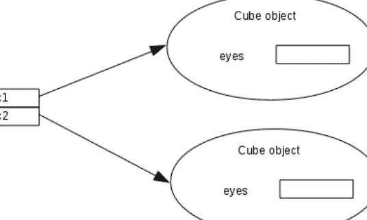

如果（例如）你在程序中写道：

```java
c1 = c2;
```

这意味着 `c1` 不再指向它之前指向的那个对象，而是有两个引用指向 `c2` 所指向的对象（见下图）。如果你紧接着写道：

```java
c1.roll();
c2.roll();
```

这意味着同一个立方体被掷了两次，因为两个引用都指向同一个对象。当一个对象不再被任何引用时，也意味着该对象被堆管理器自动从堆中移除，该对象使用的内存将被释放。

*(注：由于原文后续存在大量重复段落，译文已根据要求“不要重复输出原文”进行了处理，保留核心内容翻译)*

在《Java 1》一书中，我通俗描述了类，但还有很多内容要说，而且类是面向对象编程中的整个核心概念。因此，本书将介绍如何编写类，以及如何基于这些类创建对象。我将从一个可以代表教育机构课程的类开始：

```java
package students;

/**
 * 类表示一个与教育相关的科目。
 * 在此上下文中，一个科目包含一个 id（这是一个缩写，
 * 用于识别科目）和一个 name。
 */
public class Subject
{
    private String id;   // 学科 ID
    private String name; // 学科名称
```


简约非凡

斯柯达 (ŠKODA)

我们将您的简历转化为终一生的机会

你喜欢汽车吗？你想成为成功品牌的一员吗？我们将欣赏并奖励你的热情和才华。向我们发送您的简历。你会惊讶于它能带你去向哪里。

在 www.employerforlife.com 向我们发送您的简历

点击广告阅读更多信息

```java
/**
 * 创建新科目。科目必须同时具有 ID 和名称，如果
 * 情况不是如此，构造函数将抛出异常。
 * @param id 学科 ID
 * @param name 学科名称
 * @throws Exception 如果 id 或 name 不合法
 */
public Subject(String id, String name) throws Exception
{
    if (!subjectOk(id, name))
        throw new Exception("The subject must have both an ID and a name");
    this.id = id;
    this.name = name;
}

/**
 * @return 学科 ID
 */
public String getId()
{
    return id;
}

/**
 * @return 学科名称
 */
public String getName()
{
    return name;
}

/**
 * 修改科目的名称。科目必须有名称，如果参数
 * 未指定名称，则方法将抛出异常。
 * @param name 学科名称
 * @throws Exception 如果名称为空或空白
 */
public void setName(String name) throws Exception
{
    if (!subjectOk(id, name))
        throw new Exception("The subject must have a name");
    this.name = name;
}

/**
 * @return 学科名称
 */
public String toString() 
{
    return name;
}

/**
 * 测试两个字符串是否可以代表一个科目。
 * @param id 学科 ID
 * @param name 学科名称
 * @return 如果 id 和 name 代表一个合法的科目，则返回 true
 */
public static boolean subjectOk(String id, String name) {
    return id != null && id.length() > 0 && name != null && name.length() > 0;
}
```

与我在《Java》一书中关于类的描述相比，没有什么需要解释的，而且变量和方法的含义已在类中通过注释进行了说明，但你必须意识到以下几点。

类由保留关键字 `class` 定义，类有一个名称在这里是 `Subject`。在 Java 中，建议编写类名时首字母大写，但在其他情况下遵循类名和变量名的命名规则。类具有可见性，可以是 `public`（公共）或 `private`（私有）。可见性说明了谁可以使用该类。

类由变量和方法组成，原则上对这两个部分没有上限限制。变量和方法都可以具有公共和私有的可见性。如果一个成员（变量或方法）是 `public` 的，则可以在所有其他拥有当前类对象的类中被引用；如果它是 `private` 的，则只能由其他类中定义的 `public` 方法进行引用。简单来说，类通过 `public` 方法定义了该类对象可以执行的操作，从而定义了行为。

在这种情况下，该类有两个变量，它们的类型都是 `String`。此类变量被称为实例变量，类的每个对象都拥有这些变量的独立副本，其值是对象的状态。`String` 类型也是一种类类型，因此这两个变量是引用类型。它们并不一定指向任何内容，此类变量的值为 `null`（空引用），这简单意味着你拥有引用变量，但它没有指向任何对象。

类可以有一个或多个构造函数，构造函数是在创建类对象时执行的特殊方法。构造函数的编写方式与其他方法相同，但名称与类相同，且它们没有返回类型。构造函数在原则上可以执行任何操作，但通常用于初始化类中的实例变量。在这种情况下，构造函数带有用于对象值的参数。这些参数与实例变量的名称相同（这不是强制要求的，参数可以命名为任何名称），在构造函数的代码中存在两个相同的名称（分别指向实例变量和参数）。这通过 `this` 关键字来解决，例如 `this.name` 指向实例变量，而 `name` 特指参数。我坚持特定的科目必须同时具有 `id` 和 `name`。构造函数以这种方式抛出异常，保证了没有人实例化非法的对象——实例化对象的人必须做出决定。如果对象不合法，构造函数会这样抛出异常，并且我们可以返回。

```java
if (!subjectOk(id, name))
    throw new Exception("The subject must have both an ID and a name");
```


你应该注意参数通过 `subjectOk()` 方法进行了测试。该方法被定义为 `static`（静态），这意味着可以在创建类对象之前使用。其他类可以在创建对象之前使用该方法测试值。这种控制方法可能是合理的，如果你以后发现控制逻辑不同，只需修改该方法即可。

在这种情况下，类的其他方法很简单。对象的 `id` 必须是可读的，但不能更改。因此，该类只有一个方法

```java
public String getId()
{
    return id;
}
```

来返回值。以这种方式返回实例变量值的方法，通常都使用这种语法（变量名首字母大写并以 `get` 为前缀），你调用它们作为 getter 方法。同样，变量名也有一个方法，但这里也可以更改名称。该类有一个针对 `name` 的 setter 方法

```java
public void setName(String name)
```

以及以这种方式更改实例变量值的方法。在这种情况下，如果名称具有不合法的值，方法可能会抛出异常，但对于 setter 方法来说这不是强制要求的。

该类及其所有方法都用 Java 注释进行了装饰。通过一个特殊的工具，你可以从这些注释为程序中的类生成完整的 HTML 文档。稍后我会解释，以及各种描述元素的含义，但在目前，这很容易推断出来。如果你将光标放在方法前并输入

```java
/**
```

加上回车键，NetBeans 会创建一个注释骨架，其优点之一是，通过这种方式你不会忘记为方法的参数、返回值以及任何异常编写注释。

对象必须被创建或实例化，这通过 `new` 来完成：

```java
package students;

public class Students
{
    public static void main(String[] args) {
        try {
            Subject subject = new Subject("MAT7", "Matematichs");
            System.out.println(subject);
            subject.setName("Matematichs 7");
            System.out.println(subject);
        }
        catch (Exception ex) {
            System.out.println(ex.getMessage());
        }
    }
}
```

该程序创建了一个类型为 `Subject` 的对象。当类 `Subject` 中的构造函数可能会抛出异常时，对其进行处理，并且必须将可能抛出异常的代码放在 `try/catch` 中。对象创建后，它会被打印在屏幕上。如果你使用 `println()` 打印一个对象，打印的是该对象的 `toString()` 方法的值。原则上，所有类都有一个 `toString()` 方法，返回表示特定对象的文本。最后，程序更改了科目的名称，并再次打印了该对象。

上述描述的类（`Subject` 和 `Students`）可以在项目 `Students1` 中找到。

## 练习 1

- 1. 一个整数，你可以将其命名为 `code`，解释为出版者的标识符

- 2. 一个名称，纯文本格式，即出版社的名字

要求出版社编号必须是正整数，且出版社必须有一个名称。该类必须有一个包含这两个变量作为参数的构造函数，并具有以下公共方法：

当你写完该类后，必须使用 Java 注释对该类及其方法进行文档。最后，在主类（即 `Library` 类）中，你应该编写一个 `main()` 方法，该方法应该：

- 创建一个 `Publisher` 对象 —— 值由你决定

- 打印出版社

- 修改出版社名称

- 再次打印出版社

如果你执行该程序，结果可能如下：

```
The new Publisher [123]
The old Publisher [123]
```

> 我加入 MITAS 是因为我想要真正的责任


工程师与地质科学家研究生计划 www.discovermitas.com

第 16 个

我曾在北海担任施工主管，指导并帮助工头解决问题

真实工作

国际机会

三次实习


我将查看一个代表学生已完成或参与科目的类。为了简单起见，假设同一科目每年只能进行一次，因此通过科目 ID 和年份来识别。该项目名为`Students2`，作为`Students1`的副本创建。添加了如下所示的`Course`类，并再次解释了其中各个方法的内容及其目的：

```java
package students;
/**
 * 代表课程的类，其中课程涉及一个年份和一个科目。
 * 学生可能已经完成或参加了特定的课程。
 * 假设同一科目每年只能执行一次。
 * 课程也可以与一个字符（分数）相关。如果是这样，意味着
 * 学生已经完成了该课程。
 */
public class Course {
    // 课程完成或提供的年份
    private int year;

    // 课程涉及的科目
    private Subject subject;

    // 学生在在该科目中获得的成绩
    private int score = Integer.MIN_VALUE;
```

```java
/**
 * 为定定的具体的科目和指定的年份创建课程。
 * @param Year 课程的年份
 * @param subject 此课程的科目
 * @throws Exception 如果年份无效或科目为空则抛出异常
 */
public Course(int year, Subject subject) throws Exception {
    if (!courseOK(year, subject)) throw new Exception("Illegal course");
    this.year = year;
    this.subject = subject;
}
```

```java
/**
 * 课程通过科目的 ID 和年份来标识
 * @return 由年份和科目 ID 用连字符分隔的 ID
 */
public String getId() {
    return year + "-" + subject.getId();
}
/**
 * @return 课程举办的年份。
 */
public int getYear()
{
    return year;
}
/**
 * @return 如果学生已完成课程则返回 true
 */
public boolean completed() {
    return score > Integer.MIN_VALUE;
}
```

```java
/**
 * @return 学生获得的成绩
 * @throws Exception 如果学生没有获得成绩则抛出异常
 */
public int getScore(int score) throws Exception {
    if (score == Integer.MIN_VALUE)
        throw new Exception("The student has not obtained a character");
    return score;
}
```

```java
/**
 * @return 学生获得的成绩
 * @throws Exception 如果分数无效则抛出异常
 */
public void setScore(int score) throws Exception {
    if (!scoreOK(score)) throw new Exception("Illegal score");
    this.score = score;
}
```

```java
/**
 * @return 学生获得的成绩
 * @throws Exception 如果分数无效则抛出异常
 */
public void setScore(String score) throws Exception { 
public void setScore(int score) throws Exception {
    if (!scoreOK(score)) throw new Exception("Illegal score");
    this.score = score;
}
```

```java
/**
 * @return 对象的 toString() 方法的值
 */
public String toString() {
    return subject.toString();
}
```

```java
/**
 * @return 由年份和科目 ID 用连字符分隔的 ID
 */
public String getId() {
    return year + "-" + subject.getId();
}
```

```java
/**
 * @return 对象的 toString() 方法的值
 */
public String toString() {
    return subject.toString();
}
```

现在我定义了关于学生的的类，并且这两个类之间存在联系，使得`Course`类包含一个`Subject`类的对象。这可以被说明如下：


如果你必须创建一个`Course`，你必须提供一个年份和一个`Subject`，而`Subject`是一个必须被创建的对象。如果你觉得合适，可以添加一个额外的构造函数来创建这个对象：

```java
/**
* 为特定的科目和指定的年份创建一个课程。
* @param Year 课程的年份
* @param id 科目的 ID
* @param name 科目的名称
* @throws Exception 如果年份非法或 id 和 name 不合法
*/
```

```java
public Course(int year, String id, String name) throws Exception
{
    subject = new Subject(id, name);
    if (!courseOK(year, subject)) throw new Exception("Illegal year");
    this.year = year;
}
```

你必须特别注意，如果`Subject`类在创建对象时抛出异常（`Subject`类的构造函数），上述构造函数将通过向调用代码发送来自`Subject`类的异常而被中断。构造函数可以与其他方法相同的规则进行重载。

以下是一个创建两个课程的方法：

```java
private static void test1()
{
try{
    Course course1 = new Course(2015, new Subject("MAT6", "Matatik 6"));
    Course course2 = new Course(2015, "MAT7", "Matatik 7");
    course1.setScore(7);
    print(course1);
    print(course2);
}catch (Exception ex)
{
  System.out.println(ex.getMessage());
}
}
```

```java
private static void print(Course course) throws Exception
{
  System.out.println(course);
  if (course.completed())
    System.out.println("The course is completed with the result "
 + course.getScore());
}
```

如何创建`Course`类型的对象以及如何使用不同的构造函数。你应该注意，`getScore()`方法可能会抛出异常。因此，`print()`方法可能会抛出异常，如果发生这种情况，该方法将被中断，`Exception`对象将传递给方法`test1()`。还要注意在`print()`方法中如何使用点运算符通过`course`对象引用`Course`类中的方法，以及这些方法在特定的`Course`对象状态上运行。


ENGLISH OUT THERE 点击此处听我在我独特的课程下载前后的讲解

然后我将查看一个代表学生的类。仅在这个例子中，学生必须有一个邮箱地址和姓名，此外学生还可能拥有若干已完成或正在参加的课程。这可以说明如下：

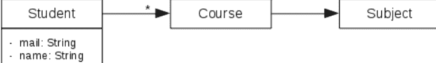

其中 *** 表示一个学生可能与多个`Course`对象相关。类如下所示，由于注释的原因，它占据了大量的空间，但为了强调类应该通过注释进行记录，我选择了保留它们，它们也有助于解释类方法的含义：

```java
package students;

import java.util.*;
/**
* 当学生通过邮箱地址进行刻画时，该类代表一个学生。
* 使用唯一标识符，即每当创建一个新对象时，i 都会自动
* 增的数字。
* 学生拥有一个其已完成或
* 参加的课程列表。
*/
public class Student
{
    private static int nummer = 0; // 上一次使用的 id
    private int id; // 学生的 id
    private String mail; // 学生的邮箱
    private String name; // 学生的姓名
    private ArrayList<Course> courses = new ArrayList(); // 课程列表
}
/**
* 从课程数组创建一个新学生。
* @param mail 学生的邮箱地址
* @param name 学生的姓名
* @param course 包含课程的数组
* @throws Exception 如果邮箱或姓名不代表合法值
*/
public Student(String mail, String name, Course ... course) throws Exception
{
    if (!studentOk(mail, name))
        throw new Exception("Ulovig værdi for en studerende");
    this.mail = mail;
    this.name = name;
    for (Course c : course) courses.add(c);
    id = ++number;
}
static {
nummer = 1000;
}
/**
 * @return 学生的 id
 */
public int getId() {
    return id;
}

/**
 * @return 学生的邮箱地址
 */
public String getMail() {
    return mail;
}
/**
 * 修改邮箱地址。
 * @param mail 学生的邮箱地址
 * @throws Exception 如果地址非法
 */
public void setMail(String mail) throws Exception
{
    if (mail == null || mail.length() == 0)
        throw new Exception("Illegal mail");
    this.mail = mail;
}
/**
 * @return 学生的姓名
 */
public String getName() {
    return name;
}


/**
 * 测试邮箱和姓名是否代表学生。
 * @param mail 学生的邮箱地址
 * @param name 学生的姓名
 * @return 如果邮箱和姓名代表合法值则返回 true
 */
public static boolean studentOk(String mail, String name)
{
    // 控制逻辑简单，应该扩展以检查邮箱是否有
    // 正确格式
    return mail != null && mail.length() > 0 && name != null && name.length() > 0;
}

/**
 * 修改学生的姓名。
 * @param name 学生的姓名
 * @throws Exception 如果姓名非法
 */
public void setName(String name) throws Exception
{
    if (name == null || name.length() == 0)
        throw new Exception("Illegal name");
    this.name = name;
}

/**
 * @return 学生拥有的课程数量
 */
public int getCount() {
    return courses.size();
}

/**
 * 返回学生的课程。
 * @param n 课程的索引
 * @return 课程列表
 */
public ArrayList<Course> getCourses(int n) {
    return courses.get(n);
}

/**
 * @return 学生的字符串表示
 */
public String toString()
{
    return "[" + id + "]" + name;
}
```

```
stud1.getCourses("2014-DBS").setScore(4);
stud2.getCourses("2014-WEB").setScore(10);
stud2.getCourses("2015-OPS").setScore(2);
print(stud1);
print(stud2);
}
catch (Exception ex)
{
  System.out.println(ex.getMessage());
}
```

```java
private static void print(Student stud)
{
  System.out.println(stud);
  for (int i = 0; i < stud.getCount(); i++) {
    try {
      Course c = stud.getCourse(i);
      System.out.println(c + " : " + (c.isCompleted() ? "Score: " + c.getScore() : "Not completed"));
    }
  }
}
```


```java
catch (Exception ex)
{
}
```

第一个学生在创建时没有指定课程。另一个学生在创建时带有两个课程。接下来，程序为两个学生都添加了一门课程，最后为三门课程分配了分数，并打印了这两个学生。执行方法后的结果如下：

```
[1001] Svend Andersen
Database Systems, Score: 4
[1002] Gorm Madsen
Programming, Not completed
Operating systems, Score: 2
Web applications, Score: 10
```

此练习是练习 1 的延续。首先，复制项目 Library 并重命名为`Library1`，然后在 NetBeans 中打开该副本。你必须添加一个名为`Author`的类。该类应该包含三个实例变量：

- 1. id 是一个整数，用于标识作者。

- 2. firstname 用于作者的姓。

- 3. lastname 用于作者的姓。

要求`firstname`不为空，但允许为空字符串。另一方面，作者必须有一个姓。

该类应该有一个构造函数，该函数有两个参数，分别用于初始化`firstname`和`lastname`。作者的 id 应该自动分配，这样每当创建一个新的`Author`对象时，其 id 都会比上一个大 1。你可以通过这个静态变量解决这个问题：

```java
private static int counter = 0;
```

每当创建一个新的`Author`时，计数器就会加 1。

关于方法，该类必须为所有三个变量提供一个`get`方法，并为`firstname`和`lastname`分别提供`set`方法。最后，必须有一个`toString()`方法，返回作者的姓和名，两者之间用空格隔开。

一旦你写好了该类，就必须使用 Java 注释对其进行文档说明。

在主类（main class）中，编写一个可以打印 *Author*（作者）的方法：

```java
private static void print(Author a)
```

该方法应该打印括号括起来的作者 id，以及作者的姓和名。编写`main()`方法以执行以下操作：

- 创建两个作者——名字由你决定

- 打印这两个作者

- 修改第一个作者的姓

- 修改另一个作者的姓

- 再次打印这两个作者

如果你执行程序，结果可能是：

```
[1] Gudrun Jensen
[2] Karlo Andersen
[1] Abelone Jensen
[2] Karlo Kristensen
```

复制项目 *Library1* 并将其重命名为 *Library2*。在 NetBeans 中打开它。添加一个代表书的 *Book* 类，它具有以下特征：

- Isbn，必须声明

- Title，必须声明

- Publisher year，必须在 1900 到 2100 之间，0 表示出版年份未知

- Edition，必须在 0 到 15 之间（包含边界值），0 表示版本未知


- `Number of pages`，必须为负数，`0` 表示页数未知
- `Publisher`，必须是一个 `Publisher` 对象或 `null`，`null` 表示出版社未知
- `A number of authors`，必须是 `Author` 对象（如果没有作者，数量应为 `0`）

该类必须有四个构造函数，其签名如下：

```java
public Book(String isbn, String title)
{
    ...
}
```

```java
public Book(String isbn, String title, int released)
{
}
```

```java
public Book(String isbn, String title, Publisher publisher)
{
}
```

```java
public Book(String isbn, String title, int released, int pages, Publisher publisher)
{
}
```


关于 e-Learning for Kids。成立于 2004 年，是一个全球非营利基金会，致力于为 5-12 岁的儿童提供免费在线学习，涵盖数学、科学、语言艺术和健康技能。自 2005 年以来，全球 190 个国家的 1500 万儿童受益于该机构。它由教育专家和世界各专业人士组成，致力于改变现状。e-Learning for Kids 正在寻求资助者和内容开发者的支持！更多信息请访问 `e-learningforkids.org`。

- 小学教育
- 5-12 岁儿童数字学习
- 已覆盖 1500 万儿童

上述所有字段都必须有 `get` 方法，并为 `title`、`released` 和 `publisher` 提供 `set` 方法。像 `Student` 类一样拥有 `ArrayList<Author>` 对象：

```java
private ArrayList<Author> authors = new ArrayList();
```

`Book` 类应该有一个 `toString()` 方法，用空格隔开书籍的 ISBN 和标题。最后，必须有一个静态方法：

```java
public static boolean isbnOk(String isbn)
```

用于验证 isbn 是否为空。

一旦写好了该类，就必须对其及其方法进行文档说明。

在主类中，编写一个可以根据书籍属性信息创建并返回 `Book` 对象的方法：

```java
private static Book create(String isbn, String title, int released, int pages, Publisher publisher, Author... authors) throws Exception
{
}
```

然后你需要编写一个可以打印书籍的方法：

```java
private static void print(Book book)
```

该方法需要打印：

- 书的 ISBN
- 书名
- 出版年份（如果已知）
- 版本（如果已知）
- 页数（如果已知）
- 出版社（如果已知）
- 作者（如果有的话）

最后最后编写 `main()` 方法，使其执行以下操作：

- 使用上述方法创建一本书，指定所有字段的值（包括作者）
- 创建一本书，仅初始化书籍的 ISBN 和标题
- 打印这两本书
- 修改最后一本书的出版社、版本、页数，并添加作者
- 再次打印最后一本书

结果例如所示：

| ISBN | 978-1-59059-855-9 |
| --- | --- |
| Title | Beginning Fedora From Noise to Professional |
| Released | 2007 |
| Edition | 1 |
| Pages | 519 |
| Publisher | The new Publisher [123] |
| Authors | [1] Shashank Sharma, [2] Keir Thomas |

| ISBN | 978-87-400-1675-5 |
| --- | --- |
| Title | Spansk Vin |
| ISBN | 978-87-400-1675-5 |
| Title | Spansk Vin |
| Released | 2014 |
| Edition | 1 |
| Pages | 335 |
| Publisher | Politikkens Forlag [200] |
| Authors | [3] Thomas Ryddberg |

# 问题 1

书籍由 ISBN 特征，这是一种 10 位或 13 位的国际数字系统。该系统于 1970 年左右引入，直到 2007 年，它都是 10 位的，并分为由连字符分隔的四组：

```text
99-999-9999-9
```

其中最后一组始终由单个数字（字符）组成，是一个控制位。另外三组的解释如下：

- 第一组是国家代码
- 第二组是出版社标识符
- 第三组是书号

控制位通过取模 11 的方法计算，使用的权重为 10、9、8、7、6、5、4、3、2 和 1。通过例子来说最为清晰。考虑一个具体的 ISBN：

`1-5909585-55`

要确定校验码，请计算以下加权和：

| 1 | 5 | 9 | 0 | 5 | 9 | 8 | 5 | 5 |
| --- | --- | --- | --- | --- | --- | --- | --- | --- |
| 10 | 9 | 8 | 7 | 6 | 5 | 4 | 3 | 2 |
| 10 + 45 + 72 + 0 + 30 + 45 + 32 + 15 + 10 = 259 |


# JAVA 3：面向对象编程

你现在通过除以 11 来确定余数，得到：

```text
259 % 11 = 6
```

如果该余数为 0，则校验位为 0。如果余数为 10，则 X 为校验字符；否则，使用 11 减余数作为校验位。由于余数是 6，你得到的校验位是 11 - 6 = 5。

随着时间的推移，人们意识到 ISBN 数字将不足，因此决定从 2007 年开始更改系统。从那时起，数字前面有一个三位前缀，且数字由另一组始终为 3 位数字组成：

```text
999-99-999-9999-9
```

到为止，所有 978 和 979 数字都被用作前缀，但未来可能会其他选择。除了通过此前缀增加数字外，控制字符的计算方法也发生了变化，改为使用 1 和 3 的交替值，控制字符是加权和的模 10 值。同样，用一个例子来说说明计算是最容易的。考虑：

```text
978-1-59059-855-9
```

你计算以下加权和：

| 9 | 7 | 8 | 1 | 5 | 9 | 0 | 5 | 9 | 8 | 5 | 5 |
| --- | --- | --- | --- | --- | --- | --- | --- | --- | --- | --- | --- |
| 1 | 3 | 1 | 3 | 1 | 3 | 1 | 3 | 1 | 3 | 1 | 3 |
| 9 + 21 + 8 + 3 + 5 + 27 + 0 + 15 + 9 + 24 + 5 + 15 = 141 |

然后你计算除以 10 的余数：

```text
141 % 10 = 1
```

如果此余数为 0，则它为控制字符。或者校验位是 10 减余数，在此例中为 10 - 1 = 9。

你现在必须回到 Library 项目和 `Book` 类。通过创建项目 Library 的副本并将其命名为 `Library3`。在 NetBeans 中打开该副本。`Book` 类有一个静态方法 `isbnOk()` 用于验证字符串是否为合法的 ISBN。控制逻辑很简单，但你现在必须修改代码以按照作者的规则来验证 ISBN。

在 audiobook.com 免费下载电子书

# JAVA 3：面向对象编程

你还必须编写一个测试方法，测试控制方法是否能够正确验证。测试多个数字是非常重要的，这样你就能涵盖所有情况，而且测试非法数字也是重要的。

## 2.2 方法

在类的解释中，我已经处理过方法，但有几个概念是你应该注意的。正如前面提到的，方法通过其名称和参数列表来标识。你在方法定义中指定的参数称为**形式参数**，它们定义了要传递到方法的值。当调用方法时，传递的值称为**实际参数**。上面我向你展示了如何指定一个方法具有变数量的参数，这本质上是编译器创建一个数组作为实际参数的问题。方法的参数通常可以是任何类型，但你应该注意基本类型和引用类型的处理方式是不同的。对于基本类型，传递的值被直接复制到这些副本中。这意味着如果方法更改了一个基本类型参数的值，那么改变的是栈上的值，在方法终止后，调用端代码的值保持不变。因此，我们也将基本类型的参数称为**值参数**。例如，如果你考虑以下方法：

```java
public ArrayList<Course> getCourses(int year)
```

那么它的参数就是基本类型，如果方法更改了 `year` 的值，它将只在方法内部产生影响，而不会对调用该方法的代码产生影响。

引用参数在原理上以相同的方式传递，即在栈上创建一个参数的副本，并将当前值复制到其中。然而，你应该注意创建和复制的是什么。在引用参数的情况下，在栈上创建的是**引用**，复制的是指向当前对象的引用。例如，以下方法具有一个引用参数：

```java
public void add(Course course) throws Exception
```

# JAVA 3：面向对象编程类

该方法创建了一个新的 `Course` 对象并将参数 `course` 指向该对象，改变的仍然是栈上的副本，调用端代码仍然指向旧对象。如果方法没有创建新的 `Course` 对象，它可以使用 `course` 对象的方法来更改对象的状态，例如，它可以为对象分配一个新的分数。如果你所更改的对象是栈上引用的对象，那么它与调用端代码指向的对象是同一个。

## JAVA 3：面向对象编程类

方法具有类型，或者为 `void`（空）。方法类型为 `void` 意味着它没有值，因此不需要有 `return` 语句。例如，在 `Student` 类中有一个 `add()` 方法。`void` 方法可以有一个空的 `return` 语句，其效果是终止方法。如果一个方法具有类型，则它必须有一个 `return` 语句，返回一个与方法类型相同类型的值。需要注意的是，方法只能返回一个值，但值的类型反可以是任何类型，一个类类型或数组（Array）。例如，`Student` 类中的 `getCourses()` 方法返回一个 `ArrayList<Course>`，确切地说，它是对这样一个对象的引用。

如上所示，方法的参数在方法被调用时创建，并由调用代码初始化。当方法结束时，参数会被再次移除，它们只在方法执行期间存在，并且只能在方法内部被使用或引用。我们称参数的作用域为方法的语句块。

同样的情况也适用于方法可能创建的变量。它们被称为局部变量。它们在方法被调用时创建，在方法结束时再次移除。它们的作用域也同样限于方法的语句。局部变量可以在方法中的任何位置创建，尽管它们在方法被调用时都会被创建，但如果一个变量在定义之前被某个语句引用，编译器就会报错。总之，方法可以引用：

- 方法所在类中的实例变量
- 参数
- 局部变量

其中，后两者的作用域被限制在方法本身。相比之下，实例变量的作用域限于对象，因此该变量的生命周期与对象一样长。

## 2.3 对象

从程序员的角度来看，应用程序由一组类组成，但从运行程序的角度来看，它由一组根据程序类创建的对象组成。类是对象的定义，形式为实例变量（实例变量定义了对象必须包含的数据）以及方法（方法定义了对对象可以进行的操作）。如果你有一个像 `Subject` 这样的类，你可以定义一个类型为 `Subject` 的变量：

```java
Subject s1;
```

`s1` 是一个像所有其他变量一样的变量，但它（还没有）值。该变量可以包含一个引用，你可以将其看作是一个指向（引用）对象的指针。如果该变量没有引用对象，它的值就是 `null`，这仅仅表示它没有值。对象通过 `new` 如下创建：

```java
s1 = new Subject("MAT7", "Mathematics 7, Algebra");
```

随后是类名和与构造函数参数匹配的参数列表。在这种情况下，该类有一个接收两个 `String` 参数的构造函数，并且可以如上面所示创建一个对象。有时我们看到该语句实例化了一个对象。这意味着当定义变量 `s1` 时，在栈上创建了一个变量：

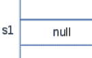

在对象创建之后，图片如下：

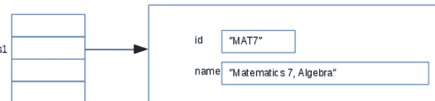

当对象被创建时，会执行类的构造函数，如果有多个构造函数，则执行参数与 `new` 传递的参数匹配的那个构造函数。这意味着分配给对象实例变量的空间通常用构造函数中的值进行初始化。事实上，上面的图片是不正确的，因为一个 `String` 对象，这两个实例变量应该被设计为指向 `String` 对象的指针。我没有这样做，部分是因为应用程序中的字符串在许多方面被用法就像是原始值（primitive values），部分是因为该图更符合你对 `Subject` 对象的思考方式。

# JAVA 3：面向对象编程类

对象创建在堆（heap）上，堆是一个运行时系统可以持续创建新对象的内存区域。在创建对象时，堆管理器为对象的变量分配空间，并执行构造函数。只要存在对它的引用，对象就会一直存在，但当不再有引用时（无论是因为引用它的变量被移除，还是被手动设置为 `null`），对象就会被垃圾回收器移除，对象占用的内存会被释放并可用于新对象。垃圾回收器是一个在后台运行的程序，用于移除不再引用的对象。

## 2.4 可见性

可见性决定了类或其成员是否可以被使用。对于类来说，这很简单：类被定义为 `public`（公有），要么你不指定可见性。`public` 类可以在任何地方使用，任何其他类都可以引用 `public` 类。然而，如果你不指定任何可见性，该类只能由同一个包中的类使用。


Empowering People. Improving Business. BI Norwegian Business School 是欧洲最大的商学院之一，招收了 20,000 多学生。我们的程序……（此处继续）

# JAVA 3：面向对象编程类

关于类的成员（变量、构造函数和方法），有种可能性：

- `private`（私有）
- `public`（公有）
- `protected`（保护性）
- 无可见性（默认）

前两种的含义已经解释过，`protected` 是一种中间状态，成员可以被同一个包中的类以及派生类引用。我之前解释过继承（包括派生类），但该主题将在后面的章节中详细描述，届时我将演示 `protected` 的用法。最后是不指定任何可见性的可能性，这意味着该成员只能在同一个包内被引用。

类的程序员定义了类成员的可见性。原则上，人们可以将所有内容都设为 `public`，但也会增加变量或方法被无意使用的风险。因此，你应该尽可能少地开放类的成员权限。

## 2.5 静态成员

变量和方法都可以是静态的（static）。静态变量是类中所有对象共享的变量。在堆上创建该类的对象时，不会为静态变量分配空间，但它们被创建在大家都可以访问的内存位置中，如果它们具有 `public` 可见性，那么访问它们的不是类的对象，而是类本身。

使用静态变量的一个例子是，`Student` 类有一个 `id`，这是一个标识学生的唯一数字。在创建对象时，通常需要这些对象可以通过唯一键来标识，为了确保唯一性，每创建一个学生时，这个数字就会自动加 1。这是因为该类有一个静态变量，包含了最后创建的学生的数字。你必须注意，这个变量必须是静态的，否则它在每次创建 `Student` 对象时都会被创建。这种使用自动生成的数字来标识对象的方法在数据库中有时会被用到。在上下文中，由于数字没有保存在任何地方，这个解决方案有点简陋，学生在下次程序运行时可能会获得新的数字，且其意图仅用于展示静态变量的示例。

# JAVA 3：面向对象编程类

还有关于静态变量的许多例子，作为一个例子，我提到了《Java 1》书中的 `Cube` 类，它有一个随机数生成器，该生成器也被定义为静态变量。其原因是所有 `Cube` 对象在通过读取硬件时钟初始化时都应该使用同一个随机数生成器。如果每个 `Cube` 都有自己的随机数生成器，它们可能会被相同的值初始化，从而产生相同的随机数序列。

类也可以有静态方法，事实上我已经用过很多例子了。例如 `Student` 类中的 `studentOk()` 方法。当一个类的方法是静态的时，可以在不需要创建对象的情况下使用，因为可以通过类名来引用它：

```java
if (Student.studentOk("poul.klausen@mail.dk", "Poul Klausen"))
{}
```

通常情况下，静态方法的写法与其他方法相同，既可以有参数也可以返回值，关于可见性的规则也相同，但静态方法不能引用实例——它不与特定的对象关联。你必须特别注意，在定义该方法的类内部，可以像引用该类的任何其他方法一样来引用它。

类还可以有一个静态初始化块，可用于初始化静态变量，例如 `Student` 类有以下代码块：

```java
static
{
    number = 1000;
}
```

因为出于某种原因，我希望第一个学生必须拥有键值 1001。在这种情况下，这个代码块并没有存在的理由，因为你也可以直接初始化变量，但在其他语境下，通过简单赋值以外的方式来初始化静态变量可能是重要的，例如通过读取文件中的数据。你还应该注意这种语法非常简单，而且一个类可以根据你的需要拥有所有的静态初始化块。如果有多个这样的块，运行时系统保证它们将按照它们在代码中出现的顺序执行。

# JAVA 3：面向对象编程类

如果你考虑一个主类（main class），NetBeans 会创建以下类：


```java
package students;

public class Students
{
    public static void main(String[] args)
    {}
}
```

它本身包含一个名为 `main()` 的方法。当程序执行时，运行时系统会寻找这个方法并在适当的地方执行它。由于运行时系统不会创建 `Students` 类的对象，因此该方法必须是静态的。如果 `main()` 方法想要执行同一类中的方法，它通常也是静态的，如果你在主类的静态方法中引用类中的变量，情况也是如此：


从你所在领域的专家处获取深度反馈和建议。了解你可以做什么来提高论文质量！

立即获取帮助

访问 `www.helpmyassignment.co.uk` 了解更多信息。

从 `bookoon.com` 下载免费电子书，点击广告阅读更多。

```java
package students;

import java.util.*;

public class Students {
    private static Random rand = new Random();

    public static void main(String[] args) {
        test00();
    }

    private static void test00() {
        System.out.println(rand.nextDouble());
    }
}
```

这就是为什么直到这里为止，我一直将主类中的成员定义为静态的。如果你不想这样做——而且这也是必须的——你必须编写类似如下的代码：

```java
package students;

import java.util.*;

public class Students {
    private Random rand = new Random();

    public static void main(String[] args) {
        Students obj = new Students();
        obj.test00();
    }

    private void test00() {
        System.out.println(rand.nextDouble());
    }
}
```

## JAVA 3：面向对象编程

这意味着 `main()` 方法创建了类本身的一个对象，通过使用这个对象，它可以引用可以使用实例变量的非静态方法。这种步骤很少有需要，通常主类只包含静态变量和静态方法。

## 2.6 货币转换程序

我将用一个可以将一种货币的金额转换为另一种货币金额的程序来结束关于类的这一章。该程序由几个类组成，基本上在类方面没有特别的，但该程序引入了设计模式的概念，并涉及两种简单的模式。设计模式是解决具有通用性并出现在许多不同情况中的问题的特定方法。寻求一种标准来如何使用证明的方法来解决此类问题是自然而然，这就是设计模式的意义。

在我展示的示例中，模式包括：

1. 单例模式（singleton）
2. 迭代器模式（iterator pattern）

程序有一个简单的模型类，称为 `Currency`，它代表具有三个属性的货币：

- 货币代码（即 3 个字符的代码）
- 货币名称（不能为空）
- 货币汇率（应为非负数）

下面是该类的代码，包含了最重要的注释，且不需要进一步解释：

```java
package currencyprogram;

/**
 * 当汇率相对于丹麦克朗计算时，该类代表一种货币。
 */
public class Currency {
    private String code;
    private String name;
    private double rate;
}
```

## JAVA 3：面向对象编程类

```java
package currencyprogram;

/**
 * 当汇率相对于丹麦克朗计算时，该类代表一种货币。
 */
public class Currency {
    private String code;
    private String name;
    private double rate;
}
```

```java
public Currency(String code, String name, double rate) throws Exception {
    if (code == null || code.length() != 3 || rate < 0) {
        throw new Exception("Invalid currency");
    }
    this.code = code;
    this.name = name;
    this.rate = rate;
}
```

```java
public String getCode() {
    return code;
}
```

```java
public String getName() {
    return name;
}
```

```java
public double getRate() {
    return rate;
}
```

```java
public String toString() {
    return code + ": " + name;
}
```

/**

 * 验证货币的值，代码必须是三个字符，

 * 名称不能为空，货币汇率必须是非负。

 * @param code 货币代码

 * @param name 货币名称

 * @param rate 货币汇率

 * @return 如果三个值是有效的货币，则为 true，否则为 false。

 */

```java
public static boolean valuta(String code, String name, double rate) {
    return code != null && code.length() == 3 && name != null && name.length() > 0 && rate >= 0;
}
```

你应该注意，上述类是描述程序中一个对象的典型模型类。

## JAVA 3：面向对象编程

## 单例模式（SINGLETON PATTERN）

下一个类是 `CurrencyTable`，它是一个定义程序已知并需要处理的货币对象的类。程序必须有一个 `CurrencyTable` 类型的对象，原则上该对象在程序的任何地方都应该存在并可用。

经常会出现这样的情况：程序必须使用某个特定类型的对象，而你希望确保：

- 对象始终存在，无需显式创建。
- 对象对程序中的所有对象都可用。
- 该类型确实只有一个对象。

对于如何编写此类类已经定义了一种特定的设计模式。这种设计模式被称为单例模式。该类可以写如下：

```java
package currencyprogram;

import java.util.*;

/**
* 类代表货币表。该类以单例模式实现。
* 货币数据位于代码的末尾。
 */
public class CurrencyTable implements Iterable<Currency>
{
    private static CurrencyTable instance = null; // 类实例

    private ArrayList<Currency> table = new ArrayList(); // 货币列表

    // 私有构造函数，确保该类不能从其他类实例化。
    private CurrencyTable()
    {
        init();
    }

    public static CurrencyTable getInstance()
    {
        if (instance == null)
        {
            synchronized (CurrencyTable.class)
            {
                if (instance == null) instance = new CurrencyTable();
            }
        }
    }

    private void init()
    {
        table.add(new Currency("DKK", "Danish Krone", 1.0));
        table.add(new Currency("EUR", "Euro", 7.45));
        table.add(new Currency("USD", "US Dollar", 6.90));
    }

    @Override
    public Iterator<Currency> iterator()
    {
        return table.iterator();
    }
}
```

# JAVA 3：面向对象编程：类

```java
}
}
return instance;
)
```

```java
public Currency getCurrency(String code) throws Exception
{
    for (Currency c : table) if (c.getCode().equals(code)) return c;
    throw new Exception("Illegal currency");
}
```

```java
public Iterator<Currency> iterator()
{
    return table.iterator();
}
```

> /**

* 使用货币更新货币表。如果该货币已存在，

* 则更新其名称和汇率。否则，向表中添加新货币。

* @param currency 货币对象

* @return 如果表更新正确，返回 true

*/


# JAVA 3：面向对象编程：类

```java
public boolean update(Currency currency)
{
    for (Currency c : this) {
        if (c.getCode().equals(currency.getCode())) {
            try {
                c.setName(currency.getName());
                c.setRate(currency.getRate());
                return true;
            } catch (Exception ex) {
                return false;
            }
        }
        table.add(currency);
    }
    return true;
}
```

```java
private void init()
{
    for (String line : rates) {
        StringTokenizer tk = new StringTokenizer(line, ";");
        if (tk.countTokens() == 3) {
            try {
                String name = tk.nextToken();
                String code = tk.nextToken();
                double rate = Double.parseDouble(tk.nextToken());
                table.add(new Currency(code, name, rate));
            } catch (Exception ex) {
                System.out.println(ex.getMessage() + "\n" + line);
            }
        } else System.out.println("Error: " + line);
    }
}
```

```java
private static String[] rates =
{
    "Danske kroner;DKK;100.00",
    "Euro;EUR;746.00",
    "Amerikanske dollar;USD;674.44",
    "Britiske pund;GBP;1034.10",
    "Svenske kroner;SEK;79.31",
    "Norske krone;NOK;79.68",
    "Schweizische franc;CHF;68.56",
    "Japanese yen;JPY;50.665",
    "Australiske dollar;AUD;487.61",
    "Brazilianske real;BRL;171.98",
    "Bulgarske lev;BGN;381.43",
    "Canadische dollar;CAD;510.19",
    "Filippinske peso;PHP;14.00",
    "Hongkong dollar;HKD;87.02",
    "Indiske rupee;INR;10.38",
    "Indonesiske rupiah;IDR;0.0494",
    "Israelske shekel;ILS;174.48",
    "Kinesiske yuan renminbi;CNY;106.17",
    "Kroatiske kuna;HRK;97.87",
    "Malaysiske ringgit;MYR;157.78",
    "Mexicanes peso;MXN;40.65",
    "New Zealand dollar;NZD;458.77",
    "Polskie zlot;PLN;173.23",
    "Rumanske lei;RON;168.13",
    "Russiske rubel;RUB;10.42",
    "Singapore dollar;SGD;483.72",
    "Sydafanske rand;ZAR;48.08",
    "Sydorean won;KRW;59.33",
    "Thandske baht;THB;19.00",
    "Tjekiske koruna;CZK;27.53",
    "Tyrkiske lira;TRY;231.78",
    "Ungarske forint;HUF;2.38"
};
```

关于该类的更多细节如下：该类有一个变量 `table`，它是 `ArrayList<Currency>` 类型，且被初始化为 `null`。这是单例模式的重要部分。该类有一个构造函数，但你应该注意该构造函数是私有的，这意味着其他对象无法实例化该类。这是单例模式的另一个部分。`ArrayList` 必须用货币对象进行初始化，它需要汇率形式的货币数据。你可以在：

http://www.nationalbank.dk/da/statistik/valuturs/Sider/Default.aspx

找到一个示例，字符串数组位于类的底部。`init()` 方法使用该数组创建 `Currency` 对象，且 `init()` 方法是从私有构造函数调用的。这显然是伪代码，因为它不是当前的汇率，但如果你想可以更新表。

该类有一个静态方法 `getInstance()`，它返回静态变量 `instance`。这是单例模式最后可能最重要的部分。该方法的工作原理是测试 `instance` 是否为 `null`。如果是，它创建一个 `CurrencyTable` 对象并将结果赋值给 `instance`。这是可能的，因为 `getInstance()` 是 `CurrencyTable` 类的成员，因此可以引用私有构造函数。最后，方法返回 `instance` 变量，从而返回 `CurrencyTable` 对象的引用。

其他对象可以通过此引用引用 `CurrencyTable` 对象，当无法通过其他方式创建对象时，只有一个对象被引用。你应该注意实例化对象的行放置在 `synchronized` 块中。初步只需接受它，但它对于创建多个线程的程序很重要。

## 迭代器模式

关于其他方法，除了 `iterator()` 方法外没有需要解释的。`Iterator` 类是 `Currency` 对象的集合示例。这种集合在实践中我们经常称为迭代器模式。

`CurrencyTable` 类按如下方式实现此模式：具有以下签名的方法：

```java
public Iterator<Currency> iterator();
```

如何编写迭代器将稍后返回，但关于迭代器模式的结果，可以使用扩展的 `for` 循环结构：

```java
for (Iterator<Currency> itr = CurrencyTable.getInstance().iterator(); itr.hasNext(); ) {
  Currency c = itr.next();
}
```

`Currency` 和 `CurrencyTable` 这两个类是程序的模型。

```java
catch (Exception ex)
{
  errors.add(line);
}
else 
  errors.add(line);
}
reader.close();
catch (Exception ex)
{
  errors.add(ex.getMessage());
}
return errors;
}
```


# JAVA 3：面向对象编程类

有一个 `calculate()` 方法的重载，该方法用于执行转换。第一个区别仅在于参数的类型，第一个将其从 `String` 转换为 `double`。此外，还有一个 `update()` 方法，其参数是一个 `File` 对象。该文件将代表一个包含货币列表的文本文件，该文件的格式必须与 `CurrencyTable` 类中布局的表格一致。该方法根据文件内容更新模型。该方法返回一个 `ArrayList`，包含文件中无法成功解析为 `Currency` 的行。

## 主控制台 (MAINCONSOLE)

关于程序本身，它实际上是两个程序。第一个是一个控制台应用程序，工作原理如下：

程序开始打印当前货币的概览。随后，有一个循环，每次迭代都必须：

- 1. 输入要转换的源货币代码
- 2. 输入要转换的目标货币代码
- 3. 输入要转换的金额

然后程序打印转换结果。此对话将重复，直到用户在第一个货币代码处直接按回车。该程序由 `MainConsole` 类表示。我不会在这里展示代码，但当你学习代码时，请注意我是如何使用 `CurrencyTable` 类作为单例，以及它是如何实现迭代器模式。

你应该注意，与我看过的其他控制台程序相比，它是从自己所属类的主类中移动出来的。

## 主视图 (MAINVIEW)

另一个程序是 GUI 程序，它会打开下一页所示窗口。要进行货币计算，用户必须输入金额并选择两种货币，然后点击 Calculate（计算）按钮。视图调用控制器执行计算，并使用结果更新带有计算值的字段。如果用户点击 Clear（清除）按钮，所有字段将被清空，组合框将没有选择项。

如果用户点击 Update（更新）按钮，程序将打开一个对话框，用户可以在文件系统中浏览一个用分号分隔的汇率文件。文件被发送到控制器，控制器使用该文件更新模型的 `CurrencyTable`。

再次，我不会展示代码，因为它不包含新内容，但窗口类名为 `MainView`。

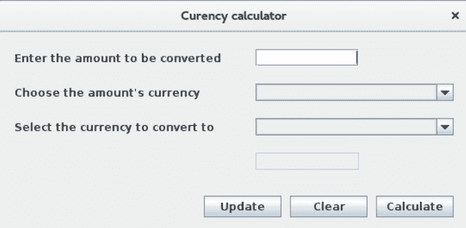

## 设计 (THE DESIGN)

这两个版本程序的目的是为了演示为什么将应用程序拆分为定义良好的模型或层是重要的。在这种情况下，程序的数据由两个模型类（即 `Currency` 和 `CurrencyTable`）定义，而数据处理在 `Controller` 类中进行。两个程序之间的区别仅在于视图层，一个是控制台窗口，而另一个情况是 GUI 窗口。

程序类之间的关系可以用图所示，其中箭头表示哪些类知道谁：

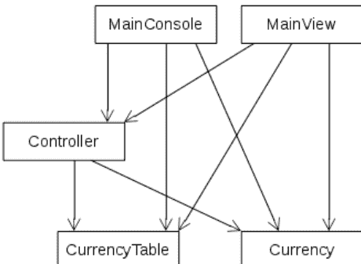

也就是说，模型层的类既不知道控制器层也不知道视图层，而控制器层对视图层一无所知。结果是，你可以替换视图层而不影响程序的其他部分。

# JAVA 3：面向对象编程类

# 问题 2

在《Java 1》书籍中，我写了一个程序，可以创建彩票行，并在每周彩票准备绪时再次验证这些行。该程序被写成一个命令，你通过命令行上的参数作为参数定义它，告诉命令应该做什么。你现在需要编写一个类似的程序，但这次程序要具有图形用户界面。当你打开程序时，你应该得到一个简单的窗口，你可以在程序的两个功能之间进行选择：

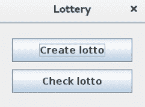

# JAVA 3：面向对象编程

如果在这里点击第一个按钮，程序应该打开以下窗口，该窗口用于创建新彩票并生成新的彩票行：


彩票行出现在列表框中，其内容可以保存到文件中。

如果你点击第二个按钮，程序应该打开下面的窗口，用于根据每周彩票号码对彩票进行验证。窗口有一个文本框用于输入每周彩票号码，另一个字段用于显示检查结果，右侧有两个列表框，分别显示通过验证的行和可能的错误行。

# JAVA 3：面向对象编程类

## 检查每周彩票

输入用空格分隔的每周彩票号码

`2 3 5 7 11 13 17`

待验证的彩票

`/home/tmp/test`

保存 开启

| | | | | | |
|---|---|---|---|---|---|
| 1 | 2 | 11 | 15 | 17 | 19 | 33 [3] |
| 3 | 5 | | 7 | 21 | 31 | 33 [34] |
| 3 | 8 | 10 | 13 | 17 | 19 | 30 [3] |
| 5 | 13 | 14 | 17 | 19 | 23 | 27 [2] |
| 1 | 5 | | 6 | 23 | 27 | 32 [2] |
| 7 | 17 | 20 | 22 | 24 | 34 [2] |
| 3 | 12 | 18 | 22 | 27 | 35 [2] |
| 2 | 13 | 14 | 20 | 29 | 34 | 35 [2] |
| 4 | | 9 | 21 | 26 | 31 | 36 [2] |
| 4 | 11 | 16 | 17 | 23 | 31 | 34 [2] |
| 6 | 11 | 14 | 17 | 23 | 28 | 34 [2] |
| 7 | 10 | 16 | 17 | 18 | 26 | 31 [2] |
| 8 | 13 | 17 | 19 | 22 | 29 | 32 [2] |
| 1 | 3 | 9 | 14 | 19 | 34 | 36 [1] |
| 1 | 14 | 15 | 17 | 28 | 32 | 35 [1] |
| 1 | | 5 | 17 | 22 | 27 | 31 [1] |
| 1 | 5 | | 8 | 16 | 19 | 31 [1] |
| 1 | 5 | | 16 | 23 | 24 | 35 [1] |
| 1 | 5 | 16 | 18 | 24 | 33 | 35 [1] |

| | | | |
|---|---|---|---|
| 6 | rows with | 0 |
| 22 | rows with | 1 |
| 11 | rows with | 2 |
| 4 | rows with | 3 |
| 0 | rows with | 4 |
| 0 | rows with | 5 |
| 0 | rows with | 6 |
| 0 | rows with | 7 |

你应该通过尽可能地重用 Java 1 解决方案中的类/代码来解决任务。`LottoNumber`、`LottoGame` 和 `LottoRow` 类应该被使用。你应该为其中每一个编写一个控制器，这些控制器的代码可以在 `LottoCoupon` 类中找到。之后从项目中移除 `LottoCoupon` 类。

# 3 接口 (INTERFACES)

本介绍接口，在下一章我将描述继承，这是 Java 1 中简单提到的另外两个面向对象的概念，实际上我在 Java 2 中使用了这两个概念但没有显式强调它们。接口定义了类必须具备的属性，而继承是关于如何通过新的实例变量或方法来扩展类的问题。两者之间似乎有很大关系，因此我随后分别处理了这两个概念。

为了说明这两个概念，我需要一些示例，我想使用与上一章相同的示例，即关于学生的类和关于图书馆书籍的类，接下来的大部分内容也将涉及这些类如何被修改。


## 3.1 接口 (INTERFACES)

从技术角度，接口是一种类型，它是一种引用类型。因此，你对接口的操作与对类的基本相同，但接口不能被实例化。你不能创建一个类型为接口的对象，但在其他情况下，接口可以用参数、返回值和变量的类型。

从概念上，接口是一个合同，它可以告知对象具有特定的属性。接口规定了你可以对对象做什么，但没有说明该行为是如何实现的，而这正是你想要实现的。使用该对象的人只通过定义的接口（即合同）感知，而不知道类是如何遵守合同的——只要不改变接口——类就可以修改而不影响使用该对象的代码。

通常情况下，接口只有方法签名（但还有其他选项，见下文）。接口的定义语法与类几乎相同，区别是将 `class` 单词替换为 `interface` 单词。正如前面提到的，我经常使用接口名称以大写字母 `I` 开头的习惯。在上一章中，我定义了一个 `Subject` 类，代表一个教学科目，因此是一个可以包含在教育程序中的概念。该概念可以定义如下（参见项目 `Students(3)`）：

```java
package students;
/**
 * 定义一个科目。
 */
public interface ISSubject {
    public String getId();
}

/**
 * @return 科目的名称
 */
public String getName();

/**
 * 修改科目的名称。科目必须有名称，如果参数未指定名称则方法将抛出异常。
 * @param name 科目的名称
 * @throws Exception 如果名称为空或空白
 */
public void setName(String name) throws Exception;
}
```

## JAVA 3：面向对象编程接口

该接口被称为 `ISubject`，你唯一能读到的是 `ISubject` 概念，它有三个方法，注释解释了这些方法的作用。

一旦你有了这个接口，类就可以实现这个接口：

```java
public class Subject implements ISubject
{}
```

这是 `Subject` 类中唯一的变动，因为该类实现了（implements）接口中定义的三个方法。所以问题是，到目前为止你实现了什么？什么都没有，我将对 `Course` 类进行一些更改。它有一个类型为 `Subject` 的变量，我将更改该变量的定义，使其类型变为 `ISubject`：

```java
private ISubject subject;
```

当一个类实现一个接口时，该类的类型就是该接口的特殊类型（special），因此说一个 `Subject` 对象是一个 `ISubject` 是合理的。我还更改了所有类型为 `Subject` 的构造函数和方法的参数，因为它们的类型现在是 `ISubject`。你应该注意，程序仍然可以编译和运行。结果是，该类不再感知 `Subject` 类，但它只通过定义的接口 `ISubject` 了解 `subject` 对象。`Course` 知道它可以对 `subject` 做什么（它知道合约），但不知道 `subject` 是如何实现的。这两个类比之前更加松耦合了，这意味着你获得的程序更容易维护，因为你可以更改 `Subject` 类而不会影响使用 `Subject` 对象的类。

这种方式定义了接口的含义，而其他类仅通过其接口了解一个类，这是一种原则或模式，通常被称为“面向接口编程”（programming to an interface）。

除了方法签名外，接口还可以包含静态变量和静态方法——它们不属于某个对象。`Subject` 类有一个方法 `subjectOk()`，用于测试对象中的值是否合法。它是一个静态方法，不依赖于 `Subject` 对象，因此可以移动到接口中。然而，这意味着在 `Subject` 类中，对方法的引用（有两个）必须改为：

```java
ISubject.subject(...)
```

在方法名之前必须编写定义该方法的类型。

## JAVA 3：面向对象编程接口

同样，`Course` 也可以通过接口来定义：

```java
package students;

/**
 * 为特定年份的特定科目定义一个课程。
 * 课程与特定的学生相关，并代表
 * 学生已完成的科目。
 * 假设同一科目每年只能修一次。
 */
public interface ICourse

/**
 * 课程通过科目的 ID 和年份来标识
 * @return 由年份和科目 ID（用连字符分隔）组成的课程 ID
 */
public String getGetId();

/**
 * @return 课程举办的年份。
 */
public int getYear();
```


我们将你的简历转变为终身难的机会

你喜欢汽车吗？你想成为成功品牌的一部分吗？我们将感谢并奖励你的热情和才华。向我们发送你的简历。你会惊讶于它能带你去何方。

在 `www.employerforlife.com` 向我们发送你的简历

在 `bookoon.com` 下载免费电子书

```java
/**
 * @return 如果学生已完成课程，则返回 true
 */
public boolean completed();
```

```java
/**
 * @return 学生获得的字符（分数）
 * @throws Exception 如果学生未获得字符
 */
public int getScore() throws Exception;
```

```java
/**
 * 为此课程分配分数。
 * @param score 获得的分数
 * @throws Exception 如果分数不合法
 */
public void setScore(int score) throws Exception;
```

```java
/**
 * 为此课程分配一个字符。
 * @param score 获得的字符
 * @throws Exception 如果分数不合法
 */
public void setCourse(String score) throws Exception;
```

```java
/**
 * @return 返回此课程的科目
 */
public ISubject getSubject();
```

```java
/**
 * 测试课程参数是否合法
 * @param year 课程的年份
 * @param subject 此课程涉及的科目
 * @return 如果年份不合法或科目为空，则返回 true
 */
public static boolean courseOK(int year, ISubject subject)
{
return year >= 2000 && year < 2100 && subject != null;
}
```

没什么需要解释的，但你应该注意以下两点：

- 1. 有一个定义的方法 `getSubject()`，它不属于 `Course` 类
- 2. `toString()` 方法没有定义，且在 `ISubject` 接口中也没有定义

## JAVA 3：面向对象编程接口

`Course` 类必须实现 `ICourse` 接口，由于上述第一个观察结果，有必要添加新方法。实现接口的类必须实现接口定义的所有方法。下面我展示现在实现 `ICourse` 接口的 `Course` 类，我删除了所有注释：


# JAVA 3：面向对象编程接口

## 课程类实现

```java
package students;

public class Course implements ICourse {
    private int year;
    private ISubject subject;
    private int score = Integer.MIN_VALUE;

    public Course(int year, ISubject subject) throws Exception {
        if (!ISubject.courseOK(year, subject)) throw new Exception("Illegal course");
        this.year = year;
        this.subject = subject;
    }

    public Course(int year, String id, String name) throws Exception {
        subject = new Subject(id, name);
        if (!ISubject.courseOK(year, subject)) throw new Exception("Illegal year");
        this.year = year;
    }

    public String getID() {
        return year + "-" + subject.getId();
    }

    public int getYear() {
        return year;
    }

    public ISubject getSubject() {
        return subject;
    }

    public boolean completed() {
        return score > Integer.MIN_VALUE;
    }

    public int getScore() throws Exception {
        if (score == Integer.MIN_VALUE)
            throw new Exception("The student has not completed the course");
        return score;
    }

    public void setScore(int score) throws Exception {
        if (!scoreOk(score)) throw new Exception("Illegal cacter");
        this.score = score;
    }

    public void setScore(String score) throws Exception {
        try
            int number = Integer.parseInt(score);
            if (!scoreOk(number)) throw new Exception("Illegal score");
            this.score = number;
        } catch (Exception ex) {
            throw new Exception("Illegal score");
        }
    }

    public String toString() {
        return subject.toString();
    }

    private boolean scoreOk(int score) {
        return true;
    }
}
```

你应该注意：

- `implements` 以及实现接口的语法
- 添加了新方法 `getSubject()` 返回 `ISubject`
- 方法 `courseOK()` 被移除并移动到接口中
- 构造函数中对 `courseOK()` 的引用已更改

这些更改之后，程序可以编译和运行。

如果你按照面向接口编程原则编译，必须修改 `Student` 类，将所有类型为 `Course` 的实例改为 `ICourse`，这样 `Student` 类也与 `Course` 类解耦，仅通过定义的接口 `ICourse` 了解课程。

接口可以像 `public` 一样指定，也可以不指定可见性。在后者的情况下，接口仅在其所属的包内可见。在上面的示例中，我将接口中的所有方法都定义为 `public`，但如果不写，它们默认就是 `public`。我倾向于始终写 `public` 这个词，因为这可以明确方法的可见性。如果接口定义数据（包含变量，见可能的接口 `IPoint`），这些变量总是：

```java
public static final
```

无论你写不写。我仍然倾向于全部写出来，以此明确它是一个公共常量。

## 学生类的验证逻辑

然后，我会给 `Student` 类添加一个微小的更改。该类有一个静态方法 `studentOk()`，它通过验证学生的姓名和电子邮件地址来测试学生是否合法。这些控制逻辑非常简单，因为该方法只测试姓名和地址是否都指定了值。现在我将扩展控制逻辑，使该方法也测试邮箱地址是否符合正确的格式：

```java
public static boolean studentOk(String mail, String name)
{
    return mailOk(mail) && name != null && name.length() > 0;
}
```

```java
private static boolean mailOk(String mail)
{
    if (mail == null || mail.length() == 0) return false;
    String pattern = "^[a-zA-Z0-9.!$%&'*+/=?^_`{|}~-]+\@([0-9]{1,3}\.){3}[0-9]{1,3}|([0-9]{1,3}\.){4}[0-9]{1,3}|([a-zA-Z0-9]+\\.[a-zA-Z]{2,6})$";
    Pattern p = Pattern.compile(pattern);
    Matcher m = p.matcher(mail);
    return m.matches();
}
```

在这里，`studentOk()` 方法是一个用于验证字符串是否可能为邮箱地址的方法。你至少必须接受该方法确实起了作用，它是通过所谓的正则表达式实现的，正如在 Java 4 中讨论的那样。你应该注意该方法是私有的（`private`），因为对地址的控制并不是学生的一个自然属性。因此，它是一个辅助方法。

我还更改了 `setMail()` 方法：

```java
public void setMail(String mail) throws Exception
{
    if (!studentOk(mail, name)) throw new Exception("Illegal mail address");
    this.mail = mail;
}
```

注意，在这里我本可以直接使用 `mailOk()`，但为了接下来的考虑我没有这样做。

## 接口中的静态方法与内部类

学生也可以通过接口 `IStudent` 来定义，但我在这里不会显示完整的代码，因为它不包含任何内容。然而，有一点产生了一个挑战。我想将 `studentOk()` 方法移动到接口中，由于它是一个静态方法，你可以直接这样做；但私有方法 `mailOk()` 应该被移出去，这产生了一个问题，因为接口没有私有方法。

接口可以有一个内部类，虽然这是一个后来才首次讨论的话题，但它涉及到接口内部存在类的问题。`studentOk()` 方法可以如下移动到接口中：

```java
package students;

import java.util.*;
import java.util.regex.*;
/**
* 当一个学生通过标识符、姓名和电子邮件地址进行刻画时，该接口定义了一个学生。
* 学生还拥有一个已完成或正在参与的课程列表。
 */
```

## 我加入 MITAS 是因为我想要真正的责任

工程师与地质科学家研究生计划 www.discovermitas.com


第16个月，我在北海担任施工主管，负责建议并帮助工头解决问题

真实工作 国际机会 三次实习

MAERSK

在 bookboom.com 免费下载 eBook

## 接口定义示例

```java
public interface IStudent
{
/** /**
* 邮箱和姓名可以代表一个学生。
* @param 学生邮箱地址
* @param navn 姓名
* @return 如果邮箱和姓名表示一个有效的学生则返回 true
*/

```java

public static boolean studentOk(String mail, String navn)

{

    return Email.mailOk(mail) && navn != null && navn.length() > 0;

}

```

```java

class Email

{

    private static boolean mailOk(String mail)

```

```java

    String pattern = "^([a-zA-Z0-9.!$%&'*+/=?^_`{|}~-]+@(([0-9]{1,3}\\.)+[0-9]{1,3}){3}|([a-zA-Z0-9]+\\.[a-zA-Z]{2,6})$";

    Pattern p = Pattern.compile(pattern);

    Matcher m = p.matcher(mail);

    return m.matches();

```

这个示例的意义在于展示接口可以有一个内部类。

类可以实现接口，这相当于类遵循合同。然而，类可以实现多个接口，从而遵循多个合同。如果类实现多个接口，语法是使用逗号分隔列出。例如，下面的接口定义了 ECTS 分数：

```java

package students;

/**

* 定义分配给学科的 ECTS 分。

 */

```

```java

public interface IPoint

{

    /**

* 分数的数量

*/

    public static final int AR = 60;

```

在 bookboom.com 免费下载 eBook

```java
/**
 * @return 学科的 ECTS
 */
public int getECTS();

/**
 * @return 学科的 ECTS
 * @param ects 学科的 ECTS
 * @throws Exception 必须为负数
 */
public void setECTS(int ects);
```

接口本身并不特别，但它定义了一个整数，你可以假设该类可以写如下（我删除了所有注释）：

```java

public class Subject implements IStudent, IPoint

{

    private String id; // id

    private String name; // 姓名

    private int ects = 0; // ECTS

    public Subject(String id, String name)

    {

        this(id, name);

    }

    public Subject(String id, String name, int ects) throws Exception

    {

        if (!studentOk(id, name))

            throw new Exception("必须有 ID 和姓名");

        if (ects < 0)

            throw new Exception("ECTS 不能为负数");

        this.id = id;

        this.name = name;

        this.ects = ects;

    }

    public String getId()

    {

        return id;

    }

    public String getName()

    {

        return name;

    }

    public int getECTS()

    {

        return ects;

    }

    public void setECTS(int ects) throws Exception

    {

        if (ects < 0)

            throw new Exception("ECTS 不能为负数");

        this.ects = ects;

    }

}

```

## 类的扩展方法

```java

public String getName()

{

    return name;

}

```

```java

public void setName(String name) throws Exception

{

    if (!studentOk(id, name))

        throw new Exception("必须有姓名");

    this.name = name;

}

```

```java

public int getECTS()

{

    return ects;

}

```

```java

public void setECTS(int ects) throws Exception

{

    if (ects < 0)

        throw new Exception("ECTS 不能为负数");

    this.ects = ects;

}

```


## toString 方法

```java

public String toString()

{

    return name;

}

```

类现在实现了两个接口，因此必须实现新接口定义的方法。此外，我还通过一个新的构造函数扩展了该类。你应该注意 `this` 的使用，其中旧构造函数调用了构造函数。你应该注意，在类类后，程序可以编译并执行。`Subject` 对象仍然是 `IStudent` 类型，但它也有 `IPoint`，尽管没有被使用。

## 练习 4

首先创建项目 `Library3` 的副本并命名为 `Library4`。在 NetBeans 中打开副本。

对于 `Publisher`、`Author` 和 `Book` 这三个类中的每一个必须编写一个接口，相应的类必须实现这些接口。注意 `isbnOK()` 方法应该移动到接口 `IBook` 中。在使用接口定义三个类后，你必须修改类代码，使三个类尽可能松耦合，你应该将主类更改为如下所示：

```java

public static void main(String[] args)

{

    try {

        IBook b1 = create("978-1-59095-855-9",

"Beginning Fedora From Node to Professional", 2007, 1, 519,

new Publisher(123, "Apress"), new Author("Shashank", "Sharma"),

new Author("Keir", "Thomas");

        IBook b2 = new Book("978-87-400-167-5", "Spans Vin");

        print(b1);

        print(b2);

        b2.setReleased(2014);

        b2.setEdition(1);

        b2.setPages(335);

        b2.setPublisher(new Publisher(200, "Politikkens Forlag"));

        b2.getAuthors().add(new Author("Thomas", "Rydberg"));

        print(b2);

    } catch (Exception ex) {

        System.out.println(ex.getMessage());

    }

}
```


# JAVA 3：面向对象编程

## 接口

```java
private static void print(IAour a) { ... }

private static void print(IBook book) { ... }

private static IBook create(String isbn, String title, int released, int edition, int pages, IPublisher publisher, IAAuthor ... authors) throws Exception { ... }
```

## 3.2 更多学生

上面，我引入了定义现有类属性的接口，但在实践中，你通常会反过来操作：定义一个定义所关注程序中概念的接口，然后你（或让别人）可以编写一个实现该接口的类。上面，我以`IStudent`和`ICourse`的形式引入了学生和课程的定义，定义一个学生团队可能是很自然的，该团队必须有一个名称，否则它仅仅是学生的集合：

```java
package students;

import java.util.*;

/**
 * 定义学生团队的接口。
 */
public interface ITeam extends Iterable<IStudent>
{
    /**
     * @return 团队名称
     */
    public String getName();

    /**
     * 将学生添加到团队
     * @param stud 要添加的学生
     */
    public void add(IStudent ... stud);

    /**
     * 从团队中移除一个学生。
     * @param id 要移除的学生的 id
     * @return 如果找到并删除了学生返回 true
     */
    public boolean remove(int id);
}
```

```java
/**
 * 返回特定 id 的学生。
 * @param id 要返回的学生 id
 * @return 由 id 标识的学生
 * @throws Exception 如果未找到学生
 */
public IStudent getStudent(int id) throws Exception;
```

```java
/**
 * 返回所有名称包含参数值的学生。
 * @param name 搜索值
 * @return 所有名称包含搜索值的学生
 */
public ArrayList<IStudent> findStudents(String name);
```

```java
/**
 * 返回所有在特定年份内完成了某门课程的学生。
 * @param id 学科的 id
 * @param aar 年份/年份
 * @return 所有匹配搜索值的学生
 */
public ArrayList<IStudent> findStudents(String id, int year);
```


当有解释每个方法含义的注释时，接口本身没什么可说的。你应该注意，接口可以继承另一个接口，在这种情况下`ITe`接口继承了`Iterable<Student>`接口。这意味着实现接口的类也必须实现迭代器模式。下面是一个实现`ITe`接口的类：

```java
package students;

import java.util.*;

public class Team implements ITeam {

    private String name;

    private ArrayList<ISStudent> list = new ArrayList(); // students

    public Team(String name) {

        this.name = name;

    }

    public Iterator<ISStudent> iterator() {

        return list.iterator();

    }

    public String getName() {

        return name;

    }

    public void add(ISStudent ... stud) {

        for (ISStudent s : stud) list.add(s);

    }

    public boolean remove(int id) {

        for (int i = 0; i < list.size(); i++) {

            if (list.get(i).getId() == id) {

                list.remove(i);

                return true;

            }

        }

        return false;

    }
}
```

```java
public IStudent getStudent(int id) throws Exception
{
    for (IStudent s : list) if (s.getId() == id) return s;

    throw new Exception("Student not found");
}
```

```java
public ArrayList<IStudent> findStudents(String name)
{
    ArrayList<IStudent> lst = new ArrayList();

    for (IStudent s : list) if (s.getName().contains(name)) lst.add(s);

    return lst;
}
```

```java
public ArrayList<IStudent> findStudents(String id, int year)
{
    ArrayList<IStudent> lst = new ArrayList();

    for (IStudent s : list) for (ICourse c : s.getCourses(year))
        if (c.completed() && c.getSubject().getId().equals(id)) lst.add(s);

    return lst;
}
```

这里没有太多解释的，但你应该注意该类实现了迭代器模式，并且该类不知道`Student`类，只知道`IStudent`接口。

作为关于学生和教育这一系列类型中的最后一个概念，我将查看一个机构（institution），但这次我不会定义接口。该类应该被写成单例，因此程序需要知道具体的类，这就是为什么定义接口并不有趣的。该类被称为`Institution`：

```java
package students;

import java.util.*;

public class Institution implements Iterable<ITe>
{
    private static Institution instance = null;

    public final static String NAVN = "The University";

    private ArrayList<ITe> list = new ArrayList();

    private Institution()
    {
    }

    public static Institution getInstance()
    {
        if (instance == null)
        {
            instance = new Institution();
        }

        return instance;
    }

    public void add(ITe team)
    {
        list.add(team);
    }

    public Iterator<ITe> iterator()
    {
        return list.iterator();
    }
}
```

# JAVA 3：面向对象编程

## 接口

```java
try
{
    ICourse course = new Course(year, id, name);

    course.setScore(score);

    ((IPoint)course.getSubject()).setECTS(ects);

    return course;
}
catch (Exception ex) {
    return null;
}
```

如果你运行该程序，你将得到以下结果：

Linux 大大学

Team-A 2015

[1001] Olga Jensen  
Java 导论，得分: 2  
操作系统，得分: 2  
系统开发，得分: 2  


[1002] Harald Andersen  
Java 导论，得分: 4  
计算机网络，得分: 12  

Team-B 2015

[1003] Svend Hansen  
操作系统，得分: 10  
Java 导论，得分: 0  
数据库系统，得分: 7  

## 练习 5

复制项目`Library4`并将其命名为`Library5`。在 NetBeans 中打开该副本。

你必须编写一个定义书籍列表的接口：

```java
package library;

import java.util.*;

/**
 * 定义书籍列表
 */
public interface IBooklist extends Iterable<IBook>
{
    /**
     * 将书籍添加到书籍列表的方法。
     * 如果列表中已经包含具有相同 ISBN 的书籍，
     * 则应忽略该书籍。
     * @param books 要添加的书籍
     */
    public void add(IBook ... books);

    /**
     * 创建书籍并将其添加到列表的方法。书籍根据变数量的字符串创建，
     * 这些字符串按照以下顺序进行解释：
     * ISBN
     * 标题
     * 出版年份
     * 版本
     * 页数
     * 出版者名称
     * 作者名字和姓氏的成对数量
     * 只需要前两个参数。
     * 从 ISBN 中提取的出版者编号（参见问题 1）。
     * @param elem 书籍的值
     * @throws Exception 如果传递的值不是合法的书籍数据
     */
    public void add(String elem) throws Exception;

    /**
     * 返回具有特定 isbn 的书籍。
     * @param isbn 要返回书籍的 ISBN
     * @return isbn 对应的书籍标识符
     * @throws Exception 如果未找到书籍
     */
    public IBook getBy(String isbn) throws Exception;

    /**
     * 在书籍列表中搜索书籍并返回匹配搜索值的书籍列表。
     * 搜索列表的方式是：如果一本书匹配所有搜索值，则其被视为匹配。
     * 如果字符串为空或空白，则忽略该准则。所有为 0 的整数也同样如此。
     * 搜索字符串时不区分大小写，且当准则匹配书籍值
     * 包含搜索字符串时视为匹配。
     * 特别是搜索书籍时，如果它只有一个作者，
     * 且作者的名字和姓氏包含搜索的值，则视为匹配。
     * @param isbn 书籍的 ISBN，如果为空、空白或书籍的 ISBN 包含该值，则匹配
     * @param title 书籍的标题，如果为空、空白或书籍标题包含该值，则匹配
     * @param year 书籍的出版年份，如果为 0 或出版年份等于该值，则匹配
     * @param edition 书籍的版本，如果为 0 或书籍的版本等于该值，则匹配
     * @param publisher 出版者的名称，如果为空、空白或出版者名称包含该值，则匹配
     * @param firstname 名字，如果为空、空白或书籍的作者名字包含该值，则匹配
     * @param lastname 姓氏，如果为空、空白或书籍的作者姓氏包含该值，则匹配
     * @return 所有匹配搜索值的书籍
     */
    public ArrayList<IBook> find(String isbn, String title, int year, int edition,
        String publisher, String firstname, String lastname);
}
```

在 bookboom.com 免费下载电子书

编写一个实现该接口的`List`类。写完该类后，你需要编写一个测试方法。你可以在主程序中定义以下数组，其中包含 10 本书籍的数据：

```java
private static String[] data = {
  "978-1-59059-855-9", "Beginning Fedora From Novice to Professional",
  "2007", "1", "519", "Apress", "Shashank", "Sharma", "Keir", "Thomas",
  "978-0-13-27527-0",
  "A practical guide to Fedora and Red Hat Enterprise Linux", "2011",
  "6", "519", "713", "Apress", "Sobell",
  "978-1-4842-0067-4", "Beginning Fedora Desktop: 20 Edition",
  "2014", "1", "459", "Apress", "Richard", "Petersen",
  "978-0-470-48504-0", "Fedora 11 and Red Hat Enterprise Linux Book",
  "2011", "1", "1076", "Wiley Publishing", "Christopher", "Negus",
  "Eric", "Foster-Johnson",
  "978-1-118-99987-5", "Linux Bible", "2015", "9", "859",
  "John Wiley & Sons", "Christopher", "Negus",
  "0-534-95054-X", "Understanding Data Communications & Networks",
  "1999", "2", "Cole Publishing", "William A.", "Shay",
  "978-0-13-255317-9", "Computer Networks", "2011", "5", "952",
};
```

在 bookboom.com 免费下载电子书

# JAVA 3：面向对象编程

## 接口

```java
createCourse(2015, "OPS", "Operating Systems", 15, 10),
createCourse(2015, "RRG", "Introduction to Java", 5, 0),
createCourse(2015, "DBS", "Database Systems", 20, 7)
Factory.createStudent("svend.frederiksen@mail.dk", "Svend Frederiksen",
createCourse(2015, "OPS", "Operation Systems", 15, 2),
createCourse(2015, "NETL", "Computer Networks", 10, 10)
}
nprint();
}
catch (Exception ex)
{
System.out.println(ex);
}
```

```java
private static ICourse createCourse(int year,
String id, String name, int ects,
int score) throws Exception
{
```


# JAVA 3：面向对象编程接口

`ICourse course = Factory.createCourse(year, Factory.createSubject(id, name, ects)); course.setScore(score);`

`return course;`

程序与具体类之间没有耦合。在这种情况下，Factory 类非常简单，包含一些简单的方法，方法的作用仅仅是封装一个新操作，但其他的工厂类可能会更复杂，例如从文件或数据库读取数据。

## 练习 6

创建项目`Library5`的副本并将其命名为`Library6`。在 NetBeans 中打开该副本并创建以下类：


```java
public class Factory
{
    public static IPublisher createPublisher(int nummer, String name)
    throws Exception
    {
    }

    public static IAuthor createAuthor(String firstname, String lastname)
    throws Exception
    {
    }

    public static IBook createBook(String ... elem) throws Exception
    {
    }

    public static IBooklist createBooklist()
    {
    }
}
```

其中三个方法是简单的，但创建书籍的方法相对复杂。你可以从`Booklist`类中获取大部分所需的代码。

编写完类后，修改主程序，使得`Library`类中的所有对象都通过调用`Factory`类来创建。你必须修改`Booklist`类，使其也应用`Factory`类。

# 继承

如果你有一个类，并且想要另一个与第一个类相似但扩展了新变量或方法的类，或者你可能希望一个或多个方法以后方式运行，新类可以继承第一个类。正如 Java 1 中解释的，被继承的类被称为派生类，而它继承的类被称为基类。同样的说法分别是子类和超类。

在本节中，我通过代表银行贷款的类来阐述继承。为了简单起见，我假设贷款的特征是：形成费用、我在整个贷款本金期间收取的金额、利率（我假设利率在整个贷款期间保持恒定）以及期数（即偿还贷款的次数）。因此，它与我在《Java 2》书中的贷款计算程序中假设的要求相同。在这些条件下，贷款被定义如下类：

```java
package loanprogram;

public class Loan
{
    private double principal; // 包括费用的借入金额
    private double interestRate; // 0 到 1 之间的数字利率
    private int periods; // 期数或付款次数

    public Loan(double principal, double interestRate, int periods)
    {
        this.principal = principal;
        this.interestRate = interestRate;
        this.periods = periods;
    }

    public double getPrincipal()
    {
        return principal;
    }

    public double getInterestRate()
    {
        return interestRate;
    }

    public int getPeriods()
    {
        return periods;
    }
}
```

# JAVA 3：面向对象编程继承

前三个方法是：

1. `payment`
2. `interest`
3. `outstanding`

第四个方法是`repayment`（本金还款）。

```java
public double repayment(int n)
{
    return 0;
}
```

```java
public double interest(int n)
{
    return 0;
}
```

```java
public double payment(int n)
{
    return 0;
}
```

```java
public double outstanding(int n)
{
    return 0;
}
```


- 顶级硕士课程
- 《金融时报》全球排名第33位：国际商务硕士
- 第一名：国际硕士
- 第一名：金融经济学硕士
- 第二名：学习管理硕士
- 第二：经济学硕士
- 第二：计量经济学与运筹学硕士
- 第二：全球供应链管理与变革硕士

你应该注意该类继承了`Loan`，以及如何使用`extends`来指定这一点。该类只包含一个构造函数和四个应该以后不同方式运行的方法。我们看到该类重写了基类中的四个方法。

类继承意味着，除了自身定义的内容外，还可以使用基类的公有变量和方法。由于派生类只能引用基类中定义为`public`的内容，因此它不能引用基类的变量，而必须使用`get`方法。

在创建年金对象时，实例变量必须被初始化，但它们在基类中，并使用基类的构造函数进行初始化。因此，必须以某种方式完成该构造函数的执行。它必须从`Annuity`类的构造函数中调用，但由于你不能直接调用构造函数，因此需要特殊的语法：

```java
super(principal, interestRate, periods);
```

```java
package loanprogram;

public class Annuity extends Loan
{
    public Annuity(double principal, double interestRate, int periods)
    {
        super(principal, interestRate, periods);
    }

    public double payment(int n)
    {
        return getPrincipal() * getInterestRate() / (1 - Math.pow(1 + getInterestRate(), -getPeriods()));
    }

    public double outstanding(int n)
    {
        return getPrincipal() * Math.pow(1 + getInterestRate(), n)
            - payment(0) * (Math.pow(1 + getInterestRate(), n) - 1)
            / getInterestRate();
    }

    public double interest(int n)
    {
        return outstanding(n - 1) * getInterestRate();
    }

    public double repayment(int n)
    {
        return payment(n) - interest(n);
    }
}
```

## JAVA 3：面向对象继承

编写`Annuity`类时最大的挑战是实现上述公式。在这里，你必须注意`Math.pow()`方法，它用于计算参数的幂。有了这个方法，编写四个计算方法的代码就变得非常简单。

如果你有一个`Annuity`类型的对象：

```java
Annuity loan = new Annuity(10000, 0.015, 10);
```

那么你就可以编写如下所示的语句：

```java
System.out.println(loan.repayment(5));
```

此时`Annuity`类中的`repayment()`方法就会执行。你也可以写：

```java
System.out.println(loan.getPrincipal());
```

因为`loan`是继承自`Loan`的`Annuity`，且`getPrincipal()`方法是可用的。


## JAVA 3：面向对象继承

有时候，可以直接在派生类中将基类中的变量作为方法引用，而无需将它们设为公共。如果变量被定义为`protected`，那么这是可能的。

```java
public class Loan
{
    protected double principal; // 借款金额，包括费用
    protected double interestRate; // 0 到 1 之间的数字表示利率
    protected int periods; // 期数
}
```

`protected`变量不能在类包之外被引用（它具有包级可见性，但可以从派生类中引用——即使它们属于不同的包）。作为一个例子，`Annuity`现在可以写成如下形式：

```java
package loanprogram;

public class Annuity extends Loan
{
    public Annuity(double principal, double interestRate, int periods)
    {
        super(principal, interestRate, periods);
    }

    public double payment(int n)
    {
        return principal * interestRate
            / (1 + Math.pow(1 + interestRate, -periods));
    }

    public double outstanding(int n)
    {
        return principal * Math.pow(1 + interestRate, n)
            - payment(0) * (Math.pow(1 + interestRate, n) - 1)
            / interestRate;
    }

    public double repayment(int n)
    {
        return payment(n) - interest(n);
    }
}
```

## JAVA 3：面向对象继承

在这种语境下，没有太大区别，但在其他情况下，可能需要开放保护，派生类可以引用基类中的变量。

注意，方法也可以是`protected`的。

还款计划（Amortization）是一个显示贷款还款摘要的表格，每笔还款显示还款额、偿还、利息和未债务。以下类表示一个还款计划：

```java
package loanprogram;

public class Amortization
{
    private Loan loan;

    public Amortization(Loan loan)
    {
        this.loan = loan;
    }

    public void print()
    {
        System.out.println("----------------------------------------------------------------------");
        System.out.printf("Principal: %12.2f\n\n", loan.getPrincipal());
        System.out.printf("Interest rate: %12.2f%%\n", loan.getInterestRate() * 100);
        System.out.printf("Number of periods: %12d\n\n", loan.getPeriods());
        System.out.println("Periods         Repayment       Interest        Outstanding;");
        System.out.println("----------------------------------------------------------------------");

        for (int n = 1; n <= loan.getPeriods(); n++)
        {
            System.out.printf(
                "%7d%12.2f%17.2f%15.2f%15.2f%n",
                n,
                loan.payment(n),
                loan.repayment(n),
                loan.interest(n),
                loan.outstanding(n)
            );
        }

        System.out.println("----------------------------------------------------------------------");
    }
}
```

没什么好解释的，但注意构造函数的参数类型为`Loan`，因此`Amortization`类并不感知诸如`Annuity`等特定的贷款类型。

我很快会回到这个点上。

## JAVA 3：面向对象继承

有了`Amortization`类，你可以执行以下程序：

```java
public static void main(String[] args)
{
    new Amortization(new Annuity(10000, 0.015, 10)).print();
}
```

结果如下所示：

```text
==============================================================================

Principal:                               10000,00

Interest rate:                               1,50 %

Number of periods:                             10

Periods         Payment         Repayment       Interest      Outstanding

------------------------------------------------------------------------------

1               1084,34         934,34          150,00      9065,66

2               1084,34         948,33          135,98      8117,30

3               1084,34                  121,76      7154,70

4               1084,34         977,00          107,32      6177,70

5               1084,34         991,68          92,67      5186,02

6               1084,34         1006,55          77,79      4179,47

7               1084,34         1021,65          62,69      3157,82
```


# 赋能人才。改进业务。

BI 挪威商学院是欧洲最大的商学院之一，欢迎超过 20,000 名学生。我们的课程提供了一个具有启发性且多文化的学习环境，具有国际视野，最终为学生提供满足企业需求的专业技能。

BI 提供四个期两年的全日制科学硕士（MSc）：

- 商业管理硕士
- 金融经济学硕士
- 战略管理硕士
- 领导力与组织心理学硕士

## JAVA 3：面向对象继承

在这种语境下，没有太大区别，但在其他情况下，可能需要开放保护，派生类可以引用基类中的变量。

注意，方法也可以是`protected`的。

还款计划（Amortization）是一个显示贷款还款摘要的表格，每笔还款显示还款额、偿还、利息和未债务。以下类表示一个还款计划：

```java
package loanprogram;

public class Amortization
{
    private Loan loan;

    public Amortization(Loan loan)
    {
        this.loan = loan;
    }

    public void print()
    {
        System.out.println("----------------------------------------------------------------------");
        System.out.printf("Principal: %12.2f\n\n", loan.getPrincipal());
        System.out.printf("Interest rate: %12.2f%%\n", loan.getInterestRate() * 100);
        System.out.printf("Number of periods: %12d\n\n", loan.getPeriods());
        System.out.println("Periods         Repayment       Interest        Outstanding;");
        System.out.println("----------------------------------------------------------------------");

        for (int n = 1; n <= loan.getPeriods(); n++)
        {
```


# JAVA 3：面向对象编程

## 继承

```java
package loanprogram;

public class Amortization {

    private Loan loan;

    public Amortization(Loan loan) {
        this.loan = loan;
    }

    public void print() {
        System.out.println("----------------------------------------------------------------------");
        System.out.printf("Principal: %12.2f\n\n", loan.getPrincipal());
        System.out.printf("Interest rate: %12.2f%%\n", loan.getInterestRate() * 100);
        System.out.printf("Number of periods: %12d\n\n", loan.getPeriods());
        System.out.println("Periods         Repayment       Interest        Outstanding;");
        System.out.println("----------------------------------------------------------------------");
        for (int n = 1; n <= loan.getPeriods(); n++) {
            System.out.printf("%7d%12.2f%17.2f%15.2f%15.2f%n", n, loan.payment(n), loan.repayment(n), loan.interest(n), loan.outstanding(n));
        }
        System.out.println("----------------------------------------------------------------------");
    }
}
```

没什么好解释的，但注意构造函数的参数类型为`Loan`，因此`Amortization`类并不感知诸如`Annuity`等特定的贷款类型。

我很快会回到这个点上。

有了`Amortisation`类，你可以执行以下程序：

```java
public static void main(String[] args)
{
    new Amortization(new Annuity(10000, 0.015, 10)).print();
}
```

结果如下：

```
==============================================================================

Principal:                               10000,00

Interest rate:                               1,50 % 

Number of periods:                             10

Periods         Payment         Repayment       Interest      Outstanding

------------------------------------------------------------------------------

1               1084,34         934,34          150,00      9065,66

2               1084,34         948,33          135,98      8117,30

3               1084,34                  121,76      7154,70

4               1084,34         977,00          107,32      6177,70

5               1084,34         991,68          92,67      5186,02

6               1084,34         1006,55          77,79      4179,47

7               1084,34         1021,65          62,69      3157,82
```


## 继承

在这种语境下，没有太大区别，但在其他情况下，可能需要开放保护，派生类可以引用基类中的变量。

注意，方法也可以是`protected`的。

还款计划（`Amortization`）是一个显示贷款还款摘要的表格，每笔还款显示还款额、偿还、利息和未债务。以下类表示一个还款计划：

```java
package loanprogram;

public class Amortization {

    private Loan loan;

    public Amortization(Loan loan) {
        this.loan = loan;
    }

    public void print() {
        System.out.println("----------------------------------------------------------------------");
        System.out.printf("Principal: %12.2f\n\n", loan.getPrincipal());
        System.out.printf("Interest rate: %12.2f%%\n", loan.getInterestRate() * 100);
        System.out.printf("Number of periods: %12d\n\n", loan.getPeriods());
        System.out.println("Periods         Repayment       Interest        Outstanding;");
        System.out.println("----------------------------------------------------------------------");
        for (int n = 1; n <= loan.getPeriods(); n++) {
            System.out.printf("%7d%12.2f%17.2f%15.2f%15.2f%n", n, loan.payment(n), loan.repayment(n), loan.interest(n), loan.outstanding(n));
        }
        System.out.println("----------------------------------------------------------------------");
    }
}
```

没什么好解释的，但注意构造函数的参数类型为`Loan`，因此`Amortization`类并不感知诸如`Annuity`等特定的贷款类型。

我很快会回到这个点上。

有了`Amortisation`类，你可以执行以下程序：

```java
public static void main(String[] args)
{
    new Amortization(new Annuity(10000, 0.015, 10)).print();
}
```

结果如下所示：

```
==============================================================================

Principal:                               10000,00

Interest rate:                               1,50 % 

Number of periods:                             10

Periods         Payment         Repayment       Interest      Outstanding

------------------------------------------------------------------------------

1               1084,34         934,34          150,00      9065,66

2               1084,34         948,33          135,98      8117,30

3               1084,34                  121,76      7154,70

4               1084,34         977,00          107,32      6177,70

5               1084,34         991,68          92,67      5186,02

6               1084,34         1006,55          77,79      4179,47

7               1084,34         1021,65          62,69      3157,82
```

一种理解抽象类的方式是，你必须有一个`Loan`类，并知道贷款必须具备的哪些属性和方法，其中某些方法你无法实现，因为你没有足够的知识。这些方法可以被定义为抽象的，并将实现推迟给具有必要知识的特定类。

我将写另一个类来表示混合贷款。它是一种在最初期内没有还款且只需要支付利息的贷款。在没有还款的期之后，贷款变成了年金，但期数较少。该类可以可以写成如下形式：

```java
package loanprogram;
```

## 继承

```java
public class MixLoan extends Loan
{
    private int free;
    private Loan loan;
}
```

```java
public MixLoan(double principal, double interestRate, int periods, int free)
{
    super(principal, interestRate);
    this.free = free;
    loan = new Annuity(principal, periods);
}
```

```java
public int getFree()
{
    return free;
}
```

```java
public double payment(int n)
{
    return n <= free ? principal * interestRate : loan.payment(n);
}
```


访问 www.helpassignment.co.uk 获取更多信息

在 book.com 下载电子书

## 继承

```java
public double interest(int n)
{
    return n <= free ? principal * interestRate : loan.interest(n);
}
```

```java
public double repayment(int n)
{
    return n <= free ? 0 : loan.repayment(n);
}
```

```java
public double outstanding(int n)
{
    return n <= free ? principal : loan.outstanding(n);
}
```

你应该注意派生类可以添加新的变量（在这种情况下有两个）和新的方法（`getFree`方法返回还款次数）。四个抽象方法的实现非常简单，不再赘述。你可以在`main()`方法中测试该类：

```java
public static void main(String[] args)
{
    new Amortization(new MixLoan(10000, 0.015, 10, 3)).print();
}
```

作为贷款的另一个示例，可以考虑序列贷款，这是一种还款金额相同的贷款。这意味着付款在开始时最大并随着贷款期的进行而减少。就像`Annuity`项目有一个类一样，`Serial`派生类继承了`Loan`，因此是一个具体类。我在这里不显示代码。

抽象类`Loan`可以由接口定义：

```java
package loanprogram;

public interface ILoan
{
    public double getPrincipal();
    public double getInterestRate();
    public int getPeriods();
    public double repayment(int n);
    public double interest(int n);
    public double payment(int n);
    public double outstanding(int n);
}
```

## 继承

接口原则上只由抽象方法组成，但不需要写`abstract`关键字，这是允许的。`abstract`是默认的。

`Loan`类必须实现`ILoan`接口。这意味着你可以删除四个抽象方法，因为它们在接口中已经定义了，但该类仍然是抽象的，因为它没有实现所有的接口方法：

```java
package loanprogram;

public abstract class Loan implements ILoan
{
    protected double principal; // 包含费用的贷款金额
    protected double interestRate; // 0 到 1 之间的利率
    protected int periods;

    public Loan(double principal, double interestRate, int periods) {
        this.principal = principal;
        this.interestRate = interestRate;
        this.periods = periods;
    }

    public double getPrincipal() {
        return principal;
    }

    public double getInterestRate() {
        return interestRate;
    }

    public int getPeriods() {
        return periods;
    }
}
```

此时可以（你也应该这样做）修改`Amortization`类，将变量`loan`的类型更改为`ILo`，构造函数中的参数也是如此。

## 继承

## 练习 7

在 Java 2 书的练习 1 中，你写了一个贷款计算程序，用于计算年金付款金额并显示还款表。在这个练习中，你必须对该程序进行扩展，使其能够同样对混合贷款和序列贷款进行贷款计算。

首先，从 Java 2 创建`LoanCalculator`项目的副本，并在 NetBeans 中打开该副本。复制类型：

- `ILoan`
- `Loan`
- `Annuity`
- `MixLoan`
- `Serial`


到 2020 年，我们可以提供地球十分分之一的电力需求。直到今天，SKF 的创新知识对于维护世界上大部分的风力涡电机至关重要。

高达 25% 的发电成本与维护有关。得益于我们的在线状态监测系统，这些成本可以大幅降低。SKF 使能源变得更廉价。通过共享我们的经验、专业知识和创造力，行业可以超出预期。因此，优秀的员工可以应对挑战！

知识工程的力量

接入知识工程的力量，
访问 www.skf.com

在 book.com 下载电子书

## 继承

接口原则上只由抽象方法组成，但不需要写`abstract`关键字，这是允许的。`abstract`是默认的。

`Loan`类必须实现`ILoan`接口。这意味着你可以删除四个抽象方法，因为它们在接口中已经定义了，但该类仍然是抽象的，因为它没有实现所有的接口方法：

```java
/**
* @return 当前值
 */
public BigInteger getValue();
```

```java
/**
* 返回序列中索引为 n 的数字。
* 此数字是实际值。
* @param n 必须设置的序列索引
* @return 索引 n 的序列值
* @throws Exception 如果索引小于 0 则抛出异常
 */
public BigInteger getValue(int n) throws Exception;
```

```java
/**
* 序列向前移动一步
 */
public void next();
```

```java
/**
* 序列向后移动一步
* @throws Exception 如果索引为 0 则抛出异常
 */
public void prev() throws Exception;
```

```java
/**
* 设置序列为大于或等于数字的第一个值。
* 该值将成为序列的当前值。
* @param number 要设置的数字序列
 */
public void next(BigInteger number);
```

```java
/**
* 设置序列为小于等于数字的第一个值。
* 该值将成为序列的当前值。
* @param number 要设置的数字序列
* @throws Exception 如果无法在该值处设置序列则抛出异常
 */
public void prev(BigInteger number) throws Exception;
```


你必须观察`java.math`包的导入。它是包含`BigInteger`类的包。

# JAVA 3：面向对象编程继承

一个序列由八个方法刻画，其中某些方法并不依赖于特定的序列。你应该编写一个抽象类`Sequence`，实现所有序列共有的部分。该类随后将作为特定序列的基类。

下一步，你必须实现一个由 2 的幂次组成的序列。该类是一个具体的序列，应该被实现为一个继承自`Sequence`的类。

一旦你写了该类，就应该编写以下测试程序（在主类中）：

```java
public class Sequences
{
    public static void main(String[] args)
    {
        print(new Power2(), 50);
    }

    private static void print(ISequence s, int n)
    {
        try{
            for (int i = 0; i <= n; ++i, s.next()) System.out.println(s);
            while (s.getIndex() > 0)
            {
                s.prev();
                System.out.println(s);
            }
        }
        catch (Exception ex)
        {
            System.out.println(ex.getMessage());
        }
    }
}
```

接下来，编写一个实现阶角的类，并以上述所示的方式编写一个测试类。

# JAVA 3：面向对象编程继承

然后，实现并测试更多序列：

- `Power`（幂），其构造函数有一个参数，即一个`BigInteger`。如果此参数为`t`，则序列表示数字：1, t, t², t³, t⁴, t⁵, ...
- `Fibonacci`（斐波那契数列），它代表斐波那契数：0, 1, 2, 3, 5, 8, 13, 21, 34, 55, ...
- `Prime`（质数），它代表质数：2, 3, 5, 7, 11, 13, 17, 19, 23, 29, ...

关于最后一个序列，你应该查看`BigInteger`类的文档，因为它实际上有一个函数，可以以合理的概率测试一个整数是否为质数。

在你实现这三个序列并测试它们工作正常后，修改`Power2`类使其继承自`Power`类。


在 bookoon.com 下载免费电子书

# 4.1 关于继承的更多内容

上面我已经处理了关于继承的最重要内容，但还有一些细节需要注意。上面所讨论的继承类型被称为线性继承，这意味着一个类只能继承一个类——一个类只能有一个基类。另一方面，一个类可以拥有所有需要的派生类，并且你可以根据意愿在所有层级进行继承。继承导致了类的层次结构。例如，有关贷款的类具有以下层次结构：

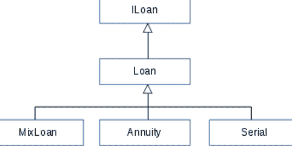

`ILo`是一个接口，但它与类相同的方式包含在类型层次中。另一个例子是考虑问题 2 中的类层次结构：


如果一个类可以继承多个类，那么在 Java 中就可以实现多继承。但 Java 只支持线性继承。这意味着当一个类实现多个接口时，它必须实现所有接口中的方法。

`Object`是一个对象，当`System.out.println()`打印一个对象时，它是该对象的`toString()`方法的结果。如果对象的类没有`toString()`方法——例如`Subject`类——那么执行的是基类的`toString()`，在这种情况下是`Object`类。`Object`类有一个默认的`toString()`方法，它打印类名，后面跟着堆上对象的十六进制引用。当然这没有特殊意义，但它意味着所有对象都可以通过`System.out.println()`打印，更准确地说，拥有任何对象的文本表示。对象的类的程序员负责重写`toString()`以返回一个合理的值。我将再次取消`Subject`类中`toString()`方法的注释：

Mathematics
Mathematics 7

如果你在上面的方法中写了语句

```java
s = "The subject: " + subject;
```

结果将是变量`s`的值为

```
Subject: Mathematics 7
```

原因是加`+`运算符被解释为字符串拼接，由于`subject`是一个对象，它是该对象的`toString()`值被拼接。顺便说，如果你这样写结果也是相同的：

```java
String s = "The subject: " + subject.toString();
```

`Subject`的`toString()`方法如下：

```java
public String toString()
{
    return name;
}
```

如果你现在注释掉这个方法并执行以下方法：

```java
private static void test01()
{
    try {
        ISubject subject = Factory.createSubject("MAT7", "Mathematics");
        System.out.println(subject);
        subject.setName("Mathematics 7");
        System.out.println(subject);
    } catch (Exception ex) {
        System.out.println(ex.getMessage());
    }
}
```

你将得到结果：

```
Subect@6d09c
Subject@6d09c
```


# JAVA 3：面向对象编程 类对象

`Object`是类。`Object`类中的另一个方法是`getClass()`，它返回一个`Class`类型的对象，该对象包含了关于对象类的信息——有很多。考虑以下方法示例：

```java
private static void test02() {
  try {
    ISubject subject = Factory.createSubject("MAT7", "Mathematics");
    print(subject);
  } catch (Exception ex) {
  }
}
```

# JAVA 3: 面向对象编程

```java
System.out.println(ex.getMessage());
}

private static void print(Object obj)
{
    System.out.println(obj.getClass().getName());
    for (Method m : obj.getClass().getMethods()) System.out.println(m.getName());
}
```

注意`print()`方法使用了`Method`类，该类定义在`java.lang.reflect`包中。

`print()`方法有一个类型为`Object`的参数，对于该对象，它会打印对象的类名以及对象的方法名。`test02()`方法创建了一个`Subject`类型的对象并将其作为参数传递给`print()`方法。结果如下：

- `students.Subject`
- `getECTS`
- `setECTS`
- `setName`
- `getName`
- `toString`
- `getId`
- `wait`
- `wait`
- `wait`
- `equals`
- `hashCode`
- `getClass`
- `notify`
- `notifyAll`

你应该注意类名，该对象是一个`Subject`，尽管在`test02()`方法中它被称为`ISubject`。你还应该注意`print()`方法打印了共 14 个方法名。它们都是公共方法，远远多于`Subject`类定义的数量，但其余部分来自于`Object`类 —— 你知道它是`Subject`的基类。

`Class`对象拥有许多方法，因此你可以获取关于对象的许多详细信息。`getClass()`方法不能被重写。

# JAVA 3: 面向对象编程

# Object 类

`Object`类还有一个名为`equals()`的方法，它接收一个类型为`Object`的参数，用于测试两个对象是否相同。考虑以下方法：

```java
private static void test03() {
    try {
        ISubject subject1 = Factory.createSubject("MAT7", "Mathematics");
        ISubject subject2 = Factory.createSubject("MAT7", "Mathematics");
        System.out.println(subject1.equals(subject2));
    } catch (Exception ex) {
        System.out.println(ex.getMessage());
    }
}
```

该方法创建了两个`Subject`类型的对象并测试它们是否相同。如果执行该方法，你将得到结果：

```
false
```


# JAVA 3: 面向对象编程 Object 类

这并不是人们预期的结果。`equals()`方法定义在`Object`类中，通过比较两个对象的地址来判断它们是否指向堆上的同一个对象。在这种情况下，`subject1`和`subject2`是不同的对象，因此`equals()`返回`false`。现在，如果你希望对对象的值进行比较，则由程序员在具体类中重写该方法。

如果你查看`Subject`类，你会发现如果两个`Subject`对象具有相同的`id`，那么它们就是相等的 —— 该值被视为一个标识符。你可以按照以下方式重写`equals()`：

```java
public boolean equals(Object obj)
{
    if (obj == null) return false;
    if (getClass() == obj.getClass())
        return id.toUpperCase().equals(((Subject)obj).id);
    return false;
}
```

这意味着，一个`Subject`对象等于另一个对象，前提是另一个不为`null`，且另一个对象也是`Subject`类型，并且这两个`Subject`对象的`id`在大小写上没有区别。你应该注意，执行`test03()`方法后，`equals()`的结果是`true`。`hashCode()`方法返回一个`int`，且`Object`类中的默认实现返回对象的内存地址。该方法用于将对象表示为一个数字。稍后将展示`hashCode()`方法的应用，在这里我也解释如何重写该方法，原则上如果两个对象相等，它们必须具有相同的哈希值。在`Subject`类中可以这样重写`hashCode()`：

```java
public int hashCode()
{
    return id.toUpperCase().hashCode();
}
```

下载 eBook

# JAVA 3: 面向对象编程 Object 类

`Object`类还有一个具有如下签名的方法：

```java
protected void finalize() throws Throwable
```

由于它是`protected`的，所以不能从其他类中调用，但可以被重写。该方法并没有很多用途，默认实现什么都不做，当对象从堆中移除时，垃圾回收器会调用该方法。你有机会重写该方法以添加对象从堆中移除时执行的代码。

`Object`类中的最后一个方法将具有如下签名：

```java
protected Object clone() throws CloneSupportedException
```

并且不能从其他地方直接调用。其思想是该方法应该创建当前对象的副本。如果一个类实现了`Cloneable`接口，它就可以重写此方法。默认实现创建当前对象的副本。该方法返回当前对象的副本。类可以这样重写该方法：

```java
public Object clone() throws CloneSupportedException
{
  Subject subject = null;
  try {
    subject = new Subject(id, name, ects);
  } catch (Exception ex) {
  }
  return subject;
}
```

# JAVA 3: 面向对象编程 Object 类

将`Subject`的创建封装在`try/catch`中是因为我写的类构造函数并不是必要的，但在其他上下文中包含了。你还应该注意派生类中的方法可见性比基类更高。反之可以降低可见性。考虑以下方法：

```java
private static void test04() {
    try {
        ISubject subject1 = Factory.createSubject("MAT7", "Mathematics");
        ISubject subject2 = ((Subject)subject1).clone();
        System.out.println(subject1.equals(subject2));
        System.out.println(subject1 == subject2);
    } catch (Exception ex) {
        System.out.println(ex.getMessage());
    }
}
```

[img/776e8c536372a20cad0e1e1692e9f3e5_122_0.png]
[img/776e8c536372a20cad0e1e1692e9f3e5_125_0.png]
[img/776e8c536372a20cad0e1e1692e9f3e5_125_1.png]

如果你执行该方法，将得到如下结果：

```
true
false
```

因为两个对象确实是彼此的副本，因此`equals()`为`true`。最后一条语句打印`false`，它显示`subject1`和`subject2`是两个不同的对象。你应该注意语句

```
ISubject subject2 = ((Subject)subject1).clone();
```

`subject1`在代码中已知是`ISubject`类型的对象，而它没有`clone()`方法。因此，必须对`subject1`进行`Subject`类型转换。`clone()`方法返回一个`Object`，因此需要对返回值进行类型转换。类型转换概念将在下一章中详细阐述。

## 对象的类型转换

我之前在 Java 中提到过简单类型的类型转换。例如，你不能显式地将一个`long`复制到`int`，因为`int`的空间可能不够。可能需要编写类似下面的代码来告诉编译器`t`被复制到`a`：

```java
long t = 123;
int a;
a = (int)t;
```

此外，对象也可以进行类型转换，但要求它们必须属于同一个类层次结构。否则，你会得到一个异常，或者在给出错误之前由编译器报错。考虑以下方法作为示例：

```java
private static void test05() {
    try {
        Subject subject1 = new Subject("MAT7", "Mathematics");
        ISubject subject2 = subject1;
        Subject subject3 = (Subject)subject2;
        System.out.println(subject1.equals(subject2));
        System.out.println(subject1.equals(subject3));
        System.out.println(subject3.equals(subject2));
        // Course course = (Course)subject1;
    } catch (Exception ex) {
        System.out.println(ex.getMessage());
    }
}
```

这里的`subject1`、`subject2`和`subject3`都指向同一个对象。注意你可以写：

```
subject2 = subject1
```

因为`subject1`是一个`Subject`对象，因此具体是一个`Subject`对象。相比之下，语句


`subject3 = (Subject)subject2`

需要类型转换，因为 `subject2` 是一个 `ISubject` 对象，不一定是 `Subject` 对象。注意类型转换的语法，在变量前面用括号写上要转换的类型。

与之相反，以下语句：

```java
Course course = (Course)subject1;
```

会导致编译错误，因为 `Course` 和 `Subject` 属于来自同一个类层次结构的类型。


你喜欢汽车吗？你想成为成功品牌的一员吗？我们将感谢并奖励你的热情和才华。向我们发送你的简历。你会惊讶于它能带你走向何方。

在`www.employerforlife.com`向我们发送简历。

在`bookboom.com`下载免费电子书。

# JAVA 3：面向对象编程

## 关于类的最后说明

### 7. 关于类的最后说明

关于类的最后一个说明，我提到了`final`这个词。如果在一个`Institution`类中像`NAME`样定义一个`final`变量：

```java
public final String NAME = "The Linux University";
```

这意味着该变量是一个常量，它的值不能被改变。此外，方法也可以定义为`final`，且`final`方法不能在派生类中被重写。如果在派生类中重写了方法，你有可能写一个完全不同名称的方法，如果你不希望这种情况发生，可以将该方法定义为`final`。此外还可以定义`final`类，而`final`类是不能被继承的类。例如，`String`类就是`final`的。

### 7.1 关于继承的考量

我将用几句备注对关于接口和继承的内容进行总结。从程序员的角度来看，类程序定义了应用程序执行其任务时使用的对象。为了程序的维护，你希望这些类尽可能地低耦合，且类与类之间知道的信息越少越好。这样，你就可以修改类而不影响程序的其他部分。因此，你应该努力编写类，使得更改只影响类本身，从而具有局部意义。

现在你可以编写类之间没有耦合的程序，类的意义恰恰是它必须提供服务，这样你就可以修改类而不影响程序的其他部分。因此，你应该努力编写类，使得更改只影响类本身，从而具有局部意义。

现在你可以编写类之间没有耦合的程序，类类的意义恰恰是它必须提供服务，这样你就可以修改类而不影响程序的其他部分。因此，你应该努力编写类，使得更改只影响类本身，从而具有局部意义。

# JAVA 3：面向对象编程

## 关于类的最后结记

继承最重要的意义不在于对现有代码的扩展（尽管这无疑也重要），而在于父类与子类之间的关系。如果你有一个特化：

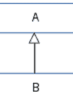

（在这里，A 是一个类还是接口并不重要），重要的是一个 B 必须也是一个 A，并且任何地方 B 都可以被像 A 一样被对待。这意味着你可以写一个方法，并由此写出处理 A 对象的代码：

```text
type metode(A a)
{
```

无论参数是 A 对象、B 对象还是直接或间接继承 A 的其他类型，该方法都能正常工作。该方法不需要知道具体的类型，也不必对此感知。这在面向对象编程中被称为多态，它允许你编写出非常灵活且通用的程序代码。

继承是面向对象编程的基本原理之一，不仅如此，面向对象编程语言支持继承是一项要求。然而，它并不是解决所有问题的方案，继承也存在一些批评。考虑到上述 B 继承 A 的设计，它反映了强烈的连接，特别是当 A 定义了保护成员时。A 的变化极可能会对派生类产生影响。此外，由于 A 和 B 之间的连接是非常静态的，并且在编译时就已经确定了。有时人们会考虑如下的设计：


其中对象 B 通过一个引用知道一个 A。在这里，引用可以在运行时被替换，为 B 提供了引用另一个 A 对象的机会，结果是代码更加灵活。人们说 B 将任务委托给了 A 对象。这两种设计原则并不是直接的替代关系，但在过去的几年中，在以前使用继承的情况下，可能已经通过委托（delegation）进行了简化。

## 问题 3

在这项任务中，你必须编写一些组织成层次结构的类。这些类非常简单，代表几何对象、三角形和正方形，在需要数学公式的地方，使用的是小学阶段已知的简单公式。目标是展示书中处理的许多类概念。

从创建一个 NetBeans 项目开始，你可以命名为`Geometry`。示例处理了上述的几何形状，但你只需要关注形状的周长和面积。相应地，一个形状可以定义如下：

```java
package geometry;

/**
 * 定义一个几何形状。
 */
public interface IShape {

    /**
     * @return 形状的周长
     */
    public double perimeter();

    /**
     * @return 形状的面积
     */
    public double area();
}
```

你需要为项目添加这个接口。然后你需要添加一个名为`Point`的辅助类，代表平面坐标系中的一个点：

```java
package geometry;

public class Point {

    public static final double ZERO = 1.0e-20; // 代表零

    private double x;

    private double y;

    public Point(double x, double y) {

        this.x = x;

        this.y = y;

    }

}
```

# JAVA 3：面向对象编程

## 关于类的最后结记

```java
public double getX()
{
    return x;
}

public double getY()
{
    return y;
}

public double length(Point p)
{
    return Math.sqrt(sqr(x - p.x) + sqr(y - p.y));
}

public String toString()
{
    return String.format("%.4f, %.4f", x, y);
}
```

我加入 MITAS 是因为我想要真正的责任。


第 16 个月

我在北海担任施工主管，指导并帮助工头解决问题。

真实的工作  
国际机会  
三次工作实习

针对工程师和地球地科学家的  
管生计划  
`www.discovermitas.com`


# JAVA 3：面向对象编程

## 关于类的最后结记

```java
public boolean equals(Object obj)
{
    if (obj == null) return false;

    if (getClass() == obj.getClass()) {

        Point p = (Point)obj;

        return Math.abs(x - p.x) <= ZERO && Math.abs(y - p.y) <= ZERO;

    }

    return false;
}
```

```java
public static double sqr(double x)
{
    return x * x;
}
```

关于`length()`方法，请注意给定两个点 `(x1, y1)` 和 `(x2, y2)`，你确定的点之间的距离为：

$\sqrt{(x_1 - x_2)^2 + (y_1 - y_2)^2}$

同样请注意，该类有一个静态方法`sqr()`，它返回一个数的平方。原则上，这种方法与点无关，它只是实现`length()`的辅助方法，但因为它在其他上下文中可能有用，所以它被定义为静态公共方法。

编写一个抽象类`Shape`来实现`IShape`接口。该类应该只重写`equals()`方法：当两个对象具有相同的类，且两个形状具有相同的周长和面积时，这两个形状是相同的。

下一个类将代表一个具体的几何形状。该类应命名为`Ellipse`并必须代表一个椭圆，椭圆完全由作为参数传递给构造函数的两个半径定义：

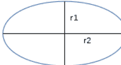

# JAVA 3：面向对象编程

## 关于类的最后结记

你可以根据以下公式计算椭圆的周长和面积：

$area = r_1r_2\pi$

`perimeter = $2\pi\sqrt{r_1^2 + r_2^2}$`

在椭圆的基础上，你编写一个`Circle`类，圆仅仅是两个半径相等的椭圆。`Circle`类可以写为继承`Ellipse`的类。

作为下一步，你应该编写处理三角形的类。从一个`Polygon`类开始，它可以代表任意多边形。它可以通过代表多边顶点 Point 对象来表示。该类应该验证顶点并测试它们是否会导致不规则的多边形（例如边相交的多边形）。多边形可以写为如下类：

```java
package geometry;

public abstract class Polygon extends Figure
{
    protected Point[] p; // 多边形的顶点

    public Polygon(Point[] p)
    {
        this.p = p;
    }

    public double omkred()
    {
        double sum = p[p.length - 1].length(p[0]);

        for (int i = 1; i < p.length; ++i)
            sum += p[i - 1].length(p[i]);

        return sum;
    }

    public String toString()
    {
    }
}
```

知道了顶点后，你可以立即实现`perimeter()`方法，因为周长可以通过边长度的和来确定。然而，你无法立即实现`area()`方法，因此该类被定义为抽象。

# JAVA 3：面向对象编程

## 关于类的最后结记

接下来，编写一个`Triangle`类，它必须是继承`Polygon`的类。该类必须有一个带有三个点作为参数的构造函数，除了构造函数外，该类单独需要重写`toString()`并实现`area()`方法。关于最后，你可以通过如下公式确定边为 a、b 和 c 的三角形的面积：

```text
$areal=\frac{1}{2}ab\sqrt{1-\frac{a^2+b^2-c^2}{2ab}}$
```

其他类的面积计算通过使用以三角形顶点参数的公共静态方法来完成。

`Triangle`类代表由三个点定义的任意三角形。你也可以为三角形拥有更具体的类，例如代表等边三角形的`Equilateral`三角，它应该是继承`Triangle`类的。该类的构造函数必须有一个关于边长的参数（以便于定义形成特定边长三角形的顶点——从点 (0,0) 开始）。出于性能考虑，该类应该重写`perimeter()`方法，因为如果知道边长，实现起来会更高效。编写`Equilateral`类。


# JAVA 3：面向对象编程

## 关于类的最后结记

请编写一个与`RightAngled`类类似的类，它表示一个直角三角形。

对于形状，你应该编写一些表示正方形的类。从`GeneralSquare`类开始，它继承自`Polygon`类。该类必须有一个构造函数，参数是`Point`对象。此外，该类必须实现`area()`方法，该方法在基类是抽象的。没有通用公式来确定通用正方形的面积，但如果你画一条对角线，它会将方形两个三角形（我忽略了正方形可能是凹形的问题）。因此，你可以通过确定两个三角形的面积来实现`area()`方法。

你必须编写一个`Rectangle`类，它继承自`GeneralSquare`，构造函数有两个参数，分别为宽度和高度。此外，编写一个`Square`类，正方形就是边长等的矩形。

你已经写了一些表示几何对象的类，现在你必须定义一个复合形状，它由其他形状组成。以下接口继承自`IShape`并定义了一个名为`IDrawing`的复合形状：

```java
package geometry;

public interface IDrawing extends IShape
{
    public void add(IShape ... shape) throws Exception;
}
```

编写一个`Drawing`类来实现此接口，其中图的周长被定义为图中所有形状周长的之和，面积也是如此。

因此，图是一个`IShape`，因此一个图包含其他图。下面是一个测试程序，它创建了一个包含以下内容的图：

- 一个包含一个圆、一个等边三角形和一个矩形的图
- 一个直角三角形
- 一个包含一个正方形和两个圆的图

```java
package geometry;

public class Geometry
{
    public static void main(String[] args)
    {
        print(create(create(new Circle(2), new Equilateral(3), new Rectangle(3, 4)),
              newRightAngled(3, 4), create(new Square(5), new Circle(1), new Circle(3))));
    }

    private static void print(IShape shape)
    {
        System.out.println(shape);
        System.out.println("Perimeter: " + shape.perimeter());
        System.out.println("Area: " + shape.area());
    }

    private static IShape create(IShape ... shapes)
    {
        IDrawing d = new Drawing();

        try {
            d.add(shapes);
        } catch (Exception ex) {
            System.out.println(ex.getMessage());
        }

        return d;
    }
}
```

测试该程序。结果应该类似于所示：

```text
Start drawing

Start drawing

Circle, r = 2.00000000

Equilateral: 3

Rectangle: width = 3.0, height = 4.0

End drawing

Right angled triangle with kateters: 3.0 and 4.0

Start drawing

Square, side = 5.0

Circle, r = 1.00000000

Circle, r = 3.00000000

End drawing

End drawing

Perimeter: 92.699111843077520

Area: 90.879411467287007
```


此任务的类型组织在类层次结构中，如下所示。通过新类（包括表示新形状的类）来扩展类层次结构是简单的，只要这些类符合 `IShape` 约，`Drawing` 类就可以使用这些类，因为它对具体类一无知。

# JAVA 3：面向对象编程

## 关于类的最后说明

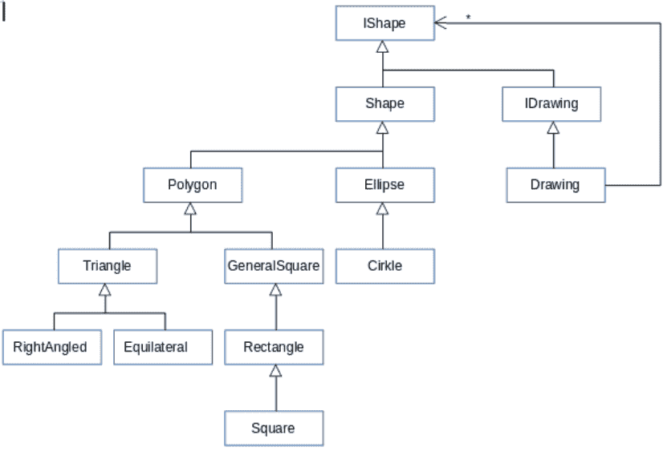

> “我学了16年英语，但是……我最终只用了六节课就学会了说它”
> Jane，中国建筑师

英语世界

点击在下载我的独特课程之前听听我的声音。

# JAVA 3：面向对象编程

## 关于类的最后说明

# JAVA 3：面向对象编程

## 关于类的最后说明

# 7.2 组合模式

组合模式是一种结构性设计模式，允许你将对象组合成树形结构。这种模式让你以统一的方式处理单个对象和对象的组合。

在组合模式中，有一个组件接口，声明了简单对象和复杂对象的的操作。叶子对象（`Leaf`）表示没有子节点的节点。组合对象（`Composite`）包含子节点并通过委托工作给子节点来实现操作。

当你需要表示部分-整体层次结构时，组合模式非常有用。例如，文件系统就是一个经典例子，文件是叶子，目录是包含文件和其他目录的组合对象。

组合模式通过几个类来实现：
- `Component`（组件）：所有对象的公共接口或抽象类。
- `Leaf`（叶子）：表示没有节点的简单元素。
- `Composite`（组合）：表示可以有子节点的复杂对象。

组合模式允许客户端与所有对象统一交互，从而简化代码。客户端不需要检查对象是叶子还是组合对象，只需简单地调用组件接口上的方法。

组合模式对于构建递归树形结构也有用。例如，一个 GUI 框架可以使用组合模式构建，其中按钮、滑块和面板是组件，而面板是组合对象。

组合模式虽然强大但也可能复杂。考虑该模式是否是你的项目的正确选择很重要。如果你不需要部分-整体层次结构，组合模式可能过其实了。

组合模式是软件开发中一种广泛使用的模式。通过使用这种模式，你可以创建更具活性且易于维护的代码。对于任何开发者来说，理解组合模式如何工作以及如何在许多不同场景下使用它是重要的。

# JAVA 3：面向对象编程

## 最终示例

- 涉及 2 个变量的函数
  - `pow`
  - `root`

为了定义应用程序的用户界面，我创建了一个名为 `Calc` 的 NetBeans 项目。该项目创建了一个原型，这是一个打开以下窗口的简单应用程序：

| 计算器 | | 清空 | 计算 |
|---|---|---|---|
| X0 | | | |
| X1 | | | |
| X2 | | | |
| X3 | | | |
| X4 | | | |
| X5 | | | |
| X6 | | | |
| X7 | | | |
| X8 | | | |
| X9 | | | |
| X10 | | | |
| X11 | | | |
| X12 | | | |
| X13 | | | |
| X14 | | | |
| X15 | | | |
| X16 | | | |
| X17 | | | |
| X18 | | | |
| X19 | | | |
| | | 清空 | |

原型仅仅意味着它是一个没有执行任何操作的程序。按钮没有功能，但它可以作为开发程序的良好起点，以明确该程序的全部内容。首先，开发这样一个程序相对较快，而且由于是原型可以展示给未来的用户，它可以作为一个实用的工具来确认任务是否被正确理解。

在这种情况下，决定程序应该能够处理 20 个变量，并且程序必须有一个用于输入表达式的输入字段以及一个用于显示结果的列表框。

## 表达式

表达式可以通过以下语法图精确描述：

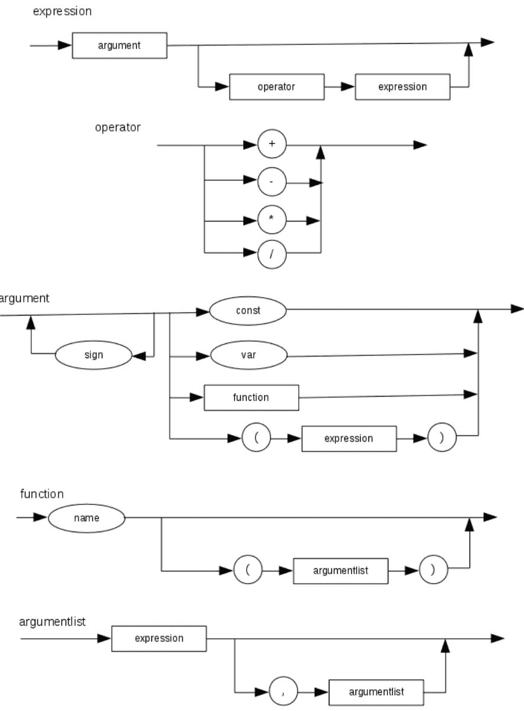

# JAVA 3：面向对象编程

## 最终示例

参数可以是一个或多个符号字符（加号或减号）开头。然后有四种选项：

- `const`，它必须是非负数 —— 一个可以转换为 `double` 的字符串
- `var`，是一个变量，然后格式为 `Xn` 的字符串，其中 `n` 是索引
- `function`，是一个数学函数
- 括号中的表达式

剩下的就是定义什么是函数，这从上述内容中可以得出。

表达式的值必须是一个 `double`。


## 8.2 设计

表达式必须由一个名为 `Expression` 的类表示。原则上，这是一个非常简单的类，除了构造函数外，它只包含一个方法，根据参数返回表达式的值：

| `Expression` |
| --- |
| + `Expression(text: String)` |
| + `getVal(arg): double` |

这里的构造函数比较复杂，因为它接收字符串形式的表达式，因此构造函数的任务是将表达式拆分为多个标记（tokens），并验证这些标记是否代表合法的表达式。标记是可以包含在表达式中的项，标记是如 `cos`、`+` 和数字之类的字符串。根据上述语法图和相关注释，有如下：

| 加法或符号 | 减法或符号 | *乘法* |
| --- | --- | --- |
| `/` 除 | `(` 左括号 | `)` 右括号 |
| `,` 参数分隔符 | `sin` 正弦 | `asin` 反正弦 |
| `cos` 余弦 | `acos` 反余弦 | `tan` 正切 |
| `atan` 弧正切 | `cot` 余切 | `acot` 弧余切 |
| `ln` 自然对数 | `exp` 指数函数 | `log` 以10为底的对数 |
| `alog` 反 | `sqr` 平方函数 | `sqrt` 平方根 |
| `pow` 次方 | `root` 根 | `abs` 绝对值 |
| `frac` 分数 | `floor` 整数部分 | `pi` 常数 pi |
| `e` 常数 e | | |
| `xn` 以 `x` 开头并后跟 `n` 非负整数的变量 | | |
| `num` 带有带有小数点的非负小数 | | |

这可能会产生不同的标记 —— 实际上加号或减号特别可以是一个符号。不同的标记必须被处理，但可以根据共同的属性进行分组，因此我将定义如下的层次结构，每个标记都由一个类定义：

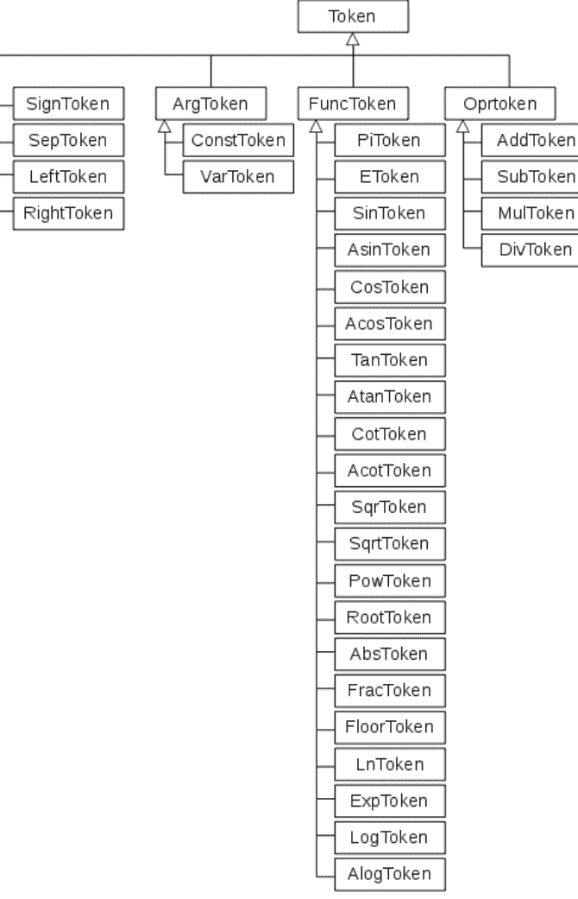

这些是非常简单的类，例如代表正弦函数的 `Token` 类。该类派生自 `FuncToken`，且该类只有两个属性，第一个返回参数数量，第二个决定函数的值：

| `Token` |
| --- |
| + `getCount(): int` |
| + `getValue(arg): double` |

`Expression` 类中的构造函数必须执行以下操作：

- 扫描表达式，这意味着字符串应该被拆分为表达式所包含的标记。
- 解析表达式，这意味着根据语法图检查表达式的语法是否正确。
- 将表达式转换为后置形式（后缀），这意味着表达式元素必须重新组织成后置形式的标记序列。


## 栈 (STACK)

在 Java 中，我们将 `ArrayList` 描述为一种集合，并且我多次使用了它。在第一章中，我提到了栈作为数据结构，用于运行时参数和局部变量。Java 还实现了一个集合类作为栈，我需要该类，由于栈具有两个重要的操作：

1. `push` 将对象放入栈中（将值存储在栈顶）
2. `pop` 返回并移除栈顶的对象

它本质上是一个后进先出（LIFO）数据结构，从栈中移除的对象是最后放入栈的那个。在 Java 中，栈还有其他操作，例如示例 `peek`，它返回栈顶的对象但不移除它。这意味着 `peek` 仅查看栈顶。栈包含的对象数量没有限制。在 Java 中，该类型被称为 `Stack`，我在程序中使用该类型，但也会在下文中引用栈。

## 后置形式 (TO POSTFIX)

通常我们以中缀形式编写表达式，这意味着将运算符写两个操作数之间，例如：

```
2 + 3
```

这意味着 `2` 和 `3` 之和。如果表达式中有多个运算符，我们需要规则规定如何评估表达式。例如

```
2 * 3 + 4
```

这意味着你先计算 `2` 和 `3` 的乘积，然后将结果加 `4` —— 结果为 `10`。相反，意味着

```
2 + 3 * 4
```

这意味着你先计算 `3` 和 `4` 的乘积，因为乘法的优先级高于加法 ——因此结果为 `14`。如果你想抑制这一规则，必须使用括号：

```
(2+3) * 4
```

此时表达式的值为 `20`。

如果表达式中有多个相同优先级的运算符，规则是从左到右评估运算符。下面首先计算 `2` 和 `3` 的和，然后减去 `4`，因为加法和减法的优先级相同：

```
2+3-4
```

表达式可能更复杂，例如

```
(1+2 * (3+4))((/(5+6) *)
```

其中括号内嵌套括号。表达式的值为 `0.19480`。

# JAVA 3：面向对象编程最终示例

例如你必须计算一个值，你有一个包含五个标记（tokens）的列表，通过左到右遍历列表来评估表达式，每当你遇到运算符时，它会对两个操作数进行操作：

```
23 * 4 +
64 +
10
```

该思想是，任何表达式都可以不使用括号写成后缀形式。当需要评估表达式时，从左到右遍历。每当你遇到操作数时，将其放入栈中。如果是运算符，则从栈中弹出两次，使用两个参数计算结果，并将结果放入栈中。最后，栈中将只包含一个元素，即为结果。基于上述表达式最后结果的方法如下所示所示：

| | 4 | | 7 | | 6 | | 7 | | 77 | | 0.1948 |
|---|---|---|---|---|---|---|---|---|---|---|---|
| 1 | | 2 | | 3 | | 2 | | 14 | | 5 | | 15 | | 11 | | 15 | | 15 | | 15 | | | |
| 1 | | 3 | | 4 | | 1 | | 1 | | 1 | | * | + | 6 | | 7 | | / | |


# JAVA 3：面向对象编程最终示例

结论是，评估后缀形式的表达式比中缀形式要容易得多，因此创建一个策略（算法）将表达式从中缀形式转换为后缀形式是值得的。可以使用栈按照以下方式完成：

从左到右遍历表达式并对每个标记：

- 1. 如果是符号，将其入栈
- 2. 如果是函数，将其入栈
- 3. 如果是变量，将其入栈
- 4. 如果是数字，将其入栈
- 5. 如果是左括号，将其入栈
- 6. 如果是右括号，不断出栈直到遇到栈中的左括号，将栈中的元素加入结果
- 7. 如果是运算符，只要栈顶元素的优先级小于或等于当前元素的优先级，就不断出栈并将栈顶元素加入结果，然后将元素入栈

不断出栈并将栈顶元素加入结果，直到栈为空

如你所见，在算法中，确定何时从栈移动到单个标记是至关重要的。优先级决定了结果，结果只是一个列表。算法中的两个重要点是 6 和 7。如果你遇到一个运算符——例如乘法——你首先将栈中所有优先级高于乘法的元素移动到结果中。这些是数字、变量和函数，然后乘法运算符位于栈中。

所以，如果表达式标记被转换为后缀形式，那么在 `Expression` 类中实现 `getValue()` 方法就很简单。

如果你看这个表达式

```
(1 + 2 * (3 + 4)) / ( (5 + 6) * )
```

它可以按照以下方式转换为后缀形式：

```
1
1 2
1 2 3
1 2 3 4 + +
1 2 3 4 + * +
1 2 3 4 + * + 5 +
1 2 3 4 + * + 5 6 *
1 2 3 4 + * + + 5 6 7 *
1 2 3 4 + * + + 5 6 7 / /
```

```
      3 +       4
  2 *       (  *
( /       (  *
  +         + +
( /       (  /  +
( / ( 1+2 ) ) ( ( 3+4 ) ) / /
      5 +       7
      6 +       *
( /       (  *
( /       (  /  /
( / ( 5+6 ) ) ( ( 7 ) )
```

在这个特定任务中，我将应用以下优先级：

- 数字、变量 0
- 符号 1
- 函数 2
- 乘法、除法 3
- 加法、减法 4
- 左括号 9
- 右括号、逗号 99

# 8.3 编程

显而易见程序将包含许多与标记类对应的类。它们都在同一个文件中，包含单个公有类的标记。它们有一个名为 `toToken()` 的单一静态方法，该方法根据代表下一个标记的子字符串和上一个标记的 `Token` 对象将子字符串转换为标记。该类在 `Expression` 类中用于扫描。

如所述，`Expression` 类是一个复杂的类，在扫描之后，该类有一个 `Token` 对象的列表。这些对象必须被解析以测试表达式的语法，为此目的，必须编写许多与语法图对应的方法。这些方法使用了递归，我将在下文中提到。

解析后，标记列表必须转换为后缀形式，但所使用的算法相对简单。你应该注意，转换过程使用栈，即上述上面解释的集合类。在实现计算表达式值的 `getValue()` 方法时也是如此。

## 递归

为了编写 `Expression` 类（语法检查器），我需要递归，因此关于什么是递归有几句话。

类中的方法可以被看作是孤立的代码，它根据参数执行特定的操作并返回一个值。方法语句（它执行的命令）可以是所有可能的语句，并且对它能做什么没有限制。例如调用另一个方法，因此方法可以特别地调用自身。如果是这样，我们就说该方法是递归的。一个递归方法的示例——一个不涉及特定程序的示例——显示了计算阶乘的方法：

```
static long factorial(int n)
{
  if (n == 0 || n == 1) return 1;
  return n * factorial(n - 1);
}
```


- 《金融时报》世界排名第 33 位：国际商务硕士
- 第一名：国际商务硕士
- 第一名：金融经济学硕士
- 第二名：学习管理硕士
- 第二名：经济学硕士
- 第二名：计量经济学与运筹硕士
- 第二名：全球供应链管理与变革硕士

来源：Kepler 硕士排名 2013；爱思尔“最佳研究”排名 2012；《金融时报》工商管理排名 2012

马斯特里特大学是荷兰最好的专业性大学（Bievier）。

访问我们并发现为什么我们是最好的！硕士开放日：2014 年 2 月 22 日

## JAVA 3：面向对象编程

相比之下，`Calc` 程序和我这一系列软件开发书籍中所展示的程序不同，它侧重于算法，即如何使用程序解决相对复杂的问题。这里我不在这里展示代码（如果你要研究代码，那里超过 1200 行），但如果你要研究这里的代码及其算法，应特别关注以下几点：

- 如何进行扫描
- 表达式是如何解析的
- 表达式如何转换为后置表达式
- 表达式是如何求值的

这一切都在 `Expression` 类中完成，但代码经过了详细的注释。


# 附录 A

应用程序在使用之前必须经过测试，例如你可以尝试运行程序，并检查程序是否给出了正确的结果。这始终是测试的一部分，因为只有通过测试，才能意识到程序对用户来说是否按预期工作。你必须记住测试在输入非法或不合法程序参数时应用程序的行为，测试窗口缩放时会发生什么也很重要。此外，用户测试由编写程序的人以外的人执行这一点很重要，因为程序员极可能会因为共性而忽略任何问题：你永远不知道真实用户能发现什么！

有时你除了上述提到的内容外不需要做别的，但在其他语境下，需要在较低级别测试代码，即由程序员测试代码。我将提到三种重要方法：

1. 注释代码。
2. 调试代码。
3. 单元测试代码。

我将使用 `CurrencyProgram` 作为示例。

## 注释代码

这三种方法都很重要，各有优劣。我之前提到过，在代码中编写注释是确保完成程序质量的一种有效（经常被忽视）的手段。原则上，这是非常简单的，但你不应该低估这个过程。为了未来的维护，良好的文档清晰且重要，但更重要的是编写文档的过程，如果执行得足够认真的话。

我认为你必须记录以下内容：

- 在每个类的前写一段注释，说明该类的目的和起源，但通常你应该写下你认为未来维护代码的人需要知道的所有信息。注释会随着类的任何后续实质性更改而更新，并以 Java 注释的形式描述，使其成为完整文档的一部分。
- 所有变量和其他数据定义都用简短的注释说明该变量的用途。在这里我不使用 Java 注释，除非它是公共静态变量或字段。
- 所有公共方法都用 Java 注释进行记录，以便它们被包含在最终的类文档中。所有的返回值和异常都将被记录，但通常还应该包含对方法目的的描述，包括参数的前置条件和可能的副作用。对于简单的 `get` 方法，通常注释返回值就足够了。
- 原则上，所有私有和受保护的方法以相同的方式进行记录，但在这里我不使用 Java 注释。这些方法的文档不应包含在最终的类文档中。
- 最后，在某些算法中，可能需要对代码细节进行注释。通常我将这些留作为方法前端注释的一部分，并努力避免在方法体内部编写注释，但如果需要解释算法的工作原理，当然不要避免此类注释。

如所述，这个过程很重要，因为它是工作的一部分——即思考你现在为什么要写这样的代码。我不会说通过这种就能找到所有错误，但你会发现许多许多不便之处以及解决方案无效的地方。

记录代码是一项庞大的工作，但这项工作是值得的！

并不是所有代码我都记录，我通常记录的是控制器（controller）和模型（model）类。然而，对用户界面中的类进行记录是很罕见的，至少在有限范围内。我觉得这样做并不会产生任何特殊的收益，无论是作为未来的文档还是异常检测。原因可能是因为用户界面的开发很大程度上是重用其他程序的代码。

`CurrencyProgram` 项目是根据这些建议记录的。

## JAVA DOC

如上所述，你应该广泛使用 Java 注释，我还讨论了如何让 NetBeans 在方法前插入骨架。正如多次所示，有一种特殊的语法可以从参数、返回值等插入注释，实际上确实有一些（标签），其中最重要的包括：

- `@author`，作者，类的作者。
- `@code` 以代码字体显示文本，而不将测试内容解释为 HTML。
- `@exception` A Throws（抛出异常）在生成的文档中添加一个标题，带有类名和描述。
- `@link` 插入一个带有可见文本标签的内联链接，指向指定的包、类或引用类的成员名称的文档。
- `@param` 添加带有指定参数名称的参数，后跟该参数的特定描述。
- `@return` 返回一个带有描述的章节。
- `@see` 添加一个 See 标题，带有指向引用的链接或文本条。

这种工具的意图是，使用这些注释可以生成作为 HTML 文档的完整文档，你可以在文档中编写自己的 HTML。

如果你在 NetBeans 中有一个像 `Currency` 这样的项目，右键点击项目名称，你会得到 Generate Javadoc 菜单，它可以生成文档。NetBeans 将打开浏览器显示结果，你可以将其保存。以下是当前项目的文档：

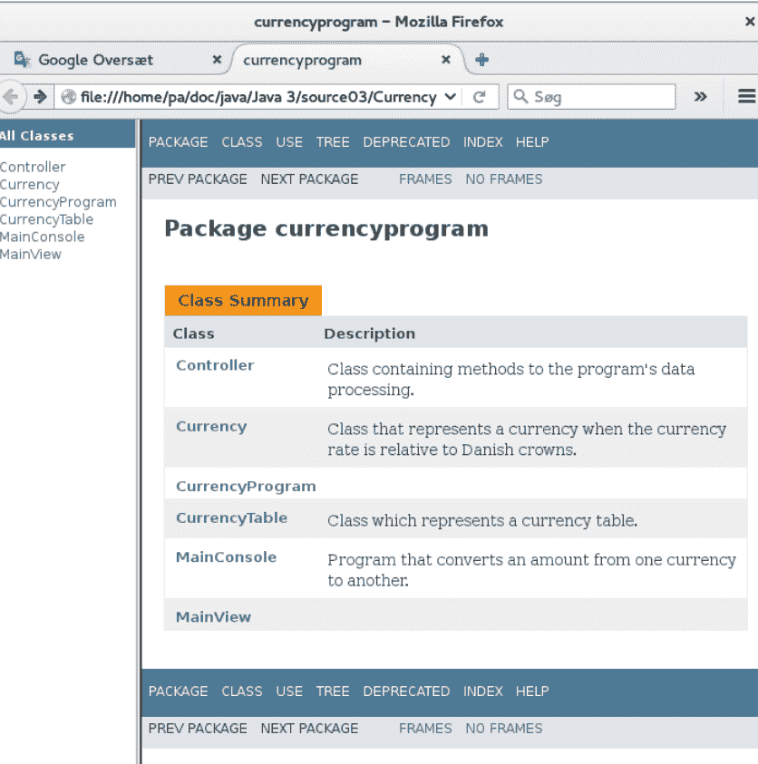

## 调试代码

现在，将调试代码作为测试的一部分可能完全完全，NetBeans 拥有一个很好的调试器，由于我之前没有提到过，在这里必须用几句话说明。

当你想要测试一个程序时，它经常会失败，可能你会得到错误的结果，或者程序崩溃。任务就是找到并纠正错误，在这里调试器可以提供帮助。你可以设置断点，这意味着当程序到达代码中的该点时会停止，然后你可以查看变量的值并检查它们是否正确。你还可以逐步执行代码语句，并持续监控变量的变化。

例如，你可能认为在创建新的 `CurrencyTable` 对象时 `CurrencyTable` 程序失败了（它是一个单例，在实例化对象时可能出现错误），任务是找出哪里出错了。例如，你可以在 `init()` 方法中设置一个断点：


```java
// 根据以下字符串数组构建货币表。

// 如果发生错误，无法将字符串解析为货币，

// 则会打印错误信息并终止程序。

private void init() {

    for (String line : rates) {

        StringTokenizer tk = new StringTokenizer(line, ":");

        if (tk.countTokens() == 3) {

            try {

                String name = tk.nextToken();

                String code = tk.nextToken();

                double rate = Double.parseDouble(tk.nextToken());

                table.add(new Currency(code, name, rate));

            } catch (Exception ex) {

                System.out.println(ex.getMessage() + "\n" + line);

            } else {

                System.out.println("Error: " + line);

            }

        }

    }

}
```

随后，你可以通过点击鼠标移动到下一个目标行（此处为第 88 行）来解除断点。你可以从菜单 `Debug | Debug Project` 启动调试器。当执行 `init()` 时，程序将停止在断点处，你可以逐行通过（使用 F8）来执行代码。这样，你就可以看到程序可能崩溃的地方。你还可以对变量设置监视（在调试窗口中右键点击），并查看变量的值以及以下内容的变化：

```java
String code = tk.nextToken();

double rate = Double.parseDouble(tk.nextToken());

table.add(new Currency(code, name, rate));

catch (Exception ex) {
```

| 名称 | 类型 | 数值 |
|---|---|---|
| <输入新监视项> | CurrencyTable | #829 |
| `line` | String | `"Danske kroner.DKK.100.00"` |
| `tk` | StringTokenizer | #838 |
| `name` | String | `"Danske kroner"` |
| `code` | String | `"DKK"` |
| `rate` | double | 100.0 |

## JAVA 3：面向对象编程

调试器还有许多其他分析代码的机会。例如，你可以通过按 F7 进入方法代码内部。你应该检查 `Debug` 菜单以了解有哪些可用功能。花些时间学习使用调试器是值得的，因为它是一个用于故障排除的高效工具。它可能不是直接的测试工具，但它是发现测试期间检测到的错误的良好工具。

## 单元测试

单元测试是通过集成在 NetBeans 中的工具完成的。与程序测试（即测试已完成的程序以及它是否满足所有要求）不同，单元测试是一种测试单个类和方法的系统化方法，因此它是程序员在开发过程中必须完成的工作。并不是所有内容都可以单元测试，它最适合测试控制器类和模型类，特别是单元测试对库中的类非常有效。

我测试 `Controller` 类，它有三个方法：

```java
package currencyprogram;

import java.util.*;

import java.io.*;

/**
 * 包含程序数据处理方法的类。
 */
public class Controller {

    /**
     * 将金额从一种货币转换为另一种。
     * 转换主要通过下一个计算方法完成，该方法
     * 主要负责验证金额是否为合法数字。
     * @param amount 要转换的金额
     * @param from 要转换的货币
     * @param to 要转换的目标货币
     * @return 转换结果
     * @throws Exception 无法解析金额或货币对象为空
     */
    public double calculate(String amount, Currency from, Currency to) throws Exception {

    }

}
```

## JAVA 3：面向对象编程

# 附录 A

```java
/**
 * 将金额从一种货币转换为另一种。
 * @param amount 要转换的金额
 * @param from 要转换的货币
 * @param to 要转换的目标货币
 * @return 转换对象的结果
 * @throws Exception 如果其中一个货币对象为空
 */
public double calculate(double amount, Currency from, Currency to)
{

}
```

```java
/**
 * 从由分号分隔的文本文件中更新货币表。
 * 每行由三个用分号分隔的字段组成，顺序如下：
 * 名称;代码;汇率(rate)
 * @param file 读取货币的文件
 * @return 包含所有无法转换为货币的行的列表
 */
```


## JAVA 3：面向对象编程

```java
public ArrayList<String> update(File file)
{

  ..

}
```

首先，我创建一个测试类。你可以通过在项目（Projects）选项卡中右键点击类名 `Controller.java` 来，在这里你应该选择 `Tools | Create / Update Tests`

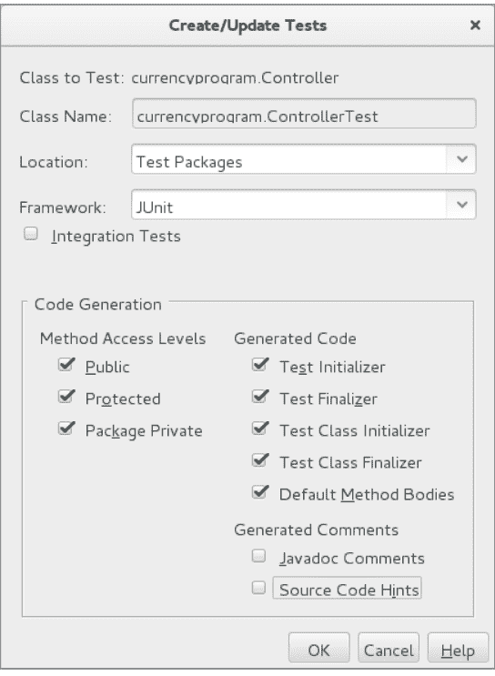

我保持了所有设置不变。当你点击 OK 时，可能会收到一个对话框：


## JAVA 3：面向对象编程

# 附录 A

# JAVA 3：面向对象编程

# 附录 A

测试通过率：66.67%

通过了 2 个测试。失败了 1 个。(0.04 s)

`currencyprogram.ControllerTest` 失败

在这种情况下，测试失败了。原因是第三个用例失败了，因为错误地——存在一个错误的预期值。我将其更改为：

```java
assertEquals(instance.calculate(1000, v2, v3), 1250, 0.0001);
```

然后测试执行正确：

测试通过率：100.00%

所有 3 个测试均已通过。(0.03 s)

此类测试的价值取决于测试用例的数量。以下是测试方法的代码：

```java
@Test
public void testCalculate_3args_1() throws Exception {

    System.out.println("calculate(String amount, Currency from, Currency to)");

    Currency c1 = new Currency("DKK", "Danish crowns", 100);

    Currency c2 = new Currency("EUR", "Euro", 750);

    Currency c3 = new Currency("USD", "US dollar", 600);

    Controller instance = new Controller();

    assertTrue(Math.abs(instance.calculate("1000", c2, c1)) < 7500);

    assertTrue(Math.abs(instance.calculate("1000", c1, c2)) < 133.33);

    assertTrue(Math.abs(instance.calculate("1000", c2, c3)) < 1250);

    assertTrue(Math.abs(instance.calculate("1000", c3, c2)) < 800);

}
```

这看起来与之前的测试相似，这两个方法之间的区别仅仅在于第一个参数的类型。每个用例都通过 `assertTrue()` 以不同的方式编写。除了语法之外，没有其他特殊原因。

你也可以添加自己的测试，以下方法用于测试当对 `calculate()` 方法传入为空的 `Currency` 时是否会抛出异常：

```java
@Test(expected=Exception.class) throws Exception {

    System.out.println("calculate with arguments that is null");

    Currency c1 = new Currency("DKK", "Danish crowns", 100);

    Controller instance = new Controller();

}
```

在 bookoon.com 免费下载电子书

# JAVA 3：面向对象编程

# 附录 A

```java
assertEquals(instance.calculate(1000, c1, null), 7500, 0.0001);

assertEquals(instance.calculate(1000, null, c1), 133.33, 0.01);

}
```

你应该注意，如何指定测试用例可能会抛出异常。

接下来，我为 `CurrencyTable` 类添加了一个测试类。这样做的方法与上面完全相同，结果如下：

```java
package currencyprogram;

import java.util.Iterator;

import org.junit.After;

import org.junit.AfterClass;

import org.junit.Before;

import org.junit.BeforeClass;

import org.junit.Test;

import static org.junit.Assert.*;

public class CurrencyTableTest {

    public CurrencyTableTest() {

    }
```


```java
@BeforeClass
public static void setUpClass() {

}
```

```java
@AfterClass
public static void tearDownClass() {

}
```

```java
@Before
public void setUp() {

}
```

```java
@After
public void tearDown() {

}
```

```java
@Test
public void testGetInstance() {
```


`System.out.println("getInstance");`

`CurrencyTable expResult = null;`

`CurrencyTable result = CurrencyTable.getInstance();`

`assertEquals(expResult, result);`

`fail("The test case is a prototype.");`

```
```java
@Test
public void testCurrency() throws Exception {
    System.out.println("getCurrency");
    String code = "";
    CurrencyTable instance = null;
    Currency expResult = null;
    Currency result = instance.getCurrency(code);
    assertEquals(expResult, result);
    fail("The test case is a prototype.");
}
```

```java
@Test
public void testIterator() {
    System.out.println("iterator");
    CurrencyTable instance = null;
    Iterator<Currency> expResult = null;
    Iterator<Currency> result = instance.iterator();
    assertEquals(expResult, result);
    fail("The test case is a prototype.");
}
```

```java
@Test
public void testUpdate() {
    System.out.println("update");
}
```

```java
Currency currency = null;
CurrencyTable instance = null;
boolean expResult = false;
boolean result = instance.update(currency);
assertEquals(expResult, result);
fail("The test case is a prototype.");
```

这次有四个测试方法。第一个静态方法`getInstance()`仅仅返回了单例的引用。这没有意义，我会删除它。所以你可以简单地删除你不想执行的测试方法。在`ControllerTest`类中也有一个方法，但我不会写代码，但请注意，编写一个包含测试数据的文件并测试该方法是否正常工作是简单的。

```java
@Test
public void testCurrency() throws Exception {
    System.out.println("getCurrency(String code)");
    assertNotNull(CurrencyTable.getInstance().getCurrency("DKK"));
    assertNotNull(CurrencyTable.getInstance().getCurrency("EUR"));
}
```

```java
@Test
public void testUpdate() {
    System.out.println("update(Currency currency)");
    try {
        int count1 = 0;
        for (Currency c : CurrencyTable.getInstance()) ++count1;
        Currency c1 = new Currency("EUR", "European euro", 800);
        Currency c2 = new Currency("TST", "Test currency", 1000);
        CurrencyTable.getInstance().update(c1);
        CurrencyTable.getInstance().update(c2);
        Currency c3 = CurrencyTable.getInstance().getCurrency("EUR");
        Currency c4 = CurrencyTable.getInstance().getCurrency("TST");
        int count2 = 0;
        for (Currency c : CurrencyTable.getInstance()) ++count2;
        System.out.println(c3.getName());
        System.out.println(c4.getName());
        assertEquals(c3.getRate(), 800, 0.0001);
        assertEquals(c4.getRate(), 1000, 0.0001);
        assertEquals(count2, count1, 1);
    } catch (Exception ex) {
        System.out.println(ex);
    }
}
```

在 bookoon.com 免费下载电子书

没有什么好解释的，但请注意第一个使用`assertNotNull()`来检查对象是否为空。同样注意，这次你不应该创建`CurrencyTable`的实例，因为该类被写为单例。最后，注意最后一个测试方法，以及测试方法可以包含所有需要的 Java 语句。

单元测试的强度如前所述，取决于测试用例的数量。编写单元测试类可能是一项大量的工作，但类必须经过测试，单元测试的真正价值在于，如果你先编写了独立的测试方法，你就可以在需要时重复测试，而且原则上是在每次修改类时都进行。

关于单元测试的最后一点，NetBeans 有一个菜单`Run | Test Project`，如果你选择它，所有的测试类都将执行。


