# Java 4 Selenium WebDriver：学习自动化测试编程（第 2 部分）


1. 30 天内掌握 Selenium 的 3 个技巧

[`tinyurl.com/3-Tips-For-Selenium`](http://tinyurl.com/3-Tips-For-Selenium)

2. 30 天内掌握 QTP/UFT 的 3 个技巧

[`tinyurl.com/3-Tips-For-QTP-UFT`](http://tinyurl.com/3-Tips-For-QTP-UFT)

3. 免费网络研讨会、视频和直播培训

[`tinyurl.com/Free-QTP-UFT-Selenium`](http://tinyurl.com/Free-QTP-UFT-Selenium)

# 前言

根据 [TIOBE](http://www.tiobe.com/tiobe_index)，`Java` 是编程社区中最流行的编程语言。因此，`Java` 是学习自动化应用领域中一门很棒的语言。要在自动化项目中高效工作，掌握一套核心的 `Java` 知识是必要的。第二部分——`Java 4 Selenium WebDriver` 提供了核心的 `Java` 知识以及涉及继承、包等许多概念。

## 目标读者

目标读者群是具备变量、数据类型、操作符、分支和循环知识的程序员。如果个人需要建立 `Java` 基础，建议阅读第一部分——`Java 4 Selenium WebDriver`。

## 目的

本书的目的不是用成百上页关于 `Java` 的内容（即信息过载）让你感到压力。相反，它将提供简洁且具有直接定义、示例和图表的价值信息。在读完第二部分——`Java 4 Selenium WebDriver` 后，你将对 `Java` 和面向对象编程有深入理解。

# 关于作者


Rex Jones II 是一位 QA/软件测试人员，热于分享测试知识。自 2005 年 2 月以来，他一直在观看网络研讨会、参加会议并测试应用程序。Jones 先生于 1999 年 6 月毕业于德瑞大学（DeVry University），获得计算机信息系统（CIS）科学学士学位。

目前，Rex 是达拉斯/沃特沃斯水星用户组（DFWMUG）的高级顾问和前董事，以及达拉斯/沃特沃斯质量保证协会（DFWQAA）的成员。除了用户组成员身份外，他还是一名认证软件测试工程师（CSTE），并持有测试管理方法（TMap）认证。

# 版权、法律声明和免责声明

本出版物受 1976 年美国《版权法》保护。保留所有权利，包括转售权，该转售权适用于国际、联邦、州和地方法律。购买者未许可向任何人分享或出售此书。

请注意，本出版物的大部分内容基于个人经验和轶事证据。作者已尽一切合理努力确保书中内容的准确性。他对未知的错误或遗漏不承担任何责任。因此，购买者应根据其认为合适的方式使用信息。

任何商标、服务标记、产品名称或命名特征均被认为是各自所有者的财产，并仅供参考。

版权所有 © 2016 Test 4 Success, LLC。全球保留所有版权。

## 致谢

我想感谢我的妻子 Tiffany、孩子们 Olivia Rexe’ 和 Rex III、编辑 Samantha Mann、我的家人、朋友以及许多提供鼓励的人。撰写这本书花费了大量时间，你们的支持帮助了这本书的向前发展。

感谢，


Rex Allen Jones II

# 第一章

## 面向对象编程

面向对象编程（OOP）是编程领域中最流行的范式。它是一种以对象为中心的编程方法。因此，识别对象是 OOP 中核心的原则之一。根据 [dictionary.com](http://www.dictionary.com/browse/object?s=t)，对象是任何可见或可触及的事物。因此，对象可以是人、地点或事物，其在编程中的识别方式就像现实世界中一样。所有对象都有两个特征：状态和行为。状态标识对象，而行为代表对象的操作。

第一章通过提供对本书“第二部分 – Java 4 Selenium WebDriver”的概述，强调了面向对象编程（OOP）：

* 类、对象和方法

* 数组和字符串

* 继承

* 包

* 接口

* 错误、异常与调试

* 利用输入和输出

## 类、对象和方法

`Java` 是一种面向对象编程（OOP）语言，包含类、对象和方法（参见第二章中的类、对象和方法）。类是创建对象的蓝图，方法为对象执行任务。类包含数据以及操作这些数据的代码。对象是 OOP 的基础，而方法执行操作。方法的责任是指示程序执行什么操作以及如何执行该操作。

## 数组和字符串

在 `Java` 中，数组和字符串都是对象（参见第三章中的数组和字符串）。数组是一组具有相同数据类型、相同名称和固定数量值的相关变量。数组中的所有项都通过从零开始的索引访问。另一方面，字符串是一组不可更改的字符。字符串提供了许多方法，方便对对象进行操作。

## 继承

继承是一种层次概念，允许代码和对象的重用（参见第四章中的继承）。每个类允许其他类继承其代码。因此，类之间的关系是父类和子类。父类是父亲类，子类是子类。这些类在保持独特特征的同时，保留某些共同的数据。

## 包

包是相关类的集合（参见第五章中的包）。

# 利用输入和输出

`Java` 输入/输出（I/O）是一个包含许多类、接口和方法的庞大系统（参见第八章中的利用输入和输出）。信息从输入源读取并写入输出。程序通过流执行输入输出，流代表数据。`Java` 中的文件被存储和组织。大多数文件采用树形结构。树的顶部是根节点，它包含文件夹和文件。所有文件夹和文件在树中都有独特的路径。

# 第二章

面向对象编程（OOP）是一种以对象为核心进行构建的编程语言。类、对象和方法是 OOP 中相互关联的基础。对象（`part0000_split_018.html__Objects`）是任何可见或可感知的事物。然而，类（`part0000_split_017.html__Classes`）是对象的模板，而方法（`part0000_split_019.html__Methods`）提供了从程序各个组件与类（`part0000_split_017.html__Classes`）交互的可能。

数据以及操作该数据的代码（称为语句）是对象的两个合并的概念。因此，这两个合并的概念允许了一种名为“信息隐藏”的概念，通过这种方式可以隐藏数据。因此，默认情况下，对象的数据只能通过持有该对象的方法访问。受限制的访问防止了其他程序组件的干扰并导致错误。如果另一个组件想要更改对象的数据，该组件必须调用一个公开访问的方法。以下是四种类型的方法：

1. `Instance`（实例） – 可由对象访问的方法

2. `Class`（类） – 类中所有对象共享的方法

3. `Main`（主） – 用于运行应用程序的特殊方法。`Selenium WebDriver` 不需要这种类型的方法。

4. `Constructor`（构造函数） – 用于初始化特定类对象的特殊方法

方法和变量被标记为类的成员，因为它们构成了该类。对这两个成员的访问由四种修饰符控制：

1. `public`（公共） – 允许访问定义在其 `class` 外部代码的修饰符

2. `private`（私有） – 允许访问其 `class` 内部其他成员的修饰符

3. `no modifier`（无修饰符） – 允许访问其 `package` 内部所有 `classes` 的修饰符

4. `protected`（保护） – 允许在其 `package` 内部以及所有 `subclasses` 中访问的修饰符

通常，类的成员通过其类内部的对象进行访问。然而，关键字 `static` 允许在类中创建任何对象之前访问成员。当关键字放置在成员前面时，方法和变量被声明为 `static`。

第二章将解释关于类、对象和方法的以下内容：

* `Classes`（类）

* `Objects`（对象）

* `Methods`（方法）

* `This Keyword`（this 关键字）

* `Annotations`（注解）

* `Access Modifiers`（访问修饰符）

* `Static Keyword`（static 关键字）

## Classes

类定义了数据以及操作数据的代码。数据由变量表示，代码由方法表示。变量和方法都是类的成员。因此，类是一个定义对象结构的模板。因此，类的结构必须是精确的。由一个逻辑实体构成的类才是完整的。用逻辑连接的信息来定义类是非常重要的。例如，一个包含英语课程信息的类不应该包含关于学校学区限速的无关信息。

大多数现实世界的类包含一个实例变量和一个操作该实例变量的方法。记住第一本书《(Part 1) 绝对初学者：Java 4 Selenium WebDriver》：实例变量声明在类内部、方法外部。因此，实例变量的值对于每个对象来说都是唯一的。这种类型的变量可以在初始化之前或之后使用，并且对类中的所有方法可见。以下是定义类的语法：

### Syntax

```
class ClassName
{
    // Declare Instance Variable
    variableType variableName1;
    variableType variableName2;
    variableType variableNameN;

    // Declare Methods
    methodType methodName1 ()
    {
        // Body of the Method
    }
    methodType methodName2 ()
    {
        // Body of the Method
    }
    methodType methodNameN ()
    {
        // Body of the Method
    }
}
```

## Objects

面向对象编程 (OOP) 构建在对象之上。关键字 `static` 允许在类中创建任何对象之前访问成员。当关键字放置在成员前面时，方法和变量被声明为 `static`。

方法和变量被标记为类的成员，因为它们构成了该类。对这两个成员的访问由四种修饰符控制：

1. `public`（公共） – 允许访问定义在其 `class` 外部代码的修饰符

2. `private`（私有） – 允许访问其 `class` 内部其他成员的修饰符

3. `no modifier`（无修饰符） – 允许访问其 `package` 内部所有 `classes` 的修饰符

4. `protected`（保护） – 允许在其 `package` 内部以及所有 `subclasses` 中访问的修饰符

通常，类的成员通过其类内部的对象进行访问。然而，关键字 `static` 允许在类中创建任何对象之前访问成员。当关键字放置在成员前面时，方法和变量被声明为 `static`。

### Creating and Access Objects（创建和访问对象）

以下是一个名为 `English` 的仅包含数据的类示例：

```
class English
{
    int students;
    int weeks;
    int days;
}
```

图 2.1 – Data Only（仅数据）

以下是创建并访问对象的示例：

```
class English
{
    int students;
    int weeks;
    int days;
}

class OneEnglish
{
    public static void main (String args[])
    {
        English ENG101 = new English ();
        int totalDays;
        ENG101.students = 10;
        ENG101.weeks = 4;
        ENG101.days = 3;
        totalDays = ENG101.weeks * ENG101.days;
        System.out.println("The English 101 course is a total of " + totalDays + " days");
    }
}
```

图 2.2 – Create New Object and Access Variables（创建新对象并访问变量）

程序输出：

The English 101 course is a total of 12 days

第 12 行通过两个步骤创建一个新对象（`English ENG101 = new English ();`）。根据《Java A Beginner’s Guide 第 2014），这两个步骤可以重写如下，以显示每个步骤：

1. `English ENG101;` – 赋值左侧声明了一个类型为 `English` 的变量 `ENG101`。

2. `ENG101 = new English ();` – 赋值右侧创建了对象的副本，并赋予 `ENG101` 该对象的引用。

使用点运算符 `.` 的语法为：

```
objectName.MemberName
```

点运算符连接对象与成员（实例变量或方法）。在这个示例中，对象名（`ENG101`）位于左侧，实例变量（`students`, `weeks`, `days`）位于右侧。对象持有类定义的实例变量副本。因此，如果存在多个对象，每个对象的值可以与其他不同。以下示例说明了两个对象（`ENG101` 和 `ENG202`）的创建：

```
class English
{
    int students;
    int weeks;
    int days;
}

class TwoEnglishCourses
{
    public static void main (String args[])
    {
        English ENG101 = new English ();
        English ENG202 = new English ();
        int totalDays101;
        int totalDays202;

        ENG101.students = 10;
        ENG101.weeks = 4;
        ENG101.days = 3;

        ENG202.students = 12;
        ENG202.weeks = 6;
        ENG202.days = 3;

        totalDays101 = ENG101.weeks * ENG101.days;
        totalDays202 = ENG202.weeks * ENG202.days;
    }
}
```

```java
System.out.println("The English 101 course has " + ENG101.students + " students and the course last " + totalDays101 + " days");
totalDays202 = ENG202.weeks * ENG202.days;
System.out.println("The English 202 course has " + ENG202.students + " students and the course last " + totalDays202 + " days");
}
```

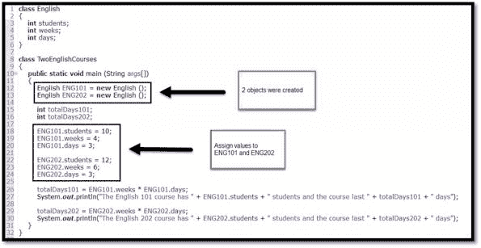

### 图 2.3 – 创建了两个对象

**程序输出：**

English 101 课程有 10 个学生，持续 12 天

English 202 课程有 12 个学生，持续 18 天

第 12 行和第 13 行创建了两个对象（`ENG101` 和 `ENG202`），然后在第 18 行至第 24 行为这两个对象赋值。请记住，如果存在多个对象，每个对象可以持有与另一个对象不同的值。在这个示例中，变量 `students` 和 `weeks` 被赋予了不同的值，但变量 `days` 两个对象都包含相同的值 `3`。

**注意：** 变量的命名约定是 `lowerCamelCase`（小驼峰命名法），即变量名除第一个单词外，每个单词的首字母大写。然而，`ENG101` 和 `ENG202` 是例外，它们包含全大写字母，因为学校课程在数字名前通常包含全大写字母。

## 方法 (Methods)

方法是一个用大括号包围的代码块，用于执行特定的操作/任务。其目的是操作并访问由类定义的数据。换句话说，方法对数据执行操作。最好的做法是所有方法都执行单一任务。例如，一个良好的方法只会执行加数字的单一任务，而不是既加数字又将数据保存到文件中。如果一个方法执行了多个任务，程序可能会变得难以阅读和理解。

方法由头（header）和体（body）组成。方法头包括方法类型和方法名。方法名的命名约定与变量名相似，采用 `lowerCamelCase` 风格。除第一个单词外，每个单词的首字母大写。方法名后面必须跟有一对括号，这将变量与方法区分开来。以下是方法的语法：

## 语法

```
methodType methodName (parameter-list)
{
    // 方法体
}
```

`methodType`（称为返回类型）决定了方法返回的数据类型。如果不返回任何值，程序员将被强制使用 `void` 关键字作为 `methodType`。`methodName` 可以是除 `Java` 关键字外的任何名称。命名方法的一种良好技巧是使用“动词+名词”的组合，例如 `getOrder` 或 `addNumbers`。方法体是执行代码以完成任务的地方。参数列表是接收传递方法的 `arguments` 的变量。如果方法没有 `parameters`，则参数列表必须为空。

**注意：** 方法签名（method signature）是 `methodName` 和参数列表。

## 方法返回 (Method Returns)


方法返回是指从方法返回值或将控制权移出方法的概念。这两个概念都通过使用`return`关键字来实现。无论`return`关键字位于何处，执行都会终止并跳过方法内的后续语句。以下是两种方法返回类型：

1. 返回值的方法
2. 不能返回值的方法

根据`ORACLE`的说明，方法在以下情况下返回到调用它的代码：

* 完成方法中的所有语句
* 达到`return`语句或
* 抛出异常

以先发生者为准。

**注意：** 通常，`return`关键字（也称为返回语句）不用于不能返回值的方法。不使用是因为方法中的所有代码在执行`return`关键字之前已经完成。然而，如果使用了`return`关键字，它将在方法的末尾实现，以转移控制权。

### 返回值 (Return A Value)

大多数方法都会返回一个值，用于指定计算的结果或结果（通过、失败等）。返回值必须与方法类型的数据类型相同。例如，如果方法类型是`int`数据类型，那么返回类型必须是`int`数据类型。以下是方法返回的语法和示例：

**语法**

```
return value;
```

```java
class English
{
    int students, weeks, days;
    int totalDays ()
    {
        return weeks * days;
    }
}

class TwoEnglishCourses
{
    public static void main (String args[])
    {
        English ENG101 = new English ();
        English ENG202 = new English ();
        ENG101.students = 10;
        ENG101.weeks = 4;
        ENG101.days = 3;
        ENG202.students = 12;
        ENG202.weeks = 6;
        ENG202.days = 3;
        System.out.println("The English 101 course has " + ENG101.students + " students and the course last " + totalDays101 + " days");
        System.out.println("The English 202 course has " + ENG202.students + " students and the course last " + totalDays202 + " days");
    }
}
```

### 图 2.4 – 返回一个值

**程序输出：**

English 101 课程有 10 个学生，持续 12 天

English 202 课程有 12 个学生，持续 18 天

`.`运算符将`ENG101`和`ENG202`连接到成员`totalDays()`。`totalDays()`位于点运算符的右侧。

### 无返回值 (Return No Value)

不能返回值的方法是`void`方法。关键字`void`被用作方法类型，而不是`int`。

```java
class English
{
    int students, weeks, days;
    void totalDays ()
    {
        // 没有返回语句
    }
}

class TwoEnglishCourses
{
    public static void main (String args[])
    {
        English ENG101 = new English ();
        English ENG202 = new English ();
        ENG101.students = 10;
        ENG101.weeks = 4;
        ENG101.days = 3;
        ENG202.students = 12;
        ENG202.weeks = 6;
        ENG202.days = 3;
        System.out.println("How many students are in the English 101 course? " + ENG101.students);
        System.out.println("The course is " + ENG101.days + " days for " + ENG101.weeks + " weeks.");
        System.out.print("Therefore the course last the following total number of days:");
        ENG101.totalDays();
        System.out.println("\n");
        System.out.println("How many students are in the English 202 course? " + ENG202.students);
    }
}
```

```java
System.out.println("The course is " + ENG202.days + " days for " + ENG202.weeks + " weeks.");
System.out.print("Therefore the course last the following total number of days:");
ENG202.totalDays();
}
```

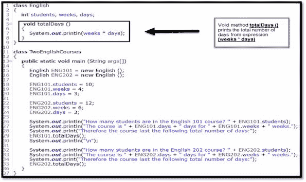

### 图 2.5 – 空方法 (Void Method)

程序输出：

English 101 课程有多少个学生? 10

该课程为 4 周，每周 3 天。

因此，该课程的总天数为：12

English 202 课程有多少个学生? 12

该课程为 6 周，每周 3 天。

因此，该课程的总天数为：18

第 5 行显示了关键字`void`，它表示该方法将不返回任何值。尽管如此，`void`方法仅执行计算总天数的任务。第 7 行在乘以周数和天数后打印总天数。当`void`方法实现带有值的`return`关键字时，将会显示以下错误：

```java
class English
{
    int students, weeks, days;
    // 一个 void 方法不能返回一个值
    void totalDays ()
    {
        return weeks * days

    }
}
```

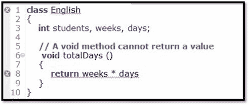

### 图 2.6 – 空方法错误

## 向参数传递参数 (Pass Arguments To Parameters)

参数（Arguments）是传递给方法的值，而形式（Parameters）接收这些值。换句话说，形式接收参数。形式变量在方法的括号内声明，并像局部变量一样运行。局部变量和形式变量仅对声明的方法可见。重要的是，可以将一个或多个参数传递给单独的形式。以下是一个向两个形式传递两个参数的示例：

```java
class English
{
    int totalDays (int wk, int d)
    {
        return wk * d;
    }
}

class TwoEnglishCourses
{
    public static void main (String args[])
    {
        English ENG101 = new English ();
        English ENG202 = new English ();
        System.out.println("The English 101 course is a total of " + ENG101.totalDays (4, 3) + " days");
        System.out.println("The English 202 course is a total of " + ENG202.totalDays (6, 3) + " days");
    }
}
```

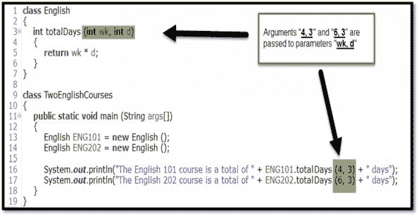

### 图 2.7 – 向参数传递参数

程序输出：

English 101 课程总共 12 天

English 202 课程总共 18 天

* 第 3 行为方法`totalDays ()`定义了两个形式`wk, d`。方法可以通过逗号分隔每个形式来拥有多个形式
* 第 16 行和第 17 行表示将对象`ENG101`的参数`4, 3`和对象`ENG202`的参数`6, 3`传递给形式`wk, d`

注意：对象可以传递给方法，并从方法中返回。

## 方法类型 (Method Types)

以下是四种类型的方法：

1. 实例方法 (Instance Methods)
2. 类方法 (Class Methods)
3. 主方法 (Main Method)
4. 构造方法 (Constructors)

### 实例方法 (Instance Methods)

实例方法由对象调用（称为被调用）。因此，实例方法类似于实例变量，成员可以通过初始化的对象进行访问。然而，实例变量既可以通过对象访问，也可以不通过对象访问。以下是一个实例方法的示例：

```java
public class Lion
{
    void sound ()
    {
        System.out.println("ROAR");
    }
    public static void main (String args[])
    {
        Lion maleLion = new Lion ();
        maleLion.sound ();
    }
}
```

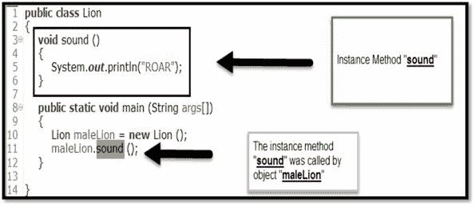

### 图 2.8 – 实例方法

程序输出：

ROAR

* 第 3 – 6 行开始实例方法`sound`
* 第 10 行使用关键字`new`创建一个对象`maleLion`
* 第 11 行通过初始化的对象`maleLion`调用了实例方法`sound`

### 类方法 (Class Methods)

类方法（称为静态方法）与类变量类似，它们使用`static`关键字声明。`static`关键字意味着该成员属于类，并在所有对象之间共享。可以通过对象名或类名访问类方法。然而，当通过对象访问方法时会出现警告。因此，访问类方法的首选方式是通过类名访问。以下是一个类方法的示例：

```java
class StaticAddNumbers
{
    static int a, b;
    static int addNumbers ()
    {
        return a + b;
    }
}

class StaticExample
{
    public static void main(String[] args)
    {
        StaticAddNumbers objAdd = new StaticAddNumbers ();
        objAdd.a = 20;
        StaticAddNumbers.b = 30;
        System.out.println("The addition of variables 'a + b' is " + objAdd.addNumbers() + " and accessed by an object");
        System.out.println("The addition of variables 'a + b' is " + StaticAddNumbers.addNumbers() + " and accessed by a class name");
    }
}
```

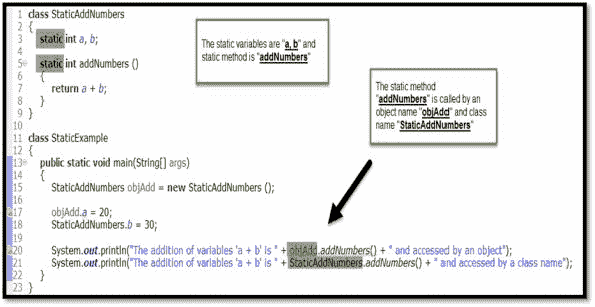

### 图 2.9 – 类方法

程序输出：

The addition of variables 'a + b' is 50 并通过对象访问

The addition of variables 'a + b' is 50 并通过类名访问

* 第 3 行声明了两个类变量`a, b`
* 第 5 – 7 行定义了类方法`addNumbers`
* 第 17 行将 20 赋值给类变量`a`。注意第 17 行旁的警告，提示：“StaticAddNumbers.a 应以静态方式访问”。此警告意味着类变量（称为静态变量）最好通过类名访问。第 18 行没有警告，因为类名位于变量名`b`之前
* 第 20 行类似于第 18 行。通过对象而非类名访问静态方法时会出现警告（例如第 21 行）

注意：类方法只能访问类变量并只能调用其他类方法。

### 主方法 (Main Method)

如果某个特定类启动程序，则主方法是唯一的且必不可少的。该方法是必要的，因为它执行程序。以下是主方法的语法：

```java
public static void main(String[] args)
{
 // 方法体
}
```

主方法有几个示例，但以下解释了每个组件：

* `public` - 该方法可以被所有类访问
* `static` – 该方法在所有对象之间共享
* `void` – 该方法不返回任何值
* `String[] args` – 该方法接收字符串参数并将其传递给程序

### 构造方法 (Constructors)

构造方法是一种与类名相同的特殊方法。如果没有定义构造方法，则会自动创建一个空构造。因此，所有类都包含一个构造方法，用于初始化特定类的对象。每当创建新对象时，都会调用构造方法。默认情况下，数值类型的实例变量初始化为零，引用类型初始化为 null，布尔类型初始化为 false。

构造函数具有为实例变量设置初始值的能力。回想实例变量可以使用点运算符进行访问和赋值。在图 2.4 – 返回值中，以下实例变量被赋予了值：

`ENG101.students = 10;`

`ENG101.weeks = 4;`

`ENG101.days = 3;`

`ENG202.students = 12;`

`ENG202.weeks = 6;`

`ENG202.days = 3;`

构造函数包含参数，在创建对象时时会接收参数。下面的示例演示了如何向构造函数传递参数：

```
class English
{
    int students, weeks, days;

    English (int s, int w, int d) {
        students = s;
        weeks = w;
        days = d;
    }

    int totalDays () {
        return weeks * days;
    }
}

class TwoEnglishCourses
{
    public static void main (String args[]) {
        English ENG101 = new English (10, 4, 3);
        English ENG202 = new English (12, 6, 3);
        System.out.println("The English 101 course has " + ENG101.students + " students and the course last " + ENG101.totalDays () + " days");
        System.out.println("The English 202 course has " + ENG202.students + " students and the course last " + ENG202.totalDays () + " days");
    }
}
```

##### 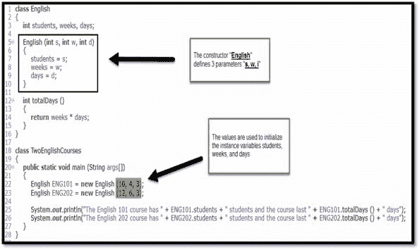

### 图 2.10 – 参数化构造函数

程序输出：

The English 101 course has 10 students and the course last 12 days

The English 202 course has 12 students and the course last 18 days

第 5-10 行创建一个构造函数，在第 5 行定义了三个参数`s, w, d`。每个参数都用于初始化第 7 到 9 行的实例变量`students, weeks, days`。在执行第 22 行和 23 行后，ENG101 的值`10, 4, 3`和 ENG202 的值`12, 6, 3`被赋值给参数`s, w, d`。结果是当使用`new`关键字创建每个对象`ENG101 和 ENG202`时，这些值被传递给`English()`构造函数。

注意：构造函数没有使用如`int`或 void 等方法类型。注意第 5 行以`English`开头然后定义参数。Java 允许类包含多个构造函数。如果构造函数包含不同的参数列表，则该功能被称为构造函数重载。

## 访问器方法

访问方法是用于获取和设置私有变量的方法。私有变量只能由其类内部的代码访问。因此，访问方法是两个称为 getter（获取器）和 setter（Setter）的方法，定义在与私有变量相同的类中。

这两个方法在定义时方法名前带有以`get`和`set`开头的前缀。例如，`getDays()`和`setDays()`被视为获取天数然后设置天数的访问器方法。以下是两种访问器方法的示例：


```java
class English
{
    private int students, weeks, days;

    English (int s, int w, int d) {
        students = s;
        weeks = w;
        days = d;
    }

    int getStudents () {
        return students;
    }

    int getWeeks() {
        return weeks;
    }

    int getDays() {
        return days;
    }

    void setStudents (int s) {
        students = s;
    }

    void setWeeks(int w) {
        weeks = w;
    }

    void setDays(int d) {
        days = d;
    }

    int totalDays () {
        return weeks * days;
    }
}
```

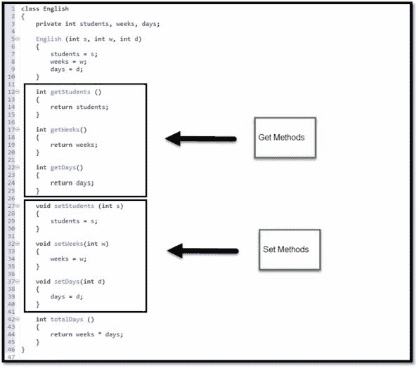

### 图 2.11 – 访问器方法

- 第 3 行将所有实例变量 `students`、`weeks` 和 `days` 声明为 `private`
- 第 5-10 行是构造函数方法
- 第 12-25 行是 `get` 访问器方法。每个方法只返回人数、周数和天数
- 第 27-40 行是 `set` 访问方法。每个方法设置/修改人数和天数

## this 关键字

`this` 单词是一个关键字，在实例方法和/或构造函数内部作为引用操作。它引用当前对象或正在调用的成员。当局部变量和实例变量同名时，`this` 关键字是可选的，但非常有用。接面的示例展示了当局部变量和实例变量同名时如何使用 `this` 关键字：

```java
public class ThisKeyword
{
    int testVariable = 34;

    void hideInstanceVariable () {
        int testVariable = 15;
        System.out.println("What is the value of the local variable NOT using 'this'? " + testVariable);
        System.out.println("What is the value of the instance variable using 'this'? " + this.testVariable);
    }

    public static void main(String[] args) {
        ThisKeyword objHide = new ThisKeyword ();
        objHide.hideInstanceVariable ();
    }
}
```

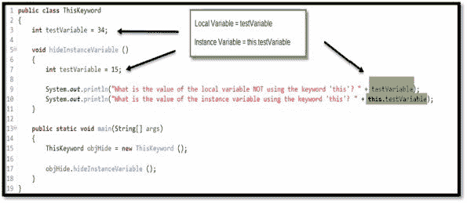

### 图 2.12 – this 关键字

程序输出：

```
What is the value of the local variable NOT using 'this'? 15
What is the value of the instance variable using 'this'? 34
```

- 第 3 行声明并初始化实例变量 `testVariable` 为 34
- 第 7 行声明并初始化局部变量 `testVariable` 为 15
- 第 9 行打印不使用 `this` 关键字的局部变量值
- 第 10 行打印使用 `this` 关键字的实例变量值

## 注解

根据 [dictionary.com](http://dictionary.reference.com/browse/annotation?s=t) 的定义，注解的意思是“关键或解释性的注释”。回想第 1 部分 – Java 4 Selenium WebDriver，注释是帮助程序员理解程序的注释。注解与注释相似，它们都提供信息。然而，注释会被编译器忽略，而注解为编译器提供数据。注解以 `@` 符号开头，并指定方法的目的。某些注解可以自定义以替换注释和预定义注解（如 `@Override`）。以下是 Selenium WebDriver 中使用的 JUnit 注解示例：

1. `@Before` 在每个测试前分配资源
2. `@Test` 执行测试脚本
3. `@After` 在每个测试后释放已分配的

注意：JUnit 注解的细节将在“Selenium WebDriver”书籍中使用并解释。

## 访问修饰符

访问修饰符是面向对象编程中非常有用的特性。它们对每个类和类成员（变量和方法）施加访问限制非常有用。在 Java 中有四种访问修饰符：

1. `public` – 表示成员可以被所有类访问
2. `protected` 表示该成员可以被其所属 `package` 内的所有 `classes` 和 `subclasses` 访问（参见“第 4 章 继承”）（参见“第 5 章 包”）。
3. `no modifier`（无修饰符）—— 表示该成员可以被其所属 `package` 内的所有 `classes` 访问。
4. `private` —— 表示成员可以在其所属 `class` 内访问。

访问修饰符位于类、变量和方法的声明之前。类只能使用 `public` 修饰符或无修饰符。因此，如果类使用了 `private` 或 `protected` 访问修饰符就会报错。以下是一个使用 `public` 修饰符的类、方法和变量的示例：

```java
public class English {
    public int students, weeks, days;

    public int totalDays () {
        return weeks * days;
    }
}

class TwoEnglishCourses {
    public static void main (String args[]) {
        English ENG101 = new English ();
        English ENG202 = new English ();
        ENG101.students = 10;
        ENG101.weeks = 4;
        ENG101.days = 3;
        ENG202.students = 12;
        ENG202.weeks = 6;
        ENG202.days = 3;
        System.out.println("The English 101 course has " + ENG101.students + " students and the course last " + ENG101.totalDays () + " days");
        System.out.println("The English 202 course has " + ENG202.students + " students and the course last " + ENG202.totalDays () + " days");
    }
}
```

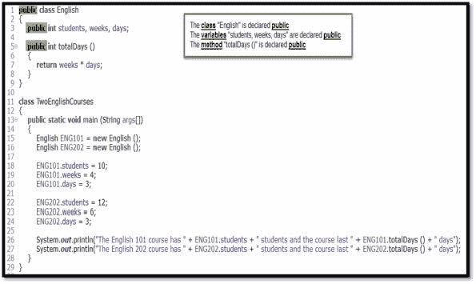

### 图 2.13 – 公有类、变量和方法

类（第 1 行）、所有变量（第 3 行）以及方法（第 5-8 行）都使用 `public` 访问修饰符声明。因此，没有错误，`English` 类中的成员可以被 `TwoEnglishCourses` 类代码访问。

以下是一个 `private` 方法的示例：

```java
public class English {
    public int students, weeks, days;

    private int totalDays () {
        return weeks * days;
    }
}

class TwoEnglishCourses {
    public static void main (String args[]) {
        English ENG101 = new English ();
        English ENG202 = new English ();
        ENG101.students = 10;
        ENG101.weeks = 4;
        ENG101.days = 3;
        ENG202.students = 12;
        ENG202.weeks = 6;
        ENG202.days = 3;
        System.out.println("The English 101 course has " + ENG101.students + " students and the course last " + ENG101.totalDays () + " days");
        System.out.println("The English 202 course has " + ENG202.students + " students and the course last " + ENG202.totalDays () + " days");
    }
}
```

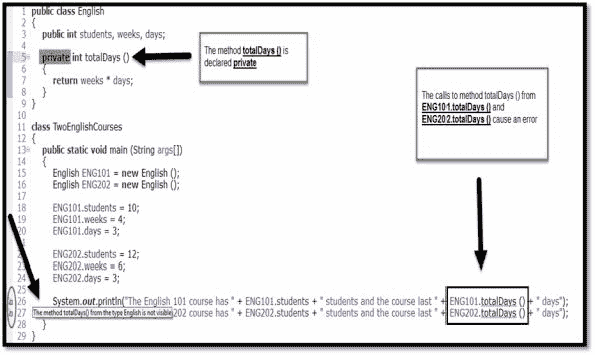

### 图 2.14 – 私有方法

第 5 行使用 `private` 访问修饰符声明 `totalDays()`。这意味着只有 `English` 类内部的成员可以访问该方法。第 26 行和第 27 行尝试调用 `totalDays()` 但无法，因为它们位于不同的类 `TwoEnglishCourses` 中。结果错误信息显示“method totalDays() from Type English is not visible.”

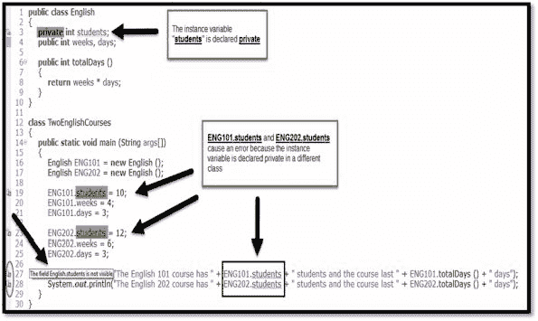

### 图 2.15 – 私有和公共变量

第 3 行将实例变量 `students` 声明为 `private`，而第 4 行将实例变量 `weeks` 和 `days` 声明为 `public`。注意第 19–25 行，私有变量 `students` 发生了两个错误（“第 19 和 23 行”）。此外，第 27 和第 28 行存在一个错误，显示“English.students is not visible”。私有变量仅对 `English` 类可见，对 `TwoEnglishCourses` 不可见。然而，公有变量对两个类都可见。以下是每个修饰符的访问级别：

| | public | protected | no modifier | private |
| --- | --- | --- | --- | --- |
| Class | Yes | Yes | Yes | |
| Package | Yes | Yes | No | |
| Subclass | Yes | No | No | |
| World | Yes | No | No | No |

### 图 2.16 – 访问修饰符

`static` 关键字可以应用于变量、方法、块和嵌套类。通常，类的成员是通过类的对象通过点运算符来访问的。当一个成员被声明为 `static` 时，可以在创建对象之前访问该成员。但是，访问静态成员时，最好用类名和点运算符跟在静态成员，而不是对象名和点运算符。如果使用对象名和点运算符引导静态成员，则会出现警告信息。以下是静态变量的语法和示例：

`ClassName.variableName`

```java
class StaticAddNumbers {
    static int a;
    int b;

    int addNumbers () {
        return a + b;
    }
}

class StaticExample {
    public static void main(String[] args) {
        StaticAddNumbers objAdd = new StaticAddNumbers ();
        objAdd.b = 50;
        StaticAddNumbers.a = 25;
        System.out.println("The value of 'objAdd.b' is " + objAdd.b);
        System.out.println("The value of 'a' is " + StaticAddNumbers.a);
        System.out.println("The total of 'a + b' is " + objAdd.addNumbers() + "\n");
        StaticAddNumbers.a = 30;
        System.out.println("The value of 'a' changed to " + StaticAddNumbers.a + " but the value of 'objAdd.b' remains " + objAdd.b);
    }
}
```

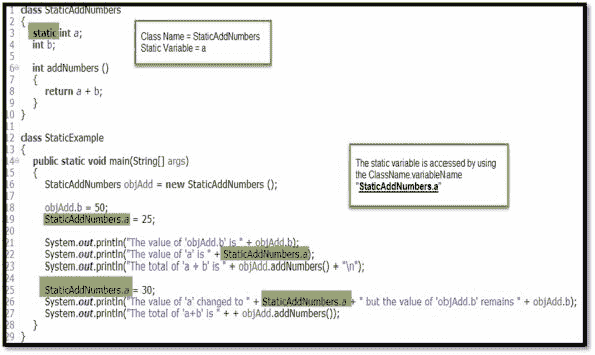

### 图 2.17 – 静态变量

输出：

```
The value of 'objAdd.b' is 50
The value of 'a' is 25
The total of 'a + b' is 75
The value of 'a' changed to 30 but the value of 'objAdd.b' remains 50
```

第三章将讨论关于数组和字符串的内容：

- 一维数组
- 多维数组
- For-Each 循环
- 字符串

# 一维数组

一维数组是最常用的数组类型。它存储了一个相关值的列表，例如特定月份的每日气温。作为回报，这些值列表可以得出每月平均温度。存储在数组中的所有信息都可以通过索引轻松访问。以下是定义一维数组的两种语法：

## 语法

```
arrType arrName[] = new arrType[arrSize];
```

或

```
arrType arrName[];
arrName = new arrType[arrSize];
```

| 参数 |  |
| :--- | :--- |
| `arrType` | 决定数组中每个值的数据类型 |
| `arrName` | 数组名称 |
| `new` | 为数组分配内存 |
| `arrSize` | 数组中的值数量 |

### 图 3.1 – 一维数组语法细节

以下是一个一维数组的示例：

```java
public class OneDimensionalArray {
    public static void main(String[] args) {
        int [] tempMay = new int [3];
        tempMay[0] = 105;
        tempMay[1] = 102;
        tempMay[2] = 98;
        System.out.println("The highest temperature in May was " + tempMay[0] + " degrees");
        System.out.println("The 2nd highest temperature in May was " + tempMay[1] + " degrees");
        System.out.println("The 3rd highest temperature in May was " + tempMay[2] + " degrees");
    }
}
```

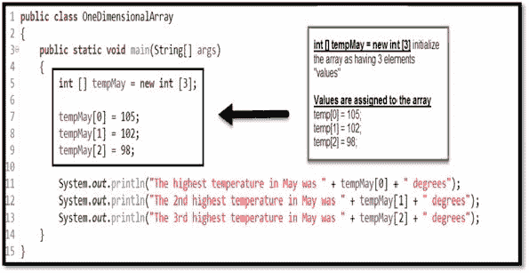

### 图 3.2 – 一维数组示例

程序输出：

```
The highest temperature in May was 105 degrees
The 2nd highest temperature in May was 102 degrees
The 3rd highest temperature in May was 98 degrees
```

- 第 5 行使用关键字 `new` 初始化数组 `tempMay`。方括号 `[3]` 中的数字 3 表示数组包含 3 个元素。
- 第 7–9 行为数组的每个元素赋值。第一个值存储在索引位置 0。零总是数组的起始位置。在本示例中，最后一个索引位置是 2。元素 0–2 总共持有 3 个元素。

数组可以在不使用 `new` 关键字的情况下在一行赋值。以下是给数组赋值的另一种方法：

```java
public class OneDimensionalArray {
    public static void main(String[] args) {
        int[] tempMay = {105, 102, 98};
        System.out.println("The highest temperature in May was " + tempMay[0] + " degrees");
        System.out.println("The 2nd highest temperature in May was " + tempMay[1] + " degrees");
        System.out.println("The 3rd highest temperature in May was " + tempMay[2] + " degrees");
    }
}
```

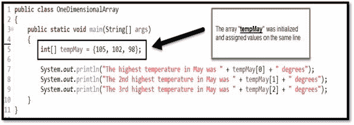

### 图 3.3 – 另一种一维数组示例

程序输出：


```text
The highest temperature in May was 105 degrees
The 2nd highest temperature in May was 102 degrees
The 3rd highest temperature in May was 98 degrees
```

第 5 行初始化了数组 `tempMay` 并为数组分配了三个值。注意这里没有使用关键字 `new` 来初始化数组。但是，在数组名称和值的同时指定了数据类型 `int`。方括号表示数组，而大括号内的值数量决定了数组的大小。以下是显示来自图 3.2 和图 3.3 数组值的图表：

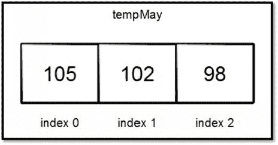

### 图 3.4 – 数组名称、值和索引

# 多维数组

多维数组被视为数组的数组。因此，必须使用两个或多个括号来声明多维数组。常见的多维数组类型是二维数组。每个维度都包含自己的一组括号。带有行和列的电子表格是想象二维数组的好方法。第一对括号是行，第二对括号是列。以下是二维数组的语法和示例：

```java
arrType arrName[][] = new arrType[arrSize1][arrSize2];
public class TwoDimensionalArray {
    public static void main(String[] args) {
        int row, column;
        int testDimension[][] = new int[2][3];
        for (row = 0; row < 2; row++) {
            for (column = 0; column < 3; column++) {
                testDimension[row][column] = row * 3 + 1;
                System.out.print(testDimension[row][column] + " ");
            }
            System.out.println();
        }
    }
}
```

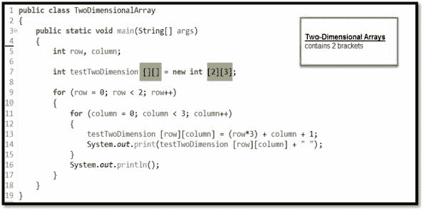

### 图 3.5 – 二维示例

程序输出：

```text
1 2 3
4 5 6
```

- 第 7 行使用关键字 `new` 初始化二维数组 `testDimension`。两个括号表示有两个维度，类似于行和列。
- 注意输出总共有两行三列。第 9 行表示行的计数，第 1 行表示列的计数。
- 第 13 行计算通过 6 的值。
- 第 14 行打印出通过 6 的值。

与一维数组类似，二维数组可以在不使用 `new` 关键字的情况下声明并初始化。以下是一个没有使用初始化关键字 `new` 的二维数组示例。

```java
public class TwoDimensionalArray {
    public static void main(String[] args) {
        int row, column;
        int testDimension[][] = {
            {1, 2, 3},
            {4, 5, 6}
        };
        for (row = 0; row < 2; row++) {
            for (column = 0; column < 3; column++) {
                System.out.print(testDimension[row][column] + " ");
            }
            System.out.println();
        }
    }
}
```

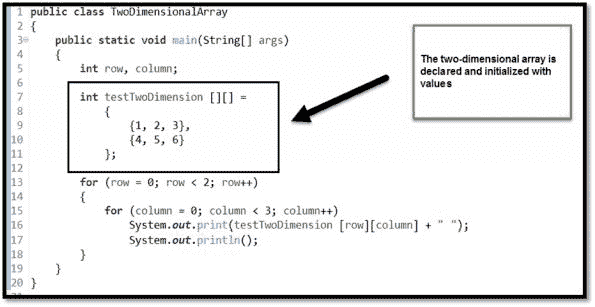

### 图 3.6 – 另一种二维数组示例

程序输出：

```text
1 2 3
4 5 6
```

- 第 7–11 行通过将每个维度的列表封装在独立的括号内来初始化数组。注意元素之间用逗号分隔，且每组括号代表一行。之前的示例输出相同的信息。可以通过指定行和列来打印特定的值。以下示例根据定义的行和列打印特定的值。

```java
    }
    System.out.println("\n" + "What value is located in row 1 - column 2? " + testTwoDimension [1][2]);
  }
}
```

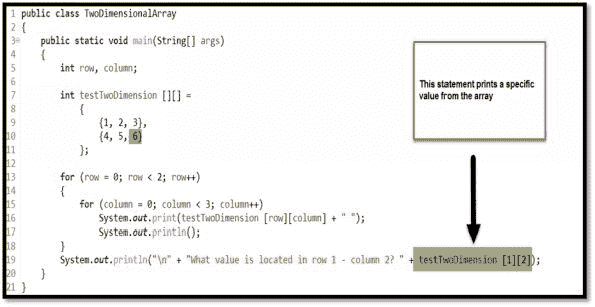

### 图 3.7 – 从二维数组中打印特定值

程序输出：

```text
1 2 3
4 5 6
What value is located in row 1 - column 2? 6
```

以下展示了表格格式的输出：

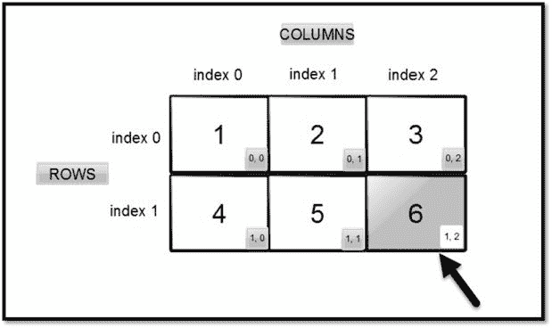

### 图 3.8 – 二维数组的特定索引

# For-Each 循环（增强 for 循环）

for-each 循环（被称为增强 for 循环）旨在用于遍历对象集合（如数组）。这种控制结构提供的功能与 `for` 循环相同（参见第 4 章 - (Part 1) Java 4 Selenium WebDriver 中的控制结构），它们都执行执行特定次数迭代的代码块。然而，for-each 循环在遍历集合中的每个元素时执行代码块。以下是 for-each 循环的语法：

## 语法

```java
for (collType itrVariable: collection)
{
  statement(s)
}
```

### 语法细节

| 参数 | 说明 |
| :--- | :--- |
| collType | 指代集合的数据类型 |
| itrVariable | 指迭代变量的名称，它在每次迭代后接收每个元素 |
| collection | 要进行遍历或循环的集合（如数组） |
| statement(s) | 将执行的代码块 |
| { … } | 开始和结束的大括号 |

### 图 3.9 – For-Each 循环语法细节

for-each 循环中的所有元素都被检索并存储在 `itrVariable` 中。循环不断重复，直到所有元素按索引顺序被读取。重要的是，`colltype` 必须与对象的类型相同。在数组的情况下，`collType` 必须与 `arrType` 的类型相同。以下是 for-each 循环的示例：

```java
public class ForEachLoop
{
 public static void main(String[] args)
    {
     double[] costPerItem = {12.34, 56.78, 99.99};
     double totalCost = 0;
     for (double i: costPerItem)
     {
      System.out.println("The cost is " + i);
      totalCost = totalCost + i;
     }
     System.out.println("\n" + "The total cost of all items is " + totalCost);
  }
}
```

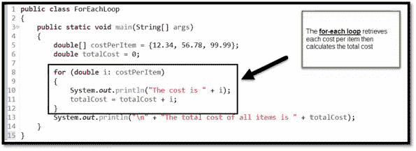

### 图 3.10 – For Each 循环示例

程序输出：

```text
The cost is 12.34
The cost is 56.78
The cost is 99.99
The total cost of all items is 169.11
```

- 第 5 行和第 6 行初始化并为数组 `costPerItem` 和 `totalCost` 赋值。
- 第 8 行检索数组 `costPerItem` 中的每个元素 (12.34, 56.78, 99.99)。
- 第 10 行打印每个元素。
- 第 11 行计算所有元素的总和。

注意：第 8–11 行可以读为：“对于 `costPerItem` 数组中的每个 double 类型数据，打印每个元素并计算所有元素的总和”。

## 二维数组迭代

二维数组的迭代操作与单维数组类似。二维数组的迭代变量必须引用单维数组。它必须引用单维数组是因为二维数组被视为“数组的数组”。因此，每次二维数组迭代都会检索下一个数组。以下是二维数组迭代的示例：

```java
public class ForEachLoop
{
 public static void main(String[] args)
    {
     int totalCost = 0;
     int[][] costPerItem =
     {
      {5, 10},
      {5, 20},
      {5, 30}
     }; for (int i[]: costPerItem)
     {
      for (int j: i)
      {
         System.out.println("The cost is " + j);
         totalCost = totalCost + j;
      }
     }
     System.out.println("\n" + "The total cost of all items is " + totalCost);
  }
}
```

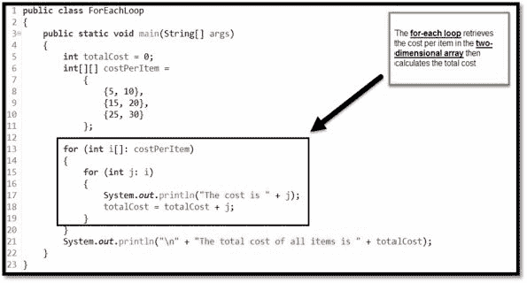

### 图 3.11 – 二维数组迭代

程序输出：

```text
The cost is 5
The cost is 10
The cost is 15
The cost is 25
The cost is 30
The total cost of all items is 105
```

- 第 5 行初始化 `totalCost` 并赋值为零“0”。
- 第 6–11 行初始化并为二维数组 `costPerItem` 赋值。
- 第 13 行 `for (int i[]: costPerItem)` 引用单维数组，每次迭代从头到尾检索 `costPerItem` 中的下一个数组（“从索引 0 到索引 5”）。
- 第 15 行 `for (int j: i)` 循环每个元素。

## 数组搜索

数组可以被检索以获取特定值。有时需要从集合中获取某个值。以下示例展示了如何从数组中检索特定值：

```java
public class ForEachLoop
{
 public static void main(String[] args)
    {
     int specificCost = 20;
     int[][] costPerItem =
     {
      {5, 10},
      {5, 20},
      {5, 30}
     }; for (int i[]: costPerItem)
     {
      for (int j: i)
      {
         if (j == specificCost)
         {
          System.out.println("The specific cost of " + specificCost + " was located in the collection of values");
         }
      }
     }
  }
}
```

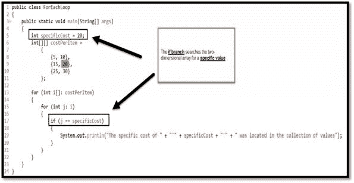

### 图 3.12 – 搜索二维数组

程序输出：

```text
The specific cost of 20 was located in the collection of values
```

- 第 5 行为变量 `specificCost` 赋值 20。
- 第 6–11 行初始化并为二维数组 `costPerItem` 赋值。
- 第 13 行 `for (int i[]: costPerItem)` 引用单维数组，每次迭代从头到尾检索 `costPerItem` 中的下一个数组（“从索引 0 到索引 5”）。
- 第 15 行 `for (int j: i)` 循环每个元素。
- 第 17 行通过变量 `specificCost` 搜索二维数组中的特定元素“20”。

# Strings

字符串是一种不可变字符序列的数据类型。这种数据类型被视为对象，因此在 (Part 1) Java 4 Selenium WebDriver 中与其他数据类型一起并没有讨论。创建字符串有两种方法：

1. 字符串字面量。
2. 使用 `new` 关键字创建字符串。

以下是字符串字面量的示例：

```java
public class StringObject
{
 public static void main(String[] args)
    {
     String firstName = "Rex";
     String lastName = "Jones";
     System.out.println("Strings are placed within quotation marks");
     System.out.print("The first name is " + firstName + " and last name is " + lastName + ".");
     System.out.println(" Both names were declared and initialized as strings. A sequence of characters");
  }
}
```

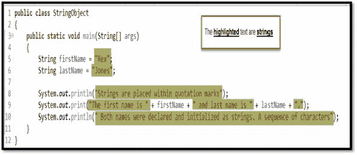

### 图 3.13 – 字符串示例

程序输出：

```text
Strings are placed within quotation marks
The first name is Rex and last name is Jones. Both names were declared and initialized as strings. A sequence of characters
```

- 第 5 行和第 6 行声明并初始化字符串数据类型。
- 第 8–10 行在 `println` 方法中显示字符串字面量。

字符串像其他对象一样，可以使用关键字 `new` 调用 `String` 构造函数来创建。以下是使用 `new` 关键字创建 `String` 的示例：

```java
String name = new String ("Rex Jones");
```

## 字符串操作

在 Java 中，有一个 `String` 类，其中包含许多用于操作的方法。以下是 Eclipse 中几个 `String` 方法的截图：

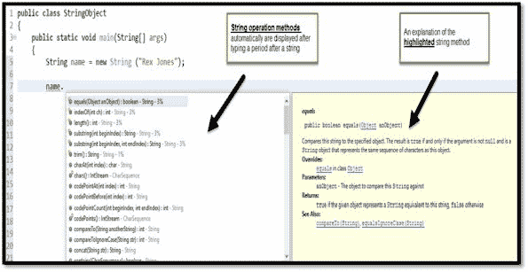

### 图 3.14 – 字符串方法

- 第 7 行在变量 `name` 之后输入一个点后，会显示方法列表。
- 当高亮特定方法 `equals` 时，会显示该方法的描述。

以下是常用的 `String` 方法、其数据类型和描述：

1. `charAt (int index)`: `char` - 返回指定索引处的字符。
2. `compareTo (str)`: `int` - 如果调用字符串小于 `str`，则返回负数；如果调用字符串大于 `str`，则返回正数；如果字符串相等，则返回零。
3. `concat (String str)`: `String` - 将给定的字符串连接到字符串的末尾。
4. `equals (Object anObject)`: `boolean` – 将字符串与特定对象进行比较。
5. `equalsIgnoreCase (String string)`: `boolean` - 比较字符串并忽略大小写。
6. `indexOf (String str)`: `int` - 返回指定子字符串首次出现的索引。
7. `lastindexOf (String str)`: `int` - 返回字符串最后一次出现的索引。
8. `length()`: `int` - 返回字符串的长度。
9. `replace (char oldChar, char newChar)`: `String` - 在更改所有旧字符串出现的地方后返回新字符串。
10. `split (String regex)`: `String[]` - 分割字符串并返回匹配给定正则表达式的字符串数组。
11. `toLowerCase()`: `String` - 将 `String` 中的所有字符转换为小写。
12. `toUpperCase()`: `String` - 将 `String` 中的所有字符转换为大写。
13. `trim()`: `String` - 返回字符串的副本，并删除了原始字符串开头和结尾的空白字符。

字符串数据类型不能与不同的数据类型结合进行乘法、减法或除法等操作。例如，值为“534000.00”的字符串看起来是一个数值，但除非使用类型包装类转换字符串，否则字符串不允许数学运算。值“534000.00”类似于 `double` 数据类型。然而，如果与 `double` 数据类型结合，将会发生错误。以下示例显示了当字符串数据类型与减法运算符结合时产生的错误：

```java
public class StringObject {
    public static void main(String[] args) {
        String grossIncome = "534000.00";
        double gross = 534000.00;
        double taxes = 225000.00;
        double netIncome;
        netIncome = grossIncome - taxes;
        netIncome = gross - taxes;
        System.out.println("The net income is " + netIncome);
    }
}
```

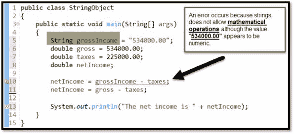


### 图 3.15 – 因数学运算导致的字符串错误

* 第 5 行声明并初始化了字符串值“534000.00”
* 第 10 行显示错误，因为字符串不允许数学运算。然而，注意第 11 行没有显示错误，因为变量 `gross` 和 `taxes` 都被声明为 `double` 数据类型（第 6 和第 7 行）

## 类型包装类

类型包装类用于将字符串转换为原始类型（`byte`、`double`、`float`、`integer`、`long`、`short`）。因此，之前显示字符串值“534000.00”错误的示例可以转换为数字。类型包装类用于封装原始类型。以下是当指定字符串为“534000”时返回 `double` 的示例：

```java
public class StringObject {
    public static void main(String[] args) {
        String grossIncome = "534000.00";
        double taxes = 225000.00;
        double netIncome;
        netIncome = Double.parseDouble(grossIncome) - taxes;
        System.out.println("The net income is " + netIncome);
    }
}
```

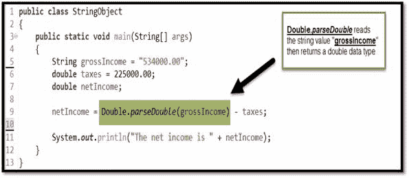

### 图 3.16 – 读取字符串值后返回 Double

程序输出：The net income is 309000.00

* 第 5 行声明并初始化了字符串值“534000.00”
* 第 9 行解析（也称为读取）字符串 `grossIncome` 然后返回一个 `double` 数据类型。之后，从 `grossIncome`“534000”中减去变量 `taxes`“225000”，并将值赋值给 `netIncome`

以下是转换字符串数据类型的包装类列表：

| 包装类 | 方法 |
| :--- | :--- |
| `Double` | `Double.parseDouble(string)` |
| `Float` | `Float.parseFloat(string)` |
| `Long` | `Long.parseLong(string)` |
| `Integer` | `Integer.parseInt(string)` |
| `Short` | `Short.parseShort(string)` |
| `Byte` | `Byte.parseByte(string)` |

### 图 3.17 – 包装类

类型包装类用于将字符串转换为原始类型（`byte`、`double`、`float`、`integer`、`long`、`short`）。因此，之前显示字符串值“534000.00”错误的示例可以转换为数字。类型包装类用于封装原始类型。以下是当指定字符串为“534000”时返回 `double` 的示例（见上文）。

第 3 章解释了数组和字符串，它们是对象。数组是具有相同值的集合。继承允许代码和对象的用。

## 继承

继承是面向对象编程中的一个重要基础。它允许向现有类添加功能，从而避免了重复编写相同的代码。子类继承父类的所有成员。被继承的类被称为子类。另一种看待父类和子类的方法是将父类看作父亲，将子类看作孩子。

为了让子类继承父类，必须在类声明中使用 `extends` 关键字。`extends` 意味着子类将扩展父类。子类不允许继承多个父类。然而，子类允许成为另一个子类的父类。作为结果，额外的子类继承了每个父类的成员。以下是子类继承父类的语法：

```java
class SubClassName extends SuperClassName {
    // 类体
}
```

以下是子类继承父类的示例：

```java
class School {
    int numTeachers;
    int numStudents;
    void showNumberOfPeople() {
        System.out.println("There are " + numTeachers + " teachers and " + numStudents + " students");
    }
}

class ElementarySchool extends School {
    String principalName;
    int totalTeacherStudents() {
        return numTeachers + numStudents;
    }
    void displayPrincipal() {
    }
}
```

```java
System.out.println("The principal name is " + principalName);
    }
}

class SchoolDistrict {
    public static void main(String[] args) {
        ElementarySchool BishopHeights = new ElementarySchool();
        ElementarySchool AltaMesa = new ElementarySchool();
        BishopHeights.numTeachers = 10;
        BishopHeights.numStudents = 130;
        BishopHeights.principalName = "Joe Doe";
        System.out.println("My elementary school is Bishop Heights \n");
        BishopHeights.displayPrincipal();
        BishopHeights.showNumberOfPeople();
        System.out.println("Therefore the total of teachers and students is " + BishopHeights.totalTeacherStudents());
    }
}
```

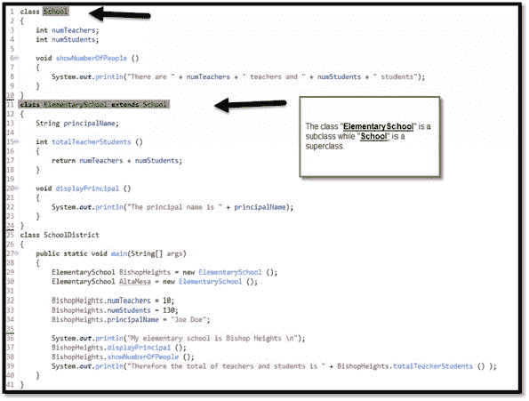

### 图 4.1 – 子类继承父类的示例

程序输出：

```
My elementary school is Bishop Heights
The principal name is Joe Doe
There are 10 teachers and 130 students
Therefore the total of teachers and students is 140
```

* 第 1 行显示了父类 `School`
* 第 11 行使用关键字 `extends` 创建了子类 `ElementarySchool`，该子类继承了父类 `School`
* 第 17 行利用了父类的变量 `numTeachers` 和 `numStudents`
* 第 29 行和 30 行显示了两个对象 `BishopHeights` 和 `AltaMesa`
* 第 32 行和 33 行将值 `10` 和 `130` 赋值给从父类 `School` 继承的变量 `numTeachers` 和 `numStudents`
* 第 34 行将值 `Joe Doe` 赋值给变量 `principalName`，该它是子类 `Elementary School` 的成员

子类 `ElementarySchool` 是父类 `School` 的一种类型。更多的子类（如 `HighSchool`、`University` 等）也可以继承父类 `School`。`ElementarySchool` 类继承了 `School` 类的所有成员，然后添加了一个变量 `principalName` 以及两个方法 `totalTeacherStudents` 和 `displayPrincipal`。注意看第 30 行创建了一个未被使用的对象。这表明可以创建更多的 `Elementary School` 对象来访问父类 `School` 的成员。

注意：来自父类的对象并不了解子类的信息。因此，父类无法访问子类。

### 父类对象

父类 `Object` 是所有类的最高父类。换句话说，在 `Object` 父类之上没有父类。默认情况下，`Object` 父类包含了所有子类继承的方法。以下截图显示了在创建新类时 `java.lang.Object` 默认作为父类： 图 4.2 – Eclipse 类创建

### 继承成员

从父类继承的私有成员在子类中仍然是私有的。因此，子类无法访问私有成员。变量和方法只能由所属类内部的代码访问。尽管如此，可以使用访问器方法（accessor methods）访问私有成员。

### 父类和子类构造函数

父类和子类包含各自类的构造函数。因此，构造函数是相互独立的。父类无法访问子类的构造函数，但子类可以访问父类的构造函数。子类通过使用关键字 `super` 调用父类的构造函数。以下是子类调用父类构造函数的语法：`super(parameter-list)`。以下是子类继承父类的示例：

```java
class School {
    private int numTeachers, numStudents;
    School(int t, int s) {
        numTeachers = t;
        numStudents = s;
    }
    int getTeachers() { return numTeachers; }
    int getStudents() { return numStudents; }
    void setTeachers(int t) { numTeachers = t; }
    void setStudents(int s) { numStudents = s; }
    void showNumberOfPeople() {
        System.out.println("There are " + numTeachers + " teachers and " + numStudents + " students");
    }
}

class ElementarySchool extends School {
    private String principalName;
    ElementarySchool(String p, int t, int s) {
        super(t, s);
        principalName = p;
    }
    int totalTeacherStudents() {
        return getTeachers() + getStudents();
    }
    void displayPrincipal() {
        System.out.println("The principal name is " + principalName);
    }
}

class SchoolDistrict {
    public static void main(String[] args) {
        ElementarySchool BishopHeights = new ElementarySchool("Joe Doe", 10, 130);
        System.out.println("My elementary school is Bishop Heights \n");
        BishopHeights.displayPrincipal();
        BishopHeights.showNumberOfPeople();
        System.out.println("Therefore the total of teachers and students is " + BishopHeights.totalTeacherStudents());
    }
}
```


### 图 4.3 – 子类继承父类

程序输出：

```
My elementary school is Bishop Heights
The principal name is Joe Doe
There are 10 teachers and 130 students
Therefore the total of teachers and students is 140
```

# 多态

多态是面向对象编程中的一个重要概念。该概念允许一个接口被多个方法重用。在父类和子类的情况下，父类提供了一个结构，使得子类可以定义自己的方法。当子类扩展父类时，方法会被继承。

## 方法重写与方法重载

方法重写（Method Overriding）是子类方法覆盖父类方法的特征。两个方法必须具有相同的方法类型和签名。方法的签名由方法名和参数列表组成。尽管父类方法被子类方法重写，但仍然可以调用。如果使用关键字 `super` 和点操作符 `.` 后跟方法名，则可以调用该方法：`super.methodName()`。

方法重载（Method Overloading）是指同一个类中多个方法名相同但参数列表不同的方法。当调用方法名时，参数列表决定了执行哪个重载方法。然而，如果多个方法具有相同的签名，则会导致重复方法错误。

| | 方法重写 (Overriding) | 方法重载 (Overloading) |
| --- | :--- | :--- |
| 定义 | 父类和子类具有相同方法类型和签名的方法 | 同一个类中存在多个同名但参数列表不同的方法 |
| 方法类型 | 父类和子类的方法类型必须兼容 | 类型可以相同也可以不同 |
| 签名 | 父类和子类必须具有相同的签名 | 签名在参数数量、参数类型或顺序上是不同的 |

### 图 4.4 – 方法重写与重载的区别

注意：可以使用 `@Override` 注解来指示编译器子类正在重写父类。注解使程序更易于读，并允许编译器验证重写是否有效。

## 静态绑定

绑定是指方法调用与方法定义之间的连接。静态绑定（也称为早期绑定）是指发生在编译时的绑定。因此，绑定发生在程序执行之前。以下是静态绑定的一个示例：

```java
class Binding
{
    void printClassName() {
        System.out.println("This class is called Binding");
    }
}

class BindingExtend extends Binding
{
    @Override
    void printClassName() {
        System.out.println("This class is called BindingExtend");
    }
}

class BindingExamples
{
    public static void main(String[] args) {
        BindingExtend objBindingExtend = new BindingExtend ();
        objBindingExtend.printClassName();
    }
}
```

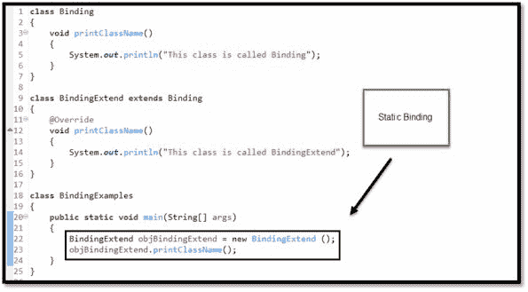

### 图 4.5 – 静态绑定示例

程序输出：

This class is called BindingExtend

* 第 11 行显示了一个注解，表示子类方法 `printClassName()` 将重写父类方法 `printClassName()`
* 第 12 行行号旁边有一个图标，其工具提示显示 `overrides Binding.printClassName`
* 第 22 行创建了类 `BindingExtend` 的对象 `objBindingExtend`
* 第 23 行调用了方法定义 `printClassName()`

注意：对于静态绑定，编译器会验证类 `BindingExtend` 中是否存在方法定义 `printClassName`。

## 动态绑定

动态绑定是指发生在运行时绑定。因此，这种类型的绑定发生在程序运行时。与静态绑定不同，动态绑定允许多态。因此，方法重写是动态绑定的良好示例。以下是动态绑定的一个示例：

```java
class Binding
{
    void printClassName() {
        System.out.println("This class is called Binding");
    }
}

class BindingExtend extends Binding
{
    @Override
    void printClassName() {
        System.out.println("This class is called BindingExtend");
    }
}

class BindingExamples
{
    public static void main(String[] args) {
        Binding objBinding = new Binding ();
        objBinding.printClassName();
        Binding objBindingExtend = new BindingExtend ();
        objBindingExtend.printClassName();
    }
}
```

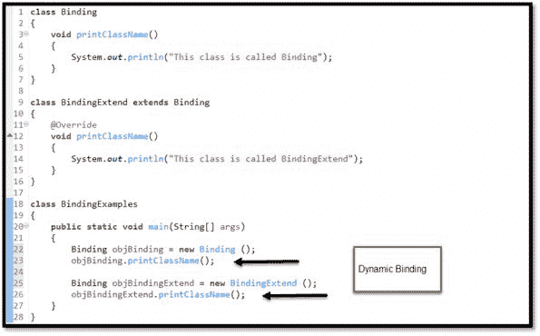

### 图 4.6 – 动态绑定示例

程序输出：

This class is called Binding

This class is called BindingExtend


第 3 行和第 12 行为 `Binding` 和 `BindingExtend` 每个类定义了相同的方法名 `printClassName()`。

第 22 行和第 25 行创建了对象 `objBinding` 和 `objBindingExtend`。

第 23 行和第 26 行是动态绑定发生的地方。两次调用都是针对同一个方法名 `printClassName()`，但在不同的类（父类和子类）中。对象 `objBinding` 和 `objBindingExtend`。

## 抽象

抽象适用于类。关键字 `abstract` 用于定义不完整的类。抽象类不能被实例化。`abstract` 的目的是为子类提供一个模板。

`abstract` 关键字用于定义没有体的方法。以下是抽象类的语法：

```java
abstract class ClassName {
    abstract void methodName();
}
```

## Final

`final` 关键字用于防止修改。当应用于变量时，它会变成一个常量。当应用于方法时，它不能被重写。当应用于类时，它会防止继承。

## 继承

继承是一种一个类获取另一个类的属性和行为的机制。它允许代码重用和方法重写。

## 包

包是相关类的集合。它像文件夹一样，用于组织代码并防止命名冲突。在 Java 中，你可以在源文件的顶部使用 `package` 语句来定义包。

```java
package packagename;
```

```java
System.out.println("This is another test");
}
}
```

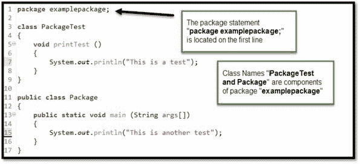

### 图 5.2 – 包语句

程序输出：

This is another test

- 第 1 行包含包语句 `package examplepackage`。
- 第 3 行开始类 `PackageTest` 的类定义。该类是包 `examplepackage` 的组件。
- 第 11 行开始类 `Package` 的类定义。该类是包 `examplepackage` 的组件。

以下是类在包目录中分组在一起的屏幕截图：

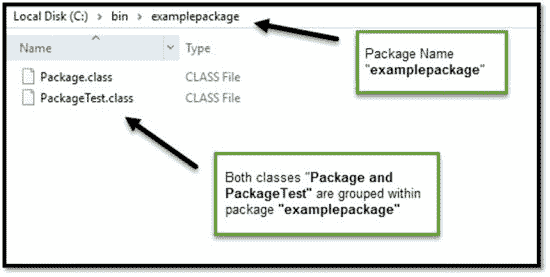

### 图 5.3 – 包目录截图

# 导入包

Java 包是通过使用 `import` 关键字来导入的。当一个类想要访问另一个类中的成员时，导入是非常有用的。另一个类可能在同一个包中，也在不同的包中。导入包后，可以直接使用该包的成员，而无需任何额外的语法符号。以下是导入包的语法：

## 语法

```
importpackagename.ClassName;
```

要导入一个类，在包名和类名之间放置点 (.) 运算符。导入语句必须在包语句之后、但在当前文件中声明类之前输入。以下是包语句、导入语句和类声明的示例：

```java
package examplepackage;

import examplepackage.PackageTest;

public class PackageOne
{
    public static void main (String args[])
    {
        PackageTest objPackage = new PackageTest ();
        objPackage.printTest();
    }
}
```

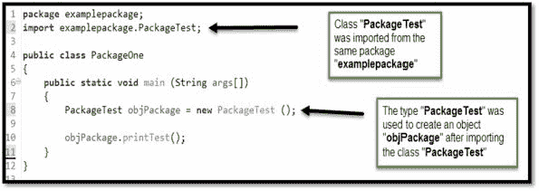

### 图 5.4 – 包导入

程序输出：

This is a test

- 第 1 行包含包语句 `package examplepackage;`。
- 第 2 行包含导入语句 `import examplepackage.PackageTest;`。包名为 `examplepackage`，类名为 `PackageTest`，它位于另一个文件中。
- 第 4 行开始类声明 `public class PackageOne`。
- 第 8 行使用导入的类 `PackageTest` 创建一个对象 `objPackage`。
- 第 10 行调用方法 `printTest();`，该方法位于 `PackageTest` 类中。查看[图 5.2 - 包语句]查看该方法的详细信息。

注意：可以使用包名加星号来导入特定包中的所有类：`import packagename.*;`

# Java 类库

Java 类库被称为 Java 应用程序接口 (API)，它为程序员提供了一系列预写的类。每个预写类都通过提供实用的函数来支持程序的逻辑。其中名为 `java.lang` 的包会自动导入到所有程序中。因此，当使用 `print()` 和 `println()` 方法显示信息时，会自动使用 `System` 等类。根据 [Oracle](https://docs.oracle.com/javase/7/docs/api/)，以下显示了许多 Java 类库中的四个：

- `java.lang` – 提供对 Java 编程语言设计的类。
- `java.io` – 通过数据流、序列化和文件系统提供系统输入输出。
- `java.math` – 提供执行任意精度整数算术 (`BigInteger`) 和任意精度小数算术 (`BigDecimal`) 的类。
- `java.sql` – 提供使用 JavaTM 编程语言访问和处理存储在数据源（通常是关系型数据库）中的数据的 API。

注意：包 `java.lang` 包含一个 `math` 类，它与包 `java.math` 不同。`java.lang` 中的 `math` 类包含执行基本数值操作的方法。

第 5 章描述了 Java 中的包。每个包包含一组相关的类。通过包名访问这些类。为了让一个类利用另一个类的成员，必须在程序中放置导入语句。第 6 章将介绍接口，接口是一组相关的方法。

# 第 6 章

## 接口

接口是相关方法的集合。接口可以类类，包含变量和方法。但默认情况下，接口的变量被声明为 `public`、`static` 和 `final`，而方法被声明为 `abstract`。接口可以执行某个任务，但通常没有行为实现。换句话说，接口中的大多数方法不包含方法体。因此，没有方法体的接口方法只包含方法的签名。

没有方法体的接口方法只包含方法的签名。因此，没有方法体的接口方法只包含方法的签名。

没有方法体的接口方法只包含方法的签名。因此，没有方法体的接口方法只包含方法的签名。

没有方法体的接口方法只包含方法的签名。因此，没有方法体的接口方法只包含方法的签名。

没有方法体的接口方法只包含方法的签名。因此，没有方法体的接口方法只包含方法的签名。

没有方法体的接口方法只包含方法的签名。因此，没有方法体的接口方法只包含方法的签名。

没有方法体的接口方法只包含方法的签名。因此，没有方法体的接口方法只包含方法的签名。

没有方法体的接口方法只包含方法的签名。因此，没有方法体的接口方法只包含方法的签名。

没有方法体的接口方法只包含方法的签名。因此，没有方法体的接口方法只包含方法的签名。

没有方法体的接口方法只包含方法的签名。因此，没有方法体的接口方法只包含方法的签名。

没有方法体的接口方法只包含方法的签名。因此，没有方法体的接口方法只包含方法的签名。

没有方法体的接口方法只包含方法的签名。因此，没有方法体的接口方法只包含方法的签名。

没有方法体的接口方法只包含方法的签名。因此，没有方法体的接口方法只包含方法的签名。

没有方法体的接口方法只包含方法的签名。因此，没有方法体的接口方法只包含方法的签名。

没有方法体的接口方法只包含方法的签名。因此，没有方法体的接口方法只包含方法的签名。

没有方法体的接口方法只包含方法的签名。因此，没有方法体的接口方法只包含方法的签名。

没有方法体的接口方法只包含方法的签名。因此，没有方法体的接口方法只包含方法的签名。

第 6 章将介绍接口，接口是一组相关的方法。

接口定义了执行什么，但不定义如何执行任务。以下是决定如何执行任务的语法。

没有方法体的接口方法只包含方法的签名。

以下是接口的语法：

## 语法

```
accessmodifier interface interfaceName extends interfaceName1, interfaceN
{
    variableType methodName1 (parameter-list);
    variableType methodName2 (parameter-list);
    variableType methodNameN (parameter-list);
}
```

### 细节

| 参数 | 说明 |
| :--- | :--- |
| `accessmodifier` | 可以是 `public` 或无访问修饰符。`public` 表示接口可以被任何代码使用。无访问修饰符为默认值，表示接口仅对其包的成员可用。 |
| `interface` | 用于声明接口的关键字 |
| `interfaceName` | 接口的名称 |
| `extends` | 扩展一个或多个接口的可选关键字 |
| `interfaceName1, N` | 用逗号分隔的一个或多个接口 |
| `variableType` | 变量类型 |
| `methodName1 (parameter-list)` | 接口方法 |

### 图 6.1 – 接口语法

以下是接口示例：

```java
public interface InterfaceTest
{
    public void methodOne();
    public void methodTwo();
}
```

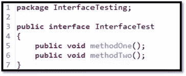

### 图 6.2 – 接口示例

- 第 3 行使用 `interface` 关键字声明一个接口，并带有 `public` 访问修饰符。因此，任何包中的类都可以实现它。接口的名称为 `InterfaceTest`。
- 第 5 行和第 6 行是 `void` 抽象方法 `methodOne` 和 `methodTwo`。接口内部不需要 `abstract` 关键字。注意每个方法末尾的分号。

由于没有方法体，因此在方法末尾放置了分号。

第 6 章将讨论关于接口的后续：

- 接口实现
- 接口变量
- 多重继承
- 默认接口方法

## 接口实现

接口使用 `implements` 关键字来实现，由一个或多个类提供方法的实现。如果一个类没有通过提供方法体来实现方法，则该类必须声明为 `abstract`。每个类可以以不同的方式实现同一个接口，同时支持相同的方法。重要的是一个类可以实现多个接口。以下是类实现接口的语法：

```
class ClassName extends SuperClassName implements interfaceName
{
    // 类体
}
```

以下是实现接口类的示例。

```java
package InterfaceTesting;

public class InterfaceExamples implements InterfaceTest
{
```

```java
public void methodOne() {
    System.out.println("This is the body which implements methodOne");
}

public void methodTwo() {
    System.out.println("This is the body which implements methodTwo");
}

public static void main(String[] args) {
    InterfaceTest objInterface = new InterfaceExamples();
    objInterface.methodTwo();
}
```

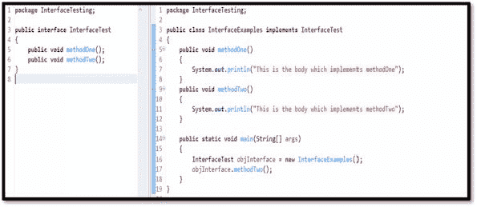

### 图 6.3 – 类实现接口

程序输出：

`This is the body which implements methodTwo`

注意：截图显示的是分屏图像，这是因为接口和类位于不同的文件中。如果接口和类位于同一个文件中，Eclipse 会显示“interface must be defined in its own file”（接口必须在其文件中定义）的消息。

- 第 3 行在类定义中包含了 `implements` 关键字。
- 第 5 – 12 行是实现的方法，具有方法体。每个类方法必须与接口方法匹配。因此，方法被声明为 `public`、`void` 类型，并具有相同的签名。如果其中一个方法没有被实现，则类应被声明为抽象类。抽象类的声明类似于下所示：

`abstract public class InterfaceExamples implements InterfaceTest`

# 接口变量

接口常量（称为常量）被隐式声明为 `public`、`static` 和 `final`。换句话说，接口变量默认是带有初始值的常量。常量是赋值给变量名的不可更改的值。这些值在没有方法的接口中建立，并在所有文件中共享。类以与方法相同的方式接口变量。以下是接口变量的示例：

```java
public interface InterfaceVariable {
    int DAYS_PER_WEEK = 7;
    int MAX_HOURS_PER_DAY = 24;
}
```

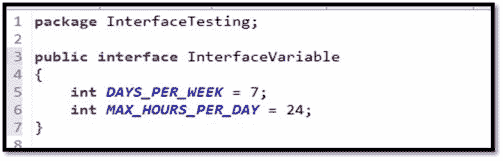

### 图 6.4 – 接口变量示例

# 多重继承

多重继承是指一个接口扩展另一个接口或一个类实现多个接口。使用 `extends` 关键字扩展接口。如果程序员选择添加更多方法，那么接口的扩展是有益的。如果在原始接口中添加了方法，且该接口已被类实现，则会显示错误。所有使用原始接口的类都会破坏现有代码，因为没有新添加方法的实现。然而，可以通过单独的接口扩展原始接口以适应新方法。程序员可以决定继续使用原始接口或开始使用扩展接口。

类通过使用 `implements` 关键字后跟逗号分隔的接口来继承多个接口。如果接口继承另一个接口或类实现多个接口，则类必须为所有方法提供实现。以下是接口多重继承的示例：

```java
public interface ExtendInterface extends InterfaceTest {
    public void methodThree();
    public void methodFour();
}
```

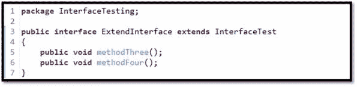

### 图 6.5 – 接口扩展示例

- 第 3 行使用 `extends` 关键字扩展接口 `InterfaceTest`。扩展的接口包含了图 6.2 接口示例中的抽象方法 `methodOne` 和 `methodTwo`。
- 第 5 和 6 行显示了 `public void abstract` 方法 `methodThree` 和 `methodFour`。继承接口时不需要扩展接口的方法。可以通过添加接口名称并用逗号分隔所有接口来扩展额外的接口。

以下是类实现多个接口的示例：

```java
public class MultipleInterfaces implements InterfaceTest, ExtendInterface {
    public void methodOne() {
        System.out.println("This is the body which implements methodOne");
    }
    public void methodTwo() {
        System.out.println("This is the body which implements methodTwo");
    }
    public void methodThree() {
        System.out.println("This is the body which implements methodThree");
    }
    public void methodFour() {
        System.out.println("This is the body which implements methodFour");
    }
    public static void main(String[] args) {
        InterfaceTest objInterface1 = new MultipleInterfaces();
        objInterface1.methodOne();
        ExtendInterface objInterface3 = new MultipleInterfaces();
        objInterface3.methodThree();
    }
}
```

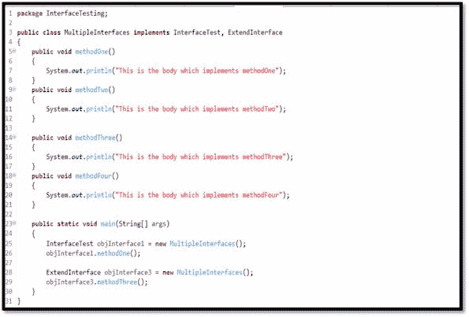

### 图 6.6 – 类实现多个接口

程序输出：

`This is the body which implements methodOne`

`This is the body which implements methodThree`

- 第 3 行使用 `implements` 关键字实现多个接口 `InterfaceTest` 和 `ExtendInterface`。
- 第 5 – 21 行为两个接口中的每个方法实现了方法体/行为。
- 第 25 – 29 行创建了对象 `objInterface1` 和 `objInterface3`，用于调用方法 `methodOne` 和 `methodThree`。

# 默认接口方法


默认接口方法（称为方法）允许接口方法提供方法体。因此，允许接口方法实现行为。这一变化发生在 JDK 8 发布中，其中接口有选择保持抽象或定义默认实现。默认方法包含一个跟在方法类型之前的 `default` 关键字。默认方法的优势是类不需要实现。然而，如果返回了不同的值，则类需要对默认方法进行实现。以下是使用图“图 6.2 – 接口示例”和图 6.5 – 接口扩展示例”的默认方法示例：

```java
public interface DefaultMethod {
    public void methodOne();
    public void methodTwo();
    default public void methodThree() {
        System.out.println("This is the body which implements methodThree");
    }
    default public void methodFour() {
        System.out.println("This is the body which implements methodFour");
    }
}
```

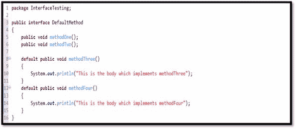

### 图 6.7 – 默认方法示例

第 6 章解释了接口，它是相关方法的集合。通常，接口方法不包含方法体。因此接口方法定义执行任务而不是如何执行任务。然而，默认方法允许接口方法提供方法体，这是 JDK 8 发布时的变化。第 7 章将讨论错误、异常和调试。

# 第 7 章

## 错误、异常和调试

所有程序都会包含某种错误。错误是程序中的意外问题。它可能是意想不到的问题，例如拼错关键字。在 Java 中，错误被分为三类：

1. 语法 – 阻止代码执行

2. 运行时 – 在程序运行时产生错误

3. 逻辑 – 由于代码逻辑缺陷而不产生错误消息

`逻辑错误`很难定位，因为系统不会生成错误信息。通常，逻辑错误会一直隐藏，直到程序员对程序进行调试。虽然错误是不可避免的问题，但某些问题可以在运行时处理。在运行时处理的问题被称为`异常`。程序员创建一个名为“异常处理器”的代码块，以规范的方式处理异常。处理异常的好处是程序在捕获到异常后仍然可以继续运行。

`调试`是一个允许程序员观察并纠正错误的过程。可以使用 `System.out.print`、`System.out.println` 或调试器找到程序中的问题。调试器是一个遵循代码逻辑的工具。大多数程序员倾向于使用调试器而不是多个打印语句来调查问题。如果使用了打印语句，程序员必须在解决问题前添加这些打印语句，并在解决问题后将它们移除。

第七章将解释关于错误、异常和调试的以下内容：

* 错误类型

* Throwable 异常父类

* Java 内置异常

* 异常

* 处理异常的原则

* Try/Catch 块

* Finally 块

* Catch 获 Throwable 异常

* Throwable 定义的方法

* Throw vs Throws

* 调试

# 错误类型

在编程中，错误是由于程序员代码中的错误而导致的问题。错误出现在程序执行之前、程序执行期间，有时隐藏在程序内部。位于程序执行执行前的错误被称为`语法错误`。在程序执行期间发现的错误被称为`运行时错误`。隐藏在程序中最难发现的错误被称为`逻辑错误`。尽管如此，所有错误都必须解决才能获得成功的程序。

## 语法错误

语法错误（称为编译错误）会停止程序执行。回想第一本书“第一部分 – Java 4 Selenium WebDriver”，语法是一组规定单词和符号结构化组合的规则。如果结构不正确，就会发生错误以防止语句编译。结果是由于程序员代码中的不准确之处导致错误无法通过编译。

语法错误是最容易定位和解决的错误。集成开发环境（IDE）如 `Eclipse` 会指出这些错误。错误通过代码下方的红色横线和/或行号左侧的红色 `X` 显示。此外，在悬停于红色 `X` 上时，工具提示会显示显示错误的消息。根据《Beginning Java® Programming》(2015)，语法错误包括以下示例（第 172 页）：

* 类名、变量名或方法名拼错

* 关键字拼错

* 缺少分号

* 方法缺少返回类型

* 括号和括号位置错误或不匹配

* 未声明或未初始变量

* 循环、方法或其他结构的格式错误

以下代码程序中存在语法错误：

```java
public  class SyntaxError

{

 public  static  void main(String[] args)

             {

 int x, y, total;

                          x = 10;
                          y = 6,

                          Total = x + y;
                          System.out.println("The total of 10 + 6 is " + total);

             }
}
```

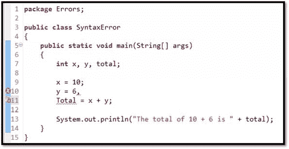

### 图 7.1 – 语法错误示例

* 第 10 行由于逗号而非分号显示错误

* 第 11 行由于 `Total` 未定义而显示错误。首字母是小写 `t` 而非大写 `T`。

```java
public class LogicalErrors {
    public static void main(String[] args) {
        int total1 = (9 + (8 * 7)) / 6;
        int total2 = (9 + 8) * (7 / 6);
        int total3 = 9 + 8 * 7 / 6;
        int total4 = (9 + 8) * 7 / 6;

        System.out.println("What is the result of total1: " + total1);
        System.out.println("What is the result of total2: " + total2);
        System.out.println("What is the result of total3: " + total3);
        System.out.println("What is the result of total4: " + total4);
    }
}
```

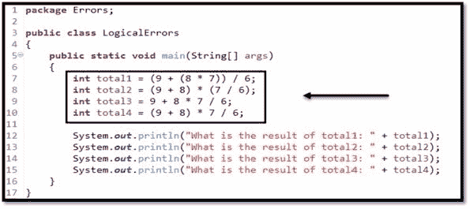

### 图 7.6 – 运算符优先级逻辑错误示例

**程序输出：**

```
What is the result of total1: 10
What is the result of total2: 17
What is the result of total3: 18
What is the result of total4: 19
```

第 7 – 10 行使用不同的运算符优先级初始化了变量 `total1`、`total2`、`total3`、`total4`。尽管数值 `9, 8, 7, 6` 相同，但每个变量都产生了不同的值。以下是一个分号位置错误的示例：

```java
public class LogicalErrors2 {
    public static void main(String[] args) {
        int i;
        for (i = 0; i < 5; i++);
        {
            System.out.println("The loop control variable is " + i);
        }
    }
}
```

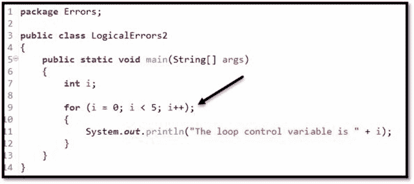

### 图 7.7 – 分号位置错误逻辑错误示例

**程序输出：**

```
The loop control variable is 5
```

第 9 行在 `for` 循环末尾错误地放置了分号。因此，程序输出 5 而不是 0, 1, 2, 3, 4。

# Throwable 异常父类

异常是一个 Java 类，其中 `java.lang.Throwable` 是其父类。因此，Throwable 异常代表所有异常类。当程序中抛出异常时，会生成特定异常类的对象。派自 `Throwable` 父类有两个主要的子类：

1. `Error` – 包含在 Java 虚拟机 (`JVM`) 中发生的严重异常。`JVM` 是机器内部的机器，用于解决问题并帮助程序保持安全。`Error` 子类不由程序员管理。

2. `Exception` – 包含程序中发生的异常。`Exception` 子类由程序员管理。

本书“第 2 部分 – Java 4 Selenium WebDriver”将解释 `Exception` 子类。源自 `Error` 子类的异常是程序员无法控制的。以下来自 [Program Creek](http://www.programcreek.com/wp-content/uploads/2009/02/Exception-Diagram.jpeg) 的一张图，显示了 Java 类的层次结构：

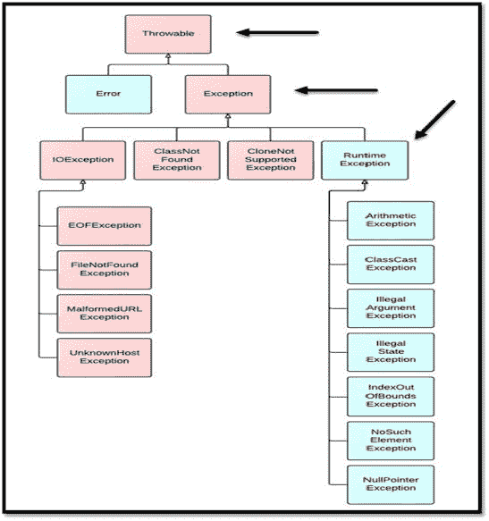

### 图 7.8 – Java 异常层次结构

# Java 内置异常

在 Java 中，`java.lang` 标准包中定义了大量的异常类。因此，由于 `java.lang` 被隐式导入每个程序中，某些异常是自动可用的。大多数异常源自标准类型 `RuntimeException`。`RuntimeException` 包含编译器不检查的异常。所有其他异常都由编译器检查，并且必须包含在方法的 `throws` 列表中。以下是 `java.lang` 中未检查（unchecked）和已检查（checked）异常的列表：

| 未检查异常 | 说明 |

| :--- | :--- |

| `ArithmeticException` | 算术错误，例如除以零。 |

| `ArrayIndexOutOfBoundsException` | 数组索引越界。 |

| `ArrayStoreException` | 向不兼容的类型的数组元素赋值。 |

| `ClassCastException` | 无效的类型转换。 |

| `EnumConstantException` | 尝试使用未定义的枚举值。 |

| `IllegalArgumentException` | 调用方法时使用了非法参数。 |

| `IllegalMonitorStateException` | 非法监视器操作，例如在未锁定的线程上等待。 |

| `IllegalStateException` | 环境或应用程序处于错误状态。 |

| `IllegalThreadStateException` | 请求的操作与当前线程状态不兼容。 |

| `IndexOutOfBoundsException` | 某种类型的索引越界。 |

| `NegativeArraySizeException` | 使用负尺寸创建数组。 |

| `NullPointerException` | 对空引用的无效使用。 |

| `NumberFormatException` | 字符串到数值格式的无效转换。 |

| `SecurityException` | 尝试违反安全性。 |

| `StringIndexOutOfBoundsException` | 尝试访问字符串范围外的索引。 |

| `TypeNotPresent` | 未找到类型。 |

| `UnsupportedOperationException` | 遇到不支持的操作。 |

### 图 7.9 – Java 未检查异常

| 已检查异常 | 说明 |

| :--- | :--- |

| `ClassNotFoundException` | 未找到类。 |

| `CloneNotSupportedException` | 尝试克隆一个没有实现 `Cloneable` 接口的对象。 |

| `IllegalAccessException` | 拒绝对类的访问。 |

| `InstantiationException` | 尝试创建抽象类或接口的对象。 |

| `InterruptedException` | 一个线程被另一个线程中断。 |

| `NoSuchFieldException` | 请求的字段不存在。 |

| `NoSuchMethodException` | 请求的方法不存在。 |

| `ReflectiveOperationException` | 反射相关异常的超类。 |

### 图 7.10 – Java 已检查异常

注意：除了 `java.lang` 之外，以下包包含异常：

| `java.awt` | `java.net` |

| :--- | :--- |

| `java.awt.color` | `java.rmi` |

| `java.awt.datatransfer` | `java.security` |

| `java.beans` | `java.text` |

### 图 7.11 – 包含异常的包

# 常见异常

常见异常是程序中频繁异常。这类异常发生在新程序员和经验程序员身上。以下是按字母顺序排列的常见异常：

* `ArrayIndexOutOfBoundsException`

* `ClassCastException`

* `IllegalArgumentException`

* `IllegalStateException`

* `NullPointerException`

* `NumberFormatException`

* `OutOfMemoryError`

* `StackOverflowError`

数组从索引 0 开始存储第一个值。因此，最后一个索引位置是数组大小减 1。当程序尝试访问数组边界外的索引时，会抛出 `ArrayIndexOutOfBoundsException`。以下是 `ArrayIndexOutOfBoundsException`：

```java
public class CommonException {
    public static void main(String[] args) {
        String[] continents = new String[7];
        continents[0] = "Africa";
        continents[1] = "Antarctica";
        continents[2] = "Asia";
        continents[3] = "Australia";
        continents[4] = "Europe";
        continents[5] = "North America";
        continents[6] = "South America";
        continents[7] = "America";

        System.out.println("There are " + continents.length + " countries");
    }
}
```

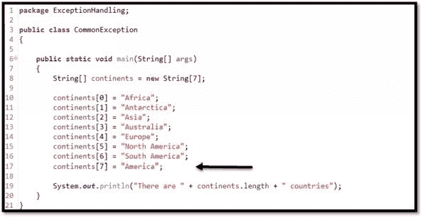

### 图 7.12 – ArrayIndexOutOfBoundsException / 常见异常示例

* 第 8 行创建了一个包含 7 个元素的数组 `String[] continents = new String[7];`

* 第 17 行的 `continents[7] = "America";` 超出了数组 `continents` 的边界

* 第 19 行没有执行，因为错误导致程序停止

**程序输出：**

```
Exception in thread "main" java.lang.ArrayIndexOutOfBoundsException: 7
    at ExceptionHandling.CommonException.main(CommonException.java:17)
```

根据程序输出，越界索引为“7”，位于第 17 行。第一行表示发生了异常，然后显示了异常类型 `java.lang.ArrayIndexOutOfBoundsException`。数字 7 指定了导致异常的索引。第二行显示了异常所在的位置 `at ExceptionHandling.CommonException.main(CommonException.java:17)`。以下是第二行的翻译：

在包名 `ExceptionHandling`、类名 `CommonException`、方法名 `main` 的第 17 行发生了一个异常。

# 异常处理原理

众周知，异常是在运行时（程序执行期间）发生的问题。Java 允许异常处理器处理异常，这具有许多优点。请记住图 7.4 中的运行时错误示例，由于由于除以零导致执行停止。处理异常的好处是程序在响应错误后将继续执行。因此，错误不会停止程序的执行，而是异常处理器允许程序继续运行。在 Java 中，有五个相互关联的关键字可以促进异常处理的管理。以下是每个关键字的描述：

1. `try` – 监控可能发生异常的代码

2. `catch` – 当发生错误时处理异常

3. `throw` – 手动抛出自定义异常

4. `throws` – 抛出方法中发生的异常

5. `finally` – 在退出 `try` 块后自动执行代码

如果异常处理器没有捕获异常，则 Java 虚拟机 (`JVM`) 会捕获所有异常。`JVM` 会显示错误信息，这对于调试是有利的，但对于处理异常不利。由于会导致程序终止，它对于处理异常是不好的。

# Try / Catch 块


`try`/`catch` 块允许尝试执行代码以验证是否发生异常。如果发生异常，则捕获该异常以指定应该发生什么。“`try` 和 `catch`”两个关键字在处理异常时共同工作。`try` 用于包含可能引起异常的代码，而 `catch` 用于管理异常。这两个关键字“`try` 和 `catch`”都是处理异常的核心。会提供一个 `try` 块以及一个或多个 `catch` 块。需要注意的是，如果没有发生异常，则 `try` 块和所有 `catch` 块都会被跳过。以下是处理异常的 `try`/`catch` 块语法：

## 语法

```java
try
{
    // 由 try 块监控的代码
}
catch (ExceptionType1 excObject)
{
    //  ExceptionType1 的异常处理器
}
catch (ExceptionType2 excObject)
{
    //  ExceptionType2 的异常处理器
}
```

以下是 `try` 和 `catch` 块的语法细节：

| 参数 | 描述 |
| :--- | :--- |
| `try` | 监控代码块以检查异常 |
| `catch` | 处理并应对异常 |
| `ExceptionType1` `ExceptionType2` | 异常类型，必须是继承自 `Throwable` 类的类名 |
| `excObject` | 接收处理器捕获的异常值 |

### 图 7.13 – 语法细节

以下是一个 `try` 和 `catch` 异常处理器的示例：

```java
public class TryCatchBlock
{
    public static void main(String[] args)
    {
        String[] continents = new String[7];
        try
        {
            System.out.println("An exception has not been thrown");
            continents[0] = "Africa";
            continents[1] = "Antarctica";
            continents[2] = "Asia";
            continents[3] = "Australia";
            continents[4] = "Europe";
            continents[5] = "North America";
            continents[6] = "South America";
            continents[7] = "America";
            System.out.println("There are " + continents.length + " continents");
        }
        catch (ArrayIndexOutOfBoundsException exc)
        {
            System.out.println("Exception!!! - Array Out of Bounds. Not a valid continent");
        }
        System.out.println("This line executes automatically whether an exception occurs or not");
    }
}
```

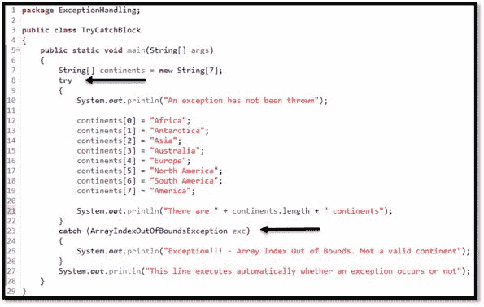

### 图 7.14 – Try 和 Catch 示例

**程序输出：**

```
An exception has not been thrown
Exception!!! - Array Out of Bounds. Not a valid continent
This line executes automatically whether an exception occurs or not
```

- 第 8 行开始使用 `try` 块处理代码
- 第 19 行在定义位置 7（位于数组之外）时强制触发异常。因此，`try` 块终止，程序将控制权转移到 `catch` 块
- 由于第 19 行发生异常，第 21 行不执行
- 第 23 行通过在 `catch` 块中列出异常 `ArrayIndexOutOfBoundsException` 开始异常处理过程
- 第 25 行在捕获异常后在 `catch` 块内执行
- 第 27 行在 `catch` 块之后执行。此行无论是否发生异常都会自动执行

Java 中的一种常见做法是将多个 `catch` 块与 `try` 块相关联。每个 `catch` 块必须包含一个唯一的异常类型，例如算术异常、数组越界异常等。异常类型决定了在创建多个 `catch` 块后执行哪个 `catch` 块。因此，如果执行了算术异常，数组越界异常类型将被跳过。以下是带有多个 `catch` 块的 `try` 块示例：

```java
public class MultipleCatchBlocks
{
    public static void main(String[] args)
    {
        int oddNumbers[] = {1, 33, 55, 77, 111};
        int evenNumbers[] = {0, 2, 4, 8};
        for (int i = 0; i < oddNumbers.length; i++)
        {
            try
            {
                System.out.println("What is " + oddNumbers[i] + "/" + evenNumbers[i] + "? " + "" + oddNumbers[i]/evenNumbers[i]);
            }
            catch (ArithmeticException except)
            {
                System.out.println("Exception!!! - Cannot divide by zero");
            }
            catch (ArrayIndexOutOfBoundsException except)
            {
                System.out.println("Exception!!! - Cannot locate the index");
            }
            System.out.println("This line executes automatically whether an exception occurs or not");
        }
    }
}
```

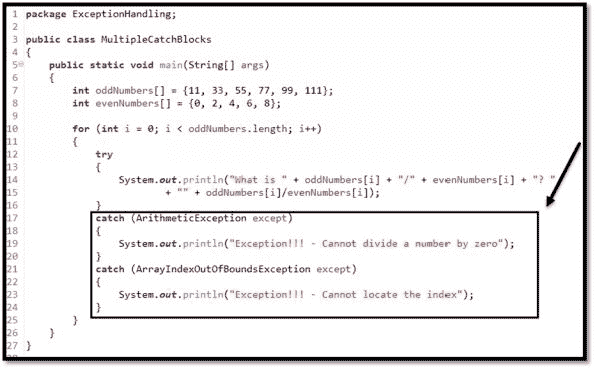

### 图 7.15 – 多重 Catch 块

**程序输出：**

```
Exception!!! - Cannot divide by zero
What is 33/2? 16
What is 55/4? 13
What is 77/6? 12
What is 99/8? 12
```

- 第 17 行显示了第一个 `catch` 块，它包含算术异常。`catch` 块根据它们与 `try` 块关联的顺序进行评估。因此，由于它在程序中先出现，首先被评估
- 当代码到达数组 `evenNumbers[]` 中的零 `0` 时，执行第 19 行
- 第 21 行显示第二个 `catch` 块，它包含数组索引越界异常
- 当代码在数组 `evenNumbers[]` 中搜索不存在的索引时，执行第 23 行。当找到此异常类型的匹配项时，其他 `catch` 块将被忽略

# Finally 块

`finally` 块是 `try`/`catch` 块的扩展。该块确保无论是否发生异常，某些操作（如向文件写入数据）都会执行。Java 允许相同的操作放在 `try` 块和 `catch` 块中。另一方面，在两个块（`try` 块和 `catch` 块）中放置相同的代码会导致代码重复。

例如，如果没有发生异常且需要将数据写入文件会发生什么。在这种情况下，`try` 块执行代码，而 `catch` 块被跳过。然而，如果发生异常，`catch` 块执行代码，而 `try` 块被跳过。因此，程序员必须将代码置于 `try` 和 `catch` 块中，以确保数据被写入文件。在编程中，重复代码是难以阅读和维护的。`finally` 块不是必须的，但当抛出异常和未抛出异常时，它无疑会将数据写入文件。以下是 `try/catch/finally` 块的语法：

## 语法

```java
try
{
 // 由 try 块监控的代码
}
catch (ExceptionType1 excObject)
{
    // ExceptionType1 的异常处理器
}
catch (ExceptionType2 excObject)
{
    // ExceptionType2 的异常处理器
}
finally
{
 // 无论是否发生异常都执行代码
}
```

以下是一个使用 `try/catch/finally` 块的示例：

```java
public class FinallyBlock
{
 public static void main(String[] args)
{
 int oddNumbers[] = {11, 33, 55, 77, 99, 111};
 int evenNumbers[] = {0, 2, 4, 6, 8};
 for (int i = 0; i < oddNumbers.length; i++)
                                {
 try
                                    {
                                System.out.println("What is " + oddNumbers[i] + "/" + evenNumbers[i] + "? "
+ "" + oddNumbers[i]/evenNumbers[i]);
                                    }
 catch (ArithmeticException except)
                                    {
                                System.out.println("Exception!!! - Cannot divide a number by zero");
                                }
 catch (ArrayIndexOutOfBoundsException except)
                                    {
                                System.out.println("Exception!!! - Cannot locate the index");
                                }
 finally
{
                                System.out.println("  Perform Action");
                            }
 }
}
}
```


### 图 7.16 – Finally 块

**程序输出：**

```
Exception!!! - Cannot divide a number by zero
Perform an Action
What is 33/2? 16
Perform an Action
What is 55/4? 13
Perform an Action
What is 77/6? 12
Perform an Action
What is 99/8? 12
Perform an Action
Exception!!! - locate the index
Perform an Action
```

- 第 25 行在 `try/catch` 块结束时开始 `finally` 块
- 第 27 行在抛出异常和未抛出异常时都会自动执行

# 捕获 Throwable 异常

`Throwable` 异常可以用于捕获所有异常，因为它是父类。超类 `Throwable` 匹配其所有子类，包括 `RuntimeException`。为了捕获这两个类的异常，必须在各自的 `catch` 块中实现该超类和子类。以下是一个使用图 7.15 代码编写的 `Throwable` 超类和 `ArithmeticException` 子类的示例：

```java
public class SuperSubClassException
{
 public static void main(String[] args)
{
 int oddNumbers[] = {11, 33, 55, 77, 99, 111};
 int evenNumbers[] = {0, 2, 4, 6, 8};
 for (int i = 0; i < oddNumbers.length; i++)
                                {
 try
                                    {
                                System.out.println("What is " + oddNumbers[i] + "/" + evenNumbers[i] + "? "
+ "" + oddNumbers[i]/evenNumbers[i]);
                                    }
 catch (ArithmeticException except)
                                    {
                                System.out.println("Exception!!! - Cannot divide a number by zero");
                                }
 catch (Throwable except)
                                    {
                                System.out.println("Exception!!! - The Throwable Exception caught an error");
                            }
 }
}
}
```


### 图 7.17 – Throwable 和 ArithmeticException 示例

**程序输出：**

```
Exception!!! - Cannot a number by zero
What is 33/2? 16
What is 55/4? 13
What is 77/6? 12
What is 99/8? 12
Exception!!! - The Throwable Exception caught an error
```

- 第 18 行在第一个 `catch` 块中实现了子类异常 `ArithmeticException`
- 当代码到达数组 `evenNumbers[]` 中的零 `0` 时，执行第 20 行
- 第 22 行在第二个 `catch` 块中实现了 `Throwable` 异常
- 当代码在数组 `evenNumbers[]` 中搜索不存在的索引时，执行第 24 行

`Throwable` 超类和子类允许通过放在第一个 `catch` 块来捕获异常。如果 `Throwable` 异常实现在第一个块，则会发生错误。错误信息为“Unreachable catch block for Throwable”。

# Throwable 定义的方法

如所述，`Throwable` 是每个异常子类的超类。因此所有异常都支持 `Throwable` 定义的方法。可以使用 `Throwable` 异常进行捕获，但它是通用的。在处理异常时，最好使用特定的异常如 `ArithmeticException`。以下是 `Throwable` 定义的方法列表：

| 方法 | 说明 |
| :--- | :--- |
| `fillInStackTrace()` | 填充完整的执行堆栈 |
| `getLocalizedMessage()` | 创建 `Throwable` 异常的本地化描述 |
| `getMessage()` | 返回 `Throwable` 异常的详细信息 |
| `printStackTrace()` | 打印堆栈跟踪 |


| [`printStackTrace()`](https://www.cis.upenn.edu/%7Ebcpierce/courses/629/jdkdocs/api/java.lang.Throwable.html#printStackTrace%28java.io.PrintStream%29)(`PrintStream`) | 向指定的打印流打印堆栈跟踪 |

| [`printStackTrace()`](https://www.cis.upenn.edu/%7Ebcpierce/courses/629/jdkdocs/api/java.lang.Throwable.html#printStackTrace%28java.io.PrintWriter%29)(`PrintWriter`) | 向指定的打印写入器打印堆栈跟踪 |

| [`toString()`](https://www.cis.upenn.edu/%7Ebcpierce/courses/629/jdkdocs/api/java.lang.Throwable.html#toString%28()) | 在被 `println()` 方法调用后返回简短的异常描述 |

### 图 7.18 – Throwable 定义的方法

`Throwable` 定义的最常用方法之一是 [`printStackTrace()`](https://www.cis.upenn.edu/%7Ebcpierce/courses/629/jdkdocs/api/java.lang.Throwable.html#printStackTrace%28%29)() 方法。该方法会将堆栈跟踪打印到“标准错误”。以下是 `printStackTrace()` 方法示例：

```java
public class ThrowableMethod {
    public static void main(String[] args) {
        int oddNumbers[] = {11, 33, 55, 77, 99, 111};
        int evenNumbers[] = {0, 2, 4, 6, 8};
        for (int i = 0; i < oddNumbers.length; i++) {
            try {
                System.out.println("What is " + oddNumbers[i] + "/" + evenNumbers[i] + "? "
+ "" + oddNumbers[i]/evenNumbers[i]);
            } catch (ArithmeticException exceptName) {
                System.out.println("Exception!!! - Cannot divide a number by zero");
            } catch (Throwable exceptName) {
                System.out.println("Exception!!! - The Throwable Exception caught the following error:" + "\n");
                exceptName.printStackTrace();
            }
        }
    }
}
```

### 图 7.19 – 打印跟踪

**程序输出：**

```text
What is 33/16
What is 55/13
What is 77/6
What is 99/8
Exception!!! - The Throwable Exception caught the following error:
java.lang.ArrayIndexOutOfBoundsException: 5
at ThrowableMethod.main(ThrowableMethod.java:4)
```

- 第 2 行定义了第二个 `catch` 块，使用了一个对象 `exceptName`，该对象将用于显示异常

- 第 4 行使用异常对象并通过点操作符调用创建了 `printStackTrace()` 方法

## Throw vs Throws

`throw` 关键字用于显式地抛出异常。必须创建一个 `Throwable` 异常类的对象来抛出异常。手动抛出异常有两种方法：

1. 在 `catch` 块中使用参数

2. 使用 `new` 运算符创建对象

以下是手动抛出异常的语法：

```java
throw excObject
```

以下是使用 `new` 运算符抛出异常的示例：

```java
public class ThrowTest {
    int DivideByZero(int num1, int num2) {
        if (num2 == 0) {
            System.out.println("An error has been thrown");
            throw new ArithmeticException("Exception!!! - Cannot divide a number by zero");
        } else {
            return num1/num2;
        }
    }
    public static void main(String[] args) {
        try {
            ThrowTest objThrow = new ThrowTest ();
            System.out.println(objThrow.DivideByZero(34, 0));
        } catch (Exception exc) {
            System.out.println(exc.getMessage());
        } finally {
            System.out.println(" Perform an action if exception thrown or ");
        }
    }
}
```

### 图 7.20 – Throw 示例

**程序输出：**

```text
An error has not been thrown
Exception!!! - Cannot divide a number by zero
Perform an action if thrown or not
```

- 第 10 行使用关键字 `throw` 和 `new` 创建了一个异常。关键字 `new` 用于构造一个带有字符串参数的 `ArithmeticException` 实例

- 第 24 行将值 `34` 和 `0` 传递给从第 5 行开始的 `DivideByZero` 方法。变量 `num2` 接收到 `0` 导致异常

- 第 28 行通过调用 `getMessage()` 方法显示第 10 行的字符串参数

`throws` 关键字用于显式定义方法可能抛出的异常。因此，如果一个声明的方法使用 `throws` 关键字声明了一个或多个异常，则方法调用处必须处理所有异常。以下是使用 `throws` 定义异常列表的示例：

```java
method methodName (parameter-list) throws exc-list {
    // 方法体
}
```

以下是使用 `throws` 定义异常的示例：

```java
public class ThrowsKeywordTest {
    static void throwMethod () throws NullPointerException {
        System.out.println("An error has not been thrown");
        throw new NullPointerException ("Exception!!! - Null Pointer");
    }
    public static void main(String[] args) {
        try {
            throwMethod ();
        } catch (NullPointerException exc) {
            System.out.println("Exception Type " + exc);
        }
    }
}
```

### 图 7.21 – Throws 示例

- 第 5 行使用关键字 `throws` 定义了异常 `NullPointerException`

- 第 15 行调用了 `throwMethod()`，该方法包含一个异常

- 第 19 行显示了 `NullPointerException`

以下描述了 `throw` 和 `throws` 之间的差异：

| Throw | Throws |

| :--- | :--- |

| 可以抛出一个异常 | 可以声明多个异常 |

| 后面跟着实例 | 后面跟着异常类 |

| 在方法体内部 | 在方法签名中使用 |

## 调试

在开发程序的某个时刻，程序将包含错误和或异常。对于每个程序员来说，关键在于学习如何调试程序。调试是检测并移除程序中意外状况的过程。像 Eclipse 这样的 IDE 提供了调试工具来辅助调试过程。该工具允许程序员逐行执行代码，以查看每行发生了什么。

## 断点

要开始调试过程，必须在程序中放置断点。断点的目的是暂停程序的执行。结果是，程序运行到断点处，直到调试器接收到后续操作指令。程序可以随时设置或清除多个断点。以下是设置或清除断点的方法列表：

1. 双击目标行号左侧

2. 将光标移动到目标行号左侧，右键点击鼠标，然后选择切换断点

3. 将光标移动到目标行并按下快捷键 `Ctrl + Shift + B`

设置断点后，行号旁边会出现一个蓝点。接下来，程序员必须打开调试视图，该视图提供了各种视图和编辑器的组合用于调试程序。调试视图可以通过以下方式打开：

1. 按 `11`

2. 在程序内部右键点击，选择 Debug As，然后选择 Java

3. 点击 Run 然后选择 Debug As，然后 Java Application

4. 快捷键 `Alt + Shift + D, J`

注意：当 Eclipse 显示“确认切换”对话框时，选择“是”。

### 图 7.23 – 确认视角切换截图

以下是调试（Debug）视图的截图：

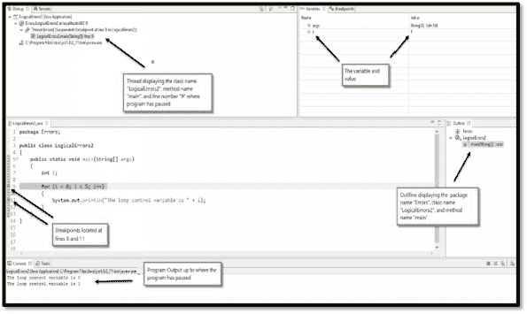

图 7.24 – 调试视图截图

## 单步执行程序

单步执行程序是指调试器逐行执行代码。单步执行的过程有助于程序员理解逻辑是如何运行的。功能键 `F5`、`F6`、`F7` 和 `F8` 控制程序的单步执行。

- 步入 (`F5`） – 仅执行当前代码行。调试器会在步入的每行代码（包括被调用的方法）处暂停。

- 步跳 (`F6`） – 执行当前方法而不显示每个步骤。调试器将留在主程序中，而子程序在后台执行。

- 步回 (`F7`） – 在后台执行当前方法的同时，返回到步入的该方法。

- 恢复 (`F8`） – 继续执行直到遇到下一个断点。

第 7 章讨论了错误、异常和调试。错误是程序中的问题。错误有三种：语法错误、运行时错误和逻辑错误。异常是在运行时发生的错误。然而，异常处理器允许代码块管理异常。因此，异常允许在处理问题后继续执行。调试是一个允许程序员检测并解决所有错误的过程。第 8 章介绍了 Java 的输入输出系统。

# 第 8 章：利用输入和输出

Java 的输入/输出（I/O）包 `java.io` 包含了许多类、接口和方法。该包提供了读取/写入数据的输入流和输出流。数据从输入源读取并写入输出目标。输入源和输出目标可以是任何包含信息的实体，如文件、字符串或内存。输入是程序接收的数据，输出是程序发送的数据。程序可以是接收和发送数据的网络浏览器。

第八章是介绍，涵盖了关于 Java 大型输入/输出系统的以下内容：

- 流

- 文件输入/输出

## 流

Java 程序通过流执行输入和输出。流代表要读取或写入的数据序列。因此，流具有传递数据或对数据进行转换的能力。根据 [Oracle](https://docs.oracle.com/javase/7/docs/api/java/io/package-summary.html#package_description)，`InputStream` 类是所有表示字节输入流的类的抽象超类。`OutputStream` 类是所有表示字节输出流的类的抽象超类。因此，I/O 类是提供或消费信息的抽象。流提供了多种数据格式。

### 字节流

字节流类派自 `InputStream` 和 `OutputStream`。使用字节流的程序提供了功能并管理读取/写入细节。以下是字节流类列表。

| 字节流 | 描述 |

| :--- | :--- |

| `BufferedInputStream` | 为另一个输入流添加功能——即能够缓冲输入并支持 `mark` 和 `reset` 方法 |

| `BufferedOutputStream` | 实现一个缓冲输出流 |

| `ByteArrayInputStream` | 从字节数组读取的输入流 |

| `ByteArrayOutputStream` | 写入字节数组的输出流 |

| `DataInputStream` | 包含读取 Java 标准数据类型方法的输入流 |

| `DataOutputStream` | 包含写入 Java 标准数据类型方法的输出流 |

| `FileInputStream` | 从文件读取的输入流 |

| `FileOutputStream` | 写入文件的输出流 |

| `InputStream` | 是所有表示字节输入流的类的超类的抽象类 |

| `ObjectInputStream` | 用于对象的输入流 |

| `ObjectOutputStream` | 用于对象的输出流 |

| `OutputStream` | 是所有表示字节输出流的类的超类的抽象类 |

| `PipedInputStream` | 提供写入管道输出流的数据字节 |

| `PipedOutputStream` | 连接到管道输入流以创建通信管道 |

| `PrintStream` | 包含 `print()` 和 `println()` 的输出流 |

| `PushbackInputStream` | 允许字节返回到流中的输入流 |

| `SequenceInputStream` | 表示其他输入流的逻辑连接 |

图 8.1 – 字节流

以下是 `InputStream` 方法列表：

| `InputStream` 方法 | 描述 |

| :--- | :--- |

| `abstract int read()` | 从输入流读取下一个字节数据 |

| `boolean markSupported()` | 测试此输入流是否支持 `mark` 和 `reset` 方法 |

| `int available()` | 返回从此输入流中可以读取（或跳过）的字节数估计值，而不会因下一次调用此输入流的方法而阻塞 |

| `int read (byte[] b)` | 从输入流读取若干字节并将其存储在缓冲区数组 `b` 中 |

| `int read (byte[] b, int off, int len)` | 从输入流读取最多 `len` 个字节的数据并存入字节数组 |

| `long skip (long n)` | 跳过并丢弃此输入流中的 `n` 个字节数据 |

| `void close()` | 关闭此输入流并释放与流相关的任何系统资源 |

| `void mark (int readLimit)` | 标记输入流的位置 |

| `void reset()` | 将此流重置为调用 `mark` 方法的位置 |

图 8.2 – `InputStream` 方法

以下是 `OutputStream` 方法列表：

| `OutputStream` 方法 | 描述 |

| :--- | :--- |

| `abstract void write(int b)` | 将指定的字节写入输出流 |

| `void close()` | 关闭此输出流并释放与流相关的任何系统资源 |

| `void flush()` | 刷新此输出流并强制将缓冲的输出字节写入 |

| `void write(byte[] b)` | 将字节数组中的所有字节写入输出流 |

| `void write(byte[] b, int off, int len)` | 从字节数组偏移量 `off` 开始将 `len` 个字节写入输出流 |

图 8.3 – `OutputStream` 方法

## 字符流

字符流类派自 `Reader` 和 `Writer`，它们提供了与 `InputStream` 和 `OutputStream` 的方法。字符流类并行字节流类管理 I/O。Unicode 字符从字符流类转换。以下是字符流类列表：

| 字符流 | 描述 |

| :--- | :--- |

| `BufferedReader` | 从字符输入流读取文本，缓冲字符以便高效读取字符、数组和行 |

| `BufferedWriter` | 向字符输出流写入文本，缓冲字符以便高效写入字符、数组和字符串 |

| `CharArrayReader` | 该类实现了一个可以作为字符输入流的缓冲区 |

| `CharArrayWriter` | 该类实现了一个可以作为 `Writer` 的字符缓冲区 |

| `FileReader` | 读取字符文件的便利类 |

| `FileWriter` | 写入字符文件的便利类 |

| `FilterReader` | 读取过滤字符流的抽象类 |

| `FilterWriter` | 写入过滤字符流的抽象类 |


| `InputStreamReader` | `InputStreamReader` 是字节流到字符流的桥梁：它读取字节并使用指定的字符集将其解码为字符 |

| `LineNumberReader` | 用于行号的缓冲字符输入流 |

| 类 |  |

| :--- | :--- |

| `OutputStreamWriter` | `OutputStreamWriter` 是从字符流到字节流的桥梁：写入它的字符将使用指定的字符集编码为字节 |

| `PipedReader` | 管道字符输入流 |

| `PipedWriter` | 管道字符输出流。 |

| `PrintWriter` | 将对象的格式化表示打印到文本输出流。 |

| `PushbackReader` | 一种字符流读取器，允许将字符推回流中。 |

| `Reader` | 用于读取字符流的抽象类 |

| `StringReader` | 源自字符串的字符流。 |

| `StringWriter` | 将其输出收集在字符串缓冲区中的字符流，该缓冲区可以用于构建字符串 |

| `Writer` | 用于写入字符流的抽象类 |

### 图 8.4 – 字符流

## 缓冲流 (Buffered Streams)

缓冲输入流从称为缓冲区（buffer）的内存区域读取数据。另一方面，缓冲输出流将数据写入缓冲区。在 Java 中，大多数流都是无缓冲的，这意味着每个读取或写入请求都直接由操作系统（OS）管理。操作系统的管理请求会由于触发了昂贵的操作而降低程序的效率。

缓冲 I/O 流的实现旨在通过在内存中管理一个专用空间来减少开销。该专用空间以高效的方式存储数据。例如，只有当缓冲区为空时才会调用缓冲输入流，并且只有当缓冲区满额时才会调用缓冲输出流。因此，以下四个缓冲区类可以用于封装字节或或字符 I/O 流：

| 缓冲区类 | 描述 |

| :--- | :--- |

| `BufferedInputStream` | 为输出流提供缓冲 |

| `BufferedOutputStream` | 为输入流提供缓冲 |

| `BufferedReader` | 从字符输入流读取文本 |

| `BufferedWriter` | 向字符输出流写入文本 |

### 图 8.5 – 缓冲流

## 数据流 (Data Streams)

数据流是 `String` 值、二进制输入以及原始数据类型（如 `boolean`、`byte`、`char`、`double`、`float`、`int`、`long` 和 `short`）输出的基础。所有数据流都实现了 `DataInput` 或 `DataOutput` 接口。`DataInput` 接口提供了读取方法，而 `DataOutput` 接口提供了所有 Java 原始类型的写入方法。`DataInputStream` 实现了 `DataInput` 接口`DataOutputStream` 实现了 `DataOutput` 接口。以下是 `DataInputStream` 和 `DataOutputStream` 的方法列表：

| DataInputStream 方法 | 描述 |

| :--- | :--- |

| `boolean readBoolean()` | 从文件中读取布尔输入 |

| `byte readByte()` | 从文件中读取字节输入 |

| `char readChar()` | 从文件中读取字符输入 |

| `double readDouble()` | 从文件中读取双精度浮点数输入 |

| `float readFile()` | 从文件中读取浮点数输入 |

| `int readInt()` | 从文件中读取整数输入 |

| `long readLong()` | 从文件中读取长整数输入 |

| `short readShort()` | 从文件中读取短整型输入 |

### 图 8.6 – DataInputStream 方法

| DataOutputStream 方法 | 描述 |

| :--- | :--- |

| `void writeBoolean(boolean v)` | 向文件写入布尔输出 |

| `void writeByte(int v)` | 向文件写入字节输出 |

| `void writeChar(int v)` | 向文件写入字符输出 |

| `void writeDouble(double v)` | 向文件写入双精度浮点数输出 |

| `void writeFloat(float v)` | 向文件写入浮点数输出 |

| `void writeInt(int v)` | 向文件写入整数输出 |

| `void writeLong(long v)` | 向文件写入长整数输出 |

| `void writeShort(int v)` | 向文件写入短整型输出 |

### 图 8.7 – DataOutputStream 方法

## 标准流 (Standard Streams)

Java 提供了标准 I/O 支持，因此程序可以从键盘接收输入并在计算机显示器上输出。`java.lang` 包中名为 `System` 的类包含了三个标准流变量`in`、`out` 和 `err`。`System.in` 是一个 `InputStream` 对象，而 `System.out` 和 `System.err` 是 `PrintStream` 对象。`PrintStream` 允许将格式化数据写入 `OutputStream`。以下是标准流的描述：

| 标准流 | 描述 |

| :--- | :--- |

| 标准输入 (`System.in`) | 默认情况下，键盘标准输入控制程序接收输入的地方 |

| 标准输出 (`System.out`) | 默认情况下，控制台标准输出控制程序输出的地方 |

| 标准错误 (`System.err`) | 默认情况下，控制台标准错误用于输出程序提供的错误 |

### 图 8.8 – 标准流

# 文件输入/输出 (File Input/Output)

文件的存储和组织使其能够方便地进行检索和访问。在 Java 中，有两个包 `java.io.file` 和 `java.nio.file` 专门用于文件。`java.nio.file` 包是较新的文件系统，标记为 NIO2，意为“新输入输出 2”。NIO2 标识了用于访问文件、文件属性和文件系统的接口和类。

## Path (路径)

大多数文件按分级结构（称为树）排列。根节点（例如 `C:\`）位于层次结构的顶端，随后是文件夹。所有文件夹都包含包含文件夹和文件的能力。一个路径标识了树中的特定资源（文件或文件夹）。因此，路径 `C:\javaselenium\input_output\test.txt` 标识了位于 `javaselenium` 文件夹下的 `input_output` 文件夹中的 `test` 文件。以下是 Java 文件系统的常用 `Path` 接口方法：

### Path 转换

- `toAbsolutePath()` 返回绝对路径的 `Path` 对象 |

- `toRealPath(LinkOption… options)` 返回现有文件的真实路径 |

- `toUri()` 返回此路径的 URI |

### 获取路径信息

- `getFileName()` 返回 `Path` 对象中的文件名或最后一个元素 |

- `getName(int index)` 返回对应于指定索引的 `Path` 元素 |

- `getNameCount()` 返回路径名称元素的数量

- `getParent()` 返回父路径或 null |

- `getRoot()` 返回路径的根

- `normalize()` 返回去除了冗余名称元素的路径 |

- `resolve(Path other)` 对此路径解析指定路径 |

- `relativize(Path other)` 构建此路径与指定路径之间的相对路径 |

- `subPath(int beginIndex, int endIndex)` 返回由起始和结束索引指定的 `Path` 子序列 |

- `toString` 返回路径的字符串表示 |

* `isReadable(Path path)`

    测试该资源是否可读

* `isSameFile(Path path, Path path2)`

    测试两个资源是否指向同一个资源

* `isWritable(Path path)`

    测试该资源是否可写

### 拷贝方法

* `copy(Path source, Path target, CopyOption… options)`

    将资源拷贝到指定的 target

### 创建方法

* `createFile(Path path, FileAttribute<?>... attrs)`

    创建一个新的空资源

### 删除方法

* `Delete(Path path)`

    删除该资源

    注意：文件夹必须在为空时才能被删除

### 目录方法

* `list()`

    返回一个字符串数组，包含由此抽象路径指示的目录中的资源和目录名称

* `listFiles()`

    返回一个抽象路径数组，指示由此抽象路径指示的目录中的文件

### 移动方法

* [移动](https://docs.oracle.com/javase/7/docs/api/java/nio/file/Files.html#move%28java.nio.file.Path,%20java.nio.file.Path,%20java.nio.file.CopyOption...%29) ([Path](https://docs.oracle.com/javase/7/docs/api/java/nio/file/Path.html)源, [Path](https://docs.oracle.com/javase/7/docs/api/java/nio/file/Path.html)目标, [CopyOption](https://docs.oracle.com/javase/7/docs/api/java/nio/file/CopyOption.html)... 选项)

    将资源移动或重命名到目标

### 读取方法

* `readAllBytes(Path path)`

    从资源中读取所有字节

* `readAllLines(Path path, Charset cs)`

    从资源中读取所有行

### 空间方法

* `length()`

    返回由此抽象路径指示的资源的长度

* `getFreeSpace()`

    返回由此抽象路径指示的分区中未分配的字节数

* `getTotalSpace()`

    返回由此抽象路径指示的分区的大小

* `getUsableSpace()`

    返回在由此抽象路径指示的分区上该虚拟机可用的字节数

### 写入方法

* `write(Path path, byte[] bytes, OpenOption… options)`

    将字节写入资源

* `write(Path path, Iterable<? extends CharSequence> lines Charset cs, OpenOption… options)`

    将文本行写入资源

## 结论

Java 是一种以对象为中心的流行面向对象编程 (OOP) 语言。“第二部分 – Java 4 Selenium WebDriver”的目标是提供 Java 的深度概念。Java 的优点之一是代码的可重用性。以下是书中的核心要点：

- 类：类是对象的模板，包含数据以及操作这些数据的代码。

- 对象：对象是面向对象编程的基础。它包含两个特征：状态和行为。状态标识对象，行为代表对象的操作。

- 方法：方法是执行特定任务的代码块。

- 继承：继承是一种层次化概念，允许扩展可重用的代码和对象。

- 包：包是相关类的集合。

- 接口：接口是相关方法的集合。

- 错误：错误是程序中不可避免的问题。

- 异常：异常是在运行时发生的错误。

- 调试：调试是检测并移除程序中意外状况的过程。

## 资源

1. Beginning Java® Programming

   面向对象的方法

   Bart Baesens, Aimée Backiel, Seppe vanden Broucke

2. Java A Beginner’s Guide Sixth Edition

   今天创建、编译并运行 Java 程序

   Herbert Schildt

3. ORACLE Java Documentation

   The Java TM Tutorials

   [`docs.oracle.com/javase/tutorial/java/javaOO/returnvalue.html`](https://docs.oracle.com/javase/tutorial/java/javaOO/returnvalue.html)

   [`docs.oracle.com/javase/7/docs/api/`](https://docs.oracle.com/javase/7/docs/api/)

   [`docs.oracle.com/javase/7/docs/api/java/io/package-summary.html#package_description`](https://docs.oracle.com/javase/7/docs/api/java/io/package-summary.html#package_description)

4. Program Creek

   [`www.programcreek.com/2009/02/diagram-for-hierarchy-of-exception-classes/`](http://www.programcreek.com/2009/02/diagram-for-hierarchy-of-exception-classes/)

5. TIOBE

   [`www.tiobe.com/tiobe_index`](http://www.tiobe.com/tiobe_index)

6. Dictionary.com

   [`www.dictionary.com/browse/object?s=t`](http://www.dictionary.com/browse/object?s=t)

   [`www.dictionary.com/browse/annotation?s=t`](http://www.dictionary.com/browse/annotation?s=t)

## Rex Jones 著作

1. Free Book Absolute Beginner

   （第一部分）你必须学习 QTP/UFT 的 VBScript

   不要忽略功能测试的语言

2. Free Book Absolute Beginner

   （第二部分）你必须学习 QTP/UFT 的 VBScript

   不要忽略功能测试的语言

3. Free Book Absolute Beginner

   （第一部分）Java 4 Selenium WebDriver

   来学习自动化测试编程

4. Free Book Absolute Beginner

   （第二部分）Java 4 Selenium WebDriver

   来学习自动化测试编程（即将推出）

5. Free Book Absolute Beginner

   （第一部分）用于功能自动化测试的 Selenium WebDriver

   你的新手指南

6. Free Book Absolute Beginner

   （第二部分）用于功能自动化测试的 Selenium WebDriver

   你的高效指南
