# Java 5：文件与 Java IO


Ove Thomsen, EA Dania 同行评审


我们并不是在发明轮子，我们是在重新发明光。

迷人的光影提供了无限的可能性：创新技术和新市场带来了机遇与挑战。在一个你的专业知识被高度需求的环境中。享受在全球集团内的支持性工作环境，并从国际化的职业路径中受益。与其他专家紧密合作实施可持续理念，并为影响我们的未来贡献力量。加入我们，每天一起重新发明光。

OSRAM SYLVANIA

光来自 OSRAM

在 bookboom.com 下载免费电子书，点击广告阅读更多。

- 问题 2 65
- 4 简单数据类型操作 127
- 5.2 用户界面 157

# 序言

本书是软件开发系列书籍中的第五本。编程语言是 Java，该语言及其语法和语义显然涵盖了大量内容，但书籍也很大程度上侧重于过程以及如何开发良好健壮的应用。然而，与前本书相比，本书对过程的关注较少，更多地关注语言本身以及关于 Java 的细节。本书的主题是文件以及 Java 提供的 IO 功能，目标是详细展示如何操作文件。虽然文件在实际编程中的具体含义并不完全相同，但处理文件仍然是作为一名专业软件开发人员所必需的知识。最后，重要的是要意识到 IO 在计算网络编程中起着至关重要的作用，而书中 Java 15 中将使用和扩展的许多数据表示大部分被推到了附录中，该附录还对二进制和十六进制数进行了简要介绍。详细的数据表示在日常生活中并不起太大作用，但这里也是一个必要的知识点，例如在计算机网络的背景下。本书假设读者已经掌握了与 Java 3 和 Java 4 涉及的内容相应的知识，但如果你愿意，可以将本书推迟到你有需要时阅读。

如标题所示，系列书籍处理的是软件开发，目标是教读者如何用 Java 开发应用程序。可以通过阅读相关主题和学习示例程序来掌握，但最重要的是亲自动实践并从零开始编写自己的程序。因此，书籍中的重要部分是练习和问题，读者必须编写与所处理内容相对应的程序。系列中的所有书籍都围绕这一核心构建，并将包含自然属于其中的练习和问题。练习与问题的区别在于，练习很大程度上涉及重复，而问题则不然。

处理文件的类包含在 `java.io` 包中，但自该包开发以来，Java 扩展了一个名为 `java.nio` 的新包——主要为了满足新需求并支持现代操作系统的功能。这两个包都会被使用，并且可能在未来的许多年里都是如此，因此本书在后续将同时涵盖这两个 API。

本书基本上由三部分组成，前两部分处理 IO，第三部分处理数据的二进制表示。如果你没有二进制和十六进制数的知识，先阅读书的附录可能是一个好主意。

# Java 5：文件与 Java IO

## `java.io`

本章涵盖了流（streams），它是一系列提供了 Java 中基本输入输出操作的类。流是可以在源和目的地之间的通信通道上发送的数据序列。源和目的地可以是多种形式：程序、文件、某种或另一种外部设备（如打印机、网络套接字或计算机内存中的数组）。Java 提供了大量可用类，这些类都旨在封装与通过流发送数据相关的许多细节，并且适用于字节流、其他原始类型以及各种对象。本章展示了 `java.io` 中许多类的用法，这些类主要通过项目 `FileProgram` 中的小型测试方法呈现。

如上所述，流的概念有许多应用，但本书主要关注文件和程序之间的流。

## 2.1 文件

你可以将文件看作是一个元素类型为 `byte` 的无限数组。

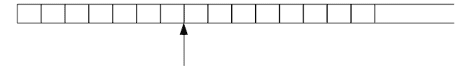

其中文件有一个由箭头表示的所谓“文件指针”。文件指针指示下一个文件操作的开始位置，文件指针（箭头）会根据读取或写入的字节数向前移动。文件存储在机器的磁盘上，操作系统以文件系统的形式组织文件，跟踪目录和文件。每个文件都有一个唯一的名称，由包含该文件的目录名和文件名组成，且文件名在目录下必须是唯一的。Java 有一个名为 `File` 的类，它通过名称表示文件，并提供了许多可用的方法来操作文件。

### 文件信息

以下方法打印关于文件的信息：

```java
private static void fileInfo(String filename) throws IOException {
    File file = new File(filename);
    System.out.println("Absolute path " + file.getAbsolutePath());
}
```

```java
System.out.println("Canonical path = " + file.getCanonicalPath());
System.out.println("Name = " + file.getName());
System.out.println("Parent = " + file.getParent());
System.out.println("Path = " + file.getPath());
System.out.println("Is absolute = " + file.isAbsolute());
if (file.exists()) {
    System.out.println("The file object exists");
    if (file.isDirectory()) {
        System.out.println("The file object is a folder");
    } else {
        System.out.println("The file object is a file");
    }
}
System.out.println(file.length());
```

该方法的参数是文件名。注意该方法可能会抛出 `IOException`，通常发生在你尝试对文件执行操作时。在这种情况下，只有一种方法会抛出 `IOException`。该方法创建了一个表示命名文件的 `File` 对象。注意 `File` 对象既可以表示目录也可以表示文件，并且该文件（或目录）存在是合法的。这些条件在对象使用时非常重要。前两个语句打印绝对路径和规范路径。在大多数情况下它们是相同的，但规范路径可能与绝对路径不同（见程序测试）。接下来的三个语句分别打印文件名、父目录和路径。这里是文件所属目录的文件名，父目录是该文件所在的目录名。Path 用于创建 `File` 对象，在这种情况下是文件名参数的值。最后三个语句测试它是否为绝对路径，以及该命名的目录是否存在。在这种情况下测试它是目录还是文件。最后，语句打印以字节为单位的文件大小。

以下测试方法使用 `inputFile()` 方法打印关于各种 `File` 对象的信息：

```java
private static void test01() {
    System.out.println("Working Directory = " + System.getProperty("user.dir"));

    try {
        FileInfo info = new File("/home/pa/doc");

        info.inputFile("/home/pa/doc/Swing");

        fileInfo("/home/pa/doc/pa/xpq/1234");

        fileInfo("..");
    } catch (IOException ex) {
        System.out.println(ex);
    }
}
```

注意第一个语句打印了当前目录的名称。邀请你测试示例并研究结果。

### 驱动器信息

以下方法以 `File` 对象作为参数，打印关于该磁盘分区的信息，包含了：

```java
private static void print(File root) {
    System.out.println("Partition: " + root);
}
```


```java
System.out.println("Free space = " + root.getFreeSpace());
System.out.println("Usable space = " + root.getUsableSpace());
System.out.println("Total space = " + root.getTotalSpace());
```

所有大小都以字节指定。`getFreeSpace()` 和 `getUsableSpace()` 通常显示相同的值，是因为后者更好的估计，因为它考虑了与当前操作系统文件系统相关的开销。该方法在以下测试方法中使用：

```java
private static void test02() {
    print(new File("/"));
    print(new File("/home"));
    print(new File("/root/media/pa/HD-NFPU3"));
}
```

这为我的机器打印根分区、home 分区以及外部硬盘的信息。

### 文件大小与过滤器

以下方法有一个名称参数并创建一个相应的 `File` 对象。如果该对象表示一个文件，该方法将打印名称和大小，其中大小由 `getSize()` 方法递归确定，该方法确定以该对象为根的树的大小。注意 `size` 是一个静态变量，在程序开始时定义。

```java
private static void fileSize(String filename, FileFilter filter) {
    File file = new File(filename);

    if (file.exists()) {
        System.out.println(file.getAbsolutePath());
        size = 0;
        getSize(file, filter);
        System.out.println(size);
    } else {
        System.out.println("Filen ikke ikke");
    }
}
```

该方法有一个类型为 `Filter` 的参数。它是一个定义了一个方法的接口：

```java
public boolean accept(File pathname);
```

该方法应该测试由参数标识的文件是否符合某些标准。`FileFilter` 对象与由名称表示的 `File` 对象一起传递给 `getSize()` 方法：

```java
private static void getSize(File file, FileFilter filter) {
    if (file.isDirectory()) {
        File[] files = filter == null ? file.listFiles() : file.listFiles(filter);
        for (File f : files) {
            getSize(f, filter);
        }
    } else if (filter == null || filter.accept(file)) {
        size += file.length();
    }
}
```

该方法测试第一个参数是否为目录。在这种情况下，方法 `listFiles()` 返回该目录下的文件数组。该方法存在多个重载，其中一个带有过滤器参数的方法，它只返回符合过滤器的文件。当数组可用（可能为空）时，对数组中的所有文件递归调用 `getSize()`。如果方法被调用且第一个参数不是目录，则没有其他操作，静态变量 `size` 会加上文件的大小——如果需要根据过滤器包含的话。

下面是一个测试方法，确定部分当前目录和部分用户主目录的文件大小。在两种情况下，都有带过滤器和不带过滤器的测试，过滤器接受目录或文件名以 `.java` 结尾的文件。

```java
private static void test03() {
    FileFilter filter = new FileFilter() {
        public boolean accept(File f) {
            return f.isDirectory() || (f.isFile() && f.getName().endsWith(".java"));
        }
    };

    getSize(".", null);
    getSize(".", filter);
    getSize(System.getProperty("user.home"), null);
    getSize(System.getProperty("user.home"), filter);
}
```

你不需要知道过滤器是如何基于匿名类定义的。

## 文件系统的操作

类文件还有许多可以操作文件系统的方法，例如创建目录和文件，以及再次删除它们。有很多这样的方法（鼓励你去检查一下），下面的测试方法展示了其中几个用法，但首先是一个简单的辅助方法：

```java
private static void showFiles(File file) {
    System.out.printf(file.isDirectory() ? "[%s\n" : "%s\n", file.getName());

    if (file.isDirectory()) {
        File[] files = file.listFiles();
        for (File f : files) {
            showFiles(f);
        }
    }
}
```

该方法会以特定的 `File` 对象为根节点打印递归的文件树。测试方法如下所示：

```java
private static void test04() {
}
```


我们将你的简历变成一生难难的机会。

你喜欢汽车吗？你想成为成功品牌的一员吗？我们会感谢并奖励你的热情和才华。向我们发送你的简历。你会惊讶它能带你走向哪里。

在 www.employerforlife.com 向我们发送你的简历。

在 bookboom.com 下载免费电子书。

点击广告阅读更多。

## Java 5：文件与 IO

```java
File file = new File(System.getProperty("user.home") + "/test");

try {
    file.mkdir();

    (new File(file, "filer")).mkdir();

    (new File(file, "filer/file1")).createNewFile();

    (new File(file, "filer/file2")).createNewFile();

    showFiles(file);

    file.deleteOnExit();
} catch (Exception ex) {
    System.out.println(ex);
}
```

第一个语句定义了一个 `File` 对象，引用用户主目录下名为 `test` 的文件。接下来，它创建了名为该名的目录并包含一个子目录 `filer`。下面再次创建了两个普通文件，然后调用了 `showFiles()` 方法。结果如下：

```text
[test]
[filer]
file2
filer
```

测试方法中的最后一个语句执行了 `deleteOnExit()`，它会删除该 `File` 对象创建的所有文件和目录。该方法在实际用途上可能不大，但对于像示例这样的清理工作非常智能。

## 练习 1

你必须编写一个命令，可以叫 `Seek`。该命令应该以以下方式执行：

```bash
java -jar Seek.jar directory [text]
```

其中 `directory` 是目录名称，`text` 是搜索文本。该命令应该打印以 `directory` 为根目录的文件树中所有包含搜索文本的文件的绝对路径。结果可能如下：

### Java IO

```bash
Fil Rediger Sag Terminal Hjelp

$ java -jar Seek.jar /home/pa/doc/noter/note05/histor/src/PersonView.java [06-07-2016] 5899

/home/pa/doc/noter/note05/histor/src/Person.java [06-07-2016] 4435

/home/pa/doc/noter/note05/histor/src/Person6.java [06-07-2016] 2480

/home/pa/doc/noter/note05/histor/src/History.java [06-07-2016] 233

/home/pa/doc/noter/note05/histor/src/Main.java [06-07-2016] 1961

/home/pa/doc/noter/note05/histor/src/Other.java [06-07-2016] 2129

/home/pa/doc/noter/note05/loesinger/src/sec/seek.java [10-07-2016] 1360

/home/pa/doc/noter/note05/NioFile/src/copy/NioFile.java [10-07-2016] 2883
```


`/home/pa/doc/noter/note05/NioFile/src/copy/copy.java` [10-07-2016] 844

`/home/pa/doc/noter/note05/FileCopy/src/copy/copy.java` [04-12-2015] 895

`/home/pa/doc/noter/note05/FileCopy/src/filer/File.java` [10-07-2016] 2921

对于每个文件，显示其名称、修改日期和文件大小。程序不能显示符合搜索标准的目录名称，如果搜索标准为空（缺少最后一个参数），则命令应显示当前文件树中的所有文件。

如果第一个参数不是现有目录的名称，命令必须简单在屏幕上打印错误信息。

## 2.2 随机访问文件

第一个语句定义了一个 `File` 对象，引用用户主目录下名为 `test` 的文件。接下来，它创建了名为该名的目录并包含一个子目录 `filer`。下面再次创建了两个普通文件，然后调用了 `showFiles()` 方法。结果如下：

```
[test]
[filer]
file2
filer
```

（此处省略后续大量重复的段落，其内容与上述完全一致，已在上方翻译中体现）

## JAVA 5: 文件与 JAVA IO

在执行完四个语句后，文件会被关闭。这非常重要，因为写入语句是写入内存缓冲区的。只有当缓冲区满或文件关闭时，书中的内容才会被物理地写入文件。关闭文件的另一个原因是你释放了分配给文件的资源。使用 `close()` 关闭文件是非常重要的，为了确保该语句被执行，将其放置在 `finally` 块中，无论是否发生异常，`finally` 块都会执行。

上述内容清晰地定义了处理文件的模式：

1. 打开文件
2. 执行所需的文件操作
3. 关闭文件

在文件中写入四个数字后，再次打开它以读取内容：

```java
try (RandomAccessFile file = new RandomAccessFile("tal.dat", "r"))
```

这次，文件是在 `try` 之后的语句中打开的。这种语法实际上是上述写法的简写，但它保证了当程序退出 `try` 块时文件会被关闭。在大多数情况下，这种语法更优：首先，它实际上更短且更易读；其次，你可以确定自己没有忘记关闭文件。文件打开后，执行了四次 `read()` 操作，读取文件中的四个整数，并计算这些数字之和，然后将其与文件中写入的四个数字之和一起打印出来。其意图是让你看到你得到了相同的结果：

```
4783678760
4783678760
```

因此，读取的四个数字与最初写入文件的数字是相同的。你应该注意，`readInt()` 方法从文件指针所在的位置读取 4 字节，并将这 4 字节转换为一个 `int`。在方法执行后，文件指针会向前移动 4 字节。该方法并不解释这 4 字节包含的内容，结果是一个“感”（sense）整数。无论这 4 字节包含什么，4 字节都可以被解释为一个整数。下一步，再次打开文件进行读和写操作：

```java
try (RandomAccessFile file = new RandomAccessFile("tal.dat", "rw")) {
  file.seek(8);
  file.writeInt(value5);
}
```

然后文件指针向前移动 8 字节，这意味着它指向了文件中第三个数字的开头。该方法向文件中写入另一个数字，这意味着第三个数字被覆盖了，该值现在变成了 `value5` 的值。在语句执行后，再次打开文件进行读取，再次计算四个数字之和，你会发现你得到了一个不同的结果，但结果正确的：

```
4918422832
4918422832
```

在 `RandomAccessFile` 中，你可以使用 `seek()` 方法将文件指针移动到随机位置，或从该位置进行读取或写入。

再次打开文件读取：

```java
try (RandomAccessFile file = new RandomAccessFile("tal.dat", "r")) {
    byte[] arr = new byte[16];
    file.read(arr);
    String str = new String(arr);
    System.out.println(str);
}
```

该代码创建了一个可以容纳 16 字节的数组（与文件内容完全匹配——如果你用 `Files` 检查其属性，可以看到它占用了 16 字节）。接下来，使用 `read()` 方法作为参数读取文件。该方法从文件中最多读取 16 字节（如果文件指针后没有 16 字节）。这 16 字节用于初始化一个字符串，结果是：

```
ABCDEFGHIJKLMNOPQRSTUVWXYZ
```

其目的是展示，尽管文件包含四个总计 16 字节的整数，但它可以被解释为任何内容，而读取文件的程序决定了应该如何解释结果。通过测试方法中的最后语句进一步说明，该方法读取文件内容并解释为两个 `double` 类型数字。

## 再次回顾历史

在 Java 2 书中的示例中，我展示了一个可以输入历史人物信息并通过对象序列化保存信息的程序。我将展示该程序的另一个版本，其区别在于人物存储在 `RandomAccessFile` 中。让我解释一下这种方案并没有优势，目标是展示一个包含固定长度记录的文件示例，这曾是文件的典型应用。

起点是以下类，它代表一个历史人物（我没有显示 get 和 set 方法）：

```java
public class Person implements Comparable<Person>, Serializable
{
    private int recnr = -1; // 人的标识
    private String name; // 人名
    private String job; // 人的职位
    private String text; // 描述
    private int from; // 出生、执政或其他
    private int to; // 死亡年份

    public Person(String name, String job, String text, int from, int to)
    {
        this.name = name;
        this.job = job;
        this.text = text;
        this.from = from;
        this.to = to;
    }

    public Person(int recnr, String navn, String job, String tekst, int fra, int til)
    {
        this(navn, job, tekst, fra, til);
        this.recnr = recnr;
    }
}
```

与程序的之前的版本相比，我做了一个改变，因为类扩展了一个名为 `recnr` 的 `int` 变量。还定义了该变量的 getter 和 setter 方法，并且包含人在文件中的位置。最后添加了一个额外的构造函数。该类被为 `Serializable`。

## JAVA.IO

```java
String job = read(JLENGTH);
String tekst = read(TLENGTH);
int fra = file.readInt();
int til = file.readInt();
return new Person(rec, navn, job, tekst, fra, til);

private String read(int length) throws IOException {
    StringBuilder buff = new StringBuilder();
    for (int i = 0; i < length; ++i) buff.append(file.readChar());
    return buff.toString().trim();
}
```


英语原版在这里
点击听我在下载我的独特课程前后的英语读音

在 bookboom.com 免费下载电子书

27

该类开始于定义一些常量，指定名称最大长度为 50 个字符，位置最大长度为 500 个字符。最后定义了一个表示记录大小的常量。这三个常数之和乘以 2，因为一个字符（`char`）占用 2 字节。最后一个数字 12 是三个整数的大小。这意味着一个 `Person` 记录在文件中始终占用 1172 字节。你应该注意，在大多数情况下，这会比需要的多得多，而且文件将包含一些浪费的空间，但这就是这类文件的条件。这是为了能够读取存储在特定位置的记录而必须付出的代价。

该类有一个 `RandomAccessFile` 类型的实例变量，构造函数打开文件进行读写。注意，如果文件无法打开，构造函数将抛出异常。该类提供了以下服务：

- `length()`：返回文件中记录的数量
- `select()`：返回具有特定记录号的记录
- `append()`：向文件添加一条新记录
- `update()`：修改特定记录的内容
- `delete()`：删除特定记录
- `close()`：关闭文件

这些方法的实现通常没有问题，但 `delete()` 是一个例外。问题在于当你删除一条记录时会发生什么，因为在逻辑上你在文件中产生了一个“空洞”。在实践中，有几种解决方案。你可以将记录移动到被删除记录所在的位置，然后根据记录的大小缩短文件的长度。这种策略的主要问题是，通过这样做记录可能会改变记录号，从而无法用于识别特定记录——记录号不能作为键。在这种情况下，我将使用一种策略，将记录号设为 -1，从而指示该记录已被删除。这种方法的缺点是文件将包含许多“死”记录，而你应该删除已删除的记录。如果你删除了许多记录，可能也意味着文件是不必要的庞大。这个问题可以通过在添加新记录时写入已删除的记录来解决（在本例中没有这样做）。你必须特别注意 `delete()` 方法是如何实现的，以及如何通过向文件写入数字 -1 来删除记录。当记录号是第一个字段时，它正好对应于文件中的数字 -1。

在 bookhoon.com 免费下载电子书

`append()` 方法的参数是待要添加到文件的 `Person` 对象。该方法首先将该对象的记录号分配为文件的下一条记录，然后将文件指针设置为文件的末尾。使用 `write()` 方法将对象写入文件。在这里，你必须注意如何使用 `writeChars()` 保存字符串。首先使用了 `PalLib` 中的两个方法，确保字符串不会过长，如果字符串小于最大长度，则会用空格填充到最大宽度。

`update()` 方法的工作方式相同，只是使用 `Person` 对象的记录号将文件指针置于正确的位置。该方法首先读取一个 `int` 测试它是否为记录号，如果是，则将更新写入文件。

程序的上一个版本有一个名为 `Persons` 的类，现在它被重写如下，因为程序不再通过序列化存储 `Person` 对象，而是使用一个 `PersonDB` 类型的对象。该类扩展了一个名为 `path` 的新实例变量，由构造函数初始化并包含文件名，但在其他情况下，该类的工作原理与程序的第一个版本相同。各种方法当然发生了变化，区别仅在于它们存储对象的方式不同。我在下方展示了整个类，你应该研究代码以及 `PersonDB` 类是如何被使用的：

```java
package history;

import java.util.*;
import java.io.*;

public class Person implements Iterable<Person>
{
    private static String path;
    private ArrayList<Person> list;

    public Persons(String path) throws IOException
    {
        this.path = path;
        load();
    }

    public Iterator<Person> iterator()
    {
        return list.iterator();
    }
}
```

```java
public boolean add(Person pers)
{
    PersonDB db = null;
    try {
        db = new PersonDB(path);
        db.append(pers);
        list.add(pers);
        return true;
    } catch (IOException ex) {
        return false;
    } finally {
        if (db != null) db.close();
    }
}
```


```java
public boolean remove(Person pers)
{
  PersonDB db = null;
  try {
    db = new PersonDB(path);
    db.delete(pers);
    return list.remove(pers);
  }
  catch (IOException ex) {
    return false;
  }
  finally {
    if (db != null) db.close();
  }
}
```

```java
public boolean update(Person pers)
{
  PersonDB db = null;
  try {
    db = new PersonDB(path);
    db.update(pers);
    return true;
  }
  catch (IOException ex) {
    return false;
  }
  finally {
    if (db != null) db.close();
  }
}
```

```java
private void initialize()
{
  list = new ArrayList<>();
  for (int i = 0; i < navname.length; i++) {
    String job = navname[i][0].equals("Margrete d. 1.") || navname[i][0].equals("Margrete d. 2.") ? "Queen" : "King";
    int fra = navname[i][1].length() > 0 ? Integer.parseInt(navname[i][1]) : -9999;
    int til = navname[i][2].length() > 0 ? Integer.parseInt(navname[i][2]) : 9999;
    list.add(new Person(navname[i][0], job, fra, til));
  }
}
```

```java
}
  store();
}
```

```java
private void load() throws IOException
{
  File file = new File(path);
  if (file.exists() && file.isFile()) {
    PersonDB db = null;
    try {
      list = new ArrayList();
      db = new PersonDB(path);
      for (int rec = 0; rec < db.length(); ++rec) {
        Person pers = db.select(rec);
        if (pers != null) list.add(pers);
      }
    } finally {
      if (db != null) db.close();
    }
  } else initialize();
}
```

```java
private void store()
{
  PersonDB db = null;
  try {
    db = new PersonDB(path);
    for (Person pers : list) db.append(pers);
  } catch (IOException ex) {
    System.out.println(ex);
  } finally {
    if (db != null) db.close();
  }
}
```

```java
private String[][] navne = {
    {"Margrete d. 1.", "1000", "1049"},
    {"Margrete d. 2.", "1050", "1099"}
};
```

```java
public class Person
{
    private String name;
    private String job;
    private int fra;
    private int til;
```


```java
/**
 * 向文件添加新产品。该方法为产品分配一个
 * 数字，即文件中的下一条记录。因此，第一个产品的
 * 数字为 0。
 * @param prod 要加到文件中的产品。
 */
```


# JAVA 5：文件与 JAVA IO

## 2.3 字节流

`java.io` 包包含若干用于字节流（以及其他流）的类，流由字节序列组成，基本上有以下类：

| 输入类 | 输出类 |
| :--- | :--- |
| `ByteArrayInputStream` | `ByteArrayOutputStream` |
| `FileInputStream` | `FileOutputStream` |
| `ObjectInputStream` | `ObjectOutputStream` |
| `PipedInputStream` | `PipedOutputStream` |
| `FilterInputStream` | `FilterOutputStream` |

在这里，左列是输入类，所有类都派自抽象类 `InputStream`。右列是输出类，派自抽象类 `OutputStream`。在接下来，我将展示这些类的示例——推迟展示 `PipedInputStream` 和 `PipedOutputStream`。

可以将 `ByteArrayOutputStream` 视为 `ByteArrayInputStream` 的内存表示，而 `InputStream` 的内存表示。这些类的典型用途是将文件内容（例如图片）加载到 `ByteArrayOutputStream` 中，可以在内存中对文件内容进行处理。然后使用 `ByteArrayInputStream` 将内容流到文件。考虑以下测试方法：

```java
private static void test06() {
  try (RandomAccessFile file = new RandomAccessFile("numbers1.dat", "rw")) {
    for (int i = 1; i <= 10; ++i) file.writeInt(i);
  } catch (IOException ex) {
    System.out.println(ex);
  }

  ByteArrayOutputStream streamOut = new ByteArrayOutputStream();
  try (RandomAccessFile file = new RandomAccessFile("numbers1.dat", "r")) {
    for (int i = 0; i < file.length(); ++i) streamOut.write(file.readByte());
  } catch (IOException ex) {
    System.out.println(ex);
  }

  byte[] bytes = streamOut.toByteArray();
  for (int i = 0; i < bytes.length; i++) if ((i + 2) % 4 == 0) bytes[i] = 1;
  ByteArrayInputStream streamIn = new ByteArrayInputStream(bytes);
  try (RandomAccessFile file = new RandomAccessFile("numbers1.dat", "rw")) {
    for (int b = streamIn.read(); b != -1; b++) file.writeByte(b);
  } catch (IOException ex) {
    System.out.println(ex);
  }

  try (RandomAccessFile file = new RandomAccessFile("numbers1.dat", "r")) {
    for (int i = 0, n = (int)(file.length() / 4); i < n; i++) {
      System.out.println(file.readInt());
    }
  }
}
```

该方法首先创建一个包含从 1 到 10 数字的 `RandomAccessFile`。文件内容如下：

```
00000001
00000002
00000003
00000004
00000005
00000006
00000007
00000008
00000009
```

应用程序的主窗口应主要显示一个包含所有产品列表的列表框：

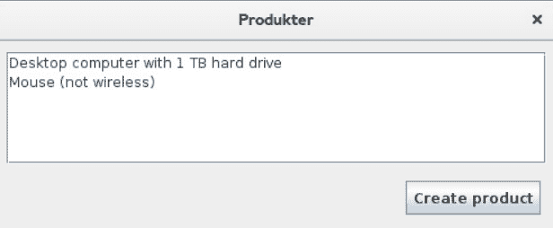

点击按钮，你将获得一个可以创建新产品的窗口。


如果你双击列表框中的某个产品，你将获得相同的窗口，你可以在其中编辑该产品：

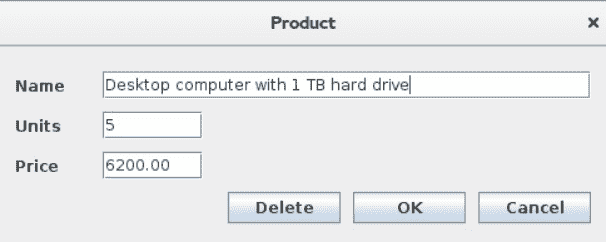

## 产品管理类

```java
/**
 * @throws IOException 如果无法添加产品
 */
public void add(Product prod) throws IOException { }
```

```java
/**
 * 返回产品编号 pnr 的产品。如果未找到该产品，
 * 方法将抛出异常。
 *
 * @param pnr 产品编号
 * @return 编号为 pnr 的产品
 * @throws IOException 如果未找到产品
 */
public Product select(int pnr) throws IOException { }
```

```java
/**
 * 返回文件中的所有产品。
 *
 * @return 文件中的所有产品
 */
public ArrayList<Product> select() { }
```

```java
/**
 * 更新产品。该方法测试位置上的记录是否具有
 * 正确的产品编号。如果不是，则抛出异常。
 *
 * @param prod 要更新的产品
 * @throws IOException 如果未找到产品
 */
public void update(Product prod) throws IOException { }
```

```java
/**
 * 删除产品编号为 pnr 的产品。通过向产品编号
 * 写入 -i 来删除产品。
 *
 * @param pnr 要删除产品的产品编号
 * @throws IOException 如果未找到产品
 */
public void delete(int pnr) throws IOException { }
```

你应该注意，该类的每个方法都应该同时打开和关闭文件。你还应该注意，文件中的前 4 个字节是一个签名（signature），在确定每条记录的位置时必须考虑这一点。

## 关于 e-Learning for Kids

e-Learning 成立于 2004 年，是一个全球非营利基金会，致力于为 5-12 岁的儿童提供互联网上免费且有趣的学习，课程涵盖数学、科学、语言艺术、健康和环境技能。自 2005 年以来，来自 190 多个国家的 1500 万儿童受益于我们提供的 e-Learning 服务。所有志愿者员工均由教育和在线学习专家、来自全球致力于改变的业务专业人士组成，目标是通过种子资金、志愿者、赞助商和慷慨的开发者来推动在线学习。更多信息，请访问 www.e-learningforkids.org。

- 小学教育排名第一 MOOC
- 针对 5-12 岁儿童的免费数字学习
- 惠及 1500 万儿童

在 bookboom.com 下载免费电子书

## 加密与解密

那个数字是 35335216。如果我们现在必须用上述密钥对这个数字进行加密，其原理是每个字节都被用作密钥的索引，并被替换为密钥在该索引处的内容：

```
0x32305c1b
```

结果是数字 842030107，这是一个完全不同的数字。能够加密数据是可以好的，但如果你不能解密这些数据，它就没有太大意义。如果你拥有密钥，对于每个字节，你都可以在密钥中找到它的索引，并将该字节替换为该索引：

```
0x021b2c30
```

你就回到了原始加密的数字。

考虑以下 `void test0` 方法：

```java
private static void test0()
{
  String path0 = "text0";
  String path1 = "text1";
  String path2 = "text2";
  FileOutputStream streamOut = null;
  try {
    streamOut = new FileOutputStream(path0);
    String navn = "ABCDEFGHIJKLMNOPQRSTUVWXYZØÆÅ";
    byte[] bytes = navn.getBytes();
    streamOut.write(bytes);
  } catch (IOException ex) {
    System.out.println(ex);
  } finally {
    if (streamOut != null) try { streamOut.close(); } catch (Exception e) { }
  }
  printTekst(path0);
  int[] key = createKey();
  crypt(path0, path1, key);
  printTekst(path1);
  decrypt(path1, path2, key);
  printTekst(path2);
}
```

该方法的第一部分将一个字符串

```java
String navn = "ABCDEFGHIJKLMNOPQRSTUVWXYZÆØÍŞÅ";
```

写入 `FileOutputStream`。你应该注意，如何创建一个 `FileOutputStream`，将字符串转换为字节数组，然后将其写入文件。该文件保存在当前目录中，名为 `text`。如果你检查该文件，你会发现它占用了 31 个字节，这可能不是人们预期的结果，原因是 `String` 类的 `getBytes()` 方法使用默认字符编码（即 UTF-8）转换为字节数组。该字符串占据了 28 个字符，但最后三个被编码为单个字节，而最后三个使用了 2 个字节。因此，25 + 6 = 31 个字节。

程序还有一个方法，可以读取字符串（文件）的内容，将内容解释为文本并在屏幕上打印文本：

```java
private static void printText(String path)
{
  InputStream stream = null;
  try {
    stream = new FileInputStream(path);
    ByteArrayOutputStream bytes = new ByteArrayOutputStream();
    for (int b = stream.read(); b != -1; b = stream.read()) bytes.write(b);
    System.out.println(new String(bytes.toByteArray()));
  } catch (IOException ex) {
    System.out.println(ex);
  } finally {
    if (stream != null) try { stream.close(); } catch (Exception e) { }
  }
}
```


在这种情况下，打开了一个 `FileInputStream`，并将文件内容读取到 `ByteArrayOutputStream` 中。该流被转换为字符串并打印在屏幕上。该方法在 `test0` 测试方法中使用，将文件内容打印到屏幕上。

测试方法的其余部分将文件文本加密到 `text1` 并在屏幕上打印该文件的内容。以下方法通过在数组 `key` 中交换 1000 次随机元素来创建密钥：

```java
private static int[] createKey() {
  int[] key = new int[256];
  for (int i = 0; i < key.length; ++i) key[i] = i;
  Random rand = new Random();
  for (int n = 0; n < 1000; ++n) {
    int i = rand.nextInt(key.length);
    int j = rand.nextInt(key.length);
    if (i != j) {
      int t = key[i];
      key[i] = key[j];
      key[j] = t;
    }
  }
  return key;
}
```

从原理上讲，可以创建 256! 个密钥，这是一个巨大的数字，因此猜测密钥是一项徒劳的任务，但相对，在明文分析中确定密钥是相对容易的。

以下类用于加密文件：

```java
class InCrypter extends FilterOutputStream {
  private int[] key;

  public InCrypter(OutputStream stream, int[] key) {
    super(stream);
    this.key = key;
  }

  public void write(int b) throws IOException {
    out.write(key[b]);
  }
}
```

该类继承自 `FilterOutputStream`，这是一种过滤（操纵）发送到 `write()` 方法的字节的流，它在打印到 `OutputStream` 之前会将单个字节收集在缓冲区中。在这种情况下，`OutputStream` 与密钥一起作为参数传递给构造函数，流对象被传递给基类。`write()` 方法的名为 `out`。

使用该类可以按以下方式加密文件：

```java
private static void crypt(String path1, String path2, int[] key) {
  FileInputStream in = null;
  InCrypter inCrypter = null;
  try {
    in = new FileInputStream(path1);
    inCrypter = new InCrypter(new FileOutputStream(path2), key);
    for (int b = in.read(); b != -1; b = in.read()) inCrypter.write(b);
  } catch (IOException ex) {
    System.out.println(ex);
  } finally {
    if (in != null) try { in.close(); } catch (IOException e) { }
    if (inCrypter != null) try { inCrypter.close(); } catch (IOException e) { }
  }
}
```

`path1` 是要加密的文件名，并作为 `FileInputStream` 打开。`path2` 是必须包含加密数据的文件名，作为 `FileOutputStream` 打开并作为 `InCrypter` 对象的参数使用。此之后，通过读取输入文件并使用 `FilterOutputStream` 对象将其写入输出文件来进行加密。你应该注意，当在 `finally` 块中关闭此流时，当内容物理写入文件时，`OutputStream` 也会被关闭。

文件的解密原理上是相同。首先，它定义了一个 `FilterInputStream` 作为 `InputStream` 的过滤器：

```java
class DeCrypter extends FilterInputStream {
  private int[] key;

  public DeCrypter(InputStream stream, int[] key) {
    super(stream);
    int[] map = new int[256];
    for (int i = 0; i < map.length; ++i) map[key[i]] = i;
    this.key = map;
  }

  public int read() throws IOException {
    int value = in.read();
    return (value == -1) ? -1 : key[value];
  }
}
```


在 bookoon.com 下载免费电子书。点击广告阅读更多。


`return (value == -1) ? -1 : key[value];`

构造函数将此`InputStream`作为参数，但构造函数也注入了密钥以便解密文件。`read()`方法读取输入流中的下一个字节，这是一个字节（不是结束符），该方法返回反转的密钥。以下方法可用于解密加密文件：

```
private static void decrypt(String path1, String path2, int[] key)
{
    Decrypter decoder = null;
    FileOutputStream out = null;
    try {
        decoder = new Decrypter(new FileInputStream(path1), key);
        out = new FileOutputStream(path2);
        for (int b = decoder.read(); b != -1; b = decoder.read()) out.write(b);
    } catch (IOException ex) {
        System.out.println(ex);
    } finally {
        if (decoder != null) try { decoder.close(); } catch (IOException e) {}
        if (out != null) try { out.close(); } catch (IOException e) {}
    }
}
```

这里`path1`是要加密的文件名，`path2`是要解密的文件名。该方法原理上与`crypt()`相同，仅使用了`FilterInputStream`。

如果你运行程序，你会得到以下结果：

```
ABCDEFGHIJKLMNOPQRSTUVWXYZÆ
```

如果你使用`Files`检查三个文件，你会发现它们的大小相同（31 个字节）。

# JAVA 5：文件与 IO

## 练习 2

编写一个名为`Copy`的程序，它应该作为命令行执行，其工作方式类似于 Linux 中的`cp`命令，命令行指定源文件（要复制的）以及目标文件的名称。源文件必须是`InputStream`，目标必须是`OutputStream`。

程序完成后，你必须对其进行测试，最好使用不同类型的文件，例如文档和图片。

## 数据流

字节流是基础流，原理上讲，所有流都是字节流，但还有其他类可以轻松将其他类型流到文件。是派自`FilterOutputStream`的`DataOutputStream`以及派自`FilterInputStream`的`DataInputStream`。我提到`BufferedOutputStream`和`BufferedInputStream`，它们也派自`FilterOutputStream`和`FilterInputStream`。通常情况下，数据流作为`OutputStream`和`InputStream`工作，这意味着它们告诉操作系统对每个字节进行写入和读取。这并不是特别有效的，因此有了`BufferedOutputStream`和`BufferedInputStream`类，它们为`OutputStream`和`InputStream`分配了缓冲区。

考虑以下测试方法：

```
private static void test08() {
    try (DataOutputStream stream =
        new DataOutputStream(new BufferedOutputStream(new FileOutputStream("data")))) {
        stream.writeInt(123);
        stream.writeDouble(Math.PI);
        stream.writeUTF("Åge Sørensen");
        stream.writeLong(Long.MAX_VALUE);
    } catch (IOException ex) {
        System.out.println(ex);
    }
    try (DataInputStream stream =
        new DataInputStream(new BufferedInputStream(new FileInputStream("data")))) {
        System.out.println(stream.readInt());
        System.out.println(stream.readDouble());
        System.out.println(stream.readUTF());
    }
}
```

JAVA.IO

47

## JAVA 5：文件与 JAVA IO

```java
System.out.println(stream.readLong());
}
catch (IOException ex)
{
    System.out.println(ex);
}
```

第一个方法打开了一个`FileOutputStream`数据流。它被封装在`BufferedOutputStream`中，而后者又被封装在`DataOutputStream`中。然后，该方法向文件写入了一个`int`、一个`double`、一个`String`和一个`long`。你应该注意，`DataOutputStream`拥有所有基本类型以及`String`类型的方法。在这里，`writeInt()`方法向文件写入 4 字节，而`writeDouble()`方法写入 8 字节。`writeUTF()`方法写入一个用 UTF-8 编码转换的字符串。在这种情况下，字符串填充了空间，并且由于字符 A 和 #，它将被编码为 14 字节，因此该方法应该写入：

4 + 8 + 14 + 8 = 34 字节


# 赋能人才。
# 改进业务。

BI挪威商学院是欧洲最大的商学院之一，欢迎超过 20,000 名学生。我们的课程提供了一个充满活力且多元文化的学习环境，提供满足业务需求的专业技能。BI 提供两年的全日制英语授授科学硕士（MSc）课程，为你通往职业生涯提供最佳路径。

- 商业管理硕士
- 金融经济学硕士
- 战略管理硕士
- 领导与组织心理学硕士

## JAVA 5：IO

如果你检查该文件，你会发现它占了 36 字节。原因是`writeUTF()`方法额外添加了两个字节（前两个），用于表示写入文件的字节数（字符串的长度）。有必要再次读取该字符串。注意，`DataInputStream`拥有所有基本类型的读取方法。例如，`readDouble()`方法从文件指针所在的位置读取接下来的 8 个字节，并将这些字节转换为`double`。同样，`readUTF()`读取前两个字节，确定需要读取多少个字节。

### 练习题 3

你必须编写一个程序，其中包含一个方法可以将`double`的值打印到文件中。数字应使用`DataOutputStream`写入，但不使用`BufferedOutputStream`。当该方法向文件写入数据时，必须同时计算它们的和并在屏幕上打印该值。该程序还必须包含一个方法，读取上述文件中的数字并使用`DataInputStream`确定它们，但不使用`BufferedInputStream`。最后，该方法必须在屏幕上打印和，并希望结果与第一个方法的数字相同。为了更改上述方法，第一个使用`BufferedOutputStream`，另一个使用`BufferedInputStream`。尝试观察效率的提升。

### 练习题 4

你必须编写一个与练习 2 相同的程序，但这次你必须分别将两个流对封装在`BufferedOutputStream`和`BufferedInputStream`中。你能观察到改进吗？

## 2.4 对象序列化

在之前的示例中，我使用了对象序列化作为一种在文件中存储数据的简便方法。现在我将更深入地观察它的工作原理。原则上，这是一个关于对象字节到`ByteArray`的问题，并不一定简单。如果你考虑`DataStream`，对于基本类型来说它是简单的，你知道填充了多少数据，以及确切写入或读取多少字节。这由`DataOutputStream`和`DataInputStream`类表示，它们对每种基本类型都有特定的方法。当你看一个`String`（这是一个对象）时，情况稍微复杂一点，因为需要保存字符串填充了多少字节。

如果存在任何对象，情况会更加复杂，因为人们不知道这样的对象填充了什么，而且它可能由基本类型和对象组成，而这些对象反过来又可以由基本类型和对象组成，并可以任意深度重复。

为了加载对象，必须知道该对象填充了多少字节。为了从文件加载对象，必须将对象的字节转换到`ByteArray`。原则上，这是一个关于对象字节到`ByteArray`的问题，并不一定简单。序列化对象可以被存储。序列化的对象可以被反序列化。为了序列化对象，必须实现`Serializable`接口。如下所示：

```java
class Person implements Serializable
{
    private String name;
    private Calendar fdate;
    private double sats;
    private transient int hours = 0;

    public Person(String name, Calendar fdate, double sats)
    {
        this.name = name;
        this.fdate = fdate;
        this.sats = sats;
    }

    public String getName()
    {
        return name;
    }

    public Calendar getDate()
    {
        return fdate;
    }

    public double getPay()
    {
        return sats;
    }

    public void add(int hours)
    {
        this.hours += hours;
    }

    public int getAge()
    {
        Calendar now = Calendar.getInstance();
        int age = now.get(Calendar.YEAR) - fdate.get(Calendar.YEAR);
        return age;
    }
}
```

为了能够序列化，类必须实现`Serializable`接口。如下所示：

```java
private static void test8()
{
    try (ObjectOutputStream stream = new ObjectOutputStream(new FileOutputStream("person")))
    {
        Person pers = new Person("Carlo Jensen", new Calendar(1949, 0, 23), 225);
        pers.add(20);
        print(pers);
        stream.writeObject(pers);
    }
    catch (IOException ex)
    {
        System.out.println(ex);
    }
    try (ObjectInputStream stream = new ObjectInputStream(new FileInputStream("person")))
    {
        Person pers = (Person)stream.readObject();
        print(pers);
    } catch (ClassNotFoundException ex)
    {
        System.out.println(ex);
    }
}

private static void print(Person pers)
{
    System.out.println(pers);
    System.out.println("Pay: " + pers.getPay());
}
```

为了能够序列化，类必须实现`Serializable`接口。如下所示：

```java
class Person implements Serializable
{
    private String name;
    private Calendar fdate;
    private double sats;
    private transient int hours = 0;

    public Person(String name, Calendar fdate, double sats)
    {
        this.name = name;
        this.fdate = fdate;
        this.sats = sats;
    }

    public String getName()
    {
        return name;
    }

    public Calendar getDate()
    {
        return fdate;
    }

    public double getPay()
    {
        return sats;
    }

    public void add(int hours)
    {
        this.hours += hours;
    }

    public int getAge()
    {
        Calendar now = Calendar.getInstance();
        int age = now.get(Calendar.YEAR) - fdate.get(Calendar.YEAR);
        return age;
    }
}
```

为了能够序列化，类必须实现`Serializable`接口。如下所示：

```java
private static void test7()
{
    try (ObjectOutputStream stream = new ObjectOutputStream(new FileOutputStream("person")))
    {
        Person pers = new Person("Carlo Jensen", new Calendar(1949, 0, 23), 225);
        pers.add(20);
        print(pers);
        stream.writeObject(pers);
    }
    catch (IOException ex)
    {
        System.out.println(ex);
    }
    try (ObjectInputStream stream = new ObjectInputStream(new FileInputStream("person")))
    {
        Person pers = (Person)stream.readObject();
        print(pers);
    } catch (ClassNotFoundException ex)
    {
        System.out.println(ex);
    }
}

private static void print(Person pers)
{
    System.out.println(pers);
    System.out.println("Pay: " + pers.getPay());
}
```

为了能够序列化，类必须实现`Serializable`接口。如下所示：

```java
class Person implements Serializable
{
    private String name;
    private Calendar fdate;
    private double sats;
    private transient int hours = 0;

    public Person(String name, Calendar fdate, double sats)
    {
        this.name = name;
        this.fdate = fdate;
        this.sats = sats;
    }

    public String getName()
    {
        return name;
    }

    public Calendar getDate()
    {
        return fdate;
    }

    public double getPay()
    {
        return sats;
    }
```


为了能够序列化，类必须实现`Serializable`接口。如下所示：

```java
class Person implements Serializable
{
    private String name;
    private Calendar fdate;
    private double sats;
    private transient int hours = 0;

    public Person(String name, Calendar fdate, double sats)
    {
        this.name = name;
        this.fdate = fdate;
        this.sats = sats;
    }

    public String getName()
    {
        return name;
    }

    public Calendar getDate()
    {
        return fdate;
    }

    public double getPay()
    {
        return sats;
    }

    public void add(int hours)
    {
        this.hours += hours;
    }

    public int getAge()
    {
        Calendar now = Calendar.getInstance();
        int age = now.get(Calendar.YEAR) - fdate.get(Calendar.YEAR);
        return age;
    }
}
```

为了能够序列化，类必须实现`Serializable`接口。如下所示：

```java
private static void test6()
{
    try (ObjectOutputStream stream = new ObjectOutputStream(new FileOutputStream("person")))
    {
        Person pers = new Person("Carlo Jensen", new Calendar(1949, 0, 23), 225);
        pers.add(20);
        print(pers);
        stream.writeObject(pers);
    }
    catch (IOException ex)
    {
        System.out.println(ex);
    }

    try (ObjectInputStream stream = new ObjectInputStream(new FileInputStream("person")))
    {
        Person pers = (Person)stream.readObject();
        print(pers);
    }
    catch (ClassNotFoundException ex)
    {
        System.out.println(ex);
    }
}

private static void print(Person pers)
{
    System.out.println(pers);
    System.out.println("Pay: " + pers.getPay());
}
```

为了能够序列化，类必须实现`Serializable`接口。如下所示：

```java
class Person implements Serializable
{
    private String name;
    private Calendar fdate;
    private double sats;
    private transient int hours = 0;

    public Person(String name, Calendar fdate, double sats)
    {
        this.name = name;
        this.fdate = fdate;
        this.sats = sats;
    }

    public String getName()
    {
        return name;
    }

    public Calendar getDate()
    {
        return fdate;
    }

    public double getPay()
    {
        return sats;
    }

    public void add(int hours)
    {
        this.hours += hours;
    }

    public int getAge()
    {
        Calendar now = Calendar.getInstance();
        int age = now.get(Calendar.YEAR) - fdate.get(Calendar.YEAR);
        return age;
    }
}
```

为了能够序列化，类必须实现`Serializable`接口。如下所示：

```java
private static void test5()
{
    try (ObjectOutputStream stream = new ObjectOutputStream(new FileOutputStream("person")))
    {
        Person pers = new Person("Carlo Jensen", new Calendar(1949, 0, 23), 225);
        pers.add(20);
        print(pers);
        stream.writeObject(pers);
    }
    catch (IOException ex)
    {
        System.out.println(ex);
    }

    try (ObjectInputStream stream = new ObjectInputStream(new FileInputStream("person")))
    {
        Person pers = (Person)stream.readObject();
        print(pers);
    }
    catch (ClassNotFoundException ex)
    {
        System.out.println(ex);
    }
}

private static void print(Person pers)
{
    System.out.println(pers);
    System.out.println("Pay: " + pers.getPay());
}
```

为了能够序列化，类必须实现`Serializable`接口。如下所示：

```java
class Person implements Serializable
{
    private String name;
    private Calendar fdate;
    private double sats;
    private transient int hours = 0;

    public Person(String name, Calendar fdate, double sats)
    {
        this.name = name;
        this.fdate = fdate;
        this.sats = sats;
    }

    public String getName()
    {
        return name;
    }

    public Calendar getDate()
    {
        return fdate;
    }

    public double getPay()
    {
        return sats;
    }

    public void add(int hours)
    {
        this.hours += hours;
    }

    public int getAge()
    {
        Calendar now = Calendar.getInstance();
        int age = now.get(Calendar.YEAR) - fdate.get(Calendar.YEAR);
        return age;
    }
}
```

为了能够序列化，类必须实现`Serializable`接口。如下所示：

```java
private static void test4()
{
    try (ObjectOutputStream stream = new ObjectOutputStream(new FileOutputStream("person")))
    {
        Person pers = new Person("Carlo Jensen", new Calendar(1949, 0, 23), 225);
        pers.add(20);
        print(pers);
        stream.writeObject(pers);
    }
    catch (IOException ex)
    {
        System.out.println(ex);
    }

    try (ObjectInputStream stream = new ObjectInputStream(new FileInputStream("person")))
    {
        Person pers = (Person)stream.readObject();
        print(pers);
    }
    catch (ClassNotFoundException ex)
    {
        System.out.println(ex);
    }
}

private static void print(Person pers)
{
    System.out.println(pers);
    System.out.println("Pay: " + pers.getPay());
}
```

为了能够序列化，类必须实现`Serializable`接口。如下所示：

```java
class Person implements Serializable
{
    private String name;
    private Calendar fdate;
    private double sats;
    private transient int hours = 0;

    public Person(String name, Calendar fdate, double sats)
    {
        this.name = name;
        this.fdate = fdate;
        this.sats = sats;
    }

    public String getName()
    {
        return name;
    }

    public Calendar getDate()
    {
        return fdate;
    }

    public double getPay()
    {
        return sats;
    }

    public void add(int hours)
    {
        this.hours += hours;
    }

    public int getAge()
    {
        Calendar now = Calendar.getInstance();
        int age = now.get(Calendar.YEAR) - fdate.get(Calendar.YEAR);
        return age;
    }
}
```

为了能够序列化，类必须实现`Serializable`接口。如下所示：

```java
private static void test3()
{
    try (ObjectOutputStream stream = new ObjectOutputStream(new FileOutputStream("person")))
    {
        Person pers = new Person("Carlo Jensen", new Calendar(1949, 0, 23), 225);
        pers.add(20);
        print(pers);
        stream.writeObject(pers);
    }
    catch (IOException ex)
    {
        System.out.println(ex);
    }

    try (ObjectInputStream stream = new ObjectInputStream(new FileInputStream("person")))
    {
        Person pers = (Person)stream.readObject();
        print(pers);
    }
    catch (ClassNotFoundException ex)
    {
        System.out.println(ex);
    }
}

private static void print(Person pers)
{
    System.out.println(pers);
    System.out.println("Pay: " + pers.getPay());
}
```

为了能够序列化，类必须实现`Serializable`接口。如下所示：

```java
class Person implements Serializable
{
    private String name;
    private Calendar fdate;
    private double sats;
    private transient int hours = 0;

    public Person(String name, Calendar fdate, double sats)
    {
        this.name = name;
        this.fdate = fdate;
        this.sats = sats;
    }

    public String getName()
    {
        return name;
    }

    public Calendar getDate()
    {
        return fdate;
    }

    public double getPay()
    {
        return sats;
    }

    public void add(int hours)
    {
        this.hours += hours;
    }

    public int getAge()
    {
        Calendar now = Calendar.getInstance();
        int age = now.get(Calendar.YEAR) - fdate.get(Calendar.YEAR);
        return age;
    }
}
```

为了能够序列化，类必须实现`Serializable`接口。如下所示：

```java
private static void test2()
{
    try (ObjectOutputStream stream = new ObjectOutputStream(new FileOutputStream("person")))
    {
        Person pers = new Person("Carlo Jensen", new Calendar(1949, 0, 23), 225);
        pers.add(20);
        print(pers);
        stream.writeObject(pers);
    }
    catch (IOException ex)
    {
        System.out.println(ex);
    }

    try (ObjectInputStream stream = new ObjectInputStream(new FileInputStream("person")))
    {
        Person pers = (Person)stream.readObject();
        print(pers);
    }
    catch (ClassNotFoundException ex)
    {
        System.out.println(ex);
    }
}

private static void print(Person pers)
{
    System.out.println(pers);
    System.out.println("Pay: " + pers.getPay());
}
```

为了能够序列化，类必须实现`Serializable`接口。如下所示：

```java
class Person implements Serializable
{
    private String name;
    private Calendar fdate;
    private double sats;
    private transient int hours = 0;

    public Person(String name, Calendar fdate, double sats)
    {
        this.name = name;
        this.fdate = fdate;
        this.sats = sats;
    }

    public String getName()
    {
        return name;
    }

    public Calendar getDate()
    {
        return fdate;
    }

    public double getPay()
    {
        return sats;
    }

    public void add(int hours)
    {
        this.hours += hours;
    }

    public int getAge()
    {
        Calendar now = Calendar.getInstance();
        int age = now.get(Calendar.YEAR) - fdate.get(Calendar.YEAR);
        return age;
    }
}
```


`this.sats = sats;`

`public String getName()`

`return name;`

`public Calendar getDate()`

`return fdate;`

`public double getPay()`

`return sats;`

`public void add(int hours)`

`this.hours += hours;`

`public int getAge()`

`Calendar now = Calendar.getInstance();`

`int age = now.get(Calendar.YEAR) - fdate.get(Calendar.YEAR);`

`return age;`

为了能够序列化，类必须实现`Serializable`接口。如下所示：

```java
private static void test1()
{
    try (ObjectOutputStream stream = new ObjectOutputStream(new FileOutputStream("person")))
    {
        Person pers = new Person("Carlo Jensen", new Calendar(1949, 0, 23), 225);
        pers.add(20);
        print(pers);
        stream.writeObject(pers);
    }
    catch (IOException ex)
    {
        System.out.println(ex);
    }
    try (ObjectInputStream stream = new ObjectInputStream(new FileInputStream("person")))
    {
        Person pers = (Person)stream.readObject();
        print(pers);
    } catch (ClassNotFoundException ex)
    {
        System.out.println(ex);
    }
}

private static void print(Person pers)
{
    System.out.println(pers);
    System.out.println("Pay: " + pers.getPay());
}
```

## JAVA 5：文件与 JAVA IO

```java
try (ObjectInputStream stream = 
    new ObjectInputStream(new FileInputStream("persons")))
{
    for (;;) {
        Person p = (Person)stream.readObject();
        System.out.println(p);
    }
}
catch (EOFException ex) {
}catch (ClassNotFoundException ex) {
    System.out.println(ex);
}
catch (IOException ex) {
    System.out.println(ex);
}
```


到 2020 年，风能可以提供我们地球电力需求的十分分之一。即使在今天，SKF 的专业技术对于运行世界上大部分风力发电机至关重要。

到 2025 年，发电成本可能与维护有关。得益于我们的在线状态监测系统和自动润滑系统，这些成本可以大幅降低。SKF 让利用风能产生更廉的能量变得更加经济。

通过分享我们的经验、专业知识和创造力，行业可以获得超出预期的性能。如果没有能够应对挑战的优秀员工，这是无法做到的！

知识工程的力量

接入“知识工程的力量”。
访问我们的网站 www.skf.com/knowledge

在 bookboom.com 下载免费电子书

然而，你很少会这样做。如果你有多个对象，并且像这里一样是一个对象数组（或对象的`ArrayList`），你通常会对它进行序列化，但是作为单次操作：

```java
private static void test1() {
    try (ObjectOutputStream stream =
        new ObjectOutputStream(new FileOutputStream("persons"))) {
        Person[] pers = {
            new Person("Carlo Jensen", new GregorianCalendar(1949, 0, 23, 225),
            new Person("Gudrun Andersen", new GregorianCalendar(1963, 10, 3, 325),
            new Person("Abelone Sørensen", new GregorianCalendar(1972, 3, 13, 375));
        };
        stream.writeObject(pers);
    } catch (IOException ex) {
        System.out.println(ex);
    }
    try (ObjectInputStream stream =
        new ObjectInputStream(new FileInputStream("persons"))) {
        Person[] pers = (Person[])stream.readObject();
        for (Person p : pers) System.out.println(p);
    } catch (ClassNotFoundException ex) {
        System.out.println(ex);
    } catch (IOException ex) {
        System.out.println(ex);
    }
}
```

这是可能的，因为`Array`类实现了`Serializable`接口。情况对于集合类也是如此，因此它们也可以被序列化。

### 序列化对象层次

以下类继承自`Person`并通过职位名称扩展了`Person`类

```java
class Employee extends Person {
    private String job;
    public Employee(String name, String job, Calendar fdate, double sats)
    {
      super(name, fdate, sats);
      this.job = job;
    }
    public String toString()
    {
      return job + "\n" + super.toString();
    }
}
```

你应该注意，该类没有定义为`Serializable`，但这种类型的对象仍然可以被序列化，因为基类是`Serializable`：

```java
private static void test2()
{
  try (ObjectOutputStream stream = new ObjectOutputStream(new FileOutputStream("employee"))) {
    Employee e = new Employee("Carlo Jensen", "Executioner", new GregorianCalendar(1949, 0, 23), 225);
    stream.writeObject(e);
  } catch (IOException ex) {
    System.out.println(ex);
  }
  try (ObjectInputStream stream =
        new ObjectInputStream(new FileInputStream("employee"))) {
    Employee e = (Employee[])stream.readObject();
    System.out.println(e);
    } catch (ClassNotFoundException ex) {
    System.out.println(ex);
  } catch (IOException ex) {
    System.out.println(ex);
  }
}
```

这是可以运行的，因为`Employee`类实现了`Serializable`。

### 自定义的 writeObject() 和 readObject()

有时你想自己决定如何对对象的序列化和反序列化。这可能是为了性能，但过程非常简单，只要该类实现了`Serializable`。以下类实现了这些方法：

```java
class Name implements Serializable
{
    private String name;
    private Calendar time = null;
    public Name(String name)
    {
        this.name = name;
    }
    private void writeObject(ObjectOutputStream out) throws IOException
    {
        out.writeObject(name);
        out.writeObject(time);
    }
    private void readObject(ObjectInputStream in) throws IOException, ClassNotFoundException
    {
        name = (String) in.readObject();
        time = (Calendar) in.readObject();
    }
    public String toString()
    {
        if (time == null) return name;
        return name + " " + time.toString();
    }
}
```

当一个对象被序列化时，只有字段会被保存，反序列化时如下：

```java
private static void test3() {
    try (ObjectOutputStream stream =
        new ObjectOutputStream(new FileOutputStream("name"))) {
        Name n = new Name("Carlo Jensen");
        stream.writeObject(n);
    } catch (IOException ex) {
        System.out.println(ex);
    }
    try (ObjectInputStream stream =
        new ObjectInputStream(new FileInputStream("name"))) {
        Name n = (Name)stream.readObject();
        System.out.println(n);
    } catch (ClassNotFoundException ex) {
        System.out.println(ex);
    } catch (IOException ex) {
        System.out.println(ex);
    }
}
```

### 外部化 (EXTERNALIZABLE)

注意`Externalizable`接口定义了两个方法`writeExternal()`和`readExternal()`：

```java
class King implements Externalizable {
    private String name;
    private int from;
    private int to;
    public King() {}
    public King(String name, int from, int to) {
        this.name = name;
        this.from = from;
        this.to = to;
    }
    public String toString() {
        if (from == 0 && to == 0) return name;
        if (from == 0) return name + String.format(" %d", from);
        if (to == 0) return name + String.format(" %d", to);
        return name + String.format(" %d - %d", from, to);
    }
    public void writeExternal(ObjectOutput out) throws IOException {
        out.writeUTF(name);
        out.writeInt(from);
        out.writeInt(to);
    }
    public void readExternal(ObjectInput in) 
        throws IOException, ClassNotFoundException {
        name = in.readUTF();
        from = in.readInt();
        to = in.readInt();
    }
}
```


这些方法必须分别向`ObjectOutput`写入和从`ObjectInput`读取，因为这些接口是由`ObjectOutputStream`和`ObjectInputStream`实现的。对象的序列化和反序列化的语法与之前相同：

```java
private static void test14() {
    try (ObjectOutputStream stream =
        new ObjectOutputStream(new FileOutputStream("king"))) {
        King king = new King("Knud den Hellige", 1080, 1086);
        stream.writeObject(king);
    } catch (IOException ex) {
        System.out.println(ex);
    }
    try (ObjectInputStream stream =
        new ObjectInputStream(new FileInputStream("king"))) {
        King king = (King)stream.readObject();
        System.out.println(king);
    } catch (ClassNotFoundException ex) {
        System.out.println(ex);
    } catch (IOException ex) {
        System.out.println(ex);
    }
}
```

## JAVA 5：文件与 JAVA IO

## 2.5 字符流

还有一类类用于流字符序列，因此用于文本。事实上，它们的需求远比直接流字节序列（即原始数据）频繁得多。在 Java 中，文本或字符被表示为 2 字节的 Unicode 字符，而当它们被流到文件时，字符文件中的一个或多个字节被编码为 UTF-8。所有的普通字母仅占用一个字节，而其他不那么常用的字符（包括国文字符/符号）则占用 2 个或更多字节。其目标是减少通过流发送的字节数。流类用于处理透明地发生的必要转换，而无需程序员参与——流类用于处理透明地发生的必要转换，而无需程序员参与——只要程序在任何地方都不应使用此这一点。严格来说，并不是所有地方都使用相同的编码，但整个西方世界都使用相同的编码。如果你需要国际化，可以指定使用的编码，否则流将使用基于机器本地设置的编码。以下是一个将测试写入文件并再次读取文本的示例：

```java
private static void test15() {
```


`try (FileWriter writer = new FileWriter("names")) {`

```
    writer.write("Gorm Gamle\n");
    writer.write("Harald Blåtand\n");
    writer.write("Svend Tveskåg\n");
} catch (IOException ex) {
    System.out.println(ex);
}

char[] buffer = new char[20];
try (FileReader reader = new FileReader("names")) {
    for (int count = reader.read(buffer, 0, buffer.length); count != -1; ) {
        for (int i = 0; i < count; ++i) System.out.print(buffer[i]);
    }
} catch (IOException ex) {
    System.out.println(ex);
}
```

`writes` 方法写入由换行符分隔的字符串，文本再次加载到缓冲区中，其内容随后打印在屏幕上。当你想要以这种方式处理文本文件时，通常会将写入器和读取器都封装在缓冲区中，在这里你将特别注意到如何使用 `readLine()` 方法读取文件，从而将文件感知为面向行的。

```java
private static void test16() {
    try (BufferedWriter writer = new BufferedWriter(new FileWriter("names"))) {
        writer.write("Gorm den Gamle");
        writer.newLine();
        writer.write("Harald Blåtand");
        writer.newLine();
        writer.write("Svend Tveskøg");
    } catch (IOException exception) {
        System.out.println(ex);
    }

    try (BufferedReader reader = new BufferedReader(new FileReader("names")) {
```


```java
for (String line = reader.readLine(); line != null; line = reader.readLine()) {
    System.out.println(line);
}
catch (IOException e) {
    System.out.println(ex);
}
```

在上面的示例中，我使用了 `FileWriter` 和 `FileReader` 作为面向字符的文件流类类，并包含了 `BufferedWriter` 和 `BufferedReader`，但还有其他的 `Reader`/`Writer` 类，最重要的包括：

- `FileReader`
- `FilterReader`
- `StringIO`
- `PipedReader`
- `CharArrayReader`
- `InputStreamReader`
- `FileReader`
- `FileWriter`
- `StringWriter`
- `PipedWriter`
- `CharArrayWriter`
- `OutputStreamWriter`
- `PrintWriter`

你还应该注意 `FileReader` 和 `FileWriter` 分别是 `InputStream` 和 `OutputStreamWriter` 的包装类。

有时不建议使用 `FileReader` 和 `FileWriter`，因为它们不允许你输入任何编码。上面的方法可以写如下，其中你指定编码：

```java
private static void test17() {
    try (BufferedWriter writer = new BufferedWriter(
        new OutputStreamWriter(new FileOutputStream("navne2","ISO-8859-1"))) {
        writer.write("Gorm den Gamle");
        writer.newLine();
        writer.write("Harald Blåtand");
        writer.newLine();
        writer.write("Svend Tveskåg");
    }
} catch (IOException ex) {
    System.out.println(ex);
}
```

```java
try (BufferedReader reader = 
    new BufferedReader(new InputStream("navne2", "ISO-8859-1")))
{
    for (String line = reader.readLine(); line != null; line = reader.readLine()) {
        System.out.println(line);
    }
} catch (IOException ex) {
    System.out.println(ex);
}
```

在这种情况下，指定了编码不应是 UTF-8 而是 ISO 8859-1。在这种情况下，指定了其编码不应是 UTF-8 而是 ISO 8859-1。

## 问题 2

该文件夹包含三个

- 1. `regions`，包含每个区域的文本，区域以逗号分隔
- 2. `municipalities`，包含每个市的文本，市的编号和名称以逗号分隔
- 3. `zipcodes`，包含每个邮政编码的文本，城市名称以逗号分隔

你现在必须创建一个新项目，例如 `Denmark`，你必须为项目添加以下接口并编写实现这些接口的类：

```java
package denmark;

/**
* 定义一个区域。
* 如果两个区域具有相同的编号，则它们相等。
* 区域按名称升序排序。
* 必须实现迭代器模式以迭代该
* 市。
*/
```

```java
package denmark;

public interface IRegion extends Comparable<IRegion>, Iterable<IMunicipality>, java.io.Serializable {
    /**
     * @return 区域编号
     */
    public int getRnr();

    /**
     * @return 区域名称
     */
    public String getName();

    /**
     * @return 区域中市的数量
     */
    public int getSize();

    /**
     * 获取区域中编号为 mnr 的市
     * @param mnr 市编号
     * @throws Exception 如果区域没有该编号的市
     */
    public IMunicipality getMunicipality(int mnr) throws Exception;

    /**
     * 修改区域名称
     * @param name 区域
     */
    public void setName(String name);

    /**
     * 将市添加到此区域
     * @param municipality 要添加的市
     * @throws Exception 如果区域已存在该编号的市
     */
    public void addMunicipality(IMunicipality municipality) throws Exception;

    /**
     * 从此区域删除一个市
     * @param mnr 市的编号
     * @return True，如果市被删除
     */
    public boolean removeMunicipality(int mnr);
}
```

```java
package denmark;

public interface IMunicipality extends Comparable<IMunicipality>, Iterable<IZipcode>, java.io.Serializable {
    /**
     * @return 市的名称
     */
    public int getMnr();

    /**
     * @return 市名称
     */
    public String getName();
}
```

# JAVA 5：文件与 JAVA IO

```java
/**
 * @return 该市所属的区域
 */
public IRegion getRegion();
```

```java
/**
 * @return 该市使用的邮政编码数量
 */
public int getSize();
```

```java
/**
 * 如果该市使用此邮政编码，则返回带有数字代码的邮政编码。
 * @param code 要返回的邮政编码代码
 * @return 如果该市使用此代码，则返回带有数字代码的邮政编码。
 * @throws Exception 如果该市未使用此代码
 */
public String getZipcode(String code) throws Exception;
```

```java
/**
 * 修改市名称
 * @param name 新名称
 */
public void setSetName(String name);
```

```java
/**
 * 将该市移动到另一个区域。
 * @param region 另一个区域
 */
public void setRegion(IRegion region);
```

```java
/**
 * 为该市添加一个邮政编码，从而表示该市使用了该邮政编码。
 * @param zipcode 应添加的邮政编码
 * @throws Exception 如果该市已在使用此代码
 */
public void addZipcode(IZipcode zipcode) throws Exception;
```

```java
/**
 * 从该市中移除一个邮政编码，从而表示该市不使用该代码。
 * @param code 要移除的邮政编码
 * @return 如果邮政编码被移除，则返回 true
 */
public boolean removeZipcode(String code);
}
```

# JAVA 5：文件与 JAVA IO

```java
package denmark;

/**
 * 定义邮政编码的接口。
 * 如果两个邮政编码具有相同的数字代码，则认为它们是相等的。
 * 邮政编码按代码升序排列。
 * 迭代器模式定义了你可以遍历使用此邮政编码的市。
 */
public interface IZipcode extends
    Comparable<IZipcode>, Iterable<IMunicipality>, java.io.Serializable
{
    /**
     * @return 邮政编码
     */
    public String getCode();

    /**
     * @return 城市
     */
    public String getCity();
```


# JAVA 5：文件与 JAVA IO

```java
/**
 * @return 使用此邮政编码的市的数量。
 */
public int getSize();
```

```java
/**
 * 如果该市使用此邮政编码，则返回编号为 mnr 的市。
 * @param mnr 市编号
 * @return 如果该市使用此代码，则返回编号为 mnr 的市。
 * @throws Exception 如果编号为 mnr 的市使用此邮政编码
 */
public IMunicipality getMunicipality(int mnr) throws Exception;
```

```java
/**
 * 修改邮政编码的城市名称
 * @param city 城市名称
 */
public void setCity(String city);
```

```java
/**
 * 将市添加到此邮政编码对象中，从而表示该邮政编码被该市使用。
 * @param municipality 要添加的市
 * @throws Exception 如果该市已添加
 */
public void addMunicipality(IMunicipality municipality) throws Exception;
```

```java
/**
 * 从此邮政编码中移除编号为 mnr 的市，从而表示该市不使用此邮政编码。
 * @param mnr 要移除的市编号
 * @return 如果市被移除，则返回 true
 */
public boolean removeMunicipality(int mnr);
```

你必须编写以下类，该类必须写为单例：

```java
package denmark;

import java.util.*;
import java.io.*;
```

```java
public class Repository implements Serializable
{
    private static String filename = "denmark"; // 用于序列化数据的文件名
    private static Repository instance = null; // 实例变量
    private List<IRegion> regions; // 区域
    private List<IMunicipality> municipalities; // 市
    private List<IZipcode> zipcodes; // 邮政编码
```

```java
public static Repository getInstance()
{}
```

> /**
 * 根据代码返回邮政编码。
 * @param code 代码
 * @return 如果找到则返回邮政编码，否则返回 null
 */

```java
public IZipcode getZipcode(String code)
{}
```

> /**
 * 返回编号为 rnr 的区域。
 * @param rnr 区域编号
 * @return 如果找到则返回区域，否则返回 null
 */

```java
public IRegion getRegion(int rnr)
{}
```

> /**
 * 返回编号为 rnr 的市。
 * @param mnr 市编号
 * @return 如果找到则返回市，否则返回 null
 */

```java
public IMunicipality getMunicipality(int mnr)
{}
```

> /**
 * @return 遍历邮政编码的迭代器。
 */

```java
public Iterator<IZipcode> itZipcode()
{}
```

```java
/**
 * @return 遍历区域的迭代器。
 */
public Iterator<IRegion> itRegion()
{}

/**
 * @return 遍历市的迭代器。
 */
public Iterator<IMunicipality> itMunicipality()
{}
```

/**
 * @return 遍历城市的迭代器。
 */
public Iterator<String> itCity()
{}

/**
 * @return 遍历邮政编码的迭代器。
 */
public Iterator<IZipcode> itZipcode()
{}
```

# JAVA 5: 文件与 JAVA IO


```java
for (int i = 0; i < 10; ++i) {
    writer.write(String.format("%d %1.2f\n",
        rand.nextInt(10) + 1, rand.nextDouble() * 100));
} catch (IOException ex) {
    System.out.println(ex);
}
try (Scanner scan = new Scanner(new BufferedReader(new FileReader("numbers")))) {
    double sum = 0;
    while (scan.hasNext()) sum += scan.nextInt() * scan.nextDouble();
    System.out.println(sum);
} catch (IOException ex) {
    System.out.println(ex);
}
```

该方法向文件中打印 10 行，每行包含一个整数和一个小数数字，用空格隔开。接下来，对文件进行扫描，其中部分扫描元素（各个标记）被转换为 `int` 或 `double`，并计算它们的乘积。

## 练习 5

文本文件的一个常见用途是在应用程序之间传输数据。应用程序可以将信息存储在文本文件中，然后发送给接收者，由接收者读取文件内容。这类文件通常被称为 CSV 文件。CSV 代表逗号分隔值（comma separated values），这意味着文件包含用逗号分隔的值。分隔符并不一定非要是逗号，可以是任何字符。唯一的要求是该字符不能出现在单个数据元素（值）中。除了逗号，通常还使用空格、分号、制表符或等效字符，无论使用什么字符，该文件仍被称为 CSV 文件。在本次练习中，你必须编写一个程序创建一个 CSV 文件并再次读取它。创建一个新项目，可以命名为 `Files`。添加一个方法创建一个文本文件，该文件由行组成，行以日期开头，后面是一个或多个用分号分隔的小数。文件的开头例如：

| 日期 | 值 |
| :--- | :--- |
| 17.04.2014 | 573,325 |
| 228,97 | 242,394 |
| 190,612 | 107,02 |
| 249,293 | 29 |
| 11.09.2012 | 325,054 |
| 87,325 | 25,465 |
| 31.12.2013 | 992,33,69 |

例如，某一行可以解释为关于特定日期的金额（例如销售额）。你应该注意，这些可能是具有相同日期的行，且顺序任意。困难之处不在于创建文件，而在于创建要打印到文件的行，因此你应该创建一些辅助方法。然后你必须编写一个方法读取文件内容并打印如下所示的列表：

| 日期 | 值 |
| :--- | :--- |
| 02.01.2012 | 184,44 |
| 04.01.2012 | 330,82 |
| 05.01.2012 | 756,04 |
| 08.01.2012 | 973,91 |

表格必须显示每个日期的总销售额，且行必须按日期排序。CSV 文件通常是面向行的，但也不一定如此。你必须编写另一个方法创建一个文本文件，但该文件必须由分号分隔的元素组成，交替为日期和数字。接下来，编写一个方法读取文件并打印如上面的概览。由于文件不是面向行的，因此必须以不同的方式读取，使用 `scanner` 这样做会很有利。

上述内容原则上定义了处理文件时所需的内容，但现代操作系统提供了许多 `java.io` 中的类并不支持的服务，这就是引入另一个名为 `java.nio` 的包的原因。引入新 IO 包的另一个原因还为了提供通过网络流传输数据的服务。在书中，我将只查看针对文件的包，但我会处理 `java.nio` 提供的其他服务。本章描述了该包中的主要类。基本上它是关于以下类的：

- 缓冲区 (buffers)
- 通道 (channels)
- 路径 (paths)

# JAVA 5: 文件与 IO

# JAVA.NIO

新 API 的基本概念是缓冲区。进程（如 JVM）请求操作系统通过写入操作排放缓冲区，相应地，JVM 请求操作系统通过读取操作填充缓冲区。如果 JVM 实例请求操作系统从磁盘文件读取，操作系统将向磁盘控制器发送命令，从磁盘读取一个字节块并将其保存到操作系统缓冲区中。在操作完成后，操作系统将缓冲区的内容复制到指定进程地址空间中的第二个缓冲区中，作为 JVM 在 `read()` 操作的参数。`java.nio` 的目标之一是增加缓冲区之间必要的复制的效率，这并不简单，因为磁盘控制器始终以固定大小读/写，而 JVM 使用可变大小的块，且这些块不一定是连续分配的，并可能被垃圾回收器移动。

可以将通道（channel）认为是操作系统使用的管道，用于从设备（如磁盘控制器）向缓冲区填充或排放字节。例子是 `FileChannel`，正如其名称所示，它充当程序与磁盘文件之间的通道。它支持一些标准 IO 无法实现的功能，这里包括锁定机制和内存映射文件。

最后路径（paths）是 `java.nio` 对文件系统的表示。以下描述了 `java.nio` 包中最重要的类，并在 `NioProgram` 程序中主要使用了简单的方法。

## 3.1 缓冲区 (BUFFERS)

缓冲区是一个包含固定数量数据的对象，这些数据可以发送到或从 IO 服务接收，你可以将其认为是位于程序和通道之间的对象。缓冲区基本上有四个特征：

- capacity（容量）：定义了 `Buffer` 可以包含多少个元素
- limit（限制）：一个从 0 开始的索引，表示不可写入或不可读取的第一个元素
- position（位置）：一个从 0 开始的索引，表示下次读取或写入的位置
- mark（标记）：一个从 0 开始的索引，用于重置位置

`Buffer` 是一个抽象类，提供了许多可用方法，但对于每种基本数据类型都有具体的类，基本上缓冲区基本上是数组的封装。

你可以像如下图所示认为新建的缓冲区：

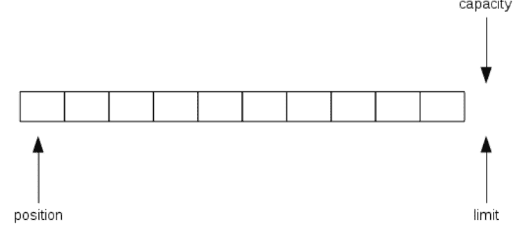

该缓冲区的容量为 10，limit 的值始终与容量相同。position 初始为 0，表示缓冲区中的元素。mark 初始未定义。例如，这是一个创建一个字节缓冲区的方法，它有 10 个元素：

```java
private static void test01() {
    Buffer buffer = ByteBuffer.allocate(10);
    print(buffer);
    buffer.limit(8);
    buffer.position(3);
    print(buffer);
    buffer.flip();
    print(buffer);
    buffer.mark();
    buffer.position(2);
    print(buffer);
    buffer.reset();
    print(buffer);
    buffer.limit(8);
    buffer.position(3);
    print(buffer);
    buffer.rewind();
    print(buffer);
    buffer.clear();
    print(buffer);
    buffer = LongBuffer.allocate(10);
    print(buffer);
}
```

```java
private static Buffer print(Buffer buffer)
{
    System.out.println("Capacitet: " + buffer.capacity());
    System.out.println("Limit: " + buffer.limit());
    System.out.println("Position: " + buffer.position());
    System.out.println("Remaining: " + buffer.remaining());
    System.out.println(buffer);
    return buffer;
}
```

第一个语句创建缓冲区，执行方法后第一个打印语句的结果：

```
Capacitet: 10
Limit: 10
Position: 0
Remaining: 10
java.nio.HeapBuffer[pos=0 lim=10 cap=10]
```

# JAVA 5：文件与 IO

在这里你可以看到起始限制（limit）被设置为容量（capacity），而位置（position）为 0。你还可以看到缓冲区（buffer）有 10 个可用位置。接下来将 limit 设置 8，position 设置 3，第二个打印语句输出了结果：

```
Capacity: 10
Limit: 8
Position: 3
Remaining: 5
java.nio.ByteBuffer[pos=3 lim=8 cap=10]
```

你必须特别注意，这里没有 5 个可用位置，因此只能访问索引小于 limit 的元素（索引为 3, 4, 5, 6 和 7 的元素）。下一个语句执行了 `flip()`，这意味着 limit 被设置为 position，而 position 被设置为 0（并且可能将 mark 设置为未定义）。第三个打印语句的结果是：

```
Capacity: 10
Limit: 3
Position: 0
Remaining: 3
java.nio.ByteBuffer[pos=0 lim=3 cap=10]
```

缓冲区有 3 个元素的空闲空间。下一个语句执行了 `mark()`，这意味着索引 mark 的值被设置为 position 的值。接下来将 position 设置为 2 并重新打印缓冲区：

```
Capacity: 10
Limit: 3
Position: 2
Remaining: 1
java.nio.ByteBuffer[pos=2 lim=3 cap=10]
```

这里没什么需要解释的，mark 的值为 3。下一个语句是 `reset()`：

```
Capacity: 10
Limit: 3
Position: 0
Remaining: 3
java.nio.ByteBuffer[pos=0 lim=3 cap=10]
```

# JAVA 5：文件与 JAVA IO

`reset()` 方法在 position 设置为 0 时，将 limit 设置为 mark，然后 mark 变为未定义。在 limit 和 position 再次赋值为 8 和 3 之后：

```
Capacity: 10
Limit: 8
Position: 3
Remaining: 5
java.nio.ByteBuffer[pos=3 lim=8 cap=10]
```

执行 `rewind()` 后。这是一个将 position 设置为 0 并使任何 mark 变为未定义的方法：

```
Capacity: 10
Limit: 8
Position: 0
Remaining: 8
java.nio.ByteBuffer[pos=0 lim=8 cap=10]
```

下一个语句执行了 `clear()`，这意味着所有指针都重置到了起点，就像缓冲区刚创建后的状态一样：

```
Capacity: 10
Limit: 10
Position: 0
Remaining: 10
java.nio.ByteBuffer[pos=0 lim=10 cap=10]
```

最后两个语句创建了一个新的缓冲区，但这个缓冲区是 `long` 类型的值：

```
Capacity: 10
Limit: 10
Position: 0
Remaining: 10
java.nio.LongBuffer[pos=0 lim=10 cap=10]
```

从示例可以看出，`Buffer` 类型有许多方法，其他还可以用于操作缓冲区的指针。这些方法都返回一个 `Buffer` 对象（操作执行后对 Buffer 的引用），这意味着你不需要写：

```
buffer.mark();
buffer.position(2);
buffer.reset();
```

JAVA 5：文件与 JAVA IO

JAVA.NIO

你可以写：

```
buffer.mark().position(2).reset();
```

示例展示了两种类型的缓冲区：

- `ByteBuffer`
- `LongBuffer`

它们都是抽象类的示例，具体的缓冲区是通过静态方法创建的。此外还有以下缓冲区类：

- `CharBuffer`
- `ShortBuffer`
- `IntBuffer`
- `FloatBuffer`
- `DoubleBuffer`


> “我学了 16 年英语，但是……我最终只用了六节课就学会了说它。”
> Jane，中国建筑师
> 点击听听我在参加我那独特的课程前后的录音并下载
> 在 bookboom.com 免费下载电子书

### 创建缓冲区

创建缓冲区有多种方法，以下方法提供了四种选项：

```java
private static void test02() {
  byte[] bytes = new byte[500];
  print(ByteBuffer.allocate(100));
  print(ByteBuffer.wrap(bytes));
  print(ByteBuffer.wrap(bytes, 100));
}
```

通常情况下，缓冲区是数组的封装，上述方法定义了一个数组。然而，创建缓冲区最方法是像第一个示例一样应用 `allocate()` 方法：

```
Capacity: 100
Limit: 100
Position: 0
Remaining: 100
java.nio.HeapByteBuffer[pos=0 lim=100]
```

第一个示例没什么添加的，结果是一个容量为 100 字节的缓冲区，其中 limit 等于容量，且 position 为 0。下一个缓冲区几乎相同：

```
Capacity: 100
Limit: 100
Position: 0
Remaining: 100
java.nio.DirectByteBuffer[pos=0 lim=100]
```

但你应该注意类型是不同的，第一个类型是 `HeapByteBuffer`，而最后一个类型是 `DirectByteBuffer`。区别将在稍后解释。第三个缓冲区封装了字节数组：

```
Capacity: 500
Limit: 500
Position: 0
Remaining: 500
java.nio.HeapByteBuffer[pos=0 lim=500]
```

# JAVA 5：文件与 IO JAVA.NIO

结果是一个容量为 500、limit 为 500、position 为 0 的缓冲区。你应该注意容量由数组长度决定，类型与第一个示例相同。最后一个缓冲区也是作为数组的封装创建的，在这里你可以设置 position 和长度，这意味着 limit 将是 `position + length`。

```
Capacity: 500
Limit: 310
Position: 10
Remaining: 300
java.nio.ByteBuffer[pos=10 lim=310]
```

通过 `allocate()` 和 `wrap()` 创建的缓冲区拥有底层数组，可以通过 `array()` 方法访问该数组。你还可以创建一个封装第二个缓冲区的视图。两个缓冲区具有相同的数据和容量，但各自自己的 limit 和 position，视图只是在多个视图中操作相同的数据（同一个缓冲区）。考虑以下方法：

```java
private static void test03() {
  byte[] bytes = { 0x02, 0x03, 0x05, 0x07, 0x0b, 0x0d, 0x11, 0x13 };
  ByteBuffer buffer1 = ByteBuffer.wrap(bytes);
  ByteBuffer buffer2 = buffer1.duplicate();
  IntBuffer buffer3 = buffer1.asIntBuffer();
  buffer1.position(4);
  buffer1.limit(6);
  print(buffer1);
  print(buffer2);
  print(buffer3);
}
```

该方法定义了一个带有 8 个元素的字节数组来创建一个名为 `buffer1` 的 `ByteBuffer`。对于此对象，使用 `duplicate()` 方法创建一个名为 `buffer2` 的视图。接着创建一个名为 `buffer3` 的视图，但这次使用了 `asIntBuffer()`。此缓冲区允许像 `IntBuffer` 一样操作原始缓冲区。在设置了 buffer1 的 position 和 limit 后，打印缓冲区：

```
Capacity: 8
Limit: 6
Position: 4
Remaining: 2
```

# JAVA 5：文件与 JAVA IO

结果中并没有什么神秘，但如果你随后打印 `buffer2`，你会发现它有不同的 position 和 limit，当 `buffer1` 改变值时，它们不会改变：

```
Capacity: 8
Limit: 8
Position: 0
Remaining: 8
java.nio.ByteBuffer[pos=0 lim=8]
```

因为视图缓冲区有自己的索引。如果你打印最后一个缓冲区，得到结果：

```
Capacity: 2
Limit: 2
Position: 0
Remaining: 2
java.nio.IntBuffer[pos=0 lim=2]
```

它的容量是 2。数组有 8 个字节，对应于 2 个整数，此视图精确地将底层数组解释为整数数组。


# JAVA 5：文件与 JAVA IO

## 读取与写入

只有当你可以修改内容时，缓冲区才有意义，这意味着你可以读取单个元素并更改它们。这是通过`put()`和`get()`完成的，这两个方法都有绝对和相对版本。考虑以下方法：

```java
private static void test04() {
  byte[] bytes = { 0x02, 0x03, 0x05, 0x07, 0x0b, 0x0d, 0x11, 0x13 };
  ByteBuffer buffer = ByteBuffer.wrap(bytes);
  printElements(buffer);
  buffer.put(3, (byte)23);
  buffer.position(6);
  buffer.put((byte)29);
  bytes[7] = 0x1f;
  printElements(buffer);
}
```

```java
private static void printElements(ByteBuffer buffer) {
  for (int i = 0; i < buffer.limit(); ++i) {
    System.out.print(buffer.get(i) + " ");
  }
  System.out.println();
  for (buffer.position(0); buffer.get() < buffer.limit(); ) {
    System.out.print(buffer.get() + " ");
    System.out.println();
  }
}
```

`test04()`方法创建了一个封装了 8 个元素数组的缓冲区。下一个方法以两种方式打印缓冲区的内容。第一种是普通循环，单个组件通过`get()`方法和索引进行引用。单个元素通过绝对索引引用，且索引必须大于 0 且小于`limit`。下一个循环相对于它们的位置引用元素，循环从将`position`设置为 0 开始，只要`position`小于`limit`就会迭代。使用不带索引的`get()`引用元素，方法返回`position`指向的元素，然后`position`加 1。这意味着当循环停止时，`position`等于`limit`。

# JAVA 5: 文件与 I/O

在打印缓冲区内容后，索引为 3 的元素被改为 23。这是通过`put()`方法完成的，但使用了绝对索引。你应该注意，此操作不会改变`position`的值。下一个`position`被设置为 6，位置 6 处的值被改为 29。这是通过未指定索引的`put()`实现的，操作完成后，`position`会向前计数 1 位。最后，底层数组最后一个位置的值被改为 31，buffer 的打印结果为：

```
2 3 5 23 11 13 29 31
2 3 5 23 11 13 31
```

`get()`和`put()`也可以接受数组作为参数，可以高效地修改缓冲区中的多个元素。考虑以下方法：

```java
private static void test05() {
    byte[] bytes1 = { 0x02, 0x03, 0x05, 0x07, 0x0b, 0x0d, 0x11 };
    byte[] bytes2 = { 0x17, 0x0d, 0x1f, 0x25, 0x2b };
    ByteBuffer buffer = ByteBuffer.allocate(8);
    printElements(buffer);
    buffer.position(0);
    buffer.put(bytes1);
    printElements(buffer);
    buffer.position(2);
    buffer.put(bytes2, 1, 3);
    printElements(buffer);
    byte[] bytes3 = new byte[4];
    byte[] bytes4 = new byte[8];
    buffer.position(2);
    buffer.get(bytes3);
    buffer.position(2);
    buffer.get(bytes4, 3, 3);
    printElements(ByteBuffer.wrap(bytes3));
    printElements(ByteBuffer.wrap(bytes4));
}
```

该方法为 8 个元素创建了空间并打印内容：

```
0 0 0 0 0 0
0 0 0 0 0 0
```

也就是说，使用`allocate()`创建的缓冲区中的元素均为 0。接下来将`position`设置为 0，并通过数组`bytes1`更改缓冲区：

```
buffer.put(bytes1);
```

这意味着数组的内容从起始位置开始拷贝到缓冲区。因此，必须先将`position`置于 0，语句执行完成后，`position`会向前移动到缓冲区的末尾。当你打印缓冲区时，得到：

```
2 3 5 7 11 13 17 19
2 3 5 7 11 13 19
```

`put()`还有另一个版本，除了数组外，还指定了数组中的偏移量和要拷贝的元素数量：

```java
buffer.put(bytes2, 1, 3);
```


`position`之前被设置为 2，结果为：

```
2 3 5 7 11 13 17 19
2 3 5 7 11 13 17 19
```

其中索引为 2、3 和 4 的位置被更新了。`get()`也有类似的重载，可以将缓冲区中的元素拷贝到数组中。`bytes3`是一个可以容纳 4 个元素的数组，`position`被设置为 2，接下来的语句将 4 个元素拷贝到数组`bytes3`：

```
buffer.get(bytes3);
```

因此，数组的长度决定了拷贝多少元素。如果将`bytes3`封装在缓冲区中打印，你会得到：

```
2 3 5 7 11 13 17 19
2 3 5 7 11 13 17
```

最后一个例子是`bytes4`，一个容纳 8 个元素的数组。`position`再次设置为 2，执行了以下语句：

```java
buffer.get(bytes4, 3, 3);
```

位置 3、4 和 5 的元素被拷贝了：

```
0 0 0 0 0 0 0 0
0 0 0 0 0 0 0 0
```

缓冲区的一个典型用法是一个获取缓冲区元素的程序，其中缓冲区连接到（从缓冲区取出元素）。下面的示例定义了一个带有字符串的`CharBuffer`。然后方法遍历字符串并对每个字符串清空缓冲区——`clear()`方法将限制设置为缓冲区的容量，并将位置设置为 0。接下来，内部循环遍历字符串中的每个字符并填充到缓冲区。当字符加载到缓冲区后，通过`println()`方法从`position`到`limit`打印缓冲区。也就是说，`limit`应该被设置为位置，之后`position`被设置为 0，这可以通过`flip()`方法完成。

```java
private static void test06() {
    String[] names = { "Erik Ejod", "Erik Emune", "Erik Lam", "Erik Plovning" };
    CharBuffer buffer = CharBuffer.allocate(10);
    for (int i = 0; i < names.length; i++) {
        buffer.clear();
        for (int j = 0; j < names[i].length(); j++) 
            buffer.put(names[i].charAt(j));
        buffer.flip();
        println(buffer);
    }
}

private static void println(CharBuffer buffer) {
    while (buffer.hasRemaining()) 
        System.out.print(buffer.get());
    System.out.println();
}
```

特别注意`println`方法如何处理缓冲区以及使用`hasRemaining`测试`position`是否到达`limit`。`test06()`是缓冲区用法的一种原型。有时你对一个缓冲区并将索引恢复到原来的状态。这里是索引标记。考虑以下方法：

```java
private static void test07() {
    IntBuffer buffer = IntBuffer.allocate(10);
    buffer.put(2).put(3).put(5).put(7).put(11).put(13).put(17).put(19).put(23);
    buffer.rewind();
    IntBuffer out = IntBuffer.allocate(8);
    printElements(buffer); // 根据上下文修正的逻辑
}

private static void printElements(IntBuffer buffer) {
    while (buffer.hasRemaining()) 
        System.out.print(buffer.get());
    System.out.println();
}
```

该方法为 8 个元素创建了空间并打印内容：

```
0 0 0 0 0 0 0 0
0 0 0 0 0 0 0 0
```

也就是说，使用`allocate()`创建的缓冲区中的元素均为 0。接下来将`position`设置为 0，并通过数组`bytes1`更改缓冲区：

```
buffer.put(bytes1);
```

这意味着数组的内容从起始位置开始拷贝到缓冲区。因此，必须先将`position`置于 0，语句执行完成后，`position`会向前移动到缓冲区的末尾。当你打印缓冲区时，得到：

```
2 3 5 7 11 13 17 19
2 3 5 7 11 13
```

`put()`有另一个版本，除了数组外，还指定了数组中的偏移量和要拷贝的元素数量：

```java
buffer.put(bytes2, 1, 3);
```


`position`之前被设置为 2，结果为：

```
2 3 5 7 11 13 17 19
2 3 5 7 11 13 17 19
```

其中索引为 2、3 和 4 的位置被更新了。`get()`也有类似的重载，可以将缓冲区中的元素拷贝到数组中。`bytes3`是一个可以容纳 4 个元素的数组，`position`被设置为 2，接下来的语句将 4 个元素拷贝到数组`bytes3`：

```
buffer.get(bytes3);
```

因此，数组的长度决定了拷贝多少元素。如果将`bytes3`封装在缓冲区中打印，你会得到：

```
2 3 5 7 11 13 17 19
2 3 5 7 11 13 17 19
```

最后一个例子是`bytes4`，一个容纳 8 个元素的数组。`position`再次设置为 2，执行了以下语句：

```java
buffer.get(bytes4, 3, 3);
```

位置 3、4 和 5 的元素被拷贝了：

```
0 0 0 0 0 0 0 0 0
0 0 0 0 0 0 0 0 0
```

# JAVA 5: 文件与 JAVA IO

## JAVA.NIO

在执行最后的`print()`之前，会执行`clear()`，它将位置（`position`）设置为 0，限制（`limit`）设置为容量（`capacity`），因此结果如下：

5 7 11 13 17 19 23 29 0 0

### 关于缓冲区的最后备注

可以使用`equals()`比较缓冲区，其协议如下：

两个缓冲区当且仅当它们具有相同的元素类型、相同数量的剩余元素，且剩余元素的序列（不考虑其起始位置）各自相等时，它们才是`equals()`相等的。

例如，以下方法将打印 true：

```java
private static void test09()
{
 buff1 = ByteBuffer.allocate(10);
buff1.put(0).put(1).put(2).put(3).put(5).put(7).put(11).put(13).put(17).put(19);
buff1.position(2);
buff1.limit(6);
}
```


```java
IntBuffer buffer2 = IntBuffer.allocate(8);
buff2.put(2).put(3).put(5).put(7);
buff2.flip();
System.out.println(buffer1.equals(buffer2));
```

首先注意这两个缓冲区的长度不同。`buffer1`的位置为 2 限制为 6，而`buffer2`的位置为 0 限制为 4，这意味着两个缓冲区都有四个剩余元素，且这些元素是成对相等的。

最后一个观察与性能。目前，缓冲区仅仅是一个封装了数组的内存结构，对于文件来说，它的意思是操作系统必须在缓冲区和文件之间拷贝数据。在某些情况下这并不是最优的，因为操作系统的 IO 操作使用的是它们自己的缓冲区，这些缓冲区与 Java 无关；但本节描述的缓冲区是 JVM 的数据结构，因此，如果它们是相同的缓冲区，将是有利的。然而，这并不简单，特别是因为 Java 的缓冲区并不一定是连续分配的，而且因为垃圾回收器在必要时会移动它们。为了解决这些问题，可以创建一个字节缓冲区：

```java
ByteBuffer buffer = ByteBuffer.allocateDirect(99);
```

这是一个与 IO 和文件关联的缓冲区，在某些情况下可以提高性能并定义了一个没有底层数组的缓冲区，但使用这种缓冲区必须有特殊理由，因为收益通常很小。

## 3.2 通道 (CHANNELS)

通道配合缓冲区以实现高性能 I/O。通道是一个代表打开硬件设备作为文件的连接的对象。通道在字节缓冲区和基于操作系统的 IO 服务之间高效地传输数据，通常文件描述符和通道之间存在一对一对应关系。当你在文件上下文中使用通道时，通道将连接到一个打开的文件。

通道由一个接口定义：

```java
java.nio.channels.Channel
```

该接口只定义两个方法`close()`和`isOpen()`，而 IO 方法定义在两个子接口中：

```java
java.nio.channels.WritableByteChannel
java.nio.channels.ReadableByteChannel
```

正如其名称定义了用于写入或读取的通道。只实现其中一个接口的类被称为单向的，实现两个接口的类被称为双向的。

有多种方法可以创建指向文件的通道并从而创建`Channel`对象。`Channels`类有两个静态方法：

```java
WritableByteChannel writer = Channels.newChannel(OutputStream stream)
ReadableByteChannel reader = Channels.newChannel(InputStream stream)
```

最后，`java.io`中的若干几个类都扩展了`getChannel()`方法，该方法返回一个`Channel`。

现在我将展示一个使用两个`Channel`对象复制文件的示例。该示例假设我的主目录下有一个名为`date`的子目录，其中有一个名为`municipalities`的文件，大小为 2863 字节（包含丹麦市名称的文件，但文件中包含什么并不重要，只要它在正确的目录下且大小在 2 到 3 KB 之间即可）。首先考虑以下方法：

```java
private static void copy(ReadableByteChannel src, WritableByteChannel dst)
throws IOException
{
    ByteBuffer buffer = ByteBuffer.allocate(1024);
    while (src.read(buffer) != -1)
    {
        buffer.flip();
        dst.write(buffer);
        buffer.compact();
    }
    buffer.flip();
    dst.write(buffer);
}
```

该方法有两个参数，都是单向`Channel`对象，其中第一个用于读取，第二个用于写入。该方法创建了一个缓冲区，你唯一应该注意的是，它的大小比文件小。该方法执行一个循环，只要输入通道上还有数据就会一直迭代。每次迭代都会对缓冲区执行`flip()`，然后将缓冲区写入输出通道，因为方法的`write()`方法会排空缓冲区。你必须注意，这都是从位置 0 到限制的所有字节，操作之后位置就等于限制。以下方法创建了指向`InputStream`的输入通道和一个指向`OutputStream`的输出通道，并使用上述方法复制文件：


```java
private static void test10() {
  ReadableByteChannel src = null;
  WritableByteChannel dst = null;
  try {
      src = Channels.newChannel(new FileInputStream(
          System.getProperty("user.home") + "/data/municipalities"));
      dst = Channels.newChannel(new FileOutputStream("municipalities1"));
      copy1(src, dst);
  }
catch (IOException ex) {
    System.out.println("I/O error: " + ex.getMessage());
}
finally {
    try {
        if (src != null) src.close();
        if (dst != null) dst.close();
    } catch (IOException ex) {
        System.out.println("I/O error: " + ex.getMessage());
    }
}
```

没什么需要解释的，但你必须注意如何创建这两个通道对象。下面是另一个通过 Channel 对象复制文件的方法示例：

```java
private static void copy2(ReadableByteChannel src, WritableByteChannel dst)
    throws IOException {

    ByteBuffer buffer = ByteBuffer.allocate(4096);
    while (src.read(buffer) != -1)
        buffer.flip();
    dst.write(buffer);
}
```

区别在于，这次在写入输出通道之前将整个输入文件复制到缓冲区。这种方法比上一个简单，但有一个重要的条件，即缓冲区有足够的空间包含整个输入文件。测试方法如下：

```java
private static void testl1() {
    try (ReadableByteChannel src =
        Channels.newChannel(new FileInputStream(System.getProperty("user.home") + "/data/municipalities"))) {
```

# JAVA 5：文件与 JAVA IO

```java
WritableByteChannel dst = Channels.newChannel(new FileOutputStream("municipalities2"))
{
    copy2(src, dst);
} catch (IOException ex) {
    System.out.println("I/O error: " + ex.getMessage());
}
```

这里主要的区别在于，两个 Channel 对象是在 `try` 语句中作为创建的。

## 多缓冲区

如示例所示，Channel 是在两个端点之间进行流式数据传输的基本技术，例如它可以是文件，并且作为通道与程序之间的适配器，存在一个缓冲区（buffer）。多年来，提高计算机性能最重要的方法之一是并行，这是一种特定操作系统所采用的技术，也应用于 IO 中。由于这个原因，Channel 对象支持使用多个缓冲区，其中输入通道可以填充几个缓冲区，而输出通道可以抽空多个缓冲区。以下将展示它们的语法：

```java
public static void test12()
{
    try (
        ScatteringByteChannel src = (ScatteringByteChannel) Channels.newChannel(
            new FileInputStream(System.getProperty("user.home") + "/data/regions"));
        WritableByteChannel out = Channels.newChannel(System.out);
        GatheringByteChannel dst = (GatheringByteChannel) Channels.newChannel(new FileOutputStream("regions1"))
    ) {
        ByteBuffer[] buffers = { ByteBuffer.allocateDirect(100), ByteBuffer.allocateDirect(50) };
        src.read(buffers);
        for (int i = 0; i < buffers.length; ++i) {
            buffers[i].flip();
            out.write(buffers[i]);
            System.out.println("\n");
            buffers[i].rewind();
        }
    }
}
```

# JAVA 5：文件与 JAVA IO

`JAVA.NIO`

```java
dst.write(buffers);
catch (IOException ex)
{
    System.out.println("I/O error: " + ex.getMessage());
}
```

在 `try` 之后创建了三个通道。一个使用多个缓冲区的输入通道，被称为散射通道（scattering channel）。它是像其他输入通道一样创建的，因此创建时进行类型转换（typecast）。这次，通道连接到 regions 文件——原因仅仅是因为文件很小。第二个通道是一个普通的输出通道，连接到 `System.out`，而第三个也是一个连接到当前目录下某个文件的输出通道。

`try` 块中的第一条语句创建了一个包含两个 `ByteBuffer` 对象的数组。这次我使用了 `allocateDirect()`，在原则上这是处理文件最有效的缓冲区，但重要的是，这两个缓冲区都无法存储整个 regions 文件。请注意，这两个缓冲区的大小并不相同，这其实很正常。下一条语句在输入通道上执行读取（read）操作，其中缓冲区数组是参数。`read()` 方法将读取输入通道并将内容填充到两个缓冲区。


在 bookboom.com 下载免费电子书

# JAVA 5：文件与 IO

接的 `for` 循环遍历两个缓冲区，在每次迭代中，缓冲区都会经过 `flip()` 处理并抽空到输出端，最后我们执行 `rewind()`，以便缓冲区再次被抽空。循环结束后，两个缓冲区通过 `write()` 方法被抽空到输出通道，该方法会抽空两个缓冲区。以这种方式抽空的通道被称为聚集通道（gathering）。输出通道是作为另一个输出通道创建的，因此在创建通道时需要进行类型转换。

如果执行了该方法，你可以得到结果：

```
1081, Region Nordjylland
1082, Region Midtjylland
1083, Region Syddanmark
1084, Region Hovedstaden
1085, Region Sjlland
```

你应该注意到第一个缓冲区被填充到了它的容量，而另一个只被填充了一部分。你可能还会注意到有一个微小的编码错误（`System.out`），但如果你查看当前目录下的 regions1 文件，你会发现文件被正确地复制了。

## 文件通道（FILE CHANNELS）

`FileChannel` 是一个代表文件通道的类。`FileChannel` 是一个抽象类，但你可以通过 `getChannel()` 方法创建对象，该方法由 `java.io` 中的几个类支持。如下例所示，一个方法使用 `FileChannel` 对象复制文件：

```java
private static void test13() {
    try (FileChannel src = (new FileInputStream(System.getProperty("user.home") + "/data/municipalities")).getChannel();
        FileChannel dst = (new FileOutputStream("municipalities3")).getChannel()) {
        copy2(src, dst);
    } catch (IOException ex) {
        System.out.println("I/O error: " + ex.getMessage());
    }
}
```

# JAVA 5：文件与 JAVA IO

该方法的原理与 `test11()`，但两个 Channel 对象的创建方式不同。`FileInputStream` 类拥有 `getChannel()` 方法，返回一个 `FileChannel`。这是一个只读通道。同样，`FileOutputStream` 拥有 `getChannel()` 方法，返回一个可写的文件通道。

同样，`RandomAccessFile` 也有一个 `getChannel()` 方法，返回一个 `FileChannel`，这是一个可读写的缓冲区。`FileChannel` 类有许多方法，我将提到最重要的几个：

- `force(boolean meta)`：物理上更新元数据。
- `position()`：返回文件位置。
- `position(long newPosition)`：设置文件位置。
- `size()`：返回文件大小。
- `read(ByteBuffer buffer)`：读取到缓冲区。
- `read(ByteBuffer buffer, long position)`：从指定位置读取到缓冲区。
- `write(ByteBuffer buffer)`：将缓冲区写入文件。

作为示例，展示了如何对 `RandomAccessFile` 进行读写操作：

```java
public static void test14() {
    FileChannel fc = (new RandomAccessFile("numbers", "rw")).getChannel();
    ByteBuffer buffer = ByteBuffer.allocateDirect(2048);
    buffer.putInt(23);
    buffer.putDouble(Math.PI);
    buffer.putInt(29);
    buffer.putDouble(Math.E);
    buffer.flip();
    fc.write(buffer);
    fc.force(false);
    System.out.println("Position = " + fc.position() + ", size = " + fc.size());
}
```

# JAVA 5：文件与 JAVA IO

`JAVA.NIO`

```java
buffer.clear();
fc.position(0);
fc.read(buffer);
buffer.flip();
System.out.println(buffer.getInt());
System.out.println(buffer.getDouble());
System.out.println(buffer.getInt());
System.out.println(buffer.getDouble());
}
catch (Exception ex) {
  System.out.println("I/O error: " + ex.getMessage());
}
```


# 赋能人才。

## 改进业务。

BI 挪威商学院是欧洲最大的商学院之一，每年欢迎超过 20,000 名学生。我们的课程提供了一个启发性且多元化的学习环境，并具有国际视野，最终为学生提供满足日益增长业务需求的专业技能。

BI 提供四个为期两年的全制硕士（MSc）课程，完全用英语授课，旨在提供满足日益增长的业务需求的专业技能。硕士课程提供了启发性且多元化的学习环境，为你开启职业生涯提供最佳路径。

- 商业硕士
- 金融经济学硕士
- 战略营销管理硕士
- 领导力与组织心理学硕士

`www.bi.edu/master`

# JAVA 5：文件与 IO

打开了一个指向文件的 `FileChannel`，这次是一个读写通道，首先发生的是该方法打印了文件指针的位置和文件大小。接下来，创建了一个 `ByteBuffer`。现在你可以向此缓冲区写入一个 `int`、一个 `double`、一个 `int` 和另一个 `double`。为了将这些值格式化为字节，我发现 `ByteBuffer` 有专门的方法，它们会将值部分复制到缓冲区中并移动索引位置。在将四个值写入缓冲区后，执行 `flip()`，并将缓冲区的内容发送到通道。然后将缓冲区和文件指针重置为 0，并将文件内容读取到缓冲区。最后，打印结果，并再次使用正确的 `get` 方法从缓冲区中读取。如果该方法（如文所示），结果为：

```
Position = 0, size = 24
Position = 24, size = 24
23
3.14159265358993
29
2.718281828459045
```

## 内存映射文件

`FileChannel` 有一个 `map()` 方法，它可以将一个打开的文件或打开文件的部分嵌入缓冲区中：

```java
MappedByteBuffer map(FileChannel.MapMode mode, long position, long size)
```

这三个参数表示一种模式，以及要封装的文件部分（起始位置和要封装段的长度）。模式可以是 `READ_ONLY`（只读）或 `READ_WRITE`（读写）。`MappedByteBuffer` 类型与其他缓冲区具有相同的特性，但它的内容存储在文件中。这意味着例如，如果你执行 `get()` 且另一个程序更新了文件，那么更改在当前程序中是可见的。`put()` 也是如此，如果你更新了缓冲区，更改将在使用相同文件的其他程序中可见。内存映射文件的目标自然是性能优化，特别是在处理图片等大文件时。示例显示了一个创建一个包含 1000 个整数的文件的方法：

```java
private static void test15() {
  try (FileChannel fc = (new RandomAccessFile("numbers", "rw")).getChannel()) {
    MappedByteBuffer buffer = fc.map(FileChannel.MapMode.READ_WRITE, 0, 4096);
    for (int i = 0; i < 1000; i++) buffer.putInt(i + 1);
  }}
```

# JAVA 5：文件与 JAVA IO

```java
catch (IOException ex) {
    System.out.println("I/O error: " + ex.getMessage());
}
```

该文件是一个 `RandomAccessFile`，并且像上一个示例一样创建了指向该文件的 `FileChannel`。接下来为该通道创建了一个 `MemoryMappedBuffer`，缓冲区表示文件将从开始到字节 4096 处进行映射。这个数字精确对应于文件，它必须包含 1000 个 `int` 类型的整数。下一个循环用从 1 到 1000 的 1000 个整数填充缓冲区。你应该注意，缓冲区的结果被写入包含这 1000 个整数的文件中。请注意，由于是连续行，数字之和为 500500。

下一个方法更新了文件：

```java
private static void test6() {
    try (FileChannel fc = (new RandomAccessFile("numbers", "rw")).getChannel()) {
        MappedByteBuffer buffer = fc.map(FileChannel.MapMode.READ_WRITE, 0, fc.size());
        for (int i = 0; i < 1000; i++) buffer.putInt(i * 2 * buffer.getInt(i * 4));
    } catch (IOException ex) {
        System.out.println("I/O error: " + ex.getMessage());
    }
}
```

同样是一个内存映射文件，文件中所有的数据都通过翻倍进行了更新。你应该注意单个数字是如何被引用的：

```java
buffer.getInt(i * 4)
```

返回一个从地址 `4*i` 开始的 `int`，但不会移动缓冲区的位置。语句

```java
buffer.putInt(2 * buffer.getInt(i * 4));
```

更新了同一个 `int`，然后将位置向前移动 4 字节。

# JAVA 5：文件与 IO

由于所有数字都翻倍了，文件中数字之和此时即为 1001000。通过以下方法进行验证：


```
private static void test17() {
    try (FileChannel fc = (new RandomAccessFile("numbers", "r")).getChannel()) {
        long sum = 0;
        MappedByteBuffer buffer = fc.map(FileChannel.MapMode.READ_ONLY, 0, fc.size());
        while (buffer.hasRemaining()) 
            sum += buffer.getInt();
        }
        System.out.println(sum);
    } catch (IOException ex) {
        System.out.println("I/O error: " + ex.getMessage());
    }
}
```


从你领域的专家处获取深度反馈和建议。了解你可以做什么来提高论文的质量！

立即获取帮助

访问 `www.helpmyassignment.co.uk` 获取更多信息

从 `bookoon.com` 下载免费电子书 点击广告阅读更多

# JAVA 5：文件与 JAVA IO

### 文件锁定

作为与通道相关的最后一个主题，我将介绍文件锁定。可以对整个文件加锁，也可以只对文件的部分加锁，锁指示了在文件中何处开始锁定或要锁定文件的哪个区域。锁定发生在进程级别（而不是线程级别），我在此语境下将区分写入进程（向文件写入的进程）和读取进程（仅从文件中读取的进程）。锁有两种类型。写入进程可以对文件的部分部分设置**排斥锁**（exclusive lock），只要没有其他进程设置与要锁定部分重叠的锁，就可以这样做。排斥锁赋予写入者对文件锁定部分的完全控制权，使其既可以读也可以写。读取进程可以对文件的部分设置**共享锁**（shared lock），只要没有其他进程设置与要锁定部分重叠的排斥锁就可以这样做。这意味着多个进程可以对文件的同一部分设置共享锁，更多的进程可以读取文件。

锁的类型是`FileLock`，`FileChannel`类有四个方法创建锁：

1. `lock()`

2. `lock(long position, long size, boolean shared)`

3. `tryLock()`

4. `tryLock(long position, long size, boolean shared)`

第一个和第三个创建整个文件的排斥锁，而另外两个可以指定要锁定的文件部分以及锁应该是排斥的还是共享的。进一步的区别在于前两个是阻塞的，也就是说，如果它们无法锁定，它们会被放入队列中直到获取锁，在锁被释放后进程会自动运行。最后两个方法是非阻塞的，但如果它们无法创建锁，它们将返回`null`，这由程序决定下一步发生什么。

`FileLock`类有许多方法可以返回有关锁及其状态的信息，但最重要的是`release()`方法，它被用于释放锁。通常情况下，人们使用以下模式来锁定文件：

```
FileLock lock = fileChannel.lock();
try {
  // 与通道进行交互
} catch (IOException ex) {
// 处理异常
}
finally{
    lock.release();
}
```

在这里，`release()`在`finally`块中执行很重要，确保它会被执行。

为了在实践中演示文件锁定，我写了以下程序`Locking`：

```
package locking;

import java.util.*;
import java.io.*;
import java.nio.*;
import java.nio.channels.*;

public class Locking {
    private static final Random rand = new Random();
    private static final int N = 1000000;

    public static void main(String[] args) {
        boolean writer = args.length != 0;
        try (FileChannel fc = (new RandomAccessFile("integers", writer ? "rw" : "r")).getChannel()) {
            if (writer) fc.write(fc); else read(fc);
        } catch (Exception ex) {
            System.out.println("I/O error: " + ex.getMessage());
        }
    }
    private static void read(FileChannel fc) throws Exception {
        for (int i = 0; i < N; i++) {
            System.out.println("Wait a shared lock");
            long t1 = System.nanoTime();
            FileLock lock = fc.lock(0, 16, true);
            long t2 = System.nanoTime();
        }
    }
}
```

## JAVA 5：文件与 IO

## JAVA.NIO

```java
System.out.println("Has a shared lock " + (t2 - t1));
try
{
  ByteBuffer buffer = ByteBuffer.allocate(16);
  fc.read(buffer, 0);
  buffer.flip();
  System.out.println("Sum = " + buffer.getInt() + buffer.getInt() + buffer.getInt());
}
finally
{
  lock.release();
  System.out.println("Shared lock released");
}

private static void write(FileChannel fc) throws Exception
{
  for (int i = 0; i < N; i++)
{
    System.out.println("Want an exclusive lock");
    long t1 = System.nanoTime();
    FileLock lock = fc.lock();
    long t2 = System.nanoTime();
  }
}
```


到 2020 年，我们能够提供地球上十分之一的电力需求。在今天，SKF 的创新知识对于提高全球大部分风力发电机的效率至关重要。

发电成本的一半与维护有关。得益于我们的在线状态监控和自动润滑系统，这些成本可以大幅降低。SKF 让风能变得更加负担负担，从空气中创造出更清洁的能量。

通过分享我们的经验、专业知识和创造力，行业可以实现超出预期的性能。因此，离不开能够应对挑战的最佳员工！

### 大脑动力

连接到《知识工程的力量》，

访问我们的网站：`www.skf.com/knowledge`

知识工程的力量

SKF

在 `bookboom.com` 下载免费电子书

点击广告阅读更多

## JAVA 5：文件与 JAVA IO，JAVA.NIO

```java
System.out.println("Has an exclusive lock: " + (t2 - t1));
try {
    ByteBuffer buffer = ByteBuffer.allocate(16);
    int value = rand.nextInt(89997) + 10000;
    System.out.println("Writing: " + value);
    buffer.putInt(value).putInt(value + 1).putInt(value + 2).putInt(value + 3);
    buffer.flip();
    fc.write(buffer, 0);
} finally {
    lock.release();
    System.out.println("Exclusive lock released");
}
```

该程序被实现为一个命令，可以在命令行上带有一个参数。该值并不重要，但在`main()`方法中，布尔值`writer`根据是否有参数而取决于 true 或 false。在`main()`中创建了一个`RandomAccessFile`，它根据变量的值被设为读写或只读模式，并使用同一个变量来决定执行`write()`方法还是`read()`方法。

`write()`方法迭代 1,000,000 次，在每次迭代中，该方法都会为文件获取一个排斥锁。当文件被锁定后，该方法会打印等待锁的时间，然后在再次释放锁之前写入 4 个整数。

`read()`方法在原理上的工作方式相同，只是尝试使用该方法来获取共享锁，而不是写入文件，而是读取这 4 个整数并在屏幕上打印它们的和。

现在的想法是启动两个版本的程序，它们在每个终端中运行，其中一个进行写入，另一个进行读取。你将能够观察到程序如何交替获取锁。先启动写入的程序是非常重要的。

## 3.3 路径与文件

`Path`代表文件系统，`Path`类扮演的角色与`java.io`中的`File`类相同，但`Path`代表了一个更通用的概念，并提供了许多可用的服务。在以下，一个`Path`对象引用文件或目录的路径，但它不必是一个已存在的文件或目录，因此一个`Path`只是一个名称。

在 `ebook.com` 下载免费电子书

## JAVA 5：文件与 IO

与`Path`类一起还有`Files`类，这两个类都位于`java.nio.file`包中。`Files`类非常全面，但通常它包含了操作文件系统所需的内容。以下内容不是这些类的完整文档，我们鼓励你检查`java.nio.file`包中存在哪些类型，以及`Files`类的特定文档，以便你对该类提供的功能有一个整体了解。

在本节的剩余部分以及本章的剩余部分中，我将通过简单的测试方法来展示一些可能性，以及如何应用`Path`和`Files`这两个类。

### PATH 类

路径由由分隔符分隔的元素（文件名）组成，分隔符是一个字符，在 Linux 中是`/`，而在 Windows 下是`\`。以下方法打印关于`Path`的信息，同时对`Path`类提供的一些方法进行介绍：

```java
private static void voidPath(Path p)
{
    System.out.println(p); // 路径
    System.out.println(p.getFileName()); // 路径中的最后一个元素
    System.out.println(p.getName(0)); // 路径中的第0个元素
    System.out.println(p.getNameCount()); // 路径中的元素数量
    System.out.println(p.subpath(0,2)); // 路径的前两个元素
    System.out.println(p.getParent()); // 父目录
    System.out.println(p.getRoot()); // 根目录
    System.out.println(p.toURI()); // 转换为URI
    try {
        Path path = p.RealPath();
        System.out.println(path);
    } catch (Exception ex) {
        System.out.println(ex);
    }
    System.out.println(p.getFileSystem());
    System.out.println("----------------");
}
```

## JAVA 5：文件 IO

以下是使用上述方法的测试：

```java
public static void test1() {
    Path p1 = Paths.get("/home");
    Path p2 = Paths.get("/home/data");
    Path p3 = Paths.get("home", "data");
    Path p4 = Paths.get(FileSystems.getDefault().getPath(), "home", "data");
    Path p5 = Paths.get(System.getProperty("user.home"));
    Path p6 = Paths.get("abc").toAbsolutePath();
    print(p1);
    print(p2);
    print(p3);
    print(p4);
    print(p5);
}
```


## JAVA 5：文件与 IO，JAVA.NIO

`Paths`类是一个通过`get()`方法创建`Path`对象的类。该方法可以创建一个文件系统路径，它可以接收一个或多个字符串，或者一个`URI`。

## JAVA 5：文件与 JAVA IO

### Files 类

如前所述，`Files`类非常全面，它其中包含了许多静态方法，可以打印关于文件属性的等信息：

```java
private static void test20()
{
    info(Paths.get("/home/pa/tmp"));
    info(Paths.get("/home/pa/tmp/numbers"));
}
```

```java
private static void info(Path path)
{
    System.out.println(Files.exists(path));
    System.out.println(Files.isDirectory(path));
    System.out.println(Files.isRegularFile(path));
    System.out.println(Files.isReadable(path));
    System.out.println(Files.isWritable(path));
    System.out.println(Files.isExecutable(path));
    System.out.println(Files.isSymbolicLink(path));
    System.out.println("----------------------------------------------------------------");
}
```


其中`numbers`是上面创建的文件。每个方法的含义应该从名称中推断出来，执行方法的结果如下：

```
true
true
false
true
true
true
false

true
false
true
true
true
false
false
```

现在考虑以下方法：

```java
private static void test21() {
  try {
    Path p0 = Paths.get(System.getProperty("user.home"));
    Path p1 = Files.createDirectory(p0.resolve("testdir"));
    Path p2 = Files.createFile(p1.resolve("testfile"));
    System.out.println(p0);
    System.out.println(p1);
    System.out.println(p2);
    Files.copy(p2, p1.resolve("testfile"));
    System.out.println(Files.deleteIfExists(p1.resolve("testfile")));
    System.out.println(Files.deleteIfExists(p2));
    System.out.println(Files.deleteIfExists(p1));
  } catch (IOException ex) {
    System.out.println(ex);
  }
}
```

该方法创建了一个指向我的家目录的路径`p0`。使用此路径意味着：

```
p0.resolve("testdir")
```


创建一个名为`testdir`的路径，使其成为`p0`下的一个“文件”——在这种情况下，是一个子..目录。`Files`有一个静态方法`createDirectory()`，它可以根据路径创建一个目录并返回指向该目录的`Path`对象`p1`。同样地，`p2`是该目录中一个文件的路径。`Files`还有一个`copy()`方法来复制文件。在这种情况下，被复制的文件路径为`p2`，并被复制到同一目录下的名为`testfile1`的文件中。执行这些语句的结果是在我的家目录中创建了以下文件树：

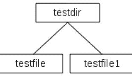

该方法的最后三个语句再次删除了这个文件树，执行该方法后，结果为：

```
/home/pa
/home/pa/testdir
/home/pa/testdir/testfile
true
true
true
```

下一个方法展示了如何在我的`tmp`目录中创建一个指向文件的路径，然后用该路径打开一个`OutputStream`并向流中打印15个字节：

```java
private static void test22() {
    byte[] b = { 2, 3, 5, 7, 11, 13, 17, 19, 23, 29, 31, 37, 41, 43, 47 };
    Path path = Paths.get(System.getProperty("user.home")).resolve("tmp/file1");
    try (OutputStream out = Files.newOutputStream(path, StandardOpenOption.CREATE)) {
        out.write(b);
    } catch (IOException ex) {
        System.out.println(ex);
    }
}
```

这里没什么好解释的，但你应该注意到如何为`newOutputStream()`设置选项。`StandardOpenOption`是一个枚举，鼓励你研究其他选项。

同样的问题也可以通过以下方式解决：

```java
private static void test23() {
    byte[] b = { 2, 3, 5, 7, 11, 13, 17, 19, 23, 29, 31, 37, 41, 43, 47 };
    Path path = Paths.get(System.getProperty("user.home")).resolve("tmp/file2");
    try {
        Files.write(path, b, StandardOpenOption.CREATE);
    } catch (Exception ex) {
        System.out.println(ex);
    }
}
```

其中`write()`方法打开文件、向文件写入字节数组并再次关闭。下面是两个再次读取文件的方法：

```java
private static void test24() {
    byte[] b = new byte[100];
```


## JAVA 5：文件与 JAVA IO JAVA.IO

```java
private static void test22() {
    Path path = Paths.get(System.getProperty("user.home")).resolve("tmp/file1");
    try (OutputStream out = Files.newOutputStream(path, StandardOpenOption.CREATE)) {
        out.write(b);
    } catch (IOException ex) {
        System.out.println(ex);
    }
}
```

这里没什么好解释的，但你应该注意到如何为`newOutputStream()`设置选项。`StandardOpenOption`是一个枚举，鼓励你研究其他选项。

同样的问题也可以通过以下方式解决：

```java
private static void test23() {
    byte[] b = { 2, 3, 5, 7, 11, 13, 17, 19, 23, 29, 31, 37, 41, 43, 47 };
    Path path = Paths.get(System.getProperty("user.home")).resolve("tmp/file2");
    try {
        Files.write(path, b, StandardOpenOption.CREATE);
    } catch (Exception ex) {
        System.out.println(ex);
    }
}
```

其中`write()`方法打开文件、向文件写入字节数组并再次关闭。下面是两个再次读取文件的方法：

```java
private static void test24() {
    byte[] b = new byte[100];
```

## JAVA 5：文件与 JAVA IO.NIO

```java
private static void test22() {
    Path path = Paths.get(System.getProperty("user.home")).resolve("tmp/file1");
    try (OutputStream out = Files.newOutputStream(path, StandardOpenOption.CREATE)) {
        out.write(b);
    } catch (IOException ex) {
        System.out.println(ex);
    }
}
```

使用此路径意味着：

```
p0.resolve("testdir")
```

创建一个路径，使其其名为`testdir`成为`p0`下的一个“文件”——在这种情况下，是一个子..目录。`Files`有一个静态方法`createDirectory()`，它可以根据路径创建一个目录并返回指向该目录的`Path`对象`p1`。同样地，`p2`是该目录中一个文件的路径。`Files`还有一个`copy()`方法来复制文件。在这种情况下，被复制的文件路径为`p2`，并被复制到同一目录下的名为`testfile1`的文件中。执行这些语句的结果是在我的家目录中创建了以下文件树：


该方法的最后三个语句再次删除了这个文件树，执行该方法后，结果为：

```
/home/pa
/home/pa/testdir
/home/pa/testdir/testfile
true
true
true
```

下一个方法展示了如何在我的`tmp`目录中创建一个指向文件的路径，然后用该路径打开一个`OutputStream`并向流中打印15个字节：

```java
private static void test22() {
    byte[] b = { 2, 3, 5, 7, 11, 13, 17, 19, 23, 29, 31, 37, 41, 43, 47 };
    Path path = Paths.get(System.getProperty("user.home")).resolve("tmp/file1");
    try (OutputStream out = Files.newOutputStream(path, StandardOpenOption.CREATE)) {
        out.write(b);
    } catch (IOException ex) {
        System.out.println(ex);
    }
}
```

这里没什么好解释的，但你应该注意到如何为`newOutputStream()`设置选项。`StandardOpenOption`是一个枚举，鼓励你研究其他选项。

同样的问题也可以通过以下方式解决：

```java
private static void test23() {
    byte[] b = { 2, 3, 5, 7, 11, 13, 17, 19, 23, 29, 31, 37, 41, 43, 47 };
    Path path = Paths.get(System.getProperty("user.home")).resolve("tmp/file2");
    try {
        Files.write(path, b, StandardOpenOption.CREATE);
    } catch (Exception ex) {
        System.out.println(ex);
    }
}
```

其中`write()`方法打开文件、向文件写入字节数组并再次关闭。下面是两个再次读取文件的方法：

```java
private static void test24() {
    byte[] b = new byte[100];
```

## JAVA 5：文件与 IO

```java
System.out.println(ex);
}
```

这些示例中，重要的是你如何使用`Files`类同时创建`BufferedWriter`和`BufferedReader`。

接下来的两个示例类似，它们展示了`Files`类如何创建`BufferedOutputStream`和`BufferedInputStream`：

```java
private static void test30() {
  byte data[] = new byte[100];
  Path path = Paths.getProperty("user.home").resolve("tmp/file5");
  try (OutputStream out = new BufferedOutputStream(Files.newOutputStream(path, StandardOpenOption.APPEND))) {
    rand.nextBytes(data);
    for (int i = 0; i < 100; ++i) out.write(data);
  } catch (IOException ex) {
    System.out.println(ex);
  }
}
```

```java
private static void test31() {
  Path path = Paths.getProperty("user.home").resolve("tmp/file5");
  long sum = 0;
  try (InputStream in = new BufferedInputStream(Files.newInputStream(path))) {
    for (int t = in.read(); t != -1; t = in.read()) sum += t;
  } catch (IOException ex) {
    System.out.println(ex);
  }
  System.out.println(sum);
}
```

第一个方法向`BufferedOutputStream`写入10000个字节，在这里你应该特别注意它是以追加模式打开的。该方法写入了100次，每次写入一个包含100个随机字节的数组。最后一个方法通过`BufferedInputStream`再次读取文件并确定总和。

## JAVA 5：文件与 JAVA IO

最后一个示例将向你展示如何将字符串写入文件，但这次使用了通道（channel）：

```java
private static void test32()
{
    List<String> lines = Arrays.asList("Gorn Gamle", "Harald Blåtand",
"Svend Tveskåg", "Harald d. 2.", "Knud den Store", "Hardeknud",
"Magnus den Gode");
    Path path = Paths.get(System.getProperty("user.home")).resolve("tmp/file6");
    try (ByteChannel channel = Files.newByteChannel(path, StandardOpenOption.CREATE))
    {
        for (String line : lines)
        {
            ByteBuffer buffer = 
            ByteBuffer.wrap((line + " \n").getBytes(Charset.forName("UTF-8")));
            channel.write(buffer);
        }
    } catch (IOException ex)
{
        System.out.println(ex);
    }
}
```

首先创建一个包含上述所示的7位丹麦国王名字的列表，然后创建一个指向我tmp目录某个文件的路径。`Files`类有一个`newByteChannel()`方法，它可以为由路径标识的文件创建一个`ByteChannel`。通道准备好后，该方法执行一个循环，遍历文件中的所有字符串。对于每个字符串（名字），都会添加一个换行符，并在经过UTF-8编码后将所有转换为字节数组。该数组被完全封装在`ByteBuffer`中并发送到通道上。

下面是等效的方法，它再次读取了文件：

```java
private static void test33()
{
    Path path = Paths.get(System.getProperty("user.home")).resolve("tmp/file6");
    try (ByteChannel channel = Files.newByteChannel(path, StandardOpenOption.READ))
    {
        ByteBuffer buffer = ByteBuffer.allocate(30);
        while (channel.read(buffer) > 0)
        {
            buffer.flip();
            System.out.print(Charset.forName("UTF-8").decode(buffer));
            buffer.clear();
        }
    }
System.out.println();
catch (IOException ex) {
  System.out.println(ex);
}
}
```

再次创建了一个指向文件的`ByteChannel`，然后是一个`ByteBuffer`。数字30是任意的，但选择它的目的是为了让缓冲区足够大以容纳最长的名字。更准确地说，这意味着通道上的后续读取每次读取30个字节，直到字节少于30个。每当缓冲区满时，或者更准确地说当执行`read()`方法时，程序会执行`flip()`，并将缓冲区的字节内容解码为字符串打印在屏幕上。


# 4 简单数据类型的四种操作

任何数据元素（简单变量或对象）都会占用机器内存空间，当机器内存中最小的可寻址单位是字节时，所有数据元素无一例外地使用整数个字节。这取决于元素本身并由元素的数据类型决定。一个字节由8位组成（即8个0和1的符号），你可以将一个字节视为由8位组成的位模式。由于一个位可以取两个值，因此一个字节可以表示不同的值。这些值如何被解释完全取决于程序和数据类型，在许多语文中它是一个数字，而在其他语文中它是一个字符的编码。

在本章中，我将描述简单数据类型在Java中如何表示，以及在此背景下可以使用哪些操作处理单个位。本章假设你了解二进制数和十六进制数，目前你缺少附录内容。

## 4.1 整数

Java已经描述了四种整数类型：`byte`、`short`、`int`和`long`，它们仅在内存中所填充的内容有所不同，分别为1、2、4或8字节。例如，一个`int`使用4个连续的字节。这意味着一个`int`使用32位，并可以表示4294967296个不同的整数。32位被解释为二进制数，其中负数用补码表示。这对应于：

`a = -2147483648`（二进制数`10000000000000000000000000000000`）

`b = 2147483647`（二进制数`01111111111111111111111111111111`）

任何整数类型都支持二进制操作：

- 算术（`+`）

- 按位与（`&`）

- 按位异或（`^`）

- 左移（`<<`）

- 右移（`>>`）

整数的二进制表示是简单的，在Java中也很容易测试：


```java
public static String toBin(int t) {
    StringBuilder builder = new StringBuilder();
    for (int i = 31; i >= 0; i--)
        builder.append(((t >> i) & 1) == 0 ? '0' : '1');
    return builder.toString();
}
```

注意 `Integer` 类有一个 `toBinaryString()` 方法，可以返回二进制字符串，但上面的方法没有。执行：

```java
private static void print(int t) {
    System.out.println(toBin(t) + " = " + t);
}
```

你会得到结果：

```java
private static void test01() {
    print(113);
    print(-113);
    print(0);
    print(Integer.MAX_VALUE);
    print(Integer.MIN_VALUE);
}
```

```
00000000000000000000011100010001 = 113
11111111111111111111110011101111 = -113
00000000000000000000000000000000 = 0
01111111111111111111111111111111 = 2147483647
10000000000000000000000000000000 = -2147483648
```

对应上述内容。同样地方法：

```java
private static void test02() {
    int a = 0xF0F0F0F0;
    int b = 0x3C3C3C3C;
    System.out.println(toBin(a));
}
```

结果如下：

```
11110000111100001111000011110000
00111100111100001111000011110000
```

## JAVA 5：文件与 IO | 简单数据类型操作

在这里你应该特别注意，变量 `a` 和 `b` 使用十六进制值初始化，这在处理二进制整数时非常有用。请注意，`>>` 运算符是算术右移（会加上符号位），而 `>>>` 运算符是右移，它总是插入一个 0。

对于其他整数，区别仅在于类型所表示的范围，因此它们处理的数字大小也不同。然而，二进制操作得到的结果有时与预期不符。如果参数是 `byte` 或 `short`，该参数在执行操作之前将先被转换为 `int`，且结果将是一个 32 位的 `int`。如果参数表示一个负数，其结果可能与预期的不同。如果参数是 `long`，则可能会发生某些情况，因为第二个参数在执行操作之前也必须转换为 `long`。考虑以下方法示例：

```java
private static void test03() {
    byte b = -56;
    byte b1 = (byte)(b >> 3);
    byte b2 = (byte)(b >>> 3);
    byte b3 = (byte)((b & 0xff) >>> 3);
    System.out.println(toBin(b));
    System.out.println(toBin(b1));
    System.out.println(toBin(b2));
    System.out.println(toBin(b3));
}
```

如果执行该方法，你得到结果：

```
11111111111111111111111110011000
11111111111111111111111111011101
11111111111111111111111111011101
00000000000000000000000000011101
```

`b` 的值为 11001000，当它被传递给 `toBin()` 时，它会被扩展到 32 位并用符号位填充。第一个结果是符合预期的。这也适用于算术移动时的第二个结果，但你应该注意，操作是先将 `b` 扩展到 32 位，然后执行算术右移。然而，第三个结果并不是预期的，因为这不是算术移动，而是发生了以下情况：

## JAVA 5：文件与 Java IO

### 简单数据类型操作

`b` 扩展到 32 位：11111111111111111111111110100000000001111111111111111111111110011111101

- 向右移动 3 位：

- 强制类型转换为 `byte`：

- 调用 `toBin()` 扩展到 32 位：11111111111111111111111111110001

可以通过将 `b` 扩展到 32 位来解决此问题：

```
b << 0xff =
1111111111111111111111000 & 0000000000000000000001111111 =
000000000000000000000010010000
```

### 练习 6

在类库 `PaLib` 中添加一个类 `Binary`，该类必须是 `palib.util` 包的一部分。该类必须具备以下方法：

```java
package palib.util;

public class Binary {
  /**
   * 将参数转换为 8 位的二进制字符串。
   * @param b 需要转换的字节
   * @return 转换后的 8 位二进制字符串参数
   */
  public static String toBin(byte b) { ... }

  /**
   * 将参数转换为 16 位的二进制字符串。
   * @param t 需要转换的整数
   * @return 转换后的 16 位二进制字符串参数
   */
  public static String toBin(short t) { ... }

  /**
   * 将参数转换为 32 位的二进制字符串。
   * @param t 需要转换的整数
   * @return 转换后的 32 位二进制字符串参数
   */
  public static String toBin(int t) { ... }

  /**
   * 将参数转换为 64 位的二进制字符串。
   * @param t 需要转换的整数
   * @return 转换后的 64 位二进制字符串参数
   */
  public static String toBin(long t) { }

  /**
   * 将参数转换为 16 位的二进制字符串。
   * @param t 需要转换的整数
   * @param c 分隔符
   * @return 转换后的 16 位二进制字符串参数
   */
  public static String toBin(short t, char c) { ... }

  /**
   * 将参数转换为 32 位的二进制字符串。
   * @param t 需要转换的整数
   * @param c 分隔符
   * @return 转换后的 32 位二进制字符串参数
   */
  public static String toBin(int t, char c) { ... }
}
```

## JAVA 5：文件与 Java IO

### 简单数据类型操作

### 练习 7

Java 定义了一个名为 `BitSet` 的类，它在原理上表示一个集合，但作为一个所谓的位图（bitmap），可以看作是一个由位元素组成的数组，因此元素为 0 或 1。在本次练习中，你必须编写一个名为 `BitmapProgram` 的程序，包含针对 `BitSet` 的三个测试方法。

第一个方法必须创建一个 `BitSet` 并测试 `size()`、`cardinality()`、`set()` 和 `toString()` 方法。

添加一个方法

```java
static String toBin(BitSet s)
{
}
```

返回 `BitSet` 的位字符串。你还需要扩展测试程序以测试二进制旋转的方法。

# JAVA 5：文件与 IO | 简单数据类型操作

你随后必须编写第二个测试方法，该方法必须创建一个包含值 2, 3, 5, 7, 11, 13, 17, 19, 23 和 29 的值的 `BitSet`，然后该方法必须通过上述 `toBin()` 方法打印相应的字符串。

最后，编写一个测试方法，创建一个用适当值初始化的 `BitSet` 对象。该测试方法应该尝试 `BitSet` 类的 `and()`、`notAnd()`、`or()` 和 `xor()` 方法。

### 问题 3

`BitSet` 是位图（bitmap）的一个示例，在这个问题中，你应该编写一个 `Bitmap` 类来表示位图，并作为 Java `BitSet` 的替代方案。位图在原则上是一个位序列：

```
00101110101010101010111010101001111110101010111100001
```

其中包含 64 位。位，位图实现为八个字节（bytes）、整数（ints）或长整数（long）。然而，位图必须更通用，并且能够任意大小，因此它应该被实现为一种简单类型（整数）的数组。通常实现位图是简单的，但有几点你必须考虑并做出决策。我将提到一些重要的例子：

- 内部数组应使用哪种类型来存储各个位

- 位图必须是固定大小的

- 位图可能的尺寸应该是哪些，且它应该应该是数组元素大小的倍数

- 位图必须提供哪些操作

- 两个位图何时是兼容的

关于第一点，你可以在 `byte`、`short`、`int` 和 `long` 之间进行选择。对于大型位图，你应该选择位较多的类型，因为这意味着数组更小，从而使方法中的循环更短，从而提高效率。对于较小的位图，64 位的元素可能意味着不必要的空间消耗，但在大多数你需要位图的情况下，位图将是具有许多位的位图，这表明要选择一个能够容纳许多位的类型。下面你选择了 `long` 类型。

至于大小，由应用程序决定什么是最佳选择。在这个任务中，大小必须是固定的，你必须将大小作为参数传递给构造函数。它必须能够任意逻辑大小——例如 70 位。如果它实现为 `long` 类型数组，它将占用 128 位，但应该只访问前 70 位。

# JAVA 5：文件与简单数据类型的 Java IO 操作

根据以上内容，你的任务是使用以下类扩展类库 `PaLib`：

```java
package palib.util;
```

```java
import java.util.*;
```

```java
/**
 * 实现一个由任意数量位组成的位图。
 * 位数（size）是固定的，并在创建对象时定义。
 * 只有当两个位图由相同的位数同时才是兼容的。
 */
public class Bitmap implements Comparable<Bitmap>
```

```java
{ /**
 * 创建一个大小为 bits 的位图。所有位均为 0。
 * @param size 位图的大小
 */
 public Bitmap(int size) { }
```

```java
/**
 * 创建一个用 BitSet 初始化的位图。大小由 s 的
 * 逻辑值决定，各个位对应 s 的元素
 * 进行初始化。
 * @param s 用于初始化此位图的 BitSet
 */
 public Bitmap(BitSet s) { }
```

```java
/**
 * 创建一个用字节数组初始化的位图。
 * @param arr 用于初始化此位图的数组
 */
 public Bitmap(byte[] arr) { }
```

```java
/**
 * 拷贝构造函数。
 * @param bm 被复制的位图
 */
 public Bitmap(Bitmap bm) { }
```

```java
/**
 * 返回此位图的大小
 * @return 此位图的大小
 */
 public int getSize() { }
```

# JAVA 5：文件与简单数据类型的 IO 操作

```java
/**
 * 返回第 n 位是否为 1。
 * @param n 待测试的位索引
 * @return 如果第 n 位为 1，则返回 true
 */
public boolean get(int n) { ... }
```

```java
/**
 * 将位图中的第 n 位设置为 1 或 0。如果值
 * 为 true 则将第 n 位设置为 1，否则设置为 0。
 * @param n 待设置的位索引
 * @param value true 表示 1，false 表示 0
 */
public void set(int n, boolean value) { ... }
```

```java
/**
 * 将所有位设置为 0。
 */
public void clear() { ... }
```


管理硕士

因为实现你的梦想是你最大的挑战。IE 商学院提供英语、西班牙语或双语教学的管理硕士课程，通过一项创新且具有刺激性的计划，培训处于职业生涯初的高性能专业人士，帮助他们发挥出全部潜力。

- 选择你的专业领域。

- 通过不同的选项定制你的硕士课程。

- 在伦敦等地点进行全球沉浸周。

英语 OUT THERE

点击在下载我独特的课程之前听听我说话

# JAVA 5：简单数据类型上的文件与 IO 操作

```java
/**
* 静态方法返回一个位图，即 bml 和 bm2 的或（OR）运算。
* @param bml 二元操作的第一个参数
* @param bm2 二元操作的第二个参数
* @return bml 和 bm2 的或结果
* @throws UtilException 如果两个位图长度不一致
 */
public static Bitmap bmp(Bitmap bml, Bitmap bm2) throws UtilException { ... }
```

```java
/**
* 静态方法返回一个位图，即 bml 和 bm2 的异或（XOR）运算。
* @param bml 二元操作的第一个参数
* @param bm2 二元操作的第二个参数
* @return bml 和 bm2 的异或结果
* @throws UtilException 如果两个位图长度不一致
 */
public static Bitmap xor(Bitmap bml, Bitmap bm2) throws UtilException { ... }
```

```java
/**
* 静态方法返回一个位图，它是参数 bm 向左移动 n 位的副本。
 * @param bm 要被复制并修改的位图
 * @param n 需要移动的位数
 * @return 向左移动 n 位的 bm 副本
 */
public static Bitmap shl(Bitmap bm, int n) { ... }
```

```java
/**
* 静态方法返回一个位图，它是参数 bm 向右移动 n 位的副本。这是一个非算术移动。
* @param bm 要被复制并修改的位图
* @param n 需要移动的位数
* @return 向右移动 n 位的 bm 副本
 */
public static Bitmap shr(Bitmap bm, int n) { ... }
```

你还应该扩展 `Binary` 类并添加一个新方法：

```java
/**
* 将位图转换为二进制字符串，每个字节之间用字符 c 分隔。
* @param bm 要转换的位图
* @param c 字节之间的分隔符
* @return 转换为位字符串的 bm
 */
```

# JAVA 5：简单数据类型上的文件与 Java IO 操作

```java
public static String toBin(Bitmap bm, char c)
{
}
```

当你写完该类（以及上述方法）后，你必须编写一个测试程序（例如 `TestBitmap`）来测试该类。

### 问题 4

作为位图使用的一个示例，你必须编写一个程序使用埃拉托尼筛法来确定质数。原理如下：

为了确定所有小于或等于 N 的质数，首先定义一个包含 N+1 个元素的位图：

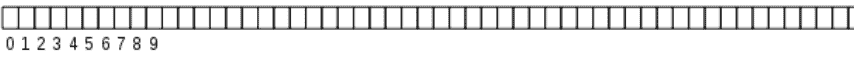

起初，所有位置均为 0。然后你开始在位置 0 和位置 1 处打标记（1 位），以及所有索引能被 2 整除的位置（但不包括 2 本身）打标记：

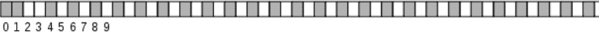

在此运行中，所有大于 2 的偶数都被设置了标记，因为它们不是质数。然后你重复此操作，但这次你在索引能被 3 整除的位置上标记（但不包括位置 3）：

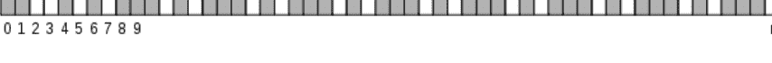

所有索引以 3 为质因数的位置现在都被标记了。下一次用数字 5（3 之后第一个为 0 的位置）重复所有操作。所有索引以 5 为质因数的位置都被标记：

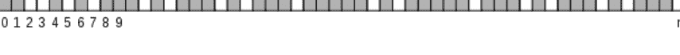

# JAVA 5：简单数据类型上的文件与 Java IO 操作

总结一下。下一次从第一个未标记的位置开始（即位置 7），它是一个质数，否则它会在之前的循环中被标记。当你遍历完所有位置后，所有索引为非质数的位置都经过了检查。

你现在必须编写一个程序，用户可以在其中输入一个数字（见下方的窗口）。当你点击 `Test` 按钮时，应用程序必须在列表中插入一行，显示该数字是否为质数。为了判断情况如何，程序必须使用上述算法和上面的 `Bitmap` 类。你可以通过观察以下几点来稍微改进算法：


1. 如果一个数有质因子（能整除该数的质数），那么它或另一个质因子必须小于或等于该数的平方根，因此当起始索引大于数的平方根时，上述迭代可以停止。
2. 如果你到达之前循环中未被标记的索引，它就是一个质数，你必须标记所有具有该因数的数：`2k`、`3k`、`4k`、……，那么实际上从`k`开始就足够了，否则该位置会在之前的循环中被标记。
3. 位图中没有必要跟踪奇数以外，因为所有大于 2 的偶数都不是质数。


# JAVA 5：简单数据类型上的文件与 IO 操作

埃拉托尼筛法实际上是一种非常高效的质数查找方法，但问题在于位图是存在内存中的——即使你使用了上述观察结果。

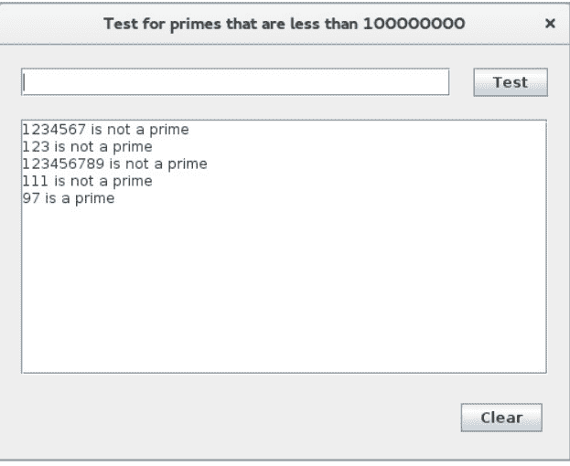

## 练习 8

创建一个名为`Encoding`的项目。添加以下两个测试方法，其中第一个将文本写入文件，而另一个再次读取文本：

```java
private static void test1()
{
    try
    {
        BufferedWriter writer = new BufferedWriter(new FileWriter("test1"));
        writer.write("Søren Sørensen\nnPistolStrade 19\n6666 Borremose");
        writer.close();
    }
    catch (Exception ex)
    {
    }
}
```

```java
private static void test2()
{
    try
    {
        BufferedReader reader = new BufferedReader(new FileReader("test1"));
        // 省略读取逻辑
    }
    catch (Exception ex)
    {
    }
}
```

# JAVA 5：文件与 JAVA IO

```java
public static String toBin(double t, char c)
}
```

使用这些方法打印数字`123.45F`、`-123.45F`、`12345.6789`和`-12,345.6789`的二进制表示，并检查它们是否符合附录中的描述。

`Float`类还有三个额外的常量：`NEGATIVE_INFINITY`、`POSITIVE_INFINITY`和`NaN`。打印这些常量的二进制表示。对`Double`类也执行相同的操作。

## 练习 10

在问题 3 中来说，你编写了一个`Bitmap`类，它位于你的类库`PaLib`中。该类位于`palib.util`包中，你必须向该包中添加以下异常类：

```java
package palib.util;
public class UtilException extends Exception
{
    public UtilException(String message)
    {
        super(message);
    }
}
```

`Bitmap`类有四个实例方法和四个静态方法，它们都可以抛出异常。你必须修改该类，使得所有这些都抛出类型为`UtilException`的异常。

打开测试程序`TestBitmap`并查看它是否仍然可以编译（它应该是可以的）。扩展程序，添加另一个测试方法来触发异常（例如对两个长度不同的位图进行`AND`操作），并测试你是否可以捕获到`UtilException`。

# JAVA 5：文件与 JAVA IO

## 最终示例

在最后一个示例中，我将展示一个可以打开任何文件并编辑内容的程序——无论你是否有权限这样做。程序应该以十六进制显示文件内容，你可以通过修改单个字节来编辑文件。程序可以编辑所有文件（文本文件、图像、翻译后的程序等），但另一个问题是，你从中从中获得什么，以及你是否能解释十六进制代码。

与之前书中最后的示例不同（那些示例主要关注过程），在这个示例中，我将主要关注结果，因此也关注程序代码。我将从介绍程序开始，解释程序在做什么。当你打开程序时，你会看到以下窗口：


关于儿童在线学习（e-Learning for Kids）。它成立于2004年，是一个全球性的非营利基金会，致力于为 5-12 岁的儿童提供免费的互联网学习，涵盖数学、科学、语言艺术、计算机、健康和环境技能课程。自2005 年以来，来自 190 多个国家的 1500 万儿童受益于 LU KI 提供的在线学习。来自世界各地的志愿者教育工作人员、在线学习专家和业务专业人士致力于带来改变。e-Learning for Kids 正在寻求资金、志愿者、赞助商和关注开发者。欲了解更多信息，请访问`www.e-learningforkids.org`。

- 小学教育第 1 MOOC
- 为 5-12 岁儿童提供的免费数字学习
- 让 1500 万儿童受益

在`bookboom.com`下载免费电子书。

点击广告阅读更多信息。

# JAVA 5：文件与 JAVA IO

## 最终示例

| 文件浏览器 | 新建文件 | 打开文件 | 保存文件 | 另存为 | 上一页 | 下一页 | 选项 |
| :--- | :--- | :--- | :--- | :--- | :--- | :--- | :--- |


该窗口在`JSplitPane`中包含两个`JTextArea`组件。左侧组件用于以十六进制显示文件内容，你可以在这里编辑文件。右侧组件显示被解释为文本的文件内容——在可能的范围内。

顶部七个按钮的功能很大程度上取决于文本描述：第一个按钮清除窗口并从而创建一个空文件，而接下来的三个按钮分别用于打开文件、保存文件和另存为。由于文件可能非常大，`JTextArea`的内容可能大到无法管理（程序运行会变慢），因此大文件被分成若干块，程序一次只处理一个块。第五个和第六个按钮用于在这些块之间来回滚动。最后，最后一个一个按钮会打开一个对话框，你可以在其中设置块的大小以及每行显示多少个字节：

在`bookboom.com`下载免费电子书。

# JAVA 5：文件与 JAVA IO

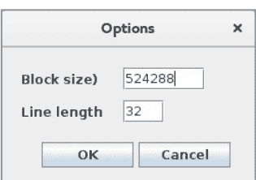

程序打开后尚未加载任何文件，但你完全可以开始输入。下面是我输入 6 个字节后的窗口：

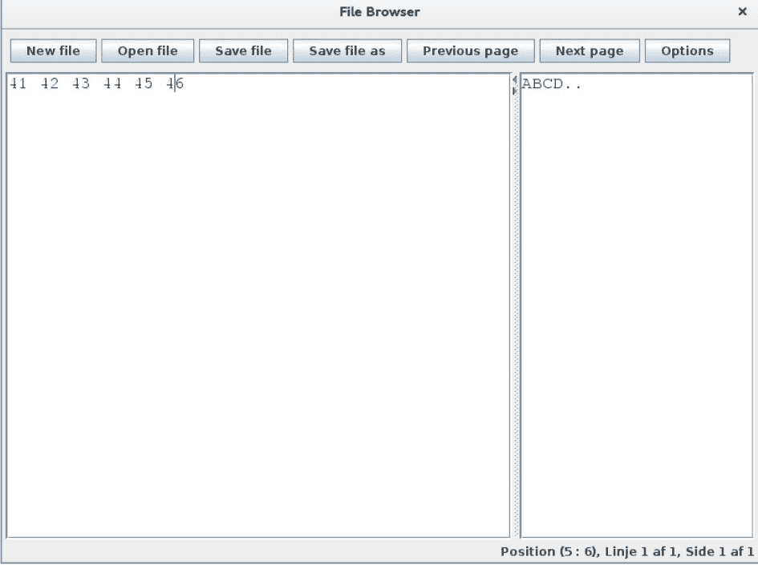

字节以十六进制显示。现在你可以通过按键输入数据。如果变量为`null`，则表示没有加载文件。

`JAVA 5：文件与 JAVA IO`列表用于存储块，为了处理文件，它包含了块。对于小文件（默认小于 1/2 MB）只有一个块。

`JAVA 5：文件与 JAVA IO`

## 5.1 模型

以下是表示数据的块类：

```java
class Block {
  public byte[] buffer;
  public int size;
}
```


# JAVA 5：文件与 JAVA IO

## 最终示例

```java
public Block(int size)
{
    buffer = new byte[size];
}
```


```java
class Model {
    private File file = null;
    private List<Block> buffers = new ArrayList<>();
    private int current = 0;
}
```

模型还有一个`changed`变量，用于跟踪模型状态，并根据编辑的文件发生变化。然后`file`变量指向已打开的文件。

模型拥有`get`和`set`方法，包括导航`current`变量的方法，特别是返回模型状态信息的方法。它们通常很简单，我在这里不会显示这些方法。

该类还有读取和保存文件的方法。下面是打开文件的方法：

```java
public boolean open(File file) {
    this.file = file;
    buffers.clear();
    try (RandomAccessFile f = new RandomAccessFile(file.getAbsolutePath(), "r")) {
        while (true) {
            Block block = new Block(blockSize);
            block.size = f.read(block.buffer, 0, blockSize);
            buffers.add(block);
            if (block.size < blockSize) break;
        }
        changed = false;
        return true;
    } catch (IOException ex) {
        clear();
        return false;
    }
}
```

# JAVA 5：文件与 JAVA IO 最终示例

```java
public boolean save() {
    if (file == null) return false;
    try (RandomAccessFile f = new RandomAccessFile(file.getAbsolutePath(), "rw")) {
        long length = 0;
        for (Block block : buffers) {
            f.write(block.buffer, 0, block.size());
            length += block.size;
        }
        f.setLength(length);
        return true;
    } catch (Exception ex) {
        return false;
    }
}
```

此方法将覆盖现有文件，你应该特别注意该方法在结束时更新了文件长度。这是必要的，因为可能存在被删除的字节，导致文件字节数较少。


加入马斯斯里特大学商与经济学院的顶尖者行列！

- 《金融时报》全球排名第33位：国际商务硕士
- 第1位：国际经济学硕士
- 第1位：金融经济学硕士
- 第2位：学习管理硕士
- 第2位：经济学硕士
- 第2位：计量经济学与运筹硕士
- 第2位：全球供应链管理与变革硕士

来源：2013年凯恩斯大师排名；2012年爱思唯尔“最佳研究”排名；2012年《金融时报》全球管理业务排名。

访问我们的网站，了解为什么我们是最好的！硕士课程开放日：2014年2月22日。

马斯塔里特大学是荷兰最优秀的专业大学（Bievier）。

`www.mastersopenday.nl`

在`bookoon.com`免费下载电子书。

# JAVA 5：文件与 IO

## 5.2 用户界面

这本质上是`ModelAndView`类，它是一个相对复杂的类。由于我不允许用户任意编辑内容，而必须输入每个字节的十六进制值，因此需要对键盘和鼠标编写事件处理程序，这正是该类变得有些复杂的原因。鼓励你彻底研究完成后的代码，但在下面我将简要介绍最重要的部分。

该类定义了以下变量：

```java
private Model model = new Model();
private JTextArea txtEdit;
private JTextArea txtText;
private JLabel lblText = new JLabel();
private JLabel lblPosition = new JLabel();
private JScrollPane scroll1;
private JScrollPane scroll2;
private Scroller scroll:
```

这里是两个`JTextArea`组件用于当前文件的视图，其中`txtEdit`用于编辑被解释为十六进制值的内容，而`txtText`用于显示解释为文本的内容。两个`JLabel`组件位于窗口底部，分别用于显示文件名（及大小）以及光标在文件中的位置。两个`JScrollPane`组件用于封装这两个`JTextArea`组件，最后一种类型是`Scroller`。它是一个内部类，在这里不会显示，但它必须同步两个`JScrollPane`容器，这样当你滚动其中一个时，另一个也会自动滚动。鼓励你研究它的工作原理。

至于用户界面的设计，没什么特殊的，但你应该注意这个方法：

```java
private JTextArea createEditor()
{
    JTextArea txt = new HexEditor();
    txt.setFont(new Font("FreeMono", Font.PLAIN, 18));
    return txt;
}
```

它创建了组件`txtEdit`。它的类型是`HexEditor`，是一个继承自`JTextArea`的内部类：

```java
class HexEditor extends JTextArea
{
public HexEditor()
{
    addKeyKeyListener(new KeyHandler());
    setMouseListener(this);
    setMouseMotionListener(this);
}
}
```

该类的构造函数为键盘和鼠标添加了监听器。对于键盘和鼠标的事件，我们需要处理键盘的按下，以及鼠标的点击。

- 键盘按键的按下
- 键盘按键的按下

这意味着我们需要处理键盘的事件：

```java
public void keyPressed(KeyEvent e)
```

- 字母数字键
- `Ctrl` + 键
- `Shift` + 键
- `Alt` + 键
- `Ctrl` + 字母
- `Shift` + 字母
- `Alt` + 字母
- 字母
- 数字键
- 方向键
- `Ctrl` + 方向键
- `Shift` + 方向键
- `Alt` + 方向键
- `Page Up`
- `Page Down`
- `Home`
- `End`
- `Insert`
- `Delete`
- `Backspace`
- `Enter`
- `Space`
- 功能键`F1`-`F12`
- 鼠标左键
- 鼠标右键
- 鼠标中键
- 鼠标移动
- 鼠标拖拽
- 鼠标按下
- 鼠标松开
- 鼠标进入
- 鼠标退出
- 鼠标移动
- 鼠标移动
- 组合
- `Ctrl + C`
- `Ctrl + V`
- `Ctrl + X`
- `Ctrl + Z`
- `Ctrl + S`
- `Ctrl + A`
- `Ctrl + F`
- `Ctrl + Q`
- `Ctrl + R`
- `Ctrl + T`
- `Ctrl + W`
- `Ctrl + E`
- `Ctrl + Home`
- `Ctrl + End`
- `Shift + Insert`
- `Shift + Delete`
- `Shift + Home`
- `Shift + End`
- `Shift + Enter`
- `Shift + Space`

对于键盘的输入，可以看到以下方法：

```java
private void changeChar(char ch)
{
    if (buffer.length() == 0) return;
    int n = p;
    if (p % 3 > 0) ++n;
    for (int i = buffer.length(); i > n; i--) {
        buffer[i] = buffer[i - 1];
    }
    // ... 省略
}
```

在`insertChar`方法中，可以看到：

```java
private void insertChar(char ch)
{
    if (buffer.length() == 0) return;
    int n = p;
    if (p % 3 > 0) ++n;
    for (int i = buffer.length(); i > n; i--) {
        buffer[i] = buffer[i - 1];
    }
    // ... 省略
}
```

在`deleteChar`方法中，可以看到：

```java
private void deleteChar()
{
    // ... 省略
}
```

（注：由于原文文本不完整且存在重复，以上翻译已根据要求保留了结构）

# JAVA 5：文件与 I/O

## 最终示例

如果你观察 10 进制系统中的整数，它们可以被写为`t = \sum_{i=0}^{n} a_i 10^i`，其中该数字有`n+1`位，且`a_0`、`a_1`、……、`a_n`都是符号`0`、`1`、`2`、……、`9`之一。例如：

```
$18207 = 7 * 10^0 + 0 * 10^1 + 2 * 10^2 + 8 * 10^3 + 1 * 10^4
```


这意味着 $n=4$ 且 $a_0=7, a_1=0, a_2=2, a_3=8$ 以及 $a_4=1$。我们预见到十进制是以 10 为基数的位值系统。这种数字表示法可以立即推广到其他基数，实际上对于任何大于 1 的自然数都存在这样的系统。例如，上述提到的 10 进制系统就是一个基数为 10 的系统。

## 二进制系统

二进制系统简单来说是以 2 为基数的位值系统。因此，它需要两个符号：0 和 1。例如，一个数字可以：

```
$t = \sum_{i=0}^{n} a_i 2^i
```


挪威商学学院（BI Norwegian Business School）是欧洲最大的学校之一，欢迎超过 20,000 名学生。我们的课程提供了一个具有启发性和多元文化的环境，具有国际视野，最终提供为期两年的英文英文科学硕士（MSc）课程，并为你开启职业提供最佳路径：

- 商业管理硕士

- 金融经济学硕士

- 战略管理硕士

- 领导力与组织心理学硕士

赋能人类。其中 $a_0, a_1, \dots, a_n$ 均为 0 或 1。如果 $n = 7$ 且：

```
$a_0 = 1$
$a_1 = 0$
$a_2 = 0$
$a_3 = 0$
$a_4 = 1$
$a_5 = 1$
$a_6 = 0$
$a_7 = 1$
```

是

```
$t = 1 * 2^7 + 0 * 2^6 + 1 * 2^5 + 1 * 2^4 + 0 * 2^3 + 0 * 2^2 + 0 * 2^1 + 1 * 2^0
```

这个数字也写为 $t = 1011001_2$，最后的数字 2 表示它是来自 2 进制系统。如你所见，2 进制系统在原则上与 10 进制系统完全等价，数字被表示为符号序列——10 进制中是 10 个符号，2 进制中是 2 个符号——而值由位置决定。区别在于符号被解释为 2 的幂而不是 10 的幂，二进制系统更简单，因为数字中包含了 2 的幂（符号为 1）或者不包含（系统为 0）。

如果你观察上面的构造，很容易通过对 2 的幂进行简单计算来确定 2 进制数字的值：

```
$t = 1 * 2^7 + 0 * 2^6 + 1 * 2^5 + 1 * 2^4 + 0 * 2^3 + 0 * 2^2 + 0 * 2^1 + 1 * 2^0
$= 128 + 32 + 16 + 1 = 177$
```

为了比较这些系统，请注意以下几：

| $0_2 = 0_{10}$ | $100_2 = 4_{10}$ | $1000_2 = 8_{10}$ | $1100_2 = 12_{10}$ |

| $1_2 = 1_{10}$ | $101_2 = 5_{10}$ | $1001_2 = 9_{10}$ | $1101_2 = 13_{10}$ |

| $10_2 = 2_{10}$ | $110_2 = 6_{10}$ | $1010_2 = 10_{10}$ | $1110_2 = 14_{10}$ |

| $11_2 = 3_{10}$ | $111_2 = 7_{10}$ | $1011_2 = 11_{10}$ | $1111_2 = 15_{10}$ |

你可以立即看到二进制系统中的数字占据的空间比十进制系统中的数字空间更大。

以下是用 2 进制表示的一些正整数的示例，以及如何将这些数字转换为 10 进制：

1100000111110 = 2^{12} + 2^{11} + 2^{10} + 2^5 + 2^4 + 2^3 + 2^2 + 2^1

= 4096 + 2048 + 1024 + 32 + 16 + 8 + 4 = 7228

111111111 = 2^9 + 2^8 + 2^7 + 2^6 + 2^5 + 2^4 + 2^2 + 2^1 + 2^0

= 512 + 256 + 128 + 64 + 32 + 16 + 4 + 2 + 1 = 1015

110000001 = 512 + 256 + 128 + 1 = 897

1000000000 = 2^{10} = 1024

要确定二进制数的值——换句话说，将其转换为十进制——只需对 2 的幂进行简单计算。将二进制数转换为十进制是简单的，但将十进制转换为二进制则需要一些步骤。例如，将一个十进制数字转换为二进制，需要通过 2 的幂来确定，即一个数字是 2 的幂的倍数还是不是。2 进制系统在原则上与 10 进制系统完全等价，数字被表示为符号序列——10 进制中是 10 个符号，2 进制中是 2 个符号——而值由位置决定。如果你观察上面的构造，很容易通过对 2 的幂进行简单计算来确定 2 进制数字的值：

$t = 1 * 2^7 + 0 * 2^6 + 1 * 2^5 + 1 * 2^4 + 0 * 2^3 + 0 * 2^2 + 0 * 2^1 + 1 * 2^0$

$= 128 + 32 + 16 + 1 = 177$

## JAVA 5：文件与 Java IO

### 最终示例

你可以得出结论，二进制系统与十六进制系统之间的转换极其简单，事实上它们是相同的，因为十六进制系统只是二进制数的一种更短的表示形式。二进制系统是简单的——至少对于机器来说是这样，但对于人类来说，理解和记忆长的 0 和 1 序列是很困难的。这就是十六进制系统的用武之地，因为它可以用短的方式表示 0 和 1 的序列，让人类更容易阅读和记忆。

上面，我提到了三种数字系统，这些系统之间的转换规则可以如下所示：

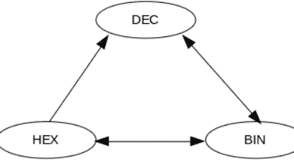


到 2020 年，风能可以提供地球电力需求的十分之一。如今，SKF 的专业技术对于运行世界上大部分风力涡电机组至关重要。

发电成本中高达 25% 与维护有关。得益于我们的在线状态监控和自动润滑系统，这些成本可以大幅降低。我们帮助创造更环保的环境，从空气中创造更清洁的能量。

通过分享我们的经验、专业知识和创造力，行业可以提升超出预期性能。我们需要能够应对这一挑战的最佳员工！

### 知识工程的力量

接入知识工程的力量。访问我们的网站 www.skf.com/knowledge


在 bookboom.com 下载免费电子书

点击广告阅读更多内容

## JAVA 5：文件与 IO

这里你应该注意，我没有展示任何从十进制转换为十六进制的方法。然而，你可以立即使用除法方法，这种方法在将十进制转换为二进制时已经用过了，只需将除数改为 16 而不是 2 即可。在实践中，除以 16 可能会有点困难——如果是手动操作的话——而且这种方法的意义有限。如果你需要将十进制数转换为十六进制，最简单的方法是将数字转换为二进制，然后从二进制转换为十六进制数。

你经常听到计算机以二进制方式工作，而你的意思是，计算机中的一切都表示为二进制位——也许更准确地说是 0 和 1 的序列。之所以之所以是因为，在技术上，以稳定且简单的方式表示两种状态很容易，例如作为两个电压水平，0 伏可能代表 1，而 5 伏可能意味着 0。重要的是，在技术上可以很容易地区分这两个电压水平，并安全地确定一个单元代表 0 还是 1。

在计算机内部，可以直接寻址的最小单位是字节（byte），它由 8 位比特位模式组成。准确地说，机器的 RAM 内存是一个巨大的 8 位模式对照表。如果你必须指定机器内存中这样一个内存单元的精确内容，你需要指定 8 位，例如：

```
01000001
```

如何解释它取决于引用该存储单元的程序，如果将其解释为二进制数，它就是数字 65。这个数字也可以作为字母 A 的代码，程序也可以选择不将位模式解释为 A。

计算机在内部将数据表示为位模式——不一定是 8 位，但通常是 16 或 32 位，甚至更多。这些位模式对我们人类来说很难处理；很难编写，也很记忆。这就是十六进制数的用武之地，因为十六进制数实际上只是二进制数的一种短表示形式，所以它们经常被选择以十六进制形式为我们人类显示二进制值。上面的位模式也可以写成十六进制：

41

作为一个进一步示例。考虑数字：

28319

## JAVA 5：文件与 Java IO

如果你将该数字转换为二进制，你会得到：

```
28319 : 11111010111011
14159
7079
3539
1769
884
442
221
110
55
27
13
6
3
1
0
```

$28319_{10} = 1101101001111111_2$

二进制数很难记忆且难以传给他人，而它的十六进制表示法处理起来简单得多：

$1101101001111111_2 = 1101101001111111_{10} = 6E9F_{16}$

### 整数

当在数学中引入整数时，你学到的是数字是一个无限集合。计算机是一台机器，在机器上没有什么是无限的，具体意味着计算机只能表示整数的一个子集。如上所述，最小的可直接寻址单元是由 8 位组成的字节。由于一个位可以是 0 或 1，所以一个字节可以表示 $2^8 = 256$ 种不同的模式，如果你只有 1 个字节，它提供 256 个不同的数字。这太少了，因此机器使用多个字节。如果你将 2 个字节分组，我们说字长度为 2 个字节或 16 位。同样，如果你将 4 个字节分组，你得到 4 个字节或 32 字长度，机器以 32 位工作。以前通常使用 16 位字以获得 16 位。只要我们讨论的是非负整数，最后 15 位用于数字，而第一位始终是 0。该数字表示为二进制数，作为一个例子，它是数字 32767：

```
011111111111111
```

## JAVA 5：文件与 IO（你可以轻松地计算出数字 -32768）。另一个示例，数字 32768 表示为：

```
1000000000000000
```

这种表示法允许以下非负整数：

- 0000000000000000 0

- 0000000000000001 1

- 0000000000000010 2

- 0000000000000011 3

- 0000000000000100 4

- ....

- 1000000000000000 32768

- ....

- 0111111111111111 32767


在 bookboom.com 下载免费电子书

## JAVA 5：文件与 IO 最终示例

最大的正整数是 32767。特别注意它是数字 $2^{15} - 1$，通常由 $n$ 位表示的最大数字是 $2^n - 1$。机器上非负整数的表示是直观的，唯一重要的是字长度，它决定了处理多大的数字。今天大多数机器使用32位字长度，这意味着最大的正整数是 $2^{31}=2147483647$，因此超过十亿。作为一个例子，数字 2147483647 表示为：

```
0111111111111111111111111111111
```

在 32 位机器上。你可以看到字长度的优缺点。大字长度意味着机器可以处理大数字，但大多数时候只在小机器上运行时，大字长度会导致空间浪费，因为大部分空间仅用于 0。

有时你也使用双精度整数，以补码表示。此时最大的正整数是 9223372036854775807，其二进制表示为：

```
01111111... (63个1) ...1111111111111
```

以及负数，以它们的补码表示。为了不写太长的位模式，我将从8 位字长度开始，即一个字节。注意一个字节中可以表示的最大正整数是：

```
01111111 = 127
```

考虑数字 97，在一个字节中它表示为二进制数：

```
01100001
```

一个数字的补码指的是通过反转所有位得到的数字，即：

```
10011110
```

这个操作对于机器来说，在硬件中实现极其简单且高效，与改变电压水平一样简单。

## JAVA 5：文件与 Java IO

一个数字的补码是其反码加 1，因此 97 (= 01100001) 的补码为：

```
10011110
  1
10011111
```

即数字 -97 在 8 位单元中用位模式表示：

```
10011111
```

可以注意到，在二进制数上加1也可以在硬件中非常高效地实现，因此确定数字补码的整个操作是非常有效的。

另一个示例，考虑数字 28，它在 8 位单元中表示为：

```
00011100
```

那么 -28 的表示为：

```
11100011
  1
11100100
```

这个计算可能需要对如何加两个二进制数进行一点说明。当你加两个十进制数时，你通常会将数字对齐，使它们的右侧数字对齐。然后从后往前加数字：

+ 1. 如果两个数字之和小于基数10，它就是结果

2. 否则从和中减去基数10，差就是结果，同时你得到一个进位1，包含在两个数字之和中。

这种方法可以直接应用于二进制数（原则上也可以应用于任何其他数字系统），区别仅在于基数现在变成了 2：特定位置的和是 0 要么是 1，如果和大于 1，则会向下一个位置产生进位。所有选项都如下表所示：

| 位 1 | 位 2 | 进位前 | 和 | 进位后 |

| --- | --- | --- | --- | --- |

| 0 | 0 | 0 | 0 | 0 |

| 1 | 0 | 0 | 1 | 0 |

| 0 | 1 | 0 | 1 | 0 |

| 1 | 1 | 0 | 0 | 1 |

| 0 | 0 | 1 | 1 | 0 |

| 1 | 0 | 1 | 0 | 1 |

| 0 | 1 | 1 | 0 | 1 |

| 1 | 1 | 1 | 1 | 1 |

因此，手动相二进制数是一个简单的问题。


# JAVA 5：文件与 JAVA IO 最终示例

如果你从计算机的角度来看数字，它会查看第一位，并根据该值的值判断它是负数还是非负数。如果第一位是 1，当前软件会通过取补码立即转换该数字。实际上，这是基于以下一个非常重要的观察：如果确定一个数的补码，然后再次对该补码取补码（即取两次补码），你就会回到原始数字。例如，28 的补码是：

11100100

再次对它取补码，你得到：

```
11100100
00011011
1
00011100
```

那就是数字 28。

考虑数字 -1。像其他负数一样，它由它的补码表示：

```
00000000
11111110
1
11111111
```

那是所有位都是 1。

考虑位模式

```
10000000
```

这如果由计算机将其解释为数字，它将被解释为一个负数：

```
10000000
01111111
1
10000000
```

因此是数字 -128。这意味着在字长为 8 位的情况下，计算机可以在 [-128; 127] 区间内处理数字，这恰好有 256 个不同的整数。

# JAVA 5：文件与 JAVA IO 最终示例

注意，该区间是非对称的，导致负数比正数多。原因是必须为数字 0 留出空间。

我将用几个例子来结束对负数的检查。再次考虑数字 219，它在二进制 16 位设备中表示为：

```
0000000011011011
```

-219 的表示可以确定为：

```
1111111110010100
1
1111111110010101
```

在 16 位设备中，-1 的表示为：

```
0000000000000000
1111111111111111
1
1111111111111111
```

再次由 1 位组成。由于上述情况不取决于字长，你可能会注意到 -1 无论字长如何，始终将被表示为全 1 位。

还要注意如果计算 0 的补码会发生什么：

```
0000000000000000
1111111111111111
1
0000000000000000
```

结果为 0。考虑包含数字 100000000000000 的16 位设备，第一位是 1，但其余位是 0。机器会将此数字解释为负数并对其取补码：

```
1000000000000000
0111111111111111
1
1000000000000000
```

因此将其解释为 -32768。在字长为 16 位时，你可以表示 [-32768; 32767] 范围内的整数。

# JAVA 5：文件与 JAVA IO

如果字长为 32 位，最小的（负）数字是10000000000000000000000000000000 (-2147483648)，然后你得到区间 [-2147483648; 2147483647]。在 64 位字长下，区间是 [-9223372036854775808; 9223372036854775807]。如果你观察计算机如何表示整数，这并不是唯一的方法，其他方法也被使用。如前所述，补码是一种可以在硬件中有效实现的操作，但之前使用的反码更为有效。这提供了另一个问题。考虑 8 位设备中的数字 0：

```
00000000
```

如果你计算该数字的补码你会得到：

```
11111111
```


机器将解释为 -0。这意味着当你有两个数字的表示时，有一个需要在软件中解决的问题，并使计算复杂。这就是今天计算机使用补码而不是反码的原因。

本节的目标是展示计算机如何使用上述表示法。首先，回想8 位，提供的区间是 [-128; 127]。计算 73 + 46：处理器随后加上两个二进制数 01001001 和 00101110：

```
01001001
00101110
01101111
```

其中顶位是进位。很容易发现结果是数字 119，这同样正确的结果。计算 1 + 2：

# JAVA 5：文件与 JAVA IO

这是一个简单的计算，结果必须是 3：

```
00000000
00000001
00000010
00000011
```

计算 112 + (-43)：

```
112 = 01110000
43 = 00101011
```

43 的补码：


```
00101011
11010100
-------
11010101
```

`-43 = 11010101`，处理器随后加上`01110000`和`11010101`：

```
11110000
01110000
11010101
01000101
```

这意味着你得到一个可以快速转换为 69 的结果，这是正确的结果。也许这并不显而易见，如果你手动进行上述加法，你会发现最后一次有进位，它消失了——实际上消失了，因为没有空间存放它。你可以说丢弃了符号位，因为结果是正数。所以我们可以注意到处理器可能会加一个正负负数。计算`43 + (-112)`：

```
112 = 01110000
43 = 00101011
```

# JAVA 5：文件与 JAVA IO 最终示例

112 的补码：

```
01110000
10001111
-1
10010000
```

`-112 = 1001000`，处理器随后加上`1001000`和`00101011`：

```
00000000
10010000
00101011
10111011
```

当第一位是 1 时，结果是负数，你必须确定补码：

```
10111011
00000100
-1
01000101
```


# JAVA 5：文件与 JAVA IO 最终示例

它是数字 69，然后结果是 -69，这也是正确的结果。计算`73 + 60`：处理器随后加上两个二进制数`01001001`和`00111100`：

```
01001001
00111100
11110000
10000101
```

其中顶位是进位。很容易发现结果是数字 119，这同样正确的结果。

## JAVA 5：文件与 JAVA IO

### 32 位加法

作为最后一个示例，我将查看两个数字的加法，但这次字长为 32 位，这很好地反映了真实处理器中的情况。我将查看计算过程

`2819316 + 32512819`

实际上，这与上述相比没有新之处，只是我写更多的位数。

首先进行转换：

```
2819316 = 2B04F4 = 000000001010110000100111110100
32512819 = 1F01B33 = 0000000111110000001101100110011
```

然后进行计算：

```
00000011111000000011111111100000
00000000010101100000100111110100
0000000111110000001101100110011
00000010000101101011000000100111
```


并对结果转换：

```
000001000011011000000000111 = 0000|0010|0001|1011|0000|0010|0111
                              = 021B2027
                              = 35332135
```

很容易计算出结果是正确的。

### 减法

如果我们有一台可以加法的机器（处理器），你也就拥有一台可以减法的机器。你应该减去数字，只需只需将第二个数字的补码加到第一个数字上，这实际上只是利用了数学中的一条规则：

```
a - b = a + (-b)
```

如果我们再次得到一个 8 位字，如果你需要计算`83 - 23`，那么在计算和`83 + (-23)`时会发生以下情况：

```
83 = 01010011
23 = 00010111
```

23 的补码：

```
00101111
11101000
-------
11101001
```

```
-23 = 11101001

10000110
01010011
11101001
00111100
```

结果是`00111100 = 60`。

另一个示例：当字长为 32 位时，计算`2819316 - 32512819`：

```
2819316 = 2B04F4 = 0000000010110000001001111011010
32512819 = 1F01B33 = 000000011110000001101011000111
```

### 最终示例

32512819 的补码：

```
00000001111000000110100111001100
11111110000011111100100111100
111111110000111111001001110101
```

即：

```
-32512819 = 1111111000001111110010011101101
```

计算：

```
0000000000111000001111111000
00000000001010110000011101010
11111110000011111100100111101
11111110011010110110101100001
```

结果的补码：

```
111111000110101101001001111110
000000001100100101001001111110
1
00000001110010010100100111111
```

结果为：

```
000000011100100101001010111111 = 0000|0001|1100|0101|0001|0110|1111
= 01C5163F
= 29693503
```

结果如下，并且很容易计算出它是正确的：

```
-29693503
```

本节概述的算术称为补码算术，正如你所见的，构建一个可以加法的处理器就足够了。同时，处理器也可以进行减法。这通过其二的补码实现了负数的表示。

### 乘法

在十进制系统中，如果你将一个数乘以 10，你必须将数字向左移动一位并加 0。二进制系统同样如此：如果你需要将一个数乘以 2，只需将数字向左移动一位并加 0。再次考虑数字 21：

```
0000000010101
```

如果你观察十进制系统中如何进行乘法，例如`432 * 2`，这是通过先将 432 乘以 1，然后乘以 2 完成的，每次都将 432 向左移动并相加：

在实际上，乘以二进制并不重要，重要的是乘法可以通过两种操作完成：左移和加法，因此可以由可以加法的处理器执行。

### 除法

除法在十系统中是通过减法进行的。除法算法也可以转移到二进制系统中，然后可以由可以加法的处理器执行。

手动进行除法并不容易，因为你需要跟踪是否需要借位，这里有一个例子。假设`13556`必须除以 38，且字长为 16 位。首先注意结果是一个整数，简单的计算得出结果应该是 356：

| 38 | 13556 | 356 |

|---|---|---|

| | 114 | |

| | 215 | |

| | 190 | |

| | 228 | |

| | 28 | |

商为 356，余数为 28，对应除法结果。如果你尝试将普通的十进制除法算法复制到二进制系统，这种方法更简单，因为每次迭代的结果都是 0 或 1。

```
13556 = 1101001110100
38 = 100110
```

现在可以以二进制方式进行除法，如下所示。然而手动操作并不容易：

1. 如果除数大于上方的数字，则商为 0，上方的数字保持不变进入下一步。

2. 否则，则商为 1，然后必须从上方的数字中减去除数——这里可能需要“借位”，你应该跟踪这一点。

3. 使用下一个位（作为右侧位）。

4. 继续进行直到没有更多位为止。

也就是说，结果为

```
0000000101100100
```

即数字 356。

能够计算二进制并不是特别有趣，但本节展示了使用补码运算和可以进行加法的处理器就可以执行四种算术运算。

## 二进制运算

上面我讨论了二进制算术，并解释了为什么加法是处理器的基本操作。。还有其他重要的操作，因为处理器必须能够执行所有操作，而这些操作在硬件中都可以高效简单地实现。本节列出了这些基础二进制运算。

查看这些操作的另一个原因是它们被许多编程语言支持，因为这些语言具有对应于二进制运算的运算符。在很多情况下，能够操作单个位是非常重要的，而二进制运算符对这些操作至关重要。

### 左移

这种操作我已经提到过，对于一个具有特定字长的设备，该操作将所有位向左移动一位，并在右侧插入一个 0。例如一个 16 位单元：

```
0111011111000001
```

左移后值变为：

```
0111011111000010
```

左移出的位消失了，这是操作的一部分，但在处理器中，该位会被转移到状态位中。

如果向左移动的位模式代表一个数字，那么该数字就乘以 2。请注意，这意味着如果一个数字移动了 $n$ 位，意味着该数字被乘以 $2^n$。

### 右移

右移是将字中的所有位向右移动一位，并在第一个位置插入一个 0 的操作，例如：

```
0011101111100001
```

右移后值为：

```
0011101111110000
```

如果被移的位模式代表一个数字，意味着该数字被除以 2。如果数字移动了 $n$ 位，意味着该数字被除以 $2^n$。

右移有一种变体，称为算术右移。区别在于插入到第一个位的是符号位。也就是说，如果第一位是 0，则插入 0 位；如果第一位是 1，则插入 1 位。例如，如果你有一个位模式

```
00111011111100001
```

是算术右移的结果

```
0011101111110000
```

那么它与右移相同。然而，如果模式

```
10111011111100001
```

是算术右移的结果

```
11011101111110000
```

## JAVA 5：文件与 JAVA IO

### 最终示例

### AND（与位运算）

这是一种基本上对两个位的操作，如果两个操作数均为 1，则结果为 1，否则为 0。该操作可以用下表表示：

| 参数 1 | 参数 2 | AND |

|---|---|---|

| 0 | 0 | 0 |

| 0 | 1 | 0 |

| 1 | 0 | 0 |

| 1 | 1 | 1 |

该操作对应于语句的逻辑与。

如果你有两个字，这两个字的 AND 运算就是位与运算。例如，如果你有两个 8 位字：

```
01100010
11110000
```


我加入 MITAS 是因为我想要真正的责任

工程师和地质学家的研究生计划 www.discovermitas.com

第 16 个月，我在北海担任施工主管，指导并帮助工头解决问题

真实工作 国际机会 三次实习


在 bookboom.com 下载免费电子书

你确定它们的 AND 结果如下：

```
01100010
11110000
AND 01100010
```

也就是说，在两个均为 1 位的地方你得到 1，否则为 0。

### OR（或位运算）

这是一种基本上对两个位的操作，结果是一个位，如果两个参数均为 0，则结果为 0，否则为 1。

该操作可以用下表表示：

| 参数 1 | 参数 2 | OR |

|---|---|---|

| 0 | 0 | 0 |

| 0 | 1 | 1 |

| 1 | 0 | 1 |

| 1 | 1 | 1 |

该操作对应于语句的逻辑或。

如果你有两个字，这两个字的 OR 运算就是位或运算。例如，你有两个 8 位字：

```
01100010
11110000
```

你确定它们的 OR 结果如下：

```
01100010
11110000
OR 11110010
```

也就是说，在两个均为 0 位的地方你得到 0，否则为 1。

### XOR（异或位运算）

这是一种基本上对两个位的操作，如果两个参数不同，则结果为 1，如果相同则为 0。该操作可以用下表表示：

| 参数 1 | 参数 2 | XOR |

|---|---|---|

| 0 | 0 | 0 |

| 0 | 1 | 1 |

| 1 | 0 | 1 |

| 1 | 1 | 0 |

该操作对应于语句的逻辑异或。

如果你有两个字，这两个字的 XOR 运算就是位异或。例如，你有两个 8 位字：

```
01100010
11110000
```

你按如下方式确定它们的 XOR 结果：

```
01100010
11110000
XOR 10010010
```

### NOT（非位运算）

NOT 通过翻转单个位来操作。该操作可以用如下描述：

| 参数 | NOT |

|---|---|

| 0 | 1 |

| 1 | 0 |

该操作类似于数学取反。

如果你有一个字，该字的 NOT 操作就是位非。例如，你有一个 8 位字：

```
01100010
```

你确定它的 NOT 结果：

```
01100010
NOT 10011101
```

也就是说，NOT 等于字的补码。

### 示例

我将用几个如何使用二进制操作操作字中的位的示例来结束本节。记住，在这个上下文中，最小单元是字节，你不能直接寻址位。

给定一个 16 位字：

```
0011011111100001
```

 在 book.com 下载免费电子书

## JAVA 5：文件与 IO

位通常从 0 开始编号，因此位索引为 0，而第一个位索引为 15。在这种情况下，我想将第 3 位设置为 1 —— 无论它原来的值是什么。可以通过以下表达式实现：

```
0011101111100001 OR 0000000000001000
```

如果在某个位置对第一个位模式 OR 0，该位置的结果将保持不变与位模式的值相同 —— OR 0 不改变任何内容。如果在某个位置对第一个位模式 OR 1，无论位模式原来的值是什么，该位置的结果都为 1。因此，上述结果为：

```
0011101111100001 OR 0000000000001000 = 0011101111101001
```

示例示例可以推广到其他字长，展示如何设置某位为 1。相关任务涉及如何将某位设置为 0，无论它的值是什么。

给定一个 16 位字：

将第 8 位设置为 0：

```
0011101111110001 AND 1111111111111111
```

如果在某个位置对第一个位模式 AND 1，该位置的结果将与位模式的值相同 —— AND 1 不改变任何内容。如果在某个位置对第一个位模式 AND 0，无论位模式原来的值是什么，该位置的结果确定为 0。因此，上述结果为：

```
00111011111100001 AND 1111111111111111 = 0011101011110001
```

示例可以立即推广到其他字长，展示如何将某位设置为 0。

作为最后一个示例，我想展示如何测试某位是 0 还是 1。给定一个 16 位字：

```
0011011111100001
```

所以，我想测试第 4 位的值。考虑以下表达式：

```
(0011011111100001 SHIFT 4) AND 0000000000000001
```

如果这个表达式的值为 0，那么第 4 位就是 0。

## 字符编码

上面我展示了如何在二进制计算机中表示整数——即所有数据都表示为 0 和 1 位序列。我演示了如何通过补码运算执行四种算术运算。计算机还处理整数以外的数据类型，这样的计算机必须处理文本。在本节中，我将展示如何用二进制数表示文本。

表示文本的方法有多种，但原理是，正如你为每个字母、数字和其他字符关联一个数字代码，只需要对于每个字符同意一个编码表以确定使用哪种代码。这就是差异出现的地方，因为历史上存在多个表。

### ASCII

我从一个名为 ASCII（美国信息交换标准）的表开始，它可能不再直接用于现代计算机，但它是一个非常重要的表。该表将字符编码为 1 字节数字代码，因此表空间容纳 256 个字符。该表通常分为三个部分：

- 1. 代码 0–31 定义了各种控制字符

- 2. 代码 32–127 定义了英语字母表的标准字符

- 3. 代码 128–255 定义了包括其他国家特定字符在内的字符

注意，前两个部分包含 128 个代码，因此可以用 7 位表示，而第一批 ASCII 表（第一个标准）仅涵盖了前两个部分，因此是 7 位编码。

## JAVA 5: 文件与 JAVA IO

以下是表格的第一部分，其中展示了代码（包括十进制、二进制和十六进制）以及部分符号名称和简短的描述文本。请注意，这些代码并不直接对应键盘上的字符，而是控制代码，其中许多是为了数据通信而定义的，因为文本必须通过某条通信线路进行传输。

| DEC | BIN | HEX | Symbol | Text |

|---|---|---|---|---|

| 0 | 0000000 | 00 | NUL | 空字符 |

| 1 | 00000001 | 01 | SOH | 标题开始 |

| 2 | 00000010 | 02 | STX | 文本开始 |

| 3 | 00000011 | 03 | ETH | 文本结束 |

| 4 | 00000100 | 04 | EOT | 传输结束 |

| 5 | 00000101 | 05 | ENQ | 询问 |

| 6 | 00000110 | 06 | ACK | 确认 |

| 7 | 00000111 | 07 | BEL | 铃声 |


## JAVA 5: 文件与 IO

### 最终示例

| DEC | BIN | HEX | Symbol | Text |

|---|---|---|---|---|


## JAVA 5: 文件与 IO 最终示例

下面我列出了在纯文本中使用的代码：

- `LF`，用于换行
- `HT`，用于制表符
- `FF`，用于分页
- `ESC`，`ESC` 键
- `BS`，退格键

下面是表格的第一部分，它定义了控制字符的代码：

| DEC | BIN | HEX | 缩写 | 描述 |
| --- | --- | --- | --- | --- |
| 8 | 00001000 | 08 | `BS` | 退格 |
| 9 | 00001001 | 09 | `HT` | 水平制表符 |
| 10 | 00001010 | 0A | `LF` | 换行 |
| 11 | 00001011 | 0B | `VT` | 垂直制表符 |
| 12 | 00001100 | 0C | `FF` | 分页 |
| 13 | 00001101 | 0D | `CR` | 回车 |
| 14 | 00001110 | 0E | `SO` | 移出 / X-on |
| 15 | 00001111 | 0F | `SI` | 移入 / X-off |
| 16 | 00010000 | 10 | `DLE` | 数据链路转逸 |
| 17 | 00010001 | 11 | `DC1` | 设备控制 1 (常为 `XON`) |
| 18 | 00010010 | 12 | `DC2` | 设备控制 2 |
| 19 | 00010011 | 13 | `DC3` | 设备控制 3 (常为 `XOFF`) |
| 20 | 00010100 | 14 | `DC4` | 设备控制 4 |
| 21 | 00010101 | 15 | `NAK` | 否定确认 |
| 22 | 00010110 | 16 | `SYN` | 同步空闲 |
| 23 | 00010111 | 17 | `ETB` | 传输块结束 |
| 24 | 00011000 | 18 | `CAN` | 取消 |
| 25 | 00011001 | 19 | `EM` | 介质结束 |
| 26 | 00011010 | 1A | `SUB` | 替换 |
| 27 | 00011011 | 1B | `ESC` | 逸 |
| 28 | 00011100 | 1C | `FS` | 文件分隔符 |
| 29 | 00011101 | 1D | `GS` | 组分隔符 |
| 30 | 00011110 | 1E | `RS` | 记录分隔符 |
| 31 | 00011111 | 1F | `US` | 分隔符 |

下面是表格的第二部分，它定义了英文字母中字符的代码：

| DEC | BIN | HEX | 字符 | DEC | BIN | HEX | 字符 | DEC | BIN | HEX | 字符 |
| --- | --- | --- | --- | --- | --- | --- | --- | --- | --- | --- | --- |
| 32 | 01000000 | 20 | 空格 | 64 | 01000000 | 40 | `@` | 96 | 01100000 | 60 | `` ` `` |
| 33 | 01000001 | 21 | `!` | 65 | 01000001 | 41 | `A` | 97 | 01100001 | 61 | `a` |
| 34 | 01000010 | 22 | `"` | 66 | 01000010 | 42 | `B` | 98 | 01100010 | 62 | `b` |
| 35 | 01000011 | 23 | `#` | 67 | 01000011 | 43 | `C` | 99 | 01100011 | 63 | `c` |
| 36 | 01000100 | 24 | `$` | 68 | 01000100 | 44 | `D` | 100 | 01100100 | 64 | `d` |
| 37 | 01000101 | 25 | `%` | 69 | 01000101 | 45 | `E` | 101 | 01100101 | 65 | `e` |
| 38 | 01000110 | 26 | `&` | 70 | 01000110 | 46 | `F` | 102 | 01100110 | 66 | `f` |
| 39 | 01000111 | 27 | `'` | 71 | 01000111 | 47 | `G` | 103 | 01100111 | 67 | `g` |
| 40 | 01001000 | 28 | `(` | 72 | 01001000 | 48 | `H` | 104 | 01101000 | 68 | `h` |
| 41 | 01001001 | 29 | `)` | 73 | 01001001 | 49 | `I` | 105 | 01101001 | 69 | `i` |
| 42 | 01001010 | 2A | `*` | 74 | 01001010 | 4A | `J` | 106 | 01101010 | 6A | `j` |
| 43 | 01001011 | 2B | `+` | 75 | 01001011 | 4B | `K` | 107 | 01101011 | 6B | `k` |
| 44 | 01001100 | 2C | `,` | 76 | 01001100 | 4C | `L` | 108 | 01101100 | 6C | `l` |
| 45 | 01001101 | 2D | `-` | 77 | 01001101 | 4D | `M` | 109 | 01101101 | 6D | `m` |
| 46 | 01001110 | 2E | `.` | 78 | 01001110 | 4E | `N` | 110 | 01101110 | 6E | `n` |
| 47 | 01001111 | 2F | `/` | 79 | 01001111 | 4F | `O` | 111 | 01101111 | 6F | `o` |
| 48 | 01010000 | 30 | `0` | 80 | 01010000 | 50 | `P` | 112 | 01110000 | 70 | `p` |
| 49 | 01010001 | 31 | `1` | 81 | 01010001 | 51 | `Q` | 113 | 01110001 | 71 | `q` |
| 50 | 01010010 | 32 | `2` | 82 | 01010010 | 52 | `R` | 114 | 01110010 | 72 | `r` |
| 51 | 01010011 | 33 | `3` | 83 | 01010011 | 53 | `S` | 115 | 01110011 | 73 | `s` |
| 52 | 01010100 | 34 | `4` | 84 | 01010100 | 54 | `T` | 116 | 01110100 | 74 | `t` |
| 53 | 01010101 | 35 | `5` | 85 | 01010101 | 55 | `U` | 117 | 01110101 | 75 | `u` |
| 54 | 01010110 | 36 | `6` | 86 | 01010110 | 56 | `V` | 118 | 01110110 | 76 | `v` |
| 55 | 01010111 | 37 | `7` | 87 | 01010111 | 57 | `W` | 119 | 01110111 | 77 | `w` |
| 56 | 00111000 | 38 | `8` | 88 | 01011000 | 58 | `X` | 120 | 01111000 | 78 | `x` |
| 57 | 00111001 | 39 | `9` | 89 | 01011001 | 59 | `Y` | 121 | 01111001 | 79 | `y` |
| 58 | 00111010 | 3A | `:` | 90 | 01011010 | 5A | `Z` | 122 | 01111010 | 7A | `z` |
| 59 | 00111011 | 3B | `;` | 91 | 01011011 | 5B | `[` | 123 | 01111011 | 7B | `{` |
| 60 | 00111100 | 3C | `<` | 92 | 01011100 | 5C | `\` | 124 | 01111100 | 7C | `\|` |
| 61 | 00111101 | 3D | `=` | 93 | 01011101 | 5D | `]` | 125 | 01111101 | 7D | `}` |
| 62 | 00111110 | 3E | `>` | 94 | 01011110 | 5E | `^` | 126 | 01111110 | 7E | `~` |
| 63 | 00111111 | 3F | `?` | 95 | 01011111 | 5F | `_` | 127 | 01111111 | 7F | `DEL` |

特别注意代码 32，它是空格。

这种编码是不够的，因为还有许多其他国家的字母。例如，丹麦语字母 `æ`、`ø` 和 `å`，但键盘上还有其他字符，例如可能包括希腊字母等特殊字符。


这些符号的编码通过定义 128-255 的扩展 ASCII 表解决了，定义了额外的 128 个字符。机器可以加载你想使用的表格。例如，名为 `ISO 859-1` 的代码表，它包含了丹麦语字母，下面是 `ISO 859-1` 中的丹麦语字母代码：

- `æ` 230
- `ø` 248
- `å` 229
- `Æ` 198
- `Ø` 216
- `Å` 197

### Hello World

如果这段文本被编码为 ASCII 并存储在机器内存中，它使用 11 个字节加一个字节，内存的内容可能是：

| 长度 | 内容 |
| --- | --- |
| `0B` | `48` `65` `6C` `6C` `6F` `20` `57` `6F` `72` `6C` `64` |

内容以十六进制显示（这样便于人类阅读），箭头指示文本存储的地址。注意指示文本长度的第一个字节。无论通过何种方式，必须存储关于文本何时结束的信息，它不必像上面那样是一个计数器，但它是使用方法之一。还要注意，如果上面的图示使用一个字节来指定长度，那么文本的最大长度为 255 个字符。这个问题可以通过使用两个或多个字节来指示长度来轻松解决。

重要的是，文中没有任何地方说这 12 个字节可以解释为文本，而且这些字节的处理方式完全取决于读取这 12 个字节的程序。例如，程序可以选择将这 12 个字节解释为 32 位整数，程序随后将读取以下数字：

```
0B48656C = 1892939332
6C6F2057 = 1819222103
6F726C64 = 1869769828
```

## JAVA 5: 文件与 JAVA IO 最终示例

这与 Hello World 文本是完全不同的。程序在原则上可以读取任意字节并按意愿解释，但如果这样做有意义，那就是另一回事了。

### UNICODE

今天使用的编码被称为 Unicode，其目的是用从 ASCII 已知的许多不同代码页替换为包含所有语言字符的单一代码页。它的代价显然是一个巨大的表格（想一下所有非欧洲语言、化学符号、数学符号等），这也是系统的缺点，因为如果你真的只需要一个很小的子集，定义一个大家认可的表格可能困难，或者使用起来可能“昂贵”。

存在不同的系统：

- `UTF`（Unicode 传输格式）
- `USC`（通用字符集）

每个系统都有多种编码，我将提到以下：

- `UTF-8` 是一种 8 位变长度编码，基本上是 ASCII 系统的扩展，特别在互联网上被广泛使用
- `UTF-16` 是 Windows 使用的 16 位变长度编码
- `UTF-32` 是一种 32 位固定长度编码，在 Unix 和 Linux 中某种程度上使用（与 `UCS-4` 相同）

还要提到 `UCS-2`，它是一种固定长度 16 位编码，仅支持所有 Unicode 的子集。

在 bookboom.com 下载免费电子书

# JAVA 5：文件与 JAVA IO 最终示例

### UTF-16

我将从 Windows 和 Linux 下使用的 `UTF-16` 开始。所有代码都是 2 或 4 字节。前 256 个 ASCII 代码完全对应 `ISO 8859-1`，每个字符使用两个 2 字节（16 位）。例如大写字母 `A` (`0041`) 的编码。

对于所有最频繁出现的字符，使用 16 位，其十六进制代码从 `0000` 到 `FFFF`，提供了 65,536 种不同的代码。所有其他代码占用 4 字节或 32 位。所有 16 位的部分被称为*基本多语言平面* (`BMP`)。

`UTF-16` 是一种 ISO 标准，名称为 `ISO / IEC 10646`，包含了世界上大多数字符。原则上，用于分配代码的 4 字节对应 4,294,967,296 个字符，但并非所有字符都被使用，且 4 字节代码的编码相对复杂。


- 在 2014 年 9 月 30 日前报名
- 学费享受高达 16% 的优惠！
- 分 10 期支付 / 2 年完成
- 互动式在线教育
- 访问 www.ligsununiversity.com 了解更多信息！

LIGS 大学未获得美国教育部长列出的任何国家认可认证机构的认证。更多信息请点击此处。

在 boookoom.com 免费下载电子书，点击广告阅读更多

# JAVA 5：文件与 IO 最终示例

对于 `BMP` 之外的代码，`UTF-16` 定义了 `10000 – 1FFFF` 范围内的字符代码，提供了 1048576 种代码。每个代码被翻译为两个代码，称为代理对（surrogate pair）。步骤如下：

1. 如果根据标准代码属于 `[10000; 1FFFF]` 区间的代码，则从代码中减去 `10000`，如果结果小于或等于 `FFFF`，则将 20 位代码填充到两个 10 位的半部分
2. 将 `D800` 拆分为左半部分（最大为 `3FF`），得到一个 `[D800; DBFF]` 范围内的值
3. 在右半部分加上 `DC00`（最大为 `3FF`），得到一个 `[DC00; DFFF]` 范围内的值

它提供了 `1024 * 1024 = 1048576` 对（10 位提供 1024 种不同的值）。

标准保证这些范围之外永远不会定义代理对。注意，这两个区间是不相交的，编码之所以有些复杂是因为它必须能够简单地解码 4 字节 Unicode。

### UTF-8

`UTF-8` 是一种在互联网上编码，因为它是 ASCII 编码的直接扩展，尽可能发送尽可能位。它是一种变长编码，每个字符使用 1 到 6 个字节。但在实践中，最多 4 字节就足够编码整个 `UTF-16` 区域。

下表显示了 `UTF-16` 区域的编码原理，其中 `b` 表示数据位：

| Unicode | UTF-8 | 字符数量 |
| :--- | :--- | :--- |
| `000000 – 0007F` | `0bbbbbbbb` | 128 |
| `000080 – 0007FF` | `110bbbbbb 10bbbbbb` | 1920 |
| `000800 – 0FFFF` | `1110bbbb 10bbbbbb 10bbbbbb` | 63488 |
| `010000 – FFFFF` | `11110bbbb 10bbbbbb 10bbbbbb 10bbbbbb` | 203166 |

### UTF-32

该编码对所有字符使用 32 位，这意味着由该标准编码的文本占用更多内存。在 Unix 世界中该系统仅有限使用。原则上，所有字符占用的空间相同，但操作更为简单。

## 数字的表示

上面我们展示了如何在计算机中表示整数，其中正整数直接表示为二进制数，负整数用补码表示。计算机也必须处理小数，这有许多方法，但基本上可以分为两类：

1. 定点小数，许多方法是整数表示法的扩展，因此其中某些位用于整数部分，某些位用于小数部分。
2. 浮点小数，其中你有一定的位数用于整数部分，另一部分位数用于小数部分。

这两类大不相同，第一类最简单，适用于范围范围数字；第二类允许更广泛的数字范围，但更复杂。部分是因为它是数字最常用的表示形式，部分是因为这里再次提到了 `IEEE 754` 标准，它是最常用于表示浮点数的。

### 关于二进制数的更多信息

在引言中，我们提过十进制系统中的整数可以表示为符号 $a_0 \dots a_n$ 的和，我们也提过这种表示法可以推广到二进制系统。再次查看十进制系统，这种表示法可以描述包含小数的数字：

$$\sum_{i=-n}^{n} a_i10^i$$

如果观察数字 `123.56`，它可以写成：

$$\sum_{i=-2}^{3} a_i$$

其中 $a_{-2} = 6, a_{-1} = 5, a_0 = 4, a_1 = 3, a_2 = 2, a_3 = 1$。


**关于 e-Learning Kids。** e-Learning Kids 成立于 2004 年，是一个全球非营利组织，致力于为 5-12 岁的儿童提供数学、语言、计算机和环境技能的免费学习。自 2005 年以来，来自 190 个国家的超过 500 万名儿童受益于在线学习，这由全球教育和商业专业人士组成的志愿者团队致力于让所有人都能接受教育。寻求资助、慷慨的开发者，请参与进来！欲了解更多信息，请访问 www.elearningkids.org。

# JAVA 5：文件与 IO 最终示例

这种带有基数负幂的表示也适用于带有小数的二进制数。考虑二进制数 `10110.101011`，很容易确定该数字的十进制值，因为它仍然是 2 的幂之和：

$$10110.101011_2 = 2^4 + 2^2 + 2 + 2^{-1} + 2^{-4} + 2^{-6} + 2^{-7} = 22.5898435$$

然而，你应该注意如果结果是在机器上计算的，如果小数位很多，结果将被四舍五入，例如：

$$1.0000000000001_2 = 1 + 2^{-13} + 2^{-14} = 1.0001831054688$$

你也可以将十进制数转换为二进制小数。这是分别转换整数部分和小数部分。考虑数字 `123.45`，整数部分可以如之前所示转换：

$$123 = 64 + 59 = 64 + 32 + 27 = 64 + 32 + 16 + 8 + 3 \dots$$

小数部分可以通过乘以 2 来转换：

- 将小数部分乘以 2，整数部分（即 0 或 1）就是下一位
- 重复上述步骤，直到小数部分为 0 或你拥有了所需的位数

这意味着你找到了通过乘以 2 得到的下一位，然后对结果的小数部分继续。

在这种情况下，方法是：

- 45
- 90
- 80
- 60
- 20
- 40
- 80
- 60

结果是 `1111011.0111001 = 123.45`，这是一个舍入后的结果。

另一个例子是十进制数字 `0.0825`。在这里，只需要转换小数部分，因为整数部分为 0：

- 0825
- 1650
- 3300


- 6600
- 3200
- 6400
- 2800
- 5600
- 1200
- 2400
- 4800
- 9600
- 9200
- 8400
- 6800
- 3600

结果为：`0.0825 = 0.0001010100011111`

注意，如果我将二进制结果转换为十进制数，得到的是`0.0824890137`，所以你可以看到获得准确的结果需要许多位。

# JAVA 5：文件与 JAVA I/O

### 最终示例

## 浮点数

小数是实数的一个子集，问题在于如何使用有限的位数来表示实数，例如最常见的 32 位或 64 位。通常，实数的表示形式如下：

| s | 指数字段 | 带有小数的尾数字段 |

其中`$s$`字段始终占用 1 位并表示符号，指数字段是指数，尾数字段用于表示数字的数字。


# JAVA 5：文件与 JAVA I/O

主要问题是实数的表示并不是唯一的，而总是一个舍后的结果。整数的表示定义了整数的一个子集，使得范围内的所有整数都能被表示。同样，通过实数的表示也是如此，由于可用位数有限，我们只能表示实数的一个子集，即某个范围内的实数；与整数不同，实数的任何区间都包含无限多个数字，而使用特定位数对实数进行的任何表示都只能表示该范围的一个子集。另一个问题是像`123.45`这样的小数无法转换为有限位数的二进制数：

```
123.45 = 1111011.01110110011001100011......
```

因此，小数与二进制数之间没有明确的关系。

### 32 位浮点数

我将从一个占用 4 字节（即 32 位）的表示开始：

- 1 位符号位
- 8 位指数
- 23 位尾数

如果数字是非负数，符号位为 0；如果是负数，则为 1。如果你看尾数字段，它包含 23 位：

`bbbbbbbbbbbbbbbbbbbbbbbbbb`

它被解释为二进制数：

```
1.bbbbbbbbbbbbbbbbbbbbbbbbbb * 2^{n-127}
```

其中`n`是指数字段的值。`127`被称为偏移值（bias value），二进制表示为`01111111`。它的作用是确保指数字段的内容不是负数。以数字`123.45`为例。由于它是正数，所以符号位为 0。该数字的二进制表示为：

```
123.45 = 1.111010110101100110011001100110010110011..* 2^6
```

# JAVA 5：文件与 I/O 最终示例

因此，尾数字段的内容为`111011011100110010110`（小数点前的第一个数字是隐式的）。由于`133-127 = 6`，指数字段的内容为`133`，二进制为`100000101`。那么数字`123.45`表示为位模式：

```
01000010111101101110011001010
```

在浮点数的情况下，不使用补码运算，负数仅通过改变符号位来处理。例如，`-123.45`表示为：

```
1100001011101101110011001010
```

这与`123.45`的位模式相同，仅符号位不同。

### 示例

为了突出这一原理，我将看一个小型计算。假设一个浮点数包含以下位：

```
1100011100111101110010101010
```

当第一位为 1 时，它表示一个负数。指数部分为`10001110`，即数字`142`，减去偏移值后得到`15`。

尾数部分为`01100111110011100101010`，那么该数字为：

`1.01100111110011110110101010 * 2^15 = 1011001111101110.01010101 = 46030.328`

该数字的值为`-46030.32813`。

在边界条件的处理方式上变化不大，但基本上可以假设如下：指数字段表示 0 到 255 范围内的值，但`255`（其值为`11111111`）是非合法的。因此，2 的幂指数在 -127 到 127 之间。最大的正数是：

```
0111111011111111111111111111
```

# JAVA 5：文件与 I/O 最终示例

指数为`11111110 – 127 = 127`，因此最大的正数是：

```
1.11111111111111111111111 * 2^127
```

同样，最小的正数是：

```
0000000000000000000000000
```

指数为`00000000 – 127 = -127`，该数字为：

```
1.00000000000000000000001 * 2^-127 = 5.8774725 * 10^-39
```


（注) 结果略有不同。可以假设标准表示以下范围内的数字：`$[-10^{38}; -10^{-38}] \cup [10^{-38}; 10^{38}]$`，大约有 7 位有效数字。特定的模式被赋予了特殊的含义：

| 位模式 | 值 |
| :--- | :--- |
| `000000000000000000000000000` | 0 |
| `000000000000000000000000001` | 1 |
| `000000000000000000000000010` | 2 |
| `000000000000000000000000011` | 3 |
| `000000000000000000000000100` | 4 |
| `000000000000000000000000101` | 5 |
| `000000000000000000000000110` | 6 |
| `000000000000000000000000111` | 7 |
| `000000000000000000000001000` | 8 |
| `000000000000000000000001001` | 9 |
| `000000000000000000000001010` | 10 |
| `000000000000000000000001011` | 11 |
| `000000000000000000000010110` | 12 |
| `000000000000000000000010111` | 13 |
| `000000000000000000000011000` | 14 |
| `000000000000000000000011011` | 15 |

### 64 位浮点数

原理与上述相同，但使用 64 位，解释如下：

- 1 位符号位
- 11 位指数
- 52 位尾数

偏移值为`1023`。以数字`123.45`为例。二进制表示为：

```
1.111010110101100110011001100110010110011..* 2^6
```

或者

```
1.01110010010111000111000111111111110100011101000111001000 * 2^{13}
```

由于`13 = 1036 - 1023`且`1036 = 10000001101`是`123.45`的表示：

```
01000000110111101011110001110001111111111101000111001000
```

略微舍入后，它提供了表示以下范围数字的机会：`$[-10^{308}; -10^{-308}] \cup [10^{-308}; 10^{308}]$`

### 另一个示例

作为最后的计算。假设一个实数表示为以下 64 位模式：

```
010000010001110001101010011100011111111111010000111001000
```

符号：0，该数字为正数

指数：

```
10000010001 - 1023 = 1041 - 1023 = 18
```

尾数：

```
01110010010111000111000111111111110100011101000111001000 * 2^{18} =
10111001001011100011100.0111111111110100011101000111001000 =
37829.45291
```
