# Java 6：JDBC 与数据库应用软件开发

## 前言

本书是软件开发系列丛书中的第六本。编程语言是`Java`，虽然该语言及其语法和语义显然占据了大量内容，但这些书籍也很大程度上关注了开发过程以及如何开发良好且健壮的应用程序。本书的主题是数据库应用程序，以及如何使用`Java`编写使用数据库的程序。在实践中，需要大量数据事务的程序总是使用数据库，而开发数据库应用程序是作为专业软件开发人员工作的一项重要且必要的知识。从原则上讲，它是简单的，道路上良好的一步只需要接受你应该像书中示例那样编写代码，但数据库编程需要`SQL`知识，最困难的部分实际上是正确地编写`SQL`语句。因此，本书包含一个附录，提供了`SQL`的快速介绍并描述了最基本的语法。除了`SQL`之外，读者还需要拥有一个运行中的数据库来尝试书中的示例并解决练习，并将使用`MySQL`。本书有一个附录展示了如何安装`MySQL`。

正如标题所示，这一系列书籍涉及软件开发，目标是教读者如何用`Java`开发应用程序。可以通过阅读相关主题和学习完整的示例程序来学习，但最重要的是亲自动实践并从零开始编写自己的程序。因此，书中的重要部分是练习和问题，读者必须编写与书中处理的内容相对应的程序。系列中的所有书籍都围绕同一个骨架构建，由文本、示例、练习和问题组成，这些内容被放置在文中自然所在的位置。练习与问题的区别在于，练习在很大程度上涉及对文中介绍内容的重复，并且对需要做什么描述得相对准确。而问题的描述则较为松散，通常规模稍大，且很少有明确的完美解决方案。这些书是应该从头读到尾的，但大量的代码示例（包括练习和问题）起着核心作用，读者通过详细研究许多示例代码是非常至关重要的，并且还要解决练习和问题，或者可能只是研究推荐的解决方案。

所有书籍都以一个或两个较大的示例程序结束，这些程序主要关注过程以及对程序如何编写的解释。另一方面，代码只在有限范围内出现——如果有的话——读者反而应该在测试程序时学习完成的程序代码。除了展示比文中所介绍的示例更大的程序开发外，结语示例的目标还为了展示来自不同应用领域的程序示例。

大多数书籍还以一个附录结束，处理一个书中未涉及的主题。这可能是关于软件安装问题或计算机技术中的其他主题，这些主题不属于软件开发，但有必要具备入门知识。如果读者已经熟悉该主题，可以跳过当前附录。

如前所述，编程语言是`Java`，此外，书中还使用了以下产品：

* `NetBeans`作为应用程序开发的 IDE
* `MySQL`在需要数据库服务器时使用（从`Java 6`书籍开始）
* `GlassFish`作为 Web 服务器和应用程序服务器（从`Java 11`书籍开始）

这些产品都是免费且可免费安装的，甚至提到某些产品的安装过程是全自动的，无需付出巨大的努力和挑战。此外，在网络上有针对这三个产品的详细安装说明。这些产品可在 Windows 和`Linux`上运行，因此你使用`Linux`还是 Windows 并没有特殊。

所有示例程序都在运行`Linux`的机器上开发和测试。事实上，这并没有产生什么主要影响，因为无论平台是哪一个，`Java`和其他产品的工作完全相同。书中某些地方你会看到平台是`Linux`，这主要适用于涉及文件系统的命令。否则，对于读者来说，程序在`Linux`机器开发并没有意义，它们也可以立即在 Windows 下运行，除非程序引用了文件系统，此时可能需要更改文件名。

最后简单介绍一下这些书并不是什么。它们不是`Java`的“如何编写”或参考手册，而是正如标题所示关于软件开发的书籍。我希望读者在阅读这些书籍时，通过许多示例可以找到编写良好程序的灵感，但也可以作为解决方案集，提供许多你作为软件开发人员经常面对的具体日常编程问题的解决方案示例。

## 1 引言

许多应用程序需要使用和维护持久化数据。在之前的书籍中，我通过使用对象序列化或纯文本文件解决了此类任务，这在某些情况下确实是极佳的解决方案，但如果有大量频繁更新的数据，或者有多个用户必须访问数据，那么它就不是一个可行的选择。在这些情况下——在实践中几乎总是如此——数据存储在数据库中。

数据库是文件的集合，包含一个或多个业务的相关数据，但它的意义远于此，因为它是一个由管理和维护数据库系统系统的程序组成的软件包。这个软件包被称为*数据库管理系统*，而数据库系统指的是管理系统以及该系统维护的数据库。

在书中，我将介绍与数据库相关的核心概念，但是从程序员的角度出发的，因此特别是程序员需要了解的内容。该主题需要特定的数据库管理系统，我将使用`MySQL`。事实上，系统本身并不重要，但`MySQL`提供可以免费下载和安装的开源版本。`MySQL`现在是一个强大的数据库系统，支持人们对良好的数据库管理系统所期望的服务，此外`MySQL`在实践中被广泛使用。为了在 Java 程序中使用`MySQL`，你至少需要安装三个产品：

1. 管理系统本身，即`MySQL 服务器`
2. 一个名为`MySQL Workbench`的程序，用户可以用它来管理系统
3. 一个名为`JDBC`的类库，它使得编写使用数据库的 Java 成为可能

书的附录 A 展示了如何在机器上安装这些产品。

以下内容基于两个假设：

1. 你已经安装了运行的上述产品的`MySQL 服务器`（如何安装产品请参附录 A）
2. 你拥有`SQL`入门知识并了解常用的语句（介绍请参附录 B）。

### 数据库设置

为了演示如何从 Java 程序使用数据库，你必须拥有一个数据库。打开`MySQL Workbench`（见下文）。然后执行输入的命令。你可以通过点击工具栏上的第三个图标（闪电图标）来实现此操作。结果是创建了一个名为`padata`的数据库。当然，如果你愿意，也可以选择不同的名称，但选择我使用的相同名称会让你更容易跟进本书中的示例和练习。到目前为止，它是一个空数据库，但通过本书的学习，我将创建几个包含数据的表。

本书的文件夹包含一个名为`CreateHistorie.sql`的`SQL`脚本。在`MySQL Workbench`中打开此脚本。其内容所示：

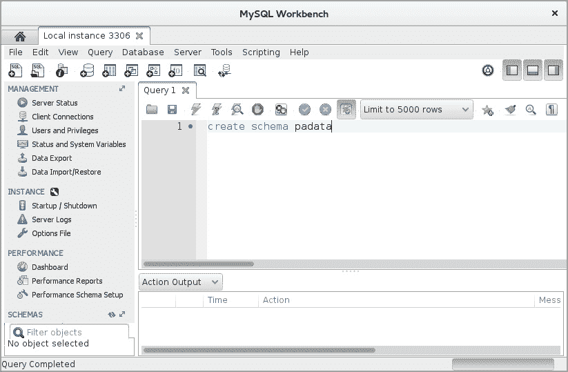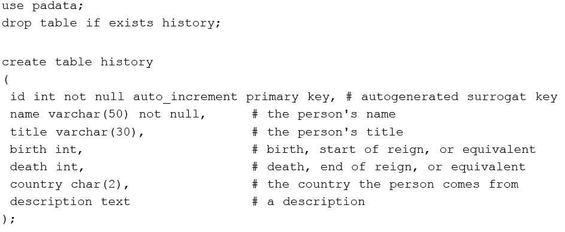

这是一个创建一个包含历史人物信息的表的脚本。表由行和列组成，每行都包含关于特定人物的数据（信息）。每一列都有类型和名称。名称使得可以在`SQL`语句中引用该列，而类型决定了该列可以包含什么的值。以上述脚本为例，指定第一列，该列必须包含一个自动生成的整数，从 1 开始，并在向表中添加行时每次增加 1。此外还定义了该列必须是主键，这意味着该列的值必须是唯一的，因此可以用来识别每一行。接两列的类型为`varchar`，表示该列可以包含字符串，在这种情况下，长度最大分别为 50 和 30 个字符。接两列也可能包含整数，而名为`country`的列必须包含 2 个字符的字符串。最后，最后一列可以包含任何文本（尽管最多为 65535 个字符）。`name`列被定义为`not null`，这意味着每一行在该列中必须有一个值。其他列（除了作为主键的第一列）不需要有值，但可以是`null`。

本书的目录还包含一个脚本`InsertHistory.sql`，下面显示了其中几行：

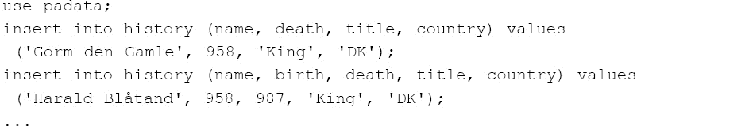

如果你在`MySQL Workbench`中打开并执行该脚本，脚本将向`history`表添加 52 行数据，这些行包含了关于丹麦国王的数据。以下内容假设该表已经创建并且执行了`InsertHistory.sql`脚本。

#### 关于代理键（surrogate keys）

当你必须创建（设计）数据库表时，你必须选择一个或多个列作为`primary key`（上述的`id`）。这意味着每一行在该列或这些列中都必须有一个唯一的值。如果可能，你可以定义一列，然后为其分配一个唯一值，`history`表的`id`列就是这种情况，每当你向表中添加一行时，该值就会自动增加 1。因此，该列可以作为主键，它被称为相应的`代理键`（surrogate key），它是另一个键列的替代。实际上，如果可能，应该避免使用代理键，因为它们用不提供任何数据的扩展了表，在这种情况下，可能会避免使用键，因为国王们有唯一的名称，因此名称可以作为主键。尽管如此我仍然选择了代理键，是因为字符串——`varchar`类型的列——并不总是主键的良好候选者，首先，它可能很难输入（你可能会拼错），部分原因是它的效率低于`int`类型。

## 2 JDBC

JDBC 是一族类，它们实现了`JDBC API`中定义的接口，并使得 Java 程序能够与数据库服务器通信。对于 Java 程序来说，API 在`java.sql`包中定义了必要的类型作为接口和类，而特定类型则由 JDBC 驱动程序实现。因此，对于程序必须应用的每个数据库，都必须有一个可用的 JDBC 驱动程序，而且通常是由数据库供应商开发 JDBC 驱动程序。你可以将 JDBC 驱动程序认为是数据库和 Java 程序之间的一层，它确保程序无论使用哪一个数据库系统，都能以相同的方式使用数据库。

### 2.1 HelloJDBC

在我继续深入并查看有关 JDBC 的细节之前，我将通过一个示例来展示从 Java 程序使用数据库是多么简单。以下程序读取`history`表中的行并将它们打印在屏幕上：

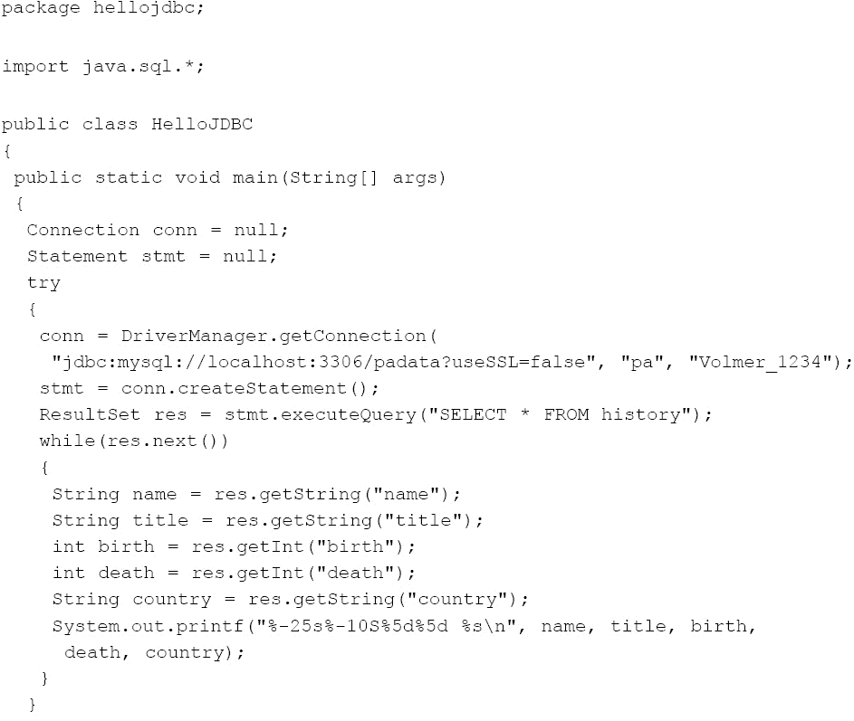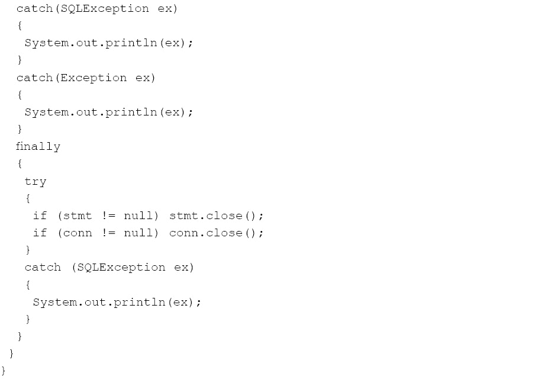

你必须为必要的类型添加导入语句：


然后你必须定义一个到数据库的连接：

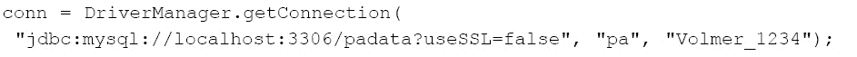

编写此连接实际上是编写数据库应用程序的唯一困难之处，因为它应该被正确地编写，并且取决于特定的数据库产品。`getConnection()`方法有三个参数。第一个是连接字符串，后两个分别是数据库的用户名和密码。在这种情况下，它们直接硬编码为字符串，这对于用于生产环境的应用程序来说可能不是解决方案，但这一点稍后讨论。连接字符串由数据库服务器组成，这里是本地的 MySQL 服务器：


其后是端口号（实际上是不需要的，因为 3306 是 MySQL 的默认端口），最后是数据库名称，这里是`padata`。在这种情况下，还提供信息说明数据库不需要 SSL 连接。如果你需要使用另一机器上的数据库，你必须输入`localhost`以外的内容（可能是 IP），你可能还需要使用不同的端口号。最后，请注意如果不是 MySQL 数据库，连接字符串会不同。

在定义连接后，程序创建一个`Statement`，它是代表 SQL 语句的对象，通过`executeQuery()`方法执行该语句，该参数是一个 SQL SELECT 命令。该方法的结果是`ResultSet`，它是一个包含每一行对象的集合，这些行是从 SQL 命令提取的。在语句成功执行后，应用程序执行一个循环来遍历行，并为每行打印一行其字段的值，即每列的值。你应该注意如何使用`ResultSet`类中的方法引用值，以及数据库中的列名。

大多数数据库操作可能会抛出`SQLException`，因此语句被放在`try`块中。相关的`finally`块关闭`Statement`和`Connection`，释放已分配的资源是非常重要的。

如果你执行程序，将得到以下结果，我只显示了前几行：


如示例所示，从 Java 程序执行数据操作基本上非常简单。当然，还有比这个示例更多的内容，下一章将展示许多其他示例，但区别实际上更多在于 SQL 而非 Java。

#### 练习 1

你必须编写一个类似于`HelloJDBC`的程序，但程序应该只打印那些国王或女王且统治期在 1500 年之前开始的人的名字和年份。

以下内容描述了一个名为`DbOperations`的程序，它包含多个测试方法。这些方法展示了如何使用 JDBC 执行最基础的数据库操作。我只关注维护数据库表的操作，即 SQL`INSERT`、`UPDATE`和`DELETE`语句，以及从表中提取数据的操作，即 SQL`SELECT`语句。

### 3.1 SQL 语句

以下测试方法使用了`history`表，并开始删除表中的某行、插入一行、执行一次查询、更新一行，最后再次执行一次查询。这意味着该方法执行了上述所有的四数据库操作。代码如下：

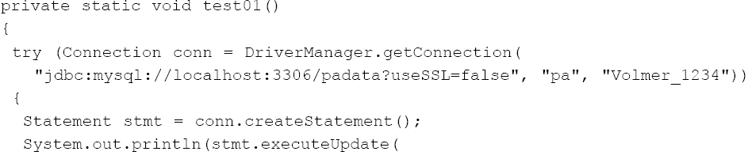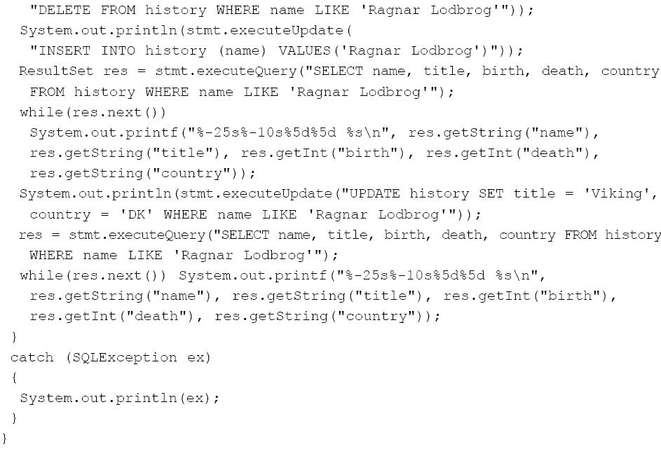

如果执行了该方法，你将得到结果：

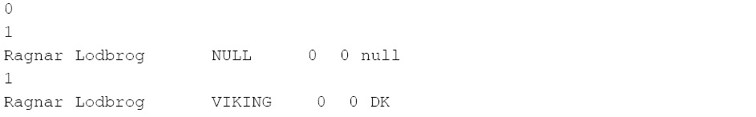

与`HelloJDBC`程序的方式相同，第一步是打开数据库的连接，操作方式完全相同，不同之处在于这次的`Connection`对象是在`try`语句的括号内创建的。这意味着当方法退出`try`块时，连接会自动关闭。与关闭文件的方式一样，这提供了更简单且更具读性的代码。需要注意的是，当数据库连接关闭时，它也会关闭任何与该对象相关的打开语句（statements）。

`try`块开始创建一个`Statement`对象，下一条语句执行一个 SQL DELETE。它通过`executeUpdate()`方法执行，该方法除了用于`DELETE`外，还用于执行`INSERT`和`UPDATE`语句。该方法返回发生更改的行数。在此例中，语句删除了`name`字段的值值为`Ragnar Lodbrog`的行。如果这是第一次运行该方法，可能不存在这样的一行，方法将返回 0。如果方法已完成，则`name`列中存在一个具有该值的行，方法将返回 1，然后在屏幕上打印出与上述结果对应的 1。

下一条语句再次执行一个 SQL INSERT，从而在表中插入了一行。你应该注意，该语句仅在`name`列中添加了值，这是可以的，因为其他列允许`null`值。当执行此语句时，方法也会在屏幕上打印 1，因为表中插入了一行。

下一条语句再次执行一个 SQL SELECT，这次使用的是`executeQuery()`，它专门用于执行 SELECT。该查询提取`name`值为`Ragnar Lodbrog`的行。表中只有这样的一行，并且该行在下一条语句中被打印出来。结果如上方第三行所示。注意，该方法使用`while`循环遍历`ResultSet`对象中的对象。显然，当我知道只有一行时，没有必要使用循环，但必须执行`res.next()`来移动到第一行。

最后执行一个 SQL UPDATE，同样使用`executeUpdate()`方法，最后执行一个新查询，显示该行已更新。

#### 编译 Prepared Statements

在上面的示例中，所有的数据库操作都是通过`Statement`对象执行的，该对象代表一个静态的 SQL 语句，因此是一个不可更改的 SQL 语句。此外还有一个名为`PreparedStatement`的类，它代表一个参数化的 SQL 语句。后续测试方法的目的是展示如何让 SQL 表达式使用参数。

项目`DbOperations`中有一个名为`Person`的类，代表`history`表中的一行。这意味着该类为表中的每一列包含一个变量：

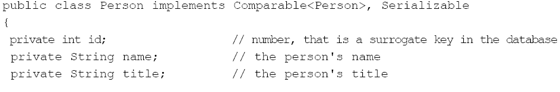

我在这里不会显示完整的类，部分是因为我之前看过一个几乎完全相同的类，部分是因为该类主要由`get`和`set`方法组成。但请注意，`birth`和`death`的类型是`Integer`而不是`int`。这是因为数据库中的这两列可能包含`null`（而`int`不能为`null`）。

`DbOperations`类有以下方法，用于创建一个包含一些`Person`对象的`ArrayList`（我只展示了第一个——共有 12 个）：

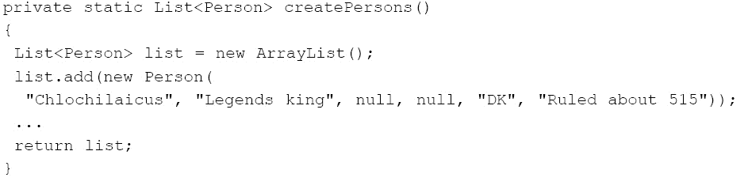

然后是测试方法：

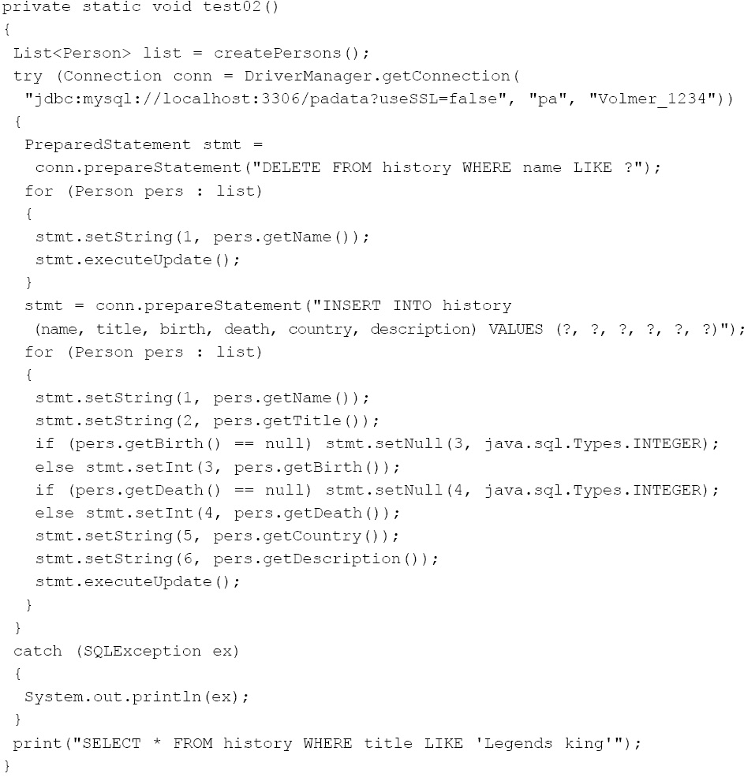

首先，方法创建了一个包含 12 个`Person`对象的列表。然后，打开数据库连接，并为该连接创建一个`PreparedStatement`对象。`PreparedStatement`类派自`Statement`，因此代表一个 SQL 表达式，但这是一个带有参数的表达式。在这种情况下，它是一个 SQL DELETE，并且有一个用问号`?`表示的参数。下一个循环必须删除列表中的所有人员（如果存在），在每次迭代中，循环执行一次 DELETE，但必须先为 SQL 表达式中的`name`列插入一个值。也就是说，问号必须被一个值替换：


这里，1 表示它是第一个参数（且只有一个），而最后一个参数是值。`stmt`对象通过`setString()`赋值，因为类型为`VARCHAR`。其他类型也有类似的方法。

循环完成后，创建了另一个`PreparedStatement`，这次用于 SQL INSERT。它少于六个参数，用于在表中插入一行。这是在循环中进行的，每次重复都会初始化参数。最后，测试方法通过 SQL SELECT 执行`print()`

#### 练习 2

你应该使用`MySQL Workbench`在数据库`padata`中添加一个新表。你应该通过编写脚本（与`history`表的方法相同）来实现，表应命名为`currency`，并包含三列：

1. `code`，必须是三个字符的货币代码，作为主键
2. `name`，必须是货币名称，最多 30 个字符
3. `rate`，必须是汇率，类型为 10 位数字、4 位小数

你必须使用以下数组编写程序来更新`currency`表。程序应该首先删除表中的所有内容（使用简单的 DELETE），然后必须使用`PreparedStatement`为数组中的每个字符串插入一行：

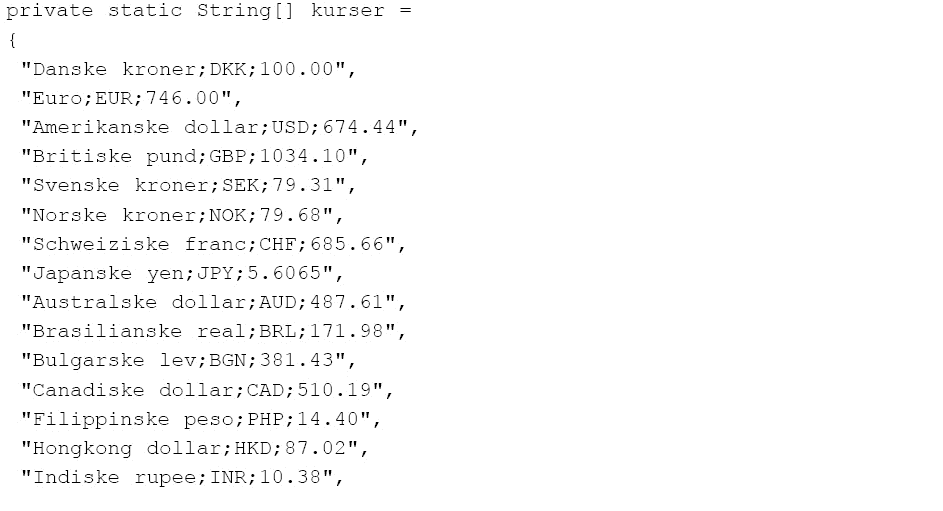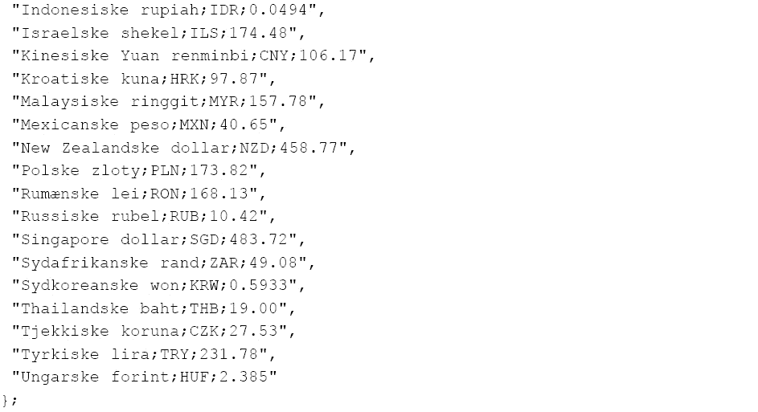


为了在`PreparedStatement`中为`rate`插入值，必须指定类型为`DECIMAL`，这里可以使用`setBigDecimal()`。

在运行程序之前，你可以用当前的汇率更新数组。

# 4 ResultSet

复杂的 SQL 语句是 SELECT，它是一个包含许多选项的复杂语句。在 Java 程序中，你可以通过`executeQuery()`执行 SQL SELECT，尽管 SELECT 语句可能很复杂，但 Java 程序看到的始终始终是：一个`ResultSet`对象。你可以将该对象想象成一个集合，带有一个内部游标指向当前对象（行），如果没有指向任何内容，则游标为`null`。`ResultSet`类定义了许多方法，基本上可以分为三类：

1. 移动游标的方法

2. 返回当前行列值的`get`方法

3. 更新当前行列值的更新方法，你甚至有机会将更改写回数据库

在创建`Statement`对象时，我到为止使用了以下语法：


它会创建一个`Statement`对象，但`createStatement()`有如下形式的重写方法：


在这里你可以为第一个参数设置三个值：

1. `ResultSet.TYPE_FORWARD_ONLY`，意味着光标可以向前移动，这是默认值。

2. `ResultSet.TYPE_SCROLL_INSENSITIVE`，意味着光标可以前后移动，并且在在此`ResultSet`创建后，其他用户对数据库所做的更改不会更新该`ResultSet`。

3. `ResultSet.TYPE_SCROLL_SENSITIVE`，含义与上述相同，但不同在于结果集会根据其他用户在该`ResultSet`创建后对数据库所做的更改进行更新。

默认情况下`ResultSet`是只读的，但对于上述最后一个参数，有两个选项：

1. `ResultSet.CONCUR_READ_ONLY`，创建一个只读的`ResultSet`，且是默认值。

2. `ResultSet.CONCUR_UPDATABLE`，创建一个可更新的`ResultSet`。

你可以使用以下语法为`prepareStatement()`设置相同的参数：

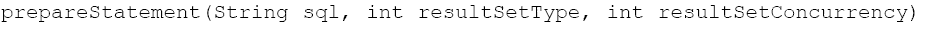

`ResultSet`有许多导航光标的方法，鼓励你查看这些选项。它们基本上是自言自懂的，下面的测试方法（它是`DbOperations`中的一个方法）提供了在`ResultSet`上使用这些方法的示例，你可以在其上反复滚动：

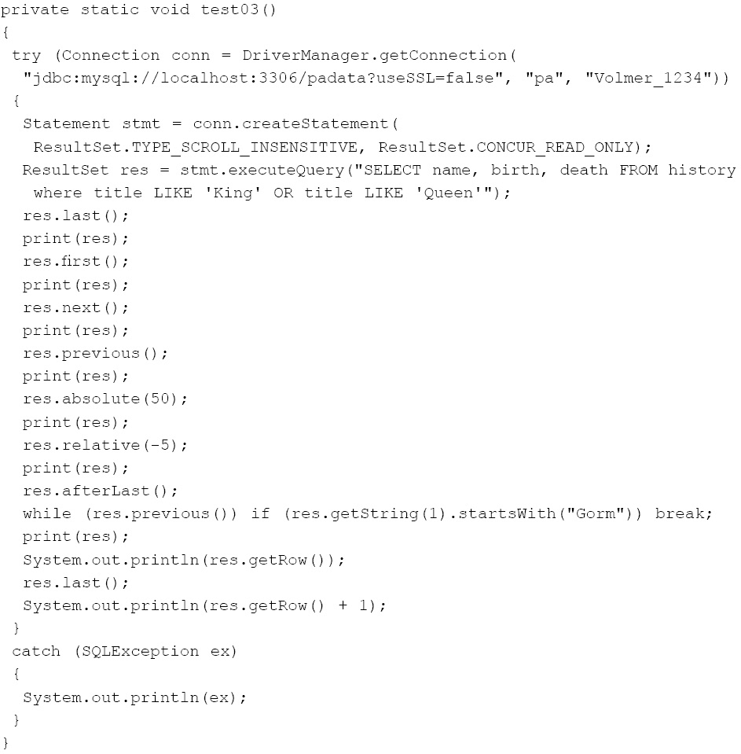

如果你执行该方法，将得到结果：

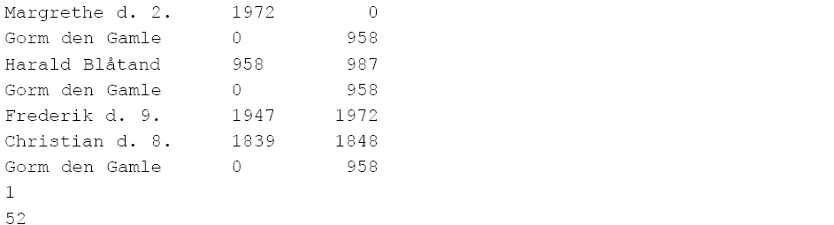

每一行都通过该方法打印：

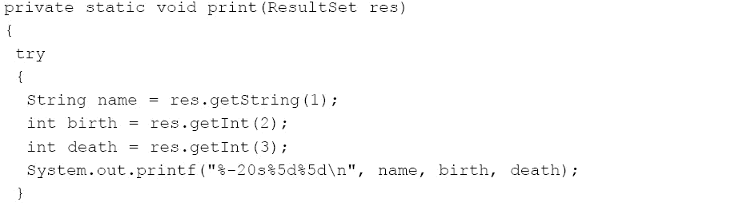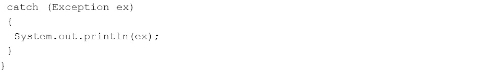

结果集有许多方法用于检索当前行的值，在前面的示例中，我每次都使用列名来引用值。实际上，也允许输入索引，从第一列开始为 1。你应该注意，索引不是指向物理表，而是`SELECT`语句中指定的列。在这种情况下，有三列，因此索引为 1、2 和 3。

## 4.1 更新 ResultSet

下面的测试方法展示了如何更新结果集：

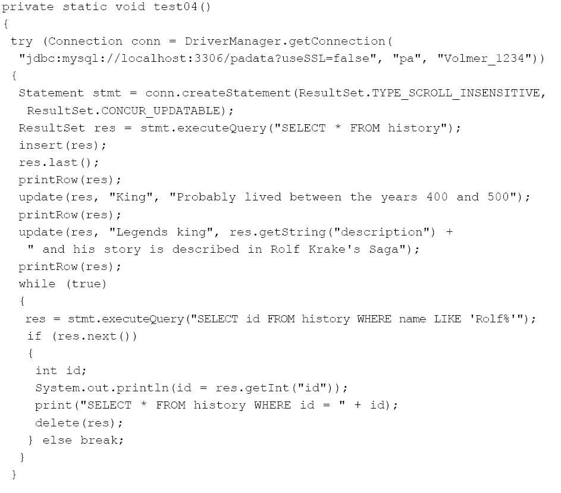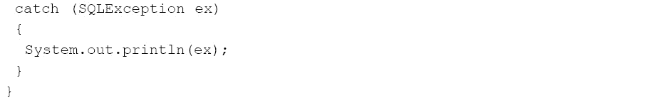

首先，你会注意到创建一个允许你更新`ResultSet`的`Statement`对象。接下来，从`history`表中提取所有行，然后用`ResultSet`作为参数调用`insert()`方法：

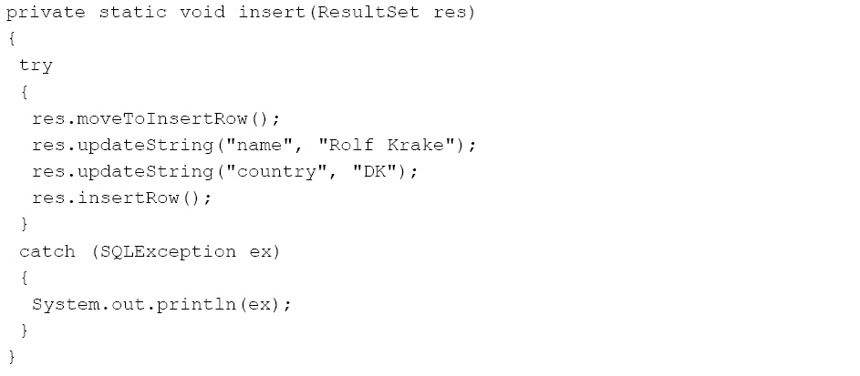

该方法向`ResultSet`对象添加了一个新行并为其中两列赋值。最后一个方法将这些更改物理地写回数据库。如果你不想这样做，可以省略该语句，行将仅插入到内存中的`ResultSet`对象中。

在插入新行后，测试方法将光标设置为最后一行，并通过`printRow()`方法打印该行。下一条语句调用`update()`方法，它会更新光标所指向的行：

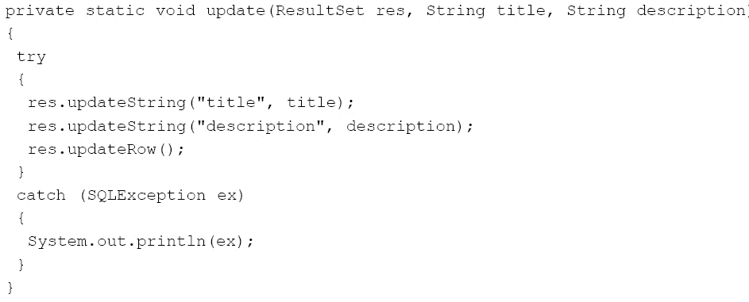

更新了两列，再次是最后一条语句将更改写回数据库。测试方法再次打印该行，这样你可以看到更改已生效，之后该行再次被更新。

接下来，该方法执行一个无限`while`循环，开始对姓名以`Rolf`开头的人员执行查询。应该只有 1 条。如果存在这样的行（`res.next()`为真），则通过`delete()`方法删除该行。如果没有找到该行，则执行`break`循环停止。目标是显示更新是物理存储在数据库中的，以便在下一次迭代中找不到任何行。`delete()`方法非常简单，它删除光标指向的行：

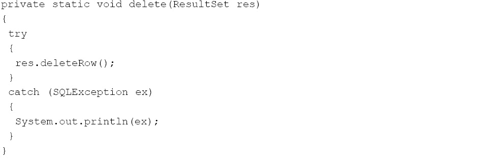

你应该注意，测试方法中的`while`循环在发现行的情况下，会带一个 SQL 表达式作为参数调用`print()`方法。其目标是显示新行在关联另一个连接的请求上可用的，因此该行物理存储在数据库中。如果你执行该测试方法，结果可能是：

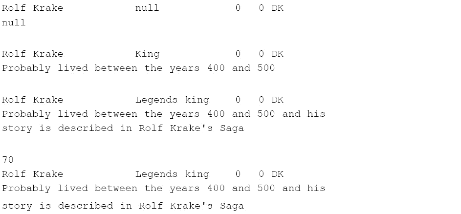

测试方法还使用了`printRow()`方法，该方法在屏幕上打印一行（光标指向的行）。该方法不需要特殊的解释，在此未显示，但它包含一个被注释掉的语句：

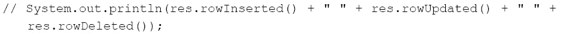

当它被注释掉时，仅仅是因为它不起作用。该方法应该测试`ResultSet`是否包含已插入、更新或删除的行。（注：原文后续部分存在大量重复的无效文本，已根据要求对核心逻辑进行处理）

我（以`root`身份）在此目录下创建了一个子目录`data`。接下来，我将文件`zipcodes`拷贝到该目录。然后可以使用以下脚本（`LoadZipcodes.sql`）更新表格：

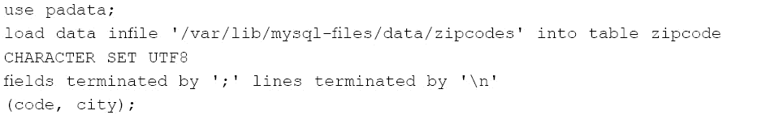

结果是`zipcode`表现在有 1106 行。

然后是`municipality`表，书本的目录中有一个名为`municipalities`的文件，其中包含了丹麦各市的数据行。下面显示了前三行：

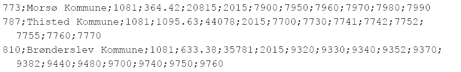

每一行包含用分号分隔的内容：

1. 市镇编号

2. 市镇名称

3. 区域编号

4. 面积

5. 人口数量

6. 人口数量年份

随后是数量变化的邮政编码，即该市使用的邮政编码。对于文件中的每一行，都必须在`municipality`表中插入一行，对于每个邮政编码，在`post`表中插入一行。最简单的方法是写一个小型程序来读取文件并更新数据库：

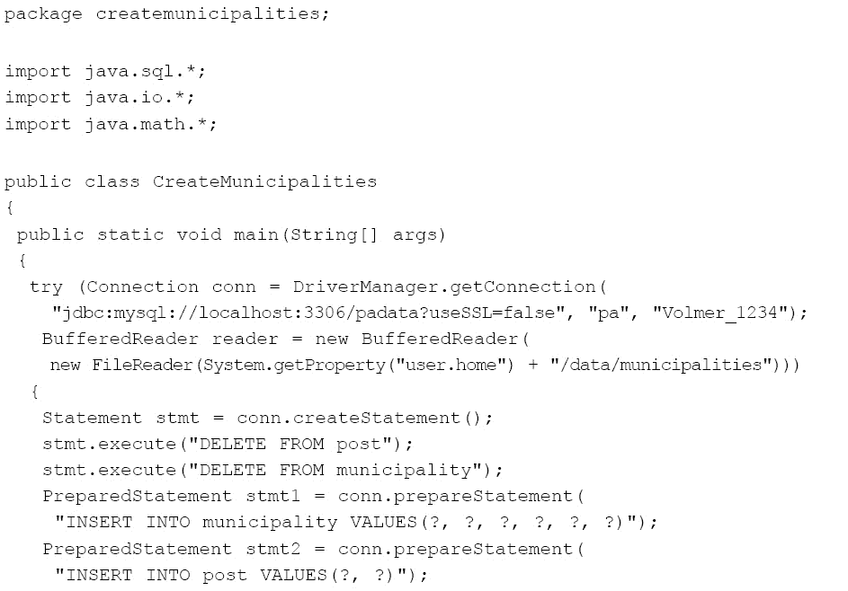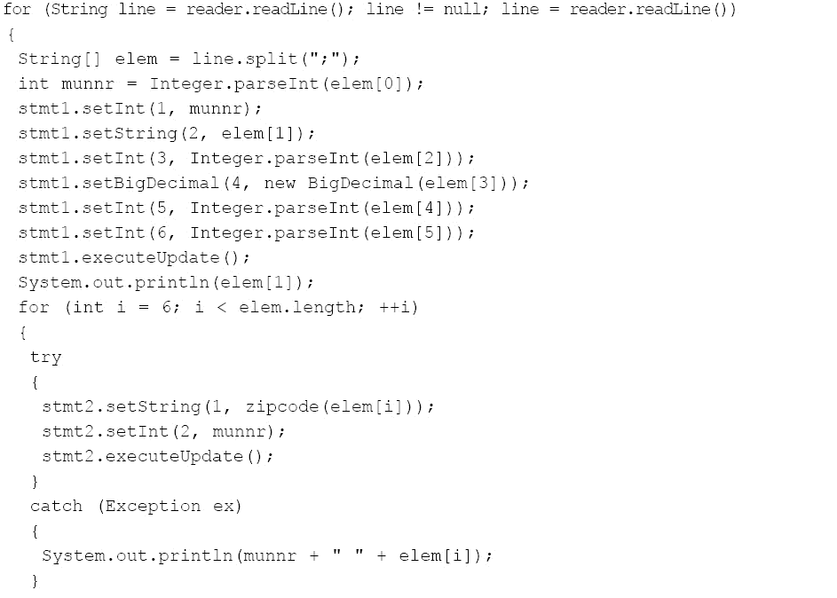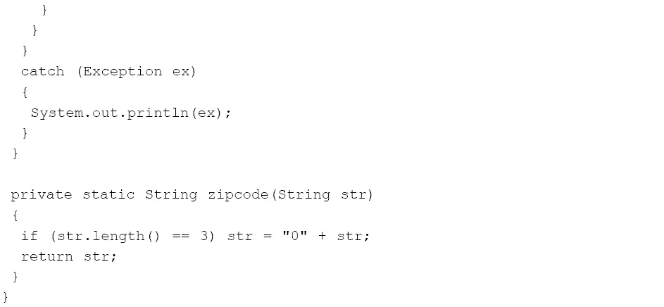

`try`之后的括号内按照通常的方式打开了数据库连接，以及我拷贝到家目录下`data`文件夹的`municipalities`文件。首先发生的事情是删除两个数据库表的内容，然后创建两个带有`INSERT`语句的`PreparedStatement`对象，用于这两个表。接下来的`loop`按行读取文件，每行被拆分为标记（tokens），用于初始化`stmt1`的参数。在向`municipality`表插入一行后，有一个内层`loop`遍历所有的邮政编码，并为该市在`post`表中插入行。

你应该注意，执行该程序实际上需要很长时间。该程序执行了超过 2000 条 SQL`INSERT`命令，像这个示例所示，从 Java 中实现这是一个枯燥的过程，而且正如后文所示，还有更好的方法来实现相同的功能。

作为一个使用新表的程序示例，确定以下测试方法（仍是程序`DbOperations`中的一个方法）中中特兰地区（Region Midtjylland）的人口：

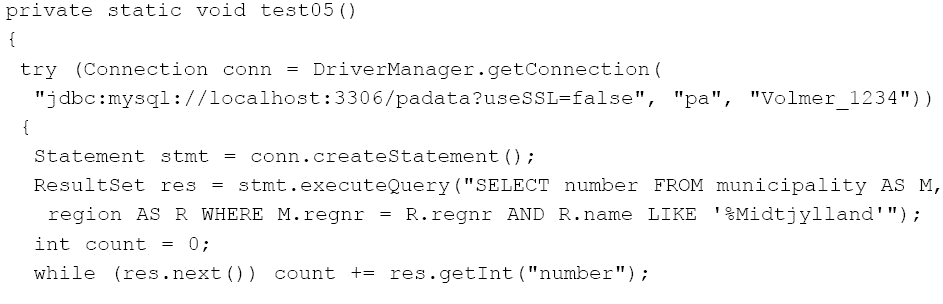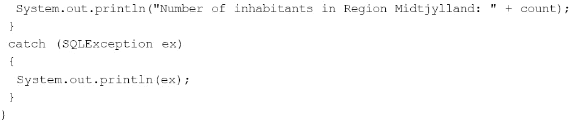

你应该注意，唯一的区别是一个稍微复杂一点的 SQL`SELECT`语句，Java 部分没有新内容。

### 练习 3

编写一个程序，根据`municipality`表中的数字在屏幕上打印日特兰岛（Jutland）和富岛（Fyn）的人口密度。

### 问题 1

你必须用两个表扩展数据库`padata`。第一个表应命名为`world`，并且必须包含所有大洲的名字：

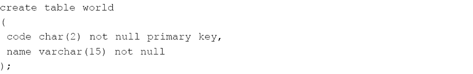

该表必须包含以下数据：

* `AS` 亚洲

* `AF` 非洲

* `NA` 北美

* `SA` 南美

* `AN` 南极洲

* `EU` 欧洲

* `OC` 大洋洲

第二个表应包含国家信息：

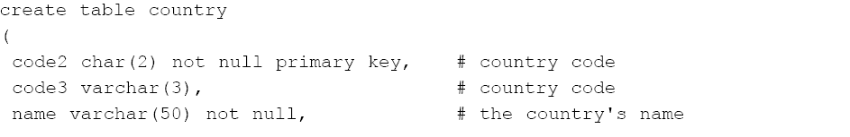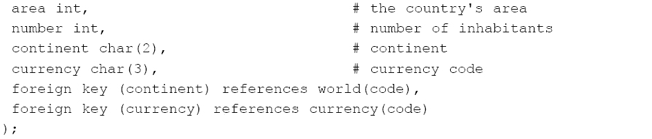

编写一个脚本来创建这两个表并在第一个表中插入有关大洲的信息。

本书的文件夹包含一个名为`countries`的文件。这是一个纯文本文件，其中每行包含一个国家的信息。下面是前几行：

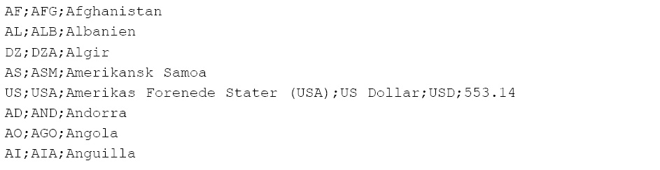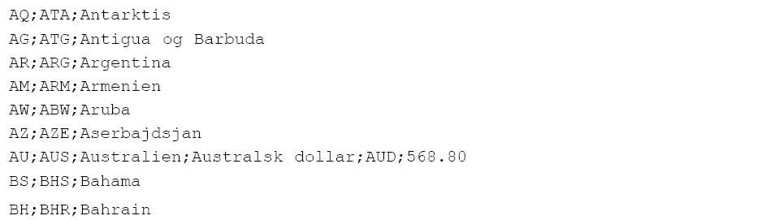

字段由分号分隔。对于每个国家至少有 3 个字段：2 位的国家代码（主键）、3 位的国家代码（可能为空）以及国家名称。此外，可能还有三三个额外的字段，即该国家使用的货币名称、货币代码和汇率。

你现在必须编写一个程序，通过读取上述文件来更新`country`表。如果存在货币，则将货币代码插入货币列中，否则该值应为`null`。当某个国家的文件指示了货币，但该货币在`currency`表中不存在时，会产生一个问题。对于这些货币，程序还必须更新`currency`表。

## 4.3 存储过程

存储过程包含 SQL 语句的脚本，这些语句在执行过程时运行。当我们谈论存储过程时，意味着该过程被翻译并存储在数据库中，这意味着执行存储过程是非常高效的。在 MySQL Workbench 中，你可以通过右键点击`Schemas`下数据库的`Stored Procedures`来创建一个存储过程，你会得到一个过程的骨架：


作为一个示例，我写了一个非常简单的过程，其`OUT parameter`返回`municipality`表中的人数：


以下显示了如何执行：

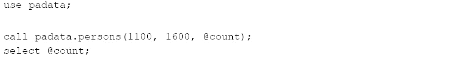

`CallableStatement`定义了输入和输出参数：


# 5 数据类型

在数据库表中，每一列都有数据类型，而在 Java 中数据存储在变量中。因此，需要知道 JDBC 如何将类型转换为数据库。之前的程序已经展示了许多示例，例如从`ResultSet`使用`get`方法获取值，或者在`PreparedStatement`中使用`set`方法初始化参数。下表显示了这些类型之间的关系：

| SQL | Java | 方法 |
| :--- | :--- | :--- |
| `VARCHAR` | `String` | `getString(), setString()` |
| `CHAR` | `String` | `getString(), setString()` |
| `LONGVARCHAR` | `String` | `getString(), setString()` |
| `BIT` | `boolean` | `getBoolean(), setBoolean()` |
| `NUMERIC` | `java.math.BigDecimal` | `getBigDecimal(), setBigDecimal()` |
| `TINYINT` | `byte` | `getByte(), setByte()` |
| `SMALLINT` | `short` | `getShort(), setShort()` |
| `INTEGER` | `int` | `getInt(), setInt()` |
| `BIGINT` | `long` | `getLong(), setLong()` |
| `REAL` | `float` | `getFloat(), setFloat()` |
| `FLOAT` | `float` | `getFloat(), setFloat()` |
| `DOUBLE` | `double` | `getDouble(), setDouble()` |
| `VARBINARY` | `byte[]` | `getBytes(), setBytes()` |
| `BINARY` | `byte[]` | `getBytes(), setBytes()` |
| `DATE` | `java.sql.Date` | `getDate(), setDate()` |
| `TIME` | `java.sql.Time` | `getTime(), setTime()` |
| `TIMESTAMP` | `java.sql.Timestamp` | `getTimestamp(), setTimestamp()` |
| `CLOB` | `java.sql.Clob` | `getClob(), setClob()` |
| `BLOB` | `java.sql.Blob` | `getBlob(), setBlob()` |
| `ARRAY` | `java.sql.Array` | `getArray(), setArray()` |
| `REF` | `java.sql.Ref` | `getRef(), setRef()` |
| `STRUCT` | `java.sql.Struct` | `getStruct(), setStruct()` |

因此，值得注意的是，`java.sql`包定义了对应于某些 SQL 数据类型的特殊数据类型。类型到日期和时间之间的转换通常会导致数据库应用程序出现问题，为了方便这些类型转换问题，我扩展了我的库`PaLib`并添加了以下类：

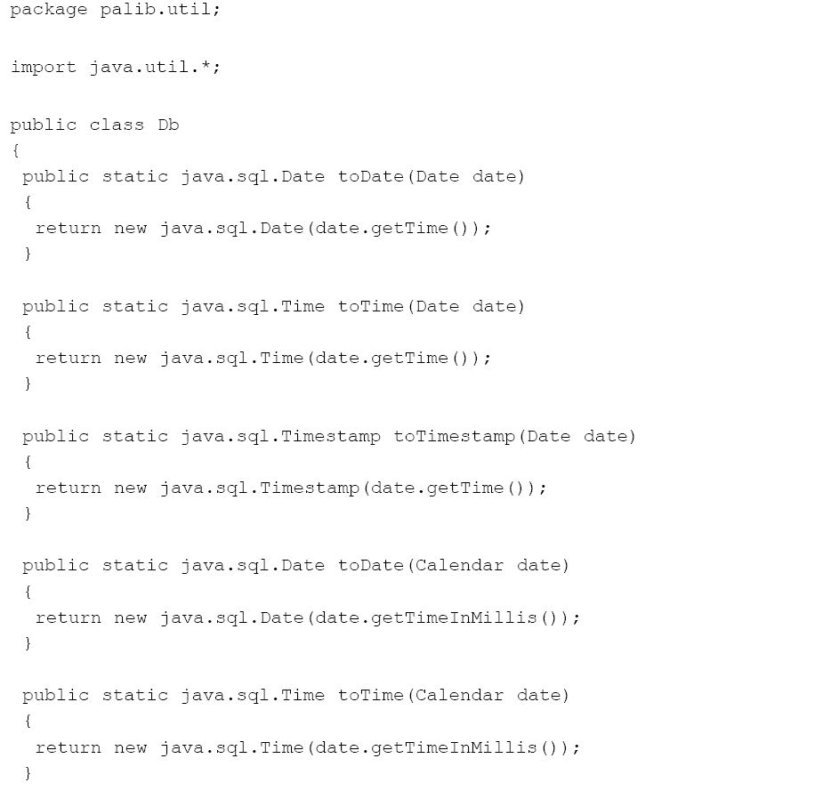!(image/Java_6_26-4-17_42.jpg)!(image/Java_6_26-4-17_43.jpg)!(image/Java_6_26-4-17_44.jpg)

弄清楚每个方法应该不难，而且从实际编程来说，能够与`Calendar`对象以及相应的 SQL 数据类型进行转换是非常重要的。接下来的测试方法使用了上述转换方法：

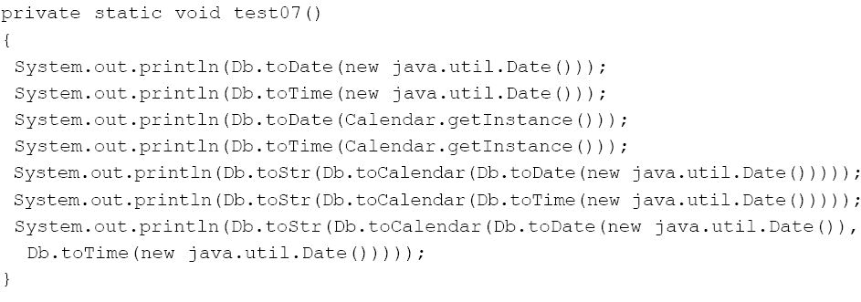

以及运行该方法的示例如下：

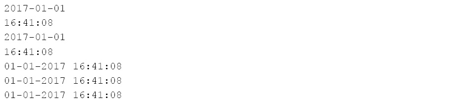

另一个关于数据类型的问题是`NULL`值，数据库中的`NULL`和 Java 中的`null`并不是一回事。例如，`ResultSet`的`get`方法是否会将基本数据类型的`NULL`值转换为默认值（通常是 0）呢？这并不总是恰当的。在`test02()`测试方法中，我展示了如何从应用程序向数据库写入`NULL`值。接下来的测试方法演示了`wasNull()`方法的应用，该方法通过`ResultSet`测试由`get`方法的最后一个值是否为`NULL`：

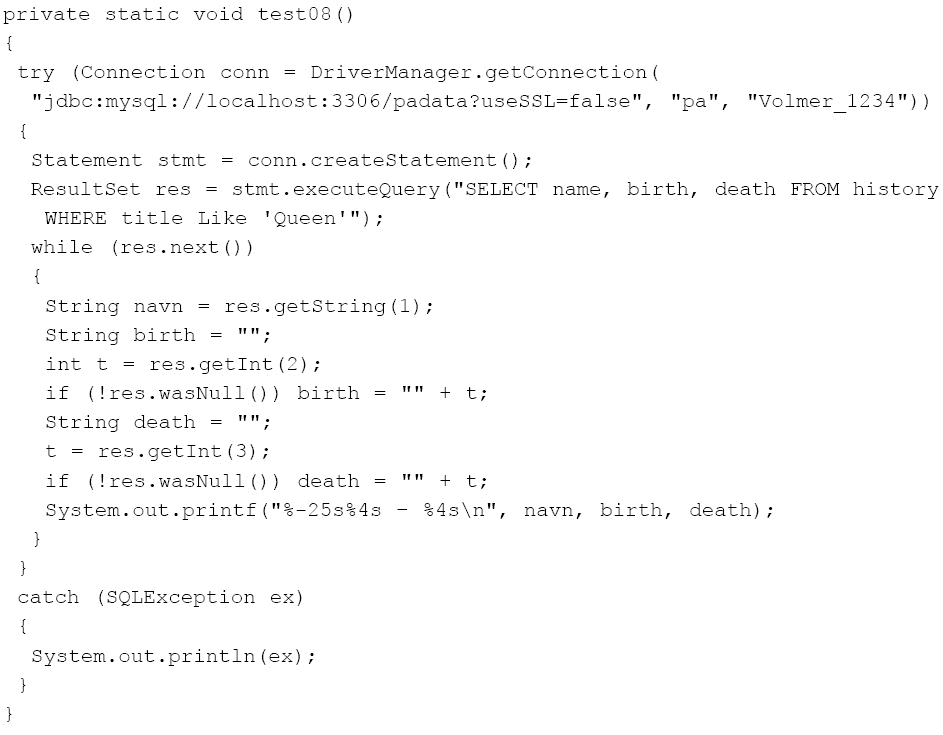

如果执行该方法，你将得到结果：


# 6 事务 (Transactions)

在使用`Statement`或`PreparedStatement`对象执行 SQL 语句时，数据库会立即更新。有时这并不合适，因为你通常有多个 SQL 语句必须作为一个整体执行，即要么所有语句都正确执行，要么全部被忽略。在数据库上下文中，我们谈论“事务”（transaction），简单来说就是意味着多个 SQL 语句可以被视为一个整体。接下来的测试方法在`history`表中插入三行数据，其中这三个语句作为一个事务执行的：

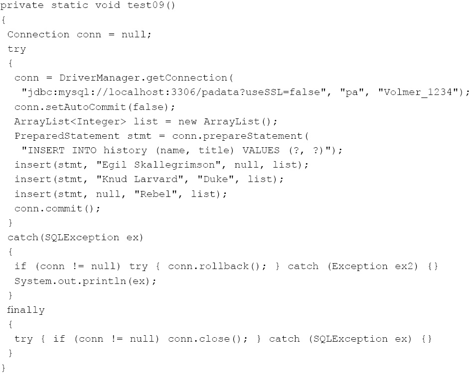

首先，像之前一样以通常的方式创建了数据库的连接，下一条语句表示不开启`auto commit`（自动提交）。这意味着后续的 SQL 语句不会立即在数据库上执行（它们被标记为可以回滚的语句），并且效果在执行`commit()`之前不会出现。

语句


意味着一个事务的开始。下一条语句创建了一个`ArrayList`，并在稍后会进行说明。接着，创建了一个`PreparedStatement`，它代表一个向`history`表插入一行的 SQL 命令，但只在`name`和`title`列中插入值。然后，该方法执行了三次`insert()`方法调用，该方法会在表中插入一行。如果一切顺利，则执行`commit()`，这三次插入操作将被永久地写入数据库。然而，如果三个`insert()`中的任何一个抛出了`SQLException`，则会执行`catch`块并执行`rollback()`，这意味着事务开始后执行的数据库操作将会被回滚，数据库将恢复到事务启动前的状态。

然后是`insert()`方法：

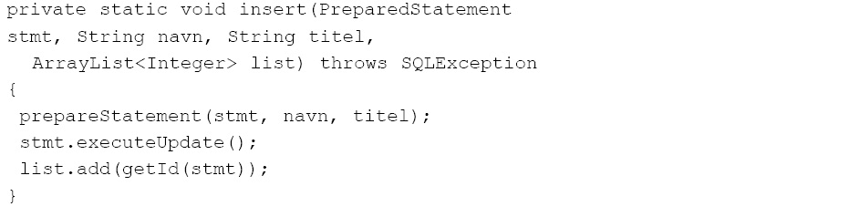

该方法调用了一个方法来为`stmt`中的参数插入值，然后执行该语句。`history`表的主键是一个自动生成的`Integer`，有时在分配某行时你需要知道该分配的`id`。这可以通过几种方式实现，但我为此目的专门写了一个小方法：


这里是`LAST_INSERT_ID()`，它是 MySQL 中的一个函数，用于返回最后分配的自动生成 ID。在这个示例中，这些键被添加到一个`ArrayList`中，虽然它没有用于任何地方，但在下一个示例中用到了，在这里你主要需要观察如何获取自动生成的键。

如果执行上述测试方法，最后一次`INSERT`将失败，因为`name`列没有值，而数据库定义该列必须有值。这意味着发生了回滚。如果你打开`MySQL Workbench`，可以很容易地确信这些行并没有被插入。

该示例基本上说明了关于事务要说的内容，但也有定义`Savepoint`（保存点）的可能性，可以用来指示并非所有操作都必须回滚。考虑以下测试方法，它是上述方法的扩展：

第一部分基本上与`test09()`方法相同，但定义了一个额外的用于 SQL UPDATE 的`PreparedStatement`。此外，还为最后一次`INSERT`定义了名称，使其不会失败。在执行完三次`insert()`方法后，测试方法执行了`commit()`并定义了一个`Savepoint`，表示到事务的此为止语句执行是正确的。接下来，对表中插入的三行中的每一行都执行了`update()`方法。该方法更新`country`列，我在这里使用了存储在列表中的键值。这里前两个`update()`执行得正确，但当`country`列只能容纳两个字符时，最后一次抛出了`SQLException`。结果是控制权转移到了`catch`块，执行了回滚，但当`Savepoint`对象不为`null`时，可以得出已到达`Savepoint`的结论，因此`INSERT`语句执行成功。只回滚到`Savepoint`。

## 6.1 批量更新 (Batch updates)

关于 JDBC 和数据库操作的最后一点，我将提到批量更新。如果你必须执行许多数据库操作——例如许多 INSERT 语句——如果程序为每个语句调用一次数据库，可能会花费长时间。你可以将所有操作收集到一个批，这对于`Statement`、`PreparedStatement`和`CallableStatement`都是可能的，然后通过单个连接一次执行所有操作。接下来的测试方法展示了语法：

`createKings()`方法基本上与`createPersons()`相同（它只是创建其他的`Person`对象）。在`try`块内部，该方法创建了两个`PreparedStatement`对象分别对应 DELETE 和 INSERT。由于 JDBC 不要求支持批量更新，因此首先测试是否支持，如果是，遍历列表中的所有对象，添加语句来删除相应的行（如果存在），但不是执行`executeUpdate()`，而是执行`addBatch()`，这会将数据库操作添加到`stmt1`对象的操作列表中。随后，列表中的所有对象都执行相同的操作，但这次使用的是`stmt2`对象。到此为止，数据库操作尚未执行，但最终通过`executeBatch()`方法执行。

### 练习 4

以下行显示了七个国家的国家代码、所属洲代码、国家面积和人口规模数据：

你必须编写一个程序，使用上述信息更新`country`表，要求如下：

1. 必须通过批量更新完成

2. 必须使用`Statement`对象而不是`PreparedStatement`对象

注意，`addBatch()`方法可以接受 SQL 表达式作为参数。

在更新表后，你必须执行一个 SQL SELECT 语句，提取面积不为`NULL`的国家名称，并在屏幕上打印这些名称。

# 7 组件 JTable

本章描述了`Swing`中最复杂的组件之一`JTable`。原则上，它与 JDBC 或数据库没有关系，但该组件用于显示按行列组织的数据，因此该组件在显示数据库表格内容方面具有特定的应用。这就是在这里提到它的原因。

这是一个非常重要的组件，非常灵活，具有许多选项和自定义功能，但它同样复杂，并不总是那么容易理解其工作原理。类名如前所述为`JTable`，首先重要的是注意到，`JTable`对象本身不包含数据，但它可以显示由数据模型定义的数据。该类使用了几个在`javax.swing.table`包中常见的（实际上是很多很多）辅助类。

## 7.1 演示程序

我将从简单的开始，下面显示了一个带有`JTable`的窗口，它显示了以 6 列 9 行表格布局的一些数据：

单个数据元素并不重要，但它们显示了关于 9 本书的数据。如果你运行该程序，必须观察到以下现象：

* 你可以改变窗口大小。如果你改变高度，导致没有空间显示整个表格，就会出现滚动条。如果你改变宽度，列宽会发生变化，但没有滚动条。然而，ISBN 和 Pages 这两的宽度不会改变。

* 你可以通过鼠标点击选择多行，并且具有通常可以与 Ctrl 和 Shift 键结合使用的功能。

* 你可以通过拖动两个列标题之间的分割线来改变每列的宽度。

* 你可以编辑单个单元格的内容。通过鼠标双击单元格可以打开编辑模式。

`JTable`附带了许多功能，上述提到的都是默认设置（那两个固定宽度的列除外）。

代码如下：

```
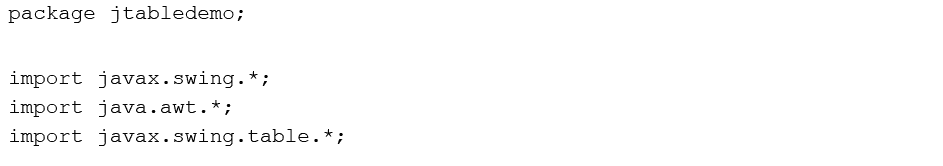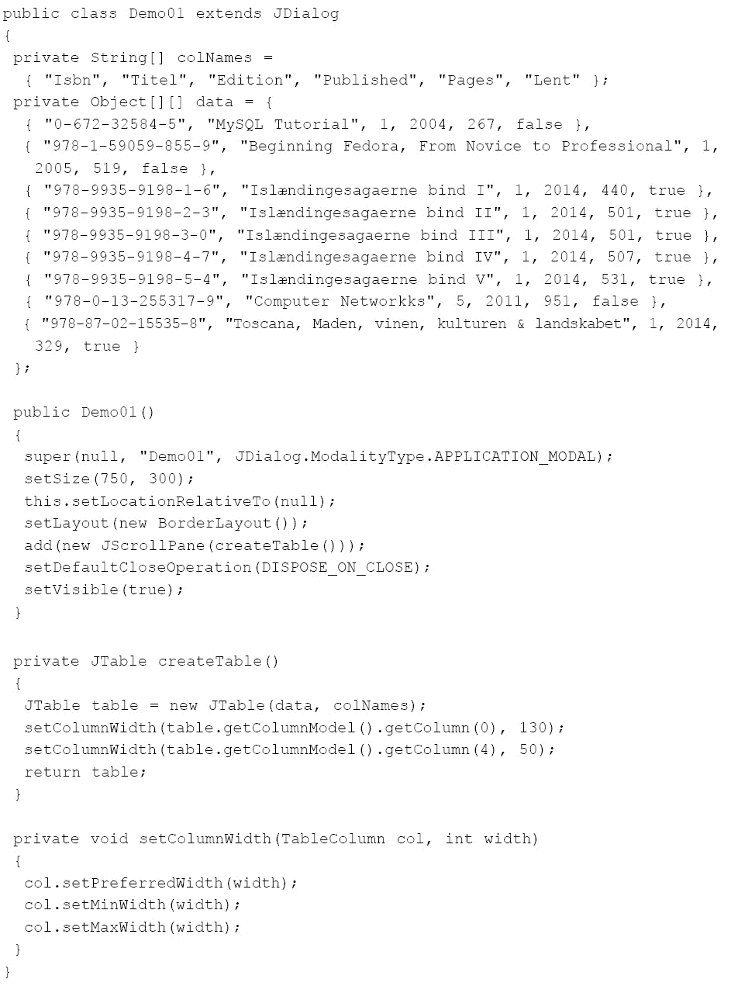
```

在代码的开头布局了要显示的数据。第一个数组是列标题，接下来的二维数组是表格的数据。你应该注意数组的数据类型是`Object`，由于某些数据是简单数据类型，因此使用了自动装箱（auto boxing）来转换为`Integer`和`Boolean`类型的对象。表格在`createTable()`方法中创建，其中两个数据结构（数组）作为参数传递给`JTable`的构造函数，构造函数随后将根据这些结构创建一个数据模型。接下来调用了`setColumnWidth()`方法用于第 0 列和第 4 列，为这些列定义固定宽度。查看语法时，它并没有什么奥秘，但它远非典型的应用，考虑到大量的用户交互机会，很明显有一部分是必须学习的。

该类是一个名为`JTableDemo`的项目的一部分，当你运行程序时，你会得到以下窗口：

因此这是一个带有 12 个按钮的窗口。每个按钮都会打开一个对话框，显示`JTable`的示例，左上角是上面提到的示例。

### 数据模型

现在我将查看数据模型，因为`JTable`显示的是数据模型中的对象。在上一个示例中，是`JTable`类的构造函数创建了模型，但通常不是这样。数据模型是一个继承自`AbstractTableModel`的类，对于上述相同的数据，模型可以是：

```
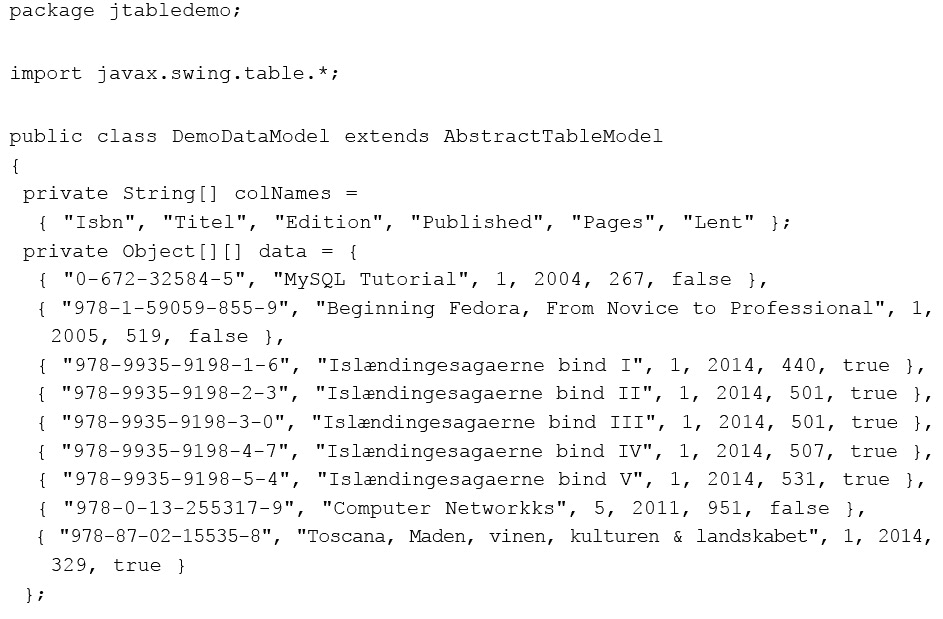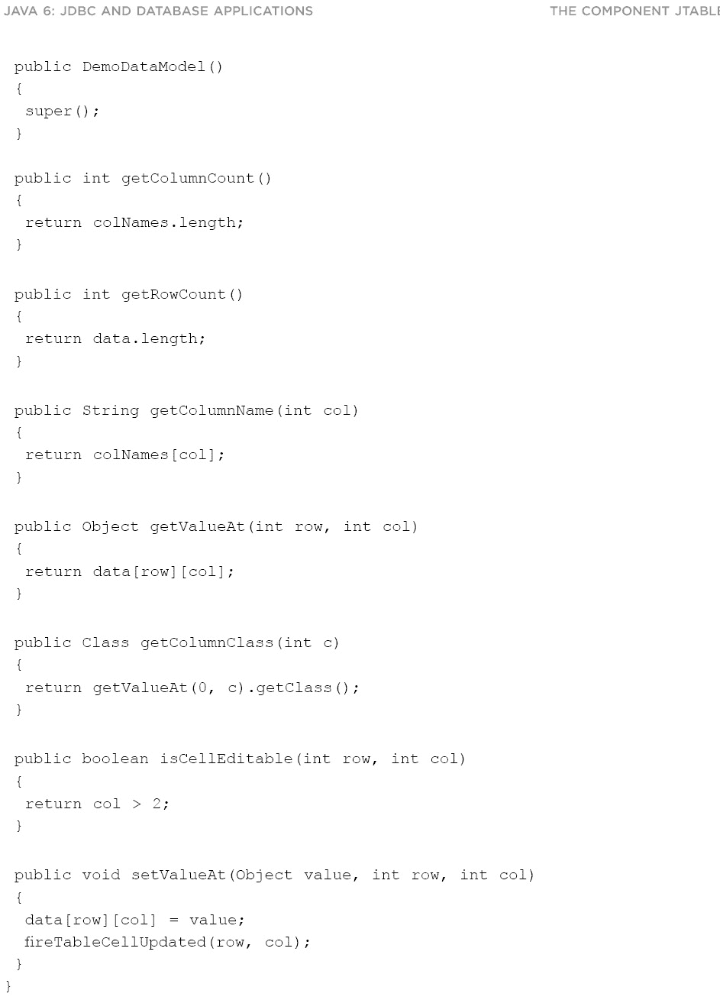
```

它除了数据定义外，还重写了基类的方法。事实上，这些方法中只有三个是必要的（`getColumnCount()`、`getRowCount()`和`getValueAt()`），因为其他的在`AbstractTableModel`中有默认实现。然而，`getColumnName()`获取正确的列名是必要的。这些方法通常很简单，但你应该注意`isCellEditable()`方法，在这种情况下它定义了只有索引大于 2 的列可以编辑。同样注意`getColumnClass()`方法，它返回每列的数据类型。通常（如上一个示例所示），`JTable`以`toString()`的形式将数据元素的值显示为字符串，但有了数据类型，单元格的渲染方式将不同。例如，包含数值的单元格内容右对齐，另一个例子是`Boolean`（在此情况下是最后一列）显示为`JCheckBox`组件。

下面是一个显示基于上述数据模型的`JTable`窗口。该示例应该展示两点：

1. 如何应用数据模型

2. `JTable`中行和列的选择是如何工作的

第一点非常简单，而单元格的选择稍微难理解一点。

除了表格，窗口还有一些单选按钮和复选框，因此用户可以指定单元格选择的工作方式。如果你点击表格，它会显示一个消息框告知点击了什么：

鼓励你运行该程序，以便了解单元格选择是如何工作的。

接下来的方法创建了表格，你必须观察如何映射数据模型，这是通过构造函数实现的：

```
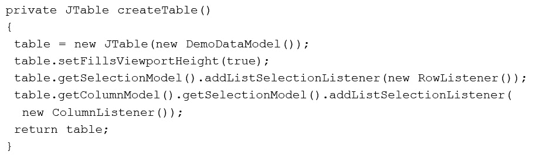
```

下一个语句并不是真正必要的，但如果程序使用拖放，它就是重要的。最后两个语句与事件处理器相关，分别对应行和列的选择，它们等会打开一个消息框。

代码的其余部分是填充，但没有新内容。一部分关于用户界面的设计，其中组件是使用`BoxLayout`布局的。此外，每个 6 个按钮都有事件处理器，并且这三个复选框是相互独立的，程序必须实现一种控制何时选中复选框的逻辑。

### 编辑单元格

如上一个示例所示，你可以直接编辑单元格的内容（如果数据模型允许，这意味着在这种情况下你不能编辑前三列的内容）。这是一个`JTable`窗口示例，显示与上一个示例相同的数据模型。在这里你可以双击单元格来编辑它：

```

```

如果你之后离开单元格（例如按 Enter），你会得到一个消息框，告知单元格已更改：

```

```

在这种情况下（该模型中），单元格的内容应该是整数，如果你输入了非整数并按 Enter，单元格将被选中，这显示内容是非合法的（见下文）。

这是标准的错误处理，但我稍后会展示如何控制单元格的编辑，以及当你输入非法内容时会发生什么。

关于代码方面没有太多解释的，最重要的是展示如何分配捕获表格变化的事件处理器：

```

```

在这里你应该特别注意如何引用被修改的单元格，包括它的内容。

正如所述，你可以通过以下方式为单个单元格关联一个编辑器：

```

```

在第三列（年份列）上分配了一个`CellEditor`，这要求该值必须是 1000 到 2100 之间的整数。当你编辑单元格的内容时，单元格的内容会被复制到相应的`JTextField`中，你可以在其中进行编辑。在这种情况下，只有第 3 列关联了`CellEditor`，因此默认情况下你可以编辑第 4 列（页数）的内容。下面是一个窗口，其中页码已更改，且年份单元格正在编辑中。现在如果你按下 Enter 键，会弹出下面的对话框，显示你输入了非法值：

```

```

如果你在这里点击 *Alter*（修改），你可以继续编辑该单元格；如果你点击 *Cancel*（取消），则重新插入旧值。

`CellEditor`是继承自`DefaultCellEditor`的类，而`DefaultCellEditor`又继承自`JTextField`。在这个示例中，编辑器的编写如下：

```

```

它是一个综合类，仅是因为编辑字段的内容非常复杂。本质上，发生了以下过程：

该类继承了`DefaultCellEditor`，因此具体继承了`JTextField`。构造函数有两个参数，类似于你必须编辑一个范围内的数字的情况。构造函数开始将它的编辑组件（一个`JTextField`）替换为另一个名为`JFormattedTextField`的`Swing`组件，它是一个带有关联对象的`JTextField`，该对象可以对输入的文本进行格式化。在这种情况下，这是一个`NumberFormatter`对象，它用一个`NumberFormat`对象初始化，用于格式化整数以及规定数字所必须的范围。然后定义了该字段应右对齐，并为`Enter`键添加了事件处理器，这样当你按下`Enter`键时就会从该字段返回。

事件处理器被定义为一个内部类。它首先测试字段的内容相对于格式化器是否合法，如果不合法，则调用`revert()`方法。该方法会显示上述的对话框，你可以在其中选择是想更改输入的值，还是取消并返回旧内容。如果你选择后者，处理器将通过`postActionEvent()`终止。如果字段内容是合法的，结果被标记为`commited`（提交），并再次通过`postActionEvent()`结束。

该类还有其他三个方法。第一个

```

```

返回分配给特定单元格的组件（输入字段）并为其分配一个值；而下一个

```

```

返回当前正在编辑的`Integer`类型的对象。最后一个方法是在编辑结束时执行的。

### 渲染单元格

`CellEditor`允许你定义如何编辑`JTable`中单元格的内容，但列也可以关联一个`CellRenderer`，它指示列单元格的内容应该如何显示。如前所述，默认情况下是作为一个字符串，单元格显示的是对象其`toString()`方法的结果；但如果基于`TableModel`定义了`JTable`并实现了`getColumnClass()`方法，则由对象的数据类型决定值的显示方式。例如，`Boolean`类型将显示为（或渲染为）`JCheckBox`。每列应该如何渲染其单元格值也可以通过`CellRenderer`定义，这是一个定义渲染方式的类。

考虑上面的窗口，它显示了与上面相同的数据模型的`JTable`。在这里你应该注意：

* 如果你点击 *Published*（发布）列中的单元格，你会得到一个组合框，可以从中选择日期

* *Pages*（页码）列中的单元格以按钮形式出现，点击按钮会得到如下所示的对话框

* 最后一列不仅显示了一个复选框，还有文本

原因是最后三列中的每一列都关联了一个`CellRenderer`。对于 *Published* 列，渲染器的定义如下：

```

```

这创建了一个通常的`JComboBox`组件，其初始化为 1950 到 2025 年之间的年份。它随后可以直接作为`CellEditor`分配给列，这意味着如果你双击单元格，组合框就会打开，你可以选择日期。此外，还创建了一个带有工具提示（tooltip）的`DefaultTableCellRenderer`。然后将`DefaultTableCellRenderer`作为`CellRenderer`关联到该列。

然后是 *Pages* 列，其内容应显示为按钮。在这里渲染器的定义如下：

```

```

这次定义了一个内部类。该类继承自`AbstractCellEditor`并实现了`CellEditor`和`CellRenderer`接口。`getTableCellComponent()`方法在此上下文中并不重要，它只是返回当前的`CellEditor`。由于应该编辑内容——打标记——`getCellValue()`方法此时必须返回一个值。

最后一列复选框的工作方式相同，区别在于`getTableCellComponent()`包含了两个组件。

表格如下创建，除了标题列外的所有列都分配了固定宽度：

```

```

另一个渲染器示例显示如下窗口，前两列颜色不同：

```

```

代码如下：

```

```

渲染对象由`ColorRenderer`类定义，没什么好解释的，但你会注意到渲染对象在`createTable()`中是如何分配的：

```

```

这意味着所有包含`String`类型列都使用此渲染器，因此前两列如此。

### 行排序

`JTable`支持通过点击列进行行排序。点击一次按列的值升序排序，再次点击则按降序排序。示例`Demo07`展示了它是如何工作的。数据模型与上面的示例相同，唯一需要做的是创建表格时指定必须允许排序：

```

```

### 过滤

此示例展示了如何分配过滤器。数据模型再次是相同的 9 行，但如果你在表格下方的输入框中输入内容，只有标题以输入内容开头的行会被显示。下面我输入了一个大写的 I：

```

```

代码如下：

```

```

你首先应该注意到，定义了两个实例变量：第一个引用输入字段，另一个类型为`TableRowSorter`，用于使用的数据模型（即`DemoDataModel`）。构造函数中没有新内容，但`createTable()`方法创建了`sorter`对象并将其绑定到表格上。`createBottom()`方法创建了输入字段，并通过以下语句将过滤器关联到该字段：


其中`Filter`是一个实现了`DocumentListener`接口的内部类。该接口定义了三个方法，当输入字段的内容发生时会执行这些方法，因此当用户输入或删除任何内容时，都会触发这些方法。在所有三种情况下，调用的方法都是`newFilter()`，而这正是该方法的核心。它根据正则表达式创建一个过滤器，并特别注意它通过一个索引来指示过滤器必须应用于哪一列——在此情况下，索引为`1`，因此是标题列。最后，`sorter`对象被用于对表格行进行过滤。

### 打印 JTable

下一个示例`Demo09`非常简单，显示了与上面相同的表格，但该示例演示了如何将表格打印到打印机，这不能更简单了。窗口有一个`Print`按钮，所有工作都在该按钮的事件处理器中完成：


### 同步两个表格

下一个示例显示了一个`JTable`和`JList`，它们都使用数据模型，但这次使用的是不同的数据模型，包含一个丹麦国王列表：


这两个组件都使用了同一个数据模型，而关于该模型最重要的一点是行数非常多，以至于你需要滚动表格。其中一个组件只显示模型的列之一，而另一个组件显示所有列。该示例应该向你展示，如果你点击其中一个组件中的某行，它们都会同步滚动，这样选中的行就会出现在顶部（见下文）。

该数据模型名为`Kings`，并且相对复杂。它被定义为派生自`DefaultListModel`的类，但实际上它应该是一个`AbstractTableModel`（参见前面的示例）。然而，这并非必须，只需实现`TableModel`接口（`AbstractTableModel`所做的）就足够了。作为，`Kings`类必须实现`TableModel`定义的所有方法。这可以通过定义一个类型为`KingsModel`的对象来实现，它是一个继承`AbstractTableModel`的内部类，然后`Kings`类可以委托`KingsModel`类的方法。我们鼓励你研究这种原则上简单但有些异常的数据模型实现。


然后是用户界面的代码：


组件在构造函数中放置在窗口中。`JList`组件在`createList()`方法中创建，它被放置在一个带有上方标签的面板中。接下来，列表分配了一个新的`CellRenderer`对象，该对象是基于派自`DefaultListCellRenderer`的匿名类创建的，它并没有做什么，只是重写了`getListCellRendererComponent()`方法。列表的数据模型是`kings`，该方法必须确保只显示名称，并且单元格具有首选大小以适应`JTable`组件中的行高。接下来设置变量`listSelectionModel`指向列表框的`SelectionModel`，并在此处附加一个类型为`ListSelectionHandler`的事件处理器（即一个内部类）。

然后是`createTabel()`方法，在这里你主要注意到如何定义表格表头和行的高度。最后，注意表格被分配到与列表框相同的`SelectionModel`。这意味着如果你点击这两个组件之一，将执行的是同一个事件处理器，并且是这个处理器滚动了两个组件，使得被点击的元素位于顶部。

### JTable 和数据库表格

示例`Demo11`展示了如何使用`JTable`显示数据库表格的内容。该示例打开了下方的窗口。窗口显示了一个带有`zipcode`表格内容的`JTable`。在窗口底部有一个按钮和两个输入字段。输入字段充当两列的过滤器，而按钮用于清除字段。关于表格和窗口的定义以及过滤器的包含，没有什么新奇的，所以你感兴趣的是数据模型，而这里其实并不新：


唯一新奇的地方是在构造函数中，它不过是书中已插图的初始示例，即如何读取数据库表格。

结论是，使用`JTable`显示数据库表格非常简单——你只需要用数据库表格的内容初始化数据模型即可。


### 大表格

最后一个示例将打开以下窗口：


窗口显示了一个`JTable`，有 10000 行和 200 列。该示例主要展示了`JTable`可以拥有许多单元格，并且仍然有效。你也可以编辑除最后一行和最后一列的所有单元格。在单元格中你可以输入数字，底部行显示所有列。

数据模型非常简单，没有增加任何新内容：


你应该注意到最后一行和最后一列不能被编辑，而其他单元格可以。你还应该注意到每一列包含`Double`类型的对象，因此是数字。然后是对话框，那里更多需要注意的地方。我在这里不显示代码，只需提到几点你在学习时需要的内容：

1. 定义了两个定义表格的常量。你可以尝试并修改这些常量。

2. 如何定义一个`RowHeader`，它被封装在包含`JTable`组件的`JView`（`JScrollPane`）中。

3. 内部类`CellEditorHandler`，它是编辑单元格的事件处理器。

4. `DoubleEditor`类，这是一个`CellEditor`。

5. `RowNumberHeader`类，它是一个`JTable`并定义了表格表头的类型。

### 问题 2

你必须编写一个可以调用`Denmark`的程序，它会打开以下窗口：


窗口显示了位于`JSplitPane`中的两个`JTable`组件。左侧表格显示`zipcode`表的所有行，而右侧表格显示`municipality`表的所有行，但只显示市的名称和区域名称。在两个表格之间，有四个用于过滤的输入字段，位于上方。顶部的两个按钮用于清除过滤器。

如果你双击`zipcode`表中的某行，你应该得到下面的窗口：


显示该邮政编码所使用的市名称。如果你双击`municipality`表中的某行，你将得到一个所示的窗口，其中部分接收该市的面积和人口，部分接收包含该市使用的邮政编码的表格。这个表格（本地邮政编码表格）必须是一个`JTable`组件。


# 8 数据库中的文件

也可以在数据库中保存文件，例如 PDF 文档、XML 文档或图像。虽然这种用途有限，但在 Web 应用中，有时会看到将图像存储在数据库中的示例，如果这些是小文件，这种情况下也是是可以的。在本节中，我将展示如何进行操作。

必须包含文件的列类型必须是`TEXT`（用于文档）或`BLOB`（用于二进制文件，如图像）。以下脚本`CreateFileDb.sql`创建了一个包含两个表的数据库，一个表用于文档，另一个用于图像：


以下程序名为`UploadDocs`，它会打开以下窗口：


当你点击`Upload`按钮时，会弹出一个标准对话框，你可以在其中浏览文件系统并找到想要存储在数据库中的文件。如果你双击表格中的某行，会弹类似的对话框，你可以在其中浏览到一个文件夹，然后程序必须将数据库行的内容作为文件保存到该文件夹中。

按钮的事件处理器如下：


该事件处理器创建一个`JFileChooser`对象并打开对话框，使用户置于用户主目录。如果用户选择了一个文件，用户应该输入文档（文件）的描述。然后调用`streamFile()`方法，该方法将文件流到数据库。此方法打开指向文件的`FileInputStream`，然后建立到数据库的连接并初始化一个`PreparedStatement`。唯一需要注意的是，第 3 列（`stmt`中的第三个参数）使用`setAsciiStream()`方法初始化，并以`InputStream`作为参数。

你应该注意，程序并没有尝试验证文件，事实上，该程序可以上传任何文件并将其存储在数据库中——即使是图片。

如果你双击表格中的某行，将执行以下事件处理器：


这没什么新奇的，但用户将能够选择保存文件的目录。如果选择了目录，将调用`streamFile()`方法，该方法会创建文件并从数据库检索内容：


再次，没什么新的需要解释的。该方法创建一个带有一个参数的`PreparedStatement`，该参数的值为主键。`SELECT`语句仅定义了一个单列，作为文件内容的列。如果找到了该行，列中的内容通过`getAsciiStream()`方法进行引用，这是一个`InputStream`。出于性能考虑，它被封装在`BufferedInputStream`中，然后创建一个`BufferedOutputStream`，它代表必须向其流数据库内容的文件。

在示例中，流向和来自数据库的数据是通过`AsciiStream`完成的，它将数据处理为编码为 ISO-Latin-1 的 ASCII 字节。还有其他选项：

* `UnicodeStream`，数据被处理为 16 位 Unicode

* `BinaryStream`，数据被处理为原始字节

它们的区别在于这些类型所提供的服务。

### 练习 5

你必须编写一个与上述类似的程序，该程序应该打开一个如下所示的窗口：


程序必须将图片上传到`filedb`数据库并将图片存储在`pictures`表中，但与上述程序相反，它必须使用`BinaryStream`。它只允许上传`jpg`、`gif`和`png`文件。如果你双击表格中的某行，相应的文件应该以与上述程序相同的方式复制到文件系统中的某个目录。

表格的右列由复选框组成。如果你点击`Remove`按钮，选中的图像必须从数据库中移除。

# 9 DDL 命令

如果你必须创建一个数据库并包含其表，在实践中你通常会写一个 SQL 脚本。当脚本由 SQL 命令组成时，这些命令当然可以通过 JDBC 执行，我将用一个示例来结束对 JDBC 的解释，展示如何创建一个数据库以及数据库中的表。实际上，这只是为了演示，下面的测试方法创建了一个数据库：


下一个方法在该数据库中创建一个表：


然后就很清楚了，所有的 DDL 命令都可以从 Java 程序立即执行——只要你有权限执行这些命令。

# 10 结示例

我将通过两个数据库应用程序的示例来结束本关于 JDBC 和数据库的这本书。这两个示例非常相似，是数据库应用程序的经典示例。除了大小之外（第一个是一个小程序，而另一个稍大一些），它们的区别在于第一个使用现有的数据库，而后者展示了从零开始开发数据库程序的过程，这还包含了数据库的设计和实现。

## 10.1 World

在本书的练习和问题中，你通过三个表扩展了数据库`padata`：

* `world`

* `country`

* `currency`（货币）

现在的任务是编写一个可以维护这些表的程序，即一个可以查询表、以及编辑和删除数据的程序。该程序必须具有图形界面。

### 要求

在处理开发之前，必须定义需求，即程序必须能够执行：

1. 程序应该打开一个窗口（主视图），包含两个表格，一个表提供所有国家的概述，而另一个表显示所有货币的概述。

2. 可以创建一个新国家。

3. 可以编辑国家信息。

4. 可以删除国家。

5. 可以创建一个新货币。

6. 可以编辑货币信息，特别是汇率。

7. 如果没有国家使用该货币，则可以删除该货币。

8. 可以从 CSV 文件更新汇率。

已经决定你不应该维护关于世界大洲的`world`表。

除了第一个和最后一个功能外，这些需求不需要进一步解释。对于主视图，我将定义一个原型。对于最后一个功能，CSV 文件必须由以下格式的行组成：

```

```

每行至少包含一个货币代码和一个汇率。如果货币在数据库可用，则更新该货币汇率；否则，如果该行包含货币名称，则应创建一个新货币。函数应该显示包含且无法更新表的行。

### 原型

原型是一个名为`World`的程序，它会打开以下窗口：


程序应该展示主视图的设计。窗口在`JSplitPane`中显示两个`JTable`组件，表格分别显示货币和国家的概述。搜索通过每个表格下方的过滤器实现，`Clear`按钮用于移除过滤器。货币表上两个按钮用于：

* 从 CSV 文件导入汇率

* 向表格（以及数据库）添加新货币

国家表上的按钮用于添加新国家，而下拉框包含世界上所有大洲的列表，并按大洲过滤国家表的功能。

要编辑或可能删除货币或国家，你必须在两个表格中的一个一个双击当前对象，然后就会弹出一个显示对象数据的对话框。

为了编写原型，我在 NetBeans 中创建了一个名为`World`的新项目，除了`main-class`之外，还添加了以下类（文件）：

- `MainView`，即上述窗口

- `Currencies`，即货币表格的数据模型

- `Countries`，即国家表格的数据模型

后两个类非常简单，但它们对于原型创建两个`JTable`组件来说是必要的。下例所示了示例：


原型完成后，我创建了该项目的副本并将其命名为`World0`。现在我将继续在该项目上工作，但有了这个副本，我可以随时回到原型状态。

### 数据模型

作为下一步，我编写了一些模型类，即用于表示程序数据的类。

添加了三个非常简单的模型类，分别代表大洲、国家和货币：

- `Continent`

- `Country`

- `Currency`

这些类直接对相应数据库表中的行进行建模，然而`Currency`类扩展了一个包含`Country`对象的列表，用于使用该货币的国家。

还为上述每个类型都定义了一个集合：

- `Continents`

- `Countries`

- `Currencies`

每个集合都包含对应数据库表中的每一行的一个对象。这里，第一个类是显而易懂的，而另外两个是原型中对应类的重写。因此，这两个类同时也是程序`JTable`组件的模型。

整个模型由`DataModel`类表示，这是一个简单的类，由上述三个集合中的每个集合的一个对象组成。程序的模型可以如下所示：


这三个集合必须初始化，这是通过读取相应的数据库表来实现的。为此，编写了一个`Repository`类，它只包含静态方法，其中包括创建这三个集合类的方法。`Repository`类还拥有`currency`和`country`表格的更新方法，这意味着与数据库有关的所有内容都收集在这个类中。如果应用程序必须使用不同的数据库，意味着只需要修改此类类。`Repository`类是一个相对复杂的类，因为所有关于数据库和 SQL 的内容都汇聚在这里，因此这里包含了书中介绍的所有内容。

### 用户界面

程序的用户界面除了`MainView`之外还包括：

- `CurrencyView`，用于维护货币的对话框

- `CountryView`，用于维护国家的对话框

此外，还有一个名为`ErrorView`的辅助对话框，用于显示导入汇率时的错误列表。下面是`MainView`，它与原型中的视图相同，但这次初始化了数据：


每个视图（`ErrorView`除外）都关联了一个控制器。目标是让控制器类验证用户的输入和选择，并且在适当的情况下，由控制器类调用`Repository`类中的方法来更新模型。用于维护货币和国家的两个对话框的控制器原理上工作方式相同。下面是维护货币的对话框：


无论是创建新货币还是编辑现有货币，使用的都是同一个对话框。在这种情况下，在主窗口中双击了 EUR。

同样，下方显示了维护国家的对话框，并在其中双击了 US：


通过这样为对话框关联控制器，你可以实现两点：

1. 所有关于算法和业务逻辑的内容都被移动到了单独类中

2. 对话框的代码变得更简单且易于理解

现在，无论如何都不应该为对话框/窗口附加控制器类。控制器类必须包含某些有趣的内容才有意义。

### 导入 CSV 文件

缺失的最后一个功能是从 CSV 文件更新汇率。这包括能够打开、解析文件并使用解析结果来更新数据库表`currency`。关于浏览文件，这是`MainView`中事件处理程序的活动。当选择文件时，它会被发送到`MainView`的控制器类，然后由其解析文件并验证每一行。根据合法行创建`Currency`对象，并发送到`Repository`类中的方法，然后更新数据库。

## 10.2 MyWines

下一个项目是编写一个经典的数据库应用程序。这意味着你创建一个数据库并编写一个可以维护该数据库的程序。该程序是一个普通的 PC ，用于维护私人酒窖的信息，这并不现实。如果在实践中编写这样的程序，你可能会编写一个 Web 应用程序。应该忽略这一点，项目的目的是测试书中涉及的大部分内容。


与我在本书和上一本书中展示的程序相比，它是一个相对较大的程序，如果有人拥有酒窖并觉得需要记录消费情况，它也是一个实用的程序。程序由许多类组成（约 80 个），并且有 25 多个窗口（对话框）。现在听起来并不那么糟糕。大多数对话框都是简单的，相应的类也是如此。所有的对话框都以相同的方式实现，即一个实现用户界面的视图类，以及一或两个模型类。当对话框需要显示对象集合（数据库表中的行）时，用户界面使用了 `JTable`，并且对话框还分配了 `JTable` 的数据模型。除了模型类外，大多数对话框还有一个控制器类，用于验证用户输入并可能调用应用程序仓库的方法。因此，你应该注意，许多对话框是以相同的方式实现的，这使得理解程序和维护代码变得更容易。

当你需要编写一个在该示例中由许多相似且工作方式几乎相同的对话框组成的程序时，你可以尝试通过参数控制对话框来减少代码和对话框的数量，取决于传递给构造函数的参数。如果你这样做，你将获得更少的代码和少的类，因此在原理上程序会更容易维护，但类会变得更复杂，可能难以理解，因为你拥有了执行多个功能的对话框。相反，每个功能对应一个对话框意味着类的数量变得非常巨大，这反过来意味着维护程序时需要在很多地方进行修改。

鼓励你花时间阅读以下关于程序设计的描述，并研究最终结果（主要包括程序代码）以及对程序进行测试。

## 任务

许多私人葡萄酒爱好者拥有相当数量的葡萄酒储藏——也许有几百瓶甚至更多。这需要进行管理，包括确保葡萄酒没有过久，而且为了记录有关价格、评分等信息的历史数据。这些历史数据在再次购买同一款葡萄酒时至关重要，也有利于从经验中学习，并且总的来说作为购买和消费的记录。因此，不仅有跟踪当前库存的需求，同样也需要存储关于已饮用并从酒窖中移除的葡萄酒的信息。

葡萄酒从不同的丹麦供应商处获得——包括杂货店，但也可能以直接进口的形式（即从假期或葡萄酒产地旅行带回）或礼品的形式入库。葡萄酒的购买价格差异很大，特别是作为礼物时，价格可能为 0（或没有价格）。在行业中，给予巨大的折扣是很常见的（而且可以说，即使是类似于目目价格、不切实际的大额折扣也并非真实）。价格以及由此给予的折扣通常取决于你购买的是单瓶还是箱装（6 瓶或 12 瓶）。

任务是编写一个名为 `MyWines` 的程序，用于管理私人酒窖。该程序应按照以下要求/设想编写。

通常情况下，能够记录有关葡萄酒的以下信息：

### 供应商信息（从何处购买或获得葡萄酒）：

* 供应商电话号码
* 供应商名称（公司名称或其他）
* 供应商地址
* 供应商邮政编码
* 供应商所在城市
* 供应商电子邮箱地址

实际应记录的供应商信息可能有所不同，因为葡萄酒可能是礼品，也可能是从国外进口的。

### 关于葡萄酒的信息（即关于产品的实）：

* 葡萄酒名称
* 生产商名称
* 葡萄酒类型（白、红、桃红、起泡、甜酒、波特）
* 葡萄酒产国
* 国家代码：* 酒庄区（例如阿尔萨斯、巴罗洛等）
* 用于生产葡萄酒的葡萄品种及比例
* 如果有分级划分（例如 Chianti Classico Riserva DOCG）
* 葡萄酒年份
* 酒精度数
* 瓶装/包装大小（单位：cl）

### 关于购买的信息：

* 购买日期
* 过期日期（最晚应饮用的日期）
* 葡萄酒未折价
* 折后价
* 购买瓶数
* 质量（D = 日常用，H = 家用，Q = 优质用，C = 酒窖用，X = 收藏用）

### 库存水平：

* 库存水平（当前瓶数）
* 修订后的质量（D, H, Q, C, X）
* 评分——评估由日期和一个 0 到 100 的字符组成
* 葡萄酒的文本描述

每当从商店中使用一瓶葡萄酒时，你必须记录是哪种葡萄酒、取了几瓶以及何时。对于供应商和葡萄酒本身，不能保证所有信息都存在；当向商店中添加新葡萄酒时，葡萄酒能保存多久、折扣和分级也是如此。通常情况下，你应该意识到有时你只能从瓶标签上获取知识。

程序基本上应具备以下功能：

1. 注册/创建新葡萄酒（购买）
2. 更新（商店的消耗和分级）
3. 搜索功能

由于记录葡萄酒信息的工作可能非常详尽（可能有很多细节），你应该追求一种尽可能少输入的解决方案，并且易于获取系统中已有的数据。总而言之，你应该优先考虑程序的易用性，并且程序的稳健性以及对不当操作做出合理反应是非常重要的。

程序必须有一个搜索功能，人们可以根据多个标准轻松搜索葡萄酒。你应该追求增强搜索的灵活性，但相反，该功能不应太复杂。在搜索葡萄酒时，人们应该获得：

* 给定期间内葡萄酒总购买的概述，必要时可以按国家或其他标准进行划分
* 给定期间内总消耗的概述，必要时可以按国家或其他标准进行划分
* 葡萄酒随时间变化的评分评估概述（分值）

还希望程序具有一个功能，可以快速获取已到期、可能已超过过期日期的葡萄酒列表，同时也包括应该在未来一段时间内饮用的葡萄酒列表。

## 数据库设计

我将从数据库的设计和实现开始开发。如果查看上述任务描述，数据库应该包含有关供应商的信息，对描述的分析得了两张表（见下）。基本上，这是一份通讯录，通常你会将邮政编码和城市名称放在一个邮政编码表中，然后让 `code` 成为 `supplier` 表中的外键。有时可以用下面的图形来说明数据库表，这里表示有两表，以及这些表必须具有哪些列。如果列名带有下划线，则意味着该列是主键。应该有哪些列取决于任务描述，但在实践中，软件开发人员必须通过分析联系任务方以澄清不确定性，并准确定义使用的数据类型。在这种情况下，供应商信息扩展了一个新值，可以在那里注册供应商的描述。如下所示的箭头表示 `supplier` 表必须有一个指向 `zipcode` 表的外键。


主表是 `wine` 表，它应该包含特定葡萄酒的信息，即要放入酒窖的葡萄酒。该表至少包含以下列：


在这里也约定可以注册葡萄酒描述。葡萄酒必须通过代理键进行标识，并约定如果两款葡萄酒的年份不同，则被认为是不同的。此外，对于每种葡萄酒，必须定义：

* 供应商
* 包装（瓶装、箱装、其他）
* 生产商
* 产地国
* 酒庄区
* 分级
* 葡萄酒类型
* 葡萄酒类别

这里描述了供应商，`wine` 表必须有一个指向 `supplier` 表的外键。其他 7 项信息原则上是文本，但决定将这些信息注册在它们自己的表中。理由部分是由于几款葡萄酒必须注册相同的值，其次是很难确保每次拼写的文本都相同，最后对于包装和酒庄区，还需要注册额外信息，分别是包装容量和地区国家。对于葡萄酒类型和类别，任务描述定义了自然主键（一个字母），但对于其他 5 个我必须选择代理键。因此，设计应该扩展 7 个其他简单的表（这些表有时被称为维度表），且 `wine` 表必须有额外的 8 个外键。

还需要一个用于购买的表：


其中购买记录通过 `wine` 表的主键以及日期来标识。根据分析，决定同种葡萄酒在同一天内不能购买两次。如果同种葡萄酒可以在同一天内购买多次，则有必要使用代理键（surrogate key）来扩展表。

同样，必须有一个用于存储葡萄酒消费信息的表：


但在这里，决定使用代理键，以对应在同一天内多次消费同种葡萄酒的可能性。

最后，必须有一个表来记录用户按 100 分制对葡萄酒的评分：


这里同样假设每种特定的葡萄酒每天只有一次记录（同一天对某款葡萄酒只有一次评分）。

经过这些考虑后，数据库的设计如图所示。

项目中包含一个名为 `Wine.sql` 的脚本，用于创建数据库。我不会在这里展示该脚本，但除了名为 `cellar` 的数据库外，该脚本还初始化了以下四个表：

* `zipcode`
* `winetype`
* `category`
* `pack`


## 程序架构

程序原则上应该能够维护上述数据库，为此，程序必须使用一些窗口和对话框，并且程序将由许多文件（类型）组成。作为一个开始，我创建了一个项目 `MyWines` 并创建了以下包：


* `mywines` 是 NetBeans 创建的默认包，应该只包含带有 `main()` 方法的类
* `mywines.ctrls` 应包含所有对话框的控制器类
* `mywines.models` 应用于模型类，本质上每个数据库表都对应一个模型类
* `mywines.repositories` 应该包含带有 SQL 代码的类，以及从表中提取数据和更新表的代码
* `mywines.tables` 属于用户界面层，由充当 `JTable` 组件数据模型的类组成
* `mywines.views` 应该包含对话框

此外，还添加了对我的类类库 `PaLib` 的引用，当我使用该库中的工具时会用到。

## 模型层

我现在准备好开始开发程序了，将从模型层开始并编写第一个模型类，其中一个模型类应该对数据库表中的行建模。目前为止，我将集中在 `wine` 表及其引用的表上，并将编写以下模型类：

* `Zipcode`
* `Supplier`
* `Producer`
* `Category`
* `Classification`
* `Winetyper`
* `Grape`
* `Country`
* `District`
* `Packing`
* `Wine`

除了最后一个外，它们都是简单的类，仅在于它们所包含的字段。例如展示了建模 `distrct` 表的 `District` 类：


该类非常简单，因为它只包含类变量的 get 和 set 方法，但注意该类重写了 `equals()` 方法，如果数据库中对应的行具有相同的主键，则两个对象相等。还要注意，最初定义了一个 `public` 常量 `NAME`，它表示数据库中为 `name` 列预留了多少字符（在数据库中类型为 `VARCHAR(50)`）。

数据库应用程序的通常从编写这类模型类开始。当然可能会有变体，但基本上它们会为数据库表的列建模，而且这些类在开发过程后期通常还会被扩展。

`wine` 类基本上设计方式相同，但占用的空间大得多，因为 `wine` 表有许多列。该类的开头如下：

```

```

在这里你应该注意外键列是如何定义为对该模型类型对象的引用。也就是说，例如如果你考虑供应商，它不是一个 `String`（对应主键 `phone`），而是对一个 `Supplier` 对象的引用。

你还需要注意变量 `cuve`，它是一个包含 `Cuve` 类型对象的集合。数据库有一张 `cuve` 表，它是 `wine` 和 `grapes` 之间的关系表，定义了哪些葡萄属于某款葡萄酒。`Cuve` 类对该表建模，但增加了一个用于葡萄名称的变量：

```

```

还有一个变量 `mark`，允许在集合中高亮（选择）对象。`wine` 类有一个对应的变量。你将看到这些变量在用户界面是如何被使用的。

## 主视图 (MainView)

我将编写程序的 `MainView`，但首先我在 `MySQL Workbench` 中执行了以下脚本来创建：

```

```

脚本名为 `Threines.sql`，目标是数据库包含可以显示在前端窗口的数据。当程序运行时，它应该显示：

```

```

中间是 `JTable` 显示所有葡萄酒的概览，但之后应该只显示库存数量大于 0 的葡萄酒。带有复选框的列应用于选择要饮用的行。如果用户双击表格中的某款葡萄酒，程序应该打开一个带有该葡萄酒详细信息的对话框。菜单有以下功能：

* 葡萄酒属性
* 供应商管理
* 生产者管理
* 国家管理
* 地区管理
* 分类管理
* 葡萄管理
* 葡萄酒类型管理
* 葡萄酒类别管理
* 包装管理
* 其他功能

1. 高级搜索
2. 购买
3. 消费

为了编写 `Mainiew` 类，我还写了以下类：

* `mywines.tables.Wines`
* `mywines.repositories.DB`
* `mywines.repositories.Repository`

`Wines` 类是 `JTable` 的简单模型类，没有任何新内容。`DB` 类代表与数据库的连接并以单例模式编写：

```

```

该类意义不大，因为它只包含了数据库参数的变量，但必须使用该类来解决数据库参数硬编码的问题，以便将其从程序中提取到配置文件。

`Repository` 类也以单例模式编写，到目前为止它只有一个方法，可以返回 `wine` 表中所有行的 `Wine` 对象。然而，它是程序的中心类，并将包含所有数据库操作的方法。因此它将成为一个非常庞大的类。所有的 SQL 都隐藏在这个类中。

## 维度表

下一步我想编写维护维度表的代码，即位于 `葡萄酒属性` 菜单下的所有功能。所有功能原则上的工作方式相同，我将作为一个示例查看 `葡萄酒类型管理`。如果你点击菜单项，程序将打开以下对话框：

```

```

对话框显示了一个 `JTable`，其中包含了所有葡萄酒类型，即 `winetype` 表的内容，在底部定义了该表的过滤器。两个按钮用于创建新的葡萄酒类型和移除过滤器。双击表格中的某行，会弹出一个对话框，你可以在其中编辑（并删除）葡萄酒类型，例如：


这与创建新葡萄酒类型时使用的对话框是同一种。

菜单项 `The wines properties`（葡萄酒属性）有 9 个功能，对于这 9 个功能中的每一个一个，都应该发生以下情况：

1. `Repository` 类必须扩展 4 个新方法：一个返回与数据库表内容对应的对象列表的方法、一个在数据库中创建新行的方法、一个更新现有行的方法，以及一个删除现有行的方法。
2. 一个作为 `JTable` 组件数据模型的类。
3. 一个作为包含带有 `JTable` 组件的对话框的类。
4. 一个用于编辑对象的对话框控制器（controller）的类。
5. 一个作为最后一个对话框的类。

当菜单有 9 个功能时，意味着程序可能需要扩展 36 个新类，例如 `Repository` 类必须扩展 36 个新方法。这听起来很多，事实也如此，但相反请注意，程序代码中也有关于维护 9 张数据库表的讨论，最后你还应该注意，这些类通常是简单的，`Repository` 类中的方法也是如此。

你还需要注意，这种实现是程序维护数据库表的一种模式，其中你拥有一个带有 `JTable` 和过滤器的对话框，用于显示数据库表的内容，并且你可以打开对话框来添加或编辑表格中的行。我喜欢用这种方式，因为当表格发生变化时逻辑一目了然，但也有其他方法，这里特别需要注意的是，人们可以直接编辑 `JTable` 的内容。

## 葡萄酒表

`wine` 表的维护遵循相同的模式。也就是说，`MainView` 有一个创建新葡萄酒的按钮，如果你双击表格中的某行，就可以编辑该葡萄酒。在这两种情况下使用的是同一个对话框，原则上它的意义与上述相同：

* `Repository` 类必须扩展 3 个新功能（返回所有葡萄酒的功能已经实现）
* 为该对话框编写一个控制器
* 必须编写对话框本身

区别在于，这次是一个非常复杂的对话框，具有许多其他功能。如果你在主窗口双击某款葡萄酒，结果可能如下所示。

对话框左侧有用于输入信息的输入字段，右侧是用于从维度表中选择值的组合框（combo boxes）。除了用于葡萄（grapes）的 `JTable` 组件外，所有内容都应该是自而易见的。底部显示了数据库中所有葡萄的表格以及关联的过滤器。顶部显示此葡萄酒中使用的葡萄。如果你在下方的 `JTable` 中通过勾选选择框选择一个或多个葡萄并点击 `Add`（添加）按钮，这些葡萄就会添加到上方的 `JTable` 中，因此成为了该葡萄酒的一部分。在上方方的 `JTable` 中，你同样可以勾选一个或多个复选框，如果点击 `Remove`（移除），则这些葡萄将从葡萄酒中移除。上方的 `JTable` 还有一列用于表示该葡萄在葡萄酒中的占比（如果该葡萄酒由多种葡萄组成）。该列通过直接输入值（百分比）进行编辑。

窗口顶部有 6 个按钮。它们用于创建相应类型的对象，因此功能与从菜单中选择的功能相同。这些快捷键的意义在于，当你正准备创建一个新葡萄酒（或编辑现有的葡萄酒），并发现该葡萄酒来自一个尚未创建的地区，你可以立即创建该地区。这 6 个功能使用了之前为维护维度表创建的相同对话框。

窗口底部有另外 8 个按钮，`OK`（确定）和 `Cancel`（取消）的意义不自明。另外 6 个按钮只有在编辑葡萄酒时才能激活，而在创建新葡萄酒时无法激活。它们的功能见下文。


`Remove`（移除）按钮用于删除葡萄酒。该功能还会删除与此葡萄酒相关的所有信息。

`Copy`（复制）按钮用于创建一个数据几乎相同的新葡萄酒，但 `year`（年份）、`drunk`（已饮用）和 `units`（单位）字段为 `null`。原因是另一个年份的同一葡萄酒被视为另一种葡萄酒，这样就可以创建一个新年份而无需重新输入所有信息。

`Point`（评分）按钮打开一个名为 `PointView` 的对话框，如下所示。该功能用于给葡萄酒评分。对话框插入今天的日期（可以更改），你应该输入 0 到 100 之间的数字作为评分。评分不能直接更改，但如果你双击评分，可以将其删除，并且你可以创建任何你喜欢的评分，但同一日期只能创建一个评分。如果你为已存在的日期输入评分，旧值将被覆盖。


你应该注意，该对话框有一个`JTable`，该表格的数据模型在`myines.tables`包中。同样适用于上述葡萄的两个`JTable`组件。这里三个`JTable`是`Ratings`（评分）、`Cuves`（年份）和`Grapes`（葡萄）。`PointView`是一个简单的对话框，但更新数据库，分配了一个名为`PointCtrl`的控制器。


`Purchase`（购买）按钮打开以下对话框：


用于输入葡萄酒购买信息，即价格和数量。对话框称为`PurchaseView`，控制器为`PurchaseCtrl`。

`Consume`（消耗）按钮打开一个输入信息的对话框：


最后一个按钮`Units`打开一个对话框，显示该葡萄酒发生的情况，即所有的购买和消耗记录：


对话框主要显示一个带有过滤器的`JTable`。如果你双击表格中的某行，允许删除相应的购买或消耗记录。对话框称为`UnitView`，`JTable`的数据模型是`Units`。对话框还有一个名为`UnitCtrl`的控制器。

如上述，维护葡萄酒是一个扩展程序多个新类的功能。此外，该功能导致`Repository`类扩展了许多新方法，在这里你应该特别注意，这些方法中的许多是通过数据库事务实现的。

## 搜索功能

然后是最后一个菜单中的三个功能。这三个功能非常相似，打开的对话框设计几乎相同。第一个打开的对话框所示，用于根据多个标准搜索葡萄酒。窗口显示了一个搜索所有法国葡萄酒的示例。如果某个字段为空（未选择搜索标准），则在搜索中将其忽略。如果你在`Name`（名称）和`Description`（描述）字段中输入值，意味着数据库中匹配的行必须包含该列中的值。对于可以输入两个值的标准，意味着一个起始值和一个结束值，如果你只输入一个值，则意味着起始或结束。如果你在组合框中选择一个值，`wine`表中的行必须在该列具有该值（在下方的示例中，国家列必须具有值`FR`）。

如果你双击表格中的某行，程序会打开该葡萄酒的`WineView`对话框，你可以维护该葡萄酒。


另外两个搜索函数会打开相应的对话框，我在这里不会显示这些对话框。区别在于，对于这两个对话框，你也可以选择一个时期作为搜索标准，并且`JTable`组件还有其他列。此外，两个对话框在底部都会显示一些总计。第一个对话框称为`PurchasesView`，显示所有符合搜索标准的购买列表。


如果你双击表格中的某行，你将得到上述对话框，显示该葡萄酒的所有评分。最后一个函数的功能类似，但它显示的是符合搜索标准的消费概览。如果你在这里双击某行，你会得到下面的对话框：


该对话框显示按日期划分的消费情况，以及所有评分的概览。

这三个函数分别产生了一些新类，我在这里不会提到它们，但这三个带有搜索标准的对话框非常详尽且彼此相似，因此它们共同的所有内容都移动到了一个基类中：


应该编写代码来实现这三个函数，但与已经提到的相比没有多少新内容。最复杂的是创建要使用的 SQL 表达式，部分是因为在许多表上有`JOIN`操作，部分是因为`WHERE`部分取决于所选的搜索标准。一切都发生在`Repository`类中，鼓励你学习代码和其中的许多细节。

## 最后的事情

最后还有两件事：

1. 将数据库参数从程序代码移动到配置文件

2. 编写一个安装脚本

关于第一个问题，我将使用以下名为`mywines.config`的配置文件


数据库参数现在是空的，作为交换，私有构造函数被更改为读取配置文件并初始化参数。如果可能（这里你必须记住构造函数是在第一次调用`getInstance()`方法时执行的），它会弹出一个消息框并终止程序。

默认情况下，构造函数假设配置文件存在于用户目录下。这并不一定如此，因此该类有一个静态方法，可以用于定义包含配置文件的目录。

在修改带有`main()`方法的类后：


如果`main()`在命令行上有参数，则使用第一个参数作为配置文件的目录。你还应该注意`MainView`是以不同的方式打开的。这在《Java 8》书中会有解释，在这里可以忽略，但它是启动程序的正确方式。

然后是安装脚本的终极挑战。应该安装以下文件：

* `MyWines.jar`

* `lib/PaLib.jar`

* `mywines.png`

* `mywines.config`

脚本名为`mywines.sh`。我在这里不会显示该脚本，因为原则上它的工作方式与我之前展示的相同。

要运行程序，必须创建数据库，因此在使用程序之前必须执行数据库脚本。为了分发程序，我将它们全部打包成一个 tar 文件。首先，我将所有文件复制到我家目录下的`data/mywines`目录：


结果是我的家目录包含了`mywines.tar`文件，从而包含了可以分发给程序用户的文件。在这里，用户必须提取该文件：


如果用户位于文件提取的目录并执行以下操作：

1. 编辑配置文件

2. 打开`MySQL Workbench`并执行`Wine.sql`脚本

3. 执行安装脚本

然后程序就可以运行了。

但 Java 和 JDBC 驱动程序可能会有问题。如果需要，你可以在附录 A 中找到解决方案。

## 附录 A：安装 MySQL

以下是关于如何安装`MySQL`服务器的简要描述，正如本书开头提到的，你必须安装三个产品：

1. 数据库服务器

2. 用于管理和维护数据库的客户端工具

3. JDBC 驱动程序

通常情况下，这三个产品在安装时没有大问题，下面显示了我如何在运行 Fedora 23 的普通 PC 上安装这些产品。

### 数据库服务器

可以从以下页面下载服务器：


在这里，你应该选择平台（例如 Fedora），当你点击`Download`时，系统会要求你登录，如果是你第一次下载`MySQL`，你必须创建一个用户登录。登录后，选择产品，我选择了：


然后你将得到通常`Download / Installation`窗口，在这种情况下是一个`rpm`包：


我选择了“Software installation”（软件安装），因此该产品将安装在我的软件仓库中。这不需要花费多长时间，然后必须安装该产品，这意味着各个软件包（总共 6 个）必须被下载并安装。这通过`Software`程序完全会自动完成：


一旦安装完成，你可以使用以下命令启动服务器：

```
, RPM Package`

并再次得到下载窗口：


如果你选择`Software Installation`并点击 OK，一切会自动进行。这需要一些时间，但随后工具完成后，你就获得了一个桌面图标。如果你打开程序，必须使用刚刚选择的密码以 root 身份登录。你可以操作`MySQL`、管理服务器、创建数据库等。第一件事你应该创建一个新用户，并在需要时使用`root`。我创建了一个名为`pa`的用户，并赋予其 DBA 权限。对于日常使用这显然过高，但在你学会操作`MySQL`之前，这是非常合理的。


### JDBC

JDBC 驱动程序可以从这里下载：

```
https://dev.mysql.com/downloads/connector/j/
```


在这里你必须选择

`Platform Independent (Architecture Independent), Compressed TAR Archive`

在随后的下载窗口中，这次选择 `Save File`


程序被下载到 `Downloads` 文件夹中。打开终端窗口并将当前目录切换到该目录：


下载的文件名为 `mysql-connector-java-5.1.38.tar.gz`（数字取决于版本）。我将文件复制到了另一个目录（这不是必须的），并将其移动到了我的当前目录：


下一步，解压文件内容，使用以下命令完成：


结果是一个名为 `mysql-connector-java-5.1.38` 的目录，其中包含了驱动程序：


你现在必须知道你的 Java 运行时系统安装在哪里，它可能在

`/usr/java/jdk1.8.0_102`

可能版本号不同，接下来的工作是将驱动程序复制到正确的位置：


现在你就可以用 Java 编写数据库应用程序了。

只要你从 NetBeans 中运行程序，这至少有效；但如果你在终端运行程序，它们可能无法运行，并提示 Java 找不到 JDBC 驱动。原因是 Fedora（以及其他 Linux 发行版）默认使用 `openjdk` 而不是 Oracle 的 Java。有两种解决方案：

1. 确保 `openjdk` 可用 JDBC 驱动程序
2. 确保使用 Oracle java 作为默认

我将展示如何选择第二种解决方案。首先我输入了以下命令：


这显示当前运行时系统是 `openjdk`。然后我为运行时系统添加一个备选项：


然后我将新的运行时系统（Oracle 的 java）设置为默认：


# 附录 B

以下是对 SQL 的简要介绍，目的是展示最重要的语句的语法。现在 SQL 不仅仅是 SQL，不同的数据库供应商有该语言的变体，虽然以下示例是在 MySQL 数据库服务器上测试的，但实际上它们都可以被任何数据库服务器使用。因此，它会有许多 SQL 扩展，本文未涉及，且以下内容不应被视为 SQL 的完整手册。

在处理实际的 SQL 语言之前，我将提到一些基本的数据库概念。

数据库是相关表的集合，表包含组织成列和行的数据。例如所示显示了一个书籍数据库表的一部分，其中有七列：


每一列都有一个名称，且该名称在每个表中应该是唯一的。每一列都有一种数据类型，它决定了该列可以包含的数据的数据。行包含关于特定书籍的信息，该行在某一列中的值被称为字段（field），并且必须匹配列的数据类型。一行也被称为记录（record）。特定字段的值可以是 `null`，这简单意味着该字段没有值，需要注意的是，这与 0 或空格不同。

列可以分配约束，可以将其看作是条件，该列中的值必须满足这些条件。如果不满足，数据库管理系统将拒绝该数据库操作。最重要的约束是：

- `NOT NULL`：表示列不能包含空值，因此该行在这一列中必须有一个值。
- `DEFAULT`：当没有为列指定值时，可以使用指定的默认值。
- `UNIQUE`：意味着列的值必须是唯一的。
- `PRIMARY KEY`：表示该列中的所有行都应该有一个唯一值来标识该记录。
- `FOREIGN KEY`：定义对另一个表（可能是同一张表）主键的引用。该列的值必须是另一个表中主键的值或 `null`。
- `CHECK`：可以定义列的值必须满足某个条件。
- `INDEX`：为列的值定义索引（目录）。

数据库管理系统是维护数据库数据库的程序族，它是一个在后台不断运行的守护进程，等待用户以 SQL 命令形式提交的请求。除了执行这些命令外，数据库管理系统负责验证命令是否可以正确执行，并在此上下文中测试是否遵守了上述约束。数据库管理系统必须确保数据库的完整性，你涉及到以下完整性规则：

1. `Entity integritet`（实体完整性）：意味着主键列中没有行有 `NULL` 值，且该列中的所有值都是不同的。
2. `Domain integritet`（域完整性）：确保列中的值符合。
3. `Referential integritet`（引用完整性）：保证某行不能被删除如果
4. `User defined integritet`（用户定义完整性）：可以在此处定义。

这些规则有助于确保数据库始终包含，但它们取决于数据库如何设计。

### 书籍数据库

为了展示特定的 SQL 命令，我需要一个数据库来执行。我想使用一个由 5 张表组成的数据库。主表包含关于：

- 书籍 ISBN
- 书籍标题
- 出版版本
- 出版年份
- 页数

书籍由出版社出版，因此还有一个出版社表，书籍可以通过外键引用。同样，书籍被分类，还有一个分类表，书籍可以引用。最后书籍有一个或多个作者，他们的名字存储在表中，但由于同一个作者可能写多本书，因此需要一个连接书籍和作者的表。相应地，可以使用以下脚本 `Books.sql` 创建数据库：


脚本仅仅是包含 SQL 命令的文本文件。如果在 `MySQL Workbench` 中打开并执行该文件，就会创建数据库。先忽略具体的命令，因为它们将在下文中讨论。

脚本执行完成后，你有一个空数据库，但你必须做一些事情，并且必须向数据库添加数据。在本书的文件夹中有 5 个带有 5 张表数据的文本文件：

- `Category.txt`
- `Publisher.txt`
- `Author.txt`
- `Book.txt`
- `Written.txt`

如果你将这些文件复制到 `/var/lib/mysql-files/`（需要你是 `root`），就可以可以使用脚本 `LoadBooks.sql` 为数据库加载数据：


结果是你现在拥有了一个包含 5 张表的简单数据库。

### SQL 数据类型

如上述创建 `books` 数据库的脚本所示，则每列都有一个数据类型。有以下选项：

- `Int`：可以包含从 -2147483648 到 2147483647 之间的整数。
- `Smallint`，可以包含 -32768 到 32767 之间的整数。
- `Tinyint`，可以包含 0 到 255 之间的整数。
- `Bit`，值为 0 或 1（在 MySQL 中你也可以写成 `Bool`，含义相同）。
- `Bigint`，可以包含 -9223372036854775808 到 9223372036854775807 之间的整数。
- `Numeric`（或 `Decimal`）用于 -10³⁸ + 1 到 10³⁸ - 1 之间的小数。
- `Money` 用于货币值，并可以包含从 -922337203685477.5808 到 922337203685477.5807 之间的值。
- `Smallmoney` 用于从 -214748.3648 到 214748.3647 的货币值。
- `Float` 用于 -3.40E + 38 到 3.40E + 38 的浮点数（该类型也称为 `Real`）。
- `Double` 用于从 -1.79E+308 到 1.79F+308 的浮点数。
- `Datetime` 用于从 1753 年 1 月 1 日到 9999 年 12 月 31 日的时间记录。
- `Smalldatetime` 用于从 1900 年 1 月 1 日到 2079 年 6 月 6 日的时间记录。
- `Date` 用于 YYYYMMDD 格式的日期。
- `Time` 用于 HHMMSS 格式的时间。
- `Char` 用于最大 255 个字符的固定长度文本，其中空空部分将用空格填充。
- `Varchar` 用于变变长度文本，最多可达 65535 个字符。

此外，还有 `Text` 和 `Blob` 两种类型，它们填充的空间相同（容量相同），但分别用于文本和二进制数据。它们有多种变体：

- `Tinytext` 和 `Tinyblob` 空间最大 255 字节。
- `Text` 和 `Blob` 空间最大 65535 字节。
- `Mediumtext` 和 `Mediumblob` 空间最大 16777215 字节。
- `Longtext` 和 `Longblob` 空间最大 4294967295 字节。

上述内容适用于 MySQL，但其他数据库可能有多种数据类型。

除了数据类型外，还有与其他编程语言相似的运算符，在算术运算符和比较运算符方面，语法与 Java 几乎相同。然而，还有其他运算符，我将结合示例进行解释，但列表如下：

- `ALL`
- `AND`
- `ANY`
- `BETWEEN`
- `EXISTS`
- `IN`
- `LIKE`
- `NOT`
- `OR`
- `IS NULL`
- `UNIQUE`

### SQL 命令

SQL 是一种命令语言，包含以下命令：

- `CREATE`，用于创建数据库对象，如表
- `ALTER`，用于修改现有对象，如表
- `DROP`，用于删除对象，如表

这些命令被称为数据定义语言（Data Definition Language）DDL 命令。

- `GRANT`，用于为用户分配权限
- `REVOKE`，用于从用户处移除权限

这些命令被称为数据控制语言（Data Control Language）DCL 命令。

- `INSERT`，用于在表中插入行
- `UPDATE`，用于修改表中的一个或多行内容
- `DELETE`，用于删除表中的一个或多行

这些命令被称为数据操作语言（Data Manipulation Language）DML 命令。

- `SELECT`，用于从一个或多个表中提取行

此命令被称为数据查询语言（Data Query Language）DQL 命令。

总共有 9 条命令，因此 SQL 应该很容易学习，事实也确实如此，只有最后一个命令非常复杂，语法非常详尽。

首先注意，SQL 不区分大小写，但在后续内容，我通常用大字母写 SQL 名称，这只是为了让读者能够清楚哪些是 SQL 关键字。

示例显示了一个创建数据库的命令：


如果你想再次删除数据库，可以使用以下命令：


人们当然必须警惕上述命令，不要删除带有数据的数据库——除非这恰好是你想要的。

如果使用数据库管理系统管理多个数据库（情况通常总是如此），并且打开了 MySQL Workbench，你必须告诉 SQL 命令在哪个数据库上运行。你通过如下命令来实现：


这使得 `books` 数据库成为当前数据库。

如果 `books` 数据库是当前数据库，你可以如下创建表：


（注：原文后续存在大量重复内容，已根据要求去重并翻译）

我将从 `INSERT` 命令开始，它用于向表中插入行数据。例如，以下命令在 `author` 表中插入一行数据：


为了能够执行该命令，需要满足两个条件：

1. `VALUES` 之后必须在括号内包含表中三个列的每个值，且类型必须匹配。
2. `autnr` 的值（值 186）不能已经存在——该列是主键。

在很多方面，正如大家所想象的，这是最简单的 `INSERT` 命令。

然而，通常插入一行数据需要向多个表中插入多个行。例如，如果我想创建一本名为 *78-7900-910-7, Afrikas dyreliv* 的书，它由 *Globe* 出版社作为第 1 版出版，由 *Mogens Trolle* 编写，那么该出版社不存在，必须先创建它。当作者创建完成后（使用上述命令），还必须向 `written` 表中添加一行，然后可以如下创建该书籍：


第一条命令不需要额外的注释，只需再次注意出版社编号 21 不得已经存在即可。

第二条命令没有为所有列插入值，因此你必须指定要在哪些列中插入值。这是通过在表名后的括号中列出列名来实现的。然后 `VALUES` 必须为这些列指定值。你应该注意，`isbn` 是必要的，因为它是主键。此外，`title` 也是必要的，因为该列被定义为 `NOT NULL`（非空）；而 `year` 和 `pages` 没有值是可以接受的，因为这些列允许 `NULL` 值。`pubnr` 被定义为 `NOT NULL`，你必须指定一个出版号；当该列是 `publisher` 表的外键时，它必须是已存在的出版社编号。因此，必须在创建书籍的命令之前执行创建出版社的命令。最后注意，这里没有定义类别，尽管该列（`catnr` 列）是 `category` 表的外键。这不是必要的，因为该列允许 `NULL` 值，这反过来意味着书籍不需要拥有类别。

最后是最后一个命令，没什么好说的，但你应该注意这两个值是一个复合键，且键的每个部分分别是 `book` 表和 `author` 表的外键。

### UPDATE

`UPDATE` 命令用于更改列中的值。通过示例，以下命令更新了 `book` 表中的一行：


该命令非常容易理解。`SET` 之后跟着一个由逗号分隔的列名和值列表，其中值是新值。然后是 `WHERE` 子句，其后跟着一个决定要修改哪些行的条件。`WHERE` 子句可以非常复杂，这在后续关于 `SELECT` 的内容中也会出现，但在本例中，它恰好定义了一行。`WHERE` 完全可以定义多行，在适当的情况下，所有满足条件的行都会被更新。你必须特别注意，`UPDATE` 命令并不要求有 `WHERE` 部分，如果没有，则表的所有行都将被更新。另外注意，你不能更改主键的值。

另一个示例，以下命令显示了如何将某一列的值设置为 `NULL`：


该命令当然假设该列允许 `NULL` 值。

### DELETE

然后是用于删除行的 `DELETE` 命令。假设你执行了以下命令：


它在 `category` 表中插入了一行。如果你想再次删除该行，可以采用如下方法：


因此，在表中删除行非常简单，但有几点你需要注意。首先，`WHERE` 部分可以指定多行，如果是这样，所有满足 `WHERE` 子句之后条件的行都将被删除。此外，允许完全省略 `WHERE` 子句，如果是这样，命令将删除表中的所有行。因此在使用 `DELETE` 时必须小心，因为删除的行往往比你预想的多。

在这种情况下，`book` 表有一个指向 `category` 表的外键，如果有一本书引用了键值为 10 的 `category`，则该行不会被删除。这至少是默认设置，但还有其他选项。在 `book` 表可以如下定义外键：


在情况下，`book` 表中 `catnr` 为 10 的引用将自动设置为 `NULL`。另一个选项是写：


如果是这样，`book` 表中引用 `category` 表中数字的行也将删除。`CASCADE` 对于确保数据库的完整性可能非常重要，但该子句仍需稍加注意。如果你将外键设置为 `ON CASCADE`，它会删除 `category` 表中的行：


### SELECT

最后是最后一个命令，没什么好说的……

这将会显示所有版本。共有六行，数字为 1, 2, 3, …, 6。由于可以通过其他方式实现相同的结果，所以这并不十分有趣，而且 `GROUP BY` 只有在你想对落入各个分组的行进行某些操作时才有意义。例如，如果你想确定按版本分发的所有页数总和，可以使用以下命令：


你应该注意，结果显示了 7 行。这是因为有一本书的 `edition`（版本） 值为 NULL。

`GROUP BY` 可以同时与 `WHERE` 和 `ORDER BY` 结合使用，且顺序必须如下所示：


这里选取了组（`edition`）、组内所有页码的总和、该组内的行数，但仅针对页码小于 1000 的书籍：


`WHERE` 子句定义了要提取哪些行，因此你可以将 `WHERE` 子句看作一个过滤行的过滤器。同样，`GROUP BY` 也有一个 `HAVING` 子句，它是一个指定包含哪些组的过滤器。其语法如下：


其中 `HAVING` 子句指定只提取值为 2、4 或 6 的组：


如果你执行命令


你将看到所有版本，结果共有 87 行。这意味着相同的值出现了多次。如果你不希望这样，可以写：


这简单意味着所有行都必须是不同的。

### JOIN

也可以执行 `SELECT` 命令从多个表中提取行，我们通常称之为为 `JOIN`。示例显示了一个 `JOIN` 命令，它从 `book` 表中提取 `title`（标题），从 `publisher` 表中提取 `name`（名称），但只有当两个表中 `pubnr` 列的值相同时，才会提取该行：


换一种说法，是将 `book` 表的每一行与 `publisher` 表的每一行进行组合，但结果中只包含 `pubnr` 列值相同的行。结果将有 87 行和两列。你应该注意，虽然两个列名 `title` 和 `name` 在两个表的组合中是唯一确定的，但两张表都有一个名为 `pubnr` 的列，因此在 `WHERE` 部分有必要用表名来限定字段名。

如果你在连接中不指定具体的列，例如：


结果仍然是 87 行，但两个表的所有列都在那里


特别注意 `pubnr` 列出现了两次。表与表之间有类型的 `JOIN`，像上面的示例被称为 `INNER JOIN`（内连接），它也可以写为：


两个表之间的 `INNER JOIN` 返回在两个表中都匹配的行。`INNER JOIN`（以及所有其他 `JOIN` 操作）也可以与 `WHERE` 子句结合使用，如下


返回 `isbn` 以 87- 开头的书籍的标题和类别名称（所有丹语标题）：


除了 `INNER JOIN` 之外，还有以下 `JOIN` 操作：

- `LEFT JOIN`：如果右表中没有匹配项，则返回左表的所有行。
- `RIGHT JOIN`：如果左表中没有匹配项，则返回右表的所有行。
- `FULL JOIN`：如果其中一个表中没有匹配项，则返回所有行。
- `CARTESIAN JOIN`：返回两个表的笛卡尔积。

你应该意识到，MySQL 不支持 `FULL JOIN`。作为一个示例，我将展示一个 `LEFT JOIN`：


注意，原则上它与上面的 `JOIN` 相同，但这次结果显示了七行。这是因为 `book` 表有一行的 `catnr` 列为 NULL，因此与 `category` 表中的行不匹配，但它包含在结果中，而 `INNER JOIN` 要求两个表中都有匹配。下面是 `RIGHT JOIN`：


它也显示了 6 行（与对应的 `INNER JOIN` 结果相同），因为 `category` 表没有 `catnr` 列有值的行（由于 `book` 表中 `catnr` 列有值的行与 `category` 表匹配，此处结果一致）。注：原文此处逻辑显示了 6 行（因为 `category` 表没有 `catnr` 列有值的行）。 如下：

 结果 17 行。这种 `JOIN`（笛卡尔积）：

   47 行。`edition` 值为 NULL。

 21 行。

 17 行。

 17 行。

 17 行。

 17 行。

 17 行。

 17 行。

 17 行。

 17 行。

 17 行。

此外，根据数据库产品，还有许多（有时是很多）函数。

### 通用函数

这组函数包括：

* `COUNT`
* `MAX`
* `MIN`
* `SUM`
* `AVG`

它们都是经典函数，我在上面已经使用了 `COUNT` 和 `SUM`。例如，接下来的命令确定了书籍的数量、总页数（所有书籍的总页数）、平均页数、最小页数和最大页数：


### 数学函数

`ABS` `ACOS` `ASIN` `ATAN` `ATAN2` `BIT_AND` `BIT_COUNT` `BIT_OR` `CEIL` `CEILING` `CONV` `COS` `COT` `DEGREES` `EXP` `FLOOR` `FORMAT` `GREATEST` `INTERVAL` `LEAST` `LOG` `LOG10` `MOD` `OCT` `PI` `POW` `POWER` `RADIANS` `RAND` `ROUND` `SIN` `SQRT` `STD` `STDDEV` `TAN` `TRUNCATE`

大多数函数的含义通过名称即可看出，你无法确定所有的数据库系统都实现了所有的函数。以以下语句作为示例：


前三个函数的结果非常简单，而第四个函数确定书籍页数的标准差。第一个语句定义了一个变量，下一个语句将该变量设置为页数的平均值（平均数）。该变量的值用于最后一个公式，用于计算页数的标准差。当然，这种计算是没有意义的，因为有一个 `STDDEV` 函数可以执行相同的操作，但这个示例部分展示了如何使用变量，部分展示了一个复杂表达式的示例。

### 字符串函数

`ASCII` `BIN` `BIN_LENGTH` `CHAR_LENGTH` `CHARACTER_LENGTH` `CONCAT_WS` `CONCAT` `CONV` `ELT` `EXPORT_SET` `FIELD` `FIND_IN_SET` `FORMAT` `HEX` `INSERT` `INSTR` `LCASE` `LEFT` `LENGTH` `LOAD_FILE` `LOCATE` `LOWER` `LPAD` `LTRIM` `MAKE_SET` `MID` `OCT` `OCTET_LENGTH` `ORD` `POSITION` `QUOTE` `REGEXP` `REPEAT` `REPLACE` `REVERT` `RIGHT` `RPAD` `RTRIM` `SOUNDEX` `SOUNDEX_LIKE` `SPACE` `STRCMP` `SUBSTR` `SUBSTRING` `SUBSTRING_INDEX` `TRIM` `UCASE` `UNHEX` `UPPER`

大多数函数都易于理解，但并非所有都是如此，这时就有必要查阅函数的含义。例如，接下来的语句确定了标题包含“Java”单词的书籍标题长度以及标题的前 10 个字符：


### 日期和时间函数

如上所述，SQL 的日期类型可能很难正确使用，有很多专门用于日期的函数：

`ADD_DATE` `ADD_TIME` `CONVERT_TZ` `CURDATE` `CURRENT_DATE` `CURRENT_TIME` `CURRENT_TIMESTAMP` `CURTIME` `DATE_ADD` `DATE_FORMAT` `DATE_SUB` `DATE` `DATE_DIFF` `DAY` `DAYNAME` `DAYOFMONTH` `DAYOFWEEK` `DAYOFYEAR` `EXTRACT` `FROM_DAYS` `FROM_UNIXTIME` `HOUR` `LAST_DAY` `LOCALTIME` `LOCALTIMESTAMP` `MAKEDATE` `MAKETIME` `MICROSECOND` `MINUTE` `MONTH` `MONTHNAME` `NOW` `PERIOD_ADD` `PERIOD_DIFF` `QUATER` `SEC_TO_TIME` `SECOND` `STR_TO_DATE` `SUBDATE` `SUBTIME` `SYSDATE` `TIME_FORMAT` `TIME_TO_SEC` `TIME` `TIMEDIFF` `TIMESTAMP` `TIMESTAMPADD` `TIMESTAMPDIFF` `TO_DAYS` `UNIX_TIMESTAMP` `UTC_DATE` `UTC_TIME` `UTC_TIMESTAMP` `WEEK` `WEEK_DAY` `WEEKOFYEAR` `YEAR` `YEARWEEK`

如表所示，有很多函数，并不容易弄清楚它们的所有含义，但结果是在 SQL 中有很多机会处理日期和时间。作为一个小例子，下面的语句使用了其中两个函数：


### 视图

视图基本上只是存储在数据库中的 SQL 语句，但它可以被看作虚拟表的一种，因为原则上你可以像使用其他表一样使用它。视图可以基于一个或多个表创建，但你对视图可以做什么取决于它是如何创建的。视图的目的是：

* 根据用户的使用情况来组织数据库的内容
* 限制用户可以操作的数据
* 允许来自多个表的数据显示为单个表

在 `MySQL Workbench` 中，你可以通过右键点击 `Views`（`SCHEMA` 标签页）并选择 `Create View` 来视图：


作为一个示例，你可以编写如下视图：


它定义了一个名为 `Prentice_hall` 的视图，对于 `pubnr` 为 2 的所有书籍，提取 `isbn`、`title`、`edition` 和 `year`。这是 Prentice Hall 出版的所有书籍在 `book` 表中的列。当你点击 `Apply` 时，`MySQL Workbench` 创建了如下视图：


该视图可以像其他表一样被使用，例如你可以写道：


当然，你可以在视图中执行 `INSERT`、`UPDATE` 和 `DELETE` 语句。以以下视图作为示例，它提取了以 K 开头的姓：


下面我将展示几个简单存储过程的示例，以及如何使用 MySQL Workbench 创建它们。在数据库中，右键点击点击 `Stored Procedures` 并选择 `Create Stored Procedure`，MySQL Workbench 就会创建一个骨架：


然后你可以按照如下方式编写一个名为 `Hello` 的存储过程：


如果你接着点击 `Apply`，该存储过程就会被转换；如果没有错误，它会被存储在数据库中，并且 MySQL Workbench 将显示完成后的代码：


首先发生的情况是，如果已经存在同名的存储过程，该过程将被删除。接下，定义一个标点符号，用于告知 MySQL 存储过程已结束。默认情况下它是美元符号 `$`。在存储过程转换并保存后，可以如下所示执行：


结果是存储过程在屏幕上打印出 `Hello World`。

显然并不是一个特别有趣的存储过程，但它展示了其原理，即一个或多个 SQL 语句可以在一个公共名称下执行。除了查看更多示例外，基本上还有两点必须处理，即参数和程序逻辑。

下方展示了一个存储过程示例，它用于计算页数大于等于 `a` 且小于等于 `b` 的书籍数量，其中 `a` 和 `b` 是输入参数。结果保存在输出参数 `c` 中：


你应该注意存储过程是如何使用 `INTO` 运算符将结果存储在 `c` 中的。接内容显示了如何使用该存储过程计算页数大于等于 200 且小于等于 500 的书籍数量：


还可以将参数定义为 `INOUT`。接的存储过程确定页码小于或等于参数 `t` 值的书籍平均页数：


该存储过程可以如下使用：


以下脚本创建一个只有一个表的数据库，该表只有一个列：


我向该数据库添加了一个存储过程，该过程的作用是：如果参数 `n` 是质数且已不在表中，则将参数 `n` 的值添加到表中。该存储过程的结果存储在参数 `r` 中：


下方是该存储过程的应用示例：


上述存储过程没有太大的实际意义，其目标仅仅是展示在存储过程中，你可以像在 Java 中那样使用程序逻辑。

最后需要补充的是，关于存储过程还有很多可以说的，你可能还会拥有存储函数，但上述内容足以说明什么是存储过程了。
