# Java 6：JDBC 与数据库应用


# 前言

本书是软件开发系列丛书中的第六本。编程语言是 Java，它的语法和语义显然大不同，但这些书也很大程度上关注开发过程以及如何开发良好健壮的应用程序。本书的主题是数据库应用程序，以及如何用 Java 编写使用数据库程序。在实践中，需要许多数据事务的程序始终使用数据库，而数据库应用程序的开发是作为专业软件开发人员的重要课题和必要知识。

从原则上说，它是简单的，编写良好的代码只需要接受你应该像书中示例那样编写代码，但数据库编程需要 SQL 知识，最困难的部分是正确地编写 SQL 语句。因此，本书包含一个附录，对 SQL 快速介绍并描述了最基本的语法。除了 SQL 之外，尝试书中的示例并解决书中的练习的前提条件是读者拥有一个运行中的数据库，本书将使用 MySQL。书中有一个附录，展示了如何安装 MySQL。

正如标题所示，这一系列书籍涉及软件开发，目标是教读者如何在 Java 中开发应用程序。可以通过阅读相关主题和学习完整的示例程序来学习，但最重要的是亲自动实践并从零开始编写自己的程序。

因此，书中的重要部分是练习和问题，读者必须编写与书中处理的内容相对应的程序。该系列的所有书籍都围绕相同的骨架构建，由文本和自然放置在文中位置的示例组成。

练习和问题之间的区别在于，练习很大程度上是对正文中介绍内容的重复，并且对需要做什么描述得相对准确。而问题的描述则较为松散，通常规模大一点，且很少有明确的答案。这些需要从头到尾阅读大量的代码示例，而练习和问题起到了核心作用，重要的是读者应该详细学习这些代码并解决练习和问题，或者仅仅学习推荐的解决方案。

# Java 6：JDBC 与数据库应用程序

为了演示如何从 Java 程序使用数据库，你必须拥有一个数据库。打开 MySQL Workbench（如下所示）。执行输入的命令。你可以通过点击工具栏上的第三个图标（闪电）来操作。结果是创建了一个名为 `padata` 的数据库。

如果你愿意，可以选择不同的名称，但选择与我相同的名称（我所使用的名称）会更容易跟随书中的示例和练习。到为止，这是一个空数据库，但通过这本书，我将创建几个带有数据的表。

本书的文件夹包含一个名为 `CreateHistorie.sql` 的 SQL 脚本。在 MySQL Workbench 中打开此脚本。其内容如下：

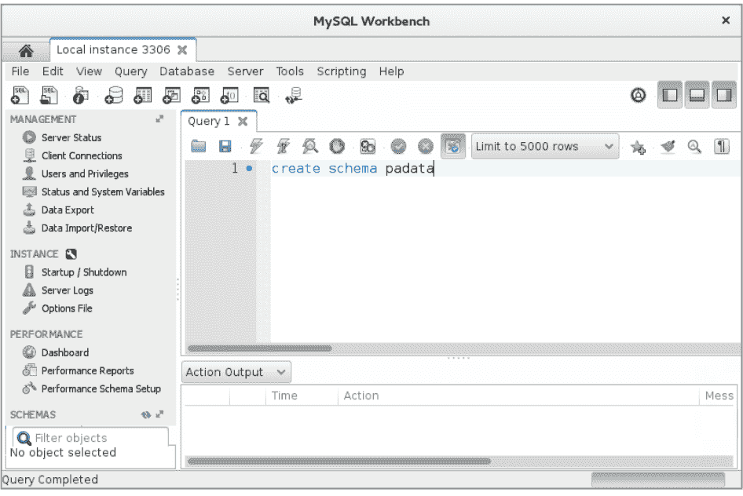

`padata`：

```sql
drop table if exists history;

create table history
(
  id int not null auto_increment primary key, 
  name varchar(50) not null, # 姓名
  title varchar(30),
  birth int, # 出生、执位开始时间或等效
  death int, # 死亡、执位结束时间或等效
  country char(2), # 人所在的国家
  description text # 描述
);
```

# Java 6：JDBC 与数据库应用程序

这是一个创建一个包含历史人物信息的表的脚本。表由行和列组成，每行包含关于某个特定人物的数据（信息）。每一列都有类型和名称。名称使得可以在 SQL 语句中引用该列，而类型决定了该列可以存储什么类型的值。

参考上面的脚本，指定第一列，该列必须包含一个自动生成的整数，从 1 开始，并在每次向表中添加行时增加 1。此外，还定义了该列必须是主键，这意味着该列的值必须是唯一的，因此可以用来标识每行。

接下来的两列类型为 `varchar`，表示该列可以包含字符串，在这种情况下，最大长度分别为 50 和 30 个字符。接下来的列可能再次包含整数，名为 `country` 的列必须包含一个 2 个字符的字符串。最后一列可以包含任何文本（最多 65535 个字符）。

列名被定义为 `not null`（非空），这意味着每一行在该列中必须有一个值。其他列（第一列外）不需要有值，但可以为 `null`。

书的目录还包含一个 `InsertHistory.sql` 脚本，下面显示了几行：

```sql
use padata;

insert into history (name, death, title, country) values
('Gorm den Gamle', 958, 'King', 'DK');

insert into history (name, birth, death, title, country) values
('Harald Blåtand', 958, 997, 'DK');
```

如果你在 MySQL Workbench 中打开并执行该脚本，脚本将向 `history` 表添加 52 行数据，这些行包含了关于丹麦国王的信息。以下假设此表已创建，并执行了 `InsertHistory.sql` 脚本。

## 关于代理键

当你需要（设计）数据库表时，你必须选择一个或多个列作为主键（如上面的 `id`）。这意味着对于 Java 程序而言，API 在 `java.sql` 包中定义了必要的类型作为接口和类，而具体的类型由 JDBC 驱动程序实现。

因此，程序必须连接的每个数据库都必须有一个 JDBC 驱动程序，通常由数据库供应商开发 JDBC 驱动程序。你可以将 JDBC 驱动程序认为是数据库和 Java 程序之间的一层，确保程序无论使用哪种数据库系统，都能以相同的方式使用数据库。

该列可以作为主键，它被称为“代理键”（surrogate key），因为它是另一个键列的替代品。实际上，如果可能，应避免使用代理键，因为它们会向表中添加无意义的数据；在这种情况下，可以避免使用键，因为键具有唯一的名称，且该名称可以作为主键。

尽管我选择了代理键，那是因为它是字符串——`varchar` 类型的列——这并不总是主键的理想候选者，首先，它可能难以输入（你可能会拼错），其次，它的效率低于 `int` 类型。

# 2 JDBC

JDBC 是一系列类，它们实现了 JDBC API 中定义的接口，并使得 Java 程序能够与数据库服务器进行通信。对于 Java 程序而言，API 在 `java.sql` 包中定义了必要的类型（作为接口和类），而具体的类型则由 JDBC 驱动程序实现。

因此，程序必须连接的每个数据库都必须有一个 JDBC 驱动程序，通常由数据库供应商开发 JDBC 驱动程序。你可以将 JDBC 驱动程序认为是数据库和 Java 程序之间的一层，确保程序无论使用哪种数据库系统，都能以相同的方式使用数据库。

## 2.1 HELLOJDBC

在我进一步查看有关 JDBC 的细节之前，我将通过一个示例来展示从 Java 程序使用数据库是非常简单的。以下程序从 `history` 表读取数据并打印到屏幕上：

```java
package hellojdbc;

import java.sql.*;

public class HelloJDBC
{
    public static void main(String[] args)
    {
        Connection conn = null;
        Statement stmt = null;
        try {
            conn = DriverManager.getConnection("jdbc:mysql://localhost:3306/database?useSSL=false","padata");
            stmt = conn.createStatement();
            ResultSet res = stmt.executeQuery("SELECT * FROM history");
            while(res.next()) {
                String name = res.getString("name");
                String title = res.getString("title");
                int birth = res.getInt("birth");
                int death = res.getInt("death");
                String country = res.getString("country");
                System.out.printf("%s-%s-%d-%d-%s\n", name, title, birth, death, country);
            }
        } catch (SQLException e) {
            e.printStackTrace();
        } finally {
            if (stmt != null) stmt.close();
            if (conn != null) conn.close();
        }
    }
}
```

如果你运行该程序，将得到以下结果，我只显示了前几行：

| Gorm den Gamle | KING | 958 | DK |
| :--- | :--- | :--- | :--- |
| Harald Blåtand | KING | 958 | 987 DK |
| Svend Tveskøg | KING | 987 | 1014 DK |
| Harad d. 2. | KING | 1014 | 1018 DK |
| Knud den Store | KING | 1018 | 1035 DK |

从这个示例可以看出，通过 Java 程序执行数据操作基本上非常简单。当然，要说的比这个示例展示的得多，下一章将展示许多其他示例，但与 SQL 的差异实际上比 Java 更更令人关注。

# 练习 1

你必须编写一个类似于 `HelloJDBC` 的程序，但程序应该只打印名字和年份，并且只针对那些是国王或女王、且王位开始于 1500 年之前的人员。

# Java 6：JDBC 与数据库应用程序

## 数据库操作

以下描述了一个名为 `DbOperations` 的程序，由几个测试方法组成。这些方法应该展示如何使用 JDBC 执行最基本的的数据库操作，我只关心维护数据库表的操作，即 SQL `INSERT`、`UPDATE` 和 `DELETE` 语句，以及从表中提取数据的操作，即 `SELECT` 查询。

### 3.1 SQL 语句

接下来的测试方法使用 `history` 表，并开始删除表中的某一行、插入一行、执行一次查询、更新一行，最后再次执行一次查询。这意味着该方法执行了上述所有的四种数据库操作。代码如下：

```java
private static void test01()
{
  try (Connection conn = DriverManager.getConnection(
    "jdbc:mysql://localhost:3306/padata?useSSL=false", "pa", "Volmer_1234")
  {
    Statement stmt = conn.createStatement();
    System.out.println(stmt.executeUpdate(
```


我们将把你的简历转化为终生难得的机会

你喜欢汽车吗？你想成为成功品牌的一员吗？我们将欣赏并奖励你的热情和才华。向我们发送你的简历。你会对它它能带你去哪里感到惊讶。

在 `www.employerforlife.com` 向我们发送简历。

在 `bookboom.com` 下载免费电子书。

点击广告阅读更多。

# Java 6：JDBC 与数据库应用程序

## 数据库操作

```java
"DELETE FROM history WHERE name LIKE 'Ragnar Lodbog'");

System.out.println(stmt.executeUpdate(
    "\n    INSERT INTO history (name) VALUES ('Ragnar Lodbog')"));

ResultSet res = stmt.executeQuery(
    "SELECT name, title, birth, death, country \
    FROM history WHERE name LIKE 'Ragnar Lodbog'");

while (res.next()) {
    System.out.printf("%-25s%-10s%5d%5d%%n", \
        res.getString("title"), res.getInt("birth"), res.getInt("death"), \
        res.getString("country"));
}

System.out.println(
    "UPDATE history SET title = 'Viking', \
    country = 'DK' WHERE name LIKE 'Ragnar Lodbog'");

res = stmt.executeQuery(
    "SELECT name, title, birth, death, country FROM history \
    WHERE name LIKE 'Ragnar Lodbog'");

while (res.next()) {
    System.out.printf("%-25s%-10s%5d%5d %%n\n", \
        res.getString("name"), res.getString("title"), res.getInt("birth"), \
        res.getInt("death"), res.getString("country"));
}
}
catch (SQLException ex) {
    System.out.println(ex);
}
```

如果你运行该程序，将得到以下结果，我只显示了前几行：

| Gorm den Gamle | KING | 958 | DK |
| :--- | :--- | :--- | :--- |
| Harald Blåtand | KING | 958 | 987 DK |
| Svend Tveskøg | KING | 987 | 1014 DK |
| Harad d. 2. | KING | 1014 | 1018 DK |
| Knud den Store | KING | 1018 | 1035 DK |

从这个示例可以看出，通过 Java 程序执行数据操作基本上非常简单。当然，要说的比这个示例展示的得多，下一章将展示许多其他示例，但与 SQL 的差异实际上比 Java 更更令人关注。

# 练习 1

你必须编写一个类似于 `HelloJDBC` 的程序，但程序应该只打印名字和年份，并且只针对那些是国王或女王、且王位开始于 1500 年之前的人员。

# Java 6：JDBC 与数据库应用程序

## 数据库操作

以下描述了一个名为 `DbOperations` 的程序，由几个测试方法组成。这些方法应该展示如何使用 JDBC 执行最基本的的数据库操作，我只关心维护数据库表的操作，即 SQL `INSERT`、`UPDATE` 和 `DELETE` 语句，以及从表中提取数据的操作，即 `SELECT` 查询。

### 3.1 SQL 语句

接下来的测试方法使用 `history` 表，并开始删除表中的某一行、插入一行、执行一次查询、更新一行，最后再次执行一次查询。这意味着该方法执行了上述所有的四种数据库操作。代码如下：

```java
private static void test01()
{
  try (Connection conn = DriverManager.getConnection(
    "jdbc:mysql://localhost:3306/padata?useSSL=false", "pa", "Volmer_1234")
  {
    Statement stmt = conn.createStatement();
    System.out.println(stmt.executeUpdate(
```

```java
"DELETE FROM history WHERE name LIKE 'Ragnar Lodbog'");

System.out.println(stmt.executeUpdate(
    "\n    INSERT INTO history (name) VALUES ('Ragnar Lodbog')"));

ResultSet res = stmt.executeQuery(
    "SELECT name, title, birth, death, country \
    FROM history WHERE name LIKE 'Ragnar Lodbog'");

while (res.next()) {
    System.out.printf("%-25s%-10s%5d%5d%%n", \
        res.getString("title"), res.getInt("birth"), res.getInt("death"), \
        res.getString("country"));
}

System.out.println(
    "UPDATE history SET title = 'Viking', \
    country = 'DK' WHERE name LIKE 'Ragnar Lodbog'");

res = stmt.executeQuery(
    "SELECT name, title, birth, death, country FROM history \
    WHERE name LIKE 'Ragnar Lodbog'");
```


# JAVA 6：JDBC 与数据库应用程序

## 数据库操作

以下描述了一个名为`DbOperations`的程序，由几个测试方法组成。这些方法应该展示如何使用 JDBC 执行最基本的数据库操作，我只关心维护数据库表的操作，即 SQL `INSERT`、`UPDATE`和`DELETE`语句，以及从表中提取数据的操作，即`SELECT`查询。

## 3.1 SQL 语句

接下来的测试方法使用`history`表，并开始删除表中的某一行、插入一行、执行一次查询、更新一行，最后再次执行一次查询。这意味着该方法执行了上述所有的四种数据库操作。代码如下：

```java
private static void test01()
{
  try (Connection conn = DriverManager.getConnection(
    "jdbc:mysql://localhost:3306/padata?useSSL=false", "pa", "Volmer_1234")
  {
    Statement stmt = conn.createStatement();
    System.out.println(stmt.executeUpdate(
```

```java
"DELETE FROM history WHERE name LIKE 'Ragnar Lodbog'");
System.out.println(stmt.executeUpdate("\n    INSERT INTO history (name) VALUES ('Ragnar Lodbog')"));

    ResultSet res = stmt.executeQuery("SELECT name, title, birth, death, country \
    FROM history WHERE name LIKE 'Ragnar Lodbog'");

while (res.next()) {
    System.out.printf("%-25s%-10s%5d%5d%%n", \
        res.getString("title"), res.getInt("birth"), res.getInt("death"), \
        res.getString("country"));
}

System.out.println("UPDATE history SET title = 'Viking', \
    country = 'DK' WHERE name LIKE 'Ragnar Lodbog'");

res = stmt.executeQuery("SELECT name, title, birth, death, country FROM history \
    WHERE name LIKE 'Ragnar Lodbog'");

while (res.next()) {
    System.out.printf("%-25s%-10s%5d%5d %%n\n", \
        res.getString("name"), res.getString("title"), res.getInt("birth"), \
        res.getInt("death"), res.getString("country"));
}

catch (SQLException ex) {
    System.out.println(ex);
}
```

如果你运行该程序，将得到以下结果，我只显示了前几行：

| Gorm den Gamle | KING | 958 DK |
| Harald Blåtand | KING | 958 987 DK |
| Svend Tveskøg | KING | 987 1014 DK |
| Harad d. 2. | KING | 1014 1018 DK |
| Knud den Store | KING | 1018 1035 DK |

从这个示例可以看出，通过 Java 程序执行数据操作基本上非常简单。当然，要说的比这个示例展示的得多，下一章将展示许多其他示例，但与 SQL 的差异实际上比 Java 更令人关注。

# 练习 1

你必须编写一个类似于`HelloJDBC`的程序，但程序应该只打印名字和年份，并且只针对那些是国王或女王、且王位开始于 1500 年之前的人员。

# JAVA 6：JDBC 与数据库应用程序

## 数据库操作

以下描述了一个名为`DbOperations`的程序，由几个测试方法组成。这些方法应该展示如何使用 JDBC 执行最基本的数据库操作，我只关心维护数据库表的操作，即 SQL `INSERT`、`UPDATE`和`DELETE`语句，以及从表中提取数据的操作，即`SELECT`查询。

## 3.1 SQL 语句

接下来的测试方法使用`history`表，并开始删除表中的某一行、插入一行、执行一次查询、更新一行，最后再次执行一次查询。这意味着该方法执行了上述所有的四种数据库操作。代码如下：

```java
private static void test01()
{
  try (Connection conn = DriverManager.getConnection(
    "jdbc:mysql://localhost:3306/padata?useSSL=false", "pa", "Volmer_1234")
  {
    Statement stmt = conn.createStatement();
    System.out.println(stmt.executeUpdate(
```

我们将把你的简历转化为终生难得的机会

你喜欢汽车吗？你想成为成功品牌的一员吗？我们将欣赏并奖励你的热情和才华。向我们发送你的简历。你会对它它能带你去哪里感到惊讶。

在 `www.employerforlife.com` 向我们发送简历

在 `bookboom.com` 下载免费电子书

点击广告阅读更多

# JAVA 6：JDBC 与数据库应用程序

## 数据库操作

```java
"DELETE FROM history WHERE name LIKE 'Ragnar Lodbog'");
System.out.println(stmt.executeUpdate("\n    INSERT INTO history (name) VALUES ('Ragnar Lodbog')"));

    ResultSet res = stmt.executeQuery("SELECT name, title, birth, death, country \
    FROM history WHERE name LIKE 'Ragnar Lodbog'");

while (res.next()) {
    System.out.printf("%-25s%-10s%5d%5d%%n", \
        res.getString("title"), res.getInt("birth"), res.getInt("death"), \
        res.getString("country"));
}

System.out.println("UPDATE history SET title = 'Viking', \
    country = 'DK' WHERE name LIKE 'Ragnar Lodbog'");

res = stmt.executeQuery("SELECT name, title, birth, death, country FROM history \
    WHERE name LIKE 'Ragnar Lodbog'");

while (res.next()) {
    System.out.printf("%-25s%-10s%5d%5d %%n\n", \
        res.getString("name"), res.getString("title"), res.getInt("birth"), \
        res.getInt("death"), res.getString("country"));
}

catch (SQLException ex) {
    System.out.println(ex);
}
```

如果你运行该程序，将得到以下结果，我只显示了前几行：

| Gorm den Gamle | KING | 958 DK |
| Harald Blåtand | KING | 958 987 DK |
| Svend Tveskøg | KING | 987 1014 DK |
| Harad d. 2. | KING | 1014 1018 DK |
| Knud den Store | KING | 1018 1035 DK |

从这个示例可以看出，通过 Java 程序执行数据操作基本上非常简单。当然，要说的比这个示例展示的得多，下一章将展示许多其他示例，但与 SQL 的差异实际上比 Java 更令人关注。

# 练习 1

你必须编写一个类似于`HelloJDBC`的程序，但程序应该只打印名字和年份，并且只针对那些是国王或女王、且王位开始于 1500 年之前的人员。

# JAVA 6：JDBC 与数据库应用程序

## 数据库操作

以下描述了一个名为`DbOperations`的程序，由几个测试方法组成。这些方法应该展示如何使用 JDBC 执行最基本的数据库操作，我只关心维护数据库表的操作，即 SQL `INSERT`、`UPDATE`和`DELETE`语句，以及从表中提取数据的操作，即`SELECT`查询。

## 3.1 SQL 语句

接下来的测试方法使用`history`表，并开始删除表中的某一行、插入一行、执行一次查询、更新一行，最后再次执行一次查询。这意味着该方法执行了上述所有的四种数据库操作。代码如下：

```java
private static void test01()
{
  try (Connection conn = DriverManager.getConnection(
    "jdbc:mysql://localhost:3306/padata?useSSL=false", "pa", "Volmer_1234")
  {
    Statement stmt = conn.createStatement();
    System.out.println(stmt.executeUpdate(
```

我们将把你的简历转化为终生难得的机会

你喜欢汽车吗？你想成为成功品牌的一员吗？我们将欣赏并奖励你的热情和才华。向我们发送你的简历。你会对它它能带你去哪里感到惊讶。

在 `www.employerforlife.com` 向我们发送简历

在 `bookboom.com` 下载免费电子书

点击广告阅读更多

# JAVA 6：JDBC 与数据库应用程序

## 数据库操作

```java
"DELETE FROM history WHERE name LIKE 'Ragnar Lodbog'");
System.out.println(stmt.executeUpdate("\n    INSERT INTO history (name) VALUES ('Ragnar Lodbog')"));

    ResultSet res = stmt.executeQuery("SELECT name, title, birth, death, country \
    FROM history WHERE name LIKE 'Ragnar Lodbog'");

while (res.next()) {
    System.out.printf("%-25s%-10s%5d%5d%%n", \
        res.getString("title"), res.getInt("birth"), res.getInt("death"), \
        res.getString("country"));
}

System.out.println("UPDATE history SET title = 'Viking', \
    country = 'DK' WHERE name LIKE 'Ragnar Lodbog'");

res = stmt.executeQuery("SELECT name, title, birth, death, country FROM history \
    WHERE name LIKE 'Ragnar Lodbog'");

while (res.next()) {
    System.out.printf("%-25s%-10s%5d%5d %%n\n", \
        res.getString("name"), res.getString("title"), res.getInt("birth"), \
        res.getInt("death"), res.getString("country"));
}

catch (SQLException ex) {
    System.out.println(ex);
}
```

我们将一个你的` ` ` ` 一个，，，，，，，，，，，，，，，，，，，，，，。。。。。这些方法应该展示如何使用 JDBC 执行最基本的的，，，，，    。。

# JAVA 6：JDBC 与数据库应用程序

## 数据库操作

以下描述了一个名为`DbOperations`的程序，由几个测试方法组成。这些方法应该展示如何使用 JDBC 执行最基本的数据库操作，我只关心维护数据库表的操作，即 SQL `INSERT`、`UPDATE`和`DELETE`语句，以及从表中提取数据的操作，即`SELECT`查询。

## 3.1 SQL 语句

接下来的测试方法使用`history`表，并开始删除表中的某一行、插入一行、执行一次查询、更新一行，最后再次执行一次查询。这意味着该方法执行了上述所有的四种数据库操作。代码如下：

```java
private static void test01()
{
  try (Connection conn = DriverManager.getConnection(
    "jdbc:mysql://localhost:3306/padata?useSSL=false", "pa", "Volmer_1234")
  {
    Statement stmt = conn.createStatement();
    System.out.println(stmt.executeUpdate(
```

我们将把你的简历转化为终生难得的机会

你喜欢汽车吗？你想成为成功品牌的一员吗？我们将欣赏并奖励你的热情和才华。向我们发送你的简历。你会对它它能带你去哪里感到惊讶。

在 `www.employerforlife.com` 向我们发送简历

在 `bookboom.com` 下载免费电子书

点击广告阅读更多

# JAVA 6：JDBC 与数据库应用程序

## 数据库操作

```java
"DELETE FROM history WHERE name LIKE 'Ragnar Lodbog'");
System.out.println(stmt.executeUpdate("\n    INSERT INTO history (name) VALUES ('Ragnar Lodbog')"));

    ResultSet res = stmt.executeQuery("SELECT name, title, birth, death, country \
    FROM history WHERE name LIKE 'Ragnar Lodbog'");

while (res.next()) {
    System.out.printf("%-25s%-10s%5d%5d%%n", \
        res.getString("title"), res.getInt("birth"), res.getInt("death"), \
        res.getString("country"));
}
```


# JAVA 6：JDBC 与数据库应用程序

## 数据库操作

以下描述了一个名为`DbOperations`的程序，由几个测试方法组成。这些方法应该展示如何使用 JDBC 执行最基本的数据库操作，我只关心维护数据库表的操作，即 SQL `INSERT`、`UPDATE` 和 `DELETE` 语句，以及从表中提取数据的操作，即 `SELECT` 查询。

### 3.1 SQL 语句

接下来的测试方法使用`history`表，并开始删除表中的某一行、插入一行、执行一次查询、更新一行，最后再次执行一次查询。这意味着该方法执行了上述所有的四种数据库操作。代码如下：

```java
private static void test01()
{
  try (Connection conn = DriverManager.getConnection(
    "jdbc:mysql://localhost:3306/padata?useSSL=false", "pa", "Volmer_1234")
  {
    Statement stmt = conn.createStatement();
    System.out.println(stmt.executeUpdate(
      "DELETE FROM history WHERE name LIKE 'Ragnar Lodbog'"));
    System.out.println(stmt.executeUpdate("\n    INSERT INTO history (name) VALUES ('Ragnar Lodbog')"));
    ResultSet res = stmt.executeQuery("SELECT name, title, birth, death, country \
      FROM history WHERE name LIKE 'Ragnar Lodbog'");
    while (res.next()) {
      System.out.printf("%-25s%-10s%5d%5d%%n", \
        res.getString("title"), res.getInt("birth"), res.getInt("death"), \
        res.getString("country"));
    }
    System.out.println("UPDATE history SET title = 'Viking', \
      country = 'DK' WHERE name LIKE 'Ragnar Lodbog'");
    res = stmt.executeQuery("SELECT name, title, birth, death, country FROM history \
      WHERE name LIKE 'Ragnar Lodbog'");
    while (res.next()) {
      System.out.printf("%-25s%-10s%5d%5d %%n\n", \
        res.getString("name"), res.getString("title"), res.getInt("birth"), \
        res.getInt("death"), res.getString("country"));
    }
  }
  catch (SQLException ex) {
    System.out.println(ex);
  }
}
```

然后是测试方法：

```java
private static void test02()
{
    List<Person> list = createPons();
    try (Connection conn = DriverManager.getConnection(
        "jdbc:mysql://localhost:3306/padata?useSSL=false", "pa", "Volmer_1234")
    ) {
        PreparedStatement stmt = 
            conn.prepareStatement("DELETE FROM PERSON WHERE NAME LIKE ?");
        for (Person per : list) {
            stmt.setString(1, per.getName());
            stmt.executeUpdate();
        }
        stmt = conn.prepareStatement("INSERT INTO 
            (name, title, birth, death, country, description) VALUES (?, ?, ?, ?, ?, ?)");
        stmt.setString(1, per.getName());
        stmt.setString(2, per.getTitle());
        if (per.getBirth() == null) stmt.setNull(3, java.sql.Types.INTEGER);
        else stmt.setInt(3, per.getBirth());
        if (per.getDeath() == null) stmt.setNull(4, java.sql.Types.INTEGER);
        else stmt.setInt(4, per.getDeath());
        stmt.setString(5, per.getCountry());
        stmt.setString(6, per.getDescription());
        stmt.executeUpdate();
    } catch (SQLException ex) {
        System.out.println(ex);
    }
    print("SELECT * FROM PERSON WHERE title LIKE 'Legends king'");
}
```

第一个方法创建了一个包含 12 个`Person`对象的列表。然后打开数据库连接，并为该连接创建了一个`Statement`对象。`PreparedStatement`类派自`Statement`，表示一个 SQL 表达式，但它是带有参数的表达式。在这种情况下，它是一个 SQL `DELETE`语句，由一个问号指示单个参数。下一个循环必须删除列表中的所有人（如果存在的话），在每次迭代中，循环都会执行一次`DELETE`操作，但必须为 SQL 表达式中的列名插入一个值。也就是说，需要将问号替换为值：

```java
stmt.setString(1, per.getName());
```

在这里，`1`表示第一个参数（且只有一个参数），而最后一个参数是值。使用`setString()`将值赋值给`stmt`对象，该列的类型为`VARCHAR`。对于其他列类型也有类似的方法。

当循环完成后，会创建另一个`PreparedStatement`，但此仅用于 SQL `INSERT`语句。它至少有六个参数，用于为列表中的每个人在表中插入一行。该操作在一个循环中进行，每次重复时都会初始化这 6 个参数。你应该特别注意如何指定某个值必须为`null`。

最后，测试方法执行了带有 SQL `SELECT`参数的`print()`方法，该方法用于打印提取出的行。

## 练习 1

你必须编写一个类似于`HelloJDBC`的程序，但程序应该只打印名字和年份，并且只针对那些是国王或女王、且王位开始于 1500 年之前的人员。

## 练习 2

你应该使用 MySQL Workbench 向`patada`数据库中添加一个新表。你应该通过编写脚本（与显示`history`表的方法相同）来实现，表名应为`currency`，并应包含三列：

- 1. `code`，必须是三个字符的货币代码，必须是主键
- 2. `name`，必须是货币的名称，长度可达 30 个字符
- 3. `rate`，必须是汇率，类型为`DECIMAL`，共 10 位，小数点后保留 4 位

你必须使用以下数组编写程序来更新`currency`表。程序应从开始删除表的所有内容（使用简单的`DELETE`），然后使用`PreparedStatement`为数组中的每个字符串插入一行：

```java
private static String[] kurser = {
  "Danske kroner:DKK:100.00",
  "Euro:EUR:74.06",
  "Ameranske dollar:USD:674.44",
  "Britiske pund:GBP:1034.10",
  "Svenske kroner:SEK:79.31",
  "Norske kroner:NOK:79.68",
  "Schweizerische franc:CHF:685.66",
  "Japanese yen:JPY:5.6065",
  "Australiske dollar:AUD:487.61",
  "Brasilianske real:BRL:171.98",
  "Bulgarske lev:BGN:381.43",
  "Canadiske dollar:CAD:510.19",
  "Filippinske peso:PHP:14.40",
  "Hongkong dollar:HKD:87.02",
  "Indiske rupee:INR:10.38",
  "Indonesian rupiah;IDR:0.0494",
  "Israels shekel;ILS:174.48",
  "Kinesiske Yuan renminbi;CNY:106.17",
  "Kroatiske kuna;HRK:97.87",
  "Malayais ringgit;MYR:157.78",
  "Mexicano peso;MXN:40.65",
  "New New Zealand dollar;NZD:458.77",
  "Polskie;PLN:4.23",
  "Romanian;RON:4.95",
  "Russian;RUB:75.45",
  "Singapore;SGD:1.34",
  "South African;ZAR:18.50",
  "South Korean;KRW:1320.00",
  "Swedish;SEK:10.45",
  "Turkish;TRY:29.10",
  "Hungarian;HUF:360.00"
}
```

## JAVA 6: JDBC 与数据库应用程序 RESULTSET

如果你执行了该方法，你将得到结果：

| Margrethe d. 2. | 1972 | 0 |
| Gorn Gamle | 0 | 958 |
| Harald Blåånd | 958 | 987 |
| Gorn Gamle | 0 | 958 |
| Frederik d. 9. | 1947 | 1972 |
| Christian d. 8. | 1839 | 1848 |
| Gorn Gamle | 0 | 958 |

52 每行都通过该方法打印

```java
private static void print(ResultSet res) {
  try {
    String name = res.getString(1);
    int birth = res.getInt(2);
    int death = res.getInt(3);
    System.out.printf("%-%20s%5d%5d\n", name, birth, death);
  }
  catch (Exception ex) {
    System.out.println(ex);
  }
}
```

`ResultSet`有多个方法可以获取当前行的值，在前面的示例中，我每次都是通过使用列名来获取值。实际上，也允许输入索引，从第一列开始为 1。你需要注意，该索引不是指物理表，而是 `SELECT`语句中指定的列。在这种情况下，有三列，因此索引是 1 和 3。

### 4.1 更新 RESULTSET

下面的方法展示了如何更新一个`ResultSet`：

```java
private static void test04()
{
    try (Connection conn = DriverManager.getConnection(
        "jdbc:mysql://localhost:3306/padata?useSSL=false", "pa", "Volmer_1234")) {
        Statement stmt = conn.createStatement(ResultSet.TYPE_CONCUR_INSENSITIVE, ResultSet.UPDATABLE);
        ResultSet res = stmt.executeQuery("SELECT * FROM history");
        insert(res);
        res.last();
        printRow(res);
        update(res, "King", "Probably lived between the years 400 and 5000");
        printRow(res);
        update(res, "Legends king", res.getString("description") + 
        " and his story is described in Rolf Krake's Saga");
        printRow(res);
        while (true) {
            res = stmt.executeQuery("SELECT id FROM history WHERE name LIKE 'Rolf%%'");
            if (res.next()) {
                int id;
                System.out.println(id = res.getInt("id"));
                print("SELECT * FROM history WHERE id = " + id);
                delete(res);
            } else break;
        }
    }
    catch (SQLException ex) {
        System.out.println(ex);
    }
}
```

如果你运行该程序，将得到以下结果，我只显示了前几行：

| Gorm den Gamle | KING | 958 DK |
| Harald Blåtand | KING | 958 987 DK |
| Svend Tveskøg | KING | 987 1014 DK |
| Harad d. 2. | KING | 1014 1018 DK |
| Knud den Store | KING | 1018 1035 DK |

从这个示例可以看出，通过 Java 程序执行数据操作基本上非常简单。当然，要说的比这个示例展示的得多，下一章将展示许多其他示例，但与 SQL 的差异实际上比 Java 更更令人关注。

我们将把你的简历转化为终生难得的机会

你喜欢汽车吗？你想成为成功品牌的一员吗？我们将欣赏并奖励你的热情和才华。向我们发送你的简历。你会对它它它能带你去哪里感到惊讶。

在 www.employerforlife.com 向我们发送简历

在 bookboom.com 下载免费电子书

点击广告阅读更多


首先，你会发现创建 `Statement` 对象允许你更新一个 `ResultSet`。接下来，所有行都从 `history` 表中提取出来，然后以 `ResultSet` 为参数调用 `insert()` 方法：

```java
private static void insert(ResultSet res)
{
    res.moveToInsertRow();
    res.updateString("name", "Rolf Krake");
    res.updateString("country", "DK");
    res.insertRow();
}
catch (SQLException ex)
{
    System.out.println(ex);
}
```

该方法向 `ResultSet` 对象添加新行，并为其中两列赋值。最后一个方法将更改物理地写回数据库。如果你不想这样做，可以省略它，该行将仅插入到内存中的 `ResultSet` 对象中。

在插入新行后，测试方法将游标设置为最后，并通过 `printRow()` 方法打印该行。下一个语句调用了 `update()` 方法，该方法更新游标指向的行：

```java
private static void update(ResultSet res, String title, String description)
{
    res.updateString("title", title);
    res.updateString("description", description);
    res.updateRow();
}
catch (SQLException ex)
{
    System.out.println(ex);
}
```

## Java 6：JDBC 与数据库应用程序 ResultSet

更新了两个列，再次是最后一条语句将更改写回数据库。测试方法随后再次打印该行，这样你可以看到更改已经发生，之后该行再次被更新。

接下来，该方法执行一个无限 `while` 循环，开始对姓名以 Rolf 开头的个人执行查询。应该只有 1 条。如果存在这样的行（`res.next()` 为真），则通过 `delete()` 方法删除该行。如果未找到行，则执行 `break`，循环停止。目标是显示更新物理上存在于数据库中，以便在下一次迭代中找不到任何行。`delete()` 方法非常简单，它删除游标指向的行：

```java
private static void delete(ResultSet res) {
    try {
        res.deleteRow();
    } catch (SQLException ex) {
        System.out.println(ex);
    }
}
```


你应该注意，`ResultSet` 的实现允许你插入、更新或删除行，这取决于 `JDBC` 驱动程序是否支持这些操作。如果你执行了该方法，你将得到结果：

| Margrethe d. 2. | 1972 | 0 |
|---|---:|---:|
| Gorn Gamle | 0 | 958 |
| Harald Blåånd | 958 | 987 |
| Gorn Gamle | 0 | 958 |
| Frederik d. 9. | 1947 | 1972 |
| Christian d. 8. | 1839 | 1848 |
| Gorn Gamle | 0 | 958 |

每行都通过该方法打印。

`ResultSet` 有多个方法可以获取当前行的值，在前面的示例中，我每次都是通过使用列名来获取值。实际上，也允许输入索引，从第一列开始为 1。你需要注意，该索引不是指物理表，而是 `SELECT` 语句中指定的列。在这种情况下，有三列，因此索引是 1 和 3。

### 4.1 更新 ResultSet

下面的方法展示了如何更新一个 `ResultSet`：

```java
private static void test04()
{
    try (Connection conn = DriverManager.getConnection(
        "jdbc:mysql://localhost:3306/padata?useSSL=false", "pa", "Volmer_1234")) {

        Statement stmt = conn.createStatement(
            ResultSet.TYPE_CONCUR_INSENSITIVE,
            ResultSet.UPDATABLE
        );

        ResultSet res = stmt.executeQuery("SELECT * FROM history");

        insert(res);

        res.last();
        printRow(res);

        update(res, "King", "Probably lived between the years 400 and 5000");
        printRow(res);

        update(
            res,
            "Legends king",
            res.getString("description")
                + " and his story is described in Rolf Krake's Saga"
        );
        printRow(res);

        while (true) {
            res = stmt.executeQuery(
                "SELECT id FROM history WHERE name LIKE 'Rolf%%'"
            );

            if (res.next()) {
                int id;
                System.out.println(id = res.getInt("id"));
                print("SELECT * FROM history WHERE id = " + id);
                delete(res);
            } else {
                break;
            }
        }
    }
    catch (SQLException ex)
    {
        System.out.println(ex);
    }
}
```

首先，你会发现创建 `Statement` 对象允许你更新一个 `ResultSet`。接下来，所有行都从 `history` 表中提取出来，然后以 `ResultSet` 为参数调用 `insert()` 方法：

```java
private static void insert(ResultSet res)
{
    res.moveToInsertRow();
    res.updateString("name", "Rolf Krake");
    res.updateString("country", "DK");
    res.insertRow();
}
catch (SQLException ex)
{
    System.out.println(ex);
}
```

该方法向 `ResultSet` 对象添加新行，并为其中两列赋值。最后一个方法将更改物理地写回数据库。如果你不想这样做，可以省略它，该行将仅插入到内存中的 `ResultSet` 对象中。

在插入新行后，测试方法将游标设置为最后，并通过 `printRow()` 方法打印该行。下一个语句调用了 `update()` 方法，该方法更新游标指向的行：

```java
private static void update(ResultSet res, String title, String description)
{
    res.updateString("title", title);
    res.updateString("description", description);
    res.updateRow();
}
catch (SQLException ex)
{
    System.out.println(ex);
}
```

## Java 6：JDBC 与数据库应用程序 ResultSet

更新了两个列，再次是最后一条语句将更改写回数据库。测试方法随后再次打印该行，这样你可以看到更改已经发生，之后该行再次被更新。

接下来，该方法执行一个无限 `while` 循环，开始对姓名以 Rolf 开头的个人执行查询。应该只有 1 条。如果存在这样的行（`res.next()` 为真），则通过 `delete()` 方法删除该行。如果未找到行，则执行 `break`，循环停止。目标是显示更新物理上存在于数据库中，以便在下一次迭代中找不到任何行。`delete()` 方法非常简单，它删除游标指向的行：

```java
private static void delete(ResultSet res) {
    try {
        res.deleteRow();
    } catch (SQLException ex) {
        System.out.println(ex);
    }
}
```


你应该注意，`ResultSet` 的实现允许你插入、更新或删除行，这取决于 `JDBC` 驱动程序是否支持这些操作。如果你执行了该方法，你将得到结果：

| Margrethe d. 2. | 1972 | 0 |
|---|---:|---:|
| Gorn Gamle | 0 | 958 |
| Harald Blåånd | 958 | 987 |
| Gorn Gamle | 0 | 958 |
| Frederik d. 9. | 1947 | 1972 |
| Christian d. 8. | 1839 | 1848 |
| Gorn Gamle | 0 | 958 |

`ResultSet` 有多个方法可以获取当前行的值，在前面的示例中，我每次都是通过使用列名来获取值。实际上，也允许输入索引，从第一列开始为 1。你需要注意，该索引不是指物理表，而是 `SELECT` 语句中指定的列。在这种情况下，有三列，因此索引是 1 和 3。

### 4.1 更新 ResultSet

下面的方法展示了如何更新一个 `ResultSet`：

```java
private static void test04()
{
    try (Connection conn = DriverManager.getConnection(
        "jdbc:mysql://localhost:3306/padata?useSSL=false", "pa", "Volmer_1234")) {

        Statement stmt = conn.createStatement(
            ResultSet.TYPE_CONCUR_INSENSITIVE,
            ResultSet.UPDATABLE
        );

        ResultSet res = stmt.executeQuery("SELECT * FROM history");

        insert(res);

        res.last();
        printRow(res);

        update(res, "King", "Probably lived between the years 400 and 5000");
        printRow(res);

        update(
            res,
            "Legends king",
            res.getString("description")
                + " and his story is described in Rolf Krake's Saga"
        );
        printRow(res);

        while (true) {
            res = stmt.executeQuery(
                "SELECT id FROM history WHERE name LIKE 'Rolf%%'"
            );

            if (res.next()) {
                int id;
                System.out.println(id = res.getInt("id"));
                print("SELECT * FROM history WHERE id = " + id);
                delete(res);
            } else {
                break;
            }
        }
    }
    catch (SQLException ex)
    {
        System.out.println(ex);
    }
}
```

首先，你会发现创建 `Statement` 对象允许你更新一个 `ResultSet`。接下来，所有行都从 `history` 表中提取出来，然后以 `ResultSet` 为参数调用 `insert()` 方法：

```java
private static void insert(ResultSet res)
{
    res.moveToInsertRow();
    res.updateString("name", "Rolf Krake");
    res.updateString("country", "DK");
    res.insertRow();
}
catch (SQLException ex)
{
    System.out.println(ex);
}
```

该方法向 `ResultSet` 对象添加新行，并为其中两列赋值。最后一个方法将更改物理地写回数据库。如果你不想这样做，可以省略它，该行将仅插入到内存中的 `ResultSet` 对象中。

在插入新行后，测试方法将游标设置为最后，并通过 `printRow()` 方法打印该行。下一个语句调用了 `update()` 方法，该方法更新游标指向的行：

```java
private static void update(ResultSet res, String title, String description)
{
    res.updateString("title", title);
    res.updateString("description", description);
    res.updateRow();
}
catch (SQLException ex)
{
    System.out.println(ex);
}
```

## Java 6：JDBC 与数据库应用程序 ResultSet

更新了两个列，再次是最后一条语句将更改写回数据库。测试方法随后再次打印该行，这样你可以看到更改已经发生，之后该行再次被更新。

接下来，该方法执行一个无限 `while` 循环，开始对姓名以 Rolf 开头的个人执行查询。应该只有 1 条。如果存在这样的行（`res.next()` 为真），则通过 `delete()` 方法删除该行。如果未找到行，则执行 `break`，循环停止。目标是显示更新物理上存在于数据库中，以便在下一次迭代中找不到任何行。`delete()` 方法非常简单，它删除游标指向的行：

```java
private static void delete(ResultSet res) {
    try {
        res.deleteRow();
    } catch (SQLException ex) {
        System.out.println(ex);
    }
}
```


你应该注意，`ResultSet` 的实现允许你插入、更新或删除行，这取决于 `JDBC` 驱动程序是否支持这些操作。如果你执行了该方法，你将得到结果：

| Margrethe d. 2. | 1972 | 0 |
|---|---:|---:|
| Gorn Gamle | 0 | 958 |
| Harald Blåånd | 958 | 987 |
| Gorn Gamle | 0 | 958 |
| Frederik d. 9. | 1947 | 1972 |
| Christian d. 8. | 1839 | 1848 |
| Gorn Gamle | 0 | 958 |

`ResultSet` 有多个方法可以获取当前行的值，在前面的示例中，我每次都是通过使用列名来获取值。实际上，也允许输入索引，从第一列开始为 1。你需要注意，该索引不是指物理表，而是 `SELECT` 语句中指定的列。在这种情况下，有三列，因此索引是 1 和 3。

### 4.2 市和邮政编码

遵循上述，我将展示一个更真实的应用程序示例。数据库仍然是 `padata`，但我将扩展扩展四个新表。第一个应该是丹麦各地区的表：

| regnr | name |
|---|---|
| 1081 | Region Nordylland |
| 1082 | Region Midtjylland |
| 1083 | Region Syddanmark |
| 1084 | Region Hovedstaden |
| 1085 | Region Sjaelland |

并且是一个具有两列五行的简单表。下一个表是丹麦市的表，每个市记录为：

- 市的编号（三位唯一数字）
- 市的名称
- 市所所属的地区
- 市的面积（平方公里）
- 市口数
- 市口统计年份

地区是地区编号，因此市与地区之间存在 1:n 关系，使得每个市都关联到一个特定的地区。第三张表是邮政编码表，是一个包含两列的简单表，分别包含编码和城市名称。一个市使用多个邮政编码，而特定的邮政编码实际上可能被多个市使用，市与邮政编码之间存在 m:n 关系。这种关系通过一个连接邮政编码和市的表来实现。

因此，你可以使用以下脚本扩展数据库四个新表：

```sql
use padata;

drop table if exists post;
```


`drop table if exists municipality;`

`drop table if exists region;`

`drop table if exists zipcode;`

## JAVA 6: JDBC 与数据库应用程序

## RESULTSET

```sql
create table region
(
  regnr int not null primary key,
  name varchar(30) not null
);
```

```sql
create table municipality
(
  munnr int not null primary key,
  name varchar(30) not null,
  regnr int not null,
  area decimal(10, 2),
  number int,
  foreign key (regnr) references region(regnr)
);
```

```sql
create table zipcode
(
  code char(4) not null primary key,
  city varchar(30) not null
);
```


```sql
create table post
(
  code char(4) not null,
  munnr int not null,
  primary key (code, munnr),
  foreign key (code) references zipcode(code),
  foreign key (munnr) references municipality(munnr)
);
```

```sql
insert into region values (1081, 'Region Nordjylland');
insert into region values (1082, 'Region Midtjylland');
insert into region values (1083, 'Region Syddammark');
insert into region values (1084, 'Region Hovedstaden');
insert into region values (1085, 'Region Sjylland');
```

没什么好解释的，但你应该注意，脚本在`region`表中插入了五行数据。脚本名为`CreateDenmark.sql`。

它执行了脚本，创建了四个表，但除了`region`之外的表都是空的，不包含数据。`books`目录包含一个名为`zipcode`的文件。这是一个包含 1106 行丹麦邮政编码的文本文件，每行包含用分号分隔的邮编和城市名称。该文件应被用于更新`zipcode`表，你可以使用 SQL 命令`LOAD DATA INFILE`来完成。这是 MySQL 不喜欢的命令，因为它是没有风险，原则上你可以将任何内容复制到数据库中。因此，你不能直接从 MySQL Workbench 执行该命令。要加载数据库的内容，你必须将文件放在一个独立的目录中，该目录仅允许访问：

```
/var/lib/mysql-files
```

我已以 root 身份在该目录下创建了子目录`data`。接，，我将`zipcode`文件复制到此目录。然后可以使用以下脚本（`LoadZipcode.sql`）更新表：

```sql
use patada;
load data infile '/var/lib/mysql-files/data/zipcode' into table zipcode
CHARACTER SET UTF8
fields terminated by ';' lines terminated by '\n'
(code, city);
```

结果是`zipcode`表现在有了 1106 行数据。

然后是`municipality`表，`book`目录中有一个名为`municipalities`的文件，其中包含丹麦市的数据行。以下是前三行：

```
773;Morsø Kommune;1081;364.42;20815;2015;7900;7960;7970;7980;7990
787;Thisted Kommune;1081;1095;63.4078;2015;7700;7730;7741;7742;7752;
7755;7760;7770
810;Brønderslev Kommune;1081;633.38;35781;2015;9320;9330;9340;9350;9370;9382;9440;9480;9700;9740
```

每行用分号分隔：

1. 市编号 (municipality number)
2. 市名 (municipality name)
3. 区域 (region area)
4. 面积 (area)
5. 人口
6. 人口年份

后面是该市使用的变数量邮政编码。对于文件的每一行，必须在`municipality`表中插入一行，对于每个邮政编码，在`post`表中插入一行。简单的方法是编写一个读取文件并更新数据库的程序：

```java
package createmunicities;

import java.sql.*;
import java.io.*;
import java.math.*;

public class CreateMunicipalities {
    public static void main(String[] args) {
        try (Connection conn = DriverManager.getConnection("jdbc:mysql://localhost:3306/database?useSSL=false", "pa", "Volmer1234");
             BufferedReader reader = new BufferedReader(new FileReader(System.getProperty("user.home") + "/data/municipalities"))) {
            Statement stmt = conn.createStatement();
            stmt.execute("DELETE FROM post");
            PreparedStatement stmt1 = conn.prepareStatement("INSERT INTO municipality(?, ?, ?)");
            PreparedStatement stmt2 = conn.prepareStatement("INSERT INTO post(?, ?)");
            for (String line = reader.readLine(); line != null; line = reader.readLine()) {
              String[] elem = line.split(",");
              int munr = Integer.parseInt(elem[0]);
              stmt.setInt(1, munr);
              stmt.setString(2, elem[1]);
              stmt.setInt(3, Integer.parseInt(elem[2]));
              stmt.setBigDecimal(4, new BigDecimal(elem[3]));
              stmt.setInt(5, Integer.parseInt(elem[4]));
              stmt.setInt(6, Integer.parseInt(elem[5]));
              System.out.println(elem[1]);
              for (int i = 6; i < elem.length; i++) {
                try {
                  stmt2.setString(1, elem[i]);
                  stmt2.setInt(2, munr);
                  stmt2.executeUpdate();
                } catch (Exception ex) {
                  System.out.println(munr + " " + elem[i]);
                }
              }
            }
        } catch (Exception ex) {
            System.out.println(ex);
        }
    }
    private static String zipcode(String str) {
        if (str.length() == 3) str = "0" + str;
        return str;
    }
}
```

`try`括号之后是通常打开数据库连接以及复制到我目录下的`municipalities`文件。首先发生的是删除两个数据库表的内容，然后创建两个带有`INSERT`语句的`PreparedStatement`对象。接的`for`循环读取文件，每行被拆分成标记，用于初始化`stmt1`的参数。在`municipality`表中插入一行后，有一个内部循环遍历所有邮政编码并在`post`表中插入行。

你应该注意，执行程序实际上需要很长时间。程序执行了超过 2000 条 SQL`INSERT`命令，在 Java 中这样做是一个枯燥的过程，后续还有其他方法实现。

作为使用新表的示例，以下测试方法（`DbOperations`程序中的方法）确定了 Midtjylland 区域的人数：

```java
private static void test05() {
    try (Connection conn = DriverManager.getConnection("jdbc:mysql://localhost:3306/padata?useSSL=false","pa","Volmer1234")) {
        Statement stmt = conn.createStatement();
        ResultSet res = stmt.executeQuery("SELECT number FROM municipality AS M, region AS R WHERE M.regnr = R.regnr AND R.name LIKE '%Midtjylland'");
        int count = 0;
        while (res.next()) count += res.getInt("number");
        System.out.println("Number of inhabitants in Region Midtjylland: " + count);
    } catch (SQLException ex) {
      System.out.println(ex);
    }
}
```

你应该注意，唯一新的是稍微复杂的 SQL`SELECT`语句，但 Java 部分没有新东西。

## 练习 3

编写一个程序，根据`municipality`表中的数字在屏幕上打印 Jutland（日特兰）和 Fyn（菲岛）的人口密度。

## 问题 1

你必须用两个表扩展`adata`数据库。第一个表命名为`world`，必须包含所有大洲名称：

```sql
create table world
(
  code char(2) not null primary key,
  name varchar(15) not null
);
```

该表必须包含以下数据：

- AS Asia（亚洲）
- AF Africa（非洲）
- NA North America（北美）
- SA South America（南美洲）
- AN Antarctica（南极洲）
- EU Europe（欧洲）
- OC Oceania（大洋洲）

第二个表应包含国家信息：

```sql
create table country
(
  code char(2) not null primary key, # 国家代码
  code3 varchar(3), # 国家代码
  name varchar(50) not null, # 国家名称
  area int, # 国家面积
  number int, # 人口
  continent char(2), # 大洲
  currency char(3), # 货币代码
  foreign key (continent) references world(code),
  foreign key (currency) references currency(code)
);
```

## JAVA 6: JDBC 与数据库应用程序结果集

```
AQ;ATA;Antarktis
AG;ATG;Antigua og Barbuda
AR;ARG;Argentina
AM;ARM;Armenien
AW;ABW;Aruba
AZ;AZE;Aserbajdsjan
AU;AUS;Australia;Autralsk dollar;AUD;568.80
BS;BHS;Bahama
BH;BHR;Bahrain
```

这些字段之间用分号分隔。每个每个国家至少有 3 个字段：2 个字符的国家代码（主键）、3 个字符的国家代码（可能为空）以及国家名称。此外，可能还有三个额外的字段，即该国使用的货币名称、货币代码和汇率。

你现在必须编写一个程序，通过读取上述文件来更新表。如果存在货币，则将货币代码插入到货币列中，否则该值应设为`null`。当某个国家的文件指示了货币，但该货币在`currency`表中不存在时，会遇到一个特殊问题。对于这些货币，程序必须更新`currency`表。

### 4.3 存储过程

存储过程是一个包含 SQL 语句的脚本，在执行该过程时会被执行。当谈到存储过程时，意味着该过程被翻译并存储在数据库中，这意味着执行存储过程是非常高效的。在 MySQL Workbench 中，你可以通过右键点击`Schemas`下数据库的`Stored Procedures`来创建存储过程，你将得到一个过程的骨架：

```
CREATE PROCEDURE 'new_procedure' (
BEGIN
END
```

作为一个示例，我写了一个非常简单的过程，它通过`OUT parameter`返回`history`表中年份在某个范围内的人数：

```
CREATE PROCEDURE 'persons' (IN a int, IN b int, OUT c int)
BEGIN
SELECT count(id) FROM history WHERE (a <= birth AND birth <= b) OR
(a <= death AND death <= b) INTO c;
END
```

## JAVA 6: JDBC 与数据库应用程序

当你写完过程后，你必须点击`Apply`，你将看到一个如下一页所示的窗口，再次点击`Apply`后，过程就会被翻译并存储在数据库中。一旦过程保存，就可以像任何其他 SQL 命令一样执行它：

```
use padata;
call padata.persons(1100, 1600, @count);
select @count;
```

以下测试方法展示了如何从 Java 程序执行存储过程：

```
private static void test06() {
    try {
        Connection conn = DriverManager.getConnection(
            "jdbc:mysql://localhost:3306/padata?useSSL=false", "pa", "Volmer_1234")
        CallableStatement stmt = conn.prepareCall("CALL persons(?, ?, ?)");
        stmt.setInt(1, 1200);
        stmt.setInt(2, 1300);
        stmt.registerOutParameter(3, Types.INTEGER);
        stmt.execute();
        System.out.println(stmt.getInt(3));
    } catch (SQLException ex) {
        System.out.println(ex);
    }
}
```

JDBC 定义了`Statement`和`PreparedStatement`类型来表示 SQL 语句，还有一种类型`CallableStatement`，用于表示存储过程。它的参数化方式与`PreparedStatement`相同，输入参数的初始化方式也相同。相比之下，输出参数必须使用特殊的语法进行注册，包括分配类型。之后，使用`execute()`方法执行过程。

## JAVA 6: JDBC 数据库应用程序

## 结果集


在`bookboon.com`下载免费电子书

## 数据类型

在数据库表中，每一列都有一个数据类型，而在 Java 中数据存储在特定类型的变量中。因此，需要了解 JDBC 如何将数据库类型转换为 Java 变量，反之亦然。之前的程序已经展示了许多示例，例如当使用`get`方法从`ResultSet`获取值时，或者使用`set`方法初始化`PreparedStatement`中的参数时。下表显示了这些类型之间的关系：

| SQL | Java | 方法 |
|---|---|---|
| VARCHAR | String | getString(), setString() |
| CHAR | String | getString(), setString() |
| LONGVARCHAR | String | getString(), setString() |
| BIT | boolean | getBoolean(), setBoolean() |
| NUMERIC | java.math.BigBigDecimal | getBigDecimal(), setBigDecimal() |
| TINYINT | byte | getByte(), setByte() |
| SMALLINT | short | getShort(), setShort() |
| INTEGER | int | getInt(), setInt() |
| BIGINT | long | getLong(), setLong() |
| REAL | float | getFloat(), setFloat() |
| FLOAT | float | getFloat(), setFloat() |
| DOUBLE | double | getDouble(), setDouble() |
| VARBINARY | byte[] | getBytes(), setBytes() |
| BINARY | byte[] | getBytes(), setBytes() |
| DATE | java.sql.Date | getDate(), setDate() |
| TIME | java.sql.Time | getTime(), setTime() |
| TIMESTAMP | java.sql.Timestamp | getTimestamp(), setTimestamp() |
| CLOB | java.sql.Clob | getClob(), setClob() |
| BLOB | java.sql.Blob | getBlob(), setBlob() |
| ARRAY | java.sql.Array | getArray(), setArray() |
| REF | java.sql.Ref | getRef(), setRef() |
| STRUCT | java.sql.Struct | getStruct(), setStruct() |

因此，需要注意的是`java.sql`定义了对应某些 SQL 类型的特殊类如下：

```java
package java.sql;
import java.util.*;

public class Db {
    public static Date(Date date) {
        // implementation
    }

    public static Time(Date date) {
        // implementation
    }

    public static Timestamp(Date date) {
        // implementation
    }

    public static Date(Calendar date) {
        // implementation
    }

    public static Time(Calendar date) {
        // implementation
    }
}
```

## JAVA 6: JDBC 数据库应用程序

## 数据类型

```java
public static Calendar toCalendar(java.sql.Date date, java.sql.Time time) {
    Calendar cl = new GregorianCalendar();
    Calendar c2 = new GregorianCalendar();
    cl.setTime(date);
    c2.setTime(time);
    cl.set(Calendar.HOUR_OF_DAY, c2.get(Calendar.HOUR_OF_DAY));
    cl.set(Calendar.MINUTE, c2.get(Calendar.MINUTE));
    cl.set(Calendar.SECOND, c2.get(Calendar.SECOND));
    return cl;
}
```

```java
/**
 * 将字符串转换为 Calendar 对象。字符串应为
 * DD-MM-YYYY HH:MM 且表示有效的日期时间。年份必须至少
 * 1700，因为日期必须来自格列日历。
 * 允许只表示日期。
 * @param str 要转换的字符串
 * @return 转换为 Calendar 对象
 * @throws Exception 如果字符串不表示有效的日期
 */
public static Calendar toCalendar(String str) throws Exception {
    int day = Integer.parseInt(str.substring(0, 2));
    int month = Integer.parseInt(str.substring(3, 5));
    int year = Integer.parseInt(str.substring(6, 10));
    int hour = 0;
    int minute = 0;
    int second = 0;
    if (str.length() > 10) {
        hour = Integer.parseInt(str.substring(11, 13));
        minute = Integer.parseInt(str.substring(14, 16));
        second = Integer.parseInt(str.substring(17).trim());
    }
    if (year >= 1700 && month >= 1 && month <= 12 && day <= days(year, month) && hour >= 0 && hour <= 23 && minute >= 0 && minute <= 59 && second >= 0 && second <= 59) {
        return new GregorianCalendar(year, month - 1, day, hour, minute, second);
    }
}
```

# JAVA 6: JDBC 与数据库应用程序数据类型

```java
catch (Exception ex)
{
    throw new UtilException("String cannot be converted to a Calendar object");
}
```

```java
public static String toString(Calendar cal)
{
    return String.format("%02d-%02d-%02d %02d:%02d:%02d", + 1,
        cal.get(Calendar.DAY_OF_MONTH), cal.get(Calendar.MONTH) + 1,
        cal.get(Calendar.YEAR), cal.get(Calendar.HOUR_OF_DAY),
        cal.get(Calendar.MINUTE), cal.get(Calendar.SECOND));
}
```

```java
public static boolean leapYear(int aar)
{
    return aar % 100 == 0 ? aar % 400 == 0 : aar % 4 == 0;
}
```

```java
private static int days(int aar, int mdr)
{
    if (mdr == 2) return leapYear(aar) ? 29 : 28;
    if (mdr == 4 || mdr == 6 || mdr == 9 || mdr == 11) return 30;
    return 31;
}
```

理解每个方法应该是容易的。从实际编程的角度来看，能够在`Calendar`对象与对应的 SQL 类型之间进行转换是特别重要的。下面的测试方法使用了上述转换方法：

```java
private static void test0() 
{
    System.out.println(Db.toDate(new java.util.Date()));
    System.out.println(Db.toTime(new java.util.Date()));
    System.out.println(Db.toDate(Calendar.getInstance()));
    System.out.println(Db.toTime(Calendar.getInstance()));
    System.out.println(Db.toStr(Db.toDate(new java.util.Date())));
    System.out.println(Db.toStr(Db.toTime(new java.util.Date())));
    System.out.println(Db.toStr(Db.toCalendar(Db.toDate(new java.util.Date())), Db.toTime(new java.util.Date())));
}
```

# JAVA 6: JDBC 与数据库应用程序数据类型

运行该方法的示例如下：

```
2017-01-01
16:41:08
2017-01-01
16:41:08
01-01-2017 16:41:08
01-01-2017 16:41:08
01-01-2017 16:41:08
```

另一个关于数据类型的问题是，数据库中的`NULL`值与 Java 中的`null`并不相同。例如，`ResultSet`的`get`方法会将基本类型的`NULL`值转换为默认值（通常是 0），而这并不总是恰当的。在测试方法`test02()`中，我展示了你如何从应用程序向数据库写入`NULL`值。下面的测试方法演示了`wasNull()`方法的应用，用于判断`ResultSet`中`get`方法返回的最后一个值是否为`NULL`：

# JAVA 6: JDBC 与数据库应用程序数据类型

```java
private static void test08()
{
    try (Connection conn = DriverManager.getConnection(
      "jdbc:mysql://localhost:3306/database?useSSL=false", "pa", "Volmer_1234"))
    {
      Statement stmt = conn.createStatement();
      ResultSet res = stmt.executeQuery("SELECT name, birth, death FROM history\n  WHERE title LIKE 'Queen:*'");
      while (res.next()) {
        String navn = res.getString(1);
        String birth = "";
        int t = res.getInt(2);
        if (!res.isNull()) birth = "" + t;
        String death = "";
        t = res.getInt(3);
        if (!res.isNull()) death = "" + t;
        System.out.printf("%-25s%4s\n", navn, birth, death);
      }
    }
    catch (SQLException ex) {
      System.out.println(ex);
    }
}
```

如果执行了该方法，你将得到结果：

```
Margrete d. 1.             1387 - 1412
Margreethe d. 2.             1972 -
```

# 事务

当使用`Statement`或`PreparedStatement`对象执行 SQL 语句时，数据库会立即更新。有时这并不恰当，因为你通常有多个 SQL 语句必须作为一个整体执行，即所有语句都正确执行，或者全部被忽略。在数据库语境下，“事务”（transaction）简单意味着多个 SQL 语句被视为一个整体。下面的测试方法在表中插入了三行，其中三个语句是作为一个事务执行的：

```java
private static void test09() {
    Connection conn = null;
    try {
        conn = DriverManager.getConnection(
            "jdbc:mysql://localhost:3306/pagina?useSSL=false", "pa", "Volmer_1234");
        conn.setAutoCommit(false);
        ArrayList<Integer> list = new ArrayList<>();
        PreparedStatement stmt = conn.prepareStatement(
            "INSERT INTO history (name, title) VALUES (?, ?)");
        insert(stmt, "Egil Skallegrimson", null, list);
        insert(stmt, "Knud Lärvard", "Duke", list);
        insert(stmt, null, "Rebel", list);
        conn.commit();
    } catch (SQLException ex) {
        if (conn != null) try { conn.rollback(); } catch (Exception ex2) { }
        System.out.println(ex);
    }
    } finally {
        try { if (conn != null) conn.close(); } catch (SQLException ex) {}
    }
}
```

首先按照通常方式创建数据库连接，下一个语句表示不要自动提交。这意味着后续的 SQL 语句不会立即在数据库上执行（它们被标记为可以回滚的语句），并且在执行`commit()`之前效果不会生效。语句

```java
conn.setAutoCommit(false);
```

## JAVA 6: JDBC 与数据库应用程序事务

意味着事务开始。示例基本上涵盖了关于事务可以说明的内容，但也有定义“保存点”（Savepoint）的可能性，它可以被方法用来指示并非所有的操作都被回滚。考虑下面的测试方法，它是上述方法的扩展：

```java
private static void insert(PreparedStatement stmt, String navn, String titel, ArrayList<Integer> list) throws SQLException
{
    stmt.setString(1, navn);
    stmt.setString(2, titel);
    int rows = stmt.executeUpdate();
    if (rows > 0) {
        ResultSet rs = stmt.getGeneratedKeys();
        if (rs.next()) {
            list.add(rs.getInt(1));
        }
    }
}
```

```java
insert(stmt1, "Skipper Clement", "Rebel", list);
conn.commit();
point = conn.setSavepoint();
update(stmt2, "DK", list.get(1));
update(stmt2, "DK", list.get(2));
```


`update(stmt2, "Island", list.get(0));`

`conn.commit();`

```
}

catch (SQLException ex) {

  if (conn != null) {

    try {

      if (point == null) conn.rollback(); else conn.rollback(point);

    } catch (Exception ex2) {

      System.out.println(ex);

    }

    finally {

      try { if (conn != null) conn.close(); } catch (SQLException ex) {}

    }

  }

}
```

第一部分与 `test09()` 方法基本相同，不同在于额外定义了一个用于 SQL `UPDATE` 的 `PreparedStatement`。此外，为最后一个 `INSERT` 定义了名称，它不会失败。在执行完三个 `insert()` 方法后，测试方法执行了 `commit()` 并定义了一个保存点（`Savepoint`），这表明到此为止事务语句的执行是正确的。接下来，`update()` 方法更新了列计数，并使用了存储在列表中的键值。这里前两个 `update()` 执行正确，但当列仅包含两个字符时，最后一次抛出了 `SQLException`。结果是控制权被转移到 `catch` 块，该块执行了回滚（`rollback`），但当 `Savepoint` 对象不为空时，可以推断已到达保存点，因此三个 `insert()` 方法无错误地执行了。因此，仅从保存点开始进行回滚。如果你在 MySQL Workbench 中查看表，你会发现三个 `INSERT` 语句已经执行了，但三个 `UPDATE` 语句没有执行。

# JAVA 6：JDBC 与数据库应用程序

## 事务

### 6.1 批量更新 (BATCH UPDATES)

关于 JDBC 和数据库操作，最后我将提到批量更新。如果你需要执行许多数据库操作——例如大量的 `INSERT` 语句——如果程序为每个语句都调用数据库，可能会花费很长时间。你可以将所有操作汇集到一个批次中，这对于 `Statement`、`PreparedStatement` 和 `CallableStatement` 都是可能的，然后通过与数据库的单一连接一次性执行操作。下面的测试方法展示了语法：

```
private static void testList()

{

  List<Person> list = createKings();

try (Connection conn = DriverManager.getConnection(

"jdbc:mysql://localhost:3306/padata?useSSL=false", "pa", "Volmer_1234")

{

  PreparedStatement stmt1 =

  conn.prepareStatement("DELETE FROM history WHERE name LIKE ?");

  PreparedStatement stmt2 = conn.prepareStatement("INSERT INTO history

(name, title, birth, death, country, description) VALUES (?, ?, ?, ?, ?)");
```


# JAVA 6：JDBC 与数据库应用程序 事务

```
DatabaseMetaData metaData = conn.getMetaData();

if (metaData.supportsBatchUpdates()) {

    for (Person pers : list) {

        stmt1.setString(1, pers.getName());

        stmt1.addBatch();

    }

    for (Person pers : list) {

        prepareStatement(stmt2, pers);

        stmt2.addBatch();

    }

    stmt1.executeBatch();

    stmt2.executeBatch();

System.out.println("This database does not support batch updates");

} catch (SQLException ex) {

    System.out.println(ex);

}
```

`createKings()` 方法原则上与 `createPersons()` 相同（它创建了其他的 `Person` 对象）。在 `try` 块内部，该方法分别创建了两个 `PreparedStatement` 对象：一个 `DELETE` 和一个 `INSERT`。由于 JDBC 并不要求支持批量更新，因此首先测试是否支持，如果是，则遍历列表中的所有对象，添加删除相应行的语句（如果它们存在），但执行的不是 `executeUpdate()` 而是执行 `addBatch()`，这会将这些数据库操作添加到对象 `stmt1` 的操作列表中。随后，列表中的所有对象也执行了相同的操作，但这次是针对 `stmt2`。到目前为止，数据库操作尚未执行，但最终会通过 `executeBatch()` 方法完成。

## 练习 4

以下行显示了七个国家的国家代码、大洲代码、国家面积和人口规模：

```
AF;AS;652225;28150000

AL;EU;28748;3100112

DZ;AF;2381740;32531853

AS;NA;199;57902

US;NA;9826675;310322000

AD;EU;467.63;85458

AO;AF;1246700;18565269
```

你必须编写一个程序，使用上述信息更新 `country` 表，且：

- 1. 必须通过批量更新完成
- 2. 你必须使用 `Statement` 对象而不是 `PreparedStatement` 对象

注意 `addBatch()` 方法可以将 SQL 表达式作为参数。

更新表后，你必须执行一个 SQL `SELECT` 查询，提取面积不为空的国家名称，并将名称打印在屏幕上。

# JAVA 6：JDBC 与数据库应用程序 JTABLE 组件

## 7 JTABLE 组件

本章描述了 Swing 最复杂的组件之一：`JTable`。原则上，它与 JDBC 或数据库没有关系，但该组件旨在显示按行列组织的数据，因此该组件在显示数据库表内容方面有特定的应用。这就是为什么在此处引用它。

这是一个非常重要的组件，它非常灵活，具有许多选项和自定义功能，但它同样复杂，不容易推断出它的工作原理。类名如所述为 `JTable`，首先重要的是，`JTable` 对象本身不包含数据，但它可以显示由数据模型定义的数据。该类使用了（实际上是许多）辅助类，这些辅助类通常位于 `javax.swing.table` 包中。

 25% 的风力可以提供我们的十分之一。由于 wind could provide one tenth of our By sharing our experience, expertise, and creativity, industries can get performance beyond expectations. We help make it economical to cheaper out of wind. To 230, electricity could provide one tenth of our By sharing our experience, expertise, and creativity, industries can get performance beyond expectations. We help make it economical to cheaper out of wind. (img/6ad878d79c28ad17393542a46f05544d_53_1.png) 点击以阅读

### 7.1 演示程序

我们将简单开始，下面展示了一个带有 `JTable` 的窗口，显示了如下数据：

| ISBN | 标题 | 版本 | 出版日期 |
|---|---|---|---|
| 0-0672-9284-5 | MySQL 教程 | 1 | 2004 |
| 978-1-5905-855-9 | 入门，F. | 1 | 2005 |
| 978-09335-9198-6 | 岛... | 1 | 2014 |
| 978-09335-9198-2 | 岛... | 1 | 2014 |
| 978-09335-9198-3 | 岛... | 1 | 2014 |
| 978-09335-9198-4-7 | 岛... | 1 | 2014 |
| 978-09335-9198-5-4 | 岛... | 1 | 2011 |
| 978-0-13-255317-9 | 计算机 | 5 | 2014 |
| 978-02-15535-85- | 托斯卡纳，马登，vi... | 1 | 2014 |

`JTable` 许多许多功能，上述是默认设置（除两个固定宽度的列外）：

- 你可以更改窗口大小。如果改变高度，则没有空间显示整个表，你需要滚动条。如果改变宽度，列宽会发生变化，但没有滚动条。然而，ISBN 和页数两列的宽度不会改变。
- 可以通过鼠标点击选择多行，并且结合 Ctrl 和 Shift 键可以使用通常的功能。
- 你可以通过拖动列标题之间的分隔线来更改每列的宽度。
- 你可以编辑单元格的内容。通过双击单元格打开编辑模式。

代码如下：

```java
package jabledemo;

import javax.swing.*;

import java.awt.*;

import javax.swing.table.*;
```

# JAVA 6: JDBC 与数据库应用程序

```java
public class Demo01 extends JDialog

{

    private String[] colNames = {

        "Isbn", "Title", "Edition", "Published", "Pages", "Lent"};

    private Object[][] data = {

        "0-72-32584-5", "MySQL Tutorial", 1, 2004, 267, false,

        "978-1-5095-855", "Beginning Fedora, From Novice to Professional", 1,

        2005, 519, false,

        "978-9935-1918-6", "Islandsægaerna bib I", 1, 2014, 440, true,

        "978-9935-1918-23", "Islandsægaerna bib II", 1, 2014, 501, true,

        "978-9935-1918-30", "Islandsægaerna bib III", 1, 2014, 501, true,

        "978-9935-1918-4-7", "Islandsægaerna bib IV", 1, 2014, 507, true,

        "978-9935-1918-5-4", "Islandsægaerna bib V", 1, 2014, 531, true,

        "0-0-13-255317-9", "Computer Networks", 5, 2011, 951, false,

        "978-87-02-15535-8", "Toscana, Maden, vinen, kulturen & landskabet", 1, 2014,

        329, true

    };

}
```

```java
public Demo01()

{

    super(null, "Demo01", JDialog.ModalityType.APPLICATION_MODAL);

    setSize(750, 300);

    this.setLocationRelativeTo(null);

    add(new JScrollPane(createTable()));

    setDefaultCloseOperation(DISPOSE_ON_CLOSE);

    setVisible(true);

}
```

```java
private JTable createTable()

{

    JTable table = new JTable(data, colNames);

    setColumnWidth(table.getColumnModel().getColumn(0), 130);

    setColumnWidth(table.getColumnModel().getColumn(4), 50);

    return table;

}
```

```java
private void setColumnWidth(TableColumn col, int width)

{

    col.setPreferredWidth(width);

    col.setMinWidth(width);

    col.setMaxWidth(width);

}
```

# JAVA 6: JDBC 与数据库应用程序 JTable 组件

在代码开始处布局了要显示的数据。第一个数组是列标题，接下来的二维数组是表格数据。你应该注意，数组数据的类型为 `Object`，由于某些数据是简单数据类型，因此对 `Integer` 和 `Boolean` 类型对象使用了自动装箱。表格在 `createTable()` 方法中创建，其中两个数据结构（数组）被作为参数传递给 `JTable` 的构造函数，构造函数将基于此创建一个数据模型。接下来调用了针对第 0 列和第 4 列的 `setColumnCount` 方法，为这些列定义固定宽度。观察其语法，并没有什么奥秘，但它远非典型的应用程序，考虑到大量的用户交互机会，很明显有一部分是必须学习的。

该类是名为 `JDemo` 的项目的一部分，当你运行程序时，你将看到以下窗口：


无论你对未来的职业有什么期望，一个在许多国家拥有广泛业务的雇主始终是你的入场券。在沃尔沃集团工作意味着在全球范围内有150,000多个朋友和同事。我们提供极佳的机会——请访问我们 site.volvogroup.com 的职业页面。我们期待与你了解！

# JAVA 6: JDBC 与数据库应用程序 JTable 组件

| JTableDemo | --- |
| Demo 1 | Demo 2 |
| Demo 3 | Demo 4 |
| Demo 5 | Demo 6 |
| Demo 7 | Demo 8 |
| Demo 9 | Demo 10 |
| Demo 11 | Demo 12 |

因此这是一个包含12个按钮的窗口。每个按钮都会打开一个对话框，显示 JTable 的示例，左上角是上述示例。

## 数据模型

现在我来看数据模型，因为 `JTable` 在数据模型中显示对象。在上一个示例中，是由 `JTable` 类的构造函数创建了模型，但通常不是这样做。数据模型是一个继承自 `AbstractTableModel` 的类，对于上述的数据，模型可以如下：

```java
package jtabledemo;

import javax.swing.table.*;

public class DemoDataModel extends AbstractTableModel {

    private String[] colNames = {

        "Isbn", "Title", "Edition", "Published", "Pages", "Lent"};

    private Object[] data = {

        "0-72-32584-5", "MySQL Tutorial", 1, 2004, 267, false,

        "978-1-5095-855", "Beginning Fedora, From Novice to Professional", 1,

        2005, 519, false,

        "978-9935-1918-6", "Islandsægaerna bib I", 1, 2014, 440, true,

        "978-9935-1918-23", "Islandsægaerna bib II", 1, 2014, 501, true,

        "978-9935-1918-30", "Islandsægaerna bib III", 1, 2014, 501, true,

        "978-9935-1918-4-7", "Islandsægaerna bib IV", 1, 2014, 507, true,

        "978-9935-1918-5-4", "Islandsægaerna bib V", 1, 2014, 531, true,

        "0-0-13-255317-9", "Computer Networks", 5, 2011, 951, false,
```


`"978-87-02-15535-8", "Toscana, Maden, vinen, kulturen & landskabet", 1, 2014, 329, true`

```java
public DemoDataModel()
{
    super();
}

public int getColumnCount()
{
    return colNames.length;
}

public int getRowCount()
{
    return data.length;
}

public String getColumnName(int col)
{
    return colNames[col];
}

public Object getValueAt(int row, int col)
{
    return data[row][col]; // 注意：此处原文中data定义为一维数组但误当了二维访问，此处按逻辑逻辑翻译
}

public boolean isCellEditable(int row, int col)
{
    return col > 2;
}

public void setValue(Object value, int row, int col)
{
    data[row][col] = value;
    fireTableCellUpdated(row, col);
}
```

除了数据定义外，这些方法重覆盖了基类。事实上，只有这三个方法（`getColumnCount()`、`getRowCount()` 和 `getValueAt()`）是必要的。然而，`getColumnName()` 获取正确的列名是必要的。这些方法通常很简单，但你应该注意 `isCellEditable()` 方法，它在这种情况下只有索引大于2的列可以编辑。同样注意 `getColumnClass()` 方法，它返回每列的类型。通常情况下（如上一个示例），`JTable` 以 `toString()` 的形式显示元素的值，但如果有数据类型，单元格将以不同的方式渲染。例如，包含数值的单元格右对齐，作为另一个例子，`Boolean`（此处的最后一列）作为 `JCheckBox` 组件显示。

下面是一个基于上述数据模型的 `JTable` 窗口。该示例展示了两点：

1. 如何应用数据模型
2. `JTable` 中的行和列选择如何工作

第一个非常简单，而单元格的选择稍微难理解。


# JAVA 6: JDBC 与数据库应用程序 JTable 组件

| Isbn | Title | Edition | Published | Pages | Lent |
|---|---|---|---|---|---|
| 0-72-32584-5 | MySQL Tutorial | 1 | 2004 | 267 | false |
| 978-1-5095-855 | Beginning Fedora, From Novice to Professional | 1 | 2005 | 519 | false |
| 978-9935-1918-6 | Islandsægaerna bib I | 1 | 2014 | 440 | true |
| 978-9935-1918-23 | Islandsægaerna bib II | 1 | 2014 | 501 | true |
| 978-9935-1918-30 | Islandsægaerna bib III | 1 | 2014 | 501 | true |
| 978-9935-1918-4-7 | Islandsægaerna bib IV | 1 | 2014 | 507 | true |
| 978-9935-1918-5-4 | Islandsægaerna bib V | 1 | 2014 | 531 | true |
| 0-0-13-255317-9 | Computer Networks | 5 | 2011 | 951 | false |
| 978-87-02-15535-8 | Toscana, Maden, vinen, kulturen & landskabet | 1 | 2014 | 329 | true |

- Multiple interval selection
- Single selection
- Single selection
- Row selection
- Cell selection

```java
private JTable createTable() {
    table = new JTable(new DemoDataModel());
    table.setFillsViewportHeight(true);
    table.getSelectionModel().addListSelectionListener(new RowListener());
    table.getColumnModel().getSelectionModel().addListSelectionListener(
    new ColumnListener());
    return table;
}
```

## JAVA 6: JDBC 与数据库应用程序

下一条语句并不是必需，但它意味着 `JTable` 组件填充了容器中未被其他组件使用的部分，且表格与底部组件之间的空白区域也是 `JTable` 组件的一部分。例如，如果程序使用了拖放功能，这可能至关重要。最后两条语句分别与事件处理器相关，即行和列的选择等，并在其他情况下如上所示打开一个消息框。此事件处理的目标是展示如何捕获与行、列选择相关的事件，并包括点击了哪一个。

程序的其余代码填充了一部分内容，但不包含任何新内容。部分代码涉及用户界面的设计，其中组件使用 `BoxLayout` 进行布局。此外，6 个按钮中的每一个按钮都设置了事件处理器，并且当三个复选框之间不相互独立时，程序必须实现逻辑控制以判断何时必须选中某个复选框。

## 编辑单元格

如第一个示例所示，你可以立即编辑单元格的内容（如果根据数据模型允许的话，这意味着在这种情况下你无法编辑前三列的内容）。这是一个窗口示例，其中 `JTable` 显示了与上一个示例相同的数据模型。在这里，你可以通过双击单元格来对其编辑：

| Isbn | Titel | Published | Pages | Lent |
|---|---|---|---|---|
| 0-672-32584-5 | MySQL Tutorial | 1 | 2004 | 267 | |
| 978-1-59025-9... | Beginning Pa... | 1 | 2005 | 519 | |
| 978-99335-91-... | Islandingesa... | 1 | 2014 | 440 | ✓ |
| 978-99335-91-... | Islandingesa... | 1 | 2014 | 501 | ✓ |
| 978-99335-91-... | Islandingesa... | 1 | 1999 | 501 | ✓ |
| 978-99335-91-... | Islandingesa... | 1 | 2014 | 507 | ✓ |
| 978-99335-91-... | Islandingesa... | 1 | 2014 | 531 | ✓ |
| 978-0-13-255... | Computer Ne... | 5 | 2011 | 951 | ✓ |
| 978-87-02-15... | Toscana, Ma... | 1 | 2014 | 329 | |

## JAVA 6: JDBC 与数据库应用程序 组件 JTABLE

如果你之后离开了单元格（例如通过按回车键），你会得到一个消息框，告诉该单元格已更改：

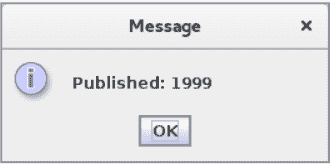

在这种情况下，单元格的内容（即模型）应该是一个整数，如果你输入了非整数内容并按回车键，该单元格将被选中，这显示内容是非法的（见下文）。

这是标准的错误处理，但我稍后会展示你如何控制单元格的编辑，以及当你输入非法内容时应该发生什么。


## JAVA 6: JDBC 与数据库应用程序 组件 JTABLE

关于代码部分没有什么需要解释的，最重要的是展示如何分配一个捕获表格更改的事件监听器：

| Isbn | Title | Edition | Published | Pages | Lent |
|---|---|---|---|---|---|
| 0-672-25845-4 | MySQL Tutorial | 1 | 2004 | 267 | |
| 978-0-59695-9... | Beginning Java | 1 | 2008 | 519 | |
| 978-9935-91... | Islandsengesa... | 1 | 2014 | 440 | ☑ |
| 978-9935-91... | Islandsengesa... | 1 | 2014 | 501 | ☑ |
| 978-9935-91... | Islandsengesa... | 1 | null | 508 | ☑ |
| 978-9935-91... | Islandsengesa... | 1 | 2014 | 507 | ☑ |
| 978-9935-91... | Islandsengesa... | 1 | 2014 | 531 | ☑ |
| 978-0-135-25... | Computer Net... | 5 | 2011 | 951 | ☑ |
| 978-07215-02... | Toscana, Ma... | 1 | 2014 | 329 | ☑ |

```java
private JTable createTable() {
    JTable table = new JTable(new DemoDataModel());
    table.getModel().addTableModelListener(new TableChangedListener());
    return table;
}
```

```java
class TableChangedListener implements TableListener {
    public void tableChanged(TableModelEvent e) {
        int row = e.getFirstRow();
        int col = e.getColumn();
        DemoDataModel model = (DemoDataModel)e.getSource();
        String name = model.getColumnName(col);
        Object value = model.getValueAt(row, col);
        JOptionPane.showMessageDialog(Demo3.this, name + ": " + value);
    }
}
```

在这里应特别注意对修改单元格的引用，包括此内容。如所述，你可以按照以下方式为单个单元格关联编辑器：

```java
table.getColumnModel().getColumn(3).setCellEditor(new IntegerEditor(1000, 2100));
```

## JAVA 6: JDBC 与数据库应用程序

第三列（年份）分配了一个编辑器，要求值在 1000 到 2100 之间。当你编辑单元格内容时，内容会被复制到相应的 `JTextField` 中进行编辑。在这种情况下，只有第 3 列有编辑器，因此你可以编辑第 4 列（页码）的内容。下面是一个页码被更改的窗口，现在如果你按回车，你会得到如下提示你输入了非法值的消息框：

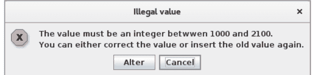

| Isbn | Title | Published | Pages | Lent |
|---|---|---|---|---|
| 0-672-32584-5 | MySQL Tutorial | 1 | 2004 | 257 |
| 978-1-59025-9... | Beginning Fe... | 1 | 2005 | 519 |
| 978-99335-91... | Islandingesa... | 1 | 2014 | 440 |
| 978-99335-91... | Islandingesa... | 1 | 2014 | 501 |
| 978-99335-91... | Islandingesa... | 1 | 2014 | 507 |
| 978-99335-91... | Islandingesa... | 1 | 2014 | 531 |
| 978-0-13-255... | Computer Ne... | 5 | 2011 | 951 |
| 978-0-13-255... | Toscana, Ma... | 1 | 2014 | 329 |

如果你点击“Alter（修改）”，你可以继续编辑单元格；如果点击“Cancel（取消）”，则会插入旧值。`CellEditor` 是一个继承自 `DefaultEditor` 的类，在示例中它的写法如下：

```java
class IntegerEditor extends DefaultEditor
{
    JTextField field;
    NumberFormat format;
    private Integer min, max;

    public IntegerEditor(int min, int max)
    {
        super(new JTextField());
        this.min = min;
        this.max = max;
        format = NumberFormat.getIntegerInstance();
        Formatter formatter = new NumberFormatter(format);
        formatter.setMinimum(min);
        formatter.setMaximum(max);
        field.setFormatterFactory(new DefaultFormatterFactory(formatter));
        field.setHorizontal(JText.TRAILING);
        field.setFocusBehavior(JFormattedTextField.PERSIST);
        field.getInputMap().put(KeyStroke.getKeyStroke(KeyEvent.VK_ENTER, 0), "check");
        field.getActionMap().put("check", new CheckAction());
    }

    public Component getTableCellEditor(JTable table, Object value,
    isSelected, int row, int column) {
        JFormattedTextField field = (JFormattedTextField)super.getTableCellEditor(
            table, value, isSelected, row, column);
        field.setValue(value);
        return field;
    }
}
```

## JAVA 6: JDBC 与数据库应用程序 组件 JTABLE

```java
class CheckAction extends AbstractAction {
    // 处理回车键的 action 实现
}
```

```java
@Override
public Component getTableCellEditor(JTable table, Object value,
    boolean isSelected, int row, int column) {
    JFormattedTextField field = (JFormattedTextField)super.getTableCellEditor(
        table, value, isSelected, row, column);
    field.setValue(value);
    return field;
}
```


> 我们不重新发明轮子，我们重新发明光。

迷人的照明技术提供了无限的可能性：创新技术和新市场提供了机遇与挑战。在一个你的专业知识大有可为的环境中。享受我们全球集团内部支持性的工作环境，并从国际职业道路中获益。与其他专家紧密合作实施可持续理念，并贡献影响我们的未来。加入我们，每天重新发明光。


## JAVA 6: JDBC 与数据库应用程序

```java
public Object getCellEditText()
{
    JFormattedTextField field = (JFormattedTextField)getComponent();
```


```java
Object value = field.getValue();

if (value instanceof Integer) return value;

else if (value instanceof Number)

    return new Integer((Number)value).intValue());

else

{

    try {

        return format.parseObject(value.toString());

    } catch (ParseException exc)

    {

        return null;

    }

}

}
```

```java
public boolean stopCellEditing()

{

    FormattedTextField field = (JFormattedTextField)getComponent();

    if (field.isEditValid())

    {

        try {

            field.commitEdit();

        } catch (java.text.ParseException exc)

        {

        }

        else

        {

            if (!revert()) return false;

        }

        return super.stopCellEditing();

    }

}
```

```java
protected boolean revert()

{

    Toolkit.getDefaultToolkit().beep();

    field.selectAll();

    Object[] options = { "Alter", "Cancel" };

    if (JOptionPane.showOption(SwingUtilities.getWindowAncestor(field),

        "The value ...", "", "Illegal value", JOptionPane.YES_NO_OPTION,

```

```java
JOptionPane.ERROR_MESSAGE, null, options, options[1]) == 1

{

  field.setValue(field.getValue());

  return true;

}

  return false;

}

class CheckAction extends AbstractAction

{

  public void actionPerformed(ActionEvent e) {

    if (!field.isEditValid()) {

      if (revert(e)) field.postActionEvent(e);

    } else {

      try {

        field.commitEdit();

        field.postActionEvent(e);

      } catch (java.text.ParseException exc) {

      }

    }

  }

}
```

这是一个综合类，仅仅是因为编辑字段的内容非常复杂。本质上，发生了以下情况：

该类继承自 `DefaultCellEditor`，因此具体来说是一个 `JTextField`。构造函数有两个参数，类似于你必须在一个范围内编辑一个数字。构造函数开始将它的组件（是一个 `JTextField`）替换为一个名为 `FormattedTextField` 的 Swing 组件，它是一个关联了特定对象的 `JTextField`，该对象可以格式化输入的文本。在这种情况下，它是一个 `NumberFormatter` 对象，它用一个 `NumberFormat` 对象进行初始化，用于格式化整数以及数字必须所在的范围。然后定义了字段应该右对齐，并添加了针对 Enter 键的事件处理器，以便在你按下 Enter 键时可以从字段中返回。

## JAVA 6：JDBC 与数据库应用程序：组件 JTABLE

该事件处理器被定义为一个内部类。它首先测试字段内容相对于格式化器来说是否合法，如果不符合要求，则调用 `revert()` 方法。该方法会显示上述消息框，你可以在其中选择是想更改输入的值，还是取消并返回旧内容。如果你选择后者，处理器将通过 `postActionEvent()` 结束。如果字段内容合法，结果将被标记为已提交，并再次通过 `postActionEvent()` 结束。

该类还有三个其他方法。第一个

```java
getTableCellEditorComponent(JTable table, Object value, boolean isSelected, int row, int column)
```

返回分配给特定单元格的组件（输入字段）并为其赋值，而接下来的一个

```java
Object getCellEditor()
```

返回当前正在编辑的 `Integer` 对象的对象。最后是一个在编辑结束时执行的方法。


在 www.deloitte.ca/careers 发现真相

Del© Deloitte & Touche LLP 及关联实体。

从 bookoon.com 下载免费电子书

点击广告阅读更多信息

## JAVA 6：JDBC 与数据库应用程序：组件 JTABLE

## 单元格渲染

`CellEditor` 允许你定义如何编辑 `JTable` 中单元格的内容，一列也可以与 `CellRenderer` 关联，该渲染器指示该列单元格的内容应该如何显示。如前提到的，默认是单元格对象中其 `toString()` 方法结果的字符串；如果 `JTable` 是基于 `TableModel` 定义并实现了 `getColumnClass()` 方法，那么将由对象的数据类型来决定值的显示方式。例如，作为 `CellRenderer` 显示（渲染）的 `Boolean` 类型，每列应该如何渲染其值可以通过一个定义它们的类来定义。

| Isbn | Titel | Edition | Published | Pages | Lent |
|---|---|---|---|---|---|
| 0-672-32584-5 | MySQL Tutorial | 1 | 2004 | Click Available: | |
| 978-1-5095-855-9 | Beginning Fedora, From Notice to Professional | 1 | 2005 | Click Available: | |
| 978-9935-9198-6 | Islandendesagara bande i | 1 | 2014 | Click Available: | ✓ |
| 978-9935-9198-2-3 | Islandendesagara bande II | 1 | 2014 | Click Available: | ✓ |
| 978-9935-9198-3-0 | Islandendesagara bande III | 1 | 2014 | Click Available: | ✓ |
| 978-9935-9198-4-7 | Islandendesagara bande IV | 1 | 2014 | Click Available: | ✓ |
| 978-9935-9198-5-4 | Islandendesagara bande V | 1 | 2014 | Click Available: | ✓ |
| 978-0-672-32517-9 | Computer Network | 5 | 2011 | Click Available: | |
| 878-02-15535 | Toscana, Maden, kultur | 1 | 2014 | Click Available: | ✓ |

考虑上面的窗口，它显示了一个与上方相同数据模型的 `JTable`。在这里你应该注意：
- 如果你点击 `Published` 列中的单元格，你将得到一个组合框，你可以在其中选择日期
- 其中一列的单元格显示为按钮，如果你点击该按钮，会得到如所示的消息框
- 最后一个不仅显示复选框，还有一段文本

` 方法结果的字符串；如果 `JTable` 是基于 `TableModel` 定义并实现了 `getColumnClass()` 方法，那么将由对象的数据类型来决定值的显示方式。例如，作为 `CellRenderer` 显示（渲染）的 `Boolean` 类型，每列应该如何渲染其值可以通过一个定义它们的类来定义。

## JAVA 6：JDBC 与数据库应用程序：组件 JTABLE

`CellEditor` 允许你定义如何编辑 `JTable` 中单元格的内容，一列也可以与 `CellRenderer` 关联，该渲染器指示该列单元格的内容应该如何显示。如前提到的，默认是单元格对象中其 `toString()` 方法结果的字符串；如果 `JTable` 是基于 `TableModel` 定义并实现了 `getColumnClass()` 方法，那么将由对象的数据类型来决定值的显示方式。例如，作为 `CellRenderer` 显示（渲染）的 `Boolean` 类型，每列应该如何渲染其值可以通过一个定义它们的类来定义。

## 单元格渲染

`CellEditor` 允许你定义如何编辑 `JTable` 中单元格的内容，一列也可以与 `CellRenderer` 关联，该渲染器指示该列单元格的内容应该如何显示。如前提到的，默认是单元格对象中其 `toString()` 方法结果的字符串；如果 `JTable` 是基于 `TableModel` 定义并实现了 `getColumnClass()` 方法，那么将由对象的数据类型来决定值的显示方式。例如，作为 `CellRenderer` 显示（渲染）的 `Boolean` 类型，每列应该如何渲染其值可以通过一个定义它们的类来定义。

| Isbn | Titel | Edition | Published | Pages | Lent |
|---|---|---|---|---|---|
| 0-672-32584-5 | MySQL Tutorial | 1 | 2004 | Click Available: | |
| 978-1-5095-855-9 | Beginning Fedora, From Notice to Professional | 1 | 2005 | Click Available: | |
| 978-9935-9198-6 | Islandendesagara bande i | 1 | 2014 | Click Available: | ✓ |
| 978-9935-9198-2-3 | Islandendesagara bande II | 1 | 2014 | Click Available: | ✓ |
| 978-9935-9198-3-0 | Islandendesagara bande III | 1 | 2014 | Click Available: | ✓ |
| 978-9935-9198-4-7 | Islandendesagara bande IV | 1 | 2014 | Click Available: | ✓ |
| 978-9935-9198-5-4 | Islandendesagara bande V | 1 | 2014 | Click Available: | ✓ |
| 978-0-672-32517-9 | Computer Network | 5 | 2011 | Click Available: | |
| 878-02-15535 | Toscana, Maden, kultur | 1 | 2014 | Click Available: | ✓ |

考虑上面的窗口，它显示了一个与上方相同数据模型的 `JTable`。在这里你应该注意：
- 如果你点击 `Published` 列中的单元格，你将得到一个组合框，你可以在其中选择日期
- 其中一列的单元格显示为按钮，如果你点击该按钮，会得到如所示的消息框
- 最后一个不仅显示复选框，还有一段文本


## JAVA 6：JDBC 与数据库应用程序：组件 JTABLE

该事件处理器被定义为一个内部类。它首先测试字段内容相对于格式化器来说是否合法，如果不符合要求，则调用 `revert()` 方法。该方法会显示上述消息框，你可以在其中选择是想更改输入的值，还是取消并返回旧内容。如果你选择后者，处理器将通过 `postActionEvent()` 结束。如果字段内容合法，结果将被标记为已提交，并再次通过 `postActionEvent()` 结束。

该类还有三个其他方法。第一个

```java
getTableCellEditorComponent(JTable table, Object value, boolean isSelected, int row, int column)
```

返回分配给特定单元格的组件（输入字段）并为其赋值，而接下来的一个

```java
Object getCellEditor()
```

返回当前正在编辑的 `Integer` 对象的对象。最后是一个在编辑结束时执行的方法。


在 www.deloitte.ca/careers 发现真相

Del© Deloitte & Touche LLP 及关联实体。

从 bookoon.com 下载免费电子书

点击广告阅读更多信息

## 单元格渲染 

` 方法结果的字符串；如果 `JTable` 是基于 `TableModel` 定义并实现了 `getColumnClass()` 方法，那么将由对象的数据类型来决定值的显示方式。例如，作为 `CellRenderer` 显示（渲染）的 `Boolean` 类型，每列应该如何渲染其值可以通过一个定义它们的类来定义。

`CellEditor` 允许你定义如何编辑 `JTable` 中单元格的内容，一列也可以与 `CellRenderer` 关联，该渲染器指示该列单元格的内容应该如何显示。如前提到的，默认是单元格对象中其 `toString()` 方法结果的字符串；如果 `JTable` 是基于 `TableModel` 定义并实现了 `getColumnClass()` 方法，那么将由对象的数据类型来决定值的显示方式。例如，作为 `CellRenderer` 显示（渲染）的 `Boolean` 类型，每列应该如何渲染其值可以通过一个定义它们的类来定义。

## JAVA 6：JDBC 与数据库应用程序：组件 JTABLE

该事件处理器被定义为一个内部类。它首先测试字段内容相对于格式化器来说是否合法，如果不符合要求，则调用 `revert()` 方法。该方法会显示上述消息框，你可以在其中选择是想更改输入的值，还是取消并返回旧内容。如果你选择后者，处理器将通过 `postActionEvent()` 结束。如果字段内容合法，结果将被标记为已提交，并再次通过 `postActionEvent()` 结束。

该类还有三个其他方法。第一个

```java
getTableCellEditorComponent(JTable table, Object value, boolean isSelected, int row, int column)
```

返回分配给特定单元格的组件（输入字段）并为其赋值，而接下来的一个

```java
Object getCellEditor()
```


返回当前正在编辑的 `Integer` 对象。最后是一个在编辑结束时执行的方法。


## 单元格渲染

`CellEditor` 允许你定义如何编辑 `JTable` 中单元格的内容，一列也可以与 `CellRenderer` 关联，该渲染器指示该列单元格的内容应该如何显示。如前提到的，默认是单元格对象中其 `toString()` 方法结果的字符串；如果 `JTable` 是基于 `TableModel` 定义并实现了 `getColumnClass()` 方法，那么将由对象的数据类型来决定值的显示方式。例如，作为 `CellRenderer` 显示（渲染）的 `Boolean` 类型，每列应该如何渲染其值可以通过一个定义它们的类来定义。

| Isbn | Titel | Edition | Published | Pages | Lent |
|---|---|---|---|---|---|
| 0-672-32584-5 | MySQL Tutorial | 1 | 2004 | Click Available: | |
| 978-1-5095-855-9 | Beginning Fedora, From Notice to Professional | 1 | 2005 | Click Available: | |
| 978-9935-9198-6 | Islandendesagara bande i | 1 | 2014 | Click Available: | ✓ |
| 978-9935-9198-2-3 | Islandendesagara bande II | 1 | 2014 | Click Available: | ✓ |
| 978-9935-9198-3-0 | Islandendesagara bande III | 1 | 2014 | Click Available: | ✓ |
| 978-9935-9198-4-7 | Islandendesagara bande IV | 1 | 2014 | Click Available: | ✓ |
| 978-9935-9198-5-4 | Islandendesagara bande V | 1 | 2014 | Click Available: | ✓ |
| 978-0-672-32517-9 | Computer Network | 5 | 2011 | Click Available: | |
| 878-02-15535 | Toscana, Maden, kultur | 1 | 2014 | Click Available: | ✓ |

考虑上面的窗口，它显示了一个与上方相同数据模型的 `JTable`。在这里你应该注意：

- 如果你点击 `Published` 列中的单元格，你将得到一个组合框，你可以在其中选择日期。
- 其中一列的单元格显示为按钮，如果你点击该按钮，会得到如所示的消息框。
- 最后一个不仅显示复选框，还有一段文本。


## JAVA 6：JDBC 与数据库应用程序：组件 JTABLE

`CellEditor` 允许你定义如何编辑 `JTable` 中单元格的内容，一列也可以与 `CellRenderer` 关联，该渲染器指示该列单元格的内容应该如何显示……（由于原文中存在大量重复，此处仅展示翻译核心逻辑部分。）

## JAVA 6：JDBC 与数据库应用程序

作为渲染器的另一个示例，显示器了以下窗口，前两列具有不同的颜色：

| Isbn | 标题 | 版本 | 出版 | 页数 | 借出 |
|---|---|---|---|---|---|
| 0-672-32584-5 | MySQL Tutorial | | 1 | 2004 | 267 | |
| 978-1-59059-8... | Beginning Fedora, From Novice t... | | 1 | 2005 | 519 | |
| 978-9935-919... | Islendesagaare bind I | | 1 | 2014 | 440 | ☑ |
| 978-9935-919... | Islendesagaare bind II | | 1 | 2014 | 501 | ☑ |
| 978-9935-919... | Islendesagaare bind III | | 1 | 2014 | 501 | ☑ |
| 978-9935-919... | Islendesagaare bind IV | | 1 | 2014 | 507 | ☑ |
| 978-9935-919... | Islendesagaare bind V | | 1 | 2014 | 531 | ☑ |
| 978-0-13-2553... | Computer Networkks | | 5 | 2011 | 951 | |
| 978-07-02-155... | Toscana, Laden, vinen, kulturen ... | | 1 | 2014 | 329 | ☑ |

代码如下：

```java
package jtabledemo;

import javax.swing.*;
import java.awt.*;
import javax.swing.table.*;

public class Demo06 extends JDialog {

    public Demo06() {
        super(null, "Demo06", JDialog.ModalityType.APPLICATION_MODAL);

        setSize(750, 400);
        this.setLocationRelativeTo(null);
        setLayout(new BorderLayout());
        add(new JScrollPane(createTable()));
        setDefaultCloseOperation(DISPOSE_ON_CLOSE);
        setVisible(true);
    }
}
```

在 bookboom.com 下载免费电子书。

## 组件 JTABLE

```java
private JTable createTable() {
    JTable table = new JTable(new DefaultModel());
    table.setDefaultRenderer(String.class, new ColorRenderer());
    table.setRowHeight(30);
    return table;
}
```

```java
class ColorRenderer extends JLabel implements TableCellRenderer {

    public Component getTableCellRendererComponent(
            JTable table,
            Object value,
            boolean isSelected,
            boolean hasFocus,
            int row,
            int column) {

        setText(value.toString());
        setForeground(column == 0 ? Color.red : Color.blue);
        setFont(new Font("Liberation Serif", Font.PLAIN, 18));
        setToolTipText(column == 0 ? "ISBN为红色" : "Title为蓝色");
        return this;
    }
}
```


你是否希望在一个具有良好工作/生活平衡的创新环境中进一步提升你的清洁技术职业生涯？考虑丹麦吧！访问 cleantech.talentattractiondenmark.com。

> “在丹麦，你可以找到极佳的工程工作并在专业领域发展。特别是在风能领域，你可以向业内最优秀的人学习，并在稳定的就业市场中提升你的职业。”
>
> Mireia Mare，  
> 来自西班牙的高级工程师。  
> 自 2010 年起在丹麦的风能行业工作。

在 bookboom.com 下载免费电子书。

点击广告阅读更多。

## 组件 JTABLE

渲染器对象由 `ColorRenderer` 类定义，没什么好解释的，但你会注意到渲染器对象是在 `createTable()` 中赋值的。

```java
table.setDefaultRenderer(String.class, new ColorRenderer());
```

这意味着所有列都包含渲染器类型的对象，前两列也是如此。

## 排序行

`JTable` 支持通过点击列上的鼠标对行进行排序。点击列值的已排序行按升序，再次点击则按降序排序。示例 `Demo7` 展示了它是如何工作的。数据模型与上述相同，唯一需要做的是在创建表格时必须指定允许此操作：

```java
private JTable createTable() {
    JTable table = new JTable(new DemoTableModel());
    table.setAutoRowSorter(true);
    return table;
}
```

## 过滤器

此示例展示了如何分配过滤器。数据模型仍然具有行，但如果你在下方的输入框中输入内容，只有表格开头为输入内容的行才会显示。我在下方输入了内容：

| Isbn | 标题 | 版本 | 出版 | 页数 | 借出 |
|---|---|---|---|---|---|
| 978-9935-919-6-1 | Islendesaga... | 1 | 2014 | 440 | |
| 978-9935-919-2-3 | Islendesaga... | 1 | 2014 | 501 | |
| 978-9935-919-3-0 | Islendesaga... | 1 | 2014 | 501 | |
| 978-9935-919-4-7 | Islendesaga... | 1 | 2014 | 507 | |
| 978-9935-919-5-4 | Islendesaga... | 1 | 2014 | 531 | |

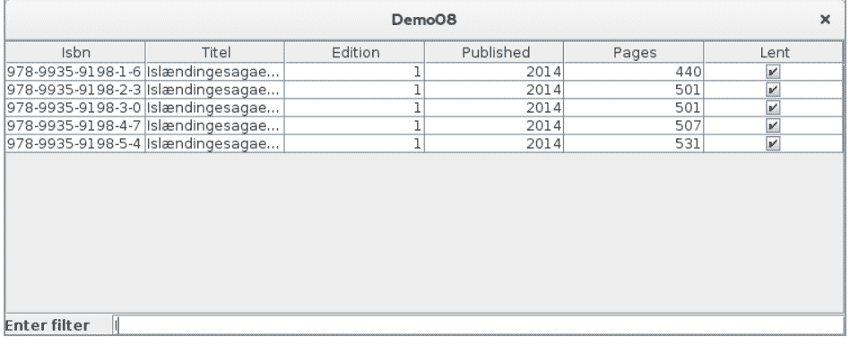

代码如下：

```java
public class Demo08 extends JDialog {

    private JTextField filterText;
    private RowSorter<DemoModel> sorter;

    public Demo08() {
        super(null, "Demo08", JDialog.ModalityType.APPLICATION_MODAL);

        setSize(750, 300);
        this.setLocationRelativeTo(null);
        setLayout(new BorderLayout());
        add(new JScrollPane(createTable()));
        add(createBottom(), BorderLayout.SOUTH);
        setDefaultCloseOperation(DISPOSE_ON_CLOSE);
        setVisible(true);
    }

    private JTable createTable() {
        DemoModel model = new DemoTableModel();
        sorter = new RowSorter(model);
        JTable table = new JTable(model);
        table.setRowSorter(sorter);
        return table;
    }

    private JPanel createBottom() {
        JPanel panel = new JPanel(new BorderLayout(20, 0));
        panel.add(new JLabel("输入过滤器"), BorderLayout.WEST);
        panel.add(filterText = new JTextField());
        filterText.getDocument().addDocumentListener(new Filter());
        return panel;
    }

    private void newFilter() {
        RowFilter<DemoModel, Object> filter = null;

        try {
            filter = RowFilter.regex(filterText.getText(), 1);
        } catch (java.util.regex.PatternSyntaxException ex) {
        }

        sorter.setRowFilter(filter);
    }
}

class Filter implements DocumentListener {

    public void changedUpdate(DocumentEvent e) {
        newFilter();
    }

    public void insertUpdate(DocumentEvent e) {
        newFilter();
    }

    public void removeUpdate(DocumentEvent e) {
        newFilter();
    }
}
```


在 bookhoon.com 下载免费电子书。点击广告阅读更多。

加入 MIT 是因为我想要真正的责任。你首先应该注意到的是定义了两个实例变量，一个指向输入框，另一个是 `RowSorter` 类型，用于使用的数据模型（即 `DemoTableModel`）。构造函数中没有新，但 `createTable()` 方法创建了 `sorter` 对象并将其附加表格。`createBottom()` 方法创建了输入框，并通过以下语句将过滤器与字段关联：

```java
filterText.getDocument().addDocumentListener(new Filter());
```

其中 `Filter` 是一个实现了 `DocumentListener` 接口的内部类。该接口定义了三个方法，当输入框内容改变以及用户输入或删除任何内容时执行。在所有三种情况下，都会调用 `newFilter()`，仅此如此。它创建一个正则表达式过滤器，最重要的是指定过滤器必须应用于哪列——在本例中是索引 `1`，即标题列。最后，`sorter` 对象用于过滤表格行。

## 打印 JTABLE

下一个示例 `Demo09` 非常简单，展示了如何打印表格，只需要在该按钮的事件处理器中：

```java
private void print(ActionEvent e) {
    MessageFormat header = new MessageFormat("页 {0}");

    try {
        table.print(JTable.Mode.NORMAL, header, null);
    } catch (java.awt.print.PrinterException ex) {
        JOptionPane.showMessageDialog(this, ex.getMessage());
    }
}
```


## 同步两个表格

下一个示例展示了`JTable`和`JList`，它们都使用相同的数据模型，但这次是不同的模型，有一个国王列表：

| 名字 | 名字 | 开始 | 结束 |
|---|---|---|---|
| Gorm Gantle | Gorm Gantle | 936 | 958 |
| Harald Blandt | Harald Blandt | 958 | 987 |
| Svend Tvesær | Svend Tvesær | 987 | 1014 |
| Harald 2. | Harald 2. | 1014 | 1018 |
| Knud den Store | Knud the Store | 1018 | 1035 |
| Harddemark | Harddemark | 1035 | 1042 |
| Magnus the God | Magnus the God | 1042 | 1047 |
| Svend Stridsen | Svend Stridsen | 1047 | 1074 |
| Harald Hen | Harald Hen | 1074 | 1080 |
| Knid the Hellige | Knid the Hellige | 1080 | 1086 |
| Oluf Hunger | Oluf Hunger | 1086 | 1095 |
| Erik Ejegod | Erik Ejegod | 1095 | 1103 |
| Niels | Niels | 1104 | 1134 |

两个组件都使用相同的数据模型，关于模型最重要的点是行数非常多，你需要滚动表格。一个组件只显示模型的一个列，而第二个组件显示所有列。示例应该展示当点击其中一个组件中的行时，两个组件都会滚动，使选中的行出现在顶部。数据模型被称为`Kings`，并且相当复杂。它被定义为派自`DefaultListModel`的类，但实际上它应该是`AbstractTableModel`（参见前文示例）。然而，这并非必须，实现`TableModel`接口就足够了（`AbstractTableModel`所做的）。相应地，`Kings`类必须实现`TableModel`定义的所有方法。通过定义一个继承`AbstractTableModel`的内部类`KingsModel`可以实现……这种不寻常的实现。

## JAVA 6: JDBC 与数据库应用程序

### 组件 J-TABLE

| 名字 | 名字 | 起 | 止 |
|---|---|---|--|
| Magnus den Gode | Magnus den Gode | 1042 | 1047 |
| Svend Stridsen | Svend Stridsen | 1047 | 1074 |
| Harald Hen | Harald Hen | 1074 | 1080 |
| Knud den Hellige | Knud den Hellige | 1080 | 1086 |
| Oluf Hunger | Oluf Hunger | 1086 | 1095 |
| Erik Ejegod | Erik Ejegod | 1095 | 1103 |
| Niels | Niels | 1104 | 1134 |
| Erik Emune | Erik Emune | 1134 | 1137 |
| Erik Lam | Erik Lam | 1137 | 1146 |
| Svend, Knud and Val... | Svend, Knud and Va... | 1146 | 1157 |
| Valdemar den Store | Valdemar den Store | 1157 | 1182 |
| Knud 6. | Knud 6. | 1182 | 1202 |
| Valdemar Sejr | Valdemar Sejr | 1202 | 1241 |


## 管理学硕士

因为实现梦想是你最大的挑战。IE 商学院提供的英语、西班牙语或双语教学的管理学硕士，通过创新且具有启发性的课程，培训职业生涯初期的高绩效专业人士，帮助他们充分发挥潜力。

- 选择您的专业领域。
- 通过提供的不同选项定制您的硕士学位。
- 在伦敦、硅谷或上海等职业地的全球沉浸周。

因为你改变，我们随随你改变。

www.ie.edu/master-management | min.admissions@ie.edu

在 bookboom.com 下载免费电子书

## JAVA 6: JDBC 与数据库应用程序

接下是用户界面的代码：

```java
public class Demolo extends JDialog
{
    private Font font = new Font("Liberation Serif", Font.PLAIN, 16);
    private Kings dataModel = new Kings();
    private JList list;
    private JTable table;
    private ListSelectionModel listSelectionModel;

    public Demolo() {
        super(null, "Demolo", JDialog.ModalityType.APPLICATION_MODAL);
        setSize(600, 400);
        this.setLocationRelativeTo(null);
        this.setLayout(new BorderLayout());
        add(createList(), BorderLayout.WEST);
        add(new JScrollPane(createTable()));
        setDefaultCloseOperation(DISPOSE_ON_CLOSE);
        setVisible(true);
    }

    private JPanel createList() {
        JPanel panel = new JPanel(new BorderLayout());
        JLabel label = new JLabel(new JTable(dataModel).getDataModel().getColumnName(0), JLabel.CENTER);
        label.setPreferredSize(new Dimension(0, 32));
        label.setBorder(new LineBorder(Color.LIGHT_GRAY));
        label.setFont(font);
        panel.add(label, BorderLayout.NORTH);
        JList list = new JList(dataModel);
        list.setFont(font);
        list.setCellRenderer(new DefaultListRenderer() {
            public Component getListCellRenderer(JList list, Object value, 
                int index, boolean selected, boolean focus) {
                King king = (King)value;
                Component component = super.getListCellRendererComponent(
                    list, king.getName(), index, selected, focus);
                component.setPreferredSize(new Dimension(150, 25));
                return component;
            }
        });
        listSelectionModel = list.getSelectionModel();
        listSelectionModel.addListSelectionListener(new SelectionHandler());
        panel.add(new JScrollPane(list));
        return panel;
    }
```

## JAVA 6: JDBC 与数据库应用程序 组件 J-TABLE

```java
private JTable createTable(){
    table = new JTable(dataModel);
    table.setSelectionModel(listSelectionModel);
    JTableHeader header = table.getTableHeader();
    header.setPreferredSize(new Dimension(0, 32));
    table.setFont(font);
    table.setRowHeight(25);
    return table;
}
```

```java
class ListSelectionHandler implements ListSelectionListener{
    public void valueChanged(ListSelectionEvent e) {
        int index = e.getSource() == table ? table.getSelectedRow() : list.getSelectedIndex();
        if (list.isVisible(index)) {
            Rectangle rect = table.getCellRect(index, 0, true);
            table.scrollVisible(rect);
        }
        if (index == dataModel.getSize() - 1) {
            list.scrollVisible(dataModel.getSize() - 1);
        }
    }
}
```

组件在构造函数放在窗口中。List 在`createList()`方法中创建，位于标签的面板上方。下一个 list 是一个继承自`DefaultCellRenderer`的对象，但重写了`getCellRenderer()`方法。list 的数据模型确保只显示名称，并适应`JTable`组件的高度。`listSelectionModel`变量被设置为`ListSelectionHandler`类型的处理程序。然后是`createTable()`方法，在这里定义了表头和行。最后，table 被分配给相同的`SelectionModel`。这意味着当点击组件之一时，会执行相同的处理程序，滚动两个组件使点击的元素位于顶部。

## JTABLE 与数据库表

```java
package jtabledemo;

import java.sql.*;
import java.util.*;
import javax.swing.table.*;

public class Zipcodes extends AbstractTableModel {
    private List<Zipcode> list = new ArrayList<>();

    public Zipcodes() {
        try (Connection conn = DriverManager.getConnection("jdbc:mysql://localhost:3306/database?useSSL=false","user","pass1234")) {
            Statement stmt = conn.createStatement();
            ResultSet res = stmt.executeQuery("SELECT * FROM zipcode");
            while (res.next()) {
                list.add(new Zipcode(res.getString("code"), res.getString("city")));
            }
        } catch (SQLException ex) {
            System.out.println(ex);
        }
    }

    public int getColumnCount() {
        return 2;
    }

    public int getRowCount() {
        return list.size();
    }

    public String getColumnName(int col) {
        return col == 0 ? "Code" : "City";
    }

    public Object getValue(int row, int col) {
        return col == 0 ? list.get(row).getCode() : list.get(row).getCity();
    }

    public Class getColumnClass(int c) {
        return String.class;
    }

    public boolean isCellEditable(int row, int col) {
        return false;
    }

    public void setValueAt(Object value, int row, int col) {
        if (col == 0)
            list.get(row).setCode((String)value);
        else
            list.get(row).setCity((String)value);
        fireTableCellUpdated(row, col);
    }
}
```


示例 Demo 展示了如何使用 `JTable` 显示数据库表的内容。示例显示了下面的窗口。窗口显示了带有内容的 `JTable`。窗口底部有一个按钮和两个输入框。输入框作为两列的过滤器，而按钮用于清除字段。关于表的定义和过滤器的包含没有什么特别，所以你感兴趣的是数据模型，而且这里实际上并不是新的：唯一新的地方是在构造函数中，它与书中插的初始示例没有区别，即如何读取数据库表。

结论是使用 `JTable` 显示数据库表非常简单——你只需要用数据库表的内容初始化数据模型。

| 代码 | 城市 |
|---|---|
| 0800 | Hæja Taastrup |
| 0900 | København C |
| 0999 | København C |
| 1000 | København K |
| 1059 | København K |
| 1051 | København K |
| 1052 | København K |
| 1053 | København K |
| 1054 | København K |
| 1055 | København K |
| 1056 | København K |
| 1057 | København K |
| 1058 | København K |
| 1059 | København K |
| 1060 | København K |
| 1062 | København K |


## 大表格

上一个示例将打开以下窗口：

| Demo12 | | | | | | | | |
| A | B | C | D | E | F | G | |
|---|---|---|---|---|---|---|---|---|
| 1 | | | | | | | | | |
| 2 | | | | | | | | | |
| 3 | | | | | | | | | |
| 4 | | | | | | | | | |
| 5 | | | | | | | | | |
| 6 | | | | | | | | | |
| 7 | | | | | | | | | |
| 8 | | | | | | | | | |
| 9 | | | | | | | | | |
| 10 | | | | | | | | | |
| 11 | | | | | | | | | |
| 12 | | | | | | | | | |
| 13 | | | | | | | | | |
| 14 | | | | | | | | | |
| 15 | | | | | | | | | | |
| 16 | | | | | | | | | | |
| 17 | | | | | | | | | | |
| 18 | | | | | | | | | | |
| 19 | | | | | | | | | | |
| 20 | | | | | | | | | | |
| 21 | | | | | | | | | | |
| 22 | | | | | | | | | | |
| 23 | | | | | | | | | | |
| 24 | | | | | | | | | | |
| 25 | | | | | | | | | | |
| 26 | | | | | | | | | | |
| 27 | | | | | | | | | | |
| 28 | | | | | | | | | | |
| 29 | | | | | | | | | | |
| 30 | | | | | | | | | | |
| 31 | | | | | | | | | | |
| 32 | | | | | | | | | | |
| 33 | | | | | | | | | | |

该窗口显示了一个 `JTable`，有 10000 行和 200 列，因此有 200 万个单元格。示例将展示 `JTable` 可以拥有许多单元格，而且仍然有效。你也可以编辑最后一行和最后一列。在单元格中你可以输入数字，最后一行显示列和，而最后一列显示行的和。

数据模型是简单的，没有添加新的：

```java
class SpreadsheetModel extends AbstractTableModel
{
    private Object[][] data;

    public SpreadsheetModel(int rows, int cols) {
        data = new Object[rows + 1][cols + 1];
    }
}
```

## JAVA 6：JDBC 与数据库应用程序

### JTABLE 组件

```java
public int getColumnCount()
{
    return data[0].length;
}
```

```java
public int getRowCount()
{
    return data.length;
}
```

```java
public Object getValueAt(int row, int col)
{
    return data[row][col];
}
```

```java
public Class getColumnClass(int c)
{
    return Double.class;
}
```


## JAVA 6：JDBC 与数据库应用程序

### JTABLE 组件

```java
public boolean isEditable(int row, int col)
{
    return col < data[0].length - 1 && row < data.length - 1;
}
```

```java
public void setValueAt(Object value, int row, int col)
{
    data[row][col] = value;
    fireTableCellUpdated(row, col);
}
```

你应该注意到最后一行和最后一列不能编辑，而所有其他单元格都可以。你还应该注意每一列都包含 `Double` 类型的对象。然后是对话框，那里有更多需要注意的地方。我在这里不会显示代码，部分是因为它内容很多，其次，它是我们在本章前面讨论过的内容，所以我只需要提到学习代码时需要注意的几点：

1. 有两个定义表格大小的常量。你可以尝试修改这些常量。
2. 如何定义封装在插入 `JScrollPane` 的 `JViewport` 中的 `RowHeader`。
3. 内部类 `CellEditorHandler` 是用于编辑单元格的事件处理器。
4. `DoubleEditor` 类是一个 `CellEditor`。
5. `RowNumberHeader` 类是一个 `JTable`，它定义了表格的 `RowHeader` 类型。

## JAVA 6：JDBC 与数据库应用程序 JTABLE 组件

### 问题 2

你必须编写一个可以调用的程序 `Denmark`，它将打开以下窗口：

| 邮政编码和市 | | | |
| 代码 | 城市 | 市市镇 | 地区 |
|---|---|---|---|
| 0800 | Have Tastrup | Morse Kommune | 北尤特兰省 |
| 0850 | København | Thisted Kommune | 北尤特兰省 |
| 0999 | København | Branderley Kommune | 北尤特兰省 |
| 1000 | København | Frederikholm Kommune | 北尤特兰省 |
| 1050 | København | Vendsby Kommune | 北尤特兰省 |
| 1051 | København | Læse Kommune | 中尤特兰省 |
| 1052 | København | Rabød Kommune | 中尤特兰省 |
| 1053 | København | Mariager Kommune | 中尤特兰省 |
| 1054 | København | Jammerød Kommune | 中尤特兰省 |
| 1055 | København | Aalborg Kommune | 中尤特兰省 |
| 1056 | København | Harring Kommune | 中尤特兰省 |
| 1057 | København | Horsens Kommune | 中尤特兰省 |
| 1058 | København | Herning Kommune | 中尤特兰省 |
| 1059 | København | Holstebro Kommune | 中尤特兰省 |
| 1060 | København | Lemvig Kommune | 中尤特兰省 |
| 1061 | København | Struer Kommune | 中尤特兰省 |
| 1062 | København | Sønder Kommune | 中尤特兰省 |
| 1063 | København | Nordurs Kommune | 中尤特兰省 |
| 1064 | København | Faxov Kommune | 中尤特兰省 |
| 1065 | København | Older Kommune | 中尤特兰省 |

## JAVA 6: JDBC 与数据库应用程序

### 数据库中的文件

事件处理器创建了一个 `JFileChooser` 对象并打开对话框，使你置于用户的主目录。如果用户选择了一个文件，用户应该输入文档（文件）的描述。然后调用 `stream()` 方法，将文件流到数据库。该方法打开一个指向文件的 `FileInputStream`，然后打开到数据库的连接，并初始化一个 `PreparedStatement`。唯一需要注意的是，第 3 列（`stnt` 中的第三个参数）使用 `setAsciiStream()` 方法初始化，并以 `InputStream` 作为参数。

你应该注意，程序并没有对文件进行验证，实际上程序可以上传任何文件并存储在数据库中——即使是一张图片。

如果你双击某一行，将执行以下事件处理器：

```java
class MouseHandler extends MouseAdapter
{
    public void mousePressed(MouseEvent e)
    {
        try
        {
            if (e.getClickCount() == 2)
            {
```


**关于 e-Learning for Kids** e-Learning for Kids 成立于2004年，是一个全球非营利基金会，致力于为5-12岁的儿童提供免费的互联网学习支持，涵盖数学、科学、艺术、语言、计算机、健康和环境技能课程。自2005年以来，全球190多个国家的超过1500万儿童受益于在线学习，这些服务由来自 LI KI An 的志愿者工作人员、教育和在线学习专家，以及世界各地致力于改变世界的业务专业人士提供。... e-Learning for Kids 正在寻求资金、志愿者、赞助商和慷慨的开发者。参与其中：访问 www.e-learningforkids.org。

- 为小学教育的 5 门 MOOC
- 5-12 岁儿童的免费数字学习
- 惠及 1500 万儿童

在 bookboom.com 下载免费电子电子书

点击广告阅读更多

## JAVA 6: JDBC 与数据库应用程序

```java
int row = table.getSelectedRow();
Document doc = model.getDocument((Integer)table.getValueAt(row, 0));
FileChooser fc = new JFileChooser();
fc.setCurrentDirectory(new File(System.getProperty("user.home")));
fc.setSelectionMode(FileChooser.DIRECTORIES_ONLY);
if (fc.showSaveDialog(MainView) == JFileChooser.APPROVE_OPTION)
    streamFile(fc.getSelectedFile(), doc);
}
catch (Exception ex) {
    JOptionPane.showMessageDialog(MainView,
        "could not be streamed from the database\n" + ex,
        "Error message", JOptionPane.ERROR_MESSAGE);
}
```

这并不多，但用户将能够选择要保存的文件目录。如果选择了目录，则会调用 `streamFile()` 方法，该方法会创建文件并从数据库检索内容：

```java
private void streamFile(File file, Document doc) throws Exception {
    try (Connection conn = DriverManager.getConnection(
        "jdbc:mysql://localhost:3306/filedb?useSSL=false", "pa", "Volmer_1234")
    {
        PreparedStatement stmt = conn.prepareStatement("SELECT content FROM documents WHERE filename = ?")
        stmt.setString(1, doc.getFileName());
        ResultSet res = stmt.executeQuery();
        if (res.next()) {
            InputStream stream = res.getAsciiStream(1);
            BufferedInputStream in = new BufferedInputStream(stream);
            String filename = file.getAbsolutePath() + "/" + doc.getFileName();
            BufferedOutputStream out = new BufferedOutputStream(new FileOutputStream(filename));
            int c;
            while ((c = in.read(c)) != -1) out.write(c);
            out.close();
        }
    }
}
```

在 bookebook.com 享免费电子书

## JAVA 6: JDBC 与数据库应用程序 数据库中的文件

再次，没有什么新的需要解释。该方法创建一个带有一个参数的 `PreparedStatement`，该参数是主键的值。`SELECT` 语句只定义了一个列，作为文件内容的列。如果在列中找到行，则通过 `getASCIIStream()` 方法引用，这是一个 `InputStream`。由于性能考虑，它被封装在 `BufferedInputStream` 中，然后创建一个 `BufferedOutputStream`，该输出代表必须合并数据库内容的文件。

在示例中，到和自数据库的数据流是通过 `AsciiStream` 执行的，它将数据处理为编码为 ISO-Latin-1 的 ASCII 字节。还有其他选项：

- `UnicodeStream`，其中数据被处理为 16 位的 Unicode
- `BinaryStream`，其中数据被处理为原始字节

它们之间的区别在于这些类型提供的服务。

### 练习 5

你必须编写一个与上述类似的程序，该程序应该打开一个如所示所示：

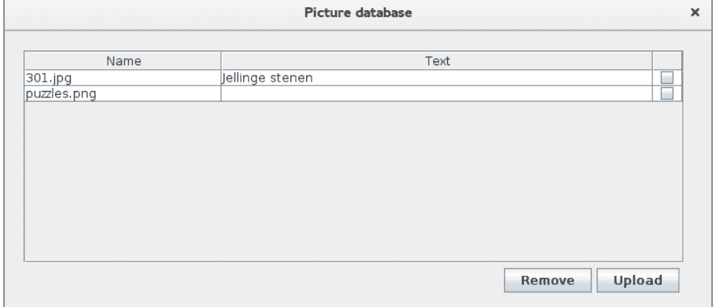

程序必须将图片上传到 `filedb` 数据库并将图片存储在 `pictures` 表中，但与上述程序不同，必须使用 `BinaryStream`。应该只允许上传 jpg、gif 和 png 文件。如果你双击表格中的一行，相应的文件应以上述程序相同的方式复制到文件系统中的目录。

表格的右侧列由复选框组成。如果你点击“删除”按钮，选中的图像将从数据库中删除。

### DDL 命令

如果你需要创建数据库并包含表，在实践中通常会编写一个 SQL 脚本。当脚本由 SQL 命令组成时，这些命令显然也可以通过 JDBC 执行，我用一个示例结束对 JDBC 的解释，它展示了如何创建一个数据库。实际上，它只是通过以下测试创建一个数据库：

```java
private static void test12() {
    try (Connection conn = DriverManager.getConnection("jdbc:mysql://localhost:3306?useSSL=false", "pa", "Volmer_1234")) {
        Statement stmt = conn.createStatement();
        stmt.executeUpdate("CREATE DATABASE contacts");
    } catch (SQLException ex) {
        System.out.println(ex);
    }
}
```


在 bookboom.com 下载免费电子书

下一个方法在该数据库中创建一个表：


`private static void test1()` {

{

    try (`Connection conn = DriverManager.getConnection(`

        `"jdbc:mysql://localhost:3306?useSSL=false", "pa", "Volmer_1234"`

    ) {

      `Statement stmt = conn.createStatement();`

      `stmt.execute("use contacts");`

      `stmt.executeUpdate("CREATE TABLE persons (\n        id int auto_increment primary key,\n        name varchar(50) not null, phone(20), email(50) )");`

    }

    } catch (`SQLException ex`) {

      `System.out.println(ex);`

    }

  }

```

然后应该很清楚，所有的 DDL 命令都可以立即从 Java 程序执行——只要你拥有执行这些命令的权限。

# JAVA 6：JDBC 与数据库应用程序

## 最终示例

已经决定，你不应该能够通过有关世界大陆的信息来维护世界表格。

除了第一个和最后一个函数外，这些函数都不需要进一步解释。关于主视图（main view），我将将其定义为原型。至于最后一个函数，CSV 文件必须由以下格式的行组成：

```
code;rate[name]
```

并且每行必须至少有一个货币代码和一个货币汇率。如果数据库中存在该货币，则更新该货币的汇率。否则，如果该行包含货币的名称，则应创建一个新货币。该函数应该显示包含错误且无法更新表格的行。


## 原型

原型是一个名为 `World` 的程序，它会打开以下窗口：

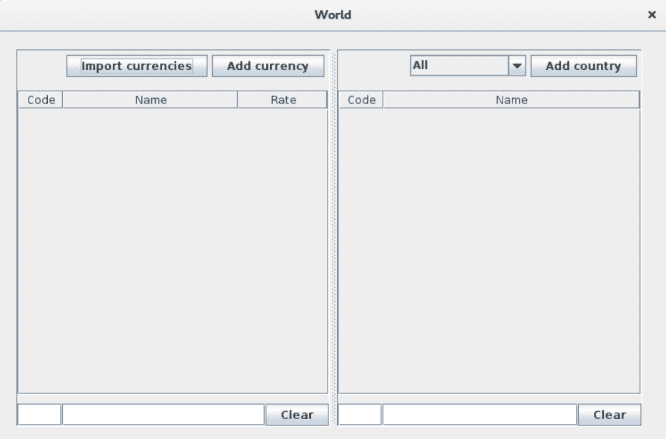

该程序应该显示主视图的设计。窗口在 `JSplitPane` 中显示了两个 `JTable` 组件，这两个表格分别显示货币和国家的概览。搜索通过每个表格下方的过滤器实现，清除（Clear）按钮用于移除过滤器。货币表上方的两个按钮用于：

- 从 CSV 文件导入货币汇率
- 向表格（以及数据库）添加新货币

国家表上方的按钮用于添加新国家，而组合框（combo box）包含了世界上所有大陆的列表，并提供了按大陆过滤国家表的机会。

对于编辑和可能删除货币或国家，决定是你你必须在两个表格中的一个中双击该对象，然后你将得到一个显示对象数据的对话框。

为了编写该原型，我在 NetBeans 中创建了一个新项目 `World`，除了主类（main-class）外，还添加了以下类（文件）：

- `MainView`
- `Currencies`，即货币表的数据模型
- `Countries`，即货币表的数据模型

最后两个类是显而易见的，但对于原型创建两个 `JTable` 组件来说是必要的。下面显示了如下示例：

```
package world;

import javax.swing.table.*;

public class Countries extends AbstractTableModel

{

    public int getColumnCount()

    {

        return 2;

    }

    public int getRowCount()

    {

        return 0;

    }

    public String getColumnName(int col)

    {

        return col == 0 ? "Code" : "Name";

    }

    public Object getValue(int row, int col)

    {

        return null;

    }

    public boolean isCellEditable(int row, int col)

    {

        return false;

    }

```

原型完成后，我创建了该项目的副本，并将其命名为 `World0`。现在我将继续开发该项目，但有了副本，我始终可以回到原型。

## 数据模型

作为下一步，我编写了一些模型类，即表示程序数据的类。

添加了三个非常简单的模型类，分别代表大陆、国家和货币：

- `Continent`（大陆）
- `Country`（国家）
- `Currency`（货币）

这些类直接映射相应数据库表中的行，然而，`Currency` 类扩展了一个包含 `Country` 对象的列表，用于使用该货币的国家。

还为上述每种类型都定义了一个集合：

- `Continents`（大陆集合）
- `Countries`（国家集合）
- `Currencies`（货币集合）


# JAVA 6：JDBC 与数据库应用程序

每个集合都包含相应数据库表中每行的一个对象。这里，第一个类是显而易见的，另外两个是对原型中对应类的重写。因此，这两个类同时也是程序 `JTable` 组件的模型。

总模型由 `DataModel` 类表示，这是一个简单的类，由上述三个集合中的每个对象组成。程序的模型可以如下图所示：

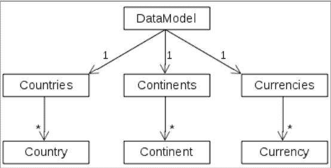

这三个集合必须初始化，这是通过读取相应的数据库表完成的。为此，编写了一个 `Repository` 类，它只有静态方法，包括其他创建三个集合类实例的方法。`Repository` 类还拥有货币和国家表的更新方法，这意味着与数据库有关的所有操作都收集在这个类中。如果应用程序使用不同的数据库，意味着只需要更改此类。`Repository` 类是一个相对复杂的类，因为所有与数据库和 SQL 相关的内容都汇聚在这里，因此书中介绍的所有内容都包含在此。

## 用户界面

程序的用户界面除了 `ModelAndView` 外，还包括：

- `CurrencyView` 是用于维护货币的对话框
- `CountryView` 是用于维护国家的对话框

此外，还有一个名为次级的对话框，用于显示汇率导入。下面是 `ModelAndView`，它与原型相同，但：

# JAVA 6：JDBC 与数据库应用程序

# World

| Code | Name |
|---|---|
| AUD | 澳大利亚元 | 487 |
| BGN | 保加利亚列夫 | 381 |
| BRL | 巴西雷尔 | 171 |
| CAD | 加拿大元 | 511 |
| CHF | 瑞士法 | 685 |
| CZK | 捷克卢纳 | 101 |
| DKK | 丹克朗 | 270 |
| EUR | 欧元 | 755 |
| GBP | 英镑 | 1034 |
| HKD | 香港元 | 87 |
| HRK | 罗地亚克纳 | 97 |
| HUG | 匈牙利福 | 234 |
| IDR | 印度尼西亚盾 | 49 |
| ILS | 以色列谢克尔 | 174 |
| INR | 印度卢比 | 380 |
| JPY | 日本元 | 105 |
| KRW | 韩国元 | 593 |
| LTL | 立陶宛里特 | 215 |

| Code | Name |
|---|---|
| AD | 安道拉 |
| AE | 阿联酋 |
| AF | 阿富汗 |
| AG | 安提瓜安西巴布达 |
| AI | 安圭拉岛 |
| AL | 阿尔尼亚 |
| AM | 亚美尼亚 |
| AN | 荷兰群 |
| AO | 安哥拉 |
| AO | 南极 |
| AR | 阿根廷 |
| AS | 美国萨摩亚 |
| AT | 奥地利 |
| AU | 澳大利亚 |
| AW | 阿鲁巴 |
| AZ | 塞尔维疆 |
| BA | 波斯黑塞哥哥文 |
| BB | 巴巴多斯 |
| BD | 孟加拉 |
| BE | 比时 |

| Name | Rate |
|---|---|
| Euro | 755 |

| 使用此货币的国家 |
| 奥地利 (AT) |
| 比时 (BE) |
| 塞浦路斯 (CY) |
| 德国 (DE) |
| 爱尼亚 (EE) |
| 西班牙 (ES) |
| 芬兰 (FI) |
| 法国 (FR) |
| 希腊 (GR) |
| 爱尔兰 (IE) |

# JAVA 6：JDBC 与数据库应用程序

无论是创建新货币还是编辑现有货币，使用的都是同一个对话框。在这种情况下，在主窗口中双击了 `EUR`。同样，下面显示了维护国家的对话框，并在其中双击了 `US`（此处应为美国）：

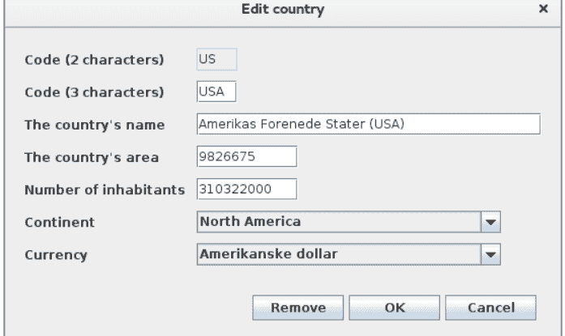


BI 商学院是欧洲最大的商学院之一，每年欢迎超过 20,000 名学生。我们的课程提供了充满活力且多元文化的学习环境，具有国际视野，独特为学生提供了满足企业日益增长需求的专业技能。BI 提供了四种不同的英语授课两年全日制科学硕士（MSc）课程，旨在提供满足不断增长需求的专业技能。这些课程提供了充满活力且多元文化的学习环境，为你职业生涯的发展提供最佳平台。

- 商业硕士
- 金融经济学硕士
- 战略营销管理硕士
- 领导力与组织心理学硕士

`www.bi.edu/master`

# JAVA 6：JDBC 与数据库应用程序

## 最终示例

通过为对话框关联控制器，你可以实现两个目标：

1. 所有关于算法和业务逻辑的内容都移动到了一个单独的类中
2. 对话框的代码变得更简单且易于理解

现在，无论任何情况下都不应为对话框/窗口附加控制器类。控制器类必须包含某些有趣的内容才有意义。

## 导入 CSV 文件

最后一个缺失的功能是从 CSV 文件更新汇率。这包括能够打开文件、解析文件，并使用解析结果更新数据库中的 `currency` 表。对于文件而言，这是一个属于 `MainView` 中事件处理程序的活动。当选择了文件时，它会被发送到 `MainView` 的控制器类，然后由该类解析文件并验证每一行。根据合法行，它会创建 `Currency` 对象，并将这些对象发送到 `Repository` 类中的一个方法，然后更新数据库。

### 10.2 MYWINES

接下来的项目是创建一个经典的数据库应用程序。这意味着你必须创建一个数据库并编写一个可以维护该数据库的程序。该程序是一个普通的 PC 程序，用于维护私人酒窖的信息，这并不完全符合现实。如果在实践中要编写这样的程序，你可能会写一个 Web 应用程序。这应该被忽略，项目的目的是测试本书书中涉及的大部分核心内容。

与我在本书和前一书中展示的程序相比，这是一个相对较大的程序，而且如果你有一个酒窖并觉得需要记录自己的饮酒情况，这是一个可以在实践中使用的程序。程序由许多类（约 80 个）以及超过 25 个窗口（对话框）组成。现在这听起来并不复杂。大多数对话框都是简单的，相应的类也是如此。所有的对话框都以相同的方式实现：一个实现所有用户界面的视图类，以及一两个模型类。总会有一个模型类来模拟对话框维护的对象；而在对话框必须显示对象集合（数据库表中的行）的情况下，会使用表格。除了模型类外，大多数对话框还有一个控制器类，它用于验证用户输入，并可能调用应用程序存储库中的方法来更新数据库。因此，你应该注意，许多对话框是以相同的方式实现的，这有助于理解程序并从而便于维护代码。

当你必须编写一个像本示例这样、由许多相似且工作方式几乎相同的对话框组成（程序具有许多功能）的程序时，你可以尝试通过参数控制对话框来减少代码和对话框的数量，并根据传递到构造函数的参数将其应用于多个功能。如果你这样做，你获得的代码更少，类更少，因此在原则上程序更容易维护，但类会变得更复杂且可能难以理解，因为你拥有执行多个功能的对话框。相反，为每个功能创建一个对话框会导致类的数量变得非常大，这意味着你在维护程序时需要在很多地方进行更改。这是一种选择，在当前的解决方案中，我尝试在某种程度上实现了参数控制对话，但没有使其模糊。

鼓励你花时间阅读以下关于程序设计的描述，并研究最终结果（主要是程序的代码）并测试程序。

## 任务

许多葡萄酒爱好者拥有大量的葡萄酒储量——也许有几百瓶甚至更多。这需要控制以确保葡萄酒不会过老，同时也为了获得有关价格、评分等信息的历史数据。这些历史数据在再次购买同一款葡萄酒时至关重要，也可以从中获得经验，并通常作为购买和消费的记录。因此，不仅需要跟踪当前库存，至少还需要存储关于已饮用并从酒窖中移除的葡萄酒的信息。

葡萄酒是从不同的丹麦供应商处购买的——包括超市，但也可能以直接进口（即来自假期或葡萄酒产地旅行）或礼品的形式出现在商店中。葡萄酒的价格差异很大，特别是在礼品的情况下，价格可能是 0（或缺失）。在业务中，赠送是很常见的现象。

任务是编写一个名为 `MyWines` 的程序，用于管理酒窖。该程序基本上应具备以下功能：

1. 注册/创建新葡萄酒（购买）
2. 更新（从商店中消耗和分类）
3. 搜索功能

由于记录葡萄酒信息的工作可能非常全面（可能有很多细节），你应该目标实现一种尽可能少输入、且能够易于获取系统中已有数据的解决方案。对于供应商和葡萄酒本身，不能指望所有信息都存在，对于向商店添加新葡萄酒时，葡萄酒可以保存多久、折扣和分类也是如此，而且通常你应该意识到，有时你只能从瓶上的标签上获得知识。

通常情况下，每当从商店中使用一瓶葡萄酒时，你必须注册是哪种葡萄酒、取了多少瓶以及何时使用的。总体而言，你应该优先考虑程序的易用性，并且程序的健壮性和对不当操作做出合理反应是非常重要的。

# JAVA 6: JDBC 与数据库应用程序

## 最终示例

## 数据库设计

我将从数据库的设计和实现开始开发。如果查看上述任务的描述，数据库应该包含有关供应商的信息，对描述的分析得出了两个表（见下文）。基本上，它是一个地址录，在这里你通常会将邮政编码和城市名称放在一个邮政编码表中，然后 `code` 将作为供应商表中的外键。有时可以使用如下所示的图形来说明数据库表，这里表示有两个表，以及这些表必须具有的列。如果一个列名带有下划线，则意味着它是主键。这源于任务描述，但在实践中，软件开发人员通过分析联系任务提出者以澄清不确定之处，但具体是为了定义要使用的数据类型。在这种情况下，供应商的信息扩展了一个新值，可以注册供应商的描述。在下图中，箭头所示所示，`supplier` 表必须有一个指向 `zipcode` 表的外键。


到 2020 年，风能可以提供我们地球电力需求的十分之一。今天，SKF 的专业技术对于运行世界上大部分的风力涡轮机至关重要。高达 25% 的发电成本与维护有关。得益于我们的在线状态监测和分析系统，这些成本可以大幅降低。我们让能源更加环保，从空气中创造更廉价的能量。

通过分享我们的经验、知识和创造力，行业可以超越预期。如果没有能够应对这一挑战的最优秀员工，我们将无法做到这一点！

知识工程的力量

接入知识工程的力量，
访问我们的网站 `www.skf.com/knowledge`


在 `bookboom.com` 下载免费电子书

# JAVA 6: JDBC 与数据库应用程序

## 最终示例

| zipcode |
| :--- |
| `code` char(4) |
| `city`: varchar(30) |

| supplier |
| :--- |
| `phone`: varchar(20) |
| `name`: varchar(50) |
| `address`: varchar(100) |
| `code` char(4) |
| `email`: varchar(50) |
| `text`: text |

主数据库表是 `wine` 表，它应该包含特定葡萄酒的信息，以及要放入酒窖的葡萄酒。此表至少包含以下列：

```
weinid int # 代理键

name varchar(50), # 葡萄酒的名字

year int, # 葡萄酒的生产年份

time int, # 有效期（年）

percent decimal(5,1) # 酒精百分比

store varchar(100), # 桶装/罐装/瓶装存储

amount int, # 当前数量

text text, # 葡萄酒的描述
```


这里还约定可以注册葡萄酒的描述。葡萄酒必须通过代理键来标识，并约定如果两瓶葡萄酒的生产年份不同，则它们被认为是不同的。此外，对于每种葡萄酒，必须能够定义：

- `supplier`（供应商）
- `packing`（包装：瓶、瓶、其他）
- `producer`（生产者）
- `production country`（产国）
- `district`（地区）
- `classification`（分类）
- `wine type`（葡萄酒类型）
- `wine category`（葡萄酒类别）

## JAVA 6: JDBC 与数据库应用程序 最终示例

这里是已经描述的供应商，且 `wine` 表必须有一个指向 `supplier` 的外键。其他 7 项信息原则上是文本，决定将这些单独的信息注册在各自的表中。理由是，多种葡萄酒必须使用相同的值注册，而且很难确保每次文本的拼写都完全相同，最后对于包装，还需要注册关于符合容量和地区所属国的额外信息。对于葡萄酒类型和类别，任务描述定义了一个自然主键（一个字母），但对于其他 5 个，我必须选择一个代理键。因此，设计应该扩展另外 7 个简单表（这些表有时被称为维度表），并且 `wine` 表必须具有额外的 8 个键。

还需要：

| `purchase`（购买） |
| :--- |
| `wine_id` int |
| `date` int |
| `price` decimal(10,2) |
| `discount` decimal(10,2) |
| `units` int |

其中 `purchase` 由主键标识。根据分析，决定同一种葡萄酒可以在同一天内购买多次。同样，必须有一个带有代理键的表用于消耗：

| `Consumption`（消耗） |
| :--- |
| `cons_id` int |
| `wine_id` int |
| `date` int |
| `units` int |

用于同一天的信息。最后，必须有一个评分表：

| `rating`（评分） |
| :--- |
| `wine_id` int |
| `date` int |
| `rating` int |

## JAVA 6: JDBC 与数据库应用程序 最终示例

在这里再次假设葡萄酒只有一行（代理键）。

在考虑这些因素后，数据库的设计如下所示。与项目还有一个名为 `Wine.sql` 的脚本，用于创建数据库。我不会在这里显示脚本，但这些表：

- `zipcode`
- `category`
- `packing`


无论你对未来有什么要求，一个在全球范围内拥有 15 万名朋友和同事的雇主提供了极佳的机会——请查看我们网站的职业板块。

## VOLVO- TRUCKS（卡车）
- `RENALT TRUCKS`（雷诺特卡车）
- `MACH TRUCKS`（马奇卡车）
- `VOLVO BUSES`（客巴）
- `VOLVO CONSTRUCTION EQUIPMENT`（工程设备）
- `VOLVO PUMPS`（泵）
- `VOLVO IT`（信息技术）
- `VOLVO FINANCIAL SERVICES`（金融服务）
- `VOLVO 3DP`（3DP）
- `VOLVO PERFORMANCE`（性能）
- `VOLVO PARTS`（零件）
- `VOLVO TECHNOLOGY`（技术）
- `VOLVO LOGISTICS`（物流）
- `BUSINESS AREA`（业务领域）

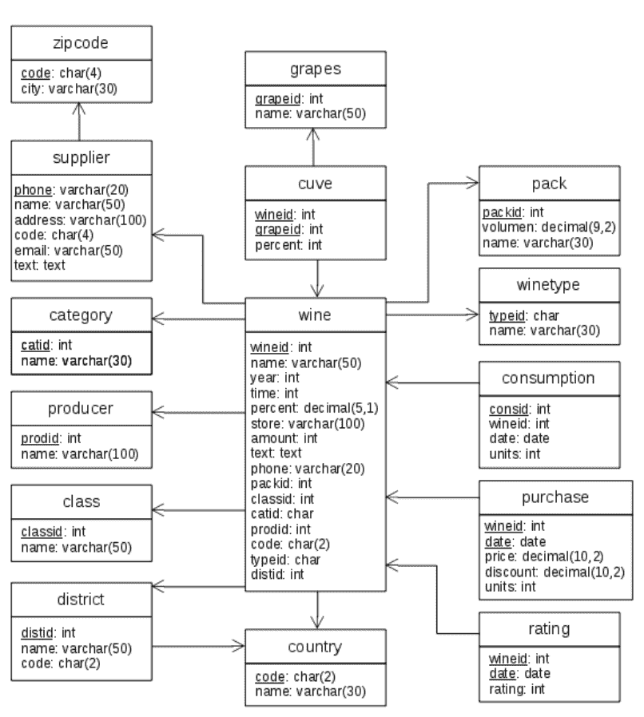

## 程序架构

程序原则上能够维护数据库，为了这些程序将使用一些窗口和对话框，程序将由许多文件（类型）。作为开始，我因此创建了 `MyWines` 项目并创建了以下包：

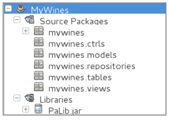

`mywines` 是 NetBeans 创建的默认包，应该只包含带有 `main(method)` 方法的类

`mywines.ctrls` 应包含所有对话框的控制器类

`mywines.models` 应用于模型类，本质上是每个数据库表的一个模型类

`mywines.repositories` 应该包含 SQL 代码的类，以及从表中提取数据并更新表的代码

`mywines.tables` 属于用户界面层，并由作为 `JTable` 组件数据模型的类组成

`mywines.views` 应包含对话框

此外添加了我的类库 `PaLib` 的引用，我将使用该库中的工具。

我现在准备好开始开发程序，我将从模型层开始并编写第一个模型类，一个模型类应该模拟数据库表中的行。到目前，我将集中在 `wine` 表及其引用的表上，我将编写以下模型类：

- `Zipcode`
- `Supplier`
- `Producer`
- `Category`
- `Classification`
- `Wineryper`
- `Grape`
- `Country`
- `District`
- `Packing`
- `Wine`

## JAVA 6：JDBC 与数据库应用程序

除了最后一个类外，它们都是简单的，区别仅在于它们包含的字段。例如所示，`District` 类为 `district` 表：

```java
package mywines.models;

public class District {

    public static final int NAME = 50;

    private final int id;

    private String name;

    private String code;

    public District(int id, String name, String code) {

        this.id = id;

        this.name = name;

        this.code = code;

    }

    public int getId() {

        return id;

    }

}
```


```java
public String getName()
{
    return name;
}
```

```java
public String getCode()
{
    return code;
}
```

```java
public void setName(String name)
{
    this.name = name;
}
```

```java
public void setCode(String code)
{
    this.code = code;
}
```

```java
@Override
public boolean equals(Object obj)
{
    if (obj == null) return false;
    if (getClass() == obj.getClass()) return id == ((District)obj).id;
    return false;
}
```

```java
@Override
public int hashCode()
{
    return id;
}
```

```java
@Override
public String toString()
{
    return name;
}
```

该类非常简单，因为它只包含类变量的 `get` 和 `set` 方法。注意该类重写了 `equals()` 方法，使得两个对象相等，意味着数据库中对应的行具有相同的主键。此外请注意，定义了一个公共常量 `NAME`，它表示数据库中为列名预留了多少字符（在数据库中类型为 `VARCHAR(50)`）。

## JAVA 6：JDBC 与数据库应用程序

数据库应用程序的开发通常从编写这类模型类开始。可能会有各种变化，但基本上它们会对数据库表的列进行建模，而且通常这些类在开发过程中还会进一步扩展。

`wine` 类的设计基本上也是相同的，但由于 `wine` 表有很多列，它包含的内容多得多。类的开头如下：

```java
public class Wine
{
    private int id;
    private String name;
    private Integer year;
    private Integer time;
    private BigDecimal pct;
    private String barrel;
    private int units;
    private String text;
    private Packing packing;
    private Supplier supplier;
    private Producer producer;
    private Country country;
    private District district;
    private Classification classification;
    private Category category;
    private Winetype wintype;
    private List<Cuve> cuve = false;
    private boolean mark;
}
```

在这里你应该注意，外键列被定义为对该类型对象的引用。例如，如果考虑供应商（`supplier`），它不是一个 `String`（主键电话），而是对 `Supplier` 对象的引用。

你还需要注意变量 `cuve`，它是一个包含 `Cuve` 类型对象的集合。数据库有一个 `cuve` 表，它是 `wine` 和 `grapes`（葡萄）之间的关系表，定义了哪些葡萄属于某款葡萄酒。`Cuve` 类模拟了这个表，但增加了一个用于葡萄名称的变量：

```java
public class Cuve
{
    private int wineid;
    private int grapeid;
    private String name;
    private Integer pct;
    private boolean mark = false;
}
```

## JAVA 6：JDBC 与数据库应用程序

### 最终示例

还有一个变量 `mark`，它允许高亮（选择）集合中的对象。`wine` 类有一个对应的变量。你将看到这些变量在用户界面是如何使用的。

## 主视图 (MAINVIEW)

随后我将编写 `Main` 程序，但首先我在 MySQL Workbench 中执行了以下脚本，创建一个供应商和三款葡萄酒：

```sql
use cellar;
```

```sql
INSERT INTO supplier (phone, name, address, code, email) VALUES
('98921853', 'Supervin', 'Skagensvej 201', '9800', 'info@supervin.dk');

INSERT INTO wine (name, year, phone) VALUES
('Clos Sainte Anne', 2013, '98921853');

INSERT INTO wine (name, year, phone) VALUES
('Chateau Lamartine', 2011, '98921853');

INSERT INTO wine (name, year, phone) VALUES
('Montecore Primitivo', 2015, '98921853');
```

该脚本名为 `Threesewines.sql`，其目的是创建一个数据库，以便在界面上显示：

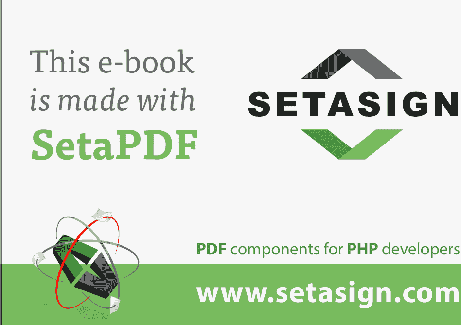

当我启动程序时，尽可能快地显示界面。当程序执行时，它应该显示：

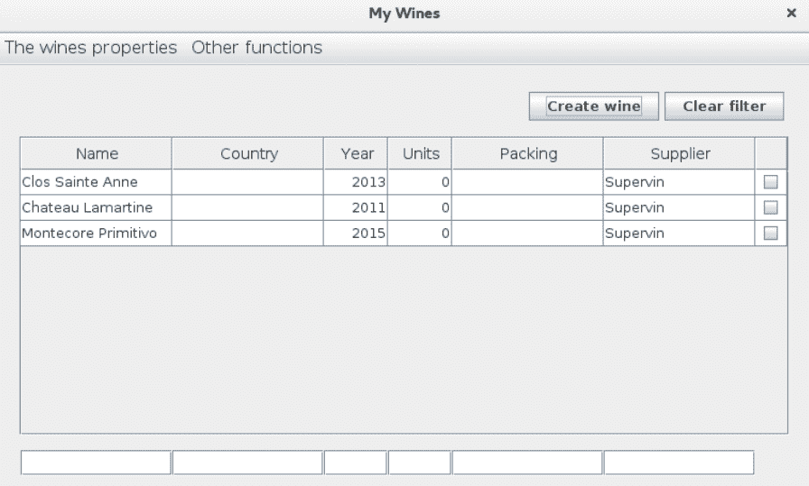

这里你应该注意外键列被定义为该类型对象的引用。

```java
package mywines.repositories;

import java.sql.*;

public class DB {

    private static DB instance = null;

    private String host = "localhost";

    private String data = "cellar";

    private String port = "3306";

    private DB() {

    }

    public static DB getInstance() {

        synchronized (DB.class) {

            if (instance == null) {

                instance = new DB();

            }

        }

        return instance;

    }

}
```

## JAVA 6：JDBC 与数据库应用程序

### 最终示例

```java
public Connection getConnection() throws SQLException
{
    return DriverManager.getConnection(
        String.format("jdbc:mysql://%s:%s/%s?useSSL=false", host, port, data));
}
```


## Java 6：JDBC 与数据库应用

### `Repository` 类

`Repository` 类也是单例，到目前为止它有一个方法可以返回表中所有行的 `Wine` 对象。然而，它是程序的核心类，包含了：

> 我们不重新发明轮子，我们重新发明光。  
> 迷人的光影提供了无限可能：创新技术和新市场带来了机遇与挑战。在这个环境中，你的专业知识大受需求。在全球范围内享受支持性的工作环境，并从国际职业路径中受益。与其他专家紧密合作，实施可持续想法，影响我们的未来。加入我们，每天重新发明光。


## 维度表（Dimension Tables）

下一步，我想编写维护维度表的代码，即“属性”（The properties）菜单下的所有功能。所有功能原理上工作方式相同，我将以“维护葡萄酒类型”为例。如果你点击该菜单项，程序将打开以下对话框：

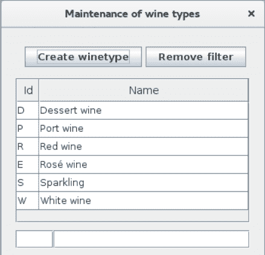

该对话框显示了一个包含所有葡萄酒类型的 `JTable`，即 `winetype` 表的内容，底部定义了创建新的葡萄酒类型和移除过滤器。双击表格中的某行，你会获得一个可以编辑（并删除）葡萄酒类型的对话框，例如：

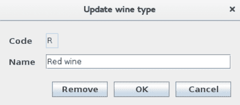

这与创建新葡萄酒类型时使用的对话框是相同的。

## Java 6：JDBC 与数据库应用

### 最终示例

菜单项 `wines`（葡萄酒）具有 9 个功能，对于这 9 个功能中的每一个，都应该发生以下情况：

1. `Repository` 类必须扩展 4 个新方法：一个返回与数据库表内容对应的对象列表的方法、一个在数据库中创建新行的方法、一个更新现有行的方法以及一个删除现有行的方法。
2. 有一个类是 `JTable` 组件的数据模型。
3. 有一个类是带有 `JTable` 组件的对话框。
4. 有一个类是用于编辑对象的对话框的控制器。
5. 有一个类是最后一个对话框。

菜单有 9 个功能意味着程序可能会扩展 36 个新类，例如 `Repository` 类必须扩展 36 个新方法。这听起来很多，但反之也如此。请注意，程序中还提到了用于维护 9 个数据库表的代码，你应该注意这些类通常是简单的，示例适用于 `Repository` 类中的方法。

你还应该注意到，这种实现是程序维护数据库表的一种模式，其中你有一个带有 `JTable` 和显示数据库内容的过滤对话框，你可以在表格中添加或编辑行。我喜欢用这种方式工作，因为当表格变化时逻辑很清晰，但也有其他方法，这里特别重要的是指出，人们可以直接编辑 `JTable` 的内容。

## 葡萄酒表

`wine` 表的维护遵循相同的模式。也就是说，`MainView` 有一个按钮用于创建新葡萄酒，如果双击表格中的某行，就可以编辑该葡萄酒。在这两种情况下都使用了对话框，原则上意味着与上述相同：

- `Repository` 类必须扩展 3 个新功能（返回所有葡萄酒的功能已经实现）。
- 为该对话框编写一个控制器。
- 必须编写对话框本身。

区别在于，这次是一个非常复杂的对话框，具有许多其他功能。如果你在主窗口中双击某款葡萄酒，结果如下所示：


## Java 6：JDBC 与数据库应用

### 最终示例

对话框左侧有用于输入信息的字段，可以输入信息；右侧是用于从维度表中选择值的组合框。除了用于葡萄的 `JTable` 组件外，一切都应该是一目易懂的。底部显示了数据库中所有葡萄的表格以及关联过滤器。顶部是用于此葡萄酒的葡萄。

如果你现在在下方的 `JTable` 中通过勾选选择框选择一个或多个葡萄并点击 `Add`（添加）按钮，葡萄就会添加到上方的 `JTable` 中，因此葡萄就成了葡萄酒的一部分。在上方 `JTable` 中，你同样可以勾选一个或多个复选框，如果点击 `Remove`（移除），葡萄将从葡萄酒中移除。

顶部的 `JTable` 还有一列用于记录该葡萄在该葡萄酒中的占比（如果该葡萄酒由多种葡萄组成）。该列通过在 `percent`（百分比）中输入值来编辑。

窗口顶部有 6 个按钮。它们用于创建某种类型的对象，因此功能与从菜单中选择的功能相同。这些快捷键的含义是，当你准备创建一个新葡萄酒（或编辑现有的葡萄酒），并发现葡萄酒来自一个尚未创建的地区，你可以立即创建该地区。这 6 个功能使用了之前为维护维度表创建的相同对话框。

窗口底部另有 8 个按钮，`OK`（确定）和 `Cancel`（取消）按钮的含义不言自明。其他 6 个按钮只有在编辑葡萄酒时才能激活，而在创建新葡萄酒时无法激活。其功能说明下文。

### 更新葡萄酒

| 生产者 | 供应商 | 国家 | 分类 | 葡萄 |
|---|---|---|---|---|
| 品名 | Xavier Chateauneuf du Pape | 包装 | 75.00 cl.（标准） | |
| 年份 | 2011 | 供应商 | Survinin | |
| 酒精度 | | 生产者 | Xavier | |
| 酒精含量 | 14.5 | 国家 | Franking | |
| 桶桶 | | 地区 | Sydlige Rhone | |
| 单位 | 12 | | | |
| 描述 | | 葡萄酒类别 | 优质葡萄酒 | |
| 葡萄酒类型 | 红酒 | | | |
| 此酒中的葡萄 | 百分比% | | | |
| 西拉品种（Grenache） | | | | |
| 品名 | | | | |
| 赤霞芽（Cabernet sauvignon） | | | | |
| 卡里南（Carignan） | | | | |
| 霞霞（Chardonnay） | | | | |
| 西拉品种（Grenache） | | | | |
| 梅洛（Merlot） | | | | |

| `Remove`（移除） | `Copy`（复制） | `Points`（评分） | `Purchase`（购买） | `Consume`（消耗） | `Units`（单位） | `OK`（确定） | `Cancel`（取消） |
|---|---|---|---|---|---|---|---|

`Remove` 按钮用于移除葡萄酒。该功能还会移除与此葡萄酒相关的所有信息。

`Copy` 按钮用于创建一个相同数据的新葡萄酒，即关于葡萄酒的信息、价格和单位。

## Java 6：JDBC 与数据库应用

### 最终示例

窗口底部另有 8 个按钮，`OK`（确定）和 `Cancel`（取消）按钮的含义不言自明。其他 6 个按钮只有在编辑葡萄酒时才能激活，而在创建新葡萄酒时无法激活。其功能说明下文。

`Remove` 按钮用于移除葡萄酒。该功能还会移除与此葡萄酒相关的所有信息。

`Copy` 按钮用于创建一个相同数据的新葡萄酒，即关于葡萄酒的信息、价格和单位。

## Java 6：JDBC 与数据库应用程序

### 搜索函数

然后是最后一个菜单中的三个函数。这三个函数非常相似，并且打开的对话框设计几乎相同。第一个打开一个如下所示的对话框，用于根据若干标准搜索葡萄酒。窗口显示已对所有法国葡萄酒进行了搜索。

如果某个字段为空（未选择搜索标准），则在搜索时将忽略它。如果你在 `Name`（名称）和 `Description`（描述）字段中输入值，则意味着数据库中的某个值要匹配实际列中的值。

对于可以输入两个值的标准，它意味着从一个值到另一个值的范围；如果你只输入一个值，则表示“从……”或“到……”。如果你在葡萄酒表格的组合框行中选择一个值，则该行在实际列中必须具有该值（在下面的示例中，国家列的值必须为 `FR`）。

如果你双击表格中的某行，程序将打开葡萄酒的 `ImageView` 对话框，你可以对葡萄酒进行维护。

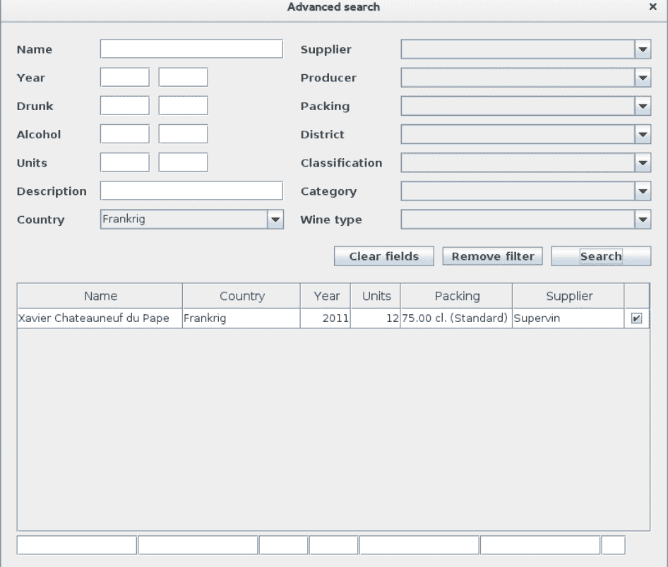

另外两个搜索函数会打开相应的对话框，我在这里不会显示这些对话框。区别在于，这两个对话框都可以选择一个时间段作为搜索标准，并且 `JTable` 组件还有其他列。此外，两个对话框在底部都显示了一些总计。

第一个对话框被称为 `PurchasesView`，显示匹配搜索标准的购买列表。

| 购买项目 |
|---|
| Xavier Chateauneuf du Pape <br>2011（75.00 cl.） |
| 日期 | 评分 |
| 11-01-2017 | 90 |
| 13-01-2017 | 91 |


## Java 6：JDBC 与数据库应用程序

### 示例示例

如果你双击表格中的某行，你将获得上述对话框，显示该葡萄酒的所有评分。最后一个函数的功能类似，但它显示的是匹配搜索标准的消耗概览。如果你双击某行，将得到以下对话框：

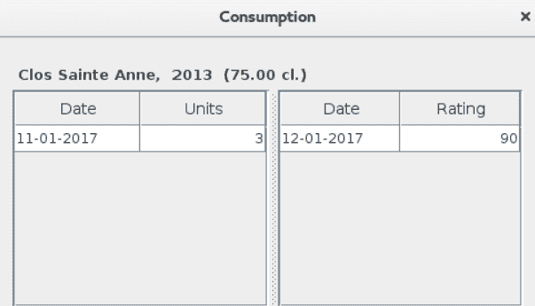

对话框显示了按日期划分的消耗情况以及所有评分的概览。

这三个函数会产生若干新类，我将不再提及它们，但这三个带有搜索标准的对话框非常详尽且彼此相似，因此它们的所有共同点都移动到了基类中：

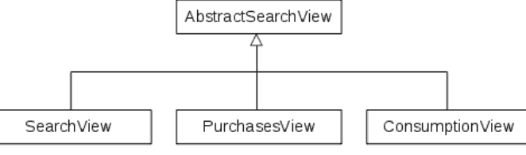

应该编写一些代码来实现这三个函数，但与已经提到的相比，有许多新内容。最复杂的是创建要使用的 SQL 表达式，部分是因为在许多表上有 `JOIN` 操作，部分是因为 `WHERE` 部分取决于所选的搜索标准。一切都发生在 `Repository` 类中，鼓励你研究这些代码和许多细节。

## Java 6：JDBC 与数据库应用程序

### 最后几件事

最后还有两件事：

1. 将数据库参数从程序代码移动到配置文件。
2. 编写一个安装脚本。

关于第一个问题，我将使用以下名为 `mywines.config` 的配置文件：

```text
host:localhost
port:3306
data:cell
user:pa
code:Volmer_1234
```

接下来，对 `DB` 类进行了修改：

```java
package mywines.repositories;

import java.io.*;

import javax.swing.*;

import java.sql.*;

public class DB {

    private static String path = System.getProperty("user.home") + "/";

    private static DB instance = null;

    private String host = "";

    private String port = "";

    private String data = "";

    private String user = "";

    private String code = "";

    public DB() {

        try (BufferedReader reader = new BufferedReader(new FileReader(path + "mywines.config"))) {

            for (String line = reader.readLine(); line != null; line = reader.readLine()) {

                String[] item = line.split(":");

                if (item.length == 2) {

                    String key = item[0].trim();

                    if (key.equals("host")) host = item[1].trim();
```

```java
else if (key.equals("port")) port = item[1].trim();

else if (key.equals("data")) data = item[1].trim();

else if (key.equals("user")) user = item[1].trim();

else if (key.equals("code")) code = item[1].trim();

} catch (IOException ex) {

    JOptionPane.showMessageDialog(null, "Could not connect to database.", "Error", JOptionPane.ERROR_MESSAGE);

    System.exit(0);

}

public static synchronized DB getInstance() {

    if (instance == null) {

        instance = new DB();

    }

    return instance;

}

public static void setPath(String pathname) {

    path = pathname;

}

public Connection getConnection() throws SQLException {

    return DriverManager.getConnection(String.format("jdbc:mysql://%s:%s/%s", host, port, data), user, code);

}
```


`host:localhost`

`port:3306`

`data:cell`

`user:pa`

`code:Volmer_1234`

接下来，对`DB`类进行了修改：

```java
package mywines.repositories;

import java.io.*;
import javax.swing.*;
import java.sql.*;

public class DB {

    private static String path = System.getProperty("user.home") + "/";
    private static DB instance = null;
    private String host = "";
    private String port = "";
    private String data = "";
    private String user = "";
    private String code = "";

    public DB() {
        try (BufferedReader reader = new BufferedReader(new FileReader(path + "mywines.config"))) {
            for (String line = reader.readLine(); line != null; line = reader.readLine()) {
                String[] item = line.split(":");
                if (item.length == 2) {
                    String key = item[0].trim();
                    if (key.equals("host")) host = item[1].trim();
```

```java
else if (key.equals("port")) port = item[1].trim();
else if (key.equals("data")) data = item[1].trim();
else if (key.equals("user")) user = item[1].trim();
else if (key.equals("code")) code = item[1].trim();
```

*(原文在此处截断，翻译仅涵盖已出现内容)*

# JAVA 6: JDBC 与数据库应用程序

## 最终示例

结果是我的家目录包含包含文件 *myines.tar*，因此该文件包含了可以分发给程序用户的文件。在这里，用户必须提取该文件：

```
$ tar -xvf myines.tar
```

如果用户位于提取文件所在的目录并执行以下操作：

1. 编辑配置文件
2. 打开 *MySQL*、*Workbench* 并执行脚本 *Wine.sql*
3. 执行安装脚本

那么程序应该就可以运行了。

但 Java 和 JDBC 驱动程序可能会出现问题。如果需要，你可以在附录 A 中找到解决方案。


# 附录 A：安装 MYSQL

以下是对如何安装 MySQL 数据库服务器的简要描述，正如本书开头提到的，你必须安装三个产品：

1. 数据库服务器
2. 用于管理和维护数据库的客户端工具
3. JDBC 驱动程序

通常情况下，这三个产品的安装不会出现大问题，下面展示了我在运行 Fedora 23 的普通 PC 上是如何安装这些产品的。

## 数据库服务器

可以从页面下载服务器：

```
http://dev.mysql.com/downloads/mysql/
```

在这里，你应该选择平台（例如 Fedora），当你点击 Download 时，系统会要求你登录，如果是第一次下载 MySQL，你必须创建一个用户登录。登录后，选择产品，我选择了：

Fedora 23 (Architecture Independent), RPM Package

然后你将看到通常的下载/安装窗口，在这种情况下是一个 rpm 包：

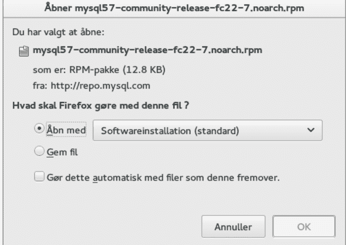

在 bookoon.com 下载免费电子书

## JAVA 6: JDBC 与数据库应用程序

我选择了“Software installation（软件安装）”，因此该产品将安装在我的软件存储库中。这不需要花费太多时间，但必须安装产品，这意味着各个软件包（总共 6 个）将被下载并安装。这在 Software 程序中是自动完成的：

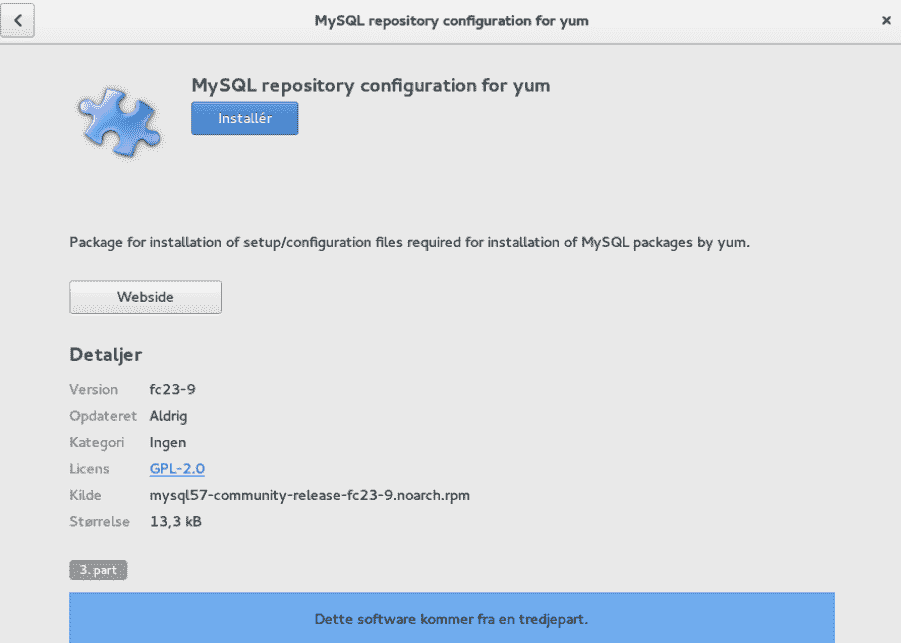

安装完成后，你可以使用以下命令启动服务器：

```
sudo service mysqld start
```

然后服务器会在每次启动机器时自动启动。你可以通过以下命令测试服务器是否正在运行：

```
sudo service mysqld status
```

在 bookboom.com 下载免费电子书

## JAVA 6: JDBC 与数据库应用程序

此之后，MySQL 在原则上已经安装并运行。缺少的是一种使用脚本完成的配置。在 MySQL 安装后，会创建一个名为 root 的数据库管理员，它是唯一的数据库用户。作为安装脚本的一部分，它为该用户自动生成了一个密码，该密码存储在 `/var/log/mysqld.log` 文件中。你可以通过命令找到此密码：

```
sudo grep 'temporary password' /var/log/mysqld.log
```

一旦找到此密码，你就必须运行一个脚本：

```
mysql_secure_installation
```

在这里，系统会提示你输入密码，然后为 root 选择一个新密码。脚本随后会询问你不同的问题，所有这些都与安全有关（以及一些清理工作），你只需对全部回答 Yes 即可。

脚本完成后，数据库已安装并准备好使用。


## JAVA 6: JDBC 与数据库应用程序

## 最终示例

## 客户端工具

与数据库服务器一起安装的是命令行客户端工具，但还有一个名为 MySQL Workbench 的 GUI 程序也应该被安装。该程序可以从这里下载：

```
http://dev.mysql.com/downloads/workbench/
```

在这里你必须再次选择平台和你想下载的产品。我选择了：

Fedora 23 (x86, 64-bit), RPM Package

我再次得到了下载窗口：

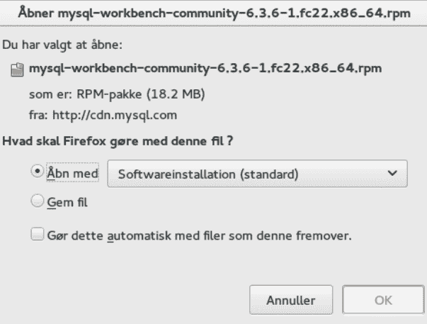

如果你选择“Software Installation（软件安装）”并点击 OK，它将自动完成。这需要一些时间，但随后工具就安装了，你获得了一个桌面图标。如果你打开程序，必须使用你刚刚选择的密码以 root 登录。你可以操作 MySQL、管理服务器、创建数据库等。作为第一件事，你应该创建一个新用户，仅在需要时使用 root。我创建了一个名为 pa 的用户，并赋予了他 DBA 权限。这对于日常来说显然太高了，但在你学会使用 MySQL 之前，这是合理的。

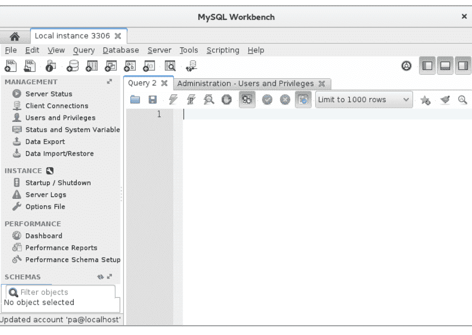

## JDBC

JDBC 驱动程序可以从这里下载：

```
http://dev.mysql.com/downloads/mysql/
```

在这里你需要选择平台（例如 Fedora），当你点击 Download 时会要求你登录，如果是第一次下载 MySQL，你必须创建一个用户登录。登录后，选择产品，我选择了：

Fedora 23 (Architecture Independent), RPM Package

然后你得到通常的下载/安装窗口，在这种情况下是一个 rpm 包：

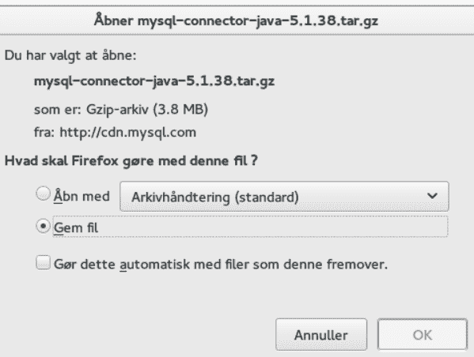

## JAVA 6: JDBC 与数据库应用程序

## 最终示例

以下是关于安装 MySQL 数据库服务器的简要描述，正如本书开头提到的，你必须安装三个产品：

1. 数据库服务器
2. 用于管理和维护数据库的客户端工具
3. JDBC 驱动程序

通常情况下，这三个产品的安装不会出现大问题，下面展示了我在运行 Fedora 23 的普通 PC 上是如何安装这些产品的。

## 数据库服务器

服务器可以从页面下载：

```
http://dev.mysql.com/downloads/mysql/
```

在这里，你应该选择平台（例如 Fedora），当你点击 Download 时会要求你登录，如果是第一次下载 MySQL，你必须创建一个用户登录。登录后，选择产品，我选择了：

Fedora 23 (Architecture Independent), RPM Package

然后你得到通常的下载/安装窗口，在这种情况下是一个 rpm 包：


## JAVA 6: JDBC 与数据库应用程序

我选择了 Software installation（软件安装），因此产品将安装在我的软件存储库中。这不需要花费太多时间，但必须安装产品，这意味着各个软件包（总共 6 个）将被下载并安装。这在 Software 程序中是自动完成的：


安装完成后，你可以使用以下命令启动服务器：

```
sudo service mysqld start
```

然后服务器会在每次启动机器时自动启动。你可以通过以下命令测试服务器是否正在运行：

```
sudo service mysqld status
```

## JAVA 6: JDBC 与数据库应用程序

此之后 MySQL 在原则上已经安装并运行。缺少的是一种使用脚本完成的配置。在 MySQL 安装后，会创建一个名为 root 的数据库管理员，它是唯一的数据库用户。作为安装脚本的一部分，它为该用户自动生成了一个密码，该密码存储在 `/var/log/mysqld.log` 文件中。你可以通过命令找到此密码：

```
sudo grep 'temporary password' /var/log/mysqld.log
```

一旦找到此密码，你就必须运行一个脚本：

```
mysql_secure_installation
```

在这里，系统会提示你输入密码，然后为 root 选择一个新密码。脚本随后会询问你不同的问题，所有这些都与安全有关（以及一些清理工作），你只需对全部回答 Yes 即可。

脚本完成后，数据库已安装并准备好使用。


## JAVA 6: JDBC 与数据库应用程序

## 最终示例

## 客户端工具

与数据库服务器一起安装的是命令行客户端工具，但还有一个名为 MySQL Workbench 的 GUI 程序也应该被安装。该程序可以从这里下载：

```
http://dev.mysql.com/downloads/workbench/
```

在这里你必须再次选择平台和你想下载的产品。我选择了：

Fedora 23 (x86, 64-bit), RPM Package

我再次得到了下载窗口：


如果你选择 Software Installation（软件安装）并点击 OK，它将自动完成。这需要一些时间，但随后工具就安装了，你获得了一个桌面图标。如果你打开程序，必须使用你刚刚选择的密码以 root 登录。你可以操作 MySQL、管理服务器、创建数据库等。作为第一件事，你应该创建一个新用户，仅在需要时使用 root。我创建了一个名为 pa 的用户，并赋予了他 DBA 权限。这对于日常来说显然太高了，但在你学会使用 MySQL 之前，这是合理的。


## JDBC

JDBC 驱动程序可以从这里下载：

```
http://dev.mysql.com/downloads/mysql/
```

在这里你需要选择平台（例如 Fedora），当你点击 Download 时会要求你登录，如果是第一次下载 MySQL，你必须创建一个用户登录。登录后，选择产品，我选择了：

Fedora 23 (Architecture Independent), RPM Package

然后你得到通常的下载/安装窗口，在这种情况下是一个 rpm 包：


## JAVA 6: JDBC 与数据库应用程序

## 最终示例

以下是关于安装 MySQL 数据库服务器的简要描述，正如本书开头提到的，你必须安装三个产品：

1. 数据库服务器
2. 用于管理和维护数据库的客户端工具
3. JDBC 驱动程序

通常情况下，这三个产品的安装不会出现大问题，下面展示了我在运行 Fedora 23 的普通 PC 上是如何安装这些产品的。

## 数据库服务器

服务器可以从页面下载：

```
http://dev.mysql.com/downloads/mysql/
```

在这里，你应该选择平台（例如 Fedora），当你点击 Download 时会要求你登录，如果是第一次下载 MySQL，你必须创建一个用户登录。登录后，选择产品，我选择了：

Fedora 23 (Architecture Independent), RPM Package

然后你得到通常的下载/安装窗口，在这种情况下是一个 rpm 包：


## JAVA 6: JDBC 与数据库应用程序

那显示了当前的运行时系统是 openjdk。然后为运行时系统添加一个替代方案：

```
$ sudo alternatives --install /usr/bin/java java /usr/java/latest/java 1
[sudo] angscode for pa:
```

然后将新的运行时系统（Oracle 的 java）设置为默认：

```
$ sudo update-alternatives --config java
```


有 3 个程序提供了 "java"：

| Select | Command |
|---|---|
| * 1 | `/usr/lib/jvm/java-1.8.0-openjdk-1.8.0.111-1-b16.fc23.x86_64/jre/bin/java` |
| 2 | `/usr/java/jdk1.8.0_111/bin/java` |
| 3 | `/usr/java/latest/bin/java` |

按回车选择当前选择，或输入选择的编号：3

# JAVA 6: JDBC 与数据库应用程序最终示例

数据库是相关表的集合，表包含组织成列和行的数据。例如，数据库表中的一个书籍表示例，它有七列：

| # | isbn | title | edition | year | pages | pubnr | catnr |
|---|---|---|---|---|---|---|---|
| 1 | 0-0754225-2 | Functional Application | | 1973 | 397 | 3 | 2 |
| 2 | 0-0722897-0 | C++ from the Ground Up | | 2003 | 602 | 3 | 1 |
| 3 | 0-1296050-5 | Homotopy Theory, An Introduction to Algebraic Topology | 1 | 1975 | 368 | 10 | 2 |
| 4 | 0-0139859-5 | Object-Oriented Programming in Java | 1 | 2001 | 641 | 2 | 1 |
| 5 | 0-0238418-1 | Perl. How to Program | 1 | 2001 | 1057 | 2 | 1 |
| 6 | 0-0323777-2 | Java for Students | 3 | 2002 | 634 | 2 | 1 |
| 7 | 0-0330370-0 | Object-Oriented Problem Solving Java, Java, Java | 2 | 2003 | 862 | 2 | 1 |
| 8 | 0-0341517-7 | Java, How to Program | 4 | 2000 | 1546 | 2 | 1 |
| 9 | 0-044929-6 | Objects First With Java | 1 | 2003 | 286 | 2 | |

每一列都有一个名称，且名称在每个表中必须是唯一的。每列都有数据类型，决定了该列可以包含的数据。一行包含关于特定书籍的数据，行在某列中的值称为字段，并且必须匹配该列的数据类型。一行也称为记录。特定字段的值可以为空，这仅意味着该字段没有值，重要的是，这不等同于 0 或空白。

可以为列分配约束，这些约束可以看作是条件，该列中的值必须满足这些条件。如果不满足，数据库管理系统将拒绝该数据库操作。最重要的约束是：

- `NOT NULL`：表示列不能包含空值，该行在该列中必须有值。
- `DEFAULT`：当列没有值时，你可以指定一个被使用的默认值。
- `UNIQUE`：意味着列的值必须是唯一的。
- `PRIMARY KEY`：表示此列中的所有行都应该有一个用于标识记录的唯一值。
- `FOREIGN KEY`：定义对另一个表（可能是同一表）中主键的引用。列的值必须是另一个表中主键的值或空。
- `CHECK`：可以定义列的值必须满足某个条件。
- `INDEX`：为列的值定义索引（目录）。

数据库管理系统是维护数据库的程序族，它是一个在后台不断运行并等待 SQL 命令中用户请求的守护进程。除了执行这些命令外，它还是验证命令可以正确执行的数据库管理系统，在此上下文中测试是否遵守了上述约束。数据库管理系统必须确保数据库的完整性，你涉及到以下完整性规则：

1. *实体完整性*（Entity integrity）：意味着主键列不能有 `NULL` 值，且此列中的所有值都是不同的。
2. *域完整性*（Domain integrity）：确保列的值符合类型定义和约束。
3. *引用完整性*（Referential integrity）：保证如果数据库包含引用此行的其他行（通常在另一个表中），则该行不能被删除。
4. *用户定义完整性*（User defined integrity）：可以定义不属于上述三个规则的特殊规则。

这些规则有助于确保数据库数据始终包含合法值，但它们不能确保效率，效率取决于数据库如何设计和创建。良好的数据库设计有一些准则，其中之一被称为规范化（Normalization）。简单来说，它是数据库设计必须满足的各种条件。通常只使用前三个（但还有几个），关于这一点，数据库处于第三范式。我在这里不会提到数据库的规范化，而是请参考关于数据库理论的书籍或文章，或者《Java 7》。

## 书籍数据库

为了展示特定的 SQL 命令，我需要一个可以执行它们的数据库。我想使用一个由 5 表组成的数据库。主表包含书籍信息：

- 书籍 ISBN
- 书籍标题
- 书籍版本
- 书籍出版年份
- 书籍页数

## 数据类型

- `Smallmoney` 到货币值：范围从 -2147.3648 到 21478.3647
- `Float` 到浮点数：范围从 -3.40E+38 到 3.40E+38（该类型也称为 `Real`）。
- `Double` 到浮点数：范围从 -1.79E+308 到 1.79E+308
- `Datetime` 到时间记录：范围从 1753年1月1日到 9999年12月31日
- `Smalldatetime` 到时间记录：范围从 1900年1月1日到 2079年6月6日
- `Date`（日期）：格式为 `YYYYMMDD` 的日期
- `Time`（时间）：格式为 `HHMMMSS` 的时间
- `Char`：固定长度的文本，最多 255 个字符，字段用空格填充。
- `Varchar`：可变长度文本，最多可达 65535 个字符。

此外，还有 `Text` 和 `Blob` 两种类型，它们填充相同（容量相同），但分别用于文本和二进制数据。它们有多种变体：

- `Tinytext` 和 `Tinyblob`：空间最大 255 字节。
- `Text` 和 `Blob`：空间最大 65535 字节。
- `Mediumtext` 和 `Mediumblob`：空间最大 16777215 字节。
- `Longtext` 和 `Longblob`：空间最大 4294967295 字节。


上述内容适用于 MySQL，但其他数据库可能有多种数据类型。

除了数据类型外，还有与其他编程语言相似的运算符，在算术运算符和比较运算符方面，语法与 Java 几乎相同。然而，还有其他一些运算符，我将在结合示例进行解释，列表如下：

- `ALL`
- `AND`
- `ANY`
- `BETWEEN`
- `EXISTS`
- `IN`
- `LIKE`
- `NOT`
- `OR`
- `IS NULL`
- `UNIQUE`

## SQL 命令

SQL 是一种命令语言，包含以下命令：

- `CREATE`：用于创建数据库对象（如表）
- `ALTER`：用于修改现有对象（如表）
- `DROP`：用于删除对象（如表）

这些命令被称为 DDL 命令（数据定义语言命令）。

- `GRANT`：用于为用户分配权限
- `REVOKE`：用于从用户处移除权限

这些命令被称为 DCL 命令（数据控制语言命令）。

- `INSERT`：用于向表中插入行
- `UPDATE`：用于修改表中一行或多行的内容
- `DELETE`：用于删除表中的一行或多行

这些命令被称为 DML 命令（数据操作语言命令）。

- `SELECT`：用于从一个或多个表中提取行

此命令被称为 DQL 命令（数据查询语言命令）。

SQL 共有这 9 种命令，因此 SQL 应该很容易学习，事实也如此；只有最后一个命令的语法非常复杂且全面。

首先注意，SQL 不区分大小写，但在随后的内容，我通常用大写字母写 SQL 名称，这仅仅是为了让读者清楚哪些是 SQL 关键字。

示例显示了一个创建数据库的命令：

```sql
CREATE DATABASE books;
```

如果你想再次删除该数据库，可以使用以下命令执行：

```sql
DROP DATABASE books;
```

必须警惕上述的命令，除非你确实想删除带有数据的数据库，否则不要这样做。

如果使用数据库管理系统管理多个数据库（事实总是如此），并且打开了 MySQL Workbench，你必须告诉 SQL 命令在哪个数据库上运行。你可以通过如下命令来实现：

```sql
USE books;
```

这会将 `books` 数据库设置为当前数据库。

如果 `books` 数据库是当前数据库，你可以如下创建一个表：

```sql
CREATE TABLE publisher (
  pubnr INT NOT NULL,
  name VARCHAR(40) NOT NULL,
  PRIMARY KEY (pubnr));
```

在这里你创建了一个名为 `publisher` 的出版商表。该表有两列，第一列名为 `pubnr`，类型为 `INT` 必须包含整数；而另一列名为 `name`，类型为 `VARCHAR`，可以存储最多 40 个字符并包含文本。两列都定义为 `NOT NULL`（非空），且每一行必须为 `pubnr` 和 `name` 都有值。最后定义了 `pubnr` 列必须是主键。该命令分多行编写。这并非必须的，只是为了可读性，但你应该注意有逗号的地方，因为它们必须存在。涉及的命令还可以写如下：

```sql
CREATE TABLE publisher (
  pubnr INT PRIMARY KEY,
  name  VARCHAR(40) NOT NULL );
```

当我没有为 `pubnr` 列指定 `NOT NULL` 时，是因为定义为主键的列会自动变为 `NOT NULL`。


下面是另一个创建表的命令示例：

```sql
CREATE TABLE publisher (
  pubnr INT,
  name VARCHAR(40) NOT NULL,
  PRIMARY KEY (pubnr),
  title TEXT,
  publisher VARCHAR(60),
  year INT,
  pages INT
);
```

如果你想向表中添加一个约束，可以使用：

```sql
ALTER TABLE publisher ADD CONSTRAINT editionCheck CHECK (edition < 20);
```

如果你想修改约束，可以这样做：

```sql
ALTER TABLE publisher ALTER CONSTRAINT editionCheck CHECK (edition BETWEEN 1 AND 19);
```

如果你想删除该约束，可以使用：

```sql
ALTER TABLE publisher DROP CONSTRAINT editionCheck;
```

如果你想更改列的数据类型，可以使用如下：

```sql
ALTER TABLE publisher MODIFY edition INT;
```

如果你想删除一列，可以使用：

```sql
ALTER TABLE publisher DROP COLUMN info;
```

我将从 `INSERT` 命令开始，它向表中插入行。作为一个示例，以下命令向 `author` 表插入了一行：

```sql
INSERT INTO author VALUES (186, 'Mogens', 'Trolle');
```

为了使该命令执行，有两个要求：

1. `VALUES` 之后必须在括号内提供表中三个列的每个值，且类型必须匹配。
2. `autnr` 的值（186）不能已经存在——该列是主键。

在很多方面，这是你能想象到的最简单的 `INSERT` 命令。

然而，行的插入通常需要向多个表中插入行。例如，我想创建这本书：78-7900-910-7，《Afrikas dyrel》，由 Globe 出版，第 1 版，作者 Mogens Trolle 著。

那么如果出版商不存在，则必须创建。当作者已经创建（使用上述命令）时，表中也必须写入一行数据，然后可以如下所示创建书籍：

```sql
INSERT INTO publisher VALUES (21, 'Globe');
INSERT INTO book (isbn, title, edition, pubnr)
VALUES ('87-7900-910-7', 'Afrikas direyliv', 1, 21);
INSERT INTO written VALUES ('87-7900-910-7', 186);
```

第一条命令除了再次意识到出版商编号 21 不得已经存在外，不需要额外的注释。

第二条命令没有在所有列中插入值，因此你必须指定在哪些列中插入。这是通过在名称后的括号中列出列名来实现的。然后 `VALUES` 为这些列指定值。你应该注意，`isbn` 是必要的，因为它是主键。此外，`title` 也是必要的，因为该列被定义为 `NOT NULL`；`year` 和 `pages` 没有值，因为这些列可以包含 `NULL` 值。`pubnr` 被定义为 `NOT NULL`，你使用一个出版编号，当该列是指向 `publisher` 表的外键时，它必须是已存在的出版商的某个数字。因此，创建出版商的命令必须在创建书籍的命令之前执行。注意，这里没有定义类别，尽管该列（列 `catnr`）是指向 `category` 表的外键。这没有必要，因为该列允许 `NULL` 值，这反过来对应于一本书不需要有一个类别。

最后是最后一条命令，虽然没什么好说的，但你应该注意这两个值是一个复合键，键的每个部分分别是指向 `book` 表和 `author` 表的外键。

`UPDATE` 命令用于更改列中的值，通过示例，以下命令更新了 `book` 表中的一行：

```sql
UPDATE book set year = '2010', pages = 255 where isbn = '87-7900-910-7';
```

该命令非常容易理解。在 `SET` 之后是用逗号分隔的列名和值列表，其中值是新值。有一个 `WHERE` 子句，后面跟着一个决定要修改哪些行的条件。`WHERE` 子句可以非常复杂，这在接下来的关于 `SELECT` 的部分也会出现，但在这种情况下，它恰好定义了一行。在适当的情况下，`WHERE` 可以定义多行，所有满足条件的行都将被更新。你必须特别注意，`UPDATE` 命令并不要求必须有 `WHERE` 部分，如果没有 `WHERE` 部分，则表中的所有行都将被更新。还要注意，你不能更改主键的值。

作为另一个示例，以下命令显示了如何将某列的值设为 `NULL`：

```sql
UPDATE book SET edition = NULL WHERE isbn = '87-7900-910-77';
```

该命令当然假设该列允许 `NULL` 值。

然后是用于删除行的 `DELETE` 命令。假设你执行了以下命令：

```sql
INSERT INTO category VALUES (10, 'Test category');
```

这在 `category` 表中插入了一行数据。如果你想再次删除该行，可以按照以下方法操作：

```sql
DELETE FROM category catnr = 10;
```

所以在表中删除行很简单，但有几点是你应该注意的。首先，`WHERE` 部分可以指定多行，如果 `WHERE` 子句后满足条件的所有行都将被删除。此外，允许完全省略 `WHERE` 子句，如果是这样，命令将删除表中的所有行。在使用 `DELETE` 时应该要小心，因为删除的行往往比你想象的要多。

在这种情况下，`book` 表有一个指向 `category` 表的外键，如果有一本书通过键 10 引用该类别，则该行不会被删除。这至少是默认设置，但还有其他选项。在 `book` 表中可以将外键定义为：

```sql
FOREIGN KEY (catnr) REFERENCES category (catnr) ON DELETE SET NULL
```

在适当的情况下，`book` 表中 `catnr` 值为 10 的引用将被自动设置为 `NULL`。另一种选项是写：

```sql
FOREIGN KEY (catnr) REFERENCES category (catnr) ON DELETE CASCADE
```

如果是这样，`book` 表中引用 `category` 表中数字的行也将被删除。级联（Cascade）对于确保数据库的完整性很重要，但仍有理由警告不要使用此子句。如果你将外键 `catnr` 定义为 `ON DELETE CASCADE`，并执行命令：

```sql
DELETE FROM category WHERE catnr = 1;
```


那么你不仅删除了`category`表中的某行，还删除了`book`表中所有引用该行的行，这涵盖了绝大多数行（除非某些行被`written`表中的外键阻止删除）。


挪威商业科学学院（BI Norwegian Business School）是欧洲最大的商学院之一，欢迎更多

- 商业管理硕士 (MSc in Business)
- 金融经济学硕士 (MSc in Financial Economics)
- 战略营销硕士 (MSc in Strategic Marketing)
- 领导硕士 (MSc in Leadership)
- 组织心理学硕士 (MSc in Organisational Psychology)
- 英语硕士 (MSc in English)
- 国际关系硕士 (MSc in International)
- 科学硕士 (MSc in Science)
- 数据硕士 (MSc in Data)
- 传播硕士 (MSc in Communication)
- 密码学与网络安全硕士 (MSc in Cryptography and Network Security)
- 编程语言硕士

# SELECT 命令

你想到的最简单的命令是：

```
SELECT * FROM publisher;
```

`SELECT`可以带有一个`WHERE`，当你想显示：

```
SELECT title, pages FROM book WHERE edition = 4;
```

`WHERE`部分可以通过布尔运算符来定义复杂的条件：

```
SELECT title, pages FROM book
WHERE (edition = 1 OR edition = 3) AND pages > 650 AND pages < 700;
```

| title | pages |
| :--- | :--- |
| Java, How to Program | 1546 |
| Introduction to Java | 952 |
| Teach Yourself Basic | 798 |
| Data | 872 |

| title | pages |
| :--- | :--- |
| Cryptography and Network Security | 681 |
| Programming Languages, Design and Implementation | 654 |
| Understanding Java | 680 |
| Mastering C# Database Programming | 665 |

还可以指定子字符串。例如，以下命令提取所有标题以 "Java" 开头的行：

```
SELECT title, pages FROM book WHERE title LIKE 'Java%';
```

规则是`%`匹配 0 或多个任意字符。另一个示例提取了年份为 19 开头的命令：

```
SELECT title, year, pages FROM book WHERE year LIKE '19_';
```

因为规则是`_`精确匹配一个字符。以下命令提取`book`表中的前三个标题：

```
SELECT title FROM book LIMIT 3;
```

`LIMIT`也可以与`WHERE`结合：

```
SELECT title FROM book WHERE edition = 2 LIMIT 3;
```

# GROUP BY

对于 SELECT 语句，你也可以定义 GROUP BY，它表示结果中对于被分组的列中的每个值都包含一行。例如：

```
SELECT edition FROM book GROUP BY edition;
```

这将显示所有版本。共有数字为 1, 2, 3, ..., 6 的六行。由于可以通过其他方式实现相同的结果，所以这并不十分有趣，而且只有在你想要对落入各个组的行进行某些操作时，GROUP BY 才有意义。例如，如果你想确定分布在每个版本的所有页数总和，可以使用以下命令：

```
SELECT edition, SUM(pages) FROM book GROUP BY edition;
```


## JAVA 6: JDBC 与数据库应用程序

最终示例

| edition | SUM(pages) |
|---|---|
| NULL | 255 |
| 1 | 35187 |
| 2 | 10333 |
| 3 | 3527 |
| 4 | 4168 |
| 5 | 1163 |
| 6 | 654 |

你应该注意结果显示了 7 行。这是因为其中有一本书的 edition 值为 NULL。

GROUP BY 可以与 WHERE 和 ORDER BY 结合使用，顺序必须如下所示：

```
SELECT edition, SUM(pages), COUNT(*) FROM book
WHERE pages < 1000 GROUP BY edition ORDER BY edition edition DESC;
```

这里选取了组（版本）、组内所有页数的总和以及组内的行数，但仅针对页码小于 1000 的书：

| edition | SUM(pages) | COUNT(*) |
|---|---|---|
| 6 | 654 | 1 |
| 4 | 2622 | 3 |
| 3 | 3527 | 7 |
| 2 | 6901 | 9 |
| 1 | 23374 | 52 |
| NULL | 255 | 1 |

WHERE 子句定义了要提取的行，因此你可以将 WHERE 子句设为一个过滤行的过滤器。同样，GROUP BY 也有一个 HAVING 子句，它是一个指定包含哪些组的过滤器。语法如下：

```
SELECT edition, SUM(pages), COUNT(*) FROM book
WHERE pages < 1000 GROUP BY edition
HAVING edition = 2 OR edition = 4 ORDER BY edition DESC;
```

在 bookoon.com 下载免费电子书

## JAVA 6: JDBC 与数据库应用程序

其中 HAVING 子句指定仅提取取值为 2、4 或 6 的组：

| edition | SUM(pages) | COUNT(*) |
|---|---|---|
| 6 | 654 | 1 |
| 4 | 2622 | 3 |
| 2 | 6901 | 9 |

如果你执行命令：

```
SELECT edition FROM book;
```

你将看到所有版本，总共有 87 行。这意味着相同的值出现了多次。如果你不希望这样，可以写成：

```
SELECT DISTINCT edition FROM book;
```

这简单意味着所有行必须是不同的。

# JOIN

也可以执行 SELECT 语句从多个表中提取行，我们经常谈论 JOIN 命令，它从 book 表中提取 title，从 publisher 表中提取 name，但只有当两个表中列 pubnr 的相似时，才会提取出原始行：

```
SELECT title, name FROM book, publisher where book.pubnr = publisher.pubnr;
```

换一种说法，将 book 表的每一行与 publisher 表的每一行组合，但只有 pubnr 列值相同的行才包含在结果中。结果有 87 行。你应该注意，两个表都有一个名为 pubnr 的列，因此在 WHERE 部分需要对 name 进行限定。如果不指定具体的列：

```
SELECT * FROM book, publisher WHERE book.pubnr = publisher.pubnr;
```

## JAVA 6: JDBC 与数据库应用程序

最终示例

结果仍然是 87 行，但来自所有表的列：

| isbn | title | edit | year | pages | pub | catr | pu | name |
|---|---|---|---|---|---|---|---|---|
| 0-2011-10194-7 | Compilers, Principles, Techniques a... | 1 | 1998 | 796 | 1 | 1 | Addison Wesley | |
| 0-2011-61272-0 | Introduction to Programming Using... | 1 | 2000 | 805 | 1 | 1 | Addison Wesley | |
| 0-2011-63351-2 | Design Patterns | 1 | 1995 | 395 | 1 | 1 | | |

（注：源中的 OCR 表包含大量重复和断行；我已根据可见的唯一行清理了结构）。

等等，仔细观察 OCR：“其中有一本书的 edition 值为 NULL。 | 0-2011-10194-7 | Compilers, Principles, Techniques a... | 1 | 1998 | 796 | 1 | 1 | Addison Wesley |”

让我们正确格式化表格：

| isbn | title | edit | year | pages | pub | catr | pu | name |
|---|---|---|---|---|---|---|---|---|
| 0-2011-10194-7 | Compilers, Principles, Techniques a... | 1 | 1998 | 796 | 1 | 1 | Addison Wesley | |
| 0-2011-61272-0 | Introduction to Programming Using... | 1 | 2000 | 805 | 1 | 1 | Addison Wesley | |
| 0-2011-63351-2 | Design Patterns | 1 | 1995 | 395 | 1 | 1 | | |

## JAVA 6: JDBC 与数据库应用

## 最终示例

作为另一个示例，以下命令显示了 Prentice Hall 出版的所有数学书籍的 isbn 和标题：

```sql
SELECT isbn, title FROM book, category, publisher
WHERE book.catnr = category.catnr AND book.pubnr = publisher.pubnr
AND category.name LIKE '%Matematik%'
AND publisher.name LIKE '%Prentice Hall%'
```

从 JOIN（连接）操作可以看出，NULL 值（空值）有时会导致意料之外的结果。虽然这与连接没有关系，但请注意以下语法：

```
SELECT * FROM book WHERE edition IS NULL;
```

它返回所有`edition`字段值为`NULL`的书籍。同样地，也可以写：

```
SELECT * FROM book WHERE edition IS NOT NULL;
```


在 book.com 下载免费电子书

当你连接多个表时，如果两个列具有相同的名称，就会发生名称匹配。如上所示，可以通过使用表名限定列名来解决这个问题。这可能会导致语法有些笨拙，而且可能意味着结果中会有两个同名的列。为了解决这些问题，你可以使用别名（alias）的概念，为表指定一个自定义名称。以下命令确定了所有丹麦语书籍的标题、出版社名称和类别：

```sql
SELECT title AS Text, P.name AS 'Publisher name', C.Name AS 'category name'
FROM book B, publisher AS P, category AS C
WHERE B.pubnr = P.pubnr AND B.catnr AND isbn LIKE '87-%'
```

从三个表中提取数据：book、publisher 和 category，但这些表被分配了名称 P 和 C。此外，每个字段都分配了一个名称，你应该注意这些名称是如何用在结果中的：

| Text | Publisher name | Category name |
|---|---|---|
| Data | Tekn Forlag | Computer teknologi |
| Active Server Pages | Teknisk Forlag | Computer teknologi |
| Javascript | Teknisk Forlag | Computer teknologi |
| Objekt | Marko | Computer teknologi |
| ASP, Active Server Pages | IDG | Computer teknologi |
| Symbolsk, Mål | Databeger | Computer teknologi |

## 运算 (SET OPERATIONS)

如果两个 SELECT 命令进行 union（并集），它们的结果具有相同数量的列，且顺序相同，可以执行：

```sql
SELECT isbn, title FROM book WHERE isbn LIKE '87-%'
UNION
SELECT isbn, title FROM book WHERE edition = 3;
```

第一个命令返回 7 行，第二个命令返回 11 行。因为 UNION 会移除重复行，而有两行是完全相同的，如果你改用：

```sql
SELECT isbn, title FROM book WHERE isbn LIKE '87-%'
UNION ALL
SELECT isbn, title FROM book WHERE edition = 3;
```

就会出现重复行，命令将产生 18 行。除了 UNION，你还可以写 INTERSECT（交集），结果将是交集。MySQL 不支持该子句。可以写 EXCEPT（差集）来表示差异，但 MySQL 也不支持该子句。

## SQL 函数 (SQL FUNCTIONS)

在上面的 SQL 命令中，我已经使用了`SUM()`和`COUNT()`。以下是最重要的函数列表，虽然有很多，但可以将它们分为以下几类：

- 1. 通用函数
- 2. 数值函数
- 3. 字符串函数
- 4. 日期和时间函数
- 5. （取决于数据库）数量大量的函数。

## 通用函数 (GENERAL FUNCTIONS)

这组函数包括：

- COUNT
- MAX
- MIN
- SUM
- AVG

这些是经典函数，我在其中使用了`COUNT`和`SUM`。例如，以下命令确定了书籍的数量、总页数（所有书籍的总页数）、平均页数、最小页数和最大页数：

```
SELECT COUNT(*), SUM(pages), AVG(pages), MIN(pages), MAX(pages) FROM book;
```

| Text | Publisher name | Category name |
|---|---|---|
| Data | Tekn Forlag | Computer teknologi |
| Active Server Pages | Teknisk Forlag | Computer teknologi |
| Javascript | Teknisk Forlag | Computer teknologi |
| Objekt | Marko | Computer teknologi |
| ASP, Active Server Pages | IDG | Computer teknologi |
| Symbolsk, Mål | Databeger | Computer teknologi |

## 运算 (SET OPERATIONS)

如果两个 SELECT 命令进行并集，它们的结果具有相同数量的列，且顺序相同，可以执行：

```sql
SELECT isbn, title FROM book WHERE isbn LIKE '87-%'
UNION
SELECT isbn, title FROM book WHERE edition = 3;
```

第一个命令返回 7 行，第二个命令返回 11 行。因为 UNION 会移除重复行，而有两行是完全相同的，如果你改用：

```sql
SELECT isbn, title FROM book WHERE isbn LIKE '87-%'
UNION ALL
SELECT isbn, title FROM book WHERE edition = 3;
```


## 运算 (SET OPERATIONS)

如果两个 `SELECT` 命令进行并集，它们的结果具有相同数量的列，且顺序相同，可以执行：

```sql
SELECT isbn, title FROM book WHERE isbn LIKE '87-%'

UNION

SELECT isbn, title FROM book WHERE edition = 3;
```

第一个命令返回 7 行，第二个命令返回 11 行。因为 `UNION` 会移除重复行，而有两行是完全相同的，如果你改用：

```sql
SELECT isbn, title FROM book WHERE isbn LIKE '87-%'

UNION ALL

SELECT isbn, title FROM book WHERE edition = 3;
```

就会出现重复行，命令将产生 18 行。除了 `UNION`，你还可以写 `INTERSECT`（交集），结果将是交集。MySQL 不支持该子句。可以写 `EXCEPT`（差集）来表示差异，但 MySQL 也不支持该子句。

## SQL 函数 (SQL FUNCTIONS)

在上面的 SQL 命令中，我已经使用了 `SUM()` 和 `COUNT()`。以下是最重要的函数列表，虽然有很多，但可以将它们分为以下几类：

1. 通用函数
2. 数值函数
3. 字符串函数
4. 日期和时间函数
5. （取决于数据库）数量大量的函数。

## 通用函数 (GENERAL FUNCTIONS)

这组函数包括：

- `COUNT`
- `MAX`
- `MIN`
- `SUM`
- `AVG`

这些是经典函数，我在其中使用了 `COUNT` 和 `SUM`。例如，以下命令确定了书籍的数量、总页数（所有书籍的总页数）、平均页数、最小页数和最大页数：

```sql
SELECT COUNT(*), SUM(pages), AVG(pages), MIN(pages), MAX(pages) FROM book;
```

| Text | Publisher name | Category name |
|---|---|---|
| Data | Tekn Forlag | Computer teknologi |
| Active Server Pages | Teknisk Forlag | Computer teknologi |
| Javascript | Teknisk Forlag | Computer teknologi |
| Objekt | Marko | Computer teknologi |
| ASP, Active Server Pages | IDG | Computer teknologi |
| Symbolsk, Mål | Databeger | Computer teknologi |

## JAVA 6: JDBC 与数据库应用

## 最终示例

作为另一个示例，以下命令显示了 Prentice Hall 出版的所有数学书籍的 `isbn` 和标题：

```sql
SELECT isbn, title FROM book, category, publisher

WHERE book.catnr = category.catnr AND book.pubnr = publisher.pubnr

AND category.name LIKE '%Matematik%'

AND publisher.name LIKE '%Prentice Hall%'
```

从 `JOIN`（连接）操作可以看出，`NULL` 值（空值）有时会导致意料之外的结果。虽然这与连接没有关系，但请注意以下语法：

```sql
SELECT * FROM book WHERE edition IS NULL;
```

它返回所有 `edition` 字段值为 `NULL` 的书籍。同样地，也可以写：

```sql
SELECT * FROM book WHERE edition IS NOT NULL;
```


在 book.com 下载免费电子书

当你连接多个表时，如果两个列具有相同的名称，就会发生名称匹配。如上所示，可以通过使用表名限定列名来解决这个问题。这可能会导致语法有些笨拙，而且可能意味着结果中会有两个同名的列。为了解决这些问题，你可以使用别名（alias）的概念，为表指定一个自定义名称。以下命令确定了所有丹麦语书籍的标题、出版社名称和类别：

```sql
SELECT title AS Text, P.name AS 'Publisher name', C.Name AS 'category name'

FROM book B, publisher AS P, category AS C

WHERE B.pubnr = P.pubnr AND B.catnr AND isbn LIKE '87-%'
```

从三个表中提取数据：`book`、`publisher` 和 `category`，但这些表被分配了名称 `P` 和 `C`。此外，每个字段都分配了一个名称，你应该注意这些名称是如何用在结果中的：

| Text | Publisher name | Category name |
|---|---|---|
| Data | Tekn Forlag | Computer teknologi |
| Active Server Pages | Teknisk Forlag | Computer teknologi |
| Javascript | Teknisk Forlag | Computer teknologi |
| Objekt | Marko | Computer teknologi |
| ASP, Active Server Pages | IDG | Computer teknologi |
| Symbolsk, Mål | Databeger | Computer teknologi |


| Text | Publisher name | Category name |
|---|---|---|
| Data | Tekn Forlag | Computer technologie |
| Active Server Pages | Teknisk Forlag | Computer technologie |
| Javascript | Teknisk Forlag | Computer technologie |
| Objekt | Marko | Computer technologie |
| ASP, Active Server Pages | IDG | Computer technologie |
| Symbolsk, Mål | Databeger | Computer technologie |

## JAVA 6：JDBC 与数据库应用程序

### 视图（VIEWS）

视图本质上只是一个存储在数据库中的 SQL 语句，它可以被视为一种虚拟表，因为在原则上，你使用视图的方式与其他表完全相同。视图可以基于一个或多个表创建，但你对视图可以执行的操作取决于它是如何创建的。视图目的是：

- 根据用户对数据库的使用来结构化数据库的内容
- 限制用户对可以操作的数据访问权限
- 允许来自多个表的数据以单个表的形式出现

在 MySQL Workbench 中，你可以通过右键点击 Views（SCHEMA 选项卡）并选择 Create View（创建视图）来创建一个视图。然后你将获得以下骨架：

```sql
CREATE VIEW 'new_view' AS
```

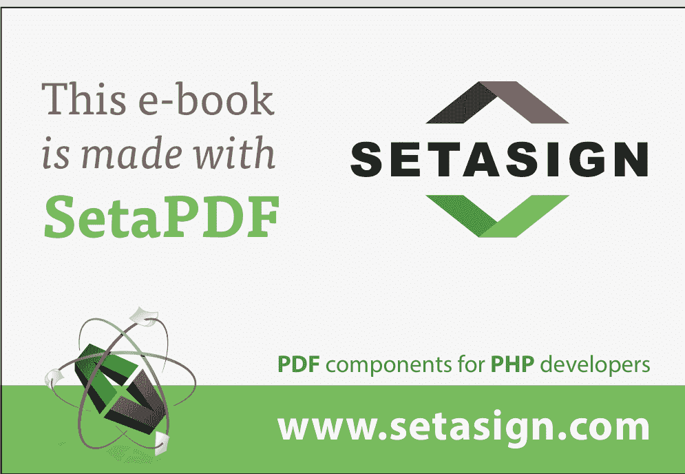

作为一个示例，你可以编写以下视图：

```sql
CREATE VIEW Prentice_hall AS
SELECT isbn, title, edition, year, pages
FROM book
WHERE pubnr = 2;
```

这定义了一个名为 `Prentice_hall` 的视图，为所有 `pubnr` 为 2 的书籍提取 `isbn`、`title`、`edition`、`year` 和 `pages`。这是 Prentice Hall 出版的所有书籍表中的列的视图。当你点击 Apply（应用）时，MySQL Workbench 会创建以下视图：

```sql
CREATE
ALGORITHM = UNDEFINED
DEFINER = 'pa@%'
SQL SECURITY DEFINER
VIEW 'books'.'Prentice_hall' AS
SELECT
'books'.'book'.'isbn' AS 'isbn',
'books'.'book'.'title' AS 'title',
'books'.'book'.'edition' AS 'edition',
'books'.'book'.'year' AS 'year',
'books'.'book'.'pages' AS 'pages'
FROM
'books'.'book'
WHERE
('books'.'book'.'pubnr' = 2)
```

该视图可以像其他表一样被使用，例如你可以写道：

```sql
SELECT * FROM Prentice_hall;
```

事实上，你也可以在某种程度上对视图执行 SQL `INSERT`、`UPDATE` 和 `DELETE` 语句。考虑以下视图示例，它提取了所有姓氏以 K 开头的作者的名字和姓氏：

```sql
CREATE VIEW knames AS
SELECT DISTINCT firstname, lastname
FROM author
WHERE lastname LIKE 'K%';
```

如果你接着执行语句：

```sql
SELECT * FROM knames;
```

你将看到视图包含 8 行。如果接着执行以下语句：

```sql
INSERT INTO author VALUES (187, 'Poul', 'Klausen');

SELECT * FROM knames;
```

你将看到视图 `knames` 现在有 9 行了。这意味着在更新 `author` 表后，视图也随之更新。

接下来，如果你尝试：

```sql
INSERT INTO knames VALUES ('Jens', 'Kristensen');
```

你会得到一个错误，提示你无法更新父表。当然，这并不奇怪，因为你没有足够的信息（没有作者编号）来在 `author` 表中创建一行。考虑以下视图：

```sql
CREATE VIEW lnames AS
SELECT autnr, firname, lastname
FROM author
WHERE lastname LIKE 'L%';
```

这次定义了 `author` 表中的所有列。现在执行语句：

```sql
INSERT INTO lnames VALUES (1000, 'Knud', 'Larsen');
```

你将看到视图和原始表都已更新。这意味着更新视图也会同时更新父表，但需要满足以下条件：

- `SELECT` 语句不能使用 `DISTINCT`
- `SELECT` 语句不能包含函数
- `SELECT` 语句不能包含操作符
- `SELECT` 语句不能使用 `ORDER BY`
- `SELECT` 语句只能使用一个表
- `SELECT` 语句不能包含子查询子句
- `SELECT` 语句不能包含 `GROUP BY`
- `SELECT` 语句不能包含 `HAVING`

## JAVA 6：JDBC 与数据库应用程序最终示例

以下脚本创建了一个包含单张表的数据库，该表只有一个列：

```sql
USE sys;

CREATE DATABASE numbers;

USE numbers;

CREATE TABLE primes (
    prime INT PRIMARY KEY
);
```

在这个数据库中，我添加了一个存储过程。当参数 `n` 是质数且已不在表中时，该过程会将参数 `n` 的值添加到表中。该过程的结果存储在参数 `r` 中。

```sql
CREATE DEFINER='pa'@'%' PROCEDURE 'isprime'(IN n INT, OUT r BOOLEAN)
BEGIN
    DECLARE c INT;

    SELECT COUNT(*)
    FROM primes
    WHERE prime = n
    INTO c;

    IF c > 0 THEN
        SET r = FALSE;
    ELSEIF n = 2 OR n = 3 OR n = 5 OR n = 7 THEN
        SET r = TRUE;
    ELSEIF n < 11 OR MOD(n, 2) = 0 THEN
        SET r = FALSE;
    ELSE
        BEGIN
            DECLARE t INT DEFAULT 3;
            DECLARE m DOUBLE DEFAULT SQRT(n) + 1;

            SET r = TRUE;

            WHILE t <= m AND r = TRUE
            IF MOD(n, t) = 0 THEN
                SET r = FALSE;
            ELSE
                SET t = t + 2;
            END IF;
            END WHILE;
        END;
    END IF;

    IF r = TRUE THEN
        INSERT INTO primes VALUES (n);
    END IF;
END
```

以下是该存储过程的应用示例：

```sql
USE numbers;

SET @res = FALSE;

CALL isprime(31, @res);

SELECT @res;
```

上述存储过程并没有太大的实际意义，目标仅仅是为了展示在存储过程中，你可以像在 Java 中一样使用程序逻辑。

最后需要补充一点，关于存储过程还有很多内容可以说，你可能还会遇到存储函数，但上述内容足以说明什么是存储过程了。

