# Java 7：系统开发指南


## 我们不重新发明轮子，我们重新发明光影。

迷人的灯光提供了无限的可能：创新技术和新市场带来了机遇与挑战。在您的专业知识需求巨大的环境中，请尽情享受全球集团内的支持性工作环境，并受益于国际职业发展。与其他专家紧密合作实施可持续理念，为影响我们的未来做出贡献。加入我们，每天重新发明光影。

**光，是 OSRAM SYLVLVANIA**

# 前言

本书是软件开发系列书籍中的第七本。编程语言是 Java，该语言及其语法和语义显然占据了大量内容，但这些书籍也很大程度上关注过程以及如何开发良好且健壮的应用程序。本书主要关注系统开发和方法，而编程只占次要位置，且书中没有在 Java 方面介绍任何新内容。本书没有直接关注特定的系统开发方法，而是探讨了一些通用原则，这些原则可以应用于所有系统开发项目，并作为实践中开发应用程序的有用指南。其目标是建立一个框架，至少对于小型程序的开发，该框架对开发进度和最终成品的质量都有帮助。除了系统开发原则外，书中还包含一个附录，提供了 UML 的简要介绍，另一个附录简要处理了数据库设计。本书假设读者具备编程和 Java 知识，并有使用数据库开发应用程序的能力（对应本系列前几本书的内容）。

如标题所示，系列书籍涉及软件开发，目标是教读者如何用 Java 开发应用程序。可以通过阅读相关主题和学习完整程序来掌握，但最重要的是亲自动手并从零开始编写自己的程序。因此，书籍的一个重要部分是练习和亲自动手并从零开始编写自己的程序。

现在情况并不像上面暗示的那样糟糕，幸运的是，绝大多数 IT 项目的执行都让用户和开发者感到满意。这里重要的一点是，你听到的通常是那些出轨的项目。幸运的是，已经且未来还会开发出许多优秀的程序，但有效的系统开发需要特定的技术和方法。系统化地工作以确保一切运行正常至关重要。这正是本书所讨论的主题。

除了程序必须运行正确外，它们还必须是可以维护的——至少对于那些需要大量资源开发的大型程序，而且程序通常需要使用多年。在这些期间，随着新需求的出现，程序往往需要进行修改，或者你可能希望它以不同的方式运行。为了实现这一点，重要的是程序从开始编写时就采用某种方式，以便后期——可能不是由最初开发程序的人员——能够对其进行修改和扩展，而不会导致程序的大部分内容必须重写。这取决于应用程序的实现方式及其质量。因此，程序质量在系统开发中起着重要作用，不仅是为了未来的维护考虑，还因为程序必须是有效的；如果一个程序运行缓慢，通常与程序的实现方式有关。最后可以提到，程序应该是健壮的，这样它们就不会因为使用不当而失败，而健壮性也是程序质量的一部分。

所有这些都强调了任何程序的开发——无论多小——使用经过验证的技术和方法进行系统化工作至关重要。利用和借鉴他人的经验也同样重要。结论是，系统开发远不止是巧妙的想法和编程。

本书是系统开发的介绍，但与之前的书籍不同，这里没有练习题。书中描述了一些程序开发准则，并以一个按照这些原则开发的程序示例作为结束。

## 瀑布模型

随着时间的推移，我们开发出了多种系统开发方法，它们的目标都是提供关于如何在实践中从头到尾开发一个程序的指南。这些方法对系统开发的实际重要性各不相同，可能是因为很难开发出一种足够通用、以容纳许多待开发系统的方法，也可能是因为这些方法往往是静态的，并且很容易变成为了方法而存在的方法。因此，在实践中，典型的做法是使用几种方法的元素，以便为你目前从事的任务提供一些指南；但对于关于系统开发方法的所有言论和记录的内容，情况并不适用于此。它只是说明找到正确的方法并不容易，而且几乎无法做到；但有许多值得遵循的良好原则，这正是本书要讨论的内容。

然而，所有系统开发方法都重复包含一些要素：

- **分析**：检查并确定要解决的任务是什么，从而为完成的程序制定需求。
- **设计**：决定应该如何解决该任务。
- **编程**：编写产品本身。
- **测试**：在完成的程序运行时对其进行检查。

即使是对于小型程序的开发，你也必须经历这些活动，其内容显然取决于任务的大小。到目前为止，我将使用一种由六个阶段或步骤组成的方法：

1. 任务制定
2. 分析
3. 设计
4. 编程
5. 测试
6. 交付

这是一种非常简单的方法，对于较大的项目，该方法不够全面或合适；对于较小的程序，它的效果非常好，正如前面提到的，所有六项活动都是所有系统开发方法的一部分。在文献中，这种方法被称为瀑布模型，因为其思想是先定义需求（分析），然后勾勒解决方案（设计），之后对解决方案进行编程。最后，在准备好使用程序之前，对完成的程序进行测试（并在必要时修正错误）。结合今天复杂的 IT 解决方案的开发，这是一种系统开发的狭隘视角，但这一点我们稍后讨论。

在书的其余部分，我将描述该方法的活动以及你在六项活动中的每项中应该做什么。我不会描述如图表之类的特定工具，实际上我在实践中也只在有限的范围内涉及这些。然而，此类开发工具也有其存在的价值，在书的附录 A 中，我给出了一些的描述。

### 2.1 任务制定

在编写计算机程序时，你必须开始描述任务是什么，以及编写程序的目的是什么。有一个个人、公司或组织（下文称为客户），他们对想要开发的程序有一个想法。这可以是任何内容，从几个零散的想法、会议的结果，到可能是调查的结果，但在任务交付给开发团队之前，必须提交任务。它可以是口头的，也可以是文档或报告形式，但无论如何，第一要务是写一份简短简洁地描述任务的文档。任务制定可以由客户或开发部门准备，但通常是在较短的时间内协作完成的。

对于过程或形式没有特殊要求。对于大任务，工作可以是详尽的且耗时的，因为必须有多次会议、收集信息等，我们经常谈论初步分析。结果可以是一份报告，用一般性术语描述任务，以及如何建立成功标准。对于较小的任务，可能一次会议就足够了，任务制定可能不超过一张纸。无论如何，任务制定的结果都是迈向目标的第一步。

通常情况下，任务制定不应太详尽，而只需对要解决的任务给出简要描述。详细的需求是在分析阶段首次确定的。其形式是文档，但描述可以附带材料。首先，在编写任务描述时，你在这里可能会遇到与要制作程序相关的其他文档，从而获得系统开发所需的知识。在适当的情况下，这些文档也必须被存档。

### 2.2 分析

当任务说明书确定且你与客户达成一致，任务将按照约定的进度和价格解决时，实际的系统开发就开始了。第一步是完成分析，目的是：

- 澄清关于任务说明书内容的所有歧义之处
- 确定是否存在任何风险或其他重大不确定性
- 确定是否存在外部参考和合作伙伴
- 制定最终的需求说明书
- 更新进度表，包括资源消耗的需求

#### 2.2.1 歧义

任务说明书描述的是整体，而不是细节。这将在分析过程中完成。因此，通常会有很多问题和解释上的往复，以及一些任务说明书中未写明的内容。在处理程序开发之前，必须涵盖所有内容。这只能通过与客户合作完成，但在流程的后期，可能仍需要联系客户以澄清有关任务要求的事项。分析是一个跨越时间的过程，期间客户与开发人员之间会有频繁的接触。

澄清歧义的任务是实际的分析工作，开发者也借此了解要解决的任务。开发者是软件开发方面的专家，但他们并不一定具备程序所在领域的知识，且许多任务的解决方案要求开发者理解如何使用该程序，包括程序必须使用的组织。最后，可能会出现任务的解决方案需要开发者不了解的产品和工具，如果是这样，这也是需要获取的知识。因此，分析也是一个知识收集的阶段。

在实践中，分析扮演着另一个不应被低估的重要角色。在一个跨越时间的系统开发项目中——开发人员与客户之间有定期的接触，如上所述，为了澄清有关任务的事宜。在分析期间，在开发人员与客户之间建立信任关系至关重要。首先，能够信任客户至关重要，因为许多任务意味着开发人员会接触机密信息；其次，信任开发人员旨在尽可能完成工作，并在与已确定的需求进行调整和更改时及时报告，如果后续工作揭示某些事情应该以与已约定的不同的方式解决。从开发者的角度来看，如果进度在进展并需要调整，那么客户的信任可能是非常重要的。

#### 2.2.2 风险

在分析期间，你还必须识别与项目相关的特定风险。许多任务（尤其是较小的任务）通常是没有问题的，但在其他工作中，可能会出现你简单不知道如何解决的事情，如果非要解决问题的话。如果项目面临此类挑战，重要的是让它们尽早显现出来。最坏的情况下，这可能意味着项目无法实施，如果是如此，应尽快终止项目，以避免浪费更多无用的资源。风险也意味着有必要将其纳入合同，其中项目的某些部分无法定价且可能无法进行时间估计。

现在可能还会面临你无法应对的所有不确定性的挑战，这些挑战可能不会直接威胁项目，但可能会比预期的耗时长。它们也可能是可以通过多种方式解决的问题，此时可能需要进行实验来选择正确的解决方案。这同样适用于这类不确定性，必须识别它们，以免在流程的后期突然被某个耗尽项目所有资源的子任务所困扰。

总之，无论项目附带何种程度的不确定性，尽早发现这些问题并对如何处理它们做出决定是极其重要的。

#### 2.2.3 参考

IT 解决方案及其开发并不一定是一个孤立的实体，但完成的程序及其开发都可能涉及到与其他组织和系统的引用。

通常，当前程序应该与其他程序交换数据，在适用情况下，你必须明确如何这样做。这可能是程序必须使用的服务。在任何情况下，都必须获取信息，这是分析过程中的一项工作。也许这是可能的——可能是因为另一方不披露必要的信息——如果是这样，最坏的情况下必须终止项目。它也可能是你必须付费的内容，可能需要为特定服务支付许可费。

现在如果对方不是外部组织，而是例如客户的业务，那么就不会有相同的问题，但必须获取相同的信息，因此这也是一个在分析期间必须完成的任务。

可能还有其他业务合作伙伴，例如，任务可能只是一个大型 IT 系统的一部分。如果适用，你必须将合作关系正式化，特别是，日期的同步至关重要，这样你就不会突然在等待合作伙伴的交付——反之亦然。


我们将你的简历转变为终生难得的机会

你喜欢汽车吗？你想成为成功品牌的一员吗？我们将欣赏并奖励热情和天赋。向我们发送你的简历。你会对它能带你去何方感到惊讶。

你也可能仅仅从其他公司和机构（例如公共机构）获得了信息。这也是分析过程中必须提供的信息，至少确保相关信息的提供已经开始。

结论是，在分析期间你获取了执行项目所需的所有信息，或者至少确定这些信息可用，以便开发不会因信息而中断。

#### 2.2.4 需求说明书

在某种意义上，需求说明书是分析的核心，是对完成程序的总体确定。如果你有一份良好的需求说明书，双方（客户和开发部门）对要解决的任务达成共识。许多人对需求说明书的形式有意见，模板的优势在于更容易获取所有内容，但在需求说明书中只是一份没有形式的文档，列出了完成程序的需求。

#### 2.2.5 进度安排

我在上面的任务制定中提到过，你还必须制定一份进度表以及该任务所需的资源估算。这在系统开发中实际上是一个两难境地。在起草任务制定期间，开发部门简单地缺乏准备资源估算所需的必要知识。相反，客户需要知道解决方案的成本是多少。

这个问题可以通过让任务制定中的估算成为一个总体估算来解决。这看起来是合理的：客户和开发部门可以同意进行分析，只有在你们拥有了足够的知识并揭示了所有风险因素后，你就可以根据资源消耗的估算进行详细的进度安排。只有在此之后，你才能进行最终的价格计算，并可能对整个系统开发项目签署合同。

问题自然是，如果分析结果显示项目不应该实施，由谁付钱——例如因为成本太高了。对于大型 IT 项目，客户通常支付分析实施的费用，这可能只是针对整个系统的一部分。也许客户甚至会委托第三方来进行分析，这样就可以根据详细的需求说明书发布任务进行招标。无论如何，这意味着系统的开发的最终决策可以推迟到分析之后。这种策略将风险保持在较小的任务中。在完成任务制定并在经过一些初步估算后——当然还有大量的经验——开发部门得出了一个任务的价格。这听起来很有风险，事实如此，但它是真实的。这是一个两难境地，毫无疑问，不幸 IT 项目的源头就在此：因为客户渴望以最低成本完成工作，导致产品质量差；而开发部门因为担心得不到工作而提供低报价，导致最终可能牺牲质量。

当价格在某个时候被设定后，那么在分析之后，通常需要同时调整时间表和资源消耗——可能仅供内部使用——这种调整可能导致需要为项目引入更多资源，因为在系统开发中资源等同于工时。

#### 2.2.6 分析文档

与系统开发的其他阶段一样，分析结果以分析报告的形式记录。我已经提到过需求规格书和时间表是该文档的关键部分，但其他工作也必须记录，这些记录将主要由会议摘要和分析期间收集的文档组成。这种记录有两个原因：

- 第一，文档应作为系统开发项目其余部分的基础。
- 第二，文档将用于程序的未来维护。

文档不会自动产生，为了将其写下来可能需要大量工作。这也是为什么系统开发方法受到批评的原因之一，也是开发部门未能通过编写文档来节省工作的原因。然而，也有同样多的例子显示文档的缺失。这时你必须编写必要的内容，绝不要为了写文档而写文档——它必须具有价值。在书中仅有一个项目仅仅是为了准备文档，我认为这是有用的。


> “在丹麦，你可以找到出色的工程类工作，并在专业领域上提升自己。特别是在风电领域，你可以向行业内最优秀的人学习，并在一份稳定的工作中促进你的职业发展。”

Mireia Mare,

来自西班牙的高级工程师。

自 2010 年起在丹麦从事风能行业工作。


有特殊的 IT 工具可以帮助管理和维护这些文档，并通常帮助管理整个项目。我暂时不会提到这些工具，之后我会提到我在实践中的做法。如果我必须编写一个程序（实现一个系统），我会像任务制定中提到的那样，为整个项目创建一个文件夹——以下称为项目文件夹。在这里，我根据任务的大小创建子文件夹，但始终包含以任务制定、需求规格书、其他项目报告等形式存在的文档。可能还会有会议摘要的子文件夹、其他材料的子文件夹等。项目文件夹还将包含 Beans 项目，在实践中，参考其他系统开发方法，会有几个项目。在分析期间，可能就有例如实验或原型的项目。同样，我通常会用 Beans 项目来记录设计，这个项目将在编程阶段继续工作，但我将对它的副本（或更准确地说是创建一个项目的副本）继续工作。由于我是进行迭代工作，我将从上一次迭代的项目副本开始每次迭代，然后项目文件夹将包含许多 NetBeans 项目。

这种项目管理方法极其简单，只不过是一个管理项目文档和版本的简单程序，但对于小型项目，尤其是单人项目，这种程序运行良好。必须强调的是，对于有许多团队成员的大型项目，你必须做得更好。在这里必须使用 IT 工具，包括管理不同版本的文档。

### 2.3 设计

下一个活动被称为设计，简而言之，你可以说分析关注项目应该做什么，而设计处理程序如何被编写。这意味着设计转移了系统开发的重心，分析工作负责确定需求并收集信息，而设计处理如何构建产品。设计阶段不应该编写程序，但设计与编程之间的界限并不严格，因此设计也可以包含编程决策。

IT 系统的设计与其他产品或建筑设计非常相似。如果你在盖房子，你就会开始画图纸，显示房间的位置和大小，窗户和门应该在哪里等。如果不是，结果可能是一个随机的房子，你可能会面临门放得无法打开或者房间没有门的情况。房子的质量需要规划和模型。IT 系统也是如此。如果你在考虑不同解决方案时没有进行良好的设计，你得到的程序可能解决了任务，但程序结构是随机的，且未来将无法维护。设计的目标正是确保符合程序质量的决策。

与分析相反，设计很大程度上取决于任务，同样难以为设计阶段的实施建立标准，但以下是典型的活动：

- 整体程序架构设计。
- 模型层类设计。
- 程序存储库设计。
- 算法设计。
- 用户界面设计。

但也可能需要进行实验来测试解决方案和技术。

#### 2.3.1 架构

应用程序可能由许多类组成，轻松达到100多个。在这种情况下，跟踪所有类的含义可能很难，因此人们选择将相同概念的类组织在模块中。在这种背景下，我们说的是应用程序架构，人们通常目标是模块化架构。没有明确的最佳架构，但经验表明具有图形用户界面的程序可以基于三层架构：

| 视图 |
|------|
| 控制器 |
| 模型 |

或其变体架构。在这里，你将模型定义为对程序数据的建模，这样你就可以对程序应该处理的数据有一个面向对象的表示。视图层包含了所有以窗口形式呈现的用户界面的所有内容。在这两层之间，你有一个控制器层，它接收输入并将其转换为对模型的命令。

这种架构并没有神奇之处，但经验表明，将所有关于用户界面的内容汇集在一个单独的层中是有益的，而所有与程序数据相关的内容都必须放在模型层中。在这两层之间是那些将所有内容联系在一起的类。这种架构通常被称为 MVC（模型-视图-控制器），它是设计模式的一个示例。它有多种形式，原因部分是因为开发工具以及应用程序类型，例如 GUI 应用程序、Web 应用程序、手机 App 等。特定变体所解决的问题是每层应该包含什么，以及层与层之间的通信应该是怎样的。

分层是模块化程序架构的魅力，但可能存在多个层，而且每个层都可以——并且会被——划分为模块。

在最后一个示例中，我将展示如何在实践中应用这种模式。

> 我加入 MITAS 是因为我想要真正的责任

工程师和地质科学家毕业生研究生计划 www.discovermetas.com


第16个月，我是北海的一名施工主管，负责并帮助工解决问题

真实工作 国际机会-三次实习

点击广告阅读更多

### 2.3.2 类


现代程序由类构建。运行中的程序由对象组成，它们共同执行程序必须解决的任务。这些对象根据状态和行为来定义，你通过类来实现，类定义或描述了特定类型的对象。也许最重要的设计活动是找到并定义这些类，以便它们具有正确的属性。对象可以是程序的一个元素，你可以进行任何操作的组件，而你在编程期间主要做的就是使用这些类来创建程序的对象。正确且幸运的选择对完成程序的质量有巨大影响。

程序由许多类组成，你在设计时主要工作的类是模型类，这些类定义了程序应该处理的核心数据。这意味着许多类首先被定义，稍后在编程阶段实现。

另一个问题是如何找到程序应该由哪些类组成，关于你可以做什么有几种指南，但无论如何，并没有什么指令一定能给出良好的结果。类必须对应用程序的问题领域进行建模——这必须反映程序应该组成和处理的内容，但重要的是记住，你谈论的是模型类和描述数据的类。类的设计很大程度上基于经验，虽然通过系统开发书籍有很多关于选择类的建议，但最好的方法是学习其他人的示例，例如这些书中的示例，从而从完成的程序及其构成的类中获得灵感。

我会提到一种有时看到的用于确定应用程序类的建议。根据任务表述和需求说明，你可以标出所有名词，然后将这些名词列成列表。它们是类的候选者。随后，你审阅该列表，并将其作为程序应该包含的类的灵感。并不是所有名词都代表一个类。首先，几个名词可以描述同一个概念；其次，某些名词描述的是程序类的属性（变量）；最后，会有一些名称与程序领域无关，因此它们不是类的候选者。这是一个简单的过程，它显然不能独立存在，并且需要对找到的候选类进行许多考虑，但直到你练习，这种方法比什么都好。

## 瀑布模型

类（在设计时）基本上包含两个部分：

- 1. 定义对象状态的数据定义，即对象应该代表什么
- 2. 定义对象行为的方法，即对象应该表现出什么

这种架构通常被称为 MVC（模型-视图-控制器），它是设计模式的一个示例。它有多种形式，原因部分是因为开发工具以及应用程序类型，例如 GUI 应用程序、Web 应用程序、手机 App 等。特定变体所解决的问题是每层应该包含什么，以及层与层之间的通信应该是怎样的。分层是模块化程序架构的魅力，但可能存在多个层，而且每个层都可以——并且会被——划分为模块。在最后一个示例中，我将展示如何在实践中应用这种模式。

## 瀑布模型

类（在设计时）基本上包含两个部分：

- 1. 定义对象状态的数据定义，即对象应该代表什么
- 2. 定义对象行为的方法，即对象应该表现出什么

这种架构通常被称为 MVC（模型-视图-控制器），它是设计模式的一个示例。它有多种形式，原因部分是因为开发工具以及应用程序类型，例如 GUI 应用程序、Web 应用程序、手机 App 等。特定变体所解决的问题是每层应该包含什么，以及层与层之间的通信应该是怎样的。分层是模块化程序架构的魅力，但可能存在多个层，而且每个层都可以——并且会被——划分为模块。在最后一个示例中，我将展示如何在实践中应用这种模式。

### 2.3.3 仓库

类（在设计时）基本上包含两个部分：

- 1. 定义对象状态的数据定义，即对象应该代表什么
- 2. 定义对象行为的方法，即对象应该表现出什么

这种架构通常被称为 MVC（模型-视图-控制器），它是设计模式的一个示例。它有多种形式，原因部分是因为开发工具以及应用程序类型，例如 GUI 应用程序、Web 应用程序、手机 App 等。特定变体所解决的问题是每层应该包含什么，以及层与层之间的通信应该是怎样的。分层是模块化程序架构的魅力，但可能存在多个层，而且每个层都可以——并且会被——划分为模块。在最后一个示例中，我将展示如何在实践中应用这种模式。

### 2.3.4 算法

类（在设计时）基本上包含两个部分：

- 1. 定义对象状态的数据定义，即对象应该代表什么
- 2. 定义对象行为的方法，即对象应该表现出什么

这种架构通常被称为 MVC（模型-视图-控制器），它是设计模式的一个示例。它有多种形式，原因部分是因为开发工具以及应用程序类型，例如 GUI 应用程序、Web 应用程序、手机 App 等。特定变体所解决的问题是每层应该包含什么，以及层与层之间的通信应该是怎样的。分层是模块化程序架构的魅力，但可能存在多个层，而且每个层都可以——并且会被——划分为模块。在最后一个示例中，我将展示如何在实践中应用这种模式。

## JAVA 7: 关于系统开发

### 2.3.5 接口

类（在设计时）基本上包含两个部分：

- 1. 定义对象状态的数据定义，即对象应该代表什么
- 2. 定义对象行为的方法，即对象应该表现出什么

这种架构通常被称为 MVC（模型-视图-控制器），它是设计模式的一个示例。它有多种形式，原因部分是因为开发工具以及应用程序类型，例如 GUI 应用程序、Web 应用程序、手机 App 等。特定变体所解决的问题是每层应该包含什么，以及层与层之间的通信应该是怎样的。分层是模块化程序架构的魅力，但可能存在多个层，而且每个层都可以——并且会被——划分为模块。在最后一个示例中，我将展示如何在实践中应用这种模式。

### 2.3.6 设计文档

类（在设计时）基本上包含两个部分：

- 1. 定义对象状态的数据定义，即对象应该代表什么
- 2. 定义对象行为的方法，即对象应该表现出什么

这种架构通常被称为 MVC（模型-视图-控制器），它是设计模式的一个示例。它有多种形式，原因部分是因为开发工具以及应用程序类型，例如 GUI 应用程序、Web 应用程序、手机 App 等。特定变体所解决的问题是每层应该包含什么，以及层与层之间的通信应该是怎样的。分层是模块化程序架构的魅力，但可能存在多个层，而且每个层都可以——并且会被——划分为模块。在最后一个示例中，我将展示如何在实践中应用这种模式。

### 2.3.7 设计原则

设计包含了程序的架构和类，关于在本文背景下什么是良好的设计已经确立了许多原则，我将提到其中两个，它们通常被称为耦合（coupling）和内聚（cohesion），这两个原则都涵盖了程序的架构和类。

必须努力使程序的类具有**低耦合性**。如果两个类使用彼此的属性，那么它们就是耦合的。也就是说，如果其中一个类调用了另一个类的方法，就说这两个类是耦合的——调用方法的类与另一个类耦合，因为它了解另一个类。特别要注意，如果一个类创建了另一个类的对象，那么就通过构造函数存在一种耦合。当耦合性很糟糕时，是因为它使得代码的维护变得困难。如果一个类有一个其他类使用的方法，你不能直接修改它，而不顾及其他类的影响。

现在并不是说你可以避免耦合。一个程序显然不能由互不关联的孤立类组成。类的概念恰恰在于该类提供了其他类需要的服务，但你希望耦合越低越好。很难定义，但你可以留意以下几点：

- 耦合必须始终通过属性（`get`和`set`方法）或其他方法进行，而绝不能通过变量进行。这是通过将类的变量设为私有（`private`）来实现的，因此由程序员来定义类提供服务所需的属性和方法。
- 所有代表内部服务且这些服务不应被其他类使用的属性和方法，必须定义为私有（`private`）——特殊情况下为受保护（`protected`）。
- 你应该面向接口编程。类的特征（服务）应该由类可以实现的接口来定义。使用类的对象只知道接口中定义的内容，而不知道属性是如何实现的。
- 你必须避免双向耦合。也就是说，当一个类使用第二个类的服务，而第二个类又使用第一个类的服务时。如果适用，这意味着它们必须相互了解，导致应用程序类之间产生非常强的依赖关系。
- 应该意识到继承是一种强耦合。如果基类具有保护属性（`protected properties`），它们在不影响派生类的情况下无法更改。这并不意味着你应该避免继承，而要意识到这对耦合意味着什么。

## 瀑布模型

正如人们希望程序具有弱耦合一样，人们也希望程序的类和模块具有**高内聚性**。如果一个类关注程序问题领域内的特定事项，那么该类就具有高内聚性。一个类不应该是互不相关的方法的集合。有时人们可能会这样想，一个代表客户和产品的类内聚性低。它具有这两种物的整体特征，因此它必须被分为两个难以理解的类（或模块），这反过来意味着维护代码变得更加困难。你可以注意到以下几点：

- 高内聚会导致类的数量增多，但这通常不是一个问题。
- 如果一个类实现了许多接口，则趋向于低内聚性。
- 如果一个类完全由静态方法（`static methods`）组成，那么这些方法必须与同一个主题相关。
- 一个包必须包含与同一主题相关的类。否则，类必须划分到多个包中。

耦合和内聚都是通用的设计原则，在设计应用程序架构和类时，你必须时刻记住这些原则。内聚很少是一个主要问题，但你应该关注耦合，并不断努力实现尽可能弱的耦合。


### 2.4 编程

设计定型后，你就可以编写程序代码。编程始于设计阶段创建的 NetBeans 项目副本，在原则上，它是关于实现设计阶段定义的类。如果你实现了一个良好的设计，那么关于程序架构和核心类的大多数重要决策应该已经在：

- 所有模型类都已定义
- 关于程序窗口和视觉外观（`look and feel`）的所有重要决策已就位
- 程序的仓库（`repository`）已定义
- 所有复杂的算法都已定位

然而，仍会有许多细节未决并留给程序员，但这些是基础细节，是技术性的且面向特定编程语言的。编程阶段是广泛的，而且通常是耗时最长的阶段，但以良好的设计为起点，你已经为确保编程进展以及你所编写的代码质量良好建立了最好的基础。

下一个阶段被称为测试（`test`），但测试在编程期间也起着至关重要的作用。测试细节是程序员的任务，并确保代码不会失败。简单来说，这意味着程序员应该对单个类进行错误测试，这样你在后续工作中就可以确定一个类是一个完成且经过测试的组件。这可以通过几种方式实现。人们可以编写单元测试，使用附加到 NetBeans 的特殊工具对类进行测试。你可以编写小型测试程序来测试每个类，最后你可以使用调试器对代码进行检查。此外还有结合代码文档的检查，因为在编写代码文档时，会自动考虑为什么要这样写代码。

实际上测试程序是困难的，无论以何种方式进行，都要求你必须小心。特别是，建立模拟日常运行的环境可能是困难的。在程序包含或使用其他系统的范围内，通信和数据交换必须经过测试，而在程序完成之前很少可以进行任何测试。

### 2.4.1 文档维护

瀑布模型是一个从任务制定到完成程序的渐进过程，但无论你多么小心，都无法避免发生变化。例如，在编程期间可能会发现某些需要更改。同样，可能在测试阶段才发现已经采纳的决策需要更改。问题是，对于分析和设计的文档应该如何处理，以及它是否需要更新。

原则上，它应该记录开发决策以及程序如何运行。如果变化巨大，以至于文档中的内容完全错误或具有误导性，那么它当然必须更新。否则，文档将失去意义。现在这种情况并非总是发生，如果你已经做了良好的分析和设计工作，这应该是特例。会有微调，它们当然会被记录，你可以在每个类的前面编写注释，在某些情况下，你甚至可以在项目中添加文本文档来记录更改。

### 2.5 测试

如上述，测试在编程中起着重要作用，但瀑布模型也有实际的测试阶段。其目的是模拟未来操作环境的环境对完成的程序进行测试，并在这种背景下测试程序是否符合需求规格书。这是一个通常会涉及客户和未来用户的阶段，以便在按预期任务程序之前发现不便和错误。

测试阶段的范围取决于具体的程序，在较大的项目中，其范围很大且耗时很长。你应该意识到，简单的测试（即让少数用户尝试程序）很少发现很多错误。它可能是更大测试的一部分，但测试需要计划，以便具体决定测试什么以及如何测试。

## 瀑布模型

测试阶段的结果通常是一个待办事项列表（`todo-list`），列出了发现的错误和差异。有了这个列表，程序员可以修正错误和遗漏，然后必须对程序进行再次测试，以确保修正没有引入新的错误。这个过程一直持续，直到测试结果得到空的待办事项列表，然后程序就可以投入使用了。

测试阶段是编程期间测试的后续，为了使该阶段具有意义，在编程期间的测试工作必须仔细准确，这一点至关重要。传递到测试阶段的程序质量必须达到值得测试的水平，这一点很重要。实际上，程序在结束编程阶段时带有过多的错误并不罕见，结果是测试工作必须立即停止，程序返回给编程团队并被视为不可用。如果发生这种情况，你只是成功地让那些需要测试程序的人白费了时间，而程序员在并不知道该找什么的情况下，除了处理错误之外也没什么可做。因此，有理由再次强调作为程序开发一部分的测试重要性。


最终阶段将真正把程序投入使用并交给未来的用户。很难精确地提到这一阶段的内容，因此我将提供该阶段可能包含的一些任务示例：

- 开发安装程序或脚本。
- 将程序上传到应用商店（`App Store`）。
- 在网络服务器上托管程序或服务。
- 创建程序可以连接的数据库。
- 创建用户，可能具有不同的权限。
- 根据相应的安全策略对配置文件进行自定义。
- 将现有数据转换为新格式。
- 对未来的用户进行培训。
- 评估项目以获得经验。

可能还会提到更多任务，但上述内容足以说明在程序编写和测试之后还可以做很多工作。

在本书中，我提到了所谓的瀑布模型，这是一种系统开发方法，我将在第 5 章通过一个示例展示如何使用该方法开发一个小型程序。我将瀑布模型描述为一种由 6 个阶段组成的系统开发方法，关于该方法还有其他描述，其中一些更简单、更广泛，但它们的共同点是将系统开发描述为一条课程：

分析 – 设计 – 编程 – 测试

这些是任何系统开发方法中的四个关键活动，但在许多背景下，特别是在开发大型 IT 解决方案时，这只是系统开发的一种简化观点。首先，经验表明，从一开始就建立最终需求规范然后为程序开发设计是不现实的。必须进行迭代工作，在继续开发其他部分以完成程序之前，开发一个可以供未来用户测试的程序部分。这意味着你可以在分析、设计、编程和测试之间工作，以便返回并继续额外的分析活动等。其次，系统通常——至少对于较大的解决方案而言——还包含许多其他活动等。最后，要开发的程序是得如此不同，以至于像瀑布模型这样的方法过于局限，无法适应各种类型程序的开发。因此，使用按照特定顺序执行的若干阶段来进行系统开发就太简单了。需要更灵活的方法来能够适应给定的任务和情况——这是我将在以后其他书中探讨的内容。

然而，瀑布模型也有它自己的用途和优点，在这里我提一下：

- 模型很简单——没有太多需要学习的。
- 该方法描述并应用了系统开发中的基本活动。
- 该方法比没有要好。

结论是，瀑布模型非常适用于具有许多不确定性的小型程序的开发，该模型将在接下来的书中使用，但有一个重要的补充，即它通过我的方法适配到程序开发中。

正如前面提到的，我稍后将查看其他系统开发方法，我也提到过这些方法的实际成功程度具有某种变数，范围从不使用方法开发程序，到基于经验和当前任务开发部门自己的系统开发方法（这些方法受到特定理论方法的启示）。尽管系统理论和方法多年来已作为 IT 教育的一部分而建立，但这些方法在实践中并不总是被应用，在我看来是出于两个原因：

- 这些方法被认为是资源的浪费。
- 这些方法需要过多的文档。


这些就是导致实践中不使用替代程序的原因吗？它们都是错误的，但人们应该寻求限制文档的系统方法（可靠性）。

上述内容并不是真正的系统开发方法，而是你可以遵循以开发程序的某些指南。它不是一种系统开发方法，因为没有关于做什么的精确指南，但与应用开发相比，其目标是它可以变成那样的东西。本书的内容通过以下示例，从而制定了应用开发的最佳实践。结果是，我将系统开发项目视为一个由六个活动组成的过程：

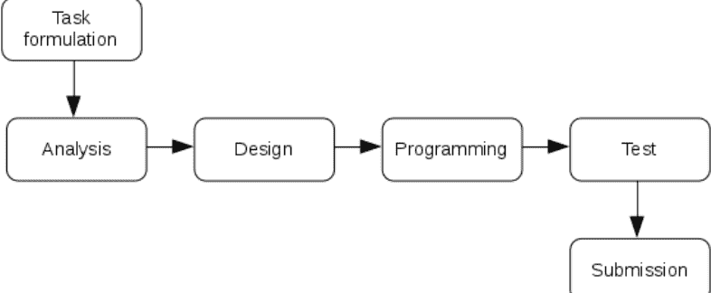

## 4 MVC

在上面的设计中，我提到过模型视图控制器（`Model View Controller`）作为 GUI 程序架构的模式。它是一个三层架构，下面我简要阐述该架构，因为我将在后面的示例中使用它。

`Model View Controller` – 简称 MVC – 是最受讨论的设计模式之一，作为推荐如何设计具有用户界面程序的模式。MVC 是一个非常有趣的模式，因为该模式关注一个经常出现的问题，而且这种模式以多种形式存在，特别是不同类型的应用程序需要该模式的变体，而且因为开发工具通常也会引入自己的变体。

MVC 中有三个元素：

- 1. 模型（`Model`）代表程序的数据以及程序的状态，它也是实现程序逻辑核心部分的模型。模型所做的对控制器和视图都是隐藏的，但模型定义了（通常通过接口）方法，使得控制器和视图可以读取和修改模型的状态，并且模型可以就状态更改向观察者发送通知。通常，视图层可以是观察者，但控制器层也可以是模型的观察者。
- 2. 视图（`View`）代表模型，并通过图形用户界面中的组件显示模型的状态。程序将使用许多不同的组件（例如面板、按钮、输入字段等），而视图层有责任确保这些组件反映模型的状态。
- 3. 控制器（`Controller`）处理用户输入，并确定这些输入对程序或视图应该产生什么影响。

在我对 MVC 的使用中，主程序通常会创建视图对象，然后由该对象负责建立控制器和模型，并将模型作为引用发送给控制器（可能还把视图自身的引用也发送给它）。结果是，控制器知道模型（在适当的情况下也可能知道视图，通常通过接口），而视图既知道控制器也知道模型。为了在元素之间实现松耦合，视图、控制器和模型通常由接口定义，MVC 的概括如下所示。

# JAVA 7：关于系统开发 MVC

在图中，模型、视图和控制器都由一个接口定义。在实践中，这并不一定如此，但其目标是通过这种方式，你可以更好地替换某一个层（例如程序的视图），而不影响其他层。虚线表示模型可以向其他层发送通知。监听器（`Listeners`）通常是程序的视图，但也可以是控制器。

其核心思想如下：

- 当应用程序视图中发生事件时，由于用户正在进行某些操作，视图会将处理工作委托给控制器（调用控制器上的某个方法），然后由控制器决定执行什么。
- 视图始终可以使用模型实现的接口所定义的方法来读取模型的状态。
- 控制器知道视图，因此可以接收通知以更新界面。
- 控制器也知道模型，以便控制器可以更新模型。
- 模型既不知道控制器也不知道视图，但它实现了观察者模式，使得视图（可能还有控制器）可以注册为观察者，并在模型状态改变时接收通知。


# 关于 e-Learning for Kids

`e-Learning for Kids`成立于2004年，是一个全球非营利基金会，致力于为5至12岁的儿童提供互联网免费学习资金支持，涵盖数学、科学、语言、艺术、计算机、健康和环境科学课程。自2005年以来，全球190多个国家的1500万名儿童受益于来自`IIT KI`志愿者工作人员、教育与在线学习专家以及世界各地致力于改变的商务人士所提供的在线课程。`e-Learning for Kids`获得资金、志愿者、赞助商和`square`开发者的支持。更多信息请访问`www.e-learningforkids.org`。

- 小学教育领域第1名 MOOC
- 为5-12岁儿童提供的免费数字化学习
- 覆盖1500万儿童

点击广告阅读更多

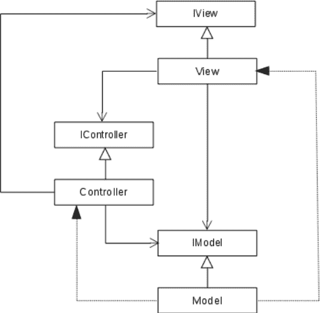

上述内容是 MVC 的常见场景，它寻求通过接口实现元素之间的解耦。另一个问题反过来来说，各个部分/组件是在何时以及如何创建的。也就是说，单个对象是如何实例化的，这在很大程度上取决于当前的开发工具。我们将通过以下 GUI 程序的示例进行说明。

另一个问题是，各个层在类和其他类型形式上具体包含什么。通常情况下，视图层可能为每个窗口包含一个类，而且原则上也会有一个相应的控制器。此外，在所有三层中还会有其他类和定义的接口。可能还存在多个层，通常在模型层下方还有一个层，其任务是将面向对象的模型映射到数据库。这一层通常称为数据访问层（data access layer）。对于大型应用程序，也有可能创建一个概述来细分各个层，使其由多个包组成。

如前所述，MVC 以多种变体形式存在并是一种被广泛使用的设计模式，因为它具有足够的灵活性。这意味着某些类型甚至某些层可能在具体的解决方案中并不存在。这并没有问题，当然，你不应该仅仅因为某种模式规定了它就没必要地复杂解决方案。

作为最后一个示例，我将编写一个可以维护简单书籍库的程序，例如针对某教育机构。除了管理图书馆的内容外，程序还必须能够管理借阅情况，例如针对学生和员工。因此，这是一个典型的数据库应用程序。其目标是通过一个带有图形用户界面的典型办公应用程序示例来测试瀑布模型和 MVC 模式。

任务是开发一个用于管理教育机构书籍库的程序，书籍可以借给该机构的员工和学生。程序应该部分能够管理图书馆的藏书籍（包括新书的注册），并管理借出的书籍，特别是催还。由于书籍通常是教学/研究的教材，且你只需要小范围查询，因此应用程序必须提供搜索功能，你还可以在其中查看在适当谁借阅了某本特定的书。

图书馆内容的维护由一名员工负责，该员工负责注册新书和删除终止的书。此外，管理员还负责向未还书的借阅者发送提醒。

原则上，机构的所有人员都可以借书，且借书是自助服务，个人在借书时可以将自己注册为所借阅书籍的借阅者。因此，图书馆的运行很大程度上基于信任。

任务定义无非是对任务的简短描述。有许多细节需要澄清，但这是分析的一部分。

该阶段的结果仅为本文档以及一个名为`library`的项目文件夹。目前，该文件夹仅包含一个用于本文档的`doc`子目录。

程序是一个普通的 PC 应用程序，运行在图书馆内的机器上，以便借阅者可以注册关于借和归还的信息。

## 分析

分析包括：

1. 系统数据
2. 用户访问
3. 功能

程序是一个普通的 PC 应用程序，运行在图书馆内的机器上，以便借阅者可以注册关于借和归还的信息。

分析包括：

- ISBN
- 标题
- 版本
- 类别
- 出版社


管理员：

- 删除书籍、作者、分类、出版社
- 创建并维护用户
- 发送关于召回书籍的邮件

上述分析的结果体现在以下需求规范中。

## 5.2.4 需求规范

当程序启动时，应该显示图书馆所有书籍的列表，其中每本书显示：

- 字体标题
- 出版年份
- 出版社
- 类别

如果你未登录，除了浏览书籍列表外，你无法进行任何操作。


## 功能

程序具有以下功能，并分为四个菜单：

### 通用

- 登录

### 用户

- 搜索
- 登出
- 注销
- 查看详情（通过双击书籍打开）

### 图书管理员

- 出版社维护（创建、修改）
- 类别维护（创建、修改）
- 作者维护（创建、修改）
- 创建书籍
- 书籍维护（通过双击书籍打开）

### 管理员

- 删除出版社
- 删除类别
- 删除作者
- 删除书籍
- 召回书籍
- 用户维护（创建、修改、删除）

最重要的功能是“书籍维护”，它会打开一个显示书籍所有详细信息的窗口。该窗口还用于：

- 借阅书籍（如果并非所有副本都借出）
- 还书籍
- 如果书籍已借阅，查看是谁借的

在`bookboom.com`下载免费电子书

# JAVA 7: 关于系统开发

根据用户角色，你也可以从此窗口进行：

- 修改书籍的所有信息
- 删除书籍

在搜索时，你必须能够搜索：

- ISBN13，匹配字符串开头
- ISBN10，匹配字符串开头
- 标题，匹配字符串内容
- 特定版本
- 特定出版年份
- 特定出版社
- 特定类别
- 作者，两个由空格分隔的字符串，其中最后部分匹配姓氏开头，第一部分匹配名字内容
- 文本，匹配描述内容

用户维护必须显示所有用户的列表，并且你应该能够创建新用户并修改特定用户的信息。在此范围内，必须能够查看该用户借了哪些书籍。

在召回书籍时，你必须能够选择时间范围（两个日期之间），然后你将获得期间所有借出的书籍列表。你必须选择需要召回的书籍，然后应该能够向借阅者发送电子邮件。

## 用户

对应上述三个类别，有三种用户角色。登录后，可用功能由用户角色决定：

1. 普通用户
2. 图书管理员
3. 管理员

## 数据字典

| 名称 | 数据类型 | 描述 |
| --- | --- | --- |
| Isbn13 | 17位字符串 | 选填 |
| Isbn10 | 13位字符串 | 选填 |
| Title | 最多255位字符串 | |
| Edition | 整数 | 选填，1–9均包含 |
| Year | 整数 | 选填，4位 |
| Pages | 整数 | 选填，正整数 |
| Copies | 整数 | 选填，正整数 |
| Publisher | 最多50位字符串 | |
| Cattegory | 最多50位字符串 | 选填 |
| Text | 任意文本 | 选填 |


| 名称 | 数据类型 | 描述 |
| --- | --- | --- |
| Author | | |
| Firstname | 最多50位字符串 | 选填 |
| Lastname | 最多30位字符串 | |
| Text | 任意文本 | 选填 |
| User | | |
| Email | 最多50位字符串 | 选填 |
| Password | 最多30位字符串 | |
| Firstname | 最多50位字符串 | |
| Lastname | 最多30位字符串 | |
| Address | 最多50位字符串 | |
| Zipcode | 最多50位字符串 | |
| Phone | 最多50位字符串 | 选填 |
| Title | 最多50位字符串 | 选填 |
| Role | 整数 | 1 = 管理员, 2 = 工作, 3 = 学生 |

程序使用数据库。

## 5.3 设计

程序采用以下步骤：

1. 用户界面
2. 架构
3. 模型层
4. 控制器层
5. 数据库层

```sql
pages int,
copies int,
catid int,
pubid int,
text text,
foreign key (catid) references category (id),
foreign key (pubid) references publisher(id),
primary key (id);
```

```sql
create table table written (
bookid int not null,
audit int not null,
foreign key (bookid) references book (id) on delete cascade,
foreign key (audid) references author (id) on delete cascade,
primary key (bookid, audid);
```

```sql
create table zipcode (
code char(4) not null,
city varchar(30) not null,
primary key (code);
```

```sql
create table user (
id int auto_increment not null,
email varchar(100) not null,
password varchar(150) not null,
firstname varchar(50) not null,
lastname varchar(30) not null,
address varchar(50) not null,
code char(4) not null,
phone varchar(20),
titid int not null,
role int default 3,
foreign key (code) references zipcode (code),
foreign key (titid) references title (id),
primary key (id);
);
```

```sql
create table borrow (
bookid int not null,
userid int not null,
date date not null,
foreign key (bookid) references book (id) on delete cascade,
foreign key (userid) references user (id) on delete cascade,
primary key (bookid, userid);
```

```sql
load data infile '/var/lib/mysql-files/data/zipcodes' into table zipcode
character set UTF8 fields terminated by ';' lines terminated by '\n' (code, city);
```

`zipcode`表必须使用有关丹麦邮政编码的信息进行初始化，这是通过最后一个命令通过从文本文件中读取数据完成的。该文件名为`zipcodes`。出于安全考虑，MySQL 通常不接受此命令：

除非文件被放置在目录下所有用户都具有读取权限的子目录中：
`/var/lib/mysql-files`

执行此脚本后即可创建数据库。

此外还有一个名为`Books.sql`的脚本，它会在数据库中创建三本书。该脚本仅用作开发的一部分，以便数据库拥有内容，该脚本在数据库创建后执行。


`user`表有一个名为`passwd`的列，用于存储用户的密码。它的类型是`VARCHAR`，因此值以文本形式保存，但是是加密形式的。密码是一个计算出的消息摘要，在原则上是一个整数，存储在数据库中。在这种情况下，类型本应该是`BINARY`，我想将该数字转换为十六进制字符串，然后类型设为`VARCHAR`。

### 5.3.2 布局

程序应该具有非常经典的布局，即打开一个列出图书馆所有书籍列表的主窗口。此外，程序由一个菜单和若干对话框组成，这些对话框可以通过菜单、点击按钮或双击`JTable`中的项目来打开。程序的主窗口有：

- `MainView`：带有菜单的主窗口，显示所有书籍的概览。
- `Log-onView`：有一个登录对话框（用于输入用户名和密码）。
- `DetailsView`：用于显示书籍详情以及显示谁借阅了该书的对话框。
- `BookView`：有一个编辑书籍的对话框。该对话框也应用于创建和编辑书籍，只有在拥有员工权限时才能访问。它是程序中最复杂的对话框。
- `BorrowView`：一个简单的对话框，显示借阅了特定书籍的用户。
- `TitleView`：用于维护标题的对话框。
- `CategoryView`：用于维护类别的对话框。
- `PublisherView`：用于维护出版者的对话框。
- `AuthorView`：用于维护作者的对话框。
- `PasswordView`：更改用户密码的对话框。
- `SearchView`：用于高级搜索的对话框。
- `UserView`：用于维护用户的对话框。它也是一个复杂的对话框。
- `RecallView`：用于召回书籍的对话框。这是一个复杂的对话框。

窗口之间的关系所示：

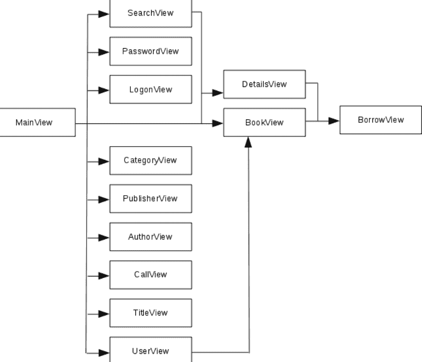

关于高级搜索，你可以根据以下标准进行搜索：

1. ISBN-13
2. ISBN-10
3. 标题
4. 版本
5. 出版者
6. 分类
7. 作者
8. 描述

- 搜索 ISBN 时，数字需要以搜索文本开头。
- 搜索标题和描述时，文本必须包含搜索文本。
- 搜索作者时，输入任何字符串，如果有空格，最后一个空格分隔名姓。名必须包含搜索文本，而姓也必须包含搜索文本。
- 在`DetailsView`中，这是一个显示书籍详情以及显示谁借阅了书籍的对话框。
- 在`BookView`中，有一个编辑书籍的对话框。该对话框也应用于创建和编辑书籍，只有在拥有员工权限时才能访问。
- `BorrowView`是一个显示借阅了特定书籍用户的简单对话框。
- 在`TitleView`中，有一个维护标题的对话框。
- 在`CategoryView`中，有一个维护类别的对话框。
- 在`PublisherView`中，有一个维护出版者的对话框。
- 在`AuthorView`中，有一个维护作者的对话框。
- `PasswordView`是更改用户密码的对话框。
- `SearchView`是用于高级搜索的对话框。
- `UserView`是一个维护用户的对话框。它也是一个复杂的对话框。
- `RecallView`是用于召回书籍的对话框。这是一个复杂的对话框。

窗口之间的关系所示：


关于高级搜索，你可以根据以下标准进行搜索：

1. ISBN-13
2. ISBN-10
3. 标题
4. 版本
5. 出版者
6. 分类
7. 作者
8. 描述

- 搜索 ISBN 时，数字需要以搜索文本开头。
- 搜索标题和描述时，文本必须包含搜索文本。
- 搜索作者时，输入任何字符串，如果有空格，最后一个空格分隔名姓。名必须包含搜索文本，而姓也必须包含搜索文本。
- 在`DetailsView`中，这是一个显示书籍详情以及显示谁借阅了书籍的对话框。
- 在`BookView`中，有一个编辑书籍的对话框。该对话框也应用于创建和编辑书籍，只有在拥有员工权限时才能访问。
- `BorrowView`是一个显示借阅了特定书籍用户的简单对话框。
- 在`TitleView`中，有一个维护标题的对话框。
- 在`CategoryView`中，有一个维护类别的对话框。
- 在`PublisherView`中，有一个维护出版者的对话框。
- 在`AuthorView`中，有一个维护作者的对话框。
- `PasswordView`是更改用户密码的对话框。
- `SearchView`是用于高级搜索的对话框。
- `UserView`是一个维护用户的对话框。它也是一个复杂的对话框。
- `RecallView`是用于召回书籍的对话框。这是一个复杂的对话框。

`User`类引用了`Book`类，其中包含一个用于记录用户借借书籍的引用。当用户借用书籍时，应该有一个引用来指示是哪本书书以及借书的时间，为此，在该层中添加了以下类：

```java
package library.models;

import java.util.*;

// 表示书籍的借用

public class Borrow {

    private Calendar date; // 借书日期

    private Book book; // 被借用的书籍

}
```

结果是，模型层增加了 7 个模型类。

模型层将所有数据库操作委托给 DAL 层，因此所有关于数据库和 SQL 的内容都在那里。因此，模型层为 6 个 SQL 类中的每一个都定义了一个适配器类，例如：


```java
package library.models;
```


```java
import java.util.*;

// User 的适配器类
public class Users {
    /**
     * 返回所有用户。
     *
     * @return 所有用户
     */
    public List<User> getAll() {
        throw new UnsupportedOperationException();
    }

    /**
     * 返回具有特定邮箱地址和密码的用户。
     *
     * @param email 用户的邮箱地址
     * @param passwd 用户密码的散文摘要
     * @return 如果找到用户，则返回 User 对象，否则返回 null
     */
    public static User getUser(String email, String passwd) {
        throw new UnsupportedOperationException();
    }

    /**
     * 返回具有特定键的用户。
     *
     * @param id 用户的主键
     * @return 如果找到用户，则返回 User 对象，否则返回 null
     */
    public User getUser(int id) {
        throw new UnsupportedOperationException();
    }

    /**
     * 创建新用户。
     * 假设用户对象之前已经过验证。
     *
     * @param user 要添加到数据库的 User
     * @param passwd 用户密码的散文摘要
     * @return 如果用户已添加，则返回 true
     */
    public boolean insert(User user, String passwd) {
        throw new UnsupportedOperationException();
    }
}
```

# JAVA 7：关于系统开发

```java
/**
 * 更新用户。假设用户对象之前已经过验证。
 *
 * @param user 应该更新的用户
 * @return 如果用户已更新，则返回 true
 */
public boolean update(User user) {
    throw new UnsupportedOperationException();
}
```

```java
/**
 * 该方法供用户更改密码
 * （用户自己的密码）。
 *
 * @param user 用户
 * @param passwd 新密码的散文摘要
 * @return 如果用户密码已更改，则返回 true
 */
public boolean update(User user, String passwd) {
    throw new UnsupportedOperationException();
}
```

```java
/**
 * 删除具有特定键的用户。
 *
 * @param id 用户的主键
 * @return 如果用户已删除，则返回 true
 */
public boolean delete(int id) {
    throw new UnsupportedOperationException();
}
```

```java
/**
 * 检查是否存在具有特定邮箱的用户。
 *
 * @param email 要搜索的邮箱地址
 * @return 如果找到用户，则返回 true
 */
public boolean exists(String email) {
    throw new UnsupportedOperationException();
}
```

```java
/**
 * 该方法供管理员更改用户的密码。
 *
 * @param email 用户的邮箱地址
 * @param passwd 新密码的散文摘要
 * @return 如果用户密码已更改，则返回 true
 */
public boolean changePassword(String email, String passwd) {
    throw new UnsupportedOperationException();
}
```


如该类所示，用户密码的加密是在模型层中进行的。其原理如下：当创建新用户时，你选择一个密码，密码只是一个字符串。对于这个密码，会计算出一个散文摘要，它只是一个使用哈希算法计算出的位模式。该位模式转换为十六进制字符串，并与其他用户数据一起存储在数据库中。当你再次想要读取用户数据时（例如在登录时），你必须重新输入密码，计算散文摘要并检查它是否与存储在数据库中的那个一致。其原理是使用足够强大的计算算法，使得没有人能够通过数据库中的加密值来确定或猜测用户的密码。Java 内置了用于此类计算的类，这些类被认为足够强大。


在 bookoon.com 下载免费电子书

### 5.3.5 DAL 层的设计

DAL 层必须定义数据库操作的类。模型层中的每个适配器都必须有一个类，基本上这些类由静态方法组成。由于程序高度依赖数据库，代码的大部分被放在这一层。需要解决的问题是在配置这些值时，将用户名和密码存储到数据库中。

### 5.3.6 控制层的设计

通常情况下，每个对话框都会有一个控制器类。尽管控制器类原则上是简单的，但它们需要验证输入。控制器层负责向模型发送数据，如果管理员需要检索书籍。

### 5.3.7 对设计的备注

设计的结果是：

- 1. 上述报告
- 2. CSV 文件
- 3. 创建数据库的 `Library.sql`
- 4. 创建数据库的 `Books.sql`
- 5. NetBeans 项目

## 5.4 编程

该阶段需要创建数据库并执行创建书籍的脚本。我将编程分为四个步骤（迭代）：

- 1. 书籍列表
- 2. 书籍维护
- 3. 用户管理
- 4. 借书与还书

第一次迭代涉及 `MainView`，它显示数据库中的所有书籍。该迭代还定义了整体外观。

第二次迭代包括书籍、作者和分类的维护，即创建、修改和删除。

第三次迭代包括用户维护，包括登录和用户访问权限实现。

最后，最后一个迭代实现了用户的借书和还书，包括向借阅者发送邮件。下面我将解释每个迭代所做的。每个迭代的结果都记录在 NetBeans 项目中。

### 5.4.1 书籍列表

首先，为设计的 NetBeans 项目创建一个名为 `Library1` 的副本。

然后，我写完了 `Publisher`、`Category`、`Author` 和 `Book` 模型类。它们都是简单的类，主要工作是实现 getter 和 setter 方法并重写 `equals()`，以便对象比较具有值语义。

下一步是在 DAL 层中编写四个类：

- `BookData`：应该有一个静态方法，返回数据库中的所有书籍。
- `PublisherData`：应该有一个静态方法，返回具有特定键的出版社。
- `CategoryData`：应该有一个静态方法，返回具有特定键的分类。
- `AuthorData`：应该有一个静态方法，返回特定书籍的所有作者。

所有类都是简单的，并将随着项目的迭代不断扩展。这里是最后三个被定义为包级权限的方法，它们不应该在包之外使用。还定义了一个简单的 `Db` 类，它只有一个简单方法，返回到数据库的连接。所有数据库参数都编码在该类中，这是需要更改的。该类还将扩展其他方法。

在实现上述类后，我在 `Books` 模型类中实现了 `getBooks()` 方法。

## JAVA 7: 关于系统开发

随后模型可以为书籍列表提供必要的数据，我可以开始编写程序的主视图（`MainView`）。

为了分离视图层中的类，我创建了一个子包：

- `library.views.tables`：用于 `JTable` 组件的辅助类

`MainView` 必须包含一个 `JTable`，我已经在上述包中添加了以下类：

- `IntegerRenderer`：一种 `CellRenderer`（单元渲染器），用于分配字体并定义需要右对齐的数字。它还定义了 0 必须显示为空。
- `StringRenderer`：一种 `CellRenderer`（单元渲染器），用于分配字体和边距。
- `FilterListener`：一个简单的接口，定义了一个单元方法，用于定义 `JTable` 的行过滤器。
- `Filter`：一个实现 `DocumentListener` 的简单类，用于简化 `JTable` 行过滤器的定义。
- `BooksTable`：`JTable` 的模型。


# JAVA 7: 关于系统开发

在 `library.views` 包中添加了以下类：

- `Options`：一个简单的类，定义了程序应该使用的字体。
- `GUI`：一个包含静态帮助方法的类，用于构建用户界面。
- `MainView`：程序的主视图。

在完成这些类后，`main()` 方法可以打开 `MainView`，结果如下：

| 标题 | 年份 | 出版社 | 类别 |
|---|---|---|---|
| Beginning Fedora, From Novice to Professional | 2007 | Apress | Unix |
| MySQL Tutorial, a concise introduction to the fundamentals of workin... | 2004 | Sams Publishing | 数据库 |
| Toscana, Maden, vinen, kulturen & landsabet | 2014 | Gyldendal | 葡萄酒 |

菜单已使用必要的菜单项创建，但没有任何一个菜单项具有功能。

你会注意到，我本可以使用 `library PaLib` 代替 `GUI` 类，实际上我并没有特殊的理由不这样做。

在完成第一次迭代后，可以将程序展示给未来的用户，作为对任务理解无误的验证。

### 5.4.2 书籍的维护

首先，从上一次迭代的 NetBeans 项目创建一个命名为 `Library2` 的副本。

在这次迭代中，我应该实现“Librarians”（图书管理员）菜单下的功能，以及当用户在 `JTable` 中双击书籍时编辑书籍的功能，即以下功能：

- 维护出版社
- 维护类别
- 维护作者
- 创建书籍
- 编辑书籍

在 bookoon.com 下载免费电子书

# JAVA 7: 关于系统开发

我将从维护出版社开始，该功能从菜单中选择并会打开以下对话框：

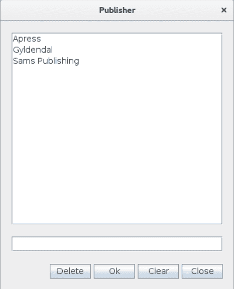

该对话框在列表框中显示所有出版社的列表。如果你在列表框中双击某个出版社，你就选择了该出版社，名称将插入输入字段中。按钮的含义如下：

- `Close`（关闭）：关闭窗口。
- `Clear`（清除）：清除输入字段并将出版社的选择置为空。
- `OK`（确定）：创建或更新出版社。如果尚未选择出版社，则创建一个新的出版社；否则，则更新所选出版社的名称。
- `Delete`（删除）：删除所选的出版社。该按钮初步为激活状态，在下次迭代后，只有当用户是管理员时才会激活。

为了实现功能 1，我编写了以下代码：

1. 扩展了 `PublisherData` 类的方法（5 个方法），以维护数据库中的出版社表。为了简化情况，扩展了 `Db` 类的一些辅助方法，这些方法将在其他 DAL（数据访问层）类中使用。
2. 实现了适配器类 `Publishers` 中的方法，使其调用 `PublisherData` 类中对应的方法。

在 bookboom.com 下载免费电子书

# JAVA 7: 关于系统开发

- 3. 在 `library.ctrls` 包添加了 `PublisherController` 类，它是上述对话框的控制器。如果控制器中的方法无法正常执行，则方法返回 `false`，然后视图可以读取错误信息。
- 4. 添加了新包 `library.views.listeners`，并在其中添加了 `BookListener` 接口，它定义了两个方法，用于在数据库内容更改时发送通知。
- 5. 修改并更新了 `GUI` 类，增加了两个新方法。
- 6. 对话框由 `library.views` 包中的 `PublisherView` 类定义。对话框的构造函数有一个类型为 `BookListener` 的参数，以便根据出版社的变化向主窗口发送通知。
- 7. 更新了 `BooksTable` 类（主窗口 `JTable` 的数据模型），增加了两个方法，当模型更新时这些可以触发事件。
- 8. 修改了 `MainView` 以实现 `BookListener` 接口，并且菜单打开 `PublisherView` 对话框。


# JAVA 7: 关于系统开发

功能实现后，进行以下测试：

1. 创建两个出版社
2. 关闭对话框
3. 修改其中一个作者
4. 删除出版社
5. 关闭对话框

下一步我将实现类别维护。该功能与上述类似，但需要编写以下代码：

1. 扩展 `CategoryData` 类以包含必要的方法。
2. 实现了适配器类 `Categories` 中的方法。
3. 在 `library.ctrl` 添加了 `CategoryController` 类，它是该对话框的控制器。
4. 对话框由 `library.views` 包中的 `CategoryView` 类定义。
5. 修改 `MainView` 使菜单打开 `CategoryView` 对话框。

该对话框以相同的方式进行测试。

作者维护与上述类似，但此时可能有许多作者，作者通过 `JTable` 展示，且顶部有过滤器。代码与上述类似，但这次需要在 `library.tables` 中添加一个用于 `JTable` 的类。

测试方法如下：

1. 创建具有姓名的作者
2. 创建具有名的作者
3. 创建具有名、姓和描述的作者
4. 创建窗口
5. 打开窗口并测试过滤器
6. 修改两个新作者的所有字段
7. 删除一个新作者
8. 关闭窗口
9. 打开窗口
10. 删除作者

# JAVA 7: 关于系统开发

| 名 | 姓 | 描述 |
|---|---|---|
| Anne Mette | Rosendahl | Ariani |
| Camilla | Bondo | Pedersen |
| Shashank | Sharma | |
| Keir | Thomas | |
| Laura | Thomson | |
| Luke | Welling | |

作为最后一个功能，我应该实现“创建书籍”功能，它是所有对话框中最复杂的（见下文）。这是在列表中双击书籍时用于创建和编辑书籍的同一个对话框。

该对话框可以解释如下：左侧是书籍的字段，右侧显示所有作者的列表。左侧的字段除了作者字段（这是一个列表框）外都是自言自懂。如果你想关联作者，应该双击右侧表格中的作者。如果你想从书籍中移除作者，应该双击列表框中的作者。

左侧按钮的含义如下（从左到右）：

- 如果出版社尚未创建且在组合框中可用，则创建一个出版社。
- 如果类别尚未创建且在组合框中可用，则创建一个类别。
- 删除书籍（该按钮随后仅在用户有删除书籍的权限时才激活，且当前不是“创建书籍”功能时）。
- 还书——首次在迭代 4 中实现。
- 借书——首次在迭代 4 中实现。
- 显示谁借了书——首次在迭代 4 中实现。
- 保存书籍。
- 关闭对话框。

# JAVA 7: 关于系统开发库

关于右侧，有两个用于过滤的输入字段，而按钮分别用于移除过滤器并允许你创建新的作者。

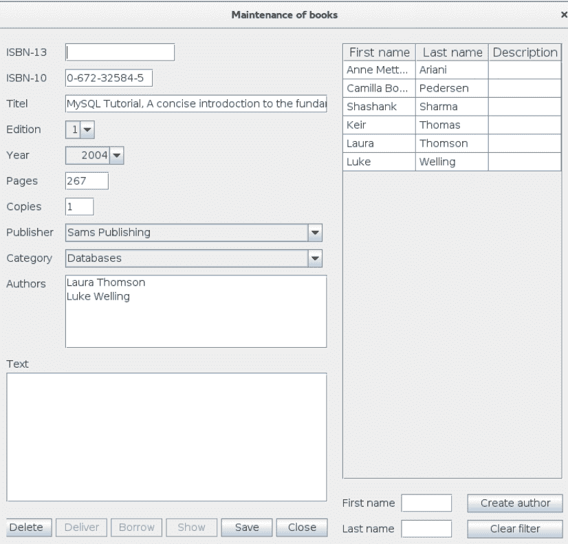

为了编写代码，我执行了以下操作：

- 扩展了 `BookData` 类，增加了必要的方法（4 个方法），用于维护有关书籍的数据库。由于这些方法中的大部分必须维护多个数据表，因此它们被写为事务的形式。
- 相应地更新了适配器类 `Books`。
- 添加了包 `library.util`，目前该包有一个名为 `Tools` 的类。该类仅包含静态方法，用于验证 ISBN、电子邮件地址等。
- 增加了一个控制器类 `BookController`，其主要任务是验证用户的输入/选择。

在 bookboom.com 下载免费的电子书。

# JAVA 7: 关于系统开发

由于必须能够从上述对话框中创建类别、出版者和作者，因此在 `library.views` 中添加了三个简单的对话框：

- `CreateCategory`：一个用于创建类别的简单对话框。
- `CreatePublisher`：一个用于创建出版者的简单对话框。
- `CreateAuthor`：一个用于创建作者的简单对话框。

由于这些是非常简单的对话框，因此没有为这些窗口定义任何控制器。

为项目添加了更多接口。`bibliotek.views.listeners` 包扩展了以下接口：
- `CategoryListener`：定义了一个单一方法。`BookView` 类实现了该接口，`CreateCategory` 类使用该方法在创建新类别时发送通知。
- `PublisherListener`：定义了一个单一方法。`BookView` 类实现了该接口，`CreatePublisher` 类使用该方法在创建新出版者时发送通知。


在 www.deloitte.careers 发现真理。

德勤（Deloitte）。
© Deloitte & Touche LLP 及关联实体。

在 bookboom.com 下载免费的电子书。

点击广告阅读更多

`AuthorListener`：定义了一个单一方法。`BookView` 类实现了该接口，`CreateAuthor` 类使用该方法在创建新作者时发送通知。

`EditListener` 也定义了一个单一方法，并由 `BookView` 实现。当对话框修改书籍内容时调用该方法，以便 `BookView` 可以跟踪内容的更改。

`EditTextListener` 是实现 `DocumentListener` 的类，其工作方式与上述相同，当窗口的某个输入字段发生变化时，会将类型为 `BookView` 窗口的内容设置为已更改。

`EditListListener` 是实现 `ItemListener` 的类，其工作方式与上述相同，当窗口的某个组合框选择改变时，会将类型为 `BookView` 窗口的内容设置为已更改。

`EditDataListener` 是实现 `ListListener` 的类，其工作方式与上述相同，当窗口的作者列表框内容更改时，会将类型为 `BookView` 窗口的内容设置为已更改。

然后是 `BookView` 对话框，这是一个非常全面的对话框。将在后续的迭代中对其进行修改。

最后，更新了 `MainView` 并为表格中的双击操作附加了事件处理器。在表格中双击某行（一本书），`MainView` 会打开 `BookView`，但插入的是该书籍。然后可以选择编辑或删除该书籍。

该功能通过以下方式进行测试：

1. 创建书籍（ISBN 10, 标题）
2. 创建书籍（标题）
3. 关闭窗口
4. 创建书籍（ISBN 13, 标题，版本, 年份，现有出版者，不存在的类别， 3 个不存在的作者）
5. 关闭窗口
6. 修改书籍（不存在的出版者，不存在的类别，不存在的作者）
7. 修改书籍（不存在的出版者，不存在的作者）
8. 修改书籍（页码）
9. 创建书籍（标题）
10. 关闭窗口
11. 双击表格
12. 过滤所有作者
13. 删除书籍
14. 创建书籍

JAVA 7: 关于系统开发

### 5.4 用户管理

在此迭代中，实现了用户管理，可以对以下用户角色进行操作：

1. 所有
2. 学生
3. 管理员

该迭代还包含了密码修改。

关于数据库，决定名为 `Administrator` 的用户不能被删除或编辑。

在 `MainView` 中添加了新的菜单项：类别维护和出版者维护。了两个类：

- `TitleController`（位于 `library.ctrl`）
- `TitleView`（位于 `library.views`）

该功能通过以下方式测试：

1. 创建类别
2. 创建另一个类别
3. 创建第三个类别
4. 关闭窗口
5. 重新打开窗口
6. 修改三个类别
7. 关闭窗口
8. 重新打开窗口
9. 删除三个类别
10. 关闭窗口
11. 重新打开窗口
12. 创建 `Teacher` 和 `Student` 两个类别

JAVA 7: 关于系统开发

3. `Titles` 和 `Users` 被添加到 `library.models`。
4. 在 `library.dal` 中添加了 `Zipcode`。该类是单例，用于初始化列表。
5. 为 `Users` 添加了一个方法来检查书籍是否存在。

下一步，我扩展了模型层和数据访问层：

1. `library.models` 中的 `Title` 和 `User`。
2. `library.dal` 中的 `TitleData` 和 `UserData`。后者与前面的类类似，但拥有更多方法。

简单明了


JAVA 7: 关于系统开发

下一步是实现用户维护功能，这是一个复杂的函数。该功能必须打开以下窗口：


在 `JTable` 中显示数据库中的所有用户。除了 `JTable` 外，底部还有过滤字段，“清除”按钮可以移除可能的过滤器。“创建”按钮会打开一个可以在其中创建用户的对话框：

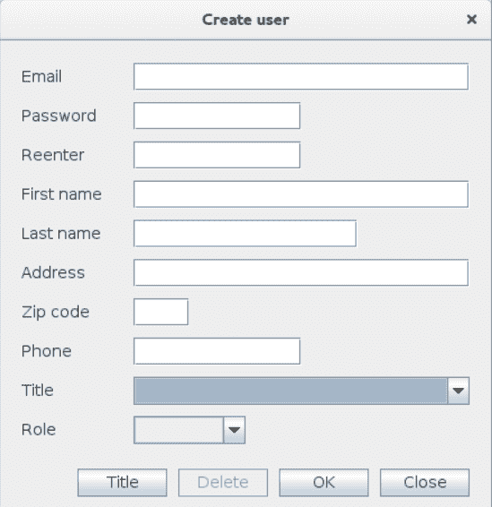

如果你在所有用户列表中创建了一行，双击表格将打开相同的对话框（见下方），但右侧有一个表格。该表格目前尚未使用，但它应该显示该用户借的书籍概览。该表格是一个 `JTable`，它将在最后一次迭代中获取内容。

在 bookboom.com 下载免费的电子书。

# JAVA 7: 关于系统开发

# 图书

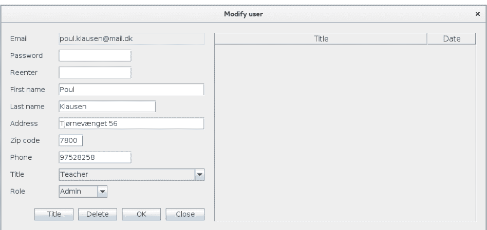

当你创建一个用户时，选择一个用户角色：

1. 管理员 (Admin)
2. 工作人员 (Staff)
3. 学生 (Student)


这些角色用于下文实现的用户访问权限。

用户维护（Maintenance of users）的实现增加了几个新类型。`library.views.tables` 包扩展了两个类：

- `UserTable`，它是 `JTable` 的数据模型，用于显示所有用户的概览。
- `BorrowTable`，同样的方式，它是上方所示 `JTable` 的数据模型，并应用于书籍；目前用户类尚未完成，且表格显示的对象也尚未定义。

在 `library.views.listeners` 中添加了一个名为 `UserListener` 的接口，它定义了两个方法，用于表示用户被创建、修改或删除。该接口由 `UserView` 实现。

在 `library.ctrls` 中为 `UserView` 添加了一个控制器类。该类名为 `UserController`。

最后添加了两个类：

- `UsersView`，用于显示所有用户的概览。
- `UserView`，用于编辑用户。

通过以下步骤完成以测试该功能：

- 1. 创建三个用户
- 2. 关闭窗口
- 3. 再次打开窗口
- 4. 修改这三个用户中的每一个
- 5. 关闭窗口
- 6. 再次打开窗口
- 7. 删除这三个用户
- 8. 创建一个管理员（Admin）用户
- 9. 创建一个员工（Staff）用户
- 10. 创建一个学生（Student）用户

程序首次运行时，原则上没有用户和标题。决定必须始终存在一个用户角色为 0 的超级用户，并拥有管理员（Administrator）权限。当程序启动时，它会检查此用户和标题是否存在，如果不存在，程序将自动打开一个对话框，让你创建这个超级用户以及管理员标题。该类和该超级用户都必须被删除或更改。

## JAVA 7：关于系统开发

`UserData`、`Users` 和 `UserController` 类已更新。此外，`library.views` 包添加了以下类：

- `AdminView`，与 `View` 几乎相同的对话框，但你无法选择标题和角色。
- `SuperView`，用于输入超级用户密码的简单对话框。

此外，还添加了一个名为 `LogonListener` 的接口并由 `MainView` 实现。它定义了一个方法，当你输入正确密码时由 `SuperView` 调用。

在本次迭代中，实现了用户访问权限。它包括：

- 1. 在 `library.models` 中添加了 `CurrentUser` 类。该类实现为单例并代表当前用户。程序启动后没有用户——即没有用户登录。
- 2. 添加了一个新控制器，名为 `LogonController`，作为下方对话框的控制器。
- 3. 在 `logon` 中添加了 `DialogView` 类。该类可以在 `library.views` 中找到。
- 4. 添加了名为 `PasswordController` 的额外控制器，作为后续对话框的控制器。
- 5. 在 `library.views` 中又添加了一个视图。该对话框名为 `PasswordView`，供当前用户更改密码。
- 6. 最后在 `library.views` 中添加了对话框类 `DetailView`，当学生在概览中双击某本书时，该对话框会打开。结果是，具有学生访问权限的用户只能查看书籍详情，而不能更改数据。学生可以借用书籍，但这将在下一次迭代中首先实现。

我还修改了 `MainView` 类，使得更多菜单项变为可用，但根据用户访问权限只能访问特定的菜单项。同样地，对话框也会发生更改，但根据当前用户，某些按钮将处于禁用状态。

上述结果测试如下：

- 1. 当程序打开时，应该只能访问带有所有书籍概览的 `MainView`（用户应该能够应用过滤器）和常规（General）菜单
- 2. 以学生身份登录——现在应该还可以访问“用户”（Users）菜单
- 3. 双击书籍以测试 `DetailsView` 对话框
- 4. 修改当前用户的密码

## JAVA 7：关于系统开发

## 图书库

- 5. 注销
- 6. 测试只能访问“常规”（General）菜单且无法打开 `DetailsView` 对话框
- 7. 再次以同一用户登录（使用新密码）
- 8. 在不先注出的情况下以员工身份登录——现在应该还可以访问“图书管理员”（Librarians）菜单
- 9. 测试图书管理员”菜单下的所有功能均工作正常，且删除（Delete）按钮为禁用状态
- 10. 注销并测试只能访问“常规”（General）菜单
- 11. 以管理员身份登录——现在应该可以访问“管理员”（Administrator）菜单
- 12. 测试“管理员”菜单下的功能（除第一个外）均工作正常
- 13. 测试“图书管理员”菜单下的所有功能均工作正常，且删除（Delete）按钮为激活状态（所有用于借书的按钮都不应起作用）
- 14. 注销
- 15. 以超级用户登录
- 16. 注销

我加入 MITAS 是因为我渴望真正的责任

工程师与地质科学家研究生计划 www.discovermitas.com


第 16 个
我曾在北海担任施工主管，指导并帮助工头解决问题

真实工作 国际机会 三次实习


## JAVA 7：关于系统开发

## 4.4 借阅与搜索

在上一次迭代中，用户可以借阅书籍。在本次迭代中实现了用户访问权限。它包括：

- 1. 在 `library.models` 中添加了 `CurrentUser` 类。该类实现为单例并代表当前用户。程序启动后没有用户——即没有用户登录。
- 2. 添加了一个新控制器，名为 `LogonController`，作为下方对话框的控制器。
- 3. 在 `logon` 中添加了 `DialogView` 类。该类可以在 `library.views` 中找到。
- 4. 添加了名为 `PasswordController` 的额外控制器，作为后续对话框的控制器。
- 5. 在 `library.views` 中又添加了一个视图。该对话框名为 `PasswordView`，供当前用户更改密码。
- 6. 最后在 `library.views` 中添加了对话框类 `DetailView`，当学生在概览中双击某本书时，该对话框会打开。结果是，具有学生访问权限的用户只能查看书籍详情，而不能更改数据。学生可以借用书籍，但这将在下一次迭代中首先实现。

## JAVA 7：关于系统开发

- 1. 以学生身份登录
- 2. 打开书籍的 `DetailView`
- 3. 再次关闭它
- 4. 关闭 `DetailsView`
- 5. 以员工身份登录
- 6. 打开 `BookView`（针对同一用户）

## JAVA 7：关于系统开发

- 7. 检查借阅情况——`BorrowedView`
- 8. 借书
- 9. 关闭 `BookView`
- 10. 以管理员身份登录
- 11. 打开用户
- 12. 打开员工用户的 `UserView`
- 13. 取消书籍借阅
- 14. 再次以学生身份登录
- 15. 检查借阅情况——应该有一个是当前用户
- 16. 还书

# JAVA 7: 关于系统开发库

| 邮箱 | 名字 | 姓氏 | 标题 | 日期 | 删除 | 邮件 |
|---|---|---|---|---|---|--|
| | | | | | | |

该表格右侧有两列，用于放置勾选。在第一列中，你可以标记必须取消的借用记录，而在另一列中，你可以选择需要召回（归还）的借用记录。

为了测试功能，我执行了以下操作：

- 1. 创建一个可以使用（我拥有访问权限）的邮箱地址的用户
- 2. 创建另一个可以使用（我拥有访问权限）的邮箱地址的用户
- 3. 为第一个用户借阅一本书


在 bookboom.com 免费下载电子书

# JAVA 7: 关于系统开发库

- 4. 为第二个用户借阅一本书
- 5. 为第三个用户借阅一本书
- 6. 以管理员身份登录
- 7. 选择“召回”（Recall）功能
- 8. 在期间字段不输入任何内容——显示所有借用记录
- 9. 双击其中一个用户的姓氏以查看借阅者信息
- 10. 双击标题以查看书籍详情
- 11. 为第一个用户标记召回，并为第三个用户标记删除
- 12. 点击“召回”并测试功能执行是否正确

剩余工作是实现搜索功能。该功能会显示如下所示的窗口，你可以在其中输入/选择搜索条件。当你点击“搜索”时，匹配的书籍将显示在右侧的表格中，如果你双击表格中的某行，将根据你所属的用户类型进入详情视图（`DetailView`）或书籍视图（`BookView`）。

原则上，实现该功能是简单的，唯一复杂的地方在于编写应用于具体搜索的 SQL 表达式。这是基于 `BookData` 类中的搜索标准，且这些标准在 `Books` 类中准备。对话框通过以下类实现：`SearchView`（位于 `library.views` 中）和 `SearchTable`（位于 `library.views table` 中）。要测试该功能，除了执行多次搜索外别无其他方法。在这里很难充分测试该功能，因为数据量可能太小。

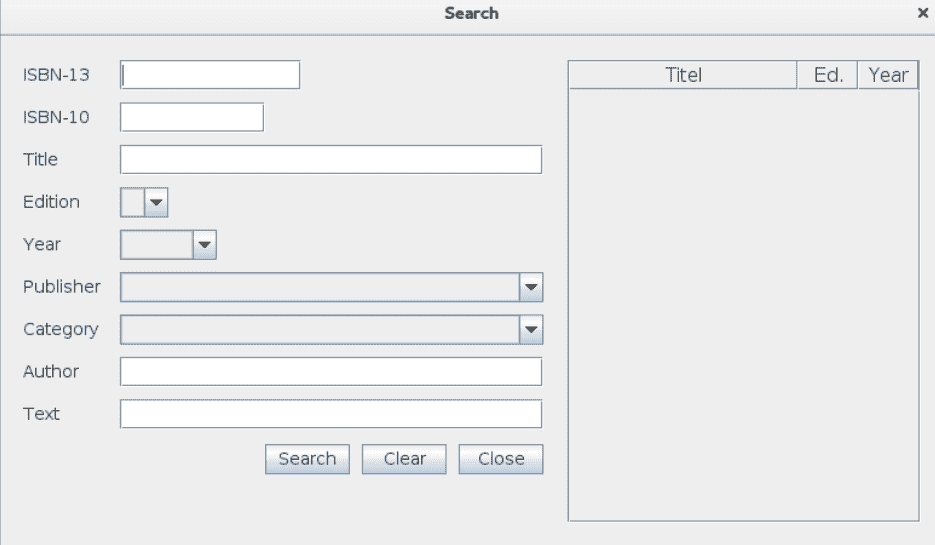

# JAVA 7: 关于系统开发

最后，在“管理员”菜单中增加了另一个功能，用于维护超级用户。

数据库和邮件服务器的参数是硬编码的，这显然是不妥行的。这些值应该移动到配置文件中。它名为 `library.config`，初步位于我的主目录下，格式如下：

```


# JAVA 7: 关于系统开发

## 数据库与邮件服务器配置

数据库和邮件服务器的参数是硬编码的，这显然是不妥当的。这些值应该移动到配置文件中。它名为`library.config`，初步位于我的主目录下，格式如下：

```
dbhost:***
dbport:***
dbata:***
dbuser:***
dbcode:***
mlhost:***
mlport:***
mluser:***
mlcode:***
```

`***`应被替换为当前值。其含义如下：

- `dbhost`是数据库服务器名称
- `dbport`是数据库服务器使用的端口
- `dbata`是数据库名称
- `dbuser`是数据库用户名称
- `dbcode`是数据库服务器的密码
- `mlhost`是邮件服务器（SMTP 服务器）名称
- `mlport`是邮件服务器使用的端口
- `mluser`是邮件服务器的邮箱地址
- `mlcode`是数据库服务器的密码

项目在`library.util`包中扩展了一个`Servers`类。该类被程序化为单例，其私有构造函数读取上述配置文件，该类拥有返回指向两个服务器连接的方法。接下来，修改了`Db`和`Mail`两个类以处理特定的服务器。

在`main`方法中，添加了代码以根据参数读取配置文件：

```
if (args != null && args.length > 0)
library.util.Servers.setPath(args[0]);
```

这意味着你可以通过参数指定配置文件的位置，是可以的。

## 管理员功能

在“管理员”菜单中增加了一个功能用于维护超级用户。

## 召回功能测试

| 邮箱 | 名字 | 姓氏 | 标题 | 日期 | 删除 | 邮件 |
|---|---|---|---|---|---|--|
| | | | | | | |

该表格右侧有两列，用于放置勾选。在第一列中，你可以标记必须取消的借用记录，而在另一列中，你可以选择需要召回（归还）的借用记录。

为了测试功能，我执行了以下操作：

1. 创建一个可以使用（我拥有访问权限）的邮箱地址的用户
2. 创建另一个可以使用（我拥有访问权限）的邮箱地址的用户
3. 为第一个用户借阅一本书


4. 为第二个用户借阅一本书
5. 为第三个用户借阅一本书
6. 以管理员身份登录
7. 选择“召回”（Recall）功能
8. 在期间不输入任何内容——所有借用记录
9. 双击其中一个用户的姓氏以查看借阅者信息
10. 双击标题以查看书籍详情
11. 为第一个用户标记召回，为第三个用户标记删除
12. 点击“召回”并测试功能执行是否正确

## 搜索功能

剩余工作是实现搜索功能。该功能会显示如下所示的窗口，你可以在其中输入/选择搜索条件。当你点击“搜索”时，匹配的书籍将显示在右侧的表格中，如果你双击表格中的某行，将根据你所属的用户类型进入详情视图（`DetailView`）或书籍视图（`BookView`）。

原则上，实现该功能是简单的，唯一复杂的地方在于编写应用于具体搜索的 SQL 表达式。这是基于`BookData`类中的搜索标准，且这些标准在`Books`类中准备。对话框通过以下类实现：`SearchView`（位于`library.views`中）和`SearchTable`（位于`library.views table`中）。要测试该功能，除了执行多次搜索外别无其他方法。在这里很难充分测试该功能，因为数据量可能太小。


## 安装说明

我不会在这里显示安装脚本。要安装此程序，你必须：

1. 将文件`zcodes`复制到`/var/lib/mysql-files/data`
2. 打开 MySql Workbench 并执行`library.sql`脚本
3. 使用正确的参数更新配置文件`library.config`
4. 更新终端并将当前目录更改到 setup 文件夹
5. 执行命令：`sudo ./library.sh`

结果应该是，你会在桌面上获得一个图标，并可以启动程序。


# 附录 A：UML 概述

我反复提到 UML 是可以用于系统开发的图表。虽然我不是 UML 的坚定支持者，但必须承认这些图表也有其用处。因此，本附录提供了主要规则和图表语法的概述。

如上所述，这意味着在分析（主要是在设计阶段）必须构建一个程序的模型，例如该程序应该由哪些类组成。为此，你可以使用图表来展示程序的架构和关键组件，其优势在于你可以直观地处理程序的结构，在某些情况下，图表可以画出原本需要用许多文字来解释的模型，而该模型依赖于编程语言的许多细节。

我之前建议过我并不怎么喜欢这些图表，因为它们很难画（需要很长时间），而且如果如果在开发过程中设计发生了变化，维护它们又非常耗时。另一个问题是图表必须具有价值，并且被所有人理解，且需要了解规则，而这些规则往往复杂且难以学习。第一个问题可以通过支持开发此类 UML 图表的特定用例工具来解决，而第二个问题仅仅是学习图表语法的问题。

UML 代表统一建模语言（Unified Modeling Language），是一种用于系统开发中软件建模的绘图。UML 定义了多种类型的图表，旨在分析和设计，下面我将简要描述这些最重要的图表，以及最基础的绘图规则。其理念是，你可以画出一个包含最重要算法在内的程序模型，正如我上面所说的，它确实有很好的用途。如果你正在参与一个开发软件解决方案的项目，那么 UML 非常适合支持这种过程，即你们在黑板上共同使用 UML 图表进行建模。在这里，建模图表比最终解决方案的文档更重要。然而，人们不能低估其价值——特别是对于创建一个概述，至于非常详细的图表，我发现它们很少有价值，我觉得其价值与其产生它们所消耗的资源不成正比。

简而言之，我认为图表作为系统开发过程的一部分以及作为提供大型复杂系统概述的文档是有用的。

在本附录中，正如前面提到的，我将介绍 UML。这里有很多规则，并非所有的都会被提到，但重点在于我认为最有用的图表规则。这些图表都是使用 LibreOffice Draw 绘制的，大多数示例取自书中的项目以及图书馆程序的开发，并将部分说明基本的绘图规则，以及在何处和如何使用图表。

## 领域模型

我将从领域模型开始，它是一种在分析期间用于说明软件解决方案组成的主要概念的图表。该图表由画成矩形的概念类，以及这些类之间的关联关系组成。以下是图书馆程序的领域模型：

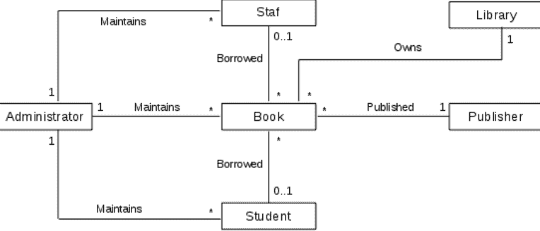

该图表显示了该程序的关键概念。这是一个简单的图表，但在分析的初步阶段，它可以帮助为即将开发的程序问题领域的关键概念提供概述。在这种情况下，显示了 6 个关键概念，但这绝不意味着只有这些概念，在这种情况下可能还有更多。然而，你应该避免将图表画得过于详细，保持关注在主要概念上。需要注意的是，领域模型中的类与软件类并不相同。领域模型将为程序应该由哪些类组成提供灵感，领域模型中的许多类随后在设计阶段也可以恢复为软件类，但并非所有都是如此。当你绘制领域模型时，必须专注于概念性，而不要从软件工程的角度去思考。

在领域模型类之间可能存在关联，它们被画成直线，并且可能带有名称，如上所示。关联表示模型类之间的某种连接或关系。例如，“书（Book）”与“出版社（Publisher）”之间存在关联，对应于“一本书由一家出版社出版”。关联可以附加重系数，正如关联“出版（Published）”所示，一个出版社可以关联 0 本或多本书，而一本书恰好关联一个出版社。你可以使用以下重系数：

- `*` 0 个或或多个
- `1..*` 1 个或多个
- `1..n` 1 到 n
- `n` 恰好 n
- `k,m,n` 恰好 k, m 或 n


领域模型将由概念类和这些类之间的关联组成，并且并不一定带有重系数，如果你喜欢，你也可以为这些类命名。在这种情况下，显示了概念类，由于是如此，你还可以为类分配属性，这有助于展示所有的概念。

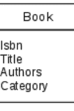

## 用例图

用例图（Case Diagram）用于建模系统开发中的软件建模，并通常用于分析。在这里，它用于展示与系统的交互。图中两个概念：一个是参与者（Actor），表示与程序交互的实体。它通常是一个人，也可以是一个硬件设备。第二个元素是用例（Use Case），它是程序必须执行的任务。以下是图书馆的用例图。

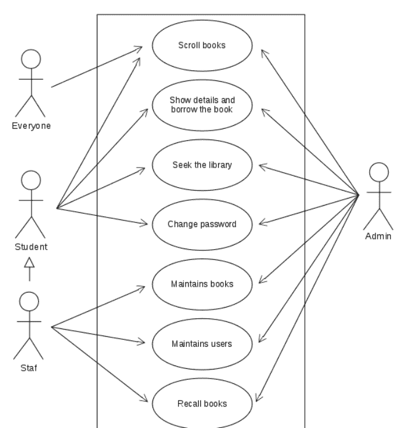

用例用椭圆绘制，并附有简短文字说明用例的含义。用例是在短时间内进行的一种操作（用户交互）。例如，参与者可以在图书馆进行搜索并获得标题结果。同样，用户可以查看书籍详情并可能借阅。

参与者用符号绘制，并在下方带有名称。在这种情况下有四个参与者，他们都是人，但参与者并不非是人。如果是，你有时这样画参与者：

```
<<actor
Device
```

参与者与用例之间的交互用箭头（有时是无方向的线）表示。在这种情况下，箭头始终从参与者指向用例，但并非如此，也可能是向硬件设备发送消息的应用程序。

特别地，允许参与者继承另一个参与者，这简单意味着继承的参与者拥有被继承参与者的一切（相同的用例）以及任何其他用例。在上面的图中，通过“工作人员（Staf）”继承“学生（Student）”这一事实所示。继承的一个重要结果是它可以使图表更简单，从而更容易阅读。

有时你还会选择用矩形框围所有用例，而矩形内部的所有都被视为系统，而参与者在外部，是外部的。


用例图面临的挑战之一在于究竟什么是用例。如上所述，它应该是一个在时间上受限的并且具有与系统进行会话性质的操作。观察上面的图表，更多使用的用例实际上并不是真正的用例，而是用例的集合。以“维护书籍（Maintains-books）”为例，它实际上由几个用例组成：

- 创建书籍
- 修改书籍
- 删除书籍
- 借阅书籍
- 还书

这种情况在多处地方也适用。问题在于于，用例的数量很容易变得非常庞大，导致相应的图表变得混乱。如果你必须做到绝对准确，通常需要绘制更多的用例图。有时一个用例会包含另一个用例，我们可以像展示的那样将其图中图中：


同样，一个用例可以是另一个用例的扩展，你可以如下所示所示：

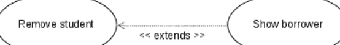

用例图可以独立存在——至少在上面的示例中不是这样所示。对用例进行描述是必要的：

1. 名称以及以文本形式呈现的简要描述。
2. 正式需求，包括执行用例的结果，它可以被看作一份合同，在该中用例保证在特定条件下执行时会产生某个特定结果。
3. 前置条件（Pre conditions）是执行用例必须满足的条件，这些前置条件可以视为合同的一部分。
4. 场景（Scenarios），作为对用例执行时参与者与系统之间发生的动作或事件序列的正式描述。

用例的正式文档的一个示例可以是：

用例：查找图书馆
名称：SeekLibrary
描述：用户输入或选择搜索准则
`Isbn13`，必须以搜索文本开头
`Isbn10`，必须以搜索文本开头
标题，必须包含搜索文本
版本
年份
出版者
类别
作者，姓和名之间用空格分隔
文本，必须包含搜索文本
如果搜索准则为空或缺失，则应忽略。
结果是匹配搜索准则的书籍列表。
如果没有匹配的书籍，则列表为空。

操作：输入搜索准则
为版本、年份、出版者、类别选择一个准则
点击搜索

前置条件：如果选择了出版者或类别，它们必须存在。
后置条件：创建了一个包含匹配搜索准则的书籍对象的列表。数据库的内容不会改变。

正如上述内容可能已经清楚的那样，绘制用例图并附带特定用例的描述可能是详尽的，但要制作一份完整的用例文档，你实际上完成了大部分需求规格书的工作，你可以将我们使用的用例视为一种准备需求规格书的正式化方法。

## 类图

最常用的 UML 图无疑是类图，它是一种用于设计的图表，展示了程序中的许多类。它也是最复杂的图，具有许多绘制规则。该图通常用于模型层和控制器层。类的建模方式如下：

该图由三个矩形组成，顶部是类名，中间是类的变量，而最后是类的方法。成员->（包括变量和方法）前面带有`+`表示 public（公共），而成员前面带有`-`（减号）表示 private（私有）。如上所示展示了一个类的组成部分以及成员的可见性。代码生成的转换是下一个状态。从形式上我们还应该指定构造函数的语法。例如：

```
Publisher
```


- `id: int`
- `name: String`
- `<<constructor>(int, String)`
- `getId(): int`
- `getName(): String`
- `setName(String)`
- `toString():`
- `equals(Object)`

```
+ <<constructor>> Publisher(int, String)
```


## 附录 A

问题是行很容易变得很长，并且相应的类将占据大量空间，而且由于 Java 中的构造函数必须省略名称。此外注意，我为变量和方法都定义了类型。我并不总是这样做，如果你觉得在没有这些类型的情况下实现相同的效果，也可以的。记住，图表的意义在于提供一个概述，这是重要的。

还有一些绘制规则，下面展示了一个定义了包可见性的类，以及一个受保护（`protected`）的方法：

| Klasse |
| :--- |
| - variable |
| # metodo() |

作为另一个例子，以下类建模了 `Publishers` 类：

| Publishers |
| :--- |
| + getAll(): List<Publisher> |
| exists(String): boolean |
| insert(String): boolean |
| update(String): boolean |
| delete(int): boolean |

下面的内容建模了 `Book` 类：

```
Book
- id: int
- isbn13: String
- isbn10: String
- title: String
- edition: int
- year: int
- pages: int
- number: int
- text: String
+ <<constructor>(int, String)
+ getId(): int
+ getIsbn13(): String
+ getIsbn10(): String
+ getTitle(): String
+ getEdition(): int
+ getYear(): int
+ getPages(): int
+ getNumber(): int
+ getText(): String
+ setIsbn13(String)
+ setIsbn10(String)
+ setTitle(String)
+ setEdition(int)
+ setYear(int)
+ setPages(int)
+ setNumber(int)
+ setText(String)
+ equals(Object)
```

# JAVA 7：关于系统开发

如果我们再次考虑类模型的第一版本，你可以看到 `Publisher`（出版者）、`Category`（类别）和 `Author`（作者）都有 `get` 和 `set` 方法，因此似乎该类缺少了一些变量。然而，事实并非如此（在设计阶段并非如此），因为它们对应于类之间的关系。

如果你考虑上述类模型，它们通常需要额外的文档，其中至少有必要记录方法，而 UML 也有关于如何进行操作的语法。然而，我更倾向于用纯文本来记录方法，简要解释每个方法的含义——可能也包括变量。

如果有多个类，这些类之间就会存在关系，通常情况下可以是：

1. 关联（`association`）
2. 聚合（`aggregation`）
3. 组合（`composition`）
4. 继承（`inheritance`）

这些关系通过类图来展示，下面显示了图书馆程序模型层的类图。让我立即说明一下，该图的画法并不正确，因为选择关系的类型是为了展示语法。如果你看 `User` 和 `Book` 这两个类，图中显示了这两个类之间的关系。它被画成一个从 `User` 到 `Book` 的箭头，并列出了一个多重性，表示 `User` 可能与多个 `Book` 对象相关。这是一个关联的示例，表示一种松散的关系，这种关系不一定在程序的整个生命周期内都存在。在这种情况下，表示 `User` 借用了一本书的关系，当用户在某时还了书时，该关系就消失了。因此，它被显示为关联。多重性显示为 `*` 意味着一个用户可以借更多的书。这意味着该关系必须在 `User` 类中实现为类型为 `Book` 的对象列表。

# JAVA 7：关于系统开发

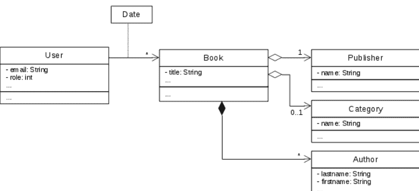

`Book` 类和 `Publisher` 类之间也存在关系，因为根据多重性显示，一个 `Book` 对象恰好关联于一个 `Publisher`。该关系在 `Book` 类中实现为一个类型为 `Publisher` 的实例变量。该关系被显示为聚合（`Aggregation`），意味着两个对象之间的固定连接。书籍不会更换出版者，人们可以把聚合理解为它所指的是书籍所包含的内容。然而，聚合的对象可以有自己的生命，即使聚合消失了它也可以存在，并且它可以被聚合到多个 `Book` 对象中。聚合反映了比关联更强的关系。

同样，`Category` 类与 `Book` 是聚合关系，但这通过多重性可能表示书籍并不一定有一个类别，但如果有的话，该类别就不会改变。

图中还显示了 `Book` 和 `Author` 之间的关系，当多重性为 `*` 时，它必须在 `Book` 类中实现为一个包含 `Author` 对象的列表。该关系也被设计为聚合，但它是一种更强的聚合，被称为组合（`composition`）。区别在于，作者再次被视为书籍的一部分，具有更强的连接，即如果一个 `Book` 对象被删除，属于它的 `Author` 对象也必须被删除。也就是说，作者对象不能拥有自己的生命，而这是不正确的。原则上，作者可能写过几本书，因此可能与多个 `Book` 对象关联。我上面将该关系设为组合，仅仅是为了展示语法。

# JAVA 7：关于系统开发

## 附录 A

然后是继承，为了说明这一点，请考虑 `Puzzles` 程序中的类。`HighScore` 类与其他类一样被模块化处理，但你应该注意，它的名称是用*斜体*表示的。这意味着该类是抽象的。这是因为它实现了 `Comparable<HighScore>` 接口，而当类没有实现 `compareTo()` 方法时，它必须是抽象的。你应该注意在类图中如何显示接口，以及虚线箭头如何表示一个类实现了该接口。还要注意箭头被显示为一个空三角形，这通常意味着继承。


```
<<interface>>
Comparable<Highscore>
```

| Highscore |
| :--- |
| name: String |
| score: int |
| time: Calendar |

```
+ <<constructor>() ()
+ <<constructor>() (String, int)
+ getScore(): int
+ getName(): String
+ getTime(): Calendar
+ setName(String)
+ setScore(int)
+ setTime(Calendar)
+ equals(Object)
```

```
+ <<constructor>() (...)
+ compareTo(Highscore)
```

`PuzzleScore` 类是一个具体类，它泛化了 `HighScore` 类，在是派生类而非实现接口的情况下，它用实线箭头表示。

上述是类图中最重要的部分，但还有更多。不过，除此之外，在大多数示例中已经足够了，而且正如提到的，它是最广泛使用的 UML 图。

上面提到了三种图。前两种

- 领域模型
- 用例图

针对分析阶段，而类图被用于设计阶段。我将展示另外四种图，所有图都将用于设计阶段。

# JAVA 7：关于系统开发

## 附录 A

## 活动图（ACTIVITY DIAGRAM）

活动图用于显示一系列操作，从而显示从开始到结束的特定工作流，说明了根据依据遵循的不同路径。活动图通常用于控制器以描述过程。用户想要借书的活动示例：

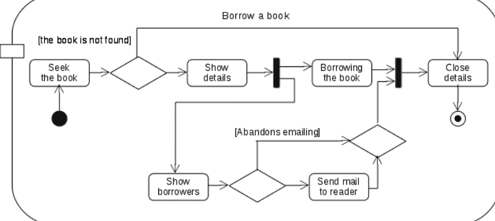

活动显示为一个圆角矩形：

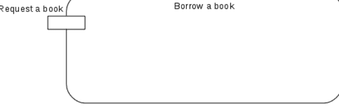

并且活动包含：


# JAVA 7：关于系统开发

## 附录 A

动作之间的流程用箭头表示。开始元素是实心圆，而结束元素是带点的圆。还有一个内部带有交叉的异常符号。

```
<<pre condition>>
所有的
```

```
borrow
```

```
<<post condition>>
已借用
```


部分描述了可以执行的操作以及结果是：


# JAVA 7：关于系统开发

菱形表示分支或合并。这是相同的符号，你可以添加一个名称。在分支的情况下，方括号中的条件应用于路径。例如，上面的图同时包含分支和合并：

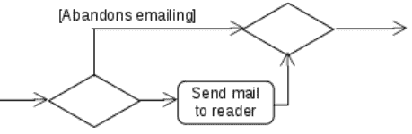

图中可能还包含分叉（fork）和汇合（join）节点，它们用黑色矩形（垂直或水平）绘制，再次使用相同的符号。它们指示并行线程的开始和结束（在上面的示例中，符号的使用实际上正确，并没有多线程的情况，示例也应该显示语法）。汇合与合并不同，因为汇合同步两个输入路径，并在两个输入路径关闭后提供单个结果。

与活动图相关的还有一些绘制规则。例如，可以显示操作将以以下方式向对象发送数据进行处理：


相同的表示法为：


也可以阐示一个异常处理：

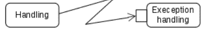

下面显示了循环的语法：

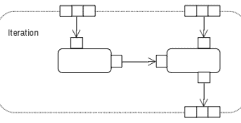

# JAVA 7：系统开发介绍

该图形被称为扩展区域，是一个执行多次的结构化活动。输入和输出显示为三个正方形的一组，标签可能表示迭代、并行或流。

## 包图 (PACKAGE DIAGRAM)

接下来，我将提到包图，顾名思义，它用于提供应用程序包的顶视图，以及程序类是如何组织成包的，人们有时说包图是应用程序命名空间的视觉化。包图对于显示程序的架构非常有用。包图的绘制如下：

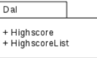

显示了一个名为 `Dal` 的包，包含两个公共类。另一个示例显示了来自程序 `Library` 的包：

| | + Author | + Authors |
| | + Book | + Books |
| | + Category | + Categories |
| | + Publisher | + Publishers |
| | + Title | + Titles |
| | + User | + Users |
| | + Lend | + Lending |
| | + CurrentUser |

实际上，你并不总是感兴趣显示一个包包含哪些类，而只是包含特定包在内的架构。你可以使用可以使用符号：


包图是程序包的概述，例如，下面的包图显示了程序 `library` 的包图。该图显示了程序的架构以及每一层中包含哪些包。

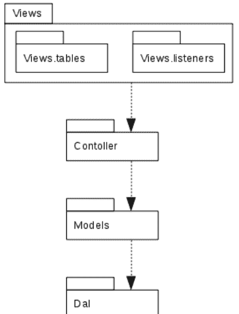

# JAVA 7：系统开发介绍

如所示，包图是一种非常简单的图，可以用于建模设计的架构，但实际上有更多的语法。例如，你可以分配注释：

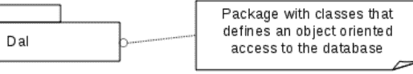

还有一种语法可以表示一个包导入了另一个包，并与其他包合并。

## 时序图 (SEQUENCE DIAGRAM)

时序图是一种交互图，显示了对象之间如何相互作用。图中画了几个水平排列的对象，对于每个对象，我们都画了一条线，显示对象的生命线（lifeline）。时序图适用于显示对象如何通过发送消息与其他对象通信，但它们不适合复杂过程逻辑。例如，下面的时序图显示了在借书函数中包含了哪些对象。共有四个对象：

- `view` 是一个对象，代表用户借阅特定书籍的对话框
- `ctrl` 是该对话框的控制器
- `book` 是一个模型类，代表要借的书籍
- `BookData` 是存储库，代表 `Book` 表以及在数据库中存储借书信息的对象

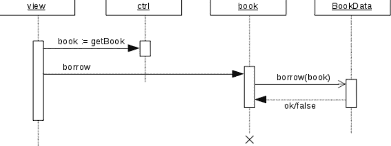

# JAVA 7：系统开发介绍

该图并没有精确地描述程序是如何运行的，而是对图进行了微调，以更详细地说明该图。虚线表示对象的生命线，生命线上的垂直方框表示对象正在执行的操作。当用户想要借书时，`view` 对象转到对话框的控制器以提供要借书籍的引用。它被画实线箭头，表示对方法的同步调用，调用对象会等待直到返回一个值。当 `view` 对象获得此引用后，它调用 `book` 对象来借书，这再次通过同步调用发生。`book` 对象调用 `BookData` 对象来注册书籍，但这次是异步调用，用空心箭头表示。`BookData` 对象随后可以在某个点发送返回值（作为一种事件）。在 `book` 对象被画的地方画了一个叉号（cross）。这应该表示该对象在函数执行后被移除。时序图相对复杂，而且实际上还有许多其他选项。下面显示了对象如何调用方法：

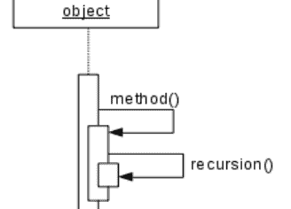

作为另一个示例，下面显示了对象如何向不属于图的对象发送消息，并希望接收来自其他对象的消息：

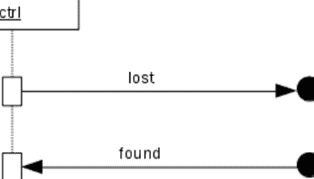

# JAVA 7：系统开发介绍

## 附录 A

在这种背景下，人们讨论的是消息。你也可以在时序图中使用条件，只有在满足条件时才执行一个或多个操作：

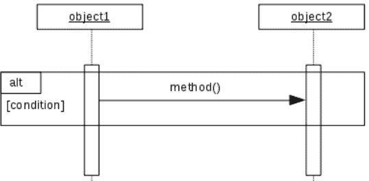

如果你在框上画一条虚线，你就在建模 `else` 部分。通过将单词 `alt` 替换为 `loop`，你同样建模了迭代。时序图对于显示控制层的操作非常好，但它们也有其局限性。首先，你需要一个良好的图，否则它们很难绘制。其次，如果对象很多，图（即使是好的）也会变得杂乱，并且在宽度和高度上增长。另一种方法是通信图，其中对象是水平的。语法上相似，但这种图更易读。

## 状态机 (STATE MACHINES)

状态图或状态机是一种建模对象的图，对象可能处于不同的状态，并由于可能发生的事件改变状态。一个经典的例子是运行中的进程。当你启动程序时，操作系统将创建一个表示运行应用程序的进程，进程从新状态开始。此后，进程的生命周期可以如下图所示建模，其中椭圆表示状态，箭头表示转换。

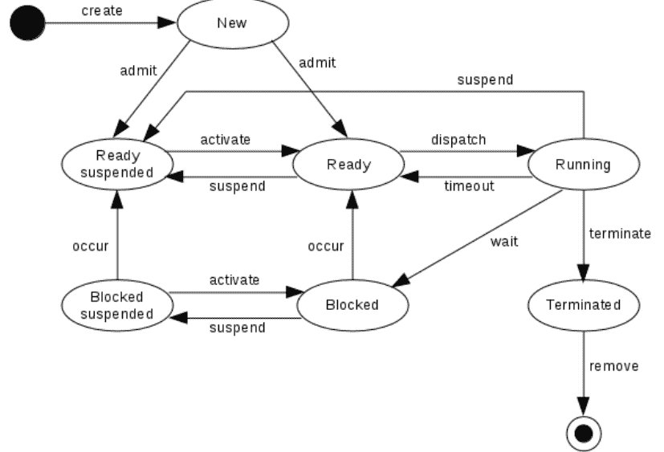

# JAVA 7：系统开发介绍

当进程处于`new`状态时，它可以切换到另外两个状态之一：就绪（ready），意味着进程准备好在 CPU 上运行（当时间到达时）；就绪挂起（ready suspended），意味着进程已就绪但尚未执行（例如作为稍后运行的服务或批作业）。如果进程处于就绪挂起，它可以切换到就绪模式（当就绪时间发生时）。就绪队列中的就绪进程可以再次挂起（如果进程实例执行了 `sleep()`）或切换到阻塞（blocked），意味着它正在等待资源（通常是 IO 操作，如磁盘上的块）。最后，可能是进程已完成（程序结束），进程随后将切换到终止（terminated）状态，在移除之前删除所有分配的资源。当等待资源的阻塞进程准备好继续时（例如磁盘控制器信号磁盘操作已完成），则进程返回就绪状态。阻塞进程也可以切换到阻塞挂起（例如交换操作），从这里它可以切切回阻塞或就绪挂起。

状态机特别适用于像上面那样周期性改变状态的对象生命周期建模，实际上有很多这种情况。因此，它是一种非常有用的图，图通常如上面所示绘制，但它也有扩展。例如，当对象切换到特定状态时执行特定状态的操作，或者当从该状态改变时，你甚至可以指定由于特定事件进入状态执行的操作：

| 状态 |
| 进入时: action1 |
| 事件时: action2 |
| 退出时: action3 |

对象可以从某个状态切换到相同状态：

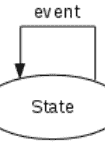

# JAVA 7：关于系统开发

最后，我想提到，状态图可以由多个状态图组成。如果你有一个巨大的状态图，它将变得难以管理，此时你可以像下面一样显示内部状态机：

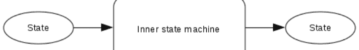

上述内容并非对 UML 的完整描述，但它能向你展示什么是 UML 及其用途，以及一些存在的图类型和主要的绘图规则。有很多工具可以用于绘制不同的 UML 图，在应用 UML 时，应该对这些工具感兴趣并花时间学习它们是如何工作的，否则绘图的工作量可能会非常庞大。作为一个例子，我可以提到 *Dia* 这个程序。


# 附录 B

在本附录中，我将简要介绍数据库设计。在设计程序时，需要确定哪些数据必须存储在数据库中，而问题在于应该如何设计数据库以及需要包含哪些表。这并没有明确的答案，但有一些非常精确的建议可以遵循，而这也是本附录的主题。

## ER 图

第一步是绘制 ER 图（实体联系图）。实际上，你可以使用类图来代替，它提供了相同的机会，但 ER 图是直接为关系型数据库设计设计的，也是我在实践中经常使用的一种图。ER 图使用了三种符号：

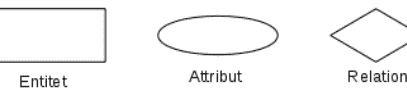

当一个实体描述什么是表的候选者时，实体的角色类似于类图中的类。属性（attribute）是实体的属性，因此对应于类中的变量，它是数据库表中列的候选者。最后，关系（relation）是实体之间的关系，因此对应类图中的关系。例如，图中展示了图书馆数据库的 ER 图：

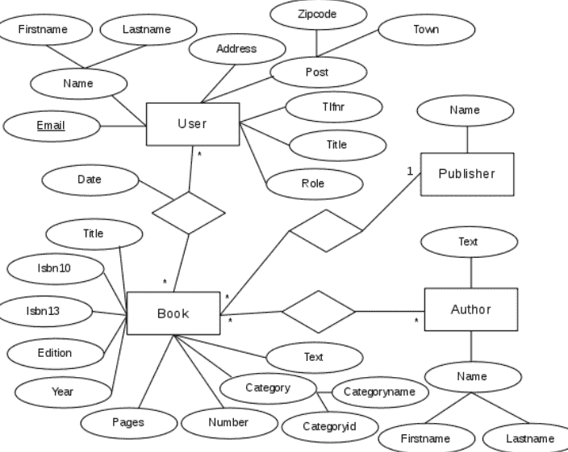

有四个实体，分别是书籍（`Book`）、作者（`Author`）、出版商（`Publisher`）和用户（`User`）。你可以像寻找模型层中的类一样找到这些实体，当然，这没有明确的解决方案。这可能并不重要，因为如果你找到了正确的属性，那么以下规则几乎位于相同的表中。最好的办法是思考需要保存哪些数据，并将它们组织在相应的实体中。

如果你考虑书籍（`Book`）实体有 9 个属性，这里有一个类别（`Category`）的示例作为复合属性的例子，它由 `Categoryid` 和 `Categoryname` 组成，分别表示类别的标识和类别名称。此外，所有其他属性也应该被记录，以确保它们的用途是明确无误的。这些属性是已经进行的分析的结果，在分析中，你已经确定了要存储在数据库中的元素。

作者（`Author`）实体有两个属性，其中一个是复合属性。该实体定义了关于作者的信息，分析证明了该实体应该拥有这些属性。

书籍（`Book`）和作者（`Author`）两个实体之间是多对多的关系，两端都显示为 **。该关系表示一本书可能与多个作者相关，对应于该书可能有多个作者。同样，一个作者可能与多本书相关，因为一个作者可能写过好本书。

出版商（`Publisher`）实体代表出版商，只有一个属性，即出版商名称。这里书籍（`Book`）和出版商（`Publisher`）之间存在关系，但是一对多的关系。在书籍（`Book`）实体处有一个 *，表示一个出版商可能出版过多本书，而出版商端的基数数量是 1。这表示一本书必须恰好有一个出版商。

最后，用户（`User`）有 7 个属性，其中两个是复合的。`Email` 属性带有下划线，这意味着它可以用作主键。也就是说，假设它是主键。这些属性是已经进行的分析的结果，在分析中，你已经确定了要存储在数据库中的元素。

# JAVA 7：关于系统开发

## 书籍

| Id | ISBN10 | ISBN13 | 标题 | 版本 | 年份 | 页码 | 数量 | 分类ID | 名称 |
| :--- | :--- | :--- | :--- | :--- | :--- | :--- | :--- | :--- | :--- |
| Text | | | | | | | | | |

## 作者

| Id | 名字 | 姓 | 文本 |
| :--- | :--- | :--- | :--- |

## 出版社

| Id | 名称 |
| :--- | :--- |

## 用户

| Id | 邮箱 | 名字 | 姓 | 地址 | 邮编 | 城镇 | 电话 | 头衔 | 角色 |
| :--- | :--- | :--- | :--- | :--- | :--- | :--- | :--- | :--- | :--- |

## 第 2 步

然后所有的弱实体都以相同的方式进行映射，唯一的区别是这次每个关系都将有一个额外的字段，该字段是弱实体关联的普通实体的主键（如果主键是复合的，则有额外的字段）。关系中弱实体的键由来自普通实体的键和部分键组成。

在这种情况下，这一步没有产生变化，因为没有弱实体。

## 第 3 步

两个实体之间所有的一一关系都将被映射。在这种情况下没有这种关系，但遵循以下规则。

如果关系的形式如下：


则 B 的关系（具有部分依赖的一侧）将扩展一个字段，该字段是 A 的主键，以及与该关系相关的任何属性。因此，B 中的新字段是引用 A 的外键。相反，如果讨论的是以下关系


在 bookboom.com 免费下载电子书

你必须选择其中一侧并将外键放在那里（可能还包括属性）。或者，你可以创建一个全新的新关系，该关系必须包含两个实体的主键，作为新关系中的复合主键，并且它们也将分别是指向 A 和 B 的外键。这种新关系还必须包含 A 和 B 之间关系所需的属性。由于有很多属性，可以讨论这种替代方案。

在关系本身的一一关系的特殊情况下，通常会将该关系实现为外键。

## 第 4 步

在一对多关系的情况下，它始终作为外键实现在“多”的一侧。在这种情况下，有一个单一的一对多关系，`Book`（书籍）关系必须扩展一个额外的字段，该字段是 `Publisher`（出版社）关系中的主键，因此 `Book` 拥有一个指向 `Publisher` 的外键。

| Id | ISBN10 | ISBN13 | 标题 | 版本 | 年份 | 页码 | 数量 | 分类ID | 名称 |
| :--- | :--- | :--- | :--- | :--- | :--- | :--- | :--- | :--- | :--- |
| Text | PubId | | | | | | | | |

## 第 5 步

两个实体之间的多对多关系总是映射为一个新关系，该关系包含了两个实体的两个主键以及与关系相关的可能属性。这两个主键在新的关系中是一个复合主键，它们各是指向两个实体的外键。因此，这种映射方式与上述描述的一一关系映射的替代方案非常相似。在这个示例中，有两个多对多关系，下面的图显示了执行第 5 步后的结果；

# JAVA 7：关于系统开发

# 附录 B

用户

| UserId | 邮箱 | 名字 | 姓 | 地址 | 邮编 | 城镇 | Tiftr | 头衔 | 角色 |
| :--- | :--- | :--- | :--- | :--- | :--- | :--- | :--- | :--- | :--- |

| Borrow | 日期 |
| :--- | :--- |

书籍

| Bookid | ISBN10 | ISBN13 | 标题 | 年份 | 页码 | 数量 | Calid | 名称 |
| :--- | :--- | :--- | :--- | :--- | :--- | :--- | :--- | :--- |
| Text | Pubid | | | | | | | | |

撰写

| Bookid | Autid |
| :--- | :--- |

作者

| Autid | 名字 | 姓 | 文本 |
| :--- | :--- | :--- | :--- |

出版社

| Pubid | 名称 |
| :--- | :--- |

注意，我分别建立了两个新关系，分别为 `Written`（撰写）和 `Borrow`（借阅）。箭头表示外键。注意，我还重命名了一些属性。


> 我们不重新发明轮子，我们重新发明光。 
> 迷人的光影提供了无限的可能性：创新技术和新市场既提供了机遇也带来了挑战。在一个专业知识需求巨大的环境中。享受我们全球集团内良好的支持性工作环境，并从国际职业路径中获益。与其他专家紧密合作实施可持续理念，并对我们的未来做出贡献。来加入我们，每天重新发明光。


> 我们不重新发明轮子，我们重新发明光。
> 迷人的光影提供了无限的可能性：创新技术和新市场既提供了机遇也带来了挑战。在一个专业知识需求巨大的环境中。享受我们全球集团内良好的支持性工作环境，并从国际职业路径中获益。与其他专家紧密合作实施可持续理念，并对我们的未来做出贡献。来加入我们，每天重新发明光。

> We do not reinvent the wheel we reinvent light.

> 在 bookboom.com 免费下载电子书

> 点击广告了解更多

> 点击此处以了解更多

## 第 6 步

下一步关注的是具有多个值的属性（多值属性），这些属性是那些可以包含多个值的属性。在这种情况下，没有多值属性，但通过以下方式说明：

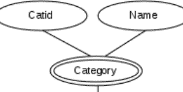

> 我们不重新发明轮子，我们重新发明光。
> 迷人的光影提供了无限的可能性：创新技术和新市场既提供了机遇也带来了挑战。在一个专业知识需求巨大的环境中。享受我们全球集团内良好的支持性工作环境，并从国际职业路径中获益。与其他专家紧密合作实施可持续理念，并对我们的未来做出贡献。来加入我们，每天重新发明光。

具有多值的属性。根据需要，将多值属性移动到一个新关系中，并带有原始关系的主键，因此 `Book` 是指向 `Book` 的键。

| Catid | Bookid | 名称 |
| :--- | :--- | :--- |

## 第 7 步

最后一条规则处理两个以上实体之间的关系，例如关系：

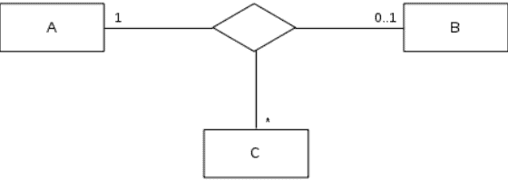

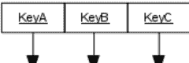

> 我们不重新发明轮子，我们重新发明光。
> 迷人的光影提供了无限的可能性：创新技术和新市场既提供了机遇也带来了挑战。在一个专业知识需求巨大的环境中。享受我们全球集团内良好的支持性工作环境，并从国际职业路径中获益。与其他专家紧密合作实施可持续理念，并对我们的未来做出贡献。来加入我们，每天重新发明光。

# JAVA 7：关于系统开发

在完成映射后，设计结束，在这种情况下结果是 6 个关系，所有关系都有主键且不包含属性。你可以创建一个类似的数据库，它会有 6 张表。然而，这是对得到的结果进行的质量评估，我们讨论设计应该规范化。

## 规范化

我们看到关系模型满足一范式，如果它由不包含属性的关系组成，并且所有关系都有主键。如果你完成了上述映射，这将自动满足，并且上述模型是一范式的。你也可以这样认为，从一个一范式的关系模型创建一个数据库。

关系模型满足二范式，如果它满足一范式，并且对于任何关系，它不包含由主键部分决定的属性。关系不满足二范式的事实是它包含了多个概念，因此应该将由主键部分决定的属性移动到一个新关系中，该部分主键是该新关系的主键。如果一个关系没有复合主键，它根据定义就满足二范式。在当前示例中，只有两个关系具有复合主键，即 `Written` 和 `Borrow`。在这里，第一个只有主键，因此是二范式，而后者有一个额外属性，该属性是由所有主键决定的，因此也是二范式。

为了说明这一原理，第一个关系被视为销售系统模型的一部分，显示客户购买了什么：

| Tiflr | Date | Customer | Email | Balance | Itemnr | Itemname | Price | Units |

这意味着产品销售是通过客户的电话号码和零件号来标识的（复合主键）。对于每次销售，存储了客户姓名和电子邮件地址以及客户余额、产品名称、单价和数量。该关系不满足二范式，因为某些属性是由电话字段决定的，而另一些是由 `itemnr` 字段决定的，因此该关系必须分为两个关系如下：

# JAVA 7：关于开发

# 附录 B

| 序号 (Tfnr) | 客户 | 邮箱 | 余额 | 项目编号 (Itemnr) |
|---|---|---|---|--|
| 项目编号 | 项目名称 | 价格 | 单位 | 日期 |

第三范式的目标是确保数据库表不包含涉及多个事物的数据，因为这会使理解数据库内容变得困难。

如果一个关系模型满足第二范式，并且对于任何关系，它都不包含由主键之外其他字段决定的属性，那么它就满足第三范式。这表达了对某条信息的存储没有超过必要，如果是这样，则必须将其分为两个关系，其中属性由键以外的内容决定，并将这些属性与其决定属性一起移动到一个新关系中，该决定属性在新关系中作为主键。该决定属性保留在原始关系中，在原关系中作为指向新关系的外键。


在 www.deloitte.com/careers 发现真谛。

德勤。
© Deloitte & Touche LLP 及关联实体。

在 bookoon.com 下载免费电子书

点击广告阅读更多

# JAVA 7：关于系统开发

如果一个关系不满足第三范式，请检查是否存在传递依赖。观察当前的示例，可以清楚地看到 `Publisher`（出版者）、`Author`（作者）、`Written`（已写）和 `Borrow`（借阅）关系都满足第三范式。然而，观察 `User`（用户）关系会发现它存在传递依赖，因为城市名称是由邮编（zip code）决定的。必须创建一个包含邮编和城市名称的新关系，并邮编作为主键。同时，从 `User` 关系中删除城市名称，并将属性 `zipcode` 成为指向该新关系的外键。如果你考虑 `Book`（书籍）关系，它具有传递依赖，因为类别名称是由 id 决定的。必须创建一个具有 `catId` 和 `CategoryName` 属性的新关系，并从 `Book` 中删除 `catId`，同时 `catId` 成为指向新关系的外键。

归一化之后，数据库的关系模型如下所示：

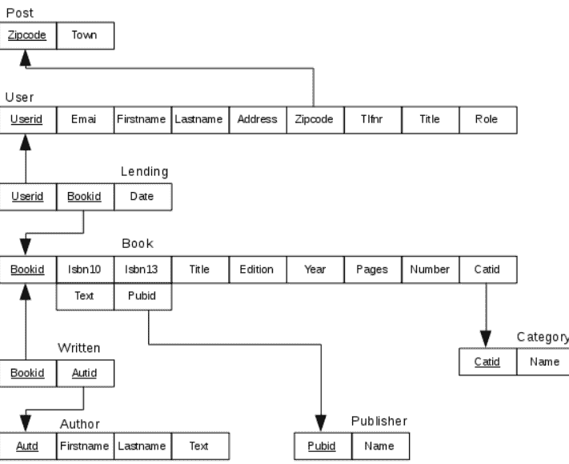

因此它由8个关系组成。

# JAVA 7：关于系统开发

第三范式的目标是消除冗余，这意味着相同的信息在多个处被记录。例如，类别名称不应存储在任何书籍中，而是将其保存在它自己的表中，书籍必须对该名称有一个引用（外键）。当冗余产生不利影响时，是因为在几处存储了相同的信息，这可能意味着不必要的空间消耗，但主要原因是维护数据库变得更加困难，因为这可能意味着信息必须在多个处进行更改。例如，假设你想更改一个类别的名称（可能是拼写错误），那么如果该名称不在它自己的表中，将意味着需要更改该类别下的所有书籍，而满足第三范式的数据库只需要在一个一处进行更改。

## 其他数据库改进

如果你观察归一化过程，它通常会导致数据库产生更多的表，这在原则上没有问题，但可能意味着在数据库请求中需要许多 `JOIN` 操作，而这些操作对于数据库管理系统来说实际上是复杂的。可以认为，一个完全归一化的数据库有利于数据库的维护以及其完整性，但并不一定满足查询。因此，当我们进行反向操作并合并表时，我们称之为反范式化（denormalisation），即使这意味着数据库随后包含冗余。反范式化的理由可能是数据库很少更新，而你为了查询以便而进行优化。

如果你有一个归一化到第三范式的数据库，原则上你拥有一个良好的数据库设计，但存在其他考虑：可能意味着数据库请求中需要许多 `JOIN` 操作，而这些操作对于数据库管理系统来说实际上是复杂的。可以认为，一个完全归一化的数据库有利于数据库的维护以及其完整性，但并不一定满足查询。因此，当我们进行反向操作并合并表时，我们称之为反范式化，即使这意味着数据库随后包含冗余。反范式化的理由可能是为了为了查询以便而进行优化。

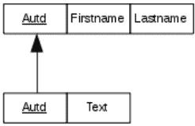

# JAVA 7：关于系统开发

现在，通常不需要将属性移动到它们自己的表中，因为这会增加表的数量，这在原则上没有问题，但可能意味着在数据库请求中需要许多 `JOIN` 操作，而这些操作对于数据库管理系统来说实际上是复杂的。可以认为，一个完全归一化的数据库有利于数据库的维护以及其完整性，但并不一定满足查询。因此，当我们进行反向操作并合并表时，我们称之为反范式化，即使这意味着数据库随后包含冗余。反范式化的理由可能是为了为了查询以便而进行优化。

如果你有一个归一化到第三范式的数据库，原则上你拥有一个良好的数据库设计，但存在其他考虑：可能意味着数据库请求中需要许多 `JOIN` 操作，而这些操作对于数据库管理系统来说实际上是复杂的。可以认为，一个完全归一化的数据库有利于数据库的维护以及其完整性，但并不一定满足查询。因此，当我们进行反向操作并合并表时，我们称之为反范式化，即使这意味着数据库随后包含冗余。反范式化的理由可能是为了为了查询以便而进行优化。

如果你有一个归一化到第三范式的数据库，原则上你拥有一个良好的数据库设计，但存在其他考虑：可能意味着数据库请求中需要许多 `JOIN` 操作，而这些操作对于数据库管理系统来说实际上是复杂的。可以认为，一个完全归一化的数据库有利于数据库的维护以及其完整性，但并不一定满足查询。因此，当我们进行反向操作并合并表时，我们称之为反范式化，即使这意味着数据库随后包含冗余。反范式化的理由可能是为了为了查询以便而进行优化。


## 类图的使用

上述建模方法的基础是 ER 图，但你也可以从类图开始：

| 用户 | 书籍 | 出版者 |
|---|---|---|
| UserId | Bookid | Pubid |
| 邮箱 | 标题 | 名称 |
| 名字 | ISBN10 | |
| 姓 | ISBN13 | |
| 地址 | 版本 | |
| 邮编 | 年份 | |
| 城市 | 数量 | |
| 页数 | | 作者 |
| 标题 | | 名字姓文本

两者的区别在于，实体是用属性绘制的，而关系是以关联的形式表示的。使用上面的图表，可以清楚地可以直接使用上述映射规则，并得到相同的结果。使用 ER 图还是类图与属性有关。我发现 ER 图特别有用，特别是在他人协作建模数据库时，特别是如果你有黑板可用，我认为它是非常棒的工具。相反，类图更容易绘制，大型的 ER 图很快变得混乱。因此，我经常在初始建模时使用不带属性的 ER 图，只显示实体和关系。属性首先出现在映射的第 1 步。

数据库的构建是一项设计活动，起点通常是模型层的设计，然后你已经有了一个可以作为数据库基础的类图，但如果这个模型包含继承关系该怎么办？关系模型不支持继承，因此需要一种方法在关系模型中映射类层次结构。

事实上，有一种所谓的 EER 图（增强 ER 图），它支持特化。该图具有复杂的绘制规则且难以阅读，我从不使用这个工具，但如果你是 ER 图的坚定支持者，可能值得学习这种图——因为特化关系的映射可以通过多种方式完成。假设示例中你有以下类：

| 用户 UserId | 邮箱 | 名字姓 | 地址 | 邮编 | 类型id | 角色 |
|---|---|---|---|---|---|---|
| | | | | | | |

# 基类

| Key |
|---|
| n | a1 |
| a2 | |
| a3 | |

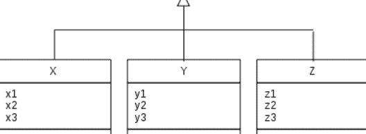

当然，这里不需要三个派生类，而且每个类可以拥有更少或更多的属性。我将展示用于映射这种关系模型结构的 4 种方案。

一种可能性是为四个类（实体）中的每一个类创建一个关系：

| Key | a1 | a2 | a3 |
|---|---|---|---|
| Key | z1 | z2 | z3 |
| Key | y1 | y2 | y3 |
| Key | x1 | x2 | x3 |

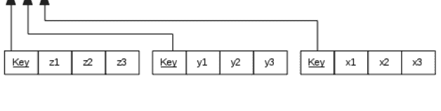

即创建一个包含基类属性及其主键的关系。同时也为每个每个派生类创建一个关系，其中每个关系包含派生类的属性以及基类的键。派生类关系的主键是基类的主键，它也是指向基类的外键。你可以说这是一种通用的方法，无论特化程度如何都可以使用。

作为替代方案，你可以为每个派生类创建一个关系，该关系必须包含来自基类的所有属性，包括主键和来自派生类的属性：

| Key | a1 | a2 | a3 | x1 | x2 | x3 |
|---|---|---|---|---|---|---|
| Key | a1 | a2 | a3 | y1 | y2 | y3 |
| Key | a1 | a2 | a3 | z1 | z2 | z3 |

# JAVA 7: 关于系统开发

这种解决方案只有当对象始终是 X、Y 或 Z，但不能是基类对象时才有意义。因此，在基类是抽象类的情况下，该方案是有意义的。

另一个例子是将所有属性共同包含在单个关系中的映射：

| Key | a1 | a2 | a3 | x1 | x2 | x3 | y1 | y2 | y3 | z1 | z2 | z3 | t |
|---|---|---|---|---|---|---|---|---|---|---|---|---|---|

这种解决方案需要额外的属性——在这里称为类型 t（type），用于指示所讨论对象的类型。这种设计的缺点是它会导致许多 `NULL` 值（例如，如果是一个 X 对象，则所有 y 和 z 属性都必须为 `NULL`，因此当派生类属性较少时，该方案的效率最差）。

在设计数据库时，经常会出现一个对象可以同时是几种情况，例如既是 X、Y 又是 Z。如果你有这样的设计，请考虑以下映射，它是上述方法的变体：

| Key | a1 | a2 | a3 | x1 | x2 | x3 | y1 | y2 | y3 | z1 | z2 | z3 | t1 | t2 | t3 |
|---|---|---|---|---|---|---|---|---|---|---|---|---|---|---|---|


> 在丹麦，你可以找到极好的工程工作并提升自己的专业水平。特别是在风电领域，你可以向行业内最优秀的人学习，并在稳定的就业市场中推进职业发展。

Mireia Mare,
来自西班牙的高级工程师。
自2010 年起在丹麦的风电行业工作。

在 bookboom.com 免费下载电子书 点击广告阅读更多

# JAVA 7: 关于系统开发

这里是最后的三个布尔值属性，指示对象是否可以被视为 X、Y 和 Z。

## 创建数据库

在通过上述程序对数据库进行建模并制定了规范化的关系模型后，应该将该模型转换为数据库。模型显示了必须存在的表，哪些属性是主键和外键，我假设完成的模型如下：

| Zipcodes | |
|---|---|
| Zipcode | Town |

| Titles | |
|---|---|
| Title | Title |

| User | | | | |
|---|---|---|---|
| UserId | Email | Lastname | Address |

| Zipcode | | | |
|---|---|---|---|
| Title | Title | Role | |

| Borrow | | | |
|---|---|---|---|
| UserId | Bookid | Date |

| Book | | | | | |
|---|---|---|---|---|---|
| Bookid | ISBN13 | Title | Edition | Pages | Number |

| Catid | | | |
|---|---|---|---|
| Text | Pubid | | |

| Category | | |
|---|---|---|
| Catid | Name | |

| Written | | | |
|---|---|---|---|
| Autid | | | |

| Author | | | | |
|---|---|---|---|---|
| Autid | Firstname | Text | | |

| Publisher | | | |
|---|---|---|---|
| Pubid | Name |

还有几点需要处理，主要涉及每个属性。首先是数据类型，你必须为每个属性选择数据类型。这需要对领域的了解以及各个字段应该包含的内容。特别是，你必须考虑文本字段属性并指定大小。此外，你必须考虑为字段定义的约束，特别是：

1. 代理键
2. 字段可能包含 `NULL`
3. 可能的值
4. 级联外键

在 bookboom.com 免费下载电子书

# JAVA 7: 关于系统开发

最后是表和属性的命名。从原则上讲，映射是清晰的，但出于技术原因，通常对命名多加关注。建议以下做法：

1. 为表使用简短名称
2. 多对多关系使用名称
3. 使用表名（单数）加下划线作为所有属性的前缀
4. 外键使用可能导致名称很长，但在 SQL 中这样更易读。

最后显示了根据上述设计和命名约定创建数据库的脚本：

```sql
```


`use library;`

`drop table if exists books_authors;`

`drop table if exists users;`

`drop table if exists books;`

`drop table if exists categories;`

`drop table if exists authors;`

`drop table if exists zipcodes;`

```sql
create table publishers (
  publisher_id int auto_increment not null, # 出版者的代理键
  publisher_name varchar(50) not null, # 出版者的名称
  primary key (publisher_id)
);
```

```sql
create table categories (
  category_id int auto_increment not null, # 类的代理键
  category_name varchar(50) not null, # 类的名称
  primary key (category_id)
);
```

# JAVA 7: 关于系统开发

```sql
create table authors (
  author_id int increment null, # 作者的代理键
  author_firstname varchar(50), # 作者的名
  author_lastname varchar(30) not null, # 作者的姓
  author_text varchar(200), # 额外文档
  primary key (author_id)
);
```

```sql
create table books (
  book_id int increment null, # 书的代理键
  book_isbn13 char(17), # 13位 ISBN
  book_isbn10 char(13), # 10位 ISBN
  book_title varchar(255) not null, # 书名
  book_edition int, # 书的版本
  book_year int, # 出版年份
  book_pages int, # 书页数
  book_copies int, # 该书的数量
  category_id int, # 指向类的外键
  publisher_id int, # 指向出版者的外键
  book_text text, # 书的描述
  foreign key (category_id) references (category_id),
  foreign key (publisher_id) references (publisher_id),
  primary key (book_id)
);
```

> 我加入 MITAS 是因为我想要真正的责任。

针对工程师和科学家的毕业生计划
`www.discovermitas.com`


第16个月
我在北海担任施工主管，提供建议并帮助工工解决问题。

真实的工作
国际机会
三次实习机会

MAERSK

在 `bookboom.com` 免费下载电子书 点击广告阅读更多

# JAVA 7: 关于系统开发

```sql
create table books_authors (
  book_id int not null, # 指向书的外键
  author_id int not null, # 指向作者的外键
  foreign key (book_id) references books (book_id) on delete cascade,
  foreign key (author_id) references authors (author_id) on delete cascade,
  primary key (book_id, author_id)
);
```

```sql
create table zipcodes (
  zipcodes_code char(4) not null, # 邮编
  zipcodes_name varchar(30) not null, # 城镇名称
  primary key (post_code)
);
```

```sql
create table titles (
  title_id int auto_increment not null, # 标题的代理键
  title_name varchar(50) not null, # 标题名称
  primary key (title_id)
);
```

```sql
create table users (
  user_id int auto_increment not null, # 用户的代理键
  user_email varchar(100) not null, # 用户邮箱地址
  user_passwd varchar(150) not null, # 用户密码（加密）
  user_firstname varchar(50) not null, # 用户的名
  user_lastname varchar(30) not null, # 用户的姓
  user_address varchar(50) not null, # 用户地址
  zipcodes_code char(4) not null, # 用户的邮编（外键）
  user_phone varchar(20), # 用户电话号码
  title_id, # 指向标题的外键
  user_role int default 3, # 用户的角色（用户权限）
  foreign key (post_code) references post (zipcodes_code),
  foreign key (title_id) references titles (title_id),
  primary key (user_id)
);
```

```sql
create table books_users (
  book_id int not null, # 指向书的外键
  user_id int not null, # 指向用户的外键
  books_users_date date not null, # 借日期
  foreign key (book_id) references books (book_id) on delete cascade,
  foreign key (user_id) references users (user_id) on delete cascade,
  primary key (book_id, user_id)
);
```
