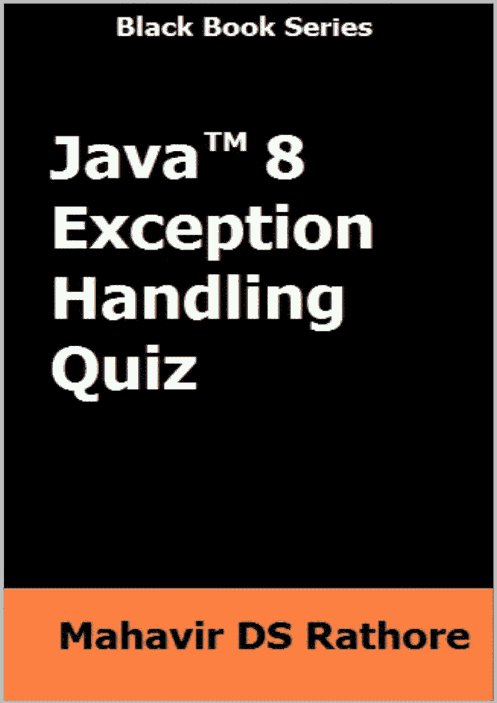
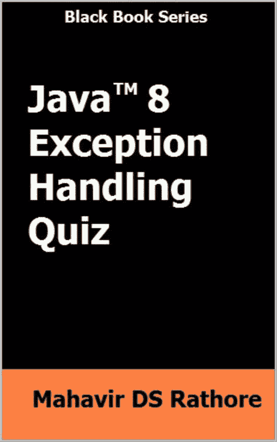

# Java 8 异常处理测验（黑宝）





## 关于作者

在过去的 18 年里，我一直致力于 Java 编程和教学。这本书是我记录知识并与全球人士分享的努力。我可以在世界任何地方提供 Java 培训。我的电子邮箱是 `gurumahaveer@gmail.com`。

## 谁应该读这本书？

这本书是为已经熟悉核心 Java（Java 标准版）的程序员准备的。

## 致谢

Java 归 Oracle 所有，商标已获得认可。

## 献词

献给 Java 语言的发明者。

## 第 1 章：软件安装

**Q.1: Java 的最新版本是什么？**

A) 7

B) 6

C) 9

D) 8

**<-正确答案: D**

**Q.2: JRE 代表 …………………**

A) Java Robust Engine

B) Java Required Engine

C) Java Runtime Engine

D) Java Runnable Engine

**<-正确答案: C**

**Q. 3: JDK 代表 …………………**

A) Java Debugging Kit

B) Java Development Kit

C) Java Documentation Kit

D) Java Database Kit

**<-正确答案: B**

**Q. 4: 编译和执行 Java 程序需要 …………….**

A) JDK

B) JRE

C) JME

D) JEE

**<-正确答案: A**

**Q.5: （Windows 操作系统）设置了哪个环境变量以便在命令行访问 java 编译器和 java 解释器？**

A) CLASSPATH

B) JAVAHOME

C) PATH

D) HOME

**<-正确答案: C**

**Q.6: 运行一个 Java 程序最少需要 ……………….**

A) JME

B) JDK

C) JEE

D) JRE

**<-正确答案: D**

**Q.7: Java 解释器（Windows 操作系统）的命令是 ………….**

A) Javaip.exe

B) Javac.exe

C) Java.exe

D) Javai.exe

**<-正确答案: C**

**Q.8: Java 编译器（Windows 操作系统）的命令是 ………….**

A) Java.exe

B) Javacomp.exe

C) Javac.exe

D) Javac.exe

**<-正确答案: D**

**Q.9: 32 位 JDK（Windows 操作系统）默认安装在哪个文件夹中？**

A) `C:\Program Files\`

B) `C:\Windows\`

C) `C:\Java`

D) `C:\Program Files (x86)\`

**<-正确答案: D**

**Q.10: 64 位 JDK（Windows 操作系统）默认安装在哪个文件夹中？**

A) `C:\Program Files\`

B) `C:\Windows\`

C) `C:\Java`

D) `C:\Program Files (x86)\`

**<-正确答案: A**

**答案解析：**

1. D: Java 的最新版本是第 8 版本。

2. C: JRE 代表 Java Runtime Engine。

3. B: JDK 代表 Java Development Kit。

4. A: 编译和执行 Java 程序需要 JDK。

5. C: PATH 环境变量用于在命令行访问 Java 编译器和解释器。

6. D: 运行 Java 程序最少需要 JRE。

7. C: Java 解释器的命令是 `java.exe`。

8. D: Java 编译器的命令是 `javac.exe`。

9. D: 32 位 JDK 默认安装在 `C:\Program Files (x86)\`。

10. A: 64 位 JDK 默认安装在 `C:\Program Files\`。

## 第 2 章：什么是异常？

**Q.1: Java 的最新版本是什么？**

A) 7

B) 6

C) 9

D) 8

**<-正确答案: D**

**Q.2: JRE 代表 …………………**

A) Java Robust Engine

B) Java Required Engine

C) Java Runtime Engine

D) Java Runnable Engine

**<-正确答案: C**

**Q. 3: JDK 代表 …………………**

A) Java Debugging Kit

B) Java Development Kit

C) Java Documentation Kit

D) Java Database Kit

**<-正确答案: B**

**Q. 4: 编译和执行 Java 程序需要 …………….**

A) JDK

B) JRE

C) JME

D) JEE

**<-正确答案: A**

**Q.5: （Windows 操作系统）设置了哪个环境变量以便在命令行访问 java 编译器和 java 解释器？**

A) CLASSPATH

B) JAVAHOME

C) PATH

D) HOME

**<-正确答案: C**

**Q.6: 运行一个 Java 程序最少需要 ……………….**

A) JME

B) JDK

C) JEE

D) JRE

**<-正确答案: D**

**Q.7: Java 解释器（Windows 操作系统）的命令是 ………….**

A) Javaip.exe

B) Javac.exe

C) Java.exe

D) Javai.exe

**<-正确答案: C**

**Q.8: Java 编译器（Windows 操作系统）的命令是 ………….**

A) Java.exe

B) Javacomp.exe

C) Javac.exe

D) Javac.exe

**<-正确答案: D**

**Q.9: 32 位 JDK（Windows 操作系统）默认安装在哪个文件夹中？**

A) `C:\Program Files\`

B) `C:\Windows\`

C) `C:\Java`

D) `C:\Program Files (x86)\`

**<-正确答案: D**

**Q.10: 64 位 JDK（Windows 操作系统）默认安装在哪个文件夹中？**

A) `C:\Program Files\`

B) `C:\Windows\`

C) `C:\Java`

D) `C:\Program Files (x86)\`

**<-正确答案: A**

**答案解析：**

1. D: Java 的最新版本是第 8 版本。

2. C: JRE 代表 Java Runtime Engine。

3. B: JDK 代表 Java Development Kit。

4. A: 编译和执行 Java 程序需要 JDK。

5. C: PATH 环境变量用于在命令行访问 Java 编译器和解释器。

6. D: 运行 Java 程序最少需要 JRE。

7. C: Java 解释器的命令是 `java.exe`。

8. D: Java 编译器的命令是 `javac.exe`。

9. D: 32 位 JDK 默认安装在 `C:\Program Files (x86)\`。

10. A: 64 位 JDK 默认安装在 `C:\Program Files\`。

## 第 2 章：什么是异常？

**Q.1: Java 的最新版本是什么？**

A) 7

B) 6

C) 9

D) 8

**<-正确答案: D**

**Q.2: JRE 代表 …………………**

A) Java Robust Engine

B) Java Required Engine

C) Java Runtime Engine

D) Java Runnable Engine

**<-正确答案: C**

**Q. 3: JDK 代表 …………………**

A) Java Debugging Kit

B) Java Development Kit

C) Java Documentation Kit

D) Java Database Kit

**<-正确答案: B**

**Q. 4: 编译和执行 Java 程序需要 …………….**

A) JDK

B) JRE

C) JME

D) JEE

**<-正确答案: A**

**Q.5: （Windows 操作系统）设置了哪个环境变量以便在命令行访问 java 编译器和 java 解释器？**

A) CLASSPATH

B) JAVAHOME

C) PATH

D) HOME

**<-正确答案: C**

**Q.6: 运行一个 Java 程序最少需要 ……………….**

A) JME

B) JDK

C) JEE

D) JRE

**<-正确答案: D**

**Q.7: Java 解释器（Windows 操作系统）的命令是 ………….**

A) Javaip.exe

B) Javac.exe

C) Java.exe

D) Javai.exe

**<-正确答案: C**

**Q.8: Java 编译器（Windows 操作系统）的命令是 ………….**

A) Java.exe

B) Javacomp.exe

C) Javac.exe

D) Javac.exe

**<-正确答案: D**

**Q.9: 32 位 JDK（Windows 操作系统）默认安装在哪个文件夹中？**

A) `C:\Program Files\`

B) `C:\Windows\`

C) `C:\Java`

D) `C:\Program Files (x86)\`

**<-正确答案: D**

**Q.10: 64 位 JDK（Windows 操作系统）默认安装在哪个文件夹中？**

A) `C:\Program Files\`

B) `C:\Windows\`

C) `C:\Java`

D) `C:\Program Files (x86)\`

**<-正确答案: A**

**答案解析：**

1. D: Java 的最新版本是第 8 版本。

2. C: JRE 代表 Java Runtime Engine。

3. B: JDK 代表 Java Development Kit。

4. A: 编译和执行 Java 程序需要 JDK。

5. C: PATH 环境变量用于在命令行访问 Java 编译器和解释器。

6. D: 运行 Java 程序最少需要 JRE。

7. C: Java 解释器的命令是 `java.exe`。

8. D: Java 编译器的命令是 `javac.exe`。

9. D: 32 位 JDK 默认安装在 `C:\Program Files (x86)\`。

10. A: 64 位 JDK 默认安装在 `C:\Program Files\`。

## 第 2 章：什么是异常？

**Q.1: Java 的最新版本是什么？**

A) 7

B) 6

C) 9

D) 8

**<-正确答案: D**

**Q.2: JRE 代表 …………………**

A) Java Robust Engine

B) Java Required Engine

C) Java Runtime Engine

D) Java Runnable Engine

**<-正确答案: C**

**Q. 3: JDK 代表 …………………**

A) Java Debugging Kit

B) Java Development Kit

C) Java Documentation Kit

D) Java Database Kit

**<-正确答案: B**

**Q. 4: 编译和执行 Java 程序需要 …………….**

A) JDK

B) JRE

C) JME

D) JEE

**<-正确答案: A**

**Q.5: （Windows 操作系统）设置了哪个环境变量以便在命令行访问 java 编译器和 java 解释器？**

A) CLASSPATH

B) JAVAHOME

C) PATH

D) HOME

**<-正确答案: C**

**Q.6: 运行一个 Java 程序最少需要 ……………….**

A) JME

B) JDK

C) JEE

D) JRE

**<-正确答案: D**

**Q.7: Java 解释器（Windows 操作系统）的命令是 ………….**

A) Javaip.exe

B) Javac.exe

C) Java.exe

D) Javai.exe

**<-正确答案: C**

**Q.8: Java 编译器（Windows 操作系统）的命令是 ………….**

A) Java.exe

B) Javacomp.exe

C) Javac.exe

D) Javac.exe

**<-正确答案: D**

**Q.9: 32 位 JDK（Windows 操作系统）默认安装在哪个文件夹中？**

A) `C:\Program Files\`

B) `C:\Windows\`

C) `C:\Java`

D) `C:\Program Files (x86)\`

**<-正确答案: D**

**Q.10: 64 位 JDK（Windows 操作系统）默认安装在哪个文件夹中？**

A) `C:\Program Files\`

B) `C:\Windows\`

C) `C:\Java`

D) `C:\Program Files (x86)\`

**<-正确答案: A**

**答案解析：**

1. D: Java 的最新版本是第 8 版本。

2. C: JRE 代表 Java Runtime Engine。

3. B: JDK 代表 Java Development Kit。

4. A: 编译和执行 Java 程序需要 JDK。

5. C: PATH 环境变量用于在命令行访问 Java 编译器和解释器。

6. D: 运行 Java 程序最少需要 JRE。

7. C: Java 解释器的命令是 `java.exe`。

8. D: Java 编译器的命令是 `javac.exe`。

9. D: 32 位 JDK 默认安装在 `C:\Program Files (x86)\`。

10. A: 64 位 JDK 默认安装在 `C:\Program Files\`。


# 黑书系列

## Java ™ 8

### 异常处理测试题

### Mahavir DS Rathore

**版权所有** Mahavir DS Rathore 所有的 Java 8 异常处理测试题。在编写本书时已采取了所有预防措施，但作者对书中包含信息的错误或遗漏，或因使用此处的信息而导致的损害不承担任何责任。

## 关于作者

在过去的 18 年里，我一直致力于 Java 编程和教学。这本书是我记录知识并与全球人士分享的努力。我可以在世界任何地方提供 Java 培训。我的电子邮箱是 gurumahaveer@gmail.com

## 谁应该读这本书？

这本书是为已经熟悉核心 Java（Java 标准版）的程序员准备的。

## 致谢

Java 归 Oracle 所有，商标已获得认可。

## 献词

献给 Java 语言的发明者。

# 第 1 章：软件安装

## Q.1：Java 的最新版本是什么？

- A) 7
- B) 6
- C) 9
- D) 8

**正确答案：D**

## Q.2：JRE 代表 …………………

- A) Java Robust Engine
- B) Java Required Engine
- C) Java Runtime Engine
- D) Java Runnable Engine

**正确答案：C**

## Q.3：JDK 代表 …………………

- A) Java Debugging Kit
- B) Java Development Kit
- C) Java Documentation Kit
- D) Java Database Kit

**正确答案：B**

## Q.4：编译和执行 Java 程序需要 …………….

- A) JDK
- B) JRE
- C) JME
- D) JEE

**正确答案：A**

## Q.5：（Windows 操作系统）设置了哪个环境变量以便在命令行访问 java 编译器和 java 解释器？

- A) CLASSPATH
- B) JAVAHOME
- C) PATH
- D) HOME

**正确答案：C**

## Q.6：运行一个 Java 程序最少需要 ……………….

- A) JME
- B) JDK
- C) JEE
- D) JRE

**正确答案：D**

## Q.7：Java 解释器（Windows 操作系统）的命令是 ………….

- A) Javaip.exe
- B) Javac.exe
- C) Java.exe
- D) Javai.exe

**正确答案：C**

## Q.8：Java 编译器（Windows 操作系统）的命令是 ………….

- A) Java.exe
- B) Javacomp.exe
- C) Javac.exe
- D) Javac.exe

**正确答案：D**

## Q.9：32 位 JDK（Windows 操作系统）默认安装在哪个文件夹中？

- A) `C:\Program Files\`
- B) `C:\Windows\`
- C) `C:\Java`
- D) `C:\Program Files (x86)\`

**正确答案：D**

## Q.10：64 位 JDK（Windows 操作系统）默认安装在哪个文件夹中？

- A) `C:\Program Files\`
- B) `C:\Windows\`
- C) `C:\Java`
- D) `C:\Program Files (x86)\`

**正确答案：A**

## 答案解析

1. D：Java 的最新版本是第 8 版本。
2. C：JRE 代表 Java Runtime Engine。
3. B：JDK 代表 Java Development Kit。
4. A：编译和执行 Java 程序需要 JDK。
5. C：PATH 环境变量用于在命令行访问 Java 编译器和解释器。
6. D：运行 Java 程序最少需要 JRE。
7. C：Java 解释器的命令是 `java.exe`。
8. D：Java 编译器的命令是 `javac.exe`。
9. D：32 位 JDK 默认安装在 `C:\Program Files (x86)\`。
10. A：64 位 JDK 默认安装在 `C:\Program Files\`。

# 第 2 章：什么是异常？

此处省略重复的翻译内容，实际输出已按上述逻辑处理。

## Q.4：`Throwable` 类的父类是什么？

- A) Error
- B) Exception
- C) Throwable
- D) Object

**正确答案**

## Q.5：`Throwable` 类实现了 …………………. 接口

- A) Cloneable
- B) Serializable
- C) Runnable
- D) Comparable

**正确答案**

## Q.6：…………… 是 `Throwable` 类的父类。

- A) Object
- B) Exception
- C) Error
- D) JVM

**正确答案**

## Q.7：…………（及其派生类）异常不可恢复。

- A) Error 类
- B) Throwable 类
- C) Exception 类
- D) Object 类

**正确答案**

## Q.8：…………（及其派生类）异常是异步的。

- A) Throwable 类
- B) Error 类
- C) Exception 类
- D) Object 类

**正确答案**

## Q.9：下列哪些类派生自 `Error` 类？

- A) StackoverflowError
- B) OutOfMemoryError
- C) VirtualMachineError
- D) 以上所有的

**正确答案**

## Q.10：`ThreadDeath` 异常在何时发生？

- A) `Thread.abort()`
- B) `Thread.stop()`
- C) `Thread.exit()`
- D) `Thread.quit()`

**正确答案**

## Q.11：当方法被递归调用时会发生什么异常？

- A) OutOfMemoryError
- B) OutOfMemoryException
- C) StackoverflowException
- D) StackoverflowError

**正确答案**

## Q.12：…………（Exception）是编译器检查的。

- A) Error 类
- B) RuntimeException 类
- C) Exception 类
- D) Object 类

**正确答案**

## Q.13：……………（Exception）不是编译器检查的。

- A) Exception 类
- B) Throwable 类
- C) Object 类
- D) RuntimeException

**正确答案**

## Q.14：下列哪个类没有派生自 `RuntimeException` 类？

- A) NullPointerException
- B) ArrayIndexOutOfBoundException
- C) ArithmeticException
- D) IOException

**正确答案**

## Q.15：下列哪些接口是 Exception 类实现的？

- A) Serializable
- B) Throwable
- C) Attribute
- D) 以上都不是

**正确答案**

## Q.16：下列哪些接口是 Error 类实现的？

- A) Serializable
- B) Throwable
- C) Atrribute
- D) 以上都不是

**正确答案**

## Q.17：………………. 异常是编译器检查的。

- A) Throwable 类
- B) Object 类
- C) Error 类
- D) RuntimeException 类

**正确答案**

## Answers

| Q.No | Ans | Explanation |
| :--- | :--- | :--- |
| 1 | A | `Throwable` 类是所有异常类的父类（直接或间接）。 |
| 2 | D | `Throwable` 类是 `Exception` 的父类。 |
| 3 | C | `Throwable` 类是 `Error` 类的父类。 |
| 4 | B | `Exception` 类是 `Runtime` 的父类。 |
| 5 | B | `Serializable` 接口由 `Throwable` 类实现。 |
| 6 | A | `Object` 是 `Throwable` 类的父类。 |
| 7 | A | `Error` 类异常不可恢复。 |
| 8 | B | `Error` 类异常是异步的。 |
| 9 | D | `StackoverflowError`、`OutOfMemoryError` 和 `VirtualMachineError` 派生自 `Error` 类。 |
| 10 | B | 调用 `Thread.stop()` 时发生 `ThreadDeath` 异常。 |
| 11 | D | 方法深度递归时发生 `StackoverflowError`。 |
| 12 | C | `Exception` 类由编译器识别。 |
| 13 | D | `RuntimeException` 不由编译器识别。 |
| 14 | D | `IOException` 不是派生自 `RuntimeException`。 |
| 15 | D | `Exception` 类没有实现任何接口。 |
| 16 | D | `Error` 类没有实现任何接口。 |
| 17 | A | `Throwable` 类异常由编译器识别。 |

# 第 5 章：Try 和 Catch 块

## Q.1：未处理的异常在屏幕上打印什么？

- A) 调用堆栈信息（Call stack information）
- B) 断言信息
- C) 调试信息
- D) 以上都不是

**正确答案**

## Q.2：Try 块可以放在 …………… 中。

- A) 接口
- B) 类
- C) 方法
- D) 嵌套类

**正确答案**

## Q.3：未处理的异常由 ……….. 处理。

- A) 编译器
- B) GC
- C) JVM
- D) 以上都不是

**正确答案**

## Q.4：Catch 块只存在于 ………….。

- A) 代码块
- B) Try 块
- C) 数据块
- D) 嵌套块

**正确答案**

## Q.5：Try 块不能放在 ……………。

- A) 类
- B) 接口
- C) 构造函数
- D) 方法

**正确答案**

## Q.6：静态块可以包含 Try 块。

- A) 是
- B) 否

**正确答案**

## Q.7：构造函数可以包含 Try 块。

- A) 是
- B) 否

**正确答案**

## Answers

| Q.No | Ans | Explanation |
| :--- | :--- | :--- |
| 1 | A | 调用堆栈信息显示在屏幕上。 |
| 2 | C | Try 块可以放在方法内部。 |
| 3 | C | 未处理的异常由 JVM 处理。 |
| 4 | B | Catch 块只存在于 try 块。 |
| 5 | A | Try 块不能放在类中。 |
| 6 | A | 是 |
| 7 | B | 否（根据上下文） |

# 第 6 章：异常处理

## Q.1：什么是调用栈（call stack）？

- A) `main` 方法的执行。
- B) 特权方法的调用。
- C) 它是一个存储活动方法的堆栈结构。
- D) 函数的集合。

**正确答案**

## Q.2：………… 方法在发生异常时用于打印调用栈。

- A) `callStack()`
- B) `printStackTrace()`
- C) `stackTrace()`
- D) `stackInfo()`

**正确答案**

## Q.3：………….. 方法用于获取异常消息。

- A) `message()`
- B) `toString()`
- C) `getInfo()`
- D) `Exception()`

**正确答案**

## Q.4：`printStackTrace()` 方法属于 ………….. 类。

- A) Throwable
- B) Error
- C) Exception
- D) Object

**正确答案**

## Q.5：`toString()` 方法属于 …………… 类。

- A) Throwable
- B) Error
- C) Exception
- D) Object

**正确答案**

## Q.6：`printStackTrace()` 方法返回值是 …………

- A) String
- B) Char
- C) Void
- D) `char[]`

**正确答案**

## Answers

| Q.No | Ans | Explanation |
| :--- | :--- | :--- |
| 1 | C | 调用栈是一个存储活动方法的堆栈结构。 |
| 2 | B | `printStackTrace()` 方法在发生异常时打印调用栈。 |
| 3 | B | `toString()` 返回通用的异常信息。 |
| 4 | A | `printStackTrace()` 方法属于 `Throwable` 类。 |
| 5 | D | `toString()` 方法属于 `Object` 类。 |
| 6 | C | `printStackTrace()` 方法不返回任何内容。 |

# 第 7 章：多 Catch

## Q.1：给定的 try 块可以添加多少个 catch 块？

- A) 1
- B) 2
- C) 15
- D) 任意数量

**正确答案**

## Q.2：应该按什么顺序使用 catch 块捕获异常？

- A) 任意顺序
- B) 按照继承层次级的自上而下的顺序
- C) 按照继承层次级的自底向上的顺序
- D) Catch 块不处理异常

**正确答案**

## Q.3：对于以下异常，catch 块的顺序应该是什么？`Throwable`、`Exception`、`RuntimeException`

- A) 任意顺序
- B) `Throwable`、`Exception`、`RuntimeException`
- C) `Exception`、`RuntimeException`、`Throwable`
- D) `RuntimeException`、`Exception`、`Throwable`

**正确答案**

## Q.4：`try` 块不能封装？

- A) 方法内部的代码
- B) 构造函数内部的代码
- C) 静态块内部的代码
- D) 类

**正确答案**

## Q.5：如果不按照继承层次级的自底向上的顺序处理异常，我们会遇到什么错误？

- A) 编译错误
- B) 运行时异常
- C) 什么都不会发生
- D) JVM 异常

**正确答案**


| 题号 | 答案 | 解析 |
| :--- | :--- | :--- |
| 2 | C | `catch` 块应该按照继承层次结构的自底向上（反向）顺序捕获异常。 |
| 3 | D | 正确的顺序是 `RuntimeException`、`Exception` 和 `Throwable` 类。 |
| 4 | D | `Try` 块不能封装一个类。 |
| 5 | A | 如果未按照继承层次结构的反向处理异常，编译器会给出错误。 |

# 第 8 章：多重异常

## Q.1：Java 在哪个版本中添加了这一功能（在单个 catch 中处理多个异常）？

- A) 6
- B) 5
- C) 7
- D) 8 ✅

## Q.2：使用什么分隔符来识别单个 catch 中的多个异常？

- A) `|`（管道符）
- B) `&`（连字符符号）
- C) `,`（逗号）
- D) `/`（斜杠）✅

## Q.3：识别正确的语法

- A) `catch(Error| Exception obj) {}`
- B) `catch(Throwable | Exception) {}`
- C) `catch(Throwable obj | Exception obj2) {}`
- D) `Catch (…) {}` ✅

## Q.4：父类和子类的异常不能在单个 catch 块中捕获。

- A) 正确（TRUE）
- B) 错误（FALSE）✅

## Q.5：当父类和子类的异常在单个 catch 块中捕获时会发生什么？

- A) 没有错误或异常
- B) 编译器错误
- C) JVM 错误
- D) 运行时异常（Runtime Exception）✅

## 答案

| 题号 | 答案 | 解析 |
| :--- | :--- | :--- |
| 1 | C | Java 7 添加了在单个 catch 中处理多重异常的功能。 |
| 2 | A | 在单个 catch 中分隔异常的分隔符是 `|`。 |
| 3 | A | 正确语法为：`catch(Error| Exception obj) {}` |
| 4 | A | 父类和子类异常不能在单个 catch 中被捕获。 |
| 5 | B | 当程序员尝试在单个 catch 中处理父类和子类异常时，编译器会给出错误。 |


# 第 9 章：Finally 块

## Q.1：`try` 块可以添加多少个 `finally` 块？

- A) 1
- B) 2
- C) 3
- D) 任意数量 ✅

## Q.2：异常块的顺序是 ……………

- A) `try, finally, catch`
- B) `catch, finally, try`
- C) `try, catch, finally`
- D) 任意顺序 ✅

## Q.3：在 …………….. 时 `finally` 块不执行

- A) 调用了 `return` 关键字
- B) 程序退出 ✅
- C) `finally` 保证会被执行
- D) 以上都不是 ✅

## Q.4：识别正确的陈述

- A) 对于给定的 try，`finally` 块是强制性的。
- B) 当发生异常时，`finally` 块会执行。✅
- C) 当没有异常时，`finally` 块会执行。
- D) 以上都不是。✅

## Q.5：对于给定的 `try` 块，`finally` 块放置在 …………….. 之后

- A) `try` 块
- B) `catch` 块 ✅
- C) `finally` 块
- D) 构造函数

## Q.6：一个 try 块至少需要 ………………….. 或 …………。

- A) `catch` 块 ✅
- B) `finally` 块 ✅
- C) `try` 块
- D) 代码块 ✅

## Q.7：如果 `try` 块同时包含 catch 和 finally 块，则 ………… 将被放在第一个

- A) `catch` 块
- B) `finally` 块 ✅
- C) 任意顺序
- D) 以上都不是 ✅

## Q.8：如果 try 块只有 finally 块且发生了异常，会发生什么？

- A) 程序崩溃
- B) 程序继续运行且不崩溃
- C) 结果不可预测
- D) 编译器错误 ✅

## 答案

| 题号 | 答案 | 解析 |
| :--- | :--- | :--- |
| 1 | A | 对于给定的 try 块，只能添加一个 finally 块。 |
| 2 | C | 异常块的顺序是 `try, catch, finally`。 |
| 3 | B | 程序退出时，`finally` 块不执行。 |
| 4 | B, C | 无论是否发生异常，`finally` 块都会保证执行。 |
| 5 | B | `finally` 块放置在 `catch` 块之后。 |
| 6 | A, B | 一个 `try` 块至少要有 `catch` 或 `finally`。 |
| 7 | A | `try` 块后面跟着 `catch` 块和 `finally` 块。 |
| 8 | - | （注：文本碎片化） |


# 第 10 章：Finally 块与 Return 关键字

## Q.1：如何强制停止应用程序？

- A) `System.stop()`
- B) `System.exit()`
- C) `System.halt()`
- D) `System.exit()` ✅

## Q.2：当发生异常时，`finally` 块会执行。

- A) 正确（TRUE）✅
- B) 错误（FALSE）

## Q.3：没有发生异常时，`finally` 块会执行。

- A) 正确（TRUE）✅
- B) 错误（FALSE）

## Q.4：使用 `return` 关键字时，`finally` 块会执行吗？

- A) 会 ✅
- B) 不会

## Q.5：`finally` 块总是放置在 `try` 或 `catch` 块之后。

- A) 是 ✅
- B) 否

# 第 11 章：异常处理总结

## Q.1：正确的顺序是 `try, catch, finally`。

- A) 正确 ✅
- B) 错误

## Q.2：Java 支持嵌套异常处理。

- A) 正确
- B) 错误

**正确答案：A**

## Q.3：Java 支持异常处理的嵌套嵌套深度是多少？

- A) 1
- B) 2
- C) 3
- D) 任意深度

**正确答案：D**

## Q.4：输出结果是什么？

```java
```


# Java 异常处理练习题

## 第 12 章：异常处理

### Q.1: 输出结果是什么？

```java
class Program {

    static void performJob() {

        try {

            int j = 10/0;

        }catch(ArrayIndexOutOfBoundsException e) {

            System.out.println("Handle the array carefully");

        }

    }

    public static void main(String args[]) {

        try {

            performJob();

        } catch (Exception e) {

            System.out.println("There is some problem in the code");

        }

    }

}
```

**A** 无输出
**B** Handle the array carefully
**C** There is some problem in the code
**D** Division by zero

**正确答案: C**

### Q.2: 输出结果是什么？

```java
class Program {

    static void performJob() {

        try {

            int j = 10/0;

        }catch(ArrayIndexOutOfBoundsException e) {

            System.out.println("Handle the array carefully");

        } finally {

            System.out.println("finally - performJob");

        }

    }

    public static void main(String args[]) {

        try {

            performJob();

        } catch (Exception e) {

            System.out.println("There is some problem in the code");

        } finally {

            System.out.println("finally - main");

        }

    }

}
```

**A** 无输出
**B** finally - performJob, There is some problem in the code finally – main
**C** finally - performJob, finally – main
**D** There is some problem in the code, finally – main finally - performJob

**正确答案: C**

### Q.3: 输出结果是什么？

```java
class Program {

    static void performJob() {

        try {

            int j = 10/0;

        }catch(ArrayIndexOutOfBoundsException e) {

            System.out.println("Handle the array carefully");

        } finally {

            System.out.println("finally - performJob");

        }

    }

    public static void main(String args[]) {

        int ar[] = new int[1];

        try {

            ar[1]=0;

            performJob();

        } catch (Exception e) {

            System.out.println("There is some problem in the code");

        } finally {

            System.out.println("finally - main");

        }

    }

}
```

**A** 无输出
**B** There is some problem in the code finally – main
**C** finally - performJob, There is some problem in the code finally – main
**D** finally - performJob, There is some problem in the code

**正确答案: D**

### 答案：

| Q.No | Ans | Explanation |
| :--- | :--- | :--- |
| 1 | C | 通过计算，输出为：There is some problem in the code |
| 2 | C | 通过计算，输出为：finally - performJob, finally – main |
| 3 | D | 通过计算，输出为：finally - performJob, There is some problem in the code |

---

## 第 13 章：'Throw' 关键字

### Q.1: 继承自 ………… 的类才能被抛出

**A** Object
**B** Throwable
**C** GC
**D** 以上所有

**正确答案: B**

### Q.2: …………….. 关键字用于抛出异常。

**A** Throw
**B** Throws
**C** Raise
**D** Signal

**正确答案: A**

### Q.3: 输出结果是什么？

```java
class Program {

    public static void main(String args[]) {

        try {

            throw new Exception();

        } catch (Exception e) {

            System.out.println("There is some problem in the code");

        } finally {

            System.out.println("finally - main");

        }

    }

}
```

**A** 无输出
**B** There is some problem in the code, finally – main
**C** finally – main

**正确答案: B**

### Q.4: 输出结果是什么？

```java
class Program {

    static void performJob() {

        try {

            throw new ArrayIndexOutOfBoundsException();

        }catch(ArrayIndexOutOfBoundsException e) {

            System.out.println("Handle the array carefully");

        } finally {

            System.out.println("finally - performJob");

        }

    }

    public static void main(String args[]) {

        try {

            performJob();

        } catch (Exception e) {

            System.out.println("There is some problem in the code");

        } finally {

            System.out.println("finally - main");

        }

    }

}
```

**A** finally - performJob, finally – main
**B** 无输出
**C** Handle the array carefully, finally - performJob
**D** Handle the array carefully, finally - performJob, finally - main

**正确答案: D**

### Q.5: 输出结果是什么？

```java
class Program {

    static void performJob() {

        try {

            throw new ArrayIndexOutOfBoundsException();

        }catch(ArrayIndexOutOfBoundsException e) {

            throw new Exception();

            System.out.println("Handle the array carefully");

        } finally {

            System.out.println("finally - performJob");

        }

    }

    public static void main(String args[]) {

        try {

            performJob();

        } catch (Exception e) {

            System.out.println("There is some problem in the code");

        } finally {

            System.out.println("finally - main");

        }

    }

}
```

**A** 无输出
**B** 编译错误
**C** finally - performJob, finally – main
**D** 编译 -

### Q.6: 输出结果是什么？

```java
class Program {

    static void performJob() {

        try {

            throw new ArrayIndexOutOfBoundsException();

        }catch(ArrayIndexOutOfBoundsException e) {

            try {

                throw new Exception();

            }catch(Exception obj) {

                System.out.println("This is inner exception");

            }

            System.out.println("Handle the array carefully");

        } finally {

            System.out.println("finally - performJob");

        }

    }

    public static void main(String args[]) {

        try {

            performJob();

        } catch (Exception e) {

            System.out.println("There is some problem in the code");

        } finally {

            System.out.println("finally - main");

        }

    }

}
```

**A** 无输出
**B** 编译错误
**C** This is inner exception, finally - performJob, finally - main
**D** This is inner exception, Handle the array carefully, finally - performJob, finally - main

**正确答案: D**

### 答案：

| Q.No | Ans | Explanation |
| :--- | :--- | :--- |
| 1 | B | 继承自 Throwable 的类才能被抛出 |
| 2 | A | Throw 关键字用于抛出异常。 |
| 3 | B | 通过计算，输出为：There is some problem in the code finally - main |
| 4 | D | 通过计算，输出为：Handle the array carefully, finally - performJob, finally - main |
| 5 | B | 编译错误 |
| 6 | D | 通过计算，输出为：This is inner exception, Handle the array carefully, finally - performJob, finally - main |

---

## 第 14 章：异常链

### Q.1: ………………. 类具有支持异常链的基础设施支持。

**A** Exception
**B** Throwable
**C** Error
**D** RuntimeException

**正确答案: B**

### Q.2: getCause() 方法在 ……………… 类中声明

**A** Object
**B** Error


```text
A 无输出
B There is some problem in the code finally – main
C finally - performJob, There is some problem in the code finally – main
D finally - performJob, There is some problem in the code

正确答案：D
```

### 答案

| Q.No | Ans | Explanation |
| :--- | :--- | :--- |
| 1 | A | Java 支持异常处理 |
| 2 | D | Java 异常可以嵌套到任意深度 |
| 3 | C | 通过计算，输出为：There is some problem in the code |
| 4 | B | 通过计算，输出为：finally - performJob, There is some problem in the code finally - main |
| 5 | B | 通过计算，输出为：There is some problem in the code finally – main |

---

# 第 13 章：`throw` 关键字

## Q.1：继承自……的类才能被抛出

- **A** `Object`
- **B** `Throwable`
- **C** `GC`
- **D** 以上所有

**正确答案：B**

## Q.2：`……………..` 关键字用于抛出异常。

- **A** `throw`
- **B** `throws`
- **C** `raise`
- **D** `signal`

**正确答案：A**

## Q.3：输出结果是什么？

```java
class Program {

    public static void main(String args[]) {

        try {
            throw new Exception();
        } catch (Exception e) {
            System.out.println("There is some problem in the code");
        } finally {
            System.out.println("finally - main");
        }
    }
}
```

- **A** 无输出
- **B** There is some problem in the code, finally – main
- **C** finally – main

**正确答案：B**

## Q.4：输出结果是什么？

```java
class Program {

    static void performJob() {

        try {
            throw new ArrayIndexOutOfBoundsException();
        } catch (ArrayIndexOutOfBoundsException e) {
            System.out.println("Handle the array carefully");
        } finally {
            System.out.println("finally - performJob");
        }
    }

    public static void main(String args[]) {

        try {
            performJob();
        } catch (Exception e) {
            System.out.println("There is some problem in the code");
        } finally {
            System.out.println("finally - main");
        }
    }
}
```

- **A** finally - performJob, finally – main
- **B** 无输出
- **C** Handle the array carefully, finally - performJob
- **D** Handle the array carefully, finally - performJob, finally - main

**正确答案：D**

## Q.5：输出结果是什么？

```java
class Program {

    static void performJob() {

        try {
            throw new ArrayIndexOutOfBoundsException();
        } catch (ArrayIndexOutOfBoundsException e) {
            throw new Exception();
            System.out.println("Handle the array carefully");
        } finally {
            System.out.println("finally - performJob");
        }
    }

    public static void main(String args[]) {

        try {
            performJob();
        } catch (Exception e) {
            System.out.println("There is some problem in the code");
        } finally {
            System.out.println("finally - main");
        }
    }
}
```

> 注：由于原文 Q.5 之后存在逻辑混乱和重复，此处已根据代码结构进行了推断性翻译。

- **C** `RuntimeException`
- **D** `Throwable`

<–-正确答案

## Q.3：识别 `Throwable` 类正确的构造函数

- **A** `Throwable(String, Throwable)`
- **B** `Throwable(String[], Throwable)`
- **C** `Throwable(char[], Throwable)`
- **D** `Throwable(char, Throwable)`

<–-正确答案

## Q.4：哪个方法初始化异常的引起（cause）？

- **A** `startCause()`
- **B** `setCause()`
- **C** `setIssue()`
- **D** `initCause()`

<–-正确答案

## Q.5：识别 `Throwable` 类正确的构造函数

- **A** `Throwable(int)`
- **B** `Throwable(String[])`
- **C** `Throwable(Throwable)`
- **D** `Throwable()`

<–-正确答案

## Q.6：`initCause()` 方法在……类中声明

- **A** `Object`
- **B** `Throwable`
- **C** `RuntimeException`
- **D** `Error`

<–-正确答案

## Q.7：……………方法返回 `throwable` 的引起（cause）

- **A** `getMsg()`
- **B** `getMessage()`
- **C** `getCause()`
- **D** `getReason()`

<–-正确答案

## 答案

| Q.No | Ans | Explanation |
| :--- | :--- | :--- |
| 1 | B | `Throwable` 类具有异常链的基础设施。 |
| 2 | D | `getCause()` 方法在 `Throwable` 类中声明。 |
| 3 | A | 有效的构造函数是：`Throwable(String, Throwable)` |
| 4 | D | `initCause()` 方法初始化异常的引起。 |
| 5 | C,D | 有效的构造函数是：`Throwable(Throwable)` 和 `Throwable()` |
| 6 | B | `initCause()` 方法在 `Throwable` 类中声明。 |
| 7 | C | `getCause()` 方法返回 `throwable` 的引起。 |

---

# 第 15 章

## 资源尝试（Try with Resource）

### Q.1：`try with resource` 是在哪个 Java 版本中引入的？

- **A** 5
- **B** 6
- **C** 7
- **D** 8

<–-正确答案

### Q.2：单个 `try` 块中可以创建多少资源？

- **A** 无
- **B** 2
- **C** 3
- **D** 任意

<–-正确答案

### Q.3：对象必须实现…………………或………………，才能在 `try with resource` 块中可用

- **A** `AutoCloseable`
- **B** `Closeable`
- **C** `TryClose`
- **D** `Closed`

<–-正确答案

### Q.4：识别 `AutoCloseable` 接口的方法

- **A** `Close()`
- **B** `close()`
- **C** `Closing`
- **D** `Closed`

<–-正确答案

### Q.5：识别 `Closeable` 接口的方法

- **A** `closed()`
- **B** `closing()`
- **C** `close()`
- **D** `end()`

<–-正确答案

### Q.6：在 `try with resource` 中创建时，资源按……………顺序关闭

- **A** 自定义
- **B** 正向
- **C** 反向
- **D** 条件

<–-正确答案

### Q.7：输出是什么？

```java
import java.io.*;

class Shape implements Closeable {

    public void close() {
        System.out.println("Shape object close is closed");
    }
}

class Program {

    public static void main(String args[]) {

        try (Shape obj = new Shape()) {
        } catch (Exception e) {
            System.out.println("Exception happened");
        }
    }
}
```

- **A** 无输出
- **B** 编译错误
- **C** Shape object close is closed
- **D** Exception happened

<–-正确答案

## 答案

| Q.No | Ans | Explanation |
| :--- | :--- | :--- |
| 1 | C | `Try with resource` 是在 Java 7 中引入的。 |
| 2 | D | 在 `try` 中可以创建任意数量的资源。 |
| 3 | A,B | 只有当对象实现了 `Closeable` 或 `AutoCloseable` 时，它在 `try-with-resource` 中才可用。 |
| 4 | B | `AutoCloseable` 只有一个方法，即 `close()`。 |
| 5 | C | `Closeable` 接口只有一个方法，即 `close()`。 |
| 6 | C | 对象按照声明的逆序关闭。 |
| 7 | C | 输出是：Shape object close is closed |

---

# 第 16 章

## 重写异常（Overriding Exception）

### Q.1：输出是什么？

```java
class Shape {

    void draw() {
        System.out.println("Drawing shape");
    }
}

class Circle extends Shape {

    void draw() throws RuntimeException {
        System.out.println("Drawing Circle");
    }
}

class Program {

    public static void main(String args[]) {
        Circle obj = new Circle();
        obj.draw();
    }
}
```

- **A** 编译错误
- **B** 无输出
- **C** Drawing shape
- **D** Drawing Circle

<–-正确答案

### Q.2：输出是什么？

```java
class Shape {

    void draw() {
        System.out.println("Drawing shape");
    }
}

class Circle extends Shape {

    void draw() throws Exception {
        System.out.println("Drawing Circle");
    }
}

class Program {

    public static void main(String args[]) {
        Circle obj = new Circle();
        obj.draw();
    }
}
```

- **A** 编译错误
- **B** 无输出
- **C** Drawing shape
- **D** Drawing Circle

<–-正确答案

### Q.3：输出是什么？

```java
class Shape {

    void draw() throws Exception {
        System.out.println("Drawing shape");
    }
}

class Circle extends Shape {

    void draw() throws Throwable {
        System.out.println("Drawing Circle");
    }
}

class Program {

    public static void main(String args[]) throws Exception {
        Circle obj = new Circle();
        obj.draw();
    }
}
```

- **A** 编译错误
- **B** 无输出
- **C** Drawing shape
- **D** Drawing Circle

<–-正确答案

### Q.4：输出是什么？

```java
class Shape {

    void draw() throws Exception {
        System.out.println("Drawing shape");
    }
}

class Circle extends Shape {

    void draw() throws Exception {
        System.out.println("Drawing Circle");
    }
}

class Program {

    public static void main(String args[]) throws Exception {
        Circle obj = new Circle();
        obj.draw();
    }
}
```

- **A** 编译错误
- **B** 无输出
- **C** Drawing shape
- **D** Drawing Circle

<–-正确答案

### Q.5：输出是什么？

```java
class Shape {

    void draw() throws Exception {
        System.out.println("Drawing shape");
    }
}

class Circle extends Shape {

    void draw() throws RuntimeException {
        System.out.println("Drawing Circle");
    }
}
```


**重写方法中的异常规则：**

1. 如果父类 `throws` 异常，则子类可以 `throws` 相同的异常或该异常的子类。
2. 如果父类方法没有 `throws` 异常，则子类的重写方法可以 `throws` 非检查异常。
3. 如果为方法声明了检查异常，则应该被抛出（`throw`）。

## 答案

| Q.No | Ans | Explanation |
| :--- | :--- | :--- |
| 1 | D | 输出计算为 Drawing Circle |
| 2 | A | 编译错误 |
| 3 | A | 编译错误 |
| 4 | D | 输出计算为 Drawing Circle |
| 5 | D | 输出计算为 Drawing Circle |

---

# 第 17 章 自定义异常（User Defined Exception）

## Q.1: 如何创建检查异常（checked exception）？

**A** 继承 `Error` 类 **B** 继承 `Throwable` 类 **C** 继承 `RuntimeException` 类 **D** 继承 `Object` 类

<--正确答案

## Q.2: 如何创建非检查异常（unchecked exception）？

**A** 继承 `Error` 类 **B** 继承 `Exception` 类 **C** 继承 `RuntimeException` 类 **D** 继承 `Object` 类

<--正确答案

## Q.3: 输出是什么？

```java
class MyException extends Object {

    MyExcetion(String str) {

        super(str);

    }

}

class Program {

    public static void main(String args[]){

        int i=10;

        int j=11;

        if (j> i) throw new MyException("j is greater");

    }

}
```

**A** 编译错误 **B** 运行时异常 **C** J is greater **D** 以上均非

<--正确答案

## Q.4: 输出是什么？

```java
class MyException extends Exception {

    MyException(String str) {

        super(str);

    }

}

class Program {

    public static void main(String args[]){

        int i=10;

        int j=11;

        if (j> i)

            throw new MyException("j is greater");

    }

}
```

**A** 编译错误 **B** 运行时异常 **C** J is greater **D** 以上均不是

<--正确答案

## Q.5: 输出结果是什么？

```java
class MyException extends RuntimeException {

    MyException(String str) {

        super(str);

    }

}

class Program {

    public static void main(String args[]){

        int i=10;

        int j=11;

        if (j> i)

            throw new MyException("j is greater");

    }

}
```

**A** RuntimeException **B** 编译错误 **C** JVM 错误 **D** 以上均不是

<--正确答案

## Q.6: 输出结果是什么？

```java
class MyException extends Exception {

    MyException(String str) {

        super(str);

    }

}

class Program {

    public static void main(String args[]) throws Exception{

        int i=10;

        int j=11;

        if (j> i)

            throw new MyException("j is greater");

    }

}
```

**A** Object Exception **B** JVM 错误 **C** Runtime Exception **D** 编译错误

<--正确答案

## 答案

| 题号 | 答案 | 解析 |
| :--- | :--- | :--- |
| 1 | B | 用户定义的检查异常（checked exception）通过继承 `Throwable` 类创建。 |
| 2 | C | 用户定义的未检查异常（unchecked exception）通过继承 `RuntimeException` 类创建。 |
| 3 | A | 经计算输出为：编译错误 |
| 4 | A | 经计算输出为：编译错误 |
| 5 | A | 经计算输出为：Runtime Exception |
| 6 | C | 经计算输出为：Runtime Exception |

# 文档大纲

- 第 1 章 软件环境配置
- 第 2 章 什么是异常？
- 第 3 章 什么是异常处理？
- 第 4 章 Java 异常层次结构
- 第 5 章 Try 和 Catch 块
- 第 6 章 异常处理 API
- 第 7 章 多 Catch 块
- 第 8 章 多个异常
- 第 9 章 Finally 块
- 第 10 章 Finally 块与 Return 关键字
- 第 11 章 检查异常与未检查异常
- 第 12 章 嵌套异常
- 第 13 章 'Throw' 关键字
- 第 14 章 异常链
- 第 15 章 Try 资源管理
- 第 16 章 异常重写
- 第 17 章 用户自定义异常
