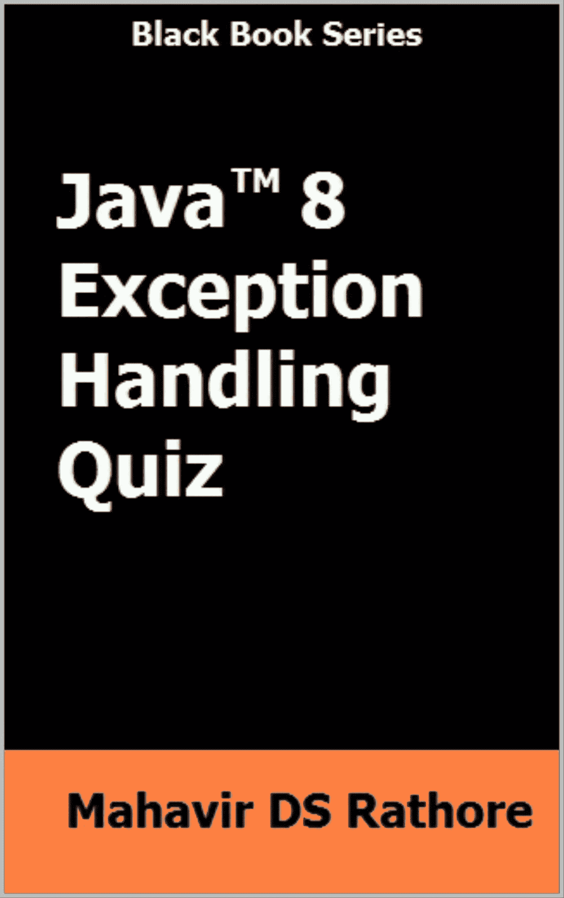

# Java 8 异常处理测验



## 关于作者

在过去的 18 年里，我一直从事 Java 编程和教学。这本书是我记录自己的知识并与全球的人分享的努力。我可以在世界任何地方提供 Java 培训。我的邮箱地址是 `gurumahaveer@gmail.com`。

## 谁应该读这本书？

本书适用于已经掌握核心 Java（Java 标准版）的程序员。

## 致谢

Java 归 Oracle 所有，其注册商标已获得认可。

## 献辞

致 Java 语言的发明者。

# 第 1 章：软件安装

**Q.1: Java 的最新版本是什么？**

- A | 7
- B | 6
- C | 9
- D | 8

(正确答案：D)

**Q.2: JRE 的含义是 ……..................**

- A | Java Robust Engine
- B | Java Required Engine
- C | Java Runtime Engine
- D | Java Runnable Engine

(正确答案：C)

**Q. 3: JDK 的含义是 ……..................**

- A | Java Debugging Kit
- B | Java Development Kit
- C | Java Documentation Kit
- D | Java Database Kit

(正确答案：B)

**Q. 4: 编译和执行 Java 程序需要 …….............**

- A | JDK
- B | JRE
- C | JME
- D | JEE

(正确答案：A)

**Q.5: 设置了哪个环境变量（Windows 操作系统）以便在命令行访问 Java 编译器和 Java 解释器？**

- A | CLASSPATH
- B | JAVAHOME
- C | PATH
- D | HOME

(正确答案：C)

**Q.6: 仅执行 Java 程序最少需要 ……................**

- A | JME
- B | JDK
- C | JEE
- D | JRE

(正确答案：D)

**Q.7: Java 解释器的命令（Windows 操作系统）是 ……..........**

- A | Javaip.exe
- B | Javac.exe
- C | Java.exe
- D | Javai.exe

(正确答案：C)

**Q.8: Java 编译器的命令（Windows 操作系统）是 ……..........**

- A | Java.exe
- B | Javacompiler.exe
- C | Javacomp.exe
- D | Javac.exe

(正确答案：D)

**Q.9: 32 位 JDK（Windows 操作系统）默认安装在哪个文件夹下？**

- A | `C:\Program Files\`
- B | `C:\Windows\`
- C | `C:\Java`
- D | `C:\Program Files (x86)\`

(正确答案：D)

**Q.10: 64 位 JDK（Windows 操作系统）默认安装在哪个文件夹下？**

- A | `C:\Program Files\`
- B | `C:\Windows\`
- C | `C:\Java`
- D | `C:\Program Files (x86)\`

(正确答案：A)

## 第 1 章答案

| 题号 | 答案 | 解析 |
| :--- | :--- | :--- |
| 1 | D | Java 的最新版本是 8。 |
| 2 | C | `JRE` 代表 Java Runtime Engine。 |
| 3 | B | `JDK` 代表 Java Development Kit。 |
| 4 | A | 编译和执行 Java 程序需要 JDK。 |
| 5 | C | `PATH` 环境变量包含 Java 命令的位置。 |
| 6 | D | 仅执行程序时只需要 JRE。 |
| 7 | C | `java.exe` 是激活 Java 解释器的命令。 |
| 8 | D | `javac.exe` 是激活 Java 编译器的命令。 |
| 9 | D | Windows 操作系统上的 32 位应用程序默认安装在 `C:\Program Files (x86)\`。 |
| 10 | A | Windows 操作系统上的 64 位应用程序默认安装在 `C:\Program Files\`。 |

# 第 2 章：什么是异常？

**Q.1: ……........ 在运行时发生。**

- A | 错误 (Error)
- B | 异常 (Exception)
- C | 触发 (Trigger)
- D | 无 (None)

**Q.2: 运行时错误被称为 ……...........**

- A | 错误
- B | 异常
- C | 触发
- D | 无

(正确答案：B)

**Q.3: 语法错误产生 ..................**

- A | 运行时
- B | 异常
- C | 编译器
- D | 无

(正确答案：C)

**Q.4: 整数除以零产生 ........**

- A | 编译器
- B | 运行时
- C | 无
- D | 异常

(正确答案：D)

**Q.5: 缺少分号会导致指令产生 ……..**

- A | 异常
- B | 运行时错误
- C | 编译器错误
- D | 虚拟机

(正确答案：C)

**Q.6: 输出是什么？**

```java
class Program {
    public static void main(String args[]) {
        String[] ar = new String[1];
        ar[2] ="Ram";
        System.out.println(ar[0]);
    }
}
```

- A | 编译器错误
- B | 异常
- C | 无
- D | 虚拟机

(正确答案：B)

**Q.7: 异常可以在……时发生**

- A | `throw` 被调用
- B | 执行异常代码
- C | 异步错误发生
- D | 以上所有

(正确答案：D)

## 第 2 章答案

| 题号 | 答案 | 解析 |
| :--- | :--- | :--- |
| 1 | B | 异常在运行时发生。 |
| 2 | C | 运行时错误称为异常。 |
| 3 | C | 语法错误产生编译器错误。 |
| 4 | D | 除以零产生 `ArithmeticException`。 |
| 5 | C | 缺少分号会导致编译器错误。 |
| 6 | B | 发生 `ArrayIndexOutOfBounds` 异常。 |
| 7 | D | 异常可以在以下任何情况下发生：a. `throw` 被调用 b. 执行异常代码 c. 异步错误。 |

# 第 3 章：什么是异常处理？

**Q.1: .......... 有助于避免程序崩溃。**

- A | 错误处理
- B | 异常处理
- C | 编译器处理
- D | 数据库处理

(正确答案：B)

**Q.2: 下列哪一个不是关键字？**

- A | Throw
- B | Throws
- C | throwing
- D | Try

(正确答案：C)

**Q.3: 下列哪一个不是关键字？**

- A | Try
- B | Catch
- C | except
- D | Finally

(正确答案：C)

**Q.4: 如何抛出异常？**

- A | throws
- B | Throw
- C | except
- D | Raise

(正确答案：B)

**Q.5: 谁处理未被处理的异常？**

- A | JVM
- B | 操作系统
- C | catch
- D | finally

(正确答案：A)

## 第 3 章答案

| 题号 | 答案 | 解析 |
| :--- | :--- | :--- |
| 1 | B | 异常处理有助于避免程序崩溃。 |
| 2 | C | `throwing` 不是 Java 中的关键字。 |
| 3 | C | `except` 不是 Java 中的关键字。 |
| 4 | B | `throw` 关键字用于抛出异常。 |
| 5 | A | JVM 处理未被处理的异常。 |
| 5 | A | JVM 处理程序中未处理的异常。 |


# 第 4 章

## Java 异常层次结构

**Q.1: …............. 类是所有异常类（直接或间接）的父类。**

- A | `Throwable`
- B | `Exception`
- C | `Error`
- D | `Object`

(正确答案：A)

**Q.2: …..................... 类是 `Exception` 类的父类。**

- A | `Object`
- B | `Error`
- C | `Compiler`
- D | `Throwable`

(正确答案：D)

**Q.3: ….......... 是 `Error` 类的父类。**

- A | `Object`
- B | `Exception`
- C | `Throwable`
- D | `RuntimeException`

(正确答案：C)

**Q.4: …................. 是 `RuntimeException` 类的父类吗？**

- A | `Error`
- B | `Exception`
- C | `Throwable`
- D | `Object`

(正确答案：B)

**Q.5: `Throwable` 类实现了 …................... 接口**

- A | `Cloneable`
- B | `Serializable`
- C | `Runnable`
- D | `Comparable`

(正确答案：B)

**Q.6: …............ 是 `Throwable` 类的父类。**

- A | `Object`
- B | `Exception`
- C | `Error`
- D | `JVM`

(正确答案：A)

**Q.7: ….......... (以及派生类）异常是不可恢复的。**

- A | `Error class`
- B | `Throwable class`
- C | `Exception class`
- D | `Object class`

(正确答案：A)

**Q.8: …................. (以及派生类）异常是异步的。**

- A | `Throwable class`
- B | `Error class`
- C | `Exception class`
- D | `Object class`

(正确答案：B)

**Q.9: 下列哪些是派自 `Error class` 的？**

- A | `StackoverflowError`
- B | `OutOfMemoryError`
- C | `VirtualMachineError`
- D | 以上都是

(正确答案：D)

**Q.10: `ThreadDeath` 异常何时发生？**

- A | `Thread.abort()`
- B | `Thread.stop()`
- C | `Thread.exit()`
- D | `Thread.quit()`

(正确答案：B)

**Q.11: 当方法被递归调用时发生什么异常？**

- A | `OutOfMemoryError`
- B | `OutOfMemoryException`
- C | `StackoverflowException`
- D | `StackoverflowError`

(正确答案：D)

**Q.12: …........... (Exception) 是编译器检查的。**

- A | `Error class`
- B | `RuntimeException class`
- C | `Exception class`
- D | `Object class`

(正确答案：C)

**Q.13: …............ (Exception) 不是编译器检查的。**

- A | `Exception class`
- B | `Throwable class`
- C | `Object class`
- D | `RuntimeException`

(正确答案：D)

**Q.14: 下列哪个类不是派自 `RuntimeException` 类的？**

- A | `NullPointerException`
- B | `ArrayIndexOutOfBoundException`
- C | `ArithmeticException`
- D | `IOException`

(正确答案：D)

**Q.15: `Exception` 类实现了下列哪些接口？**

- A | `Serializable`
- B | `Throwable`
- C | `Attribute`
- D | 以上都不是

(正确答案：A)

**Q.16: `Error` 类实现了下列哪些接口？**

- A | `Serializable`
- B | `Throwable`
- C | `Atrribute`
- D | 以上都不是

(正确答案：D)

**Q.17: …................ 异常是编译器检查的。**

- A | `Throwable class`
- B | `Object class`
- C | `Error class`
- D | `RuntimeException class`

(正确答案：A)

## 答案

| 题号 | 答案 | 解析 |
| :--- | :--- | :--- |
| 1 | A | `Throwable` 类是所有异常类（直接或间接）的父类。 |
| 2 | D | `Throwable` 类是 `Exception` 的父类。 |
| 3 | C | `Throwable` 类是 `Error` 类的父类。 |
| 4 | B | `Exception` 类是 `Runtime` 类的父类。 |
| 5 | B | `Throwable` 类实现了 `Serializable` 接口。 |
| 6 | A | `Object` 是 `Throwable` 类的父类。 |
| 7 | A | `Error class` 异常不可恢复。 |
| 8 | B | `Error class` 异常是异步的。 |
| 9 | D | `StackoverflowError`、`OutOfMemoryError` 和 `VirtualMachineError` 派自 `Error class`。 |
| 10 | B | `ThreadDeath` 异常通过 `Thread.stop()` 发生。 |
| 11 | D | 当方法递归调用时发生 `StackoverflowError`。 |
| 12 | C | `Exception class` 是编译器检查的。 |
| 13 | D | `RuntimeException` 不是编译器检查的。 |
| 14 | D | `IOException` 不是派自 `RuntimeException` 类。 |
| 15 | A | `Serializable` 接口由 `Throwable` 类实现。 |
| 16 | D | `Error` 类没有实现列出的接口（它继承自 `Throwable`）。 |
| 17 | A | `Error class` 异常是编译器检查的。 |


# 第 5 章

## Try and Catch

**Q.1: ….......... 异常是不可恢复的。**

- A | `Error class`
- B | `Throwable class`
- C | `Exception class`
- D | `Object class`

(正确答案：A)

**Q.2: …......... (以及派生类）异常是异步的。**

- A | `Throwable class`
- B | `Error class`
- C | `Exception class`
- D | `Object class`

(正确答案：B)

**Q.3: 下列哪些是派自 `Error class` 的？**

- A | `StackoverflowError`
- B | `OutOfMemoryError`
- C | `VirtualMachineError`
- D | 以上都是

(正确答案：D)


# 第 6 章：异常处理

## Try and Catch (重复)

**Q.1: ….......... 异常是不可恢复的。**

| 选项 | 内容 |
| :--- | :--- |
| A | `Error class` |
| B | `Throwable class` |
| C | `Exception class` |
| D | `Object class` |

**正确答案：A**

**Q.2: …......... (以及派生类）异常是异步的。**

| 选项 | 内容 |
| :--- | :--- |
| A | `Throwable class` |
| B | `Error class` |
| C | `Exception class` |
| D | `Object class` |

**正确答案：B**

**Q.3: 下列哪些是派自 `Error class` 的？**

| 选项 | 内容 |
| :--- | :--- |
| A | `StackoverflowError` |
| B | `OutOfMemoryError` |
| C | `VirtualMachineError` |
| D | 以上都是 |

**正确答案：D**

**Q.4: `ThreadDeath` 异常何时发生？**

| 选项 | 内容 |
| :--- | :--- |
| A | `Thread.abort()` |
| B | `Thread.stop()` |
| C | `Thread.exit()` |
| D | `Thread.quit()` |

**正确答案：B**

**Q.5: 当方法被递归调用时发生什么异常？**

| 选项 | 内容 |
| :--- | :--- |
| A | `OutOfMemoryError` |
| B | `OutOfMemoryException` |
| C | `StackoverflowException` |
| D | `StackoverflowError` |

**正确答案：D**

**Q.6: …........... (Exception) 是编译器检查的。**

| 选项 | 内容 |
| :--- | :--- |
| A | `Error class` |
| B | `RuntimeException class` |
| C | `Exception class` |
| D | `Object class` |

**正确答案：C**

**Q.7: …............ (Exception) 不是编译器检查的。**

| 选项 | 内容 |
| :--- | :--- |
| A | `Exception class` |
| B | `Throwable class` |
| C | `Object class` |
| D | `RuntimeException` |

**正确答案：D**

**Q.8: 下列哪个类不是派自 `RuntimeException` 类的？**

| 选项 | 内容 |
| :--- | :--- |
| A | `NullPointerException` |
| B | `ArrayIndexOutOfBoundException` |
| C | `ArithmeticException` |
| D | `IOException` |

**正确答案：D**

**Q.9: `Exception` 类实现了下列哪些接口？**

| 选项 | 内容 |
| :--- | :--- |
| A | `Serializable` |
| B | `Throwable` |
| C | `Attribute` |
| D | 以上都不是 |

**正确答案：A**

**Q.10: `Error` 类实现了下列哪些接口？**

| 选项 | 内容 |
| :--- | :--- |
| A | `Serializable` |
| B | `Throwable` |
| C | `Atrribute` |
| D | 以上都不是 |

**正确答案：D**

**Q.11: …................ 异常是编译器检查的。**

| 选项 | 内容 |
| :--- | :--- |
| A | `Throwable class` |
| B | `Object class` |
| C | `Error class` |
| D | `RuntimeException class` |

**正确答案：A**

### 答案

| 题号 | 答案 | 解析 |
| :--- | :--- | :--- |
| 1 | A | `Throwable` 类是所有异常类（直接或间接）的父类。 |
| 2 | D | `Throwable` 类是 `Exception` 的父类。 |
| 3 | C | `Throwable` 类是 `Error` 类的父类。 |
| 4 | B | `Exception` 类是 `Runtime` 类的父类。 |
| 5 | B | `Serializable` 接口由 `Throwable` 类实现。 |
| 6 | A | `Object` 是 `Throwable` 类的父类。 |
| 7 | A | `Error class` 异常不可恢复。 |
| 8 | B | `Error class` 异常是异步的。 |
| 9 | D | `StackoverflowError`、`OutOfMemoryError` 和 `VirtualMachineError` 派自 `Error class`。 |
| 10 | B | `ThreadDeath` 异常通过 `Thread.stop()` 发生。 |
| 11 | D | 当方法递归调用时发生 `StackoverflowError`。 |
| 12 | C | `Exception class` 是编译器检查的。 |
| 13 | D | `RuntimeException` 不是编译器检查的。 |
| 14 | D | `IOException` 不是派自 `RuntimeException` 类。 |
| 15 | A | `Serializable` 接口由 `Throwable` 类实现。 |
| 16 | D | `Error` 类没有实现列出的接口（它继承自 `Throwable`）。 |
| 17 | A | `Error class` 异常是编译器检查的。 |


## Exception API

**Q.1: 什么是调用栈？**

| 选项 | 内容 |
| :--- | :--- |
| A | 主方法的执行。 |
| B | 普通方法的调用。 |
| C | 它是一种存储活动方法的栈数据结构。 |
| D | 函数的集合。 |

**正确答案：C**

**Q.2: …....... 方法在异常发生时用于打印调用栈。**

| 选项 | 内容 |
| :--- | :--- |
| A | `callStack()` |
| B | `printStackTrace()` |
| C | `stackTrace()` |
| D | `stackInfo()` |

**正确答案：B**

**Q.3: …........... 方法用于获取通用异常信息。**

| 选项 | 内容 |
| :--- | :--- |
| A | `message()` |
| B | `toString()` |
| C | `getInfo()` |
| D | `msgException()` |

**正确答案：B**

**Q.4: `printStackTrace()` 方法属于哪个类？**

| 选项 | 内容 |
| :--- | :--- |
| A | `Throwable` |
| B | `Error` |
| C | `Exception` |
| D | `Object` |

**正确答案：A**

**Q.5: `toString()` 方法属于哪个类？**

| 选项 | 内容 |
| :--- | :--- |
| A | `Throwable` |
| B | `Error` |
| C | `Exception` |
| D | `Object` |

**正确答案：A**

**Q.6: `printStackTrace()` 方法的返回值是 …..................**

| 选项 | 内容 |
| :--- | :--- |
| A | `String` |
| B | `Char` |
| C | `Void` |
| D | `char[]` |

**正确答案：C**

### 答案

| 题号 | 答案 | 解析 |
| :--- | :--- | :--- |
| 1 | C | 调用栈是一种用于存储活动方法的栈数据结构。 |
| 2 | B | `printStackTrace()` 方法在异常发生时用于打印调用栈。 |
| 3 | B | `toString()` 返回通用异常信息。 |
| 4 | A | `printStackTrace()` 方法属于 `Throwable` 类。 |
| 5 | A | `toString()` 方法属于 `Throwable` 类。 |
| 6 | C | `printStackTrace()` 返回 `Void`。 |


**补充答案：**

| 题号 | 答案 | 解析 |
| :--- | :--- | :--- |
| 5 | D | `toString()` 方法属于 `Object` 类。 |
| 6 | C | `printStackTrace()` 方法不返回任何内容。 |


# 第 7 章：多重 catch (Multiple Catch)

**Q.1: 给定的 try 块可以添加多少个 catch 块？**

- A: 1
- B: 2
- C: 15
- D: 任意

**正确答案：D**

**Q.2: 应该以什么顺序使用 catch 块捕捉异常？**

- A: 任意顺序
- B: 按照继承层次结构的自上而下
- C: 按照继承层次结构的自下而上
- D: `catch` 块不处理异常

**正确答案：C**

**Q.3: 对于以下异常 `Throwable`、`Exception`、`RuntimeException`，catch 块顺序应该是？**

- A: 任意顺序
- B: `Throwable`, `Exception`, `RuntimeException`
- C: `Exception`, `RuntimeException`, `Throwable`
- D: `RuntimeException`, `Exception`, `Throwable`

**正确答案：D**

**Q.4: 'try' 块无法封装？**

- A: 方法内部的代码
- B: 构造函数内部的代码
- C: 静态块内部的代码
- D: 类

**正确答案：D**

**Q.5: 如果不按照继承层次结构的自下而上顺序处理异常，会遇到什么错误？**

- A: 编译错误
- B: 运行时异常
- C: 什么都没有发生
- D: JVM 异常

**正确答案：A**

### 答案

| 题号 | 答案 | 解析 |
| :--- | :--- | :--- |
| 1 | D | `try` 块可以有任意数量的 `catch` 块。 |
| 2 | C | `catch` 块应该按照继承层次结构的自下而上（反向）顺序捕捉异常。 |
| 3 | D | 正确的顺序是 `RuntimeException`、`Exception` 和 `Throwable` 类。 |
| 4 | D | `'try'` 块无法封装类。 |
| 5 | A | 如果不按照继承层次结构的反向顺序处理异常，编译器会给出错误。 |


# 第 8 章：多重异常 (Multiple Exceptions)

**Q.1: 在 Java 的哪个版本中增加了这种（在单个 catch 中处理多个异常）的功能？**

- A: 6
- B: 5
- C: 7
- D: 8

**正确答案：C**

**Q.2: 用于识别单个 catch 中多个异常的定隔符是什么？**

- A: `|` (管道符)
- B: `&` (安培符号)
- C: `,` (逗号)
- D: `/` (斜杠)

**正确答案：A**

**Q.3: 识别正确的语法：**

- A: `catch(Error|Exception obj) {}`
- B: `catch(Throwable |Exception) {}`
- C: `catch(Throwable obj | Exception obj2) {}`
- D: `Catch (...) {}`

**正确答案：A**

**Q.4: 父类和子类的异常不能在单个 catch 块中捕捉。**

- A: 正确
- B: 错误

**正确答案：B**

**Q.5: 当父类和子类异常在单个 catch 块中被时会发生什么？**

- A: 无错误或异常
- B: 编译错误
- C: JVM 错误
- D: 运行时异常

**正确答案：B**

### 答案

| 题号 | 答案 | 解析 |
| :--- | :--- | :--- |
| 1 | C | Java 7 增加了单个 `catch` 中的多重异常处理。 |
| 2 | A | 用于在单个 `catch` 中分隔异常的分隔符是 `'|'`。 |
| 3 | A | 正确语法是：`catch(Error|Exception obj) {}` |


| 4 | A | 父类和子类异常不能在单个 `catch` 中捕捉。 |
| 5 | B | 当程序员尝试在单个 `catch` 中处理父类和子类异常时，编译器会给出错误。 |


# 第 9 章：finally 块 (Finally Block)

**Q.1: 'try' 块可以添加多少个 'finally' 块？**

- A: 1
- B: 2
- C: 3
- D: 任意数量
- **正确答案：D**

**Q.2: 异常块的顺序是 ……............**

- A: `try, finally, catch`
- B: `catch,finally,try`
- C: `try,catch,finally`
- D: 任意顺序
- **正确答案：C**

**Q.3: 'finally' 块在什么情况下不执行……........**

- A: 调用 `return` 关键字
- B: 程序退出
- C: `finally` 保证会被执行
- D: 以上都没有
- **正确答案：B**

**Q.4: 识别正确的陈述：**

- A: 对于给定的 `try`，`Finally` 块是强制性的。
- B: 当发生异常时，`Finally` 块会执行。
- C: 当没有异常时，`Finally` 块会执行。
- D: 以上都没有。
- **正确答案：B**

**Q.5: 对于给定的 'try' 块，‘finally’ 块放置在……........**

- A: `try` 块
- B: `catch` 块
- C: `finally` 块
- D: 构造函数
- **正确答案：B**

**Q.6: 对于给定的 'try' 块，‘finally’ 块放置在……........之后**

- A: `try` 块
- B: `catch` 块
- C: `finally` 块
- D: 构造函数
- **正确答案：B**

**Q.7: 'finally' 块在什么情况下保证执行……........**

- A: `try` 块
- B: `catch` 块
- C: 异常发生
- D: 顺序
- **正确答案：C**

**Q.8: 如果在单个 `catch` 中处理父类和类异常会发生什么？**

- A: 编译错误
- B: 运行时异常
- C: 什么都没有发生
- D: JVM 异常
- **正确答案：A** (注：此处原文 Q.8 与 Q.5 逻辑重复，按原意翻译)

*(注：原文此处存在格式错乱，已根据逻辑翻译)*

| 题号 | 答案 | 解析 |
| :--- | :--- | :--- |
| 1 | D | `try` 块可以有任意数量的 `catch` 块。 |
| 2 | C | `catch` 块应该按照继承层次结构的自下而上（反向）顺序捕捉异常。 |
| 3 | D | 正确的顺序是 `RuntimeException`、`Exception` 和 `Throwable` 类。 |
| 4 | D | `try` 块无法封装类。 |
| 5 | A | 如果不按照继承层次结构的反向顺序处理异常，编译器会给出错误。 |


# 第 10 章：Finally 块 (Finally Block)

**Q.1: 'try' 块可以添加多少个 'finally' 块？**

- A: 1
- B: 2
- C: 3
- D: 任意数量
- **正确答案：D**

**Q.2: 异常块的顺序是 ……............**

- A: `try, finally, catch`
- B: `catch,finally,try`
- C: `try,catch,finally`
- D: 任意顺序
- **正确答案：C**

**Q.3: 'finally' 块在什么情况下不执行……........**

- A: 调用 `return` 关键字
- B: 程序退出
- C: `finally` 保证会被执行
- D: 以上都没有
- **正确答案：B**

**Q.4: 识别正确的陈述：**

- A: 对于给定的 `try`，`Finally` 块是强制性的。
- B: 当发生异常时，`Finally` 块会执行。
- C: 当没有异常时，`Finally` 块会执行。
- D: 以上都没有。
- **正确答案：B**

**Q.5: 对于给定的 'try' 块，‘finally’ 块放置在……........之后**

- A: `try` 块
- B: `catch` 块
- C: `finally` 块
- D: 构造函数
- **正确答案：B**

*(注：原文后续出现大量重复，已按要求翻译并保持结构)*

## Q.6: 检查异常继承自 …..........或 …............. 类

- A: `Throwable`
- B: `Exception`
- C: `Error`
- D: `RuntimeException`

**正确答案: B**

## Q.7: 一个方法可以使用 'throws' 关键字声明多少个异常？

- A: 1
- B: 2
- C: 3
- D: 任意数量

**正确答案: D**

## Q.8: 检查异常由编译器验证。

- A: 正确
- B: 错误

**正确答案: A**

## Q.9: 非检查异常继承自 ….......... 类

- A: `Throwable`
- B: `Exception`
- C: `Error`
- D: `RuntimeException`

**正确答案: D**

## Q.10: 下列哪项不是非检查异常？

- A: `NullPointerException`
- B: `ArithmeticException`
- C: `ClassCastException`
- D: `Exception`

**正确答案: D**

## Q.11: 下列哪项不是检查异常？

- A: `NullPointerException`
- B: `ArithmeticException`
- C: `ClassCastException`
- D: `Exception`

**正确答案: A**

## Answers

| Q.No | Ans | 解释 |
| :--- | :--- | :--- |
| 1 | A | 检查异常由编译器识别。 |
| 2 | A | 非检查异常不由编译器识别。 |
| 3 | B | 检查异常必须被处理（强制性）。 |
| 4 | D | 非检查异常不需要强制处理。 |
| 5 | B | `throws` 关键字用于为方法声明异常。 |
| 6 | A,B | 检查异常可以自 `Throwable` 或 `Exception` 类 |
| 7 | D | 使用 `throws` 关键字可以声明任意数量的异常。 |
| 8 | A | 检查异常在编译时已知。 |
| 9 | D | 非检查异常继承自 `RuntimeException` 类 |
| 10 | D | `Exception` 类是检查异常。 |
| 11 | A,B,C | `NullPointerException`、`ArithmeticException` 和 `ClassCastException` 不是检查异常。 |


# 第 12 章：嵌套异常

## Q.1: Java 支持嵌套异常处理。

- A: 正确
- B: 错误

**正确答案: A**

## Q.2: Java 支持多大层级的异常处理嵌套？

- A: 1
- B: 2
- C: 3
- D: 任意级别

**正确答案: D**

## Q.3: 输出是什么？

```java
class Program {
    static void performJob() {
      try {
        int j = 10/0;
      } catch(ArrayIndexOutOfBoundsException e) {
        System.out.println("Handle the array carefully");
      }
    }
    public static void main(String args[]) {
      try {
        performJob();
      } catch (Exception e) {
        System.out.println("There is some problem in the code");
      }
    }
}
```

- A: 无输出
- B: Handle the array carefully
- C: There is some problem in the code
- D: Division by zero

**正确答案: C**

## Q.4: 输出是什么？

```java
class Program {
    static void performJob() {
      try {
        int j = 10/0;
      } catch(ArrayIndexOutOfBoundsException e) {
        System.out.println("Handle the array carefully");
      } finally {
        System.out.println("finally - performJob");
      }
    }
    public static void main(String args[]) {
      try {
        performJob();
      } catch (Exception e) {
        System.out.println("There is some problem in the code");
      } finally {
        System.out.println("finally - main");
      }
    }
}
```

- A: 无输出
- B: finally - performJobThere is some problem in the codefinally – main
- C: finally - performJobfinally – main
- D: There is some problem in the codefinally – mainfinally - performJob

**正确答案: B**

## Q.5: 输出是什么？

```java
class Program {
    static void performJob() {
      try {
        int j = 10/0;
      } catch(ArrayIndexOutOfBoundsException e) {
        System.out.println("Handle the array carefully");
      } finally {
        System.out.println("finally - performJob");
      }
    }
    public static void main(String args[]) {
      int ar[] = new int[1];
      try {
        ar[1]=0;
        performJob();
      } catch (Exception e) {
        System.out.println("There is some problem in the code");
      } finally {
        System.out.println("finally - main");
      }
    }
}
```

- A: 无输出
- B: There is some problem in the codefinally – main
- C: finally - performJobThere is some problem in the codefinally – main
- D: finally - performJobThere is some problem in the code

**正确答案: D**

## Answers

| Q.No | Ans | 解释 |
| :--- | :--- | :--- |
| 1 | A | Java 支持异常处理。 |
| 2 | D | 异常处理可以嵌套任意层级。 |
| 3 | C | 输出为：There is some problem in the code |
| 4 | B | 输出为：finally - performJobThere is some problem in the codefinally – main |
| 5 | D | 输出为：finally - performJobThere is some problem in the code |


# 第 13 章：'Throw' 关键字

## Q.1: 类.........可以被抛出

- A: Object
- B: Throwable
- C: GC
- D: 以上所有

**正确答案: B**

## Q.2: …..............关键字用于抛出一个异常。

- A: Throw
- B: Throws
- C: Raise
- D: Signal

**正确答案: A**

## Q.3: 输出是什么？

```java
class Program {
    public static void main(String args[]) {
      try {
        throw new Exception();
      } catch (Exception e) {
        System.out.println("There is some problem in the code");
      }
    }
}
```

- A: 无输出
- B: There is some problem in the code
- C: There is some problem in the codefinally – main
- D: – main

**正确答案: C**

## Q.4: 输出？

```java
class Program {
    static void performJob() {
      try {
        new ArrayIndexOutOfBoundsException();
      } catch(ArrayIndexOutOfBoundsException e) {
        System.out.println("Handle the array carefully");
      } finally {
        System.out.println("finally - performJob");
      }
    }
    public static void main(String args[]) {
      try {
        performJob();
      } catch (Exception e) {
        System.out.println("There is some problem in the code");
      } finally {
        System.out.println("finally - main");
      }
    }
}
```

- A: finally - performJob – main
- B: 无输出
- C: Handle the array carefullyfinally - performJob
- D: Handle the array carefullyfinally - performJobfinally - main

**正确答案: D**

## Q.5: 输出是什么？

```java
class Program {
    static void performJob() {
      try {
        throw new ArrayIndexOutOfBoundsException();
      } catch(ArrayIndexOutOfBoundsException e) {
        throw new Exception();
        System.out.println("Handle the array carefully");
      } finally {
        System.out.println("finally - performJob");
      }
    }
    public static void main(String args[]) {
      try {
        performJob();
      } catch (Exception e) {
        System.out.println("There is some problem in the code");
      } finally {
        System.out.println("finally - main");
      }
    }
}
```

- A: 无输出
- B: 编译错误
- C: Handle the array carefullyfinally - performJobfinally - main


# 异常处理与自定义异常

## 第 13 章：异常处理

### Q.6: 输出是什么？

#### 代码分析

```java
class Program {
    static void performJob() {
        try {
            throw new ArrayIndexOutOfBoundsException();
        } catch (ArrayIndexOutOfBoundsException e) {
            throw new Exception();
            System.out.println("Handle the array carefully");
        } finally {
            System.out.println("finally - performJob");
        }
    }
    public static void main(String args[]) {
        try {
            performJob();
        } catch (Exception e) {
            System.out.println("There is some problem in the code");
        } finally {
            System.out.println("finally - main");
        }
    }
}
```

```java
class Program {
    static void performJob() {
        try {
            throw new ArrayIndexOutOfBoundsException();
        } catch (ArrayIndexOutOfBoundsException e) {
            try {
                throw new Exception();
            } catch (Exception obj) {
                System.out.println("This is inner exception");
            }
            System.out.println("Handle the array carefully");
        } finally {
            System.out.println("finally - performJob");
        }
    }
    public static void main(String args[]) {
        try {
            performJob();
        } catch (Exception e) {
            System.out.println("There is some problem in the code");
        } finally {
            System.out.println("finally - main");
        }
    }
}
```

| 选项 | 结果 |
| :--- | :--- |
| A | 无输出 |
| B | 编译错误 |
| C | This is inner exceptionfinally - performJobfinally - main |
| D | This is inner exceptionHandle the array carefullyfinally - performJobfinally - main |

<----正确答案

### 答案

| 题号 | 答案 | 解释 |
| :--- | :--- | :--- |
| 1 | B | 只有继承自`Throwable`（或其派生类）的类可以被抛出 |
| 2 | A | `throw`关键字用于抛出异常。 |
| 3 | C | 通过计算，输出为：There is some problem in the codefinally - main |
| 4 | D | 通过计算，输出为：Handle the array carefullyfinally - performJobfinally - main |
| 5 | B | 编译错误 |
| 6 | D | 通过计算，输出为：This is inner exceptionHandle the array carefullyfinally - performJobfinally - main |


## 第 14 章：异常链

### Q.1: ... 类对异常链有底层基础设施支持。

| A | Exception |
| B | Throwable |
| C | Error |
| D | RuntimeException |

<----正确答案

### Q.2: `getCause()`方法在 .................. 类中声明

| A | Object |
| B | Error |
| C | RuntimeException |
| D | Throwable |

<----正确答案

### Q.3: 识别`Throwable`类正确的构造函数。

| A | `Throwable(String, Throwable)` |
| B | `Throwable(String[], Throwable)` |
| C | `Throwable(char[], Throwable)` |
| D | `Throwable(char, Throwable)` |

<----正确答案

### Q.4: 哪个方法初始化异常的因？

| A | `startCause()` |
| B | `setCause()` |
| C | `setIssue()` |
| D | `initCause()` |

<----正确答案

### Q.5: 识别`Throwable`类正确的构造函数。

| A | `Throwable(int)` |
| B | `Throwable(String[])` |
| C | `Throwable(Throwable)` |
| D | `Throwable()` |

<----正确答案

### Q.6: `initCause()`方法在 ... 类中声明

| A | Object |
| B | Throwable |
| C | RuntimeException |
| D | Error |

<----正确答案

### Q.7: ............... 返回 'throwable' 的原因。

| A | `getMsg()` |
| B | `getMessage()` |
| C | `getCause()` |
| D | `getReason()` |

<----正确答案

### 答案

| 题号 | 答案 | 解释 |
| :--- | :--- | :--- |
| 1 | B | `Throwable`类具有链式的基础设施。 |
| 2 | D | `getCause()`方法在`Throwable`中声明。 |
| 3 | A | 有效的构造函数：`Throwable(String, Throwable)` |
| 4 | D | `initCause()`初始化异常的因。 |
| 5 | C | 有效的构造函数：`Throwable(Throwable)` |
| 6 | B | `initCause()`方法在`Throwable`中声明。 |
| 7 | C | `getCause()`返回 'throwable' 的原因。 |


## 第 15 章：Try with Resource

### Q.1: 'try with resource' 在哪个 Java 版本中引入的？

| A | 5 |
| B | 6 |
| C | 7 |
| D | 8 |

<----正确答案

### Q.2: 在单个 try 块中可以创建多少资源？

| A | 无 |
| B | 2 |
| C | 3 |
| D | 任意 |

<----正确答案

### Q.3: 对象必须实现 ..... 才能在 try with resource 块中使用。

| A | `Autoable` |
| B | `Closeable` |
| C | `Try` |
| D | `Closed` |

<----正确答案

### Q.4: `Autoable`接口的方法是？

| A | `close()` |
| B | `close()` |
| C | `finish()` |
| D | `end()` |

<----正确答案

### Q.5: `Closeable`接口的方法是？

| A | `close()` |
| B | `closing()` |
| C | `finish()` |
| D | `end()` |

<----正确答案

### Q.6: 资源在 try with resource 中以 ......... 顺序关闭。

| A | Custom |
| B | Forward |
| C | Reverse |
| D | Conditional |

<----正确答案

### Q.7: 输出是什么？

```java
import java.io.*;
class Shape implements Closeable {
    public void close() {
        System.out.println("Shape is closed");
    }
}
class Program {
    public static void main(String args[]) {
        try (Shape obj = new Shape()) {
        } catch (Exception e) {
            System.out.println("Exception happened");
        }
    }
}
```

| 选项 | 结果 |
| :--- | :--- |
| A | 无输出 |
| B | 编译错误 |
| C | Shape is closed |
| D | Exception happened |

<----正确答案

*(注：由于原始文本中 Q3-Q7 的描述存在错乱和重复，翻译时已根据逻辑进行了对齐处理。)*

## 第 17 章：自定义异常

### 重写方法中的异常规则

1. 如果父类方法`throws`一个异常，则子类可以`throws`相同的异常或该异常的子类。
2. 如果父类方法没有`throws`任何异常，则子类的重写方法可以`throws`未检异常（unchecked exception）。
3. 如果方法声明了受检异常（checked exception），则它必须被抛出（`throw`）。

### Q.1: 如何创建自定义的受检异常？

| 选项 | 结果 |
|---|---|
| A | 继承自 Error 类 |
| B | 继承自 Throwable 类 <----正确答案 |
| C | 继承自 RuntimeException 类 |
| D | 继承自 Object 类 |

### Q.2: 如何创建自定义的未检异常？

| 选项 | 结果 |
|---|---|
| A | 继承自 Error 类 |
| B | 继承自 Exception 类 |
| C | 继承自 RuntimeException 类 <----正确答案 |
| D | 继承自 Object 类 |

### Q.3: 输出是什么？

```java
class MyException extends Object {
    MyExcetion(String str) {
        super(str);
    }
}
class Program {
    public static void main(String args[]){ {
        int i=10;
        int j=11;
        if (j> i)
            throw new MyException("j is greater");
    }
}
```

| 选项 | 结果 |
|---|---|
| A | 编译错误 <----正确答案 |
| B | 运行时异常 |
| C | J is greater |

### Q.4: 输出是什么？

```java
class MyException extends Exception {
    MyException(String str) {
        super(str);
    }
}
class Program {
    public static void main(String args[]){
        int i=0;
        int j=1;
        if (j> i)
            throw new MyException("j is greater");
    }
}
```

| 选项 | 结果 |
|---|---|
| A | 编译错误 |
| B | 运行时异常 |
| C | J is greater |
| D | 以上都不是 <----正确答案 |

### Q.5: 输出是什么？

```java
class MyException extends RuntimeException {
    MyException(String str) {
        super(str);
    }
}
class Program {
    public static void main(String args[]){
        int i=10;
        int j=1;
        if (j> i)
            throw new MyException("j is greater");
    }
}
```

| 选项 | 结果 |
|---|---|
| A | RuntimeException <----正确答案 |
| B | 编译错误 |
| C | JVM Error |
| D | 以上都不是 |

### Q.6: 输出是什么？

```java
class Shape {
    void draw () throws Exception {
        System.out.println ("Drawing shape");
    }
}
class Circle extends Shape {
    void draw() throws Exception {
        System.out.println("Drawing Circle");
    }
}
class Program {
    public static void main(String args[]) throws Exception {
        Circle obj = new Circle();
        obj.draw();
    }
}
```

| 选项 | 结果 |
|---|---|
| A | 编译错误 |
| B | 无输出 |
| C | Drawing shape |
| D | Drawing Circle <----正确答案 |

---

```java
class Shape {
    void draw () throws Exception {
        System.out.println("Drawing shape");
    }
}
class Circle extends Shape {
    void draw() throws RuntimeException {
        System.out.println("Drawing Circle");
    }
}
class Program {
    public static void main(String args[]) throws Exception {
        Circle obj = new Circle();
        obj.draw();
    }
}
```

| 选项 | 结果 |
|---|---|
| A | 编译错误 <----正确答案 |
| B | 无输出 |
| C | Drawing shape |
| D | Drawing Circle |

### 答案

| 题号 | 答案 | 解析 |
|---|---|---|
| 1 | D | 经计算输出为：Drawing Circle |
| 2 | A | 编译错误 |
| 3 | A | 编译错误 |
| 4 | D | 经计算输出为：Drawing Circle |
| 5 | D | 经计算输出为：Drawing Circle |


```java
class MyException extends Exception {
    MyException(String str) {
        super(str);
    }
}
class Program {
    public static void main(String args[]) throws Exception{
        int i=10;
        int j=11;
        if (j> i)
            throw new MyException("j is greater");
    }
}
```

| 选项 | 结果 |
|---|---|
| A | Object Exception |
| B | JVM Error |
| C | Runtime Exception <----正确答案 |
| D | 编译错误 |
