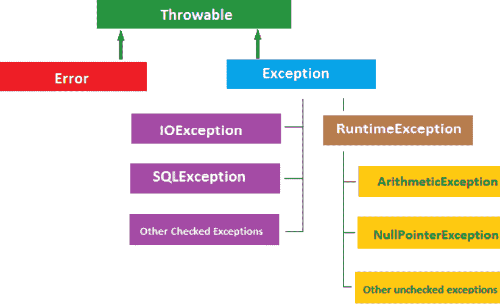
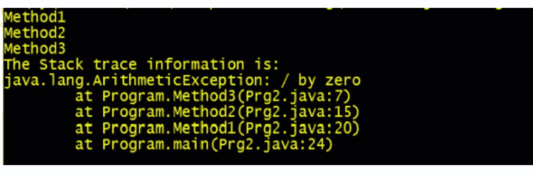

# Java 8 异常处理指南

## 关于作者

在过去的 18 年里，我一直从事 Java 编程和教学。这本书是我记录自己的知识并与全球的人分享的努力。我可以在世界任何地方提供 Java 培训。我的邮箱是 `gurumahaveer@gmail.com`。

## 谁应该读这本书？

这本书面向那些已经熟悉核心 Java（Java 标准版）并对深入理解异常处理感兴趣的程序员。

## 致谢

## 献辞

献给 Java 语言的发明者。

## 源代码

如需本书的源代码，请发送邮件至 `gurumahaveer@gmail.com`。

## 第 1 章：软件安装

- 引言
- 所需软件
- 验证安装
- 总结

### 引言

在本章中，我将展示如何获取并安装学习 Java 异常处理所需的软件。根据操作系统的不同，有多种方案可以完成所需的设置。

Java 是 Oracle 提供的免费下载技术平台，Java 平台支持许多语言。维基百科列出了所有 JVM 语言的详细列表，可以通过访问 `https://en.wikipedia.org/wiki/List_of_JVM_languages` 查看。

### 所需软件

要开发 Java 程序，你至少需要：

- a. Java SE 开发工具包 (Java 8)
- b. 代码编辑器

这与操作系统无关。在本书中，我将在 Windows 系统上使用 Java。

让我们来看看需要的各种软件以及从哪里获取它们。

- a. Java SE 开发工具包 – `http://www.oracle.com/technwork/java/javase/downloads/jdk8-downloads-2133511.html`

这是 Java 标准版。请确保选择正确的 JDK，即在识别操作系统和架构（32 位或 64 位）后选择。最新版本是 8。在下载和安装 Java 时要非常小心，许多程序员犯了只下载 JRE 并安装的错误。JRE 是 Java 程序运行所需的最小环境，而 JDK 是编译和执行 Java 程序的最小环境，请确保你下载的是 JDK 而不是 JRE。

- b. 代码编辑器 – 我倾向于使用 Notepad++。Notepad++ 是一款优秀的代码编辑器，支持超过 24 种语言且开源。最新版本可以从这里下载：`https://notepad-plus-plus.org/download/v6.8.8.html`。你也可以使用其他编辑器或 IDE，如 `eclipse`、`netbeans` 等。

### 验证安装

在 32 位 Windows 上，Java SE 默认安装在 `C:\Program Files (x86)\Java`。在 64 位 Windows 上，默认安装在 `C:\Program Files\Java`。

要检查电脑上是否安装了 JDK，请打开命令行并运行：

a. `java -version`

b. `javac -version`

如果无法识别命令，则你需要设置环境变量。

a. 打开系统属性

b. 点击“高级”选项卡

c. 点击“环境变量”

d. 选择 `Path` 并点击“编辑”

e. 点击“新建”并添加 JDK `bin` 文件夹的路径

f. 点击所有窗口上的确定

现在打开新的命令行并运行：

a. `java -version`

b. `javac -version`

如果显示了版本号，说明 Java 安装成功。

## 第 2 章：什么是异常？

- 什么是错误 (Error)？
- 什么是异常 (Exception)？
- 为什么要进行异常处理？
- 总结

### 什么是错误 (Error)?

错误是在运行时发生的程序无法处理的意外情况。

```java
class ErrorExample {
    public static void main(String[] args) {
        // 递归调用导致 StackOverflowError
        main(args);
    }
}
```

上述代码，程序将以 `StackOverflowError` 崩溃。这是因为递归是无限的，栈溢满了。错误通常不会被程序捕获。示例包括 `OutMemoryError`、`StackOverflowError`、`VirtualMachineError`。

### 什么是异常 (Exception)?

异常是程序执行过程中发生的事件，会中断指令的正常流。

```java
class ExceptionExample {
    public static void main(String[] args) {
        int a = 10;
        int b = 0;
        int c = a / b; // 这将抛出 ArithmeticException
        System.out.println(c);
    }
}
```

上述代码，程序将以 `ArithmeticException` 崩溃。然而，异常可以使用 `try-catch` 块进行捕获和处理。

### 为什么要进行异常处理？

异常处理处理运行时错误的机制，以便维持应用程序的正常流。

```java
class HandlingExample {
    public static void main(String[] args) {
        try {
            int a = 10;
            int b = 0;
            int c = a / b;
        } catch (ArithmeticException e) {
            System.out.println("不能除以零！");
        }
        System.out.println("程序继续...");
    }
}
```

上述代码，程序在处理异常后将继续执行。

### 总结

错误是程序无法处理的意外情况。异常是执行过程中发生的中断指令正常流的事件。异常可以被捕获和处理。

## 什么是异常处理？

异常处理是对程序执行过程中发生的运行时错误进行响应的过程。它是一种捕获和识别运行时错误的机制，以避免程序突然崩溃。异常处理有助于避免程序突然崩溃，通过它程序员可以对运行时错误提供诊断。异常处理会改变程序的执行流，通过它用户可以恢复应用程序中的异常情况。简单来说，它是当程序在运行时出现问题时的“B 计划”。

并不是所有的运行时错误都是可以恢复的，某些被称为异步异常的特定异常是无法恢复的，例如：内存溢出错误（`Out of memory error`）。

### 异常处理的必要性

使用异常处理，程序员可以在调用栈上传播异常，这有助于识别异常产生。Java 支持任意深度的嵌套异常处理。异常处理用于识别和分组运行时错误，从而实现更快的诊断。所有上述努力都有助于 Java 程序的可靠性和质量，从而减少应用程序的故障间隔时间（MTBF），这是异常处理的首要目标，即提高程序的可靠性。

### 执行异常处理

Java 中的异常处理是借助异常处理关键字完成的。Java 中有五个用于执行异常的关键字。这些关键字列举如下：

- a. `Try` 块 – 它识别封装脆弱代码的代码区域。
- b. `Catch` 块 – 用于识别可能发生的唯一异常。
- c. `Catch` 块 – 有助于对发生的异常进行分组并提供诊断。
- d. `Finally` 块 – 用于执行清理工作。
- e. `Throw` 关键字 – 用于抛出异常。
- f. `Throws` 关键字 – 用于为方法声明异常。

现在让我们来看一个使用 `throw` 关键字的程序。

```java
// Program 1
// Description: 如何使用 'throw' 关键字

class Program {
    public static void main(String[] args) {
        throw new ArithmeticException();
    }
}
```


在上面的程序中，我演示了如何使用 `throw` 关键字抛出异常。

### 总结

异常处理主要为了增强应用程序的可靠性。Java 中的异常处理是通过五个关键字实现的，即：`try`、`catch`、`finally`、`throw` 和 `throws`。

## 第 4 章：Java 异常层次结构

- 什么是异常层次结构？
- `Throwable` 类
- `Exception` 类
- `RuntimeException` 类
- `Error` 类
- 总结

### 什么是异常层次结构？

Java 在 API 中有一个特定的类层次结构来容纳 `Exception` 类。`Throwable` 类是 Java 中所有异常类的父类。下面是表示 Java 异常层次结构的示意图。



基本上有四个类非常重要，即 `Throwable`、`Error`、`Exception` 和 `RuntimeException`。在后面的章节中我将讨论每一个。

### Throwable 类

它是所有异常类的父类，也就是说即使程序员必须创建自定义异常，也必须直接或间接继承 `Throwable` 类。没有直接或间接继承自 `Throwable` 类的异常是无法被抛出（引起）。

`Throwable` 类的签名如下：

```java
public class Throwable extends Object implements Serializable
```

`Throwable` 类继承自 `Object` 类并实现了 `Serializable` 接口。只有 `Throwable` 类实例（或其子类）的实例才会被 Java 虚拟机抛出，或者可以通过 Java `throw` 语句抛出。`Throwable` 类（异常）是编译器检查的。

```java
// Program 1
// Understanding Throwable class

class Program {
    public static void main(String args[]) {
        throw new Throwable();
    }
}
```

该程序会产生编译错误。要克服编译错误，请根据 `main` 方法的定义添加 `"throws Throwable"`。

```java
// Program 2.
// Understanding Throwable class

class MyException {}

class Program {
    public static void main(String args[]) {
        // throw new MyException(); // compiler error
    }
}
```

当代码 `"throw new MyException"` 取消注释时，该程序将产生编译错误。这是因为只有直接或间接派生自 `Throwable` 类的异常才能被抛出。

### Error 类

它是 `Throwable` 类的子类。`Error` 类表示所有不可恢复的异常。程序可能会遇到严重问题，如 `OutOfMemoryError`、`StackflowError`、`VirtualMachineError` 等。当程序遇到此类情况时，即使进行了异常处理，程序也会崩溃，因为这些是不可恢复的异常。让我们通过程序更好地理解这一点。`Error` 类不是编译器检查的。

```java
// Program 3
// Program to demonstrate Error class (Stackoverflow)

class Program {
    static void display(int i) {
        System.out.println("Display called:" + i + "time");
        display(++i);
    }

    public static void main(String args[]) {
        display(0);
    }
}
```

在这个程序中，在某个阶段 JVM 将抛出一个不可恢复的 `StackflowError` 异常。`Error` 类（及其子类）也被称为异步异常。

### Exception 类

它派生自 `Throwable` 类。`Exception` 类（及其子类）是可恢复的异常。通常，`Exception` 充当自定义异常的父类。`Exception` 类是编译器检查的，也就是说如果不进行处理，程序员将得到编译错误。`Exception` 类的签名是：

```java
public class Exception extends Throwable
```

让我们通过程序更好地理解 `Exception` 类。

```java
// Program 4
// Description: Exception behavior

class Program {
    public static void main(String[] args) {
        throw new Exception();
    }
}
```

该程序会产生编译错误，因为 `Exception` 类是编译器检查的。要克服编译错误，请处理异常或声明它。

### RuntimeException 类

它派生自 `Exception` 类。`RuntimeException` 类（及其子类）不是编译器检查的。签名是：

```java
public class RuntimeException extends Exception
```

通常 `RuntimeException` 是可以通过编程手段防止的异常。例如 `NullPointerException`、`ArithmeticException`、`ArrayIndexOutOfBoundsException` 等。如果程序员在调用任何方法之前检查空值，`NullPointerException` 就不会发生。同样，如果你检查了索引，`ArrayIndexOutOfBoundsException` 也不会发生。

让我们通过示例更好地理解 `RuntimeException`。

```java
// Program 5
// RuntimeException is compiler checked
// RuntimeException(and child class) exceptions are not compiler checked

class Program {
    public static void main(String args[]) {
        throw new RuntimeException();
    }
}
```

当该程序编译时不会产生任何错误。执行时它会导致程序崩溃。

### 总结

`Throwable` 类是异常层次结构中所有类的父类。`Throwable` 和 `Exception` 类是编译器检查的。`Error` 类表示不可恢复的异常，它也是不可恢复的。`RuntimeException` 类不是编译器检查的，是可以恢复的。

## 第 5 章：Try 和 Catch 块

- 未处理异常的生命周期
- `Try` 块
- `Catch` 块
- 总结

### 未处理异常的生命周期

当异常未被处理时，它将在调用栈上传递，最终由 JVM 处理，从而停止程序。下面我更详细地说明了上述步骤。

步骤 1 -> 异常对象创建后，将其交给运行时系统（抛出）。

步骤 2 -> 运行时系统尝试寻找异常的处理器。

步骤 3 -> 如果找到了处理器，则异常被捕获。

步骤 4 -> 如果没有找到处理器（运行时回溯到 `main` 方法），则会打印异常栈跟踪并终止执行（由 JVM 处理）。

让我们通过示例更好地理解上述过程。

```java
// Program 1
// Description: Understanding life cycle of an unhandled exception

class Program {
    static void Method3() {
        System.out.println("Method3");
        int i = 0;
        int j = 10 / i;
    }

    static void Method2() {
        System.out.println("Method2");
        Method3();
    }

    static void Method1() {
        System.out.println("Method1");
        Method2();
    }

    public static void main(String arg[]) {
        Method1();
    }
}
```

# 输出：

```
Method1
Method2
Method3
Exception in thread "main" java.lang.ArithmeticException: / by zero
    at Program.Method3(Prg.java:6)
    at Program.Method2(Prg.java:10)
    at Program.Method1(Prg.java:15)
    at Program.main(Prg.java:19)
```


我们可以看到，如果异常没有被处理，程序将会崩溃并显示调用堆栈。

## Try 块

它是一个代码块，用于识别可能发生故障的代码区域。`Try`块可以放在：

- 方法内部
- 构造函数
- 静态块

## Catch 块

它紧跟在`try`块之后。`Catch`块为发生的异常提供了诊断机制和补救措施。

以下是`catch`块的特征：

- 只有在存在`try`块时它才存在。
- 它紧跟在`try`块之后。
- 它用于处理异常。
- 如果没有相应的异常，程序将崩溃。

### 语法

```java
try {
    ....
} catch (Exception name) {
} catch (ExceptionType name) {
    ............
}
```

```java
// 程序 2
// ：在构造函数和方法中处理异常

class Shape {
    void display() {
        System.out.println("Display of Shape Class");
    }
}

class Program {
    Shape obj;

    Program(String args[]) {
        int i = 7;
        try {
            i = Integer.parseInt(args[0]); // NumberFormatException
        } catch (Exception e) {
            System.out.println("Exception happened :" + e);
        }
    }

    void CallMethod() {
        try {
            obj.display(); // NullPointerException
        } catch (Exception e) {
            System.out.println("Exception Happened :" + e);
        }
    }

    public static void main(String args[]) {
        Program obj = new Program(args);
        obj.CallMethod();
    }
}
```

上述程序执行时会产生：

- 当在命令行传递有效整数时，产生`NullPointerException`
- 当其中一个参数为字符/字符串时，产生`NumberFormatException`

上述程序演示了如何在方法和构造函数中使用`try`和`catch`块。

让我们学习如何在静态块内部使用`try`和`catch`。

```java
// 程序 3
// 描述：在静态块中使用 try 和 catch。

class Program {
    static int ar[] = new int[1];

    try {
        System.out.println("In Static Block:1");
        ar[0] = 1;
        ar[1] = 2; // ArrayIndexOutOfBoundsException
    } catch (Exception e) {
        System.out.println("Message is:" + e);
    }

    static {
        int a = 0, j = 10;
        try {
            System.out.println("In Static Block:2");
            a = j / 0; // ArithmeticException
        } catch (Exception e) {
            System.out.println("Message is:" + e);
        }
    }

    public static void main(String args[]) {
        System.out.println("In main method");
    }
}
```

在上述程序中，我们可以看到如何如何在多个静态块中使用`try`和`catch`块。

### 总结

`Try`块是一个代码块，用于识别可能产生异常的代码区域。`Catch`块用于异常诊断。`Catch`块紧跟在`try`块之后。`Try`块可以放在方法、构造函数或静态块内部。


# 第 6 章
## 异常处理 API

# 目录

- 什么是调用堆栈 (Call Stack)？
- 使用 `printStackTrace()` 方法
- 总结

### 什么是调用堆栈？

它是一个栈数据结构，用于存储程序中活动函数的信息。如果异常没有被处理，就会打印调用堆栈。了解调用堆栈信息有助于识别异常并排除故障。让我们通过一个示例来理解这一点。

```java
// 程序 1
// 理解调用堆栈

class Program {
    static void Method3() {
        System.out.println("Method3");
        int i = 0;
        int j = 10 / i;
    }

    static void Method2() {
        System.out.println("Method2");
        Method3();
    }

    static void Method1() {
        System.out.println("Method1");
        Method2();
    }

    public static void main(String[] arg) {
        Method1();
    }
}
```

当执行到`method3`时，会产生`ArithmeticException`，这会在屏幕上打印调用堆栈信息。

**使用 `printStackTrace()` 方法**

`printStackTrace`方法在`Throwable`类中可用。它提供了直到异常发生时的调用堆栈详细信息。`toString()`方法被`Throwable`类重写，返回针对发生异常的通用消息。让我们通过示例来更好地理解这一点。

```java
// 程序 2
// 描述：printStackTrace() 方法的演示

class Program {
    static void Method3() {
        try {
            System.out.println("Method3");
            int i = 0;
            int j = 10 / i;
        } catch (ArithmeticException e) {
            System.out.println("The Stack trace information is:");
            e.printStackTrace();
        }
    }

    static void Method2() {
        System.out.println("Method2");
        Method3();
    }

    static void Method1() {
        System.out.println("Method1");
        Method2();
    }

    public static void main(String arg[]) {
        Method1();
    }
}
```

# 输出



从输出可以推断，`printStackTrace()`方法在遇到异常的线程之前显示调用堆栈信息。

### 总结

调用堆栈是一个栈数据结构，用于存储程序活动函数的信息。`printStackTrace()`方法定义在`Throwable`类中，它打印异常线程的调用堆栈信息。

# 第 7 章
## 多重 Catch

# 目录

- 多个 Catch 块
- Catch 块的顺序
- 谨慎地使用 Try 块
- 总结

### 多重 Catch 块

一个`try`块可以有多个`catch`块。在任何给定时刻，只会发生一个异常，并且会在当前线程上执行第一个匹配的`catch`块。

### 语法

```java
try {
    //代码
} catch (SomeException e) { ....}
catch (SomeException e) { ....}
catch (SomeException e) { ..... }
```

让我们通过一个示例了解如何为`try`块拥有多个`catch`块。

```java
// 程序 1
// 描述：多重 catch 异常

class Program {
    public static void main(String[] args) {
        try {
            int i = Integer.parseInt(args[0]);
            int j = Integer.parseInt(args[1]);
            int k = i / j;
        } catch (ArrayIndexOutOfBoundsException e) {
            System.out.println("ArrayIndexOutOfBoundsException message is:" + e);
        } catch (ArithmeticException e) {
            System.out.println("The ArithmeticException message is:" + e);
        } catch (Exception e) {
            System.out.println("The Exception message is:" + e);
        }
    }
}
```

通过在命令行传递不同类型的参数来执行上述程序。在任何给定时刻，如果发生异常，只有一个`catch`块会被执行。

### Catch 块的顺序

当程序员为`try`块准备了多个`catch`块时，必须按照继承层次结构的逆序（从下到上）处理异常。让我们通过一个示例来理解这一点。

```java
// 程序 2
// 理解 catch 块的顺序

class Program {
    public static void main(String args[]) {
        try {
            int i = Integer.parseInt(args[0]);
            int j = Integer.parseInt(args[1]);
            int k = i / j;
        } catch (ArrayIndexOutOfBoundsException e) {
            System.out.println("ArrayOutOfBoundsException Message :" + e);
        } catch (ArithmeticException e) {
            System.out.println("The ArithmeticException message is:" + e);
        } catch (Exception e) {
            System.out.println("The Exception message is:" + e);
        } catch (Throwable e) {
            System.out.println("The Throwable message is " + e);
        }
    }
}
```

正如我们看到的，异常按照继承层次结构的逆序被捕获。`Throwable`类是父类，它在最后被捕获。

### 谨慎地使用 Try 块

`try`块只能放在方法、构造函数或静态块内部。`try`块不能封装方法、构造函数、类或接口。下面的程序将导致编译错误。

```java
// 程序 3
// 描述：非法的 try 块
// 编译错误

class Program {
    Program() {
        System.out.println("Program constructor");
    }

    try {
        public static void main(String args[]) {
            int i = Integer.parseInt(args[0]);
            int j = Integer.parseInt(args[1]);
            int k = i / j;
        }
    } catch (Exception e) {
        System.out.println("The message is " + e);
    }
}
```

### 总结

`try`块可以有多个`catch`块，这些`catch`块按照继承层级的反向排列。`try`块不能封装类、构造函数、方法或接口。

# 第 8 章
## 多异常处理

主题

- 在单个 catch 块中捕获多个异常
- 总结

### 在单个 catch 块中捕获多个异常

这一特性是在 Java 7 版本中引入的。使用这种能力，程序员可以在单个`catch`块中指定多个异常。

语法：

```java
try {
    ...
} catch (IOException | SQLException ex) {
    ...
}
```

当发生任何异常时，都会执行`catch`块。异常对象只实例化一次，即在序列中的最后一个异常发生之后。需要注意的是，父异常和子异常不能在同一个`catch`块中处理。下面的代码将产生错误。

语法：

```java
try {
    ...
} catch (Throwable | Exception ex) {
    ...
}
```

```java
// 程序 1
// 描述：在单个 catch 块中使用多个异常

class Program {
    public static void main(String args[]) {
        try {
            int i = Integer.parseInt(args[0]);
            int j = Integer.parseInt(args[1]);
            int k = i / j;
        } catch (ArrayIndexOutOfBoundsException | ArithmeticException e) {
            // 对象只创建一次
            System.out.println("The message is:" + e);
        }
        // 需要另一个程序 - 子类化中的替代方案
        catch (ArrayIndexOutOfBoundsException | Exception e) {
            System.out.println("The message is:" + e);
        }
        catch (Throwable e) {
            System.out.println("The Throwable message is " + e);
        }
    }
}
```

上述代码将导致编译错误。

输出：

| |
|---|
| `Prg.java:13: error: Alternatives in a multi-catch statement cannot be related by subclassing` |
| `catch(ArrayIndexOutOfBoundsException | ArithmeticException | Exception e) {` |
| 替代 `ArrayIndexOutOfBoundsException` 是替代方案 `Exception` 的子类 |

如果从上面的程序中删除第二个`catch`块，它将通过编译。让我们来看修改后的程序。

```java
// 程序 2
// 描述：在单个 catch 块中使用多个异常的演示

class Program {
    public static void main(String args[]) {
        try {
            int i = Integer.parseInt(args[0]);
            int j = Integer.parseInt(args[1]);
            int k = i / j;
        } catch (ArrayIndexOutOfBoundsException | ArithmeticException e) {
            // 对象只创建一次
            System.out.println("The message is:" + e);
        }
        catch (Throwable e) {
            System.out.println("The Throwable message is " + e);
        }
    }
}
```


如果未传递命令行参数，此程序将产生异常（`ArrayIndexOutOfBoundsException`）。

输出：

```
The message is:java.lang.ArrayIndexOutOfBoundsException: 0
```

### 总结

从 Java 7 开始，程序员可以在单个 `catch` 块中处理多个异常。

## 第 9 章

# finally 块

主题

- 什么是 `finally` 块？
- 使用 `finally` 块。
- 高级 `try` 块。
- 总结。

### 什么是 `finally` 块？

它放置在 `catch` 块之后（仅当存在 `catch` 块时）。如果发生异常或者当没有发生异常，`finally` 块都会执行。这使得 `finally` 块的使用变得有些困惑。`finally` 块的一个非常重要的属性是：它是保证执行的，除非它被异常终止。

### 使用 `finally` 块

对于给定的 `try` 块，只能有一个 `finally` 块，但可以有很多 `catch` 块。它主要用于执行清理工作代码。清理工作负责资源的初始化和关闭。`finally` 块也用于记录异常日志。下面的程序解释了 `finally` 块的执行行为。

```java
// 程序 1
// 描述：无论是否发生异常，finally 块都会执行。

class Program {

    public static void main(String args[]) {

        boolean isException = false;

        try {

            int i = Integer.parseInt(args[0]);

            int j = Integer.parseInt(args[1]);

            int k = i/j;

        } catch(ArrayIndexOutOfBoundsException e) {

            System.out.println(" ArrayIndexOfOutOfBoundsException Message is :"+e);

            isException= true;

        }catch (ArithmeticException e) {

            System.out.println("The ArithmeticException message is:"+e);

            isException= true;

        }

        catch (Exception e) {

            System.out.println("The Exception message is:"+e);

            isException= true;

        }

        finally {

            if(isException) {

                System.out.println("The finally block is executed when there is exception");

            }else

                System.out.println("The finally block is also executed when there is no exception");

        }

    }

}
```

程序的输出：

- a. 当发生异常时（在命令行传递 `10 0`）。

> The ArithmeticException message is:java.lang.ArithmeticException: / by zero
> The finally block is executed when there is exception

可以看到，当程序发生异常时，`finally` 块会执行。

- b. 当没有发生异常时

> The finally block is also executed when there is no exception

当程序中没有发生异常时，`finally` 块也会执行。

```java
// 程序 2
// 描述：每个 try 块只能有一个 finally 块。
// finally 块的行为

class Program {

    public static void main(String args[]) {

        boolean isException = false;

        try {

            int i = Integer.parseInt(args[0]);

            int j = Integer.parseInt(args[1]);

            int k = i/j;

        } catch (ArrayIndexOutOfBoundsException e) {

            System.out.println("ArrayIndexOutOfBoundsException message is:"+e);

            isException = true;

        } catch (ArithmeticException e) {

            System.out.println("The ArithmeticException message is:"+e);

            isException = true;

        } catch (Exception e) {

            System.out.println("The Exception message is:"+e);

            isException = true;

        }

        finally {

            if(isException) {

                System.out.println("The finally block executed when there is exception");

            } else {

                System.out.println("The finally block is also executed when there is no exception");

            }

        }

        finally { //错误 }

    }

}
```

输出：上述程序将产生编译错误（缺少 `try`）。

### 高级 `try` 块

对于给定的 `try` 块，强制要求有 `catch` 或 `finally` 块。`try` 块可以只有 `catch` 块或 `finally` 块。如果 `try` 块同时存在 `catch` 和 `finally` 块，则先添加 `catch` 块，然后是 `finally` 块。

如果 `try` 块只有 `finally` 块，那么如果发生异常，程序将崩溃。让我们通过程序来更好地理解这一点。

```java
// 程序 3
// 描述：只有 finally 块的 try 块

class Program {

    public static void main(String args[]) {

        boolean isException = false;

        try {

            int i = Integer.parseInt(args[0]);

            int j = Integer.parseInt(args[1]);

            int k = i/j;

        }

        finally {

            System.out.println("The finally block is executed");

        }

    }

}
```

### 总结

`finally` 块用于执行清理工作代码。无论是否发生异常，它都会执行。可选的是，`try` 块可以只有 `catch` 块或 `finally` 块。

# 第 10 章
Finally 块与 Return 关键字

### 话题
- 使用 `Finally` 块和 `return` 关键字。
- 总结。

### 使用 `Finally` 块和 `return` 关键字
即使在 `try` 块中执行了 `return` 指令，`finally` 块也会执行。如果在 `catch` 块中执行了 `return` 指令，`finally` 块同样也会执行。如果控制流在任何地方遇到 `System.exit()` 函数，它将不会执行。

```java
// Program 1
// Description: 即使控制流遇到 return
// keyword，Finally block也会执行

class Program {

    public static void main(String args[]) {

        boolean isException = false;

        try {

            int i = Integer.parseInt(args[0]);

            int j = Integer.parseInt(args[1]);

            int k = i/j;

            return;

        } catch (ArrayIndexOutOfBoundsException e) {

            System.out.println("ArrayIndexOutOfBoundsException Message is :"+e);

            isException=true;

            return;

        } catch (ArithmeticException e) {

            System.out.println("The ArithmeticException message is:"+e);

            isException= true;

            return;

        } catch(Exception e) {

            System.out.println("The Exception message is:"+e);

            isException=true;

            return;

        }

        finally {

            if(!isException) {

                System.out.println("The finally block is executed when there is return from method");

            } else {

                System.out.println("The finally block is also executed when there return from catch");

            }

        }

    }

}
```

输出：

```
The finally block is executed
ArrayIndexOutOfBoundsException Message :java.lang.ArrayIndexOutOfBoundsException: 0
The finally block is also executed when there return from catch
```

```java
// Program 2
// Description: 当控制流遇到
// System.exit() 函数时，finally block不执行。

class Program {

    public static void main(String args[]) {

        boolean isException = false;

        try {

            int i = Integer.parseInt(args[0]);

            int j = Integer.parseInt(args[1]);

            System.exit(0);

            int k = i/j;

        } catch (ArrayOutOfBoundsException e) {

            System.out.println("ArrayOutOfBoundsException Message is:"+e);

            isException= true;

            return;

        } catch (ArithmeticException e) {

            System.out.println("The ArithmeticException message is:"+e);

            isException= true;

            return;

        } catch (Exception e) {

            System.out.println("The Exception message is:"+e);

            isException= true;

            return;

        }

        finally { // 当程序中止时，finally block不执行。

            if(isException)

                System.out.println("The finally block is executed when there is return from method");

            else

                System.out.println("The finally block is also executed when there return from catch");

        }

    }

}
```

输出：The finally block is not executed.

### 总结
即使遇到 `return` 关键字，`finally` 块也能保证执行。如果执行了 `System.exit()` 函数，`finally` 块将不会执行。

# 第 11 章
受检异常与未检异常

### 话题
- `throws` 关键字
- 受检异常（Checked Exception）
- 未检异常（Unchecked Exception）

### `throws` 关键字
它用于为方法声明异常。它有助于预先处理给定方法的异常。一个方法可以 `throws` 多个异常。从方法中 `throws` 的异常必须被处理，否则编译器会报错。

### 语法：
```java
void PerformIO() throws IOException { .... }
```

让我们通过一个示例来理解 `throws` 关键字。

```java
// Program 1
// Description: 理解 throws 关键字的用法

import java.io.*;

class Program {

    static void AcceptData() throws IOException {

        int i = System.in.read();

    }

    public static void main(String args[]) throws Throwable {

        throw new Throwable();

    }

}
```

在上面的程序中，对于 `AcceptData` 方法必须处理 `IOException`。处理它的一种方法是使用 `throws` 声明异常。同样的方法也适用于 `main` 方法。

### 受检异常（Checked Exception）
这些是会被编译器识别的异常。所有继承自 `Throwable` 或 `Exception` 类都是受检异常。如果受检异常没有被处理，编译器会标记。受检异常必须被处理。这是增强异常可靠性的极佳方法。让我们通过示例更好地理解受检异常。

```java
// Program 2
// 理解受检异常

import java.io.*;

class Program {

    static void AcceptData() {

        int i = System.in.read();

    }

    public static void main(String args[]) {

        throw new Throwable();

    }

}
```

输出：A checked exception has to be handled.

```
Prg.java:7: error: unreported exception IOException; must be caught or declared to be thrown
int i = System.in.read();
    ^
Prg.java:10: error: unreported exception Throwable; must be caught or declared to be thrown
    throw new Throwable();
    ^^
2 errors
```


受检异常可以通过两种方式处理：

- a. `Try...Catch` 块
- b. `Throws` 关键字

### 未检异常 (Unchecked Exception)

它们不被编译器识别。它们也被称为运行时异常。所有继承自 `RuntimeException` 类的类都是未检的。未检异常的示例包括 `NullPointerException`、`ArithmeticException` 和 `ClassCastException`。

```java
//Program 3
// Description: 理解未检异常

import java.io.*;

class Program {
    public static void main(String[] args) {
        throw new RuntimeException(); // 可以通过
        // 检查来避免。
    }
}
```

在上面的程序中，编译器不会报告任何错误，因此它是未检异常。

### 总结

受检异常由编译器捕获。未检异常在运行时识别。`throws` 关键字用于将异常作为方法定义的一部分进行声明。

# 第 12 章 嵌套异常

### 话题

- 实现嵌套异常
- 嵌套异常处理的生命周期
- 总结

### 实现嵌套异常

当 `try` 块被嵌套时，它被称为异常的嵌套，即：当一个 `try` 块位于另一个 `try` 块内部时，被称为异常嵌套。Java 支持任意深度的异常嵌套。让我们通过一个示例来理解这一点。

```java
// Program 1
// Description : 异常嵌套

class Program {
    static void Sum(String ar[]) {
        try {
            int i = Integer.parseInt(ar[0]);
            int j = Integer.parseInt(ar[1]);
            int sum = i+j;
            System.out.println("The sum is :"++sum);
        } catch (NumberFormatException e) {
            System.out.println("Numberformatexception message"+e.getMessage());
        }
    }

    public static void main(String args[]) {
        try {
            Sum(args);
        } catch(ArrayOutOfBoundsException e) {
            System.out.println("ArrayOutOfBoundsException message is :"+e);
        }
    }
}
```

Output: 如果用户没有传递任何参数，程序将在 `Sum` 方法的类型转换时失败。生成的 `ArrayOutOfBoundsException` 异常不会被内部 `catch` 捕获，但会被外部 `catch` 捕获。


### 嵌套异常处理的生命周期

嵌套异常的工作可以通过三个步骤识别，即：

1. 当异常在嵌套 `try` 中发生时，内部最内层的 `catch+finally` 首先获得机会。
2. 如果内部 `try` 无法处理异常，外部 `try` 的 `catch/finally` 将获得机会。
3. 如果外部 `try` 也无法处理，程序崩溃。
4. 如果异常在内部 `catch` 中被处理，它就不会冒泡到外部 `try`。即使在嵌套异常中，异常也只捕获一次。

行为：

- a. 无论是否发生异常，所有 `try` 块的 `finally` 块都会执行。
- b. 如果异常在内部 `try` 中被捕获，它不会冒泡，但如果外部 `try` 有 `finally` 块，则它将被执行。

让我们通过程序来理解嵌套异常的处理。

```java
// 程序 2
// 描述：嵌套异常处理的生命周期

class Program {
    static void Sum(String[] ar[]) {
        try {
            int i = Integer.parseInt(ar[0]);
            int j = Integer.parseInt(ar[1]);
            int Sum = i+j;
            System.out.println("The result is :"+Sum);
        } catch (NumberFormatException e) {
            System.out.println("Numberformateception message is"+e);
        } finally {
            System.out.println("Finally of inner try");
        }
    }

    public static void main(String args[]) {
        try {
            Sum(args);
        } catch(OutOfBoundsOutOfBounds e) {
            System.out.println("ArrayOutOfBoundsException message is :"+e);
        } finally {
            System.out.println("Finally of outer try");
        }
    }
}
```

输出 1：当用户传递字符串作为参数时。内部异常被处理，两个 `finally` 块都会执行。

```
Numberformatexception message isjava.lang.NumberFormatException: For input string: "b"
Finally of inner try
Finally of outer try
```

输出 2：当用户传递两个整数作为参数时。没有异常，但两个 `finally` 块都会执行。

```
The result is :20
Finally of inner try
Finally of outer try
```

输出 3：当用户没有传递任何参数时。执行外部 `catch`，并且两个 `finally` 块都会执行。

```
Finally of inner try
ArrayIndexOutOfBoundsException message is :java.lang.ArrayIndexOutOfBoundsException: 1
Finally of outer try
```

### 总结

Java 允许异常嵌套。最内部 `try` 首先有机会处理异常。如果所有 `try` 都没有处理异常，则由 JVM 处理，从而导致程序崩溃。

# 第 13 章 'throw' 关键字

# 话题

- 使用 `throw` 关键字
- 总结

# 使用 `throw` 关键字

`throw` 关键字用于抛出异常。只有继承自 `Throwable` 类的类才能被抛出（thrown）。

### 语法：

抛出对象或 new "classname"
例如 `throw myobj` 或 `throw new Exception()`

让我们通过一个示例来理解 `throw` 关键字用法。

```java
// 程序 1
// 描述：理解 throw 关键字用法

class Test {}

class Program {
    public static void main(String args[]) throws Exception{
        throw new IOException();
        throw new Test(); // 编译错误
    }
}
```

对上述程序的一些观察：

- 只有派生自 `Throwable` 的对象可以被抛出。
- 如果抛出了受检异常（checked exception），则它必须被处理。

### 总结

`Throw` 关键字用于抛出异常。

# 第 14 章 异常链

## **话题**

- 什么是异常链？
- 实现异常链
- 总结

### 什么是异常链？

当第一个异常抛出第二个异常时，第二个异常包含了关于第一个异常的信息，因此第一个和第二个异常处于链链中。它主要用于在执行嵌套异常处理时增强诊断。通过这种方式，程序员可以将一个异常与下一个异常联系起来，从而创建一个链。

### 实现异常链

异常链的能力由 `Throwable` 类提供。`Throwable` 类拥有构造函数和方法来帮助创建异常链。

- 让我们查看 `Throwable` 类提供的 API
  - a. 构造函数
    - i. `Throwable(String, Throwable)`
    - ii. `Throwable(Throwable)`
  - b. 方法
    - i. `Throwable getCause()`
    - ii. `Throwable initCause(Throwable)`

构造函数和 `initCause()` 方法的 `Throwable` 参数是引起当前异常的异常。异常可以链式到任何深度。

让我们通过构造函数理解如何实现异常链。

```java
// 程序 1
// 描述：创建异常链

class NegativeNumberException extends ArithmeticException {
    public NegativeNumberException(String str) {
        super(str);
    }
}

class ZeroNumberException extends ArithmeticException {
    public ZeroNumberException(String str) {
        super(str);
    }
}

class Program {
    static int Divide(int i, int j) throws Throwable {
        try {
            if (i < 0 || j < 0)
                throw new NegativeNumberException("One of the numbers is negative");
            else if (j==0)
                throw new ZeroNumberException("Divisor is zero");
            int res = i/j;
            return res;
        } catch (ArithmeticException e) {
            throw new Throwable(e);
        }
    }

    public static void main(String[] args[]) {
        try {
            int i = Integer.parseInt(args[0]);
            int j = Integer.parseInt(args[1]);
            Divide(i,j);
        } catch (Throwable e) {
            System.out.println("The Message is "+e);
        }
    }
}
```

在上述程序中，我创建了两个自定义异常。在命令行中传递一个负数将创建一个异常链。上述程序创建的链包含 2 个异常，即：`NegativeNumberException` -> `Throwable`。

让我们理解如何使用 `initCause()` 和 `getCause()` 方法。

```java
// 程序 2
// 描述：使用 initCause() 和 getCause() 方法

import java.io.*;

class NegativeNumberException extends ArithmeticException {
    public NegativeNumberException(String str) {
        super(str);
    }
}

class ZeroNumberException extends ArithmeticException {
    public ZeroNumberException(String str) {
        super(str);
    }
}

class Program {
    static int Divide(int i, int j) throws Throwable {
        try {
            if (i < 0 || j < 0)
                throw new NegativeNumberException("One of the numbers is negative");
            else if (j==0)
                throw new ZeroNumberException("Divisor is zero");
            int res = i/j;
            return res;
        } catch (ArithmeticException e) {
            throw new Throwable(e);
        }
    }

    public static void main(String[] args[]) {
        try {
            int i = Integer.parseInt(args[0]);
            int j = Integer.parseInt(args[1]);
            Divide(i,j);
        } catch (Throwable e) {
            System.out.println("The Message is "+e);
            e.initCause(new FileInputStream("MyFile.txt")); // 从上下文推断
        }
    }
}
```

（注：Program 2 的文本是碎片化的；上述逻辑代表了推断的实现）。

接口仅包含 `close` 方法。它在 `try` 块结束时自动被调用。可以在 `try` 块中实例化多个资源，即它们用分号分隔。资源按照创建的反倒顺序进行关闭。

让我们看看如何使用 `try with resource`。

```java
// Program 1
// Description :Without using Try with resource

import java.io.*;

class Shape implements Closeable {
    public void close() {
        System.out.println("Shape object close is closed");
    }
}

class Program {
    public static void main(String args[]){
        try {
            Shape obj = new Shape();
        } catch(Exception e) {
            System.out.println("Exception happened" + e);
        }
    }
}
```

在上面的程序中，`shape` 对象不会自动调用 `close` 方法，而是必须手动调用。

```java
//Program 2
//Description : Using try with resource

import java.io.*;

class Shape implements Closeable {
    public void close() {
        System.out.println("Shape object close is closed");
    }

    public void display() {
        System.out.println("Display of shape");
    }
}

class Program {
    public static void main(String[] args[]){
        try{
            Shape obj = new Shape();
            obj.display();
        }catch(Exception e) {
            System.out.println("Exception happened" + e);
        }
    }
}
```


在这个程序中，`shape` 对象是被自动调用的。正如输出所示。

Output:
Display of shape
Shape object close is closed

```java
// Program 3

// Description : Creating multiple objects in try with resource statement

import java.io.*;

class Shape implements Closeable {

    public void close() {

        System.out.println("Shape object is closed");

    }

    public void display() {

        System.out.println("Display of shape");

    }

}

class Circle extends Shape {

}

class Ellipse extends Shape {

    public void close() {

System.out.println("Ellipse object is closed");

}

public void show() {

    System.out.println("Show of ellipse");

}

}

class Program {

    public static void main(String args[]){

        try(Shape obj = new Shape(); Circle obj2 = new Circle(); Ellipse obj3 = new Ellipse()) {

            obj.display();

            obj2.display();

            obj3.show();

        }catch(Exception e) {

            System.out.println("Exception happened " + e);

        }

    }

}
```

上面的程序演示了对象是按照创建的反顺序关闭的。`Circle` 类没有实现 `close()` 方法，因此调用了 `Shape` 类的 `close()` 方法。

Output:
Display of shape
Display of shape
Show of ellipse
Ellipse object is closed
Shape object is closed
Shape object is closed

### Summary

这是一个执行自动资源管理的方法。对象必须实现 `AutoCloseable` 或 `Closeable` 接口。在 `try` 块中可以创建多个对象。

## 第 16 章
异常处理与方法重写

- 主题
- 重写方法的异常处理规则。
- 总结

**重写方法的异常处理规则。**
在对重写方法进行异常处理时必须特别小心。必须满足某些条件，否则编译器将报告错误。让我们理解必须遵循的规则。

**规则 1：** 如果父类方法没有 `throws` 任何异常，那么

- 子类的重写方法不能 `throws` 检查异常（checked exception）。
- 子类的重写方法可以 `throws` 未检查异常（unchecked exception）。

让我们通过一个示例来验证规则 1。

```java
// Program 1

// Description: Verifying Rule 1

import java.io.*;

class Shape {

    void draw() {

        System.out.println("Drawing Shape");

    }

    void draw3d() {

        System.out.println("Drawing 3D Shape");

    }

}

class Circle extends Shape {

    void draw() throws RuntimeException {

        System.out.println("Drawing Circle");

    }

    void draw3d() throws IOException {

        System.out.println("Drawing 3D Circle");

    }

}

class Program {

    public static void main(String[] args[]) {

        Circle obj = new Circle();

        obj.draw();

    }

}
```

在上面的程序中，`Shape` 类的 `draw()` 方法没有 `throws` 任何异常，它被 `Circle` 类的 `draw()` 方法重写。它 `throws` `RuntimeException`，这是一个未检查异常，因此编译器不会报告任何错误。
而 `draw3d()` 方法在重写时 `throws` `IOException`，这是一个检查异常，因此它被编译器报告。

Output:

```
Prg.java:18: error: draw3d() in Circle cannot override draw3d() in Shape

void draw3d() throws IOException {

^overridden method does not throw IOException

1 error
```

# 规则 2：如果父类 “throws” 异常异常，那么

- a. 子类方法不需要 `throws` 任何异常。
- b. 子类可以 `throws` 相同的异常或该异常的子类异常。

让我们通过一个程序来验证上面的规则。

```java
//Program 2

//Description: Verifying Rule 2

import java.io.*;

class Shape {

    void draw() throws Exception {

        System.out.println("Drawing shape");

    }

    void draw3d() throws Exception {

        System.out.println("Drawing 3D shape");

    }

    void show() throws Exception {

        System.out.println("This is show method");

    }

}

class Circle extends Shape{

    void draw() throws Throwable {

        System.out.println("Drawing Circle");

    }

    void draw3d() {

        System.out.println("Drawing 3D circle");

    }

    void show() throws IOException {

        System.out.println("Show method of circle");

    }

}

class Program {

    public static void main(String args[]) throws Exception{

        Circle obj = new Circle();

        obj.draw();

    }

}
```

在上面的程序中

- a. `Shape` 类的 `draw()` 方法 `throws` `Exception` 类，子类的 `draw()` 方法 `throws` `Throwable` 类，这将会导致编译器错误。
- b. `Shape` 类的 `draw3d()` 方法 `throws` `Exception` 类，子类的 `draw3d()` 方法不抛出任何异常。
- c. `Shape` 类的 `show()` 方法 `throws` `Exception` 类，子类的 `show()` 方法 `throws` `IOException`，`IOException` 是一个检查异常。

Output:

```
Prg2.java:16: error: draw() in Circle cannot override draw() in Shape

void draw() throws Throwable {

^overridden method does not throw Throwable

1 error
```

Summary
使用 `throws` 关键字的重写方法规则。如果父类 `throws` 异常，子类可以 `throws` 相同的异常或该异常的子类。如果父类方法没有 `throws` 异常，子类的重写方法可以 `throws` 未检查异常。

## 第 17 章
自定义异常

主题

- 创建自定义异常
- 总结

### 创建自定义异常
自定义异常表示业务规则违反。在典型的应用程序中，抛出和处理的异常都是自定义的。ATM 应用中自定义异常的一些示例：

- a. ATMException
- b. OutFundsException
- c. AuthenticationFailure

自定义异常通过继承 `Throwable` 或 `Exception` 类来创建，继承 `Exception` 类更好，因为它提供了增强的功能。
自定义异常通过使用父类构造函数进行初始化。自定义异常可以重写 `toString()` 方法来提供自定义消息。

让我们通过示例理解自定义异常。

```java
// Program 1

//Description: Creating user define exception

class PositiveNumberException extends Exception {

    int n;

    PositiveNumberException(String msg,int num) {

        super(msg);

        n = num;

    }

    public String toString () {

        return "The number "+n + " is not positive";

    }

}

class Program {

    public static void main(String args[]) {

        try {

            int i = Integer.parseInt(args[0]);

            if (i < 0)

                throw new PositiveNumberException("The number is not positive",i);

        } catch(PositiveNumberException e) {

            System.out.println(e.toString());

        }

    }

}
```

当用户在命令行传递负数时，抛出了自定义异常 `PositiveNumberException`。自定义异常 `PositiveNumberException` 派生自 `Exception` 类。

Output:

The number -10 is not positive

```java
// Program 2

// Description: Using UDE with "throws" keyword

class PositiveNumberException extends Exception {

    int n;

    PositiveNumberException(String msg, int num) {

        super(msg);

        n = num;

    }

    public String toString() {

        return " Throws keyword with UDE ->The number "+n + " is positive";

    }

}

class Program {

    static void check(String args[]) throws PositiveNumberException {

        int i = Integer.parseInt(args[0]);

        if (i < 0) {

            throw new PositiveNumberException("The number is not positive",i);

        }

    }

    public static void main(String args[]) {

        try {

            check(args);

        } catch(PositiveNumberException e) {

            System.out.println(e.toString());

        }

    }

}
```

在上面的程序中，`check` 方法抛出了 `PositiveNumberException`。

输出：

Throws keyword with UDE -> The number -19 is not positive

### 总结

UDE 是一种业务规则违规。UDE 是通过继承 `Exception` 或 `Throwable` 类创建的。UDE 可以配合 “throws” 关键字使用。
