# Java 8：Java 基础与 Java 8 初学者指南


## 致谢

我要特别感谢我亲爱的妻子 Omolabake，感谢她的坚实支持；同时也感谢所有在本书创作过程中提供巨大帮助的人们，并感谢多年来一直忠诚的读者们。这本书是我对这种坚定不移的支持的感激。

向大家表示感谢。

## 献词

本书首先献给全能的神，万物的施予者，他赋予我创作的灵感，并承诺如果我继续努力，他将为我推开那沉重的石头。其次，献给每一个相信知识就是光、相信有了知识黑暗就会消散、真光将穿透出来的人。

- 第 6 章
  - 程序选择语句
  - 6.1 `if` 语句
  - 6.2 `if else` 语句
  - 6.3 三元运算符
  - 6.4 `else if` 语句
  - 6.5 `Switch` 语句
- 第 7 章
  - 数组、`ArrayList` 和并行排序
  - 7.1 数组声明
  - 7.2 数组赋值
  - 7.3 多维数组
  - 7.4 增强型 `For` 循环
  - 7.5 数组排序
  - 7.5b 并行排序
  - 7.6 数组复制
  - 7.7 `ArrayList`
  - 7.8a `ArrayList` 赋值和增强型 `for` 循环
  - 7.8b 使用 `Lambda` 迭代 `ArrayList`
  - 7.9 删除数组列表元素
  - 7.10 `Iterator` 接口
- 第 8 章
  - 字符串与正则表达式
  - 8.1 `String` 类方法
  - 8.2 正则表达式
  - 8.3 正则表达式构造
  - 8.4 正则表达式应用
- 第 9 章
  - 异常处理

## 9.1 `try..catch` 语句模型

## 9.2 异常处理的好处

## 9.3 在 `Catch` 语句中捕获两个或多个异常

# 9.4 异常层次

# 第 10 章 XML 处理

## 10.1 使用 Java 创建 XML

## 10.2 使用 Java 读取 XML

# 第 11 章 Java Applets

## 11.1 `Applet` 元素

## 11.2 `Applet` 的结构

## 11.3 示例 `Applet`

# 结论

# 引言

这是一本特殊的 Java 书。它的目标是通过通简单的语言解释面向对象编程概念，消除新 Java 程序员通常会对 Java 编程的恐惧；为深入且轻松地理解软件设计开发中的设计模式理论打下坚实的基础，最终目标是传承持久的 Java 遗产；同时，通过与核心 Java API 交互，尽可能避免版本狂热症，只讨论与开发者相关的必要新增，并展示这些新增是如何变得必要的以及它们的应用。

万变皆变，其道不变。虽然在 Java 中事物几乎没有变化，但新功能总是层出不断（版本狂热）。最新的新增是由于多核计算机的发展（双核甚至四核）所需的，这使得改进核心 API 变得至关重要，从而产生了带有 `lambda` 表达式的更智能的 Java 代码，以便它们可以在多个处理器上运行，节省时间并提高效率。这导致了书中介绍的 Java 8 的问世。尽管如此，这本书将将保持常青，并成为一本可以一直作为参考指南的宝书。

在此刻，我想第一个祝贺你发现了这本书，因为作为一名认证的软件开发人员和微软认证技术专家，我非常乐意与你分享我对编程、尤其是对 Java 编程的热爱。请关注我，先不要急着丢掉移动设备，因为这是一个非常特别的开始。

谢谢。

# 第 1 章：Java 编程简介

回到 20 世纪 90 年代初，在 Sun Microsystems 工作的 James Gosling 被要求开发一种更好、更易移植的编程语言，这种语言在内存管理和系统移植性方面要优于 C++，用于嵌入式系统的开发。

James 改进了 C++ 在内存管理方面的缺点，通过垃圾回收（将不再使用的内存槽返回给系统）以及通过他开发的新编程语言 Oak 引入虚拟机，使嵌入式系统的平台独立性成为可能。

Oak 在 1994 年很快被发现是 Web 应用开发的完美工具，并被更名为 HotJava，最终在明年（1995 年），HotJava 被更名为 Java。1996 年，第一个 Java 编译器发布，从那以后，Java 变得无处不在，在互联网上和世界各地。

非常感谢 James Gosling 和 Sun Microsystems，他们一直支持 Java 直现在。你可以访问 sun 的网站获取最新版本的 Java 开发工具，：`http://java.sun.com`。

## 1.2 Java 变体（应用程序、applets 和 servlets）

Java 有三种变体：应用程序、applets 和 servlets。下面列举如下：

### 1.2.1 Java 应用程序

Java 应用程序是嵌入在消费电子设备（如相机、微波炉、电视机）中的 Java 程序，以及通过计算机命令提示符执行的 Java 程序（仅举例）。你可以通过在记事本等文本编辑器中编写 `java class`，并以类名命名、扩展名为 `.java` 保存到计算机系统中的任意目录来开发 Java 应用程序。前提是你已经在计算机上下载并安装了 `jdk`（Java 开发工具包）。稍后详细介绍。

### 1.2.2 Java Applets

Java applets 是嵌入在 Web 文（超文本标记文档，如 `HTML5`）`applet` 标签中的 Java 程序。你可以通过在记事本等文本编辑器中编写 `java class`，并以类名命名、扩展名为 `.java` 保存到计算机系统中的任意目录来开发 Java 应用程序。前提是你已经在计算机上下载并安装了 `jdk`（Java 开发工具包）。稍后详细介绍。

### 1.2.3 Java Servlets

Java servlets 是基于 Web 的 Java 程序版本。

## 1.3 Java API（应用程序编程接口）和 JDK

应用程序编程接口是一组称为库的成品工具，可以执行如 `java.lang` 等某些操作。要了解更多关于 Java API 的信息，请访问链接 `docs.oracle.com/javase/8/api/index.html`

## 1.4 下载和安装 Java 工具

在书中，我们将从 Java 应用程序开始，平稳过渡到基础概念和 Java 8 对 applet 的新增，最后总结于 servlets 的开发和应用。Java Netbeans 是一个集成开发环境，用于开发 Java 应用程序、applets 和 servlets。

### 1.4.1 下载和安装 Java 开发包

可以通过访问链接下载 Java 开发包：`http://www.oracle.com/technetwork/java/javase/downloads/jdk8-downloads-2133151.html`。下载最新版本的 `jdk`。要获取完整的 Java 开发工具，将 `jdk` 下载到你的计算机并运行可执行文件将其安装在机器上。安装后，你需要为命令行工具设置路径，以便操作系统在调用它们时能找到它们。你可以通过以下步骤实现：

步骤 1：如果可用，右键点击桌面上的“电脑”图标；如果没有，则左点击开始菜单并右键点击“电脑”。

步骤 2：在弹出的菜单中，左点击“属性”菜单。

步骤 3：在弹出的系统页面板中，左点击“高级系统设置”。

步骤 4：在弹出的系统属性窗口中点击“环境变量”按钮。

步骤 5：在弹出的“环境变量”对话框中，向下滚动“系统变量”列表，并选择“变量”列下的 `path`。

步骤 6：点击弹出的“编辑系统变量”对话框中的“编辑”按钮，将光标移动到内容的末尾，输入你的 `jdk` `bin` 文件夹路径，首先输入一个分号以将要添加的路径与列表中的最后一个路径隔开，如下所示：

```
%\system32\windowsPowerShell\V1.0\;c\program files\java\jdk1.8.0_51\bin
```

步骤 7：点击“编辑系统变量”对话框的确定按钮。

步骤 8：点击“环境变量”对话框的确定按钮。

### 第 9 步

点击“系统属性”弹出框的确定按钮以最终设置路径。

### 第 10 步

你可以通过在提示符中运行下面的 `set path` 命令来确认路径已成功设置：

```cmd
C:\> set path
```

在提示符中运行此命令的输出应如下图 1.1 所示：

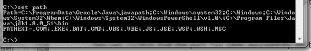

图 1.1. 在命令提示符中运行 `set path` 命令的输出。

你应该能在路径列表中看到你的 `jdk` 路径。如果没有，请关闭 `cmd` 窗口并重新打开。

### 1.4.2 下载并安装 Java Netbeans IDE 开发工具

要下载 Netbeans IDE，请访问链接 [`www.netbeans.org/downloads/index.html`](http://www.netbeans.org/downloads/index.html) 并下载最新版本。下载完成后，将其安装到你的电脑上。使用 Netbeans 集成开发环境处理 `java` 数据库会方便得多，稍后会详细介绍。你现在已经准备好进行书中的练习了，现在可以休息一下，等准备好后一起开始这段旅程。

# 第 2 章

# Java 数据类型与运算符

Java 作为一种面向对象的编程语言，拥有自己的数据类型和运算符，这些有助于创建表达式、类以及类成员变量和方法的访问修饰符。由于 `java` 程序的构建模块是类，而类是感兴趣对象的定义，类离不开基本数据类型，基本数据类型也有它们自己的包装类。因此，我们本章从基本数据类型的描述开始。

## 2.1 基本数据类型

基本数据类型是 `java` 内置的数据类型，编译器无需引用核心应用程序编程接口（API）中的任何包即可识别。它们被分为三个子集：数值型、字符型布尔型。表 2.1 列出了基本数据类型及其描述。

| 基本数据类型 | 大小 | 描述 |
| :--- | :--- | :--- |
| `int` | 32 位 | 整数常量，由一个或多个数字组成。如果前面有负号，它可以可以是正数也可以是负数。它的范围是 -2147483648 到 2147483647 |
| `short` | 16 位 | 短整数，占据整数常量存储大小的一半。它表示的范围是 -32768 到 32767 |
| `long` | 64 位 | 具有扩展精度的长整数常量，占据整数存储大小的两倍 |
| `byte` | 8 位 | 极小的整数常量，精度范围限制在 -128 到 127 之间 |
| `float` | 32 位 | 带有小数点的值，例如 8.0, 1.23 |
| `double` | 64 位 | 浮点类型，可以存储是 `float` 类型两倍的值 |
| `boolean` | | 持有“true”（真）或“false”（假）值的变量类型 |
| `char` | 16 位 | 保存单个字符的变量类型 |

表 2.1 数值型基本数据类型。

## 2.2 基本数据类型的包装类

值得提到，上述描述的基本数据类型在核心 API 的 `java.lang` 包中也有对应的类定义。我们称这些类为包装类。目的是让基本类表现得像对象，并与 Java 编程的基础理念保持一致。表 2.2 列出了基本数据类型及其对应的包装类。

| 数值型基本数据类型 | 对应的包装类 |
| :--- | :--- |
| `int` | `Integer` |
| `byte` | `Byte` |
| `short` | `Short` |
| `long` | `Long` |
| `float` | `Float` |
| `double` | `Double` |
| `boolean` | `Boolean` |
| `char` | `Character` |

表 2.2 数值型基本数据类型。

| 常量变量 | 常量变量名称的每个字母都应该大写，单词之间用下划线分隔 | `LAST_MONTH` |
| :--- | :--- | :--- |
| 类 | 类名的每个首字母都要大写。类名最好是名词。请避免使用 API 类名 | `ScrewDriver` |

表 2.3. 标识符命名规范。

## 2.7 Java 运算符与表达式

运算符是 `java` 表达式的构建块，表达式始终以分号结束。运算符类型包括一元运算符、二元运算符、赋值运算符、关系运算符逻辑运算符。我们将从运算符开始。

### 2.7.1 赋值运算符 (`=`)

赋值运算符是所有编程语言中非常常用的运算符。它用于在 `java` 编程中为变量赋值。其用法语法如下所示：

```
Variable_name = some_value;
```

例如，在 java 编程中，将数值 `7` 赋值给变量 `monthJuly`，可以使用以下程序语句：

```
monthJuly = 7;
```

但必须注意的是，java 编程中有两种赋值操作：值赋值和引用赋值。值赋值在前面已经解释过。引用赋值是指将内存位置的地址赋值给变量而不是真实值。当将对象或字符串赋值给变量名时，就会发生这种情况，如下所示：

```
myName = “Feyisayo Dosunmu”;
```

### 2.7.2 一元运算符

一元运算符作用于单个操作数。它们是递减、递增和否定运算符。递增运算符的符号是双加号 (`++`)，其用法语法如下：

```
++variable_name;
```

递减运算符的符号是双减号 (`--`），其用法语法同样如下：

```
--variable_name;
```

否定运算符的符号是减号 (`-`)，它根据变量的初始符号反转值的符号。相乘规则所示：

a) `- * - = +`

b) `- * + = -`

c) `+ * - = -`

d) `+ * + =+`

根据上述符号相乘规则，在负值上应用否定运算符将得到正值，在正值上应用否定运算符将得到负值。以下程序列表 2.1 展示了一元运算符和赋值运算符的使用。

程序列表 2.1：

```
public class UnaryOperators {
  public static void main(String[] args){
  int monthJuly, monthValue, followingMonth, prevMonth;
  monthJuly = 7;
  monthValue = monthJuly;
  followingMonth = (++monthValue);
  monthValue = monthJuly;
  prevMonth = (--monthValue);
    System.out.println("\n" );
    System.out.println("The Month of June is the " + prevMonth + "th month of the year. \n" );
    System.out.println("The Month of July is the " + monthJuly + "th month of the year. \n" );
    System.out.println("The Month of August is the " + followingMonth + "th month of the year. \n" );
  }
}
```

要运行上面的程序列表 2.1，请按照之前的建议下载 Java 开发工具包，并按照本书第 1.4.1 节列出的步骤设置操作系统路径。你可以在文本编辑器中输入代码，并使用类名存储在计算机的任何选择目录下，但扩展名为 `.java` (`UnaryOperators.java`)。接下来，切换到命令行将代码编译为 java 字节码（在 Windows 中通过选择开始菜单、所有程序、附件、运行，并在打开的文本字段中输入 `cmd` 并点击确定）。在命令行窗口中使用 `cd` 命令切换到程序源码目录 (`cd\program_folder_path`)，然后在提示符处输入以下 java 命令：

```
Program_folder> javac UnaryOperators.java
```

如果程序编译成功，将不会收到任何错误信息；如果有任何错误信息，请检查输入的代码，修正拼写错误并重试。编译完成后，你可以在提示符处输入以下 java 命令运行字节码：

```
Program_folder> Java UnaryOperators
```

如下图 2.1 所示，图中包含了上述程序列表 2.1 的输出：

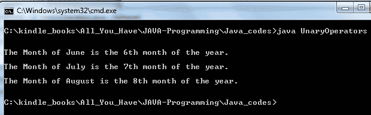

图 2.1. 程序列表 2.1 的输出。

该应用通过将变量 `monthJuly`、`monthValue`、`followingMonth` 和 `prevMonth` 声明为整数开始。接着它将 `monthJuly` 的值拷贝到 `monthValue`，因为递增和递减运算符的效果是真实的，通过此我们可以使用 `monthJuly` 的值重新初始化 `monthValue` 的值。

### 2.7.3 二元算术运算符

二元运算符同时处理两个操作数。它们是下面列举的加、减、乘、除和取模运算符：

#### 算术加法二元运算符 (`+`)

加法二元运算符用加号表示。它将数值或数值变量的内容相加。java 编程中的用法语法如下所示：

```
result = value1 + value2;
```

#### 算术乘法二元运算符 (`*`)

乘法二元运算符在大多数编程语言中用星号表示。它将两个数值或数值变量相乘。用法语法如下：

```
result = value1 * value2;
```

#### 算术减法二元运算符 (`-`)

减法二元运算符作用于两个操作数。它返回左侧数值或内容减去右侧数值或内容的结果。用法语法如下：

```
result = value1 - value2;
```

#### 算术除法二元运算符 (`/`)

除法二元运算符也作用于两个操作数，在大多数语言中用斜杠表示。它返回分子（左侧）除以分母（右侧）的结果。用法语法如下：

```
result = value1 / value2;
```

#### 算术取模二元运算符 (`%`)


取模二元运算符作用于两个数值操作数，包括 `java` 在内的大多数语言中用百分号表示。它返回普通除法的余数。用法语法如下：

```
result = value1 % value2;
```

程序列表 2.2 展示了前面过的过的算术运算符的应用。

程序列表 2.2

```
public class BinaryOperators
{
  public static void main(String[] args){
  float result, leftOperand, rightOperand;
  leftOperand = 68;
  rightOperand = 10;
    System.out.println("\n" );
    result = leftOperand + rightOperand;
    System.out.println( leftOperand + " + " + rightOperand + " = " + result);
    result = leftOperand - rightOperand;
    System.out.println( leftOperand + " - " + rightOperand + " = " + result);
    result = leftOperand * rightOperand;
    System.out.println( leftOperand + " * " + rightOperand + " = " + result);
    result = leftOperand / rightOperand;
    System.out.println( leftOperand + " / " + rightOperand + " = " + result);
    result = leftOperand % rightOperand;
    System.out.println( leftOperand + " % " + rightOperand + " = " + result);
  }
}
```

上述程序列表 2.2 的输出在下方的图 2.2 中：

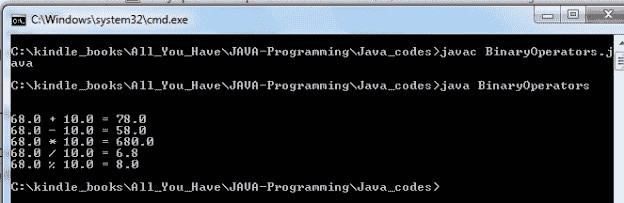

图 2.2. 程序列表 2.2 的输出。

关系运算符在某种程度上类似于二元运算符，因为它们也同时作用于两个操作数，不同在于它们被用于测试受影响的操作数中是否存在某些条件。可用的关系运算符及其解释如表 2.4 所示：

| 关系运算符 | 解释 | 使用语法 |
| :--- | :--- | :--- |
| `==` | 等于 | `a == b` |
| `!=` | 不等于 | `a != b` |
| `<` | 小于 | `a < b` |
| `>` | 大于 | `a > b` |
| `<=` | 小于等于 | `a <= b` |
| `>=` | 大于等于 | `a >= b` |

表 2.4 关系运算符及其解释。

关系运算符通常用于为条件语句创建测试表达式，例如稍后将讨论的 `if` 语句和 `while` 语句。关系运算符的优先级低于算术运算符。例如，

```
sum < value1 * value2
```

编译器将对其求值为：

```
sum < (value1 * value2)
```

## 2.8 Lambda 间接运算符 (->)

新引入的 lambda 间接运算符看起来非常像经典的 C/C++ 编程指针运算符，它执行的操作与赋值运算符 (`=`) 非常相似。例如，以下表达式；

```
y -> y * y
```

它获取左侧变量 `y` 的内容，按照间接运算符右侧的指示与其自身相乘并返回结果。关于此点的更多信息，请参本书的第四章，将在“面向对象编程”标题下讨论接口的概念。

# 第 3 章：Java 类、对象和访问修饰符

Java 作为一种面向对象的编程语言，其基本构建单元是对象。这就是为什么深入理解 Java 类和对象对于理解和掌握 Java 编程至关重要的原因。

对象是类的实例，而类是对一个地方、事物或概念的定义。在面向对象编程的术语中，类通常是一个名词。

## 3.1 类定义

类定义由成员变量和带有可选访问修饰符的成员方法组成。它还可以包括用于类初始化的构造函数。类定义的通用语法如下：

```java
[访问修饰符] class 类名 {
    [访问修饰符] 数据类型 成员变量-1;
    [访问修饰符] 数据类型 成员变量-2;
    [访问修饰符] 类名( ){  //类构造函数
        //类构造函数体
    }
    [访问修饰符] 类方法-1( ){  //类方法
        //类方法体
    }
}
```

类成员变量和方法的访问修饰符的使用是可选的，主方法除外，主方法必须具有 `public` 访问修饰符，以便机器在执行时访问它。然而，任何没有访问修饰符的成员函数或变量将自动分配一个默认访问修饰符。Java 中有七种主要的访问修饰符，尽管随着时间的推移，你将了解到更多修饰符。接下来，我们将讨论并描述这些主要访问修饰符的使用。

## 3.2 访问修饰符

七种主要的访问修饰符如下：`public`、`private`、`protected`、`private protected`、`abstract`、`static` 和 `final`。它们应用于类、类成员变量和方法。例如，为对象 `book` 定义一个类，类定义可以如下所示：

```java
class Book{
    private String bookTitle, bookAuthors;
    private int noOfPages;
    public Book(String booktitle, String bookAuthors, int pages ){
      bookTitle= booktitle;
      bookAuthors= bookAuthors;
      noOfPages= pages;
    }
}
```

在这里，`Book` 类没有访问修饰符，因此编译器为它分配了一个默认修饰符，且默认修饰符没有关键字。这意味着该类仅对同一包或相同目录下的其他类可见。该类有一个公共的构造函数，带有参数 `bookTitles`、`bookAuthors` 和 `pages`，用于在声明书籍对象时初始化带有 `private` 访问修饰符的私有成员变量。

类可以有多个构造函数，只要它们的签名不同即可，这一概念在面向对象编程中被称为**多态性**，因此，还可以为该类编写另一个没有参数列表的公共类构造函数，如下所示：

```java
    public Book( ){
      bookTitle="No title yet";
      bookAuthors= "No author yet";
      noOfPages= 0;
    }
```

默认类的公共成员对同一包中的其他类可见，因此为构造函数提供了 `public` 访问修饰符，以便访问同一包内的所有其他类。构造函数的作用是帮助在声明时初始化类成员变量。你不必为类提供构造函数，如果不提供，编译器将提供一个默认的，但自己编写一个是一个良好的习惯，以便将控制权掌握在手中，因为如果不这样做，在类成员变量不是原始类型的情况下，编译器会将变量设为 `null` 而不是初始化它。

带有 `private` 访问修饰符的私有成员变量 `bookTitle`、`bookAuthors`、`noOfPages` 除了声明类本身（`Book`）之外，任何类无法访问。因此，需要提供公共访问方法 `getBookTitle()` 和 `getBookAuthors()` 来帮助检索这些信息。这些方法可以如下所示编写：

```java
    public String getBookTitle( ){
      return bookTitle;
    }
    public String getBookAuthors( ){
      return bookAuthors;
    }
```

上述 Java 代码定义了返回字符串对象的给调用方法的公共方法。这只是访问修饰符需求和功能的概述。接下来的章节将进一步阐述修饰符。

### 3.2.1 公共修饰符

带有 `public` 访问修饰符的类（公共类）对所有其他类可见。因此，文件中只能有一个公共类，它作为执行应用程序的唯一入口和起点。如前所述，没有访问修饰符的类不是公共类，而是默认类，仅对同一包中的类可见。例如，为书籍对象定义一个公共类，类定义可以如下所示：

```java
public class BookLibrary
{
  public static void main(String[] args){
    Book myBook = new Book("Java Programming", "Feyisayo Dosunmu", 312);
  }
}
```

公共类 `BookLibrary` 使用语句声明了一个类型为 `Book` 的对象 `myBook`：

```
Book myBook = new Book("Java Programming", "Feyisayo Dosunmu", 312);
```

记住 `Book` 类是一个默认类，它可以与 `BookLibrary` 类存储在同一个文件中，现在编译器要在唯一的公共类 `BookLibrary` 中查找 `static main` 方法。

### 3.2.2 私有修饰符

`private` 访问修饰符可以应用于类成员变量和方法。私有成员和方法仅供其类成员访问，同一包内的其他类和子类无法访问。例如，成员变量 `bookTitle`、`bookAuthors` 和 `noOfPages` 被设为 `Book` 类的私有，以确保良好的封装，因此使得同一包的其他类无法访问。完整的程序列表如下方的程序 3.1 所示：

程序 3.1

```java
public class BookLibrary
{
  public static void main(String[] args){
    Book myBook = new Book("Java Programming", "Feyisayo Dosunmu", 312);
    System.out.println("\n" );
  }
}
```

```java
System.out.println("The title of my book is " + myBook.getBookTitle() );
}

class Book{
    private String bookTitle, bookAuthors;
    private int noOfPages;

    public Book(String booktitle, String bookAuthors, int pages ){
        bookTitle= booktitle;
        bookAuthors= bookAuthors;
        noOfPages= pages;
    }

    public Book( ){
        bookTitle="No title yet";
        bookAuthors= "No author yet";
        noOfPages= 0;
    }

    public String getBookTitle( ){
        return bookTitle;
    }

    public String getBookAuthors( ){
        return bookAuthors;
    }
} 
``` 

运行上述程序列表 3.1 的输出如附 3.1 所示：

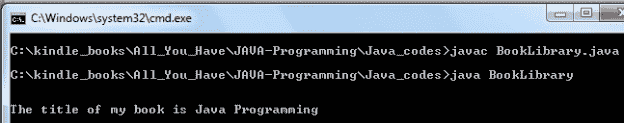

图 3.1 程序列表 3.1 的输出。

### 3.2.3 访问修饰符

`protected` 访问修饰符适用于类成员变量和方法。`protected` 成员仅在其类层次结构内部可访问。也就是说，`protected` 类成员变量或方法可以通过同一包中的子类以及其他包中的子类进行访问。`protected` 访问修饰符应用于设计用于被子类继承或重写的成员方法。

### 3.2.4 私有保护修饰符

`private` `protected` 类成员可以通过继承被其他包中的类访问。虽然 `private` `protected` 类成员可能无法被同一包中的任何其他非子类访问，但可以被同一包中的子类访问。

### 3.2.5 默认访问修饰符

一个没有指定访问修饰符的类会被分配一个默认访问修饰符。请注意，默认修饰符没有表示它的关键字。默认访问修饰符只允许访问同一包中的其他类。

### 3.2.6 抽象修饰符

使用 `abstract` 关键字修饰的类被称为 `abstract` 类，这意味着该类包含一个或多个未实现的方法。未实现的方法没有方法体，因此必须在子类中被重写，这更多内容将在本书后进行讨论。

### 3.2.7 静态修饰符

使用 `static` 访问修饰符修饰的类成员仅属于类本身。它是唯一的，没有实例副本。通常，当从类创建实例对象时，对象将获得该类成员的副本。但如果使用 `static` 修饰符，该类成员变量只有一个副本。

`static` 成员通过类名后接点运算符 `.` 来访问，并且可以在创建类对象之前进行访问。因此，`static` 成员变量必须初始化（因为它们必须有值），且 `static` 方法必须被定义。成员方法和变量可以声明为 `static`。更重要的是，`static` 关键字不能在类方法中使用。

### 3.2.8 最终修饰符

`final` 修饰符可以用于类、方法或成员变量，具有不同的含义，下文所示：

#### a) 最终类

当 `final` 关键字作为类修饰符使用时，使该类变得不可继承。其用法语法如下：

```java
final Book{
    // 类体
}
```

#### b) 最终方法

使用 `final` 关键字修饰的方法不能通过继承或子类重写。其用法语法如下：

```java
class book {
    final borrowBook( ){
        // 方法体
    }
}
```

它的作用类似于 `private` 访问修饰符。

#### c) 最终变量

使用 `final` 关键字修饰的变量变为常量，其值在初始化后无法更改或更新。其用法语法如下：

```java
final String bookTitle;
```

## 3.3 类对象

对象是类的实例，具有以下特征：标识性、状态、类型和行为。这些特征在下文中将进一步解释：

### 3.3.1 对象的类型

“对象（object）”是任何可以命名的事物的通用术语。因此，对象必须属于某个类别，该类别可以是一个概念（想法、知识或方法）、地点、一个物品、动物或人类。因此，我们说对象具有类型。由于对象总是属于某个类别，例如下面的 Java 代码在动物类别中创建了一个类型为 `birds` 的对象：

```java
Bird sparrow = new Bird( );
```

左侧的 `Bird` 将 `sparrow` 声明为 `Bird` 类型，右侧的 `new` 关键字为 `Bird` 类定义的 `Bird` 类型分配了所需的内存空间，并将内存地址分配给 `sparrow` 对象。要使用上述语句，你必须在程序的其他地方先创建了 `Bird` 类，该类的形式如下所示：

```java
class Bird{
    private int flightStatus;
    public Bird( ){
        flightStatus= 0;
    }
    void setFlightStatus(int flightHieght ){
        flightStatus = flightHieght;
    }
    int tellHeight( ){
        return flightStatus;
    }
}
```

### 3.3.2 对象的状态

对象具有属性，可以是颜色、重量、位置或大小。对象的状态是一个可以测量的属性，该属性的值决定了对象在任何时刻的状态。例如，可以使用 `flightStatus` 来判断它是处于飞行状态（当 `flightStatus` 大于 0 时）还是栖息状态（当 `flightStatus` 为 0 时）。

### 3.3.3 对象的标识性

对象保持一个唯一的标识，并与相似的对象不同。例如，只要之前的对象仍在在使用，在同一个代码块中无法创建另一个对象，但可以创建相似类型的对象。因此，以下语句是合法的：

```java
Bird sparrow2 = new Bird( );
eagle = new Bird( );
```

### 3.3.4 对象的行为

由于鸟和飞机等对象可以飞行，机器人和摄像头可以移动，而鱼和潜艇可以游泳，因此行为与其类型紧密相关。这些方法通常以动词（动作词）命名。例如，该类的 `setFlightStatus()` 方法是该类别中所有对象的通用行为，因为鸟可能会决定飞向高空，或栖息在海平面某处。下面的程序列表 3.1 让这一概念生动起来。


```java
import javax.swing.JOptionPane;

public class BirdObject{
    public static void main(String[] args){
        Bird eagle = new Bird( );
        /* 使用导入的 JOptionPane 类的方法读取高度值 */
        String m = JOptionPane.showInputDialog("Enter a height in figure ");
        /* 使用 setFlightStatus 方法设置鹰的飞行行为 */
        eagle.setFlightStatus(Integer.parseInt(m));
        System.out.println("\n" );
        if(eagle.tellHeight() > 0 )
            System.out.println("Eagle is in flight mode. );
        else
            System.out.println("Eagle has perched. " );
    }
}
```

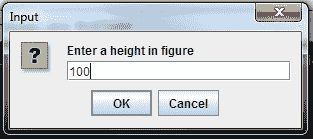

图 3.1 程序列表 3.1 JOption 输入面板。

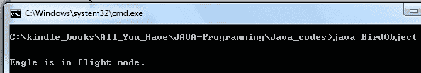

图 3.2. 程序列表 3.1 的输出。

程序列表 3.1 通过导入 `JOptionPane` 类开始，以便能够使用 `JOptionPane` 输入方法 `showInputDialog()`，这将使我们在程序后部分能够输入一个表示鸟类海拔高度的数字。此操作有助于我们更改对象（`eagle`）的飞行状态。`import` 关键字帮助我们导入可能需要的称为应用程序编程接口（`API`）的工具类和包，而且这类有很多。我们可用的有 `input`、`maths`、`string` 等，如需查看 `core API` 类的完整文档，请访问以下链接：[`docs.oracle.com/javase/8/docs/api/index.html`](http://docs.oracle.com/javase/8/docs/api/index.html)

接下来定义了一个 `public class BirdObject`，这是主类，并且一个 java 文件中只能有一个这样的类。

`public class` 是解释器将引用的内容，执行的起点始终是 `public class` 的 `static main` 函数。因此，每个 java 应用程序都必须有一个 `static main` 函数，其签名如下所示：

```java
public static void main(String[ ] args){ }
```

`args` 字符串数组由命令行提示符提供的参数集（如果有的话）进行填充。创建一个对象 `eagle` 并调用一个输入对话框对象来获取高度信息，并此设置 `eagle` 的状态。之后，我们就可以通过其行为方法 `tellFlightStatus()` 确定老鹰的飞行状态。要运行此应用程序，您需要将程序列表 3.1 复制到文本编辑器中保存为 `BirdObject.java`。如果您还没有下载并安装 Java 开发工具包（JDK），请参本书的第 1.4.1 节以获取如何下载、安装和设置 `JDK` 路径的完整指南。

## 3.4 使用 JDK 编译和运行应用程序

`java` 命令行工具用于在命令行提示符中编译和运行您的 java 源代码。要将程序列表 3.1 编译并运行成可任何 java 虚拟机执行的字节码，只需进入计算机的命令行提示符，使用 `cd`（更改目录）命令切换到保存程序文件的文件夹，并输入 `javac` 命令，后接应用程序的文件名如下文所示：

```bash
C:\users\computer name> cd\my_java_folder
C:\my_java_folder>javac BirdOBject.java
```

这假设您的程序列表存储在 C 盘的 `my_java_folder` 文件夹中。在输入 `javac` 命令后，如果编译成功，将不会显示任何内容，`BirdObject` 类的字节码将作为 `BirdObject.class` 创建在目录中，现在可以使用任何安装了 java 虚拟机的机器执行它。

## 3.5 运行 Java 类文件（字节码）

可以使用 `java` 命令在任何 java 虚拟机上执行 java 类文件，使用 java 类名并省略 `.java` 后缀，如下所示：

```bash
C:\my_java_folder>java BirdObjects
```

执行的预期输出如图 3.2 所示。请注意，输出中使用的目录路径与解释中使用的路径不同。这是为了让您知道，只要在切换到源代码目录后应用 `javac` 和 `java` 命令，您可以自由地将源代码保存在选择的任何目录中，一切正常。

## 3.6 在运行时返回类参数名

编程语言中有两种参数传递技术：位置参数传递——根据参数在参数列表中的位置来接收参数；以及命名参数传递——将键值对传递给接收的方法或函数。

Java 使用位置参数传递技术，当与其它命名编程语言进行交互时，这通常会成为一个挑战，因为在早期的 java 版本（包括 java 7）中没有检索类参数名的标准方法。这在 java 8 中得到了处理，通过在核心反射包中添加 `Parameter` 类，使得通过类构造器方法更容易地返回类参数名。因此，要使用参数类，您需要使用以下语句导入该类：

```java
import java.lang.reflect.Parameter;
```

您还可以通过以下导入语句导入 `Method` 类的父类 `Executable`，以便获取参数对象数组：

```java
import java.lang.reflect.Executable;
```

有了这些添加，现在可以在 java 8 中访问类参数名了。实现方式如下所示程序列表 3.2 所示。请享受。

程序列表 3.2：

```java
import java.lang.reflect.Parameter;
import java.lang.reflect.Executable;

public class Courier {
  public static void main(String[] args){
    Letter myLetter = new Letter("London", "United State", "intransit" );
    myLetter.TellParameterNames( );
  }
}

class Letter{
  private String deliveryAddr, senderAddr, status;
  public Letter( ){
    deliveryAddr= " ";
    senderAddr= " ";
    status= " ";   
  }
  public Letter(String addr, String sender, String stat ){
    deliveryAddr= addr;
    senderAddr= sender;
    status= stat;
  }
  void TellParameterNames( ){
    Parameter[] letterParameters;
    try{
      letterParameters = Letter.class.getConstructor(String.class, String.class, String.class).getParameters();
      for(Parameter paraName : letterParameters){
        if(paraName.isName()){
          System.out.println("parameters" +paraName.getName());
        }
      }
    } catch(NoSuchMethodException | SecurityException e ){
      System.out.println ("Exception");
    }
  }
}
```

程序列表 3.2 的输出如下所示：

```
Parameters deliveryAddr
Parameters senderAddr
Parameters status
```

为了获得此输出，您需要在命令行提示符中使用 `–parameters` 选项编译程序：

```bash
C:\java_codes> javac –parameters Courier.java
```

话此此。我们来到了另一个有趣的章节。接下来的章节将更有趣，因为它将更多地讨论对象行为的概念，即面向对象编程。在那里见。感谢关注。

# 第 4 章

# 面向对象编程与默认接口方法

面向对象编程概念增强了代码的可用性、可读性和程序的可维护性。面向对象的程序员编写的代码更少，需要记忆的方法也少。面向对象编程的核心概念是对象继承、抽象类、接口和方法重载共同工作，使得多态成为可能。多态方法和函数可以接受父类的任何参数类型并按预期执行。我们从继承概念开始开启面向对象世界的之旅。

## 4.1 类继承

子类可以通过 `extends` 关键字从 java 中的父类继承成员函数（方法）和变量（属性）。继承的语法如下所示：

```java
class SubclassClassName extends ParentClassName {
  // Sub 类体
}
```

例如，子类 `SmartPhone` 可以继承父类 `MobilePhone`，其中 `MobilePhone` 类定义如下：

```java
class MobilePhone{
  String textMessage, model;
  public MobilePhone(String phoneModel ){
    textMessage= " ";
    model= phoneModel;
  }
  public MobilePhone( ){
    textMessage= " ";
    model= "Nokia 310";
  }
  public String getModel( ){
    return model;
  }
  public String getTextMessage( ){
}
```

```java
      return textMessage;

    }

    void receiveACall( ){
      System.out.println("Receiving a call." );
    }

    void makeACall( ){
      System.out.println("Making a call." );
    }

    void receiveTextMessage( ){
      System.out.println("Receiving a text message." );
    }

    void playAGame( ){
      System.out.println("Playing a 2D game." );
    }
  }
```

子类 `SmartPhone` 通过以下 Java 代码继承了 `MobilePhone` 类（父类）的属性和方法：

```java
class SmartPhone extends MobilePhone {

  String textMessage;
  String model;
  public SmartPhone( ){
    super("Nokia Old");
    textMessage= " ";
    model= " ";
    }

  public SmartPhone(String nmodel ){
    this( ); //调用 SmartPhone( ) 构造函数
    model= nmodel;
  }

  @Override public String getModel( ){
    return model;
  }

  public String getOldModel( ){
    return super.model;
  }

  @Override public String getTextMessage( ){
    return textMessage;
  }

  @Override void playAGame( ){
    System.out.println("Play a 2D or 3D game." );
  }

  void browse( ){
    System.out.println("Browsing the net." );
  }

  void snapAPicture( ){
    System.out.println("Taking a picture." );
  }

  void scan_system( ){
    System.out.println("Scanning phone for possible damage." );
  }
}
```

现在，`SmartPhone` 类除了自身定义的方法外，还继承了其父类 `MobilePhone` 的方法。智能手机对象将继承手机对象的所有属性，程序员不需要重新编写用于接收电话的 `receiveACall()`、用于打电话的 `makeACall()`、以及接收和发送短信的 `receiveTextMessage()` 和 `sendTextMessage()`，这些都是手机的基本功能。

可以使用以下 Java 语句在任何智能手机上执行这些基础功能：

```java
SmartPhone nokia = new SmartPhone( );
nokia.makeACall();
```

程序语句 `nokia.makeACall();` 使用了父类 `MobilePhone` 中定义的基方法 `makeACall()`。这是由于这两个类之间的继承关系所实现的。子类也可以通过定义具有相同名的变量和方法来重写父类中的变量和方法。这被称为变量或方法重写。

## 4.2 变量和方法重写

可以通过在子类中定义一个名称相似的成员变量来重写变量。在需要在子类中处理相似属性的情况下，这样做是必要的，因为类方法只能处理其所属类的成员变量或属性。

同样，可以通过在子类中定义一个名称相似的方法，并遵循以下函数重写（覆盖）规则来重写基类方法：

a) 子类必须继承自一个具有同名方法的父类

b) 重写的方法签名与父类中要重写的方法签名相似

例如，父类 `MobilePhone` 的 `playAGame()` 方法在子类 `SmartPhone` 中通过定义具有相同签名的方法进行了重写，如下所示：

```java
  @Override void playAGame( ){
    System.out.println("Play a 2D or 3D game." );
  }
```

区别在于，`SmartPhone` 类的 `playAGame()` 方法在功能上优于 `MobilePhone` 类，由于其卓越的用户界面和显示屏幕，它可以允许用户玩 2D 或 3D 。你会注意到方法修饰符 `@override`。`@override` 修饰符不是强制性的，但它有助于程序的可读性和编译器检查，因为你可以轻松看到父类中哪些方法被重写了，而且如果你错误地认为自己重写了某个方法但实际上并没有，编译器会快速提醒你。

`@override` 修饰符不是强制性的，但有助于程序的可读性和编译器检查，因为你可以轻松看到父类中哪些方法被重写了，而且如果你错误地认为自己重写了某个方法但实际上并没有，编译器会快速提醒你。

## 4.3 构造函数

构造函数具有在声明时初始化成员变量的功能。它的定义方式与类相似，但它没有返回类型。该函数必须在声明时执行。

你会注意到 `MobilePhone` 类中有两个构造函数，编译器只会执行无参数的那个，即默认构造函数。

## 4.4 super 和 this 关键字

`super` 关键字用于引用父类并执行父类函数。例如，你可以使用以下语句执行带有参数的 `MobilePhone` 类第二个构造函数：

```java

public SmartPhonePhone

    super("Nokiaokia");
    textMessage= " ";
    model= " ";
    }
```

你现在可以使用 `super` 来访问 `SmartPhone` 类中的父类方法，如下：

```java
  public String get getModel(
        return super..

  }
```

`this` 用于类对象，如下：

```java
     SmartPhone(
    super("Blackberry Old");
    textMessage= " ";
    model= " ";
  }
```

参数构造函数 `SmartPhone(String nmodel)` 中的语句 `this();` 指向当前类的无参数构造函数 `SmartPhone()`。因此，该构造函数会在参数构造函数的体之前执行。请注意，如果你打算使用 `this` 和 `super` 关键字来执行构造函数，它们必须是你在构造函数中写的第一个语句，以确保默认和基构造函数在任何其他构造函数之前执行。


```java
System.out.println("My phone model is " + myPhone.getModel( )+ "\n" );

System.out.println("The old model is " + myPhone.getOldModel( ) );

}

}

class MobilePhone{

  String textMessage, model;

  public MobilePhone(String phoneModel ){

    textMessage= " ";
    model= phoneModel;
  }

  public MobilePhone( ){
    textMessage= " ";
    model= "Nokia 310";
  }

  public String getModel( ){
    return model;
  }

  public String getTextMessage( ){
    return textMessage;
  }

  void receiveACall( ){
    System.out.println("Receiving a call." );
  }

  void makeACall( ){
    System.out.println("Making a call." );
  }

  void receiveTextMessage( ){
    System.out.println("Receiving a text message." );
  }

  void playAGame( ){
    System.out.println("Playing a 2D game." );
  }
}   

class SmartPhone extends MobilePhone {

  String textMessage;
  String model;

  public SmartPhone( ){
    super("Nokia Old");
    textMessage= " ";
    model= " ";
  }

  public SmartPhone(String nmodel ){
    this( ); //调用 SmartPhone( ) 构造函数
    model= nmodel;
  }

  @Override public String getModel( ){
    return model;
  }

  public String getOldModel( ){
    return super.model;
  }

  @Override public String getTextMessage( ){
    return textMessage;
  }

  @Override void playAGame( ){
    System.out.println("Play a 2D or 3D game." );
  }

  void browse( ){
    System.out.println("Browsing the net." );
  }

  void snapAPicture( ){
    System.out.println("Taking a picture." );
  }

  void scan_system( ){
    System.out.println("Scanning phone for possible damage." );
  }
}
```

程序列表 4.1 执行后的输出如图 4.1 所示：

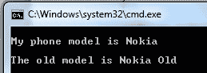

图 4.1 程序列表 4.1 的输出。

你可以自由地对程序列表进行实验，这就是提供完整列表的原因。

## 4.5 函数重载

当编写了另一个名称相似但签名（signature）不同的函数时，该函数就被重载了，一个很好的例子是 `SmartPhone` 的构造函数。这两个构造函数的名称相似，但参数列表不同。第一个完全不接受任何参数，而第二个接受一个字符串参数（`nmodel`），编译器根据不同的签名知道应该调用哪一个构造函数。

## 4.6 抽象类

抽象类是至少包含一个未实现方法（抽象方法）并带有 `abstract` 修饰符的类。抽象方法是一种没有实现但具有签名（方法名及其可选参数列表）的方法。下方的用法语法所示：

`public abstract method_name(optional parameter_list);`

由于抽象类至少有一个抽象方法，因此无法创建此类类的实例。此类类仅适用于继承目的，子类必须继承并为所继承的抽象方法提供所需的实现，否则子类也将成为一个抽象类。抽象类的语法描述如下：

```java
abstract class class_name{
  public abstract method_name(optional parameter_list);
}
```

抽象方法被隐式声明为 `public`。

类不继承接口，而是实现一个或多个接口。一个类一次只能继承一个类，这使得接口在应用中更具活性和多态性。根据标准，接口使用形容词形式命名，并使用 `interface` 关键字创建。如果接口存在成员变量，则被声明为 `public` 和 `static`，其成员方法默认声明为 `public` 和 `abstract`。总而言之，接口只能有常量、抽象方法和默认方法作为其成员变量和方法。创建的语法如下所示：

```java
interface interface_name{

Static variables ;

abstract method declarations;

default method declaration;

}
```

程序列表 4.3 演示了默认接口方法 `myMessage()` 的声明，并提供了该默认方法的默认实现，请享用。

程序列表 4.3：

```java
public class FunctionalInterface
{

    public static void main(String[] args){

      Confidential toMum = new Confidential( );
      MyMessage toCarthy = new MyMessage( );
      System.out.println("\n My message to mum: " + toMum.myMessage( ));
      System.out.println("\n My message to Carthy: " + toCarthy.myMessage( ));

  }
}

//The Message interface
interface Messaging{

  default String myMessage( ){

    return "Sorry, I am out of the office at the moment.";

  }
}

class MyMessage implements Messaging {

  //Fails to implement myMessage( ) interface  method.

  }
class Confidential implements Messaging {

    public String myMessage(){

    return "See you soon mum. Love you.";

  }
}
```

接口使用 `interface` 关键字定义。如果一个接口有一个默认方法，而实现类没有实现该默认方法，那么在实现类中调用该方法时，将执行该默认方法，如图 4.3 所示，下方程序列表 4.3 的程序输出：

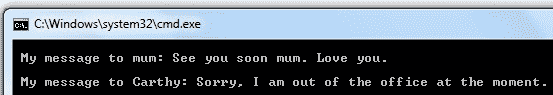

图 4.3 上述程序列表 4.3 的输出。

对 `Confidential` 类对象 `toMum` 的调用（该类实现了接口 `Messaging` 中的默认方法 `myMessage`）给妈妈提供了一个自定义消息。而对 `MyMessage` 类对象 `toCarthy` 的类似调用（该类也实现了相同的接口，但与 `Confidential` 未实现其默认方法 `myMessage`）则产生了默认的离开消息。更高级的接口实现将在后续第 4.8 节讨论。

## 4.8 接口实现

现在，为了给程序列表 4.1 中 `AutomaticVehicle` 和 `ManualVehicle` 类中的通用方法名 `applyGear()` 定义一个接口，我们编写了以下 Java 代码：

```java
interface AutoManual{

  public void operateGear(MotorVehicle motor);

}
```

注意 `AutoManual` 接口中 `operateGear()` 抽象方法声明的参数类型是抽象类 `MotorVehicle`，`AutomaticVehicle` 和 `ManualVehicle` 类都继承自该类。因此，任何实现 `AutoManual` 接口的类必须实现 `operateGear()` 抽象方法（因为该方法不是默认方法），并且可以操作任何自动或手动汽车对象。实现类所示：

```java
class AutoManualOperator implements AutoManual{

    public void operateGear(MotorVehicle m){

        m.applyGear();

    }
}
```

这是非常有多态性的，这正是接口的作用。我在程序列表 4.3 中通过改进程序列表 4.2 中的公类 `CarMart` 这一点，使其拥有一个新的公类 `CarMartInterface`，如下所示：

程序列表 4.3：

```java
/* 导入 JOptionPane 类以创建视觉输入面板。 */
import javax.swing.JOptionPane;

public class CarMartInterface
{
  public static void main(String[] args){
  AutomaticVehicle myAutomaticCar = new AutomaticVehicle( );
   ManualVehicle myManualCar = new ManualVehicle( );
 AutoManualOperator operator = new AutoManualOperator( );

    /* 使用导入的 JOptionPlane 类的方法读取所需的车辆类型 */
    String m = JOptionPane.showInputDialog("Enter (1) for a Manual vehcice (2) for an automatic one ");

    if(Integer.parseInt(m) == 1 )
        //myManualCar.applyGear( )
operator.operateGear(myManualCar);

    else
      //myAutomaticCar.applyGear( );      
operator.operateGear(myAutomaticCar);

  }
  }
abstract class MotorVehicle{
  public abstract void applyGear( );
}
class ManualVehicle extends MotorVehicle{
  String gearType;
  public ManualVehicle( ){
  gearType = "A manual gearing system.";
  }

  @Override public void applyGear( ){
    System.out.println("\n Manually change the gear by applying the clutch." );
  }
  String displayGearType( ){
  return gearType;
  }
}
class AutomaticVehicle extends MotorVehicle{
  String gearType;
  public AutomaticVehicle( ){
  gearType = "An automatic gearing system.";
  }

  @Override public void applyGear( ){
    System.out.println("\n Change the gear by gently pushing or pulling the lever." );
  }

  String displayGearType( ){
  return gearType;
  }
}
```

括号是可选的，大括号也是可选的。如果你在右侧有多个语句，你可以像上面描述的那样将语句封装在大括号中；如果你在左侧有多个参数，也可以将它们封装在括号中。类型声明也是可选的；编译器可以从提供的参数中进行推断。此外，不需要 `return` 关键字。以下是有效的 lambda 表达式示例：

```
(a)->a *a;
```

接收一个参数 `a`，将其与自身相乘并返回结果。

```
a -> a + a;
```

接收一个参数 `a`，将它们相加并返回结果。

```
(int a, int b) -> a – b;
```

在间接引用左侧接收参数 `a` 和 `b`，从参数 `a` 中减去参数 `b` 的值并返回结果。

```
(String t) -> System.out.println(t);
```

该 lambda 表达式将字符串 `t` 的内容打印到控制台。

### 4.9.2 在函数接口中使用 Lambda 

下面的程序列表演示了如何通过使用函数接口进行数学计算来使用 lambda 表达式：

```java
interface multiplier{
  float processMyNumber(float r);
}
```

上文 4.8.1 节已定义。

程序列表 4.4：

```java
public class LambdaOperator
{
  public static void main(String[] args){
    Result res = new Result( );
    float n=8;
    multiplier square = (a) -> a * a;
    multiplier doubler = a -> a + a;
    System.out.printf("\nResult of squaring %f is %f ", n, res.numberNSquare(n,square));
    System.out.printf("\nResult of doubling %f is %f ", n, res.numberNSquare(n,doubler));
  }
}

interface multiplier{
  float processMyNumber(float r);
}

class Result {
  float hold;
  void result(){
    hold =0;
  }
  float numberNSquare(float n, multiplier squaredNo){
    return (squaredNo.processMyNumber(n));
  }
}
```

上述程序列表 4.4 的输出如图 4.4 所示：

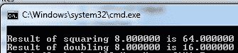

图 4.4 程序列表 4.4 的输出。

`square` 和 `doubler` lambda 表达式隐式地实现了 `Multiplier` 接口的唯一抽象方法 `processMyNumber`。`Multiplier` 接口被声明为 `Result` 类方法 `numberNSquare(int, Multiplier )` 的第二个参数，通过这种方式，`numberNSquare` 方法可以接受接口的任何对象类型。因此，我们可以根据需要将 lambda 表达式传递到 `numberNSquare` 方法中。这极大地简化了代码并更具多态性。

在本章结束之前，最后一点说明：接口可以扩展另一个接口。尝试一下吧，我们下章见，讨论程序循环和数组。感谢大家的关注。

# 第 5 章

# 程序控制循环和 ForEach 循环

程序循环是重复执行特定次数语句块的程序语句。我们有三种基本的控制循环语句：`for` 循环语句、`while` 循环语句和 `do` 语句。我们将在本章逐一查看它们。

## 5.1 For 循环语句

`for 循环语句` 在开启和关闭的大括号内按指定的次数执行一组程序语句或单个程序语句。`for 循环`语句的通用语法如下所示：

```java
for( loop_variable; loop_conditional_expr ; loop_incremental_stmt ){
   loop statements
}
```

循环变量为增量语句变量设置了初始值。`for 循环语句`的执行从循环变量初始化开始。可以有多个循环变量，只要它们用逗号隔开都没有问题。在循环变量初始化后，会评估循环条件表达式，如果它的求值为真值，则执行循环语句，并执行增量语句进行下一次迭代。如果条件表达式的求值不是真值，则退出循环。为了说明，程序列表 5.1 使用 `for` 循环语句在控制台上打印出从 1 到 10 的一组数字。

程序列表 5.1：

```java
public class ForLoop
{
  public static void main(String[] args){
    for(int i=1; i < 11 ; ++i)
      System.out.println(i);
  }
}
```

程序列表 5.1 的输出如图 5.1 所示：

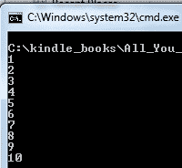


图 5.1 程序列表 5.1 的输出。

程序列表 5.1 中的 `for` 循环语句从循环变量语句中的变量 `i` 初始化为 1 开始（`i = 1`）。然后它评估循环条件语句（`i<10`）以测试变量 `i` 是否仍然小于 10，如果是，则执行 `for` 循环体。如果你在 `for` 循环块中只有一行语句，可以省略循环语句的开启和关闭括号。

## 5.2 嵌套 for 循环

嵌套 `for` 循环表示发生特定次数的迭代事件。它是另一个 `for loop` 内部的 `for loop`。`for loop` 的语法如下：

```java
for(loop_var1; cond1; inc1) {
   for(loop_var2; cond2; inc2)
```

为了说明，程序列表 5.2 使用嵌套循环生成了从 1 到 4 的乘法表。

程序列表 5.2：

```java
public class NestedFor
{
  public static void main(String[] args){
    for(int i=1; i < 5 ; ++i){
      System.out.println("\n" + i + " Series Table");
      for(int j=1; j < 4 ; ++j)
        System.out.println( i + " * " + j + " = " + (i*j) );
    }
  }
}
```

程序列表 5.2 的输出如图 5.2 所示：

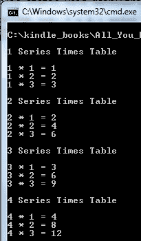

图 5.2 程序列表 5.2 的输出。

请注意，你不能在内层循环中重用外层循环使用的变量名。这是因为这里适用作用域规则。

## 5.3 增强型 For 循环

增强型 `for` 循环通常用于数组，其通用语法如下：

```java
for( data_type element: array_name )
```

稍将在数组部分介绍增强型 `for` 循环。

## 5.4 Lambda 循环

`lambda foreach` 随着 `stream` 类引入 `java.util.Collections` 包被引入到 Java 8 SE。`stream` 类自带了一些工具方法，如 `min`、`max`、`filter`、`findFirst` 等。现在，`stream` 可以与 `lambda foreach` 循环结合使用，将增强型 `for` 循环简化为以下语句：

```
collection_name.stream().forEach((object) -> {
  statement;
})
```

`ArrayList` 等集合现在可以使用 `stream` 方法配合 `forEach` 语句来处理它们的集合。数组是相同类型对象的集合（例如从 1 到 10 的一组整数），而 `arraylist` 是相同类型对象的集合。我们将在本章的 5.7 节和本书第七章的 7.8b 节讨论这一点。下面的程序列表 5.3 演示了通过将数组转换为 `arraylist`，然后使用 `forEach` 功能 `lambda` 表达式列出数组的内容。

```java
import java.util.Arrays;
import java.util.ArrayList;

public class FilterLoop
{
  public static void main(String[] args){
    // 声明并初始化一个包含奇数的 arraylist 计数器
    ArrayList<Integer> counter = new ArrayList<Integer>(Arrays.asList(1,3,5,7,9));
    System.out.println("\n A list of Odd numbers: ");
    // 使用 forEach 内联语句打印出奇数列表
    counter.stream().forEach((num) -> System.out.println(num));
  }
}
```

输出如下方的 5.3 图所示：

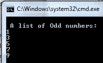

图 5.3 程序列表 5.3 的输出。

不要过于担心数组和 `arraylist`，它们将在本书的第 7 章中进行详细讨论，目前只需按照呈现的形式理解即可。

## 5.5 While 语句

`while` 循环用于我们需要根据条件表达式的求值结果来执行程序语句或语句块的情况。`while` 语句的语法如下所示：

```java
While (conditional expression){
    Program statement;
    Loop expression;
}
```

例如，为了生成一个在 0 到 10 之间的奇数列表，我们需要一个 `while` 循环，因为在开始计数之前，我们可能不知道有多少个奇数。因此，我们做的只是为程序设置一个限制，让程序为我们列出奇数，无论是在 0 到 10 的范围还是 0 到 1000 的范围。程序列表 5.4 生成了 0 到 10 范围内的奇数列表：

程序列表 5.4：

```java
public class WhileLoop
{
  public static void main(String[] args){
    int counter = 10;
    System.out.println("\n A list of Odd numbers: ");
    while (counter > 0 ){
      if( (counter % 2 ) != 0 )
          System.out.println(counter);
      --counter;
        }
  }
}
```

`while` 循环迭代地执行“`if` 程序块”，递减变量 `counter` 中的值，直到 `counter` 变为 0 时 `while` 循环终止。`if` 语句的条件表达式通过使用模运算符（`%`）除 `counter` 来测试变量 `counter` 的值是否为奇数，该运算符返回除法的余数。如果 `if` 条件表达式返回大于 0 的值，则所涉及的操作数为奇数，并且该值被打印到输出中。程序列表 5.4 执行的输出如下方的 5.4 图所示：

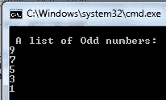

图 5.4 程序列表 5.4 的输出。

## 5.6 Do 语句

`do` 语句是 `while` 语句的一种变体。它用于我们希望程序语句或语句块至少执行一次的情况。`do` 语句的语法描述如下：

```java
do{
program statement;
}
While(conditional _expression);
```

`do` 循环语句块在条件表达式被求值之前执行。

## 5.7 流“filter” 方法

Java 8 SE 中新引入的流的 `filter` 方法可以与 `forEach` 表达式结合使用，在处理集合时替换 `while` 循环，为了简单起见，如下方的程序列表 5.5 所示：

程序列表 5.5：

```java
import java.util.Arrays;
import java.util.ArrayList;
public class FilterLoop
{
  public static void main(String[] args){
ArrayList<Integer> counter = new ArrayList<Integer>(Arrays.asList(0,1,2,3,4,5,6,7,9));
System.out.println("\n A list of Odd numbers: ");
  counter.stream().filter((num) -> ((num % 2 ) != 0 )).forEach((num) -> System.out.println(num));
  }
}
```

程序列表 5.5 的输出如下方的 5.5 图所示：

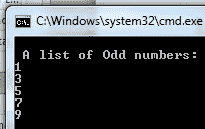

图 5.5 上述程序列表 5.5 的输出。

在此，我们结束另一个章节，开始另一个关于决策语句的章节。感谢你的陪伴，希望你拥有一段美好的编程体验。

# 第 6 章

# 程序决策语句

计算机被认为是智能的是因为它们具有内在做出智能决策的能力。这种能力源于计算机程序中的决策语句。决策语句帮助计算机程序根据执行期间评估的条件表达式中的某些标准做出智能决策。

决策语句基本上有三种类型：`if` 语句、`if.. else` 语句和 `switch case`。在本章中，我们将逐一研究每一种，从最简单的 `if` 语句开始。

## 6.1 if 语句

`if` 语句仅在其条件表达式求值为布尔值 `true` 时才执行其语句块，如果返回布尔值 `false`，则将控制流转移到“`if` 块”后的程序语句。`if` 语句的一般语法描述如下：

```java
if (conditional_expression){
  Program statement;
}
```

下面是程序列表 5.3 的片段，其中使用 `if` 语句测试数值计数器值是否为奇数。

```java
if ((counter % 2) != 0)
    System.out.println(counter);
```

## 6.2 if else 语句

`if else` 语句是一种复合 `if` 语句。除了有 `if` 程序块外，它还有一个 `else` 程序块，当条件表达式的结果为 `false` 时会处理该 `else` 块。`if else` 的语法为：

```java
if (conditional_expression){
  program statement;
}
else{
  program statement;
}
```

为了说明 `if else` 语句，程序列表 6.1 测试一个是否为整数：

```java
import javax.swing.JOptionPane;
import java.util.Scanner;
public class IfElse
{
  static Scanner inc = new Scanner(System.in);
  public static void main(String[] args){
    System.out.print("\n Please enter a value-> ");
    if( inc.hasNextInt() )
      System.out.println("You entered an integer");
    else
      System.out.println("\nYou entered a non integer");
  }
}
```

## 6.3 三元运算符

三元运算符是 `if` 语句的另一种形式，可以紧凑地执行 `if else` 结构的相同决策功能。表示三元运算符的符号是问号（`?`）和冒号（`:`）。用法如下：

```java
conditional_expression ? expression-1 : expression-2;
```

如果条件表达式返回布尔值 `true`，则执行 `expression-1`，否则执行并返回 `expression-2`。程序列表 6.2 展示了三元运算符的使用。

```java
public class TernaryOperator
{
  public static void main(String[] args){
    int num=-9;
    System.out.println( num < 0 ? 0 : 1 );
  }
}
```

三元语句测试其条件表达式以确定变量 `num` 的值是否小于零，如果是则返回 0，否则返回值 1。

## 6.4 else if 语句

`else if` 语句是另一种复合 `if` 语句，可以测试多个备选条件表达式的返回的布尔结果，并根据返回结果执行相应的 `if` 块。`else if` 语句的用法描述如下：

```java
if(conditional_expression1){
  program statement;
}
else if (conditional_expression2){
  program statement;
}
```

```java
else if (conditional_expression3){
    program statement;
}
else{
    Program statement;
}
```

`else if` 语句可以处理多个条件表达式选项。程序列表 6.3 演示了一个可以判断输入数据类型的程序。

程序列表 6.3：

```java
import javax.swing.JOptionPane;
import java.util.Scanner;

public class ElseIf
{
  static Scanner inc = new Scanner(System.in);
  public static void main(String[] args){
    System.out.print("\n Please enter a value-> ");
      if( inc.hasNextInt( ) )
          System.out.println("You entered an integer. ");
      else if ( inc.hasNextFloat( ) )
          System.out.println("\n You entered a floating point number.");
      else if ( inc.hasNextDouble( ) )
          System.out.println("\n You entered a double data type.");
      else if ( inc.hasNextBoolean( ) )
          System.out.println("\n You entered a booleann value.");
      else if ( inc.hasNextByte( ) )
          System.out.println("\n Your entered data is in bytes.");
      else if ( inc.hasNextShort( ) )
          System.out.println("\n You entered a short integer value.");
      else if ( inc.hasNextLong( ) )
          System.out.println("\n You entered a long integer value.");
      else
          System.out.println("\n You entered other type of data.");
  }
}
```

程序列表 6.3 利用 `Scanner` 类的方法在它的条件表达式中比较输入类型，以确定数据输入类型，并将该类型打印到标准输出。

`else-if` 语句中的条件表达式与 `if-else` 语句非常相似，必须返回 `Boolean` 类型的真或假值才合法。值 0 和 1 不能代替布尔值 `false` 和 `true`，这意味着条件表达式不能求值为一个整数或 `char` 值。

## 6.5 Switch 语句

`switch` 语句的工作原理与 `else-if` 语句非常相似，不同在于表达式必须求值为一个整数、`String` 或枚举类型，并将其与 `switch` 的 `case` 值进行比较，以确定执行哪个 `case` 块。因此，在需要根据给定的 `char`、`int` 或枚举输入值执行备选代码块的情况下，`switch` 语句是最合适的语句结构选项。`switch` 语句的通用语法如下：

```java
switch (expression)
  case value-1:
      program statement;
  break;
  case value-2:
      program statement;
  break;
  case value-3:
      program statement;
  break;
  default:
      default program statement;
  break;
}
```

`case` 块不需要大大括号。`case` 块用如上所述的 `break` 语句终止，如果省略了 `break` 语句，程序执行将继续进行到下一个 `case` 块，以此类推，直到遇到 `break` 语句或到达 `switch` 语句的结束。下面的程序列表 6.4 演示了 `switch` 语句的使用：

程序列表 6.4：


```java
import javax.swing.JOptionPane;
public class SwitchStatement
{
  public static void main(String[] args){
    /*Presenting the menu */
    String m = JOptionPane.showInputDialog("What would you prefer for breakfast; Enter (1)for chicken and chips (2) for porridge and (3) for bread and tea ");
    switch(Integer.parseInt(m)) {
      case 1:
        System.out.println("\n You selected chicken and chips for breakfast");
      break;
      case 2:
        System.out.println("\n You selected porrage for breakfast");
      break;
      case 3:
        System.out.println("\n You selected bread and tea for breakfast");
      break;
      default:
        System.out.println("\n You entered other type of data.");
    }
  }
}
```

## 7 数组与排序

数组是共享名称的相似类型集合。

### 7.1 数组声明

声明数组的语法为：

`data_type[] array_name`

例如，声明一个数组：

`data_type[] array_name`

然而，声明数组不会自动分配内存。要分配内存空间，你需要使用 `new` 关键字：

`data_type[] array_name = new data_type[size]`

或者你可以在单行中合并声明语句：

`data_type[] array_name = new data_type[size]`

### 7.2 数组赋值

数组槽可以在创建时用预设值初始化：

`data_type[] array_name = {value1, value2, ...}`

此外，可以通过以下方式进行数组赋值：

`array_name[index] = value`

你还必须注意，数组索引从 0 开始。

### 7.3 多维数组

多维数组是数组的数组。例如，以下语句声明了一个二维数组：

`data_type[][] array_name;`

你可以为二维数组分配必要的内存空间：

`array_name = new data_type[size1][size2];`

或者你可以将这两条语句写在一起：

`data_type[][] array_name = new data_type[size1][size2];`

你现在可以为槽位赋值值：

`array_name[index1][index2] = value;`

### 7.4 增强型 for 循环

增强型 for 循环是随 java5 引入的。它可以用于访问数组的内容，而你无需担心数组索引或检查数组长度。

```
for (data_type slot_identifier : array_name) {
    program statement;
}
```

例如，如果我们想要显示 `balls` 数组的内容，我们可以通过下方程序列表 7.1 所示的以下增强型“for 循环”语句来实现：

程序列表 7.1：

```java
public class ArrayTester
{
  public static void main(String[] args){
    String[] balls = {"Basket ball", "Base ball", "Volley Ball", "Foot ball" };
    for(String ball : balls)
      System.out.println(ball);
  }
}
```

程序列表 7.1 的输出如下方图 7.1 所示：

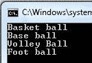

图 7.1 程序列表 7.1 的输出。

你也可以通过下方程序列表 7.2 所示的增强型 for 循环语句来显示二维数组 `rooms` 的内容：

程序列表 7.2：

```java
public class ArrayTester
{
  public static void main(String[] args){
    int[][] rooms = new int[2][10];
    for(int floor=0; floor < rooms.length; ++floor)
      for(int room_no=0; room_no < 10; ++room_no)
        rooms[floor][room_no] = 0;
    //The enhanced for loop statement
    for(int[] flr: rooms)
      for(int rm : flr)
        System.out.printf(" %d", rm);
  }
}
```

上述程序列表 7.2 的输出如下方图 7.2 所示：

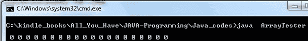

图 7.2 程序列表 7.2 的输出。

## 7.5 数组排序 (ArraySorting)

`java.util` 包中的 java `Arrays` 类拥有许多静态方法，用于对数组执行频繁的操作，例如数组排序。例如，可以通过下方程序列表 7.3 所示的应用 `Arrays` 工具方法 `sort()` 对 `balls` 数组进行排序：

程序列表 7.3：

```java
import java.util.*;

public class ArraySorter
{
  public static void main(String[] args){
    String[] balls = {"Basket ball", "Base ball", "Volley Ball", "Foot ball" };
    System.out.println("\n A list of array balls' content before sorting -> \n");
    for(String ball : balls)
      System.out.println(ball);
    Arrays.sort(balls);
    System.out.println("\n A list of array balls' content after sorting ->\n");
    for(String ball : balls)
      System.out.println(ball);
  }
}
```

程序列表 7.3 的输出如下方图 7.3 所示：

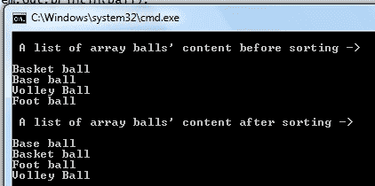

图 7.3 程序列表 7.3 的输出。

## 7.5b 并行数组排序 (Parallel Array Sorting)

新的 java8 引入了并行数组排序（parallel array sorting）的概念，这使 java 排序程序的效率提高了约百分之三十（30%）。该技术专为双核或四核计算机设计，唯一的缺点是系统需要另一个等于待排序数组大小的内存空间。新添加到 `java.util.Arrays` 包中的 `parallelSort()` 方法及其构造函数变体如下方程序列表 7.4 所示描述和应用：

程序列表 7.4：

```java
import java.util.Collections;
import java.util.Arrays;

public class ArraySorter
{
  public static void main(String[] args){
    String[] balls = {"Basket ball", "Base ball", "Volley Ball", "Foot ball" };
    System.out.println("\n A list of array balls' content before sorting -> \n");
    for(String ball : balls)
      System.out.println(ball);
    System.out.println("\n Array balls with 1st and 2nd contents sorted in ascending order ->\n");
    Arrays.parallelSort(balls,0,2);
    for(String ball : balls)
      System.out.println(ball);
    System.out.println("\n Array balls contents sorted in ascending order with parallel sorting->\n");
    Arrays.parallelSort(balls);
    for(String ball : balls)
      System.out.println(ball);
    System.out.println("\n Array balls with 1st and 2nd contents sorted in descending order ->\n");
    Arrays.parallelSort(balls,0,2, Collections.reverseOrder());
    for(String ball : balls)
      System.out.println(ball);
  }
}
```

上述程序列表 7.4 的输出如下方图 7.4 所示：

run:

A list of array balls' content before sorting ->

Array balls with 1st and 2nd contents sorted in ascending order ->

Array balls contents sorted in ascending order with parallel sorting->

Array balls with 1st and 2nd contents sorted in descending order ->

SUCCESSFUL (total time: 0 seconds)

## 7.6 复制 (Copying)

通过使用 java 语言的 `arraycopy` 方法可以将可以将数组的内容复制到另一个相似类型的数组中。为了说明这一点，见程序列表 7.5：

程序列表 7.5：

```java
import java.util.*;

public class ArraySorter
{
  public static void main(String[] args){
    String[] balls = {"Basket ball", "Base ball", "Volley Ball", "Foot ball" };
    System.out.println("\n A list of array balls' content before sorting -> \n");
    for(String ball : balls)
      System.out.println(ball);
    Arrays.sort(balls);
    System.out.println("\n A list of array balls' content after sorting ->\n");
    for(String ball : balls)
      System.out.println(ball);
    String[] ballsCopy = new String[balls.length];
    System.arraycopy(balls,0,ballsCopy,2);
    System.out.println("\n A list of ballsCopy's content after copy operation ->\n");
    for(String ball : ballsCopy)
      System.out.println(ball);
  }
}
```

`arraycopy()` 的第一个参数是源数组，第二个参数是源数组的起始位置，第三个参数是目标数组，第四个参数是要复制的数量。在上述程序列表 7.5 中，`arraycopy()` 方法提供了 2 作为要复制元素的数量到长度为 4 的 `ballsCopy` 中。因此，在列出 `ballsCopy` 的内容时，最后两个槽位给出了 null 值。这种现象的原因是未赋值的原始类型地址被分配了 null 值。

## 7.7 ArrayList

java 中的 `ArrayList` 在功能上与数组基本相同，但 `ArrayList` 只存储对象列表，而数组可以存储原始类型和对象。`ArrayList` 不像数组那样具有固定长度。它的大小可以改变以适应新元素的添加和删除。使用 `size()` 方法获取其新长度就像使用数组的 `length` 字段。此外，数组属于核心 java API，而 `ArrayList` 类属于 java 工具包（`java.util.ArrayList`），在 java 程序中使用 `ArrayList` 类之前必须先导入。`ArrayList` 的声明语法如下所示：

```java
ArrayList array_name = new ArrayList();
```

你也可以如下所示配合泛型使用 `ArrayList`：

```java
ArrayList<data_type> array_name = new ArrayList<data_type>();
```

例如，你可以使用泛型定义一个可以接受所有字符串类型的 `ArrayList`，如下所示：

```java
ArrayList<String> softDrinks = new ArrayList<String>();
```

```java
class customerNames{
  String firstName, lastName;
  public customerNames(String firstNm, String lastNm){
    firstName = firstNm;
    lastName = lastNm;
  }
  String getFirstName( ){return firstName;}
  String getLastName( ){return lastName;}
}
```

我可能会声明以下客户对象：

```java
customerNames customer1 = new customerNames("Feyisayo", "Dosunmu");
customerNames customer2 = new customerNames("Brian", "Tracy");
customerNames customer3 = new customerNames("Zig", "Ziglar");
customerNames customer4 = new customerNames("Ben", "Carson");
```

然后使用以下语句将它们存储在 `ArrayList` 中以便进行后续处理：

```java
ArrayList<customerNames> customers = new ArrayList<customerNames>(Arrays.asList(customer1,customer2,customer3, customer4));
```

随后可以使用以下增强型 for 循环生成所有客户的 own：

```java
for (customerNames t : customers)
  System.out.printf("\n Index is %d for the element object %s ", customers.indexOf(t),t.getFirstName());
```

所有内容整合在下面的程序列表 7.6 中：

**程序列表 7.6：**


```java
import java.util.*;

public class ArrayListObjs
{
  public static void main(String[] args){
  customerNames customer1 = new customerNames("Feyisayo", "Dosunmu");
  customerNames customer2 = new customerNames("Brian", "Tracy");
  customerNames customer3 = new customerNames("Zig", "Ziglar");
  customerNames customer4 = new customerNames("Ben", "Carson");
ArrayList<customerNames> customers = new ArrayList<customerNames>(Arrays.asList(customer1,customer2,customer3));
  for (customerNames t : customers)
    System.out.printf("\n Index is %d for the element object %s ",   customers.indexOf(t),t.getFirstName());
  }
}
class customerNames{
  String firstName, lastName;
  public customerNames(String firstNm, String lastNm){
    firstName = firstNm;
    lastName = lastNm;
  }
  String getFirstName( ){return firstName;}
  String getLastName( ){return lastName;}
}
```

程序列表 7.6 执行时的输出如图 7.6 所示：

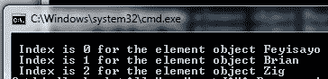

图 7.6 上述程序列表 7.6 的输出。

`Arraylists` 通过在声明中使用泛型来确保类型安全。

## 7.8a 使用增强型 for 循环进行 ArrayList 赋值和迭代

当然，你可以使用赋值运算符如之前描述的那样为数组元素赋值，但你不能对 `ArrayList` 这样做，`ArrayList` 的 `add` 方法用于将新元素插入到 `ArrayList` 对象中。因为要插入元素的内存空间是根据请求动态创建的，而数组则已经创建了所有需要的元素槽并将其初始化为 `null` 值。以下语句向 `softDrinks` `arraylist` 对象中添加了一个元素：

```java
softDrinks.add("Coca Cola");
```

你也可以结合 `ArrayList` 的 `get()` 方法和 `for loop` 语句来检索 `ArrayList` 的元素或内容，其用法语法如下文所示：

```java
arraylist_object.get(element_index);
```

例如，要检索 `arraylist` `softDrinks` 中的第一个对象，可以使用以下语句：

```java
softDrinks.get(0);
```

对象的索引可以通过 `arraylist` 类的 `indexof` 方法获取。这与增强型 for 循环语句结合使用，如下方的列表 7.7 所示：

**程序列表 7.7：**

```java
import java.util.ArrayList;

public class ArrayListProg
{
  public static void main(String[] args){
      ArrayList<String> softDrinks = new ArrayList<String>( );
      softDrinks.add("Coca Cola");
      for (String t : softDrinks)
        System.out.printf("\n Index is %d for the element object %s ", softDrinks.indexOf(t),t);
  }
}
```

程序列表 7.7 的输出如图 7.7 所示：

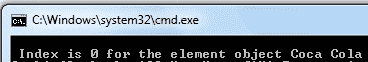

图 7.7。程序列表 7.7 的输出。

程序列表 7.7 使用 `printf` 方法将程序的输出打印到标准输出设备。`printf` 方法在其消息字符串中使用字符格式 `%d` 用于整数数据，`%f` 用于浮点数，`%s` 用于字符串，如上面程序列表 7.7 所示，表示消息字符串中要替换的参数。

## 7.8b 使用 Lambda 进行 ArrayList 迭代

如本书第 4 章第 4.5 节所述，引入 `Collections` 包和 `stream` 方法使得 `java8` 中集合的处理对于底层硬件来说变得更加简单和快速。为了说明这一点，对上面的程序列表 7.7 进行了修改，使用 `foreach` 函数语句来迭代 `softDrinks` `ArrayList` 的内容，用 lambda 的 `foreach` 语句替换了增强型 for 循环。此修改如下程序列表 7.8 所示。请享用。

**程序列表 7.8：**

```java
import java.util.ArrayList;
import java.util.Collections;

public class ArrayListLambda
{
  public static void main(String[] args){
      ArrayList<String> softDrinks = new ArrayList<String>( );
      softDrinks.add("Coca Cola");
      /* 增强型 for 循环被注释掉了 */
      //for (String t : softDrinks)
      //System.out.printf("\n Index is %d for the element object %s ", softDrinks.indexOf(t),t);
    /* 增强型 for 循环现在被 forEach 循环替换 */
     softDrinks.stream().forEach((t) -> {
      System.out.printf("\n Index is %d for the element object %s \n", softDrinks.indexOf(t),t);
   });
  }
}
```

程序的输出如图 7.8 所示：

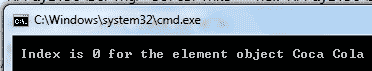

图 7.8 程序输出。

## 7.9 删除 ArrayList 对象

可以使用 `ArrayList` 的 `clear()` 方法从 `ArrayList` 中删除所有对象。用法语法如下：

```java
arraylist_object.clear();
```

例如，要从 `arraylist` `softDrinks` 中删除所有元素，可以使用以下语句：

```java
softDrinks.clear();
```

而要从 `arraylist` 删除特定的对象元素，可以使用以下语法：

```java
arraylist_object.remove(object_element);
```

例如，要从 `arraylist` `softDrinks` 中移除第一个对象，可以使用以下语句：

```java
softDrinks.remove(0);
```

## 7.10 Iterator 接口：

`ArrayList` 类实现了 `iterator` 接口，该接口具有以下方法：`next()`、`hasNext()` 和 `remove()`。`next()` 方法返回 `arraylist` 中的下一个对象元素。`hasNext()` 方法检查 `ArrayList` 中是否还有可用的对象元素，`remove()` 方法从列表中删除当前对象。在 `java` 程序中使用 `iterator` 接口，你必须从 `java` 工具包导入 `Iterator` 类（`java.util.Iterator`），或者使用语句 `java.util.*` 一次性导入工具包中的所有类，如下方的程序列表 7.9 所示：

```java
import java.util.ArrayList;
import java.util.Iterator;

public class IteratorProg
{
  public static void main(String[] args){
      ArrayList<String> softDrinks = new ArrayList<String>( );
      String t;
      softDrinks.add("Coca Cola");
      softDrinks.add("Fanta");
      softDrinks.add("Pepsi");
      Iterator itr =  softDrinks.iterator( );
      while (itr.hasNext( ){
        t= (String) itr.next( );
        System.out.printf("\n Index is %d for the element object %s ", softDrinks.indexOf(t),t);
      }
  }
}
```

程序列表 7.9 展示了 `Iterator` 接口的使用，通过在 `while` 循环表达式中使用 `Iterator` 接口的 `hasNext()` 方法来测试列表是否为空，然后使用 `next()` 方法从列表中获取下一个对象元素。这再次带我们来到了另一个关于 Java 数组的启发性章节的结尾。我希望你在整理这一章节时和我一样过得愉快。请随我进入下一个章节，我们将对 `Strings` 进行更简短的讨论。

# 第 8 章：字符串与正则表达式

字符串数据类型在 `java` 编程语言中是一个对象。字符串表示为双引号内字符的无限组合。例如，"John" 是一个字符串字面量。现在你可以通过以下语句将字符串变量 `firstname` 定义为指向字符串字面量 "John"：

```java
String firstName = "John";
```

注意，一旦像上面那样将字符串内容赋值给变量，其内容就不能再更改，但变量中的字符串引用可以更改为另一个。例如，当你尝试使用加号进行字符串拼接（如下所示）来将字符串变量 `firstName` 的内容修改为新值 "Johnson"时：

```java
firstName = firstName + "son";
```

当编译器遇到上述这样的语句时，它使用其核心 API `stringBuffer` 方法 `append()` 将该语句重写如下所示：

```java
firstName = new StringBuffer(firstName).append("son").toString();
```

并产生输出：Johnson

当你使用 `toLowerCase()` 和 `trim()` 等字符串修改方法时，也会发生相似的过程。我们将在下一节中对此进行讨论。数组内容也可以通过 `Array` 类的 `toString()` 方法转换为字符串。例如，你可以通过以下语句在标准输出设备上显示数组 `ballsCopy` 的内容：

```java
System.out.println(Arrays.toString(ballsCopy));
```

在下一节中将讨论许多可用的字符串类方法。

## 8.1 字符串类方法

字符串类有许多工具方法，例如用于返回字符串长度的 `length()` 方法，`charAt(int)` 返回字符串中指定位置的字符，`compareTo(string)` 用于比较两个字符串的相似性，如果字符串相似则返回整数值 0；如果比较的字符串位于提供的参数之前，则返回小于 0 的整数；如果比较的字符串位于提供的方法参数之后，则返回 1。

与 `compareTo(string)` 方法类似的方法是 `compareToIgnoreCase(String)`，区别在于它执行的是不区分大小写的比较。`trim()` 方法移除字符串开头和结尾的空格，`toLowerCase()` 将字符串转换为小写。下面的程序列表 8.1 阐明了字符串类方法的使用。

**程序列表 8.1：**

```java
import java.util.*;

public class StringMethods
{
  public static void main(String[] args){
  String name = "Feyisayo Dosunmu";
  String nameUpper = "FEYISAYO DOSUNMU";
  //Method length( ) 返回字符串的长度
  System.out.printf("\n The lenght of name (name.length()) is %d ",name.length( ));
  //Method toLowerCase( ) 返回字符串的小写形式
  System.out.printf("\n nameUpper in lowercases (name.toLowerCase()) is %s ",name.toLowerCase( ));
  //Method charAt(int) 返回指定位置的字符
  System.out.printf("\n The character in position 3 counting from 0 (name.charAt(3)) is %c ",name.charAt(3));
  //Method compareTo(string) 返回字符串比较的结果
  System.out.printf("\n The result of comparing with (name.compareTo(nameUpper) ) is %d ",name.compareTo(nameUpper));
  //Method compareToIgnoreCase(string) 返回字符串比较的结果
  System.out.printf("\n The result of comparing with (name.compareToIgnoreCase(nameUpper) ) is %d \n",name.compareToIgnoreCase(nameUpper));
  }
}
```

程序列表 8.1 的输出在图 8.1 所示：

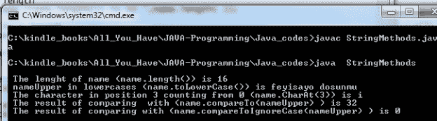

图 8.1 程序列表 8.1 的输出。

## 8.2 正则表达式

正则表达式是用于验证程序输入的字符串模式。虽然 `java` 已经有了一些输入检查方法（如 `Scanner` 类提供的方法），但这些方法在大多数输入验证场景中并不十分有效。例如，你可能需要创建自己的方法来验证电话号码或特定的安全代码数字。这时，你需要创建自己的唯一模式来验证用户的输入，而这就是通过正则表达式来完成的。

## 8.3 正则表达式的公式化

正则表达式是通过使用可选量符和具有隐含含义的字符组合制而成的。某些字符和量符的表格如下方的 8.2 和 8.3 所示：

| 正则表达式字符 | 含义 |

| :--- | :--- |

| `\d` | 代表数值输入并匹配单个数字，例如 1 |

| `\D` | 代表非数值输入并匹配单个字符输入，例如 "a" |

| `\w` | 代表单个字母数字字符，匹配 0 – 9, a – z 和 A – Z 范围内的单个输入，包括下划线 |

| `/…/` | 包裹正则表达式模式 |

| `\[…]` | 代表字符集或范围 |

图 8.2 某些正则表达式字符及其含义的表格。

| 量符 | 含义 |

| :--- | :--- |

| `?` | 0 次或 1 次出现 |

| `*` | 0 次或多次 |

| `+` | 1 次或多次 |

图 8.3 正则表达式量符的表格。

现在，为了创建一个用于验证无限长度、可能以大小写字母开头的名称输入的正则表达式，我们采取以下步骤：

步骤 1：创建一个从 A 到 Z 的大写字母范围表示起始字母，所示：`[A–Z]`

步骤 2：考虑该范围的量符。在这种情况下，量符是问号，代表 0 次或 1 次出现。这适用于名称可能以大写字母开头。因此，新的表示方式所示：`[A– Z]?`

步骤 3：创建一个小写字母范围，所示：`[a–z]`

步骤 4：确定创建的小写字母范围的量符。在这里，由于我们可以有无限的小写组合，合适的量符是加号（`+`），表示一次或多次出现，所示：`[a–z]+`

步骤 5：现在将起始字母和后续的小写组合字母结合，形成所示名称正则表达式：`[A-Z]?[a-z]+`

是的，你做到了。你有一个用于验证名称输入的正则表达式。但过程并不总是如此简单，例如，制定用于有效的电子邮件地址、世界各地电话号码、万事卡号等的正则表达式并不简单。但作为一名专业的软件开发人员，你应该能够完成这些。

然而，本书无法详尽地介绍正则表达式，因为这显然超出了它的涵盖范畴，因为正则表达式本身是一门学科，值得专门用一本书来说。因此，作者建议你下载标题为"[[正则表达式：初级及高级程序员进阶](http://www.amazon.co.uk/dp/B00U4VPZ5U)"的正则表达式书籍。这也是作者的另一作品，有助于对该主题有更深入的理解。你可以通过点击链接或在 Kindle 书店的搜索框中输入标题从亚马逊下载此书。感谢你的支持。

## 8.4 正则表达式的应用

`string` 类提供了一个 `matches(string)` 方法，该方法将字符串与提供的正则表达式参数进行匹配，如果字符串匹配正则表达式，则返回 `Boolean` 值 `true`，否则返回 `false`。接下来，程序列表 8.4 使用了我们之前在上方 8.3 节中创建的名称正则表达式模式来验证名称输入。请享用。

**程序列表 8.4：**


```java
import javax.swing.JOptionPane;

public class RegularExp
{
  public static void main(String[] args){
String nam = JOptionPane.showInputDialog("Please enter a name -> ");
  StringRegex name = new StringRegex(nam);
  if(name.validateName( ))
    System.out.println("\n You entered a valid name." );
  else
    System.out.println("\n You entered an invalid name.");     
  }
}
class StringRegex{
  String namToValidate;
  public StringRegex(String n){
    namToValidate= n;
  }
  public StringRegex( ){
    namToValidate= " ";
  }
  boolean validateName( ){
    String RegPattern = "[A-Z]?[a-z]+";
 return namToValidate.matches(RegPattern);
  }
  }
```

程序列表 8.4 的输入和输出所示方的图 8.4a 和 8.4b 中：

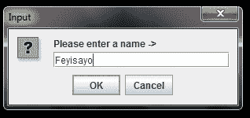

图 8.4a 程序列表 8.4 的名称输入面板。

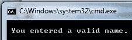

图 8.4b 上述程序列表 8.4 的输出。

再次感谢你的陪伴，另一个章节又要结束了。情况正在变得越来越好；从这里，我们将进入更酷的异常处理层次，迫待在那里与你相。感谢你的坚持。

# 第 9 章

# 异常处理

异常是影响计算机程序平稳执行的异常程序流中断。这些中断是编译器在编译时无法检测到的程序错误，但在运行时会变得诡异地不可避免。

这些异常包括以下几种：`FileNotFoundException` - 你想要打开的文件由于神秘的删除操作或磁盘驱动未关闭而突然不可用；除以零异常 - 当除数因非法操作突然变为零时。为了避免这些难陋且有时不可避免的情况，引入了 `try..catch` 异常处理语句结构，用于处理可能产生异常的语句块。

## 9.1 `try..catch` 语句模型

与 C++ 和 C# 中的一样，编程异常在 `try..catch` 语句块内被捕获并处理。`try..catch` 语句的通用语法如下：

```java
try{
  一个可能抛出异常的语句块；
}
catch(Exception_type exception_obj){
  异常处理语句;
}
finally{
  无论是否发生异常后都要执行的语句;
}
```

`catch` 语句块在产生任何异常时会处理该异常，而 `finally` 语句块包含一个无论是否发生异常都必须执行的语句块。

## 9.2 异常处理的益处

使用 `try..catch` 语句结构的益处显而易见，因为在处理捕获的异常时不需要 `if` 语句；如果需要捕获更多异常，你只需要提供更多的 `catch` 语句块来处理这些之前未被捕获的异常即可。具体操作方法如下文所示：

```java
try{
  一个可能抛出异常的语句块；
}
catch(Exception_type exception_obj){
  异常处理语句;
}
catch(Exception_type exception_obj2){
  异常处理语句;
}
catch(Exception_type exception_obj3){
  异常处理语句;
}
finally{
  无论是否发生异常后都要执行的语句;
}
```

这自然导致了健壮的程序设计，使程序具有可读性和易于维护性。

使用 `try..catch` 语句结构的第二个益处是，你可以决定在哪个层级处理捕获的异常；是在产生点，还是在程序中更高级的方法调用层级。这是可能的，因为异常会从产生点开始沿着调用栈向上传递，直到调用方法，直到被异常处理器捕获并处理。

如果程序员感兴趣在方法调用层级捕获异常，他或她会在 `try..catch` 语句内编写调用语句，并且该方法必须使用 `throws` 子句进行声明，其中 `throw` 子句是 `throws` 关键字后跟异常类型，例如：

如程序列表 9.1 所示，如果方法尝试访问数组边界之外的位置，则抛出 `ArrayIndexOutOfBoundsException`：

```java
import javax.swing.JOptionPane;

public class OutOfBound
{
  public static void main(String[] args){
    House sheraton = new House( );
    try{
      String roomNum = JOptionPane.showInputDialog("Please enter a number -> ");
      int room = Integer.parseInt(roomNum) % 10;
      int floor = Integer.parseInt(roomNum) / 10;
      int vacancy = sheraton.isVacant(floor,room);
      if(vacancy == 0)
        System.out.printf("\n room is vacant.");
      else
        System.out.printf("\n room is not vacant.");
    } catch(ArrayIndexOutOfBoundsException){
      System.out.printf("\n Room out.");
    }
  }
}

class House{
  private int[][] rooms = new int[2][10];
  void House( ){
    for(int floor=0; floor < rooms.length; ++floor)
      for(int room_no=0; room_no < 10; ++room_no)
        rooms[floor][room_no] = 0;
  }
  int isVacant(int floor, int room) throws ArrayIndexOutOfBoundsException{
    return rooms[floor][room];
  }
}
```

上述程序列表 9.1 的输入和输出在图 9.1a 和 9.1b 中：

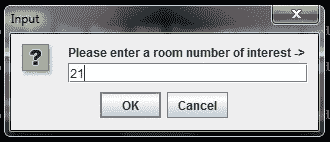

图 9.1a 程序列表 9.1 的输入。

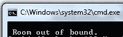

图 9.1b 程序列表 9.1 的输出。

程序列表 9.1 为一栋两层楼预留了二十个房间。地面层房间从房间 0 到 9，第一层房间从房间 10 到 19。当用户输入 0 到 19 范围之外的任何数字时，用户将访问数组边界之外的位置。这无疑产生 `ArrayIndexOutOfBounds` 异常，正如我们在实例中所看到的。

## 9.3 在 catch 语句中捕获多个异常

Java 7 允许在一个 catch 语句中捕获两个或多个异常。这通过竖线分隔异常类型来实现。其用法语法如下文所示：

```java
try{
  一个可能抛出异常的语句块；
}
catch(Exception_type_1 | Exception_type_2 exception_obj){
  异常处理语句;
}
finally{
  无论是否发生异常后都要执行的语句;
}
```

例如，程序列表 9.1 还可以测试除以零的数学异常，并在一个 catch 语句块中进行报告，如更新版本的程序列表 9.2 所示：

```java
import javax.swing.JOptionPane;

public class TwoExceptions
{
  public static void main(String[] args){
    House sheraton = new House( );
try{
```

```java
String roomNum = JOptionPane.showInputDialog("Please enter a room number of interest -> ");

int room = Integer.parseInt(roomNum) % 10;

int floor = (Integer.parseInt(roomNum) - room) / 0;

int vacancy = sheraton.isVacant(floor,room);

if(vacancy == 0)
    System.out.printf("\n room is vacant.");
else
    System.out.printf("\n room is not vacant.");

}

catch(ArrayIndexOutOfBoundsException | ArithmeticException e){
    System.out.printf("\n  %s", e);
}

}

}

class House{

  private int[][] rooms = new int[2][10];

  void House( ){

    for(int floor=0; floor < rooms.length; ++floor)
      for(int room_no=0; room_no < 10; ++room_no)
        rooms[floor][room_no] = 0;
  }

  int isVacant(int floor, int room) throws ArrayIndexOutOfBoundsException{

  return rooms[floor][room];

  }
}
```

上述程序列表 9.2 的输入和输出如所示图 9.2a 和 9.2b 所示：

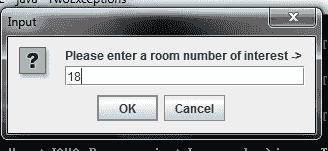

图 9.2a。上述程序列表 9.2 的输入。

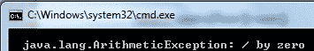

图 9.2b。上述程序列表 9.2 的输出。

该语句行：

`int floor = (Integer.parseInt(roomNum) - room) / 0;`

在上述程序列表 9.2 中执行了除以零的操作，因此生成了除以零异常，该异常迅速被 `catch` 语句处理：

`catch(ArrayIndexOutOfBoundsException | ArithmeticException e)`

该语句被编写用于处理另一个算术异常（`ArithmeticException`），之后一切正常。如果你不知道你正在尝试捕获什么异常类型，简单地使用所有异常的父类（`Exception`）并打印出对象以了解你正在处理的异常类型。记住多态性。

数据已以类似于数据库表的形式排列，便于使用 [SQL（用于关系型数据库管理系统的结构化查询语言)](http://www.amazon.co.uk/dp/B00UI3KF9K) 进行数据库处理操作。然而，我们的下一个挑战是以按照逻辑的方式组织这些数据，并以此使数据独立于任何数据库或编程应用程序，以便于共享和进程间通信。这是通过将 `ArrayList` `softDrinks` 的内容转换为 xml 文档来实现。程序列表 10.2 在程序列表 10.1 的基础上进行了改进，它使用 `DOM` 对象将 `ArrayList` `softDrinks` 转换为 xml 文档。

#### 程序列表 10.2：


```java
package xmlapplication;

/**
*
* @author Dosunmu
*/
import java.io.FileNotFoundException;
import java.io.StringWriter;
import java.io.IOException;
import java.io.FileOutputStream;
import java.io.File;
import org.w3c.dom.Element;
import org.w3c.dom.Text;
import org.w3c.dom.Document;
import javax.xml.transform.stream.StreamResult;
import javax.xml.transform.Transformer;
import javax.xml.transform.TransformerException;
import javax.xml.transform.TransformerConfigurationException;
import javax.xml.transform.OutputKeys;
import javax.xml.transform.TransformerFactory;
import javax.xml.transform.dom.DOMSource;
import javax.xml.parsers.ParserConfigurationException;
import javax.xml.parsers.DocumentBuilder;
import javax.xml.parsers.DocumentBuilderFactory;
import java.util.ArrayList;
import java.util.Arrays;
import java.util.Iterator;

public class XmlWDom {
    /**
     * @param args the command line arguments
     */
    public static void main(String[] args) {
        //creating softdrinks objects
        Drinks soda1 = new Drinks("CocaCola",0.32,"Soft drink");
        Drinks soda2 = new Drinks("Fanta",0.32,"Soft drink");
        Drinks soda3 = new Drinks("Pepsi",0.32,"Soft drink");
        Drinks soda4 = new Drinks("Limca",0.30,"Soft drink");
        //Creating a record of softdrinks with an array list
        ArrayList<Drinks> softDrinks = new ArrayList<Drinks>(Arrays.asList(soda1,soda2,soda3,soda4));
        //Creating an xml document from the softDrinks arraylist record
        CreateXmlDoc xmldoc = new CreateXmlDoc();
        Document myXml = xmldoc.createEmptyXmlDoc();
        //Creating an xml document by adding elements and attributes to the empty xml document
        CreateXML xmlDocument = new CreateXML();
        xmlDocument.createXmlEleAndAttrs(myXml, softDrinks);
        //Creating a representation of the xml doc in string
        XmlConverter converter = new XmlConverter();
        String xmlRepresentation = converter.ConvertXmlToString(myXml);
        //Write xml representation to the standard output
        System.out.println(xmlRepresentation);
        //Write xml representation to a folder
        XmlWriter xmlWriter = new XmlWriter();
        xmlWriter.FileXml(xmlRepresentation);
    }
}

class CreateXmlDoc{
    Document createEmptyXmlDoc() {
    Document xmlDoc = null;
    try {
      DocumentBuilderFactory myDocFactory = DocumentBuilderFactory.newInstance();
      DocumentBuilder myDocBuilder= myDocFactory.newDocumentBuilder();
      xmlDoc= myDocBuilder.newDocument();
      xmlDoc.setXmlStandalone(true);
    }
    catch(ParserConfigurationException e ) {
      System.out.println("Enable to create a document bulider");
      System.exit(2);
    }
    return xmlDoc;
    }
}

class Drinks{
    String drinkName, drinkType;
    double drinkPrice;
    public Drinks(String drinkNm,double Prc,String type) {
    drinkName = drinkNm;
    drinkPrice = Prc;
    drinkType = type;
    }
    String getDrinkName(){return drinkName;}
    String getDrinkType(){return drinkType;}
    double getDrinkPrice(){return drinkPrice;}
}

class CreateXML{
    void createXmlEleAndAttrs(Document myDoc, ArrayList softDrinks){
      //root element
      Element root = myDoc.createElement("Soft_Drinks");
      myDoc.appendChild(root);
      //child elements
      Iterator it = softDrinks.iterator();
      while (it.hasNext()){
        Drinks drink = (Drinks) it.next();
        //element
        Element element = myDoc.createElement("Drink");
        root.appendChild(element);
        //node
        Element name = myDoc.createElement("Name");
        name.appendChild(myDoc.createTextNode(drink.getDrinkName()));
        element.appendChild(name);
        //node
        Element price = myDoc.createElement("Price");
        price.appendChild(myDoc.createTextNode(Double.toString(drink.getDrinkPrice())));
        element.appendChild(price);
        //attribute
        element.setAttribute("type",drink.getDrinkType());
      }
    }
}

class XmlConverter{
    String ConvertXmlToString(Document myXml){
      //Dom to String
      Transformer transformingObj= null;
      StringWriter writeStringXml = new StringWriter();
      try {
        TransformerFactory transformingFactory = TransformerFactory.newInstance();
        transformingObj= transformingFactory.newTransformer();
        //Pass the xml into a string
        transformingObj.setOutputProperty(OutputKeys.OMIT_XML_DECLARATION, "no");
        transformingObj.setOutputProperty(OutputKeys.INDENT, "yes");
        DOMSource xmlSource = new DOMSource(myXml);
        StreamResult outputXml = new StreamResult(writeStringXml);
        transformingObj.transform(xmlSource,outputXml);
      }
      catch(TransformerConfigurationException e){
        System.out.println("Unable to create a transformer");
        System.exit(1);
      }
      catch(TransformerException e){
        System.out.println("Unable to covert DOM to a string");
        System.exit(1);
      }
      return(writeStringXml.toString());
    }
}

class XmlWriter{
    void FileXml(String xmlrep){
      String path= "C:"+File.separator + "practice" + File.separator +"drinks.xml";
      try {
        File newOutput = new File(path);
        FileOutputStream newOutputStream = new FileOutputStream(newOutput,true);
        newOutputStream.write(xmlrep.getBytes());
        newOutputStream.close();
        System.out.println(path +" successfully written.");
      }
      catch(FileNotFoundException e){
        System.out.println(path + "not found.");
      }
      catch(IOException e){
        System.out.println(path + "Unwritable.");
      }
    }
}
```

在 NetBeans 中运行程序列表 10.2 的输出如图 10.2 所示：

```xml
run:
<?xml version="1.0" encoding="UTF-8"?>
<Soft_Drinks type="soft_drink">
<Drink>
  <Name>CocaCola</Name>
  <Price>0.32</Price>
</Drink>
<Drink>
  <Name>Fanta</Name>
  <Price>0.32</Price>
</Drink>
<Drink>
  <Name>Pepsi</Name>
  <Price>0.32</Price>
</Drink>
<Drink>
  <Name>Limca</Name>
  <Price>0.3</Price>
</Drink>
</Soft_Drinks>
C:\practice\drinks.xml successfully written.
BUILD SUCCESSFUL (total time: 0 seconds)
```

图 10.2\. 上述程序列表 10.2 的 xml 输出。

e) 同时将字符串表示写入文件

这些是使用 DOM 对象写入 XML 文档时需要遵循的标准步骤。接下来，我们将讨论如何使用 Java 读取 XML 文档。

## 10.2 使用 Java 读取 XML

在 Java 中，可以使用 `DOM` 或 `SAX` 读取 XML 文档。然而，`DOM` 要求将整个文档读取到计算机内存中，因此它是内存密集型的。而 `SAX` 每次只将一个元素读入内存，因此内存占用更少，可以处理任何长度的 XML 文档。出于这个原因，本书更倾向于并讨论 `SAX` 方法（考虑到书籍长度和其他因素）。

开发 SAX 读器的理念是：SAX 暴露了一个名为 `contentHandler` 的接口，并带有了一些实用的默认方法，如 `startDocument()`、`startElement()`、`endElement()` 和 `endDocument()` 方法，正如方法名所示，它们用于触发文档开始、元素开始、元素结束和文档结束事件。这些方法的默认实现简单地什么都不做。

因此，必须实现 `contentHandler()` 接口并重写其必要方法以适应你的需求。在程序列表 10.3 中，通过 `Xmlhandler` 类实现了这一操作。接下来，类型为 `XmlReader` 的读者对象使用 SAX 和 `Xmlhandler` 对象来读取 XML 文件内容并将其打印到标准输出。其实就这么简单。请花时间仔细该程序列表。根据你的目的，列表的长度可以短也可以长。

程序列表 10.3 显示了如何使用上述 SAX 读取程序列表 10.2 创建的 XML 文档（`drinks.xml`）。

程序列表 10.3：


```java
package xmlapplication3;

import javax.xml.parsers.SAXParser;
import javax.xml.parsers.ParserConfigurationException;
import javax.xml.parsers.SAXParserFactory;
import org.xml.sax.SAXException;
import org.xml.sax.Attributes;
import org.xml.sax.helpers.DefaultHandler;
import java.io.File;
import java.io.IOException;

/**
*
* @author Dosunmu
*/
public class XmlSaxReader {
    /**
     * @param args the command line arguments
     */
    public static void main(String[] args) {
        String xmlFile = "C:" + File.separator + "practice" + File.separator + "drinks.xml";
        XmlReader reader =new XmlReader();
        reader.readXmlContents(xmlFile);
    }
}

class Xmlhandler extends DefaultHandler{
    //检测并处理定位到文档开始的事件
    int endingElementFlag;
    String elementName;

    void xmlhandler() {
        endingElementFlag = 0;
        elementName= null;
    }

    @Override
    public void startDocument() {
        System.out.println("Found the beginning of the document");
    }

    //检测并处理定位到起始元素标签的事件
    @Override
    public void startElement(String url,String lName,String eleName, Attributes attr) throws SAXException {
        endingElementFlag = 0;
        elementName= eleName;
        StringBuilder content = new StringBuilder();
        content.append("A starting element tag " +"\"" +eleName +"\""+" is located");
        // 如果有属性，则处理元素的属性
        if(attr.getLength() >0 ){
            content.append(" with the following attribute(s); ");
            for(int t=0; t < attr.getLength(); t++){
                content.append ( "\""+attr.getLocalName(t)+"\"");
                content.append(" with a value " +"\""+ attr.getValue(t)+"\""+"\n");
            }
        }
        // 将发现的元素打印到控制台
        System.out.println(content.toString());
    }

    // 处理元素的内容
    @Override
    public void characters(char[] ele_content, int start_position, int content_length) throws SAXException {
        String elemNm= new String(ele_content,start_position, content_length);
        if(endingElementFlag== 0 && (!(elementName.equalsIgnoreCase("Drink") ||elementName.equalsIgnoreCase("Soft_Drinks"))) {
            System.out.println("with a content: +"\"" + new String(ele_content,start_position, content_length)+"\"");
        }
    }

    // 检测并处理元素结束
    @Override
    public void endElement (String ele, String lName, String eleName) throws SAXException {
        endingElementFlag=1;
        System.out.println ("An Element tag " +"\"" + eleName + "\" is found.");
    }

    // 检测并处理文档的结束
    @Override
    public void endDocument() throws SAXException {
        System.out.println("End of document.");
    }
}

class XmlReader{
    void readXmlContents(String xmlDoc) {
        try {
            // 创建 xmlHandler 实例
            Xmlhandler xhandler = new Xmlhandler();
            // 创建解析器工厂实例
            SAXParserFactory sxFactory = SAXParserFactory.newInstance();
            // 使用解析器工厂创建解析器
            SAXParser sxParser = sxFactory.newSAXParser();
            // 处理器传递 xml 文件
            sxParser.parse(xmlDoc, xhandler);
        } catch (SAXException e) {
            System.out.println("Could not parse the XML document-> "+ e.getMessage());
        } catch (IOException e) {
            System.out.println("Could not open path."+xmlDoc);
        } catch (ParserConfigurationException e) {
            System.out.println("Unable to create a parser-> "+ e.getMessage());
        }
    }
}
```

并且上述程序列表 10.3 的输出如图 10.3 所示：

```
Found the beginning of the document

A starting element tag "Soft_Drinks" is located with the following attribute(s); "type" with a value "soft_drink"

A starting element tag "Drink" is located

A starting element tag "Name" is located

with a content: "CocaCola"

An Element tag "Name" is found.

A starting element tag "Price" is located

with a content: "0.32"

An Element tag "Price" is found.

An Element tag "Drink" is found.

A starting element tag "Drink" is located

A starting element tag "Name" is located

with a content: "Fanta"

An Element tag "Name" is found.

A starting element tag "Price" is located

with a content: "0.32"

An Element tag "Price" is found.

An Element tag "Drink" is found.

A starting element tag "Drink" is located

A starting element tag "Name" is located

with a content: "Limca"

An Element tag "Name" is found.

A starting element tag "Price" is located

with a content: "0.3"

An Element tag "Price" is found.

An Element tag "Drink" is found.

An Element tag "Soft_Drinks" is found.

End of document.

BUILD SUCCESSFUL (total time: 2 seconds)
```

图 10.3。上述程序列表 10.3 的输出。

我们确实走了一段很长的路。我希望你理解了这些程序列表，如果是的话，祝贺你。如果还没有，请休息一下后再尝试。在此期间，即使你理解了列表，我仍然希望你通过下载此书获取一些启发性的剂：“[Best Inspirational Quotes for Success; a subject by subject inspiration for life.](http://www.amazon.co.uk/dp/B00OBDHMSA)”来自西奥德·罗斯福、杰克·坎菲尔德、德圣母、齐格·齐格拉、亨利·福特、亚伯拉罕·林肯、本·卡森以及许多狮子般的人。

相信我，当编程世界变得艰难时（这往往经常发生），你总是需要这些励志格言来坚持下去。因此，我为你整理了这些格言，以帮助你成为一个心理健康的程序员。请坚持下去，你很快就会看到光的。再次感谢你的付出和决心。

# 第 11 章

## Java Applets

Applets 主要用于动画和游戏制作。它们被嵌入在超文本标记语言文档中。因此，要使用 applet，你需要具备 [HTML5](http://www.amazon.co.uk/dp/B00PIMD5P2) 的基础知识。HTML5 文档的基本结构如下文列表 11.1 所示：

列表 11.1：

```html
<!DOCTYPE html>
<html>
<head>
<title> 我的第一个 HTML5 网页 </title>
<meta charset="UTF-8">
</head>
<body>
       <header ><em ><u> 我的 APPLET 项目。</u></em><br/> </header>
       <nav><a href="#">首页</a>a> |<a href="#">退出</a>a>� </nav><br/><br/>
       <header ><i> 我的 Applet 图像区域</i> </header><br/>
       <section id=”image_applet”>
       </section><br/>
       <footer> &copy 版所有 2015 年 8 月</footer>
</body>
</html>
```

`<!DOCTYPE html>` 元素向浏览器描述该文档为 HTML5 文档。`<html>` 元素作为 html 文档的父容器。`<head>` 元素作为文档的头部，包含以下内容：用于在浏览器中显示文档标题的 `<title>` 元素、`<meta>` 标签中描述页面字符编码，以及某些情况下由`<style>` 元素包含的页面样式表。

在头部元素之后是 `<body>` 元素，它包含 html 文档的正文，包括用于显示跨页面 `<section>` 元素封装的各个部分标题的 `<header>` 元素、用于显示版权和地址信息等页脚信息的页面页脚元素，以及各种其他微小的文本编辑元素，如用于插入新行的 `<br/>` 单单元元素、用于文本下划线的 `<u>` 元素、用于创建强调文本的 `<em>` 元素。主要元素必须按照描述的顺序排列，否则将导致一个格式错误的 html 文档。

当你将列表 11.1 保存为扩展名为 `.html` 的文本文档并将类型指定为 `所有文件` 时，你可以双击该文件使其在浏览器中显示，如下图 11.1 所示：

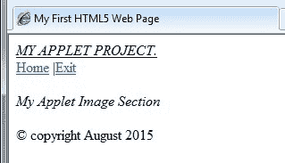

图 11.1 上述程序列表 11.1 的输出。

诚然，这只是一个没有任何 [CSS](http://www.amazon.co.uk/dp/B00QZ2S2JI) 样式的基础 html5 网页，但对于我们本章的讨论来说足够了。如果你还不熟悉 html，或者还没有升级到新的 html5 来进行严肃的 applet Web 开发项目，我建议你下载名为“[HTML5; 从入门到中级的简化版](http://www.amazon.co.uk/dp/B00PIMD5P2)”的书，以及名为“[CSS3; 从入门水平开始的 CSS2 和 3（二合一）](http://www.amazon.co.uk/dp/B00QZ2S2JI)”的书，用于专业网页的 html 页面布局和样式设计。这两本书都在亚马逊 Kindle 书店，可以通过点击链接或在搜索框中输入书名购买。感谢你的支持。

## 11.1 Applet 元素

applet 通过 applet 元素嵌入到 html 文档中。applet 元素的描述如下所示：

```html
<applet code=”applet.class” width=200 height=100 > </applet>
```

`code` 属性指定通过编译 applet 源文件得到的 applet 字节码（applet 类），而 `width` 和 `height` 设置 applet 的宽度和高度。applet 的编译方式与使用 `javac` 命令编译 java 应用程序的方式相同，之后可以使用 `appletviewer` 命令运行它。如果你的 applet 需要某些参数，可以如下所示，通过 `param` 元素从网页中获取参数：

```html
<applet code=”applet.class” width=200 height=100 >
<param name=sex value=”Male” >
</applet>
```

`param` 元素的属性 `name` 用于指定参数名称，而属性 `value` 则用于提供参数值。

## 11.2 Applet 的结构

applet 没有 java 应用程序中通用的静态 public main 方法，相反，它拥有的是公有的 `init()` 方法，用于在启动时初始化 applet。Java applets 不需要强制的方法。这些方法由浏览器根据 Java 虚拟机的要求调用。`Applet` 类（自 `Panel` 类）的以下方法对于实现 applet 至关重要：

a) `public void init()`：被浏览器用于 applet 的初始化

b) `pubic void start()`：被浏览器用于在初始化后启动 applet。在页面加载时调用

c) `public void stop()`：被浏览器用于在页面离开时停止 applet

d) `public void destroy()`：由浏览器用于销毁 applet 并清理内存

上述 `Applet` 类的方法必须导入才能使用它们。applet 类的继承关系如图 11.2 所示：


图 11.2. Applet 类的继承树。

根据 Applet 的层次结构，`applet` 类继承自 `Panel` 类，其继承自 `Container` 类，再继承自 `Component` 类，最后继承自 `Object` 类。诚然，`applet` 类被丰富了。然而，applet 类的 `public void paint( )` 方法用于在浏览器中绘图。让我们创建一个重写了 `paint` 方法的示例 applet。

## 11.3 示例 Applet

列表 11.2 中的以下示例 applet 在浏览器启动时显示当前时间。

列表 11.2：


```java
import java.applet.Applet;
import java.awt.Graphics;
import java.time.LocalTime;

/**
* 作者 Dosunmu
*/
public class LocalTimeApplet extends Applet {

/**
* 在浏览器加载 applet 后调用的方法
 */
    @Override
    public void init() {
        // TODO 异步下载资源
    }

    @Override
    public void paint(Graphics t){
        t.drawString("当前时间为：" + LocalTime.now(), 100,90);
    } // 不需要重写 start(), stop() 和 destroy 方法
}
```

不需要重写 `start()`、`stop()` 和 `destroy()` 方法，因为浏览器会在 applet 进入视野时自动调用 `start()` 方法，在离开视野时调用 `stop()` 方法，并在页面从浏览器移除时调用 `destroy()` 方法。

上面的 applet 可以像编译 java 代码一样，使用 `javac` 命令或在 netbeans 中编译生成字节码，然后将其嵌入到如列表 11.1 所示的 Web 文档中。嵌入方式如下文修改后的列表 11.1 (11.3) 所示：

```html
<!DOCTYPE html>
<html>
<head>
<title> 我的第一个 HTML5 网页 </title>
<meta charset="UTF-8">
</head>
<body>
       <header ><em ><u> 我的 APPLET 项目。</u></em><br/> </header>
       <nav><a href="#">首页</a>a> |<a href="#">退出</a>a> </nav><br/><br/>
       <header ><i> 我的本地时间 Applet 区域</i> </header><br/>
       <section id=”Local Time_applet”>
       </section><br/>
       <footer> &copy 版所有 2015 年 8 月</footer>
</body>
</html>
```

<applet code="LocalTimeApplet.class" width=300 height=100> </applet>

要在命令行提示符中运行 applet，请使用 `appletviewer` 命令执行下方图 11.3 所示的 html 文档：

```bash
C:\practice>appletviewer LocalTimeApplet.htm
```

程序在命令行提示符中甚至在 Netbeans IDE 中执行时，输出结果如图 11.3 所示：

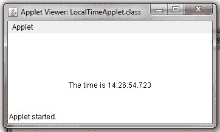

图 11.3。程序列表 11.2 (applet) 的输出。

`Graphics` 类主要用于在系统输出设备上绘制对象。以下是常用的 `Graphics` 类方法：

a) `public abstract void drawLine (int x, int y, int x2, int y2);` 用于从点(x, y) 到点 (x2, y2) 绘制一条线。

b) `public abstract void drawImage(Image img, int x, int y, ImageObserver obs);` 用于将给定图像绘制到输出设备。

c) `public abstract void drawArc(int x, int y, int width, int height, int startAngle, arcAngle);` 用于向输出设备绘制一个弧。

d) `public abstract void drawOval(int x, int y, int width, int height);` 用于向输出设备绘制一个椭圆形。

e) `public abstract void drawRect(int x, int y, int width, int height);` 用于向输出设备绘制并输出一个矩形。

f) `public abstract void drawstring(String str, int x, int y);` 用于向输出设备输出字符串。

g) `public abstract void fillArc(int x, int y, int width, int height, int startAngle, arcAngle);` 用指定的定的颜色填充绘制的弧。

h) `public abstract void fillOval(int x, int y, int width, int height);` 用设定的颜色填充绘制的椭圆形。

i) `public abstract void fillRect(int x, int y, int width, int height);` 用于用指定的颜色填充绘制的矩形。

j) `public abstract void setColor(Color c);` 用于设置图形当前的填充颜色。

例如，下方程序列表 11.3 中的以下 applet 代码负责使用 `Graphics` 和 `Color` 类在输出设备上绘制一个填充为粉红色的矩形对象。

程序列表 11.3：

```java
import java.applet.Applet;
import java.awt.Color;
import java.awt.Graphics;

/**
*
* @author Dosunmu
*/
public class FilledRectangle extends Applet {
    /**
     * 在 applet 加载到浏览器后调用的初始化方法。
     */
    @Override
    public void init() {
        // TODO start asynchronous download of heavy resources
    }
    @Override
    public void paint(Graphics p){
      p.setColor(Color.pink);
      p.drawRect(140, 70, 45, 60); 
      p.fillRect(140, 70, 45, 60);
    }
}
```

程序列表 11.3 的输出如图 11.4 所示：

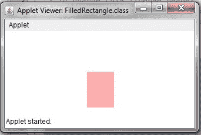

图 11.4。上方程序列表 11.3 的输出。

然而，applets 也有自己的缺点和局限性，如下：

a) 它们需要插件才能在浏览器中执行

b) 浏览器的安全设置可能会阻止你的 applet 执行

尽管如此，applets 也有自己的优势，因为它们更安全、速度更快（因为它们在客户端执行），并且一旦安装了 Java 运行时环境，就可以各种平台上运行。

总之，applets 并不是构建优秀网站和用户体验的最佳方式，在达到那个水平时，servlets 提供了更好的前景。从这里开始，你可以轻松理解你所选的任何其他关于 Java 8 编程和 servlet 开发的高级书籍，因为尽管我想继续写下去，但我必须在此停笔。如果需求需要，我可以在本书的后续系列中包含关于 servlet 和数据库操作的内容。

我知道你最初下载这本书是有原因的，首先，我希望你的目的得以实现；其次，有一个带你来到这里的动力，这可能是因为你有一个即将启动的项目，或者你正处于某个项目的中间。如果是这样，我建议你也下载我的另一本被高度推荐的书，名为[“文献综述写作：一种简化方法”。](http://www.amazon.co.uk/dp/B00OG1YACS) 它将极大地简化你的项目；它将成为你值得收藏的珍宝。谢谢。

# 结论

我们从最简单的 Java 开发概念开始，到最先进且实用的 XML 技术，再到最新的 Java 8 新特性。尽管你可能是一个初学者，但我们在上帝的保佑下的软件开发经验使得这本书成为可能。

如果你在某种程度上获得了福报，无论多么微小，请也通过对这项作品提供你自己的评价来贡献你的一薄之力，这样其他人也能发现这本书并从中受益。你只需移动到这本书的评论页面即可给出五星好评。只要你继续前进，就能到达那里。感谢你的评价。

在我离开之前，来点一点分散注意力的事情如何？正如人们所说，只工作不玩耍会让人变得无呆。现在带着这个小珍宝度过剩下的时光吧：


通过下载上面的书籍，学习制作精美的礼盒，并以你心仪的风格呈现你的礼物。下回再见，多谢，保重。拜拜。
