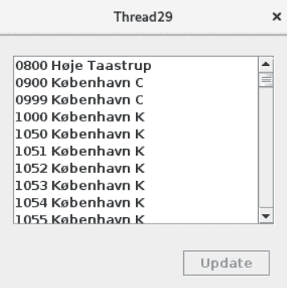
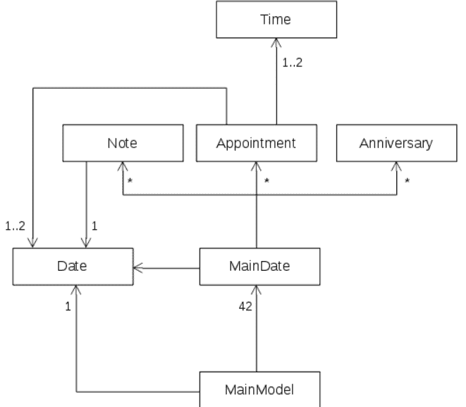
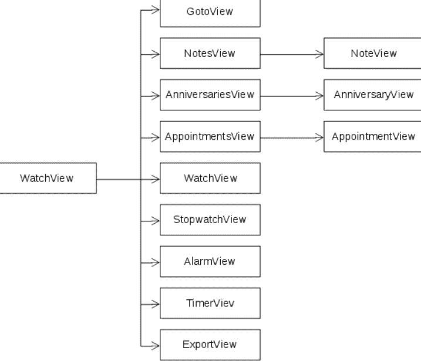
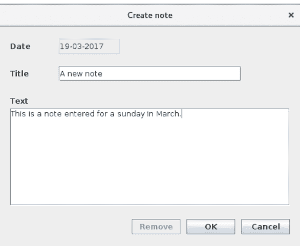
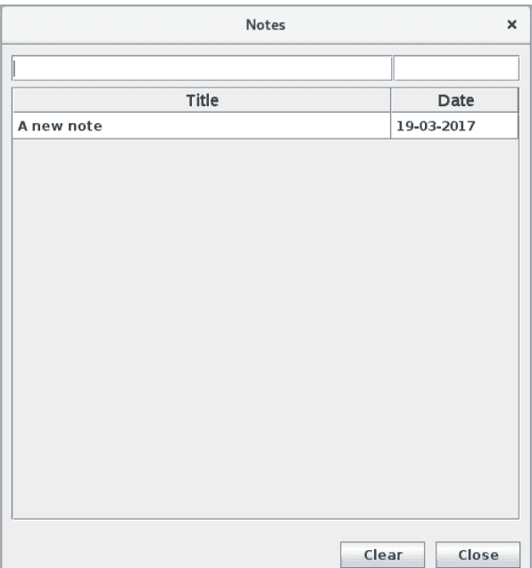
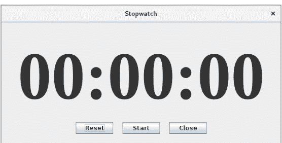
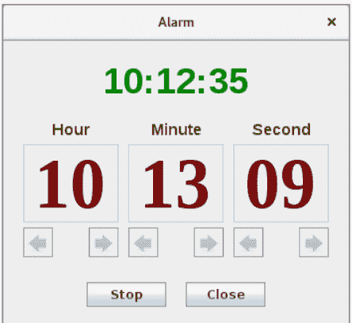
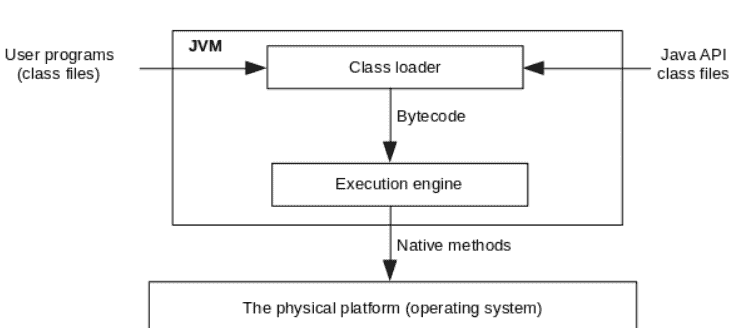
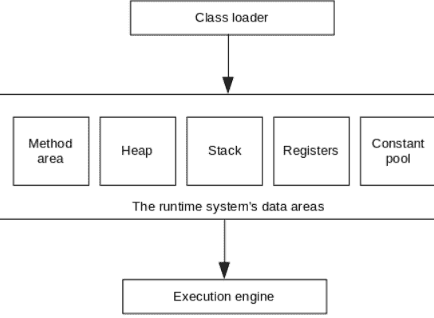

# Java 8：多线程程序

在 bookboon.com 免费电子书

> 我们不重新发明轮子，我们是在重新发明光影。

迷人的光影提供了无限的可能性：创新技术和新市场既带来了机遇也带来了挑战。在一个你的专业知识需求巨大的环境中。享受我们全球集团内部支持性的工作环境，并从国际职业发展中获益。与其他专家紧密合作实施可持续的想法，并为影响我们的未来做出贡献。加入我们，每天重新发明光影。

光来自 OSRAM SYLVANIA

在 bookboon.com 免费电子书

10 Swing 107

附录 A 161

# 前言

本书是软件开发系列书籍中的第八本。该编程语言是 Java，该语言及其语法和语义显然涵盖了大量内容，但这些书籍在很大程度上也关注过程以及如何开发良好且健壮的应用程序。本书涉及线程，以及你如何同步共享资源的线程。线程的使用是编程中的一个重要问题，但它也是一个带有许多细节的技术领域。本书主要关注编程和 Java 语言，仅在最后一个示例中，再次关注了系统开发。读完本书后，读者应该能够在实践中使用线程，并理解线程在何处可以使用。这本书需要编程知识和 Java 语言，这对应了系列前四本书的内容。书中最后通过附录提供了一个关于 Java 虚拟机（JVM）的入门介绍。

正如标题所示，这系列书籍是关于软件开发的，目标是教读者如何开发 Java 程序。通过阅读主题和研究示例程序，最重要的是通过自己操作和编写程序来学习。因此，书籍的重要部分是练习和问题，读者需要编写与书中处理的内容相关的程序。该系列书籍都围绕相同的骨架构建，并包含了文中提到的练习和问题。练习与问题之间的区别在于，练习是关于文中呈现内容的重复，并且在这些方面描述得相对准确。而问题则描述得比较松散，通常性更大，并且有非常好的解决方案。这些书籍需要从头到尾读完，但许多代码示例（包括练习和问题）起着核心作用，读者需要详细预测代码并解决练习和问题，或者只是研究推荐解决方案。

# 引言

当你启动一个程序时，它会创建一个线程，而运行时系统负责执行程序的语句。你可以将线程视为程序代码的一部分，它有自己的生命，并且可以独立于运行时系统进行执行。为了让线程运行并执行任何操作，它必须有一个处理器供运行，尽管现在的计算机有多个处理器，但线程的数量总是多于处理器的。由于所有线程在极短的时间内都有可用的处理器，如果所有线程彼此并行运行，似乎是在使用我们。

## 1.1 创建线程

我将首先展示程序如何创建线程，以下程序在主线程之外创建了四个线程：

```java
ToDo.work(5, 10);
```

```java
class Worker1 implements Runnable
{
    public void run()
    {
        ToDo.work(2, 5);
    }
}
```

```java
class Worker2 extends Thread
{
    public Worker2()
    {
        start();
    }
}
```

```java
public void run()
{
    ToDo.work(2, 5);
}
```

```java
class ToDo {
    private static Random rand = new Random();

    public static void work(int a, int b)
    {
        print("started");
        for (int i = 0, n = rand.nextInt(b - a); i < n; ++i)
        {
            print("working...");
            work();
        }
        print("terminated");
    }
```

```java
    private static void print(String text)
    {
        long id = Thread.currentThread().getId();
        System.out.println("" + id + "'] " + text);
    }
```

```java
private static void work() {
    double y;
    for (int i = 0; i < 1000000L; ++i) y = Math.cos(Math.sqrt(rand.nextDouble()));
}
```

我将从`ToDo`类开始，它在原则上与什么无关。该类代表了计算机必须执行的工作，重要的是这是一项耗时且会消耗机器处理器资源的工作。私有方法`work()`在不使用任何东西的情况下执行工作，这些工作由执行一百次计算组成，其中每次计算执行一个使用许多 CPU 指令的数学函数。`work()`方法的第二个版本（公共版本）有两个参数，并根据这些参数确定的次数调用私有的`work()`。该方法首先在屏幕上打印一条消息，工作完成后再打印另一条消息。对于这条消息，你应该注意以下语句：

```java
long id = Thread.currentThread().getId();
```

线程通过 ID 标识，这是一个整数，在线程创建时被分配。主线程的编号为 1，而自定义线程被分配的编号从 10 开始。当`work()`方法打印消息时（即调用`print()`方法），它会打印当前线程 ID（即执行`print()`方法的线程）。

在 Java 中，线程由`Thread`类表示。`Worker2`类继承了`Thread`类并以此表示该线程。该类有一个名为`run()`的方法，它是线程启动时执行的方法，在本例中，它发生在`Worker2`类的构造函数中。线程的程序员必须重写`run()`方法，并确定线程必须执行的操作，且线程将一直运行到`run()`方法终止。在这种情况下，线程执行了`ToDo`类中的`work()`方法。

`Thread`类实现了`Runnable`接口，该接口定义了`run()`方法。定义线程的另一种方法是将`Runnable`对象作为参数传递给`Thread`类的构造函数，并以此告知要执行哪种`run()`方法。`Worker1`类是一个实现`Runnable`的简单类，必须实现`run()`方法，然后该类就是`Runnable`对象。在这种情况下，`run()`方法的执行与线程类`Worker2`中相同。

回到`main()`方法。构造函数的第一条语句创建了一个新的`Thread`对象并启动了一个线程。构造函数的参数创建了一个`Runnable`对象，在本例中它是一个`Worker1`类型的对象。下一条语句启动另一个线程，但这次是通过实例化一个`Worker2`类型的对象。在这里，是由`Worker2`类的构造函数启动线程。然后是第三条语句，与第一条语句相同，启动一个执行`work()`方法的线程，但为了创建一个`Worker1`类型的`Runnable`对象，该语句使用匿名类实例化`Runnable`对象。第四条语句执行了相同的操作，但这里使用的是 lambda 表达式。最后最后一条语句简单地调用了`ToDo`类的`work()`方法。也就是说，是由主线程执行这条语句，这意味着你必须看到主线程正在与其他线程并行运行。如果你执行该程序，结果可能是：

```
[11] started
[10] started
[12] started
[11] works
[12] works
[13] started
[13] works
[12] works
[13] works
[12] works
[12] terminated
[10] works
[11] works
[11] terminated
[10] works
[10] terminated
[13] works
[13] works
[13] terminated
[13] works
[11] works
[11] works
[11] works
[11] terminated
```

你应该注意，线程正在执行耗时工作，它们会被周期性地中断，并且内部有一个第二个线程在运行。重要的是，人们不能对线程做出任何假设，当线程启动时，它由操作系统管理，并取决于机器上要执行的任务。

## 1.2 属性

我将展示一个打印线程属性的示例。程序启动两个线程并显示有关线程状态的信息。程序还展示了如何挂起线程，这意味着线程在再次准备就绪之前无法获得 CPU 使用。

```java
package thread02;

public class Thread02 {
    public static void main(String[] args) {
        System.out.println("Number of processors: " + Runtime.getRuntime().availableProcessors());
    }
}
```

```java
Thread th1 = new Thread(InfoThread, "Thread number one");
Thread th2 = new Thread(InfoThread, "Thread number two");
// th1.setDaemon(true);
th2.setDaemon(true);
th1.start();
th2.start();
System.out.println(th1.isAlive());
```

```java
class InfoThread implements Runnable {
    public void run() {
        Thread th = Thread.currentThread();
        System.out.println("[" + th.getId() + "] " + th.getName() + " is started");
        System.out.println("[" + th.getId() + "] " + (th.isDaemon() ? "Daemon" : "None"));
        try {
            Thread.sleep(2000);
        } catch (Exception ex) {
        }
        System.out.println("[" + th.getId() + "] " + th.getName() + " is terminated");
    }
}
```

`InfoThread`类实现了`Runnable`接口，它定义了`run()`方法。`Thread`类继承了`Thread`类并表示该线程。该类有一个名为`run()`方法，它是线程启动时执行的方法，在本例中，它发生在`Worker2`类的构造函数中。线程的程序员必须重写`run()`方法，并确定线程必须执行的操作，且线程将一直运行到`run()`方法终止。在这种情况下，线程执行了`ToDo`类中的`work()`方法。

`Thread`类实现了`Runnable`接口，该接口定义了`run()`方法。定义线程的另一种方法是将`Runnable`对象作为参数传递给`Thread`类的构造函数，并以此告知要执行哪种`run()`方法。`Worker1`类是一个实现`Runnable`的简单类，必须实现`run()`方法，然后该类就是`Runnable`对象。在这种情况下，`run()`方法的执行与线程类`Worker2`中相同。

回到`main()`方法。构造函数的第一条语句创建了一个新的`Thread`对象并启动了一个线程。构造函数的参数创建了一个`Runnable`对象，在本例中它是一个`Worker1`类型的对象。下一条语句启动另一个线程，但这次是通过实例化一个`Worker2`类型的对象。在这里，是由`Worker2`类的构造函数启动线程。然后是第三条语句，与第一条语句相同，启动一个执行`work()`方法的线程，但为了创建一个`Worker1`类型的`Runnable`对象，该语句使用匿名类实例化`Runnable`对象。第四条语句执行了相同的操作，但这里使用的是 lambda 表达式。最后最后一条语句简单地调用了`ToDo`类的`work()`方法。也就是说，是由主线程执行这条语句，这意味着你必须看到主线程正在与其他线程并行运行。如果你执行该程序，结果可能是：

```
[11] started
[10] started
[12] started
[11] works
[12] works
[13] started
[13] works
[12] works
[13] works
[12] works
[12] terminated
[10] works
[11] works
[11] terminated
[10] works
[10] terminated
[13] works
[13] works
[13] terminated
[13] works
[11] works
[11] works
[11] works
[11] terminated
```

你应该注意，线程正在执行耗时工作，它们会被周期性地中断，并且内部有一个第二个线程在运行。重要的是，人们不能对线程做出任何假设，当线程启动时，它由操作系统管理，并取决于机器上要执行的任务。


```java
class ToDo {
    private static Random rand = new Random();

    public static void work(int a, int b)
    {
        print("started");
        for (int i = 0, n = rand.nextInt(b - a); i < n; ++i)
        {
            print("working...");
            work();
        }
        print("terminated");
    }
```

```java
    private static void print(String text)
    {
        long id = Thread.currentThread().getId();
        System.out.println("" + id + "'] " + text);
    }
```

```java
private static void work() {
    double y;
    for (int i = 0; i < 1000000L; ++i) y = Math.cos(Math.sqrt(rand.nextDouble()));
}
```

我将从`ToDo`类开始，它在原则上与什么无关。该类代表了计算机必须执行的工作，重要的是这是一项耗时且会消耗机器处理器资源的工作。私有方法`work()`在不使用任何东西的情况下执行工作，这些工作由执行一百次计算组成，其中每次计算执行一个使用许多 CPU 指令的数学函数。`work()`方法的第二个版本（公共版本）有两个参数，并根据这些参数确定的次数调用私有的`work()`。该方法首先在屏幕上打印一条消息，工作完成后再打印另一条消息。对于这条消息，你应该注意以下语句：

```java
long id = Thread.currentThread().getId();
```

线程通过 ID 标识，这是一个整数，在线程创建时被分配。主线程的编号为 1，而自定义线程被分配的编号从 10 开始。当`work()`方法打印消息时（即调用`print()`方法），它会打印当前线程 ID（即执行`print()`方法的线程）。

在 Java 中，线程由`Thread`类表示。`Worker2`类继承了`Thread`类并以此表示该线程。该类有一个名为`run()`的方法，它是线程启动时执行的方法，在本例中，它发生在`Worker2`类的构造函数中。线程的程序员必须重写`run()`方法，并确定线程必须执行的操作，且线程将一直运行到`run()`方法终止。在这种情况下，线程执行了`ToDo`类中的`work()`方法。

`Thread`类实现了`Runnable`接口，该接口定义了`run()`方法。定义线程的另一种方法是将`Runnable`对象作为参数传递给`Thread`类的构造函数，并以此告知要执行哪种`run()`方法。`Worker1`类是一个实现`Runnable`的简单类，必须实现`run()`方法，然后该类就是`Runnable`对象。在这种情况下，`run()`方法的执行与线程类`Worker2`中相同。

回到`main()`方法。构造函数的第一条语句创建了一个新的`Thread`对象并启动了一个线程。构造函数的参数创建了一个`Runnable`对象，在本例中它是一个`Worker1`类型的对象。下一条语句启动另一个线程，但这次是通过实例化一个`Worker2`类型的对象。在这里，是由`Worker2`类的构造函数启动线程。然后是第三条语句，与第一条语句相同，启动一个执行`work()`方法的线程，但为了创建一个`Worker1`类型的`Runnable`对象，该语句使用匿名类实例化`Runnable`对象。第四条语句执行了相同的操作，但这里使用的是 lambda 表达式。最后最后一条语句简单地调用了`ToDo`类的`work()`方法。也就是说，是由主线程执行这条语句，这意味着你必须看到主线程正在与其他线程并行运行。如果你执行该程序，结果可能是：

```
[11] started
[10] started
[12] started
[11] works
[12] works
[13] started
[13] works
[12] works
[13] works
[12] works
[12] terminated
[10] works
[11] works
[11] terminated
[10] works
[10] terminated
[13] works
[13] works
[13] terminated
[13] works
[11] works
[11] works
[11] works
[11] terminated
```

你应该注意，线程正在执行耗时工作，它们会被周期性地中断，并且内部有一个第二个线程在运行。重要的是，人们不能对线程做出任何假设，当线程启动时，它由操作系统管理，并取决于机器上要执行的任务。

## 属性

我将随后展示一个打印线程属性的示例。程序启动两个线程并显示有关线程状态的信息。程序还展示了如何挂起线程，这意味着线程在再次准备就绪之前无法获得 CPU 使用。

```java
package thread02;

public class Thread02 {
    public static void main(String[] args) {
        System.out.println("Number of processors: " + Runtime.getRuntime().availableProcessors());
    }
}
```

```java
Thread th1 = new Thread(InfoThread, "Thread number one");
Thread th2 = new Thread(InfoThread, "Thread number two");
// th1.setDaemon(true);
th2.setDaemon(true);
th1.start();
th2.start();
System.out.println(th1.isAlive());
```

```java
class InfoThread implements Runnable {
    public void run() {
        Thread th = Thread.currentThread();
        System.out.println("[" + th.getId() + "] " + th.getName() + " is started");
        System.out.println("[" + th.getId() + "] " + (th.isDaemon() ? "Daemon" : "None"));
        try {
            Thread.sleep(2000);
        } catch (Exception ex) {
        }
        System.out.println("[" + th.getId() + "] " + th.getName() + " is terminated");
    }
}
```

`InfoThread`类实现了`Runnable`接口，它定义了`run()`方法。`Thread`类继承了`Thread`类并以此表示该线程。该类有一个名为`run()`的方法，它是线程启动时执行的方法，在本例中，它发生在`Worker2`类的构造函数中。线程的程序员必须重写`run()`方法，并确定线程必须执行的操作，且线程将一直运行到`run()`方法终止。在这种情况下，线程执行了`ToDo`类中的`work()`方法。

此程序展示了线程可以拥有的某些属性以及`Thread`类提供的服务。还有其他选项，例如更改线程的优先级。但是，除非你有充分的理由，否则通常不需要这样做。

作为另一个启动多个线程程序的示例，你可以考虑以下启动了 100 个线程的程序：

```java
package thread03;

public class ClassThread03
{
    public static void main(String[] args)
    {
        for (int i = 0; i < 100; i++) (new Thread(() -> work())).start();
    }
}
```

我们将您的简历转化为终生难遇的机会

你喜欢汽车吗？你想成为成功品牌的一员吗？我们将欣赏并奖励你的热情和才华。向我们发送你的简历。你将对它能带你去何处感到惊讶。

在 www.employerforlife.com 向我们发送简历

在 bookhoon.com 下载免费电子书

点击广告阅读更多

```java
private static void work() {
  print("Started");
  double y = 0;
  for (int i = 0; i < 10000000L; ++i) y = Math.cos(Math.sqrt(2));
  print(String.format("%1.4f", y));
}
```

```java
private static void print(String text) {
  System.out.println("[" + Thread.currentThread().getId() + "] " + text);
}
```

与前两个例子相比，并没有什么新意，程序应该只要你启动它就执行什么，这些都是 CPU 密集型任务。启动了 100 个线程，但重要的是启动的线程数多于 CPU 的数量。如果程序执行，你将观察到所有线程都启动了，但以不可预测的顺序打印消息。反过来，线程执行其工作直到退出，顺序同样是不可预测的。这取决于操作系统何时中断线程并决定哪些线程应该重新启动。

编写一个创建并启动两个线程的程序。其中一个线程必须执行迭代 10 次的循环。对于每次迭代，线程应该打印一个 0 到 99 之间的整数，之后它必须暂停一段小于一秒随机随机。第二个线程应该以相同的方式运行，但打印的是一个随机小数。我的解决方案称为`StartThreads`。

考虑以下程序：

```java
package thread04;

public class Thread04
{
    private static long prime;

    public static void main(String[] args)
    {
        Thread th;
        th = new Thread(() -> nextPrime(10000000)).start();
        System.out.println(prime);
    }

    private static void nextPrime(long t)
    {
        if (t < 2) prime = 2;
        else for (prime = t % 2 == 0 ? t + 1 : t; !isPrime(prime); prime += 2;
    }

    private static boolean isPrime(long t)
    {
        if (t == 2 || t == 3 || t == 5 || t == 7) return true;
        if (t < 11 || t % 2 == 0) return false;
        for (long k = 3, m = (long)Math.sqrt(t); k <= m; k += 2)
            if (t % k == 0) return false;
        return true;
    }
}
```

`nextPrime()`方法确定第一个大于或等于参数`t`的质数。这是我之前展示过的方法，这里有趣的是，如果参数`t`很大，执行该方法可能需要很长时间。`main()`创建一个执行该方法的线程，然后打印变量`prime`的结果。程序将打印 0，这显然是错误的。原因是主线程在线程`th`启动后继续执行，而线程内部`prime`的值尚未更新。主线程没有等待线程`th`。

通过将`main()`方法更改为以下内容可以解决此问题：

```java
public static void main(String[] args)
{
    Thread th;
    th = new Thread(() -> nextPrime(10000000)).start();
    try {
        th.join();
    } catch (Exception ex) {
        System.out.println(prime);
    }
}
```

线程有一个`join()`方法。如果另一个线程正在对一个`Thread`对象执行`join()`，则意味着第二个线程必须等待直到第一个线程终止。在这种情况下，这意味着在线程`th`计算出结果之前，最后一条语句不会执行。

在此练习中，你应该对上述示例中的`nextPrime()`和`isPrime()`方法进行微调。创建一个新项目，你可以通过添加以下类将其命名为`JoinThreads`，该类只是对`long`类型的简单封装：

```java
class Prime {
    private long value;

    public long getValue() {
        return value;
    }

    public void setValue(long value) {
        this.value = value;
    }
}
```

然后你必须添加以下类，它定义了一个`Runnable`对象：

```java
class Creator implements Runnable {
    private long value;
    private Prime prime;

    public Creator(long value, Prime prime) {
        this.value = value;
        this.prime = prime;
    }

    public void run() {
        nextPrime(value, prime);
    }

    public static void nextPrime(long t, Prime prime) {
        // nextPrime() 方法在原理上与上述示例的方法相同，但它现在多了一个额外参数。该方法必须将对象的值设置为大于或等于 t 的第一个质数。注意它仍然是一个静态方法，并放置在此类中，是因为 run() 方法引用了 nextPrime()。
    }
}
```

然后编写以下`main()`方法，它确定 13 个“大”质数并将它们打印在屏幕上：

```java
public static void main(String[] args)
{
    long[] values = {100000, 1000000, 10000, 10000000, 100000000, 1000000000, 10000000000L, 100000000000L, 1000000000000L, 10000000000000L, 100000000000000L, 1000000000000000L, 10000000000000000L };
    Prime[] primes = new Prime[values.length];
    for (int i = 0; i < values.length; i++) primes[i] = new Prime();
    for (int i = 0; i < values.length; i++) new Creator(values[i], primes[i]).start();
    for (int i = 0; i < primes.length; i++) System.out.println(primes[i].getValue());
}
```

最重要的是调用`nextPrime()`方法13次的语句。你现在必须更改`main()`方法，使得每次`nextPrime()`调用都在独立的线程中执行。你当然可以使用`Creator`类来创建`Runnable`对象。

在此修改后，尝试观察在质数按顺序生成和在独立线程生成方面是否存在差异。

如初始示例所示，在程序中创建和使用线程是很容易，只要单个线程不共享资源，线程的使用也没有大问题，但如果线程共享公共资源，它们可能会导致并发问题，这些问题必须由程序员解决，而且绝对不简单。典型问题是所谓的竞态条件，即计算结果取决于线程访问共享资源的时机，经典的例子是两个或多个线程使用公共数据元素（变量），且至少有一个线程更改变量的值，但线程之间没有协调对数据项的使用。例如，考虑以下方法：

```java
public int getId()
{
    return counter++;
}
```

我加入 MITAS 是因为我想要真正的责任

我在北担任施工主管，指导并帮助工头解决问题

真实工作

国际机会

三次实习

MAERSK

其中`counter`是一个实例变量，这种方法不是线程安全的。显然，该方法看起来只执行了一个操作，但实际上包含了几个步骤：


- 1. 份变量 `counter` 的副本
- 2. 将变量 `counter` 的值加 1
- 3. 将结果保存到 `counter` 中
- 4. 返回已保存的值

例如，假设有两个线程调用了此方法，且 `counter` 的值为 10，可能会发生以下情况：第一个线程执行了上述指令的第一条，之后它被中断了。此时第二个线程进入并执行了前三个操作。此时，`counter` 的值为 11。如果此时第二个线程被中断，它将更新 `counter` 使其值为 11（从而覆盖了另一个线程所做的更改）。结果是两个线程都返回了 11，这是一个错误的结果，且 `counter` 的值也是错误的。修正方法是需要一种机制来控制线程完成其工作，或者至少让一个线程在另一个线程完成之前无法使用该方法。

为了通过使用 Java 虚拟机 (JVM) 和操作系统缓存内存来提高性能，它们会保留变量的副本。这也会导致问题，每个线程都可能拥有变量的副本。如果一个线程修改了变量，可能更新的只是副本，而其他线程无法察觉这一点，并更新它们自己的副本。这也是多线程应用程序必须处理的问题之一。

这些挑战的解决方案是同步和锁，它们确保两个或多个线程不能同时执行临界区域（critical region），即一组要执行的操作。有时人们提到互斥，因为当一个线程执行临界区域时，另一个线程被阻止执行。临界区域由 `synchronized` 关键字定义，除了确保其他线程无法访问临界区域外，它还确保在区域结束时变量与内存同步。每个 Java 对象都与所谓的监视器（monitor）关联，它有一个只有一个线程可以拥有的锁；如果一个线程拥有锁，其他线程在持有线程释放锁之前无法进入临界区域。只有一个线程可以拥有锁，如果另一个线程尝试获取锁，它将被阻塞，直到第一个线程释放锁。

考虑以下程序：

```java
package thread05;
public class Thread05
{
    private static ID id = new ID();

    public static void main(String[] args)
{
        for (int i = 0; i < 2; i++) {
            (new Thread(() -> {
                while (id.getValue() < 10) {
                    System.out.println(String.format("[%d] %d", Thread.currentThread().getId(), id.getId()));
                }
            })).start();
        }
    }
}

class ID
{
    private int id = 1;

    public int getValue()
    {
        return id;
    }

    public int getId()
    {
        int t = id;
        for (int i = 0; i < 10000000L; ++i) Math.cos(Math.sqrt(2));
        ++id;
        return t;
    }
}
```

该程序说明了多个线程使用共享资源时可能发生的一些问题，这里同一个 ID 被打印了多次，且某些值丢失了。原因是 `ID` 类中的 `getId()` 操作耗时很长，因此会被中断，另一个线程可以接管。该方法返回 `id` 的值，但也将变量加 1。该方法还执行了许多耗时操作。这应该说明该方法在读取变量和计数之间执行了工作，因此该方法在此期间可能会被中断。`main()` 方法启动了两个线程，每个线程都会迭代，直到对象 `id` 的值小于 10。每次迭代都会读取 `ID` 对象（从而将变量值加 1），并同时打印线程 ID 和对象 `id` 的值。如果你执行该程序，结果可能是：

- [10] 1
- [11] 1
- [10] 3
- [11] 3
- [10] 5
- [11] 6
- [10] 6
- [11] 7
- [10] 7
- [11] 8
- [10] 8
- [11] 9
- [10] 9

你可以发现两个线程都打印了相同的值，而其他值被忽略了。原因是两个线程都在更新同一个共享资源 `id`，但在没有同步的情况下对其进行更改。可以通过如下修改 `ID` 类来解决此问题，其中 `getId()` 方法现在是同步的：

```java
class ID {
  private int id = 1;

  public int value() {
    return id;
  }

  public synchronized int getId() {
    int t = id;
    for (int i = 0; i < 1000000L; ++i) Math.cos(Math.sqrt(2));
    ++id;
    return t;
  }
}
```

当一个方法被同步时，意味着整个操作是不可分割的，并被视为临界区域。如果一个线程调用该方法而该方法未被另一个线程使用，该线程可能会获得锁；如果另一个线程尝试执行该方法，它会被放入队列中，必须等待直到第一个线程完成工作并释放锁。如果方法是同步的，锁是一个实例方法，与调用该方法的对象关联。反之，如果方法是静态方法，锁则与方法所属类的 `java.lang.Class` 对象关联。

考虑以下程序，它将一个变量初始化为 2 的平方根并打印结果：

```java
package thread07;

public class Thread07
{
    private static double root = 0;

    public static void main(String[] args)
{
        (new Thread(() -> { root = sqrt2(); })).start();
        System.out.println(root);
    }

    private static double sqrt2()
    {
        double y = 0;
        for (int i = 0; i < 100000000L; i++) y = Math.sqrt(2);
        return y;
    }
}
```

确定 2 的平方根的方法是一个循环，其唯一目的是让计算在自己的线程中执行，而当主线程打印结果时，结果将是 0，这显然是错误的。原因是主线程没有等待执行计算的线程，可以通过 `join()` 解决此问题。然而，你可以通过同步以及通过锁来解决问题：

```java
package thread08;
public class Thread08
{
    private static double root = 0;
    private static final Object lock = new Object();

    public static void main(String[] args)
{
        (new Thread(() -> { synchronized(lock) { root = sqrt2(); })).).start();
        try { Thread.sleep(10); } catch (Exception ex) {}
        synchronized(lock) { System.out.println(root); }
    }
}
```

```java
private static double sqrt2() {
    double y = 0;
    for (int i = 0; i < 100000000L; ++i) y = Math.sqrt(2);
    return y;
}
```

`lock` 变量被用作锁，正如提到的，任何对象都关联了一个锁。

`main()` 方法中的第一个语句创建了一个线程，这里的代码块

```java
root = sqrt2(); }
```

是同步的。最后的打印语句块也是如此。当线程启动时，调用 `sqrt2()` 的代码块是同步的。当主线程随后尝试执行打印语句块时，它将被阻塞，因为与 `lock` 对象关联的锁已被占用，主线程必须等待直到执行计算的方法完成并释放锁。

你应该注意，对象锁（object lock）是 `final` 的。这确保了对象不会被缓存，且线程始终引用内存版本。你还应该注意，`main()` 方法执行了 `sleep()`。它不应该出现在那里，但它是必要的，否则你可能会面临主线程在计算完成之前就结束了。

创建一个名为 `BufferProgram` 的项目。在《Java 4》书中有一个名为 `Generic` 的项目。该项目有一个类 `Buffer`。该类表示一个泛型环形缓冲区。将该类复制到当前项目中。需要进行一些更改：

- 1. 该类实现了一个接口。删除 `implements` 部分，因为该类没有实现任何接口。
- 2. 构造函数定义了一个方法 `createArray()`。此方法不是 `buffer` 类的一部分。用相应的方法扩展 `Buffer` 类。

编写以下 `main()` 程序：

```java
package bufferProgram;

public class bufferProgram {
    private static Buffer<Integer> buffer = new Buffer(10);

    public static void main(String[] args) {
        new Thread(new Runnable() {
            public void run() {
                for (int n = 1; ; ) try { buffer.insert(n++); } catch (Exception ex) { }
            }
        }).start();
        new Thread(new Runnable() {
            public void run() {
                while (true) {
                    try { System.out.println(buffer.remove()); } catch (Exception ex) { }
                }
            }
        }).start();
    }
}
```

也就是说，一个启动两个线程的程序，其中一个线程向缓冲区中填充数字，另一个线程从缓冲区中移除数字。两个线程都将无限运行。测试该程序。你会发现程序启动正常，但一段时间后它就停止了。原因是 `buffer` 类不是线程安全的。

你现在需要修改 `Buffer` 类使其成为线程安全。你可以通过将所有公共方法定义为 `synchronized` 来实现。检查问题是否仍然存在。

同步和锁意味着线程被阻塞并被置于等待状态，这可能导致死锁。如果两个线程使用两个共享资源 A 和 B，就会发生死锁。如果一个线程对 A 加上了锁，而另一个线程对 B 加上了锁，如果第一个线程接着尝试获取 B 的锁（它无法获取），而第二个线程尝试获取 A 的锁（它也无法获取），就发生了死锁。下面的示例展示了一个引发死锁并导致程序“挂起”的程序：

```java
package thread09;

public class Thread09
{
    private final Object lock1 = new Object();
    private final Object lock2 = new Object();

    private static int count = 0;

    public static void main(String[] args)
{
        final Thread09 instance = new Thread09();
        (new Thread(() -> {
            while(true) { instance.work1(); instance.delay(); }
        })).start();
        (new Thread(() -> {
            while(true) { instance.work2(); instance.delay(); }
        })).start();
    }

    public void work1()
{
        synchronized(lock1) {
            synchronized(lock2) {
                System.out.println("[" + Thread.currentThread().getId() + "] " + (++count));
            }
        }
    }
}
```

```java
public void work2()
{
    synchronized(lock2)
    {
        synchronized(lock1)
        {
            System.out.println("[" + Thread.currentThread().getId() + "] " + (++count));
        }
    }
}

private void delay()
{
    try
    {
        Thread.sleep(50);
    } catch (Exception ex)
    {
    }
}
```

线程会导致死锁并不意味着应该避免同步线程（上面是直接的挑起），而是意味着你必须意识到一个带有锁的线程调用了一个间接也加了锁的方法。

`Thread` 类有一个方法 `stop()`，用于停止正在运行的线程。该方法是不安全的，并且被定义为已废用，你应该避免使用该方法。相反，你必须自己实现停止线程的必要逻辑。有很多解决方案，通过以下程序我展示了一个选项：

```java
package thread10;

import java.util.*;

public class Thread10
{
    public static void main(String[] args)
{
        ArrayList<AThread> threads = new ArrayList();
        for (int i = 0; i < 5; i++) threads.add(new AThread());
        for (AThread th : threads) th.start();
        try {
            Thread.sleep(1000);
        }
        catch (InterruptedException ie) {
            for (AThread th : threads) th.stopThread();
        }
    }
}

class AThread extends Thread
{
    private volatile boolean stopped = false;

    public void run()
    {
        while (!stopped) {
            System.out.println(Thread.currentThread().getId() + " is running");
        }
    }

    public void stopThread()
    {
        stopped = true;
    }
}
```

# 停止线程

原理非常简单，`Thread` 类有一个变量 `stopped`，当该变量为 `false` 时线程运行。它还有一个 `stopThread()` 方法，可以将变量置为 `true` 并停止线程。你应该注意 `stopped` 变量被定义为 `volatile`，这意味着没有缓存。

- 在 9 月 30 日前入学学费优惠 16%
- 分 10 期支付，2 年
- 互动在线教育
- 访问 liguniversity.com 了解更多

注意：LIG 大学未获得美国教育部列出的任何国家认可机构认证。

# 6 wait() 和 notify()

当线程由于某种原因被阻塞时，它会失去处理器并被放入等待线程队列。线程因为某种情况被阻塞（例如无法获取锁），必须在阻塞条件消失时收到通知。对象有两个方法，使得使用对象的线程可以阻塞自己，另一个线程可以给等待线程发送消息让它们继续。这两个方法是 `wait()` 和 `notify()`。

`wait()` 意味着线程被阻塞，直到另一个线程执行 `notify()` 或 `notifyAll()`。还有 `wait()` 的版本，你可以输入一个时间，告诉线程最多等待多久。`notify()` 激活（唤醒）等待线程（等待该锁的线程）。如果有多个线程在等待该对象，你无法假设哪个线程会启动，这由系统决定。`notifyAll()` 将唤醒所有等待当前对象的线程。

作为这些方法的经典示例，我们将观察所谓的生产者-消费者问题。主意是一个线程（生产者）更新资源，而另一个线程（消费者）读取资源的值。必须确保消费者读取所有值，但每个值只读取一次。这需要两个线程进行同步。

```java
package thread1;
```

```java
public class Thread1
{
    public static void main(String[] args)
    {
        Shared shared = new Shared(); // 共享资源
        new Producer(shared).start();
        new Consumer(shared).start();
    }
}
```


```java
// 表示共享资源，作为字符 char 的封装。
class Shared
{
    private char value; // 资源
    // 指明必须更新资源的地方
    private volatile boolean writeable = true;
```

## JAVA 8：多线程程序的 `wait()` 和 `notify()`

```java
// 更新资源
public synchronized void setValue(char value) {
    // 如果资源无法更新，线程将在当前对象上执行 wait()
    // 这意味着线程被挂起并释放锁，
    // 这样其他线程就可以使用该对象
    while (!writable) {
        try {
            wait();
        } catch (InterruptedException e) {
        }
    }
}
```

```java
// 更新资源并改变可写状态
// 注意：如果一个线程到达下一条语句，它将持有锁
// 在此线程终止之前，其他线程无法执行 setValue() 或 getValue()
this.value = value;
writable = false;
```

```java
// 在当前对象上执行 notify()
// 这意味着，如果其他线程正在等待该锁，
// 其中一个线程将被唤醒
notify();
```

```java
// 读取共享资源。
synchronized char getValue() {
    // 如果资源是可写的，且它必须被更新，当前
    // 线程将执行 wait()
    while (!writable) {
        try {
            wait();
        } catch (InterruptedException e) {
        }
    }
}
```

```java
// 改变可写状态并向等待该对象的其他线程
// 发送通知，其中其中一个线程将被唤醒
writable = true;
notify();
return value;
}
```

```java
// 代表生产者
class Producer extends Thread {
    private final Shared shared; // 指向共享资源的引用

    public Producer(Shared shared) {
        this.shared = shared;
    }

    public void run() {
        for (char ch = 'A'; ch <= 'Z'; ++ch) shared.setValue(ch);
    }
}
```


关于 e-Learning for Kids。e-Learning 成立于 2004 年，是一个全球性的非营利基金会，致力于为 5-12 岁的儿童提供免费的在线学习，涵盖数学、科学、语言艺术、计算机、健康和环境技能等课程。自 2005 年以来，已有来自 190 多国家的 1500 多万儿童受益于 e-Learning。李嘉安由教育和在线学习专家以及全球业务专业人士组成的全志愿者团队，致力于让世界各地都能获得且负担得起的教育。我们目前正在寻求资金、志愿者、赞助商和内容开发人员。加入我们吧！更多信息请访问 `www.e-learningforkids.org`。

- 小学教育排名第一的 MOOC
- 为 5-12 岁儿童提供的免费数字学习
- 触达 1500 万儿童

在 `bookboom.com` 下载免费电子书 点击阅读更多

## JAVA 8：多线程程序的 `wait()` 和 `notify()`

```java
// 代表消费者
class Consumer extends Thread {
    private final Shared shared; // 指向共享资源的引用

    public Consumer(Shared shared) {
        this.shared = shared;
    }

    public void run() {
        char ch;
        do {
            System.out.print(ch = shared.getValue());
        } while (ch != 'Z');
        System.out.println();
    }
}
```

该程序打印了一行从 A 到 Z 的字母——顺序正确。注释应该解释程序是如何运行的，但你应该注意某一点：`Shared` 类中的 `getValue()` 和 `setValue()` 方法执行了 `wait()`。该方法永远依赖于条件，并且该方法的调用必须在循环中，在 `wait()` 方法之前和之后都会对条件进行测试。否则，存在 `wait()` 阻塞一个永远不会唤醒线程的风险。你还应该注意 `wait()` 和 `notify()` 总是成对出现的。

## 练习 4

你必须编写一个可以调用 `ProducerConsumer()` 的程序。该程序必须说明与上面相同的问题，但有两个不同之处：

1. 生产者必须“生产”所有代码从 33–127 的字符（而不仅仅是 A 到 Z 的字符）。
2. 必须有五个消费者线程，结果可能如下：

```text
!"#$%&'()*+,-./0123456789;;<=>?@ABCDEFGHIJKLMNOPQRSTUVWXYZTUV[\]^_`abcdefghijklmnopqrstuvwxyz{|~
```

## 练习 5

编写一个可以调用 `ProducerConsumer2` 的程序，该程序必须再次说明生产者-消费者问题，但这次 `Shared` 类必须具有三个字段：

1. 一个 `Buffer<Integer>` 类型的对象 —— 练习 3 中的类。
2. 一个计数器，即从 1 开始计数的整数。
3. 一个变量 `sum`，可以累加总和。

除了最后两个变量的 `get` 方法外，`Shared` 类还必须有两个方法：

1. `insert()` 方法，当缓冲区满时执行等待。
2. `remove()` 方法，当缓冲区为空时执行等待。

生产者类在循环中调用 `insert()`，消费者类在循环中调用 `remove()`。当生产者插入元素后，它会调用 `notify()` 通知消费者；当消费者移除元素后，它也会调用 `notify()` 来通知生产者。如果缓冲区已满，生产者将等待；如果缓冲区为空，消费者将等待。你应该编写该程序，使其输出 `sum`。如果程序正确运行，结果应该是：

## JAVA 8：多线程程序定时器

你好世界

你好世界

报警：机器烧水了...

你好世界

你好世界

你好世界

报警：机器烧水了...

你好世界

你好世界

你好世界

你好世界

报警：机器烧水了...

你好世界

定时器也可以守护线程启动，程序 `Thread14` 展示了这一点。唯一需要做的是如下创建定时器：

```java
Timer timer = new Timer(true);
```

如果你这样做，那么最后的 `cancel()` 语句就是没必要的。


# JAVA 8：多线程程序

## 问题 1

在这个问题中，你必须编写一些类来模拟一个检测一个或多个温度计的报警器并向不同的显示设备发送关于温度计显示温度的消息。你应该按照以下指南解决此练习。

1. 启动一个可以称为 `Alarms` 的新项目。添加以下类来表示温度计：

```java
public class Thermometer
{
    private static final Random rand = new Random();
    private int value = rand.nextInt(10) + 15;

    public Thermometer() {
        ...
    }

    public int getValue() {
        return value;
    }
}
```

该类有一个 `int` 类型的变量表示温度，并被初始化为 15 到 24 度之间的随机值。

你必须编写一个构造函数，使其启动一个定时器，第一次跳动为 1 秒，之后每秒跳动一次。每次定时器跳动时，它应该给 `value` 变量增加一个 -5 到 10 之间的随机值。也就是说，定时器会随机或降低温度，但最多只增加 10。

2. 向项目中添加以下接口，该接口应该定义报警器和显示器之间的通信：

```java
package alarmer;

public interface IDisplay{
    public Thermometer getThermometer(int temp);
    public void show(int temp);
    public void warning(int temp);
    public void error();
}
```

3. 下一步，你必须编写一个类来表示可以显示温度的显示器：

```java
public class Display extends Thread implements IDisplay{
    private Thermometer therm;
    private String name;

    public Display(String name, Thermometer therm){
        ...
    }

    public void run()
{
        ...
    }

    public Thermometer getThermometer()
{
        return term;
    }

    public void show(int temp)
{
        System.out.println(String.format("%d degrees in %s", temp, name));
    }

    public void warning(int temp)
{
        System.out.println(String.format("Warning: %d degrees in %s", temp, name));
    }

    public void error()
{
        System.out.println("Disaster in " + name + " ....................................................");
        ... 
    }
}
```

## 定时器

`Display` 有一个名称并显示特定温度计的温度，名称和温度计都在构造函数中初始化。该类将代表一个线程，因此它继承了 `Thread` 类，且类的构造函数必须启动线程。`run()` 方法在原则上不应该做任何事，只需通过调用忙等待（这是一个循环，执行一个短时间的 `sleep()`）来保持线程存活。该类实现了 `IDisplay` 接口，`show()` 方法只需显示温度，而 `warning()` 方法必须在温度达到临界值（超过 80 度）时发出警告，最后 `error()` 方法演示灾难情况（当温度为 100 度时）。`error()` 方法还必须终止线程。

4. 接下来必须添加一个 `Alarm` 类：

```java
public class Alarm
{
    private ArrayList<IDisplay> observers = new ArrayList();
    private Thermometer[] therms;

    public Alarm(Thermometer ... therms)
    {
        ..
    }
```


立即申请

重新定义你的未来

AXA GLOBAL GRADUATE PROGRAM 2015

重新定义 / 标准

在 `bookbo.com` 免费下载电子书

```java
public void addObserver(IDisplay observer)
{
    observers.add(observer);
}
```

该类应该有两个变量，第一个是 `IDisplay` 类型对象的集合，它将接收有关温度计状态的消息。因此，该类必须有一个 `addObserver()` 方法，可以将观察者添加到列表中。第二个变量是 `Thermometer` 对象的数组，即报警器必须监控的温度计。构造函数应该初始化该数组并启动一个定时器，该定时器在 500 毫秒后第一次跳动，之后每 800 毫秒跳动一次。每次定时器跳动时，对于每个温度计，向观察者发送关于该温度计的消息：当温度大于或等于 100 度时发送消息；否则，如果温度超过 80 度则调用 `warning()`；否则否则调用 `show()`。

5. 最后，你可以使用以下 `main()` 程序测试你的类：

```java
package Alarms

public class Main {
    public static void main(String[] args) {
        Thermometer[] therms = {new Thermometer(), new Thermometer(), new Thermometer()};
        Alarm alarm = new Alarm(therms);
        alarm.addObserver(new Display("Living Room", therms[0]));
        alarm.addObserver(new Display("Kitchen", therms[1]));
        alarm.addObserver(new Display("Bedroom", therms[2]));
    }
}
```

# JAVA 8：多线程程序并发工具

```java
System.err.println(ex);
executor.shutdownNow();
```

```java
class ECalculator implements Callable<BigDecimal> {
    private int dec;

    public ECalculator(int dec) {
        this.dec = dec;
    }

    public BigDecimal call() {
        MathContext mc = new MathContext(dec, RoundingMode.HALF_UP);
        BigDecimal y = BigDecimal.ZERO;
        for (int i = 0; ; ++i) {
            BigDecimal fac = BigDecimal.ONE.divide(factorial(new BigDecimal(i)), mc);
            BigDecimal z = y.add(fac, mc);
            if (z.compareTo(y) == 0) break;
        }
        return y;
    }

    private BigDecimal factorial(BigDecimal n) {
        return n.equals(BigDecimal.ZERO) ? BigDecimal.ONE : n.multiply(factorial(n.subtract(BigDecimal.ONE)));
    }
}
```

```java
class PrimeCalculator implements Callable<Long> {
    private long n;

    public PrimeCalculator(long n) {
        this.n = n;
    }
```

```java
public Long call() {
    long t = n;
    if (t <= 2) return new Long(2);
    if (t % 2 == 0) ++t;
    while (!isPrime(t)) t += 2;
    return t;
}
```

```java
private boolean isPrime(long n) {
    if (n == 2 || n % 3 == 5 || n == 7) return true;
    if (n < 11 || n % 2 == 0) return false;
    for (long t = 3, m = (long)Math.sqrt(n) + 1; t <= m; t += 2) {
        if (n % t == 0) return false;
    }
    return true;
}
```


该程序启动了两个任务，并在独立的线程中执行，因为这些是耗时操作。这两个任务分别定义了一个大质数和数字 `e`。`PrimeCalculator` 类将任务定义为一个 `Callable` 对象，用于确定大于或等于构造函数参数的第一个质数。`Callable` 看起来类似于 `Runnable`，这两个接口都定义了一个方法（分别为 `call()` 和 `run()`），该方法在相应对象作为线程启动时执行，但 `Callable` 是一个泛型接口，其 `call()` 方法返回类型为参数类型的值。`ECalculator` 类原理上相同。该接口也实现了 `Callable`（使用了另一个类型参数）。构造函数有一个参数 `dec`，`call()` 方法确定带有 `dec` 位小数的数字 `e`。

然后是 `main()` 函数，首先发生的事情是创建一个 `ExecutorService` 对象。这是通过调用 `Executors` 类中的静态方法实现的，该方法创建一个可以容纳两个线程的线程池 `Executor` 对象。这种线程池提高了线程创建的效率。然后基于上述内容实例化两个 `Callable` 对象，并启动两个线程，例如：

```java
Future<BigDecimal> eTask = executor.submit(callE);
```

这里你应该注意 `Future` 类型，这是一个泛型接口，在这种情况下，`eTask` 对象可以用来引用线程的返回值。在这种情况下，主线程执行忙等，直到两个任务都结束，随后打印结果。

你应该注意 `main()` 中的最后一个语句，它关闭了 `Executor`。这是必要的，否则将注册一个非守护线程，程序随后将不会终止。

# 练习 6

创建一个可以命名为 `Calculations` 的项目。将两个类 `ECalculator` 和 `PrimeCalculator` 复制到项目中。你必须修改这两个类，使得：

1. 不再实现 `Callable`，而是实现 `Runnable` 接口。
2. 它们不再返回值，而是打印结果。

然后你需要添加一个类：

```java
class SqrtCalculator implements Runnable
{
  private BigDecimal x;
  private int dec;

  public SqrtCalculator(BigDecimal x, int dec) {
    this.x = x;
    this.dec = dec;
  }

  public void run() {
    // 实现计算平方根的逻辑
  }
}
```

最后，`run()` 方法应该计算 `x` 的平方根。

编写 `main()` 方法：

```java
public static void main(String[] args)
{
    // 创建一个 ExecutorService 对象
    // 启动两个线程
    // 提交任务
}
```

# 8. 计数

`CountDownLatch` 是一个同步器，允许一个或多个线程等待，直到一组线程的操作完成。以下程序将展示如何应用 `CountDownLatch` 进行同步。程序启动 N 个线程来计数。

```java
package thread1;

import java.util.*;
import java.util.concurrent.*;

public class Thread1 {
    private final int N = 5;

    public static void main(String[] args) {
        final CountDownLatch latch = new CountDownLatch(1);
        final CountDownLatch done = new CountDownLatch(N);
        Runnable worker = new Worker(latch, done);
        ExecutorService executor = Executors.newFixedThreadPool(N);
        for (int i = 0; i < N; i++) executor.execute(worker);
        try {
            System.out.println("Main working");
            Thread.sleep(1000);
            latch.countDown();
            System.out.println("Main doing work");
            done.await();
            executor.shutdownNow();
        } catch (InterruptedException ex) {
            System.err.println(ex);
        }
    }
}

class Worker implements Runnable {
    private static final Random rand = new Random();
    private final CountDownLatch start;
    private final CountDownLatch done;

    public Worker(CountDownLatch start, CountDownLatch done) {
        this.start = start;
        this.done = done;
    }

    public void run() {
        try {
            System.out.println("Entered run()");
            start.await();
            System.out.println("Working");
            Thread.sleep(rand.nextInt(1000));
            done.countDown();
        } catch (InterruptedException ex) {
            System.err.println(ex);
        }
    }
}
```

```java
class ECalculator implements Callable<BigDecimal> {
    private int dec;

    public ECalculator(int dec) {
        this.dec = dec;
    }

    public BigDecimal call() {
        MathContext mc = new MathContext(dec, RoundingMode.HALF_UP);
        BigDecimal y = BigDecimal.ZERO;
        for (int i = 0; ; ++i) {
            BigDecimal fac = BigDecimal.ONE.divide(factorial(new BigDecimal(i)), mc);
            BigDecimal z = y.add(fac, mc);
            if (z.compareTo(y) == 0) break;
        }
        return y;
    }

    private BigDecimal factorial(BigDecimal n) {
        return n.equals(BigDecimal.ZERO) ? BigDecimal.ONE : n.multiply(factorial(n.subtract(BigDecimal.ONE)));
    }
}
```

```java
class PrimeCalculator implements Callable<Long> {
    private long n;

    public PrimeCalculator(long n) {
        this.n = n;
    }
```

```java
public Long call() {
    long t = n;
    if (t <= 2) return new Long(2);
    if (t % 2 == 0) ++t;
    while (!isPrime(t)) t += 2;
    return t;
}
```

```java
private boolean isPrime(long n) {
    if (n == 2 || n % 3 == 5 || n == 7) return true;
    if (n < 11 || n % 2 == 0) return false;
    for (long t = 3, m = (long)Math.sqrt(n) + 1; t <= m; t += 2) {
        if (n % t == 0) return false;
    }
    return true;
}
```

# JAVA 8：多线程程序并发工具

```java
System.err.println(ex);
executor.shutdownNow();
```

```java
class ECalculator implements Callable<BigDecimal> {
    private int dec;

    public ECalculator(int dec) {
        this.dec = dec;
    }

    public BigDecimal call() {
        MathContext mc = new MathContext(dec, RoundingMode.HALF_UP);
        BigDecimal y = BigDecimal.ZERO;
        for (int i = 0; ; ++i) {
            BigDecimal fac = BigDecimal.ONE.divide(factorial(new BigDecimal(i)), mc);
            BigDecimal z = y.add(fac, mc);
            if (z.compareTo(y) == 0) break;
        }
        return y;
    }

    private BigDecimal factorial(BigDecimal n) {
        return n.equals(BigDecimal.ZERO) ? BigDecimal.ONE : n.multiply(factorial(n.subtract(BigDecimal.ONE)));
    }
}
```

```java
class PrimeCalculator implements Callable<Long> {
    private long n;

    public PrimeCalculator(long n) {
        this.n = n;
    }
```

```java
public Long call() {
    long t = n;
    if (t <= 2) return new Long(2);
    if (t % 2 == 0) ++t;
    while (!isPrime(t)) t += 2;
    return t;
}
```

```java
private boolean isPrime(long n) {
    if (n == 2 || n % 3 == 5 || n == 7) return true;
    if (n < 11 || n % 2 == 0) return false;
    for (long t = 3, m = (long)Math.sqrt(n) + 1; t <= m; t += 2) {
        if (n % t == 0) return false;
    }
    return true;
}
```

该程序启动了两个任务，并在独立的线程中执行，因为这些是耗时操作。这两个任务分别定义了一个大质数和数字 `e`。`PrimeCalculator` 类将任务定义为一个 `Callable` 对象，用于确定大于或等于构造函数参数的第一个质数。`Callable` 看起来类似于 `Runnable`，这两个接口都定义了一个方法（分别为 `call()` 和 `run()`），该方法在相应对象作为线程启动时执行，但 `Callable` 是一个泛型接口，其 `call()` 方法返回类型为参数类型的值。`ECalculator` 类原理上相同。该接口也实现了 `Callable`（使用了另一个类型参数）。构造函数有一个参数 `dec`，`call()` 方法确定带有 `dec` 位小数的数字 `e`。

然后是 `main()` 函数，首先发生的事情是创建一个 `ExecutorService` 对象。这是通过调用 `Executors` 类中的静态方法实现的，该方法创建一个可以容纳两个线程的线程池 `Executor` 对象。这种线程池提高了线程创建的效率。然后基于上述内容实例化两个 `Callable` 对象，并启动两个线程，例如：

```java
Future<BigDecimal> eTask = executor.submit(callE);
```

这里你应该注意 `Future` 类型，这是一个泛型接口，在这种情况下，`eTask` 对象可以用来引用线程的返回值。在这种情况下，主线程执行忙等，直到两个任务都结束，随后打印结果。

你应该注意 `main()` 中的最后一个语句，它关闭了 `Executor`。这是必要的，否则将注册一个非守护线程，程序随后将不会终止。

# 练习 6

创建一个可以命名为 `Calculations` 的项目。将两个类 `ECalculator` 和 `PrimeCalculator` 复制到项目中。你必须修改这两个类，使得：

1. 不再实现 `Callable`，而是实现 `Runnable` 接口。
2. 它们不再返回值，而是打印结果。

然后你需要添加一个类：

```java
class SqrtCalculator implements Runnable
{
  private BigDecimal x;
  private int dec;

  public SqrtCalculator(BigDecimal x, int dec) {
    this.x = x;
    this.dec = dec;
  }

  public void run() {
    // 实现计算平方根的逻辑
  }
}
```

最后，`run()` 方法应该计算 `x` 的平方根。

编写 `main()` 方法：

```java
public static void main(String[] args)
{
    // 创建一个 ExecutorService 对象
    // 启动两个线程
    // 提交任务
}
```

# 8. 计数

`CountDownLatch` 是一个同步器，允许一个或多个线程等待，直到一组线程的操作完成。以下程序将展示如何应用 `CountDownLatch` 进行同步。程序启动 N 个线程来计数。


```java
package thread1;

import java.util.*;
import java.util.concurrent.*;

public class Thread1 {
    private final int N = 5;

    public static void main(String[] args) {
        final CountDownLatch latch = new CountDownLatch(1);
        final CountDownLatch done = new CountDownLatch(N);
        Runnable worker = new Worker(latch, done);
        ExecutorService executor = Executors.newFixedThreadPool(N);
        for (int i = 0; i < N; i++) executor.execute(worker);
        try {
            System.out.println("Main working");
            Thread.sleep(1000);
            latch.countDown();
            System.out.println("Main doing work");
            done.await();
            executor.shutdownNow();
        } catch (InterruptedException ex) {
            System.err.println(ex);
        }
    }
}

class Worker implements Runnable {
    private static final Random rand = new Random();
    private final CountDownLatch start;
    private final CountDownLatch done;

    public Worker(CountDownLatch start, CountDownLatch done) {
        this.start = start;
        this.done = done;
    }

    public void run() {
        try {
            System.out.println("Entered run()");
            start.await();
            System.out.println("Working");
            Thread.sleep(rand.nextInt(1000));
            done.countDown();
        } catch (InterruptedException ex) {
            System.err.println(ex);
        }
    }
}
```

## Java 8：多线程程序 | 并发性工具

```java
void print(String text) {
    System.out.println("" + Thread.currentThread().getId() + " " + text);
}
```

`Worker` 类定义了一个可运行对象（任务），用于模拟在机器上执行工作。该对象通过两个 `CountDownLatch` 对象初始化。`run()` 方法开始打印一条线程已启动的消息，但随后会阻塞自己（在门禁处）：

```java
start.await();
```

并等待另一个线程发送信号指示其继续执行。当信号发生时，线程会再次打印文本并执行 `sleep()`（用来说明线程正在执行操作）。完成后，第二个同步对象会进行计数，这样它就知道何时所有线程都已完成。

`main()` 方法定义了两个同步对象：

```java
final CountDownLatch startLatch = new CountDownLatch(1);
final CountDownLatch doneLatch = new CountDownLatch(N);
```

其中第一个用于阻塞 N 个工作线程的启动，直到主线程打开闸门并允许线程继续。第二个用于让主线程等待，直到所有工作线程完成。

接下来，为工作线程创建一个可运行对象，并为 N 个线程创建一个 `Executor`。下一个循环将 N 个线程添加到执行器对象中。基于同一个对象启动线程。这些线程会立即启动，但当它们阻塞自己时，在主线程打开闸门之前没有动力。

主线程首先执行工作，然后打开闸门（同步对象 `startLatch` 计数减一），工作线程就可以继续进行。主线程也继续并执行：

```java
doneLatch.await();
```

这意味着主线程被阻塞，等待工作线程将同步对象的计数减到 0。

## Java 8：多线程程序

## 并发性工具

### 练习 7

首先创建一个项目 Calculations（练习 6）的副本，并例如将该副本命名为 `Calculations1`。在 NetBeans 中打开该副本。

该解决方案存在一个问题：主线程通过长时间等待来等待所有工作线程完成。请使用 `CountDownLatch` 来解决这个问题。

## 8.3 循环屏障（CyclicBarrier）

`CyclicBarrier` 是一种同步对象，可以确保多个线程在特定的屏障点互相等待。该对象是循环的，因为它在释放等待的线程后可以被重复使用。

如果一个程序启动了数量众多的线程且它们必须互相等待，那么这种同步机制非常有用。有时你可以将其理解为多个线程对一个共同问题执行工作，当所有线程都完成其工作时，任务即完成。

以下程序创建并初始化了一个矩阵。接下来，应用程序确定矩阵每个元素的平方根，必须以这种方式进行：为每行启动一个线程，由该线程处理该行。

只有当所有线程都完成工作后，结果才可用，之后原则上各个线程的工作合并为一个完成的结果。显然，这在各个线程完成之前是无法实现的，并且可以使用 `CyclicBarrier` 进行同步。

```java
package thread1;

import java.util.concurrent.*;

public class Thread1 {

    private static final int N = 5; // 矩阵的大小

    public static void main(String[] args) {

        float[][] matrix = create();

        print(matrix);

        System.out.println(matrix);

        Solver solver = new Solver(matrix);

        System.out.println(matrix);

        print(matrix);

    }

}
```

## Java 8：多线程程序 | 并发性工具

```java
private static float[][] create() {

    int n = 0;

    float[][] matrix = new float[n][];

    for (int r = 0; r < matrix.length; ++r) {

        for (int c = 0; c < matrix[r].length; ++c) {

            matrix[r][c] = ++n;

        }

    }

    return matrix;

}
```

```java
private static void print(float[] matrix) {

    for (int r = 0; r < matrix.length; ++r) {

        for (int c = 0; c < matrix[r].length; ++c) {

            System.out.printf("%0.4f", matrix[r][c]);

        }

        System.out.println();

    }

}
```

```java
class Solver {

    private final float[] data; // 矩阵同步树

    private final CyclicBarrier barrier; // 同步多个线程工作
```


# 你对未来有什么期待

无论你对未来的职业生涯有什么要求，一个在许多国家拥有广泛业务的雇主将始终是入场券。在沃尔集团工作意味着在全球几乎 80 个国家拥有超过 10 万朋友和同事。我们提供极佳的职业机会——请查看我们网站 `volvogroup.com` 的职业板块。我们期待着您的加入！

VOLVO  
AB Volvo (public)  
`www.volvo.com`

VOLVO TRUCKS | BERNH TRUCKS | MACH TRUCKS | VOLVO BUSES | VOLVO CONSTRUCTION EQUIPMENT | VOLVO PUMPS | VOLVO AERO | VOLVO IT  
VOLVO FINANCIAL SERVICES | VOLVO 3P | VOLVO POLYFORMS | VOLVO PARTS | VOLVO TECHNOLOGY | VOLVO LOGISTICS | BUSINESS AND AREA

在 `bookboom.com` 免费下载电子书。

## Java 8：多线程程序

## 并发性工具

```java
public Solver(float[] matrix) {

    data = matrix;

    new CyclicBarrier(matrix.length, new Runnable() {

        public void run() { merge(); }

    });

    for (int r = 0; r < matrix.length; ++r) new Thread(new Worker(r)).start();

    synchronized("abc") {

        try {

            System.out.println("[" + Thread.currentThread().getId() + " waiting]");

            "abc".wait();

            System.out.println("[" + Thread.currentThread().getId() + " notified]");

        } catch (InterruptedException ie) {

            System.out.println("main thread interrupted");

        }

    }

}
```

```java
void merge() {

    System.out.println("merging");

    synchronized("abc") {

        "abc".notify();

    }

}
```

```java
class Worker implements Runnable {

    private final int row;

    private boolean done = false;

    public Worker(int row) {

        this.row = row;

    }

    public boolean done() {

        return done;

    }

    void work() {

        System.out.println("Behandler række: " + row);

        for (int i = 0; i < data[row].length; ++i) {

            data[row][i] = (float) Math.sqrt(data[row][i]);

        }

        done = true;

    }

    public void run() {

        while (!done()) {

            try {

                work();

                barrier.await();

            } catch (Exception ex) {

                return;

            }

        }

    }

}
```

## Java 8：多线程程序 | 并发性工具

在所有线程对屏障执行了 `await()` 之后（所有线程都已到达屏障），屏障对象允许线程继续（在这里意味着它们停止等待）并执行它自己的线程，该线程调用了 `merge()` 方法。

这并没有太大帮助，但它在主线程设置的锁上发送了 `notify()`，结果是主线程继续执行。

如果你运行该程序，将得到结果：

```text
1,000   2,000   3,000   4,000   5,000

6,000   7,000   8,000   9,000   10,000

11,000  12,000  13,000  14,000  15,000

16,000  17,000  18,000  19,000  20,000

21,000  22,000  23,000  24,000  25,000
```

```text
Behandler række: 0

Behandler række: 1

Behandler række: 2

Behandler række: 3

[1] waiting

Behandler række: 4

merging

[1] notified
```

# Java 8：多线程程序

# 并发工具

## 题 2

创建一个新项目，你可以将其命名为 `Calculations2`。添加以下类，该类包含一个静态方法，用于创建一个小数点前后各 10 位的随机 `BigDecimal`，以及另一个静态方法，用于计算 `BigDecimal` 的平方根。

```java
abstract class Calc {

    private static final int N = 100;

    public static final Random rand = new Random();

    public static final MathContext context =
        new MathContext(N, RoundingMode.HALF_UP);

    public static BigDecimal random() {

        StringBuilder builder = new StringBuilder();

        builder.append((char)('1' + rand.nextInt(9)));

        for (int i = 0; i < N; i++) builder.append((char)('0' + rand.nextInt(10)));

        builder.append('.');

        for (int i = 0; i < N; i++) builder.append((char)('0' + rand.nextInt(10)));

        return new BigDecimal(builder.toString());

    }

    public static BigDecimal sqrt(BigDecimal x) {

        BigDecimal value = BigDecimal.ZERO;

        if (x.signum() != 0) {

            BigInteger t = x.movePointRight(N << 1).toBigInteger();

            BigInteger y = t.shiftRight((t.bitLength() + 1) >> 1);

            for (BigInteger z = y; ; z = y) {

                y = y.add(t.divide(y)).shiftRight(1);

                if (y.compareTo(z) == 0) break;

            }

            value = new BigDecimal(y, N);

        }

        return value;

    }

}
```

# Java 8：多线程程序 | 并发工具

当目标是让 `sqrt()` 方法运行很长时间时，你不需要研究代码。

在主类中添加一个方法，创建一个包含 `n` 个 `BigDecimal` 类型对象的数组，其中这些对象必须使用 `Calc.random()` 方法创建：

```java
private static BigDecimal[] create(int n)
{}
```

程序现在应该使用该方法创建一个包含 10 个数字的 `BigDecimal` 类型数组，然后程序必须打印方法的结果：

```java
private static BigDecimal sum1(BigDecimal[] tal)
```


当该方法必须返回数组中数字的平方根时，该方法还必须以纳秒为单位打印计算时间。你可以通过以下方式读取硬件时钟：

```
System.nanoTime()
```

当`sum1()`方法工作后，编写一个类似的方法`sum2()`，但它的工作方式是：启动一个工作线程来计算每个平方根。它只能计算和，在所有线程都计算完平方根后，你需要使用`CyclicBarrier`同步这些线程。

检查这两个方法中哪一个性能最好。还要探索更改`Calc`类中的位数（常量`N`）会发生什么。同时检查更改线程数量从而改变数组大小会发生什么。

## 8.4 EXCHANGER

`Exchanger`提供了一个同步点，线程在该点交换对象。也就是说，一个线程可以调用`exchange()`方法并等待另一个线程执行相同的操作，线程可以交换两个对象。它可能不是最常用的同步对象，但在特定算法的实现中有它的用途。以下程序展示了如何使用`Exchanger`，其中两个线程交换两个`Buffer`类型的对象。`Buffer`类与上面某些练习中使用的类相同。

# JAVA 8:多线程程序

# 并发工具

```
package thread18;

import java.util.*;
import java.util.concurrent.*;
```

```
public class Thread18
{
    private static final Random rand = new Random();
    private static final Exchanger<Buffer<Character>> exchanger = new Exchanger();
    private static final Buffer<Character> buffer1 = new Buffer(15);
    private static final Buffer<Character> buffer2 = new Buffer(10);
    private static char ch = 'Z';

    public static void main(String[] args)
    {
        class Producer implements Runnable
        {
            public void run()
            {
                Buffer<Character> buffer = buffer1;
                try
                {
                    while (true) {
                        buffer.insert(next());
                        Thread.sleep(rand.nextInt(500));
                        if (buffer.full()) buffer = exchanger.exchange(buffer);
                    }
                } catch (Exception ex) {
                    System.out.println(ex);
                }
            }
        }

        class Consumer implements Runnable {
            public void run() {
                Buffer<Character> buffer = buffer2;
                try {
                    while (true) {
                        Thread.sleep(rand.nextInt(500));
                        if (buffer.empty()) {
                            buffer = exchanger.exchange(buffer);
                            System.out.println();
                        }
                        System.out.print(buffer.remove());
                    }
                } catch (Exception ex) {
                    System.out.println(ex);
                }
            }
        }

        new Thread(new Producer()).start();
        new Thread(new Consumer()).start();
    }

    private char next() {
        if (ch == 'Z') ch = 'A'; else ch++;
        return ch;
    }
}
```

## 8.5 SEMAPHORE

信号量（`Semaphore`）管理线程访问资源的许可数。信号量是一个值可以大于 0 的整数。如果值大于 0，线程可以获取一个许可。如果值为 0，线程将被阻塞，直到另一个线程释放一个许可。以下程序将展示如何使用信号量：

```
package thread19;

import java.util.*;
import java.util.concurrent.*;

public class Thread19 {
    private static final Random rand = new Random();
    private long counter = 0;

    public static void main(String[] args) {
        Resources resources = new Resources();
        ExecutorService executor = Executors.newFixedThreadPool(10);
        for (int i = 0; i < 10; i++) {
            executor.execute(new Worker(resources));
        }
        executor.shutdown();
        try {
            if (!executor.awaitTermination(20, TimeUnit.SECONDS)) {
                executor.shutdownNow();
            }
        } catch (InterruptedException e) {
            executor.shutdownNow();
        }
    }
}

class Worker implements Runnable {
    private static final Random rand = new Random();
    private Resources resources;
    private long counter = 0;

    public Worker(Resources resources) {
        this.resources = resources;
    }

    public void run() {
        try {
            while (counter < 100) {
                Resource res = resources.getResource();
                System.out.printf("%d] get %s: %d\n", Thread.currentThread().getId(), res.toString(), counter);
                Thread.sleep(rand.nextInt(500));
                resources.putResource(res);
                counter++;
            }
        } catch (InterruptedException e) {
            System.out.println(e);
        }
    }
}

class Resources {
    public static final int N = 10; // Resource对象的数量
    private final Resource[] resources = new Resource[N];
    private final Semaphore sema = new Semaphore(N, true);
    private final boolean[] used = new boolean[N];

    public Resources() {
        for (int i = 0; i < resources.length; i++) resources[i] = new Resource();
    }

    public Resource getResource() throws InterruptedException {
        sema.acquire();
        return get();
    }

    public void putResource(Resource res) {
        if (unused(res)) sema.release();
    }

    private synchronized Resource get() {
        for (int i = 0; i < N; i++) {
            if (!used[i]) {
                used[i] = true;
                return resources[i];
            }
        }
        return null;
    }

    private synchronized boolean unused(Resource res) {
        for (int i = 0; i < N; i++) {
            if (res.equals(resources[i])) {
                used[i] = false;
                return true;
            }
        }
        return false;
    }
}

class Resource {
    @Override
    public String toString() {
        return "Resource";
    }
}
```

# JAVA 8:多线程程序

# 并发工具

```
if (used[i])
{
    used[i] = false;
    return true;
}
else return false;
}
return false;
}
```

```
class Resource
{
    private static int ID = 0;
    private int id; // 资源的 id
    private long value; // 资源的 value
```

```
public Resource()
{
    id = ++ID;
}
```

```
public long getValue()
{
    return value;
}
```

```
public void oldValue(long value)
{
    this.value += value;
}
```

```
public boolean equals(Object obj)
{
    if (obj == null) return false;
    if (getClass() == obj.getClass()) return ((Resource)obj).id == id;
    return false;
}
```

```
public String toString()
{
    return String.format("Resource: [%d]", id);
}
```

# JAVA 8:多线程程序 并发工具

`Resource`类是对`long`类型的简单封装，基本上有两个方法：

- 1. `getValue()`：返回对象的值
- 2. `updateValue()`：向对象的值上加一个值

每个对象在创建时也会被分配一个连续的数字，该数字仅用于标识对象并在`toString()`中为对象命名。

最重要的类是`Resources`类，它是`Resource`对象数组的封装。其思想是线程可能想要获取一个`Resource`对象并对其更新。在此发生期间，对象会被锁定，并在更新后释放。该类创建一个信号量（`Semaphore`）来检查线程对对象的访问：

```
private final Semaphore sema = new Semaphore(N, true);
```


在 www.deloitte.ca/careers 发现真相

德勤。
© Deloitte & Touche LLP 关联实体。

在 bookoon.com 下载免费电子书

# JAVA 8:多线程程序 并发工具

这是一个计数信号量，第一个参数表示可以同时使用`Resources`类型对象的线程数。这对应于数组的长度，因为它是可用的`Resource`对象的数量。最后一个参数确保线程阻塞在该信号量上，而不会被饿死且永远不再发生这种情况。在创建`Resources`对象时，信号量的值为`N`，有`N`个线程可以使用它。该类还有一个`boolean`类型的数组，用于控制哪些`Resource`对象正在使用中。

该类有两个公共方法：`getResource()`和`putResource()`。第一个返回一个可用的`Resource`对象，并开始将信号量减 1（计数）：

```
sema.acquire();
```

如果信号量为 0，当前线程将阻塞并必须等待另一个线程将信号量加 1。否则，信号量减 1，方法继续。在这种情况下，意味着方法`getResource()`调用了同步方法`get()`，它必须找到并返回一个`Resource`对象。`get()`方法必须同时设置实际使用的对象。`putResource()`方法接受一个`Resource`对象作为参数，该方法必须释放此对象。为此，该方法调用了同步方法`unused()`，如果对象被使用状态，则将其标记为未使用，方法返回`true`。如果是这样，那么`putResource()`方法将执行：

```
sema.release();
```

这意味着信号量加 1，同时表示被阻塞的线程现在可以使用`Resource`对象了。

`Worker`类是一个定义了使用`Resource`对象执行任务线程的类。没什么需要解释的，但你必须注意，`run()`方法执行`putResource()`是至重要的，否则信号量不会计数。

回到`main()`方法，它启动了一些工作线程。在这里你必须注意，它启动的线程比同时使用`Resources`对象的线程多（两倍）。这是为了说明某些线程被信号量阻塞，随后再次变为未阻塞。

# 练习 8

创建一个可以称为`SemaphoreProgram`的项目。该程序是使用二值信号量和计数信号量的示例。

# JAVA 8:多线程程序 并发工具

从输入以下类开始，它是`Map<Integer, String>`的封装，当要求该类必须写为单例时：

```
class Storage
{
    private static int ID = 0; // 对象的连续编号
    private Map<Integer, String> cache = new HashMap();

    public int insert(String name)
    {
        // 根据下一个 id 向数据结构中添加新名称
    }

    public String getName(int id)
    {
        // 返回带 id 的名称或 null，如果未找到 id
    }

    public int length()
    {
        // 返回名称的数量
    }
}
```

该类应该说明一个由顺序数字标识的名称数据结构。

练习的目标是创建读取名称（执行`getName()`）的线程以及添加名称（执行`insert()`）的线程。应该允许最多 5 个线程同时读取，而只有一个线程可以添加名称。这必须通过两个信号量来控制。为了让事情更容易，当要求该类必须写为单例时，你应该将两个信号量封装在下面的类中：

```
class StorageLock
{
    private final Semaphore writeLock = new Semaphore(1);
    private final Semaphore readLock = new Semaphore(5);

    public void getWriteLock() throws InterruptedException
    {
        writeLock.acquire();
    }
```

```
public void releaseWriteLock() {
    writeLock.release();
}
```


# JAVA 8：多线程程序

## 并发工具

`public void getReadLock() throws InterruptedException` 方法用于获取读锁：

```java
public void getReadLock() throws InterruptedException {
    readLock.acquire();
}
```

`public void releaseReadLock()` 方法用于释放读锁：

```java
public void releaseReadLock() {
    readLock.release();
}
```

下一步，你必须编写一个 `Writer` 类，定义一个实现 `Runnable` 类型的类，它可以向数据结构 `Storage` 中添加名称：

```java
class Writer implements Runnable {
    private String[] names;
```


你喜欢汽车吗？你想成为成功品牌的一员吗？我们将奖赏你的热情和才华。向我们发送你的简历。你会惊讶它能带你去哪里。

在 `www.employerforlife.com` 向我们发送你的简历

```java
public Writer(String[] names) {
    this.names = names;
}
```

```java
public void run() {
    for (String name : names) {
        // 设置写锁
        // 添加名称
        // 释放锁
        // 睡眠小于 2 秒的随机时间
    }
}
```

你必须相应地编写一个 `Reader` 类，定义一个实现 `Runnable` 类型的类，它可以读取数据结构 `Storage` 中的名称：

```java
class Reader implements Runnable
public void run() {
    while (true) {
        // 设置读锁
        // 读取带有随机 id 的名称
        // 释放锁
        // 打印名称，如果不空
        // 睡眠小于 ½ 秒的随机时间
    }
}
```

然后是唯一的主程序了：

```java
public class SemaphoreProgram {
    private static final String[] boys = ... // 包含 10 个男孩名字的数组
    private static final String[] girls = ... // 包含 10 个女孩名字的数组
}
```

```java
public static void main(String[] args) {
    // 创建一个指向 Writer 对象的线程添加男孩名字
    // 创建一个指向 Writer 对象的线程来添加女孩名字
    // 创建 10 个 Reader 线程，它们应该是守护线程
    // 启动所有线程
    // 主线程应该等待两个 writer 线程
}
```

测试程序并检查一切是否按预期工作。

## 8.6 PHASER

`Phaser` 看起来像 `CyclicBarrier`，但更灵活。与 `CyclicBarrier` 一样，你可以实现若干线程在屏障处等待，直到最后一个线程到达，但与 `CyclicBarrier` 等待固定数量的线程不同，`Phaser` 可作为多个线程的屏障，并且可能存在多个屏障。以下程序在主线程外启动了 5 个线程，这 6 个线程的执行通过一个具有 4 个阶段的 `Phaser` 对象同步：

```java
package thread20;

import java.util.*;
import java.util.concurrent.*;

public class Thread20 {
    public static void main(String[] args) {
        Phaser phaser = new Phaser(1);
        Thread thread1 = new Thread(new Worker(phaser), "Thread-1");
        Thread thread2 = new Thread(new Worker(phaser), "Thread-2");
        Thread thread3 = new Thread(new Worker(phaser), "Thread-3");
        Thread thread4 = new Thread(new Worker(phaser), "Thread-4");
        Thread thread5 = new Thread(new Worker(phaser), "Thread-5");

        System.out.println("\n-Start Phaser ---------------------");
        thread1.start();
        thread2.start();
        thread3.start();
        thread4.start();
        thread5.start();

        work(phaser);
        work(phaser);
        work(phaser);
    }
}
```

`phaser.arriveDeregister();` 方法用于注销当前线程，`if (phaser.isTerminated()) System.out.println("\n Phaser 对象已终止");` 用于检查 `Phaser` 对象是否已终止。

```java
private static void work(Phaser phaser) {
    int phase = phaser.getPhase();
    phaser.arriveAndAwaitAdvance();
    System.out.println("----- " + phase + " is terminated ----------");
}
```

```java
class Worker implements Runnable {
    private static final Random rand = new Random();
    private Phaser phaser;
    private double value = 0;
}
```


> "在丹麦你可以找到优秀的工程工作并提升自己的专业能力。特别是在风电领域，你可以向行业内最优秀的人学习，并在稳定的工作中推进你的职业生涯。"
>
> Mireia Mare, 来自西班牙的高级工程师。自2010年起在丹麦的风能行业工作。

在 `bookboom.com` 下载免费电子书，点击广告阅读更多

```java
public Worker(Phaser phaser) {
    this.phaser = phaser;
    this.phaser.register();
    System.out.println("新线程注册: " + Thread.currentThread().getName());
}
```

```java
public void run() {
    todo(2);
    todo(3);
    todo(5);
    result();
    phaser.arriveAndDeregister();
}
```

```java
private void todo(int t) {
    System.out.println(Thread.currentThread().getName() + " 已到达屏障且在阶段 " + phaser.getPhaser() + " 中工作，值 = " + value);
    phaser.arriveAwaitAdvance();
    work(rand.nextInt(Integer.MAX_VALUE), t);
}
```

```java
private void result() {
    System.out.println(Thread.currentThread().getName() + " 已到达屏障且在阶段 " + phaser.getPhaser() + " 中工作，值 = " + value);
    phaser.arriveAwaitAdvance();
}
```

```java
private void delay(int time) {
    try {
        Thread.sleep(time);
    } catch (InterruptedException e) {
    }
}
```

```java
private void work(long n, int t) {
    for (int i = 0; i < n; ++i) value = Math.sqrt(t);
}
```

`Worker` 类定义了次要线程。构造函数接收一个 `Phaser` 对象作为参数，构造函数将该线程注册到 `Phaser` 对象中，成为该对象必须等待的线程之一：

```java
this.phaser.register();
```

`run()` 方法执行了四个方法（调用三次 `todo()` 方法和一次 `result()` 方法）。这些方法中的每一个方法都在一个阶段内执行某些工作。也就是说，第一个 `todo()` 在所有线程到达第一个屏障时执行，下一个 `todo()` 在所有线程到达下一个屏障时执行，依此类推。如果你查看每个阶段的方法，它们在做什么并不重要，但它们执行了方法：

```java
phaser.arriveAndAwaitAdvance();
```

这意味着线程必须在屏障处等待，直到所有线程都到达。`Phaser` 对象在 `main()` 方法中创建：

```java
Phaser phaser = new Phaser(1);
```

其中注册了一个线程，即主线程。主线程创建了 5 个其他线程并启动了它们，然后执行 `work()` 方法。这里重要的语句是：

```java
phaser.arriveAndAwaitAdvance();
```

这意味着包括主线程在内的所有线程都将在屏障处等待，直到其他线程到达。如果执行程序，结果如下：

```
新线程注册: main
新线程注册: main
新线程注册: main
新线程注册: main
新线程注册: main
```

启动 Phaser

```
Thread-2 已到达屏障且在阶段 0 中工作，值 = 0.0
Thread-1 已到达屏障且在阶段 0 中工作，值 = 0.0
Thread-4 已到达屏障且在阶段 0 中工作，值 = 0.0
Thread-3 已到达屏障且在阶段 0 中工作，值 = 0.0
Thread-5 已到达屏障且在阶段 0 中工作，值 = 0.0
----- 阶段 - 0 已终止
```

```
Thread-2 已到达屏障且在阶段 1 中工作，值 = 1.44123562730951
Thread-5 已到达屏障且在阶段 1 中工作，值 = 1.44123562730951
Thread-4 已到达屏障且在阶段 1 中工作，值 = 1.44123562730951
Thread-3 已到达屏障且在阶段 1 中工作，值 = 1.44123562730951
Thread-1 已到达屏障且在阶段 1 中工作，值 = 1.44123562730951
----- 阶段 - 1 已终止
```

```
Thread-4 已到达屏障且在阶段 2 中工作，值 = 1.73205080768872
Thread-1 已到达屏障且在阶段 2 中工作，值 = 1.73205080768872
Thread-5 已到达屏障且在阶段 2 中工作，值 = 1.73205080768872
Thread-3 已到达屏障且在阶段 2 中工作，值 = 1.73205080768872
Thread-2 已到达屏障且在阶段 2 中工作，值 = 1.73205080768872
----- 阶段 - 2 已终止
```

```
Thread-2 已到达屏障且在阶段 3 中工作，值 = 2.23606797749979
Thread-1 已到达屏障且在阶段 3 中工作，值 = 2.23606797749979
Thread-3 已到达屏障且在阶段 3 中工作，值 = 2.23606797749979
Thread-5 已到达屏障且在阶段 3 中工作，值 = 2.23606797749979
Thread-4 已到达屏障且在阶段 3 中工作，值 = 2.23606797749979
```

## 8. 锁

如上一章所示，Java 允许使用锁（locks）来同步线程。这没什么解释的，原则上就是与锁一起，但确保锁始终被重新释放是非常重要的，而锁定的一个好位置是在 `finally` 块中。为了方便工作，同步工具定义了接口和类，例如我们使用了以下程序：

```java
package thread21;

import java.util.concurrent.*;
import java.util.concurrent.locks.*;

public class Thread21 {
    public static void main(String[] args) {
        ExecutorService executor = Executors.newFixedThreadPool(3);
        final ReentrantLock lock = new ReentrantLock();

        executor.execute(new Worker("A", lock));
        executor.execute(new Worker("B", lock));
        executor.execute(new Worker("C", lock));

        try {
            executor.awaitTermination(10, TimeUnit.SECONDS);
        } catch (Exception ex) {
        }

        executor.shutdownNow();
    }
}
```

```java
class Worker implements Runnable {
    private final Lock lock;
    private final String name;

    Worker(String name, Lock lock) {
        this.name = name;
        this.lock = lock;
    }

    public void run() {
        System.out.println(name + " start\n\n");
        lock.lock();
        try {
            System.out.printf("%s 临界区域.\n", name);
            System.out.printf("%s 工作中.\n", name);
            Thread.sleep(2000);
            System.out.printf("%s 终止。\n", name);
        } catch (Exception ex) {
        } finally {
            lock.unlock();
        }
    }
}
```

输出结果如下：

- A 开始
- C 开始
- B 进入临界区。
- A 执行。
- A 结束。
- C 进入临界区。
- C 执行。
- C 结束。
- B 进入临界区。
- B 执行。
- B 结束。

基础同步是基于临界区的，使用了 `synchronized`、`wait()` 和 `notify()`，你可以说 `Lock` 替代了 `synchronized` 的使用。同样，`Condition` 类型的对象是替代 `wait()` 和 `notify()` 的对象。下面展示了一个解决生产者消费者问题的程序，其中有两个线程分别更新和读取共享资源，但这次问题是通过 `ReentrantLock` 和 `Condition` 对象来解决的：


```java
package thread22;

import java.util.concurrent.locks.*;

public class Thread22 {
    public static void main(String[] args) {
        Shared shared = new Shared();
        new Producer(shared).start();
        new Consumer(shared).start();
    }
}

class Shared {
```


# JAVA 8：多线程程序

## 并发工具

该程序与之前的解决方案类似，但你应该注意到`Shared`类是如何使用`Lock`对象创建`Condition`对象的。该对象在`getValue()`和`setValue()`中用于执行`await()`，在临界区内方法执行了对应于`notify()`的`signal()`。

```java
private char value; // 共享资源

private volatile boolean ok = false;

private final Lock lock = new ReentrantLock();

private final Condition condition = lock.newCondition();

public Lock getLock() {

    return lock;

}

public char getValue() throws InterruptedException {

    lock.lock();

    try {

        while (!ok) condition.await();

        ok = false;

        return value;

    } finally {

        condition.signal();

        lock.unlock();

    }

}

public void setValue(char value) throws InterruptedException {

    lock.lock();

    try {

        this.value = value;

        ok = true;

        condition.signal();

    } finally {

        lock.unlock();

    }

}
```

```java
while (ok) condition.await();

this.value = value;

ok = true;

}

finally {

    condition.signal();

    lock.unlock();

}
```

```java
class Producer extends Thread {

  private final Shared shared;

  Producer(Shared shared) {

    this.shared = shared;

  }

  public void run() {

    for (char ch = 'A'; ch <= 'Z'; ++ch) {

      try {

        shared.setValue(ch);

      } catch (InterruptedException ex) {

      }

    }

  }

}
```

```java
class Consumer extends Thread {

  private final Lock lock;

  private final Shared shared;

  Consumer(Shared shared) {

    this.shared = shared;

    lock = shared.lock();

  }

  public void run() {

    char ch = ' ';

    do {

        try {

            lock.lock();

            System.out.print(ch = shared.getValue());

        } catch (InterruptedException exception) {

        } finally {

            lock.unlock();

        }

    } while (ch != 'Z');

    System.out.println();

  }

}
```


## 练习 9

在这个练习中，你必须解决与练习 5 相同的任务，但这次你不能使用`synchronized`、`wait()`和`notify()`，而必须使用`Lock`和`Condition`类型。

## 8.8 读写锁

很多时候，数据结构的调整频率远低于其读取的频率，虽然允许多个线程同时读取该数据结构，但只有少数线程需要更新它。因此，有一种名为`ReadWriteLock`的锁，它确保了多个线程可以同时读取数据结构，而只有一个线程可以更新。以下程序创建了一个线程并初始化了一个包含丹麦邮政编码的`Map<String, String>`，其中邮政编码为键。此外，程序创建了三个方法读取数据结构并在屏幕上打印项目。为了同步线程对数据结构的访问，使用了`ReadWriteLock`：

```java
package thread23;

import java.util.*;

import java.util.concurrent.*;

import java.util.concurrent.locks.*;

public class Thread23 {

    private static final ReadWriteLock lock = new ReentrantReadWriteLock(true);

    private static final Map<String, String> dictionary = new HashMap();

    private static final List<String> keys = new ArrayList();

    private static final Random rand = new Random();

    public static void main(String[] args) {

        new Thread23().doWork();

    }

    private void doWork() {

        ExecutorService executor = Executors.newFixedThreadPool(4);

        executor.submit(new Writer());

        executor.submit(new Reader());

    }
}
```

```java
executor.submit(new Reader());

executor.submit(new Reader());

}
```

```java
class Reader extends Thread {

    public void run() {

        while (true) {

            try {

                lock.readLock().lock();

                System.out.println(Thread.currentThread().getId() + " " + dictionary.get(rand.nextInt(keys.size())));

            } catch (InterruptedException e) {

            } finally {

                lock.readLock().unlock();

            }

        }

    }

}
```

```java
class Writer extends Thread {

    public void run() {

        for (int i = 0; i < data.length; i++) {

            try {

                lock.writeLock().lock();

                dictionary.put(data[i], data[i]);

                keys.add(data[i]);

            } catch (InterruptedException e) {

            } finally {

                lock.writeLock().unlock();

            }

        }

    }

}
```

```java
private static String[] data = {

  "8000", "9000",

  "1000", "2000",

  "3000", "4000",

  "5000", "6000",

  "7000", "9900"

};
```


# JAVA 8：多线程程序并发工具

```java
package thread24;

import java.util.*;

public class Thread24

{

    public static void main(String[] args) {

        List<Integer> list = java.util.Collections.synchronizedList(new ArrayList());

        for (int i = 1; i <= 100; ++i) list.add(i);

        int sum = 0;

        for (Integer t : list) sum += t;

        System.out.println(sum);

    }

}
```

对于其他集合类，也有类似的包装类。然而，这种解决方案也有其缺点，特别是当你在另一个线程更新集合时对该集合进行迭代，可能会导致问题。这将引发异常，因此有必要自己手动加锁。因此，由于其他原因，定义了一些特殊的线程安全集合：

1. `BlockingQueue`是`java.util.Queue`的子接口，它实现了阻塞操作：它会等待队列不为空以便返回一个元素，并且会等待直到队列有空间时才添加一个元素。该接口由以下类实现：`ArrayBlockingQueue`、`LinkedBlockingQueue`、`DelayQueue`、`PriorityBlockingQueue`和`SynchronousQueue`，间接由`LinkedBlockingDeque`和`LinkedTransferQueue`。
2. `ConcurrentMap`是`java.util.Map`的子接口，定义了线程安全的`putIfAbsent()`、`remove()`和`replace()`方法。该接口由`ConcurrentHashMap`、`ConcurrentNavigableMap`和`ConcurrentSkipListMap`实现。

这是一个通过`BlockingQueue`展示生产者-消费者问题的示例程序：

```java
package thread25;

import java.util.concurrent.*;

public class Thread25

{

    public static void main(String[] args) {

}
```

```java
final BlockingQueue<Character> queue = new ArrayBlockingQueue(26);

final ExecutorService executor = Executors.newFixedThreadPool(2);

final CountDownLatch latch = new CountDownLatch(2);

executor.execute(new Producer(queue, done));

executor.execute(new Consumer(queue, done));

try {

    done.await();

} catch (InterruptedException ex) {

    executor.shutdownNow();

}
```

```java
class Consumer implements Runnable {

    private BlockingQueue<Character> queue;

    private CountDownLatch done;

    public Consumer(BlockingQueue<Character> queue, CountDownLatch done)

    {

        this.queue = queue;

        this.done = done;

    }

    public void run() {

        char ch = '\00';

        do {

            try {

                System.out.print(ch = queue.take());

            } catch (InterruptedException ie) {

            }

        } while (ch != 'Z');

        System.out.println(ch);

        done.countDown();

    }

}
```

```java
class Producer implements Runnable

{

    private BlockingQueue<Character> queue;

    private CountDownLatch done;

    public Producer(BlockingQueue<Character> queue, CountDownLatch done)

    {

        this.queue = queue;

        this.done = done;

    }

    public void run() {

        for (char ch = 'A'; ch <= 'Z'; ++ch) {

            try {

                queue.put(ch);

            } catch (InterruptedException ie) {

            }

        }

        done.countDown();

    }

}
```


代码本身自然而易懂，但你需要注意如何创建一个空间容纳 26 个元素的 `BlockingQueue`。还要注意，程序使用了 `CountDownLatch` 来控制 `executor` 对象何时关闭、程序何时终止。

`ConcurrentHashMap` 类的使用方法基本上与 `HashMap` 相同，但它扩展了新的线程安全方法，且不需要锁定整个数据结构。其中一个方法是 `putIfAbsent()`：如果不存在具有相同键的值，则它会添加新的键值对。因此，它是首次执行 `getKey()` 和 `put()` 的替代方案，使得操作是不可分割的。`remove()` 方法的工作原理相同，并且添加了 `replace()` 方法。事实上，该类扩展了 30 多个方法，包括对 lambda 表达式和聚合操作的支持。这些更改使得 `ConcurrentHashMap` 适合作为缓存内存的数据结构。

## 练习 11

本练习的主题是测试 `ConcurrentHashMap`。创建一个新项目，你可以将其命名为 `Worker implements Runnable`。你必须添加以下类：

```java
class Worker implements Runnable {

    public static enum OPERATION { ADD, REP, REM }

    private final ConcurrentMap<String, BigInteger> map; // ConcurrentHashMap

    private final CountDownLatch done; // 当线程结束时

    private String key; // 键值，两个大写字母

    private OPERATION opr; // 要执行的操作

    public Worker(ConcurrentMap<String, BigInteger> map, CountDownLatch done, String key, OPERATION opr) {

        this.map = map;

        this.done = done;

        this.key = key;

        this.opr = opr;

    }

    public void run() 
    {
        // 方法应该使用 BigInteger 来处理一个
        // 随机的 n
        // 随机的 n
        // 方法应该在 map 中根据 opr 添加、更改或删除一个元素
        // 最后，方法必须打印操作的结果
        // 计数器减一
    }

    private BigInteger sum(int n) 
    {
        // 确定并返回 n 的和
        // 遍历 n
    }
}
```

## Java 8：多线程程序并发工具

程序应当编写如下：

```java
public class MapProgram
{
    public static final Random rand = new Random();

    private static final int N = 2; // 线程数

    private static final int M = 5; // 操作次数

    public static void main(String[] args) {
        CountDownLatch latch = new CountDownLatch(M);
        ConcurrentMap<String, Integer> map = new ConcurrentHashMap<>();
        ExecutorService executor = Executors.newFixedThreadPool(N);
        for (int i = 0; i < N; i++) {
            executor.submit(new Worker(map, latch, createKey(), operation()));
        }
        latch.await(); // 等待完成
        executor.shutdown();
    }
}
```

```java
private static Worker.OPERATION operation() {
    // 返回随机操作
}
```

```java
private static String createKey() {
    // 创建两个大写字母的随机键
}
```

完成后，你可以尝试并探索更改操作次数（`M`）以及更改并发线程数（`N`）会发生什么。一个带有 5 个线程和 15 次操作的运行示例如下：

```text
REM: TF is not found
REP: XN is not found
REP: NV is not found
REM: JG is not found
REP: GS is not found
REM: EM is not found
REP: BC is not found
ADD: DO sum(13340927) = 888990173280128
ADD: MA sum(121886689) = 74282075863705
```

## Java 8：多线程程序

### 并发工具

```text
REP: MC is not found
REP: LZ is not found
ADD: HW sum(11880594) = 70574262836715
REP: JP is not found
ADD: HK sum(14162771) = 100292048280606
REP: UJ is not found
```

## 8.10 并行性

多线程应用的目标是并行化，即在机器上同时执行多个方法，或者至少在我们看来是由于各个线程交替在极短的时间内运行 CPU。至少在机器只有一个处理器的情况下，这就是一种实现方式；但如今的机器已以多核心 CPU 的形式拥有更多处理器。因此，这些机器具有实现真正并行的机会，即多个线程在它们的核心上同时运行。

然而，线程的基础原始操作，以及上述讨论的并发工具对于使用多核心或多处理器并不有效。要真正实现这一点，任务必须是并行的，因此可以分解为相互独立执行的小型任务，最后通过汇总结果来完成。并非所有任务都是如此，但有些任务可以很容易地并行化。为了支持这一点，Java 提供了一个名为 **Fork/Join** 的框架，它专门支持这类任务的解析。

`Fork/Join` 由一个特殊的执行器服务和一个线程池组成，框架中的每个任务都被拆分成更小的部分，并分发（fork）给池中的线程执行。任务会等待子任务完成，并将每个子任务的结果进行合并（join）以得到最终结果。这个过程也是递归的，子任务也可以进一步分为子任务。该框架主要由以下类组成：

1. `ForkJoinPool`
2. `ForkJoinTask`
3. `ForkJoinWorkerThread`
4. `RecursiveAction`
5. `RecursiveTask`
6. `CountedCompleter`

考虑以下程序作为示例：

```java
class Thread26
{
    private static int[] A1 = { 1, 2, 3 }, { 4, 5, 6 };
    private static int[] A2 = { 1, 2, 3 }, { 4, 5, 6 }, { 7, 8, 9 };

    public static void main(String[] args) {
        Matrix A = new Matrix(A1);
        print(A);
        Matrix B = new Matrix(A2);
        print(B);
        print(mul(A, B));
    }

    public static Matrix mul(Matrix A, Matrix B) {
        if (A.getCols() != B.getRows())
            throw new IllegalArgumentException("Invalid matrix multiplication");
        Matrix C = new Matrix(A.getRows(), B.getCols());
        // ... implementation ...
    }
}
```


如果你可以构建自己的未来并创造未来会怎样？

一代人的变革就是下一代的现状。在不远的未来，人们可能很快觉得设备曾经必须“插电”是很奇怪的。要达到那种状态，需要一场“转变”。

```java
for (int i = 0; i < A.getRows(); ++i)
    for (int j = 0; j < B.getCols(); ++j)
        for (int k = 0; k < A.getCols(); ++k)
            C.setValue(i, j, C.getValue(i, j) + A.getValue(i, k) * B.getValue(k, j));
return C;
```

```java
public static void print(Matrix M)
{
    for (int i = 0; i < M.getRows(); ++i)
        for (int j = 0; j < M.getCols(); ++j)
            System.out.printf("%5d", M.getValue(i, j));
        System.out.println("");
    System.out.println();
}
```

```java
class Matrix
{
    private final int[][] matrix;

    public Matrix(int rows, int cols)
    {
        matrix = new int[rows][cols];
    }

    public Matrix(int[][] array)
    {
        matrix = array;
    }

    public int getCols()
    {
        return matrix[0].length;
    }

    public int getRows()
    {
        return matrix.length;
    }

    public int getValue(int row, int col)
    {
        return matrix[row][col];
    }

    public void setValue(int row, int col, int value)
    {
        matrix[row][col] = value;
    }
}
```

这里是 `Matrix` 类，一个简单的矩阵类（使用 `int` 坐标），它本质上是对二维数组的简单封装。程序创建了两个矩阵并打印了它们。其中一个是 2×3 矩阵，另一个是 3×3 矩阵。因此，你可以计算矩阵乘法（第一个矩阵的列数等于第二个矩阵的行数）。

这里的 `Matrix` 类是一个简单的矩阵类（使用 `int` 坐标），它本质上是对二维数组的简单封装。程序创建了两个矩阵并打印了它们。其中一个是 2×3 矩阵，另一个是 3×3 矩阵。因此，你可以计算矩阵乘法（第一个矩阵的列数等于第二个矩阵的行数）。

如果使用 `Fork/Join` 框架，你可以将程序写成如下形式：

## Java 8：多线程程序

### 并发工具

## 练习 12

创建一个名为 `Matrices1` 的新项目。该项目实质上应该是 `Thread26` 项目的副本，因此是一个可以计算两个矩阵乘积的程序，但它应该对这些较大的矩阵进行计时。首先，添加一个方法来创建一个指定行数和列数的矩阵，并用随机的一位整数初始化矩阵。然后你可以使用 1000×2000 和 2000×1000 的矩阵来测试程序。你不能打印矩阵（对于如此大的矩阵，打印并没有意义），但你应该测量并打印矩阵乘法所需的时间。请记住，只测量矩阵乘法的时间。

你必须创建一个名为 `Matrices2` 的类似项目，但这次程序的工作方式应该与 `Thread27` 相同，即矩阵乘法应该是并行的。尝试观察时间上的差异。如果你的机器具有多核处理器，这应该是可以实现的！


## 8.1 完成服务（CompletionService）

作为最后一个同步工具，我将提到 `CompletionService`，它是一个将异步任务的创建与结果的处理分离的接口。其思想是生产者使用 `submit()` 在线程中启动 `Callable` 对象，而消费者可以调用阻塞的 `take()` 来等待结果。

```java
package thread28;

import java.math.*;
import java.util.concurrent.*;

public class Thread28 {
    private static final int N = 10;

    public static void main(String[] args) throws Exception {
        ExecutorService executor = Executors.newFixedThreadPool(N);
        CompletionService<BigDecimal> completion = new ExecutorCompletionService<>(executor);
        Future<BigDecimal>[] res = new Future[N];
        for (int i = 0; i < N; i++) {
            res[i] = completion.submit(new ECalculator(dec));
        }
        for (int i = 0; i < res.length; i++) {
            System.out.println(completion.take().get());
        }
        executor.shutdown();
    }
}

class ECalculator implements Callable<BigDecimal> {
    private final int dec;

    public ECalculator(int dec) {
        this.dec = dec;
    }

    public BigDecimal call() {
        MathContext mc = new MathContext(dec, RoundingMode.HALF_UP);
        BigDecimal y = BigDecimal.ZERO;
        for (int i = 0; i < dec; i++) {
            BigDecimal fac = BigDecimal.ONE.divide(new BigDecimal(i), mc);
            BigDecimal z = y.add(fac, mc);
            if (z.compareTo(y) == 0) break;
            y = z;
        }
        System.out.println("Finish");
        return y;
    }

    private BigDecimal factorial(BigDecimal n) {
        return n.equals(BigDecimal.ZERO) ?
        BigDecimal.ONE : n.multiply(factorial(n.subtract(BigDecimal.ONE)));
    }
}
```

在上面的程序中，`ECalculator` 类和我之前使用的相同——唯一的区别是 `call()` 方法在返回之前打印一段文本。目标是显示在打印结果之前，所有线程都执行完毕。在 `main()` 中按常创建了一个 `ExecutorService` 对象，但它被封装在一个 `CompletionService` 对象中。然后根据 `Callable` 对象启动了 10 个线程，以便每个线程确定位数（这是一个耗时的操作），并对每个线程执行了语句：`completion.take();`

这意味着主线程会一直等待 10 个工作线程完成。

## 原子变量（Atomic Variable）

最后，我将提到一些可以使用的类，用于确保简单变量操作的互斥，而不需要使用锁的代码（锁通常会消耗性能）。事实上，对基本类型变量的简单操作不是线程安全的，它们包含更多的操作，因此可能会被中断。这些类位于：

```text
java.util.concurrent.atomic
```

主要类有：

- `AtomicBoolean`
- `AtomicInteger`
- `AtomicIntegerArray`
- `AtomicLong`
- `AtomicLongArray`
- `AtomicReference`
- `AtomicReferenceArray`
- `DoubleAccumulator`
- `DoubleAdder`
- `LongAccumulator`
- `LongAdder`


BI 挪威商学院是欧洲最大的商学院之一，每年接待超过 20,000 名学生。我们的课程提供了一个充满活力且多元文化的学习环境，具有国际视野，最终为学生提供满足企业日益增长需求的专业技能。

BI 提供四个两年的全日制科学硕士（MSc）课程，完全采用英语授课，并旨在提供满足市场日益增长需求的专业技能。硕士课程提供了一个具有启发性且多元文化的学习环境，为你开启职业生涯提供最佳平台。

- 商业管理硕士
- 金融经济学硕士
- 战略营销管理硕士
- 领导力与组织心理学硕士

例如，如果你需要实现一个生成连续 ID 的类，你通常会编写类似如下所示的代码：

```java
class ID {
    private static volatile long ID = 1;

    public static synchronized long getID() {
        return ID++;
    }
}
```

其中`getID()`方法是同步的，因为`++`操作不是线程安全的。这种解决方案是有效的，并且在大多数情况下足够了，每当你需要一个新的 ID 时，你都会设置一个锁，而这不是免费的。然而，你可以这样写该类：

```java
import java.util.concurrent.atomic.*;

class ID {
    private static AtomicLong ID = new AtomicLong(1);

    static long getID() {
        return ID.getAndIncrement();
    }
}
```

在这里`getID()`也是线程安全的，因为它效率得多，且没有设置锁。

## SWING

如果你有一个 GUI 应用程序，线程通常会产生问题，导致用户界面不更新，你甚至可能会得到异常。在本节中，我将展示如何在 Swing 中使用线程。

Swing 是单线程的。渲染图形（窗口和组件）并处理事件的线程被称为事件分发线程（event dispatcher thread），简称 EDT。该线程处理所有来自底层事件队列的事件并调用组件的事件处理器，因此它们由 EDT 执行。这意味着窗口中进行的所有绘图操作都发生在这个线程中。

为了确保 Swing 程序正常运行，你必须小心代码如何与 EDT 交互，并特别注意以下：

1. 始终由 EDT 创建 GUI 组件
2. 你不能执行会减慢 EDT 的代码

由于 Swing 是单线程的，Swing 程序应该始终在 EDT 线程中创建 GUI 部分，而永远在另一个线程或主线程中创建组件。大多数 Swing 组件（包括 `JFrame`）都不是线程安全的。

如果你点击按钮，会弹出一个对话框，你需要在其中选择包含邮政编码的文件（我使用过几次）：


## JAVA 8:多线程程序 SWING

并打开此文件，邮政编码将出现在主窗口的列表框中。主窗口的代码如下：

```java
package thread29;

import java.awt.*;
import java.awt.event.*;
import javax.swing.*;
import javax.swing.border.*;
import java.io.*;

public class Main extends JFrame {
    private DefaultListModel model = new DefaultListModel();
    private JButton cmd = new JButton("Opdater");

    public Main() {
        super("Thread29");
        setSize(300, 300);
        setLocationRelativeTo(null);
        setCloseOperation(EXIT_ON_CLOSE);
        setVisible(true);
    }

    private void createView() {
        JPanel bottom = new JPanel(new FlowLayout(FlowLayout.RIGHT));
        cmd.addActionListener(this::update);
        bottom.add(cmd);
        JPanel panel = new JPanel(new BorderLayout(0, 20));
        panel.setBorder(new EmptyBorder(20, 20, 20, 20));
        panel.add(new JScrollPane(new JList(model))));
        panel.add(bottom, BorderLayout.SOUTH);
        add(panel);
        JOptionPane.showMessageDialog(this, Thread.currentThread().getId());
    }

    public void update(ActionEvent e) {
        JOptionPane.showMessageDialog(this, Thread.currentThread().getId());
        final JFileChooser chooser = new JFileChooser();
        if (chooser.showOpenDialog(this) == JFileChooser.APPROVE_OPTION) {
            update(chooser.getSelectedFile());
            cmd.setEnabled(false);
        }
    }

    private void update(File file) {
        try {
            BufferedReader reader = new BufferedReader(new FileReader(file));
            for (String line = reader.readLine(); line != null; line = reader.readLine()) {
                String[] elem = line.split(":");
                if (elem.length == 2) model.addElement(elem[0] + " " + elem[1]);
                busy();
            }
            reader.close();
        } catch (Exception ex) {
            model.addElement(ex.toString());
        }
    }

    private void busy() {
        for (int i = 0; i < 500000; ++i) Math.cos(Math.sqrt(Math.PI));
    }
}
```

代码中并没有特殊之处，但有几句语句需要解释。最后一个方法`busy()`是一个空方法，需要消耗一些时间。它被用于`update()`方法，该方法负责读取带有邮政编码的文件，并在文件中每次读取行时执行一次。结果是更新列表框需要很长时间。`update()`方法是从按钮的事件处理器调用的，该处理器从显示一个显示当前线程 ID 的消息框开始。同样，`createView()`方法的最后一条语句显示了当前线程 ID。

`main()`方法如下：

```java
package thread29;
public class Thread29 {
    public static void main(String[] args) {
        javax.swing.JOptionPane.showMessageDialog(null,
        Thread.currentThread().getId());
        new MainView();
    }
}
```

除此之外没有新内容，它也开始显示一个带有当前线程 ID 的消息框。如果你现在运行程序，首先会得到一个消息框：


# 脑力

到 2020 年，风能可以提供我们地球十分之一的电力。几乎今天，SKF 的专业知识对于运行世界上大部分风力发电机至关重要。

高达 25% 的发电成本与维护有关。得益于我们的在线状态监控和自动化系统，这些成本可以大幅减少。我们让从空中创造廉价能源成为可能。

通过分享我们的经验、专业知识和创造力，行业可以获得超出预期的性能。如果没有能够应对这一挑战的最佳员工？

### 知识工程的力量

接入知识工程的力量。

访问我们的网站：www.skf.com/knowledge


在 bookboom.com 下载免费电子书，点击广告阅读更多

## JAVA 8:多线程程序 SWING

该方法在`main()`方法中打开。它告诉我们消息框是在主线程中打开的（这在预期之中）。如果你在这里点击 OK，你会再次看到消息框：


但这次消息框是在`MainView`类中的`createView()`方法中打开的，而且仍然是从主线程发生的。这意味着窗口是在主线程中创建的。当你在这里点击 OK 时，主窗口打开。点击按钮，你会得到以下消息框：


该消息框是在按钮的事件处理器中打开的，你可以看到它是在不同的线程中发生的。如果你点击 OK，你就有机会浏览文件，之后列表框就会更新：



在你接受文件后，列表框更新之前需要较长的时间，在这段时间内程序没有响应。你可以更改窗口大小，但你会发现窗口没有重绘。只有当事件处理器完成后才会重绘。程序——至少有两个问题。首先，创建窗口及其组件的代码与事件处理器是在两个不同的线程中执行的。只要程序不使用其他线程，可能不会引起问题，但这与 GUI 应用程序的编写方式不符。其次，程序有……

我会从解决第一个问题开始，在 Thread30 项目中，main 方法如下：

```java
package thread30;
public class Thread30 {
    public static void main(String[] args) {
        javax.swing.SwingUtilities.invokeLater(() -> new MainView());
    }
}
```

这意味着窗口现在是由事件分发线程——EDT 线程创建的。`MainView`类保持不变（除了标题栏中的另一个文本），如果你运行程序，你会看到窗口是由事件处理器创建的。`SwingUtilities`类有许多用于各种上下文的静态方法。对于线程，基本上有三种：

- 1. `invokeAndWait()`有一个`Runnable`对象作为参数并在 EDT 线程中执行当前的`run()`方法。该方法与 EDT 同步执行，`invokeAndWait()`会阻塞当前线程直到 EDT 处理完所有事件。当程序必须从 EDT 不同的线程更新 UI 时，使用`invokeAndWait()`。此方法绝不应从 EDT 中调用。
- 2. `invokeLater()`同样有一个`Runnable`对象作为参数，并在 EDT 中执行`run()`方法，这次是异步执行的，且`run()`方法仅在 EDT 处理完待处理事件后执行。当应用程序想要更新用户界面时使用它，该方法可以从任何线程调用。
- 3. `isEventDispatchThread()`是一个方法，如果是在 EDT 中执行，则返回 true。

然后程序还存在加载邮政编码时运行时没有响应的问题。很显然，通过在工作线程中加载邮政编码可以解决这个问题，但还有更多，因为你可以确保用户界面被正确更新。该问题在 Thread31 项目中得到了，唯一改变的是以下两个方法：


# JAVA 8：多线程程序 SWING

```java
public void update(ActionEvent e)
{
    final JFileChooser chooser = new JFileChooser();
    if (chooser.openDialog(this) == JFileChooser.APPROVE_OPTION)
    {
        new Thread(() -> chooser.getSelectedFile()).start();
        cmd.setEnabled(false);
    }
}
```

```java
private void update(File file)
{
    try {
        BufferedReader reader = new BufferedReader(new FileReader(file));
        for (String line = reader.readLine(); line != null; line = reader.readLine()) {
            String[] elem = line.split(":");
            if (elem.length == 2) SwingUtilities.invokeAndWait(() -> {
                model.addElement(elem[0] + " " + elem[1]);
            });
        }
        reader.close();
    } catch (Exception ex) {
        model.addElement(ex.toString());
    }
}
```

在事件处理器中，现在启动了一个线程来执行`update()`方法。该方法大部分没有变化，但当列表框需要更新时，它会根据上述逻辑在 EDT（事件调度线程）中进行；而当更新在可运行对象中执行时，它通过`invokeAndWait()`执行，因此是在线程 EDT 中执行。在这种情况下，使用了`invokeAndWait()`而不是`invokeLater()`，尽管它几乎没有意义，`invokeAndWait()`确保了没有其他事件悬挂。

如果你尝试运行`Thread31`程序，你会发现程序在更新列表框时现在是处于“活跃状态”的。

# JAVA 8：多线程程序

## 10.1 SWINGWORKER

有时需要启动一个耗时任务（例如，从文件中加载邮政编码），并减少更新用户界面的次数，仅在任务完成后一次性更新用户界面。你可以使用一个名为`SwingWorker`的类。它是一个泛型类，带有两个泛型类型参数：`SwingWorker<T, V>`。它是一个抽象类，至少有一个方法需要被重写。第一个是：

```java
protected abstract T doInBackground()
```

该方法是在工作线程中执行任务的方法，返回一个第一个参数类型的值（如果没有返回值，将参数类型指定为`Void`）。当此方法终止时，将执行以下方法：

```java
protected void done()
```

但它是在 EDT 中执行的，你可以在那里安全地更新用户界面。默认实现执行任何操作，你通常会重写该方法。在任务执行期间，如果需要，可以通过重写并调用方法来定期更新用户界面：

```java
protected void process(List<V> chunks
```

`SwingWorker`类有两个额外的需要了解的方法：

- 1. `execute()`启动一个工作线程
- 2. `T get()`等待`doInBackground()`终止并返回结果

下面展示了如果使用`SwingWorker`更新列表框，邮政编码程序必须如何修改。

```java
package thread32;

import java.awt.*;
import java.awt.event.*;
import javax.swing.*;
import javax.swing.border.*;
import java.io.*;
import java.util.*;
```

# JAVA 8：多线程程序 SWING

```java
public class MainView extends JFrame
{
    private DefaultListModel model = new DefaultListModel();
    private JButton cmd = new JButton("Update");
```

```java
public MainView()
{
    super("Thread32");
    setSize(300, 300);
    setLocationRelativeTo(null);
    setDefaultCloseOperation(EXIT_ON_CLOSE);
    createView();
    setVisible(true);
}
```


```java
private void createView()
{
    JPanel bottom = new JPanel(new FlowLayout(FlowLayout.RIGHT));
    cmd.addActionListener(this::update);
    bottom.add(cmd);
    JPanel panel = new JPanel(new BorderLayout(0, 20));
    panel.setBorder(new EmptyBorder(20, 20, 20, 20));
    panel.add(bottom, BorderLayout.SOUTH);
    add(panel);
}
```

# JAVA 8：多线程程序 SWING

## 10.2 TIMER

程序`Thread33`打开了一个所示的窗口，其中有两个按钮。按钮之间是一个`JLabel`。点击 Start 按钮，程序会启动一个每秒增加一次数的计时器，数值显示在标签中。点击 Stop 按钮，计时器会停止，你可以点击 Start 重新启动。

代码如下：

```java
package thread33;

import java.awt.*;
import java.awt.event.*;
import javax.swing.*;

public class MainView extends JFrame {
    private DefaultListModel model = new DefaultListModel();
    private JButton cmd1 = new JButton("Start");
    private JButton cmd2 = new JButton("Stop");
    private JLabel lbl = new JLabel();
    private Timer timer = null;
    private int counter = 0;

    public MainView() {
        super("Thread33");
        setSize(300, 150);
        setLocationRelativeTo(null);
        setDefaultCloseOperation(EXIT_ON_CLOSE);
        createView();
        setVisible(true);
    }

    private void createView() {
        JPanel top = new JPanel(new FlowLayout(FlowLayout.RIGHT));
        cmd1.addActionListener(this::start);
        cmd2.addActionListener(this::stop);
        cmd2.setEnabled(false);
        top.add(cmd1, BorderLayout.WEST);
        top.add(cmd2, BorderLayout.EAST);
        top.add(lbl);
        JPanel panel = new JPanel(new BorderLayout(0, 20));
        panel.setBorder(new EmptyBorder(20, 20, 20, 20));
        panel.add(top, BorderLayout.NORTH);
        add(panel);
    }

    private void start() {
        cmd1.setEnabled(false);
        cmd2.setEnabled(true);
        timer = new Timer(1000, this::tick);
        timer.start();
    }

    private void stop() {
        if (timer != null) {
            timer.stop();
        }
        cmd1.setEnabled(true);
        cmd2.setEnabled(false);
    }

    private void tick(ActionEvent e) {
        counter++;
        lbl.setText("Counter: " + counter);
    }
}
```

# JAVA 8 多线程程序 SWING

```java
public void tick(ActionEvent e) {
    lbl.setText("" + (++counter));
}
```

```java
public void start(ActionEvent e) {
    timer.start();
    cmd1.setEnabled(false);
    cmd2.setEnabled(true);
}
```

```java
public void stop(ActionEvent e) {
    timer.stop();
    cmd1.setEnabled(true);
    cmd2.setEnabled(false);
}
```

这里没什么需要额外解释的，但你应该注意如何创建定时器并分配事件处理器。


在 bookbo.com 免费下载电子书。点击广告阅读更多

# JAVA 8：多线程程序

# 11 日历

作为最后一个示例，我将展示一个可以在屏幕上显示日历的程序的开发。此外，该程序应该跟踪预约等事项。对于任何平台都有此类程序，接下来的目标主要是编写一个使用多线程的程序。当你学习完成的程序代码或测试程序时，也要注意该应用程序使用了 Swing 的更多细节，这些在之前的书中没有提到。

## 11.1 任务制定

任务是编写一个可以在窗口中显示日历的程序。该窗口应该显示一个月的日历，并且可以在日历中导航到下个月、下一年等。还可以输入特定的年份和月份，然后直接跳转到该月份。程序应该涵盖从0 年到9999 年的期间，并且程序必须考虑到从儒尔历到格列哥历的转换转换。程序还可以将所选期间的日历保存到文本文件中。

该程序应该作为日常日历程序使用，因此应该能够输入备注和预约，设置闹钟，并设置日历自带日期（节假日）之外的特殊（自定义）纪念日。当预约时间到达，日历必须给出警告。

**备注**

第一阶段的结果是一个项目库，目前仅有一个包含此任务方案的子目录。

## 11.2 分析

分析将包括：

- 1. 需求规格书

2. 用户界面原型

### 11.2.1 需求规格书

主应用程序窗口应主要显示特定月份的日历。

日历涵盖从0 年到9999 年的期间，并应考虑到从儒尔历到格列哥历的转换。决定从儒尔历到格列哥历的切换点设置为1582 年，之后 4 月 4 日后面是 10 月 15 日。

对于每个日期，日历必须显示以下信息：

- 月份中的第几

- 星期几名称

- 如果是周一，显示该年的周数

- 是否为节假日或纪念日的指示

- 创建备注的标记

- 创建预约的标记

- 创建纪念日的标记

对于节假日，程序必须预先编程（知道）以下日期：

- 元旦

- 圣洁周日

- 圣周四四

- 圣周五

- 复活节周日

- 活活节周一

- 祈祷日

- 耶稣升天节

- 圣灵节

- 白星期一

- 圣诞前夜

- 圣诞节

- 第二圣诞节

程序还能够显示自定义的纪念日（例如妻子的生日）。纪念日落在特定日期以及 1582 年后的每年（具有指定起始和结束年份的）。如果纪念日指定为 2/29，且不是闰年，则应使用 3/1 日期。

程序区分备注和预约。备注是为特定日期输入的任何文本，同一日期可以有多个备注。预约是与特定时间（时钟）相关的短消息，程序必须能够在预约发生时自动通知用户。备注将一直保留直到用户手动删除。预约在时间过期后应自动删除，但也许有一个选项让预约在时间过期后仍保留。

关于预约，可以为特定日期和特定时间进行预约。同一天可能会有多个预约，预约原则上是纯文本。预约可以跨越多天。预约还可以有开始时间和结束时间，如果是这样，程序应该在时间冲突时给出警告。当预约时间到达时，程序必须给出一个显示在用户界面上的警告。采用以下方案：

- 1. 警告应在当天开始时（电脑开启时）出现

2. 预约发生前 1 小时

3. 预约发生前 15 分钟

4. 预约发生前 5 分钟

5. 预约发生时，且预约被删除

# 功能：

导航日历：

- 切换到上一年

- 切换到上个月

- 切换到下个月

- 切换到下一年

- 输入年月且日历必须切换到该月份

程序必须能够将日历保存为逗号分隔的文本文件，格式如下：

年份; 月份数字; 月份名称; 月内日期; 星期名称; 周数 {}; 节日;

示例可以是：

```
2012; 4; April; 1; Sunday; 14; Palm Sunday
2012; 4; April; 2; Monday; 14;
2012; 4; April; 3; Tuesday; 14;
```

JAVA 8：多线程程序

程序必须具备以下功能：

- 纪念日维护

- 备注维护

- 预约维护

- 视图

- 闹钟（到达某个时间时）

- 定时器（到达某个时间时）

- 计时表

## 11.2.2 原型

原型是一个 Swing 应用程序，显示在窗口中。窗口底部有状态栏，显示：

- 当前月份

- 今天

- 是否设置了闹钟（图标）

- 是否设置了定时器（图标）


了解真相请访问 www.deloitte.ca

Deloitte 师事务所及关联实体。

在 bookboom.com 免费下载电子书。点击广告阅读更多

# 日历


每个日期显示月份中的第几（稍后显示周数），颜色指示是否为节假日。此外，有三个图标，意味着：

- 1. 该日期的备注

2. 该日期的预约

3. 该日期的纪念日

点击图标将得到一个简单的对话框，并且对于预约还可以取消预约。

右键点击特定日期将得到一个菜单，你可以：

- 1. 创建备注

2. 创建预约

3. 创建纪念日

对于工具栏中的图标，适用以下规则：

- 1. 第一个图标（箭头）用于导航日历。

2. 下一个打开一个对话框，你可以导航到特定月份。

3. 第六个图标打开维护备注的对话框。

JAVA 8：多线程程序日历

- 4. 第七个图标打开维护预约的对话框。

5. 下一个显示时钟（外观尚未确定）。

6. 下一个再次是用于计时表的。打开一个对话框来启动或停止计时。

7. 第十个图标打开维护闹钟的对话框。

8. 第八个图标打开维护定时器的对话框。

9. 下一个图标是将日历导出到文本，并打开一个选择期间的对话框。

10. 倒数第二个图标打开维护纪念日的对话框。

11. 最后一个图标是程序设置，但尚未确定是指哪些设置，可能是颜色。

## 11.3 设计

设计阶段分五个步骤进行：

- 1. 架构设计

2. 模型层设计

3. 数据访问层 (DAL) 设计

4. 用户界面设计

5. 控制器层设计

设计从创建分析（原型）的 NetBeans 项目副本开始。

副本名为 Calendar1。

### 11.3.1 架构设计

程序架构采用了经典的 MVC 架构：

项目的重点是模型层，它具有相对复杂的算法。

# JAVA 8：多线程程序日历

## 11.3.2 模型层设计

Java 已经有了表示日期的类，但由于要求日历必须支持从儒略历到格列哥日历的转换，决定实现一个自定义日期类型。该类必须以 YYYYMMDD 格式的 int 类型表示日期：

| 日期 |

| --- |

| value: int |

该类必须有若干方法，以下设计仅展示了最重要的部分，但还会有更多：

```java
package calendar.models;

/**
 * 表示 0 年到 9999 年之间的日期。该类考虑了
 * 从儒略历到格列哥日历的转变。
 */
```


把你的简历转化为一生难得的机会

你喜欢汽车吗？你想成为一个成功品牌的一员吗？我们将欣赏并奖励你的热情和才华。给我们发送你的简历。你会惊讶于它能带你去什么样的地方。

在 www.employerforlife.com 向我们发送简历

在 bookboom.com 下载免费电子书

点击广告阅读更多

# JAVA 8：多线程程序

```java
public class Date implements Comparable<Date>
{
    private int value; // 以 YYYYMMDD 格式表示日期
```

```java
/**
 * 返回星期几的数字：
 * 1 = 周一
 * 2 = 周二
 * 3 = 周三
 * 4 = 周四
 * 5 = 周五
 * 6 = 周六
 * 7 = 周日
 * @return 星期几数字
 */
public int getWeekDay()
{
    throw new UnsupportedOperationException();
}
```

```java
/**
 * 将当前日期向前一天。
 */
public void nextDay()
{
    throw new UnsupportedOperationException();
}
```

```java
/**
 * 将当前日期向后一天。
 */
public void prevDay()
{
    throw new UnsupportedOperationException();
}
```

```java
/**
 * 将当前日期向前一个月。
 */
public void nextMonth()
{
    throw new UnsupportedOperationException();
}
```

```java
/**
 * 将当前日期向后一个月。
 */
```

# JAVA 8：多线程程序日历

```java
public void prevMonth() {
    throw new UnsupportedOperationException();
}
```

```java
/**
 * 将当前日期向前一年。
 */
public void nextYear() {
    throw new UnsupportedOperationException();
}
```

```java
/**
 * 将当前日期向后一年。
 */
public void prevYear() {
    throw new UnsupportedOperationException();
}
```

```java
/**
 * 计算一年中的周数，其中第 1 周是 * 包含周四的年份第一周。
 * @return 年中的周数
 */
```

```java
public int getWeekNumber() {
    throw new UnsupportedOperationException();
}
```

```java
/**
 * 如果此日期是节日，则方法返回名称，否则
 * 方法返回 null。
 * 方法可以返回以下名称：
 * 元旦节
 * 棕榈周日
 * 圣周四
 * 耶稣周五
 * 复活节日
 * 复活节周一
 * 祈祷日
 * 耶稣升天节
 * 五旬节
 * 白周一
 * 圣诞夜
```

# JAVA 8：多线程程序日历

- * 圣诞节

- 圣诞第二天

- @return 节日的名称或 null +/

```java
public String getHoliday() {
    throw new UnsupportedOperationException();
}

public int compareTo(Date date) {
    throw new UnsupportedOperationException();
}
```

`getWeekDay()` 方法非常复杂，因为它必须为整个日期范围（即日历跨度）返回正确的星期。该方法是实现一种算法，确定从 1/1/0 到给定日期的天数。


在 bookboom.com 下载免费电子书 点击广告阅读更多

# JAVA 8：多线程程序日历

日历向前或向后移动一天、一个月或一年的计算方法也相对复杂，因为它们必须考虑闰年以及儒略历与格列哥日历之间的转换。

`getWeekNumber()` 方法是通过一个方法实现的，该方法确定从年初到当前日期的天数。

最后，`getHoliday()` 方法是一个复杂的算法。一些公共节日落在固定日期，处理起来很简单，而另一些可以根据复活节日的日期来确定。有算法可以确定复活节日，因此该方法可以通过实现此类算法来实现。我将使用一种名为高斯算法的算法。

基于 `Date` 类，程序的数据模型概述如下：



数据模型中的其他类定义如下：

JAVA 8：多线程程序日历

```java
public class Date implements Comparable<Date>
{
    private int value; // YYYYMMDD

    public int compareTo(Date date) {
        throw new UnsupportedOperationException();
    }
}
```


```java
public class Appointment
{
    private int id;
    private Date date;
    private Time time;
    private Date date;
    private Time time;
    private String text;
}
```

```java
public class Note
{
    private int id;
    private Date date;
    private String title;
    private String text;
}
```

```java
public class Anniversary
{
    private int id;
    private int month;
    private int day;
    private int year;
    private int year2;
    private String name;
}
```

```java
import java.util.*;
```

# JAVA 8：多线程程序日历

```java
/**
 * 表示日期。
 */
public class MainDate {
    private List<Anniversary> appointments = new ArrayList<>();
    private List<Appointment> appointments = new ArrayList<>();
    private List<Note> notes = new ArrayList<>();
}
```

```java
/**
 * 表示月份。
 */
public class MainModel {
    private Date date;
    private MainDate[][] table = new MainDate[6][7];
}
```

我加入是因为我想要真正的责任


## 11.3.3 DAL 层设计

备注、预约和纪念日的数据应该是持久化的，决定通过对象序列化来实现。由于程序是作为个人工具设计的，如果必须先创建一个程序需要连接的数据库将会很麻烦。如果备注和预约很少，也没有必要使用数据库，将其序列化到文件中更为简单。

基础是以下接口，方法名称应该解释它们的用途：

```java
package calendar.dal;

import java.util.List;

import calendar.models.*;

public interface Repository {
    public List<Note> getNotes();
    public List<Note> getNotes(Date date);
    public List<Note> getNotes(Date from, Date to);
    public boolean addNote(Note note);
    public boolean updateNote(Note note);
    public boolean deleteNote(int id);
    public boolean deleteNotes(Date date);
    public boolean deleteNotes(Date from, Date to);
    public List<Anniversary> getAnniversaries();
    public List<Anniversary> getAnniversaries(Date date);
    public boolean addAnniversary(Anniversary anniversary);
    public boolean updateAnniversary(Anniversary anniversary);
    public boolean deleteAnniversary(int id);
    public boolean deleteAnniversaries(Date date);
    public boolean deleteAnniversaries(Date from, Date to);
    public List<Appointment> getAppointments();
    public List<Appointment> getAppointments(Date date);
    public List<Appointment> getAppointments(Date from, Date to);
    public boolean addAppointment(Appointment appointment);
    public boolean updateAppointment(Appointment appointment);
    public boolean deleteAppointment(int id);
    public boolean deleteAppointments(Date date);
    public boolean deleteAppointments(Date from, Date to);
}
```

程序随后必须实例化具体的存储库类，我将其命名为`IORep`。

## 11.3.4 用户界面设计

主窗口由原型定义。此外，用户界面还包含了一系列与程序功能对应的对话框，这些功能在分析阶段已经定义。下图显示了概览。



例如，查看`NotesView`是一个显示所选时间段内所有笔记列表的对话框。`NoteView`是一个关联对话框，用于维护单条笔记。

除了对话框外，如图所示，还有一个用于维护设置的对话框。目前尚未决定具体包含哪些设置，但选择数据存储的位置将是其中。

## 11.3.5 控制层设计

控制层将是轻量级的，只有最复杂的对话框中会有控制器类，而在大多数情况下，这些都是非常简单的对话框。然而，所有触发预约和提醒警告的内容，因此所有与线程相关的内容都实现在控制层中。

# JAVA 8：多线程程序日历

## 11.4 编程

编程按照以下步骤（迭代）进行：

- 1. 导航日历并包括`Date`类的实现
- 2. 实现笔记维护和`IORepository`维护
- 3. 预约和纪念日的实现
- 4. 实现所有与时钟的功能，包括闹钟和计时器
- 5. 实现日历的导出
- 6. 最后一次迭代和代码审查

## 11.4.1 迭代 1

迭代从从设计创建一个 NetBeans 项目副本开始。该副本被称为`Calendar2`。

首先，我实现了`Date`类。它是程序中最重要、也最全面的类。许多算法都是复杂的，并已记录在代码中。除了`Date`类外，模型层还扩展了一个`CalendarException`类。


IE 商学院 欧洲金融时报 管理学硕士 #gobeyond

由于实现梦想是你最大的挑战，IE 商学院提供的英语、西班牙语或双语教学的管理学硕士，通过创新且具有启发性的计划，在职业生涯早期培养高水平的专业人才，帮助他们发挥全部潜力。

>> 选择你的专业领域。

>> 通过所提供的不同选项定制你的硕士学位。

>> 在伦敦、硅谷或上海等地点进行全球沉浸周。

因为你而改变，我们也随你而改变。

www.ie.edu/master-management mim.admissions@ie.edu

在 bookboom.com 免费下载电子书

# JAVA 8：多线程程序日历

主类`MainDate`扩展了一个构造函数，该函数的参数是一个`Date`对象，并且该类有一个相应的方法。

`MainModel`类被实现为表示 42 天，这是表示一个由 6 行 7 列组成的网格表示的整月所需的日期数量。

创建了一个对话框，你可以在其中选择月份并输入年份。由于这是一个非常简单的对话框，因此没有控制器，但在`calendar.views`包中添加了三个类：

- 1. `GotoEvent`：定义了一个用于选择月份的事件
- 2. `GotoListener`：为`GotoEvent`类型的事件定义了单个事件处理器
- 3. `GotoView`：作为对话框

对原型中的`Main`类进行了修改，主要包括为工具栏中的前五个按钮附加事件处理器。

然后第一次迭代完成，因此你可以导航日历了，但重要的是结果必须经过彻底测试，并且会特别指到`Date`类。测试结果最好的方法是使用并导航日历：

- 1. 打开程序并验证当前月份是否显示正确：
   - 正确的日期
   - 正确的星期
   - 正确的周数
   - 日曜日和节日的正确选择
- 2. 向前移动一个月并测试类似的结果。一个月一个月重复五年。
- 3. 向后移动五年，或者到达当前月份。测试每个月的结果。
- 4. 向后移动一个月并检查相应的结果。一个月一个月重复五年。
- 5. 向前移动五年，或者直到你到达当前月份。检查每年的结果。
- 6. 选择日期 1582 年 1 月 1 日，并逐月向后导航日历，直到 1583 年 1 月 1 日。检查 10 月是否正确。
- 7. 逐月导航日历直到 1582 年 1 月 1 日， 10 月的控制是否正确。
- 8. 选择日期 1500 年 2 月 1 日，检查 2 月是否有 29 天。

在 bookhoon.com 免费下载电子书

# JAVA 8：多线程程序日历

- 9. 选择 1700 年 2 月 1 日，检查 2 月是否有 28 天。
- 10. 向后移动四年，确保 2 月有 29 天。
- 11.向前移动八年，检查 2 月是否有 29 天。
- 12. 使用互联网确定未来 10 年复活节的日期。检查程序显示复活节。
- 13. 选择 9999 年 1 月 1 日，并向前移动月份。
- 14. 选择日期 1 月 1 日，向前移动月份。

## 11.4.2 迭代 2

迭代从从设计创建一个 NetBeans 项目的副本开始。该副本被称为`Calendar3`。

我开始实现`IORepository`类。首先在`calendar.models`中扩展了一个方法：

```java
getNote
```

它返回一个特定的记录。接下来，`IORepository`实现如下：

```java
public class IORepository implements Serializable {
    private static String filename = "calendar.dat";
    private List<Anniversary> anniversaries;
    private List<Appointment> appointments;
    private List<Note> notes;
    private int lastiversary = 0;
    private int lastAppointment = 0;
    private int lastNote = 0;
}
```

```java
public IORepository()
{
    deserialize();
}
```

在 bookboom.com 免费下载电子书

# JAVA 8：多线程程序

##

到此为止，决定程序数据应该序列化在用户目录的文件中。类必须实现接口，为了方便工作，你可以利用 NetBeans 自动生成方法存根。如果你右键点击类名并选择插入代码，提供了实现方法的机会，示例如下：

```java
@Override
public List<Anniversary> getAnniversaries() {
    throw new UnsupportedOperationException("Not supported yet.");
}
```

然后必须实现方法，在这次迭代中，我只实现了与记录相关的方法。


ENGLISH OUT THERE

ENGLISH OUT THERE

点击听取我独特课程前后的录音

在 bookboom.com 免费下载

点击广告阅读更多

作为下一步，我定义了三个模型类`Anniversary`、`Appointment`和`Note`（前两个应在下次迭代中使用）。所有三个类都必须定义为可序列化，并且当单个对象需要排序时，它们必须定义为可比较。实现这三个类非常简单，它们主要由 getter 方法以及对`equals()`和`compareTo()`的重写组成，但在这里你可以按照描述的方法让 NetBeans 为每个方法创建存根。

我添加了一个`DataAdapter`类，用于实例化`Repository`类型的对象。该类被写为单例：

```java
package calendar.models;

import calendar.dal.*;

public class DataAdapter {
    private static DataAdapter instance = null;

    private Repository data;

    private DataAdapter() {
        data = new IORepository();
    }

    public static DataAdapter getInstance() {
        if (instance == null) {
            synchronized (DataAdapter.class) {
                if (instance == null) instance = new DataAdapter();
            }
        }
        return instance;
    }

    public Repository getData() {
        return data;
    }
}
```

# JAVA 8：多线程程序日历

有了这些类，我就可以编写用于维护笔记的代码了。首先，`MainView`类发生了变化，现在当你右键点击日历中的某一天时，它会弹出一个弹出式菜单。该菜单有三个选项：

1. 创建笔记
2. 创建预约
3. 创建周年纪念

弹出菜单使用了`JPopupMenu`构造函数，菜单的定义非常简单，通过在类的构造函数中调用方法完成。对于定义日历中每一天的每个面板，都分配了一个鼠标事件处理器，当你右键点击日历中的某一天时，就会打开弹出菜单。为了维护笔记，我添加了以下类：

- `NoteController`：用于维护笔记对话框的控制器。
- `NoteEvent`：定义了一个事件，上述控制器在添加笔记、修改笔记或删除笔记时可以触发。
- `NoteListener`：定义了`NoteEvent`类型事件的监听器。
- `NoteView`：作为控制器`NoteController`的对话框，同时用于创建笔记和编辑笔记。
- `Filter`：为`JTable`定义了一个过滤器。
- `FilterListener`：定义了过滤器的监听器。
- `NotesTable`：为`JTable`定义了一个数据模型。
- `Renderer`：为`JTable`定义了一个单元格渲染器（CellRenderer）。
- `NotesView`：打开一个带有`JTable`的对话框，显示所有笔记的概述。

最后添加了一个`GUI`类，带有图形用户界面设计的辅助方法。

如果你右键点击日历中的某一天，并在弹出菜单中选择“创建笔记”，你将看到如下所示窗口（`NoteView`对话框）：

# JAVA 8：多线程程序 #日历



优秀的经济与商业专业位于：


> “成功的国际化职业的完美开端。”

点击此处发现为什么格罗宁根大学在社交和学术上都是学生留学的最佳去处之一

www.rug.nl/feb/education

在 bookoon.com 免费下载电子书

点击广告阅读更多

JAVA 8：多线程程序日历

如果你点击工具栏上的笔记图标，你将看到以下窗口（`NotesView`对话框）：



如果你双击笔记所在的行，将打开与上方相同的对话框，你可以编辑该笔记并可能删除它。

迭代（Iteration）的结果已如下方式测试：

1. 打开程序。
2. 右键点击本月的某一天。选择*创建笔记*并创建一个新笔记。
3. 日历向前导航 5 个月。
4. 右键点击本月的某一天。选择*创建笔记*并并创建一个新笔记。
5. 日历向后导航 2 个月。
6. 右键点击本月的任意一天。选择*创建笔记*并创建一个新笔记。
7. 日历向后导航 3 个月。
8. 右键点击与第一条笔记相同的日期。选择*创建笔记*并创建一个新笔记。
9. 关闭程序。
10. 再次打开程序。

在 bookboom.com 免费下载电子书

JAVA 8：多线程程序日历

11. 在中选择“维护笔记”并测试所有笔记是否显示且顺序正确。
12. 双击其中一条笔记并更改文本。
13. 双击同一条笔记并更改标题。检查`JTable`是否更新。
14. 关闭程序。
15. 再次打开程序。
16. 选择“维护笔记”。


17. 测试过滤器。

18. 再次双击之前的同一个笔记并检查更改是否保留。

19. 删除笔记。

20. 关闭程序。

21. 再次打开程序。

22. 选择“维护笔记”。

23. 检查笔记是否已删除。

## 11.4.3 迭代 3

与之前一样，迭代从上一个迭代的 NetBeans 项目开始复制副本。副本命名为 `Calendar4`。

在本次迭代中，任务是实现维护预约和周年纪念这两个功能。此外，包含此迭代的日历应该显示已注册预约、周年纪念以及笔记的日期的图标。实现预约维护是最全面的，因此我将从那里开始。

在此之前，我必须调整模型：

- 实现了 `Time` 类，但发生了一处变化，现在时间仅由小时和分钟组成。在这种情况下，该类用于记录预约上的时间，记录秒没有意义。

- `Appointment` 和 `Anniversary` 两个类必须实现 `Comparable` 接口，以便对象可以进行排序。

- `Repository` 接口扩展了两个新方法，根据给定的 ID 返回 `Appointment` 或 `Anniversary`。

- 更新了 `Repository` 类。首先实现了两个新方法，并编写了所有其他方法存根的代码。代码填充了所有方法存根。

如果你右键点击日历中的某一天并在弹出菜单中选择“创建预约”，你会看到一个带有 `JTable` 的对话框，侧侧显示所有预约的概述。右侧是一个带有 `JTable` 的对话框，侧侧显示所有预约的概述。右侧是一个带有 `JTable` 的对话框，侧侧显示所有预约的概述。

在工具栏中选择“维护预约”，你会得到如下窗口：

| 预约 | 开始 | 结束 |
|---|---|---|
| 2023-05-01 | 10:00 | 11:00 |
| 2023-05-01 | 08:00 | 08:30 |
| 2023-05-01 | 09:00 | 10:00 |
| 2023-05-01 | 10:00 | 11:00 |
| 2023-05-01 | 12:00 | 13:00 |
| 2023-05-01 | 13:00 | 14:00 |
| 2023-05-01 | 14:00 | 15:00 |
| 2023-05-01 | 15:00 | 16:00 |
| 2023-05-01 | 16:00 | 17:00 |
| 2023-05-01 | 17:00 | 18:00 |
| 2023-05-01 | 18:00 | 19:00 |
| 2023-05-01 | 19:00 | 20:00 |
| 2023-05-01 | 20:00 | 21:00 |
| 2023-05-01 | 21:00 | 22:00 |
| 2023-05-01 | 22:00 | 23:00 |
| 2023-05-01 | 23:00 | 00:00 |

如果你右键点击日历中的某一天并在弹出菜单中选择创建预约，你会看到一个带有 `JTable` 的对话框，侧侧显示所有预约的概述。右侧是一个带有 `JTable` 的对话框，侧侧显示所有预约的概述。右侧是一个带有 `JTable` 的对话框，侧侧显示所有预约的概述。

# JAVA 8：多线程程序 日历

16. 编辑了 15 号的预约，并设置了开始和结束时间，其中结束时间应小于开始时间。这应该报错。修复了结束时间，使其大于开始时间，并保存了预约。

17. 再次编辑了某个预约，并将结束日期更改为前一天。这应该报错。点击“取消”取消更改。

然后是纪念日的维护。此功能与备注的维护类似，当实现相应的模型类时，通过添加以下类型来实现该功能：

- `AnniversaryEvent`：定义一个事件，当添加、修改或删除纪念日时触发。

- `AnniversaryListener`：为类型为 `AnniversaryEvent` 的事件定义监听器。

- `AnniversaryController`：用于控制 `AnniversaryView` 对话框的控制器类。

- `AnniversaryView`：用于维护纪念日的对话框。

- `AnniversaryTable`：为 `JTable` 定义一个数据模型，用于所有纪念日的概览。

- `IntegerRenderer`：用于渲染类型为 `Integer` 类型的单元格。

- `AnniversaryView`：此处指显示所有纪念日概览的对话框。


关于 e-Learning for Kids。e-Learning for Kids 成立于 2004 年，是一个全球非营利基金会，致力于为 5-12 岁的儿童提供免费互联网学习支持，涵盖数学、科学、艺术、计算机、语言和环境技能等课程。自 2005 年以来，全球 190 多个国家的 1500 万多儿童受益于由 LU KI An 志愿者工作人员、教育与在线学习专家以及世界范围内致力于改变的业务专业人士提供的。e-Learning for Kids 仍在寻求资金、志愿者、赞助商和企业开发人员。更多信息，请访问 www.e-learningforkids.org。

- 小学教育排名第一的 MOOC

- 5-12 岁儿童的免费数字学习

- 覆盖 1500 万儿童

# JAVA 8：多线程程序 日历

“该函数的测试采用与上述相同的模式，我将在此处省略具体的测试用例。”

日历与原型类似，会为创建备注、预约或纪念日的日期显示图标。如果你点击某个图标，应用程序应分别打开上述对话框（分别对应备注、预约和纪念日），但它们应该只显示当天项目（备注、预约、纪念日）的概览。此外，决定日历也必须显示节假日的图标（即 `Date` 类已知的节假日）。如果你在此处点击图标，你将得到一个简单的弹出窗口，显示当天的名称：


从原则上讲，实现这些更改很容易，但在许多地方都发生了变化：

- 接口 `Repository` 扩展了三个新方法，用于测试特定某天是否分别有备注、预约或纪念日。

- 类 `IRepository` 进行了修改，以实现这三个新方法。

- 类 `MainData` 进行了修改，使其不再拥有备注、预约和纪念日的集合。事实上，当该类不再能起太大作用时，可以考虑完全删除，但目前暂时保留以备后后更改。

- `NoteView`、`AppointmentView` 和 `AnniversaryView` 类均已更新，因为默认构造函数已改为带有两个参数的构造函数，分别为 `Date` 和监听器。其目的是为了当你点击备注、预约或纪念日的图标之一时，日历可以更新。

- `NoteTable`、`AppointmentsTable` 和 `AnniversaryTable` 三类进行了修改，添加了默认构造函数和一个从 `Date` 创建的构造函数，用于创建当天的模型。

- `NotesView`、`AppointmentsView` 和 `AnniversaryView` 类进行了修改，使得默认构造函数现在接受一个监听器作为参数。同样，原因是这三个集合的变化可能会反映在日历中（必要时必须移除图标）。

- 最后，更新了 `MainView` 类以显示图标，并对事件处理进行了更改。

我将在此处省略具体的测试用例，但为了测试最新添加的内容以及整个迭代，你需要在随后的几天和几个月创建备注、预约和纪念日，以检查正确的图标是否出现并按预期运行。此外，你必须测试在删除项目时日历是否能正确更新。

## 11.4.4 迭代 4

迭代从上一个迭代的 NetBeans 项目创建副本开始。该副本称为 `Calendar5`。在本次迭代中，必须实现并测试以下功能：

1. `Watch`（时钟）：在窗口中显示一个手表。

2. `Stopwatch`（秒表）：实现一个秒表功能。

3. `Alarm`（闹钟）：用户可以设置闹钟，在给定时间后显示警告。

4. `Timer`（计时器）：用户可以输入一个时间，当计时器为 0 时显示警告。

5. `Appointments`（预约）：当时间到达时，当天的预约必须产生一个警告。

## Watch

这是一个简单的功能，应该是一个开启/关闭的功能。如果你点击工具栏上的图标，功能开启；再次点击，功能关闭。

日历有一个状态栏，显示当前日期。决定只能启动一个时钟，且该功能不是持久化的。也就是说，如果设置了闹钟或启动了计时器，程序关闭后，重新打开时不会保存状态也不会启动。

计时器在原则上是一个倒计时。

如果你在工具栏点击闹钟，会得到显示当前时间的窗口。你可以调整时。点击开始后，窗口关闭并在日历右下角显示一个图标，表示已设置闹钟。当闹钟时间触发时，会得到如下警告，闹钟功能完成。

上述对话框称为 `Watch`，是一个没有控制器的简单对话框。它监听 `Watch` 对象。

## Stopwatch

然后是秒表。决定只能启动一个秒表。如果你点击工具栏上的图标（且秒表尚未启动），你会得到如下窗口：

你可以在这里启动秒表。



为了实现此功能，模型扩展了一个 `Stopwatch` 类。还添加了 `StopEvent` 事件和 `StopListener` 接口（均在模型层），因为 `Stopwatch` 类每计数一秒就会触发一次事件。该事件用于在秒表跳动时更新上述对话框。`Main` 类扩展了一个类型为 `Stopwatch` 的对象。


## Alarm and Timer

这两个功能基本上是相同的，因此我将在此处统一提到。决定只能启动一个闹钟和一个计时器，且这两个功能不是持久化的。也就是说，如果设置了闹钟或启动了计时器，程序关闭后，重新打开时不会保存状态也不会启动。

计时器在原则上是一个倒计时。

| 闹钟 |
| :--- | :--- | :--- |
| 小时 | 分 | 秒 |
| 10 | 03 | 41 |
| | | |
| | | |
| | | | | 关闭 |


点击右下角的图标会再次打开上面的对话框：



在此处可以看到闹钟发生的剩余时间，还可以将其停止。

如果你选择倒计时，将获得与上方相同的对话框，区别仅在于时钟从 00:00:00 开始，然后你设置在函数发出警告前需要等待多久。此外，右下角还会显示第二个图标。

为了实现这两个功能，我在模型层添加了一个抽象类 `Watch`，用作闹钟和倒计时的模型。闹钟和倒计时之间的区别基本上在于如何 `reset()` 器，以及在时钟启动时必须以不同的方式处理某些操作。当这种情况发生时，会启动一个每秒跳动一次的定时器，它使用不同的定时器函数（`Timer Task` 对象），取决于它是闹钟还是倒计时，且定时器函数必须在具体的类中实现，分别称为 `Alarm` 和 `Counter`。`Watch` 可以触发不同类型的 `Time` 事件，包括时钟启动时、时钟停止时、时钟更新时以及超时时（闹钟或倒计时超时）。在后一种情况下，也意味着时钟必须停止。这些事件的监听器由 `TimeListener` 接口定义。

`MainModel` 类拥有 `Alarm` 和 `Counter` 类型的对象。

闹钟和倒计时都使用同一个对话框，该对话框被称为 `WatchView`。

# JAVA 8：多线程程序

## 日历

## 预约 (Appointments)

这是本次迭代中关于预约的最后一个功能，以及当天的预约发生时如何显示警告。与需求规格书相比，决定了更改显示警告的时机。原因为需求规格书中的表述很容易导致产生警告。

为了显示警告，定义预约时应带有一个开始时间。在以下情况下应显示警告：

1. 预约开始前 1 分钟

2. 预约开始前 5 分钟

3. 预约开始前 15 分钟

4. 预约开始前 1 小时

警告会打开一个与上方类似的弹出窗口，但有一个“取消（Cancel）”按钮。如果你点击它，警告将不再再次出现。

关于预约警告的逻辑实现在主 `ViewController` 中。在这里，构造函数启动了一个在无限循环中运行的线程，每半分钟检查一次是否有需要提醒的当天预约。


# JAVA 8：多线程程序日历

## 11.4.5 迭代 5

该迭代与其他迭代一样开始，创建了上一次迭代 NetBeans 项目的副本。该副本被称为 `Calendar6`。这是一个短迭代，只有一个新的对话框，用户必须在其中选择导出日历的期间。日历被导出到该对话框的控制器中。该迭代仅向项目中添加了类：创建文件的 `ExportController` 和作为对话框的 `ExportView`。

## 11.4.6 迭代 6

该迭代再次创建上一次迭代 NetBeans 项目的副本。该副本被称为 `Calendar7`。在此迭代结束后，编程完成，剩下的工作如下：

1. 对整体外观和感觉进行评审。

2. 实现功能选项（工具栏上的最后一个图标）。

3. 代码评审和代码文档编写。

### 外观和感觉 (Look and feel)

目标是让各个对话框看起来相同，因此它们使用相同的颜色和字体，并确保颜色和字体应用的一致性。字体和颜色定义为 `Options` 类中的常量。工作是遍历所有对话框并确保字体和颜色的使用一致。此外，更改了颜色，使其看起来更加中性。最后，替换了一些图标，结果如下所示的主窗口：

| | | | | | | | | |
|---|---|---|---|---|---|---|---|
| 周一 | 星期二 | 周三 | 周四 | 周五 | 周六 | 周日 | |
| 27 | (13) 28 | 29 | 30 | 31 | | 2 | |
| 3 | (14) | 5 | 6 | 7 | 8 | 9 | |
| 10 | (15) 11 | 12 | 13 | 14 | 15 | 16 | |
| 17 | (16) 18 | 19 | | 21 | 22 | 23 | |
| 24 | (17) 25 | 26 | 27 | 28 | 29 | 20 | |
| 1 | (18) 2 | 3 | 4 | 5 | 6 | 7 | |

### 选项 (Options)


如果你点击工具栏上的最后一个图标，将得到一个带有四个菜单项目的弹出菜单：

- 1. 数据位置
- 2. 删除笔记
- 3. 删除预约
- 4. 删除纪念日

如果程序使用很长时间，数据文件可能会变得很大，特别是当存储了许多笔记时。应该有一个删除旧数据的选项。三个删除功能原则上是相同的，即获得一个输入两个日期的对话框，从而删除这些日期之间的所有（笔记、预约或纪念日）。这三个删除对话框是相同的，原则上与`ExportView`是同一个对话框。因此，有一个所有对话框都继承的抽象类。

包含程序数据的`calendar.dat`文件创建在用户主目录下。上述第一个功能的目标是让用户能够选择保存文件的目录，并且同一个用户可以使用多个日历。文件路径必须存储在某处，已决定存储在用户目录下的隐藏文件（`.pa_calendar`）中。更改目录的必要编程放在`DataAdapter`类中。同时，定义了两个同步（`synchronized`）方法，因为在等待预约的线程之前存在并发问题。

## 代码评审 (Code review)

在程序编写完成后，我进行了代码评审。这项工作可能花费长时间。除了更新注释和评审代码以直接处理错误和更改不便之处外，在这种情况下我更改了以下内容。

`Main`类是`Date`的包装类，该类并不仅仅是对`Date`的深度封装。最初该类本打算具有更多功能，但由于它不再是该类了，我删除了它。这意味着：

- 1. 该类有三个方法用于测试日期是否关联了预约或纪念日。这三个方法被移动到`MainModel`类作为静态方法。
- 2. `MainModel`类中所有对`MainDate`的引用都更改为`Date`。
- 3. `MainView`类中所有对`MainDate`的引用都更改为`Date`。

# JAVA 8：多线程程序

## 日历

然后删除了`MainDate`类。删除一个类始终有遗漏某些内容的风险，但在这种情况下很简单，因为该类仅被用在`MainModel`和`MainView`中，编译器会找到所有需要更改的地方。

`MainView`类有许多简单的内部类，定义了点击工具栏的事件处理器。这些类大部分被移除并由匿名类取代。

`MainController`类被更改了，使得显示预约消息的线程从删除所有早于当前日期的预约开始（这些必须删除）。原因是如果程序几天没有使用，否则可能会存在预约。


> 立即申请
> 重塑你的未来
> AXA 全球毕业生计划
> 2015
> 重新定义 / 标准 [](https://upload.wikimedia.org/wikipedia/commons/a/ad/AXA_logo.svg)

# JAVA 8：多线程程序

## 11.5 测试

现在测试已经完成并应该进行测试，在这种情况下对程序来说是一项相当大量的工作。可以使用以下步骤：

- 1. 手动删除日期文件。
- 2. 使用编程过程中所有迭代的所有测试用例作为最终测试的测试用例并执行。
- 3. 使用选项菜单中的第一个功能更改数据文件的位置。
- 4. 为本月创建两个笔记、一个本月纪念日、一个在 3 分钟内发生的预约以及一个在半小时内发生的预约。
- 5. 关闭程序。
- 6. 再次打开程序。
- 7. 测试它看起来是否正常，特别是两个预约发生警告时。
- 8. 将数据文件改回第一个数据文件。
- 9. 检查一切看起来是否正常。
- 10. 测试选项菜单中的删除功能。

## 11.6 交付 (DELIVERY)

这次交付程序并运行很简单。应该只有一个 jar 文件和一个图标。安装脚本与我展示的脚本类似，此处不再，但文件夹设置包含以下三个文件：

- 1. `Calendar.jar`
- 2. `calendar.png`
- 3. `calendar.sh`

其中最后一个是安装脚本。然后可以从终端执行以下命令来安装并运行：

```
./calendar.sh
```

# JAVA 8：多线程程序

## 附录 A

虚拟机是在软件中模拟物理机器的程序，而 Java 运行系统就是这样一个虚拟机。我将在本附录中简要介绍什么是 Java 虚拟机以及它是如何工作的。

Java 虚拟机称为 JVM（Java Virtual Machine），你可以将其想象为能够执行 Java 程序的引擎。它是一个解释并执行编译后的 Java 程序的程序（一种机器）。其他编程语言（如 C 和 C++）直接编译到特定平台，即编译到特定处理器的指令集和特定的操作系统，其结果是可执行代码，可以在没有虚拟机帮助的情况下立即在实体机器上运行。但这样做也有显著的缺点。主要的缺点是缺乏可移植性，因为翻译后的程序依赖于机器的处理器和操作系统，如果要让程序在另一个平台上运行，它必须重新翻译为新环境。

所有这些关于开发平台无关编程语言的讨论都是导致 Java 开发的主要核心思想之一。其原理是 Java 编译器生成一组优化的指令，称为字节码（bytecode）。这些代码无法直接执行，因为它包含的是针对一个不存在的机器的指令——即针对虚拟机的指令。为了让翻译为字节码的程序运行，机器上必须有一个运行中的程序，用于模拟一个指令集为字节码的机器，而这样的程序正是 JVM。平台无关性体现在：任何翻译后的 Java 程序都可以运行在任何运行了 JVM 的机器上，并且翻译后的字节码对物理机器的处理器或操作系统一无所知。

如所述，这种平台无关性和通过虚拟机解释执行程序的代价是性能。因此，最初 Java 不再是一种纯粹的解释型语言，如今大多数 JVM 实现都是解释和执行编译代码的混合体。这意味着在实践中，如今 Java 程序的性能与代码翻译为特定物理平台的程序相同，这还因为运行系统在程序运行时可以执行一系列检查和优化。

# JAVA 8：多线程程序

## 附录 A

值得注意的是，Java 包含一个名为 JNI 的 API，因此你可以使用用 C 和 C++ 等其他语言编写的软件模块。JNI 最重要的一点是你可以使用系统调用，而这些调用可能无法通过 Java 直接访问。最后应该提到的是，JNI 允许在性能要求特别关键的情况下使用 C 或 C++ 中的例程。你应该意识到，JNI 意味着牺牲了平台无关性，程序将依赖于翻译这些例程的平台。

为了实现这种平台无关性，JVM 必须精确且定义良好，这是通过 JVM 规范实现的，规范规定了字节码的格式，并定义了 JVM 必须具备的特性功能。规范是公开的，可以在 Oracle 网站上找到，原则上据此编写 JVM。


赋能个人。改进业务。

BI挪威商学院是欧洲最大的商学院之一，欢迎超过 20,000 名学生。我们的课程提供了一个激发性且多元文化的学习环境，具有国际视野，最终为学生提供满足企业需求的专业技能。

BI 提供四个用英语教学的两年全日制科学硕士（MSc）课程，旨在提供满足企业日益需求的专业技能。MSc 课程提供了一个激发性且多元文化的学习环境，为你开启职业生涯提供最佳平台。

- 商业管理硕士
- 金融经济学硕士
- 战略营销管理硕士
- 领导与组织心理学硕士

www.bi.edu/master

# JAVA 8：多线程程序

## 附录 A

## JVM 实现

JVM 有几种不同的实现，最重要的是可能是来自 Microsystems 的 JVM，它通常被认为是参考实现。在 Oracle 收购 Sun 之后，它现在是他们的 JVM，并被视为参考实现，但无疑还有其他实现 JVM 的机构，包括 IBM、Apple 和 惠普。然而，JVM 规范确保了 Java 程序无论运行在何种虚拟机上，其行为都是相同的。

2006 年，Sun 改变了策略，从由自己控制标准和参考实现转变为采用公开的开放模型。这意味着了几几点，包括：

- 完整的源代码向公众开放，至少是大部分，因为 Sun 根据许可合法地发布了这些代码。
- Java 的更改和扩展随后通过 Java 社区进程（JCP）而非 Sun 来处理。JCP 是一个负责对语言未来发展方向做出决策的协会，Oracle 继续了这一工作，并现在于决策过程中起着关键作用。
- 如今，Java 的参考实现是一个开源模型，称为 Open Java Development Kit，并命名为 OpenJDK。

## 运行系统

每当你运行 Java 应用程序时，程序实际上执行的是 JVM 的实例，每个程序都有自己的 JVM 实例。Java 程序被翻译成字节码，如所述，字节码是针对虚拟机的指令，但这些指令必须翻译成当前平台（CPU 和操作系统）可以执行的指令。翻译后的 Java 包含类文件，类文件包含字节码，当程序执行时，这些类文件由 JVM 加载，然后 JVM 将字节码翻译（解释）为针对当前机器的指令。JVM 可以大致总结如下：



此外，JVM 必须使用内存存储代码和临时数据，如局部变量等。数据存储在虚拟机空间内：



堆是一个可用区域，用于在运行时分配内存和数组。当程序创建对象或数组时，它会在堆上分配所需的内存，并在 JVM 启动时创建。对象或数组使用的空间只要有引用就存在，当不再有引用时，该空间由垃圾回收器自动释放。JVM 规范没有说明堆将如何实现，它取决于实现，堆的大小是固定的还是根据需要变化的；如果程序没有足够的堆内存，你会得到`OutOfError`异常。

# JAVA 8：多线程程序

## 附录 A

栈用于维护正在执行的方法信息，每当你调用一个方法时，运行系统会在栈上创建一个激活块，该块包含局部变量、参数和返回值以及运行系统使用的操作栈。在方法被调用时创建激活块，在方法由于某种原因终止时移除。每个线程都有自己的栈，每个栈在同一时间只有一个激活的激活块，该块是线程正在执行的方法块。正如堆一样，规范没有说明栈必须如何实现，它可以是固定大小的也可以动态扩展；如果需要的栈超过可用栈，程序将以`StackOverflow`异常停止。

# JAVA 8：多线程程序

## 附录 A

最后是常量池，用于存储常量。

垃圾回收器。如所述，当使用`new`创建对象时，Java 会自动为该对象分配内存，而当该对象不再有引用时，分配的内存也会再次自动释放。这一切都由垃圾回收器处理，垃圾回收器是一个持续运行并管理堆的程序。它是通过一个指针表来实现的，该表指向堆上的单个对象。我们将这些指针称为智能指针，它们并不直接指向具体的对象，而是指向所指对象的引用。垃圾回收器在自己的线程中于后台运行，并定期检查对象的状态。当一个对象不再有引用时，该对象在堆上占用的空间会被释放，指针也会从表中移除。当运行时系统持续地分配和再次释放对象时，堆可能会产生碎片化；如果发生这种情况，垃圾回收器就会对堆进行碎片整理（这意味着移动对象），从而将堆上所有的可用空间汇聚到一个大的连续区域。垃圾回收器的名称便源于此。
