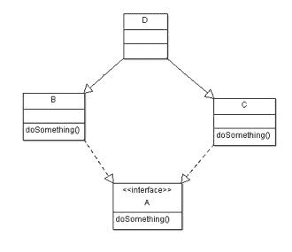

# Java 8：基础指南


**© 2014 Dane Cameron**

版权所有。未经出版者事先书面许可，不得以任何形式或通过任何手段（包括复印、录制或其他电子或机械方法）复制、传播或传输本书的任何部分，但批判性评论中的简短引用以及版权法允许的某些非商业用途除外。

原始及修改后的封面设计由 Karuanka Rayker 和 CoverDesignStudio.com 设计。

Cisdal Publishing

dane@cisdal.com

www.cisdal.com

# 目录

- 介绍
- 关于本书
- Lambda 表达式
- Streams API
- 接口
- Java 日期时间 API
- Nashorn
- 微改
- 总结
- 附录 A：JavaScript

# 介绍

我第一次在 20 世纪 90 年代后期使用 `Java 1.1` 学习 Java。那时，人们对 Java 感到非常兴奋。它不仅支持“一次编写，随处运行”的理念，还拥抱了互联网，并对网络、线程以及备受期待的 Applet 技术提供了原生支持。事实上，值得重申 Java 语言的五个主要目标：

- 它应该是“简单、面向对象且熟悉的”
- 它应该是“健壮且安全的”
- 它应该是“架构中立且可移植的”
- 它应该以“高性能”执行
- 它应该是“解释的、多线程的且动态的”

自从我第一次学习 Java 以来，情况发生了很多变化。计算机变得强大得多，数据集也增长了数个数量级。Java 很好地跟上了这些许多变化，并且可能仍然是商业环境中使用最广泛的编程语言，特别是在服务器端开发。它在开源世界也保持着动态且广泛的存在，并被整合到从 Android 到 Salesforce 的其他技术中。

尽管如此，与许多较新的（或新发现的）语言相比，Java 的某些方面开始显得过时。自从泛型在 `Java 5`（那是很久以前的 2004 年）引入以来，Java 语言很少有重大的增强。近年来一个常见的论调是“Java 是新的 Cobol”——被广泛使用但并不广受喜爱。我个人并不认同这一信条：Java 支持一套无与伦比的框架、库和工具，特别是对于服务器端计算——但 Java 确实缺乏许多其他语言所具备的表达力。

Java 8 是至少过去 10 年来，甚至可能自诞生以来 Java 发生的最大变化。它整合了许多年来一直被请求的功能（最著名的是 lambda 表达式），并试图通过增加对并行性的额外支持，以在多核机器的世界中保持 Java 的相关性：事实上，并行计算是 Java 8 大多数变化背后的驱动力（至少从 Oracle 的角度来看）。

下面的章节将引导你了解 Java 8 的核心主题。随后的章节将介绍与这些主题相关的、在 Java 8 中新增的功能。

## 函数式编程

函数式编程是一种编程范式，通过函数实现算法，这些函数接受值并返回值。这是一种避免状态和避免数据突变的编程风格——函数的结果完全取决于它的输入。换句话说，相同的输入总是产生相同的结果。

直到过去几年我（正确地）学习了 JavaScript 之前，我并没有完全意识到 Java 缺少了什么，正如我在我的书籍《软件工程师学习 HTML5、JavaScript 和 jQuery》中所记录的那样。在学习 JavaScript 之前，我对这种语言的看法相当低，这很大程度上是基于尝试将其语法强行引入 Java 风格程序的经验。

正确地学习 JavaScript 向我展示了即使在一种拥抱命令式和面向对象编程范式的语言中，函数式编程概念可以多么强大。我并不是对函数式编程陌生，但在离开大学后，我没有在商业工作中使用过函数式编程技术。

当然，我不是唯一注意到函数式编程技术价值的人。多年来，在 Java 语言中添加函数式编程功能（lambda 表达式或闭包）的想法一直受到共同推动，这甚至导致了 JVM 上几种新语言的诞生，最著名的是 Scala。

Java 8 提供了一项重要的新功能，称为“lambda 表达式”。这些本质上是可以动态构建、赋值给变量并作为参数传递给其他方法的匿名方法。这些功能被嵌入到语言中，许多现有的 API 被扩展以提供对 lambda 表达式的支持。

Java 8 并不是突然试图成为 Haskell 或 LISP 等纯函数式语言：它正试图在它的面向对象范式旁边添加一种新范式。lambda 表达式的引入是非侵入性的，这意味着如果你愿意可以忽略它们，但我希望在通过本书中的示例后，你能欣赏它们在语言中的地位，以及使用它们的代码的优雅。

## 并行性

自从我开始学习 Java 后，计算领域的另一个重大变化是处理越来越大的数据集的需求，并以多线程的方式进行。Google 在普及大数据处理方法方面比大多数人都做得更多，特别是 MapReduce 算法（已经在 Hadoop 中以 Java 形式实现）。

Java 8 增加了许多功能，最著名的是 Streams API，它旨在简化处理数据集的过程，并允许程序员请求并行而不是显式地实现。

这些功能背后的原理是好的，但它们无法完全隐藏并行性的复杂性，不理解这些新功能会导致严重问题。本书将深入研究 Streams API，并评估何时以及何时可以使用并行处理。

## 弥补过去的错误

Java 的日期 API 多年来一直受到批评。只需查看 `java.util.Date` 的弃用方法列表，你不怀疑犯了错误。

Java 的伟大之处之一是，当官方语言出现错误时，开源社区通过库来修复它们。在日期和时间方面，Joda time 库填补了空白。正如经常发生的（特别是在 Java EE 世界），Java 非常乐于从成功中学习，并在 Java 8 中引入了基于 Joda 的新日期/时间 API。

现有的 Date 和 Calendar API 保持不变，如果你愿意可以继续使用它们，或者与新的日期/时间 API 结合使用。

## 动态语言

Java 在 Java 7 中通过 `InvokeDynamic` 指令为动态语言添加了显式支持。结果是 Java 运行时现在支持各种动态语言。在 Java 平台上实现一种语言为该语言带来了巨大的利益（因为它可以访问 Java 生态系统中的所有的库和框架），同时也为 Java 本身带来了巨大的益处。

Java 8 添加了对名为 `Nashorn` 的 JavaScript 引擎的原生支持。`Nashorn` 从零开始编写，旨在与 Java 的动态语言支持协作，并取代了已经存在多年的 `Rhino` JavaScript 引擎。

你可能没有注意到，在过去的几年中，JavaScript 已经走出了浏览器，现在被广泛用作服务器端语言——最著名的通过 `node.js`。在 Java 平台上添加 `Nashorn` 可能会在不久的未来带来有趣的进展，特别是对于服务器端计算。

## 一些惊喜

在最初设计 Java 时，Sun 公司做出了有意识的决定，在 Java 中排除了多重继承。多重继承允许单个类继承自两个或多个类的功能。取而代之，Java 使用了接口（接口不能提供实现），并允许一个类实现多个接口。

Java 忽略多重继承有许多原因，其中最著名的就是“菱形问题”，当一个类从其父类继承同一个方法的不同实现时，就会出现这种问题。

Java 8 通过在接口上引入 `default methods`（也称为防御性方法 defender methods），部分消除了对多重继承的限制。添加此功能的主要原因是 Java 之前无法扩展任何核心语言接口，因为这会破坏实现这些接口的第三方现有代码。这一变化意味着许多现有的接口（如 `List` 和 `Set`）现在有了额外的方法。

# 关于这本书

## 这本书是给谁看的？

这本书是为任何熟悉 `Java` 并想要学习 `Java 8` 的人准备的。如果你还不熟悉 `Java`，那么这本书并不适合你：在跳入这些特性之前，你需要对该语言有合理的理解。

此外，这本书也面向使用 `Java` 编写应用程序的程序员和软件工程师。`Java 8` 还包括对 `Java Runtime`（运行时）的更改以及从编译的 `Java` 生成的字节码的更改：这些特性不会影响程序员的日常工作，因此被忽略了。例如，`Java 8` 中的许多功能旨在从某方面或方面提高 `Java` 平台的性能。在大多数情况下，这些功能不太可能改变你编写代码的方式。

本书的目标是写出一本可以在几个下午内读完的书，并提供足够的代码示例，让你理解每个新功能的基础知识。一旦你理解了这些基础知识，扩展你的知识将是相对易举的。

因此，这本书不会尝试充当参考书，也不会包含 `Java 8` 中添加的每一个新 `method`（方法）、`class`（类）或 `interface`（接口）的细节。一旦你理解了基础知识，使用 `Java Doc` 或其他在线帮助来扩展这些知识并寻找特定需求的方法是相对简单的。

我编写这本书的长度恰恰是我认为以适当细节涵盖材料所需的长度。电子书的一个主要优点是可以在适当的情况下编写更短的书，并收取与长度相匹配的价格。

## 我需要什么？

由于 `Java 8` 是新的，本节将经常更新。因此，书籍的网站将包含本节的最新版本：

[`www.cisdal.com/java8.html`](http://www.cisdal.com/java8.html)

为了跟练习示例，你需要 `Java 8`。`JDK` 可以从这里下载：

[`jdk8.java.net/download.html`](https://jdk8.java.net/download.html)

你还需要一个支持 `Java 8` 的 `IDE`。`IDEs` 需要针对 `Java 8` 推出特定的支持，因此你喜欢的 `IDE` 此时可能不支持 `Java 8`。

我在书中的示例使用了 `NetBeans`，很大程度上因为它有一个适用于 `OSX` 和其他平台的 `Java 8` 兼容安装程序。下一页提供了兼容 `Java 8` 版本的 `NetBeans` 链接：

[`netbeans.org/kb/docs/java/javase-jdk8.html`](https://netbeans.org/kb/docs/java/javase-jdk8.html)

提供了 `Eclipse` 支持，但目前安装一个支持 `Java 8` 的 `Eclipse` 版本需要稍多精力。下一页包含指令：

[`wiki.eclipse.org/JDT_Core/Java8`](https://wiki.eclipse.org/JDT_Core/Java8)

## 为什么我写这本书

我写这本书是因为我每天都使用 `Java`。多年来，我一直尝试在每个新版本的 `Java` 发布时，跟踪语言所发生的变化。

描述我学习 `Java 8` 的过程对我来说是巩固这些特性知识的极佳方式，希望这也是一个将我学到的东西传给他人的好机会。

## 无题的推广

随着 `Java` 正式拥抱 `JavaScript`，我认为没有更好的时候来向 `Java` 社区推销我的书籍《软件工程师学习 HTML5、JavaScript 和 jQuery》了。这本书将带你了解我在使用 `Java` 的职业生涯后，学习使用 `HTML5` 和 `JavaScript` 编写基于标准的应用程序的过程。

作为额外奖励，我在那本书中增加了一个关于 `JavaScript` 的章节，以鼓励你学习 `JavaScript`，并理解这种变得出奇地优雅和成熟的语言。

## 注意事项

`Java` 的覆盖范围非常广。成千上万的程序员使用 `Java` 平台，并以完全不同的方式从多种视角使用它。因此，对许多 `Java` 特性存在不同意见，这适用于 `Java 8`。

尽管我对 `Java 8` 的变化感到热情，并打算在工作中使用它们，但这本书并不是为了进行助威活动。本书旨在教你这些新特性以及如何使用它们。由你来判断这些特性是否有价值——如果没有价值，你也就没有必要改变你的编程方式。

许多人对这些特性在语言中应该如何实现有强烈的观点。例如，关于 `lambda expressions` 应该如何实现已经有了多年的争论。我的观点是船已经开了：我将介绍这些特性已经如何实现的方式，而不是浪费时间讨论它们本可以如何实现。

## 约定

书中的代码将使用以下字体：

```
这是代码
```

遗憾的是某些电子书阅读器不支持自定义字体。如果你对代码可读性有任何问题，请通过 `dane@cisdal.com` 联系我。

## 代码示例

书中的示例非常简单，可以手动编写。如果你想要可以复制粘贴的版本，所有的示例都可以在这里找到按章节分类：

[www.cisdal.com/java8.html](http://www.cisdal.com/java8.html)

## 反馈

我很乐意听到你对这本书的反馈（正面或负面的）。请发邮件给 `dane@cisdal.com`。

# Lambda 表达式

我们查看 `Java 8` 的最佳起点是从它最受期待的特性开始：`lambda expressions`（JSR 335 https://jcp.org/en/jsr/detail?id=335）。这些也是 `Java 8` 添加的其他几个特性的依赖，因此在不掌握 `lambda expressions` 的情况下，无法理解这些其他特性。

Lambda 表达式最初被计划包含在 `Java 7` 中，并且在此之前的多年里一直被广泛请求。Lambda 表达式（通常称为闭包或匿名方法）允许你将一段代码封装在匿名方法中（即没有名称或不包含所属类的方法），并将其传递给另一个方法，由该方法在适当的时间调用它。这听起来可能是一项简单的技术（确实如此），但它带来了巨大的益处，特别是当它与 Java 8 的另一个特性结合使用时：`Streams API`。

在过去，Java 最接近 lambda 表达式的特性是匿名类和局部类。这些是在方法内部定义并进行实例化的类，并且通常会被传递给另一个方法以执行某种操作。在匿名类的情况下，没有必要为该类命名。

匿名类被广泛用作回调，并被常用于实现 `Runnable` 和 `ActionListener` 等接口。

Lambda 表达式是类匿名类演进过程中的下一步，因此我们将从一个匿名类的示例开始，看看为什么许多人认为 lambda 表达式是必要的。

考虑这样一段代码：它从一个整数列表中过滤掉所有偶数，产生一个新的奇数列表。自然地，这可以通过迭代和命令式编程技术来实现，但另一种编写方法是定义一个方法，接受列表中的每个元素，并返回 `true` 或 `false` 以指示该元素是否应该保留在列表中——并定义一个通用的库来遍历列表并在每个元素上调用该方法。

这种方法的优势在于，我们可以复用通用的过滤算法，只需替换做出过滤决策的方法即可。

开始，我们可以为将做出过滤决策的类定义一个 `Interface`：

```java
package localclasses;

public interface Filter<T> {
    boolean filter(T t);
}
```

接下来，我们可以写一个静态辅助类来执行通用的过滤。我们将其命名为 `Collections2`，因为它增强了 Java 在 `Collections` 类上提供的方法。这将创建一个新的空 `List`，遍历原始列表中的项，并在传递给它的 `Filter` 实例上调用 `filter` 方法——那些返回 `true` 的元素将被添加到新列表中：

```java
package localclasses;

import java.util.ArrayList;
import java.util.List;

public class Collections2 {
    public static <T> List<T> filter(List<T> input, Filter<T> filter) {
        List<T> result = new ArrayList<T>();
        for (T t : input) {
            if (filter.filter(t)) {
                result.add(t);
            }
        }
        return result;
    }
}
```

现在我们已经有了一个通用的过滤 API，可以使用此功能来过滤列表。下面的代码将声明一个实现 `Filter` 的匿名类，并提供一个针对奇数时返回 `true` 的实现：

```java
package localclasses;

import java.util.List;
import java.util.Arrays;

public class Main {
    public static void main(String[] args) {
        List<Integer> numbers = Arrays.asList(1,5,4,2,7,9,6,4,2,6,5,8);
        System.out.println(
            Collections2.filter(numbers, new Filter<Integer>() {
                @Override
                public boolean filter(Integer t) {
                    return t%2 == 1;
                }
            })
        );
    }
}
```

这并不难，对吧？

作为对比，JavaScript 中的相同代码看起来如下：

```javascript
[1,5,4,2,7,9,6,4,2,6,5,8].filter(function(v) {return v%2 == 1;})
```

JavaScript 的实现原生地向数组支持的 `filter` 方法传递了一个匿名函数。

比较这两种方法的在于比较 Java 匿名类的实现：

```java
Collections2.filter(numbers, new Filter<Integer>() {
    @Override
    public boolean filter(Integer t) {
        return t%2 == 1;
    }
})
```

与 JavaScript 的匿名函数实现：


```javascript
function(v) {return v%2 == 1;}
```

当你比较这两者时，你就能理解为什么人们指责 Java 感觉过于啰嗦了。诚然，JavaScript 版本没有带来类型安全的优势，但除此之外，这两个示例在功能上是等价的。JavaScript 并不是孤立的例子；许多语言现在都支持同样简洁的语法。

JavaScript 中允许这行代码运行的关键特性是函数可以赋值给变量并作为参数传递给其他函数。具体来说：函数是该语言中的一等公民。

在 `Java 8` 发布之前，所有的 Java 方法都必须定义在类内部——因此方法在语言中并不是一等公民。结果是，方法不能作为参数传递给其他方法或赋值给变量。

Lambda 表达式本质上是一个在类作用范围之外的匿名方法。正如我们将看到的，在某种程度上这是一种幻象，lambda 表达式仍然是对象，它们确实有类型，但创建它们的语法消除了定义类的开销。

Lambda 表达式的基本格式如下：

```java
(String s) -> { System.out.println(s); };
```

表达式的第一部分 `(String s)` 表示在调用 lambda 表达式时将传递给它的参数——在这种情况下，它将传递一个单一的 `String` 参数。如果 lambda 表达式不需要参数，则可以定义为 `()`。正如我们将看到的，这种结构在某些情况下可以被极大简化，表达式的右侧 `{ System.out.println(s); }` 包含了调用 lambda 表达式时将执行的代码块——自然地，它可以访问参数并使用所需的任何其他 Java 语言特性——它只是一个普通的代码块。

如果代码块由单个语句组成，可以省略 `{}` 括号，该语句的返回类型将隐式成为 lambda 表达式的返回类型。如果使用了 `{}` 括号，lambda 表达式可以使用 `return` 关键字返回值，否则（在本例中），它返回 `void`。

表达式的两个部分通过 `->` 结构连接在一起。下面将有许多这种结构的示例，所以现在不必过于担心理解 lambda 表达式的细节。

## 函数式接口

如上所述，许多支持 lambda 表达式的语言使函数成为语言中的一等公民。Java 并没有走得那么远——lambda 表达式仍然是对象。此外，即使增加了 lambda 表达式，Java 仍然是一种静态类型语言；因此，它需要在编译时知道传递给方法的任何参数（包括 lambda 表达式）的类型。这引出了显而易见的问题：lambda 表达式是什么类型？

答案在于 `Java 8` 的一项新特性：“函数式接口”。你可能遇到过没有方法的接口（例如 `Serializable`、`Cloneable`）。这些被称为标记接口或标签式接口，因为它们仅用于表示类的某些特征，而不需要要求类实现任何内容。

Java 现在支持第二类特殊的接口，它们包含单个方法：这些可以被指定为“函数式接口”。许多现有的 Java 接口已被指定为函数式接口，包括 `Comparable`、`Runnable` 和 `ActionListener`。这些接口被称为单抽象方法接口（SAM Interfaces）——特别是在 Scala 世界。

在 `Java 8` 之前，SAM 接口并没有特殊之处：在 `Java 8` 中，当使用 `@FunctionalInterface` 注解标记时，它们现在可以作为 lambda 表达式的类型，例如：

```java
@FunctionalInterface
```

```java
public interface Example {

    void doSomething(Object obj);
}
```

Lambda 表达式的一个显而易见的用途是回调。回调封装了一块代码，当指定事件发生时，由另一个代码块执行这块代码。该事件可能是用户点击屏幕上的按钮，也可能是接收到长时间运行事务的结果。

下面的示例创建了一个函数式接口来表示对象的打印。该接口的实例将作为回调传递给其他方法，允许它们按照初始调用者要求的方式打印操作结果：

```java
package printing;

@FunctionalInterface
public interface Printer {

    void print(Object obj);
}
```

添加 `@FunctionalInterface` 注解可以确保编译器会检查该接口是否符合函数式接口的要求：如果接口包含除一个方法定义以外的任何内容，代码将无法编译。

一旦定义了函数式接口，我们就可以声明该类型的 lambda 表达式：

```java
Printer printer = (Object o) -> { System.out.println(">>>" + o); };
```

这行代码不会执行 lambda 表达式：它只是将其赋值给一个变量，以便在代码的后续部分使用。

如果你思考上面的那行代码，从 Java 的角度来看，它实际上是非常不常的。编译器通过对象赋值的类型来确定对象的类型。这与 Java 的正常工作方式相反：通常，一个表达式有一个类型，编译器判断该类型是否与被赋值的类型兼容。

如果你愿意，随后可以这样调用它：

```java
printer.print("Hello World");
```

通常，我们想将 lambda 表达式传递给另一个方法。以下是一个人为的示例，但它展示了基本技术：

```java
package lambda;

import printing.Printer;

public class Adder {

    public static void main(String[] args) {
        int num1 = 10;
        int num2 = 20;

        Printer printer = (Object o) -> {
            System.out.printf("The result of %d and %d is %d\n", num1, num2, o);
        };

        add(num1, num2, printer);
    }

    public static void add(int num1, int num2, Printer printer) {
        int result = num1 + num2;
        printer.print(result);
    }
}
```

这会在标准输出中打印以下内容：

```text
The result of 10 and 20 is 30
```

这是一个人为的示例，因为没有理由让 `add` 方法不返回加法结果由 `main` 方法自己打印，但它开启了我们 lambda 表达式的大门。

注意，这个 lambda 表达式使用了 `main` 方法中的局部变量，尽管它最终在 `add` 方法中执行：稍后当我们调查 lambda 表达式运行的作用域时，我们会回到这个主题。

事实上，大多数时候我们不需要定义自己的函数式接口，因为 Java 为我们提供了一套。我们可以通过移动到一个真实的示例来看这一点。

lambda 表达式的一个常见用例是让方法将列表的每个元素传递给 lambda 表达式（就像我们在章节开始时的 filter 示例一样）。Java 8 在 `List` 上提供了一个名为 `forEach` 的新方法，它接受 lambda 表达式并隐式地将列表中的每个元素传递给它：它接受的 lambda 表达式必须符合 `Consumer` 函数式接口（`java.util.function.Consumer`）。这定义了以下方法：

```java
void accept([T](http://download.java.net/jdk8/docs/api/java/util/function/Consumer.html "type parameter in Consumer") t)
```

下面显示了一个基础示例：

```java
package lambda;

import java.util.Arrays;
import java.util.List;
import java.util.function.Consumer;

public class Main {

    public static void main(String[] args) {
        Consumer c = (Object o) -> { System.out.println(">>>" + o); };
        List l = Arrays.asList("Hello", "World", "Print", "My", "List");
        l.forEach(c);
    }
}
```

这将产生以下输出：

```text
>>>Hello
>>>World
>>>Print
>>>My
>>>List
```

这是书中许多示例中的第一个，它使用了“隐式”而非“显式”迭代。诸如 `forEach` 等方法消除了程序员向编译器描述迭代过程的需要——它们隐式地执行迭代。这听起来像是一个微小的便利，但事实证明在书中后面将产生强大的影响。

我们当然可以将 lambda 表达式的声明和使用合并为一个步骤：

```java
package lambda;

import java.util.Arrays;
import java.util.List;

public class Main {

    public static void main(String[] args) {
        List l = Arrays.asList("Hello", "World", "Print", "My", "List");
        l.forEach((Object o) -> { System.out.println(">>>" + o); });
    }
}
```

注意，现在我们甚至不需要导入 `Consumer` 接口——编译器知道要检查 lambda 表达式是否符合 `Consumer` 接口，因为那是 `forEach` 方法接受的接口。

我们甚至可以进一步从 lambda 表达式的参数中移除类型定义，并移除 lambda 表达式代码块中的 `{}` 括号：

```java
package lambda;

import java.util.Arrays;
import java.util.List;

public class Main {

    public static void main(String[] args) {
        List l = Arrays.asList("Hello", "World", "Print", "My", "List");
        l.forEach(o -> System.out.println(">>>" + o));
    }
}
```

我们使用了泛型来声明列表包含 `String` 类型；因此编译器可以安全地假设传递给 lambda 的是 `String`。

我们现在可以将注意力回到之前的过滤示例。Java 8 将过滤器称为“谓词”（predicate），并提供了一个名为 `Predicate` 的函数式接口。这定义了以下方法：

```java
boolean test([T](http://download.java.net/jdk8/docs/api/java/util/function/Predicate.html "t") t)
```

谓词的根本方面是它接受一个元素并返回真或假。`List` 接口还支持新方法 `removeIf`。该方法将列表中的每个元素传递给谓词，如果谓词结果为真则将其删除：

```java
package lambda;

import java.util.Arrays;
import java.util.LinkedList;
import java.util.List;

public class Main2 {

    public static void main(String[] args) {
        List<Integer> l = new LinkedList(Arrays.asList(4,5,88,76,55,23,7,20,45));
        l.removeIf(i -> i%2 == 0);
        System.out.println(l);
    }
}
```

表达式 `i -> i%2 == 0` 符合 `Predicate` 接口，因为它接受单个参数并返回布尔结果——如上面提到的，如果 lambda 表达式由没有 `{}` 括号的单个语句组成，它们隐式返回类型。

这也可以写成代码块：

```java
l.removeIf(i -> {return i%2 == 0;});
```

我远更喜欢第一种形式，这也是最常用的形式。

我应该在这里提到，`removeIf` 方法是一个非常糟糕的函数式编程示例，因为它修改（或改变）了原始列表。函数式编程强调不可变性，因此首选的方法是创建一个奇数新列表并保持原始列表不变。正如我们在下一章将看到的，使用 Java 8 的 `Streams API` 可以相对简单地实现这一点。

以防你好奇，该方法修改了 `List` 意味着我不能简单使用：

```java
Arrays.asList(4,5,88,76,55,23,7,20,45)
```

由于此方法返回一个映射到数组的固定长度的 `List`，因此无法移除元素。

## 自动生成的接口

到目前为止我们看到的 lambda 表达式存在一个问题，即它们无法实现非常好的代码复用。上面的示例都是动态创建 lambda 表达式，并将其作为参数传递给其他方法。如果两个不同的类需要执行相同任务的 lambda 表达式，它们将需要各自构造自己的 lambda 表达式（从而导致了代码重复）。

`Java 8` 中的 lambda 表达式 API 提供了一种机制，可以将任何对象上的任何方法（或类上的静态方法）作为 lambda 表达式使用（受其访问修饰符限制），只要它符合所需的函数式接口。这一特性被称为自动生成接口，并通过一个名为“双冒号”的新操作符来实现。

让我们来看一个能找到的最简单的例子。假设我们想将列表中的每个元素传递给 `System.out.println` 方法。`println` 方法符合 `Consumer` 函数式接口的要求（它接受一个参数并返回 `void`）；因此，它可以作为 `Consumer` 的实例使用：

```java
package lambda;

import java.util.Arrays;
import java.util.List;

public class Main3 {
    public static void main(String[] args) {
        List<String> l = Arrays.asList("Hello", "World", "Print", "My", "List");
        l.forEach(System.out::println);
    }
}
```

这里的关键是 `System.out::println` 语句。本质上这表示变量 `out` 所代表的对象有一个名为 `println` 方法，并且应该被用作 `forEach` 方法接受的 lambda 表达式。由于 `forEach` 接收一个 `Consumer`，因此在过程中 `println` 方法被隐式地转换为 `Consumer` 类型的对象。

如果我们回到从列表中删除偶数元素的例子：假设我们已经有了以下工具类：

```java
package lambda;

public class Detector {
    public boolean isEven(int i) {
        return i%2 == 0;
    }

    public boolean isOdd(int i) {
        return !isEven(i);
    }
}
```

这是一个检测奇数和偶数的简单工具：它与 lambda 表达式无关，并且可能在 `Java 8` 出现之前就已经了。我们可以如下重写过滤示例：

```java
package lambda;

import java.util.Arrays;
import java.util.LinkedList;
import java.util.List;

public class Main4 {
    public static void main(String[] args) {
        Detector d = new Detector();
        List<Integer> l = new LinkedList(Arrays.asList(4,5,88,76,55,23,7,20,45));
        l.removeIf(d::isEven);
        System.out.println(l);
    }
}
```

或者，如果我们把 `isEven` 为静态方法，就可以执行：

`l.removeIf(Detector::isEven);`

这是一项非常有用的技术，这意味着现有代码可以被重用以适应它没有显式实现的接口。这意味着例如，任何零参数方法都可以被重用以实现 `Runnable` 接口并由 `Thread` 执行。

对列表排序是非常常见的操作，由 `Comparator` 和 `Comparable` 接口支持。我一直很困扰，`sort` 方法是 `Collections` 类上的一个静态辅助方法，而不是 `List` 类的方法。这可能是因为 `List` 是一个 `Interface`（接口）而不是类，因此 `sort` 方法需要在每个 `List` 的实现上进行实现。

正如我们后面看到的，这对于 `Java` 来说不再是一个限制，因此 `Java` 在 `Java 8` 中通过 `List` 上的 `sort` 方法纠正了这种情况（尽管它是一个接口），并在过程中将 `Comparator` 变成了函数式接口。

为了演示这一点，我们将创建一个非常简单的 `Person` 类：


```java
package lambda;

public class Person {
    String firstName,lastName;
    public Person(String firstName, String lastName) {
        this.firstName = firstName;
        this.lastName = lastName;
    }
    public String getFirstName() {
        return firstName;
    }
    public String getLastName() {
        return lastName;
    }
    @Override
    public String toString() {
        return firstName + " " + lastName;
    }
}
```

我们现在可以创建一个`Person`实例列表，并按照`firstName`对其进行排序，如下：

```java
package lambda;

import java.util.Arrays;
import java.util.List;

public class Main5 {
    public static void main(String[] args) {
        List<Person> l = Arrays.asList(
            new Person("Albert", "Smith"),
            new Person("Jim", "James"),
            new Person("John", "Brown"),
            new Person("William", "Hughes"),
            new Person("Simon", "Fleming")
        );
        l.sort((p1, p2) -> p1.getFirstName().compareTo(p2.getFirstName()));
        System.out.println(l);
    }
}
```

语句：

`(p1, p2) -> p1.getFirstName().compareTo(p2.getFirstName())`

在这个过程中，它隐式地构建为`Comparator`类型的对象。

注意此处的`sort`操作是会变的：它改变了原始列表，而不是返回一个带有新元素的新列表。

使用匿名类（功能等效）的代码可读性如下：

```java
l.sort(new Comparator<Person>() {
    @Override
    public int compare(Person p1, Person p2) {
        return p1.getFirstName().compareTo(p2.getFirstName());
    }
});
```

## 作用域

正如我们在上面看到的，lambda 表达式可以使用创建时在作用域内的变量。但有一个例外——只要这些变量不改变值，就可以使用它们。

例如，考虑以下函数式接口：

```java
package lambda;

@FunctionalInterface
public interface NumberAdder {
    int add(int x);
}
```

这有一个名为`add`的方法，接受一个整数并返回一个整数。

我们现在如下创建一个返回`NumberAdder`的方法：

```java
public static NumberAdder getNumberAdder() {
    int startingNumber = 10;
    return x -> x + startingNumber;
}
```

该方法声明了一个局部变量`startingNumber`，然后返回`NumberAdder`的实例。

在正常情况下，`startingNumber`会在方法完成时被销毁（记住局部变量存在于栈上，并在方法完成时从栈中弹出）。但在 lambda 表达式的情况下，变量在方法完成时仍然存在。这里是调用方法的完整类：

```java
package lambda;

public class Main6 {
    public static void main(String[] args) {
        NumberAdder na = getNumberAdder();
        System.out.print(na.add(20));
    }
    public static NumberAdder getNumberAdder() {
        int startingNumber = 10;
        return x -> x + startingNumber;
    }
}
```

运行此代码，它将打印 30。以这种方式使用变量的 lambda 表达式被称为“捕获 lambda”，因为它们捕获了构造时作用域内的变量副本。

为了让这个小魔法生效，`startingNumber`变量必须是`final`或“有效 final”。即使是以下代码也是无效的且无法编译：

```java
public static NumberAdder getNumberAdder() {
    int startingNumber = 10;
    startingNumber++;
    return x -> x + startingNumber;
}
```

“有效 final”这个词是一个新术语。本质上，这意味着变量的行为就像`final`一样，尽管它不需要被标记为`final`。基本上，如果一个变量在加上`final`修饰符后无效，那么它对于 lambda 表达式的使用也是无效的。

这一限制是有争议的，它是为了减少由于修改变量可能引起的并发问题而引入的。在 Java 8 之前，你永远不会遇到局部变量的线程问题：简单来说，两个线程共享同一个局部变量实例是不可能的，因为它们是在方法内部创建的，而调用相同方法的两个线程将接收各自独立的变量副本。

如果 lambda 表达式可以修改本地变量，并且两个方法从两个不同的线程同时调用该 lambda 表达式，那么语言将引入一组全新的并发问题。

当然，可以通过绕过这一限制（就像绕过`final`变量的限制一样），将整数封装为对象内部的一个字段。这样一来，即使在 lambda 表达式创建后，也可以更改该字段的值。可以通过创建以下类来实现：

```java
package lambda;

public class IntegerHolder {

  public int number = 10;

}
```

并对主类修改如下：

```java
package lambda;

public class Main7 {

  public static void main(String[] args) {

  NumberAdder na = getNumberAdder();

  System.out.print(na.add(20));

  }

  public static NumberAdder getNumberAdder() {

  IntegerHolder ih = new IntegerHolder();

  ih.number = 10;

  NumberAdder na = x -> x + ih.number;

  ih.number = 20;

  return na;

  }

}
```

在这种情况下，`ih`变量是有效最终的（effectively final），因为在变量初始化后我们没有更改其引用的对象。然而，我们在创建 lambda 表达式之后确实更改了该对象所持有的数字。

在这种情况下，操作的结果是 40，因为当 lambda 表达式被调用时，`number`字段的值已经被更改为 20。

这种方法自然会让代码暴露在规范试图通过使用`final`变量来避免的并发问题中，因此不应被视为一种特性。

## 结论

正如你所看到的，lambda 表达式提供了一种构建匿名方法并将其作为参数传递给其他方法的机制。

Java 社区中关于 lambda 表达式的辩论似乎没完没了。不仅它们的发布从`Java 7`推迟到了`Java 8`，而且还引发了大量的争论和批评。

即使现在它们已经被包含在内，某些圈子里仍有观点认为 lambda 表达式只是“语法糖”——它们仅仅是实现接口的替代方式，因此与 Java 8 之前的匿名类和局部类类没有区别。

你可以对任何编程语言或编程语言结构提出论点，认为它只是某些其他结构（如汇编，最终是机器码）之上的语法糖，因为在`Java`等高阶语言中无法实现的功能，在汇编或机器码中是可以实现的。关键在于，`Java`等语言为人类向计算机描述一组任务提供了更方便的机制。同样，lambda 表达式将让许多 Java 程序员更容易地向 Java 编译器描述任务。

尽管 lambda 表达式没有让你能够完成任何不使用它们就做不到的事，但它们有改变你对`Java`中解决问题思维的能力。这一主题将延续到关于`Streams API`的下一章节：因为那是 lambda 表达式大放异彩的地方。

# Streams API

`Java 8`作为 lambda 表达式 JSR，引入了一个名为`Streams API`的新 API。这些不应与输入/输出流混淆；它们是处理元素序列（例如`Collection`中的元素）的机制。`Java 8`正式将流定义为“一种支持顺序和并行聚合操作的元素序列”。

正如我们在本节后面将看到的，`Streams API`是简化`Java`中并行算法实现方式努力的一部分，它允许程序员请求并行处理而不是自己实现它。然而，流远不止于此，它们提供了迭代的替代方案，并为各种操作提供了支持，所有这些操作都可以利用 lambda 表达式。

我们将从一些非常流流示例开始，回到我最喜欢的从`List`中排除偶数。可以通过以下方式完成：

```java
package streams;

import java.util.Arrays;

import java.util.List;

public class EvenOnly {

  public static void main(String[] args) {

  List<Integer> l = Arrays.asList(5,4,88,76,55,23,7,20,45);

    l.stream().filter(p -> p%2==1)
    .forEach(i -> System.out.print(i+" "));

  }

}
```

在创建列表后，我们首先通过`stream()`方法访问它的流。这返回一个类型为`java.util.stream.Stream<Integer>`的对象。我们很快就会详细查看流是什么，但目前只需将它们认为是一种从数据源（即`List`）向函数（即`filter`）传递元素的方式。

这段代码“内部迭代”了列表中的每个元素（如在前章的`forEach`中所示），并逐个将每个元素传递给`filter`方法。这与使用`for`循环和迭代器的“外部迭代”相反，因为程序员不需要声明他们希望在循环中处理每个元素的要素，也不需要控制迭代。

外部迭代看起来可能并不是需要消除的巨大不便——尤其是自从了基于`Collection`的`for`循环之后。然而，内部迭代可以带来意想不到的好处，因为它可以针对不同的集合实现不同的迭代策略，从而允许隐式地添加行为（例如并行处理）。

`filter`方法被称为中间操作。当每个元素被处理时，通过过滤的元素随后会被传递给`forEach`方法，后者是一个终端操作。

`filter()`方法返回的类型本身是`Stream`，因此可以将一组中间操作链联成“流水线”（pipeline）。

流水线的实现基于：一个操作的输出成为另一个操作的输入。

流水线在计算中被广泛使用：例如 Unix/Linux 命令行支持流水线，一个程序的输出通过`|`运算符传递给另一个。例如，这可以查找名称中包含“java”的运行进程：

```
ps | grep 'java'
```

Unix 允许此点的约定是程序向标准输出产生 ASCII 文本，而程序从标准输入读取 ASCII 文本。因此，管道操作将一个程序的标准输出接到另一个程序的标准输入。

正如我们在整个章节中所看到的，流水线提供了一种用易理解的块来描述复杂功能的机制。

终端操作（顾如其名）代表了流水线的终点，它们负责以某种方式终止流。`forEach`不是最明显的终端操作示例，但它提供了一种在元素被流水线处理后访问它们并对它们执行某些操作的方法（在本例中为打印它们）。你会注意到`forEach`方法返回`void`，因此在调用该方法后，流水线无法继续。

与之前看到的`removeIf`方法不同，此流水线没有以任何方式更改原始`Collection`：它仅仅提供了一种处理其元素的机制。

在上面的示例中，列表中的第一个元素（5）被传递给`filter`方法的 lambda 表达式，并被评估为真（它是奇数）。结果是该元素被传递给`forEach`方法的 lambda 表达式，导致该数字被打印。

一旦元素通过了整个流水线，下一个数字（4）就会被处理。由于`filter` lambda 表达式对该数字返回假，因此它永远不会被传递给`forEach` lambda 表达式，依此类推。

即使如此，严格来说这并不是处理过程的真实写：中间操作是惰性的（lazy）。在调用终端操作之前，中间操作不会执行——因此，是由于第一个数字（5）执行`forEach`方法，触发了`filter`方法的调用。

这种方法意味着整个流水线可以在集合的单次迭代中完成处理，对于大数据集，这可以显著提高性能。它也意味着流（stream）在执行处理时不需要保留列表中的所有元素。

最后一点非常重要。Streams 的另一种实现方式是对所有元素调用`filter`操作并将这些元素捕获到一个`Collection`中——一旦捕获了这些元素，就可以将它们传递给`forEach`方法。我认为显而易见，这种实现实现在内存利用率或处理器利用率方面的效率也不会那么高。

为了亲眼看到这一过程，我们将按照所示重写`main`方法：

```java
public static void main(String[] args) {
    List<Integer> l = Arrays.asList(5,4,88,76,55,23,7,20,45);
    Stream<Integer> s = l.stream().filter(p -> {
        System.out.println("Filter called on "+ p);
        return p%2==1;
    });
    System.out.println("The pipeline is created - calling terminal operation");
    s.forEach(i -> System.out.println(">>>" + i));
}
```

这产生了以下结果：

```
The pipeline is created - calling terminal operation
Filter called on 5
>>>5
Filter called on 4
Filter called on 88
Filter called on 76
Filter called on 55
>>>55
Filter called on 23
>>>23
Filter called on 7
>>>7
Filter called on 20
Filter called on 45
>>>45
```

注意输出的第一行：尽管它在`filter`方法似乎被调用之后才被打印，但它实际上是第一个显示的打印语句，证明了这一行是先执行的。这表明即使我们的代码结构跨越多个语句，`Stream`仍然通过单次遍历处理了`Collection`。

惰性调用方法还有另一个主要优势。假设我们只想找到列表中的第一个奇数。这可以通过名为`findFirst`的另一种终端操作来实现：

```java
public static void main(String[] args) {
    List<Integer> l = Arrays.asList(5,4,88,76,55,23,7,20,45);
    Stream<Integer> s = l.stream().filter(p -> {
        System.out.println("Filter called on "+ p);
        return p%2==1;
    });
    Optional<Integer> result = s.findFirst();
    System.out.println(result.get());
}
```

此示例输出了以下结果：

```
Filter called on 5
5
```

列表中的第一个元素是奇数，因此这是唯一需要处理的元素。

这个示例还有另一个有趣的的方面。`findFirst`方法返回的不是`Integer`，而是`Optional<Integer>`。你会在整个 Streams API 中发现对`Optional`类的引用：它为一个可能为空的值提供了一个容器。该类支持一个名为`isPresent`的方法，用于判断容器是否持有非空值。

`Optional`类还支持如`map`和`filter`等方法，允许在需要时通过 lambda 表达式修改值。也没有什么阻止你从自己的代码中返回`Optional`实例，这可能证明是扩展你 API 价值的一种有用机制。


在继续之前，关于 `Streams` 还有几点需要说明。首先，一旦流处理了它的元素，就不能被重用。例如，在上面的示例中，在 `forEach` 操作执行后，我们无法在 `filter` 返回的 `Stream` 上调用另一种终端操作。技术上流是可以关闭的，但没有理由显式地关闭它们。

其次，`Streams` 必须是非干涉的：它们不能更改 `Stream` 的源（上述示例中的列表）。

我们现在转向一个稍微复杂的示例，并演示流水线如何包含多个中间步骤。假设我们想执行以下操作：

- 从列表中过滤掉偶数
- 将剩余的每个数字乘以自身
- 将这些数字相加

在这种情况下，前两步将是中间操作，而求和操作将是终端操作。可以通过如下方式实现：

```java
double result = l.stream()
.filter(p -> p%2==1)
.mapToInt(p -> p * p)
.sum()
```

上面的 `filter` 方法看起来很熟悉，由于它返回一个 `Stream<Integer>`，我们显然可以在结果上执行其他中间操作。

执行的下一个中间操作是 `mapToInt`。这与 `filter` 操作略有不同：它提供了一种转换数据的方式。传递给 `mapToInt` 的 lambda 表达式接受任何类型的对象作为输入，并返回一个整数结果。在这种情况下，输入参数也是整数，但这不是强制要求的：我们可以传递一个 `Person` 对象作为参数，并返回工资字段（如果它是整数的话）。

传递给 `mapToInt` 的 lambda 表达式简单是将输入参数乘以自身并隐式地返回结果。

`mapToInt` 的另一个有趣点是，它不是返回 `Stream<Integer>` 对象，而是实际上返回 `IntegerStream`。这种差别可能很小，但 `IntegerStream` 提供了一套专门用于整数值的聚合操作，包括 `min`、`max`、`average` 以及我们使用的 `sum`。

`Streams` API 还支持 `DoubleStreams`（通过 `mapToDouble`）和 `LongStreams`（通过 `mapToLong`）。它们与 `IntegerStream` 具有相同的聚合操作。

`Streams` 还支持通用的 `map` 操作，将任何类型的对象转换为任何类型，但此方法简单返回 `Stream<T>`，其中 `T` 是 `map` 操作的类型。

`sum` 方法是一种被称为归约的终端操作：它接收一组值并将它们归约为值。如果我们选择，也可以自己实现 `reduce` 方法：

```java
l.stream()
.filter(p -> p%2==1)
.mapToInt(p -> p * p)
.reduce((a, b) -> a + b)
```

`reduce` 算法通过将列表中的两个元素传递给提供的 lambda 表达式开始。该操作的结果将与第三个元素一起传递给 lambda 表达式，直到处理完元素。以下是传递 `reduce` lambda 表达式的值输出：

```
a = 25, b = 3025
a = 3050, b = 529
a = 3579, b = 49
a = 3628, b = 2025
```

（有 5 个奇数，所以表达式被调用了 4 次）。

`reduce` 方法返回 `OptionalInt` 实例，因为 `filter` 方法可能从 `Stream` 中移除所有元素。

`reduce` 操作接受符合 `BinaryOperator` 函数式接口的 lambda 表达式。该接口有一个接受两个参数并返回相同类型参数的方法：

`R apply(T t, U u)`

因此，我们可以重用 Java 8 为 `Integer`（以及其他数字包装类型）的新的静态辅助方法：

```java
public static int sum(int a, int b)
```

如下所示：

```java
l.stream()
.filter(p -> p%2==1)
.mapToInt(p -> p * p)
.reduce(Integer::sum)
```

注意 `sum` 方法是静态的，因此我们不需要 `Integer` 实例来调用 `sum` 方法。

`reduce` 操作还可以接受一个可选的第一个参数，代表聚合的初始值：

```java
l.stream()
.filter(p -> p%2==1)
.mapToInt(p -> p * p)
```

```
.reduce(100, (a, b) -> a + b)
```

此示例将返回比上一个示例多 100。

如果省略，将使用返回数据类型的默认值，例如数字类型的 `0`。

## 收集 (Collecting)

另一个常用的终端操作是收集。收集提供了一种根据一组标准对元素进行累加或总结的机制。

例如，考虑之前提到的 `Person` 类的列表。我们可能想将所有 `firstName` 相等的 `Person` 实例分组——可以通过以下方式实现：

```java
package streams;

import java.util.Arrays;
import java.util.List;
import java.util.Map;
import java.util.stream.Collectors;

public class Collecting {
 public static void main(String[] args) {
 List<Person> people = Arrays.asList(
 new Person("Albert", "Smith"),
 new Person("John", "James"),
 new Person("John", "Brown"),
 new Person("William", "Hughes"),
 new Person("William", "Fleming")
 );
 Map<String, List<Person>> groupedMap = people.stream()
 .collect(Collectors.groupingBy(Person::getFirstName));
 System.out.println(groupedMap.get("William"));
 }
}
```

此 `groupingBy` 操作返回一个 `Map`，其中键（keys）是名字的唯一值（William, John, Albert），值（values）是匹配该键的 `Person` 类的 `Lists`。

由于最后一行访问了 `William` 键对应的 `List`，它将打印出：

`[William Hughes, William Fleming]`

`collect` 方法接受一个 `Collector`。这些收集可以通过 `Collectors` 类中的一组静态辅助方法生成——在这种情况下，我们正在使用 `groupingBy` `Collector`，并指定了应用于比较的方法。随后，系统将为我们生成相应的 `Collector` 实例。

一旦元素被分组，通常会对每个组运行一个聚合操作（例如，统计每个组中有多少个元素）。因此，`groupingBy` 方法接受一个第二个参数来执行聚合操作。作为一个示例，我们将处理 Java 中所有可用的时区（我们将在书的后半部分查看新的日期和时间 API 时再次看到它们）：这些可以作为数组从 `TimeZone.getAvailableIDs()` 获取。它们的形式如下：

Africa/Asmara

Europe/London

其中，可选的第一部分（Europe, Africa）代表分组机制，而斜杠后的部分代表特定值。

我们将编写一个执行以下操作的程序：

- 过滤掉任何不包含斜杠的区域
- 按其组（例如 Europe, Africa）对区域分组
- 统计每个组中有多少个区域

可以通过以下单行完成：

```java
package streams;

import java.util.Arrays;
import java.util.Map;
import java.util.TimeZone;
import java.util.stream.Collectors;

public class Collecting5 {
 public static void main(String[] args) {
 Map<String, Long> result =
 Arrays.asList(TimeZone.getAvailableIDs())
 .stream()
 .filter(s -> s.indexOf("/") > 0)
 .collect(Collectors.groupingBy((String s) -> s.substring(0, s.indexOf("/")),
 Collectors.counting()));
 System.out.println(result);
 }
}
```

注意将 `Collectors.counting()` 作为 `groupingBy` 方法的第二个参数使用。它本身是一个 `Collector`，并处理分组的结果。`counting` 方法（与 `groupingBy` 方法不同）不需要其他信息即可生成 `Collector`——因为它在一个由 `groupingBy` 方法返回格式的数据结构上操作（一个以 `Lists` 为值的 `Map`）。

这输出以下内容：

`{Europe=59, Africa=54, SystemV=13, Canada=9, Pacific=42, Etc=35, Asia=91, America=164, Brazil=4, Mexico=3, Indian=11, Antarctica=11, Chile=2, Australia=23, Arctic=1, Atlantic=12, US=13}`

分区 (Partitioning) 是另一种类似于 `groupingBy` 的 `Collector` 。如前所述，`filter` 操作对流中的所有元素返回真或假。分区提供了一种机制，将所有为真的值收集到一个 `List` 中，将所有为假的值收集到另一个 `List` 中。在这个示例中，我们将两个列表：一个用于名称中包含 "/" 的区域（例如 America/Cancun），另一个用于不包含的区域（例如 Greenwich）。

```java
package streams;

import java.util.Arrays;
import java.util.List;
import java.util.Map;
import java.util.TimeZone;
import java.util.stream.Collectors;

public class Collecting4 {
 public static void main(String[] args) {
 List<String> zones = Arrays.asList(TimeZone.getAvailableIDs());
 Map<Boolean, List<String>> zonesCompare =
 zones.stream()
 .collect(Collectors.partitioningBy(s -> s.indexOf("/") > 0));
 System.out.println(zonesCompare);
 }
}
```

`Collecting` 的另一个很好的示例是在 `List` 中的每个单词之间添加逗号。我以前使用过 Apache Commons 的 `StringUtils.join` 来实现这一点。这通过 `Streams` 也可以轻松实现：

```java
package streams;

import java.util.Arrays;
import java.util.List;
import java.util.stream.Collectors;

public class Collecting {
 public static void main(String[] args) {
 List<String> strings = Arrays.asList("This", "is", "a", "list");
 String s = strings.stream()
 .collect(Collectors.joining(", "));
 System.out.println(s);
 }
}
```

这输出以下：

`This, is, a, list`

注意这在最后一个元素后没有逗号。

`Collectors` 还可以用于将管道的结果收集到新的 `Collection`，如 `List` 或 `Set`。可以通过以下方式实现：

```java
package streams;

import java.util.Arrays;
import java.util.List;
import java.util.stream.Collectors;

public class Collecting {
 public static void main(String[] args) {
 List<Person> people = Arrays.asList(
 new Person("Albert", "Smith"),
 new Person("John", "James"),
 new Person("John", "Brown"),
 new Person("William", "Hughes"),
 new Person("William", "Fleming")
 );
 List<Person> filteredList = people.stream()
 .filter(p -> p.getFirstName().equals("William"))
 .collect(Collectors.toList());
 System.out.println(filteredList);
 }
}
```

这过滤掉了所有名字为“William”的 `Person` 实例，并将结果添加到新列表中。

## 其他操作 (Other operators)

`Streams` API 是一个巨大的 API，需要一些时间才能完全掌握。以下是 `Streams` API 提供的尚未介绍的最有用中间操作：

- `distinct`：从流中删除任何重复元素（基于 `equals` 实现）。
- `limit`：将流中的元素限制为特定数量。如果只需要显示最多 100 个结果，这将非常有用。由于它可以允许在管道中途减少流中的元素，因此还可以提高性能。
- `map`：这是上面看到的 `mapToInt` 方法的通用版本。它逐个获取元素并根据某些转换返回一个值（可能具有不同的类型）。
- `sorted`：它提供了一种对元素排序的机制，可以基于自然顺序或 `Comparator`。可以在终端操作之前的管道中的任何位置调用，因此当 `map` 操作可能导致产生无序流时，它是很有用的。

以下是 `Stream` 上可用的、未讨论过的常用终端操作（如前所述，特化流如 `DoubleStream` 包含额外的终端操作）：

- `allMatch`：它接受一个 `Predicate`，如果所有元素从谓词返回真，则返回真
- `anyMatch`: 接受一个 `Predicate`（谓词），如果任何一个元素通过谓词返回 true，则返回 true。
- `noneMatch`: 接受一个 `Predicate`（谓词），如果没有任何元素通过谓词返回 true，则返回 true。
- `count`: 统计流中元素的数量。

## 创建流 (Creating Streams)

到目前为止，我们关注的是如何从集合（Collections）创建流。事实上，有多种创建流的方法；由于它们仅仅是元素的流，可以由各种源产生。

`Streams` API 包含一个名为“范围”（range）的概念。范围允许 `Stream` 被构造为数字序列，例如：

```
IntStream.range(0, 10).forEach(n -> System.out.println(n));
```

这生成了一个包含从 0 到 9 的数字的 `IntStream`。如果你希望范围包含最后一个数字（例如 0 到 10），可以使用备选的 `rangeClosed` 方法。

一旦创建了 `Stream`，就可以像任何其他 `Stream` 一样进行处理，因此范围为 for 循环提供了一种基于流的替代方案。

创建流的另一种机制是通过构建器（builders）。以下是一个用于向流中添加三个字符串的构建器示例，然后调用 `forEach` 终端操作：

```
Stream.builder().add("Hello").add("World").add("!").build()
  .forEach(s -> System.out.print(s));
```

构建器是通过 `Stream` 上的静态方法获取的。一旦添加了所有元素，就会调用 `build()` 方法返回一个包含元素的 `Stream`。

自然，`IntStream`、`LongStream` 和 `DoubleStream` 支持相应的构建器，分别用于生成整数、长整数和浮点数的流。

构造流的另一种方法是将两个流合并：

```
Stream s1 = Stream.builder().add( "Hello").add("World").add("!").build();
Stream s2 = Stream.builder().add( "Another").add("Stream").build();
Stream.concat(s1, s2).forEach(s -> System.out.print(s));
```

上面最后一行创建的流将处理 5 个元素。

流也可以通过 `Random` 类上的静态辅助方法生成。`Random.ints()`、`Random.longs()` 和 `Random.doubles()` 提供了返回无限量伪随机整数、长整数和浮点数流的机制（尽管值的数量可以通过可选参数进行限制）。也可以为数字定义范围；例如，我们可以如下请求一个 0 到 100,000 之间的 100 个随机整数的 `Stream`：


```java
Random.ints(100, 0, 100000)
```

自然，这些方法返回适用于相应数字类型的流，因此上面的示例返回一个 `IntStream`。

然而，在集合之外，最实流源可能是从文件创建的流。

Java 7 引入了 `Files` 类，并包含一组静态辅助方法。该类在 Java 8 中得到了增强，包含了返回流的方法。为了直观看到效果，请先在你的文件系统上创建一个文本文件，并向其添加几行。

下面的示例展示了如何将该文件作为 `Stream` 读取，并使用我们上面过的过的操作对其进行处理：

```java
package streams;

import java.io.IOException;
import java.nio.file.*;
import java.util.logging.*;

public class FileReading {
    public static void main(String[] args) {
        Path path = Paths.get("/tmp/test.txt");
        try {
            Files.lines(path).distinct()
              .forEach(s -> System.out.println(s));
        } catch (IOException ex) {
            Logger.getLogger(FileReading.class.getName())
              .log(Level.SEVERE, "IO Error", ex);
        }
    }
}
```

该程序寻找名为 `/tmp/test.txt` 的文件，并通过 `Files.lines()` 方法将其转换为 `Stream`（这假设默认字符编码为 UTF-8，但可以通过可选参数对其进行覆盖）。然后使用中间操作 `distinct` 移除重复行，并使用终端操作符 `forEach` 打印结果。

注意，这永远不需要将整个文件读取到内存中：它只需通过流水线一次处理一行（流式处理），然后移动到下一行。

最后，可以使用 `Arrays` 上的静态辅助方法从数组生成 `Stream`。以下是一个非常简单的示例，打印数组中数字之和。由于数组类型为 `int`，返回的 `Stream` 是 `IntegerStream`，因此可以使用 `sum` 聚合操作：

```java
package streams;

import java.util.Arrays;

public class ArraysStream {
    public static void main(String[] args) {
        int[] intArray = {4,2,5,7,66,4,3};
        int result = Arrays.stream(intArray).sum();
        System.out.print(result);
    }
}
```

## 并行编程（Parallel Programming）

在本章开始时提到过，`Streams API` 旨在改变程序员思考并行的方式。到目前为止，我们还没有看到并行的证据。

在查看并行化之前，最好先回顾一下并行处理有用的原因。由于现代计算机（甚至是智能手机）包含多个核心，任何没有执行并行计算（多线程处理）的程序实际上都没有充分利用硬件。

总来说，服务器端的 Java 框架（如 `EJB` 或 `Servlets`）允许程序员以最小的精力进行并行计算，因为服务器会管理线程。但在服务器服务器之外，程序员仍然负责指示计算机如何并行化算法。

### MapReduce

在讨论 `Streams API` 用于并行的实现之前，值得回溯并查看一种极大影响这种编码风格的算法——`MapReduce`。`MapReduce` 算法由 Google 研究人员通过 2004 年的一篇论文普及（[`research.google.com/archive/mapreduce.html`](http://research.google.com/archive/mapreduce.html)），但 `map` 和 `reduce` 操作已经存在很久得多。

`MapReduce` 由两个主要操作组成：

- 在 `map` 阶段（可以在许多机器上并行运行），列表中的每个元素根据需要进行过滤、转换或排序。这显然与我们在 `Streams API` 中过的中间操作有关。
- 一旦 `map` 阶段完成，结果将传递给 `reduce` 阶段（可能也也可能并行运行）。`reduce` 阶段负责以某种方式聚合数据。这一步显然与我们在 `Streams API` 中过的终端操作有关。

### Fork/Join API

正如上一节所示，并行处理大型数据集的关键在于将数据进行拆分（这一过程也称为分叉，forking），并并行处理数据的子集。一旦处理这些数据，它们就会被重新合并（这一过程称为合并，joining）并以某种方式进行聚合。因此，分叉与合并（Fork and join）类似于映射（map）和还原（reduce）这两个术语。

从 Java 的第一个版本开始，就可以使用 `Threads` 以及 `synchronized` 关键字等线程概念以这种方式编写代码了。然而，对于许多程序员来说，编写多线程代码是困难的，即使对于经验丰富的程序员来说也容易出错。并发问题和竞态条件意味着许多程序员宁愿尽可能避免多线程代码。

为了缓解多线程代码中存在的某些固有问题，Java 在 Java 7 中引入了 Fork/Join 框架（JSR-166）。该框架的关键是 `ForkJoinPool` 类。使用 Fork/Join 框架是一项重大进展：它本质上提供了一个工作线程池，所有线程都竞争接受任务——程序员只需创建任务并让它们以高效的方式进行处理。它还提供了一系列管理方法来监控池的行为。

尽管即使使用了 Fork/Join 框架，程序员在某种程度上仍然控制着线程过程，并且必须按照 Fork/Join API 规定的方式编写算法。

## 流的并行化

`Streams API` 的方向与 `Fork/Join API`（以及自 Java 5 之后添加到 Java 的所有其他并发 API）不同。`Streams API` 的观点是，并行化应该是显式的——但是非侵入性的。你必须请求并行化，但在实现方面你实际上不需要自己做任何事情。

要求程序员请求并行化是非常重要的，因为同一个程序在并行处理时其行为可能会不同——特别是当顺序很重要时。然而，一旦请求了并行化，Java 平台就会负责在可用硬件上对算法进行优化。

为了看到将 `Stream` 从串行处理更改为并行处理有多简单，以下这行代码：

```java
l.stream().filter(p -> p%2==1).mapToInt(p -> p * p).sum()
```

可以写为：

```java
l.parallelStream().filter(p -> p%2==1).mapToInt(p -> p * p).sum()
```

显然，在小列表上我们不太可能看到并行处理带来的任何收益，因此让我们在一个更密集的示例上尝试一下。以下程序设置了一个所有正整数的 `Stream`，然后找到偶数的平均值。第一个版本使用了并行实现（从 `range` 方法返回的 `Stream` 通过调用 `parallel` 方法被转换为并行流）。第二个版本是串行的。

```java
package streams;

import java.util.OptionalDouble;
import java.util.stream.IntStream;

public class LargeRange {
  public static void main(String[] args) {

 long start = System.currentTimeMillis();
 OptionalDouble result = IntStream.range(0, Integer.MAX_VALUE)
.parallel()
.filter(i -> i % 2 == 0)
.average();

 System.out.printf("Parallel version took %d\n",

 System.currentTimeMillis()-start);

 start = System.currentTimeMillis();

 OptionalDouble result2 = IntStream.range(0, Integer.MAX_VALUE)
.filter(i -> i % 2 == 0)
.average();

 System.out.printf("Serial version took %d\n",

 System.currentTimeMillis()-start);
 }
}
```

当我在一台相当旧的 MacBook Air 上运行此程序时，我得到了以下结果：

```text
Parallel version took 4800 

Serial version took 9629
```

意所料，当我查看 CPU 使用情况时，并行版本使用的 CPU 是两倍。自然地，结果可能因机器而异，所以请你自己尝试一下并查看结果。

这个示例的伟大之处在于，我通过调用单个方法就使性能翻倍了。

尽管并行处理仅仅选项，但它可以突出显示在相同代码被串行处理时并不明显的问题。这其中的一个典型情况是传递给流水线中操作的任何 lambda 表达式都有副作用：即它们改变了被其他 lambda 表达式使用的状态。

如上所述，不建议在 lambda 表达式中改变对象的状态——但这是允许的。例如，没有任何可以阻止流水线中的代码向公共的集合（`Collection`）中添加元素——但是，当使用并行处理时，这可能会导致问题，因为集合不是线程安全的。

因此，在考虑并行化之前，值得询问以下问题：

并行流的另一个重要考虑因素是排序。下面两行代码似乎会打印相同的结果：

```java
package streams;

import java.util.stream.IntStream;

public class Associative2 {

  public static void main(String[] args) {
    System.out.println("Running in parallel");

    IntStream.range(1, 1000)
      .parallel()
      .filter(a -> a %2 == 1)
      .limit(10)
      .sorted()
      .forEach(a -> System.out.println(a));

    System.out.println("Running in serial");

    IntStream.range(1, 1000)
      .filter(a -> a %2 == 1)
      .limit(10)
      .forEach(a -> System.out.println(a));
  }
}
```

事实上，它们打印出的数字是相同的，但在第一情况下，数字打印的顺序并不是顺序的。尽管在传递给 `forEach` 之前已经进行了排序，但它们并不是按照排序后的顺序打印的。有一种解决办法——如果将并行版本改为使用 `forEachOrdered`，它将按照排序后的顺序打印数字：

```java
IntStream.range(1, 1000).parallel()
  .filter(a -> a %2 == 1)
  .limit(10)
  .forEachOrdered(a -> System.out.println(a));
```

这种方法有效的原因是 `forEach` 操作实际上是以串行模式运行的：这让我们回到了第一点——检查并行化是否真的带来了益处。

关于并行化需要记住的最后一个考虑因素与并行化的实现方式有关。在底层，所有并行流都使用 `ForkJoinPool` 的公共实例，该实例包含的线程数等于处理器数量：

```java
Runtime.getRuntime().availableProcessors()
```

这意味着，如果你在此池中执行长时间耗时的操作，可能会饿饿应用程序中尝试运行并行算法的其他代码。

通过将并行流与像 `Hadoop` 等 `MapReduce` 框架进行比较来结束这段讨论是有用的。本质上，并行流提供了与 `Hadoop` 类似的功能——但规模要小得多。`Hadoop` 在许多计算机上分发并协调处理，而并行流则在同一机器的许多处理器上分发并协调处理。

## 结论

从我来看，`Streams API` 是我开始使用 Java 以来所看到的最重要的进展之一。在 `Streams API` 的每一个地方，我都能更好的方法来编写我曾经写过数百次的代码。在 Java 8 之前，对数据执行聚合操作仍然是，但代码要冗长得多，而且更容易出错。

因此，`Streams API` 有能力改变我在 Java 中实现算法思考。

# 接口（Interfaces）

Java 8 对接口的定义方式进行了重大更改。我们已经看到了为了支持 `FunctionalInterfaces` 而添加的更改，但还有另一个重要的更改被称为“默认方法”（default methods）：它们允许在接口包含实现细节。

允许 `Interfaces` 包含实现细节听起来是一个奇怪的决定，因为这在很大程度上违背了接口的初衷：即提供类可以选择实现的契约。

默认方法通常也被称为防御性方法（defender methods）和虚拟扩展方法（virtual extension methods）。

添加默认方法主要是为了支持 Java 8 的其他一些变化。如果你考虑 `Collections API`，许多基本类型（如 `List` 和 `Set`）都是接口。Java 8 想要向这些接口添加新方法以支持 `Streams`，但添加新方法会突然破坏任何实现过这些 `Interfaces` 的人的代码。在历史上，如果第三方实现了这些接口，那么这些接口将非常难以修改，因为更改永远无法与他们的代码向后兼容。

Java 8 现在允许在带有默认实现的同时向 `Interfaces` 中添加方法。这意味着可以向接口中添加新方法，并附带默认实现。该接口的任何现有实现都将自动采用默认实现，而实现接口的新类既可以选择提供自己的实现，也可以使用默认实现。

由于 Java 类可以实现多个接口，这种更改从本质上为 Java 语言引入了某种形式的多重继承。在跳进去查看这些更改之前，可能值得后退一步，看看 Java 之前之所以不支持多重继承的主要原因之一：菱形问题（diamond problem）。

我们将从一个非常简单的接口开始：

```java
package diamond;

public interface A {
  void doSomething();
}
```

接下来，我们将在两个独立的类中实现此接口：

```java
package diamond;

public class B implements A {
  @Override
  public void doSomething() {
    System.out.println("Doing something the B way");
  }
}
```

以及：

```java
package diamond;

public class C implements A {
  @Override
  public void doSomething() {
    System.out.println("Doing something the C way");
  }
}
```

现在，如果我们写一个同时继承了 `B` 和 `C` 的类（我们称之为“D”），它应该使用哪种 `doSomething` 的实现？这被称为菱形问题，因为这种结构的类图看起来像一个菱形：



在查看如何解决菱形问题之前，让我们进入并编写一个带有默认方法的接口：

```java
package defaultmethods;

public interface A {
  public default void doSomething() {
    System.out.println("I am A");
  }
}
```

注意 `default` 关键字的使用。以前该关键字仅在 `switch` 语句和注解声明中具有意义；现在它在接口内部具有了意义。

尽管此接口对其唯一的方法包含了实现，但仍然无法直接实例化该接口的实例：类必须实现它才能被使用。

我们现在可以这样实现接口：

```java
package defaultmethods;

public class B implements A {
}
```

如果我们不需要，我们现在可以实例化 `B`，并调用 `doSomething` 方法：

```java
package defaultmethods;

public class DefaultMethods {
  public static void main(String[] args) {
    B b = new B();
    b.doSomething();
  }
}
```

这将打印“I am A”。

我们将创建一个具有相同 `doSomething` 方法签名的第二个接口：

```java
package defaultmethods;

public interface A2 {
  public default void doSomething() {
    System.out.println("I am A2");
  }
}
```

并将类 `B` 修改为实现两个接口：

```java
package defaultmethods;

public class B implements A, A2 {
}
```

这将导致编译错误，因为编译器不知道 `B` 想使用哪个版本的 `doSomething` 方法。

我们现在三个选择：

- 将 `B` 修改为只实现 `A` 或 `A2`
- 在 `B` 中提供 `doSomething` 的实现


显式告诉编译器使用`A`或`A2`中的实现。

前两个选项相当显而易见；第三种选项可以通过以下方式实现：

```java
package defaultmethods;

public class B implements A, A2 {
  @Override
  public void doSomething() {
    A2.super.doSomething();
  }
}
```

这告诉编译器利用`A2`的实现。

关于默认方法的一个重要注意点是，它们不能为`Object`中定义的任何方法提供默认方法。例如，它们不能为`toString`或`equals`提供实现。此举主要原因是所有对象已经有了这些方法的默认实现；因此做了一个决定不允许接口提供替代的默认实现。

接口现在也可以提供静态方法——在此之前它们只能定义静态字段。接口上的静态方法看起来与类上的静态方法完全相同：

```java
package defaultmethods;

public interface A {

  public default void doSomething() {
    System.out.println("I am A");
  }

  public static void staticMethod() {
    System.out.println("I am a static method");
  }
}
```

在接口中添加静态方法没有默认方法（default methods）那样有争议，因为静态方法不存在继承的概念。事实上，在`Interface`只包含静态方法的情况下，它们的工作效果非常好，因为很明显它不应该被实例化——在以前人们通常使用抽象类来实现这一目的。

## 结论

很难知道默认方法将在多大范围内被使用。显然，它们在允许你在不破坏向后兼容性的情况下扩展遗留接口方面提供了巨大的优势，但它们真的应该在新代码中广泛使用吗？特别是，你什么时候应该使用抽象类，而什么时候应该使用默认方法？

这是一个很难回答的问题，但可能最简单的回答方法是思考你需要实现的功能：如果它依赖于对象的状态，那么你就必须使用抽象类；如果它是行为性的，并且从参数中接收所有相关数据，那么既可以使用抽象类也可以使用接口。

如果默认方法是一个选项，那么考虑这个问题的下一个方法是回顾你实现接口的情况，并被迫实现某些与当前任务不直接相关的方法，或者具有明显的默认实现的方法。如果你检测到此类情况，你应该考虑在你的接口中提供默认方法。

思考这个问题的另一种方式是考虑你创建的抽象类，由于单继承限制，这些类无法被其他类轻松使用。这通常发生在某个类是工具类时，因此使用它的代码可能不想直接扩展它（因为它已经扩展了另一个类）。

这引出了我们对**混入（mixins）**的话。混入是一个包含其他类方法组合的类。当你想要提供许多可选方法时——或者当你希望一个方法在许多类中可用时，它们可能特别有用。混入之所以得名，是因为它们将不同类的功能混合到单个类中。

作为混入的例子，考虑一种情况：我们有一个名为`Car`类和另一个名为`Person`类。我们可以创建一个名为`CarDriver`的混入，将这两个实现结合起来，并提供一个代表`Person`驾驶`Car`的实现。这将使得`Person`上定义的任何方法（例如`getName`）都可以与`Car`上的方法（如`getMake`）一起，同时允许添加其他功能（例如`getOwningPeriod`）。

混入在 Java 8 中仍然具有局限性，因为它们无法访问状态，但如果相关功能是行为性的，就可以创建它们。考虑一种情况：你有许多不同的类来处理不同类型的文件（XML 文件、CSV 文件、文本文件），并且每个类都定义在单独的接口中，使用不同的方法签名。如果这些接口使用了默认方法，那么就可以将它们混合到一个类中，该类可以执行对任何类型文件的处理。

# Java 日期/时间 API

日期和时间似乎是一个简单的话题。人们每天都会使用日期和时间，直到开始在软件中使用它们时，你才真正开始思考它们到底有多复杂。

我假设你已经足够熟悉 Java，足以理解在处理日期时可能发生的复杂性，特别是当考虑到闰年、夏令时时间和时区等概念时。

更糟糕的是，Java 中表示日期和时间的核心类（`java.util.Date`）并不是该语言最大的成就。该类一直追溯到 JDK 1.0，从那以后几乎没有改进（尽管修复了千千年漏洞）。仅仅读一下 Java 文档的前几行就会让你问：为什么，为什么，为什么？

- 年份`y`由整数`y` - 1900 表示（2014 年表示为 114 - 为什么不是 2014 呢？）
- 月份由 0 到 11 的整数表示；0 是 1 月，1 是 2 月，以此此类推；因此 11 是 12 月。（为什么不是 1-12？为什么不引入枚举类型？）
- 日期（月份中的一天）以通常的方式由 1 到 31 的整数表示（为什么不像月份一样从 0 开始计数呢？）

Java 在 JDK 1.1 中引入了`Calendars`（日历）的概念来缓解`Date`类的一些问题，并废弃了`Date`中的大量功能。尽管如此，Java 中对日期和时间的整个处理一直有点笨拙。日期操作在 Java 中特别令人痛苦，需要不断地在`Dates`和`Calendars`之间来回。

由于 Java 语言本身的缺陷（无论是感知到的还是事实），Joda 开源库多年来通过提供日期和时间的替代实现而继续流行。

Java 最终决定在`Date/Calendar API`旁边提供一个类似于 Joda 的 API：这被称为日期和时间 API (JSR 310)。

如果你对现有的`Date/Calendar API`满意，你可以继续使用它。如果你对 Joda 作为一个独立库感到满意，你可以继续使用它。如果你想使用新的日期和时间 API，你可以使用它。选择权在于你。

如果本章提供整个日期和时间 API 的概述，它很快就会变得非常无聊，并包含大量的重复。因此，本章将尝试阐述 API 的核心原则：一旦理解了这些原则，就可以将其扩展到其他任务中。

日期和时间 API 设计用于考虑表示日期和时间的两种方式：

- 人类角度：它使用熟悉的月份、天数和时长的概念。
- 机器角度：它衡量从纪元（epoch）以来经过的时间。

在处理日期和时间 API 时，你可以从以下选项中选择最符合你需求的日期和时间实现：

- `LocalDate`：表示日期的年、月、日部分，独立于任何时区。这对于表示此类日期非常有用，因为无论你在美国、澳大利亚还是英国，12 月 25 日都是节日。
- `LocalTime`：它本质上类似于`LocalDate`，但它只表示时间，例如 12:55:21（时间始终精确到纳秒）。
- `LocalDateTime`：它与`LocalDate`相同，但包含了时间信息。
- `ZonedDateTime`：它与`LocalDateTime`相同，不同之处它包含相对于 UTC 时间的时区偏移（例如 -05:00）和一个时区 ID（例如 America/Detroit）。
- `OffsetDateTime`：它与`ZoneDateTime`相同但不包含时区 ID，它只包含偏移量。
- `OffsetTime`：它类似于`OffsetDateTime`，但只包含日期的时间部分，例如 13:00:21+12:00
- `Year`：它仅包含日期的年份部分
- `Month`：它是表示 12 个月份的枚举类型。
- `MonthDay`：它表示一天和一个月份，因此可以用于以不感知年份的方式表示一年中的某一天。
- `YearMonth`：如预期的，它包含年份和月份。
- `DayOfWeek`：它是表示每周 7 天的枚举类型。
- **Instant（瞬时）**：一个瞬时代表从 1970/1/1 到某个特定时间点之间所发生的纳秒数。由于这个数值大于`long`类型所能容纳的范围，自 1970/1/1 以来经过秒数被存储在`long`中，而纳秒偏移量则存储在`int`中。
- **Duration（持续时间）**：持续时间是两个`Instants`之间经过的时间量。与`Instant`类似，持续时间是以秒和纳秒为单位记录的。
- **Period（周期）**：周期是一个基于日期的时间量。它以年、月、日为单位记录持续时间。

现在已经引入了基本类型，我们值得深入学习并查看一些示例。尽管这些类在表示日期和时间上非常不同，但它们倾向于支持一组标准方法；这些方法将在下文中介绍。第一个示例将处理`LocalDateTime`类，并检查它可以构造和操作的一些方式：

```java
package datetime;

import java.time.LocalDateTime;

import java.time.ZoneOffset;

public class DateTime {

 public static void main(String[] args) {

 LocalDateTime dt = LocalDateTime.now();

 System.out.println(dt);

 System.out.println(dt.getMonth());

 System.out.println(dt.getDayOfWeek());

 dt = dt.plusDays(2);

   System.out.println(dt.getDayOfWeek());

 dt = dt.plusHours(5).plusMinutes(10);

 System.out.println(dt);

 System.out.println(dt.atOffset(ZoneOffset.ofHours(-11)));

 dt = dt.minusWeeks(20);

 System.out.println(dt);

  dt = dt.withDayOfMonth(4) .withYear(2009);

 System.out.println(dt);

 }
}
```

该程序产生了以下结果：

```
2014-03-06T19:38:34.933
MARCH
THURSDAY
SATURDAY
2014-03-09T00:48:34.933
2014-03-09T00:48:34.933-11:00
2013-10-20T00:48:34.933
2009-10-04T00:48:34.933
```

这个简短的示例展示了许多实用的方法。首先，有一个`now()`方法用于创建一个表示当前日期时间的`LocalDateTime`：

```java
LocalDateTime dt = LocalDateTime.now();
```

还有多种方法可以用于访问日期或时间的特定部分（例如年份或月份）。你可能记得这些方法在`java.util.Date`中已被废弃，但在`java.util.Calendar`中以类似的形式存在：

```java
dt.getMonth()

dt.getDayOfWeek()
```

接下来，有一系列广泛的方法可以从`LocalDateTime`中增加或减去时间单位（例如周、年、小时）。由于`LocalDateTime`是不可变的，这些方法总是会返回一个新的`LocalDateTime`实例。这些方法与`java.util.Calendar`上的方法有些相似之处，但涵盖了更广泛的选项，并且与`Calendar`不同，它们不会修改日期对象：

```java
dt.plusDays(2)

dt.plusHours(5).plusMinutes(10)
```

另一种操作`LocalDateTime`的方法是使用前缀为“with”的方法，例如`withMonth`、`withYear`。这些方法也会返回一个新的`LocalDateTime`，通过操作将相应的单位设置为请求中指定的值：

```java
dt.withDayOfMonth(4).withYear(2009)
```

最后，还有各种方法可以将这种类型的日期对象转换为其他类型的日期，示例展示了`atOffset`，但也支持`atZone`：

```java
dt.atOffset(ZoneOffset.ofHours(-11))
```

除了使用静态的`now()`方法创建`LocalDateTime`外，还可以使用静态的`of()`方法。例如：

```java
LocalDateTime dt = LocalDateTime.of(2014, Month.MARCH, 3, 12, 24, 33);
```

该方法是重载的，因此你可以通过可选提供秒和纳秒来选择你所需的数值精确度。

`LocalDateTime`实例也可以从文本字符串解析（这稍后将详细讨论）：

```java
LocalDateTime.parse("2014-03-20T20:12:33", DateTimeFormatter.ISO_DATE_TIME);
```

最后，它们可以从不同类型的日期/时间对象生成：

```java
LocalDateTime.from(Instant.now());
```

现在我们简要介绍了了一些用于创建和操作日期与时间对象的方法，值得关注 API 使用的几个原则：

### 方法链式

时间包中的大多数类都支持链式调用。链式调用是一种技术，其中一个方法调用的输出成为另一个方法调用的输入。我们在书的前面的部分已经看到过 Streams API 中中间操作的示例。链式调用的原理是：方法的返回类型是原始方法被调用的类型（或者是“this”，或者是该方法被调用的类型的新实例）。

以下是链式调用的示例：

```java
dt.withDayOfMonth(4).withYear(2009)

dt.plusHours(5).plusMinutes(10)
```

### 不变性

时间 API 中的大多数类都是不可变的。这意味着一旦设置了其值，就无法更改。为了方便，请考虑`Calendar`对象的以下代码：

```java
Calendar c = new Calendar();

Calendar c2 = c;

c2.add(Calendar.DATE, 1);
```

`c2`的值发生了变化。

### 年和月

现在让我们来看看`Year`和`MonthDay`类的不同设置的示例（请记住，它们只处理表示日期的子集）：

```java
package datetime;

import java.time.Month;

import java.time.MonthDay;

import java.time.Year;

public class YearMonth {

 public static void main(String[] args) {

 Year y = Year.now();

 System.out.println(y.isLeap());

 System.out.println(y.isBefore(Year.of(2013)));

 System.out.println(y.isAfter(Year.of(2013)));

 MonthDay md = MonthDay.of(Month.FEBRUARY, 29);

 System.out.println(md.isValidYear(2011));

 System.out.println(md.isValidYear(2012));

 System.out.println(md.isValidYear(2013));

 }
}
```

该程序产生了以下结果：

```
false
false
true
2011-02-28
true
false
```

正如你所看到的，API 中的不同类有时支持额外的方法。`Year`类支持`isLeap()`方法，指示指定的年份是否为闰年，而`MonthDay`类支持`isValidYear`方法，指示日期和月份在特定年份中是否有效。

所有日期/时间类也都支持用于比较相同类型的`isBefore`和`isAfter`方法。

### 瞬时

如上述，`Instant`代表一个时间点，并以`long`和`int`对存储，表示自 1970 年 1 月 1 日（UTC 午夜）以来经过的纳秒数。

事实是，以纳秒进行计时非常复杂。秒是通过原子钟定义的：这些秒被称为 SI 秒。一天大约有 86400 SI 秒（24 x 60 x 60）。

不幸的是，细节在于细节——非常接近并不等同于精确。更糟糕的是，并不是每一天的长度都完全相同，而且一天的长度是不可预测的。尽管这些差异很小，但它们会随时间累积，因此 UTC 引入了闰秒的概念。这些秒允许一天拥有 86399 SI 秒或 86401 SI 秒，而不是预期的 86400 SI 秒。

这种工作方式在很大程度上取决于 Java 的实现。根据文档：“使用`JSR-310` API 实现的 Java 时间尺度并不要求提供任何亚秒级精度的时钟，也不要求其单调或平滑地进展。”

如果你在需要极精度的环境中使用`Java`，你可能需要调查这一说法相对于你所选`JVM`的影响。

既然已经处理了这些细节，以下是一个使用`Instants`的代码示例：


```java
package datetime;

import java.time.Instant;
import java.time.temporal.ChronoUnit;

public class InstantExample {
  public static void main(String[] args) {
    Instant now = Instant.now();
    System.out.println("Epoch seconds = "+ now.getEpochSecond());
    System.out.println("Offset nanoseconds = "+ now.getNano());
    System.out.println(now.toString());
    now = now.minusSeconds(86400 );
    System.out.println(now.toString());
    System.out.println(now.until(Instant.now(), ChronoUnit.HOURS));
  }
}
```

这使用了熟悉的`now()`方法来构造一个`Instant`，然后打印它的秒数和纳秒。

如示例所示，可以从`Instant`中加或减秒数，以创建一个反映该偏移量的新`Instant`。

还可以使用`until`方法来确定两个`Instants`之间在所需单位内的间隔——在本例中为小时。

## `Duration`和`Period`

我们将检查的最后两个类是`Duration`和`Period`，它们都是记录时间流逝的机制。如上所述，`duration`用于跟踪以秒和纳秒计算的时间段，而`period`用于跟踪以年、月、日计算的时间段。

以下是一个示例程序，它通过两个相差约 1050 毫秒的`Instants`之间的差构造了一个`Duration`：

```java
package datetime;

import java.time.Duration;
import java.time.Instant;

public class Durations {
  public static void main(String[] args) {
    Instant i1 = Instant.now();
    try {
      Thread.sleep(1050L);
    } catch (InterruptedException ex) {
    }
    Instant i2 = Instant.now();
    Duration d = Duration.between(i1, i2);
    System.out.printf("%d seconds and %d nanoseconds elapsed\n",
      d.getSeconds(), d.getNano());
  }
}
```

一旦创建了`Duration`，就可以方便地与其他类型的`Date`或`Time`配合：

`LocalDateTime ldt = LocalDateTime.now();`

`ldt = ldt.plus(d);`

这段代码将持续时间加到`LocalDateTime`实例上。

`Periods`用于查找两个日期之间的年、月、日天数。以下代码构造了一个表示两个`LocalDate`实例差的`period`：

```java
package datetime;

import java.time.LocalDate;
import java.time.Month;
import java.time.Period;

public class Periods {
  public static void main(String[] args) {
    LocalDate ldt1 = LocalDate.of(2008, Month.JANUARY, 22);
    LocalDate ldt2 = LocalDate.of(2014, Month.MARCH, 12);
    Period p = Period.between(ldt1, ldt2);
    System.out.printf("%d years, %d months, %d days\n",
      p.getYears(), p.getMonths(), p.getDays());   
  }
}
```

输出为：

```text
6 years, 1 months, 18 days
```

也可以通过它们的静态构造方法来构造`Periods`：

`Period p2 = Period.ofDays(2000);`

如果我们要打印这个`Period`的年份和月份，它将输出 0 ——事实上，上面的`printf`语句将产生以下结果：

```text
0 years, 0 months, 2000 days
```

这是因为我们没有指定相对于任何固定日期的周期，因此无法知道它有多少月和多少年。例如，366 天可能是 1 年 1 天，也可能是 1 年 0 天，取决于上下文（即：是否包含 2 月 29 日）。

## 格式化与解析

现有的`Date`和`Calendar` API 使用`SimpleDateFormat`类在`Dates`和`Strings`之间进行转换。这是 Java 中最危险的类之一。

`SimpleDateFormat`看起来像一个简单的工具类，其`parse`和`format`方法可以实现函数式编程的目标：相同的输入始终产生相同的输出。但事实并非如此，因为`SimpleDateFormat`在执行处理时会存储对象级别的状态，因此不是线程安全的。

尽管在`Java Doc`中提到了这一点：

> 日期格式不是同步的。建议为每个线程创建单独格式实例。如果多个线程并发访问格式，则必须在外部进行同步处理。

我是通过惨痛的教训发现这一点的：我在多线程环境中将`SimpleDateFormat`赋值给一个静态变量，结果发现它会随机产生与其输入不匹配的输出。

我仍然经常发现其他程序员掉进这个陷阱。

`Date and Time API`提供了自身的解析和格式化功能，并且它是线程安全的（考虑到日期和时间对象是不可变的，这并不意外）。

我们已经通过以下代码简要地看到一个解析日期的示例：

`LocalDateTime.parse("2014-03-20T20:12:33", DateTimeFormatter.ISO_DATE_TIME);`

在这种情况下，表达式`DateTimeFormatter.ISO_DATE_TIME`是`DateTimeFormatter`类的一个实例。它定义的日期和时间格式如下：

```text
2011-12-03T10:15:30+01:00[Europe/Paris]
```

由于我们使用的是`LocalDateTime`，所以时区和偏移量是无关的，因此我们省略了它们。

`DateTimeFormatter`提供了一整套预定义的日期和时间格式，例如：

- `ISO_DATE`
- `ISO_TIME`

这些定义可以在`DateTimeFormatter`的 Javadoc 中找到。

如果现有模式不能满足你的需求，你可以定义自己的模式。`DateTimeFormatter`的模式语言与`SimpleDateFormat`相同：

`DateTimeFormatter formatter = DateTimeFormatter.ofPattern("MMM dd yyyy");`

`LocalDate ldt = LocalDate.parse("Jan 22 2014", formatter);`

上述模式可以用于将日期解析为仅包含日期信息的对象；例如，以下代码构造了一个值为 2014 的年份：

`DateTimeFormatter formatter = DateTimeFormatter.ofPattern("MMM dd yyyy");`

`Year year = Year.parse("Jan 22 2014", formatter);`

但这段代码无效：

`DateTimeFormatter formatter = DateTimeFormatter.ofPattern("MMM dd yyyy");`

`LocalDateTime ldt = LocalDateTime.parse("Jan 22 2014", formatter);`

这会产生`java.time.format.DateTimeParseException`，因为格式不包含时间信息，因此无法填充`LocalDateTime`实例的所有字段。

格式化是解析的逆过程。格式化的主要限制是模式只能包含与对象相关的元素。因此，以下代码是有效的：

`LocalDate ld = LocalDate.now();`

`ld.format(DateTimeFormatter.ofPattern("yyyy MM"));`

但以下代码会导致`java.time.temporal.UnsupportedTemporalTypeException`：

`LocalDate ld = LocalDate.now();`

`ld.format(DateTimeFormatter.ofPattern("yyyy MM dd hh"));`

在这种特定情况下，我们正尝试格式化`LocalDate`的小时——这是可能的。

还可以根据用户的区域默认设置来格式化日期。例如，以下代码将以特定区域的方式打印日期：

`LocalDate ld = LocalDate.now();`

`ld.format(DateTimeFormatter.ofLocalizedDate(FormatStyle.SHORT));`

## 结论

我个人很高兴看到`Date and Time API`被纳入语言中。虽然`Joda`库表现出色，但将其整合到核心语言是有好处的，因为使用日期和时间的库和框架更有可能为其提供支持。

例如，我通常使用`Hibernate`库将 Java 对象持久化到关系型数据库中。Hibernate 自然需要为 Java Dates 到数据库 Dates 提供映射。虽然通过一个独立的项目添加了对 Joda 的支持，但 Hibernate 团队的精力自然集中在原生的`java.util.Date`对象上。在未来，类似的项目可能会关注 Date 和 Time API 中的对象。

# Nashorn

长期以来，通过`Rhino` JavaScript 引擎在 JVM 上运行 JavaScript 一是可行的。Nashorn（读音为 Naz-horn）尝试提供一个性能更高的 JavaScript 引擎，实现 Java 和 JavaScript 之间更无缝的集成，并使 JavaScript 成为 JVM 上的一等语言。

Nashorn 的基础实际上是在`Java 7`中奠定的，引入了“InvokeDynamic”作为一种新的字节码指令。这一特性使得在 Java 中编写动态类型语言（Java 本身是一种静态类型语言）变得更加简单。

Nashorn 支持 JavaScript 规范`ECMA 5.1`。

## 为什么你会想在 JVM 上使用 JavaScript？

首先，你可能不想这样做，在这种情况下你可以忽略这个特性。我是 JavaScript 的忠实粉丝，甚至我还没有决定是否会在 JVM 上使用 JavaScript。有趣的是，`Java 8`的其他开发让我变得不太想使用 JavaScript，因为它们提供了许多我发现 Java 遗缺的语言特性。

然而，在某些情况下，使用动态语言是有理由的：

- **脚本编写 (Scripting)**：在很多时候，你想要执行一些相当直接的操作，例如解析和转换文件。在脚本语言中编写此类代码通常比使用 Java 等语言快得多——至少在`Java 8`发布之前是这样。
- **原型设计 (Prototyping)**：使用动态语言进行原型设计通常更快，因为在实现细节之前不需要构建整个类型系统。在 JavaScript 这样的语言中更改代码通常也更容易——尽管缺乏类型安全，这有时会付出代价。
- **偏好 (Preference)**：你可能只是更喜欢 JavaScript 的语法而不是 Java。有些人可能对这个说法翻白眼，但如果你读完附录 A 中的奖励章节，你可能会对 JavaScript 编写的代码有多优雅感到惊讶。
- **测试 JavaScript 代码**：在浏览器内部测试 JavaScript 代码并不直观。尽管已经取得了进展（特别是通过`Selenium WebDriver`），但在很多情况下，能够使用`JUnit`在独立环境中测试 JavaScript 代码会很有帮助。
- **框架 (Frameworks)**：你可能希望使用服务器端 JavaScript 框架，例如基于 JVM 的`Node.js`版本。这很可能是我在 JVM 上运行 JavaScript 最可能的原因。
- **复用 (Reuse)**：你想利用现有的 JavaScript 代码，但将其与 Java 代码一起运行在通用平台上。

## 入门指南

可以通过以下代码找到你当前 Java 版本支持的脚本引擎（以及它们的语言）：

```java
package javascript;

import javax.script.ScriptEngineFactory;
import javax.script.ScriptEngineManager;

public class JavaScript {

  public static void main(String[] args) {

    ScriptEngineManager m = new ScriptEngineManager();

    for (ScriptEngineFactory factory : m.getEngineFactories()) {
      System.out.println(factory.getEngineName());
      System.out.println(factory.getLanguageName());
      System.out.println("--------------------");
    }

  }
}
```

对我来说，这打印出了以下内容：

```text
Oracle Nashorn
ECMAScript
--------------------
AppleScriptEngine
AppleScript
--------------------
```

忽略`AppleScriptEngine`，它的支持是因为我运行在`OSX`上，我们在这里感兴趣的是`Nashorn`引擎。

这里是我们使用`Nashorn`引擎可以编写的最简单程序：

```java
package javascript;

import java.util.logging.Level;
import java.util.logging.Logger;
import javax.script.ScriptEngine;
import javax.script.ScriptEngineManager;
import javax.script.ScriptException;

public class JavaScript {

  public static void main(String[] args) {
    try {
      ScriptEngineManager m = new ScriptEngineManager();
      ScriptEngine e = m.getEngineByName("nashorn");
      e.eval("print('Hello World!')");
    } catch (ScriptException ex) {
      Logger.getLogger(JavaScript.class.getName()).log(Level.SEVERE, null, ex);
    }
  }
}
```

注意获取`ScriptEngine`引用的这一行：

`ScriptEngine e = m.getEngineByName("nashorn");`

这使用了引擎的短名称，因此与上面看到的名称不同。我们然后使用引擎评估一个 JavaScript 语句：

```javascript
print('Hello World!')
```

该语句使用 JavaScript 引擎的`print`函数将 Hello World! 输出到标准输出。

上面的示例没有提供 Java 和 JavaScript 之间的交互。以下是一个稍微复杂的示例。它创建了一个名为`sum`的 JavaScript 函数，然后通过提供两个 Java 变量来调用它，并将结果存储另一个 Java 变量中。


```java
package javascript;

import javax.script.Invocable;
import javax.script.ScriptEngine;
import javax.script.ScriptEngineManager;

public class JavaScript2 {

  public static void main(String[] args) throws Throwable {
    ScriptEngineManager e = new ScriptEngineManager();
    ScriptEngine nashorn = e.getEngineByName("nashorn");
    nashorn.eval("function sum(a, b) { return a+b; }");
    Invocable invocable = (Invocable) nashorn;
    Integer result = (Integer)invocable.invokeFunction("sum", 20, 23);
    System.out.println(result);
  }
}
```

注意，为了运行此示例，我们需要指定 Nashorn `ScriptEngine` 是 `Invocable` 实例——因为这不是 `ScriptEngines` 的通用要求。

也可以将 JavaScript 函数定义为特定接口的实例。这允许在不使用 `invokeFunction` 方法的情况下运行代码。例如，考虑以下情况，它声明一个 JavaScript 函数是 `Runnable` 的实现，然后将其传递给 `Thread`：

```java
package javascript;

import javax.script.*;

public class JSInterfaces {

  public static void main(String[] args) throws Exception {
    ScriptEngineManager e = new ScriptEngineManager();
    ScriptEngine nashorn = e.getEngineByName("nashorn");
    String script = "function run() {print('This is running in a thread!'); }";
    nashorn.eval(script);
    Invocable invocable = (Invocable) nashorn;
    Runnable runnable = invocable.getInterface(Runnable.class);
    Thread thread = new Thread(runnable);
    thread.start();
  }
}
```

注意名为 `run` 的 JavaScript 函数遵循 `Runnable` 接口。

## 执行脚本

上一节中的代码示例并不是你想要遵循的示例——通过字符串拼接编写代码容易出错。通常你创建一个包含 JavaScript 代码的脚本文件，并在 Java 中执行该脚本，并可能传递供脚本使用的变量。

我在源代码相同的包下创建了一个名为 `helpers.js` 的文件。我在其中提供了三个简单的工具方法，以及一个调用其中一个方法的语句：

```javascript
function sum(a, b) {
  return a + b;
}

function multiply(a, b) {
  return a * b;
}

function max(a, b) {
  return Math.max(a, b);
}

print(sum(100, 15));
```

以下代码可调用此脚本：

```javascript
package javascript;

import java.util.Arrays;
import java.util.List;
import java.util.logging.Level;
import java.util.logging.Logger;
import javax.script.Invocable;
import javax.script.ScriptEngine;
import javax.script.ScriptEngineManager;

public class JavaScript {
  public static void main(String[] args) {
    try {
      ScriptEngineManager m = new ScriptEngineManager();
      ScriptEngine e = m.getEngineByName("nashorn");
      e.eval(new java.io.FileReader("src/javascript/helpers.js"));
      Invocable invocable = (Invocable) e;
      Integer result = (Integer)invocable.invokeFunction("sum", 20, 30);
      System.out.println(result);
    } catch (Exception ex) {
      Logger.getLogger(JavaScript.class.getName()).log(Level.SEVERE, null, ex);
    }
  }
}
```

当脚本加载时，它应该打印数字 115，随后在执行 `invokeFunction` 代码时打印 50。

确保路径正确非常重要。以下假设你的项目代码存储在名为 `src` 的文件夹中，且 `helpers.js` 文件位于 `javascript` 包中。

## 在 JavaScript 中使用 Java

Java 和 JavaScript 之间的交互可能相当复杂。任何 JavaScript 代码都可以实例化 Java 对象，然后像对待 JavaScript 对象一样处理它们。JavaScript 对象与 Java 对象并没有完全不同——正如你将在附录 A 中看到的，它们也像 Java 对象一样支持字段和方法，并以类似的方式使用变量 `this`。

在早先创建的 `helpers.js` 文件中添加以下 JavaScript 函数：

```javascript
function useJava() {
  var list = new java.util.ArrayList();
  list.add(8);
  list.add(20);
  list.add(88);
  list.add(21);
  return list.stream().mapToInt(function(i) {return i*i}).sum();
}
```

如果你查看这段代码，会发现它在 JavaScript 函数内部构造了一个 Java `List`。由于它没有执行导入，因此必须使用完全限定类名。可以使用 `importPackage` 和 `importClass` 函数在需要的地方进行导入。

```javascript
importPackage(java.util);
importClass(java.util.List);
```

在此阶段指出这一点也是明智的：`java.lang` 中的类不会自动导入到脚本中，因为 JavaScript 许多许多同名对象（例如 `Boolean`、`Object`）。

一旦 `ArrayList` 被实例化，就可以像任何其他 JavaScript 对象一样调用它的方法——在这种情况下，我们调用了 4 次 `add` 方法来添加数字。

然而，真正有趣的是方法的最后一行。我们调用了 Java Streams 的 `mapToInt` 方法，但提供的不是 lambda 表达式，而是一个 JavaScript 匿名函数。

然后你可以如下方式从 Java 中调用此函数：

```javascript
Integer result = (Integer)invocable.invokeFunction("useJava");
```

## 命令行

也可以从命令行访问 Nashorn，使其成为编写命令行脚本的可能选择。Java 的 `bin` 文件夹中提供了一个工具，可以通过打开命令提示符并调用 `jjs` 程序来使用：

该程序可以接收脚本，但也是一个独立的 JavaScript 解释器。为了证明这一点，只需在命令提示符中输入以下内容：

```bash
1 + 1
```

这应该产生结果 2。

我们实际上可以在这里执行任何 JavaScript，例如：

```javascript
[1,2,3,4,5,6,7,8].filter(function(i) {return i%2==1})
```

任何输入都将立即求值并返回结果。

然而，这不仅仅是一个 JavaScript 解释器——它是 Java 平台上的 JavaScript 解释器，因此我们还可以调用以下内容：

```javascript
list = new java.util.ArrayList();
list.add(1);
list.add(2);
list.add(3);
result = list.stream().mapToInt(function(i) {return i*i}).sum()
print(result)
```

注意我们在某些语句中是如何结合 JavaScript 和 Java 的。因此，命令行是非常棒的代码草稿本，可以在将其包含在脚本之前进行尝试。

如果你继续通过阅读附录 A 中的示例章节来学习 JavaScript，你可以选择使用 `jjs` 作为示例的解释器。

使用 `quit()` 函数退出命令行。

`jjs` 实际上比上述示例暗示的还要强大。它可以按照如下方式以特殊的脚本模式启动：

```bash
jjs –scripting
```

在模式模式下，`jjs` 可以执行传统 shell 的任务，例如执行命令：

```bash
$EXEC("ls -l")
```

带输入执行命令：

```bash
$EXEC("cat", "Hello World")
```

或者访问环境：

```bash
$ENV.USER
```

事实上，你可以使用以下头部编写脚本并像执行任何其他 shell 脚本一样执行它们：

```bash
#!/usr/bin/jjs
```

脚本功能的使用自然取决于你的底层操作系统；因此，将不会对此功能进行详细讨论。

## 结论

本章仅触及了 Nashorn 的服务。要理解的核心是 JavaScript 代码可以使用 Java 代码，而 Java 代码可以调用 JavaScript，以及 Java 平台支持的所有库和 API。

# 微小变化

本章将概述 Java 8 中发生的一些微小变化。这些特性都不值得单独用一个章节介绍，但每个都足够有趣的

## 数组并行排序

现在可以对数组进行并行排序。与并行流一样，这在底层使用了 `ForkJoinPool`，并可能会带来性能提升。

如果你想自己进行基准测试，这里有一个示例程序，向数组添加了 10,000,000 个浮点数，然后使用 `parallelSort` 对它们进行排序：

```java
package arrays;

import java.util.Arrays;

public class ArraySort {
  public static void main(String[] args) {
    double[] nums = new double[10000000];
    for (int i = 0; i < 1000000; i++) {
      nums[i] = Math.random();
    }
    long start = System.currentTimeMillis();
    Arrays.parallelSort(nums);
    //Arrays.sort(nums);
    System.out.println(System.currentTimeMillis()-start);
  }
}
```

一旦有了并行排序计时，尝试通过更改以下行来实现串行排序：

```java
//Arrays.parallelSort(nums);
Arrays.sort(nums);
```

在这样的数组上，我确实注意到 `parallelSort` 有显著的改进，但对于较小的数组，差异是不显著的。

## 注解变化 (JSR 308)

在 Java 8 之前，注解可以使用类、方法、字段、包、局部变量和方法参数的声明。

现在可以在任何类型声明的地方应用注解。这在未来可能允许比当前更强的类型检查。例如，如果使用类型定义局部变量，可以给它们赋予注解：

```java
public void method() {
  @NotNull String str1 = “Hello
}
```

它们也可以用于使用 `new` 关键字构造对象：

```java
ObjectA objecta = new @Readonly ObjectA();
```

或者在泛型声明中：

```java
List<@CreditCard String> creditCards = new ArrayList<>();
```

或者在抛出异常时：

```java
throw new @HighPriority IOException();
```

本质上，任何使用类型的地方都可以伴随注解。

本书不讨论这些变化的主要原因是，因为这些变化本身并没有带来任何即时益处——这取决于框架开发者如何以有意义的方式使用这一功能。

上述所有示例仅代表了可能性——这些注解实际上并不存在。然而，这一变化在未来确实有可能为 Java 带来重大的改进，就像最初引入注解带来了巨大的益处一样。

## 反射变化

Java 8 对 `Java Reflection API`（Java 反射 API）提供了一项微小的增强。现在可以提取方法的参数名称：以前只能提取它们的类型——这在很多时候让我觉得很困扰。

```java
Class<String> clz = String.class;

for (Method m : clz.getDeclaredMethods()) {
  System.out.println(m.getName());
  for (Parameter p : m.getParameters()) {
    System.out.println(p.getName());
  }
}
```

为了使用此功能，需要使用 `javac` 命令行选项 `–parameter` 对源代码进行编译。这确保了适当的信息被添加到到类文件中。

## 数学变化

我们已经看到，原始包装类（例如 `Integer`、`Long`）添加了新的静态方法，这些方法以前仅作为 `Math` 类中的静态辅助方法可用：

- `Min`
- `Max`

对于这些方法来说，这里是一个更自然的位置，但为了向后兼容，它们仍然可以在 `Math` 类中可用。

`Math` 类本身现在也包含了许多新的静态方法。其中大部分是现有方法的变体，但如果它们发生溢出（超过了数据类型的容量），则会抛出 `ArithmeticException`。这通常更有用，因为溢出很少是我们想要的功能。

- [`Math.addExact(int, int)`](http://download.java.net/jdk8/docs/api/java/lang/Math.html#addExact(int,%20int))
- [`Math.addExact(long, long)`](http://download.java.net/jdk8/docs/api/java/lang/Math.html#addExact(long,%20long))
- [`Math.subtractExact(int, int)`](http://download.java.net/jdk8/docs/api/java/lang/Math.html#subtractExact(int,%20int))
- [`Math.subtractExact(long, long)`](http://download.java.net/jdk8/docs/api/java/lang/Math.html#subtractExact(long,%20long))
- [`Math.multiplyExact(int, int)`](http://download.java.net/jdk8/docs/api/java/lang/Math.html#multiplyExact(int,%20int))
- [`Math.multiplyExact(long, long)`](http://download.java.net/jdk8/docs/api/java/lang/Math.html#multiplyExact(long,%20long))
- [`Math.negateExact(int)`](http://download.java.net/jdk8/docs/api/java/lang/Math.html#negateExact(int))
- [`Math.negateExact(long)`](http://download.java.net/jdk8/docs/api/java/lang/Math.html#negateExact(long))
- [`Math.decrementExact(int)`](http://download.java.net/jdk8/docs/api/java/lang/Math.html#decrementExact(int))
- [`Math.decrementExact(long)`](http://download.java.net/jdk8/docs/api/java/lang/Math.html#decrementExact(long))


- [`Math.incrementExact(int)`](http://download.java.net/jdk8/docs/api/java/lang/Math.html#incrementExact(int))
- [`Math.incrementExact(long)`](http://download.java.net/jdk8/docs/api/java/lang/Math.html#incrementExact(long))

`BigInteger` 和 `BigDecimal` 也提供了对应的方法来将值转换回原始类型：

- [`longValueExact()`](http://download.java.net/jdk8/docs/api/java/math/BigInteger.html#longValueExact())
- [`intValueExact()`](http://download.java.net/jdk8/docs/api/java/math/BigInteger.html#intValueExact())
- [`shortValueExact()`](http://download.java.net/jdk8/docs/api/java/math/BigInteger.html#shortValueExact())
- [`byteValueExact()`](http://download.java.net/jdk8/docs/api/java/math/BigInteger.html#byteValueExact())

这是感知是否发生溢错误的一种有用方法，因此这些变体应该优于它们非精确的兄弟方法。

## 字符串变化

Java 8 终于添加了 `join` 方法用于在 `Strings` 之间添加分隔符：

```java
String.join(", ", "Hello", "World", "Again");
```

这将产生：

```text
Hello, World, Again
```

第一个参数充当分隔符，而其余参数是要连接到该参数的 `Strings`。

它可以可选地接受一个 `List`：

```java
List<String> list = Arrays.asList("Hello", "World", "Again");
System.out.println(String.join(", ", list));
```

正如我们在书前面的部分看到的，相同的基本功能可以使用 `Streams` 和连接收集器（join collector）来实现。

类似的功能在一个名为 `StringJoiner` 的新类中可用，它还允许提供前缀和后缀 `String`：

```java
StringJoiner sj = new StringJoiner(",", "{", "}");
sj.add("Test1").add("Test2").add("Test3");
String s = sj.toString();
```

这产生如下结果：

```text
{Test1,Test2,Test3}
```

# 结

我希望这本书虽然很短，但已经让你确信 Java 8 不仅仅是另一个 Java 版本，并且可以从更好的方面影响程序员思考算法的方式。Lambda 表达式引入 Java 语言已经很久，尽管并不是所有人对它的实现细节认同，但大多数人同意 Java 8 中包含的版本比没有 lambda 表达式要得多。

Java 8 还具有极大增强应用程序多线程能力的潜力，但正如看到的，如果不完全理解其原理，实现并行处理仍然存在风险。

正如前面提到的，下一节包含了来自我的书籍《软件工程师学 JavaScript 和 jQuery》的额外章节。如果你喜欢这个章节并想了解更多，可以在亚马逊或其他在线零售商购买：

[`www.amazon.com/Software-Engineer-Learns-JavaScript-jQuery-ebook/dp/B00GAMTRI8/ref=sr_1_2?s=digital-text&ie=UTF8&qid=1394932033&sr=1-2`](http://www.amazon.com/Software-Engineer-Learns-JavaScript-jQuery-ebook/dp/B00GAMTRI8/ref=sr_1_2?s=digital-text&ie=UTF8&qid=1394932033&sr=1-2)

本节将提供对 JavaScript 的深入概述，包括它的优点和缺点。本章的目的是让你对 JavaScript 基础有深入的理解，并关注这种语言应该如何被使用，而不是它可以如何被使用。

JavaScript 是一种特别灵活的语言，它对用户没有强制过多的纪律或结构。此外，JavaScript 包含许多只能真正被视为 bug 的特性。这些特性之所以留在语言中，主要是出于向后兼容性的考虑。

为了编写大型 Web 应用程序，必须利用 JavaScript 的优势，同时避免那些不理解语言基础、没有以兼容代码库增长的方式构建应用程序的软件工程师和程序员可能会遇到的陷阱。

## Types

对 JavaScript 的任何理解都始于对其数据类型以及这些类型如何使用的理解。

JavaScript 具有以下数据类型：

- `String`（字符串）
- `Number`（数字）
- `Boolean`（布尔值）
- `Null`（空）
- `Undefined`（未定义）
- `Object`（对象）

其中每一种将在下面的章节中进行介绍。

### Strings（字符串）

字符串是用单引号或双引号括的字符序列：

```text
"hello world"
"hello world"
'hello world'
"hello world"
```

上面的示例被称为字符串字面量。我们也可以将字符串赋值给变量：

```text
s = 'Hello world'
"Hello world"
```

在使用控制台时，变量不会用 `var` 关键字声明。正如你将在下面看到的，在编写实际的 JavaScript 代码时，在大多数情况下使用它是至关重要的。

我们然后可以使用 `typeof` 运算符检查此变量的类型：

```text
typeof s
"string"
```

虽然字符串是它们自己的数据类型，但我们可以在它们上调用方法，正如我们在下面的对象中可以看到可以在对象上调用方法一样。

```text
s.charAt(1)
"e"

s.substr(6)
"world"

s.toUpperCase()
"HELLO WORLD"
```

此外，字符串具有可以访问的属性，正如我们在下面的对象示例看到的那样：

```text
s.length
11
```

JavaScript 字符串在很大程度上等于 Java 中的字符串。这的结果之一是字符串是不可变的。

不可变对象是指在首次创建后无法更改的对象。即使这些对象看起来发生了变化（如下下面的示例所示），实际上是创建了一个新对象。

为了看到不可变性，声明一个名为 `t` 的新变量，并将 `s` 的值赋值给它：

```text
t = s
"Hello world"
```

我们现在可以打印 `t` 的值，并确认 `t` 和 `s` 是相等的：

```text
t
"Hello world"

s == t
true
```

如果我们修改赋值给变量 `s` 的字符串会发生什么？我们可以使用 `+=` 运算符向字符串值追加内容：

```text
s += 'test'
"Hello worldtest"
```

如果你现在打印 `s` 的值，你会发现字符串的值似乎发生了变化：

```text
s
"Hello worldtest"
```

尽管如此，如果你打印 `t` 的值，它仍然保留了旧值：

```text
t
"Hello world"
```

当我们向赋值给变量 `s` 的字符串追加“test”时，底层的字符串并没有被修改；而是创建了一个新字符串并赋值给变量 `s`。由于 `t` 仍然指向原始字符串，因此它不受修改的影响。

### Numbers（数字）

数字类型用于表示整数和浮点数值；事实上，JavaScript 中的所有数字都是 64 位浮点数：

```text
n = 6.827
6.827

typeof n
"number"

n2 = 6
6

typeof n2
"number"
```

由于所有数字都是浮点数，两个整数之间的操作可以返回浮点数结果（与 Java 不同）。

```text
1/3
0.3333333333333333
```

除了实数外，JavaScript 还支持一些特殊值。

“Not a number”（数字）用于算术运算产生的结果不是数字的情况。令人困惑的是，这种类型仍然是 `number`。

```text
a = 9/undefined
NaN

typeof a
"number"
```

如果 JavaScript 在这种情况下生成一个错误可能会更有用。

它还支持负无穷和正无穷大，它们通常在除以 0 时生成：

```text
b = 6/0
Infinity

b == Number.POSITIVE_INFINITY
true

c = -6/0
-Infinity

c == Number.NEGATIVE_INFINITY
true
```

再次，大多数编程语言在整数除以 0 时会产生错误，但由于这些是浮点数，它们遵循返回无穷大的 IEEE 标准。

JavaScript 还原生支持一个 `Math` 库，其模型几乎与 Java 的对应部分完全相同。该库提供了大多数数学函数。

```text
Math.pow(3, 2)
9

Math.round(3.22)
3
```

### Booleans（布尔值）

JavaScript 支持一种布尔类型，包含字面量值 `true` 和 `false`：

```text
t = true
true

typeof t
"boolean"

f = false
false
```

JavaScript 中的等比较运算符（`>`, `<`, `==`, `!=`, `>=`, `<=`）也返回布尔值作为结果：

```text
f != t
true
```

### Null（空）

Null 是一种数据类型。

Null 是一个表示空对象的类型：尽管它具有单一值。

```text
n = null
null
```

令人困惑的是，这种类型被认为是 `object`：

```text
typeof n
"object"
```

### Undefined（未定义）

当你访问一个不存在对象的属性，或者在变量声明之前使用它，或者在赋值之前，会返回 `undefined` 数据类型：

```text
typeof g
"undefined"
```

### Objects（对象）

除了上述类型外，JavaScript 中的所有数据类型都是对象：这包括数组、函数和日期。对象将在下面的章节中详细讨论。

### Truthy and Falsey Values（真值和假值）

现在你理解了 JavaScript 数据类型，下一步需要理解的是某些值求结果为 `true`，而某些值求结果为 `false`。例如，以下所有都被视为 `false`：

- `false`
- `0`（零）
- `""`（空字符串）
- `null`
- `undefined`
- `NaN`

为了看到这种效果，只需在控制台中询问它们是否等于 `false`：

```text
0 == false
true
```

所有其他值都代表 `true` 值。

由于这种结果，在条件语句中评估变量值时，可以使用快捷方法。而不是编写以下代码：

```javascript
if (a == undefined || a == null) {
  a = 1;
}
```

你可以简单地写成：

```javascript
if (!a) {
  a = 10
}
```

同样，如果你只想在变量有值时使用它，可以这样写：

```javascript
if (s) {
 console.log(s)
}
```

这种快捷方法非常有用，并且在 JavaScript 代码中被广泛使用。

最后应该理解的是哪些值之间是相等的；以下内容可能会让你感到惊讶：

```text
null == undefined
true

5 == "5"
true

"true" == true
false

"1" == true
true

"2" == true
false
```

在上面的示例中存在许多不一致之处，再次，这些通常是 bug 而不是特性。`Null` 不应该被认为与 `undefined` 相等，尽管它们都是假值，但代表了完全不同的数据类型和含义。

幸运的是，JavaScript 包含一对替代的等比较运算符：

- `===`
- `!==`

这些运算符根据值及其数据类型对变量进行比较，因此提供了更符合预期的结果：

```text
null === undefined
false

5 === "5"
false

"true" === true
false

"1" === true
false
```

除非你刻意想要比较两个已知数据类型不同的值，否则始终使用这些等等运算符是最佳实践。

如果你想知道任何值在布尔意义上是真还是假，可以在该值前面加上 `!!` 来将其打印出来。单个 `!` 会对布尔值进行取反，而 `!!` 则提供了双重否定，从而打印出任何值的布尔值：

```text
!!""
false
!!"hello"
true
```

### 动态类型

最后，值得重申的是，JavaScript 是一种动态类型语言。

`Java` 和 `C++` 等语言是静态类型语言。在静态类型语言中，所有变量在编译时都会被分配类型，且该类型无法更改。

`strong`（强）和 `weak`（弱）类型有时分别用来指静态类型语言和动态类型语言。

在静态类型语言中，编译器可以执行类型检查：如果一个变量定义为存储整数，编译器可以检查它没有被赋值为字符串。这在问题变成运行时之前捕捉到了许多错误的原因。

正如我们所看到的，JavaScript 变量的类型取决于它们在运行时被赋值的值，如果变量被赋值了新值，它们的类型就可以改变。因此，在 JavaScript 中无法进行静态类型检查，例如无法确保在期望数字的地方没有提供字符串。

考虑以下两个数字相加的函数：

```javascript
function add(v1, v2) {
  return v1+v2;
}
```

如果你用两个数字调用此函数，结果如预期所示：

```text
add(1,1)
2
```

然而，如果你不小心将字符串作为参数之一传递，结果将非常不同：

```text
add(1,"1")
"11"
```

JavaScript 并没有相加数字，而是在数字和字符串之间执行了字符串拼接。这可能是预期的结果。这就是为什么 `typeof` 运算符在 JavaScript 中如此重要的原因之一，它允许将上述函数重写如下：

```javascript
function add(v1, v2) {
  if (typeof v1 === "number" && typeof v2 === "number") {
    return v1+v2;
  } else {
    throw "both arguments must be numbers";
  }
}
```

这至少确保了数据类型问题会在运行时被识别，即使它没有向编写代码的程序员指出这些问题，导致函数被错误地调用。

在不同的数据类型上使用 `+` 运算符会在 JavaScript 中产生各种随机结果：

```text
{} + [] = 0

[] + {} = Object
```

即使在相同的数据类型上使用 `+` 运算符也可能产生意义的结果：

```text
[] + [] = empty string

{} + {} = NaN
```

很难理解这些结果中的任何一个。

此外，`-` 运算符应该只用于数字：

```text
“a” + 1 = “a1"

“a” – 1 = NaN
```

关于动态类型语言有很多支持和反对的观点。本书将不会讨论这些观点，但可以得出一个结论：动态类型有优势，但这些优势伴随着运行时 bug 的风险。

### 对象

JavaScript 也支持对象；事实上，JavaScript 应用中的大多数值都是对象。JavaScript 还支持定义类的语法，对象可以从这些类中实例化。这可能会让你认为 JavaScript 是一门传统的面向对象语言——这是一个错误。

在 `Java` 和 `C#` 等经典的面向对象语言中，必须在从类中实例化对象之前定义类。不可能创建一个不属于特定类类型的对象。

类是静态模板，包含了对象将包含的属性和方法的定义。在程序执行期间，会创建这些类的实例：被称为对象。从同一个类实例化的所有对象具有相同的属性和方法，尽管赋值给属性的值在实例之间会有不同。

使用经典的面向对象语言设计应用时，你可能会发现某些情况，你希望某些对象包含额外的属性或方法，尽管它们在其他方面与由现有类创建的对象相似。例如，你可能从一个名为 `Vehicle` 的类开始，它包含以下属性：

1. 注册号
2. 初始注册年份
3. 车辆品牌
4. 车辆型号

可以从该类实例化对象，并将包含四个可以赋值的属性。

本书将使用 `property`（属性）一词指代对象的状态。其他语言可能称这些字段（fields）或属性（attributes）。

你随后可能决定想要获取更多关于卡车的信息，例如：

1. 轴数
2. 牵引能力

你不能简单地向从 `Vehicle` 类创建的对象添加这些新属性；你必须先创建一个新类（称为 `Truck`），并扩展 `Vehicle` 类。只有当类结构建立后，你才能开始创建 `Truck` 的实例。

类的进一步特性是，它们必须在应用程序编译时定义；它们不能在运行时动态定义。不可能在程序执行途中决定你想开始为某些对象捕捉额外的属性。

JavaScript 对类和对象有灵活得多的态度，事实上，类对于 JavaScript 编程来说完全不是必需的。

在 JavaScript 中创建新对象的最简单方法如下：

```text
obj = {}
```

`typeof` 运算符确认 `obj` 变量确实是一个对象：

```text
typeof obj
"object"
```

如果你熟悉经典的面向对象语言，你可能会想 `obj` 是什么类型？这个对象不是任何类型；它只是一个对象。

在不知道类型的情况下编写代码可能很困难。例如，如果给函数传递一个对象而不知道它的类型，它该如何处理它呢？


JavaScript 使用了一种俗称为“鸭子类型”（duck typing）的方法。有一句老话说“走得像鸭子，游得像鸭子，叫得像鸭子，它可能是一只鸭子”。同样，在 JavaScript 中我们可能会说“如果有注册号属性，拥有注册年份属性，它可能是一辆车”。

一个没有任何属性或方法的空对象是没有用的。但在 JavaScript 中，可以动态添加属性和方法：

```javascript
obj.firstName = 'John';
obj.lastName = 'Smith';
obj.age = 32;
obj.increaseAge = function() {
  this.age++;
}
```

对象内部的函数被称为方法。它们与函数完全相同，区别在于处理名为 `this` 的重要变量的方式。你可能已经注意到上面方法使用了 `this`：这将在下面详细解释。

如果你现在在 JavaScript 控制台中查看该对象，你会发现它有一组分配了值的属性：

```
obj
Object {firstName: "John", lastName: "Smith", age: 32, increaseAge: function}
```

之所以可能，是因为 JavaScript 中的对象实际上只是关联数组（在其他语言中称为哈希映射）。关联数组在大多数编程语言中都是原生支持的，由名称/值对组成。

为了访问 JavaScript 对象上的属性，只需使用以下表示法：

`obj.firstName`

`"John"`

JavaScript 支持另一种访问和设置属性的语法，这种语法更像其他语言中的关联数组。

`obj['firstName']`

`"John"`

这些方法并不完全等价。第二种方法在属性名不是有效的变量名时有效。而点符号在以下情况下不起作用：

- 属性以数字开头。
- 属性包含空格或其他下划线或 `$` 符号以外的特殊字符。
- 属性名可以是语言关键字之一。

如果你正在编写需要处理任何属性名的代码（包括那些你无法参与定义的属性名），则应该优先使用方括号符号。

除了属性之外，上面的示例还提供了一个向对象添加方法的示例。方法 `increaseAge` 将 `age` 属性的值加了 1：它可以如下所示被调用：

```
obj.increaseAge()
obj.age
33
```

我提到了在方法内部对 `this` 变量的使用：

```javascript
obj.increaseAge = function() {
  this.age++;
}
```

这是函数与方法之间唯一的区别：在方法中，特殊变量 `this` 指向对象本身，因此：

`this.age`

是访问对象上 `age` 属性的一种方式。正如我们将在后续章节中看到的，`this` 会根据语境具有几种不同的含义。理解 `this` 在这些不同语境下的含义是理解 JavaScript 的关键之一。

虽然可以在不依赖任何类（class）的情况下构建对象，但显而易见的是，我们也错失了类带来的好处。

如果你想创建一个新对象来引用另一个人，你需要重新添加这些属性和方法。这对于对象的属性来说不是一个主要问题，因为你仍然需要为这些属性提供值，但对于方法来说，这是一个巨大的不便。例如，你需要编写以下代码：

```javascript
obj2 = {}
obj2.firstName = 'Albert'
obj2.lastName = 'Jones'
obj2.age = 28
obj2.increaseAge = function() {
  this.age++;
}
```

另一种方法是将属性和方法包含在 `{}` 中，用逗号分隔属性/方法，并用冒号将属性/方法与其值分离：

```javascript
obj2 = {
  firstName: 'Albert',
  lastName: 'Jones',
  age: 28,
  increaseAge: function() {
    this.age++;
  }
}
```

这将变成一个巨大的不便，尤其是当你的对象上有大量方法时。

这个问题有一个不需要回归类的解决方案：你可以简单地克隆一个现有对象，并根据需要更改它的属性。被克隆的对象可以被称为其他对象的原型（prototype）。

我们将在后面的章节中看到 jQuery 包含一个用于克隆对象的辅助函数，但现在我们将编写自己的克隆实现。此函数将对对象进行深克隆：如果对象上的某个属性包含的值也是对象，那么该对象也将被克隆。

```javascript
function clone(obj) {
  if (obj == null || typeof obj != 'object') {
    return obj;
  }
  var newObj = {}
  for (var key in obj) {
    newObj[key] = clone(obj[key]);
  }
  return newObj;
}
```

此函数使用 `for (var key in obj)` 循环来遍历对象上的所有属性。这是一种特殊的 JavaScript 循环，专门用于遍历对象中的属性。如果属性的值是一个对象，则它会被递归地传递给 `clone` 函数。如果它是简单类型（如数字或字符串），它会被立即返回，以便直接设置在对象的新实例上。你可能从前面的章节记得，字符串和数字是不可变的；因此它们不需要被克隆。

这种实现应该让你加深对 JavaScript 对象有多简单的认识。

这种实现存在潜在的问题，为了简单起见被忽略了。这种实现不应在实际应用中使用：请使用 jQuery 或 Underscore 库提供的版本。

你现在可以使用此函数来构建一个存储人员信息的新对象：

```javascript
obj3 = clone(obj2)
obj3.firstName = 'Jim'
"Jim"
obj3.firstName = 'Duffey'
"Duffey"
obj3.age = 42
obj3.increaseAge()
43
```

如你所见，我们保留了已经在原型上定义的方法。

本节并不是意指类在 JavaScript 中没有价值，而是为了展示 JavaScript 中对象的真正本质，并建议存在不使用类的可行 JavaScript 编写方法。

这种实现存在潜在的陷阱。例如，如果你忘记在新克隆的对象上设置属性，它将保留来自克隆源对象的值：这可能是正确的，也可能是错误的，并可能成为 bug 的来源。

尽管我们将在下面检查更高级的对象创建方法，但本节所讨论的对象处理方法有很多推荐之处。

## JavaScript 对象表示法 (JSON)

上一节展示了 JavaScript 对象有多简单。从本质上说，JavaScript 对象是简单的关联数组。对象中的每个属性都可以有一个简单类型的值（如数字或字符串）、函数、数组或另一种类型的对象。

在编写 Web 应用时，通常需要将数据从客户端发送到服务器，或从服务器发送到客户端。为了跨网络传输数据，必须按照发送方和接收方同意的数据格式进行编码。

有很多数据格式可以用于发送和接收；其中 XML 可能是最常见的。一个表示人的 XML 文档示例如下：

```xml
<person>
  <firstName>John</firstName>
  <lastName>Smith</lastName>
  <age>32</age>
  <address>
    <city>Los Angeles</city>
    <postCode>90245</postCode>
  </address>
</person>
```

XML 是一种广泛使用的格式，特别是在企业应用程序中。它有很多优点，包括支持它的大量库和广泛的认可。然而，XML 是一种特别冗长的格式，在上面的示例中，75% 的文本是由标签组成的。

在理解 JSON 之前，先考虑相同数据的 JavaScript 对象可能看起来如下：

```javascript
person = {};
person.firstName = 'John';
person.lastName = 'Smith';
person.age = 32;
person.address = {};
person.address.city = 'Los Angeles';
person.address.postCode = 90245;
```

上面的示例由两个对象组成。第一个对象是人；这是一个包含了地址信息的第二个对象。

从 XML 创建对象并不困难。但有一种与 JavaScript 高度一致的数据格式，被称为 JavaScript 对象表示法 (JSON)，它让这个过程变得轻而易举。

你可以如下将此对象转换为 JSON 编码字符串：

```javascript
JSON.stringify(person)
"{"firstName":"John","lastName":"Smith","age":32,"address":{"city":"Los Angeles","postCode":90245}}"
```

此函数的调用输出是一个字符串，可以赋值给变量：

```javascript
s = JSON.stringify(person)
```

随后将其转换回对象：

```javascript
person2 = JSON.parse(s)
```

字符串和对象之间的转换被称为序列化（serializing）和反序列化（de-serializing）：字符串是对象的序列化形式。

此过程仅适用于属性：方法在对象序列化时不会被保留。

JSON 是一种非常简单的数据格式。整个数据格式包含在以下网站的几段文字中：

[`www.json.org/`](http://www.json.org/)

JSON 有 3 种类型：

1. **对象**，用现在熟悉的的大括号表示。
2. **数组**，用中`[]`括号表示，像 JavaScript 数组一样包含逗号分隔的值。
3. **字面量值**（字符串、数字、布尔值）。

对象或数组反过来包含这 3 类型中的任何一种。例如，数组可以包含对象，对象可以包含数组，对象可以包含另一个对象等等。

JavaScript 使得从 `stringified` 版本转换为 `object` 表示形式成为可能，这完全是因为该语言不依赖于类。对象的字符串化版本不包含关于其类型的信息：它仅仅是一组按照 JSON 规范格式化的属性。同样地，JavaScript 在反序列化时不需要知道需要创建什么类型的对象：它只需要向一个空对象添加适当的属性即可。

JSON 已经成为一种广泛使用的数据格式，即使对于不使用 JavaScript 的应用程序也是如此。例如，Java 包含了用于与 JSON 之间转换的库。在 Java 等语言中，唯一的区别在于你必须告诉库该文本字符串代表什么种类型的类。

事实上，Java 可以在不知道类型的情况下将字符串反序列化为对象，但它需要使用哈希映射而不是程序员定义的类型。

JSON 被广泛采用的一个原因（除了简单性之外）是它比 XML 简洁得多——上面的示例大小大约是 XML 版本的一半。尽管尺寸小得多，但人类仍然可以易地阅读和理解 JSON 编码的消息（这是 XML 相比于其他数据格式，特别是二进制数据格式的传统优势之一）。

在阅读此书的过程中，我们将探索几种情况，在这些情况下，这种从对象简单地转换为文本字符串的能力是非常有用的。

## 原型 (Prototypes)

我们现在回到对 JavaScript 对象的讨论。

我们上面编写的 `clone` 函数是我们对代码复用的第一次尝试。它允许我们重用或扩展已经写过的对象。关于 `clone` 函数讨论的问题是，它获取了被克隆对象的所有属性，包括特定于该实例的属性，例如 `firstName` 和 `lastName`。

JavaScript 提供了一种更优雅的机制来扩展对象，称为原型（prototype）。事实上，JavaScript 本身被认为基于原型的语言。

如果你声明了一个空对象，你可能认为它完全没有任何属性：

```javascript
obj = {}
```

然而，你可以在该对象上执行以下方法：

```javascript
obj.toString()
```

"[object Object]"

`toString` 方法是从哪里来的？

所有的 JavaScript 对象都有一个原型对象（在极少数情况下可以为 `null`，但这种情况在很大程度上可以忽略）。原型对象本身就是一个对象，可以封装属性和方法。如果我们访问对象上的属性或方法，JavaScript 将首先尝试在对象本身上访问该属性或方法。如果对象上没有同名的属性或方法，它将在原型对象上查找。

事实上，由于作为原型的对象本身可能也有原型，因此可能会形成整个对象链。如果原型链中没有任何对象具有匹配指定名称的属性，JavaScript 将返回一个名为 `undefined` 的特殊类型。

我们的空对象的原型是由 `Object.prototype` 提供的。这是唯一没有自己原型的对象，因此是原型链的终点。

为了看到原型链的运作，我们可以在空对象上定义自己的 `toString` 实现：

```javascript
obj.toString = function() {
 return "I am an object"
 };
```

如果现在在此对象上执行 `toString`，将使用新定义的版本：

```javascript
obj.toString()
```

"I am an object"

在这种情况下，你并没有修改原型上 `toString` 的实现；它是在这个特定实例上被重写了。为了证明这一点，你可以创建一个新的空对象，并在其上执行 `toString` 方法：

```javascript
obj2 = {}
obj2.toString()
```

"[object Object]"

原型上的属性是不可变的，就像字符串是不可变的一样。虽然所有具有相同原型的对象共享原型上的属性，但它们不能更改原型；它们只是在自己身上重写了这些属性。

使用对象字面量符号创建的对象所分配的具体原型是 `Object.prototype`。然而，不同的对象可以具有不同的原型。例如，如果我们使用数组字面量符号创建一个数组，变量仍然是一个对象：

```javascript
a = [1,2,3,4,5];
typeof a
```

"object"

因为这是一个对象，它会在其层次结构中的某处包含 `Object` 原型，因此我们可以调用 `toString` 方法。你会发现 `toString` 的实现是为数组专门定制的：

```javascript
a.toString()
```

"1,2,3,4,5"

数组实例还可以访问到整组其他属性，而这些属性对于使用对象字面量符号创建的对象是不可用的：

```javascript
a.reverse()
```

[5, 4, 3, 2, 1]

```javascript
a.pop()
```

1

```javascript
a.push(6)
```

5

这些方法源自数组的原型对象 `Array.prototype`（该原型又将 `Object.prototype` 作为其原型）。

由于所有数组都基于同一个原型，如果我们向此原型添加方法，这些方法将立即供所有数组使用。记住，原型本身也是对象；因此它们可以像任何其他对象一样被修改。

例如，数组没有“包含”（contains）方法。实现一个接受单个参数的方法可能是很有用的，如果数组包含该值则返回 true。这可以写如下：

```javascript
Array.prototype.contains = function (val) {
 for (var i = 0; i < this.length; i++) {
    if (this[i] === val) {
      return true;
    }
 }
 return false;
}
```

我们现在可以执行操作：

```javascript
[1,2,3,4,5].contains(3)
```

true

```javascript
a.contains(6)
```

false

向原型添加功能是非常有效的代码复用模式。一旦功能添加到原型，它对包含该原型的所有对象都可用：即使它们是在功能添加之前创建的。

如果你好奇如何赋予对象特定的原型，将在下文中详细解释。

原型提供了一种机制，来整理我们之前使用的代码复用模式。`clone` 的新实现（我们将重命名为 `extends`）仍然接受一个对象，但现在返回一个以该对象为原型的新空对象。

我们将首先编写作为原型的对象。这个对象将包含两个方法：之前看到的增加年龄方法，以及一个新的返回姓和名拼接作为全名的方法。此外，这种实现将创建对象和向对象添加方法合并到一个步骤中：

```javascript
person = {
 getFullName: function() {
 return this.firstName+" "+this.lastName;
 },
 increaseAge: function() {
 this.age++;
 }
}
```

注意这个对象引用了 `undefined` 属性。它不包含 `lastName`、`firstName` 或 `age` 属性，因此调用这些方法不会产生非常有用的结果：

```javascript
person.getFullName()
```

"undefined undefined"

我们现在编写一个 `extend` 函数，它接受此对象作为参数，并返回一个以该对象为原型的新对象：

```javascript
function extend(obj) {
 function E(){};
 E.prototype = obj;
 return new E();
}
```

这段代码看起来可能陌生或神秘。这是因为这个函数利用了我们以前没见过的特殊类型函数，称为构造函数（constructor function）。

该函数的第一行声明了一个名为 `E` 的函数：

```javascript
function E(){};
```

按照惯例，构造函数始终以大字母开头。这是因为普通函数、方法和构造函数之间没有区别，仅仅在于（你猜对了）特殊的 `this` 变量的含义不同，以及构造函数会隐式返回一个新对象这一事实。


在下一行中，我们为`E`构造函数设置了原型：

```javascript
E.prototype = obj;
```

这意味着每当我们使用`E`构造函数来创建一个新对象时，它都会隐式地将传入的对象设置为其原型，因此它将能够访问在原型中定义的所有功能。

构造函数是 JavaScript 中最接近类（`class`）的。它们必须使用`new`关键字进行调用，结果将构造出一个在构造函数结束时隐式返回的对象。在我们结束对`extends`函数之前，多学习一些关于构造函数的知识是值得的。

在构造函数内部，你可以使用特殊的`this`变量在隐式创建的对象上设置属性。例如，如果我们写了如下的构造函数：

```javascript
function Person(firstName, lastName) {
  this.firstName = firstName;
  this.lastName = lastName;
}
```

你就可以像这样构造一个人：

```javascript
p = new Person('John', 'Smith');
```

即使构造函数没有返回语句，它也会隐式返回新创建的对象。因此，变量`p`将包含对一个设置了相应名称属性的对象的引用。

如果你在调用构造函数时省略了`new`关键字，它的行为就像其他任何函数一样。这就是为什么构造函数默认以大写字母开头的原因：为了提醒你添加`new`关键字。

省略`new`关键字的影响实际上比看起来要糟糕得多。在构造函数内部，你可以访问一个指向新构造对象的`this`变量。如果你省略了`new`关键字，`this`将指向它在普通函数中的指向：即`window`对象。

`window`对象是浏览器内部的一个全局对象，包含了关于文档的信息。当 JavaScript 在浏览器之外使用时，会提供另一个全局对象来代替`window`。

这是一个巨大的 Bug 来源，因为代码看起来可以工作，但该类的所有实例都会覆盖全局命名空间中的同一个变量。

```javascript
p = Person('John', 'Smith');
```

现在`p`的值是`undefined`，因为函数没有返回值，但`window`对象被增加了两个新属性：

```javascript
window.firstName
John
window.lastName
Smith
```

这是我不建议使用构造函数的原因之一，除非是在像`extends`函数这样受控环境中。

具有其他面向对象语言经验的程序员最初总是会被构造函数吸引。它们提供了一种某种熟悉感，并且似乎提供了一个基于类的类型系统。然而，当这些类没有提供程序员在其他语言的类中习惯的相同功能时，他们不可避免地感到烦恼。

最后，我们可以看看`extends`函数的最后一行：

```javascript
return new E();
```

这只是返回一个由`E`构造函数创建的新对象。不过，由于我们只需要编写`extends`函数，我们不会忘记`new`关键字。

你现在可以使用`extends`函数来创建一些对象：

```javascript
p1 = extend(person)
p1.firstName = 'John'
p1.lastName = 'Smith'
p1.age = 34
```

如上面的示例所示，分号在 JavaScript 中实际上是可选的。然而，强烈建议所有语句都以分号结束，因为 JavaScript 会在缺失分号时自动添加它们，而在某些情况下，它们不会在预期的地方被添加。这是另一个难以发现的 Bug 来源，例如，以下函数返回`undefined`：

```javascript
function a() {
  return
  {a:1};
}
```

一旦实例填充了相应的属性，你就可以使用在原型上定义的方法：

```javascript
p1.getFullName()
"John Smith"
```

注意，原型内部对`this`的引用现在指向对象本身，并返回了人的全名。

JavaScript 是一种被称为“基于原型的语言”的面向对象语言。原型语言使用现有对象作为创建新对象的基础，然后对它们进行修改以满足特定需求。JavaScript 也支持创建类`Class`的语法，这有时会掩盖这一事实。

对于大多数使用过 C++ 或 Java 等其他经典面向对象语言的人来说，基于原型的语言看起来很陌生。然而，这种方法非常强大，本书中的示例将优先使用原型作为代码复用的基本方法。

基于原型的面向对象语言相对稀少，这就是为什么它们如此陌生。除了基于 JavaScript 的语言外，大多数软件工程师可能永远不会遇到另一种基于原型的语言。然而，要成功使用 JavaScript，意识到它的基本本质是非常重要的，要拥抱它而不是对抗它。

## 函数式编程

理解 JavaScript 起于意识到它是一种基于原型的面向对象语言。理解 JavaScript 的下一阶段来自于意识到它也是一种函数导向的编程语言。

对于什么让一种编程语言成为“函数编程语言”，并没有标准的定义。本节将强调 JavaScript 成为函数编程语言的方面，而不讨论反对将其视为函数语言的论点。

JavaScript 具有一等类函数（first class functions）。这意味着变量可以包含函数的引用，函数可以作为参数传递给其他函数。

以下是将函数赋值给变量的示例：

```javascript
f = function() {
  console.log('Hello World');
}
```

变量`f`现在包含一个函数的引用。如果我们执行：

```javascript
typeof f
"function"
```

严格来说这是不正确的：函数是对象，拥有像对象一样的方法。正如我们之前看到的，函数不被视为一种独立的数据类型。

遵循这种逻辑，你可能期望`typeof`一个数组是`array`：它不是，它会返回`object`。

一旦你有了函数的引用，可以通过在其名称后附加`()`来执行它：

```javascript
f()
Hello World
```

一等函数是一个强大的概念。作为另一个示例，考虑这个赋值给变量的独立函数：

```javascript
f2 = function(i) {
  return i % 2 == 0;
}
```

此函数接受一个数字，如果是偶数则返回`true`，如果是奇数则返回`false`：

```javascript
f2(9)
false
f2(10)
true
```

现在，创建一个 1 到 10 之间所有数字的数组，并赋值给变量`a`：

```javascript
a = [1,2,3,4,5,6,7,8,9,10]
```

如提到的，JavaScript 数组是对象，因此它们包含了方法。数组支持的方法之一是`filter`。该方法接受函数作为参数；`filter`方法会将数组的每个成员依次传递给提供的函数，最后返回一个包含在该函数求值为真的的值的新数组。这意味着我们可以如下所示创建一个所有偶数的新数组：

```javascript
a.filter(f2)
[2, 4, 6, 8, 10]
```

示例中引用的`filter`、`map`和`reduce`方法是在 ECMAScript 版本 5 中才添加到 JavaScript 中的。因此，它们在旧版浏览器（包括 IE8）中不受原生支持。然而，它们可以作为 polyfills 轻松添加。

当然，我们不需要先声明该函数，可以用如下方式实现相同的功能：

```
a.filter(function(i) {return i % 2 == 0})
```

`[2, 4, 6, 8, 10]`

在这种情况下，传递给`filter`方法的函数是一个匿名函数（即没有名字的函数）。该函数仅在`filter`调用期间存在，且不能被重用。

现在让我们想象一个更复杂的例子。假设我们取一个数组，将每个元素乘以它本身，如果结果是偶数，则返回该结果。

JavaScript 数组还有一个名为`map`的方法。与`filter`类似，`map`会将数组的每个成员传递给函数，然后返回一个包含这些函数调用结果的新数组。

需要注意的是，这些方法并没有修改原始数组；它们是创建了一个包含适当条目的新数组。这是一个重要的范式，因为这意味着方法调用不会影响任何引用原始数组的其他代码。

为了将每个成员乘以它本身，我们可以执行：

```
a.map(function(i) {return i*i})
```

`[1, 4, 9, 16, 25, 36, 49, 64, 81, 100]`

为了从中返回偶数，因此我们可以对`map`调用返回的数组上执行`filter`方法：

```
a.map(function(i) {return i*i}).filter(function(i) {return i % 2 == 0})
```

`[4, 16, 36, 64, 100]`

最后，假设我们要对最终数组中的值求和。`Arrays.prototype`支持一个`reduce`方法来实现。该方法比`map`和`filter`稍微复杂，因为该方法必须跟踪当前计数。该方法会为数组中的每个成员向我们的函数传递以下内容：

1. 当前结果。

2. 数组当前成员的值。

3. 该成员在数组中的索引（从 0 开始）。

4. 数组本身。

`filter`、`map`和`reduce`方法并不是 JavaScript 特有的。这些是许多语言中处理数据集的重要运算符，并由 Google 用于索引网页的 map/reduce 算法发普及。

[`static.googleusercontent.com/external_content/untrusted_dlcp/research.google.com/en//archive/mapreduce-osdi04.pdf`](http://static.googleusercontent.com/external_content/untrusted_dlcp/research.google.com/en/archive/mapreduce-osdi04.pdf)

为了看到运行效果，请执行以下操作：

```
[1,2,3,4,5].reduce(function(total, currentValue, index, array) {
  console.log('Current value is ' + currentValue);
  console.log('Total is ' + total);
  return total += currentValue;
});
```

这将打印出：

```
Current value is 2
Total is 1
Current value is 3
Total is 3
Current value is 4
Total is 6
Current value is 5
Total is 10
15
```

总值最初被设置为数组中第一个元素的值。然后每个成员都会被传递给函数，我们将其加到总和中。最后，总和为 15，并从`reduce`方法返回。

我们现在可以使用链式调用`map`、`filter`和`reduce`来最终版本的代码，每个方法都使用前一个方法的结果作为输入：

```
a.map(function(i) {return i*i})
  .filter(function(i) {return i % 2 == 0})
  .reduce(function(total, currentValue, index, array) { return total += currentValue; })
```

`220`

接受其他函数的函数允许软件工程师编写极其简洁的代码。在许多强类型面向对象的语言（如 Java）中，函数不是一等语言结构。为了写一个函数（或方法），你必须先构建一个类来包含它，然后从该类实例化一个对象。尽管 Java 允许匿名类，但执行上述示例的语法将远没有这么简洁。

## 函数参数

JavaScript 不检查传递给函数的参数是否与函数的签名匹配。例如：

* 你可以向函数传递比它预期的数量更多的参数；在这种情况下，额外的参数将被忽略。

* 你可以向函数传递比它预期的更少的参数；在这种情况下，缺失的参数将是`undefined`。

表面上看，这一切似乎都是合理的。然而，我们有充分的理由为什么我们可能在函数执行完成后仍希望访问函数作用域变量。但是，我们并不希望将这些变量变成全局变量（我们可以通过在变量声明时省略`var`关键字来实现）。这可以通过闭包来实现。

考虑以下代码：

```javascript
function f2() {
  var i = 0;
  return function() {
    return ++i;
  };
}
```

该函数执行了以下操作：

1. 创建了一个名为`i`的函数作用域变量，并初始化为 0。

2. 返回一个函数，该函数在被调用时会增加该变量的值。

因此，我们可以调用这个函数并将结果（一个函数）赋值给变量：

```javascript
incrementer = f2()
```

根据我们上面对函数作用域变量的解释，你可能会认为在`f2`内部定义的变量在函数调用`f2`完成后会被销毁。因此，当我们调用从`f2`返回的函数时，将没有`i`变量供其访问（因为它已经被销毁了）。但事实并非如此：

```javascript
incrementer()
1
incrementer()
2
incrementer()
3
```

当匿名函数在函数`f2`内部定义时，它“闭包”了它在那个时刻的环境，并保留了该环境的副本。由于变量`i`在函数声明时是可访问的，因此当函数被调用时，它仍然可用。JavaScript 已经意识到匿名函数引用了变量`i`，并且该函数没有被销毁，因此它没有销毁它所依赖的`i`变量。

如果我们使用相同的机制构造另一个函数：

```javascript
incrementer2 = f2()
```

这也可以访问一个名为`i`的变量，其状态如函数创建时，但它将是该变量的新版本：

```javascript
incrementer2()
1
incrementer2()
2
incrementer2()
3
```

这看起来像是语言的一个简单特性，但它是一个极其强大的特性。

JavaScript 默认并不擅长隐藏数据。在对象内部无法声明属性为私有。例如，考虑以下这个提供相同基本“计数器”功能的对象：

```javascript
obj1 = {i: 0,
increment: function() {
  return ++this.i;
  }
}
```

这看起来工作正常：

```javascript
obj1.increment()
1
obj1.increment()
2
obj1.increment()
3
```

但这里存在潜在的问题。任何拥有此对象引用的人都可以更改`i`的当前值：

```javascript
obj1.i = 20
```

一旦执行此操作，下次增加数字的调用将跳到 21：

```javascript
obj1.increment()
21
```

这可能是一个很大的问题；如果发生以下情况，可能会是一个更大的问题：

```javascript
obj1.i = "hello world"
```

现在下一次调用将返回如下：

```javascript
obj1.increment()
NaN
```

基于闭包的实现解决了这个问题。没有办法修改`i`的值，或影响函数返回的值。如果函数调用返回 5，那么下一次函数调用保证返回 6。

数据隐藏（或封装）在编写大型应用程序时是一个极其重要的概念。它允许我们编写具有定义良好的公共接口（或 API）的代码模块，同时向调用者隐藏（或封装）内部逻辑和状态。这减少了错误，因为代码不会意外损坏模块的状态。

用于实现基于闭包的计数器的方法是一种设计模式表示。设计模式是解决常见问题的常用、可重用方法。这种方法被称为`module`设计模式。

模块设计模式通常也通过返回一个对象而不是函数来实现。这允许对象使用私有变量作为其私有属性和函数，同时暴露一系列公共属性和方法。上述功能可以重写如下：

```javascript
function createIncrementer() {
  var i = 0;
  return {
    increment: function() {
      return ++i;
    }
  };
}
```

我们现在可以创建一个计数器对象：

```javascript
obj2 = createIncrementer();
```

一旦创建，我们现在调用`increment`方法，并一致地接收到一个加 1 的值：

```javascript
obj2.increment()
1
obj2.increment()
2
obj2.increment()
3
```

我们可以尝试通过调用以下代码来更改对象的内部状态：

```javascript
obj2.i = 10
```

但这一切所做的只是在对象上创建了一个新属性：

```javascript
obj2.i
10
```

这并不是用作对象计数状态的属性：

```javascript
obj2.increment()
4
obj2.increment()
5
obj2.increment()
6
```

## 作用域与“this”

为了完全理解一种语言，你必须理解它处理变量作用域的方法。理解作用域告诉我们各种变量在程序中何时变为可用，以及当存在多个同名可用变量时使用哪一个变量。

让我们从一个简单的例子开始：

```javascript
function getNumber() {
  num = 10;
  return num;
}
```

这是一个始终返回 10 的函数：

```javascript
getNumber()
10
getNumber()
10
```

当这个函数结束时，可能变量`num`是可用的，基于我们之前对函数变量的讨论：

```javascript
num
10
```


由于我们忘记使用`var`声明`num`变量：

```javascript
function getNumber() {
  this.num = 10;
  return num;
}
```

在函数内部，`this`指向一个特殊的`window`对象。你可以通过在控制台输入`this`看到：

```javascript
this
Window{top: Window, location: Location, chrome: Object}
```

严格来说这是不对的；它只在浏览器环境中执行函数时正确。

事实上，这个函数可以写成：

```javascript
function getNumber() {
  this.num = 10;
  return this.num;
}
```

`window`对象是一个包含环境信息的全局对象，但也是函数内部默认添加属性的对象。`window`对象对网页中的任何代码（包括外部库）可用，因此它被称为全局作用域。在任何中等规模的应用程序中向`window`对象添加属性都是危险的。由于全局属性可以被任何代码读取和写入，其他代码可能会覆盖你的变量。

如果你确实需要全局变量（示例应用程序将创建一个），在`window`中创建一个单一对象来存放应用程序的所有变量通常是一个好主意：

```javascript
window.THEAPP = {};
window.THEAPP.myproperty = 'myvalue';
```

正如前面提到的，`this`变量在对象的方法内部具有不同的含义：

```javascript
obj = { num: 10,
add: function(num2) {
  this.num += num2;
  return this.num;
}
}
```

这是一个非常简单的对象，包含一个初始化为 10 的`num`属性。它还暴露了一个`add`方法，将传入的参数加到该属性并返回结果：

```javascript
obj.add(10)
20
obj.add(10)
30
```

你会注意到对象方法内部的`this`指不是全局`window`对象，而是对象本身。

让我们更进一步：

```javascript
obj = { num: 10,
add: function(num2) {
 helper = function(num2) {
  this.num += num2;
  return this.num;
 }
 return helper(num2);
 }
}
```

在这个示例中，我们在对象的方法内部声明了一个函数。虽然这是一个人为构造的例子，但这里使用的方法是很常见的（特别是对于事件监听器）。

从直觉上看，这段代码应该可以正常工作：辅助函数使用`this.num`来访问对象上的`num`属性。遗憾的是，这段代码的运行结果并不符合预期：

```javascript
obj.add(20)
```

```javascript
NaN
```

如果我们在代码中添加一些日志，就可以看到问题所在：

```javascript
obj = { nums: 10,
  add: function(num2) {
    console.log('Outer this ' + this)
    helper = function(num2) {
      console.log('Inner this ' + this)
      this.num += num2;
      return this.num;
    }
    return helper(num2);
  }
}
```

现在执行这段代码，你将看到以下输出：

```javascript
obj.add(20)
Outer this [object Object]
Inner this [object Window]
NaN
```

令人惊讶的是，内部函数内部`this`已经从对象变为了`window`。大多数人认为这是语言的一个 bug，但这是一个不会被修复的 bug，因为它会破坏遗留代码。

避免此问题的常见方法如下：

```javascript
obj = { num: 10,
  add: function(num2) {
    var that = this;
    helper = function(num2) {
      that.num += num2;
      return that.num;
    }
    return helper(num2);
  }
}
```

在进入内部函数之前，我们声明了一个名为`that`的变量，并将其设置为指向`this`对象（对象本身）。在内部函数内部，我们访问`that`变量而不是`this`变量。

到目前为止，我们已经看到了`this`变量的两种不同的定义。在这两种情况下，`this`都是由编程环境隐式定义的。也可以显式地指定用于表示`this`的对象。为了看到其实效果，我们将定义一个新对象，它将两个属性相加：

```javascript
adder = {
  num1: 10,
  num2: 20,
  add: function() {
    return this.num1+this.num2;
  }
}
```

如果我们调用`add`方法，两个属性将相加并返回：

```javascript
adder.add()
30
```

正如前面提到的，函数和方法在 JavaScript 中实际上是对象，因此它们支持自己的方法。这些方法是定义在`Function.prototype`上的（因此自然地你也可以为函数添加自己的方法）。`Function.prototype`支持的方法之一是`apply`，它允许为`this`变量提供替代的环境：

```javascript
adder.add.apply({num1:30,num2:40})
```

```javascript
70
```

传递给`apply`的参数是一个包含函数所需的适当属性的对象。这种方法可以用于替换独立函数和对象方法中`this`的值。

`Function.prototype`提供的另一个方法是`bind`。`bind`不是使用传入的对象作为环境来执行函数，而是返回一个新函数，该新函数将传入的对象永久地绑定为函数的`this`变量：

```javascript
add2 = adder.add.bind({num1:30,num2:40})
```

现在可以按照以下方式执行函数：

```javascript
add2()
```

```javascript
70
```

我们可以使用这种方法来解决在这个示例中遇到内部函数遇到的问题：

```javascript
obj = { nums: 10,
  add: function(num2) {
    console.log('Outer this ' + this)
    helper = function(num2) {
      console.log('Inner this ' + this)
      this.num += num2;
      return this.num;
    }
    return helper(num2);
  }
}
```

这可以重写为如下：

```javascript
obj = { num: 10,
  add: function(num2) {
    console.log('Outer this ' + this)
    helper = function(num2) {
      console.log('Inner this ' + this)
      this.num += num2;
      return this.num;
    }.bind(this);
    return helper(num2);
  }
}
```

现在执行这段代码将得到正确的结果：

```javascript
obj.add(20)
Outer this [object Object]
Inner this [object Object]
30
```

在本书前面，我提到过`this`可能定义的第四种方式：在构造函数内部。在构造函数内部，`this`指向隐式创建的对象，前提是该函数是用`new`修饰符调用的。如果没有`new`修饰符，`this`将再次变成全局对象。

在完成本节之前，值得提到 JavaScript 的另一个局限性。JavaScript 不支持块级作用域。从以下示例可以看到这一点：

```javascript
function test() {
  var a = [1,2,3,4];
  for (var i = 0; i < a.length; i++) {
    var a = i;
    console.log(a);
  }
  console.log(a);
}
```

这里的内部块使用了与外部块相同的变量名`a`。在大多数程序语言中，变量名`a`在不同块中应该是不同的。但由于 JavaScript 不支持块级作用域，只支持函数级作用域，因此 JavaScript 采用了另一种被称为“提升”的技术。在解释“提升”之前，尝试弄清楚为什么这些函数会失败：

```javascript
function test() {
  console.log(j);
  var j = 10;
}
```

```javascript
function global() {
  console.log(j);
  var j = 10;
}
```

这些变量在显式赋值值之前是未定义的，但它们存在于函数顶部。

```javascript
test()
undefined
```

```javascript
global()
ReferenceError: j not defined
```

## 异常处理

我们将在本书后面讨论实现应用范围异常的方法。现在，值得强调 JavaScript 支持“Java 风格”的异常处理，但没有静态类型支持。

任何代码都可以抛出异常而无需声明它将抛出异常。任何数据类型都可以作为异常抛出，尽管通常的做法是抛出一个包含代码和消息的对象。此函数在传入偶数时抛出异常：

```javascript
function dontEven(num) {
  if (num % 2 == 0) {
    throw {
      code: 'even_number',
      message: 'This function cannot be called with even numbers'
    };
  }
}
```

也可以捕获异常，并提供处理失败场景逻辑：

```javascript
function passNumber(num) {
  try {
    dontEven(num);
  } catch(e) {
    console.log(e.code+':'+e.message);
    console.log('Retying with ' + (num+1));
    dontEven(num+1);
  }
}
```

如果用偶数调用上述函数，它将产生以下输出：

```javascript
passNumber(2)
even_number:This function cannot be called with even numbers
Retying with 3
```

在浏览器环境中，所有的 JavaScript 代码都运行在单线程上，而浏览器也利用该线程来更新窗口。这意味着，如果你对`DOM`进行了更改，然后继续利用该线程进行任何计算，那么在你完成该处理之前，你的`DOM`更改将不会生效。

浏览器允许不同标签页中的文档使用不同的线程：这是因为标签页之间是不相互交互的。

浏览器通过事件队列来管理单线程。每当事件发生时，无论是浏览器发起的事件（如调整窗口大小）、用户发起的事件（如点击按钮），还是 JavaScript 发起的的事件（如定时器执行函数），都会被添加到队列中。浏览器随后按顺序处理这些事件，在所有前面的事件处理完成之前，它不会开始处理新事件。

这种线程模型可能会导致问题，因为它不会根据事件的来源来优先考虑事件的处理。在现实应用中，快速响应用户触发的事件通常更重要，即使这意味着要暂时中断正在执行的计算过程。

HTML5 通过一个名为`Web Workers`的 API 在一定程度上解决了这个问题。它们将在书的后面介绍，但它们并不是解决线程问题的通用方案，因为它们包含许多局限性。

JavaScript 确实通过语言中定义的`setTimeout`函数提供了一种机制来缓解单线程模型固有的某些问题。`setTimeout`函数允许代码在延迟间隔后执行。

为了看到`setTimeout`的作用，我们首先定义一个想要在延迟间隔执行的函数：

```javascript
writer = function() {
  for (var i = 0; i < 10; i++) {
    console.log('Row '+i);
  }
}
```

接下来，我们将请求浏览器线程在 5000 毫秒后执行此操作：

```javascript
setTimeout(writer, 5000)
```

如果你执行这段代码，你应该能看到执行在约 5 秒后开始。JavaScript 通过将函数调用封装在一个事件中，并在 5 秒后将该事件添加到事件队列中来实现这一点。它只有在到达事件队列的最前端时才会执行。

在执行长时间运行的计算之前，有时将控制权还给浏览器是有用的，这可以确保任何其他等待的事件（特别是用户驱动的事件）首先被处理，从而防止应用程序看起来像“死掉了”。

你可以将处理过程封装在一个延迟极短的`setTimeout`调用中（例如 10 毫秒）。这将保证你移动到事件队列的末尾（任何待处理事件都将发生），但如果没有其他事件等待运行，仍然不会产生任何不必要的。

`setTimeout`函数还可以用于在长时间运行的任务期间将控制权还给浏览器。如果你执行一个耗时 10 秒的计算，默认情况下你在此期间内不会被中断，因此所有其他事件都会排在你后面。相反，如果有方法可以将计算拆分，你可以选择一个你想要交出控制权的点，并通过调用延迟为 10 毫秒的`setTimeout`来运行算法的下一部分。

如果每隔 100 毫秒这样做一次，用户不太可能注意到在同一个线程上运行着一个长时间的计算过程。

实现这一点的主要挑战在于暂停和恢复计算。通常需要存储算法的当前状态，并将其传递给将继续处理的函数。

`setTimeout`有一个名为`setInterval`的伴侣函数。与导致函数执行一次的`setTimeout`不同，`setInterval`导致函数在给定的间隔内无限地执行。以下是一个简单的示例：

```javascript
setInterval(function() {
  console.log('hello world');
}, 1000)
```

这会导致每秒无限地向控制台打印“hello world”。`setInterval`对于实现需要定期执行操作的作业非常有用。

与`setTimeout`一样，`setInterval`生成的事件会被放在事件队列中。因此，它们只有在到达事件队列前端时才能运行。

尽管`setTimeout`和`setInterval`与大多数编程语言中常见的线程库相比是非常初级的工具，但牢牢掌握它们的作用以及何时应该使用它们是非常重要的。它们允许缓解许多与单线程模型相关的问题（特别是无响应的 GUI 和对用户事件的反应缓慢）。

## 结论

JavaScript 最好被描述为一种多范式语言：它支持以下编程范式：

-   函数式编程
-   命令式编程
-   经典面向对象编程
-   基于原型的编程

由于其多范式的性质，JavaScript 极其灵活。JavaScript 多范式特性的危险在于，它允许程序员在其中看到他们想看到的内容，而不考虑这些范式中哪些是 JavaScript 真正的强项。

本章阐述了 JavaScript 最好被视为一种基于原型的函数式编程语言。

JavaScript 对函数的处理方法是一个特别的强项。一等函数是一个强大的概念，允许编写简洁、可重用的代码。

JavaScript 处理原型的方法可能是它最不被理解的特征，虽然在语言设计选择中并不寻常，但它是该语言的另一个强项。

最后，JavaScript 拥有许多怪癖和设计缺陷。规避这些问题的关键是理解它们的存在。了解这些特性的人可以轻松绕过它们，但对于不了解它们的人来说，可能会产生恼人的错误。
