# Java 8 到 21：探索并使用 Java 21 前沿特性


Copyright © 2023 BPB Online

保留所有权利。未经出版者事先书面许可，本书的任何部分均得复制、存储在检索系统中或以任何形式或通过任何手段传输，但文章或评论中的简短引用除外。

在编写本书时，我们已尽一切努力确保所提供信息的准确性。然而，书中包含的信息按现状出售，不提供任何明示或隐含的保证。作者、BPB Online 或经销商和发行商对本书直接或间接引起或声造成的任何损害不承担责任。

BPB Online 已努力通过正确使用大写字母提供书中提到的所有公司和产品的商标信息。然而，BPB Online 无法保证这些信息的准确性。

献给

Tao & Tara

# 关于作者

Shai 是一位作者、企业家、博客作者、开源黑客、演讲者、Java 明星、开发者倡导等。他曾是 Sun/Oracle 的工程师，拥有 30 多年的专业经验。Shai 构建过 Java 虚拟机（`JVMs`）、开发工具、手机环境、银行系统、创业/企业后端、用户界面、开发框架等。

Shai 担任 `dzone`、`dev network` 等多个组织的顾问委员会成员。他在世界各地进行演讲，并曾与 James Gosling（Java 之父）等知名人物同台。

# 关于评审员

Ravi Rajpurohit 是一位成就卓越的软件工程师，目前担任孟加尔摩根士利的经理。凭借跨越多家知名机构的职业，Ravi 在领域积累了丰富的经验和专业知识。他的职业始于在焦 odhpur 的 `ISRO RRSC-W` 实习，在那里为他的软件工程职业奠定了基础。随后，他在浦买那的 `Confluxsys Private Limited` 担任软件工程师进一步巩固了他的技能。Ravi 的天赋和奉精神使他在孟加尔摩的 `Publicis Sapient` 担任高级软件工程师，为尖端软件解决方案的开发做出了贡献。Ravi 精通 `Python`、`Java`、`PHP` 以及其他编程语言，拥有多样化的技能组合，能够应对复杂的技术挑战。在职业追求之外，Ravi 喜欢在空闲时间通过技术教学分享他的知识。Ravi 来自焦 odhpur，他为自己的事业带来了独特的视角和强烈的职业伦理，使其成为软件工程领域宝贵的资产。

# 前言

Java 有一个大问题。它经常被认为是过时的，但 Python 比它老，而 JavaScript 它是它的同期物。这是为什么呢？

Java 在近三十年来一直保持着流行和成功。这意味着我们大多数人使用的 Java 都是 Java 1.4，那是二十年前发布的。与现有的任何其他平台不同，Java 仍然兼容该版本。这非常棒，但也产生了一种脱节感。开发者将那个高度过时的 Java 版本与其他语言或平台的现代化身进行比较。这是一种不公平的比较，Java 是它自身成功的受害者。

关于新 Java 特性的信息来源有很多，但缺乏一份关于现代 Java 的全面介绍性指南，引导我们从那个旧版本过渡到现代世界。通过本书，我们希望填补这一空白，回答“这仍然解决此问题的正确方法吗？”这个问题。

本书分为 10 章。它们涵盖了 Java 基础、OOP 基础，并继续涵盖了我们构建现代 Java 后端所需要了解的所有内容。以下是每章的简要描述：

- 第 1 章：Hello Java – 在这一章中，我们将回顾语言和工具的基础，以确保我们都在同一认知水平上。我们关注 Java 8 语法，随着书籍的深入，我们将讨论 Java 的新特性，一直到版本 21。
- 第 2 章：OOP 模式 – 在这一章中，我们将探索利用 OOP 的最佳方法、我们认为良好的设计，以及 Java API 中体现了哪些类型的 OOP 原则。
- 第 3 章：8 到 21 到 GraalVM – Java 经历了多次关键发布。Java 1.1 引入了内部类。Java 2 引入了 Swing 和集合。Java 5 引入了泛型。然而，最关键的发布之一是 Java 8，它引入了一系列广泛的变革。在 Java 8 之前，Java 版本的发布是不规律的，尽管倾向于每两年的周期。随着 Java 9 的发布，情况发生了变化。我们现在有了 6 个月的发布周期。这种节奏使得 Java 8 到 Java 21 之间的时间相对短。我们在这一章中回顾了这些版本之间的变化。
- 第 4 章：现代多线程 – 在这一章中，我们将讨论 Java 线程从开始到未来的进化。我们将解释权衡和挑战，还将讨论编写高并发代码的最佳方法。
- 第 5 章：Java 的春天 – Spring 整合了多个项目的库和工具，创建一个统一的体验。Spring 也具有高度的可配置性；它不仅限于后端或驱动型应用。
- 第 6 章：测试与 CI – 在这一章中，我们将涵盖测试领域的一些常用工具，如 `JUnit` 和 `Mockito`。在讨论 CI 时，由于其广泛可用性和免费配额，我们将涵盖 `GitHub Actions`。我们还将讨论高层概念，如测试驱动开发（`TDD`）。
- 第 7 章：Docker, Kubernetes 和 Spring Native – 这一章的原始想法是围绕云原生开发。然而，这个缩写有些模糊。在过去，我们会构建生成的 `.jar` 文件并将其放置在连接互联网的应用程序服务器上。日子已一去不返，容器和编排完全改变了应用程序在生产环境部署方式。
- 第 8 章：微服务 – Kubernetes 的兴起使得微服务方法变得常见。启动和管理多个较小服务器的成本变得可控，结果推动了向这一方向的大规模移动。微服务提供了许多优势，它们更容易构建，通常也更容易扩展。
- 第 9 章：无服务器 – 单体架构和微服务的复杂性将一些开发者推向更简单的路线。“无服务器”是一个有争议的营销术语，意味着我们不再需要管理服务器，只需管理应用程序。只要我们遵循应用程序开发中的某些指南，无服务器提供商就会接管启动容器实例的复杂性。

# 第 10 章：监控与观测性

监控和观测性是软件开发中至关重要的方面，帮助开发和运维团队确保应用程序的可靠性、稳定性能。随着变得变得复杂，对有效的监控和观测性工具的需求也随之增长，它们为应用程序在开发、部署和生产期间的行为和健康状况提供了全面的理解。Java 生态系统也不例外，它提供了丰富的库和工具，旨在促进这些关键任务。本章将深入探讨 Java 背景下的监控和观测性概念，探索底层原理、方法论和最佳实践，使开发者能够构建稳健、可扩展且具有韧性的系统。

## 代码包与彩色图片

请点击以下链接下载本书的代码包和彩色图片：

[`rebrand.ly/boau4e5`](https://rebrand.ly/boau4e5)

本书的代码包也托管在 GitHub 上的 [`github.com/bpbpublications/Java-8-to-21`](https://github.com/bpbpublications/Java-8-to-21)。如果代码有更新，将在现有的 GitHub 存储库中进行更新。

我们丰富的书籍和视频目录中也有代码包，可以在 [`github.com/bpbpublications`](https://github.com/bpbpublications) 获取。欢迎去看看！

## 勘误说明

我们对 BPB Publications 的工作感到非常自豪，并遵循最佳实践以确保内容的准确性，为我们的读者提供愉悦的阅读体验。读者是我们的镜子，我们利用他们的反馈来反映并改进在出版过程中可能发生的任何人为错误。为了让我们保持质量并帮助我们联系任何因不可预见的错误而遇到困难的读者，请发送邮件与我们联系：`errata@bpbonline.com`

BPB Publications 全体非常感谢您的支持、建议和反馈。

您知道吗？BPB 为出版的每本书都提供 eBook 版本，并提供 PDF 和 ePub 文件。您可以在 `www.bpbonline.com` 升级到 eBook 版本，作为纸质书客户，您有权获得 eBook 版本的折扣。请通过 `business@bpbonline.com` 与我们联系获取更多详情。

在 [www.bpbonline.com](https://www.bpbonline.com)，您还可以阅读免费的技术文章集，订阅一系列免费时事通讯，并接收 BPB 书籍和 eBook 的专属折扣和优惠。

### 盗版问题

如果您在互联网上发现任何形式的我们作品的非法副本，如果您能提供位置地址或网站名称，我们将不胜感激。请通过 `business@bpbonline.com` 联系我们并提供材料链接。

## 如果您兴趣成为作者

如果您在某个领域拥有专长，并且对写作或为书籍做贡献，请访问 `www.bpbonline.com`。我们与成千上万像您这样的开发者和技术专业人员合作，帮助他们将见解分享给全球技术社区。您可以进行通用申请、申请我们正在招募作者的特定热门话题，或提交自己的想法。

## 评论

请留下评价。在您阅读并使用此书后，为什么不在您购买的网站上留评价呢？潜在读者就可以查看并利用您的中偏意见来做出购买决策。我们 BPB 可以了解您对我们产品的看法，我们的作者也可以在书上看到您的反馈。谢谢！

欲了解更多关于 BPB 的信息，请访问 [www.bpbonline.com](https://www.bpbonline.com)。

## 加入我们的书籍 Discord 空间

加入书籍的 Discord 工作空间，获取最新更新、优惠、全球科技动态、新发布以及与作者互动：

[`discord.bpbonline.com`](https://discord.bpbonline.com)


# 目录

- Hello Java
- 简介
- 结构
- 目标
- 要求
- 项目设置
- Hello Java
- OOP 原理
- 封装
- 继承
- 多态
- 内置类型
- 数组
- 泛型与擦除
- 调试
- Java 调试
- 总结
- 要点
- 单选题
- 答案
- 2. OOP 模式
- 3. Java 8 到 21
  - 未来
  - GraalVM
  - Valhalla
  - 结论
  - 知识点回顾
  - 多选题
  - 答案

# 4. 现代多线程

## 引言

## 结构

## 目标

### 历史

## 概念

### 线程安全

### 互斥锁（Mutex）

### 等待与通知（monitor）

### 死锁

### 竞态条件

### 线程池

### 执行器（Executors）

### 锁（Locks）

### 同器（Synchronizers）

### 原子类（Atomic）

### Future

### 集合与队列

### 结论

### 知识点回顾

### 多选题

### 答案

# 5. Java 春

## 引言

## 结构

## 目标

## 历史与起源

### 反转控制（IoC）、依赖注入（DI）与面向面向的编程（AOP）

## Hello Spring Boot

## 一个 REST API

## Spring MVC 与 Thymeleaf

## SQL 与 JDBC

### SQL 基础

### Java 数据库连接（JDBC）

### Java 持久化架构（JPA）

## 错误处理

### 结论

### 知识点回顾

### 多选题

### 答案

# 6. 测试与 CI

## 引言

## 结构

## 目标

## 测试理论

## JUnit

## Mockito

## 性能至关重要

## 我们应该 Mock 什么？

## 测试驱动开发（TDD）

## TDD 的问题

## 持续集成（CI）

## 持续集成工具

## 云端与本地

## Agent 状态化

## GitHub Actions

## 分支保护

## 代码静态检查（Linting）

### 结论

### 知识点回顾

### 多选题

### 答案

# 7. Docker, Kubernetes 与 Spring Native

## 引言

## 结构

## 目标

## 容器

### Docker

## 编排

## Kubernetes（k8s）

### 简单方法——Skaffold

### 基础代码（IaC）

## Spring Native

### 入门 Spring Native

## 云原生

### Spring Native 的替代方案

### 结论

### 知识点回顾

### 多选题

### 答案

# 8. 微服务

## 引言

## 结构

## 目标

## 微服务对比小型单体

## 服务网格（Service mesh）

## 身份验证与授权

## 最终一致性

## 消息传递

### RabbitMQ

### Apache Kafka

### Spring cloud

### 发布/订阅与点

## 单体优先

### 模块化单体

### 其他模块

### 益处

### 结论

### 知识点回顾

### 多选题

### 答案

# 9. 无服务器（Serverless）

## 引言

## 结构

## 目标

## 什么是无服务器

## 使用 Lambda

## GraalVM 与单体无服务器

## 云生态系统

### 结论

### 知识点回顾

### 多选题

### 答案

# 10. 监控与观测性

## 引言

## 结构

## 目标

## 什么是监控？

## 可观测性的支柱

### 可观测性的三大支柱

## 什么让系统具有可观测性？

## Prometheus

## Grafana

## Micrometer

## Actuator

### 启用与配置 Spring Boot

### 通过 Spring Boot 暴露自定义信息

## 开发者观测性

### 注入日志

### 快照/捕获与非中断断点

### 个人身份信息（PII）简化与黑名单

### 结论

### 知识点回顾

### 多选题

### 答案

# 第 1 章 Hello Java

## 引言

Java 是世界上最常见的编程语言之一。它最大的卖点之一就是它的简单性。事实上，Java 之父詹姆斯·高斯林（James Gosling）曾用以下比喻来描述他设计 Java 的方法。

当詹姆斯必须搬到新家时，他会将所有的物品装进贴好标签的箱子里。然后，只会拆开他需要的物品。六个月后，他会在不看内容的情况下扔掉所有其他盒子。如果他看了内容，他可能会保留它们。Java 的设计遵循了极简主义原则。多年来，它不断成长，但仍然是一种拥有庞大 API 和生态系统的小型语言。

在本章中，我们将回顾语言和工具的基础知识，以确保我们达成共识。我们将关注 `Java 8` 语法，随着书籍的推进，我们将讨论一直到版本 20 的新特性。

## 结构

在本章中，我们将讨论以下主题：

- 要求
- 项目搭建
- Hello Java
- 面向对象编程（OOP）原
  - 封装
  - 继承
  - 多态
- 内置类型
  - 数组
  - 泛型与擦除
- 调试
  - Java 调试

## 目标

在本章结束时，读者将学习使用 Java 的基础知识。本本书假设读者对 Java 有某些基础的熟悉。无论如何，我们选择将本章视为从白纸开始，因为你的熟悉程度可能已经过时了。在本章结束时，你将能够阅读简单的 `Java` 代码；随着书籍的进展，我们将在此知识基础上进行构建。因此，本章是全书的基础。

要开始之前，我们需要安装 Java `JDK`，在我们的情况下，推荐使用 `OpenJDK`。`OpenJDK` 是 Java 虚拟机的开源版本，我们需要它来运行 Java。`JDK` 也有商业包以及 Oracle 官方捆绑。然而，`OpenJDK` 是免费、可移植且提供无限期支持的，因此强烈建议使用 `OpenJDK` 的变体。在 `foojay.io` 网站上有一个全面的工具可以找到符合你要求的 `OpenJDK` 分发版。如果你使用的是 Mac、Linux 或 Windows 上的 Linux 子系统，可以查看 `SDKMAN`。

除此之外，你可能还需要安装 `IntelliJ/IDEA`，它是领先的 Java IDE。社区版对大多数初学者来说足够了，但推荐使用 Ultimate 版（旗舰版），特别是在处理 Spring 和 Web 时。

## 设置项目

Java 是很简单的。这在它周围形成了一个巨大的生态系统，结果也增加了 Java 整体的复杂性。我们可以使用 `javac` 命令行编译单个 Java 源文件。但对于大型应用程序来说，这并不可行。一个真实世界的应用程序由多个文件组成，各个部分之间相互交互，并且通常以新的方式进行打包。构建过程中存在许多复杂性，包括依赖管理。这就是构建工具大用用场。在本书期间，Java 有三种常用的构建工具如下：

- `Maven`：这是我们将在书中讨论的工具。它是市场领导者，尽管有些老旧。它默认使用 `XML` 语法，有些笨重。然而，它拥有庞大的生态系统并且非常成熟。
- `Gradle`：使用基于 `Groovy` 或 `Kotlin` 的语法编写构建脚本。与 `Maven` 依赖系统兼容，使得从 `Maven` 迁移变得简单。
- `Ant`：一个基于 `XML` 的遗留系统，是 `Maven` 的前身。列出是因为它的完整性，因为我们偶尔仍运行 `ant` 脚本。

所有这些工具都可以从命令行有效使用，但我们不需要这样做。Java 在 IDE 的限制范围内工作时特别强大，我们可以利用它的自动化功能即时发现问题并调查我们的代码。要开始之前，我们启动 `IntelliJ/IDEA` 并创建一个新项目，如图 1.1 和 1.2 所示：

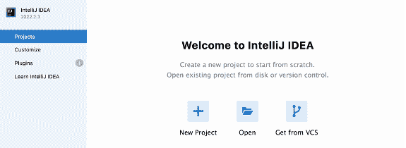

图 1.1：IntelliJ/IDEA 新项目窗口

参考图 1.2 查看创建新项目的步骤：

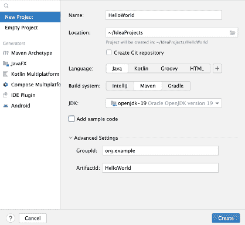

图 1.2：IntelliJ/IDEA 创建新项目

在创建新项目时，确保选择 `Maven` 作为构建系统并一个新版本的 `JDK`。注意，你可以直接从组合框下载 `JDK` 版本来选择 `JDK`，如图 1.3 所示。


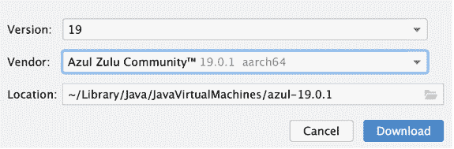

图 1.3: 在 IntelliJ/IDEA 内部下载并安装新 JDK

一旦我们创建了新项目，就会面对图 1.4 所示的界面。我们展开了左侧的树以显示`Java`目录。这是我们放置 Java 源代码的地方。在右侧，我们可以看到`maven pom`文件，这在此时并不重要。它为我们提供了开始编写代码的环境。

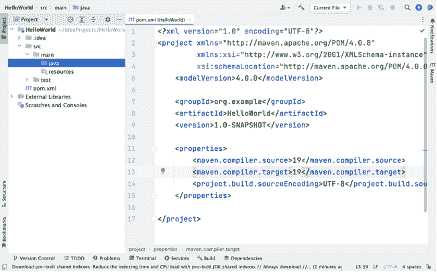

图 1.4: IntelliJ/IDEA 中的新 Maven 项目

## Hello Java

让我们从我们能做的的最简单的"hello world"示例开始。在项目中右键点击`Java`目录（如图 1.5 所示），并选择`New | Java Class`。在提示时，我们可以输入新类的名称并按回车。我们使用了`HelloWorld`。按照习惯，名称的首字母大写（但不是强制的）。它们遵循每个单词字母大写的习惯。名称不能包含空格以及各种其他字符。它们不能以数字开头，但可以是任意语言的`Unicode`字符（尽管这并不常见）。名称不能是 Java 的保留关键字之一。

图 1.5 显示了新建 Java 类上下文操作：

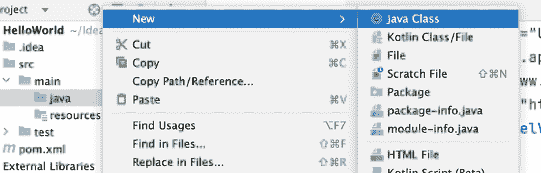

图 1.5: 新建 Java 类上下文操作

图 1.6 显示了新建 Java 类提示对话框：

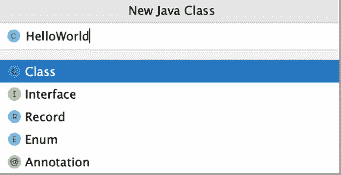

图 1.6: 新建 Java 类提示对话框

这在`Java`中创建一个名为`HelloWorld.java`的文件。为了一个类是`public`的，它必须位于具有同名的源文件中。注意，由于语言是区分大小写的，`public class HelloWorld`不能存在于`helloworld.java`文件中。`public class`暴露给包之外的使用。我们很快就会讨论包。既然我们理解了这一点，让我们创建第一个 Java 应用程序。

```
public class HelloWorld {
    public static void main(String[] argv) {
        System.out.println("Hello World");
    }
}
```

让我们逐行检查代码中的行。在第 1 行，我们从`public`关键字开始。这表示我们希望将此类导出到外部包。在这种情况下，由于我们要运行该类，它必须是`public`的。下一个关键字是`class`，它是对象的基本块。在 Java 中，几乎所有都是类的一部分。这是一个我们将讨论的大主题。

在第 2 行，我们从`public`开始。类中的元素具有不同的可见性级别。在类内部，你可以访问一切。如果我们移除类的`public`关键字，它仍然可以被同包的其他类使用。

下一个关键字是`void`，这意味着该方法不返回值。之后，是方法的名称`main`以及传递给该方法的参数。参数是名为`argv`的字符串数组。

方法的体引用了`System`类，它有一个名为`out`的字段。我们在该对象上调用`println`公有方法，并将字符串 "Hello World" 作为参数。这会打印出 "Hello World"，如图 1.7 所示。

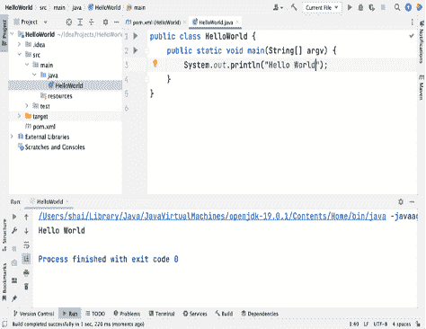

图 1.7: 点击顶部的绿色播放按钮后，应用程序运行；我们可以在屏幕底部的 Console 部分看到输出

## OOP 原则

让我们停顿一下，后退一步。为什么将方法放置在类中很重要？为什么我们对像`public`这样的可见性属性大大惊惊？这一切都符合面向对象编程 (OOP) 的三个原则。

封装是三个原则中的第一个，也可以是最重要的一个。它意味着将对象的数据以及对该数据的操作封装在同一个类中。但它还有另一个重要方面：隐藏。当我们封装数据时，我们隐藏了实现细节。我们将从一个简单的例子开始。

### 封装

让我们考虑一下，例如你的女儿在学校学习简单分数。你想帮助她练习。你想创建一个应用程序来帮助她练习简单分数。在简单分数中，我们有两个数字：分子和分母。分子是分数上方的数字，分母是分下方的数字。我们可以像下面这样表示一个分数：

```java
public class Fraction {
    public int numerator;
    public int denominator;
}
```

这段代码完全没有包含任何封装，我们将两个字段都设为了`public`。让我们看看如何使用它来实现一个简单的数学等式。注意，我们在这里采用的方法非常简单，因为这只是演示。我们将逻辑封装到一个方法中，这样我们就可以轻松地相两个分数：

```java
public static Fraction addFractions(Fraction first, Fraction second) {
    var newFraction = new Fraction();
    newFraction.numerator = first.numerator * second.denominator +
                            second.numerator * first.denominator;
    newFraction.denominator = first.denominator * second.denominator;
    return newFraction;
}
```

代码相对简单，尽管有点冗长。我们访问字段并将其相乘、相加，并将结果赋值给新创建的对象。现在我们可以对这个 API 进行简单使用：

```java
var first = new Fraction();
first.numerator = 1;
first.denominator = 2;

var second = new Fraction();
second.numerator = 2;
second.denominator = 3;

var result = addFractions(first, second);
System.out.println(
    first.numerator + "/" + first.denominator + " + " +
    second.numerator + "/" + second.denominator + " = " +
    result.numerator + "/" + result.denominator);
```

代码非常简单；我们创建了两个对象。分别分配代表 1/2 和 2/3 的值。然后调用之前定义的`addFractions`方法。最后，我们打印出完整的等式。这有点冗长，但最终是行通的。通过额外的方法可以变得更高效，但它存在一些无法修复的缺陷。让我们继续代码。

```java
var third = new Fraction();
third.numerator = 1;
third.denominator = 2;

var forth = new Fraction();
forth.numerator = 2;
// bug 忘记把那个改成 forth 了...
second.denominator = 3;

var secondResult = addFractions(third, forth);
System.out.println(
    third.numerator + "/" + third.denominator + " + " +
    forth.numerator + "/" + forth.denominator + " = " +
    secondResult.numerator + "/" + secondResult.denominator);
```

代码重复且冗长是一个问题。但更大的问题是第 9 行。它将值赋值给了错误的变量，导致了除以零。如果我们运行代码，会看到以下：

1/2 + 2/3 = 7/6

1/2 + 2/0 = 4/0

注意第二行是错误的，因为代码并不是为了处理除以零设计的。由于没有封装，我们无法在在使用之前捕获字段的非法值。让我们用封装再次尝试一次：

```java
public class Fraction {
    private final int numerator;
    private final int denominator;

    public Fraction(int numerator, int denominator) {
        this.numerator = numerator;
        this.denominator = denominator;
        if(denominator <= 0) {
            throw new IllegalArgumentException("Invalid denominator: " + denominator);
        }
    }

    public Fraction add(Fraction other) {
        int numerator = this.numerator * other.denominator +
                        other.numerator * denominator;
        int denominator = this.denominator * other.denominator;
        return new Fraction(numerator, denominator);
    }

    @Override
    public String toString() {
        return numerator + "/" + denominator;
    }
}
```

让我们查看特定的代码行，以理解这个版本的类有什么不同。在第 2 行和第 3 行，我们定义了相同的变量。它们是`private`的，这意味着它们被完全封装，只能在同一个类内部访问。它们都是`final`的。这意味着它们在赋值后不能被修改；它们最多在构造函数中完成赋值。这实际上使得这个类是不可变的；它的内容无法被修改。不可变性是一个重要的设计原则。

在第 5 行，我们定义了一个初始化两个变量的构造函数。在第 8 行，如果分母是非法的，我们显式地抛出一个异常。这防止了用户创建无效的对象。注意，方法可以命名为`add`而不是`addFractions`，因为它现在更了。

第 21 行覆盖了 Java 的`toString`方法。建议添加该注解的原因是，如果基类中的方法被删除或缺失，我们将得到编译错误。不加它也可以正常工作。让我们看看这个新类的用法：

```java
var first = new Fraction(1, 2);
var second = new Fraction(2, 3);
var result = first.add(second);
System.out.println(first + " + " + second + " = " + result);

var third = new Fraction(1, 2);
// 将抛出异常...
var forth = new Fraction(2, 0);
var secondResult = third.add(forth);
System.out.println(third + " + " + forth + " = " + secondResult);
```

这是完整的用法，包括包含错误的第二个块。注意它变得多么简洁。第 3 行的简单性特别令人满意。注意第 4 行和第 11 行与之前的代码相比变得轻而易举。由于`toString()`是 Java 内置的，代码等同于：

```java
first.toString() + " + " + second.toString() + " = " + result.toString()
```

当我们运行这个版本时，第 9 行的错误变得更加明显，因为我们得到了一个清晰的异常：

1/2 + 2/3 = 7/6

Exception in thread "main" java.lang.IllegalArgumentException: Invalid denominator: 0

at com.debugagent.ch01.encapsulation.Fraction.<init>(Fraction.java:11)

at com.debugagent.ch01.encapsulation.SampleUsage.main(SampleUsage.java:15)

注意异常指向了发生错误的文件，即类名和行号。这使得我们很容易定位触发问题的代码并进行修复。

Java 14 引入了一个新概念：`Records`。Java `record`是一个具有`final fields`的`final class`。它是不可变的。这对于我们的分数类来说，似乎是理想的方案。让我们将代码迁移到使用 record：

```java
public record Fraction(int numerator, int denominator) {

    public Fraction add(Fraction other) {

        int numerator = this.numerator * other.denominator +

        other.numerator * this.denominator;

        int denominator = this.denominator * other.denominator;

        return new Fraction(numerator, denominator);

    }

}
```

这是我们分数类的 record 等等实现，或者至少是一个接近的近似。如果使用 record，用法代码是相同的。然而，这里缺少了两个东西：`toString()`方法和验证代码。如果我们运行这段代码，将看到以下输出：

Fraction[numerator=1, denominator=2] + Fraction[numerator=2, denominator=3] = Fraction[numerator=7, denominator=6]

Fraction[numerator=1, denominator=2] + Fraction[numerator=2, denominator=0] = Fraction[numerator=4, denominator=0]

这是由于 record 中`toString()`的默认实现，以及我们没有显式创建构造函数导致的。我们可以通过创建一个更详细的 record 来解决这两个问题：

```java
public record Fraction(int numerator, int denominator) {

    public Fraction(int numerator, int denominator) {

        this.numerator = numerator;

        this.denominator = denominator;

        if(denominator <= 0) {

            throw new IllegalArgumentException("Invalid denominator: " + denominator);

        }

    }

    public Fraction add(Fraction other) {

        int numerator = this.numerator * other.denominator +

        other.numerator * this.denominator;

        int denominator = this.denominator * other.denominator;

        return new Fraction(numerator, denominator);

    }

    public String toString() {

        return numerator + "/" + denominator;

    }

}
```

它仍然比类略小，并且替换了构造函数和`toString()`的默认实现。它仍然值得使用，因为它实现了其他方法，特别是`equals()`和`hashcode()`。

我们应该涵盖的最后一个主题是包（packages）。在这一章的示例代码中，你会找到展示给你的所有示例。它们都在同一个项目文件中，并且名称相同。这看起来可能很奇怪。`Fraction`类是如何避免与`Fraction` record 发生冲突的？

答案是它们位于不同的包中。Java 中的最佳实践是将所有类放在代表其角色的包中。包的名称使用反向域名表示法，后面跟着包名。与类位于同名文件一样，我们期望包位于与包名匹配的目录中。例如，在以下包中：

```java
package com.debugagent.ch01.records;
```

IDE 在 Java 目录下了与`com/debugagent/ch01/records`匹配的目录层次。注意包名。本书作者拥有`debugagent.com`域名。通过反向使用拥有的名称，我们确保它不会与另一个开发者可能编写的代码冲突。包名的后续部分由你来决定。我们稍后还会讨论模块（modules）的另一种抽象。

### 继承

OOP 的第二个原则是继承。我们在封装部分简要讨论过它，但让我们退一步讨论一下 OOP 和 Java 中的基础知识。继承允许我们基于现有的类创建新类，并在其中我们可以暴露公共功能。Java 包含以下两种类型的继承：

1. 实现继承
2. 接口继承

通过实现继承，子类包含了基类的状态，如下面的代码所示：

```java
public class Base {

    protected int var;

}
```


`public class Subclass extends Base { public int getVar() { return var; } }`

Java 中的类只能继承一个类。但它可以实现它所需要的任意数量的接口。接口有许多限制；它不能声明字段，并且在历史上不能实现方法。从 Java 8 开始它可以这样做，但这是一项受限的功能，因为不能声明字段。接口中声明的每个字段都会立即变为 `static`、`final` 和 `public`。这使得所有字段都是隐式的常量。所有方法都是隐式的 `public`。在接下来的代码中，我们实现了一个接口，并被编译器要求实现接口中定义的方法：

```java
public interface BaseInterface {
    public void method();
}

public class Subclass implements BaseInterface {
    public void method() {
        // code...
    }
}
```

如之前所述，所有的 Java 对象都派自一个名为 `Object` 的类。这是隐式的且无法禁用。如果你继承自一个不同的类，那么继承层次结构的根将始终是 `Object`。`Object` 定义了之前提到的几个感兴趣的方法，但它最重要的方法是 `getClass()`。Java 中的每个对象都有一个表示它的单个 `Class` 对象。注意小写 `c` 的 `class` 是 Java 中的一个保留字，我们用它来声明类。大写 `C` 的 `Class` 是 Java 中的一种特定类型，我们可以用它来获取当前类的信息。

最好的工具之一是 JShell。让我们用它来理解 `Class` 对象是如何工作的：

```bash
$ jshell
> myObject = new Object();
myObject ==> java.lang.Object@506e1b7
> System.out.println(myObject.getClass().getName());
java.lang.Object
> System.out.println(Arrays.toString(myObject.getClass().getMethods()));
[public boolean java.lang.Object.equals(java.lang.Object), public java.lang.String java.lang.Object.toString(), public native int java.lang.Object.hashCode(), public native java.lang.Class java.lang.Object.getClass(), public native void java.lang.Object.notify(), public native void java.lang.Object.notifyAll(), public final void java.lang.Object.wait(long) throws java.lang.InterruptedException, public final void java.lang.Object.wait(long,int) throws java.lang.InterruptedException, public final void java.lang.Object.wait() throws java.lang.InterruptedException]
> /exit
| Goodbye
```

### 多态

我们之前略过了继承的某些特性，因为如果不理解多态，这些特性并没有那么大的意义。让我们看看下面的示例：

```java
public interface MyInterface {
}

public class Base {
}

public class Subclass extends Base implements MyInterface {
}

public class OtherSubclass extends Base {
}

public class NotASubclass implements MyInterface {
}
```

首先，必须明确的是，这是有效代码。接口不需要定义任何方法就可以是一个有效的接口。但我们想要解释的概念，无论是否有方法、字段或完全没有，都是通适的。在 OOP 中，对象之间可以存在“IS A”（是一个）的关系的关系。例如，以下所有语句都是正确的：

- `Subclass` 是一个 `Base`
- `Subclass` 是一个 `MyInterface`
- `OtherSubclass` 是一个 `Base`
- `NotASubclass` 是一个 `MyInterface`

这是多态的基础。子类可以替代不同的对象，并无缝地替换底层的实现。让我们通过一个具体的例子来展示这一点：

```java
class Base {
    public void hello() {
        System.out.println("Hello");
    }
}

class Subclass extends Base {
    public void hello() {
        System.out.println("Subclass");
    }
}

Base subclass = new Subclass();
subclass.hello();
```

这段代码将打印“Subclass”。注意，由于 `Subclass` 是一个 `Base`，我们可以将其视为 `Base`。`hello` 方法被重写了；在这种情况下，我们没有使用 `@Override` 注解是为了演示一个观点。但添加该注解确实是最佳实践。

多态是根据类型来处理类的能力；我们可以使用接口作为一种类型并“面向接口编程”。这是一种常见的最佳实践，因为它让我们能够在底层完全切换实现。一个很好的例子是 Java `util` 包中内置的集合类。

```java
void printAll(List<String> list) {
    for(String element : list) {
        System.out.println(element);
    }
}

void test() {
    List<String> strings1 = new ArrayList();
    strings1.add("1");
    strings1.add("2");
    strings1.add("3");

    List<String> strings2 = List.of("A", "B", "C");
    method(strings1);
    method(strings2);
}
```

注意，`printAll` 忽略了它收到了两种完全不同类型的列表这一事实。它们的行为完全相同。当在 `List` 接口上调用方法时，Java 编译器会生成一个虚拟调用，该调用将在运行时映射到正确的方法实现。对于我们开发者来说，这是无缝的，并允许我们在底层切换实现。

注意在代码中，我们使用 `for` 循环来遍历 `List` 的元素。这是 `for` 循环的一个特殊版本，我们可以用它轻松地迭代集合和数组。我们也可以使用 stream 来这样做。我们很快会讨论这些内容。

## 内置类型

除了我们已经在某种讨论过的对象和类之外，Java 还有其他一些重要的内置类型。最引人注目的是基本类型，例如我们之前讨论过的 `int`。每个基本类型都有一个对应的对象类型，可以在需要对象的情况下使用它们。这些对应的对象类型通常被称为“基本类型包装类”（primitive wrappers）。在 Java 目前的实现中，基本类型比包装类具有显著的性能优势。通过一些合成基准测试，这种性能差异的规模达到了 20 倍。这可能会随着 Valhalla 项目的进展而改变，我们将在第 3 节：8 到 21 到 GraalVM 中讨论它。

表 1.1 基本类型及其大小。注意 Java 中的所有基本类型都是“有符号的”，这意味着它们的范围介于负数和正数之间。例外是 `char`，它不是一个数字：

| 类型 | 大小 | 包装类 | 注释 |
| :--- | :--- | :--- | :--- |
| boolean | 1 bit（内存中更多） | Boolean | 可以为 true 或 false |
| byte | 8 bit | Byte | –128 到 127 |
| char | 16 bit Unicode | Character | 0 到 65536 |
| short | 16 bit | Short | –32,768 到 32,667 |
| int | 32 bit | Integer | –2³¹ 到 2³² – 1 |
| long | 64 bit | Long | –2⁶⁴ 到 2⁶⁴ – 1 |
| float | 32 bit | Float | 见注释 |
| Double | 64 bit | Double | |

表 1.1: Java 基本类型和包装类

使用基本类型而非包装类的优势是显而易见的。它们直接映射到底层 CPU 的工作方式，并提供原生代码的性能。那么为什么我们需要对象包装类呢？假设我们想向 `List` 中添加一个 `int`，如下代码所示：

```java
myList.add(3);
```

这段代码可以编译并运行。从列表中获取值并赋值的对应代码也是如此。编译器识别出基本类型并将其转换回。这是由于“自动装箱”（autoboxing）。我们可以在以下代码中看到它：

```java
myList.add(3);
int value = (Integer)myList.get(0);
```

## 数组

在 Java 中，数组是一种特殊的对象类型，有一个指示长度的属性。每个类型有一个 `Class` 对象，我们可以依赖此点。类对象和数组类对象是不同的对象类型，因此在第 7 行和第 8 行，我们创建了两个大小不同的数组。注意它们遵循与普通对象相同的规则。以下代码可以更好地说明：

```java
// 正确用法
var first = new Fraction(1, 2);
var second = new Fraction(2, 3);
var result = first.add(second);
System.out.println(first + " + " + second+" = " + result);

var third = new Fraction(1, 2);
// 将抛出异常
var forth = new Fraction(2, 0);
var secondResult = third.add(forth);
System.out.println(third + " + " + forth+" = " + secondResult);
```

## 泛型擦擦

当 Java 最初开发时，我们还没有泛型。我们会使用类似下面的代码编写字符串列表：

```java
List stringList = new ArrayList();
stringList.add("My String");
String myString = (String)stringList.get(0);
```

这段代码在 `Java` 20 中仍然可以正常编译并运行，这证明了 `Java` 团队在兼容性方面付出的巨大努力。注意第 3 行，我们需要对 `get` 方法返回的值进行强制转换。当我们没有显式指定元素为特定类型时，最终得到的是最低公约数类型：`Object`。由于 `Java` 中的所有对象都继承自 `Object`，因此在传递泛型内容时可以直接使用它。这种方法非常有效，但随着 `Java` 5 的发布，泛型被引入了。原因很简单，看下面的代码：

```
1. List stringList = myApi.getList();
2. stringList.add("My String");
3. stringList.add(3);
```

这是有问题的。如果我们有一个返回 `List` 或类似对象的 API，除了文档之外，我们无办法知道预期的对象类型。有了泛型，我们可以通过使用 `List<String>` 显式地指定列表的类型，这会导致第 3 行在编译时失败。由于该逻辑是在 `Java` 完成后添加的，泛型是附加在 `Java` 之上的。这意味着 JVM 在大部分情况下忽略了它们，并不真正了解它们，这使得下面的代码是合法的：

```
1. List<String> stringList = new ArrayList<>();
2. stringList.add("My String");
4. List blank = (List)stringList;
5. blank.add(3);
7. // Prints [My String, 3]
8. System.out.println(stringList);
10. // Prints 3
11. System.out.println(blank.get(1));
13. // Throws ClassCastException: Integer cannot be cast to String
14. System.out.println(stringList.get(1));
```

由于泛型在运行时会被擦除，我们可以对列表对象进行向下类型转换并移除泛型部分。然后我们可以向列表中添加任何想要的内容。这种方法行得通，而且列表内部确实包含了该信息。如果我们尝试向 `stringList` 添加一个数字，代码将无法编译。但“奇怪”的事情发生在这里。

在第 11 行中，我们打印了第二个元素，它确实是我们添加的那个 3。然而，如果我们通过字符串列表进行打印，将会得到运行时异常。我们无法将整数转换为字符串。其原因很简单。在第 8 行中，我们隐式地调用了 `toString()` 方法。该方法没有类型且是相对通用的。它就像我们预期的的那样工作。`get` 方法返回泛型的类型，但对于像 `blank` 这样被擦除的，它会返回 `Object`，因此可以运行。对于 `stringList`，它会返回 `String`；这会导致失败，因为强制转换是在运行时检查的。`Java` 是一种动态语言，并在运行时验证此类行为。

顺带一下，注意代码中的第 1 行。你会注意到行末的菱形操作符 `<>`。这是 `Java` 8 中引入的语法。查看下面的代码以理解编写这一行的各种方式：

```
1. // Original Java 5 语法
2. List<String> stringList = new ArrayList<String>();
4. // Java 8 菱形操作符
5. List<String> stringList = new ArrayList<>();
7. // var 关键字不能使用菱形操作符，因为需要泛型
8. var stringList = new ArrayList<String>();
```

一个简单的泛型可以在如下所示的类声明代码中声明：

```
1. public class MyObject<T> {
2. T value;
3. public T getValue() {
4. return value;
5. }
6. public void setValue(T value) {
7. this.value = value;
8. }
9. }
12. MyObject<Integer> obj = new MyObject<>();
13. obj.setValue(3);
```

这些是非常基础的内容，但存在一些复杂的情况。假设我们希望类表示算术表达式。所有的数值包装对象都继承自 `Number` 类。泛型可以使用通配符（如 `MyObject<? extends Number>`）来表示这一点。我们也可以表示这种关系的反面。假设我们有一个接受 `Integer` 但可能与其任一基类（`Number` 或 `Object`）一起工作的 API；我们可以使用 `MyObject<? super Number>` 语法。

泛型也可以应用于方法。我们将使用下面的示例来展示泛型的挑战：

```
1. public class CompareNumbers {
2. public static <T extends Comparable> T max(T a, T b) {
3. return a.compareTo(b) > 0 ? a : b;
4. }
6. public static void main(String[] argv) {
7. System.out.println(max(3, 5));
8. System.out.println(max(3.0, 5));
9. }
10. }
```

`Comparable` 是 `Java` 中的一个泛型接口，允许我们比较两个对象，返回一个比另一个小、相等还是更大。这段代码将 `T` 定义为泛型类型，然后我们可以对两组参数调用 `max`。遗憾的是，输出如下：

```
5
Exception in thread "main" java.lang.ClassCastException: class java.lang.Integer cannot be cast to class java.lang.Double (java.lang.Integer and java.lang.Double are in module java.base of loader 'bootstrap')
at java.base/java.lang.Double.compareTo(Double.java:159)
```


在左下角，我们可以看到代码当前位置的堆栈跟踪（`stack trace`）。它包含了方法调用链。它是可以的，可以带我们回溯堆栈帧。通过这种方式，我们可以检查导致我们到达这里的各种阶段。在右侧，我们可以看到当前状态以及沿途变量的值。但与其只看理论，这里是在调试器中开始练习是一个很好的起点。

## 结论

在本章中，我们复习了对现代 Java 语法的基础理解。我们还学习了 Java 中一些较新的概念，例如 `records`、`var` 关键字等，但我们仍然处于理解基础的入门阶段。我们讨论了 `JVM` 的类型分离、泛型、擦除（`erasure`）等许多内容。

然后，我们简要讨论了基于 IDE 的调试。虽然开发 Java 并不需要 IDE，但当你利用 IDE 的强大时，它的威力会真正显现。因此，我们讨论了 `IntelliJ/IDEA` 以及基于 IDE 的调试，这是一项在课程中没有充分提供的关键技能。

我们在本章中讨论了 `OOP`，但只是一个简单的概述。在接下来的章节中，我们将深入探讨核心概念，并尝试理解为什么它是解决问题的强大范式。

## 记忆点

`OOP` 的三个原则如下：

1. 封装（`Encapsulation`）
2. 继承（`Inheritance`）
3. 多态（`Polymorphism`）

在这三个原则中，封装是最简单的，也可以可以说是最重要的能力。`Java` 有两个基本类型组：

1. 原生类型（`Primitives`）
2. 对象（`Objects`）

有八种原生类型，每种类型都有一个对应的原生类型包装类：

1. `boolean`
2. `byte`
3. `char`
4. `short`
5. `int`
6. `long`
7. `float`
8. `double`

其他一切都是对象，包括数组。对象可以使用泛型进行自定义，但这些类型在运行时由于擦除会被移除，这可能会导致意外的行为，例如能够向整数列表添加字符串。

## 单选题

A. 下面哪些是原生类型：

1. `int`
2. `String`
3. `Class`
4. `byte[]`
5. `char`
6. `<T>`

B. `class` 和 `Class` 之间的区别是什么？

1. 它们是相同内容的同义词
2. 你可以有很多 `Class` 对象但只有一个类
3. `class` 是一个关键字，`Class` 是一个对象
4. `Class` 是 `class` 原生类型的包装器

C. 下面哪个陈述是正确的

1. `int[]` 是一个对象
2. `Object` 是一个类
3. `int` 是一个 `Integer`
4. `BaseClass` 是一个子类

D. 擦除意味着：

1. 泛型对象永远不会进行检查
2. 类型在运行时是完全未知的
3. `Generics` 需要具体的对象类型，以便编译器知道如何保留它们
4. 泛型类型在编译期间被移除并替换为强制类型转换

### 答案

A. 1, 5
B. 3
C. 1
D. 4

***

1 https://foojay.io/almanac/jdk-20/
2 https://sdkman.io/
3 https://www.jetbrains.com/idea/download/
4 完整项目可以在这里获取：https://github.com/shai-almog/java-book
5 https://en.wikipedia.org/wiki/List_of_Java_keywords
6 这是针对非英语母语读者的说明；我在学校没有学过英语术语，必须查阅
7 https://docs.oracle.com/javase/specs/jls/se7/html/jls-4.html#jls-4.2.3

**加入我们书籍的 Discord 空间**

加入书籍 Discord 工作空间获取最新更新、优惠、全球科技动态、新发布以及与作者的交流会议：

**[`discord.bpbonline.com`](https://discord.bpbonline.com)**


# 第 2 章：OOP 模式

## 引言

`Java` 是一种经典的面向对象的语言。因此，它包含了许多常见的 `OOP` 模式。“模式”一词在早期 `OOP` 社区中流行，并用于描述常见的最佳实践和方法。这最终促成了《四人行设计模式》这本书，虽然它现在已经有点过时了，但有一个更实时的网站^([[1]](#chap02.xhtml_footnote-029))。

在本章中，我们将探索利用 `OOP` 的最佳方式，我们认为的良好设计，以及体现了什么样的 `OOP` 原则。

## 结构

在本章中，我们将讨论以下话题：

* 为什么 `OOP`？
* 基础面向对象设计
* 常见模式：
    * 单例（`Singleton`）
    * 工厂（`Factory`）
    * 构建器（`Builder`）
    * 适配器（`Adapter`）
    * 外观模式（`Façade`）
    * 代理（`Proxy`）
    * 观察者（`Observer`）
    * 命令（`Command`）
    * 迭代器（`Iterator`）
    * 不可变性（`Immutability`）
    * 函数式编程（`Functional programming`）

## 目标

在本章结束时，读者将理解使用 `OOP` 的价值，以及为什么 Java 不是纯函数式语言。

## 为什么需要 OOP?

我们在第一章讨论了封装、继承和多态的力量。但 `OOP` 远不止这些原则。它是一种将数据与操作结合的设计哲学和结构系统。在 OOP 之前，我们拥有内存结构，任意函数可以修改任何对象。这些函数之间是独立的，没有关联。受益于 `OOP`，我们可以将数据包含在单个实体中。这使得我们在构建系统时变得更容易；我们可以将其封装在黑盒中，无需了解底层细节。

对于 OOP API 的用户来说也更容易。操作被封装并包含了它们所需的数据。这是一个我们可以利用来构建复杂应用的强大概念。然而，主要的挑战变成了建模。

在 90 年代，作者参与过一个用 `C++` 构建的飞行模拟器。该代码源自一个更早的模拟器，由于年代久远，开发者们不知道如何设计面向对象的 API。每架飞机都使用多重继承来派生飞机的能力，例如运动、显示等。这种设计导致了许多问题，后来被组合所取代。组合意味着持有另一个对象的指针，而不是继承它的能力。这是面向对象设计的基本规则之一：“组合通常优于继承”。面向接口编程也被认为是一种最佳实践；一个很好的例子是使用 `List` 而不是 `ArrayList`。

## 基础面向对象设计

在面向对象设计（OOD）中，我们概述面向对象系统的架构。在某些情况下，这种设计是随意的，而在另一些情况下，它可以是一个包含丰富统一建模语言（UML）图的详尽过程。关于这个主题有很多书籍和许多方法。我们将重点关注设计背后的高层思想、它所承担的目的，以及我们在编写代码时如何解释它。

在图 2.1 中，我们可以看到一张代表 Spring Boot 宠物诊所设计部分的 UML 图。这种图表示了宠物诊所应用程序的类层次结构。图中显示所有这些类都派生（继承）自 `BaseEntity` 类。该类包含了所有元素的通用功能，特别是 `ID`。注意，这张图是部分性的，因为它没有包含属性，也没有显示组合。例如，所有者包含宠物。这在 UML 中通常用组合线表示。

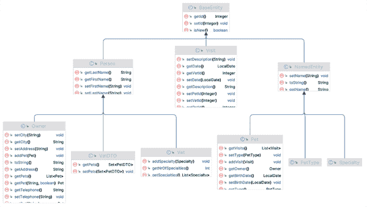

图 2.1：Spring Boot Pet Clinic Demo 的部分 UML 图

我们还有一个人员层次结构，用于表示三个不同的对象。当我们构建系统时，经常会发现层次结构包含了通用功能，并需要相似的数据类型。此时，将功能向上提取到层次结构并添加一个基类以整合通用特征将很有意义。

第一次就让设计“正确”是非常困难的。我们需要对设计进行迭代和调整，以找到正确的权衡方案。一个常见的错误是“过度设计”，并尝试创建一个过于通用的解决方案。这些设计缺陷很难量化，随着你接触到良好的设计并获得经验，你将培养出设计感。

## 常见模式

Java API 以及构建在其之上的应用程序具有许多常见的设计模式和约定。其中一些代表原始的 GoF（四人之行）模式，而另一些是 Java 特有的模式。随着模式流行度的提高，相应的反模式（`anti-patterns`）趋势也应运而生。这些通常被认为是坏做法的模式。

模式的真正价值在于语言层面。我们可以简单地通过模式来描述复杂的行为。这些行为通常与语言无关，并帮助我们在不详细了解涉及特定机制的情况下构建系统的心理模型。

### 单例模式（`Singleton`）

单例可能是最广为人知的模式。它通常被认为是一种反模式。尽管如此，它仍然被广泛使用；我们可以在 Java API 的 `Desktop` 或 `Runtime` 等类中看到它。让我们从定义最简单的单例开始：

```java
public class SimpleSingleton {

    private static final SimpleSingleton INSTANCE = new SimpleSingleton();

    private SimpleSingleton() {}

    public static SimpleSingleton getInstance() {

        return INSTANCE;

    }

    public void doSomething() {

        // code

    }

}
```

单例是一个我们只能有一个实例的类。这大致等于拥有所有方法都是静态的类。注意，在这种情况下，类的实例是静态创建的，并且构造函数是私有的。这意味着尝试创建 `SimpleSingleton` 实例的代码将失败。获取实例唯一方法是通过 `getInstance()` 方法。

如果我们只需要使用静态方法，为什么还需要这种模式呢？

单例的主要优势在于它能够作为 API 进行演进。下面是一个更真实的单例示例。在这种情况下，类的实例特定于我们运行的平台。通过这种方式，我们的类在 Windows 或 Mac 上运行时可以提供不同的功能。这对于其他代码来说是无缝的：

```java
public abstract class PlatformSingleton {

    private static final PlatformSingleton INSTANCE;

    static {

        if(System.getProperty("os.name").toLowerCase().contains("mac")) {

            INSTANCE = new Mac();

        } else {

            INSTANCE = new Windows();

        }

    }

    public PlatformSingleton getInstance() {

        return INSTANCE;

    }

    public abstract void platformMethod();

    static class Mac extends PlatformSingleton {

        @Override

        public void platformMethod() {

            // mac implementation

        }

    }

    static class Windows extends PlatformSingleton {

        @Override

        public void platformMethod() {

            // windows implementation

        }

    }

}
```

```java
public class LazySingleton {

    private static LazySingleton INSTANCE;

    private static final Object LOCK = new Object();

    private LazySingleton() {}

    public LazySingleton getInstance() {

        if(INSTANCE == null) {

            synchronized (LOCK) {

                if(INSTANCE == null) {

                    INSTANCE = new LazySingleton();

                }

            }

        }

        return INSTANCE;

    }

}
```

在第 7 行，我们检查实例是否为空。假设它不为空，我们可以直接返回。如果为空，则可能需要初始化。为了确保线程安全，我们需要同步访问。通过在 `synchronized` 块中放置工厂方法方法，我们再次检查实例是否为空。这可以移除某些操作的开销。

为什么要这样做呢？

想象两个线程同时进入方法，第一个线程检查实例是否为空。如果为空，它将进入 `synchronized` 块。第二个线程随后进入，由于实例已经初始化，它将直接返回。

这种方法非常强大，但为什么人们认为单例模式是一种反模式呢？

存在许多问题，但最重要的一点是单例很难被替换。如果我们使用类或接口，通常可以轻松地进行 Mock。单例通常深度绑定到代码中。我们将在第 6 章更深入地讨论测试。图 2.2 是本节所讨论的单例模式的 UML 图。

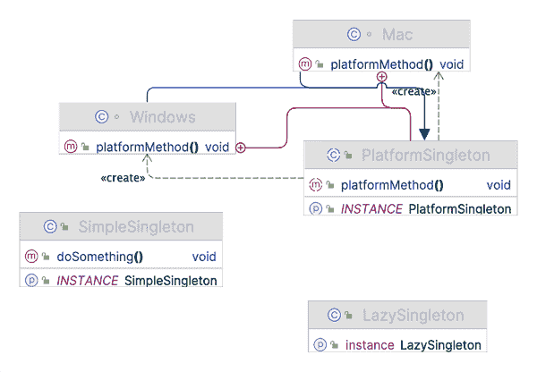

图 2.2：本章讨论的单例模式 UML 图

### 工厂

工厂模式有一些变体，例如方法工厂和抽象工厂。大多数开发者都使用“工厂”一词来描述它们，其区别是细微的。

为什么不直接调用 `new` 来创建对象实例呢？在某些情况下，`new` 调用并不理想。一个很好的例子是 UI 组件。假设我们要在屏幕上添加按钮，如果在 iOS 上运行，我们希望它以特定的方式呈现；但在 Windows 上运行，则会有完全不同的预期。通过使用工厂创建按钮，我们可以提供不同的实现以适应各种需求。这让我们能够抽象底层实现，并与代码的其他部分无缝工作。让我们讨论以下三种常见的工厂类型：

1. **工厂（`Factory`）**：一个拥有一个或多个创建对象的方法的类。在 Java 中，`Collections` 类充当了工厂。
2. **方法工厂（`Factory Method`）**：它以一种由于多态的方式创建对象；它通常返回一个基类实例。`getInstance()` 就是这样一种工厂方法。
3. **抽象工厂（`Abstract Factory`）**：它是一个用于创建所需对象实例的接口。这出现在 Java API 中。

这有点抽象。让我们通过一些具体的示例来讨论这些选项。这里有一个简单的工厂：

```java
public class Factory {

    public CreatedClass createInstance() {

        return new CreatedClass();

    }

}
```

类通过方法创建。通常情况下，它是一个实例方法，也可以是 `static` 的，如 Java 中的 `Collections` 类。这让我们将逻辑从构造函数中分离。构造函数有时难以使用，因为它无法返回不同的结果。此外，在构造函数中抛出异常被认为是一种糟糕的做法，它会导致所有子类都可能抛出异常的局面。通过使用任何类型的工厂，我们从构造函数中移除了这些代码并解决了继承问题。

方法工厂同样简单，只有一个细微差别：

```java
public class FactoryMethod {

    public AbstractBase createInstance() {

        return new CreatedClass();

    }

}
```

这种区别是微妙的。我们在返回值上有不同的类型，并可以根据类实例调整行为。我们可以有多个继承 `FactoryMethod` 类的实现，每个都可以返回 `AbstractBase` 的不同子类。这是一个非常强大的工具。

抽象工厂更进一步。它是一个抽象类或接口，其实现是对我们私有的或未知的。我们通常可以使用依赖注入或动态类加载等工具获取抽象工厂的实例。这使得使用更加困难，但允许最大的灵活性：

```java
public interface AbstractFactory {

    AbstractBase createInstance();

}
```

在图 2.3 中，我们展示了本节讨论的工厂实现。

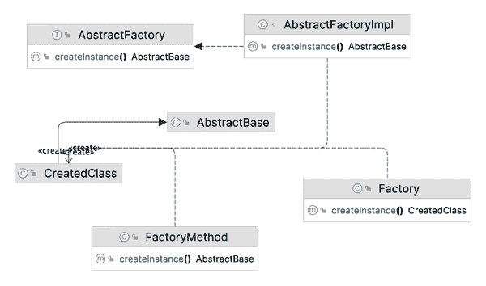

图 2.3：本章讨论的工厂模式 UML 图

### 构建器（`Builder`）

`Builder` 是另一种构建对象的模式。`Builder` 设计用于实现流式创建语法（`fluent creation syntax`）。它可以采取许多形式，其中一种形式是返回同类的修改后的实例（如 `StringBuilder` 所示），或者通过使用专门的类来构建类。例如，简单版本的构建模式可以这样使用：

```java
StringBuilder str = new StringBuilder("The value of 'i' is ")

    .append(i)

    .append(" and the value of x is ")

    .append(x);
```


在下面的代码中可以看到 Builder 模式更复杂的实现。注意它非常冗长，但它让我们用非常流动的代码自定义创建的每个阶段：

从第 42 行开始，我们可以看到 API 的用法，它比带有无名参数的构造函数更有优势。注意，我们可以完全在构建器之外隐藏类的状态，从而通过这种方法强制实现更深层次的状态封装。这在图 2.4 中变得清晰，图中展示了表示该代码的 UML 图。

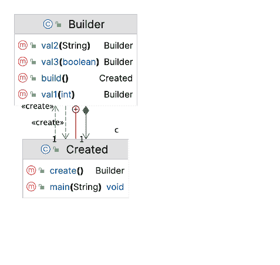

图 2.4：本章讨论的构建模式 UML 图。

### 适配器（Adapter）

适配器接收一个对象类型并使其看起来像另一个对象类型。Java 中一个很好的例子是 `Arrays.asList()` 方法，它接受一个数组对象并返回 `List` 接口的实现类。它将一种对象类型适配为另一种，因此我们可以通过将其封装在适配器中，将数组传递给接受 `List` 的 API。以下代码实现了一个在 `Runnable` 和 `ActionListener` 之间进行适配的适配器。这允许我们向可运行对象发送事件：

```java
public class CallableAdapter {

    public ActionListener callableAdapter(Runnable runnable) {

        class Act implements ActionListener {

            @Override
            public void actionPerformed(ActionEvent e) {

                runnable.run();

            }

        }

        return new Act();

    }

}
```

注意，我们直接在方法内部声明了内部类。此外，注意由于它是在方法内部声明的，它可以访问方法作用域内的字段，例如 `runnable` 字段。内部类只能访问为 `final` 或有效 final（effectively final）的字段。在任何地方被修改的字段都无法在内部类中访问。

这种语法非常冗长，而且内部类占据了大量的模板代码。幸运的是，Java 提供了一种简写语法：匿名内部类。不需要类名，`class` 关键字也同样不需要。通过在创建对象后添加大括号，我们隐式地创建一个没有普通名称的内部类。JVM 使用父类名后跟一个 `$` 符号和一个数字来命名此类类。匿名内部类的代码如下：

```java
public class CallableAdapter {

    public ActionListener callableAdapter(Runnable runnable) {

        return new ActionListener() {

            @Override
            public void actionPerformed(ActionEvent e) {

                runnable.run();

            }

        };

    }

}
```

这要好得多。我们删除了类声明和 `implements` 子句。我们不再需要想一个名字，但这仍然包含很多模板代码。编译器知道我们将返回一个 `ActionListener`。为什么我们需要写 `new ActionListener()` 呢？它知道接口只有一个方法；为什么我们需要 `actionPerformed` 声明？这就是 Java 8 引入 Lambda 表达式的地方。它们比仅仅“匿名内部类的简写”更进一步，但这是它们相关的一个主要方面。使用 Lambda 相同的代码看起来如下：

```java
public class CallableAdapter {

    public ActionListener callableAdapter(Runnable runnable) {

        return e -> runnable.run();

    }

}
```

由于我们只有一个参数，甚至可以丢弃类型声明，只留下名称。编译器完成了其他所有工作。

### 外观（Façade）

外观模式在 Java 核心 API 中并不常见。在这种模式中，类或接口充当中间层，通过它隐藏了更复杂的底层实现。这是一种非常简单的模式。使用外观的主要益处是未来的灵活性。通过在实际 API 之前插入一个外观，我们增加了一层间接层，减少了层与层之间的耦合，并允许我们自定义 API 的行为。以下是一个简单的外观实现：

```java
public class Facade {

    private final InternalAPI1 internalAPI1 = new InternalAPI1();

    private final InternalAPI2 internalAPI2 = new InternalAPI2();

    private final InternalAPI3 internalAPI3 = new InternalAPI3();

    public void api1() {

        internalAPI1.api1();

    }

    public void api2() {

        internalAPI2.api2();

    }

    public void api3() {

        internalAPI3.api3();

    }

}
```

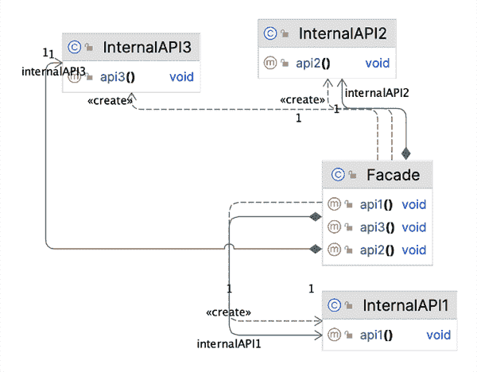

图 2.5：外观模式 UML 图。

### 代理（Proxy）

外观经常被误认为是代理，在某种意义上，它们确实如此。代理有时可以是从另一个角度观察的外观。代理是一个实现了另一个类接口的类，伪装成另一个类。它将工作委托给另一个类，同时在之间执行一些“有趣的事情”。

一个很好的例子是缓存代理，它可以检测方法是否使用相同的参数被调用并返回缓存值。Java 有一个内置的 `Proxy` API，允许我们使用反射动态实现接口。我们很快就会讨论这一点。但首先，让我们讨论我们可以构建的最简单类型的代理。以下代码实现了一个代理，检查底层的 runnable 类是否可以被调用，并且只有在权限标志位设置为 `true` 时才调用它。这种代理允许我们强制全局行为，而无需将其硬编码到每个 runnable 类中：

```java
public class SimpleSecurityProxy implements Runnable {

    private Runnable internal;

    private boolean permission;

    public SimpleSecurityProxy(Runnable internal) {

        this.internal = internal;

    }

    public void setPermission(boolean permission) {

        this.permission = permission;

    }

    @Override
    public void run() {

        if(permission) {

            internal.run();

        }

    }

}
```

这很棒，但如果我们想在更通用的层面上做此类事情呢？如果我们想对每个接口应用安全限制呢？我们需要编写实现所有接口的代理。幸运的是，Java 有反射功能。这组 API 允许我们在运行时检查类、调用方法、读取字段甚至实现接口。这是一个强大的工具，因为它允许我们构建通用的代码。它也有一些问题，因为那样写的代码很笨拙、难以调试且速度慢。尽管如此，它仍然是一个强大的工具。之前的代码可以使用反射为任何接口实现如下：

```java
public class GenericSecurityProxy {

    private boolean permission;

    public void setPermission(boolean permission) {

        this.permission = permission;

    }

    public Object create(Object wrappedObject, Class<?> wrappedInterface) {

        return Proxy.newProxyInstance(getClass().getClassLoader(),

            new Class[]{wrappedInterface},

            (proxy, method, args) -> {

                if(permission) {

                    return method.invoke(wrappedObject, args);

                }

                return null;

            });

    }

    public static void main(String[] argv) {

        Runnable r = () -> System.out.println("Print invoked");

        GenericSecurityProxy g = new GenericSecurityProxy();

        Runnable wrapper = (Runnable)g.create(r, Runnable.class);

        wrapper.run();

        g.setPermission(true);

        wrapper.run();

    }

}
```

这里有很多内容，让我们回顾一下。在第 7 行，我们声明了一个包装任意对象的方法。注意我们接受了两个参数：我们要包装的对象和我们需要表示的接口。这似乎是冗余的，但既然我们可以直接调用 `wrappedObject.getClass()`，为什么要传递类实例呢？

对象永远不会是接口的实例。它将是一个对象的实例，对应的 `Class` 对象将无法正确匹配。事实上，如果我们这样做，错误信息将如下：

```text
java.lang.IllegalArgumentException: com.debugagent.ch02.patterns.proxy.GenericSecurityProxy$$Lambda$14/0x0000000801003200 is not an interface
```

我们需要一个表示接口的类。如果你看第 21 行，你可以看到 `Runnable` 的实例被传递给方法，`Runnable.class` 语法用于获取类。

在第 8 行，我们看到了 `Proxy` 类的用法。`newProxyInstance` 方法接受三个参数：

- `ClassLoader`：这是一个可以覆盖类加载方法的抽象类。
- `Array of Interfaces`：由于 `Proxy` 可以实现多个接口，该方法接受一个数组作为参数。
- `InvocationHandler instance`：由于 `InvocationHandler` 是一个带有单一方法的接口，我们可以将其转换为 lambda。该方法返回结果并接受三个参数：
  - `Proxy`：对象实例。
  - `Method`：表示方法本身的对象。这等于方法的签名，包含了类名、返回值和参数。
  - `Arguments`：传递给方法的参数。

在 Lambda 的实现中，我们检查并简单地在底层对象上调用方法。在列表中，你可以看到只调用一次。反射是 Java 中最强大的 API 之一，`Proxy` API 是许多框架（如 Spring、Microprofile 等）的基础。

## 观察者

观察者模式向不同对象发送关于变化或事件的通知。Java 有 `Observer` 对象，但 Java 中为人所知的观察者示例是 `ActionListener`。要实现观察者，我们需要监听器接口和一个实现类：

```java
public interface EventListener {

    void onEvent(Map<String, Object> eventMetadata);

}
```

接口本身没有用。使用它我们需要如下的可观察组件，作为基类或组合：

```java
public class Observable {

    private List<EventListener> listeners = new ArrayList<>();

    public void addListener(EventListener listener) {

        listeners.add(listener);

    }

    public void removeListener(EventListener listener) {

        listeners.remove(listener);

    }

    public void fireEvent(Map<String, Object> metadata) {

        for(EventListener e : listeners) {

            e.onEvent(metadata);

        }

    }

}
```

我们可以向可观察对象添加监听器，并向所有监听对象发送事件。这实现了解耦。通用组件不需要知道感兴趣的组件。例如，我们可以构建一个可观察按钮，它不需要知道每个点击监听器。当被点击时，它只需调用 `fireEvent`，随后相应的监听器将被调用。

图 2.6 以 UML 图的形式展示了观察者模式。

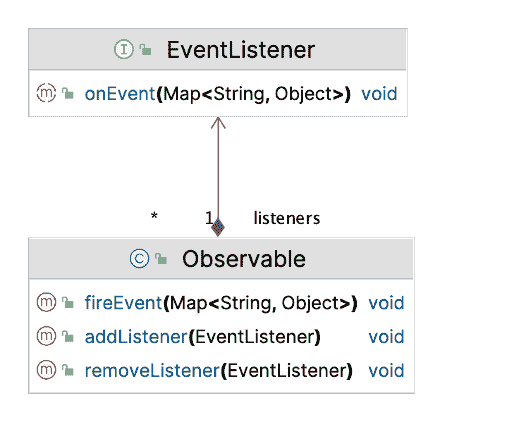

图 2.6：观察者模式的 UML 图。

## 命令

撤销如此常见，以至于我们认为理所当然。在很多情况下，它是通过命令模式实现的。在命令模式中，每个操作都被封装在命令中，包含了执行该操作所需的所有元素。每个命令都可以执行和撤销。通过将命令添加到队列并将已执行命令保留在撤销队列中，我们可以实现撤销和重做。这是一个复杂的模式，但核心概念相对简单。我们从命令开始，它可以是一个接口或抽象基类：

```java
public abstract class Command {

    public abstract void perform();

    public abstract void undo();

}
```

我们将实现子类，包含执行或撤销操作所需的完整状态。例如，如果一个命令将项目复制到剪贴板，我们将包含该项目的引用以及剪贴板之前的内容，以便恢复它。命令被添加到队列中进行处理和撤销：

```java
public class CommandQueue {

    private List<Command> performedCommands = new ArrayList<>();

    private List<Command> undoneCommands = new ArrayList<>();

    public void perform(Command cmd) {

        cmd.perform();

        performedCommands.add(cmd);

        undoneCommands.clear();

    }

    public boolean canUndo() {

        return !performedCommands.isEmpty();

    }

    public boolean canRedo() {

        return !undoneCommands.isEmpty();

    }

    public void undo() {

        Command cmd = performedCommands.remove(performedCommands.size() - 1);

        cmd.undo();

        undoneCommands.add(cmd);

    }

    public void redo() {

        Command cmd = undoneCommands.remove(undoneCommands.size() - 1);

        cmd.perform();

        performedCommands.add(cmd);

    }

}
```

## 迭代器

`Iterator` 模式允许我们以通用的方式遍历集合，忽略实现细节。Java 有一个 `Iterable` 接口提供了 `iterator()` 方法。`Iterator` 实例可以遍历元素并获取相应的值。我们可以使用如下代码来遍历列表：

```java
for(MyComponent cmp : list) {

    cmp.doSomething();

}
```

在底层，编译器对第二个参数支持两种类型。一种用于类型。另一种类型是 `Iterable` 接口，它是 Java API 的一部分。该接口提供 `iterator()` 方法，返回一个 `Iterator` 实例。我们可以这样使用它作为基类的可观察组件：

```java
List<String> list = List.of("Hi", "World");

var iterator = list.iterator();

while (iterator.hasNext()) {

    System.out.println(iterator.next());

}
```


这是一个非常强大的工具，但显然由于 `for` 循环和流（我们很快会讨论）的能力，并不是那么有用。在某些边缘情况下，我们对直接使用迭代器的控制感兴趣。但有一个更深层的原因我们需要理解这种模式。以下代码是一个失败案例，你能猜为什么吗？

```java
List<String> list = new ArrayList<>(List.of("One", "Two", "Three"));

var iterator = list.iterator();

while (iterator.hasNext()) {

    String current = iterator.next();

    if(current.equalsIgnoreCase("one")) {

        list.remove(current);

    }

}
```

由于我们从列表中删除了元素，迭代器变得失效并会抛出 `ConcurrentModificationException` 异常。

Java 的迭代器（`iterator`）意识到了这个问题，并具有一个不属于经典模式的特性。它有一个 `iterator.remove()` 方法，我们可以用它来代替上一个列表中的 `Line 6`。这将解决并发修改异常（concurrent modification exception），并允许我们动态删除元素。对底层存储添加元素或执行其他修改仍然是不可能的；解决方案是创建一个包含修改内容的新列表。

## 不变性 (Immutability)

不可变性是编程中最强大的概念之一。在面向对象的语言中，不可变对象一旦创建就无法被修改。在 Java `String` 以及所有的基本类型包装类中，对象都是不可变的。这让我们对这些对象做出许多假设。这有时会让初学 Java 的开发者感到困惑，他们会使用如 `str.toLowerCase()` 等 API，并期望 `str` 变成小写字符串。实际上，该方法返回的是一个新的小写字符串实例。

人们广泛认为不可变性促进了更优的代码，尽管是以性能为代价的。不可变性让我们思考所做的每一次变化。它让我们容易像原子操作一样追踪变化，并减少了由于并发或无效（部分修改）状态而可能出现的问题。例如，假设我们有一个代表日期的对象，如下代码所示：

1. `var mutableDate = new Date();`
2. `mutableDate.setMonth(2);`
3. `mutableDate.setDay(29);`
4. `mutableDate.setYear(2001);`
5. `var immutableDate = Date.create(2001, 2, 29);`

2001 年没有 2 月 29 日，因为不是闰年。然而，对于可变日期，测试这一点非常困难。此外，人们可能会避免调用 `setYear`，从而导致完全无效的日期。不可变日期可以测试 `create` 调用的有效性。我们还可以使用构建器模式（builder pattern）构建它，以便实现流式语法。

遗憾的是，Java 对不可变性的支持被语言本身部分破坏了。目前，Java 没有栈对象（stack objects），Java 中所有的非基本元素都是通过引用传递的。由于我们在后续章节中讨论的 `Valhalla`，这将发生部分变化，但它不会以显著影响后续信息的方式发生改变。假设我们有一个不可变的 `String` 实现。`String` 有一个 `toCharArray()` 方法，返回内部的字符。人们可能认为 `String` 中该方法的代码大致如下：

```java
1. `final char[] chars;`

2. `String(final char[] chars) {`

3. `this.chars = chars;`

4. `}`

5. `public char[] toCharArray() {`

6. `return chars;`

7. `}`
```

事实并非如此。Java 中的 `final` 关键字有以下三个用途：

1. 在类（Class）上：它意味着该类不能被继承。`String` 本身就是 `final` 的。这背后有安全原因。它防止有人修改或更改 `String` 的行为，并获得对系统的过度访问。
2. 在方法（Method）上：它防止用户重写该方法。
3. 在字段（Field）或变量（Variable）上：它防止对字段进行修改。注意，如果所有的构造函数都为 `final` 字段赋值了（一次），那么是合法的。

最后一个选项让人感到困惑，因为数组是一个对象。它的意思是：

```java
1. `// won't work, stopped by the compiler and runtime`
2. `chars = new char[2];`

3. `// will work just fine`
4. `chars[0] = 'C';`
```

这看起来很奇怪，但一旦你理解了 Java，这是完全一致的。数组是一个对象。它是对数组对象的引用。引用不能被修改并替换为不同的值，但由于对象位于堆的另一个位置，我们可以为它分配任意值。为了让字符串真正不可变，`toCharArray()` 方法会分配一个新的数组并将字符复制到其中。Java 14 引入的 `record` 类型也具有相同的局限性。它所有的字段都是 `final` 的，但如果它们引用了对象或数组，则可以在外部被修改。在 Java 中，看待不可变性时需要持保留态度。真正的不可变性是昂贵的，有时并不值这个代价。与其通过内存拷贝来练习，或许通过自律来练习更有价值。

## 函数式编程 (Functional programming)

在阅读网络帖子时，函数式编程似乎与面向对象编程（OOP）是矛盾的。这完全是标题党式的废话。函数式编程为表达式引入了一些数学思想。它们大部分与面向对象的概念结合得非常好，尽管它们并不完全符合 Java 的语义。Java 也不是纯的面向对象语言。Java 是一门折中的语言，对语言设计采取了务实的方法。这是一件“好事™”。它是一种没有陷入过去或受限于某些学术理论的语言，是一种面向实用者的实用语言。这就是它十年来受欢迎的原因。

在本节中，我们不会深入探讨函数式编程理论。关于这个主题有其他书籍。相反，我们将回顾 Java 中的函数式编程概念以及在 Java 中有价值的概念。不可变性是函数式编程中的一个重要概念，但在 Java 中也至关重要。这就是为什么它应该独立空间。

另一个重要概念是幂等性（idempotency）。这意味着当我们调用一个函数时，应该得到相同的结果。这看起来足够简单，但当我们想要测试系统时，它具有巨大的力量。

大多数专家认为流式（stream）方法更好，因为它表达了程序员的意图。这仍有待讨论。循环也有其理由。在本书期间，对于较小且简单的案例，循环通常更快，而流在大规模数据方面具有优势。在之前 Mac 上处理 10 万数字的代码中，流花费了 20 毫秒，而循环花费了 14 毫秒。将这个数字增加到 10,000,000 时，情况发生了变化：流花费了 1352 毫秒，而循环花费了 2159 毫秒。在这种情况下，性能表现并不明确，并且不断演变。

### 结论

在本章中，我们回顾了使面向对象编程成为如此强大抽象的概念。我们回顾了面向对象设计中的一些细微差别。

我们深入了常见的设计模式，并学习了它们在 `Java` API 中的用法。我们讨论了高层函数式编程概念以及它们如何与 `Java` 的面向对象模型相结合。我们讨论了不可变性及其在 `Java` 对象世界中的泄漏变性。

在接下来的章节中，我们将回顾 `Java 8` 到 `Java 20` 之间发生的变化，可能还有更多。我们将讨论 `Java` 世界中的革命性概念，如 `Valhalla`、`Loom` 和 `GraalVM`。

## 重点回顾

* 最好针对接口而非类进行编程。然而，这可能会过头。
* 继承确实不灵活，但组合并不总是正确的替代方案。
* 模式是通信以及构建复杂系统心理模型的强大工具。
* `Java 8` 增加了来自函数式编程的强大概念，最重要的是 `streams`（流）。`Streams` 让我们能够用更流畅的语法替换 `for` 循环。
* 不可变性和幂等性是设计系统时的强大工具，我们应该努力增加这两者。

### 多选题

A. 什么是双重检查锁定（double-checked locking）？

1. 当我们有两个锁时
2. 当使用 `iterator` 遍历集合并再次访问列表时
3. 当字段被声明为 `final` 但我们仍然可以修改其变量时
4. 当我们检查一个条件，然后在 `synchronized` 块内再次检查它时

B. 哪两个模式是相似的？

1. `Singleton`（单例）
2. `Façade`（外观）
3. `Proxy`（代理）
4. `Iterator`（迭代器）
5. `Factory`（工厂）

C. 下列哪个 `Java` API 是不可变的？

1. `String`
2. `Integer`
3. `Byte`
4. `Boolean`
5. `Short`
6. 以上所有

D. 在迭代时可能会发生 `ConcurrentModificationException` 异常是因为……

1. 我们修改了底层集合
2. 另一个线程修改了集合
3. 我们使用了 `iterator` 而不是 `for` 循环
4. 我们有两个并发的 `iterators`
5. 以上所有

### 答案

A. 4
B. 2 和 3
C. 6
D. 1

***

[https://www.gofpatterns.com/]

**加入我们书籍的 Discord 空间**

加入书籍的 Discord 工作区获取最新更新、优惠、全球技术动态、新发布以及与作者的交流会议：

**[`discord.bpbonline.com`](https://discord.bpbonline.com)**


# 第 3 章 从 8 到 21 到 GraalVM

## 引言

`Java` 经历了许多关键发布。`Java 1.1` 引入了内部类。`Java 2` 引入了 `Swing` 和集合。`Java 5` 引入了泛型。然而，最重要的发布版本之一是 `Java 8`，它引入了一系列广泛的变化。在 `Java 8` 之前，Java 版本的发布是不规律的，尽管倾向于每两年一次。随着 `Java 9` 的发布，这种情况改变了。我们现在有了六个月的发布周期。这种节奏使得 `Java 8` 到 `Java 21` 之间的时期变得相对短。

另一个引入的重大变化是预览功能的能力。`Java` 带有预览模式的功能。它们默认是关闭的，你需要显式启用它们进行尝试。这些预览功能可能会崩溃或完全被移除。它们仅用于实验和反馈。对于 `Java` 的维护者来说，这是一个非常有价值的功能，他们可以在现实世界中尝试他们的更改并决定哪些是有效的。这为语言的增长提供了正确的环境。结果，`Java` 在过去的十年中增加了许多特性。

我们将开始讨论 `Java 8` 发布以及它带来了什么。这对于为未来的讨论建立一个基准非常重要。本章的其余部分分为以下三类变化：

1. VM 变化：对核心虚拟机的更改，可能不影响语言但会产生巨大差异。
2. 语言变化：语法糖和 `Java` 语言的精炼。
3. APIs：简化并启用新能力的新 API。

最后，我们将讨论 `GraalVM`，这是一种令人兴奋的虚拟机。为了简洁起见，我们将跳过后来从 `JDK` 中移除的功能。这意味着我们不会讨论 `JavaFX`、`JAXB`、`Pack200` 等等。由于这是一本关于语言的书，我们还将跳过外部工具的变化，除非它们具有特别重要性。我们还将跳过小变化，专注于更可能被注意到的大项目。

## 结构

在本章中，我们将讨论以下主题：

* Java 8——基准
    * Lambda 表达式
    * 方法引用
    * 默认方法
    * 流 (Streams)
    * 注解变化
    * 方法参数反射
    * 新日期和时间 API
* VM 变化
    * 模块 (Jigsaw) (Java 9)
    * Shenandoah (Java 12)
    * 微基准测试集 (Java 12)
    * 虚拟线程—Loom (Java 21)
    * 废弃 finalize (Java 9)
    * 默认 UTF-8 (Java 18)
* 语言变化
    * Try 与资源 (Try with resources)
    * 接口中的私有方法 (Java 9)
    * `var` 关键字 (Java 10)
    * Switch Expression (Java 14)
    * 密封类 (Sealed classes) (Java 17)
    * 模式匹配 `instanceof` (Java 16)
    * 文本块 (Text blocks) (Java 15)
    * Record (Java 16)
    * Record 模式 (Java 19 预览)
    * 字符串模板 (Java 21 预览)
    * 未命名模式和变量 (Java 21)
* APIs
    * `HttpClient` (Java 11)
    * 外函数和内存 API—Panama (Java 19)
    * 结构化并发 (Java 19)
    * 序列化过滤 (Java 9)
    * 作用域值 (Java 20)
    * 有序集合 (Java 21)
* 未来
    * GraalVM
    * Valhalla
    * Vector API

## 目标

在本章结束时，你将理解现代 `Java` 提供什么以及为什么这些特性被添加到 `Java` 中。你将掌握 `JVM` 最新强大的功能。

## Java 8——基准

`Java 8` 于 2014 年 3 月发布。这是新发布周期下的第一个长期支持（LTS）版本。这是 Oracle 收购 Sun（2010 年 1 月完成）后的第二个 Java 版本，但它是由 Oracle 维护开发的第一个发布版本。Oracle 有很多需要证明。它必须向 Java 社区证明它正认真推进 Java。他们做到了；`Java 8` 仍然被认为是 Java 历史上最重要的发布版本之一。

### Lambda 表达式

我们之前讨论过 Lambda 表达式，但由于它们是如此重要的特性，值得再次回顾。Lambda 是一个封装的代码块，可以作为回调使用。以下代码展示了 Java 8 之前之后创建线程的方式：

```java
// Java 8 之前

Thread t = new Thread(new Runnable() {

    public void run() {

        // 在另一个线程执行

    }

});

// Java 8 之后使用 Lambda

Thread t = new Thread(() -> {

    // 在另一个线程执行

});
```

Lambda 的一个主要优点是其简洁且流畅的语法。减少噪音确实是该功能的一个大优势。但还有另一个微妙的差异和优势。这个区别在于作用域行为。匿名内部类有它自己的作用域，而 `Lambda` 被认为是周围作用域的一部分。由于匿名内部类可以访问父级作用域中的变量，这种差异非常微妙，但确实存在。

请考虑以下代码：

```java
Runnable r = new Runnable() {

    public void run() {

        field.invokeMethod();

    }

};

Runnable r = () -> {

    field.invokeMethod();

};
```

假设在我们创建 `Runnable` 对象的实例时，`field` 为 `null`。在创建对象后，我们为 `field` 设置了一个新值。内部类将仍然持有 `null` 值，而 `Lambda` 则不会。这是为什么呢？

内部类（无论匿名的还是其他的）是一个独立的类。编译器会添加一个隐藏的构造函数来传递额外的参数，这些参数在构造时会被进行拷贝。这可能会导致微妙的异常行为，例如在某些边缘情况下对 `this` 的 `null` 引用。但需要记住的重要点是值是在构造时被拷贝的。`Lambda` 将引用实际变量，并随着变量的更新而更新。

这具有第二层含义。当我们编译 Java 代码时，它被编译成一种名为 `bytecode`（字节码）的格式。这种格式是一种相对简单的机器码格式，与源代码非常接近。`JVM` 在运行应用时会编译或解释这些 `bytecode`。`Lambda` 表达式生成的 `bytecode` 与你在上方看到的匿名表达式是不相同的。虽然它的运行方式非常相似，但在底层它仍然是不同的实现。`Lambda` 将使用 `invokedynamic` 字节码，这是 Java 7 中添加的一种新的字节码指令。这意味着 Java 8 块在每次执行该块时，都不会分配一个新的 `Runnable` 对象。

`Lambda` 更优美也更快。

## 方法引用

Lambdas 虽然很棒，但它们可能会变成冗长且分散注意力的代码块。我们可能想将某些 lambda 逻辑提取到方法中，以便在其他块中复用。或者我们可能只想调用一个方法；我们为什么我们需要一个 lambda 呢？

方法引用是 `Lambdas` 的另一种语法，用于调用单个方法。这种说法并非 100% 准确，因为在实现上存在一些微妙的差异。但在语义上，它们非常接近。我们可以将任何 `Lambda` 转换为方法引用，反之亦然。继续 Lambda 解释中的线程示例，这是该方法的方法引用版本：

```java
// 从线程调用一个方法

Thread t = new Thread(obj::runThisMethodOnAnotherThread);
```


注意，我们没有向方法引用传递括号。这里假设该方法不接受任何参数。但情况并不总是如此。如果 `Lambda` 接受参数，则该方法需要具有相同的签名来处理这些参数。

## 默认方法

在 Java 8 之前，`interfaces`（接口）只能拥有抽象方法。这产生了一个问题；假设你想向一个接口添加一个方法，但某些人已经实现了该接口。那么他们的代码将无法编译。惊讶的是，如果你不调用缺失的方法，它仍然可以运行并正常工作。但这很不方便，并且降低了用户使用接口的积极性。开发者最终不得不使用单方法接口，并创建多个独立的接口，仅仅是为了规避免那个问题。

Java 8 通过引入 `default`（默认）方法解决了这个问题。我们可以在 `interface` 中添加非抽象方法。此类方法并没有太大作用；它们不能修改字段（字段都是 `final` 的），但它是一个强大的工具，如下面的代码所示：

```java
public interface Greeting {

    void hello();

    static Greeting createGreeting() {

        return new GreetingImplementation();

    }

    default void goodbye() {

        System.out.println("Goodbye");

    }

}
```

注意，`interfaces` 中的 `static` 方法也被包含在此项更改中，并且现在是合法的。

## Streams

引入上述三个功能的一大驱动力之一是 streams API。我们在第 2 章“OOP 模式”中讨论过这一点，因此我们不会进入过多细节。只需记住，如果没有 `Lambdas` 和方法引用，streams 将是不可能的。其语法将变得不可读。

如果没有 `default` 方法，streams 将不具有实用性，因为需要对集合 API 的 `interfaces` 进行更改。

## 注解变更

Java 8 对 Java 5 引入的注解系统做了几处更改。第一个是允许重复注解。这让我们能够多次声明同一种注解，例如：

```java
@Allow(group="Managers")

@Allow(group="SeniorManagers")

public void managementConsole() {

    // ....

}
```

另一个功能是“类型注解”，即在声明类型的地方放置注解的能力。查看以下代码：

```java
public @NotNull ResponseObject method(@NotNull String arg) {

    // ...

}
```

这允许我们声明参数和返回值不会为 `null`。这对我们来说非常棒，但如果我们的代码需要与 Kotlin 代码交互，这就更为重要。Kotlin 可以声明不可空变量。通过此类注解声明可空性，我们可以改进 Java 和 Kotlin 之间的交互。

## 方法参数反射

我们在第 2 章“OOP 模式”中讨论过反射。反射的一个大特性是发现能力。即发现哪些方法的能力：使用以下代码：

```java
Method[] methods = Object.class.getMethods();

for(Method m : methods) {

    System.out.print(m.getName() + "(");

    for(Parameter p : m.getParameters()) {

        System.out.print(p.getName() + " ");

    }

    System.out.println(")");

}
```

## 新日期和时间 API

Java 中的 `Calendar` 和 `Date` 类以难用著称。Java 8 引入了受社区项目（具体为 Joda Time）启发的新的 API，作为 Java 规范（JSR 310）。该 API 包含了许多新功能，但重要的是，它的结构更好。例如，要获取当前日期，我们会这样做：

```java
// Java 8 之前

Date currentDate = new Date();

// Java 8 API:

LocalDate localDate = LocalDate.now();
```

乍一看，这些似乎是等价的。旧方法甚至看起来更短更简单。但这里有一个基础的微妙改进。旧的日期对象默认为当前日期，这从构造函数来看并不清晰。使用 `local date` API 中的工厂方法非常清晰。该 API 还加载了许多功能，让我们能够获取特定时区的当前时间、解析日期等。参考以下示例：

```java
LocalDate.of(2023, 01, 1);

LocalDate.parse("2023-01-01");
```

一个很好的例子是日期算术。计算未来或过去的日期非常困难；假设我们要找到五周后的日期。我们可以这样做：

```java
// Java 8 之前

calendar.add(Calendar.DAY_OF_YEAR, 35);

// Java 8 版本

LocalDate fiveWeeksFromTime = myLocalDate.plus(5, ChronoUnit.WEEKS);
```

再次，旧版本看起来更短。但缺陷大得多。注意该 API 的类型并不良好。`add` 方法接受任何参数，很容易出错。然而，最大的问题是可变性。该 API 会改变 `calendar` 对象的状态。因此，它更容易出错。

Java 8 版本更加清晰且简单得多。它是不可变的，这可能会对性能产生一些影响。但为了这种不可变性，这种代价通常是值得的。

这是一个充满细节的巨大 API。我们将在书的剩余部分重新回顾它。

## VM 变化

自 `JDK 8` 以来，Java 虚拟机发生了许多变化。以下是当前可用或处于预览阶段的一些大亮点。

### 模块（Modules），又 Jigsaw (Java 9)

Jigsaw 可能是 Java 自发布以来对 `JVM` 和 API 最大的改变。在 `Java 9` 之前，我们可以将类相互关联以及在包内关联。Jigsaw 提供了一层额外的隔离层：`module`（模块）。将 `module` 视为一种额外的封装和隔离层。

包可能具有相互依赖关系和内部实现细节，这些细节在发布 API 时我们可能不希望暴露它们。通过 `modules`，我们可以只导出相关的部分。此外，我们可以只打包重要的相关部分。`JDK` 本身也是模块化的，你可以定义特定的模块依赖关系。如果你不需要其他模块，可以创建一个不包含必要模块的自定义 `JVM`。这有助于我们从边界角度思考并清晰地定义我们的依赖。

要开始使用 `Jigsaw`，我们需要添加一个模块定义文件。文件名为 `module-info.java`；注意，由于包含 — 字符，这在 Java 中是一个非法的类名。这意味着没有与类发生名称冲突的可能性。我们将该文件放在模块层次结构的顶层包中。例如，假设有以下包：

- `com.debugagent.myapp.ui`
- `com.debugagent.myapp.model`
- `com.debugagent.myapp.controller`

那么 `module-info.java` 文件将位于 `com.debugagent.myapp` 中。我们可以如下定义模块：

```java
module com.debugagent.myapp {

  requires java.logging;

  exports com.debugagent.myapp.model;

}
```

这里有几点有趣的发现。我们为不同的模块（依赖项）定义了需求。我们也定义了该模块导出的包。这意味着使用此模块的外部项目将只会看到 model 包，而看不到 UI 或 controller 包。

这是一个有趣且难以理解的概念。假设我们有三个模块：A、B 和 C。

模块 A 定义了一个 `Class A`。模块 B 需要 `Module A` 并定义了一个签名位 `public AClass getMyClass()` 的方法。如果模块 C 只需要 `Module B`，它能工作吗？

不能。这是因为 `AClass` 的定义在 `Module A` 中，它对 `Module C` 是隐藏的。这里的解决方案是使用 `transitive` 关键字。它让 `required` 关键字对所有其他模块隐含生效。这意味着任何包含 `Module B` 的都会隐含地包含 `Module A`。如果我们想暴露在 `Module A` 中定义的类，就需要这一点。

这听起来很麻烦，又了一层封装。你这么想就不对了。`Jigsaw` 的采用正在进行且进展较慢。然而，新的框架正在利用模块系统带来的某些优势。`GraalVM` 可以编译得更快，`Spring` 能够更好地处理依赖关系，并且 `JVM` 可以被缩小，这对于云端部署至关重要。还有一些可以显著改变模块平衡的建议，例如：`https://openjdk.org/jeps/8305968`。

### Shenandoah (Java 12)

`JVM` 内置了几个垃圾回收器（`GCs`）。`Shenandoah` 是最新的一个。`GCs` 是神奇的，它们会在自动过程中收集未被引用的对象。然而，垃圾回收仍然涉及一些权衡：

- 内存占用
- 停顿（Pauses）
- 性能

从中选两个。垃圾回收器可以通过 RAM 来提供更快的性能和更少的 GC 停顿。通常，当我们想要选择一个库时，只需进行基准测试。但对 `GC` 进行基准测试要困难得多。如果我们过度负载一个 `GC`，可能会得到一个处理压力良好但对于典型内存分配并非最优的 `GC`。理解垃圾回收器如何工作，以及使用“真实世界”负载对 `GC` 进行性能分析至关重要。

#### 不是你父辈那种停顿世界的标记-清除算法

Java `GCs` 自 `Java 1.0` 的停顿世界（stopped the world）`GC` 以来已经走了很远的路。虽然有很多类型的垃圾回收器，但大多数新的类型都是分代的且并行/并发的。在本地机器上工作时，这可能看起来并不重要。但在对大堆内存进行 GC 时，这种差异非常明显。

`GCs` “无缝地”检测未使用的对象以回收堆空间。但其中存在权衡。

#### 分代垃圾回收

大多数现代 `GCs` 假设对象的生命周期符合分代范式。老年代空间（old-generation space）的对象寿命很长，很少被回收。它们不需要频繁扫描。年轻代的对象生死速度快，通常在一起发生。

分代垃圾回收（通常）更频繁地遍历年轻代，并特别关注代与代之间的连接。这是重要的，因为在 Minor 垃圾回收周期期间扫描的区域较少。较短周期的术语是 `incremental GC`（增量 GC），相对于 `full GC`（全 GC）周期。`GCs` 通常试图尽量减少全 GC 周期。

#### 并发与并行垃圾回收器

`Parallel GC`（并行 GC）经常与 `concurrent GC`（并发 GC）混淆。为了让事情更加复杂，一个 `GC` 既可以是 `parallel GC` 也是 `concurrent GC`（例如 `G1`）。

尽管如此，区别很简单：

- `Parallel GC` 拥有多个线程。`GC` 线程执行实际的回收工作。它们对于大规模收集至关重要。
- `concurrent GC` 让 `JVM` 在标记阶段以及可能的其他阶段执行其他任务。

直观上，我们大多数人会希望既有时间又能利用应用线程。但这并不总是正确的选择。并发性会产生开销。此外，这些 `GC` 可能会漏掉某些对象，导致内存未回收的时间更长。`GCs` 通常会在全周期中尝试清理所有内存，但它们试图避免此类周期，你可能为此付出代价。

这些是 `Shenandoah` 之前的大回收器。在适当条件下，它们仍然是提供优秀性能的 `GC`。我们需要对每一个进行实验，以了解哪一个最适合我们的需求。

#### 串口回收器（Serial collector）

这是一个单线程垃圾回收器。这意味着它比大多数 `GCs` 快一点，但会导致更多停顿。如果你在进行基准测试，开启这个 `GC` 可以减少波动。由于几乎每个 CPU 都是多核的，这个 `GC` 对于大多数真实世界的部署并不有用，但它让某些行为的调试变得简单得多。

串口回收器在生产环境中可能有一个巨大的优势，那就是无服务器工作负载（例如 lambdas 等）。在这些情况下，最小/最快的方案胜出，而这可能是受限物理内存单核 `VM` 上工作的正确方案。

注意，尽管相对简单，`serial collector` 也是一个分代的 `GC`。因此，它比旧的 Java `GCs` 现代得多。

你可以使用 `-XX:+UseSerialGC` 显式开启此 `GC`。

#### 并行回收器（Parallel collector）或吞吐量回收器

串口回收器的多线程等价物。这是一个可以在生产环境中使用的回收器，但在某些情况下有更好的选择。`serial collector` 在基准测试中表现更好，而 `ZGC/G1` 通常提供更好的性能。

你可以使用 `-XX:+UseParallelGC` 选项显式开启此 `GC`。

并行 GC（Parallel GC）的主要优势之一是它的可配置性。你可以使用以下 JVM 选项对其调优：

- `-XX:ParallelGCThreads=ThreadCount`：收集器使用的 GC 线程数。
- `-XX:MaxGCPauseMillis=MaxDurationMilliseconds`：以毫秒为单位限制 GC 停顿。默认是不限制。
- `-XX:GCTimeRatio=ratio`：设置 GC 占用时间为 `1/(ratio + 1)`。例如，值 `9` 意味着 `1/(9 + 1)` 或 `10%`。这意味着 10% 的 CPU 时间将用于 GC。默认值为 `99`，意味着 `1%`。

## G1 垃圾回收器

G1 垃圾回收器是一种专为具有大内存（约 6GB 或更高）机器上的大型工作负载设计的重型 GC。它会尝试适应给定机器的工作条件。你可以使用 JVM 选项 `-XX:+UseG1GC` 显式启用它。

G1 是一种并发 GC，它在后台运行并尽可能地减少停顿。它最酷的功能之一是字符串去重（string de-duplication），它可以减少内存中字符串的开销。你可以使用 `-XX:+UseStringDeduplication` 激活该功能。

## Z 垃圾回收器（ZGC）

ZGC 设计用于比 G1 更大的堆内存，并且也是一种并发 GC。它确实支持较小的环境，并适用于从 `8 MB` 到最大 `16 TB` 堆内存的各种尺寸！

它最大的特性之一是，它不会让应用程序暂停时间超过 `10 ms`。其代价是吞吐量的降低。

可以使用 `-XX:+UseZGC` JVM 选项启用 ZGC。

## Shenandoah

Shenandoah GC 很大程度上取决于堆的大小。当 GC 并发运行时，如果有足够的空间来容纳所有分配，它的性能最好。它在多达 `128 GB` 的堆内存下运行良好，并且可以低至 `1 GB`。它是为了更大规模设计的，类似于 G1 和 ZGC。Shenandoah 的 GC 停顿时间比 ZGC 长（`10 ms` 对比 `1 ms`）；由于与 ZGC 相比，它具有较高的尾部延迟效应，这意味着你会看到停顿。

这是一种权衡，我们通过更长的停顿作为代价，获得与 ZGC 相比更好的整体性能。如果一致性更重要，那么 ZGC 可能更优。如果原始性能和整体吞吐量是决定因素，那么 Shenandoah 可能是更好的选择。

注意，并不是所有的 JDK 分发版都包含 Shenandoah，因此它可能不可。可用时，可以使用 `-XX:+UseShenandoahGC` 激活。这里提到的所有 GC 都有许多标志和细微调优选项，但这超出了本书的范围。

## 微基准套件（Java 12）

微基准套件作为 JDK 增强提案（JEP）`230` 的一部分被引入。其背后的动机相当详尽。当我们想要测试某个东西性能是否良好时，通常只是写一个简单的测试，在循环中运行它并测量所需的时间。这在 Java 中有效但非常不准确。Java 程序通常在即时编译（JIT）编译器的环境下运行。在 JIT 中运行的代码开始运行很慢，然后随着执行的进行进行重新编译以获得更高的性能。更糟糕的是，GC 对性能的影响是不均匀的，可能会完全偏离测试结果。

这些问题导致了 Java 世界中的许多谬误和错误。没有一种单一、统一的方法来测试方法的性能。Brian Goetz（Java 语言架构师）生动地描述了这个问题：“微基准测试可怕的地方在于，它们总是会产生一个数字，即使这个数字毫无意义。它们测量了某些东西，我们只是不确定到底是什么。”

要使用微基准框架，我们需要与通常情况稍不同地配置 Maven。我们需要基于 `JMH` 创建一个 Maven 骨架（archetype）以包含必要的注解，如图 3.1 所示。

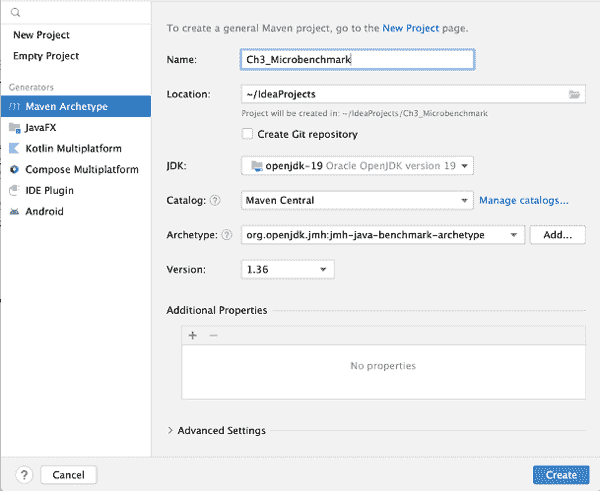

图 3.1：在 IntelliJ/IDEA 中为 `JMH` 创建 Maven 项目骨架

一旦创建，就会得到一个包含简单基准示例的骨架项目。你可以在 GitHub 上找到完整代码。基准本身与 Java 方法和注解一起工作，如下代码所示：

```java
public class MyBenchmark {

    private static final int[] ARRAY = new int[1000];

    private static final List<Integer> LIST = new ArrayList<>();

    static {

        Random random = new Random();

        for(int iter = 0 ; iter < ARRAY.length ; iter++) {

            ARRAY[iter] = random.nextInt();

            LIST.add(ARRAY[iter]);

        }

    }

    @Benchmark
```


```java
public long primitiveArrayPerformance() {
    var result = 0L;

    for (var current : ARRAY) {
        result += current;
    }

    return result;
}

@Benchmark
public long listPerformance() {
    var result = 0L;

    for (var current : LIST) {
        result += current;
    }

    return result;
}
```

基准方法添加了注解，并比较了遍历列表和遍历数组之间的性能差异。注意我们返回了和的结果。这是重要的；否则编译器可能会认为该代码什么都没做并将其消除。运行此程序会产生大量输出，因为基准运行了五个预热循环，随后是五个测试循环。然后它会生成一份报告，突出两者之间的性能差异。在上方有许多输出，如下所示的输出：

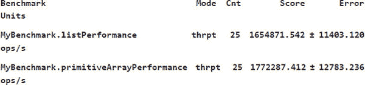

这是 Java 19，在 Valhalla 等功能出现之前，原始数组并不比列表快得多。历史上差异是 `20×`。改进是巨大的。

## 虚拟线程——Loom (Java 21)

Java 8 之后最好的变化之一可能是虚拟线程。为了理解虚拟线程，我们首先需要了解历史及其背后的动机。当 Java 首次发布时，我们拥有绿色线程。线程完全在 Java 中实现，而虚拟机本身在操作系统看来只是单个线程。

这是一个问题的问题。如果一个线程阻塞了，整个虚拟机就会被阻塞。

操作系统线程（OS Threads）在大量存在时是非常昂贵的。操作系统无法预知你打算对线程做什么，并且需要为线程分配大量资源。由于它不知道线程之前做了什么，因此在线程之间切换时会产生大量的开销，因为它必须像处理一切变化了一样去对待它。一旦跨越数百个线程的门槛，性能就会急剧下降。这就是为什么 Java 开发者通常使用线程池，以重用现有的 OS 线程并避免创建新线程。

一种方法是 Java 框架新增的异步 API。这些 API 能够解决该问题并提供其他语言所享有的吞吐量。但 Java 语法是为同步编码设计的。某些语言添加了如 `async/await` 等关键字来使异步代码更具可读性。但 Java 选择了不同的路径。为了理解原因，让我们先解释为什么即使我们有了 `async/await`，异步代码仍然存在问题。

在异步过程中，我们可以以不同的方式读取 IO；当它阻塞时，事件循环只需将任务交给一个新任务。当更多数据就绪时，IO 进程将发送回调。这种方式运行良好。然而，这意味着堆栈（stacks）是断开的。当你在本地或生产环境中遇到故障时，你没有上下文，只有当前的变量和数据。没有链式结构。

情况变得更糟。想象一个原子的单个事务。所有更改要么全部完成，要么全部失败。这是数据库的基本概念。但如果一切都是异步的，要以原子方式执行复杂任务将困难得多。同步编程更快、更简单、更易调试，并且在各方面都更好。除了吞吐量，它的扩展性并不良好。

## Project Loom

Project Loom 是虚拟线程（virtual threads）的代号。这个概念非常简单：虚拟线程不是使用原生线程，类似于绿色线程（green thread）。但与绿色线程不同，它在底层可以使用多个原生 OS 线程（数量取决于我们的 CPU 核心数）。这意味着它既能享受原生线程充分利用硬件的能力，又能将每个线程的开销降低到微微。

作为对比，原生线程可能有 2 MB 的 RAM 开销，而虚拟线程只有约 1 kB。这使得虚拟线程实际上是“免费”的。创建百万个线程是可行且负担得起的。

为了更具吸引力的是，Loom 几乎不需要更改代码。现有代码对虚拟线程是无感知的。你不需要像使用异步框架那样去适配它。使用虚拟线程没有缺点，但存在局限性。

如果我们正在编写 CPU 密集型代码，使用原生线程可能更有意义。否则，其他虚拟线程可能会受到影响。你可以通过现有的线程创建 API 混合使用虚拟线程和原生线程。注意，你永远不要池化虚拟线程，因为没有意义。目前 Loom 仍处于预览发布阶段，但它非常稳定且高效。要在 IntelliJ/IDEA 中使用实验性功能，我们需要执行几个步骤。首先，打开模块设置（右键点击项目菜单）并选择实验性功能，如图 3.2 所示。

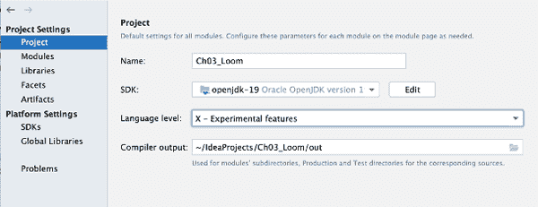

图 3.2：IntelliJ/IDEA 中的实验性功能

接下来，我们需要进入设置或选项区域（取决于你的操作系统）并选择 Java Compiler 部分（可以使用搜索找到它）。我们需要添加 `--enable-preview` 选项，如图 3.3 所示。

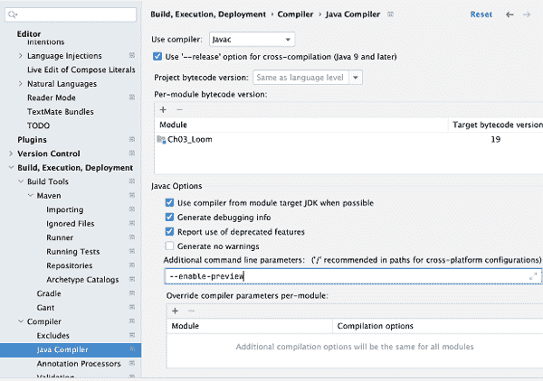

图 3.3：在 IntelliJ/IDEA 的编译器选项中添加 `--enable-preview`

最后，我们需要在运行配置的 VM 参数中添加 `--enable-preview`，如图 3.4 所示。

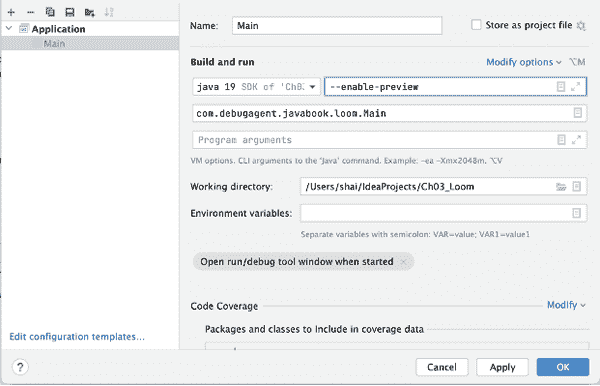

图 3.4：在 IntelliJ/IDEA 的运行配置 VM 中添加 `--enable-preview`

注意，VM 参数默认是隐藏的，我们应该通过修改选项菜单显式地显示它们，如如图 3.5 所示。

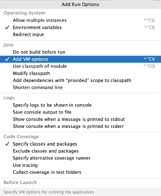

图 3.5：在 IntelliJ/IDEA 中启用 VM options 文本框

完成后，我们就可以编写依赖 Loom 等预览和实验性功能的代码了。此时，我们可以使用以下代码创建多个虚拟线程：

```java
AtomicInteger atomicInteger = new AtomicInteger(0);

for (int iter = 0; iter < 1000; iter++) {
    Thread.startVirtualThread(() ->
        System.out.println("Loom thread " + atomicInteger.addAndGet(1))
    );
}
```

这些都是基础内容。Loom 的影响在构建需要扩展的服务器应用程序时会被感受到。

## finalization 的弃用 (Java 9)

Java 9 弃用了终化（finalization）的概念。各个版本弃用并移除了许多功能；为什么这个功能如此重要，以至于我们在这里专门留出一个平台呢？

要理解这一点，我们需要理解 `finalize`。Java 没有析构函数。它没有一个在对象被销毁时调用的方法。它确实有一个 `finalize()` 方法，作用类似。它由 GC 调用，表示该对象将被销毁。我们为什么需要它？

假设你的 Java 代码映射到 OS 原生代码，例如一个文件对象或网络连接。如果 GC 删除了对象，我们希望同时也删除底层的原生资源以清理内存。这是一个高尚的目标。但它也触发了许多问题；例如，GC 需要调用终化器。这意味着当它“想要”收集对象时调用。

Java 9 添加了 `Cleaner` API，这让我们可以在不产生终化问题的情况下执行某些操作。

## 默认使用 UTF-8 (Java 18)

字符编码是一个比较难以理解的主题。Java 最大的创新之一是选择了 Unicode 作为默认值。这是一个巨大的飞跃。然而，在读取文本文件时，几乎任何操作都可以从字节创建字符串。以前 Java 默认使用系统编码。编码是决定如何将字节转换为字符的过程。每个操作系统的每个区域都有自己的编码，在 90 年代，UTF-8 并不常见。在过去的十年里，UTF-8 取代了它们并成为了事实标准。将其作为默认可以让代码变得简单得多：

```java
// 在 Java 18 之前，这个方法会抛出检查异常！
new String(bytes, "UTF-8");

// Java 18 之后这仍然是 UTF-8
new String(bytes);
```

## 语言变化

自 JDK 8 以来有很多语言变化，但像 Lambda 那样巨大的。一旦 Valhalla 发布，这可能会发生变化，但它现在甚至还没有处于预览阶段。我们将在未来的章节讨论 Valhalla。

### try with resources（try 资源）

关闭文件很麻烦。尤其是由于 `close()` 本身可能会抛出异常。这个微小的变化带来了巨大的差异，如下面的代码所示：

```java
// 使用 try with resources
try (var input = new FileInputStream("pom.xml")) {
    System.out.println(new String(input.readAllBytes()));
}

// 旧方法
InputStream input = null;

try {
    input = new FileInputStream("pom.xml");
    System.out.println(new String(input.readAllBytes()));
} finally {
    try {
        if (input != null) {
            input.close();
        }
    } catch (IOException e) {
        // 处理异常
    }
}
```

```java
16. } catch (IOException exception) {}
17. }
```

通过一种新方式，我们可以直接在 `try` 括号中分配可关闭的元素。我们可以包含多个可关闭元素并用分号将它们隔开。我们还可以包含 `catch` 子句，在我们的案例中，我们省略了它并让异常向上传播。

在第二个代码块中，注意我们必须在外部定义输入，因为构造函数可能会抛出异常。由于 `close` 也会抛出异常，我们需要单独处理它。这并不是一个理想的代码块，因为 `close` 操作上的错误信息可能具有意义，但我们选择了保持代码简洁。任何实现了 `AutoCloseable` 接口的对象都可以用于 `try-with-resources`。

### 接口中的私有方法 (Java 9)

从 Java 9 开始，我们可以在接口中添加私有方法。无论是静态还是其他类型。如果你有静态或默认的公共方法，这样做是有意义的。在这种情况下，你可以在几个此类方法之间复用代码。

### var 关键字 (Java 10)

我们已经使用过几次 `var` 关键字了。它创建了类型的隐式定义。从 Java 11 开始，它也可以作为 Lambda 回调的参数，因此我们可以减少一些定义上的样板代码。

`var` 关键字不能用于字段，且不能用于存在歧义的情况。它只有在编译器可以确定类型时才有意义。它可以与基本数据类型一起工作，并在以这种方式使用时将作为基本数据类型提供服务。

由于 `var` 的工作方式，它必须在创建点始终赋值。我们不能在不赋值的情况下使用 `var` 声明变量。

### Switch 表达式 (Java 14)

`switch` 是一个有一点问题的语句。它通常与 `enum` 一起使用，但在大多数情况下，“正确的做法”将是向 `enum` 中添加一个方法。然而，Java 中的 `switch` 可以与并非由开发者控制的 `enum`、数字、字符串和对象一起工作。它是一个非常强大的工具，可以让我们免于复杂的结构和嵌套的 `if` 语句。

遗憾的是，Java 标准版本的 `switch` 存在问题。请看下面的示例：

```java
switch (value) {
    case A:
        result = "The A Value";
        break;

    case B:
        result = "It's B";
        break;

    case C:
        result = "It's C";
        break;
}
```

这里有几个问题。有些是微妙的，但另一些是显而易见的，如下所示：

- 代码非常冗长。
- 如果我们忘记写 `break`，代码将掉入下一个语句，导致得到错误的值。
- 如果添加了 `D` 枚举，代码将失败。

关于最后一部分，我们可以添加一个抛出异常的 `default` switch 语句。但这很糟糕。这意味着失败将发生在运行时，而不是编译时。我们可以通过 `switch` 表达式表现得更好：

```java
result = switch (value) {
    case A -> "The A Value";
    case B -> "It's B";
    case C -> "It's C";
};
```

这解决了所有提到的问题：

- 它不再冗长了。
- 它不依赖于 `break`。
- 如果我们添加了 `D` 枚举，代码将无法编译。它必须是穷尽的！

我们还可以使用 `yield` 代替 `break` 来利用更传统的 switch 语句，如下所示：

```java
result = switch (value) {
    case A:
        System.out.println("A reached");
        yield "The A Value";

    case B:
        System.out.println("B reached");
        yield "It's B";

    case C:
        System.out.println("C reached");
        yield "It's C";
};
```

对于 JDK 19，我们有了一种新类型的模式匹配 `switch` 表达式。假设我们有一个 `shape` 对象，并想要为各种子类创建自定义代码。它在第三方库中，所以我们无法通过继承来实现（这通常是首选方法）。解决此问题的方法是一系列 `if` 语句和 `instanceof` 测试。模式匹配 `switch` 如下简化了代码：

```java
var height = switch (myShape) {
    case Rectangle r -> r.height;
    case GeneralPath c -> c.getBounds().height;
    default ->
        throw new IllegalArgumentException("Unrecognized shape");
};
```

注意代码消除了对强制类型转换的需求。我们已经有了正确类型的变量。另外，注意 `default` 语句是必须的；否则 `switch` 语句将是不穷尽的。编译器将不允许。

在密封类（sealed classes）中有一个解决方案，我们接下来将探讨。

### 密封类 (Java 17)

密封类对于想要防止层次结构被修改的 API 提供者来说是有意义的。Java 提供了 `final` 关键字来实现。`String` 是 `final` 的，这意味着我们不能扩展它。这并不糟。但如果 Oracle 想要扩展 `String` 呢？

他们也做不到。他们可以，但它们是 `final` 或 `sealed` 的。`sealed` 关键字允许我们指定哪些类是被允许的：

```java
public sealed class Base permits SubA, SubB {}

public final class SubA extends Base {}

public final class SubB extends Base {}
```

### 模式匹配 instanceof (Java 16)

`instanceof` 操作是最简单的变化之一。只是一点语法糖，让代码变得好得多：

```java
// instanceof 之前
if (number instanceof Float) {
    Float f = (Float) number;
}

// instanceof 之后
if (number instanceof Float f) {
    // 使用 f
}
```

### 文本块 (Java 15)

从文本处理语言来到 Java 的开发者通常会觉得字符串很痛苦。特别是我们需要表示一个大块文本时。这就是文本块解决问题的地方：

```java
public static String regularStrings(String title, String link) {
    return "<html>\n" +
           "<head>\n" +
           "<title>" + title + "</title>\n" +
           "</head>" +
           "<body>\n" +
           " <a href=\"https://debugagent.com\">" + link + "</a>\n" +
           "</body>";
}

public static String textBlockString(String title, String link) {
    return """
        <html>

        <head>

            <title>%s</title>

        </head>

        <body><a href="https://debugagent.com">%s</a>

        </body>

        """.formatted(title, link);
}
```

```java
ResultSet rs = DB."SELECT * FROM Person p WHERE p.last_name = {name}";
```


我们还没有讨论过数据库，但这里的核心思想是`DB`类将是一个接受参数化字符串的处理器。这并不是之前示例中的那种字符串替换，而是一种基于字符串参数创建对象的全新方式。

### 记录类型 (Java 16)

我们在书的前两章中讨论了记录（records）。它们是极其强大的特性，对 Java 来说相对较新。随着它们的引入，我们还获得了内部类的静态成员，而在过去，内部类只允许定义常量。

### 记录模式 (Java 19 预览版)

JEP 405 定义了记录模式（record patterns），它与我们之前讨论的`instanceof`模式匹配相关。它通过一种提取记录值的语法增强了这种功能。例如：

```
if (o instanceof Point(int x, int y)) {
    System.out.println(x+y);
}
```

请注意，如果`o`是`Point`的实例，我们就可以直接从该`Point`对象中获取`x`和`y`，并使用它们。

### 字符串模板 (Java 21 预览版)

JEP 430 定义了字符串模板（string templates），旨在简化并增强字符串拼接。在当前的 Java 版本中，我们有多种方法构建字符串；也许最简单的如下：

```java
public String method(int arg) {
    return "The value is: " + arg + " generated at: " + System.currentTimeMillis();
}
```

这种写法非常繁琐，尤其是使用文本块（`"""`语法）时。使用字符串模板，我们可以如下写代码：

```java
public String method(int arg) {
    return STR."The value is: {arg} generated at: {System.currentTimeMillis()}";
}
```

这段代码更加流畅且易于阅读，并产生相同的结果。注意字符串前缀标记为`STR`。这是模板处理器，该 API 的精妙之处在于它是可插拔的。我们可以创建自己的模板处理器，例如如下：

```
ResultSet rs = DB."SELECT * FROM Person p WHERE p.last_name = {name}";
```

我们在这里得到的是将参数转换为名称的数据库处理器。简单阅读代码可能会认为该代码存在 SQL 注入漏洞。事实并非一定如此。字符串处理器并没有被要求将字符串中的值替换为给定的值。它可以创建一个正确的`PreparedStatement`，并验证在`name`中设置的值是否确实有效。

### 无名模式和变量 (Java 21 预览版)

Java 长期的一项限制是缺乏一种简单的方法来消除冗余。JEP 443 将下划线字符`_`定义为签名中缺失声明的占位符。在当前的 Java 中，我们经常会写出如下代码：

```
try {
    // ....
} catch(Exception ex) {
    genericErrorHandling();
}
```

注意变量`ex`未被使用。这可能会导致代码静态检查工具产生警告，而且当我们选择那些会污染代码并在搜索某些内容时出现的名称时，它也会带来困扰。这个 JEP 提供了一种方法，通过使用下划线字符来声明我们不关心某个特定值：

```
try {
    // ....
} catch(Exception _) {
    genericErrorHandling();
}
```

当此项更改与其他语言特性（如模式和增强型 switch 语句）结合时，其真实价值就显现出来了：

```
switch (b) {
    case Box(RedBall _), Box(BlueBall _) -> processBox(b);
    case Box(GreenBall _) -> stopProcessing();
    case Box(_) -> pickAnotherBox();
}
```

我们不在乎参数值，但可能在乎类型。这在前两个 switch 语句中节省了我们的输入工作，但在最后一个条目中可以作为“兜底”使用。

## APIs

在 Java 8 到 21 之间，发生了**许多** API 变化。我们可以专门花一章来写关于`String`类的变化。以下是我们需要理解的一些重大变化。要查看所有变化的完整列表，请查阅 Java 年鉴（Java Almanac）。

### HttpClient (Java 11)

在 Java 中发送 HTTP 请求有许多方法，但它们各有缺陷。`HttpClient`在这方面是一个巨大的飞跃。它是一个不可变的 API，使用非常流畅的语法来执行请求。它有两个版本的 API：同步和异步。同步 API 看起来如下：

```
HttpClient client = HttpClient.newBuilder()
    .version(Version.HTTP_2)
    .build();

HttpRequest request = HttpRequest.newBuilder()
    .uri(URI.create("https://debugagent.com/"))
    .build();

var response = client.send(request, HttpResponse.BodyHandlers.ofByteArray());
System.out.println(new String(response.body()));
```

如你所示，我们只需使用构建器模式来定义请求。有趣的部分是第 7 行的响应。我们可以从几个“现成”选项或我们自定义的选项中定义任何响应处理程序。

### 外部函数和内存 API—Panama (Java 19)

Java 提供了很多保护和便利。但有时，我们需要走出它的温暖怀抱来调用原生操作系统能力。在过去，Java 使用 Java Native Interfaces（`JNI`）标准化了对`C`的访问。它也有一些自定义的非标准 API，但`JNI`是主流标准。遗憾的是，`JNI`广受厌恶。

它很难使用。它需要在值之间进行拷贝。它需要编写大量的`C`模板代码。自然地，第三方出现并提供了基于`JNI`的各种 Java 封装，但它们是有缺陷的，因为它们基于`JNI`。它们隐式地继承了`JNI`的某些痛点。

`Panama`意味着从`JVM`到操作系统以及其他语言的访问。这涉及到多个 JEP，因为这是一项巨大的工程，部分内容已进入预览，其他部分仍在待定。`Panama`可以减少`JNI`的开销，结果也可以提供更好的性能。

由于 Panama 涉及原生代码，我们不会深入探讨该 API，仅提供其功能的简要概述。我们通常会使用`jextract`命令行工具将 C 头文件转换为 Java 存根。此时，我们可以直接从 Java 调用 C。例如，在下面的 Hello World 代码中，我们调用了原生的`printf`函数：

```java
public class HelloPanama {
    public static void main(String[] args) {
        try (var confined = MemorySession.openConfined()) {
            MemorySegment s = confined.allocateUtf8String("Hello Panama");
            printf(s);
        }
    }
}
```

为了分配原生内存（调用函数所需），我们需要一个`MemorySession`。注意我们需要清理资源，这就是为什么我们使用 try-with-resources。请查看 Carl Dea 关于此主题的精彩系列和演讲。

Panama 的另一个相关部分是对向量 API 的支持，它将为 Java 提供支持 CPU 向量原语的原语。CPU 非常擅长批量处理数据；这使得向量操作（例如矩阵乘法）非常快。然而，我们需要特定的 CPU 指令来获得 16 倍的性能提升。通常编译器会帮我们这样做，有时也可以。但其中有许多细微差别且没有保证。Vector API 包含一组原语，强制我们以 JIT 能够识别并翻译为向量调用（SIMD、SSE、AVX 等）的方式编写代码。该 API 处于预览阶段，但它取决于 Valhalla 项目，因为这些类应该是原始类型。

### 结构化并发 (Java 19)

此 API 作为 JEP 428 的一部分引入，并与 Project Loom 密切相关。它允许我们使用`AutoCloseable`接口和`try-with-resources`块将两个线程限制在一个范围内。当以下代码执行完毕，两个线程都将完成：

```
try (ExecutorService e = Executors.newVirtualThreadPerTaskExecutor()) {
    e.submit(() -> methodA());
    e.submit(() -> methodB());
}
```

这意味着`executor`的`close`操作将相当于调用了`join()`，它会等待线程完成。

### 序列化过滤 (Java 9)

许多编程语言中最大的安全问题之一就是序列化。它允许我们读取大量字节并将其转换为对象。这看似无害，但遗憾的是事实并非如此。恶意黑客可以利用序列化代码中的细微错误来构建漏洞链。在这样的链中，你的小漏洞可能会允许加载另一个类，而该类又指向长链中的另一个类，直到你不经意中加载了一个漏洞类。

有一些开发者工具可以让黑客创建此类复杂的链，甚至生成利用工具（gadgets），这些工具实际上是预先打包的利用程序。遗憾的是，这些漏洞非常微妙且极其常见。Brian Vermeer 在他的演讲中将序列化称为“回之不出的礼物”。不对序列化进行检查无异于自找麻烦。

序列化过滤器的出现是为了解决很大一部分问题。它们允许我们阻止特定类或对其他类建立白名单。我们可以通过命令行来实现，也可以使用代码来阻止和监控序列化类。这是一个如此重要的 API，以至于它被回移植到了较旧的 JDK 版本！

以下命令过滤了 JVM 中所有的序列化：

```
java "-Djdk.serialFilter=!*" -jar myapp.jar
```

感叹号表示我们想要阻止，星号表示我们阻止所有内容。我们可以使用包名显式阻止特定的包：

```
java "-Djdk.serialFilter=!mypackage.*" -jar myapp.jar
```

或者我们可以采取反向操作，显式允许该包而不允许任何其他包：

```
java "-Djdk.serialFilter=mypackage.*;!*" -jar myapp.jar
```

这些都很好，但如果我们想写代码来过滤或记录序列化怎么办？我们可以使用过滤器类对整个 JVM 或特定流进行全局处理：

```
ObjectInputFilter.Config.setSerialFilter(info ->
    info.depth() > 10 ? Status.REJECTED : Status.UNDECIDED);
```

这是 Oracle 文档中一个简单序列化过滤器的示例。请注意，它可以拒绝序列化或将其标记为“未决定”。这是过滤器链的一部分，验证过程中的每个阶段都可以拒绝序列化或将其传递给下一个阶段。我们可以像这里这样全局地绑定过滤器，也可以按流进行。该 API 异常灵活，并提供了关于该过程的丰富信息。

### 作用域值 (Java 20)

在 Project Loom 之前，我们使用`thread locals`来存储线程特定的信息。然而，`thread locals`经常被误用并可能导致内存泄漏。作用域值（Scoped values）提供了一种更现代的线程间共享数据的方式。它们是不可变的且具有有限的寿命。

```
static final ScopedValue<String> SCOPE = ScopedValue.newInstance();
SCOPE.set("hello", () -> {
    System.out.println(SCOPE.get());
});
```

上面的示例展示了如何使用`ScopedValue`。该值仅在提供的方法执行期间可用。这比使用`thread locals`要安全得多且高效得多。

## Valhalla

`Valhalla`想要跨越那道鸿沟，让我们能够编写像原始类型一样运行的对象。这是 Java 语言有史以来最大的变革之一，它将要求我们对代码和语言的许多假设进行重大重新评估。Valhalla 引入的第一个特性是`value`关键字，我们可以像下面这样使用：

```java
value class Dimension {
    int width;
    int height;
}
```

这意味着该类没有身份（指针）。这意味着`JVM`将该类视为堆栈上的结构体，它可以被复制，但不能被引用。那么，当我们比较没有身份的值类时，会发生什么呢？

```java
if(dimension1 == dimension2) {
    //...
}
```

这段代码等同于写了：

```java
if(dimension1.width == dimension2.width && dimension1.height == dimension2.height) {
    //...
}
```

它将比较所有的字段。这既有其优势也有其缺点。但这是一个垫脚石。值对象仍然可以是`null`。因为它们仍然可以是`null`，所以效率无法像原始类型那样高。这就是为什么 Valhalla 包含了`primitive`关键字：

```java
primitive class Dimension {
    int width;
    int height;
}
```

原始类型不能为`null`。这意味着值的赋值方式将有所不同；对象有时会被完整复制。如果处理得当，这可以提供许多优势。参考以下代码：

```java
var size = dimension[0];
```


这从数组中复制了原始类型 `Dimension`。这意味着对 `size` 的更改不会影响 `dimension[0]`。这并不昂贵，因为复制发生在堆栈上。它也意味着 `dimension[0]` 数组的另一点。原始数组在性能上等同于元素数量是两倍的 `int` 数组（因为每个维度元素都包含两个整数）。标准的 Java 数组由引用组成。在遍历对象数组并执行操作时，`VM` 需要获取引用，跳转到对象并执行操作。

由于内存局部性和分页问题，这可能会非常慢，从而显著影响时间。通过原始对象，我们可以解决这个问题，尽管值对象在此过程中会有很大帮助。

### 结论

自 Java 8 以来，已经发生了许多变化。尽管 Java 8 是一个重大发布，但最近的这些总体上超过了它，并且是值得的继任者。未来的功能如 `Loom` 和 `Valhalla` 让 `JVM` 比以往任何时候都更加令人兴奋和强大。

流性和易用性是进入 Java 的语言变化的主要主题。尽管采取了“慢工制胜”的方法，但 Java 正在以非常快的速度前进。

## 注意事项

- 在处理可关闭资源时，使用 `try-with-resources`。
- 切换表达式和模式匹配使得编写流式代码变得容易得多。
- 文本块在编写字符串时可以节省大量的痛苦。
- 在编写数据对象时，尝试改用 `records` 代替。
- 如果你面临吞吐量问题，请确保用 `project Loom` 尝试你的应用。
- `HttpClient` 是一个非常强大且简单的 API，你可以利用它处理网络。
- 始终定义序列化过滤策略，始终！
- `GraalVM` 是一个你应该关注的强大工具。对它进行基准测试。
- `Valhalla` 对你的项目可能产生重大影响。确保你理解并利用它。

### 多选题

**A. Try with resources 帮助你：**

1. 捕获资源异常
2. 回滚资源的更改，例如数据库回滚
3. 在完成后关闭资源
4. 测试各种资源的兼容性

**B. Project Loom 旨在提高：**

1. 性能
2. 扩展
3. 内存
4. 编码

**C. GraalVM 是一个：**

1. JIT
2. 多语言虚拟机
3. 原生编译器
4. 以上所有

**D. 序列化过滤器可以通过赋值：**

1. 排除不支持的模式
2. 包含支持的模式
3. 通过命令行
4. 在代码中
5. 以上所有

### 答案

A. 3  
B. 2  
C. 4  
D. 5

---

[1] https://github.com/shai-almog/java-book/  
[2] https://javaalmanac.io/jdk/21/apidiff/8/  
[3] https://foojay.io/today/project-panama-for-newbies-part-1/  
[4] https://www.youtube.com/watch?v=zHZv2L9hDis

**加入我们的书籍 Discord 空间**

加入书籍的 Discord 工作空间以获取最新更新、优惠、全球科技动态、新版本发布以及与作者的交流会议：

[`discord.bpbonline.com`](https://discord.bpbonline.com)


# 第 4 章：现代多线程

## 引言

在编写时，Java 准备通过 `project Loom` 带来另一个重大变化。然而，Java 中有许多特性彻底改变了我们编写代码的方式。在本章中，我们将讨论从开始到现在的线程演变。我们将解释权衡方案以及编写并发代码的最佳方法。

## 结构

在本章中，我们将讨论以下主题：

- 历史
- 概念
- 线程池
- 锁
- 同步器
- 原子类
- Future
- 集合与队列

## 目标

在本章结束时，你将理解并发和并行的核心概念——它们之间有什么区别、Java 线程实现是如何变化的，以及权衡是什么。

在 Web 服务器上，一个传入的请求需要处理某个任务并根据结果执行另一个网络请求（数据库查询通常就是一个网络请求）。这意味着服务器花费了时间从网络套接字读取数据，并写入或等待另一个网络套接字。在此期间，线程处于阻塞状态，无法进行任何其他操作。这对 Web 服务器的扩展性造成了硬性限制，因为线程的数量是有限制的。一个 Web 服务器可能实际上处于空闲状态，却又完全饱和，这仅仅是因为它耗尽了原生线程。

解决这一问题的变通方法是异步 API，它允许我们在处理 IO 操作时释放当前线程。这种方法有效，但它让编程变得困难得多，因为代码不再是线性的。每个调用都必须通过一组异步回调来执行每个任务。

Project Loom 在 Java 中引入了虚拟线程来解决这个问题，正如上一节所讨论。Loom 是一项惊人的创新，但它并不是所有情况的理想选择。你不应该将虚拟线程用于本地方法交互、CPU 密集型代码等场景。图 4.1 显示了 JDK 中线程机制的演进之路。

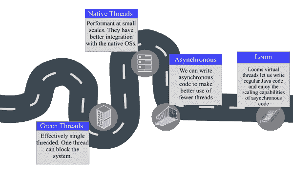

图 4.1：JDK 现代线程的演进之路

## 概念

在继续之前，我们需要理解关于并行（Parallelism）、并发（Concurrency）和多线程编程。让我们从并行与并发之间的区别开始。它们不是互换的，描述的是两种不同的情况。

并发意味着多个线程正在运行。绿线程是并发的，因为多个线程在同时运行。然而，绿线程从未允许两个线程同时执行。即使你的 CPU 有多个核心，绿线程的实现也只允许一个线程运行。

并行意味着两个或多个线程同时执行（或可能同时执行）。这需要多核或多 CPU 系统来支持。某些故障只有在并行系统运行时才会发生，因此，为并行系统编写线程安全代码要困难得多。

并行问题可以分解为许多较小的独立问题并并发运行。这在 JDK 中通过并行流（parallel stream）体现。让我们回顾一下第 2 章中讨论过的流代码：

```java
1. return numbers.stream()

2. .filter(num -> num % 2 == 0 && num > 0)

3. .distinct()

4. .sorted()

5. .collect(Collectors.toList());
```

我们可以将 `stream()` 调用更改为 `parallelStream()`，它将使用多个线程并行执行流任务，并更好地利用你的 CPU 核心。在某些情况下，这会明显比普通流快，但通常不会如此，因为多线程的开销远大于小规模工作负载带来的收益。

这种方法之所以有效，是因为流没有外部影响。我们可以采取不同的阶段并独立于彼此运行运行它们。如果你编写了不使用外部资源的恰当代码，这将无缝地工作。

### 线程安全

线程安全的概念非常复杂。它的基本定义是：一个元素可以被多个线程访问而无需担心。这可以实现，但它并不像看起来那么简单。如果一个方法更改了类内部的字段，或从类中读取字段，线程安全性可能会受到破坏。

从历史上看，JVM 中的某些操作不是原子的。原子操作（Atomic operation）保证是单条指令完成。线程在原子操作执行过程中不会被中断。在这些情况下，如果你将一个 `long` 字段设置为新值，线程可能会在中间被中断。为了防止这种情况发生，Java 添加了 `volatile` 关键字，当它应用于字段时，要求对该字段的所有操作都是原子的。

这（大部分）不再是一个问题，因为我们已经过渡到 64 位 JVM。在 64 位 JVM 中，对 64 位 `long` 值的操作将是原子的。然而，我们说“大部分”是因为 Valhalla 为 JVM 添加了新的原始类型，而它们将不是原子的。

随 JDK 1.0 发布的原始集合类尝试实现线程安全。然而，它们的性能很差，并且存在多个与线程相关的问题。完全保护一个复杂的可变数据结构很难。测试和调试相关的失败更是困难。新的集合 API 为了性能放弃了线程安全，并为线程安全集合提供了特定的模式，我们很快就会讨论。现在的通用方法是尽可能避免线程安全。这会减慢应用程序的速度，即使是多线程应用程序。

### 互斥锁（Lock）

Mutex 是“互斥”（mutual exclusion）的缩写。它对共享资源施加限制，只允许特定线程访问。Java 的“经典”互斥锁是 `synchronized` 关键字。synchronized 有多种使用方式，常用方式如下：

```java
1. private Collection<String> listOfNames = new ArrayList<>();

3. public synchronized void addName(String name) {

4. listOfNames.add(name);

5. }

7. public synchronized boolean isInList(String name) {

8. return listOfNames.contains(name);

9. }
```

Java 中的每个 `Object` 都带有一个互斥锁。在这种情况下，`synchronized` 关键字应用于当前对象：`this`。如果该方法是静态的，它将应用于相应的 `Class` 对象。如果两个线程同时到达这些方法，只有一个线程会“进入”。另一个必须等待完成。注意，这同时适用于两个方法。如果一个线程当前处于 `addName` 内部，对 `isInList` 和 `addName` 的调用都将被阻塞，直到它返回。

这种编程方式具有优雅性，因为我们在方法签名中声明了线程安全行为。但大多数开发者都避讳这种编程方式，因为它存在问题。第三方开发者可以对对象进行同步并产生不可预测的行为，这就是为什么不建议对当前对象进行同步。我们可以通过如下 `synchronized` 块来解决这个问题：

```java
1. final Object LOCK = new Object();

2. private Collection<String> listOfNames = new ArrayList<>();

4. public void addName(String name) {

5. synchronized (LOCK) {

6. listOfNames.add(name);

7. }

8. }

10. public boolean isInList(String name) {

11. synchronized (LOCK) {

12. return listOfNames.contains(name);

13. }

14. }
```

这是一个更传统的同步方法，不会暴露锁对象。对于简单的用例，这可以工作，但对于复杂的选项，我们将遇到局限性。假设我们希望在向列表添加名称时触发一个事件。这样我们就可以更新 UI 以指示最新加入的人。代码的其他部分可能也需要该事件，因此我们将编写类似下面的通用代码：

```java
1. private Collection<String> listOfNames = new ArrayList<>();

2. private Collection<NameAdded> listeners = new ArrayList<>();

4. interface NameAdded {

5. void nameAdded(String name);

6. }

8. public void listenNameIsAdded(NameAdded callback) {

9. synchronized (LOCK) {

10. listeners.add(callback);

11. }

12. }

14. public void stopListeningNameIsAdded(NameAdded callback) {

15. synchronized (LOCK) {

16. listeners.remove(callback);

17. }

18. }

20. public void addName(String name) {

21. synchronized (LOCK) {

22. listOfNames.add(name);

23. for(NameAdded current : listeners) {

24. current.nameAdded(name);

25. }

26. }

27. }
```

每当添加一个名称时，我们都会遍历所有的监听器并通知它们该事件。这段代码存在几个问题，但最大的问题是潜在的死锁风险。大问题在于，我们直接使用了调用 `addName` 的线程并用它来“发送事件”。我们调用了多个回调方法，这些方法可能会执行任何操作。因为在执行这些操作时持有 `LOCK` 锁，所以在此时间内没有其他方法可以运行。这意味着性能将会非常缓慢且不可预测。

### 等待与通知（监控器）

通常，事件是在不同的线程上发送的。我们无法为每个事件都创建一个线程，因此解决方案是在单个线程上发送事件。但这也有一个小问题：我们如何高效地向另一个线程发送数据呢？

我们如何不断保持并重用同一个线程？

实现这一点有许多方法。我们将从“旧方法”开始，这有助于我们在以后学习新方法时更好地理解它：

```java
private final Object EVENT_THREAD_LOCK = new Object();

private List<String> pending = new ArrayList<>();

public WaitAndNotify() {

    new Thread(() -> {

        try {

            while(true) {

                String[] newStrings;

                NameAdded[] listenersArray;

                synchronized (EVENT_THREAD_LOCK) {

                    if(pending.isEmpty()) {

                        EVENT_THREAD_LOCK.wait();

                    }

                    newStrings = new String[pending.size()];

                    pending.toArray(newStrings);

                    pending.clear();

                }

                synchronized (LOCK) {

                    listenersArray = new NameAdded[listeners.size()];

                    listeners.toArray(listenersArray);

                }

                for(String name : pending) {

                    for(NameAdded nameAdded : listenersArray) {

                        nameAdded.nameAdded(name);

                    }

                }

            }

        } catch (InterruptedException e) {

            e.printStackTrace();

        }

    }).start();

}

public void addName(String name) {

    synchronized (LOCK) {

        listOfNames.add(name);

    }

    synchronized (EVENT_THREAD_LOCK) {

        pending.add(name);

        EVENT_THREAD_LOCK.notify();

    }

}
```

这段代码列表中有很多内容需要消化。我们有一个新的构造函数，在开始时设置了一个新线程。那部分应该是不言自明的。我们有两个新字段；一个是 `pending` 列表，用于存储尚未发送事件的名称。另一个是为新线程提供的额外锁。

我们不想重用同一个锁，因为那会增加死锁的概率并降低性能。

新线程是一个无限循环。重要的部分在第 11 行。我们调用了 `wait()` 方法。通过 `wait()`，我们可以无限期地持有线程（在此处所示）或者等待几毫秒。为了“唤醒”线程，我们调用了 `notify()` 方法，正如我们在第 40 行看到的。`wait()` 和 `notify()` 都要求对对象加锁。如果它们不在调用时所用对象的 `synchronized` 块中，它们将无法工作。当一个线程处于“等待”状态时，它会释放周围的锁，这就是为什么 `addName()` 方法可以对事件线程锁进行同步。

这让我们能够挂起一个线程，并在需要时唤醒它。我们可以“挂起”多个线程并使用 `notifyAll()` 唤醒它们；在这种情况下，不需要这样做。代码的其余部分虽然繁琐但至关重要。为了保持代码的高效，我们希望尽可能缩小 `synchronized` 块的范围。遗憾的是，这意味着我们无法访问变量，因为它们可能会发生变化。常用的技巧是将它们复制到单独的对象中，这正是我们在这里所做的。然后我们可以从线程触发事件，如果没有进一步的事件需要处理，就返回睡眠。

### 死锁

线程编程中两个最常见的问题是死锁和竞态条件。我们将从前者开始。当一个线程尝试获取另一个线程不释放的锁时，就会发生死锁。通常这种情况发生在一个线程等待另一个线程，反之亦然的情况下，正如接下来的示例所示，它是死锁最简单的版本之一：

```java
private static void dead(String name, Object lock1, Object lock2) {

    try {

        synchronized (lock1) {
```


```java
System.out.println("Thread " + name + " Holding...");

Thread.sleep(2);

synchronized (lock2) {

    System.out.println("Thread " + name + " Got it!");

}

} catch (InterruptedException e) {

    throw new RuntimeException(e);

}

}

public static void main(String[] argv) {

    Object LOCK1 = new Object();

    Object LOCK2 = new Object();

    Executor executor = Executors.newFixedThreadPool(2);

    executor.execute(() -> dead("One", LOCK1, LOCK2));

    executor.execute(() -> dead("Two", LOCK2, LOCK1));

}
```

### 竞态条件

竞态条件是一个狡险的 Bug。它并不总是发生。事实上，接下来的代码尽管存在明显的条件仍然运行正常：

```java
private static List<String> stringList;

public static void main(String[] argv) {

    Executors.newFixedThreadPool(1).execute(() -> {

        System.out.print(stringList);

    });

    stringList = List.of("ZZ", "XX", "LL", "DDD");

}
```

- `newFixedThreadPool(int nThreads)`: 创建一个具有固定数量线程的线程池，这些线程共享一个无界队列运行。我们在上一个示例中见过这个方法的实际用法。在任何时候，最多会有 `nThreads` 个线程正在活动处理任务。当所有线程都处于活跃状态时提交了额外的任务，它们将在队列中等待，直到线程可用。

- `newSingleThreadExecutor()`: 创建一个使用单个工作线程的执行器，该线程在无界队列上操作。保证任务按顺序执行，且在任何给定时间不会多有一个任务处于活跃状态。

- `newCachedThreadPool()`: 创建一个线程池，它会根据需要创建新线程，但在之前构建的线程空闲时也会复用它们。这些线程池通常会提高执行许多短寿命异步任务的程序的性能。

- `newScheduledThreadPool()`: 创建一个 `ScheduledThreadPoolExecutor`，它使用固定数量的线程执行任务，但允许你使用延迟或固定速率调度任务在未来执行。例如，这段代码将调度该任务在 10 秒后执行：`executor.schedule(runnable, 10, TimeUnit.SECONDS);`

- `newVirtualThreadPerTaskExecutor()`: 创建一个虚拟线程；我们在上一个章节介绍 Project Loom 时讨论过这一点。

执行器 API 包含一些强大的功能。我们将在接下来的章节中讨论一些更有有趣的特性。

## Locks（锁）

Synchronized 是 Java 语言中创新且强大的特性。但它有许多缺点，其中一些与其年代有关，另一些则由于作为一种语言特性，它的演进比演进一个 API 更困难。Java 中的并发 API 包含了几个惊不起的工具，旨在减少对同步的需求。它们更不容易出错、更优雅，在某些情况下甚至更高效。锁（lock）的优势如下所示：

| | Synchronized | Locks |
| :--- | :--- | :--- |
| 范围 | 局限于块或方法 | 可以在一个方法中获取并在另一个方法中释放 |
| 公平性 | 无 | 可选 |
| `tryLock` | 否 | 是 |
| 等待时可中断 | 否 | 使用 `lockInterruptibly()` |

表 4.1：锁的优势

上表 4.1 中的某些元素是我们之前尚未解释的内容。让我们先从将一些同步代码改为使用锁开始。这基于我们的第二个同步示例：

1. `private final ReentrantLock LOCK = new ReentrantLock();`
2. `private Collection<String> listOfNames = new ArrayList<>();`
3. `public void addName(String name) {`
4. `LOCK.lock();`
5. `try {`
6. `listOfNames.add(name);`
7. `} finally {`
8. `LOCK.unlock();`
9. `}`
10. `}`
11. `public boolean isInList(String name) {`
12. `LOCK.lock();`
13. `try {`
14. `return listOfNames.contains(name);`
15. `} finally {`
16. `LOCK.unlock();`
17. `}`
18. `}`

`Lock` 是实现此 API 的接口。我们使用了 `ReentrantLock`，它的语义与 `synchronized` 关键字最匹配。注意，由于使用了 `try` 和 `catch`，锁的版本稍微长一些。我们可以使用如下所示的简洁语法：

1. `public void addName(String name) {`
2. `LOCK.lock();`
3. `listOfNames.add(name);`
4. `LOCK.unlock();`
5. `}`

然而，这是有风险的。如果 `add` 方法抛出异常，锁将保持锁定状态，该方法（或任何使用该锁的块）将变得不可用。这是 `synchronized` 块为我们处理的问题。

你可能看着这些代码在想，为什么我们不能像下面使用 try-with-resources：

1. `public void addName(String name) {`
2. `try(LOCK.lock()) {`
3. `listOfNames.add(name);`
4. `}`
5. `}`

这样很好，并且可以与 `synchronized` 块媲美。遗憾的是，锁不是 `AutoClosable`，无法无缝地解锁。该 API 是为了会“关闭”的资源设计的，而锁会一直。我们将复用锁对象，但不会复用文件流。这可以通过封装锁对象来实现。

我们之前讨论过的锁有几个有趣的特性。第一个是公平性。可以通过使用 `true` 作为参数来构造 `ReentrantLock` 以使其公平化：`new ReentrantLock(true)`。公平意味着等待锁最长的线程将是下一个进入锁的线程。`Synchronized` 没有提供这种保证。注意，这并不保证事情按顺序发生。考虑到以下代码：

1. `private static final ReentrantLock FAIR_LOCK = new ReentrantLock(true);`
2. `private static final ReentrantLock UNFAIR_LOCK = new ReentrantLock();`
3. `private static void print(Lock lock, int number) {`
4. `lock.lock();`
5. `try {`
6. `System.out.print(" " + number);`
7. `} finally {`
8. `lock.unlock();`
9. `}`
10. `}`
11. `private static void test(Executor executor) {`
12. `for (int i = 0; i < 10; i++) {`
13. `executor.execute(() -> {`
14. `print(FAIR_LOCK, i);`
15. `});`
16. `});`
17. `}`
18. `}`


```java
System.out.println("Entered thread " + number);

Thread.sleep(30);

System.out.println("Exiting thread " + number);

} catch (InterruptedException err) {

    System.out.println("Sleep Interrupted: " + number);

} finally {

    LOCK.unlock();

}

}

public static void main(String[] argv) throws InterruptedException {

    Executor executor = Executors.newFixedThreadPool(10);

    executor.execute(() -> tryLock(1));

    executor.execute(() -> tryLock(2));

}
```

```java
private final Semaphore limited = new Semaphore(20);

private void restricted() throws InterruptedException {

    limited.acquire();

    try {

        // perform restricted activity

    } finally {

        limited.release();

    }

}
```

`CountDownLatch` 可以等待计数器变为零。想象一种情况：我们有多个线程完成任务，以便我们的代码继续执行。我们如何知道它们都已完成呢？

我们使用 `CountDownLatch` 来计数，当计数变为零时，`await()` 方法将释放我们的当前线程并表示所有任务已完成：

```java
Executor executor = Executors.newFixedThreadPool(10);

CountDownLatch latch = new CountDownLatch(10);

for (int iter = 0; iter < 10; iter++) {

    executor.execute(() -> {

        try {

            Thread.sleep(1000);

        } catch (InterruptedException e) {

            throw new RuntimeException(e);

        }

        latch.countDown();

    });

}

latch.await();

System.out.println("All 10 threads completed");
```

`Exchanger` 类允许两个线程交换对象。它提供了一个同步点，两个线程可以在此处配对并交换各自线程内的元素。这里有两个线程双向传递数据的示例，例如，一个线程向另一个线程发送命令并处理结果：

```java
Exchanger<String> exchanger = new Exchanger<>();

Executor executor = Executors.newFixedThreadPool(2);

// 发命令
executor.execute(() -> {

    try {

        String result = exchanger.exchange("List Variables");

    } catch (InterruptedException e) {

        throw new RuntimeException(e);

    }

});

// 发执行命令并返回结果
executor.execute(() -> {

    try {

        String command = exchanger.exchange(null);

    } catch (InterruptedException e) {

        throw new RuntimeException(e);

    }

});
```

## Atomic（原子类）

`atomic` 包包含了多个原子类，用于“原子性”地处理单个变量，而不会产生并发问题。这对于 Java 中的基本类型通常是成立，特别是当它们被标记为 `volatile` 时。然而，当多个线程并发更改值时，这一点并无法得到保证。

以下代码是演示使用原子变量重要性的最佳方式：

```java
private static long regular;

private static volatile long vol;

private static Long obj = 0L;

private static volatile Long volObj = 0L;

private static AtomicLong atomicLong = new AtomicLong(0);

public static void main(String[] argv) throws InterruptedException {

    Executor executor = Executors.newFixedThreadPool(20);

    CountDownLatch countDownLatch = new CountDownLatch(20);

    for (int iter = 0; iter < 20; iter++) {

        executor.execute(() -> {

            for (int x = 0; x < 1_000_000; x++) {

                regular++;

                vol++;

                obj = obj++;

                volObj = volObj++;

                atomicLong.incrementAndGet();

            }

            countDownLatch.countDown();

        });

    }

    countDownLatch.await();

    System.out.println("regular: " + regular + " volatile: " + vol + " object: " + obj +
        " volatile object: " + volObj + " atomic: " + atomicLong.get());

}
```

在 Mac Book Air M2 机器上，输出如下：

`regular: 10917365 volatile: 10957373 object: 51921 volatile object: 422968 atomic: 20000000`

注意最后正确的原子结果与之前所有结果之间巨大的差异。这对于表现得特别糟糕的对象类型来说尤为如此。

同步或锁可以解决这些问题，但这个包使用起来更简单。

## Futures（未来任务）

之前的 `notify()` 和 `Condition` 代码并不好。它们冗长、啰嗦且难以理解。如果我们需要返回一个值，情况会更糟。一定有一种更好的方法将某些任务放入单独线程运行并获取结果。好消息是，有一个答案可以解决我的问题；这是一个在许多编程语言中通用的系统，被称为 `Future` 和 `Promise`。Java 的 promise API 名为 `CompletableFuture`，它是作为 Java 8 的一部分引入。

`Future` 代表异步计算的结果。`CompletableFuture`（也称为 promise）是一个可以显式完成的 future。在下面的示例中，我们在单独线程上运行并返回结果：

```java
Executor executor = Executors.newSingleThreadExecutor();

Supplier<String> r = () -> {

    try {

        return Files.readString(new File("pom.xml").toPath());

    } catch (IOException e) {

        throw new CompletionException(e);

    }

};

var future = CompletableFuture.supplyAsync(r, executor);

System.out.println(future.get());
```


我们创建了一个单线程执行器，这意味着所有的操作将在一个线程上运行。注意 `executor` 参数是可选的。

然而，这只是该 API 强大功能的冰角。异步代码的挑战在于依赖关系。我们经常想要实现从一个线程开始、移动到另一个线程并异步返回结果的流。异常去哪里了？它并没有被真正的处理。

这就是阶段（stages）发挥作用的地方，`CompletableFuture` 由 `CompletionStage` 实例组成，可以使用构建器模式进行组装。一个简单的示例如下：

`images/p130.jpg`

然而，还可以有更复杂的示例，例如 `CompletableFuture.allOf()`，它将多个可完成的 future 绑定到一个可以视为单个 future 的操作中。它不返回结果，但帮助我们使用 `join()` 方法等待多个 future 完成。

## Collections and queues（集合与队列）

并发中最常见的问题之一是共享元素集合。Java 1.0 包含了一些集合类，特别是 `Vector` 和 `Hashtable`。两者都试图实现线程安全，但都做得并不理想。在现代 Java 中不建议使用它们。有一些方法可以让现有的集合类“看起来”是线程安全的，特别是 `Collections` 包装方法：`synchronizedCollection`、`synchronizedList` 和 `synchronizedMap`。对于简单的用例，这些都是不错的解决方案。然而，如果集合需要扩展到高吞吐量和更细致的支持，那么这些可能是不够。

`CopyOnWriteArrayList` 和 `CopyOnWriteArraySet` 作为 `List` 或 `Set` 的实现。它们主要适用于修改极少但读取访问必须非常快的集合。在这些集合中，对元素的访问是快速且未同步的。突变操作会更改另一个数据结构，然后通过原子操作替换整个列表或集合。这意味着更改的速度远慢于同步的 `ArrayList` 或 `ArraySet`。然而，读取速度几乎与未同步版本一样快。很难判断这种权衡对于大多数开发者来说是否有意义，因此你需要对代码进行基准测试以做出决定。

这些以及并发包中的其他集合不会抛出 `ConcurrentModificationException`，并允许过时的迭代器继续运行。

`ConcurrentLinkedQueue` 是一个线程安全的无界队列，使用链式节点来存储元素。它是 `BlockingQueue` 接口的实现。`ConcurrentLinkedQueue` 的主要优势之一是在向队列中添加或删除元素时不需要任何锁或同步。这使其成为一个非常快速且高效的队列实现，特别是在许多线程可能并发访问队列的多线程环境中。

Java 中还有几个其他并发集合类设计用于多线程环境。以下是一些常用并发集合的简要概述：

- `ConcurrentHashMap`：这是 `Map` 接口的线程安全实现，使用哈希表数据结构存储元素。它与 `HashMap` 类类似，但它使用锁来确保同一时间只有一个线程修改 map。
- `ConcurrentLinkedQueue`：正如我们之前讨论的，这是一个线程安全的无界队列，使用链式节点来存储元素。它是 `BlockingQueue` 接口的实现，基于链表数据结构。它是一个非常快速且高效的队列实现，特别是在多线程环境中。
- `ConcurrentLinkedDeque`：这是一个线程安全的无界双端队列，使用链式节点存储元素。它是 `Deque` 接口的实现，基于链表数据结构。它支持在队列的两端高效地插入和删除元素。
- `ConcurrentSkipListMap`：这是 `SortedMap` 接口的线程安全实现，使用跳表数据结构存储元素。它与 `TreeMap` 类类似，但它使用锁来确保同一时间只有一个线程修改 map。
- `ConcurrentSkipListSet`：这是 `SortedSet` 接口的线程安全实现，使用跳表数据结构存储元素。它与 `TreeSet` 类类似，但使用锁来确保同一时间只有一个线程修改集合。

注意的是，这些并发集合类并不适用于所有的用例。例如，如果你需要支持极高的并发水平（例如，数千个线程），使用无锁数据结构（如 `ConcurrentHashMap` 或 `ConcurrentLinkedQueue`）可能会更高效。另一方面，如果你只需要支持少数的并发线程，使用 `Collections` 类的同步集合包装器可能足够了。`concurrency` 包中还有许多其他队列和集合类。每个类都有我们留注意的细微权衡。

## Conclusion（结论）

Java 的线程支持在过去的几十年里发生了巨大的演变。Java 凭借其内置的线程支持跃到了行业前沿。然而，随着该支持变成阻碍，它也落后了。现代版本的 API 修复了这个问题，并目前为处理并发提供了无与伦比的结构。

线程的核心实现是一项惊人的创新，但它也引入了规模问题。Project Loom 的引入正在改变这一点，并再次让 Java 回到了技术前沿。

## Points to remember（记忆要点）

- 使用锁代替 `synchronized` 关键字。
- 对并发集合进行基准测试和测试，以验证在适当规模下的性能。
- 使用 `CompletableFuture` 链化并发操作依赖。
- 在适用时使用原子变量保持一致性。
- 无论你需要做什么，可能已经有一个内置类已经实现了该功能。

## Multiple choice questions（多选题）

A. 在读写锁的性能方面，哪种是最好的？

1. `Synchronized`
2. `Synchronized` 块
3. `ReentrantLock`
4. `ReentrantReadWriteLock`
5. `StampedLock`

B. 我们什么时候应该选择原生线程而不是虚拟线程？

1. 高 CPU 使用率
2. 非网络操作
3. 调用原生代码
4. 以上所有

C. `CopyOnWriteArrayList` 比同步的 `List` 更好……

1. 总是
2. 高读低写
3. 高写低读
4. 小列表
5. 大列表

D. 在这些中哪些可以替换原子包装器？

1. `Lock`
2. `Semaphore`
3. `CountDownLatch`
4. `volatile`
5. `volatile` 但仅用于基本数据类型

### Answers（答案）

A. 5  
B. 4  
C. 2  
D. 1

**Join our book's Discord space（加入我们书籍的 Discord 空间）**

加入书籍 Discord 获取 获取更新、优惠、全球科技动态、新发布以及与作者的交流会：

`https://discord.bpbonline.com`


# 第 5 章：Java 的春天到了（It’s Springtime in Java）

## Introduction（引言）

Spring 是领先的 Java 后端框架。通过做出大胆的架构选择并提供复杂的部署选项，它成为了 Java 后端开发的事实标准。Java 有许多后端框架，但 `Spring` 的使用超过了所有框架的总和！

Spring 将多个不同项目的库和工具汇在一起，创建一个统一的体验。Spring 也是高度可配置的；它不仅限于后端或数据库驱动的应用。然而，为了涵盖 Spring 的深度和广度，我们需要一本大得多的专门的著作。

## Structure（结构）

在本章中，我们将讨论以下主题：

- 历史与起源
- 控制反转（IoC）、依赖注入（DI）和面向切面编程（AOP）
- Hello Spring Boot
- 一个 REST API
- Spring MVC 和 Thymeleaf
- SQL 和 JDBC
- JPA
- 错误处理

## Objectives（目标）

在本章结束时，你将能够使用 Spring Boot 构建一个简单的数据库驱动应用程序。你将理解与 Spring 工作的基本概念以及导致这一地点的过程。

## History and origin（历史与起源）

要理解 Spring，我们需要了解它出现的环境。当 Java 开始进入服务器端时，它引入了几个后端 API。这些 API 由 Sun Microsystems 标准化，但由不同的应用程序服务器厂商实现。这些 API 为普通开发者迈出了一大步，但包含许多局限性。每个厂商在实现上都有很大的自由。他们都添加了自己的独特的 API 以进一步区分自己的产品。

尽管有标准化努力，这导致了厂商锁定。问题是标准没有涵盖许多内容。在旧的企业 API 中进行隔离测试也非常困难。这就是 Spring 提供优势的地方。Spring 的原始版本运行在 Java Enterprise 之上，使得生成的应用程序中立且可测试。

Spring 的成功触发了 Java 规范的方向转变以模仿 Spring。然而，Spring 的发展更快，并超越了标准。

Spring Boot 将标准的 Spring 框架及其所需的一切打包在一起，使用了构建服务和合理的默认值。这为典型的后端应用程序提供了“全合一”的解决方案。它让进入 Spring 变得简单得多，这也是我们今天使用的工具。

```java
private final MyHelper myHelper = new MyHelper();

public void myAPI() {
    myHelper.doSomething();
}
```

这段代码没有问题。它是很好的代码。然而，它限制了你执行操作的能力。面向对象的核心价值之一就是继承和扩展的能力。我们可能想扩展 `MyHelper` 并验证对 `myAPI()` 的调用确实触发了对 `doSomething()` 的调用。这是一个合理的需求。我们可能想以某种方式增强调用，并测试用户是否有权限调用 `doSomething()`。我们可以编写如下代码：

```java
private final MyHelper myHelper = createMyHelper();
```

这段代码会根据情况创建一个不同的实例，但随后，我们需要在该方法中编写所有种情况下返回哪个实例的逻辑代码。`IoC` 的目的就是消除这些噪声。通常由我们控制将分配的精确对象。通过 `IoC`，我们反转了这种控制并让框架接管。它将决定在这里分配的对象。这段代码在 Spring 中的工作方式与之前的代码相同：

```java
private final MyHelper myHelper;

public MyClass(MyHelper myHelper) {
    this.myHelper = myHelper;
}
```

这与编写 `new MyHelper()` 相同。Spring 会将正确的实例传递给构造函数。同样的概念也可以通过如下方式表示，使用 `@Autowired` 注解：

```java
@Autowired
private MyHelper myHelper;
```

Spring 会确保该字段具有你预期的值。当你运行测试时，它可以为你进行 mock（模拟测试）。它甚至可以根据接口定义为你实现类。这使得适配你的代码变得简单得多，同时也减少了应用程序各个部分之间的依赖关系。注意，这是依赖注入（DI）和 `IoC`。`IoC` 意味着当我们翻转控制时，我们不再显式地分配或设置值。`DI` 在需要的地方提供实现值。

通过 `IoC`，我们可以将复杂的系统拆分为各个独立的组件（`beans`），这些组件通过定义良好的接口相互作用。然而，它们可以被动态替换。接下来的两个类展示了简单的依赖关系：

```java
public class A {
    private final B dependency = new B();

    public void api() {
        dependency.doSomething();
    }
}

public class B {
    public void doSomething() {
        // ...
    }
}
```

这段代码是显而易见的，不需要进一步解释。然而，接下来的更改让这段代码变成了 Spring 代码：

```java
@Component
public class A {
    private final B dependency;

    public A(B dependency) {
        this.dependency = dependency;
    }

    public void api() {
        dependency.doSomething();
    }
}

@Component
public class B {
    public void doSomething() {
        // ...
    }
}
```

没有太大变化。我们移除了对象分配，并使用注入在第 3 行添加依赖。另一个变化是 `@Component` 注解。这个注解是一个“原型类型（stereotype）”。我们很快就会讨论原型类型。这里重要的是第 10 行。在之前的列表中，可以清楚地看到 `B.doSomething()` 是被直接调用的。现在还是这样吗？

也许在注入阶段放置了一个代理（proxy），所有对 `doSomething()` 的调用都通过该代理。这正是 Spring 所所的！

它使用代理来提供详细的功能，我们很快就会进行解释。你会发现代码是无缝的。它是一个标准的方法调用，但 Spring 可以为每个方法封装功能，甚至无缝地替换其功能。这就是 `AOP`（面向切面编程），它具有手术式或全局性介入并注入功能的能力。它是 Spring 中一种强大的超能力，但有一个巨大的限制：

```java
@Component
public class A {
    private final B dependency;

    public A(B dependency) {
        this.dependency = dependency;
    }

    public void api() {
        dependency.doSomething();
        otherApi();
    }

    public void otherApi() {
        // ...
    }
}
```

注意第 11 行对 `otherApi()` 的调用。Spring 将不会通过代理路由它，任何 `AOP` 功能将无法工作。如果是另一个类调用该 API，则它会生效。原因显而易见，我们在当前实例上调用该方法，因此它不会触发 Spring 创建的代理代码。对于初学 Spring 的开发者来说这是一个常见的陷阱。

## Hello Spring Boot

Spring Boot 让 Spring 开发变得简单易行。我们不再需要复杂的设置或配置。通过使用相对简单的模板，我们可以创建一个自包含的应用程序，甚至像运行其他 Java 程序一样运行它。一切都被封装在一个单一“可执行 jar”中，而不是过去极其复杂的配置。

为了让事情更简单，创建了“Spring Initializr”。我们可以使用它来创建一个包含所有组件的骨架应用程序。图 5.1 显示了 initializr 网站。我们可以使用 `start.spring.io` 或通过各种 IDE 使用。我们需要配置的几点如下：

- 项目类型：`Maven`。
- 本编写时的最新版本为 `3.0.1`。
- Group：你应用程序的包名：`debugagent`。
- Java：最新模型为 `19`。
- 依赖：
  - `Lombok`
  - `Spring Boot DevTools`
  - `Spring Web`
  - `Spring Configuration Processor`
  - `Spring Services`
  - `JDBC API`
  - `Spring Data JPA`
  - `HyperSQL database`
  - `Thymeleaf`

一旦选择了这些选项，我们就可以生成项目。对于 Web 版本，这将生成一个包含项目的下载 ZIP 文件。我们可以在 IntelliJ 中打开此项目进行检查，并在提示时确保你信任该项目。如果你使用的是 IntelliJ Ultimate 版，它包含了对 Spring Boot 的原生支持。这是专业开发者的最佳选择；但为了让所有人都能阅读，我们仍然使用免费的社区版。

在图 5.2 中，我们看到了创建并打开的 hello 世界项目。你会发现项目非常精简。尽管使用了生成工具，源代码树的代码很少。代码在哪里？

大部分代码在 `pom.xml` 文件中，它包含了项目的所有依赖。Spring Boot 依赖会进行自动配置。我们将从一个简单的开始：一个“正”” Hello Spring 应用。

在 Spring Boot 应用程序中，维护包层次非常重要。Spring Boot 默认扫描根包下的包。这意味着如果我们在 `demo` 包上方创建一个包，那么 Spring 将找不到我们的新类。这就是为什么我们需要在 `demo` 包下创建一个包。在这种情况下，它将是 `com.debugagent.demo.rest`。我们很快会讨论 REST，但现在，我们在这个包中创建一个类：

```java
package com.debugagent.demo.rest;

import org.springframework.web.bind.annotation.GetMapping;
import org.springframework.web.bind.annotation.RestController;

@RestController("/")
public class HelloWebService {
    @GetMapping("/hello")
    public String hello(String name) {
```


进入`/path/to/xxx`目录，找到`xxx.json`。

在表达式`cvar = avar + bvar`中，加法运算符（`+`）将`avar`与`bvar`相加，得到它们的和`cvar`。

在`List.of(arg0, arg1, arg2)`中，`List`接口的工厂方法`of()`接受一系列的元素，返回包含它们的只读列表。

之后我们这样调用`cmd`命令：`cmd arg0 arg1 arg2`。

```
if (condVar > someVal) {console.log("xxx")}
```

---

`return "Hello " + name;`

这里发生了以下几件事：

- `RestController`用于指示该类代表一个 RESTFull WebService。注意，我们将类绑定到了根 URL。
- 该方法带有`GetMapping`注解，这意味着它将处理对`/hello` URL 的 HTTP GET 请求。
- 该 API 接收一个名为`name`的参数。

这一切意味着什么？我们可以通过运行它来发现。图 5.3 显示了 IntelliJ/IDEA 中的 Maven 工具窗口。注意指向`spring-boot:run`的展开部分。

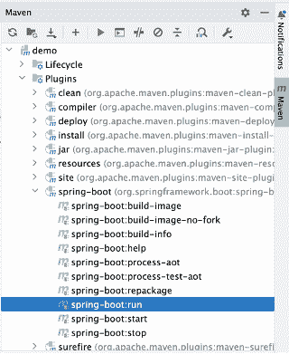

图 5.3：IntelliJ/IDEA Maven 工具窗口中的 Spring-Boot:run 选项

当我们右键点击该选项时（如图 5.4 所示），我们会看到运行该目标的选项。一旦执行操作，Spring Boot 就会启动。

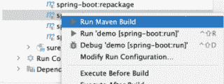

图 5.4：运行 Spring Boot 目标的运行和调试选项

控制台应该会显示进度，一旦项目运行，Spring 将打印：“Completed initialization”。现在我们可以通过在浏览器中访问`http://localhost:8080/hello?name=Shai`来测试代码，它将打印出“Hello Shai”。你同样可以使用`curl`命令行工具或 Postman 来实现相同的效果。

我们在这里做的是创建一个无需编写任何复杂代码即可通过 HTTP 运行的简单 Web 服务。我们实现了一个微不足的方法，其他一切都由约定决定。这就是 Spring Boot 的精髓。它为我们处理了一切，并尝试做出智能的“通用”选择。

Spring 不仅仅是一个 Web 解决方案。假设我们有一个 REST API、一个 Web 前端和一个移动端前端。这三个前端都需要相似但略有不同的解决方案。编程中的通用法则是“不要重复自己”（DRY）；我们只需要编写一次代码。然而，我们需要为每个前端创建自定义版本。

解决方案很简单；我们有多个前端控制器，它们都使用单一的后端服务。这将让我们在保持代码简单的同时，针对每个客户端进行特定的定制。为了实现这一点，我们可以在`rest`包旁边创建一个`service`包，并添加以下类：

1. `@Service`
2. `public class HelloService {`
3. `public String helloService(String name) {`
4. `return "Hello " + name;`
5. `}`
6. `}`

注意，服务比`RestController`还要简单。我们只包含业务逻辑，不再包含其他。现在，我们可以将服务注入到`RestController`中；生成的代码看起来更长、更复杂，但这仅仅是因为演示太简单了：

1. `@RestController`
2. `public class HelloWebService {`
3. `private final HelloService helloService;`
4. `public HelloWebService(HelloService helloService) {`
5. `this.helloService = helloService;`
6. `}`
7. `@GetMapping("/hello")`
8. `public String hello(String name) {`
9. `return helloService.helloService(name);`
10. `}`
11. `}`

当我们注入一个对象时，这种方法运行得良好，但向构造函数中添加多个对象是非常痛苦的。幸运的是，我们添加了一个库。

```java
@RestController
public class HelloWebService {

    private final HelloService helloService;

    public HelloWebService(HelloService helloService) {
        this.helloService = helloService;
    }

    @GetMapping("/hello")
    public String hello(String name) {
        return helloService.helloService(name);
    }
}
```

```java
6. new ExerciseDTO("1/2 : 1/2 =", List.of("2/2", "1/2", "1/8"), "1"),
7. new ExerciseDTO("1/2 - 1/2 =", List.of("0/2", "-1/2", "1/0"), "0")
};

private final Random RANDOM = new Random();

public ExerciseDTO getExercise() {
    return EXERCISES[RANDOM.nextInt(EXERCISES.length)];
}
}
```

最后，我们可以创建一个使用该服务的 Web 服务端：

```java
@RestController
@RequiredArgsConstructor
public class ExerciseWebService {

    private final ExerciseService exerciseService;

    @GetMapping("/getExercise")
    public ExerciseDTO getExercise() {
        return exerciseService.getExercise();
    }
}
```

注意，我们直接返回了记录。那么承诺过的 JSON 在在哪里呢？

通过这些更改，我们可以请求 URL`http://localhost:8080/getExercise`。它返回了以下结果（为了方便您查看进行了格式化）：

```json
{
  "question":"1/2 + 1/2 =",
  "incorrectAnswers":[
    "2/2",
    "1/2",
    "1/8"
  ],
  "correctAnswer":"1"
}
```

Spring Boot 将我们返回的记录及其内部的列表转换成了 JSON。这是 Spring Boot 的默认行为，并且可以重写以生成 XML 或或其他复杂的行为。

如果我们想接受问题建议呢？这同样简单。我们需要向 Web 服务添加以下方法：

```java
@PostMapping("/submitExercise")
public void submitExercise(@RequestBody ExerciseDTO exerciseDTO) {
    exerciseService.submitExercise(exerciseDTO);
}
```

这里有一个趣的元素是`RequestBody`注解，我们用它来指示我们将如何接收参数。接下来，我们需要在服务类中添加以下代码：

```java
private final List<ExerciseDTO> userSuggestions = new ArrayList<>();

public void submitExercise(ExerciseDTO exerciseDTO) {
    userSuggestions.add(exerciseDTO);
}
```

通过浏览器提交 POST 请求更具挑战性。我们可以使用`cURL`提交以下请求：

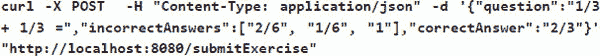

注意，该命令接受 JSON 体，并且 content-type 头被设置为 JSON。如果没有该头部，服务器将不知道如何处理输入。

## Spring MVC 和 Thymeleaf

REST 非常棒，但我们可能想要创建一个 Web 界面，而不仅仅是一个 Web 服务。我们可以实现这一点的方法是通过 Spring MVC。Spring MVC 构建在模型-视图-控制器（MVC）设计模式之上，它将应用程序逻辑分为三个不同的组件：模型（model）、视图（view）和控制器（controller）。模型代表应用程序的数据和业务逻辑，视图负责向用户显示数据，控制器处理传入请求并协调模型与视图之间的交互。

Spring MVC 为构建 Web 应用程序提供了灵活且可扩展的架构，使其成为中小型项目的流行选择。在图 5.5 中，我们可以看到经典 MVC 模式的图。

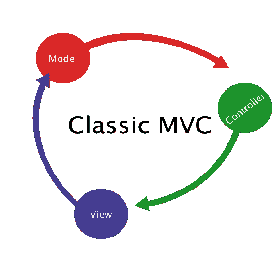

图 5.5：经典的 MVC 模式

Spring MVC 版本包含了 MVC 谜题的所有三个部分，但它们的排列略有不同，如图 5.6 所示。

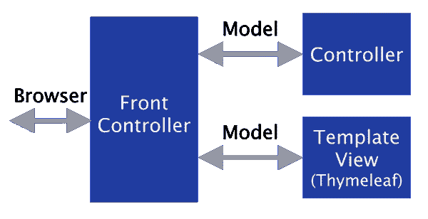

图 5.6：Spring MVC 基础结构

Spring MVC 的视图部分是可插拔的，可以使用任何常见的模板引擎实现。流行的选择之一是 Thymeleaf。Thymeleaf 是一个基于 Java 的模板引擎，用于处理和渲染 HTML、XML、JavaScript 以及其他标记语言。它设计用于与 Spring Framework 无缝衔接，但也可以用于独立应用程序。Thymeleaf 模板使用标准的 XHTML/HTML5 编写，并使用特殊的属性和标签来将数据绑定到模板上。这允许表现层与数据之间实现分离，从而使代码更具可维护性。模板引擎是用于生成动态 HTML 页面的工具。它们允许开发者定义包含动态内容占位符的模板，然后在运行时用实际数据填充这些占位符。这使得网站或应用程序的多个页面之间创建和维护一致的布局变得更容易。

与其他模板引擎相比，Thymeleaf 具有几个优势：

- **自然模板化**：Thymeleaf 模板使用标准的 XHTML/HTML5 编写，对于熟悉这些标记语言的开发者来说易于阅读和理解。这使得设计师也能轻松处理模板，因为他们已经熟悉了这些语法。
- **Spring 框架集成**：Thymeleaf 设计用于与 Spring 框架无缝工作，以便将模板引擎更无缝地集成到整个应用程序中。
- **验证和类型安全**：Thymeleaf 模板在模板级别进行解析和验证，防止运行时错误的发生。这意味着开发者可以尽早发现错误，从而节省时间并减少应用程序中的错误数量。
- **国际化 (i18n) 支持**：Thymeleaf 内置了国际化支持，允许开发者创建可以针对不同语言进行本地化的模板。
- **灵活性**：Thymeleaf 可以同时用于 Web 和非 Web 环境，使其比某些模板引擎更具通用性。
- **良好的性能**：Thymeleaf 是为高流量网站设计的。

一个简单的 "Hello World" Thymeleaf 模板如下：

```html
<!DOCTYPE html>
<html xmlns:th="http://www.thymeleaf.org">
<head>
<meta charset="UTF-8">
<title>Hello World</title>
</head>
<body>
<h1 th:text="'Hello, World!'">Hello World</h1>
</body>
</html>
```

在这个示例中，使用了`<h1>`标签上的`th:text`注解。当此模板被 Thymeleaf 处理时，它将生成以下输出：

```html
<!DOCTYPE html>
<html>
<head>
<title>Hello World</title>
</head>
<body>
<h1>Hello, World!</h1>
</body>
</html>
```

如所示，`th:text`注解被移除了，并显示了 "Hello, World!"。示例非常基础，没有使用任何动态数据。但它说明了 Thymeleaf 将数据绑定到模板的基本概念。

我们可以将其与 Spring MVC 集，使用以下模板来显示问题。将此模板放在`src/main/resources/templates`目录下很重要，这样 Spring 才能将其视为模板。在这种情况下，我们需要将其命名为`template.html`，我们很快就会使用它：

```html
<!DOCTYPE html>
<html lang="en" xmlns="http://www.w3.org/1999/html">
<head>
<meta charset="UTF-8">
<title>Hello ThymeLeaf</title>
</head>
<body>
<form method="post" action="/answer">
  <fieldset>
    <legend th:text="${question}">这是一个问题...</legend>
    <div th:each="answer : ${answers}">
      <input type="radio" th:id="${answer}" name="correctAnswer" th:value="${answer}">
      <label th:for="${answer}" th:text="${answer}">答案</label>
    </div>
    <input type="hidden" name="questionId" th:value="${questionId}">
    <input type="submit">
  </fieldset>
</form>
</body>
</html>
```

在第 10 行，我们有一个占位问题。`legend`标签内的值将被 Spring 模型中`question`属性的值替换。请注意带有`$`符号和花括号的语法。当我们定义模型时，我们将为`question`和答案列表设置值。这些值随后将显示在模板中。

在第 12 行，我们可以看到一个`for-each`循环。`${answers}`的值是一个列表，我们对它进行遍历，并将每个条目赋值给`${answer}`。假设列表有四个元素，我们将拥有四个`div`元素及其内容的副本，其值将与每个条目匹配。这对于创建 Web UI 来说是一个非常强大的工具。

接下来的`input`标签代表了我们在将表单发送到`/answer` URI 时想要提交的值，这将测试对问题的响应。

接下来，我们需要检查应用的控制器（controller）部分：

```java
@Controller
@RequiredArgsConstructor
public class WebUI {

    private final ExerciseService exerciseService;

    @GetMapping("/question")
    public String question(Model model) {
        ExerciseDTO exerciseDTO = exerciseService.getExercise();
        model.addAttribute("question", exerciseDTO.question());
        var answers = new ArrayList<>(exerciseDTO.incorrectAnswers());
        answers.add(exerciseDTO.correctAnswer());
        Collections.shuffle(answers);
        model.addAttribute("answers", answers);
        model.addAttribute("questionId", exerciseDTO.questionId());
        return "template";
    }
}
```

我们使用 Spring 和 Lombok（用于构造函数注入）将`exerciseService`注入到类中。这让我们能够重用之前编写的功能。

`question`调用接受一个由 Spring MVC 无缝注入的模型对象。该模型允许我们将值传递给模板。该方法返回一个字符串，即模板文件的名称，不带 .html 后缀。这映射到了我们之前创建的`template.html`文件。

我们设置了`question`、`answers`和`questionId`的属性值。完成所有操作后，我们可以访问`http://localhost:8080/question`并看到类似图 5.7 的内容。

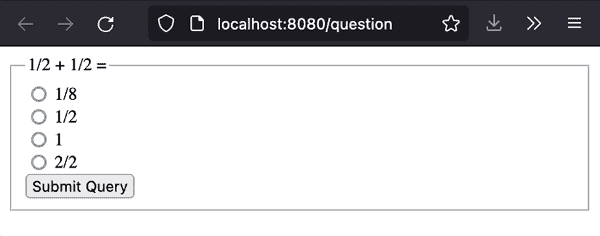

图 5.7: 初始模板

这个用户界面目前没有任何用，因为我们无法提交它。

注意，为了知道我们在 UI 中将处理哪个问题，我们需要一个`questionId`字段。为了确定这一点，我们应该将该 ID 添加到`ExerciseDTO`记录中，如下：

```java
public record ExerciseDTO(
    long questionId,
    String question,
    List<String> incorrectAnswers,
    String correctAnswer
) {}
```

我们还需要更新包含默认`ExerciseDTO`对象的常量：

```java
private static final ExerciseDTO[] EXERCISES = {
    new ExerciseDTO(1,"1/2 * 1/2 =", List.of("2/2", "1/2", "1/8"), "1/4"),
```


```
new ExerciseDTO(2,"1/2 + 1/2 =", List.of("2/2", "1/2", "1/8"), "1"),
new ExerciseDTO(3,"1/2 : 1/2 =", List.of("2/2", "1/2", "1/8"), "1"),
new ExerciseDTO(4,"1/2 - 1/2 =", List.of("0/2", "-1/2", "1/0"), "0")
```

下一步是处理答案的提交，我们可以通过向`WebUI`类中添加以下代码来实现：

```java
@PostMapping("/answer")
public String answer(@ModelAttribute ExerciseDTO body) {
    Long id = body.questionId();
    ExerciseDTO exerciseDTO = exerciseService.getExerciseById(id);
    if(body.correctAnswer().equals(exerciseDTO.correctAnswer())) {
        return "correct";
    }
    return "incorrect";
}
```

关于这段代码有几点我们需要注意。我们以`body`对象的形式传递用于模型的变量。在这种情况下，我们重用了记录对象，但它可以是任何任意的对象类型。我们返回两个不同的值：正确和错误，我们很快就会涉及到这两个值。

然而，更重要的部分是`getExerciseById(long)`方法。我们需要添加这个 API 来找到正确的练习题进行比较。理论上，我们可以使用 session 对象来跟踪当前状态。但这样做也有一些缺点，解释如下：

- **内存占用增加**：在 session 中存储大量数据会导致服务器内存饱和，导致性能问题。
- **安全风险**：在 session 中存储敏感信息会使其容易受到攻击，例如 session 劫持或篡改。
- **HTTP 的无状态性**：session 对象基于客户端 cookie，cookie 可能会被客户端删除或阻止。这会导致跨请求维护状态时出现问题。它还会让与 cookie 相关的法规（如 GDPR）变得更加复杂。
- **可扩展性问题**：session 对象通常存储在服务器的内存中，这使得水平扩展变得非常困难。
- **测试困难**：因为 session 对象基于客户端 cookie，因此很难进行测试。

为了避免这些问题，我们在`ExerciseService.java`中添加了这个方法：

```java
public ExerciseDTO getExerciseById(long id) {
    return Arrays.stream(EXERCISES)
        .filter(e -> e.questionId() == id)
        .findFirst()
        .orElseThrow(() -> new RuntimeException("Exercise not found"));
}
```

`Optional`类是一个可能包含也可能包含空值的容器对象。它用于表示可能不存在的值，以避免空指针异常。它有许多处理包含值的方法，例如`isPresent()`检查值是否存在，`get()`获取值，或者`orElse()`在`Optional`为空时提供默认值。

最后，当答案调用成功或失败时，我们需要两个模板来匹配每个状态。这是`correct.html`：

```html
<!DOCTYPE html>
<html lang="en">
<head>
    <meta charset="UTF-8">
    <title>Correct Answer</title>
</head>
<body>
    <h1>Well done!</h1>
    <p><a href="/question">Try Again</a></p>
</body>
</html>
```

以下是`incorrect.html`：

```html
<!DOCTYPE html>
<html lang="en">
<head>
    <meta charset="UTF-8">
    <title>Incorrect Answer</title>
</head>
<body>
    <h1>Sorry, that isn't correct...</h1>
    <p><a href="/question">Try Again</a></p>
</body>
</html>
```

通过这些更改，应用程序将按照预期工作，并让我们选择正确或错误的答案。尽管如此，当我们访问`http://localhost:8080/`时，将得到一个错误页面。我们如何处理根 URI（root URI）呢？

我们可以使用 MVC 来实现这一点，尽管存在一种更简单的方法。我们可以使用`src/resources/static`下的静态目录来存储项目的静态文件。通常，我们会使用该目录存储不包含模板逻辑的 CSS 和图像文件。我们也可以在该目录中存储纯 HTML 文件，这样在访问服务器时就会有一个良好的欢迎信息。如果我们使用名称`index.html`，它将隐式地作为服务器根目录服务：

```html
<!DOCTYPE html>
<html lang="en">
<head>
  <meta charset="UTF-8">
  <title>Welcome Page</title>
</head>
<body>
  <h1>Hello Spring</h1>
  <p>这是 Spring Boot 中的一个标准静态页面。
  我们可以通过将静态资源放在
  static 目录中来提供服务。</p>
  <p>访问 <a href="/question">/question</a> 获取动态练习。</p>
</body>
</html>
```

# SQL 和 JDBC

到目前为止，我们一直将信息存储在内存中。我们需要将当前应用程序的状态存储在持久化存储中。在典型系统中，这是一个数据库，在大多数情况下，这仍然是一个关系型 SQL 数据库。关于数据库有许多理论，而且有很多类型的数据库。

## SQL 基础

结构化查询语言（`SQL`）是关系型数据库领域的主流标准。关于这个问题有很多重要的书籍；在开始之前，应该理解关系型数据库背后的概念。尽管如此，我们在这里提供一个简要的概述以便入门。

关系型数据库是一种以表形式存储数据的数据库，每个表由一组行和列组成。行表示单独的记录，列表示这些记录的属性。表之间通过键关联，键用于将数据从一个表链接到另一个表。最常见的键类型是主键，对于表中的每条记录都是唯一的，用于标识该记录。外键用于将数据从一个表链接到另一个表，在表之间创建关系。关系型数据库的主要目标是以易于理解的方式组织数据，并便于从数据库中查询和检索数据。

数据库中的另一个重要概念是事务。事务是一个一个或多个数据库操作的序列，作为一个原子工作单元执行。事务内的操作通常按特定顺序执行，并旨在维护数据库数据一致性和完整性。

事务通常包含以下操作的一个或多个：

- `Create`（创建）：向数据库中添加新数据。
- `Read`（读取）：从数据库中检索数据。
- `Update`（更新）：修改数据库中的现有数据。
- `Delete`（删除）：从数据库中删除数据。

这形成了缩写：`CRUD`。

事务也可以包含多个相同类型的操作，例如，多次更新。事务可用于执行涉及多个操作的复杂任务，例如将资金从一个银行账户转移到另一个账户，其中一个账户扣款，另一个账户存入。在这种情况下，事务将包含两个操作，一个扣除一个账户，另一个存入另一个账户。

事务很重要，因为它们提供了一种机制，确保即使发生系统故障或错误，数据库中的数据也能保持一致和准确。这是通过`ACID`属性实现的，`ACID`基本是原子性（Atomicity）、一致性（Consistency）、隔离性（Isolation）和持久性（Durability）的缩写。

事务的一个关键特性是可以提交（commit）或回滚（rollback）。一旦事务提交，其更改就会在数据库中持久化。如果事务被回滚，其更改将被撤销，数据库将恢复到之前的状态。

`ACID`是原子性、一致性、隔离性和持久性的缩写。这些是确保数据库事务可靠处理的一组属性。现在让我们详细了解每个方面：

- `Atomicity`（原子性）：该属性确保事务被视为一个单一、不可分割的工作单元。如果事务的任何部分失败，整个事务将回滚到其之前的状态。
- `Consistency`（一致性）：该属性确保事务将数据库从一个有效状态变为另一个有效状态。在事务期间，会执行所有数据完整性约束和规则，数据库在事务执行前后都保持一致状态。
- `Isolation`（隔离性）：该属性确保并发事务之间互不干扰。每个事务都在孤立状态下执行，在第一个事务提交之前，一个事务的更改对其他事务是不可见的。
- `Durability`（持久性）：该属性确保一旦事务提交，其更改就是永久的，并能够生存任何随后的系统故障。

这些属性共同确保了数据库事务的可靠处理，并将数据损坏或丢失的风险降至最低。注意，`ACID`很少是“完美”。与数据库工作是性能与适当隔离之间的一种微妙平衡。完全隔离的数据库将完全阻止并发工作，并变成一个单用户系统。

我们将从添加到 Spring Boot starter 项目中的超音速数据库开始。主要原因是它不需要任何设置或配置。

## Java 数据库连接

Java 数据库连接（`JDBC`）是一种 Java API，为 Java 程序与关系型数据库的交互提供了标准方式。它允许 Java 开发者连接到各种数据库、执行`SQL`语句并处理结果。它是一个低级 API，允许我们直接从 Java 中使用`SQL`并处理结果。

在大多数现代项目中，我们使用抽象层，例如 Java 持久体系（`JPA`），我们稍后会讨论。然而，此类抽象被认为是泄漏抽象。它们暴露了底层系统的细节，如果我们对这些底层系统的了解有限，它们可能会失败。这就是为什么理解`JDBC`和`SQL`很重要，即使我们总是通过`JPA`工作。

`JDBC`是一个具有挑战性的 API。在`JDBC`中，在使用后清理连接和资源是非常重要的。不进行清理会导致随时间推移产生难以检测的故障。幸运的是，`JDBC` API 在最近的版本中采用了`AutoCloseable`并可以使用 try-resource 支持。Spring 通过管理和池化数据库连接使其变得更加简单。与线程一样，池化数据库连接是常见的做法，以节省资源。

`SQL`的最大问题之一是可移植性。这可以通过简单的示例得到最好的说明。如果我们想将之前的练习代码转换为`SQL`数据库，我们将从创建两个表开始：`EXERCISES`和`ANSWERS`。表之间将存在一对多的关系，而`answers`表将有一个指向`EXERCISES`表的外键。这意味着对于`EXERCISES`表中的每行，我们在`ANSWERS`表中都有多个答案。然后我们可以执行“连接（join）”来查询数据。这是`SQL`开发的基石，也是非常基础的`SQL`。在 Spring 中使用`SQL`，我们可以使用如下代码：

```java
@Service
@RequiredArgsConstructor
@Transactional
public class DBAccess {
  private final DataSource dataSource;

  @PostConstruct
  public void initDB() {
    JdbcTemplate jdbcTemplate = new JdbcTemplate(dataSource);
    ....
  }
}
```

这段代码中有几个非常有趣的地方。首先是类上的`Transactional`注解。Spring 使用代理类为我们管理事务。当一个方法进入时，它等同于启动了一个新事务。如果一个 bean 调用了另一个带有事务的 bean，事务将作为一个单元继续执行。这被称为“声明式事务”，通过它，我们可以控制精细的行为，例如隔离级别、原始事务状态等。

我们注入了`DataSource`对象，它负责处理数据库连接。我们使用它来创建一个`JdbcTemplate`，并用它来执行查询。请注意，定义这些内容的方法是`PostConstruct`方法。这类似于在构造函数中编写代码。但是，与构造函数不同，该方法是在注入完成后才被调用的。如果我们将代码写在构造函数中，`DataSource`可能仍然为`null`。

接下来，我们创建了两个 SQL 表。注意我们使用了 Java 的多行字符串新语法：

```java
jdbcTemplate.execute(
  """
  CREATE TABLE EXERCISES (
    id INT PRIMARY KEY IDENTITY,
    question VARCHAR(255),
    correctAnswer VARCHAR(255))
  """);

jdbcTemplate.execute(
  """
  CREATE TABLE ANSWERS (
    id INT PRIMARY KEY IDENTITY,
    exercise_id INT NOT NULL,
    answer VARCHAR(255),
    FOREIGN KEY (exercise_id) REFERENCES EXERCISES(id))
  """);
```

第一个表是标准的练习表。第 4 行和第 11 行包含了表的主键。在这两种情况下，都是由数据库为我们生成的数字。这种语法在很多情况下是特定于数据库的。接下来我们有两个最多 255 个字符的`Strings`。这是标准 SQL。

有趣的地方在第 14 行，我们定义了 answers 表和 exercises 表之间的关系。这意味着如果不设置`exercise_id`，我们就无法向 answers 表中添加行，因为它将无法指向正确的数据库行。

我们可以尝试向表中添加内容。添加一个练习似乎很轻而：

```java
jdbcTemplate.update("INSERT INTO EXERCISES (question, correctAnswer) values ('1/2 * 1/2 =', '1/4')");
```

这添加了一个练习，但这段代码存在一个问题。我们想要添加变量而不是具体的值。在 SQL 中硬编码值是没有帮助的。像下面的代码可能会更有用：

```java
jdbcTemplate.update("INSERT INTO EXERCISES (question, correctAnswer) values ('" + question +"', '" + answer + "')");
```

这是一个巨大的安全漏洞，被称为 SQL 注入。恶意的黑客可以将 SQL 语句作为问题或答案发送，这会让黑客能够完全访问你的系统。你绝对不要使用那代码。

相反，我们应该使用预编译语句（prepared statements）：

```java
jdbcTemplate.update("INSERT INTO EXERCISES (question, correctAnswer) values (?, ?)", "1/2 * 1/2 =", "1/4");
```

即使第 2 行的参数被替换为 SQL，`JDBC`也会对其进行转义，SQL 将被写入数据库。这种语法也优雅得多。

我们现在添加了一个包含练习的行，但问题部分呢？在这里我们失败了。正确的语法如下：

```sql
INSERT INTO ANSWERS (exercise_id, answer) values (?, ?)
```

这看起来还算合理。但`exercise_id`的值是什么呢？

我们需要从上一个插入语句中获取结果。这是可行的，但它是特定于数据库的。这是 Spring 这种操作的官方方法。它具有较好的跨平台性，但在我们使用的数据库上并不适用：

```java
KeyHolder keyHolder = new GeneratedKeyHolder();
jdbcTemplate.update(con -> {
  var preparedStatement =
    con.prepareStatement("INSERT INTO EXERCISES (question, correctAnswer) values (?, ?)");
  preparedStatement.setString(1, "1/2 * 1/2 =");
  preparedStatement.setString(2, "1/4");
  return preparedStatement;
}, keyHolder);

var key = keyHolder.getKey();
String query = "INSERT INTO ANSWERS (exercise_id, answer) values (?, ?)";
jdbcTemplate.update(query, key, "2/2");
```


在这里我们使用预编译语句和`keyholder`来获取生成键的值，然后将其传递给`answers`。遗憾的是，在我们选择的数据库中，键的值为`null`。

这些问题有解决方案。但正如你所见，这变得非常繁琐。我们甚至跳过了关于数据库创建的讨论，这本应该是一次性的工作（而且也不具有移植性）。注意，通常人们会使用数据库迁移工具进行设置和创建，例如`Flyway`、`Liquibase`等。

## Java 持久架构

如上一节清楚说明的那样，SQL是困难的。基础知识足够简单，但我们很快就会遇到棘手的问题。如果我们希望保持与供应商无关，这一点尤为如此。这就是Java持久架构（JPA）大显用场的地方。它是由于`Hibernate` ORM的成功而形成的标准，Hibernate仍然是最流行的JPA实现之一。

对象关系映射（ORM）是一种将从面向对象的语言（如`Java`）中的对象转换为关系模型的API。Spring在JPA之上有它自己的抽象：Spring Data。它提供了许多功能，其中之一就是CRUD仓库。为了开始，让我们看看答案实体：

```java
@Entity
@Getter
@Setter
public class Answer {
    @Id
    @GeneratedValue(strategy= Generation.IDENTITY)
    private Long id;
    private String answer;

    public Answer() {}

    public Answer(String answer) {
        this.answer = answer;
    }
}
```

这里有很多门道。首先，我们有`@Entity`注解，我们需要它来声明一个JPA实体。接下来，我们声明了`@Getter`和`@Setter`。JPA中的所有实体必须是Java Bean，这意味着类中的字段通过getter和setter使用。遗憾的是，由于record是不可变的，它们不能用作JPA实体。getter和setter注解是`Lombok`的一部分。开发者经常犯的一个常见错误是使用`@Data`注解，它包含了getter和setter。然而，该注解还定义了类的`equals()`和`hashCode()`方法，这些可能会导致严重的问题。

下一个实体非常相似：

```java
@Entity
@Getter
@Setter
public class Exercise {
    @Id
    @GeneratedValue(strategy= GenerationType.IDENTITY)
    private Long id;
    private String question;
    private String correctAnswer;
    @OneToMany
    private Set<Answer> answers;

    public Exercise() {
    }

    public Exercise(ExerciseDTO exerciseDTO) {
        question = exerciseDTO.question();
        correctAnswer = exerciseDTO.correctAnswer();
    }

    public ExerciseDTO getDTO() {
        return new ExerciseDTO(id, question,
            answers
            .stream()
            .map(Answer::getAnswer)
            .collect(Collectors.toList()),
            correctAnswer);
    }
}
```

这里的重要部分是答案实体与此实体之间的`OneToMany`映射。默认情况下，JPA关系是懒加载（eager）的，这可能会产生问题。然而，这开启了一个属于JPA书籍的大型讨论。额外的构造函数和getter方法是为了方便。

## Repository（仓库）

正如我们之前讨论过的那样，Spring Data包含了CRUD仓库功能，我们可以通过如下方式定义接口来利用它：

```java
@Repository
public interface ExerciseRepository extends JpaRepository<Exercise, Long> {
}
```

```java
@Repository
public interface AnswerRepository extends JpaRepository<Answer, Long> {
}
```

该接口是空的，但我们可以遵循通用的命名规范来添加方法。例如，我们可以为练习仓库添加以下方法：

```java
List<Exercise> findByQuestionIgnoreCase(String question);
```

它将被隐式实现，并且工作完全正如你预期的那样。仓库本身包含了多个方法，如`count()`、`findAll()`等。我们还可以定义额外的方法并编写SQL（或JQL，即JPA的SQL语法）来运行特定的查询。

仓库是由Spring实现的，不需要编写代码。我们只需要将仓库注入到bean中并开始使用。以下代码将所有硬编码的练习添加到数据库中：

```java
@PostConstruct
public void init() {
    for(ExerciseDTO exerciseDTO : EXERCISES) {
        saveExercise(exerciseDTO);
    }
}

private void saveExercise(ExerciseDTO exerciseDTO) {
    Exercise exercise = new Exercise(exerciseDTO);
    Set<Answer> answers = new HashSet<>();
    for(String answer : exerciseDTO.incorrectAnswers()) {
        answers.add(new Answer(answer));
    }
    answerRepository.saveAll(answers);
    exercise.setAnswers(answers);
    exerciseRepository.save(exercise);
}

public ExerciseDTO getExercise() {
    return exerciseRepository.findAll()
    .get(RANDOM.nextInt((int)exerciseRepository.count())).getDTO();
}

public ExerciseDTO getExerciseById(long id) {
    return exerciseRepository.findById(id)
    .orElseThrow()
    .getDTO();
}

public void submitExercise(ExerciseDTO exerciseDTO) {
    saveExercise(exerciseDTO);
}
```

Spring`application.properties`允许我们设置各种值，包括使用`spring.jpa.show-sql=true`强制JPA显示详细信息。一旦开启，我们就可以检查将练习导入到数据库的JPA代码的输出（输出已裁剪）：

```text
Hibernate: drop table if exists answer cascade
Hibernate: drop table if exists exercise cascade
Hibernate: drop table if exists exercise_answers cascade
Hibernate: create table answer (id bigint generated by default as identity (start with 1), answer varchar(255), primary key (id))
Hibernate: create table exercise (id bigint generated by default as identity (start with 1), correct_answer varchar(255), question varchar(255), primary key (id))
Hibernate: create table exercise_answers (exercise_id bigint not null, answers_id bigint not null, primary key (exercise_id, answers_id))
Hibernate: alter table exercise_answers add constraint UK_ul67q9o6skfxjjepuila2kmv unique (answers_id)
Hibernate: alter table exercise_answers add constraint FK1jwaqby0k37hj8l5licma2x50 foreign key (answers_id) references answer
Hibernate: alter table exercise_answers add constraint FKec42hfpshagny1o9v597as4p2 foreign key (exercise_id) references exercise
Hibernate: insert into answer (id, answer) values (default, ?)
Hibernate: insert into answer (id, answer) values (default, ?)
Hibernate: insert into answer (id, answer) values (default, ?)
```

## 错误处理

到目前为止，我们抛出异常并让失败传播，而没有进行太多思考。这是非常好的，而且是“正确的事”。异常处理的妙之处在于，我们可以忽略问题并将其推给后续。

问题是Spring Boot并不知道如何显示这些错误。我们可以通过实现`ErrorController`来覆盖默认设置：

```java
@Controller
public class GenericErrorController implements ErrorController {
    @RequestMapping("/error")
    public String handleError(Model model, HttpServletRequest request) {
        Object status = request.getAttribute(RequestDispatcher.ERROR_STATUS_CODE);
        model.addAttribute("status", status);
        return "error";
    }
}
```

在这种情况下，我们只需添加了以下错误页面：

```html
<!DOCTYPE html>
<html lang="en">
<head>
    <meta charset="UTF-8">
    <title>Error</title>
</head>
<body>
    <h1 th:text="${'Error Occurred: ' + status}">Error Occurred</h1>
    <p>Get a dynamic exercise by going to
    <a href="/question">/question</a>.</p>
</body>
</html>
```

然而，失败的情况可能要微妙得多。代码中的异常可能代表一个合理的错误信息，我们可能希望在进入通用错误逻辑之前停止。在Spring Boot中，你可以通过在控制器方法上使用`@ExceptionHandler`注解将错误页面映射到特定的异常。

```java
@ControllerAdvice
public class GlobalExceptionHandler {
    @ExceptionHandler(NullPointerException.class)
    public ModelAndView handleNullPointerException(Exception e) {
        ModelAndView modelAndView = new ModelAndView();
        modelAndView.setViewName("error");
        modelAndView.addObject("error", e.getMessage());
        return modelAndView;
    }
}
```


在这个示例中，我们还使用了之前没有介绍过的 `ModelAndView` 类。`ModelAndView` 类用于表示模型（model）和视图（view）。一个 `ModelAndView` 对象同时包含模型数据（需要在视图中显示的数据）和视图（用于渲染数据的模板）。

可以通过实例化 `ModelAndView` 类并将视图名称作为构造函数的参数传递，来创建一个 `ModelAndView` 对象。可以使用 `addObject` 方法将模型数据添加到 `ModelAndView` 对象中，该方法接收一个键值值对。

以下是如何创建一个 `ModelAndView` 对象并向其添加一些数据的示例：

1. `ModelAndView modelAndView = new ModelAndView("hello");`
2. `modelAndView.addObject("message", "Hello World!");`

在这个示例中，创建了一个视图名称为“hello”的 `ModelAndView` 对象。键为“message”、值为“Hello World!”的数据被添加到模型中。你也可以使用 `ModelMap` 对象创建一个 `ModelAndView`。这是一个类，用于表示模型属性的简单键-值存储器，如下面的代码片段所示：

1. `ModelAndView modelAndView = new ModelAndView();`
2. `ModelMap modelMap = new ModelMap();`
3. `modelMap.addAttribute("message", "Hello World!");`
4. `modelAndView.setViewName("hello");`
5. `modelAndView.addAllObjects(modelMap);`

一旦创建了 `ModelAndView` 对象，就可以从控制器方法返回并传递给视图解析器（view resolver），视图解析器将使用视图名称来确定用于渲染数据的模板。

## 结论

Spring 是非常强大的平台，简化了复杂的概念。JPA 也是如此，它让混乱的 SQL 变得易于管理。Spring 中存在许多挑战，这主要是由于它的深度和广度。这本书仅仅是对其广阔的图景提供了一个极小的一角。

## 需要记住的要点

* 尝试避免硬编码 SQL。
* 理解 Spring 中的构型类型（stereotypes）并据此划分你的应用程序。
* Lombok 可以为我们节省大量的麻烦。
* Spring Initializr 为项目提供了一个极好的起点。

### 多选题

1. IoC 代表什么？  
   a. 互操作连接器 (Interoperation Connector)  
   b. 间接顺序命令 (Indirect Ordered Command)  
   c. 控制反反转 (Inversion of Control)  
   d. 即时组织类 (Instant Organized Class)  
   e. 集成提供组件 (Integrated Offering Component)

2. JPA 是？  
   a. 它比 SQL 更具移植性  
   b. 它隐藏了 SQL  
   c. 它比 SQL 快  
   d. 以上所有

3. 为什么我们在 Beans 中使用 `RequiredArgsConstructor`？  
   a. 为了移除要求？  
   b. 为了通过构造函数注入字段  
   c. 为了满足 Lombok 的要求

4. 下面哪哪是一个构型类型（stereotype）？  
   a. Controller (控制器)  
   b. Component (组件)  
   c. RestRequest  
   d. RestContorller  
   e. Service (服务)

### 答案

1. c
2. a
3. b
4. a, b, 和 e

***

[1] [`snyk.io/blog/spring-dominates-the-java-ecosystem-with-60-using-it-for-their-main-applications/`](https://snyk.io/blog/spring-dominates-the-java-ecosystem-with-60-using-it-for-their-main-applications/)。  
[2] 表表现层状态转移 (REpresentational State Transfer)。  
[3] 支持 Autowired，但构造函数注入是 Spring 中推荐的“最佳实践”。  
[4] https://start.spring.io/

**加入我们书籍的 Discord 空间**

加入书籍 Discord 工作空间，获取最新更新、优惠、全球技术动态、新版本发布以及与作者的交流：

**[`discord.bpbonline.com`](https://discord.bpbonline.com)**


# 第 6 章：测试与 CI

## 引言

测试和持续集成（CI）是非常关重要的。测试和持续集成（CI）是软件开发中的关键实践。在本章中，我们将讨论一些常用的工具，例如 `JUnit` 和 `Mockito`。我们将讨论 `GitHub Actions`，并讨论测试驱动开发（TDD）。

## 结构

在本章中，我们将讨论以下主题：

* 测试理论
* `JUnit`
* `Mockito`
* 测试驱动开发 (TDD)
* 持续集成 (CI)
* `GitHub Actions`

## 目标

在本章结束时，你将能够通过 CI 流程有效地测试你的应用程序。你将理解测试的核心概念。

## 测试理论

测试的目标不仅仅是消除错误。测试是为了确保合规性和连续性。有了适当的测试，我们可以心地进行更改。如果你在项目中似乎反复解决同一个 bug，这可能是测试过程出了问题。

我们有很多方法对测试分类，以下是几类：

* **单元测试 (Unit tests)**：单元测试是最基本的测试类型。它们旨在隔离地测试代码单元。这些测试通常是自动化的，并且关注测试最小的功能单元，例如单个方法或函数。单元测试很重要，因为它们有助于开发者在开发早期发现错误，此时修复更容易且成本更低。
* **集成测试 (Integration tests)**：集成测试旨在测试系统的不同部分如何协同。与单元测试不同，集成测试涉及同时测试多个单元，通常用于具有许多部分的复杂系统。集成测试可以帮助发现单元测试无法发现的问题，例如组件之间的交互问题。
* **功能测试 (Functional tests)**：功能测试旨在从最终用户的角度测试系统的功能。这些测试通常用于测试用户界面或系统在不同条件下的行为。功能测试很重要，因为它们有助于确保系统按预期运行。
* **性能测试 (Performance tests)**：性能测试旨在测试系统在不同条件下的性能，例如在高负载下或处理大量数据时。这些测试很重要，因为它们有助于识别性能瓶颈并确保系统能够处理预期的使用量。
* **验收测试 (Acceptance tests)**：验收测试旨在测试系统是否满足客户或最终用户的需求。这些测试通常用于确保系统按预期运行并满足用户需求。验收测试可以是手动的也可以是自动的，并且通常与其他类型的测试结合使用以确保系统的高质量。

总而言之，通常使用这些测试类型的组合来确保系统的高质量并满足用户需求。通过使用多种测试，开发者可以在开发早期发现错误，并确保系统按预期运行。

单元测试的规模较小，因此它们的性能更高。这意味着它们几乎可以立即执行，有时甚至可以在你在 IDE 中编写代码时在后台运行。这具有许多优势，因为由于可以尽早发现并修复问题。它们还有一个额外的优势：它们的错误易于理解。当单元测试失败时，原因通常是显而易见的。

集成测试可能会出现严重失败且运行速度缓慢。它们通常比单元测试更不稳定（flakier），并且经常因为测试环境问题而失败。不稳定测试（Flaky tests）会无缘无故地偶尔失败。当你多次运行测试时，它会在十次中失败一次。或者仅在运行完另一个特定测试之后才失败。有时，这表明测试本身存在问题，但有时它表明软件存在环境问题。不稳定测试非常难以处理，因为没有可靠的方法来调试它们。

尽管如此，仍有人认为集成测试是唯一真正检查系统的测试。最隐且常见的 Bug 存在系统之间的连接之处。该领域超出了单元测试的范围，并且可能被它们的覆盖范围完全忽略。表 6.1 列出了单元测试和集成测试之间的核心区别：

| | 单元测试 | 集成测试 |
| :--- | :--- | :--- |
| 性能 | 快 | 慢 |
| 可靠性 | 好 | 差 |
| 覆盖范围 | 范围 | 广泛 |
| 不稳定性 | 低 | 高 |

表 6.1：单元测试与集成测试之间的区别

## JUnit

JUnit 是一个用于 `Java` 语言的流行的单元测试框架。它提供了一组注解和断言，可以用于为单个代码单元编写测试用例。通过 `JUnit`，开发者可以编写可以快速、方便地运行的自动化测试，从而更容易在开发过程早期捕获错误。尽管名字如此，`JUnit` 也用于集成测试以及单元测试。

`JUnit` 在 `Java` 开发社区中广泛使用，并包含在许多 IDE 中。在 `JUnit` 中，测试通常组织成测试套件（test suites），套件可以包含多个测试用例。每个测试用例定义为一个带有 `@Test` 注解的方法，它通常包含一个或多个断言，用于检查被测试代码的行为。

以下代码包含一个使用 `JUnit` 的简单单元测试：

```java
package com.debugagent.testing.tests;

import org.junit.jupiter.api.Assertions;
import org.junit.jupiter.api.Test;

public class MyTest {
    @Test
    public void testMyMethod() {
        MyObject myObj = new MyObject();
        Assertions.assertEquals(42, myObj.myMethod());
    }
}
```

该测试使用断言验证 `myMethod()` 是否返回 `42`。`JUnit` 提供了多种断言方法，例如 `assertEquals()` 和 `assertTrue()`，可用于检查测试结果是否符合预期值。如果值不是 `42`，则将抛出异常并且测试将失败。我们在图 6.1 中看到成功执行用用绿色勾选标记：

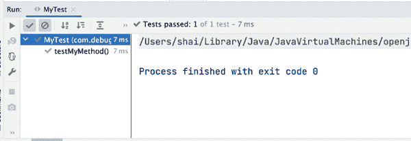

图 6.1：通过的测试

如果我们将测试中的值更改为 `41`，可以在图 6.2 中看到测试失败。注意断言列出了不同的值，并且还可以包含自定义的错误信息。

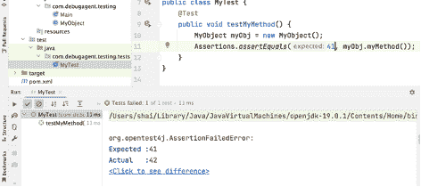

图 6.2：通过的测试（注：原文此处为 Passing a test，根据语境应为 Failing a test）

理想情况下，一个测试应该是独立的。我们应该能够在不运行整个套件的情况下运行某一个测试。或者，我们应该能够以任意顺序运行测试。这在某些情况下很难实现。测试可能会让应用程序处于无效状态，从而导致套件中的其他测试出现问题。测试在完成后进行清理是非常重要的。然而，在整个套件中复制那些初始化或清理代码可能是痛苦的。

`JUnit` 为此目的提供了特殊的注解，特别是 `@Before` 和 `@After`，它们允许你指定在测试套件中每个测试用例之前或之后的方法。例如，你可以使用 `@Before` 来设置套件中所有测试用例所需的资源：

```java
public class BeforeTest {
    private MyObject myObj;

    @BeforeEach
    public void setUp() {
        myObj = new MyObject();
    }

    @Test
    public void testMyMethod() {
        Assertions.assertEquals(42, myObj.myMethod());
    }
}
```

测试方法是否以可预测的方式失败是非常重要的。`JUnit` 提供了一种方法来测试方法在被调用时是否抛出异常。这可以使用 `assertThrows()` 方法来实现。如后续示例所示，测试验证了代码是否抛出了 `IllegalStateException`：

```java
public class ExceptionTest {
    @Test
    public void testMyMethodThrowsException() {
        MyObject myObj = new MyObject();

        Assertions.assertThrows(IllegalStateException.class, () -> {
            myObj.myMethodThatThrowsException();
        });
    }
}
```

## Mockito

模拟（Mocking）是一种用于单元测试的技术，用于创建模拟真实对象行为的伪对象。模拟的目标是将被测试的代码与其依赖项隔离开，以便测试能够专注于代码本身的行为。最流行的 `Java` 模拟框架是 `Mockito`。`Mockito` 提供了一个简单、易用的 API 来创建模拟对象。通过 `Mockito`，你可以指定想要模拟的类或接口，然后使用 `mock()` 方法创建模拟对象。一旦你有了模拟对象，就可以使用它来定义想要测试的行为。

`Mockito` 在 `Java` 开发社区中广泛使用。模拟在复杂的应用程序（如 `Spring Boot` 应用）中非常有用，在其中我们可以模拟豆（beans）和类似的功能。考虑以下内容：

```java
@SpringBootTest
public class HelloWebServiceTests {
    @Mock
    private HelloService helloService;

    @Test
    public void testWebServicePassesValueDirectlyToService() {
        Mockito.when(helloService.hello("XYZ")).thenReturn("PASSED");

        HelloWebService helloWebService = new HelloWebService(helloService);

        Assertions.assertEquals(helloWebService.hello("XYZ"), "PASSED");
    }
}
```

问题在于模拟隐藏了对真实 API 的外部依赖，因此它们没有测试它们。这使得测试范围限制在一个非常窄的硬编码集合上。它依赖于实现测试的内部实现细节，这意味着如果实现发生变化，测试可能会失败，即使合约没有变化。让我们看下面的示例：

```java
public int countUserCities() {
    return db.executeInt("select count("city") from users");
}
```

我们可以模拟 `db` 函数 `executeInt`，因为返回的结果将是错误的。但如果我们将原始 API 调用更改为如下的内容，这就会失效：

```java
public int countUserCities() {
    return db.count("city", "users");
}
```


这没有涵盖任何内容。更好的方法是向临时数据库添加虚假数据。我们可以动态地启动数据库，并“正确地”使用与生产环境中类似的数据库来检查该方法。这种方法执行了正确的检查；它会因为查询中的拼写错误等 Bug 而失败，并且不依赖于内部实现。

遗憾的是，这种方法存在问题。加载全新的数据库需要时间。随着测试范围的扩大，为每个套件执行此操作可能会变成问题。这就是为什么我们将单元测试和集成测试分离。性能至关重要。

## 性能至关重要

你知道最糟糕的测试类型是什么？

那些你不运行并最终删掉的测试。

频繁进行测试至关重要；持续测试让我们在开发过程中快速失败。快速失败意味着我们的脑海中对于触发失败的更改仍然记忆犹新。你不需要`git bisect`；你几乎可以瞬间修复问题。为了让这一过程正常运行，我们需要一直运行测试周期。如果通过测试工作流需要很长时间并且需要一些配置（例如，`docker` 等），这可能还会与 CPU 架构（如`M1 Mac`）发生冲突，这时我们可能会遇到问题。

我们为单元测试模拟了外部依赖，以提高性能。然而，我们无法放弃对实际 API 的完整调用，因为模拟（mocking）存在问题。但这些可以在 CI 过程中运行，我们不需要一直运行它们。这会产生代码重复吗：是的。这是一个问题，但没有其他办法。没有可行的替代方案；它们最终都会让情况变得糟糕。

正因如此，只检查集成测试的覆盖率是重要的。单元测试覆盖率很有趣，但没有集成覆盖率那么关键。注意，100% 的覆盖是有问题的，所以你不应该以此为目标。但这是一个需要监控的重要统计数据。

### 我们应该模拟什么？

我们之前使用了数据库示例，但模拟数据库可能不是最好的案例。对于`Java`，人们通常会使用轻量级的内存中数据库，它在大多数情况下运行良好。Fakers 接受`CSV`格式来填充数据库，甚至可以生成自己的虚假数据。这比模拟更好，并让我们能够以单元测试的性能接近集成测试的质量。

然而，如果没有模拟，不断连接到 Web 服务依赖是不现实的。从这个意义上来说，模拟我们控制之外的一切是一个好主意。在这一点上，我们面临着在哪里进行模拟的选择。我们可以使用包含硬编码请求和响应的模拟服务器。在处理集成测试时这是有意义的。对于单元测试来说意义不大，但如果服务器是无状态且本地的，我们可以这样做。尽管在这种情况下，更倾向于模拟对`API endpoints`的调用。它会比实际的`API`快，但仍可能导致问题。

过度模拟（Over-mocking）是在过多的 API 调用上过于自由地应用模拟的过程。开发者可能会这样做为了增加梦寐以求的覆盖率指标。这进一步加强了我们的观点：覆盖率不应适用于单元测试，因为它可能导致这种情况的发生。对于框架访问的大多数本地资源，不应该模拟其行为。

## 测试驱动开发

测试驱动开发（TDD）是一种软件开发方法，在编写任何代码之前先编写测试。开发过程随后通过运行测试、编写恰少的代码来通过每个测试，然后重构代码以改进其设计和可维护性来进行。

TDD 周期通常遵循以下三个步骤：

1. 编写一个失败的测试：开发者编写一个描述代码预期行为的测试。这个测试应该失败，因为代码还不存在。
2. 编写最简单的代码来通过测试：开发者编写最可能的代码以让失败的测试通过。
3. 重构代码：开发者通过重构改进代码的设计和可维护性，使其更简单、更具模块化，同时确保所有测试继续通过。

通过遵循这个周期，TDD 确保代码是增量地以较小的、可测试的单元编写的。这使得代码更容易维护、对更改更具韧性，并且更不容易产生 Bug。TDD 还帮助确保代码符合需求，并确保对代码的任何更改都不会破坏现有功能。

TDD 通常用于敏捷软件开发，在这些情况下，需求可能会频繁变化，并且需要快速迭代和反馈。TDD 也用于安全关键型系统（在这些系统中 Bug 的成本可能非常高）以及代码复杂性导致难以手动测试的代码库中。

TDD 是一种有趣的方法。在处理弱类型语言时，它特别有用。在这些情况下，TDD 是极佳的，因为它充当了严格编译器和 linter（静态检查）的角色。

在其他情况下它也有意义。当构建一个具有非常明确输入输出的系统时。我们在创建课程和材料时经常遇到这种情况。在处理真实世界的数据时，有时当我们有中间件处理数据并以预定义的格式输出数据时，这种情况就会发生。

其思想是构建一个中间带有隐藏变量的方程。然后编码就变成了填充方程。在那种情况下非常方便。编码变成了填空。

## TDD 的问题

如果我们有一个带有测试的现有系统，那么 TDD 在世界上都是有意义的。但测试一个不存在的系统要困难得多。对于像`Java`这样结构良好且严格的语言，尤其如此。在某些情况下它是有意义的，但频率并不像人们想象的那么高。

TDD 的大论点是“它就是设计”。测试实际上就是系统设计，然后我们实现该设计。这种方法的问题在于它像普通设计一样违背了调试。这导致了通过测试但延续了由测试编写的 Bug 的实现。TDD 的支持者很快评论说，TDD 项目更容易重构，因为测试给了我们不会发生回归的保证。然而，这适用于事后进行测试的项目。TDD 在这方面没有优势。

最严重的问题是 TDD 过度关注快速的单元测试。对于 TDD 系统来说，运行缓慢的集成测试或需要通夜运行的测试是不现实的。你如何验证扩展性和与主系统的集成？

在理想世界中，一切都会像乐高一样完美契合。遗憾的是，集成测试的失败非常糟糕。这些是最糟糕的失败，追踪 Bug 最困难。通常情况下，在单元测试中失败要好，这就是我们拥有单元测试的原因。它们很容易修复。然而，即使覆盖率完美，它们也没有很好地测试连接部分。

TDD 过度强调“可有可无”的单元测试，而不是至关重要的集成测试。是的，你应该两者兼顾。但我们必须拥有集成测试。

## 持续集成

持续集成（CI）是一种软件开发实践，以频繁且一致的方式自动构建和测试代码更改。CI 的目标是尽早发现并解决集成问题，减少 Bug 和其他问题滑入生产环境的风险。

CI 通常与持续交付（CD）紧密结合，CD 旨在自动化整个软件交付过程，从代码集成到生产环境的部署。CD 的目标是减少部署新版本和热补所需的时间和精力，使团队能够更快速、更频繁地为客户交付价值。通过 CD，每一项通过 CI 测试的代码更改都被认为已准备好部署，允许团队有信心地在任何时候部署新版本。我们不会在本书中讨论持续交付，因为这是一个非常深奥的领域。

## 持续集成工具

有许多强大的 CI 工具。以下是一些常用工具：

- `Jenkins`：`Jenkins` 是最流行的 CI 工具之一，提供了大量的插件和集成功能，以支持各种编程语言和构建工具。它是开源的，并提供了一个易于使用的界面来设置和管理构建流水线。它用`Java`编写，通常是许多人的首选。然而，它的管理和设置非常耗费。有一些`Jenkins as service`解决方案也改进了它本就有些欠乏的用户体验。
- `Travis CI`：`Travis CI` 是一个基于云的 CI 工具，与`GitHub`集成良好，是基于 GitHub 的项目的极佳选择。它提供了简单的设置过程，并提供实时构建和测试结果，便于快速检测和解决问题。
- `CircleCI`：`CircleCI` 是一个基于云的 CI 工具，支持多种编程语言和构建工具。它提供了一个易于使用的界面，并提供实时构建和测试结果，便于快速检测和解决问题。
- `GitLab CI/CD`：`GitLab` 是一个流行的源代码管理工具，内置了 CI/CD 能力。通过`GitLab CI/CD`，团队可以自动化其构建、测试和部署过程，从而快速、可靠地交付代码更改。
- `Bitbucket Pipelines`：`Bitbucket Pipelines` 是由`Atlassian`提供的基于云的 CI 工具，与他们的源代码管理工具`Bitbucket`无缝集成。它提供了简单的设置过程，并提供实时构建和测试结果，便于快速检测和解决问题。

请注意我们跳过了`GitHub Actions`，我们稍后会介绍它。在比较 CI 工具时，有几个因素需要考虑：

- 易用性：某些 CI 工具具有简单的设置过程和友好的界面，让开发者更容易上手并管理他们的构建流水线。
- 与源代码管理（SCM）工具的集成：如`GitHub`、`GitLab`和`Bitbucket`。这使得团队更容易自动化构建、测试和部署过程。
- 对不同编程语言和构建工具的支持：不同的 CI 工具支持不同的语言和工具，因此选择一个与你的开发技术栈兼容的工具非常重要。
- 可扩展性：某些 CI 工具更适合具有复杂构建流水线的大型组织，而另一些更适合需求简单的小团队。
- 成本：CI 工具的成本从免费开源到昂贵的商业工具不等。因此，选择符合预算的工具至关重要。
- 功能：不同的 CI 工具提供不同的功能，例如实时构建和测试结果、支持并行构建以及内置的部署能力。

总的来说，`Jenkins` 以其多功能和丰富的插件库而闻名，是具有复杂构建流水线团队的热门选择。`Travis CI` 和`CircleCI`以其易用性和与流行 SCM 工具的集成而闻名，是中小型团队的良好选择。`GitLab CI/CD` 是使用`GitLab`进行源码管理的团队的流行选择，因为它提供了集成的 CI/CD 能力。`Bitbucket Pipelines` 是使用`Bitbucket`进行源码管理的团队的良好选择，因为它与平台无缝集成。

## 云端与本地化

在选择 CI 解决方案时，代理（agents）的托管是一个需要考虑的重要因素。代理托管有两种主要方案：基于云和本地化。

- 云端：基于云的 CI 解决方案（如`Travis CI`、`CircleCI`、`GitHub Actions`和`Bitbucket Pipelines`）在自己的云端服务器上托管代理。这意味着你不需要担心管理底层基础设施，并且利用云的可扩展性和可靠性。
- 本地化：本地化 CI 解决方案（如`Jenkins`）允许你在自己的服务器上托管代理。这让你对底层基础设施有更多的控制权，但需要花费更多精力来管理和维护服务器。

在选择 CI 解决方案时，考虑团队的具体需求和要求非常重要。例如，如果你有一个大型且复杂的构建流水线，像`Jenkins`这样的本地化解决方案可能是更好的选择，因为它提供了对底层基础设施的更多控制。相反，如果你有一个需求简单的小团队，像`Travis CI`这样的云端解决方案可能是更好的选择，因为它容易设置和管理。

## 代理的状态化

状态化决定了代理在构建之间是否保留其数据和配置。请参考以下内容：

- 有状态代理：某些 CI 解决方案（如`Jenkins`）允许你运行有状态代理，这意味着代理在构建之间会保留其数据和配置。这对于需要在构建之间持久化数据的情况非常有用，例如当你使用数据库或运行长时间运行的测试时。
- 无状态代理：其他 CI 解决方案（如`Travis CI`和`CircleCI`）使用无状态代理，这意味着代理每次构建时都会从头重新创建。这为每次构建提供了一个干净的环境，但也意味着你需要外部管理任何持久化数据。

CI 支持者之间对于最佳方法存在激烈的辩论。无状态代理提供了一个干净且易于复现的环境。但它们可能成本较高，因为你需要为云资源付费。设置较慢。但许多开发者倾向于有状态代理的主要原因是调查能力。对于无状态代理，当 CI 过程失败时，除了日志之外通常没有调查手段。对于有状态代理，我们可以登录机器并尝试手动运行进程。我们可能会重现问题并获得洞察，由于许多此类案例由于清理工作的问题而影响了我们 CI 的可靠性和价值。

## GitHub Actions

在上一节中，我们跳过了对`GitHub Actions`的讨论。该产品是该领域一个较新的竞争者；它不像之前提到的大多数 CI 工具那样灵活。然而，由于与`GitHub`和无状态代理深度集成，它对开发者来说非常方便。

为了测试`GitHub Actions`，我们需要一个新项目，在本例中是由`JHipster`生成的，配置如图 6.3 所示：

```
Figure 6.3: JHipster 配置
```

与之前可以在书中 GitHub 仓库找到的代码不同，在本例中，我们有一个演示`GitHub Actions`的独立项目。

注意你可以对任何项目执行此操作；虽然我们在这里包含了 maven 指令，但概念非常简单。一旦创建项目，我们可以打开 GitHub 项目页面并切换到 actions 标签。我们将看到类似图 6.4 的界面：

```
Figure 6.4: 空 actions 页面
```

在图 6.4 的右下角，我们可以看到 Java with Maven 项目类型。一旦选择了这种类型，我们就会进入创建`maven.yml`文件，如图 6.5 所示：

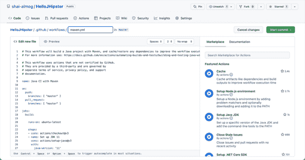

图 6.5：创建新的`maven.yml`

遗憾的是，GitHub 建议的默认`maven.yml`包含一个问题。这是图 6.5 所示的代码：

```yaml
name: Java CI with Maven

on:
  push:
    branches: [ "master" ]
  pull_request:
    branches: [ "master" ]

jobs:
  build:
    runs-on: ubuntu-latest
    steps:
      - uses: actions/checkout@v3
      - name: Set up JDK 11
        uses: actions/setup-java@v3
        with:
          java-version: '11'
          distribution: 'temurin'
          cache: maven
      - name: Build with Maven
        run: mvn -B package --file pom.xml

      # Optional: Uploads the full dependency graph to GitHub to improve the quality of Dependabot alerts this repository can receive
      - name: Update dependency graph
        uses: advanced-security/maven-dependency-submission-action@571e99aab1055c2e71a1e2309b9691de18d6b7d6
```

第 24 行及之后的内容更新依赖图。然而，此功能经常失败。删除它们解决了问题。其余代码是标准的 YAML 配置。

第 5 行和第 7 行声明在推送到 master 分支时，构建将在两个分支上运行。这意味着我们可以在提交之前在拉取请求（pull request）上运行测试。如果测试失败，我们将不会提交。我们可以在项目设置中禁止提交失败的测试。一旦提交了 YAML 文件，我们可以创建一个拉取请求，系统将为我们运行构建过程。这包括运行测试，因为 Maven 中的“package”目标默认会运行测试，并在第 23 行被调用。我们可以在图 6.6 中看到成功的拉取请求：

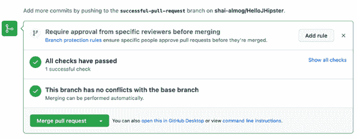

图 6.6：成功的拉取请求

为了测试这一点，我们可以通过将“`/api`”端点改为“`/myapi`”来修改代码。这产生了图 6.7 所示的失败。它还会触发一封发送给提交作者的错误邮件。

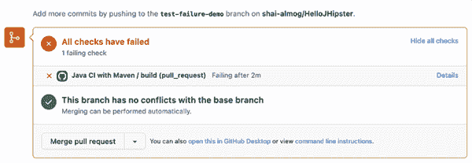

图 6.7：失败的拉取请求

当发生此类失败时，我们可以点击右侧的“Details”（详情）链接。这将直接带我们进入图 6.8 所示的错误消息：

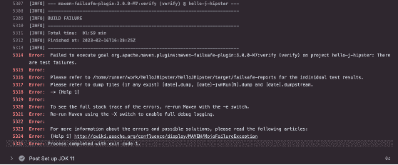

图 6.8：初始错误消息

遗憾的是，通常这是一个无用的消息，对解决问题没有帮助。然而，向上滚动将显示实际的失败，这些失败通常会方便地为突出显示，如图 6.9 所示：

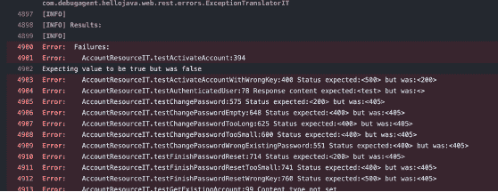

图 6.9：实际的测试失败

注意，通常会有多个失败，因此稳妥的做法是继续向上滚动。在这个错误中，我们可以看到失败是`AccountResourceIT`第 394 行的一个断言（assertion），你可以在这里看到。注意行号并不匹配。在这种情况下，第 394 行是方法的最后一行，而第 17 行：

```java
@Test
@Transactional
void testActivateAccount() throws Exception {
    final String activationKey = "some activation key";
    User user = new User();
    user.setLogin("activate-account");
    user.setEmail("activate-account@example.com");
    user.setPassword(RandomStringUtils.randomAlphanumeric(60));
    user.setActivated(false);
    user.setActivationKey(activationKey);

    userRepository.saveAndFlush(user);

    restAccountMockMvc.perform(get("/api/activate?key={activationKey}", activationKey)).andExpect(status().isOk());

    user = userRepository.findOneByLogin(user.getLogin()).orElse(null);
    assertThat(user.isActivated()).isTrue();
}
```


这意味着断言失败了。`isActivated()` 返回 false 并导致测试失败。这应该帮助开发者缩小问题范围并理解根本原因。

### 分支保护（Branch protection）

默认情况下，GitHub 项目允许任何人向主分支（`master`）提交更改。这在大多数项目中都是有问题的。我们通常希望防止向 `master` 分支提交，以便控制主线的代码质量。这在处理 CI 时尤为如此，因为 `master` 分支的崩溃可能会停止其他开发人员的工作。

我们可以通过强制每个人在分支上工作并向 `master` 提交拉取请求来降低这种风险。这可以通过代码审查规则进一步实现。

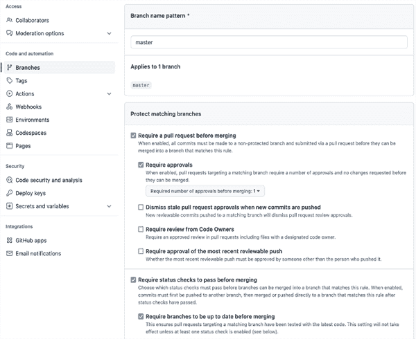

图 6.10：分支保护规则

在 GitHub 的 `master` 分支上启用分支保护可以提供几项好处：

另一方面，SonarQube 是一个开源平台，为软件开发人员提供静态代码分析工具。它提供了一个仪表板，显示代码质量摘要，并帮助开发者识别和修复与代码质量、安全性和维护性相关的问题。SonarQube 支持广泛的编程语言，如 Java、C#、JavaScript、Python 等。它还提供了各种插件和扩展来扩展其功能。SonarQube 可以与 Jenkins、`Maven`、`Gradle` 等流行的开发工具集成。

SonarCloud 和 SonarQube 提供了相似的功能，但 SonarCloud 是基于云的服务并需要订阅，而 SonarQube 是一个开源平台，可以安装在本地或云服务器上。为了简单起见，我们将使用 SonarCloud，但 SonarQube 的运行效果也完全没。

要开始使用，我们访问 `sonarcloud.io` 并注册，理想情况下使用我们的 GitHub 账户。然后，我们会看到添加仓库以供 Sonar Cloud 监控的选项，如图 6.11 所示：


图 6.11：注册后的初始 Sonar Cloud 页面

当我们选择 `Analyze new project` 选项时，我们需要授权访问我们的 GitHub 仓库。接一步是选择我们想要添加到 Sonar Cloud 的项目，如图 6.12 所示：

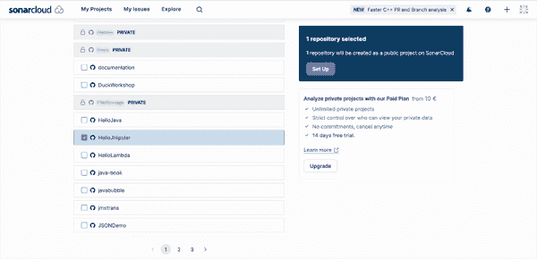

图 6.12：为 HelloJHipster 项目启用 Sonar Cloud

一旦我们选择并继续设置过程，我们需要选择分析方法。由于我们使用 GitHub Actions，在接下来的阶段中，我们需要选择该选项，如图 6.13 所示：

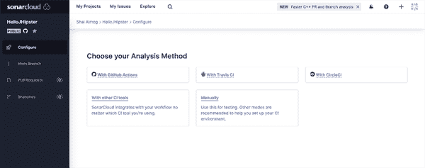

图 6.13：选择分析方法

设置好此项后，我们进入 Sonar Cloud 向导的最后阶段，如图 6.14 所示。我们会收到一个可以复制的令牌（图像中模糊处理的第 2 项）；我们稍后会使用它。请注意，一旦点击标记为“Maven”的按钮，还会出现配合 `Maven` 使用的默认指令。

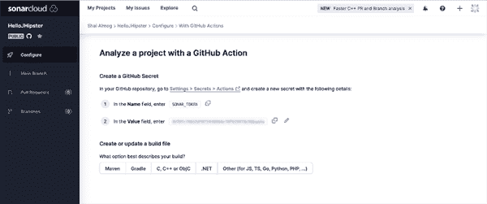

图 6.14：选择分析方法

回到 GitHub 项目，我们可以移动到项目设置（Project settings）选项卡（不要与顶部菜单中的账户设置混淆）。在这里，我们选择“Secrets and variables”，如图 6.15 所示：

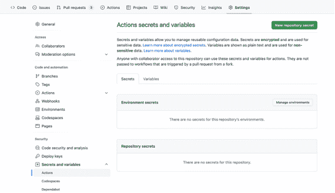

图 6.15：Action 密钥与变量

在此部分中，我们可以添加一个新的仓库密钥，特别是我们从 SonarCloud 复制的 `SONAR_TOKEN` 键和值，如图 6.16 所示：

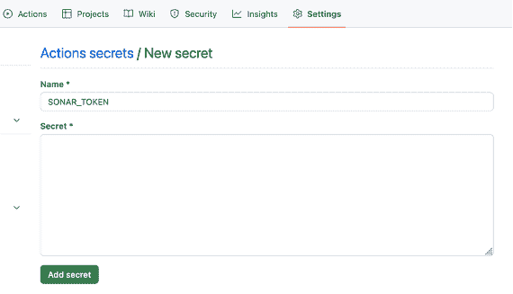

图 6.16：选择分析方法

GitHub 仓库密钥（GitHub Repository Secrets）是一项功能，允许开发者安全地存储与 GitHub 仓库相关的敏感信息，例如 API 密钥、令牌和密码，这些信息用于验证和授权访问仓库所使用的各种第三方服务或平台。

GitHub 仓库密钥背后的概念是提供一种安全方便的方式来管理和共享机密信息，而无需在代码或配置文件中公开这些信息。通过使用密钥，开发者可以将敏感信息与代码库分离，并防止其在发生安全违规或未经授权的访问时被泄露或破坏。

GitHub 仓库密钥以加密的方式安全地存储，并且只能被获得仓库访问权限的授权用户访问。密钥可以在与仓库相关的工作流、actions 和其他脚本中使用，并可以作为环境变量传递给代码，以便其以安全可靠的方式访问和使用这些密钥。

总体而言，GitHub 仓库密钥为开发者提供了一种简单有效的方法来管理和保护与仓库相关的机密信息，从而有助于确保项目及其处理数据的安全性和完整性。

我们现在需要将其集成到项目中。首先，我们需要在 `pom.xml` 文件中添加这两行。请注意，你需要更新组织名称以匹配你自己的名称。这些内容应该放在 XML 的 `<properties>` 区域：

1. `<sonar.organization>shai-almog</sonar.organization>`
2. `<sonar.host.url>https://sonarcloud.io</sonar.host.url>`

请注意，我们创建的 JHipster 项目已经包含了 SonarQube 支持，在这些代码生效之前，应该先从 `pom` 文件中移除该支持。

之后，我们可以用以下版本替换 `maven.yml` 文件中的“Build with Maven”部分：

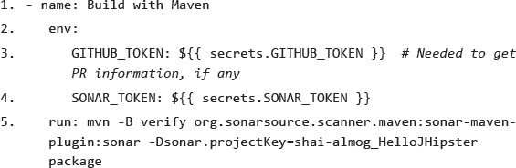

一旦这样做，SonarCloud 将为每个合并到系统的拉取请求（pull request）提供报告，如图 6.17 所示：

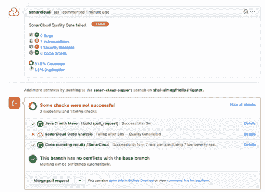

图 6.17：拉取请求的 SonarCloud 报告

我们可以看到一份报告，其中包含漏洞、风险、异味（smells）和安全问题的列表。点击每一个问题都会带我们进入图 6.18 所示的界面：

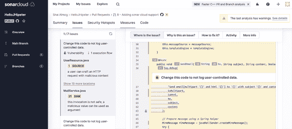

图 6.18：SonarCloud 问题报告

请注意，我们有标签页可以解释解释为什么该问题是一个问题、如何修复它等。这是一个非常强大的工具，可以作为团队最有价值的代码审查员之一。

我们在图 6.17 中看到的另外两个有趣元素是覆盖率（coverage）和重复（duplication）报告。我们可以在 6.19 中看到覆盖率报告。

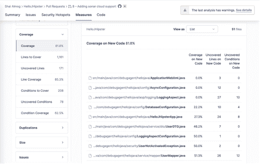

图 19：覆盖报告

一旦我们合并了一些提交，就可以通过 SonarCloud 的仪表板查看项目状况。

### 结论

测试和 CI 对于 Java 开发者确保代码的可靠性和质量、加速开发以及减少错误和问题至关重要。GitHub Actions 和 SonarCloud 将代码质量提升到了新水平。

## 知识点

- 编写自动化测试对于确保 Java 应用程序正常运行并在进行更改时继续运行至关重要。
- 单元测试专注于在隔离应用程序的情况下测试代码单元（如方法或类）。
- 集成测试验证应用程序的不同组件是否协同工作。
- 通过在测试中使用模拟（mocking），你可以减少测试的复杂度，使其更集中并提高可靠性。Jenkins、Travis CI 和 CircleCI 等 CI 工具实现了代码更改的构建和测试，允许开发者更快地识别和修复问题。
- 通过将测试和 CI 集到开发过程中，开发者可以更早地发现问题，减少生产环境中的错误和缺陷，并最终交付更高质量软件。

## 单选题

1. JUnit 用于？
   - a. 集成测试
   - b. 单元测试
   - c. 性能测试
   - d. 以上所有
   - e. 集成和单元测试

2. 单元测试的问题是什么？
   - a. 覆盖不完全
   - b. 性能缓慢
   - c. 设置困难
   - d. 不可靠
   - e. 难以读取

3. 为什么要启用分支保护？（选择所有选项）
   - a. 阻止黑客更改我们的代码
   - b. 防止对主分支的意外更改
   - c. 强制代码审查
   - d. GitHub Actions 的要求

4. 仓库密钥是什么？
   - a. 存储 GitHub Actions YAML 文件的隐藏目录
   - b. 我们在 GitHub 和供应商（例如 SonarCloud）之间传递的 API 密钥
   - c. 一个我们可以泄露给 CI 但不包含在代码中的任意值
   - d. 我们在注册时同意的点击许可协议

### 答案

1. e
2. a
3. b, c
4. c

***

[1] 得益于像 Testcontainers 这样的项目，这变得很容易：https://www.testcontainers.org/

[2] https://talktotheduck.dev/understand-the-root-cause-of-regressions-with-git-bisect

[3] 长久测试是集成测试，旨在高负载下压力测试系统，有时可以运行整夜以验证完整性和扩展性。

[4] JHipster 是一个开源代码生成器，通常创建基于 Spring Boot 的示例企业项目。你可以在这里阅读关于它的信息：https://www.jhipster.tech/

[5] https://github.com/shai-almog/HelloJHipster/pull/4

[6] https://github.com/shai-almog/HelloJHipster/pull/7

[7] 你可以在此拉取请求查看相关细节：https://github.com/shai-almog/HelloJHipster/pull/8

**加入我们书籍的 Discord 空间**

加入书籍的 Discord 工作空间以获取最新更新、优惠、全球科技动态、新发布以及与作者的交流会议：

[`discord.bpbonline.com`](https://discord.bpbonline.com)


# Docker、Kubernetes 和 Spring Native

## 引言

本章的原始想法是围绕云原生开发。然而，这个缩写词有些模糊。在过去，我们会获取生成的 jar 文件并将它们放置在连接互联网的应用程序服务器上。然而，那些日子已经一去不复了；容器和编排完全改变了应用程序在生产环境中的部署方式。

这些部署方法触发了整个链路的地震式变化。应用程序需要更小、加载更快。这催生了如 GraalVM 以及构建在其上的 Spring Native 等工具。在本章中，我们将学习如何为现代云部署构建应用程序，以及这到底意味着什么。

## 结构

在本章中，我们将讨论以下主题：

- 容器（Containers）
- 编排（Orchestration）
- 代码即基础设施（IaC）
- Spring Native

## 目标

在本章中，我们将学习如何使用虚拟化、编排和 Spring Native 来构建和部署现代应用程序。

## 容器

在过去，在生产环境中部署复杂的应用程序需要物理设置机器或使用 telnet 连接到它。这个过程既复杂又容易出错，特别是在多个站点进行设置时。虚拟化通过允许开发者创建虚拟机（并复制 ×86 操作系统环境）解决了这个问题。这使得应用程序的设置和部署变得更容易，同时也允许云服务器提供商出售其服务器上的空间。然而，虚拟化有以下两个缺点：

1. 巨大的开销
2. 供应商之间缺乏标准

容器的开发是为了解决这些问题。它们利用内核能力来隔离运行中的代码，从而创建一个“感觉上”像是一台独立机器的独立环境。容器可以在虚拟机上运行且开销极小，而且标准的容器格式使得在之间移动容器镜像变得简单。

在图 7.1 中，我们展示了从硬件到虚拟化、容器再到编排的漫漫道路。在这段旅程中，我们权衡了便利性、可移植性、原始性能和扩展性。

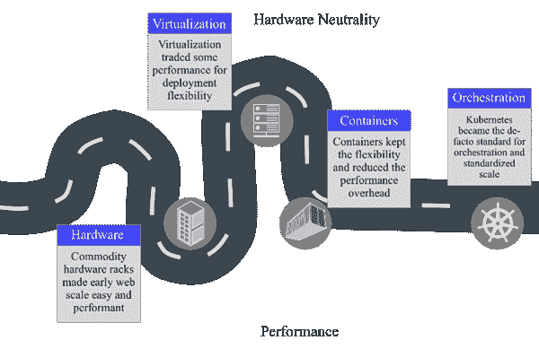

图 7.1：通往编排的道路

容器通过在相同硬件上运行更多容器实现了大规模扩展并降低成本，特别是对于不包含完整操作系统的 distroless 或裸容器。

然而，容器并没有涵盖所有内容，包括动态故障转移、更新和扩展。需要在容器运行时之上的解决方案来确保服务的可用性并动态提供额外资源。

### Docker

Docker 是一个容器化平台，允许你在容器中创建、部署和运行应用程序。它是将容器概念推向前景的产品。Docker 提供了一种将应用程序及其依赖项封装到单个容器中的方法，从而易于在任何支持 Docker 的机器或环境中部署和运行应用程序。

容器技术并不是新鲜事物，也不是由 Docker 发明的。Docker 带来的革命在于容器创建的简单性。Docker 让任何人都能使用标准流程定义一个简单的镜像。在此之前，只有 Linux 管理员才具备设置容器所需的技能。多亏了 Docker，这是一项轻而易举的任务，我们可以用极少的工作启动数据库、应用程序等。Docker 使用客户端-服务器架构，Docker 客户端与 Docker 守护进程（daemon）通信，守护进程负责构建、运行和管理 Docker 容器。

我们需要遵循的第一步是安装 Docker Desktop，可以通过按照 https://docs.docker.com/desktop/ 上的指令完成。

一旦安装 Docker，我们可以通过执行以下命令来验证安装是否成功：

```bash
docker version
```

这将显示有关 Docker 客户端和守护进程的信息。如果显示错误或失败，请检查以下：

- 检查安装步骤并确保涵盖了所有基础。
- 你运行 docker 进程了吗？确保你运行了 Docker 或在 Linux 上运行 `systemctl start docker`。
- 如果 Docker 守护进程正在运行，但你仍然无法使用 docker 命令，可能是 Docker 守护进程无法访问。你可以通过运行以下命令来检查 Docker 守护进程是否可用：

```bash
docker info
```

- 如果你以非 root 用户运行 Docker，请确保你的用户账户已添加到 docker 组。这将允许你在在不使用 sudo 的情况下运行 Docker 命令。你可以通过运行以下命令将用户账户添加到 docker 组：

```bash
sudo usermod -aG docker <your-username>
```

将 `<your-username>` 替换为你的实际用户名。接下来，我们需要构建 Docker 镜像。Docker 镜像是通过 Dockerfile 构建的，Dockerfile 是一个文本文件（无扩展名），包含构建镜像的指令。我们创建一个名为 `myapp` 的新目录，并创建一个名为 `Dockerfile` 的文件，内容如下：

```dockerfile
FROM openjdk:11

COPY . /app

WORKDIR /app

RUN javac HelloWorld.java

CMD ["java", "HelloWorld"]
```

此 Dockerfile 指定了 OpenJDK 11 的基础镜像，将应用程序文件复制到 `/app` 目录，设置工作目录为 `/app`，编译 `HelloWorld.java` 文件并设置运行编译后的 `HelloWorld` 类的命令。

创建一个名为 `HelloWorld.java` 的新文件，内容如下：

```java
public class HelloWorld {

    public static void main(String[] args) {

        System.out.println("Hello, World!");

    }

}
```

该文件定义了一个简单的 Java 应用程序，向控制台打印“Hello, World!”消息。现在你已经准备好了这些文件，运行以下命令来构建 Docker 镜像：

```bash
docker build -t myapp .
```

此命令使用当前目录下的 Dockerfile 构建一个名为 `myapp` 的 Docker 镜像。我们现在创建了一个 Docker 镜像。镜像描述了容器实例的样子。我们可以使用同一个镜像创建多个服务器实例并轻松扩展应用程序。

现在我们已经有了一个 Docker 镜像，是时候运行应用程序的容器化实例了。我们运行以下命令从 `myapp` 镜像启动一个新的容器：

```bash
docker run myapp
```

此命令从 `myapp` 镜像启动一个新容器。你应该能在控制台中看到显示“Hello, World!”的消息。我们可以使用以下命令：

```bash
docker ps
```

这会显示 `docker` 中运行的容器列表，然后我们可以使用以下命令停止该容器：

```bash
docker stop <container-id>
```


将`<container-id>`替换为`docker ps`命令列出的容器 ID。请注意，这是一个非常简化的场景。在这个例子中，我们甚至在容器内部执行了编译，其中包含了代码。随着章节的进行，我们将展示一种更好的方法。

我们在这里所做的是启动了一个在我们的机器上隔离运行的独立服务器。它运行在一个“干净”的环境中，该环境拥有全新安装的 Linux。这意味着我们对当前的机器没有细微的依赖关系，而这些关系在部署到部署时可能会失败。我们可以获取 Docker 镜像并将容器复制到任何地方的任何机器并获得类似的结果。这就是 Docker 的第一个强大之处。

第二个点是这样的：注意 Dockerfile 中的这一行：`FROM openjdk:11`。这一行隐藏了大量功能；镜像中已经安装了`JDK 11`，我们可以依赖它。我们可以使用此类镜像在其他开发人员工作的基础上构建，而无需为每种情况安装每个包。但比这更好。

如果我们的应用需要数据库，我们可以定义对数据库镜像的依赖并在此基础上构建。我们可以在镜像之间建立依赖关系，并将它们分离以保持适当的隔离。

## 编排

正如我们之前讨论的，容器并没有涵盖动态故障转移、更新和扩展等问题。我们需要在容器运行时之上的解决方案，以确保服务的可用性并动态提供额外的资源。

容器编排是指在分布式计算环境中对容器化应用程序进行管理和自动化。它涉及部署、扩展、管理和监控容器以及容器集群，以确保它们运行得高效、可靠且安全。

容器编排是必要的，因为现代应用程序通常是复杂的、分布式的，并且由运行在容器中的多个微服务组成。手动管理这些容器既耗时又容易出错，并可能导致诸如部署不一致、缺乏扩展性以及难以更新或回滚应用程序等问题。

容器编排工具自动化了这些许多任务，允许开发者和 DevOps 团队专注于更高层次的任务，如设计和构建应用程序。容器编排平台提供了负载均衡、自动扩展、自愈、服务发现、集中化管理和监控等功能。这使得在分布式环境中部署和管理容器化应用程序变得更容易。

## Kubernetes（`k8s`）

Kubernetes 也被称为`k8s`，这是因为在字母`K`和`s`之间有八个字母。它是一个开源容器编排平台，最初由 Google 开发，现在由云原生基金会（CNCF）维护。Kubernetes 自动化了容器化应用程序的部署、扩展和管理，使得在容器环境中管理和扩展复杂应用程序变得更加容易。它是目前市场上领先的编排解决方案。

Kubernetes 由 Google 于 2014 年首次引入并在并在作为开源项目发布。从那时起，Kubernetes 成为最流行的容器编排平台之一，拥有庞大且活跃的开发者和贡献者社区。

Kubernetes 最初基于 Google 内部的容器编排平台`Borg`，该平台已使用了十年多年。Kubernetes 的设计是将`Borg`的优势带给更广泛的社区，并为容器编排提供一个通用平台，该平台可以跨不同的云提供商和本地数据中心。

今天，Kubernetes 被应用于生产环境，驱动了互联网上一些最大、最复杂的应用程序和服务。它的流行和成功归功于它能够简化容器化应用程序的管理，提高效率和可靠性，并为开发者和运维团队提供了一个一致的平台。

我们大多数人并不需要 Kubernetes。它是为了解决 Google 规模的部署问题而构建的，即我们大多数人永远不会看到的规模问题。Kubernetes 经常被用作简历驱动设计（RDD）的一部分。尽管如此，Kubernetes 的用例超了规模。它的次要价值是将其标准化为可部署的单元。这让我们在监控和管理云时能够使用一组标准化的工具和部署策略。

要开始学习 Kubernetes，我们需要先绕一条远路，然后展示一种更简单的方法。如果我们理解了底层过程而不仅仅是简化版本，通常会对学习体验更有帮助。我们将逐步介绍设置 Kubernetes 集群、部署应用程序和扩展它的步骤。

通常情况下，我们在配置时使用基于云的 Kubernetes 主机。使用这些主机会使本书过于针对某个单一供应商。相反，我们将使用 Docker Desktop 内置的 Kubernetes 支持以方便于使用。安装 Docker Desktop 后，打开应用程序并进入`Preferences | Kubernetes`。勾选启用 Kubernetes 并点击`Apply & Restart`。图 7.2 显示了 Mac 上 Docker desktop 中启用的 Kubernetes：

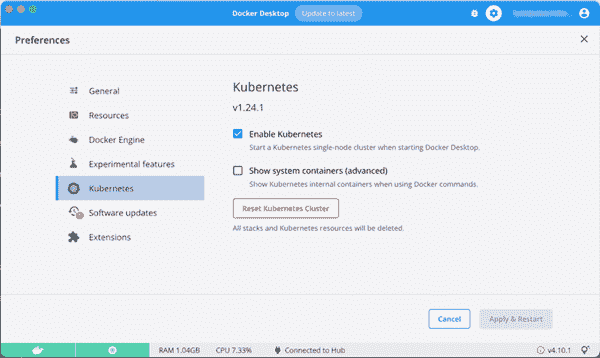

图 7.2：启用了 Kubernetes 的 Docker desktop 设置

启用此将在 Docker desktop 中启动一个 Kubernetes 集群，你可以用它部署和管理应用程序。

接下来，我们需要创建一个 Kubernetes 部署（deployment）。在 Kubernetes 中，部署管理一组相同 Pod 的方法。Pod 是 Kubernetes 中最小的可部署单元，可以包含一个或多个容器。要创建部署，我们需要定义一个部署清单。以下是 Java 应用程序的部署清单示例：

```yaml
apiVersion: apps/v1
kind: Deployment
metadata:
  name: my-java-app
spec:
  selector:
    matchLabels:
      app: my-java-app
  replicas: 3
  template:
    metadata:
      labels:
        app: my-java-app
    spec:
      containers:
      - name: my-java-app
        image: openjdk:11-jre
        ports:
        - containerPort: 8080
        env:
        - name: SPRING_PROFILES_ACTIVE
          value: production
```

这可能会让人有些眼花，但如果你查看 YAML 文件，配置非常清晰。YAML 文件中的大多数属性由元数据组成：描述、分类、标签等。YAML 的结尾看起来像是标准的 docker 文件详情。

唯一的特殊属性是第 9 行：`replicas`。`replicas`属性用于指定给定部署的副本数量。部署是一个管理一组相同 Pod 的高级抽象。`replicas`属性告诉 Kubernetes 应该维护多少个副本。

在这个例子中，`spec.replicas`属性被设置为 3，这意味着 Kubernetes 将确保`template.spec.containers`部分指定的 Pod 有三个副本在运行。

当你更新部署（deployment）的副本（replicas）数量时，Kubernetes 会自动扩展或缩小副本数量以匹配期望状态。例如，如果你将`replicas`属性从 3 更新为 5，Kubernetes 将创建两个新的 pod 副本以使总数达到 5。如果你随后又将`replicas`属性更新为 2，Kubernetes 将终止三个正在运行的副本，使总数减少到 2。

`replicas`属性是管理 Kubernetes 中应用程序可用性和可扩展性的强大工具。通过指定期望的副本数量，你可以确保你的应用程序始终可用，即使某些副本失败或因维护而离线。你还可以使用`replicas`属性根据不断的需求扩展或缩小你的应用程序。

继续之前的示例，我们现在可以将 YAML 文件保存到计算机上，命名为`my-java-app.yaml`。此部署清单指定了一个名为`my-java-app`的部署，包含三个副本。每个副本都运行一个使用`openjdk:11-jre`镜像的容器，并暴露了`8080`端口。它还将环境变量`SPRING_PROFILES_ACTIVE`设置为 production（生产）。这是区分生产环境和调试环境的常用技巧；这样我们就可以连接到不同的数据库服务器，并隔离本地、测试和生产环境。

我们可以使用以下命令进行本地部署：

```bash
kubectl apply -f my-java-app.yaml
```

这将创建部署并启动指定数量的副本。接下来，我们需要将部署暴露为服务（service）。Kubernetes 服务是一种抽象，它定义了一个逻辑 pod 组以及访问它们的策略。服务能够实现对 pod 的网络访问并提供负载均衡。

当客户端向服务发送请求时，负载均衡器会选择应用程序的一个可用副本来处理该请求。如果某个副本变得不可，负载均衡器会自动将流量路由到剩余副本，确保应用程序在某些副本失败时仍然可用。

Kubernetes 负载均衡提供了一种简单有力的方法，将流量分布到应用程序的多个副本上，提高了可用性和扩展性。通过使用服务提供负载均衡，你可以确保无论底层基础设施如何，客户端始终能够访问你的应用程序。

要将部署暴露为服务，我们需要定义一个服务清单。以下是`my-java-app`部署的服务清单示例：

```yaml
apiVersion: v1
kind: Service
metadata:
  name: my-java-app
spec:
  selector:
    app: my-java-app
  ports:
  - name: http
    protocol: TCP
    port: 80
    targetPort: 8080
  type: LoadBalancer
```

我们可以将此 YAML 文件保存到计算机上，命名为`my-java-app-service.yaml`。此服务清单指定了一个名为`my-java-app`的服务，它选择了带有该标签的 pod。它还暴露了`80`端口并将流量转发到 pod 的`8080`端口。最后，它将服务类型设置为`LoadBalancer`。我们可以使用以下命令创建此服务：

```bash
kubectl apply -f my-java-app-service.yaml
```

这将创建服务并使`my-java-app`部署可以从集群外部访问。

### 简便的方法——Skaffold

Skaffold 是一种流行的开源命令行工具，用于简化容器化应用程序的开发和部署。通过 Skaffold，开发者可以以一致且重复的方式自动化应用程序的构建、测试和部署过程，使其更容易部署到 Kubernetes 集群。

Skaffold 提供了声明式配置，允许开发者为应用程序定义构建上下文、容器镜像、部署目标和其他设置。此配置可以存储在 YAML 文件中并并应用程序代码一起进行版本控制。

Skaffold 的一些关键特性包括：

- **快速的迭代开发**：Skaffold 可以监控代码更改，并自动重新构建和重新部署应用程序到 Kubernetes，使开发期间快速迭代变得简单。
- **对常用工具和框架的内置支持**：Skaffold 与`Docker`、`Kubernetes`、`Helm`和`Google Cloud Build`等流行工具和框架集成，从而可以将这些工具纳入开发工作流。
- **一致且可重复的构建**：Skaffold 提供了一种一致且重复的构建和部署应用程序的方法，确保你的部署总是可预测且可靠的。
- **支持多个部署目标**：Skaffold 支持将应用程序部署到本地 Kubernetes 集群、远程 Kubernetes 集群或如`Google Cloud Platform`或`Amazon Web Services`等云提供商。

虽然我们可以在命令行中使用 Skaffold，但这是一个非常广泛的主题。相反，我们将使用 IntelliJ/IDEA 的 Google Cloud Code 插件，它可以在设置 UI 中安装，如图 7.3 所示：

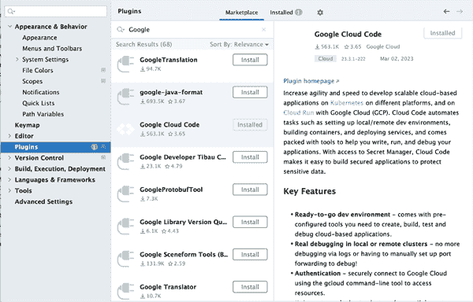

图 7.3：IntelliJ/IDEA 中的 Google Cloud Code 插件

安装后，我们可以创建一个项目并选择 Java “hello world”示例，如图 7.4 所示：

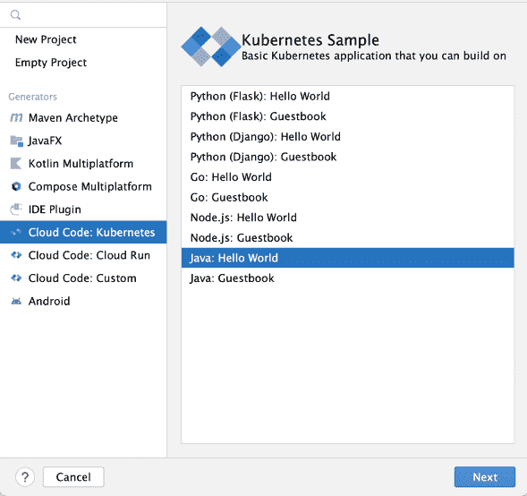

图 7.4：来自 IntelliJ/IDEA 中 Google Cloud Code 插件的 Kubernetes 示例

设置完成后，你将面临 IntelliJ/IDEA 中一个全新的 Spring Boot 项目。这是一个标准的 Spring Boot 项目，可以通过`scaffold.yaml`和匹配的`Dockerfile`进行配置：

```dockerfile
# 使用 maven 编译 java 应用程序。
FROM maven:3-jdk-11-slim AS build-env

# 设置工作目录为 /app
WORKDIR /app

# 拷贝 pom.xml 以依赖
COPY pom.xml

# 根据 pom.xml 下载依赖
RUN mvn verify

# 将工作目录的其余部分复制到容器
COPY . ./

# 编译应用程序
RUN mvn -Dtest.skip=true package

# 构建运行时镜像。
FROM openjdk:11.0.16-slim

# 拷贝编译后的文件
COPY --from=build-env /app/target/ /app

# 在端口 5005 启动带有调试器的 java
CMD ["java", "-jar", "/app/hello-world-1.0.0.jar"]
```

如果你点击调试按钮，它通过端口转发无缝连接到远程调试器。图 7.5 显示了应用程序成功加载时看到的“hello world”示例：

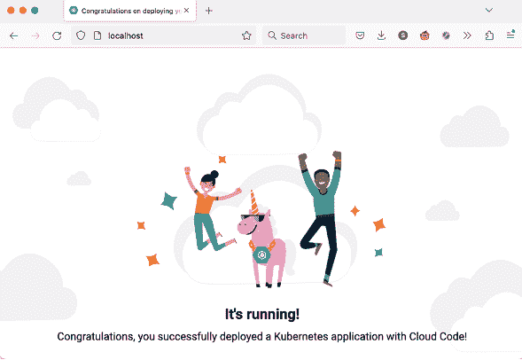

图 7.5：在 localhost 端口 80 上运行 Skaffff

这可能由于两个主要原因失败：

- 缺少 Kubernetes 运行时：确保 Docker Desktop 正在运行并启用了 Kubernetes。
- 路径中缺少 Maven：这可能需要重启。

或者，你可以编辑项目的运行配置并修改路径包含`maven/bin`目录，如图 7.6 和 7.7 所示：

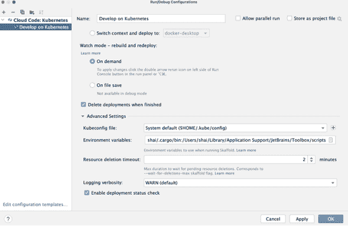

图 7.6：Skaffold 项目的运行配置设置

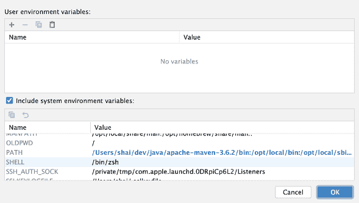

图 7.7：环境变量设置，路径已高亮并可以编辑

解决这些问题后，我们可以轻松地将 Spring 应用程序部署到 Kubernetes。

## 基础设施即代码（IaC）

直到为止，我们是从软件开发者的角度来看 Kubernetes 和 Docker 的，而不是作为基础设施。这些是位于我们工作与生产环境缝隙处的工具。它们通常是 DevOps 工程师的领域。

当我们开始使用云服务时，过去通常在笨拙的 Web 用户界面上配置元素。有时我们使用使用特定服务的命令行或 API 工具。然而，这是非常有问题的。

基础架构即代码（Infrastructure as Code, IaC）是一种管理基础设施的方法，整个基础设施都像任何其他软件一样用代码来描述。这意味着可以使用软件开发实践对基础设施进行版本控制、测试和部署，这带来了许多优势，例如提高敏捷性、可靠性和可扩展性。

我们可以使用许多工具来实现 IaC，例如`Terraform`、`CloudFormation`、`Ansible`等。我们将重点关注`Terraform`，因为这个主题足够大。`Terraform`是一个流行的开源工具，用于基础设施的置备和管理。

首先，我们需要安装`Terraform`。我们可以从官方网站`https://www.terraform.io/downloads.html`下载`Terraform`的最新版本并按照安装说明操作。

然后我们应该通过进入项目目录并运行命令`terraform init`来初始化`Terraform`。这将下载所需的提供者插件（provider plugins）并初始化我们的`Terraform`环境。

提供者是`Terraform`用于与特定云提供者交互的插件。例如，如果你想在`AWS`上置备基础设施，你需要配置`AWS`提供者。我们可以在项目目录下创建一个名为`provider.tf`的文件并添加以下配置：

```tf
provider "aws" {
  region = "us-east-1"
}
```

这配置了`us-east-1`区域的`AWS`提供者。你可以将区域更改为你的`AWS`账户可以的任何其他区域。

接下来，我们需要创建一个资源配置。资源是`Terraform`管理的基础设施，例如`EC2`实例、`VPC`或安全组。在项目目录中创建一个名为`resource.tf`的文件并添加以下配置：

```tf
resource "aws_instance" "example" {
  ami = "ami-0c94855ba95c71c99"
  instance_type = "t2.micro"
  tags = {
    Name = "example-instance"
  }
}
```

这配置了一个具有 Amazon 映像（AMI）`ami-0c94855ba95c71c99`和实例类型`t2.micro`的`EC2`实例。它还为实例添加了一个键为`Name`值为`example-instance`的标签。

为了让你的`Terraform`代码更加模块化和可复用，你可以定义可以在运行时传递的变量。在项目目录下创建一个名为`variables.tf`的文件并添加以下配置：

```tf
variable "aws_access_key" {}
variable "aws_secret_key" {}
```


我们可以在这里传递不提交到仓库的密钥和密码。这样，我们可以保持私有信息的安全并易于更新。

在项目目录下，我们现在可以运行`terraform apply`命令。这将提示你审查`Terraform`将对你的基础设施所做的更改，如果你批准了这些更改，`Terraform`将置备资源。

这意味着我们可以推送重大的基础设施变更并通过基础设施代码审查。这减少了在 Web UI 上因“手指误触”导致错误的概率。它还让我们能够重用部署代码。我们可以使用相同的`Terraform`脚本部署到测试环境、开发环境和生产环境。这样我们的环境将几乎是完全相同的。这就是变量选项非常方便的地方。

## Spring Native

Spring Native 是一个旨在以更高效、更简洁的方式将 Spring 应用带到云原生平台的项目。Spring Native 的动力源于云原生架构日益增加的应用，这些架构需要轻量级、可扩展且可移植的应用程序，以便在容器环境中轻松地部署和管理。

Spring Native 的核心动力之一是提高云原生环境中 Spring 应用的性能和内存占用。传统的 Java 应用由于 Java 虚拟机（`JVM`）的沉重，以及 Spring 框架中反射和类路径扫描的广泛使用，往往面临启动时间长和内存占用高的问题。Spring Native 通过利用`native-image`技术解决了这些问题，该技术将 Java 代码编译成原生可执行文件，该文件可以直接运行在操作系统上，而无需需要`JVM`。

Spring Native 的另一个动力是简化容器化环境中 Spring 应用的部署和管理。通过 Spring Native，开发者可以创建自包含的可执行文件，这些文件包含所有必要的依赖项，并可以在任何额外设置或配置的情况下轻松地部署到容器镜像中。这使得以一致且重复的方式打包、分发和部署 Spring 应用变得更加简单，这在云原生环境中至关重要。

此外，Spring Native 旨在为习惯 Spring 编程模型生态系统的 Spring 开发者提供无缝且熟悉的体验。Spring Native 与现有的 Spring 工具和框架集成（如`Spring Boot`、`Spring Cloud`和`Spring Data`），并提供了专门为云原生平台设计的额外功能和优化。

虽然 Spring Native 为云原生环境中的 Spring 应用带来了许多优势，但开发者也应该注意一些挑战和局限性。以下是 Spring Native 的主要问题：

- **兼容性限制**：Spring Native 依赖`GraalVM` `native-image`编译器来生成原生可执行文件，这在语言特性、运行时行为和第三方库支持方面存在一些限制。某些 Spring 特性（如动态代理、反射和`AOP`）可能无法完全支持，或需要额外的配置。此外，某些第三方库或框架可能无法很好地与`native-image`工作，需要特殊处理或自定义。
- **构建复杂性增加**：使用`GraalVM`生成原生可执行文件需要额外的配置和依赖，这增加了构建过程的复杂性。例如，开发者需要指定`native-image`属性，包含必要的反射和资源文件，并优化应用程序的内存使用和启动时间。这可能需要额外的工具、知识和测试，以确保原生可执行文件正确高效地运行。
- **构建时间延长**：由于编译过程复杂以及需要分析的大量依赖和类，使用`GraalVM`构建原生可执行文件的时间比构建传统的 Java 应用长得多。这会减慢开发和测试周期，可能需要额外的硬件资源或并行化来加速构建。
- **维护负担增加**：由于运行时行为和内存使用的不同，使用`GraalVM`生成的原生可执行文件可能比传统的 Java 应用需要更多的维护。开发者需要意识到运行原生可执行文件可能产生的内存泄漏、性能问题和安全漏洞，并可能需要使用专门的性能分析和监控工具来检测和诊断问题。这是一个更大的问题，因为目前`JVM`的监控和可观测能力是顶尖的，而`GraalVM`可执行文件尚不在同一水平。

- **平台支持有限**：`Spring Native`编译为原生操作系统目标。因此，要针对不同的操作系统或 CPU 架构将更具挑战性，并且需要独立的 CI/CD 流水线。一个很好的例子是 ARM CPU 的兴起。你的本地机器可能是 ARM 架构，但你可能正将其部署到 Intel 生产服务器上（反之亦然）。这使得服务器迁移变得更加。

### 开始使用 Spring Native

大多数 Spring 项目都始于`Spring Initializr`^([[2]](#chap07.xhtml_footnote-012))项目，在其中我们需要添加`Spring Native`支持选项，如图 7.8 所示：


图 7.8：带有 GraalVM 原生支持依赖的 Spring Initializr

在项目中，我们需要为原生镜像添加 GraalVM 原生支持。在 IDE 中编译`Spring Native`应用程序是一次痛苦的体验。由于等几个不同的原因，构建过程可能是不稳定的：

- 用于构建的 VM 必须是`GraalVM`，并且在几个不同的地方都需要进行设置。它还应该位于系统路径的最前端，这可能非常不方便。
- `JAVA_HOME`环境变量必须指向`GraalVM`。
- 我们需要使用`native`配置。

这可能不是一个致命问题，因为我们经常在 CI 过程中使用`GraalVM`。本地构建对于日常开发来说可能太慢了。在命令行上，构建原生镜像的过程只需要执行以下命令：

```bash
mvn -pnative native:build
```

这会在目标目录下生成一个原生可执行文件，可以类似于原生 jar 一样运行。为了让你了解`Spring Native`和 JVM 版本的 Spring 之间的区别，请查看图 7.9，它强调了使用 JDK 19 运行的输出，以及图 7.10，它显示了相同的应用程序在`GraalVM`上运行。注意，这些数字是在 Mac Book M1 上生成的，但在不同平台上是一致的。


图 7.9：使用 OpenJDK 19 运行的 Spring Native Demo


图 7.10：由 GraalVM 编译为原生的 Spring Native Demo

图 7.11 中的内存结果也是如此，在其中我们可以看到应用程序在 JDK 19 中运行的开销，而图 7.12 显示了使用`GraalVM`编译的相同应用程序：


图 7.11：使用 OpenJDK 19 运行的 Spring Native Demo 内存视图


图 7.12：由 GraalVM 编译为原生的 Spring Native Demo 内存视图

这些结果可能难以阅读；为了方便起见，它们列在下面的下表中：

| | JDK 19 | GraalVM | 差异 |
| :--- | :--- | :--- | :--- |
| 启动时间 | 0.758 ms | 0.06 ms | 12,633% |
| 内存 | 139.5 MB | 37.5 MB | 372% |
| 大小（不含 JVM） | 18,665,880 bytes | 67,553,623 bytes | 27.63% |
| JVM 大小（Mac 上） | 316 MB | 0 | 495% |

表 7.1：JVM 对比 GraalVM

这些数字并不具有代表性。应用程序越简单，`GraalVM`的优势就越大。在现实场景中，不要期望 12,000% 的性能差异。然而，启动时间和内存在使用`GraalVM`时都表现得好得多。

## 云原生

你可能在奇怪，为什么启动时间和内存对我们很重要，以及它们与 Kubernetes 或`Docker`有什么关系。

答案与云原生方向有关。云原生是一种构建和运行应用程序的方法，利用了云计算的可扩展性、灵活性韧性。其核心是，云原生强调使用容器化、微服务架构和持续交付，以实现现代应用程序更快的开发、部署和扩展。

我们将在下一章中详细详细讨论微服务。目前，一个不准确的简化说法是，我们不是创建一个巨大的应用程序，而是创建许多许多小应用程序。

例如，假设我们想向一个具有许多不同副本微服务的系统推送更新。我们需要在某个时刻替换所有旧版本。每次这样的更新意味着计算时间，这会迅速累积。如果我们的系统正经历重载负载，我们可能需要启动额外的实例来处理负载，而加载它们的速度可能是决定性因素。如果一个系统加载很快，我们可以设置`Kubernetes`具有较低的初始计数，因为我们知道它可以快速启动额外资源。然而，对于缓慢的系统，我们需要保留更多的备用副本，并且可能会闲置云资源。

该复制过程的一部分包括将镜像数据物理复制到新的物理机器上。镜像越大，过程越慢。DevOps 工程师已经从字面上将镜像精简到了最骨干。生产镜像内部通常不包含任何工具，开发者无法访问此类镜像。这一切都是为了尺寸。通过减小构建尺寸，`Spring Native`让副本的启动时间变得更快。

减少内存也极其重要。有显而易见的原因；如果我们节省了内存，就可以提供更多功能用于缓存。减少内存也极其重要。有显而易见的原因；如果我们节省了内存，就可以提供更多功能用于缓存。

### Spring Native 的替代方案

有几种`Spring Native`的替代方案，它们可以分为两营：

1. 依赖`GraalVM`的 Spring Boot。

`GraalVM`在启动时间和内存占用上有优势，但这些是有代价的：构建时间增加、观测性限制等等。有两个面向更小内存占用和更快启动时间的项目。第一个是`Lilliput`^([[3]](#chap07.xhtml_footnote-011))，其目标是缩小 JVM 开销。在`Lilliput`之前，Java 中的每个对象都有 128 字节的开销。这积累如下所示：

```java
// 占用 4 字节
int example;

// 至少 20 字节（16 字节头部 + 4 字节 int）
Integer obj;

// 占用 32 字节（16 字节数组头部 + 4 字节长度 + 3*4 bytes）
int[] parray = {1, 2, 3};

// 占用 80 字节（16 字节数组头部 + 4 字节长度 + 3*20 bytes）
Integer[] oarray = {1, 2, 3};
```


在规模和多个集合上，问题变得更加严重，这里列出的开销是保守最小尺寸。目前，`Lilliput` 旨在将每个对象的开销减少到 64 位（8 字节），但可能甚至能将其减少到 32 位（4 字节）。如果它能达到第一个目标，之前示例中的 `Integer` 将从 20 字节变为 12 字节，而该示例中的对象数组将从 80 字节变为 48 字节。

如果 `Lilliput` 能达到其更具野心的 4 字节开销目标，`Integer` 将占用 8 字节而不是 20 字节。在这种情况下，对象数组将占用 32 字节；这在两种情况下都小于一半的大小！

随着来自 `Project Valhalla` 的变化，这将进一步减少更小对象的开销。通过将对象转换为栈项，它们的开销可能会被完全消除。

启动时间的解决方案完全不同。该解决方案的代号为 `Coordinated Restore at Checkpoint (CRaC)`^([[4]](#chap07.xhtml_footnote-010))，它基于 `Linux`^([[5]](#chap07.xhtml_footnote-009)) 中可用的 `Checkpoint/Restore in Userspace (CRIU)` 功能。

启动时间消耗在加载和初始化应用程序状态上。通过 `CRaC`，我们可以获取应用程序状态的快照并将其保存到磁盘。当我们想要运行应用程序时，系统可以加载该快照，应用程序即可就绪。无需运行任何加载代码。在 Azul（该规范的领导者）发布的示例中，一个加载需要 3898 ms 的 Spring Boot 应用程序在使用 `CRaC` 后仅需 38 ms（^[6]）。这是启动时间极其惊人的提升。

正如你所预期的那样，这种改进是需要代价的。`JVM` 需要获取一个“恢复点”，在该点它可以暂停 `JVM` 并获取快照。主要问题是连接或打开的文件将无法工作。指向服务器的开放网络连接将引用一个早已不存在且无关的连接。应用程序需要在保存恢复点之前，确保所有连接和文件已关闭（包括数据库连接）。

幸运的是，大多数框架都会跟踪所有的连接，并能够几乎无缝地为你处理好 `CRaC` 的这些方面。Spring 已经对 `CRaC` 有了一些初步支持，如果该标准成为正式标准，就可以将其纳入。

### 结论

云原生包含许多方面，其中某些方面是相互冲突的，例如可移植性和可观测性与规模和性能之间的冲突。其中一些工具属于 DevOps 工程师的职责范畴，这是很棒的。然而，即使对于高级语言开发者来说，理解直到硬件的整个堆栈也会非常有益。

## 注意事项

- 容器让我们能够抽象运行运行的系统，并以一种可移植的方式隐藏差异，且不牺牲性能。
- 容器编排指的是在分布式计算环境中对容器化应用进行管理和自动化。
- 我们大多数人不需要 `Kubernetes`。它是为了解决 Google 级别的部署问题而构建的，这种规模的问题我们大多数人永远不会遇到。
- 通常在配置资源时，我们使用基于云的 `Kubernetes` 主机。
- 当客户端向服务发送请求时，负载均衡器会选择应用程序的一个可用副本来处理请求。如果某个副本不可用，负载均衡器会自动将流量路由到剩余副本，确保即使某些副本失败，应用程序仍然保持可用。
- 基础设施即代码（`IaC`）是一种管理基础设施的方法，整个基础设施都用代码描述，就像任何其他软件一样。这意味着基础设施可以使用软件开发实践进行版本控制、测试和部署，这带来了许多益处，例如增加敏捷性、可靠性和可扩展性。
- `Spring Native` 依赖于 `GraalVM native-image` 编译器来生成原生可执行文件，这在语言特性、运行时行为和第三方库支持方面存在一些局限性。
- 云原生是一种构建和运行应用程序的方法，利用了云计算的可扩展性、灵性和恢复能力。

### 多选题

1. 容器与虚拟化之间是什么关系（选择所有适用项）？
   - a. 技术继任者
   - b. 容器是增强的虚拟化
   - c. 容器可以在虚拟服务器上运行
   - d. 容器的开销更低
   - e. 虚拟化的开销更低

2. 编排提供：
   - a. 复制
   - b. 容错性
   - c. 扩展
   - d. 部署
   - e. 以上所有

3. `Spring Native` 与 `Spring Boot` 有何不同？
   - a. 它是原生的
   - b. 它在 `Docker` 中运行
   - c. 它针对 `Kubernetes`
   - d. 它使用 `GraalVM` 编译

4. `Project Lilliput` 的目标是：
   - a. 将对象从堆移动到栈
   - b. 减小对象头的大小
   - c. 通过快照减少对象启动时间
   - d. 与 `Project Gulliver` 对齐

### 答案

1. a、c 和 d
2. e
3. d
4. b

***

1. 详情参见：doyouneedkubernetes.com。
2. https://start.spring.io/
3. https://wiki.openjdk.org/display/lilliput
4. https://openjdk.org/projects/crac/
5. https://criu.org/Main_Page
6. https://foojay.io/today/introducing-the-openjdk-coordinated-restore-at-checkpoint-project/

**加入我们书籍的 Discord 空间**

加入书籍的 Discord 工作空间获取最新更新、优惠、全球技术动态、新发布以及与作者的交流会议：

**[`discord.bpbonline.com`](https://discord.bpbonline.com)**


# 第 8 章 微服务

## 引言

`Kubernetes` 的兴起使得微服务方法变得更加普遍。启动和管理多个较小服务器的成本变得可以接受，从而推动了向该方向的大规模移动。微服务带来了巨大的价值；它们更容易构建，而且通常更容易扩展。

复杂性在微服务中仍然存在，并且往往比以前更大。复杂性并没有消失，而是转移到了网络栈中。

最大的问题之一是微服务的定义非常松散，这导致了“小型单体”（small Monoliths）的反模式。这是一种糟糕的实践，凸显了兼顾两者的糟糕结果。

## 结构

在本章中，我们将讨论以下主题：

- 微服务与小型单体
  - 服务网
  - 身份验证与授权
  - 最终一致性
  - 消息
  - 单体优先
  - 模块化单体

## 目标

在本章中，我们将学习可以做的各种系统架构选择。我们还将学习如何识别一个良好的单体或微服务架构实现。

## 微服务与小型单体

首先，我们需要理解微服务架构与单体架构之间的何区别。有一种常见的误解认为拆分单体只是分割一个大型服务器。由于微服务的定义非常抽象，这种观点在技术上可能是正确的，但整体可能不是一个好主意。

从一个权威定义开始是好的：

> 简而言之，微服务架构是将单个应用程序开发为一组小型服务，每个服务运行在自己的进程中，并通过轻量级机制（通常是 HTTP 资源 API）进行通信。这些服务围绕业务能力构建，并由全自动部署机制独立部署。对这些服务的集中管理极少，它们可以使用不同的编程语言编写并使用不同的数据存储技术。
>
> — James Lewis 和 Martin Fowler (2014)^[1]

微服务的另一个权威是 AWS 本身，其定义虽然相似但包含一些有趣的潜文本：

> 微服务是一种软件开发中的架构和组织方法，软件由通过良好的 API 通信的小型独立服务组成。这些服务由小型、自包含的团队所有。
>
> 微服务架构使应用程序更易扩展、开发速度更快，能够创新并缩短新功能的上市时间。
>
> — AWS Website^[2]

这些定义适用于一个被拆分成多个较小实例的单体（Monolith）。然而，如果我们字里行间，可以发现这是对该引言的过度简化。在标准的单体架构中，我们的依赖关系和影响可能会遍布各个地方。根据业务逻辑拆分单体会带来项目规模缩小的好处，但它仍然会留下许多单体存在的问题。事实上，它会让这些问题变得更糟糕。

让我们从定义中提取关键词，然后我们就可以反推理解什么构成了一个良好的微服务：

- **架构和组织方法**：这可能是微服务最重要的方面之一。这意味着我们以特定的方式来组织代码和团队是一项重大因素。在这种情况下，我们可以根据层级来划分团队。例如，一个实现数据库层的团队等等。在微服务中，划分是基于更小的、隔离的业务垂直领域的。
- **独立服务**：另一个关键方面是服务的独立性。“独立”（Independent）这个词在那个定义中具有很大的分量。它意味着实现细节应该是隐藏的，它只是一个细节。这意味着如果服务失败或崩溃，其他部分应该按预期继续工作，我们需要隔离故障。
- **自包含的**：延续了独立服务开始的路径。这意味着如果我们的团队构建了一个微服务并想要部署该微服务，我们可以直接这样做。不需要等待部署整个应用程序；我们可以专注于我们的小型领域。这暗示了几个几点：首先，部署应该通过 `CD` 实现自动化。它还意味着部署应该独立于其他的微服务。否则，部署数百个微服务的成本将无法扩展。最后，它意味着系统应该是去中心化的。如果没有这一点，当我们部署一个新版本时，没有人会知道。如果没有此，一个单点故障可能会拖垮一切。

这里有几个原则，但定义中遗漏了一个非常重要的一点：可观测性（observability）。在单体应用中，我们可以打开日志或检查服务器详细信息。当我们有数百种类型的服务器时，这就变得不可行了。我们需要能够帮助解决该问题的工具，因此需要可观测性。由于我们将在第 10 章“监控与可观测性”中讨论可观测性，我们将跳过该方面的细节。然而，它是微服务成功部署中最重要的部分之一。

回到我们之前强调的原则列表。让我们概述有效的微服务实现的核心特征：

- **按业务功能划分**：这种逻辑划分为每个微服务创建了自包含的“产品”，允许负责团队在没有外部依赖的情况下进行必要的更改。
- **通过 CI/CD 实现自动化**：如第 6 章“测试与 CI”所述，`CI/CD` 对于维持微服务的优势和简化更新至关重要。
- **独立部署**：通过如 `Kubernetes` 和基础设施即代码（`IaC`）解决方案实现（正如第 6 章“测试与 CI”中探索的那样），自主部署确保对一个微服务的更改只会触发该特定服务的部署。
- **封装**：微服务应该隐藏其内部机制，作为向其他服务暴露 `APIs` 的独立产品。这可以通过使用 `REST` 接口或消息中间件来实现，并结合 `API Gateways` 进行增强。
- **去中心化且无单点故障**：为了防止故障扩散，微服务的设计必须没有单点故障。我们稍后将在服务网格（service meshes）的基础上探索发现服务。
- **故障应该被隔离**：为了防止级联问题，每个微服务都应该能够处理自己的数据，并使用断路器隔离故障。这种方法可能会导致多个独立的数据库，这可能会带来挑战。
- **可观测性**：随着团队自动部署更改，健壮的可观测性对于管理大规模故障和维护系统整体健康至关重要。

如果我们不满足这些要求，那么我们就是在创建小型单体。单体是伟大的；它可能是你应用程序的最优解决方案。然而，拆分它需要的不仅仅是将各个部分拆分成更小的组。

这里有很多内容要讨论，但在接下来的几节中，我们将涵盖适用于 `Spring` 和 `Java` 世界的一些大体内容。

## 服务网格（Service mesh）

服务网格是一种专用的基础设施层，用于管理分布式系统中微服务之间的通信。它提供了一种控制应用程序不同部分之间如何相互作用的方法，使开发人员能够更轻松地管理复杂的分布式系统。

由于服务网格的核心原则通常包括以下内容：

- **服务发现与路由**：服务网格提供了服务及其位置的中央注册表，并可以根据配置策略自动在服务之间路由请求。
- **负载均衡**：服务网格可以将入站流量分布到服务的多个实例上，确保每个实例都得到有效利用，并确保整个系统能够处理高大量流量。
- **安全性**：服务网格可以执行安全策略，如身份验证和授权，并可以加密服务之间的通信以确保敏感数据受到保护。此外，它可以验证服务的身份，从而防止违规部署。
- **可观测性**：服务网格提供了详细的指标和日志，使开发人员能够更轻松地监控和调试系统，并可以自动生成性能和错误报告。
- **流量控制**：服务网格可以实施流量整形策略，允许开发人员控制服务之间的流量流，包括限流和断路。

服务网格的实现方式彼此相似，如图 8.1 所示。服务网格使用代理而不是在各种服务之间直接连接。这与 `Spring` 代理架构非常相似，只是它是在应用程序外部实现的：

```

```


图 8.1：简化的服务网格实现

服务网格的代理可以执行以下操作：

- **发现**：它可以定位实现我们所需功能的服务。
- **负载均衡**：当一个服务有多个实例时，它可以作为负载均衡器工作。
- **流量分分**：当我们发布服务的新版本时，我们可以在一小部分流量上进行测试（金丝雀发布）。
- **安全性**：它可以加密服务之间的通信。
- **身份验证**：它可以通过证书验证另一端服务器是否是我们的服务器之一。
- **断路器**：在发生故障时它可以停止通信以防止开销。
- **可观测性**：由于代理位于中心，且网格对整个系统具有独特的视角，它可以无缝地添加可观测性信息。

这对于应用程序层来说大部分是无缝的。我们可以在不更改代码的情况下使用典型的服务网格。网格的配置是部署过程的一部分，提供了深层的灵活性。有几种流行的服务网格实现，包括`Istio`、`Linkerd`、`Consul`和`Envoy`。每个实现都有其优缺点，最佳选择取决于应用程序的具体需求。以下是这些服务网格实现之间一些关键区别的概述：

- **Istio**([[3]](#chap08.xhtml_footnote-005))：Istio 是最广泛的服务网格之一，对 Kubernetes 有强力支持。它为流量管理、安全和可观测性提供了强大的功能，包括强大的路由规则、双向 TLS（mTLS）加密以及与`Prometheus`和`Grafana`等流行监控工具的集成。然而，Istio 的配置较为复杂，资源开销可能高于其他服务网格。
- **Linkerd**：Linkerd 是一个轻量级服务网格，专注于简单易用。它为 Kubernetes 强力支持，并提供自动 mTLS、请求追踪和金丝发布等功能。然而，它可能缺乏其他服务网格的一些高级功能，其社区和生态系统可能没有 Istio 大。
- **Consul**：Consul 是一个与 HashiCorp 更广泛的基础自动化工具包紧密集成的服务网格。它提供了服务发现、路由和安全功能，还包含一个强大的键值存储器，可用于管理配置数据。然而，它的功能集可能比其他服务网格更有限，采用程度可能不够广泛。
- **Envoy**：Envoy 是一个代理服务器，通常用作 Istio 和 Linkerd 等服务网格的数据平面。它提供了强大的流量管理功能，包括负载均衡、熔断和高级路由规则。然而，它比其他服务网格需要更多的配置和管理，并且可能无法提供那么多开箱即用的功能。

对于简单的情况，服务网格的开销和逻辑使其变得不实用。然而，随着微服务数量的增加，对这类解决方案的需求迅速增长。图 8.2 显示了 Istio `Kiali` 板的运行情况：


图 8.2：Istio Kiali 板

## 身份验证与授权

在转向微服务架构时，身份是我们面临的最大挑战。过去，通过数据库中的表验证用户身份足够了，但在涉及微服务时，这不是一个选项。让我们从一个例子开始；假设我们有一个 HR 系统，想要获取员工列表。在单体架构中，我们会执行操作：

- 验证用户已登录并具有经理权限。
- 返回员工列表。

这是轻而易举的，运行得应该良好。对微服务的幼稚观点可能认为每个服务都管理自己的用户；这将无法扩展。我们将无法办法管理或通信这些变化。坦率地说，身份验证有通用标准，让我们能够处处通信用户列表。JSON Web Token (`JWT`) 是最广为人知的，尽管平台无关的安全令牌 (`PASETO`) 等也正受到关注。通过令牌，独立服务可以在不建立额外连接的情况下验证请求是否有效。仔细看图 8.3。该图中重要的部分是图中缺失的部分。


图 8.3：使用 JWT 的客户端，你能发现缺失的部分吗？

缺失的部分是测试`JWT`令牌。注意，`Service A`和`Service B`都接受令牌，但没有到身份验证服务器（Auth Server）的连接来验证这确实是一个有效令牌。原因隐藏在`JWT`结构中，它由以下三个部分组成：

1. **头部 (Header)**：此部分标识了这是一个`JWT`以及所使用的算法。
2. **载负载 (Payload)**：在这里，我们可以放置需要随处携带的信息，包含有关持有此令牌的用户的重要细节。它可以告诉我们用户的角色，这在这种情况下很重要（很快会详细介绍）。
3. **签名 (Signature)**：这是一个数字签名，证明我们的`JWT`是真实的，并是由我们的授权服务器生成的。通过验证签名和负载，我们知道`JWT`是有效的。不需要向授权服务器检查。

注意，我们之前讨论过“经理权限”。这表示基于角色的授权。身份验证（Authentication）意味着我们知道你是谁。授权（Authorization）意味着我们知道你在系统中允许做什么。用户可以被分配多个角色，通过基于角色的访问控制 (`RBAC`)，我们可以阻止没有相应权限的用户。

用户身份验证、注册、管理和授权是相对通用的概念。这正是云端和本地多个服务用用场的地方；它们将所有部分封装在一个单一的可于管理的服务之下。

对于 Java 开发者有几种常见的身份验证解决方案；`Keycloak`([[4]](#chap08.xhtml_footnote-004)) 可能是开源选项中最为人知的。还有许多云身份验证提供商，如`Okta`、`Auth0`（由 Okta 所有）、`FusionAuth`等。较最近的竞争者是`Spring Authorization Server`([[5]](#chap08.xhtml_footnote-003))，它是一个较新的项目，在本文编写期间功能不如`Keycloak`。图 8.4 显示了`Keycloak`用户管理用户界面：


图 8.4：Keycloak 用户管理 UI

使用容器镜像设置`Keycloak`是简单的。一旦服务器运行，就可以通过依赖项集成到`Spring Boot`应用中：

```xml
<dependency>
  <groupId>org.keycloak</groupId>
  <artifactId>keycloak-spring-boot-starter</artifactId>
</dependency>
```

我们可以使用配置定义来启用`Keycloak`，隐式地强制通过应用程序进行安全登录：

```java
@KeycloakConfiguration
public class SecurityConfiguration extends KeycloakWebConfigurerAdapter {

  @Bean
  public KeycloakConfigResolver KeycloakConfigResolver() {
    return new KeycloakConfigResolver();
  }

  @Bean
  @Override
  @ConditionalMissingBean(HttpSessionManager.class)
  protected HttpSessionManager httpSessionManager() {
    return new HttpSessionManager();
  }

  @Bean
  @Override
  protected SessionAuthenticationStrategy sessionAuthenticationStrategy() {
    return new RegisterSessionAuthenticationStrategy(new SessionRegistryImpl());
  }

  @Override
  public void configureGlobal(AuthenticationManagerBuilder auth) throws Exception {
    SimpleAuthorityMapper simpleAuthorityMapper = new SimpleAuthorityMapper();
    simpleAuthorityMapper.setPrefix("ROLE_");
    KeycloakAuthenticationProvider keycloakAuthenticationProvider = keycloakAuthenticationProvider();
    keycloakAuthenticationProvider.setGrantedAuthoritiesMapper(simpleAuthorityMapper);
    auth.authenticationProvider(keycloakAuthenticationProvider);
  }

  @Override
  protected void configure(HttpSecurity httpSecurity) throws Exception {
    super.configure(httpSecurity);
    httpSecurity.csrf()
      .disable()
      .authorizeRequests()
      .antMatchers("/appsec/**")
      .authenticated()
      .anyRequest()
      .permitAll();
    httpSecurity.headers()
      .addHeaderWriter(new XFrameOptionsHeaderWriter(XFrameOptionsHeaderMode.SAMEORIGIN));
  }
}
```

带有`@Bean`注解的方法为各种 Spring Boot API 提供了`Keycloak`实现。它们将注入到默认实现。最后的`configure`调用被用于定义安全配置。

Ant 风格的路径模式是一种包含`?`和`*`字符通配符的字符串。`?`字符匹配任意单个字符，而`*`字符匹配零或多个字符。例如，模式`/admin/**`会匹配任何以`/admin/`开头的 URL，无论额外的路径段数量有多少。在 Spring Security 中，`AntMatcher`通常与`HttpSecurity`类结合使用，用于定义应用程序的安全配置。

## 最终一致性

理想情况下，服务应该是无状态的，因为管理状态会引入额外的复杂性。在客户端存储状态需要在客户端和服务器之间进行持续传输，而服务器端存储则需要频繁的检索、缓存或本地存储，可能会阻碍扩展性。

典型的微服务使用自己的数据库并处理本地数据。当需要远程数据时，通常使用缓存来减少与远程服务的通信，从而有助于微服务的可扩展性。在单体架构中，数据库往往成为瓶颈，效率受到数据存储和检索速度的限制。这种限制带来了以下两个重大挑战：

1. **尺寸**：随着数据量的增加，数据库规模不断扩大，同时影响所有用户的性能。例如，考虑在一个包含所有亚马逊购买记录的 SQL 表中搜索以定位某个特定的交易。
2. **领域**：不同的数据库适用于各种用例，并针对一致性、读/写速度、时间或空间数据等进行了优化。一个跟踪用户的微服务可能会使用针对时间相关数据优化的时序数据库，而购买服务可能依赖于传统的保守型 ACID 数据库。

想象一个常见场景：用户执行了购买，看起来通过了，但计费失败了。在单体架构中，我们会回滚数据库事务并将数据库恢复到之前的状态。这样做是好的，但有以下缺点：

- 事务可能会阻塞长时间。
- 分布式事务在云规模下可能会出现问题。

对于微服务来说，这不是一个选项；它们的答案是 **Saga 模式**。这是一种用于管理微服务架构中分布式事务的模式。它用于确保在分布式环境中执行的一系列事务以一致且可靠的方式执行。Saga 模式基于一种思想：将一个长时间运行的事务分解为一系列更小、更易管理的事务，这些事务被称为“sagas”。每个 saga 负责执行整个事务的特定部分。

Saga 模式使用补偿事务在发生故障时撤销 saga 的影响。如果某个 saga 遇到故障，系统会执行补偿事务来撤销前面的事务所做的修改，使系统能够从故障中恢复并保持一致性。

与 ACID 相比，**BASE 原则**（基本上代表基本可用、软状态、最终一致性）被用于分布式系统，以牺牲一致性为代价提供高可用性和可扩展性。BASE 事务不是原子的，可能会让系统暂时处于不一致的状态，但它们保证了最终一致性。从实际上，BASE 放弃了 ACID 中的一致性和隔离性方面。

在图 8.5 中，我们可以看到一个简单的 Saga 流程概述：


图 8.5：Saga 模式示例

该流程展示了一个包含以下步骤的财务转账过程：

1. 首先分配资金。
2. 接下来，确认接收者的有效性和是否存在。
3. 继续从发送者账户中提取资金。
4. 最后，将资金存入接收者账户。

这一序列构成了一个成功的事务。在传统数据库中，这将是一个事务，如左侧蓝色列所示。然而，如果发生错误，我们必须执行相反的过程：

- 如果资金分配失败，通过实现一个独立的代码块来执行相反的操作，移除分配。
- 如果接收者验证失败，移除接收者并反转分配。
- 如果资金扣款遇到问题，恢复资金，移除接收者并反转分配。
- 最后，如果向接收者账户转账资金不成功，执行所有补偿操作以撤销事务。

Saga 与 **CAP 定理**完美契合。CAP 定理是分布式计算中的一个基本概念，它指出在分布式系统中，不可能同时保证以下三个属性：一致性、可用性和分区容错性。

**一致性**是指分布式系统中所有节点在同一时间看到相同的数据。**可用性**是指系统即使出现故障也能继续运行并响应请求的能力。**分区容错性**是指分布式系统在发生网络分区时仍继续运行的能力，这意味着某些节点之间的通信丢失了。

CAP 定理规定，分布式系统同时只能提供三个属性中的两个。例如，分布式系统可以选择提供一致性和分区容错性，但以牺牲可用性为代价。或者，系统可以选择提供可用性和分区容错性，但以牺牲一致性为代价。

在实践中，这意味着在设计分布式系统时，架构师和开发人员需要仔细考虑哪两个属性对于特定的用例最重要。在某些情况下，一致性可能是首要任务，而在其他情况下，可用性可能更重要。

重要的是，CAP 定理并不意味着分布式系统必须完全放弃这些属性中的一个，而是意味着在网络分区或其他故障时，它们无法同时保证所有三个属性。在图 8.6 中，我们可以看到 CAP 定理权衡的常见表示——韦图：


图 8.6：CAP 定理中的权衡

Saga 编排（choreography）和调度（orchestration）是实现 Saga 模式以管理微服务架构中分布式事务的两种不同方法。

使用**编排**时，参与事务的每个服务直接与其他服务进行通信以协调事务。每个服务通过与其他服务交换消息来启动并参与事务。每个服务都知道需要与哪些其他服务通信以及按什么顺序通信，它们共同工作确保事务正确执行。

使用**调度**时，一个称为编排器（orchestrator）的中央组件负责协调事务。编排器向每个服务发送消息以启动事务，并还指定了每个服务执行其事务部分的顺序。编排器监控每个服务的进度，并在必要时发送补偿事务，以撤销未完成其事务部分的服务所做的更改。

在使用编排（orchestration）时，有一个中央编排器来管理整个事务。这种方法更加集中化，更容易管理，但灵活性较低且对故障的容忍度也较低。

Saga 编排（choreography）和编排之间的选择取决于所开发系统的特定需求。如果系统高度去中心化并需要高度的灵活性，Saga 编排可能是更好的选择。如果系统更加中心化并需要对事务进行更紧密的控制，Saga 编排可能是一个更好的选择。对于少数服务，编排可以工作，但随着跟踪变得具有挑战性，它会变得困难。

这是一个庞大的课题，Java 提供了几种编排解决方案。最为人知的可能是`Apache Camel`和`Camunda`。我们可以将两者都集成到`Spring Boot`中，例如，以下依赖应该为`Spring Boot`应用添加`Apache Camel`：

```xml
<dependency>
  <groupId>org.apache.camel.springboot</groupId>
  <artifactId>camel-spring-boot-starter</artifactId>
  <version>${camel.version}</version>
</dependency>

<dependency>
  <groupId>org.apache.camel</groupId>
  <artifactId>camel-jdbc</artifactId>
  <version>${camel.version}</version>
</dependency>

<dependency>
  <groupId>org.apache.camel.springboot</groupId>
  <artifactId>camel-jdbc-starter</artifactId>
  <version>${camel.version}</version>
</dependency>
```

在创建 Saga 时，我们定义实现各个部分的端点以及每个阶段的补偿操作。这意味着如果 Saga 失败，`Apache Camel`将调用补偿操作以将应用程序恢复到一致性状态：

```java
from("direct:newOrder")
  .saga()
  .propagation(SagaPropagation.MANDATORY)
  .compensation("direct:cancelOrder")
  .transform().header(Exchange.SAGA_LONG_RUNNING_ACTION)
  .bean(orderManagerService, "newOrder")
  .log("Order ${body} created");
```


## 消息传递

消息系统（也称为面向消息的中间件或消息代理）是一种软件组件，通过交换消息来促进分布式组件或应用程序之间的异步通信。它充当中间人，允许生产者（发送者）和消费者（接收者）之间传输消息，而无需它们感知彼此的存在或实现细节。

消息传递在微服务架构中至关重要，原因包括以下几项：

- **解耦**：微服务被设计为微小、聚焦且松散耦合的组件，可以独立演进。消息传递实现了微服务之间的异步通信，允许它们在不相互紧密绑定的情况下进行交互。这种解耦有利于单个服务的独立扩展、部署和修改，而不会影响整个系统。
- **韧性**：在微服务架构中，多个服务共同工作以满足复杂的业务需求。消息系统提供了一个缓冲区来处理临时故障，确保消息在服务中断期间不会丢失。这有助于系统的整体韧性和容错能力。
- **可扩展性**：消息系统通过支持消息的分发来实现水平扩展。
- **事件驱动架构**：消息传递促进了事件驱动架构的发展，即服务对事件做出响应。
- **负载削峰**：消息系统可以作为缓冲区来吸收需求波动。
- **数据一致性**：在分布式系统中，确保数据一致性是一项挑战。
- **灵活性和适应性**：消息传递允许微服务使用通用协议和格式进行通信。
- **监控和可观测性**：消息系统提供了性能和健康状况的价值见解。

Spring 开发者有几种流行的消息代理可用，最常见的如下：`RabbitMQ`、`Apache Kafka` 和 `Spring Stream`。

### RabbitMQ

`RabbitMQ` 是一个实现了高级队列协议（`AMQP`）的开源消息代理。它为微服务提供了一个高可用、可扩展且容错的消息系统。

`Spring Boot` 通过 `spring-boot-starter-amqp` 模块对 `RabbitMQ` 提供卓越的支持，该模块包含了用于发送和接收的 `RabbitTemplate` 以及用于消息驱动 POJO 的 `@RabbitListener`。

RabbitMQ 的关键特性包括：

- 支持不同的消息模式，如发布/订阅、请求/响应和点对点。
- 通过集群和镜像队列实现高可用和容错。
- 使用 `spring-boot-starter-amqp` 轻松与 `Spring Boot` 集成。

### Apache Kafka

`Apache Kafka` 是一个分布式流平台，在微服务的高吞吐量、容错和可扩展消息传递方面表现出色。它适用于实时数据处理、流处理和事件驱动架构。

`Spring Boot` 通过 `spring-boot-starter-kafka` 模块支持 `Kafka`。该模块提供了用于发送消息的 `KafkaTemplate`、用于消费消息的 `KafkaListener` 以及用于流处理的 `KafkaStreams` 支持。

Apache Kafka 的关键特性包括：

- 适用于大规模分布式系统的高吞吐量和低延迟消息传递。
- 基于日志的存储系统确保了强持久性和数据留存。
- 通过 `Kafka Streams` API 支持流处理。

### Spring Cloud Stream

`Spring Cloud Stream` 是一个构建在 `Spring Boot` 和 `Spring Integration` 之上的框架，它简化了事件驱动、消息驱动微服务的开发。它提供了一种编程模型，用于构建可以与 `RabbitMQ`、`Apache Kafka` 等外部消息系统通信的应用程序。

`Spring Cloud Stream` 提供了声明式的方法来配置消息通道，让开发者能够专注于业务逻辑，而由框架来处理通信。它还支持针对不同消息代理（message broker）的多种 binder 实现，使得在不更改应用程序代码的情况下于它们之间切换。

`Spring Cloud Stream` 的核心特性包括：

- 抽象了消息基础设施，让开发者能够专注于业务逻辑。
- 使用声明式方法配置输入和输出通道。
- 支持针对不同消息平台的多种 binder 实现。
- 内置对内容类型协商（content-type negotiation）和消息转换的支持。

## 发布/订阅与点对点

消息代理通过管理消息交换来促进分布式应用程序或组件之间的通信。在消息代理交互中，常用的两种消息模式是发布/订阅模式和消息队列模式（也称为点对点）。每种模式都有独特的特征并适用于不同的场景：

- 发布/订阅模式：在发布/订阅（pub-sub）模式中，消息由发布者（生产者）发送到“主题”（topics），然后广播给所有对该特定主题表示出兴趣的订阅者（消费者）。这种模式允许一对多的通信，即一个发布者可以同时向多个订阅者发送消息。
- 消息队列模式：在这里，消息由生产者发送到“队列”（queue），然后由一个或多个消费者消费。队列中的每条消息都只由其中一个消费者处理，即使有多个消费者正在监听同一个队列。这种模式实现了单个组件或应用程序之间的点对点通信。

发布/订阅模式的关键特征包括：

- 解耦：发布者和订阅者之间是松耦合的，因为它们并不直接感知对方的存在。
- 扇出（Fan-out）：发布在主题上的单个消息可以被多个订阅者接收，实现了信息的快速分发。
- 动态订阅：订阅者可以随时加入或离开主题，实现了灵活且动态的通信。
- 事件驱动：发布/订阅模式非常适合事件驱动架构，在这种架构中，组件对其他组件或外部系统生成的事件做出反应。

在图 8.7 中，我们看到了发布/订阅（上方）与点对点消息之间的区别。


图 8.7：发布/订阅与点对点消息

发布/订阅的典型用途包括：

- 新闻推送
- 实时分析
- 股票市场更新
- 通知系统
- 聊天与协作
- 分布式监控
- 多人游戏
- 内容推荐等

任何多个独立系统都能对操作做出响应的系统，都可能与此类系统相关。

为了测试消息的实际运行，我们首先需要消息代理。在这种情况下，我们可以使用 `RabbitMQ`，可以通过以下命令进行安装：

```bash
docker pull rabbitmq:3-management

docker run -d --hostname my-rabbit --name rabbitmq -p 15672:15672 -p 5672:5672 rabbitmq:3-management
```

这将在 Docker 容器中启动 `RabbitMQ`，并在 `http://localhost:15672/` 下提供管理控制台，用户名为“guest”，密码为“guest”。完成后，我们可以创建一个 `Spring Boot` 应用程序来实现简单的队列。

最小的 Spring 初始化项目如图 8.8 所示：


图 8.8：用于 RabbitMQ 的最小 Spring Initializr 项目

有了项目后，我们首先需要在 `application.properties` 文件中配置连接 `Spring Boot` 到 `RabbitMQ` 的设置：

```properties
spring.rabbitmq.host=localhost
spring.rabbitmq.port=5672
spring.rabbitmq.username=guest
spring.rabbitmq.password=guest
```

设置这些属性后，我们可以添加队列配置。在这种情况下，我们添加了一个队列：

```java
@Configuration
public class RabbitMqConfig {

    public static final String TOPIC_EXCHANGE_NAME = "example-topic-exchange";

    public static final String QUEUE_NAME_1 = "example-queue-1";

    @Bean
    public TopicExchange topicExchange() {
        return new TopicExchange(TOPIC_EXCHANGE_NAME);
    }

    @Bean
    public Queue queue1() {
        return new Queue(QUEUE_NAME_1, false);
    }

    @Bean
    public Binding binding1(TopicExchange topicExchange, Queue queue1) {
        return BindingBuilder.bind(queue1)
            .to(topicExchange)
            .with("example.routingkey.1");
    }
}
```

消息发布者的关键部分是 `publish` 调用，它调用了 `RabbitTemplate` 上的 `convertAndSend` API。消息系统与平台无关，并将我们发送的对象转换为序列化格式（如 JSON）以便交付：

```java
@Component
public class MessagePublisher {

    private final RabbitTemplate rabbitTemplate;

    private final TopicExchange topicExchange;

    public MessagePublisher(
        RabbitTemplate rabbitTemplate,
        TopicExchange topicExchange
    ) {
        this.rabbitTemplate = rabbitTemplate;
        this.topicExchange = topicExchange;
    }

    public void publish(String routingKey, String message) {
        rabbitTemplate.convertAndSend(
            topicExchange.getName(),
            routingKey,
            message
        );
    }
}
```

订阅者要简单得多；它主要由一个指示回调方法的注解组成：

```java
@Component
public class MessageSubscriber {

    @RabbitListener(queues = RabbitMqConfig.QUEUE_NAME_1)
    public void handleMessage(String message) {
        System.out.println(
            "Subscriber received message: " + message
        );
    }
}
```

完成后，我们可以调用 `publish` 方法向订阅者发送推送消息：

```java
messagePublisher.publish(
    "example.routingkey.1",
    "Message for Subscriber"
);
```


## 单体优先

微服务最显著的优势在于对团队的影响。建立范围明确的稳定团队至关重要。创建独立的垂直团队可以带来巨大的收益。即使是最模块化的单体架构（Monolith），在团队扩展性方面，也无法与规划良好的微服务部署相提。当有数百名开发者时，在大范围内追踪 `git` 提交和代码更改将变得不可控，而微服务的真正价值只有在大规模团队中才能体现。

这一原则看起来可能合理，但初创公司往往会经历突如其的变化。在这种环境下，规模缩减可以迅速将一家中型公司转变为一个小团队。采用微服务架构的初创公司在规模缩减后，可能面临维护多种语言的众多服务的困难。确定单体架构在何种规模下变得不再实用是具有挑战性的，但请考虑以下问题：

- 目前有多少个团队？单体可能适用于少数团队，而十几个团队在使用这种方法可能会遇到问题。
- 评估拉取请求（pull requests）和问题解决时长。随着项目的扩大，拉取请求的合并时间会变长，问题的解决也将延迟。这是复杂性增加的自然结果。记住，新项目可能包含较大的功能，这可能会偏差初始结果。一旦考虑了这些因素，生产力的可衡量下降将显而易见。

注意，这只是一个指标，它可能指示其他需要关注的领域，例如测试流水线优化、评审流程或模块化。

- 是否有熟悉代码的知识专家？随着项目的增长，专家可能会失去对细节细节的关注，导致在没有咨询的情况下处理错误或做出决策时面临挑战。
- 你是否愿意分配额外资源？实施微服务的成本往往更高，虽然在某些情况下可以微调规模，但与观测性和管理相关的成本通常超过了潜在的节省。然而，由于人员费用通常超过云托管成本，在规模大幅扩大的情况下，整体平衡可能仍然倾向于微服务。

单体架构与微服务的权衡在图 8.10 的雷达图中得到了很好的说明。请注意，该图的设计是针对大型项目的。项目越越小，单体架构的优势就越明显：


图 8.10：微服务与单体架构的权衡

## 模块化单体（Modular Monolith）

当我们构想单体架构时，许多人会想起 Amazon 和 eBay 等公司所取代的那些庞大、笨肿的代码库。这些巨大的代码库使得每次修改都变得繁琐，扩展它们也面临巨大挑战。甚至有记录显示巨大的二进制文件需要专门的基础设施进行部署，文件超过了编译器支持的大小。

然而，将这些示例与微服务进行比较并不完全公平。新的方法往往优于其先驱。一个更公平的比较是将微服务与使用现代工具构建的现代单体架构进行评估。在这些情况下，单体架构可以提供许多优势。

为了更好地理解这种比较，我们必须考虑现代单体架构的局限性，并探索现代单体架构可能的样子。

### Modulith

为了深入了解现代单体架构（Monith），可以考虑 `Spring Modulith` 项目。这种模块化单体允许构建一个具有动态隔离组件的单体。这种方法促进了测试、开发、文档和依赖的分离，以最小的开销提供了微服务开发中的某些隔离收益。它消除了对远程调用和功能重复（如存储和身份验证）的需求。

`Spring Modulith` 不依赖于 Java 平台模块化（`Jigsaw`），但在测试期间强制执行分离。在运行时，Modulith 作为一个标准的 `Spring Boot` 项目运行，并带有一些模块化观测的额外运行时能力。它主要作为最佳实践的强制执行者。这种分离的益处超出了典型的微服务体验，尽管也存在权衡。例如，传统的 Spring 单体应用将呈现出带有包的分层架构，例如：

1. `com.debugagent.theapp`
2. `com.debugagent.theapp.services`
3. `com.debugagent.theapp.db`
4. `com.debugagent.theapp.rest`

这种方法是有益的，因为它有助于防止层之间的依赖关系。例如，数据库层不应依赖于服务层。以这种方式使用模块可以强制执行向下依赖图。虽然这可能适用于较小的项目，但随着项目的扩大，它会变得不那么实用。随着项目的增长，每一层都会累积业务逻辑类和数据库复杂性。使用 Modulith，架构将类似于以下：

1. `com.debugagent.theapp.customers`
2. `com.debugagent.theapp.customers.services`
3. `com.debugagent.theapp.customers.db`
4. `com.debugagent.theapp.customers.rest`
5. `com.debugagent.theapp.invoicing`
6. `com.debugagent.theapp.invoicing.services`
7. `com.debugagent.theapp.invoicing.db`
8. `com.debugagent.theapp.invoicing.rest`
9. `com.debugagent.theapp.hr`
10. `com.debugagent.theapp.hr.services`
11. `com.debugagent.theapp.hr.db`
12. `com.debugagent.theapp.hr.rest`

这类似于一个结构良好的微服务架构，组件根据业务逻辑进行分离。跨依赖关系得到了更有效的管理，允许团队专注于各自的领域而不互相互干扰。这实现了微服务的许多益处，而没有相关的额外开销。

可以使用注解（annotations）来定义和维护模块之间的单向依赖关系，以进一步强制分离。例如，人力资源模块与发票模块（invoicing）无关，客户模块也不相关。在客户和发票之间可以建立单向关系，并通过事件促进通信。在 Modulith 中，事件是简单、快速且具有事务性的，在不产生问题的情况下解耦了模块之间的依赖。在微服务中实施这种分离是具有挑战性的。例如，如果发票需要向另一个模块暴露接口，如何防止客户访问它？

通过模块，这种控制是可能的。虽然用户可以修改代码来授予访问，但此类更改需要经过代码评审，可能会引发问题。模块仍然包含常见的微服务元素，如功能标记和消息系统。

在模块系统中，每个依赖关系都在代码中显式地映射并记录。Spring 的实现提供了自动文档功能，生成最新的图表以便参考。

### 其他模块

可以使用标准的 Java 平台模块（`Jigsaw`）来构建 Spring Boot 应用。这种方法通过使用标准 Java 语法分解应用来受益，尽管有时可能会变得繁琐。这种方法在处理外部库或将任务拆分为共享工具时最为有效。

另一种方案是使用 `Maven` 的模块系统，它允许将构建分离为多个独立的项目。这种方法非常方便，避免了大型项目相关的挑战。每个项目都是自包含的且易于管理的，拥有自己的构建过程。当主项目被构建时，一切汇聚成一个单一的单体。在许多方面，这种解决方案符合许多开发者的偏好。

### 益处

无需依赖“最终一致性”即可完成事务的能力具有显著优势。调试和复现分布式系统可能具有挑战性，因为中间状态可能难以在本地重现，难以通过可观测性数据完全理解。

性能的提升消除了大部分网络开销。通过适当优化的第 2 层缓存，可以减少 80%–90% 的读取 IO。虽然这在微服务架构中也可以实现，但实现更为困难，并且可能无法消除网络调用开销。

如前所述，微服务架构中的应用复杂性依然存在，但只是发生了位置移动。众多活动部件的增加提高了整体复杂性。采用更智能、更简单的统一架构是更明智的方法。

### 结论

微服务远比仅仅拆分单体（Monolith）要复杂。单体本身不仅仅是一个巨大的代码块。为了充分利用这两种架构，我们需要超越代码本身，研究周围的工具。这意味着要进入 DevOps 领域，并为应用程序的持久性构建合理的结构。

## 需要记住的点

- 微服务不是微型单体。
- 最终一致性使得扩展成为可能，但需要大量工作并伴随着大量的运行时复杂性。
- CAP 定理描述了一致性、可用性和分区容错之间的权衡。你可以拥有所有三者，但在发生故障时，你可能必须牺牲两个。
- 消息中间件（Message Brokers）通过异步事件驱动编程帮助解耦和扩展微服务。

## 选择题

1. 什么是 CAP 定理？  
   a. 连接应用、优先级 (Connected, Applied, Priorities)  
   b. 一致性、可用性、分区容错 (Consistency, Availability, Partition Tolerance)  
   c. 同地、异步、包传输 (Collocated, Asynchronous, Packet Transmission)  
   d. 可变、架构、演示 (Changeable, Architecture, Presentation)  
   e. 核心、避免、过程 (Core, Avoidance, Process)

2. 在 Saga 模式中，我们：  
   a. 拥有不一致/无效状态  
   b. 使用补偿事务进行撤销  
   c. 有多个常规事务  
   d. 编排多个小过程，就像它们是一个一样  
   e. 以上所有

3. Modulith（模块单体）是：  
   a. 一个运行时模块系统  
   b. 模块化单体的通用术语  
   c. 一个使用测试来强制结构的 Spring 项目  
   d. Jigsaw 的子项目

4. 消息可以发送到：（请选择所有适用项）  
   a. 点对点  
   b. 到所有节点  
   c. 发布/订阅  
   d. 除 X 之外的所有节点

### 答案

1. b
2. e
3. c
4. a, c

---

[1] https://www.martinfowler.com/articles/microservices.html  
[2] https://aws.amazon.com/microservices/  
[3] https://istio.io/latest/docs/setup/getting-started/  
[4] https://www.keycloak.org/  
[5] https://spring.io/projects/spring-authorization-server  
[6] ACID 是数据库设计的核心概念。它描述了可靠数据库的属性，代表原子性、一致性、隔离性和持久性。

**加入我们书籍的 Discord 空间**

加入书籍的 Discord 工作区以获取最新更新、优惠、全球技术动态、新发布以及与作者的座谈：

[`discord.bpbonline.com`](https://discord.bpbonline.com)


# 第 9 章 无服务器

## 引言

单体和微服务的复杂性将一些开发者推向更简单的路径。无服务器（Serverless）是一个带有争议的品牌术语，意味着我们不再需要管理服务器，只需管理应用程序。只要我们遵循应用开发中的某些指南，无服务器提供商就会接管启动容器实例的复杂性工作。

它是对平台即服务（PaaS）概念的现代诠释，更加关注水平扩展性、无状态和云端。无服务器的主要威力在于它与周围云服务的连接，从中它可以挖掘出真正的潜力。

## 章节结构

在本章中，我们将讨论以下主题：

- 什么是无服务器
- 使用 AWS Lambda
- GraalVM 与单体无服务器
- 云生态系统

## 目标

在本章中，我们将学习无服务器的优势，以及当我们选择它作为我们的首选架构时所付出的代价。我们将学习 Java 如何在无服务器世界中成为更好的公民，以及我们可能遇到的常见陷阱。

## 什么是无服务器

无服务器是一种架构方法和计算范式，在其中开发者构建和运行应用程序，而无需管理底层基础设施。在无服务器环境中，云服务提供商根据需要动态分配资源来执行代码。“无服务器”一词可能有一点误导性，因为仍然涉及服务器；然而，服务器管理、容量规划和扩展的责任已经从开发者那里抽象化了。

无服务器架构通常围绕函数即服务（FaaS）平台展开，这些平台允许开发者编写小小的、模块化的代码片段，称为函数。这些函数设计用于执行特定任务，并可以由各种事件触发，例如 API 调用、队列中的消息或上传到存储服务的文件。

主要的云提供商提供无服务器平台，例如 AWS Lambda、Google Cloud Functions 和 Microsoft Azure Functions。这些平台负责服务器的配置、维护和扩展，让开发者能够专注于编写代码。

下表说明了无服务器的关键方面：

| | 无服务器 (Serverless) | 传统开发 |
| --- | --- | --- |
| 成本效益 | 为计算时间付费。可以是免费的，但在高使用量下成本可能会飙升 | 每月固定成本。永不免费。可能因使用量过高而失败。 |
| 可扩展性 | 无缝但可能昂贵。 | 需要容量规划和资源分配。 |
| 开发速度 | 快速，因为可以忽略某些复杂性。 | 需要对部署和流程有一定的理解。 |
| 性能 | 冷启动延迟在扩展时可能很高。 | 最终很快。需要规划和基准测试，但可以很快。 |
| 灵活性 | 有限。内置了超时，且对某些资源的访问被阻止。 | 可以自由做任何事，但这可能破坏扩展。 |
| 厂商锁定 | 深层 | 较低 |

表 9.1：无服务器开发的关键方面

无服务器源于平台即服务（PaaS），并且被认为是 PaaS 的一种形式。无服务器比典型的 PaaS 严格得多，这使得微服务的提供者能够进行激进的扩展并提供如 Kubernetes 这样的容错能力，而无需配置开销。

其中一种限制是短超时。这种快速失败的方法确保了无服务器部署的响应能力并合理扩展。由于无服务器的计费与 CPU 时间挂钩，保持无服务器代码高效且响应以降低云费用至关重要。

## 使用 AWS Lambda

AWS Lambda 是一种无服务器计算服务，允许你在无需预置或管理服务器的情况下运行代码。我们将介绍如何使用 Java 创建、部署和测试简单的 Lambda 函数的过程。我们将使用 AWS 管理控制台、AWS CLI 和 Java AWS SDK 来处理 AWS Lambda。

为此，我们需要一个 AWS 账户。我们通常希望使用一个身份与访问管理（`IAM`）账户而不是“根（root）”账户。通过设置额外的身份，我们可以消除一些黑客攻击的风险。这也能让我们更容易地将责任委托给团队成员，而不会暴露账单等私有信息。设置 AWS 管理账户的描述如下：https://docs.aws.amazon.com/IAM/latest/UserGuide/getting-set-up.html。

为负责 Lambda 访问的新账户授予适当权限至关重要。在图 9.1 中，我们看到创建一个用于处理 Lambda 的新用户。该新账户被授予了 `AWSLambda_FullAccess` 权限：


图 9.1：新 IAM 管理员账户的权限

一旦有了此类用户，我们需要生成一个访问令牌（access token），以便通过程序方式将代码部署到 Lambda。我们通过访问密钥来实现这一点，并在我们机器的 AWS 配置中使用这些密钥。你可以通过以下链接阅读更多关于访问密钥及其生成方法的信息：https://docs.aws.amazon.com/IAM/latest/UserGuide/id_credentials_access-keys.html

注意，一旦生成了访问密钥，你就无法恢复它们。请确保记下两个密钥。否则，你将需要生成一个全新的密钥。图 9.2 显示了创建新访问密钥的 Web 界面：


图 9.2：访问密钥创建 UI

为了构建我们的第一个 Lambda，我们将使用 IntelliJ/IDEA 的 AWS Toolkit。但在使用它之前，我们需要安装 `SAM`，它是 AWS Toolkit 内部使用的 AWS 命令行工具。你可以按照此处的说明安装 `SAM`：https://docs.aws.amazon.com/serverless-application-model/latest/developerguide/install-sam-cli.html

安装完成后，我们可以从 IntelliJ/IDEA 设置中的插件（Plugins）部分安装 AWS Toolkit，如图 9.3 所示：


图 9.3：安装 AWS Toolkit

AWS Toolkit 会在 IDE 重启后提示你配置 AWS 凭据。此时，你可以从之前的访问密钥创建处复制凭据并保存。一旦保存，工具包即算配置完成。在某些情况下，Toolkit 无法找到 `SAM` 的安装位置。如果发生这种情况，解决方案是在系统设置中指定它，如图 9.4 所示：


图 9.4：`SAM CLI` 的位置

完成后，我们应该能够创建一个新的 AWS Hello World 应用程序，如图 9.5 所示。注意，为了使其工作，Docker 必须正在运行，且 `Maven` 需要在 IDE 的系统路径中：


图 9.5：新的无服务器应用程序

在配置新的 Lambda 项目时，我们需要像图 9.6 所示做出几项决定。我们需要选择要配合使用的 `JDK` 版本。目前，Lambda 仅开箱即支持 `JDK 8` 和 `JDK 11`。我们可以使用较新版本的 `JDK` 部署更多任意容器，但这超出了本书的范围。目前有计划支持 `JDK 17`，可能还会支持 `21`，因为它们都是长期支持（LTS）版本：


图 9.6：创建新的无服务器项目

除了 Java 版本外，我们还可以决定希望使用 `Arm64` 还是 `×86` 架构。使用 Java 的优势之一是在两者之间切换的相对无缝。`Arm64` 明显比 `×86` 便宜；这在部署期间可能非常重要。

首次运行时，会弹出一个对话框设置本地运行环境，如图 9.7 所示。我们可以在对话框中配置所有设置。注意，输入可以设置为 `events` 目录下已存在的文件：


图 9.7：本地执行运行对话框

以下 Hello World 的代码相对简单：


典型的 Lambda 函数实现了 `RequestHandler` 接口。它处理传入的请求并将 AWS checkIP 网站的页面内容作为 JSON 响应返回。这看起来可能并不有用，但它是理想的微服务（Microservice），而这正是无服务器架构的核心。无服务器是终极微服务，并严格执行了微服务背后的原则。

与其他的 hello world 实现一样，这段代码远非“真实世界”。它没有存储或数据库访问。这正是无服务器变得“微妙”的地方。

## GraalVM 与单体无服务器

Lambda 支持使用 GraalVM 构建函数，这会显著缩短启动时间。对于 Lambda 来说极其重要，因为它让 AWS 能够快速启动额外的实例。这意味着你可以将热实例的数量配置为较小值。内存的减少也有帮助，因为我们可以将无服务器的需求降至最低。这两者都能显著减少无服务器账单。

遗憾的是，当前插件版本缺失对 GraalVM 的支持。对于这一点，我们需要使用 `SAM` 命令行工具。我们创建一个目录并调用：

```


`sam init`


这会提示我们选择以下选项：

你想使用哪种模板源？

1 - AWS Quick Start Templates  
2 - Custom Template Location

Choice: 1

我们选择 1（Quick Start Templates）。这会导致后续选项：

选择一个 AWS Start 模板：

1 - Hello World Example  
2 - Multi-step workflow  
3 - Serverless API  
4 - Scheduled task  
5 - Standalone function  
6 - Data processing  
7 - Hello World Example With Powertools  
8 - Infrastructure management  
9 - Serverless Connector Hello World  
10 - Multi-step workflow with Connectors  
11 - Lambda EFS  
12 - DynamoDB Example  
13 - Machine Learning

Template: 1

再次，我们选择 1。这产生了以下选项：

你想使用哪种运行时？

1 - aot.dotnet7 (provided.al2)  
2 - dotnet6  
3 - dotnet5.0  
4 - dotnet3.1  
5 - go1.x  
6 - go (provided.al2)  
7 - graalvm.java11 (provided.al2)  
8 - graalvm.java17 (provided.al2)  
9 - java11  
10 - java8.al2  
11 - java8  
12 - nodejs18.x  
13 - nodejs16.x  
14 - nodejs14.x  
15 - nodejs12.x  
16 - python3.9  
17 - python3.8  
18 - python3.7  
19 - python3.10  
20 - ruby2.7  
21 - rust (provided.al2)

Runtime: 8

在这里，我们可以选择 8，即带有 Java 17 的 GraalVM。这会留下几个选项：

根据你的选择，可用的包类型是 Zip。

我们将继续选择包类型为 Zip。


其余大部分选项你可以使用默认值，但在第一个选项中选择了`Maven`而不是`Gradle`。有了这些，你将拥有可以在 IDE 中打开并运行的项目。代码本身与之前的 Lambda 相同，但它是为运行在 Java 17 上的 GraalVM 设计的。项目根目录下的 readme 文件包含了构建指令，用于生成原生 Docker 镜像，我们可以用该镜像提交应用程序到 Lambda。

Serverless（无服务器）通常被用作“云胶带”。这并不是贬义的；胶带是极棒的。它可以以低成本在大范围内拦截 Web hook，然后将 Web hook 的输出重定向到我们需要的位置。它可以作为异构系统之间的连接器，而无需配置服务器、管理和扩展的复杂性。

最终，应用程序中的操作需要将某些内容写到某处。这正是 serverless 应用变得棘手的地方。Serverless 的定价非常有竞争力，例如，`AWS`每月提供一百万次免费请求。但正如大多数人所说，细节决定魔鬼。当我们需要写入内容时，就需要支付额外费用。这在容器环境中工作也是如此，因为在那里写入是有问题的，因为容器可能会被销毁。我们需要将数据写入会保留的卷（volume）中。在典型的应用程序中，我们会设置一个数据库，将数据写入外部卷。即使我们重启数据库容器，该卷也会保留。

使用 serverless，我们需要将信息存储在某处，这留给了我们几个选择：

- 调用另一个服务。
- 使用数据库或存储 API。

如果其中一个服务托管在`AWS`之外，我们将被收取出站流量费（egress/ingress fees），即进出`AWS`流量产生的费用。如果这些服务在`AWS`内部（例如`S3`对象存储），你将会被收取相关费用。Serverless 的优势在于可以使用整个生态系统。由于它托管在与云服务相同的数据中心，使用上述额外服务的性能非常出色。然而，这意味着 serverless 的低成本具有误导性。要真实评估 serverless 的成本，我们需要包含这些额外服务。如果你已经在使用此类服务，你最终可能会节省费用。

### 结论

Serverless 是微服务（Microservices）的自然扩展。图 9.8 显示了 serverless 如何在单体架构（Monolith）和 serverless 的大蓝图中。最终，我们牺牲了一些控制权来换取开发的便利性和 DevOps 成本的降低。请参考下图：


图 9.8：对比 serverless、微服务和单体架构雷达图

## 记忆点

- Serverless 让我们专注于编码，并减少与 DevOps 相关任务的烦恼。
- 这种权衡是昂贵的；serverless 可能非常便宜，然后价格飙升。
- Serverless 作为云基础设施的一部分是有意义的。应该考虑云端的成本和供应商锁定（vendor lock-in）。
- 我们可以将单体架构部署为 serverless 函数。
- `GraalVM`可以通过缩短启动时间和减少实例数量来降低成本。

### 多选题

1. 用于 serverless 开发的`AWS`工具称为：

   a. SAM  
   b. `AWS`  
   c. ATool  
   d. IAM  
   e. ADEP

2. `GraalVM`是：

   a. 默认的`Lambda`部署目标  
   b. 被`Lambda`原生支持  
   c. 可以通过 Docker 在`Lambda`上运行  
   d. 将出现在即将推出的`Lambda`更新中

3. 在`Lambda`上我们可以部署：

   a. 单个 Web 服务  
   b. 多个服务  
   c. 一个 docker 容器  
   d. 一个单体架构  
   e. 以上所有

### 答案

1. a
2. c
3. e

***

[1] https://aws.amazon.com/lambda/pricing/

**加入我们书籍的 Discord 空间**

加入书籍的 Discord 工作空间以获取最新更新、优惠、全球科技动态、新发布以及与作者的交流会议：

**[`discord.bpbonline.com`](https://discord.bpbonline.com)**


# 第 10 章：监控与可观测性

## 引言

监控（Monitoring）和服务观测性（Observability）是软件开发的关键方面，帮助开发者和运维团队确保应用程序的可靠性、稳定性能。随着系统变得越来越复杂，对有效的监控和可观测工具的需求日益增长，提供了对应用程序在开发、部署和生产期间行为和健康的全面理解。`Java`生态系统也不例外，它提供了丰富的库和工具来促进这些关键任务。本章将深入探讨`Java`背景下的监控和可观测性概念，探索底层原理、方法论和最佳实践，使开发者能够构建稳健、可扩展且具韧性的系统。

`Java`开发者可以使用广泛的监控和可观测工具，从内置的`JVM`特性到第三方库和框架不等。这些工具使开发者能够收集、分析和可视化各种类型的指标、日志和追踪，以诊断性能瓶颈、检测异常并排排除故障。此外，它们还有助于容量规划、资源管理和基础设施组件的优化。在本章中，我们将检查适用于`Java`的最流行且有效的监控和可观测工具，讨论它们的优缺点，并提供实际示例和用例，帮助你根据特定的应用程序需求选择合适的工具。

## 结构

在本章中，我们将讨论以下主题：

- 什么是监控？
- 可观测性的支柱
- `Prometheus`
- `Grafana`
- `Micrometer`
- `Actuator`
- 开发者可观测性

## 目标

在本章中，我们将对应用程序的生产状态建立深入解。我们将能够理解如何更好地促进这种状态，以及如何利用它来提高应用程序的质量。

## 什么是监控？

监控是指从应用程序、基础设施及其运行环境中的各种源收集、处理和分析数据的系统化过程。这些数据可以包括指标、日志和追踪，提供了对系统性能、可用性和功能的洞察。监控的主要目标是维护应用程序的整体健康，确保其满足用户预期的服务和性能水平。

监控涵盖几个关键方面，例如收集性能数据、设置警报和通知、建立基准预期以及识别趋势或异常。通过这种方式，开发者和运维团队可以主动检测并解决问题，防止其变成导致系统停机、性能下降甚至数据丢失的严重事件。此外，监控使团队能够通过分析收集的数据、识别瓶颈、优化资源使用并完善基础设施以支持应用程序不断的需求，从而持续改进应用程序。

有效的监控策略应该是全面的，涵盖应用程序的各个方面，包括其基础设施、运行环境和代码执行。这可以通过使用多种工具和技术来实现，例如日志分析器、性能分析器和应用程序性能管理（APM）解决方案。在`Java`世界中，有许多监控工具（包括内置和第三方），它们适用于`Java`运行环境的特性以及`Java`应用程序的特定需求。通过利用这些工具并采用稳健的监控策略，开发者可以构建并维护高质量、韧性且可扩展的应用程序，满足用户的需求和期望。

图 10.1 显示了受监控`Java`应用程序的典型层级：


图 10.1：受监控应用程序的层级

应用层代表`Java`应用程序本身，包括其代码、库和框架。它运行在`JVM`内部，`JVM`为数据采集层提供了大量的核心基础设施。

数据采集层负责从应用程序、运行时环境和基础设施中收集指标、日志和追踪（traces）。存在不同的数据源，例如日志文件、`JVM`指标（例如 CPU 使用率、内存分配和垃圾回收）以及自定义插桩。

被监控应用程序中最大的部分之一是数据存储。在考虑规模和频率之前，这似乎是一个足够简单的问题。对服务器的每一个请求都可能产生许多需要跟踪的数据点。这些数据点会迅速累积，我们需要快速访问这些数据以提供可视化视图。

监控工具包括内置和第三方监控工具，用于收集、处理和分析收集的数据。例如`JMX`、`Java Flight Recorder`、`Logstash`以及如`New Relic`或`Dynatrace`等 APM 解决方案。

可视化和告警包括用于可视化收集数据的仪表板、图表和图形，以及用于向开发者和运维团队通知潜在问题的告警机制。

在此类图中很难表示的一点是**反馈循环**。由于监控的持续性及其在增强应用程序性能和可靠性方面的功能，将可视化和告警阶段连接回应用层。当我们从监控中获得洞察时，我们利用这些洞察做出明智的决策和调整。反过来转化为可视化的变化，我们可以通过它来验证更改的影响。

## 可观测性的支柱

可观测性（Observability）是近年来软件开发社区非常关注的一个术语。虽然它与监控有一些相似之处，但它代表了一种更广泛、更全面的方法来理解系统的内部状态。可观测性强调对应用程序的行为和性能提出任意问题的能力，特别是在复杂的分布式系统中，在这些系统中，故障和问题可能难以预测和诊断。

与通常关注预定义指标和告警的监控不同，可观测性旨在为开发者和运维团队提供系统内部运行的动态视图。这允许他们从收集的数据中进行探索、实验和学习，使他们主动识别并解决问题、优化性能并做出数据驱动的决策。

### 可观测性的三个支柱

可观测性通常用三个主柱来描述，即指标（metrics）、日志（logs）和追踪（traces）。这些支柱代表了不同类型的数据，结合在一起可以对应用程序的行为和性能提供全面的理解。

1. **指标 (Metrics)**：指标是随时间收集的数据的数值表示，通常以时间序列数据的形式存在。示例包括请求率、错误率、延迟、CPU 使用率和内存消耗。指标提供了系统性能和健康状况的高级概述，允许团队跟踪和比较随时间变化的趋势，并识别异常或潜在问题。
2. **日志 (Logs)**：日志是发生在应用程序或其基础设施内部的事件记录。它们可以包括系统消息、错误消息、警告信息，甚至是开发者添加的自定义事件。日志提供了系统更细粒度的视图，允许开发者精确定特定的问题或发生的情况，并对导致特定结果的事件序列获得洞察。
3. **追踪 (Traces)**：追踪在分布式系统中特别相关，因为在这些系统中，单个请求可能会跨越多个服务或组件。追踪涉及跟踪请求通过系统的流，并记录其沿途交互的每个组件的信息。追踪提供了请求旅程的详细视图，使其更容易在复杂的多服务架构中识别瓶颈、延迟问题和其他性能相关问题。图 10.2 显示了来自`uptrace.dev`的追踪视图，在这里我们可以看到与单个请求相关的单个操作分解为其相应的组件：


图 10.2：`uptrace.dev`中的追踪跨度视图

通过将可观测性的所有三个支柱整合到开发和运维实践中，团队可以对应用程序建立更深入的理解，从而构建更具韧性、高性能且可靠的系统。在 Java 应用程序的范围内，有很多工具和库可以帮助开发者实现可观测性，包括内置的`JVM`特性、第三方库以及关注指标、日志和追踪的外部服务。将可观测性作为软件开发的核心原则，对于希望在当今快速变化的技术环境中构建和维护高质量 Java 应用程序的团队来说至关重要。

## 什么让系统具有可观测性？

一个可观测系统不仅仅是收集和展示数据；它赋予了开发者和运维团队就应用程序的行为和性能提出有意义的问题并从收集的数据中得出可操作洞察的能力。这不仅需要从各种源捕获正确的数据，还需要对其对其进行结构化和分析，以便团队能够探索、实验和学习。一个真正可观测的系统允许深度内省，并培养持续改进和数据驱动决策的文化。

为了实现一个可观测系统，必须对指标、日志和追踪收集的数据进行组织、存储和索引，以便高效的查询和分析。这可能涉及使用专门的数据存储（例如用于指标的时间序列数据库或用于日志的日志管理解决方案），并采用标准数据格式以确保跨工具和服务的无缝集成。此外，还应该使用可视化和分析工具使数据更易于获取和理解，允许团队提出复杂的问题并快速获得明智的答案。

拥有可观测系统使团队能够：

- **主动识别并解决问题**：通过持续监控系统的行为和性能，团队可以在潜在问题升级为严重事件之前检测并处理它们，确保应用程序对终端用户保持高性能且可用的。
- **执行根因分析**：当问题确实发生时，可观测系统允许团队通过检查收集的数据、追踪请求和分析日志来快速定位根因，从而缩短故障排除时间并减少对用户的影响。
- **优化性能和资源使用**：通过检查系统的指标和追踪，团队可以识别性能瓶颈，优化资源分配，并提高应用程序和基础设施的整体效率。
- **做出明智决策**：可观测系统提供的宝贵洞察可以为容量规划、基础设施更改和功能开发提供依据，确保团队能够适应并演进他们的应用程序以满足用户不断的需求和期望。

关键问题在于我们提问并提供明智、基于事实答案的能力。服务器的平均负载水平是多少？

我们可以减少容器实例的数量还是需要增加它？

周一晚上 8 点为什么变慢了？

在一个配置良好的可观测系统中，我们可以回答这些问题，或者至少提供回答这些问题的路径。

## Prometheus

Prometheus 是一个开源监控和告警系统，在软件开发领域日益流行，特别适用于云原生和容器化应用程序。它最初由 SoundCloud 于 2012 年开发，此后被作为云原生计算基金会（CNCF）的一个项目采用。Prometheus 的设计目标是通过提供一个稳健、可扩展且可扩展的解决方案来收集、存储和分析指标，从而处理现代分布式系统的复杂监控需求。

Prometheus 的主要特性包括：

- 多维度数据模型：Prometheus 使用了一种基于标签（labels）的键值对的强大数据模型，允许开发者以更大的灵活活性粒度定义并查询指标。这使得能够地表示和组织来自各种源的数据，例如微服务、容器和云基础设施组件的数据。
- 强大的查询语言：Prometheus 具有一种名为`Prometheus Query Language (PromQL)`的多功能查询语言，允许开发者和运维团队对收集到的数据进行复杂查询。通过`PromQL`，用户可以聚合、过滤和转换指标，以对系统行为和性能获得更深入的洞察。
- 基于拉的数据收集：与许多依赖将数据推送到中央服务器的监控解决方案不同，Prometheus 遵循基于拉的方法，它会定期从目标系统主动抓取指标。这降低了数据丢失的风险，并更容易监控动态环境，例如像 Kubernetes 这样的容器编排平台。
- 内置告警：Prometheus 包含一个内置告警系统，允许团队根据特定条件或阈值定义并管理告警。当触发告警时，Prometheus 可以通过电子邮件、Slack 或 PagerDuty 等通道发送通知，确保团队能够快速对潜在问题做出响应。
- 与 Grafana 集成：Prometheus 可以轻松与流行的开源可视化平台`Grafana`集成，创建交互式和自定义的仪表板。这允许团队可视化收集到的指标，并更好地了解系统的健康状况和性能。

Prometheus 为各种编程语言（包括 Java）提供了客户端库。Java 客户端库允许开发者通过暴露可以被 Prometheus 服务器抓取的自定义指标，对其 Java 应用程序进行插桩。此外，该库内置了对监控 Java 虚拟机（JVM）指标的支持，例如内存使用、垃圾回收和线程数，为运行时环境提供了价值洞解。图 10.3 显示了 Prometheus 的运行情况：


图 10.3：Prometheus 的运行情况

Spring Boot 3.x 标准化`micrometer`，我们将在本节稍后讨论。它是将 Prometheus 集成到应用程序中的最佳方式。

## Grafana

Grafana 是一个用于分析和可视化的开源平台，在 DevOps 和监控社区中获得了广泛普及。Grafana 允许用户创建动态交互式的仪表板，以可视化来自各种数据源（包括 Prometheus、`InfluxDB`、`Elasticsearch`等）的时间序列数据、日志和追踪。通过提供全面且友好的界面，Grafana 帮助开发者和运维团队获取应用程序行为和性能的价值洞察，使他们做出数据驱动的决策并提高系统可靠性。

Grafana 的主要特性包括：

- 数据源无关：Grafana 支持广泛的数据源，允许用户可视化和分析来自不同监控系统、数据库和服务的数据。这种灵活性使得 Grafana 成为具有多样化技术栈或希望在监控解决方案之间迁移的组织的理想选择。
- 丰富的可视化选项：Grafana 提供了多种可视化选项，包括图表、表格、热图和仪表盘，允许用户以最符合其需求的方式表示数据。还可以开发自定义插件以创建新的可视化类型或扩展现有的类型。
- 可自定义仪表板：Grafana 的仪表板具有高度定制性，允许用户创建符合其特定要求的布局。用户可以创建具有不同可视化类型的多个面板，应用过滤器和变量，并将它们组织成行和列以便于导航。
- 告警：Grafana 包含一个内置告警系统，允许用户根据特定条件或阈值定义告警。告警可以配置为通过电子邮件、Slack、PagerDuty 或`Webhook`等通道发送通知，确保团队能够快速对潜在问题做出响应。
- 协作与共享：Grafana 允许用户与其他团队成员或利益相关者共享仪表板和面板，促进协作和知识共享。仪表板可以导出为`JSON`文件、嵌入到 Web 页面中，或通过直接链接共享。

Grafana 与 Prometheus 集成良好，并提供了远超 Prometheus 限制的复杂用户界面，如图 10.4 所示：


图 10.4：Grafana 的运行情况

## Micrometer

Micrometer 是一个用于 Java 应用程序的指标插桩库，旨在作为应用程序代码与各种监控系统之间的门面。它提供了一个厂商无关的接口，允许开发者以最小努力对应用程序进行插桩，而不会被锁定特定的监控解决方案上。从 2.0 版本开始，Micrometer 已成为 Spring Boot 应用程序的首选指标库，它是构建可观测 Java 应用程序的重要工具。

`micrometer`的主要特性包括：

- 厂商无关的 API：Micrometer 为插桩 Java 应用程序提供了简单且一致的 API，无论底层监控系统如何。这允许开发者编写可以轻松集成到多个监控解决方案的代码，增加了灵活性并减少了供应商锁定。
- 丰富的指标类型：Micrometer 提供了各种指标类型，如`counters`、`gauges`、`timers`和`distribution summaries`，允许开发者收集与应用程序行为和性能相关的各种指标。
- 与监控系统集成：Micrometer 内置支持多种流行的监控系统，如 Prometheus、`InfluxDB`、`Datadog`和`Graphite`。此外，它允许开发者为其他监控系统实现自定义注册。
- 分级和维度指标：Micrometer 支持分级和维度数据模型，允许开发者为其应用程序和监控系统选择最佳方法。

Spring Boot 3.x 中的可观测性基于`micrometer`标准化。为了利用这一点，我们需要使用`ObservationRegistry`来注册一个`ObservationHandler`。该处理器可以产生如下所示的可观测性事件：

```java


`ObservationRegistry registry = ObservationRegistry.create();`

`registry.observationConfig()`

`.observationHandler(new ObserveHandler());`

`Observation.createNotStarted(name, registry)`

`.observe(() -> ...);`

在`observe`方法中，我们可以在可观测事件发生时记录日志或将数据写入数据库。然而，`micrometer`的真正价值在于它与 Spring actuator 使用。

## Actuator

Spring Boot actuator 是 Spring Boot 框架中的一个模块，为监控和管理 Spring Boot 提供了内置的生产级功能。actuator 暴露了多种端点（endpoints），提供了关于应用程序健康状况、指标和配置属性的有价值的洞察。这使得开发者和运维团队能够高效地监控应用程序的行为、诊断问题并微调性能。

Spring Boot actuator 的核心功能包括：

- 健康检查指示器（Health indicators）：Actuator 包含一个内置的`health`端点，可提供应用程序健康状况的高级概述。它聚合了来自各种健康指示器的信息（例如数据库连接性、磁盘空间和外部服务的可用性），从而提供应用程序状态的全面视图。
- 指标（Metrics）：actuator 与`Micrometer`库集成，用于收集并暴露各种应用程序指标，包括`JVM`、`CPU`和内存使用情况，以及自定义的应用特定指标。这些指标可以导出到外部监控系统（如`Prometheus`、`InfluxDB`或`Graphite`），以便进一步的分析和可视化。
- 配置属性（Configuration properties）：actuator 暴露了一个端点，用于查看应用程序的配置属性，包括来自外部配置源（如环境变量或配置文件）的属性。这有助于验证和解决与配置相关的问题。
- 审计（Auditing）：actuator 提供了审计功能，自动记录重要事件（如用户身份验证），并通过端点暴露出来，用于分析和审计。
- 应用程序信息（Application information）：actuator 暴露了端点来显示应用程序信息，如构建版本、提交信息和部署环境详情。这些信息对于故障排除和识别生产环境中的应用程序版本有用。
- 自定义端点（Custom endpoints）：actuator 允许开发者创建自定义端点，用于特定的应用程序监控和管理任务。这允许将自定义逻辑添加到内置的 actuator 功能中。

### 启用和配置 Spring Boot actuator

要在 Spring Boot 应用程序中启用 Spring Boot actuator，请通过更改`pom.xml`文件向构建配置中添加`spring-boot-starter-actuator`依赖：

```xml
<dependency>
  <groupId>org.springframework.boot</groupId>
  <artifactId>spring-boot-starter-actuator</artifactId>
</dependency>
```

默认情况下，只有`health`和`info`端点通过 HTTP 暴露。要暴露额外的端点或配置它们的行为，请如下所示修改`application.properties`文件：

```properties
management.endpoints.web.exposure.include=health,info,metrics
management.endpoint.health.show-details=always
```

我们在第 6 章“测试与 CI”中使用的 JHipster 应用程序演示了 Spring Boot 的观测性能力，包括自定义管理 UI，如图 10.5 所示：


图 10.5：JHipster 中的自定义管理 UI

启用后，我们可以同时使用 Java 管理扩展 (JMX) 工具和 actuator 专用工具来观察 Spring Boot 应用程序。在图 10.6 中，我们可以看到 IntelliJ/IDEA Ultimate 版内置对 Spring Boot actuator 的原生支持：


图 10.6：来自 IntelliJ/IDEA Ultimate 版的 管理

### 通过 Spring Boot actuator 暴露自定义信息

Spring Boot actuator 提供了一种简单的方法，通过`info`端点暴露有关应用程序的自定义信息。这可以包括应用程序特定属性、构建版本甚至动态运行时信息等细节。通过 Actuator 暴露自定义信息可以帮助您快速诊断问题、跟踪生产环境中的应用程序版本，并对应用程序的行为提供更深入的洞察。

我们可以通过实现一个自定义的`InfoContributor` Bean，将自定义数据添加到`Info.Builder`中开始。我们首先创建一个实现`InfoContributor`接口的类：

```java
@Component
public class CustomInfoContributor implements InfoContributor {
  @Override
  public void contribute(Info.Builder builder) {
    builder.withDetail("custom.runtimeInfo", getRuntimeInfo());
  }

  private Map<String, Object> getRuntimeInfo() {
    Map<String, Object> runtimeInfo = new HashMap<>();
    runtimeInfo.put("currentTime", LocalDateTime.now());
    runtimeInfo.put("activeThreads", Thread.activeCount());
    // 根据需要添加更多自定义动态信息
    return runtimeInfo;
  }
}
```

然后，我们在 Spring Boot 应用程序中注册`CustomInfoContributor` Bean：

```java
@Configuration
public class CustomInfoConfiguration {
  @Bean
  public CustomInfoContributor customInfoContributor() {
    return new CustomInfoContributor();
  }
}
```

现在，当我们访问`http://localhost:8080/actuator/info`时，可以看到 JSON 包含了我们添加的额外信息：

```json
{
  "custom": {
    "runtimeInfo": {
      "currentTime": "2023-04-22T12:34:56.789",
      "activeThreads": 42
    }
  }
}
```


### 开发者观测性（Developer observability）

在生产服务器上调试问题可能会引导开发者直接打开调试端口。然而，由于以下原因，这种方法面临多重挑战：

- 重启进程：启用调试通常需要重启进程，这在生产环境中可能是不可行的。
- 破坏性断点：断点会停止执行并在生产环境中引发问题。
- 安全隐忧：诸如`JDWP`等远程调试协议极不安全，风险范围从远程代码执行到未经授权访问源文件不等。
- 稳定性问题：如构造不当的表达式或变量变量细微错误很容易触发远程进程崩溃。
- 隐私风险：组织内部的恶意开发者可能利用断点窃取用户凭据或提升其权限。这种缺乏监管的状态导致了 60% 的安全漏洞，并可能违反各行业的法规法律。
- 可扩展性：在具有多台机器的集群环境中，确定要调试哪种机器可能是挑战性的，因为任何请求都可能被定向到任何一台机器。

显然，这种方法并不适用。需要一种更可行的解决方案来解决这些问题，同时提供在远程机器上识别 bug 的巨大价值。开发者观测性可以提供这种解决方案，在不暴露于上述风险的情况下，实现对应用程序行为的实时监控和洞察。

观测性允许在不部署新代码的情况下对生产环境进行监控，长期以来一直是 DevOps 工具链的一部分。在当今世界，没有观测性地管理集群几乎是无法实现的。

开发者观测性调整了这些原则并将其向左移动，将焦点从 DevOps 团队转移到研发团队。这种方法在编程语言层面提供了观测性，直接作用于“代码行”层级，创造了类似于在`IntelliJ/IDEA`或`Visual Studio Code`中调试调试实例的体验。然而，它仍然是一个安全的观测工具，不会危及生产环境的完整性。

与 DevOps 导向的观测性不同，这些工具旨在与标准开发工具（如`IDE`）无缝集成，并直接作用于源代码而非 HTTP 端点。

大多数开发者可观测性工具提供的最基础的功能之一是日志注入（log injection）。这允许你直接从 IDE 右键菜单向运行中的进程插入新的日志条目。

你可以选择将日志路由到 IDE 的调试控制台（debug console），或者保持默认设置，将其作为像硬编码在应用程序中那样进行记录。结果，该日志条目将与你的所有其他日志一起出现，与`Elastic`等现有的可观测工具无缝集成。

注入的日志将像任何其他日志条目一样被处理，按正确的时间顺序出现。

此外，开发者可观测性工具还允许你打印变量、方法返回值等。表达式求值在你选择的编程语言中执行（例如对于`JVM`应用程序使用`Java`），允许你根据需要显示变量值。

在使用开发者可观测性工具时，会产生以下两个关键问题：

1. 可变性（Mutability）：如果方法调用更改了应用程序状态怎么办？
2. 性能（Performance）：如果这条日志显著影响了性能怎么办？

对这些问题的回答取决于所使用的工具。某些工具在安全沙箱（sandbox）中执行这些表达式。每个表达式都会经过审查，以确保它是只读的且不影响应用程序的执行。如果有任何疑问，将生成错误且不会执行该操作。

该沙箱还会监控性能。如果超过了预定义的 CPU 使用限制，操作将暂停，直到有进一步说明。

通过这种方法，远程进程服务器代码的完整性得以保持并免受潜在损害。图 10.7 显示了在`Lightrun`开发者可观测性平台中添加的日志：


图 10.7：使用`Lightrun`开发者可观测性平台注入日志

### 快照/捕获与非阻塞断点

传统的断点由于其破坏性，在调试生产环境时面临巨大挑战。`Snapshots`（快照），也称为`Captures`或非阻塞断点，通过避免中断应用程序流来解决了这个问题。

快照为开发者提供了宝贵的信息，类似于源代码中断点通常提供的信息。这包括在特定时间分析堆栈跟踪（stack traces）和变量值的能力。此外，快照支持条件表达式（类似于条件断点），允许开发者为特定的用例捕获信息。

快照是远程调试工具的基础，在不牺牲远程机器完整性的情况下，提供了对生产环境无与伦比的洞察。通过使用快照，开发者可以在确保生产系统稳定性的同时，获得通常只限于本地开发工具的理解深度。

规模（Scale）是远程调试面临的最大挑战之一。开发者可观测性工具通过允许用户将任何操作（日志、快照或指标）与标签（tag）关联来解决这个问题。这等同于连接到该标签的所有代理（服务器）上应用该操作。

例如，可以根据平台创建标签（如`Ubuntu 20`），或根据部署类型创建（如“绿色”）。这种方法实现了在大规模范围内调试，不再需要预测哪一个远程设备将遇到错误。

通过使用标签，开发者可观测性工具简化了跨实例的调试，使其在处理复杂和大规模系统时更加高效、有效。这种方法为解决现代生产环境中调试分布式应用程序相关的各种挑战提供了强大的解决方案。

### PII 削敏与黑名单

沙箱只是开发者可观测性工具安全性的一个方面。正如之前讨论的，部署此类工具的主要风险之一源于内部开发人员可能有意或无意地误操作数据。此外，遵守监管和法律要求至关重要。

为了应对这些挑战，使用了两个独立的工具：`PII 削敏（PII reduction）`和`黑名单（blocklists）`。

个人身份信息（`PII`）是指必须保护的私有用户数据。例如，考虑一个包含缓存信用卡号的`user`对象。记录该`User`对象将无意中在整个系统被摄纳的日志中暴露用户的信用卡号。

这种暴露可能会违反法规和法律，并导致公司面临罚款。`PII 削敏`防止了常见模式（如信用卡号、电子邮件地址等）出现在日志中，从而降低了潜在的滥用，因为日志比数据库更易于访问。

`黑名单`允许限制特定文件或类的操作插入。这意味着可以防止开发者向可能存在风险的文件添加快照、日志或其他操作。例如，处理登录过程的文件应该默认被封锁。通过实现这两个功能，可以显著增强部署的安全性。

### 结论

监控和可观测性是维护现代软件系统健康和性能的关键组件。采用结合传统监控实践与开发者可观测性的全面方法，使开发者能够从基础设施和代码层面获取有关应用程序的价值洞察。通过集成`Prometheus`、`Grafana`、`Micrometer`、`Spring Actuator`以及开发者可观测性平台，团队可以有效诊断问题、优化性能并确保应用程序的可靠性。

## 重点

- 监控和可观测性对于维护软件系统的健康、性能和可靠性至关重要。
- 传统的监控实践应与开发者可观测性相结合，以获取源码层面问题的洞察。
- `Prometheus`、`Grafana`、`Micrometer`和`Spring Actuator`等工具在提供应用程序性能洞察和可见性方面起着关重要的作用。
- 开发者可观测性平台（包括日志注入和快照）允许在不损害系统完整性的情况下在生产环境中进行调试。
- 实现全面的监控和可观测性实践有助于主动开发文化和软件项目的长期成功。
- 可观测系统是一个我们可以用事实性回答回答生产环境问题的系统。

## 单选题

1. 下列哪个工具主要用于在监控和可观测性环境中收集和存储指标？
   a. `Spring actuator`
   b. `Grafana`
   c. `Micrometer`
   d. `Prometheus`

2. 哪个工具通常用于在监控和可观测性环境中可视化指标并创建仪表板？
   a. `Spring actuator`
   b. `Grafana`
   c. `Micrometer`
   d. `Prometheus`

3. 在开发者可观测性的语境下，使用黑名单的主要目的是？
   a. 限制特定文件或类的操作插入。
   b. 过滤日志中的无关信息。
   c. 根据内容对日志进行分类。
   d. 防止未经授权访问敏感数据。

### 答案

1. d
2. b
3. a

---

[1] Shai Almog（本书作者）是`Lightrun`的第一位员工，目前仍持有股票

**加入我们书籍的 Discord 空间**

加入本书的 Discord 工作空间以获取最新更新、优惠、全球科技动态、新书发布以及作者座谈会：

[`discord.bpbonline.com`](https://discord.bpbonline.com)


# 索引

## A
- 验收测试 177
- 适配器模式 45, 46
- 高级消息队列协议 (AMQP) 248
- 代理状态化 188
- 注解系统变更 69
- Ant 3
- Apache Kafka
  - 关于 249
  - 主要特性 249
- APIs
  - 关于 92
  - HttpClient 92
  - Panama 93, 94
  - 作用范围值 95, 96
  - 有序集合 96, 97
  - 序列化过滤 94, 95
  - 结构化并发 94
- 应用程序性能管理 (APM) 279
- 数组 21
- 面向切面编程 (AOP) 137-139
- 原子性 160
- 原子性、一致性、隔离性和持久性 (ACID) 160
- 原子包 127, 128
- 身份验证 237-242
- 授权 237-242
- 可用性 244
- AWS Lambda
  - 使用 263-268

## B
- Bitbucket Pipelines 186
- 分支保护
  - 关于 194
  - 益处 195
  - 配置 195
- 构建器模式 42-44
- 构建类型
  - 擦除 23
  - 泛型 22-25
- 内置类型
  - 关于 19, 20
  - 数组 21

## C
- 用户空间检查点/恢复 (CRIU) 228
- CircleCI 186
- 云端
  - 关于 187
  - 对比本地化 187
- 云生态系统 272, 273
- 云原生 226, 227
- 云原生基金会 (CNCF) 211, 283
- 集合 130
- 命令模式 52-54
- 常用设计模式
  - 关于 34
  - 适配器模式 45, 46
  - 构建器模式 42-44
  - 命令模式 52-54
  - Facade 模式 47
  - 工厂模式 40, 41
  - 迭代器模式 55, 56
  - 观察者模式 51, 52
  - 代理模式 48-51
  - 单例 35, 37-39
- CompletableFuture 129, 130
- 并发集合
  - ConcurrentHashMap 131
  - ConcurrentLinkedDeque 131
  - ConcurrentLinkedQueue 131
  - ConcurrentSkipListMap 131
  - ConcurrentSkipListSet 131
- 并发垃圾回收器
  - 对并行垃圾回收器 73
  - ConcurrentHashMap 131
  - ConcurrentLinkedDeque 131
  - ConcurrentLinkedQueue 131
  - ConcurrentSkipListMap 131
  - ConcurrentSkipListSet 131
- 一致性 160, 244
- Consul 236
- 容器编排
  - 关于 210
  - Kubernetes (k8s) 211-215
  - Skaffold 215-219
- 容器 206, 207
- 持续交付 (CD) 185
- 持续集成 (CI)
  - 关于 185
  - 代理状态化 188
  - 云端，对比本地化 187
- 持续集成 (CI) 工具
  - 关于 186
  - Bitbucket Pipelines 186
  - CircleCI 186
  - 因素 186, 187
  - GitLab CI/CD 186
  - Jenkins 186
  - Travis CI 186
- 检查点协调恢复 (CRaC) 228
- 自定义信息
  - 暴露，通过 Spring Boot actuator 289-291

## D
- 数据传输对象 (DTO) 147
- 日期和时间 API 70
- 死锁 112
- 调试 25
- 默认方法 68
- 依赖注入 (DI) 137-139
- 放弃 Final 化 83
- 开发者可观测性
  - 关于 291, 292
  - 日志，注入 292, 293
  - 非破坏性断点 293, 294
  - 快照 293, 294
- Docker 207-210
- 持久性 160

## E
- 封装 8-14
- Envoy 237
- 擦除 23
- 错误处理 169-172
- 最终一致性 242-246
- 异常 84, 85
- Executors 类
  - 关于 114
  - 工厂方法 114

## F
- Facade 模式 47
- 工厂模式 40, 41
- 工厂模式类型
  - 抽象工厂 41
  - 工厂类 40
  - 工厂方法 40
- 函数式编程 58-60
- 功能测试 177
- 运行服务 (FaaS) 262

## G
- G1 垃圾回收器 75
- 四人行 (GoF) 设计模式 31
- 垃圾回收器 (GCs) 72
- 分代垃圾回收 73
- 泛型 22-25
- GitHub Actions
  - 关于 188-193
  - 分支保护 194
- GitLab CI/CD 186
- GraalVM 97, 269-272
  - GraalVM 属性
  - 原生镜像 98
- 多语言 97
- Gradle 3
- Grafana
  - 关于 285
  - 主要特性 285

## H
- HelloWorld 5-7
- HttpClient 92

## I
- 身份访问与管理 (IAM) 263
- 不变性 56-58
- 实现 15
- 基础即代码 (IaC) 220-234
- 继承
  - 关于 14-17
  - 接口 15
  - 集成测试 176
- 反转控制 (IoC) 137-139
- 隔离 160
- Istio 236
- 迭代器模式 55, 56

## J
- Java 调试 26
- 项目设置 3, 4
- Java 8
  - 关于 65
  - 注解系统变更 69
- 日期和时间 API 70
- 默认方法 68
- Lambda 表达式 66, 67
- 方法引用 69
- 流 68
- Java 构建工具
  - Ant 3
  - Gradle 3
- Java 数据库连接 (JDBC) 161-164
- Java JDK
  - 安装 2, 3
- Java 管理扩展 (JMX) 289
- Java 原生接口 (JNI) 93
- Java 持久化架构 (JPA) 161-169
- Java 规范 (JSR) 70
- Java 虚拟机 (JVM) 221, 284
- JDK 增强 (JEP) 76
- Jenkins 186
- JSON Web Token (JWT) 238
- JUnit 178-180
- 即时 (JIT) 76

## K
- Kubernetes (k8s) 211-215

## L
- Lambda 表达式 66, 67
- Linkerd 236
- 代码检查 196-201
- 锁
  - 关于 115-122
  - 益处 115
- 长期支持 (LTS) 65, 266

## M
- Maven 3
- 消息代理 247
- 消息面向中间件 247
- 消息队列模式 250
- 消息传递 247, 248
- 方法参数 69
- 方法引用 67
- 微基准测试套 76-78
- Micrometer
  - 关于 286, 287
  - 主要特性 286, 287
- 微服务
  - 特性 234
  - 关键字 233
  - 对比单体 232, 256
- Mock 181
- Mockito
  - 关于 181, 182
- 轻量级内存数据库，使用 183
- 性能很重要 182, 183
- 模型-视图-控制器 (MVC) 149
- 模块化单体
  - 关于 256
  - 益处 259
  - 模块 258
- Modulith 257, 258
- 模块 AKA Jigsaw (Java 9) 71, 72
- 监控 278-280
- 单体
  - 关于 254, 255
  - 对比微服务 232, 256
- 多线程
  - 工作 104, 105
  - 多线程方法
  - 协作 104
  - 抢占 104
  - 互斥 (mutex) 107-109

## N
- 原生镜像 98
- newProxyInstance 方法
  - 接口数组 50
  - ClassLoader 50
  - invocationHandler 实例 51
- notify() 109-111

## O
- 面向对象设计 (OOD) 33, 34
- 面向对象编程 (OOP)
  - 关于 8
  - 需要 32, 33
- 对象关系映射 (ORM) 164
- 对象 15, 98, 99
- 可观测性三支柱
  - 关于 280
  - 日志 281
  - 指标 280
  - 追踪 281, 282
  - 可观测系统 282, 283
- 观察者模式 51, 52
- 本地化
  - 对比云端 187
- 原则
  - 关于 8
  - 封装 8-14
  - 继承 14-17
  - 多态 19

## P
- Panama 93, 94
- 并行垃圾回收器 74
- 并行垃圾回收器
  - 对比并发垃圾回收器 73
- 并行性 106
- 分区容 244
- 匹配 177
- 个人识别信息 (PII) 294
- PII 列表 294, 295
- PII 减少 294, 295
- 平台无关令牌 (PASETO) 238
- 平台服务 (PaaS) 263
- 点对点模式 250
- 多语言 97
- 多态 17
- 原始类型 98, 99
- 私有方法
  - 添加 85
  - 项目 Loom 80-82
- Prometheus
  - 关于 283, 284
  - 主要特性 287, 288
- 代理模式 48-51
- 发布/订阅 (pub-sub) 模式
  - 关于 250, 254
  - 特性 250

## Q
- 队列 130

## R
- RabbitMQ
  - 关于 248
  - 主要特性 248
- 竞态条件 113
- 读-打印-循环 (REPL) 16
- 记录模式
  - 定义 90
- 记录 90
- 表述状态转移 (REST) 146
- REST API 146-149
- REST 原则
  - 缓存性 146
  - 客户端-服务器 146
  - 按需代码 147
  - 分层系统 147
  - 无状态 146
  - 统一接口 147
- 恢复驱动设计 (RDD) 211
- 基于角色的访问控制 (RBAC) 239

## S
- Saga 模式 243
- 作用范围值 95
- 密封类 87, 88
- 信号量 125
- 有序集合 96, 97
- 序列垃圾回收器 74
- 序列化过滤 94, 95
- 无服务器
  - 关于 262, 263
  - 关键方面 262
- 服务网格
  - 关于 234-237
  - 核心原则 235
  - 代理 235, 236
- Shenandoah 垃圾回收器 75
- 简练流语法 66
- 单例 35-39
- Skaffold
  - 关于 215-219
  - 特性 215, 216
- Spring 136
- Spring Boot 140-146
- Spring Boot actuator
  - 关于 287
  - 配置 288, 289
  - 自定义信息，通过 Spring Boot actuator 暴露 289-291
  - 启用 288, 289
  - 主要特性 287, 288
- Spring Cloud Stream
  - 关于 249
  - 主要特性 250
- Spring Initializr
  - 关于 140
  - 链接 141
- Spring MVC 149, 150
- Spring Native
  - 关于 221, 222
  - 实现 223-226
  - 选项 227, 228
  - 问题 222, 223
- 状态化代理 188
- 无状态代理 188
- 流 68
- 字符串模板 90, 91
- 结构化并发 94
- 结构化查询语言 (SQL)
  - 简介 159
  - 基础 159
- 切换表达式 85-87
- 同步器 125-127

## T
- Terraform
  - 链接 220
- 测试驱动开发 (TDD)
  - 简介 183, 184
  - 问题 184, 185
- 测试理论 176
- 测试类型
  - 验收测试 177
  - 功能测试 177
  - 集成测试 176
  - 性能测试 177
  - 单元测试 176
- 文本块 89, 90
- 线程池
  - 简介 113
  - `Executors` 类 114
- 线程安全安全 106, 107
- 吞吐量收集器 74
- Thymeleaf
  - 简介 149, 152-158
  - 优势 151
- Travis CI 186

## U
- 统一建模语言 (UML) 33
- 单元测试 176
- 通用唯一标识符 (UUID) 166
- 无命名模式 91, 92
- 默认 UTF-8 83

## V
- 变量 91, 92
- `var` 关键字 85
- 虚拟机 (VM)
  - 简介 71
  - 分代垃圾收集 73
  - 模块又 Jigsaw (Java 9) 71, 72
  - 串行收集器 74
  - Shenandoah (Java 12) 72
- 虚拟线程
  - 简介 78, 79
  - Project Loom 80-82

## W
- `wait()` 109-111

## Z
- Z 垃圾回收器 (ZGC) 75
