# Java 9.0 到 13.0 新特性：学习、实现并迁移至 Java 新版本

学习、实现并迁移到 Java 新版本。

作者：Mandar Jog

献给我的妻子（Tejaswani）和儿子（Ojas）。

# 关于作者

Mandar Jog 是一位充满热情的 Java 培训师。在过去的 15 年里，他一直在不同的机构担任培训师。他拥有全球认证，如 Sun 认证 Java 程序员（SCJP）和 Sun 认证 Web 开发者（SCWD）。

作为培训师，他的主要专业领域是核心 Java、Web 技术、Spring Boot、Angular 等。除了培训外，Mandar 还与不同的机构合作设计课程。他还会针对前沿技术进行讲座。新概念在开始阶段是很的。他相信这一点，并确保为学生让概念变得简单。

除了零售培训外，他还作为出版公司的技术评审员参与了许多本关于 Java 的畅销书编写。

# 致谢

首先，我想感谢 BPB Publications 给我提供写这本书的机会。他们在整本书创作过程中的支持是是非凡的。

我也感谢我的妻子 Tejaswani。她在写这本书期间是我的灵感来源。她的建议产生了巨大的影响。

特别感谢我可爱的儿子 Ojas，他迫切希望得到这本书，这样我就可以花更多时间陪他。

最后，我想感谢……

# 前言

首先，我想感谢 BPB Publications 给我提供写这本书的机会。他们在整本书创作过程中的支持是是非凡的。

我也感谢我的妻子 Tejaswani。她在写这本书期间是我的灵感来源。她的建议产生了巨大的影响。

特别感谢我可爱的儿子 Ojas，他迫切希望得到这本书，这样我就可以花更多时间陪他。

最后，我想感谢……

从 Java 发布的第一天起，它它一直是开发者最喜爱的语言。为了给读者提供沉浸式的阅读体验，BPB Publications 对我们的工作感到非常自豪，并遵循最佳实践以确保内容的准确性。

出版过程中发生的任何错误，我们的读者是镜子，我们利用他们的输入进行反思和改进。如果由于任何意外错误遇到困难，请与我们联系：

`errata@bponline.com`

BPB 家庭非常感谢您的支持、建议和反馈。

## 项目 Jigsaw

<https://rebrand.ly/5d390>

- JEP 316：在交替内存设备上的堆分配
- JEP 317：实验性基于 Java 的编译器
- JEP 322：基于时间的发布版本
- 代码迁移
  - `--add-reads`
  - `--add-exports`
  - `--opens-add`
- 引言
- Java 的响应式流实现
- RxJava
- Reactor
- Ratpack
- Akka streams
- Vert.x
- Java 9 响应式流 API
- 发布订阅模型
- 发布者（`Publisher`）
- 订阅者（`Subscriber`）
- 订阅（`Subscription`）
- 处理器（`Processor`）
- 发布者—处理器—订阅者的工作原理
- 情况 1：项目的正常发布和订阅
- 情况 2：项目的取消
- 情况 3：由于某些原因引发异常
- 发布者—处理器—订阅者的工作原理
- 背压（`Backpressure`）
- 并发更新
- Java 12 的新特性

# Java 12 的新特性

## 引言

## 结构

## 目标

- 下载 Java 12
- JEP 389：Shenandoah：低停顿垃圾回收器
- JEP 390：微基准
- 死代码
- 常量折叠
- JEP 395：`Switch` 表达式
  - 使用 `->` 符号的更改
  - 多个 `case` 标签
  - 从 `switch` 返回值
- JEP 400：AArch64，不再两个
- JEP 401：默认存档
- JEP 404：G1 的紧凑集合
- 从 G1 返回未使用内存
- 新特性和增强

## 结论

## 问题

# Java 13 的新特性

## 引言

## 结构

## 目标

- 下载 Java 13
- JEP 350：动态 CDS
- JEP 351：ZGC：回收未使用内存
- JEP 353：重构旧 API
- JEP 354：`Switch` 表达式（实验性）
  - `switch` 中的 `yield` 语句
- JEP 355：文本块（实验性）
  - 编写 HTML
  - 多语言示例

# 第 1 章：版本洞察

## 引言

构建应用程序始终是一项挑战性任务，涉及应用程序接口（API）、编写业务逻辑和开发用户界面（UI）。多年来，开发者使用了多种语言和框架来构建各种类型的应用程序。

然而，Java 似乎是与其对手更好的语言，因为它具有“编写一次，随处运行”（WORA）的特性，以及平台无关性、可移植性和安全性。Java 的旅程始于 Sun Microsystems 委托的 Green 项目，它在新的 API 方面不断更新自身。

在 20 世纪 990 年代，Sun Microsystems 启动了一个项目，使用 C 和 C++ 创建编程工具。该项目由 James Gosling 和 Mike Sheridan 领导。在早期，该团队的主要目标不是开发一种新的编程语言，而是为嵌入式系统开发，在那里像 C 这样的语言并不足够。

这让 Microsystems 的联合创始人 Bill Joy 想到了这个想法并启动了最初名为 Oak 的完整编程语言。

开发者发现 Java 是革命性的，但那并不是全部。接踵是 API 的持续更新。这些更新作为 Java 不同版本的一部分发布。尽管大多数其他语言只迈了微小的步，Java 开始开启更广泛范围的版本发布。

多年来，Java 的 API 经历了许多结构性变化。面向包的编程方法从 JDK 9 开始被重塑为模块化编程。Java 的原始名称是 Oak，它是 C++，添加了新特性并移除了不需要的特性。

## 版本：JDK 1.0

发布日期：1996 年 1 月 23 日。

这是一个开启。Sun Microsystems 发布了第一个版本的 Java 1.0，带有基本功能。该版本的代号为 Oak。这包含了 Java 运行时、开发工具（即编译器）。

以下是该版本的基本特性：

- `java.lang`
- `java.io`
- `java.util`
- `java.net`

## 版本：JDK 1.1

发布日期：1997 年 2 月 19 日。

该版本的重点是增加 Java 应用程序的稳定性、速度和安全性。该版本包含数百个类，对性能、JDBC 和 Java Bean 支持进行了增强。

Java 发布了该版本的几次更新，这些更新也被称为 1.1 的小版本。这些版本的代号对于 API 更新有所不同，例如版本 1.1.6（Abigail）、版本 1.1.7（Brutus）。

以下是该版本实现的主要更改：

- Java 存档（JAR）文件格式
- 内部类
- 国际化
- Math 包
- 对象序列化
- 远程方法调用

## 版本：JDK 1.2

发布日期：1998 年 12 月 8 日。

这是在互联网蓬勃时代发布的。因此，有了 JSE（Java 2 平台标准版）和 JME（移动版）。Java 的主要更新之一是类在 59 个包中达到了 1520 个。该版本的代号为 Playground。

- Java 插件（plug-in）

## 版本：JSE 1.3

## 版本：JSE 1.4

发布日期：2002 年 2 月 6 日。

这是在 JCP JSR 59 建议下发布的第一个版本。你可以在此处找到更多细节：<https://jcp.org/en/jsr/detail?id=59>。

该版本的代号为 Merlin。该版本的公共支持和安全更新于 2008 年 10 月结束。此版本中完成了以下主要更新：

## 版本：JSE 5.0

发布日期：2004 年 9 月 30 日。

此版本无疑是 Java 开发周期中最重要的更新之一。此版本中添加了许多新功能。最初命名为 JDK 1.5，后来重命名为 JSE 5.0。代号为 Tiger。该版本的公共支持和安全更新于 2009 年 11 月结束。

此版本提供了以下主要更新：

### 泛型

类似于 C++ 中的模板，Java 中的泛型为开发者提供了一种使用类型参数编写类、方法和接口的功能。使用泛型为开发者带来了好处。

为了理解这一概念，请观察创建泛型类的代码片段：

```java
class Sample {
  T obj;

  Sample(T obj) {
    this.obj = obj;
  }

  public T getObj() {
    return this.obj;
  }
}
```

上述泛型类将 `T` 定义为占位符，这意味着可以在运行时推送任何数据类型。现在让我们检查此应用程序：

```java
class SampleApp {
  public static void main(String[] args) {
    Sample s = new Sample(10);
    System.out.println(s.getObj());
  }
}
```

当编译这两个文件并执行 `SampleApp` 时，可以看到以下输出：

```text
D:\chapter1-insight of versioning>java SampleApp
10
```

图 1.1：泛型实现。

### 增强 `for` 循环

引入此循环是为了更高效地遍历数组。

```java
for (int x : myArray) {
  System.out.println(x);
}
```

上述增强循环遍历了名为 `myArray` 的整数类型集合。

### 自动装箱/自动拆箱（Autoboxing/unboxing）

自动装箱是一个自动过程，Java 将原始数据类型转换为对应的包装对象，例如转换为 `Integer`。参考以下代码片段：

```java
Integer x = 10;
```

在这里，原始值 `10` 被赋值给其对应的包装对象。

拆箱正好是相反的过程。在这个过程中，包装对象被转换为对应的类型，例如 `Integer` 转换为 `int`、`Double` 转换为 `double` 或 `Float` 转换为 `float`。参考以下代码片段：

```java
Integer x = 10;
int y = x;
```

### 可变参数

Java 引入了一项功能来减少相似数据类型的重载方法数量。此特性被称为 `varargs`，代表变长参数。

该方法接收任意数量的参数，如下所示：

```java
public static int addition(int... x) {
    //业务逻辑
}
```

上述代码片段声明了接受 `int` 类型可变参数的方法。这意味着开发者可以通过传递任意数量的整数参数来调用此方法：

```java
int a = addition(10, 20);
int b = addition(10, 23, 12, 43);
int c = addition(12, 43, 12, 43, 12);
```

### 静态导入

在情况下，Java 需要导入公共静态成员，这些成员可能包含其他类的字段或方法。JSE 5.0 为开发者提供了静态导入功能，使用它可以在程序中引用静态成员，而无需编写它们所在的类引用。

以下导入语句描述了如何在程序中导入静态常量：

```java
import static java.lang.Math.PI;
import static java.lang.Math.pow;
import static java.lang.System.out;
```

### 注解

这是 Java 提供的一种元数据机制，用于提供关于程序的数据。它们不是程序的一部分，因此对代码的操作没有产生直接影响。

- 向编译器提供信息
- 编译和部署时处理
- 运行时处理
- RMI 的自动存根生成
- Swing 组件外观和视觉效果的更新
- 并发工具类

# 版本：JSE 6

发布日期：2006 年 12 月 11 日。

Sun 将版本命名从 `.J2SE` 扩展为 JSE。因此，该版本命名为 JSE 6 而不是 J26.0。然而，在内部引用和文档中，Sun 仍使用 JDK 6.0 作为版本名。

该版本的代号为 Mustang（野马）。它是在 JSR 270 的下开发的。

该版本的公共支持于 2013 年 2 月结束。但 Oracle 在 2013 年 3 月和 4 月对该版本发布了 2 次更新，以解决安全漏洞。

该版本提供了以下重大更新：

虽然集合在之前的版本中也更新过，但它们仍然缺乏双向访问。考虑到此版本中提供的一些重要接口如下：

- `ConcurrentNavigableMap`

## JDBC 4.0 API

JDBC 4.0 为现有的 JDBC API 增加了更多功能。以下是该 API 中添加的主要特性：

- SQL 语句和连接中添加的新方法

## Java 编译器 API

JSR 199 提出了非常有特色的 Java 编译器 API。它提供了一种编译 Java 源文件的标准方式。Java 编译器 API 提供编译 Java 文件的方法。此前开发者只能通过 `javac.exe` 进行此类过程。当然，这个特性并不是所有人需要的，但许多 IDE 都会使用它。

## 集成 Web 服务

JSR 224 设计了 XML Web 服务 API（JAX-WS）。它为构建和部署 RESTful Web 服务提供了完全支持。

## 可插拔注解（Pluggable annotations）

Java 通过 JSR 269 引入了可插拔注解。通过它，开发者可以编写自定义的注解处理器，该处理器可以插入到代码中，对实际源代码中出现的注解的操作。

# 版本：JSE 7

发布日期：2011 年 7 月 7 日。

该版本被认为是 Java 语言的一次重大发布。在之前的版本中已经进行了许多语言变更。开发工作非常广泛，以至于被分为 13 个里程碑，并在 2011 年 6 月 6 日完成了最后一个里程碑。

根据 Oracle 的文档，构建版本是按里程碑释放的。该版本的代号为 Dolphin（海豚）。

该版本的公共支持于 2015 年 4 月结束。

该版本的主要变更如下：

## 类型推断/菱形操作符（Type inference/diamond operator）

JSE 7.0 提供了新版本的菱形操作符。类型推断是在初始化时推断数据类型的过程。开发者现在可以使用空类型参数 `<` 替换参数，这被称为菱形操作符。

在 JSE 7.0 之前：

```java
List<String> myList = new ArrayList();
```

JSE 7.0 及之后：

```java
List<String> myList = new ArrayList<>();
```

## `switch` 语句中的字符串（String in switch case statement）

JSE 7.0 修改了传统的 `switch case` 格式。在之前的版本中，`switch case` 不支持将字符串格式作为 `case`。从 JSE 7.0 开始，开发者也可以使用字符串字面量作为 `case`。

## 自动资源管理（Automatic resource management）

在 JSE 7.0 之前，开发者必须完全阻塞代码以确保无论是否发生异常资源都能被关闭。因此，传统的异常处理由 `try`、`catch` 和 `finally` 块组成。

从 JSE 7.0 开始，开发者可以创建 `try-with-resources`。在这里，资源是自动关闭的。开发者可以启动任意数量的资源。这些资源在程序结束时会自动关闭。任何实现 `java.lang.AutoCloseable` 的对象都可以作为资源。

以下代码段显示了 JSE 7.0 中的 `try-with-resources` 语句：

```java
try (Statement stmt = conn.createStatement())
```

## 带下划线的数字字面量（Numeric literal with underscore）

从 JSE 7.0 开始，开发者可以使用带下划线（字符）的数字字面量。此功能通常用于分隔数值数据中的数字。你不能在字面量的开头和结尾写下划线。

以下代码段显示了实际用法：

```java
Long verificationNumber = 123_456_789L;
```

## 新文件系统（NIO）

JSE 7 通过 `java.nio.file` 包引入了 `Path`。它提供了处理文件操作的方法。在 JSE 7 之前，使用 `File` 方法进行文件系统操作。

（注：原文中的某些文本由于 OCR 错误/分页导致出现碎片化；已根据技术背景进行了清理。）

# 版本：JSE 8

发布日期：2014 年 3 月 18 日。

该版本引入了 JDK 增强（JEP），这是一种提议和实现包含新性的组织方式。Oracle 决定不为该版本提供代号。

该版本中提出了以下 JEP：

- JEP 126：lambda 表达式的语言级支持。
- JEP 174：Project Nashorn，一种 JavaScript 运行时，允许用户在应用程序中嵌入 JavaScript。
- JEP 104：Java 类型上的注解。
- JEP 150：改进的日期和时间 API。

## 接口中的默认和静态方法

JSE 8.0 为接口提供了默认方法实现。开发者可以在接口中通过方法签名开头的 `default` 关键字指定方法定义。这种功能提供了接口，使得实现类无需实现修改/添加的方法。

除了默认方法，开发者还可以在接口中定义静态方法。这种功能由接口提供，以便所有实现类都能使用此类方法的服务。

## 函数式接口和 lambda 表达式（Functional interface and lambda expressions）

通常，JSE 8.0 引入的函数式接口只包含一个抽象方法。它为实现类仅提供一个功能。注意，函数式接口只能有一个抽象方法，但可以有任意数量的默认方法。`Runnable`、`ActionListener`、`Comparable` 接口都是函数式接口的一些示例。

延续函数式接口，lambda 表达式是对函数式接口的实现。lambda 表达式实现了抽象函数。

考虑以下代码段：


```java
//函数接口
interface MyInterface {
    void method(String data);
}

//应用程序类
class Test {
    public static void main(String[] args) {
        // 实现 MyInterface 的 lambda 表达式，默认实现 method()
        MyInterface m1 = (String data) -> System.out.println("Hello, " + data);
        m1.method("John");
    }
}
```

输出 -> `Hello, John`

## Java Stream API

JSE8.0 引入了一种新的特性流（stream），用于以声明的方式处理对象集合。流通常从集合、数组或 I/O 通道获取数据。流本身默认不包含任何对象。

可以使用 `Stream API` 对集合执行不同的操作，下列表出了这些：

- `map()` 函数用于对集合中的所有元素执行操作。作为一种中间操作，它返回一个修改后的流（stream）。
- `filter()` 函数用于根据条件过滤集合中的元素。与 `map()` 类似，这是一个中间操作，它返回一个修改后的流。
- `collect()` 函数用于对经过 `map()` 和 `filter()` 函数预处理的流进行归约（reduction）。

## Java 日期和时间 API

长期以来，Java 开发者一直使用日期和时间 API，但这些 API 对于普通开发者来说是不够好用的。这些类不是线程安全的，导致了并发问题。开发者还需要借助 `DateFormat` 或 `Calendar` 类等工具来生成所需的日期操作。现有的日期对象从 1900 年 1 月 1 日开始，这是一种糟糕的 API 设计。由于所有这些问题，开发者不得不求助于第三方 API `J-Time` 的工具类。

为了消除所有这些不一致性，JSE8 定义了新的日期和时间 API。

新增的两个重要类是 `LocalDate` 和 `LocalDateTime`。所有新类都通过工厂方法构造。

## 集合改进

在 JSE8 之前，集合存在一些性能问题。特别是 `HashMap` 对象，其键值会发生大量碰撞。为了改进这一点，JSE8 移除了字符串并添加了哈希（hash）。在哈表中，条目存储在平衡树中，而不是链表。`HashMap`、`LinkedHashMap` 和 `ConcurrentHashMap` 都是修改后的集合，其条目存储在平衡树中而非链表。这改变了 `HashMap`、`LinkedHashMap` 和 `ConcurrentHashMap`。

Oracle 将持续到 2020 年 12 月为个人用户提供 JSE8 的公共更新和自动更新。

如所述，我们将在接下来的章节中使用从 JSE9 开始的版本。要总结主要版本以及重要的版本/更新及其代号和发布日期，请参考表 1.1：Java 版本。

表 1.1 : Java 版本

| 版本 | 代号 | 发布日期 |
| :--- | :--- | :--- |
| 1.x.x | - | 1996 |
| 1.2 | - | 1998 |
| 5 | Tiger | 2004 |
| 6 | June | 2006 |
| 7 | Snowball | 2011 |
| 8 | 后续 | 2014 |
| 9 | Modular | 2017 |
| 10 | Silla | 2018 |
| 11 | Octfish | 2018 |

上述需要注意的点是不同版本对应的不同名称，例如 `1.x.x` 或 `1.2`，其中 `x` 被视为次要版本。新数字意味着 API 开发发生了变化。

Oracle 现在引入了主版本和次要版本的概念。JSE9 将是最后一个被正式称为“主版本”的版本。从 JSE10 开始，将每年仅发布两次版本，并被称为“特性发布”（feature release）。这种版本的发布模式被称为基于时间的发布版本（time-based release version）。

### 基于时间的发布

从 1996 年到 2016 年，Java 发布版本已经持续了 20 年。JDK 的增长不仅体现在规模（包括特性、接口等），而且在性能、可扩展性和安全性方面也得到了改进。在实现这些特性的过程中，Java 采取了许多令人不规则且不可预测的步骤。

Java 持续研究不同的概念并在不同的版本中发布。在实现这一点的同时，每个版本的发布都致力于实现一个或多个重大特性，作为“按需发布”的依据。当然，这起初对开发者来说似乎并不奏效，因为 Java 能够在审查和测试后以高水平的发布新特性。

但另一方面，Java 曾经经常借助较小工具的帮助，直到有了更好的发布版本。与当时的其他编程语言相比，这个过程似乎是一个较慢的方法。

考虑到这些，Java 从 Java9 开始引入了基于时间的发布模型。该模型每月发布一次特性，每季度更新一次，并每三年发布一次长期支持（LTS）版本。

从 2018 年 3 月开始，Java 引入了“特性发布”（Feature Releases）的概念。当 API 中提出任何新特性或更新时，它被视为此类发布的一部分。JVM 也属于此类。这是一个六个月的周期，即每年的 3 月和 9 月。

之后，会发布“更新发布”（Update Release）。该发布负责处理特性发布中可能出现的安全问题、错误（bugs）和回归。通常情况下，它每季度发布一次，即 4 月、7 月和 10 月。

这种发布模式对开发者更有利，因为更改的数量较少，这使得升级更加容易。

考虑到 API 发布计划的这些变化，版本的命名（即反映版本的版本字符串）已经过修改。从 JDK10 开始，版本字符串被替换为格式 `$FEATURE.$INTERIM_$UPDATE.PATCH`。

以下是这些组件的详细信息：

- **$FEATURE$**：被视为一个主版本，这是一个每六个月递增一次的版本号。所有的 API 更新和特性都包含在这个版本中。从 2018 年 3 月开始，`$FEATURE$` 号被视为 10，2018 年 9 月则被视为 11。因此，它反映了 API 的重大变化。
- **$INTERIM$**：这与早期系统中的次要版本概念类似。在新的六个月基于时间的版本类型中，这通常被视为 0，因为没有次要发布。该发布主要关注在当前版本中可能重复的错误。这在每次次要发布中都会增加。通常情况下，特性的移除或标准 API 的更改不包含在此组件中。由于我们已转向六个月的发布周期，此值将始终为 0。
- **$UPDATE$**：有时开发者在处理 `$FEATURE$` 发布时可能会观察到安全问题、错误甚至回归。这些观察到的结果会在 `$FEATURE$` 发布一个月后得到修复。这种观察每三个月重复一次并递增。例如，4 月份发布的 JDK 版本的完整版本字符串。
- **$PATCH$**：用于关键的安全修复和错误修复。

## 紧凑配置 (Compact profiles)

尽管 Project Jigsaw 尝试创建模块化应用或将传统的 Java 转换为模块化 JDK，但这并非首次或唯一。Java 8.0 已经提出了一种名为“紧凑配置”（compact profiles）的解决方案。

从逻辑上讲，紧凑配置是 Java SE API 的。从技术上讲，紧凑配置是 Java SE API 的子集，为存储容量有限的典型设备减少运行时的大小。

目前创建了三种紧凑配置，即：`compact1`、`compact2` 和 `compact3`。每个配置都包含一组 API 类，并且是较早配置的超集。因此，`compact2` 除了包含 `compact1` 配置外，还包含了 `compact2` 中的 API 类；而 `compact3` 除了包含 `compact3` 配置，还包含了 `compact1` 和 `compact2` 中的 API 类。根据所需的 API，开发者可以在运行时选择引用哪种配置。这显然使得运行尺寸比单体方法更小。为了让人有一个直观的概念，最小的配置 `compact1` 大仅仅约 11 MB，`compact2` 为 18 MB，`compact3` 为 21 MB。

下表显示了所有三个紧凑配置的概览：

为了获取所有三个紧凑配置的细节，让我们在下表中列出所有配置的组成。

详细配置组成：

当然，这对于我们之前讨论的问题场景并不是完整的解决方案。虽然这种方法没有解决单体文件引用的问题，但它在某种程度上减少了它。

这引导我们启动 Project Jigsaw，通过 Java 平台模块系统 (JPMS) 来解决所有此类问题。

## Java 平台模块系统 (Java Platform Module System)

JPMS 是 Project Jigsaw 的成果，传统的 Java 包结构被重组为模块。

### 探索模块 (Explore module)

模块本质上是相互相关的包以及资源（如果需要）的集合。为了独立识别模块，必须具有唯一的名称。此类模块的配置由模块描述符（module descriptor）给出，其配置如下：

- 模块名称
- 模块的依赖关系
- 模块提供的服务

跨 JSE 平台模块化 Java 平台的主要目标如下：

#### 可靠的配置 (Reliable configuration)

JPMS 提供了配置功能，建立了模块之间的依赖关系。这种配置在编译和执行时都是可用的。

#### 强封装 (Strong encapsulation)

如果模块显式地导出（exports）那些包，则允许模块使用。

#### 可扩展的 Java 配置 (Scalable Java profile)

JPMS 改变了 Java 的单体分组方法。Java 传统上由不同的包组成，现在转换为模块系统。总体而言，这种模块系统也允许开发者创建新模块。

#### 更强的配置完整性 (Greater profile integrity)

单体方法的 JDK 内部 API 存在严重风险。强封装允许 Java SE 平台访问其内部 API。

#### 改进的性能 (Improved performance)

模块化编程的概念可以提高性能。模块化编程提高了运行时访问资源，这在部署情况下也是真实的。

### 模块类型 (Module types)

JDK 9.0 支持不同类型的模块，如下：

#### Java SE 和 JDK 模块 (Java SE and JDK modules)

此类模块由 JDK 提供，以便开发者可以使用它们。例如：`java.base`、`java.xml` 等。

#### 具名模块 (Named modules)

开发者创建的模块称为命名模块。此类模块的配置在 `module-info.java` 文件中。通过该文件，模块声明了依赖关系以及导出到其他模块的资源。

#### 自动模块 (Automatic modules)

有时，应用程序使用 JAR 文件来启动模块化。通常，此类模块是通过类路径（classpath）识别的。

#### 无名模块 (Unnamed modules)

JDK 9.0 不仅有助于创建自定义模块，还将整个 JDK 划分为模块。

### 列出 JDK模块 (Listing modules)

JDK 9.0 实现了以下原则：

- 标准模块 (standard modules) 由 JCP 制定。
- 内置模块 (built modules) 以 `jdk` 开头。

`exports` 关键字表示对其他模块的权限。

### 模块图 (Java module graph)

Java 模块图是不同模块及其关系的图形化表示。图 2.1 显示了示例模块图。早期，Java 结构有一个名为 `java.lang` 的基础包，现在已变为 `java.base` 模块。

图 2.1：Java 模块图

上述图显示了平台依赖的示例模块图。此类图帮助我们识别模块之间的关系。模块二对模块一的依赖关系由从第一个到第二个的线表示。在上面的图中，`java.xml` 需要 `java.base`。此外，存在层级依赖关系。观察模块 `java.rmi`，它需要 `java.logging`，后者需要 `java.base`。

或者，可以通过 `java` 命令查看所有模块：

```
java --list-modules
```

上述命令给出以下输出：

```
D:\Java\java-se-9-r1\jdk-9\bin>java --list-modules
java.activation@
java.base@
java.compiler@
java.corba@
java.datatransfer@
java.desktop@
java.instrument@
java.logging@
java.management@
java.management.rmi@
java.math@
java.rmi@
java.scripting@
java.se@
java.ee@
java.security.jss@
java.security.sasl@
java.smartcardio@
java.sql@
java.sql.rowset@
```

图 2.2：Java 模块列表

我们通过提供命令列出单个模块的细节：

```
java -d module-name
```

例如，如果我们想理解 `java.base` 模块的不同依赖关系，可以使用命令：

```
java -d java.base
```

执行此操作，我们将得到以下输出：

```
D:\Java\Java-se-9-r1\jdk-9\bin\java -d java.base
java.base@
exports java.io
exports java.lang
exports java.lang.annotation
exports java.lang.invoke
exports java.lang.module
exports java.lang.ref
exports java.lang.reflect
exports java.math
exports java.net
exports java.net.spi
exports java.nio
exports java.nio.channels
exports java.nio.channels.spi
exports java.nio.charset
exports java.nio.charset.spi
exports java.nio.file
exports java.nio.file.attribute
exports java.security
exports java.security.acl
exports java.security.cert
```

图 2.3：模块描述 (Module description)

现在让我们讨论如何创建自定义模块，以及在处理模块系统时使用了哪些关键字。

### 声明模块 (Declaring the module)

模块声明写在 `module-info.java` 文件中。在该声明内部，也配置了依赖关系。

可以声明模块：

```
module modulename
{
  // 配置依赖关系的模块体
}
```

每个模块的体提供了当前模块正在使用的依赖关系或关系，包括：

- 当前模块利用服务的其他模块的包。
- 当前模块暴露给其他模块的包。

`module-info.java` 被称为模块描述符或元数据文件。该文件的声明必须以 `module` 关键字开头。模块的唯一名称紧跟其后，随后是封装在大括号中的模块，如上述语法所示。

以下是 `java.base` 的包：

- `java.lang`
- `java.lang.invoke`
- `java.lang.module`
- `java.lang.reflect`
- `java.net`
- `java.security`
- `java.util`


`exports`

`provides..with`

`uses`

`requires`

该指令表示一个模块对另一个模块的依赖关系。通常，这种关系被称为模块依赖。当你定义自己的模块时，必须定义这些依赖项。因此，当 `module1` 需要 `module2` 时，可以说 `module1` 读取了 `module2`，而 `module2` 被 `module1` 读取。

因此，`module1` 的定义看起来如下：

```
module1
{
requires module2;
}
```

需要确保 `module2` 不依赖 `module1`，这被称为对称关系。Java 模块系统是不允许这种关系的。Java 中的所有模块都必须是非对称的，否则会产生循环依赖，这是被不允许的。正如前面提到的，每个模块都会自动读取 `java.base` 模块，因此无需使用 `java.base` 标识符。

### requires transitive - 隐含可读性

让我们考虑一个有趣的场景：

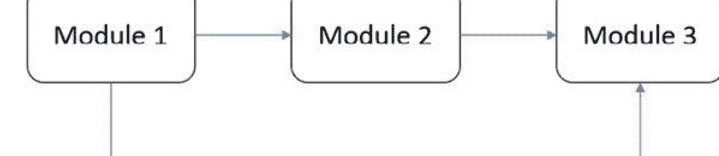

图 2.4：隐含可读性

在上述场景中，`module1` 依赖 `module2`，`module2` 依赖 `module3`，且 `module1` 也依赖 `module3`。

传统上，这种结构可以写成：

```
module1
{
requires module2;
}
module2
{
requires module3;
}
```

这种假设是如果 `module1` 可以使用 `module2` 服务，而 `module2` 反过来可以使用 `module3` 的服务，那么间接来说 `module1` 就可以使用 `module3`。

注意！！Java 模块系统的思考方式不同。除非显式配置如下依赖关系，否则 `module1` 无法读取 `module3`：

```
module1
{
  requires module2;
  requires module3;
}
```


虽然这在这个基础场景提供了解决方案，但在许多复杂的场景中，当我们想要自动生成此类依赖关系时，可能并不知道模块的内部依赖关系。坦率地说，Java 9 引入了 `transitive` 关键字。传递声明会创建关系依赖。即：如果 `module1` 需要 `module2`，而 `module2` 反过来需要 `module3`，在 `module2` 的配置中使用 `transitive` 关键字，`module3` 将在不显式声明的情况下与 `module1` 建立关系。

在我们的场景中可以配置如下：

```
module1
{
  requires module2;
}
module2
{
  requires transitive module3;
}
```

在上述配置中，`module3` 对 `module2` 和 `module1` 都可读。

## requires static

在某些情况下，API 开发者在一个模块创建对另一个模块的引用时编写代码。但 API 的用户从未意过在运行时使用这种关系。这种依赖被称为可选依赖，可以通过使用编译时仅依赖来创建。在这种情况下使用的指令是 `requires static`，可以如下所示编写：

```
module1
{
  requires static module2;
}
```

## exports

之前，我们已经看到指令如何建立一个模块与另一个模块之间的依赖关系。然而，仅有 `requires` 并不能让你使用来自另一个模块的组件。此外，你想要引用的模块必须允许其他模块使用其服务或组件。`exports` 指令指定了哪些组件（具体为包）及其公共类型是其他模块可以的。

以下代码片段将向你展示导出包到其他模块的模块声明：

```
module2
{
  exports package1.package2;
}
```

除了使用 `exports`，模块还可以通过使用 `exports...to...` 向特定模块授予权限。此类导出被称为限定导出（qualified exports）。

以下代码片段显示了将哪些包导出到特定模块：

```
module module3
{
  exports com.package1 to module1,module2
}
```

## uses

`requires` 指向模块，但模块还可以使用 `uses` 关键字使用其他类的服务。在这里，模块被视为服务消费者。任何实现接口或扩展抽象类的类都称为服务对象。

## provides..with

通过 `provides` 关键字指定由当前模块提供的服务。因此，它使模块成为提供者。

现在，由于我们已经经历了模块的各个方面，现在是实现单个模块的时候了，我们将从非常基础的实现开始。对于 JPMS（Java 模块系统），我们首先需要在系统中下载 Java 9。

## 下载 Java 9

你可以在以下 URL 获取 Java 12 之前的版本存档：

```
https://jdk.java.net/archive/
```

| Windows | 64-bit |
| :--- | :--- |
| Mac | 64-bit |
| Linux | 64-bit |
| 9.0.4 | 64-bit |
| macOS | 64-bit |
| Linux | 64-bit |
| 9.0.1 | 64-bit |
| Linux | 64-bit |
| 9 GA | 64-bit |
| Linux | 64-bit |

## 编译模块

在开始编译模块之前，请确保你正在使用支持 Java 系统的 JSE 9.0 版本，可以使用以下命令检查：

```
java -version
```

你应该能看到该命令的如下输出：

命令提示符 (Command Prompt)

```
D:\jdk9to12\whats new in Java9\>java -version
openjdk version "9"
OpenJDK Runtime Environment (build 9+181)
OpenJDK 64-Bit Server VM (build 9+181, mixed mode)
```

### 2.8: Java 版本

在编译模块时，你需要向 Java 编译器提供以下指令：

- 你的模块的路径，即描述模块的目录。
- 你想要编译的 Java 文件的名称和路径。
- 你想要存储生成的类文件（`.class` 文件）的位置。

以下是编译模块的语法：

```
javac -d output
```

在我们的应用程序中，我们可以写下以下命令来编译我们已经创建的模块：

```
D:\chapter2-whats new in java9\code\first>javac -d output/com.bpb src/com.bpb/module-info.java
src/com.bpb/pack1/Main.java src/com.bpb/pack2/MyService.java
```

### 2.9: Java 版本

上述命令指定所有模块结构都可以存储在 `output` 目录中。如果该目录不存在，将会被创建。随后，它会定位 `module-info.java` 的路径，后面是所有我们想要编译的 Java 文件。

成功编译后，首先文件夹结构修改如下：

```
---output
\---com.bpb
  module-info.class
  \---com
    +--pack1
      Main.class
    +--pack2
      MyService.class
\---src
  \---com.bpb
    module-info.java
    +--pack1
      Main.java
    +--pack2
      MyService.java
```

图 2.10：修改后的文件夹结构

## 执行模块

你可以使用 Java 命令执行模块。与编译类似，我们需要向 `java` 命令提供额外信息，如：

- 编译后的模块所在的位置。
- 如果应用程序中存在多个模块，则主应用程序所在的模块。
- 包含 `main` 方法的类名。

在我们的应用程序中，我们可以写下以下命令来执行刚刚创建的模块：

```
命令提示符 (Command Prompt)
D:\chapter2-whats new in java9\code\first>java --module-path output -m com.bpb/com.pack1.Main
Hello World!
```

图 2.11：模块的执行

在上述命令中，`-m` 选项用于定义主模块，后面跟着斜杠和当前模块中主类的名称。

恭喜！！你刚刚创建并执行了你的第一个 Java 模块。

## 处理多个模块

现在，既然我们已经知道如何编写简单的模块、在模块描述符文件中配置它并通过 Java 业务逻辑连接它，让我们尝试处理不同模块之间的依赖关系。

在这个示例中，我们将在 `second` 文件夹下创建两个不同的模块 `com.result` 和 `com.student`。

按照以下步骤理解并实现多个模块及其依赖关系：

### 创建并编译模块 com.result

导航到你工作环境的 `src` 文件夹。在我的情况下，它是 `jdk9to12/whats new in java9/second`。

创建 `com.result` 文件夹代表你的第一个模块。

在模块模块中创建 `com` 文件夹。同时在 `com` 中再创建一个名为 `util` 的文件夹。

创建一个名为 `ResultUtil.java` 的 Java 文件，提供一个计算三门科目百分比的服务。以下代码代表该文件的内容：

```java
package com.util;

public class ResultUtil{
    public double getResult(double sub1,double sub2,double sub3) {
        double percentage=(sub1+sub2+sub3)/3;
        return percentage;
    }
}
```

回到模块的根目录（即 `com.result`），并创建 `module-info.java` 文件。

将以下代码添加到 `module-info.java`：

```java
module com.result {
    exports com.util;
}
```

上述代码表示当前模块可以导出 `com.util` 包。

一旦模块创建完成，让我们使用以下命令编译它：

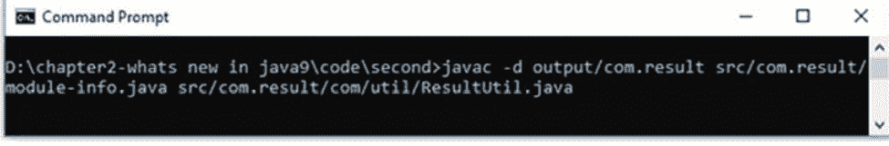

图 2.12：编译多个模块 (com.result)

上述命令编译了整个模块以及 `output` 文件夹中的类。

### 创建并编译 com.student

导航到你工作环境的 `src` 文件夹。在我的情况下，它是 `jdk9to12/whats new in java9/second`。

创建 `com.student` 文件夹代表你的第二个模块。

在该模块中创建 `com` 文件夹。同时在 `com` 中再创建一个名为 `student` 的文件夹。

创建一个名为 `StudentMain.java` 的 Java 文件，作为要执行的主应用程序。

```java
package com.student;

import com.util.ResultUtil;

public class StudentMain{
    public static void main(String[] args) {
        ResultUtil ru = new ResultUtil();
        double percentage=ru.getResult(65,23,65);
        System.out.println("Percentage= "+percentage);
    }
}
```

回到模块的根目录（即 `com.student`），并创建 `module-info.java` 文件。

将以下代码添加到 `module-info.java`：

```java
module com.student {
    requires com.result;
}
```

上述代码表示当前模块需要 `com.result`。

一旦模块创建，让我们使用以下命令编译它：

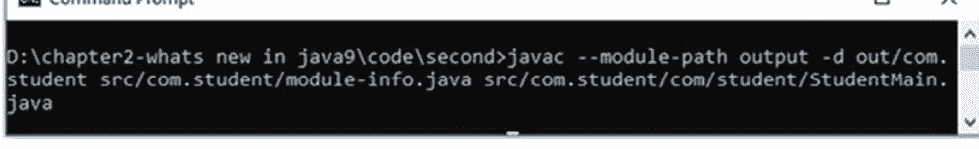

图 2.13：编译多个模块 (com.student)

现在我们已经编译了两个模块，让我们执行 `StudentMain.java` 来查看百分比：

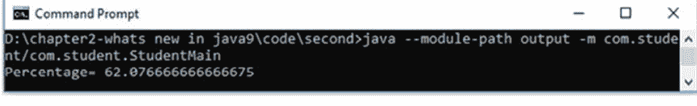

图 2.14：执行多个模块

在上面我们学习了如何在控制台编写、编译和执行。除了之外，还有一些 IDE 可以提供处理模块的功能，使任务变得简单。

## 使用 Eclipse

为了使用支持 Java 9 的 Eclipse，你可以从以下 URL 下载 Eclipse：

```
https://www.eclipse.org/downloads/
```

这是安装和更新 Eclipse 开发环境的最简单方法。

### 尝试 Eclipse-2019-03

| Eclipse IDE for Enterprise Developers | Windows 64 bit |
| --- | --- |
| 用于开发 Java 和 Web 应用程序的工具，包括最佳 Java IDE、Maven 等。 | Mac 64 bit |
| 针对 Eclipse 平台提交反馈 | Mac 64 bit |
| 针对 Maven 集成提交反馈 | Linux 64 bit |
| Eclipse IDE for Java Developers | Windows 64 bit |
| --- | --- |
| 任何 Java 开发者的必备工具，包括 Java IDE、Git 客户端、JDT、Maven 等。 | 64 bit |

图 2.15：下载 JSE 9 版 Eclipse

一旦你下载了 Eclipse 并配置了 Java 环境，就可以创建模块应用程序。

在 Eclipse 中创建模块的步骤如下：

创建一个 Java 项目，名称与模块名称相同，在我的情况下是 `com.result`：

+   - New Project

### 创建 Java 项目

在工作区或外部位置创建 Java 项目。

| 项目名称: com.result |
| 使用默认位置 |
| 位置: D:\Manager_Book_Workspace1\com.result |
| JRE |
| 使用执行环境 JRE: JavaSE-9 |
| 使用项目特定 JRE: jdk1.8.0.201 |
| 使用默认 JRE (当前为 'jdk1.8.0.201') |

图 2.16：创建 Java 项目

创建项目后，Eclipse 会要求你输入要创建的模块名称，命名为 `com.result`：

### 创建 module-info.java

创建一个 `module-info.java` 文件。

模块名称：com.result


创建 `com.util` 包，正如在控制台应用程序中讨论过的，并在相应的文件中编写代码。

项目结构看起来如下：

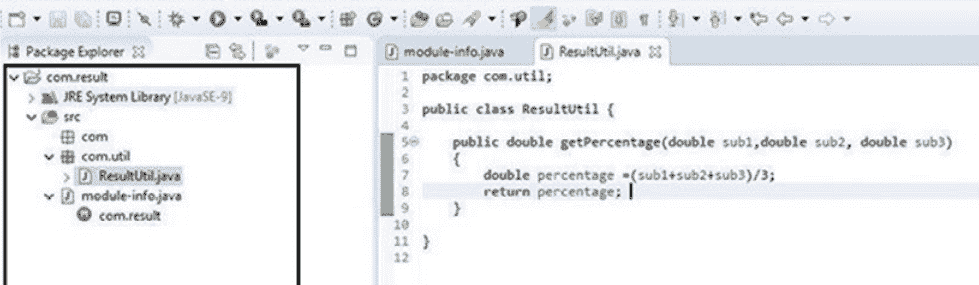

同样，你可以创建一个名为 `com.student` 的另一个应用程序。

惊讶的是，如果你在这个模块中配置 `module-info.java`，Eclipse 会生成编译错误，所示：

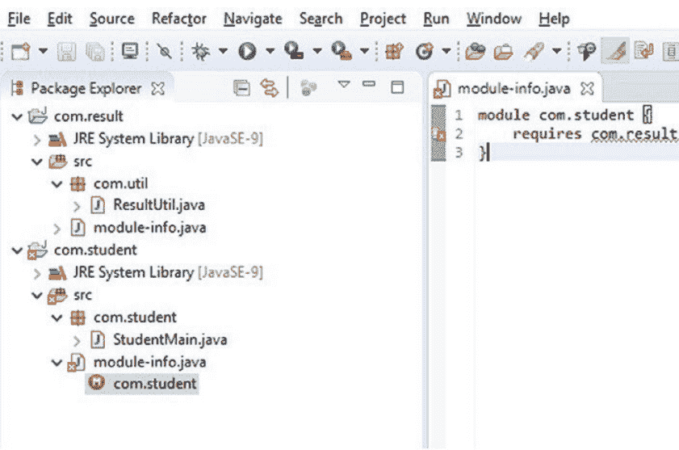

图 2.19: Eclipse 项目引用错误

要删除此引用错误，如下所示，将项目 `com.result` 添加到 `com.student` 的构建路径：

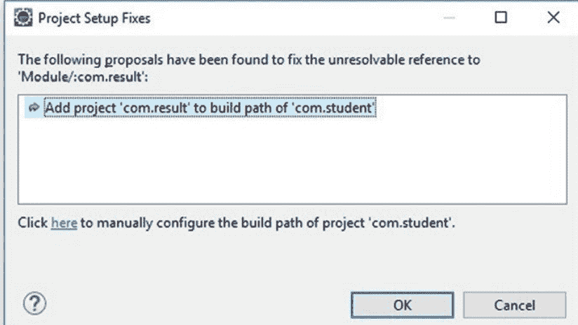

图 2.20: Eclipse 项目引用解决方案

如之前讨论的那样，创建该模块的代码和配置，并从该模块执行 `StudentMain.java` 文件。

## 使用 Apache NetBeans

为了配合支持 Java 9 模块的 Eclipse，你可以从以下 URL 下载 NetBeans：

```
https://netbeans.apache.org/download/nb90/
```

### Apache NetBeans 10.0

刚刚！

### Apache NetBeans (孵化中) 9.0 特性

Apache NetBeans 9.0 是 Apache NetBeans IDE 的第一个版本，它于 2018 年 7 月发布。[点击此处下载](https://netbeans.apache.org/download/nb90/) 此版本。

此版本的主要目标是清理 Oracle 代码捐赠的 IPC，以及支持 Java 9 和 Java 10。

- 支持本地变量类型推断
- 支持 Jigsaw 模块系统

图 2.21: Apache NetBeans 下载

一旦下载了 NetBeans，请按照步骤使用 NetBeans 创建模块化应用程序：

NetBeans 将为你提供一种名为 `Java Modular Project` 的项目类型。创建一个新的 `Java Modular Project`。

确保为选择的平台是 JDK9，这样项目才能支持模块化程序。

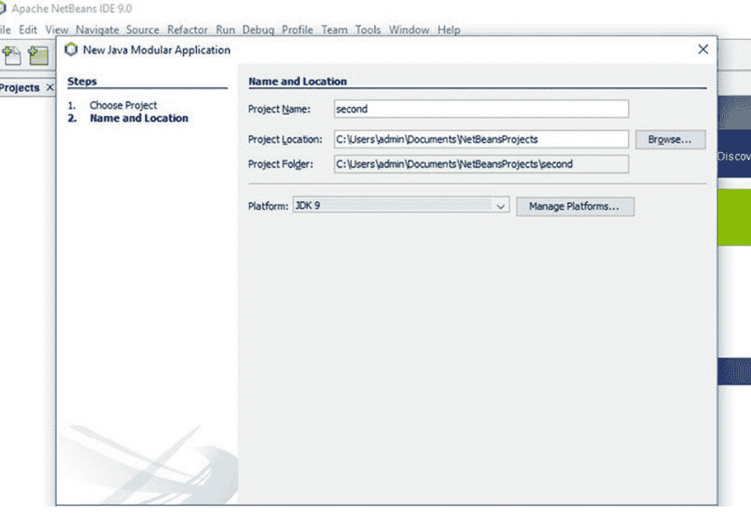

图 2.22: 在 NetBeans 中创建模块

右键点击项目并创建模块 `com.result`。

在 `com.result` 中，创建包 `com.java` 和子包 `.util`。

如之前讨论的那样配置 `module-info.java`。

在 `com.util` 包中添加 Java 类 `ResultUtil.java`，并如之前讨论的在文件中添加代码。

与 Eclipse 不同，在 NetBeans 中你不需要分离项目来创建另一个模块。右键点击同一个项目并创建第二个模块 `com.student`。

在 `com.student` 中创建包 `com.java` 和子包 `com.student`。

如之前讨论的那样为该模块配置 `module-info.java`。

在 `com.student` 包中添加 Java 类 `Student Main.java`，并如之前讨论的在文件中添加代码。

你应该会在 NetBeans 中看到项目的如下结构：

+ - second - Apache NetBeans IDE 9.0

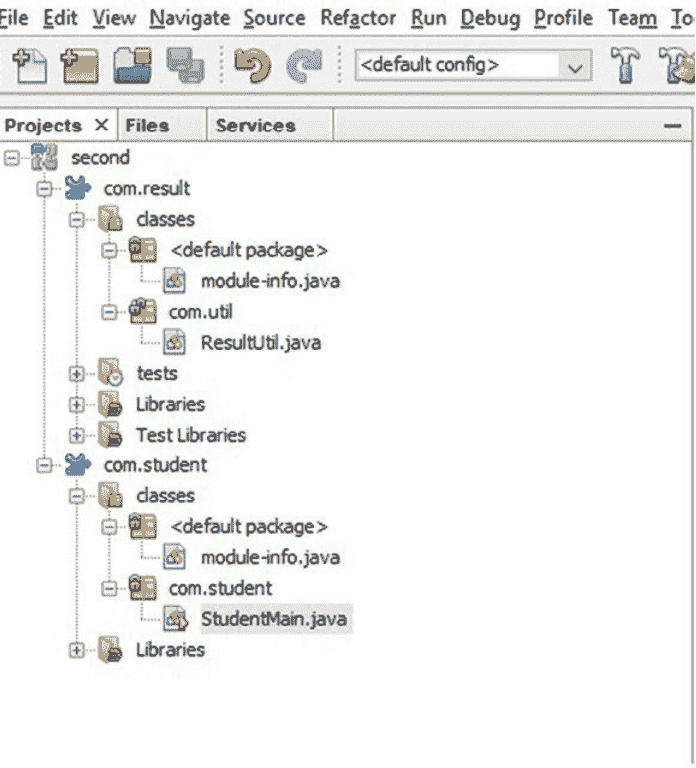

图 2.23: Apache NetBeans 项目结构

你已经创建了结构。现在执行程序，在选择启动 Java 类后，你将得到以下输出：

```
Output - second (run)
RUN
Percentage= 57.666666666666
BUILD SUCCESSFUL (total time: 0 seconds)
```

图 2.24: 模块输出

我们已经学习了如何在命令行、Eclipse 和 NetBeans 上编写、编译和执行 Java 模块。

现在，让我们讨论一下 JSE 9.0 中引入的其他新特性。

## JSE 9.0 中的 Java 增强提议 (JEP)

如前所述，在 JSE 9.0 发布之前已经讨论了许多提案。JDK 9.0 的完整 JEP 列表可以在 `openjdk.java.net/projects/jdk9/` 找到。其中，JEP 200 已经在本章中过讨论并实现。以下是该版本的重要提案。

### JEP 102: API 更新


该提案的动机是改进当前与操作系统通信的进程 API。在传统上，Java 支持可以与原生操作系统通信以启动进程的 API。从 JSE 7.0 开始，它通过文件、管道等帮助进行传输或重定向。此 API 提供了 `java.lang.Process` 和 `java.lang.ProcessHandle`，有助于改进工作进程。

`java.lang.ProcessHandle` 现在将提供特定于操作系统的进程 ID，以及参数、进程的实际启动时间以及累计的 CPU 时间。

### JEP 110：HTTP/2 客户端（孵化中）

引入此提案是为了提供实现 HTTP/2 和 WebSocket 的新 HTTP 客户端 API。旧的类 `HttpUrlConnection` 被认为对于现在不再运行的多种协议来说过于抽象。该类的某些行为没有被妥善记录。此外，观察到它被用作单线程模型。

所有这些因素都促成了该提案。该 API 的实现不被视为 JSE 的一部分。相反，将使用 `jdk.incubator` 命名空间来存储此 API。该 API 设计用于对不同事件提供通知，例如接收到的标头、错误、生成的响应等。

### JEP 158：统一日志

JVM 支持日志功能，为应用程序崩溃或性能相关问题提供根因分析。但这有点复杂，并且难以理解生产模式下间歇性崩溃的根源。

此提案的目标是引入一种适用于 JVM 所有组件的通用日志系统。日志中的消息可以使用不同的标签（如 `compiler`、`gc`、`classloaders` 等）进行分类。日志定义了 `error`、`warning`、`info`、`debug`、`trace`、`developer` 等不同级别。这提供了根据级别选择记录哪些消息的功能。

### JEP 213：Mining Project

项目已经在 JSE 7.0 中实现。此提案对现有项目提出了改进：

- 在私有实例方法上使用 `@SafeVarargs`：此注解应用于无法重写的方法。这可能包括静态方法和 final 方法。

- 在 `try-catch` 中允许将 final 变量作为资源：延续 JSE 7.0 的用法，现在对 `try-with-resources` 进行了修改。在 `try-with-resources` 中，只有可以声明并初始化 final 变量，它会被自动关闭。从 JSE 9.0 开始，可以使用 final 变量作为资源的一部分。

- 在匿名类中使用菱形操作符：钻石操作符以前只能用于分离的类，现在也可以用于匿名类。这最初并未被 JSE 9.0 要求接受。

- 在标识符中移除下划线（`_`）：`java.lang.ProcessHandle` 现在将提供特定于操作系统的进程 ID，以及参数、进程的实际启动时间和累计的 CPU 时间。

### JEP 110：HTTP/2 客户端（孵化中）

引入此提案是为了提供实现 HTTP/2 和 WebSocket 的新 HTTP 客户端 API。旧的类 `HttpUrlConnection` 被认为对于现在不再运行的多种协议来说过于抽象。该类的某些行为没有被妥善记录。此外，观察到它被用作单线程模型。

所有这些因素都促成了该提案。该 API 的实现不被视为 JSE 的一部分。相反，将使用 `jdk.incubator` 命名空间来存储此 API。该 API 设计用于对不同事件提供通知，例如接收到的标头、错误、生成的响应等。

### JEP 158：统一日志

JVM 支持日志功能，为应用程序崩溃或性能相关问题提供根因分析。但这有点复杂，并且难以理解生产模式下间歇性崩溃的根源。

此提案的目标是引入一种适用于 JVM 所有组件的通用日志系统。日志中的消息可以使用不同的标签（如 `compiler`、`gc`、`classloaders` 等）进行分类。日志定义了 `error`、`warning`、`info`、`debug`、`trace`、`developer` 等不同级别。这提供了根据级别选择记录哪些消息的功能。

指定空格分隔的模块列表。由于列表是根据模块依赖进行拓扑排序的，`java.base` 始终位于列表顶部。

## DEP 221：doclet API

Doclet 是一个与 Java Doc 通信并为 Java 程序生成文档的 API。现有的 Doclet API 仅提供了一个类，使用一些静态方法与非静态成员通信以共享数据。它还有自己一套不完善的 API。

新的 Doclet API 声明在 `jdk.doclet` 包中，并与 Javadoc 工具一起提供以支持新的 Doclet，而旧的 Doclet 被标记为已弃用。它将不再随 Java API 的更改而进行更新。

## DEP 222：JShell（读取-评估-打印循环）

学习现有语言的新版本是一项枯燥的工作。即使对于小小的 API 测试，开发者也需要构建应用程序来测试其工作情况。然而，从开发者的角度来看，API 的即时反馈是非常重要的。许多编程语言都拥有 REPL（读取-评估-打印循环），但对于许多版本的 Java 并没有实现此类功能。

读取-评估-打印循环（REPL）是一种交互式编程工具。开发者可以测试用户输入，可以评估并处理输入以生成输出。Scala、Ruby、JavaScript、Haskell、Clojure 和 Python 均拥有 REPL，并且它们都允许初始程序。JShell 为 Java 平台增加了 REPL 功能。

随着 JShell 进入贝塔阶段，Java 9 让学习者变得更简单了，因为他们现在可以享受“编辑-编译-执行”的循环，并将其与标准输出元素即 `System.out.println` 连接。现在，无需使用任何 `public static void main(String[]) args` 结构即可测试 API 的工作情况，然后在实际应用程序中使用它。

## DEP 238：多版本 JAR

随着开发从一个版本转移到另一个版本，复杂性也在增加。在许多场景下，单个 JAR 文件可能会引用不同的版本。在我们在使用与期望值通信的框架时，这个问题变得更加重要。在很多时候，更新 JDK 会给框架带来问题，因为它们没有在同一个文件中支持不同版本的功能。

JEP 238 提供了一种创建 JAR 文件的机制，允许多个版本特定版本的类存在于同一个文件中。

## DEP 248：使 G1 成为垃圾收集器

垃圾回收是 Java 中的一种自动过程。垃圾回收是为不再被应用程序使用的对象回收内存的过程。传统上，Java 有 4 种垃圾收集器：

- 串行垃圾收集器
- 并行垃圾收集器
- CMS 垃圾收集器
- G1 垃圾收集器

这些 GC 都有特定的优缺点。取决于程序员决定定义或选择哪一个，并相应向 JVM 传递指令。应用程序的性能主要取决于 GC 的选择。程序员的工作显然是理解所有的它们并在应用程序中明智地使用它们。

JEP 248 的主要目标是使 G1 成为默认垃圾收集器。目前的 GC 是并行垃圾收集器，这是一个耗时的垃圾收集器。G1 是一种低停顿收集器，会让应用程序运行更快。

## DEP 251：多分辨率图像

此提议提供了一个名为 `MultiResolutionImage` 的新接口，它是 `java.awt.image` 包的一部分。`MultiResolutionImage` 封装了一组具有不同高宽的图像，便于开发者根据需求查询图像。

以下是该 API 执行的基本操作：

- 获取图像所有方向的变体
- 根据所需的 DPI 指标和图像转换集生成或检索特定分辨率的图像

该 API 的其余所有工作将与 `java.awt.image` 之前的实现类似。

## JEP 254：紧凑字符串

正如我们所知，`String` 对象以字符数组的格式存储数据。字符数组格式每个字符使用两个字节。研究和观察显示，堆内存主要被 `String` 对象占据。许多 `String` 对象使用 latin-1 字符，这只需要一个字节的存储空间。因此，在堆中初始化数组时保留的内存仍然处于未使用的状态。

此提议将 `String` 的表示从 UTF-16 字符数组转换为带有编码标志字段的字节数组。这种新的 `String` 类现在可以根据 `String` 的内容将字符存储为 UTF-8859/Latin-1。`StringBuilder`、`AbstractStringBuilder` 和 `StringBuffer` 类将针对这种表示进行更新。

Java 9 的 `String` 类被修改如下：

```java
public final class String
implements java.io.Serializable, Comparable, CharSequence {
    /**
    * 用于字符存储。 */
    * @Stable
    private final byte[] value;
    /**
     * 用于对 (@code value) 中的字节进行编码的编码标识符。
     * 此实现中支持的值为
     * LATIN1
     * UTF16
     * @implNote 此字段被 VM 信任，如果 String 实例是常量，则会被
     * 常量折叠。在构造后覆盖该字段将导致问题。
     */
    private final byte coder;
}
```

注意，从 Java 9 开始，紧凑字符串被视为内存计算的隐式集合。如果你希望禁用紧凑字符串，可以在 Java 命令中使用 `-XX:-CompactStrings` 选项。这会将 Java 字符串视为 UTF-16 编码的内部表示。

## DEP 282：jlink，Java 链接器

在编译应用程序后，需要创建运行时。此过程始终引用模块。从 Java 9 开始，`jlink` 引入了链接器工具。

```bash
jlink --module-path --add-modules --limit-modules --output
```

其中：

- `--module-path` 是模块所在的路径。
- `--add-modules` 列出需要添加到运行时模块。
- `--limit-modules` 限制模块范围。
- `--output` 是存储结果的目录。

`jlink` 将支持的其他选项：

- `--help` 打印用法信息。
- `--version` 打印版本信息。

## DEP 289：弃用 App API

传统上，G1 和 CMS 都是设计为低停顿收集器的。但 CMS 并非为大内存设计的。在今天我们可以获得巨大内存的基础下，运行 CMS 会导致性能问题。

这次 GC 的更改将减少维护负担。这也有助于加速开发进程。此版本推荐 G1 垃圾收集器，作为大多数 CMS 用途的替代方案。

此 JEP 仅弃用 CMS，未指定移除 CMS 支持的版本。目前，这种弃用正在观察中，以确定 GC 相对于 CMS 的适用性。在此之前，用户可以迁移到 G1 收集器（`-XX:+UseG1GC`）。

以下类在该版本中被认为已弃用：

```text
java.applet.Stub
java.applet.Applet
java.applet.AudioClip
java.applet.AppContext
javax.swing.JApplet
```

## 结论

在本章中，我们讨论了 Java 编程的单体方法并不适用于大型应用程序。我们谈到了 Project Jigsaw，它通过模块（JPMS）在 Java 中引入了模块化编程的概念。我们实现了自己的收集器，并对模块的默认设置进行了自定义。最后，我们讨论了 JSE 9.0 中的其他 Java 增强提议，这些对于理解它们是重要的。

下一章将关注 JSE 10.0 的提议。

# 第三章：理解 JDK 10——向 JDK 11 迈进

## 引言

2017 年 9 月，当 Oracle 发布 JSE 9.0 时，整个软件行业对其引入的新概念感到欣喜和惊讶。由于其提出的不同更新，发布 JSE 9.0 版本花费了近 3 年的时间。这 3 年真的是

这对 Java 开发人员来说是一个大担忧，因为它的发布没有明确的时间表。JSE 9.0 引入了模块化概念，这使得它的发布是等待的。它改变了早期 Java 开发的整个单体式方法。

当任何版本发布时，开发者通常期望 API 或核心部分发生重大变化。他们期望引入许多新功能，以使他们的编程风格更加高效且可维护。在 Java 直到 J9.0 之前的所有版本中，发生或观察到的情况在几十年来一直遵循这种模式。当然，做出这样的 API 更改并非易事。需要进行测试，还需要通过 Java 社区进行改进，这是一个耗时的过程。这就是为什么 J9.0 在 JSE 8.0 之后花了近 3 年才发布的原因之一。发布的延迟总是会让开发者意识到其价值。从 JSE 9.0 开始，新版本的发布时间表发生了变化。Oracle 现在创建了一个发布计划，无论 API 是否发生变化都会发布版本。

Oracle 不再无限期等待，而是宣布了每六个月发布一个版本的政策。因此，意外的是，JDK 10.0 于 2018 年 3 月发布，紧随 JDK 9.0 之后 6 个月。尽管许多开发者喜欢 API 定期更新的概念，但也有人持不同意见。

对于那些期待获得 API 重大更新或从早期版本推出某些新概念的开发者来说，JSE 10.0 稍微有点令人失望。它的重大更新将改变与早期版本不同的编程方法，其中有一些开发者会欣赏的新功能。虽然这个版本没有像 JSE 9.0 那样改变整个 Java 编程方法结构的更改，但有一些重大变化使得这个版本在 Java 的历程中成为重要的一员。

## 结构

- 本地变量类型推断
- 将 JDK 森林合并到单个仓库
- 垃圾回收
- G1 的并行全 GC
- 类数据反序列化
- 线程本地握手（Thread-local handshakes）
- 移除生成器工具（`javaj`）
- 额外的 Unicode 语言标签扩展
- 在交替内存设备上的堆分配
- 实验性基于 Java 的 JIT 编译器
- 根证书
- 基于时间的版本控制
- 已移除的功能和选项
- 已弃用的功能和选项

## 目标

在第 2 章《Java 9 新特性》中，我们讨论了 JSE 9.0 的重要更新。在我们向目的地的过程中，我们将讨论下一个版本 JSE 10.0。本章将探索新特性或修改，例如本地变量类型推断、垃圾回收、基于时间的版本控制等。让我们开始旅程吧！同时，我们还将讨论从该版本中移除的旧功能以及移除它们。

## 下载 JDK 10

在继续之前，请下载 JDK 10。由于 Oracle 已经结束了该版本的支持，你可以从 <https://jdk.java.net/archive/> 下载它。

# 图 3.1：下载 JDK10

上面显示了 JDK 10 的下载选项，根据你的操作系统，你可以选择相应的安装程序并下载。

我们已经准备好探索 JSE 10 的功能了。让我们讨论此版本中推荐的各种提案。

### JEP 286：本地变量推断

声明变量通常被认为是一个重复代码的过程。每当开发者想要访问静态类型数据时，他必须引用该数据所属的类型。JEP 提议在声明变量的同时进行初始化时使用类型推断。

声明和初始化局部变量传统方法通常被认为是形式化的。

因此，不再像这样声明数据成员：

`int x = 10;`

我们现在可以这样声明并初始化变量：

`var x = 10;`

`x` 的数据类型被推断出来，并且被认为是 `int` 类型。

**注意！**

在考虑隐式转换时，请谨慎使用 `var` 关键字。

例如：

`double x=20;`

可以替换为：

`var x=40;`

这将把数据类型视为 `int` 而不是 `double`。因此，在此类情况下建议使用字面量，如下所示：

`var x=40D;`

上面的语句现在将 40 的数据类型考虑为 `double`。

考虑以下代码片段：

```java
ArrayList<String> myList=new ArrayList<>();
```

在这里，`ArrayList` 静态地声明其数据类型为 `String`。尽管人们可以观察到，当 `ArrayList` 使用 `new ArrayList()` 初始化时，JVM 可以识别其数据类型。这种形式化的代码可以被替换，使得开发者不需要每次都与初始化器一起编写数据类型。

```java
var myList=new ArrayList<>();
```

如果你观察上面的代码，声明中的数据类型现在被关键字 `var` 替换，编译器将通过初始化过程中传递的数据类型来识别数据类型。

嗯，如果我们写如下内容，工作方式就不一样了：

```java
var myList=new ArrayList<Object>();
```

有什么区别？你猜对了！！初始化没有为数组提供任何类型，因此数据类型将（推断为 object 而不是 string。

然而，我们不能在声明数据的所有位置或场景下使用 `var` 关键字。

目前，该关键字只能用于：

- 带有初始化的局部声明变量
- 在增强 `for` 循环中声明的索引
- 在传统的 `for` 循环中声明的局部变量

你不能在以下位置使用此关键字：

- 方法的形式参数
- 构造函数的形式参数
- 方法的返回值
- `catch` 块中的参数

当然，在这个功能出现之前，开发者脑海中有很多困惑。在许多情况下，如类型转换、集合、迭代器等，`var` 声明具有首要性。

## 编译时安全

让我们理解所有概念是如何与这个新功能工作的。`x` 的数据类型根据传递给它的数据而改变。那么，它在 Java 中可行吗？考虑以下代码片段：

```java
{
    var x=20;
    x="string";
}
```

如果你从 `main` 调用上面的方法，你将得到如下所示：

`593293c1d679476b235da6f9ab47ba_48_0`

图 3.2：编译安全

在上面的示例中，`x` 的值从 20 变成了 `string`。如果你编译上面的代码，由于兼容性问题，编译失败。

## 多态

多态引用的工作方式与早期版本相似。

假设 `Employee` 是 `SalesPerson` 的超类，那么我们可以这样引用 `SalesPerson`：

```java
void showEmployee()
{
    var e1=new Employee();
    var e2=new SalesPerson();
    e1=e2;
    e2=e1;
}
```

如果我们从 `main` 调用此方法并编译它，你将得到以下结果：


593293c1d679476b235da6f9ab47ba_49_0

图 3.3：多态

在这里，引用`e1`可以指向`SalesPerson()`，因为它是`Employee`的子类；但`e2`不能引用`e1`，因为它不符合多态规则。这与 Java 的早期版本工作类似！！

## 处理集合与数组

使用推断变量声明可以为处理数组和集合提供灵活性。考虑以下示例：

```
void arrayDemo()
{
    var data=Arrays.asList(10,20); // 语句 1
    int x=data.get(1); // 语句 2
}
```

在上面的代码中，语句1声明了整数类型的列表，尽管我们没有为它声明任何数据类型。编译器根据传递它的值生成数据类型。`Arrays.asList()`生成此数据类型为整数列表。

上面代码中的语句 2 从列表中获取数据，默认将是整数类型，尽管我们没有显式声明列表的数据类型。

考虑第二种情况：

我们有：

```
Employee e1=new Employee();
Employee e2=new Employee();
```

`Listemp=List.of(e1,e2);`

我们现在可以通过此推断：

`var emp=List.of(e1,e2);`

## 使用传统循环

我们也可以在传统循环中使用`var`关键字，如下所示：

```
void forDemo()
{
for(var x=1;x<=10;x++) { //statement 1
System.out.println(x);
}
}
```

在上述代码中，statement1 等于：

```
for(int x=1;x<=10;x++)
```

## 使用 each 循环

与传统循环类似，我们也可以在 foreach 循环中使用`var`关键字。考虑以下代码段：

```
void foreachDemo()
{
var myArray=new int[10,20,30,40];
for(var data: myArray) {
System.out.println(data);
}
}
```

## 使用 Java 流

Java 流以非常简单的方式使用了`var`关键字。

考虑以下传统的流处理方法：

```
//创建一个整数流
Stream data=Stream.of(12,43,12,54);
```

上述语句用`var`关键字替换如下：

`var data=Stream.of(12,43,12,54);`

## 使用匿名类

`var`关键字可以在匿名类中以非常简单的方式工作，如下：

```
//接口声明
public interface MyInterface {
public void getData();
}
```

```
//实现
var myref=new MyInterface() {

    @Override
    public void getData()
    {
        //业务逻辑实现
    }
};
```

## 使用 try-with-resources

虽然在 catch 块中无法使用`var`关键字，但可以在 try-with-resources中使用，如下：

```
try(var myfile=new FileWriter("a.txt"))
{
//写入文件的代码
}
```

## JEP 296: 将 JDK 森林合并到单一仓库

众所周知，JDK 的 API 包含许多组件，这些组件由不同的接口、类等组成。这些接口和类作为一个项目的一部分在一起，被称为仓库（repository）。该仓库包含了所有类的源代码文件及其更新历史。JDK 使用 Mercurial 工具来创建仓库。

Mercurial 是一种用于软件开发者的分布式版本控制工具。该工具主要设计用于软件的协作开发，可能包括纯文本文件以及二进制文件。它支持几乎所有的操作系统，如 Windows、Unix、macOS 等。很多时候，软件需要更新代码或软件版本。Mercurial 让这些步骤变得简单，使得系统迁移或子版本管理变得更容易。使用此工具，整个项目可以存储在单一仓库中，或者有时项目可能会选择多个相关的仓库，这些仓库可能包含整个 JDK。

创建仓库以及在其中添加、修改组件是由贡献者完成的。贡献者创建仓库并在修改的同时进行克隆（clone）。

下图显示了操作仓库和克隆的实际过程：

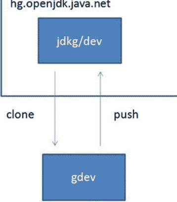

图 3.4：JDK 森林

JDK 使用特定的命名风格识别仓库。语法如下：

`/`

在这里，`project`表示 OpenJDK 项目的短名称，`component_path`是存放代码库或组件的仓库路径。项目组件通常由主项目定义。

来自 OpenJDK 的 JDK 项目被分为 8 个不同的仓库，如下：

- `root`

- `corba`

- `hotspot`

- `jaxp`

- `jaxws`

- `jdk`

- `langtools`

- `nashorn`

这种多个仓库创建了更好的组件结构，并对一个组或仓库正在执行的任务产生清晰的理解。但除了结构上的优势外，它在某些方面存在缺陷。很多时候，不同的仓库之间可能相互关联，它们之间的变更集（changesets）可能是相互依赖的。在这种情况下，无法在多个仓库中进行原子提交。

这在贡献者之间造成了许多困扰，因为跨越不同仓库的单次 bug 修复需要单独处理和提交。

为了解决这个问题，Oracle 启动了一个合并森林（consolidated forest）原型，这是将多个仓库森林转换为单一单元的开始。该原型包含了之前讨论的八个仓库，将使用 Python 脚本转换为单一单元。

原型可用地址：

`http://openjdk.java.net/jdk/jdk10/consol-proto/`

以下三个脚本对该原型有重大影响：

该原型将传统的多个森林结构转换为单一的合并森林。所有的 Java 模块都位于单一的顶层目录`src`下。

现有的 JDK 结构包含基于模块的目录，看起来如下：

```
$ROOT/src/java.base
```

```
$ROOT/langtools/src/java.compiler
```

...

合并森林的结果是将该结构修改为：

```
$ROOT/src/java.base
```

```
$ROOT/src/java.compiler
```

...

你可以看到，整个 Java 仓库现在被放在`src`目录下，这是一个单一或组合的森林结构。

与此同时，测试目录的结构也被修改了。传统的测试目录结构为：

`$ROOT/jdk/First.java`

`$ROOT/langtools/Second.java`

## JEP 304: 垃圾回收接口

垃圾回收（GC）是 Java 的重要组件之一。应用程序的性能取决于它的工作方式。Java 在不断开发不同的算法。这些算法存在不同的版本，如 G1 等。目前，这些实现存储在相应的目录中。GC 的标准位置是`hotspot/share/$NAME`。G1 的实现存储在`hotspot/share/g1`，CMS 的实现存储在`hotspot/share/cms`。通过这种实现为运行时、解释器、C2 提供了灵活性。

,这些屏障在源码中可用.,. 不同实现的缺点：

通常情况下，当提议一个新的 GC 实现时，该实现需要对所有这些服务的知识。此外，还需要理解如何扩展和自定义它们。

为了克服这个问题，启动了一个 GC 接口，它比现有的更简单。这使得在构建时可以实现对象。

提议的 GC 接口应该遵循标准的 API 流程，这将为启动 GC 实现提供统一性。新的 GC 接口需要由现有的类`CollectedHeap`定义。该类负责 GC 与 HotSpot 之间的交互。

垃圾回收实现必须提供：

代表堆的主类，它必须是`CollectedHeap`的子类。

在单处实现屏障，它是`BarrierSet`的子类。该类应该实现运行时所需的屏障。

实现`CollectorPolicy`的类。

通过实现`GCInterpreterSupport`实现解释器的 屏障。

通过实现`GC1Support`实现 C1 编译器的 屏障。

通过实现`GC2Support`实现 C2 编译器的屏障。

定义并初始化 GC 特有的参数。

使用`MemoryService`设置内存池和成员管理器组件。

所有这些实现都可以被任何 GC 算法有效使用。

## JEP 307: G1 的并行 GC

正如所讨论，Java 有不同类型的 GC 可用。这些 GC 在如何利用内存以提高应用程序性能方面有不同的实现。Java 在各个版本中都有默认垃圾回收器的设置。JDK7.0 和 8.0 使用并行 GC 作为默认垃圾回收实现，JES9.0 和 JES10.0 使用 G1 作为默认垃圾回收实现。

如果你想检查当前 jdk 的 GC 实现，可以使用以下命令：

```
java -XX:+PrintCommandFlags -version
```

如果你执行命令 JES9.0，你将得到如图所示的：

```
$ C:\Java>java -XX:+PrintCommandLineFlags -version
-XX:+GCConcRefinementThreads=8 -XX:InitialHeapSize=131832576 -XX:MaxHeapSize=210932216 -XX:+PrintCommandLineDlineFlags -XX:ReservedCodeCache=25165840 -XX:SegmentedCodeCache -XX:+UseCompressedClassPointers -XX:+UseCompressedOops -XX:+UseG1 -XX:+UseLargePagesIndividualAllocation
openjdk version "9.0.1"
OpenJDK 64-Bit Server VM (build 9+181, mixed mode)
```

图 3.5：Java GC 标志

当然，将 GC 设置为 G1 有一些优势：

- 它是并发工作的。

- 它在连续内存空间方面表现不佳，受限于可用堆内存。与早期的将堆划分为 Eden、survivor 和 Old 空间的实现不同，G1 将堆划分为许多小的区域（regions）。这些区域甚至可以多达数百个！

然而，G1 仍然需要使用这种技术处理整个堆。但区别在于 G1 不需要一次性处理整个内存。相反，它可以选择可以收集的不同区域。这极地减少了在给定时间内需要完成的工作量。G1 的缺点是它处理小堆时性能不佳。此外，G1 目前用于全 GC（full GC）的实现使用了线程标记-清除-压缩（mark-sweep-compact）算法。这意味着服务器将暂停，直到垃圾回收通过运行线程完成任务。在 JEP110.0 中，你可以调整设置以同步执行此类过程。换句话之，这意味着全 GC 可以由多个线程并发执行。

## JEP 310：应用程序类共享

类共享（Class Data Sharing, CDS）并不是 Java 的新概念。它在2004 年的 JDK 1.5 中引入。最初在发布时，它仅用于客户端 VM 并考虑串行垃圾收集。此外，它只支持系统类。从 SE 9.0 开始，CDS 开始支持服务器 VM、G1 垃圾收集器、串口并行 OldCs 和共享字符串。在这个版本中，商业版本引入了对应用程序类的支持。该 JEP 允许在 JDK 中使用应用程序类。

该 JEP 的主要目标是改进现有的 CDS，使其允许应用程序类放置在共享归档中。

你可以通过以下命令创建想要存储在归档中的所有类列表：

```
java -XX:DumpLoadedClassesList
```

你可以使用以下选项创建归档：

```
-Xshare-dump
```

以下快照显示了命令的输出：

### 命令行提示

```
D:\chapter-3>Understanding JDK 10 - Step towards JDK 11\java -Xshare:dump
harm.00000000000000000,class.class.shift=1
Allocated temporary space: 103741824 bytes at 0000000000000000
Allocated temporary space: 21325472 bytes at 0000000000000000
Loading classes to share:
Loading classes to share:
Rewriting and linking classes: done
Rewriting and linking classes: done
Number of classes: 1227
Obj array classes: 52
type array classes: 8
Updating ConstMethods ... done.
Removing unreachable information ... done.
Scanning all metaspace objects ...
Allocating RO objects
Allocating RO objects
Relocating embedded pointers ...
Relocating external references ...
Dumping symbol table ...
Relocating dictionary: well_known_classes[]
Removing Mirror ... done.
```

图 3.6：使用 dump 显示了使用 CDS 生成的存档。

通过上述类数据共享，你可以使用以下命令：

```
java -Xshare:on -Xlog:class+load Sample
```

`Sample.java`是一个显示消息的简单 Java 文件。你可以编写带有`main()`函数的自己的代码来检查输出。

```java
public class Sample{

    public static void display() {
        System.out.println("In display");
    }

    public static void main(String[] args) {
        display();
    }
}
```

执行上述命令后会生成上述输出：

### 命令行提示

```
D:\chapter-3>Understanding JDK 10 - Step towards JDK 11\java -Xshare:on
Xlog:class+load Sample
[0.015s]Info[class][load] opened: jdk-10.0.2/lib/modules
[0.031s]Info[class][load] opened shared objects file
[0.034s]Info[class][load] java.lang.Serializable source: shared objects file
[0.034s]Info[class][load] java.lang.Comparable source: shared objects file
[0.035s]Info[class][load] java.lang.CharSequence source: shared objects file
[0.036s]Info[class][load] java.lang.String source: shared objects file
```

图 3.7：使用数据共享（部分一）

通过上述类数据共享，你可以使用以下命令：

```
D:\chapter-3>Understanding JDK 10 - Step towards JDK 11\java -Xshare:on
```

执行上述命令后会生成上述输出：

图 3.8：使用数据共享（部分二）

`getTimeInstance()`

`getDateInstance()`

`getDateInstance`将自动返回`DateFormatSymbol`的对象。

`java.text.DateFormat`:

这是一个抽象类，用于为其子类提供格式化的抽象方法。子类反过来可以以独立于语言的格式格式化日期或时间。其中一个子类是`SimpleDateFormat`。`SimpleDateFormat`可以对数据进行格式化、解析和标准化。

如果你使用此类，可以在任何区域（locale）下工作。使用此类编写的代码独立于月份、日期甚至日历格式的区域约定。

`java.text.NumberFormat`:

这是另一个为了处理所有数字格式而创建的抽象类。该类专门用于数字的格式化和解析。与上面讨论的`DateFormat`类类似，它可以用于任何区域的数字进行格式化和解析。你可以编写独立于小数点、千分位分隔符等区域约定的代码。

`java.time.format.DateTimeFormatter`:

时间的使用和解析具有复杂性，因为此类数据的格式会随场景的不同而发生变化。该类被认为是打印和解析日期的入口。

该类通过使用以下方式促进了数据的格式化：

- 预定义的常量，例如`uuu:Mmm:dd`

- 模式字母，例如`uuu:long`或`medium`

- 从 JSE10.0 开始，该类引入了方法`localizedBy(Locale)`作为：

```
public DateTimeFormatter.localizedBy(Locale locale)
```

此方法返回一个包含区域、日历、地区数据的格式器，这在以前是不可用的。这对查找与区域相关的信息关重要。

`java.time.format.DateTimeFormatterBuilder`:

该类是创建`DateTimeFormatter`的工厂。所有的格式器都必须使用`DateTimeFormatterBuilder`类引用创建。

可以添加以下元素来自定义日期时间的输出：

- `value`

- `Fraction`

- `Text`

- `OffsetTd`

- `ZoneId`

此外，我们还可以利用`padded`，它通常用于去除空格。


```java
java.time.temporal.WeekFields;
```

该类包含星期几、每月和每年周的本地化定义。通常，一周被认为是七天。但在某些特定模式下，可以对其进行自定义。

该类提供了以下五个方法：

```java
dayOfWeek()

weekOfMonth()

weekOfYear()

weekOfWeekBasedYear()

weekBasedYear()
```

如所述，该类为我们提供了定义自定义周的功能。此周由两个参数定义：

- 每周的第一天（根据 ISO-8601，周一被认为是一周的第一天）。
- 第一周包含的天数（根据 ISO-8601，这些天至少应该是 4 天）。

```java
java.util.Calendar;
```

该类包含针对星期几、每月和每年周的本地化扩展。通常，一周被认为是七天。但在某些特定模式下，可以对其进行自定义。

```java
java.util.Locale;
```

引入该类的目的是表示特定的地理区域。应用程序通常需要显示需要被特定区域识别的数据格式。不同地区在星期几、每月或每年周方面可能有不同的值或格式。该类可以生成此类信息的本地化内容。

该类中存在以下字段：

```text
script

country

language

variant

extensions
```

```java
java.util.spi.LocalNameProvider;
```

这是来自 JDK 1.6 的抽象类，为服务提供者提供 `Local` 类的本地化名称。

在 JSE10.0 中，该类增加了方法 `getDisplayUnicodeExtensionKey()`：

```java
public String getDisplayUnicodeExtensionKey(String key,
Locale locale)
```

此方法返回扩展键和区域的名称，该名称可以显示给用户。如果名称与本地建议不匹配或未本地化，则该方法返回 `null`。

## JEP 316：在交替内存设备上的堆分配

从开始，Java 对存储在内存中的对象有一种标准方法。传统上，应用程序中创建任何内容都存储在堆中。应用程序的性能通常取决于堆内存如何与对象存储工作。为了提高应用程序的性能，Java 不断对垃圾回收器进行升级或修改，它用于释放堆中对象占用的内存。

但随着应用程序规模的增大，堆内存甚至无法临时存储对象。此 JEP 提议使用替代内存设备作为堆对象的存储地。NV-DIMM 可用于此目的。

NV-DIMM 代表非易失性内存模块（Non-Volatile In-line Memory Module）。此类设备使用随机访问内存（RAM）进行数据存储。这些设备的主要优势是如果发生断电或系统崩溃，它可以恢复数据。NV-DIMM 设备使用易失性内存存储数据，在发生断电的情况下，它们会将数据推送到非易失性内存中。

Java 可以在以下场景利用设备：

- 当应用程序在具有不同服务的不同 JVM 上运行时，某些服务的优先级较低，可以由 NV-DIMM 推送，以便高优先级的服务使用辅助存储设备快速访问它们。
- 大数据等应用程序需要更高的内存进行对象存储。与其使用传统的堆，我们可以使用 NV-DIMM 设备。
- 像 Windows Server 这样的操作系统已经在文件格式中实现了 NV-DIMM。

使用以下选项来启用：

```text
XX:AllocateHeap=+
```

请注意，此 JEP 不建议共享并行运行的对象。

## JEP 317：实验性基于 Java 的编译器

现在，JVM 使用内部 JIT 编译器来生成原生文件。此 JEP 提议启用其他 JIT。目前，建议在 Linux/x64 平台上使用 Graal。尽管如此，JIT 的主要任务不是提高 JIT 的性能。GraalVM 是 Java 虚拟机，它可以让应用程序更快。这是通过创建提前编译（ahead-of-time）原生镜像实现的。OpenJDK Graal 在内部执行得更快。在处理 Scala、Python 和 Ruby 等基于 Java 的语言时，GraalVM 使用编译器生成的字节码来构建代码。

JSE9 引入了 JVM 编译器接口（JVMCI），暴露了以下机制：

- 字节码优化以生成包含元数据的代码，可以被 JVM 利用。
- 用于编译的 JVM 系统处理 JVM 请求。这用于为编译的方法生成机器码。

使用以下命令启用替代：

```bash
-XX+UnlockExperimentalVMOptions -XX+UseJVMCICompiler
```

## JEP 319：根证书

套接字编程或分布式架构是 Java 的主要优势之一。它便于通过网络与其他应用程序进行通信。但需要获得 Java 安全管理器的许可。安全证书将为应用程序提供这些权限。`cacerts` 文件是 JDK 的组成部分，提供了在不同协议提供信任连接的根证书。如“VerSign”之类的证书颁发机构会被此引用。我们可以使用命令行工具 `keytool` 来编辑此文件。

但 JDK 中包含证书的密钥库（keystore）目前没有任何条目。结果是 TLS 等重要组件无法在 OpenJDK 中运行。

要与 TLS 工作，需要用相应的根证书集配置密钥库。这可以通过设置来实现：

```properties
jdk.tls.allowMasterSecret=false
```

这将使得应用程序在不支持会话哈希（session hash）和扩展主密钥（extended master secret）时拒绝连接。

此 JEP 首次在 OpenJDK 中引入了根证书集。这将使 OpenJDK 能够有效地保护应用程序，并消除其构建版本与 Oracle JDK 构建之间的差异。

我们可以通过以下步骤查看新 `cacert` 内容的核心内容。

在检查条目之前，我们需要检查 Java 的版本，因为列表操作仅适用于版本 10。

```bash
>jdk-10/bin/java --version
```

```text
openjdk 2018-03-20

OpenJDK Runtime Environment 18.3 (build 10+46)

OpenJDK 64-Bit Server VM 18.3 (build 10+46, mixed mode)
```

`bin` 文件夹中提供了密钥库工具（`keytool`）用以列出内容：

```bash
>jdk-10/bin/keytool -list -keystore /cacerts
```

```text
Enter keystore password: changetext

80
```

密钥库的默认密码已更改。80 表示可用的条目数量。以下是该命令的示例输出：

```text
thawtepersonalfreemaila, Feb 12, 1999, trustedCertEntry,

Certificate fingerprint (MD5): E1:74:C3:B8:3C:0C:35:C5:3E:C2:F7:EF:F3:CC:3A:D9

thawtepersonalabissca, Feb 12, 1999, trustedCertEntry,

Certificate fingerprint (MD5): E6:0B:D2:C9:CA:2D:88:DB:A1:71:0E:B4:EB:02:41

baltimoreodesignsigning, May 10, 2002, trustedCertEntry,

Certificate fingerprint (MD5): 90:F5:28:49:56:D1:52:C0:B53:D4:B8:EF:F6:90:22

verisignclass3ca, Jun 29, 1998, trustedCertEntry,

Certificate fingerprint (MD5): 78:A2:0F:DB:B2:E14:D5:A7:F5:0FA:DB:B6:E9:5C

gcteytrustglobalca, May 10, 2002, trustedCertEntry,

Certificate fingerprint (MD5): CA:33:D0:D8:F1:03:C5:D0:32:FA:B8:29:E8:A5:DB

thawtepersonalpremiumca, Feb 12, 1999, trustedCertEntry,

Certificate fingerprint (MD5): 3A:BC:D2:EE:2A:90:23:49:F9:ED:C8:D2:BA8:E7:68:00

thawteserver, Feb 12, 1999, trustedCertEntry,

Certificate fingerprint (MD5): 55:C7:0C:A2:E5:53:78:0C:10:53:81:64:CB:0D:1

verisignclass4ca, Jun 29, 1998, trustedCertEntry,
```

## JEP 322：基于时间的发布

JEP 223 将定义主版本（major）、次版本（minor）和安全更新（security update），并应用于版本字符串。这被认为是相比上一个 JDK 版本的重大改进之一。该方案适用于计划周期较长的发布，但不适用于 Oracle 规划的六个月发布模型。也就是说，该方案依赖于早期版本观察到的差异，而 JEP 322 提议以符合版本逻辑的方式更改版本号，使其与版本保持一致，同时也更新版本字符串中的发布信息。这将确保开发者能够提前预测发布版本。VNUM 是一个由点分隔的元素序列，这整个字符串被称为版本号。该字符串的前四个元素表示非零整数。以下是所有元素的详细信息：

```text
$FEATURE.$INTERIM.$UPDATE.$PATCH
```

例如，如果我们将版本字符串考虑为 `10.0.2.1`，那么 `$FEATURE` 是 10，`$INTERIM` 是 0，`$UPDATE` 是 2，`$PATCH` 是 1。

注意，版本号可以以零开头，因为如果它是零，则后续元素将被省略。在六个月发布模型下，版本字符串的考量因素如下：

- `$FEATURE` 是主版本，每六个月增加一次。
- `$INTERIM` 在六个月发布模型中不被正式考量。
- `$UPDATE` 是持续更新的指示。

## API

`Runtime` 类的 API 文档实现了以下更改，为版本中 `int` 类型的元素实现了访问方法。这些访问方法返回 `feature()`、`interim()` 和 `patch()` 的 `int` 值。

重新实现现有的访问器方法，分别代表 `major()`、`minor()` 和 `security()` 返回与 `feature()`、`interim()` 和 `update()` 相同的值。这将为开发者提供向后兼容。

对现有的访问器方法弃用而非删除。这将引导开发者使用新方法。

## System properties

在系统属性中，增加了以下两个属性：

`java.version.date`：

这表示其广泛可用（generally available）时的发布日期。采用 ISO8601 格式 `YYYY-MM-DD`。

`java.version`：

这表示由开发者定义的版本字符串。

## Removed features and options

除了编译器的结构更改外，还有其他特性从该版本中移除。在 JDK10.0 中，由于缺少这些特性，应用程序可能会出现问题。

### Removal of support using LookLookAndFeel

在 JDK10.0 中，停止使用 LookLookAndFeel 来初始化应用程序。

### Removal of Runtime.getLocalizedOutputStream

`Runtime.getLocalizedOutputStream` 用于生成输出流。从 JDK1.1 开始，字节流已转换为字符流。同样，`Runtime.getLocalizedInputStream` 用于生成输入流已被 `InputStreamReader` 和 `BufferedReader` 替换。`getLocalizedOutputStream()` 生成输出流已被 `BufferedWriter` 和 `PrintWriter` 替换。这些方法在早期版本就被弃用了。考虑到这些方法的使用非常有限，两者都已从版本中移除。

### Removal of RIM Server- Support Support

Java 禁用了 RIM 复用协议，两个端点可以打开多个连接。在 JSE10.0 中，该支持已被完全移除。

### Removal of Common DOM APIs

在之前的 JSE1.0，Java 与包含 JavaFX Applet 的页面通信使用了 `com.sun.java.browser.plugin.DOM` 和 `sun.plugin.DOMObject` 来读取文档结构。但随后它们被弃用了。这两个组件现在已被操作 DOM 的 `bytescape.javascriptObject` 替换。

### Removal of FlatProfile

FlatProfile 用于计算执行不同程序段时的性能。通过 `-Xprof` VM 参数启用。在 JSE9.0 中，它被弃用了。从该版本开始，该功能已被移除，导致 JVM 无法识别 `-Xprof`。

### Removal of -Xoptions

Java 提供了许多选项。这些选项提供给 JVM，可以影响 Java HotSpot VM 的性能特性。例如 `-Xss`（Java 栈大小）、`-optimize`（使用 JIT 编译器）、`-Xbounds`（边界用户级）。此类选项在 JSE9.0 中均已废弃，现在已被移除。

### Removal of HostServicesgetServletContext method

该方法用于与包含 JavaFX Applet 的页面通信。它在 JSE9.0 中被废弃。尽管已废弃，但 JDK 尚未引入任何该功能的替代方案。该方法现在已被完全移除。

### Removal of deprecated Pre-1.2 SecurityManagers and fields

以下标记为 `forRemoval=true` 的预 1.2 弃用 `java.lang.SecurityManager` 方法和字段已被移除：

```text
inCheck method
```

```text
getClassCheck method
```

```text
classDepth method
```

```text
classLoaderDepth method
```

```text
currentClassLoader method
```

```text
inClass method
```

```text
inClassLoader method
```

所有字段和方法现在都被 `checkPermission` 替换。此外，`checkmemberAccess` 方法已更改，如果调用者没有所有所需的权限，它现在将抛出 `SecurityException`。

以下类已被移除：

- `com.sun.security.auth.PolicyFile`
- `com.sun.security.auth.SolarisNumericGroupPrincipal`
- `com.sun.security.auth.SolarisNumericUserPrincipal`
- `com.sun.security.auth.SolarisPrincipal`
- `com.sun.security.auth.X500Principal`
- `com.sun.security.auth.module.SolarisLoginModule`
- `com.sun.security.auth.module.SolarisSystem`

### 移除旧版（JDK6、JDK7 和 JDK8 时代）标准 Doclet

JDK6、JDK7 和 JDK8 的早期 doclet 实现正被考虑替换。现有的 doclet 以 HTML 格式输出，该格式在之前的版本中已弃用。它已在 J10.0 中被移除。

### 移除 Java 启动器数据模型选项 `-d32` `-d64`

Java 允许你根据操作系统设置选择启动器类型。以前存在如 `-d32`、`-d64`、`-jdk32`、`-jdk64` 等选项。随着 Java 启动时操作系统的增强，所有选项均已弃用。在此版本中，这些选项已被完全移除。

## 弃用的特性和选项

除了 Java 的特性外，此版本还包含一些特性和选项，如下所示。

由于 API 发生变化，应用需求不断增加，Java API 中定义的服务也需要不断修改。因此，许多方法需要被新方法取代，而导致早期方法被弃用。对于此类弃用方法，JBM 将生成警告方法。

此外，Java 文档添加了以下标记，以指示开发者使用的当前状态。

以下服务在此版本中已弃用并将在移除：

- SNMP 监控支持
- `java.security(Certificate,identity,IdentityScope,Signer)` API
- `java.security.acl` APIs
- `javax.security.auth.Policy` API 已弃用

## 结论

这就是 JDK10！在本章中，我们从 JDK10 更新的预期开始讨论。我们讨论了其他重要概念，并通过大量示例详细讨论了推断类型。同时，我们还讨论了不同的 Java 增强提案（JEP），它们改进了垃圾回收、安全、替代堆分配和编译器的工作。最后，我们谈到了不同的 API 概念，即类、方法，以及此版本中被弃用或移除的不同概念。这些移除将使 API 更加简洁且易用。在下一章中，我们将讨论 JDK11 的新特性。

## 问题

- JDK10 引入了哪些新特性？
- 什么是局部变量推断？
- 在什么场景下局部变量推断会失败？
- 为 JDK 森林（forest）使用单一仓库有什么优势？
- JDK10 中的日期时间 API 有哪些更新？

# 第 4 章：深入学习 JDK 11

## 引言

我们观察到从开发角度来看，JDK10 提供重大变化。当然，Oracle 声称每次发布 API 都会发生剧烈变化。但 Oracle 保证，根据基于时间的发布模型的新策略，他们每 6 个月发布一次新版本。根据该模型，JDK11 于 2018 年 9 月 25 日发布。


与 JDK10 类似，此版本在 API 上缺乏重大变化，这有助于开发者编写更好的、可扩展的应用程序。但 JVM 中有很多变化将提高应用程序的性能。JDK9 中存在的许多未使用或弃用的特性已被移除，导致运行时的大小也大幅减小，从而提高了应用程序性能。

## 结构

- 基于嵌套的访问控制
- 动态类文件常量
- 改进 Aarch64 内置
- Epsilon：无操作垃圾回收器
- 移除 Java EE 和 CORBA 模块
- HTTP 客户端（标准）
- Lambda 参数的局部变量语法
- 使用 Curve25519 和 Curve 448 的密钥交换
- Unicode 10
- 飞行记录 (Flight recorder)
- ChaCha20 和 Poly1305 加密算法
- 启动单文件源码程序
- 传输层安全 (TLS) 1.3
- ZGC：可扩展低延迟垃圾回收器（实验性）
- 弃用 Nashorn JavaScript 引擎
- 弃用 Pack200 工具和 API

## 目标

在本章中，我们将探索 JDK 11 引入的各种新特性。在 API 层面和架构层面有很多特性。我们将讨论所有这些为开发者的应用程序提供额外的灵活性。

## 下载 JDK 11

在继续之前，请下载 JDK 11。与早期 Oracle 不继续支持的版本不同，JDK 11 可以通过 Oracle 网站如下路径下载：

`https://www.oracle.com/technetwork/java/javase/downloads/jdk11-downloads-506655.html`

`https://www.oracle.com/technology/java/javase/downloads/jdk11-downloads-506655.html`

Java 杂志

JDK 11.0.3 校验和

## Java SE Development Kit 11.0.3

你必须接受 Oracle SE 的技术许可协议以继续下载。

| 产品 | 文件大小 | 名称 |
| --- | --- | --- |
| Linux | 147.2 MB | `jdk-11.0.3-linux-x64_bin.gz` |
| Linux | 147.2 MB | `jdk-11.0.3-linux-x64_bin.gz` |
| Linux | 147.2 MB | `jdk-11.0.3-linux-x64_bin.gz` |
| Linux | 147.2 MB | `jdk-11.0.3-linux-x64_bin.gz` |
| Linux | 147.2 MB | `jdk-11.0.3-linux-x64_bin.gz` |
| Linux | 147.2 MB | `jdk-11.0.3-linux-x64_bin.gz` |
| Linux | 147.2 MB | `jdk-11.0.3-linux-x64_bin.gz` |
| Linux | 147.2 MB | `jdk-11.0.3-linux-x64_bin.gz` |
| Linux | 147.2 MB | `jdk-11.0.3-linux-x64_bin.gz` |
| Linux | 147.2 MB | `jdk-11.0.3-linux-x64_bin.gz` |
| Linux | 147.2 MB | `jdk-11.0.3-linux-x64_bin.gz` |

```
7 = Utf8
#8 = Utf8
#9 = Utf8
#10 = Utf8
#11 = Utf8
#12 = Utf8
#13 = Utf8
#14 = Utf8
#15 = Utf8
#16 = Utf8
#17 = Utf8
#18 = Utf8
```

```
InnerClasses
x
I
<init>
()V
Code
LineNumberTable
access$000
(I)
<init>
SourceFile
BPBOuter.java
#8:9 // x:I
#10:#11 // "<init>":()V
BPBOuter
java/lang/Object
BPBOuter$BPBInner
```

```
#19 = NameAndType
#20 = NameAndType
#21 = Utf8
#22 = Utf8
#23 = Utf8
```

```
{
public BPBOuter(); descriptor: (I)
flags: (0x0001) ACC_PUBLIC
Code:
stack-1, locals-1, args_size=1
0: aload_0
1: invokespecial #2 // Method java/lang/Object."<init>":()V
4: return
LineNumberTable:
line 1: 0
static int access$0000(); descriptor: (I)
flags: (0x1008) ACC_STATIC, ACC_SYNTHETIC
Code:
stack-1, locals-1, args_size=0
0: static #1 // Field x:I
3: ireturn
```

```
LineNumberTable:
line 1: 0
static {}; descriptor: ():V
flags: (0x0008) ACC_STATIC
Code:
stack-1, locals-0, args_size=0
0: iconst_5
1: putstatic #1 // Field x:I
4: return
LineNumberTable:
line 2: 0
```

`SourceFile: "BPBOuter.java"`

`InnerClasses:`

`public static #6= #5 of #3 // BPBInner-class BPBOuter$BPBInner of class BPBOuter`

现在，将你的编译器切换到 JDK11，并重复相同的编译过程。编译结果没有变化。但 `javap` 将生成不同的输出。

`javap BPBOuter.class`

因此，它将生成以下输出，与之前的输出略有不同：

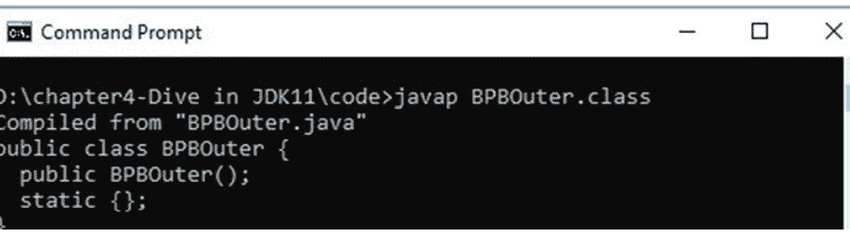

图 4.3：JDK11 中的嵌套类

观察生成文件的变化。之前的版本中生成的桥方法（bridge）在此文件中不再存在。

此外，执行命令：

`javap -v BPBOuter.class`

将生成：

```
class D:/chapter/4-Dive in JDK11/code/BPBOuter.class

Last modified 28-Apr-2019; size 359 bytes

MDS checksum c626f058e18faae99ebababc26f34344b

Compiled from BPBOuter.java

public class BPBOuter

minor version: 0

major version: 55

flags: (0x0021) ACC_PUBLIC, ACC_SUPER

this_class: #3

super_class: #4

interfaces: 0, fields: 1, methods: 2, attributes: 3

Constant pool:

#1 - Methodref #18 // java/lang/Object."<init>":()V
#2 - Fieldref #19 // BPBOuter.x
#3 - Class #20 // BPBOuter
#4 - Class #21 // java/lang/Object
#5 - Class #22 // BPBOuter$BPBInner
#6 - Utf8 BPInner
#7 - Utf8 InnerClasses
#8 - Utf8 x
#9 - Utf8 I
#10 - Utf8 <init>
#11 - Utf8 ()V
#12 - Utf8 Code
#13 - Utf8 LineNumberTable
#14 - Utf8 <clinit>
#15 - Utf8 SourceFile
#16 - Utf8 BPBOuter.java
#17 - Utf8 Members
#18 - NameAndType #10 // "<init>":()V
#19 - NameAndType #11 // x:I
#20 - Utf8 BPBOuter
java/lang/Object
BPBOuter$BPBInner
#21 - Utf8
#22 - Utf8
```

```
{

public BPBOuter()

descriptor: (V)

flags: (0x0001) ACC_PUBLIC

Code:

stack-1, locals-1, args_size=1

0: aload_0

1: invokespecial #1 // Method java/lang/Object."<init>():V

4: return

LineNumberTable:

line 1: 0

static (); descriptor: (V)

flags: (0x0008) ACC_STATIC

Code:

stack-1, locals=0, args_size=0

0: iconst_5

1: putstatic #2 // Field x:I

4: return

LineNumberTable:

line 2: 0

从 JDK11 开始新增的内容

SourceFile: "BPBOuter.java"

NestMembers:

BPBOuter$BPBInner

InnerClasses:

public static #6 #5 of #3 // BPBInner-class BPBOuter$BPBInner of class BPBOuter

你可以观察到，文件中包含了一个显示内部类声明的额外 `NestMembers` 条目。这是 JDK11 新增的内容。此外，如果你对内部类执行如下 `javap`：

```
javap BPBInner.class
```

你可以观察到以下输出：

```
class D:/chapter/4-Dive in JDK11/code/BPBInner.class

Last modified 28-Apr-2019; size 470 bytes

MDS checksum b5a0e3ff388e8b3fac159df233

Compiled from BPBOuter.java

public class BPBOuter$BPBInner

minor version: 0

major version: 55

flags: (0x0021) ACC_PUBLIC, ACC_SUPER

this_class: #5

super_class: #6

// java/lang/Object
interfaces: 0, methods: 2, attributes: 3

Constant pool:

#1 - Methodref #16 // java/lang/Object."<init>":()V
#2 - Fieldref #17 // System.out:Ljava/io/PrintStream;
#3 - Fieldref #19 // BPBOuter.x:I
#4 - Methodref #20 // java/io/PrintStream.println:(I)V
#5 - Class #22 // BPBInner
#6 - Class #25 // java/lang/Object
#7 - Utf <init>()V
#8 - Utf Code
#9 - Utf
#10 - Utf LineNumberTable
#11 - Utf callOuter
#12 - Utf SourceFile
#13 - Utf BPBOuter.java
#14 - Utf NestHost
#15 - Class #26 // BPBOuter
#16 - NameAndType #7 // "<init>":()V
#17 - Class #27 // System
#18 - NameAndType #28 // Ljava/io/PrintStream;
#19 - NameAndType #30 // x:I
#20 - Class #32 // java/io/PrintStream
#21 - NameAndType #33 // println:(I)V
#22 - Utf BPBOuter$BPBInner
#23 - Utf InnerClasses
#24 - Utf java/lang/Object
#25 - Utf BPBOuter
#26 - Utf System
#27 - Utf out
#28 - Utf Ljava/io/PrintStream;
#29 - Utf x
#30 - Utf java/io/PrintStream
#31 - Utf println
#32 - Utf (I)V
#33 - Utf
#34 - Utf
```

```
public BPBOuter$BPBInner();

descriptor: ()V

flags: (0x0001) ACC_PUBLIC

Code:

stack-1, locals=1, args_size=1

0: aload_0

1: invokes #1 // Method java/lang/Object."<init>()V

4: return

LineNumberTable:

line 4: 0

public static void callOuter();

descriptor: ()V

flags: (0x0009) ACC_PUBLIC, ACC_STATIC

Code:

stack-2, locals=0, args_size=2

0: getstatic // Field java/lang/System.out:Ljava/io/PrintStream;

3: getstatic #3 // Field BPBOuter.x:I

6: invokevirtual #4 // Method java/io/PrintStream.println:(I)V

9: return

LineNumberTable:

line 6: 0

Added from JDK11 onwards

line 7: 9

}
```

执行此命令后，以下是部分输出：

```
C:\Windows\system32\cmd

D:>java -v sample.class

Classfile D:/Sample.class

size 424 bytes

Last modified Apr 26, 2019, version 52.0

major:000000ba3a21759f44a0c2f6f5c2

Compiled from "Sample.java"

public class Sample

  minor version: 0

  major version: 52

  flags: ACC_PUBLIC, ACC_SUPER

  Constant pool:

    #1  Methodref      #6.15     // java/lang/Object."<init>:OV

    #2  Fieldref        #16.17    // java/lang/System.out:Ljava/

    #3  String          #18       // Constant Demo

    #4  Methodref      #19.20    // java/io/Stream.println:(Ljava/

    #5  Class           #21       // Sample

    #6  Class           #22       // java/lang/Object

    #7  Interface      <init>:OV

    #8  UTF8

    #9  UTF8

    #10 Code          LineNumberTable

    #11 UTF8           main

    #12 UTF8           (Ljava/lang/String;)V
```


图 4.6：动态细常量

你可以从图中观察到 `#1` 和 `#2` 是指向方法和字段常量池的引用。从 JDK7 开始，通过 `invokedynamic` 引入了 `MethodHandle` 和 `MethodTypes`。`invokedynamic` 本质是由用于动态调用方法的方法点。这在常量池中存储数据增加了复杂性，因为更多与方法相关的数据类型也需要存储在常量池中。

为了解决这个问题，常量池中添加了 `constant-dynamic`。该常量的主要作用是引导方法以执行解析、常量类型和引导参数。

它包含两个组成部分：

- 引导方法的索引
- 常量 `CONSTANT` 名称和类型

当使用以下参数执行引导方法时，该常量会被解析：

- 本地查找对象
- 常量的名称，组件，一个字符串
- 代表常量类型的类
- 任何剩余的引导参数

## JEP 315：改进 AArch64 内生函数

性能是任何编程语言最重要的需求之一。内生函数（Intrinsic）在提高性能方面起着重要作用。这是通过执行特定体系的代码而不是普通的 Java 代码，作为给定方法的替代方案来实现。

正如我们所知，JVM 在执行时会借助 JIT 帮助生成自己的代码。如果用类代码替换 JVM，那么应用程序的性能将会降低。这是因为 JVM 代码是架构性的，并且针对此类架构进行了优化。

这一概念被称为内生。内生是 JVM 了解其内生特性的代码部分，并被编译为最优的机器汇编。

在 Java 的早期版本中，许多函数已经在 AArch64 移植版中实现了内生化。但 `java.lang.Math` 类中仍缺少少数方法：`sin`、`cos` 和 `log`。在这一 JEP 中，推荐了这些方法的优化内生实现。

此外，我们已经实现的一些内生函数并不是最优的。这是由于某些软件具有某些预取指令、内存地址地址对齐问题等导致的。此类方法包括：

- `compareTo`
- `indexOf`
- `hasNegative`
- `equals`（来自数组）
- `compress`
- `inflate`

这些方法也被建议根据所需的标准进行优化。

## JEP 318：Epsilon：无操作垃圾回收器

正如我们所知，多年来 JVM 一直使用垃圾回收器的概念。传统上，GC 基于两个过程的算法工作：

- 标记（Mark）——识别要使用和释放的内存
- 清理（Sweep）——释放内存

根据不同的算法，设计如下：

- 串行垃圾回收器（Serial GC）
- 并行垃圾回收器（Parallel GC）
- CMS 垃圾回收器
- G1 垃圾回收器

当然，所有实现都有其优缺点。该 JEP 的目标是设计一个能够有效处理内存的垃圾回收器，但不执行任何操作。当堆耗尽时，JVM 会自动关闭。

如果我们有无操作垃圾回收器，可以在以下情况下使用，取决于 GC 的性能：

- **内存压力测试**

  JVM 中的内存处理通常是不均匀的。观察内存模式，我们发现在分配和清理时是变化的。这是因为 Java 中的对象创建是持续的，但这些对象大多数是短命的。这就是内存压力管理。我们需要通过 MBeans 或 GC 日志来检查这种压力。这提供了一种有效的测试方法，因为它在堆耗尽时失败。

- **性能测试**

  性能是应用程序成功的关键。应用程序的性能很大程度上取决于 GC 的性能。如果有一个执行任何操作的 GC，它可以作为工具使用。这有助于过滤掉 GC 调度、器开销以及不同的 GC。

- **极短命爆发**

  当本地创建对象时，大多数对象都是短命的，为了有效利用内存，必须快速。但 GC 需要遵循标记和清理等生命周期。对于短命对象，处理流程可能会浪费资源和。在这种情况下，无操作 GC 被发现比其他 GC 更有效。

## 针对延迟的改进

某些 Java 应用是延迟驱动的。像信号处理器或雷达控制单元等应用程序严重依赖及时交付。当然，这种及时交付取决于应用程序如何利用内存。因此，开发者需要了解内存足迹。有时，我们需要允许某些无垃圾应用程序。在这种情况下，GC 周期可能会产生问题。解决方案之一是重启 JVM。但否则，我们可以有效地使用无操作 GC。

## 针对吞吐量的改进

Java 提供了通过配置选择 GC 的选项。在这个过程中，我们还需要选择工作负载使用的屏障（barrier）。即使对于无分配的工作负载通常也会发生。

注意 Epsilon GC 与普通 GC 不同。由于 Epsilon GC 没有任何 GC 周期，因此 Epsilon 的屏障是空的。因此，它委托所有的基础屏障集。

当堆耗尽无法进行分配时，GC 将停止工作。这导致了失败场景。该失败可以通过以下选项产生：

- 带有消息描述的 `OutMemoryError` 异常。
- 使用 `-XX:+HeapDumpOnOutOfMemoryError` 标志生成堆转储文件。
- 切换到调试器或将消息传递给监控失败的外部系统。

## JEP 320：移除 Java EE 和 CORBA 模块

Web 服务是如今许多应用程序的集成部分之一。企业级应用需要一个用于共享 Web 的服务。这种服务的共享通过 Web 服务的概念来实现。基于此，Java 将 Web 服务栈设为 JSE 的一部分。JDK 6.0 引入了支持 Java EE 平台，如下：

- JAX-WS（XML 服务的 Java API）
- JAXB（XML 绑定的 Java 架构）
- JavaBeans（JavaBeans 框架）

然而，由于多年以来，JEE 的结构发生了巨大的变化。对于 JSE 而言，增加了一些无关的功能。为了解决某些复杂性问题，Maven、Gradle 等第三方网站开始扩展它们的服务。JEE 不再需要包含这些内容。以下代码段显示了与服务和 Web 应用交互的 `pom.xml` 内容：

```xml
<dependencies>
  <dependency>
    <groupId>javax.servlet</groupId>
    <artifactId>servlet-api</artifactId>
    <version>3.1.0</version>
  </dependency>
  <dependency>
    <groupId>javax.xml.bind</groupId>
    <artifactId>jaxb-api</artifactId>
    <version>2.3.0</version>
  </dependency>
  <dependency>
    <groupId>javax.activation</groupId>
    <artifactId>activation-api</artifactId>
  </dependency>
</dependencies>
```

与此同时，Java 还实现了称为 CORBA 的 ORB、命名和 id。JEE 的维护似乎出现了问题。此外，从此版本开始移除了对 CORBA 的支持。此后，该版本还建议移除 JEE。JDK9 移除了以下模块：

- `javax.xml`
- `javax.xml.bind`
- `javax.activation`

采取了以下步骤来检查是否存在任何使用模块的可能：

- 源代码将被完全删除。
- 类将存在于运行时。
- 启用这些模块的命令行已被完全移除。
- 像 `we`、`xjc`、`id` 和 `nameserver` 等工具将可用。

## JEP 321：HTTP 客户端（标准）

HTTP 客户端实现在 JDK9 和 JDK10 中进行了修改。最近的修改通过 JEP11 实现。在引入新的 HTTP 之后，开发者收到了大量反馈。考虑到这些建议，JEP 提议对当前的 HTTP 客户端进行更改以处理 HTTP WebSockets。从 JDK11 开始，该实现完全是异步的，而在此之前是阻塞的。新的 API 通过 `CompletableFuture` 提供了非阻塞请求和响应。背压和流量控制等其他概念通过 `java.util.concurrent.Flow` 响应式流提供。

在新 API 中观察到的变化：早期的 `BodyPublisher` 和 `BodySubscriber` 实现是通过静态工厂方法创建的。在此版本中，工厂类按以下方式进行了更新：

- `fromXxx`：来自标准子类的适配器，接收 `Flow.Subscriber` 并返回 `BodySubscriber`。
- `ofXxx`：创建预定义的 `BodyPublisher` 的工厂，用于将响应体处理为 String，或将体流式到文件。
- `other`：组合器接收 `BodySubscriber` 并返回实用的操作。

在此版本中，添加了一些新方法，例如：

- `discard(object replacement)`：用于丢弃/忽略响应体。这听起来很困惑并已被移除。它被其他处理器取代，如 `discarding()` 和 `replacing()`。
- `ofLines()`：返回一个 `BodyHandler`，支持按行流传输响应体。
- `fromLineSubscriber`：方便响应体适配 `Flow.String` 行。
- `mapping`：用于将响应体从一个映射到另一个。

当前 API 提供的 push promise 现在已通过移除 `MultiSubscriber` 和 `MultiResult` 进行了修改。除了功能性外，还引入了 `PushPromiseHandlers` 来该方案。`SAME_PROTOCOL` 和 `SECURE` 策略是 `HttpClient` 的一部分。重定向策略通过 `NORMAL` 简化，因为适用于普通情况。为了检查消息传递是否成功，使用了 `WebSocket.MessagePart`。现在它已被布尔类型数据取代，因为这将为检查消息传递提供更具体的逻辑。

## JEP 323：lambda 参数的局部变量语法

这可能是你在 JDK11 中观察到的罕见语言变化之一。你已经熟悉在 JDK10 中引入的关键字。在第二章中，我们讨论了细节以及实现。但在 JDK10 中，无法在 lambda 表达式中使用此功能，例如：

```java
var (val1, var2) -> val1 / val2;
```

上述语句在 JDK10 中不支持。该语句等同于兼容 JDK11 的语句：

```java
(val1, val2) -> val1 / val2;
```

如你所示，局部变量是隐式类型的。问题是，为什么要在 JDK11 中对现有方法进行修改？很好，此修改的重要原因之一是使用如 `@Nonnull` 的修饰符。如果定义定义，则无法使用该修饰符。现在你可以这样使用该修饰符：

```java
(@Nonnull val1, @Nullable val2) -> val1 / val2;
```

然而在该概念中观察到以下限制：

- 它不能与泛型或其他变量一起使用。
- 我们不能与其他显式数据类型混合。当我们在简单参数 lambda 中使用它时，不能跳过括号，这在推断类型的情况下是可能的。

## JEP 324：使用 Curve2559 和 Curve488 的密钥约

早期版本的 Java 使用 Diffie-Hellman 方案作为椭圆曲线实现，它被地称为 ECDH。RFC 7748 定义了一种新的实现，即使用 Curve2559 和 Curve488 的密钥约。JEP 的主要目标是提供连接到此实现的 API。为了实现这一点，SunEC 提议了 `KeyAgreement`、`KeyFactory` 和 `KeyPairGenerator` 的新实现。该库将被新的加密算法利用。在某些情况下，它被 EdDSA（Curve25519 和 Curve488）与 Poly1305 结合使用。

## JEP 327：Unicode 10

在 JDK10.0 中，增加了 Unicode 8.0 和 Unicode 9.0。正因如此，Java 支持了 7,500 个字符和六种新脚本新增。Unicode 是一个不断扩展其收集范围的库。Unicode 的下一个版本（即 Unicode 10）增加了约 8,518 个字符，总数达到 136,690 个字符。同时，它还包含了 4 种新脚本，使总数达到 139 种脚本，并包含 60 个表情符号。

此版本的 Unicode 添加了以下支持：

- Masaram Gondi，用于在印度中部和南部编写 Gondi 语。
- Nishu，直到二十世纪，中国女性曾用于书写诗歌和其他论述。
- Soyombo 和 Zanabazar Square，用于佛教文本中书写梵文、西藏语和蒙古语。
- Syriacs，用于书写 Suriyani Malayalam（也称为 Garshi 和 Syriac Malayalam）。
- 盖拉拉特符号，用于 Ismaili Khoja 社区将阿拉伯字母转译为盖拉拉特语。
- 一组 285 个 Hentaiagata 字符（日本使用的平假名字符的历史性变体）。
- CJK 扩展 F（7,473 个汉字）。

重要的符号新增包括：

- 比特币符号
- 56 个表情符号字符
- 一组排版标记和符号

随着 Unicode 集合的不断增加，我们必须确保 Java 更新到最新的 Unicode 版本。此 JEP 旨在升级 API 以支持新版本的 Unicode。

此 JEP 提议更新以下类：

- `java.lang` 包中的 `Character` 和 `String`
- `java.awt.font` 中的 `NumericShaper`
- `java.text` 包中的 `Bidi`、`Breakator` 和 `Normalizer`

请注意，此 JEP 将不会实现以下 Unicode 规范：

- `UTS#10`，Unicode 排序算法
- `UTS#39`，Unicode 安全机制
- `UTS#46`，Unicode IDNA 兼容性处理
- `UTS#51`，Unicode 表情符号

## JEP 328：飞行记录器（Flight Recorder）

当应用程序处于运行模式时，会有很多内部过程在进行。这些过程所需的时间和资源取决于许多其他工具。分析这些过程以识别性能故障的根源变得至关重要。已经引入了许多工具来进行此类分析。Java 飞行记录器（JFR）是一种用于收集诊断数据和分析应用程序性能的工具。

与其他工具不同，它是 JVM 的组成部分，对于应用程序性能而言，不会产生任何巨大的开销。JFR 可用于性能分析、黑盒分析和调试。JFR 主要收集通过事件产生的数据。这些事件可以是 JVM 事件也可以是应用程序事件。

JFR 默认是禁用的。可以通过 Java 命令中的 `-XX+FlightRecorderAttribute` 将其启用。请注意，由于是一项商业特性，JFR 仅在 Java 的商业版本可用。

## JEP 329：ChaCha20 和 Poly1305 加密算法

加密是任何编程语言安全性的一项重要需求。它本质上是一种保护第三方读取私有消息安全的协议。加密使用加密和解密技术来实现这种安全性。引入了各种算法来创建加密——称为密码（cipher）。多年来，Java 一直使用 RC4（Rivest Cipher 4）作为流加密。经过对算法的持续研究，发现 RC4 在以下方面不安全或可疑：

- 输出偏差
- 非随机密钥流生成
- 密钥流与密钥之间的相关性
- 组合问题

许多浏览器已采取有效行动取消对该算法的支持，例如：

- Chrome 48 和 Chromium 已禁用它。
- 在 Firefox 36 中被弃用。
- 在 Firefox 44 中移除。
- Microsoft Edge 和 Internet Explorer 不支持。
- Opera 12 已完全停止支持。

这导致了识别新加密算法的需求。在所有这些情况下，ChaCha20-Poly1305 的实现被证明更加安全。它也被应用于 TLS 实现和许多其他加密协议中。与 AES 相比，ChaCha20 密码是一种高速加密算法。事实上，观察到它在缺乏 AES 专用硬件的平台上运行速度非常快。它还能防止计时攻击。Poly1305 算法被用作一种身份验证器。它是一种高速的消息认证码。该算法获取一个与消息一起生成的一次性密钥，并在处理后将其转换为 16 字节的标签（tag）。当我们想要验证消息时，该标签被用作身份验证器。

这两者的组合 `CHACHA20-POLY1305` 被称为身份加密（authenticated encryption），并在此 JEP 中推荐使用。在这种方法中，Poly1305 密钥是使用 `cha20` 算法生成的。

请注意，TLS 1.3 允许使用基于 AEAD 的密码套件。ChaCha20-Poly 算法的实现是迈加密机制的第一步：AEAD 也是身份加密，与普通的 ChaCha20-Poly1305 类似，但带有额外的算法。以下是加密机制的输入：

- 96 位随机计数器（nonce）
- 明文
- 附加认证数据（AAD）

以下是 AEAD 的输出：

- 密文，此标签的长度与明文相同。
- 128 位标签，使用 Poly1305 函数生成。

解密过程非常简单，除以下情况外均没有例外：

密文和明文在不同的场景下使用。消息的真实性取决于标签，如果它们匹配，则说明消息是真实可信的。以下是加密的示例代码：

```java
Cipher cipher1 = Cipher.getInstance("ChaCha20-Poly1305");

AlgorithmParameterSpec cipherSpec = new IvParameterSpec(sampleBytes);

cipher1.init(cipher.ENCRYPT_MODE, key, cipherSpec);

byte[] encryptedData = cipher1.doFinal(originalText, 0, originalText.length);
```


`ChaCha20-Poly1305`密码的一个重要要求是，在调用`doFinal()`之后必须进行新的`init()`。随后的`update()`调用将导致`IllegalStateException`。

## JEP 330: 启动单文件源码程序

编写、编译和执行是开发者开发应用程序或类文件时遵循的通常流程。编译器和解释器在这些必要过程中都在忙碌。然而，某些像 NetBeans 或 Eclipse 这样的 IDE 可以在不编译的情况下直接执行你的类！很奇怪，不是吗？但并不是它的工作原理；当你尝试执行它时，IDE 会在内部调用编译器。这显然为开发者节省了大量时间，这也是为什么除了 IDE 提供的语言智能外，开发者更被这些 IDE 吸引。

JEP 330 是通过 Java 独立实现这一概念的一步。

考虑以下打印 HelloWorld 的程序：

```java
public class SingleFile{

    public static void main(String[] args) {

        System.out.println("Hello World!");

    }

}
```

将此文件保存为`SingleFile.java`，不要编译！！

相反，直接使用以下命令执行文件：

```bash
java SingleFile.java
```

在输入 Java 命令时，不要忘记给出文件的扩展名。

惊讶的是，你使用单个命令即可完成编译和执行，如下所示：

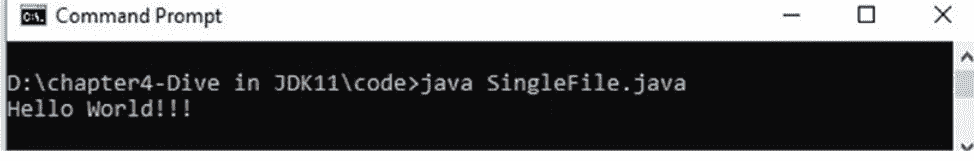

图 4.7：单类的简单文件源码

当我们将其用于命令行参数时，该概念是有效的。考虑另一个程序：

```java
public class CommandLineDemo{

public static void main(String[] args)

{

    System.out.println("Welcome ,"+args[0]);

}

}
```

你可以使用以下命令无需编译直接执行此文件：

`java CommandLineDemo BPB`

输出如下所示：

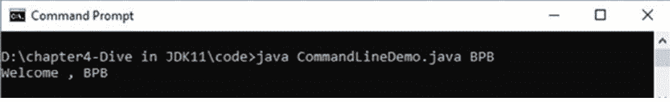

图 4.8：带有单类命令行参数的单文件源程序

你也可以创建一个包含多个类的文件。解释器将选择带有`main`方法的类来执行相同的。

```java
public class EmployeeTest

public static void main(String[] args)

{

    Employee e1=new Employee();

    e1.showEmployee();

}
```

```java
class Employee{

public void showEmployee(){

    System.out.println("Displaying Employee Information!");

}
```

使用如下方式执行文件：

`java EmployeeTest.java`

这将产生以下输出：

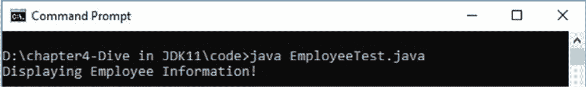

图 4.9：带有多个类的单文件源程序

等一下，有一个转折。改变类文件的顺序，如下所示：

```java
class Employee(
```

```java
public void showEmployee() {

    System.out.println("Displaying Employee Information!");

}

public class EmployeeTest{

    public static void main(String[] args) {

        Employee e1=new Employee();

        e1.showEmployee();

    }

}
```

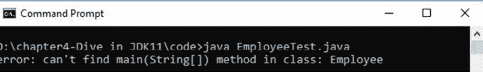

图 4.10：带有多个类的单文件源程序失败

从上面的图中可以清楚地看到，如果你在单个源文件中编写多个类，则必须在第一个类中编写`main()`函数。否则，JRE 将无法找到要执行的类。

## 使用 Shell 脚本工作

Shell 脚本是 Unix/Linux 上可以直接执行的文件。如果我们在文件的第一行添加执行器的路径，这是可以实现的。

以下是声明方式：

```bash
#!/bin/java --source 11
```

一旦写了这些内容，你就可以像之前一样在该文件中编写简单的代码并保存它。

在控制台中向你的文件添加以下标志使其变为可执行：

```bash
$ chmod+x
```

然后，使用此命令执行文件：

```bash
$ ./
```

注意，上述命令专门用于 Unix/Linux 平台。

## JEP 332: 传输层安全 (TLS) 1.3

TLS 是传输层，紧接 SSL（安全套接层）。或者，它也被称为 TLS 握手。Web 应用需要网络浏览器和服务器之间的安全通信，这由 TLS 提供。连接的主要优势是对称加密。数据通过该层使用的加密机制进行传输。观察到 TLS 1.3 比之前的 TLS 1.2 版本更安全、更快速。原因是 TLS 1.2 需要两次往返才能完成 TLS 握手，而 TLS 1.3 只需一个往返即可完成会话。此外，它在零往返（zero round trip）方面具有优势，当传输的数据与之前的相同时就会发生。是的！TLS 1.3 具有记忆数据的独特特性。

在安全性方面，TLS 1.3 优于 TLS 1.2，因为它移除了许多被认为不安全或存在漏洞的实现，例如：

- SHA -1
- RC4
- DES
- 3DES
- AES-CBC
- MD5

安全 API 通过 Java Secure Socket Extension 提供，该扩展提供了 SSL、TLS 和 DTLS 协议的实现。目前，它支持 SSL 3.0、TLS 1.0、TLS 1.1、TLS 1.2 和 DTLS 1.2。此 JEP 建议创建对 TLS 1.3 实现的支持。

该实现将由以下算法提供：

- ChaCha20Poly1305 密码套
- X25519/X448 椭圆曲线算法
- edDSA 签名算法

尽管 Java 的许多功能是后兼容的，但 TLS 1.3 在后后兼容实现时存在一些风险因素。风险如下：

- TLS 1.2 及之前的版本使用双工关闭策略，而 TLS 1.3 使用半关闭策略。

证书身份验证使用预定义的签名算法。但许多应用程序可能使用不支持的签名算法。

TLS 1.3 不支持 DSA 签名。对于使用 DSA 证书的服务器这可能不适用，因为升级变得具有挑战。

TLS 1.3 和 TLS 1.2 的加密算法是不同的。

为了尽可能减少这种情况，TLS 1.3 实现了默认启用的后兼容性。尽管如此，我们可以手动关闭它。

## JEP 333: 可扩展低延迟垃圾回收器（实验性）

今天，当我们谈论企业级应用时，指的是那些旨在同时为数千用户服务的应用程序。在服务这些客户时，性能被认为是主要关注点，因为此类应用所需的内存占用是巨大的。对于此类应用，垃圾回收的内存管理可能会因为其遵循的周期而影响性能。有时，GC 需要为了这些周期而暂停。为了解决这个问题，ZGC 引入了并发技术，这对传统 GC 具有以下优势：

- 限制 GC 停顿时间（不超过 10ms）。
- 能够处理更大的堆。
- 使用并发技术处理内存。

ZGC 引入了各种概念，让我们逐一讨论。

### 指针染色

正如名称所示，指针染色是在内存中表示的。这通过读障来实现，使用了标记位如下：

- 最终化：用于标记对象。
- 重映射：指向对象的地址。
- 标记0 和标记1：用于标记对象。

在整个过程中，ZGC 使用标记0 和标记1 进行标记。

### 多重映射

这是一个将内存范围映射到物理内存的过程。通过指针染色，访问地址是无开销的。

### 标记

这是一个垃圾回收检查哪些对象是可用的过程。ZGC 将此过程分为三个步骤：

- 找到根引用。
- 遍历对象组进行标记。
- 处理弱引用。

### 重定位

当我们创建一个新对象时，它会在堆中分配新的空间。此过程需要扫描内存以寻找连续内存，因为空内存可能分散在对象之间。另一种方法是移动对象以创建一个更紧凑的内存。这通过创建块来实现。

ZGC 重定位启用了以下阶段：

- 找到块并将其转移重定位集。这是一个并发过程。
- 停顿世界（STW）阶段，重定位重定位集中的所有根引用并更新引用。
- 重定位所有对象并恢复新旧地址之间的映射。这也是一个并发过程。

### 启用 ZGC

默认情况下，JVM 的所有实验性功能都是禁用的。因此 ZGC 也是禁用的。除非我们指定，否则它在构建中并不出现。

同样，这在运行时是禁用的，需要启用。对于 ZGC，我们需要添加选项`-XX:+UnlockExperimentalOptions`。

## JEP 335: 弃用 Nashorn JavaScript 引擎

在继续之前，你将对 Nashorn JavaScript 引擎进行介绍。JDK8 通过 JEP 174 引入了 Nashorn JavaScript 引擎，早期使用的是它的脚本引擎。在实现时，它支持 ECMAScript – 262 5.1 标准。Nashorn 是一个你可以在原生 JVM 上执行 JavaScript 的设施。

Nashorn JavaScript 引擎可以通过命令行工具`jis`或通过 Java 调用 API 来使用。

### 命令行 jis

下面的图显示了`jis`的简单工作方式：

```
D:\chapter-4-Dive in JDK11>>jis

warning: the jis tool is planned to be removed from a future JDK

jis> print("Hello from Java!")

Hello from Java!!

j>
```

图 4.11：使用 jjs

## 通过编程方式使用 Nashorn

你也可以通过 Java 程序与 Nashorn 进行通信，如下所示：

```
ScriptEngine engine=new ScriptEngineManager().getByName("nashorn");

engine.eval("print(\"Hello from Java\");");
```

你如下所示直接调用`javascript EngineManager().getByName("nashorn")`：

```
ScriptEngine engine=new ScriptEngineManager().getByName("nashorn");

engine.eval("print(new FileReader(\"myscript.js\"));");
```

硬币也有另一面。ECMA 被认为是最适合快速 Web 应用程序开发的脚本语言之一，它正随着行业需求发生剧烈变化。因此，为了跟上这种速度，我们还需要维护 Nashorn 库，这正变得越来越具有挑战性。这导致了弃用对 Nashorn 的支持。

建议带有`flatforRemoval=true`弃用以下模块：

```
jdk.scripting.nashorn

jdk.scripting.nashorn.shell
```

它包含`jjs`工具，它将在未来的 JDK 版本中被移除。

警告：`jjs`工具计划在未来的 JDK 版本中移除。

请注意，此 JEP 仅移除弃用标记，将在后续版本中提交单独的 JEP 来完全移除此功能。

此外，Oracle 推荐 GraalVM 而非 Nashorn。考虑到 Oracle 的考虑，GraalVM 比 Nashorn 具有以下优势：

- JavaScript 标准的完整实现，支持 ECMAScript 2016、2017 和部分 ECMAScript 2018。
- 它完全支持 Node.js，这是一个服务器端 JavaScript 平台。
- 可以执行 Python、R 和 Ruby 等其他语言。

## JEP 336：弃用 Pack200 工具和 API

Pack200 是一个用于压缩 jar 文件的 Java API 类。它通过 JSR 200 在 JDK 5.0 中引入。创建此类包的主要用途是减少 Java 应用程序安装程序的占用空间需求，从而使其在传输和部署应用程序时更加高效。

`pack200`命令用于将 JAR 文件转换为压缩的 pack200 文件。Java 出于此使用了 GZIP 压缩器。该工具在早期版本的`java.util.jar`包中可用。

以下是`pack200 [-options1=value1, option2=-value2, ...] x.pack[.gz] file jar`的语法：

其中：

- `x.pack[.gz]`: 输出文件的名称。
- `file.jar`: 输入文件的名称。

例如：

`pack200 MyApp.pack.gz MyApp.jar`

从 DK9 开始，pack200 是`jdk.pack`模块的不可或的一部分。从 JDK 11 开始，增加了`forRemoval=true`标志，表明它将在接几个版本中移除。建议对以下三个类型设置`forRemoval=true`标志：

- `java.util.jar.Pack200`

## `java.util.jar.Pack200.Packer`

## `java.util.jar.Pack200.Unpacker`

现在运行这些更改将显示警告信息，提示计划移除该工具。

以下是建议移除该工具的三个原因：

早，在下载 Java 应用程序时，由于现代用途类型，下载速度是一个关注点。此外，Java 的单体结构显著增加了应用程序的大小。随着时间的推移，下载速度有所提高，并且从 Java 9 开始，传统的打包结构发生了变化。随着新结构的引入，Java 9 在运行时引入了`Jmod`，因此 Java 不再依赖于 Pack200。

Applet 被认为是使用 Pack200 压缩应用程序最广泛的应用之一。浏览器将拥有插件来解压缩此类归档。但现在，applet 应用程序已不再使用，大多数浏览器已经删除了对此类插件的支持。这是考虑移除 Pack200 的重要原因之一，因为使用 Pack200 的重要组件之一已不再存在。

Pack200 的使用与 Java 9 的模块化不匹配。此外，它非常复杂并遵循类文件格式，因此对 Java 来说维护可能是额外负担。

## 结论

在本章中，我们讨论了 JDK 11 版本的更新。我们讨论了 JEP 及其需求，以及通过不同的 API 对这些 JEP 进行实现。我们讨论了该版本中嵌套类内部机制的变化。我们还讨论了名为 Epsilon 的有趣垃圾回收（GC），它遵循现有的 GC 特性。我们讨论了 CORBA 等不同功能，这些功能在该版本中被移除以使 JDK 的体积更加紧凑。该版本在安全性方面也引入了一些新功能，我们在此讨论了 ChaCha20 和 Poly1350 算法。

尽管 API 没有发生太大变化，但这个版本对改变 Java 的内部结构非常有帮助。在下一章中，我们将详细讨论不同的垃圾回收器及其意义。

## 问题

- 什么是基于嵌套的访问控制（nest-based access control）？
- NestHost 术语指定什么？
- 解释 Epsilon GC 的不同阶段
- 什么是 Java 记录器（Java flight recorder）？
- ZGC 回收器有哪些优势？

## 第 5 章

## 迁移代码

## 引言

向后兼容性！你已经过这个 Java 特性多年了，不是吗？这个功能让你能够能够在较高版本的 Java 中编译和执行在较早版本中编写的代码。当然，每当你这样做时，你都需要为编译器提供一个源版本标志。

例如，如果你想在 Java 5 或 Java 6 中编译代码，需要向编译器添加`source -1.5`。

这条指令非常重要，因为较高版本中的 API 可能发生变化。可能会有新功能，或者某些功能在版本中可能不再存在。因此，我们需要告诉编译器在当前编译中忽略这些变化。在旧版本中编写的代码被称为遗留代码（legacy code）。现在，这些遗留代码编译正常，如果由客户端在较高版本上执行，它们有时在运行时可以运行。因此，许多遗留代码会在新版本上重新编译。

## 结构

通过以下技术讨论 Java9+ 的兼容性：

- 无命名模块（Unnamed module）
- `jdep`工具
- 模块配置：
  - `--add-reads`
  - `--add-exports`
  - `--add-opens`
- `jLink`
- 多版本 JAR 文件（Multi-release files）

## 目标

在本章中，我们将讨论如何测试现有代码与 Java9 的兼容性。考虑到模块化的变化，以及对某些类和封装类的移除。

有时迁移非常简单。使用我们的老朋友`javac`和`java`命令来处理遗留代码。但等等！这里的问题是，java 如何允许未包含模块中的包？毕竟，整个 Java9 是基于模块概念的。所以，如果你想迁移代码到 Java9，有一种方法。但原因是引入了一种有趣的模块类型，即无命名模块。

```java
Document document = new Document();

try {

  PdfWriter writer = PdfWriter.getInstance(document, new FileOutputStream("Sample.pdf"));

  document.open();

  document.add(new Paragraph("This file is created using iText!"));

  document.close();

  writer.close();

  System.out.println("PDF Created Successfully!");
```


} catch (DocumentException e) {
    e.printStackTrace();
} catch (FileNotFoundException e) {
    e.printStackTrace();
}
```

上述文件与 iText 的第三方 API 通信，该 API 用于处理 PDF。我们可以通过这些 API 创建和编辑 PDF 文件。这些 API 是 `itextpdf-5.4.0.jar` 文件的一部分。要编译并执行此文件，我们需要将该 JAR 文件放入 classpath 中。

让我们使用之前的版本的 Java（即 Java 8）来完成此过程。

以下代码段展示了检查版本、设置编译类路径以及使用 Java 8 运行上述程序的过程：

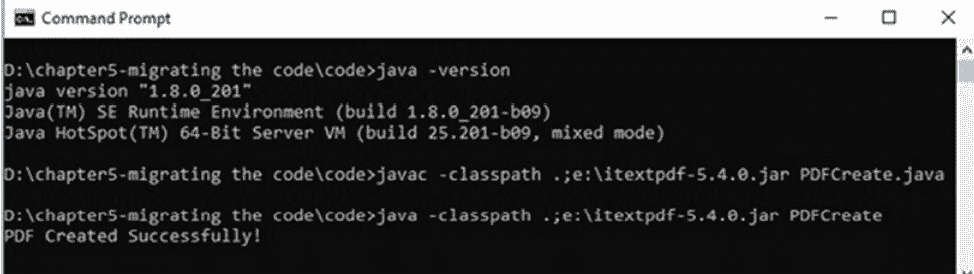

图 5.1：Java 9 之前的执行

现在让我们尝试使用下一个版本（即 Java 9）来编译同一个应用程序，如下：

## 命令提示符

```
D:\chapt5-migrating the code>set path D:\jdk-9-java-se-ri\jdk-9-bin

D:\chapt5-migrating the code>java -version

OpenJDK version "9"

OpenJDK runtime environment (build 9+181)

OpenJDK 64-Bit Server VM (build 9+181, mixed mode)

D:\chapt5-migrating the code>javac -classpath .;e:\itextpdf-5.4.0.jar PDFCreate.java

D:\chapt5-migrating the code>java -classpath .;e:\itextpdf-5.4.0.jar PDFCreate

PDF Created Successfully!
```

图 5.2：Java 9 执行（向后兼容）

你可以观察到，Java 9 之前的类在使用 Java 9 编译器时，无需修改任何代码即可运行。所有在之前的版本中正常工作的内容都可以编译。此应用程序是使用默认包创建的，并使用了 `itextpdf-5.4.0.jar` 中的类。如果包没有包含在模块（Modules）中，Java 将不支持包。那么这个应用程序是如何获取并执行的呢？这就是命名模块（un-named module）的作用。在这个应用程序中，Java 9 创建了一个命名模块并将所有资源放入该模块中。

它将映射到 classpath 中的所有引用放入命名模块中。所有编译后的类和 JAR 文件将存储在该模块中，它称为自动模块（automatic module）。该自动模块的工作原理如下：

这个命名模块有一个独特之处，它可以读取你创建的所有资源。同时，它还会读取所有的 Java 9 平台模块。

随着模块结构的变化，Java 9 还引入了另一个重要概念，称为内部 API（Internal API）。这些是封装的类，不能被直接使用。

在之前的 Java 版本中，我们可以通过直接导入这些这些类。但在将代码迁移到 Java 9+ 版本的编译器时，我们需要小心。

现在让我们考虑此 API 在迁移过程中实际上是如何工作的。

考虑 `Base64Encoder.java`，它使用 `BASE64Encoder` 来处理数据编码。请注意，该程序并不是为了 `BASE64Encoder` 类的实际用法和工作。我们只是想知道该类的引用对于 Java 9+ 版本编译器的编译是如何引用的。

```java
import sun.misc.BASE64Encoder;

public class Base64Encoder {
    public static void main(String[] args) {
        BASE64Encoder enc = new BASE64Encoder();
        String data = "This data will be encrypted!";
        byte[] byte = data.getBytes();
        String data1 = enc.encode(byte);
        System.out.println("Original Data: " + data);
        System.out.println("Encoded Data: " + data1);
    }
}
```

我们可以像下面所示使用 Java 8 编译器以这种旧方式编译它：

```
D:\chapter5-migrating-the-code>java Base64Encoding.java

BASE64Encoding.java:1: warning: BASE64Encoder is internal proprietary API and may be removed in
  future release
import sun.misc.BASE64Encoder;

BASE64Encoding.java:6: warning: BASE64Encoder is internal proprietary API and may be removed in
  a future release
  BASE64Encoder enc = new BASE64Encoder();

BASE64Encoding.java:6: warning: BASE64Encoder is internal proprietary API and may be removed in
  a future release
  BASE64Encoder enc = new BASE64Encoder();

3 warnings
```

图 5.3：内部 API 警告

如果你在上面的图中观察，类被成功编译了，但它向我们生成了警告：

`BASE64Encoder is internal proprietary API and may be removed in a future release`

这意味着该 API 建议在后续版本中移除，并且它可能作为封装类被使用。

但如果你执行代码，它会成功执行，如下所示：

```
D:\chapter5-migrating-the-code>java Base64Encoding

Original Data: This will be encrypted!

Encoded Data: VGhpcyBkhdGEgd2lsbCmBlbmljcnXB0ZIQ==
```

图 5.4：内部 API 的用法

如果你在上面的图中观察，类被成功编译了，但它向我们生成了警告：

`BASE64Encoder is internal proprietary API and may be removed in a future release`

这意味着该 API 建议在后续版本中移除，并且它可能作为封装类被使用。

但如果你执行代码，它会成功执行，如下所示：

```
D:\chapter5-migrating-the-code>java Base64Encoding

Original Data: This will be encrypted!

Encoded Data: VGhpcyBkhdGEgd2lsbCmBlbmljcnXB0ZIQ==
```

（注：Base64 字符串的 OCR 存在乱码，我根据上下文清理了逻辑流）。

```
System.out.print("In First");
```

仔细观察发现，`moduleSecond` 导出了 `package2`，但 `moduleFirst` 的 `module-info` 并没有指定任何用于从 `moduleSecond` 读取读取的配置。该文件是空的。

现在让我们像下面所示编译这些类：

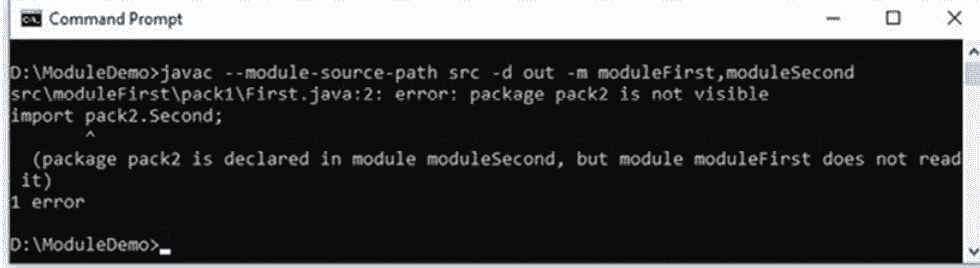

图 5.7: 依赖问题 - 读取

如你所见，编译如预期地失败了，因为在 `moduleFirst` 的 `module-info` 中没有指定可读性。

现在让我们使用 `--add-reads` 再次编译并执行这些模块：

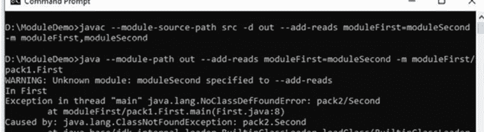

图 5.8: 依赖问题 --add-modules

我们可以看到，虽然模块已经编译，但它们并没有执行。这是为什么呢？因为在 Java 模块解析过程中，`moduleSecond` 没有被包含，因为它没有被需要。我们只是在 Java 命令中添加了 `moduleFirst` 可以读取 `moduleSecond` 的信息。因此，`moduleSecond` 不是可见的模块。要使其变为可见，你可以像下面所示添加 `--add-modules` 选项：

```
Command Prompt

D:\ModuleDemo>java --module-path out --add-modules=moduleSecond --add-reads moduleFirst=moduleSecond -m moduleFirst/pack1.First

In First

Display called from second module!!

In First

D:\ModuleDemo>
```

图 5.9: --add-reads生效

哇！它成功了。`--add-module` 将相应的模块动态地添加到 java 命令中，以便在命令执行期间可以被观察到。

## --add-exports

现在让我们改变场景，并如下所示修改两个模块的 `module-info.java`。

`moduleFirst` 的 `module-info.java` 源码：

```
moduleFirst
{
requires moduleSecond;
}
```

`moduleSecond` 的 `module-info.java` 源码：

```
moduleSecond
{}
```

注意，此 `module-info.java` 中的 export 语句被移除了，所以现在该模块不再导出任何内容。

现在让我们尝试编译这些模块：

```
Command Prompt

D:\ModuleDemo>javac --module-source-path src -d out -m moduleFirst,moduleSecond

src\moduleFirst\pack1\First.java:2: error: package pack2 is not visible
import pack2.Second;
(package pack2 is declared in moduleSecond, which does not export it)
1 error

D:\ModuleDemo>>
```

图 5.10: 依赖问题 - -exports

如预期，这失败了，因为它没有导出所需的包。现在，通过使用 `--add-exports`，我们可以将所需的模块包导出到其他模块。下图显示了使用 `--add-exports` 的编译过程：

```
D:\ModuleDemo>javac --module-source-path src -d out --add-exports moduleSecond/pack2=moduleFirst -m moduleFirst,moduleSecond

D:\ModuleDemo>_
```

5.11: --add-exports 编译

上面的命令将 `pack2` 从 `moduleSecond` 导出到 `moduleFirst`。正因如此，`module-info` 在声明时没有导出它，因为它被动态地导出到了 `moduleFirst`。

一旦模块编译完成，我们可以像下面所示执行它：

```
D:\ModuleDemo>java --module-path out --add-exports moduleSecond/pack2=moduleFirst -m moduleFirst/pack1.First

In First

Display called from second module!!

In First

nD:\ModuleDemo>_
```

5.12: --add-exports 执行

在上面的场景中，我们在模块之间使用了 `--add-exports` 选项。但正如之前讨论的，创建了一个未命名模块（un-named module），我们可以通过它迁移应用程序。在这种情况下，我们可以像下面所示导出包：`javac -d --add-exports java.base=ALL`

现在让我们检查一下。

考虑以下代码：

```java
import sun.util.calendar;

public class CheckDate {
    public static void main(String[] args) {
        System.out.println(CalendarUtils.isGregorianLeapYear(2017));
    }
}
```

上面的代码使用了 `CalendarUtils` 类，该类在 Java 9 中被封装了。虽然 Java 9 版本会带警告编译并执行这段代码，但编译器会抛出错误如下所示：

```
## Command Prompt
D:\chapter5-migrating-the-code>\javac CheckDate.java
CheckDate.java:1: error: package sun.util.calendar is not visible
import sun.util.calendar;
 ^
  (package sun.util.calendar is declared in module java.base, which does not export it)
 ^
  1 error
```

5.13: java.base 使用

我们可以通过在 java 命令中添加 `--add-exports` 来解决这个问题，如下所示：

```
## Command Prompt
D:\chapter5-migrating-the-code>\java --add-exports java.base/sun.util.calendar=ALL CheckDate
CheckDate.java:1: warning: CalendarUtils is internal API and may be removed in a future release
import sun.util.calendar.CalendarUtils;
CheckDate.java:6: warning: CalendarUtils is internal API and may be removed in a future release
System.out.println(CalendarUtils.isGregorianLeapYear(2017));
2 warnings
```

5.14: java.base 执行

要执行，你可以将相同的属性添加到 java 命令，如下所示：

```
## Command Prompt
D:\chapter5-migrating-the-code>\java --add-exports java.base/sun.util.calendar=ALL CheckDate
False
```

5.15: java.base 执行

如你所见，`CheckDate` 类现在可以使用 `--add-exports` 标志访问 `java.base` 模块中的 `Calendar` 类。

## --opens

到为止，我们看到的模块之间的依赖是通过模块配置中的 `exports` 和 `requires` 关键字建立的。这些关键字不支持对私有成员的反射访问。

考虑包含两个模块 `firstModule` 和 `mainModule` 的项目。以下是项目的结构：

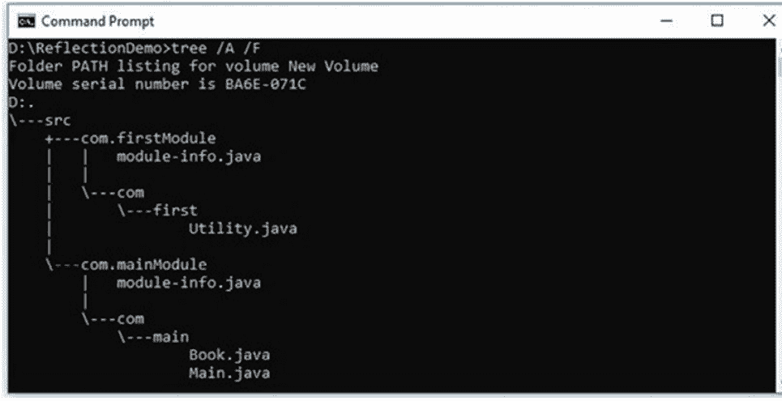

图 5.16: ReflectionDemo 文件夹结构

下面的片段显示了 `Utility.java` 的源码，它尝试访问另一个模块中的类属性：

`Utility.java` 源码：

```java
package com.first;

import java.lang.reflect.Field;

public class Utility{
    public static void showProperties(Object o) throws IllegalAccessException {
        Class c = o.getClass();
        Field[] fields = c.getDeclaredFields();
        for(int i=0; i<fields.length; i++) {
            fields[i].setAccessible(true);
            System.out.println(fields[i].getName());
        }
    }
}
```

上面的类在它的 `showProperties(Object o)` 方法中对传入的对象使用了反射 API。现在让我们观察该模块的描述符，即 `module-info.java`：

`module-info.java` 源码：

```
module com.firstModule{
exports com.first;
}
```

所示，该模块将其包 `com.first` 导出到其他模块。

现在让我们观察项目的另一个模块，即 `mainModule`。该模块包含 `Book.java` 和位于 `com.main` 包中的应用程序类 `Main.java`，如下所示：

`Book.java` 源码：


# 模块化与反射访问

## 模块描述符与反射访问

`Main.java` 源码：

```java
package com.main;

import com.first.Utility;
import java.lang.reflect.Field;

public class Main{
    public static void main(String[] args) throws IllegalAccessException {
        Book b = new Book("Java9.0 to 12.0", "BPB Publication");
        Utility.showProperties(b);
    }
}
```

后面是该模块的描述符，即 `module-info.java`。

`module-info.java` 源码：

```java
module com.main{
    requires moduleFirst;
}
```

现在让我们编译模块以生成 `out` 目录，如下所示。

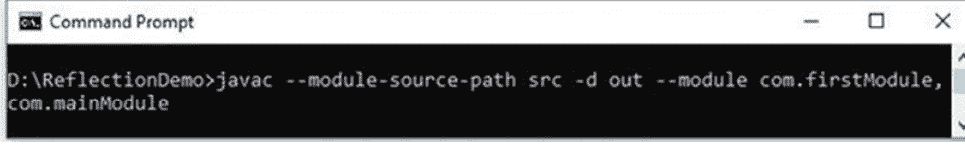

图 5.17: 编译

现在让我们执行模块 `main`。

## Command Prompt

```
D:\ReflectionDemo>java --module-path out --module com.mainModule/com.main.Main
Exception in thread "main" java.lang.reflect.InaccessibleException Unable to make
field private java.String com.main.bookName accessible: module com.main
opens 'com.main' to com.firstModule
  at java.base/java.lang.reflect.AccessibleObject.checkCanAccessible(AccessibleObject)
  at java.base/java.lang.reflect.AccessibleObject.checkCanAccessible(AccessibleObject)
  at java.base/java.lang.reflect.Field.checkCanAccessible(Field)
  at java.base/java.lang.reflect.Field.setAccessible(Field.java:170)
  at com.firstModule/com.first.Utility.setProperties(Utility.java:13)
  at com.main/com.main.Main.main(Main.java:11)
```

图 5.18: 反射访问的运行时异常

上面的图显示，即使建立了模块依赖关系，反射访问也会被拒绝。这是因为它正尝试通过反射访问 `Book` 的私有数据成员，而这是不被允许的。

现在让我们如下所示修改 `com.mainModule` 的描述符：

```java
module com.mainModule{

opens com.main.to com.firstModule;

requires..First;

}
```

修改后的描述符中的第一行指定将 `com.main` 打开给 `com.firstModule`。这意味着 `module.firstModule` 可以通过反射访问 `com.main` 包的私有数据成员。

现在让我们如下所示编译并执行代码：

## Command Prompt

```
D:\ReflectionDemo>java --module-path out --module com.mainModule/com.main.Main
bookName
publicationName
```

图 5.19: 使用 `opens` 进行反射访问

现在 `Utility` 类可以通过反射访问 `Book` 类的私有数据成员。

上面的设置也可以动态完成。在向 `java` 命令添加命令行提示符 `--add-opens` 属性时，如下所示：

## Command Prompt

```
D:\ReflectionDemo>java --add-opens com.mainModule/com.main=com.firstModule
--module-path out --module com.mainModule/com.main.Main
bookName
publicationName
```

图 5.20: 使用 `--add-opens` 进行反射访问

对 `com.firstModule` 模块的私有数据成员的访问，因为我们可以访问位于 `mainModule` 中 `com.main` 包的 `Book` 类的私有成员。

# 使用 jLink

从一开始，我们一直在讨论第 9 版本创建的模块系统如何改变了传统单体 `jlink` 的整体结构。尽管结构发生了变化，但它并没有改变 Java 运行环境的大小。当前的 JRE 占用 285 MB 内存。当我们考虑到当今时代各种巨型机器来讨论这个问题时，这并不算令人担忧。当我们编写任何模块化应用并尝试在客户端机器上执行它时，它必须拥有 Java 提供的标准 JRE。

让我们来聊聊这对我们开发者意味着什么。

考虑某个模块中存在如下的 `HelloWorld` 类：

```java
package mypack;

public class HelloWorld
{
    public static void main(String[ ] args)
    {
        System.out.println("Hello World from Java!");
    }
}
```

编译并执行此类，你只需要以下类：

- `Hello.class`

- `System.class`

- `String.class`

当然，由于我们是从模块的角度来讨论，因为它不依赖于任何其他服务，它需要 `java.base`。这可能需要几 KB 的内存，但按照目前的 JRE 运行时方法，我们需要利用巨大的 JRE，这是对内存的浪费。当我们把应用程序部署到 IoT 设备等机器上，这可能会是一个问题。Java 有一个名为 `jlink` 的工具，它可以创建较小的 JRE，从而显著减少 Java 运行环境的大小。

但问题是，我们如何识别应用程序所需的、需要放入自定义运行时中的模块呢？我们可以借助在本章中已经讨论过的 `jdeps` 工具。让我们在之前的模块 `com.mainModule` 上使用 `jdeps`，我们想要将传统的 JRE 转换为自定义 JRE。

```bash
D:\ReflectionDemo\jdeps --module-path . -s
```

上述命令将显示 `com.mainModule` 依赖的模块，如下所示：

```
com.mainModule->firstModule
com.mainModule->java.base
```

一旦确定了所需的模块，我们需要手动将这些模块复制到依赖该模块的文件夹中。因此，复制这些模块后，我们可以启动 `jlink`。语法如下：

```bash
jlink --module-path . --add-modules java.base,com.mainModule --output myre
```

这将创建一个包含文件夹的 `myre` 文件夹。如果你观察此文件夹的大小，你会发现它非常小。在我们案例中，它是 35 MB。按照以下步骤操作：

移动到 `myre` 文件夹：

```bash
D:\SampleApp\cd myre
```

移动到 `bin` 文件夹：

```bash
D:\myre\cd bin
```

执行应用程序：

```bash
D:\myre\bin>java --add-opens com.mainModule/com.mainModule Main
```

输出：

```
publicationName
```

# 多版本 JAR 文件

随着版本版本更新到另一个，同一个应用程序可能会包含映射到另一个版本的类。这可能是由于多种原因引起的——要么我们正在从版本添加某些新功能，要么我们正在将现有代码升级到新 API。但对于所有场景来说是不可能的，因为这会对现有客户端产生不利影响，因为他们正在使用会被移除的旧类。为了创建一个支持多个版本的 JAR 文件，以便客户端可以在同一个应用程序中使用这些服务。

现在让我们通过真实场景来理解这个概念。考虑具有如下结构的项目 `SampleApp`：


图 5.21：SampleApp 文件夹结构

项目 `SampleApp` 两个文件夹：`prejava9` 和 `postjava9`。`prejava9` 文件夹包含使用 `prejava9` API 代码。注意，我们在这里并没有设计真实的业务逻辑，目标是理解如何创建多版本 JAR 文件。

`Main.java` 的源代码：

```java
package com.pack;

public class Main
{
    public static void main(String[] args)
    {
        Utility.showProcess();
    }
}
```

`Main.java` 调用了 `Utility` 中的 `Process()` 方法，其源代码所示：

`Utility.java` 的源代码：

```java
package com.pack;

public class Utility
{
    public static void showProcess()
    {
        System.out.println("Process Generated from Java 8");
    }
}
```

假设该方法正在使用 Java 8 的 API。该方法在一段时间内对用户运行良好。但之后，开发者想要使用 Java 9 的 API 为此方法添加新功能，同时想要替换现有的 `Utility.java`，因为现有用户可能需要这些服务。因此，开发者在 `postjava9` 文件夹中创建了另一个 `Utility.java` 类，它具有相同的包结构但实现不同，所示：

```java
package com.pack;

public class Utility
{
    public static void showProcess()
    {
        System.out.println("Process Generated from Java 9");
    }
}
```

现在我们想创建多个 JAR 文件，使用户可以决定选择哪个版本来调用 `showProcess()`。现在我们首先编译与 Java 8 相关的项目组件，如下所示：

```bash
D:\SampleApp\java -version
java version "1.8.0_201"
Java(TM) SE Runtime Environment (build 1.8.0_201-b09)
Java HotSpot(TM) 64-Bit Server VM (build 25.201-b09, mixed mode)
```

移动到 `prejava9` 文件夹：

```bash
D:\SampleApp>cd prejava9
```

在 `prejava9` 中创建 `out` 目录：

```bash
D:\SampleApp\prejava9>mkdir out
```

编译类：

```bash
D:\SampleApp\prejava9>javac -d out src/com/pack/Main.java src/com/pack/Utility.java
```

*(注：原文此处路径略有简化，此处根据逻辑补全以保持一致性)*

上述命令将编译 `Utility.java` 和 `Main.java` 并存储在文件夹中。

```text
D:\SampleApp\prejava9>tree /A
Folder listing for volume
Volume serial number is BA6E1C
D:
|--out
|   com
|   |pack
|       Main.class
|       Utility.class
|--src
|   |com
|   |pack
|        Main.java
        Utility.java
```

图 5.22：prejava9结构

现在让我们编译与 Java 9 相关的其他组件，即存在于 `postjava9` 中的文件。在编译前检查 Java 版本：

```bash
D:\SampleApp\postjava9>java -version
openjdk version "9"
OpenJDK Runtime Environment (build 9+181)
OpenJDK 64-Bit Server VM (build 9+181, mixed mode)
```

在 `postjava9` 中创建 `out` 目录以存储类：

```bash
D:\SampleApp\postjava9>mkdir out
```

编译类：

```bash
D:\SampleApp\postjava9>javac -d out src/com/pack/Utility.java
```

执行此命令后，`postjava9` 文件夹将修改如下：

```text
D:\SampleApp\postjava9>tree /A
Folder listing for volume
Volume serial number is BA6E1C
D:
+--out
|--com
|--pack
|       Utility.class
|--src
|--com
|--pack
        Utility.java
```

图 5.23：postjava9结构

让我们进入最重要的部分，即创建多版本 JAR 文件。要做到这一点，进入项目的根目录并执行以下命令：

```bash
D:\SampleApp\jar --create --file sample-lib.jar -C prejava9/out . --release 9 -C postjava9/out
```

图 5.24：JAR 创建

上述命令将在 `SampleApp` 文件夹中创建 `sample-lib.jar` 文件。这里的不同在于指定了额外的属性 `--release`，表示你正在创建一个多版本 JAR 文件。要显示添加到此 JAR 文件的文件列表，执行以下命令：

```bash
D:\SampleApp>jar --list --file sample-lib.jar
```

这将显示已添加到 `sample-lib.jar` 中的文件：

```
META-INF/MANIFEST.MF
com/
com/pack/
com/pack/Main.class
com/pack/Utility.class
META-INF/versions/9/
META-INF/versions/9/com/
META-INF/versions/9/com/pack/
META-INF/versions/9/com/pack/Utility.class
```

下一步是将此 JAR 文件解压到文件夹中。在根目录创建一个 `SampleLib` 文件夹并解压你的 JAR 文件，如下所示：

```bash
D:\SampleApp\SampleLib>jar --extract ../sample-lib.jar
```

这会将添加 `SampleLib` 文件夹中所有提取的 jar 文件结构，如下：

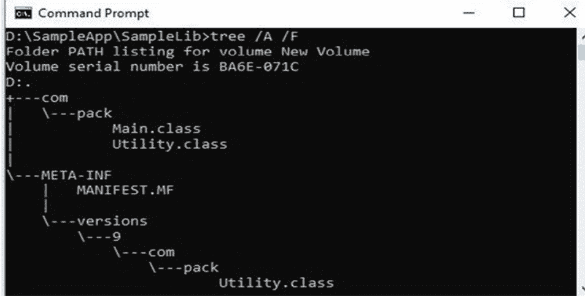

图 5.25：SampleLib 文件夹结构

如你所观察到的，JAR 文件包含了预期的两个版本的组合。

如果你现在读取清单文件（即 `MANIFEST.MF`），它会添加一个 `Multi-Release:true` 属性，如下所示：

```
Manifest-Version: 1.0

Created-By: 9 (Oracle Corporation)

Multi-Release: true
```

我们已经准备好运行文件了。进入项目文件夹，设置你刚刚创建的 JAR 文件的类路径（classpath）并执行应用程序。

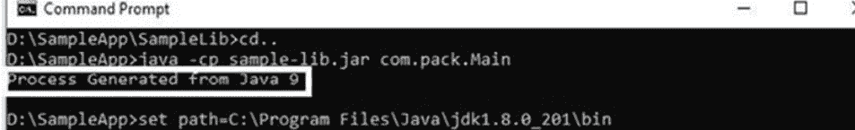

图 5.26：执行

如你所示，取决于你正在编译的代码版本，JAR 文件会选取 `Utility` 类的相应实现。

# 结论

在本章中，我们讨论了可以将旧代码迁移到 Java 9 的步骤。虽然由于后兼容性我们可以立即迁移，但存在一些复杂性，例如内部 API 和编程的模块化系统。我们讨论了如何通过不同的设置和命令行来解决这些问题，命令行用于更改或覆盖模块配置。我们首次引入了创建的多版本（multi-release）JAR 文件，它可以结合不同版本的 API，我们讨论了如何实际创建这样的 JAR 文件。

在下一章中，我们将讨论一个非常有趣的工具 `jshell`，它是一个用于检查代码段运行的命令行工具。

# 问题

1. 为什么需要迁移代码？

2. 有哪些不同的命令行选项用于覆盖模块配置？

3. 解释 `--add-opens` 标志的意义？

4. 多版本 JAR 文件的重要性是什么？

5. 解释 `--add-reads` 标志的工作原理？

6. 解释 `--exports` 标志的工作原理？


# 第 6 章：使用 JShell

## 引言

许多编程语言都有一些复杂的概念，在使用它们之前需要进行测试。遗憾的是，开发者大多数时候没有选择，编写一个完整的程序来测试这些概念。此外，有时可能会有复杂的算法，需要对其实现的正确性进行测试。与之前的情况类似，为了测试这一点，开发者需要编写完整的代码或应用程序。虽然这很重要，但非常耗时，而且对此类应用程序的修改需要重新编译整个应用程序。那么，为什么不提供一种机制，让开发者不需要编写完整的代码，而是只需编写片段并检查所需的结果呢？

这就是读取-求-打印（REPL）概念的用处。这是一个开发者可以在其中编写代码段而不是编写完整程序的控制台。一些像 Python 和 Node 这样的编程脚本语言具有这种实现。多年来，Java 开发者一直在等待这样的功能。虽然以前在 Closure 和 Groovy 等其他支持 JVM 的语言中已经存在，但 Java 并不支持。最后，在 JDK 9 引入了 REPL，称为 JShell。

以下是 REPL 的主要用途：

- 检查解释器的简单代码和行为
- 学习新概念的工具
- 与临时场景（adhoc scenarios）交互的环境

（Adhoc 是用于快速且不可重用代码的临时代码。有时也被称为脏代码。）

简单来说，这是一个工具，你可以在其中输入命令，这些命令将在无需编写整个 Java 代码的情况下执行。

## 结构

- 启动 JShell
- 在 JShell 中编写代码
- 与命令交互
- 编辑器
- 反馈模式

## 目标

在本章中，我们将讨论一个名为 JShell 的有趣功能。我们将讨论 JShell 的重要性、JShell 的不同功能以及如何根据你的需求自定义 JShell 的行为。

## 启动 JShell

如所述，JShell 是 JDK 9.0 中推出的功能。因此，在你发出指令启动 JShell 工具之前，请确保你使用的是 JDK 9 或更高版本。JShell 存在于 JDK 的`/bin`文件夹中。

你可以如下所示启动 JShell 工具：

### 命令行提示：`jshell`

```text
D:\Java\java-se-9-ri\jdk-9\bin>jshell
| Welcome to JShell -- Version 9
| For an introduction type: /help intro
jshell>_
```

图 6.1：启动 JShell

要退出 JShell 实用程序，你可以如下所示使用`/exit`命令：

### 命令行提示

```text
D:\Java\java-se-9-ri\jdk-9\bin>jshell
| Welcome to JShell -- Version 9
| For an introduction type: /help intro
jshell> /exit
| Goodbye
D:\Java\java-se-9-ri\jdk-9\bin>>
```

图 6.2：退出 JShell。JShell 支持许多其他命令，我们将在本书的后部分讨论。

JShell 可以配合不同的选项使用，可以通过如下所示的`-h`选项找到：

```text
D:\Java\java-se-9-ri\jdk-9\bin>jshell -h
Usage: jshell <options> [files]
where possible options options:
  --class-path <path> 指定查找类文件的路径
  --module-path <path> 指定查找应用程序模块的路径
  --add-modules <module>,<module,...>
  -q 指定要解析的模块
```

```js
jshell> /list -all

s1 : import java.io.*;
s2 : import java.math.*;
s3 : import java.net.*;
s4 : import java.nio.file.*;
s5 : import java.util.*;
s6 : import java.util.concurrent.*;
s7 : import java.util.function.*;
s8 : import java.util.prefs.*;
s9 : import java.util.regex.*;
s10 : import java.util.stream.*;
1 : int value1=10;
2 : double value2=10.34;
jshell>
```

## 在 JShell 中显示所有代码片段

### 向 JShell 添加类路径

考虑一个名为`Sample.java`的简单类，存储在`/src/mypack`目录下：

```java
package mypack;

public class Sample
{
    public void display()
    {
        System.out.println("Hello from display()");
    }
}
```

编译该类并将`Sample.class`存储在`mypack`中。使用以下命令在`src`文件夹中创建 JAR 文件：

```bash
D:\src\jar -cvf test.jar mypack\Sample.class
```

一旦创建了 JAR 文件，你就可以设置 JShell 的类路径并调用`display()`方法。

```cmd
Command Prompt - jshell --class-path d:\src\test.jar
D:\java9\java-se-r1\jdk-9\bin> jshell --class-path d:\src\test.jar
 Welcome to JShell -- Version 9
 输入类型查看帮助：/help

shell> import mypack.

shell> Sample s1=new Sample()
s1 = = mypack.Sample@20322d26

shell> s1.display()
Hello from display()
```

图 6.11：在 JShell 中设置类路径

### 方法声明中的前引用

很多时候，我们需要在程序中声明包含尚未声明的资源（如变量、方法甚至类）的方法。在 Java 程序中，这种方法会产生编译错误，但在 JShell 中我们可以使用它，因为 JShell 会在调用此类引用时抛出错误。

以下代码片段展示了如何创建方法`calculateTotalSalary()`，该方法内部调用`calculateSalary()`方法。`calculateSalary()`方法尚未创建，但 JShell 在引用此类未创建的方法时不会给你任何错误。

```cmd
C:\Windows\System32\cmd.exe - jshell -v
shell> void calculateTotalSalary(int basicSalary, double DA)
  ... double totalIncentive=calculateSalary(basicSalary, DA);
  ... System.out.println("Total salary =
```

图 6.12：前引用

一旦你创建了变量，就可以如下所示调用方法：

```js
jshell> calculateTotalSalary(15000,4)
Total Salary = 17600.0

jshell>
```

## 方法调用的前引用

## 在 JShell 中使用命令

到目前为止我们已经看到了如何在 JShell 中编写和测试不同的代码段。除此之外，JShell 还支持不同的命令，这些命令可以在许多方面帮助开发者。所有命令都以斜杠`/`开头。以下是命令列表及其功能：

- `/var`：列出所有已声明的变量。
- `/methods`：列出所有已声明的方法。
- `/list`：列出所有输入的代码片段，包括变量、方法和公式（如果有的话）。
- `/list-start`：列出在 JShell 实际启动之前执行的所有代码片段。
- `/list-all`：列出在 JShell 实际启动之前执行的所有代码片段，以及开发者进行的所有声明，包括变量、方法和公式（如果有的话）。
- `/drop`：用于删除源码（例如`/drop`将删除 JShell 中为`var1`进行的声明）。
- `/edit`：打开编辑器修改源码（例如`/var1`将打开带有`var1`值的编辑器，可以在编辑器中进行修改并接受该值）。
- `/env`：用于查看或更改 JShell 窗口的上下文。
- `/history`：列出开发者为当前 JShell 实例执行的所有输入。
- `/exit`：用于退出 JShell 工具。
- `/imports`：列出 JShell 中导入的资源。
- `/open`：用于打开文件作为输入。该文件应具有`.jsh`扩展名。
- `/save`：将片段源码保存到指定的文件。
- `/reset`：用于重置 JShell。
- `/n`：返回上一个代码片段。
- `/set`：设置 JShell 的配置信息。
- `/types`：列出 JShell 中声明的类型。

## 编辑器

JShell 是一个用于学习新概念的工具或实用程序。检查片段时，开发者经常需要编辑或修改片段。JShell 提供了内部和外部两种编辑内容的方式。

### 内部 Shell 编辑

在控制台上输入的输入可以使用组合键进行检索，并根据需要随时修改。

这种内部编辑提供了以下功能：

- 输入文本导航
- 历史导航
- 输入修改
- 搜索

让我们讨论 JShell 提供的不同功能，以及它们的工作命令或按键。

### 输入文本导航

这通常用于编辑 JShell 会话中作为片段输入的行。下表显示了编辑过程中基于按键组合的不同按键。

### 表 6.1：文本导航编辑按键

### 历史导航

JShell 有一个有趣的功能，可以列出当前 JShell 实例中开发者完成的所有条目。

### 输入修改

一旦你创建了变量，就可以如下所示调用方法。

### 搜索

一旦你创建了变量，就可以如下所示调用方法。

### 外部编辑器

一旦你创建了变量，就可以如下所示调用方法：

```text
jshell /set feedback verbose
| Feedback mode: verbose

jshell int x=10
x == 10
| created variable x : int

jshell void display() {
...} System.out.println("In method display!");
... }
| created method display()

jshell display()
In method display()
```

## 反馈模式

### 简洁反馈（Concise feedback）

简洁反馈模式不提供变量和方法声明的反馈。然而，它可以像下面的代码所示提供方法调用和表达式的反馈：

```text
jshell /set feedback concise
jshell int x=10
jshell void display() {
... System.out.println("In method display!");
... }
jshell display()
in method display!
jshell 10+20
$ == 30
jshell
```

### 正常反馈（Normal feedback）

这种默认反馈模式提供键值对信息。不再提供`verbose`模式中的详细描述。

```text
jshell /set feedback silent
-> int x=10
-> void display() {
>> System.out.println("In method display!");
>> }
-> display()
in method display!
-> 10+20
->
```

### 静音反馈（Silent feedback）

这被认为是静音反馈。除了方法调用外，它不会显示任何反馈。变量、方法声明、表达式和方法调用的典型行为如下：

```java
Command Prompt - JShell -
JShell /set feedback silent
-> int x=0
-> void display(){
>> System.out.println("In method display!");
>>
-> display()
In method display!
-> 10+20
>
```

图 6.20：静音模式

### 自定义反馈模式（Customizing feedback mode）

预定义的反馈模式对提示符（prompts）、反馈格式、延续样式或截断有内置设置。你可以通过编写自己的反馈来自定义这种行为。

在定义自定义反馈时，你可以提供以下选项：

- Prompts（提示符）：用于普通消息和延续。
- Truncation（截断）：用于截断冗长值。
- Format（格式）：消息或反馈的格式。

你可以设置自己的模式`mymode normal --command`：

```text
JShell>/set prompt mymode normal :mymode

created new feedback mode :mymode
```

上面的命令创建了`normal`模式的副本，名为`mymode`。其中`--command`选项用于指示你同时也正在体验命令反馈。

一旦你自定义了反馈，你还可以设置反馈中预期的提示符。操作方法如下：

```text
JShell>/set prompt mymode "mymode" : "......"
```

该行表示延续将通过`......:`显示，且控制台将由`mymode :`标记。

观察以下代码片段：

```text
JShell>/set feedback mymode

Feedback mode :mymode

mymode:class Sample(

------: int value 1;

......: }

created class Sample

mymode:
```

之前我们讨论过，只要你处于当前的 JShell 实例或当前会话，设置就会一直保留。但可以使用`--retain`选项来自定义行为，如下所示：

```text
mymode: /set feedback mymode --retain
```

执行此命令后，如果你退出当前会话并重新启动 JShell，你将仍然获得名为`mymode`的反馈模式。

## 结论

在本章中，我们讨论了 Java 提供的 REPL，即读取-执行-打印循环工具 JShell。我们讨论了 JShell 的需求，以及它如何帮助开发者在不完整编写应用程序的情况下测试代码片段。我们探索了不同类型的片段（如变量、方法、类等）以及它们在 JShell 中的测试。我们还讨论了如何通过设置类路径（class-path）将反馈设置为外部类，以及如何导入所需的包。我们详细讨论了反馈模式及其用途。

在下一章中，我们将讨论从 Java 9 开始引入的并发 API 中引入的新功能。

## 问题

- REPL 工具的作用是什么？
- 如何为 JShell 实例设置类路径（class path）？
- JShell 中有哪些不同的命令？
- JShell 中有哪些不同的反馈模式？
- 如何设置自定义反馈模式？
- 如何在会话之间保留反馈？

# 第 7 章：响应式编程与并发更新

## 引言

如果不讨论过去几年设计、部署和架构的演变方式，将非常困难。早些时候，我们使用笨重的服务器来部署应用程序。随着时间的推移，它们被较小的服务器取代，使我们能够将其用于其他用途。著名的“云”取代“硬拷贝”的引入改变了世界 360 度。今天，我们依赖互联网，以至于你可能正在线上某处阅读这篇文章。互联网缩短了距离，让世界变得更近、更具互动性和响应性。现在，我们将互联网作为社交媒体。我们轻松地与朋友和爱人交流。现在我们不需要排长队来预订机票、音乐会或电影票。我们更倾向于在线预订。

什么是服务？它其实只是一方面。只是为了尝试你的应用程序在非常繁忙的一日的表现。在繁忙的日子里，应用程序会变慢，在延迟后做出响应。与此同时，我们在交易完成之前收到了成功的消息。这对开发者来说是一个大问题。随着应用程序流量的增加，程序的性能往往会下降。那么我们做了什么？我们在单台服务器上安装了更多服务器。我们要增加多少台服务器？我们是有限制的。我们需要更好的解决方案。

今天，世界正在进入在线。应用程序曾经只是为计算机或笔记本电脑设计的，但现在我们可以自由地使用智能手机在线。现在我们都知道并跟踪自己今天的工作。我们分享关于喜欢的网站的细节，坦诚地说那些不喜欢的。用那个网站非常慢，需要一分钟加载，我需要刷新几次页面，需要 2 分钟才能完成过程，等等。通常有许多类似的经历，但对这些反应却无话可说。作为客户，你是被重视的，而当开发者得到这些反应时，他们感到非常心碎。他们付出了所有努力为了让应用程序在外观和感受上良好，使其能解决客户的基本需求。他们甚至考虑了安全性。他们分分层实现了应用程序，以便流量得到分布。哪里出问题了？

让我们总结一下以前的日子。几年来，大型应用程序安装在服务器上，用户并不期望在毫秒内得到响应。相反，响应的延迟被认为是理所当然的。应用程序需要维护其进程，且资源有限。但在今天，应用程序不仅部署在物理服务器上，还部署在移动设备、云平台，许多应用程序需要 24/7 运行。如何实现这种需求？答案是“响应式”（reactive）。

## 结构

## 响应式旅程

- 处理器（processor）
- 发布者（publisher）
- 订阅者（subscriber）
- 背压（Backpressure）

## 目标

在本章中，我们将讨论响应式概念在 Java 中的演变，以及在应用程序中实现响应式编程所获得的优势。转向响应式编程并不容易，因为你需要讨论许多连接特性，在本章中你将学习发布者和订阅者，这些是该概念的重要特性。通过示例，你将理解数据如何从订阅者流向发布者。除了响应式编程，我们最后还将讨论并发的更新。

## 响应式宣言（The reactive manifesto）


许多不同领域和平台的开发者一直在不断发现软件开发中的各种模式。这些系统用于构建更可靠、灵活、弹性且适应当今世界需求的应用程序系统。简单来说，开发者正在构建响应式系统。

这些系统提供了弹性。它们是松耦合且显然可扩展的。这些系统是消息驱动的，并具有高容错性，以便在灾难情况下保持运行。这些系统设计为具有高响应性的交互式反馈。

下图清晰地定义了响应式系统的特征：

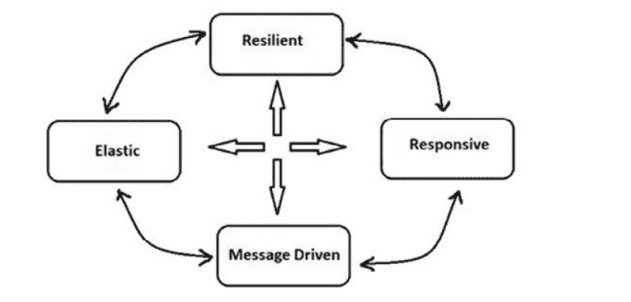

图 7.1：响应式系统的特征

现在让我们详细讨论这些特征。

### 弹性的（Resilient）

我们以最好的方式构建应用程序，但无法否认在实际运行时，应用程序可能会由于某些原因而失败。事实上，在少数情况下，整个应用程序会失败。大多数时候，应用程序的一部分停止工作。尽管只是局部，但从用户的角度来看，这就是应用程序失败。

应用程序必须保持高度可用，即使部分故障也不应无响应。弹性为系统提供了在最关键的情况下保持响应的灵活性。

可以通过以下方式实现弹性：

- 创建应用程序的副本并将其部署在不同的服务器上。
- 将请求或应用程序的一部分委托给另一台服务器。
- 隔离应用程序的组件，以确保应用程序的部分失败后可以恢复而不影响整个系统。
- 以松耦合的方式开发应用程序，使得应用程序的某些部分不需要在应用程序的多个位置进行更改。

### 响应式（Responsive）

每个用户都期望在最短时间内获得结果或输出。每个系统都有其在最短时间内确保正确的响应时间。

尽管开发者尽了所有努力，但由于某些原因，应用程序可能会出现问题。当系统能够在问题发生时立即检测并有效处理时，该系统被称为响应式的。

响应式系统能够正确构建并提供响应。用户总是对响应速度最好的应用程序充满信心。这种响应式系统简化了错误处理，最终激励了用户。

### 弹性（Elastic）

企业应用面临着变化的负载。在繁忙的日子，访问量会更多，而在其他时间则是正常的。响应式系统需要处理这种变化的流量。

在当今世界，大多数开发者已经考虑到负载的变化，并通过管理资源来应对变化。在繁忙的日子，会分配更多资源来处理增加的需求。这些资源可能与硬件或软件有关。响应式系统通过提供最所需的资源来支持扩展，但这是有成本的。

### 消息驱动（Message driven）

响应式系统的组件是松耦合的，并在各个位置进行复制。这些组件依赖异步、位置透明性和非阻塞消息来建立边界。组件的失败也通过消息发现的帮助进行委托。

通过监控消息，系统可以进行繁忙日的负载管理以及背压处理（back pressure）。

位置透明性确保了组件在主机和集群中的语义。非阻塞通信仅针对利用资源的活动接收者，反过来导致了更少的系统开销。

## 响应式之路（Journey to be reactive）

为了支持响应式，Java 已经走过了很长一段路。每当我们提到 Java，首先想到的都是面向对象编程（OOP）。我不会详细阐述 OOP，因为我们所有人都知道它。

但我们能通过仅使用 OOP 来绕过它吗？应用程序无法具备响应式的能力。它需要的不仅于此。让我们从少数开头开始讨论。

这段旅程始于 Java 的并发（Concurrency）概念。并发是同时执行操作以实现高性能的能力。你们或多或少都读过相关内容。

在 Java 中，我们说并发时，通常会想到并发线程。Java 并发围绕线程展开。任何应用程序在这里直接或间接地使用并发。

由于并发在“同时”这个短语周围非常忙碌，当我们使用响应式时，我们完全依赖于操作系统及其调度器。线程之间的切换是由操作系统完成的，其频率之高以至于无人察觉。

如果进程运行很长时间，我们可以同步这种切换吗？这就是 `ThreadGroup`、`Runnable` 和 `Thread` 类。它们允许开发者创建多线程应用程序，此类应用程序的行为取决于操作系统。在这里我们有更多非常基础的操作，例如创建和启动线程。

与其被并发和管理线程所困扰，不如 Java 1.5 引入了 `ExecutorService`。该框架允许开发者根据执行策略调用、执行、调度并控制异步任务的调度。

`ExecutorService` 使我们能够在不使用 `Thread` 或 `Runnable` 的情况下创建线程或线程池。接口还有调度和关闭的方法。释放还通过提供信号量（semaphores）、屏障（barriers）、互斥锁（mutexes）和锁（latches）等类来实现线程间通信的支持。

通过这一切，变量能够实现高性能的原子性：并发算法、生成器和序列。我们见证了线程的创建，然而我们仍然无法充分利用硬件。

在 Java 1.7 中，`fork and join` 被引入作为 `ExecutorService` 的实现。`ExecutorService` 实现了多线程，但没有利用多个处理器的优势。`fork and join` 框架允许利用多个处理器并增加应用程序性能。

该框架设计用于将繁重任务分解为小任务，将它们分配给工作线程，然后通过从每个工作线程收集产生结果。它实现了窃取算法（stealing algorithm）。当一个线程忙于执行任务时，另一个线程可以“窃取”任务以提供高性能。

这是一个处理无限数据流的过程，这些数据经过异步且非阻塞的预处理，以便 CPU 和其他资源可以同时被使用。在现实生活中流是常态，但响应式流必须具备以下特征：

- 背压（back pressure）是现实中的层，响应式流必须是非阻塞的。
- 数据处理必须是异步的。
- 它们必须具有消息驱动和事件驱动的方法，以便生产者确切知道他必须将消息发送给谁，且事件驱动方法有助于维护所有订阅者的列表并在状态变化时通知他们。

Java 9 响应式流的核心在于异步处理数据流，它拥有发布者（Publisher）和订阅（subscription）模型。数据流由发布者发布或推送到数据的消费者（Consumer），并在下图所示的地方被消费或使用：


图 7.3：响应式流

响应式流不仅限于数据的发布和订阅。大多数时候，开发者会在处理器（Processor）的帮助下将数据从一种形式转换为另一种形式。处理器是发布者和订阅者之间的一层。我们可以链联处理器来对数据流执行多次操作。

下面的图使处理器的概念变得更加清晰：


图 7.4：响应式流中的处理器

让我们了解这些响应式流在 Java 中是如何实现的。

## Java 响应式流实现

在第 9 版本之前，Java 还没有响应式流的实现。我们拥有如 RxJava、Akka、Reactor、Ratpack 和 Vert.x 等支持响应式编程的库。在深入研究 Java 9 之前，让我们先讨论它们。

### RxJava

2009 年，Erik Meijer 引入了 RxJava，作为 ReactX 项目中用于 Java 应用的第一个成熟响应式工具。Reactive 项目还针对 .NET、Scala、C++、Ruby、Python、Swift 等提供了实现。RxJava 2.0 实现了 Reactive API 规范。

### Reactor

Reactor 是第四代响应式库，由 Pivotal 开发。Spring 5.0 框架广泛支持了基于 Reactor 3.0 的响应式。

### Ratpack

Ratpack 是一个免费、开源的 Java 库集，用于构建高性能 HTTP 应用程序。Ratpack 为 Java 规范开发，它还使用了 Netty 和响应式原理。

### Akka Streams

Akka 是一个基于 Scala 的工具包，帮助构建基于 JVM 的高并发、分布式应用，这些应用具有良好的容错性。

Akka 基于 Actor 模型处理并发以处理流式数据。尽管 Akka Streams 遵循响应式流宣言，但它与响应式流接口完全解耦。

### Vert.x

Vert.x 是由 Eclipse 开发的工具包，用于开发基于 JVM 的响应式应用。它是事件驱动的并支持非阻塞 API。Vert.x 最棒的一点是可以用极少的硬件扩展应用程序。

## Java 9 响应式流

Java 9 引入了 `java.util.concurrent.Flow` API 来处理响应式流。我们已经熟悉客户端-服务器机制。当客户端请求时，客户端会向服务器发送请求，很可能是同步的。

然而，为了处理响应式流，我们使用异步发布-订阅机制。从这里开始，我们关注 Java 9 响应式流 API。

### 发布-订阅机制

发布-订阅机制是几页前讨论过的双向通信。然而，我们还没有讨论后台究竟发生了什么。我们将使用下面给出的流底层细节。


图 7.5：发布者-订阅者流

订阅者（Subscriber）想要处理由发布者发布的项目。订阅者通知发布者愿意接受某些项目。当项目可用时，发布者将请求的项目推给订阅者。

在这个过程中，背压起着非常重要的作用。限制订阅者愿意接受的项目数量的过程被称为背压。如前所述，背压限制了订阅者的过载。

这种发布者发布项目、订阅者订阅项目的双向通信被称为订阅（subscription）。现在很清楚了，订阅者绑定到单一发布者。

在某些情况下，发布者兼任订阅者。这样的实体被称为处理器（Processor）。处理器作为中间人，接受来自发布者的项目，处理项目，然后将它们重新发布到订阅者端。对项目的处理可能是项目或数据的转换或过滤。

发布-订阅模型具有以下四个组件：

- Publisher（发布者）
- Subscriber（订阅者）
- Subscription（订阅）
- Processor（处理器）

让我们逐一讨论它们。

### Publisher

发布者异步地向注册的订阅者发布项目。

```java
public interface Publisher {
    void subscribe(Subscriber s);
}
```

T 代表生产者将发布的项目的数据类型。Java API 提供了 `SubmissionPublisher` 作为 `Publisher` 接口的实现，它异步发射项目。它使用 `Executor` 类来将数据传递给订阅者。

该类实现了 `AutoCloseable` 接口，当从发布者调用 `close()` 方法时，订阅者将调用 `autoComplete()` 方法。

`SubmissionPublisher` 具有以下方法：

- `offer()`：此方法通过非阻塞地调用其 `next()` 方法异步地向订阅者发布项目。该方法便于在特定时间发布项目。
- `submit()`：它帮助向订阅者发布项目。我们可以选择发布带有某些随机值的项目。但那只会让代码变得复杂，我们将使用预定义的 `range()` 方法，它便于发布我们想要发布给发布者的项目范围。
- `consume()`：此方法将采取在控制台上写入的操作。该方法等待直到所有项目的发射完成，然后检索它们。

到目前为止我们已经讨论了很多理论，现在是实际演示这些概念的完美时机。让我们按照下面的步骤创建一个发布者：

创建一个类 `SubmissionServiceImpl`，它有一个 `emit()` 方法。

该方法将创建一个 `SubmissionPublisher` 对象并发射指定类型的项目，如下语句所示：

```java
SubmissionPublisher sb_publisher = new SubmissionPublisher();
```

使用 `submit()` 方法发布项目。我们可以选择在超时后丢弃某些元素。如果开发者需要删除某些元素，他们可以设置超时。

现在，使用 `submit(sb_publisher:)` lambda 表达式将范围内的项目发布给订阅者：

```java
IntStream.range(10, 20).forEach(sb_publisher::submit);
```

我们可以选择一个单独的循环逐个发布项目。

发布的项目现在可以被订阅者订阅了。然而，我们不知道如何编写订阅者。让我们写一个简单的订阅者，在控制台上打印发射的项目。

完整的类如下所示：

```java
import java.util.concurrent.CompletableFuture;
import java.util.concurrent.ExecutionException;
import java.util.concurrent.SubmissionPublisher;
import java.util.stream.IntStream;

public class SubmissionServiceImpl {
    public static void main(String[] args) throws InterruptedException, ExecutionException {
```

```java
emit();

public static void emit() throws InterruptedException,
ExecutionException {

CompletableFuture future = null;

try (SubmissionPublishers sb_publisher = new
SubmissionPublisher()) {

System.out.println("Subscriber Buffer Size: " +
sb_publisher.getMaxBufferCapacity());

future = sb_publisher.consume(System.out::println);
IntStream.range(10,20).forEach(sb_publisher::submit);

} finally {
future.get();
}
}
```

执行此代码后，你将获得以下输出：

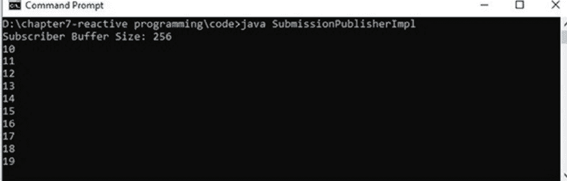

图 7.6：发布者提交演示

从输出中明显看出，我们的发布者发布了从 10 到 20 的元素，这些元素被消费并打印到控制台上。

### 订阅者（Subscriber）

订阅者订阅发布者。在订阅者请求之前，项目不会推送到订阅者。

订阅者具有通知订阅、接受发布者发布的项目、接受发布者发布的错误（在发布项目时发生）以及通知所有发布项目接收完成等功能。

```java
public interface Subscriber {

public void onSubscribe(Subscription s);

public void onNext(T t);

public void onError(Throwable t);

public void onComplete();

}
```

T 代表订阅者将要订阅的项目的数据类型。

下表简要讨论了这些方法及其功能：

**表 7.1：订阅者的回调方法**

### 订阅（Subscription）

订阅充当发布者和订阅者之间的链接。订阅拥有方法来请求项目并取消之前可能发出的请求。

```java
public interface Subscription {

public void request(long n);

public void cancel();

}
```

下表简要讨论了这些方法及其功能：

**表 7.2：Subscription 的回调方法**

### 处理器（The Processor）

处理器是生产者和消费者的结合。处理器有趣之处在于，它可以产生项目，这些项目的数据类型可能与它正在消费的类型不同。

此时，多个处理器可以链在一起，最终处理器的结果将由订阅者订阅。目前，JDK 尚未提供处理器的具体实现，需要开发者根据应用程序的需求使用处理器。

Processor 接口具有以下语法：

```java
public static interface Flow.Processor extends Flow.Publisher(
```

从语法上可以看出，处理器继承了 Publisher 和 Subscriber 的方法。实现符合其需求的方法是开发者的责任。

#### 发布者-订阅者的工作原理

我们有一个被订阅者订阅的发布者。项目的发布及其订阅过程如下述步骤所示进行：

- 发布者维护一个订阅列表。
- 每个订阅都与一个订阅者相关。
- 发布者使用 `onNext()` 通过订阅将项目推送到相关的订阅者。
- 订阅者通过 `subscriber.request()` 方法使用订阅向发布者请求项目。
- 发布者定义了一个 `Executor` 来支持多线程。`request()` 和 `onNext()` 方法异步工作，通过订阅向订阅者产生数据。
- 一旦成功接收到所有项目，订阅者就可以请求一组新数据或取消订阅。

下图显示了发布者-订阅者的工作原理：

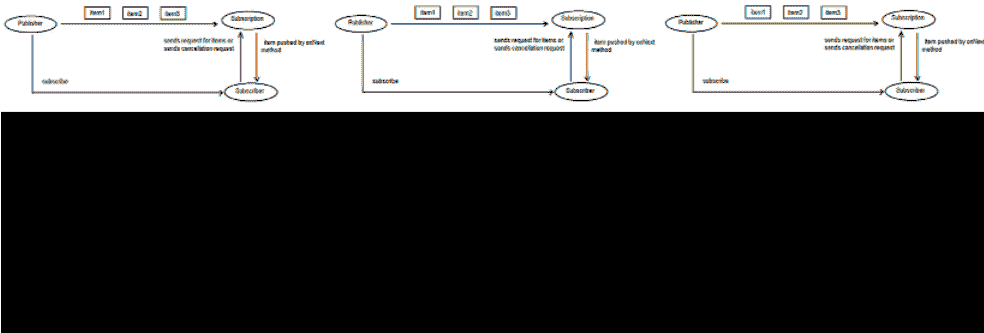

在之前的代码中，我们无法创建订阅者，因此直接在控制台上打印了发出的项目。现在我们已经知道了什么是订阅者以及如何创建一个，现在是时候开发我们自己的自定义订阅者并实现 `Subscriber` 的方法了。

按照所讨论的步骤创建你的订阅者：

- 创建一个 `DemoSubscriber` 类，它将作为我们的订阅者。
- `DemoSubscriber` 实现 `Subscriber` 以处理订阅。`Subscriber` 的类型将定义 `DemoSubscriber` 将处理什么数据。`DemoSubscriber` 如下所示：

```java
public class DemoSubscriber implements Subscriber {

// 代码写在这里

}
```

重写 `Subscriber` 接口的抽象方法 `onSubmit()`。`onSubscribe()` 方法有一个 `Subscription` 参数，我们用它来从发布者获取数据。此外，如果发生任何错误，我们也可以取消请求。

我们将 `Subscription` 声明为类的成员变量，这样可以在类的多个方法中使用同一个对象来请求和取消请求的数据。`onSubmit()` 方法的代码和成员变量声明如下：


```java
private Subscription subscription;

@Override
public void onSubmit(Subscription subscription) {

    this.subscription = subscription;

    subscription.request(5);

}
```

在上面的代码中，订阅正在向发布者请求 5 个项目。

是时候重写另一个方法 `onNext(Long item)` 了。`onNext()` 方法订阅发布者推送到项目，如下代码所示：

```java
@Override
public void onNext(Long item) {

    System.out.println("收到的项目：" + item);
}
```

在执行订阅时，由于某些可能会可能会异常。我们可以通过重写 `onError()` 方法来处理异常，如下代码所示：

```java
@Override
public void onError(Throwable throwable) {

    throwable.printTrace();
}
```

一旦订阅项目的过程完成，`onComplete()` 将被调用。我们将如下代码显示 `onComplete()` 方法：

```java
@Override
public void onComplete() {
    System.out.println("成功接收所有项目");
}
```

现在我们将通过发布者来订阅项目。整个程序将如下：

```java
import java.util.concurrent.ExecutionException;
import java.util.concurrent.Flow.Subscriber;
import java.util.concurrent.SubmissionPublisher;
import java.util.stream.IntStream;

public class DemoSubscriber implements Subscriber {
    private Subscription subscription;

    @Override
    public void onSubscribe(Subscription subscription) {
        this.subscription = subscription;

        subscription.request(5);
    }

    @Override
    public void onNext(Integer item) {
        System.out.println("收到的项目：" + item);
    }

    @Override
    public void onError(Throwable throwable) {
        throwable.printTrace();
    }

    @Override
    public void onComplete() {
        System.out.println("成功接收所有项目");
    }

    public static void main(String[] args) throws
    InterruptedException, ExecutionException {

        SubmissionPublisher sb_publisher = new
        SubmissionPublisher();

        int items=5;

        DemoSubscriber demoSubscriber = new DemoSubscriber();
        sb_publisher.subscribe(demoSubscriber);
        IntStream.range(10,20).forEach(sb_publisher::submit);

        sb_publisher.close();

        Thread.sleep(100);
    }
}
```

在执行应用程序之前，观察代码的最后一行，即 `Thread.sleep(100)`。为什么我们需要这个？如果你记得在普通多线程中，我们需要添加 `wait()` 和 `notify()/notifyAll()` 来保持主线程直到任务完成。所以，在这里如果不持有它，主线程就不会等待订阅者处理数据。如果你不添加 `Thread.sleep()` 方法，应用程序将立即退出而不产生任何输出。因此，我们在这里添加了 `Thread.sleep()` 方法。`sleep()` 的用法只是为了保持线程一段时间。

执行后我们将获得如下：

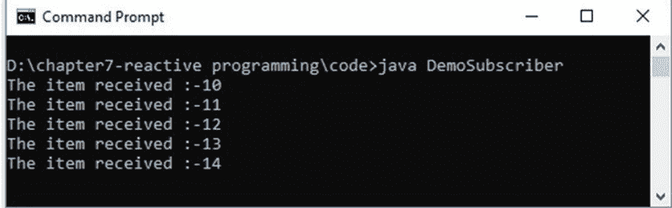

图 7.8: 订阅者演示

发布者使用 `range()` 方法发布了从 10 到 20 的项目。然而，由于我们使用 `subscription.request(5)` 请求了 5 个元素，只有 5 个打印在控制台上。你可能会惊讶，因为 `onComplete()` 方法没有被调用。担心，我们有耐心，我们将在未来几天讨论这个问题。

被消费者消费的每个项目实际上是由线程池中的一个线程接收的，因为 `SubmissionPublisher` 使用 `ForkJoinPool` 作为其执行器。我们可以更新 `onNext()` 方法来查找线程名称，如下：

```java
public void onNext(Integer item) {
    System.out.println("线程名称是：" + Thread.currentThread().getName());

    System.out.println("收到的项目：" + item);
}
```

按照上述方式更新后，你将获得 `ForkJoin.commonPool-worker-1` 的线程名称，如下方的所示：

```
Command Prompt
D:>chapter7-reactive programming>java DemoSubscriber
The thread name is :ForkJoin.commonPool-worker-1
The item received : -10
The thread name is :ForkJoin.commonPool-worker-1
The item received : -11
The thread name is :ForkJoin.commonPool-worker-1
The item received : -12
The thread name is :ForkJoin.commonPool-worker-1
The item received : -13
The thread name is :ForkJoin.commonPool-worker-1
The item received : -14
```

图 7.9：带有线程池的订阅者演示

现在我们处于一个更容易深入理解发布-订阅机制的阶段。上面的代码使我们能够理解发布者发布的项目是如何被订阅者订阅的。然而我们需要讨论此类情况，例如当订阅取消时会发生什么，或者当运行时产生任何异常时会发生什么。深入的理解将帮助我们编写高效的代码。为了理解这一点，我们将考虑三种情况——第一，发布者发布订阅者将正常订阅的项目。第二，我们将考虑在某些条件下取消订阅。最后，在运行时由于某些非预期条件会发生错误。再次强调，我不想将逻辑编码和生命周期混合，因此在这里我们只考虑方法的执行顺序。

## 情况 1：项目的正常发布和订阅

这与我们刚才讨论的相同，所有项目都无问题地显示在控制台上。但你是否注意到，尽管项目已经由订阅者订阅，并且不再有更多事件需要消费，但我们的输出并没有显示任务完成。是的，你认为正确！我们的 `onComplete()` 方法没有被调用。为什么？原因非常简单。坦率地说，代码没有问题。但是，我们的订阅者无法接收到完成事件，因为发布者仍然开启并可以发出项目。因此让我们通过调用 `close()` 方法来修改 `main` 函数。这意味着发布者已发布完成事件，因此 `onComplete()` 方法被调用。更新后的 `main` 函数所示：

```java
public static void main(String[] args) throws InterruptedException, ExecutionException {
    SubscriberPublisher sb_publisher = new SubscriberPublisher();

    int items=5;
    DemoSubscriber demoSubscriber = new DemoSubscriber();

    sb_publisher.subscribe(demoSubscriber);
    IntStream.range(10,20).forEach(sb_publisher::submit);

    sb_publisher.close();

    Thread.sleep(100);

}
```

执行上述更新后的 `DemoSubscriber` 代码后，我们将得到下所示的输出：

```
Command Prompt
D:\chapter7-reactive-programming\java> DemoSubscriber_new
The item received :-10
The item received :-11
The item received :-12
The item received :-13
The item received :-14
The item received :-15
The item received :-16
The item received :-17
The item received :-18
The item received :-19
We consumed all the items successfully
```

图 7.10：带有 close() 方法的订阅者

## 情况 2：项目的取消

在 `onNext()` 方法中，我们直接打印了项目，而没有对订阅进行任何后续处理。有时，我们可能会根据订阅者所需的最大项目数来值并发布数据。为了更精确地处理，我们可以使用如下所示的 `cancel()` 方法：

```java
public void onNext(Integer item) {
    if(some condition goes here) {
        subscription.cancel();
    }
    System.out.println("The item received :-" + item);
}
```

在上面的代码中，一旦满足条件，接收消息的后续过程将停止，订阅将被取消。通过以下代码来看看发生了什么：

```java
import java.util.concurrent.ExecutionException;
import java.util.concurrent.Flow.Subscriber;
import java.util.concurrent.Flow.Subscription;
import java.util.concurrent.SubmissionPublisher;
import java.util.stream.IntStream;

public class DemoSubscriber_cancel implements Subscriber {

    // 代码将位于此处

    private Subscription subscription;

    @Override
    public void onSubscribe(Subscription subscription) {
        System.out.println("onSubscribe() method called");
        this.subscription = subscription;
        subscription.request(2);
    }

    @Override
    public void onNext(Integer item) {
        System.out.println("Next() method called! Item = " + item);
        // 当你想要取消订阅时，在此处编写条件
        subscription.cancel();
    }

    @Override
    public void onError(Throwable throwable) {
        throwable.printStackTrace();
    }

    @Override
    public void onComplete() {
        System.out.println("We consumed all the items successfully");
    }

    public static void main(String[] args) throws InterruptedException, ExecutionException {
        // main 函数与之前的代码相同
        // 只有一处变化。我们将使用 DemoSubscriber_cancel 代替 DemoSubscriber
    }
}
```

执行该代码后，我们将得到以下输出：

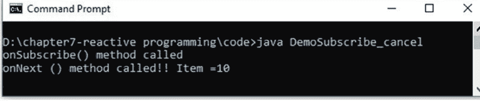

图 7.11：带有 cancel() 方法的订阅者

执行代码后我们将得到如下输出：从输出可以观察到订阅发生了取消，没有完成事件。

## 情况 3：运行时产生异常

在运行时消费项目时，可能会遇到各种异常，可能是简单的 `IOException`，也可能是复杂的 `SQLException`。让我们通过以下代码来理解这种场景。这里我们通过抛出 `NullPointerException` 来演示当产生异常时会发生什么：

```java
import java.util.concurrent.ExecutionException;
import java.util.concurrent.Flow.Subscriber;
import java.util.concurrent.Flow.Subscription;
import java.util.concurrent.SubmissionPublisher;
import java.util.stream.IntStream;

public class DemoSubscriber_Error implements Subscriber {
    private Subscription subscription;

    @Override
    public void onSubscribe(Subscription subscription) {
        System.out.println("onSubscribe() method called.");
        this.subscription = subscription;
        subscription.request(10);
    }

    @Override
    public void onNext(Integer item) {
        System.out.println("Next() method called-"+item);
        throw new NullPointerException();
    }

    @Override
    public void onError(Throwable throwable) {
        System.out.println("onError method called.");
        throwable.printStackTrace();
    }

    @Override
    public void onComplete() {
        System.out.println("onComplete method called.");
    }

    // main 函数与之前的代码相同
    public static void main(String[] args) throws InterruptedException, ExecutionException {
        // ...
    }
}
```

执行后，你将得到以下输出：

```
D:\chapter7-reactive-programming\java> DemoSubscriber_Error
subscribe() method called.
Next() method called!-10
onError method called.
```

图 7.12：带有 onError() 的订阅者

输出清晰地表明，当产生异常时，项目没有被消费，`onComplete()` 方法也没有被调用。

# 发布者-处理器-订阅者的工作

处理器处理发布者推送的项目，并如所述将其发送给订阅者。下图是该过程示意图：

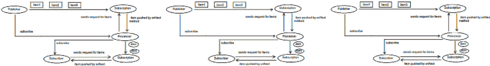

图 7.13：发布者-处理器-订阅者流程

整个流程可以通过以下步骤进行讨论：

- 发布者通过 `onNext()` 方法将项目推送到处理器

- 处理器将处理这些项目

- 处理完成后，处理器将项目发送给订阅者

- 当订阅者和处理器请求的项目数量不同时，处理器维护一个数据缓冲区来存储项目

- 发布者和处理器都定义了一个 `Executor` 来支持多线程


请求项目（`request()`）和推送数据（`onNext()`）的方法是异步执行的。

我们将通过以下步骤创建一个计算发布者项目平方的处理器：

- 创建`DemoProcessor`类，我们将在其中处理数据。

`DemoProcessor`类将继承`SubmissionPublisher`类并实现`Processor`接口。代码如下所示：

```java
public class DemoProcessor extends SubmissionPublisher implements Processor {
    //这里代码将放在此处
}
```

创建一个`DemoProcessor`类，其中每个项都由`Publisher`推送，我们将计算它的平方值。

声明一个`Subscription`类型的数据成员，这将使我们能够保留该引用，以便在`onNext()`方法中请求下一个项。

我们现在必须重写`onSubscribe()`方法，该方法将通过`Subscription`方便请求元素，如下所示：

```java
@Override
public void onSubscribe(Subscription subscription) {
    subscription.request(5);
}
```

当项到达时，我们需要计算其平方值。处理每个项的代码将位于`onNext()`方法中，如下所示：

```java
@Override
public void onNext(T data) {
    System.out.println("Received item from the publisher: " + data);
    this.submit(data * data);
}
```

`submit()`方法会异步推送处理后的项。正如我们之前所做的，现在是时候重写`onError()`方法了，如果在订阅过程中发生任何异常，该方法将被调用。

```java
@Override
public void onError(Throwable throwable) {
    throwable.printStackTrace();
}
```

在`onError()`方法之后，我们现在将重写`onComplete()`方法，该方法将在所有项被成功消费后被调用：

```java
@Override
public void onComplete() {
    System.out.println("data received successfully");
}
```

现在我们需要编写`main()`函数。你可以在下面的实际程序中找到其实现：

我们将在此中处理`double`数据类型，因此我们需要另一个订阅我们发布者`double`数据的订阅者。为此，让我们创建`DemoSubscriber1`：

```java
import java.util.concurrent.ExecutionException;
import java.util.concurrent.Flow.Subscriber;
import java.util.concurrent.Flow.Subscription;
import java.util.concurrent.SubmissionPublisher;
import java.util.concurrent.stream.IntStream;

public class DemoSubscriber1 implements Subscriber {
    //代码将放在此处
    private Subscription subscription;

    @Override
    public void onSubscribe(Subscription subscription) {
        this.subscription = subscription;
        subscription.request(5);
    }

    @Override
    public void onNext(Double item) {
        System.out.println("The item received:-" + item);
        //throw new NullPointerException();
    }

    @Override
    public void onError(Throwable throwable) {
        throwable.printStackTrace();
    }

    @Override
    public void onComplete() {
        System.out.println("We consumed all the items successfully");
    }
}
```

以下是处理器的代码：

```java
import java.util.concurrent.Flow.Processor;
import java.util.concurrent.Flow.Subscription;
import java.util.concurrent.SubmissionPublisher;
import java.util.concurrent.stream.DoubleStream;
import java.util.concurrent.stream.IntStream;

public class DemoProcessor extends SubmissionPublisher implements Processor {
    //这里代码将放在此处

    @Override
    public void onSubscribe(Subscription subscription) {
        subscription.request(5);
    }

    public void onNext(Double data) {
        System.out.println("Received item from the publisher: " + data);
        double x = data.doubleValue() * data.doubleValue();
        this.submit(x);
    }

    @Override
    public void onError(Throwable throwable) {
        throwable.printStackTrace();
    }

    @Override
    public void onComplete() {
        System.out.println("data received successfully");
    }

    public static void main(String[] args) throws InterruptedException {
        SubmissionPublisher sb_publisher = new SubmissionPublisher();
        DemoSubscriber1 subscriber = new DemoSubscriber1();
        DemoProcessor processor = new DemoProcessor<>();
        sb_publisher.subscribe(processor);

        processor.subscribe(subscriber);
        DoubleStream.of(10.0, 20.0).forEach(sb_publisher::submit);

        Thread.sleep(1000);
    }
}
```

执行`main`函数后，我们将得到如下输出：

```bash
## Command Prompt
D:\chapter7-reactive programming>java DemoProcessor
Received item from the publisher: 10.0
Received item from the publisher: 20.0
The item received :-100.0
The item received :-400.0
```

图 7.14：处理器实现

发布者发布了两个项；如果你想添加更多项，一旦项被发布，处理器就会处理它们。在这里，在我们的案例中，我们计算了平方。处理后，处理器会发射它们，现在最终由订阅者订阅。

到目前为止，我们讨论了许多关于发布者和订阅者的内容，然而，如果不讨论非常重要的**背压（backpressure）**概念，讨论将是不完整的。

## 背压

根据订阅者的接受意愿来限制项数量的过程被称为背压。背压在防止订阅者产生开销方面起着至关重要的作用。随着订阅者负载的增加，发布者推送项的速度将超过订阅者可以消费的速度。现在，系统将做出响应，阻碍其性能，这可能导致系统失败。或者，发布者发布的在队列中等待的项将被丢弃。背压将减轻订阅者的负载。

背压在发布者发布速度快于订阅者消费速度时会导致以下两种情况：

- 订阅者以其消费数据的速度顺畅运行。

- 当发布者发布数据的速度超过订阅者消费速度时，情况会出现问题。

背压从下面的图中可以清晰看到：


图 7.15：背压流

在正常情况下，如果不妥善处理，我们将丢失数据的风险。为了避免数据丢失，我们需要应用以下策略之一：

- 使用缓冲区：我们可以分配缓冲区存储数据。使用缓冲区有一个缺点：缓冲区容量有限。

- 丢弃多余数据：在软件情况下，我们可以考虑这种。

- 阻塞数据：由于消费者需要时间消费数据，数据流会被阻塞。

开发者可以选择上述方法中的任何一种，或者开发者处理这种情况的技术被称为背压。在`DemoSubscriber`中，我们实现了`onNext()`方法，它在控制台上打印项。这导致了一个正常情况，即数据以发布者相同的速度被消费。现在，问题是这种这种情况是如何通过背压处理的？答案非常简单。消费者处理第一个项后，将向发布者请求下一个项，代码所示：

```java
import java.util.concurrent.ExecutionException;
import java.util.concurrent.Flow.Subscriber;
import java.util.concurrent.Flow.Subscription;
import java.util.concurrent.SubmissionPublisher;
import java.util.concurrent.stream.IntStream;

public class DemoSubscriber_BackPressure implements Subscriber {
    int count;

    public DemoSubscriber_BackPressure(int count) {
        this.count = count;
    }

    private Subscription subscription;

    @Override
    public void onSubscribe(Subscription subscription) {
        this.subscription = subscription;
        subscript.request(count);
    }

    @Override
    public void onNext(Integer item) {
        if (count > 0) {
            System.out.println("The item received-" + item);
            for (int i = 0; i<= 10000; i++) {
            }
            System.out.println("Time consuming processed done");
            subscript.request(1);
        }
    }

    @Override
    public void onError(Throwable throwable) {
        throwable.printStackTrace();
    }

    @Override
    public void onComplete() {
        System.out.println("We consumed all the items successfully");
    }
}
```

```java
public static void main(String[] args) throws InterruptedException, ExecutionException {
    SubmissionPublisher publisher = new SubmissionPublisher();

    DemoSubscriberBackpressure demoSubscriber = new DemoSubscriberBackpressure(4);

    publisher.subscribe(demoSubscriber);

    IntStream.range(10, 20).forEach(publisher::submit);

    publisher.close();

    Thread.sleep(100);
}
} // Closing bracket for class
```

执行后，你将获得以下输出：

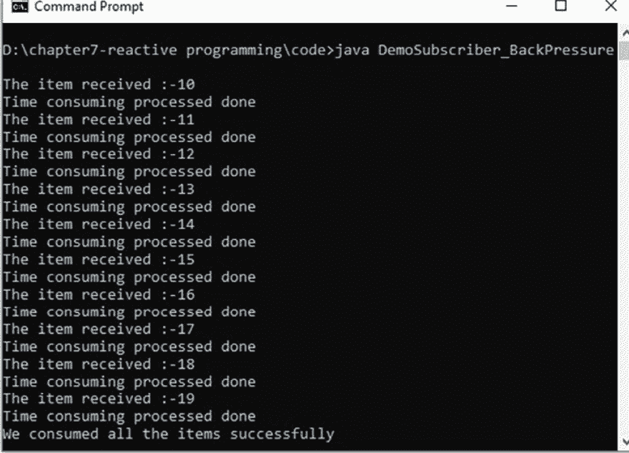

图 7.16：背压演示

在`onNext()`方法中，我们请求订阅下一个项目，这使得订阅者能够在不受任何工作质量压力的情况下控制局面。

## 并发中的更新

异步代码是当今应用开发中所需的实现之一。业务流程正以前所未有的速度增长，这需要大量时间来完成分配的任务。实现传统概念可能会为主程序产生大量阻塞，因为线程是由机器生成的。因此，JDK 1.5 引入了`CompletableFuture`接口，在不同的线程中执行任务并将状态通知给主线程。这一介绍将帮助你加深对`CompletableFuture`的了解。这是从 JDK 1.5 开始引入的特性，因此我们不再再次讨论该概念的概念和实现。但由于本文更关注 JDK 9 到 13 之间的更新，我们将讨论这些概念的新 API 实现。

下表提供了有关在并发中引入的新类型方法的信息：

## 7.3: 并发中的更新

## 结论

在本章中，我们讨论了 Java 9 如何通过 Flow API 开始利用多核系统。我们通过不同的场景（如正常订阅、取消订阅以及发生异常时会发生什么）讨论了简单的发布者-订阅者机制。在讨论了项目处理和消费如何发生之后，我们还谈到了对发布数据的中途处理。我们使用`Processor`使该概念变得直观。在考虑 Flow API 时，背压是一个非常优秀的特性。在主题最后，我们深入讨论了背压，以及我们需要做什么才能让慢的订阅者在处理操作时不会被阻塞。最后，我们讨论了 Java 最近版本中与并发相关的新方法。

我们在本章中涵盖了从 JDK9 到 JDK11 的许多特性。在下一章中，我们将探索 JDK12 中引入的特性。

## 问题

- 解释响应式流的属性。

- `SubmissionPublisher`有哪些不同的方法？

- 订阅者的`onNext()`方法的作用是什么？

- 取消订阅的`cancel()`有什么意义？

- 如何处理订阅者中发生的异常？

- 解释背压的概念。

## 第 8 章

## Java12 的新特性

在较早章节中，我们讨论了各个版本中的新特性和更新。2018 年 9 月，Java 11 发布。恰好六个月后，根据 Java 的发布周期，Java 12 于 2019 年 3 月发布。与之前的版本类似，这次发布也带来了许多侧重于改进性能、API 等新特性。语句被修改以使编码实践更加容易；垃圾回收引入了返回未使用内存的概念，这缩短了暂停时间。Java12 的主要重点实际上是通过 GC、AarchPort、微基准测试等改进性能。由于 Java 12 不再提供长期支持（LTS），它拥有 Oracle 的短期支持，这意味着在下一个版本（即 Java 13）发布之前，它将获得所有的商业支持。虽然它不是一个主版本，但你也应该注意不要将其视为小版本，因为它相对于之前的版本引入了 8 变化。

## 结构

- Shenandoah：低停顿时间垃圾回收器（实验性）

- 微基准测试套件 (Microbenchmark suite)

- Switch 表达式

- JVM 常量 API

- 一个 Aarch64 端口，而非两个

- 默认 CDS 存档

- 用于 G1 的中止混合集合

- G1 立即返回已提交的未使用内存

## 目标

在本章中，我们将讨论 Java12 中引入的各种特性。我们将介绍该版本引入的新编码实践和内存管理实践。在每个版本中，如果存在 API 改进、弃用建议和移除组件，我们还将在本章末尾讨论这些更新。

## 下载 Java12

你可以从以下地址下载 Java12：

https://www.oracle.com/technet/java/javase/downloads/jdk12-downloads-5295953.html

## Java SE 开发 Kit 12.0.1

你必须接受 Oracle SE 的 Oracle Technology Network 许可协议才能下载此软件。感谢接受 Oracle SE 的 Oracle Technology Network 许可协议；你现在可以下载此软件。

| 产品 / 文件描述 | 文件大小 | 下载 |


| 操作系统 | 文件大小 | 文件名 |
| :--- | :--- | :--- |
| Linux | 154.7 MB | `jdk-12.0.1_linux-x64_bin.deb` |
| Linux | 162.54 MB | `jdk-12.0.1_linux-x64_bin.rpm` |
| Linux | 181.18 MB | `jdk-12.0.1_linux-x64_bin.tar.gz` |
| macOS | 173.4 MB | `jdk-12.0.1_osx-x64_bin.dmg` |
| macOS | 173.7 MB | `jdk-12.0.1_osx-x64_bin.tar.gz` |
| Windows | 158.49 MB | `jdk-12.0.1_windows-x64_bin.exe` |
| Windows | 179.45 MB | `jdk-12.0.1_windows-x64_bin.zip` |


你可以根据你的操作系统下载 Java 12 并按照本章中的方法进行操作。一旦你准备好了编译器，让我们探索 Java 12 吧。

首先，我们将讨论该版本中的增强提案 (JEP)。

### JEP 189: Shenandoah：一种低停顿时间的垃圾回收器

早期的 GC-CMS 和 G1 使用并发方法进行垃圾回收：Shenandoah 是一种低停顿时间的垃圾回收器，它使用并发压缩周期。通常的理解是时间随堆大小的增大而增加。使用 Shenandoah，停顿时间不再与堆大小成正比。需要理解的是这种 GC 的测试是在较大的堆上进行的，如果你使用的是较小的堆，那么这并不是你应该选择的 GC。

Shenandoah 的工作可以通过以下阶段解释：

**初始标记 (Init mark)**

这被认为是一个基础步骤，启动并发标记。它在准备好堆和应用程序线程后扫描根集。你可以将其视为 GC 循环中的第一个阶段。

**并发标记 (Concurrent mark)**

在此阶段中，当应用程序运行时，会追踪可达对象。该间隔取决于活跃对象的强度以及堆中可用的对象图。

**最终标记 (Final mark)**

这是 Shenandoah 循环的第二阶段。在此循环中，GC 完成了并发标记过程。同时，它还初始化了区域的疏散过程。这有助于找到下一阶段所需的时间。

**并发清理 (Concurrent clean up)**

在此阶段中，GC 回收在并发标记过程中检测到的没有活跃对象的垃圾区域。

**并发疏散 (Concurrent evacuation)**

这是传统 GC 过程的一个重大转变。在此过程中，集合的对象被复制到其他区域。

**初始更新引用 (Init update references)**

这是循环中的第三阶段，也是最短的阶段。该过程唯一的工作是确保所有的 GC 和应用程序线程都已完成疏散，并为下一阶段做好准备。

**并发更新引用 (Concurrent update references)**

再次遍历堆：在执行的同时，它会更新在疏散期间移动的对象的引用。

**最终更新引用 (Final update references)**

这是循环的最后阶段。此过程期间的主要任务是更新现有的根集。它还回收区域。

**并发清理 (Concurrent cleanup)**

这是最后一个过程，整个集合被回收。

如果 GC 对你来说不是问题，那么没有必要使用这种 GC。在这种情况下，你可以使用修改后的 G1。

### JEP 230: 微基准测试套件 (Microbenchmark suit)

众所周知，微基准测试是在较小水平或规模上测试软件组件性能的设施。与实际上测试整个系统的 benchmark 不同，微基准测试软件中的一小部分代码。事实上，可以认为 benchmark 和微基准之间存在相关性，因为当你使用微基准进行性能测试时，你可以深入应用程序的部分。

JEP 230 引入了微基准测试套件，它包含了检查 JVM 性能的预定义测试。通过它，可以轻松地对 JVM 进行持续性能测试，因为该套件位于 JDK 源码的一个目录内。

要使用 JMH，你需要使用 JMH Maven 骨创建 JMH 项目。与普通的 Maven 项目类似，这将生成一个带有单个 Java 类和 `pom.xml` 文件的 Java 项目。我们目前不关注如何配置 `pom.xml` 文件，但我们将会讨论如何进行基准测试。

生成的类如下：

```java
import org.openjdk.jmh.annotations.Benchmark;

public class {
{
@Benchmark
public void testMethod()
{
//这是一个用于构建你的 JMH 基准测试的示例/模板。请根据需要进行编辑

// 在此处放置你的基准测试代码。
}
}
```

你可以将想要基准测试的代码放入方法中。benchmark 使用不同的模式，可以用于测试应用程序的性能。以下是基准测试的不同模式。

表 8.1：基准测试的模式

要指定你想要使用的模式，可以使用如下所示的配合 `@BenchmarkMode` 使用的参数。

```
@Benchmark @BenchmarkMode(Mode.All)

@Benchmark @BenchmarkMode(Mode.AverageTime)
@Benchmark @BenchmarkMode(Mode.SampleTime)
@Benchmark @BenchmarkMode(Mode.SingleShotTime)

@Benchmark @BenchmarkMode(Mode.Throughput)
```

你可以指定想要查看基准测试结果的时间单位。此设置将适用于所有基准测试模式。可以通过使用 `@OutputTimeUnit` 注解进行配置，它接受 `java.util.concurrent.TimeUnit` 作为参数来指定时间单位。`TimeUnit` 类可以使用以下常量：

- `NANOSECONDS`
- `MICROSECONDS`
- `MISECONDS`
- `SECONDS`
- `MINUTES`
- `HOURS`
- `DAYS`

与传统的单元测试类似，你的代码中可能存在一些复杂性，其中被基准的组件可能依赖于其他值。当然，我们不希望初始化过程成为基准测试方法的一部分。此类变量被称为状态变量（state variables）。你可以在称为状态类（state classes）的特殊类中声明此类变量，并将该类的实例作为参数传递给基准测试方法。

创建的状态对象可用于基准测试方法调用不同的场景。为了实现这一点，JMH 会创建不同的范围（scopes）。以下是为该范围定义的常量：

表 8.2：基准测试的范围 (Scope)

观察下面的代码，我们在其中配合状态、模式和输出时间使用了基准测试：

```java
@State(Scope.Thread)

public static class SampleState
{

    public int x=10;

}

@Benchmark @BenchmarkMode(Mode.AverageTime) @TimeUnit(TimeUnit.SECONDS)

public void testMethod(SampleState s)
{
    s.x=s.x*10;
}
```

确保你声明变量的 `@State` 类可以是公共的。此外，如果该类是嵌套类，则必须声明为静态（static）。当然，它必须标有 `@State` 注解。除了 `@State` 注解外，该类还声明了另外两个注解如下：

`@Setup`

表示在状态实例传递给基准测试调用之前要调用的方法：

`@TearDown`

表示在基准测试执行后调用的方法，用于清理资源。

请注意，在这些注解方法内部编写的代码不会计入基准测试计算。

这些注解还接受参数，在 JMH 中称为级别（Level）。这些值指示 JMH 在何时调用此方法。下表显示了该参数的值：

表 8.3：基准测试中的级别 (Levels)

你可以如下所示编写方法：

```java
@Setup(Level.Trial)
public void method1() {
  /*
  /业务逻辑
  */
}
```

## 微基准考虑的问题 (Microbenmarking concerns)

尽管微基准是识别性能的一种有效方法，但这些计算中存在某些我们需要注意的陷阱。

### 死代码 (Dead code)

基准测试过程中的主要关注点之一是死代码。每当你声明用于基准测试的方法时，JVM 都会检查代码是否为死代码。如果代码是死代码，JVM 会消除这段代码，它不会被视为性能测量的一部分。那么什么是死代码呢？如果该方法生成的值在应用程序的后续地方都没有被使用，则 JVM 认为该代码是死代码。

考虑以下代码：

```java
@Benchmark
public void method1() {
  int a=10;
  int b=20;
  int ans=a+b;
}
```

在上述代码中，`a+b` 生成的结果没有被进一步使用，变量 `a` 和 `b` 也没有被使用。因此，所有元素都被消除了，这导致整个方法被消除。现在，这将为性能测量产生错误的输出。因此，我们应该注意避免这种情况出现。

为了避免这种情况，通常使用以下两种方法：

#### 在基准测试方法中使用返回语句

这与你多年来所做的类似。只需向你的方法添加返回语句 `return ans;`，并将 `void` 类型更改为 `int`。

```java
@Benchmark
public int method1() 
{
    int a=10;
    int b=20;
    int ans=a+b;
    return ans;
}
```

#### 将计算出的值传递给 JMH 提供的黑洞 (black hole)

你可以在方法中使用 `blackhole.consume(ans)` 语句。在这种方法中，你不需要更改返回类型。

```java
@Benchmark
public void method1() 
{
    int a=10;
    int b=20;
    int ans=a+b;
    blackhole.consume(ans);
}
```

#### 常量折 (Constant folding)

JVM 优化的另一个关注点是常量折。当 JVM 发现你正在处理常量值时，它会直接将它们替换为常量，而不是重复调用。考虑上面的代码，`a` 和 `b` 的值是硬编码的。因此，`ans` 的值始终等于 30，这是一个常量。因此 JVM 用值 30 替换了整个方法以优化过程。虽然这对优化有好处，但可能会给基准测试过程带来错误的结果。

所以，为了避免这种折叠，你可以将值放在状态对象中，并如下通过状态对象访问。

```java
@State(Scope.Thread)
public static class MyValues{
    public int a=10;
    public int b=20;
}
```

```java
@Benchmark
public void method1(MyValues value) 
{
    int ans=value.a + value.b;
    blackhole.consume(ans);
}
```

虽然对于开发者来说，基准测试并不是一个如此重要的过程，但识别应用程序的性能是一个非常重要的概念。

## JEP 325：switch 表达式 (Switch expression)

JEP 325 对 switch 表达式提出了修改建议。从 JDK 12 开始，你可以使用带有表达式或语句的 switch。

Java 传统的 switch 具有一些障碍，它们不支持在条件后对表达式进行自然思考的方式，因为 switch case 仅是语句。还存在一些问题，即 break 语句被保留作为匹配 case 的选项，这在某些情况下会产生很多困惑。如果 switch 块中缺少 break 语句，还会导致一种非常恼人的“穿透”（fall-through）情况。为了克服这些障碍，该 JEP 提出了以下修改建议。

### 使用 `->` 符号更改表达式标签

当 switch 规则被认为是测试 switch case 的瓶颈时，break 语句被 `->` 标签所取代。这使得右侧的表达式仅在左侧 case 匹配时才执行。表达式标签被认为是传统语法 `...case...break...` 穿透问题的解决方案。下面的代码片段将显示该标签的使用：

```java
switch(variable)
    case value1->expression1/statement;
    case value2->expression2/statement2;
    default -> expression/statement
```

这不仅便于克服穿透问题，还给开发者带来了便利。

考虑以下代码片段：

```java
public class Switch1
{
    public static void main(String[] args)
    {
        String course="Java";
        switch(course)
        {
            case "Java"->System.out.println("I like it !!");
            case "C#"->System.out.println("I hate it !!");
            default->System.out.println("Who are you?");
        }
    }
}
```

让我们编译它：

```
D:\chapter8-what's new in Java12>javac Switch1.java
Switch1.java:8: error: switch rules are a preview feature and are disabled by default.
    case "Java"->System.out.println("I like it !!");

(use --enable-preview to enable switch rules)
1 error
```

图 8.2：switch 规则错误

这是一个令人惊讶的意外，并不愉快！问题在于，默认情况下，Java 12 编译器没有启用 switch 规则。因此，要在编译时开启它，你需要向编译器添加 `--enable-preview --release 12` 选项，并在执行时添加 `--enable-preview` 选项，如下：

```
D:\chapter8-what's new in Java12\javac --enable-preview --release 12 Switch1.java
Note: Switch1.Java uses preview language features.
Note: Recompile with -Xlint for details.
D:\chapter8-what's new in Java12\java --enable-preview Switch1
I like it !!
```

图 8.3：使用 switch 规则

### 多 case 标签 (Multiple case labels)

早期的 Java 版本允许你对 case 语句进行阶梯划分，如果它们属于某些语句，例如：

```java
switch(variable)

case 1:

case 2:

case 3:

statements block 1 ;

break;
```

上述片段显示语句 block 1 是所有 case 共同的，即 case 1、2 和 3。在 Java 12 中，无需创建这样的阶梯，你可以在同一行内编写整个标签，如下：

```java
switch(variable)
case 1,2 -> expression/statements
```

考虑以下代码片段：

```java
public class Switch2

{

  public static void main(String[] args)

  {

    String course="Java";

    switch(course)

    {

      case "Java12","jdk12","Java"->System.out.println("I like it !!");

      case "C"->System.out.println("I hate it !!");

      default->System.out.println("Who are you?");

    }

  }

}
```

在编译并执行上述代码后，你应该得到以下结果：

```
D:\chapter8-what's new in Java12\javac --enable-preview --release 12 Switch2.java

Note: Switch2.java uses preview language features.

Note: Recompile with -Xlint:preview for details.

D:\chapter8-what's new in Java12\java --enable-preview Switch2

I like it !!
```

## 8.4: 使用多个 case

从 switch 返回值

在 case 中，根据使用 `switch` 时执行的异常，代码块预期返回一个值，这对于后续处理非常有用。Java 12 为你提供了从执行块接收返回值的功能。你只需要将变量添加到 `switch` 块中，如下：

```java
data_type = switch(variable)

- case 1 -> value1;
- case 2 -> value2;
```

考虑以下代码片段以理解相同的内容：

```java
public class Switch3

{

    public static void main(String[] args)

    {

        String course="Java";

        String myString=switch(course)
```


{

    case "Java" -> "I like it !!";

    case "C#" -> "I hate it !!";

    default -> "Who are you?";

}

System.out.println("myString=" + myString);

}

}

编译并执行上述代码后，你应该得到以下结果：

## 命令提示符

```
D:\chapter8-what's new in Java12\>javac --enable-preview --release 12 Switch3.java

Note: Switch3.java uses preview language features.

Note: Recompile with -Xlint:preview for details.

D:\chapter8-what's new in Java12\>java --enable-preview Switch3

myString="I like it !!"
```

图 8.5：从 `switch` 返回值

注意，你可以用冒号（`:`）替换 `switch` 规则，但你不能在同一个程序中混合使用它们。

## PEP 344: JVM 常量 API

Java 12 引入了作为 JVM Constant API 的新常量，这对于 Java 开发者比对于应用开发者更有用。它改变了访问可执行文件中可加载常量的方式。该 API 定义在 `java.lang.constant` 包中。继续之前，首先理解什么是可加载常量？正如你所知，每个类都会在常量池中创建条目。常量池通常存储在标签（`tags`）和 `ifid()` 中，其中标签包含常量类型，`ifid()` 是一个描述作为常量的类的数组，被称为可加载常量。每当生成代码时，`invokeddynamic` 操作都依赖于这些数据，并将这些值转换为可使用的值，如数据类型等。对预定义数据类型进行这些建模可能并不理想，但当我们从预定义数据类型转向用户定义数据类型时，过程变得更加复杂。许多此类依赖其他常量的类实例，可能存在某些难以处理的访问相关问题。

为了克服这个问题，Java 12 引入了使用新 API 处理可加载常量的新方法。JVM 现在创建了基于值的符号引用，用于描述不同类型的可加载常量。此 API 提供了可加载常量的名义描述符。

以下是此 API 中存在的不同接口：

表 8.4：JVM Constant API
| | | |

## PEP 340: 一个 A64 架构，而不是两个

340 的目的是移除所有与 arm64 端口、32 位 ARM 端口和 64 位 arm64 端口相关的资源。因此，源代码中位于 arm64 下的 `#ifdefs` 将被移除。

传统上，这将有助于 Java 的贡献者，因为他们现在可以关注 64 位 ARM 的实现，以及维护两个端口所需的全部重复工作。

## PEP 341: CDS 存档

我们已经在之前的 Java 11 特性章节中讨论过 CDS。它最初是作为商业功能启动的，现在已合并到 OpenJDK 中，所有人都可以访问。341 是一个在 64 位平台上创建 CDS 存档的提案。这是通过修改现有的 JRE 构建实现的，使其在链接镜像后执行 `--jxdump`。结果存储在 `lib/server` 中，这确保它成为生成镜像的一部分。

## PEP 344: 为 G 可避免集合

G1 垃圾回收！我们之前也讨论过这个。复习一下，G1 是 JDK 中的一个垃圾回收器。当它遇到空阶段时，它会收集空区域，从而产生大量的自由空间。G1 使用基于预测的模型，该模型与用户定义的暂停时间同步。G1 根据目标暂停时间识别要收集的区域数量。这种选择被称为收集。其理念是，当定义收集集时，G1 必须收集该区域中的所有对象，因为这是垃圾回收阶段的主要要求。有时，如果目标暂停时间内需要收集的对象数量增加，G1 可能会花费额外时间。为了避免这种情况，G1 应该分步执行工作，并在每次暂停后进行收集。

为了实现这一点，收集集被 G1 分为两部分。第一部分是强制的，其他是可选的。所有可以以增量方式处理的部分都被推入强制部分，该部分通常包含年轻代的对象。由于效率考虑，该区域也可能包含部分老年代区域。区域区域比例为 80-20，80% 给强制部分，20% 给老区域，这形成了最优。

作为原因之一，G1 被分配给强制部分。可选部分仅在有剩余时间时才被考虑收集。可能会发生可选部分被考虑收集，但在过程中，G1 发现它已经超过了时间限制。如果发生这种情况，G1 将自行停止收集。由于时间限制的准确性，可选部分由非常小的部分组成，因此可以快速匹配预测的时间限制。

## JEP 346: 及时返回未使用的内存

当我们谈论垃圾回收和内存管理时，内存使用是考虑的重要因素之一。`MemoryUsage` 对象表示内存使用的详细信息。它具有以下值：

表 8.5：内存使用

虽然发现目前使用的 G1 比早期的垃圾回收算法更合适、更高效，但它不能保证有效地将已提交的 Java 内存返回给操作系统。现有的 GC 方法是在进程完成后然后返回内存。虽然 G1 以并发周期闻名，但在返回内存方面，它的效果并没有预期那样有效。如果被强制释放内存，它可以做到。

如果我们不在乎这些事情（因为内存有时被视为次要任务），那么我们就不应该……现在！我们使用云服务，它将内存单元作为组件的一部分提供。想象一种情况：JVM 只利用了少量内存，因为 G1 正在回收堆，但我们仍然需要为未使用的资源付费。另一个问题可能是云服务器无法充分利用其所有硬件。解决方案是将内存返回给操作系统，这将产生收益。

为了向操作系统返回最大数量的内存，G1 将生成一个并发周期。该周期计算整个堆的使用情况。然后该并发周期会自动将未使用的内存返回给操作系统。

为了确保 G1 不因全 GC 失败，我们需要在命令行添加 `-XX+G1PeriodicInvokesConcurrent`。默认情况下，此选项是关闭的。

## 新功能和增强

让我们讨论 JDK 12 引入的一些新功能和增强。此描述还将提供有关代码迁移到 Java 12 时相关的兼容性问题的信息。

## Unicode 11 支持

此版本开始支持 Unicode。以下是在 JDK 11 引入的 Unicode 10 基础上新增的功能：

- 688 个新字符：包括表情符号、版权、半星级评分、占星符号、中国象棋符号等额外字符。
- 11 个区块：这些区块包括来自脚本的 7 个区块以及格鲁吉亚、玛雅数字、印度 Siyac 数字和象棋数字。
- 7 个新脚本：引入了罗兴亚语、苏格底语、多格拉语、Gunjala Modi、Masaskar、Medeferic 等。
- 支持紧凑数字格式：多年来，程序员一直在处理数据使用。有 `float` 和 `double` 数据类型来处理这些数据，这增加了它们的准确性。但许多用户倾向于以紧凑格式使用数据，而不是显示完整数字。例如，数字 10,000 现在被称为 10k。考虑到日常生活中的这些方法，Java 引入了“紧凑格式”的概念，数据可以以人类可读的格式表示。这种格式可以根据用户所在的区域通过 `NumberFormat.Style` 来指定。你可以使用 `NumberFormat` 的工厂方法进行格式化。

让我们通过以下示例进行检查：

```
import java.text.NumberFormat;
```

```java
import java.util.Locale;

class CompactNumber
{
    public static void main(String[] args)
    {
        NumberFormat numberformat = NumberFormat.getCompactNumberInstance(Locale.US, NumberFormat.Style.SHORT);
        String result = numberformat.format(1000);
        System.out.println("Compact Value = *"+result);
    }
}
```

编译并执行后，你将得到以下输出：

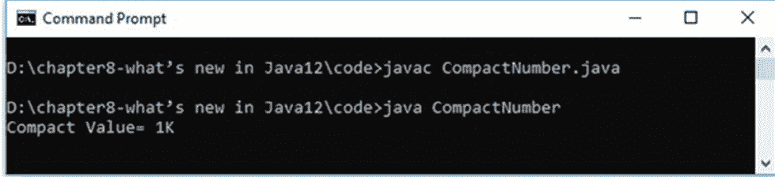

图 8.6: 紧凑数字格式化

## 日本新时代的方块字符支持

大多数国家的日历工作方式相似。日本也使用了相同的格式。但对于官方文档，它使用了日期、名称的月份以及该时代内的年份。在 JDK 12 中，代码点 `U+32FF` 用于表示日本时代的方块字符。`Character` 类中引入了新方法，这些方法保留了与当前日本时代字符相同的属性。

JDK 12 使用占位符名称：代表新时代。这代表时代已经更改，但尚未更新。一旦时代发生变化，它将在随后的 Java 版本中被修改。

## ZGC 并发卸载

在垃圾回收过程中，释放未使用的类内存总是一个耗时的过程。此外，每个未使用的类都可能关联着许多数据结构或内存占用，这可能会影响应用程序的性能。通过 ZGC 的实现，垃圾回收过程的性能显著提升。但 ZGC 之前在类卸载过程中是没有作用的。在 Java 12 中，ZGC 现在支持类卸载。这种卸载是并发的，因为它不会影响 GC 时间。要禁用此功能，请在命令行使用 `-XX:ClassLoading`。

## 在替代内存设备上分配堆的老年代

在讨论 Java 11 的特性时，我们已经讨论了将堆移动到替代内存设备的概念。更进一步，Java 12 引入了另一种有趣的方法，你可以在替代内存设备上分配 Java 的老年代。此实验性功能在 G1 和并行 GC 中可用。

大多数操作系统都可以通过文件系统与 NV-DIMM 内存设备通信。它们可以直接映射虚拟内存。你可以使用以下标志来指定此文件的路径：

```
-XX:AllocateOldGen=
```

当启用此标志时，所有年轻代对象被隐式地放在 DRAM 中，而所有老年代对象被分配在

## 命令行标志 `--XX+ExtensiveErrorReports`

Java 12 为命令添加了另一个标志 `--XX+ExtensiveErrorReports`。此标志用于生成并记录更详细的崩溃信息，这些信息记录在 `hs_err` 日文件中。通常在生产版本中它是默认禁用的。作为开发者，我们可以在需要额外信息时决定开启它。如果你想这样做，请务必注意，因为这些量可能会很大。

## `java.security.manager` 属性的 disallow allow 选项

`java.security.manager` 属性现在有了 `disallow` 和 `allow`。如其所示，JVM 对 `java.security.manager` 有一个 `disallow` 设置，我们无法使用 `setManager()` 方法设置安全管理器，并且它会抛出异常。

## keytool 密钥对添加 `--groupname`

keytool 现在通过另一个选项 `--groupname` 进行了改进。这方便用户指定在创建密钥对时生成的命名命名组。早版本使用的是密钥大小，但由于密钥大小可能相同，因此使用了 `groupname` 选项，它被认为是唯一的。

## jdeps `--print-module-deps` 报告依赖

`jdeps` 的不同选项如 `--print-module-deps`、`--list` 和 `--list-deps` 得到了增强。传递模块依赖分析可以在类路径和模块路径可用的库上执行。对于 Java 12，如果仅考虑 JAR 文件提供的输入，还可以使用此 `--no-recursive` 选项，它提供了非传递依赖分析的请求。

如果缺少任何依赖项，早期的 `jdeps` 工具会抛出错误。从这个版本开始，你可以使用 `--missing-dependency-options` 来停止这种情况。

## 移除的特性和选项

### 移除 `com.sun.awt.SecurityWarning` 类

在 JDK 11 中，`com.sun.awt.SecurityWarning` 类被标记为弃用，并计划在 `Removal=true` 时移除。它在 Java 12 中被移除了。

### 从 `InputStream` 和 `FileOutputStream` 中移除 `finalize` 方法

在 JDK 9 中，`FileInputStream` 和 `FileOutputStream` 的 `finalize()` 方法被标记为弃用，并在此版本中移除。你现在可以使用 `close()`，也可以使用 try-with-resources 选项。

### 在 `java.util.ZipFile/Inflater/Deflater` 中移除 `finalize`

在 JDK 9 中，`java.util.ZipFile`、`java.util.Inflater` 和 `java.util.Deflater` 的 `finalize()` 方法被标记为弃用，并设置为在后续版本中移除。这在 Java 12 中已被移除。如果你有这些类的任何子类，你也应该在实现中移除 `finalize()` 方法并使用替代机制。

### 从 Oracle 构建的版本移除 `YY.M` 版本字符串

Java 8 中的 PEP 322 引入了供应商版本字符串。版本字符串以 `YY.M` 格式修改，其中 `YY` 和 `M` 是 GA 发布日的年份和月份。

从 Java 12 开始，我们将移除版本字符串，因此版本字符串将为空值，且不会被附加到 `Java --version` 命令中。

### 移除 javac 对 6/1.6 source、target 和 release 值的支持

在 PEP 182 中，定义了弃用 Java `--source` 和 `--target` 选项的策略。从 Java 12 开始，对 source 和 target 的 6/1.6 支持以及 release 标志的支持已被移除。

## 结论

在本章中，我们讨论了 Java 12 的新更新。我们还讨论了 Shenandoah 垃圾回收器的意义以及它是如何提高应用程序性能的。我们还讨论了 G1 的自定义以返回未使用的内存以节省资源。Java 12 不仅改进了与内存相关的概念，通过修改 `switch` 表达式并赋予其灵活性为开发者带来了一些缓解。

在本书中，我们从 Java 9 走了很远。接下来是什么？当然，我们知道这还没有结束！！等到这本书发布时，市场上可能已经有 Java 13 了。所以为什么不保持 Java 13 中有的内容呢？在下一章中，我们将讨论将在 Java 13 中引入的一些新特性。

## 问题

- 什么是微基准测试？它的意义是什么？
- 基准测试的不同模式有哪些？
- 什么是死代码？
- Java 12 中 `switch` 表达式的哪些更新？
- 什么是 Shenandoah 垃圾回收器？

# 第 9 章

## Java 13 简介

通过第一章《版本控制洞察》，我们开始了旅程，现在将到达终点。在整个旅程中，我们讨论了 Java 从 9 到 12 的进展。在本书发布时，Java 13 已经在市场上了。这个 13 版本是 Oracle 六个月发布周期的结果。目前，Java 13 处于 Rampdown 阶段二。这对我们意味着，现在没有进一步在该版本下提交的 JEP 了。尽管版本更新是为了在通用可用之前修复错误。根据给定的时间表，初始版本预计于 2019 年 8 月 8 日发布。计划于 2019 年 9 月 17 日发布通用版本。

## 时间线

- J350: 动态 CDS 存档
- JEP 351: ZGC: 提交未使用的内存
- JEP 353: 重实现旧 socket API
- JEP 354: `switch` 表达式（预览）
- JEP 355: 文本块（预览）

## 目标

在本章中，我们将讨论 Java 13 中推荐的各种 JEP。虽然目前该版本的更新并不多，但有一些有趣的特性，如文本块和 `switch` 表达式，我们将进行详细讨论。

## 下载 Java 13

目前，Java 13 作为 openjdk 的一部分可用。由于此版本仍处于开发过程中，完整的商业版本可以在 Oracle 官方网站获取。你可以从以下处下载 Java 13：

```
http://jdk.java.net/13/
```


# jdk.java.net JDK 13 早期访问版本

## GA 发布版本

- `JDK 12`

## 早期访问版本

- `JDK 14`

## 其他资源

- JPcase
- OpenFX
- 参数
- Veiling
- JMC
- 参考实现
- Java 8 SE
- Java 11
- Java 10
- Java 9
- Java 7

## 计划、状态与特性（OpenJDK）

### 文档

- 发布说明
- 测试结果
- API Javadoc

最新构建版本：29（2019/7/11）

- 此构建的更改
- 此构建解决的问题

### 构建版本

这些早期访问的开源构建版本根据 GNU 通用公许可证第 2 版提供，并包含类路径异常。

| 平台 | 文件 | 大小 |
| :--- | :--- | :--- |
| Linux/x64 | TAR（sha256） | 196303863 bytes |
| macOS/x64 | TAR（sha256） | 189242072 |
| Windows/x64 | ZIP（sha256） | 195860370 |
| Alpine Linux/x64 | TAR（sha256） | 197028470 |

图 9.1：下载 Java 13

## JEP 350：动态 CDS 存档

此 JEP 的主要目标是扩展现有应用程序类数据共享（CDS）的优势。通过这种方式，所有需要的类可以在 Java 应用程序执行结束时动态归档。该存档将包含您未添加到默认存档中的每一个类（应用程序和库）。这种实现的优势在于，它消除了用户为每个应用程序创建类列表而需要进行多次尝试的精力。

早些，CDS 是通过以下步骤完成的：

- 通过多次尝试创建类列表。
- 使用创建的类列表转储存档。
- 使用存档运行。

虽然这看起来是一个有效的方法，但这里的问题在于，这种方法仅用于内置类。

动态 CDS 通过 `-Xshare:dump` 选项配合类列表启用。类列表将同时包含内置类和用户定义的类。

请注意，这里在执行期间加载的类将被考虑纳入存档过程。如果某个类存在于 jar 文件中但未参与执行，则它会被添加到存档中。执行时在堆中生成的对象也不会被添加。在某些情况下，应用程序可能会崩溃或突然终止。在这种情况下，不进行存档。

动态存档支持以下配置：

- 静态基础存档，即默认 CDS 存档和动态存档。
- 仅静态基础存档。

目前，要使用动态存档，必须支持作为基础存档的默认 CDS。

如果扩展了应用程序，也可以动态创建共享存档。可以使用以下选项创建：

`-XX:ArchiveClassesAtExit`

下面的代码片段显示了如何创建和使用它。我们不会创建任何花哨或复杂的应用程序。因此，与其研究代码，不如让我们理解创建存档的步骤。

下面的片段显示了如何创建动态存档：

```
D:\java13\>java -version

OpenJDK version "13-ea" 2019-09-17

OpenJDK Runtime Environment (build 13-ea+29)

OpenJDK 64-Bit Server VM (build 13-ea+29, mixed mode)

D:\java13\>javac DynamicCDSDemo.java

D:\java13\>java -XX:ArchiveClassesAtExit=sample.js DynamicCDSDemo

DynamicCDS Demonstration!!

D:\java13\>java -XX:SharedArchiveFile=sample.js DynamicCDSDemo

DynamicCDS Demonstration!!

D:\java13\>
```

图 9.2：创建和使用动态存档

在创建存档时，应用程序、用户定义的类和库类会被添加到顶层。在这一过程中，为了性能考虑，将忽略已经包含在基础层中的类。类的元数据处理是在应用程序执行结束、虚拟机退出之前完成的。额外的元数据在不同的空间中有所不同：

- `rw`：可读/可写数据
- `ro`：只读数据
- `mc`：蹦床（Trampoline）

## JEP 351：GC：无需内存

在之前讨论 Java 11 的特性时，我们谈到了新的 GC。Z 垃圾回收器（Z Garbage Collector）以其对于较大的堆内存具有极低的停顿时间而闻名，这是当前应用程序基础设施需求所需的。但是，ZGC 有一个缺点。ZGC 不是并发的，而且它不会将内存返回给操作系统。目前，增加堆内存是为了满足动态内存需求。当我们在其上构建应用程序时，增加的内存被认为是安全的。有时，应用程序并不使用那部分内存资源，这被认为是浪费。理想情况下，未使用的内存应该返回给操作系统。这就是 ZGC 缺乏的地方。即使内存很长时间没有被使用，这些内存也不会返回给操作系统。

这是一个大问题：

- 你正在使用资源。
- 你正在与其他应用程序共享资源，而未使用的资源仍然留在你那里。
- 你的堆内存随着时间的推移而增加。

因此 ZGC 需要将内存返回给操作系统。为了理解这将如何发生，我们需要深入了解 ZGC 的工作原理。ZGC 由多个称为 `ZPages` 的不同区域组成。这些 `ZPages` 具有不同数量的提交内存。在压缩过程中，`ZPages` 会被释放。ZGC 还包含另一个名为 `ZPageCache` 的逻辑分区。释放的 `ZPages` 被推入此缓存中。该 `ZPage` 缓存区域被重用于新的堆分配。一旦分配完成，它们就会从缓存中移除。缓存中的 `ZPages` 代表未使用的内存，并可以返回给操作系统。`ZPages` 在页面缓存中按照最近使用顺序（LRU）和大小进行升序排列，这使得移除 `ZPages` 变成了一个简单的事件。问题在于，相同的页面被用于由对象提交。那么，我们如何决定这些页面何时从缓存中迁移的策略呢？为此，我们可以定义一个超时时间，用于定义 `ZPages` 在被逐出之前在缓存中存在多久。你可以通过以下选项设置延迟：

```
-XX:ZUnCommitDelay=
```

此取消提交（uncommit）功能是默认启用的。注意，ZGC 不应该包含会导致堆内存移动到其最小尺寸以下的内存。因此，如果启动 JVM 时设置了将最小堆大小保持为与最大堆大小相同，则取消提交能力将被禁用。

## JEP 353：实现遗留 socket API

Socket 编程对你来说并不陌生。事实上，它在 JDK 1.0 就被引入了。早期版本的 socket 编程 API 对开发者来说要复杂得多。此 JEP 建议改进 `java.net.Socket` 和 `java.net.ServerSocket` API 的实现。这些整个更新都是 Project Loom 的一部分。Loom 专注于孵化 JVM 特性以及构建在它们之上的 API。为了创建轻量并发且易于使用的编程模型，它使用了以下结构：

- 纤维（Fibres）
- 尾调用消除（Tail-call elimination）

让我们讨论此 JEP 如何简化 socket 编程。整个 Java 网络功能是基于 `java.net.Socket` 和 `java.net.ServerSocket` 的。此外，还有一个提供者 `java.net.Socket`，所有的 socket 操作都委托给它。此外，它使用锁来代替同步方法，以便它可以与纤维通信。旧的 `ServerSocket` 被移动到了 `NoSocketImpl`。因此，早期的 socket 实现现在被称为（此处原文似乎不完整）。当然，这并不是什么大问题，因为旧的实现已经存在了几十年了。因此，旧的 API 并没有被移除，而是通过设置系统属性来使用。你可以设置 `jdk.net.PlainSocketImpl=true` 让 JDK 使用旧实现。`DatagramImpl` 的实现没有变化。

## JEP 354：Switch 表达式

Java 12 引入了 switch 表达式的修改版本。通过 switch 表达式，你可以使用语句或表达式。现在 switch 语句可以像传统上那样穿透（fall through），或者它可以使用新的标签（`->`）。此外，switch 表达式还可以返回它所评估表达式的值。

我们之前已经在上一个章节中讨论过这些特性，即 JEP 325。我们在该标题下详细讨论了这一特性。最初在 Java 12 中作为特性提出的，本应该是 Java 13 的永久性更改。但在收到来自专业人士的反馈后，这些更改在该版本中并不是永久的。

所有特性在该版本中都以实例的形式保留。与其使用 break-with，我们使用 `yield` 语句。

### 语句中的 `yield`

如前所述，修改后的 switch 语句现在可以与 switch 标签（`->`）关联。如果表达式包含单个值，则会自动返回。但如果表达式是执行块的一部分，那么 Java 13 使用 `yield` 语句来返回值，如下代码片段所示：

```java
double salary = switch (EMPTYTYPE) {
```

```java
case "Developer" -> 35000;
```

```java
default -> {
```

```java
double totalSalary=baseSalary+hra+da;
```

```java
yield totalSalary;
```

```java
}
```

上述代码段可以用传统的 switch 块替换，其中 cases 后面跟着一个冒号（`:`）。在这种情况下，你不能像上面的代码那样直接返回值。相反，你必须在每个 case 中编写 `yield` 语句，如下所示：

```java
double salary = switch (EMPTY) {
    case "Manager":
        yield 50000;
    case "Developer":
        yield 35000;
    default:
        double totalSalary=basicSalary+hra+da;
        yield totalSalary;
};
```

## JEP 355：文本块（预览）

在 Java 12 中引入了 JEP 326 特性。它专注于原始字符串字面量，其目标是让复杂或冗长的字符串声明变得简单易读。Java 13 引入的文本块是该特性的改进。

处理字符串是一个非常常见的操作，从 Java 的早期开始就是如此。事实上，人们说它是最常使用的数据类型，因为 Java 投入了大量资源创建 `String` API 以方便开发者使用。在许多情况下，人们必须处理 Java 中的多行字符串，这需要添加转义序列来表示延续。这种转义序列使得代码变得复杂且不可读。如今，随着技术的进步，Java 代码允许将 HTML、SQL 或 JSON 作为源代码的一部分进行插入。添加所有此类内容都是非常复杂的，因为我们需要使用特殊序列。因此，文本块是解决这一问题的方案，它是转义序列的替代方案。文本块是一个概念；它没有移除著名的 `String` API 或处理字符串的运算符的计划。

通常，文本块是一组由定界符包围的字符。文本块使用三个引号作为字符串开始和结束的定界符。一旦你在 `"""` 中声明了字符串，你就可以忽略换行符。

让我们来看一些可以使用文本块的示例：

### 编写 HTML

传统上，HTML 以如下方式插入 Java 中：

```java
String pageData = "<html>\n" +
  "<body>\n" +
  "<p>Welcome, " +
  "Java 13</p>\n" +
  "</body>\n" +
  "</html>\n";
```

这可以用所示的文本块替换：

```java
String pageData = """<html>
<body>
<p>Welcome, Java 13 </p>
</body>
</</html>""";
```

### SQL 查询字符串

SQL 查询字符串总是很复杂的。它们本质上是冗长的且多行的。传统上，我们可以这样写 SQL 查询字符串：

```java
String Info = "SELECT customerID, CustomerName FROM Customer " + "WHERE CITY = 'Mumbai';";
```

这可以用所示的文本块替换：

```java
String info = """SELECT customerID, CustomerName FROM Customer
WHERE CITY = 'Mumbai';""";
```

### 多语言示例示例

通常，我们需要在 Java 代码中注入其他编程片段。一个非常最近的示例是在 Java 中使用 Nashorn ScriptEngine 的 JavaScript 函数。早些，我们可以这样做：

```java
ScriptEngine engine = new ScriptEngineManager();
getEngineByName("nashorn");
engine.eval("function printHello() {\n" +
"print('Hello, world!');" +
"}\n" +
""" +
"printHello();");
```

现在同样用文本块替换为：

```java
ScriptEngine engine=new ScriptEngineManager().getByName("nashorn");
engine.eval("""function printHello() {
print("Hello, world");
}
printHello();");
```

你可以从示例中观察文本块如何让你的代码变得整洁易读。而且，它很简单，不是吗？

了解文本块的后台处理是非常有趣的。当编译器在代码中找到文本块时，会生成以下处理：

- 所有的行终止符都被翻译为 `\u000A`。
- 如果有开头或结尾空格，它们将被移除。
- 即使发现任何转义序列，也会被原样解释。
- 文本块是常量表达式。它们作为 `StringInfo` 被推入常量池。它不会提供关于该条目是由普通字符串字面量还是文本块生成的特定信息。在执行期间，文本块会被转换为字符串实例。

对于文本块的处理，提供了以下方法：

- `stripIndent()`：移除文本块的空格。
- `formatted(Object... args)`：在给定的文本块中进行值替换。

## 结论

在本章中，我们学习了 Java 13 引入了哪些特性。API 或概念没有重大变化，Java 13 是 Java 发布周期中的重要一步。在这个版本中，主要的领域是通过 ZGC 改进内存管理，以及通过修改 switch 和文本块来简化编码实践。

## 问题

- `yield` 在 `switch` 中的作用是什么的？
- 解释 Java 13 中文本块的工作原理。
- 列出新的接口和类。
- 解释 ZGC 如何提高有效的内存管理。

## 索引

- Aarch64：103
- abortable：221
- Akka streams：179
- Apache NetBeans：46–48
- applet API：56
- application data：72–74
- application interface（API）：1，21
- backpressure：199–203
- compact strings：54
- concise：17
- concurrency：203–205
- constant folding：215
- CORBA：106–108
- cryptographic algorithms：113，114
- dead code：214
- default CDS archives：220
- Document Object Model（DOM）：6
- dynamic CDS archive：229
- dynamic class-file constants：101，102
- Eclipse：42–45
- ECDH scheme：110
- Epsilon，no-op garbage collector：103–105
- flight recorder：112
- forward references：160，161
- Garbage collection（GC）：69–70
- heap allocation：79
- HTTP/2 Client：49
- HTTP client：108–109
- input modification：164–165
- input text navigation：163–165
- JSE1.3 version：5
- JSE1.4 version：5，6
- JSE5.0 version：7
- generics usage，benefits：7–10
- JDK 1.0 version：3
- JDK 1.1 version：3
- JDK 1.2 version：3
- JSE version 10：2
- JSE 7.0 version：12
- JSE 7 version：11
- JSE 8 version：14
- time-based release version：17，18
- versions：2，3
- Java 9：35，36
- Java 9 reactive flow API：179
- Java 9+ version：129
- class，compilation：126
- code，testing for compatibility：126
- compile，using Java 8 compiler：130
- compile，using Java 9 compiler：131
- Java 12 version：208
- features and enhancement：222–225
- features and options，removing：225，226
- reference link：208
- Java 13 version：228
- Java-based compiler：80


# 索引

## A

- `techniques`，迁移至 Java 9+ 版本：126
- Java 依赖分析工具（`JDep`）：131 - 133
- Java 开发工具包（`JDK`）：21
- Java EE：106 - 108
- Java 增强提案（`JEP`），在 JSE 9.0 中：49
- Java 链接器（`JLink`）：55
  - 使用：143, 144
- Java 模块：
  - 编译：38, 39
  - 创建：36 - 38
  - 执行：39, 40
- Java 本地接口（`JNI`）：4
- Java 平台模块系统（`JPMS`）：26
- Java 运行时环境（`JRE`）：21
- JavaSE 平台：模块化：27
- Java 标准版（`JSE`）：21

## B

- `HTTP/2` 客户端：49

## J

- `JEP 158`：统一 JVM 日志：49
- `JEP 181`：基于嵌套的访问控制：91 - 94, 99
- `JEP 189`：`Shenandoah`，低停顿垃圾回收器：20
- `JEP 213`：`Coin` 项目：50
- `JEP 214`：GC 组合，在 JDK 8 中移除：51
- `JEP 220`：模块化运行时镜像：51
- `JEP 221`：`Doclet` API：52
- `JEP 222`：读-执行-打印循环（`REPL`）：52
- `JEP 230`：微基准套件：210 - 213
- `JEP 238`：多版本 JAR 文件：53
- `JEP 248`：垃圾回收器：53
- `JEP 251`：多分辨率图像：53
- `JEP 254`：紧凑字符串：54
- `JEP 282`：Java 链接器（`JLink`）：55
- `JEP 286`：局部变量类型推断：61, 62
- `JEP 289`：`applet` API，弃用：56
- `JEP 291`：并发标记清除垃圾回收器，弃用：56
- `JEP 296`：JDK 森林，合并为单一仓库：67 - 69
- `JEP 304`：垃圾回收器接口：69, 70
- `JEP 307`：GC，类型：71
- `JEP 309`：动态类文件常量：101, 102
- `JEP 310`：应用类数据共享：72 - 74
- `JEP 313`：原生头生成工具（`javah`），移除：74, 75
- `JEP 314`：`Unicode` 语言标签扩展：75 - 78
- `JEP 315`：`Aarch64` 内建，改进：103
- `JEP 316`：堆分配，在替代内存设备上：79
- `JEP 317`：基于 Java 的编译器：80
- `JEP 318`：`Epsilon`，无操作垃圾回收器：103 - 105
- `JEP 319`：根证书：80, 81
- `JEP 320`：Java EE 和 CORBA 模块，移除：106 - 108
- `JEP 321`：HTTP 客户端：108, 109
- `JEP 322`：基于时间的发布版本化：82, 83
- `JEP 323`：局部变量语法，用于 lambda 参数：110
- `JEP 324`：密钥交换，使用 Curve 25519：110
- `JEP 325`：`switch` 表达式：215
- `JEP 327`：`Unicode` 10：111, 112
- `JEP 328`：飞行记录器：112
- `JEP 329`：密码算法：113, 114
- `JEP 330`：单文件源码程序，启动：115 - 117
- `JEP 332`：传输层安全（`TLS`）1.3：119
- `JEP 333`：`ZGC`，可扩展低延迟垃圾回收器：119
- `JEP 335`：`Nashorn` JavaScript 引擎，弃用：121
- `JEP 336`：`Pack200` 工具和 API，弃用：122, 123
- `JEP 340`：`Aarch64` 端口：220
- `JEP 341`：默认 CDS 存档：220
- `JEP 344`：可中止的混合收集，针对 G1：221, 222
- `JVM Constant API`：219, 220
- `JEP 346`：未使用的提交内存，从 G1 归：221
- `JEP 350`：动态 CDS 存档：228 - 230
- `JEP 351`：Z 垃圾回收器（`ZGC`）：230, 231
- `JEP 353`：`socket` API，重新实现：231, 232
- `JEP 354`：`switch` 表达式：232
- `JEP 355`：文本块：233, 234
- `Jigsaw`：23
- 紧凑配置：23 - 26
- `JMH`（Java 微基准套件）：210
- JSE 6 版本：
  - 关于：10
  - 更新：10, 11
- JSE 7.0 版本：12, 13
- JSE 7 版本：
  - 关于：11
  - 变更，实现：11
- JSE 8 版本：
  - 关于：14, 17
  - API，定义：16
  - 特性：14, 15
- `JShell`：
  - `classpath`，添加：159, 160
  - 代码，编写：156 - 159
  - 命令，使用：161, 162
  - 方法声明中的正向引用：160, 161
  - 启动：154, 155
- `JShell`，反馈：
  - 关于：166
  - 简洁反馈：167
  - 反馈模式，自定义：169, 170
  - 模式：166
  - 普通反馈：168
  - 设置：167
  - 静默反馈：168
  - 详细反馈：167
- `JVM` 编译器接口（`JVMCI`）：80
- `JVM Constant API`：
  - 关于：219, 220
  - 接口：220

## K

- 密钥交换：
  - 使用 Curve 448：110
  - 使用 Curve 25519：110
- 密钥交换，使用 Curve：
  - 关于 448：110
  - API 变更：111

## L

- 局部变量语法：
  - 用于 lambda 参数：110
- 局部变量类型推断：
  - 关于：61, 62
  - 匿名类，使用：66
  - 集合与数组，使用：64
  - 编译时安全：63
  - `for` 循环，使用：65
  - Java 流，使用：66
  - `try-with-resources`，使用：66
- 长期支持（`LTS`）：207

## M

- 微基准关注点：
  - 关于：213
  - 常量折叠：215
- 微基准套件：210 - 213
- 运行时镜像：51
- 模块：
  - 声明：31
  - 探索：26
  - JDK 模块：28
  - 导出：34
  - 使用：34
  - 多版本：40, 42
  - 多版本 JAR 文件：53
  - 多分辨率图像：53
  - 运行时结构：52

## N

- `Nashorn` JavaScript 引擎：
  - 弃用：121
  - 使用：122
- 原生头生成工具（`javah`）移除：74, 75
- 嵌套的访问控制：91 - 94, 99
  - 关于：16
- 非易失性双端内存（`NV`）：79
- 无操作垃圾回收器：106

## O

- 面向对象编程（`OOP`）：75
- 运行时配置：133

## P

- `Pack200` 工具和 API：
  - 弃用：122, 123
- 编程：64
- `Coin` 项目：50
- 发布：49
- 处理器：18
- 进程：195
- 程序：115 - 117
- 使用：231, 232

## R

- 随机访问内存（`RAM`）：79
- `Ratpack`：179
- 响应式编程：175
- 响应式宣言：173
  - 弹性：174
  - 响应式：174
- 响应式流：177, 178
- 响应式 API：179
- `RxJava`：179

## S

- 搜索：164, 165
- `Shebang` 文件：118
- `Shenandoah`，低停顿垃圾回收器：20
- 静默反馈：168
- 简单 XML 接口（`SAX`）：6
- 单文件源码程序，启动：115 - 117
- `socket` API，重新实现：231, 232
- `switch` 表达式：215, 232
  - 表达式标签变更，通过 `->` 符号：216
  - 多个分支标签：217, 218
  - 值，从 `switch` 返回：218, 219

## T

- 文本块：233, 234
  - `yield` 语句：232, 233
  - `HTML`：234
  - 多语言语言，示例：235
  - SQL 查询字符串，写入：234
- 线程本地分配缓冲区（`TLAB`）：106
- 基于时间的发布版本化：82, 83
  - API：84
  - 弃用的特性和选项：87
  - 移除的特性和选项：84 - 86
  - 系统属性：84
- 传输层安全（`TLS`）1.3：118, 119

## U

- `Unicode` 10：111, 112
- `Unicode` 语言标签扩展：75 - 78
- 统一 JVM 日志：49
- 未命名模块：126 - 129

## V

- 详细反馈：167
- 版本字符串：18
- `Vert.x`：179

## W

- 一次编写，到处运行（`WORA`）：1

## Z

- Z 垃圾回收器（`ZGC`）：
  - 可扩展低延迟垃圾回收器：119
  - 未提交未使用内存：230, 231
- `ZGC`，可扩展低延迟垃圾回收器：
  - 启用：121
  - 标记：120
  - 多映射：120
  - 指针着色：120
  - 重定位：120
