# Java 9：Swing、文档与打印


Ove Thomsen, EA Dania 同行评审


+ 9.2 数值格式化 222

+ 10.2 分析 230

+ 10.4 编程 239

# 前言

本书是软件开发系列书籍中的第九本。编程语言是 Java，该语言及其语法显然占据了很大篇，但这些书籍也关注开发过程以及如何开发良好且健壮的应用程序。本书涉及 Swing 以及如何使用 Swing 开发具有图形用户界面（GUI）的应用程序。我在《Java 2》一书中也探讨了具有图形用户界面程序的开发，本书是《Java 2》的延续，更加强调细节以及 Swing 的内部工作原理。书中的几个章节包含了在实际编程中并不经常使用的主题，但另一方面，这些主题在解决特定问题时是必要的，并在某种程度上有助于开发和维护使用 Swing 编写的复杂用户界面。本书的内容要求读者具备编程和 Swing 的知识，并涵盖了《Java 2》中的内容。本书以一个应用程序的开发结束，主要侧重于图形用户界面。

正如标题所示，这一系列书籍围绕软件开发展开，目标是教导读者如何用 Java 开发应用程序。可以通过阅读相关主题和学习示例程序来掌握，但最重要的是亲自动实践并从零开始编写自己的程序。因此，书中的重要部分是练习和问题，读者必须编写与书中处理的内容相应的程序。该系列的所有书籍都围绕同一个框架构建，并自然地安排测试示例、练习和问题。练习（exercises）与问题（problems）的区别在于，练习处理文中介绍的内容，并且对要做什么描述得相对准确。而问题的描述则较为松散，规模更大，且实际上没有明确的最佳解决方案。这些书是要从头到尾阅读的，但大量的代码示例（包括练习和问题）起着核心作用，读者详细地研究许多示例的代码，并解决练习和问题，或者只是研究推荐的解决方案，是非常重要的。

所有书籍都以一两个较大的示例程序结束，主要侧重于解释程序是如何编写的。另一方面，代码只在有限范围内出现——如果全部的话，读者应该在测试程序时顺便研究完成的代码。此外，它还展示了比示例更大的程序开发过程。

Ove Thomsen, EA Dania 同行评审

+ 9.2 数值格式化 222

+ 10.2 分析 230

+ 10.4 编程 239

# 前言

本书是软件开发系列书籍中的第九本。编程语言是 Java，该语言及其语法显然占据了很大篇，但这些书籍也关注开发过程以及如何开发良好且健壮的应用程序。本书涉及 Swing 以及如何使用 Swing 开发具有图形用户界面的应用程序。我在《Java 2》一书中也探讨了具有图形用户界面程序的开发，本书是《Java 2》的延续，更加强调细节以及 Swing 的内部工作原理。书中的几个章节包含了在实际编程中并不经常使用的主题，但另一方面，这些主题在解决特定问题时是必要的，并在某种程度上有助于开发和维护使用 Swing 编写的复杂用户界面。本书的内容要求读者具备编程和 Swing 的知识，并涵盖了《Java 2》中的内容。本书以一个应用程序的开发结束，主要侧重于图形用户界面。

正如标题所示，这一系列书籍围绕软件开发展开，目标是教导读者如何用 Java 开发应用程序。可以通过阅读相关主题和学习示例程序来掌握，但最重要的是亲自动实践并从零开始编写自己的程序。因此，书中的重要部分是练习和问题，读者必须编写与书中处理的内容相应的程序。该系列的所有书籍都围绕同一个框架构建，并自然地安排测试示例、练习和问题。练习（exercises）与问题（problems）的区别在于，练习处理文中介绍的内容，并且对要做什么描述得相对准确。而问题的描述则较为松散，规模更大，且实际上没有明确的最佳解决方案。这些书是要从头到尾阅读的，但大量的代码示例（包括练习和问题）起着核心作用，读者详细地研究许多示例的代码，并解决练习和问题，或者只是研究推荐的解决方案。

所有书籍都以一两个较大的示例程序结束，主要侧重于解释程序是如何编写的。另一方面，代码只在有限范围内出现——如果全部的话，读者应该在测试程序时顺便研究完成的代码。此外，它还展示了比示例更大的程序开发过程。

Ove Thomsen, EA Dania 同行评审

+ 1. Swing details

2. Layout

3. Swing components

4. User defined components

5. The clipboard

6. Drag and drop

7. Edit text

8. Internationalization

9. Final example

后续部分可能超出了日常生活的需要，但作为重要的问题，我将特别强调拖放以及剪贴板，我还将提到自定义组件的开发。

# Java 9：Swing、文档与打印

Java 9：Swing、文档与打印：软件开发

第一版

© 2017 Poul Klausen & bookboon.com

ISBN 978-87-403-1933-0

Ove Thomsen, EA Dania 同行评审

在 bookboon.com 免费下载电子书

# 目录

前言 7

1 引言 9

1.1 关于 Swing 的说明 9

2 Swing 细节 11

练习 1 16

2.2 尺寸与位置 16

2.3 事件处理 25

2.4 组件的渲染 27

焦点与键盘 44

练习 2 50

问题 1 53

# 3 布局 54

3.1 布局管理器 58

问题 2 65

问题 3 69

4.1 JProgressBar 72

4.2 JTree 81

# 5 用户自定义组件 98

5.1 观视效果 (Look-and-feel) 99

5.2 旋钮 (Knob) 103

5.3 更好的旋钮 115

练习 3 125

5.4 日期选择器 (DatePicker) 126

6.1 MIME 类型 134

6.2 对象序列化 138

练习 4 143

6.3 剪贴板上的图像 145

7.1 拖动图像 162

问题 4 167

8.1 JFormattedTextField 175

练习 5 178

8.2 光标 179

8.3 高亮器 182

8.4 A JTextField 184

练习 6 196

8.4 文档 (Document) 197

练习 7 200

8.5 EditorPane 202

练习 8 208

问题 5 214

+ 9.1 资源包 219

+ 9.2 数值格式化 222

+ 练习 9 226

+ 10.1 任务构化 229

+ 10.2 分析 230

+ 10.3 设计 234

+ 10.4 编程 239

+ 10.5 测试 252

# 前言

本书是软件开发系列书籍中的第九本。编程语言是 Java，该语言及其语法显然占据了很大篇，但这些书籍也关注开发过程以及如何开发良好且健壮的应用程序。本书涉及 Swing 以及如何使用 Swing 开发具有图形用户界面的应用程序。我在《Java 2》一书中也探讨了具有图形用户界面程序的开发，本书是《Java 2》的延续，更加强调细节以及 Swing 的内部工作原理。书中的几个章节包含了在实际编程中并不经常使用的主题，但另一方面，这些主题在解决特定问题时是必要的，并在某种程度上有助于开发和维护使用 Swing 编写的复杂用户界面。本书的内容要求读者具备编程和 Swing 的知识，并涵盖了《Java 2》中的内容。本书以一个应用程序的开发结束，主要侧重于图形用户界面。

正如标题所示，这一系列书籍围绕软件开发展开，目标是教导读者如何用 Java 开发应用程序。可以通过阅读相关主题和学习示例程序来掌握，但最重要的是亲自动实践并从零开始编写自己的程序。因此，书中的重要部分是练习和问题，读者必须编写与书中处理的内容相应的程序。该系列的所有书籍都围绕同一个框架构建，并自然地安排测试示例、练习和问题。练习（exercises）与问题（problems）的区别在于，练习处理文中介绍的内容，并且对要做什么描述得相对准确。而问题的描述则较为松散，规模更大，且实际上没有明确的最佳解决方案。这些书是要从头到尾阅读的，但大量的代码示例（包括练习和问题）起着核心作用，读者详细地研究许多示例的代码，并解决练习和问题，或者只是研究推荐的解决方案。

所有书籍都以一两个较大的示例程序结束，主要侧重于解释程序是如何编写的。另一方面，代码只在有限范围内出现——如果全部的话，读者应该在测试程序时顺便研究完成的代码。此外，它还展示了比示例更大的程序开发过程。

首先，我想提到一下 Swing Utilities，它是一个包含许多静态工具方法的类。我曾使用 `invokeLater()` 和 `invokeAndWait()` 方法来确保某个方法在事件分发线程（event dispatcher thread）中执行。还有许多其他方法，你应该研究这个类以及它提供的方法。大多数方法你很少会用到，但了解它们的存在是有好处的。

另一个类叫做 SwingConstants，正如其名，该类定义了许多常量。鼓励你去研究哪些是常量。通常情况下，不同的 Swing 组件会定义自己的常量，例如关于对齐的常量。也就是说，这些常量被定义在多个地方，而 `SwingConstants` 的意义在于：与其使用各个组件类中定义的常量，你应该使用 `SwingConstants` 中的常量。

最后，是 `SwingWorker` 类，它是一个抽象类，用于在一个或多个后台线程中执行耗时的 GUI 操作。其目标是不让耗时任务在事件分发线程中执行，因为否则程序将处于无响应状态。该类的目标是让你更容易在它们自己的线程中执行耗时任务，而不是由你自己去编写必要的线程代码。

对比本书中关于 Swing 的描述与《Java 2》一书，你对 Swing 提供的用于编写图形用户界面程序的功能大部分熟悉。并不是所有内容都得到了解释，在实践中，必须不断查阅在线文档，部分是因为 Swing 过于庞大，不可能学习所有内容，部分是因为 Swing 仍在发展中。Swing 是一个开发 GUI 程序的非常成功的 API，但也因其列表冗长而受到批评。这没错，但如果你开发了适合你通常解决的任务的自定义类库，Swing 实际上可以运行得非常高效。然而，也有替代方案，当语言是 Java 时，替代方案是 javafx，它是一个用于开发图形用户界面的新 API，但它是《Java 16》一书的主题。

程序的用户界面是通过组件开发的，用户可以对这些组件进行操作，例如 `JButton` 和 `JTextField`。大约有 30 个组件（稍微多一点，取决于你如何计数）——因此有很多工作要做。基础组件被称为 `JComponent`，它是一个包含了所有 Swing 组件共同内容的抽象类。

如今所有的 Swing 组件都支持 Java Beans 规范，这意味着组件由属性组成，属性是一个带有访问器方法的实例变量。如果例如，一个变量名为 `propertyName` 并描述了组件的某个属性，你可以预期该组件拥有 `setPropertyName()` 和 `getPropertyName()` 方法，或者 `isPropertyName()` 方法。前者仅在属性值必须更改时存在，后者仅当其类型为布尔型时存在。

属性可以分为几类：

- 简单属性（Simple properties）：它们是属性，当值改变时不会触发事件。

- 绑定属性（Bound properties）：当值改变时会触发 `PropertyChangeEvent`，且类型为 `PropertyChangeListener` 的对象可以通过 `addPropertyChangeListener()` 方法注册为该 `PropertyChangeEvent` 的监听器。

- 受约束属性（Constrained properties）：也会触发 `PropertyChangeEvent`，但是在值改变之前。类型为 `VetoableChangeListener` 的对象可以通过 `addVetoableChangeListener()` 方法注册为这些事件的监听器（只有少数组件会触发这些事件）。

`PropertyChangeEvent` 分配了三个值：属性名称、旧值和新值。

组件还可以触发 `ChangeEvent`，该事件在属性状态改变时触发。类型为 `ChangeListener` 的对象可以注册为 `ChangeEvent` 的监听器。此类事件仅与单个值相关，即引发事件的组件。

另一种属性是客户端属性（client properties），它们是存储在附加到每个 Swing 组件的 `Hashtable` 中的键值对。这意味着通过 `putClientProperty()` 方法你可以添加或删除客户端属性。例如，你可以按照以下方式添加属性：

```
component.putClientProperty("propertyName", propertyValue);
```

并且你可以使用以下语句将其删除：

```
component.putClientProperty("propertyName", null);
```

你可以使用以下语句获取值：

```
value = component.getClientProperty("propertyName");
```

客户端属性允许你在运行时添加属性，你可以将它们视为一种与组件关联额外数据的机会。客户端属性是绑定的，并且当值改变时会触发 `PropertyChangeEvent`。出于性能考虑，你应该偶尔向组件添加客户端属性。如果你需要多个客户端属性，应该考虑使用 `GridLayout(3, 3, 5, 5)` 来组织它们。

```java
package properties;

import java.awt.*;
import java.awt.event.*;
import java.beans.*;
import javax.swing.*;
import javax.swing.border.*;

public class MainView extends JFrame implements PropertyChangeListener {
    public MainView() {
        super("Properties");
        setResizable(false);
        createView();
        setDefaultCloseOperation(EXIT_ON_CLOSE);
        pack();
        setLocationRelativeTo(null);
        setVisible(true);
    }

    private void createView() {
        JPanel panel = new JPanel(new GridLayout(3, 3, 5, 5));
        panel.setBorder(new EmptyBorder(5, 5, 5, 5));
        panel.add(createButton("A"));
        panel.add(createButton("B"));
        panel.add(createButton("C"));
        panel.add(createButton("D"));
        panel.add(createButton("E"));
        panel.add(createButton("F"));
        panel.add(createButton("G"));
        panel.add(createButton("H"));
        panel.add(createButton("I"));
        add(panel);
    }

    private JButton createButton(String text) {
        JButton cmd = new JButton(text);
        cmd.setPreferredSize(new Dimension(50, 50));
        cmd.setMargin(new Insets(0, 0, 0, 0));
        cmd.putClientProperty("clickCounter", 0);
        return cmd;
    }

    @Override
    public void propertyChange(PropertyChangeEvent e) {
        if (e.getOldValue() != null) {
            JButton cmd = (JButton)e.getSource();
            JOptionPane.showMessageDialog(MainView.this, String.format("%s: %d -> %d", cmd.getText(), e.getOldValue(), e.getNewValue()));
        }
    }
}

class ClickHandler implements ActionListener {
    public void actionPerformed(ActionEvent e) {
        JButton cmd = (JButton)e.getSource();
        Integer value = (Integer)cmd.getClientProperty("clickCounter");
        value += 1;
        JOptionPane.showMessageDialog(MainView.this, String.format("%s has been clicked %d times", cmd.getText(), value));
        cmd.putClientProperty("clickCounter", value);
    }
}
```

（注：OCR 包含了一些散落在页面之间的碎片化代码和描述性文本；我已根据提供的片段重构了逻辑流。）


请注意，`ModelAndView` 实现了 `PropertyChangeListener` 接口，可以注册为 `PropertyChangeEvent` 的监听器。否则，最重要的方法是 `createButton()`，它会创建一个按钮。如何为按钮定义一个客户端属性（client property），这意味着按钮有一个从开始值值为 0 的计数器。按钮的事件处理程序类型为 `CommandHandler`（一个内部类），它会显示上述消息框中的第一个。你应该注意如何引用客户端属性 `clickCounter`，还要注意事件处理程序会将该属性计数加 1。当这种情况发生时，按钮会触发一个 `PropertyChangeEvent`，在这种情况下，将执行 `ModelAndView` 的 `propertyChange()` 方法（`MainView` 已注册为监听器），该方法会打开选择器对话框。

创建 `PropertiesProgram` 项目的副本。你现在必须修改程序使其执行逻辑与之前完全相同，但不再与按钮关联客户端属性，而是应该编写一个扩展 `JButton` 的类型 `CounterButton`，并带有属性 `counter`，窗口应该包含 9 个 `Counter` 组件。注意，这意味着 `setCount()` 方法应该触发一个 `PropertyChangeEvent`。

## 2.2 尺寸与位置

正如《Java 2》书中所述，组件的尺寸由三个 `Dimension` 类型的属性定义：

1. `preferredSize`
2. `minimumSize`
3. `maximumSize`

但这些属性的用途，正如《Java 2》中所解释的那样，完全取决于当前的布局管理器（layout manager）。事实上，允许编写一个完全忽略这些属性的布局管理器。绝对必须提到，组件在窗口中的精确尺寸和位置是由当前的布局管理器决定的。你也可以通过 `setBounds()` 定义组件的尺寸和位置，但此时你应该意识到，布局管理器会抑制通过 `setBounds()`（或 `setSize()`）以及 `setLocation()` 设置的值。如果你想以这种方式放置组件，请通过将布局管理器设置为 `null` 来移除布局管理器。

关于组件的尺寸和位置，请注意以下方法：

- `getWidth()`
- `getHeight()`
- `getSize()`
- `getLocation()`

它们返回组件当前的尺寸和位置。

你还可以定义组件在它所在容器内的对齐方式，基本方法是：

- `setAlignmentX()`
- `setAlignmentY()`

这两个方法都带有一个浮点参数，其中 0 表示左或上，1 表示右或下，这两个极端值之间的值表示组件需要调整的程度。例如 0.5 表示居中。唯一使用这些属性的布局管理器是 `BoxLayout` 或 `OverlayLayout`。

作为所有内容的示例，我将展示一个打开以下窗口的程序：

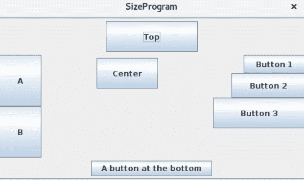

窗口有 8 个按钮，当你点击按钮时，你会得到一个消息框。窗口有一个 `BorderLayout`，它布局了五个面板：

- 顶部是带有一个按钮的 `FlowLayout`
- 左侧是带有两个按钮的 `GridLayout`
- 底部是带有一个按钮的 `FlowLayout`
- 右侧是带有三个按钮的 `BoxLayout`
- 中心是带有一个按钮的 `FlowLayout`

顶部面板的代码为：

```
private JPanel top() {
  JPanel panel = new JPanel(new FlowLayout());
  JButton cmd = new JButton("Top");
  cmd.setPreferredSize(new Dimension(150, 50));
  cmd.addActionListener(e -> show(cmd));
  panel.add(cmd);
  panel.addMouseListener(new MouseAdapter() {
    public void mouseClicked(MouseEvent e) { show(panel); });
  return panel;
}}
```


丹麦正在招聘。你是否希望在一个具有良好工作/生活平衡的创新环境中进一步发展你的丹麦职业生涯？考虑一下丹麦吧！访问 cleantech.talentattractiondenmark.com

> “在丹麦，你可以找到极好的工程工作并在专业领域提升自己。特别是在风能领域，你可以向行业内最优秀的人学习，并在稳定的工作中晋升你的职业。”

Mireia Mare, 来自西班牙的高级工程师。自 2010 年起在丹麦的风能行业工作。

在 bookboom.com 下载免费电子书。点击广告阅读更多信息

如果你点击顶部的按钮，你会得到结果：

| Message |
| --- |
| Width: 150 |
| Height: 50 |
| Preferred size: (150, 50) |
| OK |

这意味着按钮当前的宽度和高度是由其首选尺寸决定的，并且它对应于 `FlowLayout` 布局，使得尺寸是其首选尺寸。点击顶部面板按钮以外区域，你会得到：

| Message |
| --- |
| Width: 500 |
| Height: 60 |
| Preferred size: (160, 60) |
| OK |

面板的首选尺寸为 160 x 60，这是由按钮的首选尺寸决定的，因为 `FlowLayout` 默认在组件之间插入 5 像素的间距。面板当前高度为 60，这是由外层的 `BorderLayout` 决定的，因为北（NORTH）的高度就是组件的高度，另一方面，顶部面板的宽度将是 500。左侧面板的代码为：

```
private JPanel left() {
  JPanel panel = new JPanel(new GridLayout());
  JButton cmd1 = new JButton("A");
  JButton cmd2 = new JButton("B");
  cmd1.setPreferredSize(new Dimension(50, 50));
  cmd2.setPreferredSize(new Dimension(50, 50));
  cmd1.addActionListener(e -> show(cmd1));
  cmd2.addActionListener(e -> show(cmd2));
  panel.add(cmd1);
  panel.add(cmd2);
  return panel;
}
```

如果你点击按钮 A，你会得到消息：

| Message |
| --- |
| Width: 50 |
| Height: 84 |
| Preferred size: (50, 50) |
| OK |

注意这里的 70 是由其首选尺寸决定的，并且对应于 `BorderLayout` 布局，使得西（WEST）的是是首选尺寸。点击按钮 B，你会得到：

| Message |
| --- |
| Width: 50 |
| Height: 84 |
| Preferred size: (50, 50) |
| OK |

然后底部的代码为：

```
private JPanel bottom() {
  JPanel panel = new JPanel(new FlowLayout());
  JButton cmd = new JButton("Bottom");
  cmd.setPreferredSize(new Dimension(150, 50));
  cmd.addActionListener(e -> show(cmd));
  panel.add(cmd);
  panel.addMouseListener(new MouseAdapter() {
    public void mouseClicked(MouseEvent e) { show(panel); });
  return panel;
}}
```

特别情况下，注意这里的按钮没有定义任何尺寸。点击按钮，你会得到结果：

| Message |
| --- |
| Width: 150 |
| Height: 50 |
| Preferred size: (150, 50) |
| OK |

正如第一种情况，按钮的当前尺寸是由其首选尺寸决定的，并且对应于 `FlowLayout` 布局，使得尺寸是其首选尺寸。

| 信息 |
| --- |
| i 宽度: 150 <br>高度: 50 <br>首选大小: (150, 50) <br> OK |

也就是说，在所有三种情况下，按钮的当前大小与其首选大小相同，然后 `BoxLayout` 使用组件的首选大小来确定组件的大小。如果你点击面板底部，你会得到：

| 信息 |
| --- |
| i 宽度: 150 <br>高度: 168 <br>首选大小: (150, 120) <br> OK |

因此，右侧面板的大小为组件的最大宽度，同时也等于窗口的高度。你需要注意的是，面板的首选高度为 120，这是三个按钮高度之和，而 `BorderLayout` 忽略了此值（EAST 使用窗口高度）。

回到中间面板：

```java
private JPanel center() {
  JPanel panel = new JPanel(new FlowLayout());
  JButton cmd = new JButton("Center");
  cmd.setsetPreferredSize(new Dimension(100  50));
  cmd.addActionListener(e -> show(cmd));
  panel.add(cmd);
  panel.addMouseListener(new MouseAdapter() {
    public void mouseClicked(MouseEvent e) { show(panel); }
  });
  return panel;
}
```

在 bookoon.com 下载免费电子书

如果你点击该按钮，你会得到：

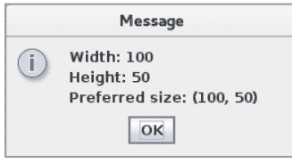

这显示按钮的当前大小就是它的首选大小，就像在 `FlowLayout` 中一样。点击按钮外部，你会得到：

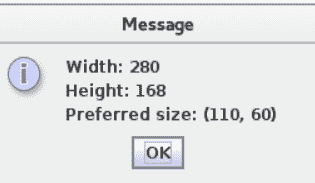

从此可以看出，`BorderLayout` 中的 CENTER 忽略了面板的首选大小。

该示例展示了首选大小的使用方式是不同的。


事件通常在按下键盘按键或鼠标发生某些操作（点击按钮或移动鼠标）时出现。Swing 组件可以触发不同类型的事件，这些类型定义在 `java.awt.event` 或 `javax.swing.event` 中，其中许多是特定于组件。每个事件类型至少定义了触发该事件的对象，但还会包含有关对象状态的其他信息。还有一些事件不是由组件提出的。

为了让对象接收有关事件的通知，该对象必须注册为它的监听器。要实现这一点，对象的类必须实现监听器接口（例如 `ActionListener`），然后就可以注册对象（例如通过 `addEventListener()`）。

抽象类 `Component` 定义了一个 `EventList` 类型的保护字段 `listenerList`，所有组件都继承了它。`EventList` 类型是一个对数组，形式为 `XX / XX` 是事件类型。该数组包含了组件的监听器以及所监听的事件，当事件发生时，组件可以向监听器发送通知。使用数组而不是集合是为了提高性能，因为像 `ArrayList` 这样的集合是一个相对复杂的类。事实上，这意味着每当添加监听器时都必须创建一个新数组（并复制），但使用集合仍然更便宜，因为为给定组件注册的监听器数量是有限的。

所有事件都由注册的监听器对象的事件处理器进行处理，正如《Java 8》书中描述的，这些处理器必须由事件分发线程（event dispatch thread）执行，该线程负责执行所有单个组件的定位和绘制。该线程与一个先进先出（FIFO）事件处理队列相连，各个事件按照它们插入队列的顺序进行处理，在上一个事件完成之前，下一个事件不会被处理。否则，可能会面临组件状态在处理期间（例如重绘时）被更改的风险。因此，你绝不能在事件分发线程之外执行事件处理器，例如直接从另一个线程调用 `fireXX()` 方法。同样，事件处理器和绘制组件的代码必须是高效的，否则你可能会面临系统阻塞的风险，导致事件队列中的事件等待处理而无法被处理。

为了确保所有与事件处理器相关的代码都在事件分发线程中执行，在 Java 中我展示了 `SwingUtilities` 类有两个方法 `invokeLater()` 和 `invokeAndWait()`，它们会将一个可运行对象添加到系统事件队列中。确保代码在事件分发线程中执行的经典模式是如下如下执行代码：

```java
public void doThreadSafeWork() {
    if (SwingUtilities.isEventDispatchThread()) {
        // 在此处执行所有工作...
    }
    else {
        Runnable callDoThreadSafeWork = new Runnable() {
            public void run() {
                doThreadSafeWork();
            }
        };
        SwingUtilities.invokeLater(callDoThreadSafeWork);
    }
}
```

在这里首先测试代码是否由事件分发线程执行。当 `SwingUtilities` 通过 `invokeLater()` 接收到一个 `Runnable` 时，它会被立即转发到 `SystemEventQueue` 中。

### 2.4 组件的渲染

当机器在屏幕上显示组件时，意味着组件必须被绘制，这被称为 Swing 正在渲染组件。如果组件稍后发生变化——例如点击了按钮——它必须重新绘制。通常，组件通过执行 `paint()` 方法来绘制，对于自定义组件，即由程序员负责绘制组件，你必须重写此方法，且重写必须始终以 `super()` 开始。事实上，这并不简单，因为组件上会发生很多事情，例如组件可能完全或部分地被另一个组件覆盖。

作为一个示例，我将展示一个自定义组件。应该立即说明，自定义组件的编写方式与以下示例不同，但我稍后会回到它。如果你打开 Birds 程序，它会显示以下窗口：


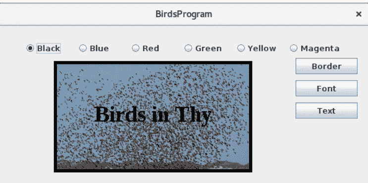

在这里，图片是窗口中所有其他组件之一。这是一个非常简单的组件，具有固定大小，并显示一张图片，上面绘制了一个框并在上方绘制了文字。组件具有某些属性，你可以确定框的宽度并更改文字。你还可以更改绘制文字的字体，最后你可以更改框和文字的颜色。如果你点击图片，组件会触发一个注册监听器可以捕获的 `ActionListener`。该组件的代码如下：

```java
package birdprogram;

import java.awt.*;
import java.awt.event.*;
import java.awt.geom.Rectangle2D;
import javax.swing.*;

public class TheBirds extends JFrame {
    private static ImageIcon birds =
        createImageIcon("/birdprogram/birds.jpg", 320, 180);
    private float borderWidth = 5;
    private String text = "Birds in Thy";

    public TheBirds() {
{
        setBackground(Color.black);
        setFont(new Font("Liberation Serif", Font.BOLD, 36));
        addMouseListener(new ClickHandler());
    }
}
```


卓越的经济学与商业专业位于：

格罗宁根大学（`university of groningen`）


> “成功的国际职业的完美开端。”

[点击此处](发现为什么格罗宁根大学无论在社交还是学术上都是学生的最理想之地)

`www.rug.nl/feb/education`

在 `bookoon.com` 免费下载电子书

点击广告阅读更多

---

首先，应该注意的是，该类继承了 `JComponent`，因此它是一个组件。这意味着在其他方面，该组件拥有 `JComponent` 提供的所有功能。该类定义了一个指向图片的静态变量。你需要注意的是，该类使用 `getImage()` 方法来加载图像，并赋予其 320 × 180 的尺寸，这与组件的大小相同。该类还定义了实例变量，其中一个定义了框架的宽度，另一个要在图像上绘制的文本。

构造函数定义了背景颜色（黑色）。注意，这是可能的，因为 `Birds` 类是 `JComponent`，因此拥有 `setColor()` 方法。背景颜色用于框架和文本。同样，构造函数定义了字体，该字体用于绘制文本。最后，构造函数将事件处理器关联到组件上，以便它可以捕捉鼠标点击。

然后是 `paintComponent()` 方法，这是在需要绘制以及当窗口打开且组件显示时必须执行的方法。你需要注意的是，该方法从未被显式调用，而是在需要绘制图像时由运行时系统调用。该方法有一个类型为 `Graphics` 的参数，这是一个作为屏幕的抽象基类。可以将 `Graphics` 对象想象成画布，组件可以在其中绘图，该类提供了多种绘图工具。此外，该类还以字体、颜色、裁剪区域和坐标系统的形式定义了属性。左上角为 `(0,0)`，`+ x` 值向右延伸，`+ y` 值向下延伸。（根据标准 `Graphics` 修正）

---

# JAVA 9: SWING、文档与打印

### SWING 细节

我想展示另一个自定义组件的示例。如果你打开程序 `LabelProgram`，你将看到以下窗口：

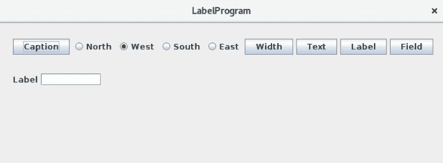

顶行有一组由按钮和单选按钮组成的组件。底行有一个标签（`label`）和一个输入框（`entry field`），这是一个名为 `InputField` 的自定义组件。顶行的组件用于为自定义组件定义不同的属性：

- 组件标签的文本
- 文本显示的位置（北、西、南或东）
- 文本的宽度
- 输入框的首选尺寸
- 文本组件的字体
- 输入框组件的字体

该组件是一个包含两个组件的 `JPanel`：一个 `JPanel` 和一个 `JTextField`：

```java
package labelprogram;

import javax.swing.*;
import java.beans.*;
import java.awt.*;

public class InputField extends JPanel {
    public static final String NORTH = BorderLayout.NORTH;
    public static final String SOUTH = BorderLayout.SOUTH;
    public static final String EAST = BorderLayout.EAST;
    public static final String WEST = BorderLayout.WEST;
    private final JTextField field = new JTextField();
    private final JLabel caption = new JLabel("");
    private String position;
```

## JAVA 9: SWING, DOCUMENTS AND PRINTING

```java
public InputField(String text)
{
    this(text, 100, WEST);
}
```

```java
public InputField(String text, int width)
{
    this(text, width, WEST);
}
```

```java
public InputField(String text, int width, String position)
{
    setLayout(new BorderLayout(position, 0));
    caption.setHorizontalAlignment(JLabel.RIGHT);
    caption.setText(text);
    add(caption, position);
    add(field);
    this.position = position;
    field.setPreferredSize(new Dimension(width, field.getPreferredSize().height));
}
```


**关于 e-Learning for Kids** e-Learning 成立于 2004 年，是一个全球非营利基金会，致力于为 5-12 岁的儿童提供免费在线学习支持，涵盖数学、科学、语言艺术、计算机、健康和环境技能。自 2005 年以来，来自 190 多个国家的 1500 万儿童受益于 LU KI 提供的在线学习。来自世界各地的教育和在线学习专家以及业务专业人士致力于改变现状，目标通过种子资金、志愿者、赞助商和无数开发者来帮助在线学习儿童。更多信息，请访问 `www.e-learningforkids.org`。

- 小学教育第一的 MOOC
- 为 5-12 岁儿童提供的免费数字学习
- 覆盖 1500 万儿童

在 `bookboom.com` 下载免费电子书

```java
public String getCaption()
{
    return caption.getText();
}
```

```java
public Font getCaptionFont()
{
    return caption.getFont();
}
```

```java
public Font getTextFont()
{
    return field.getFont();
}
```

```java
public int getCaptionWidth()
{
    return caption.getPreferredSize().width;
}
```

```java
public Dimension getFieldSize()
{
    return field.getPreferredSize();
}
```

```java
public String getText()
{
    return field.getText();
}
```

```java
public String getPosition()
{
    return position;
}
```

```java
public void setCaption(String text)
{
    String oldValue = caption.getText();
    caption.setText(text);
    firePropertyChange("Caption", oldValue, text);
}
```

```java
public void setCaptionFont(Font font)
{
    Font oldValue = caption.getFont();
}
```

## JAVA 9: SWING, DOCUMENTS AND PRINTING

```java
caption.setFont(font);
revalidate();
firePropertyChange("CaptionFont", oldValue, font);
}
```

```java
public void setText(Font font)
{
    Font oldValue = caption.setFont(); // 注意：此处原文可能误为 setFont，此处逻辑原样
    field.setFont(font);
    field.setPreferredSize(new Dimension(field.getPreferredSize().width,
    field.getGraphics().getFontMetrics().getHeight() + 3));
    revalidate();
    firePropertyChange("TextFont", oldValue, font);
}
```

```java
public void setCaptionWidth(int width)
{
    Integer oldValue = getCaptionWidth();
    caption.setPreferredSize(
    new Dimension(width, caption.getPreferredSize().height));
    revalidate();
    firePropertyChange("CaptionWidth", oldValue, new Integer(width));
}
```

```java
public void setPosition(String position)
{
    String oldValue = this.position;
    this.position = position;
    remove(caption);
    add(caption, position);
    if (position.equals(WEST)) caption.setHorizontalAlignment(JLabel.RIGHT);
    else caption.setHorizontalAlignment(JLabel.LEFT);
    revalidate();
    firePropertyChange("Position", oldValue, position);
}
```

```java
public void setSize(Dimension size)
{
    Dimension oldValue = getSize();
    super.setSize(size);
    revalidate();
    firePropertyChange("Size", oldValue, size);
}
```

## JAVA 9: SWING, DOCUMENTS AND PRINTING

这段代码虽然全面但简单，你应该注意到，编写一个良好的自定义组件需要编写一些代码——比这里显示的要多。该类继承了带有 `BorderLayout` 的 `JPanel`，其中包含位于 `NORTH`、`WEST`、`SOUTH` 或 `EAST` 的 `JLabel`。`CENTER` 是一个 `JTextField`。该组件实现了七个属性，但类中只有一个属性是变量。其他的表示为与自定义组件所包含的两个组件相关的属性。你应该注意，组件属性的方法执行了 `revalidate()`，因为组件属性会改变尺寸，还可能改变位置。还需要注意 `setPosition()` 方法，这意味着标签组件可以放置在其他地方。这需要将其从容器中移除，然后放置在正确的位置。还需要注意 setter 方法会触发 `PropertyChangeEvent`。

# JAVA 9: SWING、文档与打印

# SWING 详情


```java
private void createState()
{
    JPanel panel = new JPanel(new BorderLayout(0, 20));
    panel.setBorder(new EmptyBorder(20, 20, 20, 20));
    panel.add(top, BorderLayout.NORTH);
    panel.add(wrap(component));
    add(panel);
}

private JPanel top()
{
    JPanel panel = new JPanel(new FlowLayout(FlowLayout.LEFT));
    panel.add(createButton("Caption", e -> {
        String text = JOptionPane.showInputDialog(Main.view, component.getCaption());
        if (!text) component.setCaption(text);
    }));
    ButtonGroup group = new ButtonGroup();
    panel.add(createRadio("North", group, false,
        e -> component.setPosition(InputField.NORTH));
    panel.add(createRadio("West", group, true,
        e -> component.setPosition(InputField.WEST));
    panel.add(createRadio("South", group, false,
        e -> component.setPosition(InputField.SOUTH));
    panel.add(createRadio("East", group, false));
```


```java
e -> component.setPosition(InputField.EAST));
panel.add(addButton("Width", e -> { 
    String text = JOptionPane.showInputDialog(MainView.this, "Caption height");
    if (text != null) { 
        int width = Integer.parseInt(text);
        component.setPreferredSize(new Dimension(width, height)); 
    }
}));
panel.add(addButton("Text", e -> {
    String text1 = JOptionPane.showInputDialog(MainView.this, "Width");
    String text2 = JOptionPane.showInputDialog(MainView.this, "Height");
    if (text1 != null && text2 != null) { 
        int width = Integer.parseInt(text1);
        int height = Integer.parseInt(text2);
        component.setPreferredSize(new Dimension(width, height)); 
    }
}));
panel.add(addButton("Label", e -> new FontView(new FontListener() {
	public void fontChanged(FontEvent e) {
		component.setCaption(e.getFont());
	}
}));
panel.add(addButton("Field", e -> new FontView(new FontListener() {
	public void fontChanged(FontEvent e) {
		component.setText(e.getFont());
	}
	return null; }));

private JRadioButton createRadioButton(String text, ButtonGroup group,
boolean checked, ActionListener listener) {
	JRadioButton cmd = new JRadioButton(text);
	cmd.setSelected(checked);
	cmd.addActionListener(listener);
	group.add(cmd);
	return cmd;
}

private JButton createButton(String text, ActionListener listener) {
	JButton cmd = new JButton(text);
	cmd.addActionListener(listener);
	return cmd;
}

private JPanel wrap(JPanel component) {
	JPanel panel = new JPanel(new FlowLayout(FlowLayout.LEFT));
    panel.add(component);
	return panel;
}
```

```java
@Override
public void propertyChange(PropertyChangeEvent e)
{
  JOptionPane.showMessageDialog(this, e.getPropertyName() + "\nFrom: " +
  e.getOldValue() + "\nTo: " + e.getNewValue());
}
```

没什么好解释的，但你应该注意该类实现了 `PropertyChangeListener` 接口，因为它应该接收关于 `component` 对象属性更改的通知。这意味着该类必须实现 `propertyChange()` 方法，在这种情况下，它会打开一个显示更改的消息框。从实际角度来看，当然，这并不重要，目标也是向你展示如何捕捉组件属性的变化。

该类（程序）使用一个简单的对话框来定义字体。这是一个非常简单的对话框（我不想在这里显示代码），但下方的问题 1 是关于在该点对程序进行改进。

## 2.5 焦点与键盘

Swing 组件放置在容器中，其中一个组件拥有焦点，这样与键盘相关的事件就会发送到该组件。通用的焦点循环是从左到右、从上到下，你可以通过 TAB 和 CTRL-TAB 切换焦点，如果你想反向切换焦点，请使用 SHIFT-TAB 和 CTRL-SHIFT-TAB。焦点通过 `FocusManager` 类的实例控制。从程序员的角度来看，这并没有什么挑战，但组件在获得焦点和失去焦点时会发送事件：

- 1. 当组件获得焦点时触发 `focusGained(FocusEvent e)`

- 2. 当组件失去焦点时触发 `focusLost(FocusEvent e)`

# SWING 详情

当组件拥有焦点且按下键盘上的按键时，该组件（取决于具体的组件）可以发送一个 `KeyEvent`。这些事件可以通过关联 `KeyListener` 来捕获。与其他事件不同，`KeyEvent` 可能在相应的操作执行之前发送。当按下按键时，会触发三个 `KeyEvent`：

- 1. `KEY_PRESSED`：按下按键时发生。通过 `keyCode` 属性指定按键，`getKeyCode()` 可以获取表示键的虚拟代码，例如 `KeyEvent.VK_ENTER`。你应该注意，像 CTRL-C 等组合键会触发两个 `KEY_PRESSED` 事件，虚拟代码为 `KeyEvent.VK_CTRL` 和 `KeyEvent.VK_C`。`KeyEvent` 还有一个 `keyChar` 属性，其中包含 Unicode 编码。

- 2. `KEY_RELEASED`：与 `KEY_PRESSED` 事件相同，在释放按键时触发，其触发频率不如 `KEY_PRESSED` 事件频繁。

- 3. `KEY_TYPED`：在 `KEY_PRESSED` 和 `KEY_RELEASED` 之间触发的事件，但没有关联 `keyCode`。对于没有 Unicode 表示的键（如 PAGE UP 和 PRINT SCREEN），不会触发这些事件。


按住按键（对于具有 Unicode 表示的键）会短时间内产生 `KEY_PRESSED` 和 `KEY_TYPED` 事件序列。

每个 `KeyEvent` 都有关联的修饰符（modifiers），它们表示按下按键时 SHIFT、CTRL、ALT 和 META 的状态。它是一个 `int`，是以下常量的位或结果：

- `InputEvent.SHIFT_MASK`

- `InputEvent.CTRL_MASK`

- `InputEvent.ALT_MASK`

- `InputEvent.ALT_GRAPH_MASK`

- `InputEvent.META_MASK`

- `InputEvent.BUTTON1_MASK`

- `InputEvent.BUTTON2_MASK`

- `InputEvent.BUTTON3_MASK`

可以通过 `getModifiers()` 修改值，并可以通过 `isShiftDown()`、`isControlDown()`、`isAltDown()` 和 `isMetaDown()` 测试单个按键。

因此，可以通过注册 `KeyListener` 对象使用键盘控制组件。由于其内容可能非常多（此处省略编写内容），Swing 定义了另一种使用 `KeyStroke` 对象的替代方法，你也可以调用键盘快捷键。`KeyStroke` 封装了按键释放（true）、一个修饰符值和一个指示是按键按下（false）还是释放（true）的布尔值。`KeyStroke` 类有 5 个静态方法来创建 `KeyStroke` 对象：

- `getStroke(char keyChar)`

- `getStroke(int keyCode, int modifiers)`

- `getStroke(int keyCode, int modifiers, boolean onRelease)`

- `getStroke(String representation)`

- `getStroke(KeyEvent anEvent)`

为 JComponent 注册键盘监听器使用：

`registerKeyboardAction(ActionListener action, KeyStroke stroke, int condition)`

`ActionListener` 参数必须定义 `actionPerformed()` 方法以执行与 `KeyStroke` 参数对应的必要操作。最后一个参数指定了 `KeyStroke` 有效的条件：

- `JComponent.WHEN_FOCUSED`：只有当 `KeyStroke` 对象所在的组件拥有焦点时，才会调用 `ActionListener`。

- `JComponent.WHEN_ANCESTOR_OF_FOCUSED_COMPONENT`：只有当 `KeyStroke` 涉及的内容位于焦点组件的更高层级（祖先）时，才会调用组件的 `ActionListeners`。

- `JComponent.WHEN_IN_FOCUSED_WINDOW`：只有当 `KeyStroke` 相关的组件位于具有焦点的窗口（`JFrame`, `JDialog`, `JWindow`）中，才会调用 `ActionListener`。

例如，如果你想为 ALT-H 定义一个 `ActionListener`，无论 JFrame 中哪个名称帧拥有焦点，你可以编写如下代码：

```java
KeyStroke keyStroke = KeyStroke.getKeyStroke(KeyEvent.VK_H, KeyEvent.ALT_MASK, false);
frame.getRoot().registerKeyboardAction(listener, keyStroke,
Component.WHEN_ANCESTOR_OF_FOCUSED_COMPONENT);
```

其中 `listener` 是实际 `ActionListener` 的名称。

每个 JComponent 维护一个以 `KeyStroke` 为客户端属性的 Hashtable。当使用 `registerKeyboardAction()` 注册 `KeyStroke` 时，它会被添加到此数据结构中。每个 `KeyStroke` 只能注册一个 `ActionListener`，如果已经注册了某个 `KeyStroke`，新的将覆盖之前的。可以使用 `getRegisteredKeyrokes()` 方法确定当前的绑定，并 `resetKeyboardActions()` 所有绑定。

通过 Action，你基本上理解为带有 Hashtable 绑定属性的 `ActionListener` 实例，实际上类似于 JComponent 中的客户端属性。通常，你使用 Action 对象来记录键盘操作。

作为一个小示例，程序 KeyStrokeProgram 打开以下窗口：

## JAVA 9: SWING, 文档与打印

### SWING 细节

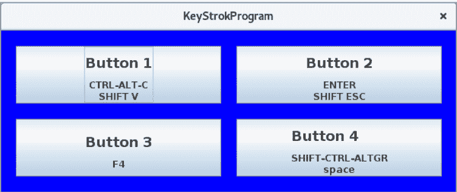

该窗口有四个按钮。顶部的两个按钮中的每一个都绑定了两个快捷键，而底部的两个按钮每个只绑定了一个快捷键。点击其中一个按钮或按下快捷键都会打开一个消息框。区别在于，对于顶部两个按钮，快捷键被分配为 `WHEN_FOCUSED`，因此按钮必须获得焦点，快捷键才能生效。对于底部的两个按钮，快捷键被分配为 `WHEN_IN_FOCUSED_WINDOW`，它们仅在窗口或父组件拥有焦点时才生效。为了说明这一点，点击鼠标会使包含按钮的面板获得焦点，如果你这样做了，面板的背景颜色就会变成红色。窗口的代码如下：


```java
package keystrokeprogram;

import java.awt.*;
import javax.swing.*;
import java.awt.event.*;
import javax.swing.border.*;

public class Main extends JFrame {
    private ActionListener listener = new AbstractAction() {
        public void actionPerformed(ActionEvent e) {
            JButton source = (JButton)e.getSource();
            JOptionPane.showMessageDialog(Main.this, source.getText());
        }
    }

    public Main() {
        setSize(600, 250);
        setLocationRelativeTo(null);
        setDefaultCloseOperation(EXIT_ON_CLOSE);
        setVisible(true);
    }

    private void createView() {
        JPanel panel = new JPanel(new GridLayout(2, 2, 20, 20));
        panel.setBorder(new EmptyBorder(20, 20, 20, 20));
        panel.setBackground(Color.blue);
        JButton cmd1 = new JButton("<html><h2>1</h2><center>CTRL-ALT-C<br>SHIFT V</center></html>");
        JButton cmd2 = new JButton("<html><h2>2</h2><center>ENTER<br>SHIFT ESC</center></html>");
        JButton cmd3 = new JButton("<html><h2>3</h2><center>F4</center></html>");
        JButton cmd4 = new JButton("<html><h2>4</h2><center>CTRL-ALT-C<br>space</center></html>");
        // ... (此处代码逻辑保持不变，为翻译完整性省略重复的结构，但实际应用逻辑一致)
    // ...
    // ...
}
```

### 练习 2

你应该编写一个名为 `FocusProgram` 的程序，打开如下所示的窗口。该窗口有 25 个输入框，获得焦点的字段显示为红色背景和白色文字。没有焦点的字段必须具有白色背景和黑色文字。必须可以通过箭头键在输入框之间移动，如果某个输入框获得焦点并按下 Enter 键，程序将打开一个消息框：

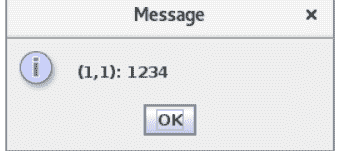

## JAVA 9: SWING、文档与打印


除了布局管理器外，`JPanel` 还可以附加一个 `Border`，我多次以 `EmptyBorder` 的形式使用它。Swing 为边框定义了许多选项。打开 `BorderProgram` 程序，你会看到一个包含 12 个 `JLabel` 组件的窗口，这些组件按 6 行 2 列的 `GridLayout` 组织。

每个标签都有边框，它们根据创建 `Border` 对象时的类型和参数而不同。代码如下，没什么好解释的，但你应该观察 `Border` 对象是如何创建的：

| 边框 |  |
| :--- | :--- |
| 凸起的斜角边 (RAISED) | 凹的斜角边 (LOWERED) |
| 黑色线条边框 (LineBorder), 厚度 = 5 | 厚度为 10 的 EmptyBorder |
| 凸起的刻痕边框 (RAISED) | 凹的刻痕边框 (LOWERED) |
| 凸起的软角斜切边 (RAISED) | 凹的软角斜切边 (LOWERED) |
| 哑光边框 (MatteBorder) | 标题框 (Title) |
| 使用 MatteBorder 的标题框 (TitledBorder) | 标题框 (Title) |
| 使用 LineBorder 的标题框 (TitledBorder) | 标题框 (Title) |
| 使用 EmptyBorder 的标题框 (TitledBorder) |  |

```java
package javaborderprogram;

import java.awt.*;
import javax.swing.*;
import javax.swing.border.*;
```

```java
public class MainView extends JFrame {
  private static ImageIcon donnert = palib.gui.Tools.createIcon("/swing/04/donnert.gif", 15, 15);

  public MainView() {
    setTitle("Borders");
    getContentPane().setBackground(Color.yellow);
    ((JPanel)getContentPane()).setBorder(new EmptyBorder(5, 5, 5, 5));
    setLayout(new GridLayout(6, 2, 5, 5));
```

```java
add(createPanel("RAISED BevelBorder", new BevelBorder(BevelBorder.RASED)));
add(createPanel("LOWERED BevelBorder", new BevelBorder(BevelBorder.LOWERED)));
add(createPanel("Black LineBorder, thickness = 5", new LineBorder(Color.black, 5)));
add(createPanel("EmptyBorder with thickness of 10", new EmptyBorder(10, 10, 10, 10)));
add(createPanel("RAISED EtchedBorder", new EtchedBorder(EtchedBorder.RASED)));
add(createPanel("LOWERED EtchedBorder", new EtchedBorder(EtchedBorder.LOWERED)));
add(createPanel("RAISED SoftBevelBorder", new SoftBevelBorder(SoftBevelBorder.RASED)));
add(createPanel("LOWERED SoftBevelBorder", new SoftBevelBorder(SoftBevelBorder.LOWERED)));
add(createPanel("MatteBorder", new MatteBorder(donnert)));
add(createPanel("TitledBorder using MatteBorder", new TitledBorder(new MatteBorder(donnert), "Title")));
add(createPanel("TitledBorder using LineBorder", new TitledBorder(new LineBorder(Color.blue, 10), "Title")));
add(createPanel("TitledBorder using EmptyBorder", new TitledBorder(new EmptyBorder(10, 10, 10, 10), "Title")));
pack();
setDefaultCloseOperation(EXIT_ON_CLOSE);
setVisible(true);
```


# 你想做什么？

无论你对未来的职业有什么期望，一个在多个国家拥有广泛业务的雇主始终是你的入场券。在沃尔沃集团工作意味着在全球 80 多个国家拥有超过 95,000 名朋友和同事。我们提供极的职业机会 - 请访问我们的网站 `www.volvogogroup.com`。我们期待认识你！

VOLVO (publ)

AB Volvo Group

沃尔沃卡车 | HEMN 卡车 | MACH 卡车 | 沃尔沃客巴 | 沃尔沃建筑设备 | 沃尔沃 PENTA | 沃尔沃 AIDS | 沃尔沃 IT

沃尔沃金融服务 | 沃尔沃 2LP | 沃尔沃性能 | 沃尔沃零件 | 沃尔沃技术 | 沃尔沃借用车 | 印度业务区

```java
private JPanel createPanel(String text, Border border)
{
    JPanel panel = new JPanel();
    panel.setBorder(border);
    panel.add(new JLabel(text));
    return panel;
}
```

你应该注意，当编写：

```java
setLayout(new GridLayout(6, 2, 5, 5));
```

它指的是窗口的 `contentPane`，且在编写：

```java
add(createPanel("RAISED BevelBorder", new BevelBorder(BevelBorder.RASED)));
```

也是如此。另一方面，在语句中（设置窗口 `contentPane` 的背景颜色）：

```java
getContentPane().setBackground(Color.yellow);
```

有必要引用窗口的 `contentPane`，否则设置窗口 `rootpane` 的背景颜色将不起作用。类似的情况也适用于语句：

```java
((JPanel)getContentPane()).setBorder(new EmptyBorder(5, 5, 5, 5));
```

注意窗口的 `contentPane` 调用了：

```java
pack();
```

这意味着窗口将调整到组件的大小。窗口 `contentPane` 周围的空边框：

## 3.1 布局管理器

布局管理器被视为容器的一个特殊属性。例如，你可以使用不同的布局管理器来排列容器中的组件。有以下几种类型：

- `BorderLayout`（边界布局）：该布局将组件排列在五个区域中。
- `GridLayout`（网格布局）：该布局将组件排列在网格单元中。
- `GridBagLayout`（网格布局）：该布局在更灵活的网格中排列组件。
- `FlowLayout`（流式布局）：该布局将组件排列在一行中。
- `BoxLayout`（框布局）：该布局将组件排列在一列或一行中。

布局管理器还允许你定义组件的大小和位置。

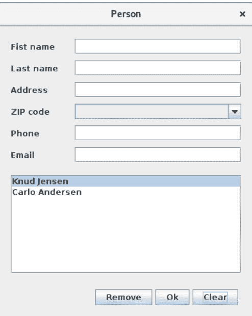

# JAVA 9：SWING、文档与打印

## 布局

这是一个将数据插入列表的示例。此外，是创建窗口的代码：

```java
private void createCanvas() {
    JPanel panel = new JPanel(new BorderLayout());
    panel.setBorder(new EmptyBorder(20, 20, 20, 20));
    panel.add(createTop(), BorderLayout.NORTH);
    panel.add(createBottom(), BorderLayout.SOUTH);
    panel.add(createCenter());
    add(panel);
}
```

你应该注意，该布局由一个 `BorderLayout` 组成，其中 `CENTER` 有一个带有列表框的 `JScrollPane`，`NORTH` 和 `SOUTH` 各有一个 `JPanel`；`SOUTH` 是一个带有 `FlowLayout` 的 `JPanel`，用于布局三个按钮，而 `NORTH` 是一个带有 6 行 `GridLayout` 的 `JPanel`。每行包含一个带有标签和组件（`JTextField` 或 `JComboBox`）的 `BorderLayout`。

如果你观察这个面板，它是用户必须输入内容的典型对话框布局。这种情况非常常见，以至于人们可能会考虑一种特殊的布局管理器，来方便此类对话框的设计。这正是示例 `LayoutProgram1` 的主题。

示例显示了相同的窗口，代码几乎相同。在主窗口中，删除了 `createLine()` 方法，并将 `createTop()` 方法更改为如下：

```java
private JPanel createTop()
{
    JPanel panel = new JPanel(new DilLayout(10, 10));
    panel.add(new JLabel("Firstname"));
    panel.add(txtFirstname);
    panel.add(new JLabel("Lastname"));
    panel.add(txtLastname);
    panel.add(new JLabel("Address"));
    panel.add(txtAddress);
    panel.add(new JLabel("ZIP code"));
    panel.add(lstZipcode = createList());
    panel.add(new JLabel("Phone"));
    panel.add(txtPhone);
    panel.add(new JLabel("Email"));
    panel.add(txtEmail);
    return panel;
}
```

在这里，12 个组件被直接添加到具有类型为 `DialogLayout` 布局管理器的面板中。这是一个自定义布局管理器的示例。它可以用于包含以下形式组件对的容器中：

- `label1`, `component1`
- `label2`, `component2`
- ...

并按照该顺序添加到容器中，这是该布局管理器的必要条件。该布局管理器会将组件放入两列中，其中第一列（称为表头列）包含所有标签组件，而另一列包含其他字段。第一列的宽度默认为所有标签组件中的最大宽度，但你可以指定固定大小。第二列的宽度是所有字段中的最大宽度。这里的代码如下：

```java
public class DialogLayout implements LayoutManager
{
    private int divider = -1; // 表头可能的水平固定宽度
    private int hGap = 10; // 组件间的水平间隙
    private int vGap = 5; // 组件间的垂直间隙

    public DialogLayout() {
    }

    public DialogLayout(int hGap, int vGap) {
        this.hGap = hGap;
        this.vGap = vGap;
    }
```


```java
public void addLayoutComponent(String name, Component comp)
{
}
```

```java
public void removeLayoutComponent(Component comp)
{
}
```

```java
public Dimension preferredLayoutSize(Container parent)
{
    int left = getDivider(parent);
    int w = 0;
    int h = 0;
    for (int k = 1; k < parent.getComponentCount(); k += 2) {
        Dimension d = parent.get(k).getPreferredSize();
        w = Math.max(w, d.width);
        h += d.height + vGap;
    }
    h -= vGap;
    Insets insets = parent.getInsets();
    return new Dimension(left + insets.left + insets.right, h + insets.top + insets.bottom);
}
```

```java
public Dimension minimumLayoutSize(Container parent)
{
    return preferredLayoutSize(parent);
}
```

```java
public void layoutContainer(Container parent)
{
    int left = getDivider(parent);
    Insets insets = parent.getInsets();
    int w = parent.getWidth() - insets.left - insets.right;
    int x = insets.left;
    int y = insets.top;
    for (int k = 1; k < parent.getComponentCount(); k += 2) {
        Component component = parent.getComponent(k);
        Dimension d = component.getPreferredSize();
        parent.getComponent(k - 1).setBounds(x, y, left - hGap, d.height);
        component.setBounds(x + left, y, w, d.height);
        y += d.height + vGap;
    }
}
```

```java
public int getHGap() {
    return hGap;
}
```

```java
public int getVGap() {
    return vGap;
}
```

```java
public void setDivider(int divider) {
    if (divider > 0) this.divider = divider;
}
```

```java
public int getDivider() {
    return divider;
}
```

```java
private int getDivider(Container parent) {
    if (divider > 0) return divider;
    int left = 0;
    for (int k = 1; k < parent.getComponentCount(); k++) {
        Dimension d = parent.get(k).getPreferredSize();
        left = Math.max(left, d.width);
    }
    left += hGap;
    return left;
}
```

```java
public String toString() {
    return getClass().getName() + " [hGap=" + hGap + ", vGap=" + vGap + ", divider=" + divider + "]";
}
```

（正文后续逻辑遵循……）

# JAVA 9：SWING、文档与打印布局

## 字体问题 2

示例显示了相同的窗口，代码几乎相同。在主窗口中，删除了 `createLine()` 方法，并将 `createTop()` 方法更改为如下：

该面板是用户必须输入内容的典型对话框布局。这种情况非常常见，以至于人们可能会考虑一种特殊的布局管理器，来方便此类对话框的设计。这正是示例 `LayoutProgram1` 的主题。

12 个组件被直接添加到具有类型为 `DialogLayout` 布局管理器的面板中。这是一个自定义布局管理器的示例。它可以用于包含以下形式组件对的容器中：

- `label1`, `component1`
- `label2`, `component2`
- ...


并按照该顺序添加到容器中，这是该布局管理器的必要条件。该布局管理器会将组件放入两列中，其中第一列（称为表头列）包含所有标签组件，而另一列包含其他字段。第一列的宽度默认为所有标签组件中的最大宽度，但你可以指定固定大小。第二列的宽度是所有字段中的最大宽度。


(此处省略重复的标题与图片内容)

## JAVA 9: SWING、文档与打印

### 布局

```java
public class MainView extends JFrame {
    public MainView() {
        super("VarGridLayout");
        setSize(600, 400);
        createView();
        setLocationRelativeTo(null);
        setDefaultCloseOperation(EXIT_ON_CLOSE);
        setVisible(true);
    }

    private void createView() {
        GridLayout layout = new GridLayout(3, 4, 10, 10);
        layout.setRowFraction(0, 0.3);
        layout.setRowFraction(1, 0.6);
        layout.setRowFraction(2, 0.1);
        layout.setColFraction(0, 0.4);
        layout.setColFraction(1, 0.3);
        layout.setColFraction(2, 0.2);
        layout.setColFraction(3, 0.1);
        JPanel panel = new JPanel(layout);
    }
}
```


在 `www.deloitte.com/careers` 发现真相

© Deloitte & Touche LLP 及关联实体。

在 `bookoon.com` 下载免费电子书

点击广告阅读更多

## JAVA 9: SWING、文档与打印

```java
panel.setBorder(new EmptyBorder(10, 10, 10, 10));
for (int i = 0; i < 12; ++i) panel.add(new JButton("" + (i + 1) + ")"));
add(panel);
```

唯一需要注意的是如何指定行和列所占占的比例。如果你运行该程序，将看到以下窗口：

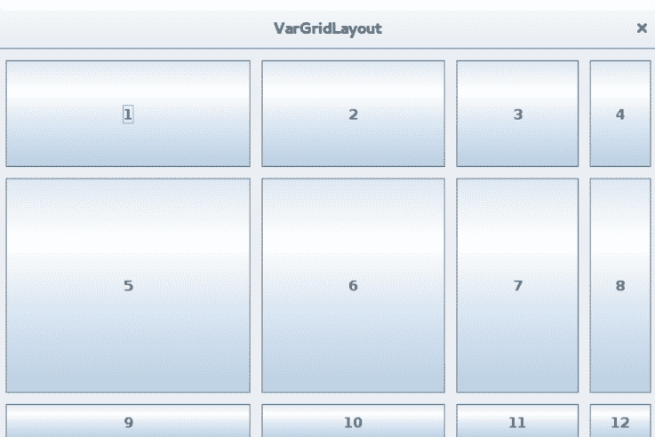

## 问题 3

你必须编写一个模拟数学计算器的经典程序。该程序必须打开下方所示窗口。机器必须具有 10 个用于中间结果的寄存器，左侧字段必须显示这些寄存器的内容——否则显示常量。显示的内容存储在带有 `sto` 按钮的寄存器中，你可以通过 `rel` 按钮将寄存器的内容插入显示器。显示字段位于按钮上方，而顶部字段用于历史记录。按钮的含义应该是自解释的，可能 `C` 和 `CL` 按钮除外，前者清除显示内容，而后者重置整个台机器。

## JAVA 9: SWING、文档与打印布局

寄存器、显示器和历史字段都是 `JTextField` 和 `JTextArea` 字段，但没有任何字段必须是可编辑的。它们应该被定义为不可编辑。你只能通过机器上的按钮向字段中插入内容。另一方面，每个按钮必须分配一个快捷键（由你决定使用哪些），以便能够完全使用键盘操作机器。某些按钮显示图标，这些图标可以在目录图标中找到。

除了用户界面外，最大的挑战是能够解析并评估数学表达式。在这里你应该注意，这个问题已经在《Java 3》书中的 `Calc` 项目中得到了解决。因此，你可以将该项目中的类复用到实际问题中。

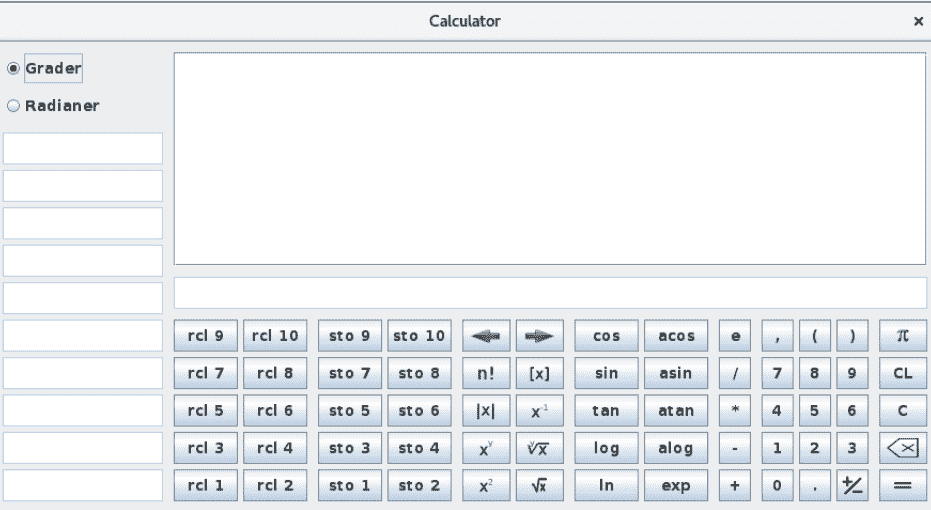

## SWING 组件

Swing 提供了许多可用组件，以下是最常提到的：

- `JButton`
- `JRadioButton`
- `JComponent`
- `JMenuBar`
- `JRadioButtonMenuItem`
- `JScrollPane`
- `JTextField`
- `JEditorPane`
- `ToggleButton`
- `JTable`
- `JToolbar`
- `InternalFrame`
- `JSplitPane`
- `JPanel`
- `JButtonGroup`
- `Label`
- `JMenuItem`
- `JCheckBoxMenuItem`
- `ScrollBar`
- `JPasswordField`
- `JSpinner`
- `ProgressBar`
- `Tree`
- `JSeparator`
- `JOptionPane`
- `TabbedPane`
- `JCheckBox`
- `JComboBox`
- `JList`
- `JMenu`
- `PopupMenu`
- `JTextArea`
- `JScrollPane`
- `JSlider`
- `FormattedTextField`
- `JToolTip`
- `DesktopPanel`
- `ColorChooser`


你喜欢汽车吗？你想成为成功品牌的一员吗？我们感谢你的热情和才华。向我们发送你的简历。你会惊讶于它能带你去何方。在 `www.employer.com` 向我们发送你的简历。

在 `bookhoon.com` 下载免费电子书

## JAVA 9: SWING、文档与打印

这些组件中的许多之前在使用，在这里不再进一步处理，通常这些组件的使用方式相同。具体来说，我想提醒你注意 `JFrame`，它将在第 6 章介绍。对于文本输入，即之前讨论过的 `JTextField` 和 `JTextArea`，在本章中，我想介绍两个组件：`JProgressBar` 和 `JTree`。

## 4.1 JProgressBar

进度条是一个视觉显示进度的组件，例如从网络服务器下载文件。进度条将显示某些操作正在进行并在等待。例如，以下窗口位于窗口顶部、按钮右侧。窗口还包含列表框和一个输入字段。如果你点击按钮，它将模拟一个耗时的任务，进度条将显示任务的动量：

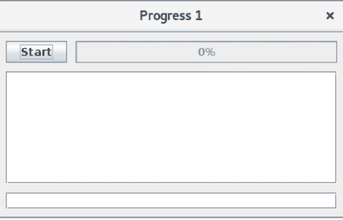

在下方的字段中你可以输入文本——仅此而已——意图是显示在任务执行时你可以操作窗口。很明显，进程必须在自己的线程中启动任务，该线程必须定期更新进度条和列表框。从原则上说，这足够简单，但当任务在线程中进行时，必须定期更新进度条和列表框。

# JAVA 9: SWING、文档与打印

```java
catch (Exception ex)
{
  progress += random.nextInt(10);
  setProgress(Math.min(progress, 100));
}
  return null;
```

```java
public void done()
{
  cmdStart.setEnabled(true);
  setCursor(null);
  model.addElement("Done!");
}
```

至于窗口布局，这并不新鲜，但该类创建了一个 `JProgressBar` 并将其添加到窗口中。你应该注意该组件是如何创建的，在其中指定了最小值和最大值，而进度条始终在这个范围内运行。请特别注意以下语句：

```
bar.setStringPainted(true);
```

这意味着进度条将显示值（文本）。该类有三个内部类、两个事件处理器和一个代表任务的 `Task`。该类继承自 `SwingWorker`。书中最后一章节描述了该类，但目标是让该类易于从另一个线程更新用户界面。`SwingWorker` 是一个抽象类，有两个方法需要实现。`doInBackground()` 启动一个线程，在这种情况下，该方法模拟了一项耗时工作。该类有一个绑定的属性 `progress`，因此当此属性更改时，类会向监听器发送 `PropertyChange` 通知。`done()` 方法是另一个抽象方法，在线程终止时执行。你必须特别注意 `Task` 类不知道进度，而 `job` 类只是性地执行事件处理器属性 `propertyChange()`。

如果你查看点击按钮时执行的事件处理器 `actionPerformed()`，它删除了模型（列表框）和输入字段，设置光标，然后实例化 `Task` 对象。接下来，事件处理器注册了一个 `PropertyChangeListener` 对象作为监听器，之后通过 `execute()` 方法启动任务（线程）。

# JAVA 9: SWING、文档与打印

## SWING 组件

结果是，每当对象 `Task` 执行 `performProgress()` 时，就会执行 `propertyChange` 事件处理器，但在调度器线程中执行。结果是进度条和列表框的模型被更新。

`ProgressProgram2` 程序具有相同的用户界面且原理上的方式也相同，但有两个区别。进度条的方式不同，且任务执行了其他操作。这次进度条显示的不再是文本和任务完成百分比指示，而是显示一个矩形从左到右再来回移动的动画。有时很难（甚至不可能）计算已完成任务的百分比，因此这种进度条可能更合适。这次的任务由以下类定义：

```java
class Task extends SwingWorker<Void, Void> {
  private static final int N = 5;

  public Void doInBackground() {
    setProgress(0);
    progressBar.setIndeterminate(true);
    long n = Long.MAX_VALUE;
```

我加入 MITAS 是因为我想要真正的责任

工程师与地质科学家研究生计划 `www.discovermitas.com`


第 16 个

我曾在北海担任施工主管，指导并帮助工头解决问题

真实工作

国际机会 三次工作实习

MAERSK

在 `bookboom.com` 免费下载电子书

点击广告阅读更多

```java
for (int i = 0; i < N; ++i, n = 2)
{
    while (n > 0 && !isPrime(n)) n -= 2;
    prime = n;
    setProgress(100 * (i + 1) / N);
}
return null;
}
```

```java
public void done()
{
    cmdStart.setEnabled(true);
    progressBar.setIndeterminate(false);
    model.addElement("Done!");
}
```

```java
private boolean isPrime(long n)
{
    if (n == 2 || n == 3 || n == 5 || n == 7) return true;
    if (n < 11 || n % 2 == 0) return false;
    for (long t = 3, m = (long)Math.sqrt(n) + 1; t <= m; t += 2)
    if (n % t == 0) return false;
    return true;
}
```

注意第一条语句

```
progressBar.setIndeterminate(true);
```

这是启动动画的语句。任务是确定 5 个大质数，目标仅仅是展示一项耗时的工作，即一项使用机器 CPU 的真实工作。否则，就没有什么新内容，应用程序在原理上与第一个示例完全相同。

最后，示例 `Progress3` 的执行与 `Progress2` 完全相同，区别在于 `Task` 类没有继承 `SwingWorker`。相反，它实现了 `Runnable` 接口，并且线程必须能够确保用户界面更新在事件调度器中完成：

```java
class Task implements Runnable
{
    private static final int N = 5;

    public void run() {
      try {
        updateState(false);
        updateBar(0);
        progressBar.setIndeterminate(true);
        long n = Long.MAX_VALUE;
        for (int i = 0; i < N; ++i, n = 2) {
          while (n > 0 && !isPrime(n)) n -= 2;
          updatePrime(n);
          updateBar(100 * (i + 1) / N);
        }
        updateState(true);
      } catch (Exception ex) {
      } finally {
        progressBar.setIndeterminate(false);
      }
    }
}
```

```java
private void updateBar(int value) {
  try {
    SwingUtilities.invokeAndWait(() -> progressBar.setValue(value));
  } catch (Exception ex) {
  }
}
```

```java
private void updatePrime(long prime) {
  try {
    SwingUtilities.invokeAndWait(() -> model.addElement(prime));
  } catch (Exception ex) {
  }
}
```

# JAVA 9: SWING、文档与打印

## SWING 组件

```java
private void updateState(boolean onoff)
{
  try {
    SwingUtilities.invokeAndWait(() -> cmdStart.setEnabled(onoff));
  } catch (Exception ex) {
  }
}
```

```java
private boolean isPrime(long n) {
  if (n == 2 || n == 3 || n == 5 || n == 7) return true;
  if (n < 11 || n % 2 == 0) return false;
  for (long t = 3, m = (long)Math.sqrt(n) + 1; t <= m; t += 2)
    if (n % t == 0) return false;
  return true;
}
```


# 管理硕士

因为实现梦想是你最大的挑战。IE 学院的英语、西班牙语或双语教学的管理硕士课程，通过一项创新且具有刺激性的计划，培训职业生涯初的高性能专业人士，帮助他们发挥潜力。

- 选择你的专业领域。
- 通过不同的选项定制你的硕士课程。
- 在伦敦、硅谷或上海等地进行全球浸入周。

因为你改变，世界也随之改变。

`www.ie.edu/master-management` | `admissions@ie.edu`

# JAVA 9: SWING、文档与打印

## SWING 组件

至于窗口布局，这并不新鲜，但该类创建了一个 `JProgressBar` 并将其添加到窗口中。你应该注意该组件是如何创建的，在其中指定了最小值和最大值，而进度条始终在这个范围内运行。请特别注意以下语句：

```
bar.setStringPainted(true);
```


这意味着进度条将显示值（文本）。该类有三个内部类、两个事件处理器和一个代表任务的 `Task`。该类继承自 `SwingWorker`。书中最后一章节描述了该类，但目标是让该类易于从其他线程更新用户界面。`SwingWorker` 是一个抽象类，有两个方法需要实现。`doInBackground()` 启动一个线程，在这种情况下，该方法模拟了一项耗时工作。该类有一个绑定的属性 `progress`，因此当此属性更改时，类会向监听器发送 `PropertyChange` 通知。`done()` 方法是另一个抽象方法，在线程终止时执行。你必须特别注意 `Task` 类不知道进度，而 `job` 类只是性地执行事件处理器属性 `propertyChange()`。

如果你查看点击按钮时执行的事件处理器 `actionPerformed()`，它删除了模型（列表框）和输入字段，设置光标，然后实例化 `Task` 对象。接下来，事件处理器注册了一个 `PropertyChangeListener` 对象作为监听器，之后通过 `execute()` 方法启动任务（线程）。

# JAVA 9: SWING、文档与打印

## SWING 组件

结果是，每当对象 `Task` 执行 `performProgress()` 时，就会执行 `propertyChange` 事件处理器，但在调度器线程中执行。结果是进度条和列表框的模型被更新。

`ProgressProgram2` 程序具有相同的用户界面且原理上的方式也相同，但有两个区别。进度条的方式不同，且任务执行了其他操作。这次进度条显示的不再是文本和任务完成百分比指示，而是显示一个矩形从左到右再来回移动的动画。有时很难（甚至不可能）计算已完成任务的百分比，因此这种进度条可能更合适。这次的任务由以下类定义：

```java
class Task extends SwingWorker<Void, Void> {

  private static final int N = 5;

  public Void doInBackground() {

    setProgress(0);

    progressBar.setIndeterminate(true);

    long n = Long.MAX_VALUE;
```

我加入 MITAS 是因为我想要真正的责任

工程师与地质科学家研究生计划 www.discovermitas.com


第 16 个
我曾在北海担任施工主管，指导并帮助工头解决问题

真实工作
国际机会 三次工作实习

MAERSK

在 bookboom.com 免费下载电子书

点击广告阅读更多

```java
for (int i = 0; i < N; ++i, n = 2)

{

    while (n > 0 && !isPrime(n)) n -= 2;

    prime = n;

    setProgress(100 * (i + 1) / N);

}

return null;

}
```

```java
public void done()

{

    cmdStart.setEnabled(true);

    progressBar.setIndeterminate(false);

    model.addElement("Done!");

}
```

```java
private boolean isPrime(long n)

{

    if (n == 2 || n == 3 || n == 5 || n == 7) return true;

    if (n < 11 || n % 2 == 0) return false;

    for (long t = 3, m = (long)Math.sqrt(n) + 1; t <= m; t += 2)

    if (n % t == 0) return false;

    return true;

}
```

注意第一条语句

```java
progressBar.setIndeterminate(true);
```

这是启动动画的语句。任务是确定 5个大质数，目标仅仅是展示一项耗时的工作，即一项使用机器 CPU 的真实工作。否则，就没有什么新内容，应用程序在原理上与第一个示例完全相同。

最后，示例 `Progress3` 的执行与 `Progress2` 完全相同，区别在于 `Task` 类没有继承 `SwingWorker`。相反，它实现了 `Runnable` 接口，并且线程必须能够确保用户界面更新在事件调度器中完成：

```java
class Task implements Runnable

{

    private static final int N = 5;
```

```java
public void run() {
  try {
    updateState(false);
    updateBar(0);
    progressBar.setIndeterminate(true);
    long n = Long.MAX_VALUE;
    for (int i = 0; i < N; ++i, n = 2) {
      while (n > 0 && !isPrime(n)) n -= 2;
      updatePrime(n);
      updateBar(100 * (i + 1) / N);
    }
    updateState(true);
  } catch (Exception ex) {
  } finally {
    progressBar.setIndeterminate(false);
  }
}
```

```java
private void updateBar(int value) {

  try {

    SwingUtilities.invokeAndWait(() -> progressBar.setValue(value));

  } catch (Exception ex) {

  }

}
```

```java
private void updatePrime(long prime) {

  try {

    SwingUtilities.invokeAndWait(() -> model.addElement(prime));

  } catch (Exception ex) {

  }

}
```

# JAVA 9: SWING、文档与打印

## SWING 组件

```java
private void updateState(boolean onoff)

{

  try {

    SwingUtilities.invokeAndWait(() -> cmdStart.setEnabled(onoff));

  } catch (Exception ex) {

  }

}
```

```java
private boolean isPrime(long n) {

  if (n == 2 || n == 3 || n == 5 || n == 7) return true;

  if (n < 11 || n % 2 == 0) return false;

  for (long t = 3, m = (long)Math.sqrt(n) + 1; t <= m; t += 2)

    if (n % t == 0) return false;

  return true;

}
```


# 管理硕士

因为实现梦想是你最大的挑战。IE 学院的英语、西班牙语或双语教学的管理硕士课程，通过一项创新且具有刺激性的计划，培训职业生涯初的高性能专业人士，帮助他们发挥潜力。

- 选择你的专业领域。
- 通过不同的选项定制你的硕士课程。
- 在伦敦、硅谷或上海等地进行全球浸入周。

因为你改变，世界也随之改变。

www.ie.edu/master-management | admissions@ie.edu

# JAVA 9: SWING、文档与打印

至于窗口布局，这并不新鲜，但该类创建了一个 `JProgressBar` 并将其添加到窗口中。你应该注意该组件是如何创建的，在其中指定了最小值和最大值，而进度条始终在这个范围内运行。请特别注意以下语句：

```java
bar.setStringPainted(true);
```

这意味着进度条将显示值（文本）。该类有三个内部类、两个事件处理器和一个代表任务的 `Task`。该类继承自 `SwingWorker`。书中最后一章节描述了该类，但目标是让该类易于从另一个线程更新用户界面。`SwingWorker` 是一个抽象类，有两个方法需要实现。`doInBackground()` 启动一个线程，在这种情况下，该方法模拟了一项耗时工作。该类有一个绑定的属性 `progress`，因此当此属性更改时，类会向监听器发送 `PropertyChange` 通知。`done()` 方法是另一个抽象方法，在线程终止时执行。你必须特别注意 `Task` 类不知道进度，而 `job` 类只是性地执行事件处理器属性 `propertyChange()`。

如果你查看点击按钮时执行的事件处理器 `actionPerformed()`，它删除了模型（列表框）和输入字段，设置光标，然后实例化 `Task` 对象。接下来，事件处理器注册了一个 `PropertyChangeListener` 对象作为监听器，之后通过 `execute()` 方法启动任务（线程）。

# JAVA 9: SWING、文档与打印

## SWING 组件

结果是，每当对象 `Task` 执行 `performProgress()` 时，就会执行 `propertyChange` 事件处理器，但在调度器线程中执行。结果是进度条和列表框的模型被更新。

`ProgressProgram2` 程序具有相同的用户界面且原理上的方式也相同，但有两个区别。进度条的方式不同，且任务执行了其他操作。这次进度条显示的不再是文本和任务完成百分比指示，而是显示一个矩形从左到右再来回移动的动画。有时很难（甚至不可能）计算已完成任务的百分比，因此这种进度条可能更合适。这次的任务由以下类定义：

```java
class Task extends SwingWorker<Void, Void> {

  private static final int N = 5;

  public Void doInBackground() {

    setProgress(0);

    progressBar.setIndeterminate(true);

    long n = Long.MAX_VALUE;
```

我加入 MITAS 是因为我想要真正的责任

工程师与地质科学家研究生计划 www.discovermitas.com


第 16 个
我曾在北海担任施工主管，指导并帮助工头解决问题

真实工作
国际机会 三次工作实习

MAERSK

在 bookboom.com 免费下载电子书

点击广告阅读更多

```java
for (int i = 0; i < N; ++i, n = 2)

{

    while (n > 0 && !isPrime(n)) n -= 2;

    prime = n;

    setProgress(100 * (i + 1) / N);

}

return null;

}
```

```java
public void done()

{

    cmdStart.setEnabled(true);

    progressBar.setIndeterminate(false);

    model.addElement("Done!");

}
```

```java
private boolean isPrime(long n)

{

    if (n == 2 || n == 3 || n == 5 || n == 7) return true;

    if (n < 11 || n % 2 == 0) return false;

    for (long t = 3, m = (long)Math.sqrt(n) + 1; t <= m; t += 2)

    if (n % t == 0) return false;

    return true;

}
```

注意第一条语句

```java
progressBar.setIndeterminate(true);
```

这是启动动画的语句。任务是确定 5个大质数，目标仅仅是展示一项耗时的工作，即一项使用机器 CPU 的真实工作。否则，就没有什么新内容，应用程序在原理上与第一个示例完全相同。

最后，示例 `Progress3` 的执行与 `Progress2` 完全相同，区别在于 `Task` 类没有继承 `SwingWorker`。相反，它实现了 `Runnable` 接口，并且线程必须能够确保用户界面更新在事件调度器中完成：

```java
class Task implements Runnable

{

    private static final int N = 5;
```

```java
public void run() {
  try {
    updateState(false);
    updateBar(0);
    progressBar.setIndeterminate(true);
    long n = Long.MAX_VALUE;
    for (int i = 0; i < N; ++i, n = 2) {
      while (n > 0 && !isPrime(n)) n -= 2;
      updatePrime(n);
      updateBar(100 * (i + 1) / N);
    }
    updateState(true);
  } catch (Exception ex) {
  } finally {
    progressBar.setIndeterminate(false);
  }
}
```

```java
private void updateBar(int value) {

  try {

    SwingUtilities.invokeAndWait(() -> progressBar.setValue(value));

  } catch (Exception ex) {

  }

}
```

```java
private void updatePrime(long prime) {

  try {

    SwingUtilities.invokeAndWait(() -> model.addElement(prime));

  } catch (Exception ex) {

  }

}
```

# JAVA 9: SWING、文档与打印

## SWING 组件

```java
private void updateState(boolean onoff)

{

  try {

    SwingUtilities.invokeAndWait(() -> cmdStart.setEnabled(onoff));

  } catch (Exception ex) {

  }

}
```

```java
private boolean isPrime(long n) {

  if (n == 2 || n == 3 || n == 5 || n == 7) return true;

  if (n < 11 || n % 2 == 0) return false;

  for (long t = 3, m = (long)Math.sqrt(n) + 1; t <= m; t += 2)

    if (n % t == 0) return false;

  return true;

}
```


# 管理硕士

因为实现梦想是你最大的挑战。IE 学院的英语、西班牙语或双语教学的管理硕士课程，通过一项创新且具有刺激性的计划，培训职业生涯初的高性能专业人士，帮助他们发挥潜力。

- 选择你的专业领域。
- 通过不同的选项定制你的硕士课程。
- 在伦敦、硅谷或上海等地进行全球浸入周。

因为你改变，世界也随之改变。

www.ie.edu/master-management | admissions.ie.edu

# JAVA 9: SWING、文档与打印

至于窗口布局，这并不新鲜，但该类创建了一个 `JProgressBar` 并将其添加到窗口中。你应该注意该组件是如何创建的，在其中指定了最小值和最大值，而进度条始终在这个范围内运行。请特别语句：

## 4.2 JTree

`JTree` 是一个可以可视化数据的组件，实际上类似于 `JFileChooser`。从一个打开以下窗口的应用程序开始：

窗口显示了位于 `ScrollPane` 中的 `JTree`，其层次结构（树）在这种情况下仅包含一个名称列表，且所有名称都是根节点的子节点。点击树的根节点，你可以折叠树：

img/d1bfc3b279aa0e38d6b85dc85f9734c5_80_1.png

# JAVA 9: SWING、文档与打印

当然，你可以再次展开树。代码所示：

```java
package treeprogram;

import java.awt.*;

import javax.swing.*;

import javax.swing.border.*;

public class Main extends JFrame {

  private Object[] model = {
```


"GornDamle", "Harald Blåtand", "S Tveskæ", "Harald d. 2.", "ut the Store", "Hardekund", "Magnus den Gode", "Svend Estridsen", "Harald Hen", "Knud den Hellige", "Oluf Hunger", "Erik Ejegod", "Niels" };

public Main() {

  super("JTree 1");

  setSize(300, 200);

  createView();

  setLocationRelativeTo(null);

  setDefaultCloseOperation(EXIT_ON_CLOSE);

  setVisible(true);

}

private void createView() {

  JPanel panel = new JPanel(new BorderLayout());

  panel.setBorder(new EmptyBorder(20, 20, 20, 20));

  JTree tree = new JTree(model);

  tree.setRootVisible(true);

  panel.add(new JScrollPane(tree));

  add(panel);

}

```

# JAVA 9: SWING、文档与打印

## SWING 组件

在这种情况下，数据模型被定义为 `Object` 对象的数组，`JTree` 类中的构造函数会自动创建一个模型，该模型是一个由 `TreeNode` 对象组成的树。它有几个构造函数，其他作为参数的构造函数分别接受 `Hashtable` 和 `Vector`。我将展示一个如何基于 `Vector` 创建 `JTree` 的示例。`Vector` 基本与 `ArrayList` 相同，但它是自语言诞生以来就存在的旧版集合类。该类在泛型版本中已经现代化，但我将使用原始版本。应该说的是，通常不建议使用 `Vector` 类，而是使用 `ArrayList`，但 `JTree` 的构造函数只支持 `Vector`，因此。`Vector` 类是线程安全的，而 `ArrayList` 则具有更好的性能。示例名为 `TreeProgram2`，并打开以下窗口：


此时显示了一个层级结构，可以通过鼠标点击来关闭或打开各个分支。注意根节点是不显示的。程序编写如下：

```java
package treeprogram2;

import java.util.*;
import java.awt.*;
import javax.swing.*;
import javax.swing.border.*;

public class MainView extends JFrame {

    public MainView() {

        super("JTree");

        setSize(300, 200);

        createView();

        setLocationRelativeTo(null);

        setDefaultCloseOperation(EXIT_ON_CLOSE);

        setVisible(true);

    }

    private void createView() {

        JPanel panel = new JPanel(new BorderLayout());

        panel.setBorder(new EmptyBorder(20, 20, 20, 20));

        JTree tree = new JTree(create("Gorm den Gamle", "Harald Blåånd",

        createVector("Svend Tveskåg", "Harald d. 2.",

        createVector("Knud den Store", "Harddeknud", "Magnus den Gode",

        createVector("Svend Stridsen", "Harald Hen", "Knud den Hellige",

        Oluf Hunger", "Erik Ejegod", "Niels"));

        tree.setRootVisible(false);

        panel.add(new JScrollPane(tree));

        add(panel);

    }

    private Vector createVector(String name, Object... objects)

    {

        Vector v = new java.util.Vector(new Object() { public String toString() { return name; } });

        for (Object obj : objects) v.add(obj);

        return v;

    }
}
```

`createVector` 创建了一个 `Vector`，它是一个对象集合，`JTree` 可以它创建数据模型。`Vector` 本身是一个对象，因此可以作为另一个 `Vector` 的元素，从而构建层级结构。该方法基于一个匿名类（继承 `Vector` 的类）创建一个 `Vector`，目的是重写 `toString()`。构造函数包含了 `toString()` 返回的值以及类应包含的其他对象。层级结构在 `JTree` 的构造函数中定义，该类实际上并不易读，所以编写类似下面的代码可能会更好：

```java
Vector v1 = createVector("Knud den Store", "Hardeknud", "Magnus den Gode");

Vector v2 = createVector("Svend Tveskog", "Harald d. 2.");

v2.add(v1);

Vector v3 = createVector("Svend Stridsen", "Harald Hen", "Knud den Hellige",

Oluf Hunger", "Erik Ejegod", "Niels");

Vector v4 = createVector("", "Gorm Gamle", "Harald Blåland");

v4.add(v2);

v4.add(v3);

JTree tree = new JTree(v4);
```

当 `JTree` 类构建数据模型时，它是 `TreeModel` 类型的对象，由 `TreeNode` 对象的层级结构组成。这两种类型都是接口，其目的是你可以编写自己的模型，但在大多数情况下，你可以使用 Swing API 部分的默认类。模型由 `DefaultTreeModel` 类实现，但对程序员来说，最重要的类是 `DefaultMutableTreeNode`，它实现了 `TreeNode` 接口（以及其子接口，称为 `MutableTreeNode`）。`JTree` 的典型用法是构建一个由 `DefaultMutableTreeNode` 对象组成的层级结构，然后将该层级结构作为参数传递给 `JTree` 类的构造函数。

程序 `TreeProgram` 打开了下面的窗口。窗口有一个 `JTree`，显示扑牌的概览。双击特定的卡牌（叶子节点）将把卡牌作为 `JLabel` 组件显示。因此编写该程序需要解决两个问题：

1. 构建一个显示扑牌的层级数据模型
2. 捕捉扑牌上的双击操作

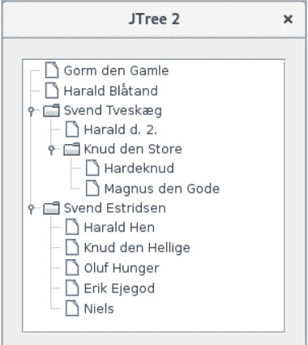

# JAVA 9：SWING、文档与打印

## SWING 组件

`mousePressed()` 方法中的第一条语句确定了所选行的索引。如果选中了某行且是双击，则该路径（在树的层次结构中）将确定到被点击的节点上。此类路径由 `TreePath` 表示，它是一个从根节点到当前节点的节点列表。例如，如果点击的是“黑桃 7”，该列表——`TreePath` 对象将由根节点、代表“黑桃”的节点以及代表“黑桃 7”的节点组成。有了 `TreePath` 对象后，就可以确定路径中的最后一个节点，即双击的节点。由于只有在点击特定卡片的节点时才需要执行操作，因此将测试点击的节点是否为叶子节点。如果是，则确定分配给节点的 `Card` 对象，即用该卡片更新 `JLabel`。

`JTree` 是伴随着 `TreeCellRenderer` 诞生的，它决定了组件应该如何绘制，并且会精确地指定所使用的图标和文本。如果你打开 `TreeProgram4` 程序，你将看到以下窗口：


# JTree 4

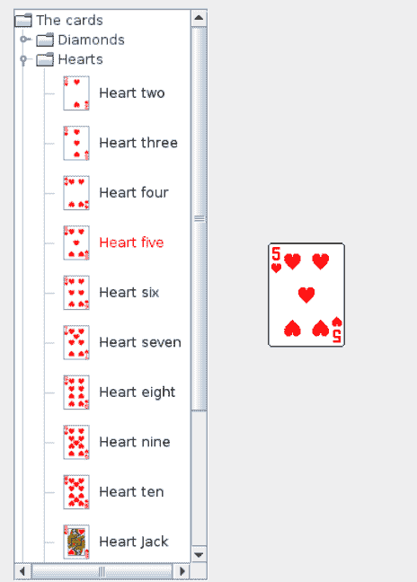

也就是说，`JTree` 组件现在显示了该卡片的图片，并显示节点被选中。除此之外，它与 `TreeProgram3` 是同一个程序，但该程序定义了自己的 `TreeCellRenderer`，在此情况下，它是一个内部类：

```java
public class LeafCellRenderer extends DefaultTreeCellRenderer {

    private JPanel panel = new JPanel(new FlowLayout(FlowLayout.LEFT));

    private JLabel lblIcon = new JLabel();

    private JLabel lblText = new JLabel();

    public LeafCellRenderer() {

        lblIcon.setPreferredSize(new Dimension(28, 36));

        lblText.setHorizontalAlignment(JLabel.LEFT);

        lblText.setFont(tree.getFont());

        panel.setBackground(Color.white);

        panel.add(lblIcon);

        panel.add(lblText);

    }

}
```

# JAVA 9：SWING、文档与打印

```java
@Override

public Component getCellRendererComponent(JTree tree, Object value,

boolean selected, boolean expanded, boolean leaf, int row, boolean hasFocus)

{

    DefaultMutableTreeNode node = (DefaultMutableTreeNode)value;

    if (!node.isLeaf())

        return super.getCellRendererComponent(tree, value, selected,

        expanded, leaf, row, hasFocus);

    prepareRenderer((Card)node.getUserObject(selected), selected);

    return panel;

}
```

```java
private void prepareRenderer(Card card, boolean selected)

{

    lblIcon.setIcon(scale(card.getImage()));

    lblText.setText(card.toString());

    lblText.setForeground(selected ? Color.red : Color.black);

}
```

```java
private ImageIcon scale(ImageIcon icon)

{

    return new ImageIcon(

    icon.getImage().getScaledInstance(24, 32, java.awt.Image.SCALE_SMOOTH));

}
```

该类派自 `DefaultTreeCellRenderer`，这是 `JFrame` 使用的默认渲染器。该类定义了一个带有两个 `JLabel` 组件的面板，分别用于图标和文本。这些在构造函数中初始化。该类必须重写 `getTreeCellRendererComponent()` 方法，该方法用于渲染树中的元素。该方法首先测试其是否为叶子节点，如果不是，则调用基类的方法，并按默认方式渲染树。否则，该方法调用 `prepareRenderer()`，它会初始化两个标签组件。

对于所有内容，树都使用 `TreeCellRenderer`：

```java
tree.setCellRenderer(new LeafCellRenderer());
```

然后树使用了 `TreeCellEditor`。你可以在 `JTree` 中通过以下方式来编辑节点：

```java
tree.setEditable(true);
```

# JAVA 9：SWING、文档与打印

`JTree` 包含了 `TreeCellEditor`，当点击节点时，会打开一个 `JTextField` 以便可以编辑。`JTree` 还可以显示 `TreeModel` 的信息。以下是窗口的示例：

`JTree` 包含了 `TreeModel`。此外，`JTree` 还可以通过 `TreeCellRenderer` 显示数据。以下是代码：

1. Region
2. Municipality
3. Zipcode

Denmark

```java
package denmarkprogram;

import java.util.*;
import java.awt.*;
import java.awt.event.*;
import javax.swing.*;
import javax.swing.tree.*;
import javax.swing.border.*;

public class MainWindow extends JFrame {

    private Model model = new Model();

    private JTree tree;

    private JTextField txtText = new JTextField();

    public MainWindow() {

        super("Denmark");

        setSize(500, 500);

        createView();

        setLocationRelativeTo(null);

        setDefaultCloseOperation(EXIT_ON_CLOSE);

        setVisible(true);

    }

    private void createView() {

        JPanel panel = new JPanel(new BorderLayout(0, 20));

        panel.setBorder(new EmptyBorder(20, 20, 20, 20));

        tree = new JTree(createTreeModel());

        tree.setRootVisible(true);

        panel.add(new JScrollPane(tree));

        panel.add(createBottom(), BorderLayout.SOUTH);

        add(panel);

    }

    private JPanel createBottom() {

        JButton cmd = new JButton("Search");

        cmd.addActionListener(this::select);

        JPanel panel = new JPanel(new BorderLayout(20, 20));

        panel.add(cmd, BorderLayout.EAST);

        panel.add(txtText);

        return panel;

    }

    private void select(ActionEvent e) {

        TreeNode root = (TreeNode) tree.getModel().getRoot();

        collapse(getPath(root));

        String text = txtText.getText().trim();

        tree.clearSelection();

        ArrayList<TreePath> paths = new ArrayList();

        for (int i = 0; i < root.getChildCount(); ++i) {

            select(paths, (DefaultMutableNode)root.getChildAt(i), text);

        }

        TreePath[] array = new TreePath[paths.size()];
```


```java
tree.setSelectionPaths(paths.toArray(array));
```

```java
private TreePath getPath(DefaultMutableNode node) {
    ArrayList<DefaultMutableTreeNode> path = new ArrayList();

    for (DefaultMutableTreeNode n = node; n != null; n = (DefaultMutableTreeNode) n.getParent()) {
        path.add(n);
    }

    Collections.reverse(path);

    return new TreePath(path.toArray(new DefaultMutableTreeNode[0]));
}

private void collapse(TreePath path) {
    for (int i = 0; i < path.getDepth(); ++i) {
        DefaultMutableTreeNode node =
            (DefaultMutableTreeNode) path.getPathPathComponent(i);

        tree.setPathExpanded(node, false);
    }
}

private void select(
        ArrayList<TreePath> paths,
        DefaultMutableNode node,
        String text) {
    if (node.getUserObject().toString().contains(text)) {
        paths.add(getPath(node));
    }

    for (int i = 0; i < node.getChildCount(); ++i) {
        select(paths, (DefaultMutableNode) node.getChildAt(i), text);
    }
}

private DefaultTreeModel createTreeModel() {
    return new DefaultTreeModel(model);
}
```

## JAVA 9：SWING、文档与打印

```java
private void collapse(TreePath root) {
    TreeNode node = (TreeNode) root.getLastPathComponent();

    if (node.getChildCount() >= 0) {
        for (Enumeration e = node.child(); e.hasMoreElements();) {
            TreePath path = root.getPathByChild((TreeNode) e.nextElement());
            collapse(path);
        }
    }

    tree.collapsePath(root);
}
```

```java
private TreePath getPath(TreeNode node) {
    ArrayList<Object> nodes = new ArrayList();
    nodes.add(node);

    for (node = node.getParent(); node != null; node = node.getParent()) {
        nodes.add(0, node);
    }

    return new TreePath(nodes.toArray());
}
```

```java
private TreeNode createTreeModel() {
    DefaultMutableTreeNode root =
        new DefaultMutableTreeNode(model.getDenmark());

    int n1 = 0;

    for (Region r : model.getDenmark().getRegions()) {
        MutableTreeNode node1 = new DefaultMutableTreeNode(r);
        int n2 = 0;

        for (Municipality m : r.getMunicipalities()) {
            MutableTreeNode node2 = new DefaultMutableTreeNode(m);
            int n3 = 0;

            for (Zipcode z : m.getZipcodes()) {
                node2.insert(new DefaultMutableTreeNode(z), n3++);
            }

            node1.insert(node2, n2++);
        }

        root.insert(node1, n1++);
    }

    return root;
}
```

程序定义了三个变量，分别是用于 Tree 组件的 Model 对象和搜索文本输入字段。在窗口设计方面没有新内容，因此此处不再对其进行进一步注释。

最后一个方法根据对象模型（以及从数据库中读取的数据）构建树的数据模型。数据模型被构建为一个由 `MutableTreeNode` 类型节点组成的层次结构。第一个节点代表树的根节点，即一个 Denmark 对象。该节点为每个 region 创建一个 Region 节点，为该地区的 municipalities 创建一个节点，最后为每个 municipality 使用的每个邮政编码创建一个节点。节点。方法在 `create()` 中被用于创建一个 `JTree` 对象，你应该注意构造函数的参数是用于树根结的 `TreeNode`。

Tree 中的单个节点可以通过多种方式引用，例如使用 `TreePath`，它是从根节点到特定节点的节点列表。在这里你应该注意 `getPath()` 方法，它是一个为特定节点确定 `TreePath` 对象的方法。在这里，假设所有非根节点都拥有指向其子节点的引用。

你不能使用 `collapse()` 方法来折叠树的一部分。该方法有一个 `TreePath` 参数，并会折叠没有根路径的树部分。你应该特别注意如何引用 `TreePath` 所代表的节点。另外请注意该方法是递归的，以及如何使用以下语句折叠节点：

```java
tree.collapsePath(root);
```

如果将此语句替换为：

```java
tree.expandPath(root);
```

该方法将完全展开树。后面是按钮的事件处理器。它通过确定树的根为一个节点，然后折叠整棵树。接着，创建一个用于存储 `TreePath` 对象的 `ArrayList`，并对所有子节点进行循环。每次迭代都会调用一个方法，为所有匹配搜索字符串的节点创建一个 `TreePath` 对象。该方法也是递归的，但结果是 `ArrayList` 包含了所有要用 `TreePath` 表示的节点。列表最后被用于标记单个节点：

```java
tree.setSelectionPaths(paths.toArray());
```

这意味着单个节点被选中，并且树被展开以使得所有节点都可见。

在本书的前几个章节中，我提到了自定义组件并实际上给了两个示例，在本章中，我将对如何创建良好的组件给出说明。正如上一章所述，Swing 天生就带有许多组件，提供了设计图形用户界面所需的各种；但另一方面，在某些特殊你可能需要开发自己的组件；另一方面，窗口可能包含在多个地方使用的面板。原则上，使用 Swing 编写自定义组件很容易的，但如果你操作得当，使得组件的行为与其他任何组件一样，这并不简单，并且有几项要求你需要确保自定义组件符合这些要求。

`img/d1bfcb279aa0e38d6b85dc85f97_0.png`

Swing 组件是根据改进的 MVC 模式设计的，可以描述为视图（view）和控制器（controller）构建在一个名为 UI 代理（UI delegate）的通用组件中：

`img/d1bfcb279aa0e38d6b85dc85f98_0.png`

当我上面提到编写自定义组件并不同时，自定义组件应该遵循与 Swing 自身的组件相同的模式，因此我将简单介绍一下 Swing 组件的架构及其设计。

## 5.1 外观（LOOK-AND-FEEL）

UI 代理派自 `ComponentUI` 类，这是一个抽象类，基本上描述了 UI 代理和组件之间应该如何通信，在不提供任何解释的情况下，该类定义了以下方法：

- `static ComponentUI createUI(JComponent)`
- `installUI(JComponent)`
- `update(Graphics g, JComponent)`
- `paint(Graphics g, JComponent)`
- `getPreferredSize(JComponent)`
- `getMinimumSize(JComponent)`
- `getMaxSize(JComponent)`

大多数 UI 代理的编写都是通过定义的接口来感知组件的模型（或多个模型，因为一个组件可能拥有多个对象）。Swing 拥有多个系列的 UI 代理，每个系列都包含一个类（实现了 `ComponentUI`）用于大多数 Swing 组件，这样的系列被称为“外观与感觉”（look-and-feel，或 PLAF，即可插拔的外观）。`javax.swing.plaf` 包含了派自 `ComponentUI` 的抽象类，而 `javax.swing.basic` 由扩展了 `javax.swing.plaf` 中抽象类的具体类组成。这些 UI 代理类被用作所有外观系列的构建块。有以下几个系列，分别称为 Windows、Motif 和 Metal：

1. `com.sun.java.swing.plaf.windows.WindowsLookAndFeel`
2. `com.sun.java.swing.plaf.motif.MotifLookAndFeel`
3. `javax.swing.plaf.metal.MetalLookAndFeel`

其中后者是默认的（还有一个 MacLookAndFeel，它必须安装）。然而，只有在正确的平台上才能使用外观，例如，上述第一个不能在 Linux 机器上使用。外观及其 UI 代理决定了 Swing 组件在屏幕上的显示方式，并且通常由当前平台支持，实际上在运行时更改外观是可行的。如果你打开 PLAF 程序，你会得到以下窗口：

`img/d1bfcb279aa0e38d6b85dc85f97_99_0.png`

它包含 9 个使用 `GridLayout` 布局的组件。窗口的外观是 Metal，这是默认的，但如果你点击 Motif 按钮，窗口将变为：

`img/d1bfcb279aa0e38d6b85dc85f97_99_1.png`

这是因为外观从 Metal 更改为了 Motif。如果我点击 Windows 按钮，我会得到一个异常，但因为我的程序运行在 Linux 机器上。相反，点击 Dialog 按钮程序会打开一个消息框：

`img/d1bfcb279aa0e38d6b85dc85f97_99_2.png`

外观之所以如此是因为外观（look-and-feel）是 Motif。该示例显示了程序的窗口和组件的显示取决于当前的视觉和感觉。程序代码如下：

```java
package plafprogram;

import java.awt.*;
import java.awt.event.*;

import javax.swing.*;
import javax.swing.border.*;

public class MainWindow extends JFrame {
    public MainWindow() {
        super("PLAF Program");

        setSize(500, 220);
        createView();
        setLocationRelativeTo(null);
        setDefaultCloseOperation(EXIT_ON_CLOSE);
        setVisible(true);
    }
}
```


```java
private void getView() {
    JPanel panel = new JPanel(new GridLayout(3, 2, 20, 20));
    panel.setBorder(new EmptyBorder(20, 20, 20, 20));

    JLabel lbl = new JLabel("Look & Feel");
    panel.add(lbl);
    panel.add(new JTextField());
    panel.add(new JCheckBox("Check box"));
    panel.add(new JRadioButton("Radio button"));
    panel.add(new JComboBox());

    panel.add(createButton(
        "Dialog",
        e -> JOptionPane.showMessageDialog(this, "Hello World"),
        this::message
    ));

    panel.add(createButton("Metal", this::metal));
    panel.add(createButton("Motif", this::motif));
    panel.add(createButton("Windows", this::windows));

    add(panel);
}

private JButton createButton(String text, ActionListener listener) {
    JButton cmd = new JButton(text);
    cmd.addActionListener(listener);
    return cmd;
}

private void metal(ActionEvent e) {
    try {
        UIManager.setLookAndFeel(
            "javax.sun.swing.plaf.metal.MetalLookAndFeel"
        );

        SwingUtilities.updateComponentTreeUI(this);
    } catch (Exception ex) {
        JOptionPane.showMessageDialog(this, ex.toString());
    }
}

private void motif(ActionEvent e) {
    try {
        UIManager.setLookAndFeel(
            "com.sun.swing.plaf.motif.MotifLookAndFeel"
        );

        SwingUtilities.updateComponentTreeUI(this);
    } catch (Exception ex) {
        JOptionPane.showMessageDialog(this, ex.toString());
    }
}

private void windowsEvent(ActionEvent e) {
    try {
        UIManager.setLookAndFeel(
            "com.sun.java.swing.plaf.windows.WindowsLookAndFeel"
        );

        SwingUtilities.updateComponentTreeUI(this);
    } catch (Exception ex) {
        JOptionPane.showMessageDialog(this, ex.toString());
    }
}
```


在这里，你自然应该主要注意如何更改视觉和感觉，特别是各个 UI 代理（UI delegates）家族的名称是什么。

视觉和感觉视图的作用当然是为了确保具有图形用户界面的程序看起来与特定平台（Windows、Mac）上的其他程序一致。如果你需要从头编写自己的自定义组件，这可能非常重要，因为你可能需要为各个视觉和感觉编写 UI 代理。最后，这意味着原则上你可以编写自己的视觉和感觉（这并不简单），从而决定组件应该的行为。

## 5.2 KNOB

`KnobProgram` 示例打开了一个使用 `FlowLayout` 在窗口中放置了八个组件的窗口：

JAVA 9: SWING, DOCUMENTS AND PRINTING

USER DEFINED COMPONENTS

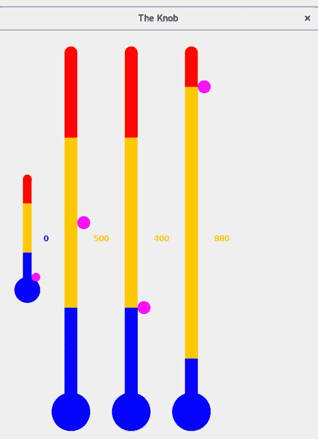

视觉和感觉视图的作用当然是为了确保具有图形用户界面的程序看起来与特定平台（Windows、Mac）上的其他程序一致。如果你需要从头编写自己的自定义组件，这可能非常重要，因为你可能需要为各个视觉和感觉编写 UI 代理。最后，这意味着原则上你可以编写自己的视觉和感觉（这并不简单），从而决定组件应该的行为。

```java
private boolean marked = false;

private Ellipse2D knob = null;

private double height;

private double width;

private double t;

private double m;

private double w;
```

```java
public Knob()
{
    this(0, 100, 0);
}
```

```java
public Knob(int min, int max, int value)
{
    this(min, max, 0.25, 0.75, value);
}
```

```java
public Knob(int min, int max, double lower, double upper, int value)
{
    this.min = min;
    this.max = max;
    this.lower = lower;
    this.upper = upper;
    this.value = value;
    addMouseListener(new MouseHandler());
    addMouseMotionListener(new MouseMoveHandler());
    setState();
}
```

```java
public void paintComponent(Graphics g)
{
    double pos = calculatePosition();
    Graphics2D g2 = (Graphics2D)g;
    g2.setRenderingHint(RenderingHints.KEY_ANTIALIASING,
        RenderingHints.VALUE_ANTIALIAS_ON);
    g2.setPaint(Color.red);
    g2.fill(new Ellipse2D.Double(w, 0, w, m * (1 - upper));
    g2.setPaint(Color.orange);
    g2.fill(new Rectangle2D.Double(w, t + m * (1 - upper),
        w, m * (upper - lower));
    g2.setPaint(Color.blue);
    g2.fill(new Ellipse2D.Double(0, height - width, width, width));
    g2.fill(new Rectangle2D.Double(w, t * (1 - lower),
        w, m * lower + width / 2));
    g2.setPaint(Color.magenta);
    g2.fill(knob = new Ellipse2D.Double(width * 2/3, pos - t, w, w));
}
```

```java
public void setValue(int value)
{
    int old = this.value;
    this.value = value;
    repaint();
    firePropertyChange("value", old, value);
    old = state;
    setState();
    if (old != state) fireEvent(old, state);
}
```

```java
public int getValue()
{
    return value;
}
```

```java
public int getMinimum()
{
    return min;
}
```

```java
public void setMinimum(int min)
{
    firePropertyChange("minimimum", this.min, min);
    this.min = min;
    repaint();
}
```

```java
public void setMaximum(int max)
{
    firePropertyChange("maximum", this.max, max);
    this.max = max;
    repaint();
}
```

```java
public int getMaximum()
{
    return max;
}
```

```java
public void setUpper(double upper)
{
    firePropertyChange("upper", this.upper, upper);
    this.upper = upper;
    repaint();
}
```

```java
public double getUpper()
{
    return upper;
}
```

```java
public void setLower(double lower)
{
    firePropertyChange("lower", this.lower, lower);
    this.lower = lower;
    repaint();
}
```

```java
public double getLower()
{
    return lower;
}
```

```java
public int getState()
{
    return state;
}
```

## JAVA 9: SWING、文档与打印中的用户自定义组件

```java
public void addKnobListener(KnobListener listener)
{
    listenerList.add(KnobListener.class, listener);
}
```

```java
public void removeKnobListener(KnobListener listener)
{
    listenerList.remove(KnobListener.class, listener);
}
```

```java
protected void fireEvent(int from, int to)
{
    Object[] listeners = listenerList.getListeners();
    for (int i = 0; i < listeners.length; i += 2)
        if (listeners[i] == KnobListener.class)
            ((KnobListener)listeners[i + 1]).knobChanged(
                new KnobEvent(this, value, from, to));
}
```

```java
private void calculate()
{
    Dimension dim = getSize();
    width = dim.getWidth();
```


## JAVA 9: SWING、文档与打印

```java
    height = dim.getHeight();
    w = width / 3;
    t = w / 2;
    m = height - width - t;
}
```

```java
private double calculatePosition()
{
    calculate();
    return (m * value + t * min - t * max - m * max) / (min - max);
}
```

```java
private int calculateValue(double y)
{
    calculate();
    double z = ((y - t) * min + (t + m - y) * max) / m;
    return Math.min(Math.max((int)z, min), max);
}
```

```java
private void setState()
{
    int state;
    double minValue = (max - min) * lower + min;
    double maxValue = (max - min) * upper + min;
    if (value < minValue) state = COLD;
    else if (value > maxValue) state = HOT;
    else state = NORMAL;
    if (this.state != state) this.state = state;
}
```

```java
class MouseHandler extends MouseAdapter
{
    @Override
    public void mousePressed(MouseEvent e)
    {
        marked = knob.contains(e.getX(), e.getY());
    }
    @Override
    public void mouseReleased(MouseEvent e)
    {
        marked = false;
    }
}
```

## JAVA 9: SWING、文档与打印
## 用户自定义组件

```java
@Override
public void mouseExited(MouseEvent e)
{
    marked = false;
}

class MouseHandler extends MouseMotionAdapter
{
    @Override
    public void mouseDragged(MouseEvent e)
    {
        if (marked) {
            setValue(calculateValue(e.getY()));
        }
    }
}
```

有很多细节，但该类派生自 `JComponent`，这实际上表明它是一个组件。首先定义了三个常量，用于指示当前值处于三个区域中的哪一个。六个属性变量，前五个是可以通过 `set` 方法更改的属性，而最后一个 `state` 表示当前三个区域的状态。此外还有七个实例变量，它们是辅助变量，用于以下情况：

- `marked` 表示鼠标正按下状态，因此你可以拖动旋钮
- `knob` 是当前代表当前值的椭圆
- `height` 是组件当前的高度
- `width` 是组件当前的宽度
- `t` 是温度计的高度
- `m` 是温度计的区域
- `w` 是当前宽度的三分之一

这些变量在每次组件绘制以及每次旋钮移动时都会进行初始化。

# JAVA 9: SWING、文档与打印

## 用户自定义组件

在后文中，只有绘制组件以及如何实现将是下一本书的主题，但简而言之，会发生以下情况。当组件需要被绘制时，会调用 `paintComponent()` 方法。当运行时发现组件无效（必须重绘）时会调用它，这通常发生在窗口创建时或执行 `repaint()` 方法时。注意，`set` 方法会执行此操作，并确保当组件属性更改时窗口会被重绘。`paintComponent()` 方法有一个 `Graphics` 对象，它代表绘制区域并提供了一些绘制工具。在这种情况下，会发生以下操作：

1. 调用 `calculatePosition()` 方法，该方法初始化辅助变量并返回旋钮的 y 坐标
2. 将 `Graphics` 对象强制转换为 `Graphics2D` 对象，它具有更好的绘制工具
3. 定义绘图质量
4. 将颜色定义为红色
5. 绘制一个圆
6. 为热点区域绘制一个矩形
7. 将颜色定义为橙色
8. 为普通区域绘制一个矩形
9. 将颜色定义为蓝色
10. 绘制一个圆——带有水银的下方的圆
11. 为冷区域绘制一个矩形
12. 将颜色定义为洋红色
13. 绘制旋钮

然后是一个使用 `Knob` 组件的测试应用程序，我不想在这里显示代码，但你应该注意，该组件的使用方法与其他组件相同。

## 5.3 更好的旋钮

自定义组件通常如上描述的那样开发，并作为应用程序的组件使用，这也是一种极佳的方法，但这种方法并不完全符合开发 Swing 组件的建议，部分原因是组件应该支持外观和感觉（look-and-feel）。对于实际编程而言，上述所示，`Knob` 组件最大的问题是它没有分离用户界面和模型，这使得代码维护变得困难。在本节中，我将查看 `Knob` 组件的另一个版本，其区别在于代码的编写方式不同。

基本上，一个 Swing 组件由：

1. 组件类，它指定了如何创建组件、如何更改组件以及如何读取组件的状态。
2. 组件模型，由一个定义接口和一个默认实现组成。模型负责实现组件的逻辑并向监听器发送通知。
3. 所谓的 UI 代理，它代表组件布局、关于鼠标和键盘的事件管理，最后是负责绘制组件的 UI 代理。

`KnobProgram` 项目与 `Knob` 项目是同一个程序，但 `Knob` 组件是按照上述模式编写的。基本上，它们是相同的代码，只是组织方式不同。

组件仍然可以抛出 `KnobEvent`，且 `KnobEvent` 和 `KnobListener` 的两种类型相对于组件的第一个版本来说完全没有变化。

我将从从模型开始，模型由以下接口定义：

```java
package knob.beans;

import java.beans.*;

public interface KnobModel {

    public int getMinimum();
    public int getMaximum();
    public int getValue();
    public int getState();
    public double getLower();
    public double getUpper();
    public void setMinimum(int minimum);
    public void setMaximum(int maximum);
    public void setValue(int value);
    public void setLower(double lower);
    public void setUpper(double upper);
    public void addPropertyChangeListener(PropertyChangeListener listener);
    public void removePropertyChangeListener(PropertyChangeListener listener);
    public void addKnobListener(KnobListener listener);
    public void removeKnobListener(KnobListener listener);
}
```

该接口定义了组件的属性，以及这些属性对应的 getter 和 setter 方法范围。此外，接口定义了哪些监听器可以注册为组件通知的接收者。这里是 `PropertyChangeListener` 和 `Listener` 对象。模型由 `DefaultKnobModel` 类实现。我不想显示整个类，但开头如下：

```java
public class DefaultKnobModel implements KnobModel {

    public static final double epsilon = 0.0000000001;
    private EventListenerList listenerList = new EventListenerList();
    public static final int HOT = 3;
```


```
public static final int NORMAL = 2;

public static final int COLD = 1;

private int min;

private int max;

private double upper;

private double lower;

private int value;

private int state;
```


在这里你可以看到变量已经从`Knob`类中移动出来，但仅代表组件状态的变量，而不是用于绘制组件的变量。注意模型有自己的监听器集合，并注意其类型为`EventListener`。该类具有适当的构造函数——这与原始类相同。代码的其余部分是实现接口定义的方法，在这里你特别需要注意`set`方法，因为它们将触发所需的事件。

然后是 UI 代理，根据自定义组件的开发模式，它从以下类开始：

```java
package knobprogram;

import javax.swing.plaf.*;

public class KnobUI extends ComponentUI {

    public static final String UI_CLASS_ID = "KnobID";

}
```

该类继承自`ComponentUI`且不包含很多内容，它只是定义了一个常量，以便该类在外观感觉方面有一个唯一的名称。有了这个类，你就可以编写 UI 代理了，即负责绘制组件并处理鼠标和键盘事件的类。下面我提供了该类的开头，但我没有显示任何关于绘制组件的内容，也没有定义鼠标事件处理器的内部类，因为这些代码与之前的版本相同。

```java
public class BasicKnobUI extends KnobUI {

    private MouseHandler handler = null;

    private MouseMotionHandler motionHandler = null;

    private KnobModel model = null;

    private boolean marked = false;

    private Ellipse2D knob = null;

    private double height;

    private double width;

    private double t;

    private double m;

    private double w;

    public BasicKnobUI(JComponent component) {

        model = ((Knob) component).getModel();

    }
```

```java
public static ComponentUI createUI(JComponent c)
{
    return new BasicKnobUI(c);
}
```

```java
public void installUI(JComponent component)
{
    Knob knob = (Knob)component;
    knob.addMouseListener(handler = new MouseHandler());
    knob.addMouseMotionListener(motionHandler = new MouseMotionHandler());
}
```

```java
public void uninstallUI(JComponent component)
{
    Knob knob = (Knob)component;
    if (handler != null) knob.removeMouseListener(handler);
    if (motionHandler != null) knob.removeMouseMotionListener(motionHandler);
}
```

你应该注意到用于绘制用户界面的变量已经移动到了这个类中。否则，你应该注意到已实现的方法，无需尝试解释具体在做什么，这些方法意味着组件支持外观和感觉，并且是开发自定义组件的一部分。后文是组件本身，即`Knob`类，它现在变成了一个非常薄的类：

```java
package knobprogram;

import javax.swing.*;
import java.beans.*;

public class Knob extends JComponent implements PropertyChangeListener
{
    private KnobModel model;

    public Knob()
    {
        init(new DefaultKnobModel());
    }

    public Knob(KnobModel model)
    {
        init(model);
    }
}
```

## JAVA 9: SWING、文档与打印

### 用户定义组件

```java
public Knob(int min, int max, int value)
{
    init(new DefaultKnobModel(min, max, value));
}
```

```java
public Knob(int min, int max, double lower, double upper, int value)
{
    init(new DefaultKnobModel(min, max, lower, upper, value));
}
```

```java
private void init(Knob model)
{
    setModel(model);
    updateUI();
}
```

```java
public String getUIClass()
{
    return UI_CLASS;
}
```

```java
public void setModel(Knob model)
{
```


## JAVA 9: SWING、文档与打印

```java
KnobModel old = this.model;
if (old != null) old.removePropertyChangeListener(this);
if (model == null) this.model = new DefaultKnobModel();
else this.model.addPropertyChangeListener(this);
firePropertyChange("model", old, this.model);
```

```java
public KnobModel getModel()
{
    return model;
}
```

```java
public KnobUI getUI()
{
    return (KnobUI) ui;
}
```

```java
public void setUI(KnobUI ui)
{
    super.setUI(ui);
}
```

```java
public void updateUI()
{
    if (UIManager.getUIClass() != null)
        setUI((KnobUI)UIManager.getUI(this));
    else
        setUI(new BasicKnobUI(this));
}
```

```java
public void propertyChange(PropertyChangeEvent e)
{
    firePropertyChange(e.getPropertyName(), e.getOldValue(), e.getNewValue());
    repaint();
}
```

```java
public int getMinimum()
{
    return model.getMinimum();
}
```

```java
public void setMinimum(int min)
{
    int old = getMinimum();
    if (min != old)
        model.setMinimum(min);
        firePropertyChange("minimum", old, min);
}
```

## JAVA 9: SWING、文档与打印

```java
public int getMax()
{
    return model.getMax();
}
```

```java
public void setMaximum(int max)
{
    int old = getMaximum();
    if (max != old) {
        model.setMax(max);
        firePropertyChange("maximum", old, max);
    }
}
```

```java
public int getValue()
{
    return model.getValue();
}
```

```java
public void setValue(int val)
{
    int old = getValue();
    if (val != old) {
        model.setValue(val);
        firePropertyChange("value", old, val);
    }
}
```

```java
public int getState()
{
    return model.getState();
}
```

```java
public double getLower()
{
    return model.getLower();
}
```

## JAVA 9: SWING、文档与打印

### 用户定义组件

```java
public void setLower(double lower)
{
    double old = getLower();
    if (Math.abs(lower - old) > DefaultKnobModel.epsilon) {
        model.setLower(lower);
        firePropertyChange("lower", old, lower);
    }
}
```

```java
public double getUpper()
{
    return model.getUpper();
}
```

```java
public void setUpper(double upper)
{
    double old = getUpper();
    if (Math.abs(upper - old) > DefaultKnobModel.epsilon) {
        model.setUpper(upper);
        firePropertyChange("upper", old, upper);
    }
}
```


我们不发明轮子。迷人的光芒提供了无限可能：创新技术和新市场带来了机遇与挑战。在一个你的专业知识被高度需求的环境中。在我们范围内范围内支持环境中，并从国际路径中受益。与其他专家紧密合作实施可持续理念，为影响我们的未来贡献力量。来加入我们，共同重塑每一。


```java
public void addKnobListener(KnobListener listener)
{
    model.addKnobListener(listener);
}
```

```java
public void removeKnobListener(KnobListener listener)
{
    model.removeKnobListener(listener);
}
```

事实上，没什么好解释的，这个类在很多方面只是模型的包装器。由于是模型维护了类的属性，因此`Knob`类（即用户所知的类）必须将维护工作委托给模型。测试程序已经过修改，现在它只有一个`Knob`类型的组件，但插入了一些按钮，以便你可以修改组件的属性：


如果在输入字段中输入一个值并点击按钮，相应属性的值就会发生变化。你应该注意，程序没有处理非法值，如果值无法转换，将抛出异常。

## JAVA 9: SWING、文档与打印

### 用户定义组件

### 练习 3

创建项目`Knob1`的副本。`Knob`组件有几个缺点，而且你可以给它的属性赋值，这是很遗憾的。应该满足以下要求：

- `minimum`小于`maximum`
- `lower`小于或等于`upper`
- `lower`和`upper`的值必须在 0 到 1 之间
- `value`必须大于或等于`minimum`且小于`maximum`

你必须修改组件以对这些属性的更改进行验证。在出现非法值的情况下，组件不应该抛出异常，而是通过自动为属性分配“合理”的值来处理错误。你必须在模型中扩展一个属性：

```java
private boolean vertical = true;
```

如果该属性的默认值为`true`，组件必须像以前一样显示，但如果值改为`false`，组件应该水平方向显示。例如，你可以修改测试程序以打开以下窗口：


## 5.4 日期选择器

我想用另一个自定义组件的示例结束本章。这次的组件不同，因为它是一个自`JPanel`的类，而且它不是绘制组件的用户界面，而是一个包含其他 Swing 组件的容器。该组件是一个所谓的 DatePicker（日期选择器），它是用户可以选择日期的组件示例。网上有很多类似的组件，以下是另一个例子。如果你打开测试程序，将看到以下窗口：


在以下发现真理

```java
package datecomponent;

import java.util.*;
import java.awt.*;
import javax.swing.border.*;
import java.beans.*;
```

## JAVA 9: SWING、文档与打印用户自定义组件

```java
private String getText(Calendar date) {
  return String.format("%02d-%02d-%04d", date.get(Calendar.DATE),
  date.get(Calendar.MONTH) + 1, date.get(Calendar.YEAR));
}
```


在这里你应该特别注意如何创建 `DatePicker` 组件并将其添加到窗口中，这种操作方法与其他组件是相同的。同时请注意，程序已为第一个组件注册了 `PropertyChangeListener`，当该组件日期发生变化时会接收到通知。


你喜欢汽车吗？你想成为一个成功品牌的一员吗？我们将欣赏并奖励你的热情和天赋。向我们发送你的简历。你会对它能带你去向的地方感到惊讶的。

请在 `www.employerforlife.com` 向我们发送简历。

在 `bookboom.com` 免费下载电子书。

## JAVA 9：SWING、文档与打印

`DatePicker` 组件可能具有实际价值，我想将其添加到我的类库 `PalLib` 中。它涵盖了以下步骤：

1. 我创建了一个 `palib.gui.images` 包，并为此复制了该组件使用的图标（共 7 个）。
2. `CalendarException` 类被复制到 `palib.util` 包中。
3. `Date` 类被复制到 `palib.gui.util` 包中。这导致了 `Tools` 类出现问题，因为它仅通过名称 `Date` 引用了 `java.util.Date` 类。这个问题必须在 `Tools` 类中解决，将所有对 `Date` 的引用更改为全名 `java.util.Date`。
4. 我创建了一个 `palib.gui.models` 包，并在这里创建了一个名为 `DatePickerModel` 的类。该类的内容是组件的模型（即 DateComponent 项目中的 `Model` 类）。
5. `DatePicker` 类被复制到 `palib.gui`。这再次导致了 `Date` 的问题，这些问题必须通过使用全名 `palib.util.Date` 引用 `Date` 来解决。
6. 在 `Date` 类中，所有图标名称（引用）必须更改为库中的图标。

在完成这些更改后，库得到了更新，DateComponent 项目可以修改（重命名为 DateComponent），以便删除所有与组件相关的类，然后项目改用 `PalLib`。

最后注释一点，在为类命名时，通常应该尽量避免使用 Java 也在使用的名称。这并不是不允许，但它很容易导致像上面那样的问题。

在 `bookboom.com` 免费下载电子书。

# 剪贴板

使用剪贴板并实现复制和粘贴是现代程序中的预期功能，至少对于处理文本的程序是如此。基本上，你可以选择某些对象（如文本）并将其保存到剪贴板，检索它们，甚至可能将其粘贴到完全不同的程序中。在大多数程序中，这是程序员不需要考虑的，因为许多组件（例如编辑文本的组件）内置了这些功能。也有一些需要编写复制和粘贴的情况（例如，当你编写自定义组件时），这就是本章的意义。此外，在《Java 2》书中，我简要介绍过如何实现。

原则上讲，这非常简单，但如果你研究它是如何实现的，那就绝非易事，原因有几个。剪贴板是一个可以保存某些内容的内存区域，但剪贴板是一个程序之外的概念，是由操作系统和虚拟机管理的。另一个问题是，数据不仅仅是数据，即使文本也不仅仅是文本。例如，如果在文字处理器中写入文本时包含许多控制字符和其他格式信息，那么这些信息也必须被并在稍后重新插入以粘贴。因此，有必要保存剪贴板上存储的是什么类型数据的信息。最后，如果你要在两个程序之间进行复制和粘贴，程序可能不知道对方的数据格式。总来说，可以立即得出结论：在两个不同的程序之间复制粘贴数据并不一定能产生意义的结果。

我想从一个简单的程序开始，它会打开以下窗口：

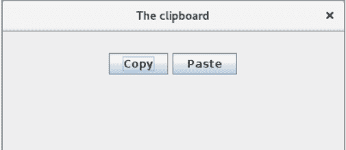

点击“复制”按钮会将文本复制到剪贴板，点击“粘贴”按钮会打开一个消息框，显示剪贴板上复制的文本（文本从剪贴板获取）。程序由此展示了如何在剪贴板上保存数据并检索这些数据。代码如下：

## JAVA 9：SWING、文档与打印

# 剪贴板

`package theclipboard;`

```java
import java.util.*;
import java.awt.*;
import java.awt.event.*;
import javax.swing.*;
import javax.swing.border.*;
import java.awt.datatransfer.*;
```

```java
public class MainView extends JFrame {
    private static Random rand = new Random();

    private String[] names = { "Gorm den Gamle", "Harald Blåtand", "Svend Tveskåg" };

    private Clipboard cb = Toolkit.getDefaultToolkit().getSystemClipboard();
```

```java
public MainView() {
    super("the clipboard");

    setSize(400, 200);
    createView();
    setLocationRelativeTo(null);
    setDefaultCloseOperation(EXIT_ON_CLOSE);
    setVisible(true);
}
```


```java
private void createView() {
    JPanel panel = new JPanel(new FlowLayout());
    panel.setBorder(new EmptyBorder(20, 20, 20, 20));

    JButton cmdCopy = new JButton("Copy");
    JButton cmdPaste = new JButton("Paste");

    cmdCopy.addActionListener(this::copy);
    cmdPaste.addActionListener(this::paste);

    panel.add(cmdCopy);
    panel.add(cmdPaste);
    add(panel);
}
```

```java
private void copy(ActionEvent e) {
    cb.setContents(new StringSelection(names[rand.nextInt(names.length)]), null);
}
```

```java
private void paste(ActionEvent e) {
    try {
        JOptionPane.showMessageDialog(this, cb.getContent(null).getData(DataFlavor.stringFlavor));
    } catch (Exception ex) {
        JOptionPane.showMessageDialog(this, ex.toString());
    }
}
```

```java
Clipboard cb = Toolkit.getDefaultToolkit().getSystemClipboard();
```

## JAVA 9：SWING、文档与打印

# 剪贴板

当在剪贴板上保存数据时，数据将由如 `Java.lang.String` 之类定义。如果只需要在 Java 应用程序之间传输数据，那么告诉 `DataFlavor` 具体类型就足够了；但数据应该被传输到其他程序，这些程序显然不知道 Java 的类，因此需要另一种方式来定义数据格式。因此，需要一种与平台无关且语言中立的数据格式术语。为此，使用了 MIME，这是一种 Internet 标准，使得为电子邮件附加各种文档成为可能。

## 6.1 MIME 类型

## JAVA 9：SWING、文档与打印

# 剪贴板

MIME 类型由一个可以被视为父类的媒体类型（media type）以及一个定义该类别内更特定类型的子类型组成。这些类型通过字符 `/` 隔开，例如：

```text
text/plain
```

这表示不带格式信息的纯文本。还有许多其他的 MIME 类型，例如：

```text
image/gif
image/jpg
text/html
```

你也可以定义自己的 MIME 类型，它必须由一个已知的媒体类型以及以“x-”开头的子集组成，这表示它是未注册的类型。最后是：

```text
application/octet-stream
```

这是一个指定未知格式二进制数据的通用类型。除了类型和子类型外，MIME 类型还可能包含关联信息，例如关于文本的编码。语法如下例所示：

- `text/plain;charset=unicode`
- `text/plain;charset=ascii`
- `text/plain;charset=iso-8859-1`

在创建 `DataFlow` 时，你可以指定 MIME 类型，例如：

```java
DataFlavor df = new DataFlavor("text/htm");
```

另一个使用剪贴板的程序示例是 `ClipBytes` 程序将一个字节数组复制到剪贴板。该程序与上面的程序具有相同的用户界面，工作方式也相同，只是将包含 10 个随机字节的数组复制到剪贴板。同样，如果你点击“粘贴”（Paste），就会从剪贴板读取该数组并在消息框中显示。代码如下，我只列出了不同的部分代码：

```java
public class MainView extends JFrame implements ClipboardOwner {
    private static Random rand = new Random();
    private Clipboard cb = Toolkit.getDefaultToolkit().getSystemClipboard();

    public MainView() {
    }

    private void getView() {
    }

    @Override
    public void lostOwnership(Clipboard clipboard, Transferable contents) {
        JOptionPane.showMessageDialog(this, "The clipboard data is invalid");
    }

    private void copy(ActionEvent e) {
        cb.setContents(new DataHandler(create(10), "application/octet-stream"), this);
    }
}
```

```java
private void paste(ActionEvent e) {
    try {
        Transferable data = cb.getContent(null);
        DataFlavor flavor = data.getTransferDataavors()[0];
        show((byte[]) data.transferData(flavor));
    } catch (Exception ex) {
        JOptionPane.showMessageDialog(this, ex.toString());
    }
}
```

```java
private byte[] create(int n) {
    byte[] arr = new byte[n];
    rand.nextBytes(arr);
    return arr;
}
```

```java
private void show(byte[] arr) {
    StringBuilder builder = new StringBuilder();

    for (byte b : arr) {
        builder.append(b);
        builder.append(' ');
    }

    JOptionPane.showMessageDialog(this, builder.toString());
}
```

首先，注意该类现在实现了 `ClipboardOwner` 接口。该接口定义了一个名为 `lostOwnership()` 的方法，如果你在剪贴板上保存了内容且另一个程序覆盖了它，就会执行该方法。在这种情况下，除了出现一个消息框外，什么都不会发生。通过运行程序并在剪贴板上保存某些内容（点击“复制”按钮）可以很容易测试此功能。如果你打开另一个程序并从那里向剪贴板保存某些内容，你会注意到消息框显示了。

在程序的末尾有两个辅助方法，其中第一个创建一个带有随机字节值的字节数组，而另一个显示一个包含此类数组内容的消息框。

然后是事件处理器。`copy()` 方法使用了 `Transferable` 的 `DataHandler`。除了封装数据外，此类对象还具有 MIME 类型，因此可以用于传输各种数据类型。在这种情况下，使用了通用的 MIME 类型，它表示正在传输原始数据，且不进行解释。还要注意 `setContents()` 的最后一个参数，它是一个 `ClipboardOwner`。`paste()` 方法必须通过 `getContents()` 获取数据，但你必须指定一个 `DataFlavor`，结果是一个 `Transferable` 对象。从该对象，使用第一个 `DataFlavor`（只有一个）从 `Transferable` 对象中检索字节数组格式的数据。

## 6.2 序列化对象

也可以序列化将对象保存到剪贴板，我将在下一个示例中展示如何操作。我想保存以下类型的对象：

```java
class King implements Serializable {
    private String name;
    private int from;
    private int to;
```

```java
public King(String name, int from, int to) {
    this.name = name;
    this.from = from;
    this.to = to;
}
```

```java
public String getName() {
    return name;
}
```

```java
public int getFrom() {
    return from;
}
```

```java
public int getTo() {
    return to;
}
```

```java
public String toString() {
    return name + String.format("%d - %d", from, to);
}
```

该类不需要解释，但你应该注意它是 `Serializable` 的，并且它包含 `String` 类型和简单类型的实例变量。要传输数据，必须使用 `Transferable`，有多种选择，例如，我将为你展示如何实现你的 `Transferable` 类型。`Transferable` 是一个定义了三个接口，任务是编写一个实现该接口的类：

```java
class SerialTransferable implements Transferable {
    private Serializable obj;

    SerialTransferable(Serializable obj) {
        this.obj = obj;
    }
```

```java
@Override
public DataFlavor[] getTransferDataFlavors() {
    DataFlavor[] flavors = new DataFlavor[2];

    try {
        flavors[0] = new DataFlavor(
            "application/x-java-serialized-object;class=" + obj.getClass().getName()
        );
        flavors[1] = DataFlavor.stringFlavor;
        return flavors;
    } catch (ClassNotFoundException e) {
        return new DataFlavor[0];
    }
}
```

```java
@Override
public boolean isDataFlavorSupported(DataFlavor flavor) {
    return DataFlavor.stringFlavor.equals(flavor)
        || "application".equals(flavor.getPrimaryType())
        && "x-java-serialized-object".equals(flavor.getSubType())
        && flavor.getRepresentationClass().isAssignableFrom(obj.getClass());
}
```

```java
@Override
public Object getTransferData(DataFlavor flavor)
    throws UnsupportedFlavorException
{
```


该类有一个要序列化对象的引用，该引用在构造函数中初始化。第一个方法必须返回可能使用的`DataFlavor`对象，并定义了两个。第一个定义了序列化对象的 MIME 类型：

```
"application/x-java-serialized-object; class=" + obj.getClass().getName()
```

# JAVA 9：SWING、文档与剪贴板打印

其中类型为`application`，而子类型为`x-java-serialized-object`。最后，关联了一个参数，即对象类型。第二个`DataFlavor`是一个`DataFlavor.stringFlavor`，这意味着剪贴板的内容可以被解释为字符串。你必须注意这两个`DataFlavor`对象的顺序，这意味着用于序列化的`DataFlavor`对象是主要的。

下一个方法将测试给定的`DataFlavor`是否可用于检索此对象，以及它是否可能是一个`DataFlavor.stringFlavor`，或者类型和子类型是否正确且它是正确的类类型。最后，是最后一个方法，它根据`DataFlavor`返回封装的数据对象。如果是`DataFlavor.stringFlavor`，则以对象的`toString()`结果返回；如果是其他合法的`DataFlavor`，则返回对象本身。


然后是程序，它在原则上与本章的前两个示例程序程序相同：

```java
public class Main extends JFrame {

    private static Random rand = new Random();

    private King[] kings = {

        new King("Gorm Gamle", 936, 958),

        new King("Harald Blåtand", 958, 987),

        new King("Svend Tveskåg", 987, 1014);

    };

    private Clipboard cb = Toolkit.getDefaultToolkit().getClipboard();

}

public void getView() {

}

private void createView() {

    ...

}

private void copy(ActionEvent e) {

    cb.setContents(

        new SerialTransferable(kings[rand.nextInt(kings.length)]), null

    );

}

private void paste(ActionEvent e) {

    try {

        DataFlavor flavor = new DataFlavor("application/x-java-serialized-object;class=clipboardobject.King");

        if (cb.isDataFlavorAvailable(flavor)) show((King)cb.getData(flavor));

    } catch (Exception ex) {

        JOptionPane.showMessageDialog(this, ex.toString());

    }

}

private void show(King king) {

    JOptionPane.showMessageDialog(this, String.format("%s\n%d %d", king.getName(), king.getFrom(), king.getTo()));

}
```

JAVA 9：SWING、文档与打印

当对象被保存到剪贴板上时，它是一个随机的`King`对象，你必须注意它被封装在类型为`Transferable`的`Transferable`对象中。当在`paste()`方法中检索对象时，定义了类型的`DataFlavor`。如果对象可以通过此`DataFlavor`，则使用`getData()`方法从剪贴板中检索，该方法返回不是剪贴板上的`Transferable`对象，而是对象封装的数据。

# 练习 4

你必须编写一个打开如下所示窗口的应用程序。你可以只做一个简单的设计。我的窗口具有固定大小，且组件在不使用布局管理器的情况下以固定位置布局。

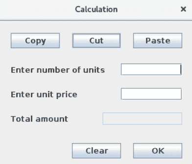

在第一个输入框中输入单位数量（一个`int`），在第二个输入框中输入任何价格（一个`double`）。如果你点击 OK 按钮，程序将通过单位数量乘以单价计算总金额，并将结果插入底部字段。点击 Clear（清除）按钮将清除所有三个字段。如果你点击 Copy（复制）按钮，上方两个字段的内容必须实例化为以下类型的对象：

```java
class Values implements Serializable

{

    private int units;

    private double price;

    public Values(int units, double price)

    {

        this.units = units;

        this.price = price;

    }
```

# JAVA 9：SWING、文档与打印

# 剪贴板

```java
public int getUnits()

{

    return units;

}
```

```java
public double getPrice()

{

    return price;

}
```

对象必须被保存在剪贴板上。Cut（剪切）按钮原则上以相同的方式工作，但它也应该删除上方两个字段。最后，Paste（粘贴）按钮必须使用保存在剪贴板上的`Values`对象的值初始化上方两个字段。


## 6.3 剪贴板上的图像

我想通过一个将图像部分保存到剪贴板的应用程序来结束关于剪贴板的章节。这是一个允许你标记图片的矩形区域并将其保存到剪贴板再再次粘贴的程序，但这需要一些关于图像处理的知识。这里的重点在于如何与剪贴板之间复制图像数据，而不是程序是如何运行的。如果你打开程序，将得到一个如下所示的窗口：

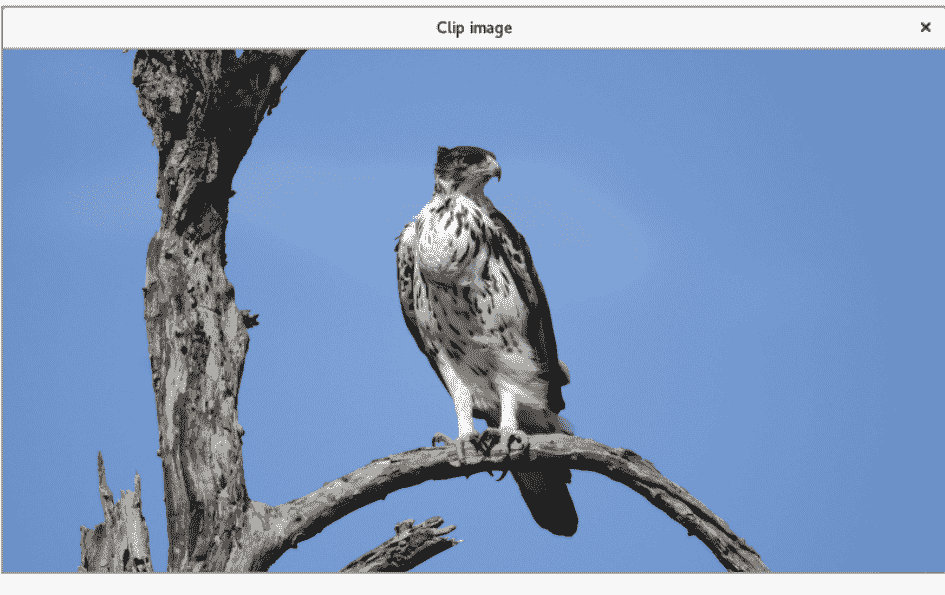

其中图像被复制并成为程序的一部分。如果你指向图片的某处，按住并移动鼠标，就会画出一个矩形显示显示被标记的内容：

JAVA 9：SWING、文档与打印

剪贴板

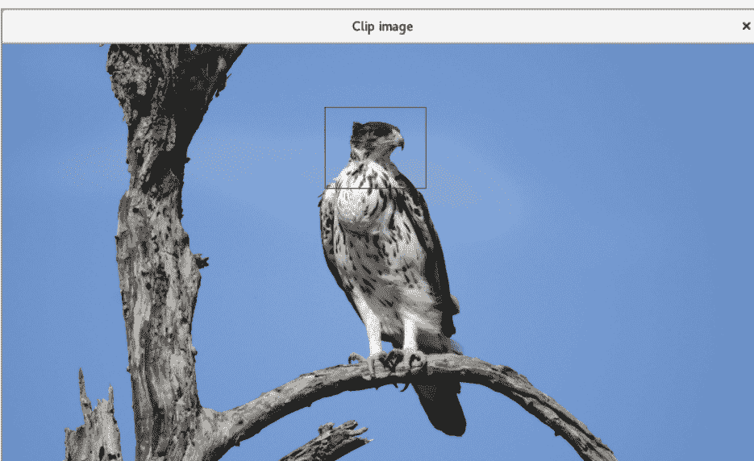

如果你右键点击图像上的某个位置，将得到一个带有复制（copy）、剪切（cut）和粘贴（paste）三个菜单项的弹出菜单。下面的窗口显示了结果，我在我在并随后将图像头部粘贴到了三个地方：

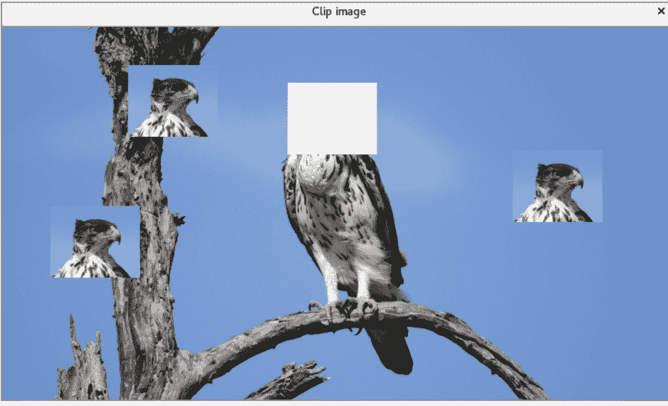

# JAVA 9：SWING、文档与剪贴板

你应该注意图像并不位于`ScrollPane`中，原因是这会让程序变得有点复杂，计算矩形绘制的位置变得更困难。程序看起来有点像之前的程序，该程序对应于用于保存到剪贴板的像素的数据结构：

```java
class ImageData implements Serializable {

    private int width;

    private int height;

    private int[] pixels;

    public ImageData(int width, int height, int[] pixels) {

        this.width = width;

        this.height = height;

        this.pixels = pixels;

    }

}
```


```java
public int getWidth()

{

    return width;

}
```

```java
public int getHeight()

{

    return height;

}
```

```java
public int[] getPixels()

{

    return pixels;

}
```

该数据结构由一个矩形像素数组以及矩形的宽度高度组成。与之前的程序一样，我必须定义一个`Transferable`。

```java
class ImageTransferable implements Transferable {

    public final static DataFlavor IMAGE_FLAVOR = 

        new DataFlavor(ImageData.class, "Image Data");

    private final static DataFlavor[] flavors = { IMAGE_FLAVOR };

    private ImageData data;

    public ImageTransferable(ImageData data) {

        this.data = data;

    }
```

```java
public DataFlavor [] getDataFlavor()

{

    return flavors;

}
```

```java
public boolean isDataFlavorSupported(DataFlavor flavor)

{

    return flavor.equals(IMAGE_FLAVOR);

}
```

```java
public Object getTransferData(DataFlavor flavor)

throws UnsupportedFlavorException

{

    if (!flavor.equals(IMAGE_FLAVOR)) throw new UnsupportedFlavorException(flavor);

    return data;

}
```

定义了一个`DataFlavor`，但这次不是使用 MIME 类型，而是通过指定可以传输到剪贴板的对象类型来定义。`Transferable`对象方法只支持一个`DataFlavor`，且`getDataFlavor()`返回的数组定义为静态数组。类方法的实现显而易见。

然后是程序本身，代码量很大。代码的大部分涉及绘制矩形以及形成图像矩形区域的像素数组，并将存储的像素复制到图像。后者分别有两个名为`getPixel()`和`getPixels()`方法。我不想在这里显示这些方法的代码，但简述程序运行如下：图像显示在一个`JLabel`中，该标签锚定在窗口的左上角。如果你按下左鼠标键，鼠标坐标将被保存为矩形的左上角，当你移动鼠标时，鼠标坐标将被保存为矩形的右下角，之后矩形就会被绘制。在窗口任何地方右键点击都会打开一个带有三个菜单项的弹出菜单。所有这些都需要一些代码，但我只想展示给弹出菜单的三个事件处理器。下面是`copy()`方法：

```java
private Rectangle copy()

{

    Rectangle rect = getSelected();

    int[] pixels = getPixels(rect);

ImageData data = new ImageData(rect.width, rect.height, pixels);

Clipboard cb = getToolkit().getClipboard();

cb.setContents(new ImageTransferable(data), null);

    return rect;

}
```

# JAVA 9: SWING、文档与打印

该方法首先通过`getSelected()`方法确定被选中的矩形。接下来，使用`getPixels()`方法构建一个包含该矩形内所有图像像素的数组，然后创建要保存到剪贴板的对象。该对象的类型为`ImageData`，现在通过将其嵌入`ImageTransferable`对象中将其保存到剪贴板上。当该方法返回矩形时，是因为它也被用于`cut(rect)`方法中：

```
private void cut() {

  Rectangle rect = copy();

  int[] pix = getPixels(rect);

  for (int i = 0; i < pix.length; ++i) pix[i] = 0;

  setPixels(pix, rect);

}
```


关于 e-Learning for Kids。e-Learning for Kids 成立于 2004 年，是一个全球非营利基金会，致力于为 5-12 岁的儿童提供互联网上的趣味免费学习，课程涵盖数学、科学、语言艺术、计算机、健康和环境。自 2005 年以来，全球 190 多个国家的 1500 万儿童受益于 LU KI 提供的在线学习。一个全志愿者团队，由来自全球的教育和在线学习专家以及业务专业人士组成，他们致力于改变世界。我们的愿景通过种子资金、志愿者、赞助者和慷慨开发者的参与来实现。欲了解更多信息，请访问 www.e-learningforkids.org。

在 bookboom.com 下载免费电子书

点击广告阅读更多

`cut()`必须以`copy()`开始，然后通过将所有像素设置为 0 来清空已保存的区域。实际的图像使用`setPixels()`方法进行更新。下面是`paste()`方法：

```java
private void paste()

{

    Clipboard cb = getToolkit().SystemClipboard();

try {

    Transferable tf = cb.getContent(null);

    if (tf.isDataFlavorSupported(ImageTransferable.IMAGE_FLAVOR))

    {

      ImageData data =

      (ImageData)(tf.getTransferData(ImageTransferable.IMAGE_FLAVOR));

      Rectangle area =

      new Rectangle(point.x, point.y, data.getWidth(), data.getHeight());

      int[] pixels = data.getPixels();

      setPixels(pixels, area);

    }

    end = start;

    repaint();

} catch (Exception ex) {

    JOptionPane.showMessageDialog(this, ex.toString());

}
```


该方法首先将剪贴板的内容作为`Transferable`对象引用。如果该对象支持正确的`DataFlavor`，则以`ImageData`对象的形式检索数据，并基于此创建一个用于更新像素的矩形。实际的更新通过`setPixels()`方法完成。当图像最终重绘时，必须移除选中的矩形。

## 拖放

拖放是指使用鼠标将数据从一个位置移动到另一个位置的操作。事实上，大多数 Swing 组件都带有内置的拖放功能，在程序中实现这一功能相对简单。其原理类似于剪贴板，要移动的数据必须封装在`Transferable`对象中，此外，还必须实现三个接口：其中一个定义了执行移动操作的组件，另一个组件是你能够拖放对象的区域，用于指示操作的视觉表示。这听起来很多，但这是因为你对如何执行操作具有很高的自由度，而在实践中需要的其实非常有限。

拖放操作包括三个功能：

- 1. 复制（按住左键并移动鼠标）
- 2. 移动（按住左键并移动鼠标 + CTRL）
- 3. 链接（按住左键并移动鼠标 + CTRL + SHIFT）

其中最后一种意味着没有复制对象，而仅定义原始对象的引用。这些操作在`DnDConstants`中定义为常量：

- 1. `DnDConstants.ACTION_MOVE`
- 2. `DnDConstants.ACTION_COPY`
- 3. `DnDConstants.ACTION_REFERENCE`
- 4. `DnDConstants.ACTION_LINK`
- 5. `DnDConstants.ACTION_COPY_OR_MOVE`

拖放的原理是，通过鼠标，可以将一个组件拖到另一个组件上方并释放第一个组件。当 Swing 组件支持拖放时，意味着所有关于鼠标的必要逻辑都是内置的，但在释放时会发生什么，Swing 显然不知道，这就是为什么需要进行编程的原因。我想从一个打开以下窗口的应用程序开始：

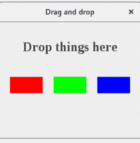

该窗口包含三个标签，含义是通过使用拖放操作可以更改顶部标签的背景颜色。下面是一个示例，背景颜色已更改了三次（数字 3 显示在`JLabel`中，其意义仅在于展示这些接口作为拖放 API 部分的用途）：


## JAVA 9: SWING、文档与打印

### 拖放

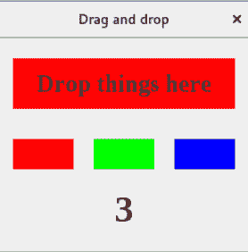

完整代码所示：

```java
package dropswwing;

import java.awt.*;
import javax.swing.*;
import javax.swing.border.*;
import java.awt.datatransfer.*;
import java.awt.dnd.*;
import java.io.*;

public class Main extends JFrame {

    public final static DataFlavor LABEL_FLAVOR =
        new DataFlavor(Label.class, "Label Instances");

    private DragSourceListener dragSource;
    private JPanel panel = new JPanel(null);
    private JLabel dropLabel;
    private JLabel lblCount = new JLabel();
    private int count = 0;

    public Main(){
        super("Drag and drop");
        setSize(260, 250);
        createView();
        setLocationRelativeTo(null);
        setDefaultCloseOperation(EXIT_ON_CLOSE);
        setVisible(true);
    }
```

在 bookboom.com 下载免费电子书

```java
private void createView() {
    addComponent(dropLabel = createLabel(), 20, 20, 220, 50);
    addComponent(createLabel(Color.red), 20, 100, 60, 30);
    addComponent(createLabel(Color.green), 100, 100, 60, 30);
    addComponent(createLabel(Color.blue), 180, 100, 60, 30);
    addComponent(lblCount, 100, 140, 60, 60);
    lblCount.setHorizontalAlignment(JLabel.CENTER);
    lblCount.setFont(new Font("Liberation Serif", Font.BOLD, 36));
    new DropTarget(dropLabel, DnDConstants.ACTION_COPY, new DnDTarget());
    dragSource = new DnDSource();
    add(panel);
}
```

```java
private JLabel createLabel() {
    JLabel label = new JLabel("Drop things here");
    label.setOpaque(true);
    label.setHorizontalAlignment(JLabel.CENTER);
    label.setFont(new Font("Liberation Serif", Font.BOLD, 24));
    return label;
}
```

```java
private JLabel createLabel(Color color) {
    JLabel label = new JLabel();
    label.setOpaque(true);
    label.setBackground(color);
    DragSource.getDefaultDragSource().createDefaultDragRecognizer(label, DnDConstants.ACTION_COPY, new DnDGesture());
    return label;
}
```

```java
class DnDGesture implements DragGestureListener {
    public void dragRecognized(DragGestureEvent e) {
        Cursor cursor = null;
        JLabel label = (JLabel) (e.getComponent());
        switch (e.getDragAction()) {
            case DnDConstants.ACTION_MOVE: cursor = DragSource.DefaultMoveDrop; break;
            case DnDConstants.ACTION_COPY: cursor = DragSource.DefaultCopyDrop; break;
            case DnDConstants.ACTION_LINK: cursor = DragSource.DefaultLinkDrop; break;
        }
        e.startDrag(cursor, new LabelTransferable(label), dragSource);
    }
}
```

```java
class DnDSource implements DragSourceListener {
    public void dragEnter(DragSourceDragEvent e) {
    }
    public void dragExit(DragSourceEvent e) {
    }
    public void dragOver(DragSourceDragEvent e) {
    }
}
```


## 加入马斯特里赫特大学商学院的顶尖行列！

- 《金融时报》全球排名第33：MSc International Business
- 第一名：MSc International Economics
- 第一名：MSc Financial Economics
- 第二名：MSc Management of Learning
- 第二名：MSc Economics
- 第二名：MSc Econometrics and Operations Research
- 第二名：MSc Global Supply Chain Management and Change.

来源：Keynes Master 排名 2013；爱思唯“最佳研究”排名 2012；《金融时报》全球管理硕士排名 2012

访问我们并发现为什么我们是最好的！硕士课程课程开放日：2014年2月22日

马斯特里赫特大学是荷兰最优秀的专家大学（Bievel）

www.mastersopenday.nl

## JAVA 9: SWING、文档与打印

```java
public void dropChanged(DragSourceDragEvent e)
{}
```

```java
public void dragDropEnd(DragSourceDropEvent e)
{
    if (e.getDropSuccess()) lblCount.setText(String.format("%d", ++count));
}
```

```java
class DnDdrop implements DropTargetListener
{
    public void dragEnter(DropTargetDragEvent e)
    {
        if (!e.isDataSupported(LABEL_FLAVOR)) e.rejectDrag();
        else dropLabel.setBorder(new LineBorder(Color.black));
    }
```

```java
public void dragExit(DropTargetDragEvent e)
{
    dropLabel.setBorder(null);
}
```

```java
public void dragOver(DropTargetDragEvent e)
{}
```

```java
public void actionChanged(DropTargetDragEvent e)
{}
```

```java
public void drop(DropTargetDropEvent e)
{
    try
    {
        if (e.isDataSupported(LABEL_FLAVOR))
        {
            dropLabel.setBackground((JLabel)e.getTransferable().getTransfer(LABEL_FLAVOR).getBackground());
            dropLabel.setBorder(null);
            e.dropComplete(true);
        }
    }
    catch (Exception ex)
    {
        e.dropComplete(false);
    }
}
```

```java
class LabelTransferable implements Transferable
{
    private DataFlavor[] flavors = { LABEL_FLAVOR };
    private JLabel label;

    public LabelTransferable(JLabel label)
    {
        this.label = label;
    }

    public DataFlavor[] getDataFlavors()
    {
        return flavors;
    }

    public boolean isDataFlavorSupported(DataFlavor flavor)
    {
        return flavor.equals(LABEL_FLAVOR);
    }

    public Object getTransferData(DataFlavor flavor)
    throws UnsupportedFlavorException, IOException
    {
        if (flavor.equals(LABEL_FLAVOR)) return label;
        throw new UnsupportedFlavorException(flavor);
    }
}
```

如果你从顶部开始，拖放和需要两个包：

```java
import java.awt.datatransfer.*;
import java.awt.dnd;
```

## JAVA 9: SWING、文档与打印

### 拖放

其中第一个包与我在上一章关于剪贴板的内容中提到的包相同。另一个包包含了在应用程序中实现拖放所需的类型。关于程序的变量，首先定义了一个针对`JLabel`的常量作为`DataFlavor`常量。这对应于该程序应该能够拖动的对象是`JLabel`组件。此外，类型为`DragSourceListener`的变量定义了代表被拖动组件的对象，该对象在操作过程中会触发多个事件。顶部的变量与用户界面组件有关，不需要任何特殊解释，但你应该注意，面板没有布局管理器，且组件被放置在窗口的固定位置。这只是为了省去用户界面的设计，因为在这个示例中它并不是重点。

拖放需要你定义四个类。下面将对它们进行解释，但在示例中，它们都被定义为内部类。除了这些类之外，代码还包含了用户界面的设计，这里有三点是你应该的。在`create()`方法中，执行了以下操作：

```java
new DropTargetLabel, DndConstants.ACTION_COPY, new DndDrop());
```


`dropLabel`是我想要放置其上的`JLabel`，该语句告诉我通过向组件挂载`DragTargetListener`可以实现这一点。`DnDrop`是实现`DragTargetListener`接口的内部类。`createView()`也执行了语句

```java
dragSource = new DnSource();
```

这创建了一个`DragSourceListener`（这是一个实例变量），并且`DnSource`是实现`DragSourceListener`接口的内部类。最后，最后一个`createLabel()`方法创建了三个显示颜色的`JLabel`组件（必须是可以拖动的组件），并执行了以下语句：

```java
DragSource.getDefaultSource().createDefaultRecognizer(label, DnConstants.ACTION_COPY, new DnGesture());
```

该语句将`DragGestureListener`链接到组件。`DnGesture`是实现`DragGestureListener`接口的内部类，该类启动了拖放操作。综上，在程序中实现拖放必须：

- 1. 为可以放置投放的组件分配`DragTargetListener`
- 2. 定义一个`DragSourceListener`对象
- 3. 为必须可拖动的组件分配`DragGestureListener`

后面是编写了实现这三个接口的类，并且如上所述，还写了一个实现`Transferable`接口的类。

我想从名为`LabelTransferable`的类开始，它实现了`Transferable`接口。该类的构造函数接受一个`JLabel`作为参数，即拖放操作包含的标签。如上一章所示，该类实现了三个方法，由于只有一个`DataFlavor`，这些方法都是非常基础的。

然后是实现`DragSourceListener`的`DnSource`类。该接口定义了 5 个触发与拖放操作相关事件的处理器。通常你不需要实现这些方法（留空即可），但我实现了一个在操作完成时执行的方法。如果投放操作正确完成，该方法会将计数加 1 并显示该值。目标是展示如何使用这些事件处理器，但它们主要通过名称出现。

## JAVA 9: SWING、文档与打印 拖放

`DnDrop`类实现了`DropTargetListener`，它定义了 5 个由投放组件触发的事件。我实现了其中三个。第一个事件意味着当鼠标拖入组件时，标签周围会出现一个边框。它告诉用户这是一个可以投放的地方。第二个事件处理器在鼠标离开组件时移除边框。然后是`drop()`方法，它在投放——即释放鼠标时执行。该方法测试被投放的对象是否具有正确的`DataFlavor`（一个`JLabel`组件），如果是，则执行以下语句：


`dropLabel.setBackground((JLabel)e.getTransferable().getTransfer(LABEL_FLAVOR).getBackground());`

该方法获取被传输的对象并转换为`JLabel`。接下来，`dropLabel`组件的背景颜色更改为传输对象的背景颜色。下一步，方法移除边框，最后执行：

```java
e.dropComplete(true);
```

这告诉投放操作执行正确。

最后是实现`DragGesture`接口的`DnGesture`类。该接口只定义了一个方法（处理器），即在拖放操作开始时执行的方法。它实际上是将其结合在一起的方法。该方法开始确定拖放操作涉及的标签引用。然后，方法更改光标以产生视觉效果。最后，方法通过指定选定的光标并将当前对象封装在`Transferable`对象中启动操作。

如上所示，拖放需要一部分，但这是每次都应该发生的事情。

# JAVA 9: SWING、文档与打印 拖放

## 7.1 拖放图像

上述不是典型的拖放操作，因此下面的示例能更好地展示如何在程序中使用拖放。事实上实际上，该程序并没有包含多少新内容，拖放的方式与使用4个内部类的示例相同。如果你运行该程序，会得到一个空白窗口：

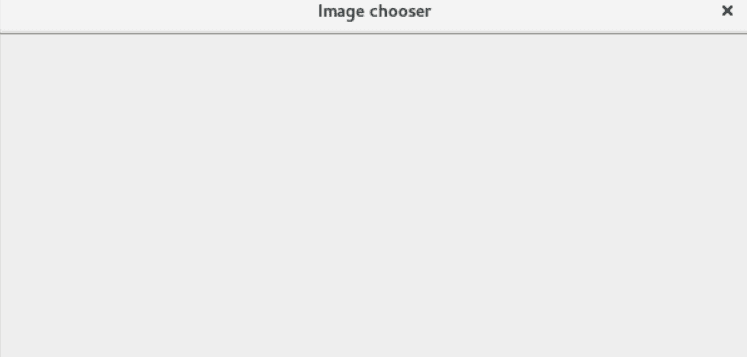


如果你打开“文件”管理器，可以将图片（JPG、GIF和PNG文件）拖入窗口，然后它们将以128×128图标的形式出现：

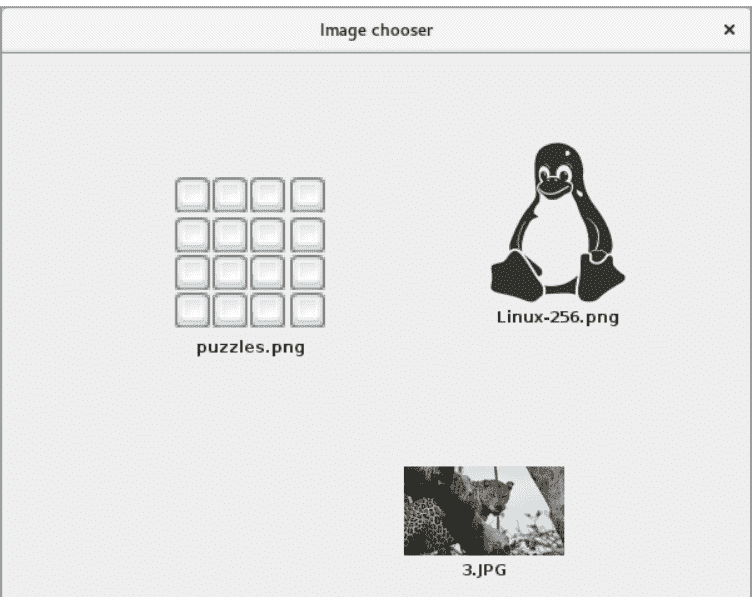

如果将图像复制到窗口，你可以用鼠标将它们拖动到另一个位置。

该程序与上述类似，但这次涉及两个拖放操作。你可以指向“文件”管理器中的一个文件（一张图片）并将其拖到应用程序窗口上。也就是说，拖动操作是在另一个程序（“文件”程序）中启动的，而释放操作则在我的程序中执行。另一个允许你移动图像的操作仅与Java程序有关，其中拖动操作是根据程序窗口中的一个对象启动的，而释放操作是在上述同一个对象上执行的。

程序的设计非常简单，只包含一个没有布局管理器的`JPanel`。该面板被称为`panel`。在`createView()`中，此面板被定义为`DropTarget`，因此它接收来自`DnDDrop`类的事件。以下是重要的方法：

## JAVA 9: SWING、文档与打印

## 拖放与操作

```java
public void drop(DropTargetDropEvent e)
{
  try {
    if (e.isDataFlavorSupported(DataFlavor.javaListFlavor)) {
      e.acceptDrop(DnDConstants.ACTION_COPY);
      java.util.List list = (java.util.List) e.getTransferable().getTransferData(DataFlavor.javaListFlavor);
      for (Object obj : list) addComponent((File)obj, e.getLocation());
      e.dropComplete(true);
    }
  } catch (Exception ex) {
    e.dropComplete(false);
  }
}
```

如果你从外部（即“文件”程序）拖入文件，对象类型由`DataFlavor javaListFlavor`定义。这意味着`Transferable`封装了一个`ArrayList`，并且相关方法引用了它。列表中的对象类型为`File`，对于每个对象，都会调用`addComponent()`方法，该方法会在鼠标指向的面板上添加一个`JLabel`。该方法首先通过传入一个`File`对象作为参数调用`getImage()`方法。该方法使用文件名加载图像，并在此基础上创建一个128x128像素的图标。然而，只有当文件为jpg、png或gif时才会这样做。否则将使用默认图标。程序支持将随机文件拖入窗口。

```java
private JLabel getImage(File file)
{
  String name = file.getAbsolutePath().toLowerCase();
  Image icon = name.endsWith("png") || name.endsWith("jpg") ||
    name.endsWith("gif") ? scaleImage(new ImageIcon(file.getAbsolutePath())) :
    deficon;
  JLabel label = new JLabel(icon);
  label.setText(cut(file.getName()));
  label.setHorizontalAlignment(JLabel.CENTER);
  label.setVerticalTextPosition(JLabel.BOTTOM);
  return label;
}
```

```java
private static ImageIcon scaleImage(ImageIcon icon)
{
  double w = icon.getWidth();
  double h = icon.getHeight();
  double z = Math.min(128 / w, 128 / h);
  return new ImageIcon(icon.getImage().getScaledInstance((int)(w * z), (int)(h * z), java.awt.Image.SMOOTH));
}
```

图标确定（创建）后，会为该图标创建一个`JLabel`，同时文件名会出现在图标下方，然后将图标添加到面板中：

```java
private void addComponent(Component component, Point point)
{
  component.setLocation(point);
  component.setSize(component.getPreferredSize());
  panel.add(component);
  repaint();
}
```


然后你实际上可以将文件拖入程序并释放到窗口中。也就是说，只要该类的组件不需要是可拖动的，就没有必要实现实现`DragSourceListener`、`DragGestureListener`和`Transferable`这三个接口。

如果你还需要能够拖动窗口中的组件，则必须实现这接口。由于能够绘制`JLabel`，`Transferable`对象的实现方式与之前的程序完全相同。然后是`DnSource`类，它实现了`DragListener`接口，在其中需要实现`dragDropEnd()`方法：

```java
public void dragDropEnd(DragSourceDropEvent e)
{
  if ((e.getDropSuccess()) && (e.getDropAction() == DnDConstants.ACTION_MOVE)) {
    panel.remove(dndLabel);
    panel.repaint();
  }
  dndLabel = null;
}
```

原因是，一旦你移动并释放了一个组件，你就形成了一个副本，必须移除原始组件。

最后，是`DnDGesture()`类，它与之前的程序相比没有变化。

## 问题4

你应该编写一个可以调用`DropTable`的程序。程序必须打开以下窗口：

| 拖放表 (Drop table) |
| 文件名 | 大小 |
| | | |

顶部是一个位于`JScrollPane`中的`JTable`，底部是一个没有布局管理器的`JPanel`。与之前的程序一样，你可以从文件系统（“文件”程序）拖入代表图像的文件并释放到`JTable`上，每个文件都会在表中插入一行。你也可以选取表格中的某行，将其拖到底部面板并释放，结果将是——

## JAVA 9: SWING、文档与打印

## 拖放与操作

## 编辑文本

## JAVA 9: SWING、文档与打印

## 编辑文本

## JAVA 9: SWING、文档与打印

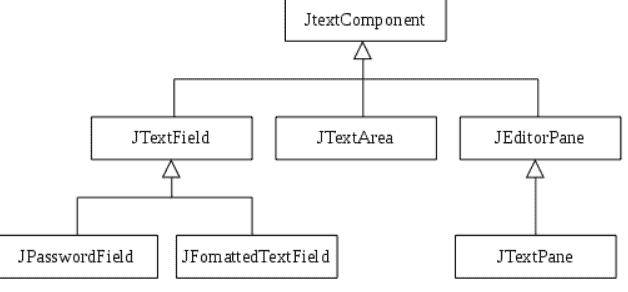

```java
createView();
setLocationRelativeTo(null);
setDefaultCloseOperation(EXIT_ON_CLOSE);
setVisible(true);
```

```java
private void createView()
{
    setLayout(new GridLayout(2, 3, 5, 5));
    add(createTextFields());
    add(createTextArel());
    add(createTextArea2());
    add(createTextPane());
    add(createEditorPane());
    add(createEditorPane2());
}
```

```java
private JScrollPane createEditorPane()
{
    JScrollPane scroll = new JScrollPane(new JEditorPane("text/plain", text2));
    scroll.setBorder(new TitledBorder("JEditorPane(text/plain)"));
    return scroll;
}
```

```java
private JScrollPane createEditorPane2()
{
    JScrollPane scroll = new JScrollPane(new JEditorPane("text/html", text2));
    scroll.setBorder(new TitledBorder("JEditorPane(text/html)"));
    return scroll;
}
```

```java
private JScrollPane createTextPane()
{
    JTextPane field = new JTextPane();
    field.setText(text2);
    SimpleAttributeSet attr1 = new SimpleAttributeSet();
    StyleConstants.setForeground(attr1, Color.red);
    StyleConstants.setFontSize(attr1, 14);
    SimpleAttributeSet attr2 = new SimpleAttributeSet();
    StyleConstants.setForeground(attr2, Color.blue);
    StyleConstants.setFontSize(attr2, 10);
    StyledDocument sdoc = field.getStyledDocument();
    sdoc.setCharacterAttributes(0, 16, attr1, false);
    sdoc.setCharacterAttributes(17, 28, attr2, false);
    sdoc.setCharacterAttributes(45, 12, attr1, false);
    sdoc.setCharacterAttributes(57, 7, attr2, false);
```

在 bookboom.com 下载免费电子书

# JAVA SWING、文档与打印

# 编辑文本

```java
sdoc.setCharacterAttributes(64, 4, attr1, false);
sdoc.setCharacterAttributes(68, 33, attr2, false);
sdoc.setCharacterAttributes(101, 14, attr1, false);
sdoc.setCharacterAttributes(115, 7, attr2, false);
sdoc.setCharacterAttributes(122, 2, attr1, false);
sdoc.setCharacterAttributes(124, 28, attr2, false);
sdoc.setCharacterAttributes(152, 14, attr1, false);
sdoc.setCharacterAttributes(166, 7, attr2, false);
sdoc.setCharacterAttributes(173, 5, attr1, false);
sdoc.setCharacterAttributes(178, 28, attr2, false);
sdoc.setCharacterAttributes(206, 14, attr1, false);
sdoc.setCharacterAttributes(219, 7, attr2, false);
sdoc.setCharacterAttributes(226, 1, attr1, false);
JScrollPane scroll = new JScrollPane(field);
scroll.setBorder(new TitledBorder("JScrollPane"));
return scroll;
}

private JScrollPane createTextArea1()
{
    JScrollPane scroll = new JScrollPane(new JTextArea(text2));
    scroll.setBorder(new TitledBorder("JTextArea (line wrap off)"));
    return scroll;
}
```


你想做什么？无论你对未来有什么愿求，广泛的操作始终是你的入场券。在小组中工作不仅仅意味着世界各地的朋友和同事。我们提供机会——请查看网站 volumgroup.com 上的部分。我们期待你的加入！

```java
private JScrollPane createTextArea2()
{
    JTextArea field = new JTextArea(text2);
    field.setLineWrap(true);
    field.setWrapStyle(true);
    JScrollPane scroll = new JScrollPane(field);
    scroll.setBorder(new TitledBorder("JTextArea (line wrap on)"));
    return scroll;
}
```

```java
private JPanel createTextFields()
{
    JPanel panel = new JPanel(new FlowLayout(FlowLayout.LEFT));
    panel.add(createTextField());
    panel.add(createPasswordField());
    panel.add(createFormattedField());
    return panel;
}
```

```java
private JPanel createTextField()
{
    JPanel panel = new JPanel(new FlowLayout());
    panel.setBorder(new TitledBorder("JTextField"));
    panel.add(new JTextField(text1));
    return panel;
}
```

```java
private JPanel createPasswordField()
{
    JPanel panel = new JPanel(new FlowLayout());
    panel.setBorder(new TitledBorder("PasswordField"));
    panel.add(new JTextField(text1));
    panel.setPreferredSize(new Dimension(130, 50));
    return panel;
}
```

```java
private JPanel createFormattedField()
{
```


```java
JFormattedTextField field = new JFormattedTextField(createFormatter());

field.setValue(text1);

field.setPreferredSize(new Dimension(80, 20));

JPanel panel = new JPanel(new FlowLayout());

panel.setBorder(new TitledBorder("JFormattedTextField"));

panel.add(field);

panel.setPreferredSize(new Dimension(160, 50));

return panel;

}
```

# Java Swing、文档与打印

## 编辑文本

```java
private MaskFormatter createFormatter() {

  try {

    return new MaskFormatter();

  } catch (Exception ex) {

    return null;

  }

}
```


程序使用`GridLayout`划分多个区域。在左上角显示了`JTextField`、`PasswordField`和`JFormattedTextField`。前两个没有被提到，第三个是通过`createFormatter()`方法创建的。`MaskFormatter`是一个允许输入模式的类，在这种情况下，它初始化为`text/plain`。这意味着`JEditorPane`可以显示纯文本。你可以注意`JEditorPane`被初始化为`text/html`，这意味着它可以显示 HTML。你可以在文本中输入时字符。

# Java Swing、文档与打印

`MaskFormatter`类有很多格式文本的选项，建议阅读帮助文档以了解这些可能性。窗口的第一行显示了两个额外的字段，它们都是`JTextArea`。第一个不换行，因此整个文本显示为长行。另一个`JTextArea`会自动换断过长的行。你应该注意文本被定义为 HTML，由于`JTextArea`不解释文本。

左下角的字段是通过`createTextPane()`方法创建的。`JTextPane`显示了样式文本，这意味着你可以在文本中插入属性。在这种情况下，字体大小和颜色属性被输入。你应该研究`createTextPane()`方法，特别是此处如何插入属性。


以下示例使用了默认设置。窗口显示了 5 个`JFormattedTextField`组件，当你点击 OK 时，格式化后的对象将出现在右侧的字段中。

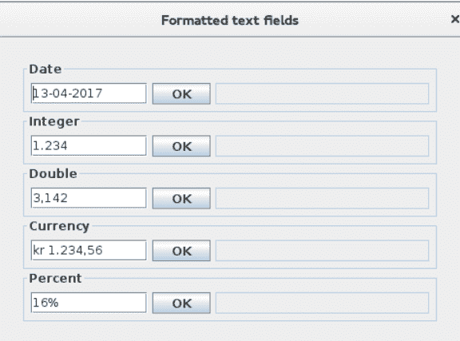

`JFormattedTextField`可以形成任何对象，其结果由格式化器（formatter）决定。有两种选项：如果没有指定格式化器，组件将根据对象的类型选择格式；否则，将使用构造函数中与组件关联的格式化器。代码如下，要求你研究这些代码并测试程序，特别是使用了哪些格式化对象。

```java
package formatterfields;
```

```java
import java.util.*;

import java.text.*;

import java.awt.*;

import javax.swing.*;

import javax.swing.border.*;

public class ModelAndView extends JFrame

{

    public ModelAndView()

{

        super("Formatted text fields");

        setSize(500, 380);

        setLayout(new FlowLayout());

        createView();

        setLocationRelativeTo(null);

        setDefaultCloseOperation(EXIT_ON_CLOSE);

        setVisible(true);

    }

}
```

## Java 9：Swing、Documents and Printing

## Edit Text

```java
private void getView() {

    JPanel panel = new JPanel();

    panel.setBorder(new EmptyBorder(20, 20, 20, 20));

    panel.setLayout(new BoxLayout(panel, BoxLayout.Y_AXIS));

    panel.add(createField("Date", new Date()));

    panel.add(createField("Integer", new Integer(1234)));

    panel.add(createField("Double", NumberFormat.getInstance()));

    new Double(Math.PI());

    panel.add(createField("Currency", NumberFormat.getCurrencyInstance()));

    new Double(0.155));

    panel.add(createField("Percent", NumberFormat.getPercentInstance()));

    new Double(0.155));

    add(panel);

}
```

```java
private JPanel createField(String text, Object value) {

    JFormattedTextField field = new JFormattedTextField(value);

    return createField(text, field);

}
```


```java
private JPanel createField(String text, Format format, Object value)

{

    JFormattedTextField field = new JFormattedTextField(format);

    field.setValue(value);

    return createField(text, field);

}
```

```java
private JPanel createField(String text, JFormattedTextField field)

{

    field.setPreferredSize(new Dimension(120, 22));

    JTextField result = new JTextField();

    result.setEditable(false);

    result.setPreferredSize(new Dimension(220, 22));

    JButton cmd = new JButton("OK");

    cmd.setPreferredSize(new Dimension(60, 22));

    cmd.addActionListener(() -> result.setText(field.getValue().toString()));

    JPanel panel = new JPanel(new FlowLayout(LEFT));

    panel.setBorder(new TitledBorder(text));

    panel.add(field);

    panel.add(cmd);

    panel.add(result);

    return panel;

}
```

我们也鼓励你调查帮助文档以及那里其他的格式化器类型。

## 练习 5

创建练习 4 解决方案`Calculations`的副本并命名为`Calculations1`。在 NetBeans 中打开它。删除所有与剪贴板有关的内容，程序仅保留计算总金额。你现在必须将三个输入字段改为`JFormattedTextField`组件，其中数量字段必须使用`NumberFormat`来格式化整数，而其他字段也必须使用`NumberFormat`将值转换为货币。

当程序在这些更改后正常工作时，更改`txtPrice`字段的格式（输入单价），使其使用`DecimalFormat`。

你应该彻底学习`DecimalFormat`类并调查有哪些机会——机会有很多。

在 bookboom.com 免费下载电子书。

## 8.2 光标（The Caret）

每个`JComponent`都附带有一个光标，它在视觉上显示下一个要执行的操作（在哪里必须插入光标、在哪里删除字符等）。通常情况下，它是一条闪烁的细线，但它是`DefaultCaret`类型的对象，基本上，该类的任务是在正确的位置上绘制那个特定的光标。`TextArea`类（或类似的组件）拥有一个`DefaultCaret`类型的对象，因此你可以写一个派生类以不同的方式绘制光标，并将该类的对象与组件关联。这并不困难（即使这种机会也有限）。例如，下面显示了一个按如下方式绘制光标的自定义光标：

并且该类可以写为：

```java
class ACaret extends DefaultCaret

{

    public ACaret()

    {

        setBlinkRate(500);

    }

    protected synchronized void damage(Rectangle rect)

    {

        if (rect == null) return;

        x = rect.x;

        y = rect.y;

        width = 6;

        height = rect.height + 1;

        repaint();

    }

    public void paint(Graphics g)

    {

        JComponent component = getComponent();

        if (component == null) return;

        Rectangle rect = null;

        try {

            rect = model.lineToView();

        } catch (BadLocationException e) {

            return;

        }

        if (rect != null) {

            g.setColor(Color.red);

        }

    }

}
```


## Java 9：Swing、Documents and Printing

## Edit Text

构造函数开始定义组件的光标应该每秒闪烁一次。否则，大部分工作发生在`paint()`方法中，运行时系统在每次需要重绘时调用该方法（通常当你使用方向键移动它，或输入字符时也会调用）。该方法必须绘制图形，这发生在最后语句，但在需要计算绘制位置之前。在这里，`DefaultCaret`类拥有所需的内容。`getDefault()`返回光标在文本中的逻辑位置，该位置可以通过`model()`转换为相对于组件的坐标。结果是一个扩展组件光标的矩形。有了这个矩形，就可以绘制图形。

该类还有一个方法`damage()`，运行时系统在需要重绘时调用它。`DefaultCaret`具有用于指定绘制区域的保护变量，这些变量通过`damage()`方法初始化。在变量初始化后，将执行`repaint()`，从而确保某时刻执行`paint()`。

然后是使用自定义光标的类：

```java
public class MainView extends JFrame {

    public MainView() {

        super("Formatted text fields");

        setSize(500, 380);

        createView();

        setLocationRelativeTo(null);

        setDefaultCloseOperation(EXIT_ON_CLOSE);

        setVisible(true);

    }

    private void createView() {

        JPanel panel = new JPanel(new BorderLayout());

        panel.setBorder(new EmptyBorder(5, 5, 5, 5));

        JTextArea txt = new JTextArea();

        // txt 区域

        txt.setFont(new Font("Serif", Font.PLAIN, 24));

        txt.setCaret(new ACaret());

        txt.setText("Gorm den Gamle\nHarald Blåtand\nSvend Tvesæg");

        panel.add(new JScrollPane(txt));

        add(panel);

    }

}
```


我们不发明轮子，我们重新发明照明。迷人的照明提供了无限的光谱：创新技术和新市场提供了机会与挑战。在一个你的专业知识受需求的环境中。在全球范围内享受支持性的工作环境。加入我们，共同重新发明照明。

# Java 9：Swing、文档与打印

没有什么好解释的，但你应该注意如何定义`JTextArea`组件必须使用另一个光标（caret）。带有注释的语句是为了显示新光标也遵循另一种字体。下面是一个程序运行的示例，其中注释已被移除，光标移动了位置：

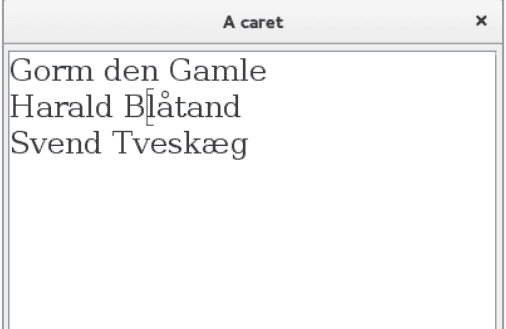

## 8.3 高亮器（Highlighter）

文本组件还有一个所谓的“高亮器”（highlighter），这是一个用于显示所选文本的对象。默认情况下，它用不同的背景颜色显示高亮文本，并由`Highlighter`接口定义的`HighlightPainter`对象执行，该接口是`Highlighter`接口中的一个内部接口。你可以自己实现这个接口（尽管几乎没有理由），但下面的类是一个用红色下划线高亮文本的示例：

```java
class HighlightPainter implements Highlighter.HighlightPainter

{

    private void paintLine(Graphics g, Rectangle rect, int x)

    {

        g.fillRect(rect.x, rect.y + rect.height - 3, x - rect.x, 3);

    }

    public void paint(Graphics g, int p0, int p1, Shape shape,

                      JTextFieldComponent component)

    {

        Rectangle rect0 = null;

        Rectangle rect1 = null;

        try

        {

            rect0 = component.modelToView(p0);

            rect1 = component.modelToView(p1);

        catch (BadLocationException ex)

        {

            return;

        if (rect0 == null || rect1 == null) return;

        Rectangle rect2 = shape.getBounds();

        int max = rect2.x + rect2.width;

        g.setColor(Color.red);

        if (rect0.y == rect1.y) paintLine(g, rect0, rect1.x);

        else {

            paintLine(g, rect0, max);

            rect0.y += rect0.height;

            rect0.x = rect2.x;

            while (rect0.y < rect1.y) {

                paintLine(g, rect0, max);
```


`rect0.y += rect0.height;`

```
paintLine(g, rect0, rect1.x);
```


如所见，这只是重写 `paint()` 方法的问题。参数是待绘制的图形对象、要高亮文本的起始和结束位置、用于高亮文本的重绘矩形以及组件。我不想详细解释该方法的语句，因为它的基本实现方式与之前光标的示例相同，而且代码是某些新内容，属于下一本书描述的内容，但原则上，理解发生了什么是足够简单的。你应该注意，由于所选文本可能跨多行，该方法变得复杂了。你还应该注意，上述高亮器只能用于所有行高都相同的组件，例如 `JTextArea` 或 `JTextField`。测试程序与上述相同，不同之处在于关联了另一个光标：

```java
private void createView() {
  JPanel panel = new JPanel(new BorderLayout());
  panel.setBorder(new EmptyBorder(5, 5, 5, 5));
  JTextArea txt = new JTextArea();
  txt.setLineWrap(true);
  txt.setWrapStyleWord(true);
  txt.setCaret(new DefaultCaret() {
    private Highlighter hl = new HighlighterPainter();
    protected HighlighterPainter getSelectionPainter() {
      return hl;
    }
  });
  txt.setText("Gorm Gamle\nHerald Blåtland\nTveskog");
  panel.add(new JScrollPane(txt));
  add(panel);
}
```

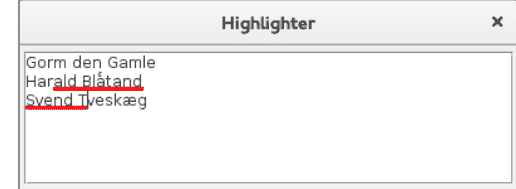

## 8.4 一个 JTEXTP

本节的主题是 `JTextPane` 组件，这是一个极其先进的组件，具有许多设置选项以及许多以接口和类形式存在的相关类型。接下来的也将仅仅是一个介绍，足以让你对 `JTextPane` 能做什么以及在实践中如何使用该组件有一个印象。

## 编辑文本 (EDIT TEXT)

基本上，你可以将 `JTextPane` 想象成一个 `JTextArea` 以及一个可以输入和编辑文本行的组件，巨大的区别在于该组件支持文本的样式化。这意味着单个文本元素被分配了样式对象（例如字体和颜色）。该组件实际上可以做更多，它还可以显示图像甚至其他的 Swing 组件。像其他 Swing 组件一样，`JTextPane` 是通过 MVC 设计的，模型（类似于其他文本组件）定义为 `Document` 接口，并且

# JAVA 9: SWING、文档与打印

这里定义了三个实例变量，其中第一个是待插入的图标，最后一个方法是我多次使用的那个方法，它用于从我的 jar 文件中加载并缩放图像。变量 `counter` 用于可能插入的按钮的文本，以便它们能够相互区分。最后，有一个对 `JTextPane` 组件的引用，以便在三个按钮的事件处理器中引用它。该组件像其他组件一样被插入到窗口中，在三个事件处理器中会有一些需要注意的地方。你应该注意 `JTextPane` 上的以下方法：

- `replaceSelection()`
- `insertIcon()`
- `insertComponent()`

它们分别用于插入文本、插入图标和插入组件。无论名称如何，它们的工作方式相同，都会替换标记为待插入内容的内容——如果选择了某些内容则进行替换，否则在光标位置插入。

然后是以属性（attributes）和样式（styles）形式存在的。你可以将属性附加到单个字符、段落以及整个文档。字符属性涉及字体和文本颜色。关于段落的属性可能还涉及缩进和行间距。样式（`Style`）是属性的组，可以用于文档中的多个地方，并且可以是一个通过名称的命名样式。如果你通过样式（附加到文档）更改属性，那么文档中所有使用该样式的文本属性都会发生变化。如果将样式分配给一个段落，可以通过向该段落文本的局部附加属性来覆盖其属性。属性是一个键/值对，而属性族由三个接口定义：`AttributeSet`、`MutableAttributeSet` 和 `Style`。

现在我将展示一个使用样式的 `JTextPane` 程序。该程序会打开一个带有 `JTextPane` 和菜单的窗口：

| 带有样式的文本 | |
| --- | --- |
| | |

JAVA 9: SWING、文档与打印

## 编辑文本

菜单有三个菜单项：

- 设置样式 (Set style)
- 修改样式 (Modify style)
- 创建样式 (Create style)

其中前两个是空子菜单，最后一个是一个用于为段落创建样式的函数。如果你选择此菜单项，将得到如下所示的窗口，你可以在这里创建一个定义字体的命名样式。在这里你应该特别注意，你可以指定区域外部应该留出多少空白。


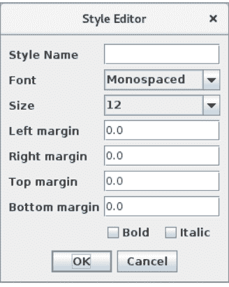

一旦你创建了样式，每个子菜单中都会添加一个菜单项，然后你就可以对光标所在的段落应用样式，并可以打开与所示相同的对话框来编辑该样式。以下是程序的运行情况，输入了 7 行文本：

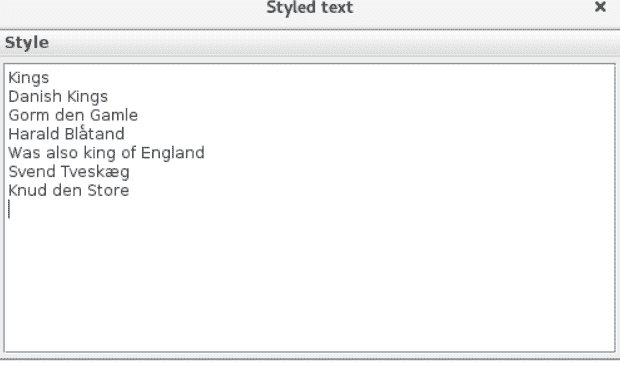

注意每一行都是一个段落。随后创建了 4 个样式，并应用到这 7 行上。结果如下：

# JAVA 9: SWING、文档与打印

# 编辑文本

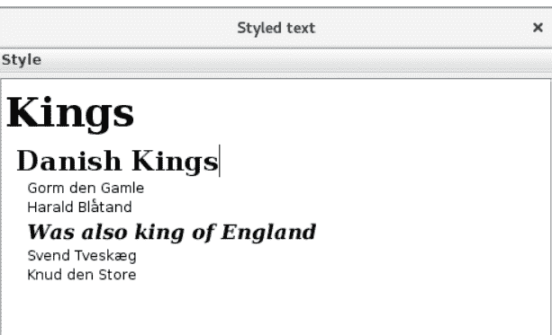

然后是填充了一些内容的程序代码，我想从维护样式的对话框开始：

```java
class StylePanel extends JPanel {
    private final String[] fonts =
        ("Monospaced", "Serif", "Sans", "SansSerif");
    private final String[] sizes =
        ("8", "10", "12", "14", "18", "24", "48", "72");
    private JTextField txtName = new JTextField();
    private JCheckBox lstFont = new JCheckBox(fonts);
    private JCheckBox lstSize = new JCheckBox(sizes);
    private JTextField txtLeft = new JTextField();
    private JTextField txtRight = new JTextField();
    private JTextField txtTop = new JTextField();
    private JTextField txtBottom = new JTextField();
    private JCheckBox cmdBold = new JCheckBox("Bold");
    private JCheckBox cmdItalic = new JCheckBox("Italic");

    public StylePanel() {
        super(new BorderLayout(5, 5));
        JPanel left = new JPanel(new GridLayout(8, 1, 0, 5));
        JPanel right = new JPanel(new GridLayout(8, 1, 0, 5));
        add(left);
        add(right);
        left.add(new JLabel("Style Name", JLabel.LEFT));
        right.add(txtName);
        left.add(new JLabel("Font", JLabel.LEFT));
        right.add(lstFont);
        left.add(new JLabel("Size", JLabel.LEFT));
        right.add(lstSize);
    }
}
```

```java
left.add(new JLabel("Left margin", JLabel.LEFT));
right.add(txtLeft);
left.add(new JLabel("Right margin", JLabel.LEFT));
right.add(txtRight);
left.add(new JLabel("Top margin", JLabel.LEFT));
right.add(txtTop);
left.add(new JLabel("Bottom margin", JLabel.LEFT));
right.add(txtBottom);

public void clear() {
    // ... implementation
}
```

# JAVA 9: SWING、文档与打印

## 编辑文本

```java
public void create(ActionEvent e)
{
    stylePanel.clear();
    if (JPane.showConfirmDialog(this, stylePanel, "Style Editor",
        JOptionPane.OK_CANCEL_OPTION, JOptionPane.PLAIN_MESSAGE) ==
        JOptionPane.OK_NO_OPTION && stylePanel.getStyleName().length() > 0)
    {
        Style style = txtPane.addStyle(stylePanel.getStyleName(), null);
        stylePanel.initStyle(style);
        createMenuItem(setMenu, stylePanel.getStyleName(), this::setStyle);
        createMenuItem(modMenu, stylePanel.getStyleName(), this::modStyle);
    }
}

public void setStyle(ActionEvent e)
{
    String styleName = ((JMenuItem)getSource()).getActionCommand();
    txtPane.setLogicalStyle(txtPane.getStyle(styleName));
}
```


```java
public void modStyle(ActionEvent e)
{
  String styleName = ((JMenuItem)e.getSource()).getActionCommand();
  Style style = txtPane.getStyle(styleName);
  stylePanel.inputFields(style);
  if (JOptionPanePane.showConfirmDialog(this, stylePanel, "Style Editor",
      JOptionPane.CANCEL_OPTION, JOptionPane.PLAIN_MESSAGE) ==
      JOptionPane.OK_OPTION) stylePanel.initStyle(style);
}
```

请注意，有一个实例变量是上述对话框（一个 `JPanel`）。如果你查看它，它首先开始执行对话框的 `clear()` 方法，删除所有内容。Swing 的 `JOptionPane` 类有几个方法可以打开消息框，我之前使用过 `showConfirmDialog()`，它带有两个按钮：OK 按钮和 Cancel 按钮。该方法至少有两个参数，其中第二个参数的类型为 `Object`，通常是消息框中的文本。我之前没有提到的一个功能是：如果此参数可以是 Swing 组件（在本例中是一个 `JPanel`），结果将是一个带有 OK 按钮和取消按钮的对话框。如果需要打开简单的对话框，这种方法实际上是一个简单的选择。你应该注意当点击 OK 时，事件处理器是如何添加两个菜单项的。

修改样式的事件处理器工作方式相同（打开相同的对话框），但不会向菜单添加菜单项。你还应该注意将样式应用到段落的事件处理器，以及这里如何为段落分配样式。

## 练习 6

你必须创建上述项目（`StyledText`）的副本。你必须添加一个名为 Select color（选择颜色）的菜单，必须包含以下颜色的菜单项：

- 红、绿、蓝、黄、橙、灰、浅灰、洋红、粉和黑色

如果你选择了其中一个菜单项，光标所在段落的文本必须以所选颜色显示。

当程序运行正常时，修改程序以便你可以标记文本，如果随后在菜单中选择字体颜色，则高亮文本必须以所选样式显示。示例所示，其中有 7 个段落：

JAVA 9: SWING, DOCUMENTS AND PRINTING

## EDIT TEXT

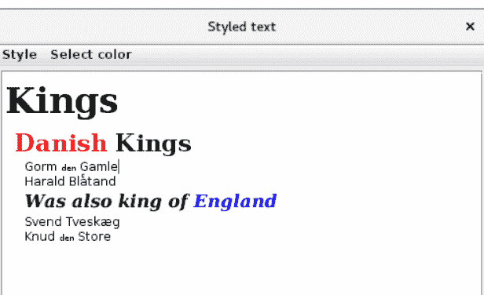

你需要查看 `JTextPane` 的帮助文档，以找出如何确定所选区域。在本章的第一个程序中，你可以看到如何为单个字符而不是段落分配属性。

## 8.4 文档 (DOCUMENT)

如所述，所有文本组件都使用一个模型，如上述由 `Document` 接口定义的。模型代表用户编辑的文本，如果是格式化文档，则它也是表示属性的模型。`Document` 接口没有定义任何关于样式的内容，而是在一个子接口 `StyledDocument` 中完成的。因此，可以通过下面的图说明具体模型，其中 `AbstractDocument`（如其名所示）是一个抽象类，而 `PlainDocument` 和 `DefaultStyledDocument` 是具体类。`PlainDocument` 是 `JTextField` 和 `JTextArea` 组件的模型，而 `DefaultStyledDocument` 是 `JTextPane` 和 `JEditorPane` 的模型。

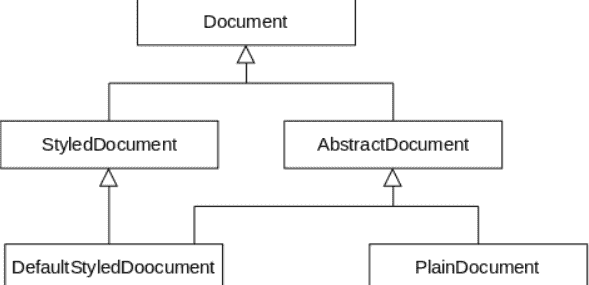

`Document` 对象将文档划分为层次对象结构，其中每个节点类型为 `Element`，并由文档中的偏移量（offset）和结束位置组成。此外，`Element` 可能关联一个 `AttributeSet`，因此例如 `JTextField` 和 `JTextArea` 不使用样式。因此，`Element` 对象描述了文档的一部分，从 `JPanel` 来看，有趣的是 `Element` 拥有自己的样式。

`AbstractDocument` 的一项重要任务是实现锁定机制，确保在任何时刻只有一个写入者可以使用文档，而没有或有多个可以读取文档。

作为一个如何将自己的文档附加到文本组件的简单示例，如下窗口：

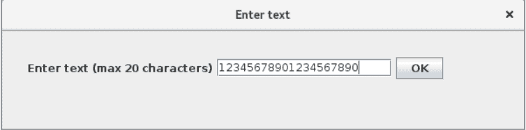

用户可以在其中输入 20 个字符。

```java
class MaxDocument extends PlainDocument
{
    private int max;

    public MaxDocument(int max)
    {
        this.max = max;
    }

    public void insertString(int offset, String str, AttributeSet attr)
    throws BadLocationException
    {
        if (getLength() + str.length() > max) Toolkit.getDefaultToolkit().beep();
        else super.insertString(offset, attr);
    }
}
```

```java
public class MainView extends JFrame
{
    private JTextField textField = new JTextField();

    public MainView()
    {
        super("Enter text");
        setSize(600, 150);
        createView();
        setLocationRelativeTo(null);
        setDefaultCloseOperation(EXIT_ON_CLOSE);
        setVisible(true);
    }

    private void createView()
    {
```


```java
textField.setDocument(new MaxDocument(20));

textField.setPreferredSize(new Dimension(200, 20));

JButton cmd = new JButton("OK");

cmd.addActionListener(e -> JOptionPane.showMessageDialog(this, textField.getText()));

JPanel panel = new JPanel(new FlowLayout(FlowLayout.LEFT));

panel.setBorder(new EmptyBorder(25, 25, 25, 25));

panel.add(new JLabel("Enter text (max 20 characters)"));

panel.add(textField);

panel.add(cmd);

add(panel);

}

}
```

这是一个简单的程序，但限制输入字符数量的选项很有意思，因为在实践中经常遇到。然而，请记住，使用 `JFormattedTextField` 和适当的格式可以简单地解决相同的问题：

```java
JFormattedTextField(new MaskFormatter("****************"))
```

# JAVA 9：SWING、文档与打印

## 编辑文本

```java
JPanel panel = new JPanel(new FlowLayout(FlowLayout.LEFT));

panel.setBorder(new EmptyBorder(25, 25, 25, 25));

panel.add(new JLabel("Enter text (max 20 characters)"));

panel.add(textField);

panel.add(cmd);

add(panel);
```

## 练习 7

编写一个程序，当程序打开以下窗口时可以调用 `ElementTree`：

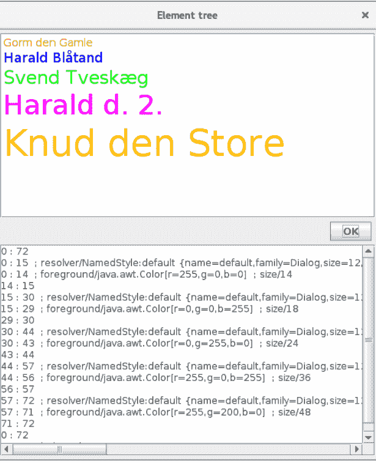

其中上方组件是 `JTextPane`，底部是 `JTextField`。上方组件使用以下字符串初始化：

```text
"Gorm den Gamle\nHarald Blåtand\nSvend Tveskåg\nHarald d. 2.\nKnud den Store"
```

在显示字符串之前，必须为这五个名称分别分配指示颜色大小大小属性。

如果你点击按钮，将在下方组件中得到一个列表，每行代表一个 `Element`，并且每个元素都显示跨越元素的字符的起始和结束偏移量以及任何属性。注意，由于元素构成了层次结构，填充下方文本的方法必须递归编写。

尝试解释底部 `JTextArea` 中的结果。

你可以尝试在上方 `JTextPane` 中输入更多文本，然后点击 OK 看看是否得到预期的结果。


## 8.5 `JEditorPane`

作为 Swing 文本组件的最后一个，应该提到 `JEditorPane`。它是一个很少有人对其感兴趣的组件，但它可以被视为样式化文本组件的基类，而 `JTextPane` 则是派生自 `JEditorPane` 的文本组件的一个示例。如上所示，`JTextPane` 是一个可以用于编辑带有样式信息的文档的组件。实际文本由 `StyledDocument` 表示，但控制文本和样式如何被编辑（可以执行哪些操作）的逻辑全部封装在 `EditorKit` 中。如 `JTextField` 和 `JTextArea` 等简单文本组件使用 `DefaultEditorKit`，而 `JTextPane` 使用派生类 `StyledEditorKit`。`JEditorPane` 的目标是让你能够通过定义自己的 `EditorKit` 和 `Document` 类型，定义一个派生自 `JEditorPane` 的自有文本组件，从而定义恰好支持你所需任务的文本组件。事实上，Swing 自带了两个可以编辑 HTML 和 RTF 文档的示例。

在本节中，我将说明如何编写你自己的 HTML 编辑器。目标不是实现一个完善的 HTML 编辑器（那是很复杂的），而是为了更多地展示文本组件以及 `EditorKit` 是什么。我想从一个名为 `AEditorPane` 的示例开始。如果你运行该程序，你将得到下面的消息框：

```text
Message

javax.swing.text.HTMLEditorKit

OK
```

当你点击 OK 时，你将看到以下窗口：

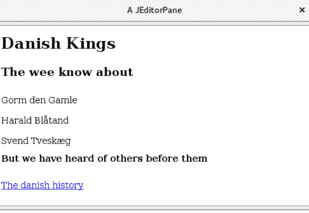

# JAVA 9：SWING、文档与打印

窗口显示了保存在项目中的以下 HTML 文档：

```html
<html>
<head>
  <meta charset="UTF-8">
  <title>Simple html page</title>
</head>
<body>
<h1>Danish Kings!</h1>
<h2>The we know about</h2>
<p>Gorm den Gamle</p>
<p>Harald Blåtand</p>
<p>Svend Tveskæg</p>
<h3>But we have heard of others before them</h3>
<p><a href="http://danmarkhistorien.dk/forside/">The Danish history</a></p>
</body>
</html>
```

也就是说，文档被解释是因为组件识别各个独立元素，因此知道如何解释它们。特别是最后一行，它是一个指向该页面的链接：

`http://danmarkhistorien.dk/forside`

点击此链接将在窗口中显示该页面。结果不是很好，但这是因为该页面包含了许多组件无法解释的内容（现代网站在内容方面非常复杂），该示例说明你可以加载任何网页，并以较或少较好的结果在文本组件中显示页面内容。该示例是通向简单浏览器迈出的一步。程序代码如下：

```java
package editor;
```

```java
import java.net.*;
import java.awt.*;
import javax.swing.*;
import javax.swing.event.*;
import javax.swing.border.*;
```

```java
public class MainView extends JFrame {

  private JEditorPane txtPane = null;
```

## 编辑文本

```java
public MainView()
{
    super("AEditorPane");
    setSize(500, 300);
    createView();
    setLocationRelativeTo(null);
    setDefaultCloseOperation(EXIT_ON_CLOSE);
    setVisible(true);
}

private void createView()
{
    JPanel panel = new JPanel(new BorderLayout());
    panel.setBorder(new EmptyBorder(5, 5, 5, 5));

    try {
        JEditorPane txtPane = new JEditorPane(loadPage());
        txtPane.addHyperlinkListener(new LinkHandler());
        JOptionPane.showMessageDialog(
            this,
            txtPane.getEditorKit().getClass().getName()
        );
    }
    catch (Exception ex) {
```

```java
JOptionPane.showMessageDialog(this, ex.toString());

System.exit(1);

txtPane.setEditable(false);

panel.add(new JScrollPane(txtPane));

add(panel);
```

```java
private static URL loadPage()
{
    return Main.class.getResource("/aeditorpane/kings.html");
}
```

```java
class LinkHandler implements HyperlinkListener
{
    public void hyperlinkUpdate(HyperlinkEvent e)
    {
        try
        {
            if (e.getType() == HyperlinkEvent.EventType.ACTIVATED)
                txtPane.setPage(e.getUrl());
        }
        catch (Exception ex)
        {
            JOptionPane.showMessageDialog(Main.this, ex.toString());
        }
    }
}
```

程序定义了一个单实例变量，其类型为 `JEditorPane`。它在 `getView()` 方法中创建，其中上述 HTML 文档作为 `URL` 传递给类构造函数。HTML 文档封装在程序文件中，并在 `loadPage()` 中从 JAR 文件加载。`JEditorPane` 组件创建后，会关联一个点击链接的事件处理器。它是一个实现了 `HyperlinkListener` 接口的类，该接口定义了一个名为 `hyperlinkUpdate()` 的方法，该方法在窗口中点击链接时执行。结果是组件的内容被所链接网站的内容覆盖。

当此事件处理器与组件关联后，第一个消息框打开了。（注：此处原文中存在大量重复句子，已过滤）。

# JAVA 9：SWING、文档与打印

```java
JMenu menu2 = new JMenu("More actions");

for (int i = n; i < actions.length; ++i) menu2.add(actions[i]);

JMenu menu = new JMenu("Actions");

menu.add(menu);

menu.add(menu2);

MenuBar bar = new JMenuBar();

bar.add(menu);

setMenuBar(bar);
```

# 练习 8

创建上述程序的副本。你需要修改程序，使组件从 `JTextArea` 更改为 `JTextPane`，这样菜单将显示分布在三个子菜单中的所有操作。

尝试研究此程序所展示的操作与上述程序中展示的操作之间存在差异。

# 一个简单的编辑器

我想展示一个作为简单文本编辑器的程序，该程序看起来和我在 Java 2 书中展示的对应程序相似，但这个程序更简单，部分是因为此解决方案中没有实现某些功能，部分是因为我在这里很大程度上利用了 `JTextArea` 内置的许多必要功能，因此我不需要自己实现它们。

程序打开了一个带有 `JTextArea` 的窗口：

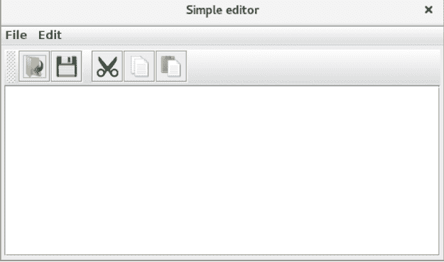

窗口还包含一个带有打开和保存文档功能的工具栏，并且有剪切、复制和粘贴的图标。菜单项也可以找到相同的功能。完成的代码如下：

```java
public class MainView extends JFrame {

  private JTextComponent txtComp = new JTextArea();

  private Action openAction = new OpenAction();

  private Action saveAction = new SaveAction();

  public MainView() {

  }

  protected void createView() {

  ((JTextArea)txtComp).setLineWrap(true);

  JPanel panel = new JPanel(new BorderLayout());

  panel.setBorder(new EmptyBorder(5, 5, 5, 5));

  panel.add(new JScrollPane(txtComp));

  defineActions();

  panel.add(createToolbar(), BorderLayout.NORTH);

  createMenu();

  add(panel);

  }

  protected void defineActions() {

    defineAction(txtComp.getActionMap().get(DefaultEditorKit.cutAction), "Cut", "/simpleeditor/images/cut.png");

    defineAction(txtComp.getActionMap().get(DefaultEditorKit.copyAction), "Copy", "/simpleeditor/images/copy.png");

    defineAction(txtComp.getActionMap().get(DefaultEditorKit.pasteAction), "Paste", "/simpleeditor/images/paste.png");

  }

  private void defineAction(Action action, String name, String icon) {

    action.putValue(Action.NAME, name);

    if (icon != null) action.putValue(Action.SMALL_ICON, createImage(icon));

  }

}
```

# JAVA 9：SWING、文档与打印

```java
private JToolBar createToolBar() {

    JToolBar bar = new JToolBar();

    bar.add(openAction).setText("");

    bar.add(saveAction).setText("");

    bar.addSeparator();

    bar.add(txtComp.getActionMap().get(DefaultEditorKit.cutAction)).setText("");

    bar.add(txtComp.getActionMap().get(DefaultEditorKit.copyAction)).setText("");

    bar.add(txtComp.getActionMap().get(DefaultEditorKit.pasteAction)).setText("");

    return bar;

}
```

```java
private void createMenu() {

    JMenu file = new JMenu("File");

    file.add(openAction);

    file.add(saveAction);

    file.add(new ExitAction());

    JMenu edit = new JMenu("Edit");

    edit.add(txtComp.getActionMap().get(DefaultEditorKit.cutAction));
```


# JAVA 9：SWING、文档与打印

```java
edit.add(txtComp.getActionMap().get(DefaultEditorKit.copyAction()));

edit.add(txtComp.getActionMap().get(DefaultEditorKit.pasteAction()));

JMenuBar bar = new JMenuBar();

bar.add(file);

bar.add(edit);

setMenuBar(bar);
```

```java
class ExitAction extends AbstractAction {

    public ExitAction() {
        super("Exit");
    }

    public void actionPerformed(ActionEvent e) {
        System.exit(0);
    }

}
```

```java
class OpenAction extends AbstractAction {

    public OpenAction() {
        super("Open", createImage("/simpleeditor/images/open.png"));
    }
}
```

```java
public void actionPerformed(ActionEvent e) {
```


```java
JJFileChooser chooser = new JFileChooser();

if (chooser.showOpenDialog(Main.this) != JFileChooser.APPROVE_OPTION)

    return;

File file = chooser.getSelectedFile();

if (file == null) return;

try (BufferedReader reader = new BufferedReader(new FileReader(file))) {

    txtComp.read(reader, null);

} catch (IOException e) {

    // handle exception

}

}
```

## JAVA 9：SWING、文档与打印编辑

```java
class SaveAction extends AbstractAction {

    public SaveAction() {

        super("Save", createImage("/simpleeditor/images/save.png"));

    }

    public void actionPerformed(ActionEvent e) {

        JFileChooser chooser = new JFileChooser();

        if (chooser.showOpenDialog(Main.this) != JFileChooser.APPROVE_OPTION) {

            return;

        }

        File file = chooser.getSelectedFile();

        if (file == null) return;

        try (BufferedWriter writer = new BufferedWriter(new FileWriter(file))) {

            txtComp.write(writer);

        } catch (IOException e) {

            JOptionPane.showMessageDialog(Main.this, "File error: " + e.getMessage(), "Error", JOptionPane.ERROR_MESSAGE);

        }

    }

    private static ImageIcon createImage(String path) {

        URL imgURL = MainView.class.getResource(path);

        return new ImageIcon(new ImageIcon(imgURL).getScaledInstance(24, 24, Image.SCALE_SMOOTH));

    }

}
```

## JAVA 9：SWING、文档与打印

`defineActions()` 方法用于自定义操作。`JTextArea` 有剪切、粘贴操作，但通常你想给它们命名并可能附带图标。这在 `defineActions()` 中发生。例如，引用操作：

```java
txtComp.getActionMap().get(DefaultEditorKit.cutAction)
```

这里，`DefaultEditorKit.cut` 是标识此操作的常量，`Action` 对象被传递给 `defineAction()` 方法，以及要显示的文本和图标。

## JAVA 9：SWING、文档与打印

`createToolbar()` 方法创建一个包含 5 个图标或操作的工具栏。你应该注意到前两个是实例变量操作，而另外三个是以上述方式引用的。注意对于所有 5 个 `Action` 对象都执行了 `setText()` 方法，将文本置为空。这是因为工具栏不会显示对象的属性。


## JAVA 9：SWING、文档与打印

`createMenu()` 方法原理上是相同的。相反，`JMenuItem` 对象与 `Action` 关联。注意 File 菜单有一个 `ExitAction` 操作，它也是一个表示操作的内部类。

后面是定义 `Action` 对象的三个内部类。我不会详细介绍这三个类，但你会注意到它们是如何继承 `AbstractAction` 的。还会注意到最后两个关联了图标，然后注意 `JTextField` 具有可以直接从流读取来初始化组件并将组件内容写入流的方法。

## 问题 5

你必须编写一个可以调用 `StyledEditor` 的程序，它将打开以下窗口：

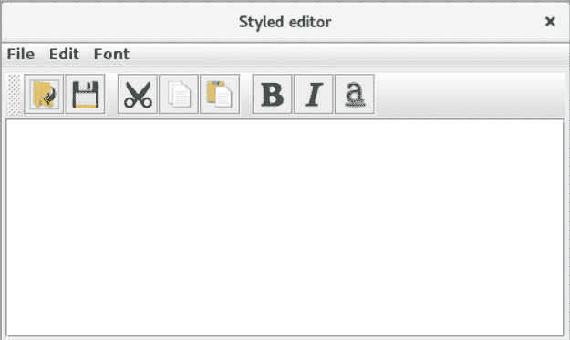

该程序原理上应该与之前的程序一样工作，前两个菜单相同（对应工具栏中的前 5 个图标），但程序不再使用 `JTextArea`，而是使用 `JTextPane`。字体菜单如下：

- 字体
- 样式
- 粗体
- 下划线
- 斜体
- 字体
- `SansSerif`
- `Serif`
- 等宽字体

## JAVA 9：SWING、文档与打印

| 尺寸 |
| :--- |
| 8 |
| 10 |
| 12 |
| 14 |
| 18 |
| 24 |
| 36 |
| 48 |
| 144 |

原则上，该程序可以像上一个示例一样编写，但创建工具栏和菜单会更复杂。然而，存在一个小问题：`JTextPane` 使用 `read()` 和 `write()` 方法，这些方法定义在 `JTextComponent` 中，且这些方法只能读取和写入普通的纯文本。虽然这不是一个完美的解决方案，但你可以通过序列化来解决这个问题。


## 9 国际化

有时程序必须在多个国家使用，因此需要多种语言，这对用户界面的能力以及数据的显示方式就提出了要求。一种方案是编写同一程序的多个版本（英语版、丹麦语版等），但从维护角度考虑，这不是最优解决方案。然而，Java 支持国际化，因此程序本身可以根据其运行的所在地决定如何显示数据。这是本章的主题，它绝非简单，接下来的内容是对其概念的介绍。

基本上，它涉及到程序用于显示文本的语言，以及日期、时间和数字的格式。实际上，有两点：国际化（internationalization）意味着程序支持多种语言和格式，而本地化（localization）被理解为程序确定使用哪语言和格式的过程。由于更多国家使用同一种语言，某些国家使用多种语言，这一切变得复杂；同样，语言与格式规则之间没有明确的区别。从 Java 的角度来看，起点是 `Locale` 类，它基本上由三个属性组成：

- 1. 语言代码（ISO-639）
- 2. 国家代码（ISO-3166）
- 3. 一个可选的变体代码

语言代码为两个或三个字符，例如：

- 英语：`en`、`eng`
- 法语：`fr`、`fra`
- 德语：`deu`
- 丹麦语：`da`、`dän`

同样，国家代码也是两个或三个字符，例如：

- 英国：`gb`、`gbr`
- 法国：`fr`、`fra`
- 德国：`de`、`deu`
- 丹麦：`dk`、`dnk`

在 bookboom.com 下载免费的电子书。

`Locale` 类使用 2 字符代码（如果没有 2 字符代码，则允许 3 字符的语言代码）。该类通常没有提供太多功能，但许多方法都有一个 `Locale` 参数，这是该类的主要目的。以下程序展示了使用 `Locale` 示例：

```java
package localeprogram;

import java.util.*;

public class LocaleProgram {

    public static void main(String[] args) {

        test1();

        test2();

        test3();

    }

    private static void test1() {

        Locale loc = Locale.getDefault();

        print(loc);

    }

    private static void test2() {

        Locale.setDefault(Locale.US);

        test1();

    }

    private static void test3() {

        Locale[] locales = Locale.getAvailableLocales();

        System.out.println(locales.length);

        for (Locale loc : locales) {
            System.out.println(String.format("%s: %s, %s: %s",
                loc.getDisplayCountry(), loc.getCountry(),
                loc.getDisplayLanguage(), loc.getLanguage()));
        }

    }

    private static void print(Locale loc) {

        System.out.println(String.format("%s, %s",
            loc.getDisplayCountry(), loc.getCountry()));

        System.out.println(String.format("%s, %s",
            loc.getDisplayLanguage(), loc.getLanguage()));

    }

}
```

## 国际化

```java
System.out.println(String.format(loc, "%1.2f", 1234.56));

System.out.println(String.format(loc, "%tD", Calendar.getInstance()));
```

`test1()` 方法根据机器的语言设置确定程序的默认 `Locale`。此外，使用 `String.format()` 对数字进行了格式化，这里你应该注意第一个参数是一个本地（local）对象。这确保了结果以正确的小数点显示。`print()` 方法中的最后一条语句相同，但这次是针对 `Calendar` 对象。你应该注意，`String` 类的 `format()` 方法在格式化结果（尤其是日期和时间）方面有惊人的选项，鼓励你研究可用的选项。

`test2()` 方法展示了你可以定义要使用的默认区域。你可以通过指定语言和国家创建一个 `Locale` 对象，但由于 `Locale` 类定义了大多数语言，这并不必要。`test3()` 方法显示了已定义的 `Locale` 对象概览。


赋能人才。改进商业。BI 学院是欧洲最大的学院之一，欢迎学生。科学硕士是一个为期两年的课程。

## 9.1 资源包（RESOURCE BUNDLES）

如果程序需要国际化，意味着文本应该支持多种语言，尽管 Java 支持国际化，但翻译文本是开发部门的任务。

起点是一个属性文件，它仅仅是一个以 `.properties` 结尾的文本文件。一个示例如下：

```properties
di=Ruder
he=Hjerte
sp=Spar
cl=Kl\u008r
```

其中包含了四个键值对。内容可以解释为扑克牌的花色。注意最后一个值中的 `o` 是使用字符代码编码的。文件名 `Cards.properties` 是非常重要的。另一个版本的文件，写有英文名称：

```properties
di=Diamond
he=Heart
sp=Spade
cl=Club
```

这里的文件名是 `Cards_en_US.properties`，名称同样至关重要。考虑以下程序：

```java
package resourceprogram;

import java.util.*;

public class ResourceProgram {

    public static void main(String[] args) {

        ResourceBundle bundle1 = ResourceBundle.getBundle("Cards");

        System.out.println(bundle1.getString("di"));

        System.out.println(bundle1.getString("he"));

        System.out.println(bundle1.getString("sp"));

        System.out.println(bundle1.getString("ci"));

        ResourceBundle bundle2 = ResourceBundle.getBundle("Cards", Locale.US);

        for (Enumeration<String> keys = bundle2.keySet(); keys.hasMoreElements(); ) {
            System.out.println(bundle2.getString(keys.nextElement()));
        }

        ResourceBundle bundle3 = ResourceBundle.getBundle("Cards", Locale.GERMAN);

        System.out.println(bundle1.getString("di"));

    }

}
```


运行程序的结果如下：

```
Ruder
Hjerte
Spar
Kler
Club
Diamond
Spade
Heart
Ruder
```

## JAVA 9: SWING、文档与打印

## 国际化

程序启动时创建一个名为`bundle1`的`ResourceBundle`，在不指定任何语言环境（`Locale`）的情况下，它将读取`Cards.properties`文件，这就是基础属性文件。接下来，打印四个键的值，结果是前几行。接着，创建了另一个名为`bundle2`的`ResourceBundle`，但这次添加了语言环境。结果是读取了该语言环境的文件，即`Cards_en_US.properties`。下一条语句遍历所有所有的键并打印英文名称。最后，创建了一个名为`bundle3`的`ResourceBundle`，但使用了德语的本地化。它将会查找`Cards_de.properties`，但该文件并不存在，因此它将读取作为基础属性文件的`Cards.properties`。因此，最后一条语句写入了`ResourceBundle`。

基于属性的`ResourceBundle`提供了巨大的优势，即它们可以在程序外部进行维护，从而使程序的不同语言版本具有灵活性。然而，需要注意的是，键是不能更改的，因为它们在程序中被引用了。另一个问题是属性文件应该放在哪里，它们应该简单地放在项目目录的`src`目录（见下文）。如果程序被安装在其他地方（实际情况如此），则属性必须与`jar`文件一起复制并放在相同的位置。


从你所在领域的专家处获得深度反馈和建议。了解你可以做什么来提高论文的质量！

立即获取帮助

访问 www.helpmyassignment.co.uk 获取更多信息

Helpmyassignment

在 bookoon.com 下载免费电子书

点击广告阅读更多

# JAVA 9: SWING、文档与打印

# 国际化

| < | > | | java | Java 9 | source09 | ResourceProgram | src | | | x | |
|---|---|---|---|---|---|---|---|---|---|---|---|
| Seneste | | | | | | | | | | | |
| Hjem | | | | | | | | | | | |
| Billeder | | | | | | | | | | | |
| Dokumenter | | | | | | | | | | | | |
| Hentninger | | | | | | | | | | | | |
| Musik | | | | | | | | | | | | |
| Videoklip | | | | | | | | | | | | |


## 9.2 数值的格式化

在程序国际化的背景下，数字的格式化起着重要的作用，而日期和时间的格式更为。这不仅涉及到这些值如何显示，还涉及到如何解析与输入数据相关的字符串。

日期和时间长期以来由`Calendar`接口表示，由`GregorianCalendar`类实现，但现在新增了`java.time`包，其中包含新的日期和时间类型。我不想在这里处理这些类型，只需指出它们的存在，并且实际上有一些类型建议你去查看它们的 API。为了说明这一点，`DateTimeProgram`应用程序是一个简单的控制台程序，展示了如何格式化和输入日期与时间。例如，以下方法展示了如何创建一个`Instant`对象，这是一种新类型：

```
private static void test() {

    Instant dt = Instant.now();

    System.out.println(dt);

    System.out.println(String.format("%d %d", dt.getEpochSecond(), dt.getNano()));

}
```

在这里你注意到了`getEpochSecond()`方法，它返回自 1970-01-01T00:00:00 之后的的秒数，而`getNano()`方法返回当前秒钟内的纳秒数。

`test2()`方法展示了如何在新的时间表示法和`Calendar`对象之间进行转换：

```java
private static void test2() 

{

    Calendar dt1 = Calendar.getInstance();

    Instant dt2 = Instant.ofEpochMilli(dt1.getTimeInMillis());

    Calendar dt3 = GregorianCalendar.from(ZonedDateTime.ofInstant(dt2, ZoneId.systemDefault()));

    System.out.println(dt1);

    System.out.println(dt2);

    System.out.println(dt3);

}
```

下一个方法展示了如何将日期和时间转换为指定的语言环境（`Locale`）。

```java
private static void test3() 

{

    print(Calendar.getInstance(), DateFormat.getDateInstance(DateFormat.SHORT));

    DateFormat.getTimeInstance(DateFormat.SHORT);

    print(Calendar.getInstance(), DateFormat.getDateInstance(DateFormat.SHORT, Locale.US));

    DateFormat.getTimeInstance(DateFormat.SHORT, Locale.US);

    print(Calendar.getInstance(), DateFormat.getDateInstance(DateFormat.MEDIUM));

    DateFormat.getTimeInstance(DateFormat.MEDIUM);

    print(Calendar.getInstance(), DateFormat.getDateInstance(DateFormat.MEDIUM, Locale.US));

    DateFormat.getTimeInstance(DateFormat.MEDIUM, Locale.US);

    print(Calendar.getInstance(), DateFormat.getDateInstance(DateFormat.LONG));

    DateFormat.getTimeInstance(DateFormat.LONG);

    print(Calendar.getInstance(), DateFormat.getDateInstance(DateFormat.LONG, Locale.US));

    DateFormat.getTimeInstance(DateFormat.LONG, Locale.US);

    print(Calendar.getInstance(), DateFormat.getDateInstance(DateFormat.FULL));

    DateFormat.getTimeInstance(DateFormat.FULL);

    print(Calendar.getInstance(), DateFormat.getDateInstance(DateFormat.FULL, Locale.US));

    DateFormat.getTimeInstance(DateFormat.FULL, Locale.US);

}
```

```java
private static void print(Calendar dt, DateFormat dFormatter, DateFormat tFormatter) 

{

    System.out.println(dFormatter.format(dt.getTime()));

    System.out.println(tFormatter.format(dt.getTime()));

}
```

执行该方法将得到得到结果：

```
27-04-17

11:49

4/27/2017

11:49 AM

27-04-2017
```

# JAVA 9: SWING、文档与打印

11:49:27
Apr 27, 2017
11:49:27 AM
27. april 2017
11:49:27 CEST
April 27, 2017
11:49:27 AM CEST
27. april 2017
11:49:27 CEST
Thursday, April 27, 2017
11:49:27 AM CEST

最后，最后一个测试方法展示了如何使用格式化器来解析表示日期和时间的字符串，但我这里只有两个输入中的一个：

```java
private static void test4() {

    System.out.println(enterDate(DateFormat.getInstance(DateFormat.MEDIUM)));

    System.out.println(enterDate(DateFormat.getInstance(DateFormat.MEDIUM, Locale.US)));

    System.out.println(enterTime(DateFormat.getTimeInstance(DateFormat.SHORT)));

    System.out.println(enterTime(DateFormat.getTimeInstance(DateFormat.SHORT, Locale.US)));

}
```


# 脑力

到2020年，风能可以提供我们地球电力需求之一。今天已经在运行的 SKF 创新知识对于世界上大部分风力涡轮机的持续运行至关重要。高达25%的发电成本与维护有关。得益于我们的在线状态监测和自动系统，这些成本可以大幅减少。我们让从空气中创造更清洁的变得负担得起。通过分享我们的经验、专业知识和创意，行业可以提升超出期的性能。我们需要能够应对这一挑战的最佳员工！

# 知识工程的力量

接入知识工程的力量。访问我们的网站：www.skf.com/knowledge


在 bookoon.com 下载免费电子书

点击广告阅读更多

```java
private static Date enterDate(DateFormat formatter)

{

    Scanner kb = new Scanner(System.in);

    while (true) {

        System.out.print("Enter date: ");

        try {

            return formatter.parse(kb.nextLine());

        } catch (Exception ex) {

            System.out.println("Illegal date...");

        }

    }

}
```

为了格式化数字，你拥有`NumberFormat`类，在这种语境下，该类支持使用`Locale`对象。该类由以下程序说明：

```java
package numberProgram;

import java.text.*;

import java.util.*;

public class NumberProgram {

    public static void main(String[] args) {

        test1();

        test2();

    }

    private static void test1() {

        System.out.println(NumberFormat.getInstance().format(123456.789));

        System.out.println(NumberFormat.getInstance(Locale.US)

            format(123456.789));

        System.out.println(NumberFormat.getCurrencyInstance().format(123456.789));

        System.out.println(NumberFormat.getCurrencyInstance(Locale.US)

            format(123456.789));

        System.out.println(NumberFormat.getPercentInstance().format(123456.789));

        System.out.println(NumberFormat.getPercentInstance(Locale.US)

            format(123456.789));

    }

}
```

# JAVA 9: SWING、文档处理与打印

```java
private static void test2()

{

    System.out.println(enterNumber(NumberFormat.getNumberInstance()));

    System.out.println(enterNumber(NumberFormat.getNumberInstance(Locale.US)));

}
```

```java
private static Number enterNumber(NumberFormat formatter)

{

    Scanner kb = new Scanner(System.in);

    while (true)

    {

        System.out.print("Enter number: ");

        try

        {

            return formatter.parse(kb.nextLine());

        }

        catch (Exception ex)

        {

            System.out.println("Illegal number...");

        }

    }

}
```

如果执行该程序，结果可能是：

```
123.456,789

123.456.789

kr 123,456,79

$123,456.79

12.345,679%

12,345,679%

Enter number: 123456,789

123456.789

Enter number: 123456,789

123456.789
```


# 练习 9

创建程序 `PersonProgram` 的副本。如果你运行该程序，将打开下面的窗口。

这是一个简单的程序，你可以在其中创建一个带有出生日期和余额的人员。人员存储在 `ArrayList` 中，当创建、修改或删除人员时，该列表就会被序列化。你可以使用顶部的两个按钮浏览列表。请运行程序并研究代码，以确保你了解代码是如何运作的。

## 维护人员

| 名字 | 上一个 (Prev) |
| :--- | :--- |
| 姓氏 | 下一个 (Next) |
| 地址 | 删除 (Delete) |
| 出生日期 | 清空 (Clear) |
| 余额 | 保存 (Save) |

该程序没有进行国际化，你的任务是为程序进行语言版本处理。首先创建一个包含英文文本的基础属性文件，为程序使用的所有文本都设置一个键/值对。将程序中的所有文本替换为来自属性文件的 `ResourceBundle` 文本。


然后编写另一个属性文件，但使用另一种语言的文本（根据你的选择）。在类的构造函数中，你可以将默认 `Locale` 设置为这种语言，并检查程序是否使用了你选择的语言。以下是丹麦语版本的程序：

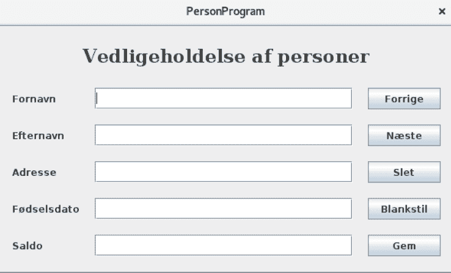

那么出生日期和余额的格式化处理如何——它们符合预期吗？

# 10 老虎机

作为本书的最后一个示例，我将展示一个模拟老虎机的程序的开发。其目的当然是为了展示书中介绍的概念的使用，但重点也放在了过程上。老虎机由（典型的）三个轮子组成，上面放置着一些图形。轮子旋转，轮子停止时显示的组合决定了是否中奖，以及如果中奖，奖金是多少。要编写一个可以模拟此类机器（从而模拟旋转轮子）的程序，我需要下一书中处理过的概念，因此代码可以在你读完下一本书（或同等 Java）后编写。因此，该版本的程序将不会模拟旋转轮子，而仅显示图形。

正如所提到的，我想关注过程。至少在分析和设计方面，该程序是相当大的，在编程过程中，我将主要描述做了什么，以及你在阅读代码时应该特别注意什么，但不会过多介绍它是如何实现的，因为页数将非常多。出于相同的原因，我将不会描述如何编写安装脚本，但你可以像其他程序显示的那样进行。

## 10.1 任务制定

必须编写一个程序来在普通 PC 上模拟老虎机。必须有某种形式的用户管理，为了玩该机器，你必须被创建一个带有账户的用户，并在账户中存入资金。如果账户中有钱，还必须能够从账户中提取金额，这在实践中意味着你中奖了。

你不应该能够使用“真实”钱进行游戏，但程序必须能够模拟玩家投入钱和获得钱的过程。

机器必须是可配置的，你应该能够选择使用 3 个还是 4 个轮子进行游戏。在配置机器方面，还必须能够选择每个轮子上应该有哪些以及多少个图形，哪些组合会中奖以及奖金是多少，最后还应该可以选择使用哪些图像。玩家必须能够从几种配置中进行选择。在设置配置时，确保长期配置能为机器所有者（赌场）带来利润，但同时，机器必须经常盈利，以确保机器确实提供了这么多回报。

## 10.2 分析

以下需求是基于分析准备的。


### 规范

机器必须是可配置的，你应该能够选择使用 3 个还是 4 个轮子进行游戏。在配置机器方面，还必须能够选择每个轮子上应该有哪些以及多少个图形，哪些组合会中奖以及奖金是多少，最后还应该可以选择使用哪些图像。玩家必须能够从几种配置中进行选择。在设置配置时，确保长期配置能为机器所有者（赌场）带来利润，但同时，机器必须经常盈利，以确保机器确实提供了这么多回报。

在支付方面，程序模拟了玩家账户中筹得的资金。所有交易都必须记录，以便玩家始终能看到投入和提取了多少钱。

### 用户模式

在用户模式下，玩家可以执行以下操作：

- 登录
- 向账户存入资金
- 查看账户信息
- 查看当前配置的中奖组合
- 查看交易摘要
- 选择另一个配置

如果玩家忘记了密码，他们必须联系管理员。

用户账户应包含以下内容：

- 电子邮件地址
- 密码
- 姓名
- 电话号码

### 用户模式（继续）

当然，最重要的功能是玩，这通过点击按钮或等等操作完成。必须能够固定单个轮子，类似于以下要求：

1. 你不能固定所有的轮子
2. 如果某个轮子在上一局游戏中被固定过，则你不应该固定它
3. 如果上一局游戏中奖了，则你不能固定该轮子

在玩机器时，必须注册游戏的结果，其中应注册以下信息：

- 玩的用户
- 游戏时间
- 游戏的配置
- 作为轮子组合的结果
- 奖金（如果没有收益则为 0）

### 管理员模式

如果你以管理员身份登录，除了玩机器，你还可以配置它并管理用户账户。

关于机器的配置，你必须能够维护特定的配置，其中配置指示：

- 名称，以便玩家选择该配置
- 轮子数量（3 或 4）
- 轮子上使用哪些图形
- 图形在轮子上的位置（顺序）——同一个图形可能出现多次
- 哪些组合会中奖以及奖金金额
- 在机器上游戏的费用
- 配置是否激活以及可以被玩家选择

关于玩家账户的管理，你应该能够：

- 修改玩家密码
- 删除玩家，并将玩家的余额转移到玩家账户中

最后，管理员应该能够打印一份统计表，显示每种配置的行为。在这里你可以看到其他内容，例如配置是否产生了正收益，以及单次奖金随时间变化的分布。

### 原型

已开发了一个原型用于演示用户界面以及它在机器上的运行方式。如果你点击游戏按钮，原型会选择随机图形（共有 15 个可用），但图形会在一段时间内变换以模拟轮盘的旋转。窗口顶部的工具栏是玩家可使用的功能，其中右侧的图标用于登录。原型被称为 `SlotMachine`。

## 10.3 设计

关于玩家和配置的信息必须储存在某处。我将从该数据库的设计开始，设计在如下 ER 图中概述，其中包含以下实体：

1. `Config` 代表机器的一个具体配置
2. `Wheel` 代表某个配置的轮盘
3. `Figure` 代表轮盘上的图形
4. `Winning` 代表特定图形组合带来的收益
5. `Player` 代表玩家
6. `Game` 代表机器上的某场游戏
7. `Transaction` 是玩家插入或增加账户的金额

`Config` 和 `Wheel` 之间的属性表示轮盘的位置，同样，`Wheel` 和 `Figure` 之间的属性表示图形在轮盘上的位置。

如果你向图中添加属性，概念数据库可以如下所示：

### 字典

| 表 | 列 | 类型 | 约束 |
| :--- | :--- | :--- | :--- |
| `Player` | `id` | `INT` | 主键 |
| | `email` | `VARCHAR(100)` | 唯一 |
| | `password` | `VARCHAR(200)` | 加密 |
| | `name` | `VARCHAR(50)` | 非空 |
| | `phone` | `VARCHAR(20)` | |
| | `card` | `VARCHAR(20)` | 非空 |
| | `date` | `DATE` | 非空 |
| | `code` | `INT` | 非空 |
| | `balance` | `DECIMAL` | |
| `Transaction` | `id` | `INT` | 主键 |
| | `amount` | `INT` | 非空 |
| | `type` | `BOOLEAN` | true = 存款, false = 支付 |
| `Config` | `id` | `INT` | 主键 |
| | `name` | `VARCHAR(50)` | 非空 |
| | `amount` | `INT` | 非空 |
| | `size` | `INT` | 必须是 3 或 4 |
| `Figure` | `id` | `INT` | 主键 |
| | `name` | `VARCHAR(50)` | 非空 |
| | `image` | `BINARY` | 非空 |
| `Wheel` | `id` | `INT` | 主键 |
| `Winning` | `id` | `INT` | 主键 |
| | `amount` | `INT` | 奖金，可能为 0 |
| `Game` | `id` | `INT` | 主键 |
| | `time` | `DATETIME` | 中奖的时间 |

上面的 ER 模型可以映射到如下所示的关系模型中。除了名称外，只有几处变动。关于交易，删除了类型字段，并决定正数交易意味着已存账户，负数交易意味着账户已增加。

`Wheel` 实体已更改为 `Config` 和 `Figure` 之间的关系，这两个位置即是该关系中的属性，分别表示轮盘编号和图形位置。所有关系都是简单的且符合第三范式的，参考上述数据字典，我可以立即编写脚本并创建数据库。此处未显示脚本。

作为设计的一部分，创建了一个 NetBeans 项目，作为分析阶段项目的副本，定义了模型层的设计。还存在程序（`CreateDefault` 项目），它用于创建默认配置。该程序的目标是在编程开始之前准备好配置。关于轮盘的图形（图像），决定机器必须使用小分辨率的正方形图像，以免它们占用过多空间。

遵循这些步骤后，数据库还额外添加了两个更改：

1. `figure` 表扩展了一个 `series` 列。该列包含短文本，用于对图形进行分类。上述程序已向数据库上传了 16 个图形，位于 `Default` 分类中。
2. 数据库扩展了一个包含两列的简单表 `admin`。该表必须包含管理员的密码和邮箱地址。

## 10.4 编程

如果你已经进行了仔细的分析，并可能结合了一个或多个原型，那么在编程阶段开始时你应该已经了所有的需求。这至少在理论上是可行的，通过实践，它适用于小型项目。然而，必须承认，无论你多仔细，在编程期间规范都可能发生变化，包括对某种特定方式实现功能的愿望，甚至是新的愿望。事实上，这并不奇怪，在程序开发过程中，对应用程序用途以及需求的理解可能会发生变化。

正如前面提到的，设计与编程之间的界限并不是清晰的，这可能导致重大决策被推迟到编程阶段。通常情况下，你应该保持谨慎，因为在设计阶段往往存在一种倾向或风险，即没有发现必须解决的挑战和问题。这表明在设计过程中没有利用充分的时间，忽视或低估了编程期间可能出现的问题。要在这设计和编程之间做出正确的界定是困难的，但相反，如果在设计阶段只画出大纲而不编写程序，结果就是，如果将重大决策推迟到编程阶段，那么所编写的大部分代码将必须修改，在最坏的情况下甚至重写。因此，在编写程序之前处理所有主要挑战至关重要。

结合此程序的开发，实际上存在一些在设计阶段本可以处理得更好的任务示例，例如，我想提到两点。

要求之一是管理员必须能够测试单个配置，查看它们如何产生收益以及在该配置下房屋赚了多少钱。这将如何实现，在分析或设计中都没有体现。如果还没有通过分析处理，说明需要由开发人员提出解决方案，这并不寻常，因此在设计阶段应该有一个解决方案的草图。例如，应该考虑数据库是否具有对给定配置进行合理分析所需的数据。

另一个问题是更改或删除配置会发生什么。这样做，与该配置的游戏所记录的数据可能不再有效，这意味着关于单个玩家使用机器的信息不再有效。所涉及的数据不能删除，因为这也会删掉玩家的输负记录。这也是一个在设计阶段已经解决的问题示例。

### 当前程序

对于一个稍大的程序，编程阶段应该分为多次迭代，其中迭代被定义为可以独立开发和测试的程序部分，我之前说明过这一点。这同样适用于当前程序，但我这次不想回顾具体的迭代，而只关注最终结果，指出做了哪些工作以及最大的挑战在哪里。

我想使用 `PalLib` 库，并且在它不包含所需的库方法范围内，应对对其进行更新。因此，任务的结果既是当前程序也是一个更新后的库。程序采用了经典的 MVC 架构：

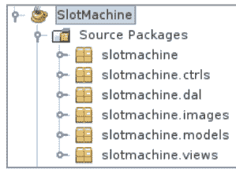

`dal` 层只有一个类 `DB`。该类被写为单例，并拥有所有维护数据库的方法。该类非常详尽，但不包含任何新内容。

模型层包含了设计中的类。它们在实现方法时都经过修改，并添加了一些新类，但总的来说，扩展很少且结构简单。具体来说，有一个 `Repository` 类，它是到 `dal` 层的一个相当薄的适配器类。原则上，这个类是没有意义的，因为它除了将方法调用委托给 `DB` 类之外什么都不做，它的唯一目的是让视图层和控制层不感知 `dal` 层。

大部分代码位于视图层，它定义了不少于 33 个类型（类和接口）。这个数量夸大了，几个类是 `JTable` 组件的模型类以及 `CellRenderer` 类，许多其他类与简单的对话框有关。这对应于几乎有两个不是简单对话框的窗口，而控制层只有 7 个类。

当你打开程序时，你会遇到以下窗口：

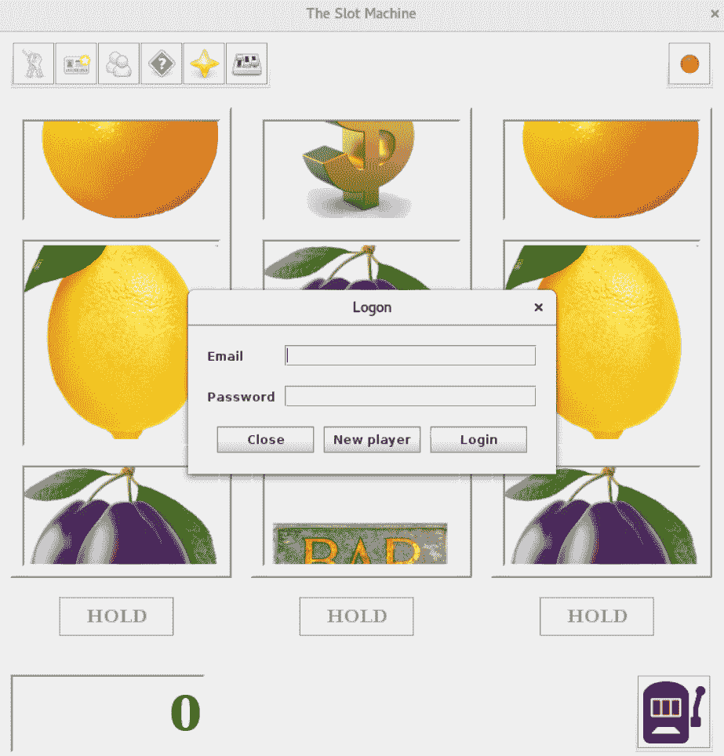

如果你点击 `Logon` 对话框中的 `Close` 或点击右上角的叉号，程序将结束，因此在没有玩家之前你无法游戏。如果你不是玩家，可以点击 `New player`，你将得到一个对话框，你可以在其中创建一个玩家：

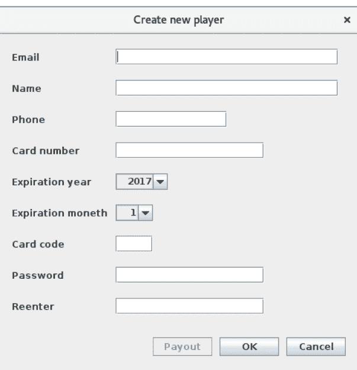

关于支付卡，虽然是伪造的，但卡号必须是 16 位，其中每 4 位之间可以插入空格。校验码必须是 3 个字符，但与卡号一样，并没有被任何使用。最后是有效期，程序在机器上游戏时会与当前日期进行比对。电子邮件地址必须具有合法的邮箱格式，并且是唯一的，因为它被用作用户标识。密码至少 10 个字符。

如果你用合法的数据创建一个用户，对话框会关闭，登录窗口的对话框也会关闭，你就可以准备好游戏了。登录和创建用户的两个对话框都附有一个控制器，除此之外它们非常简单。至于创建玩家的对话框，当玩家想要保留账户时，从主工具栏打开的对话框。

为了实现游戏本身（以及因此 `Main` 类，它是程序中两个复杂窗口之一），编写了一个 `WheelComponent` 类，它是一个代表轮子的视图，而 `MainView` 使用了三个或四个该组件的实例。正是这个组件启动了一个线程来模拟轮子的旋转。游戏功能类似于原型，仅对涉及轮子旋转的部分进行了微小的更改。游戏功能还必须确保锁住按钮（hold buttons）的逻辑被正确实现，以测试是否中以及玩家余额是否已更新。此外，游戏功能必须确保如果玩家账户为空，则无法游戏。这些功能实现在 `Main` 类中，并且每局游戏都会更新数据库，这是所有游戏都必须写入日志（`run` 表）的要求。与数据库设计相比，该表扩展了两列：游戏结果的金额以及所玩配置的 ID。这是为了简化某些其他功能。

然后是工具栏中的功能。第一个是退出登录，如果你点击它，你将再次获得登录窗口。下一个功能是向账户存入金额，点击按钮将给你一个简单的对话框，你在其中输入金额和密码。最后一个是确保他人不会向账户中过度存款，从而增加在注册支付卡上的金额。工具栏的第三个功能供玩家用于维护用户数据，并且如提到的，它打开一个类似于上面创建用户的简单对话框。玩家无法更改其电子邮件地址，因为它被视为密钥。密码字段是空的，你不输入旧密码。只有当你想要更改密码时，才填写这些字段。第四个功能打开一个简单的对话框，显示以下概览：

### 老虎机

| 收益表 |
| --- |
| 收益 | 2 |
| 🍒 🍒 | 🍒 | 5 |
| 🍒 🍒 🍒 | 10 |
| 🍒 🍒 🍒 JACK | 10 |
| 🍊 🍊 🍊 | 10 |
| 🍊 🍊 🍊 JACK | 14 |
| 🍉 🍉 🍉 | 14 |
| 🍉 🍉 🍉 JACK | 20 |

其内容仅仅是一个显示中奖机会的 `JTable`。上述描述了机器对玩家是如何运作的，在程序实现上，工作在 `DB` 类中以实现数据库功能，在 `MainModel` 类将跟踪所有关于玩游戏的逻辑，最后 `MainView` 类包含了所有视觉内容。该类由于 3 个和 4 个轮子的选择而变得复杂，这意味着组件的布局和窗口的布局取决于这一选择，同样也适用于上述中奖组合对话框。

接下是管理部分。如果你点击工具栏右侧的图标，将弹出以下对话框：

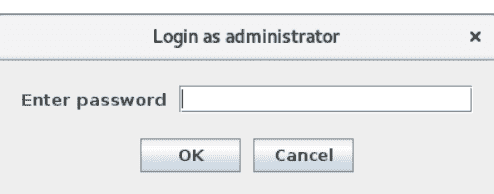

系统中只能有一个管理员。你必须输入管理员密码（长度至少为 10 个字符），如果尚未创建管理员，系统将创建一个管理员，然后你就可以使用相应的密码以管理员身份登录（因为管理员可能会更改）。你应该注意，这种为了实际使用的管理员信息维护非常简单，解决方案可能是允许某个特定用户注册并拥有管理员权限——这个问题我将在下一本书中提到。在以管理员身份登录后，工具栏将扩展出 4 个新图标：

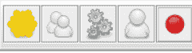


该功能用于将图像上传到数据库、维护用户、维护配置以及更改管理员密码。最后一个功能非常简单，此处不再赘详述。用户维护功能会打开一个带有 `JTable` 的对话框，该表格显示了所有用户。如果你双击表格中的某个用户，将弹出以下对话框：

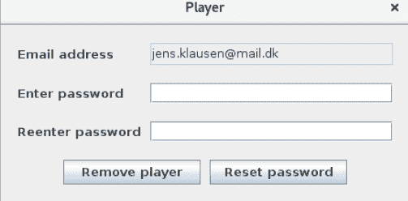

管理员可以在此处更改用户密码（从而为用户分配新密码）并可能删除该用户。

然后是向数据库上传图像的功能。如果你选择该功能时，将弹出以下对话框：

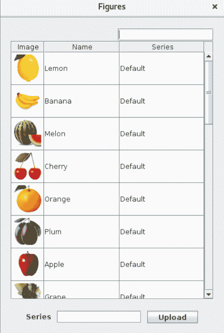

对话框显示了数据库中的所有图形，但你可以对系列（`series`）设置过滤器。当你上传一个图形时，必须先输入系列名称，然后浏览文件系统查找图像。程序使用文件名作为图形的名称，但你可以编辑表格并更改名称和系列。如果你想移除某个图形，可以双击该图像。

如果你在工具栏中点击维护配置的图标，将弹出以下对话框：

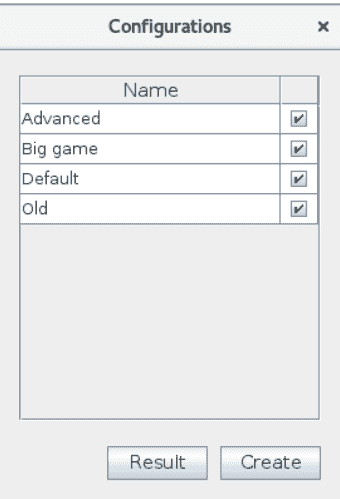

显示了一个包含所有配置的表格。在这里你可以激活或禁用配置。如果你点击 `Result`（结果），将打开一个窗口显示使用该配置的结果以及该配置返回的金额。我在这里不会显示该窗口。如果你点击 `Create`（创建），你可以创建一个新配置：

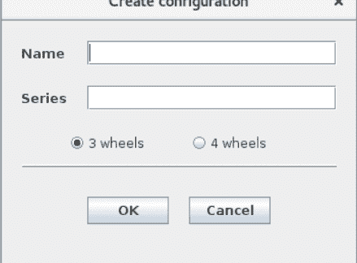

### 修改配置

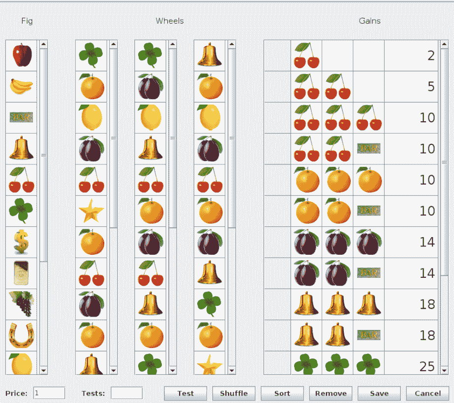

左侧显示一个包含所有配置的表格。在这里你可以激活或禁用配置。如果你点击 `Result`（结果），将打开一个窗口显示使用该配置的结果以及该配置返回的金额。我在这里不会显示该窗口。如果你点击 `Create`（创建），你可以创建一个新配置。

接下来我再次修改了 `MainView`，使其必须登录。然后我打开程序并执行以下操作：

1. 以上述三个用户中的第一个身份登录
2. 使用默认配置玩 20 局游戏
3. 选择配置“大型”（`Big game`）
4. 使用该配置玩至少 50 局游戏
5. 再次选择默认配置
6. 使用默认配置玩 20 局游戏
7. 退出登录
8. 以第二个玩家身份登录
9. 选择配置“高级”（`Advanced`）
10. 使用该配置玩 100 局游戏
11. 以管理员身份登录
12. 打开“高级”（`Advanced`）配置
13. 洗牌轮子并保存配置
14. 以管理员身份退出
15. 检查当前用户的交易记录
16. 退出登录
17. 以最后一个用户的身份登录
18. 使用“旧配置”（`Old`）玩 100 局游戏
19. 退出登录
20. 以第一个用户的身份登录
21. 以管理员身份登录
22. 删除“旧配置”（`Old`）
23. 删除最后两个用户

如果一切进展如预期，我将认为该程序已经完成——至少可以供内部选定的测试用户使用了。
