# Java 编程初学者完全指南

# 第一章 | 引言

## 本书关于什么

本书的编写目的是让任何人都能学习一门编程语言并产生产出。你可以从零开始，无需事先接触过任何编程语言。读完本书后，你将具备成为一名胜任程序员的技能，或者至少了解阅读和编写代码涉及的内容。之后，你将拥有所需的知识，对学习更多充满信心。在开始之前，你应该具备通用的计算机技能。在此，你将知道至少看懂代码而不头晕需要什么。

## 为什么要读本书？

你可以去网上寻找视频和教程来学习；然而，按顺序且在同一个地方学习知识时存在一个明显的缺点。

大多数 YouTube 或教程网站要么略带过一个主题，要么在特定主题上以乌龟速度慢慢一小时。在线内容通常很简短，对任何给定主题都没有深入探讨。它们是不完整的，或者仍处于进行过程中。你经常会发现自己要等几周才能等到另一个视频或教程发布。

大多数 Java 在线教程是分散的、无序且不连贯的。很难找到一个好的起点，更难找到一个连续的教程列表让你对 Java 编程语言有清晰的理解。让你知道，你应该觉得学习的过程是令人兴奋的。如果不是，你将很难读完本书。学习任何新技能都需要大量的耐心。我记得曾问过一位专家程序员我该如何学习编程。他告诉我去写一个编译器。在当时，这听起来很刻薄，但现在我理解他为什么要那样说。这就像是告诉一个想学开 F1 赛车的人直接去比赛一样。在这两种情况下，“学习”的部分都被忽略了。要告诉一个想写代码的人从哪里开始是非常困难的。

艺术与代码的常见融合出现在视频游戏中。每当角色能够相互互动并对用户交互做出反应时，就能传递出更丰富的体验。艺术家、动画师或环境设计师都应该具备向观众传达更丰富体验的能力。角色艺术家可以向观众展示一个怪物；但要让他们真正体验这种生物，怪物应该对观众的出现做出瞪视、低吼和攻击的反应。

## 在你开始软件开发生涯之前

我强烈建议你在进入软件开发领域之前阅读这本书：

**《软件开发者职业全方位指南：如何学习你的下一种编程语言、攻克编程面试并获得你梦想中的编程工作》**

- 字体：John Sonmez

### 选择你的商店

- [(美国) Amazon.com](http://amzn.to/2BLi0Gu)
- [(英国) Amazon.co.uk](http://amzn.to/2nwjHB8)
- [(印度) Amazon.in](http://amzn.to/2nrRxY8)
- [(德国) Amazon.de](http://amzn.to/2e7rq8r)
- [(法国) Amazon.fr](http://amzn.to/2FDZeqa)
- [(西班牙) Amazon.es](http://amzn.to/2IrnU2K)
- [(意大利) Amazon.it](http://amzn.to/2Dwjy6P)
- [(加拿大) Amazon.ca](http://amzn.to/2E1zKkV)

## 计算机编程简史：编程是如何诞生的

### 机械计算机

第一台可编程计算机无疑是查尔斯·巴别奇在 19 世纪 20 年代建造的巴别奇机器。它由成千上万个运动部件组成，重量达数吨，是一台可以显示 31 位数字的巨大机械计算器。它被称为`差分机`（Difference Engine），在 1824 年，巴别奇因修正了一组用于绘制行星运行图表的表格而获得了英国天文学学会的金金奖。1833 年，一位名叫奥古斯塔·阿达·金·洛夫莱斯的伯爵（通常被称为埃达·洛夫莱斯）在一次派对上结了巴别奇，并被介绍了`差分机`。几年后，事实证明她对机器的理解比查尔斯本人还要深刻。尽管洛夫莱斯伯爵的夫人，她仍撰写了多关于`差分机`及其升级版`分析机`（Analytical Engine）运行的文档。由于她对`差分机`及其文档的工作，她通常被认为是第一位计算机程序员。

### 逻辑

1848 年，乔治·布尔为我们带了布尔逻辑。从`差分机`到第一台通用可编程计算机的出现花费了近一个世纪的时间。多亏了乔治，今天我们的计算机使用二进制（1 和 0）进行计数，而我们的软件则以真或假的逻辑进行思考。1887 年，多尔·尤金·费尔特制造了一台带有按钮的计算机器；多亏了他，我们的计算机才有了键盘。19 世纪 90 年代，一种制表机使用带有打孔的纸（孔洞代表 1 和 0）来记录美国人口普查。在当时，它节省了 200 万美元和 6 年的工作量。20 世纪初，在尼古拉·特斯拉和亚历山大·格拉汉·贝尔之间，晶体管的发明让现代计算机变得临近。1936 年，康拉德·泽泽制造了`Z1`计算机，这是另一台像巴别奇那样的机械计算机，但这次它使用了类似于制表机的打孔纸带。他后来在 1941 年制造了`Z3`。

### 计算机科学

20 世纪 40 年代，英国计算机科学家艾兰·图灵设计并建造了一种名为`Bombe`的加密信息解码器，它利用电磁开关在第二次世界大战期间帮助盟军。在 20 世纪 30 年代到 50 年代之间，图灵告诉计算机科学家，计算机在理论上可以解决任何可计算的问题，并将这一概念称为`图灵完备性`（Turing completeness）。所有这些组件开始引导我们现代计算机的发展。20 世纪 40 年代中期，约翰·冯·诺曼通过他的理论证明了计算机可以使用简单的组件来构建。这样，控制硬件的软件就可以添加复杂的行为。多亏了特斯拉和贝尔，`Z3`完全由电子元件制成。它在计算时首次使用了逻辑运算，使其成为第一台完整的图灵完备计算机。1954 年，德州仪器的戈登·蒂尔引入了硅基晶体管，这是构建今天固态电子设备的关键组件，已应用于每台计算机中。

### 软件

`Z3`使用`Plankalkül`进行编程，这是泽泽在完成机器制造后不久发的第一级编程语言。1952 年，格蕾丝·霍珀创建了第一个编译器，这种软件可以将人类可读的单词翻译成机器操作。程序员第一次不需要知道硬件中晶体管是如何运作的，就可以为计算机构建运行的软件。这让计算机编程面向了全新的受众。20 世纪 50 年代到 70 年代，计算机和计算机语言在复杂性和能力方面不断增长。1958 年，约翰·麦卡锡在马诸塞理工学院（MIT）发明了`LISP`。面向对象的编程在 1967 年的`Simula 67`中出现。命令式和过程化编程在 1970 年的`Pascal`中出现。

## 现代计算机语言

由贝尔在 20 世纪 20 年代创立的贝尔实验室在 1967 年聘佣了丹尼斯·里奇。1974 年，里奇发表了`C`语言，这已成为最流行的编程语言。1983 年，詹姆斯·戈斯林、迈克·谢里登和帕特里克·纳顿在 1991 年启动了 Java 项目。该语言最初被称为`Oak`，由于戈斯林办公室外的一棵橡树。后来该项目被称为`Green`，并最终命名为`Java`，源自咖啡。

孙公司于 1995 发布了第一个实现。它承诺“编写一次，随运行”（WORA），在流行的平台上提供免费的运行时环境。由于良好的安全性且具有可配置的安全性，它允许进行网络和文件访问限制。主流浏览器很快整合了在网页中运行`Java applets`的能力，Java 迅速流行起来。`Java 1.0`编译器由亚瑟·范霍夫用 Java 重写，以严格遵守`Java 1.0`语言规范。随着`Java 2`的出现（1998 年 12 月最初作为`J2SE`1.2 发布），新版本针对不同平台提供了多种配置。`J2EE`包含了通常运行在服务器环境中的企业级技术和 API，而`J2ME`拥有针对移动应用程序优化的 API。桌面版本被重命名为`J2SE`。2006 年，为了营销目的，孙公司将新的`J2`版本分别命名为`Java EE`、`Java ME`和`Java SE`。

1997 年，孙公司接触了`ISO/IEC JTC 1`标准机构以及后来的`国际电子组织`以正式化 Java，但很快退出了。Java 仍然是一个事实标准，通过`Java 社区进程`（Java Community Process）控制。曾几何时，孙免费提供了大部分 Java 实现，尽管它们是专有软件。孙通过销售 Java 企业系统等特殊产品的许可证获得 Java 收入。

2006 年 11 月 13 日，孙公司将其大部分 Java 虚拟机（JVM）作为免费开源软件（FOSS）发布，遵循`GNU 通用许可证`（GPL）条款。2007 年 5 月 8 日，孙公司完成了这一过程，将其所有 JVM 核心代码按免费软件/开源发行条款开放，除了孙公司不拥有版权的小部分代码外。

国际商业机器公司（`IBM`）是一家成立于 20 世纪 20 年代的美国公司，目前它正在利用近一个世纪前发现的粒子物理学开发新技术。现代自旋电子学源于 20 世纪 20 年代后期德国物理学者的工作。如果没有粒子物理学以及像弗里德里希·赫尔曼·洪德（Friedrich Hermann Hund）这样的物理学家，我们将无法理解量子隧道效应，固态硬盘或通用串行接口（`USB`）优存也将不存在。在发现希格斯粒子之后，你可能会问：“为什么要这样做？”这个问题可能在百年后才能得到好的答案，但它是值得的。`Java`并不是最后的计算机语言；最近又引入了许多其他语言，最受关注的是谷歌推出的`Go`。

`Microsoft`也不甘人后，也引入了`F#`。近年来出现了许多相对新的编程语言。尽管这些语言有所不同，但核心概念都是相同的。一旦理解了基本思想，就可以将在此获得的知识应用到新语言中并继续学习。今天，量子计算机开始出现。处理今天的晶体管时，我们发送和接收的是确定的值。量子计算机不处理 0 和 1；它们存储的是 0 到 1 之间的多个值。为了处理这一点，新的编程语言正在开发中。

# 第 2 章 | 入门

## 什么是编程？

这一切都是关于编写代码。编程是我们组织数据并使用逻辑对这些数据进行处理的过程。数据是计算机可以存储的所有内容；它们的范围从数字到视频游戏中的僵尸角色不等。

你通过在被称为“源代码”的文件中编写文本来实现这一点。写入文本文件的`Source code`替换了半个世纪前计算机使用的打孔卡。

当数据与逻辑结合并写入单个文件时，它们被称为一个`class`（类）。`Classes`也是数据，因此可以使用更多的逻辑进行管理。


`Classes`用于在内存中创建`objects`（对象），并可以复制以拥有它们自己的生命。`Classes`用于构建`objects`。`class`内的每一部分数据都成为该`object`的一部分。`class`内部不同的数据块被称为`class members`（类成员）。

`Class members`也可以是`functions`（函数）或`methods`（方法）的逻辑块。

例如，在一个有僵尸群的游戏中，每个僵尸都是从一个僵尸类复制或实例化的。每个僵尸对于`class`中的每个属性或数据元素都有独特的值。

这意味着生命值和位置对于每个复制的僵尸`object`来说都是唯一的。从`class`创建的`objects`称为`instances`（实例）。类似于家庭，`objects`可以相互继承属性。

有时称为`subclass`（子类）的子类继承其父类的属性。例如，从僵尸创建的子类可能会继承父类对大脑的渴望。

为了有用，子僵尸还可以添加新的`objects`并改变它从父类`class`继承的`objects`。结果是，子僵尸可能有父类没有的触手。`Objects`通过`events`（事件）和`messages`（消息）相互通信。

向僵尸射击可以创建一个`event`，或者在程序员术语中，它“触发”了一个`event`。子弹命中事件告诉僵尸`class`在被子弹击中后采取必要的步骤。

`Events`命令`class`对数据执行操作，这就是`functions`派上用场的地方。

`Functions`也称为方法，是作用于数据的逻辑部分。它们允许你的`class`创建额外的`events`并与更多的`objects`通信。

当玩家按下扳机并移动摇杆时，可以触发更多的`events`并发送更多的`messages`。`Events`和`messages`允许玩家与你的世界交互；逻辑`events`和`objects`共同构建了你的游戏。

## 什么是数据？

从广义上说，数据有点像名词。像名词一样，数据可以是人、地方或物。程序员将这些名词称为`objects`，这些`objects`存储在内存中并作为`variables`（变量）。`variable`一词暗示了可能会发生变化，但情况并不总是如此。最好将`variable`视为你计算机内存中用于存放信息的空间。当你玩像`MadLibs`这样的文字游戏时，你可能会要求提供某人的名字（一个`object`）、一个副词和一个地方。你的结果可能是“加斯吃了一件夹克，并专注地在洗衣店里玩耍。”在这种情况下，名字、对象、副词和地方都是`variable types`（变量类型）。数据就是你用来赋值给`variable`的单词。

程序员使用`type`（类型）一词来表示将存储什么类型的数据。计算机并不精通英语，通常不知道英语类型`noun`（名词）和`adjective`（形容词）之间的区别。但它们知道字母和各种数字之间的区别。在`java`或任何其他语言中许多预定义类型。

如果你加上创建新数据类型的能力，我们可以存储的数据类型实际上是无限的。

`C#`内置类型有时被称为`POD`，或`plain old data`（普通旧数据）。`POD`一词源于 1979 年的原始`C++`标准。到目前我们多次使用了`type`这个词。

## 什么是编译器？

通常来说，编译是任何与编程相关的人经常听到的术语。`compiler`（编译器）是将高级源代码转换为处理器理解的机器语言低级对象代码（二进制代码）的软件程序。将高级编程转换为机器语言的过程被称为编译。

处理器执行`object code`，这指示了算术单元所需的二进制高低信号。

让我们举一个例子来理解上述定义。如果你询问任何与编程相关的人他们写的第一个程序是什么，那么显而易见的答案将是“Hello World”。所以我们也从这里开始。

```c
#include<stdio.h>

Void main() {
    printf("Hello, world!");
}
```

这个最基本的程序在计算机屏幕上打印或显示“Hello,world!”。但有一个问题。它并没有那么简单。幕后有很多复杂的事情在发生。让我们窥探这些内部。

下面的图示说明了该过程。

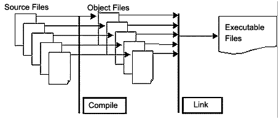

将机器语言转换为高级自然语言的编译器被称为反汇编器（decompiler）。产生用于系统运行的对象代码的编译器被称为交叉编译器（cross-compilers）。最后，将一种编程语言转换为另一种语言的被称为语言编译器。

编译器执行四个主要步骤：

- **扫描（Scanning）**：扫描器从源代码中一次读取一个字符，并跟踪哪些字符出现在哪行中。
- **词法分析（Lexical Analysis）**：编译器将源代码中出现的字符序列转换为一系列字符串（称为标记，tokens），这些标记由一个称为词法分析器的程序通过特定规则相关联。词法分析器使用符号表来存储源代码中与生成的标记对应的单词。
- **语法分析（Syntactic Analysis）**：在这一步中，进行语法分析，这涉及预处理以确定在词法分析期间创建的标记是否按照其用法正确排列。一组可以产生预期结果的关键字正确顺序被称为语法。编译器必须检查源代码以确保语法准确性。
- **语义分析（Semantic Analysis）**：这一步由几个中间步骤组成。首先，检查标记的结构，以及它们相对于给定语言语法的顺序。解析器和分析器解释标记结构的含义，最终生成中间代码，称为对象代码。对象代码包含了当程序中遇到对应标记时代表处理器器操作的指令。最后，对整个代码进行解析和解释，以检查是否可以进行任何优化。一旦可以执行优化，就会在对象代码中插入适当的修改标记以生成最终的对象代码，并保存到文件中。

因此，编译器是一个程序，它读取一个程序（某种高级编程语言）作为输入，并输出机器语言代码（针对某种机器架构）。机器语言代码随后可以使用不同的输入数据执行任意次数。作为第二个例子，Java 编译器`javac`将`.java`源文件转换为`.class`文件，该文件用`Java bytecode`编写，字节码是被称为`Java Virtual Machine`（Java 虚拟机）的虚拟机器的机器语言。

## 什么是解释器？

解释器是一个程序，它读取源代码以及程序数据作为输入，并逐条翻译源程序指令。例如，Java 解释器`java`将`.class`文件翻译成可以在底层机器上原生执行的代码。

## 为什么 Java 通常使用解释而不是编译？

编译的主要优势是你可以最终获得可以在你的机器上高效执行的原始机器语言代码。然而，它只能运行在一种机器架构（Intel Pentium、PowerPC）。编译为中间语言（如`Java bytecode`）然后进行解释的一个主要优势是你可以实现平台无关性：你可以在不同类型的机器架构上解释同一个`.class`文件。然而，解释字节码通常比执行预编译的机器语言代码慢。使用`Java bytecode`的第二个优势是它充当你的计算机和程序之间的缓冲区。这使得你能够从互联网下载不可信的程序并在你的机器上执行它并有一定的保证。由于你运行的是 Java 解释器（而不是原始机器语言代码），你受到一层安全机制的保护，该机制可以防止恶意程序。正是 Java 和`Java bytecode`的结合产生了平台独立且安全的环境，同时仍然拥有一整套现代编程抽象。


`Java bytecode` 和 Java 解释器本身并不等同于 Java 编程语言。例如，你可以使用 Jython 从 Python 编程语言编译为`Java bytecode`，然后使用`java`对其进行解释。还有类似的 ML、Lisp 和 Fortran 编译器也可以编译为`Java bytecode`。你还可以使用 Unix 程序`gcj`直接从`.javasource`文件编译为机器可执行文件`a.out`，它可以在任何 Sparc 微处理器上原生运行。此外，你还可以设计机器语言为`Java bytecode`的硬件。Sun Microsystems 正是这样做的，使得`Java Virtual Machine`并不那么虚拟。

## 为什么不使用真实的机器语言而不是 Java bytecode？

`Java bytecode`比典型的高级编程语言简单得多。为新类型的计算机编写一个 Java 字节码解释器比编写一个完整的 Java 编译器容易得多。

## 编程环境设置

当我们说环境设置时，它意味着一个我们在此进行编程的基础。因此，我们需要设置好所需的软件，即在我们的 PC 上安装用于编写计算机程序、编译和执行这些程序的软件。例如，如果你需要浏览互联网，那么你的机器上需要以下设置：

- 可以连接互联网的可用网络连接
- 一个 Web 浏览器，如 Internet Explorer、Chrome、Safari 等

同样，如果你要开始使用任何编程语言进行编程，你需要以下设置：

- 一个文本编辑器来创建计算机程序。
- 一个编译器将程序编译为二进制格式。
- 一个解释器来直接执行程序。

我们建议你使用 IDE（集成开发环境），这是一个非常方便、很棒的软件，它将文本编辑器、调试器和编译器合于一体，虽然有时很臃肿但通常非常有用。

除非你致力于在文本编辑器和命令行提示符窗口中工作（这样做确实有充分的理由），否则你可能在寻找关于如何选择良好的 IDE 的建议、各种型号的优缺点、运行特定 IDE 的相对成本（财务或系统资源）、该 IDE 可能可能良好处理的其他语言、它运行的操作系统以及许多更多信息。

以下是程序员最常用的两种 IDE 列表。

### Eclipse

- **语言**：C，C++，Python，Perl，PHP，Java，Ruby 等更多
- **价格**：免费
- Eclipse 是许多开发框架基础的免费开源编辑器。它是该领域的鼻祖之一，深受专业开发者的推荐。Eclipse 起于 Java 开发环境，通过轻量级插件系统大大扩展。

### NetBeans

- **语言**：Java，JavaScript，PHP，Python，Ruby，C，C++ 等更多
- **价格**：免费
- NetBeans 与 Eclipse 并列为该类别中最受推荐的 IDE。它是免费开源的，支持大量语言并不断有新的插件，而且对于初学者来说安装和使用都极其简单。

## 编译与执行

一个简单的 Java 项目包含一个目录，所有的 Java 源文件都存储其中。Java 文件通常不直接存储在源目录下，而是存储在与包结构匹配的子目录中。包是将源文件分组在一起的一种。

当你编译源中的所有源代码时，编译器为每个`.java`文件生成一个`.class`文件。`.class`包含了`.java`文件的编译版本。换句话说，就是`.java`文件的字节码。

Java 虚拟机（JVM）执行的是`.class`文件，而不是`.java`文件。因此，将`.java`文件与`.class`文件分开来是正常的。这通常通过指示编译器将`.class`文件写入一个独立的目录来实现。该目录通常被称为`classes`，但再次强调，这强制要求的，而是取决于你正在使用的构建工具或 IDE 等。

## 编译 Java 源代码

你可以直接从 IDE 中编译 Java 源码（如果你使用 IDE 的话）。或者，你可以使用 Java SDK 自带的 Java 编译器。要从命令行使用 Java 编译器编译你的 Java 源码，请执行以下操作：

- 打开命令提示符
- 切换到你的项目根目录（而不是源代码目录）
- 确保项目根目录包含一个源代码目录和一个类目录
- 输入下面的命令（在 Windows 上——其他操作系统看起来也类似）：

```bash
"c:\Program Files\Java\jdk1.8.0_25\bin\javac" src/myfirstapp/*.java -d classes
```

该命令执行了`javac`命令（Java 编译器），它会编译`src/myfirstapp`目录下的 Java 源码。`*.java`编译器应该编译给定目录中的所有文件。

`myfirstapp`目录是根源码目录`src`下的一个包。如果你在根源码目录下有多个包，则需要多次运行 Java 编译器。Java IDE 会自动为你处理这一点。`Ant`、`Maven`或`Gradle`等构建工具也是如此。

## 运行编译后的 Java 代码

一旦编译器完成工作，`classes`目录将包含编译后的`.class`文件。源目录中的包结构（目录结构）将在类目录下保留。你可以运行任何一个包含`main()`方法的`.class`文件。你可以在 Java IDE 内部运行`.class`，也可以从命令行运行。从命令行运行看起来如下：

```bash
"c:\Program Files\Java\jdk1.8.0_25\bin\java" -cp classes myfirstapp.MyJavaApp
```

`-cp classes`告诉 Java 虚拟机所有的类都位于名为`classes`的目录下。这被称为“类路径”（Class Path，因此缩写为`cp`）。

要运行的类名是上述命令的最后一个参数——`myfirstapp.MyJavaApp`部分。

JVM 需要知道完全限定类名（所有包名加类名）以确定相应的`.class`文件的位置。

当你运行该类时，你的命令行看起来如下（包括 Java 程序的输出）：

```text
D:\data\projects\my-first-java-app>"c:\Program Files\Java\jdk1.8.0_25\bin\java"
    -cp classes myfirstapp.MyJavaApp

Hello World!

D:\data\projects\my-first-java-app>
```

（注意，第一条命令不应该包含换行符。我那样写仅仅是为了方便阅读。）

就这样！现在你知道如何编译和执行你的 Java 程序了！如之前提到的，使用 IDE 可能会更容易，但你可能在任何想要执行代码的地方都没有 IDE。

# 第 3 章 | 基础术语

本节将涵盖许多基础术语以及编写规范代码的一些基本概念。Java 是许多不同编程语言之一，它们使用相同的单词和概念来向计算机传递指令。一旦我们读完前几章，我们将介绍更多直接与读写代码直接相关的基础知识。在在此之前，我们需要涵盖一些适用于许多不同编程语言（不仅仅是 Java）的术语和概念。允许单词转换为可执行代码的方法和系统需要相当严格的规则。在写英语或在线聊天时，我们往往会忽略格式和标点符号。简洁允许更快的通信，但这仅仅是因为我们人类学会了许多新词，并可以根据上下文更好地解释网络或短信中使用的英语书写缩写和略语。计算机并没有那么聪明，能够轻易地解释我们的单词。

### 标记（Tokens）

在书面英语中，语言的最小元素是字母和数字。单独来说，大多数字母和数字没有特定的含义。字母之后的下一个更大的元素是单词。每个单词都有更多的意义，但复杂的思想很难用一个单词表达。为了交流一个思想，我们使用句子。句子中的每个单词都有特定的用途，如下图所示。为了表达一个概念，我们使用一组句子组成一个段落。为了表达情感，我们使用许多段落组织成章节。为了讲述故事，我们使用书籍——章节的集合。

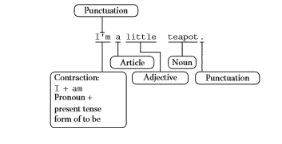

编程具有类似的组织机制。最小的有意义元素是标记（token），接着是语句、代码块、函数，然后是类和命名空间，最终是程序，或者在我们的案例中是游戏。我们将从最小元素开始，一直到编写我们自己的类。然而，在开始编写任何复杂代码之前，了解最小的元素对于理解所有部分如何组合在一起是非常重要的。

### 编写 Java

Java 是一种基于英语的编程语言；像任何其他 C 类编程语言一样，它可以被拆分为标记，即计算机可以理解的最小文本片段。例如，在像下面的简单语句中有五个标记。

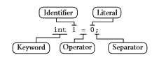

标记可以分类为关键字、标识符、字面量、运算符、分隔符和空白符。上面的语句包含了五个标记，并提供了间隔。关键字`int`后面跟着标识符`i`。接着是运算符`=`，它将运算符左侧的标识符和右侧的字面量`0`赋值。最后一个标记`;`是结束语句的分隔符。空白符和注释（我们尚未介绍）不被视为标记，尽管它们起到分隔符的作用。使用正确的格式样式是非常重要的。让我们检查代码示例：

```java
int i = 0;
int j = 1;
```

所示代码是两个语句，分隔符防止计算机将代码误读为单一语句。然而，有人类参与编写代码，因此代码需要对人类或任何可能读取你代码的其它生命形式可读。规范的代码意味着遵循特定的样式。我们将在本章晚些时候详细讨论关于规范的代码样式。

因此，如果你误输入了`int i = 0:`而不是`int i = 0;`，词法分析器无法将最后一个标记转换为正确的符号，因此该语句将完全无法被解析。这段代码在代码编译之前就会导致错误。

## 分隔符标记（Separator Tokens）

最常见的分隔符是分号`;`。这种标点符号用于结束一条代码语句。其他分隔符成对出现。大括号`{ }`成对使用，用于分隔代码语句组。左大括号`{`的尖端指向组的外部；它与闭合大括号对的右大括号`}`配对。圆括号以`(`开始并以`)`结束，方括号以`[`开始并以`]`结束。不同的左、右括号、中括号和圆括号有特定的用途，用于帮助识别它们的用途。还有角括号`<`和`>`；它们用于包围数据类型。别忘了还有单引号`''`和双引号`""`，它们也成对使用，用于包围被称为字符串（strings）的符号。

### 注意

在许多文字处理器中，通常会使用起始和结束引号（`“`和`”`）。词法分析器不识别这些“智能引号”，因此编程文本编辑器使用直引号（`"`）代替。一旦你意识到编程中使用的字母、数字和所有其他字符都被解析为美国信息交换标准（ASCII）或 Unicode 转换格式（UTF-8、16 或 32），这些细微的变化就不再那么细微了。

ASCII 和 UTF 都是计算机用于读取文本的字符数据库的名称。计算机不使用眼睛来阅读。相反，它们使用数字数据库来查找所使用的每个字符。因此，如果我们使用`UTF-16`，对计算机来说，`“`看起来更像`0x201C`，而`"`看起来像`0x0022`。代码中的大括号用于分隔语句。圆括号通常用于接收数据。方括号通常用于帮助识别数组。我们稍后讨论数组，但在解释它们之前，你可以把它们想象成电子表格或网格纸。

```java
int[] arrayNumbers = {1, (int) 3.0, 9000};
```

上述语句将三个数字赋值给数组。大括号内包含一对用逗号分隔的语句。大括号中的第二个语句是将一个带点（`.`）的数字转换为不带点的数字。这可能需要一些解释，但习惯看到这种现象是有好处。我们很快就会涉及到什么是数组，以及什么是点运算符。

通常在学习编程时，你会看到很多奇怪的标记，它们看起来可能没有任何意义。这取决于你如何观察遇到的每一个标记并尝试理解它的作用。如果没有任何一个语句看起来都不合逻辑，那没关系。在这个阶段，并不要求你已经知道所有这些内容的含义，但你很快就会明白了。

## 运算符标记（Operator Tokens）

运算符类似于关键字，但只使用少数几个非单词字符。冒号或分号是运算符；与关键字不同，运算符的操作会根据它们出现的位置或使用方式而改变其功能。这种行为转变被称为运算符重载（operator overloading），这是一个复杂的课题，我们稍后会讨论。同样重要的一点是，在需要时，你可以创建自己的运算符。Java 中的逗号有不同的含义。它们用于分隔不同的数据值，例如：

```java
for (int i = 0, j = 1; ; i++, j++)
```

## 其他运算符标记

总来说，运算符是处理变量之间特定操作的特殊字符。运算符和变量出现的表示或顺序通常通过以下符号或数学语法进行教学：`a + b = c`。然而，在编程中，更倾向于使用：`c = a + b;`这种改变是因为 Java 中的`=`运算符的工作方式与数学课上通常教授的功能不同。`=`运算符的左侧是赋值侧，右侧是操作侧。这把重点放在被赋值的值上而不是如何赋值。结果比如何解决问题更重要，因为计算机在进行计算。在编程中，上面的示例应该读作“将 a 加 b 的赋值给 c”。

## 字面量（Literals）

字面量有许多不同的形式；类似于表现为`+`、`-`或`=`的运算符，字面量是经常出现在它们之间的标记。数字被视为字面量，或者是以字面量方式使用的标记。数字可以被称为数字字面量（numeric literals）。当内容被放在引号中时，例如“I’m a literal”，你写的是一个字符串字面量（string literal）。字面量存在于几乎所有的编程语言中，并构 Java 数据类型的基础。目前，我们只处理几种不同类型的字面量，但很快我们就会了解到更多的。

## 传递与非传递性操作（Transitive and Non-Transitive Operations）

在数学课上，有时会教某些操作是传递的，而另一些不是。例如，`2 + 3 + 4`和`4 + 3 + 2`得到相同的值。数字出现在运算符之间的位置并不重要，因此`+`运算符被认为是传递的。这个概念在 Java 中同样适用。当我们开始混合运算符时，结果会改变。

```java
int a = 1 + 2 - 4 + 7; //a = 6
int b = 7 + 4 - 2 + 1; //b = 10
```

这段代码片段显示了使用相同运算符但位置不同导致的不同结果。当我们开始使用它们时，将会看到如何解决这些问题。运算符的顺序是需要注意的，我们在构建计算时测试每一步，以确保结果符合预期。为了确保操作按照你的预期进行，你可以使用括号包含操作数。

---

# 程序基础（BASIC OF PROGRAM）

## Java 程序结构（Structure of Java Program）

Java 程序由不同的部分组成。其中某些是强制性的，而某些是可选的。可选部分可以根据程序员的要求被排除。

### 文档部分（Documentation Section）

包含说明程序目的的注释。提高了程序的可读性。

### 包语句（Package Statement）

包含包声明语句。

### 导入语句（Import statements）

包含引用其他包中类和接口的语句。

### 接口部分（Interface Section）

类似于类，但只包含常量、方法声明。

### 类部分（Class Section）

描述程序中定义的类。每个 Java 程序至少有一个类定义。该类定义声明了`main`方法。程序的执行是从此处开始的。

**1. 文档部分**：包含提高程序可读性的注释。注释是非执行语句，有助于阅读和理解程序，特别是当你的程序变得复杂时。它只是仅供程序员使用的信息，会被编译器忽略。良好的程序应该包含描述程序目的、作者姓名以及创建程序时间的注释。该部分是可选的，注释可以出现在程序的任何地方。

Java 语言支持三种类型的注释。

**单行注释（或行尾注释）**：它以双斜杠符号（`//`）开始，并在当前行结束处终止。编译器忽略从`//`到行尾的所有内容。

例如：

```java
// 计算两个数字之和
```

### 多行注释

Java 程序员可以使用 C/C++ 风格的注释，以`/*`开头并以`*/`结尾。分隔符之间的所有文本会被编译器忽略。这种风格的注释可以用于一行的部分、整行，或者更常见的用于定义多行注释。

例如：

```java
/*calculate sum of two numbers */
```

注释不能嵌套。也就是说，你不能对已经包含传统注释的行进行注释。例如：

```java
/* x = y /* initial value */ + z; */
```

这样做是错误的。

### 文档注释

这种注释样式是 Java 中的新特性。此类注释以`/**`开头并以`*/`结尾。编译器也会忽略这种类型的注释，就像它忽略使用`/*`和`*/`的注释一样。这种注释的主要目的是自动生成程序文档。`javadoc`工具会读取这些注释并使用它们来准备 HTML 格式的程序文档。

例如：

```java
/**这里处包含的文本将成为程序文档的一部分 */
```

### 包声明语句（PACKAGE STATEMENT）

Java 允许将类分组在一个名为包（package）的集合中。包声明语句包含一个提供包声明的语句。它必须作为源文件中的第一个语句，出现在任何类或接口声明之前。该语句是可选的。例如：假设你在源文件的第一个语句中写了以下包声明。

```java
package employee;
```

该语句声明了在此源文件中定义的所有类和接口都是`employee`包的一部分。源文件中只能出现一个包声明。

### 导入语句（IMPORT STATEMENT）

Java 包含许多存储在包中的预定义类。为了在你的程序中引用这些标准预定义类，你需要使用完全限定类名（即`Packagename.className`）。但这是一项非常繁琐的任务，因为需要重新输入包路径名以及类名。因此，更好的替代方案是使用导入语句（import statement）。

导入语句用于引用在其他包中声明的类。导入语句写在包声明之后、任何类定义之前。你可以导入一个特定的类，也可以导入包中的所有类。例如：如果你想使用导入语句导入`java.util`包中的`Date`类，可以写：


```java
import java.util.Date;
```

该语句允许程序员在代码中使用简单的类名`Date`而不是完全限定类名`java.util.Date`。

与包声明不同，你可以在程序中指定多个导入语句。

例如：

```java
import java.util.Date; /* 仅导入 java.util 包中的 Date 类 */
import java.applet.*; // 导入 java applet 包中的所有类
// package
```

### 接口部分 (INTERFACE SECTION)

在接口部分，我们指定接口。接口类似于类，但只包含常量和方法声明。接口不能被实例化。它们只能被类实现，或被其他接口扩展。这是一个可选部分，当我们希望在程序中实现多重继承特性时使用它。

```java
interface stack {
    void push(int item); // 将元素插入栈中
    int pop(); // 从栈中删除元素
}
```

### 类部分 (CLASS SECTION)

类部分描述了程序中存在的用户定义类的信息。类是字段（数据变量）和对字段进行操作的方法的集合。Java 中的每个程序至少包含一个类，即包含`main`方法的那个类。`main()`方法是程序实际开始执行的地方，并按照指定的顺序执行语句。

`main`方法可以创建对象、评估表达式并调用其他方法等等。当到达`main`的末尾时，程序终止并将控制权交回操作系统。

类部分是强制性的。

在讨论了 Java 程序的结构之后，我们现在讨论一个在屏幕上显示字符串 "Hello Java" 的程序。

```java
// 在屏幕上显示信息的程序
class HelloJava {
    public static void main(String args[]) {
        System.out.println("Hello Java");
    }
}
```

### main() 方法

Java 程序是按照特定顺序执行的 Java 指令序列。由于 Java 指令是按顺序执行的，因此 Java 程序有开头和结尾。

要执行你的 Java 程序，你需要向 Java 虚拟机（JVM）指示从哪里开始执行程序。在 Java 中，所有指令（代码）必须位于`Java class`内部。类是将归在一起的数据和指令分组的一种。因此，一个类可以同时包含`variables`和`methods`。变量可以包含数据，而方法将一组对数据的操作（指令）组合在一起。

Java 程序需要从某处开始执行。Java 程序通过执行某个类的`main`方法开始执行。你可以选择要执行的类的名称，但不能选择方法的名称。该方法必须命名为`main`。

以下是`main`方法位于 Java 类内部时的声明形式：

```java
package myjavacode;
public class MyClass {
    public static void main(String args[]) {
    }
}
```

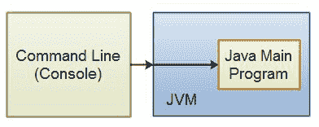

执行`java`命令的命令行，该命令继而执行一个 Java 主程序。

这里有一个命令行示例：

```bash
java -cp classes myjavacode.MyClass
```

该命令的第一部分是`java`命令。该命令启动了`JVM`。在某些情况下，你可能需要指定`java`命令在你的计算机上的完整路径（通常在 Java 安装目录的`bin`子目录下）。

第二个和第三个参数（`-cp classes`）告诉 JVM 编译后的 Java 类所在的目录（`cp`意味着类路径，class path）。在这种情况下，编译后的 Java 类位于名为`classes`的目录中。

第第四个参数是 JVM 要执行的 Java 类名。注意类名中也包含了该类所属的包名（即“全限定类名”）。

#### 向 `main()` 方法传递参数：

你可以从命令行将参数传递给`main()`方法。此命令行展示了如何操作：

```bash
java -cp classes myjavacode.MyClass Hello World
```

当 JVM 执行`myjavacode.MyClass`的`main()`方法时，作为参数传递给`main()`方法的`String[]`将包含两个字符串："Hello" 和 "World"。

`main()`方法可以这样访问来自的参数：

```java
package myjavacode;

public class MyClass {
    public static void main(String[] args) {
        System.out.println( args[0] );
        System.out.println( args[1] );
    }
}
```

注意`args`数组中元素 0 和元素 1 的引用（`args[0]`和`args[1]`）。`args[0]`将包含字符串（文本）`Hello`，而`args[1]`将包含字符串`World`。

变量和数组将在后的文中进行更详细的解释。如果你现在不完全理解它们，请不要担心。

#### Java 主类：

如果你的 Java 程序中只有一个 Java 类包含`main()`方法，那么包含`main()`方法的类通常被称为`main class`（主类）。

你可以在项目项目中包含任意数量的带有`main()`方法的类。但是，Java 虚拟机一次只能被指令运行其中一个。你仍然可以在 Java 虚拟机执行的`main()`方法内部调用其他的`main()`方法（你还没有看到如何操作），你也可以启动多个虚拟机，每个虚拟机执行单个的`main()`方法。

#### 访问控制

所有优秀的作者（包括编写软件的人员）都知道，一个作品在被重写（通常是多次重写）之前是不完美的。如果你将一段代码放在抽屉里一段时间，然后回来查看，你可能会发现一种更好的实现方法。这是重构的主要动力之一，重构通过重写运行良好的代码，使其使其更具可读性、易于理解，从而易于维护。

然而，在这种改变和改进代码的愿望中存在一种张。通常会有消费者（客户端程序员）依赖于你代码的某些方面保持不变。所以你想改变它；而他们希望它保持不变。因此，面向对象设计中的首要考虑因素是“将变化的部分与保持不变的部分分离”。

这对于库来说尤为重要。该库的消费者必须依赖他们使用的部分，并知道当库的新版本发布时，他们不需要重写代码。另一方面，库的创建者必须能够自由地进行修改和改进，并确信客户端代码不受这些更改的影响。

这可以通过约定来实现。例如，库的程序员必须同意在修改库中的类时不删除现有的方法，因为这会破坏客户端程序员的代码。然而，相反的情况更为棘手。对于字段（field），库的创建者如何知道哪些字段被客户端程序员访问过呢？对于那些仅作为类实现的一部分、不供客户端程序员直接使用的方法来说也是如此。如果库的创建者想要移除一个旧的实现并替换为新的实现呢？更改任何这些成员都可能破坏客户端程序员的代码。因此，库的创建者被束缚住了，无法更改任何内容。

为了解决这个问题，Java 提供了访问修饰符（access specifiers），允许库的创建者说明哪些是客户端程序员可用的，哪些不是。访问控制的级别从“最大访问”到“最小访问”分别为`public`、`protected`、`package access`（包访问，没有关键字）和`private`。从上文中你可能会认为，作为库的设计师，你希望尽可能将所有内容保持为`private`，并只暴露你想让客户端程序员使用的方法。这是完全正确的，尽管对于习惯了其他语言（尤其是`C`）且习惯于无限制访问一切内容的人来说，这通常是反直觉的。

#### Java 中的包：

Java 使用包是为了防止命名冲突、控制访问、使搜索/定位类、接口和注解更容易。`Package`（包）可以被定义为相关类型的分组。Java 中现有的包包括：

* `java.lang` —— 封装基础类

* `java.io` —— 用于输入输出函数的类封装在此包中

程序员可以定义自己的包，以便程序员可以轻松确定类、接口和注解是相关的。

#### 创建包：

在创建包时，你应该为包选择一个名称，并在包含你想包含包中的类、接口和注解的源文件顶部包含`package`语句。

`package`语句应该是源文件的第一行。每个文件中只能有一个`package`语句，它适用于文件中的所有类型。如果不使用`package`语句，类、接口和注解将放在默认包中。

### 示例：

让我们看创建一个名为`animals`包的示例。使用小字母命名包是一个良好的习惯，以避免与类和接口的名称冲突。下面的包示例包含名为`animals`的接口：

```java
/* File name : Animal.java */
package animals;

interface Animal {
    void eat();
    void travel();
}
```

现在，我们在同一个包`animals`中实现上述接口：

```java
package animals;

/* File name : MammalInt.java */
public class MammalInt implements Animal {
    public void eat() {
        System.out.println("Mammal eats");
    }

    public void travel() {
        System.out.println("Mammal travels");
    }

    public int noOfLegs() {
        return 0;
    }

    public static void main(String args[]) {
        MammalInt m = new MammalInt();
        m.eat();
        m.travel();
    }
}
```

现在如下所示编译 java 文件：

```bash
$ javac -d . Animal.java
$ javac -d . MammalInt.java
```

你可以执行包内的类文件并获得如下所示的结果：

```text
Mammal eats
Mammal travels
```

#### import 关键字：

如果一个类想要使用同一个包中的另一个类，则不需要使用包名。同一个包中的类可以相互找到，不需要任何特殊语法。

在这里，一个名为`Boss`的类被添加到已经包含`Employee`的`payroll`包中。随后，`Boss`就可以在不使用`payroll`前缀的情况下引用`Employee`类，如下所示`Boss`类所示。

```java
package payroll;

public class Boss {

 public void payEmployee(Employee e) {
     e.mailCheck();
 }
}
```

如果`Employee`类不在`payroll`包中会发生什么？那么`Boss`类必须使用以下技术之一来引用不同包中的类。

- 可以使用类的全限定名。例如 — `payroll.Employee`

- 使用`import`关键字和通配符 (`*`) 导入包。例如 — `import payroll.*;`

- 使用`import`关键字导入类本身。例如 — `import payroll.Employee;`

注意 — 一个类文件可以包含任意数量的`import`语句。`import`语句必须出现在`package`语句之后、类声明之前。

# 访问修饰符

正如名称所示，Java 中的访问修饰符有助于限制类、构造函数、变量、方法或数据成员的范围。Java 中有四种访问修饰符：

1. 默认 (Default) – 不需要关键字

2. 私有 (Private)

3. 保护 (Protected)

4. 公有 (Public)

- 对包可见，默认。不需要修饰符。

- 仅类可见 (`private`)。

- 全可见 (`public`)。

- 对包及所有子类可见 (`protected`)。

## 默认访问修饰符 - 无关键字：

默认访问修饰符意味着我们没有显式地声明类、字段、方法等。

未声明任何访问控制修饰符的变量或方法对包中的任何其他类可用。接口中的字段隐含为`public static final`，接口中的方法默认为`public`。

### 示例：

变量和方法可以在不使用任何修饰符的情况下声明，如下例：

```java
String version = "1.5.1";

boolean processOrder() {
 return true;
}
```

## 私有访问修饰符 – Private:

声明为`private`的方法、变量和构造函数只能在声明的类内部访问。

私有访问修饰符是限制性最强的访问级别。类和接口不能是`private`。

如果类中存在`public` getter 方法，则声明为`private`的变量可以在类外部访问。

使用`private`修饰符是对象自我封装并向外部世界隐藏数据的主要方式。

### 示例：

以下类使用了私有访问控制：

```java
public class Logger {

 private String format;

 public String getFormat() {
 return this.format;
 }

 public void setFormat(String format) {
 this.format = format;
 }
}
```

在这里，`Logger`类的`format`变量是`private`的，因此其他类无法直接获取或设置它的值。

因此，为了让这个变量对外部世界可用，我们定义了两个公共方法：`getFormat()`返回`format`的值，而`setFormat(String)`设置它的值。

## 公有访问修饰符 – Public:

声明为`public`的类、方法、构造函数、接口等可以从任何其他类访问。因此，在`public`类内部声明的字段、方法、块可以从 Java 宇宙中的任何类访问。

然而，如果我们尝试访问的公共类在不同的包中，那么该公共类仍然需要被导入。由于类的继承，类中的所有`public`方法和变量都会被其子类继承。

### 示例：

以下函数使用了公有访问控制 —

```java
public static void main(String[] arguments) {
 // ...
}
```

应用程序的`main()`方法必须是`public`的。否则，它无法被 Java 解释器（如`java`）调用来运行该类。

## 保护访问修饰符 – Protected:

在父类中声明为`protected`的变量、方法和构造函数只能由其他包中的子类或受保护成员类包内的任何类访问。

`protected`访问修饰符不能应用于类和接口。然而，方法和字段可以声明为`protected`，但接口中的方法和字段不能声明为`protected`。

`protected`访问给了子类一个使用辅助方法或变量的机会，同时防止了无关类尝试使用它。

### 示例：

以下父类使用了保护访问控制，允许其子类重写`openSpeaker()`方法 —

```java
class AudioPlayer {

 protected boolean openSpeaker(Speaker sp) {
 // implementation details
 }
}

class StreamingAudioPlayer {
 boolean openSpeaker(Speaker sp) {
 // implementation details
 }
}
```

在这里，如果我们将`openSpeaker()`方法定义为`private`，那么它将无法从`AudioPlayer`之外的任何类访问。如果我们将其定义为`public`，它将对所有外部世界可见。但我们的意图仅是将此方法暴露给子类，这就是为什么我们使用了`protected`修饰符。

### 访问控制与继承

强制执行继承方法的规则：

- 在父类中声明为`public`的方法在所有子类中也必须是`public`。

- 在父类中声明为`protected`的方法在子类中必须是`protected`或`public`；不能是`private`。

- 声明为`private`的方法不会被继承，因此对它们没有规则。

# 第 5 章 | 变量、数据类型与关键字

## 变量

变量用于存储在计算机程序中引用和操作的信息。它们还提供了一种使用描述性名称对数据标记标记，以便读者和我们自己更清楚地理解程序。将变量视为存储信息的容器是有帮助的。它们的唯一目的是在内存中标记和存储数据。这些数据随后可以在你的整个程序中使用。

变量的名字被称为标识符（identifier）。在大多数情况下，标识符是程序员（在此情况下是你）选择的用于为变量命名的唯一单词。标识符总是程序员为了描述变量而发明的词；它就像给新宠物或宝宝起名一样。

### 标识符：

标识符被认为是符号或标记（token），是你发明的并赋予其意义的单词。标识符可以简单到如字母`i`，也可以复杂到如`@OhHAICanIHasIdentifier01`。

`identifier`是用于命名你创建的任何函数、变量或数据类型的词。当使用关键字`class`时，它后面会跟着另一个被称为标识符的单词。在正确识别一个函数或其他数据块后，你现在可以通过其标识符引用该数据了。换句话说，当你将某些数据命名为`Charles`时，你通过名称`Charles`访问该数据。


```java
class MyNewClassImWriting
{

}
```

变量是通过声明创建的。声明被定义为正式的陈述或宣告。

程序员写的每组词都是一个语句（statement）。在英语中我们会使用“句子”一词，但程序员喜欢使用自己的词汇。变量的声明语句定义了变量的类型和标识符。

```java
public class Example
{

int i;
}
```

程序员使用分号（`;`）而不是句号来结束语句。

因此，如果你想听起来像个程序员，你可以说你可以“写一个语句来声明一个类型为 `int` 标识符为 `i` 的变量。”或者如果你想表现得过度戏剧，你可以宣布：“我声明了一个类型为 `int` 的新变量，并名为 `i`！”并且它将是如此的。

## 变量命名

重要的是，变量标识符和类标识符几乎可以是任何内容。在编程时，命名任何事物都有一些规则。以下是一些帮助性的指南。长名字更容易出现拼写错误，所以保持标识符简短。变量的命名规范应该考虑以下几点。

变量名应该指示它的用途，或者至少指示你打算对它做什么。这本应该是显而易见的，但变量名不应该具有误导性。或者说，如果你使用一个名为 `radius`（半径）的变量，你不应该把它用作角色的速度。如果你能读出变量名的发音也会很有帮助；否则在尝试向另一个程序员解释你的代码时，可能会遇到问题。

```java
int someLong_complex_hardToRememberVariableName;
```

将名称保持尽可能短但又足够清晰是有优势的。你的计算机屏幕（以及大多数计算机）在单行内容纳的字符数量是有限的。你可以缩小字体，但当字母变得太小时，你就会会遇到可读性问题。考虑下面这个函数，它需要多个变量才能工作。

```java
SomeCleverFunction(TopLeftCorner – SomeThickness + OffsetFromSomePosition, BottomRightCorner – SomeThickness + OffsetFromSomePosition);
```

上面的代码使用了许多长变量名。由于每个变量的长度，语句占据了多行，使得单条语句难以阅读。我们可以缩短变量名，但也很容易缩短得太短。

```java
CleverFunc(TL–Thk+Ofst,LR–Thk+Ofst);
```

变量名应该是具有描述性的，这样你才知道你要把它们用在哪里：太短了它们可能会失去意义。

```java
int a;
```

虽然 `a` 很短且容易记忆，但对于其他阅读你代码的人来说，很难知道你用变量 `a` 用。在与其他程序员一起工作时，这一点变得尤为困难。变量命名并不是完全没有规则。

```java
int 8;
```

变量名不能是数字。这是不对的；数字在编程中有特殊的地位，因为编程很大程度上对其有其他用途。IDE 会尝试帮助你发现问题。在它发现的任何问题下都会出现红色的波浪线。说到带有数字的变量名，你可以将数字作为变量名的一部分。

```java
int varNumber2;
```

上面的名称是完全有效的，并且是有用的，但相反，考虑以下情况。

```java
int 13thInt;
```

变量名不能以任何数字开头。老实说，我不确定为什么这种情况下会导致编译器崩溃，但它似乎与为什么单独的数字不能用作变量名有关。

```java
int $; int this-that; int (^_^);
```

大多数特殊字符也有其含义，并被留作其他用途。例如，在 `JAVA` 中，`-` 用于减法；在这种情况下，`JAVA` 可能会认为你正试图从 `this` 中减去 `that`。你应该记住，关键字也是无效的变量名，因为它们对 `JAVA` 已经有了特殊含义。在 IDE（集成开发环境）中，你可能会注意到 `this` 词被高亮了，表示它是一个关键字。变量中间的空格也是无效的。

```java
int Spaces are bad;
```

很可能添加非字母的字符会破坏编译器。只有下划线和字母可以用于标识符名称。虽然使用表情符号作为变量可能有趣，但在与代码的其他部分一起使用时将非常难以阅读。

```java
int ADifferenceInCase; int adifferenceincase;
```

这里的两个变量实际上是不同的。像 `java` 这样对大小敏感的语言会注意字符的大小；在通过名称调用内容时，对其他一切也是如此。考虑到这一点：`A` 不同于 `a`。

作为一名程序员，你需要考虑变量应该命名为什么。它对你以及任何与你分享工作的人来说必须是有意义的。你还会多次输入变量名，所以它们应该是短小且易于记忆和输入的。我们在这里讨论的最后一个字符是那个有点奇怪的 `@` 或 at。`@` 只有当它是变量名的第一个字符时才能使用。

```java
int @home;
int noone@home;
```

在在这里声明的第二个变量中，我们将得到一个错误。这些不规则的字符在你的代码中很容易发现的。当你有一长串变量列表时，最好是让它们在视觉上脱颖而出。一些受过经典训练的程序员喜欢使用下划线来表示类作用域变量。对于仅存在于函数内部的变量省略下划线。当你使用 `int` 时，你会发现关于 `@` 的奇特规则的原因，因为 `int` 被留作关键字。你允许使用 `int @int`，之后你就可以给 `@int` 赋值任何整数值。然而，许多程序员根据他们的编程背景，倾向于使用 `MyInt`、`mInt` 或 `_int` 而不是 `@int`。

优秀的程序员会花费大量时间为他们的变量和函数起实用的名字。想出简单的描述性名称需要一些适应，但这里有一些实用的技巧。变量通常使用名词或形容词命名，因为它们描述了与其用途相关的属性。

最后，一旦你开始在代码的其他部分使用该变量名，更改它就会变得更加困难，因为需要在所有使用它的地方进行更改。进行全局更改被称为重构，这种情况发生得非常频繁，以至于有软件可以帮助你“重构”类、变量和函数名。

**注意：**

你可能还会注意到大写字母和小写字母使用的模式。这被认为是 `BumpyCase` 或 `CamelCase`。有时，领先字母是小写的，在这种情况下看起来像 `headlessCamelCase` 而不是 `NormalCase`。

- 在 Java 中，这意味着它对于该类创建的所有实例来说都是常数。

- `static` 变量不需要通过对象调用。

- 它通过 `classname.static 变量名` 调用。

注意：`static` 变量永远不能定义在方法内部，即它永远不能是局部变量。

### 示例：

假设你为 `Student` 类创建了 2 个对象，并从其中一个对象更改了 `static` 变量的值。现在当你从另一个对象打印它时，它将显示被修改后的值。这是因为它被声明为 `static`，也就是说，它对于创建的每个对象都是常量。

```java
class Student{
    int a;
    static int id = 35;
    void change(){
        System.out.println(id);
    }
}

public class StudyTonight {
    public static void main(String[] args) {
        Student o1 = new Student();
        Student o2 = new Student();
        o1.change();
        Student.id = 1;
        o2.change();
    }  
}
```

### 输出：

```
35
1 
```

### 3) 局部变量

局部变量声明在方法、构造函数或块中。局部变量在方法、构造函数或块开始时初始化，并在结束后被销毁。局部变量存储在栈中。局部变量不使用访问修饰符。

```java
float getDiscount(int price)
{
  float discount;
  discount=price*(20/100);
  return discount;
}
```

这里 `discount` 是局部变量。

#### 关于局部变量的额外补充：

- 局部变量声明在方法、构造函数或块中。

- 局部变量在进入方法、构造函数或块时创建，一旦退出方法、构造函数或块，变量将被销毁。

- 局部变量不能使用访问修饰符。

- 局部变量仅在声明的方法、构造函数或块内可见。

- 局部变量在内部于栈级别实现。

- 局部变量没有默认值，因此在第一次使用之前应该声明局部变量并赋予一个初始值。

### 示例：

```java
public class Test {
  public void pupAge() {
      int age = 0;
      age = age + 7;
      System.out.println("Puppy age is : " + age);
  }
  public static void main(String args[]) {
      Test test = new Test();
      test.pupAge();
  }
}
```

在这里，`age` 是局部变量。它定义在 `pupAge()` 方法内部，其作用域仅限于该方法。

这将产生以下结果：

### 输出

```
Puppy age is: 7
```

# Java 中的数据类型

数据类型表示存储在变量中的不同值。在 java 中，数据类型分为两种：

- 原始数据类型

- 非原始数据类型

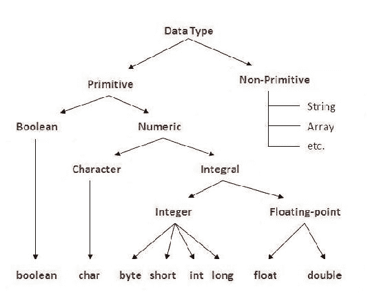

| 数据类型 | 默认值 | 默认大小 |
| :--- | :--- | :--- |
| boolean | false | 1 bit |
| char | '\u0000' | 2 byte |
| byte | 0 | 1 byte |
| short | 0 | 2 byte |
| int | 0 | 4 byte |
| long | 0L | 8 byte |
| float | 0.0f | 4 byte |
| double | 0.0d | 8 byte |

#### 为什么 char 在 java 中使用 2 byte？`\u0000` 是什么？

这是因为 java 使用 Unicode 系统而不是 ASCII 编码系统。`\u0000` 是 Unicode 系统的最低范围。有关关于 Unicode 的详细说明，请访问下一页。

#### 类型

当我们给变量赋值时，例如 `int i = 1;`，我们做出了一个有趣的假设。我们假设 `1` 会自动推断出与变量类型匹配的值类型。计算机使用许多不同的数据类型来存储数字。到目前为止，我们一直看到 `int` 这个词被提及，仿佛你知道 `int` 是什么一样。在日常生活中，我们几乎认为数字 `1` 和 `1.0` 甚至单词“one”之间有任何区别。

人类可以很容易将数字概念化为单位，并在它们之间进行转换。对于计算机来说，单词“one”与数字 `1` 之间的转换并不容易。

字符串（string）和对象（object）类型在存储上有所不同。这些类型是任意数量小元素的组合。字符串或对象越大，计算机就会开辟更大的内存块来放置该对象或字符串。这些被称为引用类型（reference types），有时也被可空类型（nullable types），因为 Java 不会查看内存中的单个元素来获取其数据。

## 强类型

这与你在键盘上打字的快慢没有关系！

Java 能够看出数字在书写方式上的差异。像 `1` 这样的整数与 `1.0` 是不同的，尽管我们可以认为它们具有相同的值。通过添加一个字母，可以增加其中的一些差异。因此，`1.0` 和 `1.0f` 实际上也是不同的数字。Java 是一种强类型编程语言。当一种编程语言使用强类型时，要求你保持不同类型相互分开。

这意味着 `1 + 1.0f` 可能会产生问题。因为这两个数字实际上是不同类型的数字，在允许操作发生之前，我们必须将其中一个转换匹配另一个。要从一种类型转换为另一种类型，我们必须告诉 Java 我们打算通过使用所谓的“强制转换运算符”（cast operator）将 `1` 转换为 `1.0`。除了改变内存的使用方式外，类型还限制了在程序员团队工作时可能出现的任何问题。

## 理解浮点数

浮点数多年一直是计算机关注的焦点。获得浮点精度是许多早期计算机科学家的目标。由于小数点后可以跟随无限种可能的数字组合，因此使用二进制计算无法真正完全地表示任何分数。

一个常见的例子是 `π`，我们称其为 `pi`。假设在 `3.14` 之后有无尽的数字。即使在今天，计算机被用来计算小数点后数千百亿位的数字。

计算机专门预留了浮点数的某些比特位来表示小数点在数字中的位置，但即使这样也是有限的。第一位通常是符号位（sign bit），设置数字的负正值范围。接下来的 8 位是数字的指数，称为尾数（mantissa）。其余位是出现在小数点周围的数字部分。`float` 值可以向任意方向移动小数点 38 位，但它受到其能够存储的值的限制。如果没有特殊考虑，计算机无法处理任意大的数字。要将 `float` 强制转换为 `int`，你需要更加显式。

这就是为什么 Java 要求你使用强制转换，你需要在其中添加 `(int)`：

```java
int Zint = (int)Zmove;
```

`(int)` 是一个强制转换运算符；或者说 `(type)` 充从右侧类型到左侧所需类型的转换器。

## 关键字

关键字（Keywords）是特殊的单词或符号，告诉编译器执行特定操作。例如，行首的 `class` 关键字告诉编译器你正在创建一个类。类声明是告诉编译器你正要创建一个新类的代码行。单词出现的顺序非常重要。英语需要句子和语法来向读者正确传达我们的思想。

在代码中，无论是 Java 还是其他语言，编程都需要语句和语法来向计算机正确传达指令。

```java
class className
{
    // 代码在这里
}
```

每个类都需要一个名称；在上面的示例中，我们将类命名为 `className`，尽管我们也可以轻松地将类命名为 `Charles`。当为一个新类命名时，该名称就变成一个新的标识符。这对于每个变量名也是如此，尽管作用域（scope）限制了变量标识符存在的长短和位置。

我们已经学习了变量和作用域。

你不能将关键字用于 Java 期望之外的任何用途。虽然有例外，但通常关键字为你提供了特定的命令。

在 Java 编程语言中，`keyword` 是 53 个保留字之一，这些字在语言中具有预定义的含义；由于由于，程序员不能将关键字作为变量（variables）、方法（methods）、类（classes）或其他任何标识符（identifier）的名称。由于它们在语言中的特殊功能，大多数 Java 集成开发环境使用语法高亮用不同的颜色显示关键字，以便识别。

### 关键字列表

- **abstract**: `Abstract` 用于实现 Java 中的抽象。没有方法定义的方法必须声明为 `abstract`，包含它的类也必须声明为 `abstract`。你不能实例化 `abstract` 类。抽象方法必须在子类中实现。你不能对变量和构造函数使用 `abstract` 关键字。

- **assert**（在 J2SE 1.4 中添加）：`Assert` 描述放置在 Java 程序中的断言（一个真假语句），用以指示开发者认为断言在该处始终为真。如果断言在运行时评估为假，则会导致断言失败，通常会导致执行终止。可以通过 `ClassLoader` 方法可选启用。

- **boolean**: 仅为值 "true" 或 "false" 定义一个 `boolean` 变量。

- **break**: 用于结束当前循环体的执行。

- **byte**: `byte` 关键字用于声明一个可以持有 8 位有符号二进制补码整数的字段。该关键字也用于声明一个方法返回原始类型 `byte` 的值。

- **case**: `switch` 块中的语句可以标记一个或多个 `case` 或 `default` 标签。`switch` 语句计算其表达式，然后执行匹配的 `case` 语句。

- **catch**: 与 `try` 块和可选的 `finally` 块配合使用。`catch` 块中的语句指定 `try` 块抛出特定类型的异常时做什么。

- **char**: 定义一个可以持有源文件字符集中任意字符的变量。

- **class**: 一种定义特定对象实现的类型。类定义了实例字段、方法以及内部类，并指定了类实现的接口和直接父类。如果未显式指定父类，则父类默认为 [Object](https://docs.oracle.com/javase/8/docs/api/java/lang/Object.html)。`class` 关键字也可以以 `Class.class` 的形式使用，以便无需实例即可获取 `Class` 对象。例如，`String.class` 可以代替 `new String().getClass()`。

- **continue**: 用于恢复当前循环体的结束处。如果后面跟着标签，`continue` 将到标记循环体的结束处。

- **default**: `default` 关键字可选用于 `switch` 语句，标记在没有 `case` 匹配值时执行的语句块；参见 `switch`。或者，`default` 关键字也可用于声明 Java 注解的默认值。从 Java 8 开始，`default` 关键字还用于指定接口中的方法提供默认实现。

- **do**: `do` 关键字与 `while` 配合使用创建 `do-while` 循环，它执行与循环相关的语句块，然后测试与 `while` 相关的布尔表达式。如果表达式为 `true`，则再次执行该块；持续到表达式为 `false` 为止。

- **double**: `double` 关键字用于声明一个可以持有 64 位双精度 IEEE 754 浮点数的变量。该关键字也用于声明一个方法返回原始类型 `double` 的值。

- **else**


`else` 关键字与 `if` 配合使用创建一个 `if-else` 语句，该语句测试一个布尔表达式；如果表达式求值为 `true`，则执行与 `if` 关联的语句块；如果表达式求值为 `false`，则执行与 `else` 关联的语句块。

## `enum`（在 `J2SE 5.0` 中添加）

一种 Java 关键字，用于声明枚举类型。枚举扩展基类 `Enum`。

## `extends`

用于类声明中以指定父类；用于接口声明中以指定一个或多个父接口。类 `X` 扩展类 `Y` 以增加功能，这可以通过向类 `Y` 中添加字段或方法，或通过重写类 `Y` 的方法来实现。接口 `Z` 通过添加方法扩展一个或多个接口。类 `X` 被称为类 `Y` 的子类；接口 `Z` 被称为其所扩展接口的子接口。

还用于指定泛型中类型参数的上界。

## `final`

定义一个不能被更改也无法从从被派生的实体。具体而言：`final` 类不能被子类，`final` 方法不能被重写，且 `final` 变量在执行的命令中作为左值表达式最多出现一次。`final` 类中的所有方法都隐式地为 `final`。

## `finally`

用于为之前由 `try` 关键字定义的块定义一个语句块。`finally` 块在执行退出 `try` 块以及任何相关的 `catch` 子句后执行，无论是否抛出或捕获了异常，无论是否使用 `return` 关键字在 `try` 或 `catch` 块中间离开方法。

## `float`

`float` 关键字用于声明一个变量，该变量可以存储一个 32 位单精度 IEEE 754 浮点数。该关键字也用于声明一个方法返回原始类型为 `float` 的值。

## `for`

`for` 关键字用于创建 `for` 循环，它指定了变量初始化、布尔表达式和递增操作。首先执行变量初始化，然后评估布尔表达式。如果表达式求值为 `true`，则执行与循环关联的语句块，然后执行递增。接着再次评估布尔表达式；此过程持续到表达式求值为 `false`。

从 `J2SE 5.0` 开始，`for` 关键字还可以用于创建所谓的“增强 `for` 循环”，它指定一个数组或 `Iterable` 对象；循环的每次迭代都会使用数组或 `Iterable` 中的不同元素执行关联的语句块。

## `if`

`if` 关键字用于创建 `if` 语句，其测试一个布尔表达式；如果表达式求值为 `true`，则执行与 `if` 语句关联的语句块。该关键字也可以用于创建 `if-else` 语句；参见 `else`。

## `implements`

包含在类声明中，用于指定当前类实现的一个或多个 `interfaces`（接口）。类继承接口所声明的类型和抽象方法。

## `import`

用于源文件的开头，指定稍后引用的类或整个 `Java packages`（Java 包），而无需在引用时包含它们的包名。从 `J2SE 5.0` 开始，`import` 语句可以导入类的 `static` 成员。

## `instanceof`

一种二元运算符，接受对象引用作为第一个操作数，接受类或接口作为第二个操作数，并产生一个布尔结果。当且仅当对象的运行时类型与类或接口兼容时，`instanceof` 运算符求值为 `true`。

## `int`

`int` 关键字用于声明一个变量，该变量可以存储一个 32 位符号补码整数。该关键字也用于声明一个方法返回原始类型为 `int` 的值。

## `interface`

用于声明一种特殊的类，该类只包含抽象方法或默认方法、常量（`static final`）字段和 `static` 接口。它之后可以被使用 `implements` 关键字声明接口的类实现。

## `long`

`long` 关键字用于声明一个变量，该变量可以存储一个 64 位符号补码整数。该关键字也用于声明一个方法返回原始类型为 `long` 的值。

## `native`

用于方法声明，以指定该方法没有在同一个 Java 源文件中实现，而是在另一种语言中实现。

## `new`

用于创建类或数组对象的实例。为此目的使用该关键字并非完全必要（例如 [Scala](https://en.wikipedia.org/wiki/Scala_(programming_language)) 所示），尽管它有两个作用：它允许方法和类名存在不同的命名空间；它在静态和局部上定义了确实创建了一个新对象，以及它的运行时类型是什么（这认为在代码中引入了依赖）。

## `package`

类型的分组。包用 `package` 关键字声明。

## `private`

`private` 关键字用于方法、字段或内部类的声明；私有成员只能被其所属类中的其他成员访问。

## `protected`

`protected` 关键字用于方法、字段或内部类的声明；受保护的成员只能被其所属类及其子类访问。

## `public`

`public` 关键字用于类、方法或字段的声明；公共类、方法和字段可以被任何类的成员访问。

## `return`

用于结束方法的执行。它后面可以跟上方法所需的值。

## `short`

`short` 关键字用于声明一个可以存储 16 位符号补码整数的字段。该关键字也用于声明一个方法返回原始类型 `short` 的值。

## `static`

用于将字段、方法或内部类声明为类字段。无论该类有多少个实例，类都维护一份类字段。`static` 也用于定义类方法。类方法绑定到类而不是特定的实例，并且只能操作类字段。（声明为另一个类或接口的 `static` 成员类实际上是顶级类，而不是内部类。）

## `strictfp`（在 `J2SE 1.2` 中添加）

Java 关键字，用于限制浮点计算的精度和舍入以确保可移植性。

## `super`

用于访问被当前类继承的类的成员。允许子类访问其父类的被重写的方法和隐藏成员。`super` 关键字还用于从构造函数调用父类的构造函数。

还用于指定泛型中类型参数的上界。

## `switch`

`switch` 关键字与 `case` 和 `default` 配合使用创建一个 `switch` 语句，该语句评估一个变量，将其与特定的 `case` 匹配，并执行与该 `case` 关联的语句块。如果没有 `case` 匹配值，则执行由 `default` 标记的可选块（如果包含）。

## `synchronized`

用于方法或代码块的声明，以便在当前 `thread`（线程）执行代码时获取对象的 `mutex`（互斥锁）。对于静态方法，锁定的对象是类的 `Class` 对象。保证同一时间在同一对象上操作最多只有一个线程执行该代码。当执行退出 `synchronized` 代码时，互斥锁会自动释放。字段、类和接口不能被声明为 `synchronized`。

## `this`

用于表示其出现处的类的实例。`this` 可以用于访问类成员并作为当前实例的引用。`this` 关键字还用于从类中的一个构造函数转发到同类中的另一个构造函数的调用。

## `throw`

用于抛出异常。

抛出声明的异常实例。这将导致执行继续，并由 `catch` 关键字声明的第一个外层异常处理器来处理与赋值类型兼容的异常类型。如果在当前方法中没有找到此类异常处理器，则该方法将返回，并在调用方法中重复此过程。如果在栈上的任何方法调用中都没有找到异常处理器，则异常将传递给线程的未捕获异常处理器。

## `throws`

用于方法声明，以指定哪些异常没有在方法内部处理，而是传递给程序的更高层级。方法中所有不是 `RuntimeException` 实例的未捕获异常必须使用 `throws` 关键字进行声明。

## `transient`

声明实例字段不是对象默认 `serialized` 形式的一部分。当对象被序列化时，只有其非 `transient` 实例字段的值会被包含在默认序列表示中。当对象被反序列化时，`transient` 字段仅初始化为它们的默认值。如果没有使用默认形式（例如，在类层次结构中声明了 `serialPersistentFields`），则所有的 `transient` 关键字将被忽略。

## `try`

定义一个具有异常处理功能的语句块。如果在 `try` 块内部抛出了异常，可以使用可选的 `catch` 块来处理声明的异常类型。此外，可以声明可选的 `finally` 块，它会在退出 `try` 块和 `catch` 子句时执行，无论是否抛出了异常。`try` 块必须至少有一个 `catch` 子句或一个 `finally` 块。

## `void`

`void` 关键字用于声明方法不返回任何值。

## `volatile`

用于字段声明，以指定该变量会被并发运行的线程异步地修改。因此，方法、类和接口不能声明为 `volatile`，局部变量或参数也不行。

## `while`

`while` 关键字用于创建 `while` 循环，它测试 `boolean expression`，如果表达式求值为 `true`，则执行与循环相关的语句块；持续持续直到表达式求值为 `false`。该关键字也可以用于创建 `do-while` 循环。

## 字面量值的保留字

### `true`

布尔字面量值。

### `null`

引用字面量值。

### `false`

布尔字面量值。

## Return 关键字

我们需要热爱 `return` 关键字。这个关键字将函数转换为数据。在实现这一点之前，需要满足一些条件。到目前为止，我们一直使用 `void` 关键字来声明函数的返回类型。它看起来像下面的代码片段。

```java
void MyFunction()
{
    //code here...
}
```

在这种情况下，使用 `return` 会非常简单。

```java
void MyFunction()
{
    //code here ...
    return;
}
```

此函数返回 `void`。这条语句具有更深层的含义。当实际返回一个真实值（`void` 以外的其他东西）时，返回值的意义更大。让我们来看一个更有意义的函数。

函数声明开头的 `void` 关键字意味着此函数没有返回类型。如果我们更改声明，我们需要确保有一个与声明匹配的返回值。

可以像下面的代码片段一样简单：

```java
int MyFunction()
{
    //code here...
    return 1;
    //1 is an int
}
```

此函数返回 `int` 1。

声明一个带有返回值的函数要求返回类型与声明匹配。当使用该函数时，它应该被视为与函数返回类型匹配的数据类型。

## 错误是坏的吗？

不要害怕出错。你写的代码不会破坏 IDE 或你的电脑。至少你从书中学到的任何东西都无法让你做到这一点。事实上，产生错误通常是件好事。错误告诉我们可以做什么和不能做什么。程序员经常问问自己：“编译器会允许我这样做吗？”，这可能会产生一个错误。如果没有，程序员就会继续他的思考：“呵，我想可以的，所以这意味着我可以……”

创建和修复错误告诉我们编译器对我们的期望。这是是程序员与计算机之间的一种对话。

例如，程序员以代码语句的形式提问，而计算机通过错误来向程序员回复那些计算机无法完成的要求。

## 编译时错误和运行时错误

在编译时，当代码不符合《Java 语言规范》(JLS) 中描述 Java 语法和语义规则时，就会发生编译错误。编译器的目标是确保代码符合这些规则。在此阶段检测到的任何违反规则的行为都会报告为编译错误。

了解这些规则的最佳方法是阅读 JLS 中所有包含关键字“编译时错误”的章节。

通常，这些规则包括：

- 语法检查：声明、表达式、词法解析、文件命名规范等；

- 异常处理：针对受检异常；

- 可访问性、类型兼容性、名称解析：检查所有具名实体——变量、类、方法调用等——是否至少可以通过声明的路径之一被触及；等。

以下是一些常见的编译错误：

- 类尝试继承超过一个类

- 重载或重写未正确实现

- 尝试引用不在当前块作用范围内的变量

- 内部类与其其中一个外层类同名

- 类包含一个或多个抽象方法但类本身没有声明为“抽象”

- 类尝试引用另一个类的私有成员

- 尝试创建抽象类的实例

- 尝试更改已初始化常量（`final` 成员）的值

- 声明两个同名的（类或实例）成员

### 运行时

在编译时，当代码不符合 Java 语法和语义规则时没有错误，代码仍可能在运行时失败。

只有在运行时发生的错误才是运行时错误。运行时错误是那些通过了编译器检查但在代码执行时失败的错误。许多原因可能导致运行时错误，例如不兼容的类型转换、引用无效的索引、使用空对象、资源问题（如不可用的句柄）、内存不足、线程死锁等。

以下是一些常见的运行时错误：

- 尝试在未初始变量上调用方法（`NullPointerException`）

- 内存不足（内存泄漏...）（`OutOfMemoryError`）

- 尝试打开不存在的文件（`FileNotFoundException`）

- 向方法传递不在接受范围内的参数（`IllegalArgumentException`）

- 尝试在已死的线程上调用 `start()` 方法（`IllegalThreadStateException`）

归根底，你所做的一切只是告诉编译器如何将你的指令转换为计算机解释的命令。变量和函数是编程的大部分。任何你想要记忆的数据都存储在变量中。变量由你的函数进行操作。通常情况下，当你将变量和函数组合在一个地方时，你称之为一个 `class`（类）。

示例：

```java
public void PrintNum ()
{
    System.out.println (anotherNum);
}
```

在编写新函数时，在继续其他任务之前，填充整个函数的布局是一个良好的习惯。这会让编译器感到轻松；如果将一个函数留在 `void MyFunction` 的形式并就跳到另一个函数，会让编译器感到困惑，不知道你正打算做什么。在这种情况下，集成开发环境（在此为 `MonoDevelop`）会不断读取并解释你正在编写的内容，类似于文字处理程序中的拼写检查器。当它遇到没有确定形式的语句时，例如变量、`function` 或 `class` 定义，它对你编写代码的解释将抛出警告或错误。`MonoDevelop` 看起来可能有点挑剔，但它正在尽力为你提供帮助。

## 编写函数

一个函数由声明和函数体组成。有些程序员喜欢把这些称为方法（methods），但撇开语义不谈，`function` 基本上是一个语句集合的容器。

让我们继续示例：

```java
void MyFunction ()
{
}
```

这是一个名为 `MyFunction` 的基础函数。我们可以添加额外的关键字来修改函数的可见性。我们将会看到的一个常见修饰符是 `public`。

```java
public void MyFunction ()
{
}
```

`public` 关键字需要出现在函数的返回类型之前。在这种情况下，它是 `void`，意味着函数不返回任何内容。但函数可以以几种不同的方式充当值。作为参考，一个返回 `int` 的函数看起来像这样。在具有返回类型的函数中，必须始终存在某种 `return` 语句。

```java
public int MyFunction ()
{
    return 1;
}
```

`public` 修饰符并不总是必要的，除非你需要让此函数对其他类可用。如果这一点听起来没意义，很快你就会明白了。函数始终要求的最后部分是参数列表。将其留为空是有效的，但为了直观了解参数列表中的 `arg`（参数）长什么样，请看下一个示例。

```java
public void MyFunction (int i)
{
}
```

目前，我们将暂不使用参数列表，但以后知道你看到的是什么很重要，以免产生意外。参数列表用于将信息从函数外部传递到函数内部。这就是 `classes` 能够将信息从一个发送到另一个的方式。函数声明类似于 `class` 声明。函数是处理变量逻辑的核心。

## 函数作用域

变量的往往是短暂的。某些变量只存在于几行代码中。类作用域内的变量与类同存。变量的寿命取决于它创建的位置。

示例：

```java
public class Classscope {
    int ClassInt;
    void first() {
        int firsttint;
    }
    void second() {
        int secondint;
    }
}
```

如果我们观察上面的图，可以看到作用域是如何划分的。外层框代表谁可以看到 `ClassInt`。在 `first()` 函数内部，我们有 `firsttint`，它只存在于 `first()` 函数中。`secondint` 也是如此，只存在于 `second()` 函数中。这意味着 `first()` 可以同时使用 `ClassInt` 和 `firsttint`，但不能使用 `secondint`。同样，`second()` 可以看到 `ClassInt` 和 `secondint`，但看不到 `firsttint`。

## 参数列表

当函数被调用时，其标识符及其参数列表会被添加到代码中。参数就像房子正门上的小信箱。门上的每个槽（或参数列表中的参数）都是一个类型后跟一个标识符。

示例：

```java
public class Example {
    int a = 0;
    void SetA (int i) {
        a = i;
    }
}
```

`void SetA (int i)` 接收一个 `int` 类型的参数。这是一个值参数的简单示例；接下来我们将介绍其他类型的参数。值参数声明了类型和标识符，其作用域限于其声明所在的函数内容。当你运行上述程序并给函数 `SetA(3)` 的参数赋值 3 时，你会看到一个 0 后面跟着一个 3。我们可以多次这样做，并且每次都允许更改设置给 A 的值。当然，在类中使用 `a = 3` 更容易，但那样我们就什么也学不到了。

## 副作用


当函数直接设置它所属于类中的变量时，程序员通常称之为**副作用**（side effect）。副作用通常是程序员试图避免的，但并非总是切行的。编写带有副作用的函数往往会导致该函数在其他类中无法使用。我们将找到其他允许我们避免使用副作用的系统，但在某些情况下，副作用是必要的。

```java
class MySideEffect {
    int a = 0;

    void SetA ()
    { 
        a = 5;
    }
}
```

上面的 `SetA()` 函数将 `int a` 设置为 5。`SetA()` 函数确实有一个明确的目的，即设置 `A`，但函数内部没有任何地方可以指示它所设置的变量位于何处。如果变量位于 `MySideEffect` 继承自另一个类中，那么你甚至在当前类中看不到该变量。一旦类的复杂性增加，变量在何以及何时被更改或读取就会变得更加模糊。如果一个函数保持自包含性，测试和修复该函数将变得容易得多。

阅读一个函数的功能不应该涉及来回跳去以寻找它正在修改哪个变量。这让我们回到了作用域（scope）的话题。限制函数的作用域或范围有助于限制可能出错的地方数量。

```java
class MySideEffect {
  int a = 0;

  void SetA ()
  { 
    a = 5;
  }

  void SetAgain ()
  { 
    a = 10;
  }
}
```

具有副作用的函数越多，可能出现的奇怪行为就越多。如果 `Main()` 函数期望一个值但得到了完全不同的东西，你就会开始遇到意想不到的行为。糟糕糟糕，如果从另一个类调用了 `SetAgain()` 而你又期望 `a` 为 5，你将会遇到更多奇怪的行为。

### 多参数

函数可以接受的参数数量没有限制。某些语言限制参数不能超过 16 个，这似乎是能够接受的。如果你的逻辑需要超过 16 个参数，那么将你的函数拆分为不同的部分可能会更简单。然而，如果我们要做一些简单的操作，我们可能仍然想要使用多个一个参数。

```java
int a = 0;

void SetA (int i, int j) {
    a = i * j;
}
```

我们可以为 `SetA` 添加第二个参数。逗号标记（comma token）告诉函数在参数列表中接受另一个变量。在这个示例中，我们使用两个 `int` 相乘并将结果赋值给 `a`。没有任何东西限制我们在参数列表中允许使用的类型。

```java
int a = 0;
float b = 0;

void SetA (int i, float j) { 
    a = i; 
    b = j;
}
```

带有多个参数的函数可以执行更多操作。值参数是向函数传递数据以完成某些简单任务的帮助。

### 代码块

块是在评估时分组在一起的语句集合。代码的求值通常由大括号控制。Java 程序员经常使用制表（tabs）来缩进不同的代码块。这使得不同的块更具可读性。像 Python 等语言依赖制表来指示单独的代码块。习惯制表的使用对于编写可读的代码至关重要。接下来，我们将使用一个逻辑控制语句后面跟着代码块。该 `if` 语句的块向右缩进，以表示它被限制在逻辑控制语句之内。

```java
if (true)
{
    //code goes here
    //im also a part of the code
}
```

如果我们看一段更复杂的代码，就能发现为什么使用制表来区分代码是重要的。在查看代码时，这可能并不明显，但程序员对文本布局非常严谨。每个程序员都有自己偏好的风格，但可以说，大多数（如果不是所有的话）程序员都讨厌看到格式糟糕的代码。

```java
int i = 7;
int j = 13;
    if (i < 13){
    int j = 7;
}
```

在上面的示例中，我们可以清楚地看到 `int j` 被设置了两次。不明显的是为什么被声明了两次。所有的行从相同的位置开始，看起来很拥挤。编程工具提供了许多文本布局选项，因此空白被用来分隔不同的代码块。

```java
int i = 7;
int j = 13;

if (i < 13)
{
int j = 7;
}
```

通过添加一些空白，我们可以让 `if` 语句更加可见。在代码块周围添加空白对于维护可读性非常重要。还有代码块可以存在另一个代码块内部。通常情况下，它们都与同一个块有关。块内部的块被称为嵌套。

```java
if (true)
{
    //all of the code
    if (true)
    {
        //im also a part of the code
    }
}
```

为了使内容更清晰，我们可以将代码拆分成多行。现在，我们正在比较 `a` 和 `b`。显然，它们看起来并不一样；毕竟它们毕竟是不同的字母。然而，它们包含相同的整数值，而这正是这里真正要比较的内容。

```java
void Func ()
{
    int a = 1;
    int b = 1;
    SomeBool = (a == b);
}
```

求值包含左侧和右侧。单等号运算符（`=`）将不同的侧隔开。`=` 的左侧会进行计算，并查找右侧的值以进行赋值。因为 `1 == 1`，也就是说，`1` 等于 `1`，该语句的最终结果是 `SomeBool` 为 `true`。

### 关系运算符

布尔值也可以通过比较值来设置。用于比较两个不同值的运算符被称为关系运算符。我们使用 `==`（等号符号）来检查这些值是否相同；我们也可以使用 `!=`（不等于符号）来检查两个变量是否不同。

这与上一节中的 `!` 作用类似。程序员更经常检查一个值是否大于或小于另一个值。他们通过使用 `>`（大于）和 `<`（小于）这样做。我们还可以使用 `>=`（大于等于）和 `<=`（小于等于）。让我们来看看它的用法示例。

```java
public class Test {
    public static void main(String args[]) {
        int a = 10;
        int b = 20;
        System.out.println("a == b = " + (a == b) );
        System.out.println("a != b = " + (a != b) );
        System.out.println("a > b = " + (a > b) );
        System.out.println("a < b = " + (a < b) );
        System.out.println("b >= a = " + (b >= a) );
        System.out.println("b <= a = " + (b <= a) );
    }
}
```

输出：

```text
a == b = false
a != b = true
a > b = false
a < b = true
b >= a = true
b <= a = false
```

# 第 7 章 | 执行控制、循环与数组

## 控制执行

Java 中的控制流语句允许你在满足特殊条件时运行或跳过代码块。源文件中的语句通常按照它们出现的顺序从上到下执行。然而，控制流语句通过采用决策、循环和分支来打破执行流，使你的程序能够根据条件执行特定的代码块。

Java 使用了 C 语言所有的执行控制语句，因此如果你用过 C 或 C++ 编程，你看到的大部分内容都是熟悉的。大多数过程编程语言都有某种控制语句，而且语言之间通常会有重叠。

在 Java 中，关键字包括 `if-else`、`while`、`do-while`、`for`、`return`、`break` 以及名为 `switch` 的选择语句。

然而，Java 支持备受争议的 `goto`（它仍然可能是解决某些类型问题的快捷方法）。你仍然可以进行类似于 `goto` 的跳转，但它比典型的 `goto` 约束大得多。

### 真与假

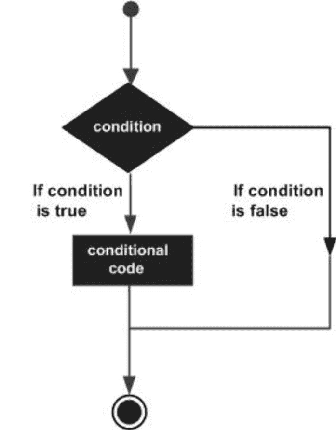

所有的条件语句都使用条件表达式的真或假来决定执行路径。

条件表达式的一个示例是 `a == b`。它使用条件运算符 `==` 来检查 `a` 的值是否等于 `b` 的值。该表达式返回 `true` 或 `false`。

你在上一章中看到的任何关系运算符都可以用于生成条件语句。

注意，Java 不允许你将数字作为布尔值，尽管这在 C 和 C++ 中是被允许的（在其中真为非零，假为零）。

如果你想在布尔测试中使用非布尔值，例如 `if(a)`，你必须首先通过条件表达式将其转换为布尔值，例如 `if(a != 0)`。

### `if-else` 语句

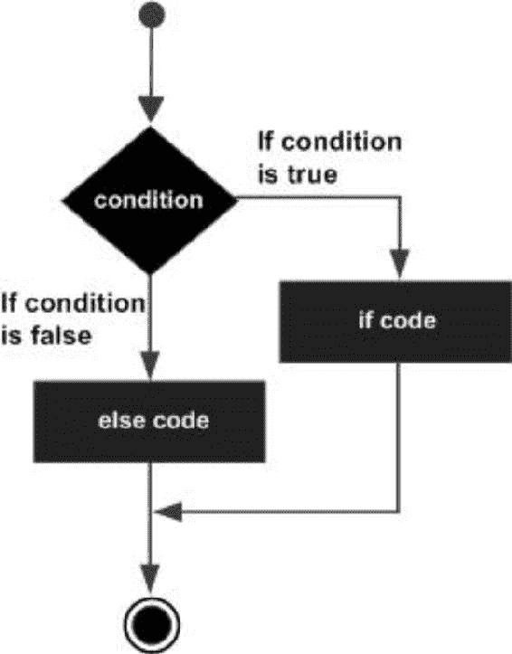

`if-else` 语句是控制程序流的最基本方法。`else` 是可选的，因此你可以有两种形式使用 `if`：

```java
if(Boolean-expression) {
    //statement
}
```

或者：

```java
if(Boolean-expression) {
    //statement 
} else {
    //statement
}
```

如果 `Boolean-expression` 求值为 `true`，则将执行 `if` 语句内部的代码块。如果不是，则将执行 `if` 语句结束（右大括号之后）后的第一组代码。

`Boolean-expression` 必须产生一个布尔结果。该语句要么是以分号终止的简单语句，要么是复合语句（一组简单语句的组合）。每当使用 `statement` 时，都意味着它可以是简单的，也可以是复合的。

这是一个 `if-else` 语句的示例：

```java
public class Test {
    public static void main(String args[]) {
        int x = 10;
        if( x < 20 ) {
            System.out.print("This is ");
        }
    }
}
```

输出：

```text
This is 
```

### `switch` 语句


`switch` 有时被称为选择语句。`switch` 根据整数表达式的值选择代码段。每个值称为一个 `case`。它的通用形式为：

```java
switch(integral-selector) {
    case integral-value1:
        statement;
        break;
    case integral-value2:
        statement;
        break;
    ...
    default:
        statement;
}
```

`integral-selector` 是产生整数值的表达式。`switch` 将其与每个 `case` 进行比较。如果匹配，则执行相应的 `statement`（单个或多个语句）。`break` 导致执行到 `switch` 体的末部。你会注意到 `default` 语句没有 `break`，因为执行会直接穿透。为了风格，你可以在那里放一个 `break`。

示例：

```java
public class Test {
    public static void main(String args[]) {
        // char grade = args[0].charAt(0);
        char grade = 'C';
        switch(grade) {
            case 'A':
                System.out.println("Excellent!");
                break;
            case 'B':
            case 'C':
                System.out.println("Well done");
                break;
            case 'D':
                System.out.println("You passed");
                break;
            case 'F':
                System.out.println("Better try again");
                break;
            default:
                System.out.println("Invalid grade");
        }
        System.out.println("Your grade is " + grade);
    }
}
```

`switch` 语句是实现多路选择的一种简洁方式，但它需要一个求值为整数的选择器，例如 `int` 或 `char`。如果你想使用例如字符串或浮点数作为选择器，你必须使用一系列 `if` 语句。在下一章的末尾，你将看到 SE5 新的 `enum` 特性有助于解决这一限制，因为枚举设计初衷就是与 `switch` 使用。

你可能会遇到需要多次执行一段代码的情况。通常情况下，语句是按顺序执行的：函数中的第一个语句首先执行，然后是第二个，依此类推。编程语言提供了各种控制结构，允许我们实现更复杂的执行路径。

循环语句允许我们多次执行一个语句或一组语句，以下是大多数编程语言中循环语句的一般形式：

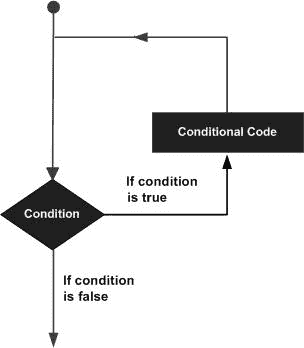

Java 编程语言提供了以下类型的循环来处理循环需求。

### `while` 循环

如果我们想在循环中多次运行某个特定的语句，我们需要另一种方法。为了实现这一点，Java 提供了两个关键字：`while` 和 `for`。`while` 语句使用起来稍微简单一些。它只需要一个 `bool` 参数来决定是否继续执行。该语句与 `if` 语句相似，区别在于它在完成评估后会返回 `while` 语句的顶部。

`while` 循环的语法为：

```java
while(Boolean_expression) {
    // 语句
}
```

在这里，`statement(s)` 可以是一个单独语句也可以一组语句。`condition` 可以是任何表达式，而 `true` 是任何非零值。

执行时，如果 `boolean_expression` 的结果为 `true`，则将执行循环内部的操作。只要表达式的结果为 `true`，这种就会就会持续。

当条件变为 `false` 时，程序控制将传递到循环后续的第一行。

#### 流程图

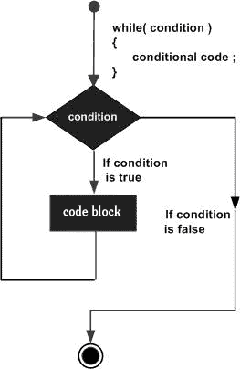

在这里，`while` 循环的关键点在于循环可能永远不会运行。当测试表达式且结果为 `false` 时，循环体将被跳过，执行 `while` 循环后的第一个语句。

#### 示例

```java
public class Test {
    public static void main(String args[]) {
        int x = 10;
        while(x < 20) {
            System.out.print("value of x : " + x);
            x++;
            System.out.print("\n");
        }
    }
}
```

这将产生以下结果：

#### 输出

```text
value of x : 10
value of x : 11
value of x : 12
value of x : 13
value of x : 14
value of x : 15
value of x : 16
value of x : 17
value of x : 18
value of x : 19
```

### `for` 循环

为了对循环的执行获得更多控制，我们还有另一种选择。`for` 循环需要三个不同的语句来操作。第一个语句称为初始化，第二个是条件，第三个是操作。

#### 语法

```java
for(initialization; Boolean_expression; update) {
    // 语句
}
```

以下是 `for` 循环中的控制流：

- 首先执行 `initialization` 步骤，且只执行一次。此步骤允许你声明并初始化任何循环控制变量，该步骤以分号（`;`）结束。
- 接下来，评估 `Boolean expression`。如果为 `true`，则执行循环体。如果为 `false`，则不执行循环体，控制跳转到 `for` 循环之后的下一个语句。
- 在执行完 `for` 循环的 `body` 后，控制跳回 `update` 语句。该语句允许你更新任何循环控制变量。该语句可以留空并在末尾加分号。
- 现在再次评估 `Boolean expression`。如果为 `true`，循环执行并重复该过程（循环体、更新步骤、布尔表达式）。在布尔表达式为 `false` 后，`for` 循环终止。

#### 流程图

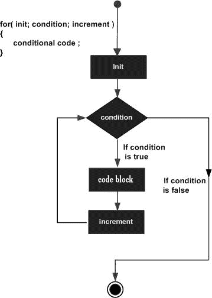

#### 示例

以下是 Java 中 `for` 循环的示例代码。

```java
public class Test {
    public static void main(String args[]) {
        for(int x = 10; x < 20; x = x + 1) {
            System.out.print("value of x : " + x);
            System.out.print("\n");
        }
    }
}
```

这将产生以下结果：

#### 输出

```text
value of x : 10
value of x : 11
value of x : 12
value of x : 13
```


value of x : 14

value of x : 15

value of x : 16

value of x : 17

value of x : 18

value of x : 19

### 循环控制语句

循环控制语句改变其正常的执行序列。当执行离开作用域时，在该作用范围内创建的所有自动对象都会被销毁。

Java 支持以下控制语句：

- `break` 语句
- `continue` 语句

Java 编程语言中的 `break` 语句有以下两种用法：

- 当循环内部遇到 `break` 语句时，循环立即终止，程序控制恢复到循环后的下一个语句。
- 它可以用于终止 `switch` 语句中的 `case`（在下一章介绍）。

#### 语法

`break` 的语法是任何循环内部的单个语句：

```java
break;
```

#### 流程图

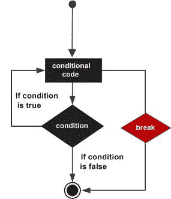

#### 示例

```java
public class Test {
    public static void main(String args[]) {
        int[] numbers = {10, 20, 30, 40};
        for(int x : numbers) {
            if(x == 30) {
                break;
            }
            System.out.print(x);
        }
    }
}
```

这将产生输出：

#### 输出

10

20

`continue` 关键字可以用于任何循环结构。它导致循环跳转到下一次迭代。

- 在 `for` 循环中，`continue` 导致跳转到 `update` 语句。
- 在 `while` 循环中，它导致跳转到布尔表达式。

#### 语法

`continue` 的语法是任何循环内部的单个语句：

```java
continue;
```

#### 流程图

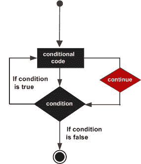

#### 示例

```java
public class Test {
    public static void main(String args[]) {
        int[] numbers = {10, 20, 30, 40};
        for(int x : numbers) {
            if(x == 30) {
                continue;
            }
            System.out.print(x);
        }
    }
}
```

#### 输出

10

20

40

数组是组织良好的数据列表。想象一个从零开始的编号列表。数组对于任何情况都有用，因为它们被视为一个数据块。例如，如果你想存储一组分数，你需要通过数组来实现。

数组有两种类型：

- 单维数组
- 多维数组

#### Java 中的单维数组

在 Java 中声明数组的语法：

`dataType[] arr` 或 `dataType []arr` 或 `dataType arr[]`

在 Java 中实例化数组：

`arrayRef = new dataType[size]`

单维数组示例：

让我们来看简单的数组示例，我们将声明、实例化、初始化并遍历数组。

```java
class Testarray {
    public static void main(String args[]) {
        int[] a = new int[5]; // 声明和实例化
        a[0] = 10; // 初始化
        a[1] = 20;
        a[2] = 70;
        a[3] = 40;
        a[4] = 50;
        // 打印数组
        for(int i=0; i<a.length; i++) { // length 是一个属性
            System.out.println(a[i]);
        }
    }
}
```

输出：

10

20

70

40

50

#### Java 数组的声明、实例化和初始化

我们可以通过以下方式同时声明、实例化并初始化 Java 数组：

```java
int a[] = {33, 3, 4, 5};
```

让我们来看打印此数组的简单示例。

```java
class Testarray1{  
    public static void main(String args[]){  
        int a[]={33,3,4,5};//声明，实例化和初始化  
        //打印数组  
        for(int i=0;i<a.length;i++)length is the property of array  
            System.out.println(a[i]);  
    }
}
```

输出：

```text
33
3
4
5
```

### 在 Java 中将数组传递给方法

我们可以将 Java 数组传递给方法，这样我们可以在任何数组上重用相同的逻辑。让我们通过方法获取数组中最小值的简单示例。

```java
class Testarray2{  
    static void min(int arr[]){  
        int min=arr[0];  
        for(int i=1;i<arr.length;i++)  
            if(min>arr[i])  
                min=arr[i];  
        System.out.println(min);  
    }  
    public static void main(String args[]){  
        int a[]={33,3,4,5};  
        min(a); //将数组传递给方法
    }
}
```

输出：3

### Java 中的多维数组

在这种情况下，数据存储在基于行和列的索引中（也称为矩阵形式）。

#### 在 Java 中声明多维数组的语法

- `dataType[][] arrayRefVar;`（或）
- `dataType [][]arrayRefVar;`（或）
- `dataType arrayRefVar[][];`（或）
- `dataType []arrayRefVar[];`

#### 在 Java 中实例化多维数组的示例

```java
int[][] arr=new int[3][3]; // 3 行 3 列
```

#### 在 Java 中初始化多维数组的示例

```java
arr[0][0]=1;
arr[0][1]=2;
arr[0][2]=3;
arr[1][0]=4;
arr[1][1]=5;
arr[1][2]=6;
arr[2][0]=7;
arr[2][1]=8;
arr[2][2]=9;
```

#### Java 多维数组的示例

让我们来看声明、实例化、初始化和打印二维数组的简单示例。

```java
class Testarray3{  
    public static void main(String args[]){  
        //声明并初始化二维数组  
        int arr[][]={{1,2,3},{2,4,5},{4,4,5}};  
        //打印二维数组  
        for(int i=0;i<3;i++){  
            for(int j=0;j<3;j++){  
                System.out.print(arr[i][j]+" ");  
            }  
            System.out.println();  
        }  
    }  
}
```

输出：

```text
1 2 3
2 4 5
4 4 5
```

## 第 8 章 | 面向对象编程

### 类

任何 Java 程序中最重要的部分是类。类是创建对象的蓝图。每个实例都是其创建所依据类的实例。新创建的对象包含了写入在类中的所有函数和数据。

面向对象编程（`OOP`）的发明是为了将数据和逻辑关联成封装良好的包。当你写一个类时，你正在为一个新对象创建蓝图。然后可以根据你的蓝图构建任意数量的对象。程序员在谈论从类中创建对象时，会使用“实例化”（instantiate）一词。

这些方法中的每一种对于它们旨在解决的特定问题可能是良好的解决方案，但当你离开该领域时，它们就会变得很笨拙。

面向对象的方法更进了一步，它为程序员提供了工具来表示问题空间中的元素。这种表示方式足够通用，使得程序员不会受限于任何特定类型的问题。我们将问题空间中的元素以及它们在解决方案空间中的表示称为“对象”。（你可能还需要其他在问题空间中没有类比的对象。）

这种思想是，允许程序通过添加新类型的对象来使自己适应于问题的术语，因此当你阅读描述解决方案的代码时，你所读的词汇同时也表达了问题。这比我们以前拥有的语言抽象更具灵活性且更强大。因此，`OOP` 允许你根据问题本身来描述问题，而不是根据运行解决方案的计算机来描述问题。它与计算机之间仍然存在联系：每个对象看起来都非常像一台小计算机——它有状态，并且有你可以要求它执行的操作。然而，对于现实世界中的对象来说，这种类比似乎并不那么糟糕——它们都具有特征和行为。

简单来说，`OOP` 是构建对象、实例化并使用它们的过程。使用对象涉及读取数据、对数据进行逻辑处理，然后根据逻辑执行任务。

### 创建对象

如之前提到的，`class` 为对象提供了蓝图。所以基本上，对象是从一个 `class` 创建的。在 `Java` 中，使用 `new` 关键字来创建新对象。

从 `class` 创建对象有三个步骤：

1. **声明**：一个带有变量名和对象类型的变量声明。
2. **实例化**：使用 `new` 关键字来创建对象。
3. **初始化**：在 `new` 关键字之后跟一个对构造函数的调用。该调用初始化了新对象。

以下是创建一个对象的示例：

```java
public class Puppy {
  public Puppy(String name) {
      // 这个构造函数有一个参数，name。
      System.out.println("Passed Name is :" + name );
  }
  public static void main(String []args) {
      // 以下语句将创建一个对象 myPuppy
      Puppy myPuppy = new Puppy( "tommy" );
  } 
}
```

**输出：**

Passed Name is :tommy

### 访问实例变量和方法

实例变量和方法通过创建的对象来访问。要访问实例变量，遵循以下完全限定路径：

```java
/* 首先创建一个对象 */
ObjectReference = new Constructor();

/* 现在如下所示调用变量 */
ObjectReference.variableName;

/* 现在可以像下面所示调用类方法 */
ObjectReference.MethodName();
```

### 示例

此示例解释了如何访问 `class` 的实例变量和方法。

```java
public class Puppy {
  int puppyAge;
  public Puppy(String name) {
      // 这个构造函数有一个参数，name。
      System.out.println("Name chosen is :" + name );
  }
  public void setAge( int age ) {
      puppyAge = age;
  }
  public int getAge( ) {
      System.out.println("Puppy's age is :" + puppyAge );
      return puppyAge;
  }
  public static void main(String []args) {
      /* 创建对象 */
      Puppy myPuppy = new Puppy( "tommy" );
      /* 调用类方法设置小狗年龄 */
      myPuppy.setAge( 2 );
      /* 调用另一个类方法获取小狗年龄 */
      myPuppy.getAge( );
      /* 你也可以这样访问实例变量 */
      System.out.println("Variable Value :" + myPuppy.puppyAge );
  }
}
```

如果我们编译并运行上述程序，它将产生以下结果：

**输出：**

Name chosen is :tommy

Puppy's age is :2

Variable Value :2

### 面向对象编程的特征

这些特征代表了纯粹的面向对象编程方法：

1. **一切皆对象**。将对象想象成一个华丽的变量；它存储数据，但你可以向该对象“发送请求”，要求它对自身执行操作。在理论上，你可以取你试图解决的问题中的任何概念性组件（狗、建筑、服务等），并将其表示为程序中的一个对象。
2. **程序是一组对象，它们通过发送消息来告诉对方要做什么**。要向一个对象提出请求，你向该对象“发送消息”。更具体地说，你可以将消息看作调用属于特定对象的 `method` 的请求。
3. **每个对象都有自己的内存**。你通过由对象组成来创建一个新对象。因此，你可以在隐藏对象之后的同时在程序中构建复杂性。
4. **每个对象都有一个类型**。几乎所有面向对象的语言都使用 `class` 关键字。当你看到“类型”这个词时，请想“类”。类最重要的特征是“你可以向它发送什么消息？”
5. **特定类型的所有对象都可以接收相同的消息**。因为类型为 `circle` 的对象也是 `shape` 的对象，所以 `circle` 保证接受 `shape` 消息。这意味着可替换性是 `OOP` 中强大的概念之一。

对对象更简练的描述是：

**对象具有状态、行为和标识。**

这意味着对象可以拥有内部数据（赋予状态）、`methods`（产生行为），并且每个对象都可以被唯一区分——从具体的范围内，每个对象都有地址。

**对象具有接口：**

所以，尽管我们在面向对象编程中实际上做的是创建新的类型，但几乎所有面向对象的语言都使用 `class` 关键字。由于 `class` 描述了一组具有相同特征（数据）和行为（功能）的对象，因此 `class` 实际上是一种数据类型，因为例如浮点数也有一组特征和行为。区别在于，程序员定义一个 `class` 来适应问题，而不是被迫使用设计用于表示机器存储单元的现有数据类型。你通过添加特定需求的数据类型来扩展编程语言。编程系统欢迎新类，并给予它们与内置类型相同的关注和类型检查。

面向对象的方法不仅限于构建仿真。无论你是否同意任何程序都是你正在设计的系统的仿真，使用 `OOP` 技术都可以轻松地将一组问题简化为简单的解决方案。

一旦建立了一个 `class`，你就可以根据需要创建任意数量的该 `class` 对象，然后操作这些对象，就像它们是你试图解决的问题中存在的元素一样。

但你如何让对象为你做有用的工作呢？需要一种方法向对象提出请求，以便它执行某些操作，例如完成交易、在屏幕上绘图或打开开关。而且每个对象只能满足某些请求。你可以向对象发出的请求是由其接口定义的，而 `type` 决定了 `interface`。一个简单的示例可能是灯泡的表示：

```java
Light lt = new Light();

lt.on();
```

接口决定了你可以对特定对象发出的请求。然而，某处必须有代码来满足这些请求。这与隐藏的数据共同构成了实现。从过程化编程的角度来看，这并不复杂。

一个类型与每个可能的请求都关联着一个方法，当你对对象发出某个特定请求时，该方法就会被调用。这个过程通常被总结为向对象“发送消息”（发出请求），而对象会决定如何处理该条消息（即执行代码）。

在这里，类型/类的名称为 `Light`，这个特定 `Light` 对象的名称为 `lt`，而你对 `Light` 对象可以发出的请求包括开启它、关闭它、让它变亮或使其变暗。你通过为该对象定义一个“引用”（`lt`）并调用 `new` 来请求该类型的新对象从而创建一个 `Light` 对象。要向对象发送消息，你只需写出对象的名称并用点（`.`）将其与消息请求连接起来。从预定义类使用者的角度来看，这就是对象编程的全部内容了。

上图图遵循了统一建模语言（UML）的格式。每个类由一个矩形框表示，框的顶部部分是类型名，中间部分是你感兴趣的描述的数据成员，底部部分是方法（即属于该对象的函数，它们接收你发送给该对象的任何消息）。在 UML 设计图中，通常只显示类名和公共方法，因此像在本例中，中间部分是不显示的。如果你只对类名感兴趣，那么底部也不需要显示。

# 接口（Interfaces）

接口（`interface`）是 Java 中的一种引用类型。它与类相似。它是一个抽象方法的集合。类实现接口，从而继承接口的抽象方法。

除了抽象方法外，接口还可以包含常量、默认方法、静态方法和嵌套类型。方法体仅存在于默认方法和静态方法。

编写接口与编写类相似。但类描述的是对象的属性和行为，而接口包含了类所实现的行为。

除非实现接口的类是抽象类，否则接口的所有方法都需要在类中定义。

接口在以下方面与类相似：

- 接口可以包含任意数量的方法。
- 接口写在扩展名为 `.java` 的文件中，且接口的名称与文件名匹配。
- 接口的字节码出现在 `.class` 文件中。
- 接口出现在包（`package`）中，其对应的字节码文件必须位于与包名匹配的目录结构中。


然而，接口在方面与类不同，包括：

- 你不能实例化接口。
- 接口不包含任何构造方法。
- 接口中的所有方法都是抽象的。
- 接口不能包含实例字段。接口中出现的字段必须同时声明为`static`和`final`。
- 接口不被类扩展，而是被类实现。
- 接口可以扩展多个接口。

## 声明接口 (Declaring Interfaces)

`interface`关键字用于声明接口。这里有一个声明接口的示例——

### 示例

```java
/* 文件名：NameOfInterface.java */
import java.lang.*;

// 任意数量的导入语句

public interface NameOfInterface {
    // 任意数量的静态常量
    // 任意数量的抽象方法声明
}
```

接口具有以下属性：

- 接口是隐式抽象的。在声明接口时不需要使用`abstract`关键字。
- 接口中的每个方法也是隐式抽象的，因此不需要`abstract`关键字。
- 接口中的方法是隐式公共的（`public`）。

### 示例：

```java
/* 文件名：Animal.java */
interface Animal {
    public void eat();
    public void travel();
}
```

## 实现接口 (Implementing Interfaces)

当一个类实现接口时，你可以将该类视为签署了合同，同意执行接口的具体行为。如果一个类没有执行接口的所有行为，则该类必须声明自己为抽象类。

类使用`implements`关键字来实现接口。`implements`关键字出现在类声明中，`extends`部分之后。

### 示例：

```java
/* 文件名：MammalInt.java */
public class MammalInt implements Animal {
    public void eat() {
        System.out.println("Mammal eats");
    }

    public void travel() {
        System.out.println("Mammal travels");
    }

    public int noOfLegs() {
        return 0;
    }

    public static void main(String args[]) {
        MammalInt m = new MammalInt();
        m.eat();
        m.travel();
    }
}
```

这将产生以下结果：

### 输出：

```
Mammal eats
Mammal travels
```

在重写接口中定义的方法时，有几条规则需要遵循：

- 实现方法中不应该声明除接口方法声明或接口方法子类之外的受检异常（Checked exceptions）。
- 重写方法时，应保持接口方法的签名以及相同的返回类型或子类型。
- 实现类本身可以是抽象的，如果是的话，则接口方法不需要实现。

在实现接口时，有几条规则：

- 一个类可以同时实现多个接口。
- 一个类只能扩展一个类，但可以实现许多接口。
- 接口可以扩展另一个接口，类似于类扩展另一个类。

## 对象提供服务 (Object Provides Services)

当你试图开发或理解程序设计时，思考对象的最佳方式之一是将它们视为“服务提供者”。你的程序本身为用户提供服务，它通过使用其他对象提供的服务来实现这一目标。你的目标是产生（或者更好，在现有代码库中找到）一组能够提供解决你问题的理想对象。

开始这样做的一种方法是问：“如果我能神奇地从帽子里变出它们，哪些对象可以直接解决我的问题？”例如，假设你正在创建一个记账程序。你可能会想象一些包含预定义记账输入界面的对象，另一组执行记账计算的对象，以及一个处理在所有不同打印机上打印支票和发票的对象。可能这些对象中已经存在一些，对于那些不存在的，它们会是什么样？这些对象会提供什么服务，它们又需要哪些对象来履行义务？如果你一直这样做，你最终会达到一个点，可以说：“那个对象看起来足够简单，可以坐下来写”或者“我确定那个对象已经存在了。”这是将问题分解为一组对象的合理方法。

将对象视为服务提供者还有一个额外的好处：它有助于提高对象的内聚性。高内聚是软件设计的一项基本特性：它意味着软件组件的各个方面（例如对象，尽管这也适用于方法或对象库）能够很好地“契合”在一起。人们在设计对象时经常遇到的一个问题是将过多的功能堆积进一个对象中。例如，在你的支票打印模块中，你可能决定需要一个了解所有格式化和打印细节的对象。你可能会发现，这对于一个对象来说任务太重了，而你需要的是三个或多个对象。其中一个对象可以是所有可能的支票布局的目录，可以通过它来查询关于如何打印支票的信息。另一个对象或一组对象可以是一个通用的打印接口，它了解不同类型打印机的所有信息（但对簿记一无所知——这部分建议直接购买而不是自己编写）。第三个对象可以使用前两个对象的服务来完成任务。因此，每个对象都提供了一组内聚性的服务。在良好的面向对象设计中，每个对象都只做好一件事，而不会试图做太多。这不仅允许发现可能购买的对象（打印机接口对象），还能产生可能在其他地方复用的新对象（支票布局目录）。

将对象视为服务提供者是一个极好的简化工具。这不仅在设计过程中有用，当其他人试图理解你的代码或复用对象时也有用。如果他们能根据对象提供的服务看到该对象的价值，就会更容易将其融入到设计中。

## 隐藏的实现

将开发领域划分为类创建者（创建新数据类型的人）和客户端程序员（在应用程序中使用这些数据类型的类消费者）是有帮助的。客户端程序员的目标是收集一个装满类的工具箱，以用于快速应用程序开发。类创建者的目标是构建一个类，它只向客户端程序员暴露必要的内容，并隐藏其他所有内容。为什么呢？因为如果它是隐藏的，客户端程序员就无法访问，这意味着类创建者可以随心所欲地更改隐藏部分，而无需担心对他人产生影响。隐藏部分通常代表对象的敏感内部结构，这些结构很容易被粗心或不知情的客户端程序员破坏，因此隐藏实现细节可以减少程序错误。

在任何关系中，拥有被所有参与方尊重的边界都是至关重要的。当你创建一个库时，你与客户端程序员建立了关系，对方也是一名程序员，但是一个正在使用你的库来构建应用程序的人，可能是为了构建一个更大的库。如果类的所有成员都对所有人开放，那么客户端程序员就可以对该类做任何事情，而且没有办法强制执行规则。尽管你可能希望客户端程序员不要直接操作你类的某些成员，但在没有访问控制的情况下，没有办法阻止这种行为。一切在世界面前都是赤裸的。

因此，访问控制的第一个原因是让客户端程序员不要碰他们不该碰的部分——这些部分对于数据类型的内部运行是必要的，但并不是用户为了解决特定问题而所需的接口的一部分。这实际上是对客户端程序员的一项服务，因为他们可以很容易地看到对他们是重要的以及哪些是可以忽略的。

访问控制的第二个原因是允许库设计人员更改类的内部工作方式，而不必担心它将如何影响客户端程序员。例如，你可能会以简单的方式实现某个特定类以简化开发，随后发现需要重写它以便使其运行得更快。如果接口和实现被清晰地分离并保护，你就可以轻松完成这一点。

Java 使用三个显式关键字来设置类中的边界：`public`、`private`和`protected`。这些访问修饰符决定了谁可以使用随后的定义。`public`意味着后续元素对所有人可用。而`private`关键字意味着除了你（该类型的创建者）之外，没有人可以在该类型的方法内部访问该元素。`private`是你和客户端程序员之间的一堵墙。试图访问私有成员的人将得到编译错误。`protected`关键字的作用类似于`private`，例外是子类可以访问受保护成员，但不能访问私有成员。很快就会引入继承。

Java 还有一种“默认”访问，如果你不使用上述修饰符之一，这种访问就会发挥作用。这通常被称为包级访问（package access），因为类可以访问同一个包（库组件）中其他类的成员，但在包外部，这些成员看起来就像是私有的。

## 封装

Java 中的封装是将数据（变量）和对数据进行操作的代码（方法）封装成一个单一单元的机制。在封装中，类的变量将对其他类隐藏，并且只能通过其当前类的方法进行访问。因此，它也被称为数据隐藏。

要在 Java 中实现封装：

- 将类的变量声明为`private`。
- 提供`public`的 setter 和 getter 方法来修改和查看变量的值。

### 示例

下面是一个演示如何在 Java 中实现封装的示例：

```java
public class EncapTest {

  private String name;
  private String idNum;
  private int age;

  public int getAge() {
    return age;
  }

  public String getName() {
    return name;
  }

  public String getIdNum() {
    return idNum;
  }

  public void setAge(int newAge) {
    age = newAge;
  }

  public void setName(String newName) {
    name = newName;
  }

  public void setIdNum(String newId) {
    idNum = newId;
  }
}
```

`public setXXX()`和`getXXX()`方法是`EncapTest`类实例变量的访问点。通常，这些方法被称为 getter 和 setter。因此，任何想要访问变量的类都应该通过这些 getter 和 setter 来访问。

可以使用以下程序访问`EncapTest`类的变量：

```java
public class RunEncap {

  public static void main(String args[]) {
    EncapTest encap = new EncapTest();

    encap.setName("James");
    encap.setAge(20);
    encap.setIdNum("12343ms");

    System.out.print("Name : " + encap.getName() + " Age : " + encap.getAge());
  }
}
```

这产生以下结果：

### 输出

```
Name: James Age : 20
```

## 封装的好处

- 类的字段可以被设置为只读或只写。
- 类可以对其字段中存储的内容进行完全控制。
- 类的用户不知道类是如何存储数据的。类可以更改字段的数据类型，而类的用户不需要更改任何代码。

## 复用实现

一旦一个类被创建并测试，它（理想情况下）应该代表一个有用的代码单元。事实证明，这种复用性并没有人们想象的那么容易实现；需要经验和见解才能产生可复用的对象设计。一旦你有了这样的设计，它就渴望被复用。代码复用是面向对象编程语言提供的最大优势之一。

复用类最简单的方法是直接使用该类的对象，但你也可以将该类的对象放在一个新的类内部。我们称这为“创建成员对象”。你的新类可以由任何数量和类型的其他对象组成，并以你所需的组合方式来实现新类中所需的功能。由于你是通过现有的类组合出一个新类，这种概念被称为组合（composition）（如果这种组合是动态发生的，通常被称为聚合（aggregation））。组合通常被认为是一种“有一个”（has-a）关系，例如“汽车有一个引擎”。


（此 UML 图表用实心菱形表示组合，表示有一辆汽车。我通常会使用更简单的形式：只需一条线，不带菱形，来表示关联。）

组合具有极大的灵活性。你新类的成员对象通常是私有的，这使得使用该类的客户端程序员无法访问它们。这允许你在不扰动现有客户端代码的情况下更改这些成员。你还可以在运行时更改成员对象，以动态改变程序的行为。接下来描述的继承（inheritance）没有这种灵活性，因为编译器必须对通过继承创建的类施加编译时的限制。

因为继承在面向对象编程中如此重要，它经常被高度强调，新程序员可能会产生继承应该无处不在的观念。这可能导致笨拙且过度复杂的设计。相反，在创建新类时，你应该首先考虑组合，因为它更简单、更灵活。如果你采用这种方法，你的设计将更加整洁。一旦你有了一些经验，什么时候需要继承将会变得显而易见。

## 继承

就其本身而言，对象的概念是一个非常方便的工具。它允许你根据概念将数据和功能封装在一起，这样你就可以表示一个合适的问题空间想法，而不是被迫使用底层机器的惯用法。这些概念通过使用`class`关键字作为编程语言中的基本单元被表达出来。

然而，费尽心思创建一个类，然后又被迫创建一个可能具有相似功能的全新类，这似乎很遗憾。如果我们能够获取现有的类、克隆它，然后对克隆进行添加和修改，那就好了。这实际上是你通过继承获得的内容，区别在于如果原始类（称为基类、超类或父类）发生了变化，修改后的“克隆”（称为派生类、继承类、子类）也会反映这些变化。

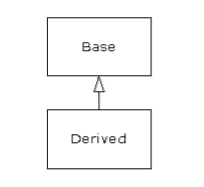

（此 UML 图表中的箭头从派生类指向基类。正如你所看到的，通常会有多个派生类。）

一个类型不仅描述了对一组对象的约束；它与其他类型之间存在关系。两个类型可以具有共同的特征和行为，但一个类型可能包含比另一个类型更多的特征，并且可能处理更多的消息（或以不同的方式处理它们）。继承通过使用基类型和派生类型的概念来表达类型之间的这种相似性。基类型包含了所有派生自它的类型共享的特征和行为。你创建一个基类型来表示你对系统中某些对象想法的核心。从基类型中，你衍生出其他类型，以表示该核心可以实现的不同方式。

例如，垃圾回收机器对垃圾进行分类。基类型是“垃圾”，每件垃圾都有重量、价值等，并且可以被粉碎、熔化或分解。从这里，派生出了更具体的垃圾类型，这些类型可能具有额外的特征（瓶子有颜色）或行为（铝罐可以被压扁，钢罐具有磁性）。此外，某些行为可能是不同的（纸张的价值取决于它的类型和状况）。使用继承，你可以构建一个类型层次结构，用它的类型来表达你试图解决的问题。

第二个例子是经典的“形状”示例，可能用于计算机辅助设计系统或游戏模拟。基类型是“形状”，每个形状都有尺寸、颜色、位置等。每个形状都可以被绘制、擦除、移动、着色等。从这里，派生出（继承）了特定的形状类型——圆形、正方形、三角形等——每种形状都可能具有额外的特征和行为。例如，某些形状可以被翻转。某些行为可能是不同的，例如当你想要计算形状的面积时。类型层次结构体现了形状之间的相似性和不同之处。

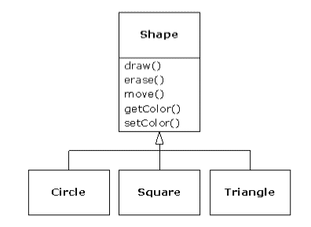

用与问题相同的术语来构建解决方案是非常有用的，因为你不需要大量的中间模型就可以从问题的描述过渡到解决方案的描述。对于对象而言，类型层次结构是主要模型，所以你直接从现实世界中的系统描述到代码中系统描述。事实上，人们在面向对象设计中面临的困难之一，就是从开始到结束的过程太简单了。习惯于寻找复杂解决方案的思维最初可能会被这种简单性所困扰。

当你从一个现有类型继承时，你就创建了一个新类型。这个新类型不仅包含了现有类型的所有成员（尽管私有成员被隐藏起来且无法访问），更重要的是，它复制了基类的接口。也就是说，所有你可以发送给基类对象的消息你也可以发送给派生类对象。由于我们通过可以向类发送的消息来了解类的类型，这意味着派生类与基类是同一种类型。在之前的示例中，“圆形是一个形状。”这种通过继承实现的类型等价是理解面向对象编程含义的基础门径之一。

由于基类和派生类具有相同的底层接口，因此必须有相应的实现。也就是说，当对象接收特定消息时，必须执行某些代码。如果你仅仅继承一个类而不做任何其他操作，基类接口的方法会直接进入派生类。这意味着派生类对象不仅具有相同的类型，还具有相同的行为，这并不特别有趣。

你有两种方法将你的新派生类与原始基类区分开来。第一种非常直接：你向派生类中添加全新的方法。这些新方法不是基类接口的一部分。这意味着基类根本没有做到你所要求的程度，所以你添加了更多方法。这种简单且原始的继承用法有时是你问题的完美解决方案。然而，你应该仔细寻找你的基类可能也需要这些额外方法。这种发现和迭代设计的过程在面向对象编程中经常发生。

### extends 关键字

`extends`是用于继承类属性的关键字。以下是`extends`关键字的语法。

```java
class Super {
   .....
}
```

```java
class Sub extends Super {
  .....
}
```

示例：

```java
class Calculation {
  int z;
  public void addition(int x, int y) {
    z = x + y;
    System.out.println("The sum of the given numbers:"+z);
  }
  public void Subtraction(int x, int y) {
    z = x - y;
    System.out.println("The difference between the given numbers:"+z);
  }
}

public class My_Calculation extends Calculation {
  public void multiplication(int x, int y) {
    z = x * y;
    System.out.println("The product of the given numbers:"+z);
  }
  public static void main(String args[]) {
    int a = 20, b = 10;
    My_Calculation demo = new My_Calculation();
    demo.addition(a, b);
    demo.Subtraction(a, b);
    demo.multiplication(a, b);
  }
}
```


编译并执行上述代码，结果所示：

```bash
javac My_Calculation.java
java My_Calculation
```

执行程序后，将产生以下结果：

输出：

The sum of the given numbers:30

The difference between the given numbers:10

The product of the given numbers:200

在给程序中，当创建`My_Calculation`类的对象时，内部会创建父类内容的副本。这就是为什么使用子类对象可以访问父类的成员。

## `super`关键字

`super`关键字与`this`关键字相似。以下是`super`关键字使用的场景：

- 当父类成员与子类成员具有相同名称时，它用于区分父类成员类成员。
- 它用于从子类中调用父类的构造函数。

### 区分成员

如果一个类继承了另一个类的属性，并且如果父类的成员名称与子类相同，为了区分这些变量，我们使用`super`关键字，如下所示。

`super.variable`

`super.method()`

示例：

```java
class Super_class {
  int num = 20;
  // 父类的显示方法
  public void display() {
    System.out.println("This is the display method of superclass");
  }
}

public class Sub_class extends Super_class {
  int num = 10;
  // 子类的显示方法
  public void display() {
    System.out.println("This is the display method of subclass");
  }
  public void my_method() {
    // 实例化子类
    Sub_class sub = new Sub_class();
    // 调用子类的 display() 方法
    sub.display();
    // 调用父类的 display() 方法
    super.display();
    // 打印子类中变量 num 的值
    System.out.println("value of the variable named num in sub class:"+sub.num);
    // 打印父类中变量 num 的值
    System.out.println("value of the variable named num in super class:"+super.num);
  }
  public static void main(String args[]) {
    Sub_class obj = new Sub_class();
    obj.my_method();
  }
}
```

使用以下语法编译并执行上述代码。

```bash
javac Super_Demo
java Super
```

执行程序后，你将获得以下结果：

输出：

This is the display method of subclass

This is the display method of superclass

value of the variable named num in sub class:10

value of the variable named num in super class:20

## 继承类型

如下所示，有多种类型的继承。

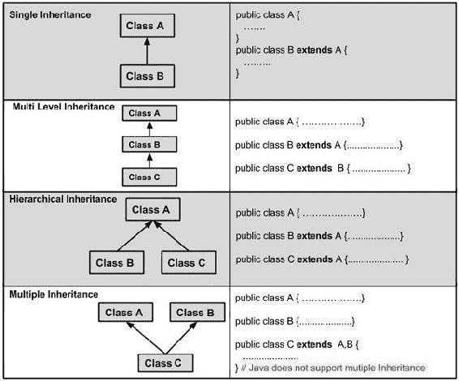

需要记住的一个重要事实是 Java 不支持多继承。这意味着一个类不能继承多个类。因此，以下代码是非合法的——

示例：

```java
public class extends Animal, Mammal{}
```

然而，一个类可以实现一个或多个接口，这帮助 Java 解决了无法多继承的问题。

## 多态下的可交换对象

在处理类型层次时，你通常不想将对象视为其特定类型，而是视为其基类型。这允许你编写依赖于特定类型的代码。在形状示例中，方法处理的是通用形状，而不关心它们是圆、方形、三角形还是某些尚未定义的形状。所有方法只需向形状对象发送消息；它们不需要担心对象如何处理该消息。

此类代码不受新类型添加的影响，而添加新类型是扩展对象程序以处理新情况的最常见方式。例如，你可以派生出一个名为五边形的新形状子类型，而无需修改处理通用形状的方法。这种通过派生新子类型来轻松扩展设计的能力是封装变化的本质方式之一。这大大改进了设计，同时降低了软件维护的成本。

然而，尝试将派生类型对象视为其通用基类型（将圆视为形状、将自行车视为车辆、将鸬视为鸟等）存在问题。如果一个方法要让一个通用形状绘制自己，或让一个通用车辆转向，或让一个通用鸟移动，编译器在编译时无法准确知道将执行哪段代码。这正是意义所在——当消息被发送时，程序员并不想知道将执行哪段代码；`draw`方法可以同样适用于圆、方形或三角形，对象将根据其特定类型执行相应的代码。

如果你不需要知道将执行哪段代码，那么当你添加一个新子类型时，它所执行的代码可以不同，而不需要更改调用它的方法。因此，编译器无法准确确定执行了哪段代码，那么它在做什么呢？

例如，在下面的图中，`BirdController`对象仅与通用的`Bird`对象协作，并且不知道它们的确切类型。从`BirdController`的角度来看这是方便的，因为它不需要编写特殊代码来确定它正在处理的`Bird`的确切类型。那么在忽略`Bird`特定类型的情况下调用`move()`时，是如何发生正确行为的（大鹅行走、飞行或游泳，而企鹅行走或游泳）？

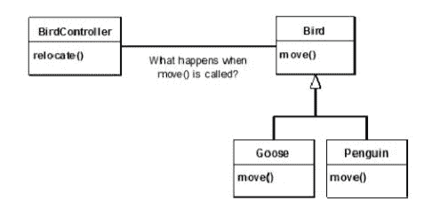

答案是面向对象编程的核心转折：

编译器无法在传统意义上进行函数调用。非面向对象编译器生成的函数调用会导致所谓的早期绑定（early binding），如果你没有以其他方式考虑过，可能没听过这个术语。这意味着编译器生成对特定函数的调用，运行时系统将此调用解析为执行代码的绝对地址。在 OOP 中，程序在运行时才能确定代码地址，因此当向通用对象发送消息时，需要另一种方案。

为了解决这个问题，面向对象的语言使用了延迟绑定（late binding）的概念。当你向对象发送消息时，所调用的代码在运行时才确定。编译器确实会确保方法存在，并对参数和返回值进行类型检查，但它并不知道具体要执行的代码。

为了执行延迟绑定，Java 使用特殊的代码代替绝对调用。这段代码使用存储在对象中的信息来计算方法体的地址（这一过程在多态章节中有详细介绍）。因此，每个对象都可以根据该特殊代码的内容表现出不同的行为。当你向对象发送消息时，对象实际上会弄清楚如何处理该消息。

在某些语言中，你必须显式地声明某个方法具有后期绑定属性的灵活性（C++ 使用`virtual`关键字来实现）。在这些语言中，默认情况下方法不是动态绑定的。在`Java`中，动态绑定是默认行为，你不需要记住为了多态而添加任何额外的关键字。

# 第 9 章 | 异常处理

## 使用异常进行错误处理

捕获错误的理想时机是编译时，甚至在你尝试运行程序之前。然而，并不是所有错误都可以在编译时检测。其余问题必须在运行时通过某种形式进行处理，这种形式允许错误的产生者将适当的信息传递给接收者，由后者知道如何妥善处理该困难。

改进错误恢复是提高代码健壮性最有效的方法之一。错误恢复是你编写的每个程序都关注的核心问题，但在`Java`中尤为重要，因为其主要目标之一是为他人创建可程序组件。要创建一个健壮的系统，每个组件必须是健壮的。通过使用异常提供一致的错误报告模型，`Java`允许组件可靠地向客户端代码通信问题。

`Java`异常处理的目标是使用比目前更少的代码来简化大型、可靠程序的创建，并让你更有信心地确保应用程序没有未处理的错误。异常的学习并不困难，它们是那些为你的项目提供即时且显著收益的功能之一。

由于异常处理是`Java`报告错误的唯一官方方式，并且受到`Java编译器`的强制执行，因此在不学习异常处理的情况下，书中能编写的示例是有限的。本章将向你介绍正确处理异常所需的代码，并展示当你的某个方法出现问题时，如何生成自己的异常。

### 概念

C 和其他早期的语言通常有多种错误处理方案，这些方案通常是通过约定确定的，而不是编程语言的一部分。通常，你返回一个特殊值或设置一个标志位，接收者应该查看该值或标志位并判断是否发生了异常。然而，随着岁月的流逝，人们发现使用库的程序员倾向于认为自己是无所不能的——正如所谓的：“是的，错误可能会发生在别人身上，但不会发生在我的代码中。”因此，并不意外的是，他们不会检查错误条件（而且有时错误条件太愚蠢而没必要检查）。如果你足够彻底地在每次调用方法时都检查错误，你的代码可能会变成一个无法阅读的噩梦。因为程序员仍然可以从这些语言中压榨出系统，所以他们抵制承认事实：这种处理错误的方法是创建大型、健壮、可维护程序的一个主要限制。

解决方案是消除错误处理的随意性并强制形式化。这实际上有着悠久的历史，因为异常处理的实现可以追溯到 20 世纪 60 年代的操作系统，甚至可以追溯到`BASIC`的“on error goto”。但`C++`异常处理是基于 Ada 的，而`Java`的则主要基于`C++`（尽管它看起来更像`Object Pascal`）。

“异常（exception）”一词的意思是“我对某事表示异议”。在问题发生点，你可能不知道该如何处理它，但你知道自己不能就这样愉快地继续下去；你必须停止，并且必须由某处的某人想出该怎么办。但在当前的上下文中没有足够的信息来修复问题。因此，你将问题交给一个更高层的上下文，那里的人有资格做出正确的决策。

异常的另一个显著益处是，它们倾向于降低错误处理代码的复杂性。如果没有异常，你必须在程序的多个地方检查并处理特定的错误。有了异常，你不再需要在方法调用点检查错误，因为异常将保证有人会捕获它。你只需要在一个地方（即所谓的异常处理器）中处理问题即可。这为你节省了代码，并将描述在正常执行期间想做的事情的代码与在出现故障时执行的代码分离开。总的来说，使用异常使得阅读、编写和调试代码比使用旧的错误处理方式要清晰得多。

### 基础异常

异常状态是一个阻止当前方法或作用域继续的问题。将异常状态与普通问题区分开来很重要，在普通问题中，当前上下文中有足够的信息来某种方式应对困难。而在异常状态下，你无法继续处理，因为当前上下文中没有处理该问题所需的信息。你所做的只是跳出当前上下文，并将该问题交给更高层的上下文。这就是当你抛出异常时发生的情况。

除法是一个简单的例子。如果你正要除以零，检查该条件是值得的。但分母为零意味着什么？也许在那个特定方法尝试解决的问题背景下，你知道如何处理分母为零。但如果这是一个意料之外的值，你就无法处理它，因此必须抛出异常，而不是继续该执行路径。

当你抛出异常时，会发生几件事。首先，异常对象的创建方式与创建任何`Java对象`相同：在堆上通过`new`创建。然后，当前的执行路径（你无法继续的那条路径）停止，异常对象的引用从当前上下文中抛出。此时，异常处理机制接管并开始寻找继续程序的合适位置。这个合适的位置就是异常处理器，它的工作是从问题中恢复，以便程序可以尝试其他方法或继续运行。

作为抛出异常的一个简单示例，考虑一个名为`t`的对象引用。你可能会接收到一个未初始化的引用，因此你可能想在使用该对象引用调用方法之前进行检查。你可以通过创建一个表示信息的对象并将其“抛出”当前上下文，向更大的上下文发送错误信息。这被称为抛出异常。它看起来如下：

```java
if(t == null)
 throw new NullPointerException();
```

这抛出了异常，允许你在当前上下放弃进一步思考该问题的责任。它只是奇迹地在某处被处理了。具体位置稍后显示。

异常允许你将所做的一切都视为一个事务，而异常保护着这些事务：“……事务的基本假设是我们在分布式计算中需要异常处理。事务是合同法的计算机等物。如果发生任何错误，我们将撤销整个计算。”你也可以把异常视为一种内置的撤销系统，因为（通过仔细）你可以在程序中设置各种恢复点。如果程序的某部分失败，异常将“撤销”到程序中已知的稳定点。

异常最重要的方面之一是，如果发生了某些糟糕的情况，它们不会允许程序按照常规路径继续运行。这在 C 和 C++ 等语言中一直是一个真正的问题；尤其是 C 语言，当发生问题时，没有办法强制程序停止执行某条路径，因此可能会忽略问题长时间并进入一个完全不恰的状态。异常允许你（至少可以）强制程序停止并告诉你输出了什么错误，或者（理想情况下）强制程序处理该问题并返回到稳定状态。

### 异常参数

与 Java 中的任何对象一样，你总是通过使用`new`在堆（heap）上创建异常，这会分配存储空间并调用构造函数。在所有标准异常中都有两个构造函数：第一个是默认构造函数，第二个接收一个字符串参数，这样你就可以将相关信息放入异常中：

```java
throw new NullPointerException("t = null");
```

正如你将看到的，稍后可以使用各种方法提取此字符串。

`throw`关键字会产生许多有趣的结果。在用`new`创建异常对象后，你将生成的引用交给`throw`。实质上，该对象是从方法中被“返回”的，尽管该对象的类型通常不是该方法设计返回的类型。理解异常处理的一种简单方法是将其视为不同的返回机制，尽管如果你把这个类比推得太远，就会遇到麻烦。你也可以通过抛出异常来退出普通作用域。无论哪种情况，异常对象都会返回，方法或作用域退出。

与方法的普通返回的任何相似性到此为止，因为你返回的地方与普通方法调用返回的地方完全不同。（你最终进入了一个合适的异常处理程序，该程序可能距离抛出异常的地方很远——在调用栈上有许多层级。）

此外，你可以抛出任何类型的`Throwable`，它是异常的根类。通常，你会为每种不同的错误抛出不同类的异常。错误信息既表示在异常对象内部，也隐含地表示在异常类的名称中，因此上下文中的人员可以判断如何处理你的异常。（通常，唯一的信息是异常的类型，异常对象内部没有存储任何有意义的内容。）

### 捕获异常

要查看异常是如何被捕获的，你必须先理解保护区域（guarded region）的概念。这是一段可能会产生异常的代码，其后紧跟着处理这些异常的代码。

#### `try`块

如果你在方法内部抛出一个异常（或者在该方法内调用的另一个方法抛出异常），那么该方法将在抛出异常的过程中退出。如果你不想让`throw`退出方法，可以在该方法内部设置一个特殊块来捕获异常。这被称为`try`块，因为你是在那里“尝试”你的各种方法调用。`try`块是一个普通的作用域，前面由关键字`try`引导的：

```java
try {
// 可能会产生异常的代码
}
```

如果你在一个不支持异常处理的编程语言中仔细检查错误，你将不得不在每个方法调用周围编写设置和错误测试代码，即使你多次调用了同一个方法。有了异常处理，你将所有内容放在一个`try`块中并在一处捕获所有异常。这意味着你的代码将更容易编写和阅读，因为代码的目标不会与错误检查混淆在一起。

#### 异常处理程序

当然，抛出的异常必须去往某个地方。这个“地方”就是异常处理程序，对于你想要捕获的每种异常类型，都有一个处理程序。异常处理程序紧跟在`try`块之后，并用关键字`catch`表示：

```java
try {
// 可能会产生异常的代码
} catch(Type1 id1) {
// 处理 Type1 异常
} catch(Type2 id2) {
// 处理 Type2 异常
} catch(Type3 id3) {
// 处理 Type3 异常
}
```

每个`catch`子句（异常处理程序）就像一个小方法，它接收一个且仅接收一个特定类型的参数。

标识符（`id1`、`id2`等）可以在处理程序内部使用，就像方法参数一样。有时你永远不会使用该标识符，因为异常类型已经给了你足够处理异常的信息，但标识符必须存在。

处理程序必须直接出现在`try`块之后。如果抛出了异常，异常处理机制将寻找第一个具有与异常类型匹配的参数的处理程序。然后它进入该`catch`子句，该异常即被认为已处理。一旦`catch`子句完成，对处理程序的搜索就会停止。只有匹配的`catch`子句会执行；它不像`switch`语句那样在每个`case`之后需要一个`break`来防止剩余的执行。请注意，在`try`块内部，多个不同的方法调用可能会产生相同的异常，但你只需要一个处理程序。

#### 终止与恢复

异常处理理论中有两种基本模型。Java 支持终止（termination），在那种情况下，你假设错误是关键的，以至于无法回到异常发生的地方。抛出异常的人认为没有办法挽救局面，而且他们不想回来。

另一种模型被称为恢复（resumption）。这意味着期望异常处理程序采取某些措施来纠正局面，然后重试出错的方法，并假设第二次会成功。如果你想要恢复式的行为，意味着你仍然希望在异常被处理后继续执行。

如果你想在 Java 中获得类似恢复的行为，请在遇到错误时不要抛出异常。相反，请调用一个解决问题的方法。或者，将你的`try`块放在一个`while`循环中，直到结果满意为止。

从历史上来看，使用支持恢复性异常处理的操作系统的程序员最终使用了终止式的代码并跳过了恢复。因此，尽管恢复听起来很有吸引力，但在实践中并不那么好用。主要原因可能是由此导致的耦合：恢复性处理程序需要感知异常抛出的位置，并包含特定于该位置的非通用代码。这使得代码难以编写和维护，特别是对于异常可以从多个点生成的大型系统。

### 捕获任何异常

可以创建一个捕获任何类型异常的处理程序。你通过捕获基类异常类型`Exception`来实现（还有其他类型的基异常，但`Exception`是几乎适用于所有编程活动的基类）：

```java
catch(Exception e) {
System.out.println("捕到了异常");
}
```

这将捕获任何异常，因此如果你使用它，你会希望将其放在处理程序列表的末尾，以避免阻止其他可能随其后的异常处理程序。


由于`Exception`类是程序员重要的所有异常类的基类，你无法获得关于异常的特定信息，但你可以调用来自其基类类型`Throwable`的方法：

- `getMessage()`
- `getLocalizedMessage()`：获取详细消息，或针对此特定区域调整后的消息。
- `toString()`：返回`Throwable`的简短描述，如果有详细消息则包含在内。
- `printStackTrace()`
- `printStackTrace(PrintStream)`
- `printStackTrace(java.io.PrintWriter)`

## Throwable

打印`Throwable`及其`Throwable`的调用栈跟踪。调用栈显示了引导你到达异常抛出点的方法调用序列。第一个版本打印到标准错误输出，第二个和第三个则打印到你选择的流中（在 I/O 章节中，你将理解为什么会有两种流）。

`Throwable.fillInStackTrace()`

在此`Throwable`对象中记录关于堆栈帧当前状态的信息。这在应用程序重新抛出错误或异常时非常有用（稍后会详细详细介绍这一点）。

此外，你还可以从`Throwable`的基类型`Object`（所有对象的基类型）中获得其他方法。对于异常来说，可能很有用的方法是`getClass()`，它返回一个表示该对象类的对象。反之，你可以通过`getName()`查询该`Class`对象以获取其名称（这包含了包名信息），或者通过`getSimpleNameName()`获取纯粹的类名。

这里是一个展示如何使用基本`Exception`方法的示例：

```java
public class ExceptionMethods {
    public static void main(String[] args) {
        try {
            throw new Exception("My Exception");
        } catch(Exception e) {
            print("Caught Exception");
            print("getMessage():" + e.getMessage());
            print("getLocalizedMessage():" + e.getLocalizedMessage());
            print("toString():" + e);
            print("printStackTrace():");
            e.printStackTrace(System.out);
        }
    }
}
```

**输出：**

```
Caught Exception
getMessage() : My Exception
getLocalizedMessage() : My Exception
toString(): java.lang.Exception : My Exception
printStackTrace():
java.lang.Exception: My Exception
at ExceptionMethods.main(ExceptionMethods.java:8)
```

你可以看到，这些方法提供了逐渐增的信息——每个方法实质上都是前一个方法的超集。

---

# 第 10 章 | 算法与大 O 表示法

## 算法思维

算法是用于解决问题或完成任务的详细分步说明指令集或公式。在计算领域，程序员编写算法来指示计算机如何执行某项任务。

当你以最广义的方式思考算法时（不仅限于计算），你会发现算法无处不在。制作食物的食谱是一种算法，你解决加法或长除法问题的方法是一种算法，折叠衬衫或裤子的过程也是一种算法。

### 那么，什么是编程算法？

你可以将编程算法视为一种食谱，它描述了计算机解决问题或实现目标所需的确切步骤。我们都见过食物食谱 - 它们列出了所需的配料以及制作描述菜肴的一系列步骤。算法正是如此。在计算机术语中，食谱被称为`procedure`（过程），而配料被称为`inputs`（输入）。你的计算机查看你的`procedure`，完全按照要求执行，你就能看到结果，这些结果被称为`outputs`（输出）。

编程算法描述了如何做某事，而且你的计算机每次都会完全按照那样执行。嗯，一旦你将算法转换为它能理解的语言，它就会那样做！

然而，重要的是，编程算法并不是计算机代码。它是用简单的英语（或程序员使用的语言）编写的。它不绕圈子说话——它有开始、中间和结束。事实上，你可能会将第一步标记为“开始”，最后一步标记为“结束”。它只包含执行任务所需的内容。它不包含任何不明确的内容（在计算机术语中称为“歧义”），即阅读它的人可能会产生疑问的内容。

它总是通向一个解决方案，并尝试成为我们能想出的最高效解决方案。对步骤进行编号通常是一个好主意，但你不必这样做。与其使用编号步骤，有些人倾向于使用缩进并编写`pseudocode`（伪代码），这是一种用于描述算法步骤的半编程语言。但我们在这里不会使用它，因为简单是首位的。

### 良好算法的特征：

1. 输入和输出应该被精确定义。
2. 算法中的每一步都应该是清晰且无歧义的。
3. 在解决问题的多种方法中，算法应该是最有效的。
4. 算法不应包含计算机代码。相反，算法的编写方式应该使其可以在类似的编程语言中使用。

## 编程中的算法示例：

### 编写一个算法来两个用户输入的数字之和。

步骤 1：开始

步骤 2：声明变量`num1`、`num2`和`sum`。

步骤 3：读取值`num1`和`num2`。

步骤 4：将`num1`和`num2`相加并将结果赋值给`sum`。

`sum ← num1 + num2`

步骤 5：显示`sum`

步骤 6：停止

### 编写一个算法来找到用户输入的三个数字中的最大值。

步骤 1：开始

步骤 2：声明变量`a`、`b`和`c`。

步骤 3：读取变量`a`、`b`和`c`。

步骤 4：如果`a > b`

    如果`a > c`

        显示`a`是最大的数字。

    否则

        显示`c`是最大的数字。

否则

    如果`b > c`

        显示`b`是最大的数字。

    否则

        显示`c`是最大的数字。

步骤 5：停止

### 编写一个算法找到二次方程`ax²+bx+c=0`的所有根。

步骤 1：开始

步骤 2：声明变量`a`、`b`、`c`、`D`、`x1`、`x2`、`rp`和`ip`。

步骤 3：计算

`D ← b²-4ac`

步骤 4：如果`D ≥ 0`

    `x1 ← (-b+√D)/2a`

    `x2 ← (-b-√D)/2a`

    显示根`x1`和`x2`。

否则

    计算实部和虚部

    `rp ← -b/2a`

    `ip ← √D/2a`

    显示`rp+j(ip)`和`rp-j(ip)`步骤 5：停止

### 编写一个算法计算用户输入的数字的阶乘。

步骤 1：开始

步骤 2：声明变量`n`、`factorial`和`i`。

步骤 3：初始化变量

`factorial ← 1`

`i ← 1`

步骤 4：读取`n`的值

步骤 5：重复步骤直到`i = n`

    5.1：`factorial ← factorial * i`

    5.2：`i ← i + 1`

步骤 6：显示`factorial`

步骤 7：停止

### 编写一个算法检查用户输入的数字是否为质数。

步骤 1：开始

步骤 2：声明变量`n`、`i`、`flag`。

步骤 3：初始化变量

`flag ← 1`

`i ← 2`

步骤 4：从用户读取`n`。

步骤 5：重复步骤直到`i < (n/2)`

    5.1 如果`n÷i`的余数为 0

        `flag ← 0`

        跳转到步骤 6

    5.2 `i ← i + 1`

步骤 6：如果`flag = 0`

    显示`n`不是质数

否则

    显示`n`是质数

步骤 7：停止

### 编写一个算法找到小于 1000 的斐波那契数列。

步骤 1：开始

步骤 2：声明变量`first_term`、`second_term`和`temp`。

步骤 3：初始化变量`first_term ← 0` `second_term ← 1`

步骤 4：显示`first_term`和`second_term`

步骤 5：重复步骤直到`second_term > 1000`

    5.1：`temp ← second_term`

    5.2：`second_term ← second_term + first_term`

    5.3：`first_term ← temp`

    5.4：显示`second_term`

步骤 6：停止

### 算法解决了哪些类型的问题？

排序绝不是已开发算法的唯一计算问题。算法的实际应用无处不在，包括以下示例：

## 1. 人类基因组计划

人类基因组计划在识别人类 DNA 中所有 100,000 个基因、确定组成人类 DNA 的 30 亿个碱基对的序列、将这些信息存储在数据库中以及开发数据分析工具方面取得了巨大进展。这些每一个步骤都需要复杂的算法。虽然涉及的各种解决方案超出了本书的涵盖范围，但许多解决这些生物问题的方法使用了书中几个章节中的思想，从而使科学家能够在高效利用资源的同时完成任务。这节省了人类和机器的时间以及金，因为可以从实验室技术中提取更多信息。

## 2. 互联网

互联网让世界各地的人能够快速访问和检索大量信息。在巧妙算法的帮助下，互联网网站能够管理和处理海量数据。必须使用算法的问题示例包括：寻找数据传输的良好路径，以及使用搜索引擎快速找到包含特定信息的页面。

## 3. 电子商务

电子商务使得商品和服务能够以电子方式进行谈判和交换，它依赖于信用卡号、密码和银行对单等个人信息的隐私。电子商务中使用的核心技术包括公钥加密和数字签名，这些技术基于数值算法和数论。

## 4. 制造业与商业

制造业和其他商业企业通常需要以最有利的方式分配稀缺资源。石油公司可能希望知道在哪里设置钻井，以使其预期利润最大化。政治候选人可能想决定在何花钱购买竞选广告，以使赢得选举的机会最大。航空公司可能希望以最低成本的方式将机组分配给航班，确保每班航班都有人员覆盖并符合有关机组调度的政府规定。互联网服务提供商可能希望决定在哪里放置额外资源，以便更有效地为客户提供服务。这些都是可以使用线性规划解决问题的示例。

尽管这些示例的某些细节超出了本书的涵盖范围，但我们提供了适用于这些问题和问题领域的底层技术。

### 算法作为一种技术

假设计算机是无限快的，计算机内存是免费的。你还会为了什么学习算法吗？答案是肯定的，即使没有其他理由，仅仅你仍然想证明你的解决方案能够终止，并且以正确的答案得出结果。

如果计算机是无限快的，那么解决问题的任何正确方法都行。

你可能希望你的实现符合良好的软件工程实践界限（例如，你的实现应该是良好设计且有文档的），但你大多数时候会使用最容易实现的方法。当然，计算机可能很快，但它们不是无限快的。内存可能廉价，但它不是免费的。

因此，计算时间是一种受限资源，内存空间也是。你应该明智地使用这些资源，而在时间或空间上高效的算法将帮助你这样做。

## 存储存储在哪里？

视觉化程序运行时某些布局的方面是很有用的——特别是内存是如何安排的。有五种不同的数据存储位置：

1. **寄存器 (Registers)**。这是最快的存储，因为它存在于与其它存储器不同的位置：处理器内部。然而，寄存器的数量受到严格限制，因此根据需要分配寄存器。你没有直接控制权，也不会在你的程序中看到任何寄存器存在的证据（相比之下，`C & C++`允许你向编译器建议寄存器分配）。

2. **栈 (The stack)**。它存在于通用随机访问内存（`RAM`）区域，但通过其栈指针获得处理器的直接支持。栈指针向下移动创建新内存，向上移动以释放该内存。这是一种极其快速高效的分配存储的方法，仅次于寄存器。Java 系统在创建程序时，必须知道存储在栈上的所有项的确切生命周期。这一限制限制了你程序的灵活性，虽然栈上存在一些 Java 存储——特别是对象引用——但 Java 对象本身并不被放置在栈上。

3. **堆 (The heap)**。这是一个通用的内存池（同样在`RAM`区域），所有的 Java 对象都存储在其中。堆的妙处是，与栈不同，编译器不需要知道该存储必须在堆上留多久。因此，使用堆上的存储具有极大的灵活性。每当你需要一个对象时，只需编写代码使用`new`来创建它，当该代码执行时，存储就会分配在堆上。当然，你为这种灵活性需要付出代价：分配和清理堆存储可能比栈存储花费更多时间（如果你在 Java 中可以在栈上创建对象的话，就像在`C++`中那样）。

4. **常量存储 (Constant storage)**。常量值通常被直接放在程序代码中，这是安全的，因为它们永远不会改变。有时常量会被单独隔离开，以便在嵌入式系统中可选地放置在只读内存（`ROM`）中。

5. **非 RAM 存储 (Non-RAM storage)**。如果数据完全位于程序之外，它可以在程序未运行时存在，不受程序的控制。这类的两个主要例子是流式对象（streamed objects），将对象转换为字节流，通常是为了发送到另一台机器；以及持久性对象（persistent objects），将对象放在磁盘上，以便在程序终止时仍保持其状态。这类存储的技巧在于，将对象转换为可以在其他介质上存在的东西，并在需要时能够复活为基于`RAM`的普通对象。Java 提供了轻量级持久化支持，而`JDBC`和`Hibernate`等机制为数据库信息的存储和检索提供了更高级的支持。

## 大 O 表示法 (Big O Notation)

大 O 表示法是我们用于描述算法运行时间的语言。它是我们比较不同问题求解效率的方法。

假设你有一个包含 10 个对象的列表，你想对它们进行排序。有很多算法可以实现这一目标，但并非所有算法都是平等的。

大 O 表示法使用类似于`O(n)`的符号。`O`仅仅表示我们在讨论大 O，你可以忽略它（至少在面试目的上如此）。`n`是与复杂度相关的因素；对于编程面试题，这几乎总是指集合的大小。

下面是按相对于数据集扩展良好程度排序的大 O 复杂度列表。

### O(1)/常数复杂度 (Constant Complexity)

常数。这意味着无论数据集大小如何，算法始终花费恒定的时间。1 个项目需要 1 秒，10 个项目需要 1 秒，100 个项目也需要 1 秒。它总是花费相同的时间。

### O(log n)/对数复杂度

不如常数复杂度好，但仍然不错。耗时随数据集规模的增加而增加，但并非成比例增长。这意味着相对于较大的数据集，算法处理较小数据集每个项目的时间更长。1 个项目需要 1 秒，10 个项目需要 2 秒，100 个项目需要 3 秒。如果你的数据集有 10 个项目，每个项目会产生 0.2 秒的延迟。如果你的数据集有 100 个，每个项目仅额外花费 0.03 秒。这使得 log n 算法具有非常好的扩展性。

### O(n)/线性复杂度

数据集越大，耗时时间就成比例增长。1 个项目需要 1 秒，10 个项目需要 10 秒，100 个项目需要 100 秒。

### O(n log n)

前两者的良好结合。通常排序包含两个部分，第一个循环是 O(n)，第二个是 O(log n)，结合起来形成 O(n log n)。1 个项目需要 2 秒，10 个项目需要 12 秒，100 个项目需要 103 秒。

### O(n²)/二次方复杂度

速度变得非常慢了。1 个项目需要 1 秒，10 个项目需要 100 秒，100 个项目需要 10000 秒。

### O(2^n)

指数级增长！每增加一个新元素，算法的时间翻倍。1 个项目需要 1 秒，10 个项目需要 1024 秒，100 个项目需要 1267650600228229401496703205376 秒。

### 示例

希望你到目前还能跟上我的思路，让我们深入研究一些排序和搜索的示例算法。重要的是能够解释一个算法是什么什么复杂度。面试官喜欢让候选人设计算法，然后询问它们的复杂度是多少。

### 1. O(1)

无论规模如何，它将始终以常数速度返回。`Queue`的 javadoc 说明“检索方法（`peek`、`element`和`size`）是常数时间”。这原因非常显而易见。对于`peek`，我们总是返回我们始终拥有引用的第一个元素；它后面有多少个元素并不重要。列表的大小在元素添加/删除时更新，而引用这个数字无论列表多大，都只需要一次操作即可访问。

### 2. O(log n)

经典的例子是二分查找。你是一个超级极客，所以你显然已经对你的电影收藏按字母顺序排列了类。为了找到你的《回到未来》拷贝，你首先来到列表的中间。你发现中间的电影是《福克斯一家的聚会》，然后你转向开头和这电影电影之间的电影。你发现那是《人类之亡路》。你再次重复这个过程，你就找到了《回到未来》。

虽然增加更多元素会增加搜索所需的时间，但这种增加不是比例的。因此，它是 O(log n)。

### 3. O(n)

正如我在关于集合的文章中讨论过的，`LinkedLists`在检索方面（相对而言）并不太好。它的 Big O 实际上是 O(n)，因为在最坏情况下，为了找到列表中的最后一个元素`T`，必须遍历整个包含`n`个元素的列表来找到`T`。随着元素数量的增加，访问时间也成比例增加。

### 4. O(n log n)

O(n log n) 的最佳例子是合并排序。这是一种分治算法。假设你有一个整数列表。我们不断地平分列表，直到剩下若干个包含 1 个元素的列表；因此，这些列表每个都是有序的。然后我们将每个列表与其邻居列表合并（每次比较每个列表的第一个元素）。我们对新的组合列表重复此操作，直到我们得到排序后的结果。

## 如何在面试中确定 Big O？


这并不是 Big O 的详尽列表。就像你可以写 `O(n²)` 一样，你也可以有 `O(n³)`（想象在你的冒泡排序中无缘无故地增加一个额外的循环）。此页面上的列表应该让你能够对算法的 Big O 进行一次盲目推测。如果有人在面试中问你这个问题，他们可能想看到你如何尝试推导出它。拆解循环和处理过程。

- 它必须遍历整个列表吗？那里某处会有 `n`。
- 算法的处理时间增长速度是否慢于数据集规模的增长？那么那里可能有一个 `log n`。
- 是否有嵌套循环？你可能在看 `n²` 或 `n³`。
- 访问时间是否与数据集的大小无关？`O(1)`

## 示例问题

我有一个数字 1 到 `n` 的数组。数据集越大，耗时时间就成比例增长。这个算法的 Big O 是多少？我们的算法遍历列表一次，所以它简单来说是 `O(n)`。

这有很多变体，且变体关于哪个数字是缺失的。

```java
public void findTheBlank(int[] theNumbers) {
    int sumOfNumbers = 0;
    int sumOfPresent = 0;
    int blankSpace = 0;
    for (int i = 0; i < theNumbers.length; i++) {
        sumOfNumbers += i + 1;
        sumOfPresent += theNumbers[i];
        if (theNumbers[i] == 0) {
            blankSpace = i;
        }
    }
    System.out.println("缺失的数字为 " + (sumOfNumbers - sumOfPresent) + " 位于位置 " + blankSpace);
}

new BubbleSort().findTheBlank(new int[]{7,6,0,1,3,4});
```

思考指针的一种不那么抽象的方式是观察人类大脑如何记忆（或无法记忆）某些事情。很多时候，一个优秀的工程师并不一定知道某个特定的公式/常量/方程，但当被问时，他们可以准确地告诉你应该检查哪份参考文献。

## 数组

数组是一种非常简单的数据结构，可以被视为固定长度的列表。数组的优点在于其简单，非常适用于数据项已知（或可以通过程序确定）的情况。假设你需要一段代码来计算几个数的平均值。

数组是存储单个数值的完美数据结构，因为它们没有特定的顺序，且所需的计算除了遍历所有值之外，不需要任何特殊处理。数组的另一个大优势是可以通过索引进行随机访问。例如，如果你有一个包含教室里学生姓名列表的数组，每个座位的编号从 1 到 `n`，那么 `studentName[i]` 就是读取或存储坐在 `i` 座的学生名字的一种简便方法。

数组也可以被视为一叠预装好的纸。它有固定数量的页数，每页都包含信息，并且位于一个永远不会的预定义位置。

## 排序技术

排序是指按照特定的格式排列数据。排序算法规定了按特定顺序排列数据的方法。最常见的顺序是数值顺序或字典序。

排序的重要性在于，如果数据以排序的方式存储，数据搜索就可以被优化到非常高的水平。排序也用于以更可读的格式表示数据。以下是现实场景中排序的一些示例：

- 电话电话簿 — 电话簿按姓名存储人们的电话号码，这样就可以轻松搜索姓名。
- 字典 — 字典按字母顺序存储单词，这样搜索任何单词都变得简单。

## 原地排序与非原地排序

排序算法可能需要一些额外的空间来进行比较和临时存储少数数据元素。这些算法不需要任何额外的空间，排序被认为是“原地”发生的，例如，在数组内部进行。这被称为原地排序。冒泡排序就是原地排序的一个例子。

然而，在某些排序算法中，程序所需的空间大于或等于被排序的元素数量。使用相等或更多空间的排序被称为非原地排序。合并排序就是非原地排序的一个例子。

## 稳定排序与不稳定排序

如果一个排序算法在对内容排序后，没有改变相似内容出现的原始顺序，它被称为稳定排序。

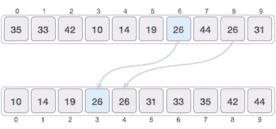

如果一个排序算法在对内容排序后，改变了相似内容出现的顺序，它被称为不稳定排序。

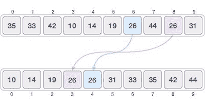

当我们希望保持原始元素的顺序时（例如在元组中），算法的稳定性就至关重要。

## 自适应与非自适应排序算法

如果一个排序算法利用了待排序列表中已经“排序好”的元素，则称它是自适应的。也就是说，在排序过程中，如果源列表中的某些元素已经过序，自适应算法会考虑到这一点，并尝试不重新排列它们。

非自适应算法是不考虑已经排序的元素的算法。它们试图强制每个元素都重新排序，以确认它们的有序性。

## 排序与搜索

### 二分查找

二分查找是计算机科学中的基础算法之一。为了探索它，我们将首先建立一个理论骨架，然后以此正确地实现该算法，并避免那些大家谈论的讨厌死的“差一错误”错误。

#### 在有序序列中查找值

在最简单形式中，二分查找用于在有序序列中快速找到一个值（目前将序列视为普通数组即可）。为了清晰起见，我们将要查找的值称为 `target` 值。二分查找维持了起始序列的一个连续子序列，目标值恰好位于其中。这被称为 `search space`。搜索空间最初是整个序列。在每一步中，算法将搜索空间中的中间值与目标值进行比较。根据比较结果，由于序列是有序的，它可以排除一半的搜索空间。通过重复这种操作，最终将留下包含单个元素（即目标值）的搜索空间。

例如，考虑以下按升序排列的整数序列，假设我们正在寻找数字 55：

| 0 | 5 | 13 | 19 | 22 | 41 | 55 | 68 | 72 | 81 | 98 |
|---|---|----|----|----|----|----|----|----|----|----|

我们对目标值在序列中的位置感兴趣，因此我们将搜索空间表示为序列的索引。最初，搜索空间包含索引 1 到 11。由于搜索空间实际上是一个区间，只需存储两个数字——`low` 和 `high` 索引即可。如上所述，我们现在选择中间值，即索引 6 处的值（1 和 11 之间的中点）：这个值是 41，它小于目标值。从这里我们不仅得出索引 6 处的元素不是目标值，而且得出索引 1 到 5 之间的任何元素都不可能是目标值，因为这些索引上的所有元素都小于 41，而 41 小于目标。这使得搜索空间缩小到索引 7 到 11：

| 55 | 68 | 72 | 81 | 98 |
|----|----|----|----|----|

取决于我们如何选择偶数个元素的中间值，我们将在下一步找到 55，或者切掉 68 得到单个元素的搜索空间。无论如何，我们得出目标值位于 7。如果目标值不在序列中，二分查找将空搜索空间。这个条件很容易检查。以下是相应的代码：

```python
binary_search(A, target):
    lo = 1, hi = size(A)
    while lo <= hi:
        mid = lo + (hi-lo)/2
        if A[mid] == target:
            return mid
        elif A[mid] < target:
            lo = mid+1
        else:
            hi = mid-1
```

复杂度：由于每次比较二分查找都会减半搜索空间，我们可以断定并容易证明找到目标值永远不会使用超过（大 O 表示法）`O(log N)`。对数是一个增长缓慢的函数。如果你不知道二分查找有多高效，请考虑在一个包含百万名字的电话书中查找名字。二分查找让你最多通过 21 次比较找到任何名字。如果你能管理一个按姓名排序的列表，可以在 35 步内找到任何人。

#### 程序：Java 实现的递归二分查找

```java
class BinarySearch {
    // 如果 x 存在于 arr[l..r] 中则返回索引，否则返回 -1
    int binarySearch(int arr[], int l, int r, int x) {
        if (r>=l) {
            int mid = l + (r - l)/2;
            // 如果元素就在中间
            if (arr[mid] == x) {
                return mid;
            }
            // 如果元素小于 mid，则它可能存在于
            // 左子数组中
            if (arr[mid] > x) {
                return binarySearch(arr, l, mid-1, x);
            }
            // 否则元素可能存在于右
            // 子数组中
            return binarySearch(arr, mid+1, r, x);
        }
        return -1;
    }
}
```

#### 程序：二分查找的迭代实现

```java
class BinarySearch
{
    // 如果 x 在 arr[] 中，返回其索引，否则
    // 返回 -1
    int binarySearch(int arr[], int x)
    {
        int l = 0, r = arr.length - 1;
        while (l <= r)
        {
            int m = l + (r-l)/2;
            // 检查 x 是否在中间位置
            if (arr[m] == x)
                return m;
            // 如果 x 大，忽略左半部分
            if (arr[m] < x)
                l = m + 1;
            // 如果 x 较，忽略右半部分
            else
                r = m - 1;
        }
        // 如果到达这里，说明元素不存在
        return -1;
    }

    public static void main(String args[])
    {
        BinarySearch ob = new BinarySearch();
        int arr[] = {2, 3, 4, 10, 40};
        int n = arr.length;
        int x = 10;
        int result = ob.binarySearch(arr, 0, n-1, x);
        if (result == -1)
            System.out.println("Element not present");
        else
            System.out.println("Element found at index "+result);
    }
}
```

输出：

元素位于索引 3

## 冒泡排序

冒泡排序被称为最简单的算法。在冒泡排序中，数组从第一个元素遍历到最后一个元素。在这里，当前元素与下一个元素进行比较。如果当前元素大于下一个元素，则进行交换。

### 算法

我们假设 `list` 是包含 `n` 个元素的数组。我们进一步假设 `swap` 函数会交换给定数组的值。

```
begin BubbleSort(list)
for all elements of list
    if list[i] > list[i+1]
        swap(list[i], list[i+1])
end
```

### 程序：Java 实现的冒泡排序

```java
class BubbleSort {
    static void bubbleSort(int[] arr) {
        int n = arr.length;
        int temp = 0;
        for (int i=0; i < n; i++) {
            for (int j=1; j < (n-i); j++) {
                if (arr[j-1] > arr[j]) {
                    //交换元素
                    temp = arr[j-1];
                    arr[j-1] = arr[j];
                    arr[j] = temp;
                }
            }
        }
    }

    public static void main(String[] args) {
        int arr[] = {3,60,35,2,45,320,5};
        System.out.println("Array Before Bubble Sort");
        for(int i=0; i < arr.length; i++){
            System.out.print(arr[i] + " ");
        }
        System.out.println();
        bubbleSort(arr); //使用冒泡排序排序元素
        System.out.println("Array After Bubble Sort");
        for(int i=0; i < arr.length; i++){
            System.out.print(arr[i] + " ");
        }
    }
}
```

输出：

`Array Before Bubble Sort: 3 60 35 2 45 320 5`

`Array After Bubble Sort: 2 3 5 35 45 60 320`

## 插入排序

插入排序是一种简单的算法，其工作方式类似于我们在手中对牌进行排序。

### 算法

1. 步骤 1：如果第一个元素已经是排序好的。
2. 步骤 2：选取下一个元素。
3. 步骤 3：与已排序列表中的所有元素比较。
4. 步骤 4：将排序列表中所有大于待排序值的元素向后移动一位。
5. 步骤 5：插入该值。
6. 步骤 6：重复此直到列表排序完成。

### 程序：插入排序实现的 Java 程序

```java
class InsertionSort {
    /*使用插入排序排序数组的函数*/
    void sort(int arr[]) {
        int n = arr.length;
        for (int i=1; i<n; ++i) {
            int key = arr[i];
            int j = i-1;
            /*将 arr[0..i-1] 中大于 key 的元素
               向其当前位置移动一位 */
            while (j>=0 && arr[j] > key) {
                arr[j+1] = arr[j];
                j = j-1;
            }
            arr[j+1] = key;
        }
    }

    /*打印大小为 n 的数组的工具函数*/
    static void printArray(int arr[]) {
        int n = arr.length;
        for (int i=0; i<n; ++i)
            System.out.print(arr[i] + " ");
        System.out.println();
    }

    public static void main(String args[]) {
        int arr[] = {12, 11, 13, 5, 6};
        InsertionSort ob = new InsertionSort();
        ob.sort(arr);
        printArray(arr);
    }
}
```

输出：

`5 6 11 12 13`

## 合并排序

归并排序可用于排序集合。归并排序是一种分治法算法。

### 算法

1. 步骤 1：如果列表只有一个元素，则已排序。
2. 步骤 2：递归地划分列表直到不再分裂。
3. 步骤 3：将子列表合并为有序列表。

### 程序：合并排序的 Java 程序


```java
class MergeSort {
    // 合并子数组
    void merge(int arr[], int l, int m, int r) {
        // 找到子数组的大小
        int n1 = m - l + 1;
        int n2 = r - m;
        /* 创建临时数组 */
        int L[] = new int [n1];
        int R[] = new int [n2];
        /* 将数据拷贝到临时数组*/
        for (int i = 0; i < n1; ++i)
            L[i] = arr[l + i];
        for (int j = 0; j < n2; ++j)
            R[j] = arr[m + 1 + j];
        /* 合并临时数组 */
        // 第一个和第二个数组的初始索引
        int i = 0, j = 0;
        // 合并数组的初始索引
        int k = l;
        while (i < n1 && j < n2) {
            if (L[i] <= R[j]) {
                arr[k] = L[i];
                i++;
            } else {
                arr[k] = R[j];
                j++;
            }
            k++;
        }
        /* 拷贝 L[] 的剩余元素如果存在 */
        while (i < n1) {
            arr[k] = L[i];
            i++;
            k++;
        }
        /* 拷贝 R[] 的剩余元素如果存在 */
        while (j < n2) {
            arr[k] = R[j];
            j++;
            k++;
        }
    }

    // 使用 merge 排序 arr[l..r] 的函数
    void sort(int arr[], int l, int r) {
        if (l < r) {
            // 找到中间点
            int m = (r - l) / 2;
            // 排序第一个和第二个半部分
            sort(arr, l, m);
            sort(arr, m + 1, r);
            // 合并有序的半部分
            merge(arr, l, m, r);
        }
    }

    /* 打印大小为 n 的数组的工具函数 */
    static void printArray(int arr[]) {
        int n = arr.length;
        for (int i=0; i<n; ++i)
            System.out.print(arr[i] + " ");
        System.out.println();
    }

    public static void main(String args[]) {
        int arr[] = {12, 11, 13, 5, 6, 7};
        System.out.println("Given Array");
        printArray(arr);
        MergeSort ob = new MergeSort();
        ob.sort(arr, 0, arr.length - 1);
        printArray(arr);
    }
}
```

```java
MergeSort ob = new MergeSort();
ob.sort(arr, 0, arr.length-1);
System.out.println("\nSorted array");
printArray(arr);
}
}
```

输出：

给定数组为

12 11 13 5 6 7

排序后的数组为

5 6 7 11 12 13

# 快速排序 (Quicksort)

排序算法根据预定义的顺序对数组中的元素进行排序。快速排序是一种分治算法。在分治排序算法中，原始数据被拆分为两个部分，“划分”（divide）分别进行排序并“解决”（conquered），然后进行合并。

### 算法：

- 如果数组只包含一个元素或零元素，则该数组是有序的。
- 如果数组包含多一个元素，则：
  - 从数组中选择一个元素。该元素被称为“枢轴元素”（pivot element）。例如选择数组中间的元素。
  - 所有小于枢轴元素的元素放在一个数组中，所有大于枢轴元素的放在另一个数组中。
  - 通过递归地对这两个数组应用快速排序来对它们进行排序。
  - 合并数组。

快速排序可以实现为“原地”排序。这意味着排序在数组内部进行，不需要创建额外的数组。

### 程序：用于实现快速排序的 Java 程序

```java
class QuickSort
{
    /* 此函数取最后一个元素作为枢轴，
       将枢轴元素于排序数组中的正确位置，
       并将所有较小的（小于枢轴的）元素放在枢轴的左侧，
       将所有较大的元素放在枢轴的右侧 */
    int partition(int arr[], int low, int high)
    {
        int pivot = arr[high];
        int i = (low-1); // 较小元素的索引
        for (int j=low; j<=high-1; j++)
        {
            // 如果当前元素小于或
            // 等于枢轴
            if (arr[j] <= pivot)
            {
                i++;
                // 交换 arr[i] 和 arr[j]
                int temp = arr[i];
                arr[i] = arr[j];
                arr[j] = temp;
            }
        }
        // 交换 arr[i+1] 和 arr[high] (或枢轴)
        int temp = arr[i+1];
        arr[i+1] = arr[high];
        arr[high] = temp;
        return i+1;
    }

    /* 实现 QuickSort() 的主函数
       arr[] --> 需要排序的数组，
       low  --> 起始索引，
       high  --> 结束索引
    */
    void sort(int arr[], int low, int high)
    {
        if (low < high)
        {
            /* pi 是分区索引，arr[pi]
            现在处于正确的位置 */
            int pi = partition(arr, low, high);
            // 递归排序分区之前
            // 和分区之后的元素
            sort(arr, low, pi-1);
            sort(arr, pi+1, high);
        }
    }
    /* 打印大小为 n 的数组的工具函数 */
    static void printArray(int arr[])
    {
        int n = arr.length;
        for (int i=0; i<n; ++i)
            System.out.print(arr[i]+" ");
        System.out.println();
    }
    public static void main(String args[])
    {
        int arr[] = {10, 7, 8, 9, 5};
        int n = arr.length;
        QuickSort ob = new QuickSort();
        ob.sort(arr, 0, n-1);
        System.out.println("sorted array");
        printArray(arr);
    }
}
```

输出：

排序后的数组：

1 5 7 8 9 10

# 选择排序 (Selection sort)

选择排序是一种简单的排序算法。这种排序算法是一种原地比较的算法，将列表分为两个部分：左侧的排序部分和右侧的未排序部分。初始时，排序部分是空的，未排序部分是整个列表。

从未排序数组中选择最小的元素并与最左侧的元素交换，该元素就成为排序数组的一部分。这个过程持续将未排序数组边界向右移动一个元素。

该算法不适用于大数据集，因为其平均和最坏情况复杂度为 Ο(n2)，其中 `n` 是项的数量。

### 算法：

1. 步骤 1 - 将 `MIN` 设置为位置 0
2. 步骤 2 - 在列表中查找最小元素
3. 步骤 3 - 与位置 `MIN` 的值交换
4. 步骤 4 - 增加 `MIN` 以指向下一个元素
5. 步骤 5 - 重复直到列表排序完成

### 程序：Java 中的选择排序

```java
public class SelectionSortExample {  
    public static void selectionSort(int[] arr){  
      for (int i = 0; i < arr.length - 1; i++)  
      {  
          int index = i;  
          for (int j = i + 1; j < arr.length; j++){  
              if (arr[j] < arr[index]){  
                  index = j;//寻找最小索引  
              }  
        }  
        int smallerNumber = arr[index]; 
        arr[index] = arr[i];
        arr[i] = smallerNumber;
      }
    }
    public static void main(String args[])
    {
      int[] arr = {9, 14, 3, 43, 11, 58};
      System.out.println("Before Selection Sort");
      printArray(arr);
      selectionSort(arr);
      System.out.println("After Selection Sort");
      printArray(arr);
    }
    static void printArray(int arr[]) {
        for(int i=0; i<arr.length; i++)
            System.out.print(arr[i]+" ");
        System.out.println();
    }
}
```

输出：

Before Selection Sort

9 14 3 43 11 58 

After Selection Sort

3 9 11 14 43 58 

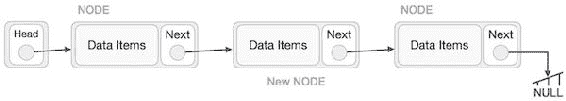

如果节点插入到链表的开头，也应该采取类似的步骤。在将其插入末尾时，链表的倒数第二个节点应该指向新节点，而新节点将指向 `NULL`。

## 删除操作

删除也是一个多步骤的过程。我们将通过图示表示来学习。首先，使用搜索算法定位要删除的节点节点。

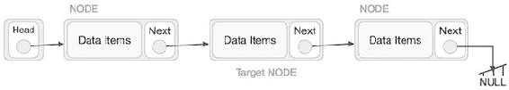

目标节点的左侧（前一个）节点现在应该指向目标节点的下一个节点——

```
LeftNode.next -> TargetNode.next;
```

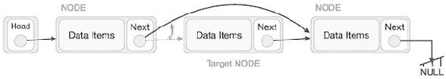

这将移除指向目标节点的链接。现在，使用以下代码，我们将移除目标节点所指向的内容。

```
TargetNode.next -> NULL;
```

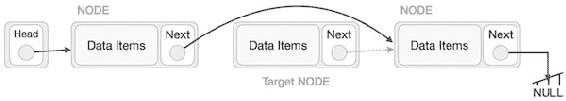

我们需要使用被删除的节点。我们可以将其保留在内存中，否则我们可以简单地释放内存并完全清除目标节点。

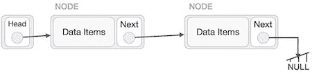

## 反转操作

此操作是彻底的。我们需要让头节点指向最后一个节点，并反转整个链表。

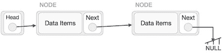

首先，我们遍历到链表的末尾。它应该指向 `NULL`。现在，我们将它指向它的前一个节点——

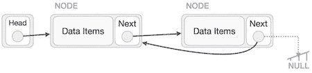

我们必须确保最后一个节点不是丢失的节点。因此，我们将有一个 `temp` 节点，看起来像头节点指向最后一个节点。现在，我们将让所有左侧节点逐个指向它们的前一个节点。

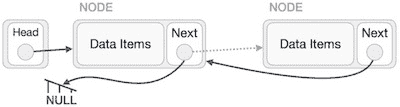

除了头节点指向的节点（第一个节点），所有节点都应该指向它们的前驱节点，成为它们新的后继节点。第一个节点将指向 `NULL`。

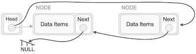

我们将使用 `temp` 节点让头节点指向新的第一个节点。

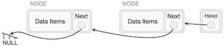

链表现在已经反转了。

## 程序：给定一个有序链表，你如何以有序的方式插入？

**算法：**

假设输入链表按升序排列。

1. 如果链表为空，则将节点设为头节点并返回它。
2. 如果要插入节点的值小于头节点的值，则将节点插入开头并将其设为头节点。
3. 在循环中，找到合适的节点，输入节点（假设为 9）将插入在该节点之后。要找到合适的节点，从头节点开始，持续移动直到到达一个节点 `GN`（下图中的 10），其值大于输入节点。`GN` 之前的上一个节点就是合适的节点 (7)。
4. 在步骤 3 找到的合适节点 (7) 之后插入节点 (9)。

### 初始链表


### 插入 9 后的链表


```java
class LinkedList {
    Node head; // 链表头

    /* 链表节点*/
    class Node {
        int data;
        Node next;

        Node(int d) {
            data = d;
            next = null;
        }
    }

    /* 在列表中插入新新结的函数。 */
    void sortedInsert(Node new_node) {
        Node current;
        /* 头节点的特殊情况 */
        if (head == null || head.data >= new_node.data) {
            new_node.next = head;
            head = new_node;
        } else {
            /* 定位插入点之前的节点。 */
            current = head;
            while (current.next != null && current.next.data < new_node.data) {
                current = current.next;
            }
            new_node.next = current.next;
            current.next = new_node;
        }
    }

    /* 工具函数*/
    /* 创建节点的函数 */
    Node newNode(int data) {
        Node x = new Node(data);
        return x;
    }

    /* 打印链表的函数 */
    void printList() {
        Node temp = head;
        while (temp != null) {
            System.out.print(temp.data + " ");
            temp = temp.next;
        }
    }

    /* 测试上述方法的驱动函数 */
    public static void main(String args[]) {
        LinkedList llist = new LinkedList();
        Node new_node;
        new_node = llist.newNode(5);
        llist.sortedInsert(new_node);
        new_node = llist.newNode(10);
        llist.sortedInsert(new_node);
        new_node = llist.newNode(7);
        llist.sortedInsert(new_node);
        new_node = llist.newNode(3);
        llist.sortedInsert(new_node);
        new_node = llist.newNode(1);
        llist.sortedInsert(new_node);
    }
}
```

**输出：**

```
1 3 5 7 10 
```

## 程序：在链表中删除给定节点

给定一个单向链表，编写一个函数来删除给定节点。你的函数遵循以下约束：

1. 它必须接受头节点作为第一个参数，要删除节点作为第二个参数。
2. 它不应该返回头节点。
3. 你可以假设链表永远不会为空。

```java
class LinkedList {
    Node head;

    static class Node {
        int data;
        Node next;

        Node(int d) {
            data = d;
            next = null;
        }
    }

    void deleteNode(Node node, Node n) {
        // 当要删除的是头节点时
        if (node == n) {
            if (node.next == null) {
                System.out.println("只有一个节点。列表为空 ");
                return;
            }
            /* 将下一个节点的数据拷贝到头节点 */
            node.data = node.next.data;
            // 存储下一个节点的地址
            n = node.next;
            // 移除下一个节点的链接
            node.next = node.next.next;
            // 释放内存
            n = null; 
        }
        // 当不是头节点时，按照常规处理
        // 寻找前一个节点
        Node prev = node;
        while (prev.next != null && prev.next != n) {
            prev = prev.next;
        }
        // 检查节点是否真的在链表中
        if (prev.next == null) {
            System.out.println("给定节点不在链表中");
            return;
        }
        // 从链表中移除节点
        prev.next = prev.next.next;
    }

    /* 打印链表的工具函数 */
    void printList(Node head) {
        while (head != null) {
            System.out.print(head.data + " ");
            head = head.next;
        }
        System.out.println("");
    }

    public static void main(String[] args) {
        LinkedList llist = new LinkedList();
        llist.head = new Node(12);
        llist.head.next = new Node(15);
        llist.head.next.next = new Node(10);
        llist.head.next.next.next = new Node(11);
        llist.head.next.next.next.next = new Node(5);
        llist.head.next.next.next.next.next = new Node(6);
        llist.head.next.next.next.next.next.next.next = new Node(2);
        llist.head.next.next.next.next.next.next.next.next = new Node(3);
        System.out.println("给定链表 :");
        llist.printList(llist.head);

        llist.deleteNode(llist.head, llist.head); // 删除头节点
        llist.printList(llist.head);
    }
}
```

**输出：**

```
给定链表：
12 15 10 11 5 6 2 3 
15 10 11 5 6 2 3 
```

```java
list.printList(head);

System.out.println("");

// 我们删除值为 10 的节点
System.out.println("Deleting node :" + head.next.next.data);
list.deleteNode(head, head.next.next);
System.out.println("Modified Linked list :");
list.printList(head);
System.out.println("");

// 删除第一个节点
System.out.println("Deleting first Node");
list.deleteNode(head, head);
System.out.println("Modified Linked List");
list.printList(head);

}
```

**输出：**

给定的链表: 12 15 10 11 5 6 2 3

删除节点 10:

修改后的链表: 12 15 11 5 6 2 3

删除第一个节点

修改后的链表: 15 11 5 6 2 3

# 第 4 章 | 网络

## 什么是网络编程？

`network programming` 一术是指编写在多个设备（计算机）上执行的程序，其中这些设备都通过网络相互连接。

J2SE API 的 `java.net` 包包含了一系列类和接口，这些类提供了底层的通信细节，允许你编写专注于解决当前问题的程序。

`java.net` 包提供了对两种常用网络协议的支持：

1. `TCP` – `TCP` 代表传输控制协议（Transmission Control Protocol），它允许两个应用程序之间进行可靠的通信。`TCP` 通常在互联网协议之上使用，被称为 `TCP/IP`。
2. `UDP` – `UDP` 代表用户数据报协议（User Datagram Protocol），是一种无连接协议，允许在应用程序之间传输数据包。

本章将对以下两个主题提供良好的理解：

1. `Socket 编程`（Socket Programming）——这是网络领域应用最广泛的概念，已进行了详细解释。
2. `URL 处理`（URL Processing）——`URL` 代表统一资源定位符（Uniform Resource Locator），代表万维网上的资源，例如 Web 页面或 FTP 目录。

## Socket 编程

Sockets 使用 `TCP` 提供了两台计算机之间的通信机制。客户端程序在通信的这一端创建一个 socket，并尝试将该 socket 连接到服务器。

当连接建立时，服务器会在通信的这一端创建一个 socket 对象。现在客户端和服务器可以通过向 socket 写入和从 socket 读取来进行通信。

`java.net.Socket` 类表示一个 socket，而 `java.net.ServerSocket` 类为服务器程序监听客户端并建立连接提供了机制。

使用 sockets 在两台计算机之间建立 TCP 连接时，会发生以下步骤：

- 服务器实例化 `ServerSocket` 对象，指定通信发生的端口号。
- 服务器调用 `ServerSocket` 类的 `accept()` 方法。该方法会等待，直到客户端在指定的端口连接到服务器。
- 在服务器等待期间，客户端实例化 `Socket` 对象，指定要连接的服务器名称和端口号。
- `Socket` 类的构造函数尝试将客户端连接到指定的服务器和端口号。如果建立了通信，客户端现在拥有了一个能够与服务器通信的 `Socket` 对象。
- 在服务器端，`accept()` 方法返回服务器上新 socket 的引用，该 socket 连接到客户端的 socket。
- 连接建立后，可以使用 I/O 流进行通信。每个 socket 都有一个 `OutputStream` 和一个 `InputStream`。客户端的 `OutputStream` 连接到服务器的 `InputStream`，而客户端的 `InputStream` 连接到服务器的 `OutputStream`。

`TCP` 是一个双向通信协议，因此数据可以同时跨越两个流发送。以下是提供了实现 sockets 完整方法集的有用类。

### ServerSocket 类方法

`java.net.ServerSocket` 类被服务器应用程序用于获取端口并监听客户端请求。

`ServerSocket` 类有四个构造函数：

| 序号 | 方法与描述 |
| :--- | :--- |
| 1 | `public ServerSocket(int port) throws IOException` 尝试创建一个绑定到指定端口的服务器字。如果端口已被另一个应用程序绑定，则会发生异常。 |
| 2 | `public ServerSocket(int port, int backlog) throws IOException` 与上一个构造函数相似，`backlog` 参数指定在等待队列中存储多少个入站客户端。 |
| 3 | `public ServerSocket(int port, int backlog, InetAddress address) throws IOException` 与上一个构造函数相似，`InetAddress` 参数指定要绑定的本地 IP 地址。`InetAddress` 用于可能具有多个 IP 地址的服务器，允许服务器指定绑定哪些 IP 地址。 |
| 4 | `public ServerSocket() throws IOException` 创建一个未绑定的服务器字。在使用此构造函数时，在准备好绑定服务器字时使用 `bind()` 方法。 |

如果 `ServerSocket` 构造函数没有抛出异常，意味着你的应用程序已成功绑定到端口，并准备好处理客户端请求。

以下是 `ServerSocket` 类的一些常用方法：

| 序号 | 方法与描述 |
| :--- | :--- |
| 1 | `public int getLocalPort()` 返回服务器字正在监听的端口。如果你将 0 作为端口号传入并让服务器为你寻找端口，此方法非常有用。 |
| 2 | `public Socket accept() throws IOException` 等待入站客户端。假设已通过 `setSoTimeout()` 设置了超时时间，否则该方法会在客户端连接到服务器或字超时之前阻塞。 |
| 3 | `public void setSoTimeout(int timeout)` 设置服务器字在 `accept()` 时等待的超时时间。 |
| 4 | `public void bind(SocketAddress host, int backlog)` 将字绑定到 `SocketAddress` 对象中指定的服务器和端口。 |

当 `ServerSocket` 调用 `accept()` 时，该方法在客户端连接之前不会返回。客户端连接后，`ServerSocket` 在未指定的端口上创建一个新的 `Socket`。现在客户端和服务器之间建立了 TCP 连接，可以开始通信。

### Socket 类方法

`java.net.Socket` 类表示客户端和服务器相互通信的 socket。客户端通过实例化获取 `Socket` 对象，而服务器从 `accept()` 方法的返回值获取 `Socket` 对象。

`Socket` 类有五个客户端用于连接服务器的构造函数：

| 序号 | 方法与描述 |
| :--- | :--- |
| 1 | `public Socket(String host, int port) throws UnknownHostException, IOException` 此方法尝试连接到指定的指定的服务器。如果此构造函数没有抛出异常，则连接成功，客户端已连接到服务器。 |
| 2 | `public Socket(InetAddress host, int port) throws IOException` 此方法与上一个构造函数相同，但主机由 `InetAddress` 对象表示。 |
| 3 | `public Socket(String host, int port, InetAddress localAddress, int localPort) throws IOException` 连接到指定的主机和端口，在本地主机上指定的地址和端口上创建 socket。 |
| 4 | `public Socket(InetAddress host, int port, InetAddress localAddress, int localPort) throws IOException` 此方法与上一个构造函数相同，但主机由 `InetAddress` 对象而不是字符串表示。 |
| 5 | `public Socket()` 创建一个未连接的 socket。使用 `connect()` 方法将此 socket 连接到服务器。 |

当 `Socket` 构造函数返回时，它不仅仅是实例化了一个 `Socket` 对象，而是实际上尝试连接到指定的服务器和端口。

这里列出了 `Socket` 类中一些感兴趣的方法。请注意，客户端和服务器都拥有一个 `Socket` 对象，因此这些方法可以被客户端和服务器共同调用。

| 序号 | 方法与描述 |
| :--- | :--- |


## Socket 类方法

以下表格列出了 `Socket` 类的常用方法：

| 序号 | 方法与描述 |
| :--- | :--- |
| 1 | `public void connect(SocketAddress host, int timeout) throws IOException` 此方法将套字连接到指定的主机。只有当您使用无参数构造函数实例化 `Socket` 时，才需要此方法。 |
| 2 | `public InetAddress getInetAddress()` 此方法返回此套字所连接的另一台计算机的地址。 |
| 3 | `public int getPort()` 返回 socket 在远程机器上绑定的端口。 |
| 4 | `public int getLocalPort()` 返回 socket 在本地机器上绑定的端口。 |
| 5 | `public SocketAddress getRemoteSocketAddress()` 返回远程 socket 的地址。 |
| 6 | `public InputStream getInputStream() throws IOException` 返回 socket 的输入流。该输入流与远程 socket 的输出流相连接。 |
| 7 | `public OutputStream getOutputStream() throws IOException` 返回 socket 的输出流。该输出流与远程 socket 的输入流相连接。 |
| 8 | `public void close() throws IOException` 关闭 socket，使得此 `Socket` 对象将无法再次连接到任何服务器。 |

### InetAddress 类方法

此类表示一个 Internet 协议 (IP) 地址。以下是您在进行网络编程时可能需要的有用方法：

| 序号 | 方法与描述 |
| :--- | :--- |
| 1 | `static InetAddress getByAddress(byte[] addr)` 给定的原始 IP 地址返回一个 `InetAddress` 对象。 |
| 2 | `static InetAddress getByAddress(String host, byte[] addr)` 根据提供的主机名和 IP 地址创建一个 `InetAddress`。 |
| 3 | `static InetAddress getByName(String host)` 根据主机名确定主机的 IP 地址。 |
| 4 | `String getHostAddress()` 返回文本形式的 IP 地址字符串。 |
| 5 | `String getHostName()` 获取此 IP 地址的主机名。 |
| 6 | `static InetAddress getLocalHost()` 返回本地主机。 |
| 7 | `String toString()` 将此 IP 地址转换为 `String`。 |

### Socket 客户端示例

以下 `GreetingClient` 是一个客户端程序，它使用 socket 连接到服务器并发送问候，然后等待响应。

示例

```java
// 文件名 GreetingClient.java

import java.net.*;
import java.io.*;

public class GreetingClient {
    public static void main(String[] args) {
        String serverName = args[0];
        int port = Integer.parseInt(args[1]);

        try {
            System.out.println("Connecting to " + serverName + " on port " + port);
            Socket client = new Socket(serverName, port);
            System.out.println("Just connected to " + client.getRemoteSocketAddress());
            OutputStream outToServer = client.getOutputStream();
            DataOutputStream out = new DataOutputStream(outToServer);
            out.writeUTF("Hello from " + client.getLocalSocketAddress());
            InputStream inFromServer = client.getInputStream();
            DataInputStream in = new DataInputStream(inFromServer);
            System.out.println("Server says " + in.readUTF());
            client.close();
        } catch (IOException e) {
            e.printStackTrace();
        }
    }
}
```

### Socket 服务器示例

以下 `GreetingServer` 程序是一个服务器应用程序示例，它使用 `Socket` 类在命令行参数指定的端口号上监听客户端——

示例

```java
// 文件名 GreetingServer.java

import java.net.*;
import java.io.*;

public class GreetingServer extends Thread {
    private ServerSocket serverSocket;

    public GreetingServer(int port) throws IOException {
        serverSocket = new ServerSocket(port);
        serverSocket.setSoTimeout(10000);
    }

    public void run() {
        while (true) {
            try {
                System.out.println("Waiting for client on port " + serverSocket.getLocalPort() + "...");
                Socket server = serverSocket.accept();
                System.out.println("Just connected to " + server.getRemoteSocketAddress());
                DataInputStream in = new DataInputStream(server.getInputStream());
                System.out.println(in.readUTF());
                DataOutputStream out = new DataOutputStream(server.getOutputStream());
                out.writeUTF("Thank you for connecting to " + server.getLocalSocketAddress() + "\nGoodbye!");
                server.close();
            } catch (SocketTimeoutException s) {
                System.out.println("Socket timed out!");
                break;
            } catch (IOException e) {
                e.printStackTrace();
                break;
            }
        }
    }

    public static void main(String[] args) {
        int port = Integer.parseInt(args[0]);
        try {
            Thread t = new GreetingServer(port);
            t.start();
        } catch (IOException e) {
            e.printStackTrace();
        }
    }
}
```

编译客户端和服务器，然后启动服务器：

`java GreetingServer 8000`

`java GreetingClient localhost 8000`

输出：

```
Waiting for client on port 8000...
Connecting to localhost on port 8000
Just connected to /127.0.0.1:8000
Hello from /127.0.0.1:8000
Server says Thank you for connecting to /127.0.0.1:8000
Goodbye!
```

### URL 处理

URL 代表统一资源定位符 (Uniform Locator)，代表 Web 上的资源，如网页或 FTP 目录。本节展示了如何将 URL 分解：

`protocol://host:port?query#ref`

协议包括 HTTP、HTTPS、FTP 等。路径被称为文件名，主机被称为权威地址。如果 URL 未指定端口，则使用协议的默认端口。HTTP 的默认端口为 80。

### 类方法

`java.net.URL` 类表示 URL 并有一套完整的方法来操作。URL 类有多种构造函数，包括：

| 序号 | 方法与描述 |
| :--- | :--- |
| 1 | `public URL(String protocol, String host, int port, String file) throws MalformedURLException` 通过组合给定部分创建 URL。 |
| 2 | `public URL(String protocol, String host, String file) throws MalformedURLException` 与前面的构造函数相同，但使用了给定协议的默认端口。 |
| 3 | `public URL(String url) throws MalformedURLException` 根据给字符串创建 URL。 |
| 4 | `public URL(URL context, String url) throws MalformedURLException` 通过解析 URL 和字符串参数创建 URL。 |

URL 类包含许多方法来访问表示的 URL 的各个部分。URL 类的方法包括：

| 序号 | 方法与描述 |
| :--- | :--- |
| 1 | `public String getPath()` 返回 URL 的路径。 |
| 2 | `public String getQuery()` 返回 URL 的查询部分。 |
| 3 | `public String getAuthority()` 返回 URL 的权威地址。 |
| 4 | `public int getPort()` 返回 URL 的端口。 |
| 5 | `public int getDefaultPort()` 返回 URL 协议的默认端口。 |
| 6 | `public String getProtocol()` 返回 URL 的协议。 |
| 7 | `public String getHost()` 返回 URL 的主机。 |
| 8 | `public String getFile()` 返回 URL 的文件名。 |
| 9 | `public String getRef()` 返回 URL 的引用部分。 |
| 10 | `public URLConnection openConnection() throws IOException` 打开到 URL 的连接，允许客户端与资源通信。 |

以下 `URLDemo` 程序演示了 URL 的各个部分。在命令行中输入一个 `URL`，然后 `URLDemo` 程序将输出给定 URL 的每个部分。

```java
// File Name : URLDemo.java

import java.net.*;
import java.io.*;

public class URLDemo {
    public static void main(String [] args) {
        try {
            URL url = new URL("https://www.amrood.com/index.htm?language=en#j2se");
            System.out.println("URL is " + url.toString());
            System.out.println("protocol is " + url.getProtocol());
            System.out.println("authority is " + url.getAuthority());
            System.out.println("file name is " + url.getFile());
            System.out.println("host is " + url.getHost());
            System.out.println("path is " + url.getPath());
            System.out.println("port is " + url.getPort());
            System.out.println("default port is " + url.getDefaultPort());
            System.out.println("query is " + url.getQuery());
            System.out.println("ref is " + url.getRef());
        } catch(IOException e) {
            e.printStackTrace();
        }
    }
}
```

### 输出

```text
URL is https://www.amrood.com/index.htm?language=en#j2se
protocol is http
authority is www.amrood.com
file name is /index.htm?language=en
host is www.amrood.com
path is /index.htm
port is -1
default port is 80
query is language=en
ref is j2se
```

#### URLConnections 类方法

`openConnection()` 方法返回一个 `java.net.URLConnection`，这是一个抽象类，其子类代表了各种类型的 URL 连接。

例如：

- 如果连接到一个协议为 `HTTP` 的 `URL`，`openConnection()` 方法将返回一个 `HttpURLConnection` 对象。

- 如果连接到一个代表 `JAR` 文件的 `URL`，`openConnection()` 方法将返回一个 `JarURLConnection` 对象，以此此类推。

`URLConnection` 类有许多方法用于设置或确定有关连接的信息，包括以下内容：

| 序号 | 方法与描述 |
| :--- | :--- |
| 1 | `Object getContent()` 获取此 URL 连接的内容。 |
| 2 | `Object getContent(Class[] classes)` 获取此 URL 连接的内容。 |
| 3 | `String getContentEncoding()` 返回 `content-encoding` 头部字段的值。 |
| 4 | `int getContentLength()` 返回 `content-length` 头部字段的值。 |
| 5 | `String getContentType()` 返回 `content-type` 头部字段的值。 |
| 6 | `int getLastModified()` 返回 `last-modified` 头部字段的值。 |
| 7 | `long getExpiration()` 返回 `expired` 头部字段的值。 |
| 8 | `long getIfModifiedSince()` 返回此对象的 `ifModifiedSince` 字段的值。 |
| 9 | `public void setDoInput(boolean input)` 传入 `true` 表示该连接将用于输入。默认值为 `true`，因为客户端通常从 `URLConnection` 中读取数据。 |
| 10 | `public void setDoOutput(boolean output)` 传入 `true` 表示该连接将用于输出。默认值为 `false`，因为许多类型的 `URL` 不支持写入。 |


| 11 | `public InputStream getgetInputStream() throws IOException` 返回 URL 连接的输入流，用于从资源读取。 |

| 12 | `public OutputStream getOutputStream() throws IOException` 返回 URL 连接的输出流，用于写入资源。 |

| 13 | `public URL getURL()` 返回此 `URLConnection` 对象连接的 `URL`。 |

### 示例

以下 `URLConnDemo` 程序连接到从命令行输入的 `URL`。

如果 `URL` 代表一个 `HTTP` 资源，连接将被强制转换为 `HttpURLConnection`，并逐行读取资源中的数据。

```java
// File Name : URLConnDemo.java

import java.net.*;
import java.io.*;

public class URLConnDemo {
    public static void main(String [] args) {
        try {
            URL url = new URL("https://www.amrood.com");
            URLConnection urlConnection = url.openConnection();
            HttpURLConnection connection = null;
            if(urlConnection instanceof HttpURLConnection) {
                connection = (HttpURLConnection) urlConnection;
            } else {
                System.out.println("Please enter an HTTP URL.");
                return;
            }
            BufferedReader in = new BufferedReader(
                new InputStreamReader(connection.getInputStream()));
            String urlString = "";
            String current;
            while((current = in.readLine()) != null) {
                urlString += current;
            }
            System.out.println(urlString);
        } catch(IOException e) {
            e.printStackTrace();
        }
    }
}
```

### 输出

```text
$ java URLConnDemo
.....a complete HTML content of home page of amrood.com.....
```

#### 学习复制与粘贴

“优秀的艺术家在创造，伟大的艺术家在偷窃。” 这里有代码示例供你复制。

# 面向对象编程并不是道路。函数式编程亦然。响应式[编程也是一种方式](https://en.wikipedia.org/wiki/Reactive_programming)。

编程有不同的方法，每种方法都有其目的。不仅如此，某些语言天生就更适合某一种范式。

“如果你手里只有一把锤子，看什么都像钉子。”

把这种想法带入自学编程中，你会发现自己一直在敲击钉子、螺丝、图书钉和大头针。

我记得有一个自学 .NET 的程序员曾经告诉我：“嗯，如果不是面向对象的，那就不算是编程。这就是为什么我不认为 JavaScript 是一门编程语言。”这是一种非常、非常错误的思维方式。

## 4. 数据结构

诚然，你的语言可以让你对不同的数据结构有一个初步的了解。但再次，这只是初步的了解。

自学程序员倾向于只坚持他们最喜爱的语言中有效的数据结构。仅仅因为它不是你语言中的基本类型，甚至不是常用结构，并不意味着它就不存在。当然，这也意味着它可能不应该存在。

如果整个世界都能装进一个数组里，那么这个世界就太小了。

## 5. 测试

也许只是我个人的想法，在将代码推送到环境之前有很多测试方法。学习如何进行单元测试。

更重要的是，学习测试驱动开发（TDD）。

测试你的代码与编写可测试的代码是有区别的。

### 我经常面试的自学程序员往往缺乏这些领域的知识

- **专业术语**。你必须熟练记忆[数据结构](https://goo.gl/E2ENP8)和其他事物的正确名称，才能在软件开发相关的项目能够进行有效的交流。

- **测试**。大多数自学者缺乏相关知识，或者通俗来说不理解测试过程的重要性。

- **编程范式（以及相应的语言）**。“如果你手里只有一把锤子，每个问题看起来都像钉子。”我遇到过很多这种“锤子型”的人。他们通常不理解为什么不是每个问题都能用相同的方式或相同的方法来解决。

- **与机器相关的数学问题**。他们缺乏数值数学技能，并且不理解如果不留心，浮点数运算可能会失效。

## 9 成为优秀程序员的 9 种方法！

### 1. 实践

除了遵循教程之外，你应该专注于自己的项目。

“最根本的事情是你实际上去写代码。我听过建议说，在你大学毕业时，你至少应该写过 10 万行代码。”

— Andrei Thorp，来自 Evernote。

但你可能会问，我如何开始呢。

“我总是告诉人们找一件每周要做超过一次的事情，并尝试将其自动化。忽略别人是否已经解决过这个问题，为你自己制作一个能解决生活中常见问题的工具/实用程序。”

— Kasra Rahjerdi，Stack Overflow 移动负责人。

“像任何其他技能一样，它需要练习——刻意练习，走出舒适区并学习细微差别和本质——这决定了优秀与好的区别。”

— Derick Bailey，WatchMeCode.net 的创建者。

Derick 是 StackOverflow 上前 0.42% 的用户，也贡献过 `MarionetteJS` 和 `BackboneJS` 等开源框架。

失败是没关系的。编码完全关乎失败和修复，以及学习如何做得更好。如果你不构建东西，不在你知道自己薄弱的领域上努力，你永远不会进步。

如果你需要获得关于如何改进以及你哪些方面做得不好的建议，请随时向经验丰富的开发者寻求帮助，通过审查你的代码或引导你理解你困惑的概念来帮你纠正。

### 2. 有耐心

这不言而喻，但人们很容易因为缺乏进展而感到沮丧，并忘记你并不孤单。

“成为一名优秀的程序员需要很长很长的时间和许多乏味的夜晚。在写出好代码之前，你必须写几十万行代码。”

— Mike Arpaia，前 Etsy 开发人员，现在为 Facebook 构建信息安全软件。

Mike 强调，初学者应该放弃“可以快速成为优秀开发者”的假设。

但是……万一你还没通过教程阶段呢？万一你还在撞墙，怀疑自己可能不是搞编程的料呢？在跳下结论之前，要知道每个人都有不同的学习风格。《Ruby on Rails Tutorial》的作者 Michael Hartl 指出，初学者应该尝试各种不同的资源（书籍、视频等），看看什么能让你“豁然开窍”。

事实上，[Reserv](https://reserve.com/) 的首席技术官 Craig Coffman 个人通过大量的尝试和选择个人且有趣的项目学会了编程。然而，由于所有有趣的挑战都是巨大的，他建议初学者从切分合理尺寸的部分开始。

这样，当你失去兴趣或被困住时，你仍然会有进步感和成就感。

### 3. 保持兴趣

如果你对正在工作的项目感到无聊，你可能应该重新考虑学习编程的任何高远目标。通过专注于让你兴奋的个人项目让自己保持动力。

Coraline Ada Ehmke，LGBTech 的创始人以及 [Rails](http://rubyonrails.org/) 和 [RSpec](http://rspec.info/) 等知名项目的贡献者，她从小就开始编程了。然而，她在大学作为计算机科学专业的第一门课让她怀疑了自己的热情。

我记得我们一个一学期的项目是为 ATM 机编写软件。我感到非常无聊且没有挑战性，我决定如果工程师的生活就是这样，我不想参与其中，于是不久后就退学了。

然而，她继续从事她认为有趣的项目。到 1993 年，她开始上网并从那时起构建网站。

### 4. 爱上错误

作为初学者，你可能会陷入 Bug 中。如果你被所有的红色警告吓到了，你并不孤单。Ross Chapman 曾在 `Zendesk`(https://www.zendesk.com/) 编写代码，现在工作于 `ScienceExchange`(https://www.scienceexchange.com/)，他承认在刚开始时是一个胆怯的开发者。

我当时没有耐心，因为我还没准备好去热爱修复问题的挑战。但这正是我所有真正糟糕的习惯的来源。

尽管如此，Ross 敦促初学者将错误视为关键的学习时刻。由于你的一生都在调试，你应该习惯错误，并学会识别错误信息。

“能够快速解析和理解错误信息将节省你大量时间，并让你走得更远。你尝试过的这一事实会让向你寻求帮助的人非常感激。”

— Jack Franklin，《Beginning jQuery》作者。

Jack 还建议初学者起初尝试自己解决问题。当调试时遇到瓶颈时，React 的共同贡献者 Lee Byron 个人会通过充分利用调试工具来尝试理解正在发生什么。

一旦我准确理解了发生了什么——一步步进行——那么我就可以将其与预期的结果进行对比，并隔离意外的部分，看看我的假设哪里错了，或者某些代码是如何导致意之外的情况的。

然而，错误不仅限于 Bug。有时，你会做出错误的决定，例如使用错误的数据结构。根据 Mike 的说法，从这些糟糕决定中吃亏最终有助于你学习何时使用某些设计模式是合理的。

# 5. 理解事物的运作原理

> “无论你处于什么水平，我都会说：在不知道代码为何运行、直到到硬件底层之前，永远、永远不要写任何一行代码。也就是说，要保持痴迷的好奇心。成为源代码世界的印第纳·琼斯。好奇心是工程师中的一种常态。我认为，如果你不带着好奇心观察显示器，是无法在这个行业立足的。既要有孩子般的好奇，要有严谨的学术态度。”

> — Ross Chapman

可以说，仅仅有兴趣是不够的。如果你目标是成为一名体面的专业开发者，你就必须努力理解事物是如何运作的。

> “你可以通过筛选 StackOverflow 上的问题开始理解你所使用的工具。我从那里学到了一点东西。[那些顶部的 AngularJS 问题]读起来非常有趣，因为 `Angular` 是一个如此庞大的框架。”

> — Todd Motto，`AngularJS` 会议演讲者、Google 开发者专家

Spotify 的高级基础设施工程师 Rohan Singh 强调了努力理解当前工作栈下方某一层层级重要性。Rohan 说：“我们作为软件工程师所做的一切都涉及在某种抽象层上工作。”换句话说，如果你使用某种数据库，你就可以忽略数据库的内部实现，并期望它“能够正常工作”。

此外，为了真正理解事物的运作原理，你应该能够解释为什么某些技术选择比其他更好，并在事物运行不符合预期时能够排除故障。Rohan 在实践中通过实现这一点：他尝试一点一点地去学习并理解他所使用的任何平台或系统的基础——无论是 `Python`、`Go` 还是 `Linux` 操作系统。据他所，这最终有助于你建立一个关于底层运作原理的心理模型，并拓宽你的知识基础。

最终，你将作为工程师而成长，而且额外的是，通过学习如何进行“后倾式”（lean back）调试而非“前倾式”（lean in）调试，你能够更高效地调试。换句话说，你会向后倾并深入思考底层是如何运作的，以找出问题可能出在哪里。Rohan 说：“这比使用交互式调试器或其他工具进行‘前倾式’调试要快得多，而且盲目乱撞要少得多。”

事实上，来自 Evernote 的 Andrei Thorp 认为每个人应该尽早学习基础 `C` 语言。

因为它非常极简且没有为你做太多事情，它强迫你从更底层理解计算机到底是如何运作的。例如，`C` 让你自己管理使用的内存——这意味着以后当你使用 `Python` 之类的工具时，你实际上理解 `Python` 在为你做什么。然后，当你看到一些奇怪的 bug 时，你脑海中有了这套工具箱来理解问题可能在哪里。

# 6. 持续学习新事物

没有什么比做一份糟糕、平庸的编程工作更能杀死你的职业/技艺成长轨迹了。去那些被鼓励/强迫不断学习新技巧的地方，

目前就职于 Amazon Web Services 的 Jonathan Henson 说道。Jonathan 每年都会尝试学习一种编程语言、范式或技术栈。然后他会将自己投入到有机会应用这些技能的项目中。

“我认为要学习最重要的技能是元学习（meta-learning）”Kasra 说，“对我来说，这是区分工程师和程序员的标准。花 12 周时间在一门课程中彻底学好一个框架是有道理的，但我非常尊重（并喜欢雇用）那些能够根据任务需要、即时学习任何技能的开发者。”

那么，学习新技能的最佳方法是什么呢？

阅读关于你想做的事情只是开始。`Rust` 核心团队成员、在 `Rails` 历史贡献者列表中排名第 37 的 Steve Klabnik 会寻找该主题的任何既有研究，并试图弄清楚擅长你想做的事情的人是如何获得结果的。最重要的一点就是去做。

1. 尝试去做那件事，可能做得很糟糕。

2. 弄清楚我在哪里错了，我需要改进什么。

3. 针对我确定的问题努力。

4. 重复。”

Bellhops 的 CTO Adam Haney 说，他学习新语言最喜欢的技巧是使用新语言的范式重新实现一个之前的项目。例如，他会取以前用 `C++` 编写的面向对象的代码，然后用函数式语言重新实现一遍。

我觉得这种练习让我做好了评估新技术的准备，因为即使我不了解语言或框架的错综细节，我也理解其底层的计算机科学原理。

如果你在记忆方面有困难，Andrei 建议建立一个“记忆宫”。通想法是利用你大脑强大的视觉记忆，并将其映射到更具技术性的数据（如数字）。他也非常相信诸如“辛菲德日历”（Seinfeld Calendar）这样的技巧，这种方法基于 Jerry Seinfeld 的想法：你不需要每天都努力工作——你只需要每天进步一点点。“所以通过他的日历，你只需要勾选今天是否处理了项目，”Andrei 说，“有一些很棒的应用可以帮你做到这一点。”

在 `Android` 上，我使用 `HabitBull`。随着你的连续记录（streak）越长，你越更有动力坚持下去。

# 7. 学习如何与他人协作

学习新事物的另一种方法是与其他人合作项目。

“独行侠程序员的传奇是一个神话，”Adam 说，“几乎所有的重大项目都需要团队合作。”这意味着你需要学习将问题拆分为多个部分、在代码库各个部分之间建立良好的接口，并在架构上进行协作。

“与一群志同道合且挑战你的工程师一起工作绝对会让你进入快车，”Craig 说，“孤立工作很难发现自己做出了愚蠢的选择，也难以学习新事物。”

每个人都会犯错——编程就是这样。初级者应该努力接触优秀的工程师并获得反馈。“不要对你的错误感到敏感，”Jonathan 强调道，“这就是进步的方法。承认你的错误并从中学习。”

进行代码审查（code review）也会迫使你思考为什么这么做某件事并更好地理解代码。“我最喜欢的合作工程师是那些不会在你写的代码上放过你马的人，”Ross 说，“我记得我第一次被挑战时，这快要把我惊坏了。但那天晚上我回家学习，直到我至少能自信地解释如何在这个闭包（closures）中传递这些内容。”

那么，你在哪里能找到可以与你结对并帮助你的导师或同伴呢？

根据 Jack 的说法，当地的聚会（meetups）通常会有环节，为任何需要的人提供免费辅导。其他免费资源包括 Twitter 群组、Slack 群组和 iRC 频道。

如今，人们很容易沉浸在职业中并只关注“编码”。尤其是在一个蓬勃的市场中，作为浏览器开发者或 Web 应用程序开发者，处理着巨大的动态编程语言（`Ruby`、`JavaScript`）以及各种极其奇特的“计算机”语言和格式（`HTML`、`CSS`），我们可能会倾向于花费所有时间去竞相掌握无数工具、框架和 API，以便在面试中通过或在工作中晋升。但在团队中构建产品始终是一项社交活动，而且是一项具有独特挑战的特殊活动，这些挑战大多是非技术性的。事实证明，软件工程中最困难的事情是决定构建什么，而不是“如何构建”；尽管随着 `JavaScript` 菌丝状网络结构的剧剧扩张，这一点可能没那么绝对了。

Ross 说，他花了一段时间才明白，大多数软件工程工作首先发生在你的脑子里。“编码很快就会变成容易的部分。但一个顶尖的工程师可以用方框、圆圈和线条画出解决方案——我知道这是一项需要学习的技能，因为我做得越来越多，而且变得越来越擅长了。”这种意识到编码更多是“托腮思考和在白板上画画”的感受对他来说产生了强烈的共鸣，他为此写了一篇博客文章。

“记住，这关乎人类和我们的生活，而不仅仅是你正在编写代码的技术，”Derick 说，“学习人类如何思考、互动和处理彼此关系。然后将你学到的知识体现在你的软件架构和设计中。”

## 9. 不要重复发明轮子

最后，无论你变得多优秀，你的代码都不可能是 100% 原创的，因为许多问题在你选择的语言中已经有了解决方案。“保持轮子原样完全没有羞耻，”Ross 保证道，“然而，当该提交时，你最好百分之百确定你能用像小·约翰逊那样的魅力和自信来向你的团队捍卫那段代码。”

“不要因为你不理解某个抽象就重复发明轮子，”Mike 提醒我们。

然而，这并不意味着重复发明轮子没有任何价值。`Clarifai` 的首席执行官 Matthew Zeiler 鼓励人们如果他们感兴趣，就去构建那些已有解决方案的东西。从零开始构建工具将帮助你学习更多关于软件工程、系统设计、可扩展性等知识。

## 结论

在学习开发应用或项目时，挫败感随处可见，但希望上面的建议能让你在成为开发者的道路上更有信心。

## 优秀程序员的 4 个秘诀！

### #1. 关于职业


# 程序员、优秀程序员和伟大程序员之间的区别

## 1. 关于代码与协作

- 编写可以被他人阅读、理解和操作的代码。这允许你交接工作并承担新挑战。
- 如果你囤积知识，你将成为这些知识唯一的维护者——或者在以工程/业务为导向的组织中，成为一个风险。
- 停止为代码或幸存的黑客松感到自豪，这在永久性的团队中毫无意义。执行力和协作将带给你更大的益处。

## 2. 关于解决方案和编码

- 如果你无法向非程序员解释它，你可能过度复杂化或过度优化了。
- 如果你无法画出架构图，你可能也把它复杂化了。
- 不要通过写“紧凑的代码”来炫耀。

## 3. 关于个人提高

- 不要成为`Java`或`C/C++`（或其他）的迷弟/迷妹。在长期的职业生涯中，你将学习 10 多种语言。把它们视为工具，而不是跟风的。
- 总会有更优秀的程序员，而且他们很难识别。向他们所有人学习。
- 你的价值不是由你的代码质量定义的。不要那样评判自己。

## 4. 关于哲学

- 编程是一门让非程序员能够完成比他们独立完成更多事情的艺术。
- 计算机科学是世界上几乎每个研究领域或行业的催化剂。计算机科学让人类做得更多、解决更多、变得更好。
- 计算机科学 != 编程。如果你的大学只教你如何编程，去要退款吧。

## 程序员、优秀程序员和伟大程序员之间的区别

- **程序员 (Programmer)**：任何在提供详细问题描述的情况下，都能编写出运行的程序来解决问题的人。
- **优秀程序员 (Good programmer)**：与他人协作创建易于维护、优雅且适合客户使用的程序，按时交付且缺陷率低，且几乎或没有人际冲突的程序员。
- **伟大程序员 (Great programmer)**：直觉上理解算法和架构的优秀程序员，可以在极少监督的情况下构建自洽的大型系统，可以发明新算法，可以在不破坏系统的情况下重构现有系统，能够就技术和非技术问题与非技术人员有效且有条理地沟通，理解如何控制自己的自我，并将自己的技能教给他人。

成为伟大程序员的路径是从成为一名程序员开始，然后培养成为优秀程序员所需的技能，再反复练习这些技能直到精通，然后培养成为伟大程序员所需的技能，并练习这些技能直到精通。

这花费的时间取决于你的个人技能、性格和培训。它也取决于你在职业生涯中拥有的经验和机会，以及你对它们的反应。

## 你的程序崩溃的 4 个原因！

你的程序崩溃可能有 4 个原因：

- 你的程序可能依赖于某些随机元素：用户输入、随机生成的数字、时间等。
- 如果你的程序使用了未初始化的变量，它可能访问了不该访问的数据（如数组越界）。
- 你的程序可能在使用经常崩溃的外部库。
- 栈溢出！

## 编程名言！

- “口说便宜。给我看代码。” —— `Linus Torvalds`
- “程序必须为了人类阅读而编写，而执行只是偶然的。” —— `Harold Abelson`, `Structure and Interpretation of Programs`
- “现在的编程是一场竞赛：软件工程师努力构建更防傻的程序，而宇宙试图产生更大、更好的傻瓜。到目前为止，宇宙赢了。” —— `Rick Cook`, `The Wizardry Compiled`
- “编写代码时，永远假设维护代码的人是个知道住址的暴力狂魔” —— `John Woods`
- “那些认为自己讨厌电脑的人的问题在于，他们真正讨厌糟糕的程序员。” —— `Larry Niven`
- “最好的程序让机器运行得快，让人类理解得清晰。理想的程序员是一个散文作家，既使用传统的审美和文学形式，也使用数学概念，来解释算法原理并说服读者结果是正确的。” —— `Donald Ervin Knuth`, `Selected Papers on Computer Science`
- “我不是伟大程序员；我只是一个习惯良好的程序员。” —— `Kent Beck`
- “每个人都知道调试比编写程序困难两倍。所以如果你在写的时候已经尽可能聪明了，你以后怎么调试呢？” —— `Brian W. Kernighan`
- “一种不能影响你思考方式的语言是不值得学习的。” —— `Alan J. Perlis`
- “计算机程序员是宇宙的创造者，因为他们是唯一的立法者。没有哪个剧作家、导演或皇帝（无论多强大）拥有过如此绝对的权威来安排舞台或战场，并指挥如此绝对听话的演员或士兵。” —— `Joseph Weizenbaum`
- “在水上行走和根据规范开发软件，如果两者都是冰冻状态都很简单。” —— `Edward Berard`
- “Perl – 唯一在 RSA 加密前后看起来完全一样的语言。”

> “你所学过的最糟糕的事情，就是你的第一门编程语言。”

> ― 艾兰·凯（Alan Kay）

> “计算机就像小提琴。你可以想象一个新手先尝试唱片机，然后是尝试小提琴。他说，后者听起来非常难听。这就是我们从人文主义者和大多数计算机科学家那里听过的论点。他们说，计算机程序对于特定目的很有用，但它们并不灵活。小提琴或打字机也是如此，直到你学会如何使用它们。”

> ― 马尔文·明斯基（Marvin Minsky）

> “程序最重要的属性是它是否实现了用户的意图。”

> ― C.A.R. 霍尔（C.A.R. Hoare）

> “面向对象的编程提供了一种编写面条代码的可持续方法。它让你像堆积补丁一样堆积程序。”

> ― 保罗·格拉姆（Paul Graham），*黑客与画家：计算机时代的宏大思想*

> “四十岁时，我已经太老不能再当程序员了；写代码是一项年轻人的工作。”

> ― 米克尔·克莱顿（Michael Crichton），*猎物*

> “说真的，一些优秀的编程是在纸上完成的。把它们放入计算机只是一个次要的细节。”

> ― 马克斯·卡纳特-亚历山大（Max Kanat-Alexander），*代码简单性：软件基础*

> “衡量程序员的标准不应该是他们的才智和逻辑，而应该是他们用例分析的完整性。”

> ― 艾兰·J·珀利斯（Alan J. Perlis）

> “只有当我们训练自己去思考程序，而不将它们仅仅视为可执行代码片段时，进步才可能。”

> ― 埃德格·W·迪杰斯特（Edsger W. Dijkstra）

> “不要因为你‘知道’它是能运行的，就忽略掉涉及 bug 的例程或代码段。证明它。在这个语境下、使用这些数据、使用这些边界条件来证明它的正确性。”

> ― 安德鲁·亨特（Andrew Hunt），*程序实战之道：从行手到大师*

> “记住，代码实际上是我们最终表达需求的语言。我们可能会创建更接近需求的语言。我们可能会创建帮助我们解析并将这些需求组装成正式结构的工具。但我们永远无法消除必要的精确——所以永远会有代码。”

> ― 罗伯特·C·马丁（Robert C. Martin）

> “软件测试是一项像狩猎一样的运动，它是捕虫。”

> ― 阿米特·卡兰特里（Amit Kalantri）

> “事实证明，编程是很的。基本规则通常简单清晰。但建立在这些规则之上的程序往往会变得复杂到足以引入它们自己的规则和复杂性。在某种程度上，你正在构建自己的迷宫，而你可能会迷失其中。”

> ― 马里恩·哈弗贝克（Marijn Haverbeke）

谢谢！
