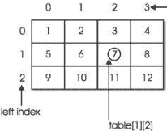
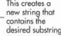
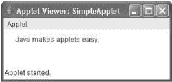
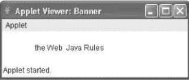
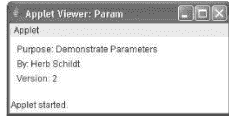
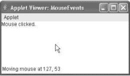
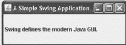
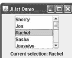
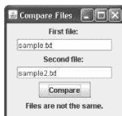

# Java 入门指南，第 5 版


今天就开始创建、编译和运行 Java 程序

# 关于作者

畅销作家赫尔伯特·希尔德特（Herbert Schildt）是 Java、C++、C 和 C# 语言的权威。他的编程书籍在全球范围内售出了数百万册并翻译成所有主要外语。他编写了许多本关于 Java 的书籍，包括《Java: The Complete Reference》《Herb Schildt’s Java Programming Cookbook》《Swing: A Beginner’s Guide》以及《The Art of Java》。他的其他畅销书还包括《C+: The Complete Reference》《C#: The Complete Reference》和《C: The Complete Reference》。尽管他对计算机科学的方方面面都感兴趣，但他的主要关注点是计算机语言，包括编译器、解释器和机器人控制语言。他还对语言标准化有着浓厚的兴趣。希尔德特拥有伊利诺伊大学的硕士和学士学位。您可以通过电话 (217) 586-4683 与他的咨询办公室联系。他的网站是 www.HerbSchildt.com。

# 关于技术编辑

Danny Coward 博士自 1997 年以来一直是 Java 平台的贡献者。在 Sun 公司工作期间，他是 Java EE 组的创始人之一。他曾担任 Java 社区流程（CEP）执行委员会成员，是所有版本 Java 平台（Java SE、Java ME 和 Java EE）的主要贡献者。他还建立了最初的 JavaFX 团队。


# 目录

- 引言
- 1 Java 基础
    - Java 的起源
    - Java 与 C 和 C++ 的关系
    - Java 与 C# 的关系
    - Java 对互联网的贡献
    - Java Applet
    - 安全性
    - 可移植性
    - Java 的魔法：字节码
    - Java 术语
    - 面向对象编程
    - 封装
    - 多态
    - 继承
    - 获取开发包
    - 第一个简单的程序
    - 输入程序
    - 编译程序
    - 逐行分析第一个示例
    - 处理语法错误
    - 第二个简单的程序
    - 另一种数据类型
    - 尝试 1-1：将加仑转换为升
    - 两种控制语句
    - if 语句
    - for 循环
    - 创建代码块
    - 分号和位置
    - 缩进规范
    - 尝试 1-2：改进加仑转升转换器
    - Java 关键字
    - Java 中的标识符
    - Java 类库
    - 第一章自测
- 2 介绍数据类型和运算符
    - 为什么数据类型很重要
    - Java 的原始类型
    - 整数
    - 浮点类型
    - 字符
    - 布尔类型
    - 尝试 2-1：闪电有多远？
    - 字面量
    - 十进制、八进制和二进制字面量
    - 字符转义序列
    - 字符串字面量
    - 深入了解变量
    - 初始化变量
    - 动态初始化
    - 变量的作用域和生命周期
    - 运算符
    - 算术运算符
    - 增量和递减运算符
    - 关系和逻辑运算符
    - 短路逻辑运算符
    - 赋值运算符
    - 赋值中的类型转换
    - 不兼容类型转换
    - 运算符优先级
    - 尝试 2-2：为逻辑运算符显示真值表
    - 表达式
    - 表达式中的类型转换
    - 空格与括号
    - 第 2 章自测
- 3 程序控制语句
    - 来自键盘的输入字符
    - if 语句
    - 嵌套 ifs
    - if-else-if 阶梯
    - switch 语句
    - 嵌套 switch 语句
    - 尝试 3-1：开始构建 Java 帮助系统
    - for 循环
    - 循环的某些变体
    - 缺失的环节
    - 无限循环
    - 空体循环
    - 在 for 循环内部声明循环控制变量
    - 增强型 for 循环
    - while 循环
    - do-while 循环
    - 尝试 3-2：完善 Java 帮助系统
    - 使用 break 退出循环
    - 将 break 作为 goto 的形式
    - 使用 continue
    - 尝试 3-3：完成 Java 帮助系统
    - 嵌套循环
    - 第 3 章自测
- 4 引入类、对象和方法
    - 类的基础
    - 类的通用形式
    - 定义类
    - 对象是如何创建的
    - 引用变量与赋值
    - 方法
    - 为 Vehicle 类添加方法
    - 从方法中返回
    - 使用参数返回值
    - 为 Vehicle 添加参数化方法
    - 尝试 4-1：创建一个帮助类
    - 构造函数
    - 参数化构造函数
    - 在 Vehicle 类中添加构造函数
    - 重新审视 new 运算符
    - 垃圾回收与终结器
    - `finalize()` 方法
    - 尝试 4-2：演示垃圾回收与终结
    - `this` 关键字
    - 第 4 章自测
- 5 更多数据类型和运算符
    - 数组
        - 一维数组
    - 尝试 5-1：对多维数组
    - 多维数组
        - 二维数组
    - 不规则数组
    - 三维或更多维的数组
    - 初始化多维数组
    - 声明语法
    - 分配数组引用
    - 使用 length 成员
    - 尝试 5-2：一个队列类
    - For-Each 风格的循环
        - 遍历多维数组
    - 应用增强型字符串
    - 构造字符串
        - 对字符串的操作
    - 字符串数组
    - 字符串是不可变的
    - 使用字符串控制 switch 语句
    - 使用命令行参数
    - 位运算符
        - 位与、或、异或、非运算符
        - 移位运算符
        - 位简写赋值
    - 尝试 5-3：一个 ShowBits 类
    - `?` 运算符
    - 第 5 章自测
- 6 深入研究方法和类
    - 控制类成员的访问
    - Java 的访问修饰符
    - 尝试 6-1：完善队列类
    - 向方法传递对象
    - 参数是如何传递的
    - 返回对象
    - 方法重载
    - 重载构造函数
    - 尝试 6-2：重载队列构造函数
    - 递归
    - 理解 `static`
    - 静态块
    - 尝试 6-3：快速排序
    - 引入嵌套类和内部类
    - Varargs：可变长度参数
        - Varargs 基础
        - 重载 Varargs 方法
        - Varargs 与歧义
    - 第 6 章自测
- 7 继承
    - 继承基础
    - 成员访问与继承
    - 构造函数与继承
    - 使用 `super` 调用父类构造函数
    - 使用 `super` 访问父类成员
    - 尝试 7-1：扩展 Vehicle 类
    - 创建多级层次结构
    - 构造函数何时被调用？
    - 父类引用与子类对象
    - 方法重写
    - 被重写的方法支持多态
    - 为什么要重写方法？
    - 将方法重写应用于 2DShape
    - 使用抽象类
    - 使用 `final`
    - `final` 防止重写
    - `final` 防止继承
    - 在数据成员上使用 `final`
    - Object 类
    - 第 7 章自测
- 8 包与接口
    - 包
    - 定义包
    - 查找包与 CLASSPATH
    - 简短的包示例
    - 包与成员访问
    - 包访问示例
    - 理解受保护的成员
    - 导入包
    - Java 类库包含在包中
    - 接口
    - 实现接口
    - 使用接口引用
    - 尝试 8-1：创建一个队列接口
    - 接口中的变量
    - 接口可以被扩展
    - 第 8 章自测
- 9 异常处理
    - 异常层次结构
    - 异常处理基础
        - 使用 try 和 catch
        - 一个简单的异常示例
    - 未捕获异常的后果
        - 异常让你能够优雅地处理错误
    - 使用多个 catch 语句
    - 捕获子类异常
    - Try 块可以嵌套
    - 抛出异常
        - 重新抛出异常
    - 深入研究 Throwable
    - 使用 finally
    - 使用 throws
    - JDK 7 添加的新异常特性
    - Java 的内置异常
    - 创建异常子类
    - 尝试 9-1：在队列类中添加异常
    - 第 9 章自测
- 10 使用 I/O
    - Java 的 I/O 基于流
    - 字符流
    - 字节类
    - 字符类
    - 预定义流
    - 使用字节流
        - 控制台输入
        - 控制台输出
    - 使用字符流
        - 使用字符串
        - 控制台输出
    - 使用 FileWriter
    - 使用 FileReader
    - 使用随机访问文件
    - 尝试 10-2：创建帮助系统
- 11 多线程编程
    - 多线程基础
    - Thread 类与 Runnable 接口
    - 创建线程
    - 一些改进
    - 尝试 11-1：扩展 Thread
    - 创建多个线程
    - 判断线程何时结束
    - 线程优先级
    - 同步
    - 使用 synchronized 方法
    - synchronized 语句
    - 使用 `notify()` `wait()` 进行通信
    - 挂起、恢复与停止线程
    - 尝试 11-2：使用主线程
    - 第 11 章自测
- 12 枚举、自动装箱、静态导入与注解
    - 枚举
    - 枚举基础
    - Java 枚举是类类型
    - `values()` 和 `valueOf()` 方法
    - 构造函数、方法、实例变量与枚举
    - 两个重要的限制
    - 枚举类 (Enum)
    - 尝试 12-1：一个计算机控制的交通灯
    - 自动装箱
    - 类型包装类基础
    - 自动装箱与方法
    - 自动装箱/拆箱发生在表达式中
    - 警告提示
    - 静态导入
    - 注解（元数据）
    - 第 12 章自测
- 13 泛型
    - 泛型基础
    - 一个简单的泛型示例
    - 泛型仅对对象有效
    - 泛型类型根据类型参数不同
    - 带有两个类型参数的泛型类
    - 泛型类的通用形式
    - 边界类型
    - 使用通配符
    - 边界通配符
    - 泛型方法
    - 泛型构造函数
    - 泛型接口
    - 尝试 13-1：创建一个泛型队列
    - 原始类型与遗留代码
    - 使用钻石运算符进行类型推断
    - 擦除
    - 歧义错误
    - 泛型的某些限制
    - 类型参数无法实例化
    - 对静态成员的限制
    - 泛型数组限制
    - 泛型异常限制
    - 继续学习泛型
    - 第 13 章自测
- 14 Applet、事件与其他主题
    - Applet 基础
    - Applet 组织与要素
    - Applet 架构
    - 完整的 Applet 骨架
    - Applet 初始化与终止
    - 请求重绘
    - `update()` 方法
    - 尝试 14-1：一个简单的横幅 Applet
    - 使用状态窗口
    - 向 Applet 传递参数
    - Applet 类
    - 事件处理
    - 委托事件模型
    - 事件
    - 事件监听器
    - 事件类
    - 事件监听器接口
    - 使用委托事件模型
    - 处理鼠标和鼠标移动事件
    - 一个简单的鼠标事件 Applet
    - 更多 Java 关键字
    - `transient` 和 `volatile` 修饰符
    - `instanceof`
    - `strictfp`
    - `assert`
    - 原生方法
    - 第 14 章自测
- 15 引入 Swing
    - Swing 的起源与设计哲学
    - 组件与容器
    - 组件
    - 容器
    - 顶层容器面板
    - 布局管理器
    - 第一个简单的 Swing 程序
    - 逐行代码分析第一个 Swing 示例
    - 使用 JButton
    - 使用 JTextField
    - 创建 JCheckBox
    - 使用 JList
    - 尝试这个：15-1 章：基于 Swing 的文件比较
    - 使用匿名内部类处理事件
    - 创建一个 Swing Applet
    - 接下来是什么？
    - 第 15 章自测
- 自测答案
    - 第 1 章：Java 基础
    - 第 2 章：数据类型与运算符
    - 第 3 章：控制语句
    - 第 4 章：介绍类、对象与方法
    - 第 5 章：更多数据类型与运算符
    - 第 6 章：深入理解方法与类
    - 第 7 章：继承
    - 第 8 章：包与接口
    - 第 9 章：异常处理
    - 第 10 章：使用 I/O
    - 第 11 章：多线程编程
    - 第 12 章：枚举、自动装箱、静态导入与注解
    - 第 13 章：泛型
    - 第 14 章：Applet、事件及杂项
    - 第 15 章：引入 Swing
- B 使用 Java 文档注释
    - Javadoc 标签
        - `@author`
        - `{@code @deprecated}`
        - `{@docRoot}`
        - `@exception`
        - `{@inheritDoc}`
        - `{@link}`
        - `{@linkplain}`
        - `{@literal}`
        - `@param`
        - `@return`
        - `@see`
        - `@serial`
        - `@serialData`
        - `@serialField`
        - `@since`
        - `@throws`
        - `{@value}`
        - `@version`
    - 文档注释的通用格式
    - Javadoc 的输出
    - 使用文档注释的示例

# 引言

Java 是世界上最重要且广泛使用的计算机编程语言之一，因为它是互联网的主流语言。如今成为一名专业的开发人员意味着精通 Java。因此，如果你的未来是 Web 编程，那么你选择了正确的语言。Java 也是手机革命的一部分，因为它被用于 Android 开发。简单来说，Java 编程是现代计算世界的基石。

本书的目的是教你 Java 编程的基础。它采用循序渐进的方法，配有大量的示例、自测和项目。它假设你没有之前的编程经验。本书从基础知识开始，例如如何编译和运行 Java 程序。然后讨论了 Java 语言的核心关键字、特性和结构。你还将了解到 Java 的一些高级特性，包括多线程编程和泛型。书以对 Swing 的介绍结束。当你完成本书时，你将牢牢掌握 Java 编程的精要。

在开头说明一下，本书只是一个起点。Java 不仅仅是定义语言的元素。Java 还包含了有助于程序开发的库和工具。成为一名顶尖的 Java 程序员意味着也要精通这些领域。完成本书后，你将拥有追求 Java 任何及其他方面的知识。

# Java 的演变

只有少数语言从根本上重塑了编程的本质。在精英中，有一种语言脱颖而出，因为它的影响是快速且广泛的。这种语言无疑是 Java。可以说，1995 年由 Sun Microsystems, Inc. 发布的 Java 1.0 引发了一场编程革命。这场革命彻底将 Web 变成了一个高度交互的环境。在这个过程中，Java 为计算机语言设计设定了新标准。

多年来，Java 继续增长、演变并重新定义自己。与许多引入新特性缓慢的语言不同，Java 通常处于计算机语言开发的前沿。原因之一是围绕 Java 的创新与变革文化。结果，Java 经历了多次升级——有些较小，有些则更为重大。

Java 的首次重大更新是 1.1 版本。Java 1.1 添加的特性比版本号的增加要实质性得多。例如，Java 1.1 添加了许多新的库元素，重新定义了事件处理方式，并重新配置了原始 1.0 库的许多特性。

Java 的下一次重大发布是 Java 2，这里的 2 表示“第二代”。Java 2 的创建是一个分水岭事件，标志着 Java “现代时代”的开始。Java 2 的首次发布版本号为 1.2。Java 2 的首次发布使用 1.2 版本号可能看起来很奇怪。原因是它最初指的是 Java 库的内部版本号，但后来被泛化指代整个发布本身。随着 Java 2，Sun 将 Java 产品重新封装为 J2SE（Java 2 平台标准版），版本号开始应用到该产品上。

Java 的下一次升级是 J2SE 1.3。这个版本的 Java 是对原始 Java 2 版本的首次重大升级。在大多数情况下，它增加了现有功能，并“收紧”了开发环境。J2SE 1.4 的发布进一步增强了 Java。该版本包含了几个重要的新特性，包括异常链、基于通道的 I/O 和 `assert` 关键字。

J2SE 5 的发布无异于创造了一场第二次 Java 革命。与大多数之前的 Java 升级（这些升级提供了重要但是渐进的改进）不同，J2SE 5 从根本上扩展了语言的范围、力量和领域。为了让你对 J2SE 5 引起的变化幅度有个直观感受，这里是书中讨论的重大新特性列表：

- 泛型
- 自动装箱/拆箱
- 枚举
- 增强型 for-each 循环
- 变长参数 (varargs)
- 静态导入
- 注解

这不是一个微调列表。列表中的每一项都代表了语言的重大添加。某些特性，如自动装箱和拆箱，改变了语言的语义。注解为编程引入了全新的维度。这些新特性的重要性体现在版本号“5”的使用上。通常 Java 从 1.4 到 1.5 似乎无法表达这种变化。相反，Sun 选择将版本号增加到 5，以强调发生了重大事件。因此，它被命名为 J2SE 5，开发者工具包被称为 JDK 5。内部版本号也是 1.5。

Java 的下一个版本被称为 Java SE 6，Sun 再次决定更改平台的名称。首先，注意到“2”被去除了。因此，平台现在称为 Java SE，官方产品名称为 Java Platform, Standard Edition 6，而 Java 开发者工具包为 JDK 6。Java SE 6 中的 6 是产品版本号。

Java SE 6 在 J2SE 5 的基础上增加了渐进式改进。Java SE 6 没有为语言本身添加重大特性，但增强了 API 库，增加了一些新包，并对运行时进行了改进。它在漫长的（对于 Java 而言）生命周期内经历了多次更新，期间增加了多次升级。总的来说，Java SE 6 进一步巩固了 J2SE 5 所取得的成就。

- 二进制整数字面量。
- 数字字面量中的下划线。


- 扩展的 `try` 语句，称为**带资源的 try（try-with-resources）**，它支持自动资源管理。（例如，文件流现在可以在不再需要时自动关闭。）
- 在构造泛型实例时通过*菱形*运算符（diamond operator）进行类型推断。
- 增强的异常处理，其中一个 `catch` 块可以捕获两个或多个异常（多重异常捕获），并对重新抛出的异常进行更好的类型检查。

正如你所见到的，尽管 Project Coin 的特性被认为是对语言的微小改进，但它们的益处将远大于“小”这一形容词所暗示的。特别是，**try-with-resources** 语句将深刻地影响大量代码的编写方式。

书中的内容已更新以反映 Java SE 7，全文引入了许多新功能、更新和补充。

## 本书的组织结构

本书提供了一个节奏均匀的教程，每个章节都建立在前章节的基础上。它包含 15 章，每章都讨论 Java 的一个方面。这本书的独特之处在于，它包含了几个特殊元素，以加强你所学的知识。

## 核心技能与概念

每章开头都会介绍一组你将学习的关键技能。

## 自测

每章末尾都有一个自测，让你能够测试自己的知识。答案位于附录 A 中。

### 提问专家

书中穿插了许多“提问专家”框。这些框包含了关于某个主题的额外条件信息或有趣的评论。它们采用问答格式。

## “尝试一试”元素

每章包含一个或多个“尝试一试”元素，这些项目将向你展示如何应用所学知识。在很多情况下，这些是真实世界的示例，你可以将其作为自己程序的的起点。

## 无需先前的编程经验

本书假设读者没有之前的编程经验。因此，如果你从未编写过程序，可以使用这本书。如果你已经有一些先前的编程经验，将能够进展得稍快一点。然而，请记住，Java 在几个关键方面与其他流行的计算机语言不同。重要的一点是不要早下结论。因此，即使对于经验丰富的程序员，也建议仔细阅读。

## 所需软件

为了编译和运行书中的所有程序，你需要来自 Oracle 的最新 Java 开发工具包（JDK），本书编写时使用的是 JDK 7。这是 Java SE 7 的 JDK。第 1 章中提供了获取 Java JDK 的说明。

如果你使用的是较早版本的 Java（例如 Java 5），你仍然可以使用这本书，但你将无法编译和运行使用 Java 新功能的程序。

## 不要忘记：网络上的代码

记住，书中所有示例和项目的源代码均可以在网络上的 www.oraclepress.com 免费获取。

## 特别感谢

特别感谢本书的技术编辑 Danny Coward。他的建议、见解和指导具有极高的价值，我们对此深表感谢。

## 进阶学习

《Java：入门指南》是你通往 Schildt 系列编程书籍的大门。以下是其他你可能感兴趣的书。如需了解更多 Java 编程的知识，我们推荐：

- 《Java：完全参考》
- 《Java 编程食谱》
- 《Java 艺术》
- 《Java：入门指南》

如果你想学习 C++，你会发现这些书籍特别是：

- 《C++：完全参考》
- 《C++ 编程食谱》
- 《从零开始学 C++》
- 《C++ 艺术》

如果你想学习 C#，我们建议以下 Schildt 的书籍：

- 《C#：完全参考》
- 《C#：入门指南》

如果你想学习 C 语言，那么以下标题将感兴趣：

- 《C：完全参考》

当你需要可靠的答案时，请参考公认的编程权威 Herbert Schildt。

## 第 1 章 基础

### 核心技能与概念

- 了解 Java 的历史和哲学
- 理解 Java 的贡献
- 了解字节码的重要性
- 理解面向对象编程的基本原理
- 创建并运行 Java 程序
- 使用变量
- 使用控制语句
- 创建代码块
- 了解 Java 关键字
- 理解标识符
- 理解类和结构
- 使用运算符
- 了解 Java 的特性
- 了解 Java 的语法
- 理解 Java 的重要性

互联网的崛起从根本上重塑了计算方式。在 Web 出现之前，计算环境被特定的目标所主导。正如你可能猜到的，许多不同类型的 CPU 被用于控制器。问题在于（在当时）大多数语言都是为特定目标编译的。例如，考虑 C++。

尽管可以为几乎任何类型的 CPU 编译 C++ 程序，但这样做需要针对该 CPU 的完整 C++ 编译器。然而，编译器的创建既昂贵又耗时。为了寻找更好的解决方案，Gosling 等人开发了一种跨平台语言，能够在不同的环境下产生可运行的代码。这种努力最终导致了 Java 的诞生。

在 Java 的细节正在制定的期间，另一个且最终更重要的因素出现了，它对 Java 的未来起着至关重要的作用。这第二个力量无疑是万维网。如果 Web 没有在 Java 实现的同时形成，Java 可能仅仅是一门用于电子设备的实用冷门语言。然而，随着 Web 的出现，Java 被推向了语言设计的前沿，因为 Web 也需要可移植程序。

大多数程序员在职业生涯早期就会学会，可移植程序是可而而不可的。虽然对创建高效、可移植（平台无关）程序的追求几乎与编程学科本身一样古老，但它一直让位于其他更紧迫的问题。然而，随着互联网的出现，旧的可移植性问题卷土重来。毕竟，互联网是由许多类型的计算机、操作系统和 CPU 构成的、分布式的宇宙。

曾经令人恼恼但低优先级的问题，现在已变成了一个显眼的需求。到 1993 年，Java 设计团队的成员们意识到问题的

在为嵌入式控制器编写代码时遇到的移植性问题，在为互联网编写代码时同样存在。这一认识使得 Java 的重心从消费电子产品转向了网络编程。因此，虽然对架构中性编程语言的需求激发了最初的火花，但最终是互联网了 Java 的大规模成功。

## Java 与 C 和 C++ 的关系

Java 与 C 和 C++ 都有直接关系。Java 从 C 继承了语法，其对象模型改编自 C++。Java 与 C 和 C++ 的关系非常重要，原因如下：首先，许多程序员对 C/C++ 语法熟悉。这使得 C/C++ 程序员很容易学习 Java，反之，Java 程序员也容易学习 C/C++。

其次，Java 的设计者并没有“重复轮子”。相反，他们完善了一种已经非常成功的编程范式。现代编程时代始于 C，演变为 C++，现在演变为 Java。通过继承并基于这些丰富的遗产，Java 提供了一个强大且逻辑自洽的编程环境，它吸取了过去的优点，并增加了在线环境所需的新功能。也许最重要的一是，由于相似性，C++ 和 Java 为专业程序员定义了一个共同的概念框架。程序员在不同语言之间切换时，不会面临巨大的隔阂。

C 和 C++ 的核心设计哲学之一是程序员掌控一切！Java 也继承了这种哲学。除了互联网环境施加的限制外，Java 给了你这个程序员完全的控制权。如果你写得好，你的程序就会反映这一点；如果你写得不好，你的程序也会反映出来。换句话说，Java 并不是一种带有“辅助轮”的语言。它是一种为专业程序员设计的语言。

Java 与 C 和 C++ 还有另一个共同属性：它是由一线程序员设计、测试和完善的。它是一种植根于设计者需求和经验的语言。没有更好的方法来产生顶尖的专业编程语言了。

由于 Java 和 C++ 之间的相似性，特别是它们对面向对象编程的支持，人们很容易将 Java 简单地认为是“C++ 的互联网版”。然而，这样做将是错误的。Java 在实践和哲学上都有显著差异。尽管 Java 受到 C++ 的影响，但它并不是 C++ 的增强版。例如，它既不向上兼容 C++ 也不向下兼容。当然，由于它与 C++ 的相似性是巨大的，如果你是一名 C++ 程序员，你会觉得 Java 别如家。另一点：Java 设计并不是为了解决某一组特定的问题，而 C++ 设计是为了解决另一组问题。它们将在未来许多年里共存。

## Java 与 C# 的关系

在 Java 创建几年后，微软开发了 C# 语言。这很重要，因为 C# 与 Java 关系紧密。事实上，C# 的许多功能与 Java 相似。两种语言都是面向对象的，使用相似的语法，并被设计为在虚拟机上运行。然而，两种语言之间也存在显著差异。例如，C# 最初是考虑到 Windows 环境设计的，而 Java 从一开始就考虑了跨平台兼容性。

（注：提供的 OCR 文本在源文件的后几页包含大量重复和乱码部分。我已根据提供的早期页面的逻辑流清理了冗余部分。）

CPU 连接到互联网。这，显然不是一种可行的解决方案。因此，通过 JVM 执行字节码是创建真正可移植程序最简单的方法。

Java 程序由 JVM 执行这一事实也有助于提高其安全性。由于 JVM 处于控制地位，它可以对程序进行限制，并防止其在系统之外产生副作用。Java 语言中存在的某些限制也增强了安全性。

当程序被解释执行时，其运行速度通常会比将相同程序编译成可执行代码的运行速度要慢。然而，在 Java 中，两者之间的差异并不大。由于字节码经过了高度优化，使用字节码使得 JVM 执行程序的速度远比你想象的要快。

尽管 Java 被设计为解释型语言，但 Java 并没有任何机制阻止将字节码即时编译为原生代码以提高性能。正因如此，HotSpot 技术在 Java 刚发布后不久就被引入了。HotSpot 提供了一个即时编译编译器（JIT 编译器），它可以形成各种只有在运行时才能完成的检查。相反，JIT 编译器会在执行过程中根据需要编译代码。此外，并不是所有的字节码序列都会被编译——只有那些能从编译中获益的序列会被编译。其余代码仅被解释执行。然而，即时编译方法仍然带来了显著的性能提升。即使对字节码应用动态编译，可移植性和安全性特性仍然适用，因为 JVM 仍然负责执行环境。

## 专家问答

**Q：** 我听过一种特殊的 Java 程序叫做 servlet。它是什么？

**A：** *servlet*（服务器端程序）是一个运行在服务器上的小型型程序。就像 applet（小程序）能够动态扩展网络浏览器的功能一样，servlet 也会动态扩展网络服务器的功能。理解这一点很有帮助：尽管 applet 很有用，但它们只是客户端/服务器等式的一半。在 Java 最初发布后不久，人们显而易见，Java 在服务器端也将有用。结果就是产生了 servlet。因此，随着 servlet 的出现，Java 跨越了客户端/服务器连接的两端。虽然创建 servlet 超出了本初级指南的范畴，但随着你 Java 编程的深入，你将想要进一步学习它们。（关于 servlet 的介绍可以在我由 Oracle Press/McGraw-Hill 出版的书籍《Java: The Complete Reference》一书中找到。）

## Java 术语

如果不查看 Java 术语，任何对 Java 的概述都是不完整的。尽管导致 Java 发明的根本动力是可移植性和安全性，但其他因素在塑造语言的最终形式方面也起了重要作用。Java 设计团队在以下术语列表中总结了关键考虑因素。

| 特性 | 描述 |
| :--- | :--- |
| 简单 (Simple) | Java 拥有一套简洁、凝聚的特征，易于学习和使用。 |
| 安全 (Secure) | Java 提供了一种安全的方法来创建 应用程序。 |
| 可移植 (Portable) | Java 程序可以在任何带有 Java 运行时环境中执行。 |
| 面向对象 (Object-oriented) | Java 体现了现代面向对象的编程哲学。 |
| 健壮 (Robust) | Java 通过强类型和执行运行时检查来鼓励无错误编程。 |
| 多线程 (Multithreaded) | Java 为多线程编程提供了集成支持。 |
| 体系无关 (Architecture-neutral) | Java 不依赖于特定的机器或操作系统体系。 |
| 解释型 (Interpreted) | Java 通过使用  码支持跨平台代码。 |
| 高性能 (High performance) | Java 字节码针对执行速度进行了高度优化。 |
| 分布式 (Distributed) | Java 在设计时考虑了互联网的分布式环境。 |
| 动态性 (Dynamic) | Java 程序携带了大量的运行时信息，用于在运行时验证和解析对对象的访问。 |

## 专家问答

**A：** 虽然 C++ 编译器可能会生成类似于字节码而非可执行代码，但 C++ 的某些特征阻碍了其在创建互联网程序时的使用。C++ 具有某些不鼓励将其用于创建的特征。*指针*（pointer）是 C++ 的一种功能。在 Java 中，通过指针来访问资源是不可能的，Java 不支持这种。

## 面向对象编程

在 Java 的中心是面向对象编程（OOP）。由于 OOP 的存在，程序变得更加复杂。面向对象方法与 Java 是不可分割的。由于 OOP 的重要性，许多编程方法在这一过程中发生了巨大的变化。在 OOP 出现之前，这种方法为了处理日益复杂的程序而被创建了。在 OOP 出现之前，结构化方法已经接近了其极限。在面向对象编程的每一个关键里程碑中，这种方法语言突破了障碍。由于 OOP 的出现，这种方法被允许。

面向对象编程利用了结构化编程的最佳思想，并结合了几个新概念。在 Java 语言中，这种方法被允许。

通常称为成员变量或实例变量。操作这些数据的代码被称为成员方法或直接称为方法。方法（Method）是 Java 对子程序的术语。如果你熟悉 C/C++，了解 Java 程序员所说的“方法”在 C/C++ 程序员中被称为“函数”可能会有所帮助。

## 多态

多态（Polymorphism，源自希腊语，意为“多种形式”）是一种允许一个接口访问一组通用动作的特性。具体的动作取决于情况的确切性质。多态的一个简单例子是汽车的方向盘。无论使用何种实际的转向机构，方向盘（即接口）都是相同的。也就是说，无论你的汽车是手动转向、助力转向还是齿轮齿条转向，方向盘都能正常工作。因此，一旦你学会了如何操作方向盘，你就可以驾驶任何类型的汽车。

同样的原理也适用于编程。例如，考虑一个栈（一种后进先出的列表）。你可能有一个程序需要三种不同类型的栈。一个栈用于整数值，一个用于浮点值，另一个一个用于字符。在这种情况下，尽管存储的数据不同，但实现每个栈的算法是相同的。在非面向对象的语言中，你将被要求创建三组不同的栈例程，每组都使用不同的名称。然而，由于多态的存在，在 Java 中，你可以创建一个通用的栈例程组，适用于所有三个特定情况。这样，一旦你学会了如何使用一个栈，你就可以使用所有的栈。

更通地说，多态的概念通常用“一个接口，多个方法”这个短语来表达。这意味着为一组相关活动设计通用接口是可能的。多态通过允许同一个接口应用于每个特定情况的通用动作（即方法），有助于降低复杂性。你作为程序员，不需要手动进行这种选择。你只需要记住并利用面对通用接口的快捷方式。

## 继承

继承（Inheritance）是一个对象可以获取另一个对象的属性的过程。这很重要，因为它支持了分级分类的概念。如果你想的话，大多数知识都是通过分级（即自上而下）的分类变得易于管理的。例如，红富士苹果属于“苹果”分类，而苹果又是“水果”类的一部分，而“水果”类位于更大的“食物”类之下。也就是说，“食物”类具有某些品质（可食的、营养的等），这些品质在逻辑上也适用于它的子类“水果”。除了这些品质外，“水果”类具有特定的特征（多汁的、甜等的），使其与其他食物区分开来。“苹果”类定义了苹果特有的品质（生长在树上、不是热带的等）。红富士苹果反过来将继承所有之前类的所有品质，并只定义那些使其成为独特的品质。

如果不使用分级结构，每个对象都必须显式地定义它的所有特征。使用继承，对象只需要定义使其在类中变得独特的品质。它可以从父类继承其通用属性。因此，是继承机制使得一个对象成为更通用情况的特定实例成为。

## 获取 Java 开发包 (JDK)

现在已经解释了 Java 的理论基础，是时候开始编写 Java 程序了。但在编译和运行这些程序之前，你必须在你的机器上安装 Java 开发包（JDK）。

JDK 可以从 Oracle 免费获取。在本文写作时，JDK 的当前版本是 JDK 7。这是 Java 7 使用的版本。（SE 代表标准版 Standard Edition）。由于 JDK 7 包含了许多早期 Java 版本不支持的特性，因此必须使用 JDK 7（或更高版本）来编译和运行书中的程序。

可以从 www.oracle.com/technetwork/java/javase/downloads/index.html 下载 JDK。只需访问下载页面并根据你的计算机类型遵循说明操作。安装好 JDK 后，你将能够编译和运行程序。JDK 提供了两个程序。第一个是 `javac`，它是 Java 编译器。第二个是 `java`，它是标准的 Java 解释器也称为应用程序启动器。

另一点：JDK 在命令提示符环境中运行，并使用命令行工具。它不是一个窗口应用程序。它不是集成开发环境（IDE）。

## 注意

除了 JDK 提供的基本命令行工具说明外，由于 IDE 之间存在差异，无法提供通用的指令。

## 专家问答

**Q:** 你提到面向对象编程是管理大型程序的有效方法。然而，这似乎会给较小的程序增加相当大的开销。既然你说所有 Java 程序在某种程度上都是面向对象的，那么这是否会对较小的程序产生惩罚？

**A：** 不会。正如你将看到的，对于小型程序来说，Java 的面向对象特性几乎是透明的。虽然 Java 确实遵循严格的对象模型，但你对于在多大使用它有很大的自由度。对于较小的程序来说，它们的“面向对象性”几乎无法察觉。随着程序的增长，你将毫不费力地整合更多的面向对象特性。

## 第一个简单程序

让我们从编译和运行这里显示的短示例程序开始：

```java
/*
这是一个简单的 Java 程序。

将此文件命名为 Example.java。
*/
class Example {
  // 定义带有 main() 的 Java 方法。
  public static void main(String args[]) {
    System.out.println("Java drives the.");
  }
}
```

你将遵循以下步骤：

1. 输入程序。
2. 编译程序。
3. 运行程序。

## 输入程序


书中显示的程序可以从这里获取。然而，如果你想手动输入程序，可以使用任何你喜欢的文本编辑器。在 Java 中，文件的名称是任意的。但 Java 并非如此。你必须学习的第一点是 `源文件名非常重要`。对于这个示例，源文件名应该是 `Example.java`。

在 Java 中，源文件正式称为编译单元。它是一个包含（其他内容）一个或多个类定义的文本文件。（我们将使用包含一个类的源文件。）Java 编译器要求文件使用 `.java` 扩展。正如你从程序中看到的，类名也是 `Example`。这并非巧合。在 Java 中，所有代码必须位于类内部。按照惯例，类的名称必须与文件名匹配。你应该确保文件名的大小写与类名一致。

## 编译程序

要编译 `Example` 程序，在命令行执行编译器 `javac` 并指定源文件名，如下所示：

```bash
javac Example.java
```

`javac` 创建了一个名为 `Example.class` 的文件，其中包含程序的字节码版本。记住，字节码不是可执行代码。字节码必须由 虚拟机执行。因此，`javac` 的输出不是可以直接执行的代码。

要实际运行程序，你必须使用 Java 解释器 `java`。这样做需要将类名 `Example` 作为命令行参数，如下所示：

```bash
java Example
```

运行程序时，将显示以下输出：

```
Java drives the.
```

## 注意事项

如果在尝试编译程序时，计算机无法找到 `javac`（假设你已经正确安装了 JDK），那么你可能需要指定命令行工具的路径。例如在 Windows 中，这意味着你需要将命令行工具的路径添加到 `PATH` 环境变量定义的路径中。例如，如果 JDK 7 安装在默认目录中，那么命令行工具的的路径就是 `C:\Program Files\jdk1.7.0\bin`（当然，JDK 的具体版本可能会有所不同）。你需要查阅你操作系统的文档来了解如何设置路径，因为此过程在不同的操作系统之间是不同的。如果你急于时间，只想尝试第一个示例程序，你也可以完整地指定每个工具的路径。例如：

```
C:\Program Files\Java\jdk1.7.0\bin\javac Example.java
C:\Program Files\Java\jdk1.7.0\bin\java Example
```

然而，这种方法不应作为通用做法。设置路径要好得多。

## 逐行分析第一个示例程序

尽管 `Example.java` 非常短，但它包含了所有 Java 程序中通用的几个关键特性。让我们仔细检查程序的每个部分。

程序以以下几行开头：

```
/*
这是一个简单的 Java 程序。

将此文件名为 Example.java。
*/
```

这是一个注释。与大多数其他编程语言一样，Java 允许你在程序的源文件中输入备注。编译器会忽略注释的内容。相反，注释会向任何阅读源代码的人描述或解释程序的运行情况。在这种情况下，注释描述了程序，并提醒你源文件应该命名为 `Example.java`。当然，在实际应用中，注释通常会解释程序的某些部分是如何工作的，或者某个特定功能的作用。

Java 支持三种风格的注释。程序顶部的注释被称为**多行注释**。这种类型的注释必须以 `/*` 开始并以 `*/` 结束。这两个注释符号之间的任何内容都会被编译器忽略。正如其名所示，多行注释可能有几行长。

程序中的下一行代码显示在此：

```java
class Example {
```

这一行使用关键字 `class` 来声明正在定义一个新类。正如前面提到的，类是 Java 封装的基本单元。`Example` 是该类的名称。类的定义以左大括号 `{` 开始，以右大括号 `}` 结束。两个大括号之间的元素是类的成员。目前，不需要过于担心类的细节，只需注意在 Java 中，所有的程序活动都发生在类内部。这就是为什么所有 Java 程序都是（至少有一点）面向对象的阶之一。

程序中的下一行是**单行注释**，显示在此：

```java
// 一个 Java 程序从调用 main() 开始。
```

这是 Java 支持的第二种注释类型。单行注释以 `//` 开始，并在行末尾结束。作为一条一般规则，程序员使用多行注释编写较长的备注，使用单行注释进行简短的逐行描述。

下一行代码显示在此：

```java
public static void main(String args[]) {
```

这一行开始了 `main` 方法。正如前面提到的，在 Java 中，子程序被称为**方法**（method）。正如它前面的注释所暗示的，这是程序开始执行的行。所有的 Java 都通过调用 `main()` 开始执行。此行中每个部分的准确含义现在无法给出，因为这涉及到对 Java 其它几个特性的详细理解。然而，由于书中的许多示例都将使用这行代码，让我们现在简要地查看每个部分。

`public` 关键字是一个**访问修饰符**（access modifier）。访问修饰符决定程序的其他部分如何访问类的成员。当类成员前面有 `public` 时，该成员可以被声明它的类外部的代码所访问。（`public` 的反面是 `private`，它防止成员被类外部的代码使用。）在这种情况下，`main()` 必须声明为 `public`，因为在程序启动时，它必须由类外部的代码调用。`static` 关键字允许在创建类对象之前调用 `main()`。这是必要的，因为在创建任何对象之前，`main()` 都是由 JVM 调用的。`void` 关键字只是告诉编译器 `main()` 不返回值。正如你将看到的，方法也可以返回值。如果这看起来有点困惑，请不要担心。所有这些概念将在随后的章节中详细讨论。

如所述，`main()` 是 Java 应用程序启动时被调用的方法。你需要传递给方法的任何信息都由方法名后括号内指定的变量接收。这些变量被称为**参数**（parameters）。如果没有参数，括号内将是空的；在 `main()` 中，只有一个参数 `String args[]`，它声明了一个名为 `args` 的参数。这是一个 `String` 类型的对象数组（数组是相似对象的集合）。`String` 类型的对象存储字符序列。在这种情况下，`args` 接收程序执行时存在的任何命令行参数。此程序没有使用这些信息，但书中稍后显示的其他程序会使用。

该行的最后一个字符是 `{`。它标志着 `main(){}` 主体的开始。包含在方法中的所有代码都发生在方法的左大括号和右大括号之间。下一行代码显示在此。注意它发生在 `main()` 内部。

```java
System.out.println("Java drives the Web.");
```

这一行输出了 "Java drives the Web." 随后是换行。输出实际上是由内置的 `println()` 方法实现的。在这种情况下， `println()` 显示了传递给它的字符串。该行以 `System.out` 开始。虽然现在难以解释，`System` 是提供系统访问的定义类，而 `out` 是连接到控制台的输出流。`System.out` 是封装控制台输出的对象。Java 使用对象定义控制台输出这一事实进一步证明。

正如你可能猜到的，控制台输出（和输入）在现实应用中并不频繁使用。由于大多数现代计算环境都是窗口化和图形化的，控制台 I/O 主要用于工具程序、演示程序和服务器端代码。在书后面你将学习使用 Java 生成输出的其他方法，但目前我们将继续使用控制台 I/O 方法。

注意 `println()` 语句以分号结束。Java 中的所有语句都以分号结束。程序中其他行没有分号结尾是因为它们在技术上不是语句。程序中的第一个 `}` 结束 `main()`，而最后一个 `}` 结束 `Example` 类定义。

最后一点：Java 是**区分大小写**的。忘记这一点会给你带来严重的问题。例如，如果你不小心输入 `Main` 而不是 `main`，或者输入了 `PrintLn` 而不是 `println`，前面的程序就是错误的。此外，Java 编译器会编译不包含 `main()` 方法的类，它没有办法执行。所以，如果你误写了 `main`，编译器仍然会编译你的程序。但是，Java 解释器会报告错误，因为它无法找到 `main()` 方法。

## 处理语法错误

如果你还没有这样做，请输入、编译并运行前面的程序。正如你从之前的编程经验中可能了解的，在向计算机输入代码时，很容易不小心输入错误内容。幸运的是，如果你在程序中输入了错误内容，编译器在尝试编译时会报告一个语法错误信息。Java 编译器会尝试理解你的源代码，无论你写了什么。由于这个原因，报告的错误并不总是能反映问题的根本原因。例如，在前面的程序中，无意漏掉 `main()` 方法的左大括号会导致编译器报告以下两个错误：

```
Example.java:8: ';' expected

public static void main(String args[])

Example.java:11: class, interface, or enum expected

}
```

显然，第一个错误信息是完全错误的，因为缺失的不是分号，而是大括号。

这段讨论的重点在于，当你的程序包含语法错误时，你不一定应该从面上接受编译器的信息。这些信息可能具有误导性。你可能需要对错误信息进行“二次判断”，以找到真实问题。此外，查看程序中被标记行之前的最后几行代码。有时，在错误实际发生的几行之后，系统才会报告错误。

## 第二个简单程序

也许没有其他结构像给变量赋值那样对编程语言语言是如此重要的了。**变量**是一个命名的内存位置，可以为其分配一个值。此外，变量的值在程序执行过程中可以改变。也就是说，变量的内容是可变的，而不是固定的。以下程序创建了名为 `var1` 和 `var2` 的两个变量：

### 这演示变量。

```java
public static void main(String[] args) {

    int var1; // this declares a variable        <- 声明变量。

    int var2; // this declares another variable

    var1 = 1024; // this assigns 1024 to var1        <- 为变量赋值。

    System.out.println("var1 contains " + var1);

    var2 = var1 / 2;

    System.out.print("var2 contains var1 / 2: ");

    System.out.println(var2);

}
```

运行此程序时，你将看到以下输出：

```
var1 contains 1024
var2 contains var1 / 2: 512
```

这个程序引入了几个新概念。首先，语句

```java
int var1; // this declares a variable
```

声明了一个类型为整数的名为 `var1` 的变量。在 Java 中，所有变量在使用之前必须声明。这里使用了 P & L。此外，还可以指定变量可以存储的值的类型。这被称为变量的类型。在这种情况下，`var1` 可以存储整数值。这些是整数值。在 Java 中，要声明一个变量的类型为整数，需要在其名称前加上关键字 `int`。因此，前面的语句声明了一个类型为 `int` 的名为 `var1` 的变量。

下一行声明了第二个名为 `var2` 的变量：

```java
int var2; // this declares another variable
```

注意此行使用了与第一行相同的格式，只是变量名不同。

通常，要声明变量，你会使用如下语句：

`type var-name;`

在这里，`type` 指定要声明的变量的类型，`var-name` 是变量名。除了 `int`，Java 还支持其他几种数据类型。

以下行代码为 `var1` 赋值了值 1024：

```java
var1 = 1024; // this assigns 1024 to var1
```

在 Java 中，赋值运算符是单等号。它将右侧的值复制到左侧的变量中。

下一行代码输出字符串 "var1 contains" 之前的 `var1` 的值：

```java
System.out.println("var1 contains " + var1);
```

在这条语句中，加号导致 `var1` 的值显示在它之前的字符串之后。这种方法可以泛化。使用 `+` 运算符，你可以在单个 `println()` 语句中链联任意数量的项。

下一行代码为 `var2` 赋值了 `var1` 除以 2 的值：

```java
var2 = var1 / 2;
```

此行将 `var1` 中的值除以 2，然后将结果存储在 `var2` 中。因此，执行该行后，`var2` 将包含值 512。`var1` 的值保持不变。与大多数其他计算机语言一样，Java 支持全算术运算符，包括这里显示的：

| 运算符 | 含义 |
| :--- | :--- |
| `+` | 加法 |
| `-` | 减法 |
| `*` | 乘法 |
| `/` | 除法 |

这是程序中的后续两行：

```java
System.out.print("var2 contains var1 / 2: ");

System.out.println(var2);
```

这里发生了两个新情况。首先，使用内置方法 `print()` 显示字符串 "var2 contains var1 / 2:"。该字符串后面没有跟换行。这意味着当生成下一个输出时，它将从同一行开始。`print()` 方法与 `println()` 相似，区别在于它每次调用后都不会输出新行。其次，在 `println()` 的调用中，注意 `var2` 是单独使用的。`print()` 和 `println()` 都可以用于输出 Java 任何内置类型的值。

在继续之前，关于声明变量的还有一点：可以使用同一个声明语句声明两个或多个变量。只需用逗号将它们的名称隔开。例如，`var1` 和 `var2` 可以这样声明：

```java
int var1, var2; // 均使用一条语句声明
```

## 另一种数据类型

在前面的程序中，使用了 `int` 类型的变量。然而，`int` 类型的变量只能存储整数。因此，当存在小数部分时无法使用它。

创建一个名为 `GalToLit.java` 的文件。

1. 将以下程序输入该文件：

```java
/*

尝试练习 1-1

此程序将加仑转换为升。

运行此程序 GalToLit.java。

*/

class GalToLit {

    public static void main(String[] args[]) {

        double gallons; // 存储加仑数

        double liters; // 存储转换为升的结果

        gallons = 10; // 从10加仑开始

        liters = gallons * 3.7854; // 转换为升

        System.out.println(gallons + " gallons is " + liters + " liters.");

    }

}
```

2. 使用以下命令行编译程序：

```bash
javac GalToLit.java
```


## 运行程序

使用此命令运行程序：

```bash
java GalToLit
```

你将看到此输出：

```
10.0 gallons is 37.854 liters.
```

在此阶段，该程序将 10 加仑转换为升。然而，通过更改赋值给 `gallons` 的值，你可以让程序将不同数量的加仑转换为相应的升。

## 两个控制语句

在方法内部，执行按照从一条语句到下一条、从上到下的顺序进行。然而，可以通过 Java 支持的各种程序控制语句来改变这种流程。虽然我们稍后会详细介绍控制语句，但这里会简要介绍其中两种，因为我们将使用它们来编写示例程序。

## if 语句

你可以通过 Java 的条件语句 `if` 来选择性地执行程序的某部分。Java 的 `if` 语句工作方式与任何其他语言中的 IF 语句非常相似。其最简单的形式如下：

```java
if (condition) statement;
```

在这里，`condition` 是一个布尔表达式。如果 `condition` 为真，则执行该语句。如果 `condition` 为假，则跳过该语句。这里有一个示例：

```java
if (10 < 11) System.out.println("10 is less than 11");
```

在这种情况下，由于 10 小于 11，因此条件表达式为真，`println()` 将执行。然而，请考虑以下情况：

```java
if (10 < 9) System.out.println("this won't be displayed");
```

在这种情况下，10 并不小于 9。因此，不会发生对 `println()` 的调用。

Java 定义了完整的关系运算符，可以用于条件表达式。它们如下所示：

| 运算符 | 含义 |
| --- | --- |
| `<` | 小于 |
| `<=` | 小于等于 |
| `>` | 大于 |
| `>=` | 大于等于 |
| `==` | 等于 |
| `!=` | 不等于 |

注意相等测试使用的是双等号。

这里是一个说明 `if` 语句的程序：

### 演示 if

运行此文件 `IfDemo.java`。

```java
/*
 * 演示 if。
 */
class IfDemo {
    public static void main(String args[]) {
        int a, b, c;

        a = 2;
        b = 3;

        if (a < b) System.out.println("a is less than b");

        // 这不会显示任何内容
        if (a == b) System.out.println("you won't see this");

        System.out.println();

        c = a - b; // c 包含 -1

        System.out.println("c contains -1");

        if (c >= 0) System.out.println("c is non-negative");
        if (c < 0) System.out.println("c is negative");

        System.out.println();

        c = b - a; // c 现在包含 1

        System.out.println("c contains 1");

        if (c >= 0) System.out.println("c is non-negative");
        if (c < 0) System.out.println("c is negative");
    }
}
```

此程序生成的输出如下：

```
a is less than b

c contains -1
c is negative

c contains 1
c is non-negative
```

注意此程序中的另外一点。该行 `int a, b, c;` 通过逗号分隔的列表声明了三个变量 `a`、`b` 和 `c`。正如前面提到的，当需要两个或多个相同类型的变量时，可以在一条语句中声明它们。只需用逗号分隔变量名即可。

## for 循环

你可以通过创建循环来重复执行一段代码。Java 提供了强大的循环结构组合。我们在这里查看的是 `for` 循环。`for` 循环最简单的形式如下：

```java
for (initialization; condition; iteration) statement;
```

在最常见的形式中，循环的初始化部分将循环控制变量设置为初始值。条件是一个测试循环控制变量的布尔表达式。如果该测试的结果为真，则 `for` 循环继续迭代。如果为假，则循环终止。迭代表达式决定了循环控制变量在每次循环迭代时如何发生变化。

这里有一个说明 `for` 循环的短程序：

### 演示 for 循环

运行此文件 `ForDemo.java`。

```java
/*
 * 演示 for 循环。
 */
class ForDemo {
    public static void main(String args[]) {
        int count;

        for (count = 0; count < 5; count++) {
            System.out.println("count is " + count);
        }
    }
}
```

此程序生成的输出如下：

```
count is 0
count is 1
count is 2
count is 3
count is 4
```

## 代码块

代码块是由左大括号 `{` 和右大括号 `}` 包围的一组逻辑连接的语句。代码块不会增加任何影响效率的开销。此外，`{` 和 `}` 只存在于程序的源代码中。Java 并不感知或执行 `{` 或 `}`。

正如你将在书中后面看到的，代码块具有额外的属性和用途。然而，它们存在的主要目的是为了创建逻辑上不可分割的代码单元。

### 分号与位置

在 Java 中，分号是一个用于终止语句的**分隔符**。也就是说，每个单独的语句都必须以分号结束。它表示一个逻辑实体的结束。

如你所知，一个块是一组被左括号和右括号包围的逻辑连接的语句。代码块**不是**以分号结束的。由于代码块是一组语句，每个语句后都有一个分号，因此代码块不以分号结束是合逻辑的；相反，代码块的结束由右括号来指示。

Java 不将行尾识别为终止符。因此，你将语句放在一行的哪个位置并不重要。例如：

```java
x = y;
y = y + 1;
System.out.println(x + " " + y);
```

对于 Java 来说，与以下代码相同：

```java
x = y; y = y + 1; System.out.println(x + " " + y);
```

此外，语句的各个元素也可以单独放置。例如，以下写法是完全可以的：

```java
System.out.println("This is a long line of output " + \
      x + y + z + \
      "more output");
```

### 缩进规范

你可能在之前的示例中注意到某些语句被缩进了。Java 是一种自由形式的语言，这意味着你在一行中如何放置语句的相对位置并不重要。然而，多年来，已经发展出了一种通用且被广泛接受的缩进风格，使得程序具有很高的可读性。本书遵循这种风格，建议你也这样做。使用这种风格时，在每个左括号后缩进一级，在每个右括号后回退一级。某些语句鼓励进行额外的缩进；这些将在稍后介绍。

## 尝试此 1-2：改进加仑到升的转换器

文件名：`GalToLitTable.java`

你可以使用 `for` 循环、`if` 语句和代码块来创建一个你在第一个项目中开发的加仑到升转换器的改进版本。这个新版本将打印一个转换表，从 1 加仑开始，到 100 加仑结束。每隔 10 加仑，将输出一个空行。这是通过使用一个变量计数器实现的，该计数器记录已输出的行数。请特别注意它的用法。

1. 创建名为 `GalToLitTable.java` 的新文件。
2. 在文件中输入以下程序：
3. 使用以下命令行编译程序：
   ```bash
   javac GalToLitTable.java
   ```
4. 使用此命令运行程序：
   ```bash
   java GalToLitTable
   ```

以下是你将看到的输出部分：

```
1.0 gallons is 3.7854 liters.
2.0 gallons is 7.5708 liters.
3.0 gallons is 11.35620000000001 liters.
4.0 gallons is 15.1416 liters.
5.0 gallons is 18.927 liters.
6.0 gallons is 22.712400000000002 liters.
7.0 gallons is 26.4978 liters.
8.0 gallons is 30.2832 liters.
9.0 gallons is 34.0686 liters.
10.0 gallons is 37.854 liters.

11.0 gallons is 41.6394 liters.
12.0 gallons is 45.42480000000005 liters.
13.0 gallons is 49.2102 liters.
14.0 gallons is 52.9956 liters.
15.0 gallons is 56.781 liters.
16.0 gallons is 60.5664 liters.
17.0 gallons is 64.3518 liters.
18.0 gallons is 68.1372 liters.
19.0 gallons is 71.9226 liters.
20.0 gallons is 75.708 liters.
21.0 gallons is 79.4934000000001 liters.
22.0 gallons is 82.2788 liters.
23.0 gallons is 87.0642 liters.
24.0 gallons is 90.849600000001 liters.
25.0 gallons is 94.635 liters.
26.0 gallons is 98.4204 liters.
27.0 gallons is 102.2058 liters.
28.0 gallons is 105 liters.
29.0 gallons is 109.56 liters.
30.0 gallons is 113.592 liters.
```


你可以使用 `for` 循环、`if` 语句和代码块来创建一个你在第一个项目中开发的加仑到升转换器的改进版本。这个新版本将打印一个转换表，从 1 加仑开始，到 100 加仑结束。每隔 10 加仑，将输出一个空行。这是通过使用一个变量计数器实现的，该计数器记录已输出的行数。请特别注意它的用法。

1. 创建名为 `GalToLitTable.java` 的新文件。
2. 在文件中输入以下程序：
3. 使用以下命令行编译程序：
```
javac GalToLitTable.java
```
4. 使用此命令运行程序：
```
java GalToLitTable
```

以下是你将看到的输出部分：

1.0 gallons is 3.7854 liters.
2.0 gallons is 7.5708 liters.
3.0 gallons is 11.35620000000001 liters.
4.0 gallons is 15.1416 liters.
5.0 gallons is 18.927 liters.
6.0 gallons is 22.712400000000002 liters.
7.0 gallons is 26.4978 liters.
8.0 gallons is 30.2832 liters.
9.0 gallons is 34.0686 liters.
10.0 gallons is 37.854 liters.

11.0 gallons is 41.6394 liters.
12.0 gallons is 45.42480000000005 liters.
13.0 gallons is 49.2102 liters.
14.0 gallons is 52.9956 liters.
15.0 gallons is 56.781 liters.
16.0 gallons is 60.5664 liters.
17.0 gallons is 64.3518 liters.
18.0 gallons is 68.1372 liters.
19.0 gallons is 71.9226 liters.
20.0 gallons is 75.708 liters.
21.0 gallons is 79.4934000000001 liters.
22.0 gallons is 82.2788 liters.
23.0 gallons is 87.0642 liters.
24.0 gallons is 90.849600000001 liters.
25.0 gallons is 94.635 liters.
26.0 gallons is 98.4204 liters.
27.0 gallons is 102.2058 liters.
28.0 gallons is 105 liters.
29.0 gallons is 109.56 liters.
30.0 gallons is 113.592 liters.

## Java 关键字

abstract | boolean | break | byte | case | char | class | continue | default | do | else | enum | extends | final | float | for | goto | if | instanceof | int | interface | long | native | package | private | protected | public | return | short | static | super | synchronized | this | throw | throws | transient | try | var | void | volatile | while

## 标识符

在 Java 中，一个标识符是赋予方法、变量或任何项的名称。标识符可以是字母、下划线或美元符号开头。后续字符可以是字母、数字、下划线或美元符号。此外，标识符不能是 Java 关键字。此外，Java 是区分大小写的，因此 `myvar` 和 `MyVar` 是不同的标识符。

## Java 类库

本章中的示例程序使用了 Java 的两个内置方法：`println()` 和 `print()`。这些方法是 `System` 类的成员，该类是自动包含的。从宏观上看，Java 环境依赖于几个内置类库，它们提供了如 I/O、字符串处理、网络等功能支持。标准类还支持窗口化输出。因此，Java 整体是 Java 语言本身加上标准类的组合。正如你所看到的，类库提供了 Java 自带的许多功能。事实上，成为 Java 程序员的一部分就是学习标准类。

## 第一章自测

1. 什么是字节码（bytecode）？为什么它对 Java 的互联网应用很重要？
2. 对象导编程有哪些主要原则？
3. Java 程序从哪里开始执行？
4. 什么是变量？
5. 下列标识符名是无效的？
   A. count
   B. $count
   C. count27
   D. 67count
6. 如何创建单行注释？如何创建多行注释？
7. 展示 `if` 语句的通用形式。展示 `for` 循环的通用形式。
8. 如何创建代码块？
9. 月球重力大约是地球的 17%。编写一个程序计算你在月球上的有效重量。
10. 调整“尝试此 1-2”，使其变为 39.37 英寸。
11. 如果在输入程序时出现打字错误，会导致什么错误？
12. 将语句放在一行的哪个位置重要吗？

## 第2章 介绍数据类型和运算符

### 核心技能与概念

- 了解 Java 的基本类型
- 使用字面量
- 初始化变量
- 了解方法内部变量的作用域规则
- 使用算术运算符
- 使用关系运算符和逻辑运算符
- 理解赋值运算符
- 使用简写赋值
- 理解赋值中的类型转换
- 对不兼容类型进行强制类型转换
- 理解表达式中的类型转换

任何编程语言的基础都是其数据类型和运算符，Java 也不例外。这些元素定义了语言的局限性并决定了它可以应用于哪些任务。幸运的是，Java 支持丰富的数据类型和运算符，这使其适用于任何类型的编程。

数据类型和运算符是一个宏大的课题。我们将从研究 Java 的基础数据类型及其最常用的运算符开始。我们还将详细查看变量并研究表达式。

### 为什么数据类型很重要

数据类型在 Java 中尤为重要，因为它是一门强类型语言。这意味着所有操作都由编译器进行类型兼容性检查。非法操作将无法通过编译。因此，强类型检查有助于防止错误并提高可靠性。为了实现强类型检查，所有变量、表达式和值都有其类型。例如，不存在“无类型”变量的概念。此外，值的类型决定了允许对其进行哪些操作。例如，允许在某种类型上的强操作在另一种类型上可能是不允许的。

### Java 的基本类型

Java 包含两类内置数据类型：面向对象的和非面向对象的。Java 的面向对象类型由类定义，关于类的讨论将推到后以后。然而，Java 的核心是 8 种基本（也称为元素或简单）数据类型，如表 2-1 所示。此处使用 *primitive* 一词是为了这些类型在面向对象的意义上不是对象，而是普通的二进制值。出于效率考虑，这些基本类型不是对象。Java 的其他数据类型都是由这些基本类型构建的。

| 类型 | 含义 |
| --- | --- |
| boolean | 表示真/假值 |
| byte | 8位整数 |
| char | 字符 |
| double | 双精度浮点数 |
| float | 单精度浮点数 |
| int | 整数 |
| long | 长整数 |
| short | 短整数 |

**表 2-1** Java 的内置基本数据类型

Java 严格规定了每个基本类型的范围和行为，所有 Java 虚拟机的实现都必须支持这些规定。由于 Java 的可移植性要求，Java 在这方面是不妥协的。例如，`int` 在所有执行环境中都是相同的。这使得程序具有完全的可移植性。不需要为了适应特定平台而重写代码。虽然严格规定基本类型的范围在某些环境中导致微小的性能损失，但为了实现可移植性，这是必要的。

### 整数

Java 定义了四种整数类型：`byte`、`short`、`int` 和 `long`，如下：

| 类型 | 宽度（位） | 范围 |
| --- | --- | --- |
| byte | 8 | -128 到 127 |
| short | 16 | -32,768 到 32,767 |
| int | 32 | -2,147,483,648 到 2,147,483,647 |
| long | 64 | -9,223,372,036,854,775,808 到 9,223,372,036,854,775,807 |

如表所示，所有整数类型都是带符号的正负值。Java 不支持无符号（仅限正数）整数。许多其他计算机语言同时支持带符号和无符号整数。然而，Java 的设计者认为无符号整数是没有必要的。

> **备注**
>
> 从技术上讲，Java 运行时可以使用任何所需的大小来存储基本类型。但在所有情况下，类型必须按照规定起作用。

最常用的整数类型是 `int`。`int` 类型的变量通常用于控制循环、索引数组以及执行通用整数数学运算。

当你需要一个范围大于 `int` 的整数时，请使用 `long`。例如，这里有一个程序，用于计算长、宽高均为1英里的立方体中包含多少立方英寸：

```java
/*
计算1立方英里包含的立方英寸。
*/
class Inches {
    public static void main(String args[]) {
        long ci;
        long im;
        im = 5280 * 12;
        ci = im * im * im;
        System.out.println("There are " + ci + " cubic inches in cubic mile.");
    }
}
```

以下是程序的输出：

There are 25435806105600 cubic inches in cubic mile.

显然，结果没有存储在 `int` 变量中。

最小的整数类型是 `byte`。在处理可能与 Java 其他内置类型不直接兼容的原始二进制数据时，`byte` 类型的变量特别有用。当你需要更大的范围时，`short` 是合适的。

#### 专家问答

**Q：你们说有整数类型：short, long。但是，我听说 char 也可以是整数类型。你能解释一下吗？**

**A：在 Java 中，`char` 是一种无符号的 16 位类型，范围从 0 到 65,536。标准的 8 位 ASCII 字符集是 Unicode 的子集，范围从 0 到 127。因此，ASCII 字符仍然是有效的 Java 字符。**

### 浮点类型

如第 1 章所示，浮点类型表示分数。浮点类型有两种，分别为 `float` 和 `double`。`float` 宽 32 位，`double` 宽 64 位。在两者中，`double` 最常用，因为所有的数学函数都使用 `double` 值。例如，`sqrt()` 方法（由 `Math` 类定义）返回参数平方根的 `double` 值。在这里，使用 `sqrt()` 来计算斜边的长度：

```java
/*
使用勾股定理
在已知两条边长度的情况下
找到斜边的长度。
*/
class Hypot {
    public static void main(String args[]) {
        double x, y, z;
        x = 3;
        y = 4; // 注意 sqrt() 是如何调用的。它的前面是它所属的类名。
        z = Math.sqrt(x*x + y*y);
        System.out.println("Hypotenuse is " + z);
    }
}
```

程序的输出在此：

Hypotenuse is 5.0

关于上述示例的另一点：正如提到的，`sqrt()` 是标准 `Math` 类成员。

### 字符

在 Java 中，字符不像许多其他计算机语言那样是 8 位数值。相反，Java 使用 Unicode。Unicode 定义了一个可以表示所有人类语言中字符的字符集。在 Java 中，`char` 是一种无符号的 16 位类型，范围从 0 到 65,536。标准的 8 位 ASCII 字符集是 Unicode 的子集，范围从 0 到 127。因此，ASCII 字符仍然是有效的 Java 字符。

字符变量可以通过用单引号包含字符来赋值。例如，这将字母 X 赋值给变量 `ch`：

```java
char ch;
ch = 'X';
```

可以使用 `println()` 语句输出字符值。例如，此行输出 `ch` 的值：

```java
System.out.println("This is ch: " + ch);
```

由于 `char` 是无符号的 16 位类型，因此对 `char` 变量进行各种算术操作是可能的。例如，考虑以下程序：

字符变量可以像整数一样处理。

```java
class CharArithDemo {
    public static void main(String args[]) {
        char ch;
        ch = 'X';
        System.out.println("ch contains " + ch);
        ch++; // 增加 ch—字符可以递增。
        System.out.println("ch is now " + ch);
        ch = 90; // 给 ch 赋值为 Z—字符可以被赋值整数。
        System.out.println("ch is now " + ch);
    }
}
```

该程序生成的输出所示：

ch contains X
ch is now Y
ch is now Z

在程序中，`ch` 首先被赋值为 X。接着，`ch` 递增了。这导致 `ch` 包含 Y，即 ASCII（以及 Unicode）序列中的下一个字符。接着，`ch` 被赋值为值 90，这是对应于字母 Z 的 ASCII（以及 Unicode）值。由于 ASCII 字符集占据了 Unicode 字符集中的前 127 个值，因此你在其他语言中处理字符时可能使用的所有“老花样”在 Java 中同样适用。

### 专家问答

**问:** 为什么 Java 使用 Unicode？

**答:** Java 设计是为了全球范围内使用的。因此，它需要使用一种能够表示世界上所有语言的字符集。Unicode 是专为此目的设计的标准字符集。当然，对于英语、德语、西班牙语或法语等语言（其字符包含在 8 位内），使用 Unicode 是低效的。但这是全球移植性必须付出的代价。

### 布尔类型

`boolean` 类型表示表示真/假（true/false）值。Java 使用保留字 `true` 和 `false` 定义这两个值。因此，`boolean` 类型的变量或表达式将是这两个值之一。

以下是一个演示布尔类型的程序：

```java
// 演示布尔值。
class BoolDemo {
    public static void main(String args[]) {
        boolean b;
        b = false;
        System.out.println("b is " + b);
        b = true;
        System.out.println("b is " + b);
        // 布尔值可以控制 if 语句
        if (b) System.out.println("This is executed.");
        b = false;
        if (b) System.out.println("This is not executed.");
        // 关系运算符的结果是一个布尔值
        System.out.println("10 > 9 is " + (10 > 9));
    }
}
```

该程序生成的输出所示：

```
b is false
b is true
This is executed.
10 > 9 is true
```

关于这个程序有三个有趣的点值得注意。首先，正如你所看到的，当用 `println()` 输出布尔值时，会显示 "true" 或 "false"。第二，`boolean` 变量的值本身就足以控制 `if` 语句了。不需要像下面这样写一个 `if` 语句：

```java
if(b == true) ..
```

第三，关系运算符（如 `<`）的结果是一个 `boolean` 值。这就是为什么表达式 `10 > 9` 显示值为 "true"。此外，`10 > 9` 外层额外的括号是必要的，因为 `+` 运算符的优先级高于 `>`。

### 尝试一下 2-1 闪电有多远？

`Sound.java`

在这个项目中，你将创建一个程序，计算听者距离闪电有多远（以英尺计）。声音在空气中的传播速度约为每秒 1100 英尺。因此，知道看到闪电的时间和声音到达你这里的时间之间的间隔，就能计算出闪电的距离。假设时间间隔为 7.2 秒。

1. 创建一个名为 `Sound.java` 的文件。
2. 为了计算距离，你需要使用 `double` 类型，因为 7.2 是浮点数。
3. 将 1100 乘以 `double`。
4. 最后，显示结果。

以下是完整的 `Sound.java` 代码：

```java
/*
  尝试一下 2-1
  计算闪电的距离
  声音需要 7.2 秒到达你。
*/
class Sound {
  public static void main(String[] args[]) {
    double dist;
```


## 十六进制、八进制和二进制字面量

你可能知道，在编程中，有时使用基于 8 或 16 的进制比基于 10 更方便。基于 8 的进制称为八进制，它使用数字 0 到 7。在八进制中，10 等于十进制的 8。基于 16 的进制称为十六进制，它使用数字 0 到 9 以及字母 A 到 F，它们分别代表 10、11、12、13、14 和 15。例如，十六进制的 10 等于十进制的 16。由于这两种进制的使用频率很高，Java 允许你用十六进制或八进制指定整数字面量而不是十进制。十六进制字面量必须以 `0x` 或 `0X`（零后跟 x 或 X）开头。八进制字面量以零开头。这里是一些示例：

```java
hex = 0xFF; // 十进制为 255
oct = 011; // 十进制为 9
```

此外，Java 也允许十六进制浮点字面量，但很少使用。

从 JDK 7 开始，可以使用二进制指定整数字面量。这样做时，在二进制数前加上 `0b` 或 `0B`。例如，这指定了二进制值为 12：`0b1100`。

## 字符转义序列

用单引号括起字符常量对于大多数打印字符是有效的，但在使用文本编辑器时会产生一个特殊问题。此外，其他某些字符（如单引号和双引号）在 Java 中具有特殊含义，因此你不能直接使用它们。出于这些原因，Java 提供了特殊的转义序列，有时称为反斜线字符常量，如表 2-2 所示。这些序列用于代替它们所代表的字符。

| 转义序列 | 描述 |
|---|---|
| `\'` | 单引号 |
| `\"` | 双引号 |
| `\\` | 反斜线 |
| `\r` | 回车 |
| `\n` | 换行 |
| `\f` | 换页 |
| `\t` | 水平制表符 |
| `\b` | 退格 |
| `\ddd` | 八进制常量（其中 ddd 是八进制常量） |
| `\xxxx` | 十六进制常量（其中 xxxx 是十六进制常量） |

**表 2-2** 字符转义序列

例如，这为 `ch` 分配了制表符：

```java
ch = '\t';
```

下一个示例为 `ch` 分配了单引号：

```java
ch = '\'';
```

## 字符串字面量

Java 支持一种类型的字面量：字符串。字符串是一组由双引号括起来的字符。例如，`"this is a test"` 是一个字符串。你已经在之前的示例程序的许多 `println()` 语句中见过字符串的示例。

除了普通字符外，字符串字面量还可以包含一个或多个上述的转义序列。例如，考虑以下程序。它使用了 `\n` 和 `\t` 转义序列。

```java
// Demo字符串中的转义序列。
class StrDemo {
  public static void main(String args[]) {
    System.out.println("First line\nSecond line");
    System.out.println("A\tB\tC");
    System.out.println("D\tE\tF");
  }
}
```

使用 `\n` 生成新行。使用制表符对齐输出。输出所示：

```
First line
Second line
A    B    C
D    E    F
```

## 专家问答

**Q:** 由单个字符组成的字符串与字符字面量相同吗？例如，`"k"` 等于 `'k'` 吗？

**A:** 不等。你不能混淆字符串和字符。字符字面量表示 `char` 类型的单个字母。仅包含一个字母的字符串仍然是字符串。虽然字符串由字符组成，但它们不是同一类型。

注意如何使用 `\n` 转义序列来生成新行。你不需要使用多个 `println()` 语句来获取多行输出。只需在想要换行的地方在较长的字符串中嵌入 `\n` 即可。

## 深入观察变量

变量在第 1 章中引入。在这里，我们将更深入地观察它们。正如你之前学到的，变量是使用这种语句声明的：

```java
type var-name;
```

其中 `type` 是变量的数据类型，`var-name` 是它的名称。你可以声明任何有效类型的变量，包括上面描述的简单类型。当你创建一个变量时，你实际上是在创建了该类型的一个实例。因此，变量的能力由其类型决定。例如，类型为 `boolean` 的变量不能用于存储浮点值。此外，变量的类型在其生命周期内不能更改。例如，一个 `int` 变量不能变成 `char` 变量。

Java 中的所有变量必须在使用之前声明。这是必要的，因为编译器在正确编译使用该变量的语句之前，必须知道变量包含什么类型的数据。这使得 Java 能够执行严格的类型检查。

## 初始化变量

通常，你必须在使用变量之前给它一个值。给变量赋值的一种方法是通过赋值语句，正如你已经看到的。另一种方法是在声明时给它一个初始值。要这样做，在变量名后面跟随等号和要赋值的值。初始化的通用形式所示：

```java
type var = value;
```

在这里，`value` 是 `var` 创建时赋予它的值。该值必须与指定的类型兼容。以下是一些示例：

```java
int count = 10;
char grade = 'A';
String name = "Java";
boolean flag = true;
```

在某些情况下，你可以在同一语句中声明变量并初始化它。例如：

```java
int count = 10;
```

在其他情况下，你可以先声明变量稍后初始化它。例如：

```java
int count;
count = 10;
```

## 动态初始化

虽然前面的示例使用了常量，但 Java 允许在运行时初始化变量。例如，这里有一个短程序：

```java
// Demo动态初始化。
class DynInit {
    public static void main(String args[]) {
        double radius; // 尚未初始化
        radius = 3.14; // 在此处初始化
        System.out.println("Radius is " + radius);
    }
}
```

## 变量的作用域和生命周期

到为止，我们使用的所有变量都是方法内部声明的。方法的作用域从它的左括号开始。然而，如果该方法有参数，它们也被包含在方法的作用范围内。

根据一般规则，作用域内部声明的变量对于范围之外的代码是不可见的（即不可访问的）。因此，当你在范围内声明变量时，你是将该变量局部化，并使其免受未经授权访问或修改。事实上，作用域规则为封装提供了基础。

作用域可以嵌套。例如，每当你创建一个代码块时，你就创建一个新的嵌套作用域。当这种情况发生时，外部作用域包含内部作用域。这意味着在外部作用域中声明的对象对于内部作用域内的代码是可见的。然而，反之则不然。在内部作用域中声明的对象在外部是不可见的。

为了理解嵌套作用域的影响，考虑以下程序：

```java
// Demo块作用域。
class ScopeDemo {
    public static void main(String args[]) {
        int x; // main方法内所有代码可见
        x = 10;
        if (x == 10) { // 开始新作用域
            int y = 20; // 仅在此代码块可见
            // 此处 x 和 y 都可见。
            System.out.println("x and y: " + x + " + " + y);
            x = y * 2;
        }
        // y = 100; // 错误：此处不可 y <-- 在此处 y 在其作用域之外
        // x 在此处仍然可见。
        System.out.println("x is " + x);
    }
}
```

注释的开始符号表示变量 `x` 在 `main()` 中被声明，并且对其后的所有代码都是可用的。在 `if` 块中，声明了 `y`。由于块定义了一个作用域，因此 `y` 仅对该块内部的其他代码可见。这就是为什么在它的块外部，`y = 100;` 这一行被注释掉了。如果你删除开头的注释符号，将会发生编译时错误，因为 `y` 在块外部不可见。在 `if` 块内部，可以使用 `x`，因为块内部的代码（即嵌套作用域）可以访问由外部作用域声明的变量。

在块中，可以在任何点声明变量，但它们仅在声明后才有效。因此，如果你在方法的开始处定义了一个变量，它对该方法内的所有代码都可用。相反，如果你在块的末尾声明变量，那么它实际上是没用的，因为没有代码可以访问它。

这里有另一个需要记住的重要点：变量在进入作用域时创建，在离开作用域时销毁。这意味着变量一旦离开作用域，它将不再保留其值。因此，在方法内声明的变量在多次调用方法之间不会保留它们的值。同样，在块内声明的变量会在离开块时失去其值。因此，变量的生命周期被限制在它的作用范围内。

如果变量声明包含初始化器，那么该变量在每次声明它的块被进入时都会被重新初始化。例如，考虑这个程序：

```java
class VarInitDemo {
    public static void main(String args[]) {
        int x;
        for(x = 0; x < 3; x++) {
            int y = -1; // 每次进入块时 y 都会初始化
            System.out.println("y is: " + y); // 这总是打印 -1
            y = 100;
            System.out.println("y is now: " + y);
        }
    }
}
```

该程序的输出所示：

```
y is: -1
y is now: 100
y is: -1
y is now: 100
y is: -1
y is now: 100
```

如你所见，每当进入内部 `for` 循环时，`y` 总是被重新初始化为 -1。尽管随后被赋值了值 100，`y` 的值仍然丢失了。

Java 作用域规则中有一个可能会让你惊讶的特殊之处：尽管块可以嵌套，但在内部作用域内声明的变量不能与外部作用域声明的变量具有相同名称。例如，下面的程序尝试声明两个同名的独立变量，将无法通过编译。

此程序尝试在内部作用域中声明一个与外部作用域中定义的变量同名的变量。

*** 此程序将无法编译。 ***

```java
/*
class NestVar {
    public static void main(String args[]) {
        int count;
        for (count = 0; count < 10; count = count+1) {
            System.out.println("This is count: " + count);
        }
        int count; // 非法！！！
        for (count = 0; count < 2; count++) {
            System.out.println("This program is in error!");
        }
    }
}
*/
```

不能再次声明 `count`，因为它已经声明过了。

如果你来自 C/C++ 背景，你会知道对于在内部作用域内声明的变量名称没有限制。因此，在 C/C++ 中，在外部循环的块内声明 `count` 是完全合法的，且这种声明会隐藏外部变量。Java 的设计者认为这种同名隐藏可能会很容易导致编程错误，因此禁止了它。

## 运算符

Java 提供了丰富的运算符环境。运算符是告诉编译器执行特定数学或逻辑操作的符号。Java 有四类通用的运算符：算术、位运算、关系和逻辑运算符。Java 还定义了一些额外的运算符来处理某些特殊情况。本章将检查算术、关系和逻辑运算符。我们还将检查赋值运算符。位运算和其他特殊运算符将在稍后检查。

### 算术运算符

Java 定义了以下算术运算符：

| 运算符 | 含义 |
| --- | --- |
| `+` | 加法（也是一元加） |
| `-` | 减法（也是一元减） |
| `*` | 乘法 |
| `/` | 除法 |
| `%` | 取模 |
| `++` | 递增 |
| `--` | 递减 |

运算符 `+`、`-`、`*` 和 `/` 在 Java 中的工作方式与在任何其他计算机语言（或者代数）中相同。它们可以应用于任何内置数值数据类型。它们也可以用于 `char` 类型的对象。

尽管算术运算符的操作对所有读者来说都是为人知的，但某些特殊情况需要一些解释。首先，记住当 `/` 应用于整数时，任何余数将被截断；例如，在整数除法中 `10/3` 等于 3。你可以使用取模运算符 `%` 来获得此除法的余数。它在 Java 中的工作方式与其他语言相同：它产生整数除法的余数。例如，`10 % 3` 等于 1。在 Java 中，`%` 可以同时应用于整数和浮点类型。因此，`10.0 % 3` 等于 1。

```java
class ModDemo {
    public static void main(String args[]) {
        int result, irem;
        result = 10 / 3;
        System.out.println("10 / 3 = " + result);
        irem = 10 % 3;
        System.out.println("10 % 3 = " + irem);
        double fresult, firem;
        fresult = 10.0 / 3.0;
        System.out.println("10.0 / 3.0 = " + fresult);
        firem = 10.0 % 3.0;
        System.out.println("10.0 % 3.0 = " + firem);
    }
}
```

输出：

```
10 / 3 = 3
10 % 3 = 1
10.0 / 3.0 = 3.3333333333333335
10.0 % 3.0 = 1.0
```

### 递增和递减

在第一章中引入的 `++` 和 `--` 是 Java 的递增和递减运算符。正如你将看到的，它们具有非常有趣的属性。让我们先回顾一下递增和递减的具体操作。递增运算符将其操作数加 1，而递减运算符将其操作数减 1。因此，

```java
x = x + 1;
```

同于

```java
x++;
```

以及

```java
x = x - 1;
```

同于

```java
x--;
```

递增和递减运算符都可以位于操作数之前（前缀）或之后（后置）。例如，

```java
++x; // 前缀形式
```

或

```java
x++; // 后置形式
```

在前面的示例中，递增在前缀还是后置没有区别。但当递增或递减作为较大表达式的一部分时，存在重要的区别。当递增递减运算符位于操作数之前，Java 在获取用于表达式其他部分的值之前执行相应操作。如果运算符跟随操作数，Java 将先获取操作数的值然后再递增或递减。考虑以下：

```java
x = 10;
y = ++x;
```

在这种情况下，`y` 将赋值为 11。然而，如果代码写成

```java
x = 10;
y = x++;
```


那么 `y` 将赋值为 10。在两种情况下，`x` 仍然被赋值为 11；区别在于操作发生的时间。能够控制递增或递减操作发生的时间具有显著优势。

### 关系和逻辑运算符

在关系运算符和逻辑运算符这两个术语中，关系指的是值之间的关系，而逻辑指的是真值和假值连接的方式。由于关系运算符产生真或假结果，它们经常与逻辑运算符一起工作。由于这个原因，我们将在这里一起讨论它们。

关系运算符所示：

| 运算符 | 含义 |
| --- | --- |
| `==` | 等于 |
| `!=` | 不等于 |
| `>` | 大于 |
| `<` | 小于 |
| `>=` | 大于等于 |
| `<=` | 小于等于 |

逻辑运算符接下来所示：

| 运算符 | 含义 |
|---|---|
| `&` | 与 (AND) |
| `\|` | 或 (OR) |
| `^` | 异或 (XOR) |
| `\|\|` | 短路或 |
| `&&` | 短路与 |
| `!` | 非 (NOT) |

关系运算符和逻辑运算符的结果是一个布尔值（`boolean`）。

在 Java 中，可以使用 `==` 和 `!=` 对所有对象进行相等和不等的比较。然而，比较运算符 `<`、`>`、`<=` `>=` 只适用于支持顺序关系的类型。因此，所有的运算符都可以应用于所有数值类型和 `char` 类型。但是，`boolean` 类型的值只能进行相等或不等的比较，因为 `true` 和 `false` 值是没有顺序的。例如，在 Java 中 `true > false` 没有意义的。

对于逻辑运算符，操作数必须是 `boolean` 类型，逻辑操作的结果也是 `boolean` 类型。逻辑运算符 `&`、`\|`、`^` 和 `!` 支持基本的与、或、异或和非逻辑操作，如下真表所示：

| p | q | p&q | p\|q | p^q | !p |
|---|---|---|---|---|---|
| False | False | False | False | False | True |
| True | False | False | True | True | True |
| False | True | False | True | True | False |
| True | True | True | True | False | False |

如表所示，当恰好且仅有一个操作数为真时，异或操作的结果为真。

以下是一个演示了若干关系运算符和逻辑运算符的程序：

```java
// 展示关系运算符和逻辑运算符。

class RelLogOps {

    public static void main(String args[]) {

        int i, j;

        boolean b1, b2;

        i = 10;

        j = 11;

        if (i < j) System.out.println("i < " + j);

        if (i <= j) System.out.println("i <= " + j);

        if (i != j) System.out.println("this won't execute");

        if (i == j) System.out.println("this won't execute");

        if (i >= j) System.out.println("this won't execute");

        if (i > j) System.out.println("this won't execute");

        b1 = true;

        b2 = false;

        if (b1 & b2) System.out.println("this won't execute");

        if (!(b1 & b2)) System.out.println("!(b1 & b2) is true");

        if (b1 | b2) System.out.println("b1 | b2 is true");

        if (b1 ^ b2) System.out.println("b1 ^ b2 is true");

    }

}
```

程序的输出所示：

```
i < j
i <= j
i != j
!(b1 & b2) is true
b1 | b2 is true
b1 ^ b2 is true
```

### 短路逻辑运算符

Java 提供了其与和或逻辑运算符的特殊短路版本，可用于生成更高效的代码。为了理解原因，请考虑以下情况：在与操作中，如果第一个操作数为假，那么无论第二个操作数是什么，结果都是假。在或操作中，如果第一个操作数为真，那么无论第二个操作数的值是什么，操作的结果都是真。因此，在这两种情况下没有必要评估第二个操作数，从而节省了时间并产生了更高效的代码。

短路与运算符是 `&&`，短路或运算符是 `\|\|`。它们的普通对应物是 `&` 和 `\|`。普通版本和短路版本之间的唯一区别在于，普通操作数总是评估每个操作数，而短路版本仅在必要时评估第二个操作数。

以下是一个演示短路与运算符的程序。该程序判断 `d` 中的值是否是 `n` 的因子。它通过执行取模运算来实现这一点。如果 `n / d` 的余数为 0，则 `d` 是因子。但是，由于取模运算涉及除法，因此使用了与的短路形式来防止除零错误。

```java
// 展示短路运算符。

class SCOps {

    public static void main(String args[]) {

        int n, d, q;

        n = 10;

        d = 2;

        if(d != 0 && (n % d) == 0)
            System.out.println(d + " is a factor of " + n);

        d = 0; // 现在，将 d 设置为零

        // 因为 d 是零，第二个操作数没有被评估。
        if(d != 0 && (n % d) == 0)
            System.out.println(d + " is a factor of " + n);

        /* 现在，尝试在没有短路运算符的情况下执行相同。
           会导致除零错误。
        */
        if(d != 0 && (n % d) == 0)
            System.out.println(d + " is a factor of " + n);

    }

}
```

为了防止除零，`if` 语句首先检查 `d` 是否等于零。如果是，短路与会在该点停止。

### 复合赋值运算符

复合赋值运算符允许将赋值与算术运算符结合。例如，`a += b` 等于 `a = a + b`。这种写法使得代码更加简洁。

#### 赋值运算符

`+=` 运算符等同于 `x = x + 10`：

```java
x += 10;
```

#### 赋值简写

`-=` 运算符等同于 `x = x - 10`：

```java
x -= 10;
```

### 赋值中的类型转换

在编程中，经常将一种类型的变量赋值给另一种类型。例如，你可能将一个 `int` 值赋值给 `float` 变量，如下：

```java
int i;
float f;
i = 10;
f = i; // 将 int 赋值给 float
```

当赋值语句中混合了兼容类型时，右侧的值会自动转换为左侧的类型。因此，在前面的代码段中，`i` 中的值被转换为 `float` 然后赋值给 `f`。然而，由于 Java 严格的类型检查，并不是所有类型都是兼容的，因此并不是所有的类型转换都是允许的。

当将一种数据类型赋值给另一种变量时，如果满足以下条件，将发生**自动转换**：
- 两种类型是兼容的。
- 目标类型大于源类型。

当这两个条件满足时，会发生宽转换。例如，`int` 类型足以容纳 `byte` 值，且 `int` 和 `byte` 都是整数类型，因此可以应用从 `byte` 到 `int` 的自动转换。

对于宽转换，包括整数类型和浮点类型是相互兼容的。例如，`long` 到 `double` 是自动执行的宽转换。

```java
class LtoD {

    public static void main(String args[]) {

        long L;
        double D;

        L = 10012385L;
        D = L; // long 到 double 的自动转换

        System.out.println("L and D: " + L + " " + D);

    }

}
```

尽管存在 `long` 到 `double` 的自动转换，但没有 `double` 到 `long` 的自动转换，因为这不是宽转换。因此，下面的程序版本无效：

```java
// *** 程序将无法编译 ***

class LtoD {

    public static void main(String args[]) {

        long L;
        double D;

        D = 10012385.0;
        L = D; // 非法！没有 double 到 long 的自动转换

        System.out.println("L and D: " + L + " " + D);

    }

}
```

整数类型到 `char` 或 `boolean` 并没有自动转换。此外，`char` 和 `boolean` 互不兼容。然而，整数字面量可以赋值给 `char`。

### 强制类型转换 (Casting Incompatible Types)

虽然自动转换很有帮助，但它们仅适用于兼容类型之间的宽转换。对于所有其他情况，必须使用强制转换。强制转换是指令编译器将一种类型转换为另一种类型。强制转换的通用格式为：

`(目标类型)`

在这里，目标类型指定了要转换的类型。例如，如果你想将表达式 `x/y` 的类型转换为 `int`，你可以写成：

```java
double x, y;
// ...
(int) (x / y)
```

在这里，尽管 `x` 和 `y` 都是 `double` 类型，但强制转换将表达式的结果转换为 `int`。`x/y` 外围的括号是必要的。否则，到 `int` 的转换将仅作用于 `x` 而不作用于除法的结果。强制转换是必要的，因为没有 `double` 到 `int` 的自动转换。

当强制转换涉及窄转换时，可能会丢失信息。例如，将 `long` 转换为 `short` 时，如果 `long` 的值大于 `short` 的范围，高位位将被移除。当浮点值转换为整数类型时，小数部分也会由于截断而丢失。例如，如果将 `1.23` 赋值给整数，结果将是 `1`。`0.23` 丢失了。

下面的程序演示了某些强制转换：

```java
// 强制转换

class CastDemo {

    public static void main(String[] args[]) {

        double x, y;
        byte b;
        int i;
        char ch;

        x = 10.0;
        y = 3.0;

        i = (int) (x / y); // 此转换中会发生截断
        System.out.println("Integer outcome of x / y: " + i);

        i = 100;
        b = (byte) i; // 这里没有损失。byte 可以容纳 100。
        System.out.println("Value of b: " + b);

        i = 257;
        b = (byte) i; // 这次丢失了信息。byte 无法容纳 257。
        System.out.println("Value of b: " + b);

        b = 88; // ASCII 码
        ch = (char) b; // 不兼容类型之间的强制转换
        System.out.println("ch: " + ch);

    }

}
```

程序的输出如下：
```
Integer outcome of x / y: 3
Value of b: 100
Value of b: 1
ch: X
```

在程序中，将 `(x / y)` 转换为 `int` 导致了小数部分的截断并丢失了信息。接下来，当 `b` 被赋值为 100 时，没有信息丢失，因为 `byte` 可以容纳 100。然而，当尝试给 `b` 赋值为 257 时，发生了信息丢失，因为 257 超过了 `byte` 的最大值。最后，将 `byte` 值赋值给 `char` 时没有丢失信息，但需要进行强制转换。

### 运算符优先级

表 2-3 显示了所有 Java 运算符从高到低的优先级顺序。该表包含了在书中之后部分将讨论的几个运算符。虽然从技术上讲分隔符、`)` 和 `.` 也可以像运算符一样工作，但在那种情况下，它们将具有最高的优先级。

| 优先级 | 运算符 |
|---|---|
| 最高 | `++` (后缀), `--` (后缀) |
| | `++` (前缀), `--` (前缀), `+` (一元), `(类型转换)` |
| | `*`, `/`, `%` |
| | `+`, `-` |
| | `<<`, `>>`, `>>>` |
| | `<`, `<=`, `>`, `>=` |
| | `==`, `!=` |
| | `&` |
| | `^` |
| | `\|` |
| | `&&` |
| | `\|\|` |
| | `?:` (三元) |
| 最低 | `=`, `+=`, `-=`, `*=`, `/=`, `%=`, `&=`, `^=`, `\|=`, `<<=`, `>>=`, `>>>=` |

**表 2-3** Java 运算符的优先级

---

6. 请你尝试自己修改程序，使其使用并显示 1 和 0，而不是 true 和 false。这可能比你最初想的要多费精力！

## 表达式

操作符、变量和字面量是表达式的组成部分。你可能已经通过其他的编程经验或代数知识了解了表达式的一般形式。然而，现在将讨论表达式的几个方面。

### 表达式中的类型转换

在表达式中，只要不同数据类型之间是兼容的，就可以混合使用两种或多种不同类型的数据。例如，你可以在表达式中混合 `short` 和 `long`，因为它们都是数值类型。当表达式中混合了不同类型的数据时，它们全都会被转换为相同的类型。这是通过使用 Java 的**类型提升规则**来实现的。

首先，所有的 `char`、`byte` 和 `short` 值都会被提升为 `int`。然后，如果一个操作数是 `long`，整个表达式将提升为 `long`。如果一个操作数是 `float` 类型，整个表达式将提升为 `float`；如果任何一个操作数是 `double`，结果则为 `double`。

重要的是，要理解类型提升仅适用于表达式求值时操作的值。例如，如果一个 `byte` 变量的值在表达式内部被提升为 `int`，在表达式外部，该变量仍然是 `byte`。类型提升仅

然而，类型提升可能会导致某些出意之外的结果。例如，当算术运算涉及两个 `byte` 值时，会发生以下序列：首先，`byte` 操作数被提升为 `int`。然后进行操作，产生一个 `int` 结果。因此，涉及两个 `byte` 值的运算结果将是一个 `int`。这并不是你直观预期的结果。考虑以下程序：

```java
// 类型提升的惊喜！

class PromDemo {

    public static void main(String args[]) {

        byte b;
        int i;
```


// 不需要强制转换，因为结果已经提升到了 int。

b = 10;

i = b * b; // OK，不需要强制转换

// 这里需要强制转换将 int 赋值给 byte！

b = (byte) (b * b); // 需要强制转换！

System.out.println("i and b: " + i + " " + b);

}

}

```

有些直觉上相反的是，将 `b*b` 赋值给 `i` 时不需要强制转换，因为 `b` 在表达式求值时被提升为了 `int`。然而，当你尝试将 `b*b` 赋值给 `b` 时，你确实需要一次强制转换——转回 `byte`！如果你在看起来完全没表达式上遇到了意料之外的类型不兼容错误信息，请记住这一点。

在对 `char` 进行操作时，也会发生相同类型的情况。例如，在下面的代码段中，由于表达式内部 `ch1` 和 `ch2` 被提升为 `int`，因此需要转换回 `char`：

```java
char ch1 = 'a', ch2 = 'b';

ch1 = (char) (ch1 + ch2);
```

如果不进行强制转换，`ch1` 加 `ch2` 的结果将是 `int`，这无法赋值给 `char`。

强制转换不仅在赋值时转换类型非常有用。例如，考虑以下程序。它使用强制转换来从整数除法中获取小数部分。

```java
// 使用强制转换
class UseCast {

    public static void main(String args[]) {

        int i;

        for(i = 0; i < 5; i++) {

            System.out.println(i + " / 3: " + i / 3);

            System.out.println(i + " / 3 with fractions: "
                + (double) i / 3);

            System.out.println();

        }

    }

}
```

程序的输出所示：

```
0 / 3 with fractions: 0.0
0 / 3 with fractions: 0.0
1 / 3: 0
1 / 3 with fractions: 0.3333333333333333
2 / 3: 0
2 / 3 with fractions: 0.6666666666666666
3 / 3: 1
3 / 3 with fractions: 1.0
4 / 3: 1
4 / 3 with fractions: 1.3333333333333333
```

### 空格与括号

Java 表达式可以包含制表符和空格，以提高可读性。例如，以下两个表达式是相同的，但第二个更易读：

```java
x=10/y* (127/x);

x = 10 / y * (127/x);
```

括号会增加其包含的操作的优先级，就像代数中一样。使用冗余或额外的括号不会导致错误或减慢表达式的执行。鼓励你使用括号来明确精确的求值顺序，既是为了你自己，也是为了以后可能需要理解你程序的人。例如，以下两个表达式中哪一个更容易读？

```java
x = y/3-34*temp+127;

x = (y/3) - (34*temp) + 127;
```

## 第 2 章自测

- 1. 为什么 Java 严格规定其基本数据类型的范围和行为？
- 2. Java 的字符类型是什么？它与其他编程语言有何不同？
- 3. 布尔值是什么？真还是假？
- 4. 给定以下输出，

```
One
Two
Three
```
使用 `println()` 语句的哪里有问题？
```java
for(i = 0; i < 10; i++) {

    int sum;

    sum = sum + i;

}

System.out.println("Sum is: " + sum);
```
- 5. 运算符的前置和后置形式有什么区别？
- 6. 如何使用 AND 防止除零错误？
- 7. 在表达式中，`byte` 和 `short` 被提升为什么类型？
- 8. 通常情况下，什么时候需要强制转换？
- 9. 写一个程序找出 2 到 100 之间的所有质数。
- 10. 使用冗余括号会影响性能吗？
- 11. 块定义作用范围吗？
- 12.

## 第 3 章：控制语句

### 关键技能与概念

- 来自键盘的字符
- `if` 语句的完整形式
- 使用 `switch` 语句
- `for` 循环的完整形式
- 使用 `while` 循环
- 使用 `do-while` 循环
- 使用 `break` 退出循环
- 将 `break` 用作 `goto`
- 应用 `continue`
- 嵌套循环

在本章中，你将学习控制程序流的语句。控制语句分为三类：选择语句，包括 `if` 和 `switch`；迭代语句，包括 `for`、`while` 和 `do-while`；以及跳转语句，包括 `break`、`continue` 和 `return`。除了在以后讨论的 `return` 外，其他你已经介绍过的控制语句将在这里详细检查。本章从如何执行输入开始。

## 来自键盘的字符

在检查控制语句之前，我们将进行简短的插入，让你开始编写交互式程序。到目前为止，书中的示例程序向用户显示信息，但没有从用户那里接收信息。因此，你一直在使用控制输出，而不是控制（键盘）输入。主要原因是 Java 的输入能力依赖于或使用了以后才会讨论的功能。此外，大多数现实世界的 Java 程序和应用程序是图形化和窗口化的，而不是控制台。由于这些原因，书中没有大量的控制输入。然而，有一种相对容易使用的控制输入类型：从键盘读取字符。由于本章的几个示例将使用此功能，因此在这里进行了讨论。

为了从键盘读取字符，我们将使用 `System.in.read()`。`System.in` 是 `System.out` 的互补。它是连接到键盘的输入对象。`read()` 方法会等待用户按下键，然后返回结果。字符以整数形式返回，因此必须强制转换为 `char` 才能赋值给 `char` 变量。默认情况下，控制输入是缓冲的。在这里，缓冲区术语是指在字符被程序读取之前存储它们的小部分内存。在这种情况下，缓冲区存储整行文本。因此，在你输入的任何字符之前，你必须按下回车键才会将其发送到你的程序。

```java
// Read a character from the keyboard.
class Kbin {

    public static void main(String args[])
    throws java.io.IOException {

        char ch;

        System.out.print("Press a key followed by ENTER: ");

        ch = (char) System.in.read(); // get a char <-- Read a character from the keyboard

        System.out.println("Your key is: " + ch);

    }

}
```

这是一个示例运行：

Press a key followed by ENTER: t
Your key is: t

在程序中，注意 `main()` 的开头如下：

```
public static void main(String args[])
throws java.io.IOException {
```

由于使用了 `System.in.read()`，程序必须指定 `throws java.io.IOException` 子句。这一行对于处理输入错误是必须的。它是 Java 异常处理机制的一部分，将在第 9 章中讨论。目前，不必担心它的确切含义。

`System.in` 是行缓冲的，这有时是一个令人苦恼的来源。当你按下 ENTER 时，一个回车符和换行符序列会被输入到流中。此外，这些字符会留在输入缓冲区中，直到你读取它们。因此，对于某些应用程序，你可能需要在下一次输入操作之前（通过读取它们）将它们移除。你将在本章后面看到这方面的示例。

## if 语句

第 1 章介绍了 `if` 语句。这里将对其进行详细阐检查。`if` 语句的完整形式为：

```
if(condition) statement;
else statement;
```

其中 `if` 和 `else` 的目标是单个语句。`else` 子句是可选的。`if` 和 `else` 的目标都可以语句块。使用语句块的 `if` 的通用形式为：

```
if(condition)
{
  statement sequence
}
else
{
  statement sequence
}
```

如果条件表达式为真，将执行 `if` 的目标；否则，如果 `else` 存在，将执行 `else` 的目标。两者永远不会同时执行。控制 `if` 的条件表达式必须产生一个布尔结果。

为了演示 `if`（以及其他几个控制语句），我们将创建并开发一个适合儿童的简单电脑猜字母游戏。在游戏的第一个版本中，程序要求玩家输入一个 A 到 Z 之间的字母。如果玩家在键盘上按了正确的字母，程序将通过打印消息 ** Right ** 来响应。程序如下：

```java
// Guess the letter game.
class Guess {

    public static void main(String[] args[])
    throws java.io.IOException {

        char ch, answer = 'K';

        System.out.println("I'm thinking of a letter between A and Z.");

        System.out.print("Can you guess it: ");

        char ch = (char) System.in.read(); // read a char from the keyboard

        if (ch == answer) System.out.println("** Right **");

    }

}
```

该程序提示玩家，然后从键盘读取一个字符。使用 `if` 语句，它会检查该字符与答案（在本例中为 K）是否匹配。如果输入了 K，则显示该消息。当你尝试此程序时，请记住必须输入大写的 K。

为了进一步完善猜字母游戏，下一个版本使用 `else` 在选错字母时打印一条消息。

```java
// Guess the letter game, 2nd version.
class Guess2 {

    public static void main(String[] args)
    throws java.io.IOException {

        char ch, answer = 'K';

        System.out.println("I'm thinking of a letter between A and Z.");

        System.out.print("Can you guess it: ");

        ch = (char) System.in.read(); // get a char

        if (ch == answer) System.out.println("** Right ***");

        else System.out.println("...Sorry, you're wrong.");

    }

}
```

## 嵌套 if

嵌套 `if` 是作为另一个 `if` 或 `else` 目标的 `if` 语句。嵌套 `if` 在编程中非常常见。关于 Java 中嵌套 `if` 需要记住的主要点是：`else` 语句总是引用与 `else` 处于同一块内且尚未与 `else` 关联的最近 `if` 语句。这里有一个示例：

```
if (i == 10) {
    if (j < 20) a = b;
    if (k > 100) c = d;
    else a = c; // this else refers to if (k > 100)
}
else a = d; // this else refers to if (i == 10)
```

注释指出，最后的 `else` 没有与 `if(j < 20)` 关联，因为它不在同一个块内（尽管它是最近的没有 `else` 的 `if`）。相反，最后的 `else` 与 `if(i == 10)` 关联。内部的 `else` 引用 `(k > 100)`，因为它是同一块内最近的 `if`。

你可以使用嵌套 `if` 为猜字母游戏增加进一步的改进。这个改进为玩家提供了关于猜错字母的反馈。

```java
// Guess the letter game, 3rd version.
class Guess3 {

    public static void main(String[] args) 
        throws java.io.IOException {

        char ch, answer = 'K';

        System.out.println("I'm thinking of a letter between A and Z.");

        System.out.print("Can you guess it: ");

        ch = (char) System.in.read(); // read a char from the keyboard

        if (ch == answer) System.out.println("** Right **");

        else {
            System.out.println("...Sorry, you're wrong.");
        }

    }

}
```

## if-else if 阶梯

一种基于嵌套 `if` 的常见结构是 `if-else` 阶梯。它看起来如下：

```
if(condition)
statement;
else if(condition)
statement;
else if(condition)
statement;
else
statement;
```

条件表达式从上到下求值。一旦发现真条件，就会执行与其关联的语句。如果没有任何条件失败，则执行最后的 `else`。如果没有最后的 `else`，则不采取操作。

下面的程序演示了 `if-else if` 阶梯：

```java
Demonstrate an if-else ladder.
class Ladder {

    public static void main(String[] args) {

        int x;

        for (x=0; x<6; x++) {

            if (x==1)
                System.out.println("x is one");

            else if (x==2)
                System.out.println("x is two");

            else if (x==3)
                System.out.println("x is three");

            else if (x==4)
                System.out.println("x is four");

            else
                System.out.println("x is not between 1 and 4");

        }

    }

}
```

该程序的输出：

```
x is not between 1 and 4
x is one
x is two
x is three
x is four
x is not between 1 and 4
```

## switch 语句

Java 的第二个选择语句是 `switch`。`switch` 提供多路分支。因此，它允许程序在多种方案中进行选择。虽然一系列嵌套的 `if` 语句可以实现功能，但在许多情况下 `switch` 是一种有效的方法。它的工作原理是：表达式的值与常量列表进行顺序测试。一旦找到匹配，就会执行与匹配相关的语句。

`switch` 语句的通用形式为：

```
switch(expression) {
  case constant1:
    statement sequence
    break;
  case constant2:
    statement sequence
    break;
  case constant3:
    statement sequence
    break;
  default:
    statement sequence
}
```


对于 JDK 7 之前的 Java 版本，控制 `switch` 的表达式必须是 `byte`、`short`、`int`、`char` 或枚举类型。（枚举在第 12 章中描述。）从 JDK 7 开始，`expression` 也可以是 `String` 类型。这意味着现代版本的 Java 可以使用字符串控制 `switch`。（这种技术在第 5 章中有所演示，当时控制 `switch` 的 `String` 只是一个变量而不是更大的表达式。）

`case` 语句中指定的每个值必须是唯一的常量表达式（例如字面量）。不允许重复 `case` 值。每个值的类型必须与表达式的类型兼容。

如果没有 `case` 匹配表达式，则执行 `default` 语句序列。如果没有 `default`，当所有匹配失败时，不采取操作。当找到匹配时，将执行与匹配相关的语句。

`case` 将一直执行，直到遇到 `break` 为止，或者在 `default` 或最后一个 `case` 的情况下，一直执行到 `switch` 结束为止。

以下程序演示了 `switch`：


如你所见，每次循环时，与 `i` 匹配的 `case` 常数相关的语句都会执行。所有其他语句都会被跳过。当 `i` 等于五或更大时，没有 `case` 语句匹配，因此将执行 `default` 语句。

从技术上讲，`break` 语句是可选的，尽管大多数 `switch` 的应用都会使用它。在 `case` 语句序列中遇到 `break` 语句时，该 `break` 语句会导致程序流退出整个 `switch` 语句，并从 `switch` 外部的下一个语句继续执行。然而，如果 `break` 语句没有结束与 `case` 相关的语句序列，那么匹配的 `case` *处*以及 *之后*的所有语句都将执行，直到遇到 `break`（或 `switch` 结束）为止。

例如，仔细研究以下程序。在查看输出之前，你能够猜出它将在屏幕上显示什么吗？

演示不带 `break` 语句的 `switch`。

```java
class NoBreak {
    public static void main(String args[]) {
        int i;
        for(i=0; i<=5; i++) {
            switch (i) {
                case 0:
                    System.out.println("i is less than one");
                case 1:
                    System.out.println("i is less than two");
                case 2:
                    System.out.println("i is less than three");
                case 3:
                    System.out.println("i is less than four");
                case 4:
                    System.out.println("i is less than five");
            }
            System.out.println();
        }
    }
}
```


此程序显示以下输出：

```
i is less than one
i is less than two
i is less than three
i is less than four
i is less than five
i is less than two
i is less than three
i is less than four
i is less than five

i is less than three
i is less than four
i is less than five

i is less than four
i is less than five

i is less than five
```

正如该程序所示，如果没有 `break` 语句，执行将继续进入下一个 `case`。

你可以有空 `case`，如本例所示：

```java
switch(i) {
    case 1:
    case 2:
    case 3: System.out.println("i is 1, 2 or 3");
        break;
    case 4: System.out.println("i is 4");
        break;
}
```

在此片段代码中，如果 `i` 的值为 1、2 或 3，则执行第一个 `println()` 语句。如果它为 4，则执行第二个 `println()` 语句。如本例所示，`case` 的“堆叠”在多个 `case` 共享共同代码时很常见。

## 嵌套 switch 语句

可以将 `switch` 作为外层 `switch` 语句序列的一部分。这被称为嵌套 `switch`。即使内部和外层 `switch` 的 `case` 常数包含相同的值，也不会产生冲突。例如，以下代码片段完全正确：

```java
switch(ch1) {
    case 'A': System.out.println("This A is part of outer switch.");
    switch(ch2) {
        case 'A':
            System.out.println("This A is part of inner switch");
            break;
        case 'B': // ...
    } // end of inner switch
    break;
case 'B': // ...
```

## 尝试一下 3-1 开始构建 Java 帮助系统

Help.java

此项目构建了一个简单的帮助系统，显示 Java 控制语句的语法。程序显示一个包含控制语句的菜单，并等待你选择其中一个。选择一个后，将显示该语句的语法。在程序的第一个版本中，为 `if` 和 `switch` 语句提供了帮助。其他控制语句将在后续项目中添加。

1. 创建名为 `Help.java` 的文件。
2. 程序开始时显示以下菜单：

```
Help on:
1. if
2. switch
Choose one:
```

为了实现这一点，你将使用这里的语句序列：

```java
System.out.println("Help on: ");
System.out.println("1. if");
System.out.println("2. switch");
System.out.print("Choose one: ");
```

3. 接下来，程序通过调用以下语句序列获取用户的选择：

```java
// 假设此处有获取用户输入的代码，原文省略
```

4. 一旦获得选择，程序将使用以下语句序列显示语法：

```java
switch (choice) {
    case 1:
        System.out.println("Syntax for if");
        break;
    case 2:
        System.out.println("Syntax for switch");
        break;
}
```

5. 正如程序所示，如果没有 `break` 语句，执行将继续进入下一个 `case`。
6. 你可以有空 `case`，如本例所示。

## for 循环

这种方式，并且可以通过任何幅度改变循环控制变量。例如，以下程序将按每次递减 5 的顺序打印从 100 到 –95 的数字：

```java
// 一个负向运行的 for 循环。
class DecrFor {
    public static void main(String args[]) {
        int x;
        for(x = 100; x > -100; x -= 5) { // 循环控制变量每次递减 5。
            System.out.println(x);
        }
    }
}
```

关于 `for` 循环的一个重要点是，条件表达式始终在循环的顶部进行测试。这意味着如果条件从一开始为假，则循环内部的代码可能完全不会执行。这里有一个示例：

```java
for(count=10; count < 5; count++)
    x += count; // 这条语句将不会执行
```

这个循环将永远不会执行，因为它的控制变量 `count` 在第一次进入循环时就大于 5。这导致条件表达式 `count < 5` 从一开始就是假的；因此，循环一次迭代都不会发生。

## for 循环的变体

`for` 是 Java 语言中功能最强大的语句之一，因为它允许各种变体。例如，可以使用多个循环控制变量。考虑以下程序：

```java
// 在 for 语句中使用逗号。
class Comma {
    public static void main(String args[]) {
        int i, j;
        for(i=0, j=10; i < j; i++, j--)
            System.out.println("i and j: " + i + " and " + j);
    }
}
```

程序的输出显示在这里：

```
i and j: 0 10
i and j: 1 9
i and j: 2 8
i and j: 3 7
i and j: 4 6
```

逗号分隔了两个初始化语句和两个迭代表达式。当循环开始时，`i` 和 `j` 都会初始化。循环每次重复时，`i` 递增 `j` 递减。多个循环控制变量通常非常方便并可以简化某些算法。你可以有任意数量的初始化和迭代语句，但在实践中，超过两个或三个会让 `for` 循环变得臃肿。

控制循环的条件可以是任何有效的布尔表达式。它不需要涉及循环控制变量。在下一个示例中，循环将继续执行，直到用户在键盘上输入字母 S：

```java
// 循环直到输入 S 为止。
class ForTest {
    public static void main(String args[])
    throws java.io.IOException {
        int i;
        System.out.println("Press S to stop.");
        for(i = 0; (char) System.in.read() != 'S'; i++)
            System.out.println("Pass #" + i);
    }
}
```

## 缺失的部分

一些有趣的 `for` 循环变体是通过留空循环定义的某些创建的。在 Java 中，`for` 循环的初始化、条件或迭代部分可以任何一个或全部为空白。例如，考虑以下程序：

```java
// for 的部分可以是空的。
class Empty {
    public static void main(String args[]) {
        int i;
        for(i = 0; i < 10; ) { // 缺少迭代表达式。
            System.out.println("Pass #" + i);
            i++; // 增加循环控制变量
        }
    }
}
```

在这里，`for` 的迭代表达式是空的。相反，循环控制变量 `i` 在循环体内部递增。这意味着循环每次重复时，都会测试 `i` 是否等于 10，但不会发生进一步的操作。当然，由于 `i` 在循环体内仍然被递增，循环会正常运行，显示如下输出：

```
Pass #0
Pass #1
Pass #2
Pass #3
Pass #4
Pass #5
Pass #6
Pass #7
Pass #8
Pass #9
```

在下一个示例中，初始化部分也被移出了 `for`：

```java
// 将更多内容移出 for 循环。
class Empty2 {
    public static void main(String[] args[]) {
        int i;
        i = 0; // 将初始化移出循环
        for(i < 10; ) {
            System.out.println("Pass #" + i);
            i++; // 增加循环控制变量
        }
    }
}
```

在这个版本中，`i` 在循环开始之前初始化，而不是作为 `for` 的一部分。通常情况下，你希望在 `for` 内部初始化循环控制变量。将初始化放在循环外部通常只在初始值是通过复杂过程得出的且该过程不便于包含在 `for` 语句内部时使用。

## 死循环

你可以通过留空条件表达式来创建一个无限循环（永远不会终止的循环）。例如，以下片段展示了无限循环：

```java
for(;;) // 刻意的无限循环
{
    //...
}
```

这个循环将永远运行。虽然有些编程任务（如操作系统进程）需要无限循环，但大多数“无限循环”实际上只是没有终止条件。

## 无主体循环

在 Java 中，循环的主体可以是空的。当循环的目的由控制表达式本身处理时，这是非常有用的。例如，以下程序使用了无主体 `for`：

```java
// 主体可以是空的。
class Empty3 {
    public static void main(String args[]) {
        int i;
        int sum = 0;
        // 1 到 5 的和
        for (i = 1; i <= 5; i++) // 无主体
            System.out.println("Sum is " + i);
    }
}
```

## 在 for 循环内部声明变量

通常循环控制变量只需要为了循环目的而使用。如果你在 `for` 内部声明它，有一个重要的点需要记住：该变量的作用域随着 `for` 语句的结束而结束（也就是说，变量的作用域限于 `for` 循环）。在 `for` 循环外部，该变量将不再存在。因此，在前面的示例中，外部无法访问 `i`。如果你需要在程序的其他地方使用循环变量，你不能在 `for` 内部声明它。

```java
// 在 for 内部声明变量。
class ForVar {
    public static void main(String args[]) {
        int sum = 0;
        int fact = 1;
        // 计算 1 到 5 的阶乘
        for(int i = 1; i <= 5; i++) { // i 被声明
            sum += i;
            fact *= i;
        }
        // 但这里不可用 i
        System.out.println("Sum is " + sum);
        System.out.println("Factorial is " + fact);
    }
}
```

## 增强 for 循环

最近，Java 引入了一种新的 `for` 循环形式，称为增强型 `for`（enhanced for）。增强型 `for` 提供了一种遍历集合对象（如数组）内容的简便方法。增强 `for` 循环将在第 5 节介绍数组后进行讨论。

## while 循环

Java 的另一种循环是 `while`。`while` 循环的一般形式是

`while(condition) statement;`

其中 `statement` 可以是单个语句或语句块，`condition` 定义了控制循环的条件。条件可以是任何有效的布尔表达式。循环条件为真时重复。当条件变为假时，程序控制传递到紧接循环之后的行。

这里有一个使用 `while` 打印字母表的简单示例：

```java
// 展示 while 循环。
class WhileDemo {
    public static void main(String args[]) {
```


# Java 循环结构详解

## while 循环

```java
char ch;

// 使用 while 循环打印字母表
ch = 'a';

while(ch <= 'z') {
    System.out.print(ch);
    ch++;
}
```

`ch` 初始化为字母 `a`。在每次循环中，`ch` 会被输出并执行递增。这个过程一直持续，直到 `ch` 大于 `z`。

与 `for` 循环一样，`while` 循环在循环顶部检查条件表达式，这意味着循环代码可能完全不执行。这消除了在循环开始之前进行单独测试的需要。下面的程序说明了 `while` 循环的这一特性。它计算了从 0 到 9 的 2 的整数幂。

```java
// Compute integer powers of 2.
class Power {
    public static void main(String args[]) {
        int e;
        int result;

        for(int i=0; i < 10; i++) {
            result = 1;
            e = i;
            while(e > 0) {
                result *= 2;
                e--;
            }
            System.out.println("2 to the " + i + " power is " + result);
        }
    }
}
```

程序的输出显示在此：

- 2 的 0 次幂是 1
- 2 的 1 次幂是 2
- 2 的 2 次幂是 4
- 2 的 3 次幂是 8
- 2 的 4 次幂是 16
- 2 的 5 次幂是 32
- 2 的 6 次幂是 64
- 2 的 7 次幂是 128
- 2 的 8 次幂是 256
- 2 的 9 次幂是 512

注意，只有当 `e` 大于 0 时，`while` 循环才会执行。因此，当 `e` 为零时（如 `for` 循环的第一次迭代中），`while` 循环会被跳过。

### 专家问答

**问：鉴于 Java 所有循环固有的灵活性，我在选择循环时应该使用什么标准？也就是说，我该如何为特定任务选择正确的循环？**

**答：** 执行已知次数的迭代时，使用 `for` 循环。当你需要一个至少执行一次的循环时，使用 `do-while`。当循环重复次数未知时，使用 `while` 是最好的。

## do-while 循环

Java 循环的最后一种是 `do-while`。与在循环顶部检查条件的 `for` 和 `while` 循环不同，`do-while` 循环在循环底部检查其条件。这意味着 `do-while` 循环始终将至少执行一次。`do-while` 循环的通用形式为：

```java
do {
    statements;
} while(condition);
```

虽然当只有一个语句时不需要大括号，但它们通常被用于提高 `do-while` 结构的可读性，从而防止与 `while` 混淆。只要条件表达式为真，`do-while` 循环就会执行。

下面的程序将循环直到用户输入字母 `q` 为止：

```java
// Demonstrate the do-while loop.
class DWDemo {
    public static void main(String args[])
        throws java.io.IOException {
        char ch;
        do {
            System.out.print("Press a key followed by ENTER: ");
            ch = (char) System.in.read(); // get a char
        } while (ch != 'q');
    }
}
```

使用 `do-while` 循环，我们可以进一步改进本章之前的猜字母游戏。这次，程序将循环直到你猜中字母为止。

```java
if (ch == answer) System.out.println("* Right *");
else {
    System.out.print("...Sorry, you're ");
    if (ch < answer) System.out.println("*too low");
    else System.out.println("*too high");
    System.out.println("*Try again!\n");
}
while (answer != ch) {
}
```

示例运行：

> 我在想一个 A 到 Z 之间的字母。
> 请猜一个：A
> ...对不起，太小了
> 再试一次！
>
> 我在想一个 A 到 Z 之间的字母。
> 请猜一个：Z
> ...对不起，太大了
> 再试一次！
>
> 我在想一个 A 到 Z 之间的字母。
> 请猜一个：K
> *确

注意程序中的另一个关注点。程序中有两个 `do-while` 循环。第一个循环直到用户猜中字母为止。它的操作应该是清晰的。第二个显示的 `do-while` 循环需要一些解释：

```java
// discard any other characters in the input
do {
    ignore = (char) System.in.read();
} while (ignore != '\n');
```

如前所述，控制台输入是有缓冲的——你必须按回车才会产生回车符和换行符。这些字符留在缓冲区中。此外，如果你在按回车之前输入了多个键，它们仍在缓冲区中。此循环通过继续读取直到行尾来丢弃这些字符。如果不丢弃，这些字符将作为猜测发送给程序，这不是想要的。（你可以尝试移除这个 `do-while` 循环。）在学习更多 Java 之后，描述了其他处理控制台输入的方法。然而，这里 `read()` 的用法让你了解 Java I/O 系统的基础。它还展示了 Java 循环的另一个示例。

## 改进帮助系统

此项目扩展了 Try 3-1 创建的帮助系统。此版本增加了 `for`、`while` 和 `do-while` 循环的语法。它还会检查用户的选择，直到输入有效回答为止。

1. 将 `Help2.java` 复制到名为 `Help2.java` 的新文件中。
2. 修改 `main()` 的第一部分，使用循环显示选项，如下：

```java
public static void main(String args[])
    throws java.io.IOException {
    char choice, ignore;
    do {
        System.out.println("Help on:");
        System.out.println(" 1. if");
        System.out.println(" 2. switch");
        System.out.println(" 3. for");
        System.out.println(" 4. while\n");
        System.out.println(" 5. do-while\n");
        System.out.print("Choose one: ");
        choice = (char) System.in.read();
        do {
            ignore = (char) System.in.read();
        } while (ignore != '\n');
    } while (choice < '1' | choice > '5');
}
```

注意嵌套的 `do-while` 循环用于丢弃缓冲区中的任何剩余字符。做出此更改后，程序将循环直到用户输入 1 到 5 之间的回答为止。

3. 扩展 `switch` 语句以包含 `for`、`while` 和 `do-while` 循环，如下：

```java
switch (choice) {
    case '1':
        System.out.println("The if:\n");
        System.out.println("if(condition) statement;");
        System.out.println("else statement;");
        break;
    case '2':
        System.out.println("The switch:\n");
        System.out.println("switch(expression) {");
        // ...
}
```

注意此版本的 `switch` 中没有 `default` 语句。由于菜单循环确保了输入有效回答，不再需要包含 `default` 语句来处理无效选择。

4. 这里是完整的 `Help2.java` 程序列表：

```java
/* 
Try This 3-2
一个改进的帮助系统，使用
do-while 处理菜单选择。
*/
class Help2 {
    public static void main(String args[])
        throws java.io.IOException {
        char choice, ignore;
        do {
            System.out.println("Help on:");
            System.out.println(" 1. if");
            System.out.println(" 2. switch");
            System.out.println(" 3. for");
            System.out.println(" 4. while\n");
            System.out.println(" 5. do-while\n");
            System.out.print("Choose one: ");
            choice = (char) System.in.read();
            do {
                ignore = (char) System.in.read();
            } while (ignore != '\n');
        } while (choice < '1' | choice > '5');
        System.out.println("\n");
        switch (choice) {
            case '1':
                System.out.println("The if:\n");
                System.out.println("if(condition) statement;\n");
                System.out.println("else statement;\n");
                break;
            case '2':
                System.out.println("The switch:\n");
                System.out.println("switch(expression) {\n");
                System.out.println(" case constant:\n");
                System.out.println(" statement sequence;\n");
                System.out.println(" break;\n");
                System.out.println(" // ...n");
                System.out.println("}\n");
                break;
            case '3':
                System.out.println("The for:\n");
                System.out.print("for(init; condition; iteration) ");
                System.out.println("statement;\n");
                break;
            case '4':
                System.out.println("The while:\n");
                System.out.println("while(condition) statement;\n");
                break;
            case '5':
                System.out.println("The do-while:\n");
                System.out.println("do {\n");
                System.out.println(" statement;\n");
                System.out.println("} while (condition);\n");
                break;
        }
    }
}
```

# 使用 break 强制退出循环

使用 `break` 语句，可以跳过循环体内的剩余代码以及循环的条件测试。当循环内部遇到 `break` 语句时，循环将终止，程序控制恢复到循环之后的下一语句。这里是一个简单的示例：

```java
// 使用 break 退出循环。
class BreakDemo {
    public static void main(String args[]) {
        int num;
        num = 100;
        // 当 i 的平方小于 num 时循环
        for(int i=0; i < num; i++) {
            if(i*i >= num) break; // 如果 i*i >= 100 则终止循环
            System.out.print(i + " ");
        }
        System.out.println("Loop complete.");
    }
}
```

该程序产生以下输出：

> 0 1 2 3 4 5 6 7 8 9 Loop complete.

如你所见，尽管 `for` 循环设计为从 0 运行到 `num`（在本例中为 100），但 `break` 语句导致在 `i` 的平方大于或等于 `num` 时提前终止。

`break` 语句可以用于 Java 的任何循环，包括故意创建的无限循环。例如，以下程序会一直读取输入，直到用户输入字母 `q` 为止：

```java
// 继续读取输入，直到接收到 q。
class Break2 {
    public static void main(String[] args)
    throws java.io.IOException {
        char ch;
        for(; ; ) {
            ch = (char) System.in.read(); // 获取一个字符
            if(ch == 'q') break; // 这个“无限”循环被 break 终止了。
        }
        System.out.println("You pressed q!");
    }
}
```

在嵌套循环组中使用时，`break` 语句只会跳出最内层的循环。例如：

```java
// 在嵌套循环中使用 break。
class Break3 {
    public static void main(String[] args) {
        for (int i=0; i<3; i++) {
            System.out.println("Outer loop count: " + i);
            System.out.print("Inner loop count: ");
            int t = 0;
            while(t < 100) {
                if (t == 10) break; // 如果 t 是 10 则终止循环
                System.out.print(t + " ");
                t++;
            }
            System.out.println();
        }
        System.out.println("Loops complete.");
    }
}
```


该程序产生以下输出：

```
Outer loop count: 0
Inner loop count: 0 1 2 3 4 5 6 7 8 9
Outer loop count: 1
Inner loop count: 0 1 2 3 4 5 6 7 8 9
Outer loop count: 2
Inner loop count: 0 1 2 3 4 5 6 7 8 9
Loops complete.
```

如你所见，内层循环中的 `break` 语句仅导致该循环终止。外层循环不受影响。

关于 `break` 还有两点需要记住：首先，一个循环中可能出现多个 `break` 语句。但要小心，过多的 `break` 语句倾向于破坏你的代码结构。其次，终止 `switch` 语句的 `break` 只影响该 `switch` 语句，而不影响任何外层循环。

## 将 break 作为 goto 的形式

除了用于 `switch` 语句和循环外，`break` 语句还可以单独使用，提供一种“文明”的 `goto` 语句形式。Java 没有 `goto` 语句，因为它提供了一种改变程序执行流的无结构化方式。大量使用 `goto` 的程序通常难以理解和维护。然而，在某些情况下，`goto` 是一个有用且合法的设备。例如，在从深度嵌套的循环组退出时，`goto` 会很有帮助。为了处理此类情况，Java 定义了 `break` 语句的扩展形式。通过使用这种形式的 `break`，你可以跳出一个或多个代码块。这些代码块不需要是循环或 `switch` 的，它们可以是任何块。此外，你可以精确地指定执行从何处恢复，因为这种形式的 `break` 配合标签（label）工作。正如你将看到的，`break` 给你提供了 `goto` 的优点而没有它的问题。

带标签的 `break` 语句的通用形式如下所示：

```
break label;
```

通常，`label` 是标识代码块的标签名称。当这种形式的 `break` 执行时，控制将转移到命名代码块之外。带标签的代码块必须包含 `break` 语句，但不需要是直接相邻的块。这意味着你可以使用带标签的 `break` 语句退出嵌套循环组。但你不能使用 `break` 将控制转移到未包含 `break` 语句的代码块。

要给代码块命名，请在它的开头放置一个标签。被标记的代码块可以是一个独立块，也可以是一个以代码块为目标的语句。标签是任何有效的 Java 标识符后跟一个冒号。一旦你标记了代码块，就可以将该标签作为 `break` 语句的目标。这样做会导致执行在被标记代码块的结束处恢复。例如，以下程序显示了三个嵌套块：

```java
// 使用标签配合 break。

class Break4 {

    public static void main(String[] args) {

        int i;

        for(i=0; i<4; i++) {

            one: {

                for(int j=0; j<3; j++) {

                    two: {

                        for(int k=0; k<3; k++) {

                            System.out.println(i + " " + j + " " + k);

                            if(k==1) break two;

                        }

                        System.out.println("After two");

                    }

                }

                System.out.println("After one");

            }

        }

    }

}
```

该程序的输出如下：

```
0 0 0
0 0 1
After two
0 1 0
0 1 1
After two
0 2 0
0 2 1
After two
After one
1 0 0
1 0 1
After two
1 1 0
1 1 1
After two
1 2 0
1 2 1
After two
After one
2 0 0
2 0 1
After two
2 1 0
2 1 1
After two
2 2 0
2 2 1
After two
After one
3 0 0
3 0 1
After two
3 1 0
3 1 1
After two
3 2 0
3 2 1
After two
After one
```

此程序的输出如下：

```
x and y: 0 0
x and y: 0 1
x and y: 0 0
x and y: 0 1
x and y: 1 0
x and y: 1 1
x and y: 2 0
x and y: 2 1
x and y: 3 0
x and y: 3 1
x and y: 4 0
x and y: 4 1
```

在程序中，两组嵌套循环除了一点外都是相同的。在第一组中，标签位于外层 `for` 循环之前。在这种情况下，当执行 `break` 时，它会将控制权转移到**整个**块的结尾，跳过外层循环的剩余迭代。在第二组中，标签位于外层循环 `for` 的左大括号之前。因此，当执行 `break stop2` 时，控制权转移到外层 `for` 块的结尾，导致下一次迭代的发生。

请记住，你不能 `break` 到任何未在闭包块中定义的标签。例如，下面的程序是无效的且无法编译：

```java
// 此程序包含一个错误。

class BreakErr {

    public static void main(String args[]) {

        one: for(int i=0; i<3; i++) {

            System.out.print("Pass " + i + ": ");
        }
    }
}
```

由于标记为 `one` 的循环没有包含 `break` 语句，因此无法将控制权转移到该块。

## 专家问答

**Q: 你说 goto 是非结构的，而带标签的 break 提供了一个更好的替代方案。但真的，跳转到一个可能距离 break 处有许多行代码和多层嵌套的标签，不也会破坏代码结构吗？**

**A:** 简短的回答是肯定的！然而，在那些需要程序流发生剧变的情况下，跳转到标签仍然保留了一些结构。而 `goto` 则完全没有！

## 使用 continue

可以强制循环提前迭代，跳过循环的正常控制结构。这是通过使用 `continue` 实现的。`continue` 语句强制循环的下一次迭代发生，跳过自身与条件表达式之间的任何代码。因此，`continue` 本质上是 `break` 的互补。例如，下面的程序使用 `continue` 来打印 0 到 100 之间的偶数：

```java
// 使用 continue.

class ContDemo {

    public static void main(String args[]) {

        int i;

        // 打印 0 到 100 之间的偶数

        for(i = 0; i<=100; i++) {

            if(i%2 != 0) continue; // 迭代

            System.out.println(i);

        }

    }

}
```

只打印偶数，因为奇数会导致循环提前迭代，跳过对 `System.out.println()` 的调用。在 `while` 和 `do-while` 循环中，`continue` 语句将导致控制权直接进入条件表达式，然后继续执行。对于 `for` 情况，循环的迭代表达式会被求值，然后循环继续。像 `break` 语句一样，`continue` 可以指定一个标签来描述要继续哪个闭包循环。这是一个使用带标签 `continue` 的示例程序：

```java
// 使用带标签的 continue.

class ContToLabel {

    public static void main(String[] args) {

        outerloop:
        for (int i=1; i < 10; i++) {

            System.out.print("\nout loop pass " + i + ", Inner loop: ");

            for (int j = 1; j < 10; j++) {

                if (j == 5) continue outerloop; // 继续外层循环

                System.out.print(j);

            }

        }

    }

}
```

程序的输出如下所示：

```
Outer loop pass 1, Inner loop: 1234
Outer loop pass 2, Inner loop: 1234
Outer loop pass 3, Inner loop: 1234
Outer loop pass 4, Inner loop: 1234
Outer loop pass 5, Inner loop: 1234
Outer loop pass 6, Inner loop: 1234
Outer loop pass 7, Inner loop: 1234
Outer loop pass 8, Inner loop: 1234
Outer loop pass 9, Inner loop: 1234
```

如输出所示，当 `continue` 执行时，控制权传递到外层循环，跳过内层循环的剩余部分。合理使用 `continue` 的情况很少。原因之一是 Java 提供了一套丰富的适用于大多数应用程序的循环语句。然而，对于那些需要提前迭代的特殊情况，`continue` 语句提供了一种实现它的结构化方法。

## 尝试 3-3 完成 Java 帮助系统

**Help3.java**

此项目对之前项目中创建的 Java 系统进行了最后的完善。此版本添加了 `break` 和 `continue` 的语法。它还允许用户请求多个语句的语法。这是通过添加一个外层循环实现的，直到用户输入 `q` 作为菜单选择为止。

- 将 `Help2.java` 复制到名为 `Help3.java` 的新文件中。
- 将所有程序代码包裹在一个无限的 `for` 循环中。当输入字母 `q` 时，使用 `break` 跳出此循环。由于此循环包裹了所有程序代码，跳出此循环会导致程序终止。
- 如下所示修改菜单循环：

```java
do {

    System.out.println("Help on:");

    System.out.println("1. if");

    System.out.println("2. switch");

    System.out.println("3. for");

    System.out.println("4. while");

    System.out.println("5. do-while");

    System.out.println("6. break");

    System.out.println("7. continue");

    System.out.print("Choose one (q to quit): ");

    choice = (char) System.in.read();

    do {

        ignore = (char) System.in.read();

    } while (ignore != '\n');

} while (choice < '1' | choice != 'q');
```

注意，此循环现在包含了 `break` 和 `continue` 语句。它还接受字母 `q` 作为有效选择。

- 如下所示扩展 `switch` 语句包含 `break` 和 `continue` 语句：

```java
case '6':

    System.out.println("The break: \n");

    System.out.println("break; or break label;");

    break;

case '7':

    System.out.println("The continue: \n");

    System.out.println("continue; or continue label;");

    break;
```

- 这里是整个 `Help3.java` 程序列出：

```java
/*

尝试 3-3

处理多个请求的完成的 Java 语句帮助系统

*/

class Help3 {

    public static void main(String args[])
    throws java.io.IOException {

        char choice;
        char ignore; // 补充变量声明

        for(;;) { // 无限外层循环
            do {

                System.out.println("Help on:");

                System.out.println("1. if");

                System.out.println("2. switch");

                System.out.println("3. for");

                System.out.println("4. while");

                System.out.println("5. do-while");

                System.out.println("6. break");

                System.out.println("7. continue");

                System.out.print("Choose one (q to quit): ");

                choice = (char) System.in.read();

                do {

                    ignore = (char) System.in.read();

                } while (ignore != '\n');

            } while (choice < '1' | choice != 'q');

            if (choice == 'q') break;

            System.out.println("\n");

            switch(choice) {

                case '1':

                    System.out.println("The if: \n");

                    System.out.println("if(condition) statement;");

                    System.out.println("else statement;");

                    break;

                case '2':

                    System.out.println("The switch: \n");

                    System.out.println("switch(expression) {");

                    System.out.println("constant:");

                    System.out.println("statement sequence;");

                    System.out.println("...}");

                    break;

                case '3':

                    System.out.println("The for: \n");

                    System.out.println("for(init; condition; iteration);");

                    System.out.println("statement;");

                    break;

                case '4':

                    System.out.println("The while: \n");

                    System.out.println("while(condition) statement;");

                    break;

                case '5':

                    System.out.println("The do-while: \n");

                    System.out.println("do {");

                    System.out.println("statement;");

                    System.out.println("} while (condition);");

                    break;

                case '6':

                    System.out.println("The break: \n");

                    System.out.println("break; or break label;");

                    break;

                case '7':

                    System.out.println("The continue: \n");

                    System.out.println("continue; or continue label;");

                    break;

            }
        }
    }
}
```

6. 这里有一个示例运行：

```
Help on:
1. if
2. switch
3. for
4. while
5. do-while
6. break
7. continue

Choose one (q to quit): 1

The if:

if(condition) statement;
else statement;
```

## 使用嵌套循环查找 2 到 100 之间数字的因数

```java
class FindFac {

    public static void main(String args[]) {

        for (int i=2; i <= 100; i++) {

            System.out.print("Factors of " + i + ": ");

            for (int j = 2; j < i; j++) {

                if ((i%j) == 0) System.out.print(j + " ");

            }

            System.out.println();

        }
    }
}
```


## 程序输出示例

以下是程序产生的部分输出：

- 2 的因数:
- 3 的因数:
- 4 的因数: 2
- 5 的因数:
- 6 的因数: 2 3
- 7 的因数:
- 8 的因数: 2 4
- 9 的因数: 3
- 10 的因数: 2 5
- 11 的因数:
- 12 的因数: 2 3 4 6
- 13 的因数:
- 14 的因数: 2 7
- 15 的因数: 3 5
- 16 的因数: 2 4 8
- 17 的因数:
- 18 的因数: 2 3 6 9
- 19 的因数:
- 20 的因数: 2 4 5 10

在程序中，外层循环 `i` 从 2 运行到 100。内部循环连续测试从 2 到 `i` 的所有数字，并打印那些能整除 `i` 的数字。额外挑战：前面的程序可以更高效。你能看到吗？（提示：内层循环的迭代次数可以减少。）

## 第 3 章自测

1. 写一个程序，从键盘读取字符直到收到句号。让程序统计空格的数量并在程序结束时报告总数。
2. 展示 `if-else-if` 阶梯的通用形式。
3. 给定

```java
if(x < 10)
  if(y > 100) {
    if(!done) x = z;
    else y = z;
  }
else System.out.println("error"); // what if
```

最后的 `else` 关联到什么？

4. 展示一个从 1000 到 0 步长为 -2 循环的 `for` 语句。
5. 下片段有效吗？

```java
for(int i = 0; i < num; i++)
  sum += i;

count = i;
```

6. 解释 `break` 的作用。确保解释它的两种形式。
7. 在下面的片段中，在 `break` 语句执行后，会显示什么？

```java
for(i = 0; i < 10; i++) {
    while (running) {
        if(x<y) break;
        // ...
    }
    System.out.println("after while");
}
System.out.println("After for");
```

8. 下面片段打印什么？

```java
for(int i = 0; i<10; i++) {
    System.out.print(i + " ");
    if ((i%2) == 0) continue;
    System.out.println();
}
```

9. `for` 循环中的迭代表达式不需要按固定量改变循环控制变量。相反，循环控制变量可以以任意方式改变。使用这个概念，写一个程序，使用 `for` 循环生成并显示 1, 2, 4, 8, 16, 32 等序列。
10. ASCII 小写字母与大写字母之间相差 32。因此，要将小写字母转换为大写字母，对其减去 32。利用此信息写一个程序，从键盘读取字符。使其将所有小写字母转换为大写，所有大写字母转换为小写，并显示结果。对任何其他字符不做任何更改。用户输入句号时程序停止。最后时，程序显示发生的大小切换次数。
11. 什么是无限循环？
12. 使用标签配合 `break` 时，标签必须位于包含 `break` 的块上？

## 第 4 章 类、对象和方法的介绍

### 核心技能与概念

- 了解类的基础知识
- 理解对象是如何创建的
- 理解引用变量是如何赋值的
- 创建方法、返回值并使用参数
- 使用 `return` 关键字
- 从方法中返回值
- 为方法添加参数
- 利用构造函数
- 创建参数化构造函数
- 理解 `new`
- 理解垃圾收集和终结器
- 使用 `this` 关键字

在你深入学习 Java 之前，你需要学习“类”。类是 Java 的精髓。它是构建整个 Java 语言的基石，因为类定义了对象的本质。因此，类构成了 Java 中面向对象编程的基础。在类内部定义了数据以及作用于这些数据的代码。代码被包含在方法中。由于类、对象和方法是 Java 的基础，因此我们在本章中介绍了它们。对这些特性有基本的理解将使你能够编写更复杂的程序，并更好地理解后续章节描述的某些关键 Java 元素。

### 类基础

由于所有的 Java 程序活动都发生在类内部，我们从本书刚开始就开始使用类了。当然，我们只使用了极其简单的类，还没有充分利用它们的大部分功能。正如你所看到的，类比目前展示的简单类要强大得多。

让我们从复习基础开始。类是一个定义对象形状的模板。它规定了将操作于该数据的数据和代码。Java 使用类规范来构建**对象**。对象是类的*实例*。因此，类本质上是一组规定了如何构建对象的蓝图。明确这一点至关重要：类是一个逻辑抽象。在创建实例（即该类的物理表示存在于内存中）之前，它不是一个对象。

另一点：记住，构成类的方法和变量被称为类的**成员**。数据成员也被称为*实例变量*。

### 类的通用形式

当你定义一个类时，你声明了它的确切本质。你通过指定它包含的实例变量和操作这些变量的方法来实现此目的。虽然非常简单的类可能只包含方法或实例变量，但现实世界的类两者都包含。这里展示了一个类的简化通用形式：

```java
class classname {

    // 实例化变量
    type var1;
    type var2;
    // ...
    type varN;

    // 声明方法
    type method1(parameters) {
        // 方法体
    }
    type method2(parameters) {
        // 方法体
    }
    // ...
    type methodN(parameters) {
        // 方法体
    }
}
```

到目前为，我们拥有的类只有一个方法：`main()`。很快你将看到如何创建其他方法。然而，注意类的通用形式并没有指定 `main()` 方法。只有当该类是程序的起点时，才需要 `main()` 方法。此外，某些类型的 Java 应用（如小程序）不需要 `main()`。

### 定义类

为了说明类，我们将开发一个封装车辆信息的类。

`Vehicle` 的第一个版本如下所示。它定义了三个实例变量：`passengers`、`fuelcap` 和 `mpg`。注意，`Vehicle` 不包含任何方法。因此，它目前是一个纯数据类。（后续章节将向它添加方法。）

```java
class Vehicle {
    int passengers; // 乘客
    int fuelcap; // 油箱容量（加仑）
    int mpg; // 每英里油耗
}
```

类定义创建了一个新的数据类型。在这种情况下，新数据类型称为 `Vehicle`。你将使用这个名称来声明类型为 `Vehicle` 的对象。记住，类声明只是一个类型描述；它不会创建实际的对象。因此，前面的代码没有导致任何 `Vehicle` 类型对象的产生。

要实际创建一个 `Vehicle` 对象，你将使用类似下面的语句：

```java
Vehicle minivan = new Vehicle(); // 创建一个名为 minivan 的 Vehicle 对象
```

在该语句执行后，`minivan` 将成为 `Vehicle` 的实例。因此，它将具有“物理”现实。暂时不要担心该语句的细节。

每当你创建一个类的实例时，你正在创建一个包含类中定义的每个实例变量拷贝的对象。因此，每个 `Vehicle` 对象都将包含自己的实例变量 `passengers`（人数）、`fuelcap`（油箱容量）和 `mpg`（每加仑英里程数）拷贝。要访问这些变量，你将使用点 (`.`) 运算符。**点**运算符将对象的名称与成员的名称连接起来。点运算符的形式如下：

```
object.member
```

因此，对象位于左侧，成员位于右侧。例如，要为 `minivan`（面包车）的 `fuelcap` 变量赋值 16，请使用以下语句：

```
minivan.fuelcap = 16;
```

通常，你可以使用点运算符来访问实例变量和方法。

这是一个使用 `Vehicle` 类的完整程序：

```java
/* 使用 Vehicle 类的程序。
将此文件命名为 VehicleDemo.java
*/
class Vehicle {
    int passengers; // 人数
    int fuelcap; // 油箱容量（加仑）
    int mpg; // 每加仑英里程油耗
}
```

```java
// 此类声明了一个 Vehicle 类型的对象。
class VehicleDemo {
    public static void main(String args[]) {
        Vehicle minivan = new Vehicle();
        int range;
        // 为 minivan 中的字段赋值
        minivan.passengers = 7;
        minivan.fuelcap = 16;
        minivan.mpg = 21;
        // 假设油箱是满，计算航程
        range = minivan.fuelcap * minivan.mpg;
        System.out.println("Minivan can carry " + minivan.passengers + " with a range of " + range);
    }
}
```

注意使用点运算符来访问成员。

你应该将包含此程序的文件命名为 `VehicleDemo.java`，因为 `main()` 方法位于名为 `VehicleDemo` 的类中，而不是名为 `Vehicle` 的类。当你编译此程序时，你会发现了两个 `.class` 文件，一个用于 `Vehicle`，另一个用于 `VehicleDemo`。Java 编译器会自动将每个类放入它自己的 `.class` 文件中。`Vehicle` 类和 `VehicleDemo` 类不需要定义在同一个源文件中。你可以将每个类放在它们自己的文件中，分别命名为 `Vehicle.java` 和 `VehicleDemo.java`。

要运行此程序，你必须执行 `VehicleDemo.class`。显示如下输出：

```
Minivan can carry 7 with a range of 336.
```

在继续之前，让我们回顾一个基本原则：每个对象都拥有其类所定义的实例变量的拷贝。因此，一个对象中的变量内容可能与另一个对象中的变量内容不同。它们之间没有任何联系，除了它们都是同类型的对象之外。例如，如果你有两个 `Vehicle` 对象，每个对象都有自己的 `passengers`、`fuelcap`、`mpg` 拷贝，这些变量的内容在两个对象之间可以不同。下面的程序演示了这一事实。（注意，包含 `main()` 方法的类现在被称为 `TwoVehicles`。）

```java
// 此程序创建了两个 Vehicle 对象。
class Vehicle {
    int passengers; // 人数
    int fuelcap; // 油箱容量（加仑）
    int mpg; // 每加仑英里程油耗
}

// 此类声明了一个 Vehicle 类型的对象。
class TwoVehicles {
    public static void main(String[] args) {
        Vehicle minivan = new Vehicle(); // 记住，minivan 和 sportcar 指向独立的对象。
        Vehicle sportcar = new Vehicle();
        int range, range2;
        // 为 minivan 中的字段赋值
        minivan.passengers = 7;
        minivan.fuelcap = 16;
        minivan.mpg = 21;
        // 为 sportcar 中的字段赋值
        sportcar.passengers = 2;
        sportcar.fuelcap = 14;
        sportcar.mpg = 12;
        // 假设油箱是满，计算航程
        range = minivan.fuelcap * minivan.mpg;
        range2 = sportcar.fuelcap * sportcar.mpg;
        System.out.println("Minivan can carry " + minivan.passengers + 
          " with a range of " + range);
        System.out.println("Sportcar can carry " + sportcar.passengers + 
          " with a range of " + range2);
    }
}
```

该程序产生的输出如下：

```
Minivan can carry 7 with a range of 336
Sportcar can carry 2 with a range of 168
```

如你所见，`minivan` 的数据与 `sportcar` 中包含的数据完全分离。

### 对象是如何创建的

在前面的程序中，使用了以下行来声明一个 `Vehicle` 类型的对象：

```java
Vehicle minivan = new Vehicle();
```

此声明执行了两个功能。首先，它声明了一个类型为 `Vehicle` 的变量 `minivan`。这个变量并没有定义对象。相反，它仅仅是一个可以引用对象的变量。其次，该声明创建了对象的物理拷贝，并将该对象的引用分配给 `minivan`。这是通过 `new` 运算符实现的。`new` 运算符为对象分配内存并返回引用。因此，`minivan` 指向对象。

前面的陈述可以重写如下，以显示每个步骤：

```java
Vehicle minivan; // 声明变量
minivan = new Vehicle(); // 创建对象
```

第一行声明了一个类型为 `Vehicle` 的变量 `minivan`。这个变量并没有定义对象。相反，它仅仅是一个可以引用对象的变量。第二行创建了对象的物理拷贝，并将该对象的引用分配给 `minivan`。这是通过 `new` 运算符实现的。`new` 运算符为对象分配内存并返回引用。因此，`minivan` 指向对象。

### 引用变量与赋值

在赋值中，考虑以下片段：

```java
Vehicle car1 = new Vehicle();
Vehicle car2 = car1;
```

乍一看，很容易认为 `car1` 和 `car2` 指向不同的对象，但事实并非如此。相反，`car1` 和 `car2` 都指向同一个对象。例如，在

```java
car1.mpg = 26;
```

执行后，这两个 `println` 语句

```java
System.out.println(car1.mpg);
System.out.println(car2.mpg);
```

显示相同的值：26。

尽管 `car1` 和 `car2` 指向同一个对象，但它们之间没有其他联系。例如，对 `car2` 的后续赋值会改变它所引用的对象。例如：

```java
Vehicle car3;
car3 = new Vehicle();
car2 = car3; // 现在 car2 和 car3 指向同一个对象
```

在此之后，`car2` 指向 `car3` 所引用的对象。

### 方法

如前所述，实例变量和方法是类的组成部分。到目前为止，`Vehicle` 类包含数据但没有方法。虽然只有数据的类也是有效的，但大多数类都有方法。方法是操作类定义的数据的程序。在很多情况下，程序的其他部分通过方法与类进行交互。

方法包含一个或多个语句。在良好的 Java 代码中，每个方法只执行一个任务。每个方法都有一个名称，调用方法时使用的就是这个名称。通常，你可以为方法命名任何名称。然而，记住 `main()` 是保留给启动程序执行方法的。另外，不要使用 Java 关键字作为方法名。

在文中表示方法时，本书一直使用并将继续使用一种编写 Java 时常用的约定。方法名称后会带有括号。例如，如果一个方法的名称是 `getval`，在句子中使用该名称时将写成 `getval()`。这种表示法有助于我们在书中区分变量名和方法名。

方法的通用形式如下：

```
ret-type name(parameter-list) {
    // 方法体
}
```


在这里，`ret-type` 指定了方法返回的数据类型。这可以是任何有效类型，包括你创建的类类型。如果方法不返回值，则其返回类型必须为 `void`。方法名通过名称指定。它可以是当前作用域内未被其他项占用的任何合法标识符。参数列表（`parameter-list`）是由逗号分隔的类型和标识符对序列。参数本质上是变量，在方法被调用时接收传递给方法的参数。如果方法没有参数，则参数列表为空。

### 向 Vehicle 类中添加方法

正如刚才解释的那样，类方法基本上是操作并提供对类数据的访问。考虑到这一点，请回想前面示例中的 `main()` 函数通过将油耗率乘以油箱容量来计算车辆的续程。虽然这在技术上是正确的，但并不是处理此类计算的最佳方式。车辆续程的计算最好由 `Vehicle` 类本身来处理。得出这一结论的原因很容易理解：车辆的续程取决于油箱容量和油耗率，而这两个量都由 `Vehicle` 封装了。通过向 `Vehicle` 添加一个计算续程的方法，你正在增强其面向对象的结构。要向 `Vehicle` 添加方法，请在 `Vehicle` 声明体中指定它。例如，以下版本的 `Vehicle` 包含一个名为 `range()` 的方法，用于显示车辆的续程。

```java
// 为 Vehicle 添加 range。

class Vehicle {

    int passengers; // 乘客人数

    int fuelcap; // 油箱容量（加仑）

    int mpg; // 每加仑英里的油耗

    // 显示续程。

    void range() { // range() 方法包含 Vehicle 类 类。

        System.out.println("Range is " + fuelcap * mpg);

    }

}
```

注意 `fuelcap` 和 `mpg` 是直接使用的，而没有使用点运算符。

```java
class AddMeth {

    public static void main(String args[]) {

        Vehicle minivan = new Vehicle();

        Vehicle sportcar = new Vehicle();

        int range1, range2;

    }

}
```

```java
// 为 minivan 的字段赋值

minivan.passengers = 7;

minivan.fuelcap = 16;

minivan.mpg = 21;

// 为 sportcar 的字段赋值

sportcar.passengers = 2;

sportcar.fuelcap = 14;

sportcar.mpg = 12;
```

```java
System.out.print("Minivan can carry " + minivan.passengers + " ");
minivan.range(); // 显示 minivan 的续程

System.out.print("Sportcar can carry " + sportcar.passengers + " ");
sportcar.range(); // 显示 sportcar 的续程。
```

此程序产生以下输出：

```text
Minivan can carry 7. Range is 336
Sportcar can carry 2. Range is 168
```

```java
void range() {
```

这一行声明了一个没有参数的 `range` 方法。它的返回类型为 `void`。因此，`range()` 不向调用者返回值。该行以方法体的左大括号结束。

`range()` 的方法体仅包含这一行：

```java
System.out.println("Range is " + fuelcap * mpg);
```

该语句通过将 `fuelcap` 乘以 `mpg` 来显示车辆的续程。由于 `Vehicle` 的每个对象都拥有自己的 `fuelcap` 和 `mpg` 副本，因此当调用 `range()` 时，续程计算使用的是调用者对象的这些变量的副本。

`range()` 方法在遇到右大括号时结束。这导致程序控制权传回调用者。

接下来，仔细观察 `main()` 内部的这行代码：

```java
minivan.range();
```

该语句调用了 `minivan` 对象的 `range()` 方法。也就是说，它相对于 `minivan` 对象调用 `range()`，使用对象的名称后跟点运算符。当方法被调用时，程序控制权转移到方法处。当方法终止时，控制权传回调用者，并从调用后的代码行继续执行。

在这种情况下，对 `minivan.range()` 的调用显示了 `minivan` 定义的车辆续程。同样，对 `sportcar.range()` 的调用显示了 `sportcar` 定义的车辆续程。每次调用 `range()`，它都会显示指定对象的续程。

在 `range()` 方法内部有一点非常需要注意：实例变量 `fuelcap` 和 `mpg` 被引用时，没有在它们前面加上对象名或点运算符。当方法使用由其类定义的实例变量时，它是直接使用的，没有显式引用对象，也没有使用点运算符。如果你想一想，这很容易理解。方法总是相对于其类的某个对象被调用的。一旦这种调用发生，对象就已经已知。因此，在方法内部没有必要再次指定对象。这意味着 `range()` 内部的 `fuelcap` 和 `mpg` 隐式引用调用 `range()` 的对象中这些变量的副本。

### 从方法返回

通常情况下，有两种条件会导致方法返回——第一，如前面示例中的 `range()` 方法所示，当遇到方法的结束右大括号时。第二是当执行了 `return` 语句时。返回有两种形式——一种用于 `void` 方法（不返回值的方法），另一种用于返回值。这里将检查第一种。下一节将解释如何返回值。

在 `void` 方法中，你可以通过使用这种形式的返回来立即终止方法：

```java
return;
```

当该语句执行时，程序控制权返回到调用者。例如，考虑这个方法：

```java
void myMeth() {

  int i;

  for (i = 0; i < 10; i++) {

    if (i == 5) {

      return;

    }

    System.out.println(i);

  }

}
```

在这里，如果 `i` 等于 5，方法将返回。但要小心，因为方法中过多的出口点可能会重构你的代码；因此不要随意使用。一个设计良好的方法具有定义良好的出口点。

回顾：`void` 方法可以通过两种方式之一返回——到达其结束右大括号，或者执行了 `return` 语句。

### 返回值

虽然返回类型为 `void` 的方法并不常见，但大多数方法都会返回一个值。事实上，返回值的能力是方法最有用的特性之一。你已经见过一个返回值的示例：当我们使用 `sqrt()` 函数来获取平方根时。

返回值在编程中有多种用途。在某些情况下（例如 `sqrt()`），返回值包含某些计算的结果。在其他情况下，返回值可能简单地指示成功或失败。在另一些情况下，它可能包含一个状态码。无论目的如何，使用方法返回值都是 Java 编程不可或缺的一部分。

方法使用这种返回的形式向调用程序返回值：

```java
return value;
```

在这里，`value` 是返回的值。这种形式的返回只能用于非 `void` 返回类型的方法。此外，非 `void` 方法必须使用这种形式的返回来返回一个值。

你可以使用返回值来改进 `range()` 的实现。与其显示续程，更好的方法是让 `range()` 计算续程并返回该值。这种方法的优点之一是，你可以使用该值进行其他计算。以下示例修改了 `range()` 以返回续程而不是显示它。

```java
// 使用返回值

class Vehicle {

    int passengers; // 乘客人数

    int fuelcap; // 油箱容量（加仑）

    int mpg; // 每加仑英里的油耗

    // 返回续程。

    int range() {

        return mpg * fuelcap; // 返回给定车辆的续程。

    }

}
```

```java
int range1, range2;

// assign values to fields in minivan

minivan.passengers = 7;
minivan.fuelcap = 16;
minivan.mpg = 21;

// assign values to fields in sportcar

sportcar.passengers = 2;
sportcar.fuelcap = 14;
sportcar.mpg = 12;

// get the ranges

range1 = minivan.range();
range2 = sportcar.range();
```

```java
System.out.println("Minivan can carry " + minivan.passengers +
 " with range of " + range1 + " Miles");

System.out.println("Sportcar can carry " + sportcar.passengers +
 " with range of " + range2 + " miles");
```

输出结果如下：

```text
Minivan can carry 7 with range of 336 Miles
Sportcar can carry 2 with range of 168 miles
```

在程序中，请注意当 `range()` 被调用时，它被放在赋值语句的右侧。左侧是一个接收 `range()` 返回值的变量。因此，在执行

```java
range1 = minivan.range();
```

之后，`minivan` 对象的范围被存储在 `range1` 中。
注意 `range()` 现在的返回类型是 `int`。这意味着它将向调用者返回一个整数值。方法的返回类型非常重要，因为方法返回的数据类型必须与方法指定的返回类型兼容。因此，如果你想让方法返回 `double` 类型的数据，它的返回类型就必须是 `double`。

尽管前面的程序是正确的，但它的写法并不是最高效的。具体来说，不需要 `range1` 或 `range2` 变量。可以直接在 `println()` 语句中使用对 `range()` 的调用，如下所示：

```java
System.out.println("Minivan carry " + minivan.passengers +
" with range of " + minivan.range() + " Miles");
```

在这种情况下，当执行 `println()` 时，`minivan.range()` 会被自动调用，其值将传递给 `println()`。此外，每当需要 `Vehicle` 对象的范围时，都可以调用 `range()`。例如，此语句比较了两辆车的范围：

```java
if(v1.range() > v2.range()) System.out.println("v1 has greater range");
```

### 使用参数

在调用方法时，可以向方法传递一个或多个值。回记传递给方法的值被称为**参数**（argument）。在方法内部，接收参数的变量被称为**参数**（parameter）。参数声明在方法名后的括号内。参数的声明语法与变量的语法相同。参数在其方法的作用范围内，除了接收参数的特殊任务外，它的作用就像任何其他局部变量一样。

这是一个使用参数的简单示例。在 `ChkNum` 类中，方法 `isEven()` 如果传递的值是偶数则返回 `true`，否则返回 `false`。因此，`isEven()` 的返回类型为 `boolean`。

```java
// 一个使用参数的简单示例

class ChkNum {

  // return true if x is even

  boolean isEven(int x) { // 这里，x 是 isEven 的一个整数参数

    if ((x%2) == 0) return true;

    else return false;

  }

}
```

```java
class ParmDemo {

  public static void main(String args[]) {

    ChkNum e = new ChkNum(); // 向 isEven()传递参数

    if (e.isEven(10)) System.out.println("10 is even.");

    if (e.isEven(9)) System.out.println("9 is even.");

    if (e.isEven(8)) System.out.println("8 is even.");

  }

}
```

以下是程序产生的输出：

```text
10 is even.
8 is even.
```

在程序中，`isEven()` 被调用了三次，每次都传递了不同的值。让我们仔细观察这个过程。首先，注意 `isEven()` 是如何被调用的。参数指定括号之间。当第一次调用 `isEven()` 时，向它传递了值 10。因此，当 `isEven()` 开始执行时，参数 `x` 接收到值 10。在第二次调用中，9 是参数，此时 `x` 的值是 9。在第三次调用中，参数是 8，这是 `x` 接收到的值。点在于，当调用 `isEven()` 时作为参数传递的值，就是其参数 `x` 接收到的值。

方法可以有多个参数。只需用逗号将一个参数隔开即可。例如，`Factor` 类定义了一个名为 `isFactor()` 的方法，确定第一个参数是否是第二个参数的因子。

```java
class Factor {

    boolean isFactor(int a, int b) {

        if (b % a == 0) return true;

        else return false;

    }

}

class IsFactor {

    public static void main(String args[]) {

        Factor x = new Factor();

        if (x.isFactor(2, 20)) System.out.println("2 is factor");

        if (x.isFactor(3, 20)) System.out.println("this won't be displayed");

    }

}
```

注意当调用 `isFactor()` 时，参数是用逗号分隔的。使用多个参数时，每个参数都指定自己的类型，该类型可以与其他不同。例如，这是合法的：

```java
int myMethod(int a, double b, float c) {

    // ...

}
```

### 添加参数化方法

你可以使用参数化方法为 `Vehicle` 类添加一个新功能：该系统接收里程数并返回燃油量。该方法所示：

```java
class Vehicle {

  int passengers;

  int fuelcap;

  int mpg;

  // Return the range.

  int range() {

    return fuelcap * mpg;

  }

  // Compute the range.

  double range(int miles) {

    return miles / mpg;

  }

}
```

应当被处理，但不是。因此，你将创建一个类，用于显示帮助信息、帮助菜单并检查有效选择。它的方法将分别是 `helpon()`、`showmenu()` 和 `isvalid()`。

3. 如下所示创建 `helpon()` 方法：

```java
void helpon(int what) {

    switch (what) {

        case '1':

            System.out.println("The if:\n");

            System.out.println("if (condition) statement;");

            System.out.println("else statement;");

            break;

        case '2':

            System.out.println("The switch:\n");

            System.out.println("switch (expression) {");

            System.out.println("    case constant;");

            System.out.println("    statement sequence;");

            System.out.println("    break;");

            System.out.println("    // ...");

            System.out.println("}");

            break;

        case '3':

            System.out.println("The for:\n");

            System.out.print("for(init; condition; iteration)");

            System.out.println(" statement;");

            break;

        case '4':
```


## Try This 4-1

将 Try This 3-3 中的帮助系统转换为 `Help` 类。

### 步骤

1. 创建 `helpon(int what)` 方法。
2. 创建 `showmenu()` 方法。
3. 创建 `isvalid(int ch)` 方法。
4. 将上述方法整合到 `Help` 类中。
5. 重写 `main()` 方法，使其使用新的 `Help` 类，命名为 `HelpClassDemo.java`。

### 代码实现

```java
class Help {

    void helpon(int what) {
        switch (what) {
            case '1':
                System.out.println("The if:\n");
                System.out.println("if (condition) statement;");
                System.out.println("else statement;");
                break;
            case '2':
                System.out.println("The switch:\n");
                System.out.println("switch (expression) {");
                break;
            case '3':
                System.out.println("The for:\n");
                System.out.print("for(init; condition; iteration)");
                System.out.println(" statement;");
                break;
            case '4':
                System.out.println("The while:\n");
                System.out.println("while (condition) statement;");
                break;
            case '5':
                System.out.println("The do-while:\n");
                System.out.println("do {");
                System.out.println(" statement;");
                System.out.println("} while (condition);");
                break;
            case '6':
                System.out.println("The break: \n");
                System.out.println("break; or break label;");
                break;
            case '7':
                System.out.println("The continue: \n");
                System.out.println("continue; or continue label;");
                break;
        }
    }

    void showmenu() {
        System.out.println(" Help on:");
        System.out.println(" 1. if");
        System.out.println(" 2. switch");
        System.out.println(" 3. for");
        System.out.println(" 4. while");
        System.out.println(" 5. do-while");
        System.out.println(" 6. break");
        System.out.println(" 7. continue\n");
        System.out.print("Choose one (q to quit): ");
    }

    boolean isvalid(int ch) {
        if (ch < '1' || (ch > '7' && ch != 'q')) return false;
        else return true;
    }
}

class HelpClassDemo {
    public static void main(String[] args) {
        Help help = new Help();
        int choice;
        while (true) {
            help.showmenu();
            choice = System.in.read();
            if (help.isvalid(choice)) {
                if (choice == 'q') break;
                help.helpon(choice);
            }
        }
    }
}
```

## 参数化构造函数

在前面的示例中，使用了无参数的构造函数。虽然这在某些情况下是可以的，但大多数情况下，你需要一个接受一个或多个参数的构造函数。参数添加到构造函数的方式与添加到方法的方式相同：只需在构造函数名称后的括号内声明它们。例如，在这里，`MyClass` 被赋予了一个参数化构造函数：

```java
// 一个参数化构造函数。
class MyClass {
    int x;

    MyClass(int i) { // 这个构造函数有一个参数
        x = i;
    }
}

class ParmConsDemo {
    public static void main(String args[]) {
        MyClass t1 = new MyClass(10);
        MyClass t2 = new MyClass(88);
        System.out.println(t1.x + " " + t2.x);
    }
}
```

该程序的输出如下：

```
10 88
```

在程序的这个版本中，`MyClass()` 构造函数定义了一个名为 `i` 的参数，该参数用于初始化实例变量 `x`。因此，当执行以下行代码时：

```java
MyClass t1 = new MyClass(10);
```

值 `10` 被传递给 `i`，然后赋值给 `x`。

## 在 Vehicle 类中添加构造函数

我们可以通过添加一个构造函数来改进 `Vehicle` 类，该构造函数在构建对象时会自动初始化 `passengers`、`fuelcap` 和 `mpg` 字段。特别注意 `Vehicle` 对象是如何创建的。

```java
// 添加一个构造函数。
class Vehicle {
    int passengers; // 乘客
    int fuelcap;    // 油箱容量（加仑）
    int mpg;        // 每英里油耗量

    // 这是 Vehicle 的构造函数。
    Vehicle(int p, int f, int m) {
        passengers = p;
        fuelcap = f;
        mpg = m;
    }

    // 返回行驶里程。
    int range() {
        return mpg * fuelcap;
    }

    // 计算给定距离所需的燃料。
    double fuelneeded(int miles) {
        return (double) miles / mpg;
    }
}

class VehConsDemo {
    public static void main(String args[]) {
        // 构建完整的车辆
        Vehicle minivan = new Vehicle(7, 16, 21);
        Vehicle sportcar = new Vehicle(2, 14, 12);

        double gallons;
        int dist = 252;

        gallons = minivan.fuelneeded(dist);
        System.out.println("To go " + dist + " miles minivan needs " + gallons + " gallons of fuel.");

        gallons = sportcar.fuelneeded(dist);
        System.out.println("To go " + dist + " miles sportcar needs " + gallons + " gallons of fuel.");
    }
}
```

`minivan` 和 `sportcar` 在创建时都通过 `Vehicle()` 构造函数进行初始化。每个对象都按照其构造函数中指定的参数进行初始化。例如，在以下行中：

```java
Vehicle minivan = new Vehicle(7, 16, 21);
```

当 `new` 创建对象时，值 `7`、`16` 和 `21` 被传递给 `Vehicle()` 构造函数。因此，`minivan` 的 `passengers`、`fuelcap` 和 `mpg` 拷贝将分别包含值 `7`、`16` 和 `21`。该程序的输出与之前的版本相同。

## 重新回顾 new 操作

现在你已经了解了类及其构造函数，让我们仔细观察 `new` 运算符。在赋值的上下文中，`new` 运算符具有以下通用形式：

```
class-var = new class-name(arg-list);
```

在这里，`class-var` 是正在创建的类类型的变量。`class-name` 是正在实例化的类名。类名后跟着括号参数列表（可以是空的），指定了类的构造函数。如果一个类没有定义自己的构造函数，`new` 将使用 Java 提供的默认构造函数。因此，`new` 可用于创建任何类类型的对象。`new` 运算符返回新创建对象的引用，该引用（在这种情况下）被赋值给 `class-var`。

## 垃圾回收和终化

重要的是，垃圾回收只有在需要内存时才会发生。例如，你无法知道何时——或者——`finalize()` 将执行。因此，它应该作为一种“备份”程序来确保某些资源被正确处理，而不是你的程序在正常运行时使用的手段。简而言之，`finalize()` 是一个大多数程序很少需要的特殊方法。

### finalize() 方法

可以定义一个在对象销毁之前被调用的方法。例如，你可能使用 `finalize()` 来确保打开的文件被关闭。要向类中添加终化器，只需定义 `finalize()` 方法即可。Java 运行时系统每当准备回收一个对象时就会调用该方法。`finalize()` 方法具有以下形式：

```java
protected void finalize() {
    // 终化代码
}
```


在这里，关键字 `protected` 是一个访问修饰符，防止类外部的代码访问 `finalize()`。此以及其他访问修饰符将在第 6 章中解释。

记住 `finalize()` 是在垃圾回收之前调用的。它并不是在对象超出作用域时调用的。这意味着你无法知道何时——是否——会对任何对象调用 `finalize()`。正如所解释的，对象并不一定在不再需要时立即被回收。相反，垃圾回收器会等待它可以高效地执行收集，通常在有许多未使用的对象时。

1. 创建名为 `Finalize.java` 的新文件。

2. 创建此处所示的 `FDemo` 类：

```java
class FDemo {

  int x;

  FDemo(int i) {

    x = i;

  }

  // 对象被回收时调用

  protected void finalize() {

    System.out.println("Finalizing " + x);

  }

  // 生成一个立即被销毁的对象

  void generator(int i) {

    FDemo o = new FDemo(i);

  }

}
```

构造函数将实例变量 `x` 设置为已知值。在这个示例中，`x` 被用作对象 ID。`finalize()` 方法在对象被回收时显示 `x` 的值。特别值得关注的是 `generator()` 方法。该方法创建并立即丢弃了一个 `FDemo` 对象。你将在下一步中看到它是如何使用的。

3. 创建此处所示的 `Finalize` 类：

```java
class Finalize {

    public static void main(String args[]) {

        int count;

        FDemo ob = new FDemo(0);

        /* 现在，生成大量对象。在

           某个时刻，将发生垃圾回收。

           注意：你可能需要增加

           生成的对象数量以强制

           垃圾回收。 */

        for(count=1; count < 100000; count++) {

            ob.generator(count);

        }

    }

}
```

该类创建了一个名为 `ob` 的初始 `FDemo` 对象。然后，使用 `ob` 通过调用 `ob` 的 `generator()` 创建了 100,000 个对象。其最终效果是创建并丢弃了 100,000 个对象。在此过程中间的各个点，会发生垃圾回收。具体的频率或时间取决于多个因素，例如初始空闲内存和操作系统。然而，在某个时刻，你将开始看到 `finalize()` 生成的消息。如果你没有看到这些消息，尝试通过增加 `for` 循环中的 `count` 值来增加生成的对象数量。

4. 这里是完整的 `Finalize.java` 程序：

```java
/* 尝试 4-2

演示垃圾回收和 finalize() 方法。 */

class FDemo {

  int x;

  FDemo(int i) {

    x = i;

  }

  // 对象被回收时调用

  protected void finalize() {

    System.out.println("Finalizing " + x);

  }

  // 生成一个立即被销毁的对象

  void generator(int i) {

    FDemo o = new FDemo(i);

  }

}

class Finalize {

  public static void main(String args[]) {

    int count;

    FDemo ob = new FDemo(0);

    /* 现在，生成大量对象。在某个时刻，将发生垃圾回收。注意：你可能需要增加生成的对象数量以强制垃圾回收。 */

    for(count=1; count < 100000; count++) {

      ob.generator(count);

    }

  }

}
```

## this 关键字

在结束本章之前，有必要介绍以下内容。当一个方法被调用时，会自动会被传递一个隐式参数，该参数是指向被调用对象的引用（即调用该方法的对象）。这个引用被称为 `this`。为了理解这一点，首先考虑一个创建一个 `Pwr` 类的程序，该类计算一个数字的某个整数幂的结果：

```java
class Pwr {

  double b;

  int e;

  double val;

  Pwr(double base, int exp) {

    b = base;

    e = exp;

    val = 1;

    if(exp==0) return;

    for(; exp>0; exp--) val = val * base;

  }

  double get_pwr() {

    return val;

  }

}
```

```java
class DemoPwr {

  public static void main(String args[]) {

    Pwr x = new Pwr(4.0, 2);

    Pwr y = new Pwr(2.5, 1);

    Pwr z = new Pwr(5.7, 0);

    System.out.println(x.b + " raised to the " + x.e + " power is " + x.get_pwr());

    System.out.println(y.b + " raised to the " + y.e + " power is " + y.get_pwr());

    System.out.println(z.b + " raised to the " + z.e + " power is " + z.get_pwr());

  }

}
```

如你所知，在方法内部，类的其他成员可以直接访问，无需任何对象或类的限定。因此，在 `get_pwr()` 内部，语句

```java
return val;
```

意味着将返回与调用对象相关的 `val` 拷贝。然而，相同的语句也可以写成这样：

```java
return this.val;
```

在这里，`this` 指向调用 `get_pwr()` 的对象。因此，`this.val` 指向该对象的 `val` 拷贝。例如，如果 `get_pwr()` 是在 `x` 上调用的，那么前一个语句中的 `this` 将将指向 `x`。不使用 `this` 编写语句实际上仅仅是简写。

以下是使用 `this` 引用编写的完整 `Pwr` 类：

```java
class Pwr {

  double b;

  int e;

  double val;

  Pwr(double base, int exp) {

    this.b = base;

    this.e = exp;

    this.val = 1;

    if (exp==0) return;

    for(; exp>0; exp--) this.val = this.val * base;

  }

  double get_pwr() {

    return this.val;

  }

}
```

实际上，没有 Java 程序员会像上面所示那样编写 `Pwr`，因为并没有什么益处，而且标准形式更易读。然而，`this` 有一些重要的用途。例如，Java 语法允许参数或局部变量的名称与实例变量的名称相同。当这种情况发生时，局部名称会隐藏实例变量。你可以通过引用 `this` 来访问被隐藏的实例变量。例如，尽管这不是推荐的风格，但以下代码在语法上是有效的。

（类型。）元素类型决定了数组中包含的每个元素的数据类型。数组所包含的元素数量由大小决定。由于数组是实现为对象的，因此数组的创建是一个两步过程。首先，你声明一个数组引用变量。其次，为数组分配内存，并将该内存的引用赋值给数组变量。因此，Java 中的数组是使用 `new` 操作符动态分配的。

这里有一个示例。以下代码创建一个包含 10 个元素的 `int` 数组，并将其链接到名为 `sample` 的数组引用变量：

```java
int sample[] = new int[10];
```

这种声明与对象的声明完全一样。`sample` 变量持有指向由 `new` 分配内存的引用。这块内存足够容纳 10 个 `int` 类型的元素。与对象一样，可以将前面的声明分为两部分。例如：

```java
int sample[];

sample = new int[10];
```

在这种情况下，当 `sample` 第一次创建时，它不指向任何物理对象。只有在第二条语句执行后，`sample` 才会与数组关联。

数组中的单个元素通过使用索引来访问。索引描述了元素在数组中的位置。在 Java 中，所有数组的第一个元素的索引都是 0。因为 `sample` 有 10 个元素，所以它的索引值为 0 到 9。要对数组进行索引，请指定你想要的元素编号，并用方括号括起来。因此，`sample` 中的第一个元素是 `sample[0]`，最后一个元素是 `sample[9]`。例如，以下程序将数字 0 到 9 加载到 `sample`：

```java
// 展示一个一维数组。

class ArrayDemo {

    public static void main(String args[]) {

        int[] sample = new int[10];

        int i;

        for(i = 0; i < 10; i = i+1) {

            sample[i] = i;

        }

        for(i = 0; i < 10; i = i+1) {

            System.out.println("This is sample[" + i + "]: " + sample[i]);

        }

    }

}
```

程序的输出显示在此：

This is sample[0]: : 0
This is sample[1]: : 1
This is sample[2]: : 2
This is sample[3]: : 3
This is sample[4]: : 4
This is sample[5]: : 5
This is sample[6]: : 6
This is sample[7]: : 7
This is sample[8]: : 8
This is sample[9]: : 9

从概念上说，`sample` 数组看起来如下：

| 0 | 1 | 2 | 3 | 4 | 5 | 6 | 7 | 8 | 9 |
|---|---|---|---|---|---|---|---|---|---|
| Sample [0] | Sample [1] | Sample [2] | Sample [3] | Sample [4] | Sample [5] | Sample [6] | Sample [7] | Sample [8] | Sample [9] |

数组在编程中很常见，因为它们可以很容易处理大量的相关变量。例如，以下程序通过 `for` 循环遍历数组，找到存储在 `nums` 数组中的最小值和最大值：

```java
// 找到数组中的最小值和最大值。

class MinMax {

    public static void main(String args[]) {

        int nums[] = new int[10];

        int min, max;

        nums[0] = 99;

        nums[1] = -10;

        nums[2] = 100123;

        nums[3] = 18;

        nums[4] = -978;

        nums[5] = 5623;

        nums[6] = 463;

        nums[7] = -9;

        nums[8] = 287;

        nums[9] = 49;

        for(int i=1; i<10; i++) {

            if(nums[i] < min) min = nums[i];

            if(nums[i] > max) max = nums[i];

        }

        System.out.println("min and max: " + min + " " + max);

    }

}
```

程序的输出显示在此：

min and max: -978 100123

在前面的程序中，`nums` 数组是通过手动使用 10 条独立的赋值语句来赋值的。虽然这完全正确，但有更简单的方法可以实现这一点。数组可以在创建时进行初始化。初始化一维数组的通用格式所示：

```java
type array-name []={val1, val2, val3, ..., valN};
```

在这里，初始值通过 `val1` 到 `valN` 指定。它们按照索引顺序从左到右依次赋值。Java 会自动分配一个足够大的数组来容纳你指定的初始化器。不需要显式地使用 `new` 操作符。例如，这里是编写 `MinMax` 程序的更好方法：

```java
// 使用数组初始化器。

class MinMax2 {

    public static void main(String args[]) {

        int nums[] = { 99, -10, 100123, 18, -978,

                      5623, 463, -9, 287, 49 };

        int min, max;

        min = max = nums[0];

        for (int i=1; i < 10; i++) {

            if (nums[i] < min) min = nums[i];

            if (nums[i] > max) max = nums[i];

        }

        System.out.println("Min and max: " + min + " + " + max);

    }

}
```


Java 严格执行数组边界限制；越界会产生运行时错误。如果你想自己确认这一点，请尝试以下故意越界数组的程序：

```java
// 展示数组越界。

class ArrayErr {

    public static void main(String args[]) {

        int sample[] = new int[10];

        int i;

        // 数组越界

        for(i = 0; i < 10; i = i+1)

            sample[i] = i;

    }

}
```

当 `i` 达到 10 时，会生成 `ArrayIndexOutOfBoundsException`，程序终止。

## 尝试排序 Bubble.java

由于一维数组组织成可索引的列表，它是排序的完美数据结构。在这个项目中，你将学习一种简单的排序方法。你可能知道有很多不同的排序算法。有快速排序、选择排序和归并排序。然而，最已知、简单且易于理解的被称为冒泡排序。虽然冒泡排序并不高效——事实上，它对于大数组是不可接受的——但它可以有效地用于小数组。

1. 创建一个名为 `Bubble.java` 的文件
2. 冒泡排序通过这种方式执行排序。概念上，数组看起来如下：

```java
/* 冒泡排序。 */

class Bubble {

    public static void main(String args[]) {

        int nums[] = { 5, 1, 4, 2, 8 }; // 示例数组

        int a, b, t;

        int size;

        size = nums.length; // 排序的元素个数

        // 显示原始数组

        System.out.print("Original array is:");

        for(int i=0; i < size; i++) {

            System.out.print(" " + nums[i]);

        }

        System.out.println();

        // 这是冒泡排序。

        for(a=1; a < size; a++) {

          for(b=size-1; b >= a; b--) {

            if (nums[b-1] > nums[b]) { // 如果顺序序

// 交换元素

              t = nums[b-1];

              nums[b-1] = nums[b];

              nums[b] = t;

            }

          }

        }

        // 显示排序后的数组

        System.out.print("Sorted array is:");

        for (int i=0; i < size; i++) {

          System.out.print(" " + nums[i]);

        }

        System.out.println();

    }

}
```


数组在编程中很常见，因为它们可以很容易处理大量的相关变量。例如，以下程序通过 `for` 循环遍历数组，找到存储在 `nums` 数组中的最小值和最大值：

```java
// 找到数组中的最小值和最大值。

class MinMax {

    public static void main(String args[]) {

        int nums[] = new int[10];

        int min, max;

        nums[0] = 99;

        nums[1] = -10;

        nums[2] = 100123;

        nums[3] = 18;

        nums[4] = -978;

        nums[5] = 5623;

        nums[6] = 463;

        nums[7] = -9;

        nums[8] = 287;

        nums[9] = 49;

        for(int i=1; i<10; i++) {

            if(nums[i] < min) min = nums[i];

            if(nums[i] > max) max = nums[i];

        }

        System.out.println("min and max: " + min + " " + max);

    }

}
```

程序的输出显示在此：

```
min and max: -978 100123
```

在前面的程序中，`nums` 数组是通过手动使用 10 条独立的赋值语句来赋值的。虽然这完全正确，但有更简单的方法可以实现这一点。数组可以在创建时进行初始化。初始化一维数组的通用格式所示：

```java
type array-name []={val1, val2, val3, ..., valN};
```

在这里，初始值通过 `val1` 到 `valN` 指定。它们按照索引顺序从左到右依次赋值。Java 会自动分配一个足够大的数组来容纳你指定的初始化器。不需要显式地使用 `new` 操作符。例如，这里是编写 `MinMax` 程序的更好方法：

```java
// 使用数组初始化器。

class MinMax2 {

    public static void main(String args[]) {

        int nums[] = { 99, -10, 100123, 18, -978,
                      5623, 463, -9, 287, 49 };

        int min, max;

        min = max = nums[0];

        for (int i=1; i < 10; i++) {

            if (nums[i] < min) min = nums[i];

            if (nums[i] > max) max = nums[i];

        }

        System.out.println("Min and max: " + min + " + " + max);

    }

}
```


Java 严格执行数组边界限制；越界会产生运行时错误。如果你想自己确认这一点，请尝试以下故意越界数组的程序：

```java
// 展示数组越界。

class ArrayErr {

    public static void main(String args[]) {

        int sample[] = new int[10];

        int i;

        // 数组越界

        for(i = 0; i < 10; i = i+1)

            sample[i] = i;

    }

}
```

# 多维数组

虽然一维数组是编程中最常用的数组，但多维数组（两个或更多维的数组）并不罕见。在 Java 中，多维数组是数组的数组。

## 二维数组

多维数组最简单的形式是二维数组。二维数组本质上是一个一维数组的列表。要声明一个大小为 10x20 的二维整型数组 `table`，你可以写道：

```java
int table[][] = new int[10][20];
```

请仔细注意这种声明。与某些其他使用逗号分隔数组维度的计算机语言不同，Java 将每个维度放在自己的一组括号中。同样地，要访问数组 `table` 的第 3 行第 5 列（索引），你将使用 `table[3][5]`。

在接下来的示例中，二维数组加载了从 1 到 12 的数字。

```java
// 展示一个二维数组。

class TwoD {

    public static void main(String args[]) {

        int t, i;

        int table[][] = new int[3][4];

        for(t=0; t<3; t++) {

            for(i=0; i < 4; i++) {

                table[t][i] = (t*4)+i+1;

                System.out.print(table[t][i] + " ");

            }

        }

        System.out.println();

    }

}
```

在这个示例中，`table[0][0]` 将拥有值 1，`table[0][1]` 值为 2，`table[0][2]` 值为 3，依此类推。`table[2][3]` 的值将是 12。从概念上，该数组看起来类似于图 5-1 所示。



**图 5-1** **TwoD** 程序中 `table` 数组的概念视图

## 不规则数组

当你为多维数组分配内存时，你只需要指定第一个（最左侧）维度的内存。你可以单独分配剩余维度。例如，以下代码在声明 `table` 时为其第一个维度分配内存。它手动分配了第二个维度。

```java
int table[][] = new int[3][];

table[0] = new int[4];
table[1] = new int[4];
table[2] = new int[4];
```

虽然在这种情况下个别分配第二个维度数组并没有优势，但在其他情况下可能。例如，当你单独分配维度时，你不需要为每个索引分配相同数量的元素。由于多维数组被实现为“数组的数组”，因此每个数组的长度由你控制。例如，假设你正在编写一个程序来存储乘坐机场巴士的乘客人数。如果巴士在周期间每天运行 10 次，周六和周日运行两次，你可以使用程序所示的 `riders` 数组来存储信息。注意，前五个索引的第二个维度长度为 10，而最后两个索引的第二个维度长度为 2。

```java
// 手动分配不同大小的第二个维度。

class Ragged {

    public static void main(String args[]) {

        int riders[][] = new int[7][];

        riders[0] = new int[10];
        riders[1] = new int[10];
        riders[2] = new int[10];
        riders[3] = new int[10];
        riders[4] = new int[10];
        riders[5] = new int[2];
        riders[6] = new int[2];

        int i, j;

        // 构造一些假数据

        for(i=0; i < 5; i++) {

            for(j=0; j < 10; j++) {

                // 模拟数据

            }

        }

        for(i=5; i < 7; i++) {

            for(j=0; j < 2; j++) {

                // 模拟数据

            }

        }

    }

}
```

## 三维及更多数组

Java 允许具有两个维以上的数组。其通用形式为：`type[][][] ... = new type[size1][size2]...[sizeN];`。

## 初始化多维数组

多维数组可以通过大括号进行初始化。例如，二维数组的通用形式所示：

```java
// 初始化数组。

class Squares {

    public static void main(String args[]) {

        int sqrs[][] = {
            {1, 2, 3, 4, 5},
            {6, 7, 8, 9, 10}
        };

        int i, j;

        for(i=0; i < 2; i++) {

            for(j=0; j < 5; j++) {

                System.out.print(sqrs[i][j] + " ");

            }

            System.out.println();

        }

    }

}
```

## 替代声明语法

有另一种形式可用于声明数组：`type[] var-name;`。

在这里，括号紧跟在类型后面，而不是数组名称。例如，以下声明是等价的：

```java
int counter[] = new int[3];
int[] counter = new int[3];
```

以下声明也是等价的：

```java
char table[][] = new char[3][4];
char[] table = new char[3][4];
```

替代声明形式在同时声明多个数组时提供了便利。例如：

```java
int nums[], nums2[], nums3[]; // 同时创建三个 int 数组
```

替代声明形式在指定数组作为方法的返回类型时也有用。例如：

```java
int[] someMeth() { ... }
```

这声明了 `someMeth()` 返回一个 int 数组。

由于两种声明形式都广泛使用，在书中都会使用。

## 数组引用赋值

```java
System.out.print("Here is nums2: ");

for(i=0; i < 10; i++)
    System.out.print(nums2[i] + " ");

System.out.println("\n");

nums2 = nums1; // 现在 nums2 指向 nums1。赋值数组引用。

System.out.print("Here is nums2 after assignment: ");

for(i=0; i < 10; i++)
    System.out.print(nums2[i] + " ");

System.out.println("\n");

nums2[3] = 99; // 现在通过 nums2 操作数组

System.out.print("Here is nums1 after change through nums2: ");

for(i=0; i < 10; i++)
    System.out.print(nums1[i] + " ");

System.out.println("\n");
```

程序的输出显示在这里：

```
Here is nums1: 0 1 2 3 4 5 6 7 8 9
Here is nums2: 0 -1 -2 -3 -4 5 -6 -7 -8 -9
Here is nums2 after assignment: 0 1 2 3 4 5 6 7 8 9
Here is nums1 after change through nums2: 0 1 2 99 4 5 6 7 8 9
```

如输出所示，在将 `nums1` 赋值给 `nums2` 之后，两个数组变量都指向同一个对象。

## 使用 length 成员

由于数组是作为对象实现的，因此每个数组都关联着一个 `length` 实例变量，该变量包含了该数组可以容纳的元素个数。（换句话说，`length` 包含了数组的大小）。下面是一个演示这一属性的程序：

```java
// 使用 length 数组成员。

class LengthDemo {

    public static void main(String[] args[]) {

        int list[] = new int[10];

        int nums[] = { 1, 2, 3 };

        int table[][] = { // 一个变长表格
            {1, 2, 3},
            {4, 5},
            {6, 7, 8, 9}
        };

        System.out.println("length of list is " + list.length);
        System.out.println("length of nums is " + nums.length);
        System.out.println("length of table is " + table.length);
        System.out.println("length of table[0] is " + table[0].length);
        System.out.println("length of table[1] is " + table[1].length);
        System.out.println("length of table[2] is " + table[2].length);

        // 使用 length 初始化 list

        for(int i=0; i < list.length; i++)
            list[i] = i * i;

        System.out.print("Here is list: ");

        // 现在使用 length 显示 list

        for (int i=0; i < list.length; i++)
            System.out.print(list[i] + " ");

        System.out.println();

    }

}
```


此程序显示以下输出：

```
length of list is 10
length of nums is 3
length of table is 3
length of table[0] is 3
length of table[1] is 2
length of table[2] is 4
Here is list: 0 1 4 9 16 25 36 49 64 81
```

请特别注意 `length` 在二维数组 `table` 中的用法。正如前面所解释的，二维数组是数组的数组。因此，当使用表达式 `table.length` 时，它获取的是存储在 `table` 中的数组数量，在这种情况下是 3。要获取 `table` 中任何单个数组的长度，你将使用如下的表达式：`table[0].length`。在该情况下，它获取了第一个数组的长度。

在 `LengthDemo` 中需要注意的另外一点是 `for` 循环使用 `list.length` 来控制迭代次数的方式。由于每个数组都携带了自身的长度，你可以使用这一信息，而无需手动跟踪数组的大小。请记住，`length` 的值与实际使用的元素个数无关，它是数组能够容纳的容量。

`length` 成员的引入简化了许多算法，使得某些类型的数组操作执行变得更容易且更安全。例如，以下程序使用 `length` 将一个数组复制到另一个数组，同时防止了数组越界。

```java
// 使用 length 变量帮助拷贝数组。

class Acopy {

    public static void main(String args[]) {

        int i;

        int nums1[] = new int[10];
        int nums2[] = new int[10];

        for(i=0; i < nums1.length; i++)
            nums1[i] = i;

        // 将 nums1 拷贝到 nums2

        if (nums1.length <= nums2.length) {
            for(i=0; i < nums1.length; i++)
                nums2[i] = nums1[i];
        }
    }
}
```


```java
nums2[i] = nums1[i];

} else {

    for(i=0; i < nums2.length; i++)

        nums1[i] = nums2[i];

}

System.out.print("Here is nums1: ");

for(i=0; i < nums1.length; i++)

    System.out.print(nums1[i] + " ");

System.out.println();

System.out.print("Here is nums2: ");

for(i=0; i < nums2.length; i++)

    System.out.print(nums2[i] + " ");

System.out.println();

}

}
```

检索。

## 6. 这里是完整的 `QDemo.java` 程序：

```java

/*

  尝试 5-2

  一个用于字符的队列类。

*/

class Queue {

    char q[]; // 此数组存储队列

    int putloc, getloc; // 放入和获取索引

    Queue(int size) {

        q = new char[size+1]; // 为队列分配内存

        putloc = getloc = 0;

    }

    // 将字符放入队列

    void put(char ch) {

        if(putloc==q.length-1) {

            System.out.println(" Queue is full.");

            return;

        }

        putloc++;

        q[putloc] = ch;

    }

    // 从队列中获取字符

    char get() {

        if(getloc == putloc) {

            System.out.println(" Queue is empty.");

            return 0;

        }

        getloc++;

        return q[getloc];

    }

}

// 演示 Queue 类。

class QDemo {

    public static void main(String args[]) {

        Queue bigQ = new Queue(100);

        Queue smallQ = new Queue(4);

        char ch;

        int i;

        System.out.println("Using bigQ to store the alphabet.");

        // 将一些数字放入 bigQ

        for(i=0; i < 26; i++) {

            bigQ.put((char)('A' + i));

        }

        // 从 bigQ 获取并显示元素

        System.out.print("Contents of bigQ: ");

        for(i=0; i < 26; i++) {

            ch = bigQ.get();

            if (ch != 0) System.out.print(ch);

        }

        System.out.println("\nUsing smallQ to generate.");

        // 现在使用 smallQ 生成一些数字

        for(i=0; i < 5; i++) {

            System.out.print("Attempting to store " + ('Z' - i));

            smallQ.put((char)('Z' - i));

        }

        System.out.println();

        // 更多关于 smallQ 的

        System.out.print("Contents of smallQ: ");

        for(i=0; i < 5; i++) {

            ch = smallQ.get();

            if (ch != 0) System.out.print(ch);

        }

    }

}

```

7. 程序产生的输出所示：

```
Using bigQ to store the alphabet.
Contents of bigQ: ABCDEFGHIJKLMNOPQRSTUVWXYZ
Using smallQ to generate.
Attempting to store Z
Attempting to store Y
Attempting to store X
Attempting to store W
Attempting to store V - Queue is full.
Contents of smallQ: Queue is empty.
```

8. 请尝试修改 `Queue`，使其能够存储其他类型。例如，让它存储 `int` 或 `double`。

## For-each 风格循环 (For-Each Style Loop)

在处理数组时，经常会遇到需要从头到尾对数组中的每个元素进行检查的情况。例如，为了计算数组中所含数值之和，必须检查数组中的每个元素。在计算平均值、搜索值、复制数组等情况下，也会出现相同的情况。因为“从头到尾”的操作非常常见，Java 定义了 `for` 循环的第二种形式以简化这种操作。

`for` 的第二种形式实现了一种“for-each”风格的循环。`for-each` 循环以严格的顺序、从头到尾遍历对象集合（例如数组）。近年来，`for-each` 风格的循环在计算机语言设计者和程序员中都变得流行。最初，Java 并不提供 `for-each` 循环。

然而，随着 JDK 5 的发布，`for` 循环得到了增强以提供这一选项。`for-each` 风格的 `for` 也称为增强型 `for` 循环 (`enhanced for loop`)。本书中会使用这两个术语。

`for-each` 风格的 `for` 的通用形式所示：

```
for(type itr-var : collection) { statement-block }
```

在这里，`type` 指定类型，`itr-var` 指定**迭代变量** (iteration variable) 的名称，该变量将从头到尾逐个接收集合中的元素。被遍历的集合由 `collection` 指定。有多种可用于 `for` 的集合类型，但书中使用的唯一类型是数组。在循环的每次迭代中，都会从集合中检索下一个元素并存储在 `itr-var` 中。循环一直重复直到集合中的所有元素都被获取。因此，当遍历大小为 N 的数组时，增强型 `for` 按照索引顺序从 0 到 N-1 获取数组中的元素。

由于迭代变量从集合中接收值，`type` 必须与存储在集合中的元素相同（或与之兼容）。因此，在遍历数组时，`type` 必须与数组的类型兼容。

为了理解 `for-each` 风格循环的动机，请考虑它旨在替换的 `for` 循环类型。以下片段使用传统的 `for` 循环来计算数组中数值的和：

```java
int nums[] = { 1, 2, 3, 4, 5, 6, 7, 8, 9, 10 };
int sum = 0;
for(int i=0; i < 10; i++) sum += nums[i];
```

为了计算和，`nums` 中的每个元素按从头到尾的顺序读取。因此，整个数组按严格的顺序被读取。这是通过循环控制变量 `i` 手动对 `nums` 进行索引来实现的。此外，循环控制变量的起始和结束值以及增量必须显式指定。

## 专家问答 (Ask the Expert)

**Q：数组之外，`for-each` 风格的 `for` 循环还可以遍历哪些类型的集合？**

**A：`for-each for` 最重要的用途之一是遍历用户定义的集合的内容。**任何实现了 `Iterable` 接口的类都可以用于 `for-each` 循环。这包含了 Java 集合框架中的所有集合，例如 `List`、`Set` 和 `Queue`。各种数据结构（如列表、集合和映射）的讨论超出了本书的范围，但 `for-each` 循环非常强大。

```java
// for-each 循环本质上是只读的。

class NoChange {

    public static void main(String args[]) {

        int nums[] = { 1, 2, 3, 4, 5, 6, 7, 8, 9, 10 };

        for(int x : nums) {

            System.out.print(x + " ");

            x = x * 10; // 对 nums 没有影响 <-- 这不会改变 nums。

        }

        System.out.println();

        for(int x : nums) {

            System.out.print(x + " ");

        }

        System.out.println();

    }

}
```

第一个 `for` 循环将迭代变量的值增加了10倍。然而，正如第二个 `for` 循环所示，这种赋值对底层数组 `nums` 没有任何影响。此处显示的输出证明了这一点：

```
1 2 3 4 5 6 7 8 9 10
1 2 3 4 5 6 7 8 9 10
```

## 遍历多维数组

增强型 `for` 循环也适用于多维数组。但请记住，在 Java 中，多维数组是由“数组的数组”组成的（例如，二维数组是一个一维数组的数组）。在遍历多维数组时，这一点非常重要，因为每次迭代获取的是下一个数组，而不是单个元素。此外，`for` 循环中的迭代变量必须与获取的数组类型兼容。例如，在二维数组的情况下，迭代变量必须是一个指向一维数组的引用。通常情况下，当使用 `for-each` 遍历 N 维数组时，获取的对象将是 N-1 维的数组。为了理解其含义，请考虑以下程序。它使用嵌套的 `for` 循环按照从行到尾的行顺序获取二维数组的元素。

注意 `x` 是如何声明的。

```java
// 在二维数组上使用 for-each 风格的 for。

class ForEach2 {

    public static void main(String args []) {

        int sum = 0;

        int nums[][] = new int[3][5];

        // 给 nums 赋一些值

        for(int i = 0; i < 3; i++) {

            for(int j = 0; j < 5; j++) {

                nums[i][j] = (i+1)*(j+1);

            }

        }

        // 使用 for-each 循环显示并累加值。

        for(int x[] : nums) {

            for(int y : x) {

                System.out.println("Value is: " + y);

                sum += y;

            }

        }

        System.out.println("Summation: " + sum);

    }

}
```

注意 `x` 是如何声明的。它是对一维整数数组的引用。这是必要的，因为 `for` 循环的每次迭代都会获取 `nums` 中的下一个数组，从 `nums[0]` 指定的数组开始。内部的 `for` 循环遍历这些数组中的每一个，显示每个元素的值。

该程序的输出所示：

```
Value is: 1
Value is: 2
Value is: 3
Value is: 4
Value is: 5
Value is: 2
Value is: 4
Value is: 6
Value is: 8
Value is: 10
Value is: 3
Value is: 6
Value is: 9
Value is: 12
Value is: 15
Summation: 90
```

## 应用增强型 for

由于 `for-each` 风格的 `for` 只能从头到尾顺序地遍历数组，你可能会认为它的用途是有限的。然而，事实并非如此。许多算法恰恰需要这种机制。其中最常见的之一是搜索。例如，以下程序使用 `for` 循环在未排序数组中搜索一个值。如果找到了该值，将停止。

```java
// 使用 for-each 风格搜索数组。

class Search {

    public static void main(String[] args[]) {

        int nums[] = { 6, 8, 3, 7, 5, 6, 1, 4 };

        int val = 5;

        boolean found = false;

        // 使用 for-each 风格在 nums 中搜索 val。

        for(int x : nums) {

            if(x == val) {

                found = true;

                break;

            }

        }

        if (found) {

            System.out.println("Value found!");

        }

    }

}
```

`for-each` 风格的 `for` 在此应用中是一个极佳的选择，因为搜索未排序数组涉及按顺序检查每个元素。（当然，如果数组是有排序的，则可以使用二分查找，那需要不同的循环样式。）其他受益于 `for-each` 风格循环的应用类型还包括计算平均值、寻找集合的最小值或最大值、查找重复项等。

既然现在已经引入了 `for-each` 风格的 `for`，在本书的剩余部分将将在适当的地方使用它。

## 字符串

从编程的角度来看，最重要的类型之一是 `String`。`String` 类定义了字符串并支持许多操作。当你创建一个字符串字面量时，Java 会在字符串池中创建一个 `String` 对象。字符串池是内存中用于存储字符串字面量的特殊区域。如果你创建一个相同的字面量，Java 不创建新对象，而是返回现有对象的引用。然而，你也可以使用 `new` 运算符创建一个 `String` 对象，即使已经存在相同的内容，它会在堆中创建一个新对象。

`String` 类包含几个操作字符串的方法。以下是几个方法的通用形式：

- `equals(str)`：如果调用字符串包含 `str` 相同的字符序列，则返回 true。
- `length()`：获取字符串的长度。
- `charAt(index)`：获取指定索引处 的字符。
- `compareTo(str)`：如果调用字符串小于 `str` 则返回负数，大于 `str` 则返回正数，如果字符串相等则返回零。
- `indexOf(str)`：在调用字符串中搜索 `str` 指定的子字符串。返回首次匹配的索引，失败则返回 -1。
- `lastIndexOf(str)`：在调用字符串中搜索 `str` 指定的子字符串。返回最后一次匹配的索引，失败则返回 -1。

这是一个演示这些方法的程序：

```java
// 某些字符串操作。

class Strops {

    public static void main(String args[]) {

        String str1 = "When it comes to Web programming, Java is #1.";

        String str2 = new String(str1);

        String str3 = "Java strings are powerful.";

        int result, idx;

        char ch;

        System.out.println("Length of str1: " + str1.length());

        // 一次一个字符地显示 str1。

        for(int i=0; i<str1.length(); i++)

            System.out.print(str1.charAt(i));

        System.out.println();

        if(str1.equals(str2))

            System.out.println("str1 equals str2");

        else

            System.out.println("str1 does not equal str2");

    }

}
```

```java
if (str1.equals(str3))

    System.out.println("str1 equals str3");

else
```


System.out.println("str1 does not equal str3");

result = str1.compareTo(str3);

if (result == 0)
    System.out.println("str1 and str3 are equal");
else if (result < 0)
    System.out.println("str1 is less than str3");
else
    System.out.println("str1 is greater than str3");

// assign a new string to str2
str2 = "One Two Three";

idx = str2.indexOf("One");
System.out.println("Index of first occurrence of One: " + idx);

idx = str2.lastIndexOf("One");
System.out.println("Index of last occurrence of One: " + idx);

```

该程序生成以下输出：

Length of str1: 45
When it comes to Web programming, Java is #1.
str1 equals str2
str1 does not equal str3
str1 is greater than str3
Index of first occurrence of One: 0
Index of last occurrence of One: 14

你可以使用 `+` 运算符拼接（连接）两个字符串。例如，这条语句：

```java
String str1 = "One";
String str2 = "Two";
String str3 = "Three";
String str4 = str1 + str2 + str3;
```

将 `str4` 初始化为字符串 "OneTwoThree"。

## 专家问答

**Q: 为什么 String 定义了 equals() 方法？我不能直接用 == 吗？**

**A: equals() 方法比较两个 String 对象的字符序列是否相等。对两个 String 引用使用 == 仅用于判断这两个引用是否指向同一个对象。**

### 字符串数组

与任何其他数据类型一样，字符串可以组合成数组。例如：

```java
// 演示字符串数组。
class StringArrays {
    public static void main(String args[]) {
        String[] strs = {"This", "is", "a", "test." };
        System.out.println("Original array: " +);
        for(String s : strs)
            System.out.print(s + " ");
        System.out.println("\n");
        // 修改一个字符串
        strs[1] = "was";
        strs[3] = "test, too!";
        System.out.println("Modified array: " +);
        for(String s : strs)
            System.out.print(s + " ");
    }
}
```

以下是该程序的输出：

Original array:
This is a test.

Modified array:
This was a test, too!

### 字符串是不可变的

String 对象的内容是不可变的。这意味着，一旦创建，构成字符串的字符序列就不能被更改。这一限制允许 Java 更高效地实现字符串处理。尽管这听起来可能像是一个严重的缺点，但事实并非如此。当你需要一个现有字符串的变体时，只需创建一个包含所需要更改内容的新字符串即可。由于未使用的 String 对象会被自动垃圾回收，你甚至不需要担心被丢弃的字符串会发生什么。然而，必须明确的是，String 引用变量当然可以改变它们所引用的对象。只是特定 String 对象内部的内容在创建后是无法更改的。

## 专家问答

**Q: 你说一旦创建，String 对象就是不可变的。我理解这一点，从实用角度来看，这不是一个严重的限制，但如果我想创建一个可以更改的字符串怎么办？**

**A: 你运气不错。Java 提供一个名为 StringBuilder 的类，它可以创建可以被更改的字符串对象。例如，除了获取特定位置字符的 charAt() 方法外，StringBuilder 还定义了 setCharAt()，它可以设置字符串内部的字符。但是，对于大多数用途，你会希望使用 String 而不是 StringBuffer。**

为了完全理解为什么不可变字符串不是障碍，我们将使用 String 的另一个方法：substring()。substring() 方法返回包含调用者字符串指定部分的新字符串。因为制造了一个包含该子字符串的新 String 对象，原始字符串保持不变，不可变性规则依然保持完整。我们将使用的 substring() 形式如下：

`String substring(int startIndex, int endIndex)`

在这里，`startIndex` 指定起始索引，`endIndex` 指定停止点。以下是一个演示 substring() 和字符串不可变原理的程序：

```java
// 使用 substring().
class SubStr {
    public static void main(String args[]) {
        String orgstr = "Java makes the Web move.";
        // 构建一个子字符串
        String substr = orgstr.substring(5, 18);
        System.out.println("orgstr: " + orgstr);
        System.out.println("substr: " + substr);
    }
}
```



以下是程序的输出：

orgstr: Java makes the Web move.
substr: makes the Web

如你所示，原始字符串 `orgstr` 没有发生改变，而 `substr` 包含了该子字符串。

### 使用字符串控制 switch 语句

如第 3 章所述，在 JDK 7 之前，switch 仅限于整数和字符。然而，随着 JDK 7 的发布，你现在可以在 switch 语句中使用字符串。这比使用 if-else 语句具有可读性。例如，以下程序展示了如何使用字符串来控制 switch：

```java
class StringSwitch {
    public static void main(String args[]) {
        String command = "cancel";
        switch(command) {
            case "connect":
                System.out.println("Connecting");
                break;
            case "cancel":
                System.out.println("Canceling");
                break;
            case "disconnect":
                System.out.println("Disconnecting");
                break;
            default:
                System.out.println("Error!");
        }
    }
}
```

正如你预期的，该程序的输出是：

Canceling

在 switch 中使用字符串比使用一系列 if-else 语句要清晰得多。但这些字符串必须是常量表达式。

## 命令行参数

现在你了解了 String 类，就可以理解 args 参数了。许多程序接受命令行参数。例如：

```java
// 显示所有命令行参数。
class CLDemo {
    public static void main(String args[]) {
        System.out.println("There are " + args.length + " command-line arguments.");
        System.out.println("They are: ");
        for (int i=0; i<args.length; i++)
            System.out.println("arg[" + i + "]: " + args[i]);
    }
}
```

`CLDemo` 的执行方式如下：

```
java CLDemo one two three
```

你将看到以下输出：

There are 3 command-line arguments.
They are:
arg[0]: one
arg[1]: two
arg[2]: three

注意第一个参数存储在索引 0，第二个参数存储在索引 1，依此类推。为了体验命令行参数的使用方法，考虑下一个程序。

```java
// 一个简单的自动电话电话录。
class Phone {
    public static void main(String args[]) {
        String numbers[][] = {
            { "Tom", "555-3322" },
            { "Mary", "555-8976" },
            { "Jon", "555-1037" },
            { "Rachel", "555-1400" }
        };
        int i;
        if (args.length != 1) {
            System.out.println("Usage: java Phone <name>");
        } else {
            for (i=0; i<numbers.length; i++) {
                if (numbers[i][0].equals(args[0])) {
                    System.out.println(numbers[i][0] + " : " + numbers[i][1]);
                    break;
                }
            }
            if (i == numbers.length) {
                System.out.println("Name not found.");
            }
        }
    }
}
```

要使用该程序，必须存在一个命令行参数。

```
java Phone Mary
Mary: 555-8976
```

## 位运算符

在第 2 章中，你学习了 Java 的算术运算符、关系运算符和逻辑运算符。虽然这些是最常用的运算符，但 Java 还提供了额外的运算符，扩展了 Java 可以应用的问题范围：位运算符。位运算符可以用于类型 `long`、`int`、`short`、`char` 或 `byte` 类型的值。位运算不能用于 `boolean`、`float`、`double` 或类类型（class）。它们之所以被称为位运算符，是因为它们被用于测试、设置或位移组成一个值的每一个位。位运算对于广泛的系统级编程任务至关重要，在这些任务中，必须对设备的状态信息进行查询或构建。表 5-1 列出了这些位运算符。

| 运算符 | 结果 |
| --- | --- |
| & | 位按与 |
| \| | 位按或 |
| ^ | 位按异或 |
| >> | 右移 |
| >>> | 无符号右移 |
| << | 左移 |
| ~ | 取反码（一位非） |

表 5-1 位运算符

### 位按与、按或、异或和非运算符

位运算符与、或、异或和非分别是 `&`、`|`、`^` 和 `~`。它们执行的操作与第 2 章中描述的布尔逻辑等效操作相同。区别在于，位运算符是按位为基础工作的。下表显示了使用 1 和 0 执行每种操作的结果：

| p | q | p&q | p\|q | p^q | ~p |
|---|---|---|---|---|---|
| 0 | 0 | 0 | 0 | 0 | 1 |
| 1 | 0 | 0 | 1 | 1 | 0 |
| 0 | 1 | 0 | 1 | 1 | 1 |
| 1 | 1 | 1 | 1 | 0 | 0 |

从最常用的用法来说，你可以将位按与视为一种“关闭”位的方法。也就是说，操作数中任何为 0 的位都会导致结果中对应的位被设置为 0。例如：

```
1101 0011
& 1010 1010
1000 0010
```

接下来的程序通过将第 6 位重置为 0，演示了如何使用 `&` 将任何小写字母转换为大写。由于 Unicode/ASCII 字符集的定义，小写字母与大写字母的值恰好大 32。因此，要将小写字母转换为大写，只需关闭第 6 位即可，正如此程序所示：

```java
class UpCase {
    public static void main(String args[]) {
        char ch;
        for(int i=0; i < 10; i++) {
            ch = (char)('a' + i);
            System.out.print(ch);
            // 该语句关闭了第 6 位。
            ch = (char)((int) ch & 65503); // ch 现在是大写了
            System.out.print(ch + " ");
        }
    }
}
```

该程序的输出显示在此：

aA bB cC dD eE fF gG hH iI jJ

在按与语句中使用的值 65503 是 `1111 1111 1101 1111` 的十进制表示。因此，按与操作保持 `ch` 中所有位不变，但第 6 位外，该位被设置为 0。

位按与运算符在你想要确定某位是开启还是关闭时也非常有用。例如，此语句确定 `status` 中的第 4 位是否被设置：

`if((status & 8) != 0)`

使用数字 8 是因为它转换成的二进制值只有第 4 位被设置。因此，只有当 `status` 的第 4 位也开启时，`if` 语句才能成功。这个概念的一个有趣用法是用二进制格式显示字节值的各个位。

```java
// 显示字节内部的位。
class ShowBits {
    public static void main(String args[]) {
        int t;
        byte val;
        val = 127;
        for(t=128; t > 0; t = t/2) {
            if((val & t) != 0) System.out.print("1 ");
            else System.out.print("0 ");
        }
    }
}
```

输出显示在此：
0 1 1 1 1 1 1 1

`for` 循环使用位按与测试 `val` 中的每一位，以确定其是开启还是关闭。如果该位是开启的，则显示 1；否则显示 0。位按或作为按与的反向，可以用来“开启”位。两个操作数中任一个被设置为 1 的位都会导致结果中对应的位被设置为 1。例如：

```
1101 0011
| 1010 1010
1111 1011
```

我们可以利用按或将大写转换程序改为小写转换程序，如下：

```java
class LowerCase {
    public static void main(String args[]) {
        char ch;
        for(int i=0; i < 26; i++) {
            ch = (char)('A' + i);
            System.out.print(ch);
            // 该语句开启了第 6 位
            ch = (char)((int)ch + 32); // ch 现在是小写的
            System.out.print(ch + " ");
        }
    }
}
```


该程序的输出显示为：
Aa Bb Cc Dd Ee Ff Gg Hh Ii Jj

该程序的工作原理是将每个字符与值 32 进行按或，32 在二进制中是 `0000 0000 0010 0000`。因此，32 是产生一个二进制值只有第 6 位被设置的值。当此值与任何其他值进行按或时，它产生一个第 6 位设置而所有其他位保持不变的结果。正如所解释的，这意味着每个大写字母都被转换为其小写等效形式。

异或（通常缩写为 XOR）会将某位开启。

这些运算符的通用形式所示：

```
value << num-bits
value >> num-bits
value >>> num-bits
```

在这里，`value` 是根据 `num-bits` 指定的位数进行位移的值。

每次左移都会使指定 `value` 内的所有位向左移动一位，并在右侧补一个 0 位。每次右移都会使 `value` 内的所有位向右移动一位，并保留符号位。正如你可能知道的，负数通常通过将整数的高位设置为 1 来表示，这是 Java 采用的方法。因此，如果被位移的值是负数，每次右移会在左侧补 1；如果值为正数，每次右移会在左侧补 0。

除了符号位，右移时还有其他一点需要注意。Java 使用补码来表示负数。在这种方法下，负数是通过反转所有位并加 1 来存储的。因此，字节形式的 -1 是 `11111111`。

如果你不想在右移时保留符号位，可以使用无符号右移（`>>>`），它始终会在左侧补 0。由于这个原因，`>>>` 也被称为零填充右移。在处理位模式（例如状态码）时，你会使用无符号右移。

对于所有的位移，移出的位都会丢失。因此，位移不是旋转，没有办法找回已移出的位。

下面展示的程序形象地说明了左移和右移的效果。在这里，整数被给了一个初始值 1。执行了一系列位移后，显示了值的低 8 位。BBBB 重复执行，直到在第 8 位处放置了 1。

```java
// 演示 << 和 >> 运算符
class ShiftDemo {
    public static void main(String args[]) {
        int val = 1;
        for(int i = 0; i < 8; i++) {
            for(int t = 128; t > 0; t = t/2) {
                if((val & t) != 0) System.out.print("1");
            }
        }
    }
}
```

程序的输出所示：

在处理位移 `byte` 和 `short` 类型时需要小心，因为 Java 在计算表达式时会将这些类型提升为 `int`。例如，如果你位移一个 `byte` 值，它会先提升为 `int` 然后进行位移。位移的结果也是 `int` 类型。通常这种转换没有影响。但是，如果你位移一个负的 `byte` 或 `short` 值，它在提升为 `int` 时会进行符号扩展。因此，结果整数的高位将填充 1。在执行正常右移时这是。但当你执行零填充右移时，在字节值出现零之前会有 24 个 1。

### 位运算赋值

所有的位运算符都有简写形式，可以将赋值与位运算结合。例如，以下两个语句将 `x` 与 127 的异或结果赋值给 `x`。

```java
x = x ^ 127;
x ^= 127;
```

## 问答

**问:** 既然二进制是基于 2 的幂，位移运算符可以作为除以2的快捷方法吗？

**答:** 可以。位移运算符可以用于快速乘或除以 2。左移使值翻倍，右移使其减半。当然，只要你没有将位移出边界，这都是有效的。

### 尝试 5-3：ShowBits 类

`ShowBitsDemo.java`

该项目创建名为 `ShowBits` 的类，让你能够以二进制显示任何整数值的位模式。这样的类在编程中非常有用。例如，如果你正在调试设备驱动代码，能够以二进制监控数据流是一个巨大的优势。

1. 创建名为 `ShowBitsDemo.java` 的文件。
2. 开始所示所示 `ShowBits` 类：

```java
class ShowBits {
    int numbits;
    ShowBits(int n) {
        numbits = n;
    }
}
```

`ShowBits` 创建显示指定位数的对象。例如，创建一个显示某个值低 8 位的对象，可以使用 `ShowBits byte = new ShowBits(8);`。

3. 为了实际显示位模式，ShowBits 提供了所示的 `show()` 方法：

```java
void show(long val) {
    long mask = 1;
    // 将 1 左移到正确的位置
    mask <<= numbits-1;
    int spacer = 0;
    for(; mask != 0; mask >>>= 1) {
        if((val & mask) != 0) System.out.print("1");
        else System.out.print("0");
        spacer++;
        if(spacer == 8) {
            System.out.print(" ");
            spacer = 0;
        }
    }
}
```

注意 `show()` 指定了 `long` 参数。然而，这并不意味着你必须传递 `long` 值。由于 Java 的自动提升机制，任何整数类型都可以传递给 `show()`。显示的位数由存储在 `numbits` 中的值决定。`show()` 每 8 位输出一个空格，这使得二进制模式更易读。

```java
/*
 尝试 5-3：一个显示值之二进制表示的类。
 */
class ShowBits {
    int numbits;
    ShowBits(int n) {
        numbits = n;
    }
    void show(long val) {
        long mask = 1;
        // 将 1 左移到正确的位置
        mask <<= numbits-1;
        int spacer = 0;
        for(; mask != 0; mask >>>= 1) {
            if((val & mask) != 0) System.out.print("1");
            else System.out.print("0");
            spacer++;
            if(spacer == 8) {
                System.out.print(" ");
                spacer = 0;
            }
        }
    }
}

class ShiftDemo {
    public static void main(String args[]) {
        int val = 1;
        for(int i = 0; i < 8; i++) {
            for(int t = 128; t > 0; t = t/2) {
                if((val & t) != 0) System.out.print("1");
            }
        }
    }
}
```

（注：由于原始文本中存在大量逻辑片段重复和乱码，译文已根据代码块逻辑进行了整理与对齐，确保了文档的可读性。）

```
100 / -5 is -20
100 / -4 is -25
100 / -3 is -33
100 / -2 is -50
100 / -1 is -100
100 / 1 is 100
100 / 2 is 50
100 / 3 is 33
100 / 4 is 25
100 / 5 is 20
```

请特别注意程序中的这一行：

```java
result = i != 0 ? 100 / i : 0;
```

在这里，`result` 被赋值为 100 除以 `i` 的结果。然而，这个除法操作只在 `i` 不为 0 时才会执行。当 `i` 为 0 时，`result` 会被赋予一个为零的占位符值。

你并不非要将 `?` 生成的值赋值给某个变量。例如，你可以将该值作为方法调用的参数。或者，如果所有表达式都是布尔类型，`?` 可以作为循环或 `if` 语句中的条件表达式。例如，这里是对前面的程序进行的更高效的重写。它产生的输出与之前相同。

```java
// 使用 ?. 防止除零。
class NoZeroDiv2 {
    public static void main(String args[]) {
        for(int i = -5; i < 6; i++) {
            if(i != 0 ? true : false)
                System.out.println("100 / " + i + " is " + 100 / i);
        }
    }
}
```

注意这个 `if` 语句。如果 `i` 为零，那么 `if` 的结果为 false，从而防止了除零，且不显示结果。否则，将执行除法。

## 第 5 章自测

1. 展示两种声明包含 12 个 `double` 类型元素的一维数组的方法。
2. 展示如何将一个整数一维数组初始化为 1 到 5 的值。
3. 编写一个程序，使用数组找到 10 个 `double` 值的平均值。可以使用任何你喜欢的 10 个值。
4. 修改 Try This 5-1 中的排序逻辑，使其对字符串数组进行排序。证明其有效性。
5. `String` 方法 `indexOf()` 和 `lastIndexOf()` 之间有什么区别？
6. 既然所有字符串都是 `String` 类型的对象，展示如何在该字符串字面量 "I like Java" 上调用 `length()` 和 `charAt()` 方法。
7. 扩展 `Encode` 密码类，修改使其使用一个八字符的字符串作为键。
8. 位运算符可以应用于 `double` 类型吗？
9. 展示如何使用 `?` 运算符重写以下序列：

```java
if(x < 0 ) y = 10;
else y = 20;
```

10. 在以下代码段中，`&` 是位运算符还是逻辑运算符？为什么？

```java
boolean a, b;
// ...
if(a & b) ...
```

11. 越界数组末尾是错误吗？使用负值作为数组索引是错误吗？
12. 什么是无符号右移运算符？
13. 重写本章之前所示的 `MinMax` 类，使其使用 for-each 风格的循环。
14. Try This 5-1 中 `Bubble` 类执行排序的 for 循环可以转换为 for-each 风格的循环吗？如果不能，原因是什么？
15. `String` 可以控制 `switch` 语句吗？

## 第 6 章
深入理解方法与类

**核心技能与概念**

- 控制成员的访问
- 将对象传递给方法
- 从方法返回对象
- 方法重载
- 构造函数重载
- 使用递归
- 应用 `static`
- 使用内部类
- 使用可变参数 (varargs)

本章继续对类和方法的检查。首先解释了如何控制对类成员的访问。然后讨论了对象的传递、对象的返回、方法重载、递归以及 `static` 关键字的使用。此外还介绍了嵌套类和可变参数。

## 控制成员的访问

在封装中，它提供了两个主要优势。首先，它将数据与方法关联起来。其次，它允许你控制成员。有三种访问修饰符：`public`、`private` 和 `protected`。正如第 4 章所解释的，这是面向对象编程的一个基本方面。它通过限制对类成员的访问，帮助防止数据的误用。

`public` 修饰符允许任何代码访问。`private` 修饰符允许仅在同一个类内访问。`protected` 修饰符仅在涉及继承时适用。在本章中，我们将学习如何使用这些修饰符。

`setAlpha()` 和 `getAlpha()`。如果你移除下面行开头的注释符号，

```java
// ob.alpha = 10; // 错误！alpha 是私有的！
```

你将无法由于访问违规而编译此程序。虽然不允许 `MyClass` 外部的代码访问 `alpha`，但 `MyClass` 内部的方法可以自由访问它，正如 `setAlpha()` 和 `getAlpha()` 方法所示。

关键点在于：**私有成员可以被该类的其他成员自由使用，但不能被类外的代码访问。**

为了查看如何将访问控制应用于更实用的示例中，请考虑以下程序，它实现了一个“软失败”（fail-soft）整型数组，在该数组中，可以防止越界错误，从而避免产生运行时异常。这是通过将数组封装为类的私有成员来实现的，仅允许成员方法访问数组。通过这种方法，任何尝试越界边界访问数组的尝试都可以被防止，并且此类尝试将优雅地失败（导致“软”着陆而不是“崩溃”）。这个软失败数组由此处的 `FailSoftArray` 类实现，代码如下：

```java
/*
* 此类实现了一个“软失败”数组，可以防止
运行时错误。
*/
class FailSoftArray {
    private int a[]; // 数组引用
    private int errval; // 如果 get() 失败时返回的值
    public int length; // length 是公的

    /* 根据指定的大小和 get() 失败时的
    返回值构造数组。 */
    public FailSoftArray(int size, int errv) {
        a = new int[size];
        errval = errv;
        length = size;
    }

    // 返回指定索引的值。
    public int get(int index) {
        if (ok(index)) return a[index]; // 越界索引时拦截。
        return errval;
    }

    // 在索引处放置一个值。失败时返回 false。
    public boolean put(int index, int val) {
        if (ok(index)) {
            a[index] = val;
            return true;
        }
        return false;
    }

    // 如果索引在边界内。
    private boolean ok(int index) {
        if (index >= 0 && index < length) return true;
        return false;
    }
}
```


```java
// 软失败数组。
class FSDemo {
    public static void main(String args[]) {
        FailSoftArray fs = new FailSoftArray(5, -1);
        int x;

        // 显示静默失败
        System.out.println("Fail quietly.");
        for (int i=0; i < (fs.length * 2); i++)
            fs.put(i, i*10); // 数组必须通过其访问器方法访问。

        for (int i=0; i < (fs.length * 2); i++) {
            x = fs.get(i);
            if (x != -1) System.out.print(x + " ");
        }
        System.out.println("");

        // 现在，处理失败
        System.out.println("Fail with error reports.");
        for (int i=0; i < (fs.length * 2); i++) {
            if (!fs.put(i, i*10)) {
                System.out.println("Index " + i + ", out-of-bounds");
            }
        }

        for (int i=0; i < (fs.length * 2); i++) {
            x = fs.get(i);
            if (x != -1) System.out.print(x + " ");
            else
                System.out.println("Index " + i + ", out-of-bounds");
        }
    }
}
```


程序的输出在此所示：

```
Fail quietly.
0 10 20 30 40

Fail with error reports.
Index 5 out-of-bounds
Index 6 out-of-bounds
Index 7 out-of-bounds
Index 8 out-of-bounds
Index 9 out-of-bounds
0 10 20 30 40 Index 5 out-of-bounds
Index 6 out-of-bounds
Index 7 out-of-bounds
Index 8 out-of-bounds
Index 9 out-of-bounds
```

让我们仔细观察这个示例。在 `FailSoftArray` 内部定义了私有成员。第一个是 `a`，它存储了持有信息的数组引用。第二个是 `errval`，它是调用 `get()` 失败时返回的值。第三个是私有方法 `ok()`，它确定索引是否在边界内。因此，这三个成员只能由 `FailSoftArray` 类的其他成员使用。具体来说，`a` 和 `errval` 只能被 `FailSoftArray` 的方法使用。类的其余成员都是公的，可以被任何使用 `FailSoftArray` 的代码调用。

构造 `FailSoftArray` 对象时，你必须指定数组的大小以及当调用 `get()` 失败时想要返回的值。错误值必须是一个在该数组中 otherwise 会存储的值。一旦构造完成，`a` 引用的实际数组和存储在 `errval` 中的错误值就无法被 `FailSoftArray` 对象的用户访问。因此，它们不会被误用。用户无法尝试直接索引 `a`，这可能会超出其边界。`ok()` 方法设为私有主要是为了说明。然而，由于它被 `FailSoftArray` 类内部使用，因此它可以是私有的。注意 `length` 变量是公的。要获取 `FailSoftArray` 的长度，只需使用其 `length` 成员。要使用 `FailSoftArray`，调用 `put()` 在指定索引处存储一个值。调用 `get()` 从指定索引检索一个值。如果索引越界，`put()` 返回 `false` 且 `get()` 返回 `errval`。为了方便起见，这种方法在面向对象中至关重要。

```java
class PassOb {

    public static void main(String args[]) {

        Block ob1 = new Block(10, 2, 5);

        Block ob2 = new Block(10, 2, 5);

        Block ob3 = new Block(4, 5, 5);

        System.out.println("ob1 same dimensions as ob2: " + 
            ob1.sameBlock(ob2));

        System.out.println("ob1 same dimensions as ob3: " + 
            ob1.sameBlock(ob3));

        System.out.println("ob1 same volume as ob3: " + 
            ob1.sameVolume(ob3));

    }

}
```

此程序生成以下输出：

```
ob1 same dimensions as ob2: true
ob1 same dimensions as ob3: false
ob1 same volume as ob3: true
```

`sameBlock()` 和 `sameVolume()` 方法将作为参数传递的 `Block` 对象与调用对象进行比较。对于 `sameBlock()`，会比较对象的维度，只有当两个块相同时才返回 `true`。对于 `sameVolume()`，仅比较两个块以确定它们是否具有相同的体积。在两种情况下，请注意参数 `ob` 指定 `Block` 为其类型。虽然 `Block` 是程序创建的类类型，但它的使用方式与 Java 的内置类型相同。

### 参数是如何传递的

如前面的示例所示，向方法传递对象是一项简单任务。然而，传递对象还有一些示例中未显示的细微差别。在某些情况下，传递对象的效果将与传递非对象参数时的体验不同。要理解参数是如何传递的，你需要理解参数传递给子程序的两种方式。

第一种方式是按值传递（call-by-value）。这种方法在子程序的形式参数中复制参数的值。因此，对子程序参数的更改对调用时的参数没有影响。参数传递的另一种方式是按引用传递（call-by-reference）。在这种方法中，一个参数的引用（而不是参数的值）被传递给参数。在子程序内部，该引用被用于访问调用中指定的实际参数。这意味着对子程序所做的更改将影响用于调用子程序的参数。正如你将看到的，尽管 Java 使用按值传递传递参数，但根据传递的是原始类型还是引用类型，其精确效果有所不同。

当你传递一个原始类型（如 `int` 或 `double`）到方法时，它是按值传递的。因此，会创建参数的副本，对接收参数的参数所发生的变化对方法外部没有影响。例如，考虑以下程序：

```java
// 原始类型按值传递的。

class Test {

  /* 此方法对调用中使用的参数没有引起更改。 */

  void noChange(int i, int j) {

    i = i + j;

    j = -j;

  }

}

class CallByValue {

  public static void main(String args[]) {

    Test ob = new Test();

    int a = 15, b = 20;

    System.out.println("a and b before call: " + 
      a + " " + b);

    ob.noChange(a, b);

    System.out.println("a and b after call: " + 
      a + " " + b);

  }

}
```

此程序的输出显示在此：

```
a and b before call: 15 20
a and b after call: 15 20
```

正如你所看到的，`noChange()` 内部的操作对调用中使用的 `a` 和 `b` 的值没有影响。

当你将一个对象传递到方法时，情况发生了巨大的变化，因为对象是隐式地按引用传递的。记住，当你创建一个类类型的变量时，你创建的是一个指向对象的引用。实际传递到方法的是引用，而不是对象本身。因此，当你将此引用传递给方法时，接收它的参数将指向参数所指向的同一个对象。这实际上意味着对象是通过按引用传递传递到方法的。方法内部对对象的更改会影响作为参数使用的对象。例如，考虑以下程序：

```java
// 对象通过它们的引用传递的。

class Test {

  int a, b;

  Test(int i, int j) {

    a = i;

    b = j;

  }

  /* 传递一个对象。现在，调用中使用的对象
     中的 a 和 b 将被改变。 */

  void change(Test ob) {

    ob.a = ob.a + ob.b;

    ob.b = -ob.b;

  }

}

class PassRef {

  public static void main(String args[]) {

    Test ob = new Test(15, 20);

    System.out.println("a and b before call: " +
      ob.a + " " + ob.b);

    ob.change(ob);

    System.out.println("a and b after call: " +
      ob.a + " " + ob.b);

  }

}
```

此程序生成以下输出：

```
a and b before call: 15 20
a and b after call: 35 -20
```

正如你所看到的，`change()` 内部的动作影响了作为参数使用的对象。

### 方法重载

问：有任何方法可以按引用传递原始类型吗？
答：没有直接的方法。但是，Java 有包装类（wrapper classes），例如，`Integer`、`Double`、`Short`、`Long`、`Byte`、`Character`、`Boolean` 和 `String`。这些类是原始类型的包装。你可以将这些类传递给方法，因为它们是按引用传递的。因此，你可以使用包装类来传递原始类型。

在本节中，你将学习 Java 最令人兴奋特性之一：方法重载（method overloading）。在 Java 中，同一个类中的两个或多个方法可以共享相同的名称，只要它们的参数声明不同。在这种情况下，这些方法被称为*重载的*（overloaded），这一过程被称为*方法重载*（method overloading）。方法重载是 Java 实现多态的方式之一。

通常情况下，要重载一个方法，只需声明它的不同版本。编译器会处理其余工作。你必须遵守一个重要的限制：每个重载方法的参数类型和/或数量必须不同。仅两个方法在返回类型上不同是不够的（因为在所有情况下，返回类型都无法为 Java 判断使用哪种方法提供足够的信息）。当然，重载方法的返回类型也*可能*不同。当调用一个重载方法时，将执行参数与参数匹配的方法版本。

这里是一个说明方法重载的简单示例：

```java
// Demonstrate method overloading.

class Overload {

    void ovlDemo() { // First version

        System.out.println("No parameters");

    }

    // Overload ovlDemo for one integer parameter.
    void ovlDemo(int a) { // Second version

        System.out.println("One parameter: " + a);

    }

    // Overload ovlDemo for two integer parameters.
    int ovlDemo(int a, int b) { // Third version

        System.out.println("Two parameters: " + a + " " + b);

        return a + b;

    }

    // Overload ovlDemo for two double parameters.
    double ovlDemo(double a, double b) { // Fourth version

        System.out.println("Two double parameters: " + a + " " + b);

        return a + b;

    }

}

class OverloadDemo {

    public static void main(String args[]) {

        Overload ob = new Overload();

        int resI;

        double resD;

        // call all versions of ovlDemo()

        ob.ovlDemo();

        System.out.println("");

        ob.ovlDemo(2);

        System.out.println("");

        resI = ob.ovlDemo(4, 6);

        System.out.println("Result of ob.ovlDemo(4, 6): " + resI);

        System.out.println("");

        resD = ob.ovlDemo(1.1, 2.32);

        System.out.println("Result of ob.ovlDemo(1.1, 2.32): " + resD);

    }

}
```

该程序产生以下输出：

```
No parameters

One parameter: 2

Two parameters: 4 6

Result of ob.ovlDemo(4, 6): 10

Two double parameters: 1.1 2.32

Result of ob.ovlDemo(1.1, 2.32): 3.42
```

如你所见，`ovlDemo()` 被重载了四次。第一个版本没有参数，第二个版本接受一个整数参数，第三个接受两个整数参数，第四个接受两个双精度参数。注意 `ovlDemo()` 的前两个版本返回 `void`，而后两个版本返回一个值。这是完全有效的，但正如所解释的，重载不受方法返回类型的影响。因此，尝试使用以下两个版本的 `ovlDemo()` 将导致错误：

```java
// One ovlDemo(int) is OK.

void ovlDemo(int a) {

    System.out.println("One parameter: " + a);

}

/* Error! Two ovlDemo(int)s are not OK even though return types differ. */

int ovlDemo(int a) {

    System.out.println("One parameter: " + a);

    return a * a;

}
```

> 返回类型不能用于区分重载方法。

正如注释所建议，返回类型的差异对于重载目的来说是不够的。

正如你从第2章中所回忆的，Java 提供了某些自动类型转换。这些转换也适用于重载方法。例如，考虑以下情况：

```java
/* Automatic type conversions can affect method resolution. */

class Overload2 {

    void f(int x) {

        System.out.println("Inside f(int): " + x);

    }

    void f(double x) {

        System.out.println("Inside f(double): " + x);

    }

}

class TypeConv {

    public static void main(String args[]) {

        Overload2 ob = new Overload2();

        int i = 10;

        double d = 10.1;

        byte b = 99;

        short s = 10;

        float f = 11.5;

        ob.f(i);

        ob.f(d);

        ob.f(b);

        ob.f(s);

        ob.f(f);

    }

}
```

程序的输出显示所示：

```
Inside f(int): 10
Inside f(double): 10.1
Inside f(int): 99
Inside f(int): 10
Inside f(double): 11.5
```

在实践中，你应该只重载密切相关的操作。

## 专家问答

**Q：我听到 Java 程序员使用“签名”（signature）这个词。它是什么？**

**A：** 在 Java 的语境下，签名是指方法名加上它的参数列表。因此，为了实现重载，同一个类中没有两个方法具有相同的签名。请注意，签名不包括返回类型，因为 Java 不使用返回类型来进行重载解析。

### 重载构造函数

与方法一样，构造函数也可以被重载。这允许你以多种方式构造对象。例如，考虑以下程序：

```java
// 展示一个重载的构造函数。

class MyClass {

    int x;

    MyClass() { // 以多种方式构造对象。

        System.out.println("Inside MyClass().");

        x = 0;

    }

    MyClass(int i) {

        System.out.println("Inside MyClass(int).");

    }

}

class OverloadConsDemo {

    public static void main(String args[]) {

        MyClass t1 = new MyClass();

        MyClass t2 = new MyClass(88);

        MyClass t3 = new MyClass(17.23);

        MyClass t4 = new MyClass(2, 4);

        System.out.println("t1.x: " + t1.x);

        System.out.println("t2.x: " + t2.x);

        System.out.println("t3.x: " + t3.x);

        System.out.println("t4.x: " + t4.x);

    }

}
```


该程序的输出如下：

```
Inside MyClass().
Inside MyClass(int).
Inside MyClass(double).
Inside MyClass(int, int).
t1.x: 0
t2.x: 88
t3.x: 17
t4.x: 8
```

`MyClass()` 被重载了四次，每个构造函数以不同的方式构造对象。程序根据执行 `new` 时指定的参数调用适当构造函数。通过重载类的构造函数，你为该类的用户提供了构造对象方式上的灵活性。

构造函数被重载的最常见原因之一是允许一个对象初始化另一个对象。例如，考虑这个使用 `Summation` 类计算整数值和的程序：

```java
// 用一个对象初始化另一个对象。

class Summation {

  int sum;

  // 从 int 构造。

  Summation(int num) {

    sum = 0;

    for(int i=1; i <= num; i++)
      sum += i;

  }

  // 从另一个对象构造。

  Summation(Summation ob) { // 从另一个对象构造一个对象。

    sum = ob.sum;

  }

}

class SumDemo {

  public static void main(String args[]) {

    Summation s1 = new Summation(5);

    Summation s2 = new Summation(s1);

    System.out.println("s1.sum: " + s1.sum);

    System.out.println("s2.sum: " + s2.sum);

  }

}
```

输出如下：

```
s1.sum: 15
s2.sum: 15
```

正如这个示例所示，通常提供一个使用一个对象初始化另一个对象的构造函数的优点是效率。在这种情况下，当构造 `s2` 时，没有必要重新计算总和。当然，即使在效率不是问题的情况下，提供一个构造函数通常很有用。

### 尝试练习 6-2 重载队列构造函数

**QDemo2.java**

在这个项目中，你将通过为 `Queue` 类添加两个额外的构造函数来增强它。第一个将从另一个队列构造一个新队列。第二个将构造一个队列，并给它初始值。正如你将看到的，添加这些构造函数将大大提高 `Queue` 的可用性。

1. 创建一个名为 `QDemo2.java` 的文件，并将“尝试 6-1”中更新后的 `Queue` 类复制到其中。
2. 首先，添加以下构造函数，它从一个队列构造队列。

```java
// 从 Queue 构造 Queue。

Queue(Queue ob) {

  putloc = ob.putloc;

  getloc = ob.getloc;

  q = new char[ob.q.length];

  // 拷贝元素

  for(int i=getloc+1; i <= putloc; i++)
    q[i] = ob.q[i];

}
```

仔细观察这个构造函数。它将 `putloc` 和 `getloc` 初始化为 `ob` 参数中包含的值。然后，它分配了一个新数组来存放队列，并将元素从 `ob` 拷贝到该数组中。一旦构造完成，新队列将是原始队列的相同副本，但两者将是完全独立的对象。

3. 现在添加初始化队列的构造函数：

```java
// 使用带有初始值构造 Queue。

Queue(char a[]) {

    putloc = 0;

    getloc = 0;

    q = new char[a.length+1];

    for(int i = 0; i < a.length; i++) put(a[i]);

}
```

此构造函数创建了一个足够容纳 `a` 中字符的队列，然后将这些字符存储在队列中。由于队列算法的工作方式，队列的长度必须比数组大 1。

4. 这里是完整的更新后的 `Queue` 类以及用于它的 `QDemo2` 类：

```java
// 用于字符的 Queue 类。

class Queue {

    private char q[]; // 此数组持有队列

    private int putloc, getloc; // put 和 get 索引

    // 给大小构造空队列。

    Queue(int size) {

        q = new char[size+1]; // 为队列分配内存

        putloc = getloc = 0;

    }

    // 从 Queue 构造 Queue。

    Queue(Queue ob) {

        putloc = ob.putloc;

        getloc = ob.getloc;

        q = new char[ob.q.length];

        // 拷贝元素

        for(int i=getloc+1; i <= putloc; i++)
            q[i] = ob.q[i];

    }

    // 使用初始值构造 Queue。

    Queue(char a[]) {

        putloc = 0;

        getloc = 0;

        q = new char[a.length+1];

        for(int i = 0; i < a.length; i++) put(a[i]);

    }

    void put(char c) {

        q[++putloc] = c;

    }

    char get() {

        return q[++getloc];

    }

}

class QDemo2 {

    public static void main(String args[]) {

        Queue q1 = new Queue(5);

        q1.put('A');

        q1.put('B');

        q1.put('C');

        Queue q2 = new Queue(q1);

        Queue q3 = new Queue(new char[]{'D', 'E', 'F'});

        // ... 逻辑 ...

    }

}
```

调用 `fact()` 将导致产生一个参数为 1 的第二次调用。此调用将返回 1，然后将其乘以 2（`n` 的原始值）。答案即为 2。你可能会发现在 `fact()` 中插入 `println()` 语句很有趣，可以显示每次调用处于哪个层级，以及中间结果是什么。

当一个方法调用自身时，会在栈上为新的局部变量和参数分配存储空间，并从头开始使用这些新变量执行方法代码。递归调用不会创建方法的新副本。只有参数是新的。随着每次递归调用返回，旧的局部变量和参数将从栈中移除，执行将从方法内部调用的点继续。递归方法可以被说是向外“望远镜”式展开又向回收。

由于额外方法调用的开销，许多例程的递归版本执行速度可能比它们的迭代版本慢一点。对一个方法进行过多的递归调用可能会导致栈溢出。由于参数和局部变量的存储在栈上，且每个新调用都会创建这些变量的新副本，因此栈可能会耗尽。如果发生这种情况，Java 运行时系统将抛出异常。然而，除非递归例程失控运行，否则你可能不需要担心这个问题。递归的主要优势是，某些类型的算法通过递归实现比迭代实现更清晰、更简单。例如，快速排序算法要用迭代方式实现非常困难。此外，某些问题（特别是相关的问题）似乎更适合递归解决方案。在编写递归方法时，你必须在某处有一个条件语句（如 `if`）来强制方法在不执行递归调用的情况下返回。如果不这样做，一旦调用了该方法，它将永远不会返回。这种错误在字面量处理递归时非常常见。多使用 `println()` 语句，以便你能够观察发生的情况，并在发现犯错时读取并终止执行。

### 理解静态

有时你可能想要定义一个类成员，该成员可以独立于该类的任何对象而被使用。通常，类成员必须通过该类的对象来访问，但可以创建一个单独使用的成员，而无需引用特定的实例。要创建这样的成员，请在其声明之前加上 `static` 关键字。当成员被声明为 `static` 时，可以在该类的任何对象被创建之前访问它，且无需引用任何对象进行访问。你可以将方法和变量都声明为 `static`。静态成员最常见的例子是 `main()`。`main()` 被声明为 `static` 是因为它必须在你的程序启动时由 JVM 调用。在类外部，要使用静态成员，只需要指定其类名并在后跟一个点运算符（`.`）即可。不需要创建对象。例如，如果你想为 `Timer` 类中的静态变量 `count` 赋值为 10，请使用此行代码：

```java
Timer.count = 10;
```

这种格式与通过对象访问普通实例变量的格式相似，区别在于使用了类名。静态方法可以用相同的方式调用——通过在类名上使用点运算符。

声明为 `static` 的变量本质上是全局变量。当声明一个对象时，不会创建静态变量的副本。相反，所有的实例都共享同一个静态变量。

```java
// 使用静态变量。

class StaticDemo {

    int x; // 一个普通的实例变量

    static int y; // 一个静态变量 // 所有对象共享一个 y 的副本。

    // 返回实例变量 x 
    // 和静态变量 y 的和。

    int sum() {

        return x + y;

    }

}

class SDeemo {

    public static void main(String[] args[]) {

        StaticDemo obj1 = new StaticDemo();

        StaticDemo obj2 = new StaticDemo();

        // 每个对象都有自己的一份实例变量副本。

        obj1.x = 10;

        obj2.x = 20;

        System.out.println("Of course, obj1.x and obj2.x " + "are independent.");

        System.out.println("obj1.x: " + obj1.x + "\nob2.x: " + obj2.x);

        System.out.println();

        // 每个对象共享一个静态变量副本。

        System.out.println("The static variable y is shared.");

        StaticDemo.y = 19;

        System.out.println("Set StaticDemo.y to 19.");

        System.out.println("ob1.sum(): " + ob1.sum());

        System.out.println("ob2.sum(): " + ob2.sum());

        System.out.println("ob1.sum():");

        StaticDemo.y = 100;

        System.out.println("Change StaticDemo.y to 100");

        System.out.println("ob1.sum(): " + ob1.sum());

        System.out.println("ob2.sum(): " + ob2.sum());

        System.out.println("ob1.sum():");

    }

}
```

程序的输出显示在此：

```
Of course, ob1.x and ob2.x are independent
ob1.x: 10
ob2.x: 20

The static variable y is shared.
Set StaticDemo.y to 19.
ob1.sum(): 29
ob2.sum(): 39
ob1.sum():

Change StaticDemo.y to 100
ob1.sum(): 110
ob2.sum(): 120
ob1.sum():
```

当时提到过存在明显优的排序算法。在这里，你将开发这些最佳算法的一个版本：快速排序。快速排序由 C.A.R. Hoare 发明并命名，是目前可用的最优通用排序算法。之所以没有在第 5 章中展示，是因为快速排序的最佳实现依赖于递归。我们将开发的版本对字符数组进行排序，但该逻辑可以调整以排序你喜欢的任何类型的对象。

快速排序建立在分区的思想之上。通用的步骤是选择一个值，称为*比较基准*，然后将数组分为两个部分。所有大于或等于分区值的元素放在一侧，而小于该值的元素放在另一侧。然后对每个部分重复此过程，直到数组排好序。例如，给定数组 **fedacb** 并使用值 **d** 作为比较基准，快速排序的第一轮将将数组重新排列如下：

| 初始 | fedacb |
| :--- | :--- |
| 第 1 次 | bcadef |

然后对每个部分重复此过程——即 **bca** 和 **def**。如你所见，这个过程本质上是递归的，而且，快速排序最清晰的实现确实是递归的。

你有两种方式选择比较基准值。你可以随机选择，也可以通过取一组小元素的平均值来选择。

1. 创建一个名为 **QSDemo.java** 的文件。
2. 首先，创建此处所示的 **Quicksort** 类：

```java
// 尝试 6-3: 快速排序的简单版本

class Quicksort {

  // 设置对实际快速排序方法的调用

  static void qs(char items[]) {

    qs(items, 0, items.length-1);

  }

  // 字符的递归版本快速排序

  private static void qs(char items[], int left, int right) {

    int i, j;

    char x, y;

    i = left; j = right;

    x = items[(left+right)/2];

    do {

      while ((items[i] < x) && (i < right)) i++;

      while ((x < items[j]) && (j > left)) j--;

      if (i <= j) {

        y = items[i];

        items[i] = items[j];

        items[j] = y;

        i++; j--;

      }

    } while (i <= j);

    if (left < j) qs(items, left, j);

    if (i < right) qs(items, i, right);

  }

}
```


为了保持快速排序接口的简单，`Quicksort` 类提供了 `qsort()` 方法，该方法设置了对实际快速排序方法 `qs()` 的调用。这使得快速排序只需提供要排序数组的名称，而无需提供初始分区。由于 `qs()` 是私有的，因此它无法被 `Quicksort` 类外部的代码访问。

### 使用快速排序

要使用快速排序，只需调用 `Quicksort.qsort()`。由于 `qsort` 被指定为静态（`static`），可以通过它的类而不是对象来调用它。因此，不需要创建 `Quicksort` 对象。调用返回后，数组将排好序。记住，此版本仅适用于字符数组，但你可以调整逻辑来排序你想要的任何类型的数组。

### 快速排序演示程序

这里有一个演示快速排序的程序：

```java
// 尝试 6-3: 快速排序的简单版本。

class Quicksort {

  // 设置对实际快速排序方法的调用。

  static void qsort(char items[]) {

    qs(items, 0, items.length-1);

  }

  // 字符的递归版本快速排序

  private static void qs(char items[], int left, int right) {

    int i, j;

    char x, y;

    i = left; j = right;

    x = items[(left+right)/2];

    do {

      while ((items[i] < x) && (i < right)) i++;

      while ((x < items[j]) && (j > left)) j--;

      if (i <= j) {

          y = items[i];

          items[i] = items[j];

          items[j] = y;

          i++; j--;

      }

    } while (i <= j);

    if (left < j) qs(items, left, j);

    if (i < right) qs(items, i, right);

  }
}

class QSDemo {

    public static void main(String args[]) {

        char a[] = {'d', 'x', 'a', 'r', 'p', 'j'};

        int i;

        System.out.print("Original array: ");

        for(i=0; i < a.length; i++)

            System.out.print(a[i]);

        System.out.println();

        // 现在排序数组

        Quicksort.qsort(a);

        System.out.print("Sorted array: ");

        for(i=0; i < a.length; i++)

            System.out.print(a[i]);

    }

}
```

### 嵌套类与内部类

在 Java 中你可以定义嵌套类。这是一个在另一个类内部的类。坦率地说，嵌套类是一个高级的话题。事实上，Java 的早期版本是不允许嵌套类的。直到 Java 1.1 才加入了它们。然而，了解它们是什么以及使用机制是非常重要的，因为它们在现实程序中起着重要作用。

嵌套类不独立于它的外部类存在。因此，嵌套类的范围由其外部类限制。也可以声明一个局部于块（block）的嵌套类。有两种类型的嵌套类：由 `static` 修饰符修饰的和未修饰的。我们在书中关注的是后者。这种嵌套类也被称为内部类（inner class）。它可以访问外部类的所有变量和方法，就像成员方法访问它们一样。

```java
// 使用内部类。

class Outer {

    int nums[];

    Outer(int n[]) {

        nums = n;

    }

    void analyze() {

        Inner inOb = new Inner();

        System.out.println("Minimum: " + inOb.min());

        System.out.println("Maximum: " + inOb.max());

        System.out.println("Average: " + inOb.avg());

    }

}

// 这是一个内部类。

class Inner {

    int min() {

        int m = nums[0];

        for(int i=1; i < nums.length; i++)

            if (nums[i] < m) m = nums[i];

        return m;

    }

    int max() {

        int m = nums[0];

        for(int i=1; i < nums.length; i++)

            if(nums[i] > m) m = nums[i];

        return m;

    }

    int avg() {

        int a = 0;

        for(int i=0; i < nums.length; i++)

            a += nums[i];

        return a / nums.length;

    }

}

class NestedClassDemo {

    public static void main(String args[]) {

        int x[] = {3, 2, 1, 5, 6, 9, 7, 8};

        Outer outOb = new Outer(x);

        outOb.analyze();

    }

}
```

程序的输出如下：
```
Minimum: 1
Maximum: 9
Average: 5
```

在这个示例中，内部类从数组 `nums` 计算各种值，该数组是 `Outer` 的成员。正如所解释的，内部类可以访问其外部类的成员，因此 `Inner` 直接访问 `nums` 数组是完全可以的。当然，反过来不是。例如，`analyze()` 不可以在创建 `Inner` 对象的情况下调用 `min()` 方法。

正如提到的，可以在块作用域内嵌套一个类。这样做仅仅是创建了一个在块外不可知的局部类。下面的示例调整了在“尝试 5-3”中开发的 `ShowBits` 类以作为局部类使用。

```java
// 使用 ShowBits 作为局部类。

class LocalClassDemo {

    public static void main(String args[]) {

        // ShowBits 的内部类版本

        class ShowBits { // 嵌套在方法内的局部类

            int numbits;

            ShowBits(int n) {

                numbits = n;

            }

            void show(long val) {

                long mask = 1;

                // 将 1 左移到正确的位置

                mask <<= numbits-1;

                int spacer = 0;

                for(; mask != 0; mask >>>= 1) {

                    if((val & mask) != 0) System.out.print("1");

                    else System.out.print("0");

                    spacer++;

                }

                if (spacer == 8) {

                    System.out.print(" ");

                    spacer = 0;

                }

                System.out.println();

            }

        }

        for(byte b = 0; b < 10; b++) {

            ShowBits byteval = new ShowBits(8);

            System.out.print(b + " in binary: ");

            byteval.show(b);

        }

    }

}
```

该版本的程序输出如下：
```
0 in binary: 00000000
1 in binary: 00000001
2 in binary: 00000010
3 in binary: 00000011
4 in binary: 00000100
5 in binary: 00000101
6 in binary: 00000110
7 in binary: 00000111
8 in binary: 00001000
9 in binary: 00001001
```

在这个例子中，`ShowBits` 类在 `main` 方法之外是不可知的，任何通过 `main` 以外的其他方法访问它的尝试都会导致错误。

### Varargs: 可变长度参数

有时，你可能会根据精确的用法，创建一个接收可变数量参数的方法。例如，一个打开 Internet 连接的方法可能会接收用户名、密码、文件名、协议等，但如果未提供这些信息中的某些，则提供默认值。在这种情况下，只传递那些不需要默认值的参数会非常方便。要创建这样的方法，意味着必须某种方式创建一个长度可变的参数列表，而不是固定长度。

在过去，需要可变长度列表的方法可以通过两种方式处理，但这两种方法都不特别令人满意。首先，如果最大参数数量较小且已知，那么你可以创建该方法的重载版本，为每种可能的调用方式都创建一个版本。虽然这种方法有效且适用于某些情况，但它只适用于极少数情况。在最大参数数量较大或未知的情况下，会使用第二种方法，将参数放入数组中，然后将该数组传递给方法。坦白说，这两种方法通常会导致笨拙的解决方案，人们公认为需要更好的方法。

## 专家问答

**Q: 静态嵌套类与非静态嵌套类有什么区别？**

**A: 静态嵌套类是应用了 `static` 修饰符的类。因为它是静态的，它可以直接访问外部类的其他静态成员。它必须通过对象引用访问其外部类的其他成员。**

从 JDK 5 开始，这种需求通过引入一项功能得到了解决，该功能简化了需要可变数量参数方法的创建。这种功能被称为 varargs，它是 variable-length arguments（可变长度参数）的缩写。接收可变数量参数的方法称为 variable-arity 方法，或简称为 varargs 方法。varargs 方法的参数列表不是固定的，而是长度可变的。因此，varargs 方法可以接收任意数量的参数。

## Varargs 基础

可变长度参数通过三个点 (`...`) 指定。例如，以下是如何编写一个名为 `vaTest()` 的接收可变数量参数的方法：

```java
// vaTest() uses a vararg.
static void vaTest(int ... v) { // Declare a variable-length argument list.
    System.out.println("Number of args: " + v.length);
    System.out.println("Contents: ");

    for (int i=0; i < v.length; i++) {
        System.out.println(" arg " + i + ": " + v[i]);
    }

    System.out.println();
}
```

注意 `v` 的声明如下所示：

```java
int ... v
```

此语法告诉编译器 `vaTest()` 可以用零或多个参数调用。此外，它会导致 `v` 被隐式地声明为 `int[]` 类型的数组。因此，在 `vaTest()` 内部，使用普通的数组语法访问 `v`。

这是一个演示 `vaTest()` 的完整程序：

```java
// Demonstrate variable-length arguments.

class VarArgs {

    public static void main(String args[]) {
        // Notice vaTest() can be called with a
        // variable number of arguments.
        vaTest(10); // 1 arg
        vaTest(1, 2, 3); // 3 args
        vaTest(); // no args
    }

    static void vaTest(int ... v) {
        System.out.println("Number of args: " + v.length);
        System.out.println("Contents: ");

        for (int i=0; i < v.length; i++) {
            System.out.println(" arg " + i + ": " + v[i]);
        }

        System.out.println();
    }
}
```

程序的输出显示在此：

```
Number of args: 1
Contents:
arg 0: 10

Number of args: 3
Contents:
arg 0: 1
arg 1: 2
arg 2: 3

Number of args: 0
Contents:
```

关于这个程序有两个重要的点需要注意。首先，正如所解释，在 `vaTest()` 内部，`v` 被当作数组操作。这是因为 `v` 是一个数组。`...` 语法只是告诉编译器将使用可变数量的参数，这些参数将存储在 `v` 所引用的数组中。

其次，在 `main()` 中，调用 `vaTest()` 使用了不同数量的参数，包括没有任何参数。参数会自动放入数组并传递给 `v`。在没有参数的情况下，数组的长度为零。

方法可以有一个“普通”参数并带有一个可变长度参数。然而，可变长度参数必须是方法声明的最后一个参数。例如，这种方法声明是完全可以的：

```java
int doIt(int a, int b, double c, int ... vals) {
```

在这种情况下，调用 `doIt()` 时使用的前三个参数与前三个参数匹配。然后，任何剩余参数都被认为属于 `vals`。

这里是重写后的 `vaTest()` 方法，它接收一个普通参数和一个可变长度参数：

```java
// Use varargs with standard arguments.
class VarArgs {

    // Here, msg is a normal parameter and v is a
    // varargs parameter.
    static void varargTest(String msg, int ... v) {
        System.out.println(msg + v.length);
        System.out.println("Contents: " + v);

        for (int i=0; i < v.length; i++) {
            System.out.println(" arg " + i + ": " + v[i]);
        }
        System.out.println("");
    }

    public static void main(String args[]) {
        varargTest("One vararg: ", 1);
        varargTest("Three varargs: ", 1, 2, 3);
    }
}
```

程序的输出显示在此：

```
One vararg: 1
Contents: [I@...
arg 0: 1

Three varargs: 3
Contents: [I@...
arg 0: 1
arg 1: 2
arg 2: 3
```

对于以下调用：

```java
vaTest(); // 错误：歧义！
```

由于可变长度参数可能为空，此调用可能被翻译为调用 `vaTest(int ...)` 或 `vaTest(boolean ...)`。这两者都是有效的。因此，该调用本质上是歧义的。

这里另一个歧义的示例。以下 `vaTest()` 的重载版本即使其中一个接受普通参数，在本质上也是歧义的：

```java
static void vaTest(int ... v) { // ...
```

```java
static void vaTest(int n, int ... v) { // ...
```

尽管 `vaTest()` 的参数列表有所不同，但编译器没有办法解析以下调用：

```java
vaTest(1)
```

它是被翻译为调用带一个可变长度参数的 `vaTest(int ...)`，还是调用带没有可变长度参数的 `vaTest(int, int ...)`？编译器无法回答这个问题。因此，这种情况是歧义的。

由于像所示的歧义错误，有时你可能需要放弃重载，简单使用两个不同的方法名。此外，在某些情况下，歧义错误暴露了你代码中的概念性缺陷，你可以通过更仔细地设计解决方案来修复它。

### 第 6 章自测

1.  给定以下片段，

    ```java
    class X {
        private int count;
    }
    ```

    以下片段正确吗？

    ```java
    class Y {
        public static void main(String args[]) {
            X ob = new X();
            ob.count = 10;
        }
    }
    ```

2.  访问修饰符必须 __________ 成员的声明。

3.  队列的补集是栈。它使用后进先出的访问方式，通常被比作一叠盘子。放在桌上的第一个盘子是最后一个使用的盘子。创建一个名为 `Stack` 的栈，它可以存放字符。调用访问栈的方法 `push()` 和 `pop()`。允许用户在创建时指定栈的大小。保持 `Stack` 类的所有其他成员为私有。（提示：你可以使用 `Queue` 类作为模型；只需更改数据访问的方式。）

4.  给定这个类，


对于以下调用：

```
vaTest(); // 错误：歧义！
```

由于可变长度参数可能为空，此调用可能被翻译为调用 `vaTest(int ...)` 或 `vaTest(boolean ...)`。这两者都是有效的。因此，该调用本质上是歧义的。

这里另一个歧义的示例。以下 `vaTest()` 的重载版本即使其中一个接受普通参数，在本质上也是歧义的：

```
static void vaTest(int ... v) { // ...
```

```
static void vaTest(int n, int ... v) { // ...
```

尽管 `vaTest()` 的参数列表有所不同，但编译器没有办法解析以下调用：

`vaTest(1)`

它是被翻译为调用带一个可变长度参数的 `vaTest(int ...)`，还是调用带没有可变长度参数的 `vaTest(int, int ...)`？编译器无法回答这个问题。因此，这种情况是歧义的。

由于像所示的歧义错误，有时你可能需要放弃重载，简单使用两个不同的方法名。此外，在某些情况下，歧义错误暴露了你代码中的概念性缺陷，你可以通过更仔细地设计解决方案来修复它。

### 第 6 章自测

1. 给定以下片段，

```
class X {
    private int count;
```

以下片段正确吗？

```
class Y {
    public static void main(String args[]) {
        X ob = new X();
        ob.count = 10;
    }
}
```

2. 访问修饰符必须 __________ 成员的声明。

3. 队列的补集是栈。它使用后进先出的访问方式，通常被比作一叠盘子。放在桌上的第一个盘子是最后一个使用的盘子。创建一个名为 `Stack` 的栈，它可以存放字符。调用访问栈的方法 `push()` 和 `pop()`。允许用户在创建时指定栈的大小。保持 `Stack` 类的所有其他成员为私有。（提示：你可以使用 `Queue` 类作为模型；只需更改数据访问的方式。）

4. 给定这个类，

```
class Test {
    int a;
    Test(int i) { a = i; }
}
```

写一个名为 `swap()` 的方法，交换两个 `Test` 对象引用所指代对象的内容。

5. 以下片段正确吗？

```
class X {
    int meth(int a, int b) { ... }
    String meth(int a, int b) { ... }
}
```

6. 写一个递归方法，用于反序显示字符串的内容。

7. 如果一个类的所有对象都需要共享同一个变量，必须如何声明该变量？

8. 为什么你可能需要使用 `static` 块？

9. 什么是内部类？

10. 为了使成员仅能被类的其他成员访问，必须使用哪种访问修饰符？

11. 方法名加上其参数列表构成了方法的 ________。

12. `int` 参数通过 call-by-________ 传递给方法。

13. 创建一个名为 `sum()` 的可变长度参数方法，对传递它的 `int` 值求和。让它返回结果。演示它的用法。

14. 可变长度参数方法可以重载吗？

15. 展示一个具有歧义的重载可变长度参数方法的示例。

## 第 7 章

## 继承

### 关键技能与概念

* 理解继承基础
* 调用父类构造函数
* 使用 `super` 访问父类成员
* 创建多级类层次结构
* 了解构造函数何时被调用
* 理解父类对子类对象的引用
* 重写方法
* 使用重写的方法实现动态方法调度
* 使用抽象类
* 使用 `final`
* 了解 `Object` 类

继承是面向对象编程三大基本原则之一，因为它允许创建层次化的分类。通过继承，你可以创建一个通用类，定义一组相关项的共有的特征。该类随后可以被其他更具体的类继承，每个子类都添加了自己特有的内容。

在 Java 语言中，被继承的类被称为 `superclass`（父类）。继承的类被称为 `subclass`（子类）。因此，子类是父类的特化版本，它继承了父类定义的所有变量和方法，并添加了自己特有的元素。

### 继承基础

Java 通过允许一个类在其声明中包含另一个类来支持继承。这是通过 `extends` 关键字实现的。让我们从一个短的示例开始，说明继承的几个关键特征。以下程序创建了一个名为 `TwoDShape` 的父类，它存储二维对象的宽度和高度，以及一个名为 `Triangle` 的子类。注意如何使用 `extends` 来创建子类。

```java
// 一个简单的类层次结构

// 用于二维对象的类。
class TwoDShape {
    double width;
    double height;
}

// 用于三角形的子类。
class Triangle extends TwoDShape {
    // ...
}
```

### 成员访问与继承

正如你在第 6 章中所学习的，类的实例变量通常会被声明为 `private`，以防止其被未经授权的使用或篡改。继承一个类*并不会*消除 `private` 访问限制。因此，尽管子类包含了父类的所有成员，它也无法访问父类中被声明为 `private` 的成员。例如，如下所示，如果将 `TwoDShape` 中的 `width` 和 `height` 设为私有，那么 `Triangle` 将无法访问它们：

```java
// 私有成员不会被继承。

// 此示例将无法编译。

// 二维对象的类。
class TwoDShape {
    private double width; // 这些是
    private double height; // 现在是私有的

    void showDim() {
        System.out.println("Width and height are " + width + " and " + height);
    }
}

// Triangle 是 TwoDShape 的子类。
class Triangle extends TwoDShape {
    String style;

    double area() {
        return width * height / 2; // 错误！无法访问
    }

    void showStyle() {
        System.out.println("Triangle is " + style);
    }
}
```

`Triangle` 类将无法编译，因为 `area()` 方法内部对 `width` 和 `height` 的引用会导致访问冲突。由于 `width` 和 `height` 被声明为 `private`，它们只能由所属类的其他成员访问。子类对它们没有访问权限。

请记住，声明为 `private` 的类成员对于该类仍然是私有的。该类外的任何代码（包括子类）都无法访问它。

起初，你可能会认为子类无法访问父类的私有成员是一个严重的限制，会阻碍程序的使用，但事实并非如此。正如第 6 章解释的那样，Java 程序员通常使用访问器方法来提供对类私有成员的访问。以下是 `TwoDShape` 和 `Triangle` 类的重写版本，它们使用方法来访问私有实例变量 `width` 和 `height`。


```java
class Shapes2 {
    public static void main(String args[]) {
        Triangle t1 = new Triangle();
        Triangle t2 = new Triangle();

        t1.setWidth(4.0);
        t1.setHeight(4.0);
        t1.style = "filled";

        t2.setWidth(8.0);
        t2.setHeight(12.0);
        t2.style = "outlined";

        System.out.println("Info for t1: ");
        t1.showStyle();
        t1.showDim();
        System.out.println("Area is " + t1.area());

        System.out.println();

        System.out.println("Info for t2: ");
        t2.showStyle();
        t2.showDim();
        System.out.println("Area is " + t2.area());
    }
}
```

## 专家问答

**问：** 我什么时候应该将实例变量设为私有？

**答：** 没有硬性的规定，但这里有两个通用原则。如果一个实例变量仅供类内部定义的方法使用，那么它应该被设为私有。如果一个实例变量必须在某些范围内，则它应该是私有的，并且仅通过访问器方法可用。这样，你可以防止分配无效值。

## 构造函数与继承

在层次结构中，父类和子类都可能拥有自己的构造函数。这引出了一个重要的问题：哪个构造函数负责构建子类对象——是父类中的那个、子类中的那个，还是两者都有？答案是：父类的构造函数负责构建对象的父类部分，而子类的构造函数负责构建子类部分。这是合理的，因为父类对子类中的任何元素一无所知也无法访问。因此，它们的构建必须是分离的。之前的示例依赖于 Java 自动创建的默认构造函数，所以这不是一个问题。但在实践中，大多数类都会有显式构造函数。在这里，你将看到如何处理这种情况。

当只有子类定义了构造函数时，过程非常简单：只需构建子类对象。对象的父类部分将使用其默认构造函数自动构建。例如，这里有一个定义了构造函数的 `Triangle` 修改版本。它还将 `style` 设为私有，因为它现在是由构造函数设置的。

```java
// 为 Triangle 添加一个构造函数。

// 二维对象的类。
class TwoDShape {

  private double width; // 这些是
  private double height; // 现在是私有的

  // width 和 height 的访问器方法。
  double getWidth() { return width; }
  double getHeight() { return height; }
  void setWidth(double w) { width = w; }
  void setHeight(double h) { height = h; }

  void showDim() {
    System.out.println("Width and height are " + width + " and " + height);
  }
}

// Triangle 是 TwoDShape 的子类。
class Triangle extends TwoDShape {
  private String style;

  // 构造函数
  Triangle(String s, double w, double h) {
    setWidth(w);
    setHeight(h);
    // 初始化对象的 TwoDShape 部分。
    style = s;
  }
}
```

（注：后续页面代码块提供的 OCR 文本高度碎片且重叠。我根据提供的片段和标准的 Java 编程模式重构了逻辑结构。）

## 使用 super 调用父类构造函数

在这种情况下，`Triangle()` 使用参数 `w` 和 `h` 调用了 `super()`。这导致调用了 `TwoDShape()` 构造函数，它使用这些值初始化 `width` 和 `height`。`Triangle` 不再自己初始化这些值。它只需要初始化其特有的值：`style`。这使得 `TwoDShape` 能够以它选择的任何方式构建其子对象。此外，`TwoDShape` 可以添加现有子类完全无所不知的功能，从而防止现有代码崩溃。

接收一个参数的构造函数：

```java
// 为 TwoDShape 添加更多构造函数。
class TwoDShape {
    private double width;
    private double height;

    // 默认构造函数。
    TwoDShape() {
        width = height = 0.0;
    }

    // 参数构造函数。
    TwoDShape(double w, double h) {
        width = w;
        height = h;
    }

    // 构建具有相等宽高的对象。
    TwoDShape(double x) {
        width = height = x;
    }

    // 宽度和高的访问器方法。
    double getWidth() { return width; }
    double getHeight() { return height; }
    void setWidth(double w) { width = w; }
    void setHeight(double h) { height = h; }

    void showDim() {
        System.out.println("Width and height are " + width + " and " + height);
    }
}

// 用于三角形的 TwoDShape 子类。
class Triangle extends TwoDShape {
    private String style;
```

```java
// 默认构造函数。
Triangle() {
    super();
    style = "none";
}

// 构造函数
Triangle(String s, double w, double h) {
    super(w, h); // 调用父类构造函数
    style = s;
} // 使用 super() 调用 TwoDShape 构造函数的各种形式。

// 单参数参数构造函数。
Triangle(double x) {
    super(x); // 调用父类构造函数
    style = "filled";
}
```

```java
double area() {
    return getWidth() * getHeight() / 2;
}

void showStyle() {
    System.out.println("Triangle is " + style);
}

class Shapes5 {
    public static void main(String[] args[]) {
        Triangle t1 = new Triangle();
        Triangle t2 = new Triangle("outlined", 8.0, 12.0);
        Triangle t3 = new Triangle(4.0);

        t1 = t2;

        System.out.println("Info for t1: ");
        t1.showStyle();
        t1.showDim();
        System.out.println("Area is " + t1.area());
    }
```

```java
        System.out.println();

        System.out.println("Info for t2: ");
        t2.setStyle();
        t2.showDim();
        System.out.println("Area is " + t2.area());

        System.out.println();

        System.out.println("Info for t3: ");
        t3.setStyle();
        t3.showDim();
        System.out.println("Area is " + t3.area());

        System.out.println();
    }
}
```

这里是该版本的输出：

Info for t1:

Triangle is outlined

Width and height are 8.0 and 12.0

Area is 48.0

Info for t2:

Triangle is outlined

Width and height are 8.0 and 12.0

Area is 48.0

Info for t3:

Triangle is filled

Width and height are 4.0 and 4.0

Area is 8.0

让我们回顾一下 `super()` 背后的核心概念。当子类调用 `super()` 时，它是在调用其直接父类的构造函数。因此，`super()` 始终指向调用类直接上方的父类。即使在多级层次结构中也是如此。此外，`super()` 必须始终是子类内部执行的第一条语句。

## 使用 super 访问父类成员

**super** 有第二种形式，它的作用有点像 **this**，不同在于它始终指向使用它的子类的父类。这种用法的通用形式如下：

```java
super.member
```

这里，**member** 可以是方法或实例变量。这种 **super** 的形式适用于子类隐藏了父类成员名的情况。考虑这个简单的层次结构：

```java
// 使用 super 来克服隐藏。
class A {
    int i;
}

// 通过扩展类 A 创建子类
class B extends A {
    int i; // 隐藏了 A 中的 i

    // 这是 B 的构造函数。
    B(int a, int b) {
        /* 使用 A 的构造函数初始化 */
        super(a, b);
        i = b; // B 中的 i
    }

    // 隐藏了 A 中的方法
    void show() {
        System.out.println("i in superclass: " + super.i);
        System.out.println("i in subclass: " + i);
    }
}
```

```java
class UseSuper {
    public static void main(String args[]) {
        B subOb = new B(1, 2);

        subOb.show();
    }
}
```

该程序显示：

i in superclass: 1

i in subclass: 2

虽然 `B` 中的实例变量隐藏了 `A` 中的 `i`，但 `super` 允许访问在 `A` 中定义的 `i`。`super` 也可以用于调用被子类隐藏的方法。

## 扩展 类

为了说明继承的力量，我们将首先扩展 `Vehicle` 类。回想，`Vehicle` 封装了车辆信息、容量和耗油率。因此，为了创建一个特定的类型，你可以扩展 `Vehicle` 并添加适用于卡车的属性。

```java
// Truck.java
class Vehicle {
    private int capacity; // 容量

    /* 使用 Vehicle 的构造函数初始化 */
    Vehicle(int c, int r) {
        capacity = c;
    }

    /* 容量的访问器 */
    int getCapacity() { return capacity; }
    void setCapacity(int c) { capacity = c; }

    /* 计算距离所需的油 */
    double needed(int miles) {
        return (double) miles / mpg;
    }

    private int mpg; // 耗油率

    /* 耗油率的访问器 */
    int getMpg() { return mpg; }
    void setMpg(int m) { mpg = m; }
}

// 特化 Truck
class Truck extends Vehicle {
    private int cargocap; // 容量

    /* 这是 Truck 的构造函数。 */
    Truck(int p, int f, int c) {
        /* 使用 Vehicle 的构造函数 */
        super(p, f);
        cargocap = c;
    }

    /* 访问器 */
    int getCargo() { return cargocap; }
    void putCargo(int c) { cargocap = c; }
}
```

计算距离所需的油：

```java
// 计算距离所需的油。
double needed(int miles) {
    return (double) miles / mpg;
}
```

接下来，将实例变量私有化并提供访问方法：

```java
// 实例变量的访问方法。
int getPassengers() { return passengers; }
void setPassengers(int p) { passengers = p; }
int getFuelcap() { return fuelcap; }
void setFuelcap(int f) { fuelcap = f; }
int getMpg() { return mpg; }
void setMpg(int m) { mpg = m; }
```

最后，这里是完整的程序：

```java
// TruckDemo.java
class TruckDemo {
    public static void main(String args[]) {

    // 构建一些卡车
    Truck semi = new Truck(2, 200, 7, 44000);
    Truck pickup = new Truck(3, 28, 15, 2000);
    double gallons;
    int dist = 252;

    gallons = semi.needed(dist);
    System.out.println("Semi can carry " + semi.getCargo() +
      + pounds.");
    System.out.println("To go " + dist + " miles semi needs " +
      gallons + " " + gallons + " of fuel.\n");

    gallons = pickup.needed(dist);

    System.out.println("Pickup can carry " + pickup.getCargo() +
      + pounds.");
    System.out.println("To go " + dist + " miles pickup needs " +
      gallons + " " + gallons + " of fuel.");
    }
}
```

6. 其他许多类型的类都可以从 `Vehicle` 派生。例如，下面的骨架创建了一个越野类，用于存储车辆的离间隙。

```java
// 创建一个越野车辆类
class OffRoad extends Vehicle {
    private int groundClearance; // 以英寸为单位的离间隙

    // ...
}
```

关键在于，一旦你创建了一个定义了对象通用方面的父类，该父类就可以被继承以形成专门的类。每个子类只需添加其特有的独特属性。这就是继承的精髓。

## 创建多级层次结构

到目前为止，我们一直在使用仅由一个父类和一个子类组成的简单类层次结构。然而，你可以构建包含任意层级继承的层次结构。正如前面提到的，将子类作为另一个类的父类是完全可以的。例如，假设有三个名为 `A`、`B` 和 `C` 的类，`C` 可以是 `B` 的子类，而 `B` 又是 `A` 的子类。当出现这种情况时，每个子类都会继承自其所有父类中找到的所有特征。在这种情况下，`C` 继承了 `B` 和 `A` 的所有方面。

为了看到多级层次结构如何有用，请考虑以下程序。在其中，子类 `Triangle` 被用作父类创建子类 `ColorTriangle`。`ColorTriangle` 继承了 `Triangle` 和 `TwoDShape` 的所有特征，并添加了一个名为 `color` 的字段，该字段持有：


# 多级层次结构

```java
class TwoDShape {
    private double width;
    private double height;

    // 默认构造函数。
    TwoDShape() {
        width = height = 0.0;
    }

    // 参数构造函数。
    TwoDShape(double w, double h) {
        width = w;
        height = h;
    }

    // 创建等宽高的对象。
    TwoDShape(double x) {
        width = height = x;
    }

    // 宽度高度的访问方法。
    double getWidth() { return width; }
    double getHeight() { return height; }
    void setWidth(double w) { width = w; }
    void setHeight(double h) { height = h; }

    void showDim() {
        System.out.println("Width and height are " + 
            width + " and " + height);
    }
}
```

# 扩展 TwoDShape

```java
class Triangle extends TwoDShape {
    private String style;
    // 默认构造函数。
    Triangle() {
        super();
        style = "none";
    }

    Triangle(String s, double w, double h) {
        super(w, h); // 调用父类构造函数
        style = s;
    }

    // 单参数构造函数。
    Triangle(double x) {
        super(x); // 调用父类构造函数
        style = "filled";
    }

    double area() {
        return getWidth() * getHeight() / 2;
    }

    void showStyle() {
        System.out.println("Triangle is " + style);
    }
}
```

# 扩展 Triangle

```java
class ColorTriangle extends Triangle {
    private String color;

    ColorTriangle(String c, String s, double w, double h) {
        super(s, w, h);
        color = c;
    }

    String getColor() { return color; }

    void showColor() {
        System.out.println("Color is " + color);
    }
}
```

`ColorTriangle` 继承了 `Triangle`，而 `Triangle` 继承自 `TwoDShape`，因此 `ColorTriangle` 包含了 `Triangle` 和 `TwoDShape` 的所有成员。

```java
class Shapes6 {
    public static void main(String[] args) {
        ColorTriangle t1 = 
            new ColorTriangle("Blue", "outlined", 8.0, 12.0);
        ColorTriangle t2 = 
            new ColorTriangle("Red", "filled", 2.0, 2.0);

        System.out.println("Info for t1: ");
        t1.showStyle();
        t1.showDim();
        t1.showColor();
        System.out.println("Area is " + t1.area());
        System.out.println();

        System.out.println("Info for t2: ");
        t2.showStyle();
        t2.showDim(); // 一个 ColorTriangle 可以调用由自身及其父类定义的方法
        t2.showColor();
        System.out.println("Area is " + t2.area());
    }
}
```

该程序的输出显示在此处：

```
Info for t1:

Triangle is outlined

Width and height are 8.0 and 12.0

Color is Blue

Area is 48.0

Info for t2:

Triangle is filled

Width and height are 2.0 and 2.0

Color is Red

Area is 2.0
```

由于继承，`ColorTriangle` 可以利用之前定义的 `Triangle` 和 `TwoDShape` 类，仅添加其自身特定应用所需要的额外信息。这是继承的价值所在；它允许代码的重用。

这个示例说明了另一个重要点：`super()` 始终指向最近父类中的构造函数。`ColorTriangle` 中的 `super()` 调用 `Triangle` 中的构造函数。`Triangle` 中的 `super()` 调用 `TwoDShape` 中的构造函数。

## 构造函数何时被调用？

在上述关于继承的讨论中，可能会出现一个重要问题：当创建子类时，首先执行谁的构造函数？答案是，在类层次结构中，父类构造函数先于子类构造函数执行。这是因为子类执行之前需要初始化父类。

## 父类引用与子类对象

众所周知，Java 是一种强类型语言。除了标准转换和自动提升，类型兼容性被严格执行。因此，一种类型的引用变量通常不能引用另一种对象。通常，对象引用只能引用其类型的对象。

然而，Java 的严格类型检查有一个重要的例外。父类的引用变量可以赋值为任何派自该父类的子类的引用。换句话说，父类引用可以引用子类对象。这是一个示例：

```java
// 父类引用可以引用子类对象。
class X {
    int a;
    X(int i) { a = i; }
}

class Y extends X {
    int b;
    Y(int i, int j) {
        super(j);
        b = i;
    }
}

class SupSubRef {
    public static void main(String args[]) {
        X x = new X(10);
        X x2;
        Y y = new Y(5, 6);

        x2 = x; // 可以，类型相同
        System.out.println("x2.a: " + x2.a);

        x2 = y; // 仍然可以，因为 Y 派生自 X
        System.out.println("x2.a: " + x2.a);

        // X 引用只知道 X 的成员
        x2.a = 19; // 可以
        // x2.b = 27; // 错误，X 没有成员 b
    }
}
```

`Y` 现在派生自 `X`；因此，允许将 `x2` 赋值为 `Y` 对象的引用。

需要理解的是，决定可以访问哪些成员的是引用变量的类型——而不是它所引用的对象的类型。也就是说，当将一个指向子类对象的引用赋值给一个父类引用变量时，你将只能访问该对象中由父类定义的那些部分。这就是为什么即使 `x2` 指向一个 `Y` 类型的对象，它也无法访问 `b`。如果你仔细考虑，这是很有道理的，因为父类并不知道子类向它增加了什么内容。

尽管前面的讨论可能看起来有些深奥，但它具有一些重要的实际应用。这里描述了其中一个。另一个应用将在本章稍后介绍方法重写时进行讨论。

将子类引用赋值给父类变量的一个重要场景是在类层级结构中调用构造函数时。如你所知，类通常会定义一个接收该类对象作为参数的构造函数。这允许该类构造一个对象的拷贝。此类类的子类可以利用这一特性。例如，考虑以下版本的 `TwoDShape` 和 `Triangle`。这两个构造函数都接收一个对象作为参数。

```java
class TwoShape {
    private double width;
    private double height;

    // 默认构造函数。
    TwoShape() {
        width = height = 0.0;
    }

    // 参数化构造函数。
    TwoShape(double w, double h) {
        width = w;
        height = h;
    }

    // 一个等宽等高的对象。
    TwoShape(double x) {
        width = height = x;
    }

    // 从一个对象构造对象。
    TwoShape(TwoShape ob) { // 从对象构造对象.
        width = ob.width;
        height = ob.height;
    }

    // width 和 height 的访问器方法。
    double getWidth() { return width; }
    double getHeight() { return height; }
    void setWidth(double w) { width = w; }
    void setHeight(double h) { height = h; }

    void showDim() {
        System.out.println("Width and height are " + 
            width + " and " + height);
    }
}
```

```java
// 用于三角形的 TwoShape 子类。
class Triangle extends TwoShape {
    private String style;

    // 默认构造函数。
    Triangle() {
        super();
        style = "none";
    }

    // Triangle 的构造函数。
    Triangle(String s, double w, double h) {
        super(w, h); // 调用父类构造函数
        style = s;
    }

    // 单参数构造函数。
    Triangle(double x) {
        super(x); // 调用父类构造函数
        style = "filled";
    }

    // 从一个对象构造对象。
    Triangle(Triangle ob) {
        super(ob); // 将对象传递给 TwoShape 构造函数
        style = ob.style;
    }

    double area() {
        return getWidth() * getHeight() / 2;
    }

    void showStyle() {
        System.out.println("Triangle is " + style);
    }
}
```

> 将 `Triangle` 引用传递给 `TwoShape` 的构造函数。

```java
class Shapes7 {
    public static void main(String args[]) {
        Triangle t1 =
        new Triangle("outlined", 8.0, 12.0);

        // 为 t1 制作拷贝
        Triangle t2 = new Triangle(t1);

        System.out.println("Info for t1: ");
        t1.showStyle();
        t1.showDim();

        System.out.println("Area is " + t1.area());

        System.out.println();

        System.out.println("Info for t2: ");
        t2.showStyle();
        t2.showDim();
        System.out.println("Area is " + t2.area());
    }
}
```

在这个程序中，`t2` 是根据 `t1` 构造的，因此它们是相同的。输出所示：

```
Info for t1:

Triangle is outlined

Width and height are 8.0 and 12.0

Area is 48.0

Info for t2:

Triangle is outlined

Width and height are 8.0 and 12.0

Area is 48.0
```

特别注意这个构造函数：

```java
// 从一个对象构造对象。
Triangle(Triangle ob) {
    super(ob); // 将对象传递给 TwoShape 构造函数
    style = ob.style;
}
```

它接收一个 `Triangle` 类型的对象，并通过 `super` 将该对象传递给 `TwoShape` 构造函数：

```java
// 从一个对象构造对象。
TwoShape(TwoShape ob) {
    width = ob.width;
    height = ob.height;
}
```

这里的关键在于，`super` 接收的是一个 `TwoShape` 类型的对象，这是完全允许的。

## 动态方法调度

动态方法调度是一种在运行时而非编译时解析对被重写方法调用的机制。动态方法调度非常重要，因为 Java 正通过它实现了运行时多态。

让我们从重申一个重要原则开始：父类引用可以指向子类对象。Java 利用这一事实在运行时解析对重写方法的调用。具体过程如下：当通过父类引用调用重写方法时，Java 会根据调用发生时所指向对象的类型来决定执行该方法的哪个版本。因此，这种确定是在运行时进行的。当指向不同类型的对象时，将调用不同版本的重写方法。换句话说，是所指向对象的类型（而不是引用变量的类型）决定了将执行哪个版本的重写方法。因此，如果一个父类包含一个被子类重写的方法，那么通过父类引用变量指向不同类型的对象时，就会执行该方法的不同版本。

下面是一个说明动态方法调度的示例：

```java
// 动态方法调度。
class Sup {
    void who() {
        System.out.println("who() in Sup");
    }
}
class Sub1 extends Sup {
    void who() {
        System.out.println("who() in Sub1");
    }
}
class Sub2 extends Sup {
    void who() {
        System.out.println("who() in Sub2");
    }
}
```

```java
class DynDispDemo {
    public static void main(String args[]) {
        Sup superOb = new Sup();
        Sub1 subOb1 = new Sub1();
        Sub2 subOb2 = new Sub2();

        Sup supRef;

        supRef = superOb;
        supRef.who(); // 在每个情况下，调用 who() 的版本
                      // 都是在运行时由指向对象的类型决定的

        supRef = subOb1;
        supRef.who(); // 所指向的对象。

        supRef = subOb2;
        supRef.who();
    }
}
```

程序的输出所示：

```
who() in Sup

who() in Sub1

who() in Sub2
```


该程序创建了一个名为 `Sup` 的父类以及它的两个子类 `Sub1` 和 `Sub2`。`Sup` 声明了一个名为 `who()` 的方法，子类重写了它。在 `main()` 方法中，声明了 `Sup`、`Sub1` 和 `Sub2` 类型的对象。此外，声明了一个类型为 `Sup` 的引用 `supRef`。程序随后将每个类型对象的引用赋值给 `supRef`，并使用该引用调用 `who()`。如输出所示，执行的 `who()` 版本是由调用时所指向对象的类型决定的，而不是由 `supRef` 的类类型。

### 专家问

#### Java 中的重写方法看起来非常像 C++ 中的虚函数（virtual functions）。它们有相似之处吗？

A: 是的。熟悉 C++ 的读者会发现，Java 中的重写方法在目的上与 C++ 的虚函数相当，操作上也相似。

#### 为什么要用重写方法？

如前所述，重写方法允许 Java 支持运行时多态。多态对于面向对象编程至关重要，原因在于：它允许一个通用类指定其所有派生类都共有的方法，同时允许子类定义这些方法中部分或全部的具体实现。重写方法是 Java 实现多态中“一个接口，多个方法”方面的另一种方式。成功应用多态的关键之一是理解父类和子类形成了一个从低特化到高特化的层次结构。使用正确时，父类提供了子类可以直接使用的所有元素。它还定义了派生类必须自己实现的方法。这允许子类定义自己的方法的灵活性，同时强制执行统一的接口。因此，通过将继承与重写方法结合，父类可以定义所有子类使用的方法的通用形式。

#### 将方法重写应用于 TwoDShape

为了更好地理解方法重写的威力，我们将其应用于 `TwoDShape` 类。在之前的示例中，每个继承自 `TwoDShape` 的类都定义了一个名为 `area()` 的方法。这表明可能让 `area()` 成为 `TwoDShape` 类的一部分更好，允许每个子类重写它，从而为不同形状定义面积计算方式。以下程序实现了这一点。为了方便起见，它还给 `TwoDShape` 添加了一个 `name` 字段（这使得编写演示程序更容易）。

```java
// 使用动态方法调度。
class TwoDShape {
    private double width;
    private double height;
    private String name;

    // 默认构造函数。
    TwoDShape() {
        width = height = 0.0;
        name = "none";
    }

    // 参数化构造函数。
    TwoDShape(double w, double h, String n) {
        width = w;
        height = h;
        name = n;
    }

    // 构建具有相等宽度高度的对象。
    TwoDShape(double x, String n) {
        width = height = x;
        name = n;
    }
}
```

源自 `TwoDShape`，因此可以通过调用 `area()` 获取其面积。无论使用何种类型的形状，该操作的接口都是相同的。

#### 使用抽象类

有时，你可能想要创建一个父类，它只定义了所有子类共享的通用形式，而将具体细节留给每个子类去填充。这种类决定了子类必须实现的方法的性质，但其本身并不提供其中一个或多个方法的实现。这种情况通常发生在父类无法为某个方法创建有意义的实现时。前一个示例中使用的 `TwoDShape` 版本就是如此。`area()` 的定义仅仅是一个占位符。它不会计算并显示任何类型对象的面积。

正如你在创建类库时将看到的，一个方法在其父类的语境中可能没有有意义的定义，这并不罕见。你可以通过两种方式处理这种情况。一种方法（如上一个示例所示）是简单让它报告一个警告消息。虽然这种方法在某些情况下（如调试）可能很有用，但通常并不恰当。你可能希望某些方法必须被子类重写，以便使子类具有任何意义。考虑 `Triangle` 类。如果未定义 `area()`，那么它是不完整的。在这种情况下，你希望有一种方法能确保子类确实重写了所有必要的方法。Java 对此问题的解决办法是抽象方法。

抽象方法通过指定 `abstract` 类型修饰符创建。抽象方法不包含方法体，因此不由父类实现。因此，子类必须重写它——它不能简单地使用父类中定义的版本。要声明抽象方法，使用以下通用形式：

`abstract returnType methodName(parameter-list);`

如你所见，这里没有方法体。`abstract` 修饰符只能用于普通方法。它不能应用于静态方法或构造函数。

包含一个或多个抽象方法的类也必须声明为抽象类，只需在类声明之前加上 `abstract` 修饰符。由于抽象类没有定义完整的实现，因此不能创建抽象类的对象。因此，尝试使用 `new` 创建抽象类的对象将导致编译时错误。

当子类继承抽象类时，它必须实现父类中所有的抽象方法。如果没有这样做，则子类也必须被指定为抽象类。因此，抽象属性会一直继承下去，直到实现完整的实现。

使用抽象类，你可以改进 `TwoDShape` 类。由于对于未定义的二维图形，面积并没有有意义的概念，上一个程序的后续版本在 `TwoDShape` 内部将 `area()` 声明为抽象，并将 `TwoDShape` 声明为抽象。这当然意味着所有派自 `TwoDShape` 的类都必须重写 `area()`。

```java
// 创建一个抽象类。
abstract class TwoDShape {
    private double width;
    private double height;
    private String name;

    // 默认构造函数。
    TwoDShape() {
        width = height = 0.0;
        name = "none";
    }

    // 参数构造函数。
    TwoDShape(double w, double h, String n) {
        width = w;
        height = h;
        name = n;
    }

    // 用等宽等高构造对象。
    TwoDShape(double x, String n) {
        width = height = x;
        name = n;
    }

    // 从一个对象构造对象。
    TwoDShape(TwoDShape ob) {
        width = ob.width;
        height = ob.height;
        name = ob.name;
    }

    // 宽度和高度的访问方法。
    double getWidth() { return width; }
    double getHeight() { return height; }
    void setWidth(double w) { width = w; }
    void setHeight(double h) { height = h; }

    String getName() { return name; }

    void showDim() {
        System.out.println("Width and height are " + width + " and " + height);
    }

    // 现在，area() 是抽象的。
    abstract double area();
}
```

```java
// 针对三角形的 TwoDShape 子类。
class Triangle extends TwoDShape {
    private String style;

    // 默认构造函数。
    Triangle() {
        super();
        style = "none";
    }

    // Triangle 的构造函数。
    Triangle(String s, double w, double h) {
        super(w, h, "triangle");
        style = s;
    }

    // 单参数构造函数。
    Triangle(double x) {
        super(x, "triangle"); // 调用父类构造函数
        style = "filled";
    }

    // 从一个对象构造对象。
    Triangle(Triangle ob) {
        super(ob); // 将对象传递给 TwoDShape 构造函数
        style = ob.style;
    }

    double area() {
        return getWidth() * getHeight() / 2;
    }

    void showStyle() {
        System.out.println("Triangle is " + style);
    }
}
```

```java
// 针对矩形的 TwoDShape 子类。
class Rectangle extends TwoDShape {
    // 默认构造函数。
    Rectangle() {
        super();
    }

    // Rectangle 的构造函数。
    Rectangle(double w, double h) {
        super(w, h, "rectangle");
    }

    // 构造一个正方形。
    Rectangle(double x) {
        super(x, "rectangle");
    }

    // 从一个对象构造对象。
    Rectangle(Rectangle ob) {
        super(ob);
    }

    double area() {
        return width * height;
    }
}
```

```java
class AbsShape {
    public static void main(String args[]) {
        TwoDShape shapes[] = new TwoDShape[4];

        shapes[0] = new Triangle(8.0);
        shapes[1] = new Rectangle(10.0, 12.0);
        shapes[2] = new Rectangle(10.0);
        shapes[3] = new Triangle(7.0);

        for (int i = 0; i < shapes.length; i++) {
            System.out.println("object is " + shapes[i].getName());
            System.out.println("Area is " + shapes[i].area());
        }
    }
}
```

正如程序所示，`TwoDShape` 的所有子类必须重写 `area()`。为了证明这一点，尝试创建一个不重写 `area()` 的子类。你会收到编译错误。当然，仍然可以创建 `TwoDShape` 的引用，程序正是这样做的。但由于此，在 `main()` 中 `shapes` 数组被缩短为 4，并且不再创建 `TwoDShape` 对象。

最后一点：注意 `TwoDShape` 仍然包含了 `showDim()` 和 `getName()` 方法，并且它们没有被修改为抽象。抽象类包含子类自由使用的具体方法是允许的，而且常见。只有声明为抽象的方法才需要重写。

#### 使用 final

尽管方法重写和继承非常强大且有用，但有时你想要防止它们。例如，你可能有一个封装了方形设备的类。此外，该类可能为用户提供初始化设备的功能，使用私有的专利信息。在这种情况下，你不希望你类的用户能够重写初始化方法。无论原因何在，在 Java 中通过使用 `final` 关键字就可以防止方法被重写或类被继承。

##### final 防止重写

要防止方法被重写，可以在声明开始处指定 `final` 修饰符。声明为 `final` 的方法不能重写。以下片段说明了 `final`：

```java
class A {
    final void meth() {
        System.out.println("This is a final method.");
    }
}
```

```java
class B extends A {
    void meth() { // 错误！不能重写。
        System.out.println("Illegal!");
    }
}
```

因为 `meth()` 被声明为 `final`，所以它不能在 `B` 中重写。如果你尝试这样做，将导致编译时错误。

##### final 防止继承

你可以通过在类声明之前加上 `final` 来防止类被继承。

使用 `final` 声明。将一个类声明为 `final` 会隐式地将其所有方法声明为 `final`。正如你预期的那样，将一个类同时声明为抽象的（`abstract`）和 `final` 是非法的，因为抽象类本身是不完整的，它依赖于子类来提供完整的实现。

以下是一个 `final` 类的示例：

```java
final class A {
  // ...
}
```

```java
// 下面的类是非法的。 错误
class B extends A { // 错误！无法继承 A
  // ...
}
```

正如注释所示，`B` 继承 `A` 是非法的，因为 `A` 被声明为 `final` 的。

##### 在数据成员上使用 final

除了上面所展示的 `final` 用法外，`final` 还可以应用于成员变量，以创建相当于命名常量的内容。如果你在类变量名前加上 `final`，则它的值在程序的整个生命周期内无法更改。当然，你可以给该变量赋一个初始值。例如，在第 6 章中展示了一个名为 `ErrorMsg` 的简单错误管理类。该类对应的原始类通过添加代表错误的 `final` 常量得到了改进。现在，你不再向 `getErrorMsg()` 传递像 2 这样的数字，而是传递命名整数常量 `DISKERR`。

```java
// 返回一个 String 对象。
class ErrorMsg {
    // 错误代码。
    final int OUTERR = 0;
    final int INNERR = 1;
    final int DISKERR = 2;
    final int INDEXERR = 3;

    String msgs[] = {
        "Output Error",
        "Input Error",
        "Disk Full",
        "Index Out-Of-Bounds"
    };

    // 返回错误消息。
    String getErrorMsg(int i) {
        if (i >= 0 && i < msgs.length)
            return msgs[i];
        else
            return "Invalid Error Code";
    }
}
```

```java
class FinalD {
    public static void main(String args[]) {
        ErrorMsg err = new ErrorMsg();

        System.out.println(err.getErrorMsg(err.OUTERR));
        System.out.println(err.getErrorMsg(err.DISKERR));
    }
}
```

注意 `final` 常量在 `main()` 中是如何使用的。由于它们是 `ErrorMsg` 类的成员，必须通过该类的对象来访问。当然，它们也可以被子类继承，并在子类内部直接访问。

从风格上来说，许多 Java 程序员使用大写标识符来表示 `final` 常量，前面的示例也是如此。

**Q：`final` 成员变量可以是静态的（`static`）吗？`final` 可以用于方法参数和局部变量吗？**

**A：** 这两个问题的答案都是肯定的。将 `final` 成员变量设为 `static` 允许你通过类名而不是对象来引用该常量。例如，如果 `ErrorMsg` 中的常量被修改为 `static` 修饰，那么 `main()` 中的 `println()` 语句可以像这样：

```java
System.out.println(err.getErrorMsg(ErrorMsg.OUTERR));
System.out.println(err.getErrorMsg(ErrorMsg.DISKERR));
```

将参数声明为 `final` 可以防止它在方法内部被更改。将局部变量声明为 `final` 可以防止它被多次赋值。

#### Object 类

Java 定义了一个特殊的类叫做 `Object`，它是所有其他类的隐式超类。换句话说，所有其他类都是 `Object` 的子类。这意味着类型为 `Object` 的引用变量可以指向任何其他类的对象。此外，由于数组被实现为类，类型为 `Object` 的变量也可以指向任何数组。

`Object` 定义了以下方法，这意味着它们在每个对象都是可用的：

| 方法 | 目的 |
| --- | --- |
| `Object clone()` | 创建一个与被克隆对象相同的新对象。 |
| `boolean equals(Object object)` | 确定一个对象是否等于另一个对象。 |
| `void finalize()` | 在未使用的对象被回收之前调用。 |
| `Class<?> getClass()` | 在运行时获取对象的类。 |
| `int hashCode()` | 返回与调用对象相关的哈希值。 |
| `void notify()` | 恢复等待调用对象的线程的执行。 |
| `void notifyAll()` | 恢复所有等待调用对象的线程的执行。 |


| String toString() | 返回一个描述对象的字符串。 |
|---|---|
| void wait() | 等待另一个执行线程。 |
| void wait(long milliseconds) | |
| void wait(long milliseconds, int nanoseconds) | |

方法 `getClass()`、`notify()`、`notifyAll()` 和 `wait()` 被声明为 `final`。你可以重写其他的。这些方法中的几个在本书后面的部分会有描述。然而，注意现在的两个方法：`equals()` 和 `toString()`。`equals()` 方法比较两个对象。如果对象相等，则返回 `true`，否则返回 `false`。`toString()` 方法返回一个包含被调用对象描述的字符串。此外，当使用 `println()` 输出对象时，此方法会被调用。许多类都重写了此方法。这样做允许它们为所创建的对象类型专门定制描述。

最后一点：注意 `getClass()` 返回类型中不寻的语法。这与 Java 的**泛型**（generics）特性有关。泛型允许类或方法使用的数据类型指定为参数。泛型将在第 13 章中讨论。

# 第 7 章自测

- 1. 超类可以访问子类的成员吗？子类可以访问超类的成员吗？
- 2. 创建一个名为 `Circle` 的 `TwoDShape` 子类。包含一个计算 `circle` 面积的 `area()` 方法，以及一个使用 `super` 来初始化 `TwoDShape` 部分的构造函数。
- 3. 如何防止子类访问超类的成员？
- 4. 描述两个版本的 `super` 的目的和用法。
- 5. 给定以下层级结构：

```
class Alpha { ... }
class Beta extends Alpha { ... }
class Gamma extends Beta { ... }
```

当实例化一个 `Gamma` 对象时，这些类的构造函数按什么顺序被调用？

- 6. 超类引用可以指向子类对象。解释为什么这与方法重写有关。
- 7. 什么是抽象类？
- 8. 如何防止方法不被重写？如何防止类不被继承？
- 9. 解释继承、方法重写和抽象类是如何用于支持多态性的。
- 10. 哪个类是所有类的超类？
- 11. 包含至少一个抽象方法的类本身必须声明为抽象的。对或错？
- 12. 使用什么关键字创建命名常量？

# 第 8 章

## 包与接口

### 关键技能与概念

- 使用包
- 理解包如何影响访问
- 应用保护修饰符
- 导入包
- 了解 Java 标准包
- 理解接口基础
- 实现接口
- 应用接口引用
- 扩展接口


### 接口变量

本章检查 Java 的两个创新特性：包和接口。包是相关类的组。包有助于组织代码并提供另一层封装。接口定义了一组将由类实现的方法。接口本身不实现任何方法。它是一个逻辑结构。包和接口让你对代码的的组织有更好的控制。

Java 中的所有类都属于某个包（package）。当没有指定包语句时，将使用默认包（或称为全局包）。此外，默认包没有名称，这使得默认包是透明的。这也就是为什么你在此之前不需要担心包的问题。虽然默认包对于简短的示例程序是足够的，但对于实际应用程序来说是不够的。在大多数情况下，你都会为你的代码定义一个或多个包。

要创建一个包，请在 Java 源文件的顶部声明一个包。那么，在该文件中声明的类将属于指定的包。由于包定义了命名空间，你放入文件中的类名将成为该包命名空间的一部分。

这是包语句（package statement）的通用形式：

```
package pkg;
```

这里 `pkg` 是包名。例如，以下语句创建了一个名为 `mypack` 的包：

```
package mypack;
```

Java 使用文件系统来管理包，每个包都存储在自己的目录中。例如，你声明为属于 `mypack` 的任何类的 `.class` 文件必须存储在名为 `mypack` 的目录中。

与 Java 的其他部分一样，包名是区分大小写的。这意味着存储包的目录名称必须与包名完全一致。如果你在尝试本章示例时遇到困难，请记住仔细检查你的包名和目录名。包名通常使用小写。

多个文件可以包含相同的包语句。包语句仅指定了文件中定义的类属于哪个包。它并没有排除其他文件中的类成为同一个包的一部分。大多数现实世界的包分布在许多文件中。

你可以创建一个分级的包名。要做到这一点，只需用点将每个包与上一个包隔开即可。这里显示了多级包语句的通用形式：

```
package pack1.pack2.pack3..packN;
```

当然，你必须创建支持你所构建的包层次结构的目录。例如，

```
package alpha.beta.gamma;
```

必须存储在 `.../alpha/beta/gamma`，其中 `...` 指定了目标目录的路径。

### 查找包和 CLASSPATH

正如刚才所解释的，包是通过目录镜像的。这引发了一个重要的问题：Java 运行时系统如何知道查找你创建的包？答案包含三个部分。首先，默认情况下，Java 运行时系统使用当前工作目录作为起点。因此，如果你的包在当前目录的子目录中，它将会被找到。其次，你可以通过设置 `CLASSPATH` 环境变量来指定一个或多个目录路径。第三，你可以使用 `java` 和 `javac` 的 `-classpath` 选项来指定类的路径。

例如，假设有以下包规范：

```
package mypack
```

为了让程序找到 `mypack`，必须满足以下三个条件之一：程序可以在 `mypack` 的直接上级目录中执行，或者 `CLASSPATH` 必须被设置为包含 `mypack` 的路径，或者在通过 `java` 运行程序时通过 `-classpath` 选项指定了 `mypack` 的路径。

尝试书中所示示例最简单的方法是在你当前的开发目录下方创建相应的包目录，将 `.class` 文件放入相应的目录中，然后从开发目录执行程序。接下来的示例所使用的就是这种方法。

最后一点：为了避免问题，最好将与包相关的所有 java 和 `.class` 文件保留在该包的目录中。此外，请从包目录的上级目录编译每个文件。

### 简短包示例

考虑到前面的讨论，请尝试这个简短的包示例。它创建了一个包含在名为 `bookpack` 的包中的简单书籍数据库。

一个简短的包演示。此文件是 `bookpack` 包的一部分。

因此，`Book` 是 `bookpack` 的一部分。

```java
class Book {
    private String title;
    private String author;
    private int pubDate;

    Book(String t, String a, int d) {
        title = t;
        author = a;
        pubDate = d;
    }

    void show() {
        System.out.println(title);
        System.out.println(author);
        System.out.println(pubDate);
        System.out.println();
    }
}
```

`BookDemo` 也是 `bookpack` 的一部分。

```java
class BookDemo {
    public static void main(String args[]) {
        Book[] books = new Book[5];
        books[0] = new Book("The Great Gatsby", "F. Scott Fitzgerald", 1925);
        books[1] = new Book("1984", "George Orwell", 1949);
        books[2] = new Book("Moby-Dick", "Herman Melville", 1851);
        books[3] = new Book("The Hobbit", "J.R.R. Tolkien", 1937);
        books[4] = new Book("To Kill a Mockingbird", "Harper Lee", 1960);

        for (int i=0; i < books.length; i++) {
            books[i].show();
        }
    }
}
```

要尝试书中所示的示例，只需在你当前的开发目录下方创建相应的包目录，将 `.class` 文件放入相应的目录中，然后从开发目录执行程序。接下来的示例所使用的就是这种方法。

为了避免问题，最好将与包相关的所有 java 和 `.class` 文件保留在该包的目录中。此外，请从包目录的上级目录编译每个文件。

### 访问与访问权限

前面的章节引入了访问控制，`private` 和 `public`，但它们并没有告诉你全部。一个元素的可见性取决于它的访问修饰符——`private`、`public`、`protected` 或默认，以及它在包中的成员关系。

表 8-1 总结了各种访问级别：

| | 私有成员 | 默认成员 | 保护成员 | 公共成员 |
|---|---|---|---|---|
| 类内可见 | 是 | 是 | 是 | 是 |
| 包内子类可见 | 否 | 是 | 是 | 是 |
| 包内非子类可见 | 否 | 是 | 是 | 是 |
| 不同包的子类可见 | 否 | 否 | 是 | 是 |
| 不同包的非子类可见 | 否 | 否 | 否 | 是 |

如果类的成员没有访问修饰符，那么它在包内可见，但在包外不可见。因此，对于你希望保留在包内的元素，你将使用默认访问。

显式声明为 `public` 的成员随处可见，包括不同的类和不同的包。对其使用或访问没有限制。`private` 成员仅对该类的其他成员可见。`private` 成员不受其在包成员关系的影响。`protected` 在包内以及对所有子类可见，包括其他包中的子类。

表 8-1 适用于类的成员。顶层类有两个可能的访问级别：默认和公共。当类被声明为公共时，任何其他代码都可以访问。如果一个类具有默认访问权限，则只有其相同包内的其他代码可以访问它。此外，声明为公共的类必须位于同名的文件中。

### 包访问权限示例

在之前所示的包示例中，`Book` 和 `BookDemo` 都在同一个包中，所以 `BookDemo` 使用 `Book` 没有问题，因为默认访问权限授予了同一个包中的所有成员。然而，如果 `Book` 在一个包中而 `BookDemo` 在另一个包中，情况就会不同。在这种情况下，对 `Book` 的访问将被拒绝。为了让其他包可以使用，你需要进行三个更改。首先，`Book` 需要被声明为 `public`。这使得 `Book` 在 `bookpack` 外部可见。其次，它的构造函数必须是公共的，最后，它的 `show()` 方法也需要是公共的。这样它们在包外部也是可见。因此，为了让 `Book` 可供其他包，必须像这里这样重写：

`package bookpack` 用于公共访问。

```java
public class Book {
    private String title;
    private String author;
    private int pubDate;
}
```

`Book` 及其成员必须是 `public` 的，才能被其他包使用。

```java
// 现在是 public 了。
public Book(String t, String a, int d) {
    title = t;
    author = a;
    pubDate = d;
}
```

```java
// 现在是 public 了。
public void show() {
    System.out.println(title);
    System.out.println(author);
    System.out.println(pubDate);
    System.out.println();
}
```

要在另一个包中使用 `Book`，你要么必须使用下一节描述的 `import` 语句，要么必须使用它的完全限定名以包含完整的包规范。例如，这里有一个名为 `UseBook` 的类，它位于 `bookpackext` 包中。为了使用 `Book`，它对 `Book` 使用了完全限定名。

```java
该类位于 bookpackext 包。
package bookpackext;

// 使用来自 bookpack 的 Book 类。
class UseBook {
    public static void main(String args[]) {
        bookpack.Book books[] = new bookpack.Book[5];
        books[0] = new bookpack.Book("Java: A Beginner's Guide",
            "Schildt", 2011);
        books[1] = new bookpack.Book("Java: The Complete Reference",
            "Schildt", 2011);
        books[2] = new bookpack.Book("The Art of Java",
            "Schildt and Holmes", 2003);
        books[3] = new bookpack.Book("Red Storm Rising",
            "Clancy", 1986);
        books[4] = new bookpack.Book("On the Road",
            "Kerouac", 1955);

        for(int i=0; i < books.length; i++) books[i].show();
    }
}
```

注意每个对 `Book` 的使用之前都带上了 `bookpack` 限定符。如果没有这个规范，当你尝试编译 `UseBook` 时，将找不到 `Book`。

### 理解 protected 成员

Java 的初学者有时会对 `protected` 的含义和用法感到困惑。如所解释的，`protected` 修饰符创建的成员在其包内以及其他包的子类中是可以访问的。因此，`protected` 成员供所有子类使用，但仍然防止来自包外部代码的任意访问。

为了更好地理解 `protected` 的影响，让我们来看一个示例。首先，修改 `Book` 类，使其实例变量变为 `protected`，如下：

将 `Book` 中的实例变量设置为 `protected`。

```java
package bookpack;

public class Book {
    // 这些现在是 protected 的
    protected String title;
    protected String author; // 这些现在是 protected 的。
    protected int pubDate;

    public Book(String t, String a, int d) {
        title = t;
        author = a;
        pubDate = d;
    }

    public void show() {
        System.out.println(title);
        System.out.println(author);
        System.out.println(pubDate);
        System.out.println();
    }
}
```

接下来，创建一个 `Book` 的子类 `ExtBook`，以及一个使用 `ExtBook` 的类 `ProtectDemo`。`ExtBook` 添加了一个存储出版者名称的字段和几个访问器方法。这两个类都将位于它们自己的名为 `bookpackext` 的包中。它们所示所示：

演示 `protected`。

```java
package bookpackext;

class ExtBook extends bookpack.Book {
  private String publisher;

  public ExtBook(String t, String a, int d, String p) {
    super(t, a, d);
    publisher = p;
  }

  public void show() {
    super.show();
    System.out.println(publisher);
    System.out.println(title);
  }

  public String getPublisher() { return publisher; }
  public void setPublisher(String p) { publisher = p; }

  /* 这些是允许的，因为子类可以访问
      protected 成员。 */
  public String getTitle() { return title; }
  public void setTitle(String t) { title = t; }
  public String getAuthor() { return author; }
  public void setAuthor(String a) { author = a; }
  public int getPubDate() { return pubDate; }
  public void setPubDate(int d) { pubDate = d; }
}
```

允许子类访问 `Book` 的成员。


```java
class ProtectDemo {
    public static void main(String args[]) {
        ExtBook books[] = new ExtBook[5];

        books[0] = new ExtBook("Java: A Beginner's Guide",
            "Schildt", 2011, "McGraw-Hill");

        books[1] = new ExtBook("Java: The Complete Reference",
            "Schildt", 2011, "McGraw-Hill");

        books[2] = new ExtBook("The Art of Java",
            "Schildt and Holmes", 2003, "McGraw-Hill");

        books[3] = new ExtBook("Red Storm Rising",
            "Clancy", 1986, "Putnam");

        books[4] = new ExtBook("On the Road",
            "Kerouac", 1955, "Viking");

        for(int i=0; i < books.length; i++) books[i].show();
    }
}
```

# Java 的类库包含在包中

正如本书前面解释的那样，Java 定义了大量的标准类，供所有程序使用。这个类库通常被称为 Java API（应用程序编程接口）。Java API 存储在包中。包层次结构的顶端是 `java`。从 `java` 派生出几个子包，包括：

| 子包 | 描述 |
| :--- | :--- |
| `java.lang` | 包含大量的通用类 |
| `java.io` | 包含 I/O 类 |
| `java.net` | 包含支持网络类的类 |
| `java.applet` | 包含创建 applet 的类 |
| `java.awt` | 包含支持抽象窗口工具包（Abstract Window Toolkit）的类 |

从本书开始，你一直在使用 `java.lang`。它除了几个类之外，还包含了 `System` 类，你在使用 `println()` 执行输出时一直在使用它。`java.lang` 包之所以特殊，因为它会自动导入到每个 Java 程序中。这就是为什么在之前的示例程序中不需要导入 `java.lang`。然而，你必须显式地导入其他包。我们将在随后的章节中检查几个包。

## 接口

在面向对象编程中，有时定义一个类**必须做什么**比定义它**如何做**更有帮助。你已经见过了这方面的例子：抽象方法。抽象方法定义了方法的签名，但不提供任何实现。子类为其超父类定义的每个抽象方法提供其自己的实现。因此，抽象方法指定了方法的接口，而不是实现。虽然抽象类和方法很有用，但可以将这一概念更进一步。在 Java 中，你可以通过 `interface` 关键字将类的接口与其实现完全分离离开来。

接口在语法上与抽象类相似。然而，在接口中，没有方法具有实现。要实现一个接口，类必须为接口描述的方法提供方法体（实现）。每个类都可以自由地决定其自身实现的具体细节。两个类可以以不同的方式实现同一个接口，但每个类仍然支持相同的方法集。因此，了解该接口的代码可以使用任一类的类的对象，因为通向这些对象的接口是相同的。通过提供 `interface` 关键字，Java 允许你充分利用多态的“一个接口，多个方法实现”的特性。

以下是接口的简化通用形式：

```java
access interface name {
  ret-type method-name1(param-list);
  ret-type method-name2(param-list);
  type var1 = value;
  type var2 = value;
  //...
  ret-type method-nameN(param-list);
  type varN = value;
}
```

在这里，`access` 是 `public` 或不使用。当不包含访问修饰符时，则产生默认访问权限，该接口仅对其所在包中的其他成员可见。当被声明为 `public` 时，接口可以被任何其他代码使用。（当接口声明为 `public` 时，它必须位于一个同名的文件中。）`name` 是接口的名称，可以是任何有效的标识符。

方法仅使用其返回类型和签名声明。它们本质上是抽象方法。正如所解释的，在接口中，没有方法可以具有实现。因此每个包含接口的类必须实现所有方法。在接口中，方法是隐式的 `public`。

在接口中声明的变量不是实例变量。相反，它们是隐式的 `public`、`final` 且 `static` 的，并且必须初始化。因此，它们本质上是常量。这里是一个接口定义的示例。它指定了一个生成系列数字的类的接口。

```java
public interface Series {
  int getNext(); // 返回序列中的下一个数字
  void reset(); // 重启
  void setStart(int x); // 设置起始值
}
```

此接口被声明为 `public`，以便它可以被任何包中的代码实现。

## 实现接口

一旦定义了接口，一个或多个类就可以实现该接口。要实现一个接口，请在类定义中包含 `implements` 子句，然后创建接口定义的方法。包含 `implements` 子句的类的通用形式如下：

```java
class className extends superclass implements interface {
  // class-body
}
```

要实现多个接口，这些接口之间用逗号隔开。当然，`extends` 子句是可选的。

实现接口的方法必须声明为 `public`。此外，实现方法的类型签名必须与接口定义中指定的类型签名完全匹配。

这里是一个实现之前所示 `Series` 接口的示例。它创建了一个名为 `ByTwos` 的类，生成一系列数字，每个数字都比前一个数字大 2。

```java
// Implement Series.
class ByTwos implements Series {
    int start;
    int val;

    ByTwos() {
        start = 0;
        val = 0;
    }

    public int getNext() {
        val += 2;
        return val;
    }

    public void reset() {
        val = start;
    }

    public void setStart(int x) {
        // implementation details
    }
}
```

变量可以引用实现其接口的任何对象。当你通过接口引用调用对象上的方法时，执行的是该对象实现的该版本。这个过程类似于第 7 章中描述的使用父类引用访问子类对象的操作。

下面的示例说明了这一过程。它使用同一个接口引用来调用 `ByTwos` 和 `ByThrees` 对象的方法。

```java
class ByTwos implements Series {
    int start;
    int val;

    ByTwos() {
        start = 0;
        val = 0;
    }

    public int getNext() {
        val += 2;
        return val;
    }

    public void reset() {
        val = start;
    }

    public void setStart(int x) {
        start = x;
        val = x;
    }
}
```

```java
class ByThrees implements Series {
  int start;
  int val;
  ByThrees() {
    start = 0;
    val = 0;
  }

  public int getNext() {
    val += 3;
    return val;
  }

  public void reset() {
    val = start;
  }

  public void setStart(int x) {
    start = x;
    val = x;
  }
}
```

```java
class SeriesDemo2 {
  public static void main(String args[]) {
    ByTwos twoOb = new ByTwos();
    ByThrees threeOb = new ByThrees();
    Series ob;

    for(int i=0; i < 5; i++) {
      ob = twoOb;
      System.out.println("Next ByTwos value is " + ob.getNext());

      ob = threeOb;
      System.out.println("Next ByThrees value is " + ob.getNext());
    }
  }
}
```

在 `main()` 方法中，`ob` 被声明为 `Series` 接口的引用。这意味着它可以用于存储指向任何实现了 `Series` 接口对象的引用。在这种情况下，它被用于引用 `twoOb` 和 `threeOb`，它们分别是类型 `ByTwos` 和 `ByThrees` 的对象，且都实现了 `Series`。接口引用变量只了解其接口声明中定义的方法。因此，`ob` 无法访问该对象可能支持的任何其他变量或方法。

## 尝试练习 8-1 创建队列接口

`ICharQ.java`
`IQDemo.java`

为了直观看到接口的力量，我们将观察一个实际示例。在之前的章节中，你开发了一个名为 `Queue` 的类，该类实现了一个用于字符的简单固定大小队列。然而，实现队列有许多方法。例如，队列可以是固定大小的，也可以是“可增长的”。队列可以是线性的（在这种情况下可能会被用完），也可以是循环的（在这种情况下元素会被不断取出）。队列还可以存储在数组、链表、二叉树等中。无论队列如何实现，其队列的接口都保持不变，且 `put()` 和 `get()` 方法独立于实现细节定义了队列的接口。由于队列接口与其实现是分离的，因此很容易定义一个队列接口，将具体细节留给每个实现类去定义。

在这个项目中，你将为字符队列创建一个接口以及三个实现。所有三个实现都将使用数组来存储字符。其中一个队列是之前开发的固定大小线性队列。另一个是循环队列。在循环队列中，当遇到底层数组末尾时，`get` 和 `put` 索引会自动回到开头。因此，只要有元素取出，循环队列就可以存储任意数量的项。

1. 创建名为 `ICharQ` 的文件并输入接口定义：

```java
// 队列接口。
public interface ICharQ {
  // 将字符放入队列。
  void put(char ch);

  // 从队列获取字符。
  char get();
}
```

可以看到，这个接口非常简单，只包含两个方法。实现该接口的类需要实现这些方法。

2. 创建 `IQDemo.java` 并添加 `FixedSizeQueue` 类：

```java
// 固定大小的队列。
class FixedSizeQueue implements ICharQ {
    private char q[]; // 数组存储
    private int putloc, getloc; // 索引

    // 给定大小构造空队列。
    public FixedSizeQueue(int size) {
        q = new char[size+1]; // 分配内存
        putloc = getloc = 0;
    }

    // 将字符放入队列。
    public void put(char ch) {
        if(putloc == q.length-1) {
            System.out.println("队列已满。");
            return;
        }
        putloc++;
        q[putloc] = ch;
    }

    // 从队列获取字符。
    public char get() {
        if(getloc == putloc) {
            System.out.println("队列为空。");
            return 0;
        }
        char ch = q[getloc];
        getloc++;
        return ch;
    }
}
```

3. 在 `IQDemo.java` 中添加所示的 `CircularQueue` 类：

```java
// 循环队列。
class CircularQueue implements ICharQ {
    private char q[]; // 数组存储
    private int putloc, getloc; // 索引

    // 给定大小构造空队列。
    public CircularQueue(int size) {
        q = new char[size+1]; // 分配内存
        putloc = getloc = 0;
    }

    // 将字符放入队列。
    public void put(char ch) {
        if ((putloc == q.length-1) || (getloc == 0)) {
            System.out.println("队列已满。");
            return;
        }
        putloc++;
        if(putloc == q.length) putloc = 0; // 回绕
        q[putloc] = ch;
    }

    // 从队列获取字符。
    public char get() {
        if(getloc == putloc) {
            System.out.println("队列为空。");
            return 0;
        }
        char ch = q[getloc];
        getloc++;
        if(getloc == q.length) getloc = 0; // 回绕
        return ch;
    }
}
```

4. 在 `IQDemo.java` 中添加所示的 `DynamicQueue` 类：

```java
// 动态队列。
class DynamicQueue implements ICharQ {
    private char q[]; // 数组存储
    private int putloc, getloc; // 索引

    // 给定大小构造空队列。
    public DynamicQueue(int size) {
        q = new char[size+1]; // 分配内存
        putloc = getloc = 0;
    }

    // 将字符放入队列。
    public void put(char ch) {
        if(putloc == q.length-1) {
            // 增加大小
            char t[] = new char[q.length * 2];

            // 拷贝元素到新队列
            for(int i=0; i < q.length; i++)
            t[i] = q[i];

            q = t;
        }
        putloc++;
        if(putloc == q.length) putloc = 0; // 回绕
        q[putloc] = ch;
    }

    // 从队列获取字符。
    public char get() {
        if(getloc == putloc) {
            System.out.println("队列为空。");
            return 0;
        }
        char ch = q[getloc];
        getloc++;
        if(getloc == q.length) getloc = 0; // 回绕
        return ch;
    }
}
```

循环队列的工作原理是重用数组中释放的空间。因此，只要元素被取出，它就可以存储无限数量的元素。虽然概念上很简单——到达数组末尾时将相应索引置零——但边界条件有些复杂。在循环队列中，队列并不是在数组末尾时满，而是当存储项会覆盖未取的元素时。因此，`put()` 需要检查多个条件来判断队列是否满。正如注释所示，当 `putloc` 小于 `getloc`，或者 `putloc` 位于数组末尾且 `getloc` 位于开头时，队列为满。和之前，当 `getloc` 和 `putloc` 相等时，队列为空。


```java
q = t;
}
putloc++;
q[putloc] = ch;
}
// 从队列中获取一个字符。
public char get() {
  if(getloc == putloc) {
    System.out.println(" - 队列为空.");
    return (char) 0;
  }

  getloc++;
  return q[getloc];
}
```

在这个队列实现中，当队列满时，尝试存储另一个元素会导致分配一个新的底层数组，其大小是原始数组的两倍，并将队列的当前内容复制到该数组中，并在 `q` 中存储新数组的引用。

- 6. 为了演示三种 `ICharQ` 实现，请将以下类输入 `IQDemo.java`。它使用 `ICharQ` 引用来访问三个队列。

```java
// 演示 ICharQueue 接口。
class IQDemo {
    public static void main(String[] args) {
        FixedQueue q1 = new FixedQueue(10);
        DynQueue q2 = new DynQueue(5);
        CircularQueue q3 = new CircularQueue(10);

        ICharQ iQ;

        char ch;
        int i;
        iQ = q1;

        // 将一些字符放入固定队列。
        for(i=0; i < 10; i++)
            iQ.put((char) ('A' + i));

        // 显示队列。
        System.out.print("固定队列的内容: ");
        for(i=0; i < 10; i++) {
            ch = iQ.get();
            System.out.print(ch);
        }

        System.out.println();

        iQ = q2;
        // 将一些字符放入动态队列。
        for (i=0; i < 10; i++)
            iQ.put((char) ('Z' - i));

        // 显示队列。
        System.out.print("动态队列的内容: ");
        for (i=0; i < 10; i++) {
            ch = iQ.get();
            System.out.print(ch);
        }

        System.out.println();

        iQ = q3;
        // 将一些字符放入循环队列。
        for (i=0; i < 10; i++)
            iQ.put((char) ('A' + i));

        // 显示队列。
        System.out.print("循环队列的内容: ");
        for (i=0; i < 10; i++) {
            ch = iQ.get();
            System.out.print(ch);
        }

        System.out.println();

        // 将更多字符放入循环队列。
        for(i=10; i < 20; i++)
            iQ.put((char) ('A' + i));

        // 显示队列。
        System.out.print("循环队列的内容: ");
        for(i=0; i < 10; i++) {
            ch = iQ.get();
            System.out.print(ch);
        }

        System.out.println("\n在循环队列中存储并消费.");

        // 在循环队列中存储并消费。
        for(i=0; i < 20; i++) {
            iQ.put((char) ('A' + i));
            ch = iQ.get();
            System.out.print(ch);
        }
    }
}
```

- 8. 该程序的输出所示：

固定队列的内容: ABCDEFGHI

动态队列的内容: ZYXWVUTSRQ

循环队列的内容: ABCDEFGHI

循环队列的内容: KLMNOPQR

在循环队列中存储并消费.

ABCDEFGHIJKLMNOP

- 9. 这里是一些你可以自己尝试的内容。创建一个 `DynQueue` 的循环版本。添加一个 `reset(ICharQ)` 方法来重置队列。创建一个静态方法，将一种类型队列的内容复制到另一种类型中。

## 接口中的变量

如所述，变量可以在接口中声明，但它们隐式地公共（`public`）、静态（`static`）且最终（`final`）。从乍一看，你可能认为此类变量的用途非常有限，但事实恰恰相反。大型程序通常使用几个常量值来描述此类内容，如数组大小、各种限制、特殊值等。由于一个大型程序通常存储在多个独立的源文件中，因此需要一种方便的方法让这些常量对每个文件可用。在 Java 中，接口变量提供了一种解决方案。

### 问专家

**Q：当我将 C++ 程序转换为 Java 时，如何处理 C++ 风格头文件中由 `#define` 语句定义的值？**

**A：要迁移 `#define` 值，只需将它们转换为接口变量即可。**

要定义一组共享常量，请创建一个包含这些常量的接口，而不包含任何方法。每个文件只需要通过“实现”（`implements`）该接口即可访问这些常量。这使得常量进入视野中。以下是一个示例：

```java
// 包含常量的接口。
interface IConst {
    int MIN = 0;
    int MAX = 10;
    String ERRORSMSG = "Boundary Error";
}
```

这些是常量。

```java
class IConstD implements IConst {
    public static void main(String args[]) {
        int nums[] = new int[MAX];

        for(int i=MIN; i < 11; i++) {
            if(i >= MAX) System.out.println(ERRORSMSG);
        }
    }
}
```

## 接口可以扩展

正如前面所述，变量可以在接口中声明，但它们隐式地公共、静态且最终的。从乍一看，你可能认为此类变量的用途非常有限，但事实恰恰相反。大型程序通常使用几个常量值来描述此类内容，如数组大小、各种限制、特殊值等。由于一个大型程序通常存储在多个独立的源文件中，因此需要一种方便的方法让这些常量对每个文件可用。在 Java 中，接口变量提供了一种解决方案。

# 异常层次结构

在 Java 中，所有异常都由类表示。所有异常类都派生自一个名为 `Throwable` 的类。因此，当程序发生异常时，会生成某个异常类的一个对象。`Throwable` 有两个子类：`Exception` 和 `Error`。`Error` 类型的异常与虚拟机本身发生的错误有关，而不是与你程序中的错误有关。这些类型的异常超出了你的控制范围，你的程序通常不会处理它们。由程序活动引起的错误由 `Exception` 的子类表示。例如，除以零、数组边界和文件错误都属于这一类。`Exception` 的一个重要子类是 `RuntimeException`，它用于表示常见的运行时错误。

## 异常基础

Java 异常处理通过五个关键字管理：`try`、`catch`、`throw`、`throws` 和 `finally`。它们形成了一个相互关联的子系统，其中一个的使用意味着另一个的使用。在本章课程中，将对每个关键字进行详细检查。然而，在开始时对每个关键字的作用有一个通用的理解是有用的。简而言之，它们的工作如下：你想要监控的程序语句包含在 `try` 块中。如果 `try` 块内发生异常，异常就会被抛出。你的代码可以使用 `catch` 捕获此异常并以某种方式处理它。系统生成的异常由运行时系统自动抛出。要手动抛出异常，请使用 `throw` 语句。在某些情况下，从方法抛出的异常必须由 `throws` 子句指定。任何在退出 `try` 块时必须执行的代码都放在 `finally` 块中。

## 专家问答

**问：为了万无起见，你是否可以回顾一下导致异常生成的条件？**

**答：异常通过三种方式生成。第一，Java 虚拟机可能会由于响应你控制之外的某些错误而生成异常。通常，你的程序不会处理这些类型。第二，标准异常（例如与除以零或数组索引越界对应的异常）是由程序代码生成的。你需要处理这些异常。第三，你可以通过 `throw` 语句手动生成异常。无论异常是如何生成的，其处理方式都是相同的。**

# 使用 try 和 catch

异常处理的核心是 `try` 和 `catch`。这两个关键字共同工作；没有 `try` 就没有 `catch`。以下是 `try/catch` 异常处理块的一般形式：

```java
try {
    // 用于监控错误的代码块
} catch (Exception ex) {
    // Exception 的处理器
} catch (RuntimeException ex) {
    // RuntimeException 的处理器
}
```

在这里，`ex` 是已发生的异常对象。当异常被抛出时，它会被对应的 `catch` 语句捕获，然后由该语句处理异常。如一般形式所示，`try` 可以关联多个 `catch` 语句。如果 `catch` 语句指定的类型与异常的类型匹配，则执行该 `catch` 语句（并跳过所有其他语句）。

> **注意**：JDK 7 增加了 `try` 语句的新形式，支持自动资源管理。这种新形式的 `try` 被称为 `try-with-resources`。它在第 10 章在管理 I/O 流（例如连接到文件的流）的背景中进行了描述，因为流是一些常用的资源。

# 简单示例

有一个简单的示例说明了如何监控和捕获异常。如你所知，尝试访问超出数组边界的索引是一个错误。当这种情况发生时，JVM 会抛出 `ArrayIndexOutOfBoundsException`。以下程序故意生成了这样的异常并捕获了它：


```java
// 演示异常处理。
class ExcDemo {
    public static void main(String[] args) {
        int[] nums = new int[4];

        try { // 创建一个 try 块。
            System.out.println("Before exception is generated.");

            // 生成索引越界异常。 // 尝试越界索引。
            nums[7] = 10;
            System.out.println("this won't be displayed.");
        } catch (ArrayIndexOutOfBoundsException exc) { // 捕获数组边界错误。
            // 捕获异常
            System.out.println("Index out of bounds!");
        }
        System.out.println("After catch statement.");
    }
}
```

该程序显示以下输出：

```
Before exception is generated.
Index out of bounds!
After catch statement.
```

尽管前面的程序很短，但说明了关于异常处理的几个关键点。首先，你想要监控错误的代码包含在 `try` 块中。其次，当异常发生时（在本例中，是因为尝试访问超出 `nums` 边界的索引），异常被抛出 `try` 块并被 `catch` 语句捕获。此时，控制传递到 `catch`，`try` 块终止。也就是说，`catch` 没有被调用；而是程序执行被转移到了那里。因此，越界索引之后的 `println()` 语句永远不会执行。在 `catch` 语句执行后，程序控制将继续执行 `catch` 语句之后的语句。因此，你的异常处理程序的任务是修复导致异常的问题，以便程序执行能够正常继续。

记住，如果 `try` 块没有抛出异常，则没有 `catch` 语句会被执行，程序控制将在 `catch` 语句后恢复。为了确认这一点，在前面的程序中，将该行：

```java
nums[7] = 10;
```

改为

```java
nums[0] = 10;
```

没有异常生成，`catch` 块也没有执行。

理解 `try` 块内的所有代码都会监控异常是非常重要的。这包括可能由 `try` 块内部调用的方法生成的异常。从 `try` 块内部调用的方法抛出的异常可以被该 `try` 块关联的 `catch` 语句捕获——当然，前提是该方法本身没有捕获异常。例如，这是一个有效程序：

```java
/* 异常可以由一个方法生成，并被另一个方法捕获。 */
class ExcTest {
    // 生成异常。
    static void genException() {
        int[] nums = new int[4];
        System.out.println("Before exception is generated.");

        // 生成索引越界异常
        nums[7] = 10; // 此处发生异常。
        System.out.println("this won't be displayed.");
    }
}

class ExcDemo2 {
    public static void main(String[] args) {
        try {
            ExcTest.genException();
        } catch (ArrayIndexOutOfBoundsException exc) {
            // 捕获异常
            System.out.println("Index out of bounds!");
        }
        System.out.println("After catch statement.");
    }
}
```

# 未捕获异常的后果

捕获 Java 的标准异常之一（如前面的程序所示）有一个副作用：它防止了非正常终止。当异常被抛出时，它必须在某处的某些代码中被捕获。通常，如果你的程序没有捕获异常，它将被 JVM 的默认异常处理器捕获，终止执行并显示堆栈跟踪和错误信息。例如在示例的这个版本中，索引异常没有被程序捕获。

```java
// 让 JVM 处理错误。
class NotHandled {
    public static void main(String[] args) {
        int[] nums = new int[4];

        System.out.println("Before exception is generated.");

        // 生成索引越界异常
        nums[7] = 10;
    }
}
```

当数组索引错误发生时，执行停止，并显示以下错误信息：

```
Exception in thread "main" java.lang.ArrayIndexOutOfBoundsException: 7 at NotHandled.main(NotHandled.java:9)
```

虽然这种信息在调试时很有用，但至少可以说，它不是你希望别人看到的东西！这就是为什么你的程序自己处理异常很重要，而不是依赖于 JVM。

程序尝试使用 `catch` 语句对 `ArithmeticException`（Java 内置异常的另一种）来捕获数组边界错误。当数组越界并产生 `ArrayIndexOutOfBoundsException` 时，它不会被该 `catch` 语句捕获。这会导致程序异常终止。

```java
// 这种做法行不通！
class ExctypeMismatch {
    public static void main(String[] args) {
        int[] nums = new int[4];
```

这会抛出一个 `ArrayIndexOutOfBoundsException`。

```java
/* 无法用 ArithmeticException 捕获数组边界错误。 */
        } catch (ArithmeticException exc) {
            // 捕获异常
            System.out.println("Index out-of-bounds!");
        }

        System.out.println("After catch statement.");
    }
}
```

这试图用 `ArithmeticException` 来捕获它。

输出显示在此。

异常发生前。

```
Exception in thread "main" java.lang.ArrayIndexOutOfBoundsException: 7
at ExctypeMismatch.main(ExctypeMismatch.java:10)
```

如输出所示，对 `ArithmeticException` 的 `catch` 无法捕获 `ArrayIndexOutOfBoundsException`。

## 异常允许你优雅地处理错误

异常处理的主要优点之一是它使程序能够对错误做出响应并继续运行。例如，考虑以下示例，将一个数组的元素除以另一个数组的元素。如果发生除以零的操作，就会产生 `ArithmeticException`。在程序中，此异常通过报告错误并继续执行来处理。因此，尝试除以零不会导致导致程序终止的突然运行时错误。相反，它被优雅地处理了，允许程序继续执行。

```java
// 优雅地处理错误并继续。
class ExcDemo3 {
    public static void main(String[] args) {
        int[] numer = { 4, 8, 16, 32, 64, 128 };
        int[] denom = { 2, 0, 4, 4, 0, 8 };

        for (int i = 0; i < numer.length; i++) {
            try {
                System.out.println(numer[i] + " / " + denom[i] + " is " + numer[i] / denom[i]);
            } catch (ArithmeticException exc) {
                // 捕获异常
                System.out.println("Can't divide by Zero!");
            }
        }
    }
}
```

程序的输出在此：

```
4 / 2 is 2
Can't divide by Zero!
16 / 4 is 4
32 / 4 is 8
Can't divide by Zero!
128 / 8 is 16
```

这个示例说明了另一个重要点：一旦异常被处理，它就会从系统中被移除。因此，在程序中，循环的每次迭代都会重新进入 `try` 块；先前的异常已被处理。这使得你的程序能够处理重复的错误。

## 使用多个 catch 语句

如前所述，你可以与一个 `try` 关联多个 `catch` 语句。事实上，这种做法很常见。但是，每个 `catch` 必须捕获不同类型的异常。例如，此处所示程序同时捕获了数组边界错误和除以零错误：

```java
// 使用多个 catch 语句。
class ExcDemo4 {
    public static void main(String[] args) {
        // 这里，numer 的长度比 denom 长。
        int[] numer = { 4, 8, 16, 32, 64, 128, 256, 512 };
        int[] denom = { 2, 0, 4, 4, 0, 8 };

        for (int i = 0; i < numer.length; i++) {
            try {
                System.out.println(numer[i] + " / " +
                                   denom[i] + " is " + numer[i] / denom[i]);
            } catch (ArithmeticException exc) {
                // 捕获异常
                System.out.println("Can't divide by Zero!");
            } catch (ArrayIndexOutOfBoundsException exc) {
                // 捕获异常
                System.out.println("No element found.");
            }
        }
    }
}
```

该程序产生了以下输出：

```
4 / 2 is 2
Can't divide by Zero!
16 / 4 is 4
32 / 4 is 8
Can't divide by Zero!
128 / 8 is 16
No element found.
```

通常情况下，`catch` 语句按照它们出现的顺序进行检查。

## 捕获子类异常

关于 `catch` 语句有一个重要点与子类有关：一个针对父类的 `catch` 语句会捕获其子类异常。例如，考虑以下程序：

```java
// 子类必须排在父类之前。
class ExcDemo5 {
    public static void main(String[] args) {
        // 这里，numer 的长度比 denom 长。
        int[] numer = { 4, 8, 16, 32, 64, 128, 256, 512 };
        int[] denom = { 2, 0, 4, 4, 0, 8 };

        for (int i = 0; i < numer.length; i++) {
            try {
                System.out.println(numer[i] + " / " +
                                   denom[i] + " is " + numer[i] / denom[i]);
            } catch (ArrayIndexOutOfBoundsException exc) { // 捕获子类
                // 捕获异常
                System.out.println("No element found.");
            } catch (Throwable exc) { // 捕获父类
                // 捕获异常
                System.out.println("Some exception occurred.");
            }
        }
    }
}
```

该程序的输出在此：

```
4 / 2 is 2
Some exception occurred.
16 / 4 is 4
Some exception occurred.
32 / 4 is 8
Some exception occurred.
128 / 8 is 16
Some exception occurred.
No element found.
No element found.
```

## 请专家

**问：为什么我想捕获父类异常？**

**答：** 当然，有多种原因。首先，如果你添加一个捕获 `Exception` 的 `catch` 子句，你实际上为处理所有异常的异常程序添加了一个“全捕获”语句。这种“全捕获”语句在必须避免异常终止的情况下可能有用。

## try 块可以嵌套

一个 `try` 块可以嵌套在另一个 `try` 块内部。在内部 `try` 块中产生的、未被该 `try` 关联的 `catch` 捕获的异常将传递到外部 `try` 块。例如，这里的 `ArrayIndexOutOfBoundsException` 没有被内部 `catch` 捕获，而是被外部 `catch` 捕获的：

```java
// 使用嵌套的 try 块。
class NestTry {
    public static void main(String[] args) {
        // 这里，numer 的长度比 denom 长。
        int[] numer = { 4, 8, 16, 32, 64, 128, 256, 512 };
        int[] denom = { 2, 0, 4, 4, 0, 8 };

        try { // 外部 try
            for (int i = 0; i < numer.length; i++) {
                try { // 嵌套 try
                    System.out.println(numer[i] + " / " + denom[i] + " is " + numer[i] / denom[i]);
                } catch (ArithmeticException exc) {
                    // 捕获异常
                    System.out.println("Can't divide by Zero!");
                }
            }
        } catch (ArrayIndexOutOfBoundsException exc) {
            // 捕获异常
            System.out.println("No element found.");
            System.out.println("Fatal error - program terminated.");
        }
    }
}
```

程序的输出在此：

```
4 / 2 is 2
Can't divide by Zero!
16 / 4 is 4
32 / 4 is 8
Can't divide by Zero!
128 / 8 is 16
No element found.
Fatal error - program terminated.
```

程序继续。然而，数组边界错误被外层的 try 捕获，导致程序终止。

虽然这绝对不是嵌套 try 语句的唯一原因，但前面的程序说明了一个可以概括的重要点。通常，嵌套的 try 块被用于以不同的方式处理不同类别的错误。某些类型的错误是灾难性的，无法修复。某些错误是轻微的，可以立即处理。许多程序员使用外层 try 块来捕获最严重的错误，让内层 try 块处理不那么严重的错误。

## 抛出异常

之前的示例捕获了由 JVM 自动生成的异常。然而，可以使用 `throw` 语句手动抛出异常。其通用形式所示：

```java
throw exceptOb;
```

在这里，`exceptOb` 必须是一个派自 `Throwable` 的异常类对象。

下面是一个通过手动抛出 `ArithmeticException` 来说明 `throw` 语句的示例：


# 手动抛出异常

```java
class ThrowDemo {
    public static void main(String args[]) {
        try {
            System.out.println("Before throw.");
            throw new ArithmeticException(); // Throw an exception.
        } catch (ArithmeticException exc) {
            // catch the exception
            System.out.println("Exception caught.");
        }
        System.out.println("After try/catch block.");
    }
}
```

程序的输出如下：

```
Before throw.

Exception caught.

After try/catch block.
```

注意在 `throw` 语句中是如何使用 `new` 创建 `ArithmeticException` 的。记住，`throw` 抛出的是对象。因此，你必须创建一个对象才能抛出它。也就是说，你不能直接抛出一个类型。

# 重新抛出异常

被一个 `catch` 语句捕获的异常可以重新抛出，以便被外层的 `catch` 捕获。这样重新抛出的最可能的原因是允许多个处理器访问异常。例如，也许一个异常处理器管理异常的某方面，而第二个处理器处理另一个方面。记住，当你重新抛出一个异常时，它将不会被同一个 `catch` 语句重新捕获。它将传播到下一个 `catch` 语句。下面的程序说明了重新抛出异常：

```java
class Rethrow {
    public static void genException() {
        // here, numer is = longer than denom
        int numer[] = { 4, 8, 16, 32, 64, 128, 256, 512 };
        int denom[] = { 2, 0, 4, 4, 0, 8 };

        for (int i=0; i<numer.length; i++) {
            try {
                System.out.println(numer[i] + " / " +
                    denom[i] + " is " +
                    numer[i]/denom[i]);
            } catch (ArithmeticException exc) {
                // catch the exception
                System.out.println("Can't divide by Zero!");
            } catch (ArrayIndexOutOfBoundsException exc) {
                // catch the exception
                System.out.println("No matching element found.");
                throw exc; // rethrow the exception
            }
        }
    }
}

class RethrowDemo {
    public static void main(String[] args) {
        try {
            Rethrow.genException();
        } catch (ArrayIndexOutOfBoundsException exc) {
            // catch exception
            System.out.println("Fatal error - " +
                "program terminated.");
        }
    }
}
```

在这个程序中，除以零错误在本地被 `genException()` 捕获，但边界错误被重新抛出了。

## 专家问答

**Q: 为什么我想手动抛出异常？**

**A:** 大多数情况下，你抛出的异常是你创建的异常类的实例。正如你将在本章后面看到的，创建你自己的异常类允许你作为程序整体异常处理策略的一部分来处理代码中的错误。

# 深入观察 Throwable

到目前为止，我们一直在捕获异常，但并没有对异常本身做任何操作。正如前面的示例所示，`catch` 子句指定了异常类型。由于所有异常都是 `Throwable` 的子类，常用的方法如表所示：

| 方法 | 说明 |
| :--- | :--- |
| `getMessage()` | 返回异常消息。 |
| `getLocalizedMessage()` | 返回本地化的消息。 |
| `printStackTrace()` | 显示堆栈跟踪。 |
| `printStackTrace(PrintStream stream)` | 将堆栈跟踪发送到指定的流。 |
| `printStackTrace(PrintWriter stream)` | 将堆栈跟踪发送到指定的流。 |
| `toString()` | 返回异常的字符串表示。 |

`Throwable` 定义的方法如下：

```java
class Exctest {
    static void genException() {
        int nums[] = new int[4];
        try {
            nums[4] = 10; // generate array index error
        } catch (ArrayIndexOutOfBoundsException exc) {
            // catch the exception
            System.out.println("Before exception");
        }
        System.out.println("After catch statement.");
    }
}

class UseThrowable {
    public static void main(String args[]) {
        try {
            Exctest.genException();
        } catch (ArrayIndexOutOfBoundsException exc) {
            // catch the exception
            System.out.println("Standard message is:");
            System.out.println(exc.getLocalizedMessage());
            System.out.println(exc.getMessage());
            exc.printStackTrace();
        }
    }
}
```

该程序的输出是：

```
Before exception
After catch statement.
Standard message is:
java.lang.ArrayIndexOutOfBoundsException: 4
java.lang.ArrayIndexOutOfBoundsException: 4
	at Exctest.genException(UseThrowable.java:7)
	at UseThrowable.main(UseThrowable.java:5)
```

# 使用 finally

有时你想定义离开 `try/catch` 块时执行一段代码。例如，异常可能会导致当前方法终止，但该方法可能打开了需要关闭的文件或网络连接。这类情况在编程中很常见，Java 提供了一种方便的方法来处理：`finally`。

要指定退出 `try/catch` 块时执行的代码，可以在 `try/catch` 序列的末尾包含 `finally` 块。包含 `finally` 的通用形式如下：

```java
try {
    // 监控错误的代码块
} catch (ExceptionType1 exOb) {
    // ExceptionType1 的处理器
} catch (ExceptionType2 exOb) {
    // ExceptionType2 的处理器
}
//...
finally {
    // finally 代码
}
```

无论什么原因导致，只要离开 `try/catch` 块，`finally` 块都将被执行。也就是说，无论 `try` 块正常结束还是由于异常结束，最后执行的都是 `finally` 定义的代码。如果 `try` 块或其任何 `catch` 语句中的任何代码从方法返回，`finally` 块也会被执行。

这是一个 `finally` 的示例：

```java
class UseFinally {
    public static void genException(int what) {
        int t;
        int nums[] = new int[2];

        System.out.println("Receiving " + what);
        try {
            switch (what) {
                case 0:
                    t = 10 / what; // 产生除零错误
                    break;
                case 1:
                    nums[4] = 4; // 产生数组索引错误。
                    break;
                case 2:
                    return; // 从 try 块返回
            }
        } catch (ArithmeticException exc) {
            // catch the exception
            System.out.println("Can't divide by Zero!");
            return; // 从 catch 返回
        } catch (ArrayIndexOutOfBoundsException exc) {
            // catch the exception
            System.out.println("No matching element found.");
        } finally {
            System.out.println("Leaving try.");
        }
    }
}

class FinallyDemo {
    public static void main(String args[]) {
        for (int i=0; i < 3; i++) {
            UseFinally.genException(i);
            System.out.println();
        }
    }
}
```

程序的输出如下：

```
Receiving 0
Can't divide by Zero!
Leaving try.

Receiving 1
No matching element found.
Leaving try.

Receiving 2
Leaving try.
```

如输出所示，无论如何退出 `try` 块，`finally` 块都会执行。

# 使用 throws

在某些情况下，如果一个方法生成了它没有处理的异常，则它必须在 `throws` 子句中声明该异常。这里是包含 `throws` 子句的方法通用形式：

```java
ret-type methodName(param-list) throws except-list {
    // body
}
```

在这里，`except-list` 是该方法在外部可能抛出的异常的逗号分隔列表。

你可能会奇怪，为什么在前面一些在方法外部抛出异常的示例中，不需要指定 `throws` 子句。答案是，`Error` 或 `RuntimeException` 的子类不需要在 `throws` 列表中指定。Java 简单地假设方法可能会抛出此类异常。所有其他类型的异常都必须声明。这样做会导致编译时错误。

实际上，你在此本书前面已经见过一个 `throws` 子句的示例。正如你记得的，在进行键盘输入时，你需要在 `main()` 方法中添加该子句：

```java
throws java.io.IOException
```

现在你可以理解为什么了。输入语句可能会生成 `IOException`，而当时我们无法处理该异常。因此，这种异常会被抛出 `main()` 方法并需要这样指定。现在你已经了解了异常，就可以轻松地处理 `IOException` 了。

让我们来看一个处理 `IOException` 的示例。它创建了一个名为 `prompt()` 的方法，用于显示提示消息然后从键盘读取一个字符。由于正在执行输入，可能会发生 `IOException`。然而，`prompt()` 方法本身并不处理 `IOException`。相反，它使用 `throws` 子句，这意味着调用方法必须处理它。在这个示例中，调用方法是 `main()`，由它来处理错误。

```java
class ThrowsDemo {
    public static char prompt(String str) throws java.io.IOException {
        System.out.print(str + ": ");
        return (char) System.in.read();
    }

    public static void main(String[] args) {
        char ch;
        try {
            ch = prompt("Enter a letter:");
        } catch (java.io.IOException exc) {
            System.out.println("I/O exception occurred.");
            ch = 'X';
        }
        System.out.println("You pressed " + ch);
    }
}
```

关于相关点，注意 `IOException` 使用其包名 `java.io` 完全限定。正如你将在第 10 章中学到的，Java 的 I/O 系统包含在 `java.io` 包中。因此，`IOException` 也包含在其中。也可以通过导入 `java.io` 然后直接引用 `IOException`。

# JDK 7 添加的新异常特性

随着 JDK 7 的发布，Java 的异常处理机制引入了自动资源管理，它实现了在资源不再需要时（如文件）自动释放资源的过程。它是基于 `try` 的扩展形式，称为 `try-with-resources` 语句，并在第 10 章讨论文件时进行了描述。第二个新特性称为多捕获（multi-catch），第三个有时被称为最终抛出或更精确的抛出。

多捕获允许用两个或多个异常被同一个 `catch` 子句捕获。正如你之前学到的，`try` 后面跟着两个或多个 `catch` 子句是可能的（事实上也是很常见的）。虽然每个 `catch` 子句通常提供自己独特的代码序列，但两个或多个 `catch` 子句在捕获不同异常的情况下执行*相同的代码序列*的情况并不罕见。现在你不需要逐个捕获每个异常，而是可以使用单个 `catch` 子句来处理异常，而避免代码重复。

要创建多捕获，可以在单个 `catch` 子句中指定异常列表。

根据提供的片段，逻辑如下：

```java
class MultiCatch {
    public static void main(String[] args) {
        for (int i = 0; i < 2; i++) {
            try {
                if (i == 0) {
                    throw new ArithmeticException("Divide by zero");
                } else {
                    throw new ArrayIndexOutOfBoundsException("Index out of bounds");
                }
            } catch (ArithmeticException | ArrayIndexOutOfBoundsException e) {
                System.out.println("Caught exception: " + e.getMessage());
            }
        }
    }
}
```

## 表 9-3 java.lang 中定义的受检异常

## 专家问答

**问：我听说 Java 支持一种被称为“链式异常”（chained exceptions）的东西。它们是什么？**

**答：** 链式异常是 JDK 1.4 引入 Java 的。链式异常功能允许你指定一个异常作为另一个异常的底层原因。例如，想象一种情况：一个方法由于尝试除以零而抛出了 `ArithmeticException`。然而，问题的实际原因是发生了 I/O 错误，导致除数被设置得不正确。尽管该方法确实必须抛出 `ArithmeticException`（因为这是实际发生的错误），但你可能也想让调用代码知道底层原因是一个 I/O 错误。链式异常允许你处理这种情况，以及任何其他存在层级异常的情况。

为了支持链式异常，`Throwable` 类添加了两个构造函数和两个方法。构造函数如下：

*   `Throwable(Throwable causeExc)`
*   `Throwable(String msg, Throwable causeExc)`

在第一种形式中，`causeExc` 是导致当前异常的异常。也就是说，`causeExc` 是异常发生的底层原因。第二种形式允许你在指定原因异常的同时指定一个描述。这两个构造函数也被添加到了 `Error`、`Exception` 和 `RuntimeException` 类中。


## 添加到 `Throwable` 的链式异常方法

添加到 `Throwable` 的链式异常方法是 `getCause()` 和 `initCause()`。这些方法所示：

```java
Throwable getCause()
Throwable initCause(Throwable causeExc)
```

`getCause()` 方法返回当前异常的底层异常。如果没有底层异常，则返回 `null`。`initCause()` 方法将 `causeExc` 与被调用的异常关联，并返回该异常的引用。因此，你可以在异常创建后将原因与异常关联。通常情况下，`initCause()` 用于为不支持前述两个额外构造函数的旧版异常类设置原因。

链式异常并不是每个程序都需要的。然而，在了解底层原因有用的情况下，它们提供了一种优雅的解决方案。

## 创建异常子类

尽管 Java 的内置异常处理了大多数常见错误，但 Java 的异常处理机制不仅限于这些错误。事实上，Java 异常处理方法的强大之处之一在于它能够处理你创建的、与你自己代码中的错误相对应的异常。创建一个异常是简单的。只需定义 `Exception` 的子类（当然，它是 `Throwable` 的子类）。你的子类不需要实际实现任何内容——它们在类型系统中的存在允许你将它们作为异常使用。

`Exception` 类没有定义任何自己的方法。它当然继承了由 `Throwable` 提供的那些方法。因此，所有异常（包括你创建的异常）都可以使用 `Throwable` 定义的方法。当然，你可以在自己创建的异常子类中重写这些方法中的一个或多个。

这里是一个示例，创建一个名为 `NonIntResultException` 的异常，当两个整数值相除的结果产生带有小数部分的结果时，就会生成该异常。`NonIntResultException` 有两个存储整数值的字段；一个构造函数；以及对 `toString()` 方法的重写，允许使用 `println()` 显示异常的描述。

```java
// 使用自定义异常。
// 创建一个异常。
class NonIntResultException extends Exception {
  int n;
  int d;

  NonIntResultException(int i, int j) {
    n = i;
    d = j;
  }
  public String toString() {
    return "Result of " + n + " / " + d + 
      " is non-integer.";
  }
}

class CustomExceptDemo {
  public static void main(String args[]) {
  // 这里，numer 包含一些奇值。
  int numer[] = { 4, 8, 15, 32, 64, 127, 256, 512 };
  int denom[] = { 2, 2, 2, 2, 2, 2, 2, 2 };
}
```

理性的方式。你可能记得之前的版本简单地报告了错误。抛出异常是一个好得多的。

4. 要尝试更新后的 `FixedQueue` 类，请将此处所示 `QExcDemo` 类添加到 `QExcDemo.java` 中：

```java
// Demonstrate the queue exceptions.
class QExcDemo {
    public static void main(String args[]) {
        FixedQueue q = new FixedQueue(10);
        char ch;
        int i;

        try {
            // overrun the queue
            for(i=0; i < 11; i++) {
                System.out.print("Attempting to store : " + (char) ('A' + i));
                q.put((char) ('A' + i));
                System.out.println(" - OK");
            }
        }
        System.out.println();
```

```java
catch (QueueFullException exc) {
    System.out.println(exc);
}
System.out.println();

try {
    // over-empty the queue
    for (i=0; i < 11; i++) {
        System.out.print("Getting next char: ");
        ch = q.get();
        System.out.println(ch);
    }
} catch (QueueEmptyException exc) {
    System.out.println(exc);
}

```

5. 由于 `FixedQueue` 实现了 `ICharQ` 接口（该接口定义了两个队列方法 `get()` 和 `put()`），需要修改 `ICharQ` 以反映 `throws` 子句。这里是更新后的 `ICharQ` 接口。记住，这必须放在名为 `ICharQ.java` 的独立文件中。

```java
// A character queue interface that throws exceptions.
public interface ICharQ {
    // Put a character into the queue.
    void put(char ch) throws QueueFullException;

    // Get a character from the queue.
    char get() throws QueueEmptyException;
}
```

6. 现在，编译更新后的 `ICharQ.java` 文件。然后，编译 `QExcDemo.java`。最后，运行 `QExcDemo`。你将看到以下输出：

```
Attempting to store : A - OK
Attempting to store : B - OK
Attempting to store : C - OK
Attempting to store : D - OK
Attempting to store : E - OK
Attempting to store : F - OK
Attempting to store : G - OK
Attempting to store : H - OK
Attempting to store : I - OK
Attempting to store : J - OK
Attempting to store : K
Queue is full. Maximum size is 10
```

```
Getting next char: A
Getting next char: B
Getting next char: C
Getting next char: D
Getting next char: E
Getting next char: F
Getting next char: G
Getting next char: H
Getting next char: I
Getting next char: J
Queue is empty.
```

# 第 9 章 自测

1. 异常层次结构的顶端是哪个类？

2. 简述如何使用 `try` 和 `catch`。

3. 这段代码片段哪里错了？

```java
vals[18] = 10;
catch (ArrayIndexOutOfBoundsException exc) {
// handle error
}
```

4. 如果异常没有被捕获会发生什么？

5. 这段代码片段哪里错了？

```java
class A extends Exception { ... }

class B extends A { ... }

// ...

try {
// ...
}
catch (A exc) { ... }
catch (B exc) { ... }
```

6. 内部 `catch` 可以将异常重新抛给外部 `catch` 吗？

7. `finally` 块是程序结束前执行的最后代码。对还是错？解释你的答案。

8. 什么类型的异常必须在方法的 `throws` 子句中显式声明？

9. 这段代码片段哪里错了？

```java
class MyClass { // ... }
// ...
throw new MyClass();
```

10. 在第 6 章自测的第 3 中，你创建一个 `Stack` 类。为你的类添加自定义异常，以报告栈满和栈空的情况。

11. 异常生成的三个方式是什么？

12. `Throwable` 的两个直接子类是什么？

13. 什么是多捕获（multi-catch）功能？

14. 你的代码通常应该捕获 `TypeError` 类型的异常吗？

# 第 10 章 使用 I/O

## 核心技能与概念

- 理解流（stream）
- 了解字节流和字符流之间的区别
- 了解 Java 的字节流类
- 了解 Java 的字符流类
- 了解预定义流
- 使用字节流
- 使用字节流进行文件 I/O
- 使用 try-with-resources 自动关闭文件
- 读写二进制数据
- 使用随机访问文件
- 使用字符流
- 使用字符流进行文件 I/O
- 应用 Java 的类型包装类转换数字字符串

从本书开始，你一直在使用 Java I/O 系统的部分，例如 `println()`。然而，你是在没有太多正式解释的情况下完成这些的。由于 Java I/O 系统基于类的层次结构，因此在先讨论类、继承和异常之前是不是不介绍其理论和细节的。现在是详细检查 Java 的 I/O 了。

预先警告，Java 的 I/O 系统非常大，包含了许多类、接口和方法。其规模巨大的原因之一是 Java 定义了两个完整的 I/O 系统：一个用于字节 I/O，另一个用于字符 I/O。在这里不可能讨论 Java I/O 的每一个方面（一整本书都可以轻松专注于 Java I/O 系统！）。但是，本章将向你介绍最重要和常用的功能。幸运的是，Java 的 I/O 系统是凝聚且一致的；一旦你理解了它的基础，I/O 系统的其余部分很容易掌握。

在我们开始之前，需要说明重要一点。本章描述的 I/O 类支持基于文本的控制 I/O 和文件 I/O。它们不用于创建图形用户界面（GUI）。因此，你不会使用它们来创建窗口应用程序等。然而，Java 确实包含了构建图形界面的实质支持。

## 基于流的 Java I/O

Java 程序通过流执行 I/O。流是一个产生或消耗信息的抽象。Java 定义了两种类型的流使得 I/O 系统非常大，因为需要单独的类层次结构（一套用于字节，一套用于字符）。I/O 类的数量使得 I/O 系统看起来比实际上更令人生畏。只需记住，在大多数情况下，字节流的功能与字符流是并行的。

### 字节流类

字节流通过类层次结构定义。它们的顶端有两个抽象类：`InputStream` 和 `OutputStream`。`InputStream` 定义了字节输入流的共同特征，而 `OutputStream` 描述了。

从 `InputStream` 和 `OutputStream` 创建了几个子类，它们提供了不同的功能并处理对各种设备（如磁盘文件）的读写。字节流类如表 10-1。不要被大量的类所困。一旦你会使用一种字节流，其他的很容易掌握了。

| 字节流类 | 含义 |
| :--- | :--- |
| `InputStream` | 输入流 |
| `OutputStream` | 输出流 |
| `ByteArrayInputStream` | 从字节数组读取的输入流 |
| `ByteArrayOutputStream` | 写入字节数组的输出流 |
| `DataInputStream` | 包含读取标准数据类型方法的输入流 |
| `DataOutputStream` | 包含写入标准数据类型方法的输出流 |
| `FileInputStream` | 从文件读取的输入流 |
| `FileOutputStream` | 向文件写入的输出流 |
| `FilterInputStream` | 实现 `InputStream` |
| `FilterOutputStream` | 实现 `OutputStream` |
| `InputStream` | 描述流输入的抽象类 |
| `ObjectInputStream` | 对象的输入流 |
| `ObjectOutputStream` | 对象的输出流 |
| `OutputStream` | 描述流输出的抽象类 |
| `PipedInputStream` | 输入管道 |
| `PipedOutputStream` | 输出管道 |
| `PrintStream` | 包含 `print()` 和 `println()` 的输出流 |
| `PushbackInputStream` | 允许字节返回流的输入流 |
| `SequenceInputStream` | 两个或多个输入流的组合，将按顺序依次读取它们 |

表 10-1 字节流类

### 字符流类

字符流是通过两个类层次结构定义的，这两个结构由这两个抽象类组成：`Reader` 和 `Writer`。`Reader` 用于输入，`Writer` 用于输出。派自 `Reader` 和 `Writer` 的具体类操作 Unicode 字符流。

从 `Reader` 和 `Writer` 派生了几个子类，处理各种 I/O 情况。通常，基于字符的类与基于字节的类并行。字符流类见表 10-2。

| 字符流类 | 含义 |
| :--- | :--- |
| `BufferedReader` | 缓冲输入字符流 |
| `BufferedWriter` | 缓冲输出字符流 |
| `CharArrayReader` | 从字符数组中读取的输入流 |
| `CharArrayWriter` | 写入字符数组的输出流 |
| `FileReader` | 从文件读取的输入流 |
| `FileWriter` | 写入文件的输出流 |
| `FilterReader` | 过滤读取器 |
| `FilterWriter` | 过滤写入器 |
| `InputStreamReader` | 将字节转换为字符的输入流 |
| `LineNumberReader` | 统计行数的输入流 |
| `OutputStreamWriter` | 将字符转换为字节的输出流 |
| `PipedReader` | 输入管道 |
| `PipedWriter` | 输出管道 |
| `PrintWriter` | 包含 `print()` 和 `println()` 的输出流 |
| `PushbackReader` | 允许将字符返回输入流的输入流 |
| `Reader` | 描述字符输入的抽象类 |
| `StringReader` | 从字符串中读取的输入流 |
| `StringWriter` | 写入字符串的输出流 |
| `Writer` | 描述字符流输出的抽象类 |

表 10-2 字符流 I/O 类

### 预定义流

如你所知，所有的 Java 程序都会导入 `java.lang` 包。该包定义了一个名为 `System` 的类，它封装了运行时环境的几个方面。除此之外，它包含了三个预定义的流变量，分别称为 `in`、`out` 和 `err`。这些字段在 `System` 中被声明为 `public`、`final` 和 `static`。这意味着它们可以被程序的任何其他部分使用，而无需引用特定的 `System` 对象。

`System.out` 指向标准输出流。默认情况下，这是控制台。`System.in` 指标准输入，默认是键盘。

`System.err` 指向标准错误流，默认也是控制台。然而，这些流可以重定向到任何兼容的 I/O 设备。

`System.in` 是 `InputStream` 类型的对象；`System.out` 和 `System.err` 是 `PrintStream` 类型的对象。它们是字节流，尽管通常用于从控制台读写字符。它们是字节流而不是字符流的原因是，预定义流是 Java 原始规范的一部分，而原始规范并不包含字符流。正如你将看到的，如果需要，可以将这些封装在基于字符的流中。

## 使用字节流

我们将从字节流开始研究 Java 的 I/O。如所述，在字节流层次结构的顶端是 `InputStream` 和 `OutputStream` 类。表 10-3 显示了 `InputStream` 中的方法，表 10-4 显示了 `OutputStream` 中的方法。通常，`InputStream` 和 `OutputStream` 中的方法在出错时会抛出 `IOException`。这两个抽象类定义的方法对它们的所有子类都可用。因此，它们构成了所有字节流都拥有的最小 I/O 函数集。

### 表 10-3 InputStream 定义的方法

| 方法 | 说明 |
| :--- | :--- |
| `int available()` | 返回当前可读取的输入字节数 |
| `void close()` | 关闭输入源。进一步的读取尝试将产生 `IOException`。 |
| `void mark(int numBytes)` | 在输入流的当前位置放置一个标记，该标记在读取了 `numBytes` 字节之前保持有效。 |
| `boolean markSupported()` | 如果调用流支持 `mark()/reset()`，则返回 `true`。 |
| `int read()` | 返回下一个可用输入字节的整数表示。遇到流末尾时返回 -1。 |
| `int read(byte buffer[])` | 尝试读取 `buffer` 长度的字节。遇到流末尾时返回 -1。 |


## 表 10-3 InputStream 定义的方法

| 方法 | 说明 |
| :--- | :--- |
| `int read(byte buffer[], int offset, int numBytes)` | 尝试从 `offset` 开始向 `buffer` 读取 `numBytes` 字节。遇到流末尾时返回 -1。 |
| `void reset()` | 重置输入到之前设置的标记。 |
| `long skip(long numBytes)` | 跳过 `numBytes` 个字节的输入，返回跳过的字节数。 |

## 表 10-4 OutputStream 定义的方法

| 方法 | 说明 |
| :--- | :--- |
| `void close()` | 关闭输出流。进一步的写入尝试将产生 `IOException`。 |
| `void flush()` | 强制将缓冲的输出发送到目标。 |
| `void write(int b)` | 将单个字节写入输出流。 |
| `void write(byte buffer[])` | 将字节数组写入输出流。 |
| `void write(byte buffer[], int offset, int numBytes)` | 从 `offset` 开始写入 `numBytes` 个字节。 |

## 读取控制台输入

最初，执行控制台输入的方法是使用字节流，许多代码仍然在使用字节流。今天，你可以使用字符流。这样做可以让程序更容易国际化，也更容易维护。直接操作字符比在字符和字节之间转换更方便。然而，对于示例程序、自己的工具程序，使用字节流是可以接受的。因此，这里研究使用字节流的 I/O。

由于 `System.in` 是 `InputStream` 的实例，你可以访问定义的方法。遗憾的是，`InputStream` 只定义了一个输入方法 `read()`，它读取字节。这里有三种版本的 `read()`：

```java
int read() throws IOException
int read(byte data[]) throws IOException
int read(byte data[], int start, int max) throws IOException
```

在第三章中，你看到了如何使用 `read()` 的第一个版本从键盘（来自 `System.in`）读取单个字符。遇到流末尾时返回 -1。第二个版本读取字节并放入 `data` 中，直到数组满、到达末尾或发生错误。它返回读取的字节数。第三个版本从指定的 `start` 位置开始向 `data` 读取输入，最多存储 `max` 个字节。它返回读取的字节数。在发生错误时都会抛出 `IOException`。

这里有一个演示从 `System.in` 读取字节数组的程序。注意，任何可能产生的 I/O 异常直接抛出了 `main()` 方法。这种方法在读取控制台时很常见，但如果你选择，也可以自己处理这些类型的错误。

```java
// 从键盘读取字节数组。
import java.io.*;

class ReadBytes {
    public static void main(String args[])
        throws IOException {
        byte data[] = new byte[10];

        System.out.println("Enter some characters.");
        System.in.read(data);
        System.out.print("You entered: ");
        for (int i=0; i < data.length; i++)
            System.out.print((char) data[i]);
        }
    }
}
```

这里是一个示例运行：

```text
Enter some characters.
Read Bytes
You entered: Read Bytes
```

# 写入控制台输出

与控制台输入一样，Java 最初仅为控制台输出提供了字节流。Java 1.1 增加了字符流。为了代码的可移植性，推荐使用字符流。然而，由于 `System.out` 是一个字节流，基于字节的控制台输出仍然被广泛使用。事实上，本书到为止的所有程序都使用了它！因此，在这里对其进行介绍。

控制台输出最简单的方法是使用你已经熟悉的 `print()` 和 `println()`。这些方法由 `PrintStream` 类定义（该类是 `System.out` 所引用的对象的类型）。尽管 `System.out` 是一个字节流，但使用此流进行简单的控制台输出是可以接受的。

由于 `PrintStream` 派生自 `OutputStream`，它也实现了低级方法 `write()`。因此，可以使用 `write()` 向控制台写入。这里显示了 `PrintStream` 定义的最简单 `write()` 形式：

```java
void write(int byteval)
```

该方法将 `byteval` 指定的字节写入文件。尽管 `byteval` 被声明为整数，但只写入低 8 位。以下是一个简短示例，使用 `write()` 输出字符 X 随后紧跟一个换行符：

```java
// Demonstrate System.out.write().
class WriteDemo {
    public static void main(String[] args) {
        int b;

        b = 'X';
        System.out.write(b); // 向屏幕写入一个字节
        System.out.write('\n');
    }
}
```

你不会经常使用 `write()` 来执行控制台输出（尽管在某些情况下可能很有用），因为 `print()` 和 `println()` 使用起来要简单得多。

`PrintStream` 提供了两个额外的输出方法：`printf()` 和 `format()`。这两者都能让你对输出数据的精确格式进行详细控制。例如，你可以指定显示的小数位数、最小字段宽度或负值的格式。虽然我们在本书的示例中不会使用这些方法，但随着你对 Java 知识的深入，这些是你将想要研究的特性。

# 使用字节流读写文件

Java 提供了许多类和方法，允许你读写文件。当然，最常见的文件类型是磁盘文件。在 Java 中，所有文件都是面向字节的，Java 提供了从文件向文件读写字节的方法。因此，使用字节流读写文件是非常常见的。然而，Java 允许你将面向字节的文件流封装在一个基于字符的对象中，这将在本章的稍后部分进行介绍。

要创建一个与文件关联的字节流，请使用 `FileInputStream` 或 `FileOutputStream`。要打开文件，只需创建这些类中的一个对象，并将文件名作为构造函数的参数指定。一旦文件打开，你就可以从中读取或向其写入。

## 从文件输入

通过创建一个 `FileInputStream` 对象来打开文件进行输入。这里有一个常用的构造函数：

```java
FileInputStream(String fileName) throws FileNotFoundException
```

在这里，`fileName` 指定了你要打开的文件名。如果文件不存在，则 `FileNotFoundException` 是 `IOException` 的子类。

要从文件中读取内容，可以使用 `read()`。我们将使用的版本如下：

```java
int read() throws IOException
```

每次调用 `read()` 时，`read()` 都会从文件中读取单个字节并将其作为整数值返回。当遇到文件末尾时，它返回 -1。当发生错误时，它会抛出 `IOException`。因此，这个版本的 `read()` 与从控制台读取时使用的相同。

当你完成文件操作后，必须调用 `close()` 将其关闭。其通用形式所示：

```java
void close() throws IOException
```

关闭文件会释放分配给文件的系统资源，允许其他文件使用它们。未关闭文件可能会导致“内存泄漏”，因为未使用的资源仍处于分配状态。

以下程序使用 `read()` 输入并显示文本文件的内容，该文件名作为命令行参数指定。注意 `try/catch` 块是如何处理可能发生的 I/O 错误的。

```java
/* 显示文本文件。

要使用此程序，请指定你
想要查看的文件名。
例如，要查看名为 TEST.TXT 的文件，
使用以下命令行。

java ShowFile TEST.TXT
*/

import java.io.*;

class ShowFile {
    public static void main(String args[])
    {
        int i;
        FileInputStream fin = null;

        // 首先确保已指定了文件。
        if (args.length != 1) {
            System.out.println("Usage: ShowFile File");
            return;
        }

        try {
            fin = new FileInputStream(args[0]); // 打开文件。
        } catch (FileNotFoundException exc) {
            System.out.println("File Not Found");
            return;
        }

        try {
            // 读取字节直到 EOF
            do {
                i = fin.read();
                if (i != -1) System.out.print((char)i);
            } while (i != -1);
        } catch (IOException exc) {
            System.out.println("An I/O Error occurred");
        } finally {
            if (fin != null) fin.close(); // 关闭文件
        }
    }
}
```

在这种方法中，注意 `fin` 被初始化为 `null`。然后，在 `finally` 块中，只有当 `fin` 不为 `null` 时才会关闭文件。之所以有效，是因为只有在文件成功打开时，`fin` 才会非空。因此，如果在打开文件时发生异常，将不会调用 `close()`。

可以将上例中的 `try/catch` 序列变得更加紧凑。由于 `FileNotFoundException` 是 `IOException` 的子类，因此不需要单独捕获。例如，可以使用此 catch 句同时捕获这两种异常，从而消除单独捕获 `FileNotFoundException` 的需要。在这种情况下，将显示描述错误的标准异常消息。

```java
... catch(IOException exc) {
  System.out.println("I/O Error: " + exc);
} finally {
...
```

### 提问专家

**Q：** 我注意到 `read()` 在到达文件末尾时返回 -1，但它对文件错误没有返回特殊的返回值。这是为什么呢？

**A：** 在 Java 中，错误是通过异常处理的。因此，如果 `read()` 或任何其他 I/O 方法返回了一个值，意味着没有发生错误。这比使用特殊错误代码来处理 I/O 错误要清晰得多。

在这种方法中，任何错误（包括打开文件时的错误）都将由单个 `catch` 语句处理。由于其紧凑性，这种方法被书中的大多数 I/O 示例使用。但请注意，在需要单独处理打开文件失败的情况时，这种方法是不合适的，例如用户输入了错误的文件名时。在这种情况下，你可能希望在进入访问文件的 `try` 块之前提示输入正确的名称。

## 写入文件

要为了输出打开一个文件，请创建一个 `FileOutputStream` 对象。这里有两个常用的构造函数：

```java
FileOutputStream(String fileName) throws FileNotFoundException
```

```java
FileOutputStream(String fileName, boolean append) throws FileNotFoundException
```

如果无法创建文件，将抛出 `FileNotFoundException`。在第一种形式，当打开一个输出文件时，任何同名的现有文件将被删除。在第二种形式，如果 `append` 为 true，则输出将追加到文件末尾。否则，文件将被覆盖。

要写入文件，你将使用 `write()` 方法。其最简单的形式所示：

```java
void write(int byteval) throws IOException
```

该方法将 `byteval` 指定的字节写入文件。尽管 `byteval` 被声明为整数，但只有低 8 位被写入文件。如果在写入过程中发生错误，则会抛出 `IOException`。

一旦你完成对输出文件的操作，就必须使用 `close()` 来关闭它，如下所示：

```java
void close() throws IOException
```

关闭文件会释放分配给文件的系统资源，允许其他文件使用它们。它还可以确保磁盘缓冲区中的任何剩余输出实际上被写入磁盘。

接下来的示例复制了一个文本文件。源文件和目标文件的名称在命令行中指定。

```java
/* 复制文本文件。
* 要使用此程序，请指定
* 源文件名称和目标文件名称。
* 例如，要将名为 FIRST.TXT 的文件
* 拷贝到名为 SECOND.TXT 的文件，请使用以下
* 命令行。
*
* java CopyFile FIRST.TXT SECOND.TXT
*/

import java.io.*;

class CopyFile {
    public static void main(String[] args) throws IOException {
        int i;
        FileInputStream fin = null;
        FileOutputStream fout = null;

        // 首先，确保两个文件都已指定。
        if (args.length != 2) {
            System.out.println("Usage: CopyFile from to");
            return;
        }

        // 拷贝文件。
        try {
            // 尝试打开文件。
            fin = new FileInputStream(args[0]);
            fout = new FileOutputStream(args[1]);

            do {
                i = fin.read(); // 从一个文件读取字节
                if (i != -1) fout.write(i); // 并将它们写入另一个文件。
            } while (i != -1);
        } catch (IOException exc) {
            System.out.println("I/O Error: " + exc);
        } finally {
            if (fin != null) fin.close();
            if (fout != null) fout.close();
        }
    }
}
```

## 自动关闭文件

在前面的节中，显式调用 `close()` 关闭文件的示例已不再需要。JDK 7 增加了一个名为 `try-with-resources` 的新功能，有时被称为自动资源管理。`try-with-resources` 的主要优势是它可以防止文件（或其他资源）被意外释放的情况。正如所解释的，忘记关闭文件会导致内存泄漏和其他问题。`try-with-resources` 语句提供了另一种简化的资源管理方式，例如文件，通过自动化关闭过程来管理资源。`try-with-resources` 语句具有如下形式：

```java
try (resource-specification) {
  // 使用资源
}
```

在这里，`resource-specification` 是一个声明变量的语句，该变量引用实现了 `AutoCloseable` 接口的对象。当 `try` 块结束时，资源会自动释放。`try-with-resources` 语句还可以包含 `catch` 和 `finally` 子句。

`try-with-resources` 语句仅适用于实现 `java.lang` 中 `AutoCloseable` 接口的资源。该接口由 JDK 7 添加，定义了 `close()` 方法。`AutoCloseable` 被 `java.io` 中的 `Closeable` 接口继承。这两个接口都被流类实现，包括 `FileInputStream` 和 `FileOutputStream`。

作为自动关闭文件的第一个示例，这里有一个重构后的 `ShowFile` 程序：

> **注意**：此代码需要 JDK 7 或更高版本。
>
> 此版本的 `ShowFile` 程序使用 `try-with-resources` 语句在不再需要时自动关闭文件。


```java
import java.io.*;
class ShowFile {
    public static void main(String[] args[]) {
        int i;
        // 首先，确保已指定文件名。
        if (args.length != 1) {
            System.out.println("Usage: ShowFile filename");
            return;
        }
        // 以下代码使用 try-with-resources 打开文件
        //并在离开 try 块时自动关闭它。
        try (FileInputStream fin = new FileInputStream(args[0])) {
            do {
                i = fin.read();
                if (i != -1) System.out.print((char) i);
            } while (i != -1);
        } catch (IOException exc) {
            System.out.println("I/O Error: " + exc);
        }
    }
}
```

在程序中，特别注意在 `try-with-resources` 语句中打开文件的方式：

`try (FileInputStream fin = new FileInputStream(args[0]))`

注意 `try` 的 `resource-specification` 部分声明了一个名为 `fin` 的 `FileInputStream`，然后被赋值为由构造函数打开的文件引用。因此，在这个程序的版本中，变量 `fin` 是 `try` 块的局部变量，在进入 `try` 时创建。

与 `fin` 关联的文件通过隐式调用 `close()` 自动关闭。你不需要显式调用 `close()`，这意味着你不会忘记关闭文件。这是自动资源管理的一个关键优势。

需要理解的是，`try` 语句中声明的资源是隐式最终的（`final`）。这意味着在资源被创建后，你无法对它进行赋值。此外，资源的作用范围局限于 `try-with-resources` 语句。

你可以在单个 `try` 语句中管理多个资源。要做到这一点，只需用分号分隔每个资源规格即可。下面的程序展示了一个示例。它遵循了之前显示的 `CopyFile` 程序，即使用单个 `try-with-resources` 语句来同时管理 `fin` 和 `fout`。

> /* 一个使用 try-with-resources 的 CopyFile 版本。
>
> 它演示了两个资源（在本例中为文件）由单个 try 语句进行管理。
>
> 注意：此代码需要 JDK 7 或更高版本。
>
> */

```java
import java.io.*;
class CopyFile {
    public static void main(String[] args) throws IOException {
        int i;

        // 首先，确认两个文件都已指定。
        if (args.length != 2) {
            System.out.println("Usage: CopyFile from to");
            return;
        }
    }
}
```

```java
// 通过 try 语句打开并管理两个文件。
try (FileInputStream fin = new FileInputStream(args[0]);
     FileOutputStream fout = new FileOutputStream(args[1])) {

    do {
        int i = fin.read();
        if (i != -1) fout.write(i);
    } while (i != -1);

} catch (IOException exc) {
    System.out.println("I/O Error: " + exc);
}
```

在这个程序中，请注意输入和输出文件是在 `try` 块中打开的：

`try (FileInputStream fin = new FileInputStream(args[0]);`
`FileOutputStream fout = new FileOutputStream(args[1])) {`

在这一 `try` 块结束后，`fin` 和 `fout` 都将已关闭。如果你将此版本与之前的版本进行比较，你会发现它短得多。精简源代码的能力是 `try-with-resources` 的额外好处。

关于 `try-with-resources` 还有一点需要提到。通常情况下，当 `try` 块执行时，`try` 块内部内部的异常可能会导致在 `finally` 子句中关闭资源时发生另一个异常。在“正常” `try` 语句的情况下，原始异常会丢失，被第二个异常抢占。然而，使用 `try-with-resources` 语句时，第二个异常会被抑制（`suppressed`）。但是，它并没有丢失。相反，它被添加到与第一个异常关联的抑制异常列表中。可以通过由 `Throwable` 定义的 `getSuppressed()` 方法获取抑制异常列表。

由于其优势，预计 `try-with-resources` 在本章后续的示例以及其他示例中将被广泛使用。然而，你熟悉之前显示的显式调用 `close()` 的传统方法仍然非常重要。这有几点原因。首先，有数百万行广泛使用的遗留代码依赖于这种传统方法。对于所有 Java 程序员来说，在维护或更新这些旧代码时，充分理解并熟练掌握这种传统方法是至关重要的。其次，在一段时间内，你可能需要在早于 JDK 7 的环境中工作。在这种情况下，`try-with-resources` 语句将不可用，必须使用传统方法。最后，在某些情况下，显式关闭资源比自动方法更合适。尽管如此，如果你正在使用 JDK 7 或更高版本，那么你通常会希望使用新的、自动资源管理方法。它为传统方法提供了一个精简、健壮的替代方案。

## 读取和写入二进制数据

到为止，我们只是在读写包含 ASCII 字符的字节，但实际上我们还可以读写包含其他类型的字节。例如，你可能需要使用 `DataInputStream` 和 `DataOutputStream` 来读取和写入 Java 原始类型。它们以二进制格式处理数据，而不是人类可读的文本。这些方法如表 10-5 所示：

### 表 10-5 常用输出方法

| 输出方法 | 目的 |
|---|---|
| `writeBoolean(boolean val)` | 写入布尔值。 |
| `writeByte(byte val)` | 写入字节。 |
| `writeChar(char val)` | 写入字符。 |
| `writeDouble(double val)` | 写入双精度浮点数。 |
| `writeFloat(float val)` | 写入单精度浮点数。 |
| `writeInt(int val)` | 写入整数。 |
| `writeLong(long val)` | 写入长整型。 |
| `writeShort(short val)` | 写入短整型。 |

### 表 10-6 常用输入方法

| 输入方法 | 目的 |
|---|---|
| `readBoolean()` | 读取布尔值。 |
| `readByte()` | 读取字节。 |
| `readChar()` | 读取字符。 |
| `readDouble()` | 读取双精度浮点数。 |
| `readFloat()` | 读取单精度浮点数。 |
| `readInt()` | 读取整数。 |
| `readLong()` | 读取长整型。 |
| `readShort()` | 读取短整型。 |

```java
i = dataIn.readInt();
System.out.println("Reading " + i);

d = dataIn.readDouble();
System.out.println("Reading " + d); // 读取二进制数据

b = dataIn.readBoolean();
System.out.println("Reading " + b);

d = dataIn.readDouble();
System.out.println("Reading " + d);

catch (IOException exc) {
    System.out.println("Read error.");
}
```

程序的输出显示在此。

Writing 10

Writing 1023.56

Writing true

Writing 90.28

Reading 10

Reading 1023.56

Reading true

Reading 90.28

# 尝试这个练习 10-1：一个文件比较工具

## CompFiles.java

该项目开发了一个简单但实用的比较工具。它通过打开两个要比较的文件，然后读取并比较每一组对应的字节来工作。如果发现不匹配项，则说明文件不同。如果同时到达每个文件的末尾且没有发现不匹配，则说明文件是相同的。注意，它使用了新的 `try-with-resources` 语句来自动关闭文件。

1. 创建一个名为 `CompFiles.java` 的文件。

2. 向 `CompFiles.java` 中添加以下程序：

```java
/*
尝试这个练习 10-1

比较两个文件。

要使用此程序，请在命令行上指定
要比较的文件名。

java CompFile FIRST.TXT SECOND.TXT

此代码需要 JDK 7 或更高版本。
*/
```

```java
import java.io.*;

class CompFiles {
    public static void main(String args[]) {
        int i=0, j=0;

        // 首先确保两个文件都已指定。
        if(args.length !=2) {
            System.out.println("Usage: CompFiles f1 f2");
            return;
        }
    }
}
```

```java
// 比较文件。
try (FileInputStream f1 = new FileInputStream(args[0]);
     FileInputStream f2 = new FileInputStream(args[1])) {

    // 检查每个文件的内容。
    do {
        int i = f1.read();
        int j = f2.read();
        if (i == j) break;
    } while (i != -1 && j != -1);

    if (i != j)
        System.out.println("Files differ.");
    else
        System.out.println("Files are the same.");
} catch (IOException exc) {
    System.out.println("I/O Error: " + exc);
}
```

3. 要尝试 `CompFiles`，首先将 `CompFiles.java` 复制到名为 `temp` 的文件中。然后，尝试此命令行：

`java CompFiles CompFiles.java temp`

程序将报告文件是相同的。接下来，使用此命令行比较 `CompFiles.java` 和 `CopyFile.java`（之前显示过的）：

`java CompFiles CompFiles.java CopyFile.java`

这些文件是不同的，`CompFiles` 将报告这一事实。

4. 你可以尝试尝试各种选项来增强 `CompFiles`。例如，添加一个忽略字母大小的选项。另一个主意是让 `CompFiles` 显示文件不同在文件中的位置。

## 随机访问文件

到为止，我们一直在使用顺序文件，即按照严格的线性方式访问的文件，一个接一个。然而，Java 也允许你以随机顺序访问文件内容。要实现这一点，你将使用 `RandomAccessFile`，它封装了一个随机访问文件。`RandomAccessFile` 并不是自 `InputStream` 或 `OutputStream`。相反，它实现了 `DataInput` 和 `DataOutput` 接口，这两个接口定义了基本的 I/O 方法。它还支持定位请求——也就是说，你可以在文件中定位文件指针。我们将要使用的构造函数显示在这里：

`RandomAccessFile(String fileName, String access) throws FileNotFoundException`

在这里，文件名通过 `fileName` 传入，`access` 决定允许什么种类型的文件访问。如果是 “r”，则可以读取文件但不能写入。如果是 “rw”，则以读写模式打开文件。

在此处显示的 `seek()` 方法用于设置文件指针在文件中的当前位置：

```java
void seek(long newPos) throws IOException
```

在这里，`newPos` 指定了文件指针从文件开始的新位置（字节数）。调用 `seek()` 后，下一次读取或写入操作将在新的文件位置发生。`RandomAccessFile` 实现了 `read()` 和 `write()` 方法。它还实现了 `DataInput` 和 `DataOutput` 接口，这意味着可以使用读取和写入基本数据类型的方法，如 `readInt()` 和 `writeDouble()`。

# 这里是一个演示随机访问 I/O 的示例。它向文件写入六个 double 类型数值，然后以非顺序将其读回。

// 演示随机访问文件。

// 此代码需要 JDK 7 或更高版本。

78cba74ef61bd5467a5da05eba.png

```java
raf.seek(3); // 移动到第四个 double
d = raf.readDouble();
System.out.println("Fourth value is " + d);
```

```java
// 现在，读取每一个间隔值。
System.out.println("Here is other value:");
for(int i=0; i < length; i+=2) {
    raf.seek(i); // 移动到第 i 个
    d = raf.readDouble();
} catch (IOException exc) {
    System.out.println("I/O Error: " + exc);
}
```

程序的输出显示在此。

Fourth value is 90.28

Here is other value:

10

1023.56

true

Reading 10

Reading 1023.56

Reading true

Reading 90.28

Writing 10

Writing 1023.56

Writing true

Writing 90.28

# 询问专家

Q: 在查看文档时，我注意到有一个类叫 `Console`。它可以用来执行 I/O 吗？

A: 答案是肯定的。`Console` 类在 JDK 6 中引入，用于读取和写入控制台。如果它是可用的，则返回引用；否则返回 null。在某些情况下 `Console` 是不可用的，例如后台任务中。`Console` 提供了几个方法，如 `readLine()` 和 `printf()`。它还有一个 `readPassword()` 方法，用于在不回显的情况下读取密码。它显示在这里：

```java
static Console console()
```

程序的输出显示在此。

Fourth value is 90.28

Here is other value:

10

1023.56

true

# 使用 Java 的字符流

正如前面的章节所示，字节流既强大又灵活。然而，它们不是处理字符 I/O 的理想方式。为了这个目的，Java 定义了字符流类。字符流层次结构的顶端是抽象类 `Reader` 和 `Writer`。表 10-7 显示了 `Reader` 方法，表 10-8 显示了 `Writer` 方法。大多数方法都会抛出 `IOException`。这两个抽象类定义的方法对所有子类都可用。因此，它们构成了字符流都具有的最小 I/O set。

### 表 10-7 Reader 方法

| 方法 | 描述 |
| --- | --- |
| `abstract void close()` | 关闭输入源。后续读取尝试将产生 `IOException`。 |
| `void mark(int numChars)` | 在输入流当前放置标记，在读取 `numChars` 个字符之前有效。 |
| `boolean markSupported()` | 如果流支持 `mark()/reset()` 则返回 true。 |
| `int read()` | 返回调用流下一个可用字符的整数表示。遇到末尾时返回 -1。 |
| `int read(char buffer[])` | 尝试将最多缓冲区长度的内容读取到缓冲区，并返回成功读取的字符数。遇到末尾时返回 -1。 |
| `int read(char buffer[], int offset, int numChars)` | 尝试将最多 `numChars` 个字符读取到从 `buffer(offset)`开始的缓冲区，返回成功读取的字符数。遇到末尾时返回 -1。 |
| `int read(ByteBuffer buffer)` | 尝试填充由 `buffer` 指定缓冲区，返回成功读取的字符数。遇到末尾时返回 -1。 |
| `boolean ready()` | 如果下一次输入请求不会等待则返回 true。否则返回 false。 |


# 表 10-7 Reader 定义的方法

| 方法 | 描述 |
| --- | --- |
| `void reset()` | 将输入指针重置为之前设置的标记。 |
| `long skip(long numChars)` | 跳过 `numChars` 个字符，返回实际跳过的字符数。 |

# 表 10-8 Writer 定义的方法

| 方法 | 描述 |
| --- | --- |
| `Writer append(char ch)` | 将 `ch` 附加到调用输出流的末尾。返回调用输出流的引用。 |
| `Writer append(CharSequence chars)` | 将 `chars` 附加到调用输出流的末尾。返回调用输出流的引用。`CharSequence` 是一个定义了对字符序列进行只读操作的接口。 |
| `Writer append(CharSequence chars, int begin, int end)` | 附加从 `begin` 开始到调用输出流末尾结束的字符序列。返回调用输出流的引用。`CharSequence` 是一个定义了对字符序列进行只读操作的接口。 |
| `abstract void close()` | 关闭输出流。后续的写入尝试将产生 `IOException`。 |
| `abstract void flush()` | 将任何已缓冲的输出发送到其目的地。即，刷新输出缓冲区。 |
| `void write(int ch)` | 向调用输出流写入单个字符。注意参数类型为 `int`，这允许你直接对表达式调用 `write()` 而无需将它们强制转换回 `char`。 |
| `void write(char[] buffer)` | 向调用输出流写入完整的字符数组。 |
| `abstract void write(char[] buffer, int offset, int numChars)` | 从数组 `buffer` 中将从 `buffer[offset]` 开始的 `numChars` 个字符的子范围写入调用输出流。 |
| `void write(String str)` | 向调用输出流写入 `str`。 |
| `void write(String str, int offset, int numChars)` | 从数组 `str` 中写入从指定 `offset` 开始的 `numChars` 个字符的子范围。 |

# 使用字符流进行控制台输入

对于将进行国际化的代码，使用 Java 的基于字符的流从控制台输入，是使用字节流从键盘读取字符更好、更方便的方法。然而，由于 `System.in` 是字节流，你需要将 `System.in` 包装在某种类型的 `Reader` 内部。读取控制台输入的最佳类是 `BufferedReader`，它支持缓冲输入流。但是，你无法直接从 `System.in` 构建 `BufferedReader`。相反，你必须先将其转换为字符流。为了这一点，你将使用 `InputStreamReader`，它可以将字节转换为字符。要获取与 `System.in` 关联的 `InputStreamReader` 对象，请使用下所示的构造函数：

```java
InputStreamReader(InputStream inputStream)
```

由于 `System.in` 指向 `InputStream` 类型的对象，因此它可以用于 `InputStream`。

接下来，使用由 `InputStreamReader` 产生的对象，使用此处所示的构造函数构建 `BufferedReader`：

```java
BufferedReader(Reader inputReader)
```

在这里，`inputReader` 是与创建的 `BufferedReader` 实例关联的流。将所有内容整合在一起，下一行代码创建了一个连接到键盘的 `BufferedReader`。

```java
BufferedReader br = new BufferedReader(new InputStreamReader(System.in));
```

执行此语句后，`br` 将是一个通过 `System.in` 与控制台关联的基于字符的流。

## 读取字符

可以使用 `BufferedReader` 定义的 `read()` 方法从 `System.in` 读取字符，其方式与使用字节流读取非常相似。以下是 `BufferedReader` 支持的三种 `read()` 版本。

```java
int read() throws IOException
int read(char data[]) throws IOException
int read(char data[], int start, int max) throws IOException
```

第一个 `read()` 版本读取单个 Unicode 字符。当到达流末尾时返回 -1。第二个版本从输入流读取字符并将其放入 `data` 中，直到数组满、到达文件末尾或发生错误。它返回读取的字符数，或在流末尾返回 -1。第三个版本从 `start` 指定的位置开始将输入读到 `data` 中。最多存储 `max` 个字符。它返回读取的字符数，或遇到流末尾时返回 -1。所有方法都会抛出 `IOException`。

## 读取字符串

要从键盘读取字符串，使用 `BufferedReader` 类中的 `readLine()` 方法。其通用形式所示：

```java
String readLine() throws IOException
```

它返回一个包含读取字符的 `String` 对象。如果在流末尾尝试读取，则返回 `null`。

以下程序演示了 `BufferedReader` 和 `readLine()` 方法。该程序读取并显示文本，直到你输入 "stop"。

可以使用 `read()` 方法在控制台处理字符。

```java
do {
    c = (char) br.read(); // 使用 read() 读取字符
    System.out.println(c);
} while (c != '.');
```

# 使用字符流进行控制台输出

虽然 Java 仍然允许使用 `System.out` 写入控制台，但其主要建议用于调试或如书中的示例程序。对于实际程序，写入控制台的首选方法是使用 `PrintWriter` 流。`PrintWriter` 是一个基于字符的类。如前所述，使用基于字符的类进行控制台输出更容易使程序国际化。

`PrintWriter` 定义了多个构造函数。我们将使用的所示：

```java
PrintWriter(OutputStream outputStream, boolean flushOnNewline)
```

在这里，`outputStream` 是一个 `OutputStream` 类型的对象，`flushOnNewline` 控制每次调用 `print()` 方法时是否冲刷输出流。如果 `flushOnNewline` 为 `true`，则会自动进行刷新。如果为 `false`，则不自动刷新。

`PrintWriter` 支持对所有类型（包括 `Object`）的 `print()` 和 `println()` 方法。因此，你可以像使用 `System.out` 一样使用这些方法。如果参数不是原始类型，`PrintWriter` 方法将调用对象的 `toString()` 方法然后打印结果。

要使用 `PrintWriter` 写入控制台，请指定 `System.out` 作为输出流，并在每次调用 `println()` 后刷新流。例如，此行代码创建了一个连接到控制台输出的 `PrintWriter`。

```java
PrintWriter pw = new PrintWriter(System.out, true);
```

以下应用演示了使用 `PrintWriter` 处理控制台输出。

```java
import java.io.*;

public class PrintWriterDemo {
    public static void main(String[] args) {
        PrintWriter pw = new PrintWriter(System.out, true);
        int i = 10;
        double d = 123.65;
        pw.println("Using a PrintWriter.");
        pw.println(i);
        pw.println(d);
        pw.println(i + " " + " " + d + " is " + (i+d));
    }
}
```

该程序的输出如下：

```
Using a PrintWriter.
10
123.65
10 + 123.65 is 133.65
```

请记住，在学习 Java 或调试你的程序时，使用 `System.out` 向控制台写入简单文本是没有错误的。然而，使用 `PrintWriter` 会让你的实际应用程序更容易进行国际化。由于在本书所示的示例程序中使用 `PrintWriter` 无法获得任何优势，为了方便起见，我们将继续使用 `System.out` 写入控制台。

## 使用字符流进行文件 I/O

尽管面向字节的文件处理是最常见的，但也可以使用基于字符的流来实现此目的。字符流的优势在于它们直接对 Unicode 字符操作。因此，如果你想存储 Unicode 文本，字符流无疑是你的最佳选择。通常情况下，为了执行基于字符的文件 I/O，你将使用 `FileReader` 和 `FileWriter` 类。

## 使用 FileWriter

```java
FileWriter(String fileName) throws IOException
FileWriter(String fileName, boolean append) throws IOException
```

在这里，`fileName` 是文件的完整路径名。如果 `append` 为 `true`，则输出将追加到文件的末尾。如果发生失败，它会抛出 `IOException`。`FileWriter` 继承自 `OutputStream` 和 `Writer`。因此，它可以访问这些类定义的方法。

这是一个简单的按键到磁盘的工具，它可以读取从键盘输入的文本行并将其写入名为“test.txt”的文件。程序会一直读取，直到用户输入单词“stop”为止。它使用 `FileWriter` 输出到文件。

演示 `FileWriter` 的简单按键到磁盘工具。
// 此代码需要 JDK 7 或更高版本。

## 使用 FileReader

`FileReader` 类创建一个 `Reader`，你可以用它来读取文件的内容。这里展示了一个常用的构造函数：

```java
FileReader(String fileName) throws FileNotFoundException
```


`fileName` 是文件的完整路径名。如果文件不存在，它会抛出 `FileNotFoundException`。`FileReader` 继承自 `InputStreamReader` 和 `Reader`。因此，它可以访问这些类定义的方法。

接接程序创建了一个简单的磁盘到屏幕工具，它可以读取文本文件“test.txt”并将其内容显示在屏幕上。因此，它是上一节中所示按键到磁盘工具的互补。

```java
// 演示 `FileReader` 的简单磁盘到屏幕工具。

// 此代码需要 JDK 7 或更高版本。

import java.io.*;

class Dtos {

    public static void main(String[] args) {

        String s;

        // 创建并使用封装在 BufferedReader 中的 FileReader。

        try (BufferedReader br = new BufferedReader(new FileReader("test.txt"))) {

            while ((s = br.readLine()) != null) { // 从文件中读取行并显示在屏幕上。

                System.out.println(s);

            }

        } catch (IOException exc) {

            System.out.println("I/O Error: " + exc);

        }

    }

}
```

在这个示例中，注意 `FileReader` 被封装在 `BufferedReader` 中。这使得它可以使用 `readLine()` 方法。此外，关闭 `BufferedReader`（在本例中为 `br`）会自动关闭文件。

### 专家问

问：我听过另一个名为 NIO 的 I/O 包。你能介绍一下它吗？

NIO 最初称为 New I/O，由 JDK 1.4 加入 Java。它支持基于通道的 I/O 操作方法。NIO 类包含在 `java.nio` 及其子包中，如 `java.nio.channels` 和 `java.nio.charset`。

NIO 构建在两个基础项目之上：缓冲区（buffers）和通道（channels）。缓冲区持有数据。通道表示与 I/O 设备的打开连接，例如文件或套接字。通常情况下，要使用新的 I/O 系统，你需要获取一个指向 I/O 设备的通道和一个用于存储数据的缓冲区。然后你对缓冲区进行操作，根据需要输入或输出数据。

NIO 使用的另外两个实体是字符集（charsets）和选择器（selectors）。字符集定义了字节映射到字符的方式。你可以使用编码器（encoder）将字符序列编码为字节。你可以使用解码器（decoder）将字节序列解码为字符。选择器支持基于键的、非阻塞的、复用的 I/O。换句话说，选择器允许你通过多个通道执行 I/O。选择器最适用于基于套接字的通道。

从 JDK 7 开始，NIO 得到了大幅增强，以至于经常使用 NIO.2 这个术语。改进包括三个新包（`java.nio.file`、`java.nio.file.attribute` 和 `java.nio.file.spi`）；多个新类、接口和方法；以及对基于流的 I/O 的直接支持。这些新增极大地扩展了 NIO 的用法，特别是在处理文件时。

重要的一是，NIO 并没有取代 `java.io` 中的 I/O 类（本章将讨论这些类）。相反，NIO 类的设计是为了补充标准的 I/O 系统。

## 使用 Java 类型包装类转换数值字符串

离开 I/O 主题后，我们将检查一种在读取数值字符串时用的技巧。正如你所知，`println()` 方法提供了一种方便的方法向控制台输出各种类型的数据，包括内置类型的数值值（如 `int` 和 `double`）。然而，没有版本的 `read()` 方法可以直接读取如“100”这样的字符串并自动将其转换为二进制值。相反，Java 提供了其他方法来完成此任务。简单的方法是使用类型包装类。

Java 类型包装类是封装（包装）基本类型的类。需要类型包装是因为基本类型不是对象。这在某种程度上限制了它们的使用。例如，基本类型无法通过引用传递。为了解决这种需求，Java 提供了与每个基本类型对应的类。

类型包装类有 `Double`、`Float`、`Long`、`Integer`、`Short`、`Byte`、`Character` 和 `Boolean`。这些类提供了广泛的方法，允许将基本类型完全集成到 Java 对象层次中。作为副作用，数值包装类还定义了将数值字符串转换为相应二进制值的方法。这里展示了其中几种转换方法。每个方法都返回一个与字符串对应的二进制值。

| 包装类 | 转换方法 |
| --- | --- |
| Double | `static double parseDouble(String str) throws NumberFormatException` |
| Float | `static float parseFloat(String str) throws NumberFormatException` |
| Long | `static long parseLong(String str) throws NumberFormatException` |
| Integer | `static int parseInt(String str) throws NumberFormatException` |
| Short | `static short parseShort(String str) throws NumberFormatException` |
| Byte | `static byte parseByte(String str) throws NumberFormatException` |

整数包装类还提供了第二个解析方法，允许你指定进制（radix）。

解析方法为我们提供了一种简单的方法，将从键盘或文本文件以字符串读取的数值转换为正确的内部格式。例如，以下程序演示了 `parseInt()` 和 `parseDouble()`。它计算用户输入的数字列表的平均值。它首先询问用户要平均值的个数。然后使用 `readLine()` 读取该数字，并使用 `parseInt()` 将字符串转换为整数。接下来，它输入值，使用 `parseDouble()` 将字符串转换为 double 等效值。

```java
/* 此程序计算用户输入的数字列表平均值。 */
import java.io.*;

class AvgnNums {
    public static void main(String[] args)
    throws IOException {
        // 使用 System.in 创建一个 BufferedReader
        BufferedReader br = new
            BufferedReader(new InputStreamReader(System.in));
        String str;
        int n;
        double sum = 0.0;
        double avg, t;

        System.out.print("你将输入几个数字： ");
        str = br.readLine();
        try {
            n = Integer.parseInt(str); // 将字符串转换为 int。
        } catch (NumberFormatException exc) {
            System.out.println("格式无效");
            n = 0;
        }

        System.out.println("请输入 " + n + " 个值：");
        for(int i=0; i<n; i++) {
            System.out.print(": ");
            str = br.readLine();
            try {
                t = Double.parseDouble(str); // 将字符串转换为 double。
            } catch (NumberFormatException exc) {
                System.out.println("格式无效");
                t = 0.0;
            }
            sum += t;
        }
        avg = sum / n;
        System.out.println("平均值为： " + avg);
    }
}
```

这是一个示例运行：

你将输入几个数字： 5

请输入 5 个值：

- 1.1
- 2.2
- 3.3
- 4.4
- 5.5

平均值为： 3.3

#### 提问专家

问：基本类型包装类（primitive type wrapper classes）还能做什么？

答：基本类型包装类提供了许多方法，帮助将基本类型集成到对象层次结构中。例如，Java 库提供的各种存储机制（包括映射、列表和集合）只与对象一起工作。因此，例如要在列表中存储一个 `int`，必须将其包装成一个对象中。此外，所有类型包装类都有一个名为 `compareTo()` 的方法，用于比较包装器中包含的值；`equals()` 方法用于测试两个值的相等性；以及以各种形式返回对象值的方法。类型包装类的主题将在第 12 章再次出现，届将讨论自动装箱（autoboxing）。

## 尝试 10-2 创建一个基于磁盘的帮助系统

FileHelp.java

在“尝试 4-1”中，你创建了一个 Help 类，显示关于 Java 控制语句的信息。在那个实现中，帮助信息存储在类本身内部，用户从编号选项的菜单中选择帮助。

尽管这种方法功能完全完备，但它显然不是创建帮助系统的理想方式。例如，要添加或更改帮助信息，需要修改程序的源代码。此外，通过数字而不是通过名称选择主题是繁琐的，不适用于很长主题列表。在这里，我们将通过创建一个基于磁盘的帮助系统来弥补这些缺点。

基于磁盘的帮助系统将信息存储在帮助文件中。帮助文件是一个标准的文本文件，可以随意更改或扩展，而无需更改帮助程序。用户通过输入主题名称获取有关该主题的帮助。帮助系统会在帮助文件中搜索该主题。如果找到，将显示关于该主题的信息。

- 创建供帮助系统使用的帮助文件。帮助文件是一个标准的文本文件，其结构如下：

```
#主题名称1
主题信息

#主题名称2
主题信息

#主题名称N
主题信息
```

每个主题的名称之前必须有一个 `#`，且主题名称必须单独成一行。在每个主题名称前加 `#` 允许程序快速找到每个主题的开头。主题名称之后可以是任意数量关于该主题的信息行。然而，在主题结束处和下一个主题开始之间必须有一个空行。

```java
// 打开帮助文件。
try (BufferedReader helprdr = 
    new BufferedReader(new FileReader(helpfile))) {
    do {
        // 读取字符直到找到 # 号
        ch = helprdr.read();

        // 现在，检查主题是否匹配
        if (ch == '#') {
            topic = helprdr.readLine();
            if (what.compareTo(topic) == 0) { // 找到主题
                do {
                    info = helprdr.readLine();
                    if (info != null) System.out.println(info);
                } while ((info != null) &&
                    info.compareTo("") != 0);
                return true;
            }
        }
    } while (ch != -1);
}

catch(IOException exc) {
    System.out.println("Error accessing help file.");
    return false;
}
return false; // 未找到主题

// 获取帮助主题。
String getSelection() {
    String topic = ""

    BufferedReader br = new BufferedReader(
        new InputStreamReader(System.in));

    System.out.print("Enter topic: ");
    try {
        topic = br.readLine();
    }
    catch (IOException exc) {
        System.out.println("Error reading console.");
    }
    return topic;
}
```

```java
// 演示基于文件的帮助系统。
class FileHelp {
    public static void main(String args[]) {
        Help hlpobj = new Help("helpfile.txt");
        String topic;

        System.out.println("Try the help system. " + 
            "Enter 'stop' to end.");
        do {
            topic = hlpobj.getSelection();

            if (!hlpobj.helpon(topic)) {
                System.out.println("Topic not found.\n");
            }
        } while (topic.compareTo("stop") != 0);
    }
}
```

#### 提问专家

问：除了基本类型包装类定义的解析方法外，是否还有其他简单的方法可以将键盘输入的数字字符串转换为其等效的二进制格式？

答：是的！将数字字符串转换为其内部二进制格式的另一种方法是使用 `java.util` 包中由 `Scanner` 类定义的方法之一。JDK 5 添加的 `Scanner` 能够读取格式化的（即人类可读的）输入并将其转换为二进制格式。`Scanner` 可用于从各种源读取输入，包括控制台和文件。因此，你可以使用 `Scanner` 读取键盘输入的数字字符串并将其赋值给变量。虽然 `Scanner` 包含的功能非常多，无法详细描述，但下面说明了其基本用法。

要使用 `Scanner` 从键盘读取输入，首先需要一个 `InputStream`。为了实现这一点，你可以使用：

```java
Scanner(from)
```

为了使用 `Scanner` 从控制台读取输入，如下所示：

```java
Scanner scin = new Scanner(System.in);
```

这行代码创建了一个指向 `System.in` 的 `Scanner` 对象。

```java
if (scin.hasNext()) {
    topic = scin.next();
}
```


```java
topic = hlpobj.getSelection();

if (!hlpobj.helpon(topic)) {
    System.out.println("Topic not found.\n");
}
} while (topic.compareTo("stop") != 0);
}
```

#### 提问专家

问：除了基本类型包装类定义的解析方法外，是否还有其他简单的方法可以将键盘输入的数字字符串转换为其等效的二进制格式？

答：是的！将数字字符串转换为其内部二进制格式的另一种方法是使用 `java.util` 包中由 `Scanner` 类定义的方法之一。JDK 5 添加的 `Scanner` 能够读取格式化的（即人类可读的）输入并将其转换为二进制格式。`Scanner` 可用于从各种源读取输入，包括控制台和文件。因此，你可以使用 `Scanner` 读取键盘输入的数字字符串并将其赋值给变量。虽然 `Scanner` 包含的功能非常多，无法详细描述，但下面说明了其基本用法。

要使用 `Scanner` 从键盘读取输入，首先需要一个 `InputStream`。为此，可以使用：

```
Scanner(from)
```

要使用 `Scanner` 从控制台读取输入，如下所示：

```java
Scanner scin = new Scanner(System.in);
```

```java
if (scin.hasNext()) {
    topic = scin.next();
}
```

```java
// 打开帮助文件。
try (BufferedReader helprdr = 
    new BufferedReader(new FileReader(helpfile))) {
    do {
        // 读取字符直到找到 # 号
        ch = helprdr.read();

        // 现在，检查主题是否匹配
        if (ch == '#') {
            topic = helprdr.readLine();
            if (what.compareTo(topic) == 0) { // 找到主题
                do {
                    info = helprdr.readLine();
                    if (info != null) System.out.println(info);
                } while ((info != null) &&
                    info.compareTo("") != 0);
                return true;
            }
        }
    } while (ch != -1);
}
```

```java
catch(IOException exc) {
    System.out.println("Error accessing help file.");
    return false;
}
return false; // 未找到主题

// 获取帮助主题。
String getSelection() {
    String topic = ""

    BufferedReader br = new BufferedReader(
        new InputStreamReader(System.in));

    System.out.print("Enter topic: ");
    try {
        topic = br.readLine();
    }
    catch (IOException exc) {
        System.out.println("Error reading console.");
    }
    return topic;
}
```

```java
// 演示基于文件的帮助系统。
class FileHelp {
    public static void main(String args[]) {
        Help hlpobj = new Help("helpfile.txt");
        String topic;

        System.out.println("Try the help system. " + 
            "Enter 'stop' to end.");
        do {
            topic = hlpobj.getSelection();

            if (!hlpobj.helpon(topic)) {
                System.out.println("Topic not found.\n");
            }
        } while (topic.compareTo("stop") != 0);
    }
}
```

#### 提问专家

问：除了基本类型包装类定义的解析方法外，是否还有其他简单的方法可以将键盘输入的数字字符串转换为其等效的二进制格式？

答：是的！将数字字符串转换为其内部二进制格式的另一种方法是使用 `java.util` 包中由 `Scanner` 类定义的方法之一。JDK 5 添加的 `Scanner` 能够读取格式化的（即人类可读的）输入并将其转换为二进制格式。`Scanner` 可用于从各种源读取输入，包括控制台和文件。因此，你可以使用 `Scanner` 读取键盘输入的数字字符串并将其赋值给变量。虽然 `Scanner` 包含的功能非常多，无法详细描述，但下面说明了其基本用法。

要使用 `Scanner` 从键盘读取输入，首先需要一个 `InputStream`。为此，可以使用：

```
Scanner(from)
```

要使用 `Scanner` 从控制台读取输入，如下所示：

```java
Scanner scin = new Scanner(System.in);
```

```java
if (scin.hasNext()) {
    topic = scin.next();
}
```

# 第11章 多线程编程

## 关键技能与概念

- 理解多线程基础
- 了解 `Thread` 类和 `Runnable` 接口
- 创建线程
- 创建多个线程
- 确定线程结束
- 使用线程优先级
- 理解线程同步
- 使用同步方法
- 使用同步块
- 线程间通信
- 挂起、恢复和停止线程

## 多线程基础

有两种不同的任务处理类型：基于进程的和基于线程的。理解它们的区别至关重要。一个正在执行。因此，基于进程的多任务处理是允许计算机运行更多程序的功能。例如，正是基于进程的多任务允许你在使用文本编辑器的同时运行编译器。在基于进程的多任务处理中，程序是调度的最小单元。

在基于线程的多任务环境中，线程是最小的可调度代码单元。这意味着同一个程序可以同时执行两个任务。例如，文本编辑器可以在格式化文本的同时进行打印，只要这些动作是由不同的线程执行的。

多线程的主要优势是它让你能够编写非常高效的程序，因为它利用了大多数程序中存在的空闲时间。正如你所知，大多数 I/O 设备（无论是网络端口、磁盘驱动器还是键盘）都比 CPU 慢得多。因此，程序执行的大部分时间都在等待向设备发送或接收信息。通过使用多线程，你的程序可以在这段空闲时间执行另一个任务。

正如你可能知道的，在过去的几年里，多处理器和多核系统已变得非常普遍。当然，单处理器系统仍在广泛使用。重要的一点是理解 Java 的多线程特性在这类系统中均有效。在单核系统中，并发执行的线程共享 CPU，每个线程获得一段 CPU 时间切片。因此，在单核系统中，两个或多个线程实际上并不是同时运行的，而是利用了 CPU 的空闲时间。然而，在多处理器/多核系统中，两个或多个线程实际上可以同时执行。在许多情况下，这可以进一步提高程序效率并加快某些操作的速度。

线程可以处于几种状态之一。它可以处于`运行中（running）`状态。一旦获得 CPU 时间，它就可以处于`就绪（ready to run）`状态。运行中的线程可以被`挂起（suspended）`，即执行被临时暂停。稍后它可以被`恢复（resumed）`。线程在等待资源时可以处于`阻塞（blocked）`状态。线程可以`终止（terminated）`，在这种情况下，它的执行结束且无法恢复。

随着基于线程的多任务处理出现，需要一种被称为`同步（synchronization）`的特殊功能，它允许以定义良好的方式协调线程的执行。Java 有一个专门用于同步的完整子系统，其关键特性也在此处描述。

如果你为 Windows 等操作系统编写过程序，那么你已经熟悉多线程编程了。然而，Java 通过语言元素管理线程的这一事实使得多线程编程变得特别方便。许多细节都由你处理好了。

## `Thread` 类和 `Runnable` 接口

Java 的多线程系统建立在 `Thread` 类及其伴侣接口 `Runnable` 之上。它们都封装在 `java.lang` 包中。`Thread` 类封装了一个执行的线程。要创建一个新线程，你的程序要么扩展 `Thread` 类，要么实现 `Runnable` 接口。

`Thread` 类定义了几个有助于管理线程的方法。这里是一些较常用的方法（我们将在使用它们时更详细地查看这些）：

| 方法 | 含义 |
|---|---|
| `final String getName()` | 获取线程名称。 |
| `final int getPriority()` | 获取线程的优先级。 |
| `final boolean isAlive()` | 判断线程是否仍在运行。 |
| `final void join()` | 等待线程终止。 |
| `final void run()` | 线程的入口点。 |
| `static void sleep(long milliseconds)` | 使线程挂起指定的毫秒数。 |
| `final void start()` | 通过调用其 `run()` 方法启动线程。 |

所有进程都至少有一个执行线程，通常称为主线程（`main thread`），因为它是你的程序开始时执行的那个线程。因此，主线程是书中之前所有示例程序一直以来使用的线程。从主线程，你可以创建其他线程。

## 创建线程

你通过实例化一个 `Thread` 类型的对象来创建线程。`Thread` 类封装了一个可运行的对象。正如前面提到的，Java 定义了两种创建 `Runnable` 对象的方法：

- 你可以实现 `Runnable` 接口。
- 你可以扩展 `Thread` 类。

本章中的大多数示例将使用实现 `Runnable` 的方法。然而，“尝试一下 11-1”展示了如何通过扩展 `Thread` 来实现线程。记住：这两种方法仍然使用 `Thread` 类来实例化、访问和控制线程。唯一的区别在于创建启用线程的类的方式。

`Runnable` 接口抽象了一个可执行代码的单元。你可以在实现 `Runnable` 接口的任何对象上构建线程。`Runnable` 只定义了一个名为 `run()` 的方法，其声明如下：

```java
public void run() {
```

在 `run()` 内部，你将定义构成新线程的代码。重要的一点是 `run()` 可以像主线程一样调用其他方法、使用其他类并声明变量。唯一的区别是 `run()` 为你程序中的另一个并发执行线程确立了入口点。该线程将在 `run()` 返回时结束。

在你创建了一个实现 `Runnable` 的类后，你将在该类的一个对象上实例化一个 `Thread` 类型的对象。`Thread` 定义了几个构造函数。我们首先使用的那个显示在这里：

`Thread(Runnable threadOb)`

在这个构造函数中，`threadOb` 是实现 `Runnable` 接口的类的实例。这定义了线程执行从哪里开始。

一旦创建，新线程在调用其定义在 `Thread` 内部的 `start()` 方法之前不会开始运行。从本质上说，`start()` 执行对 `run()` 的调用。

这是一个创建一个新线程并启动其运行的示例：


```java
// 通过实现 Runnable 创建线程。
class MyThread implements Runnable {
    String thrdName;

    MyThread(String name) {
        thrdName = name;
    }

    // 线程的入口点。
    public void run() {
        System.out.println(thrdName + " starting.");
        for(int count=0; count < 10; count++) {
            try {
                Thread.sleep(400);
                System.out.println("In " + thrdName + ", count is " + count);
            } catch (InterruptedException exc) {
                System.out.println(thrdName + " interrupted.");
            }
        }
        System.out.println(thrdName + " terminating.");
    }
}
```

```java
class UseThreads {
    public static void main(String args[]) {
        System.out.println("Main thread starting.");
        // 首先，构造一个 MyThread 对象。
        MyThread mt = new MyThread("Child #1");

        // 接下来，构造一个 Thread 对象。
        Thread newThrd = new Thread(mt);

        // 最后，启动线程。
        newThrd.start();

        for(int i=0; i < 50; i++) {
            System.out.print(".");
            try {
                Thread.sleep(100);
            } catch (InterruptedException exc) {
                System.out.println("Main thread interrupted.");
            }
        }
        System.out.println("Main thread ending.");
    }
}
```

让我们仔细观察这个程序。首先，`MyThread` 实现了 `Runnable`。这意味着 `MyThread` 对象适用于作为线程并可以传递给 `Thread` 构造函数。在 `run()` 内部，建立了一个从 0 数到 9 的循环。注意对 `sleep()` 的调用。`sleep()` 方法使调用它的线程挂起指定的时间。它的通用形式所示：

`static void sleep(long milliseconds) throws InterruptedException`

挂起的毫秒数是用毫秒指定的。该方法会抛出 `InterruptedException`。因此，对它的调用必须封装在 `try` 块中。`sleep()` 方法有另一种形式，允许你以毫秒和纳秒来指定时间，如果你需要这种精度。在 `run()` 中，`sleep()` 每次循环使线程暂停 400 毫秒。这让线程运行得足够，以便你观察它的执行。

主线程启动。

子线程 #1启动。

...在子线程 #1 中，count为0

...在子线程 #1 中，count为1

...在子线程 #1 中，count为2

...在子线程 #1 中，count为3

...在子线程 #1 中，count为4

...在子线程 #1 中，count为6

...在子线程 #1 中，count为7

...在子线程 #1 中，count为8

...在子线程 #1 中，count为9

子线程 #1 终止。

..........主线程结束。

在这个线程示例中的另一个注意的是，为了说明主线程和 `mt` 同时执行的事，有必要在 `mt` 完成之前防止 `main()` 终止。在这里，这是通过两个线程之间的计时差异来实现的。由于 `main()` 循环内部的 `sleep()` 调用导致了共 5 秒的延迟（50 次迭代乘以 100 毫秒），而 `run()` 循环内的总延迟仅为 4 秒（10 次迭代乘以 400 毫秒），因此 `run()` 将比 `main()` 大约先结束 1 秒。结果是，主线程和 `mt` 将并发执行直到 `mt` 结束。然后大约 1 秒后 `main()` 执行。

虽然这种使用计时差异来确保 `main()` 最后结束对于这个简单的示例是足够的，但这通常不是你在实践中会使用的方法。Java 提供了更好的等待线程结束的方法。不过，对于接下来的几个程序来说它是足够的。在本章后面，你将看到一个线程等待另一个线程完成的更好方法。

另一点：在多线程程序中，你通常希望主线程是最后一个完成的线程。作为一个一般规则，程序将一直运行直到它的所有线程都结束。因此，让主线程最后结束并不是强制要求的。然而，这通常是一个良好的习惯——尤其是当你开始学习线程时。

## 一些简单的改进

虽然前面的程序是完全有效的，但一些简单的改进会使其更高效、更易用。首先，可以让线程在创建后立即开始执行。在 `MyThread` 的情况下，这是通过在 `MyThread` 构造函数中实例化 `Thread` 对象来实现。其次，`MyThread` 不需要存储线程名称，因为在创建线程时就可以给它命名。要这样做，请使用以下版本的 `Thread` 构造函数：

```
Thread(Runnable threadOb, String name)
```

在这里，`name` 成为线程的名称。

## 问专家

**问：为什么你建议主线程是最后一个完成的？**

**答：** 在旧的 Java 运行时系统中，如果主线程在子线程完成之前就结束，Java 运行时系统可能会“挂起”。本文作者所接触的现代 Java 运行时系统并没有出现这个问题。然而，由于某些较旧的 Java 运行时系统出现过这种行为，似乎防患于未然比后悔要好，因为你并不总是知道程序可能运行的环境。主线程也是执行程序有序关闭（例如关闭文件）的方便的。因此，让它最后结束通常是有意义的。幸运的是，主线程等待子线程完成是非常轻而易举的。

你可以通过调用 `Thread` 定义的 `getName()` 来获取线程名称。其通用形式所示：

```
final String getName()
```

虽然接下来的程序不需要，但你可以使用 `setName()` 在线程创建后设置它的名称，如下所示：

```
final void setName(String threadName)
```

在这里，`threadName` 指定了线程的名称。以下是前面程序的改进版本：

```java
class MyThread implements Runnable {
    Thread thrd; // 线程的引用存储在 thrd 中。

    // 构造一个新的线程。
    MyThread(String name) {
        thrd = new Thread(this, name); // 线程在创建时命名。
        thrd.start(); // 启动线程 -- 开始执行线程。
    }

    // 开始新线程的执行。
    public void run() {
        System.out.println(thrd.getName() + " starting.");
        try {
            for (int count = 0; count < 10; count++) {
                Thread.sleep(400);
                System.out.println(thrd.getName() + " is " + count);
            }
        } catch (InterruptedException e) {
            System.out.println(thrd.getName() + " interrupted.");
        }
        System.out.println(thrd.getName() + " terminating.");
    }
}

class UseThreads {
    public static void main(String args[]) {
        System.out.println("Main thread starting.");
        MyThread mt = new MyThread("Child #1");
        for (int i = 0; i < 50; i++) {
            System.out.print(".");
            try {
                Thread.sleep(100);
            } catch (InterruptedException e) {
                System.out.println("Main thread interrupted.");
            }
        }
        System.out.println("Main thread ending.");
    }
}
```

```java
// 创建多个线程。

class MyThread implements Runnable {
    Thread thrd;

    // 构建一个新的线程。
    MyThread(String name) {
        thrd = new Thread(this, name);
    }

    public void start() {
        thrd.start(); // 启动线程
    }

    // 开始新线程的执行。
    public void run() {
        System.out.println(thrd.getName() + " starting.");
        try {
            for (int count = 0; count < 10; count++) {
                Thread.sleep(400);
                System.out.println("In " + thrd.getName() + ", count is " + count);
            }
        } catch (InterruptedException exc) {
            System.out.println(thrd.getName() + " interrupted.");
        }
        System.out.println(thrd.getName() + " terminating.");
    }
}

class MoreThreads {
    public static void main(String args[]) {
        System.out.println("Main thread starting.");

        MyThread mt1 = new MyThread("Child #1");
        MyThread mt2 = new MyThread("Child #2"); // 创建并启动三个线程。
        MyThread mt3 = new MyThread("Child #3");

        for (int i = 0; i < 50; i++) {
            System.out.print(" ");
            try {
                Thread.sleep(100);
            } catch (InterruptedException exc) {
                System.out.println("Main thread interrupted.");
            }
        }

        System.out.println("Main thread ending.");
    }
}
```

该程序的示例输出下所示：

Main thread starting.

Child #1 starting.

Child #2 starting.

Child #3 starting.

... In Child #3, count is 0

In Child #2, count is 0

In Child #1, count is 0

....In Child #1, count is 1

In Child #2, count is 1

In Child #3, count is 1

....In Child #2, count is 2

In Child #3, count is 2

In Child #1, count is 2

...In Child #1, count is 3

In Child #2, count is 3

In Child #3, count is 3

...In Child #1, count is 4

In Child #3, count is 4

In Child #2, count is 4

...In Child #1, count is 5

In Child #3, count is 5

In Child #2, count is 5

...In Child #3, count is 6

In Child #2, count is 6

In Child #1, count is 6

...In Child #3, count is 7

In Child #1, count is 7

In Child #2, count is 7

...In Child #2, count is 8

In Child #1, count is 8

In Child #3, count is 8

...In Child #1, count is 9

Child #1 terminating.

In Child #2, count is 9

Child #2 terminating.

In Child #3, count is 9

Child #3 terminating.

............Main thread ending.

如你所示，一旦启动，三个子线程共享 CPU。注意线程是按照创建顺序启动的。然而，情况并不总是如此。由于时机或环境的差异，程序的精确输出可能会不同，因此不要感到惊讶。

# 确定线程何时结束

了解线程何时结束通常是有用的。例如，在这些示例中，让主线程保持存直到子线程结束是有帮助的。这是通过让主线程对每个子线程调用 `join()`实现的。`join()` 方法在线程终止时返回 `true`，否则返回 `false`。示例如：

```java
class JoinThreads {
    public static void main(String args[]) {
        System.out.println("Main thread starting.");

        MyThread mt1 = new MyThread("Child #1");
        MyThread mt2 = new MyThread("Child #2");
        MyThread mt3 = new MyThread("Child #3");

        try {
            mt1.thrd.join();
            System.out.println("Child #1 joined.");
            mt2.thrd.join();
            System.out.println("Child #2 joined.");
            mt3.thrd.join();
            System.out.println("Child #3 joined.");
        } catch (InterruptedException exc) {
            System.out.println("Main thread interrupted.");
        }
        System.out.println("Main thread ending.");
    }
}
```

此版本与之前的版本相似，不同在于使用了 `join()` 来确保主线程等待子线程完成。输出如下：


Main thread starting.
Child #1 starting.
Child #2 starting.
Child #3 starting.
In Child #2, count is 0
In Child #1, count is 0
In Child #3, count is 0
In Child #2, count is 1
...

在子线程 #1 中，计数为 5

在子线程 #2 中，计数为 5

在子线程 #3 中，计数为 6

在子线程 #2 中，计数为 6

在子线程 #1 中，计数为 6

在子线程 #3 中，计数为 7

在子线程 #1 中，计数为 7

在子线程 #2 中，计数为 7

在子线程 #3 中，计数为 8

在子线程 #2 中，计数为 8

在子线程 #1 中，计数为 8

在子线程 #3 中，计数为 9

子线程 #3 终止。

在子线程 #2 中，计数为 9

子线程 #2 终止。

在子线程 #1 中，计数为 9

子线程 #1 终止。

子线程 #1 已加入。

子线程 #2 已加入。

子线程 #3 已加入。

主线程结束。

如你看到的，在 `join()` 返回后，线程已经停止执行。

## 线程优先级

每个线程都关联了一个优先级设置。线程的优先级在某种程度上决定了线程相对于其他活动线程所接收的 CPU 时间。通常情况下，低优先级线程获得的较少，高优先级线程获得的很多。正如你所预期的，线程接收的 CPU 时间多少对其执行特性以及与系统中当前正在执行的其他线程的交互产生深远影响。

重要的是，除了线程优先级之外的因素也会影响线程接收的 CPU 时间。例如，如果一个高优先级线程正在等待某些资源（可能是为了键盘输入），那么它会被阻塞，低优先级线程将运行。然而，当高优先级线程获得该资源的访问权限时，它可以抢占低优先级线程并恢复执行。另一个影响线程调度的因素是操作系统实现多任务处理的方式。（参见本节末尾的“专家问答”）。因此，仅仅给一个线程设置高优先级而给另一个设置低优先级，并不意味着一个线程在多任务处理中比另一个运行得更快或更频繁。这只是高优先级线程拥有更大的 CPU 访问权限。

当子线程启动时，它的优先级设置与其父线程相同。你可以通过调用 `Thread` 的成员方法 `setPriority()` 来更改线程的优先级。其通用形式如下：

```
final void setPriority(int level)
```

这里，`level` 指定了调用线程的新优先级设置。`level` 的值必须在 `MIN_PRIORITY` 和 `MAX_PRIORITY` 之间。目前，这些值分别是 1 和 10。要将线程恢复到默认优先级，指定 `NORM_PRIORITY`，它目前是 5。这些优先级被定义为 `Thread` 类中的 `static final` 变量。

你可以通过调用 `Thread` 的 `getPriority()` 方法获取当前的优先级设置，如下所示：

```
final int getPriority()
```

下面的示例演示了两个不同优先级的线程。这些线程被创建为 `Priority` 类的实例。`run()` 方法包含一个循环，用于计算迭代次数。当计数达到 10,000,000 或静态变量 `stop` 为 `true` 时，循环停止。初始状态下，`stop` 被设为 `false`，但第一个完成计数的线程会将 `stop` 设为 `true`。这会导致第二个线程在它的下一个时间片时终止。循环每执行一次，都会检查 `currentName` 中的字符串与正在执行线程的名称是否匹配。如果它们不匹配，意味着发生了任务切换。每当发生任务切换，就会显示新线程的名称，并将新线程的名称赋予 `currentName`。显示每次线程切换允许你观察（以一种非常不精确的方式）线程何时获得 CPU 的访问权限。当两个线程都停止后，将显示每个循环的迭代次数。

```java
// 演示线程优先级。

class Priority implements Runnable {
    int count;
    Thread thrd;

    static boolean stop = false;
    static String currentName;

    /* 创建一个新线程。注意这个
       构造函数实际上并没有启动线程。 */

    Priority(String name) {
        thrd = new Thread(this, name);
        count = 0;
    }

    // 开始线程的执行。
    public void run() {
        System.out.println(thrd.getName() + " starting.");
        while (!stop && count < 10000000) {
            count++;
            do
            if (currentName.compareTo(thrd.getName()) != 0) {
                currentName = thrd.getName();
                System.out.println("Task switch to: " + currentName);
            }
        } while (true);

        if (stop == false) {
            stop = true;
        }
        System.out.println(thrd.getName() + " terminating.");
    }
}

class PriorityDemo {
    public static void main(String args[]) {
        // 演示线程优先级。
        Priority mt1 = new Priority("High Priority");
        Priority mt2 = new Priority("Low Priority");

        // 设置优先级
        mt1.setPriority(Thread.MAX_PRIORITY);
        mt2.setPriority(Thread.MIN_PRIORITY);

        // 启动线程
        mt1.start();
        mt2.start();

        try {
            mt1.join();
            mt2.join();
        } catch (InterruptedException e) {
            System.out.println("Thread interrupted");
        }

        System.out.println("Thread 1 count: " + mt1.count);
        System.out.println("Thread 2 count: " + mt2.count);
    }
}
```

## 专家问答

Q: 操作系统的多任务处理实现方式会影响线程获得的时间吗？

A: 除了线程优先级，影响线程执行最重要的因素是操作系统实现多任务处理的方式。某些操作系统使用抢占式多任务，每个线程获得一个时间片。其他系统使用非抢占式调度，线程必须让出。

## 同步

在使用多个线程时，有时需要协调这些线程的活动。实现这种目标的过程被称为同步。同步最常见的原因是两个或多个线程需要访问一次由一个线程使用的共享资源。例如，当一个线程正在写入文件时，必须防止第二个线程同时这样做。同步的另一个原因是一个线程正在等待由另一个线程引起的事件。在这种情况下，必须有一种机制让第一个线程保持挂起状态，直到事件发生。然后，等待线程恢复执行。

Java 同步的关键是监视器，它控制对对象的访问。监视器通过实现锁的概念来工作。当对象被一个线程锁定时，其他线程无法访问它。当线程退出时，对象被解锁并供另一个线程使用。

Java 中的所有对象都有监视器。这个功能是内置在 Java 语言本身的。因此，所有对象都可以同步。同步由 `synchronized` 关键字以及所有对象拥有的几个定义良好的方法支持。

### 使用同步方法

你可以通过用 `synchronized` 关键字修改方法来实现对访问的同步。当该方法被调用时，调用线程进入对象的监视器，从而锁定对象。在锁定期间，其他线程无法进入该方法，无法进入对象类定义的任何其他同步方法。当线程从方法返回时，监视器解锁对象，允许下一个线程使用。因此，几乎不需要编程工作即可实现同步。

下面的程序演示了通过控制对 `sumArray()` 方法的访问来实现同步，该方法对整数数组的元素求和。

使用 synchronized 来控制访问。

```java
class SumArray {
    private int sum;

    synchronized int sumArray(int nums[]) { // sumArray() 是同步的。
        sum = 0; // 重置 sum

        for (int i = 0; i < nums.length; i++) {
            sum += nums[i];
            System.out.println("Running total for " +
                Thread.currentThread().getName() +
                " is " + sum);
        }
        try {
            Thread.sleep(10); // 允许任务切换
        } catch (InterruptedException exc) {
            System.out.println("Thread interrupted.");
        }
        return sum;
    }
}

class MyThread implements Runnable {
    Thread thrd;
    static SumArray sa = new SumArray();
    int a[];
    int answer;

    // 构建新线程。
    MyThread(String name, int nums[]) {
        thrd = new Thread(this, name);
        a = nums;
        thrd.start(); // 启动线程
    }

    // 开始新线程的执行。
    public void run() {
        int sum;

        System.out.println(thrd.getName() + " starting.");

        answer = sa.sumArray(a);
        System.out.println("Sum for " + thrd.getName() +
            " is " + answer);

        System.out.println(thrd.getName() + " terminating.");
    }
}

class Sync {
    public static void main(String args[]) {
        int[] a = {1, 2, 3, 4, 5};

        MyThread mt1 = new MyThread("Child #1", a);
        MyThread mt2 = new MyThread("Child #2", a);
        try {
            mt1.thrd.join();
            mt2.thrd.join();
        } catch (InterruptedException exc) {
            System.out.println("Main thread interrupted.");
        }
    }
}
```

程序的输出在此处所示。（具体的输出在你的计算机上可能有所不同。）

Child #1 starting.

Running total for Child #1 is 1

Child #2 starting.

Running total for Child #1 is 3

Running total for Child #1 is 6

Running total for Child #1 is 10

Running total for Child #1 is 15

Sum for Child #1 is 15

Child #1 terminating.

Running total for Child #2 is 1

Running total for Child #2 is 3

Running total for Child #2 is 6

Running total for Child #2 is 10

Running total for Child #2 is 15

Sum for Child #2 is 15

Child #2 terminating.

让我们详细检查这个程序。程序创建了三个类。第一个是 `SumArray`，它包含方法 `sumArray()`，用于对整数数组求和。`MyThread` 使用类型为 `SumArray` 的静态对象来获取整数数组的和。由于它是静态的，因此所有 `MyThread` 实例共享同一个副本。最后，`Sync` 类创建了两个线程并让计算整数数组的和。

在 `sumArray()` 中，故意调用了 `sleep()` 以允许切换的发生——但不能这样做。因为 `sumArray()` 是同步的，一次只能由一个线程使用。因此，当第二个子线程开始执行时，它必须在第一个线程完成之后才能进入 `sumArray()`。这确保了产生正确的结果。

为了完全理解 `synchronized` 的影响，尝试从 `sumArray()` 的声明中移除它。这样做之后，`sumArray()` 不再是同步的，任何数量的线程都可以并发使用它。这个问题在于，运行总计存储在 `sum` 中，它会被调用 `sumArray()` 的每个线程所改变。因此，当两个线程同时调用 `sumArray()` 时，由于 `sum` 反映了两个线程混合在一起的结果，会导致错误的结果。例如，这是从 `sumArray` 移除 `synchronized` 后的程序输出。（具体的输出在你的计算机上可能有所不同。）

```
Child #1 starting.
Running total for Child #1 is 1
Child #2 starting.
Running total for Child #2 is 1
Running total for Child #1 is 3
Running total for Child #2 is 5
Running total for Child #1 is 11
Running total for Child #2 is 15
Running total for Child #1 is 19
Running total for Child #2 is 24
Sum for Child #2 is 24
Child #2 terminating.
Running total for Child #1 is 29
Sum for Child #1 is 29
Child #1 terminating.
```

如输出所示，两个子线程都在并发调用 `sa.sumArray()`，`sum` 的值被破坏了。在继续之前，让我们回顾同步方法的关键点：

- 在声明前加上 `synchronized` 来创建一个同步方法。

- 对于给定的对象，一旦调用了同步方法，该对象就会锁定，另一个线程执行该对象的同步方法将进入等待状态，直到对象解锁。

- 当线程离开同步方法时，对象被解锁。

### synchronized 语句

虽然在你创建的类中创建同步方法是实现同步的一种简单有效的方法，但在某些情况下无效。例如，你可能想要同步一个没有被 `synchronized` 修改的方法。这可能是因为你想使用一个不是你创建而是第三方创建的类，而且你没有源代码。因此，你无法在该类的适当方法中添加 `synchronized`。如何同步该类对象的访问？这个问题的解决方法很简单：你只需要将对该类方法的调用放在同步块中。

这是同步块的通用形式：

```
synchronized(objref) {
// 需要同步的语句
}
```

在这里，`objref` 是被同步对象的引用。一旦进入同步块，在块退出之前，其他线程无法调用 `objref` 所指对象的同步方法。

例如，另一种同步 `sumArray` 用的方法是在同步块内调用它，如程序的版本所示：


```java
使用 synchronized 来控制访问。
class SumArray {
    private int sum;

    synchronized int sumArray(int nums[]) { // sumArray() 是同步的。
        sum = 0; // 重置 sum

        for (int i=0; i<nums.length; i++) {
            sum += nums[i];
            System.out.println("Running total for " +
                Thread.currentThread().getName() +
                " is " + sum);
        }
        try {
            Thread.sleep(10); // 允许任务切换
        } catch (InterruptedException exc) {
            System.out.println("Thread interrupted.");
        }
        return sum;
    }
}

class MyThread implements Runnable {
    Thread thrd;
    static SumArray sa = new SumArray();
    int a[];
    int answer;

    // 构建新线程。
    MyThread(String name, int nums[]) {
        thrd = new Thread(this, name);
        a = nums;
        thrd.start(); // 启动线程
    }

    // 开始新线程的执行。
    public void run() {
        int sum;

        System.out.println(thrd.getName() + " starting.");

        synchronized(sa) {
        answer = sa.sumArray(a);
        }
        System.out.println("Sum for " + thrd.getName() +
            " is " + answer);

        System.out.println(thrd.getName() + " terminating.");
    }
}

class Sync {
    public static void main(String args[]) {
        int[] a = {1, 2, 3, 4, 5};

        MyThread mt1 = new MyThread("Child #1", a);
        MyThread mt2 = new MyThread("Child #2", a);
        try {
            mt1.thrd.join();
            mt2.thrd.join();
        } catch (InterruptedException exc) {
            System.out.println("Main thread interrupted.");
        }
    }
}
```

### 专家问

我听说过所谓的“并发工具”（concurrency utilities）。这些是什么？另外，Fork/Join 框架又是什么？

通常被称为并行编程。这种名称是指利用包含两个或多个处理器（包括多内核系统）的计算机，通过将任务分解为多个子任务，并在每个子任务在自己的处理器上执行。正如你可以想象的，这种方法可以显著提高吞吐量和性能。Fork/Join 框架的核心优势在于易于使用；它简化了多线程代码的开发，代码可以自动扩展以利用系统中的处理器数量。因此，它有助于为某些常见的编程任务创建并发解决方案，例如对数组元素执行操作。通用的并发工具类，特别是 ForkJoin 框架，都是您在获得更多多线程经验后将想要探索的特性。

## 使用 notify()、wait() 和 notifyAll() 进行线程通信

考虑以下情况：一个名为 T 的线程在同步方法内部执行，并需要访问临时不可用的资源 R。T 应该怎么办？如果 T 进入某种等待 R 的轮询循环，T 将占用该对象，阻止其他线程访问它。这不是一个优的解决方案，因为部分破坏了为多线程环境编程的优势。更好的解决方案是让 T 临时放弃对对象的控制权，允许另一个线程运行。当 R 可用时，T 可以被通知并恢复执行。Java 通过 `wait()`、`notify()` 和 `notifyAll()` 方法支持线程间通信。

`wait()`、`notify()` 和 `notifyAll()` 方法是所有对象的一部分，因为它们是由 `Object` 类实现的。这些方法只能在同步上下文中调用。以下是它们的使用方法：当线程被临时阻塞无法运行时，它调用 `wait()`。这会导致线程进入睡眠并释放该对象的监视器，允许另一个线程使用该对象。在之后的某个点，当其他线程进入同一个监视器并调用 `notify()` 或 `notifyAll()` 时，睡眠的线程会被唤醒。

以下是 Object 定义的 `wait()` 的各种形式：

```
final void wait( ) throws InterruptedException
```

```
final void wait(long millis) throws InterruptedException
```

```
final void wait(long millis, int nanos) throws InterruptedException
```

第一种形式等待被通知。第二种形式等待被通知或指定的毫秒时间结束。第三种形式允许您以纳秒为单位指定等待时间。

以下是 `notify()` 和 `notifyAll()` 的通用形式：

```
final void notify()
```

```
final void notifyAll()
```

调用 `notify()` 会恢复一个等待的线程。调用 `notifyAll()` 会通知所有线程，其中优先级最高的线程获得对象的访问权限。

在查看使用 `wait()` 的示例之前，需要说明一个重要点。虽然 `wait()` 通常会等待 `notify()` 或 `notifyAll()` 被调用，但在极少数情况下，线程可能会由于“虚假唤醒”（spurious wakeup）而被唤醒。导致虚假唤醒的条件非常复杂，超出了本书的范围。然而，Oracle 建议，由于存在虚假唤醒的可能性，`wait()` 的调用应该在一个检查线程正在等待条件的循环中进行。下面的示例展示了这种技术。

## 使用 wait() 和 notify() 的示例

为了理解 `wait()` 和 `notify()` 的需求和应用，我们将创建一个程序，通过在屏幕上显示“Tick”和“Tock”单词来模拟时钟的滴答。为了实现这一点，我们将创建一个名为 `TickTock` 的类，其中包含两个方法：`tick()` 和 `tock()`。`tick()` 方法显示单词“Tick”，`tock()` 方法显示“Tock”。为了运行时钟，会创建两个线程，一个调用 `tick()`，另一个调用 `tock()`。目标是让这两个线程以某种方式执行，使程序显示一致的“Tick Tock”——即一个 tick 后接一个 tock 的重复模式。

该参数用于提供时钟的正常停止。如果为 `false`，则时钟已停止。在这种情况下，`state` 被设置为 "ticked"，并调用 `notify()` 以允许任何正在等待的线程运行。我们稍后会回到这里。

假设在 `tick()` 执行时时钟正在运行，会显示单词 "Tick"，将 `state` 设置为 "ticked"，然后调用 `notify()`。`notify()` 调用允许等待同一对象的线程运行。接下来，在 `while` 循环中调用了 `wait()`。然后调用 `wait()` 会导致 `tick()` 挂起，直到另一个线程调用 `notify()`。因此，在另一个线程在同一对象上调用 `notify()` 之前，循环将不会迭代。结果是，当调用 `tick()` 时，它会显示 "Tick"，让另一个线程运行，然后挂起。

`wait()` 所在的 `while` 循环检查 `state` 的值，等待它等于 "tocked"，而只有在 `tick()` 方法执行后才会出现这种情况。正如所解释的，使用 `while` 循环检查此条件可以防止虚假唤醒错误地重新启动线程。当 `wait()` 返回时如果 `state` 不等于 "tocked"，意味着发生了虚假唤醒，此时只需再次调用 `wait()`。

`tick()` 方法是 `tick()` 的完全复制，只是它显示 "Tick" 并将 `state` 设置为 "tocked"。因此，进入该方法时，它显示 "Tock"，调用 `notify()`，然后等待。将它们视为一对组合时，调用 `tick()` 只能后续调用 `tock()`，而 `tock()` 只能后续调用 `tick()`，依此类推。这两个方法是相互同步的。

在时钟停止时调用 `notify()` 的原因是为了让最后一次 `wait()` 调用能够成功。记住，`tick()` 和 `tock()` 在显示消息后都会执行一次 `wait()` 调用。问题在于，当时钟停止时，其中一个方法仍然在等待。因此，需要最后调用一次 `notify()` 以让等待的方法运行。作为一个实验，尝试移除此处的 `notify()` 调用并观察会发生什么。正如你所看到的，程序将“挂起”，你需要按 CTRL-c 退出。这是因为当最后一次 `tock()` 调用 `wait()` 时，没有相应的 `notify()` 调用来让 `tock()` 结束。因此，`tock()` 只直坐在那里永远等下去。

在继续之前，如果你对 `wait()` 和 `notify()` 调用是否确实需要让“时钟”正确运行有疑问，请将此版本的 `TickTock` 替换到之前的程序中。它移除了所有的 `wait()` 和 `notify()` 调用。

```java
No calls to wait() or notify().
class TickTock {

  String state; // 时钟的状态

  synchronized void tick(boolean running) {
    if (!running) { // stop the clock
      state = "ticked";
      return;
    }

    System.out.print("Tick ");

    state = "ticked"; // 将当前状态设置为 ticked
  }

  synchronized void tock(boolean running) {
    if (!running) { // stop the clock
      state = "tocked";
      return;
    }

    System.out.println("Tock");

    state = "tocked"; // 将当前状态设置为 tock
  }
}
```

替换后，程序产生的输出将如下所示：

Tick Tick Tick Tick Tick Tock

Tock

Tock

Tock

Tock

显然，`tick()` 和 `tock()` 方法不再协同工作了！

## 专家问答

Q：我听过死锁这个词被用于运行异常的多线程程序。它是什么，我该如何避免它？另外，竞态条件是什么，我又该如何避免它？

A：死锁正如其名，是一种情况：一个线程正在等待另一个线程执行某些操作，而另一个线程又在等待第一个线程。因此，两个线程都挂起了，互相等待，都不执行。这种情况好比两个过度礼貌的人，他们都坚持让对方先过门！

避免死锁看起来很容易，但事实并非如此。例如，死锁可能会迂回的方式发生。仅仅通过查看程序的源代码通常无法理解死锁的原因，因为并发执行的线程在运行时以复杂的方式相互作用。要避免死锁，需要仔细的编程和彻底的测试。记住，如果一个多线程程序偶尔“挂起”，死锁可能是原因。

竞态条件发生在两个（或多个）线程尝试在没有适当同步的情况下同时访问共享资源时。例如，一个线程可能正在向变量写入新值，而另一个线程正在增加该变量的当前值。如果没有同步，变量的新值将取决于线程执行的顺序。（第二个线程是增加原始值，还是增加第一个线程写入的新值？）在这样的情况下，这两个线程被认为在“竞争”，最终结果取决于哪个线程先完成。像死锁一样，竞态条件可能以难以发现的方式发生。解决方案是：正确同步共享

# 暂停、恢复和停止线程

有时需要暂停线程的执行。例如，一个线程可以使用这些方法来显示时间。如果用户想要暂停，那么线程就可以被暂停。无论什么情况，暂停都是简单的问题。一旦暂停，恢复线程也是简单的问题。暂停、恢复和停止机制在 Java 的早期版本和现代版本之间不同。在 Java 2 之前，使用了 `suspend()`、`resume()` 和 `stop()` 来暂停、恢复和停止。它们的形式如下：

```
final void resume()
```

```
final void suspend()
```

```
final void stop()
```

这些方法看起来是合理的方法，但不再被使用了。原因如下：Thread 类的 `suspend()` 方法已被废弃，因为 `suspend()` 可能会导致死锁问题。`resume()` 方法也被废弃了，它本身不会产生问题，但在没有 `suspend()` 配合的情况下无法使用。Thread 类的 `stop()` 方法也被 Java 2 废弃，因为这个问题也会导致严重的问题。

由于无法使用 `suspend()`、`resume()` 或 `stop()` 方法来控制线程，你可能认为没有方法可以暂停、恢复或终止线程。幸运的是，事实并非如此。相反，必须设计 `run()` 方法定期检查是否应该暂停、恢复或停止。这通常通过建立两个标志来实现：一个用于暂停和恢复，另一个用于停止。

下面的示例展示了实现自定义 `suspend()`、`resume()` 和 `stop()` 方法的一种：

```java
class MyThread implements Runnable {
  Thread thrd;

  boolean suspended; // 为 true 时暂停线程。
  boolean stopped;   // 为 true 时停止线程。

  MyThread(String name) {
    thrd = new Thread(this, name);
    suspended = false;
    stopped = false;
    thrd.start();
  }

  // 这是线程的入口点。
  public void run() {
    System.out.println(thrd.getName() + " starting.");
    try {
      for (int i = 1; i < 1000; i++) {
        System.out.print(i + " ");
        if ((i%10)==0) {
          System.out.println();
        }
        Thread.sleep(250);
      }
    } catch (InterruptedException e) {
      // 处理中断
    }
  }
}
```

```java
// 使用同步块来检查 suspended 和 stopped。
synchronized(this) {
    while (suspended) {
        wait();
    }
    if (stopped) break;
}
catch (InterruptedException exc) {
    System.out.println(thrd.getName() + " interrupted.");
    System.out.println(thrd.getName() + " exiting.");
}
```

这个同步块检查了 suspended 和 stopped。

```java
// 停止线程。
synchronized void mystop() {
    stopped = true;
    // 以下代码确保了挂起的线程可以被停止。
    suspended = false;
    notify();
}
```

```java
// 挂起线程。
synchronized void mysuspend() {
    suspended = true;
}
```

```java
// 恢复线程。
synchronized void myresume() {
    suspended = false;
    notify();
}
```

```java
class Suspend {
    public static void main(String args[]) {
        MyThread obl = new MyThread("My Thread");

        try {
            Thread.sleep(1000); // 让 obl 线程开始执行

            obl.mysuspend();
            System.out.println("Suspending thread.");
            Thread.sleep(1000);
```


```java
obl.myresume();
System.out.println("Resuming thread.");
Thread.sleep(1000);

obl.mysuspend();
System.out.println("Suspending thread.");
Thread.sleep(1000);

obl.myresume();
System.out.println("Resuming thread.");
Thread.sleep(1000);

obl.mysuspend();
System.out.println("Stopping thread.");
obl.mystop();
} catch (InterruptedException e) {
    System.out.println("Main thread Interrupted");
}

// 等待线程结束
try {
    obl.thrd.join();
} catch (InterruptedException e) {
    System.out.println("Main thread Interrupted");
}

System.out.println("Main thread exiting.");
```

该程序的示例输出在此处。（你的输出可能会略有不同。）

```
My Thread starting.
1 2 3 4 5 6 7 8 9 10
11 12 13 14 15 16 17 18 19 20
21 22 23 24 25 26 27 28 29 30
31 32 33 34 35 36 37 38 39 40
Suspending thread.
Resuming thread.
41 42 43 44 45 46 47 48 49 50
51 52 53 54 55 56 57 58 59 60
61 62 63 64 65 66 67 68 69 70
71 72 73 74 75 76 77 78 79 80
Suspending thread.
Resuming thread.
81 82 83 84 85 86 87 88 89 90
91 92 93 94 95 96 97 98 99 100
101 102 103 104 105 106 107 108 109 110
111 112 113 114 115 116 117 118 119 120
Stopping thread.
My Thread exiting.
Main thread exiting.
```

以下是程序的工作原理。`MyThread` 类定义了两个布尔变量 `suspended` 和 `stopped`，它们控制着线程的挂起和终止。它们都由构造函数初始化为 `false`。`run()` 方法包含一个同步语句块，该块用于检查 `suspended`。如果该变量为 `true`，则调用 `wait()` 方法来挂起线程的执行。要挂起线程执行，调用 `mysuspend()`，它会将 `suspended` 设置为 `true`。要恢复执行，调用 `myresume()`，它会将 `suspended` 设置为 `false` 并调用 `notify()` 来重启线程。

要停止线程，调用 `mystop()`，它会将 `stopped` 设置为 `true`。此外，`mystop()` 将 `suspended` 设置为 `false` 然后调用 `notify()`。这些步骤对于停止一个挂起的线程是必要的。

#### 提问专家

**问：** 多线程似乎是提高程序效率的极佳方法。你能给我一些关于有效使用它的提示吗？

**答：** 有效利用多线程的关键是并发地思考而不是串行地思考。例如，当你的程序中有两个完全独立的子系统时，考虑将它们变成单独的线程。然而需要提醒的是，如果你创建了太多的线程，实际上可能会降低程序的性能，而不是增强它。记住，上下文切换是有开销的。如果你创建了太多的线程，CPU 花在切换上下文上的时间将比执行程序的时间还要多！

### 尝试 11-2 使用主线程

**UseMain.java**

所有的 Java 程序都至少有一个执行线程，称为主线程（main thread），它在程序开始运行时自动分配给程序。目前为止，我们一直认为主是理所当然的。在这个项目中，你将看到主线程可以像所有其他线程一样被处理。

1. 创建一个名为 `UseMain.java` 的文件。
2. 要访问主线程，你必须获取一个引用该它的 `Thread` 对象。你通过调用 `currentThread()` 方法来实现，它是 `Thread` 的一个静态成员。其通用形式所示：

```java
static Thread currentThread()
```

该方法返回调用它的所在线程的引用。因此，如果你在主线程内部执行时调用 `currentThread()`，你将获得主线程的引用。一旦你有了这个引用，就可以像控制任何其他线程一样控制主线程。

3. 输入以下程序。它获取了主线程的引用，然后设置了它的名称和优先级。

```java
/*
尝试 11-2
控制主线程。
*/
class UseMain {
    public static void main(String args[]) {
        // 获取主线程。
        Thread thrd = Thread.currentThread();

        // 设置名称。
        thrd.setName("Thread #1");

        // 设置优先级。
        thrd.setPriority(Thread.NORM_PRIORITY + 3);

        // 显示名称和优先级。
        System.out.println("Main thread called: " + thrd.getName());
        System.out.println("Priority: " + thrd.getPriority());

        try {
            Thread.sleep(1000);
            System.out.println("Main thread called: " + thrd.getName());
            System.out.println("Priority: " + thrd.getPriority());

            Thread.sleep(1000);
            System.out.println("Main thread called: " + thrd.getName());
            System.out.println("Priority: " + thrd.getPriority());

            Thread.sleep(1000);
            System.out.println("Main thread called: " + thrd.getName());
            System.out.println("Priority: " + thrd.getPriority());

        } catch (InterruptedException e) {
            System.out.println("Main thread Interrupted");
        }
    }
}
```

```
Main thread called: Thread #1
Priority: 5
Main thread called: Thread #1
Priority: 8
Main thread called: Thread #1
Priority: 8
Main thread called: Thread #1
Priority: 8
```

4. 程序的输出在此处。

5. 如果你在 main 方法末尾添加以下代码，程序将永远终止，因为它在等待：

```java
// 此处原文缺失代码片段，保留占位说明
```

#### 自我测试

1. 多线程能力如何让你写出更高效的程序？
2. 多线程由 `Thread` 类和 `Runnable` 接口支持。
3. 在创建运行对象时，你可能希望扩展 `Thread` 而实现 `Runnable`？
4. 显示如何使用 `join()` 等待线程对象 `MyThread` 结束。
5. 显示如何将名为 `Myrd` 的线程优先级设置为普通高三个级别。
6. 在方法上添加 `synchronized` 关键字的作用是什么？
7. `wait()` 和 `notify()` 方法用于执行？
8. 修改 `TickTock` 类使其能够实际计时。也就是说，让每个 tick 为半秒，每个 tock 持续半秒。这样，每个 tick-tock 将花费一秒。（不用担心切换任务等时间。）
9. 为什么不能在新程序中使用 `suspend()`、`resume()` 和 `stop()`？
10. `Thread` 定义的哪种方法可以获取线程的名称？
11. `isAlive()` 返回什么？
12. 独立尝试为在之前章节中开发的 `Queue` 类添加同步机制，使其对多线程安全的。

扩展可以嵌入源文件中的信息类型。总来说，它们都提供了解决常见编程问题的更好方法。本章还讨论了 Java 的类型包装类。

## 枚举

虽然在许多其他计算机语言中都能找到枚举，但它并不是 Java 原始规范的一部分。其中一个原因为是，枚举在技术上是一种便利性，而非必需品。然而，多年来，许多程序员一直希望 Java 支持枚举，因为它们为各种编程任务提供了一种优雅、结构化的解决方案。这一请求随着 JDK 5 的发布得到了实现，它在 Java 中添加了枚举。

在最简单的形式下，枚举是一个定义新数据类型的命名常量列表。枚举类型的对象只能包含列表定义的值。因此，枚举为你提供了一种精确定义具有固定数量有效值的新数据类型的方法。

枚举在日常生活中常见。例如，美国使用的硬币枚举包括分币（penny）、镍币（nickel）、角币（dime）、季度币（quarter）、半美元（half-dollar）和美元（dollar）。一年的枚举包括从 1 月到 12 月的名字。周的枚举包括周日、周一、周二、周三、周四、周五和周六。

从编程的角度来看，每当你需要定义一组代表项目集合的值时，枚举都是很有用的。例如，你可能使用枚举来表示一组状态代码，例如成功、等待、失败和重试，这些代码指示某些操作的进度。在过去，这些值被定义为 `final` 变量，但枚举提供了一种更具结构化的方法。

### 枚举基础

使用 `enum` 关键字创建枚举。例如，这里有一个列出各种交通工具的简单枚举：

```java
// 一个交通工具的枚举。
enum Transport {
    CAR, TRUCK, AIRPLANE, TRAIN, BOAT
}
```

标识符 `CAR`、`TRUCK` 等被称为枚举常量。每个常量都隐式地声明为 `Transport` 的 `public static` 成员。此外，枚举常量的类型是声明这些常量的枚举类型，在本例中是 `Transport`。因此，在 Java 语言中，这些常量被称为“自类型”（self-typed），其中“自”指的是包含它的枚举。

一旦你定义了枚举，就可以创建一个该类型的变量。然而，尽管枚举定义了一个类类型，但你不会使用 `new` 来实例化枚举。相反，你以与处理基本类型非常相同的方式声明和使用枚举变量。例如，这声明了一个类型为 `Transport` 的变量：

```java
Transport tp;
```

由于 `tp` 是 `Transport` 类型，它可以被赋值的唯一值是枚举定义的值。例如，这为 `tp` 赋值了值 `AIRPLANE`：

```java
tp = Transport.AIRPLANE;
```

注意符号 `AIRPLANE` 是经过 `Transport` 限定的。

可以使用 `==` 关系运算符来比较两个枚举常量是否相等。例如，该语句比较了 `tp` 中的值与 `TRAIN` 常量：

```java
if(tp == Transport.TRAIN) // ...
```

枚举值也可以用于控制 `switch` 语句。当然，所有的 `case` 语句必须使用与 `switch` 表达式所用枚举相同的常量。例如，这个 `switch` 语句是完全有效的：

```java
// 使用枚举控制 switch 语句。
switch(tp) {
  case CAR:
    // ...
  case TRUCK:
    // ...
}
```

注意，在 `case` 语句中，使用了枚举常量的名称，而没有通过其枚举类型名称进行限定。即 `TRUCK` 而不是 `Transport.TRUCK`。这是因为 `switch` 表达式的类型已经隐式指定了 `case` 常量的枚举类型。没有必要用枚举类型名称来限定 `case` 语句中的常量。事实上，尝试这样做会导致编译错误。

当显示枚举常量时（例如在 `println()` 语句中），会输出它的名称。例如，给定此语句：

```java
System.out.println(Transport.BOAT);
```

显示名称 `BOAT`。

下面的程序整合了所有部分并演示了 `Transport` 枚举：

```java
// 一个 Transport 种类的枚举。
enum Transport {
    CAR, TRUCK, AIRPLANE, TRAIN, BOAT // 声明枚举。
}

class EnumDemo {
    public static void main(String[] args) {
        Transport tp; // 声明一个 Transport 引用。
        tp = Transport.AIRPLANE; // 将常量 AIRPLANE 赋值给 tp。

        // 输出枚举值。
        System.out.println("Value of tp: " + tp);
        System.out.println();

        tp = Transport.TRAIN;

        // 比较两个枚举值。
        if (tp == Transport.TRAIN) // 比较两个 Transport 对象是否相等。
            System.out.println("tp contains TRAIN.\n");
    }
}
```

```java
// 使用枚举控制 switch 语句。
switch (tp) {
    case CAR:
        System.out.println("A car carries people.");
        break;
    case TRUCK:
        System.out.println("A truck carries freight.");
        break;
    case AIRPLANE:
        System.out.println("An airplane flies.");
        break;
    case TRAIN:
        System.out.println("A train runs on rails.");
        break;
    case BOAT:
        System.out.println("A boat sails on water.");
        break;
}
```

程序的输出在此所示：

```
Value of tp: AIRPLANE

tp contains TRAIN.
```

### Java 枚举是类类型

尽管前面的示例展示了创建和使用枚举的机制，但它们并没有展示其所有的能力。与某些语言实现枚举的方式不同，Java 将枚举实现为类类型。虽然你不会使用 `new` 来实例化枚举，但在其他情况下它与其他类一样。`enum` 定义类的事实使得 Java 枚举具有某些语言不具备的功能。例如，你可以为它添加构造函数、实例变量和方法，甚至实现接口。

### values() 和 valueOf() 方法

所有枚举都自动拥有两个定义的方法：`values()` 和 `valueOf()`。它们的通用格式所示：

```java
public static enum-type[] values()
```

```java
public static enum-type valueOf(String str)
```

`values()` 方法返回一个包含枚举常量列表的数组。`valueOf()` 方法返回与传入的字符串对应的枚举常量。在这两种情况下，`enum-type` 都是枚举的类型。例如，在之前的 `Transport` 枚举案例中，`Transport.valueOf("TRAIN")` 的返回类型是 `Transport`。返回的值是 `TRAIN`。下面的程序演示了 `values()` 和 `valueOf()` 方法：


```java
// 使用内置方法。
// 一个 Transport 种类的枚举。
enum Transport {
    CAR, TRUCK, AIRPLANE, TRAIN, BOAT
}

class EnumDemo2 {
    public static void main(String args[]) {
        Transport tp;

        System.out.println("Here are all Transport constants");

        // 使用 values()
        Transport[] allTransports = Transport.values(); // 获取枚举常量数组
        for (Transport t : allTransports) {
            System.out.println(t);
        }

        System.out.println("");

        // 使用 valueOf()
        tp = Transport.valueOf("AIRPLANE"); // 获取名为 AIRPLANE 的常量。
        System.out.println("tp contains " + tp);
    }
}
```

程序的输出在此所示：

```
Here are all Transport constants

CAR

TRUCK

AIRPLANE

TRAIN

BOAT

tp contains AIRPLANE
```

注意，此程序使用 for-each 风格的循环来遍历通过 `values()` 获取的常量数组。为了说明起见，创建了变量 `allTransports` 并赋值为对枚举数组的引用。然而，这一步并不是必要的，因为 for 循环可以写如下所示，从而消除了对 `allTransports` 变量的需求：

```java
for(Transport t : Transport.values())
    System.out.println(t);
```

现在，注意如何通过调用 `valueOf()` 获取与名称 AIRPLANE 对应的值：

```java
tp = Transport.valueOf("AIRPLANE");
```

如所述，`valueOf()` 返回与字符串形式表示的常量名称相关的枚举值。

# 构造函数、方法、实例变量和枚举

重要的是要理解每个枚举常量都是其枚举类型的对象。因此，枚举可以定义构造函数、实例变量和方法。当你为枚举定义一个构造函数时，在每个枚举常量创建时，该构造函数会被调用。每个枚举常量都可以调用由枚举定义的任何方法。每个枚举常量都拥有枚举定义的任何实例变量的独立副本。以下 `Transport` 的这个版本说明了构造函数、实例变量和方法的使用。它为每种交通工具提供了一个典型速度。

```java
// 使用枚举构造函数、实例变量和方法。
enum Transport {
    CAR(65), TRUCK(55), AIRPLANE(600), TRAIN(70), BOAT(22); // 注意初始化值。
    private int speed; // 每种交通工具的典型速度
    // 构造函数
    Transport(int s) { speed = s; } // 添加一个实例变量。
    int getSpeed() { return speed; } // 添加一个方法。
}

class EnumDemo {
    public static void main(String args[]) {
        // 显示飞机的速度。添加构造函数。
        System.out.println("Typical speed for an airplane is " + 
            Transport.AIRPLANE.getSpeed() + 
            " miles per hour."); // 调用 getSpeed() 获取速度
        // 显示所有的交通工具和速度。
        System.out.println("All Transport speeds: ");
        for (Transport t : Transport.values()) {
            System.out.println(t + " typical speed is " + 
                t.getSpeed() + " miles per hour.");
        }
    }
}
```

## 输出所示：

```
Typical speed for an airplane is 600 miles per hour.

All Transport speeds:

CAR typical speed is 65 miles per hour.

TRUCK typical speed is 55 miles per hour.

AIRPLANE typical speed is 600 miles per hour.

TRAIN typical speed is 70 miles per hour.

BOAT typical speed is 22 miles per hour.
```

这个版本的 `Transport` 添加了三个内容。第一个是实例变量 `speed`，它用于存储每种交通工具的速度。第二个是 `Transport` 构造函数，它接收一个交通工具的速度。第三个是方法 `getSpeed()`，它返回 `speed` 的值。

当在 `main()` 中声明变量 `tp` 时，对于每个指定的常量都会调用一次 `Transport` 的构造函数。注意构造函数的参数是如何指定的，即通过将它们放在每个常量后面的括号中，如下所示：

```java
CAR(65), TRUCK(55), AIRPLANE(600), TRAIN(70), BOAT(22);
```

这些值被传递给 `Transport()` 的参数，然后该参数将此值赋值给 `speed`。关于枚举列表还有一点需要注意：它以分号结束。也就是说，最后一个常量 `BOAT` 后面跟着一个分号。当枚举包含其他成员时，枚举列表必须以分号结束。

由于每个枚举常量都有自己的 `speed` 副本，你可以通过调用 `getSpeed()` 获取特定类型交通工具的速度。例如，在 `main()` 中，通过以下调用获取飞机的速度：

```java
Transport.AIRPLANE.getSpeed()
```

每种交通工具的速度通过使用 `for` 循环遍历枚举来获取。由于每个枚举常量都有 `speed` 的副本，因此与一个常量相关的值与另一个常量相关的值是分离且不同的。这是一个强大的概念，只有当枚举被实现为类时（如 Java 所示）才可用。

### 专家问答

**问**：自从 Java 增加了枚举之后，我应该避免使用 `final` 变量吗？换句话说，`final` 变量已经过时了吗？

**答**：不是。当你处理一组固定的常量时，枚举是合适的。枚举的优点是它们是类型安全的，并且包含不仅仅是值。对于不是固定集合部分的常量，`final` 变量仍然有用。

## 重要的限制

枚举适用于两个限制。第一，`enum` 不能继承另一个类。第二，`enum` 不能被扩展。

## 枚举继承

虽然枚举不能继承另一个类，但它们自动继承自 `java.lang.Enum` 类。该类提供了你可以使用的几个方法：`ordinal()` 和 `compareTo()`。`ordinal()` 方法返回常量在声明中的位置，从零开始。`compareTo()` 方法比较一个枚举常量和另一个，如果第一个常量在第二个之前，则返回负值；如果它们相同，则返回零；如果第一个常量在第二个之后，则返回正值。

## 自动化交通灯模拟

正如前面描述的，自动化交通灯。这个项目不仅演示了枚举的用法，还展示了多线程和同步的另一个示例。

1. 创建名为 `TrafficLightDemo.java` 的文件。

2. 首先定义一个枚举 `TrafficLightColor`，它表示交通灯的三种状态，如下所示：

```java
// 交通灯颜色的枚举。
enum TrafficLightColor {
    RED, GREEN, YELLOW
}
```

每当需要灯光的颜色时，就会使用其枚举值。

3. 接下来，开始定义 `TrafficLightSimulator`，如下所示。`TrafficLightSimulator` 是封装了交通灯模拟的类。

```java
// 计算机交通灯。
class TrafficLightSimulator implements Runnable {
    private Thread thrd; // 持有运行模拟的线程
    private TrafficLightColor tlc; // 保存交通灯颜色
    boolean stop = false; // 设置为 true 以停止模拟
    boolean changed = false; // 灯光改变时为 true

    TrafficLightSimulator(TrafficLightColor init) {
        tlc = init;
        thrd = new Thread(this);
        thrd.start();
    }

    TrafficLightSimulator() {
        tlc = TrafficLightColor.RED;
        thrd = new Thread(this);
        thrd.start();
    }
}
```

注意 `TrafficLightSimulator` 实现了 `Runnable`。这是必要的，因为使用单独的线程来运行每个交通灯。该线程会在颜色之间循环。创建了两个构造函数。第一个允许你指定初始灯色。第二个默认为红色。两者都启动一个新线程来运行交通灯。

现在看实例变量。`thrd` 中存储了交通灯线程的引用。当前交通灯颜色存储在 `tlc` 中。`stop` 变量用于停止模拟。它初始被设置为 `false`。灯将一直运行，直到该变量设置为 `true`。当灯光改变时，`changed` 变量为 `true`。

4. 接下来，添加所示的 `run()` 方法，它开始运行交通灯：

```java
// 启动灯。
public void run() {
    while(!stop) {
        try {
            switch(tlc) {
                case GREEN:
                    Thread.sleep(10000); // 绿色 10 秒
                    break;
                case YELLOW:
                    Thread.sleep(2000); // 黄色 2 秒
                    break;
                case RED:
                    Thread.sleep(12000); // 红色 12 秒
                    break;
            }
        } catch (InterruptedException exc) {
            System.out.println(exc);
        }
        changeColor();
    }
}
```

该方法让灯颜色循环。首先，它根据当前颜色睡眠适当的时间。然后，它调用 `changeColor()` 改变到序列中的下一个颜色。

5. 现在，添加所示的 `changeColor()` 方法：


```java
synchronized void changeColor() {
    switch(tlc) {
        case RED:
            tlc = TrafficLightColor.GREEN;
            break;
        case YELLOW:
            tlc = TrafficLightColor.RED;
            break;
        case GREEN:
            tlc = TrafficLightColor.YELLOW;
    }
}

changed = true;
notify(); // 信号指示灯光已改变
```

`switch` 语句检查当前存储在 `tlc` 中的颜色，然后分配序列中的下一个颜色。注意此方法是同步的（`synchronized`）。这是必要的，因为它调用了 `notify()` 来发送颜色发生改变的信号。（记住 `notify()` 只能从同步上下文中调用）。

- 6. 下一个方法 `waitForChange()`，它会等待直到灯的颜色改变。

```java
// 等待灯光发生变化。
synchronized void waitForChange() {
    try {
        while(!changed) {
            wait();
        }
        changed = false;
    } catch (InterruptedException exc) {
        System.out.println(exc);
    }
}
```

此方法只需等待颜色改变。

- 7. 最后，添加所示的 `getColor()`，它返回当前的灯色，以及 `cancel()`，它通过设置 `stop` 为 `true` 来停止交通灯。

```java
// 返回颜色。
synchronized TrafficLightColor getColor() {
    return tlc;
}

// 停止交通灯。
synchronized void cancel() {
    stop = true;
}
```

- 8. 这里是所有代码组合后的完整程序，它演示了交通灯：

```java
class TrafficLightDemo {
  public static void main(String args[]) {
    TrafficLightSimulator tl =
      new TrafficLightSimulator(TrafficLightColor.GREEN);

    for(int i=0; i < 9; i++) {
      System.out.println(tl.getColor());
      tl.waitForChange();
    }
    tl.cancel();
  }
}
```

产生了以下输出。你可以看到，交通灯按照绿、黄、红的顺序循环：

+   GREEN
+   YELLOW
+   RED
+   GREEN
+   YELLOW
+   RED
+   GREEN
+   YELLOW
+   RED

Java 代码中的自动装箱/拆箱（autoboxing/unboxing），其优势影响着几乎所有的 Java 程序员。正如你将在第 13 章中看到的，自动装箱/拆箱也极大地提高了泛型的易用性。

自动装箱/拆箱与 Java 的类型包装类（type wrappers）直接相关，与值进入和离开包装类实例的方式有关。因此，我们将首先概述类型包装类以及手动对值进行装箱和拆箱的过程。

## 类型包装类

如你所知，Java 使用原始类型（primitive types，如 `int` 或 `double`）来存储语言支持的基本数据类型。为了性能考虑，这些数量使用了原始类型而非对象。对这些基本类型使用对象会给即使是最简单的计算带来不可接受的额外开销。因此，原始类型不是对象层次结构的一部分，它们不继承 `Object`。

尽管原始类型提供了性能优势，但在某些情况下，你可能需要对象的表示形式。例如，你不能通过引用将原始类型传递给方法。此外，Java 实现的许多标准数据结构都是基于对象操作的，这意味着你不能使用这些数据结构来存储原始类型。为了处理这些（以及其他）情况，Java 提供了类型包装类，这些是将原始类型封装在对象中的类。类型包装类在第 10 章中简要介绍。在这里，我们将更仔细地观察它们。

类型包装类包括 `Double`、`Float`、`Long`、`Integer`、`Short`、`Byte`、`Character` 和 `Boolean`，它们封装在 `java.lang` 中。这些类提供了大量方法，允许将原始类型完全集成到 Java 的对象层次结构中。

最常用的类型包装类可能是表示数值的那些。这些是 `Byte`、`Short`、`Integer`、`Long`、`Float` 和 `Double`。所有的数值类型包装类都继承抽象类 `Number`。`Number` 声明了返回不同数值类型对象值的方法。这些方法所示：

```
byte byteValue()
double doubleValue()
float floatValue()
int intValue()
long longValue()
short shortValue()
```

例如，`doubleValue()` 返回对象作为 `double` 的值，`floatValue()` 返回作为 `float` 的值，依此类推。这些方法由每个数值类型包装类实现。

所有的数值类型包装类都定义了构造函数，允许从给定的值或该值的字符串表示来构造对象。例如，这里是 `Integer` 和 `Double` 定义的构造函数：

```
Integer(int num)
Integer(String str) throws NumberFormatException
Double(double num)
Double(String str) throws NumberFormatException
```

如果 `str` 不包含有效的数值，则会抛出 `NumberFormatException`。

所有的类型包装类都重写了 `toString()`。它返回包装器内包含的值的可读形式。这允许你通过将类型包装对象传递给 `println()` 来输出值（例如），而无需将其转换为原始类型。

将值封装在对象中的过程被称为装箱（boxing）。在 JDK 5 之前，所有的装箱都是手动完成的，程序员显式地构造一个带有值的包装类实例。例如，这一行代码手动将值 100 装箱为 `Integer`：

```
Integer iOb = new Integer(100);
```

在这个示例中，显式创建了一个值为 100 的新 `Integer` 对象，并将该对象的引用赋值给 `iOb`。

从类型包装类提取值的过程被称为拆箱（unboxing）。同样，在 JDK 5 之前，所有的拆箱也是手动完成的，程序员显式地调用包装类上的方法来获取其值。例如，这行手动将 `iOb` 中的值拆箱为 `int`。

```
int i = iOb.intValue();
```

在这里，`intValue()` 返回 `iOb` 作为 `int` 的值。

## 自动装箱基础

装箱（Autoboxing）是将原始类型自动封装为包装类的过程。拆箱（Unboxing）是将包装类的值自动提取为原始类型的过程。


# 自动装箱/拆箱与静态导入

## 类型包装类

如你所知，Java 使用原始类型（primitive types，如 `int` 或 `double`）来存储语言支持的基本数据类型。为了性能考虑，这些数量使用了原始类型而非对象。对这些基本类型使用对象会给即使是最简单的计算带来不可接受的额外开销。因此，原始类型不是对象层次结构的一部分，它们不继承 `Object`。

尽管原始类型提供了性能优势，但在某些情况下，你可能需要对象的表示形式。例如，你不能通过引用将原始类型传递给方法。此外，Java 实现的许多标准数据结构都是基于对象操作的，这意味着你不能使用这些数据结构来存储原始类型。为了处理这些（以及其他）情况，Java 提供了类型包装类，这些是将原始类型封装在对象中的类。类型包装类在第 10 章中简要介绍。在这里，我们将更仔细地观察它们。

类型包装类包括 `Double`、`Float`、`Long`、`Integer`、`Short`、`Byte`、`Character` 和 `Boolean`，它们封装在 `java.lang` 中。这些类提供了大量方法，允许将原始类型完全集成到 Java 的对象层次结构中。

最常用的类型包装类可能是表示数值的那些。这些是 `Byte`、`Short`、`Integer`、`Long`、`Float` 和 `Double`。所有的数值类型包装类都继承抽象类 `Number`。`Number` 声明了返回不同数值类型对象值的方法。这些方法如下所示：

```
byte byteValue()
double doubleValue()
float floatValue()
int intValue()
long longValue()
short shortValue()
```

例如，`doubleValue()` 返回对象作为 `double` 的值，`floatValue()` 返回作为 `float` 的值，依此类推。这些方法由每个数值类型包装类实现。

所有的数值类型包装类都定义了构造函数，允许从给定的值或该值的字符串表示来构造对象。例如，这里是 `Integer` 和 `Double` 定义的构造函数：

```
Integer(int num)
Integer(String str) throws NumberFormatException
Double(double num)
Double(String str) throws NumberFormatException
```

如果 `str` 不包含有效的数值，则会抛出 `NumberFormatException`。

所有的类型包装类都重写了 `toString()`。它返回包装器内包含的值的可读形式。这允许你通过将类型包装对象传递给 `println()` 来输出值（例如），而无需将其转换为原始类型。

### 手动装箱与拆箱

将值封装在对象中的过程被称为装箱（boxing）。在 JDK 5 之前，所有的装箱都是手动完成的，程序员显式地构造一个带有值的包装类实例。例如，这一行代码手动将值 100 装箱为 `Integer`：

```
Integer iOb = new Integer(100);
```

在这个示例中，显式创建了一个值为 100 的新 `Integer` 对象，并将该对象的引用赋值给 `iOb`。

从类型包装类提取值的过程被称为拆箱（unboxing）。同样，在 JDK 5 之前，所有的拆箱也是手动完成的，程序员显式地调用包装类上的方法来获取其值。例如，这行手动将 `iOb` 中的值拆箱为 `int`：

```
int i = iOb.intValue();
```

在这里，`intValue()` 返回 `iOb` 作为 `int` 的值。

## 自动装箱基础

装箱是将原始类型自动封装为包装类的过程。拆箱是将包装类的值自动提取为原始类型的过程。

此程序显示以下结果：

```
m() received 199
Return value from m2() is 10
Return value from m3() is 99
Square root of iob is 10.0
```

在程序中，注意 `m()` 指定了 `Integer` 参数。在 `main()` 内部，`m()` 期望传入 `int` 值 199。由于 `m()` 期望一个 `Integer`，该值会被自动装箱。接下来调用了 `m2()`。它返回 `int` 值 10。这个 `int` 值被赋值给 `main()` 中的 `iob`。由于 `iob` 是一个 `Integer`，`m2()` 返回的值被自动装箱。接下来调用了 `m3()`。它返回一个自动拆箱为 `int` 的 `Integer`。最后，以 `iob` 调用 `Math.sqrt()`。在这种情况下，`iob` 被自动拆箱且其值被转换为 `double`，因为这是 `Math.sqrt()` 预期的类型。

## 表达式中的自动装箱/拆箱

通常情况下，每当需要转换为对象或从对象转换时，就会发生自动装箱和自动拆箱。这适用于表达式。在表达式内部，数值对象会被自动拆箱。表达式的结果在必要时会被重新装箱。例如，考虑以下程序：

```java
// 自动装箱/拆箱发生在表达式内部。

class AutoBox3 {
    public static void main(String[] args[]) {
        Integer iob, iob2;
        int i;

        iob = 99;
        System.out.println("Original value of iob: " + iob);

        // 下面代码会自动拆箱 iob，
        // 执行递增操作，然后将结果重新装箱回 iob。
        ++iob;
        System.out.println("After ++iob: " + iob);

        // 这里，iob 被拆箱，其值增加了 10，
        // 结果被装箱并存回 iob 中。
        iob += 10;
        System.out.println("After iob += 10: " + iob);

        // 这里，iob 被拆箱，表达式被求值，
        // 结果重新装箱并赋值给 iob2。
        iob2 = iob + (iob / 3);
        System.out.println("iob2 after expression: " + iob2);

        // 相同的表达式被求值，但
        // 结果没有重新装箱。
        i = iob + (iob / 3);
        System.out.println("i after expression: " + i);
    }
}
```

输出如下：

```
Original value of iob: 99
After ++iob: 100
After iob += 10: 110
iob2 after expression: 146
i after expression: 146
```

在程序中，请特别注意这一行：

```
++iob;
```

这会导致 `iob` 中的值递增。它的工作原理是：`iob` 被拆箱，值增加，然后结果被重新装箱。

由于自动拆箱，你可以使用整数数值对象（如 `Integer`）来控制 `switch` 语句。例如，考虑这段代码：

```java
Integer iob = 2;

switch(iob) {
    case 1: System.out.println("one");
        break;
    case 2: System.out.println("two");
        break;
    default: System.out.println("error");
}
```

当 `switch` 表达式被求值时，`iob` 被拆箱并获取其 `int` 值。

正如程序中的示例所示，由于自动装箱/拆箱，在表达式中使用数值对象既直观又方便。在 JDK 5 之前，此类代码将涉及类型转换以及对 `intValue()` 等方法的调用。

## 警告事项

由于自动装箱和自动拆箱，人们可能会倾向于使用 `Integer` 或 `Double` 等对象，完全放弃基本数据类型。例如，通过自动装箱/拆箱可以编写像这样的代码：

```java
// 自动装箱/拆箱的错误用法
Double a, b, c;

a = 10.2;
b = 11.4;
c = 9.8;

Double avg = (a + b + c) / 3;
```

在这个示例中，`Double` 类型的对象持有值，然后这些值被平均化并赋值给另一个 `Double` 对象。尽管这段代码在技术上是正确的且确实可以运行，但它是自动装箱/拆箱的一种非常糟糕的用法。它比使用基本类型编写对应代码效率低得多。原因是每次自动装箱和自动拆箱都会增加开销，而使用基本类型则没有这种开销。通常情况下，你应该将对包装类的使用限制在需要基本数据类型的对象表示的情况下。Java 引入自动装箱/拆箱并不是为了消除基本数据类型。

## 静态导入

Java 支持静态导入（Static Import）。通过静态导入，可以不需要指定类名直接引用静态成员。这是在 JDK 5 中引入的。为了理解静态导入的用处，让我们从以下示例开始：

```java
import static java.lang.Math.sqrt;
import static java.lang.Math.pow;

class Test {
    public static void main(String[] args) {
        double a = 16.0;
        double b = 25.0;
        System.out.println(sqrt(pow(a, 2) + pow(b, 2)));
    }
}
```

在上面的代码中，`sqrt()` 和 `pow()` 被直接调用，而不需要通过类名 `Math`。这简化了语法。如果不使用静态导入，代码将是这样的：

```java
class Test {
    public static void main(String[] args) {
        double a = 16.0;
        double b = 25.0;
        System.out.println(Math.sqrt(Math.pow(a, 2) + Math.pow(b, 2)));
    }
}
```

静态导入不仅限于 `Math` 类，也不仅限于方法。例如，这会将静态字段 `System.out` 引入视图：

```java
import static java.lang.System.out;

class Test {
    public static void main(String[] args) {
        out.println("Hello World!");
    }
}
```

在这些语句之后，你不需要通过 `System` 来限定输出到控制台。

静态导入有两种通用形式。第一种形式（如上文示例所示）引入一个单一的名称。其通用形式如下：

```
import static pkg.type-name.static-member-name;
```

这里，`type-name` 是包含所需静态成员的类或接口。其完整包名由 `pkg` 指定。成员的名称由 `static-member-name` 指定。

静态导入的第二形式导入所有静态成员。其通用形式如下：

```
import static pkg.type-name.*;
```

如果你将使用类的许多静态方法或字段，这种形式允许你将它们引入视图，无需逐个指定。因此，前面的程序可以使用此导入语句将 `pow()` 和 `sqrt()`（以及 `Math` 的所有其他静态成员）全部引入：

```java
import static java.lang.Math.*;
```

```java
println("After importing System.out, you can use out directly.");
```

像上面所示直接导入 `System.out` 是否是一个好主意尚有争议。尽管它缩短了语句，但对于阅读程序的人来说，不再能一眼看出 `out` 指的是 `System.out`。

静态导入虽然方便，但不要滥用它。记住，Java 将库组织成包的原因之一是为了避免命名空间冲突。当你导入静态成员时，你将这些成员引入了全局命名空间。因此，你增加了命名空间冲突的风险以及无意中隐藏其他名称。如果你在程序中只使用一两次静态成员，最好不要导入它。此外，某些静态名称（如 `System.out`）具有很高的识别度，你可能不想导入它们。静态导入是为那些重复使用静态成员的情况设计的，例如在执行一系列数学计算时。本质上，你应该使用这一功能，但不要滥用。

## 专家问答

**Q:** 使用静态导入，我可以导入我创建的类的静态成员吗？

**A:** 是的，你可以使用静态导入来导入你创建的类和接口的静态成员。当你定义了几个在大型程序中频繁使用的静态成员时，这样做会尤为方便。例如，如果一个类定义了许多定义各种限制的 `static final` 常量，那么使用静态导入将它们引入视野将为你节省大量繁琐的打字工作。

## 注解

从 JDK 5 开始，Java 引入了一项功能，允许你在源文件中嵌入补充信息。这些信息被称为注解（annotation），它们不会改变程序的执行行为。然而，这些信息可以在开发和部署期间被各种工具使用。例如，注解可能会被源代码生成器、编译器或部署工具处理。元数据（metadata）一词也用来指代这一功能，但“注解”一词更具描述性，也更常用。


注解是一个大而复杂的话题，详细介绍它远超此本书的范围。然而，这里提供了一个概述，以便你熟悉这一概念。

## 注意事项

关于元数据和注解的详细讨论，可以参考我的书籍 *Java: The Complete Reference, Eighth Edition* (Oracle Press/McGraw-Hill, 2011)。

注解是通过基于接口的机制创建的。这是一个简单的示例：

```java
// a simple annotation type.
@interface MyAnno {
    String str();
    int val();
}
```

这声明了一个名为 `MyAnno` 的注解。注意关键字 `interface` 前面的 `@` 符号。它告诉编译器正在声明一个注解类型。接下来，注意两个成员 `str()` 和 `val()`。所有注解都仅由方法声明组成。然而，你不需要为这些方法提供方法体。相反，Java 会实现这些方法。此外，这些方法的作用非常像字段。

所有注解类型自动扩展 `Annotation` 接口。因此，`Annotation` 是所有注解的父接口。它声明在 `java.lang.annotation` 包中。

一旦你声明了注解，就可以使用它来标注一个声明。任何类型的声明都可以关联一个注解。例如，类、方法、字段、参数和枚举常量都可以被注解。注解甚至置于声明的其他部分之前。

当你应用注解时，你为它的成员赋予值。例如，这里有一个将 `MyAnno` 应用于方法的示例：

```java
// Annotate a method.
@MyAnno(str = "Annotation Example", val = 100)
public static void myMeth() { // ...
```

此注解与方法 `myMeth()` 关联。仔细观察注解语法。注解的名称以 `@` 开头，后面跟着一个括号内的成员初始化列表。要为成员赋值，只需给该成员的名称分配一个值。因此，在示例中，字符串“Annotation Example”被赋值给 `MyAnno` 的 `str` 成员。注意在这次赋值中 `str` 后面没有跟括号。当给注解成员赋值时，只使用它的成员名称。因此，在这种上下文中，注解成员看起来就像字段。

没有参数的注解被称为标记注解（marker annotations）。它们在指定时不需要传递任何参数，也不使用括号。它们的唯一目的是用某些属性对声明进行标记。

Java 定义了许多内置注解。大多数是特殊用途的，但有八个是通用的。包含在 `java.lang.annotation` 中的有 `@Retention`、`@Documented`、`@Target`、`@Inherited`、`@Override`、`@Deprecated`、`@Safeargs` 和 `@SuppressWarnings`。

| 注解 | 描述 |
| :--- | :--- |
| @Retention | 指定注解在编译和部署期间的存在持续多久。 |
| @Documented | 一个会被记录的标记注解。 |
| @Target | 指定注解可以应用于哪些声明类型。 |
| @Inherited | 使注解被子类继承。 |
| @Override | 用于确保方法确实被重写。 |
| @Deprecated | 表示该声明已过时，并已被新格式替换。 |
| @Safeargs | 表示与变长参数相关的安全操作（JDK 7 添加） |
| @SuppressWarnings | 指定抑制编译器发出的一个或多个警告 |

**表 12-1 通用内置注解**

这是一个使用 `@Deprecated` 标记 `MyClass` 类和 `getMsg()` 方法的示例。

```java
@Deprecated
class MyClass {
    private String msg;

    MyClass(String m) {
        msg = m;
    }

    @Deprecated
    String getMsg() {
        return msg;
    }
}

class AnnoDemo {
    public static void main(String args[]) {
        MyClass myObj = new MyClass("test");
        System.out.println(myObj.getMsg());
    }
}
```

## 第12章自测

1. 枚举常量被说说是自类型的（self-typed）。这意味着什么？
2. 所有枚举继承自哪个类？
3. 给定以下枚举，编写一个程序使用 `values()` 显示常量及其序号（ordinal values）。

```java
enum Tools {
  SCREWDRIVER, WRENCH, HAMMER, PLIERS
}
```

4. 在 12-1 中开发的交通灯模拟可以通过简单的更改利用枚举的类特性进行改进。在所示的版本中，每种颜色的持续是由 `TrafficSimulator` 类通过硬编码在 `run()` 方法中控制的。更改此，使每种颜色的持续由 `TrafficLightColor` 枚举常量存储。为了这一点，你需要添加构造函数、一个私有实例变量和一个 `getDelay()` 方法。在进行这些更改后，你看到了哪些改进？你还能想到其他改进吗？（提示：尝试使用序号来切换灯颜色，而不是依赖 switch 语句。）
5. 定义装箱（boxing）和拆箱（unboxing）。自动装箱/拆箱如何影响这些操作？
6. 修改以下片段以使用自动装箱。

```java
Short val = new Short(123);
```

7. 用你自己的话说，静态导入做什么？
8. 这条语句做什么？

```java
import static java.lang.Integer.parseInt;
```

9. 静态导入是为特殊情况设计的，还是说将所有静态成员引入是一种好习惯？
10. 注解在语法上是基于 ________ 的。
11. 什么是标记注解？
12. 注解只能应用于方法。对或错？

## 第 13 章

泛型

核心技能与概念

- 理解泛型的优势
- 创建泛型类
- 应用边界类型参数
- 使用通配符参数
- 应用边界通配符
- 创建泛型方法
- 创建泛型构造函数
- 创建泛型接口
- 利用原始类型（raw types）
- 使用菱运算符（diamond operator）应用类型推断
- 理解泛型擦除 (erasure)
- 避免歧义错误
- 了解泛型的限制

从最初的 1.0 版本开始，Java 增加了许多新功能。所有功能都增强并扩展了语言的范围，但影响最深的是*泛型*，因为它的影响贯穿了整个 Java 语言。例如，泛型引入了一个完全全新的语法元素，并导致核心 API 中的许多类和方法发生了变化。说泛型的引入从根本上……

泛型的话题非常大，其中某些内容足够先进，超出了本书的涵盖范围。然而，对于所有 Java 程序员来说，对泛型的基本理解是必要的。初看之下，泛型语法可能有点令人畏惧，但别担心。泛型使用起来异常地简单。当你完成这一章时，你将掌握泛型基础的核心概念，并有足够的知识在自己的程序中有效地使用泛型。

## 泛型基础

从本质上说，泛型一词意味着参数化类型。参数化类型很重要，因为它们允许你创建类、接口和方法，其中它们操作的数据类型被指定为一个参数。操作类型参数的类、接口或方法被称为泛型，例如泛型类或泛型方法。

### 专家问

问：我听 Java 的泛型类似于 C++ 的模板（templates）。是这样吗？

答：Java 泛型确实类似于 C++ 的模板。Java 所说的参数化类型在 C++ 中被称为模板。然而，Java 泛型和 C++ 模板并不是同一种东西，两种处理泛型类型的方法存在一些根本性的区别。在大多数情况下，Java 的方法更易使用。

警告：如果你有 C++ 背景，那么不要对 Java 泛型的工作方式急下结论。这两种泛型代码的方法在细微但根本上有所不同。

泛型代码的主要优势是它可以自动与传递给其类型参数的数据类型工作。无论应用于什么类型的数据，许多算法在逻辑上都是相同的。例如，快速排序无论排序 `Integer`、`String`、`Object` 还是 `Thread` 类型，都是相同的。通过泛型，你可以独立于特定数据类型定义一次算法，然后将其应用于各种数据类型而无需任何额外努力。

重要的是，Java 一直通过 `Object` 类型的引用让你能够创建通用类、接口和方法。因为 `Object` 是所有其他类的父类，`Object` 引用可以指向任何类型的对象。因此，在泛型之前的代码中，通用类、接口和方法使用 `Object` 引用来操作各种类型的数据。问题在于它们无法以类型安全的方式这样做，因为需要显式强制从 `Object` 转换为正在操作的数据实际类型。因此，可能会意外产生类型不匹配。泛型增加了缺失的类型安全性，因为它让这些强制转换变得自动且隐式。简而言之，泛型扩展了你重用代码的能力，并让你能够安全、可靠地重用。

## 一个简单的泛型示例

在讨论更多理论之前，最好看一个简单的泛型示例。以下程序定义了两个类。第一个是泛型类 `Gen`，第二个是使用 `Gen` 的 `GenDemo`。

```java
// 一个简单的泛型类。
// 这里，T 是一个类型参数，
// 在创建 Gen 类型的对象时
// 它将被替换为实际类型。
class Gen<T> {
    T ob; // 声明一个 T 类型的对象
    // 向构造函数传递一个
    // T 类型对象的引用。
    Gen(T o) {
        ob = o;
    }

    // 返回 ob。
    T getob() {
        return ob;
    }

    // 显示 T 的类型。
    void showType() {
        System.out.println("Type of T is " + 
            ob.getClass().getName());
    }
}

// 泛型类。
class GenDemo {
    public static void main(String args[]) {
        // 为 Integers 创建引用。
        Gen<Integer> iob;

        // 创建一个 Gen<Integer> 对象并将其
        // 引用赋值给 iob。注意使用自动装箱
        // (autobox) 将值 88 封装在 Integer 对象中。
        iob = new Gen<Integer>(88); // 实例化一个
                                    // Gen<Integer> 对象

        // 显示 iob 使用的数据类型。
        iob.showType();

        // 获取 iob 中的值。注意
        // 无需强制转换。
        int v = iob.getob();

        // 为 Strings 创建引用。
        Gen<String> os;

        // 创建一个 Gen<String> 对象并将其
        // 引用赋值给 os。
        os = new Gen<String>("Generics");

        // 显示 os 使用的数据类型。
        os.showType();

        // 获取 os 中的值。注意
        // 无需强制转换。
        String s = os.getob();

        // 打印值。
        System.out.println("value: " + s);
    }
}
```

程序产生的输出为：

```
Type of T is java.lang.Integer
value: 88
Type of T is java.lang.String
value: Generics
```

虽然用这些术语来思考是有帮助的，但实际情况并非如此。编译器会移除所有的泛型类型信息，替换为必要的强制转换，使得你的代码行为就像创建了 `Gen` 的特定版本一样。因此，你的程序中实际上只存在一个 `Gen` 版本。移除泛型类型信息的过程被称为擦除（erasure），在本章中将讨论。

下一行为 `iOb` 分配了一个 `Integer` `Gen` 类的引用。

```java
iOb = new Gen<Integer>(88);
```

注意，当调用 `Gen` 构造函数时，类型参数 `Integer` 也被指定了。这是必要的，因为被赋值的引用对象（在本例中为 `iOb`）类型是 `Gen<Integer>`。因此，`new` 返回的引用也必须是 `Gen<Integer>` 类型。如果不是，将导致编译时错误。例如，下面的赋值将导致编译错误：

```java
iOb = new Gen<Double>(88.0); // 错误
```

由于 `iOb` 的类型是 `Gen<Integer>`，它不能用于引用 `Gen<Double>` 类型的对象。这种类型检查是泛型的主要优点之一，因为它确保了类型安全。

正如程序中的注释所示，赋值语句

```java
iOb = new Gen<Integer>(88);
```

利用自动装箱（autoboxing）将值 88（这是一个 `int`）封装进 `Integer` 中。这之所以有效，是因为 `Gen<Integer>` 创建了一个接受 `Integer` 参数的构造函数。由于期望的是 `Integer`，Java 会自动将 88 装箱在内部。当然，赋值也可以显式地写为：

```java
iob = new Gen<Integer>(new Integer(88));
```

然而，使用这个版本也没有好处。

程序随后显示 `iOb` 中 `ob` 的类型，即 `Integer`。接下来，程序通过以下行获取 `ob` 的值：

```java
int v = iOb.getob();
```

由于 `getob()` 的返回类型是 `T`（在声明 `iOb` 时 `T` 被替换为 `Integer`），因此 `getob()` 的返回类型也是 `Integer`，当它赋值给 `v`（这是一个 `int`）时，它会自动拆箱（auto-unboxes）。因此，不需要将 `getob()` 的返回类型强制转换为 `Integer`。

接下来，`GenDemo` 声明了一个类型为 `Gen<String>`的对象：

```java
Gen<String> strOb = new Gen<String>("Generics Test");
```

由于类型参数是 `String`，`Gen` 内部的 `T` 被替换为 `String`。这在概念上创建了一个 `String` 版本的 `Gen`，正如程序中的剩余行所示。

## 泛型仅对对象有效

在声明泛型类型时，传递给类型参数的类型参数必须是一个类类型。你不能使用基本类型，如 `int` 或 `char`。例如，对于 `Gen`，可以将任何类类型传递给 `T`，但你不能将基本类型传递给 `T`。因此，以下声明是非法的：

```java
Gen<int> intOb = new Gen<int>(53); // 错误，不能使用基本类型
```

## 泛型类型根据其类型参数而不同

理解泛型类型的一个关键点是：一个特定版本的泛型类型的引用与同一泛型类型的另一个版本在类型上是不兼容的。例如，在刚刚所示程序中，下面的代码是错误的，无法编译：

```java
iOb = strOb; // 错误！
```

尽管 `iOb` 和 `strOb` 都是 `Gen<T>` 类型，但它们是对不同类型的引用，因为它们的类型参数不同。这是泛型增加类型安全并防止错误的方法。

## 带有两个类型参数的泛型类

你可以在泛型类型中声明多个类型参数。要指定两个或多个类型参数，只需使用用逗号分隔的列表即可。例如，下面的 `TwoGen` 类是 `Gen` 类的变体，它有两个类型参数：


```java
// 一个带有两个类型
// 参数：T 和 V 的简单泛型类。
class TwoGen<T, V> { // 使用两个类型参数。
    T ob1;
    V ob2;

    // 将构造函数引用传递给
    // 类型为 T 和 V 的对象。
    TwoGen(T o1, V o2) {
        ob1 = o1;
        ob2 = o2;
    }

    // 显示 T 和 V 的类型。
    void showTypes() {
        System.out.println("Type of T is " +
            ob1.getClass().getName());

        System.out.println("Type of V is " +
            ob2.getClass().getName());
    }

    T getOb1() {
        return ob1;
    }

    V getOb2() {
        return ob2;
    }
}

// Demo TwoGen。
class SimpGen {
    public static void main(String args[]) {
        TwoGen<Integer, String> tgObj = 
            new TwoGen<Integer, String>(88, "Generics");
        // 显示类型。
        tgObj.showTypes();

        // 获取并显示值。
        int v = tgObj.getOb1();
        System.out.println("value: " + v);

        String str = tgObj.getOb2();
        System.out.println("value: " + str);
    }
}
```

> **注**：原文代码中存在多处拼写错误如 `getob`/`getOb1`，翻译逻辑遵循代码块不翻译原则，但为了逻辑连贯性此处保持原样。

> **注**：原文提供的文本在结尾处出现了严重的断裂和重复，翻译根据指令保留原文内容，由于原文逻辑不完整，已按对应翻译。

`Number` 定义了 `doubleValue()` 方法，这对所有数值包装类都可用。问题在于，编译器无法知道你意图仅使用数值类型来创建 `NumericFns` 对象。因此，当你尝试编译 `NumericFns` 时，会报告错误指示 `doubleValue()` 方法未知。同样的错误在 `fraction()` 中发生了两次，因为它需要同时调用 `doubleValue()` 和 `intValue()`。结果都会导致显示这些方法未知的错误消息。要解决这个问题，你需要某种方法告诉编译器你打算只向 `T` 传递数值类型。此外，你需要某种方法确保实际传递的是数值类型。

为了处理此类情况，Java 提供了边界类型（bounded types）。在指定类型参数时，你可以创建一个上界，声明所有类型参数必须派生自的父类。这是通过在指定类型参数时使用 `extends` 子句实现的，如下所示：

```
<T extends superclass>
```

这指定 `T` 只能被替换为父类或该父类的子类。因此，父类定义了一个包含性的上限。

你可以通过指定 `Number` 为上界来修复之前显示的 `NumericFns` 类，如下所示：

```java
// 在这个版本的 NumericFns 中，T 的类型参数
// 必须是 Number，或者派生自
// Number 的类。
class NumericFns<T extends Number> {
    T num;

    // 向构造函数传递一个
    // 数值对象的引用。
    NumericFns(T n) {
        num = n;
    }

    // 返回倒数。
    double reciprocal() {
        return 1 / num.doubleValue();
    }

    // 返回小数部分。
    double fraction() {
        return num.doubleValue() - num.intValue();
    }

    // ...
}
```

在这种情况下，类型参数必须是 `Number` 或 `Number` 的子类。

# 演示 NumericFns

```java
class BoundsDemo {

    public static void main(String args[]) {

        NumericFns<Integer> iob = new NumericFns<Integer>(5); // Integer 是可以的，因为它是 Number 的子类。

        System.out.println("Reciprocal of iob is " + iob.reciprocal());
        System.out.println("Fractional component of iob is " + iob.fraction());

        System.out.println();

        NumericFns<Double> dob = new NumericFns<Double>(5.25); // Double 也是可以的。

        System.out.println("Reciprocal of dob is " + dob.reciprocal());
        System.out.println("Fractional component of dob is " + dob.fraction());

        // 这不会编译，因为 String 不是
        // Number 的子类。
        // NumericFns<String> strob = new NumericFns<String>("Error");
    }
}
```

> `String` 是非法的，因为它不是 `Number` 的子类。

## 输出结果如下：

```text
Reciprocal of iob is 0.2
Fractional component of iob is 0.0
Reciprocal of dob is 0.19047619047619047
Fractional component of dob is 0.25
```

因为类型 `T` 现在被 `Number` 限制了，Java 编译器知道 `T` 的所有对象都可以调用 `doubleValue()`，因为它是由 `Number` 定义的方法。这本身就是一个巨大的优势。然而，作为一个额外的奖励，对 `T` 的限制防止了非数值 `NumericFns` 对象的创建。例如，如果你删除程序末尾几行的注释并尝试重新编译，你将收到编译时错误，因为 `String` 不是 `Number` 的子类。

当你需要确保一个类型参数与另一个参数兼容时，边界类型特别有用。例如，考虑以下名为 `Pair` 的类，它存储了两个必须相互兼容的对象：

```java
class Pair<T, V extends T> {
    T first;
    V second;
    Pair(T a, V b) {
        first = a;
        second = b;
    }

    // ...
}
```

> 这里，`V` 必须是 `T` 的相同类型，或者是 `T` 的子类。

注意 `Pair` 使用了两个类型参数 `T` 和 `V`，并且 `V` 扩展 `T`。这意味着 `V` 要么与 `T` 相同，要么是 `T` 的子类。这确保了 `Pair` 构造函数的两个参数将是相同类型或相关类型的对象。例如，以下构造是有效的：

```java
// 这是可以的，因为 T 和 V 都是 Integer。
Pair<Integer, Integer> x = new Pair<Integer, Integer>(1, 2);

// 这是可以的，因为 Integer 是 Number 的子类。
Pair<Number, Integer> y = new Pair<Number, Integer>(10.4, 12);
```

然而，以下是非法的：

```java
// 这会导致错误，因为 String 不是
// Number 的子类
Pair<Number, String> z = new Pair<Number, String>(10.4, "12");
```

在这种情况下，`String` 不是 `Number` 的子类，这违反了 `Pair` 指定的边界。

# 使用通配符参数

类型安全虽然有用，但有时它会阻碍完全合理的结构。例如，给定上述 `NumericFns` 类，假设你想添加一个名为 `isEqual()` 的方法，如果两个 `NumericFns` 对象的数值相同则返回 `true`。然而，如果你想比较 `NumericFns<Integer>` 和 `NumericFns<Double>`，这种方法不起作用。为了解决这个问题，你必须使用泛型的另一个特性：通配符参数，如下所示：

```java
NumericFns<Double> dB = new NumericFns<Double>(1.25);
NumericFns<Float> fB = new NumericFns<Float>(-1.25);

if (dB.absEqual(fB)) {
    System.out.println("Absolute values are equal.");
} else {
    System.out.println("Absolute values differ.");
}
```

通配符参数由 `?` 指定，它表示一个未知类型。使用通配符，编写 `isEqual()` 的方法如下：

```java
// 确定对象的绝对值
// 是否相同。
boolean absEqual(NumericFns<?> ob) {
    if (Math.abs(num.doubleValue()) == Math.abs(ob.doubleValue())) return true;
    return false;
}
```

> 注意通配符。

在这里，`NumericFns<?>` 匹配任何类型的 `NumericFns` 对象，允许任何两个 `NumericFns` 对象进行值比较。以下程序演示了这一点：


```java
// ...
// 演示通配符。
class WildcardDemo {
    public static void main(String args[]) {
        NumericFns<Integer> iOb = new NumericFns<Integer>(6);

        NumericFns<Double> dOb = new NumericFns<Double>(-6.0);

        NumericFns<Long> lOb = new NumericFns<Long>(5L);

        System.out.println("Testing iOb and dOb.");
        if (iOb.absEqual(dOb)) {
            System.out.println("Absolute values are equal.");
        } else {
            System.out.println("Absolute values differ.");
        }

        System.out.println("Testing iOb and lOb.");
        if (iOb.absEqual(lOb)) {
            System.out.println("Absolute values are equal.");
        } else {
            System.out.println("Absolute values differ.");
        }
    }
}
```

在程序中，注意这两个对 `absEqual` 的调用：

```java
if(iOb.absEqual(dOb))
```

在第一次调用中，`iOb` 是类型为 `NumericFns<Integer>` 的对象，而 `dOb` 是类型为 `NumericFns<Double>` 的对象。然而，通过使用通配符，`iOb` 可以在调用 `absEqual()` 时传递 `dOb`。这种情况也适用于第二次调用，在那次调用中传递了一个类型为 `NumericFns<Long>` 的对象。

最后一点：重要的是，要理解通配符不会影响可以创建什么种类型的 `NumericFns` 对象。这由 `NumericFns` 声明中的 `extends` 子句决定。通配符只是匹配任何有效的 `NumericFns` 对象。

## 边界通配符

通配符参数的限制方式与类型参数的限制非常相似。当你创建一个设计为仅操作特定父类子类的方法时，边界通配符显得尤为重要。为了理解为什么，让我们来看一个简单的例子。考虑以下类集合：

```java
class A {
    // ...
}

class B extends A {
    // ...
}

class C extends A {
    // ...
}

// 注意 D 并没有扩展 A。
class D {
    // ...
}
```

在这里，类 `A` 被类 `B` 和 `C` 扩展，但没有被 `D` 扩展。

接下来，考虑以下简单的泛型类：

```java
// 一个简单的泛型类。
class Gen<T> {
    T ob;

    Gen(T o) {
        ob = o;
    }
}
```

`Gen` 接受一个类型参数，该参数指定了存储在 `ob` 中的对象类型。由于 `T` 是无界的，因此 `T` 的类型是不限制的。也就是说，`T` 可以是任何类类型。

现在，假设你想创建一个方法，接受任何类型的 `Gen` 对象作为参数，只要其类型参数是 `A` 或 `A` 的子类。换句话说，你想创建一个仅操作 `Gen<?>` 对象的方法，其中类型是 `A` 或 `A` 的子类。为了实现这一点，你必须使用边界通配符。例如，这里有一个名为 `test()` 的方法，它只接受类型参数为 `A` 或 `A` 的子类的 `Gen` 对象作为参数：

```java
// 这里，? 将匹配 A 或任何扩展 A 的类类型。
static void test(Gen<? extends A> o) {
    // ...
}
```

以下类演示了可以传递给 `test()` 的 `Gen` 对象类型：


```java
class BoundedWildcardDemo {
    public static void main(String args[]) {
        // 创建 Gen 对象
        Gen<A> w1 = new Gen<A>(new A());
        Gen<B> w2 = new Gen<B>(new B());
        Gen<C> w3 = new Gen<C>(new C());
        Gen<D> w4 = new Gen<D>(new D());

        // 有效调用
        test(w1);
        test(w2);
        test(w3);

        // 非法调用
        // test(w4); // 编译错误：D 不是 A 的子类
    }

    static void test(Gen<? extends A> o) {
        System.out.println("Test passed for: " + o.ob.getClass().getSimpleName());
    }
}
```

在 `main()` 中，创建了类型为 `A`、`B`、`C` 和 `D` 的对象。然后使用这些对象创建了四个 `Gen` 对象，每个类型一个。最后，对 `test()` 进行了四次调用，其中最后一次被注释掉了。前三次调用是有效的，因为 `w1`、`w2` 和 `w3` 是类型为 `A` 或 `A` 的子类的 `Gen` 对象。然而，最后一次 `test()` 调用是非法的：`w4` 是一个类型为 `D` 的对象，它没有派生自 `A`。因此，`test()` 中的边界通配符不会接受 `w4` 作为参数。

通常，要为通配符建立上界，请使用以下类型的通配符表达式：

```
<? extends superclass>
```

## 专家问答

**问**：我可以将一个泛型类的实例转换为另一个实例吗？

**答**：是的，你可以将一个泛型类的实例转换为另一个，但仅当两者在其他方面兼容且它们的类型参数相同时才可以。

例如，假设有一个名为 `Gen` 的泛型类声明如下：

```java
class Gen<T> { // ...
```

接下来，假设 `x` 的声明如下：

```java
Gen<Integer> x = new Gen<Integer>();
```

那么，这种转换是合法的：

```java
(Gen<Integer>) x // 合法
```

因为 `x` 是 `Gen<Integer>` 的实例。但是，这种转换：

```java
(Gen<Long>) x // 非法
```

是非法的，因为 `x` 不是 `Gen<Long>` 的实例。

**superclass** 是用作上界的类名。记住，这是一个包含性子句，因为形成上界的类（由 **superclass** 指定）也在边界之内。

你可以通过在通配符声明中添加 `super` 子句来为通配符指定下界。它的通用形式如下：

```
<? super subclass>
```

在这种情况下，只有 **subclass** 的父类是可接受的参数。

## 泛型方法

如前面的示例所示，泛型类内部的方法可以使用类的类型参数，并且相对于类型参数自动是泛型的。然而，可以声明使用自己的一个或多个类型参数的泛型方法。此外，可以在非泛型类内部创建一个泛型方法。

以下程序声明了一个名为 `GenericMethodDemo` 的非泛型类，并在该类中声明了一个名为 `arraysEqual()` 的静态泛型方法。该方法判断两个数组是否包含相同的元素且顺序相同。只要数组具有相同或兼容的类型，就可以比较任意两个数组。


# 泛型方法演示

```java
// 展示一个简单的泛型方法。
class GenericMethodDemo {
    // 判断两个数组的内容是否相同。
    static <T, V extends T> boolean arraysEqual(T[] x, V[] y) {
        // 如果数组长度不同，则数组不同。
        if (x.length != y.length) return false;

        for (int i = 0; i < x.length; i++)
            if (!x[i].equals(y[i])) return false; // 数组不同

        return true; // 数组内容相等
    }

    public static void main(String[] args) {
        Integer nums1[] = { 1, 2, 3, 4, 5 };
        Integer nums2[] = { 1, 2, 3, 4, 5 };
        Integer nums3[] = { 1, 2, 7, 4, 5 };
        Integer nums4[] = { 1, 2, 7, 4, 5, 6 };

        if (arraysEqual(nums1, nums2))
            System.out.println("nums equals nums");
    }
}
```

# 泛型构造函数

构造函数可以是泛型的，即使它的类不是。例如，在以下程序中，该类...

```java
// Use a generic constructor.
class Summation {
    private int sum;

    <T extends Number> Summation(T arg) { // 一个泛型构造函数
        sum = 0;

        for (int i = 0; i <= arg.intValue(); i++) {
            sum += i;
        }
    }

    int getSum() {
        return sum;
    }
}

class GenConsDemo {
    public static void main(String args[]) {
        Summation ob = new Summation(4.0);

        System.out.println("Summation of 4.0 is " + ob.getSum());
    }
}
```

`Summation` 类计算并封装了传递给其构造函数的数值之和。请记住，N 的和是 0 到 N 之间所有整数之和。由于 `Summation()` 指定了一个由 `Number` 限制的类型参数，因此可以使用任何数值类型（包括 `Integer`、`Float` 或 `Double`）来构造 `Summation` 对象。无论使用哪种数值类型，都会通过调用 `intValue()` 将其值转换为 `Integer` 并计算和。因此，`Summation` 类没有必要是泛型的；只需要一个泛型构造函数即可。

# 泛型接口

除了泛型类和方法，你还可以拥有泛型接口。泛型接口的指定方式与泛型类相同。这是一个示例：它创建名为 `Containment` 的接口，该接口可以由存储一个或多个值的类实现。它声明了一个名为 `contains()` 的方法，用于判断指定值是否被调用对象包含。

```java
// 泛型接口示例。

// 一个泛型包含接口。
// 此接口意味着实现该
// 类包含一个或多个值。
interface Containment<T> { 
    // contains() 方法测试特定
    // 项目是否包含在
    // 实现了 Containment 的对象中。
    boolean contains(T o);
}

// 使用数组来实现 Containment
// 以持有这些值。
class MyClass<T> implements Containment<T> {
    T[] arrayRef;

    MyClass(T[] o) {
        arrayRef = o;
    }

    // 实现 contains()
    public boolean contains(T o) {
        for (T x : arrayRef) {
            if (x.equals(o)) return true;
        }
        return false;
    }
}
```

> 一个泛型接口。
>
> 任何实现泛型接口的类都是泛型的。

```java
class GenIFDemo {
    public static void main(String args[]) {
        Integer x[] = { 1, 2, 3 };

        MyClass<Integer> ob = new MyClass<Integer>(x);

        if (ob.contains(2)) {
            System.out.println("2 is in ob");
        } else {
            System.out.println("2 is NOT in ob");
        }

        if (ob.contains(5)) {
            System.out.println("5 is in ob");
        } else {
            System.out.println("5 is NOT in ob");
        }

        // 下面的操作是非法的，因为 ob
        // 是 Integer Containment，而 9.25 是
        // 一个 Double 值。
        if (ob.contains(9.25)) { // 非法！
            System.out.println("9.25 is in ob");
        }
    }
}
```

## 输出

```text
2 is in ob
5 is NOT in ob
```

尽管这个程序的大部分内容很容易理解，但有几个关键点需要说明。首先，注意 `Containment` 是这样声明的：

```java
interface Containment<T> {
```

通常情况下，泛型接口的声明方式与泛型类相同。在这种情况下，类型参数 `T` 指定了被包含的对象类型。

接下来，`Containment` 是由 `MyClass` 实现的。注意这里显示的 `MyClass` 声明：

```java
class MyClass<T> implements Containment<T> {
```

通常情况下，如果一个类实现了泛型接口，那么该类也必须是泛型的，至少在接受传递给接口的类型参数的范围内是如此。例如，下面声明 `MyClass` 的尝试是错误的：

```java
class MyClass implements Containment<T> { // 错误
```

此声明是错误的，因为 `MyClass` 没有定义类型参数 `T`。正确的方法是：

```java
class MyClass<T> implements Containment<T> { // 正确
```

事实上，如果你想将 `Containment` 限制为特定类型，可以这样声明：

```java
class MyClass implements Containment<Double> { // 正确：限定为 Double
```

# 3-1 创建一个泛型队列

泛型带来的最强大的优势之一是能够创建一个适用于任何类型的单一、可重用的解决方案。无需为每种类型的对象创建单独的队列，你可以创建一个泛型解决方案。这个项目代表了队列的最终演进。

## 步骤 1：创建泛型队列接口

创建泛型队列的第一步是创建一个描述队列操作（`put` 和 `get`）的泛型接口。泛型版本的队列接口称为 `IGenQ`，如下所示。将此接口放入 `IGenQ.java` 文件。

```java
public interface IGenQ<T> {
  // 将项放入队列。
  void put(T ch) throws QueueFullException;

  // 从队列中获取项。
  T get() throws QueueEmptyException;
}
```

注意队列存储的数据类型是由泛型类型参数 `T` 指定的。

## 步骤 2：创建队列异常类

接下来，创建一个名为 `QExc.java` 的文件。在该文件中添加这两个队列异常类：

```java
// 队列满的异常。
class QueueFullException extends Exception {
  int size;

  QueueFullException(int s) { size = s; }

  public String toString() {
    return "\n队列满了。最大容量为 " + size;
  }
}

// 队列为空的异常。
class QueueEmptyException extends Exception {
  public String toString() {
    return "\n队列为空.";
  }
}
```

这些类封装了两种队列错误：满或空。它们不是泛型类，因为无论什么类型，它们都是相同的。

## 步骤 3：实现泛型队列类

现在，创建一个文件 `GenQueue.java`。在该文件中，放入以下代码，它实现了一个固定大小的队列：

```java
// 一个泛型固定大小的队列类。
class GenQueue<T> implements IGenQ<T> {
    private T q[]; // 此数组持有队列
    private int putloc, getloc; // 插入和获取索引

    // 使用给定的数组构造空队列。
    public GenQueue(T[] aRef) {
        q = aRef;
        putloc = getloc = 0;
    }

    // 将一个项放入队列。
    public void put(T obj) throws QueueFullException {
        if (putloc == q.length - 1)
            throw new QueueFullException(q.length - 1);
        putloc++;
        q[putloc] = obj;
    }

    // 从队列中获取一个字符。
    public T get() throws QueueEmptyException {
        if (getloc == putloc)
            throw new QueueEmptyException();
        getloc++;
        return q[getloc];
    }
}
```

`GenQueue` 是一个带有类型参数 `T` 的泛型类，它指定了存储在队列中的数据类型。注意 `T` 也传递给了 `IGenQ` 接口。

注意，`GenQueue` 构造函数传递了一个用于持有队列的数组引用。因此，要构造一个 `GenQueue`，你首先需要创建一个与要存储在队列中的对象兼容的数组，且其大小足够存储放入队列的对象的数量。按照代码的写法，数组必须比存储的项多一个，因为第一个位置是未使用的。

例如，下面的序列显示了如何创建一个持有字符串的队列：

```java
String strArray[] = new String[10];
GenQueue<String> strQ = new GenQueue<String>(strArray);
```

## 步骤 4：创建演示程序

创建一个名为 `GenQDemo.java` 的文件并将代码放入其中。此程序演示了泛型队列。

### 尝试此 13-1

```java
class GenQDemo {
    public static void main(String args[]) {
        // 创建一个整数队列。
        Integer iStore[] = new Integer[10];
        GenQueue<Integer> q = new GenQueue<Integer>(iStore);

        Integer iVal;

        System.out.println("Demonstrate a queue of Integers.");
        try {
            for (int i = 0; i < 5; i++) {
                System.out.println("Adding " + i + " to the q.");
                q.put(i); // 将整数值加入 q
            }
        } catch (QueueFullException exc) {
            System.out.println(exc);
        }
        System.out.println();

        try {
            for (int i = 0; i < 5; i++) {
                System.out.print("Getting next Integer from q: ");
                iVal = q.get();
                System.out.println(iVal);
            }
        } catch (QueueEmptyException exc) {
            System.out.println(exc);
        }

        System.out.println();

        // 创建一个 Double 队列。
        Double dStore[] = new Double[10];
        GenQueue<Double> q2 = new GenQueue<Double>(dStore);
        Double dVal;

        System.out.println("Demonstrate a queue of Doubles.");
        try {
            for (int i = 0; i < 5; i++) {
                System.out.println("Adding " + (double) i / 2 + " to the q2.");
                q2.put((double) i / 2); // 将 double 值加入 q2
            }
        } catch (QueueFullException exc) {
            System.out.println(exc);
        }
        System.out.println();

        try {
            for (int i = 0; i < 5; i++) {
                System.out.print("Getting next Double from q2: ");
                dVal = q2.get();
                System.out.println(dVal);
            }
        } catch (QueueEmptyException exc) {
            System.out.println(exc);
        }
    }
}
```

## 步骤 5：编译并运行

编译并运行程序。你将看到输出展示了整数队列和 Double 队列的操作。


```
Demonstrate a queue of Integers.
Adding 0 to the q.
Adding 1 to the q.
Adding 2 to the q.
Adding 3 to the q.
Adding 4 to the q.
Getting next Integer from q: 0
Getting next Integer from q: 1
Getting next Integer from q: 2
Getting next Integer from q: 3
Getting next Integer from q: 4
Demonstrate a queue of Doubles.
Adding 0.0 to q2.
Adding 0.5 to q2.
Adding 1.0 to q2.
Adding 1.5 to q2.
Adding 2.0 to q2.
Getting next Double from q2: 0.0
Getting next Double from q2: 0.5
Getting next Double from q2: 1.0
Getting next Double from q2: 1.5
Getting next Double from q2: 2.0
```

- 6. 尝试将 `CircularQueue` 和 `GenQueue` 转换为泛型类。

## 原始类型（Raw Types）与旧代码

在 JDK 5 之前并不支持泛型，为了让旧代码既能保持运行又能与泛型兼容，Java 提供了某些路径。为了处理泛型，Java 允许在不使用类型参数的情况下使用泛型类。这为类创建了一个原始类型（raw type）。使用原始类型的缺点是丢失了泛型的类型安全。下面是一个原始类型工作的示例：

```java
class Gen<T> {
  T ob; // 声明一个 T 类型的对象

  // 传递一个 T 类型对象的引用
  Gen(T o) {
    ob = o;
  }

  // 返回 ob
  T get() {
    return ob;
  }
}

// 演示原始类型
class RawDemo {
  public static void main(String args[]) {
    // 创建整数类型的 Gen 对象。
    Gen<Integer> iOb = new Gen<Integer>();
    // 创建字符串类型的 Gen 对象。
    Gen<String> sOb = new Gen<String>("Generics Test");

    // 创建原始类型 Gen 对象并给它一个 double 值。
    Gen raw = new Gen(new Double(98.6)); // 当未提供类型参数时，创建原始类型。

    // 此处需要强制转换，因为类型是未知的。
    Double d = (Double) raw.get();
    System.out.println("value: " + d);

    // 使用原始类型可能会导致运行时异常。这里有一些示例。
    // 以下强制转换会导致运行时错误！
    int i = (Integer) raw.get(); // 运行时错误

    // 此赋值覆盖了类型安全。
    sOb = raw; // OK，但可能错误
    String str = sOb.get(); // 运行时错误

    // 此赋值也覆盖了类型安全。
    raw = iOb; // OK，但可能错误
    d = (Double) raw.get(); // 运行时错误
  }
}
```


# 此程序包含一些有趣的内容。首先，通过以下声明创建泛型 Gen 类的原始类型：

`Gen raw = new Gen(new Double(98.6));` 注意没有指定类型参数。本质上这创建了一个类型 T 被 `Object` 替换的 Gen 对象。

原始类型不是类型安全的。因此，原始类型的变量可以分配任何类型 Gen 对象的引用。反之也是允许的，特定 Gen 类型的变量可以分配原始 Gen 对象的引用。然而，这两种操作都是不安全的，因为泛型的类型检查机制被绕过了。

这种类型安全的缺失通过程序末尾注释掉的行来说。让我们检查每种情况。首先，考虑以下：

```java
int i = (Integer) raw.get(); // 运行时错误
```

在这条语句中，获取了 `raw` 内部 `ob` 的值，并将该值强制转换为 `Integer`。问题是 `raw` 包含一个 `Double` 值，而不是整数值。然而，由于 `raw` 的类型未知，这在编译时无法检测。因此，该语句在运行时失败。

下一个序列为 `sOb`（一个 `Gen<String>` 类型的引用）分配了一个原始 Gen 对象的引用：

```java
sOb = raw; // OK，但可能错误
String str = sOb.get(); // 运行时错误
```

赋值本身在语法上是正确的，但却成疑的。因为 `sOb` 是 `Gen<String>` 类型，所以假设它包含一个 `String`。然而，在赋值后，`sOb` 指向的对象包含一个 `Double`。因此，在运行时，当尝试将 `sOb` 的内容赋值给 `str` 时，会导致运行时错误。

类型，当使用原始类型（raw type）可能会危及类型安全时，javac 会显示未检查警告。

在前面的程序中，这些行生成了未检查警告：

```java
Gen raw = new Gen(new Double(98.6));
```

```java
sOb = raw; // OK，但可能错误
```

在第一行中，由于调用 `Gen` 构造函数时没有提供类型参数导致了警告。

在第二行中，将原始引用赋值给泛型变量产生了警告。

起初，你可能认为这一行也应该产生未检查警告，但它并没有产生：

```java
raw = iOb; // OK，但可能错误
```

编译器没有发出警告，因为这种赋值没有导致比创建 `raw` 时已经发生的类型安全损失更严重的任何类型安全损失。

最后一点：你应该将原始类型的使用限制在必须将遗留代码与较新的泛型代码混合的场景中。原始类型仅仅是一个过渡性特性，不应该在新的代码中使用。

## 使用菱形操作符进行类型推断

从 JDK 7 开始，可以缩短创建泛型类型实例时使用的语法。

首先，回想本章之前显示的 `TwoGen` 类。为了方便，这里显示了它的部分内容。

注意它使用了

```java
class TwoGen<T, V> {
    T ob1;
    V ob2;

// 向构造函数传递一个
// 类型为 T 的对象的引用
TwoGen(T o1, V o2) {
    ob1 = o1;
    ob2 = o2;
}
// ...
}
```

对于 JDK 7 之前的 Java 版本，要创建 `TwoGen` 的实例，必须使用类似于下面的语句：

```java
TwoGen<Integer, String> tgOb = new TwoGen<Integer, String>(42, "testing");
```

在这里，类型参数（`Integer` 和 `String`）被指定了两次：第一次是在声明 `tgOb` 时，第二次是在通过 `new` 创建 `TwoGen` 实例时。由于泛型是从 JDK 5 引入的，这是 JDK 7 之前所有 Java 版本都要求的格式。虽然这种格式本身没有问题，但它比需要的要冗长。由于在 `new` 子句中，类型参数的类型可以很容易地推断出来，因此没有理由需要再次指定它们。为了解决这种情况，JDK 7 增加了一种语法元素，让你能够避免第二次指定。

在 JDK 7 中，之前的声明可以重写为：

```java
TwoGen<Integer, String> tgOb = new TwoGen<>(42, "testing");
```

注意，实例创建部分仅使用了 `<>`，这是一个空的类型参数列表。这被称为**菱形操作符**（diamond operator）。它告诉编译器推断 `new` 表达式中构造函数所需的类型参数。这种类型推断语法的主要优势是它缩短了有时非常长的声明语句。这对于指定了边界的泛型类型特别有用。

上面的例子可以泛化。当使用类型推断时，泛型引用和实例创建的声明语法具有如下通用形式：

```java
class-name<type-arg-list> var-name = new class-name<>(cons-arg-list);
```

在这里，`new` 子句的类型参数列表是空的。

虽然主要用于声明语句，但类型推断也可以应用于参数传递。例如，如果向 `TwoGen` 添加了以下方法：

```java
boolean isSame(TwoGen<T, V> o) {
    if(ob1 == o.ob1 && ob2 == o.ob2) return true;
    else return false;
}
```

那么在 JDK 7 中，以下调用是合法的：

```java
if(tgOb.isSame(new TwoGen<>(42, "testing"))) System.out.println("Same");
```

在这种情况下，传递给 `isSame()` 的参数的类型参数可以被推断。它们不需要再次指定。

由于菱形操作符是 JDK 7 的新特性，无法与旧版本的编译器配合，书中剩余泛型示例在声明泛型类实例时将继续使用完整语法。这样，示例将适用于任何支持泛型的 Java 编译器。使用完整语法也能非常清楚地说明创建了什么，这在显示示例代码时很有帮助。当然，在你自己的代码中，使用类型推断语法将简化你的声明。

## 擦除（Erasure）

通常，程序员不需要知道 Java 编译器将源代码转换为目标代码的细节。然而，在泛型的情况下，对该过程有一定的通俗理解是重要的，因为解释了为什么泛型功能是这样工作的——以及为什么它们的行为有时会让人惊讶。出于此原因，简要讨论泛型在 Java 中是如何实现的是有必要的。

规定泛型添加到 Java 中的方式的一个重要约束是需要与之前的 Java 版本保持兼容性。简单来说：泛型代码必须与现有的非泛型代码兼容。因此，对 Java 语言语法或 JVM 的任何更改都必须避免破坏旧代码。Java 在满足这一约束的同时实现泛型的方法是通过使用**擦除**（erasure）。

泛而言之，擦除的工作原理如下。当 Java 代码被编译时，所有的泛型信息（generic type information）都会被移除（擦除）。这意味着将类型参数替换为它们的边界类型（如果未指定边界，则为 `Object`），然后应用适当的转换（由类型参数决定），以保持与类型参数指定的类型之间的兼容性。编译器也强制执行这一点。泛型的这种方法意味着类型参数在运行时并不存在。

## 歧义错误

泛型的引入产生了一种必须警惕的新错误类型：**歧义**（ambiguity）。当擦除导致两个看似不同的声明变为相同的类型时，就会发生歧义错误。这里有一个涉及方法重载的示例：

```java
// 擦除导致重载方法产生歧义
class MyGenClass<T, V> {
    T ob1;
    V ob2;
    // ...
// 这两个重载方法存在歧义
// 无法编译
void set(T o) {
    ob1 = o;
}

void set(V o) {
    ob2 = o;
}
}
```

这两个方法本质上是歧义的。注意 `MyGenClass` 声明了两个泛型类型：`T` 和 `V`。在 `MyGenClass` 内部，尝试根据 `T` 和 `V` 类型来重载 `set()`。这看起来是合理的，因为 `T` 和 `V` 看起来是不同的类型。然而，这里有两个歧义问题。

首先，`MyGenClass` 的写法并没有要求 `T` 和 `V` 必须是不同的类型。例如，从原理上讲，构造所示 `MyGenClass` 对象是正确的：

```java
MyGenClass<String, String> obj = new MyGenClass<String, String>()
```

在这种情况下，`T` 和 `V` 将被替换为 `String`。这使得 `set()` 的两个版本完全相同，这显然是一个错误。

其次，更根本的原因是，`set()` 的类型擦除实际上将两个版本都简化为了如下：

```java
void set(Object o) { // ...
```

因此，在 `MyGenClass` 中尝试的 `set()` 重载本质上是歧义的。这种情况的解决方案是使用两个不同的方法名，而不是尝试重载 `set()`。

## 某些泛型限制

在使用泛型时，你需要记住一些限制。它们涉及到创建类型参数的对象、静态成员、异常和数组。这里对每一项进行了检查。

### 类型参数无法实例化

创建类型参数的实例是不可能的。例如，考虑这个类：

```java
// 不能实例化 T
class Gen<T> {
  T ob;
  Gen() {
    ob = new T(); // 非法！！！
  }
}
```

在这里，尝试创建 `T` 的实例是非法的。原因应该很容易理解：编译器没有办法知道创建什么种类型的对象

### 静态成员的限制

静态成员不能使用由闭包类声明的类型参数。例如，该类中的两个静态成员都是非法的：

```java
class Wrong<T> {
    // 错误，没有 T 类型的静态变量。
    static T ob;

    // 错误，静态方法不能使用 T。
    static T getob() {
        return ob;
    }
}
```

虽然你不能声明使用闭包类声明的类型参数的静态成员，但你可以声明静态泛型方法，这些方法定义它们自己的类型参数，就像在本章前面介绍过的那样。

### 泛型数组的限制

数组存在两个重要的泛型限制。首先，你不能实例化一个元素类型为类型参数的数组。其次，你不能创建特定类型泛型引用的数组。下面的短程序展示了这两种情况：

```java
// 泛型与数组。
class Gen<T extends Number> {
  T ob;
  T vals[]; // OK

  Gen(T o, T[] nums) {
    ob = o;

    // 这条语句是非法的。
    // vals = new T[10]; // 不能创建 T 类型的数组

    // 但是，这条语句是 OK 的。
    vals = nums; // 给现有数组赋值引用是 OK 的
  }
}

class GenArrays {
  public static void main(String args[]) {
    Integer n[] = {1, 2, 3, 4, 5};

    Gen<Integer> iob = new Gen<Integer>(50, n);

    // 不能创建特定类型泛型引用数组。
    // Gen<Integer> gens[] = new Gen<Integer>[10]; // 错误！

    // 这是 OK 的。
    Gen<?> gens[] = new Gen<?>[10]; // OK
  }
}
```

如程序所示，声明一个指向 `T` 类型数组的引用是有效的，如此行所示：

`T vals[]; // OK`

但是，你不能实例化一个 `T` 数组，正如注释掉的行所尝试的那样：

`// vals = new T[10]; // 不能创建 T 类型的数组`

你无法创建 `T` 数组的原因是编译器没有办法知道实际创建什么类型的数组。然而，在创建对象时，你可以传递一个类型兼容的数组给 `Gen()` 并将引用赋值给 `vals`，正如程序在此行所示：

```
vals = nums; // 给现有数组赋值引用是 OK 的
```

这之所以有效，是因为传递给 `Gen()` 的数组具有已知类型，该类型在对象创建时将与 `T` 类型相同。在 `main()` 中，注意你不能声明一个指向特定泛型类型的引用数组。也就是说，这一行

```
// Gen<Integer> gens[] = new Gen<Integer>[10]; // 错误！
```

无法编译。

### 泛型异常限制

泛型类在编译时不能继承 `Throwable`。这意味着你不能创建泛型异常类。

## 继续你对泛型学习

正如开头提到的，本章为你提供了足够的知识，以便在自己的程序中有效地使用泛型。然而，这里没有涵盖许多次要问题和特殊情况。对泛型特别感兴趣的读者将希望学习泛型如何影响类层次结构、运行时类型比较和重写等。关于这些及其他主题的讨论可以在你的书籍《Java: The Complete Reference, Eighth Edition》（Oracle Press/McGraw-Hill, 2011）中找到。

- ✔ 第 13 章自测

- 1. 泛型对 Java 很重要，因为它们允许创建代码：

    - A. 类型安全的

    - B. 可重用的

    - C. 可靠的

    - D. 以上所有

- 2. 基本类型可以作为类型参数吗？

- 3. 显示如何声明一个名为 `FlightSched` 的接收两个泛型参数类。

- 4. 从对问题3的回答开始，修改 `FlightSched` 的第二个类型参数，使其必须扩展 `Thread`。

- 5. 现在，修改 `FlightSched`，使其第二个类型参数必须是第一个类型参数的子类。

- 6. 与泛型有关，`?` 是什么？它是做什么的？

- 7. 通配符参数可以被限制吗？

- 8. 一个名为 `MyGen()` 的泛型方法有一个参数。此外，`MyGen()` 有一个类型为类型参数类型的参数。它还返回该类型参数的对象。显示如何声明 `MyGen()`。

- 9. 给定此泛型接口：

```java
interface IGenIF<T>
```

显示实现 `IGenIF` 的类 `MyClass` 的声明。

- 10. 给出一个名为 `Counter<T>` 的泛型类，显示如何创建其原始类型的对象。

- 11. 类型参数在运行时存在吗？

- 12. 将你在第 9 章自测第 10 题的解决方案转换为泛型。在此过程中，创建一个栈。

- 13. 泛型是什么？

- 14. 在使用 JDK 时，如何简化如下：

## 第 14 章 Applet、事件及杂项

### 关键技能与概念

- 了解 Applet 基础


- 了解 Applet 架构
- 创建 Applet
- 初始化并终止 Applet
- 重绘 Applet
- 在窗口中输出
- 向 Applet 传递参数
- 了解 Applet 类
- 理解事件模型
- 使用事件模型
- 了解 Java 语言特性

### Applet 基础

Applet 与前面的章节程序不同。Applet 是在浏览器中运行的小型程序。

在开始之前，有必要解释 Applet 有两种：基于抽象窗口工具 (AWT) 和基于 Swing（Swing 将在第 15 章介绍）。然而，重要的是理解基于 Swing 的 Applet 构建架构与 AWT 的 Applet 相同。此外，Swing 是构建在 AWT 之上的。因此，这里介绍的信息适用于两者。

在讨论任何理论或细节之前，让我们检查一个简单的 Applet。功能是：在窗口内显示“Java makes applets easy.”

```java
// 一个最小的 AWT Applet。
import java.awt.*; // 注意这些导入语句。
import java.applet.*;
```

```java
public class SimpleApplet extends Applet {
    public void paint(Graphics g) {
        g.drawString("Java makes applets easy.", 20, 20);
    }
}
```

被最小化然后恢复。当 applet 开始执行时也会调用 `paint()`。每当 applet 需要重绘其输出时，就会调用 `paint()`。`paint()` 方法有一个 `Graphics` 类型的参数。该参数将包含图形上下文，描述了 applet 运行的图形环境。该上下文在需要向 applet 输出时供 `paint()` 使用。

在 `paint()` 内部，有一个对 `drawString()` 的调用，它是 `Graphics` 类成员。此方法从指定的 X、Y 位置开始输出字符串。它具有以下通用形式：

```java
void drawString(String message, int x, int y)
```

在这里，`message` 是从 x, y 开始输出的字符串。在 Java 窗口中，左上角是位置 0,0。applet 中 `drawString()` 的调用会导致消息从位置 20,20 开始显示。

注意，applet 并没有 `main()` 方法。与书中之前所示的程序不同，applet 并不在 `main()` 处开始执行。事实上，大多数 applet 甚至没有 `main()` 方法。相反，当类名被传递给浏览器或其他支持 applet 的程序时，applet 便开始执行。

在你输入了 `SimpleApplet` 的源码后，按照你编译程序的方式对其进行编译。然而，运行 `SimpleApplet` 涉及不同的过程。有两种方法可以运行 applet：在浏览器内部或使用显示 applet 的特殊开发工具。标准 Java JDK 提供的工具称为 `appletviewer`，我们将用它来运行本章开发的 applet。当然，你也可以在浏览器中运行，但在开发期间使用 `appletviewer` 要方便得多。

执行 applet（在 Web 浏览器或 `appletviewer` 中）的一种方法是编写一个短的 HTML 文本文件，其中包含一个加载 applet 的标签。目前，Oracle 建议为此目的使用 `APPLET` 标签。（也可以 `OBJECT` 标签以及其他部署策略。请咨询 Java 文档获取最新信息。）使用 `APPLET` 标签，以下是执行 `SimpleApplet` 的 HTML 文件：

```html
<applet code="SimpleApplet" width=200 height=60>
</applet>
```

`width` 和 `height` 语句指定了 applet 使用的显示区域的尺寸。

要使用 applet viewer 执行 `SimpleApplet`，你需要执行此 HTML 文件。例如，如果前面的 HTML 文件名为 `StartApp.html`，那么以下命令行将运行 `SimpleApplet`：

```bash
C:\appletviewer StartApp.html
```

虽然使用独立的 HTML 文件来执行 applet 并没有错，但有一种更简单的方法。只需在你的 applet 源码文件顶部包含一个带有 `APPLET` 标签的注释即可。如果你使用这种方法，`SimpleApplet` 源文件看起来如下：

```java
import java.awt.*;
import java.applet.*;
/*
<applet code="SimpleApplet" width=200 height=60>
</applet>
*/

public class SimpleApplet extends Applet {
    public void paint(Graphics g) {
        g.drawString("Java makes applets easy.", 20, 20);
    }
}
```

现在，你可以通过将源文件名传递给 `appletviewer` 来执行 applet。例如，现在此行命令行将显示 `SimpleApplet`：

```bash
C:>appletviewer SimpleApplet.java
```

由 `SimpleApplet` 产生的窗口（如 `appletviewer` 所示）如下图所示：



在使用 `appletviewer` 时，请记住它提供了窗口框。在浏览器中运行的 applet 将没有可见的框。

让我们回顾 applet 的要点：

- 所有的 applet 都是 `Applet` 的子类。
- Applet 不需要 `main()` 方法。
- Applet 必须在 applet viewer 或兼容 Java 的浏览器下运行。
- 用户 I/O 不通过 Java 的流 I/O 类完成。相反，applet 使用由 AWT（或 Swing）提供的接口。

## Applet 组织与基本元素

尽管前面的 applet 是完全合法的，但这样一个简单的 applet 价值不大。在创建实用的 applet 之前，你需要更多地了解 applet 是如何组织的、它们使用哪些方法，以及它们如何与运行时系统交互。

## Applet 架构

applet 是一个基于 GUI 的程序。因此，它的架构与书中第一部分所示的控制台程序不同。如果你熟悉 GUI 编程，那么编写 applet 会让你如鱼得水。如果不熟悉，那么有几个概念你必须理解。

首先，applet 是事件驱动的，applet 类似于一组中断服务程序。以下是该过程的工作原理：applet 等待直到事件发生。运行时系统通过调用 applet 提供的事件处理器来通知 applet 事件。一旦发生这种情况，applet 必须采取适当的行动，然后迅速将控制权归还给系统。这是一个关键点。在绝大多数情况下，你的 applet 不应该进入一种长时间保持控制的运行“模式”。相反，它必须响应事件执行特定操作并将控制权归还给运行时系统。在你的 applet 需要执行重复性任务的情况下（例如，当 applet 窗口需要刷新时），你必须启动额外的线程。其次，applet 的启动方式并不像控制台程序那样——是由浏览器或 applet viewer 与 applet 交互。applet 可以包含各种推按钮、复选框等控件。当用户与或点击 applet 窗口内的这些控件时，就会产生事件。虽然 applet 的架构并不像控制台程序那样容易理解，但 Java 提供了一种更简单的方法，可以快速掌握。如果你为 Windows（或其他 GUI 系统）编写过程序，你就知道那种环境是多么畏人。幸运的是，Java 提供了一种更清晰的方法。

## 完整的 Applet

尽管之前的 `SimpleApplet` 是一个真实的 applet，但它并没有包含 applet 需要的所有元素。实际上，除了最简单的 applet 之外都会重写一组由浏览器或 applet viewer 与 applet 接口并控制其执行的方法。这些生命周期方法是 `init()`、`start()`、`stop()` 和 `destroy()`，它们由 `Applet` 定义。第五个方法 `paint()` 经常被重写，尽管它不是一个生命周期方法。它继承自 AWT Component 类。由于这些方法都提供了默认实现，applet 不需要重写它们不需要的方法。这四个生命周期方法加上 `paint()` 可以组合成如下骨架：

### 基于 AWT 的 Applet 骨架

```java
import java.awt.*;
import java.applet.*;
/*
<applet code="AppletSkel" width=300 height=100>
</applet>
*/

public class AppletSkel extends Applet {
    // 首先调用
    public void init() {
        // 初始化
    }

    /* 第二次调用，在 init() 之后。每当 applet 重启时也会调用。 */
    public void start() {
        // 开始或恢复执行
    }

    // 当 applet 停止时调用。
    public void stop() {
        // 暂停执行
    }

    /* 当 applet 终止时调用。这是最后一个执行的方法。 */
    public void destroy() {
        // 执行收尾活动
    }

    // 当基于 AWT 的 applet 窗口必须恢复时调用。
    public void paint(Graphics g) {
        // 重绘窗口内容
    }
}
```

虽然这个骨架没有做任何事情，但它可以被编译和运行。因此，它可以作为你创建的 applet 的起点。

## 注意

重写 `paint()` 主要适用于 AWT 的 applets. Swing applet 使用不同的绘制机制。

# Applet 的初始化与终止

理解骨架代码中显示的各种方法的执行顺序是非常重要的。当 applet 开始运行时，会按照以下顺序调用这些方法：

1. `init()`
2. `start()`
3. `paint()`

当 applet 终止时，会发生以下方法调用序列：

1. `stop()`
2. `destroy()`

让我们仔细观察这些方法。

`init()` 方法是第一个被调用的方法。在 `init()` 中，你的 applet 将初始化变量并执行任何其他启动活动。

`start()` 方法在 `init()` 之后被调用。它在 applet 停止后也会用于重启，例如当用户返回之前显示的包含 applet 的 Web 页面时。在 applet 的生命周期内，`start()` 可能被调用多次。

`paint()` 方法在每次基于 AWT 的 applet 输出需要重新绘制和之前描述的内容时被调用。

当你离开包含 applet 的页面时，会调用 `stop()` 方法。你将使用 `stop()` 来挂起 applet 创建的任何子线程，并执行将 applet 置于安全空闲状态所需的其他活动。记住，调用 `stop()` 并不意味着 applet 应该终止，因为如果用户返回页面，它可能会通过调用 `start()` 重启。

`destroy()` 方法在 applet 不再需要时调用。它用于执行 applet 需要的任何关闭操作。

# 请求重绘

作为一个一般规则，基于 AWT 的 applet 仅在运行时调用其 `paint()` 方法时才向窗口写入内容。这引发了一个有趣的问题：当信息发生变化时，applet 如何导致其窗口更新？例如，如果一个 applet 正在显示一个移动的横幅，它使用什么机制在每次横幅滚动时更新窗口？记住，施加于 applet 的架构限制之一是它必须快速将控制权交给 Java 运行时。例如，它不能在 `paint()` 内部创建一个循环滚动横幅的循环。这将阻止控制权传回运行时。鉴于这一限制，向你的 applet 窗口输出似乎顶多是困难的。幸运的是，事实并非如此。当你的 applet 需要更新窗口中显示的信息时，它只需调用 `repaint()`。

`repaint()` 方法由 AWT 的 `Component` 类定义。它导致运行时执行对你 applet 的 `paint()` 方法的调用。因此，为了让 applet 的其他部分向窗口输出，只需存储输出然后调用 `repaint()`。这会导致对 `paint()` 的调用，从而可以显示存储的信息。例如，如果 applet 的部分需要输出一个字符串，可以将此字符串存储在 `String` 变量中然后调用 `repaint()`。在 `paint()` 内部，你将使用 `drawString()` 输出该字符串。

这里显示了简单的 `repaint()` 版本：

```java
void repaint()
```

此版本会导致整个窗口重绘。

另一个版本的 `repaint()` 指定了将重绘的区域：

```java
void repaint(int left, int top, int width, int height)
```

在这里，区域左上角的坐标由 `left` 和 `top` 指定，区域的宽度和高度通过 `width` 和 `height` 传入。这些维度是以像素为单位指定的。通过指定要重绘的区域，你可以节省时间，因为窗口更新在时间上是昂贵的。如果你只需要更新窗口的一小部分，只重绘该区域会更高效。

# 咨询专家

**Q：** 除了 `paint()` 或 `update()` 之外，是否有其他方法可以向 applet 窗口输出？

**A：** 可以。要做到这一点，你必须调用 `getGraphics()`（由 `Component` 定义）来获取图形上下文，然后使用此上下文向窗口输出。然而，对于大多数基于 AWT 的应用程序，通过 `paint()` 路由窗口输出并在窗口内容更改时调用 `repaint()` 是更好且更容易的。

`repaint()` 的示例可以在“Try This 14-1”中找到。

### update() 方法

还有另一个与重绘有关的方法叫做 `update()`，你的 applet 可能想要重写该方法。该方法由 `Component` 类定义，并在你的 applet 请求重绘其窗口部分时被调用。`update()` 的默认版本简单地调用 `paint()`。然而，你可以重写 `update()` 方法以便执行更细微的重绘，但这是一种超出本书范围的高级技术。此外，重写 `update()` 仅适用于基于 AWT 的 applet。

### Try This 14-1 一个简单的横幅 applet

`Banner.java`

为了演示 `repaint()`，这里提供了一个简单的横幅 applet。该 applet 将消息从右到左横跨 applet 窗口。由于消息滚动是一项重复性任务，它由 applet 在初始化时创建的单独线程执行。横幅是流行的 Web 功能，这个项目展示了如何使用 Java applet 创建它。

1. 创建一个名为 `Banner.java` 的文件。
2. 使用以下代码开始创建横幅 applet：

```java
/*
Try This 14-1
一个简单的横幅 applet。

此 applet 将消息从右到左横跨 applet 窗口。
*/
import java.awt.*;

public class Banner extends Applet implements Runnable {
    Thread t;
    boolean stopFlag;
    String msg;

    // 初始化 t。
    public void init() {
        msg = "Welcome to the Java Applet!";
    }

    // 3. 添加 start() 方法：
    public void start() {
        t = new Thread(this);
        stopFlag = false;
        t.start();
    }

    // 4. 添加 run() 方法，如下所示：
    // 运行该线程的入口。
    public void run() {
        for( ; ; ) {
            try {
                repaint();
                Thread.sleep(250);
                if (stopFlag)
                    break;
            } catch (InterruptedException exc) {
            }
        }
    }

    // 5. 添加 stop() 和 paint() 的代码，如下所示：
    // 暂停横幅。
    public void stop() {
        stopFlag = true;
        t = null;
    }

    // 绘制横幅。
    public void paint(Graphics g) {
        char ch;

        ch = msg.charAt(0);
        msg = msg.substring(1, msg.length());
        msg += ch;
        g.drawString(msg, 50, 30);
    }
}
```

### 6. 整个横幅 applet 如下所示：

### 尝试这个 14-1

一个简单的横幅 applet。


此 applet 创建了一个线程，使 `msg` 中包含的消息从右到左跨越 applet 窗口滚动。

```
/*
import java.awt.*;
import java.applet.*;

<applet code="Banner" width=300 height=50>
</applet>
*/
```

```java
public class Banner extends Applet implements Runnable {
    String msg = " Java Rules the Web ";
    Thread t;
    boolean stopFlag;

    // 初始化 t 为 null。
    public void init() {
        t = null;
    }

    // 启动线程
    public void start() {
        t = new Thread(this);
        stopFlag = false;
        t.start();
    }

    // 运行横幅的线程入口点。
    public void run() {
        // 重新绘制横幅
        for(; ; ) {
            try {
                repaint();
                Thread.sleep(250);
                if (stopFlag)
                    break;
            } catch(InterruptedException exc) {}
        }
    }
}
```

```java
// 暂停横幅。
public void stop() {
    stopFlag = true;
    t = null;
}

// 显示横幅。
public void paint(Graphics g) {
    char ch;

    ch = msg.charAt(0);
    msg = msg.substring(1, msg.length());
    msg += ch;
    g.drawString(msg, 50, 30);
}
```



### 使用状态窗口

除了在窗口中显示信息外，applet 还可以向运行该 applet 的浏览器或 applet 查看器的状态窗口输出消息。要这样做，请调用由 Applet 定义的 `showStatus()` 方法，并传入你想要显示的字符串。`showStatus()` 的一般形式所示：

### showStatus(String msg)

在这里，`msg` 是要显示的字符串。

状态窗口是向用户提供 applet 正在发生的情况的反馈、建议选项或可能报告某些类型错误的好地方。状态窗口也是极佳的调试辅助，因为它为你提供了一种简单输出关于你的 applet 的信息的方法。

以下 applet 演示了 `showStatus()`：

```java
// 使用状态窗口。
import java.awt.*;
import java.applet.*;
/*
<applet code="StatusWindow" width=300 height=50>
</applet>
*/
public class StatusWindow extends Applet{
    // 在 applet 窗口中显示 msg。
    public void paint (Graphics g) {
        g.drawString("This is in the applet window.", 10, 20);
        showStatus("This is shown in the status window.");
    }
}
```

程序的示例输出所示：


### 向 Applets 传递参数

你可以向 applet 传递参数。要这样做，请使用 APPLET 标签的 `PARAM` 属性，指定参数的名称和值。要检索参数，请使用 Applet 定义的 `getParameter()` 方法。其一般形式所示：

```java
String getParameter(String paramName)
```

在这里，`paramName` 是参数的名称。它以 `String` 对象的形式返回指定参数的值。因此，对于数值和布尔值，你将需要将其字符串表示转换为它们的内部格式。如果找不到指定的参数，则返回 `null`。因此，务必确认 `getParameter()` 返回的值是有效的。此外，检查任何被转换为数值的参数，并确认已发生了有效的转换。

以下是一个演示传递参数的示例：

```java
// 向 applet 传递参数。
import java.awt.*;
import java.applet.*;

/*
<applet code="Param" width=300 height=80">
<param name="author" value="Herb Schildt">
<param name="purpose" value="Demonstrate Parameters">
<param name="version" value="2">
</applet>
*/
public class Param extends Applet {
    String author;
    String purpose;
    int ver;

    public void start() {
        String temp;
        author = getParameter("author");
        if (author == null) author = "not found"; // 检查参数是否存在是非常重要的！

        purpose = getParameter("purpose");
        if (purpose == null) purpose = "not found";

        temp = getParameter("version");
        try {
            if (temp != null)
                ver = Integer.parseInt(temp);
            else
                ver = 0;
        } catch (FormatException exc) // 确保数值转换成功也是重要的。
            ver = -1; // 错误代码
    }

    public void paint(Graphics g) {
        g.drawString("Purpose: " + purpose, 10, 20);
        g.drawString("By: " + author, 10, 40);
        g.drawString("Version: " + ver, 10, 60);
    }
}
```

程序的示例输出所示：



### Applet 类

如所述，所有的 applet 都是 Applet 类的子类。Applet 继承了以下父类：Component、Container 和 Panel。因此，applet 可以访问 AWT 的完整功能。

除了前面的章节介绍的方法外，Applet 还包含了一些其他可以让你详细控制 applet 执行的方法。Applet 定义的所有方法如表 14-1。

| 方法 | 描述 |
|---|---|
| void destroy() | 在 applet 终止之前由浏览器调用 |
| void init() | 这是任何 applet 被调用的第一个方法 |
| void start() | 当浏览器启动（或恢复）applet 时调用 |
| void stop() | 当浏览器暂停 applet 执行时调用 |
| showStatus(String str) | 在 applet 的状态窗口中显示 str |
| getParameter(String paramName) | 返回与 paramName 关联的参数 |
| getCodeBase() | 返回文档的 URL |
| getDocumentBase() | 返回 applet 的 URL |
| getImage(String url) | 返回 url 指定位置的图像 |
| resize(Dimension dim) | 根据指定的 dim 调整 applet 尺寸 |
| resize(int width, int height) | 根据指定的 width 和 height 调整 applet 尺寸 |
| setStub(AppletStub stubObj) | 将 stub 为 applet 的 stub |
| getContext() | 返回 applet 的上下文 |
| getInfo() | 返回描述 applet 的字符串 |
| isActive() | 如果 applet 已经启动则返回 true |
| isValidateRoot() | 返回 true，表示 applet 是有效根（由 JDK 7 添加。） |


### 事件处理

在 Java 中，GUI 程序（如 applet）是事件驱动的。因此，事件处理是成功 GUI 编程的核心。你的程序将响应大多数事件是由用户生成的。这些事件以多种方式传递给你的程序，具体方法取决于实际事件。有多种事件，包括由鼠标、键盘以及各种控件（如推按钮）生成的事件。基于 AWT 的事件由 java.awt.event 支持。

在我们开始之前，必须提到，无法全面讨论 Java 的事件处理机制。事件处理是一个大课题，具有许多特殊特性和属性，完全的讨论远远超出了本书的范围。然而，这里提供的概述将帮助你入门。

### 委托事件模型

处理事件的现代方法基于委托事件模型（Delegation Event Model）。委托事件模型定义了生成和处理事件的标准且一致机制。它的概念非常简单：源（source）产生一个事件并将其发送到一个或多个监听器（listener）。在这种方案中，监听器只需等待接收事件。一旦接收到，监听器就会处理该事件然后返回。这种设计的优点是，处理事件的逻辑与产生这些事件的用户界面逻辑清晰的分离。用户界面元素能够将事件的处理“委托”给另一部分代码。在委托事件模型中，监听器必须向源注册才能接收事件通知。

### 事件

在委托模型中，事件是一个描述源的状态改变的对象。由于其他等原因，事件可能是由于人员与图形用户界面中的元素进行交互而产生的，例如按下按钮、通过键盘输入字符、在列表中选择项目以及点击鼠标。

### 事件源

事件源是产生事件的对象。源必须注册监听器，以便监听器接收有关特定类型事件的通知。每种类型的事件都有自己的注册方法。其通用形式如下：

```java
public void addTypeListener(TypeListener el)
```

在这里，`Type` 是事件的名称，`el` 是事件监听器的引用。例如，注册键盘监听器的方法称为 `addKeyListener()`。注册鼠标移动监听器的方法称为 `addMouseListener()`。当事件发生时，所有已注册的监听器都会收到通知并接收事件对象的副本。

源还必须提供一种方法，允许监听器取消对特定类型事件的关注。此类方法的通用形式为：

```java
public void removeTypeListener(TypeListener el)
```

在这里，`Type` 是事件的名称，`el` 是事件监听器的引用。例如，要移除键盘监听器，你会调用 `removeKeyListener()`。

### 事件监听器

在委托模型中，**事件监听器**（event listener）是一个响应事件的对象。为了接收事件，监听器必须向事件源注册。有几种类型的监听器，每种对应特定类型的事件。

- **ActionListener**: 响应动作事件，例如按钮点击。
- **AdjustmentListener**: 响应调整事件。
- **ComponentListener**: 响应组件级事件，如显示或隐藏。
- **WindowListener**: 响应窗口激活、取消激活或关闭的事件。
- **FocusListener**: 响应组件获得或失去焦点。
- **ItemListener**: 响应选择相关组件中的项变化。
- **KeyListener**: 响应键盘事件。
- **MouseListener**: 响应鼠标事件，如点击、按下和释放。
- **MouseMotionListener**: 响应鼠标移动和拖拽。
- **MouseWheelListener**: 响应鼠标轮事件。

### 事件类

事件是一个封装源的状态改变的对象。Java 中的事件都是 `java.util.Event` 类的子类。每个事件类都提供有关事件的信息。

| 事件类 | 描述 |
| :--- | :--- |
| ActionEvent | 代表动作事件，例如按钮点击。 |
| AdjustmentEvent | 代表调整事件，例如滑块移动。 |
| ComponentEvent | 代表组件状态的变化（添加、移除、隐藏）。 |
| WindowEvent | 代表窗口相关的事件（打开、关闭）。 |
| FocusEvent | 代表组件获得或失去焦点。 |
| ItemEvent | 代表项的变化。 |
| KeyEvent | 代表按键输入事件。 |
| MouseEvent | 代表鼠标事件（点击、按下、释放）。 |
| MouseMotionEvent | 代表鼠标移动和拖拽。 |
| MouseWheelEvent | 代表鼠标轮事件。 |

### 事件接口

| 接口 | 描述 |
| :--- | :--- |
| ActionListener | 响应动作事件。 |
| AdjustmentListener | 响应调整事件。 |
| ComponentListener | 响应组件级事件。 |
| WindowListener | 响应窗口事件。 |
| FocusListener | 响应获得或失去焦点。 |
| ItemListener | 响应项的变化。 |
| KeyListener | 响应键盘事件。 |
| MouseListener | 响应鼠标事件。 |
| MouseMotionListener | 响应鼠标移动和拖拽。 |
| MouseWheelListener | 响应鼠标轮事件。 |

当鼠标拖动时，`mouseDragged()` 会被调用多次。当鼠标移动时，`mouseMoved()` 被调用多次。它们的通用形式所示：

```java
void mouseDragged(MouseEvent me)
```

### void mouseMoved(MouseEvent me)

传入的 `me` 对象描述了该事件。MouseEvent 定义了许多方法，您可以使用它们来获取发生事件的信息。MouseEvent 中最常用的方法可能是 `getX()` 和 `getY()`。它们返回事件发生时鼠标（相对于窗口）的 X 和 Y 坐标。它们的形式所示：

```java
int getX()
```

```java
int getY()
```

接下来的示例将使用这些方法来显示鼠标的当前位置。

### 一个简单的鼠标事件 Applet

下面的 Applet 演示了如何处理基本的鼠标事件。它在 Applet 状态窗口中显示鼠标的当前坐标。每当按下按钮时，鼠标位置会显示“Down”。每当释放按钮时，会显示“Up”。如果点击了按钮，Applet 显示区域的左上角将显示消息“Mouse clicked.”。

当鼠标进入离开 Applet 窗口时，Applet 显示区域的左上角会显示一条消息。拖动鼠标时，会显示一个 `*`，它会随着鼠标指针移动。

注意两个变量 `mouseX` 和 `mouseY` 的位置存储了鼠标按下、释放或拖动事件发生的坐标。这些坐标随后被 `paint()` 用于在这些发生点显示输出。

## 专家问答

问：您提到 MouseEvent 定义的 `getX()` 和 `getY()` 方法返回相对于窗口的鼠标坐标。是否有方法可以返回其相对于屏幕（即绝对）的位置呢？

答：是的。从 JDK 6 开始，MouseEvent 定义了获取相对于屏幕的鼠标 X 和 Y 坐标的方法。它们所示如下：

```java
int getXOnScreen()
int getYOnScreen()
```

您可能会发现，在接下来所示 MouseEvents Applet 中用这些方法替换 `getX()` 和 `getY()` 来进行实验是很有趣的。


```java
// 演示鼠标事件处理器。
import java.awt.*;
import java.awt.event.*;
import java.applet.*;
/*
<applet code="MouseEvents" width=300 height=100>
</applet>
*/

public class MouseEvents extends Applet
implements MouseListener, MouseMotionListener {

    String msg = "";
    int mouseX = 0, mouseY = 0; // 鼠标坐标

    public void init() {
        addMouseListener(this);
        addMouseMotionListener(this); // 将此类注册为鼠标事件的监听器。
    }

    // 处理鼠标点击。
    public void mouseClicked(MouseEvent me) {
        mouseX = 0;
        mouseY = 10;
        msg = "Mouse clicked.";
        repaint();
    } 这个以及其他事件处理器会响应鼠标事件。

    // 处理鼠标进入。
    public void mouseEntered(MouseEvent me) {
        mouseX = 0;
        mouseY = 10;
        msg = "Mouse entered.";
        repaint();
    }

    // 处理鼠标离开。
    public void mouseExited(MouseEvent me) {
        mouseX = 0;
        mouseY = 10;
        msg = "Mouse exited.";
        repaint();
    }

    // 处理鼠标按下。
    public void mousePressed(MouseEvent me) {
        // 存储坐标
        mouseX = me.getX();
        mouseY = me.getY();
        msg = "Down";
        repaint();
    }

    // 处理鼠标释放。
    public void mouseReleased(MouseEvent me) {
        // 存储坐标
        mouseX = me.getX();
        mouseY = me.getY();
        msg = "Up";
        repaint();
    }

    // 处理鼠标拖动。
    public void mouseDragged(MouseEvent me) {
        // 存储坐标
        mouseX = me.getX();
        mouseY = me.getY();
        msg = "*";
        
        showStatus("Dragging mouse at " + mouseX + ", " + mouseY);
        repaint();
    }

    // 处理鼠标移动。
    public void mouseMoved(MouseEvent me) {
        // 显示状态
        showStatus("Moving mouse at " + me.getX() + ", " + me.getY());
    }

    // 在 applet 窗口的当前 X,Y 位置绘制 msg。
    public void paint(Graphics g) {
        g.drawString(msg, mouseX, mouseY);
    }
}
```

该程序的示例输出所示：



让我们仔细观察这个示例。`MouseEvents` 类继承 `Applet` 并实现了 `MouseListener` 和 `MouseMotionListener` 接口。这两个接口包含了接收和处理各种鼠标事件的方法。注意 `Applet` 既是这些事件的源也是监听器。之所以可以这样做，是因为提供 `addMouseListener()` 和 `addMouseMotionListener()` 方法的 `Component` 类是 `Applet` 的父类。既是源又是监听器在 `Applet` 中是一个常见的情况。在 `init()` 方法中，`Applet` 将自身注册为事件的监听器。这些方法所示：

```java
void addMouseListener(MouseListener ml)
void addMouseMotionListener(MouseMotionListener mml)
```

在这里，`ml` 是接收鼠标事件的对象的引用，而 `mml` 是接收移动事件的对象的引用。

### `strictfp` 关键字

较为晦涩的关键字之一是 `strictfp`。当 Java 2 在几年前发布时，浮点计算模型被稍微放宽。具体来说，新模型不再要求对计算过程中发生的某些中间值进行截断。这在某些情况下可以防止溢出或欠溢。通过用 `strictfp` 修饰类、方法或接口，你可以确保浮点计算（以及所有截断操作）的执行方式与 Java 早期版本中完全一致。当一个类被 `strictfp` 修饰时，该类中的所有方法也会自动变为 `strictfp`。

### `assert` 关键字

`assert` 关键字在程序开发期间用于创建断言，断言是程序执行期间预期为真的条件。例如，你可能有一个方法应该始终返回一个正整数值。你可以通过使用 `assert` 语句断言返回值大于零来测试此方法。在运行时，如果条件实际上为真，则不发生任何其他操作。然而，如果条件为假，则会抛出一个 `AssertionError`。断言通常用于测试，以验证某些预期的条件是否真实满足。它们通常不用于发布的代码。

`assert` 关键字有两种形式。第一种形式所示：

```java
assert condition;
```

在这里，`condition` 是一个必须求值为布尔结果的表达式。如果结果为真，则断言为真，且不发生任何其他操作。如果条件为假，则断言失败并抛出一个默认的 `AssertionError` 对象。例如，

```java
assert n > 0;
```

如果 `n` 小于或等于零，则抛出一个 `AssertionError`。否则，不发生任何操作。

`assert` 的第二种形式所示：

```java
assert condition: expr;
```

在此版本中，`expr` 是传递给 `AssertionError` 构造函数的值。如果断言失败，该值将转换为其字符串格式并显示。通常，你会为 `expr` 指定一个字符串，但只要它定义了合理的字符串转换，允许任何非空的表达式。

要在运行时启用断言检查，必须指定 `-ea` 选项。例如，要启用 `Sample` 的断言，请使用此行执行：

```bash
java -ea Sample
```

断言在开发期间非常有用，因为它们简化了测试过程中常见的错误检查类型。但要小心——你不能依赖断言来执行程序实际需要的任何操作。原因通常是，发布的代码将在禁用断言的情况下运行，断言中的表达式将不会被求值。

### Native Methods

虽然罕见，但偶尔你可能想要调用用非 Java 语言编写的子程序。通常，此类子程序将作为你工作所在的 CPU 和环境的可执行代码存在——即原生代码。例如，你可能希望调用原生代码子程序以实现更快的执行速度。或者你可能想使用特殊的第三方库，例如统计包。然而，由于 Java 程序被编译为字节码，然后由 Java 运行时系统解释（或即时编译），似乎在你的 Java 程序内部调用原生代码子程序是不可能的。幸运的是，这个结论是错误的。Java 提供了 `native` 关键字，用于声明原生代码方法。一旦声明，这些方法就可以像调用任何其他 Java 方法一样从你的 Java 程序内部调用。

要声明原生方法，请在方法前加上 `native` 修饰符，但不要为该方法定义任何方法体。例如：

```java
public native int meth();
```

一旦你声明了原生方法，你就必须提供原生方法，并遵循一系列相当复杂的步骤将其与你的 Java 代码链接。

### 专家问答

**Q:** 既然我们谈到了关键字这个话题，我对此有一个问题。我偶尔注意到这种形式带有括号的形式。例如，

```java
this(x);
```

你能告诉这是做什么的吗？

**A:** 你所指的这种 `this` 形式允许一个构造函数调用同一类中的另一个构造函数。这种 `this` 的用法的通用形式所示：

```java
this(arg-list)
```

当执行 `this()` 时，与 `arg-list` 指定的参数列表匹配的重载构造函数将首先执行。然后，如果原始构造函数内部有任何语句，它们将会在执行。这里有一个简单的示例：

```java
class MyClass {
  int a;
  int b;

  // 初始化 a 和 b。
  MyClass(int i, int j) {
    a = i;
    b = j;
  }

  // 使用 this() 初始化 a 和 b。
  MyClass(int i) {
    this(i, i);
  }

  // 这调用了第一个构造函数。
  MyClass() {
    this(0, 0);
  }
}
```

在 `MyClass` 中，只有第一个构造函数为 `a` 赋值。第二个构造函数只是调用了第一个。因此，当执行此语句时：

```java
MyClass mc = new MyClass(8);
```

此对 `this(8)` 的调用会导致 `this(8, 8)` 被执行。通过 `this()` 调用重载构造函数是有用的，因为可以防止不必要的代码重复。然而，你需要小心。在使用 `this()` 时，有两个需要记住的限制。首先，你不能在 `this()` 的调用中使用类的任何实例变量。其次，你不能在同一个构造函数同时使用 `super()` 和 `this()`，因为它们都必须是构造函数的第一条语句。

## 第 14 章自测

1. 当 applet 开始运行时调用了哪个方法？当 applet 从系统被移除时调用了哪个方法？
2. 解释为什么 applet 如果需要持续运行，就必须使用多线程。
3. 增强 14-1，使其显示传递给它的字符串。添加第二个参数，指定旋转之间的时间延迟（毫秒）。
4. 额外挑战：创建一个每秒更新一次当前时间的 applet。为了实现这一点，你需要进行一些研究。这里有一个提示可以帮你开始：获取当前时间的一种方法是使用 `Calendar` 对象，它是 `java.util` 包的一部分。（记住查看所有 Java 标准类的 Oracle 在线文档。）
5. 简述 Java 的委托事件模型。
6. 事件监听器必须向源注册自己吗？
7. 额外挑战：Java 的另一个显示方法 `drawLine()`。在当前选定的颜色下在两点之间绘制一条线。它是 `Graphics` 类的一部分。使用 `drawLine()` 编写一个跟踪鼠标移动的程序。如果按下按钮，让程序绘制连续线条，直到释放鼠标按钮。
8. 简要描述 `assert` 关键字。
9. 给出一个原生方法对某些类型程序有用的原因。
10. 额外挑战：尝试为“使用委托事件模型”部分所示的 `MouseEvents` applet 添加对 `MouseWheelEvent` 的支持。为此请实现 `MouseWheelListener` 接口并使用 `addMouseWheelListener()` 将 applet 添加为该事件的监听器。你需要使用 Java 的 API 文档查找这些项目的细节。此问题没有给出答案。你必须使用自己的技能提供自己的解决方案。

## 第 15 章：介绍 Swing

### 核心技能与概念

- 了解 Swing 的起源和设计哲学
- 理解 Swing 组件和容器
- 了解布局管理器的基础
- 创建、编译并运行简单的 Swing 应用程序
- 使用 `JButton`
- 使用 `JTextField`
- 创建 `JCheckBox`
- 使用 `JList`
- 使用匿名内部类处理事件
- 创建 Swing applet

除了第 14 章所示的 applet 示例外，本书中的所有程序都是基于控制台的。这意味着它们没有使用图形用户界面（GUI）。虽然基于控制台的程序对于教授 Java 基础以及某些类型的程序来说非常出色，但大多数现实世界的应用都是 GUI 的。因此，为了作为本书的收尾，本章将介绍 Java 的现代 GUI 工具包：Swing。

Swing 是一系列类和接口的集合，定义了现代 Java GUI 的外观和感受。Swing 提供了丰富的视觉组件，如按钮、文本字段、滚动条、复选框、树形和表格，这些组件可以根据任何需求进行定制。通过使用 Swing，你可以为应用程序提供用户所期待的现代界面。

从一开始就要说明，Swing 是一个非常大的话题，需要专门用一本书来介绍。本章只能触及表面。然而，这里介绍的内容将让你对 Swing 有一个了解，包括它的历史、基本概念和设计哲学。然后它介绍了五种常用的 Swing 组件：标签、推按钮、文本字段、复选框和列表。本章通过展示如何创建一个基于 Swing 的 applet 来结束。尽管本章只描述了 Swing 功能的一小部分，但在完成之后，你将能够开始编写简单的基于 GUI 的程序。你也将拥有继续学习 Swing 的基础。

> **注意**
>
> 如需对 Swing 的全面介绍，请参阅我的书籍《Swing: A Beginner's Guide》(McGraw-Hill, 2007)。

### Swing 的起源和设计哲学

Swing 在 Java 早期并不存在。相反，它是对 Java 原始 GUI 子系统——抽象窗口工具包（AWT）缺陷的响应。AWT 定义了一组基本组件，支持一个可用但受限的图形界面。AWT 具有局限性的原因之一是它将其各种视觉组件转换为相应的、特定平台的等效物（或称为伙伴 peers）。这意味着 AWT 组件的外观和感受是由平台定义的，而不是由 Java 定义。因为 AWT 组件使用原生代码资源，它们被称为“重量型”。

原生伙伴的使用导致了几个问题。首先，由于操作系统之间的差异，组件在不同平台上的外观甚至行为可能不同。这种潜在的变异性威胁了 Java 的核心哲学：编写一次，到处运行。其次，每个组件的外观和感受是固定的（因为是由平台定义的），并且无法（轻易）更改。第三，重量型组件的使用导致了一些令人沮丧的限制。例如，重量型组件是不透明的。

在 Java 原始发布后不久，人们发现 AWT 中的限制和约束足够严重，需要一种更好的方法。解决方案就是 Swing。Swing 于 1997 年引入，作为 Java 基础类（JFC）的一部分包含在内。Swing 最初作为一个独立的库供 Java 1.1 使用。然而，从 Java 1.2 开始，Swing（以及 JFC 的其他部分）被完全集成到 Java 中。

Swing 通过使用两个关键特性解决了与 AWT 组件相关的局限性：轻量级组件和可插拔的外观与感受。尽管这两个特性对程序员来说很大程度上是透明的，但它们是 Swing 设计哲学的基础，也是其许多强大功能和灵活性的原因。让我们来看每一组。

在极少数例外，Swing 组件都是轻量级的。这意味着组件完全是用 Java 编写的。它们不依赖于特定平台的伙伴。轻量级组件具有一些重要优势，包括效率和灵活性。例如，轻量级组件可以是透明的，从而允许非矩形形状。此外，由于轻量级组件不会转换为特定平台的伙伴，每个组件的外观感受是由 Swing 决定的，而不是底层操作系统。这意味着每个组件在所有平台上都能以一致的方式工作。

由于每个 Swing 组件都是通过 Java 代码而不是特定平台的伙伴渲染的，因此分离组件的外观和感受是可能的，这正是 Swing 所做的。分离外观和感受提供了一个巨大的优势：可以在不影响组件任何其他方面的情况下，更改组件的渲染方式。换句话说，可以为任何给组件“插上”新的外观和感受，而不会在使用该组件的代码中产生任何副作用。

Java 提供了外观和感受，如 metal 和 Motif，供所有 Swing 用户使用。metal 外观和感受也称为 *Java 外观和感受*。这是一个与平台无关的外观和感受，在所有 Java 执行环境中都可用。它也是默认的外观和感受。出于这个原因，本章中的示例使用了默认的 Java 外观感受（metal）。

Swing 的可插拔外观感受之所以是因为 Swing 使用了经典模型-视图-控制器（MVC）架构的修改版本。在 MVC 术语中，模型对应于与组件的状态信息。例如，在复选框的情况下，模型包含一个指示框是否被选中或未选中的字段。视图决定组件如何在屏幕上显示，包括视图中任何受模型当前状态影响的方面。控制器决定组件如何响应用户操作。例如，当用户点击复选框时，控制器通过更改模型来反映用户的选择做出反应。这将导致视图更新。通过将组件分离为模型、视图和控制器，可以更改每个部分的特定实现，而不影响另外两个。例如，不同的视图实现可以用不同的方式渲染同一个组件，而不影响模型或控制器。

尽管 MVC 架构及其背后的原理在概念上是健全的，但视图和控制器之间的分离程度对于 Swing 组件并不是有利的。相反，Swing 使用了 MVC 的修改版本，将视图和控制器合并为一个单一的逻辑实体，称为 UI 委托。出于这个原因，Swing 的方法被称为模型-委托架构或可分离模型架构。因此，尽管 Swing 的组件架构基于 MVC，但它并没有使用 MVC 的经典实现。虽然你在本章中不会直接与模型或 UI 委托交互，但它们确实存在于后台。


即使 Swing 体现了复杂的设计概念，它也是易于使用的。简单来说，Swing 让开发程序用户界面这一通常困难的任务变得可管理。这让你专注于 GUI 本身，而不是实现细节。

## 专家问答

**问：你说 Swing 定义了现代 Java GUI 的外观和感受。这意味着 Swing 替换了 AWT 吗？**

**答：不，Swing 并没有替换 AWT。相反，Swing 是在 AWT 提供的基础上构建的。因此，AWT 仍然是 Java 的一个重要部分。Swing 也使用了与 AWT 相同的事件处理机制（在第 14 章中描述）。虽然本章不需要具备 AWT 的知识，但如果你想精通 Swing，就需要对其结构和特征有深入的理解。**

## 组件与容器

一个 Swing GUI 由两个关键项组成：组件和容器。然而，这种区别大部分是概念上的，因为所有容器都是组件。两者的区别在于它们的预期用途：根据通常术语，组件是一个独立的视觉控件，例如推按钮或文本字段。容器容纳一组组件。因此，容器是一种设计用于包含其他组件的特殊类型组件。此外，为了让组件显示，它必须被包含在一个容器内。因此，所有的 Swing GUI 都至少有一个容器。由于容器也是组件，所以容器也可以包含其他容器。这使得 Swing 能够定义所谓的包含层级结构，其顶端必须是一个顶层容器。

## 组件

通常，Swing 组件继承自 `JComponent` 类。（唯一的例外是下一节中描述的四个顶层容器）。`JComponent` 提供了所有组件共同的功能。例如，`JComponent` 支持可插的外观。`JComponent` 继承了 AWT 的 `Container` 和 `Component` 类。因此，Swing 组件是构建在 AWT 组件之上并与其兼容的。

所有的 Swing 组件都由 `javax.swing` 包中定义的类表示。下表列出了 Swing 组件的类名（包括用作容器的类）：

| JApplet | JButton | JCheckBox | JCheckBoxMenuItem |
| JColorChooser | JComboBox | Component | DesktopPane |
| JDialog | EditorPane | JFileChooser | FormattedTextField |
| JFrame | InternalFrame | Label | JLayer |
| JLayeredPane | List | Menu | JMenuBar |
| JMenuItem | JPanel | JPanel | JPasswordField |
| JPopupMenu | ProgressBar | JRadioButton | JRadioButtonMenuItem |
| JRootPane | JScroll | JScrollPane | Separator |
| JSlider | JSpinner | JSplitPane | JTabbedPane |
| Table | TextArea | JField | JTextPane |
| Togglebutton | ToolBar | ToolTip | JTree |
| Viewport | JWindow | | |

注意，所有的组件类都以字母 J 开头。例如，标签的类是 `JLabel`，推按钮的类是 `JButton`，复选框的类是 `JCheckBox`。

正如本章开头提到的，在书中无法检查所有的 Swing 组件。（事实上，要完整覆盖 Swing 的组件集需要专门的一本书。）然而，本章将介绍五个最常用的组件：`JLabel`、`JButton`、`JTextField`、`JCheckBox` 和 `JList`。一旦你理解了这些组件的基本操作，你就可以轻松学习使用其他组件。

## 容器

Swing 定义了两种容器。第一种是顶层容器：`JFrame`、`JApplet`、`JWindow` 和 `JDialog`。这些容器没有继承 `JComponent`。然而，它们继承了 AWT 的 `Component` 和 `Container` 类。与 Swing 其他轻量级组件不同，顶层容器是重量级的一个特殊情况。

Swing 支持的第二种容器是轻量级容器。轻量级容器继承 `JComponent`。轻量级容器的示例有 `JPanel`、`JScrollPane` 和 `JRootPane`。轻量级容器通常用于集体组织和管理一组相关组件，因为轻量级容器可以包含在另一个容器中。因此，你可以使用轻量级容器创建包含在外部容器中的相关控件子组。

## 顶层容器面板

每个顶层容器都定义了一组面板。层次结构的顶端是 `JRootPane` 的实例。`JRootPane` 是一个轻量级容器，其目的是管理其他面板。它还帮助管理可选菜单栏。组成根面板的面板被称为玻璃面板、内容面板和层叠面板。

玻璃面板是顶层面板。它位于所有其他面板之上并完全覆盖它们。玻璃面板允许你管理影响整个容器（而不是单个控件）的鼠标事件，或者在任何其他组件上进行绘图，例如。在大多数情况下，你不需要直接使用玻璃面板。层叠面板允许给组件赋予深度值。该值决定了哪个组件覆盖在另一个组件之上。（因此，层叠面板允许你为组件指定 Z 序，尽管你可能并不需要这样做。）层叠面板持有内容面板和（可选的）菜单栏。虽然玻璃面板和层叠面板是顶层容器运行不可或缺的一部分并具有重要用途，但它们提供的许多功能都在后台完成。

你的应用程序交互最频繁的面板是内容面板，因为这是你添加视觉组件的面板。换句话说，当你向顶层容器添加组件（如按钮）时，你实际上是将其添加到内容面板中。因此，内容面板持有用户与之交互的组件。

## 布局管理器

在开始编写 Swing 程序之前，还有一件事你需要注意：**布局管理器**。布局管理器控制组件在容器内的位置。Java 提供了几种布局管理器。大多数由 AWT 提供。Swing 额外增加了一些它自己的。所有的布局管理器都是实现 `LayoutManager` 接口的类的实例。（有些还会实现 `LayoutManager2` 接口。）以下是几个可用布局管理器的列表：

| FlowLayout | 一种简单的布局，从左到右、从上到下排列组件。（在某些文化设置下，会从右到左排列组件。） |
| BorderLayout | 将组件放置在容器的中心或边界处。这是内容面板的默认布局。 |
| GridLayout | 在网格中布局组件。 |
| GridBagLayout | 在灵活的网格中布局不同尺寸的组件。 |
| BoxLayout | 在框内垂直或水平布局组件。 |
| SpringLayout | 根据一组约束条件布局组件。 |

坦率地说，布局管理器的主题非常庞大，在书中无法详细探讨。幸运的是，本章只使用了两种布局管理器——`BorderLayout` 和 `FlowLayout`，两者都非常易用。

`BorderLayout` 是内容面板的默认布局管理器。它实现了一种布局样式，定义了组件可以添加的五个位置。第一个是中心。另外四个是侧边（即边界），被称为北、南、东和西。默认情况下，当你向内容面板添加组件时，你是在将其添加到中心。要将组件添加到其他区域之一，请指定其名称。

虽然边界布局在某些情况下很有用，但通常需要另一种更灵活的布局管理器。最简单的是 `FlowLayout`。流布局一次排列一个组件，从上到下。当某一行满时，布局将移动到下一行。虽然这种方案对组件的放置控制得很少，但它非常容易使用。不过，请注意，如果你调整框架的大小，组件的位置就会改变。

## 第一个简单的 Swing 程序

Swing 程序与书中早些展示的控制台程序不同。它们也不同于第 14 章展示的基于 AWT 的应用程序。Swing 程序不仅使用组件集合来处理用户交互，它们还有与线程相关的特殊要求。理解 Swing 程序结构的最佳方法是使用示例。Swing 通常用于两种类型的 Java 程序：第一种是桌面应用程序，第二种是 applet（小程序）。本节将展示如何创建一个 Swing 应用程序。Swing applet 的创建将在本章的稍后部分描述。

虽然下面的程序很短，但它展示了编写 Swing 应用程序的一种方法。在此过程中它演示了 Swing 的几个关键特性。它使用了两个 Swing 组件：`JFrame` 和 `JLabel`。`JFrame` 是常用于 Swing 应用程序的顶层容器。`JLabel` 是创建标签的 Swing 组件，标签是一种用于显示信息的组件。标签是 Swing 最简单的组件，因为它是被动的。也就是说，标签不响应用户输入，它只显示输出。该程序使用一个 `JFrame` 容器来包含一个 `JLabel` 实例。标签显示了一条简短的文本消息。

### 一个简单的 Swing 程序

```java
import javax.swing.*; // Swing 程序必须导入 javax.swing.
```

```java
class SwingDemo {
  SwingDemo() { // 创建一个容器。
    // 创建一个新的 JFrame 容器。
    JFrame jfrm = new JFrame("A Simple Swing Application");

    // 给帧一个初始大小。
    jfrm.setSize(275, 100); // 设置帧的尺寸。

    // 当用户关闭应用程序时，终止程序。
    jfrm.setDefaultCloseOperation(JFrame.EXIT_ON_CLOSE); // 关闭时终止。

    // 创建一个基于文本标签。
    JLabel jlab = new JLabel("Swing defines the modern Java GUI."); // 创建一个 swing 标签。

    // 将标签添加到内容面板中。
    jfrm.add(jlab); // 将标签添加到内容面板。

    // 显示帧。
    jfrm.setVisible(true); // 使帧可见。
  }

  public static void main(String[] args[]) {
    // 在事件分发线程上创建帧。
    SwingUtilities.invokeLater(new Runnable() {
      public void run() {
        new SwingDemo(); // SwingDemo 必须在事件分发线程上创建。
      }
    });
  }
}
```

Swing 程序的编译和运行方式与其他 Java 应用程序相同。因此，要编译此程序，可以使用此命令行：

```bash
javac SwingDemo.java
```

要运行程序，请使用此命令行：

```bash
java SwingDemo
```

当程序运行时，它将产生如图 15-1 所示的窗口。



图 15-1 SwingDemo 程序产生的窗口

### 逐行分析第一个 SwingDemo 示例

由于 SwingDemo 程序说明了几个关键的 Swing 概念，我们将仔细地逐行检查它。程序从导入以下包开始：

```java
import javax.swing.*;
```

这个 `javax.swing` 包包含 Swing 定义的组件和模型。例如，它定义了实现标签、按钮、编辑控件和菜单的类。此包将包含在所有使用 Swing 的程序中。

接下来，程序声明了 `SwingDemo` 类以及该类的构造函数。构造函数是程序大部分操作发生的地方。它通过下面这行代码创建一个 `JFrame`：

```java
JFrame jfrm = new JFrame("A Simple Swing Application.");
```

这创建了一个名为 `jfrm` 的容器，它定义了一个矩形窗口，带有标题栏、关闭、最小化、最大化和恢复按钮，以及系统菜单。因此，它创建了一个标准的顶层窗口。窗口的标题被传递给构造函数。

接下来，使用此语句设置窗口大小：

```java
jfrm.setSize(275, 100);
```

`setSize()` 方法设置窗口的尺寸，单位为像素。其通用形式在此所示：

```java
void setSize(int width, int height)
```

在本示例中，窗口的宽度设置为 275，高度设置为 100。

默认情况下，当顶层窗口关闭时（例如用户点击关闭框时），窗口会从屏幕上移除，但应用程序不会终止。虽然这种默认行为在某些情况下很有用，但并不是大多数应用程序所需的。相反，你通常希望在顶层窗口关闭时终止整个应用程序。实现这一点有两种方法。最简单的方法是调用 `setDefaultCloseOperation()`，正如程序中所做样：

```java
jfrm.setDefaultCloseOperation(JFrame.EXIT_ON_CLOSE);
```

此调用执行后，关闭窗口将导致整个应用程序终止。`setDefaultCloseOperation()` 的通用形式在此所示：

```java
void setDefaultCloseOperation(int what)
```

传递给 `what` 的值决定了窗口关闭时发生什么。除了 `JFrame.EXIT_ON_CLOSE` 之外，还有其他几个选项。它们在此所示：

- `JFrame.DISPOSE_ON_CLOSE`
- `JFrame.HIDE_ON_CLOSE`

它们的名称反映了它们的动作。这些常量声明在 `WindowConstants` 中，它是 `javax.swing` 中声明的一个接口，并由 `JFrame` 实现。

下一行代码创建了一个 `JLabel` 组件：

```java
JLabel jlab = new JLabel(" Swing defines the modern Java GUI.");
```

`JLabel` 是最易用的 Swing 组件，因为它不接受用户输入。它只是显示信息，信息可以是文本、图标或两者的结合。下一行代码将标签添加到帧的内容面板中：

```java
jfrm.add(jlab);
```

正如之前提到的，所有顶层容器都有一个存储组件的内容面板。因此，要向帧添加组件，必须在其内容面板上添加。这是通过在帧引用（在本例中为 `jfrm`）上调用 `add` 的。`add` 方法有多个版本。程序使用的形式在此所示：

```java
Component add(Component comp)
```

默认情况下，内容面板使用布局管理器。此 `add()` 版本将组件（在本例中为标签）添加到中心位置。`add` 的其他版本允许你指定位置。

### 专家问答

**问：我看到有些 Swing 程序在添加组件时使用了 `getContentPane()`。这个方法是什么？我需要使用它吗？**

**答：这个问题涉及一个重要的点。在 JDK 5 之前，向内容面板添加组件时，不能直接在 `JFrame` 上调用 `add` 方法。相反，你需要显式地调用 `getContentPane()`，该方法如下所示：**

```java
Container getContentPane()
```

它返回内容面板的 `Container` 引用。然后在该引用上调用 `add` 方法来添加组件。在这里，`getContentPane()` 首先获取内容面板的引用，然后 `add` 添加组件。同样的过程也适用于 `remove()` 和 `setLayout()` 以设置内容面板的布局管理器。在 5.0 之前的代码中，你会看到显式的 `getContentPane()` 调用。今天，不再需要使用 `getContentPane()` 了。你可以直接在 `JFrame` 上调用 `add()`、`remove()` 和 `setLayout()`，因为这些方法已经过更改，它们会自动作用于内容面板。

`setVisible()` 方法具有如下形式：

```java
void setVisible(boolean flag)
```

如果 `flag` 为 `true`，则窗口将显示。否则，它将被隐藏。默认情况下，`JFrame` 是不可见的，因此必须调用 `setVisible(true)` 来显示它。

在 `main()` 中，创建了一个 `SwingDemo` 对象，这会导致窗口和标签显示。注意 `SwingDemo` 构造函数是使用这些代码调用的：

```java
SwingUtilities.invokeLater(new Runnable() {
  public void run() {
    new SwingDemo();
  }
});
```

实例化 `SwingDemo` 对象。相反，必须创建一个在事件分发线程上执行的 `Runnable` 对象，并由该对象来创建 GUI。

为了让 GUI 代码在事件分发线程上创建，你必须使用 `SwingUtilities` 类定义的两种方法之一。这些方法是 `invokeLater()` 和 `invokeAndWait()`。它们如下所示：

```java
static void invokeLater(Runnable obj)
```

```java
static void invokeAndWait(Runnable obj)
throws InterruptedException, 
InvocationTargetException
```

## 专家问答

**问：你提到可以使用重载版本的 `add()` 方法将组件添加到边框布局的其他区域。能解释一下吗？**

正如所解释的，`BorderLayout` 实现了一种布局样式，定义了组件可以添加的五个位置。第一个是中心。其他四个是侧边（即边界），分别称为北、南、东、西。默认情况下，当你向内容面板添加组件时，是将组件添加到中心位置。要指定其他位置之一，请使用这种形式的 `add()`：

```java
void add(Component comp, Object loc)
```


在这里，`comp` 是要添加的组件，`loc` 指定了添加所在的位置。`loc` 值可以是以下值之一：

| BorderLayout.CENTER | BorderLayout.EAST | BorderLayout.NORTH |
| :--- | :--- | :--- |
| BorderLayout.SOUTH | BorderLayout.WEST | |

通常情况下，当你创建一个包含居中组件的 `JFrame`（该组件可能是位于 Swing 的轻量级容器中的组件组）并关联头部和/或页脚组件时，`BorderLayout` 最为有用。在其他情况下，Java 的其他布局管理器会更合适。

## 专家问答

**Q：我见过一些 Swing 代码没有使用 `invokeLater()` 或 `invokeAndWait()` 方法。它们真的是必须的吗？**

**答：** 在 Swing 早期，认为从主应用程序线程内部最初显示 GUI 是安全的。因此，在过去，Swing 应用通常不会调用 `invokeLater()` 或 `invokeAndWait()` 在程序启动时显示 GUI。然而，这种评估被认为是不成立。今天，从主线程初始化 GUI 不再被认为是正确的做法，因为在少数情况下可能会导致问题。坦率地说，可能许多仍在运行的 Swing 应用是从主线程初始化 GUI 且运行没有问题的。（例如，由于其极其简单，第一个示例程序的 GUI 可能可以在主线程上创建而无害。）然而，对于新代码，GUI 应该在事件分派线程上创建。因为在事件分派线程上创建 GUI 现在被认为是最佳实践，所以它是书中所有示例所遵循的方法。

在这里，`obj` 是一个 `Runnable` 对象，事件分派线程将调用其 `run()` 方法。这两个方法的区别是 `invokeLater()` 立即返回，而 `invokeAndWait()` 会等待 `obj.run()` 返回。你可以使用这些方法来调用构建你的 Swing 应用 GUI 的方法，或者当你需要从未由事件分派线程执行的代码修改 GUI 状态时。你通常会想要使用 `invokeLater()`，正如前面的程序所做的那样。但在为 applet 构建初始 GUI 时，你会想要使用 `invokeAndWait()`。（创建 Swing applet 将在本章稍后部分描述。）

另一点：前面的程序不响应任何事件，因为 `JLabel` 是一个被动组件。换句话说，`JLabel` 不产生任何事件。因此，前面的程序不包含任何事件处理器。然而，所有其他组件都会生成你的程序必须响应的事件，正如本章随后的示例所示。

### 使用 JButton

Swing 最常用的控件之一是推按钮（push button）。推按钮是 `JButton` 的实例。`JButton` 继承自抽象类 `AbstractButton`，该类定义了所有按钮共同的功能。Swing 推按钮可以包含文本、图像或两者，但本节仅使用基于文本的按钮。

`JButton` 提供了几个构造函数。这里使用的是：

```
JButton(String msg)
```

在这里，`msg` 指定要在按钮内部显示的字符串。

当按下推按钮时，它会生成一个 `ActionEvent`。`ActionEvent` 由 AWT 定义并在 Swing 中使用。`JButton` 提供了以下方法用于添加或删除动作监听器：

```
void addActionListener(ActionListener al)
void removeActionListener(ActionListener al)
```

在这里，`al` 指定了一个接收通知的对象。该对象必须实现 `ActionListener` 接口的类的实例。

`ActionListener` 接口只定义了一个方法：`actionPerformed()`。所示：

```
void actionPerformed(ActionEvent ae)
```

该方法在按钮被按下时被调用。换句话说，它是按钮按下事件发生时被调用的事件处理器。你的 `actionPerformed()` 代码必须对该事件做出快速响应并返回。根据一般规则，事件处理器不能参与耗时操作，因为这样做会减慢整个应用程序。如果必须执行耗时过程，则应该为该目的创建一个单独的线程。

通过传递给 `actionPerformed()` 的 `ActionEvent` 对象，你可以获取几个与按钮按下事件相关的有用信息。本节使用的是与按钮关联的动作命令字符串（action command string）。默认情况下，这是按钮内部显示的字符串。动作命令通过在事件对象上调用 `getActionCommand()` 获取。它的声明如下：

```
String getActionCommand()
```

动作命令为你提供了一种简便的方法来判断按下了哪个按钮。下面的程序演示了如何创建一个推按钮并响应按钮按下事件。图 15-2 显示了该示例在屏幕上的外观。

**图 15-2 来自 ButtonDemo 的输出**

演示推按钮并处理事件。

```
import java.awt.*;
import java.awt.event.*;
import javax.swing.*;

class ButtonDemo implements ActionListener {
    JLabel jlab;

    ButtonDemo() {
        // 创建一个新的 JFrame
        JFrame jfrm = new JFrame("Button Example");
        // 为布局管理器指定 FlowLayout
        jfrm.setLayout(new FlowLayout());
        // 给框架一个初始大小。
        jfrm.setSize(220, 90);
        // 当用户关闭应用程序时终止程序
        jfrm.setDefaultCloseOperation(JFrame.EXIT_ON_CLOSE);
        // 创建两个按钮。
        JButton jbtnUp = new JButton("Up");
        JButton jbtnDown = new JButton("Down");
        // 添加动作监听器。（this）：
        jbtnUp.addActionListener(this);
        jbtnDown.addActionListener(this);
        // 将按钮添加到内容面板
        jfrm.add(jbtnUp);
        jfrm.add(jbtnDown);
        // 创建一个标签。
        jlab = new JLabel("Press a button.");
        // 将标签添加到框架中
        jfrm.add(jlab);
        // 显示框架。
        jfrm.setVisible(true);
    }

    // 处理按钮事件。
    public void actionPerformed(ActionEvent ae) {
        if (ae.getActionCommand().equals("Up"))
            jlab.setText("You pressed Up.");
        else
            jlab.setText("You pressed down.");
    }

    public static void main(String[] args) {
        // 在事件分派线程上创建框架。
        SwingUtilities.invokeLater(new Runnable() {
            public void run() {
                new ButtonDemo();
            }
        });
    }
}
```

如之前解释，默认情况下，内容面板使用 `BorderLayout` 作为布局管理器，但对于许多应用程序，`FlowLayout` 更加方便。记住，流式布局一次排列一行，从上到下。当一行填满时，布局将移动到下一行。虽然这种方案对组件位置的控制力很小，但它用起来非常简单。然而，请注意，如果你调整了框架（frame），组件的位置将会改变。

在设置尺寸和默认关闭操作后，`ButtonDemo()` 创建了两个按钮，如下：

```
JButton jbtnUp = new JButton("Up");
JButton jbtnDown = new JButton("Down");
```

第一个按钮包含文本 "Up"，第二个按钮包含 "Down"。

接下来，通过以下两行代码将 `this` 引用的 `ButtonDemo` 实例作为按钮的动作监听器：

```
jbtnUp.addActionListener(this);
jbtnDown.addActionListener(this);
```

这种方法意味着创建按钮的对象在按钮被按下时也会接收到通知。

每当按钮按下时，都会生成一个事件，所有注册的监听器都会通过调用 `actionPerformed()` 方法得到通知。代表按钮的 `ActionEvent` 对象被作为参数传递。在 `ButtonDemo` 中，此事件被传递给此 `actionPerformed()` 的实现：

此发生的事件通过 `ae` 传递。在方法内部，通过调用 `getActionCommand()` 获取与生成事件的按钮相关的动作命令（action command）（记住，默认情况下，动作命令与按钮显示的文本相同。）根据该字符串的内容，标签（label）中的文本被设置为显示哪个按钮被按下。

最后一点：记住，如之前解释，`actionPerformed()` 是在事件分发线程（event-dispatch thread）上调用的。它必须快速返回，以避免减慢应用程序速度。

### 使用 JTextField

另一个常用的控件是 `JTextField`。它允许用户输入一行文本。`JTextField` 继承自抽象类 `JTextComponent`，它是所有文本组件的父类。`JTextField` 定义了几个构造函数。我们将使用的一个所示：

```
JTextField(int cols)
```

在这里，`cols` 指定了文本字段的列数宽度。重要的一点是，你可以输入一个比列数更长的字符串。只是屏幕上文本字段的物理尺寸将是 `cols` 列宽。

当你在向文本输入内容时按下回车键，会生成一个 `ActionEvent`。因此，`JTextField` 提供了 `addActionListener()` 和 `removeActionListener()` 方法。要处理动作事件，你必须实现 `ActionListener` 接口定义的 `actionPerformed()` 方法。该过程与之前描述的处理由按钮生成的动作事件相似。

与 `JButton` 一样，`JTextField` 也关联着一个动作命令字符串。默认情况下，动作命令是文本字段当前的内容。然而，这种默认值很少使用。相反，我们通常会通过调用 `setActionCommand()` 方法将动作命令设置为你自己选择的固定值，如下：

```
void setActionCommand(String cmd)
```

传递给 `cmd` 的字符串变成了新的动作命令。文本字段中的内容不受影响。一旦你设置了动作命令字符串，无论文本字段中输入了什么，它都保持不变。你可能想要显式设置动作命令的原因之一是提供一种识别文本字段为动作事件源的方法。当同一框架中的另一个控件也产生动作事件，且你想使用同一个事件处理器来处理这两个事件时，这一点尤为重要。设置动作命令可以为你提供一种区分它们的方法。此外，如果你没有设置与文本字段关联的动作命令，那么由于偶然，文本字段的内容可能会与其他组件的动作命令匹配。

#### 提问专家

**Q：你解释过与文本字段关联的动作命令可以通过调用 `setActionCommand()` 来设置。我可以使用这个方法设置与推按钮关联的动作命令吗？**

**可以。** 如默认解释的那样，与按钮关联的动作命令。要将动作命令设置为不同的值 "5"，你可以使用 `setActionCommand()` 方法。它对 `JButton` 的作用与 `JTextField` 相同。

要获取当前显示在文本字段中的字符串，对 `JTextField` 实例调用 `getText()`。它的声明所示：

```
String getText()
```

你可以通过调用 `setText()` 来设置 `JTextField` 中的文本，如下：

```
void setText(String text)
```

在这里，`text` 是将要放入文本字段的字符串。

下面的程序演示了 `JTextField`。它包含一个文本字段、一个推按钮和两个标签。一个标签提示用户向文本字段输入文本。当用户在焦点位于文本字段时按下回车键，将获取文本字段的内容并显示在第二个标签中。推按钮标记为 Reverse（反转）。当按下时，它会反转文本字段的内容。示例输出如图 15-3 所示。


**图 15-3 TFDemo 程序的示例输出**

```
// 使用文本字段。
import java.awt.*;
import java.awt.event.*;
import javax.swing.*;

class TFDemo implements ActionListener {
    JTextField jtf;
    JButton btnRev;
    JLabel jlabPrompt, jlabContents;

    TFDemo() {
        // 创建一个新的 JFrame 容器。
        JFrame frm = new JFrame("Use a Text Field");
        // 为布局管理器指定 FlowLayout。
        frm.setLayout(new FlowLayout());
        // 给框架一个初始尺寸。
        frm.setSize(240, 120);
        // 当用户关闭应用程序时终止程序。
        frm.setDefaultCloseOperation(JFrame.EXIT_ON_CLOSE);
        // 创建一个文本字段。
        jtf = new JTextField(10); // 创建一个宽度为 10 列的文本字段。
        // 设置文本字段的动作命令。
        jtf.setActionCommand("myTF"); // 设置文本字段的动作命令。
        // 创建反转按钮。
        btnRev = new JButton("Reverse");
        // 为文本字段和按钮添加动作监听器。
        jtf.addActionListener(this);
        btnRev.addActionListener(this);
        // 创建标签。
        jlabPrompt = new JLabel("Enter text: ");
        jlabContents = new JLabel("");
        // 将组件添加到内容面板。
        frm.add(jlabPrompt);
        frm.add(jtf);
        frm.add(btnRev);
        // 显示框架。
        frm.setVisible(true);
    }

    // 处理动作事件。
    public void actionPerformed(ActionEvent ae) {
        // 使用动作命令确定哪个组件生成了事件。
        if (ae.getActionCommand().equals("Reverse")) {
            // Reverse 按钮被按下。
            String orgStr = jtf.getText();
            String resStr = "";
            // 反转文本字段中的字符串。
            for (int i = orgStr.length() - 1; i >= 0; i--)
                resStr += orgStr.charAt(i);
            // 将反转后的字符串存入文本字段。
            jtf.setText(resStr);
        } else {
            // 在文本字段中时按下了回车。
            jlabContents.setText("You pressed ENTER. Text is: " + jtf.getText());
        }
    }

    public static void main(String args[]) {
        // 在事件分发线程上创建框架。
        SwingUtilities.invokeLater(new Runnable() {
            public void run() {
                new TFDemo();
            }
        });
    }
}
```

当复选框被选中或取消选中时（即勾选或取消勾选），会产生一个项事件。项事件由 `ItemEvent` 类表示。项事件由实现 `ItemListener` 接口的类处理。该接口仅指定了一个方法：`itemStateChanged()`，显示如下：

```
void itemStateChanged(ItemEvent ie)
```

项事件在 `ie` 中接收。

要获取更改的项目的引用，请调用 `ItemEvent` 对象上的 `getItem()`。该方法显示如下：

```
Object getItem()
```

返回的引用必须强制转换为正在处理的组件类，在本例中是 `JCheckBox`。

可以通过调用 `getText()` 获取与复选框关联的文本。可以在创建复选框后通过调用 `setText()` 设置文本。这些方法的作用与之前描述的 `JButton` 中。


确定复选框状态最简单的方法是调用 `isSelected()` 方法。显示如下：

```
boolean isSelected()
```

如果复选框被选中，则返回 `true`，否则返回 `false`。

以下程序演示了复选框。它创建了三个名为 Alpha、Beta 和 Gamma 的复选框。每当框的状态发生变化时，都会显示当前的操作。此外，还会显示所有当前选中的复选框列表。示例输出见图 15-4。

图 15-4 CBDDemo 程序的示例输出

```
// 演示复选框用法。

import java.awt.*;
import java.awt.event.*;
import javax.swing.*;

class CBDDemo implements ItemListener {
  JLabel jlabSelected;
  JLabel jlabChanged;
  JCheckBox jcbAlpha;
  JCheckBox jcbBeta;
  JCheckBox jcbGamma;

  CBDDemo() {
    // 创建一个新的 JFrame 容器。
    JFrame jfrm = new JFrame("Demonstrate Check Boxes");

    // 为布局管理器指定 FlowLayout。
    jfrm.setLayout(new FlowLayout());

    // 给帧设置初始大小。
    jfrm.setSize(280, 120);

    // 当用户关闭应用程序时终止程序。
    jfrm.setDefaultCloseOperation(JFrame.EXIT_ON_CLOSE);

    // 创建空标签。
    jlabSelected = new JLabel("");
    jlabChanged = new JLabel("");

    // 创建复选框。
    jcbAlpha = new JCheckBox("Alpha");
    jcbBeta = new JCheckBox("Beta");
    jcbGamma = new JCheckBox("Gamma");

    // 复选框生成的事件
    // 由 CBDemo 实现的 itemStateChanged()
    // 方法统一处理。
    jcbAlpha.addItemListener(this);
    jcbBeta.addItemListener(this);
    jcbGamma.addItemListener(this);

    // 将复选框和标签添加到内容面板。
    jfrm.add(jcbAlpha);
    jfrm.add(jcbBeta);
    jfrm.add(jcbGamma);
    jfrm.add(jlabChanged);
    jfrm.add(jlabSelected);

    // 显示帧。
    jfrm.setVisible(true);
  }

  // 这是复选框的处理器。
  public void itemStateChanged(ItemEvent ie) {
    String str = "";

    // 获取导致事件的复选框引用。
    JCheckBox cb = (JCheckBox)ie.getItem();

    // 报告哪个复选框发生了变化。
    if (cb.isSelected()) {
      jlabChanged.setText(cb.getText() + " 被选中了.");
    }
    else
      jlabChanged.setText(cb.getText() + " 取消选中了.");

    if(jcbAlpha.isSelected()) {
      str += "Alpha ";
    }
    if(jcbBeta.isSelected()) {
      str += "Beta ";
    }
    if(jcbGamma.isSelected()) {
      str += "Gamma ";
    }

    jlabSelected.setText("选中的框: " + str);
  }

  public static void main(String args[]) {
    // 在事件分发线程上创建帧。
    SwingUtilities.invokeLater(new Runnable() {
      public void run() {
        new CBDemo();
      }
    });
  }
}
```

程序的关注点是事件处理器 `itemStateChanged()`。它执行两个功能：首先，报告复选框是被选中还是取消选中；其次，显示所有选中的框。获取生成事件的复选框的引用如下所示：

```
JCheckBox cb = (JCheckBox) ie.getItem();
```

强制转换为 `JCheckBox` 是因为 `getItem()` 返回 `Object` 类型。接下来，`itemStateChanged()` 调用 `isSelected()` 来确定当前状态。如果 `isSelected()` 返回 `true`，意味着用户选择了复选框。否则，复选框被取消选中。然后设置 `jlabChanged` 标签以反映发生的情况。最后，`itemStateChanged()` 检查每个复选框的状态，构建包含选中项目名称的字符串。并将此字符串显示在 `jlabSelected` 中。

### 使用 JList

我们将检查的最后一个组件是 `JList`。它是 Swing 的基础列表类，支持从列表中选择一个或多个项目。尽管列表由字符串组成，但以前 `JList` 中的项目是以 `Object` 引用表示的。然而，随着 JDK 7 的发布，`JList` 变成了泛型，现在声明如下：

```
class JList<E>
```

在这里，`E` 代表项目的类型。`JList` 现在是类型安全的。

> 注意：讨论和示例遵循泛型版本的 `JList`。如果你的编译器早于 JDK 7，则需要使用原始的非泛型 `JList`。

`JList` 提供了几个构造函数。这里使用的是：

```
JList(E[] items)
```

这创建一个包含数组项目的 `JList`。虽然 `JList` 自身可以工作，但大多数情况下你会将其封装在 `JScrollPane` 中，这是一个自动为其内容提供滚动条容器。我们将使用的构造函数是：

```
JScrollPane(Component comp)
```

在这里，`comp` 指定要滚动的组件，在本例中是 `JList`。当把 `JList` 封装在 `JScrollPane` 中时，长列表将自动滚动。这简化了 GUI 设计。它使得在不需要更改 `JList` 组件的大小的情况下更改列表项目变得容易。

当用户进行或更改选择时，会产生 `ListSelectionEvent`。当用户取消选择项目时也会产生此事件。它通过实现 `javax.swing` 中的 `ListListener` 来处理。该监听器仅指定了一个方法，`valueChanged()`，显示如下：

```
void valueChanged(ListSelectionEvent le)
```

在这里，`le` 是生成事件的对象的引用。虽然 `ListSelectionEvent` 有自己的方法，但通常你会查询 `JList` 对象本身来确定发生了什么。`ListSelectionEvent` 也位于 `javax.swing` 中。

默认情况下，`JList` 允许用户选择列表中的多个范围，但你可以通过 `JList` 定义的 `setSelectionMode()` 来更改这种行为。显示如下：

```
void setSelectionMode(int mode)
```

在这里，`mode` 指定选择模式。它必须是 `ListSelectionModel` 接口（位于 `javax.swing` 中）定义的这些值之一：

### SINGLE_SELECTION

### SINGLE_INTERVAL_SELECTION

### MULTIPLE_INTERVAL_SELECTION

默认的多间距选择允许用户选择列表中的多个范围。在单间距选择中，用户可以选择一个范围的项目。在单选择中，用户只能选择单个项目。当然，在另外两种模式下也可以选择单个项目，只是它们也允许选择一个范围。

可以通过调用 `getSelectedIndex()` 获取第一个被选中项目的索引（在使用单选择模式时，这也就是唯一被选中项目的索引），显示如下：

```
int getSelectedIndex()
```

索引从零开始。因此，如果选择了第一个项目，该方法将返回 0。如果没有项目被选中，则返回 -1。

可以通过调用 `getSelectedIndices()` 获取一个包含所有被选中项目的数组，显示如下：

```
int[] getSelectedIndices()
```

在返回的数组中，索引从小到大排序。如果返回长度为零的数组，意味着没有项目被选中。

以下程序演示了一个简单的 `JList`，它包含一个名称列表。每当在列表中选中一个名称时，就会产生一个 `ListSelectionEvent`，该事件由 `ListSelectionListener` 定义的 `valueChanged()` 方法处理。它通过获取被选中项目的索引并显示相应的名称来响应。示例输出所示

图 15-5。



**图 15-5 ListDemo 程序的输出**

```
>>> 展示一个简单的 JList.

// 此程序需要 JDK 7 或更高版本。

import javax.swing.*;
import javax.swing.event.*;
import java.awt.*;
import java.awt.event.*;

class ListDemo implements ListSelectionListener {

  JList<String> jlst;
  JLabel jlab;
  JScrollPane jscrlp;

  // 创建一个名字数组。
  String names[] = { "Sherry", "Jon", "Rachel",
  "Sasha", "Josselyn", "Randy",
  "Tom", "Mary", "Ken",
  "Andrew", "Matt", "Todd" };
```

这个数组将显示在 JList 中。

```java
ListDemo() {
  // 创建一个新的 JFrame 容器。
  JFrame jfrm = new JFrame("JList Demo");

  // 指定一个流布局（Flow Layout）。
  jfrm.setLayout(new FlowLayout());

  // 给帧一个初始大小。
  jfrm.setSize(200, 160);

  // 当用户关闭应用程序时终止程序。
  jfrm.setDefaultCloseOperation(JFrame.EXIT_ON_CLOSE);

  // 创建一个 JList。
  jlst = new JList<String>(names); // 创建列表。

  // 将列表选择模式设为单选。
  jlst.setSelectionMode(ListSelectionModel.SINGLE_SELECTION); // 切换到单次选择。

  // 将列表添加到滚动面板中。
  jscrlp = new JScrollPane(jlst); // 将列表封装在滚动面板中。

  // 设置滚动面板的首选尺寸。
  jscrlp.setPreferredSize(new Dimension(120, 90));

  // 创建一个显示选择内容的标签。
  jlab = new JLabel("Please choose a name");

  // 添加列表选择选择器。
  jlst.addListSelectionListener(this); // 监听列表选择事件。

  // 将列表和标签添加到内容面板。
  jfrm.add(jscrlp);
  jfrm.add(jlab);

  // 显示帧。
  jfrm.setVisible(true);
} // 处理列表选择事件。

// 处理列表选择事件。
public void valueChanged(ListSelectionEvent e) {
    // 获取更改项的索引。
    int idx = jlst.getSelectedIndex(); // 获取已选中/取消选中项的索引。
    // 如果项目被选中，则显示选择。
    if(idx != -1)
        jlab.setText("Current selection: " + names[idx]);
    else // 否则，再次提示。
        jlab.setText("Please choose a name");
}

public static void main(String args[]) {
    // 在事件分发线程上创建帧。
    SwingUtilities.invokeLater(new Runnable() {
        public void run() {
            new ListDemo();
        }
    });
}
```

让我们仔细观察这个程序。首先，注意程序顶部的 `names` 数组。它被初始化为包含各种名字的字符串列表。在 `ListDemo()` 中，使用 `names` 数组构造了一个名为 `jlst` 的 JList。如所述，当使用数组构造函数时（在本例中正是如此），将自动创建一个包含数组内容的 JList 实例。因此，列表将包含这些

接下来，将选择模式设置为单次选择。这意味着列表中的任何时候都只能选择一个项。然后，将 `jList` 封装在 `JScrollPane` 中，并设置滚动面板的首选尺寸为 120x 90。这形成了一个紧凑且易用的滚动面板。在 Swing 中，`setSize` 方法设置组件的大小。请注意，某些布局管理器会忽略此请求，但大多数情况下，首选尺寸决定了组件的大小。

每当用户选择或更改某个项时，就会发生列表选择事件。在 `valueChanged()` 事件处理器中，通过调用 `getSelectedIndex()` 获取项目的索引。由于列表已设置为单次选择，这就是唯一被选中项的索引。该索引随后用于 `names` 数组以获取选中的名字。注意该索引会与 `-1` 进行比较。如果没有选中任何项，则会返回此值。当用户取消选中某个项时，选择事件处理器会被调用。

## 基于 Swing 的实用程序

尽管你对 Swing 的了解较少，但仍然可以使用它创建一个实用的应用程序。你创建一个基于控制台的文件比较工具。正如你将看到的，这个项目是基于 Swing 的，大大改进了外观并使其更易用。由于 Swing 简化了 GUI 程序的创建，你会发现使用文本字段时通常如此。

1. 首先创建一个名为 `SwingFC.java` 的文件，然后输入导入语句：

```java
import javax.swing.*;
import java.awt.event.*;
import java.io.*;
```

2. 接下来，所示所示 `SwingFC` 类：

```java
class SwingFC implements ActionListener {

    JTextField jtfFirst; // 第文件名
    JTextField jtfSecond; // 第二文件名
    JButton jbtnComp; // 用于比较文件的按钮
    JLabel jlabFirst, jlabSecond; // 显示提示
    JLabel jlabResult; // 显示结果和错误消息
}
```

要比较的文件名输入 `jtfFirst` 和 `jtfSecond` 定义的文本字段。要比较文件，用户按下 `jbtnComp`。提示信息显示在 `jlabFirst` 和 `jlabSecond` 中。结果的



3. 像这样编写 `SwingFC` 构造函数：

```java
SwingFC() {
  // 创建一个新的 JFrame 容器。
  JFrame frm = new JFrame("Compare Files");

  // 为布局管理器指定 FlowLayout。
  frm.setLayout(new FlowLayout());

  // 给帧一个初始大小。
  frm.setSize(200, 160);

  // 当用户关闭应用程序时终止程序。
  frm.setDefaultCloseOperation(JFrame.EXIT_ON_CLOSE);

  // 创建文件名的文本字段。
  jtfFirst = new JTextField(15);
  jtfSecond = new JTextField(15);

  // 设置文本字段的操作命令。
  jtfFirst.setActionCommand("fileA");
  jtfSecond.setActionCommand("fileB");
}
```


```java
// 创建比较按钮。
jbtnComp = new JButton("Compare");

// 为比较按钮添加动作监听器。
jbtnComp.addActionListener(this);

// 将组件添加到内容面板。
jfrm.add(jlabFirst);
jfrm.add(jtfFirst);
jfrm.add(jlabSecond);
jfrm.add(jtfSecond);
jfrm.add(jbtnComp);
jfrm.add(jlabResult);

// 显示帧。
jfrm.setVisible(true);
```

此构造函数中的大部分代码你应该很熟悉。然而，请注意一点：动作监听器仅被添加到按钮 `jbtnComp` 上。文本字段没有添加动作监听器。原因如下：文本字段的内容只有在按下比较按钮时才需要。在其他任何时间都不。因此，没有理由响应任何文本字段事件。当你开始编写更多的 Swing 程序时，你会发现使用文本字段通常如此。

4. 像接下来创建 `actionPerformed()` 事件处理器。此方法在按下比较按钮时被调用。

```java
// 当按下比较按钮时比较文件。
public void actionPerformed(ActionEvent ae) {
  int i=0, j=0;
  // 首先，确认两个文件名都已输入。
  if (jtfFirst.getText().equals("")) {
    jlabResult.setText("First file name missing.");
    return;
  }
  if (jtfSecond.getText().equals("")) {
    jlabResult.setText("Second file name missing.");
    return;
  }
}
```

该方法首先确认用户是否在每个文本字段中输入了文件名。如果不是这样，则报告缺失的文件名并返回处理器。

5. 现在，通过添加实际打开文件并比较它们的代码来完成 `actionPerformed()`。

```java
// 比较文件。使用 try-with-resources 管理文件。
try (InputStream f1 = new FileInputStream(jtfFirst.getText());
     InputStream f2 = new FileInputStream(jtfSecond.getText())) {

    // 检查每个文件的内容。
    do {
        i = f1.read();
        j = f2.read();
        if (i == j) break;
    } while (i != -1 && j != -1);

    if (i == j)
        jlabResult.setText("Files are not the same.");
    else
        jlabResult.setText("Files compare equal.");
} catch (IOException exc) {
    jlabResult.setText("File Error");
}
```

6. 通过添加以下 `main()` 方法完成 `SwingFC`。

```java
public static void main(String[] args[]) {
    // 在事件分发线程上创建帧。
    SwingUtilities.invokeLater(new Runnable() {
        public void run() {
            new SwingFC();
        }
    });
}
```

7. 完整的基于 Swing 文件比较程序所示：

```java
/*
尝试此 15-1

一个基于 Swing的文件比较工具。

需要 JDK 7 或更高版本。
*/

import java.awt.*;
import java.awt.event.*;
import javax.swing.*;
import java.io.*;

class SwingFC implements ActionListener {

    JTextField jtfFirst; // 存储第一个文件名
    JTextField jtfSecond; // 存储第二个文件名

    JButton jbtnComp; // 用于比较文件的按钮

    JLabel jlabFirst, jlabSecond; // 显示提示信息
    JLabel jlabResult; // 显示结果和错误消息
    SwingFC() {

// 创建一个新的 JFrame 容器。
JFrame jfrm = new JFrame("比较文件");

// 为布局管理器指定 FlowLayout 布局。
jfrm.setLayout(new FlowLayout());

// 给帧设置一个初始大小。
jfrm.setSize(200, 190);

// 当用户关闭应用程序时终止程序。
jfrm.setDefaultCloseOperation(JFrame.EXIT_ON_CLOSE);

// 为文件名创建文本字段。
jtfFirst = new JTextField(14);
jtfSecond = new JTextField(14);

// 为文本字段设置动作命令。
jtfFirst.setActionCommand("fileA");
jtfSecond.setActionCommand("fileB");

// 创建比较按钮。
JButton jbtnComp = new JButton("Compare");
// 为比较按钮添加动作监听器。
jbtnComp.addActionListener(this);

// 创建标签。
jlabFirst = new JLabel("第一个文件: ");
jlabSecond = new JLabel("第二个文件: ");
jlabResult = new JLabel("");

// 将组件添加到内容面板。
jfrm.add(jlabFirst);
jfrm.add(jtfFirst);
jfrm.add(jlabSecond);
jfrm.add(jtfSecond);
jfrm.add(jbtnComp);
jfrm.add(jlabResult);

// 显示帧。
jfrm.setVisible(true);
}

// 当按下比较按钮时比较文件。
public void actionPerformed(ActionEvent ae) {
 int i=0, j=0;

// 首先，确认两个文件名都已输入。
if(jtfFirst.getText().equals("")) {
 jlabResult.setText("缺少第一个文件名。");
 return;
}
if(jtfSecond.getText().equals("")) {
 jlabResult.setText("缺少第二个文件名。");
 return;
}

// 比较文件。使用 try-with-resources 管理文件。
try (FileInputStream fis1 = new FileInputStream(jtfFirst.getText());
     FileInputStream fis2 = new FileInputStream(jtfSecond.getText())) {
    // 检查每个文件的内容。
    do {
        int i = fis1.read();
        int j = fis2.read();
        if (i != j) break;
    } while (i != -1 && j != -1);

    if (i != j) {
        jlabResult.setText("文件不同。");
    } else
        jlabResult.setText("文件比较相等。");
    }
} catch (IOException exc) {
    jlabResult.setText("文件错误");
}

public static void main(String[] args[]) {
    // 在事件分发线程上创建帧。
    SwingUtilities.invokeLater(new Runnable() {
        public void run() {
            new SwingFC();
        }
    });
}
```

### 使用匿名内部类处理事件

到目前，本章中的程序使用了一种简单直接的方法来处理事件，即应用程序的主类本身实现了监听器接口，并且所有事件都发送到该类的实例。虽然这种方法完全可行，但它并不是处理事件的唯一方法。常用的还有两种方法。

首先，你可以实现独立的监听器类。这样，不同的类可以处理不同的事件，并且这些类与应用程序的主类分离。其次，你可以通过匿名内部类来实现监听器。

匿名内部类是没有名字的类。相反，根据需要动态生成该类的实例。匿名内部类使得实现某些类型的事件处理器变得简单得多。例如，给定一个名为 `jbtn` 的 `JButton`，你可以这样为它实现动作监听器：

在这里，创建了一个实现 `ActionListener` 接口的匿名内部类。请特别注意语法。内部类体紧跟在 `new ActionListener()` 之后的 `{` 之后。注意 `addActionListener()` 的调用也以 `)` 和 `;` 结束，就像正常情况一样。使用相同的基本语法和方法可以为任何事件处理程序创建匿名内部类。当然，对于不同的事件，你需要指定不同的事件监听器并实现不同的方法。

使用匿名内部类的一个优点是，调用类方法的组件是已知的。例如，在前面的示例中，不需要调用 `getCommand()` 来确定是哪个组件生成了事件，因为这个 `actionPerformed()` 的实现只会被 `jbtn` 生成的事件调用。你将在下一节所示的 Swing applet 中看到匿名内部类的应用。

### 创建一个 Swing applet

前面的示例程序是基于 Swing 的应用程序。常用 Swing 的第二类型程序是 applet。基于 Swing 的 applet 与第 14 节描述的基于 AWT 的 applet 类似，但有一个重要的区别：Swing applet 扩展了 `JApplet` 而不是 `Applet`。`JApplet` 派自 `Applet`。因此，`JApplet` 包含了 `Applet` 中的所有功能，并增加了对 Swing 的支持。`JApplet` 是顶层 Swing 容器。因此，它包含了之前描述的各种面板。组件以相同的方式添加到内容面板。

Swing applet 使用第 14 节描述的生命周期方法：`init()`、`stop()` 和 `destroy()`。当然，你只需要覆盖 applet 需要的方法。通常，Swing 中的绘图与 AWT 不同。因此，Swing applet 通常不会重写 `paint()` 方法。

另一个点是：applet 中组件的交互必须在事件分发线程上进行，如前节所述。此线程问题适用于所有的 Swing 程序。

这是一个 Swing applet 的示例。它提供了与之前示例相同的功能，但是以 applet 形式呈现的。它使用匿名内部类来处理事件。

```java
import javax.swing.*;
import java.awt.*;
import java.awt.event.*;

/*
简单的基于 Swing 的 applet
可以使用以下 HTML 启动 applet：

<applet code="MySwingApplet" width="200" height="80">
</applet>
*/
public class MySwingApplet extends JApplet {
    JButton jbtnUp;
    JButton jbtnDown;
    JLabel jlab;

    // 初始化 applet。
    public void init() {
      try {
        SwingUtilities.invokeAndWait(new Runnable() {
          public void run() {
            makeGUI();
          }
        });
      } catch (Exception exc) {
        System.out.println("无法创建 GUI 因为 " + exc);
      }
    }

    // 设置并初始化 GUI。
    private void makeGUI() {
      // 将 applet 设置为流布局。
      setLayout(new FlowLayout());

      // 创建两个按钮。
      jbtnUp = new JButton("Up");
      jbtnDown = new JButton("Down");

      // 为 Up 按钮添加动作监听器。
      jbtnUp.addActionListener(new ActionListener() {
        public void actionPerformed(ActionEvent ae) {
          jlab.setText("你点击了 Up.");
        }
      });

      // 为 Down 按钮添加动作监听器。
      jbtnDown.addActionListener(new ActionListener() {
        public void actionPerformed(ActionEvent ae) {
          jlab.setText("你点击了.");
        }
      });

      // 将按钮添加到内容面板。
      add(jbtnUp);
      add(jbtnDown);

      // 创建一个文本标签。
      jlab = new JLabel("点击按钮。");

      // 将标签添加到内容面板。
      add(jlab);
    }
}
```

图 15-6 Swing applet 的输出

创建，并将动作监听器添加到按钮上。请注意，这里使用了匿名内部类来实现这些动作事件处理程序。你可以将这些作为实现其他处理程序的模型。其优势之一是 the primary advantages is that the object that causes the event is known because it is the object on which the anonymous inner class is instantiated. Therefore, it is not necessary to obtain the action command to determine which button generated the event. Finally, the components are added to the content pane. Although this example is quite simple, this same general approach must be used when building any Swing GUI that will be used by an applet.

## 接下来？

恭喜！如果你已经阅读并完成了前面的 15 章，那么你就可以称自己为 Java 程序员。当然，关于 Java 及其库和子系统，还有很多需要学习的内容，但你现在已经有了一个坚实的基础，可以在此基础上建立知识和专业技能。

以下是你可能想要进一步学习的一些主题：

- Swing。继续探索 Swing。它是 Java 编程的重要部分。

- AWT，它为 Swing 提供了基础。

- 事件处理。虽然在这里做了介绍，但其中还有大量深入的内容。

- Java 的网络类。

- Java 的工具类，特别是集合框架（`Collections Framework`），它简化了许多常见的编程任务。

- 并发 API（`Concurrent API`），它对高性能多线程应用程序提供了详细的控制。

- Java Beans，支持在 Java 中创建软件组件。

- 创建原生方法（native methods）。

- Servlets。如果你将编写强大的 Web 应用程序，你将想要学习 Servlets。Servlets 之于服务端，如 applets 之于浏览器。

为了继续学习 Java，我推荐我的书《Java 完全参考》（Java: The Complete Reference）第八版（Oracle Press/McGraw-Hill, 2011）。在书中，你将找到对 Java 语言、其关键库的全面覆盖，以及数百个更多的示例程序。

## 第 15 章自测

1. 一般而言，AWT 组件是重量量级的，而 Swing 组件是 _________。

2. Swing 组件的外观（look and feel）可以改变吗？如果是，通过什么功能实现这一点？

3. 应用程序最常用的顶层容器是什么？

4. 顶层容器有多个面板。组件被添加到哪个面板？

5. 展示如何构造一个包含消息“从列表中选择一个项目”的标签（label）。

6. 与 GUI 组件的所有交互必须在哪个线程上进行？

7. `JButton` 关联的默认动作命令（action command）是什么？如何更改动作命令？

8. 按下按钮时产生什么事件？

9. 展示如何创建一个 `JTextField`。

10. `JTextField` 可以设置动作命令吗？如果是，如何设置？

11. 哪个 Swing 组件创建复选框（check box）？当复选框选中或取消选中时会产生什么事件？


- 12. `JList` 显示用户可以从中选择的项目列表。对错？
- 13. 当用户在 `JList` 中选择或取消选择项目时，会产生什么事件？
- 14. 什么方法设置 `JList` 的选择模式？什么方法获取第一个被选中项的索引？
- 15. 要创建一个基于 Swing 的 applet，必须继承哪个类？
- 16. 通常，基于 Swing 的 applet 使用 `invokeAndWait()` 来创建初始 GUI。对错？
- 17. 在“尝试一下 15-1”中开发的文件比较器中添加一个复选框，文本为：“显示不匹配位置”。当此框被勾选时，在发生不匹配时让程序显示文件中第一个不匹配点的位置。
- 18. 修改 `ListDemo` 程序，使其允许选择列表中的多个项目。
- 19. 额外挑战：将“尝试一下 4-1”中开发的 `Help` 类转换为基于 Swing 的 GUI 程序。在 `JList` 中显示关键字（for, while, switch 等）。当用户选择其中之一时，显示该关键字的语法。若要在标签内显示多行文本，可以使用 HTML。在这样做时，你必须以 `<html>` 序列开始文本。完成后，文本将按照标记的描述进行自动格式化。

```html
<html>
  Position of mismatch
</html>
```

## 5. 这段代码有什么问题？

```java
for(i = 0; i < 10; i++) {
    int sum;
    sum = sum + i;
}
System.out.println("Sum is: " + sum);
```

这段代码有两个根本性的缺陷。

首先，`sum` 在每次进入由 `for` 循环创建块时被创建，并在退出时销毁。因此，它无法在迭代之间保持其值。尝试使用 `sum` 来存储迭代的累加和是没有意义的。

其次，`sum` 在其定义的块之外是不可见的。因此，在 `println()` 语句中对它的引用是无效的。

## 6. 解释递增运算符的前置和后置形式的区别。

当递增运算符位于操作数之前，Java 会先执行相应的操作，然后再获取操作数的值供表达式的其他部分使用。如果运算符在操作数之后，则 Java 会在递增之前获取操作数的值。

## 7. 展示如何使用短路与（AND）来防止除以零错误。

```java
if((b != 0) && (val / b)) ...
```

## 8. 在表达式中，`byte` 和 `short` 会被提升为什么类型？

在表达式中，`byte` 和 `short` 会被提升为 `int`。

## 9. 通常情况下，什么时候需要类型转换？

在不兼容类型之间进行转换，或者发生窄转换时，需要类型转换。

## 10. 编写一个程序找到 2 到 100 之间所有的质数。

```java
// 寻找 2 到 100 之间的质数。
class Prime {
    public static void main(String args[]) {
        int i, j;
        boolean isprime;

        for(i=2; i < 100; i++) {
            isprime = true;

            // 检查数字是否能被整除
            for(j=2; j <= i/j; j++) {
                // 如果能整除，那么它不是质数
                if((i%j) == 0) isprime = false;
            }

            if(isprime)
                System.out.println(i + " is prime.");
        }
    }
}
```

## 11. 使用冗余括号会影响程序性能吗？

不会。

## 12. 代码块定义作用域吗？

是的。

## 第 3 章：程序控制语句

## 1. 编写一个程序从键盘读取字符直到收到句号。让程序统计空格的数量。程序结束时报告总数。

```java
// 统计空格。
class Spaces {
    public static void main(String args[])
        throws java.io.IOException {

        char ch;
        int spaces = 0;

        System.out.println("Enter a period to stop.");
        do {
            ch = (char) System.in.read();
            if (ch == ' ') spaces++;
        } while (ch != '.');

        System.out.println("Spaces: " + spaces);
    }
}
```

## 2. 展示 if-else-if 阶梯的标准形式。

```java
if(condition)
    statement;
else if(condition)
    statement;
else if(condition)
    statement;
```

## 3. 给定：

```java
if(x < 10)
  if(y > 100) {
    if(!done) x = z;
    else y = z;
  }
else System.out.println("error"); // 如果怎样？
```

最后一个 `else` 与哪个 `if` 关联？

最后一个 `else` 与 `if(y > 100)` 关联。

## 4. 展示一个从 1000 到 0 步长为 -2 的循环 `for` 语句。

```java
for(int i = 1000; i >= 0; i -= 2) // ...
```

## 5. 以下代码是否有效？

```java
for(int i = 0; i < num; i++)
    sum += i;

count = i;
```

无效；`i` 在其定义的 `for` 循环之外不可见。

## 6. 解释不带标签的 `break` 会导致什么形式终止。

不带标签的 `break` 会导致其直接包含的循环或 `switch` 语句终止。带标签的 `break` 会导致控制转移到带标签块的末尾。

## 7. 在以下代码中，执行 `break` 语句后，会显示什么？

```java
for(i = 0; i < 10; i++) {
  while(running) {
    if (x<y) break;
    // ...
  }
  System.out.println("after while");
}
System.out.println("After for");
```

执行 `break` 后，会显示 "after while"。

## 8. 下述代码会打印什么？

```java
for(int i = 0; i<10; i++) {
  System.out.print(i + " ");
  if((i%2) == 0) continue;
  System.out.println();
}
```

答案是：

0 1

2 3

4 5

6 7

8 9

## 3. 编写一个程序，使用数组来计算十个 double 类型值的平均值。可以使用任何任意十个数值。

```java
// Average 10 double values.
class Avg {
    public static void main(String args[]) {
        double nums[] = { 1.1, 2.2, 3.3, 4.4, 5.5,
                         6.6, 7.7, 8.8, 9.9, 10.1 };

        double sum = 0;

        for(int i=0; i < nums.length; i++){
            sum += nums[i];
        }

        System.out.println("Average: " + sum / nums.length);
    }
}
```

## 4. 修改 Try This 5-1 中的排序逻辑，使其能够对字符串数组进行排序。证明其有效性。

```java
// Demonstrate the Bubble sort with strings.
class StrBubble {
    public static void main(String args[]) {
        String strs[] = {
            "this", "is", "a", "test",
            "of", "a", "string", "sort"
        };

        int a, b;
        String t;
        int size;

        size = strs.length; // 排序元素的个数

        // 显示原始数组
        System.out.print("Original array is: ");
        for(int i=0; i < size; i++)
            System.out.print(" " + strs[i]);
        System.out.println("");

        // 这是针对字符串的冒泡排序
        for(a=1; a < size; a++)
            for(b=size-1; b >= a; b--) {
                if(strs[b-1].compareTo(strs[b]) > 0) { // 如果顺序不对
                    // 交换元素
                    t = strs[b-1];
                    strs[b-1] = strs[b];
                    strs[b] = t;
                }
            }

        // 显示排序后的数组
        System.out.print("Sorted array is: ");
        for(int i=0; i < size; i++)
            System.out.print(" " + strs[i]);
        System.out.println("");
    }
}
```

`indexOf()` 方法查找指定子字符串第一次出现的位置。`lastIndexOf()` 查找最后一次的位置。

由于所有字符串都是 `String` 类型的对象，请展示如何在字符串字面量："I like Java" 上调用 `length()` 和 `charAt()` 方法：

尽管看起来可能很奇怪，但这是一个有效的 `length()` 调用：

```java
System.out.println("I like Java".length());
```

显示的输出是 11。`charAt()` 以类似的方式被调用。

## 7. 在 Encode 类的基础上，修改它使用一个八字符字符串作为密钥。

```java
// 一个改进的 XOR 解密。
class Encode {
    public static void main(String[] args) {
        String msg = "This is a test";
        String encmsg = "";
        String decmsg = "";
        String key = "abcdefghi";
        int j;

        System.out.print("Original message: ");
        System.out.println(msg);

        // 编码消息
        j = 0;
        for(int i=0; i < msg.length(); i++) {
            encmsg = encmsg + (char) (msg.charAt(i) ^ key.charAt(j));
            j++;
            if(j==8) j = 0;
        }

        System.out.print("Encoded message: ");
        System.out.println(encmsg);

        // 解码消息
        j = 0;
        for(int i=0; i < encmsg.length(); i++) {
            decmsg = decmsg + (char) (encmsg.charAt(i) ^ key.charAt(j));
            j++;
            if(j==8) j = 0;
        }

        System.out.print("Decoded message: ");
        System.out.println(decmsg);
    }
}
```

## 8. 位运算符可以应用于 double 类型吗？

不可以。

## 9. 展示如何使用 `?` 运算符重写此序列：

```java
(x < 0) y = 10;
else y = 20;
```

答案是：

```java
y = x < 0 ? 10 : 20;
```

## 10. 在以下片段中，& 是位运算符还是逻辑运算符？为什么？

```java
boolean a, b;
// ...
if(a & b)
```

是逻辑运算符，因为操作数是 `boolean` 类型。

## 11. 越界数组是错误吗？使用负值索引数组？是的。所有索引从零开始。

## 12. 什么是无符号右移运算符？

```java
>>>
```

## 13. 重写之前的 MinMax 类，使其使用 for-each 循环。

```java
// 找到数组中的最小值和最大值。
class MinMax {
    public static void main(String args[]) {
        int nums[] = new int[10];
        int min, max;

        nums[0] = 99;
        nums[1] = -10;
        nums[2] = 100;
        nums[3] = 18;
        nums[4] = -78;
        nums[5] = 56;
        nums[6] = 43;
        nums[7] = -9;
        nums[8] = 27;
        nums[9] = 49;

        min = nums[0];
        for(int v : nums) {
            if (v < min) min = v;
            if (v > max) max = v;
        }
        System.out.println("min and max: " + min + " " + max);
    }
}
```

## 14. Try This 5-1 中执行排序的 for 循环可以转换为 for-each 循环吗？如果不能，为什么？

不可以，`Bubble` 类中执行排序的 for 循环无法转换为 for-each 循环。对于外层循环，需要循环计数器。底层数组的赋值不能通过 for-each 循环完成。

## 15. String 可以控制 switch 语句吗？

从 JDK 7 开始，答案是是的。

# 第 6 章：方法与类的深入观察

## 1. 给定此片段，以下片段正确吗？

```java
class X {
  private int count;
}

class Y {
  public static void main(String args[]) {
    X ob = new X();
    ob.count = 10;
  }
}
```

不能在类外部访问私有成员。

## 2. 访问修饰符必须位于成员声明之前。

## 3. 队列的补充是栈。它采用先进后出的访问方式，通常被比作一叠盘子。放在桌上的第一个盘子是最后一个使用的。创建一个可以存放字符的栈类。调用栈的方法 `push()` 和 `pop()`。允许在创建时指定栈的大小。将 `Stack` 类的所有成员私有。（提示：可以使用 `Queue` 类作为模型；只需更改数据的访问方式。）


# 第 6 章：类的深入探究

## Stack 类示例

```java
// 用于字符的 Stack 类
class Stack {
    private char stck[]; // 此数组存储栈
    private int tos; // 栈顶

    // 给定大小构造空栈。
    Stack(int size) {
        stck = new char[size]; // 为栈分配内存
        tos = 0;
    }

    // 从一个栈构造栈。
    Stack(Stack ob) {
        tos = ob.tos;
        stck = new char[ob.stck.length];
        // 拷贝元素
        for(int i=0; i < tos; i++) {
            stck[i] = ob.stck[i];
        }
    }

    // 使用初始值构造栈。
    Stack(char a[]) {
        stck = new char[a.length];
        for(int i = 0; i < a.length; i++) {
            push(a[i]);
        }
    }

    // 将字符入栈。
    void push(char ch) {
        if (tos==stck.length) {
            System.out.println(" -- 栈满了.");
            return;
        }
        stck[tos] = ch;
        tos++;
    }

    // 从栈中弹出一个字符。
    char pop() {
        if (tos==0) {
            System.out.println(" -- 栈空.");
            return (char) 0;
        }
        tos--;
        return stck[tos];
    }
}
```

## SDemo 类演示

```java
// 展示 Stack 类。
class SDemo {
    public static void main(String args[]) {
        // 构造一个10个元素的空栈
        Stack stk1 = new Stack(10);

        char name[] = {'T', 'o', 'm'};

        // 从数组构造栈
        Stack stk2 = new Stack(name);

        char ch;
        int i;

        // 向 stk1 中放入一些字符
        for(i=0; i < 10; i++)
            stk1.push((char)('A' + i));

        // 从另一个栈构造栈
        Stack stk3 = new Stack(stk1);

        // 显示栈。
        System.out.print("Contents of stk1: ");
        for(i=0; i < 10; i++) {
            ch = stk1.pop();
            System.out.print(ch);
        }

        System.out.println("\n");

        System.out.print("Contents of stk2: ");
        for(i=0; i < 3; i++) {
            ch = stk2.pop();
            System.out.print(ch);
        }
    }
}
```

## 补充代码片段

```java
System.out.println("\n");
System.out.print("Contents of stk3: ");
for (i=0; i < 10; i++) {
    ch = stk3.pop();
    System.out.print(ch);
}
```

## 程序输出

```text
Contents of stk1: JIHGFEDCBA

Contents of stk2: MoT

Contents of stk3: JIHGFEDCBA
```

## 练习题

### 4. 编写 `swap()` 方法

给定此类：

```java
class Test {
    int a;
    Test(int i) { a = i; }
}
```

编写一个名为 `swap()` 的方法，交换两个 `Test` 对象引用所指代对象的内容。

```java
void swap(Test obj1, Test obj2) {
    int t;

    t = obj1.a;
    obj1.a = obj2.a;
    obj2.a = t;
}
```

### 5. 方法重载判断

下面的代码片段是否正确？

```java
class X {
  int meth(int a, int b) { ... }
  String meth(int a, int b) { ... }
}
```

不。重载方法可以有不同的返回类型，但它们在重载解析中不起作用。重载方法必须具有不同的参数列表。

### 6. 递归反向显示字符串

编写一个递归方法，反向显示字符串的内容。

```java
// 使用递归反向显示字符串。
class Backwards {
  String str;
  Backwards(String s) {
    str = s;
  }
  void backward(int idx) {
    if (idx != str.length()-1) backward(idx+1);
    System.out.print(str.charAt(idx));
  }
}
class BWDBemo {
  public static void main(String args[]) {
    Backwards s = new Backwards("This is a test");
    s.backward(0);
  }
}
```

### 7. 共享变量声明

如果类的所有对象都需要共享同一个变量，必须如何声明该变量？

共享变量被声明为 `static`。

### 8. 静态块的用途

为什么你可能需要使用静态块？

静态块用于在创建任何对象之前，执行与类相关的任何初始化操作。

### 9. 内部类定义

什么是内部类？

内部类是非静态的嵌套类。

### 10. 访问修饰符

要使一个成员仅可被类的其他成员访问，必须使用什么访问修饰符？

`private`

### 11. 方法签名

方法名加上其参数列表构成了方法的 ________。

签名（signature）

### 12. 参数传递方式

`int` 类型参数通过 call-by-________ 传递给方法。

值（value）

### 13. 变长参数方法 `sum()`

创建一个名为 `sum()` 的变长参数方法，对传递给它的 `int` 值求和。让它返回结果。演示它的用法。

有许多方法可以解决方案。这里是其中一种：

```java
class SumIt {
    int sum(int ... n) {
        int result = 0;

        for(int i = 0; i < n.length; i++)
            result += n[i];
        return result;
    }
}
```

```java
class SumDemo {
    public static void main(String args[]) {

        SumIt siObj = new SumIt();

        int total = siObj.sum(1, 2, 3);
        System.out.println("Sum is " + total);

        total = siObj.sum(1, 2, 3, 4, 5);
        System.out.println("Sum is " + total);
    }
}
```

### 14. 变长参数方法重载

变长参数方法可以被重载吗？

可以。

### 15. 歧义的变长参数方法示例

展示一个具有歧义的重载变长参数方法的示例。

这里有一个歧义的变长参数方法示例：

```java
double myMeth(double ... v) { // ... }

double myMeth(double d, double ... v) { // ... }
```

如果你用一个参数调用 `myMeth()`：

```java
myMeth(1);
```

编译器无法确定调用哪个版本。

# 第 7 章：继承

### 1. 父类与子类成员访问

父类可以访问子类的成员吗？子类可以访问父类的成员吗？

父类不知道子类的信息。子类可以访问父类的非私有成员。

### 2. Circle 子类创建

创建一个 `TwoShape` 的子类 `Circle`。包含一个 `area()` 方法来计算圆的面积，以及一个使用 `super` 来初始化 `TwoShape` 的构造函数。

```java
// TwoShape 的子类。
class Circle extends TwoShape {
    // 默认构造函数。
    Circle() {
        super();
    }
    // Circle
    Circle(double x) {
        super(x); // 调用父类构造函数
    }
    // 从对象构造对象
    Circle(Circle ob) {
        super(ob); // 将对象传递给父类构造函数
    }

    double area() {
        return (getWidth() / 2) * (getWidth() / 2) * 3.14;
    }
}
```

### 3. 防止子类访问父类成员

如何防止子类访问父类的成员？

防止子类访问，将该成员声明为 `private`。

### 4. `super` 关键字的两种形式

描述 `super` 的两种形式的用途。

`super` 关键字有两种形式。第一种用于调用父类构造函数，通用形式是 `super(parameter list)`。第二种用于访问父类成员，通用形式是 `super.member`。

### 5. 构造函数调用顺序

给定以下构造函数，当实例化 `Gamma` 对象时这些类的构造函数的调用顺序是怎样的？

```java
class Alpha { ... }
class Beta extends Alpha { ... }
class Gamma extends Beta { ... }
```

构造函数总是按照派生顺序调用。因此，创建 `Gamma` 对象时，顺序是 `Alpha`, `Beta`, `Gamma`。

### 6. 父类引用指向子类对象

父类引用指向子类对象。解释为什么这对于方法重写很重要。

通过父类引用调用重写方法时，对象的类型决定了调用哪个版本的方法。

### 7. 抽象类定义

什么是抽象类？

抽象类包含至少一个抽象方法。

### 8. 防止重写与继承

如何防止方法被重写？如何防止类被继承？

防止方法被重写，将其声明为 `final`。防止类被继承，将其声明为 `final`。

### 9. 多态支持机制

解释继承、方法重写和抽象类如何用于支持多态。

继承、方法重写和抽象类通过允许创建一个由多种类实现的通用结构来支持多态。因此，抽象类定义了一个所有实现类共享的接口。这体现了“一个接口，多个方法”的概念。

### 10. 所有类的父类

哪个类是所有类的父类？

`Object` 类。

### 11. 抽象类声明要求

包含至少一个抽象方法的类本身必须声明为抽象。对还是错？

对。

### 12. 命名常量关键字

使用什么关键字来创建命名常量？

`final`

# 第 8 章：包和接口

### 1. 包的创建与导入

使用 Try8-1 中的代码，将 `IChar` 接口及其三个实现类放入一个名为 `qpack` 的包中。将演示类 `IQDemo` 留在默认包中，展示如何导入和使用 `qpack` 中的类。

要将 `IChar` 及其实现类放入 `qpack` 包，你必须将每个类单独分开，将每个实现类声明为 `public`，并在文件顶部添加此语句。

```java
package qpack;
```

完成后，你可以通过在 `IQDemo` 中添加此导入语句来使用 `qpack`。

### 2. 命名空间概念

什么是命名空间？Java 允许你划分命名空间的为什么要？

命名空间是一个声明区域。通过划分命名空间，你可以防止命名冲突。

### 3. 包存储位置

包存储在 _________ 目录中。

### 4. `protected` 与默认访问的区别

解释 `protected` 和默认（default）访问的区别。

具有 `protected` 访问权限的成员可以在包内以及任何包中的子类中使用。

具有默认访问权限的成员只能在它的包内使用。

### 5. 使用包成员的两种方式

解释包的成员被其他包使用的两种方式。

要使用包的成员，你可以使用完全限定类名，或者使用 `import` 导入它。

### 6. 接口体现的原则

“一个接口，多个方法”是 Java 的一个核心原则。什么特征最能体现它？

接口最好体现了 OOP 的一个接口，多个方法的原则。

### 7. 接口实现数量限制

有多少类可以实现一个接口？一个类可以实现多少个接口？

一个接口可以被无限多个类实现。一个类可以实现它选择的多个接口。

### 8. 接口扩展

接口可以扩展吗？

可以，接口可以扩展。

### 9. `IVehicle` 接口创建

为第 7 章的 `Vehicle` 类创建一个接口。接口命名为 `IVehicle`。

```java
interface IVehicle {
  // 返回范围。
  int range();

  // 计算给定距离所需的燃料。
  double fuelneeded(int miles);

  // 实例变量的访问方法。
  int getPassengers();
  void setPassengers(int p);
  void getFuelcap(int f);
  int getMpg();
  void setMpg(int m);
}
```

### 10. 接口变量特性

接口中声明的变量是隐式的 `static` 和 `final`。它们有什么用？

接口变量作为程序中所有文件共享的命名常量非常有价值。它们通过导入接口进入可见范围。

### 11. 包的本质

包本质上是类的容器。对还是错？

对。

### 12. 自动导入的标准包

哪个标准 Java 包会被自动导入到程序中？

`java.lang`

# 第 9 章：异常处理

### 1. 异常层次结构顶端

异常层次结构顶端的类是哪个？

`Throwable` 位于异常层次结构的顶端。

### 2. `try` 和 `catch` 用法

简要说明如何使用 `try` 和 `catch`。

`try` 和 `catch` 语句共同工作。你想要监控异常的程序语句包含在 `try` 块中。异常使用 `catch` 进行捕获。

### 3. 代码片段错误分析

这段代码片段哪里有问题？

```java
// ...
vals[18] = 10;
catch (ArrayIndexOutOfBoundsException exc) {
  // handle error
}
```

在 `catch` 语句之前没有 `try` 块（preceding try block）。

### 4. 未捕获异常后果

如果异常没有被捕获，会发生什么？

如果异常没有被捕获，将导致程序异常终止。

### 5. Catch 块顺序错误

这段代码片段哪里有问题？

```java
class A extends Exception { ...

class B extends A { ...

// ...

try {
// ...
}
catch (A exc) { ... }
catch (B exc) { ... }
```

在代码片段中，父类的 `catch` 块在子类的 `catch` 块之前。由于父类 `catch` 也会捕获所有子类，因此产生了不可达代码（unreachable code）。

### 6. 异常重新抛出

内部 `catch` 可以重新抛出异常到外部 `catch` 吗？

可以，异常可以被重新抛出。

### 7. `finally` 块执行时机

`finally` 块是程序结束前的最后一段代码吗？对或错？解释你的答案。

错误。`finally` 块是在 `try` 块结束时执行的代码。

### 8. `throws` 子句声明要求

方法的 `throws` 子句中必须显式声明什么种类型的异常？

除了 `RuntimeException` 和 `Error` 类型的异常的所有异常都必须在 `throws` 子句中声明。

### 9. `throw` 语句类型错误

这段代码片段哪里有问题？

```java
class MyClass { // ... }
// ...
throw new MyClass();
```

`MyClass` 没有继承 `Throwable`。只有 `Throwable` 的子类才能被 `throw` 语句抛出。

### 10. Stack 类添加自定义异常

在第 6 章自测的第 3 题中，你创建了一个 `Stack` 类。为你的类添加自定义异常，以报告栈满和栈空状态。


```java
class Stack {
    private char stck[]; // 此数组持有栈
    private int tos; // 栈顶

    // 根据指定的大小构造一个空栈。
    Stack(int size) {
        stck = new char[size]; // 为栈分配内存
        tos = 0;
    }

    // 从一个 Stack 构造 Stack。
    Stack(Stack ob) {
        tos = ob.tos;
        stck = new char[ob.stck.length];
        // 拷贝元素
        for (int i = 0; i < tos; i++)
            stck[i] = ob.stck[i];
    }

    // 使用初始值构造栈。
    Stack(char a[]) {
        stck = new char[a.length];
        for (int i = 0; i < a.length; i++) {
            try {
                push(a[i]);
            } catch (StackFullException exc) {
                System.out.println(exc);
            }
        }
    }

    // 将字符推入栈。
    void push(char ch) throws StackFullException {
        if (tos == stck.length) {
            throw new StackFullException(stck.length);
        }
        stck[tos] = ch;
        tos++;
    }

    // 从栈中弹出一个字符。
    char pop() throws StackEmptyException {
        if (tos == 0) {
            throw new StackEmptyException();
        }
        tos--;
        return stck[tos];
    }
}
```

### 11. 异常产生的异常方式有哪？

异常可以通过 `JVM` 中的错误、你的程序中的错误或通过 `throw` 语句显式地产生。

### 12. `Throwable` 的两个直接子类是什么？

`Error` 和 `Exception`

### 13. 什么是多异常捕获（multi-catch）功能？

多异常捕获功能允许一个 `catch` 句捕获两个或多个异常。

### 14. 你的代码通常应该捕获为 `Error` 类型的异常吗？

不。

# 第 10 章：使用 I/O

### 1. 为什么 Java 同时定义了字节流和字符流？

字节流是 Java 定义的原始流。它们对于二进制 I/O 特别有用，并且支持随机访问文件。字符流则针对 Unicode 进行了优化。

### 2. 尽管控制台输入输出是基于文本的，为什么 Java 仍然为此目的使用字节流？

预定义的流 `System.in`、`System.out` 和 `System.err` 是在 Java 添加字符流之前定义的。

### 3. 显示如何打开一个文件以读取字节。

以下是打开文件进行字节输入的方法：

```java
FileInputStream fin = new FileInputStream("test");
```

### 4. 显示如何打开一个文件以读取字符。

以下是打开文件以读取字符的一种方法：

```java
FileReader fr = new FileReader("test");
```

### 5. 显示如何打开一个文件进行随机访问 I/O。

以下是打开文件进行随机访问的一种方法：

```java
RandomAccessFile raf = new RandomAccessFile("test", "rw");
```

### 6. 如何将数字字符串转换为它们的二进制等价物？

要将数字字符串转换为二进制等价物，请使用 `Integer` 或 `Double` 等解析方法。

### 7. 使用字节流编写一个拷贝文本文件的程序。这次使用传统的方法关闭文件。

```java
/* 拷贝文件，此版本使用字节流。 */
public class CopyFile {
    public static void main(String[] args) {
        FileInputStream fin = null;
        FileOutputStream fout = null;
        try {
            fin = new FileInputStream(args[0]);
            fout = new FileOutputStream(args[1]);
            int c;
            while ((c = fin.read()) != -1) {
                fout.write(c);
            }
        } catch (IOException exc) {
            System.out.println("I/O Error: " + exc);
        } finally {
            try {
                if (fin != null) fin.close();
                if (fout != null) fout.close();
            } catch (IOException e) {
                // 处理错误
            }
        }
    }
}
```

### 8. 重写第 7 题中的程序使其使用字符类。这次使用 try-with-resources 语句关闭文件。

```java
/* 拷贝文件，此版本使用字符流。 */
public class CopyFile2 {
    public static void main(String[] args) {
        try (FileReader fin = new FileReader(args[0]);
             FileWriter fout = new FileWriter(args[1])) {
            int c;
            while ((c = fin.read()) != -1) {
                fout.write((char) c);
            }
        } catch (IOException exc) {
            System.out.println("I/O Error: " + exc);
        }
    }
}
```

### 9. `System.in` 是什么类型的流。

`InputStream`

### 10. 当到达流的末时，`InputStream` 的 `read()` 方法返回什么？

`-1`

### 11. 使用什么流读取二进制数据？

`DataInputStream`

### 12. `Reader` 和 `Writer` 位于 __________ 类结构的顶端。

字符 I/O

### 13. `try-with-resources` 语句用于__________________。自动资源管理。

### 14. 如果你使用传统方法关闭文件，在 `finally` 块中关闭文件通常是一个好方法。对或错？

对

# 第 11 章：多线程编程

### 1. Java 的多线程能力如何让你能够编写更高效的程序？

多线程允许你利用几乎在所有程序中存在的空闲时间。当一个线程无法运行时，另一个线程可以运行。在多核系统中，两个或多个线程可以同时执行。

### 2. 多线程由 ___________ 类和 ________________ 接口支持。

多线程由 `Thread` 类和 `Runnable` 接口支持。

### 3. 创建可运行对象时，为什么你可能想要扩展 `Thread` 而实现 `Runnable`？

当你想要重写 `Thread` 除了 `run` 方法之外的其他方法时，你会扩展 `Thread`。

### 4. 显示如何使用 `join()` 等待名为 `MyThrd` 的线程对象结束。

```java
MyThrd.join();
```

### 5. 显示如何将名为 `MyThrd` 的线程优先级设置为比普通优先级高三级。

```java
MyThrd.setPriority(Thread.NORM_PRIORITY + 3);
```

### 6. 在方法上添加 `synchronized` 关键字的作用是什么？

在方法上添加 `synchronized` 允许一次只有一个线程对该类的任何给定对象使用该方法。

### 7. `wait()` 和 `notify()` 方法用于执行线程通信。

### 8. 修改 `TickT` 类使其能够记录时间。也就是说，让每个 `tick` 花费半秒，每个 `tock` 也花费半秒。因此，每个 `tick-tock` 将花费秒。（不用担心切换任务等的时间。）

要让 `TickT` 类实际记录时间，只需添加对 `sleep()` 的调用，如下所示：

```java
// 让 TickTock 类实际记录时间。
class TickTock {
    String state; // 包含钟的状态

    synchronized void tick(boolean running) {
        if (!running) { // 停止计时
            state = "ticked";
            notify(); // 通知任何等待的线程
            return;
        }
        System.out.print("Tick ");

        // 等待1/2 秒
        try {
            Thread.sleep(500);
        } catch (InterruptedException exc) {
            System.out.println("Thread interrupted.");
        }

        state = "ticked"; // 将当前状态设置为 ticked

        notify(); // 让 tock() 运行
        try {
            while (!state.equals("tocked")) {
                wait(); // 等待 tock() 完成
            }
        } catch (InterruptedException exc) {
            System.out.println("Thread interrupted.");
        }
    }

    synchronized void tock(boolean running) {
        if (!running) { // 停止计时
            state = "tocked";
            notify(); // 通知任何等待的线程
            return;
        }
        System.out.println("Tock");

        // 等待1/2 秒
        try {
            Thread.sleep(500);
        } catch (InterruptedException exc) {
            System.out.println("Thread interrupted.");
        }

        state = "tocked"; // 将当前状态设置为 tock

        notify(); // 让 tick() 运行
        try {
            while (!state.equals("ticked")) {
                wait(); // 等待 tick 完成
            }
        } catch (InterruptedException exc) {
            System.out.println("Thread interrupted.");
        }
    }
}
```

### 9. 为什么在新程序中不能使用 `suspend()`、`resume()` 和 `stop()`？

`suspend()`、`resume()` 和 `stop()` 方法已被弃用，因为它们可能会导致严重的运行时问题。

### 10. `Thread` 类定义的哪个方法可以获取名称？

```java
getName()
```

### 11. `isAlive()` 返回什么？

如果调用线程仍在运行，则返回 `true`；如果它已终止，则返回 `false`。

# 第 12 章：枚举、自动装箱、静态导入和注解

### 1. 枚举常量被称为“自包含类型”（self-typed）。这意味着什么？

在“自包含类型”这一术语中，“自”指的是定义该常量的枚举类型。因此，枚举常量是其所属枚举类型的对象。

### 2. 所有的枚举都自动继承自哪个类？

所有枚举都自动继承 `Enum` 类。

### 3. 给定以下枚举，编写一个程序使用 `values()` 显示常量列表及其序数值（ordinal values）。

```java
enum Tools {
    SCREWDRIVER, WRENCH, HAMMER, PLIERS
}
```

**解如下：**

```java
enum Tools {
    SCREWDRIVER, WRENCH, HAMMER, PLIERS
}

class ShowEnum {
    public static void main(String[] args) {
        for (Tools d : Tools.values())
            System.out.print(d + " has ordinal value of " + d.ordinal() + '\n');
    }
}
```

### 4. 在“Try This 12-1”中开发的交通灯模拟可以通过简单的更改进行改进，以利用枚举的类特性。在所示的版本中，每个颜色的持续时间是由 `TrafficLightSimulator` 类通过在 `run()` 方法中硬编码这些值来控制的。将其更改为每个颜色的持续时间存储在 `TrafficLightColor` 枚举常量中。为了实现这一点，你需要添加一个构造函数、一个私有实例变量和一个 `getDelay()` 方法。在进行这些更改后，你看到了哪些改进？你自己能想到其他改进吗？（提示：尝试使用序数值来切换灯光，而不是依赖 `switch` 语句。）

改进后的灯模拟版本所示。有两个主要的改进。首先，灯的延迟现在与其枚举值关联，这使得代码更具结构化。其次，`run()` 方法不再需要使用 `switch` 语句来确定延迟长度。相反，使用 `sleep(tlc.getDelay())` 会自动使用与当前颜色相关的延迟。

```java
// 改进后的灯模拟版本
enum TrafficLightColor {
    RED(1000), GREEN(1000), YELLOW(500);

    private int delay;

    TrafficLightColor(int d) {
        delay = d;
    }

    int getDelay() {
        return delay;
    }
}

class TrafficLightSimulator implements Runnable {
    private TrafficLightColor color;
    private boolean stop = false;

    TrafficLightSimulator(TrafficLightColor init) {
        color = init;
    }

    public void run() {
        while (!stop) {
            System.out.println(color);
            try {
                Thread.sleep(color.getDelay());
            } catch (InterruptedException exc) {
                System.out.println("Thread interrupted.");
            }
            switch (color) {
                case RED:
                    color = TrafficLightColor.GREEN;
                    break;
                case GREEN:
                    color = TrafficLightColor.YELLOW;
                    break;
                case YELLOW:
                    color = TrafficLightColor.RED;
                    break;
            }
        }
    }

    synchronized TrafficLightColor getColor() {
        return color;
    }

    synchronized void stop() {
        stop = true;
    }
}
```

> **注**：原文文本中第 4 题的代码块存在缺失和重复，排版时已根据逻辑补全并修复了代码结构。

# 第 13 章：泛型

### 1. 泛型对 Java 来说非常重要，因为它们能够创建以下特征的代码：

A. 类型安全的
B. 可重用的
C. 可靠的
D. 以上所有

**D. 以上所有**

### 2. 基本数据类型可以作为类型参数吗？

不能，类型参数必须是对象类型。

### 3. 显示如何声明一个名为 `FlightSched` 的类，它接受两个泛型参数。

解决方案是：

```java
class FlightSched<T, V> {
```


### 4. 从你对第3 题的回答开始，修改 `FlightSched` 的第二个类型参数，使其必须扩展 `Thread`。

解决方案是

```java
class FlightSched<T, V extends Thread> {
```

### 5. 现在，修改 `FlightSched`，使其第二个类型参数必须是其第一个类型参数的子类。

解决方案是

```java
class FlightSched<T, V extends T> {
```

### 6. 与泛型有关，`?` 是什么？它的作用是什么？

`?` 是通配符参数。它匹配任何有效类型。

### 7. 通配符参数可以被限定吗？

可以，通配符可以有一个上界或下界。

### 8. 一个名为 `MyGen()` 的泛型方法有一个类型参数。此外，`MyGen()` 有一个参数，其类型是该类型参数。它还返回该类型参数的对象。显示如何声明 `MyGen()`。

解决方案是

```java
<T> T MyGen(T o) { // ...
```

### 9. 给定此泛型接口

```java
interface IGenIF<T, V extends T> { // ...
```

显示一个实现 `IGenIF` 的类 `MyClass` 的声明。

解决方案是

```java
class MyClass<T, V extends T> implements IGenIF<T, V> { // ...
```

### 10. 给定一个名为 `Counter<T>` 的泛型类，显示如何创建其原始类型的对象。

要获取 `Counter<T>` 的原始类型，只需使用它的名称而不带任何类型规格，如下所示：

```java
Counter rawCounter = new Counter();
```

### 11. 类型参数在运行时存在吗？

不存在。所有类型参数在编译期间都会被擦除，并替换为相应的强制转换。这个过程被称为擦除（erasure）。

### 12. 将你在第9章自测中第10题的解决方案转换为泛型。在此过程中，创建一个名为 `IGenStack` 的栈接口，它用泛型定义了操作 `push()` 和 `pop()`。

```java
// 一个泛型栈。

interface IGenStack<T> {
    void push(T obj) throws StackFullException;
    T pop() throws StackEmptyException;
}
```

```java
// 用于栈满错误的异常类。
class StackFullException extends Exception {
    int size;

    StackFullException(int s) { size = s; }

    public String toString() {
        return "\n栈已满。最大尺寸为 " + size;
    }
}
```

```java
// 用于栈空错误的异常类。
class StackEmptyException extends Exception {
    public String toString() {
        return "\n栈为空.";
    }
}
```

```java
// 一个用于字符的栈类。
class GenStack<T> implements IGenStack<T> {
    private T stck[]; // 此数组持有栈
    private int tos; // 栈顶

    // 根据尺寸构造一个空栈。
    GenStack(T[] stckArray) {
        stck = stckArray;
        tos = 0;
    }

    // 从一个栈构造一个栈。
    GenStack(T[] stckArray, GenStack<T> ob) {
        tos = ob.tos;
        stck = stckArray;

        try {
            if (stck.length < ob.stck.length) {
                throw new StackFullException(stck.length);
            }
        } catch (StackFullException exc) {
            System.out.println(exc);
        }

        // 拷贝元素。
        for (int i = 0; i < tos; i++)
            stck[i] = ob.stck[i];
    }

    // 使用带有初始值构造栈。
    GenStack(T[] stckArray, T[] a) {
        stck = stckArray;

        for (int i = 0; i < a.length; i++) {
            try {
                push(a[i]);
            } catch (StackFullException exc) {
                System.out.println(exc);
            }
        }
    }

    // 将对象推入栈。
    public void push(T obj) throws StackFullException {
        if (tos == stck.length) {
            throw new StackFullException(stck.length);
        }
        stck[tos] = obj;
        tos++;
    }

    // 从栈中弹出对象。
    public T pop() throws StackEmptyException {
        if (tos == 0) {
            throw new StackEmptyException();
        }
        tos--;
        return stck[tos];
    }
}
```

```java
// 演示 GenStack 类。
class GenStackDemo {
    public static void main(String[] args[]) {
        // 构造一个10个元素的空栈。
        Integer iStore[] = new Integer[10];
        GenStack<Integer> stk1 = new GenStack<Integer>(iStore);
        // ... (此处代码逻辑与原文一致，保持结构)
    }
}
```

（Java 所有标准类的文档。）你现在应该可以自己检查 `Calendar` 类，并使用它的方法来解决这个问题了。

```java
// 一个简单的时钟 applet。

import java.util.*;
import java.awt.*;
import java.applet.*;
/*
<object code="Clock" width=200 height=50>
</object>
*/

public class Clock extends Applet implements Runnable {
    String msg;
    Thread t;
    Calendar clock;

    boolean stopFlag;

    // 初始化
    public void init() {
        t = null;
        msg = "";
    }

    // 停止时钟。
    public void stop() {
        stopFlag = true;
        t = null;
    }

    // 显示时钟。
    public void paint(Graphics g) {
        clock = Calendar.getInstance();

        msg = "Current time is " +
              Integer.toString(clock.get(Calendar.HOUR));
        msg = msg + ":" +
              Integer.toString(clock.get(Calendar.MINUTE));
        msg = msg + ":" +
              Integer.toString(clock.get(Calendar.SECOND));
        g.drawString(msg, 30, 30);
    }
}
```

### 5. 简要解释 Java 的委托事件模型。

在委托事件模型中，源（source）产生一个事件并将其发送给一个或多个监听器（listeners）。监听器只需等待接收事件。一旦接收，监听器就会处理该事件然后返回。

### 6. 事件监听器必须向源注册它自己吗？

是的；监听器必须向源注册才能接收事件。

### 7. 额外挑战：Java 的另一种显示方法是 `draw()`。它在当前选定颜色的两个点之间画一条线。它是 `Graphics` 类的一部分。使用 `draw()` 编写一个跟踪鼠标移动的程序。如果按下按钮，让程序画一条连续线，直到释放鼠标按钮。

```java
/* 当按下鼠标按钮时通过画线来跟踪鼠标按钮。 */

import java.awt.*;
import java.awt.event.*;
import java.applet.*;
/*
<applet code="TrackM" width=300 height=100>
</applet>
*/
public class TrackM extends Applet
implements MouseListener, MouseMotionListener {

    int curX = 0, curY = 0; // 当前坐标
    int oldX = 0, oldY = 0; // 上一个坐标
    boolean draw;

    public void init() {
        addMouseListener(this);
        addMouseMotionListener(this);
        draw = false;
    }

    /* 下三个方法没有被使用，但必须实现空实现，因为它们是由 MouseListener 定义的。 */

    // 处理鼠标进入。
    public void mouseEntered(MouseEvent me) {
    }

    // 处理鼠标退出。
    public void mouseExited(MouseEvent me) {
    }

    // 处理鼠标点击。
    public void mouseClicked(MouseEvent me) {
    }
}
```

### 9. 给出一个原因，说明为什么原生方法（native method）对某些类型的程序可能有用。

当与非 Java 语言编写的例程进行交互，或者为特定的运行时环境优化代码时，原生方法是有用的。

## 第 15 章：简介 Swing

### 1. 通常情况下，AWT 组件是重量级的，而 Swing 组件是轻量级的。

### 2. Swing 组件的外观和感觉（look and feel）可以更改吗？可以，什么功能实现了这一点？

可以。Swing 的可插式外观（pluggable look and feel）是实现此点的功能。

### 3. 应用程序常用的顶级容器是什么？

`JFrame`

### 4. 顶级容器有多个面板（panes）。组件添加到哪个面板？

内容面板（Content pane）

### 5. 显示如何构造包含消息“Select an entry from the list”的标签。

```java
new JLabel("Select an entry from the list")
```

### 6. 与 GUI 组件的所有交互必须在哪个线程上进行？

事件调度线程（event-dispatching thread）

### 7. 与 `JButton` 关联的默认动作命令（action command）是什么？如何更改动作命令？

默认动作命令字符串是按钮内部的标签文本。可以通过调用 `setActionCommand()` 来更改。

### 8. 按下推按钮会产生什么事件？

`ActionEvent`

### 9. 显示如何创建一个具有 2 列的文本字段。

```java
new JTextField(2)
```

### 10. `JTextField` 可以设置其动作命令吗？可以，如何设置？

可以，通过调用 `setActionCommand()`。

### 11. 什么 Swing 组件创建选框？选中或取消勾选时产生什么事件？

`JCheckBox` 创建选框。当选框被选中或取消勾选时，产生 `ItemEvent`。

### 12. `JList` 显示一个用户可以从中选择的项目列表。正确

### 13. 当用户在 `JList` 中取消选择某个项目时会产生什么事件？

`ListSelectionEvent`

### 14. 什么方法设置 `JList` 的选择模式？什么方法获取第一个项目的索引？

`setSelectionMode()` 设置选择模式。`getSelectedIndex()` 获取第一个项目的索引。

### 15. 为了创建一个基于 Swing 的 applet，你必须继承哪个类？

`JApplet`

### 16. 通常，基于 Swing 的 applet 使用 `invokeAndWait()` 来创建初始 GUI。正确

### 17. 在文件比较器中添加一个选框，文本为：Show position of mismatch。当此框被勾选时，让程序显示文件中第一个发生不匹配的位置。

(此处为实验题目，无标准答案代码)


```java
/* 一个基于 Swing 的文件比较工具。此版本有一个选框，可以显示第一次不匹配。需要 JDK 7 或更高版本。 */
import java.awt.*;
import java.awt.event.*;
import javax.swing.*;
import java.io.*;

class SwingFC implements ActionListener {
    JTextField jtfFirst; // 持有文件名
    JTextField jtfSecond; // 持有第二个文件名
    JButton jbtnComp; // 比较文件的按钮
    JLabel jlabFirst, jlabSecond; // 显示提示
    JLabel jlabResult; // 显示结果和错误消息
    JCheckBox jcbLoc; // 显示不匹配位置的选框

    SwingFC() {
        // 创建一个新的 JFrame 容器。
        JFrame jfrm = new JFrame("Compare Files");

        // 为布局管理器指定 FlowLayout。
        jfrm.setLayout(new FlowLayout());

        // 给帧一个初始大小。
        jfrm.setSize(200, 220);

        // 当用户关闭应用程序时终止程序
        jfrm.setDefaultCloseOperation(JFrame.EXIT_ON_CLOSE);

        // 创建文件名的文本字段。
        jtfFirst = new JTextField(10);
        jtfSecond = new JTextField(10);

        // 设置文本字段的动作命令。
        jtfFirst.setActionCommand("fileA");
        jtfSecond.setActionCommand("fileB");

        // 创建比较按钮。
        jbtnComp = new JButton("Compare");

        // 为按钮添加动作监听器。
        jbtnComp.addActionListener(this);

        // 创建标签。
        jlabFirst = new JLabel("First file: ");
        jlabSecond = new JLabel("Second file: ");
        jlabResult = new JLabel("");

        // 创建选框。
        jcbLoc = new JCheckBox("Show position of mismatch");

        // 将组件添加到面板。
        jfrm.add(jlabFirst);
        jfrm.add(jtfFirst);
        jfrm.add(jlabSecond);
        jfrm.add(jtfSecond);
        jfrm.add(jcbLoc);
        jfrm.add(jbtnComp);
        jfrm.add(jlabResult);

        // 显示帧。
        jfrm.setVisible(true);
    }

    // 当按下比较按钮时比较文件。
    public void actionPerformed(ActionEvent ae) {
        int i = 0, j = 0;
        int count = 0;

        // 首先，确认两个文件名都已输入。
        if (jtfFirst.getText().equals("")) {
            jlabResult.setText("First name missing.");
            return;
        }

        if (jtfSecond.getText().equals("")) {
            jlabResult.setText("Second name missing.");
            return;
        }

        // 比较文件。使用 try-with-resources 管理文件。
        try (FileInputStream f1 = new FileInputStream(jtfFirst.getText());
             FileInputStream f2 = new FileInputStream(jtfSecond.getText())) {
            // 检查每个文件的内容。
            do {
                i = f1.read();
                j = f2.read();
                if (i != j) break;
                count++;
            } while (i != -1 && j != -1);
            if (i == -1) {
                if (jcbLoc.isSelected()) {
                    jlabResult.setText("Files differ at location " + count);
                } else {
                    jlabResult.setText("Files are not the same.");
                }
            } else {
                jlabResult.setText("Files compare equal.");
            }
        } catch (IOException exc) {
            jlabResult.setText("File Error");
        }
    }

    public static void main(String[] args) {
        // 在事件调度线程上创建帧。
        SwingUtilities.invokeLater(new Runnable() {
            public void run() {
                new SwingFC();
            }
        });
    }
}
```

### 18. 修改 ListDemo 程序，使其允许选择列表中的多个项目

在 `JList` 中演示多选。

```java
import javax.swing.*;
import javax.swing.event.*;
import java.awt.*;
import java.awt.event.*;
import java.util.*;

class ListDemo implements ListSelectionListener {
    JList<String> jlist;
    JLabel jlab;
    JScrollPane jscrollPane;

    // 创建一个名字的数组。
    String names[] = { "Sherry", "Jon", "Rachel",
        "Sasha", "Josselyn", "Randy",
        "Tom", "Mary", "Ken",
        "Andrew", "Matt", "Todd" };

    ListDemo() {
        // 创建一个新的 JFrame 容器。
        JFrame jfrm = new JFrame("JList Demo");

        // 指定流式布局（Flow Layout）。
        jfrm.setLayout(new FlowLayout());

        // 给帧设置初始大小。
        jfrm.setSize(200, 160);

        // 当用户关闭应用程序时终止程序。
        jfrm.setDefaultCloseOperation(JFrame.EXIT_ON_CLOSE);

        // 创建一个 JList。
        jlist = new JList<String>(names);

        // 通过移除下面这一行，多选（是 JList 的默认行为）将被使用。
        // jlist.setSelectionMode(ListSelectionModel.SINGLE_SELECTION);

        // 将列表添加到滚动面板中。
        jscrollPane = new JScrollPane(jlist);

        // 设置滚动面板的优选尺寸。
        jscrollPane.setPreferredSize(new Dimension(120, 90));

        // 创建一个显示选择结果的标签。
        jlab = new JLabel("Please choose a name");

        // 添加列表选择处理器。
        jlist.addListSelectionListener(this);

        // 将列表和标签添加到内容面板。
        jfrm.add(jscrollPane);
        jfrm.add(jlab);

        // 显示帧。
        jfrm.setVisible(true);
    }

    // 处理列表选择事件。
    public void valueChanged(ListSelectionEvent le) {
        // 获取已更改项的索引。
        int indices[] = jlist.getSelectedIndices();

        // 如果选择了一个或多个条目，则显示选择结果。
        if (indices.length != 0) {
            String who = "";
            // 构造一个名字字符串。
            for (int i : indices)
                who += names[i] + " ";
            jlab.setText("Current selections: " + who);
        } else // 否则，重新提示。
            jlab.setText("Please choose a name");
    }

    public static void main(String[] args) {
        // 在事件分发线程上创建帧。
        SwingUtilities.invokeLater(new Runnable() {
            public void run() {
                new ListDemo();
            }
        });
    }
}
```

## 附录 B：使用 Java 文档注释

如模块 1 所示，Java 支持三种注释。前两种是 `//` 和 `/* */`。第三种类型被称为文档注释。它以字符序列 `/**` 开头，以 `*/` 结束。文档注释允许你将有关程序的信息嵌入到程序本身中。你可以使用 `javadoc` 实用程序（JDK 提供）来提取信息并将其放入 HTML 文件中。文档注释使得记录你的程序变得非常方便。你几乎一定见过 `javadoc` 生成的文档，因为 Java API 库就是通过这样记录的。

### javadoc 标签

`javadoc` 实用程序识别以下标签：

| 标签 | 含义 |
| :--- | :--- |
| `@author` | 标识作者。 |
| `@code` | 以原样显示信息，不处理 HTML 样式，使用代码字体。 |
| `@deprecated` | 指定某个程序元素已弃用。 |
| `@docRoot` | 指定当前文档根目录的路径。 |
| `@exception` | 标识方法或构造函数抛出的异常。 |
| `@inheritDoc` | 继承父类或接口的注释。 |
| `@link` | 插入指向其他元素的链接。 |
| `@linkplain` | 以普通文本字体插入链接。 |
| `@literal` | 以原样显示，不处理 HTML 样式。 |
| `@param` | 说明参数。 |
| `@return` | 说明方法的返回值。 |
| `@see` | 引用其他项。 |
| `@serial` | 说明序列化字段。 |
| `@serialData` | 说明序列化数据。 |
| `@serialField` | 说明 `ObjectStreamField` 组件。 |
| `@since` | 说明引入此功能的版本。 |
| `@throws` | 说明抛出的异常。 |
| `@value` | 说明值。 |
| `@version` | 说明版本。 |

#### `@see`

`@see` 标签提供了指向附加信息的引用。其最常用的形式如下所示：

- `@see` 锚点
- `@see` 包名.类#成员

在第一种形式中，锚点是指向绝对或相对 URL 的链接。在第二种形式中，`pkg.class#member` 指定项的名称。成员名称也是可选的。因此，除了对特定方法或字段的引用外，你还可以指定对包、类或接口的引用。名称可以是完全限定的，也可以是部分限定的。然而，成员名称前的点（如果存在）必须替换为哈希字符 `#`。

#### `@serial`

`@serial` 标签为默认的可序列化字段定义了注释。它具有以下语法：

- `@serial` 描述

在这里，`description` 是该字段的注释。

#### `@serialData`

`@serialData` 标签用于记录由 `writeObject()` 方法写入的数据。它具有以下语法：

- `@serialData` 描述

在这里，`description` 是该数据的注释。

#### `@serialField`

对于实现 `Serializable` 的类，`@serialField` 标签为 `ObjectStreamField` 组件提供注释。它具有以下语法：

- `@serialField` 名称 类型 描述

在这里，`name` 是字段的名称，`type` 是它的类型，`description` 是该字段的注释。

#### `@since`

`@since` 标签表示某个元素是在特定的发布中引入的。它具有以下语法：

- `@since` 版本号

在这里，`release` 是一个字符串，指定该功能可用的发布或版本。

#### `@throws`

`@throws` 标签与 `@exception` 标签含义相同。

#### `{@value}`

`{@value}` 有两种形式。第一种形式显示其前的常量值，该常量必须是一个静态字段。它具有这种形式：

- `{@value}`

第二种形式显示指定的静态字段的值：

- `{@value pkg.class#field}`

在这里，`pkg.class#field` 指定静态字段的名称。

#### `@version`

`@version` 标签指定类或接口的版本。它具有以下语法：

- `@version` 信息

在这里，`info` 是一个包含版本信息的字符串，通常是一个版本号，例如 `2.2`。在执行 `javadoc` 时你需要指定 `-version` 选项，以便将 `@version` 字段包含在 HTML 文档中。

### 文档注释的通用格式

在 `/**` 之后，第一行或几行成为你的类、接口、字段、构造函数或方法的主描述。之后，你可以包含一个或多个各种 `@` 标签。每个 `@` 标签必须在新一行的开头，或者跟在行开头的一个或多个星号 (`*`) 之后。相同类型的多个标签应该分组。例如，如果你有三个 `@see` 标签，请将它们连续排列。内联标签（那些以大括号开头的标签）可以在任何描述中使用。

这里是一个类文档注释的示例：

```java
/**
 * 此类用于绘制条形图。
 *
 * @author Herbert Schildt
 * @version 3.2
 */
```

### javadoc 的输出

`javadoc` 程序以 Java 程序的源文件作为输入，并输出几个包含程序文档的 HTML 文件。关于每个类的信息将位于其自身的 HTML 文件中。`javadoc` 还会输出索引和一个层次结构树。还可以生成其他的 HTML 文件。

### 使用文档注释的示例

下面是一个使用文档注释的示例程序。注意每个注释都紧接在其描述的项之前。在经过 `javadoc` 处理后，关于 `SquareNum` 类的文档可以在 `SquareNum.html` 中找到。

```java
import java.io.*;

/**
 * 此类演示文档注释。
 * @author Herbert Schildt
 * @version 1.2
 */
public class SquareNum {

    /**
     * 此方法返回 num 的平方。
     * 这是一个多行描述。你可以使用
     * 任意数量的行。
     * @param num 要平方的值。
     * @return num 的平方。
     */
    public double square(double num) {
        return num * num;
    }

    /**
     * 此方法从用户处输入一个数字。
     * @return 作为 double 的输入。
     * @exception IOException 发生错误时。
     * @see IOException
     */
    public double getNumber() throws IOException {
        // 使用 System.in 创建一个 BufferedReader;
        InputStreamReader isr = new InputStreamReader(System.in);
        BufferedReader inData = new BufferedReader(isr);
    }
}
```


```java
String str = inData.readLine();

return Double.parseDouble(str);

}

/**
 * 此方法演示了 `square()`。
 * @param args 未使用。
 * @exception IOException 输入错误时。
 * @see IOException
 */
public static void main(String args[]) {
    SquareNum ob = new SquareNum();
    double val;
    System.out.println("输入一个数字：");
    val = ob.getNumber();
    System.out.println("平方结果为：" + ob.square(val));
}
```


# 索引

## 符号

- `&` (bitwise AND), 166
- `&` (logical AND), 48, 49
- `&&` (short-circuit AND), 50, 52
- `|` (bitwise OR), 166, 167, 169
- `|` (logical OR), 48, 49, 50, 52
- `||` (short-circuit OR), 54
- `^` (bitwise XOR), 166, 167, 170
- `^` (logical XOR), 48, 49
- `==` (relational), 22, 48, 49
- `!=` (relational), 22, 48, 49
- `<` (relational), 22, 48, 49
- `<=` (relational), 22, 48, 49
- `>` (relational), 22, 48, 49
- `>=` (relational), 22, 48, 49
- `%` (remainder), 46, 47
- `<<` (left shift), 166, 171
- `>>` (right shift), 166, 171
- `>>>` (unsigned right shift), 166, 171
- `=` (assignment), 22, 48, 49
- `+=` (addition assignment), 46
- `-=` (subtraction assignment), 47
- `*=` (multiplication assignment), 48
- `/=` (division assignment), 49
- `%=` (remainder assignment), 50
- `&=` (bitwise AND assignment), 51
- `|=` (bitwise OR assignment), 52
- `^=` (bitwise XOR assignment), 53
- `<<=` (left shift assignment), 54
- `>>=` (right shift assignment), 55
- `>>>=` (unsigned right shift assignment), 56
- `++` (increment), 46
- `--` (decrement), 47
- `!` (logical NOT), 48, 49
- `~` (bitwise NOT), 48, 49
- `-` (unary minus), 48, 49
- `?` (ternary), 48
- `::` (instanceof), 48, 49
- `.` (member access), 40, 41
- `()` (method invocation), 45
- `[` (array access), 42
- `]` (array access), 43
- `,` (comma separator), 44
- `;` (statement terminator), 45
- `{` (block start), 46
- `}` (block end), 47
- `(` (parameter list), 48
- `)` (parameter list), 49

## 综合索引

- 变长的。参见可变参数 (`Varargs`)。参见通配符参数 (`Wildcard arguments`)
- 算术运算符，18, 46–48
- 算术异常，301, 302, 315
- 数组，15, 136–153
- 边界，139, 184, 298, 301
- 声明语法，替代方案，145–146
- “软失效”示例，184–187
- for-each 循环和，153–158
- 以及泛型 (`generics`)，469–470
- 初始化，139, 144–145
- 不规则的，143–144
- 长度实例变量 `length`，147–149
- 多维的，142, 156–158
- 作为对象实现，136, 137
- 一维的，137–140
- 引用变量，赋值，146–147
- 排序，140–141
- 字符串的，162
- 以及可变参数，217–218, 221
- 数组越界异常，140, 298, 301, 302, 315
- ASCII 字符集，35, 36, 167
- 汇编语言，8
- `assert` 关键字，498
- 断言 (`Assertion`)，498
- 断言错误 (`AssertionError`)，498
- 赋值运算符 (`=`)，17, 42, 51–53
- 位简写，173
- 复合的，53
- 简写算术和逻辑运算符 (`op=`)，51–53

## 赋值

- 数组引用变量和，146–147
- 其中的自动类型转换，53–54
- 对象引用变量和，109–110

- 自动装箱/拆箱 (`Autoboxing/unboxing`)，420, 422–426
- 定义，422
- 以及表达式，425–426
- 以及泛型，441
- 以及方法，423–424
- 何时使用，426

- `AutoCloseable` 接口，339
- 自动资源管理，298, 313, 339
- AWT (抽象窗口工具包)，475, 509
- 以及小程序 (`applets`)，475, 477, 487
- 局限性，505
- 以及 Swing，475, 505, 506
- `AWTEvent` 类，491

## B

- 反斜杠字符常量，40
- Banner applet 示例程序，481–485
- 使用二进制指定整数字面量，40
- 位运算符，166–176
- 块 (`Blocks`)，代码块，24–26, 43
- 静态 (`static`)，209–210
- 同步 (`synchronized`)，389–391
- `Boolean` 类，357, 421
- `boolean` 数据类型，33, 37–38
- 以及位运算符，166
- 以及逻辑运算符，48, 49
- 以及关系运算符，38, 48, 49
- 边框布局 (`Border layout`)，509, 512, 514
- `BorderLayout`，509, 514, 518
- 装箱 (`Boxing`)，422
- `break` 语句，64, 69, 70–72, 79, 88–93
- 以及 for-each 循环，156
- `goto` 的形式，89–93
- 冒泡排序 (`Bubble sort`)，140–141
- 缓冲区 (`Buffer`)，65, 84, 356
- `BufferedReader` 类，329, 349–352, 356
- 术语 (`Buzzwords`)，7
- `Byte` 类，192, 357, 421
- `byte` 数据类型，33, 34
- 字节码 (`Bytecode`)，6–7, 8, 13, 99
- `byteValue()`，421

## C

- C，18
- 以及 Java 的历史，3, 4
- C++ 以及 Java，3, 4
- C# 以及 Java，4
- 引用传递与值传递，190–192
- Java 的大小写敏感，12, 16, 29, 269
- `case` 语句，69, 72
- 转换 (`casts`)，54–56, 59
- 以及泛型，337, 440, 467
- `catch` 语句，297–300, 302, 308
- 以及更精确的抛出，313, 314
- 多重 `catch` 的特性，313–314
- 使用多个，303–305
- 以及重新抛出的异常，307–308
- 通道 (`Channels`)，356
- `char` 数据类型，33, 35–36
- `Character` 类，192, 357, 421
- Character(s)，35–39
- 常字量 (`literals`)，40, 41
- 转义序列，从键盘输入，64–65, 330–332, 349–352
- `charAt()`，160, 163
- `CharSets`，356
- Check boxes，523–526
- `Class` 类，440
- Class(es)，12, 14, 104–108
- 抽象的 (`abstract`)，259–262, 263, 278, 283
- 匿名内部 (`anonymous inner`)，216, 536–537, 339
- 构造函数定义，9, 104–105
- `final`，263
- 用形式，105
- 以及泛型接口，456–458
- 内部的 (`inner`)，213–216
- 实例，104
- 以及接口，279–283
- 库，29–30, 278
- 成员 (`member`)。参见 Member, class
- 名称和文件名，12, 13, 107
- 嵌套的 (`nested`)，213–216
- 设计良好的 (`well-designed`)，105, 119
- `.class` 文件，13, 107, 269, 270
- `class` 关键字，14, 105

## CLASSPATH

- 客户端/服务器关系，Internet，5, 7
- `clone()`，265
- `close()`，330, 331, 333, 335, 337, 340, 342, 349, 350
- `Closeable` 接口，339
- 代码块。参见 Blocks code
- 不可代码，304
- 集合框架 (`Collections Framework`)，154, 540
- 注释，14
- 文档，594–600
- `compareTo()`，160, 359, 413–414
- 编译单元，12
- Java 编译器，11, 13, 14
- `Component` 类，475, 478, 480, 481, 487, 490, 496, 507, 508
- 组件 (`Components`)，507
- Swing 的类名表，507
- 以及事件分发线程，514–515, 537, 539
- 重量级的 (`heavyweight`)，505
- 轻量级的 (`lightweight`)，505
- 并发工具类，391–392
- 并发 API (`Concurrent API`)，391, 404
- 条件与运算符，51
- 条件或运算符，51
- `Console` 类，348
- `console()`，348
- `const`，28
- 常量 (`Constants`)，39
- 枚举 (`enumeration`)，407, 408, 409, 411, 412, 413, 415
- 使用 `final` 创建命名的，264, 413
- 构造函数，124–128, 232–238
- 类层次结构中的顺序，244–245
- 默认，125
- 枚举，409, 411–413
- 泛型的 (`generic`)，455–456
- 重载 (`overloading`)，199–204
- 以及 `super()`，234–238, 244, 245, 247–250, 500
- 以及 `this()`，499–500
- 容器类，487, 507, 508
- 容器 (`Containers`)，507, 508
- 顶层 (`top-level`)，507, 508
- 轻量与重量级，508
- 包含层次 (`Containment hierarchy`)，507, 508
- 内容面板 (`Content pane`)，508, 509, 518
- 添加组件，512
- `continue` 语句，64, 94–95
- 控制语句。参见 control

## D

- 引擎 (`engines`)，149–150
- 数据结构 (`Data structures`)，149
- 数据类型，18, 20, 32–33
- 类的类型，106
- `DataInput` 接口，343, 346
- `Data` 类，328, 342, 343–345
- 方法定义表，343
- `DataOutput` 接口，342, 346
- `DataOutputStream` 类，328, 342, 343–345
- 方法定义表，342
- 死锁 (`Deadlock`)，397, 398
- 递减运算符，24, 46, 47
- `default` 语句，69, 70–71
- `++` 到 Java，290
- 委托事件模型 (`Delegation event model`)，490–492
- 事件定义，490
- 使用，492–496
- 内置注解，431–432
- `destroy()`，478, 479, 480, 488, 537
- 析构函数 (`Destructors`)，129
- 菱形运算符 (`<>`)，466
- 目录和包，269, 270, 271
- 原始类型 (`Type(s)`); primitive
- `Double` 类，192, 357, 421
- `double` 数据类型，18–19, 20, 34, 35
- 以及位运算符，166
- `doubleValue()`，421
- `drawString()`，475–476, 480
- 动态方法调度，253–259

## E

- `else`，65–69
- 封装 (`Encapsulation`)，9, 14, 43, 119, 182, 268
- `Enum` 类，413
- `enum` 关键字，407, 409
- 枚举 (`Enumeration(s)`)，406–420
- 关系，407
- 类类型，409, 412, 413
- 常量，407, 408, 409, 411, 412, 413, 415
- 构造函数，409, 411–413
- 定义，407
- 与 `final` 变量对比，413
- 以及继承，413
- 序数值 (`ordinal value`)，413
- 限制，413
- `switch` 语句中的值，408
- 变量声明，407
- `equals()`，160, 265–266, 359
- 与 `==` 对比，162
- 擦除 (`Erasure`)，440, 467–468
- 以及歧义错误，468
- `err`，329。参见 `System.err` 标准错误流
- `Error` 类，297, 312, 316
- 错误 (`Errors`)，歧义，468
- 原始类型和运行时，464–465
- 运行时，296
- 语法，16
- 转义序列，字符，40–41
- 事件处理，474, 477–478
- 以及动作事件，516, 518, 519, 523
- 使用匿名内部类，536–539
- AWT，489, 490–523
- 以及项目事件，523, 526
- 以及列表选择事件，527, 528, 530
- 以及鼠标和鼠标移动事件，492–496
- 使用单独的监听类，536
- Swing，513–514, 516
- 参见委托事件模型
- `EventObject` 类，491
- `Exception` 类，297, 305, 316, 317
- 产生异常，297
- 未捕获异常的后果，300–302
- 定义，296
- 抑制 (`suppressed`)，341
- 事件处理，296–322
- 优势，302–303
- 块，通用形式，298–311
- 以及链异常，316–317
- 以及自定义异常，317–322
- 以及默认异常处理器，300–301
- JDK 7 添加的特性，313–315
- 以及最终更精确的抛出，313, 315
- 与错误代码对比，337
- 使用时，319
- 异常 (`Exceptions`)，内置，296, 316
- 检举 (`checked`)，列表，316
- 非检举 (`unchecked`)，列表，315
- `EXIT_ON_CLOSE`，512
- 表达式 (`Expressions`)，58–60
- 以及自动装箱/拆箱，425–426
- `extends`，226, 229, 279, 291
- 以及泛型通配符，451, 452, 453
- 用于创建泛型类型，445, 446, 447, 450

## F

- `false`，29, 37, 49
- 文件
- 使用 `close()` 关闭，333, 335, 337, 339, 342
- I/O，333–348
- 指针，346, 347
- 随机访问，346–348
- 源，12, 13, 107
- 使用 try-with-resources 自动关闭，339–342
- `FileInputStream` 类，328, 333, 339, 343
- `FileNotFoundException`，333, 337, 355
- `FileOutputStream`，328, 333, 337, 339, 342
- `FileReader` 类，329, 354, 355–356
- `FileWriter` 类，329, 354–355

- 防止类继承，263
- 防止方法重写，263
- 变量，264–265, 407, 409, 413
- `finalize()`，129–132, 265
- 对比 C++ 析构，129
- `finally` 块，297, 310–312, 335–336
- `Float` 类，192, 357, 421
- `float` 数据类型，18, 20, 35
- 以及位操作符，166
- 浮点数，18, 20, 35
- 字面量，39
- 以及 `strictfp`，497–498
- `floatValue()`，421
- 流式布局，509, 518
- `FlowLayout`，509, 518
- `for` 循环，23–24, 64, 75–80, 82, 94
- 增强型。参见 for 的 For-each 版本
- 变体，77–80
- For-each 版本 `for` 循环，80, 153–158
- `break` 语句以及，156
- 以及集合，155
- 通用形式，154
- 用于搜索未排序数组，158
- Fork/Join 框架，391–392
- `format()`，333
- FORTRAN，8

Frank, Ed，3

## G

- 垃圾回收，128–136, 194

### 泛型类 (`Generic class`)

- 带一个类型参数的示例程序，437–441
- 带两个类型参数的示例程序，442–443
- 通用形式，443
- 以及原始类型，463–465
- 以及静态成员，469
- 以及 `Throwable`，471

### 泛型构造函数

- 泛型接口 (`Generic interface`)，456–455, 469

### 泛型方法 (`Generic method`)，437, 453, 469

- 泛型 (`Generics`)，436–471
- 以及歧义错误，468
- 以及数组，469–470
- 以及自动装箱/拆箱，420, 441
- 以及强制转换，437, 440, 467
- 以及与泛型代码的兼容性，463–467
- 以及异常类，471
- 使用限制，469–471
- 类型安全以及，437, 440, 442
- `getActionCommand()`，516, 519
- `getCause()`，317
- `getClass()`，265, 266, 440
- `getContents()`，513
- `getGraphics()`，481
- `getItem()`，523, 226
- `getName()`，369, 374, 440
- `getParameter()`，486, 488
- `getPriority()`，369, 383
- `getSelectedIndex()`，527, 530
- `getSelectedIndices()`，528
- `getSuppressed()`，341
- `getText()`，520, 523
- `getX()`，493, 494
- `getXScreen()`，494
- `getY()`，493, 494
- `getYScreen()`，494
- 玻璃面板 (`Glass pane`)，508
- Gosling, James，3
- `goto` 关键字，28
- `goto` 语句，使用带标签的 `break`，89–93
- 图形用户界面 (`GUI`)，326–327
- 以及 applets，477
- 以及事件处理，489
- 以及 Swing，504–505, 506, 514
- `Graphics` 类，475
- `hashCode()`，265
- `hasNext()`，`Scanner` 的，365
- 重量级组件 (`Heavyweight components`)，368
- 容器，508
- 十六进制字面量，40
- 层次结构分类，10
- 以及继承，226
- 层次结构 (`Hierarchy`)，507, 508
- HotSpot，6
- HTML (超文本语言) 文件，475
- 以及 javadoc，594, 599

## I

- 标识符 (`Identifiers`)，29
- `if` 语句，21–23, 24–25, 64, 65–69
- if-else 阶梯结构，68–69
- `switch` 语句对比 75, 164
- `implements` 子句，279
- `import` 语句，273, 276–277
- 以及静态导入，427, 428–429
- `in`，329。参见 `System.in` 标准输入
- 自增运算符 (`++`)，24, 46, 48
- 缩进样式，26
- `indexOf()`，160
- 继承 (`Inheritance`)，9, 10, 226–266
- 基础 (`basics of`)，226–229
- 以及构造函数，232–238, 244–245
- 枚举 (`enumerations`)，413
- `final` 以及，263–265
- 隐藏 (`hiding`)，133–134
- 实例和私有，229–232
- 作为对象唯一的，106, 107–108, 112
- 使用 `super` 访问，238
- 使用 `this` 访问，133–134
- `instanceof` 运算符，497
- `int`，17, 18, 19, 33, 34
- Integer(s)，17, 20, 33–34
- 字面量，39, 40, 54
- `Integer` 类，192, 357, 421
- 接口 (`Interfaces`)，268, 278–292
- 通用形式，279
- 泛型 (`generic`)，456–458
- 实现 (`implementing`)，279
- 以及继承，291–292
- 引用变量，283–284
- 变量，279, 290–291
- `interface` 关键字，278, 279
- 用于注解声明，430
- 互联网 (`Internet`)，2, 3, 5, 474
- 客户端/服务器关系，5, 7
- 以及可移植性，3, 5, 6
- 以及安全性，5–6
- Java 解释器 (`Interpreter`)，11, 13
- `InterruptedException`，372
- `intValue()`，421, 422
- `invokeAndWait()`，514–515, 539
- `invokeLater()`，514–515, 539
- I/O，326–365
- applets 和用户，477
- 二进制数据，342–345
- 基于通道的，356
- 控制台，15, 64, 326, 330–333, 348, 349–354
- 文件，326, 333–348, 354–356
- new (NIO)，356
- 随机访问，346–348
- 流。参见 `java.io` 包
- `IOException`，65, 312–313, 315, 330, 331, 333, 337, 342, 443, 349, 351, 354
- `isAlive()`，369, 380
- `isSelected()`，523, 526
- 事件，523, 526
- `ItemEvent` 类，491, 523, 526
- `ItemListener` 接口，492, 523
- `itemStateChanged()`，523, 526
- 迭代语句，64, 75–84
- Applet 容器，508, 537, 539
- Java API，278
- Beans，540
- 以及 C，3
- 以及 C++，3
- 以及 C#，4
- 编译器，11, 13, 14
- 设计特性，7
- 以及动态编译，6–7
- 历史，3–4
- IDEs，11
- 以及互联网，2, 3, 5, 6
- 作为解释型语言，6–7
- 解释器，11, 13
- 关键字，Java，28–29
- 外观 (`look and feel`)，505–506
- 作为强类型语言，32, 246
- 以及世界，3
- Java 开发包 (`JDK`)，10–11
- `java` 扩展，12, 270
- Java 基础类 (`JFC`)，505
- `java` 包，278
- Java 虚拟机 (`JVM`)，6–7, 13, 15, 33, 206, 474
- 以及异常，297, 300–301
- Java: 完整参考，第八版，7, 154, 430, 471, 540
- `java.applet` 包，278
- `java.awt` 包，278, 491, 518
- `java.awt.event` 包，489, 491, 518
- 事件类，常用的，491
- 事件监听器，常用的，492
- `java.io` 包，278, 313, 327, 339, 356
- `java.io.IOException`，65
- `java.lang` 包，278, 315, 329, 369, 421, 427, 431
- `java.lang.annotation` 包，431
- `java.lang.Enum`，413
- `java.net` 包，278
- `java.nio` 包，356
- `java.nio.channels` 包，356
- `java.nio.charset` 包，356
- `java.nio.file` 包，356
- `java.nio.file.attribute` 包，356
- `java.nio.file.spi` 包，356
- `java.util` 包，364, 491
- `java.util.concurrent` 包，391
- `javac` (Java 编译器)，11, 13, 270
- `javadoc` 工具程序，594, 599
- 标签，列表，594
- `javax.swing` 包，507, 511, 512, 527
- `javax.swing.event`，527
- `JButton` 组件，507, 515–519
- `JCheckBox` 组件，507, 523–526
- `JLabel` 类，507, 508
- `JDialog` 容器，508
- `JDK` (Java 开发包)，10–11
- `JFrame` 容器，508, 510, 511, 512, 513
- 向 `JFrame` 添加组件，512, 513, 514
- `JLabel` 组件，507, 510, 512, 515
- `JList` 容器，508, 526–530
- `join()`，369, 380–382
- `JPanel` 容器，508
- `JRootPane` 容器，508
- `JScrollPane` 容器，508, 527, 530
- `JTextComponent` 类，519
- `JTextField` 组件，508, 519–523
- `JTextField` 的命令字符串，519–520, 522
- `JToggleButton` 类，523
- 跳转语句，64, 88–95
- 即时编译 (`JIT`) 编译器，6–7
- JVM。参见 Java 虚拟机 (`JVM`)
- `JWindow` 容器，508

## K

- 关键字，Java，28–29

## L

- Label
- 使用 `break` 访问，90–93
- 使用 `continue` 访问，94–95
- Swing，510, 512
- `lastIndexOf()`，160
- 分层面板 (`Layered pane`)，508
- 布局管理器，509
- 对于内容面板的默认，509, 512, 518
- `LayoutManager`，509
- `LayoutManager2` 接口，509
- 数组的 `length` 实例变量，147–149
- `length()`，160
- 类库 (`class libraries`)，29–30, 278
- 轻量级组件 (`Lightweight components`)，505
- 容器，508
- 列表选择事件，527, 528, 530
- 监听器，委托事件模型，490–491, 492
- 列表，Swing，526–530
- `ListSelectionEvent` 类，527, 528
- `ListSelectionListener` 接口，527, 528
- `ListSelectionModel` 接口，527
- 字面量 (`literals`)，39–42
- 锁，386
- 逻辑操作符，48–51
- `long`，33
- `Long` 类，192, 357, 421
- `longValue()`，421
- 外观 (`Look and feel`)，505
- 循环，23
- 选择正确循环的标准，82
- `do-while` 循环，64, 82, 83–84, 94
- `for`。参见 `for`
- 无限循环，79, 88
- 嵌套循环，89, 91–93, 94
- `while` 循环，64, 81–82

## M

- `main()`，14–15, 16, 105, 107, 110, 206
- 以及 applets，105, 476, 477
- 以及命令行参数，15, 165–166
- `Math` 类，35, 198, 208, 427
- `MAX_PRIORITY`，383
- 成员 (`Member`)，9, 105
- 访问和继承，182–187, 268, 269, 272–276
- 通过点运算符访问，106
- 静态，206–209, 469

### 内存 (`Memory`)

- 使用 `new` 分配，109, 128
- 泄漏，333, 339
- 元数据 (`Metadata`)，430

> **See also** `Annotation`
- 注解 (`Annotation`)
- 方法 (`Method`)，9, 14, 15, 110–118
- 抽象，259–262, 278
- 访问器，184, 230–232
- 以及自动装箱/拆箱，423–424
- 内置，29–30
- 调用，110, 112
- 动态分发，253–259
- 枚举，409, 411–412
- `final`，263
- 通用形式，110
- 泛型 (`generic`)，437, 453–455, 469
- 以及接口，278–279, 280, 282, 283
- `native`，499
- 重载 (`overloading`)，194–220, 252–253
- 重写 (`overriding`)。参见重写
- 和参数，110, 115–118
- 解析 (`parsing`)，357–358
- 将对象传递给，188–192
- 递归 (`recursive`)，204–206
- 从方法返回 (`return from`)，112–113
- 从方法返回对象 (`returning objects from`)，192–194
- 从方法返回值 (`returning values from`)，113–115
- 作用域定义 (`scope defined by`)，43–46
- 签名 (`signature`)，199
- `static`，206, 208–209
- 使用 `super` 访问隐藏的父类，238, 251–252
- 同步 (`synchronized`)，386–389, 497
- 以及 `throws` 子句，297, 312–315
- 可变参数 (`varargs`)。参见变长变量，217
- `MIN_PRIORITY`，383
- 模型-委托架构，Swing，506
- 模型-视图-控制器 (`MVC`) 架构，506
- 取模运算符 (`%`)，46–47
- 监视器 (`monitor`)，386
- 鼠标和鼠标移动事件，处理，492–496
- `mouseClicked()`，493
- `mouseDragged()`，493
- `mouseEntered()`，493
- `MouseEvent` 类，491, 494
- `mouseExited()`，493
- `MouseListener` 接口，492, 493, 496
- `MouseMotionListener` 接口，491, 492, 493, 496
- `mouseMoved()`，493
- `mousePressed()`，493
- `mouseReleased()`，493
- 多核系统，369
- 以及 Fork/Join 框架，391–392
- `MULT_INTERVAL_SELECTION`，527
- 多任务处理，368
- 操作系统系统的实现，383, 385
- 多线程编程，368–403
- 以及死锁，397, 398
- 以及多核与单核系统，369
- 以及同步。参见同步 (`Synchronization`)
- 以及线程 (`Thread(s)`)。参见线程
- 有效使用，402
- MVC (模型-视图-控制器) 架构，506

## N

- 名称隐藏，46, 429
- 命名空间，默认或全局，268
- 包以及，268–269, 429
- 静态导入和，429
- 窄化转换，55–56
- `native` 修饰符，499
- Naughton, Patrick，3
- 负数的表示，171–172
- `Scanner` 的 `nextX` 方法，365
- `new`，109, 128, 137, 139, 159, 307
- 以及抽象类，259
- 和类型推断，466
- NIO (新 I/O) 系统，356
- `NORM_PRIORITY`，383
- NOT 运算符
- 位一一元 (`~`)，166, 167, 170–171
- 布尔逻辑一一元 (`!`)，48, 49
- `notify()`，265, 392–397
- `notifyAll()`，265, 392–393
- `null`，29
- `Number` 类，421
- `NumberFormatException`，315, 421

## O

- Oak，3
- `Object`，9, 104, 107–108
- 创建一个，106, 108–109
- 传递给方法，188–192
- 监视器，386
- 返回一个，192–194
- `Object` 类，265–266, 437
- 另一个对象，200–201
- 使用构造函数，125–128
- Object 变量和赋值，109–110, 146–147
- 声明，109
- 以及动态派发，253–254, 258
- 传递给方法，的影响，191–192
- 父类引用，赋值，246–250
- `OBJECT` 标签，HTML，476
- 面向对象编程 (`OOP`)，8–11, 104
- 八进制字面量，40
- 补码 (一元 NOT 运算符)，166, 167, 170–171
- 运算符 (`Operators`)，46
- 算术，18–48
- 位运算，166–176
- 逻辑，48–51
- 关系，22–50
- 菱形 (`<>`)，466–467
- 括号，38, 55, 58, 60
- 优先级表，56
- OR 运算符 (`|`)
- 位运算，166, 167, 168–169
- 布尔逻辑，48, 49, 50
- 条件 (`||`)，48, 50, 52
- 常量值，413
- `ordinal()`，413, 414
- `out`，15, 329。参见 `System.out`
- `OutputStream` 类，327, 328, 330, 332, 342, 353
- 方法的表，331
- `OutputWriter` 类，329, 354
- 重载构造函数，199–204
- 重载方法，194–199, 220–222, 252–253
- 重写方法，250–253
- 以及动态派发，253–259
- `final` 防止，263

## P

- 包 (`Packages`)，183, 268–278, 292
- 以及访问控制，183, 719, 268, 269, 272–276
- `package` 语句，269
- `paint()`，475, 478, 479, 480, 481, 537
- `Panel` 类，487
- 面板 (`Pane`)，容器，508
- 参数 (`Parameters`)，15, 110, 115–118
- 以及小程序，486–487
- `final`，265
- 以及重载构造函数，200
- 和重载方法，194, 196–198
- 类型。参见类型 (`Types`)
- `parseDouble()`，357–358
- `parseInt()`，357–358
- PATH 环境变量，13
- 可插件的外观，505
- 指针，8
- 多态 (`Polymorphism`)，9–10, 11
- 以及动态派发，运行时，253, 255
- 以及接口，278
- 以及重载方法，194, 198
- 可移植性问题，3, 5, 6–7, 8, 33
- `print()`，18, 332, 333, 353
- `printf()`，333, 348
- `println()`，15, 18, 19, 266, 332, 333, 353, 357
- `printStackTrace()`，308–310
- `PrintStream` 类，328, 332, 333
- `PrintWriter` 类，329, 353–354
- `private` 访问修饰符，15, 183–187, 272
- 以及继承，229–232
- 以及包，272

### Programming (编程)

- 编程艺术，119
- 并发 (`concurrent`)，391
- 多线程。参见多线程编程
- 面向对象 (`object-oriented`)，8–10, 11
- 并行 (`parallel`)，391–392
- 结构化 (`structured`)，8
- `protected` 访问修饰符，129, 183, 272
- 在 C++ 与 Java 中，276
- 以及包，272, 273, 274–276
- `public` 访问修饰符，15, 183–187, 272
- 以及接口，279
- 包，272

## Q

- 队列 (`Queues`)，149–150
- 泛型，创建一个，458–463
- 接口，创建一个，285–290
- 快速排序算法 (`Quicksort`)，141, 206, 210–213, 437

## R

- `RandomAccessFile` 类，346–348
- 原始类型 (`Raw types`)，463–465
- `read()`，64–65, 84, 330, 331–332, 333, 334, 347
- `Reader` 类，328, 329, 355
- 方法定义的表，349
- `readInt()`，343, 347
- `readLine()`，348, 352, 356
- `readPassword()`，348
- 递归 (`Recursion`)，204–206
- 关系运算符，22, 48–50
- `remove()`，513
- `removeActionListener()`，516, 519
- `removeKeyListener()`，490
- `repaint()`，480–481
- 演示程序，481–485
- `run()`，369, 370, 375, 379
- `Runnable` 接口，369, 514
- 运行时，Java，6–7
- 实现 (`implementing`)，370–375
- `Runtime` 类，297, 312, 315, 316

## S

- `Scanner` 类，364–365
- 科学计数法，39
- 作用域 (`Scope`)，43–46
- 滚动面板 (`Scroll pane`)，527
- 安全问题，5, 6, 7, 8
- 选择语句，64, 65–72
- 选择器 (`Selector`，NIO)，356
- 可分离架构 (`pluggable look and feel`)，Swing，506
- Servlets，7, 540
- `setActionCommand()`，519, 520
- `setCharAt()`，163
- `setDefaultCloseOperation()`，512
- `setLayout()`，513
- `setName()`，374
- `setSize()`，530
- `setPriority()`，383
- `setSelectionMode()`，527
- `getSize()`，511
- `setText()`，520
- `setVisible()`，512–513
- Sheridan, Mike，
- Shift 运算符，位运算，166, 171–176
- `Short` 类，192, 357, 421
- `short` 类型，33, 34
- `shortValue()`，421
- `showStatus()`，485–486, 489
- 方法签名 (`signature`)，199
- `SINGLE_INTERVAL_SELECTION`，527
- `SINGLE_SELECTION`，527
- `sleep()`，369, 372
- 源 (`source`)，委托事件模型，490, 492
- 文件 (`source file`)，12, 13, 107
- 伪唤醒 (`spurious wakeup`)，393, 396
- `sqrt()`，35
- 栈 (`Stack`)，149
- 以及多态，10
- `start()`，369, 370, 375, 478, 479, 480, 489, 537
- 语句 (`Statements`)，15, 26
- `null`，79
- 语句，控制 (`control`)，21
- 迭代 (`iteration`)，64, 75–84
- 跳转 (`jump`)，64, 88–95
- 选择 (`selection`)，64, 65–72
- `static`，15, 206–210, 213, 216, 265, 427, 428–429
- 泛型，469
- 静态导入 (`static import`)，427–429
- `stop()`，398, 478, 479, 480, 489, 537
- 流的定义 (`Stream`)，327
- 预定义的，329–330
- 流，字节 (`byte`)，227, 349
- 类，的表，328
- 使用，330–345
- 流，字符 (`character`)，227, 328, 330–331, 332, 349
- 类，的表，329
- 使用，349–356
- `strictfp`，497–498
- `String` 类，15, 158–165
- 方法，160–162
- `String` (数组的)，162
- 拼接 (`concatenation`)，221
- 构建 (`construction`)，159–160
- 不可变性 (`immutability`)，162–163
- 长度，获取，160–161
- 字面量，41–42, 159
- 作为对象，158–159
- 读取，352
- 将数字转换为二进制格式的表示，转换 (`conversion`)，192, 357–359, 364–365
- 搜索，163
- `switch`，用于控制，70, 164
- `StringBuffer` 类，163
- 子类 (`Subclass`)，定义，226
- `substring()`，163
- Sun Microsystems，3
- `super`，以及边界通配符参数，453
- 以及父类成员，238, 251–252
- `super()` 和父类构造函数，234–238, 244, 245, 247–250
- 以及 `this()`，500
- 父类 (`Superclass`)，定义，226
- `suspend()`，398

- 使用代码块，389–391
- 语法错误，16

- `System` 类，15, 29, 278, 329
- `System.console()`，348
- `System.err` 标准错误流，329, 330
- `System.in` 标准输入流，64, 65, 329, 331, 348, 349, 350, 351, 365
- `System.in.read()`，64–65
- `System.out` 标准输出流，15, 329, 330, 332, 348, 353, 354
- 以及静态导入，429

## T

- 模板 (`Templates`)，C++，437
- 文本字段 (`Text fields`)，519–523, 532
- 动作命令字符串，519–522
- `this`，132–134, 209
- `this()`，499–500
- `Thread` 类，369, 370
- 构造函数，370, 373, 376
- 继承自，369, 370, 375–377, 379

### Thread (线程)

- 间的通信，392–397
- 创建，370–379
- 以及死锁，397, 398
- 定义，368
- 事件分发，513–514, 515, 537, 539
- `main`，370, 373, 402–403, 514, 515
- 可能的状态，369
- 优先级，383–385
- 竞态条件和，398
- 以及虚假唤醒，393, 396
- 挂起、恢复和停止，398–401
- 同步。参见同步 (`Synchronization`)
- 终止，确定何时，380–382

- `throw`，297, 306–308
- `Throwable` 类，297, 304–305, 308, 316, 317, 341
- 以及泛型类，471
- 由其定义的方法，常用方法表，309
- `throws`，297, 312–313, 315
- `toString()`，265, 266, 308–310, 421
- `transient` 修饰符，497
- `true`，29, 37, 49
- Java 中的 `true` 和 `false`，37, 49
- `try` 块，297–300
- 嵌套，305–306
- `try-with-resources`，298, 313, 339–342
- 补码 (`Two's complement`)，171–172
- 类型参数 (`Type arguments`)，440, 441, 443
- 以及边界类型，445
- 类型推断和，466–467
- 以及类型安全，442
- 参见通配符参数 (`Wildcard arguments`)
- 类型参数 (`Type parameters`)，437
- 以及边界类型，444–447
- 以及擦除，467, 469
- 是某类的实例，无法创建，469
- 以及原始类型，441
- 静态成员，469
- 与类一起使用，439, 442, 443
- 与方法一起使用，440
- 类型安全 (`Type safety`)，31, 42
- 以及泛型，437, 340, 442
- 原始类型，463–465
- 通配符参数，447–450
- 类型 (`Types`)，17, 20, 32–33
- 边界 (`bounds`)，444–447
- 强制转换 (`casts`)，54–56
- 检查 (`checking`)，32, 246
- 作为数据 (`as data`)，106
- 转换 (`conversions`)，53–54
- 推断 (`inference`)，466–467
- 运行时信息 (`runtime information`)，497
- 原始类型 (`primitive`)，31, 36
- 简单或 (`simple`)，58
- 二进制 I/O，342–345
- 以及类型参数，441
- 包装类 (`Wrappers`)，192, 357–359, 420–422, 426, 441
- 泛化类型 (`Generic types`)，266, 436
- 与 C++ 模板，437

## U

- 委托 (`Delegation`)，506
- 自动拆箱 (`Unboxing`)，422
- 未检查警告和原始类型，465

## V

- `Varargs`。参见可变参数 (`Varargs`)
- 变量 (`Variables`)
- 字符，36
- 声明，17, 18, 23, 42–44
- 动态初始化，407
- `final`，264, 265, 407, 409, 413
- 实例。参见实例变量 (`Instance variables`)
- 接口，279, 290–291
- 接口引用，283–284
- 名称隐藏，45–46
- 对象引用。参见对象变量 (`Object variables`)
- 作用域和生命周期，43–46
- `static`，206–208, 209, 265
- `transient`，497
- `volatile`，497
- 虚函数 (`Virtual functions`)，C++，254
- `void`，15, 110
- 方法，113
- `volatile` 修饰符，497

## W

- `wait()`，265, 392–397
- `update()`，527, 528, 530
- `valueOf()`，410–411
- `values()`，410–411
- 可变参数 (`Varargs`)，216–222
- 以及歧义，221–222
- 方法重载，220–222

## X

- XOR (异或) 运算符 (`^`)
- 位运算，166, 167, 169–170
- 布尔逻辑，48, 49
