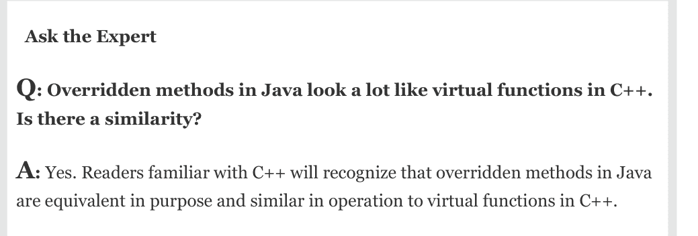
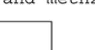
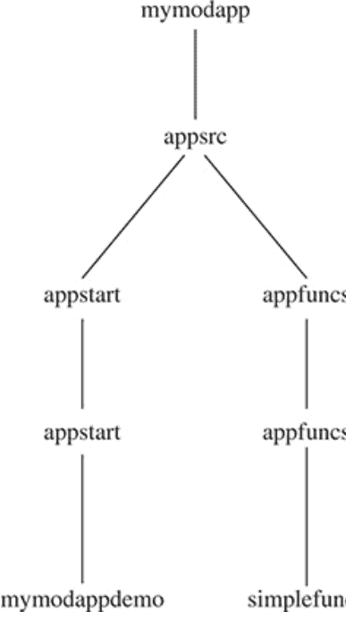
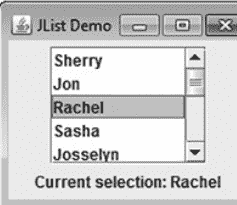
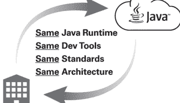

# Java 入门指南，第 8 版

今天就开始创建、编译并运行 Java 程序

电子书转换由 codeMantra 完成

版本 1.0

# 引言

本书的目的是教你 Java 编程的基础知识。它采用循序渐进的方法，并配有大量的示例、自测和项目。它假设你没有之前的编程经验。本书从基础开始，例如如何编译和运行 Java 程序。然后讨论了构成 Java 语言核心的关键字、特征和结构。你还将发现一些 Java 最高级的特性，包括多线程编程、泛型、Lambda 表达式和模块。书以对 Swing 的介绍结束。当你完成时，你将牢掌握 Java 编程的精要。

在开始时说明这一点很重要：本书只是一个起点。Java 远比这些元素要复杂。

# Java 的演变

只有少数语言能从根本上重塑编程的本质。在这一精英语言中，有一种语言脱颖而出，因为其影响是快速且广泛的。这种语言无疑是 Java。

在过去的多年里，Java 持续不断成长、演变并以其他方式定义自我。与许多引入新功能缓慢的语言不同，Java 往往处于语言开发的前沿。原因之一是围绕 Java 的创新和变革文化。作为结果，Java 经历了多次升级——有的较小，有的则重大。

Java 的第一个重大更新是版本 1.1。Java 1.1 添加的特性比其修订版本号显示的要得多。例如，Java 1.1 增加了许多新库，重新定义了它们的处理方式，并重新配置了原始 1.0 的功能。

Java 的下一个重大发布版本是 Java 2，“2”表示“第二代”。Java 2 的诞生是一个分水岭事件，标志着 Java 现代时代的开始。Java 2 的第一个版本带有 1.2 版本号。原因是它最初指的是 Java 库的内部版本，后来泛指整个发布版本。随着 Java 2，Sun 将 Java 产品重新封装为 J2SE（Java2 平台标准版），版本号开始应用于该产品。

Java 的下一次升级是 J2SE 1.3。这个版本的 Java 是原始 Java 2 版本的首次重大升级。在很大程度上，它对现有功能进行了补充并“完善”了开发环境。J2SE 1.4 的发布进一步增强了 Java。该版本包含了几个重要的新功能，包括链式异常、通道 I/O 和 `assert` 关键字。

J2SE 5 的发布创造了事实上的第二次 Java 革命。与大多数提供重要但渐进改进的以往 Java 升级不同，J2SE 5 从根本上扩大了语言范围、力量和范围。为了让你了解 J2SE 5 变化带来的规模，以下是其主要新功能列表：

- 泛型
- 自动装箱/拆箱
- 枚举
- 增强型“for-each”风格循环
- 变长参数 (varargs)
- 静态导入
- 注解

这并不是一个微小调整或增量升级的列表。列表中的每一项都代表了 Java 语言的重大新增。某些功能，如泛型、增强 for 循环和变长参数（var），引入了新的语法元素。另一些，如自动装箱和自动拆箱，改变了语言的语义。注解为编程增加了一个全新的维度。

这些新功能的重要性体现在版本号“5”的使用上。Java 的下一个版本号通常本应该是 1.5。然而，由于这些新功能非常重大，从 1.4 到 1.5 的转变似乎无法表达这种改变的规模。相反，太阳壳公司选择将版本号增加到 5，以强调正在发生重大事件。因此，它被命名为 J2SE 5，Java 开发工具包（JDK）被称为 JDK 5。然而，为了保持一致性，太阳壳公司决定使用 1.5 作为其内部版本号，这也称为开发者版本号。J2SE 5 中的“5”被称为产品版本号。

Java 的下一个发布版本被称为 SE 6，太阳壳公司再次决定更改 Java 平台的名称。首先，注意“2”已被删除。该平台现在的名称为 Java SE，官方产品名称为 Java Platform, Standard Edition 6，开发工具包被称为 JDK 6。对于 J2SE 5 而言，Java SE 6 中的 6 是产品版本号。内部开发者版本号是 1.6。

SE 6 在 J2SE 5 的基础上构建的，增加了增量改进。Java SE 6 没有为 Java 语言本身添加任何重大功能，但增强了 API 库，添加了几个新包，并对时间处理进行了改进。它在漫长的（用 Java 术语来说）生命周期内经历了多次更新，在此期间进行了多次升级。总而言，Java SE 6 的作用是巩固 J2SE 5 所取得的进展。

Java 的下一个发布版本被称为 Java SE 7，开发工具包被称为 JDK 7。它的内部版本号为 1.7。Java SE 7 是太阳壳公司被甲骨文收购后 Java 的第一个发布版本。Java SE 7 添加了几个新功能，包括对语言和 API 库的重大新增。Java SE 7 添加的最重要功能之一是作为 Project Coin（硬币项目）开发的。Project Coin 的目的是确定 Java 语言的许多小变化，这些变化将整合到 JDK 7 中，包括：

- `String` 可以控制 `switch` 语句。
- 二进制整数字面量。
- 数值字面量中的下划线。
- 扩展的 `try` 语句，称为 `try-with-resources`（带资源的 try），它支持自动资源管理。
- 在构造泛型实例时进行类型推断（通过菱形操作符）。
- 增强的异常处理，单个 `catch` 块（多异常捕获）可以捕获两个或多个异常，并对重新抛出的异常进行更好的类型检查。

诚如你所见，尽管 Project Coin 的功能被认为是语言的微小变化，但它们的益处远大于“小”这个形容词所暗示的。特别是 `try-with-resources` 语句深刻地影响了大量代码的编写方式。

Java 的下一个发布版本是 Java 8，开发工具包被称为 JDK 8。它的内部版本号为 1.8。JDK 8 代表了 Java 语言的一次非常重要的升级，因为它包含了一个影响深远的新功能：lambda 表达式。lambda 表达式的影响过去是、现在也是深远的，它改变了编程解决方案的概念化方式以及 Java 代码的编写方式。在此过程中，lambda 表达式可以简化并减少创建某些结构所需的源代码量。lambda 表达式的添加还导致语言增加了一个新操作符 (`->`) 和一个新的语法元素。除了 lambda 表达式，JDK 8 还添加了许多其他新功能。例如，从 JDK 8 开始，现在可以接口指定的方法定义默认实现。从分析来看，Java SE 8 是一个重大发布，它深刻地扩展了语言的能力，并改变了 Java 代码的编写方式。

Java 的下一个发布版本是 Java SE 9。开发工具包被称为 JDK 9。内部版本号也是 9。JDK 9 代表了一个重大发布，整合了对 Java 语言及其库的重大增强。主要的新功能是模块，它允许你指定构成应用程序的代码的关系和依赖关系。模块还为 Java 添加了新的语法元素、几个新关键字和各种工具增强。模块对 API 库产生了深远的影响，因为从 JDK 9 开始，库包现在被组织成模块。

作为一个一般规则，在任何 Java 版本发布中，新功能都是最关注的。然而，Java 有一个备受关注的方面被 JDK 9 弃用了：applets（小程序）。从 JDK 9 开始，不再建议在新项目中使用 applets。正如第 1 章将要更详细解释的那样，由于浏览器对 applet 的支持减弱。

书中穿插着特殊的“提问专家”（Ask the Expert）框。这些框包含了关于某个主题的额外信息或有趣的评论。它们采用问答格式。

## 尝试一下（Try This）元素

每个章节都包含一个或多个“尝试一下”元素，这些项目展示了如何应用你所学的知识。在许多情况下，这些是真实世界的示例，你可以将其作为编写自己程序的起点。

## 无需任何编程经验

本书假设读者没有以前的编程经验。因此，如果你从未编写过程序，可以使用这本书。如果你已经有一些经验，那么你的进展将会得快一些。请记住，Java 在几个关键方面与其他流行的计算机语言不同。不要急于下结论是至关重要的。因此，即使对于经验丰富的程序员，也建议仔细阅读。

## 所需的软件

为了编译和运行书中的所有程序，你需要最新的 Java 开发工具包（JDK），在你阅读此书时，它是 JDK 11。这是用于 Java SE 11 的 JDK。获取 Java JDK 的说明见第 1 章。

如果你使用的是较早版本的 Java，仍然可以使用这本书，但你将无法编译和运行使用 Java 新特性的程序。

## 不要忘记：网络上的代码

记住，书中所有示例和项目的源代码均可在网络上的 `www.oraclepressbooks.com` 免费获取。

## 特别感谢

特别感谢本书版本的技术编辑 Danny Coward。Danny 参与过我写的几本书的编辑，他的建议、见解和启发一直具有极高的价值，对此深表谢意。

## 进一步学习

《Java 入门指南》（Java: A Beginner's Guide）是你进入 Herb Schildt Java 编程书籍系列的大门。以下是一些你可能感兴趣的其他书籍：

- 《Java：完全参考》（Java: The Complete Reference）
- 《Herb Schildt 的 Java 编程食谱》（Herb Schildt's Java Programming Cookbook）
- 《Java 艺术》（The Art of Java）
- 《Swing 入门指南》（Swing: A Beginner's Guide）
- 《JavaFX 8 编程》（Introducing JavaFX 8 Programming）

# 第 1 章

## Java 基础


### 核心技能与概念

- 了解 Java 的历史和哲学
- 理解 Java 对互联网的贡献
- 理解字节码的重要性
- 了解 Java 术语
- 理解面向对象编程的基础原理
- 创建、编译并运行一个简单的 Java 程序
- 使用变量
- 使用 `if` 和 `for` 控制语句
- 创建代码块
- 理解语句的定位、缩进和终止方式
- 了解 Java 关键字
- 理解 Java 标识符的规则

在计算领域，很少有技术像 Java 这样产生影响。它在 Web 早期的诞生帮助塑造了现代互联网的形式，包括客户端和服务器端。它的创新特性推动了编程艺术与科学的发展，在计算机语言设计中树立了新标准。围绕 Java 成长的前瞻性文化确保了它保持活力和生命力，适应了计算领域往往快速且多变的变化。简单来说：Java 不仅世界上最重要的计算机语言之一，它还是一股彻底改变编程的力量，并在过程中改变了世界。

虽然 Java 是一种经常与互联网编程联系在一起的语言，但它绝不限于此。Java 是一种强大、功能全的通用编程语言。因此，如果你是编程新手，Java 是一种极好的学习语言。此外，成为一名专业程序员意味着能够用 Java 编程——这非常重要。在本书中，你将学习帮助你掌握它的基本技能。

本章的目的是向你介绍 Java，从它的历史、设计哲学以及几个最重要的特性开始。到目前为止，学习编程语言最困难的事情在于，没有任何元素是孤立存在的。相反，语言的组件是相互协作的。这种关联性在 Java 中尤为明显。事实上，很难不涉及其他方面的情况下讨论 Java 的某一方面。为了帮助克服这个问题，本章提供了几项 Java 特性的简要概述，包括 Java 程序的通用形式、一些基本的控制结构和简单的运算符。它没有涉及过多的细节，而是关注任何 Java 程序通用的通用概念。

## Java 的历史与哲学

在充分欣赏 Java 的独特之处之前，有必要理解驱动其产生的力量、它所体现的编程哲学以及设计的关键概念。当你读完这本书时，你会发现 Java 的许多方面都是塑造该语言的历史力量的直接或间接结果。因此，我们通过探索 Java 与更大的编程宇宙的关系来开始对 Java 的研究是恰当的。

### Java 的起源

Java 由 James Gosling、Patrick Naughton、Chris Warth、Ed Frank 和 Mike Sheridan 在 1991 年于 Sun Microsystems 提出。这种语言最初被称为“Oak”，但在 1995 年更名为“Java”。有点令人惊讶的是，Java 的动力并非互联网！相反，主要的动力是需要一种平台无关的语言，可用于创建嵌入到各种消费电子设备中的软件，例如烤面包机、微波炉和遥控器。正如你可能猜到的那样，许多不同的 CPU 被用作控制器。问题在于（在当时）大多数语言被设计为编译成针对特定类型 CPU 的机器码。例如，考虑 C++ 语言。

虽然可以为任何 CPU 编译 C++ 程序，但这样做需要针对该 CPU 的编译器。问题是，编译器是昂贵且耗时的。为了寻找更好的解决方案，Gosling 和其他人致力于开发一种可以在各种环境下运行的跨平台语言。这种努力最终导致了 Java 的诞生。

在 Java 的细节被敲定的同时，另一个最终更重要的因素出现了，它对 Java 的未来起着至关重要的作用。这种第二力量显然是万维网（Web）。如果 Web 没有在 Java 实现的同时形成，Java 可能仅仅停留在一种编程电子设备的冷门语言。然而，随着 Web 的出现，Java 被推向计算机语言设计的前沿，因为 Web 也需要可移植程序。

大多数程序员在职业生涯早期就学会了可移植程序是可而不可的。虽然 Java 最初并非为 Web 设计的，但 Web 的兴起和 Java 的兴起是不可分的。其次，Java 并没有“发明轮子”，而是完善了现有的范式。最后一点：尽管 C++ 和 Java 有关联（特别是在面向对象编程的支持方面），但 Java 并不是 C++ 的互联网版本。

## Java 对互联网的影响

互联网将 Java 推向前沿，而 Java 反过来对互联网产生了深远的影响。首先，Java 的创造简化了整个互联网编程，成为吸引大量程序员进入 Web。其次，Java 发明了一种名为 applet 的新型网络程序，改变了对内容的看法。最后，可能最重要的是，Java 解决了与互联网的一些棘手问题：可移植性和安全性。

## Java 简化了网络编程

从一开始，Java 就通过多种方式简化了网络编程。也许最重要的可能是它创建可移植、跨平台程序的能力。同样等重要的是 Java 对网络的支持。它的即用功能库使程序员能够轻松编写访问或利用互联网的程序。它还提供了能够在互联网上轻松分发程序的机制。虽然细节超出了本书的范围，但只需知道 Java 对网络的支持是其快速崛起的关键因素。

## Java Applet

在 Java 创立时期，它最令人兴奋的功能之一是 applet。applet 是一种特殊的 Java 程序，设计用于通过互联网传输并在支持 Java 的网络浏览器中自动执行。如果用户点击包含 applet 的链接，applet 将自动下载并在浏览器中运行。Applet 旨在成为小型程序，通常用于显示由服务器提供数据、处理用户输入或提供简单的功能（例如贷款计算器）。Applet 程序的核心特性是它们在本地执行，而不是在服务器上执行。从本质上说，Applet 允许某些功能从服务器移动到客户端。

Applet 的创建是非常重要的，因为在当时，它扩展了可以在网络空间中自由移动的对象宇宙。总的来说，在服务器和客户端之间传输的对象大体可以分为两大类：被动信息和动态活动程序。例如，当你阅读邮件时，即使你下载了一个程序，在你不执行它之前，该程序的代码仍然只是被动数据。相比之下，Applet 是一个动态的、自执行的程序。这种程序是客户端计算机上的一个活动代理，但它是由服务器交付的。

在 Java 早期，Applet 是 Java 编程的一个至关重要的部分。它们展示了 Java 的力量和优势，为网页增了令人兴奋的维度，并让程序员能够探索 Java 能够实现的全部范围。尽管今天可能仍有 Applet 程序在使用，但随着时间的推移，它们变得不再那么重要，而且由于后文将解释的原因，JDK 9 开始了它们的淘汰进程。最后，JDK 11 删除了对 Applet 支持。

## 专家问答

**问：什么是 C#？它与 Java 有什么关系？**

**答：** 在 Java 创建几年后，微软开发了 C# 语言。这很重要，因为 C# 与 Java 关系密切。事实上，C# 的许多功能与 Java 直接对应。Java 和 C# 均共享通用的 C++ 风格语法，支持分布式编程，并利用了相似的对象模型。当然，Java 和 C# 之间也存在差异，但这些语言的整体“外观和感受”非常相似。这意味着如果你已经熟悉 C#，那么学习 Java 将变得特别容易。反之，如果 C# 是你未来的重点，那么你对 Java 的知识将派上用场。

## 安全

尽管动态网络化程序是理想的，但它们在安全和可移植性方面也存在严重问题。显然，必须防止在客户端计算机上下载并执行的程序造成危害。它还必须能够在各种不同的环境和不同的操作系统下运行。正如你将看到的，Java 以一种有效且优雅的方式解决了这些问题。让我们更仔细地看看每一个，从安全性开始。

正如你可能意识到的，每当你下载一个程序时，你都在承担风险，因为你正在下载的代码可能包含病毒、特洛马或其他有害代码。问题的核心在于，恶意代码会造成损害，因为它获得了对系统资源的未经授权访问。例如，病毒程序可能会通过搜索你计算机本地文件系统的内容来收集隐私信息，如信用卡号、银行账户和密码。为了让 Java 能够安全地下载和执行程序，必须防止它们启动此类攻击。

Java 通过允许你将应用程序限制在 Java 执行环境中并防止其访问计算机的其他部分来实现这种保护。（你稍后将看到如何实现这一点。）能够以极高的信心（即不会造成任何伤害）下载并执行应用程序，这种能力对 Java 的早期成功做出了巨大贡献。

## 可移植性

可移植性是互联网的一个主要方面，因为连接到互联网的有许多不同类型的计算机和操作系统。如果一个 Java 程序要在几乎任何连接到互联网的计算机上运行，就需要某种方法让该程序能够在不同类型的系统上执行。换句话说，需要一种机制，允许同一个应用程序被各种 CPU、操作系统和浏览器下载和执行。为不同的计算机准备同一个应用程序的不同版本是不现实的。相同的应用程序代码必须在所有计算机上运行。因此，需要某种生成可移植代码的方法。正如你很快看到的，帮助确保安全的相同机制也有助于可移植性。

## Java 的魔力：字节码


让 Java 能够解决上述安全性和可移植性问题的关键在于，Java 编译器的输出不是可执行代码，而是字节码。字节码是一组由所谓的 Java 虚拟机（`JVM`）执行的高度优化的指令，而 `JVM` 是 Java 运行环境（`JRE`）的一部分。从本质上说，原始的 `JVM` 被设计为字节码的解释器。由于性能考虑，许多现代语言被设计成编译成特定 CPU 的可执行代码，这可能令你感到惊讶。然而，Java 程序由 `JVM` 执行这一事实有助于解决与基于网络的程序相关的主要问题。原因如下。

将 Java 程序翻译成字节码使得在各种环境中运行程序变得容易得多，只需要为每个平台实现 `JRE`（包括 `JVM`）即可。一旦某个系统存在了 `JRE`，任何 Java 程序都可以在其上运行。记住，虽然 `JRE` 的细节随平台不同而异，但所有的 `JRE` 都理解相同的 Java 字节码。如果一个 Java 程序被编译为原生代码，那么必须为连接到互联网的每种类型的 CPU 存在同一个程序的不同版本。这显然不是可行的解决方案。因此，通过 `JVM` 执行字节码是创建真正可移植程序的最简单方法。

Java 程序由 `JVM` 执行这一事实也有助于它的安全。因为 `JVM` 是控制的，它管理着程序的执行。因此，`JVM` 可以创建一个受限的执行环境（称为沙箱），在其中包含程序，防止其对机器无限制的访问。Java 语言中存在的某些限制增强了安全性。

当程序被解释时，其运行速度通常比相同程序编译成可执行代码的运行速度慢。然而，在 Java 中，由于字节码已被高度优化，其执行速度比你预期的要快得多。由于这个原因，在 Java 发布不久后引入了 HotSpot。HotSpot 是一个即时编译（`JIT`）编译器。由于 `JIT` 编译器是 `JVM` 的一部分，它在执行时将字节码编译成原生代码。其余字节码则被解释。此外，由于 `JIT` 编译器的复杂性，它在 Java 早期并不常见。在学习 Java 时，它并不是一个会被进一步讨论。

## 专家问答

问：我听说过一种特殊的 Java 程序叫做 servlet。它是什么？

答：Java servlet 是一种在服务器上执行的小型程序。Servlet 动态扩展了 Web 服务器的功能。了解这一点很有帮助，尽管客户端应用程序可以用，但它们只是的一半。在 Java 最初发布不久后，很显然 Java 在服务器端也有用。结果就是 servlet。因此，随着 servlet 的出现，Java 跨越了客户端/服务器的两端。虽然 servlet 主题以及一般的服务器端编程超出了本入门指南的范围，但当你进阶学习 Java 时，你可能会对它们感兴趣。

## 超越 App 程序

在本文写作时，距离 Java 最初发布已经过去了二十多年。在这些年里，发生了许多变化。在 Java 创建时，互联网是一个新颖而令人兴奋的发明；网页浏览器正在经历快速开发和完善；现代形式的智能手机尚未发明；计算机的几乎普及还需要几年时间。正如你预期的那样，Java 也发生了变化，其使用方式也是如此。可能没有什么比 App 程序更能说明 Java 的持续演进。

正如之前提到的，在 Java 早期，App 程序是 Java 编程的一个至关重要的部分。它们不仅为网页增了趣味，而且是 Java 的一个非常可见的部分。然而，App 程序依赖于 Java 浏览器插件。因此，为了让 App 程序工作，它必须被浏览器支持。最近，

对 Java 浏览器插件的支持正在逐渐减弱。简单来说，没有浏览器的支持，applet（小程序）是不可行的。因此，从 JDK 9 开始，applet 的淘汰已经开始，对 applet 的支持被标记为已弃（deprecated）。在 Java 语言中，deprecated 意味着某个功能仍然可用，但被标记为过时。因此，不应在新代码中使用已弃用的功能。随着 JDK 11 的发布，淘汰工作正式完成，因为对 applet 的支持已被移除。

作为趣味的一点，在 Java 诞生几年后，人们增加了一个 applet 的替代方案。它被称为 Java Web Start，能够允许应用程序从网页上动态下载。这是一种部署机制，对于不适合 applet 的大型 Java 程序特别有用。applet 和 Web Start 应用程序的区别在于，Web Start 应用程序在浏览器内部独立运行。因此，它看起来像一个“普通”应用程序。然而，它要求宿主机上提供运行 Java Start 的独立 `JRE`。从 JDK 11 开始，对 Java Web Start 的支持已被移除。

鉴于 applet 和 Web Start 都不现代版本 Java 的可行选择，你可能会疑惑应该使用什么机制来部署 Java 应用程序。在编写此时，答案的之一是使用 JDK 9 中添加的 `jlink` 工具。它可以创建一个自定义的运行时镜像，包含程序程序所需的所有支持，包括 `JRE`。正如你可能猜到的，部署是一个相当高级的话题，超本书的范围。坦率地说，在使用本书时你不需要担心部署，因为所有的示例程序都直接在你的计算机上运行。它们不是通过互联网部署的。

## 更快的发布周期

Java 最近还发生了另一个重大变化，但并不涉及语言或运行时环境的改变。相反，它与 Java 发布版本的调度有关。过去，大版本发布之间通常间隔两年或更久。然而，在 JDK 9 发布之后，Java 版本之间的间隔缩短了。今天，预计大版本发布将遵循严格基于时间的时间表，预计大版本发布之间的时间仅为六个月。

每个大版本发布（现在称为特性发布，feature release）将包含发布时已就绪的功能。这种发布频率的加快使 Java 程序员能够及时获得新功能和增强功能。此外，它允许 Java 快速响应不断变化的环境需求。简单来说，更快的发布周期对 Java 程序员来说将是一个非常积极的发展。

目前，特性发布安排在每年的 3 月和 9 月。因此，JDK 10 于 2018 年 3 月发布，在 JDK 9 发布六个月后。下一次发布（JDK 11）是在 2018 年 9 月。同样，预计每六个月就会有新的特性发布。你可能需要咨询 Java 文档获取最新的发布调度信息。

在编写此时，许多新的 Java 特性已在途中。由于更快的发布周期，很可能其中几个功能将在未来几年内被添加到 Java 中。你将需要详细查看每六个月发布提供的信息和发布说明。成为一名 Java 程序员这确实是一个令人兴奋的时代！

## Java 术语

如果不看 Java 的术语（buzzwords），Java 的历史就是不完整的。尽管促使 Java 发明的根本力量是可移植性和安全性，但其他因素在塑造语言的最终形式也发挥了重要作用。Java 设计团队在以下术语列表中总结了这些考虑因素。

| 术语 | 说明 |
| :--- | :--- |
| Simple (简单) | Java 拥有一套简洁、凝聚的功能，使其易于学习和使用。 |
| Secure (安全) | Java 提供了一种创建 Internet 应用程序的安全手段。 |
| Portable (可移植) | Java 可以在可以在任何带有 Java 运行时系统的环境中执行。 |
| Object-oriented (面向对象) | Java 体现了现代的面向对象编程哲学。 |
| Robust (健壮) | Java 通过强类型化和执行运行时检查来鼓励无错误的编程。 |
| Multithreaded (多线程) | Java 为多线程编程提供了集成支持。 |
| Architecture-neutral (体系中立) | Java 不依赖于特定的机器或操作系统架构。 |
| Interpreted (解释型) | Java 通过使用字节码支持跨平台代码。 |
| High performance (高性能) | 字节码针对执行速度进行了高度优化。 |
| Distributed (分布式) | Java 的设计初衷考虑了互联网的分布式环境。 |
| Dynamic (动态) | Java 程序随身携带了大量的运行时类型信息，用于在运行时验证并解决对对象的访问。 |

## 面向对象编程

Java 的核心是面向对象编程（`OOP`）。面向对象的方法论与 Java 是不可分割的，所有的 Java 程序在某种程度上都是面向对象的。因为 `OOP` 对 Java 的重要性，在编写简单的 Java 程序之前，通俗地理解 `OOP` 的基本原理是有用的。在本书的后续部分，你将看到如何将这些概念付诸实践。

`OOP` 是处理编程工作的一种强大方法。自从计算机发明以来，编程方法论发生了巨大的变化，主要是为了适应日益增加程序复杂度。例如，当计算机被发明时，编程是通过使用计算机的前置面板切换二进制机器指令完成的。只要程序只有几百条指令长，这种方法就是有效的。随着程序的增长，汇编语言被发明了，以便程序员可以使用机器指令的符号化表示来处理更大、日益复杂的程序。随着程序的继续增长，高级语言被引入了-

访问一类通用操作的接口。具体的操作取决于情况的具体性质。多态的一个简单例子是汽车的方向盘。无论使用何种实际的实际转向机构，方向盘（即接口）都是相同的。也就是说，无论你的汽车是采用手动转向、助力转向还是齿轮式齿杆式转向，方向盘的操作方式都是一样的。因此，一旦你学会了如何操作方向盘，你就可以驾驶任何类型的汽车。

同样的原理也适用于编程。例如，考虑一个栈（一种后进先出的列表）。你可能有一个程序需要三种不同类型的栈。其中一个栈用于整数值，一个用于浮点值，另一个用于字符。在这种情况下，尽管存储的数据不同，但实现每个栈的算法是相同的。在非面向对象的语言中，你将被要求创建三组不同的栈例程，每组使用不同的名称。然而，由于多态的存在，在 Java 中你可以创建一个通用的栈例程组，适用于所有三种特定情况。这样，一旦你学会了如何使用一个栈，你就可以使用所有的栈。

更广泛地说，多态的概念通常用“一个接口，多个方法”这一短语来表达。这意味着为一组相关活动设计一个通用接口是可能的。多态通过允许使用相同的接口来指定一类通用操作，有助于降低复杂性。编译器的任务是根据每种情况选择具体的操作（即方法）。你，作为程序员，不需要手动进行这种选择。你只需要记住并利用通用接口即可。

## 继承

继承是一个对象可以获取另一个对象属性的过程。这非常重要，因为它支持了分级分类的概念。如果你仔细考虑，大多数知识都可以通过分级（即自上而下）分类来管理。例如，红富士苹果是苹果（apple）类的一部分，而苹果类又是水果（fruit）类的一部分，它位于更大的食物（food）类之下。也就是说，食物类拥有某些品质（可食用的、营养的等），这些品质在逻辑上适用于其子类水果。除了这些品质之外，水果类还有特定的特征（多汁、甜等），这些特征将其与其他食物区分开来。苹果类定义了苹果特有的品质（生长在树上，而非热带地区）。红富士苹果反过来会继承之前所有类的所有品质，并只定义那些使其成为独特的品质。

如果不使用层级结构，每个对象都必须显式地定义其所有的特征。使用继承，对象只需要那些在其类中使其唯一的品质即可。它可以从父类继承其通用属性。因此，是继承机制使得一个对象成为更通用情况的特定实例成为。

# Java 开发工具包

现在 Java 的理论基础已经得到了解释，是时候开始编写程序了。在编译和运行这些程序之前，你必须拥有 Java 开发工具包（`JDK`）。在写作期间，`JDK` 的当前发布版本是 11。这是 Java SE 11 版本。（SE 代表标准版）。它也是本书中所描述的版本。由于 `JDK` 11 包含了早期版本 Java 不支持的功能，建议你使用 `JDK` 11（或更高版本）来编译和运行书中的程序。（请记住，由于 Java 的发布周期更快，预计 `JDK` 特性版本每隔六个月发布一次。因此，不要对发布版本号更高的 `JDK` 感到惊讶。）然而，取决于你工作环境，，系统中可能已经安装了较早的 `JDK`。如果是这样，较新的 Java 特性将不可用。

如果你需要在计算机上安装 `JDK`，请注意，对于现代版本的 Java，Oracle `JDK` 和开源的 OpenJDK 可下载。通常情况下，你应该先找到你想使用的 `JDK`。例如，在写作期间，可以从 `www.oracle.com/techn/java/javase/downloads/index.html` 下载 Oracle `JDK`。同样在写作期间，在 `jdk.java.net` 提供开源版本。接下来，下载你选择的 `JDK` 并按照其说明将其安装到计算机上。安装 `JDK` 之后，你将能够编译和运行程序。

`JDK` 提供两个主要的程序。第一个是 `javac`，它是 Java 编译器。第二个是 `java`，它是 Java 解释器，也被称为应用程序启动器。如果你没有使用集成开发环境（`IDE`），它就是标准环境。

> 专家提问

Q：你提到面向对象编程是管理大型程序的有效方法。这会对小型程序产生惩罚影响吗？

答：不会。如你所见，对于小型程序来说，面向对象的特性几乎是不可觉的。

> 注意

除了 `JDK` 提供的基本命令行工具外，还有几款高质量的 `IDE` 可用，例如 NetBeans 和 Eclipse。在开发和部署应用程序时，`IDE` 会非常有帮助。如果你使用 `IDE`，将需要遵循它的说明。由于 `IDE` 之间存在差异，无法提供通用的指令。然而，对于书中介绍的程序，使用命令行工具通常是最简单的方法。

# 第一个简单程序

让我们从编译和运行此处显示的短程序开始：

```java
/*
这是一个简单的 Java 程序。将此文件命名为 Example.java。
*/
class Example {
    // Java 程序从 main() 开始。
    public static void main(String[] args) {
        System.out.println("Java drives the Web.");
    }
}
```

你将遵循以下三个步骤：

1. 输入程序。
2. 编译程序。
3. 运行程序。

# 输入程序

书中的程序可以在 `www.oracle.com` 获取。然而，如果你想手动输入程序也可以这样做。在这种情况下，你必须使用文本编辑器而不是文字处理器在计算机上输入程序。文字处理器通常会将格式信息与文本。这些格式信息会混淆 Java 编译器。如果你使用的是 Windows 平台，可以使用记事本或你喜欢的任何编辑器。

# 编译程序

要编译 Example 程序，请执行编译器 `javac`，并在命令行中指定源文件的文件名，如下所示：

```
javac Example.java
```

`javac` 编译器创建一个名为 `Example.class` 的文件，该文件包含了程序的字节码版本。请记住，字节码不是可执行代码。字节码必须由 Java 虚拟机（`JVM`）来执行。因此，`javac` 的输出不是可以直接执行的代码。

要实际运行程序，你必须使用 Java 解释器 `java`。操作时，请将类名 `Example` 作为命令行参数传递，如下所示：

```
java Example
```

当程序运行时，将显示以下输出：

Java 驱动 Web。

当 Java 源代码被编译时，每个单独的类都会被放入其单独的输出文件中，该文件以类命名并使用 `.class` 扩展名。这就是为什么将你的 Java 源文件命名为与其包含的类相同的名称是一个好主意——源文件名将与 `.class` 文件名匹配。当你像刚才那样执行 Java 解释器时，你实际上是在指定你想让解释器执行的类名。它会自动搜索具有 `.class` 扩展名的同名文件。如果找到了该文件，它将执行指定类中包含的代码。

在继续之前，需要说明的是，从 JDK 11 开始，Java 提供了一种直接从源文件运行某些类型简单程序的方法，而无需显式地调用 `javac`。这种技术在某些情况下非常有用，在附录 C 中描述。对于本本书而言，假设你正在使用上面描述的普通编译过程。

## 注意事项

如果在尝试编译程序时，计算机找不到 `javac`（假设你已正确安装了 `JDK`），你可能需要指定命令行工具的路径。例如，在 Windows 中，这意味着你需要将命令行工具的路径添加到 `PATH` 环境变量定义的路径中。例如，如果 `JDK` 11 安装在命令行工具下，那么其路径将类似于 `C:\Program Files\Java\jdk-11\bin`。（当然，你需要找到你电脑上 Java 的路径，该路径可能与上面显示的不同。此外，`JDK` 的特定版本也可能不同。）你需要咨询你操作系统的文档了解如何设置路径，因为此过程在不同的操作系统之间不同。

# 逐行分析第一个示例程序

尽管 `Example.java` 非常短，但它包含了所有 Java 程序通用的几个关键特性。让我们仔细检查程序的每个部分。

程序以以下内容开头：

```
/*
这是一个简单的 Java 程序。

调用此文件名为 Example.java。
*/
```

这是一个注释。与大多数编程语言一样，Java 允许你在程序的源文件中输入备注。编译器会忽略注释的内容。相反，注释会向任何阅读其源代码的人描述或解释程序的操作。在这种情况下，该注释描述了程序，并提醒你你的源文件应该命名为 `Example.java`。当然，在实际应用中，注释通常会解释程序的某部分是如何工作的，或者某个特定功能的作用。

Java 支持三种风格的注释。程序顶部显示的这种被称为“多行注释”。这种类型的注释必须以 `/*` 开始，并以 `*/` 结束。这两个注释符号之间的任何内容都会被编译器忽略。正如其名称所示，多行注释可能有几行长。

程序中的下一行代码所示：

```
class Example {
```

这一行使用关键字 `class` 来声明正在定义一个新类。如前提到的，类是 Java 封装的基本单元。`Example` 是类的名称。类定义以左大括号 `{}` 开始，以右大括号 `}` 结束。两个大括号之间的元素是类的成员。当你像刚才那样执行 Java 解释器时，你实际上是在指定你想让解释器执行的类名。它会自动搜索具有 .class 扩展名的同名文件。如果找到了该文件，它将执行指定类中包含的代码。

在继续之前，重要的是提到，从 JDK 11 开始，Java 提供了一种直接从源文件运行某些类型简单程序的方法，而无需显式地调用 `javac`。这种技术在某些情况下非常有用，在附录 C 中描述。对于本本书而言，假设你正在使用上面描述的普通编译过程。

## 注意事项


如果在尝试编译程序时，计算机找不到 `javac`（假设你已正确安装了 JDK），你可能需要指定命令行工具的路径。例如，在 Windows 中，这意味着你需要将命令行工具的路径添加到 `PATH` 环境变量定义的路径中。例如，如果 JDK 11 安装在命令行工具下，那么其路径将类似于 `C:\Program Files\Java\jdk-11\bin`。（当然，你需要找到你电脑上 Java 的路径，该路径可能与上面显示的不同。此外，JDK 的特定版本也可能不同。）你需要咨询你操作系统的文档了解如何设置路径，因为此过程在不同的操作系统之间不同。

# 逐行分析第一个示例程序

尽管 `Example.java` 非常短，但它包含了所有 Java 程序通用的几个关键特性。让我们仔细检查程序的每个部分。

程序以以下内容开头：

```
/*
这是一个简单的 Java 程序。

调用此文件名为 Example.java。
*/
```

这是一个注释。与大多数编程语言一样，Java 允许你在程序的源文件中输入备注。编译器会忽略注释的内容。相反，注释会向任何阅读其源代码的人描述或解释程序的操作。在这种情况下，该注释描述了程序，并提醒你你的源文件应该命名为 `Example.java`。当然，在实际应用中，注释通常会解释程序的某部分是如何工作的，或者某个特定功能的作用。

Java 支持三种风格的注释。程序顶部显示的这种被称为“多行注释”。这种类型的注释必须以 `/*` 开始，并以 `*/` 结束。这两个注释符号之间的任何内容都会被编译器忽略。正如其名称所示，多行注释可能有几行长。

程序中的下一行代码所示：

```
class Example {
```

这一行使用关键字 `class` 来声明正在定义一个新类。如前提到的，类是 Java 封装的基本单元。`Example` 是类的名称。类定义以左大括号 `{` 开始，以右大括号 `}` 结束。两个大括号之间的元素是类的成员。当你像刚才那样执行 Java 解释器时，你实际上是在指定你想让解释器执行的类名。它会自动搜索具有 `.class` 扩展名的同名文件。如果找到了该文件，它将执行指定类中包含的代码。

在继续之前，重要的是提到，从 JDK 11 开始，Java 提供了一种直接从源文件运行某些类型简单程序的方法，而无需显式地调用 `javac`。这种技术在某些情况下非常有用，在附录 C 中描述。对于本书而言，假设你正在使用上面描述的普通编译过程。

```
System.out.println("Java drives the Web.");
```

这一行输出了 "Java drives the Web." 并在屏幕上另起一行。输出实际上是由内置的 `println()` 方法实现的。在这种情况下，`println()` 显示了传递给它的字符串。正如你将看到的，`println()` 也可以用于显示其他类型的信息。该行以 `System.out` 开头。虽然现在解释很复杂，但简单来说，`System` 是提供系统访问的定义类，而 `out` 是连接到控制台的流。因此，`System.out` 是封装了控制台输出的对象。Java 使用对象来定义控制台输出这一事实进一步证明了其面向对象的特性。

注意 `println()` 语句以分号结尾。Java 中的许多语句都以分号结尾。正如你所看到的，分号是 Java 语法的重要组成部分。

程序中的第一个 `}` 结束了 `main()` 方法，最后一个结束了 `Example` 类的定义。

最后一点：Java 是区分大小写的。忘记这一点可能会给你带来严重的问题。例如，如果你不小心输入了 `Main` 而不是 `main`，或者输入了 `PrintLn` 而不是 `println`，程序就是错误的。此外，尽管 Java 编译器可以编译没有 `main()` 方法的类，但它没有办法执行它们。因此，如果你写错了 `main`，编译器仍然会编译你的程序。但是，Java 解释器会报告错误，因为它找不到 `main()` 方法。

## 处理语法错误

如果你还没有这样做，请输入、编译并运行前面的程序。正如你从之前的编程经验中所知的，在计算机上输入代码时很容易偶然出错。幸运的是，如果你在程序中输入了错误内容，编译器在尝试编译时会报告语法错误信息。Java 编译器无论你写了什么，都会尝试从你的源代码中提取内容。因此，报告的错误并不总是反映问题的实际原因。在前面的程序中，例如，意外漏掉了 `main()` 方法后的左大括号，会导致编译器报告以下错误：

```
Example.java:8: ';' expected
public static void main(String args[])
```

```
Example.java:11: class, interface, or enum expected
}
```

显然，第一个错误信息是完全错误的，因为缺失的不是分号，而是大括号。

讨论的重点是，当你的程序包含语法错误时，你不一定应该完全相信编译器的信息。这些信息可能是误导性的。你可能需要对错误信息进行“二次怀疑”以找到真实问题。此外，查看程序中被标记行之前的最后几行代码。有时，错误会在实际发生点几行之后才会被报告。

## 第二个简单程序

也许没有哪种结构对编程语言来说像给变量赋值那样重要了。*变量*是一个命名的内存位置，可以被赋值。此外，变量的值在程序执行期间可以改变。也就是说，变量的内容是可变的，而不是固定的。以下程序创建了两个名为 `myVar1` 和 `myVar2` 的变量：

```
/*
这演示了一个变量。

调用此文件 Example2.java。
*/
class Example2 {
    public static void main(String[] args) {
        int myVar1; // 声明一个变量
        int myVar2; // 声明另一个变量

        myVar1 = 1024; // 将 1024 赋值给 myVar1
        System.out.println("myVar1 contains " + myVar1);
        myVar2 = myVar1 / 2;

        System.out.print("myVar2 contains myVar1 / 2: ");
        System.out.println(myVar2);
    }
}
```

运行此程序时，你将看到输出：

```
myVar1 contains 1024
myVar2 contains myVar1 / 2: 512
```

这个程序引入了几个新概念。首先，语句

```
int myVar1; // 声明一个变量
```

声明了一个名为 `myVar1` 的整数类型变量。在 Java 中，所有变量在使用之前必须声明。此外，变量可以包含的值的类型也必须指定。这被称为变量的*类型*。在这种情况下，`myVar1` 可以存储整数值。这些是整数。在 Java 中，要声明一个整数类型的变量，要在其名称前加上关键字 `int`。因此，前面的语句声明了类型为 `int` 的变量 `myVar1`。

下一行声明了第二个名为 `myVar2` 的变量：

```
int myVar2; // 声明另一个变量
```

注意，这一行使用的格式与第一行相同，只是变量名不同。

通常，要声明一个变量，你将使用这样的语句：

```
type var-name;
```

在这里，`type` 指定了被声明变量的类型，`var-name` 是变量名。除了 `int`，Java 还支持其他几种数据类型。

下一行代码将值 1024 赋值给 `myVar1`：

```
myVar1 = 1024; // 将 1024 赋值给 myVar1
```

在 Java 中，赋值运算符是单等号。它将右侧的值复制到左侧的变量中。

下一行代码在字符串 "myVar1 contains" 之后输出 `myVar1` 的值：

```
System.out.println("myVar1 contains " + myVar1);
```

在这个语句中，加号导致 `myVar1` 的值显示在它之前的字符串之后。这种方法可以泛化。使用 `+` 运算符，你可以在单个 `println()` 语句中连接任意数量的项。

下一行代码将 `myVar1` 除以 2 的值赋值给 `myVar2`：

```
myVar2 = myVar1 / 2;
```

这一行将 `myVar1` 中的值除以 2，然后将结果存储在 `myVar2` 中。因此，在该行执行后：

| 运算符 | 描述 |
| :--- | :--- |
| `+` | 加法 |
| `-` | 减法 |
| `*` | 乘法 |
| `/` | 除法 |

## 另一种数据类型

在前面的程序中，使用了 `int`。然而，`int` 类型的变量只能存储整数。因此，当需要小数部分时无法使用。幸运的是，`int` 仅是几种类型之一。为了允许小数部分，Java 定义了两种浮点类型：`float` 和 `double`，分别代表单精度和双精度值。两者中，`double` 最常用。

要声明一个 `double` 类型的变量，使用类似于所示的语句：

```
double x;
```

在这里，`x` 是变量名，类型为 `double`。因为 `x` 是浮点类型，它可以存储诸如 `12.23`、`0.34` 或 `-19.0` 这样的值。要理解 `int` 和 `double` 的区别，请尝试以下程序：

```
/*
此程序说明了 int 和 double 的区别。

调用此文件 Example3.java。
*/
class Example3 {
    public static void main(String args[]) {
        int v; // 声明一个 int
        double x; // 声明一个浮点变量

        v = 10; // 给 v 赋值 10
        x = 10.0; // 给 x 赋值 10.0

        System.out.println("Original value of v: " + v);
        System.out.println("Original value of x: " + x);
        System.out.println(); // 打印空行

        // 现在，将两者除以 4
        v = v / 4;
        x = x / 4;

        System.out.println("v after division: " + v);
        System.out.println("x after division: " + x);
    }
}
```

该程序的输出显示在此：

```
Original value of v: 10
Original value of x: 10.0

v after division: 2 ← 小数部分丢失
x after division: 2.5 ← 小数部分保留
```

## 专家问答

问：为什么 Java 对整数和浮点值有不同的数据类型？也就是说，为什么所有数值不都使用同一种类型？

答：Java 提供不同的数据类型是为了让你编写高效的程序。例如，整数算术比浮点运算更快。因此，如果你不需要小数值，就不需要承担与 `float` 或 `double` 类型相关的开销。其次，一种类型所需的内存量可能比另一个操作所需的少。通过提供不同的类型，Java 允许你充分利用系统资源。最后，某些算法需要（或至少能从中获益）使用特定类型的数据。总的来说，Java 提供了许多内置类型，以给你提供最大的灵活性。

你可以看到，当 `v` 除以 4 时，执行的是整数除法，结果为 2——丢失了小数部分。然而，当双精度变量 `x` 除以 4 时，小数部分会被保留，并显示正确的答案。

程序中还有另一个需要注意的新点。打印空行，只需在不带任何参数的情况下调用 `println()` 即可。


`GalToLit.java`

尽管前面的示例程序展示了 Java 语言的一些重要特性，但它们并没有什么用。尽管你现在对 Java 并不了解，但你仍然可以利用所学知识创建一个实用的程序。在这个项目中，我们将创建一个将加仑转换为升的程序。该程序将通过声明两个 `double` 变量来工作。其中一个存储加仑数，另一个存储转换后的升。一加仑等于 3.7854 升。因此，要将加仑转换为升，将加仑值乘以 3.7854。程序将同时显示加仑数和相应的升。

1. 创建名为 `GalToLit.java` 的新文件。
2. 在文件中输入以下程序：

```
/*
Try This 1-1

此程序将加仑转换为升。

将此程序命名为 GalToLit.java。
*/

class GalToLit {

    public static void main(String[] args) {

        double gallons; // 存储加仑数

        double liters; // 存储转换为升

        gallons = 10; // 从 10 加仑开始

        liters = gallons * 3.7854; // 转换为升

        System.out.println(gallons + " gallons is " + liters + " liters.");

    }

}
```

3. 使用以下命令行编译程序：

```
javac GalToLit.java
```

4. 使用此命令运行程序：

```
java GalToLit
```

你将看到此输出：

```
10.0 gallons is 37.854 liters.
```

5. 目前，此程序将 10 加仑转换为升。然而，通过更改赋值给 `gallons` 的值，你可以让程序将不同数量的加仑转换为相应的升。

# 两个控制语句

在方法内部，执行从一条语句到下一条语句从上到下。但是，可以通过 Java 支持的各种程序控制语句来改变这种流程。虽然我们稍后会仔细查看控制语句，但这里简要介绍了其中两个，因为我们将使用它们来编写示例程序。

## if 语句

你可以通过 Java 的条件语句：`if` 来选择性地执行程序的一部分。Java `if` 语句的工作方式与任何其他语言中的 IF 语句非常相似。它根据某些条件为真还是假来决定程序执行的流。其最简单的形式所示：

```
if(condition) statement;
```

在这里，`condition` 是一个布尔表达式。（布尔表达式是指评估结果为真或假的表达式。）如果 `condition` 为真，则执行该语句。如果 `condition` 为假，则跳过该语句。这里有一个示例：

```
if(10 < 11) System.out.println("10 is less than 11");
```

在这种情况下，由于 10 小于 11，因此条件表达式为真，`println()` 将执行。然而，考虑以下情况：

```
if(10 < 9) System.out.println("this won't be displayed");
```

在这种情况下，10 不小于 9。因此，不会调用 `println()`。

Java 定义了完整的关系运算符，可用于条件表达式。它们在这里显示：

| 运算符 | 含义 |
| --- | --- |
| `<` | 小于 |
| `<=` | 小于等于 |
| `>` | 大于 |
| `>=` | 大于等于 |
| `==` | 等于 |
| `!=` | 不等于 |

注意相等测试使用的是双等号。

这是一个演示 `if` 语句的程序：


```
/*
 * 展示 if。
 *
 * 将此文件命名为 IfDemo.java。
 */
class IfDemo {
    public static void main(String args[]) {
        int a, b, c;

        a = 2;
        b = 3;

        if(a < b) System.out.println("a is less than b");

        // 这不会显示任何内容
        if(a == b) System.out.println("you won't see this");

        System.out.println();

        c = a - b; // c 包含 -1

        System.out.println("c contains -1");
        if(c >= 0) System.out.println("c is non-negative");
        if(c < 0) System.out.println("c is negative");

        System.out.println();

        c = b - a; // c 现在包含 1

        System.out.println("c contains 1");
        if(c >= 0) System.out.println("c is non-negative");
        if(c < 0) System.out.println("c is negative");
    }
}
```

该程序生成的输出所示：

```
a is less than b

c contains -1

c is negative

c contains 1

c is non-negative
```

注意此程序中的另外一点。这一行

```
int a, b, c;
```

通过使用逗号分隔的列表声明了三个变量：`a`、`b` 和 `c`。正如前面提到的，当你需要两个或多个相同类型的变量时，可以在一条语句中声明它们。只需用逗号分隔变量名即可。

## for 循环

你可以通过创建*循环*来重复执行一系列代码。每当你需要执行重复任务时，都会使用循环，因为它们比尝试反复编写相同的语句要简单得多、容易得多。Java 提供了各种循环结构。我们将查看的是 **for** 循环。**for** 循环的最简单形式所示：

```
for(initialization; condition; iteration) statement;
```

在最常见的形式中，循环的**initialization** 部分将控制变量设置为初始值。*condition* 是一个测试循环变量的布尔表达式。如果该测试的结果为真，则执行 **statement**。如果为假，则循环终止。这里有一个演示 for 循环的短程序：

```
/*
 * 展示 for 循环。
 * 将此文件命名为 ForDemo.java。
 */
class ForDemo {
    public static void main(String args[]) {
        int count;
        for(count = 0; count < 5; count++) // 此循环迭代五次。
            System.out.println("This is count: " + count);
        }
        System.out.println("Done!");
    }
}
```

该程序生成的输出所示：

```
This is count: 0
This is count: 1
This is count: 2
This is count: 3
This is count: 4
Done!
```

在这个示例中，`count` 是控制变量。它在 `for` 的初始化部分被设置为零。在每次迭代（包括第一次）开始时，都会执行条件测试 `count < 5`。如果测试结果为真，则执行 `println()` 语句，然后执行循环的迭代部分，将 `count` 加1。此过程一直持续到条件测试为假，此时执行从循环的底部继续。值得注意的是，在专业编写的 Java 程序中，你几乎永远看不到像前面程序那样编写循环的迭代部分。也就是说，你很少看到类似这样的语句：

```
count = count + 1;
```

由于 Java 包含一个特殊的递增运算符可以更高效地执行此操作。递增运算符是 `++`（即两个加号）。递增运算符将其的操作加1。通过递增运算符，前面的语句可以写成：

```
count++;
```

因此，前面程序中的 `for` 通常写成：

```
for(count = 0; count < 5; count++)
```

Java 还提供了一个递减运算符，指定为 `--`。该运算符将其的操作减1。

## 创建代码块

Java 的另一个关键元素是代码块。代码块是两个或多个语句的组合。这是通过将语句封装在左右大括号之间实现的。一旦创建了代码块，它就变成了一个可以执行的逻辑单元。

可以用于单条语句的任何地方。例如，一个块可以作为 Java 中 `if` 和 `for` 语句的目标。考虑这个 `if` 语句：

```
if (w < h) { <-- 块的开始
    v = w * h;
    w = 0;
} <-- 块的结束
```

在这里，如果 w 小于 h，块中的两个语句都将被执行。因此，块中的两个语句形成了一个逻辑单元，如果没有其中一个语句的执行，另一个就无法执行。这里的关键在于，每当你需要逻辑上连接两个或多个语句时，你通过创建一个块来实现。代码块允许以更清晰、更高效的方式实现许多算法。

这里是一个使用代码块防止除以零的程序：

```java
/*
演示代码块。
    将此文件命名为 BlockDemo.java。
*/
class BlockDemo {
    public static void main(String args[]) {
        double i, j, d;

        i = 5;
        j = 10;

        // 这个 if 的目标是一个块
        if(i == 0) {
            System.out.println("i does not equal zero");
            d = j / i;
            System.out.println("j / i is " + d);
        }
    }
}
```

该程序生成的输出所示：

```
i does not equal zero

j / i is 2.0
```

> 提问专家

问：使用代码块会引入任何运行时效率低下吗？换句话说，Java 真的会执行 `{` 和 `}` 吗？

答：代码块不会增加任何开销。事实上，由于它们能够简化某些算法的编码，使用它们通常会提高速度和效率。此外，`{` 和 `}` 只存在于程序的源码中。Java 本身并不执行 `{` 或 `}`。

在这种情况下，`if` 语句的目标是一个代码块而不仅仅是单条语句。如果控制 `if` 的条件为真（如在本例所示），块内的三个语句将执行执行。尝试将 i 设置为零并观察结果。你会看到整个块都被跳过了。

正如你将在本书后续部分看到的，代码块具有额外的属性和用途。然而，它们存在的主要目的是创建逻辑上不可分割的代码单元。

## 分号与位置

在 Java 中，分号是一个分隔符。它通常用于终止一条语句。从本质上说，分号表示一个逻辑实体的结束。

如你所知，块是一组被左大括号和右大括号括起来的逻辑连接语句。块不以分号结束。相反，块的结束由右大括号指示。

Java 不将行尾识别为终止符。由于这个原因，你将语句放在一行的任何位置都并不重要。例如：

```
x = y;
y = y + 1;
System.out.println(x + " " + y);
```

对于 Java 来说，与以下内容是相同的：

```
x = y; y = y + 1; System.out.println(x + " " + y);
```

此外，语句的各个元素也可以放在单独的行。例如，以下是完全可以的：

```
System.out.println("This is a long line of output" +
x + y + z +
"more output");
```

这种换行方式通常用于使程序更具可读性。它还可以防止折行时出现过长的行。

## 缩进规范

你可能已经注意到之前的示例中某些语句被缩进了。Java 是一门自由格式的语言，这意味着你将语句放在同一行中相互之间的位置并不重要。然而，多年来，已经形成了一种通用且被接受的缩进风格，使得程序具有良好的可读性。本书遵循这种风格，也建议你这样做。使用这种风格，你在每个左大括号后缩进一级，在每个右大括号后向外移动一级。某些语句鼓励进行额外的缩进；这些将在稍后介绍。

> 尝试这个 I-2 改进加仑到升的转换器

```
GalToLitTable.java
```

你可以使用 `for` 循环、`if` 语句和代码块来创建一个你在第一个项目中开发的加仑到升转换器的改进版本。这个新版本将打印一个转换表，从 1 加仑开始，一直到 100 加仑结束。每隔 10 加仑将输出一个空行。这是通过使用一个名为 `counter` 的变量实现的，它计算输出的行数。请特别注意它的使用。

1. 创建名为 `GalToLitTable.java` 的新文件。

2. 在文件中输入以下程序：

```java
/*
尝试这个 1-2
此程序显示加仑到升的转换表。

/* 将此程序命名为 GalToLittTable.java.
*/
class GalToLittTable {
    public static void main(String args[]) {
        double gallons, liters;
        int counter; // 行计数器初始化为零。

        counter = 0; // for(gallons = 1; gallons <= 100; gallons++) {
            liters = gallons * 3.7854; // 转换为升
            System.out.println(gallons + " " +
                liters + "."); // 每次循环增加行计数器
            counter++; // 每第 10 行，打印一个空行
            if (counter == 10) { // 如果 counter 等于 10
                System.out.println();
                counter = 0; // 重置 counter
            }
        }
}
```

3. 使用以下命令编译程序：

```
javac GalToLitTable
```

4. 使用此命令运行程序：

```
java GalToLitTable
```

你将看到输出：

```
1.0 3.7854
2.0 7.5708
3.0 11.3562
4.0 15.1416
5.0 18.927
6.0 22.7124
7.0 26.4978
8.0 30.2832
9.0 34.0686
10.0 37.854
11.0 41.6394
12.0 45.4248
13.0 49.2102
14.0 52.9956
15.0 56.781
16.0 60.566
17.0 64.351
18.0 68.137
19.0 71.926
20.0 75.708
21.0 79.493
22.0 83.278
23.0 87.064
24.0 90.854
25.0 94.635
26.0 98.420
27.0 102.205
28.0 105.912
29.0 109.776
30.0 113.562
31.0 117.346
32.0 121.132
33.0 124.917
34.0 128.703
35.0 132.488
36.0 136.273
37.0 140.059
38.0 143.844
39.0 147.629
40.0 151.414
41.0 155.199
42.0 158.985
43.0 162.77
44.0 166.556
45.0 170.341
46.0 174.127
47.0 177.912
48.0 181.698
49.0 185.483
50.0 189.268
51.0 193.053
52.0 196.839
53.0 200.624
54.0 204.409
55.0 208.195
56.0 211.98
57.0 215.765
58.0 219.551
59.0 223.336
60.0 227.121
61.0 230.907
62.0 234.692
63.0 238.477
64.0 242.263
65.0 246.048
66.0 249.833
67.0 253.619
68.0 257.404
69.0 261.189
70.0 264.974
71.0 268.759
72.0 272.545
73.0 276.33
74.0 280.115
75.0 283.901
76.0 287.687
77.0 291.472
78.0 295.257
79.0 299.042
80.0 302.827
81.0 306.613
82.0 310.398
83.0 314.183
84.0 317.969
85.0 321.754
86.0 325.539
87.0 329.324
88.0 333.110
```

## 关键字

关键字 `const` 是保留但未使用的。在 Java 早期，几个关键字被保留以备后用。然而，目前的 Java 规范定义了表 1-1 所示的关键字。

| abstract | assert | boolean | break | byte | case |
| --- | --- | --- | --- | --- | --- |
| catch | char | class | const | continue | default |
| do | double | else | enum | exports | extends |
| final | finally | float | for | goto | if |
| implements | import | instanceof | int | interface | long |
| module | native | new | open | opens | package |
| private | protected | provides | public | requires | return |
| short | static | strictfp | super | switch | synchronized |
| this | throw | throws | to | transient | transitive |
| try | uses | void | volatile | white | with |

**表 1-1** Java 关键字

除了关键字之外，Java 还保留了四个其他名称。三个从 Java 开始以来就是 Java 的一部分：`true`、`false` 和 `null`。它们是由 Java 定义的。你不能将这些词作为变量、类等的名称。从 JDK 10 开始，`var` 被作为一个上下文相关的保留类型名称。（有关 `var` 的详情请见第五章。）

## Java 中的标识符

在 Java 中，标识符本质上是赋予方法、变量或任何自定义项目的名称。标识符的长度从一个到多个字符不等。变量名可以是任何字母、下划线或美元符号开头。后续可以是字母、美元符号或下划线。下划线可以增强变量名的可读性，例如 `line_count`。大小写是敏感的；也就是说，对于 Java 来说，`myvar` 和 `MyVar` 是独立的名称。以下是一些可选标识符的示例：

| Test | x | y2 | MaxLoad |
| --- | --- | --- | --- |
| $up | _top | my_var | sample23 |

记住，标识符不能以数字开头。因此，例如 `12x` 是无效的。

通常情况下，你不能使用 Java 关键字作为标识符名称。此外，你不应该将任何标准方法的名称（例如 `println`）作为标识符。除了这两项限制外，良好的编程习惯要求你使用能够反映所命名项目含义或用途的标识符名称。

## Java 类库

本章展示的示例使用了 Java 的两个内置方法：`println()` 和 `print()`。这些方法通过 `System.out` 访问。`System` 是 Java 定义的一个类，它会自动包含在你的程序中。从宏观角度来看，Java 环境依赖于几个内置类库，这些库包含了许多内置方法，为 I/O、字符串处理、网络和图形等功能提供支持。标准类还提供了对图形用户界面（GUI）的支持。因此，Java 整体是 Java 语言本身及其标准类的结合。正如你所看到的，类库提供了 Java 自带的大部分功能。事实上，学习使用标准 Java 类是非常重要的。在本书中，将描述标准库中类和方法的各种元素。然而，Java 库也是你想要自己进行进一步探索的内容。


1. 什么是字节码？为什么它对 Java 用于互联网编程非常重要？

2. 面向对象的三大原则是什么？

3. Java 程序从哪里开始执行？

4. 什么是变量？


- 5. 下列哪个变量名是非法的？

  - A. `count`
  - B. `$count`
  - C. `count27`
  - D. `67count`

- 6. 如何创建单行注释？如何创建多行注释？

- 7. 显示 `if` 语句的通用形式。显示 `for` 循环的通用形式。

- 8. 如何创建一个块？

- 9. 月球引力大约是地球的 17%。编写一个程序计算你在月球上的有效重量。

- 10. 修改 Try This 1-2，使其打印英寸到米的转换表。显示 12 英尺的转换，以每英寸为单位显示。每 12 英寸输出一个空行。（1 米约等于 39.37 英寸。）

- 11. 如果在输入程序时出现打字错误，会导致什么类型的错误结果？

- 12. 语句放在行的什么位置重要吗？

# 第 2 章

## 介绍数据类型和运算符

**核心技能与概念**

- 了解 Java 的基本数据类型
- 使用字面量
- 初始化变量
- 了解方法内变量的作用域规则
- 使用算术运算符
- 使用关系运算符和逻辑运算符
- 理解赋值运算符
- 使用简写赋值
- 理解赋值中的类型转换
- 强制转换不兼容类型
- 理解表达式中的类型转换

任何编程语言的 foundation 都是其数据类型和运算符，Java 也不例外。这些元素定义了语言的边界，并决定了它可以用于处理的任务类型。幸运的是，Java 支持丰富的数据类型和运算符，使其适用于任何类型的编程。

数据类型和运算符是一个庞大的课题。我们将从这里开始 Java 的基础数据类型及其最常用的运算符。我们还将仔细查看变量并研究表达式。

# 为什么数据类型很重要

数据类型在 Java 中特别重要，因为它是一门强类型语言。这意味着所有操作都会由编译器进行类型检查。非法的操作不会通过编译。因此，类型检查防止了错误并增强了可靠性。为了实现强类型检查，所有的变量、表达式和值都有类型。例如，不存在“无类型”变量。此外，值的类型决定了可以进行哪些操作。在一种类型上允许的操作在另一种类型上可能不允许。

# Java 的基本类型

Java 包含两类通用数据类型：面向对象的和非面向对象的。面向对象的类型由类定义，关于类的讨论将推后进行。然而，Java 的核心是八种基本（也称为简单的）数据类型，如表 2-1 所示。由于效率考虑，基本类型不是面向对象的，而是普通的二进制值。Java 的其他数据类型都是这些基本类型构建的。

| 类型 | 含义 |
|---|---|
| `boolean` | 表示真/假 |
| `byte` | 8 位整数 |
| `char` | 字符 |
| `double` | 双精度浮点数 |
| `float` | 单精度浮点数 |
| `int` | 整数 |
| `long` | 长整数 |
| `short` | 短整数 |

## 表 2-1 Java 内置基本数据类型

Java 严格规定了每个基本类型的范围和行为，所有 Java 虚拟机必须支持。由于 Java 的可移植性要求，Java 在这方面是不妥协的。例如，`int` 在所有执行环境中都是相同的。这使得程序不需要为了特定平台而重写。虽然严格规定基本类型的范围在某些环境中可能会导致性能的损失，但为了实现可移植性是必要的。

## 整数

Java 定义了四个整数类型：`byte`、`short`、`int` 和 `long`，如下：

| 类型 | 宽度（位） | 范围 |
|---|---|---|
| `byte` | 8 | -128 到 127 |
| `short` | 16 | -32,768 到 32,767 |
| `int` | 32 | -2,147,483,648 到 2,147,483,647 |
| `long` | 64 | -9,223,372,036,854,778 到 9,223,372,036,854,775 |

如表所示，所有的整数类型都是有符号的正负值。Java 不支持无符号（仅正）整数。许多其他计算机语言都支持有符号和无符号整数，但 Java 的设计者认为无符号整数是没有必要的。

最常用的整数类型是 `int`。`int` 类型的变量通常用于控制循环、索引数组以及执行通用整数运算。当你需要范围大于 `int` 时，使用 `long`。例如，这里有一个程序计算一个立方英里中包含的立方英寸数：

```java
/*
计算 1 立方英里的立方英寸数
*/
class Inches {
    public static void main(String args[]) {
        long ci;
        long im;

        im = 5280 * 12;

        ci = im * im * im;

        System.out.println("There " + ci + " cubic inches in cubic mile.");
    }
}
```

这是程序的输出：

1 立方英里有 25,435,806,105,600 立方英寸。

显然，结果不能存储在 `int` 变量中。最小的整数类型是 `byte`。`byte` 类型的变量在处理可能与 Java 其他内置类型不兼容的原始二进制数据时特别有用。`short` 类型创建一个短整数。当你不需要 `int` 提供的更大范围时，`short` 类型的变量是合适的。

# 专家问

问：你说有四种整数类型：`int`、`short`、`long` 和 `byte`。但我听 `char` 也可以被归类整数类型。你能解释一下吗？

答：Java 的正式规范定义了一个名为“整合类型”（integral types）的类型分类，包括 `byte`、`short`、`int`、`long` 和 `char`。它们被称为整数是因为它们都持有整数的二进制值。然而，前几者的目的是表示数值整数数量，而 `char` 的目的是表示字符。因此，`char` 的主要用途与其他整合类型的主要用途有本质的区别。由于这些差异，本书对 `char` 类型进行了单独处理。

## 浮点类型

正如第 1 章所解释的那样，浮点类型可以表示带有小数部分的数字。浮点类型有两种：`float` 和 `double`，它们分别表示单精度和双精度数字。`float` 类型宽度为 32 位，而 `double` 类型宽度为 64 位。

在这两者中，`double` 是最常用的，Java 类库中的许多数学函数都使用 `double` 值。例如，`sqrt()` 方法（由 `Math` 类定义）返回一个 `double` 值，该值是其 `double` 参数的平方根。这里，`sqrt()` 用于在已知两条对边长度的情况下计算斜边的长度。

```java
/*
使用勾股定理，在已知两条直角边长度的情况下
计算斜边的长度。
*/
class Hypot {
    public static void main(String args[]) {
        double x, y, z;

        x = 3;
        y = 4; // 注意 sqrt() 是如何调用的。在它的前面是
        // 它所属的类名。
        z = Math.sqrt(x*x + y*y);

        System.out.println("Hypotenuse is " + z);
    }
}
```

程序的输出显示在此：

Hypotenuse is 5.0

关于上一个示例的另一点：如所述，`sqrt()` 是标准 `Math` 类的成员。注意 `sqrt()` 是如何调用的；它的前面是 `Math` 的名称。这与 `System.out` 于 `println()` 的方式类似。虽然并不是所有的标准方法都是通过先指定其类名来调用的，但有几个是这样的。

## 字符

在 Java 中，字符不像许多其他计算机语言中的那样是 8 位数值。相反，Java 使用 Unicode。Unicode 定义了一个字符集，可以表示人类语言中找到的所有字符。在 Java 中，`char` 是一个无符号的 16 位类型，范围从 0 到 65,535。标准的 8 位 ASCII 字符集是 Unicode 的子集，范围从 0 到 127。因此，ASCII 字符仍然是 Java 字符。

可以通过将字符括在单引号中来给字符变量赋值。例如，这会将字母 X 赋值给变量 `ch`：

```java
char ch;
ch = 'X';
```

你可以使用 `println()` 语句输出 `char` 值。例如，此行输出了 `ch` 中的值：

```java
System.out.println("This is ch: " + ch);
```

由于 `char` 是无符号的 16 位类型，可以对 `char` 变量执行各种算术操作。例如，考虑以下程序：

```java
// 字符变量可以像整数一样处理。
class CharArithDemo {
    public static void main(String args[]) {
        char ch = 'X';
        System.out.println("ch contains " + ch);

        ch++; // 增加 ch <- 字符可以递增。
        System.out.println("ch is now " + ch);

        ch = 90; // 赋予值 Z <- 字符可以赋予整数值。
        System.out.println("ch is now " + ch);
    }
}
```

此程序生成的输出显示在此：

```
ch contains X
ch is now Y
ch is now Z
```

在程序中，`char` 首先被赋值为 X。接着，`ch` 递增。这导致 `ch` 包含 Y，即 ASCII（以及 Unicode）序列中的下一个字符。接着，`ch` 被赋值为值 90，这是对应于字母 Z 的 ASCII（以及 Unicode）值。由于 ASCII 字符集占据了 Unicode 字符集前 127 个值，因此你在其他语言中可能用于字符的各种“老技巧”在 Java 中也同样适用。

> 专家问答

**Q: 为什么 Java 使用 Unicode？**

**A:** Java 是为了全球使用设计的。因此，它需要使用一个可以表示世界上所有语言的字符集。Unicode 是专为这一目的设计的标准字符集。对于英语、德语、西班牙语或法语等语言，其字符可以包含在 8 位内，使用 Unicode 是低效的。但这是为了全球可移植性必须付出的代价。

## 布尔类型

`boolean` 类型表示真/假值。Java 使用保留字 `true` 和 `false` 来定义值 true 和 false。因此，类型为 `boolean` 的变量或表达式将是这两个二值之一。

这里是一个演示 `boolean` 类型的程序：

```java
// 演示布尔值。
class BoolDemo {
    public static void main(String args[]) {
        boolean b;

        b = false;
        System.out.println("b is " + b);
        b = true;
        System.out.println("b is " + b);

        // 布尔值可以控制 if语句
        if(b) System.out.println("This is executed.");

        b = false;
        if(b) System.out.println("This is not executed.");

        // 关系运算符的结果是一个布尔值
        System.out.println("10 > 9 is " + (10 > 9));
    }
}
```

此程序生成的输出在此：

```
b is false
b is true
This is executed.
10 > 9 is true
```

关于这个程序有三点值得注意。首先，你可以看到，当 `println()` 输出 `boolean` 值时，会显示 "true" 或 "false"。其次，`boolean` 变量的值本身就可以控制 `if` 语句。不需要像这样写 `if` 语句：

```java
if(b == true) ...
```

第三，关系运算符（如 `<`）的结果是一个 `boolean` 值。这就是为什么 `10 > 9` 显示为 "true"。此外，`10 > 9` 外面的括号是必要的，因为 `+` 运算符的优先级更高。

在这个项目中，你将创建一个程序，计算听者距离雷电有多远（英尺）。声音以每秒约 1100 英尺的速度在空气中传播。通过知道闪电出现到声音到达的时间间隔，你可以计算出雷电的距离。对于这个项目，假设时间间隔为 7.2 秒。

- 1. 创建名为 `Sound.java` 的新文件。
- 2. 为了计算距离，你需要使用浮点值。为什么？因为时间间隔 7.2 有小数部分。虽然可以使用 `float` 类型的值，但我们在示例中使用 `double`。
- 3. 为了计算距离，你把 7.2 乘以 1100。然后将该值赋值给变量。
- 4. 最后，你将显示结果。

这里是完整的 `Sound.java` 程序列表：

## 尝试一下

2-计算声音需要 7.2 秒到达你的雷电的距离。

```java
/*
class Sound {
    public static void main(String args[]) {
        double dist;

        dist = 7.2 * 1100;

        System.out.println("The lightning is " + dist +
                " feet away.");
    }
}
```

- 5. 编译并运行程序。显示以下结果。

The lightning is 7920.0 feet away.

- 6. 额外挑战：你可以通过计时回声来计算到大型物体（如石墙）的距离。例如，如果你拍手并计时听到回声所需，你就知道了总的往返时间。将此值除以二即可距离。

# 字面量

在 Java 中，字面量指的是固定值。如前所述，字符常量括在单引号中。例如，`'a'` 和 `'%'` 都是。

整数字面量指定为没有小数部分的数字。例如，`10` 和 `100` 是。浮点字面量需要使用小数点后跟数字。例如，`11.123` 是。Java 还允许对浮点数使用科学计数法。

默认情况下，整数字面量是 `int` 类型。如果你想指定 `long` 字面量，请加上 `l` 或 `L`。例如，`12L` 是一个。

默认情况下，浮点字面量是 `double` 类型。要指定 `float` 字面量，在常量后加上 `F` 或 `f`。例如，`10.19F` 是。

虽然整数字面量默认创建一个 `int` 值，但只要赋值的值由相应的类型表示，它们仍然可以赋值给 `char`、`byte` 或 `short` 类型的变量。

正如你可能知道的，在编程中，有时使用基于 8 或 16 的进制比 10 更简单。基于 8 的进制称为八进制，使用数字 0 到 7。在八进制中，数字 10 等于十进制的 8。16 进制称为十六进制，使用数字 0 到 9 加上字母 A 到 F（代表 10, 11, 12, 13, 14 和 15）。例如，十六进制的 10 是十进制的 16。由于这两个数字使用的频率很高，Java 允许用十六进制或八进制指定整数字面量。十六进制字面量必须以 `0x` 或 `0X` 开头（0 跟着 x 或 X）。这里是一些示例：

```java
hex = 0xFF; // 十进制为 255
oct = 011; // 十进制为 9
```

值得感兴趣的是，Java 也允许使用十六进制浮点字面量，但它们很少被使用。

可以使用二进制来指定整数字面量。这样做只需在二进制数前加上 `0b` 或 `0B`。例如，这指定了二进制值 12：`0b1100`。

## 字符转义序列

用单引号括字符常量对于大多数打印字符都是有效的，但某些字符（如回车符）在使用文本编辑器时会产生特殊问题。此外，其他某些字符（如单引号和双引号）在 Java 中具有特殊含义，因此不能直接使用它们。由于这些原因，Java 提供了特殊的转义序列（有时称为反斜线字符常量），如表 2-2 所示。这些序列用于代替它们代表的字符。

| 转义序列 | 说明 |
| --- | --- |
| `\'` | 单引号 |
| `\"` | 双引号 |
| `\\` | 反斜杠 |
| `\r` | 回车 |
| `\n` | 换行 |
| `\f` | 分页符 |
| `\t` | 水平制表符 |
| `\b` | 退格 |
| `\ddd` | 八进制常量（其中 ddd 是八进制常量） |
| `\uxxxx` | 十六进制常量（其中 xxxx 是十六进制常量） |

表 2-2 字符转义序列

例如，这为 `ch` 分配了制表符：

```java
ch = '\t';
```

下一个示例将反斜杠赋值给 `ch`：

```java
ch = '\\';
```

## 字符串字面量

Java 支持另一种字面量类型：字符串。字符串是一组被双引号括起来的字符。例如，

"this is a test"

是一个字符串。你已经在之前的示例程序的许多 `println()` 语句中见过字符串的示例。

除了普通字符外，字符串字面量还可以包含一个或多个你刚刚描述的转义序列。例如，考虑以下程序。它使用了 `\n` 和 `\t` 转义序列。

```java
// 在字符串中演示转义序列。
class StrDemo {
    public static void main(String args[]) {
        System.out.println("First line\nSecond line");
        System.out.println("A\tB\t"); // 使用 \n 生成新行。
        System.out.println("D\tE\tF");
    }
}
```

使用制表符对齐输出。


输出显示在此：

First line

Second line

A B C

D E F

> 专家提问
>
> Q: 由单个字符组成的字符串与字符字面量相同吗？例如，“k" 和 'k' 是相同的吗？
>
> A: 不。你不能混淆字符串和字符。字符字面量代表类型为 `char` 的单个字母。仅包含一个字母的字符串仍然是字符串。虽然字符串由字符组成，但它们并不是该类型。

如何使用 `\n` 转义序列来生成新行。你不需要使用多个 `println()` 语句来获得多行输出。只需要在希望出现新行的地方在较长的字符串嵌入 `\n` 即可。

## 深入观察变量

变量在第 1 章中引入。在这里，我们将更仔细地观察它们。正如你之前学到的，变量使用这种形式的语句进行声明：

`type var-name;`

其中 `type` 是变量的数据类型，`var-name` 是它的名称。你可以声明任何有效类型的变量，包括刚刚描述的简单类型，并且每个变量都将有一个类型。因此，变量的能力由其类型决定。例如，类型为 `boolean` 的变量不能用于存储浮点值。此外，变量的类型在其生命周期内不能改变。例如，一个 `int` 变量不能变成 `char` 变量。

Java 中的所有变量都必须在使用之前声明。这是必要的，因为编译器在能够正确编译任何使用该变量的语句之前，必须知道变量包含什么类型的数据。这还让 Java 能够执行严格的类型检查。

## 初始化变量

通常情况下，你必须在使用变量之前给它赋一个值。给变量赋值的一种方法是通过赋值语句，正如你已经看到的那样。另一种方法是在声明变量时给它一个初始值。要这样做，请在变量名后跟一个等号和要赋值的值。初始化的通用形式所示：

`type var = value;`

在这里，`value` 是在创建 `var` 时赋给 `var` 的值。该值必须与指定的类型兼容。这里是一些示例：

```java
int count = 10; // 给 count 赋一个初始值 10
char ch = 'X'; // 用字母 X 初始化 ch
float f = 1.2F; // f 初始化为 1.2
```

当使用逗号分隔的列表声明两个或多个相同类型的变量时，你可以给这些变量中的一个或多个赋一个初始值。例如：

```java
int a, b = 8, c = 19, d; // b 和 c 有初始化
```

在这种情况下，只有 `b` 和 `c` 被初始化了。

## 动态初始化

前面的示例仅使用了常量初始化，但 Java 变量应该是动态初始化的，使用在变量声明时任何有效的表达式。例如，这里有一个短程序，它根据底半径和高度计算圆柱的体积：

```java
// 演示动态初始化。
class DemoInit {
    public static void main(String args[]) {
        double radius = 4, height = 5;
        // volume 在运行时动态初始化。
        double volume = 3.1416 * radius * height;

        System.out.println("Volume is " + volume);
    }
}
```

在这里，`radius`、`height` 和 `volume` 这三个变量被声明。前两个 `radius` 和 `height` 是初始化的。然而，`volume` 被动态初始化为圆柱的体积。

## 变量的作用域和生命周期

通常情况下，Java 中的每个声明都有一个作用域。因此，Java 定义了强大的细粒度作用域概念。Java 中最常见的作用域是由类定义的和由方法定义的。关于类作用域（以及其中声明的变量）的讨论将推迟到书的后续部分，那时将介绍类。现在，我们只检查由方法定义的作用域。

方法定义的作用域从其大括号开始。然而，根据一般规则，作用域内部声明的变量对于作用域外部的代码是不可见的（即不可访问的）。因此，当作用域内声明变量时，你是在将其局部化并保护其不受未经授权的访问或修改。事实上，作用域规则为封装提供了基础。在块中声明的变量被称为局部变量。

作用域是可以嵌套的。例如，当你创建一个代码块时，你就在创建一个新的嵌套作用域。当这种情况发生时，外层作用域包含内部作用域。这意味着在外层作用域中声明的对象在内部作用域的代码中是可见的。然而，反过来不是。在内部作用域中声明的对象在外部是不可见的。

为了理解嵌套作用域的影响，考虑以下程序：

```java
// 演示块作用域。
class ScopeDemo {
    public static void main(String args[]) {
        int x; // 对 main 方法中的所有代码可见

        x = 10;
        if(x == 10) { // 开始新作用域

            int y = 20; // 仅在此块可见

            // x 和 y 在这里都是已知的

            System.out.println("x and " + x + " " + y);
            x = y * 2;
        }
        // y = 100; // 错误！y 在此处不可用 <---在这里，y 跳出了它的作用域。

        // x 在这里仍然是已知的。
        System.out.println("x is " + x);
    }
}
```

它实际上是没用的，因为没有代码可以访问它。

这里有另一个需要记住的重要点：变量在进入作用域时创建，在离开作用域时销毁。这意味着变量一旦离开作用域，就不会再保留它的值。因此，在方法内部定义的变量在多次调用该方法之间不会保留其值。同样，在块内部定义的变量在离开块时会丢失值。因此，变量的生命周期被限于它的作用域。

如果变量声明包含初始化器，那么该变量在每次进入该块时都会重新初始化。例如，考虑以下程序：

```java
// Demonstrate lifetime of a variable.
class VarInitDemo {
    public static void main(String args[]) {
        int x;
        for(int x = 0; x < 3; x++) {
            int y = -1; // 每次进入块时 都会 初始化
            System.out.println("y is: " + y); // 这始终打印 -1
            y = 100;
            System.out.println("y is now: " + y);
        }
    }
}
```

该程序生成的输出所示：

y is: -1

y is now: 100

y is: -1

y is now: 100

y is: -1

y is now: 100

如你所示，每次进入内部 for 循环时，`y` 都会被重新初始化为 -1。尽管随后它被赋值为 100，但这个值会丢失。

Java 的作用域规则中有一个可能会让你感到惊讶的特性：虽然块可以嵌套，但在内部作用域中定义的任何变量不能与外层作用域中定义的变量具有相同的名称。例如，以下程序尝试声明两个同名的独立变量，它将无法通过编译。

```java
/*
* 此程序尝试在内部作用域中声明一个
* 与外部作用域中定义的变量同名的变量。

*** 此程序将无法通过编译。 ***
*/
class NestVar {
    public static void main(String args[]) {
        int count = 0;
        for (count = 0; count < 10; count = count+1) {
            System.out.println("This is count: " + count);
            // 不能再次声明 count，因为它已经声明过了。
            int count; // 非法！！！
            for (count = 0; count < 2; count++) {
                System.out.println("This program is in error!");
            }
        }
    }
}
```

# 运算符

Java 提供了丰富的运算符环境。运算符是告诉编译器执行特定数学或逻辑操作的符号。Java 有四类通用运算符：算术、位运算、关系和逻辑。Java 还定义了一些额外的运算符来处理特殊情况。本章将检查算术、关系和逻辑运算符。我们还将检查赋值运算符。位运算和其他特殊运算符将在后面检查。

## 算术运算符

Java 定义了以下算术运算符：

| 运算符 | 含义 |
|---|---|
| + | 加法（也是一元加号） |
| - | 减法（也是一元负号） |
| * | 乘法 |
| / | 除法 |
| % | 取模 |
| ++ | 递增 |
| -- | 递减 |

运算符 `+`、`-`、`*` 和 `/` 在 Java 中的工作方式与在任何计算机语言（或者代数中）中相同。这些可以应用于任何内置数值数据类型。它们也可以用于 `char` 类型的对象。

尽管所有读者都非常熟悉算术运算符的作用，但有少数特殊情况需要解释。首先，记住当将 `/` 应用于整数时，任何余数都会被截断；例如，在整数除法中，10/3 等于 3。你可以使用取模运算符 `%` 来获得该除法的余数。它产生整数除法的余数。例如，10 % 3 等于 1。在 Java 中，`%` 可以同时应用于整数和浮点类型。因此，10.0 % 3.0 也等于 1。以下程序演示了取模运算符。

```java
// Demonstrate the % operator.
class ModDemo {
    public static void main(String args[]) {
        int iresult, irem;
        double dresult, drem;

        iresult = 10 / 3;
        irem = 10 % 3;
        dresult = 10.0 / 3.0;
        drem = 10.0 % 3.0;

        System.out.println("Result and remainder of 10 / 3: " + iresult + " " + irem);
        System.out.println("Result and remainder of 10.0 / 3.0: " + dresult + " " + drem);
    }
}
```

程序的输出所示：

Result and remainder of 10 / 3: 3 1

Result and remainder of 10.0 / 3.0: 3.3333333333333335 1.0

如你所示，`%` 对于整数和浮点操作都会产生为 1 的余数。

## 递增和递减

在第 1 章中引入的 `++` 和 `--` 是 Java 的递增和递减运算符。正如你将看到的，它们具有一些特殊的属性，使得它们非常有趣。让我们从精确回顾递增和递减运算符的作用开始。

递增运算符对其操作数加 1，递减运算符对其操作数减 1。

因此，

```java
x = x + 1;
```

等于

```java
x++;
```

以及

```java
x = x - 1;
```

等于

```java
x--;
```

递增和递减运算符都可以位于操作数之前（前置）或之后（后置）。例如，

```java
x = x + 1;
```

可以写为

```java
++x // 前置形式
```

或者写为

```java
x++; // 后置形式
```

在前面的示例中，递增是作为后置还是前置应用没有区别。然而，当递增或递减作为较大表达式的一部分时，存在着重要的区别。当递增或递减运算符位于操作数之前时，Java 将在获取操作数的值供表达式部分使用之前执行相应的操作。当递增或递减位于操作数之后时，Java 将在递增或递减之前获取操作数的值。考虑以下代码：

```java
x = x++;
```

在这种情况下，`x` 仍然被赋值为 10。然而，如果代码写成

```java
x = ++x;
```

那么 `x` 将被赋值为 11。在两种情况下，区别在于递增或递减发生的时间。

## 关系逻辑运算符

关系和逻辑运算符的结果是布尔值。在 Java 中，可以使用 `==` 和 `!=` 比较对象的相等或不相等。然而，只有支持排序关系的类型可以进行比较。`true > false` 没有意义。对于逻辑运算符，操作数是布尔型的，逻辑操作的结果也是布尔型的。逻辑运算符 `&`、`|`、`^` 和 `!` 根据下表支持逻辑与、或、异或和非：

| p | q | p & q | p \| q | p ^ q | !p |
|---|---|---|---|---|---|
| False | False | False | False | False | True |
| True | False | False | True | True | False |
| False | True | False | True | True | True |

如表所示，当恰好有一个操作数为真时，异或操作的结果为真。

这里是一个演示若干关系和逻辑运算符的程序：

```java
i < j
i <= j
i != j
!(b1 & b2) is true
b1 | b2 is true
b1 ^ b2 is true
```

## 短路逻辑运算符

Java 提供了 AND（与）、OR（或）逻辑运算符的特殊短路版本，用于生成更高效的代码。为了理解为什么，请考虑以下情况：在 AND 操作中，如果第一个操作数为假（false），无论第二个操作数的值是什么，结果都是假。在 OR 操作中，如果第一个操作数为真（true），无论第二个操作数的值是什么，操作的结果都是真。因此，在这两种情况下，没有必要再对评估第二个操作数。通过不评估第二个操作数，可以节省时间并产生更高效的代码。

短路 AND 运算符是 `&&`，短路 OR 运算符是 `||`。它们的普通对应物是 `&` 和 `|`。普通版本与短路版本的唯一区别在于，普通版本总是评估每个操作数，而短路版本仅在需要时才评估第二个操作数。

这里是一个演示短路 AND 运算符的程序。该程序确定 `d` 中的值是否是 `n` 的因数。它是通过执行模运算来实现的。如果 `n / d` 的余数为 0，则 `d` 就是因数。然而，由于模运算涉及除法，因此使用了 AND 的短路形式来防止除零错误。

```java
// 演示短路运算符。
class Scopes {
    public static void main(String args[]) {
        int n, d, q;

        n = 10;
        d = 2;
        if (d != 0 && (n % d) == 0)
            System.out.println(d + " is a factor of " + n);

        d = 0; // 现在将 d 设置为零

        // 因为 d 是零，第二个操作数不会被评估。
        if (d != 0 && (n % d) == 0)
            System.out.println(d + " is a factor of " + n);

        /* 现在，尝试不使用短路运算符进行相同的操作。
           会导致除零错误。
        */
        if (d != 0 & (n % d) == 0)
            System.out.println(d + " is a factor of " + n);
    }
}
```

为了防止除零，`if` 语句首先检查 `d` 是否为零。如果是，短路 AND 就会在该处停止，不再执行模运算。因此，在第一次测试中，`d` 是 2 并执行了模运算。第二次测试失败是因为 `d` 被设置为零，跳过了模运算，避免了除零错误。最后，尝试了普通的 AND 运算符。这会导致两个操作数都被评估，从而在发生除法时导致运行时错误。

最后一部分：Java 的正式规范将短路运算符称为条件或（conditional-or）和条件与（conditional-and）运算符，但常用“短路”（short-circuit）一词。

## 赋值运算符

从第 1 章开始你一直在使用赋值运算符。现在是时候正式查看它了。赋值运算符是单个等号 `=`。该运算符在 Java 中的工作方式与任何其他计算机语言中一样。它具有如下通用形式：

```java
var = expression;
```

在这里，`var` 的类型必须与 `expression` 的类型兼容。

赋值运算符有一个你可能不熟悉的有趣属性：它允许你创建赋值链。例如，考虑这段代码：

```java
int x, y, z;
x = y = z = 100; //将 x, y, 和 z 设置为 100
```

这段代码使用单个语句将变量 `x`、`y` 和 `z` 设置为 100。之所以有效，是因为 `=` 是一个产生右侧表达式值的运算符。因此，`z = 100` 的值为 100，然后它被赋值给 `y`，再赋值给 `x`。使用“赋值链”是为一组变量设置相同值的简单方法。

## 简写赋值

Java 提供了特殊的简写赋值运算符，简化某些赋值语句的编码。让我们从一个示例开始。这里显示的赋值语句

```java
x = x + 10;
```

可以使用 Java 简写写为：

```java
x += 10;
```

## 专家问答

问：由于短路运算符在某些情况下比它们的普通对应物更高效，为什么 Java 仍然提供普通的 AND 和 OR 运算符？

答：在某些情况下，你可能希望 AND 或 OR 操作的两个操作数都被评估，因为它们会产生副作用。考虑以下情况：


```java
// 副作用可能是重要的。
class SideEffects {
    public static void main(String[] args) {
        int i;

        i = 0;

        /* 在这里，即使语句失败，
           i 仍然会加增。 */
        if (false & (++i < 100)) {
            System.out.println("this won't be displayed");
            System.out.println("if statement executed: " + i); // 显示 1
        }

        /* 在这种情况下，i 不会增加，因为
           短路运算符跳过了加增。 */
        if (false && (++i < 100)) {
            System.out.println("this won't be displayed");
            System.out.println("if statement executed: " + i);
        }
    }
}
```

---

## 短路逻辑运算符

Java 提供了 AND 和 OR 逻辑运算符的特殊短路版本，用于生成更高效的代码。为了理解为什么，请考虑以下内容：在 AND 操作中，如果第一个操作数为假，无论第二个操作数的值是什么，结果都是假。在 OR 操作中，如果第一个操作数为真，无论第二个操作数的值是什么，操作的结果都是真。因此，在这两种情况下，没有必要评估第二个操作数。通过不评估第二个操作数，可以节省时间并产生更高效的代码。

短路 AND 运算符是 `&&`，短路 OR 运算符是 `||`。它们的普通对应物是 `&` 和 `|`。普通版本与短路版本的唯一区别在于，普通版本总是评估每个操作数，而短路版本仅在需要时才评估第二个操作数。

这是一个演示短路 AND 运算符的程序。该程序确定 `d` 中的值是否是 `n` 的因数。它是通过执行模运算来实现的。如果 `n % d` 的余数为零，则 `d` 就是因数。然而，由于模运算涉及除法，因此使用了 AND 的短路形式来防止除零错误。

```java
// 演示短路运算符。
class Scopes {
    public static void main(String[] args) {
        int n, d, q;

        n = 10;
        d = 2;
        if (d != 0 && (n % d) == 0)
            System.out.println(d + " is a factor of " + n);

        d = 0; // 现在将 d 设置为零

        // 因为 d 是零，第二个操作数不会被评估。
        if (d != 0 && (n % d) == 0)
            System.out.println(d + " is a factor of " + n);

        /* 现在，尝试不使用短路运算符进行相同的操作。
           会导致除零错误。
        */
        if (d != 0 & (n % d) == 0)
            System.out.println(d + " is a factor of " + n);
    }
}
```

为了防止除零，`if` 语句首先检查 `d` 是否被设置为零。如果是，短路 AND 就会在该处停止，不再执行模运算。因此，在第一次测试中，`d` 是 2 并执行了模运算。第二次测试失败是因为 `d` 被设置为零，且跳过了模运算，避免了除零错误。最后，尝试了普通的 AND 运算符。这导致两个操作数都被评估，从而在发生除法时导致运行时错误。

最后一部分：Java 的正式规范将短路运算符称为条件或（conditional-or）和条件与（conditional-and）运算符，但常用“短路”（short-circuit）一词。

## 赋值运算符

从第 1 章开始你一直在使用赋值运算符。现在是时候正式地查看它了。赋值运算符是单个等号 `=`。该运算符在 Java 中的工作方式与任何其他计算机语言中一样。它具有如下通用形式：

```java
var = expression;
```

在这里，`var` 的类型必须与 `expression` 的类型兼容。

赋值运算符有一个你可能不熟悉的有趣属性：它允许你创建赋值链。例如，考虑这段片段：

```java
int x, y, z;
x = y = z = 100; // 将 x, y, 和 z 设置为 100
```

这段代码使用单个语句将变量 `x`、`y` 和 `z` 设置为 100。之所以有效，是因为 `=` 是一个产生右侧表达式值的运算符。因此，`z = 100` 的值为 100，然后它被赋值给 `y`，再赋值给 `x`。使用“赋值链”是为一组变量设置相同值的简单方法。

## 简写赋值

Java 提供了特殊的简写赋值运算符，简化某些赋值语句的编码。让我们从一个示例开始。这里显示的赋值语句

```java
x = x + 10;
```

可以使用 Java 简写写为：

```java
x += 10;
```

## 专家问答

问：由于短路运算符在某些情况下比它们的普通对应物更高效，为什么 Java 仍然提供普通的 AND 和 OR 运算符？

答：在某些情况下，你可能希望 AND 或 OR 操作的两个操作数都被评估，因为它们会产生副作用。考虑以下内容：

```java
// 副作用可能是重要的。
class SideEffects {
    public static void main(String[] args) {
        int i;

        i = 0;

        /* 在这里，即使语句失败，
           i 仍然会加增。 */
        if (false & (++i < 100)) {
            System.out.println("this won't be displayed");
            System.out.println("if statement executed: " + i); // 显示 1
        }

        /* 在这种情况下，i 不会增加，因为
           短路运算符跳过了加增。 */
        if (false && (++i < 100)) {
            System.out.println("this won't be displayed");
            System.out.println("if statement executed: " + i);
        }
    }
}
```

---

## 强制类型转换

强制转换具有如下通用形式：

```java
(target-type) expression
```

在这里，`target-type` 指定了要将指定的表达式转换为所需的类型。例如，如果你想将表达式 `x / y` 的类型转换为 `int`，你可以写：

```java
double x, y;
// ...
(int) (x / y)
```

即使 x 和 y 都是 `double` 类型，强制转换也会将表达式的结果转换为 `int`。`x / y` 外围的括号是必要的。否则，对 `int` 的强制转换将仅应用于 `x`，而不是除法的结果。在这里强制转换是必要的，因为没有从 `double` 到 `int` 的自动转换。

当强制转换涉及窄化转换时，可能会丢失信息。例如，当将 `long` 转换为 `short` 时，如果 `long` 的值大于 `short` 的范围，信息将会丢失，因为其高位会被移除。当将浮点值转换为整数类型时，小数部分也会因为截断而丢失。例如，如果将值 1.23 赋值给整数，结果将简单地为 1。0.23 丢失了。

以下程序演示了一些需要强制转换的类型转换：

```java
// 演示强制转换。
class CastDemo {
    public static void main(String[] args) {
        double x, y;
        byte b;
        int i;
        char ch;

        x = 10.0;
        y = 3.0;

        i = (int) (x / y); // 将 double 转换为 int
        System.out.println("x / y 的整数结果: " + i);

        b = 100; // 没有信息丢失
        System.out.println("b 的值: " + b);

        b = (byte) 257; // 信息丢失，257 超出 byte 范围
        System.out.println("b 的值: " + b);

        b = 88; // ASCII 'X'
        ch = (char) b; // byte 到 char 的转换
        System.out.println("ch: " + ch);
    }
}
```

程序的输出显示在此：

```
x / y 的整数结果: 3
b 的值: 100
b 的值: 1
ch: X
```

在程序中，将 `(x / y)` 强制转换为 `int` 会导致小数部分的截断，并丢失信息。接下来，当给 `b` 赋值值 100 时，没有发生信息丢失，因为 `byte` 可以容纳值 100。然而，当尝试给 `b` 赋值值 257 时，发生了信息丢失，因为 257 超过了 `byte` 的最大值。最后，将 `byte` 值赋值给 `char` 时，没有丢失信息，但需要进行强制转换。

# 运算符优先级

表 2-3 显示了所有 Java 运算符的优先级，从高到低排列。该表包含了本书后面将讨论的几个运算符。虽然在技术上是分隔符，但 `[]`、`()` 和 `.` 也可以像运算符一样。在这种情况下，它们具有最高的优先级。

## 表 2-3 Java 运算符的优先级

| 优先级 | 运算符 |
| :--- | :--- |
| 最高 | `[]` `()` `.` |
| | `++` (后置) `--` (后置) `++` (前置) `--` (前置) `+` (一元) `-` (一元) `~` `!` `(类型转换)` |
| | `*` `/` `%` |
| | `+` `-` |
| | `<<` `>>` `>>>` |
| | `<` `<=` `>` `>=` `instanceof` |
| | `==` `!=` |
| | `&` |
| | `^` |
| | `\|` |
| | `&&` |
| | `\|\|` |
| | `? :` (三元) |
| | `->` (Lambda) |
| 最低 | `=` `op=` (复合赋值) |

---

## 实战项目：逻辑运算符真值表

在这个项目中，你将创建一个程序，显示 Java 逻辑运算符的真值表。你必须确保表中的列对齐。此项目利用了本章涵盖的几个特性，包括 Java 的转义序列之一和逻辑运算符。它还说明了算术运算符 `+` 与逻辑运算符之间的优先级差异。

1. 创建名为 `LogicalOpTable.java` 的新文件。
2. 为了确保列对齐，你将使用 `\t` 转义序列在每个输出字符串中嵌入制表符。例如，`println()` 语句显示了表头：
   ```java
   System.out.println("P\tQ\tAND\tOR\tXOR\tNOT");
   ```
3. 表中的后续每一行将使用制表符将每个操作的结果置在其正确的标题下。
4. 这里是整个 `LogicalOpTable.java` 程序列表。现在输入它。

```java
// 尝试这个 2-2: 逻辑运算符的真值表。
class LogicalOpTable {
    public static void main(String[] args) {
        boolean p, q;

        System.out.println("P\tQ\tAND\tOR\tXOR\tNOT");

        p = true; q = true;
        System.out.print(p + "\t" + q + "\t");
        System.out.print((p & q) + "\t" + (p | q) + "\t");
        System.out.println((p ^ q) + "\t" + (!p));

        p = true; q = false;
        System.out.print(p + "\t" + q + "\t");
        System.out.print((p & q) + "\t" + (p | q) + "\t");
        System.out.println((p ^ q) + "\t" + (!p));

        p = false; q = true;
        System.out.print(p + "\t" + q + "\t");
        System.out.print((p & q) + "\t" + (p | q) + "\t");
        System.out.println((p ^ q) + "\t" + (!p));

        p = false; q = false;
        System.out.print(p + "\t" + q + "\t");
        System.out.print((p & q) + "\t" + (p | q) + "\t");
        System.out.println((p ^ q) + "\t" + (!p));
    }
}
```

5. 编译并运行程序。

输出示例：

| P | Q | AND | OR | XOR | NOT |
| :--- | :--- | :--- | :--- | :--- | :--- |
| true | true | true | true | false | false |
| true | false | false | true | true | false |
| false | true | false | true | true | true |
| false | false | false | false | false | true |

6. 尝试修改程序使其使用 `^` 运算符。

---

## 表达式

运算符、变量和字面量是表达式的组成部分。

## 表达式中的类型转换

在表达式中，可以混合不同类型的数据。例如，在以下代码片段中，强制转换是必要的，因为 `ch1` 和 `ch2` 在表达式中被提升为 `int`，转换回 `char` 需要强制转换：

```java
char ch1 = 'a', ch2 = 'b';
ch1 = (char) (ch1 + ch2);
```

如果没有强制转换，将 `ch1` 与 `ch2` 相加的结果将是 `int`，无法赋值给 `char`。

这种情况在对 `char` 执行操作时也会发生。强制转换不仅在赋值时转换类型时有用。例如，考虑以下程序。它通过强制转换为 `double` 从整数除法的结果获取小数部分。

```java
// Using a cast.
class UseCase {
    public static void main(String[] args) {
        int i;

        for (i = 0; i < 5; i++) {
            System.out.println(i + " / 3: " + i / 3);
            System.out.println(i + " / 3 with fractions: " + (double) i / 3);
            System.out.println();
        }
    }
}
```

程序的输出显示此处：

```
0 / 3: 0
0 / 3 with fractions: 0.0

1 / 3: 0
1 / 3 with fractions: 0.3333333333333333

2 / 3: 0
2 / 3 with fractions: 0.6666666666666666

3 / 3: 1
3 / 3 with fractions: 1.0

4 / 3: 1
4 / 3 with fractions: 1.3333333333333333
```

## 空格与括号

Java 表达式可以包含制表符和空格以提高其可读性。例如，以下两个表达式是相同的，但第二个更易读：

```java
x=10/y*(127/x);
```

```java
x = 10 / y * (127 / x);
```

括号会增加其中操作的优先级，就像在代数中一样。使用冗余或额外的括号不会导致错误，也不会减慢表达式的执行。鼓励你使用括号来明确具体的计算顺序，这不仅是为了你自己，也是为了以后可能需要理解你程序的其他人。例如，以下两个表达式哪一个更易读？

```java
x = y/3-34*temp+127;
```

```java
x = (y/3) - (34*temp) + 127;
```

## 第 2 章自测

1. 为什么 Java 严格规定了其原始类型的范围和行为？
2. Java 的字符类型是什么？它与某些编程语言使用的字符类型有何不同？
3. 布尔值可以取你喜欢的任何值，因为任何非零值都是 true。对还是错？
4. 给定以下输出：
   ```
   One
   Two
   Three
   ```
   使用单个字符串，显示产生该输出的 `println()` 语句。
5. 这段代码哪里有问题？
   ```java
   for (i = 0; i < 10; i++) {
   ```


## 第3章

### 程序控制语句

### 关键技能与概念

- 从键盘输入字符
- 掌握 `if` 语句的完整形式
- 使用 `switch` 语句
- 掌握 `for` 循环的完整形式
- 使用 `while` 循环
- 使用 `do-while` 循环
- 使用 `break` 退出循环
- 将 `break` 作为 `goto` 的形式
- 应用 `continue`
- 嵌套循环

在本章，你将学习控制程序执行流的语句。程序控制语句分为三类：选择语句（包括 `if` 和 `switch`）；迭代语句（包括 `for`、`while` 和 `do-while` 循环）；跳转语句（包括 `break`、`continue` 和 `return`）。除了本书稍后会讨论的 `return` 之外，其余控制语句（包括你已经简要介绍过的 `if` 和 `for` 语句）都将在此处进行详细阐述。本章从解释如何进行一些简单的键盘输入开始。

### 从键盘输入字符

在研究 Java 的控制语句之前，我们将进行简短的离题，让你能够开始编写交互式程序。到目前为止，书中的示例程序一直在向用户显示信息，但没有接收来自用户的信息。因此，你一直在使用控制台输出，而不是控制台（键盘）输入。主要原因是 Java 的输入能力依赖于本书稍后部分才会讨论的功能。此外，大多数真实世界的 Java 应用是图形化和窗口化的，而不是基于控制台的。由于这些原因，书中没有大量的控制台输入。然而，有一种类型的控制台输入相对容易使用：从键盘读取字符。由于本章的几个示例将使用这一功能，因此在这里进行了讨论。

要从键盘读取字符，我们将使用 `System.in`。`read()` 方法返回表示字符的整数，因此我们必须将其转换为 `char`。这是一个读取字符并打印它的简单程序：

```java
// Read a character from the keyboard.

class ReadChar {

    public static void main(String[] args) throws IOException {

        char ch;

        System.out.print("Enter a character: ");

        ch = (char) System.in.read();

        System.out.println("You entered: " + ch);

    }

}
```

### if 语句

`if` 语句用于在条件为真时执行代码块。它是选择语句最基本的形式。

```java
if (condition) {

    // 如果条件为真则执行代码

}
```

`else` 语句允许在条件为假时执行替代代码块。

```java
if (condition) {

    // 如果条件为真则执行代码

} else {

    // 如果条件为假则执行代码

}
```

`else-if` 语句允许你按顺序检查多个条件。

```java
if (condition1) {

    // 如果 condition1 为真则执行代码

} else if (condition2) {

    // 如果 condition2 为真则执行代码

} else {

    // 如果以上都不为真，则执行代码

}
```

### switch 语句

`switch` 语句是多个 `if-else` 语句的替代方案。在将变量与多个常量值进行比较时，它通常更具可读性。

```java
switch (expression) {

    case value1:

        // 如果 expression == value1 则执行

        break;

    case value2:

        // 如果 expression == value2 则执行

        break;

    default:

        // 如果没有没有匹配的任何 case，则执行

}
```

`break` 语句在 `switch` 语句中至关重要，它可以防止“贯穿”（fall-through），即即使 case 不匹配，执行也会继续到后续的 case。

### IF-ELSE-IF 阶梯结构

一种基于嵌套 `if` 的常用编程结构是 `if-else-if` 阶梯结构。它的形式像下面所示：

```java
if(condition)

    statement;

else if(condition)

    statement;

else if(condition)

    statement;

else

    statement;
```

条件表达式从上到下进行求值。一旦找到真条件，就会执行与其关联的语句，并跳过阶梯结构的其余部分。如果没有任何条件为真，将执行最后的 `else` 语句。最后的 `else` 通常充当默认条件；即，如果所有条件测试均失败，则执行最后一个 `else` 语句。如果没有最后的 `else` 且所有其他条件均为假，则不会发生任何操作。

以下程序演示了 `if-else-if` 阶梯结构：

```java
// 演示 if-else-if 阶梯结构。

class Ladder {

    public static void main(String[] args[]) {

        int x;

        for(x=0; x<6; x++) {

            if (x==1)

                System.out.println("x is one");

            else if (x==2)

                System.out.println("x is two");

            else if (x==3)

                System.out.println("x is three");

            else if (x==4)

                System.out.println("x is four");

            else

                System.out.println("x is not between 1 and 4");

        }

    }

}
```

该程序产生如下输出：

```
x is not between 1 and 4
x is one
x is two
x is three
x is four
x is not between 1 and 4
```

如你所见，只有在之前的 `if` 语句都不执行成功时，默认的 `else` 才会执行。

### switch 语句

Java 的第二个选择语句是 `switch`。`switch` 用于多路分支。因此，它允许程序在多个备选方案中进行选择。虽然一系列嵌套的 `if` 语句可以执行多次测试，但在许多情况下，`switch` 是一种更高效的方法。它的工作原理如下：表达式的值将与常量列表进行连续测试。当找到匹配项时，执行与该匹配项关联的语句。switch 语句的标准形式为：

```java
switch(expression) {

  case constant1:

    statement sequence

    break;

  case constant2:

    statement sequence

    break;

  case constant3:

    statement sequence

    break;

  default:

    statement sequence

}
```

对于 JDK 7 之前的 Java 版本，控制 switch 的表达式必须解析为 `byte`、`short`、`int`、`char` 类型或枚举类型（枚举在第 12 节中描述）。然而，从 JDK 7 开始，表达式也可以是 `String` 类型。这意味着现代版本的 Java 可以使用字符串来控制 switch。（该技术在第 5 节描述 `String` 时进行了演示）。通常情况下，控制 switch 的表达式仅仅是一个变量，而不是一个更大的表达式。

case 语句中指定的每个值必须是一个唯一的常量表达式（例如字面量）。不允许有重复的 case 值。每个值的类型必须与表达式的类型兼容。

如果没有 case 常量匹配表达式，则执行 `default` 语句序列。`default` 是可选的；如果不存在，当所有匹配失败时将不会发生任何操作。当找到匹配项时，执行与该 case 关联的语句，直到遇到 `break`，或者在 `default` 或最后一个 case 的情况下，一直执行到 switch 结束。

以下程序演示了 `switch`：

```java
// 演示 switch。

class SwitchDemo {

    public static void main(String args[]) {

        int i;

        for(i=0; i<10; i++) {

            switch (i) {

                case 0:

                    System.out.println("i is zero");

                    break;

                case 1:

                    System.out.println("i is one");

                    break;

                case 2:

                    System.out.println("i is two");

                    break;

                case 3:

                    System.out.println("i is three");

                    break;

                case 4:

                    System.out.println("i is four");

                    break;

                default:

                    System.out.println("i is five or more");

            }

        }

    }

}
```

该程序产生的输出所示：

```
i is zero
i is one
i is two
i is three
i is four
i is five or more
i is five or more
i is five or more
i is five or more
i is five or more
```

如你所见，每次循环，都会执行与匹配 `i` 的 case 常量关联的语句。所有其他语句都会被跳过。当 `i` 大于五时，没有 case 语句匹配，因此执行 `default` 语句。

从技术上讲，`break` 语句是可选的，尽管 switch 的应用会使用它。在 case 的语句序列中遇到 `break` 语句时，会导致程序流退出整个 switch 语句。然而，如果没有 `break` 语句，则与 case 关联的所有语句将一直执行到 switch 结束。例如，学习以下程序：

```java
// 演示没有 break 的 switch。

class NoBreak {

    public static void main(String args[]) {

        int i;

        for(i=0; i<5; i++) {

            switch (i) {

                case 0:

                    System.out.println("i is one");

                case 1:

                    System.out.println("i is two");

                case 2:

                    System.out.println("i is three");

                case 3:

                    System.out.println("i is four");

                case 4:

                    System.out.println("i is five");

            }

        }

    }

}
```

该程序产生如下输出：

```
i is one
i is two
i is three
i is four
i is five
i is five
i is five
```

如你所见，如果没有 `break` 语句，执行将继续到下一个 case。

### 嵌套 switch 语句

可以在外部 switch 的语句序列中包含一个 `switch`。这被称为嵌套 `switch`。即使内部和外部 switch 的 `case` 常量包含相同，也不会产生冲突。例如，以下代码：

```java
switch (ch1) {

    case 'A': System.out.println("This A is part of outer switch");

    switch(ch2) {

      case 'A':

        System.out.println("This A is part of inner switch");

        break;

      case 'B': // ...

    } // 内部 switch 

    break;

    case 'B': // ...

}
```

### 尝试 3-1 | 开始构建 Java 帮助系统

`Help.java`

此项目构建了一个显示 Java 控制语句语法的简单帮助系统。程序显示包含控制语句的菜单，然后等待你选择一个。选择后，将显示该语句的语法。在程序的第一个版本中，仅适用于 `if` 和 `switch` 语句。其他控制语句将在后续项目中添加。

1. 创建名为 `Help.java` 的文件。
2. 程序开始显示以下菜单：

   Help on:
   1. if
   2. switch
   Choose one:

为了实现此功能，你将使用 `System.out.println("Help on: ");`：

```java
System.out.println("Help on: ");

System.out.println(" 1. if");

System.out.println(" 2. switch");

System.out.print("Choose one: ");
```

3. 接下来，程序通过调用 `System.in.read()` 获取用户的选择，如下：

```java
choice = (char) System.in.read();
```

4. 一旦获得选择，程序将使用 `switch` 语句此处显示所选语句的语法。

```java
switch(choice) {

    case '1':

        System.out.println("The if:\n");

        System.out.println("if (condition) statement;");

        System.out.println("else statement;");

        break;

    case '2':

        System.out.println("The switch:\n");

        System.out.println("  switch (expression) {\n        System.out.println("    case constant:;");

        System.out.println("      statement sequence;");

        System.out.println("      break;");

        System.out.println("    // ...");

        System.out.println("  }");

        break;

    default:

        System.out.print("Selection not found.");

}
```

注意 `default` 子句是如何捕捉无效选择的。例如，如果用户输入3，没有任何 `case` 常量会匹配，导致执行 `default` 序列。

5. 这里是整个 `Help.java` 程序列表：

```java
/*

尝试 3-1

一个简单的帮助系统。
```


# Java 循环语句详解

## FOR 循环

自第 1 章以来，你一直在使用简单的 `for` 循环。你可能会对 `for` 循环的强大和灵活感到惊讶。让我们从最传统的 `for` 形式开始回顾。

### 标准形式

重复单个语句的 `for` 通用形式是：

```java
for(initialization; condition; iteration) statement;
```

重复块的 `for` 通用形式是：

```java
for(initialization; condition; iteration) {
    statement sequence
}
```

初始化通常是一个设置循环控制变量初始值的赋值语句。条件是一个布尔表达式，决定了循环是否重复。迭代表达式定义了循环控制变量每次循环重复时改变的幅度。注意 `for` 的三个主要部分必须用分号分隔。只要条件为真，`for` 循环就会继续执行，程序将在 `for` 后的语句处恢复。一旦条件变为假，循环将退出。

### 示例：计算平方根与舍入误差

下面的程序使用 `for` 循环打印 1 到 99 之间的数字平方根。它还显示了舍入误差。

```java
// 显示 1 到 99 的平方根和误差。
class SqrRoot {
    public static void main(String args[]) {
        double num, sroot, rerr;
        for(num = 1.0; num < 100.0; num++) {
            sroot = Math.sqrt(num);
            System.out.println("Square root of " + num + " is " + sroot);
            // 计算误差
            rerr = num - (sroot * sroot);
            System.out.println("Rounding error is " + rerr);
            System.out.println();
        }
    }
}
```

注意误差是通过每个数字的平方根计算的。然后从原始数字中减去这个结果。

### 示例：负向运行的循环

`for` 循环可以以后正负的方式进行，并可以任意改变循环控制变量。例如，下面的程序打印从 100 到 -95 的数字，步长为 5：

```java
// 负向运行的 for 循环。
class DecrFor {
    public static void main(String args[]) {
        int x;
        for(x = 100; x > -100; x -= 5) {
            System.out.println(x);
        }
    }
}
```

### 循环顶部测试特性

循环的一个重要点是条件表达式始终在循环顶部测试。这意味着如果初始条件为假，循环内部的代码可能不会执行。这是一个例子：

```java
for(count = 10; count < 5; count++)
    x += count; // 这条语句不会执行
```

这个循环永远不会执行，因为进入循环时其控制变量 `count` 大于 5。条件表达式 `count < 5` 从开始就是假的；因此，循环一次都不会发生。

## FOR 循环的变化体

`for` 是 Java 语言中最灵活的语句之一，因为它允许广泛的变化体。

### 多个循环控制变量

例如，可以使用多个循环控制变量。考虑下面的程序：

```java
// 在 for 语句中使用逗号。
class Com {
    public static void main(String args[]) {
        int i, j;
        for(i = 0, j = 10; i < j; i++, j--) {
            System.out.println("i=" + i + " j=" + j);
        }
    }
}
```

程序的输出如下：

```text
i=0 j=10
i=1 j=9
i=2 j=8
i=3 j=7
i=4 j=6
i=5 j=5
i=6 j=4
i=7 j=3
i=8 j=2
i=9 j=1
```

在这里，逗号分隔了初始化语句。当循环开始时，`i` 和 `j` 都被初始化。每次循环重复，`i` 增 `j` 减。多个循环控制变量通常很方便并可以简化算法，但在实践中，超过两个会让 `for` 变得难以处理。

### 非标准条件表达式

控制循环的可以是任何有效的布尔表达式。不需要涉及循环控制变量。在下一个示例中，循环持续直到用户输入 `S`：

```java
// 直到输入 S 为止。
class ForTest {
    public static void main(String args[]) throws java.io.IOException {
        int i;
        System.out.println("Press S to stop.");
        for(i = 0; (char) System.in.read() != 'S'; i++)
            System.out.println("Pass #" + i);
    }
}
```

## 缺失的部分

通过留空部分创建有趣的 `for` 变化。在 Java 中，`for` 的初始化、条件或迭代部分都可以是空的。

### 迭代部分为空

例如，考虑下面的程序：

```java
// for 的部分可以为空。
class Empty {
    public static void main(String[] args) {
        int i;
        for(i = 0; i < 10; ) { // 迭代表达式缺失
            System.out.println("Pass #" + i);
            i++; // 增控制变量
        }
    }
}
```

在这里，`for` 的迭代表达式是空的。相反，循环变量 `i` 在循环体内递增。这意味着每次循环重复时，都会测试 `i` 是否等于 10，但没有进一步的操作。当然，由于 `i` 仍然在循环体内递增，循环正常运行，显示以下内容：

- Pass #0
- Pass #1
- Pass #2
- Pass #3
- Pass #4
- Pass #5
- Pass #6
- Pass #7
- Pass #8
- Pass #9

### 初始化部分移出循环

在下一个示例中，初始化部分也移出了 `for`：

```java
// 将更多内容移出 for 循环。
class Empty2 {
    public static void main(String[] args) {
        int i;
        i = 0; // 将初始化移出循环
        for(; i < 10; ) { // 初始化表达式被移出了循环
            System.out.println("Pass #" + i);
            i++; // 增控制变量
        }
    }
}
```

在这个版本中，`i` 在循环开始之前被初始化，而不是作为 `for` 的一部分。通常，你会希望在 `for` 内部初始化循环控制变量。将初始化放在循环外部通常是因为初始值是通过一个不适合放在 `for` 语句内部的复杂过程推导出来的。

## 无限循环

你可以通过让 `for` 循环的条件表达式为空创建一个无限循环（永不终止的循环）。例如，以下代码段展示了许多 Java 程序员创建无限循环的方法：

```java
for(;;) { // 刻意的无限循环
    // ..
}
```

此循环将永远运行。尽管某些编程任务（如操作系统的命令处理器）需要无限循环，但大多数“无限循环”实际上只是具有特殊终止要求的循环。（提示：这是使用 `break` 语句来实现的。）

## 无正体的循环

在 Java 中，与 `for` 循环（或任何其他循环）关联的循环体可以是空的。这是因为空语句在语法上是有效的。无正体的循环通常很有用。例如，以下程序使用这种循环来计算 1 到 5 的数字之和：

```java
// 循环体可以是空的。
class Empty3 {
    public static void main(String[] args) {
        int i;
        int sum = 0;
        // 累加 1 到 5 的数字
        for(i = 1; i <= 5; sum += i++); // 这个循环没有正体！
        System.out.println("Sum is " + sum);
    }
}
```

程序的输出显示在这里：

```text
Sum is 15
```

注意，求和过程完全在 `for` 语句内部处理，不需要循环体。请特别注意迭代表达式：

```java
sum += i++
```

不要被这样的语句吓倒。它们在专业编写的 Java 程序中很常见，如果你将它们拆解为各个部分，很容易理解。换句话说，这条语句的意思是：“将 `i` 的值加到 `sum` 中，然后增加 `i`。”因此，它等同于以下语句序列：

```java
sum = sum + i;
i++;
```

## 在 for 循环内部声明循环控制变量

通常，控制 `for` 循环的变量只需要用于循环本身，而不在其他地方使用。在这种情况下，可以在 `for` 的初始化部分声明该变量。例如，以下程序计算了 1 到 5 的数字之和以及阶乘。它在 `for` 内部声明了循环控制变量 `i`。

```java
// 在 for 内部声明循环控制变量。
class ForVar {
    public static void main(String args[]) {
        int sum = 0;
        int fact = 1;
        // 计算 1 到 5 数字的阶乘
        for(int i = 1; i <= 5; i++) {
            sum += i; // i 在整个循环中都是可知的
            fact *= i;
        }
        // 但是，i 在这里是不可见的
        System.out.println("Sum is " + sum);
        System.out.println("Factorial is " + fact);
    }
}
```

在 `for` 循环内部声明变量时，有一个重要的点需要记住：变量的作用域在 `for` 语句结束时结束。（也就是说，变量的作用域限于 `for` 循环。）在 `for` 循环外部，该变量将不再存在。因此，在前面的示例中，`i` 无法在 `for` 循环外部访问。如果你需要在程序的其他地方使用循环控制变量，你将无法在 `for` 循环内部声明。

## 增强型 for 循环

`for` 循环的另一种形式称为 **增强型 for**（enhanced for）。增强型 `for` 提供了一种流化的方法来遍历对象集合（如数组）的内容。增强型 `for` 循环将在第 5 章介绍数组后讨论。

## while 循环

Java 的另一个循环是 `while`。`while` 循环的一般形式是：

```java
while(condition) statement;
```

其中 `statement` 可以是一个单独语句或一个语句块，而 `condition` 定义了控制循环的条件。条件可以是任何有效的布尔表达式。当条件为真时，循环重复。当条件变为假时，程序控制将传递到紧接循环之后的下一行。

### 示例：打印字母表

这里是一个使用 `while` 打印字母表的简单示例：

```java
// 演示 while 循环。
class WhileDemo {
    public static void main(String args[]) {
        char ch;
        // 使用 while 循环打印字母表
        ch = 'a';
        while(ch <= 'z') {
            System.out.print(ch);
            ch++;
        }
    }
}
```

在这里，`ch` 被初始化为字母 `a`。每次循环时，`ch` 被输出并加 1。这个过程一直持续直到 `ch` 大于 `z`。

### 顶部检查特性

与 `for` 循环一样，`while` 在循环顶部检查条件表达式，这意味着 `while` 代码可能完全不执行。这消除了在循环之前进行单独测试的需要。

## do-while 循环

Java 的最后一个循环是 `do-while`。与 `for` 和 `while` 循环（它们在循环顶部测试条件）不同，`do-while` 在循环底部检查其条件。这意味着 `do-while` 循环将至少执行一次。`do-while` 循环的一般形式是：

```java
do {
    statements;
} while(condition);
```

虽然当只有一个语句时大括号不是必需，但它们通常用于提高 `do-while` 结构的可读性，从而避免与 `while` 混淆。`do-while` 循环只要条件表达式为真就会执行。

### 示例：等待用户输入 'q'

以下程序一直循环到用户输入字母 `q` 为止：

```java
// 演示 do-while 循环。
class DWDemo {
    public static void main(String args[]) throws java.io.IOException {
        char ch;
        do {
            System.out.print("按下按键并按回车： ");
            ch = (char) System.in.read(); // 获取字符
        } while (ch != 'q');
    }
}
```

### 示例：猜字母游戏改进版

使用 `do-while` 循环，我们可以进一步改进本章前面的猜字母程序。这次，程序将一直循环到你猜中字母为止。

```java
// 猜字母游戏，第 4 版。
class Guess4 {
    public static void main(String args[]) {
        // ... 代码省略 ...
    }
}
```

## 专家问答

### Q: 在编写多分支时，什么情况下我应该使用 if-else 梯而不是 switch？

**A:** 通常情况下，当控制过程的条件不依赖于单一值时，使用 if-else 梯。例如，考虑以下 if-else：

```java
if(x < y) // ...
else if(x > y) // ...
else // ...
```

此序列不能编码为 `switch`，因为所有条件都涉及变量关系比较，而非单一值的匹配。

### Q: 鉴于 Java 所有循环的灵活性，我在选择循环时应该使用什么标准？

**A:** 执行已知次数的迭代时使用 `for` 循环。当你需要一个至少执行一次迭代的循环时使用 `do-while`。


## 代码示例：字母猜谜游戏

```java
throws java.io.IOException {

    char ch, answer = 'K';

    do {

        System.out.println("我在想一个 A 到 Z 之间的字母。");

        System.out.print("你能猜到吗: ");

        // 读取一个字符
        ch = (char) System.in.read();

        // 丢弃缓冲区中的任何其他字符
        char ignore;

        do {

            ignore = (char) System.in.read();

        } while (ignore != '\n');

        if (ch == answer) {

            System.out.println("...对不起，你错了");

        } else {

            if (ch < answer) System.out.println("低了");
            else System.out.println("高了");

            System.out.println("再试一次！");

        }

    } while (answer != ch);

}
```

### 运行输出示例

我正在想一个 A 到 Z 之间的字母。
你能猜中吗：A
...抱歉，你猜小了。
再试一次！

我正在想一个 A 到 Z 之间的字母。
你能猜中吗：Z
...抱歉，你猜太大了。
再试一次！

我正在想一个 A 到 Z 之间的字母。
你能猜中吗：K
**正确！**

### 代码分析：输入缓冲区清理

注意这个程序中另一个值得关注的地方。程序中有两个 **do-while** 循环。第一个循环一直运行，直到用户猜中字母为止。它的操作和意义应该是很直观的。第二个 **do-while** 循环在这里再次显示，需要一些解释：

```java
// 丢弃输入缓冲区中的任何其他字符
do {
    ignore = (char)System.in.read();
} while (line != '\n');
```

如之前解释过的，控制台输入是有缓冲的——你必须按下回车键之前字符才会发送。按下回车键会产生一个回车和一个换行（newline）序列。这些字符会留在输入缓冲区中等待。此外，如果你在按下回车键之前输入了多个按键，它们仍然会在输入缓冲区中。这个循环通过持续读取输入直到到达行尾，从而丢弃了这些字符。如果不丢弃它们，这些字符也会作为猜测被发送给程序，而这并不是我们想要的。（如果想查看这种效果，你可以尝试移除内部的 **do-while 循环**。）
在第 10 章中，你已经学习了更多关于 Java 的知识，并描述了其他更高级的处理控制台输入的方法。然而，在这里使用 `read()` 让你了解了 Java I/O 系统的基础是如何运作的。它展示了 Java 循环运行的另一个示例。

---

## 尝试 3-2：改进 Java 帮助系统

**文件名：** `Help2.java`

此项目扩展了在尝试 3-1 中创建的 Java 帮助系统。这个版本增加了 `for`、`while` 和 `do-while` 循环的语法。它还会检查用户的菜单选择，循环运行直到输入有效响应为止。

1. 将 `Help.java` 复制到一个新文件 `Help2.java`。

2. 修改 `main()` 方法的第一部分，使其使用循环来显示选项，如下所示：

```java
public static void main(String args[])
throws java.io.IOException {

    char choice, ignore;

    do {
        System.out.println("Help on:");
        System.out.println(" 1. if");
        System.out.println(" 2. switch");
        System.out.println(" 3. for");
        System.out.println(" 4. while");
        System.out.println(" 5. do-while\n");
        System.out.print("Choose one: ");

        choice = (char) System.in.read();

        do {
            ignore = (char) System.in.read();
        } while(ignore != '\n');

    } while (choice < '1' || choice > '5');
}
```

注意，这里使用了嵌套的 `do-while` 循环来丢弃输入缓冲区中剩余的无效字符。此更改后，程序将循环显示菜单，直到用户输入 1 到 5 之间的响应为止。

3. 扩展 `switch` 语句以包含 `for`、`while` 和 `do-while` 循环，如下所示：

```java
switch(choice) {
  case '1':
    System.out.println("The if:\n");
    System.out.println("if(condition) statement;");
    System.out.println("else statement;");
    break;
  case '2':
    System.out.println("The switch:\n");
    System.out.println("switch(expression) {");
    System.out.println("  case constant;");
    System.out.println("  statement sequence;");
    System.out.println("  break;");
    System.out.println("  // ...\n");
    System.out.println("}")
    break;
  case '3':
    System.out.println("The for:\n");
    System.out.print("for(init; condition; iteration);");
    System.out.println(" statement;");
    break;
  case '4':
    System.out.println("The while:\n");
    System.out.println("while(condition) statement;");
    break;
  case '5':
    System.out.println("The do-while:\n");
    System.out.println("do {");
    System.out.println("  statement;");
    System.out.println("} while (condition);");
    break;
}
```

注意在此版本的 `switch` 中没有 `default` 语句。由于菜单循环确保了会输入有效响应，因此不再需要包含 `default` 语句来处理无效选择。

4. 这里是完整的 `Help2.java` 程序代码列表：

```java
/*
  Try This 3-2
  一个改进的帮助系统，它使用
  do-while 来处理菜单选择。
*/
class Help2 {
  public static void main(String args[])
  throws java.io.IOException {
    char choice, ignore;

    do {
        System.out.println("Help on:");
        System.out.println(" 1. if:");
        System.out.println(" 2. switch:");
        System.out.println(" 3. for:");
        System.out.println(" 4. while:");
        System.out.println(" 5. do-while:");
        System.out.print("Choose one:");
        choice = (char) System.in.read();

        do {
            ignore = (char) System.in.read();
        } while (ignore != '\n');

    } while (choice < '1' || choice > '5');

    System.out.println("\n");

    switch (choice) {
        case '1':
            System.out.println("The if:\n");
            System.out.println("if(condition) statement;");
            System.out.println("else statement;");
            break;
        case '2':
            System.out.println("The switch:\n");
            System.out.println("switch(expression) {");
            System.out.println("  case constant;");
            System.out.println("  statement sequence;");
            System.out.println("  break;");
            System.out.println("  // ...\n");
            System.out.println("}")
            break;
        case '3':
            System.out.println("The for:\n");
            System.out.print("for(init; condition; iteration);");
            System.out.println(" statement;");
            break;
        case '4':
            System.out.println("The while:\n");
            System.out.println("while(condition) statement;");
            break;
        case '5':
            System.out.println("The do-while:\n");
            System.out.println("do {");
            System.out.println("  statement;");
            System.out.println("} while (condition);");
            break;
    }
  }
}
```

---

## 使用 `break` 退出循环

可以通过 **`break`** 语句强制立即退出循环，跳过循环体内的剩余代码。这是一个简单的示例：

```java
// 使用 break 退出循环
class BreakDemo {
    public static void main(String[] args) {
        int num;
        num = 100;
        // 当 i 的平方小于 num 时循环
        for(int i=0; i < num; i++) {
            if(i*i >= num) break; // 如果 i 的平方 >= num 则终止循环
            System.out.print(i + " ");
        }
        System.out.println("Loop complete.");
    }
}
```

此程序产生输出：`0 1 2 3 4 5 6 7 8 9 Loop complete.`

你可以看到，尽管 **`for`** 循环设计为运行到 **`num`**（在此例中为 100），但 **`break`** 语句使其提前终止。

**`break`** 语句可以用于 Java 的任何循环，包括故意设计的无限循环。例如，以下程序读取输入直到用户输入字母 `q`：

```java
// 直到收到 q 为止
class Break2 {
    public static void main(String args[])
    throws java.io.IOException {
        char ch;
        for( ; ; ) {
            ch = (char) System.in.read(); // 获取字符
            if (ch == 'q') break;
        }
        System.out.println("You pressed q!");
    }
}
```

在嵌套循环集中，**`break`** 语句只会跳出最内层的循环。例如：

```java
// 在嵌套循环中使用 break
class Break3 {
    public static void main(String args[]) {
        for(int i=0; i<3; i++) {
            System.out.println("Outer loop count: " + i);
            System.out.print(" Inner loop count: ");
            // 假设内层循环代码
        }
    }
}
```

此程序产生以下输出：

```
Outer loop count: 0
Inner loop count: 0 1 2 3 4 5 6 7 8 9
Outer loop count: 1
Inner loop count: 0 1 2 3 4 5 6 7 8 9
Outer loop count: 2
Inner loop count: 0 1 2 3 4 5 6 7 8 9
```

如你所见，内部循环中的 `break` 语句会导致该循环终止。外部循环则不受影响。

关于 `break` 还有两点需要记住。首先，循环中可以出现多个 `break` 语句。然而，要小心，过多的 `break` 语句往往会破坏代码结构。其次，终止 `switch` 语句的 `break` 只影响该语句，而不影响任何嵌套循环。

---

## 将 `break` 作为 `goto` 的形式

除了用于 `switch` 语句和循环之外，`break` 语句还可以单独使用，以提供一种“文明”的 `goto` 语句形式。Java 没有 `goto` 语句，因为它提供了一种改变程序执行流的无结构化方式。大量使用 `goto` 的程序通常难以理解和维护。然而，在退出深度嵌套的循环时，`goto` 有时是有帮助的。为了处理这种情况，Java 定义了 `break` 语句的扩展形式。通过使用这种 `break`，你可以跳出一个或多个代码块。这些代码块不需要是循环或 `switch` 的，它们可以是任何块。此外，你可以精确指定从哪个地方继续执行，因为这种形式的 `break` 是配合标签（label）工作的。正如你看到的，`break` 给你提供了 `goto` 的优点而没有它的问题。

带标签的 `break` 语句的通用形式所示：

```text
break label;
```

通常，`label` 是标识某个代码块的标签名称。当执行这种形式的 `break` 时，控制将转移到命名代码块之外。带标签的代码块必须包含该 `break` 语句，但它不需要是紧邻的块。这意味着你可以使用标签 `break` 语句来退出一组嵌套块。但你不能使用 `break` 将控制转移到不包含该 `break` 的代码块。

要给代码块命名，可以在它的开头放置一个标签。带标签的 `break` 可以是一个独立的代码块，也可以是一个以代码块为目标的语句。标签是任何有效的 Java 标识符后跟一个冒号。一旦你标记了一个代码块，就可以使用该标签作为 `break` 语句的目标。这样做会导致执行从被标记代码块的末尾恢复。例如，以下程序显示了三个嵌套代码块：

```java
// 使用标签配合 break。
class Break {
    public static void main(String args[]) {
        int i;
        for(i=1; i<4; i++) {
            one:
            two:
                {
                    System.out.println("\ni is " + i);
                    if(i==1) break one; // 跳到标签。
                    if(i==2) break two;
                    if(i==3) break three;
                    // 永远不会到达这里
                    System.out.println("won't print");
                }
                System.out.println("After block three.");
            }
        }
    }
}
```


System.out.println("After block two.");

}

System.out.println("After block one.");

}

System.out.println("After for.");

}

```

程序的输出所示：

```
i is 1
After block one.

i is 2
After block two.
After block one.

i is 3
After block three.
After block two.
After block one.
After for.
```

让我们仔细观察程序以精确理解为什么产生这种输出。当 `i` 为 1 时，第一个 `if` 语句成功，导致 `break` 跳到由标签 `one` 定义的代码块的末尾。这导致了 `After block one.`。当 `i` 为 2 时，第二个 `if` 成功，控制转移到标签 `two` 的末尾。这按顺序打印了 `After block two.` 和 `After block one.`。当 `i` 为 3 时，`if` 成功，控制转移到标签 `three` 的末尾。三条消息都显示了。

这是另一个例子。这次，`break` 被用于跳出一个系列嵌套的 `for` 循环。内部循环中的 `break` 语句执行，程序控制跳转到外部 `for` 循环的末尾，该循环被标记为 `done`。这跳过了所有三个循环的剩余部分。

```java

// 使用标签配合 break 的另一个例子。

class Break5 {

    public static void main(String args[]) {

        done:

        for(int i=0; i<10; i++) {

            for(int j=0; j<10; j++) {

                for(int k=0; k<10; k++) {

                    System.out.println(k + " ");

                    if(k == 5) break done; // 跳到 done

                }

                System.out.println("After k loop"); // 不执行

            }

            System.out.println("After j loop"); // 不执行

        }

        System.out.println("After i loop");

    }

}

```

程序的输出所示：

```
0
1
2
3
4
5
After i loop
```

将标签放在什么位置非常重要——特别是在处理循环时。例如，考虑以下程序：

```java

// 标签放在哪里很重要。

class Break6 {

    public static void main(String[] args) {

        int x=0, y=0;

        // 这里，在语句之前放置标签

        stop1: for(x=0; x < 5; x++) {

            for(y=0; y < 5; y++) {

                if(x == 2) break stop1;

                System.out.println("x: " + x + " y: " + y);

            }

        }

    }

}

```

程序的输出所示：

```
Outer loop pass 1, Inner loop: 1234
Outer loop pass 2, Inner loop: 1234
Outer loop pass 3, Inner loop: 1234
Outer loop pass 4, Inner loop: 1234
Outer loop pass 5, Inner loop: 1234
Outer loop pass 6, Inner loop: 1234
Outer loop pass 7, Inner loop: 1234
Outer loop pass 8, Inner loop: 1234
Outer loop pass 9, Inner loop: 1234
```

如输出所示，当 `continue` 执行时，控制权传递到外层循环，跳过内层循环的剩余部分。

`continue` 的良好用法很少。原因之一是 Java 提供了一套丰富的语句，适用于大多数应用程序。然而，在需要提前迭代的特殊情况下，`continue` 语句提供了一种结构化的方式来实现它。

## 尝试 3-3 完成 Java 帮助系统

```java

Help3.java

```

该项目对之前项目中创建的 Java 帮助系统进行了最后的完善。此版本增加了 `break` 和 `continue` 的语法。它还允许用户请求多个语句的语法。这是通过添加一个外层循环实现的，该循环一直运行到用户在菜单选择中输入 `q` 为止。

1. 将 `Help3.java` 复制到名为 `Help3.java` 的文件中。

2. 用无限 `for` 循环包裹所有的程序代码。当输入字母 q 时，使用 `break` 跳出此循环。由于此循环包裹了所有程序代码，因此跳出此循环会导致程序终止。

3. 如下所示修改菜单循环：

```java

do {

    System.out.println("Help on:");

    System.out.println("1. if");

    System.out.println("2. switch");

    System.out.println("3. for");

    System.out.println("4. while");

    System.out.println("5. do-while");

    System.out.println("6. break");

    System.out.println("7. continue");

    System.out.println("Choose one (q to quit): ");

```

注意，此循环现在包含了 `break` 和 `continue` 语句。它也接受字母 q 作为有效选择。

4. 扩展 `switch` 语句包含 `break` 和 `continue` 语句，如下：

```java

case '6':

    System.out.println("The break:");

    System.out.println("break; or label;");

case '7':

    System.out.println("The continue:");

    System.out.println("continue; or label;");

```

5. 这里是整个 `Help3.java` 列表：

```java

/*

Try This 3-3 处理多个请求的完成的 Java 帮助系统。

*/

class Help3 {

    public static void main(String[] args[]) throws java.io.IOException {

        char choice;

        while (true) {

            System.out.println("Help on:");

            System.out.println("1. if");

            System.out.println("2. switch");

            System.out.println("3. for");

            System.out.println("4. while");

            System.out.println("5. do-while");

            System.out.println("6. break");

            System.out.println("7. continue");

            System.out.println("Choose one (q to quit): ");

            choice = (char) System.in.read();

            if (choice == 'q') break;

            switch (choice) {

                case '1':

                    System.out.println("The if:");

                    // (condition)

                    break;

                case '2':

                    System.out.println("The switch:");

                    // (expression)

                    break;

                // ...

            }

        }

    }

}

```

## 嵌套循环

正如你在之前的一些示例中看到的，一个循环可以嵌套在另一个循环内部。嵌套循环用于解决各种编程问题，是编程中不可或缺的一部分。因此，在离开 Java 循环语句主题之前，让我们再看一个循环示例。以下程序使用嵌套的 `for` 循环查找 2 到 100 之间数字的因子：

```java

/*

 * 使用嵌套循环查找 2 到 100 之间数字的因子。

 */

class FindFac {

    public static void main(String[] args[]) {

        for (int i = 2; i <= 100; i++) {

            System.out.print("Factors of " + i + ": ");

            for (int j = 2; j < i; j++) {

                if (i % j == 0) System.out.print(j + " ");

            }

            System.out.println();

        }

    }

}

```

这里是程序产生的输出部分：

```
Factors of 2:
Factors of 3:
Factors of 4: 2
Factors of 5:
Factors of 6: 2 3
Factors of 7:
Factors of 8: 2 4
Factors of 9: 3
Factors of 10: 2 5
Factors of 11:
Factors of 12: 2 3 4 6
Factors of 13:
Factors of 14: 2 7
Factors of 15: 3 5
Factors of 16: 2 4 8
Factors of 17:
Factors of 18: 2 3 6
Factors of 19:
Factors of 20: 2 4 5 10
```

在程序中，外层循环从 2 运行到 100。内层循环测试 2 到 i 之间的所有数字，打印能整除 i 的数字。额外挑战：之前的程序可以更高效。你能看到吗？（提示：可以减少内层循环的次数。）

## 第三章自测

1. 写一个程序，从键盘读取字符直到收到句号。让程序统计空格的数量并在程序结束时报告总数。

2. 展示 `if-else-if` 梯的通用形式。

3. 给定：

```java

if(x < 10)

    if(y > 100) {

      if(!done) x = z;

      else y = z;

    }

else System.out.println("error"); // 如果怎样？

```

关联到哪里？

4. 展示从 1000 到 o 步长为 -2 的循环的 `for` 语句。

5. 以下片段是否有效？

```java

for(int i = 0; i < num; i++)

sum += i;

count = i;

```

6. 解释 `break` 的作用。确保解释它的两种形式。

7. 在以下片段中，`break` 语句执行后会显示什么？

```java

for(i = 0; i < 10; i++) {

  while(running) {

    if(x<y) break;

    // ...

  }

  System.out.println("after while");

}

System.out.println("After for");

```

8. 以下片段打印什么？

```java

for(int i = 0; i<10; i++) {

  System.out.print(i + " ");

  if((i%2) == 0) continue;

  System.out.println();

}

 ```

9. `for` 循环中的迭代表达式并不总是以固定量改变循环控制变量。相反，循环控制变量可以以任意方式改变。使用这个概念编写一个程序。

# 类的通用形式

当你定义一个类时，你是在声明它的精确形式和本质。你通过指定它包含的实例变量以及操作这些变量的方法来实现这一点。虽然非常简单的类可能只包含方法或只包含实例变量，但现实世界的类这两者都包含。

类是通过使用关键字 `class` 创建的。这里展示了一个 `class` 定义的简化通用形式：

```

class classname {

  // declare instance variables

  type var1;

  type var2;

  // ...

  type varN;

  // declare methods

  type method1(parameters) {

    // body of method

  }

  type method2(parameters) {

    // body of method

  }

  // ...

  type methodN(parameters) {

    // body of method

  }

}

```

虽然没有语法规则强制要求，但设计良好的类应该定义且仅定义一个逻辑实体。例如，一个存储名称和电话号码的类通常不会同时存储关于股市、平均降水量、太阳黑子周期或其他无关的信息。这里的关键点在于，良好的类将逻辑上连接的信息组合在一起。将无关的信息放在同一个类中会迅速破坏你的代码！

到目前为止，我们一直使用的类只有一个方法：`main().` 很快你就会看到如何创建其他方法。然而，请注意类的通用形式并没有指定 `main()` 方法。只有当该类是程序的起始点时，才需要 `main()` 方法。此外，某些类型的 Java 应用不需要 `main()`。

## 定义类

为了说明类，我们将开发一个封装车辆信息的类，例如汽车、箱货车和卡车。这个类被称为 `Vehicle`，它将存储关于车辆的三项信息：它可以承载的乘客人数、燃油箱容量以及它的平均油耗（每英里加油）。

下面是 `Vehicle` 的第一个版本。它定义了三个实例变量：`passengers`、`fuelcap` 和 `mpg`。注意，`Vehicle` 不包含任何方法。因此，它目前是一个纯数据类。（后续章节将向其添加方法。）

```

class Vehicle {

  int passengers; // number of passengers

  int fuelcap; // fuel capacity in gallons

  int mpg; // fuel consumption in miles per gallon

}

```

类的定义创建了一个新的数据类型。在这种情况下，这个新数据类型被称为 `Vehicle`。你将使用这个名称来声明类型为 `Vehicle` 的对象。记住，类声明只是一个类型描述；它不会创建实际的对象。因此，前面的代码并没有创建任何类型为 `Vehicle` 的对象存在。

要创建一个类的实例，你将使用类似下面的语句：

```

Vehicle minivan = new Vehicle(); // 创建一个名为 minivan 的 Vehicle 对象

```

执行此语句后，`minivan` 指向 `Vehicle` 的一个实例。因此，它将具有“物理”现实。目前，不要担心这条语句的细节。

每当你创建一个类的实例时，你都是创建一个对象，该对象包含了类所定义的每个实例变量的副本。因此，每个 `Vehicle` 对象都包含它们自己的实例变量副本。要访问这些变量，你将使用点 (`.`) 运算符。点运算符将对象的名称与成员的名称连接起来。点运算符的通用形式所示：

```

object.member

```

因此，对象位于左侧，成员放在右侧。例如，要给 `minivan` 的 `fuelcap` 变量赋值 16，请使用以下语句：

```

minivan.fuelcap = 16;

```

通常，你可以使用点运算符来访问实例变量和方法。

这里是一个使用 `Vehicle` 类的完整程序：

```

// A program that uses the Vehicle class.

class Vehicle {

    int passengers; // number of passengers

    int fuelcap; // fuel capacity in gallons

    int mpg; // fuel consumption in miles per gallon

}

```


要尝试这个程序，你可以将 `Vehicle` 和 `VehicleDemo` 类放在同一个源文件中。例如，你可以调用包含此 `VehicleDemo.java` 的文件。这个名字是合理的，因为 `main()` 方法位于名为 `VehicleDemo` 的类中，而不是 `Vehicle` 类中。任何一个类都可以是文件的第一个。当你使用 `javac` 编译此程序时，你会发现创建了 `.class` 文件，一个用于 `Vehicle`，一个用于 `VehicleDemo`。Java 编译器会自动将每个类放入它自己的 `.class` 文件中。重要的是，`Vehicle` 类和 `VehicleDemo` 类并不一定非在同一个文件中。你可以将每个类分别放在自己的文件中，即 `Vehicle.java` 和 `VehicleDemo.java`。如果你这样做，你仍然可以通过编译 `VehicleDemo.java` 来编译程序。

要运行此程序，你必须执行 `VehicleDemo.class`。显示如下输出：

Minivan can carry 7 with a range of 336

在继续之前，让我们回顾一个基本原则：每个对象都拥有其类所定义的实例变量的副本。因此，一个对象中的变量内容可能与其他对象中的变量内容不同。两个对象之间没有联系，除了它们都是对象这一事实。

在赋值操作中，对象引用变量的行为与像 `int` 等基本类型变量不同。当你将一个基本类型变量赋值给另一个时，情况是直观的：左侧的变量接收右侧变量值的拷贝。而当你将一个对象引用变量赋值给另一个时，情况变得稍微复杂，因为你正在改变引用变量所指向的对象。这种差异产生会导致一些违背直觉的结果。例如，考虑以下代码片段：

```java
Vehicle car1 = new Vehicle();
Vehicle car2 = car1;
```

一眼看去，很容易认为 `car1` 和 `car2` 指向不同的对象，但事实并非如此。相反，`car1` 和 `car2` 都将指向同一个对象。将 `car1` 赋值给 `car2` 只是让 `car2` 指向与 `car1` 相同的对象。因此，可以通过 `car1` 或 `car2` 对该对象进行操作。例如，在执行赋值语句：

```java
car1.mpg = 26;
```

之后，这两个 `println()` 语句

```java
System.out.println(car1.mpg);
System.out.println(car2.mpg);
```

将显示相同的值：26。

尽管 `car1` 和 `car2` 都指向同一个对象，但它们之间没有以任何其他方式关联。例如，对 `car2` 的后续赋值仅仅改变了 `car2` 所指向的对象。例如：

```java
Vehicle car1 = new Vehicle();
Vehicle car2 = car1;
Vehicle car3 = new Vehicle();
car2 = car3; // 现在 car2 和 car3 指向同一个对象。
```

执行此系列操作后，`car2` 指向与 `car3` 相同的对象。而 `car1` 指向的对象保持不变。

## 方法

如前所述，实例变量和方法是类的组成部分。因此，`Vehicle` 类包含了数据，但没有方法。虽然只有数据的类也是完全有效的，但类通常会有方法。方法子程序处理类定义的数据，并在许多情况下提供数据的访问。程序的其他部分通常通过类的方法与类进行交互。

一个方法包含一个或多个语句。在良好的 Java 代码中，每个方法只执行一个任务。每个方法都有一个名称，这个名称就是用来调用该方法的。通常情况下，你可以为方法命名任何你喜欢的。但请记住 `main()` 是预留给开始程序执行的方法。此外，不要使用 Java 的关键字作为方法名。

在文中表示方法时，本书将使用并继续使用编写 Java 时常用的约定。在方法名称后会带有括号。例如，如果一个方法的名称是 `getval`，那么在句子中使用该名称时将写成 `getval()`。这种表示法有助于你区分书中变量名和方法名。

方法的通用形式所示：

```java
ret-type name(parameter-list) {
    // 方法体
}
```

在这里，`ret-type` 指定方法返回的数据类型。它可以是任何有效类型，包括你创建的类类型。如果方法不返回结果，其返回类型必须是 `void`。方法的名称由 `name` 指定。它可以是除当前作用域内已使用的项目之外的任何合法标识符。`parameter-list` 是一系列由逗号分隔的类型和标识符对。参数本质上是变量，在方法被调用时接收传递给方法的参数值。如果方法没有参数，参数列表将为空。

## 向 Vehicle 类中添加方法

如前所述，类的方法通常处理并提供对类数据的访问。基于此，回想前面的示例 `main()` 通过将油耗率乘以油箱容量来计算车辆的航程。虽然在技术上是正确的，但这不是处理此类计算的最佳方法。车辆航程的计算最好由 `Vehicle` 类本身处理。得出这个结论很容易理解：车辆的航程取决于油箱容量和油耗率，而这两个量都封装在 `Vehicle` 中。通过向 `Vehicle` 添加一个计算航程的方法，你正在增强其面向对象的结构。要向 `Vehicle` 添加方法，请在 `Vehicle` 的声明中指定它。对于示例，`Vehicle` 的版本包含一个名为 `range()` 的方法，用于显示车辆的航程。

```java
// 为 Vehicle 添加 range。

class Vehicle {
    int passengers; // 乘客人数
    int fuelcap; // 油箱容量（加仑）
    int mpg; // 每加仑的里程数

    // 显示航程。
    void range() {
        // range() 方法包含在 Vehicle 类中。
        System.out.println("Range is " + fuelcap * mpg);
    }
    // 注意，fuelcap 和 mpg 是直接使用的，没有使用点运算符。
}

class AddMeth {
    public static void main(String[] args) {
        Vehicle minivan = new Vehicle();
        Vehicle sportcar = new Vehicle();
        int range, range2;

        // 为 minivan 的字段赋值
        minivan.passengers = 7;
        minivan.fuelcap = 16;
        minivan.mpg = 21;

        // 为 sportcar 的字段赋值
        sportcar.passengers = 2;
        sportcar.fuelcap = 14;
        sportcar.mpg = 12;

        System.out.print("Minivan can carry " + minivan.passengers + " ");
        minivan.range();
        System.out.print("Sportcar can carry " + sportcar.passengers + " ");
        sportcar.range();
    }
}
```

该程序产生输出：
Minivan can carry 7. Range is 336
Sportcar can carry 2. Range is 168

```java
void myMeth() {
    // ...
    if (done) return;
    // ...
    if (error) return;
    // ...
}
```

在这里，方法在完成任务或发生错误时会返回。然而，请注意，方法中过多的出口点会破坏你的代码；请避免随意使用它们。一个设计良好的方法具有定义良好的出口点。

复习一下：`void` 方法可以通过两种方式之一返回——到达它的结束右大括号，或者执行了 `return` 语句。

## 返回值

虽然返回类型为 `void` 的方法并不稀见，但大多数方法都会返回一个值。事实上，返回值的能力是方法最用的特性之一。你已经见过其中一个返回值的示例：当我们使用 `sqrt()` 来获取平方根时。

返回值在编程中有多种用途。在某些情况下（例如使用 `sqrt()`），返回值包含某些计算的结果。在其他情况下，返回值可能仅仅用于指示成功或失败。在另一些情况下，它可能包含一个状态码。无论目的何，使用方法返回值都是 Java 编程中不可或缺的一部分。

方法通过这种形式的返回将值传递给调用程序：

```java
return value;
```

在这里，`value` 是被返回的值。这种形式的返回只能用于具有非 `void` 返回类型的方法。此外，非 `void` 方法必须使用这种形式的返回返回一个值。

你可以使用返回值来改进 `range()` 的实现。与其显示范围，更好的方法是让 `range()` 计算范围并返回此值。这种方法的优点之一是，你可以将该值用于其他计算。下面的示例修改了 `range()`，使其返回范围而不是显示它。

```java
// 使用返回值。

class Vehicle {
    int passengers; // 乘客人数
    int fuelcap; // 油箱容量（加仑）
    int mpg; // 每加仑的里程数

    // 返回航程。
    int range() {
        return mpg * fuelcap; // 返回给定车辆的航程。
    }
}

class RetMeth {
    public static void main(String args[]) {
        Vehicle minivan = new Vehicle();
        Vehicle sportcar = new Vehicle();
        int range1, range2;

        // 为 minivan 的字段赋值
        minivan.passengers = 7;
        minivan.fuelcap = 16;
        minivan.mpg = 21;

        // 为 sportcar 的字段赋值
        sportcar.passengers = 2;
        sportcar.fuelcap = 14;
        sportcar.mpg = 12;

        // 获取航程
        range1 = minivan.range();
        range2 = sportcar.range();

        System.out.println("Minivan can carry " + minivan.passengers + " with range of " + range1 + " Miles");
        System.out.println("Sportcar can carry " + sportcar.passengers + " with range of " + range2 + " miles");
    }
}
```

输出所示：

Minivan can carry 7 with range of 336 Miles
Sportcar can carry 2 with range of 168 miles

在程序中，注意当调用 `range()` 时，它被放在了赋值语句的右侧。左侧是一个接收 `range()` 返回值的变量。因此，在执行

```java
range1 = minivan.range();
```

之后，`minivan` 对象的航程存储在 `range1` 中。

注意 `range()` 现在具有 `int` 类型的返回类型。这意味着它将向调用者返回一个整数值。方法的返回类型是非常重要的，因为方法返回的数据类型必须与方法指定的返回类型兼容。因此，如果你想让一个方法返回 `double` 类型的数据，它的返回类型必须是 `double` 类型。

虽然前面的程序是正确的，但它的写法并没有它想象的那么高效。具体来说，不需要 `range1` 和 `range2` 变量。`range()` 的调用可以直接用于 `println()` 语句，如下所示：

```java
System.out.println("Minivan can carry " + minivan.passengers +
              " with range of " + minivan.range() + " Miles");
```

在这种情况下，执行 `println()` 会自动调用 `minivan.range()`，其值将传递给 `println()`。此外，每当需要 `Vehicle` 对象的航程时，都可以调用 `range()`。例如，这条语句比较了两辆车辆的航程：

```java
if (v1.range() > v2.range()) System.out.println("v1 has greater range");
```

## 使用参数

在调用方法时，可以向方法传递一个或多个值。回想一下传递给方法的值被称为参数（argument）。在方法内部，接收参数的变量被称为形式参数（parameter）。参数声明在方法名后的括号内。参数的声明语法与变量使用的语法相同。参数在其所属方法的作用域内，除了接收参数的特殊任务外，它的作用就像任何其他变量一样。

这里有一个使用参数的简单示例。在 `ChkNum` 类中，方法 `isEven()` 如果接收到的值是偶数，则返回 `true`；否则返回 `false`。因此，`isEven()` 的返回类型为 `boolean`。

```java
// 使用参数的简单示例。

class ChkNum {
    boolean isEven(int x) {
        if (x % 2 == 0) {
            return true;
        } else {
            return false;
        }
    }
}

class ParmDemo {
    public static void main(String args[]) {
        ChkNum check = new ChkNum();
        System.out.println(check.isEven(4)); // 返回 true
        System.out.println(check.isEven(7)); // 返回 false
    }
}
```

## 尝试此：4-1 创建一个 Help 类

`HelpClassDemo.java`

如果有人尝试用一句话来总结类的本质，那可能是这样的：类封装了功能。当然，有时候技巧在于知道“功能”在哪里结束，另一个功能从哪里开始。作为一条一般原则，你希望你的类是你更大型应用程序的构建模块。为了实现这一点，每个类必须代表一个执行特定动作的单一功能单元。因此，你会希望你的类尽可能小——但包含多余功能的类会混淆并破坏代码，而功能太少的类将是碎片化的。平衡点在哪里？正是在此点，编程科学变成了编程艺术。幸运的是，大多数程序员发现，随着经验的增长，这种平衡动作会变得更容易。

为了开始积累经验，你把上一节中“尝试此 3-3”的帮助系统转换为一个 `Help` 类。让我们来看看为什么这是一个好主意。首先，帮助系统定义了一个逻辑单元。它只是显示了 Java 控制语句的语法。因此，它的功能是紧凑且定义良好的。其次，将其放入类中是一种符合视觉美学的方法。每当你想要向用户提供帮助系统时，只需实例化一个帮助对象即可。最后，因为帮助被封装了，它可以被升级或更改，而不会对你正在使用的程序产生意外影响。

1. 创建一个新文件 `HelpClassDemo.java`。为了少打字，你可能想从“尝试此 3-3”中的文件 `Help3.java` 复制到 `HelpClassDemo.java`。
2. 要将帮助系统转换为类，你必须首先明确什么构成帮助系统。例如，在 `Help3.java` 中，有代码用于显示菜单、输入用户的选择、检查有效响应以及显示所选项目的信息。程序还会循环，直到按下字母 `q` 为止。如果你仔细考虑，很显然，菜单、对有效响应的检查以及信息的显示是帮助系统不可或缺的一部分。而如何获取用户输入、以及是否应该处理重复请求，则不是的。因此，你将创建一个显示帮助信息、帮助菜单并检查有效选择的类。它的方法将分别命名为 `helpOn()`、`showMenu()` 和 `isValid()`。
3. 如下所示创建 `helpOn()` 方法：

```java
void helpOn(int what) {
    switch (what) {
        case '1':
            System.out.println("The if:\n");
            System.out.println("if(condition) statement;\n");
            System.out.println("else statement;\n");
            break;
        case '2':
            System.out.println("The switch:\n");
            System.out.println("switch(expression) {\n");
            System.out.println(" case constant:\n");
            System.out.println(" statement sequence;\n");
            System.out.println("  break;\n");
            System.out.println(" // ...\n");
            System.out.println("}\n");
```


### Switch 语句示例

```java
break;

case '3':
    System.out.println("The for:\n");
    System.out.println("for(init; condition; iteration) \n");
    System.out.println(" statement;\n");
    break;

case '4':
    System.out.println("The while:\n");
    System.out.println("while(condition) statement;\n");
    break;

case '5':
    System.out.println("The do-while:\n");
    System.out.println("do {\n");
    System.out.println(" statement;\n");
    System.out.println("} while(condition);\n");
    break;

case '6':
    System.out.println("The break:\n");
    System.out.println("break;\n");
    break;

case '7':
    System.out.println("The continue:\n");
    System.out.println("continue;\n");
    break;
}
```

### 4. 创建 `showMenu()` 方法

```java
void showMenu() {
    System.out.println("Help on: ");
    System.out.println("1. if");
    System.out.println("2. switch");
    System.out.println("3. for");
    System.out.println("4. while");
    System.out.println("5. do-while");
    System.out.println("6. break");
    System.out.println("7. continue\n");
    System.out.println("Choose one (q to quit: ");
}
```

### 5. 创建 `isValid()` 方法

```java
boolean isValid(int ch) {
    if(ch < '1' || ch > '7' && ch != 'q') return false;
    else return true;
}
```

### 6. 整合到 `Help` 类中

```java
class Help {
    void helpOn(int what) {
        switch (what) {
            case '1':
                System.out.println("The if:\n");
                System.out.println("if(condition) statement;\n");
                System.out.println("else statement;\n");
                break;
            case '2':
                System.out.println("The switch:\n");
                System.out.println("switch(expression) {\n");
                System.out.println(" case constant:\n");
                System.out.println("    statement sequence;\n");
                System.out.println("    break;\n");
                System.out.println(" // ...\n");
                System.out.println("}\n");
                break;
            case '3':
                System.out.println("The for:\n");
                System.out.println("for(init; condition; iteration) \n");
                System.out.println(" statement;\n");
                break;
            case '4':
                System.out.println("The while:\n");
                System.out.println("while(condition) statement;\n");
                break;
            case '5':
                System.out.println("The do-while:\n");
                System.out.println("do {\n");
                System.out.println("  statement;\n");
                System.out.println("} while(condition);\n");
                break;
            case '6':
                System.out.println("The break:\n");
                System.out.println("break; or label;\n");
                break;
            case '7':
                System.out.println("The continue:\n");
                System.out.println("continue; or label;\n");
                break;
        }
        System.out.println();
    }

    void showMenu() {
        System.out.println("Help on: ");
        System.out.println("1. if");
        System.out.println("2. switch");
        System.out.println("3. for");
        System.out.println("4. while");
        System.out.println("5. do-while");
        System.out.println("6. break");
        System.out.println("7. continue\n");
        System.out.println("Choose one (q to quit: ");
    }

    boolean isValid(int ch) {
        if(ch < '1' || ch > '7' && ch != 'q') return false;
        else return true;
    }
}
```

最后，重写“尝试此 3-3”中的 `main()` 方法，使其使用新的 `Help` 类。调用此 `HelpClassDemo`。`HelpClassDemo.java` 的完整列表如下：

```java
/*
尝试此 4-1
将帮助系统从尝试此 3-3 
转换为 Help 类。
*/
```

```java
boolean isValid(int ch) {
    if(ch < '1' || ch > '7' && ch != 'q') return false;
    else return true;
}
```

```java
class HelpClassDemo {
    public static void main(String args[])
    throws java.io.IOException {
        char choice = ignore;
        Help hlpobj = new Help();
        for(;;) {
            do {
                hlpobj.showMenu();
                choice = (char) System.in.read();
                do {
                    ignore = (char) System.in.read();
                } while (ignore != '\n');
            } while (!hlpobj.isValid(choice));
            if(choice == 'q') break;
            System.out.println("\n");
            hlpobj.helpOn(choice);
        }
    }
}
```

当你尝试运行该程序时，你会发现它的功能与此之前是一样的。这种方法的优点是，你现在拥有了一个帮助系统组件，可以在任何需要的时候复用。

## 构造函数

在前面的示例中，每个 `Vehicle` 对象的实例变量都必须通过一系列语句手动设置，例如：

```java
minivan.passengers = 7;
minivan.fuelcap = 16;
minivan.mpg = 21;
```

这种方法在专业编写的 Java 代码中永远不会被使用。除了容易出错（你可能会忘记设置其中一个字段）之外，显然有更好的方法来完成这项任务：构造函数。

构造函数在对象创建时对其进行初始化。它的名称与类名相同，在语法上与方法相似。然而，构造函数没有显式的返回类型。通常，你将使用构造函数为类定义的实例变量赋初始值，或者执行创建完全形成的对象所需的任何其他启动程序。

所有类都拥有构造函数，无论你是否定义了它，因为 Java 会自动提供一个构造函数。在这种情况下，未初始化的成员变量具有其默认值，对于数值类型、引用类型和布尔类型，值分别为零、null 和 false。一旦你定义了自己的构造函数，默认构造函数就不再使用。

这是一个使用构造函数的简单示例：

```java
// 一个简单的构造函数。
class MyClass {
    int x;

    MyClass() { // 这是 MyClass 的构造函数。
        x = 10;
    }
}

class ConsDemo {
    public static void main(String args[]) {
        MyClass t1 = new MyClass();
        MyClass t2 = new MyClass();
        System.out.println(t1.x + " " + t2.x);
    }
}
```

在这个示例中，`MyClass` 的构造函数是：

```java
MyClass() {
    x = 10;
}
```

此构造函数将 `MyClass` 的实例变量 `x` 赋值为 10。当创建对象时，`new` 会调用此构造函数。例如，在这一行：

```java
MyClass t1 = new MyClass();
```

在 `t1` 对象上调用了 `MyClass` 构造函数，给 `t1.x` 赋值为 10。`t2` 也是如此。构造完成后，`t2.x` 的值为 10。因此，程序的输出是：

10 10

## 参数构造函数

在前面的示例中，使用了无参数构造函数。虽然这在某些情况下是可以的，但大多数情况下，你需要一个接受一个或多个参数的构造函数。参数添加到构造函数的方式与添加到方法的方式相同：只需在构造函数名称后的括号内声明它们即可。例如，这里给 `MyClass` 赋予了一个带参数的构造函数：

```java
// 带参数的构造函数。
class MyClass {
    int x;

    MyClass(int i) {
        x = i;
    }
}

class ParmConsDemo {
    public static void main(String args[]) {
        MyClass t1 = new MyClass(10);
        MyClass t2 = new MyClass(88);
        System.out.println(t1.x + " " + t2.x);
    }
}
```

该程序的输出所示：

10 88

在这个版本中，`MyClass` 构造函数接收参数 `i`，并将其赋值给 `x`。

## 为 Vehicle 类添加构造函数

我们可以通过添加一个自动初始化 `passengers`、`fuelcap` 和 `mpg` 字段的构造函数来改进 `Vehicle` 类。注意，当我们定义构造函数时，默认构造函数就不再使用了。

```java
// 添加构造函数。
class Vehicle {
    int passengers;
    int fuelcap;
    int mpg;

    // 这是构造函数
    Vehicle(int p, int f, int m) {
        passengers = p;
        fuelcap = f;
        mpg = m;
    }

    // 返回范围
    double range() {
        return (double) passengers / mpg;
    }
}
```

这是一个使用新构造函数的示例：

```java
class VehicleTest {
    public static void main(String args[]) {
        Vehicle v1 = new Vehicle(7, 16, 21);
        Vehicle v2 = new Vehicle(10, 20, 25);
        System.out.println("V1 range: " + v1.range());
        System.out.println("V2 range: " + v2.range());
    }
}
```

## 重温 new 运算符

现在你已经对类有了更多了解，让我们仔细观察 `new` 运算符。在赋值的上下文中，`new` 具有这种通用形式：

```
class-var = new class-name(arg-list);
```


在这里 `class-var` 是一个变量，`class-name` 是要创建的类型，`arg-list`（可选）指定传递给构造函数的参数。

由于内存是有限的，`new` 可能无法为所需的对象分配内存。如果发生这种情况，将抛出一个运行时异常（你将在第 9 章中学习异常）。对于书中的示例程序，你不需要担心内存耗尽，但在实际程序中你需要考虑这一点。

## 垃圾回收

正如你所见，对象是通过 `new` 运算符从空闲内存池中动态分配的。正如解释过的，内存不是无限的，空闲内存可能会被耗尽。因此，`new` 可能会因为内存不足而失败。任何动态分配方案的关键组件都是从未使用的对象中恢复内存，使这些内存可以重新分配。

Java 的垃圾回收系统会自动回收对象——透明地、在后台发生，不需要任何程序员的干预。它的工作原理是：当不再存在对对象的引用时，假设该对象不再需要，它占用的内存将被释放。这些内存随后可以用于后续分配。

垃圾回收在程序执行期间仅随机发生。它不会仅仅因为一个或多个对象不再被使用就发生。为了效率，垃圾回收器通常只在满足两个条件时才会运行：有需要回收的对象，并且垃圾回收需要时间，因此 Java 运行时系统只在合适的时候执行它。因此，你无法确切知道垃圾回收何时发生。

## THIS 关键字

在结束本章之前，有引入 `this`。当方法被调用时，它会自动传递一个隐式参数，该参数是调用对象的引用（即，调用该方法的对象）。这个引用被称为 `this`。为了理解 `this`，首先考虑一个创建 `Pwr` 类的程序，该类计算某个数字的整数幂的结果：

```java
class Pwr {
  double b;
  int e;
  double val;

  Pwr(double base, int exp) {
    b = base;
    e = exp;
    val = 1;
    if(exp==0) return;
    for( ; exp>0; exp--) val = val * base;
  }

  double get_pwr() {
    return val;
  }
}
```

```java
class DemoPwr {
  public static void main(String args[]) {
    Pwr x = new Pwr(4.0, 2);
  }
}
```

如你所知，在方法内部，可以直接访问类的其他成员，而无需任何对象或类的限定符。因此，在 `get_pwr()` 内部，语句 `return val;` 意味着将返回与调用对象相关的 `val` 副本。然而，相同的语句也可以写成这样：`return this.val;`。

在这里，`this` 指向调用 `get_pwr()` 的对象。因此，`this.val` 指的是该对象的 `val` 副本。例如，如果是在 `x` 上调用了 `get_pwr()`，那么前面的语句中的 `this` 将指向 `x`。不使用 `this` 编写语句实际上只是简写。

以下是使用 `this` 引用编写整个 `Pwr` 类：

```java
class Pwr {
    double b;
    int e;
    double val;

    Pwr(double base, int exp) {
        this.b = base;
        this.e = exp;
        this.val = 1;
        if(exp==0) return;
        for ( ; exp>0; exp--) this.val = this.val * base;
    }

    double get_pwr() {
        return this.val;
    }
}
```

实际上，没有 Java 程序员会像上面那样编写 `Pwr`，因为这样做没有任何收益，而且标准形式更容易读。然而，`this` 有一些重要的用途。例如，Java 语法允许参数或局部变量名称与实例变量的名称相同。当这种情况发生时，局部名称会隐藏实例变量。你可以通过 `this` 引用它来访问隐藏的实例变量。例如，以下是编写 `Pwr()` 构造函数的一种语法有效方法：

```java
Pwr(double b, int e) {
    this.b = b;
    this.e = e;
    val = 1;
    if(exp==0) return;
    for ( ; exp>0; exp--) val = val * b;
}
```

> 这指的是 `b` 实例变量，而不是参数。

在这个版本中，参数的名称与实例变量的名称相同，从而隐藏了它们。然而，`this` 被用来“显示”实例变量。

# 第 4 章 自测

- 1. 类和对象之间有什么区别？
- 2. 类是如何定义的？
- 3. 每个对象都拥有自己的什么副本？
- 4. 使用两个独立的语句，展示如何声明一个名为 `MyCounter` 的类的名为 `counter` 的对象。
- 5. 如果一个名为 `methodName()` 的方法返回类型为 `double` 且有两个名为 `a` 和 `b` 的 `int` 参数，应该如何声明？
- 6. 如果一个方法返回一个值，它必须如何返回？
- 7. 构造函数叫什么名字？
- 8. `new` 起什么作用？
- 9. 什么是垃圾收集，它是如何工作的？
- 10. `this` 是什么？
- 11. 构造函数可以有一个或多个参数吗？
- 12. 如果一个方法没有返回值，它的返回类型必须是什么？

# 第 5 章

## 更多数据类型和运算符


### 关键技能与概念

- 理解并创建数组
- 创建多维数组
- 创建不规则数组（锯齿数组）
- 了解可选的数组声明语法
- 赋值数组引用
- 使用 `length` 数组成员
- 使用 for-each 风格的循环
- 处理字符串
- 应用命令行参数
- 在局部变量中使用类型推断
- 使用位运算符
- 应用 `?` 运算符

本章回了 Java 数据类型和运算符的主题。它讨论了数组、`String` 类型、局部类型推断、位运算符以及 `?` 三元运算符。它还涵盖了 Java 的 for-each 风格 for 循环。在此过程中，还描述了命令行参数。

# 数组

数组是相同类型变量的集合，通过一个公共名称统称。在 Java 中，数组可以有一维或多个维度，尽管一维数组是最常见的。数组用于多种用途，因为它们提供了一种分组相关变量的方便方法。例如，你可能使用数组来存储一个月每日最高温度的记录、股票价格平均值列表或你的编程书籍收藏列表。

数组的主要优势是它组织数据的方式使其能够容易地进行操作。例如，如果你有一个包含选定住户收入的数组，可以通过遍历数组来轻松计算平均收入。此外，数组组织数据的方式使其能够容易地进行排序。

尽管 Java 中的数组可以像任何其他编程语言中的数组一样，但它们有一个特殊属性：它们被实现为对象。这一事实是之所以在引入对象之后才开始讨论对象数组的原因之一。通过将数组实现为对象，可以获得几个重要的优势，其中最重要的是未使用的数组可以被垃圾收集。

## 一维数组

一维数组是相关变量的列表。此类列表在编程中很常见。例如，你可能使用一维数组来存储网络上活动用户的账户编号。另一个数组可能用于存储棒球球队的当前击球率。

要声明一个一维数组，可以使用此通用形式：

```java
type array-name[] = new int[size];
```

在这里，`type` 声明数组的元素类型（元素类型也通常称为基本类型）。元素类型决定了数组中包含的每个元素的数据类型。数组包含的元素数量由 `size` 决定。由于数组实现为对象，数组的创建分两个步骤。首先，你声明一个数组引用变量。其次，你为数组分配内存。因此，`sample` 指向内存。

这是一个示例：

```java
int sample[] = new int[10];
```

这种声明就像对象一样。`sample` 变量持有 10 个 `int` 元素。像对象一样，可以将声明拆分为两个：

```java
int sample[];
sample = new int[10];
```

在这种情况下，当 `sample` 首次创建时，它没有任何物理对象。只有在第二个语句执行后，`sample` 才与数组关联。

通过索引访问数组中的单个元素。索引描述元素在数组中的位置。在 Java 中，所有数组的第一个元素都是零。因为 `sample` 有 10 个元素，所以它的索引值从 0 到 9。要索引数组，用方括号指定所需的数字。因此，`sample` 中的第一个元素是 `sample[0]`，最后一个元素是 `sample[9]`。例如，以下程序为 `sample` 加载了 0 到 9：

```java
// Demo一维数组。
class ArrayDemo {
    public static void main(String[] args[]) {
        int sample[] = new int[10];
        int i;
        for(i = 0; i < 10; i = i+1)
            sample[i] = i; // 数组从零索引。
        for(i = 0; i < 10; i = i+1)
            System.out.println("This is sample[" + i + "]: " + sample[i]);
    }
}
```

程序的输出在此：

```text
This is sample[0]: 0
This is sample[1]: 1
This is sample[2]: 2
This is sample[3]: 3
This is sample[4]: 4
This is sample[5]: 5
This is sample[6]: 6
This is sample[7]: 7
This is sample[8]: 8
This is sample[9]: 9
```

在概念上，`sample` 数组看起来如下：

| 0 | 1 | 2 | 3 | 4 | 5 | 6 | 7 | 8 | 9 |
|---|---|---|---|---|---|---|---|---|---|
| Sample[0] | Sample[1] | Sample[2] | Sample[3] | Sample[4] | Sample[5] | Sample[6] | Sample[7] | Sample[8] | Sample[9] |

数组在编程中很常见，因为它们让你轻松处理大量相关变量。例如，下面的程序通过使用 for 循环遍历数组，找到存储在 `nums` 数组中的最小值和最大值。

```java
// 找到数组中的最小值和最大值。
class MinMax {
    public static void main(String args[]) {
        int nums[] = new int[10];
        int min, max;
        nums[0] = 99;
        nums[1] = -10;
        nums[2] = 100123;
        nums[3] = 18;
        nums[4] = -978;
        nums[5] = 5623;
        nums[6] = 463;
        nums[7] = -9;
        nums[8] = 287;
        nums[9] = 49;
        min = max = nums[0];
        for(int i=1; i < 10; i++) {
            if(nums[i] < min) min = nums[i];
            if(nums[i] > max) max = nums[i];
        }
        System.out.println("min and max: " + min + " " + max);
    }
}
```

程序的输出所示：

```text
min and max: -978 100123
```

在前面的程序中，`nums` 数组的值是手动赋值的，使用了 10 个独立的赋值语句。虽然这样做完全正确，但有种更简单的方法可以实现这一点。数组可以在创建时进行初始化。一维数组初始化的通用形式所示：

```java
type array-name[] = {val1, val2, val3, ..., valN};
```

在这里，初始值由 `val1` 到 `valN` 指定。它们按照从左到右的索引顺序赋值。Java 会自动分配一个足够大的数组来容纳你指定的初始化器。不需要显式地使用 `new` 运算符。例如，这里是编写 `MinMax` 程序的更好方法：

```java
// 使用数组初始化器。
class MinMax {
  public static void main(String args[]) {
    int[] nums = { 99, -10, 100123, 18, -978, 5623, 463, -9, 287, 49 }; // 数组初始化器
    int min, max;
    min = max = nums[0];
    for (int i=1; i < nums.length; i++) {
      if (nums[i] < min) min = nums[i];
      if (nums[i] > max) max = nums[i];
    }
    System.out.println("Min and max: " + min + " " + max);
  }
}
```

Java 严格执行数组边界；越界（或不足）访问数组是运行时错误。如果你想亲自确认这一点，请尝试这个故意越界数组的程序：

```java
// 演示数组越界。
class ArrayErr {
  public static void main(String args[]) {
    int sample[] = new int[10];
    int i;
    // 生成数组越界
    for(i = 0; i < 100; i = i+1)
      sample[i] = i;
  }
}
```

一旦 `i` 达到 10，就会产生 `ArrayOutOfBoundsException` 并且程序终止。

## 尝试 5-1 排序数组

### Bubble.java

由于一维数组将数据组织成可索引的线性列表，因此它是排序的完美数据结构。在这个项目中，你将学习一种排序数组的简单方法。正如你可能知道，有很多不同的排序算法。有快速排序、对换排序和希尔排序，这仅是三个。然而，最知名的、最简单且最易理解的被称为冒泡排序。虽然冒泡排序并不高效——事实上，它的性能对于排序大型数组来说是不可接受的——但它可以有效地用于小数组的排序。

1.  创建一个名为 `Bubble.java` 的文件。

2.  冒泡排序的名字源于它执行排序操作的方式。它通过对数组中的相邻元素进行重复比较并在必要时进行交换。在这个过程中，较小值向一端移动，较大值向另一端移动。这个过程在概念上类似于气泡在水箱中寻找自己的水平。冒泡排序通过对数组进行多次遍历来操作，并在必要时交换位置错误的元素。确保数组已排序所需的遍历次数等于数组元素个数减一。

以下构成冒泡排序核心的代码。被排序的数组称为 `nums`。

```java
// 这是冒泡排序。
for(a=1; a < size; a++) {
  for(b=size-1; b >= a; b--) {
    if (nums[b-1] > nums[b]) { // 如果顺序不对
      // 交换元素
      t = nums[b-1];
      nums[b-1] = nums[b];
      nums[b] = t;
    }
  }
}
```

注意排序依赖于两个循环。内层循环检查数组中的相邻元素，寻找顺序不对的元素。当发现顺序不对的元素对时，就会交换这两个元素。每次遍历，剩余元素中最小的都会移动到正确的位置。外层循环导致这个过程重复，直到整个数组排序完毕。

3.  这里是整个 Bubble 程序：

```java
/* 尝试 5-1 演示冒泡排序。 */
class Bubble {
    public static void main(String args[]) {
        int nums[] = { 99, -10, 100123, 18, -978, 5623, 463, -9, 287, 49 };
        int a, b, t;
        int size = 10; // 元素个数
        // 显示原始数组
        System.out.print("Original array is:");
        for(int i=0; i < size; i++)
            System.out.print(" " + nums[i]);
        System.out.println("");
        // 这是冒泡排序。
        for(a=1; a < size; a++) {
            for(b=size-1; b >= a; b--) {
                if(nums[b-1] > nums[b]) { // 顺序不对
                    // 交换元素
                    t = nums[b-1];
                    nums[b-1] = nums[b];
                    nums[b] = t;
                }
            }
        }
        // 显示排序后的数组
        System.out.print("Sorted array is:");
        for(int i=0; i < size; i++)
            System.out.print(" " + nums[i]);
        System.out.println("");
    }
}
```


```java
nums[b] = t;
}
}
}
System.out.println("Sorted array is:");
for(int i=0; i < size; i++)
    System.out.print(" " + nums[i]);
System.out.println("");
}
}
```

程序的输出所示：

Original array is: 99 -10 100123 18 -978 5623 463 -9 287 49
Sorted array is: -978 -10 -9 18 49 99 287 463 5623 100123

```java
// 手动分配不同大小的第二维。
public static void main(String args[]) {
    int riders[][] riders = new int[7][];
    riders[0] = new int[10];
    riders[1] = new int[10];
    riders[2] = new int[10];
    riders[3] = new int[10];
    riders[4] = new int[10];
    riders[5] = new int[2];
    riders[6] = new int[2];
}
```

在这里，第二维的长度为 10 个元素。

在这里，它们的长度为 2 个元素。

```java
int i, j;
// 构造一些伪数据
for(i=0; i < 5; i++)
    for(j=0; j < 10; j++)
        riders[i][j] = i + j + 10;
for(i=5; i < 7; i++)
    for(j=0; j < 2; j++)
        riders[i][j] = i + j + 10;
System.out.println("Riders per trip during the week:");
for(i=0; i < 5; i++) {
    for(j=0; j < 10; j++) {
        System.out.print(riders[i][j] + " ");
    }
    System.out.println();
}
System.out.println();
System.out.println("Riders per trip on the weekend:");
for(i=5; i < 7; i++) {
    for(j=0; j < 2; j++) {
        System.out.print(riders[i][j] + " ");
    }
    System.out.println();
}
```

显然，使用不规则（或锯齿状）多维数组并不适用于所有情况。然而，不规则数组在某些情况下可能非常有效。例如，如果你需要一个非常大且稀疏的二维数组（即并非所有元素都会被使用），那么不规则数组可能是一个完美的解决方案。

## 三或更多维数组

Java 允许具有超过两个维的数组。以下是多维数组声明的通用形式：

```java
type name[][] .. = new type[size1][size2]...[sizeN];
```

例如，以下声明创建了一个 $4 \times 10 \times 3$ 的三维整数数组。

```java
int multidim[][][] = new int[4][10][3];
```

## 初始化多维数组

可以通过将每个维的初始化列表包含在自己的大括号内来初始化多维数组。例如，这里显示了二维数组初始化的通用形式：

```java
type-specifier array_name[][] = {
    { val, val, val, ..., val },
    { val, val, val, ..., val },
    ...
    { val, val, val, ..., val }
};
```

例如，*val* 表示一个初始化值。每个内部块指定一行。在每一行中，第一个值将存储在子数组的第一个位置，第二个值存储在第二个位置，依此类推。注意逗号分隔了初始化块，并且在大括号 `}` 之后有一个分号。

例如，以下程序初始化了一个名为 `sqrs` 的数组，包含数字 1 到 10 及其它们的平方：

```java
// 初始化一个二维数组。
class Squares {
    public static void main(String[] args) {
        int sqrs[][] = {
            { 1, 2, 3, 4, 5, 6, 7, 8, 9, 10 },
            { 1, 4, 9, 16, 25, 36, 49, 64, 81, 100 }
        };
        ...
    }
}
```

这是程序的输出：

1 1
2 4
3 9
4 16
5 25
6 36
7 49
8 64
9 81
10 100

## 备用数组声明语法

有另一种可用于声明数组的形式：

```java
type[] var-name;
```

在这里，方括号跟在类型说明符之后，而不是数组变量名之后。例如，以下两个声明是等价的：

```java
int counter[] = new int[3];
int[] counter = new int[3];
```

以下声明也是等价的：

```java
char table[][] = new char[3][4];
char[][] table = new char[3][4];
```

这种替代声明形式在同时声明多个数组时提供了便利。例如，

```java
int[] nums, nums2, nums3; // 创建三个数组
```

这创建了三个 `int` 类型的数组变量。这等同于编写：

```java
int[] nums, nums2, nums3; // 同样创建三个数组
```

替代声明形式在指定数组作为方法的返回类型时也有用。例如，

```java
int[] someMeth() { ...
```

这声明 `someMeth()` 返回一个 `int` 类型的数组。两种形式的数组声明在书中都被广泛使用。

## 赋值引用

当你将一个数组变量赋值给另一个对象时，你只是改变了它所指向的对象。你并没有导致数组的复制，也没有导致一个数组的内容影响另一个数组。例如，考虑这个程序：

```java
// 赋值数组变量。
class AssignArray {
    public static void main(String args[]) {
        int i;
        int[] nums1 = new int[10];
        int[] nums2 = new int[10];
        for(i=0; i < 10; i++)
            nums1[i] = i;
        for(i=0; i < 10; i++)
            nums2[i] = i;
        System.out.print("Here is nums1: ");
        for(i=0; i < 10; i++)
            System.out.print(nums1[i] + " ");
        System.out.println();
        System.out.print("Here is nums2: ");
        for(i=0; i < 10; i++)
            System.out.print(nums2[i] + " ");
        System.out.println();
        nums2 = nums1; // 现在 nums2 指向 nums1
        System.out.print("Here is nums2 after assignment: ");
        for(i=0; i < 10; i++)
            System.out.print(nums2[i] + " ");
        System.out.println();
        // 现在通过 nums2 操作 nums1
        nums2[3] = 99;
        System.out.print("Here is nums1 after change through nums2: ");
        for(i=0; i < 10; i++)
            System.out.print(nums1[i] + " ");
        System.out.println();
    }
}
```

程序的输出如下：

Here is nums1: 0 1 2 3 4 5 6 7 8 9
Here is nums2: 0 1 2 3 4 5 6 7 8 9
Here is nums2 after assignment: 0 1 2 3 4 5 6 7 8 9
Here is nums1 after change through nums2: 0 1 2 99 4 5 6 7 8 9

如输出所示，在将 `nums1` 赋值给 `nums2` 后，两个数组变量指向同一个对象。

## 使用 LENGTH 成员

回想 Java 中，数组被实现为对象。这种方法的好处是每个数组都有一个关联的 `length` 实例变量，包含了数组可以容纳的元素数量。也就是说，`length` 反映数组的大小。这是一个演示此点的程序：

```java
// 使用 length 成员
class LengthDemo {
    public static void main(String[] args) {
        int[] list = new int[10];
        int[] nums = {1, 2, 3};
        int[][] table = { // 变长度 table
            {1, 2, 3},
            {4, 5},
            {6, 7, 8, 9}
        };
        System.out.println("length of list is " + list.length);
        System.out.println("length of nums is " + nums.length);
        System.out.println("length of table is " + table.length);
        System.out.println("length of table[0] is " + table[0].length);
        System.out.println("length of table[1] is " + table[1].length);
        System.out.println("length of table[2] is " + table[2].length);
    }
}
```

```java
// 使用 length 初始化 list
for(i=0; i < list.length; i++)
    list[i] = i * i;
System.out.print("Here is list: ");
// 使用 length 显示 list
for(i=0; i < list.length; i++)
    System.out.print(list[i] + " ");
System.out.println();
```


该程序显示以下输出：

length of list is 10
length of nums is 3
length of table is 3
length of table[0] is 3
length of table[1] is 2
length of table[2] is 4

Here is list: 0 1 4 9 16 25 36 64 81

特别注意在二维数组 `table` 上使用 `length` 的方式。正如所解释，二维数组是数组的数组。因此，当使用表达式 `table.length` 时，它获取存储在 `table` 中的数组数量，在本种情况下为 3。要获取 `table` 中任何单个数组的长度，你将使用类似 `table[0].length` 的表达式，这在情况下获取了第一个数组的长度。

`LengthDemo` 中另一个值得注意的地方是循环使用 `list.length` 来控制迭代次数。由于每个数组都带有自己的长度，你可以使用此信息，而不是手动跟踪数组的大小。

在这个简单的示例中，数组的大小显而易见，但相同的方法也可以适用于许多更具挑战性的情况。

## 尝试此 5-2

### 队列类 (Queue Class)

```text
QDemo.java
```

如你可能所知，数据结构是组织数据的手段。最简单的数据结构是数组，它是一个支持对其元素进行随机访问的线性列表。数组通常用作更复杂数据结构（如栈和队列）的底层。栈（Stack）是一个只能按照后进先出（LIFO）顺序访问元素的列表。队列（Queue）是一个只能按照先入先出（FIFO）顺序访问元素的列表。因此，栈就像桌子上堆放的一叠盘子——最后放下的最先被使用。队列就像银行排队的人群——先排队的人先获得服务。

栈和队列等数据结构之所以有趣，是因为它们将信息的存储与访问这些信息的方法结合在了一起。因此，栈和队列是数据引擎，存储和检索是由数据结构本身提供的，而不是由你的程序手动提供的。这种组合显然是类的极佳选择，在这个项目中，你将创建一个简单的队列。

通常，队列支持两个基本操作：放入（put）和取出（get）。每个 put 操作将一个新元素放在队列的末尾。队列操作是消耗性的：一旦某个元素被检索，它就无法再次被检索。如果没有可用空间来存储项，队列可能会变满；如果所有元素都被移除，队列可能会变空。

最后一点：队列有两种类型——循环队列和非循环队列。循环队列在移除元素时会重用底层数组中的位置。非循环队列不重用位置，并最终会耗尽。为了简单起见，此示例创建了一个非循环队列，但只要花一点心思和努力，你就可以轻松地将其转换为循环队列。

1. 创建一个名为 `QDemo.java` 的文件。
2. 虽然有其他方法支持队列，但我们将使用的方法是基于数组的。也就是说，数组将为放入队列的元素提供存储。该数组将通过两个索引进行访问。`put` 索引决定下一个数据元素将存储的位置。`get` 索引指示获取下一个数据元素的位置。请记住，get 操作是消耗性的，无法两次检索同一个元素。虽然我们将创建的队列存储的是字符，但相同的逻辑可以用于存储任何类型的对象。使用以下几行开始 Queue 类：

```java
class Queue {
    char q[]; // 此数组持有队列
    int putloc, getloc; // put 和 get 索引
}
```

3. Queue 类的构造函数创建一个指定大小的队列。这里是 Queue 构造函数：

```java
Queue(int size) {
    q = new char[size]; // 为队列分配内存
    putloc = getloc = 0;
}
```

注意 `put()` 和 `get` 索引初始被设置为零。

4. 下面显示了存储元素的 `put()` 方法：

```java
// 将一个字符放入队列
void put(char ch) {
    if (putloc == q.length) {
        System.out.println(" - 队列满了.");
        return;
    }
    q[putloc++] = ch;
}
```

该方法开始检查队列已满的情况。如果 `putloc` 等于 `q` 数组中最后一个位置之后的索引，则没有更多空间来存储元素。否则，新元素将存储在该位置，并将 `putloc` 递增。因此，`putloc` 始终是下一个元素将存储的索引。

5. 要检索元素，使用下面所示 `get()` 方法：

```java
// 从队列中获取一个字符
char get() {
    if (getloc == putloc) {
        System.out.println(" - 队列为空.");
        return (char) 0;
    }
    return q[getloc++];
}
```

首先注意检查队列为空。当 `getloc` 和 `putloc` 两个索引指向同一个元素时，假设队列是空的。这就是为什么 Queue 构造函数将 `getloc` 和 `putloc` 都初始化为零。然后，返回下一个元素。在此过程中，`getloc` 递增。因此，`getloc` 始终指示要检索的元素的位置。

6. 这里是整个 `QDemo.java` 程序：

```java
/*
尝试此 5-2
一个用于字符的队列类。
*/
class Queue {
    char q[]; // 此数组持有队列
    int putloc, getloc; // put 和 get 索引
    Queue(int size) {
        q = new char[size]; // 为队列分配内存
        putloc = getloc = 0;
    }
    // 将一个字符放入队列
    void put(char ch) {
        if (putloc == q.length) {
            System.out.println(" - 队列满了.");
            return;
        }
        q[putloc++] = ch;
    }
    // 从队列中获取一个字符
    char get() {
        if (getloc == putloc) {
            System.out.println(" - 队列为空.");
            return (char) 0;
        }
        return q[getloc++];
    }
}
```


在这个简单的示例中，数组的大小显而易见，但相同的方法也可以适用于许多更具挑战性的情况。

## 尝试此 5-2

### 队列类

```java
QDemo.java
```

如你可能所知，数据结构是组织数据的手段。最简单的数据结构是数组，它是一个支持对其元素进行随机访问的线性列表。数组通常用作更复杂数据结构（如栈和队列）的底层。栈是一个只能按照后进先出（LIFO）顺序访问元素的列表。队列是一个只能按照先入先出（FIFO）顺序访问元素的列表。因此，栈就像桌子上堆放的一叠盘子——最后放下的最先被使用。队列就像银行排队的人群——先排队的人先获得服务。

栈和队列等数据结构之所以有趣，是因为它们将信息的存储与访问这些信息的方法结合在了一起。因此，栈和队列是数据引擎，存储和检索是由数据结构本身提供的，而不是由你的程序手动提供的。这种组合显然是类的极佳选择，在这个项目中你将创建一个简单的队列。

通常，队列支持两个基本操作：放入（`put`）和取出（`get`）。每个 `put` 操作将一个新元素放在队列的末尾。队列操作是消耗性的：一旦某个元素被检索，它就无法再次被检索。如果没有可用空间来存储项，队列可能会变满；如果所有元素都被移除，队列可能会变空。

最后一点：队列有两种类型——循环队列和非循环队列。循环队列在移除元素时会重用底层数组中的位置。非循环队列不重用位置，并最终会耗尽。为了简单起见，此示例创建了一个非循环队列，但只要花一点心思和努力，你就可以轻松地将其转换为循环队列。

1. 创建一个名为 `QDemo.java` 的文件。
2. 虽然有其他方法支持队列，但我们将使用的方法是基于数组的。也就是说，数组将为放入队列的元素提供存储。该数组将通过两个索引进行访问。`put` 索引决定下一个数据元素将存储的位置。`get` 索引指示获取下一个数据元素的位置。请记住，`get` 操作是消耗性的，无法两次检索同一个元素。虽然我们将创建的队列存储的是字符，但相同的逻辑可以用于存储任何类型的对象。使用以下几行开始 `Queue` 类：

```java
class Queue {
    char q[]; // 此数组持有队列
    int putloc, getloc; // put 和 get 索引
}
```

3. `Queue` 类的构造函数创建一个指定大小的队列。这里是 `Queue` 构造函数：

```java
Queue(int size) {
    q = new char[size]; // 为队列分配内存
    putloc = getloc = 0;
}
```

注意 `put()` 和 `get` 索引初始被设置为零。

4. 下面显示了存储元素的 `put()` 方法：

```java
// 将一个字符放入队列
void put(char ch) {
    if (putloc == q.length) {
        System.out.println(" - 队列满了.");
        return;
    }
    q[putloc++] = ch;
}
```

该方法开始检查队列已满的情况。如果 `putloc` 等于 `q` 数组中最后一个位置之后的索引，则没有更多空间来存储元素。否则，新元素将存储在该位置并将 `putloc` 递增。因此，`putloc` 始终是下一个元素将存储的索引。

5. 要检索元素，使用下面所示 `get()` 方法：

```java
// 从队列中获取一个字符
char get() {
    if (getloc == putloc) {
        System.out.println(" - 队列为空.");
        return (char) 0;
    }
    return q[getloc++];
}
```

首先注意检查队列为空。当 `getloc` 和 `putloc` 两个索引指向同一个元素时，假设队列是空的。这就是为什么 `Queue` 构造函数将 `getloc` 和 `putloc` 都初始化为零。然后，返回下一个元素。在此过程中，`getloc` 递增。因此，`getloc` 始终指示要检索的元素的位置。

6. 这里是整个 `QDemo.java` 程序：

```java
/*
尝试此 5-2
一个用于字符的队列类。
*/
class Queue {
    char q[]; // 此数组持有队列
    int putloc, getloc; // put 和 get 索引

    Queue(int size) {
        q = new char[size]; // 为队列分配内存
        putloc = getloc = 0;
    }

    // 将一个字符放入队列
    void put(char ch) {
        if (putloc == q.length) {
            System.out.println(" - 队列满了.");
            return;
        }
        q[putloc++] = ch;
    }

    // 从队列中获取一个字符
    char get() {
        if (getloc == putloc) {
            System.out.println(" - 队列为空.");
            return (char) 0;
        }
        return q[getloc++];
    }
}

// 展示队列类。
class QDemo {
    public static void main(String[] args) {
        // 此处省略具体实现逻辑
    }
}
```

for-each 风格的 `for` 自动化了之前的循环。具体而言，它消除了建立循环计数器和结束值、以及对数组进行手动索引的需求。相反，它会自动遍历整个数组，从头到尾按顺序每次获取一个元素。例如，这里是使用 `for:` 的 for-each 版本重写的之前的代码片段：

```java
int nums[] = { 1, 2, 3, 4, 5, 6, 7, 8, 9, 10 };
int sum = 0;
```

```java
for (int x : nums) sum += x;
```

在循环的每次迭代中，`x` 都会被赋予一个等于 `nums` 中下一个元素的值。因此，在第一次迭代中，`x` 包含 1，在第二次迭代中，`x` 包含 2，依此类推。这不仅简化了语法，还防止了边界错误。

这是一个演示上述 `for` 的 for-each 版本的完整程序：

```java
// Use a for-each style for loop.
class ForEach {
    public static void main(String[] args) {
        int nums[] = { 1, 2, 3, 4, 5, 6, 7, 8, 9, 10 };
        int sum = 0;

        // Use for-each style to display and sum the values.
        for (int x : nums) { // A for-each style for loop
            System.out.println("Value is: " + x);
            sum += x;
        }
        System.out.println("Summation: " + sum);
    }
}
```

程序的输出显示在这里：

```
Value is: 1
Value is: 2
Value is: 3
Value is: 4
Value is: 5
Value is: 6
Value is: 7
Value is: 8
Value is: 9
Value is: 10
Summation: 55
```

如此输出所示，for-each 风格的 `for` 会从最低索引到最高索引自动遍历数组序列。

尽管 for-each 循环一直持续到数组中的所有元素都被检查完毕，但可以使用 `break` 语句提前终止循环。例如，这个循环只求加了 `nums` 中的前五个元素：

```java
// Sum only the first 5 elements.
for (int x : nums) {
    System.out.println("Value is: " + x);
    sum += x;
    if (x == 5) break; // stop the loop when 5 is obtained
}
```

关于 for-each 风格的 `for` 循环，有一个重要的点需要理解。它的迭代变量对于底层数组来说是“只读”的。对迭代变量的赋值对底层数组没有影响。换句话说，你不能通过给迭代变量赋新值来改变数组的内容。例如，考虑这个程序：

```java
// The for-loop is essentially read-only.
class NoChange {
    public static void main(String[] args) {
        int nums[] = { 1, 2, 3, 4, 5, 6, 7, 8, 9, 10 };
        for (int x : nums) {
            System.out.print(x + " ");
            x = x * 10; // no effect on nums <--- This does not change nums.
        }
        System.out.println();
        for (int x : nums) {
            System.out.print(x + " ");
        }
        System.out.println();
    }
}
```

第一个 `for` 循环将迭代变量的值扩大了 10 倍。然而，正如第二个 `for` 循环所示，这种赋值对底层数组 `nums` 没有影响。此处显示的输出证明了这一点：

```
1 2 3 4 5 6 7 8 9 10
1 2 3 4 5 6 7 8 9 10
```

# 遍历多维数组

增强型 `for` 也适用于多维数组。但请记住，在 Java 中，多维数组是由数组的数组组成的。（例如，二维数组是包含一维数组的数组。）在遍历多维数组时，这一点非常重要，因为每次迭代获取的是下一个数组，而不是单个元素。此外，`for` 循环中的迭代变量必须与所获取的数组类型兼容。例如，在多维数组的情况下，迭代变量必须是一个指向一维数组的引用。通常情况下，当使用 for-each `for` 遍历 N 维数组时，获取的对象将是 N-1 维的数组。为了理解其含义，请考虑以下程序。它使用嵌套的 `for` 循环按从第一到最后获取二维数组的元素。

```java
// Use for-each style for a two-dimensional array.
class ForEach2 {
    public static void main(String args[]) {
        int sum = 0;
        int nums[][] = new int[3][5];

        // give nums some values
        for (int i = 0; i < 3; i++) {
            for (int j = 0; j < 5; j++) {
                nums[i][j] = (i + 1) * (j + 1);
            }
        }

        // Use for-each style to display and sum the values.
        for (int[] row : nums) { // A for-each style for loop
            for (int x : row) { // Another for-each loop
                System.out.println("Value is: " + x);
                sum += x;
            }
        }
        System.out.println("Summation: " + sum);
    }
}
```

# 字符串

从日常编程的角度来看，Java 中最重要的数据类型之一是 `String`。`String` 定义并支持字符字符串。在某些编程语言中，字符串是字符数组。在 Java 中并非如此。字符串是对象。

实际上，你从第一章就开始使用 `String` 类了，但你并不知道。当你创建一个字符串字面量时，你实际上是在创建一个 `String` 对象。例如，在语句

```java
System.out.println("In Java, strings are objects.");
```

字符串 `"In Java, strings are objects."` 被自动转换为 `String` 对象。因此，`String` 类的使用在之前的程序中是“表面之下”的。在接下来的章节中，你将学习显式地处理它。

## 构造字符串

你可以像构造任何其他类型的对象一样构造 `String`：使用 `new` 并调用构造函数。例如：

```java
String str = new String("Hello");
```

这创建了一个包含字符字符串 `"Hello"` 的 `String` 对象 `str`。你也可以从另一个 `String` 构造 `String`。例如：

```java
String str = new String("Hello");
String str2 = new String(str);
```

执行此序列后，`str2` 也包含字符字符串 `"Hello"`。

另一种创建 `String` 的简单方法所示：

```java
String str = "Java strings are powerful.";
```

在这种情况下，`str` 被初始化为字符序列 `"Java strings are powerful."`。一旦你创建了 `String` 对象，就可以在任何允许引用字符串的地方使用它。例如，你可以将 `String` 对象作为 `println()` 的参数。

如示例所示：

```java
// Introduce String.
class StringDemo {
    public static void main(String args[]) {
        // 以各种方式声明字符串
        String str1 = new String("Java strings are objects.");
        String str2 = "They are constructed various ways.";
        String str3 = new String(str2);
        System.out.println(str1);
        System.out.println(str2);
        System.out.println(str3);
    }
}
```


程序的输出如下：

```
Java strings are objects.
They are constructed various ways.
They are constructed various ways.
```

## 字符串操作

`String` 类包含了几个对字符串操作的方法。以下是其中几个方法的通用形式：

| 方法 | 说明 |
| :--- | :--- |
| `boolean equals(str)` | 如果调用的字符串包含与 `str` 相同的字符序列，返回 `true`。 |
| `int length()` | 获取字符串的长度。 |
| `charAt(index)` | 获取由 `index` 指定索引处的字符。 |
| `int compareTo(str)` | 如果调用的字符串小于 `str`，返回负数；如果调用的字符串大于 `str`，返回正数；如果两个字符串相等，则返回零。 |
| `int indexOf(str)` | 在调用的字符串中搜索由 `str` 指定子字符串。返回第一个匹配的索引，如果失败则返回 -1。 |
| `int lastIndexOf(str)` | 在调用的字符串中搜索由 `str` 指定子字符串。返回最后一次匹配的索引，如果失败则返回 -1。 |

这里是一个演示这些方法的程序：

```java
// Some String operations.

class StrOps {

    public static void main(String args[]) {

        String str1 =
            "When it comes to Web programming, Java is #1.";

        String str2 = new String(str1);

        String str3 = "Java strings are powerful.";

        int result, idx;

        char ch;

        System.out.println("Length of str1: " + 
            str1.length());

        // 逐字符显示 str1

        for(int i=0; i < str1.length(); i++)
            System.out.print(str1.charAt(i));

        System.out.println("\n");

        if(str1.equals(str2))
            System.out.println("str1 equals str2");
        else
            System.out.println("str1 does not equal str2");

        if(str1.equals(str3))
            System.out.println("str1 equals str3");
        else
            System.out.println("str1 does not equal str3");

        result = str1.compareTo(str3);

        if (result == 0)
            System.out.println("str1 and str3 are equal");
        else if(result < 0)
            System.out.println("str1 is less than str3");
        else
            System.out.println("str1 is greater than str3");

        // 给 str2 赋值新字符串

        str2 = "One Two Three One";

        idx = str2.indexOf("One");

        System.out.println("Index of first occurrence of One: " + idx);

        idx = str2.lastIndexOf("One");

        System.out.println("Index of last occurrence of One: " + idx);

    }

}
```

该程序生成以下输出：

```
Length of str1: 45
When it comes to Web programming, Java is #1.
str1 equals str2
str1 does not equal str3
str1 is greater than str3
Index of first occurrence of One: 0
Index of last occurrence of One: 14
```

你可以使用 `+` 运算符拼接（连接）两个字符串。例如，这条语句：

```java
String str1 = "One";
String str2 = "Two";
String str3 = "Three";
String str4 = str1 + str2 + str3;
```

将 `str4` 初始化为字符串 "OneTwoThree"。

> ### 专家问答
>
> **Q:** 为什么 `String` 定义了 `equals()` 方法？我不能直接用 `==` 吗？
>
> **A:** `equals()` 方法比较两个 `String` 对象的字符序列是否相等。对两个 `String` 引用使用 `==` 仅仅是判断这两个引用是否指向同一个内存对象。

## 字符串数组

与任何其他数据类型一样，字符串可以组装数组。例如：

```java
// Demonstrate String arrays.

class main {

    public static void main(String args[]) {

        String[] strs = { "This", "is", "a", "test." };

        System.out.println("Original array: ");

        for (String s : strs) {
            System.out.print(s + " ");
        }

        System.out.println("\n\n");

        // 修改一个字符串
        strs[1] = "was";
        strs[3] = "test, too!";

        System.out.println("Modified array: ");

        for (String s : strs) {
            System.out.print(s + " ");
        }

    }

}
```

该程序的输出如下：

```
Original array:
This is a test.

Modified array:
This was a test, too!
```

## 字符串是不可变的

`String` 对象的内容是不可变的。这意味着，一旦创建，构成字符串的字符序列就无法更改。这种限制允许字符串作为 `HashMap` 的键使用，因为哈希值永远不会改变。这种限制还提供了线程安全性，因为字符串可以在多个线程之间共享而无需同步。

> ### 专家问答
>
> **Q:** 你说一旦创建，`String` 对象就是不可变的。如果我想创建一个可以变化的字符串怎么办？
>
> **A:** 你运气不错。Java 提供了一个名为 `StringBuilder` 的类，它是可以变的。例如，除了 `charAt()` 方法可以获取位置处的字符外，`StringBuilder` 还提供了在字符串内插入、删除和替换字符的方法。

### `substring()` 方法

`substring(startIndex, endIndex)`

在这里，`startIndex` 指定起始索引，`endIndex` 指定停止点。这里是一个演示 `substring()` 和字符串不可变原则的程序：

```java
// Use substring().

class SubStr {

    public static void main(String args[]) {

        String orgstr = "Java makes the move.";

        // 构造子字符串
        String substr = orgstr.substring(5, 18);

        System.out.println("orgstr: " + orgstr);
        System.out.println("substr: " + substr);

    }

}
```

创建了一个包含所需子字符串的新字符串。

该程序的输出如下：

```
orgstr: Java makes the move.
substr: makes the
```

你可以看到，原始字符串 `orgstr` 没有发生变化，而 `substr` 包含了子字符串。

## 使用字符串控制 switch 语句

如第 3 章所述，在 JDK 7 之前，`switch` 必须由整数类型（如 `int` 或 `char`）控制。这导致了在根据字符串内容选择若干操作之一的情况下无法使用 `switch`。相反，`if-else-if` 链是典型的解决方案。虽然 `if-else-if` 链在语义上是正确的，但对于这种选择，`switch` 语句将是更自然的惯用法。幸运的是，这个问题得到了解决。今天，你可以使用字符串来控制 `switch`。这在许多情况下会导致更具可读性、更精简的代码。这里有一个演示用字符串控制 `switch` 的示例：

```java
// Use a string to control a switch statement.

class StringSwitch {

    public static void main(String args[]) {

        String command = "cancel";

        switch(command) {
            case "connect":
                System.out.println("Connecting");
                break;
            case "cancel":
                System.out.println("Canceling");
                break;
            case "disconnect":
                System.out.println("Disconnecting");
                break;
            default:
                System.out.println("Command Error!");
                break;
        }

    }

}
```

正如你所预期的，程序的输出是：

```
Canceling
```

`command` 中包含的字符串（在本程序中为 "cancel"）将与 `case` 常量进行比较。当找到匹配时（如第二种情况所示），将执行与该序列关联的代码序列。

在 `switch` 语句中使用字符串非常方便，并提高某些代码的可读性。例如，基于字符串的 `switch` 是对使用等效的 `if/else` 语句序列的改进。然而，对字符串进行切换的效率可能低于对整数进行切换。因此，最好只在控制数据已经是字符串形式的情况下才对字符串进行 `switch`。换句话说，不要在 `switch` 中不必要的使用字符串。

## 使用命令行参数

现在你已经了解 `String` 类，可以理解到目前每个程序都存在的 `main()` 方法的 `args` 参数。许多程序接受所谓的“命令行参数”（command-line arguments）。命令行参数是程序在执行时直接跟在命令行名称后面的信息。在 Java 程序内部访问命令行参数非常简单——它们被存储在传递给 `main()` 的 `String` 数组中的字符串中。例如，以下程序显示了调用它时所有的命令行参数：

```java
// 显示所有命令行信息。

class CLDemo {

    public static void main(String args[]) {

        System.out.println("There are " + args.length + 
                           " command-line arguments.");

        System.out.println("They are: ");

        for (int i=0; i<args.length; i++)
            System.out.println("arg[" + i + "]: " + args[i]);

    }

}
```

如果这样执行 `CLDemo`：

```bash
java CLDemo one two three
```

你将看到以下输出：

```
arg[0]: one
arg[1]: two
arg[2]: three
```

注意第一个参数存储在索引 0，第二个参数存储在索引 1 处，以此类推。

为了体验命令行参数的使用方法，请考虑下一个程序。它接受一个指定人名的命令行参数。然后它会在一个二维字符串数组中搜索该姓名。如果找到匹配项，它将显示该人的电话号码。

```java
// 一个简单的自动电话簿。

class Phone {

    public static void main(String args[]) {

        String[][] numbers = {
            {"Tom", "555-3322"},
            {"Mary", "555-8976"},
            {"Jon", "555-1037"},
            {"Rachel", "555-1400"}
        };

        int i;

        if (args.length != 1) {
```


System.out.println("Usage: java Phone <name>");

} else {

    for (i=0; i<numbers.length; i++) {

        if (numbers[i][0].equals(args[0])) {

            System.out.println(numbers[i][0] + ": " + numbers[i][1]);

            break;

        }

    }

    if (i == numbers.length) {

        System.out.println("Name not found.");

    }

}

}

```

这里是一个示例运行：

```
java Phone Mary
Mary: 555-8976
```

## 在局部变量中使用类型推断

最近，Java 语言增加了一个名为“局部变量类型推断”（local variable inference）的新功能。首先，让我们复习变量的两个重要方面。首先，Java 中的所有变量必须在使用之前进行声明。其次，变量在声明时可以用一个值初始化。此外，当变量被初始化时，初始化器的类型必须与变量声明的类型相同（或可以转换）。因此，在原则上，没有必要为已初始化的变量指定显式类型，因为可以从初始化器的类型推断出来。当然，在过去，Java 不支持这种推断，所有变量无论是否初始化，都需要一个显式声明的类型。今天，情况已经改变了。

从 JDK 10 开始，现在可以让编译器根据初始化器来推断局部变量的类型，从而避免了显式指定类型的需要。局部变量类型推断提供了许多优势。例如，当可以从初始化器推断出变量类型时，它通过消除冗余的变量类型指定来精简代码。它可以简化类型难以识别或无法表示的情况下的声明。（无法表示的类型的一个例子是某些类名的情况。它也可能是第 16 章中讨论的匿名类。）此外，局部变量类型推断已成为现代编程环境的共同部分。将其引入 Java 有助于保持 Java 与语言设计演进趋势的同步。为了支持局部变量类型推断，上下文敏感标识符 `var` 已作为保留类型添加到 Java 中。

使用局部变量类型推断时，必须使用 `var` 作为名称且必须包含一个初始化器。让我们从一个简单的示例开始。考虑以下语句声明了一个名为 `avg` 的局部 `double` 变量，并初始化值为 10.0：

```java
double avg = 10.0;
```

使用类型推断，该声明也可以写成：

```java
var avg = 10.0;
```

在两种情况下，`avg` 都是 `double` 类型。在第一种情况下，它的类型是显式指定的。在第二种情况下，它的类型是从初始化器的类型推断出来的。

```java
// 使用自定义类类型的局部变量类型推断。

class MyClass {

    private int i;

    MyClass(int k) { i = k; }

    int get() { return i; }

    void set(int k) { if (k >= 0) i = k; }

}

class VarDemo2 {

    public static void main(String args[]) {

        var mc = new MyClass(10); // 注意这里 var 的使用。

        System.out.println("Value of i in mc is " + mc.get());

        mc.set(19);

        System.out.println("Value of i in mc is now " + mc.get());

    }

}
```

程序的输出所示：

```
Value of i in mc is 10
Value of i in mc is now 19
```

在程序中，请特别注意这一行：

`var mc = new MyClass(10); // 注意这里 var 的使用.`

在这里，`mc` 的类型将被推断为 `MyClass`，因为那是初始化器的类型，即一个新的 `MyClass` 对象。

如所述，局部变量类型推断的主要优势之一是能够精简代码，而在引用类型中，这种精简最为明显。随着你 Java 的学习的深入，你会发现许多类类型的名称非常长。例如，在第 10 章中，你将学习 `InputStream` 类，它用于打开用于输入操作的文件。如果不使用类型推断，你将使用类似传统的声明来声明并初始化 `FileInputStream`：

```java
FileInputStream fin = new FileInputStream("test.txt");
```

使用 `var` 后，可以这样写：

```java
var fin = new FileInputStream("test.txt");
```

在这里，`fin` 被推断为 `FileInputStream` 类型，因为那是初始化器的类型。没有必要显式重复类型名称。因此，这种对 `fin` 的声明比传统方式要短得多。因此，`var` 简化了声明。总的来说，局部变量推断的精简属性有助于减少在程序中输入循环名称的枯燥感。当然，局部变量类型推断必须谨慎使用，以避免降低程序的可读性并模糊其含义。本质上，这是一个你应该明智使用的特性。

## 在 for 循环中使用局部变量类型推断

局部变量类型推断可以使用的另一个地方是在传统的 `for` 循环内部声明和初始化循环控制变量时，或者在 `for-each` 循环中指定迭代变量时。下面的程序展示了每种情况的示例：

```java
// 在 for 循环中使用类型推断。

class Demo3 {

    public static void main(String[] args) {

        // 对循环控制变量使用类型推断。

        System.out.print("Values of x: ");

        for(var x = 2.5; x < 100.0; x = x * 2) {

            System.out.print(x + " ");

        }

        System.out.println();

        // 对迭代变量使用类型推断。

        int[] nums = {1, 2, 3, 4, 5, 6};

        System.out.print("Values in nums array: ");

        for(var v : nums) {

            System.out.print(v + " ");

        }

        System.out.println();

    }

}
```


输出所示：

```
Values of x: 2.5 5.0 10.0 20.0 40.0 80.0
Values in nums array: 1 2 3 4 5 6
```

在这个示例中，这一行中的循环控制变量 `x`：被推断为 `double` 类型，因为那是初始化器的类型。这一行中的迭代变量 `v`：

```java
for(var v : nums)
```

被推断为 `int` 类型，因为那是数组 `nums` 的元素类型。

## var 的限制

除了前面的讨论中提到的，`var` 的使用还适用于其他几个限制。一次只能声明一个变量；变量不能使用 `null` 作为初始化器；声明的变量不能被初始化器表达式使用。虽然你可以使用 `var` 声明数组类型，但不能对数组初始化器使用 `var`。

例如，这是有效的：

```java
var myArray = new int[10]; // 这是有效的。
```

但这是无效的：

```java
var myArray = { 1, 2, 3 }; // 错误
```

如前所述，`var` 不能作为类的名称。它还不能作为其他引用类型的名称，包括接口、枚举或注解，这些在书中稍后会有描述。这里还有另外两个与 Java 特性相关的限制，这些在书中稍后也会描述，但为了完整起见在此提及。局部变量类型推断不能用于声明 `catch` 语句捕获的异常类型。此外，lambda 表达式或方法引用都不能作为初始化器。

> 注意
> 在编写本文时，许多读者将使用早于 JDK 10 的 Java 环境。为了让许多代码示例都能在旧版本的 JDK 中编译和运行，将不使用局部变量类型推断。

## 位运算符

在第 2 章中，你学习了算术运算符、关系运算符和逻辑运算符。Java 提供了对位操作的额外运算符。它们被称为位运算符。位运算符与、或、异分别是 `&`、`|` 和 `^`。它们执行与第 2 章描述的布尔相同的操作，区别在于它们作用于位。表 5-1 列出了位运算符：

| 运算符 | 结果 |
| :--- | :--- |
| `&` | 位与 |
| `\|` | 位或 |
| `^` | 位异或 |
| `>>` | 右移 |
| `>>>` | 无符号右移 |
| `<<` | 左移 |
| `~` | 取反（一元） |

## 位与、或、异或和非

位运算符与、或、异或和非。在常用用法上，可以将位与视为一种关闭位的方法。也就是说，操作数中为 0 的任何位导致结果中相应的位被设置为 0。例如：

| p | q | p&q | p\|q | p ^ q | ~p |
| :--- | :--- | :--- | :--- | :--- | :--- |
| 0 | 0 | 0 | 0 | 0 | 1 |
| 0 | 1 | 0 | 1 | 1 | 1 |
| 1 | 0 | 0 | 1 | 1 | 0 |
| 1 | 1 | 1 | 1 | 0 | 0 |

下面的程序演示了 `&` 如何通过重置第 6 位将小写字母转换为大写字母，正如程序所示：

```java
// 大写字母。

class UpCase {

    public static void main(String args[]) {

        char ch;

        for(int i=0; i < 10; i++) {

            ch = (char) ('a' + i);

            System.out.print(ch);

            // 该语句关闭了第 6 位。

            ch = (char) ((int) ch & 65503); // ch 现在是大写了

            System.out.print(ch + " ");

        }

    }

}
```

该程序的输出所示：

```
aA bB cC dD eF gG hH iI jJ
```

与语句中使用的值 65,503 是 `1111 11111101 1111` 的十进制表示。因此，与操作保持 `ch` 中的所有位不变，除了第 6 位被设置为 0。与运算符也适用于你想确定某个位是开启还是关闭的。例如，此语句确定了 `status` 中的第 4 位是否被设置：

```java
if((status & 8) != 0) System.out.println("bit 4 is on");
```

数字 8 被翻译成只有第 4 位被设置的二进制值。因此，`if` 语句只有在 `status` 的第 4 位也开启时才能翻译。这一概念的一个有趣用法是用二进制格式显示字节值的各个位。

```java
// Display the bits within a byte.

class Bwise {

    public static void main(String args[]) {

        int t;

        byte val;

        val = 123;

        for(t=128; t > 0; t = t/2) {

            if((val & t) != 0) System.out.print("1 ");

            else System.out.print("0 ");

        }

    }

}
```

输出如下：

```
0 1 1 1 1 0 1 1
```

`for` 循环使用位按与（AND）连续测试 `val` 中的每个位，以确定其是开启还是关闭。如果该位为开启，则显示数字 `1`；否则，显示 `0`。在“尝试一做 5-3”中，你将看到如何扩展这个基本概念，创建一个可以显示任何整数类型位位的类。

位按或（OR）是与运算（AND）的相反操作，可将位开启。任一操作数中设置为 1 的任何位都会导致结果中对应的位被设置为 1。例如：

```
1101 0011
1010 1010
1111 1011
```

我们可以利用或运算将大写转换程序转换为小写转换程序，所示：

```java
// Lowercase letters.

class LowerCase {

    public static void main(String args[]) {

        char ch;

        for(int i=0; i < 10; i++) {

            ch = (char) ('A' + i);

            System.out.print(ch);

            // 这条语句开启了第 6 位。

            ch = (char)((int) ch | 32); // ch 现在是小写的

            System.out.print(ch + " ");

        }

    }

}
```

该程序的输出所示：

```
Aa Bb Cc Dd Ee Ff Gg Gh Ii Jj
```

该程序通过将每个字符与值 32 进行按或运算工作，32 的二进制表示为 `0000 0010 0000`。因此，32 是一个产生二进制值的数值，其第 6 位被设置为。当此值与任何其他值进行按或运算时，产生的结果第 6 位设置为，而所有其他位保持不变。正如所解释的，对于字符，这意味着大写字母被转换为其等效的小写字母。

异或（exclusive OR，通常缩写为 XOR）当且仅当比较的位不同时，结果为置位，如下所示：

```
0 1 1 1 1 1 1 1
^ 1 0 1 1 1 0 0 1
1 1 0 0 0 1 1 0
```

XOR 运算符具有一种使其成为简单消息编码方式的操作属性。当某个值 X 与另一个值 Y 进行异或运算，然后将该结果再次与 Y 进行异或运算，就会产生 X。即序列：

```
R1 = X ^ Y; R2 = R1 ^ Y;
```

那么 R2 的值与 X 相同。因此，两次异或的结果可以产生原始值。

你可以利用这一原理创建一个简单的加密算法，其中某个整数作为密钥，通过异或消息中的字符来加密和解码消息。加密时，首次应用异或运算，产生密文。解码时，第二次应用异或运算，产生明文。当然，这种加密算法没有实际价值，极易破解。然而，它提供了一个演示 XOR 的有趣方法。这里是一个使用这种方法对短消息进行加解码的程序：

```java
// Use XOR to encode and decode a message.

class Encode {

    public static void main(String args[]) {

        String msg = "This is a test";

        String encmsg = "";

        String decmsg = "";

        int key = 88;

        System.out.print("Original message: ");

        System.out.println(msg);

        // 编码消息

        for(int i=0; i < msg.length(); i++)

            encmsg = encmsg + (char) (msg.charAt(i) ^ key);

        System.out.print("Encoded message: ");

        System.out.println(encmsg);

        // 解码消息

        for(int i=0; i < encmsg.length(); i++)

            decmsg = decmsg + (char) (encmsg.charAt(i) ^ key);

        System.out.print("Decoded message: ");

        System.out.println(decmsg);

    }

}
```

这构建了编码字符串。

这构建了解码消息。

输出如下：

```
Original message: This is a test
Encoded message: 01+x1+x9x,+
Decoded message: This is a test
```

如你所见，使用相同密钥两次异或的结果产生了解码后的消息。

单目取反（NOT）运算符会反转操作数所有位的状态。例如，如果一个名为 A 的整数的位模式为 1001 0110，~A 会产生 0110 1001。

以下程序通过显示二进制演示了 NOT 运算符：

```java
// Demonstrate NOT.

class NotDemo {

    public static void main(String args[]) {

        int b = 0b10010110; // 示例
```


```java
System.out.println("Original: " + Integer.toBinaryString(b));

b = ~b;

System.out.println("NOT: " + Integer.toBinaryString(b));

}
}
```

## 移位运算符

Java 中有三种移位运算符：

| 运算符 | 描述 |
| :--- | :--- |
| `<<` | 左移：位向左移动，高位补零。 |
| `>>` | 有符号右移：位向右移动，保留符号位。 |
| `>>>` | 无符号右移：位向右移动，高位补零。 |

```
0 0 0 0 0 0 1
0 0 0 0 0 1 0
0 0 0 0 1 0 0
0 0 0 1 0 0 0
0 0 1 0 0 0 0
0 1 0 0 0 0 0
1 0 0 0 0 0 0
1 0 0 0 0 0 0
1 0 0 0 0 0 0
0 1 0 0 0 0 0
0 0 1 0 0 0 0
0 0 0 1 0 0 0
0 0 0 0 1 0 0
0 0 0 0 0 1 0
0 0 0 0 0 0 1
```

在位移 `byte` 和 `short` 类型的值时需要小心，因为 Java 在评估表达式时会自动将类型提升为 `int`。例如，如果你移位一个 `byte` 值，它会先被提升为 `int` 然后进行位移。位移的结果也将是 `int` 类型。通常这种转换是不产生影响的。但是，如果你移位一个负的 `byte` 或 `short` 值，它在提升为 `int` 时会进行符号扩展。因此，结果整数值的高位将填充 1。当你执行普通的右移时；当你执行零填充右移时，在字节值开始出现 0 之前，会有 24 个 1 需要被位移。

### 位复合赋值

所有的二进制位运算符都有简写形式，将赋值与位运算结合。例如，以下两个语句都将 `x` 与值 127 进行异或运算的结果赋值给 `x`。

```java
x = x ^ 127;

x ^= 127;
```

### 专家问答

**Q**: 由于二进制是基于 2 的幂，位移运算符可以作为整数乘以或除以 2 的快捷方法吗？

**答**：可以。位移运算符可以用于执行非常快的乘 2 或除 2 操作。左移会让数值翻倍，右移则会让数值减半。

### 尝试这个 5-3 ShowBits 类

`ShowBitsDemo.java`

该项目创建了一个名为 `ShowBits` 的类，允许你以二进制位模式显示任何整数值。这种类在编程中非常有用。例如，如果你正在调试设备驱动代码，能够以二进制形式监控数据流通常是一个优势。

1. 创建文件 `ShowBitsDemo.java`。
2. 如下所示开始 `ShowBits` 类：

```java
class ShowBits {

    int numbits;

    ShowBits(int n) {

        numbits = n;

    }

}
```

`ShowBits` 创建显示指定位数的对象。例如，要创建一个显示某个值低位 8 位的对象，请使用 `ShowBits byteval = new ShowBits(8)`。要显示的位数存储在 `numbits` 中。

3. 为了实际显示位模式，`ShowBits` 提供了 `show()` 方法，如下所示：

```java
void show(long val) {

  long mask = 1;

  // 将 1 左移到正确的位置

  mask << numbits-1;

  int spacer = 0;

  for(; mask != 0; mask >>>= 1) {

    if((val & mask) != 0) System.out.print("1");

    else System.out.print("0");

    spacer++;

    if ((spacer % 8) == 0) {

      System.out.print(" ");

      spacer = 0;

    }

  }

  System.out.println();

}
```

注意 `show()` 指定了一个 `long` 参数。然而，这并不意味着你总是必须给 `show()` 传递 `long` 值。由于 Java 的自动类型提升，任何整数类型都可以传递给 `show()`。显示的位数由存储在 `numbits` 中的值决定。每 8 位，`show()` 输出一个空格。这使得长位模式的二进制值更容易读。

4. `ShowBitsDemo` 程序如下所示：

```java
/*

 尝试这个 5-3

 一个显示值二进制表示的类。

 */

class ShowBits {

  int numbits;

  ShowBits(int n) {

    numbits = n;

  }

  void show(long val) {

    long mask = 1;

    // 将 1 左移到正确的位置

    mask << numbits-1;

    int spacer = 0;

    for(; mask != 0; mask >>>= 1) {

      if((val & mask) != 0) System.out.print("1");

      else System.out.print("0");

      if((spacer % 8) == 0) {

        System.out.print(" ");

        spacer = 0;

      }

      spacer++;

    }

    System.out.println();

  }

}
```

## 自测题

2. 展示如何初始化一个值为 1 到 5 的一维整数数组。

3. 编写一个程序，使用数组找到 10 个 `double` 值的平均值。可以使用任何你喜欢的 10 个值。

4. 修改 Try This 5-1 中的排序部分，使其对字符串数组进行排序。证明它是有效的。

5. `String` 方法 `indexOf()` 和 `lastIndexOf()` 之间有什么区别？

6. 既然所有字符串都是 `String` 类型的对象，展示如何在该字符串字面量 "I like Java" 上调用 `length()` 和 `charAt()` 方法。

7. 扩展 `Encode` 密码类，修改使其使用一个八字符字符串作为密钥。

8. 位运算符可以应用于 `double` 类型吗？

9. 展示如何使用 `?` 运算符重写此序列。

```java
if (x < 0) y = 10;
else y = 20;
```

10. 在以下片段中，`&` 是位运算符还是逻辑运算符？为什么？

```java
boolean a, b;

// ...

if (a & b) ...
```

11. 越界数组结尾是错误吗？使用负值索引数组是错误吗？

12. 什么是无符号右移运算符？

13. 重写本章之前显示的 `MinMax` 类，使其使用 `for-each` 风格的循环。

14. Try This 5-1 中 `Bubble` 类中执行排序的 `for` 循环可以转换为 `for-each` 循环吗？如果不能，为什么？

15. `String` 可以控制 `switch` 语句吗？

16. 哪个类型名称用于本地变量类型推断？

17. 展示如何使用本地变量类型推断声明一个名为 `done` 初始值为 `false` 的布尔变量。

18. `var` 可以作为变量名吗？`var` 可以作为类名吗？

19. 以下声明有效吗？如果无效，为什么？

```java
var[] avgTemps = new double[7];
```

20. 以下声明有效吗？如果无效，为什么？

```java
var alpha = 10, beta = 20;
```

21. 在 Try This 5-3 开发的 `ShowBits` 类的 `show()` 方法中，本地变量 `mask` 定义如下：

```java
long mask = 1;
```

修改此声明以使用本地变量类型推断。这样做时，确保 `mask` 是 `long` 类型（此处如此），而不是 `int` 类型。

# 第 6 章

## 方法与类的深入观察


## 核心技能与概念

- 控制成员的访问
- 向方法传递对象
- 从方法返回对象
- 重载方法
- 重载构造函数
- 使用递归
- 应用静态
- 使用内部类
- 使用变长参数 (varargs)

本章继续对类和方法的检查。它首先解释了如何控制类成员的访问。然后讨论了对象的传递和返回、方法重载、递归以及 `static` 关键字的使用。还描述了嵌套类和变长参数。

## 对类成员的访问控制

在对封装的支持上，类提供了两个主要优势。首先，它将数据与操作它的代码相关联。自第 4 章以来，你一直在利用类的这一特性。其次，它提供了控制成员访问的手段。这里检查的正是这一特性。

虽然 Java 的方法稍微复杂一些，但本质上，类分为两种基本类型：公共 (`public`) 和私有 (`private`)。公共成员可以被类外部定义的代码自由访问。私有成员只能由该类中定义的其他方法访问。正是通过使用私有成员来控制访问。

限制对类成员的访问是面向对象编程的一个基础部分，因为它有助于防止对象的误用。通过仅允许通过定义良好的方法访问私有数据，你可以防止将不当值赋值给该数据——例如通过执行范围检查。类外部的代码无法直接设置私有成员的值。你还可以精确控制对象内部数据何时以及如何被使用。因此，当正确实现时，类创建了一个可以使用的“黑盒”，但其内部构造对篡改是不开放的。

到目前为止，你不需要担心访问控制，因为 Java 提供了一个默认的访问设置，对于之前所示的程序类型，类的成员对程序中的其他代码是自由可用的。（因此，对于前面的示例，默认访问设置本质上是公共的。）虽然这对于简单类（以及像书中这样的示例程序）很方便，但这种默认设置对于许多现实情况是不够的。在这里介绍 Java 的其他访问控制功能。

## Java 的访问修饰符

成员访问控制通过使用三种访问修饰符实现：`public`、`private` 和 `protected`。正如所述，如果没有使用访问修饰符，则假设默认访问设置。在本章中我们将关注 `public` 和 `private`。`protected` 修饰符仅在涉及继承时适用，并在第 8 章描述。

为了理解 `public` 和 `private` 的影响，考虑以下程序：

```java
// 公共 vs 私有。

class MyClass {

    private int alpha; // 私有访问

    public int beta; // 公共访问

    int gamma; // 默认访问

    /* 访问 alpha 方法。类成员访问私有成员是允许的 */

    void setAlpha(int a) {

        alpha = a;

    }

}

class AccessDemo {

    public static void main(String args[]) {

        MyClass ob = new MyClass();

        /* 通过其访问方法允许访问 alpha。 */

        ob.setAlpha(-99);

        System.out.println("ob.alpha is " + ob.getAlpha());

        // 你不能这样访问 alpha：

        // ob.alpha = 10; // 错误！alpha 是私有的！

        // 这些是好的，因为 beta 和 gamma 是公共的。

        ob.beta = 88;

        ob.gamma = 99;

    }

}
```

关键点在于：私有成员可以被该类的其他成员自由使用，但不能在类之外访问。

为了看到访问控制如何应用于更具实际的示例，请考虑以下程序，它实现了一个“软故障级”（fail-soft）整型数组，该数组可以防止边界错误，从而避免产生运行时异常。这是通过将数组封装为类的私有成员来实现的，允许通过成员方法访问数组。通过这种方法，可以防止任何超出边界访问数组的尝试，并使此类尝试能够优雅地失败（结果是“软”着陆而非“崩溃”）。该软故障级数组由 `FailSoftArray` 类实现，如下所示：

```java
/* 此类实现了一个防止运行时错误的“软故障级”数组。 */

class FailSoftArray {

    private int a[]; // 数组的引用

    private int errval; // 如果 get() 失败时返回的值

    public int length; // 长度是公共的

    /* 给定大小和 get() 失败时返回的值构造数组。 */

    public FailSoftArray(int size, int errv) {

        a = new int[size];

        errval = errv;

        length = size;

    }

    // 返回指定索引的值。

    public int get(int index) {

        if (indexOK(index)) return a[index]; // 拦截越界索引。

        return errval;

    }

    // 在索引处放置一个值。失败时返回 false。

    public boolean put(int index, int val) {

        if (indexOK(index)) {

            a[index] = val;

            return true;

        }

        return false;

    }

    // 如果索引在边界内则返回 true。

    private boolean indexOK(int index) {

        if (index >= 0 && index < length) return true;

        return false;

    }

}
```

```java
// 软故障级数组。

class FSDemo {

    public static void main(String args[]) {

        FailSoftArray fs = new FailSoftArray(5
```

程序的输出所示：

静静失败。
0 10 20 30 40

带有错误报告的失败。
Index 5 out-of-bounds
Index 6 out-of-bounds
Index 7 out-of-bounds
Index 8 out-of-bounds
Index 9 out-of-bounds
0 10 20 30 40 Index 5 out-of-bounds
Index 6 out-of-bounds
Index 7 out-of-bounds
Index 8 out-of-bounds
Index 9 out-of-bounds

让我们仔细观察这个示例。在 `FailSoftArray` 内部定义了三个私有成员。第一个是 `a`，它存储指向实际持有信息的数组的引用。第二个是 `errval`，当调用 `get()` 失败时返回的值。第三个是私有方法 `indexOK()`，它确定索引是否在边界内。因此，这三个成员只能被 `FailSoftArray` 类的其他成员使用。具体来说，`a` 和 `errval` 只能被类中的其他方法使用，而 `indexOK()` 只能被 `FailSoftArray` 的其他成员调用。类的其余成员都是公共的，可以被使用 `FailSoftArray` 的程序中的任何其他代码调用。

当一个 `FailSoftArray` 对象被构造时，你必须指定数组的大小以及当调用 `get()` 失败时想要返回的值。错误值必须是一个通常情况下不会存储在数组中的值。一旦构造完成，`a` 指向的实际数组和存储在 `errval` 中的值无法被 `FailSoftArray` 对象的用户访问。因此它们不会被误用。例如，用户无法尝试直接对 `a` 进行索引，这可能会超出其边界。访问只能通过 `get()` 和 `put()` 方法进行。

`indexOK()` 方法设为私有主要是为了说明。将其设置为公共的是无害的，因为它没有修改对象。然而，由于它被 `FailSoftArray` 类在内部使用，因此它可以是私有的。

注意 `length` 实例变量是公共的。这符合 Java 实现数组的习惯。要获取 `FailSoftArray` 的长度，只需使用 `length` 成员即可。

要使用 `FailSoftArray` 数组，调用 `put()` 在指定的索引处存储一个值。调用 `get()` 从指定的索引检索值。如果索引越界，`put()` 返回 `false` 且 `get()` 返回 `errval`。

为了方便起见，书中的大多数示例将继续对大多数成员使用默认访问权限。记住，在现实世界中，限制对成员（尤其是实例变量）的访问是面向对象编程的重要部分。正如你将在第 7 章中看到的，当涉及继承时，访问控制变得至关重要。

> **注意**
> JDK 9 添加的模块功能也可以在访问性方面发挥作用。将在第 15 章讨论模块。

## 尝试一下 6-1 改进 Queue 类

`Queue.java`


你可以使用 `private` 修饰符对第 5 章“尝试 5-2”中开发的 `Queue` 类进行非常重要的改进。在那个版本中，`Queue` 类的所有成员都使用默认访问权限。这意味着使用 `Queue` 的程序可能直接访问底层数组，可能访问其越界的元素。然而，通过将数组设为私有，我们可以防止这种误用。

1. 将 `Queue` 类的数组成员设为 `private`。
2. 更新 `put()` 和 `get()` 方法使用私有数组。
3. 添加一个 `length()` 方法返回数组的大小。

这是改进后的 `Queue` 类：

```java
// 改进的 Queue 类。

class Queue {

    private int[] q;

    private int length;

    Queue(int size) {

        q = new int[size];

        length = size;

    }

    public boolean put(int index, int val) {

        if (index >= 0 && index < length) {

            q[index] = val;

            return true;

        }

        return false;

    }

    public int get(int index) {

        if (index >= 0 && index < length) {

            return q[index];

        }

        return -1; // 返回错误值

    }

    public int getLength() {

        return length;

    }

}
```

通过将数组设为私有，我们确保访问元素的唯一方法是通过 `put()` 和 `get()` 方法，这允许我们控制访问数组的方式。这就是访问控制的精髓。

## 向方法传递对象

到目前为止，书中的示例一直使用简单类型作为方法的参数。然而，向方法传递对象既是正确的也是常见的。例如，下面的程序定义了一个存储三维块的 `Block` 类：

```java
// 对象可以传递给方法。

class Block {

    int a, b, c;

    int volume;

    Block(int i, int j, int k) {

        a = i;

        b = j;

        c = k;

        volume = a * b * c;

    }

    // 如果 ob 定义相同的块，返回 true。

    boolean sameBlock(Block ob) {

        if ((ob.a == a) && (ob.b == b) && (ob.c == c)) return true;

        else return false;

    }

    // 如果 ob 具有相同的体积，返回 true。

    boolean sameVolume(Block ob) {

        if (ob.volume == volume) return true;

        else return false;

    }

}

class PassObject {

    public static void main(String args[]) {

        Block obj1 = new Block(10, 2, 5);

        Block obj2 = new Block(10, 2, 5);

        Block obj3 = new Block(4, 5, 5);

        System.out.println("obj1 与 obj2 相同: " + obj1.sameBlock(obj2));

        System.out.println("obj1 与 obj3 相同: " + obj1.sameBlock(obj3));

        System.out.println("obj1 与 obj3 体积相同: " + obj1.sameVolume(obj3));

    }

}
```

作为调用对象的参数。对于 `sameBlock()`，会比较对象的维度，且仅当两个块相同时才返回 `true`。对于 `sameVolume()`，则仅对两个块进行比较，以确定它们是否具有相同的体积。在这两种情况下，请注意参数 `ob` 指定了其类型为 `Block`。虽然 `Block` 是由程序创建的类类型，但它的使用方式与 Java 的内置类型相同。

## 参数是如何传递的

如前面的示例所示，向方法传递对象是一项简单任务。然而，在传递对象时还有一些细微差别在示例中并未显示。在某些情况下，传递对象的效果将与传递非对象参数时所经历的有所不同。要了解其原因，你需要从泛泛上理解参数传递给子程序的两种方式。

第一种方式是*按值传递*（call-by-value）。这种方法将参数的*值*复制到子程序的的形式参数中。因此，在子程序中进行的更改对调用处的参数没有影响。第二种传递参数的方式是通过*按引用传递*（call-by-reference）的。在这种方法中，参数的引用（而不是参数的值）被传递给参数。在子程序内部，该引用被用于访问调用中指定的实际参数。这意味着对引用的更改*将影响*用于调用子程序的的参数。正如你将将看到的，尽管 Java 使用按值传递来传递参数，但在传递基本数据类型或引用类型时，其精确效果是不同的。

当你将基本数据类型（如 `int` 或 `double`）传递给方法时，它是按值传递的。因此，会创建参数的副本，在接收参数的参数上发生的变化对方法外部没有影响。例如，考虑以下程序：

```java
// Primitive类型是按值传递的。

class Test {

    /* 此方法对调用中使用的参数

    没有任何更改。 */

    void noChange(int i, int j) {

        i = i + j;

        j = -j;

    }

}
```

```java
class CallByValue {

    public static void main(String args[]) {

        Test ob = new Test();

        int a = 15, b = 20;

        System.out.println("a and b before call: " + a + " " + b);

        ob.noChange(a, b);

        System.out.println("a and b after call: " + a + " " + b);

    }

}
```

该程序的输出显示在此：

```
a and b before call: 15 20
a and b after call: 15 20
```

如你所见，`noChange()` 内部的操作对调用中使用的 `a` 和 `b` 的值没有影响。

当你向方法传递对象时，情况发生了剧烈变化，因为对象是隐式地按引用传递的。请记住，当你创建一个类类型的变量时，你正在创建一个指向对象的引用。实际传递给方法的是引用，而不是对象本身。因此，当你将此引用传递给方法时，接收它的参数将引用与参数所引用的对象同一个对象。这实际上意味着对象是通过使用按引用传递的方式传递给方法的。方法内部对对象的更改会影响用作参数的对象。例如，考虑以下程序：

```java
// 对象通过它们的引用传递。

class Test {

    int a, b;

    Test(int i, int j) {

        a = i;

        b = j;

    }

    /* 传递一个对象。现在，调用中使用的对象的

   ob.a 和 ob.b 将被改变。 */

    void change(Test ob) {

        ob.a = ob.a + ob.b;

        ob.b = -ob.b;

    }

}
```

```java
class PassObRef {

    public static void main(String args[]) {

        Test ob = new Test(15, 20);

        System.out.println("ob.a " + " " + ob.b + before call: " +

        ob.a + " " + " " + ob.b);

        System.out.println("ob.a " + " " + ob.b + after call: " +

        ob.a + " " + " " + ob.b);

    }

}
```

该程序生成以下输出：

```
ob.a and ob.b before call: 15 20
ob.a and ob.b after call: 35 -20
```

如你所见，在这种情况下，`change()` 内部的动作影响了用作参数的对象。

> 专家提问
>
> **Q: 有什么方法可以按引用传递基本类型吗？**
>
> **A:** 不直接。但是，Java 定义了一组类将基本数据类型封装在对象中。这些是 `Double`、`Float`、`Byte`、`Short`、`Integer`、`Long` 和 `Character`。除了允许对象类型按引用传递外，这些包装类还定义了几个方法，允许你操作它们的值。例如，数值类型包装类包含了将数值从其二进制形式转换为人类可读的 `String` 形式反之亦然的方法。
>
> 记住，当对象被传递给方法时，引用本身被传递了。

## 返回对象

方法也可以返回对象。当方法返回对象时，返回的是对象的引用。这允许方法创建新对象并将其返回给调用者，或者返回现有对象的引用。例如：

```java
// 返回对象的方法。

class Test {

    int a;

    Test(int i) {

        a = i;

    }

    Test incrByTen() {

        Test temp = new Test(a + 10);

        return temp;

    }

}

class RetOb {

    public static void main(String args[]) {

        Test ob1 = new Test(2);

        Test ob2;

        ob2 = ob1.incrByTen();

        System.out.println("ob1.a: " + ob1.a);

        System.out.println("ob2.a: " + ob2.a);

    }

}
```

该程序输出：

```
ob1.a: 2
ob2.a: 12
```

在这个例子中，`incrByTen()` 方法创建了一个新的 `Test` 对象，其值比调用对象的值大 10，并返回该新对象的引用。

## 方法重载

在本节中，你将学习 Java 最令人兴奋的功能之一：方法重载。在 Java 中，同一个类中的多个方法可以共享相同的名称，只要它们的参数声明不同。在这种情况下，这些方法被称为重载，该过程被称为方法重载。方法重载是 Java 实现多态的方式之一。

通常，要重载一个方法，只需声明它的多个版本。编译器会处理其余。你必须遵守一个重要的限制：每个重载方法的参数类型和数量必须不同。仅靠返回类型不同是不够的（返回类型在所有情况下无法为 Java 决定使用哪种方法提供足够的信息）。当然，重载方法也可以不同的返回类型。当调用重载方法时，将执行参数与参数匹配的版本。

这里有一个说明方法重载的简单示例：

```java
class Calculator {

    int add(int a, int b) {

        return a + b;

    }

    int add(int a, int b, int c) {

        return a + b + c;

    }

    double add(double a, double b) {

        return a + b;

    }

}

class TestOverloading {

    public static void main(String args[]) {

        Calculator calc = new Calculator();

        System.out.println("Add two ints: " + calc.add(5, 10));

        System.out.println("Add three ints: " + calc.add(5, 10, 15));

        System.out.println("Add two doubles: " + calc.add(5.5, 10.5));

    }

}
```

```java
// Demonstrate method overloading.

class Overload {

    void ovlDemo() { // First version
        System.out.println("No parameters");
    }

    void ovlDemo(int a) { // Second version
        System.out.println("One int parameter: " + a);
    }

    void ovlDemo(int a, int b) { // Third version
        System.out.println("Two int parameters: " + a + " " + b);
    }

    double ovlDemo(double a, double b) { // Fourth version
        System.out.println("Two double parameters: " + a + " " + b);
        return a + b;
    }
}

class OverloadDemo {

    public static void main(String args[]) {

        Overload ob = new Overload();

        double result;

        ob.ovlDemo();

        ob.ovlDemo(1);

        ob.ovlDemo(1, 2);

        result = ob.ovlDemo(1.1, 2.2);

        System.out.println("Result of ovlDemo(1.1, 2.2): " + result);

    }

}
```


## 方法重载示例

```java
class Overload {
    void ovlDemo() { // First version
        System.out.println("No parameters");
    }

    // Overload ovlDemo for one integer parameter.
    void ovlDemo(int a) { // Second version
        System.out.println("One parameter: " + a);
    }

    // Overload ovlDemo for two integer parameters.
    int ovlDemo(int a, int b) { // Third version
        System.out.println("Two parameters: " + a + " " + b);
        return a + b;
    }

    // Overload ovlDemo for two double parameters.
    double ovlDemo(double a, double b) { // Fourth version
        System.out.println("Two double parameters: " + a + " " + b);
        return a + b;
    }
}

class OverloadDemo {
    public static void main(String[] args) {
        Overload ob = new Overload();
        int resI;
        double resD;

        // call all versions of ovlDemo()
        ob.ovlDemo();
        System.out.println();
        ob.ovlDemo(2);
        System.out.println();
        resI = ob.ovlDemo(4, 6);
        System.out.println("Result of ob.ovlDemo(4, 6): " + resI);
        System.out.println();
        resD = ob.ovlDemo(1.1, 2.32);
        System.out.println("Result of ob.ovlDemo(1.1, 2.32): " + resD);
    }
}
```

该程序生成以下输出：

```
No parameters
One parameter: 2
Two parameters: 4 6
Result of ob.ovlDemo(4, 6): 10
Two double parameters: 1.1 2.32
Result of ob.ovlDemo(1.1, 2.32): 3.42
```

可以看出，`ovlDemo()` 被重载了四次。第一个版本不接受参数，第二个版本接受一个整数参数，第三个版本接受两个整数参数，第四个版本接受两个 `double` 参数。注意 `ovlDemo()` 的前两个版本返回 `void`，而第三个版本返回一个值。这是完全有效的，但正如所解释的，重载不受方法返回类型的影响。因此，尝试使用以下两个版本的 `ovlDemo()` 将导致错误：

```java
// One ovlDemo(int) is OK.
void ovlDemo(int a) {
    System.out.println("One parameter: " + a);
}
```

```java
/* Error! Two ovlDemo(int) are not OK even though return types differ. */
int ovlDemo(int a) {
    System.out.println("One parameter: " + a);
    return a;
}
```

正如注释所示，它们返回类型的差异不足以实现重载的目的。

## 自动类型转换与重载

正如你从第 2 章回想的，Java 提供了某些自动类型转换。这些转换也适用于重载方法的参数。例如，考虑以下内容：

```java
/* Automatic type conversions can affect
overloaded method resolution.
*/
class Overload {
    void f(int x) {
        System.out.println("Inside f(int): " + x);
    }

    void f(double x) {
        System.out.println("Inside f(double): " + x);
    }
}

class TypeConv {
    public static void main(String args[]) {
        Overload ob = new Overload();
        int i = 10;
        double d = 10.1;
        byte b = 99;
        short s = 10;
        float f = 11.5F;

        ob.f(i); // calls ob.f(int)
        ob.f(d); // calls ob.f(double)
        ob.f(b); // calls ob.f(int) - type conversion
        ob.f(s); // calls ob.f(int) - type conversion
        ob.f(f); // calls ob.f(double) - type conversion
    }
}
```

程序的输出如下：

```
Inside f(int): 10
Inside f(double): 10.1
Inside f(int): 99
Inside f(int): 10
Inside f(double): 11.5
```

在这个例子中，只定义了 `f()` 的两个版本：一个带有 `int` 参数，另一个带有 `double` 参数。然而，可以向 `f()` 传递 `byte`、`short` 或 `float` 值。在 `byte` 和 `short` 这种情况下，Java 会自动将它们转换为 `int`。因此，调用了 `f(int)`。在 `float` 这种情况下，该值被转换为 `double` 并调用了 `f(double)`。

然而，重要的是，只有当参数和参数之间没有直接匹配时，自动转换才会生效。

## 重载构造函数

```java
// 演示重载构造函数
class MyClass {
    int x;

    MyClass() { // 以多种方式构造对象。
        System.out.println("Inside MyClass().");
    }

    MyClass(int i) {
        System.out.println("Inside MyClass(int).");
        x = i;
    }

    MyClass(double d) {
        System.out.println("Inside MyClass(double).");
        x = (int) d;
    }

    MyClass(int i, int j) {
        System.out.println("Inside MyClass(int, int).");
        x = i * j;
    }
}

class ConsDemo {
    public static void main(String[] args) {
        MyClass t1 = new MyClass();
        MyClass t2 = new MyClass(88);
        MyClass t3 = new MyClass(17.23);
        MyClass t4 = new MyClass(2, 4);

        System.out.println("t1.x: " + t1.x);
        System.out.println("t2.x: " + t2.x);
        System.out.println("t3.x: " + t3.x);
        System.out.println("t4.x: " + t4.x);
    }
}
```

程序的输出显示在此：

```
Inside MyClass().
Inside MyClass(int).
Inside MyClass(double).
Inside MyClass(int, int).
t1.x: 0
t2.x: 88
t3.x: 17
t4.x: 8
```

`MyClass()` 被重载了四次，每种构造对象的方式都不同。在执行 `new` 时，会根据指定的参数调用适当构造函数。通过重载类的构造函数，你可以为该类的用户提供构造对象方式上的灵活性。

构造函数重载的最常见原因之一是允许一个对象初始化另一个对象。例如，考虑这个使用 `Summation` 类计算整数值之和的程序：

```java
// 用另一个对象初始化一个对象。
class Summation {
    int sum;

    // 从另一个 int 构造。
    Summation(int num) {
        sum = 0;
        for(int i=1; i <= num; i++)
            sum += i;
    }

    // 从另一个对象构造。
    Summation(Summation ob) {
        sum = ob.sum;
    }
}

class SumDemo {
    public static void main(String[] args) {
        Summation s1 = new Summation(5);
        Summation s2 = new Summation(s1);

        System.out.println("s1.sum: " + s1.sum);
        System.out.println("s2.sum: " + s2.sum);
    }
}
```

输出显示在此：

```
s1.sum: 15
s2.sum: 15
```

正如示例所示，提供一个使用一个对象初始化另一个对象的构造函数的优点是效率。在这种情况下，当构造 `s2` 时，没有必要重新计算总和。当然，即使在效率不是问题的情况下，提供一个创建一个对象副本的构造函数通常很有用。

## QDemo2.java

在这个项目中，你将通过为 `Queue` 类添加两个额外的构造函数来增强它。第一个将从另一个队列构造新队列。第二个将通过给定初始值构造队列。正如你将看到的，添加这些构造函数将大大提高 `Queue` 的易用性。

1. 创建文件 `QDemo2.java`，并将从 "Try This 6-1" 中更新的 `Queue` 类复制到其中。
2. 首先，添加以下构造函数，它从一个队列构造队列。

```java
// 从一个 Queue 构造 Queue。
Queue(Queue ob) {
    putloc = ob.putloc;
    getloc = ob.getloc;
    q = new char[ob.q.length];
    // 拷贝元素
    for(int i=getloc; i < putloc; i++)
        q[i] = ob.q[i];
}
```

仔细观察这个构造函数。它将 `putloc` 和 `getloc` 初始化为参数 `ob` 中包含的值。然后，它分配了一个新数组来存放队列，并将元素从 `ob` 拷贝到该数组中。构造完成后，新队列是原始队列的相同副本，但两者将是完全独立的对象。

3. 现在添加使用字符数组初始化队列的构造函数，如下：

```java
// 使用初始值构造 Queue。
Queue(char a[]) {
    putloc = 0;
    getloc = 0;
    q = new char[a.length];
    for(int i = 0; i < a.length; i++) put(a[i]);
}
```

此构造函数创建了一个足够大的队列来容纳 `a` 中的字符，然后将这些字符存储在队列中。

4. 这里是完整的更新后的 `Queue` 类以及用于演示它的 `QDemo` 类：

```java
// 用于字符的 Queue 类。
class Queue {
    private char q[]; // 此数组持有队列
    private int putloc, getloc; // put 和 get 索引

    // 给定大小构造一个空 Queue。
    Queue(int size) {
        q = new char[size]; // 为队列分配内存
        putloc = getloc = 0;
    }

    // 从一个 Queue 构造 Queue。
    Queue(Queue ob) {
        putloc = ob.putloc;
        getloc = ob.getloc;
        q = new char[ob.q.length];
        // 拷贝元素
        for(int i=getloc; i < putloc; i++)
            q[i] = ob.q[i];
    }

    // 使用初始值构造 Queue。
    Queue(char a[]) {
        putloc = 0;
        getloc = 0;
        q = new char[a.length];
        for(int i = 0; i < a.length; i++) put(a[i]);
    }

    // 将一个字符放入队列。
    void put(char ch) {
        if(putloc==q.length) {
            System.out.println(" - Queue is full.");
            return;
        }
        q[putloc++] = ch;
    }

    // 从队列中获取一个字符。
    char get() {
        if(getloc == putloc) {
            System.out.println(" - Queue is empty.");
            return 0;
        }
        return q[getloc++];
    }
}

class QDemo2 {
    public static void main(String[] args) {
        Queue q1 = new Queue(10);
        Queue q2 = new Queue(q1);
        char chs[] = {'A', 'B', 'C', 'D', 'E'};
        Queue q3 = new Queue(chs);

        // ... 演示代码 ...
    }
}
```

*(注：由于提供的原文在结尾处中断，此处翻译至原文提供的文本最后一行。)*

## static 关键字

有时，你可能想要定义一个类成员，该成员可以独立于该类的任何对象而使用。通常情况下，类成员必须通过该类的对象来访问，但也可以创建一个单独使用而无需引用特定实例的成员。要创建这样的成员，请在它的声明之前加上 `static` 关键字。当一个成员被声明为 `static` 时，可以在该类的任何对象被创建之前进行访问，且无需引用任何对象。你可以将方法和变量都声明为 `static`。`static` 成员最常见的例子是 `main()`。`main()` 被声明为 `static`，是因为它必须在程序启动时由 JVM 调用。在类外部，要使用 `static` 成员，只需要使用类名后跟点运算符。不需要创建任何对象。例如，如果你想给 `Timer` 类中名为 `count` 的 `static` 变量赋值为 10，可以使用此行代码：

```java
Timer.count = 10;
```

这种格式与通过对象访问普通实例变量的格式相似，区别在于使用的是类名。`static` 方法也可以相同的方式调用——通过在类名上使用点运算符。

声明为 `static` 的变量本质上是全局变量。当声明一个对象时，不会创建 `static` 变量的拷贝。相反，类的所有实例都共享同一个 `static` 变量。这里有一个显示 `static` 变量与实例变量区别的示例：

```java
// Use a static variable.
class StaticDemo {
    int x; // a normal instance variable
    static int y; // a static variable // 所有对象共享一份 y 的拷贝。

    // Return the sum of the instance variable x
    // and the static variable y.
    int sum() {
        return x + y;
    }
}

class StaticDemoMain {
    public static void main(String args[]) {
        StaticDemo obj1 = new StaticDemo();
        StaticDemo obj2 = new StaticDemo();

        // 每个对象都有自己自己的实例变量拷贝。
        obj1.x = 10;
        obj2.x = 20;

        System.out.println("Of course, obj1.x and obj2.x " + " are independent.");
    }
}
```


```java
System.out.println("obj1.x: " + obj1.x + "\nobj2.x: " + obj2.x);

System.out.println();

// 每个对象共享一份 static 变量。

System.out.println("The static variable y is shared.");

StaticDemo.y = 19;

System.out.println("Set StaticDemo.y to 19.");

System.out.println("obj1.sum(): " + obj1.sum());

System.out.println("obj2.sum(): " + obj2.sum());

System.out.println();

StaticDemo.y = 100;

System.out.println("Change StaticDemo.y to 100");

System.out.println("obj1.sum(): " + obj1.sum());

System.out.println("obj2.sum(): " + obj2.sum());

System.out.println();
```

程序的输出显示在这里：

```
Of course, obj1.x and obj2.x are independent.
obj1.x: 10
obj2.x: 20

The static variable y is shared.
Set StaticDemo.y to 19.
obj1.sum(): 29
obj2.sum(): 39

Change StaticDemo.y to 100
obj1.sum(): 110
obj2.sum(): 120
```

如你所示，`static` 变量 `y` 被 `obj1` 和 `obj2` 共享。改变它会影响整个类，而不仅仅是一个实例。

静态方法与普通方法之间的区别是，静态方法通过其类名调用，而无需创建该类的任何对象。你已经见过此此的示例了：`sqrt()` 方法，它是 Java 标准 `Math` 类中的一个静态方法。这里有一个创建静态方法的示例：

```java
// Use a static method.

class StaticMeth {

    static int val = 1024; // a static variable

    // a static method

    static int valDiv2() { // 一个静态方法。

        return val/2;

    }

}
```

```java
class SDemo {

    public static void main(String args[]) {

        System.out.println("val is " + StaticMeth.val);

        System.out.println("StaticMeth.valDiv2() : " + 
            StaticMeth.valDiv2());

        StaticMeth.val = 4;

        System.out.println("val is " + StaticMeth.val);

        System.out.println("StaticMeth.valDiv2() : " + 
            StaticMeth.valDiv2());

    }

}
```

输出显示在这里：

```
val is 1024
StaticMeth.valDiv2() : 512
val is 4
StaticMeth.valDiv2() : 2
```

声明为 `static` 的方法有几个限制：

- 它们可以直接调用其他静态方法。
- 它们可以直接访问静态变量。
- 它们没有 `this` 引用。

例如，在下面的类中，该静态方法是非法的：

```java
class Error {

    int denom = 3; // normal instance variable

    static int val = 1024; // static variable

    /* 此方法是非法的，因为它尝试访问实例变量 */

    static int valDiv2() {

        return denom;

    }

}
```

## 静态块

有时类需要一些初始化。为了处理这些情况，Java 允许你声明一个静态块。该块在类首次加载时执行。这里有一个静态块的示例：

```java
// Use a static block

class StaticBlock {

    static double root2;

    static double root3;

    static {

        // 此块是静态的，在类加载时执行。

        System.out.println("Inside block.");

        root2 = Math.sqrt(2.0);

        root3 = Math.sqrt(3.0);

    }

    StaticBlock(String msg) {

        System.out.println(msg);

    }

}

class SDemo {

    public static void main(String args[]) {

        StaticBlock ob = new StaticBlock("Inside Constructor");

        System.out.println("root of 2 is " + StaticBlock.root2);

        System.out.println("root of 3 is " + StaticBlock.root3);

    }

}
```

输出显示在这里：

```
Inside block.
Inside Constructor.
root of 2 is 1.4142135623730951
root of 3 is 1.7320508075688772
```

```java
// Try This 6-3: A simple version of the Quicksort.

class Quicksort {

  // Set up a call to the actual Quicksort method.

  static void qsort(char items[]) {

    qs(items, 0, items.length-1);

  }

  // A recursive version of Quicksort for characters.

  private static void qs(char items[], int left, int right)

  {

    int i, j;

    char x, y;

    i = left; j = right;

    x = items[(left+right)/2];

    do {

      while((items[i] < x) && (i < right)) i++;

      while((items[j] > x) && (j > left)) j--;

      if (i <= j) {

        y = items[i];

        items[i] = items[j];

        items[j] = y;

        i++; j--;

      }

    } while (i <= j);

    if (left < j) qs(items, left, j);

    if (i < right) qs(items, i, right);

  }

}
```

为了保持快速排序接口的简单，`Quicksort` 类提供了 `qsort()` 方法，该方法设置了对实际快速排序方法 `qs()` 的调用。这使得快速排序只需提供要排序的数组名称即可被调用，而无需提供初始分区。由于 `qs()` 仅在内部使用，因此它被指定为 `private`（私有）。

3. 要使用快速排序，只需调用 `Quicksort.qsort()`。由于 `qsort()` 被指定为 `static`（静态），因此可以通过其类而不是通过对象来调用它。不需要创建 `Quicksort` 对象。调用后，数组将完成排序。请记住，此版本仅适用于字符数组，但你可以调整该逻辑来排序你感兴趣的任何类型的数组。

4. 下面是一个演示快速排序的程序：

```java
// Try This 6-3: A simple version of the Quicksort

class Quicksort {

    // Set up call to the actual Quicksort method

    static void qsort(char items[]) {

        qs(items, 0, items.length-1);

    }

    // A Recursive version of Quicksort for characters.

    private static void qs(char items[], int left, int right) {

        int i, j;

        char x, y;

        i = left; j = right;

        x = items[(left+right)/2];

        do {

            while((items[i] < x) && (i < right)) i++;

            while((x < items[j]) && (j > left)) j--;

            if(i <= j) {

                y = items[i];

                items[i] = items[j];

                items[j] = y;

                i++; j--;

            }

        } while (i <= j);

        if(left < j) qs(items, left, j);

        if(i < right) qs(items, i, right);

    }

}
```

```java
class QSDemo {

    public static void main(String args[]) {

        char a[] = { 'd', 'x', 'a', 'r', 'p', 'j', 'i' };

        int i;

        System.out.print("Original array: ");

        for(i=0; i < a.length; i++)

            System.out.print(a[i]);

        System.out.println();

        // now, sort the array

        Quicksort.qsort(a);

        System.out.print("Sorted array: ");

        for(i=0; i < a.length; i++)

            System.out.print(a[i]);

    }

}
```

## 引入嵌套类和内部类

在 Java 中，你可以定义一个嵌套类（`nested class`）。这是一个声明在另一个类内部的类。坦率地说，嵌套类是一个比较高级的话题。事实上，在 Java 的第一个版本中甚至是不允许嵌套类的。直到 Java 1.1 版本它们才被添加。然而，了解它们是什么以及其使用机制是非常重要的，因为它们在许多真实世界的程序中都起着重要作用。

嵌套类并不独立于其外部类而存在。因此，嵌套类的作用范围受到其外部类的限制。直接声明在其外部类作用域内的嵌套类是其外部类的成员。也可以声明一个局部于块（`block`）的嵌套类。

嵌套类有两种通用类型：带有 `static` 修饰符的类和不带该修饰符的类。我们在书中关心的唯一类型是非静态的种类。这种类型的嵌套类也称为内部类（`inner class`）。它可以访问其外部类的所有变量和方法，并可以像外部类的其他非静态成员一样直接引用它们。

有时，内部类被用于提供一组仅供其外部类使用的服务。这里有一个使用内部类为其外部类计算各种数值的示例：

```java
// Use an inner class.

class Outer {

    int nums[];

    Outer(int n[]) {

        nums = n;

    }

    void analyze() {

        Inner inOb = new Inner();

        System.out.println("Minimum: " + inOb.min());

        System.out.println("Maximum: " + inOb.max());

        System.out.println("Average: " + inOb.avg());

    }

    // This is an inner class.

    class Inner {

        int min() {

            int m = nums[0];

            for(int i=1; i < nums.length; i++)

                if(nums[i] < m) m = nums[i];

            return m;

        }

        int max() {

            int m = nums[0];

            for(int i=1; i < nums.length; i++)

                if(nums[i] > m) m = nums[i];

            return m;

        }

        int avg() {

            int a = 0;

            for(int i=0; i < nums.length; i++)

                a += nums[i];

            return a / nums.length;

        }

    }

}

class NestedDemo {

    public static void main(String args[]) {

        int[] x = {3, 2, 1, 5, 6};

        Outer outOb = new Outer(x);

        outOb.analyze();

    }

}
```

该程序的输出是：

```
Minimum: 1
Maximum: 6
Average: 3
```

简化了需要任意数量参数的方法创建。这种特性被称为 **varargs**（变长参数），它是 `variable-length arguments` 的缩写。接受任意数量参数的方法称为可变元数个数方法（`variable-arity method`），或简单称为 `varargs` 方法。`varargs` 方法的参数列表不是固定的，而是长度可变的。因此，`varargs` 方法可以接受任意数量的参数。

## 变长参数基础

变长参数通过三个点号 (`...`) 来指定。例如，以下是如何编写一个名为 `vaTest()` 接受任意数量参数的方法：

```java
// vaTest() 使用了变长参数。声明一个变长参数列表。
static void vaTest(int ... v) {
    System.out.println("Number of args: " + v.length);
    System.out.println("Contents: ");
    for (int i=0; i < v.length; i++) {
        System.out.println("arg " + i + ": " + v[i]);
    }
    System.out.println();
}
```

注意 `v` 的声明方式所示：

```java
int ... v
```

此语法告诉编译器 `vaTest()` 可以用零或多个参数调用。此外，它导致 `v` 被隐式地声明为 `int[]` 类型的数组。因此，在 `vaTest()` 内部，使用普通的数组语法访问 `v`。

这是一个演示 `vaTest()` 的完整程序：

程序的输出显示在此：

```
Number of args: 1
Contents:
arg 0: 10
Number of args: 3
Contents:
arg 0: 1
arg 1: 2
arg 2: 3
Number of args: 0
Contents:
```


关于此程序有两个重要的点需要注意。首先，如所解释，在 `vaTest()` 内部，v 被当作数组操作。这是因为 v 是一个数组。`...` 语法只是告诉编译器将使用任意数量的参数，这些参数将存储在 v 所指的数组中。其次，在 `main()` 中，用不同数量的参数调用 `vaTest()`，包括没有任何参数。参数会自动放入数组并传递给 v。在没有参数的情况下，数组的长度为零。

方法可以有“普通”参数，但变长参数必须是方法声明的最后一个参数。例如，此方法声明是完全可以的：

```java
int doIt(int a, int b, double c, int ... vals) {
```

在这种情况下，调用 `doIt()` 时使用的前三个参数与前三个参数匹配。然后，任何剩余参数都被认为属于 `vals`。

这里是 `vaTest()` 方法的修改版本，它接受一个普通参数和一个变长参数：

```java
// 在标准参数中使用变长参数
class VarArgs2 {

    // 这里，msg 是一个普通参数，v 是一个
    // varargs 参数。
    static void vaTest(String msg, int ... v) {
        System.out.println(msg + v.length);
        System.out.println("Contents: ");

        for(int i=0; i < v.length; i++) {
            System.out.println(" arg " + i + ": " + v[i]);
        }
        System.out.println();
    }

    public static void main(String args[]) {
        vaTest("One vararg: ", 10);
        vaTest("Three varargs: ", 1, 2, 3);
        vaTest("No varargs: ");
    }
}
```

此程序的输出显示在此：

```
One vararg: 1
Contents:
arg 0: 10
```

```
Three varargs: 3
Contents:
arg 0: 1
arg 1: 2
arg 2: 3
```

```
No varargs: 0
Contents:
```

记住，varargs 参数必须在最后。例如，以下声明是错误的的：

```java
int doIt(int a, int b, double c, int ... vals, boolean stopFlag) { // 错误！
```

这里，尝试在 varargs 参数之后声明一个普通参数，这是非法的。还有一个引起需要注意的限制：只能有一个 varargs 参数。例如，此声明也是无效的：

```java
int doIt(int a, int b, double c, int ... vals, double ... morevals) { // 错误！
```

尝试声明第二个 varargs 参数是非合法的。

## 重载变长参数方法

你可以重载接受变长参数的方法。例如，以下程序重载了 `vaTest()` 三次：

此程序的输出显示在此：

```
vaTest(int ...): Number of args: 3
Contents:
  arg 0: 1
  arg 1: 2
  arg 2: 3
```

```
vaTest(String, int ...): Testing: 2
Contents:
  arg 0: 10
  arg 1: 20
```

```
vaTest(boolean ...): Number of args: 3
Contents:
  arg 0: true
  arg 1: false
  arg 2: false
```

## 变长参数与歧义

当重载接受变长参数的方法时，可能会产生意料之外的错误。这些错误涉及到歧义，因为可能创建一个歧义的调用。例如，考虑以下程序：

```java
// varargs，重载和歧义。
// 此程序包含一个错误且无法编译
class VarArgs4 {

    // 使用 int 变长。
    static void vaTest(int ... v) {
        // ...
    }

    // 使用 boolean 变长。
    static void vaTest(boolean ... v) {
        // ...
    }

    public static void main(String args[]) {
        vaTest(1, 2, 3); // OK
        vaTest(true, false, false); // OK

        vaTest(); // 错误：歧义！
    }
}
```

在此程序中，`vaTest()` 的重载是完全正确的。然而，此程序因为以下调用无法编译：

`vaTest(); // 错误：歧义！`

因为 varargs 参数可以是空的，此调用可以翻译为 `vaTest(...)` 或 `vaTest(boolean...)`。两者都是有效的。因此，该调用本质上是歧义的。

这是另一个歧义的示例。`vaTest()` 的以下重载版本尽管接受一个普通参数，本质上也是歧义的：

```java
static void vaTest(int ... v) { // ...

static void vaTest(int n, int ... v) { // ...
```

尽管 `vaTest()` 的参数列表不同，但编译器无法解析以下调用：

`vaTest(1)` 这是翻译成调用带一个变长参数的 `vaTest(int ...)`，还是翻译成带零变长参数的 `vaTest(int, ...)`？编译器没有方法回答这个问题。因此，这种情况是歧义的。

由于上面所示的歧义错误，有时你将放弃重载并简单使用两个方法名。此外，在某些情况下，歧义错误暴露了你代码中的逻辑缺陷，你可以通过更仔细地设计解决方案来修复它。

## 第6章 测试

1. 给定此片段，

```java
class X {
    private int count;
```

以下片段是正确的吗？

```java
class Y {
    public static void main(String args[]) {
    X ob = new X();

    ob.count = 10;
```

2. 访问修饰符必须成员声明。

3. 队列的补充是栈。它使用先进后出的访问方式，通常被比作一叠盘子。放在桌上的第一个盘是最后一个使用的盘。创建一个可以存放字符的栈类。调用访问栈的方法 `push()` 和 `pop()`。允许用户在创建时指定栈的大小。将栈类的所有其他成员设为私有。（提示：你可以使用队列类作为模型，只需更改访问的方式。）

4. 给定此类，

```java
class Test {
    int a;
    Test(int i) { a = i; }
}
```

编写一个名为 `swap()` 的方法来交换所指对象的的内容两个 Test 对象的引用。

5. 下面片段正确吗？

```java
class X {
  int meth(int a, int b) { ... }
  String meth(int a, int b) { ... }
}
```

6. 编写一个递归方法，反向显示字符串的内容。

7. 如果类的所有对象都需要共享同一个变量，你必须如何声明该变量？

8. 为什么可能需要使用静态块（static block）？

9. 什么是内部类？

10. 要使一个成员仅供其类的其他成员访问，必须使用什么访问修饰符？

11. 方法名加上其参数列表构成了方法的

12. int 参数通过值传递（call-by-）传递给方法

13. 创建一个名为 `sum()` 的变长参数方法（varargs method），对传递它的 int 值求和。让它返回结果。演示它的用法。

14. 变长参数方法可以重载吗？

15. 展示一个歧义的重载变长参数方法的示例。

# 第 7 章

## 继承


## 核心技能与概念

- 理解继承基础
- 调用父类构造函数
- 使用 `super` 访问父类成员
- 创建多级类层次结构
- 了解构造方法的调用时
- 理解父类对子类对象的引用
- 重写方法（Override）
- 使用重写的方法实现动态方法分发
- 使用抽象类
- 使用 `final`
- 了解 `Object` 类

继承是面向对象编程三大基本原则之一，因为它允许创建分级分类。通过继承，你可以生成一个通用类，定义一组相关项的共同特征。该类随后可以被其他更具体的类继承，每个子类都添加了其特有的内容。

在 Java 语言中，被继承的类被称为**父类**（superclass）。进行继承的类被称为**子类**（subclass）。因此，子类是父类的特化版本。它继承了父类定义的所有变量和方法，并添加了自身的特有元素。

## 继承基础

Java 通过允许一个类在其声明中包含另一个类来支持继承。这是通过使用 `extends` 关键字实现的。因此，子类扩展（extends）了父类。

让我们从一个简短的示例开始，说明继承的几个关键特性。以下程序创建了一个名为 `TwoDShape` 的子类，用于存储二维对象的宽度和高度，以及一个名为 `Triangle` 的子类。注意如何使用关键字 `extends` 来创建子类。

```java
// 一个简单的类层次结构。
// 用于用于二维对象的类。
class TwoDShape {
    double width;
    double height;

    void showDim() {
        System.out.println("Width and height are " + width + " and " + height);
    }
}
```

```java
// 用于三角形的 TwoDShape 子类。
class Triangle extends TwoDShape {
    String style;

    double area() {
        return width * height / 2;
    }

    void showStyle() {
        System.out.println("Triangle is " + style);
    }
}

class Shapes {
    public static void main(String args[]) {
        Triangle t1 = new Triangle();
        Triangle t2 = new Triangle();

        t1.width = 4.0;
        t1.height = 4.0;
        t1.style = "filled";

        t2.width = 8.0;
        t2.height = 12.0;
        t2.style = "outlined";

        System.out.println();

        System.out.println("Info for t2: ");
        t2.showStyle();
        t2.showDim();
        System.out.println("Area is " + t2.area());
    }
}
```

该程序的输出所示：

```
Info for t1:
Triangle is filled
Width and height are 4.0 and 4.0
Area is 8.0

Info for t2:
Triangle is outlined
Width and height are 8.0 and 12.0
Area is 48.0
```

`TwoDShape` 定义了“通用”二维形状的属性，如正方形、矩形、三角形等。`Triangle` 类创建了特定类型的 `TwoDShape`，在本例中是三角形。`Triangle` 类包含了 `TwoDShape` 的所有内容，并添加了字段 `style`、方法 `area()` 和方法 `useStyle()`。三角形的样式存储在 `style` 中。它可以是任何描述三角形的字符串，如“filled”、“transparent”，甚至像“warning symbol”、“isosceles”或“rounded”。`area()` 方法计算并返回三角形的面积，而 `show()` 则显示三角形的样式。

由于 `Triangle` 包含了其父类 `TwoDShape` 的所有成员，因此它可以在 `area()` 内部访问 `width` 和 `height`。同样，在 `main()` 函数中，对象 `t1` 和 `t2` 直接引用 `width` 和 `height`，就像它们是 `Triangle` 的一部分一样。图 7-1 在概念上描述了 `TwoDShape` 是如何包含在 `Triangle` 中的。

尽管 `Triangle` 于 `TwoDShape`，但它也是一个完全独立的独立类。作为 `Triangle` 的子类并不意味着子类不能使用。例如，以下代码是完全有效的：

```java
TwoDShape shape = new TwoDShape();
shape.width = 10;
shape.height = 20;
shape.showDim();
```

继承的一个主要优势是，一旦你创建了一个定义一组对象共同属性的父类，就可以用来创建许多特定的子类。例如，这里是 `TwoDShape` 的另一个子类，用于封装矩形：

| 图 7-1 | 扩展父类的子类概念图 |
| :--- | :--- |
| width | |
| height | |
| showDim() | |
| style | |
| area() | |
| showStyle() | |

```java
// 用于矩形的 TwoDShape 子类。
class Rectangle extends TwoDShape {
  boolean isSquare() {
    if (width == height) return true;
    return false;
  }

  double area() {
    return width * height;
  }
}
```

**Rectangle** 类包含了 **TwoDShape** 类，并添加了方法 `isSquare()`（判断矩形是否为正方形）和 `area()`（计算矩形面积）。

## 成员访问与继承

正如你在第 6 章中所学到的，通常类的实例变量会被声明为 `private` 以防止未经授权的使用或篡改。继承一个类并覆盖私有访问限制。因此，尽管子类包含了父类的所有成员，它也无法访问那些被声明为私有的父类成员。例如，如果像这里将 `TwoDShape` 中的 `width` 和 `height` 改为 `private`，那么 `Triangle` 将无法访问它们：

```java
// 私有成员是不被继承的。
```

```java
// 此示例将无法编译。
```

```java
// 用于二维对象的类。
class TwoDShape {
    private double width; // 这些现在
    private double height; // 私有的

    void showDim() {
        System.out.println("Width and height are " + width + " and " + height);
    }
}
```

```java
// 用于三角形的 TwoDShape 子类。
class Triangle extends TwoDShape {
    String style;
    double area() {
        return width * height / 2; // 错误！无法访问父类的私有成员。
    }

    void showStyle() {
        System.out.println("Triangle is " + style);
    }
}
```

`Triangle` 类无法编译，因为 `area()` 方法内部对 `width` 和 `height` 的引用会导致访问违规。由于 `width` 和 `height` 被声明为 `private`，它们仅可由所属类的其他成员访问。

请记住，被声明为私有的类成员对于该类仍然是私有的。类外部的任何代码都无法访问它，包括子类。

起初，你可能会认为子类无法访问父类的私有成员是一个严重的限制，会阻止在许多情况下使用私有成员。然而，事实并非如此。正如第 6 章所解释的，Java 程序员通常使用访问器方法（accessor methods）来访问类的私有成员。以下是 `TwoDShape` 和 `Triangle` 类的重写，它们使用方法来访问私有实例 `width` 和 `height`：

```java
// 使用访问器方法设置和获取私有成员。
```

```java
// 一个用于二维对象的类。
class TwoDShape {
    private double width; // these are
    private double height; // now private
```


# 继承与构造函数

## 访问器方法示例

```java
// width 和 height 的访问器方法。
double getWidth() { return width; }
double getHeight() { return height; }
void setWidth(double w) { width = w; }
void setHeight(double h) { height = h; }
```


```java
void showDim() {
    System.out.println("Width and height are " + width + " and " + height);
}
```

```java
// TwoDShape 的一个三角形子类。
class Triangle extends TwoDShape {
    String style;
```

```java
double area() {
    return getWidth() * getHeight() / 2;
}
```


```java
void showStyle() {
    System.out.println("Triangle is " + style);
}
```

```java
class Shapes2 {
    public static void main(String args[]) {
        Triangle t1 = new Triangle();
        Triangle t2 = new Triangle();

        t1.setWidth(4.0);
        t1.setHeight(4.0);
```

```java
t1.style = "filled";

t2.setWidth(8.0);
t2.setHeight(12.0);
t2.style = "outlined";

System.out.println("Info for t1: ");
t1.showStyle();
t1.showDim();
System.out.println("Area is " + t1.area());

System.out.println();

System.out.println("Info for t2: ");
t2.showStyle();
t2.showDim();
System.out.println("Area is " + t2.area());
}
}
```

## 专家问答

**Q：我应该将实例变量设为私有（`private`）？**

**A：** 这没有硬性的规定，但这里有两个通用原则。如果一个实例变量仅供其类内部定义的方法使用，那么它应该被设为私有。如果一个实例变量必须在某些范围内，那么它应该是私有的，并且仅通过访问器方法提供。这样一来，你可以防止分配无效的值。

## 构造函数与继承

在层次结构中，父类和子类都可以拥有它们自己的构造函数。这引出了一个重要问题：哪个构造函数负责构建子类对象——是父类的构造函数、子类的构造函数，还是两者都有？答案是：父类的构造函数构建对象的父类部分，而子类的构造函数构建子类部分。这是合理的，因为子类对父类中的任何元素一无所知或无法访问。因此，它们的构建必须是分开的。之前的示例依赖于 Java 自动创建的默认构造函数，所以这并不是问题。但在实践中，大多数类将具有显式的构造函数。在这里你将看到如何处理这种情况。

当只有子类定义了构造函数时，过程非常简单：只需构建子类对象。对象的父类部分将使用其默认构造函数自动构建。例如，这里有一个重构后的 `Triangle` 版本，它定义了一个构造函数。它还将 `style` 设为私有，因为它现在由构造函数设置。

```java
// 为 Triangle 添加一个构造函数。

// 一个用于二维对象的类。
class TwoDShape {
    private double width; // these are
    private double height; // now private

    // width 和 height 的访问器方法。
    double getWidth() { return width; }
    double getHeight() { return height; }
    void setWidth(double w) { width = w; }
    void setHeight(double h) { height = h; }

    void showDim() {
        System.out.println("Width and height are " + width + " and " + height + ")");
    }
}

// TwoDShape 的子类
class Triangle extends TwoDShape {
    private String style;

    // 构造函数
    Triangle(String s, double w, double h) {
        setWidth(w);
        setHeight(h);
        style = s;
    }

    double getArea() {
        return getHeight() * 2;
    }

    void showStyle() {
        System.out.println("Triangle is " + style + ")");
    }
}

class Shapes3 {
    public static void main(String[] args[]) {
        Triangle t1 = new Triangle("filled", 4.0, 4.0);
        Triangle t2 = new Triangle("outlined", 8.0, 12.0);

        System.out.println("Info for t1: ");
        t1.showStyle();
        t1.showDim();
        System.out.println("Area is " + t1.area());

        System.out.println();

        System.out.println("Info for t2: ");
        t2.showStyle();
        t2.showDim();
        System.out.println("Area is " + t2.area());
    }
}
```

### 为 `TwoDShape` 添加更多构造函数

```java
class TwoDShape {
    private double width;
    private double height;
```

```java
// 默认构造函数。
TwoDShape() {
    width = height = 0.0;
}
```

```java
// 参数构造函数。
TwoDShape(double w, double h) {
    width = w;
    height = h;
}
```

```java
// 高宽相等的构造对象。
TwoDShape(double x) {
    width = height = x;
}
```

```java
// 宽度高度的访问方法。
double getWidth() { return width; }
double getHeight() { return height; }
void setWidth(double w) { width = w; }
void setHeight(double h) { height = h; }
```

```java
void showDim() {
    System.out.println("Width and height are " + 
width + " and " + height);
}
```

```java
// 用于三角形的 TwoDShape 子类。
class Triangle extends TwoDShape {
    private String style;
```

```java
// 默认构造函数。
Triangle() {
    super();
    style = "none";
}
```

```java
// 构造函数
Triangle(String s, double w, double h) {
    super(w, h); // 调用父类构造函数
    style = s;
}
```

使用 `super()` 来调用各种形式的 `TwoDShape` 构造函数。

```java
// 单参数构造函数。
Triangle(double x) {
super(x); // 调用父类构造函数
```

```java
style = "filled";
}
```

```java
double area() {
    return getWidth() * getHeight() / 2;
}
```

```java
void showStyle() {
    System.out.println("Triangle is " + style);
}}
```

```java
class Shapes5 {
    public static void main(String args[]) {
        Triangle t1 = new Triangle();
        Triangle t2 = new Triangle("outlined", 8.0, 12.0);
        Triangle t3 = new Triangle(4.0);
```

```java
    System.out.println();
}
```

这里是该版本的输出：

```text
Info for t1:
Triangle is outlined
Width and height are 8.0 and 12.0
Area is 48.0
```

```text
Info for t2:
Triangle is outlined
Width and height are 8.0 and 12.0
Area is 48.0
```

```text
Info for t3:
Triangle is filled
Width and height are 4.0 and 4.0
Area is 8.0
```

让我们复习 `super()` 背后的核心概念。当子类调用 `super()` 时，它是在调用其直接父类的构造函数。因此，`super()` 总是指向调用类正上方的父类。即使在多级层次结构中也是如此。此外，`super()` 必须始终是子类构造函数内部执行的第一条语句。

## 使用 `super` 访问父类成员

`super` 有第二种形式，其作用与此不同，之处在于它总是指向被使用的子类的父类。这种用法具有以下通用形式：

```java
super.member
```

在这里，`member` 可以是方法，也可以是实例变量。

这种形式的 `super` 最适用于子类的成员名称隐藏了父类中同名成员的情况。考虑下面这个简单的的类级层次结构：

```java
// 使用 super 克服命名隐藏。
class A {
    int i;
}
```

```java
// 通过扩展类 A 创建子类。
class B extends A {
    int i; // 这隐藏了 A 中的 i
```

```java
B(int a, int b) {
    super.i = a; // A 中的 i
    i = b; // B 中的 i
}
```

> 在这里，`super.i` 指向 `A` 中的 `i`。

```java
void show() {
    System.out.println("i in superclass: " + super.i);
    System.out.println("i in subclass: " + i);
}
```

```java
class UseSuper {
    public static void main(String args[]) {
        B subOb = new B(1, 2);

        subOb.show();
    }
}
```

此程序显示以下内容：

```text
i in superclass: 1
i in subclass: 2
```

虽然 `B` 中的实例变量 `i` 隐藏了 `A` 中的 `i`，但 `super` 允许访问在父类中定义的 `i`。`super` 也可以用于调用被子类隐藏的方法。

## 尝试一下 7-1 扩展 `Vehicle` 类

`TruckDemo.java`

为了说明继承的力量，我们将首先扩展在第 4 章中开发的 `Vehicle` 类。正如你应该记得的，`Vehicle` 封装了关于车辆的信息，包括它们可以承载的乘客数量、油箱容量以及油耗率。我们可以使用 `Vehicle` 作为起点来开发专门的类。例如，一种车辆是卡车。卡车的一个重要属性是它的载重量能力。因此，为了创建一个 `Truck` 类，你可以扩展 `Vehicle`，添加一个存储承载能力的实例变量。这里有一个实现此点的 `Truck` 版本。在此过程中，`Vehicle` 中的实例变量将变为私有，并提供访问方法来获取和设置这些值。

1. 创建文件 `TruckDemo.java`，并将第 4 章 `Vehicle` 的最后实现复制到文件中：

2. 如下所示创建 `Truck` 类：

```java
// 扩展 Vehicle 创建一个 Truck 特化类。
class Truck extends Vehicle {
    private int cargosap; // 以磅为单位的容量

    // 这是 Truck 的构造函数。
    Truck(int p, int f, int m, int c) {
        /* 使用
        Vehicle 的构造函数初始化 Vehicle 成员。 */
        super(p, f, m);

        cargocap = c;
    }

    // 对 cargosap 的访问方法。
    int getCargo() { return cargosap; }
    void putCargo(int c) { cargosap = c; }
}
```

在这里，`Truck` 继承了 `Vehicle`，增加了 `cargosap`、`getCargo()` 和 `putCargo()`。因此，`Truck` 包含了 `Vehicle` 定义的所有通用属性。它只需要添加其自身类特有的项。

3. 接下来，将 `Vehicle` 的实例变量设为私有，如下所示：

```java
private int passengers;
private int fuelcap;
private int mpg;
```

> 注意：OCR 文本似乎漏过了这些行，但根据上下文

4. 这里是展示 `Truck` 类的完整程序：


```java
class Vehicle {
    private int passengers;
    private int fuelcap;
    private int mpg;

    Vehicle(int p, int f, int m) {
        passengers = p;
        fuelcap = f;
        mpg = m;
    }

    int getPassengers() { return passengers; }
    void setPassengers(int p) { passengers = p; }
    int getFuelcap() { return fuelcap; }
    void setFuelcap(int f) { fuelcap = f; }
    int getMpg() { return mpg; }
    void setMpg(int m) { mpg = m; }

    double range() {
        return (double) fuelcap / mpg;
    }
}

class Truck extends Vehicle {
    private int cargosap; // 以磅为单位的容量

    // 这是 Truck 的构造函数。
    Truck(int p, int f, int m, int c) {
        /* 使用
        Vehicle 的构造函数初始化 Vehicle 成员。 */
        super(p, f, m);

        cargocap = c;
    }

    // 对 cargosap 的访问方法。
    int getCargo() { return cargosap; }
    void putCargo(int c) { cargosap = c; }

    double fuelneeded(int miles) {
        return (double) miles * cargosap / fuelcap;
    }
}

class TruckDemo {
    public static void main(String[] args) {
        // 构造一些卡车
        Truck semi = new Truck(2, 200, 7, 4400);
        Truck pickup = new Truck(3, 28, 15, 2000);
        double gallons;
        int dist = 252;

        gallons = semi.fuelneeded(dist);
        System.out.println("Semi can carry " + semi.getCargo() + " pounds.");
        System.out.println("To go " + dist + " miles needs " + gallons + " gallons of fuel.\n");

        gallons = pickup.fuelneeded(dist);
        System.out.println("Pickup can carry " + pickup.getCargo() + " pounds.");
        System.out.println("To go " + dist + " miles needs " + gallons + " gallons of fuel.");
    }
}
```

- 5. 此程序的输出在这里：

```
Semi can carry 4400 pounds.
To go 252 miles needs 36.0 gallons of fuel.

Pickup can carry 2000 pounds.
To go 252 miles needs 16.8 gallons of fuel.
```

- 6. 许多其他类型的类都可以从 `Vehicle` 派生。例如，下面的骨架创建一个存储车辆离间隙的越野类。

```java
// 创建越野车辆类
class OffRoad extends Vehicle {
    private int groundClearance; // 以英寸为单位的离间隙

    //...
}
```

关键点在于，一旦你创建了定义对象通用属性的父类，父类就可以被继承以形成特化类。每个子类只需要添加其特有的属性。这就是继承的精髓。

## 创建多级层次结构

到目前为止，我们一直在使用仅包含一个父类和一个子类的简单类层级结构。然而，你可以构建包含任意层级继承的层次结构。如前提到的，将一个子类作为另一个类的子类是完全可以的。例如，有三个名为 `A`、`B` 和 `C` 的类，`C` 可以是 `B` 的子类，而 `B` 是 `A` 的子类。当这种情况发生时，每个子类都会继承其所有父类中找到的所有特征。在这种情况下，`C` 继承了 `B` 和 `A` 的所有方面。

为了了解多级层次结构如何有用，请考虑以下程序。在程序，子类 `Triangle` 被用父类来创建子类 `ColorTriangle`。它继承了 `Triangle` 的所有特征，并添加了一个名为 `color` 的字段，用于存储三角形的颜色。

```java
// multilevel hierarchy.
class TwoDShape {
    private double width;
    private double height;

    // 默认构造函数.
    TwoDShape() {
        width = height = 0.0;
    }

    // 带参数的构造函数.
    TwoDShape(double w, double h) {
        width = w;
        height = h;
    }

    // 创建等宽等高的对象.
    TwoDShape(double x) {
        width = x;
    }

    // 宽度和高度的访问方法.
    double getWidth() { return width; }
    double getHeight() { return height; }
    void setWidth(double w) { width = w; }
    void setHeight(double h) { height = h; }

    void showDim() {
        System.out.println("Width and height are " + width + " and " + height);
    }
}

// 继承 TwoDShape.
class Triangle extends TwoDShape {
    private String style;

    // 默认构造函数.
    Triangle() {
      super();
      style = "none";
    }

    Triangle(String s, double w, double h) {
      super(w, h); // 调用父类构造函数
      style = s;
    }

    // 单参数构造函数.
    Triangle(double x) {
      super(x); // 调用父类构造函数
      style = "filled";
    }

    double area() {
      return getWidth() * getHeight() / 2;
    }

    void show() {
      System.out.println("Triangle is " + style);
    }
}

// 继承 Triangle.
class ColorTriangle extends Triangle {
  private String color;

  ColorTriangle(String c, String s, double w, double h) {
    super(s, w, h);
    color = c;
  }

  String getColor() { return color; }

  void showColor() {
    System.out.println("Color is " + color);
  }
}

class Shapes6 {
  public static void main(String args[]) {
    ColorTriangle t1 =
      new ColorTriangle("Blue", "outlined", 8.0, 12.0);
    ColorTriangle t2 =
      new ColorTriangle("Red", "filled", 2.0, 2.0);

    System.out.println("Info for t1: ");
    t1.show();
    t1.showDim();
    t1.showColor();
    System.out.println("Area is " + t1.area());

    System.out.println("Info for t2: ");
    t2.show();
    t2.showDim();
    t2.showColor();
    System.out.println("Area is " + t2.area());
  }
}
```

> 一个 `ColorTriangle` 对象可以调用其自身及其父类定义的方法。

该程序的输出所示：

```
Info for t1:

Triangle is outlined

Width and height are 8.0 and 12.0

Color is Blue

Area is 48.0

Info for t2:

Triangle is filled

Width and height are 2.0 and 2.0

Color is Red

Area is 2.0
```

由于继承，`ColorTriangle` 可以利用之前定义的 `Triangle` 和 `TwoDShape` 类，仅为其自己特定的应用添加其所的额外信息。这是继承的价值所在；它允许代码的重用。

这个示例说明了另一个重要点：`super()` 总是引用最近的父类中的构造函数。`ColorTriangle` 中的 `super()` 调用了 `TwoDShape` 中的构造函数。在类层级结构中，如果父类构造函数需要参数，那么所有子类都将这些参数“向上传递”。无论子类是否需要自己的参数，这一点都是成立的。

## 构造函数何时执行？

在上述关于继承和类层级结构的讨论中，你可能会产生一个重要的问题：当创建一个子类对象时，首先执行哪一个构造函数，是子类的还是父类定义的？例如，给定一个名为 `B` 的子类和一个名为 `A` 的父类，是 `A` 的构造函数执行了 `B` 的，还是反之？答案是，在类层级结构中，构造函数按照派生顺序从父类到子类完成执行。此外，由于 `super()` 必须是子类构造函数执行的第一语句，无论是否使用 `super()`，顺序都是相同的。如果不使用 `super()`，将执行每个父类的默认（无参数）构造函数。以下程序说明了构造函数的执行时机：

```java
// 显示构造函数的顺序
class A {
    A() {
        System.out.println("A constructor called");
    }
}

class B extends A {
    B() {
        System.out.println("B constructor called");
    }
}

class C extends B {
    C() {
        System.out.println("C constructor called");
    }
}

public class Test {
    public static void main(String args[]) {
        C obj = new C();
    }
}
```

输出：

```
A constructor called

B constructor called

C constructor called
```

## 父类引用与子类

众所周知，Java 是一种强类型语言。除了自动提升外，类型检查是严格执行的。引用变量通常只能引用自己的类型。例如，考虑以下：

```java
class X {
    int a;
    X(int i) { a = i; }
}

class Y {
    int a;
    Y(int i) { a = i; }
}

public class IncompatibleRef {
    public static void main(String args[]) {
        X x = new X(10);
        X x2 = new Y(5); // 错误：类型不兼容
    }
}
```

然而，Java 的类型检查有一个重要的例外。父类的引用可以指向任何派生自该父类的子类。换句话说，父类引用可以引用子类。这里有一个示例：

```java
class X {
    int a;
    X(int i) { a = i; }
}

class Y extends X {
    int b;
    Y(int i, int j) {
        super(j);
        b = i;
    }
}

public class SupSubRef {
    public static void main(String args[]) {
        X x = new X(10);
        X x2 = new Y(5, 6); // 可以，因为 Y 是 X 的子类
        System.out.println("x2.a: " + x2.a); // 可以
        // x2.b = 27; // 错误，X 没有 b 成员
    }
}
```

必须理解引用变量的类型而不是它所引用的对象的类型决定了哪些成员可以被访问。当将子类对象的引用赋值给父类引用变量时，你只能访问对象中由父类定义的部分。这就是为什么即使 `x2` 指向一个 `Y` 对象，它也无法访问 `b` 的原因。

虽然前面的讨论看起来可能有些深奥，但它具有重要的实际应用。这里描述了其中一个。另一个将在本章稍后介绍方法覆盖（method overriding）时进行讨论。

将子类引用赋值给父类变量的一个重要位置是在类层次结构中调用构造函数时。如你所知，类定义一个以该类对象作为参数的构造函数是很常见的。这允许类构造一个对象的拷贝。此类类的子类可以利用这一特性。例如，考虑以下 `TwoDShape` 和 `Triangle` 的两个版本，它们的构造函数都接受一个对象作为参数。

```java
class TwoDShape {
    private double width;
    private double height;

    // 默认构造函数。
    TwoDShape() {
        width = 0.0;
    }

    // 参数化构造函数。
    TwoDShape(double w, double h) {
        width = w;
        height = h;
    }

    // 一个宽高相等的对象。
    TwoDShape(double x) {
        width = height;
    }

    // 从一个对象构造一个对象。
    TwoDShape(TwoDShape ob) {
        width = ob.width;
        height = ob.height;
    }

    // 宽和高的访问方法。
    double getWidth() { return width; }
    double getHeight() { return height; }
    void setWidth(double w) { width = w; }
    void setHeight(double h) { height = h; }

    void showDim() {
        System.out.println("Width and height are " + width + " and " + height);
    }
}
```


```java
// 用于三角形的 TwoDShape 子类。
class Triangle extends TwoDShape {
    private String style;

    // 默认构造函数。
    Triangle() {
        super();
        style = "none";
    }

    // Triangle 的构造函数。
    Triangle(String s, double w, double h) {
        super(w, h); // 调用父类构造函数
        style = s;
    }

    // 单参数构造函数。
    Triangle(double x) {
        super(x); // 调用父类构造函数
        style = "filled";
    }

    // 从一个对象构造一个对象。
    Triangle(Triangle ob) {
        super(ob); // 将对象传递给 TwoDShape 构造函数
        style = ob.style;
    }

    double area() {
        return getWidth() * getHeight() / 2;
    }

    void showStyle() {
        System.out.println("Triangle is " + style);
    }
}

class Shapes7 {
    public static void main(String[] args) {
        Triangle t1 = new Triangle("outlined", 8.0, 12.0);

        // 制作 t1 的拷贝
        Triangle t2 = new Triangle(t1);

        System.out.println("Info for t1: ");
        t1.showStyle();
        t1.showDim();
        System.out.println("Area is " + t1.area());

        System.out.println();

        System.out.println("Info for t2: ");

        t2.showStyle();

        t2.showDim();

        System.out.println("Area is " + t2.area());
    }
}
```

在这个程序中，`t2` 是从 `t1` 构造的，因此它们是相同的。输出结果所示：

```text
Info for t1:
Triangle is outlined
Width and height are 8.0 and 12.0
Area is 48.0
Info for t2:
Triangle is outlined
Width and height are 8.0 and 12.0
Area is 48.0
```

特别注意这个 `Triangle` 构造函数：

```java
// 从一个对象构造一个对象。
Triangle(Triangle ob) {
    super(ob); // 将对象传递给 TwoDShape 构造函数
    style = ob.style;
}
```

它接收一个 `Triangle` 类型的对象，并将该对象（通过 `super`）传递给这个 `TwoDShape` 构造函数：

```java
// 从一个对象构造一个对象。
TwoDShape(TwoDShape ob) {
    width = ob.width;
    height = ob.height;
}
```

关键点是 `TwoDShape()` 期望接收一个 `TwoDShape`。然而，`Triangle()` 传递给它一个 `Triangle` 对象。正如解释过的，这是因为父类引用可以指向子类对象。因此，向 `TwoDShape()` 传递一个派生自 `TwoDShape` 的类的对象引用是完全可以的。由于 `TwoDShape()` 构造函数只初始化子类对象中属于 `TwoDShape` 成员的部分，因此该对象可能包含由派生类添加的其他成员这并不关系。

## 方法覆盖 (METHOD OVERRIDING)

在类层次结构中，当子类中的方法的返回类型和签名与其父类中的方法相同时，子类中的方法被称为覆盖了父类中的方法。当从子类调用被覆盖的方法时，它将始终引用由子类定义的该版本。子类定义的方法版本将被隐藏。考虑以下：

```java
// 方法覆盖。
class A {
    int i, j;

    A(int i, int j) {
        this.i = i;
        this.j = j;
    }

    void display() {
        System.out.println("i = " + i + ", j = " + j);
    }
}

class B extends A {
    int k;

    B(int i, int j, int k) {
        super(i, j);
        this.k = k;
    }

    void display() {
        System.out.println("i = " + i + ", j = " + j + ", k = " + k);
    }
}

class Overriding {
    public static void main(String[] args) {
        A a = new A(1, 2);
        B b = new B(3, 4, 5);
        a.display();
        b.display();
    }
}
```

```java
// Demonstrate dynamic method dispatch.
class Sup {
    void who() {
        System.out.println("who() in Sup");
    }
}

class Sub1 extends Sup {
    void who() {
        System.out.println("who() in Sub1");
    }
}

class Sub2 extends Sup {
    void who() {
        System.out.println("who() in Sub2");
    }
}

class DynDispDemo {
    public static void main(String args[]) {
        Sup superOb = new Sup();
        Sub1 subOb1 = new Sub1();
        Sub2 subOb2 = new Sub2();

        Sup supRef = superOb;
        supRef.who(); // In each version of
                      // the who() to call
                      // is determined
                      // at run time by
                      // the type of
                      // object being
                      // referred to.

        supRef = subOb1;
        supRef.who();

        supRef = subOb2;
        supRef.who();
    }
}
```

程序的输出显示此处：

```text
who() in Sup
who() in Sub1
who() in Sub2
```

此程序创建了一个名为 `Sup` 的父类以及它的两个子类，分别称为 `Sub1` 和 `Sub2`。`Sup` 声明了一个名为 `who()` 的方法，子类对其进行了重写。在 `main()` 方法内部，声明了类型为 `Sup`、`Sub1` 和 `Sub2` 的对象。此外，声明了一个类型为 `Sup` 的引用变量 `supRef`。程序将每个类型对象的引用赋值给 `supRef`，并使用该引用调用 `who()`。如输出所示，执行的 `who()` 版本是由调用时所引用对象的类型决定的，而不是由 `supRef` 的类类型。



## 为什么要重写方法？

如前所述，重写方法允许 Java 支持运行时多态。多态对面向对象编程至关重要，原因在于：它允许一个通用类指定所有派生类都通用的方法，同时允许子类定义这些方法部分或全部方法的特定实现。重写方法是 Java 实现多态中“一个接口，多个方法”方面的另一种方式。成功应用多态的关键在于理解：父类和子类形成了一个从低特化化到高特化化的层次结构。如果使用当，父类提供了子类可以直接使用的所有元素。它还定义了派生类必须自己实现的方法。这允许子类定义自己的方法的灵活性，同时确保了接口的一性。因此，通过将继承与重写方法结合，父类可以定义所有子类都使用的方法的通用形式。

## 将方法重写应用到 TwoDShape

为了更好地理解方法重写的威力，我们将其应用于 `TwoDShape` 类。在之前的示例中，每个派生自 `TwoDShape` 的类都定义了一个名为 `area()` 的方法。这表明将 `area()` 作为 `TwoDShape` 类的一部分可能更好，允许每个子类对其进行重写，从而为该类封装的形状类型定义面积的计算方式。为了方便，我们还在 `TwoDShape` 中添加了一个 `name` 字段（这使得编写演示程序更容易）。

```java
// Use dynamic method dispatch.
class TwoDShape {
    private double width;
    private double height;
    private String name;

    // 默认构造函数。
    TwoDShape() {
        width = height = 0.0;
        name = "none";
    }

    // 参数化构造函数。
    TwoDShape(double w, double h, String n) {
        width = w;
        height = h;
        name = n;
    }

    // 构建宽高相等的对象。
    TwoDShape(double x, String n) {
        width = x;
        name = n;
    }

    // 从一个对象构造对象。
    TwoDShape(TwoDShape ob) {
        width = ob.width;
        height = ob.height;
        name = ob.name;
    }

    // 宽度高度的访问器方法。
    double getWidth() { return width; }
    double getHeight() { return height; }
    void setWidth(double w) { width = w; }
    void setHeight(double h) { height = h; }

    String getName() { return name; }

    void showDim() {
        System.out.println("Width and height are " + width + " and " + height);
    }

    // TwoDShape 定义的 area() 方法
    double area() {
        System.out.println("area() must be overriden");
        return 0.0;
    }
}
```

```java
// 三角形的 TwoShape 的子类。
class Triangle extends TwoDShape {
    private String style;

    // 默认构造函数。
    Triangle() {
        super();
        style = "none";
    }

    // Triangle 的构造函数。
    Triangle(String s, double w, double h) {
        super(w, h, "triangle");
        style = s;
    }

    // 单参数构造函数。
    Triangle(double x) {
        super(x, "triangle"); // 调用父类构造函数
        style = s;
    }

    // 从一个对象构造对象。
    Triangle(TwoDShape ob) {
        width = ob.width;
        height = ob.height;
        name = ob.name;
    }
}
```

通过指定抽象类型修饰符来创建一个抽象方法。抽象方法不包含方法体，因此它不由子类实现。因此，子类必须重写它——它不能直接使用子类中定义的版本。要声明抽象方法，请使用以下通用形式：

```java
abstract type name(parameter-list);
```

如你所见，这里没有方法体。`abstract` 修饰符只能用于实例方法。它不能应用于静态方法或构造函数。

包含一个或多个抽象方法的类也必须声明为抽象类，在类声明之前使用 `abstract` 修饰符进行修饰。由于抽象类没有定义完整的实现，因此不能创建抽象类的对象。因此，尝试使用 `new` 创建抽象类的对象将导致编译错误。

当子类继承抽象类时，它必须实现父类中所有的抽象方法。如果这样做，则子类也必须被指定为抽象类。因此，`abstract` 属性将一直被继承，直到实现完整的实现为止。

使用抽象类，你可以改进 `TwoDShape` 类。由于对于未定义的二维图形，“面积”并没有一个意义上的概念，以下程序在 `TwoDShape` 中将 `area()` 声明为抽象，并将 `TwoDShape` 声明为抽象类。这意味着所有派自 `TwoDShape` 的类都必须重写 `area()`。

```java
// 创建一个抽象类。
abstract class TwoDShape {
    private double width;
    private double height;
    private String name;

    // 默认构造函数。
    TwoDShape() {
        width = height = 0.0;
        name = "none";
    }

    // 参数构造函数。
    TwoDShape(double w, double h, String n) {
        width = w;
        height = h;
        name = n;
    }

    // 构造一个宽高相等的对象。
    TwoDShape(double x, String n) {
        width = height = x;
        name = n;
    }

    // 从一个对象构造另一个对象。
    TwoDShape(TwoDShape ob) {
        width = ob.width;
        height = ob.height;
        name = ob.name;
    }

    // width 和 height 的访问器方法。
    double getWidth() { return width; }
    double getHeight() { return height; }
    void setWidth(double w) { width = w; }
    void setHeight(double h) { height = h; }

    String getName() { return name; }

    void showDim() {
        System.out.println("Width and height are " + 
        width + " and " + height);
    }

    // 现在，area() 是抽象的。
    abstract double area(); // 将 area() 变为抽象方法。
}
```

```java
// 三角形的 TwoDShape 子类。
class Triangle extends TwoDShape {
    private String style;

    // 默认构造函数。
    Triangle() {
        super();
        style = "none";
    }

    // Triangle 的构造函数。
```


Triangle(String s, double w, double h) {

    super(w, h, "triangle");

    style = s;

}

```java
// 单参数构造函数。
Triangle(double x) {
  super(x, "triangle"); // 调用父类构造函数
  style = "filled";
}

// 从一个对象构造另一个对象。
Triangle(Triangle ob) {
  super(ob); // 将对象传递给 TwoDShape 构造函数
  style = ob.style;
}

double area() {
  return getWidth() * getHeight() / 2;
}

void show() {
  System.out.println("Triangle is " + style);
}
```

```java
// 矩形的 TwoDShape 子类。
class Rectangle extends TwoDShape {
  // 默认构造函数。
  Rectangle() {
    super();
  }

  // Rectangle 的构造函数。
  Rectangle(double w, double h) {
    super(w, h, "rectangle"); // 调用父类构造函数
  }

  // 构造一个正方形。
  Rectangle(double x) {
    super(x, "rectangle"); // 调用父类构造函数
  }

  // 从一个对象构造另一个对象。
  Rectangle(Rectangle ob) {
    super(ob); // 将对象传递给 TwoDShape 构造函数
  }

  boolean isSquare() {
    if (getWidth() == getHeight()) return true;
    return false;
  }

  double area() {
    return getWidth() * getHeight();
  }
}
```

```java
class AbsShape {
    public static void main(String args[]) {
        TwoDShape shapes[] = new TwoDShape[4];
        shapes[0] = new Triangle("outlined", 8.0, 12.0);
        shapes[1] = new Rectangle(10);
        shapes[2] = new Rectangle(10, 4);
        shapes[3] = new Triangle(7.0);
        for (int i=0; i < shapes.length; i++) {
            System.out.println("object is " + shapes[i].getName());
            System.out.println("area is " + shapes[i].area());
        }
    }
}
```

与前一个示例一样，也是常量。但这并不是一条不变的规则。

### 提问专家

**Q:** `final` 成员变量可以设为静态的吗？`final` 可以用于方法参数和局部变量吗？

**A:** 这两个问题的答案都是肯定的。将一个 `final` 成员变量设为 `static` 可以允许你通过类名而不是对象来引用该常量。例如，如果 `ErrorMsg` 中的常量被 `static` 修饰，那么 `main()` 方法中的 `println()` 语句可以像如下所示：

```java
System.out.println(err.getErrorMsg(ErrorMsg.OUTERR));
System.out.println(err.getErrorMsg(ErrorMsg.DISKERR));
```

将参数声明为 `final` 可以防止其在方法内部被修改。
将局部变量声明为 `final` 可以防止其被多次赋值。

## 对象 类 Object 类

Java 定义了一个名为 `Object` 的特殊类，它是所有其他类的隐式超类。换句话说，所有其他类都是 `Object` 的子类。这意味着类型为 `Object` 的引用变量可以指向任何其他类的任何对象。此外，由于数组是实现为类的，类型为 `Object` 的变量也可以指向任何数组。

`Object` 定义了以下方法，这意味着它们在每个对象中都是可用的：

| 方法 | 目的 |
| :--- | :--- |
| `clone()` | 创建一个与克隆对象相同的新对象。 |
| `boolean equals(Object object)` | 判断一个对象是否与另一个对象相等。 |
| `void finalize()` | 在对象被回收之前调用。（在 JDK 9 中弃用。） |
| `Class<?> getClass()` | 在运行时获取对象的类。 |
| `int hashCode()` | 返回与调用对象相关的哈希码。 |
| `void notify()` | 恢复等待调用对象的线程的执行。 |
| `void notifyAll()` | 恢复等待调用对象的所有线程的执行。 |
| `String toString()` | 返回描述对象的字符串。 |
| `void wait()` | 等待另一个执行线程。 |
| `void wait(long milliseconds)`, `wait(long milliseconds, int nanoseconds)` | |

方法 `getClass()`、`notify()`、`notifyAll()` 和 `wait()` 被声明为 `final`。你可以重写其他方法。这些方法中的几个将在本书的后后部分进行描述。然而，现在还有两个方法：`equals()` 和 `toString()`。`equals` 方法比较两个对象。如果对象等效则返回 `true`，否则返回 `false`。`toString` 方法返回一个包含被调用对象描述的字符串。此外，当使用 `println()` 输出对象时，该方法会被调用。许多类都重写了这个方法。这样做允许它们为它们创建的特定类型定制专门的描述。

最后一点：注意 `getClass()` 返回类型中不寻的语法。这与 Java 的*泛型*（generics）有关。泛型允许将类或方法使用的数据类型指定为参数。泛型将在第 13 章中讨论。


1. 超类可以访问子类的成员吗？子类可以访问超类的成员吗？
2. 创建一个名为 `Circle` 的 `TwoDShape` 的子类。包含一个计算圆面积的 `area()` 方法以及一个使用 `super` 初始化 `TwoDShape` 部分的构造函数。
3. 如何防止子类访问超类的成员？
4. 描述本章描述的两个版本 `super` 的目的和用途。
5. 给定以下层次结构：

```java
class Alpha { ...
class Beta extends Alpha { ... }
class Gamma extends Beta { ... }
```

在实例化一个 `Gamma` 对象时，这些类的构造函数是如何完成它们的执行的？

6. 超类引用可以指向子类对象。解释为什么这与方法重写有关。
7. 什么是抽象类？
8. 如何防止方法被重写？如何防止类不被继承？
9. 解释继承、方法重写和抽象类如何用于支持多态性。
10. 什么是所有其他类的子类？
11. 包含至少一个抽象方法的类本身必须被声明为抽象类。对还是错？
12. 使用什么关键字来创建命名常量？
13. 假设类 B 继承类 A。进一步，假设一个名为 `makeObj()` 的方法声明所示：

```java
A makeObj(int which ) {
  if(which == 0) return new A();
  else return new B();
}
```

注意 `makeObj()` 返回的是一个类型为 A 或 B 的对象的引用，取决于 `which` 的值。然而，注意 `makeObj()` 的返回类型是 A。（回想一下超类引用可以指向子类对象。）给定这种情况并假设你正在使用 JDK 10 或更高版本，在以下声明中 `myRef` 的类型是什么，为什么？

```java
var myRef = makeObj(1);
```

14. 假设问题 13 描述的情况，在给定语句下，`myRef` 的类型将会是？

```java
var myRef = (B) makeObj(1);
```

## 包 Packages 和接口 Interfaces


### 核心概念

- 使用包
- 理解影响
- 应用包修饰符
- 导入包
- 理解接口
- 应用变量
- 理解接口
- 扩展接口

在编程中，将相关的部分放在一起非常有帮助。在 Java 中，可以通过使用包来实现。包有两个作用。首先，它提供了一种组织相关类的机制。其次，它避免了同名类的冲突。

### 定义包

所有的类都属于某个包。当没有指定包语句时，使用默认包。此外，默认包没有名称，这使得它是透明的。这就是为什么你以前不需要担心包。

要创建一个包，请在 Java 源文件的顶部放置包语句。该文件中的所有类将属于该特定的包。

包语句的通用形式为：

```java
package pkg;
```

在这里，`pkg` 是包名。例如，以下语句创建一个名为 `mypack` 的包：

```java
package mypack;
```

请仔细命名目录名称。包名通常使用小写字母。

多个文件可以包含相同的包声明。包声明仅用于指定文件中定义的类属于哪个包。它并不会排除其他文件中的类属于同一个包。在现实世界中，大多数包都分布在许多文件中。

你可以创建包的层级结构。要做到这一点，只需使用点号（period）将每个包与其上层包隔开即可。多级包声明的一般形式所示：

```java
package pack1.pack2.pack3...packN;
```

当然，你必须创建支持你所构建的包层级的目录。例如，

```java
package alpha.beta.gamma;
```

必须存储在 `.../alpha/beta/gamma` 中，其中 `...` 指定了指定目录的路径。

### 查找包和 CLASSPATH

正如刚才解释过的，包通常由目录镜像。这引发了一个重要问题：Java 运行时系统知道去哪里查找你创建的包？与本章中的示例有关，答案包含三个部分。首先，默认情况下，Java 运行时系统使用当前目录作为起点。因此，如果你的包在当前目录的子目录中，它将被找到。其次，你可以通过指定目录路径或设置 `CLASSPATH` 环境变量来指定。第三，你可以使用 `java` 和 `javac` 的 `-classpath` 选项来指定类文件的路径。需要指出的是，从 JDK 9 开始，一个包可以成为模块的一部分，因此可以在模块路径上找到。然而，关于模块和模块路径的讨论将推到第 15 章。目前，我们仅使用类路径（class paths）。

例如，假设有以下包规范：

```java
package mypack
```

为了让程序找到 `mypack`，可以在 `mypack` 的直接上级目录中执行程序，或者必须设置 `CLASSPATH` 以包含 `mypack` 的路径，或者在通过 `java` 运行程序时必须用 `-classpath` 选项指定 `mypack` 的路径。

尝试本章所示示例最简单的方法是在你当前开发目录的下方创建相应的包目录，将 `class` 文件放入适当的目录中，然后从开发目录执行程序。接下来的示例使用的就是这种方法。

最后一点：为了避免问题，最好将与包相关的所有 `java` 和 `.class` 文件保存在该包的目录中。此外，请从包目录的上一级目录编译每个文件。

### 短包示例

考虑到前面的讨论，请尝试这个简短的包示例。它创建了一个包含在 `bookpack` 包中的简单书籍数据库。

```java
// 一个简短的包演示。
package bookpack;
```

此文件是 `bookpack` 包的一部分。

```java
class Book {
    private String title;
    private String author;
    private int pubDate;
```

因此，`Book` 是 `bookpack` 的一部分。

```java
Book(String t, String a, int d) {
    title = t;
    author = a;
    pubDate = d;
}
```

```java
void show() {
    System.out.println(title);
    System.out.println(author);
    System.out.println(pubDate);
    System.out.println();
}
```

`BookDemo` 也是 `bookpack` 的一部分。

```java
class BookDemo {
    public static void main(String args[]) {
        Book[] books = new Book[5];
```

- `books[0] = new Book("Java: A Beginner's Guide", "Schildt", 2019);`
- `books[1] = new Book("Java: The Complete Reference", "Schildt", 2019);`
- `books[2] = new Book("Introducing JavaFX 8 Programming", "Schildt", 2015);`
- `books[3] = new Book("Red Storm Rising", "Clancy", 1986);`
- `books[4] = new Book("On the Road", "Kerouac", 1955);`

```java
        for(int i=0; i < books.length; i++) books[i].show();
    }
}
```

将此文件保存为 `BookDemo.java` 并将其放入名为 `bookpack` 的目录中。

接下来，编译该文件。你可以通过在 `bookpack` 的直接上一级目录中指定 `javac bookpack/BookDemo.java` 来实现这一点。然后使用以下命令行执行该类：

`java bookpack.BookDemo`

记住，在执行此命令时，你需要在 `bookpack` 目录中。（或者，使用上一节描述的另外两种选项之一指定 `bookpack` 的路径。）

正如所解释的，`BookDemo` 和 `Book` 现在都是包 `bookpack` 的一部分。这意味着 `BookDemo` 无法单独执行。也就是说，你不能使用以下命令行：

```java
java BookDemo
```

相反，`BookDemo` 必须带有其包名进行限定。

### 包与成员访问

前面的章节引入了访问控制的基础知识，包括 `private` 和 `public` 修饰符，但它们还没有讲述整个故事。原因之一是必须在介绍了包之后才能讨论这些。在我们继续之前，重要的是，JDK 9 添加的模块功能也为可访问性提供了另一个维度，但在这里我们严格关注包与类之间的相互作用。

元素的可见性受其访问规范（`private`、`public`、`protected` 或默认 `default`）以及它所属的包的影响。让我们逐一检查每个选项。

| 私有成员 | 默认成员 | 保护性成员 | 公有成员 |
| :--- | :--- | :--- | :--- |
| 同类内可见 | 是 | 是 | 是 |
| 同一包内可见 | 是 | 是 | 是 |
| 不同包的子类可见 | 否 | 否 | 是 | 是 |
| 不同包的非子类可见 | 否 | 否 | 否 | 是 |

如果类没有显式修饰符，则它在包内可见。当类被声明为 `public` 时，它在包外可见。如果一个类具有默认访问权限，则只能由该包内的其他代码访问。此外，声明为 `public` 的类必须以同名文件形式存在。

> 注意：JDK 9 添加的模块功能也会影响可访问性。模块将在第 15 章讨论。

### 访问示例

在先前的包示例中，`Book` 和 `BookDemo` 位于同一个包中，因此 `BookDemo` 使用 `Book` 没有问题，因为默认访问权限授予了同包成员访问权。然而，如果 `Book` 在一个包中而 `BookDemo` 在另一个包中，情况将不同。在这种情况下，将被拒绝。要让 `Book` 对其他包可用，你需要进行三个更改。首先，`Book` 需要声明为 `public`。这使得 `Book` 在 `bookpack` 之外可见。其次，它的构造函数必须是 `public`，最后，它的 `show()` 方法需要是 `public`。这允许它们在 `bookpack` 之外可见。为了让其他包可以使用 `Book`，必须像所示进行重写：

```java
// 为了公共访问而重写的 Book。
package bookpack;

public class Book {
    private String title;
    private String author;
    private int pubDate;
    // 现在是 public 的。
    public Book(String t, String a, int d) {
        title = t;
        author = a;
        pubDate = d;
```


// 现在是 public 的。

public void show() {
    System.out.println(title);
    System.out.println(author);
    System.out.println(pubDate);
    System.out.println();
}

```

> Book 及其成员必须是 public 才能被其他包使用。

从另一个包使用 Book，要么必须使用下一节描述的 import 语句，要么必须使用完全限定名以包含其完整的包规范。例如，这里有一个名为 `UseBook` 的类，它位于 `bookpackext` 包中。它通过完全限定 `Book` 来使用它。

```java
// This class is in package bookpackext.
package bookpackext;
```

```java
// Use the Book class from bookpack.
class UseBook {
    public static void main(String[] args) {
        bookpack.Book books[] = new bookpack.Book[5];
        books[0] = new bookpack.Book("Java: A Beginner's Guide", "Schildt", 2019);
        books[1] = new bookpack.Book("Java: The Complete Reference", "Schildt", 2019);
        books[2] = new bookpack.Book("Introducing JavaFX 8 Programming", "Schildt", 2015);
        books[3] = new bookpack.Book("Red Storm Rising", "Clancy", 1986);
        books[4] = new bookpack.Book("On the Road", "Kerouac", 1955);
        for (int i = 0; i < books.length; i++) books[i].show();
    }
}
```

注意每个使用 `Book` 的地方前面都带有 `bookpack` 限定符。如果没有这个指定，当你尝试编译 `UseBook` 时，将无法找到 `Book`。

## 了解受保护的成员

Java 的初学者有时会对 `protected` 的含义和用法感到困惑。正如所解释的，`protected` 修饰符创建了一个在其包内以及其他包的子类中可以访问的成员。因此，`protected` 成员可供所有子类使用，但仍然受到来自包外部代码任意访问的保护。

为了理解 `protected` 的影响，让我们来看一个例子。首先，修改 `Book` 类，使其实例变量变为 `protected`，如下所示：

```java
// Make the instance variables in Book protected.
package bookpack;

public class Book {
    // 这些现在是保护的
    protected String title; // 这些现在是保护的。
    protected String author;
    protected int pubDate;

    public Book(String t, String a, int d) {
        title = t;
        author = a;
        pubDate = d;
    }

    public void show() {
        System.out.println(title);
        System.out.println(author);
        System.out.println(pubDate);
        System.out.println();
    }
}
```

接下来，创建一个 `Book` 的子类名为 `ExtBook`，以及一个使用 `ExtBook` 的类 `ProtectDemo`。`ExtBook` 添加了一个存储出版者名称的字段和几个访问器方法。这两个类将位于它们自己的名为 `bookpackext` 的包中。它们所示：

```java
// Demonstrate protected.
package bookpackext;
```

```java
class ExtBook extends bookpack.Book {
    private String publisher;

    public ExtBook(String t, String a, int d, String p) {
        super(t, a, d);
        publisher = p;
    }

    public void show() {
        super.show();
        System.out.println(publisher);
        System.out.println(pubDate);
    }

    public String getPublisher() { return publisher; }
    public void setPublisher(String p) { publisher = p; }

    /* 这些是允许的，因为子类可以访问 protected 成员. */
    public String getTitle() { return title; }
    public void setTitle(String t) { title = t; }
    public String getAuthor() { return author; }
    public void setAuthor(String a) { author = a; }
    public int getPubDate() { return pubDate; }
    public void setPubDate(int d) { pubDate = d; }
}
```

> 子类允许访问 Book 的成员。

```java
class ProtectDemo {
    public static void main(String args[]) {
        ExtBook books[] = new ExtBook[5];
        books[0] = new ExtBook("Java: A Beginner's Guide", "Schildt", 2019, "Oracle Press");
        books[1] = new ExtBook("Java: The Complete Reference", "Schildt", 2019, "Oracle Press");
        books[2] = new ExtBook("Introducing JavaFX 8 Programming", "Schildt", 2015, "Oracle Press");
        books[3] = new ExtBook("Red Storm Rising", "Clancy", 1986, "Putman");
        books[4] = new ExtBook("On the Road", "Kerouac", 1955, "Viking");
        for (int i = 0; i < books.length; i++) books[i].show();

        // 按作者查找所有书籍
        System.out.println("Showing all books by Schildt");
        for (int i = 0; i < books.length; i++)
            if (books[i].getAuthor().equals("Schildt"))
                System.out.println(books[i].getTitle());

        // books[0].title = "test title"; // 错误 -不可访问
    }
}
```

> 非子类不允许访问保护字段。

首先看 `ExtBook` 内部的代码。由于 `ExtBook` 继承了 `Book`，因此它可以访问 `Book` 的保护成员，即使 `ExtBook` 位于不同的包中。因此，它可以直接访问 `title`、`author` 和 `pubDate`，就像在访问器方法中那样。然而，在 `ProtectDemo` 中，对这些变量的访问被拒绝了，因为 `ProtectDemo` 不是 `Book` 的子类。例如，如果移除下面一行的注释，程序将无法编译：

```java
books[0].title = "test title"; // 错误 - 不可用
```

## 导入包

当你使用另一个包中的类时，可以使用其包名来完全限定类的名称，如前面的示例所示。然而，这种方法可能会变得非常乏味且麻烦，特别是当类深度嵌套在包中时。由于 Java 是程序员发明的——程序员不喜欢这样做——存在一种方便的方法：`import` 语句允许你引入包中的一个或多个成员。这允许你直接使用这些成员，无需限定。这里是 `import` 语句的通用形式：

`import pkg.classname;`

在这里，`pkg` 是包名（可以包含完整路径），`classname` 是被导入的类名。如果你想导入整个包的内容，请使用星号 (`*`)。

```java
import pkg.MyClass;
import pkg.*;
```

在第一种情况下，导入 `MyClass`。在第二种情况下，导入 `pkg` 中的所有类。在 Java 源文件中，`import` 语句紧跟在包语句（如果存在）之后、类定义之前。你可以使用 `import` 将一个包引入，以便在无需限定的情况下使用其类。为此，只需在任何使用 `Book` 的文件顶部添加此语句。例如，这里是使用了 `import` 的 `UseBook` 类：

```java
// Demonstrate import.
package bookpackext;

import bookpack.*; // 使用 bookpack 中的类。

class UseBook {
    public static void main(String args) {
        Book[] books = new Book[5]; // 现在可以直接引用 Book，无需限定。
        books[0] = new Book("Java: A Beginner's Guide", "Schildt", 2019);
        books[1] = new Book("Java: The Complete Reference", "Schildt", 2019);
        books[2] = new Book("Introducing JavaFX 8 Programming", "Schildt", 2015);
        books[3] = new Book("Red Storm Rising", "Clancy", 1986);
        books[4] = new Book("On the Road", "Kerouac", 1955);
        for (int i = 0; i < books.length; i++) books[i].show();
    }
}
```

不再需要用包名来限定 `Book`。

## JAVA 的类库包含在包中

如本书前面所示，Java 定义了许多所有程序可用的标准类。这个类库通常被称为 Java API（应用程序编程接口）。Java API 存储在包中。包层次结构的顶端是 `java`。从 `java` 衍生出了几个子包。是一些示例：

| 子包 | 说明 |
| :--- | :--- |
| `java.lang` | 包含大量通用类 |
| `java.io` | 包含 I/O 类 |
| `java.net` | 包含支持网络的类 |
| `java.util` | 包含大量工具类，包括集合框架 |
| `java.awt` | 包含支持窗口工具包的类 |

从本书开始，你一直在使用 `java.lang`。它包含了几个类，例如你在执行输出时使用的 `System` 类。`java.lang` 包是唯一的，因为它会自动导入到每个 Java 程序中。这就是为什么在前面的示例程序不需要导入 `java.lang`。然而，你必须显式导入其他包。我们将在后续章节中检查几个包。

## 接口

在面向对象的编程中，定义类必须做什么而不是如何做有时是有帮助的。你已经看到过这方面的例子：抽象方法。抽象方法定义了方法的签名但不提供实现。子类必须为其父类定义的抽象方法提供它自己的实现。因此，抽象方法指定了方法的接口而不是实现。虽然抽象类和方法很有用，但可以将这一概念进一步推化。在 Java 中，你可以通过 `interface` 关键字将类的接口与其实现完全分离。

接口在语法上与抽象类相似，因为你可以指定一个或多个没有体的方法。这些方法必须由类来实现以定义它们的行为。因此，接口指定了必须做什么，而不是如何做。一旦定义了接口，任何数量的类都可以实现它。此外，一个类可以实现任意数量的接口。

实现接口，类必须为接口描述的方法提供体（实现）。每个类都可以自由地定义自己实现的细节。两个类可能以不同的方式实现同一个接口，但每个类仍然支持相同的方法集。因此，了解接口的代码可以使用任一类的对象，因为对象是相同的。通过提供 `interface` 关键字，Java 允许你充分利用多态的“一个接口，多个方法”方面。

在继续之前，需要说明一个重要的点。JDK 8 为接口添加了一个功能，使其能力发生了重大变化。在 JDK 8 之前，接口无法定义任何实现。在 JDK 8 之前，接口只能定义做什么而不能定义怎么做，如所述。JDK 8 改变了这一点。今天，可以为接口方法添加默认实现。此外，现在支持静态接口方法，接口还可以包含私有方法。因此，接口现在可以指定一些实现行为。然而，这些方法本质上构成了特殊用途的功能，接口背后的原始意图仍然存在。因此，作为一般规则，你仍然会创建并使用不包含这些新特性的接口。因此，我们将从传统形式的接口开始。新的接口特性将在在本章末尾描述。

以下是传统接口的简化通用形式：

```java
access interface {
    ret-type method-name1(param-list);
    ret-type method-name2(param-list);
    type var1 = value;
    type var2 = value;
    // ...
    ret-type method-nameN(param-list);
    type varN = value;
}
```

对于顶层接口，访问权限可以是 `public`（公共）或未使用。当不包含访问修饰符时，将产生默认访问权限，该接口仅对该包内的其他成员可见。当被声明为 `public` 时，该接口可以被任何其他代码使用。（当接口被声明为 `public` 时，它必须位于同名的文件中。）`name` 是接口的名称，可以是任何有效的标识符，但 `var` 除外（它是 JDK 10 添加的保留类型）。

在接口的传统形式中，方法仅使用其返回类型和签名声明。它们本质上是抽象方法。因此，包含此类接口的类必须实现其所有方法。在接口中，方法是隐式的 `public`。

在接口中声明的变量不是实例变量。相反，它们是隐式的 `public`、`final`（常量）和 `static`（静态的），并且必须初始化。因此，它们本质上是常量。

这是一个接口定义的示例。它为生成系列数字的类指定了接口。

```java
public interface Series {
    int getNext(); // 返回序列中的下一个数字
    void reset(); // 重启
    void setStart(int x); // 设置起始值
}
```

此接口被声明为 `public`，以便它可以被任何包中的代码实现。

# 实现接口

一旦定义了接口，一个或多个类就可以实现该接口。要实现接口，可以在类定义中包含 `implements` 子句，然后创建接口所需的方法。包含 `implements` 子句的类的通用形式如下：

```java
class className extends superclass implements interface {
    // class-body
}
```

要实现多个接口，接口之间用逗号分隔。当然，`extends` 子句是可选的。

实现接口的方法必须声明为 `public`。此外，实现方法的类型签名必须与接口定义中指定的类型签名完全匹配。

这是一个实现之前 `Series` 接口的示例。它创建了一个名为 `ByTwos` 的类，该类生成一系列数字，每个数字比上一个大 2。

```java
// 实现 Series。
class ByTwos implements Series {
    int start;
    int val;

    ByTwos() {
        start = 0;
        val = 0;
    }

    public int getNext() {
        val += 2;
        return val;
    }

    public void reset() {
```


## 实现接口的类成员

注意 `getNext()`、`reset()` 和 `setStart()` 方法使用了 `public` 访问限定符声明。这是必要的。每当你实现由接口定义的方法时，它必须作为 public 被实现，因为接口的所有成员都是隐式的 public。

## ByTwos 演示类

这里是一个演示 `ByTwos` 的类：

```java
class SeriesDemo {
    public static void main(String args[]) {
        ByTwos ob = new ByTwos();
        for(int i=0; i < 5; i++)
            System.out.println("Next value is " + ob.getNext());
        System.out.println("\nResetting");
        ob.reset();
        for(int i=0; i < 5; i++)
            System.out.println("Next value is " + ob.getNext());
        System.out.println("\nStarting at 100");
        ob.setStart(100);
        for(int i=0; i < 5; i++)
            System.out.println("Next value is " + ob.getNext());
    }
}
```

该程序的输出显示所示：

```
Next value is 2
Next value is 4
Next value is 6
Next value is 8
Next value is 10

Resetting
Next value is 2
Next value is 4
Next value is 6
Next value is 8
Next value is 10

Starting at 100
Next value is 102
Next value is 104
Next value is 106
Next value is 108
Next value is 110
```

## 扩展接口实现

实现接口的类定义自己的额外成员是被允许且常见的。例如，`ByTwos` 的以下版本增加了 `getPrevious()` 方法，它返回上一个值：

```java
// 实现 Series 并添加 getPrevious()
class ByTwos implements Series {
    int start;
    int val;
    int prev;

    ByTwos() {
        start = 0;
        val = 0;
        prev = -2;
    }

    public int getNext() {
        val += 2;
        return val;
    }

    public void reset() {
        val = start;
    }

    public void setStart(int x) {
        start = x;
        val = x;
    }

    public int getPrevious() {
        prev = val;
        val -= 2;
        return prev;
    }
}
```

## 使用接口引用

你可能会对可以声明一个接口类型的引用变量感到意外。换句话说，你可以创建一个接口引用。这种变量可以指向实现其接口的任何对象。当通过接口引用调用对象的方法时，执行的是该对象实现的版本。此过程类似于第 7 章描述的使用父类引用访问子类对象。以下示例说明了这一过程。它使用同一个接口变量来调用 `ByTwos` 和 `ByThrees` 类对象的方法。

```java
class SeriesDemo2 {
    public static void main(String args[]) {
        Series ob;
        ByTwos twoOb = new ByTwos();
        ByThrees threeOb = new ByThrees();
        for(int i=0; i < 5; i++) {
            ob = twoOb;
            System.out.println("Next ByTwos value is " + ob.getNext());
            ob = threeOb;
            System.out.println("Next ByThrees value is " + ob.getNext());
        }
    }
}
```

在 `main()` 方法中，`ob` 被声明为 `Series` 接口的引用。这意味着它可以用于存储任何实现了 `Series` 接口的对象的引用。在这种情况下，它被用于指向 `twoOb` 和 `threeOb`，它们分别是 `ByTwos` 和 `ByThrees` 类型的实现，且它们都实现了 `Series`。接口变量仅知晓其接口声明中声明的方法。因此，`ob` 不能用于访问对象可能支持的其他任何变量或方法。

## 尝试一下 8-1 创建一个队列接口

为了看到接口的威力，我们将观察一个实际的示例。在早期的章节中，你开发了一个名为 `Queue` 的类，它实现了一个简单的固定大小的字符队列。然而，实现队列有许多方法。例如，队列可以是固定大小的，也可以是“可增长的”。队列可以是线性的，在这种情况下它会被用完；也可以是圆形的，在这种情况下只要元素被取出，就可以放入元素。队列还可以存储在数组、链表、二叉树等中。无论队列如何实现，队列的接口保持不变，且 `put()` 和 `get()` 方法独立于实现细节定义了队列的接口。因为队列的接口与其实现是分离的，所以定义一个队列接口很容易，将具体细节留给每个实现去定义。

在这个项目中，你将为字符队列创建一个接口和三个实现。所有三个实现都将使用数组来存储字符。其中一个队列是之前开发的固定大小线性队列。另一个是圆形队列。在圆形队列中，当遇到底层数组末尾时，`get` 和 `put` 索引会自动循环回开头。因此，只要元素不断被取出，圆形队列就可以存储任意数量的项。

### 1. 创建 ICharQ 接口

创建一个名为 `ICharQ.java` 的文件，并将以下接口定义放入文件中：

```java
// 一个字符队列接口。
public interface ICharQ {
    // 将一个字符放入队列。
    void put(char ch);
    // 从队列中获取一个字符。
    char get();
}
```

如你所见，这个接口非常简单，仅包含两个方法。每个实现 `ICharQ` 的类都需要实现这些方法。

### 2. 创建 IQDemo.java

创建一个名为 `IQDemo.java` 的文件。

### 3. 添加 FixedQueue 类

通过添加所示的 `FixedQueue` 类开始创建 `IQDemo.java`：

```java
// 一个用于字符的固定大小队列类。
class FixedQueue implements ICharQ {
    private char q[]; // 此数组持有队列
    private int putloc, getloc; // put 和 get 索引

    // 给定大小构造一个空队列。
    public FixedQueue(int size) {
        q = new char[size]; // 为队列分配内存
        putloc = getloc = 0;
    }

    // 将一个字符放入队列。
    public void put(char ch) {
        if (putloc == q.length) {
            System.out.println(" - 队列已满.");
            return;
        }
        q[putloc++] = ch;
    }

    // 从队列中获取一个字符。
    public char get() {
        if (getloc == putloc) {
            System.out.println(" - 队列为空.");
            return (char) 0;
        }
        return q[getloc++];
    }
}
```

这个 `ICharQ` 的实现改编自第 5 章的 `Queue` 类，你应该已经很熟悉了。

### 4. 添加 CircularQueue 类

在 `IQDemo.java` 中添加所示的 `CircularQueue` 类。它实现了一个字符圆形队列。

```java
// 一个圆形队列。
class CircularQueue implements ICharQ {
    private char q[]; // 此数组持有队列
    private int putloc, getloc; // put 和 get 索引

    // 给定大小构造一个空队列。
    public CircularQueue(int size) {
        q = new char[size+1]; // 为队列分配内存
        putloc = getloc = 0;
    }

    // 将一个字符放入队列。
    public void put(char ch) {
        /* 如果 putloc 比 getloc 小 1，
           或者 putloc 在数组末尾且 getloc 在开头，
           则队列已满。 */
        if (putloc+1 == getloc ||
            ((putloc==q.length-1) & (getloc==0))) {
            System.out.println(" - 队列已满.");
            return;
        }
        q[putloc++] = ch;
        if (putloc == q.length) putloc = 0; // 循环
    }

    // 从队列中获取一个字符。
    public char get() {
        if (getloc == putloc) {
            System.out.println(" - 队列为空.");
            return (char) 0;
        }
        char ch = q[getloc++];
        if (getloc == q.length) getloc = 0; // 循环
        return ch;
    }
}
```

圆形队列通过重用数组中的空间来工作。因此，只要元素被取出，它就可以存储无限数量的元素。最后一个实现创建了一个动态队列，当其超出大小时会根据需要增长。

### 5. 添加 DynamicQueue 类

在 `IQDemo.java` 中放入所示的 `DynamicQueue` 类。它在大小超出时会增长。

```java
// 一个动态队列。
class DynamicQueue implements ICharQ {
    private char q[]; // 此数组持有队列
    private int putloc, getloc; // put 和 get 索引
    private int count; // 当前中元素数量

    // 给定大小构造一个空队列。
    public DynamicQueue(int size) {
        q = new char[size]; // 为队列分配内存
        putloc = getloc = 0;
        count = 0;
    }

    // 将一个字符放入队列。
    public void put(char ch) {
        if (count == q.length) {
            // 如果队列满了，则扩展它
            grow();
        }
        q[putloc++] = ch;
        if (putloc == q.length) putloc = 0; // 循环
        count++;
    }

    // 从队列中获取一个字符。
    public char get() {
        if (count == 0) {
            System.out.println(" - 队列为空.");
            return (char) 0;
        }
        char ch = q[getloc++];
        if (getloc == q.length) getloc = 0; // 循环
        count--;
        return ch;
    }

    // 扩展队列的方法
    private void grow() {
        int oldSize = q.length;
        char[] newArray = new char[oldSize * 2]; // 翻倍
        for (int i = 0; i < count; i++) {
            newArray[i] = q[(getloc + i) % oldSize];
        }
        q = newArray;
        getloc = 0;
        putloc = count;
    }
}
```

### 6. 演示三种实现

为了演示三种实现，将以下类放入 `IQDemo.java`。它使用 `ICharQ` 引用来访问三个队列。

```java
// ICharQ 接口演示。
class IQDemo {
    public static void main(String args[]) {
        FixedQueue q1 = new FixedQueue(10);
        DynamicQueue q2 = new DynamicQueue(5);
        CircularQueue q3 = new CircularQueue(10);
        ICharQ iq;
        char ch;
        int i;

        iq = q1;
        // 向固定队列放入一些字符
        for(i=0; i < 10; i++)
            iq.put((char) ('A' + i));
        // 显示队列。
        System.out.print("Contents of fixed queue: ");
        for(i=0; i < 10; i++) {
            ch = iq.get();
            System.out.print(ch);
        }
        System.out.println();

        iq = q2;
        // 向动态队列放入一些字符
        for(i=0; i < 10; i++)
            iq.put((char) ('Z' - i));
        // 显示队列。
        System.out.print("Contents of dynamic queue: ");
        for(i=0; i < 10; i++) {
            ch = iq.get();
            System.out.print(ch);
        }
        System.out.println();

        iq = q3;
        // 向圆形队列放入一些字符
        for(i=0; i < 10; i++)
            iq.put((char) ('A' + i));
        // 显示队列。
        System.out.print("Contents of circular queue: ");
        for(i=0; i < 10; i++) {
            ch = iq.get();
            System.out.print(ch);
        }
        System.out.println();
    }
}
```


```java
System.out.println();
```

```java
// 向循环队列中放入更多字符。
for (i = 10; i < 20; i++)
    iQ.put((char) ('A' + i));
```

```java
// 显示循环队列。
System.out.print("Contents of circular queue: ");
for (i = 0; i < 10; i++) {
    ch = iQ.get();
    System.out.print(ch);
    System.out.println("\n从循环队列中存储和消费。");
}
```

```java
// 在循环队列中存储并消费。
for (i = 0; i < 20; i++) {
    iQ.put((char) ('A' + i));
    ch = iQ.get();
    System.out.print(ch);
}
```

7. 该程序的输出所示：

```
Contents of fixed queue: ABCDEFGHI
Contents of dynamic queue: ZYXWVUTSRQ
Contents of circular queue: ABCDEFGHI
Contents of circular queue: KLMNOPQRST
Store and consume from circular queue.
ABCDEFGHIJKLMNOPQRSTUVWXYZ
```

8. 这里是一些你可以自己尝试的练习。创建一个 `DynQueue` 的循环版本。为 `ICharQ` 增加一个 `reset()` 方法，用于重置队列。创建一个静态方法，将一种类型队列的内容复制到另一种队列中。

## 接口中的变量

如所述，变量可以在接口中声明，但它们隐式地是公有的（`public`）、静态的（`static`）且最终的（`final`）。初看之下，你可能认为此类变量的用途有限，但事实恰相反。大型程序通常会使用几个常量值来描述事物，例如数组大小、各种限制、特殊值等。由于大型程序通常存储在多个独立的源文件中，因此需要一种方便的方法让这些常量在每个文件中可用。在 Java 中，接口变量提供了一种解决方案。

要定义一组常量，可以创建一个包含这些常量而不包含任何方法的接口。每个需要访问常量的文件只需“实现”（`implements`）该接口。这会将常量引入视野范围。以下是一个示例：

```java
// 包含常量的接口
interface IConst {
    int MIN = 0;
    int MAX = 10;
    String ERRORMSG = "Boundary Error";
}
```

> 这些是常量。

```java
class IConstD implements IConst {
    public static void main(String args[]) {
        int nums[] = new int[MAX];
        for (int i = MIN; i < 11; i++) {
            if (i >= MAX) System.out.println(ERRORMSG);
            else {
                nums[i] = i;
                System.out.print(nums[i] + " ");
            }
        }
    }
}
```

## 注意

使用接口定义共享常量的方法是有争议的。为了完整性，在此对其进行了描述。

## 接口可以扩展

一个接口可以通过 `extends` 关键字继承另一个接口。语法与继承类相同。当类实现一个继承另一个接口的接口时，它必须为接口继承链要求的所有方法提供实现。以下是一个示例：

```java
// 一个接口可以扩展另一个接口。
interface A {
    void meth1();
    void meth2();
}
```

```java
// B 现在包含了 meth1() 和 meth2() - 它增加了 meth3()。
interface B extends A {
    void meth3();
}
```



```java
// 这个类必须实现 A 和 B 的所有方法
class MyClass implements B {
    public void meth1() {
        System.out.println("Implement meth1.");
    }

    public void meth2() {
        System.out.println("Implement meth2.");
    }

    public void meth3() {
        System.out.println("Implement meth3.");
    }
}
```

```java
class IFExxtend {
    public static void main(String args[]) {
        MyClass ob = new MyClass();
        ob.meth1();
        ob.meth2();
        ob.meth3();
    }
}
```

作为一个实验，你可以尝试移除 `MyClass` 中对 `meth1()` 的实现。这将导致编译错误。如前所述，任何实现接口的类必须实现该接口要求的所有方法，包括从其他接口继承的任何方法。

# 默认接口方法

如前所述，在 JDK 8 之前，接口不能定义任何实现。这意味着对于所有之前的 Java 版本，接口指定的方法都是抽象的，不包含任何方法体。这是接口的传统形式，也是前面的讨论所使用的接口类型。JDK 8 的发布通过为接口引入一种名为“默认方法”（default method）的新功能改变了这一点。默认方法允许你为接口方法定义一个默认实现。换句话说，通过使用默认方法……

# 默认方法基础

接口默认方法的定义方式类似于类定义的方法。主要的区别在于声明之前跟有一个 `default` 关键字。例如，考虑这个简单的接口：

```java
public interface MyIF {
    // 这是一个“普通”接口方法。
    // 它没有定义默认实现。
    int getUserID();

    // 这是一个默认方法。注意它提供了
    // 默认实现。
    default int getAdminID() {
        return 1;
    }
}
```

`MyIF` 声明了两个方法。第一个方法 `getUserID` 是标准的接口方法声明。它没有定义任何实现。第二个方法是 `getAdminID`，它是一个默认方法。它提供了一个默认实现。在这种情况下，它简单地返回 1。注意 `getAdminID` 的声明方式。它的声明之前是 `default` 修饰符。这种语法可以泛化。要定义默认方法，请在声明之前加上 `default`。

```java
// Implement MyIF
class MyIFImp implements MyIF {
    // Only getUserID() defined by MyIF needs to be implemented.
    // getAdminID() can be allowed to default.
    public int getUserID() {
        return 100;
    }
}
```

以下代码创建了 `MyIFImp` 的实例，并使用它调用了 `getUserID()` 和 `getAdminID()`。

```java
// Use the default method.
class DefaultMethodDemo {
    public static void main(String[] args) {
        MyIFImp obj = new MyIFImp();
        // 可以调用 getUserID(),因为它被 MyIFImp
        // 显式实现了:
        System.out.println("User ID is " + obj.getUserID());
        // 也可以调用 getAdminID(), 因为有默认
        // 实现:
        System.out.println("Administrator ID is " + obj.getAdminID());
    }
}
```

输出所示：

```
User ID is 100
Administrator ID is 1
```

如你所见，`getAdminID()` 的默认实现被自动使用了。`MyIFImp` 不需要定义它。因此，对于 `getUserID()`，由类来实现是可选的。（当然，如果该类需要返回不同的 ID，则需要由类对其进行实现。）

实现类定义其对默认方法的自己的实现是可能的也是常见的。例如，`MyIFImp2` 重写了 `getAdminID()`，如下所示：

```java
class MyIFImp2 implements MyIF {
    // 这里，提供了 getUserID() 和 getAdminID()
    // 的实现。
    public int getUserID() {
        return 100;
    }

    public int getAdminID() {
        return 42;
    }
}
```

现在，当调用 `getAdminID()` 时，返回了一个不同于默认的值。

## 默认方法的更实用的示例

尽管前面的内容展示了默认方法的用法，但它并没有说明它们在更实际场景中的用处。为了做到这一点，让我们回到本章之前所示的 `Series` 接口。为了方便讨论，假设 `Series` 被广泛使用，许多程序都依赖它。进一步假设通过对使用模式的分析，发现许多 `Series` 的实现都添加了一个方法，该方法返回包含序列中下一个 n 个元素的数组。在这种情况下，你决定增强 `Series`，使其包含一个方法，调用新方法 `getNextArray()` 并按如下声明：

```java
int[] getNextArray(int n)
```

在这里，`n` 指定了要检索的元素数量。在默认方法之前，向 `Series` 添加此方法会破坏现有的代码，因为现有实现没有定义该方法。然而，通过为此新方法提供默认值，可以无害地添加到 `Series` 中。让我们来看这个过程。

在某些情况下，当向现有接口添加默认方法时，如果尝试使用该默认方法，它的实现只会报告错误。对于无法提供在所有情况下都有效的实现的默认方法，这种方法是必要的。这类默认方法本质上定义了可选代码。然而，在某些情况下，你可以定义一个在所有情况下都能工作的默认方法。这就是 `getNextArray()` 所在的情况。`Series` 要求类实现 `getNext()`，而 `getNextArray()` 的默认版本可以使用它。因此，这里是包含默认 `getNextArray()` 方法的新版本 `Series` 的一种实现：

```java
// 一个增强版本的 Series，包含一个名为
// getNextArray() 的默认方法
public interface Series {
    int getNext(); // 返回序列中的下一个数字

    // 返回一个包含当前元素之后
    // 序列中 n 个元素的数组。
    default int[] getNextArray(int n) {
        int[] vals = new int[n];
        for (int i = 0; i < n; i++) vals[i] = getNext();
        return vals;
    }

    void reset(); // 重启
    void setStart(int x); // 设置起始值
}
```

特别注意默认方法 `getNextArray()` 的实现方式。由于 `getNext()` 是 `Series` 原始规范的一部分，任何实现 `Series` 的类都会提供该方法。因此，它可以位于 `getNextArray()` 内部获取 `Series` 中的下一个 n 个元素。结果是，任何实现增强版 `Series` 的类都能直接使用 `getNextArray()`，而不需要任何类重写它。因此，现有的代码继承没有被破坏。当然，如果你选择，类仍然可以提供 `getNextArray()` 自己的实现。

如前面的示例所示，默认方法提供了两个主要益处：

- 它让你能够随着时间的推移地演进接口，而不会破坏现有代码。
- 它提供了可选功能，而不需要在不需要功能时要求类提供占位实现。

在 `getNextArray()` 的情况下，第二点尤为重要。如果 `Series` 的实现不需要 `getNextArray()` 提供的功能，它就不需要提供自己的占位实现。这允许创建更整洁的代码。

## 多重继承问题

正如本书前面解释的那样，Java 不支持类的多继承。现在接口可以包含默认方法，你可能会想接口是否可以提供绕过此限制的方法。答案基本上是否定的。记住，类和接口之间仍然存在关键区别：类可以维护状态，而接口不能。

`getUniversalID()` 因为它是静态的。

最后一点：静态接口方法不会被实现类或子接口继承。

## 私有接口方法

从 JDK 9 开始，接口可以包含私有方法（private method）。私有接口方法只能由同一接口定义的默认方法（default method）或另一个私有方法调用。由于私有接口方法被指定为私有，因此它不能被定义它的接口外部的代码使用。此限制也包含了子接口，因为私有接口方法不会被子接口继承。

私有接口方法的主要优势是，它可以允许两个或多个默认方法使用一段公共代码，从而避免代码重复。例如，这里是 `Series` 接口的进一步增强版本，它添加了名为 `skipAndGetNextArray()` 的第二个默认方法。它跳过指定数量的元素，然后返回一个包含后续元素的数组。它使用私有方法 `getArray()` 来获取指定大小元素数组。

```java
// Series 的进一步增强版本，包含了两个
// 使用名为 getArray() 的私有方法的默认方法；
public interface Series {
    int getNext(); // 返回序列中的下一个数字

    // 返回一个包含当前元素之后
    // 序列中后续 n 个元素的数组
    default int[] getNextArray(int n) {
        return getArray(n);
    }

    // 返回一个包含跳过元素后
    // 序列中后续 n 个元素的数组。
    default int[] skipAndGetNextArray(int skip, int n) {
        // 跳过指定数量的元素。
        getArray(skip);
        return getArray(n);
    }

    // 一个私有方法，返回一个包含
    // 后 n 个元素的数组。
    private int[] getArray(int n) {
        int[] vals = new int[n];
        for (int i = 0; i < n; i++) vals[i] = getNext();
        return vals;
    }

    void reset(); // 重启
    void setStart(int x); // 设置起始值
}
```


注意，`getNextArray()` 和 `skipAndGetNextArray()` 使用私有的 `getArray()` 方法来获取返回的数组。这防止了方法需要重复相同的代码序列。请记住，由于 `getArray()` 是私有的，它不能被 `Series` 外部的代码调用。因此，它的使用局限于 `Series` 内部的默认方法。

虽然私有接口方法是一个你很少需要的功能，但在你确实需要它的情况下，你会发现它非常有用。

## 关于包和接口的最后思考

尽管我们在书中包含的示例没有频繁使用包（packages）或接口（interfaces），但这两个工具都是 Java 编程环境的重要部分。Java 中几乎所有的真实程序都包含在包中。许多类也会实现接口。正如你将在第 15 章看到的，包在模块（modules）功能中起着重要作用。因此，熟练掌握它们用法是非常重要的。

## 第 8 章自测

1. 使用 Try This 8-1 中的代码，将 `ICharQ` 接口及其三个实现类放入一个名为 `qpack` 的包中。将队列演示类 `IQDemo` 留在默认包中，展示如何导入并使用 `qpack` 中的类。
2. 什么是命名空间（namespace）？为什么 Java 允许你划分命名空间？
3. 通常，包存储在 ________________。
4. 解释 `protected`（受保护）和默认（default）访问权限之间的区别。
5. 解释包成员被其他包使用的两种方式。
6. “一个接口，多个方法”是 Java 的一个核心原则。什么特性体现了这一点？
7. 一个接口可以被多少类实现？一个类可以实现多少接口？
8. 接口可以扩展吗？
9. 为第 7 章的 `Vehicle` 类创建一个接口。将接口命名为 `IVehicle`。
10. 在接口中声明的变量隐式地为 `static`（静态）和 `final`（最终）。它们可以与程序的其他部分共享吗？
11. 包本质上是类的容器。对还是错？
12. 哪种标准 Java 包会自动导入到程序中？
13. 使用什么关键字来声明默认**接口**（interface）方法？
14. 从 JDK 8 开始，可以在**接口**（interface）中定义**static**（静态）方法吗？
15. 假设 Try This 8-1 所示的 `ICharQ` 接口已经广泛使用了多年。现在，你想为它添加一个名为 `reset()` 的方法，该方法将用于将队列重置为空起始状态。假设使用 JDK 8 或更高版本，如何在不破坏现有代码的情况下实现这一点？
16. 接口中的**static**（静态）方法是如何调用的？
17. **接口**（interface）可以有私有方法吗？

# 第 9 章

## 异常处理


## 核心技能与概念

- 了解异常层次结构
- 使用 try 和 catch
- 理解未捕获异常的影响
- 使用多个 catch 语句
- 捕获子类异常
- 嵌套 try 块
- 抛出异常 (throw)
- 了解 Throwable 的成员
- 使用 finally
- 使用 throws
- 了解 Java 的内置异常
- 创建自定义异常类

本章讨论了异常处理。

异常处理是运行时发生的一种错误。通过异常处理机制，你可以以结构化的方式处理错误。异常处理的主要优势是，它自动化了以前需要手动输入的错误处理代码。在某些旧语言中，方法失败时会返回错误代码，这种方法既繁琐又容易出错。异常处理允许程序定义一个异常处理器，当错误发生时自动执行。如果发生异常，你的代码可以使用 `catch` 捕获并以某种合理的方式处理它。系统生成的异常是由 Java 运行时系统自动抛出的。要手动抛出异常，使用 `throw` 关键字。异常处理之所以重要的另一个原因是 Java 为常见错误定义了异常，例如除以零。为了响应这些错误，你的程序必须监控并处理。最终，成为一名成功的 Java 程序员意味着能够完全胜任异常子系统。

## 异常层次结构

在 Java 中，所有异常 Throwable 都由类表示。所有异常类都派生自名为 Throwable 的类。因此，当程序发生异常时，会生成某种类型的异常对象。Throwable 有两个直接子类：**Exception** 和 **Error**。**Error** 类型的异常与虚拟机发生的错误有关，而不是程序中的错误。这些类型的异常超出了你的控制，程序通常不会处理它们。因此，这里不描述这些类型的异常。

源自程序活动的错误由 **Exception** 表示。例如，除以零、数组边界和文件错误属于此类。通常情况下，你的程序应该处理这些类型的异常。Exception 的一个重要子类是 **RuntimeException**，它用于表示各种运行时错误。

## 异常处理基础

Java 异常处理通过五个关键字管理：**try**、**catch**、**throw**、**throws** 和 **finally**。它们形成了一个相互关联的子系统，其中一个的使用意味着另一个的使用。在本章的课程中，将对每个关键字进行详细检查。然而，最初对它们有一个通用的理解是有用的。简而言之，它们的工作如下：

你想监控异常的程序语句包含在 `try` 块中。如果在 `try` 块中发生异常，它就会被抛出。你的代码可以使用 `catch` 捕获此异常并以某种逻辑的方式处理它。系统生成的异常是由 Java 运行时系统自动抛出的。在某些情况下，方法抛出的异常必须按此类指定。在退出 `try` 块时必须执行任何代码都放在 `finally` 块中。

> 专家提问

**Q：为了确保万无一失，你能回顾一下导致异常生成的条件吗？**

**A: 异常可以通过三种不同的方式生成。首先，Java 虚拟机可以响应某些你无法控制的内部错误而生成异常。通常情况下，你的程序不会处理这些类型的异常。其次，标准异常（例如对应除以零、数组越界等异常）是由程序代码中的错误生成的。第三，你可以使用 `throw` 语句手动生成异常。无论异常是如何生成的，其处理方式都是相同的。**

# 使用 try 和 catch

异常处理的核心是 **try** 和 **catch**。这两个关键字共同工作；没有 **try** 就不可能有 **catch**。以下是 **try/catch** 异常处理块的通用形式：

```
try {

// 受到监控的以检测错误的代码块

}
catch (ExceptType1 exOb) {

// ExceptType1 的处理程序

}
catch (ExceptType2 exOb) {

// ExceptType2 的处理程序

}
```

在这里，*ExceptType* 是已发生异常的类型。当异常被抛出时，它会被其对应的 **catch** 语句捕获，然后由该语句处理异常。作为通用形式，一个 **try** 可以关联多个 **catch** 语句。异常的类型决定了将执行哪一个 **catch** 语句。也就是说，如果 **catch** 语句指定的异常类型与异常的类型匹配，则执行该 **catch** 语句（跳过所有其他）。当异常被捕获时，*exOb* 将接收它的值。

这里有一个重要的点：如果没有抛出异常，则 **try** 块将正常结束，其所有的 **catch** 语句都会被跳过。执行将从最后一个 **catch** 之后的第一个语句继续。因此，**catch** 语句只有在抛出异常时才会被执行。

try 的另一种支持自动资源管理的形式。这种形式的 try 被称为 try-with-resources（带资源使用的 try）。它在第 10 章中结合管理 I/O 流（例如连接到文件的流）的上下文进行了描述，因为流是最常用的资源之一。

# 一个简单的异常示例

这是一个说明如何监控和捕获异常的简单示例。如你所知，尝试访问数组边界之外的索引是一个错误。当这种情况发生时，JVM 会抛出 `ArrayIndexOutOfBoundsException`。以下程序故意生成了这样的异常并捕获了它：

```java
// 演示异常处理。

public class Main {

    public static void main(String[] args) {

        int nums[] = new int[4];

        try { // 创建一个 try 块

            System.out.println("异常生成之前.");

            // 生成一个索引越界异常。

            nums[7] = 10;

            System.out.println("这条信息不会被显示");

        } catch (ArrayIndexOutOfBoundsException exc) {

            // 捕获异常

            System.out.println("索引越界!");

        }

        System.out.println("catch 语句之后.");

    }

}
```

该程序显示了以下输出：

异常生成之前。
索引越界！
catch 语句之后。

尽管前面的程序很短，但它说明了关于异常处理的几个关键点。第一，你用于监控错误的代码包含在 try 块中。第二，当异常发生时（在本例中，是因为尝试访问超出 nums 边界的索引），异常会被抛出 try 块并传递到 catch 语句。此时，控制权移交给 catch，try 块终止。也就是说，catch 并没有被调用，而是程序的执行被转移到了那里。因此，紧跟在越界索引语句之后的 **println()** 语句永远不会执行。在 **catch** 语句执行后，程序控制将从 **catch** 之后的语句继续。因此，你的异常处理程序的任务是修复导致异常的问题，以便程序执行能够正常继续。

记住，如果 **try** 块没有抛出异常，则没有任何 **catch** 语句会被执行，程序控制将在 **catch** 语句后恢复。为了确认这一点，在前面的程序中，将行：

```
nums[7] = 10;
```

改为

```
nums[0] = 10;
```

现在，没有生成异常，**catch** 块也不会执行。

重要的是，**try** 块内的所有代码都会受到异常的监控。这包括在 try 块内调用的方法可能生成的异常。从 try 块内部调用的方法抛出的异常可以被与该 try 块关联的 catch 语句捕获——当然，前提是方法本身没有捕获该异常。例如，这是一个有效的程序：

```java
/* 异常可以由一个方法生成并由另一个方法捕获。 */

class ExcTest {

    // 生成一个异常。

    static void genException() {

        int nums[] = new int[4];

        System.out.println("异常生成之前.");

        // 生成一个越界异常

        nums[7] = 10; // 异常在此生成。

        System.out.println("这条信息不会被显示");

    }

}

class ExcDemo2 {

    public static void main(String args[]) {

        try {

            ExcTest.genException(); // 异常在此捕获。

        } catch (ArrayIndexException exc) {

            // 捕获异常

            System.out.println("索引越界!");

        }

        System.out.println("catch 语句之后.");

    }

}
```

该程序产生以下输出，与第一个版本相同：

异常生成之前。
索引越界！
catch 语句之后。

由于异常是由 try 块内部调用的方法抛出的，它会被与该 try 块关联的 catch 语句捕获——当然，前提是方法本身没有捕获异常。

# 未捕获异常的后果

如果异常未被捕获，它将沿着调用栈向上传播。如果它到达 `main` 方法且未被捕获，程序将终止并打印堆栈轨迹。例如，考虑以下程序：

```java
// 看看发生了什么

class NotHandled {

    public static void main(String[] args) {

        int nums[] = new int[4];

        try {

            System.out.println("异常生成之前.");

            // 生成一个越界异常

            nums[7] = 10;

        }

    }

}
```

当此程序运行时，输出类似于：

异常生成之前。
Exception in thread "main" java.lang.ArrayIndexOutOfBoundsException: Index 7 out of bounds for length 4
at NotHandled.main(NotHandled.java:7)

这是因为异常未被捕获，程序终止了。这就是为什么处理异常很重要。

# 异常让你能够优雅地处理错误

异常处理的主要优势之一是让程序能够响应错误并继续运行。例如，考虑以下除一个数组元素元素的示例。如果发生了除以零，会生成 ArithmeticException。在程序中，该异常通过报告错误并继续执行来处理。因此，尝试除以零不会导致程序终止的意外运行时错误。相反，它被优雅地处理了，允许程序执行继续。

```java
// 示例

class GracefulHandling {

    public static void main(String[] args) {

        int nums[] = {12, 5, 0, 18};

        int divisors[] = {4, 5, 0, 3};

        for (int i = 0; i < nums.length; i++) {

            try {

                int result = nums[i] / divisors[i];

                System.out.println(nums[i] + " 除以 " + divisors[i] + " = " + result);

            } catch (ArithmeticException e) {

                System.out.println(nums[i] + " 除以 " + divisors[i] + " = 除以零!");

            }

        }

    }

}
```

该程序的输出是：

12 除以 4 = 3
5 除以 5 = 1
0 除以 0 = 除以零！
18 除以 3 = 6

```java
// 优雅处理错误并继续。

class ExcDemo3 {

    public static void main(String args[]) {

        int numer[] = { 4, 8, 16, 32, 64, 128 };

        int denom[] = { 2, 0, 4, 4, 0, 8 };

        for(int i=0; i<numer.length; i++) {

            try {

                System.out.println(numer[i] + " / " + 

                    denom[i] + " is " + 

                    numer[i]/denom[i]);

            } catch (ArithmeticException exception) {

                // 异常异常

                System.out.println("Can't divide by Zero!");

            }

        }

    }

}
```

程序的输出在此处：

4 / 2 is 2
Can't divide by Zero!
16 / 4 is 4
32 / 4 is 8
Can't divide by Zero!
128 / 8 is 16

这个例子说明了另一个重要的点：一旦异常被处理，它就会从系统中移除。因此，在程序中，循环的每次迭代都会重新进入 `try` 块；任何先异常都已经处理完毕。这使得程序能够处理重复的错误。

## 使用多个 catch 语句

如前所述，你可以与一个 `try` 关联多个一个 `catch` 语句。事实上，这样做很常见。但是，每个 `catch` 必须捕获不同类型的异常。例如，这里显示的程序同时捕获了数组越界和除以零错误：

```java
// 使用多个 catch 语句。

class ExcDemo4 {

  public static void main(String args[]) {

    // 这里，number 长度比 denom 长。

    int number[] = { 4, 8, 16, 32, 64, 128, 256, 512 };

    int denom[] = { 2, 0, 4, 4, 0, 8 };

    for(int i=0; i<number.length; i++) {

        try {

            System.out.println(number[i] + " / " + 

                denom[i] + " is " + 
```


```java
number[i]/denom[i]);

        } catch (ArithmeticException exc) { // 多个 catch 语句

            // 捕获异常

            System.out.println("Can't divide by Zero!");

        } catch (ArrayIndexOutOfBoundsException exc) {

            // 捕获异常

            System.out.println("No matching element found.");

        }

    }

  }

}
```

该程序产生输出：

```
4 / 2 is 2
Can't divide by Zero!
16 / 4 is 4
32 / 4 is 8
Can't divide by Zero!
128 / 8 is 16
No matching element found.
No matching element found.
```

如输出确认，每个 `catch` 语句只对其自身的异常类型响应。

通常情况下，`catch` 表达式按照它们在程序中出现的顺序进行检查。只有匹配的语句会被执行。所有其他 `catch` 块都被忽略。

## 捕获子类异常

关于多个 `catch` 语句，有一个关于子类的重要点。父类的 `catch` 子句也会匹配其任何子类。例如，由于所有异常的父类都是 `Throwable`，为了捕获所有可能的异常，请捕获 `Throwable`。如果你想同时捕获父类和子类类型的异常，请将子类放在 `catch` 序列的前面。如果你不这样做，父类的 `catch` 也会捕获所有的派生类。这条规则是强制性的，因为将父类放在前面会导致不可达代码的产生，因为子类的 `catch` 永远无法执行。在 Java 中，不可达代码是一个错误。

例如，考虑以下程序：

```java
// 在 catch 语句中，子类在父类之前

class ExcDemo {

    public static void main(String args[]) {

        // 这里，numer 比 denom 长。

        int num[] = { 4, 8, 16, 32, 64, 128, 256, 512 };

        int denom[] = { 2, 0, 4, 4, 0, 8 };

        for(int i=0; i<num.length; i++) {

            try {

                System.out.println(num[i] + " / " + 
                    denom[i] + " is " + 
                    num[i]/denom[i]);

            } catch (ArrayIndexOutOfBoundsException exc) { // 捕获子类

                // 捕获异常

                System.out.println("No matching element found.");

            } catch (Throwable exc) { // 捕获父类

                System.out.println("Some exception occurred.");

            }

        }

    }

}
```

程序的输出在此处：

```
4 / 2 is 2
Some exception occurred.
16 / 4 is 4
32 / 4 is 8
Some exception occurred.
128 / 8 is 16
No matching element found.
No matching element found.
```

## 专家问答

**Q：** 为什么我想捕获父类异常呢？

**A：** 当然，这有很多原因。首先，如果你捕获父类，你就可以以不同的方式处理不同的错误。其次，如果你想确保无论发生发生程序都不会崩溃，你可以捕获 `Throwable`。这应该谨慎使用，因为它会捕获所有异常。

## try 块可以嵌套

一个 `try` 块可以嵌套在另一个 `try` 块中。内部 `try` 块未被内部 `catch` 捕获的异常将传播到外部 `try`。

```java
// 使用嵌套 try 块。

class NestedTry {

    public static void main(String args[]) {

        // 这里，numer 比 denom 长。

        int numer[] = { 4, 8, 16, 32, 64, 128, 256, 512 };

        int denom[] = { 2, 0, 4, 4, 0, 8 };

        for(int i=0; i<numer.length; i++) {

            try { // 外部 try

                try { // 嵌套 try

                    System.out.println(numer[i] + " / " + 
                        denom[i] + " is " + 
                        numer[i]/denom[i]);

                } catch (ArithmeticException exc) {

                    // 捕获异常

                    System.out.println("Can't divide by Zero!");

                }

            } catch (ArrayIndexOutOfBoundsException exc) {

                // 捕获异常

                System.out.println("No matching element found.");

            }

        }

    }

}
```

程序的输出在此处：

```
4 / 2 is 2
Can't divide by Zero!
16 / 4 is 4
32 / 4 is 8
Can't divide by Zero!
128 / 8 is 16
No matching element found.
No matching element found.
```

在这个例子中，被内部 `catch` 捕获的异常（在这种情况下是除以零错误）允许程序继续。然而，数组越界错误被外部 `try` 捕获，导致程序终止。虽然这不是嵌套 `try` 语句的唯一原因，但前面的程序说明了一个通用的重要点。嵌套 `try` 块通常用于以不同的方式处理不同类的错误。某些类型的错误是致命的无法修复。有些是微小的，可以立即处理。你可以使用另一个 `try` 块来捕获最严重的错误，允许内部 `try` 块处理较轻的。

## 抛出异常

之前的示例都是捕获由 JVM 自动生成的异常。然而，可以使用 `throw` 语句手动抛出异常。其通用格式如下：

`throw exceptOb;`

在这里，`exceptOb` 必须是派自 `Throwable` 的异常类的对象。

这是一个通过手动抛出 `ArithmeticException` 来说明 `throw` 语句的示例：

```java
// 手动抛出异常。

class ThrowDemo {

    public static void main(String args[]) {

    try {

        System.out.println("Before throw.");

        throw new ArithmeticException(); // <-- 抛出异常。

    } catch (ArithmeticException exc) {

        // 捕获异常

        System.out.println("Exception caught.");

    }

    System.out.println("After try/catch block.");

    }

}
```

程序的输出如下：

```
Before throw.
Exception caught.
After try/catch block.
```

注意在 `throw` 语句是如何通过 `new` 创建 `ArithmeticException` 的。记住，`throw` 抛出的是对象。因此，你必须创建一个对象供它抛出。也就是说，你不能只抛出一个类型。

被 `catch` 语句捕获的异常可以再次抛出，以便被另一个 `catch` 语句捕获。这样做最可能的原因是允许多个处理器访问该异常。例如，也许一个异常处理器处理异常的某方面，而第二个处理器处理另一个方面。请记住，当你重新抛出一个异常时，它不会再被同一个 `catch` 语句捕获。它将传播到下一个 `catch` 语句。以下程序说明了重新抛出异常的方法：

```java
// Rethrow an exception.

class Rethrow {

    public static void genException() {

        // here, numer is longer than denom

        int numer[] = { 4, 8, 16, 32, 64, 128, 256, 512 };

        int denom[] = { 2, 0, 4, 4, 0, 8 };

        for(int i=0; i<numer.length; i++) {

            try {

                System.out.println(numer[i] + " / " +

                    denom[i] + " is " +

                    numer[i]/denom[i]);

            } catch (ArithmeticException exc) {

                // catch the exception

                System.out.println("Can't divide by zero!");

            } catch (ArrayIndexOutOfBoundsException exc) {

                // catch the exception

                System.out.println("No matching element found.");

                throw exc; // rethrow the exception

            }

        }

    }

}

class RethrowDemo {

    public static void main(String args[]) {

        try {

            Rethrow.genException();

        } catch (ArrayIndexOutOfBoundsException exc) {

            // catch exception

            System.out.println("Fatal error - " +

                "program terminated.");

        }

    }

}
```

在这个程序中，除以零错误由 `genException()` 在本地处理，但数组边界错误被重新抛出。在这种情况下，它被 `main()` 捕获了。

## 提问专家

**Q：** 我为什么要想要手动抛出异常？

**A：** 大多数情况下，你抛出的异常将是你创建的异常类的实例。正如你在本章后面将看到的，创建自己的异常类允许你将处理代码错误作为程序整体异常处理策略的一部分。

## 深入观察 THROWABLE

到目前为止，我们一直在捕获异常，但还没有对异常对象本身进行任何操作。如前面的示例所示，`catch` 子句指定了一个异常类型和一个参数。参数接收异常对象。由于所有异常都是 `Throwable` 的子类，因此所有异常都支持由 `Throwable` 定义的方法。表 9-1 显示了几个常用的方法。

| 方法 | 描述 |
| --- | --- |
| `Throwable fillInStackTrace()` | 返回一个包含完整堆栈跟踪的 `Throwable` 对象。该对象可以被重新抛出。 |
| `String getLocalizedMessage()` | 返回异常的本地化描述。 |
| `String getMessage()` | 返回异常的描述。 |
| `void printStackTrace()` | 显示堆栈跟踪。 |
| `void printStackTrace(Stream stream)` | 将堆栈跟踪发送到指定的流。 |
| `void printStackTrace(PrintWriter stream)` | 将堆栈跟踪发送到指定的流。 |
| `String toString()` | 返回一个包含异常完整描述的 `String` 对象。当在输出 `Throwable` 对象时，`println()` 会调用此方法。 |

**表 9-1** 由 `Throwable` 定义的常用方法

由 `Throwable` 定义的方法中，最有趣的是 `printStackTrace()` 和 `toString()`。你可以通过调用 `printStackTrace()` 来显示标准错误信息以及导致异常发生的方法调用记录。你可以使用 `toString()` 来获取标准错误信息。当异常被用作 `println()` 的参数时，也会调用 `toString()` 方法。以下程序演示了这些方法：

```java
// Using the Throwable methods.

class ExcTest {

    static void genException() {

        int nums[] = new int[4];

        System.out.println("Before exception is generated.");

        // generate an index out-of-bounds exception

        nums[7] = 10;

        System.out.println("this won't be displayed");

    }

}

class UseThrowableMethods {

    public static void main(String args[]) {

        try {

            ExcTest.genException();

        }

        catch (ArrayIndexOutOfBoundsException exc) {

            // catch the exception

            System.out.println("Standard message is: ");

            System.out.println(exc);

            System.out.println("\nStack trace: ");

            exc.printStackTrace();

        }

        System.out.println("After catch statement.");

    }

}
```

该程序的输出显示在此处。（由于 JDK 之间的差异，你的输出可能有所不同。）

```
Before exception is generated.
Standard message is:
java.lang.ArrayIndexOutOfBoundsException: Index 7 out of bounds for length 4
Stack trace:
java.lang.ArrayIndexOutOfBoundsException: Index 7 out of bounds for length 4
    at ExcTest.genException(UseThrowableMethods.java:10)
    at UseThrowableMethods.main(UseThrowableMethods.java:19)
After catch statement.
```

## 使用 FINALLY

有时你可能想要定义一段代码块，无论是否抛出或捕获异常，它在 `try` 块结束时都会执行。这对于清理资源（如关闭文件流或数据库）非常有用。

`finally` 块即使在异常被抛出且未被捕获，或者方法返回时也会执行。这里是 `finally` 块的一种用法示例：

```java
class UseFinally {
```


```java
public static void genException(int what) {

    int t;

    int[] nums = new int[2];

    System.out.println("Receiving " + what);

    try {

        switch (what) {

            case 0:
                t = 10 / what; // generate div-zero
                break;

            case 1:
                nums[4] = 4; // generate array index
                break;

            case 2:
                return;
        }

    } catch (ArithmeticException exc) {
        // catch the exception
        System.out.println("Can't divide by zero!");
    } catch (ArrayIndexOutOfBoundsException exc) {
        // catch the exception
        System.out.println("No element found.");
    } finally {
        System.out.println("Leaving try.");
    }
}
}

class FinallyDemo {
    public static void main(String[] args) {
        for (int i = 0; i < 3; i++) {
            UseFinally.genException(i);
            System.out.println();
        }
    }
}
```

这是程序产生的输出：

```
Receiving 0
Can't divide by zero!
Leaving try.

Receiving 1
No element found.
Leaving try.

Receiving 2
Leaving try.
```

## 使用 THROWS

在某些情况下，如果方法生成了它未处理的异常，它必须在 `throws` 子句中声明该异常。这里是包含 `throws` 子句的方法通用形式：

```java
ret-type methodName(param-list) throws except-list {
  // body
}
```

这里，`except-list` 是方法可能向外部抛出的异常的逗号分隔列表。

你可能疑惑，为什么在前面的示例中不需要为某些向方法外部抛出异常示例指定 `throws` 子句。答案是，`Error` 或 `RuntimeException` 的子类异常不需要在 `throws` 列表中指定。Java 只是假设方法可能会抛出这些异常。所有其他类型的异常都必须声明。未这样做会导致编译时错误。

实际上，你在本书前面的部分已经看到过 `throws` 子句的示例。正如你记得的，在执行键盘输入时，你需要在 `main()` 中添加子句：

```java
throws java.io.IOException
```

现在你可以理解为什么了。既然你已经了解了异常，就可以轻松地处理 `IOException` 了。

让我们来看一个处理 `IOException` 的示例。它创建了一个名为 `prompt()` 的方法，该方法显示提示信息并从键盘读取一个字符。由于正在执行输入，可能会发生 `IOException`。然而，`prompt()` 方法本身并不处理 `IOException`。相反，它使用了 `throws` 子句，这意味着调用它的方法必须处理它。在示例中，调用它的方法是 `main()`，它负责处理该错误。

```java
// Use throws.

class throwsDemo {

    public static char prompt(String str)
        throws java.io.IOException { 
        System.out.print(str + ": ");
        return (char) System.in.read();
    }

    public static void main(String[] args[]) {
        try {
            char ch = prompt("Enter a letter");
        } catch (java.io.IOException exc) {
            System.out.println("I/O exception occurred.");
            ch = 'X';
        }
        System.out.println("You pressed " + ch);
    }
}
```

相关一点，请注意 `IOException` 使用其包名 `java.io` 进行完全限定。正如你将在第10章中学到的，Java 的 I/O 系统包含在其中。`IOException` 也包含在其中。也可以导入 `java.io` 然后直接引用 `IOException`。

# 三个额外的异常功能

从 JDK 7 开始，Java 的异常处理机制通过增加三个功能得到了扩展。第一个功能支持**自动资源管理**，它自动化了在资源不再需要时（如文件）释放该资源的过程。它是基于 `try` 的扩展形式，称为 **try-with-resources 语句**，它将在第10章讨论文件时进行描述。第二个新功能被称为**多异常捕获**，第三个有时被称为**最终重新抛出**或**更精确的重新抛出**。这两个功能在这里被描述。

多异常捕获允许用同一个 `catch` 子句捕获两个或多个异常。正如你之前学到的，一个 `try` 块后面跟着两个或多个 `catch` 子句是可能的（事实上也是常见的）。虽然每个 `catch` 子句通常提供它自己的代码序列，但并不常见出现这样的情况：两个或多个子句执行相同的代码序列，尽管它们捕获的是不同的异常。与其逐个捕获每个异常，你可以使用单个 `catch` 子句来处理这些异常，而无需代码重复。

要创建多异常捕获，请在单个 `catch` 子句中指定异常列表。你通过用逻辑或运算符 `|` 分隔列表中的每个异常类型来实现这一点。每个参数都是隐式的 `final`（如果需要，你可以显式地指定 `final`，但没有必要）。由于每个多异常捕获参数都是隐式的 `final`，因此它们不能被赋予新值。

以下是如何使用多异常捕获功能用单个 `catch` 子句同时捕获 `ArithmeticException` 和 `ArrayIndexOutOfBoundsException`：

```java
catch (ArithmeticException | ArrayIndexOutOfBoundsException e) {
```

这是一个演示使用多异常捕获的简单程序：

```java
// Use the multi-catch feature. Note: This code requires JDK 7 or
// later to compile.

class MultiCatch {
    public static void main(String args[]) {
        int a = 88, b = 0;
        int result;
        char chr[] = { 'A', 'B', 'C' };

        for (int i = 0; i < 2; i++) {
            try {
                if (i == 0)
                    result = a / b; // generate an ArithmeticException
                else
                    chr[5] = 'X'; // generate an ArrayIndexOutOfBoundsException

                // This catch clause catches both exceptions.
            } catch (ArithmeticException | ArrayIndexOutOfBoundsException e) {
                System.out.println("Exception caught: " + e);
            }
        }
        System.out.println("After multi-catch.");
    }
}
```

当尝试除以零时，程序将生成 `ArithmeticException`。当尝试访问 `chars` 范围之外时，它将生成 `ArrayIndexOutOfBoundsException`。这两个异常都由单个 `catch` 语句捕获。

**更精确的重新抛出功能**限制了可以重新抛出的异常类型，仅限于关联的 `try` 块抛出的**检查异常**，且这些异常未被先前的 `catch` 子句处理，并且是参数的子类型或超类。虽然这种功能可能并不总是需要，但它现在已可以使用。要使最终重新抛出功能生效，`catch` 参数必须是**有效最终的**。这意味着它在 `catch` 块内部不能被赋予新值。它也可以被显式指定为 `final`，但这是没有必要的。

# JAVA 内置异常

在标准包 `java.lang` 内部，Java 定义了几个异常类。其中几个已被前面的示例使用。这些异常中最通用的是标准类型 `RuntimeException` 的子类。由于 `java.lang` 被隐式地导入到所有 Java 程序中，许多派生自 `RuntimeException` 的异常都是自动可用的。此外，它们不需要包含在任何方法的 `throws` 列表中。在 Java 语言中，这些被称为**未检查异常**，因为编译器不会检查方法是否处理或抛出了这些异常。在 `java.lang` 中定义的未检查异常列在表 9-2 中。表 9-3 列出了 `java.lang` 定义的异常，如果该方法可以生成这些异常之一且本身不处理它，则必须包含在方法的 `throws` 列表中。它们被称为**检查异常**。除了 `java.lang` 中的异常外，Java 还定义了其他几种与其他包相关的异常类型，例如前面提到的 `IOException`。

### 表 9-2：未检查异常

| 异常 | 含义 |
| :--- | :--- |
| `ArithmeticException` | 算术零。 |
| `ArrayIndexOutOfBoundsException` | 数组索引越界。 |
| `ArrayStoreException` | 给不兼容的类型的数组赋值。 |
| `ClassCastException` | 无效类型转换。 |
| `EnumNotPresentException` | 未定义的枚举。 |
| `IllegalArgumentException` | 使用了非法参数。 |
| `IllegalAccessException` | 拒绝访问类。 |
| `IllegalMonitorStateException` | 非法监视器操作，例如等待。 |
| `IllegalStateException` | 环境或应用程序处于错误状态。 |
| `IllegalThreadStateException` | 操作与线程不兼容。 |
| `IndexOutOfBoundsException` | 某些索引越界。 |
| `LayerInstantiationException` | 无法创建层。 |
| `NegativeArraySizeException` | 创建数组的大小为负数。 |
| `NullPointerException` | 无效使用空引用。 |
| `NumberFormatException` | 字符串转换无效。 |
| `SecurityException` | 尝试违反安全策略。 |
| `StringIndexOutOfBoundsException` | 索引超出字符串范围。 |
| `TypeNotPresentException` | 未找到类型。 |
| `UnsupportedOperationException` | 遇到了不受支持的操作。 |

### 表 9-3：检查异常

| 异常 | 含义 |
| :--- | :--- |
| `ClassNotFoundException` | 未找到类。 |
| `CloneNotSupportedException` | 尝试克隆未实现 `Cloneable` 的对象。 |
| `InstantiationException` | 实例化抽象类或接口。 |
| `InterruptedException` | 一个线程被另一个中断。 |
| `NoSuchFieldException` | 请求的字段不存在。 |
| `NoSuchMethodException` | 请求的方法不存在。 |
| `ReflectiveOperationException` | 反射相关异常的超类。 |

## 专家问答

**问：我听说 Java 支持一种被称为链式异常的东西。它们是什么？**

答：链式异常是由 1.4 版本引入 Java 的。链式异常允许你指定一个异常作为另一个异常的原因。例如，想象一种情况：方法由于尝试除以零抛出了 `ArithmeticException`。然而，问题的实际原因是 I/O 错误，这导致除数设置不当。虽然方法必须抛出 `ArithmeticException`（因为这是发生的错误），但你可能还想让调用代码知道底层原因是 I/O 错误。链式异常让你处理这种情况，以及任何其他存在异常层的情况。

为了允许链式异常，`Throwable` 添加了两个构造函数和两个方法。构造函数如下：

```java
Throwable(Throwable causeExc)
Throwable(String msg, Throwable causeExc)
```

`getCause()` 方法返回当前异常的底层异常。如果没有底层异常，则返回 `null`。`initCause()` 方法将 `causeExc` 与调用异常关联并返回该异常的引用。因此，你可以在创建异常后与其关联一个原因。通常，`initCause()` 用于为不支持上述两个额外构造函数的旧异常类设置原因。

链式异常并不是每个程序都需要的。但在了解底层原因有用的情况下，它们提供了一种优雅的解决方案。

# 创建异常子类

尽管 Java 内置的异常处理了大多数常见错误，但 Java 的异常处理机制不仅限于这些错误。事实上，Java 异常处理的强大之处在于，它能够处理由你创建的异常类型。通过使用自定义异常，你可以管理与特定应用程序相关的错误。创建一个异常类非常简单。只需定义 `Exception` 的子类（它当然也是 `Throwable` 的子类）即可。你的子类不需要实现任何内容——它们在类型系统中的存在使得你能够将其作为异常使用。

`Exception` 类本身没有定义任何自己的方法。当然，它继承了 `Throwable` 提供的方法。因此，所有异常（包括你创建的异常）都可以使用 `Throwable` 定义的方法。当然，你可以在创建的子类中重写这些方法中的一个或多个。

下面是一个示例，创建一个名为 `NonIntResultException` 的异常，当两个整数值相除的结果产生小数部分时会生成该异常。`NonIntResultException` 拥有两个存储整数值的字段；一个构造函数；以及 `toString()` 方法的重写，允许使用 `println()` 显示异常的描述。

```java
// 使用自定义异常。

// 创建一个异常。
class NonIntResultException extends Exception {
    int n;
    int d;

    NonIntResultException(int i, int j) {
        n = i;
        d = j;
    }

    public String toString() {
        return "Result of " + n + "/" + d + " is non-integer.";
    }
}

class CustomExceptionDemo {
    public static void main(String[] args) {
        // 这里，numer 包含一些奇值。
        int numer[] = { 4, 8, 15, 32, 64, 127, 256, 512 };
        int denom[] = { 2, 0, 4, 4, 0, 8 };

        for (int i = 0; i < numer.length; i++) {
            try {
                if ((numer[i] % 2) != 0) {
                    throw new NonIntResultException(numer[i], denom[i]);
                }
                System.out.println(numer[i] + " / " + denom[i] + " is " + numer[i] / denom[i]);
            } catch (NonIntResultException exc) {
                System.out.println(exc);
            } catch (ArithmeticException exc) {
                System.out.println("Can't divide by zero!");
            }
        }
    }
}
```


```java
denom[i] + " is " + 
numer[i]/denom[i]);
}
catch (ArithmeticException exc) {
    // 捕获异常
    System.out.println("Can't divide by Zero!");
}
catch (ArrayIndexOutOfBoundsException exc) {
    // 捕获异常
    System.out.println("No matching element found.");
}
catch (NonIntResultException exc) {
    System.out.println(exc);
}
}
}
```

程序的输出所示：

```
4 / 2 is 2
Can't divide by Zero!
Result of 15 / 4 is non-integer.
32 / 4 is 8
Can't divide by Zero!
Result of 127 / 8 is non-integer.
No matching element found.
No matching element found.
```

# 提问专家

## Q: 我应该什么时候在程序中使用异常处理？我应该什么时候创建自己的异常类？

**答:** 由于 Java API 大量使用异常来报告错误，几乎所有的真实世界程序都会使用异常处理。这是大多数 Java 程序员认为容易的部分。而决定何时以及如何使用你自定义的异常则要困难得多。通常情况下，错误可以通过两种方式报告：返回值和异常。什么情况下一种方法比另一种方法更好？简单来说，在 Java 中，异常处理应该是常态。无疑，在某些情况下，返回错误代码是一个有效的替代方案，但异常提供了一种更强大、更结构化的错误处理方式。这是专业 Java 程序员在代码中处理错误的方式。


```
QueueFullException.java
QueueEmptyException.java
FixedQueue.java
QExcDemo.java
```

在这个项目中，你将创建两个异常类，可以由项目 8-1 开发的队列类使用。它们将指示队列满和队列空的错误条件。这些异常可以分别由 `put()` 和 `get()` 方法抛出。为了简单起见，此项目会将这些异常添加到 `FixedQueue` 类中，但你可以轻松地将它们整合到项目 8-1 中的其他队列类中。

1. 你将创建两个存放队列异常类的文件。将第一个命名为 `QueueFullException.java` 并输入以下内容：

```java
// 针对队列错误的异常。
public class QueueFullException extends Exception {
    int size;
    QueueFullException(int s) { size = s; }
    public String toString() {
        return "\nQueue is full. Maximum size is " + 
        size;
    }
}
```

当尝试向已满的队列中存储项目时，将生成 `QueueFullException`。

2. 创建第二个文件 `QueueEmptyException.java` 并输入以下内容：

```java
// 针对队列空的异常。
public class QueueEmptyException extends Exception {
    public String toString() {
        return "\nQueue is empty.";
    }
}
```

当尝试从空队列中移除元素时，将生成 `QueueEmptyException`。

3. 修改 `FixedQueue` 类，使其在发生错误时抛出异常，如下所示。将其放入 `FixedQueue.java` 文件。

```java
// 使用异常的固定大小队列类。
class FixedQueue implements ICharQ {
    // 队列数组
    private char q[];
    private int size;
    private int loc;
    // 构造队列。
    public FixedQueue(int size) {
        size = size;
        q = new char[size];
        loc = 0;
    }
    // 将项目放入队列。
    public void put(char ch) throws QueueFullException {
        if (loc == size) {
            throw new QueueFullException(size);
        }
        q[loc++] = ch;
    }
    // 从队列获取项目。
    public char get() throws QueueEmptyException {
        if (loc == 0) {
            throw new QueueEmptyException();
        }
        return q[--loc];
    }
}
```

4. 为了测试这些异常，将其放入 `QExcDemo.java` 文件：

```java
// 异常的 Demo 类。
class QExcDemo {
    public static void main(String args[]) {
        FixedQueue q = new FixedQueue(10);
        char ch;
        int i;
        try {
            // 队列队列
            for(i=0; i < 11; i++) {
                System.out.print("Attempting to store : ");
                q.put((char) ('A' + i));
                System.out.println(" - OK");
            }
        } catch (QueueFullException exc) {
            System.out.println(exc);
        }
        System.out.println();
        try {
            // 清空队列
            for(i=0; i < 11; i++) {
                System.out.print("Getting next char: ");
                ch = q.get();
                System.out.println(ch);
            }
        } catch (QueueEmptyException exc) {
            System.out.println(exc);
        }
    }
}
```

5. 由于 `FixedQueue` 实现了 `ICharQ` 接口，它定义了两个队列方法 `get()` 和 `put()`，`ICharQ` 需要更改以反映 `throws` 子句。这里是更新后的 `ICharQ` 接口。记住，这必须位于文件本身 `ICharQ.java`。

```java
// 抛出异常的字符队列接口。
public interface ICharQ {
    // 将项目放入队列。
    void put(char ch) throws QueueFullException;
    // 从队列获取项目。
    char get() throws QueueEmptyException;
}
```

6. 现在，编译更新后的 `ICharQ.java` 文件。然后编译 `FixedQueue.java`、`QueueFullException.java`、`QueueEmptyException.java` 和 `QExcDemo.java`。最后，你将看到以下输出：

```
Attempting to store : A - OK
Attempting to store : B - OK
Attempting to store : C - OK
Attempting to store : D - OK
Attempting to store : E - OK
Attempting to store : F - OK
Attempting to store : G - OK
Attempting to store : H - OK
Attempting to store : I - OK
Attempting to store : J - OK
Attempting to store : K
Queue is full. Maximum size is 10

Getting next char: A
Getting next char: B
Getting next char: C
Getting next char: D
Getting next char: E
Getting next char: F
Getting next char: G
Getting next char: H
Getting next char: I
Getting next char: J
Queue is empty.
```

## 第 9 章自测

1. 异常层次结构的最顶端是哪个类？

2. 简要说明如何使用 `try` 和 `catch`。

3. 这段代码哪里错了？

```java
// ...
vals[18] = 10;
catch (ArrayIndexOutOfBoundsException exc) {
  // handle error
}
```

4. 如果异常没有被捕获，会发生什么？

5. 这段代码哪里错了？

```java
class A extends Exception { ... }
class B extends A { ... }
// ...
try {
  // ...
} catch (A exc) { ... }
catch (B exc) { ... }
```

6. 内部 `catch` 可以将异常重新抛给外部 `catch` 吗？

7. `finally` 块是程序结束前执行的最后代码。对还是错？请解释答案。

8. 什么类型的异常必须在方法的 `throws` 子句中显式声明？

9. 这段代码哪里错了？

```java
class MyClass { // ... }
// ...
throw new MyClass();
```


10. 在第 6 章的自测第 3 题中，你创建了一个 `Stack` 类。为你的类添加自定义异常，以报告栈满（stack full）和栈空（stack empty）状态。

11. 异常生成的三个方式有哪些？

12. `Throwable` 的两个直接子类是什么？

13. 什么是多捕获（multi-catch）功能？

14. 你的代码通常应该捕获 `Error` 异常吗？

# 第 10 章

## 使用 I/O


## 核心技能与概念

- 理解流（stream）
- 了解字节流和字符流之间的区别
- 了解 Java 的字节流类
- 了解 Java 的字符流类
- 了解预定义流
- 使用字节流
- 使用字节流进行 I/O
- 使用 `try-with-resources` 自动关闭文件
- 读取和写入二进制数据
- 使用随机访问文件（random-access-files）
- 使用字符流
- 使用字符流进行文件 I/O
- 应用 Java 的类型包装类转换数字字符串

在本书开头，你一直在使用 Java I/O 系统的部分功能，例如 `println()`。然而，你是在没有太多正式解释的情况下完成这些。由于 Java I/O 系统基于类的层次结构，如果不先讨论类、继承和异常，就不可能介绍它的理论和细节。现在，是时候详细研究 Java 的 I/O 处理方法了。

请注意，Java 的 I/O 系统非常庞大，包含了许多类、接口和方法。部分原因是 Java 定义了两个完整的 I/O 系统：一个用于字节 I/O，另一个用于字符 I/O。在这里讨论 Java I/O 的每一个方面是不可能的（一整本书都可以专门介绍 Java I/O 系统！）。但本章将介绍许多重要且常用的特性。幸运的是，Java 的 I/O 系统是凝聚且一致的；一旦你理解了它的基础知识，剩下的 I/O 系统就很容易掌握。

在我们开始之前，需要说明一个重要点。本章描述的 I/O 类支持基于文本的控制台 I/O 和文件 I/O。它们不用于创建图形用户界面（GUI）。因此，你不会使用它们来创建窗口化应用程序。然而，Java 确实对图形用户界面提供了实质性的支持。GUI 编程的基础位于第 16 章，该章节介绍了 Swing，这是 Java 最广泛使用的 GUI 工具包。

# JAVA 的 I/O 是流构建的

Java 程序通过流（streams）执行 I/O。I/O 流是一个产生或消耗信息的抽象。流由 Java I/O 系统连接到物理设备。所有流的行为方式都是相同的，即使实际的物理设备在连接上可能有所不同。因此，相同的 I/O 类和方法可以应用于不同类型的设备。例如，你用于写入控制台的相同方法也可以用于写入磁盘文件。Java 在 `java.io` 包中定义的层次结构中实现了 I/O 流。

## 字节流与字符流

现代版本的 Java 定义了两种类型的 I/O 流：字节流和字符流。（Java 的原始版本只定义了字节流，但很快添加了字符流）。字节流提供了一种处理字节输入和输出的方便方法。例如，在读取或写入二进制数据时使用它们。它们在处理文件时特别有用。字符流设计用于处理字符的输入和输出。它们使用 Unicode，因此可以国际化。此外，在某些情况下，字符流比字节流更高效。

Java 定义两种不同类型的流，使得 I/O 系统非常庞大，因为需要两套独立的类层次结构（一个用于字节，一个用于字符）。I/O 类的数量可能让 I/O 系统看起来比实际更令人生畏。只需记住，在大多数情况下，字节流的功能与字符流的功能是并行的。

另一点：在底层，所有的 I/O 仍然是以字节为基础的。基于字符的流仅仅提供了一种方便且高效的方法。

## 字节流类

字节流通过两个层次结构定义。这些结构的顶端是抽象类：`InputStream` 和 `OutputStream`。`InputStream` 定义了输入，`OutputStream` 描述了输出。从 `InputStream` 和 `OutputStream` 派生了几个子类，用于处理磁盘文件等各种 I/O 情况。

| 字节流类 | 意义 |
| :--- | :--- |
| BufferedInputStream | 缓冲输入流 |
| BufferedOutputStream | 缓冲输出流 |
| ByteArrayInputStream | 字节数组输入流 |
| ByteArrayOutputStream | 字节数组输出流 |
| DataInputStream | 数据类型输入流 |
| DataOutputStream | 数据类型输出流 |
| FileInputStream | 文件输入流 |
| FileOutputStream | 文件输出流 |
| FilterInputStream | 过滤输入流 |
| FilterOutputStream | 过滤输出流 |
| InputStreamReader | 将字节转换为字符的输入流 |
| PipedInputStream | 管道输入流 |
| PipedOutputStream | 管道输出流 |
| PrintStream | 包含 print() 和 println() 的输出流 |
| PushbackInputStream | 允许回退字节的输入流 |
| SequenceInputStream | 多个流组合 |

表 10-1 java.io 中的字节流类

# 字符流类

字符流通过两个层次结构定义。这些结构的顶端是抽象类：`Reader` 和 `Writer`。`Reader` 用于输入，`Writer` 用于输出。具体类操作 Unicode 字符。从 `Reader` 和 `Writer` 派生了几个子类，用于处理各种 I/O 情况。通常情况下，字符类与字节类是并行的。

| 字符流类 | 意义 |
| :--- | :--- |
| BufferedReader | 缓冲读取流 |
| BufferedWriter | 缓冲写入流 |
| CharArrayReader | 字符数组读取流 |
| CharArrayWriter | 字符数组写入流 |
| FileReader | 文件读取流 |
| FileWriter | 文件写入流 |
| FilterReader | 过滤读取流 |
| FilterWriter | 过滤写入流 |
| InputStreamReader | 将字节转换为字符的输入流 |
| LineNumberReader | 计算行数的输入流 |
| OutputStreamWriter | 将字符转换为字节的输出流 |
| PipedReader | 管道读取流 |
| PipedWriter | 管道写入流 |
| PrintWriter | 包含 print() 和 println() 的输出流 |
| PushbackReader | 允许回退字符的输入流 |
| StringReader | 字符串读取流 |
| StringWriter | 字符串写入流 |

表 10-2 java.io 中的字符流类

## 定义流

如所知，所有 Java 程序都会导入 `java.lang` 包。该包定义了一个名为 `System` 的类，它封装了运行时环境的多个方面。除其他内容外，它包含了三个流变量，称为 `in`、`out` 和 `err`。这些字段在 `System` 中被声明为 `public`、`final` 和 `static`。这意味着它们可以被程序的任何其他部分使用，而无需引用特定的 `System` 对象。

`System.out` 指向标准输出流。默认情况下是控制台。`System.in` 指向标准输入，默认是键盘。`System.err` 指向标准错误流，默认也是控制台。然而，这些流可以重定向到任何兼容的 I/O 设备。

并不是字符流的原因是，预定义的流是 Java 原始规范的一部分，而该规范并不包含字符流。正如你将看到的的那样，如果需要，可以将这些流封装在基于字符的流中。

## 使用字节流

我们将从字节流开始研究 Java 的 I/O。如前所述，在字节流层次结构的顶端是 `InputStream` 和 `OutputStream` 类。表 10-3 显示了 `InputStream` 中的方法，表 10-4 显示了 `OutputStream` 中的方法。通常，`InputStream` 和 `OutputStream` 中的方法在出错时可能会抛出 `IOException`。这两个抽象类定义的方法对其所有的子类都可用。因此，它们形成了所有字节流都具有的最小 I/O 函数集。

| 方法 | 描述 |
| --- | --- |
| int available() | 返回当前可读取的输入字节。 |
| void close() | 关闭输入源。随后的读取尝试将产生 `IOException`。 |
| void mark(int numBytes) | 在输入流的当前位置放置一个标记，该标记在读取 `numBytes` 字节之前将保持有效。 |
| boolean markSupported() | 如果调用的流支持 `mark()/reset()`，则返回 true。 |
| static InputStream nullInputStream() | 返回一个已打开但为空的流，该流不包含任何数据。该流始终位于流的末尾，无法获取输入。然而，该流是可以关闭的。（JDK 11.1 添加）。 |
| int read() | 返回一个表示下一个可用输入字节的整数。当尝试在流的末尾读取时，返回 -1。 |
| int read(byte[] buffer) | 尝试将多达 `buffer.length` 个字节读取到 `buffer` 中，并返回成功读取的实际字节数。当尝试在流的末尾读取时，返回 -1。 |
| int read(byte[] buffer, int offset, int numBytes) | 尝试从 `buffer(offset)` 开始向 `buffer` 中读取多达 `numBytes` 个字节，返回成功读取的字节数。当尝试在流的末尾读取时，返回 -1。 |
| byte[] readBytes() | 以字节数组的形式读取并返回流中所有可用的字节。在流的末尾尝试读取将返回空数组。 |
| byte[] readNBytes(int numBytes) | 尝试读取 `numBytes` 个字节，用字节数组形式返回结果。如果在读取 `numBytes` 字节之前到达流末尾，则返回的数组将少于 `numBytes`。（JDK 11 添加）。 |
| int readNBytes(byte[] buffer, int offset, int numBytes) | 尝试从 `buffer(offset)` 开始向 `buffer` 中读取多达 `numBytes` 个字节，返回成功读取的字节数。在流的末尾尝试读取将读取零字节。 |
| void reset() | 将输入指针重置为之前设置的标记。 |
| long skip(long numBytes) | 忽略（即跳过）`numBytes` 个输入字节，返回实际忽略的字节数。 |
| long transferTo(OutputStream outStrm) | 将调用流的内容复制到 `outStrm`，返回复制的字节数。 |

## 表 10-3 由 InputStream 定义的方法

| 方法 | 描述 |
| --- | --- |
| void closed() | 关闭输出流。随后的尝试将产生 `IOException`。 |
| void flush() | 导致任何缓冲过的输出发送到其目标。也就是说，它刷新了输出缓冲区。 |
| static OutputStream nullOutputStream() | 返回一个已打开的空输出流，该流向向写入任何输出。然而，该流是可以关闭的。（JDK 11 添加）。 |
| void write(int b) | 向输出流写入一个字节。注意参数是 `int`，这允许你直接对表达式调用 `write()`，而不需要强制转换回 `byte`。 |
| void write(byte buffer[]) | 向输出流写入完整的字节数组。 |
| void write(byte buffer[], int offset, int numBytes) | 从 `buffer(offset)` 开始从数组缓冲区写入子数量的 `numBytes` 字节。 |

**表 10-4** 由 **OutputStream** 定义的方法

## 读取控制台输入

最初执行控制台输入的唯一方法是使用字节流，许多 Java 代码仍然专门使用字节流。今天，你可以使用字节流或字符流。对于商业代码，读取控制台输入的首选方法是使用面向字符的流。这样做使你的程序更容易进行国际化和维护。直接对字符进行操作也比在字符和字节之间反复转换更方便。然而，对于示例程序、你自己的简单实用程序以及处理原始键盘输入的应用程序，使用字节流是可以接受的。出于这个原因，这里检查了使用字节流的 I/O。

因为 `System.in` 是 `InputStream` 的实例，你自动可以访问 `InputStream` 定义的方法。这意味着例如，你可以使用 `read()` 方法从 `System.in` 读取字节。`read()` 有三个版本，在此显示：

```
int read() throws IOException
```

```
int read(byte data[] ) throws IOException
```

```
int read(byte data[ ], int start, int max) throws IOException
```

在第 3 章中，你看到了如何使用 `read()` 的第一个版本从键盘（从 `System.in`）读取单个字符。当尝试在流的末尾读取时，它返回 -1。第二个版本在尝试在流的末尾读取时返回 -1。第三个版本从 `buffer(offset)` 开始向 `buffer` 中读取多达 `numBytes` 个字节，返回成功读取的字节数。在尝试在流的末尾读取时返回 -1。

（注：此处原文描述 `read` 版本的逻辑似乎有重复或错位，翻译已严格按原文逻辑保留）

在尝试在流的末尾读取时返回 -1。在尝试在流的末尾读取时返回 -1。在尝试在流的末尾读取时返回 -1。

这是一个从 `System.in` 中使用 `read()` 来读取字节数组的程序：

```java
// 从键盘读取字节数组。

import java.io.*;

class ReadBytes {

    public static void main(String args[]) throws IOException {

        byte data[] = new byte[10];

        System.out.println("Enter some characters.");

        System.in.read(data);

        System.out.print("You entered: ");

        for(int i=0; i < data.length; i++)

            System.out.print((char) data[i]);

    }

}
```

这是一个示例运行：

输入一些字符。
Read Bytes
你输入的：Read Bytes

## 输出控制台输出

与控制台输入类似，Java 最初为控制输出提供了字节流。Java 1.1 增加了字符流。为了代码的可移植性，建议使用字符流。尽管 `System.out` 是一个字节流，但基于字节的控制输出仍然在使用。事实上，到目前为止书中程序都使用了它！因此，在这里检查了它。

控制输出最容易通过 `print()` 和 `println()` 完成，你对它们已经熟悉。这些方法由 `PrintStream` 类定义（它是 `System.out` 的类型）。尽管 `System.out` 是一个字节流，使用它进行简单的控制输出是可以接受的。

由于 `PrintStream` 是派自 `OutputStream` 的输出流，它也实现了底层方法 `write()`。因此，可以使用 `write()` 输出控制台。PrintStream 定义的最简单 `write()` 形式所示：

```
void write(int byteval)
```

该方法将 `byteval` 写入文件。尽管 `byteval` 被声明为整数，但写入的是低 8 位。这是一个使用 `write()` 输出字符 X 后跟新行的短示例：

```java
// 使用 System.out.write().

class WriteDemo{

  public static void main(String[] args) {

    int b;

    b = 'X';

    System.out.write(b); // 将字节写入屏幕。

    System.out.write('\n');

  }

}
```


你通常不会使用 `write()` 来执行控制输出（尽管在某些情况下可能有用），因为 `print()` 和 `println()` 要易用得多。

`PrintStream` 有两个额外的输出方法：`printf()` 和 `format()`。两者都让你对输出数据的精确格式进行详细控制。例如，你可以指定显示的小数位数、最小字段宽度或负值的格式。虽然我们在书中的示例中没有使用这些方法，当你深入学习 Java 知识时，这些将是你想要查看的功能。

## 使用字节流读写文件

Java 提供了许多类和方法允许你读取和写入文件。当然，最常见的文件类型是磁盘文件。在 Java 中，所有文件都是字节面向的，Java 提供了从文件读取和写入字节的方法。因此，使用字节流进行文件读写是非常常见的。Java 允许你将面向字节的文件流封装在一个基于字符的对象中，这将在本章稍后的部分进行介绍。

要创建一个与文件关联的字节流，请使用 `FileInputStream` 或 `FileOutputStream`。要打开一个文件，只需创建这些类中的一个对象，并将文件名作为构造函数的参数指定。一旦文件打开，你就可以对其进行读取或写入。

## 从文件输入

通过创建一个 `FileInputStream` 对象来打开文件进行输入。这里显示了一个常用的构造函数：

```
FileInputStream(String fileName) throws FileNotFoundException
```

在这里，`fileName` 指定了你想要打开的文件名。如果文件不存在，则抛出 `FileNotFoundException`。`FileNotFoundException` 是 `IOException` 的子类。

要从文件中读取内容，你可以使用 `read()`。我们将使用的版本所示：

```
int read() throws IOException
```

每当调用一次 `read()`，它都会从文件中读取单个字节并将其作为整数值返回。当遇到文件末尾时，它返回 -1。当发生错误时，它会抛出 `IOException`。因此，这个版本的 `read()` 与从控制台读取的版本相同。

当你完成对文件的操作后，必须通过调用 `close()` 将其关闭。其通用格式所示：

```
void close() throws IOException
```

关闭文件会释放分配给文件的系统资源，允许它们被其他文件使用。未关闭文件可能会由于未使用的资源仍被分配而导致“内存泄漏”。

以下程序使用 `read()` 输入并显示文本文件的内容，该文件的文件名作为命令行参数指定。注意 `try/catch` 块是如何处理可能发生的 I/O 错误的。

```
/* 显示一个文本文件，指定文件的

要使用此程序，请指定你想要查看的文件名。

例如，要查看名为 TEST.TXT 的文件，

使用以下命令行。

java ShowFile TEST.TXT
*/
```

```java
import java.io.*;

class ShowFile {

    public static void main(String args[]) {

        int i;

        FileInputStream fin;

        // 首先确保已指定文件。

        if (args.length != 1) {

            System.out.println("Usage: ShowFile File");

            return;

        }

        try {

            fin = new FileInputStream(args[0]); // 打开文件。

        } catch (FileNotFoundException exc) {

            System.out.println("File Not Found");

            return;

        }

        try {

            // 读取字节直到遇到 EOF

            do {

                i = fin.read(); // 从文件读取。

                if (i != -1) System.out.print((char) i);

            } while (i != -1); // 当 i 等于 -1 时，到达文件末尾。

        } catch (IOException exc) {

            System.out.println("Error reading file.");

        }

        try {

            fin.close(); // 关闭文件。

        } catch (IOException exc) {

            System.out.println("Error closing file.");

        }

    }

}
```

注意，前面的示例在读取文件的 `try` 块完成后关闭了文件流。虽然这种方法偶尔有用，但 Java 支持一种通常是更好选择的变体。该变体是在 `finally` 块中调用 `close()`。在这种方法中，所有访问文件的方法都包含在 `try` 块中，而 `finally` 块用于关闭文件。这样来，无论 `try` 块如何终止，文件都会被关闭。假设前面的示例，这里是 `try` 块读取文件的记录方式：

```java
try {
    do {
        i = fin.read();
        if (i != -1) System.out.print((char) i);
    } while (i != -1);
} catch (IOException exc) {
    System.out.println("Error reading file.");
} finally {
    try {
        fin.close();
    } catch (IOException exc) {
        System.out.println("Error closing file.");
    }
}
```

否则，文件将被覆盖。

要向文件写入，你将使用 `write()` 方法。其最简单的形式所示：

```
void write(int byteval) throws IOException
```

该方法将 `byteval` 指定的字节写入文件。尽管 `byteval` 被声明为整数，但低位 8 位会被写入文件。如果在写入过程中发生错误，将抛出 `IOException`。

一旦你完成了对输出文件的操作，必须使用 `close()` 来关闭它，如下所示：

```
void close() throws IOException
```

关闭文件会释放分配给文件的系统资源，使其供其他文件使用。它还有助于确保输出缓冲区中的任何剩余输出内容都实际写入物理设备。

以下示例复制了一个文本文件。源文件和目标文件的名称在命令行中指定。

```
/* 复制一个文本文件。

要使用此程序，请指定

源文件名称和目标文件名称。

例如，要将名为 FIRST.TXT 的文件

复制到名为 SECOND.TXT 的文件，请使用以下

命令行。

java CopyFile FIRST.TXT SECOND.TXT
*/
```

```java
import java.io.*;

class CopyFile {

    public static void main(String args[]) throws IOException

    {

        int i;

        FileInputStream fin = null;

        FileOutputStream fout = null;

        // 第一，确保两个文件都已指定

        if (args.length != 2) {

            System.out.println("Usage: CopyFile from to");

            return;

        }

        // 复制文件。

        try {

            // 尝试打开文件。

            fin = new FileInputStream(args[0]);

            fout = new FileOutputStream(args[1]);

            do {

                i = fin.read();

                if (i != -1) fout.write(i);

            } while (i != -1);

        } catch (IOException exc) {

            System.out.println("I/O Error: " + exc);

        } finally {

            try {

                if (fin != null) fin.close();

            } catch (IOException exc) {

                System.out.println("Error Closing Input File");

            }

            try {

                if (fout != null) fout.close();

            } catch (IOException exc) {

                System.out.println("Error Closing Output File");

            }

        }

    }

}
```

## 自动关闭文件


在前面的章节中，示例程序已经显式调用了 `close()` 在文件不再需要时将其关闭。这是自 Java 首次创建以来关闭文件的方法。因此，这种方法在现有代码中广泛存在。

此外，这种方法仍然有效且有用。然而，从 JDK 7 开始，Java 包含了一个功能，允许人们通过自动化关闭过程以更精简的方式来管理资源（例如文件流）。它基于另一个版本的 `try` 语句，称为 `try-with-resources`，有时也称为自动资源管理。`try-with-resources` 的主要优势是它防止了文件（或其他资源）在不再需要后未意外释放的情况。正如所解释的，忘记关闭文件可能会导致内存泄漏并引发其他问题。

`try-with-resources` 语句具有以下通用形式：

```
try (resource-specification) {
  // 使用资源
}
```

通常，`resource-specification` 是一个声明并初始化资源（如文件）的语句。在这种情况下，它包含一个变量声明，其中变量被初始化为受管理对象的引用。当 `try` 块结束时，资源会被自动释放。对于文件，这意味着文件会被自动关闭。（因此，无需显式调用 `close()` ）。`try-with-resources` 语句也可以包含 `catch` 和 `finally` 子句。

> 注意
> 从 JDK 9 开始，`try` 的资源规格也可以由在程序较早声明并初始化的变量组成。然而，该变量必须是有效最终的（effectively final），这意味着它在给定初始值后没有被赋过新值。

`try-with-resources` 语句只能用于实现 `java.lang` 定义的 `AutoCloseable` 接口的资源。该接口定义了 `close()` 方法。`AutoCloseable` 被 `java.io` 定义的 `Closeable` 接口继承。这两个接口都由包括 `FileInputStream` 和 `FileOutputStream` 在内的流类实现。因此，在使用流（包括文件流）时可以使用 `try-with-resources`。

作为自动关闭文件的第一个示例，这里是所使用的 `ShowFile` 程序的重构版本：

> // 此版本的 ShowFile 程序使用 `try-with-resources` 语句在文件不再需要时自动关闭文件。

```java
import java.io.*;

class ShowFile {

    public static void main(String[] args[]) {

        int i;

        // 第一，确保已指定了文件名

        if (args.length != 1) {

            System.out.println("Usage: ShowFile filename");

            return;

        }

        // 以下代码使用 try-with-resources 来

        // 自动关闭文件

        try (FileInputStream fin = new FileInputStream(args[0])) {

            do {

                i = fin.read();

                if (i != -1) System.out.print((char)i);

            } while (i != -1);

        } catch (IOException exc) {

            System.out.println("I/O Error: " + exc);

        }

    }

}
```

与第一个异常相关的其他异常。被抑制的异常列表可以通过 `Throwable` 定义的 `getSuppressed()` 方法获取。

由于其优势，本章剩余的示例将使用 `try-with-resources`。然而，让你熟悉之前展示的传统方法（即显式调用 `close()`）仍然非常重要。这有几个原因。首先，你可能会遇到仍然依赖于传统方法的遗留代码。在维护或更新这些代码时，让所有 Java 程序员充分理解并熟练运用传统方法是至关重要的。其次，你可能需要在 JDK 7 之前的环境中工作。在这种情况下，`try-with-resources` 语句将不可用，必须采用传统方法。最后，在某些情况下，显式关闭资源比自动方法更合适。尽管如此，如果你正在使用现代版本的 Java，你通常会希望使用自动方法进行资源管理。它为传统方法提供了一种更简洁、更健壮的替代方案。

## 读取和写入二进制数据

到目前为止，我们只是在读写包含 ASCII 字符的字节，但读取和写入其他类型的数据是可能的——事实上，也是常见的。例如，你可能想创建一个包含 `int`、`double` 或 `short` 的文件。为了读写 Java 原始类型的二进制值，你将使用 `DataInputStream` 和 `DataOutputStream`。

`DataOutputStream` 实现了 `DataOutput` 接口。该接口定义了将 Java 的所有原始类型写入文件的方法。重要的是，这些数据是使用其内部的二进制格式写入的，而不是人类可读的文本形式。表 10–5 显示了用于 Java 原始类型的几种常用输出方法。每个方法在失败时都会抛出 `IOException`。

### 表 10-5 由 DataOutputStream 定义的常用输出方法

这里是 `DataOutputStream`。注意它是基于一个 `DataOutputStream` 实例构建的。

```
DataOutputStream(InputStream outputStream)
```

在这里，`outputStream` 是写入数据的流。若要向文件写入输出，可以使用由 `FileOutputStream` 创建的对象作为此参数。

`DataInputStream` 实现了 `DataInput` 接口，该接口提供了读取 Java 所有原始类型的方法。这些方法在表 10-6 所示，每个方法都可能抛出一个 `IOException`。`DataInputStream` 使用 `InputStream` 实例作为基础，在其上覆盖了读取各种 Java 数据类型的方法。记住，`DataInputStream` 以其二进制格式读取数据，而不是人类可读格式。`DataInputStream` 的构造函数在此：

```
DataInputStream(InputStream inputStream)
```


### 表 10-6 `DataInputStream` 定义的常用输入方法

| 输入方法 | 目的 |
| --- | --- |
| `boolean readBoolean()` | 读取一个布尔值。 |
| `byte readByte()` | 读取一个字节。 |
| `char readChar()` | 读取一个字符。 |
| `double readDouble()` | 读取一个 `double`。 |
| `float readFloat()` | 读取一个 `float`。 |
| `int readInt()` | 读取一个 `int`。 |
| `long readLong()` | 读取一个 `long`。 |
| `short readShort()` | 读取一个 `short`。 |

在这里，`inputStream` 是与正在创建的 `DataInputStream` 实例链接的流。若要从文件读取输入，可以使用由 `FileInputStream` 创建的对象作为此参数。

这里是一个演示 `DataOutputStream` 和 `DataInputStream` 的程序。它向文件写入各种类型的数据，然后重新从文件中读回这些数据。

```java
// 写入然后读回二进制数据。

import java.io.*;

class RWDData {

    public static void main(String[] args[]) {

        int i = 10;

        double d = 1023.56;

        boolean b = true;

        // 写入一些值。

        try (DataOutputStream dataOut = new DataOutputStream(new FileOutputStream("testdata")) ) {

            System.out.println("Writing " + i);

            dataOut.writeInt(i);

            System.out.println("Writing " + d);

            dataOut.writeDouble(d);

            System.out.println("Writing " + b);

            dataOut.writeBoolean(b); // 写入二进制数据。

            System.out.println("Writing " + 12.2 * 7.4);

            dataOut.writeDouble(12.2 * 7.4);

        } catch (IOException exc) {

            System.out.println("Write error.");

        }

        System.out.println("Read them back.");

        try (DataInputStream dataIn = new DataInputStream(new FileInputStream("testdata")) ) {

            i = dataIn.readInt();

            System.out.println("Reading " + i);

            d = dataIn.readDouble();

            System.out.println("Reading " + d); // 读取二进制数据。

            b = dataIn.readBoolean();

            System.out.println("Reading " + b);

            d = dataIn.readDouble();

            System.out.println("Reading " + d);

        } catch (IOException exc) {

            System.out.println("Read error.");

        }

    }

}
```

程序的输出所示。

```
Writing 10
Writing 1023.56
Writing true
Writing 90.28
Reading 10
Reading 1023.56
Reading true
Reading 90.28
```

## 尝试这个 10-1 一个文件比较工具

```java
CompFiles.java
```

该项目开发了一个简单而实用的文件比较工具。它的工作原理是通过打开两个文件并读取和比较相应的字节来实现的。如果发现差异，则文件不同。它使用 `try-with-resources` 语句来自动关闭文件。

1. 创建一个名为 `CompFiles.java` 的文件。
2. 在 `CompFiles.java` 中添加以下程序：

```java
/*

尝试 10-1

比较两个文件。

要使用此程序，在命令行中指定文件。

java CompFiles FIRST.TXT SECOND.TXT

*/

import java.io.*;

class CompFiles {

    public static void main(String[] args[]) {

        int i=0, j=0;

        // 首先确保指定了两个文件

        if (args.length!=2) {

            System.out.println("Usage: CompFiles f1 f2");

            return;

        }

        // 比较文件。

        try (FileInputStream f1 = new FileInputStream(args[0]);
             FileInputStream f2 = new FileInputStream(args[1])) {

            // 文件的内容。

            do {

                i = f1.read();

                j = f2.read();

                if (i != j) break;

            } while (i != -1 && j != -1);

            if (i != j) {

                System.out.println("Files differ.");

            } else {

                System.out.println("Files are the same.");

            }

        } catch (IOException exc) {

            System.out.println("I/O Error: " + exc);

        }

    }

}
```

3. 为了尝试 `CompFiles`，首先将 `CompFiles.java` 复制到名为 `temp` 的文件中。然后尝试命令行：

`java CompFiles CompFiles.java temp`

程序将报告文件相同。接下来，使用命令行将 `CompFiles.java` 与 `CopyFile.java`（之前所示）进行比较：

`java CompFiles CompFiles.java CopyFile.java`

文件不同，`CompFiles` 会报告这一点。

4. 自己尝试通过各种选项增强 `CompFiles`。例如，添加一个忽略字母大小写的选项。另一个想法是让 `CompFiles` 显示文件中差异的位置。

## 随机访问文件

到目前为止，我们使用的是顺序文件，即按严格线性方式访问的文件，一个字节接一个字节。然而，Java 也允许你随机访问文件内容。为了实现这一点，你将使用 `RandomAccessFile`，它封装了一个随机访问文件。`RandomAccessFile` 没有派自 `InputStream` 或 `OutputStream`。相反，它实现了 `DataInput` 和 `DataOutput` 接口，这些接口定义了基本的 I/O 方法。它还支持定位请求——即你可以在文件中进行定位。构造函数所示：

```java
RandomAccessFile(String fileName, String access)
throws FileNotFoundException
```

在这里，通过 `fileName` 传递文件名，`access` 决定了允许的文件访问类型。如果是 `"r"`，则文件可以读取但不能写入。如果是 `"rw"`，则以读写模式打开文件。（`access` 参数还支持 `"rws"` 和 `"rwd"`，这些（对于本地设备）确保对文件的更改立即写入物理设备）。

所示的 `seek()` 方法用于设置文件指针在文件中的位置：

```java
void seek(long newPos) throws IOException
```

在这里，`newPos` 指定了文件指针相对于文件开头的新位置（以字节为单位）。调用 `seek()` 之后，下一次读取或写入操作将在新的文件位置发生。

由于 `RandomAccessFile` 实现了 `DataInput` 和 `DataOutput` 接口，因此可以使用用于读和写原始数据类型的方法，例如 `readInt()` 和 `writeDouble()`。同时也支持 `read()` 和 `write()` 方法。

下面是一个演示随机访问 I/O 的示例。它向文件写入六个双精度浮点数，然后以非顺序将它们读回。

```java
// Demonstrate random access files.

import java.io.*;

class RandomAccessDemo {

    public static void main(String[] args) {

        double[] data = { 19.4, 10.1, 123.54, 33.0, 87.9, 74.25 };

        double d;

        // Open and use a random access file.

        try (RandomAccessFile raf = new RandomAccessFile("random.dat", "rw")) {

            // Write values to the file.

            for (int i=0; i < data.length; i++) {

                raf.writeDouble(data[i]);

            }

            // Now, read back special values

            raf.seek(0); // seek to first double

            d = raf.readDouble();

            System.out.println("First value is " + d);

            raf.seek(8); // seek to second double

            d = raf.readDouble();

            System.out.println("Second value is " + d);

            raf.seek(8 * 3); // seek to fourth double

            d = raf.readDouble();

            System.out.println("Fourth value is " + d);

            System.out.println();

            // Now, read every other value.

            System.out.println("Here is every other value: ");

            for (int i=0; i < data.length; i+=2) {

                raf.seek(8 * i); // seek to ith double

                d = raf.readDouble();

                System.out.print(d + " ");

            }

        } catch (IOException exc) {

            System.out.println("I/O Error: " + exc);

        }

    }

}
```

程序的输出显示在此。

```
First value is 19.4
Second value is 10.1
Fourth value is 33.0

Here is every other value:
19.4 123.54 87.9
```

每个值是如何定位的。由于每个双精度值长 8 字节，因此每个值都从 8 字节边界开始。因此，第一个值位于零，第二个从第 8 字节开始，第三个从第 16 字节开始，以此类推。因此，为了读取第四个值，程序跳转到位置 24。

# 咨询专家

**Q: 在查看 JDK 提供的文档时，我注意到名为 `Console` 的类。这是一个我可以用来执行控制台 I/O 的类吗？**

**A:** 简单短的回答是肯定的。`Console` 类是 JDK 6 添加的，用于从控制台读取和写入到控制台。`Console` 主要是一个便利类，因为它的大部分功能可以通过 `System.in` 和 `System.out` 实现。然而，它的使用可以简化某些类型的控制台交互，特别是当从控制台读取字符串时。

`Console` 不提供构造函数。相反，通过调用 `System.console()` 获取 `Console` 对象。在此所示。

```java
static Console console();
```


如果控制台可用，则返回它的引用。否则，返回 `null`。在某些情况下控制台可能在所有情况下都是可用的，例如当程序作为后台任务运行时。因此，如果返回了 `null`，则无法进行 I/O。

`Console` 定义了几个执行 I/O 的方法，例如 `readLine()` 和 `printf()`。它还定义了一个名为 `getPassword()` 的方法，可用于获取密码。它允许你的应用程序读取密码而不回显输入的内容。你还可以获取附加到控制台的 `Reader` 和 `Writer` 的引用。总的来说，`Console` 是一个你可能会发现对某些应用程序非常有用的类。

# 使用 Java 的字符流

前面的部分已经表明，Java 字节流是强大且灵活的。然而，它们不是处理基于字符的 I/O 的理想方式。出于这个目的，Java 定义了字符流类。在字符流层次结构的顶端是抽象类 `Reader` 和 `Writer`。表 10-7 显示了 `Reader` 和 `Writer` 中的方法。大多数方法在出错时会抛出 `IOException`。这两个抽象类定义的方法对它们的所有子类都可用。因此，它们构成了所有字符流都具有的最小 I/O 函数集。

## 表 10-7 `Reader` 定义的方法

| 方法 | 描述 |
|---|---|
| `abstract void close()` | 关闭输入源。随后的读取尝试将产生 `IOException`。 |
| `void mark(int numChars)` | 在输入流的当前点放置一个标记，该标记在读取了 `numChars` 个字符之前保持有效。 |
| `boolean markSupported()` | 如果此流支持 `mark()/reset()`，则返回 `true`。 |
| `static Reader nullReader()` | 返回一个打开的、空的读取器，即不包含任何数据的读取器。因此，读取器始终位于流的末尾，无法获取输入。然而，读取器可以关闭。（JDK 11 添加。） |
| `int read()` | 返回调用输入流中可用字符的整数表示。当尝试在流的末尾读取时，返回 -1。 |
| `int read(char buffer[])` | 尝试将最多长度的字符读取到 `buffer` 中，并返回成功读取的字符数。当尝试在流的末尾读取时，返回 -1。 |
| `int read(char buffer[], int offset, int numChars)` | 尝试从 `buffer[offset]` 开始将最多 `numChars` 个字符读取到 `buffer` 中，返回成功读取的字符数。当尝试在流的末尾读取时，返回 -1。 |
| `int read(CharBuffer buffer)` | 尝试填充 `buffer` 指定的缓冲区，返回成功读取的字符数。当尝试在流的末尾读取时，返回 -1。`CharBuffer` 是一个封装字符序列（如字符串）的类。 |
| `boolean ready()` | 如果下一次输入请求不会等待，则返回 `true`。否则，返回 `false`。 |
| `void reset()` | 将输入指针重置为之前设置的标记。 |
| `long skip(long numChars)` | 跳过 `numChars` 个输入字符，返回实际跳过的字符数。 |
| `long transferTo(Writer writer)` | 将调用读取器的内容复制到写入器中，返回复制的字符数。（JDK 10 添加。） |

## 表 10-8 `Writer` 定义的方法

| 方法 | 描述 |
|---|---|
| `append(char ch)` | 将 `ch` 添加到调用输出流的末尾。返回调用流的引用。 |
| `append(CharSequence chars)` | 将 `chars` 附加到调用输出流的末尾。返回调用流的引用。`CharSequence` 是一个定义了字符序列上只读操作的接口。 |
| `append(CharSequence chars, int begin, int end)` | 将从 `begin` 开始到 `end` 结束的 `chars` 序列附加到调用流的末尾。返回调用流的引用。`CharSequence` 是一个定义了字符序列上只读操作的接口。 |
| `abstract void close()` | 关闭输出。随后的写入尝试将产生 `IOException`。 |
| `abstract void flush()` | 将任何缓冲的输出发送到目的地。它刷新缓冲区。 |
| `static Writer nullWriter()` | 返回一个打开的、空的写入器，即不向写入的写入器。然而，写入器可以关闭。（JDK 11 添加。） |
| `void write(int ch)` | 将字符写入调用输出流。注意参数是 `int`，这允许你对表达式调用 `write()` 而无需强制转换为 `char`。 |
| `void write(char buffer[])` | 将完整的字符数组写入调用输出流。 |
| `abstract void write(char buffer[], int offset, int numChars)` | 将数组中从 `offset` 开始的最多 `numChars` 个字符写入调用输出流。 |
| `void write(String str)` | 将 `str` 写入调用输出流。 |
| `void write(String str, int offset, int numChars)` | 将字符串 `str` 中从指定偏移开始的 `numChars` 个字符写入。 |

# 使用字符流进行控制台输入

对于将进行国际化的代码，从控制台输入是比 Java 字符流或字节流读取键盘字符更好、更方便的方法。然而，由于 `System.in` 是一个字节流，你将需要将 `System.in` 包装在某些类型的 `Reader` 中。读取控制台输入的最佳类是 `BufferedReader`，它支持缓冲输入流。然而，你不能直接从 `System.in` 构建 `BufferedReader`。相反，你必须先将其转换为字符流。为了这一点，你将使用 `InputStreamReader`，它将字节转换为字符。为了获取与 `System.in` 链接的 `InputStreamReader` 对象，使用下一个所示的构造函数：

```
InputStreamReader(InputStream inputStream)
```

由于 `System.in` 指向一个 `InputStream` 类型的对象，因此它可以用于 `inputStream`。

接下来，使用 `InputStreamReader` 产生的对象，通过此处构造函数构造一个 `BufferedReader`：

```
BufferedReader(Reader inputReader)
```

在这里，`inputReader` 是与正在创建的 `BufferedReader` 实例链接的流。汇总，下面行代码创建了一个连接到键盘的 `BufferedReader`。

```
BufferedReader br = new BufferedReader(new InputStreamReader(System.in));
```

执行此语句后，`br` 将是一个基于字符的流，通过 `System.in` 连接到控制台。

## 读取字符

可以使用 `BufferedReader` 定义的 `read()` 方法从 `System.in` 读取字符，其方式与使用字节流读取字符的方式非常相似。`BufferedReader` 支持三个版本的 `read()`。

```
int read() throws IOException
```

```
int read(char data[]) throws IOException
```

```
int read(char data[], int start, int max) throws IOException
```

第一个版本的 `read()` 读取单个 Unicode 字符。当尝试在流的末尾读取时，它返回 -1。第二个版本从输入流读取字符并将其放入 `data` 中，直到数组满、到达流的末尾或发生错误。它返回读取的字符数，或者在尝试读取到流末尾时返回 -1。第三个版本在 `start` 指定的位置将输入读取到 `data`。最多存储 `max` 个字符。它返回读取的字符数，或者在尝试在流末尾读取时返回 -1。所有方法在出错时都会抛出 `IOException`。

下面的程序演示了 `read()`，通过从控制台读取字符直到用户输入句号。注意，任何可能产生的 I/O 异常都会直接抛出 `main()` 方法。正如本章前面提到的，这种方法在从控制台读取内容时是常见的。当然，如果你愿意，你可以在程序控制下处理这些类型的错误。

```java
// 使用 BufferedReader 从控制台读取字符。

import java.io.*;

class ReadChars {

    public static void main(String args[])
        throws IOException {

        char c;

        BufferedReader br = new BufferedReader(new InputStreamReader(System.in));

        System.out.println("Enter characters, period to quit.");

        // read characters

        do {
            c = (char) br.read();
            System.out.println(c);
        } while (c != '.');

    }

}
```

以下是示例运行：

```
Enter characters, period to quit.
One Two.
O
n
e
T
wo
.
```

## 读取字符串

要从键盘读取字符串，请使用 `BufferedReader` 类中的成员方法 `readLine()`。其通用形式如下所示：

```
String readLine() throws IOException
```

它返回一个包含所读入字符的 `String` 对象。当尝试在流的末尾读取时，它返回 `null`。

下面的程序演示了 `BufferedReader` 和 `readLine()` 方法。该程序读取并显示文本行，直到你输入单词 "stop"。

```java
// 使用 BufferedReader 从控制台读取字符串。

import java.io.*;

class ReadLines {

    public static void main(String args[])
        throws IOException {

        // create a BufferedReader from
        BufferedReader br = new BufferedReader(new InputStreamReader(System.in));

        String str;

        System.out.println("Enter lines of text.");
        System.out.println("Enter 'stop' to quit.");

        do {
            str = br.readLine();
            System.out.println(str);
        } while (!str.equals("stop"));

    }

}
```

## 使用字符流进行控制台输出

虽然在 Java 中仍然允许使用 `System.out` 写入控制台，但其使用主要推荐用于调试或如书中的示例程序。对于真实世界的程序，使用 Java 时向控制台写入的优选方法是通过 `PrintWriter` 流。`PrintWriter` 是基于字符的类之一。正如所解释的，使用基于字符的类进行控制台输出使得你的程序国际化更加容易。

`PrintWriter` 定义了几个构造函数。我们将使用的如下所示：

```
PrintWriter(OutputStream outputStream, boolean flushingOn)
```

在这里，`outputStream` 是一个 `OutputStream` 类型的对象，`flushingOn` 控制 Java 是否在每次调用 `println()` 方法（以及其他方法）时冲刷流。如果 `flushingOn` 为 `true`，则会自动进行冲刷。如果为 `false`，则不会自动冲刷。

`PrintWriter` 支持对所有类型（包括 `Object`）的 `print()` 和 `println()` 方法。因此，你可以像使用 `System.out` 一样使用这些方法。如果参数不是基本类型，`PrintWriter` 方法将调用对象的 `toString()` 方法，然后打印结果。

要使用 `PrintWriter` 写入控制台，请选择 `System.out` 作为输出流，并在每次调用 `println()` 后冲刷流。例如，这行代码创建了一个连接到控制台输出的 `PrintWriter`。

```
PrintWriter pw = new PrintWriter(System.out, true);
```

下面的应用使用了 `PrintWriter` 处理控制台输出。

```java
// Demonstrate PrintWriterDemo.

import java.io.*;

public class PrintWriterDemo {

    public static void main(String args[]) {

        PrintWriter pw = new PrintWriter(System.out, true);

        int i = 10;
        double d = 123.65;

        pw.println("Using a PrintWriter.");
        pw.println(i);
        pw.println(d);
        pw.println(i + " " + " " + d + " is " + (i + d));

    }

}
```

该程序的输出是：

```
Using a PrintWriter.
10
123.65
10  123.65 is 133.65
```

使用 `PrintWriter` 会使得你的程序更容易国际化。我们将继续使用 `System.out` 写入控制台。


## 使用字符流进行文件 I/O

虽然面向字节的文件处理通常是常见的，但可以使用基于字符的流来实现目的。字符流的优势在于它们直接操作 Unicode 字符。因此，如果你想存储 Unicode 文本，字符流无疑是最佳选择。通常，为了执行基于字符的 I/O，将使用 `FileReader` 和 `FileWriter` 类。

## 使用 `FileWriter`

`FileWriter` 创建了一个用于写入文件的 `Writer`。两个常用的构造函数如下：

```
FileWriter(String fileName) throws IOException
FileWriter(String fileName, boolean append) throws IOException
```

在这里，`fileName` 是文件的完整路径。如果 `append` 为 `true`，则输出将追加到文件末尾。否则，文件将被覆盖。在失败时都会抛出 `IOException`。`FileWriter` 继承自 `OutputStreamWriter` 和 `Writer`。因此，它可以访问这些类定义的方法。

这是一个简单的键盘到磁盘工具，它读取键盘输入的文本行并将其写入名为 "test.txt" 的文件中。读取内容直到用户输入单词 "stop"。它使用 `FileWriter` 输出到文件。


```java
// 一个演示 FileWriter 的简单键盘到磁盘工具。
import java.io.*;

class KtoD {
    public static void main(String args[]) {

        String str;
        BufferedReader br = 
            new BufferedReader(
            new InputStreamReader(System.in));

        System.out.println("Enter text ('stop' to quit).");

        try (FileWriter fw = new FileWriter("test.txt")) {
            do {
                str = br.readLine();
                if (!str.equals("stop")) {
                    fw.write(str + "\n");
                }
            } while (!str.equals("stop"));
        } catch (IOException e) {
            e.printStackTrace();
        }
    }
}
```

## 使用 FileReader

`FileReader` 类创建一个用于读取文件内容的 `Reader`。一个常用的构造函数如下：

```
FileReader(String fileName) throws FileNotFoundException
```

在这里，`fileName` 是文件的完整路径。如果文件不存在，它将抛出 `FileNotFoundException`。`FileReader` 继承自 `InputStreamReader` 和 `Reader`。因此，它可以访问这些类定义的方法。

下面的程序创建了一个简单的磁盘到屏幕工具，读取文本文件 "test.txt" 并将其内容显示在屏幕上。因此，它是上一节中键盘到磁盘工具的互补。

```java
// A simple disk-screen-util that demonstrates a FileReader
import java.io.*;

class DtOS {
    public static void main(String[] args) {
        String s;

        // Create and use a FileReader wrapped in a BufferedReader.
        try (BufferedReader br = new BufferedReader(new FileReader("test.txt"))
```

在这个示例中，请注意 `FileReader` 被包装在 `BufferedReader` 中。这使得它能够使用 `readLine()`。此外，关闭 `BufferedReader`（在本例中为 `br`）会自动关闭文件。

# 专家

**问：我听说过另一个名为 NIO 的 IO 包。你能介绍一下它吗？**

**答：** NIO 最初称为 New I/O，是由 JDK 1.4 引入 Java 的。它支持基于通道（channel）的 I/O 操作。NIO 类包含在 `java.nio` 及其子包中，如 `java.nio.channels` 和 `java.nio.charset`。

NIO 构建在两个基础之上：缓冲区（buffer）和通道（channel）。缓冲区持有数据。通道代表与 I/O 设备（如文件或套接字）的打开连接。通常情况下，要使用新的 I/O 系统，你需要获取一个 I/O 设备的通道和一个持有数据的缓冲区。然后你对缓冲区进行操作，根据需要输入或输出数据。

NIO 使用的另外两个实体是字符集（charset）和选择器（selector）。`字符集`定义了字节映射到字符的方式。你可以使用编码器（`encoder`）将字符序列编码为字节。可以使用解码器（`decoder`）将字节序列解码为字符。选择器（`selector`）支持基于键的、非阻塞的、多路用 I/O。换句话说，选择器允许你通过多个通道执行 I/O。

选择器最适用于基于套接字的通道。

从 JDK 7 开始，NIO 得到了实质性的增强，以至于经常使用 NIO.2 这个术语。改进包括三个新包 `java.nio.file`、`java.nio.file.attribute` 和 `java.nio.file.spi`；若干个新类、接口和方法；以及对基于流的 I/O 的直接支持。这些新增极大地扩展了 NIO 的使用方法，特别是在处理文件时。

重要的是，要理解 NIO 并没有替换 `java.io` 中的 I/O 类（这些类在本章中讨论）。相反，NIO 类的设计是为了补充标准的 I/O 系统，提供了一种替代方法，这在某些情况下是有益的。

# 使用 Java 的类型包装类转换数值字符串

在离开 I/O 话题之前，我们将检查一种在读取数值字符串时非常有用的技术。如你所知，Java 的 `println()` 方法提供了一种向控制台输出各种类型数据的一种方便方法，包括内置类型的数值值，如 `int` 和 `double`。因此，`println()` 会自动将数值值转换为人类可读的格式。然而，像 `read()` 这样的方法并没有提供平行的功能来读取并将包含数值的字符串转换为其内部的二进制格式。例如，没有哪个版本的 `read()` 可以读取像 "100" 这样的字符串，然后自动将其转换为可以存储在 `int` 中的相应二进制值。相反，Java 提供了多种完成此任务的方法。也许简单的方法是使用 Java 的一种类型包装类（type wrappers）。

Java 的类型包装类是封装（或包装）原始类型的类。需要类型包装类是因为原始类型不是对象。这在某种程度上限制了它们的使用。例如，原始类型不能通过引用传递。为了解决这种需求，Java 提供了与每个原始类型对应的类。

类型包装类是 `Double`、`Float`、`Long`、`Integer`、`Short`、`Byte`、`Character` 和 `Boolean`。这些类提供了广泛的方法，允许你将原始类型完全集成到 Java 的对象层次结构中。作为益处，数值包装类还定义了将数值字符串转换为相应二进制等效值的方法。这里展示了这些转换方法中的几个。每个方法都返回一个与字符串对应的对应的二进制值。

| 包装类 | 转换方法 |
| :--- | :--- |
| Double | `static double parse(String str) throws NumberFormatException` |
| Float | `static float parseFloat(String str) throws NumberFormatException` |
| Long | `static long parseLong(String str) throws NumberFormatException` |
| Integer | `static int parseInt(String str) throws NumberFormatException` |
| Short | `static short parseShort(String str) throws NumberFormatException` |
| Byte | `static byte parseByte(String str) throws NumberFormatException` |

整数包装类还提供了第二个解析方法，允许你指定进制。

解析方法为我们提供了一种简单的方法，将从键盘或文本文件读取的字符串格式的数值转换为其正确的内部格式。例如，下面的程序演示了 `parseInt()` 和 `parseDouble()`。它计算用户输入的数字列表的平均值。它首先询问用户要平均的数值个数。然后使用 `readLine()` 读取该数字并使用 `parseInt()` 将字符串转换为整数。接下来，它输入这些值，使用 `parseDouble()` 将字符串转换为它们的 `double` 等效值。

```java
/* 此程序计算用户输入的数字列表的平均值 */

import java.io.*;
class AvgNums {
    public static void main(String[] args)
    throws IOException
    {
        // 使用 System.in 创建一个 BufferedReader
        BufferedReader br = new
            BufferedReader(new InputStreamReader(System.in));
        String str;
        int n;
        double sum = 0.0;
        double avg, t;

        System.out.print("要计算平均值的数值个数：");
        str = br.readLine();
        try {
            n = Integer.parseInt(str); // 将字符串转换为整数
        } catch (NumberFormatException exc) {
            System.out.println("格式无效");
            n = 0;
        }

        System.out.println("请输入 " + n + " 个数值：");
        for(int i=0; i < n; i++) {
            System.out.print(": ");
            str = br.readLine();
            try {
                t = Double.parseDouble(str); // 将字符串转换为 double
            } catch (NumberFormatException exc) {
                System.out.println("格式无效");
                t = 0.0;
            }
            sum += t;
        }

        avg = sum / n;
        System.out.println("平均值为：" + avg);
    }
}
```

这里是一个示例运行：

要计算平均值的数值个数：5

请输入 5 个数值：

: 1.1

: 2.2

: 3.3

: 4.4

: 5.5

平均值为：3.3


# 专家

**问：类型包装类还能做什么？**

**答：** 原始类型包装类提供了许多方法，有助于将原始类型集成到对象层次结构中。例如，Java 提供的各种存储机制（包括映射、列表和集合）只对对象有效。因此，要在列表中存储一个 `int`，必须将其包装成对象。此外，所有类型包装类都有一个名为 `compareTo()` 的方法用于比较其中包含的值；`equals()` 测试相等性；以及返回各种形式的对象值的方法。包装类的话题在第 12 章讨论自动装箱时再次提到。


```
FileHelp.java
```

在 Try 4-1 中，你创建了一个 `Help` 类，显示有关 Java 控制语句的信息。在该实现中，帮助信息存储在类本身内部，用户通过编号选项菜单选择帮助信息。

尽管这种方法功能完备，但它绝不是创建帮助系统的理想方式。例如，要添加或更改帮助信息，需要修改程序的源代码。此外，通过编号而非名称来选择主题是乏味的，且不适用于长主题列表。在这里，我们将通过创建一个基于磁盘的帮助系统来弥补这些缺陷。

基于磁盘的帮助系统在帮助文件中存储帮助信息。该帮助文件是一个标准的文本文件，可以随意更改或扩展，而无需更改帮助程序。用户通过输入主题名称来获取该主题的帮助。帮助系统会在帮助文件中搜索该主题。如果找到，将显示关于该主题的信息。

1. 创建供帮助系统使用的帮助文件。帮助文件是一个标准的文本文件，结构如下：

```
#topic-name1
topic info

#topic-name2
topic info

#topic-nameN
topic info
```

每个主题的名称必须以 # 开头，且主题名称必须独占一行。在每个主题名称前加一个 # 允许程序快速找到每个主题的开始。主题名称之后可以有任意数量的关于该主题的信息行。然而，在一个主题信息的结束处和下一个主题的开始处，必须有一个空行。此外，任何帮助主题行的末尾都不能有尾空格。

这是一个简单的帮助文件，你可以用它尝试基于磁盘的帮助系统。它存储了 Java 控制语句的信息。

```java
#if
if(condition) statement;
else statement;
```

```java
#switch
switch(expression) {
    case constant:
        statement sequence
        break;
        // ...
}
```

```java
#for
for(init; condition; iteration) statement;
```

```java
#while
while(condition) statement;
```

```java
#do
do {
    statement;
} while (condition);
```

```java
#break
break; or break label;
```

```java
#continue
continue; or continue label;
```

将此文件命名为 `helpfile.txt`。

2. 创建一个名为 `FileHelp.java` 的文件。

3. 使用这些代码开始创建新的 `Help` 类。

```java
class Help {
    String helpfile; // help文件的名称

    Help(String fname) {
        helpfile = fname;
    }
```

帮助文件的名称被传递给 `Help` 构造函数并存储在实例变量 `helpfile` 中。由于 `Help` 的每个实例都将拥有自己的 `helpfile` 副本，因此每个实例可以使用不同的文件。因此，你可以为不同的主题集创建不同的帮助文件集。

4. 在 Help 类中添加所示的 `helpOn()` 方法。该方法检索指定主题的帮助。

```java
// 显示某个主题的帮助。
boolean helpOn(String what) {
    int ch;
    String topic, info;

    // 打开帮助文件。
    try(BufferedReader helpRdr = 
        new BufferedReader(new FileReader(helpfile))) {
        do {
            // 读取字符直到找到 #
            ch = helpRdr.read();

            // 现在，检查主题是否匹配
            if(ch == '#') {
                topic = helpRdr.readLine();
                if(ch.compareTo(topic) == 0) { // 帮助主题
                    do {
                        info = helpRdr.readLine();
                        if(info != null) System.out.println(info);
                    } while ((info != null) &&
                        (info.compareTo("") != 0));
                    return true;
                }
            }
        } while (ch != -1);
    } catch (IOException exc) {
        System.out.println("Error accessing help file.");
        return false;
    }
    return false; // 未找到主题
}
```

首先要的是，`helpOn()` 自身处理所有可能的 I/O 异常，并且不包含 throws 子句。通过处理自己的异常，这防止了该错误传递给所有使用它的代码。因此，其他代码可以简单地调用 `helpOn()`，而无需将该调用封装在 try/catch 块中。

帮助文件是通过封装在 `BufferedReader` 中的 `FileReader` 打开的。由于帮助文件包含文本，使用字符流允许帮助系统更高效地进行国际化。

`helpOn()` 方法的工作原理如下：将一个包含主题名称的字符串传递给 `what` 参数。然后打开帮助文件。接着，在文件中进行搜索，寻找 `what` 与文件中某个主题之间的匹配项。请记住，在文件中，每个主题前面都有一个 #，因此搜索循环会扫描 #。当发现它时，它会检查随其后的主题是否与传入 `what` 中的匹配。如果匹配，则显示与该主题相关的信息。如果找到匹配项，`helpOn()` 返回 true。否则，返回 false。

5. Help 类还提供了一个名为 `getSelection()` 的方法。它提示用户输入主题，并返回输入的主题字符串：


```java
// 获取帮助主题。
String getSelection() {
    String topic = "";

    BufferedReader br = new BufferedReader(
        new InputStreamReader(System.in));

    System.out.print("Enter topic: ");
    try {
        topic = br.readLine();
    } catch (IOException exc) {
        System.out.println("Error reading console.");
    }
    return topic;
}
```

此方法创建了一个连接到 `System.in` 的 `BufferedReader`。它随后提示主题名称，读取主题并将其返回给调用者。

- 6. 整个基于磁盘的帮助系统所示：

```java
/*
    尝试这个 10-2

    一个使用磁盘文件
    存储帮助信息的帮助程序。
*/
```

```java
import java.io.*;

/* Help 类打开一个帮助文件，
搜索主题，然后显示
与该主题相关的信息。
注意它自己处理所有的 I/O 异常，
避免了调用代码需要这样做。 */
class Help {
    String helpfile; // help文件的名称

    Help(String fname) {
        helpfile = fname;
    }

    // 显示某个主题的帮助。
    boolean helpOn(String what) {
        int ch;
        String topic, info;

        // 打开帮助文件。
        try (BufferedReader helpRdr = 
            new BufferedReader(new FileReader(helpfile)))) {
            do {
                // 读取字符直到找到 #
                ch = helpRdr.read();

                // 现在，检查主题是否匹配
                if (ch == '#') {
                    topic = helpRdr.readLine();
                    if (what.compareTo(topic) == 0) { // 找到主题
                        do {
                            info = helpRdr.readLine();
                            if (info != null) System.out.println(info);
                        } while ((info != null) &&
                            (info.compareTo("") != 0));
                        return true;
                    }
                }
            } while (ch != -1);
        } catch (IOException exc) {
            System.out.println("Error accessing help file.");
            return false;
        }
        return false; // 未找到主题
    }
}
```

如果所需的数据类型是数据流中的下一个项，则 `methods` 返回 true，否则返回 false。例如，调用 `nextInt()` 仅当流中的下一个项是整数的人可读形式时才返回 true。如果所需数据可用，你可以通过调用 Scanner 的任意一个 `next` 方法（如 `nextInt()` 或 `nextDouble()`）来读取它。这些方法将数据的人可读格式转换为其内部的二进制表示并返回结果。例如，要读取一个整数，请调用 `nextInt()`。

以下序列显示了如何从键盘读取一个整数。

```
Scanner conin = new Scanner(System.in);
int i;
```

使用这段代码，如果你在键盘上输入数字 123，那么 `i` 将包含值 123。

从技术上讲，你可以在不先调用 `hasNext` 方法的情况下调用 `next` 方法。然而，这样做通常不是一个好主意。如果 `next` 方法找不到它正在寻找的数据类型，它会抛出 `InputMismatchException`。因此，最好在调用相应的 `next` 方法之前，通过调用 `hasNext` 方法来确认所需的数据类型可用。

## 第 10 章自测题

- 1. 为什么 Java 同时定义了字节流和字符流？

- 2. 虽然控制台输入输出是基于文本的，为什么 Java 仍然为此目的使用字节流？

- 3. 显示如何打开一个文件以读取字节。

- 4. 显示如何打开一个文件以读取字符。

- 5. 显示如何打开一个文件进行随机访问 I/O。

- 6. 如何将如 "123.23" 的数值字符串转换为其二进制等？

- 7. 编写一个复制文本文件的程序。在此过程中，让它将所有空格转换为字符。使用字节流文件类。使用传统方法通过显式调用 `close()` 关闭文件。

- 8. 重写第 7 题描述的程序，使其使用字符流类。这次，使用 `try-with-resources` 语句自动关闭文件。

- 9. `System.in` 是什么类型的流？

- 10. 当尝试读取流末尾时，`InputStream` 的 `read()` 方法返回什么？

- 11. 使用什么类型的流来读取二进制数据？

- 12. `Reader` 和 `Writer` 位于类层次结构的顶端。

- 13. `try-with-resources` 语句用于

- 14. 如果你使用传统的关闭文件方法，那么在 `finally` 块中关闭文件通常是一个好方法。对吗？

- 15. 在 `try-with-resources` 语句中声明资源时，可以使用局部变量类型推断吗？

## 第 11 章多线程编程


## 核心概念

- 理解多线程
- 了解 `Thread` 类和 `Runnable` 接口
- 创建线程
- 理解各种状态
- 使用线程优先级
- 理解同步
- 使用 `synchronized` 块
- 线程间的通信
- 理解基础知识

## 多线程基础

多任务处理有两种类型：基于进程的和基于线程的。理解 Java 内置了对基于线程的多任务的支持是非常重要的。例如，基于线程的多任务是一个执行线程的过程。在许多情况下，基于线程的多任务是一个允许程序并发运行的特性。在基于线程的多任务处理中，基于进程的是。因此，基于线程的多任务是一个线程同时的过程。

## Thread 类和 Runnable 接口

Java 的多线程系统构建在 `Thread` 类及其伴侣接口 `Runnable` 之上。要创建一个线程，你可以扩展 `Thread` 类或实现 `Runnable` 接口。

`Thread` 类定义了几个有助于管理线程的方法。以下是一些常用的方法：

| 方法 | 含义 |
|---|---|
| `final String getName()` | 获取线程的名称。 |
| `final int getPriority()` | 获取线程的优先级。 |
| `final boolean isAlive()` | 确定线程是否仍在运行。 |
| `final void join()` | 等待线程终止。 |
| `void run()` | 线程的入口。 |
| `static sleep(long milliseconds)` | 挂起线程指定的毫秒数。 |
| `void start()` | 通过调用其 `run()` 方法启动线程。 |

## 创建线程

你通过实例化一个 `Thread` 类型的对象来创建线程。`Thread` 类封装了一个可运行的对象。如所述，Java 定义了两种创建可运行对象的方法：

- 你可以实现 `Runnable` 接口。
- 你可以扩展 `Thread` 类。

本章中的大多数示例将使用实现 `Runnable` 的方法。然而，Try This 11-1 显示了如何通过扩展 `Thread` 来实现线程。记住：两种方法仍然使用 `Thread` 类来实例化、访问和控制线程。区别在于创建启用线程类的方式。

`Runnable` 接口抽象了一个可执行代码单元。`Runnable` 只定义了一个名为 `run()` 的方法，声明如下：

```
public void run() {
```

变量与主线程一样。唯一的区别是 `run()` 为程序中的另一个执行线程建立了一个入口点。该线程会在 `run()` 返回时结束。

在你创建了一个实现 `Runnable` 的类后，你将在该类的对象上实例化一个 `Thread` 类型的对象。`Thread` 定义了几个构造函数。我们首先将使用的一个所示：

```
Thread(Runnable threadOb)
```

在这个构造函数中，`threadOb` 是实现 `Runnable` 接口的类的实例。这定义了线程执行开始的地方。

一旦创建，在您调用其在 `Thread` 中声明的 `start()` 方法之前，新线程将不会开始运行。从本质上说，`start()` 执行对 `run()` 的调用。`start()` 方法所示：

```
void start()
```

这是一个创建一个新线程并启动其运行的示例：

// 通过实现 Runnable 创建线程。

```java
class MyThread implements Runnable {
    String thrdName;
    MyThread(String name) {
        thrdName = name;
    }
```

// 线程的入口点。

```java
class UseThreads {
    public static void main(String args[]) {
        System.out.println("Main thread starting.");
```

// 首先，构造一个 MyThread 对象。

```java
MyThread mt = new MyThread("Child #1");
```

// 接下来，从该对象构造一个线程。

```java
Thread newThrd = new MyThread(mt);
```

// 最后，启动线程的执行。

```java
newThrd.start();
    for(int i=0; i<50; i++) {
        System.out.print(".");
        try {
            Thread.sleep(100);
        } catch (InterruptedException exc) {
            System.out.println("Main thread interrupted.");
        }
    }
    System.out.println("Main thread ending.");
```

让我们仔细观察这个程序。首先，`MyThread` 实现了 `Runnable`。这意味着 `MyThread` 类型的对象适合用作线程，并传递给 `Thread` 构造函数。

在 `run()` 内部，建立了一个从 0 计数到 9 的循环。注意对 `sleep()` 的调用。`sleep()` 方法会调用它的调用线程，使其暂停指定的毫秒数。其通用形式所示：

```
static void sleep(long milliseconds) throws InterruptedException
```

暂停的毫秒数以毫秒为单位指定。此方法可能会抛出 `InterruptedException`。因此，对它的调用必须封装在 `try` 块中。`sleep()` 方法还有另一种形式，如果你需要那种精度的话，允许你以毫秒和纳秒指定周期。在 `run()` 中，`sleep()` 每次循环都会暂停线程 400 毫秒。这让线程运行足够长以便你观察它。

在 `main()` 内部，通过以下语句序列创建新的 `Thread` 对象：

```
// 首先，构造一个 MyThread 对象。
MyThread mt = new MyThread("Child #1");
```

```
// 接下来，从该对象构造一个线程。
Thread newThrd = new MyThread(mt);
```

```
// 最后，启动线程的执行。
newThrd.start();
```

正如注释所示，首先创建了第一个 `MyThread` 对象。然后使用该对象来构造一个 `Thread` 对象。最后，通过调用 `start()` 启动新线程的执行。这导致子线程的 `run()` 方法开始。调用 `start()` 后，执行返回到 `main()`，并进入 `main()` 的 `for` 循环。注意它迭代了 50 次，每次循环暂停 100 毫秒。两个线程都继续运行，在单 CPU 系统中共享 CPU，直到它们的循环结束。该程序产生的输出如下。由于计算环境的差异，你看到的精确输出可能与这里显示的略有不同：

```
Main thread starting.
.Child #1 starting.
...In Child #1, count is 0
...In Child #1, count is 1
...In Child #1, count is 2
...In Child #1, count is 3
...In Child #1, count is 4
...In Child #1, count is 5
...In Child #1, count is 6
...In Child #1, count is 7
...In Child #1, count is 8
...In Child #1, count is 9
Child #1 terminating.
.........Main thread example.
```

在这个线程示例中还有另一个值得注意的点。

为了说明主线程和 `mt` 并发执行的事实，有必要在 `mt` 完成之前防止 `main()` 终止。在这里，这是通过两个线程的时间差异实现的。由于 `main()` 的 `for` 循环内部对 `sleep()` 的调用导致总共 5 秒延迟（50 次迭代 100 毫秒），`run()` 循环内的总延迟仅为 4 秒（10 次迭代 400 毫秒），`run()` 将比 `main()` 大约早 1 秒结束。结果，主线程和 `mt` 将并发执行直到 `mt` 结束。然后，大约 1 秒后 `main()` 结束。

尽管在这个简单示例中使用时间差来确保 `main()` 最后结束，但这在实践中通常不是会使用的。Java 提供了更好的等待线程结束的方法。然而，对于接下来的几个程序它是足够的。在本章后面，你将看到一个线程等待另一个线程完成的更好方法。

另一个点：在多线程程序中，你通常希望主线程是最后一个完成的线程。作为一个一般规则，程序持续运行直到所有线程都结束。因此，主线程最后结束并不是一个要求。

## 改进与简单变体

前面的程序演示了基于 `Runnable` 创建和启动线程的基础。该程序的方法是完全有效的，并且通常就是你想要的。然而，两个简单变体可以使 `MyThread` 更加灵活。在某些情况下，你可能会发现这些变体在你创建 `Runnable` 类时很有帮助。此外，你也可以对 `MyThread` 进行一个重大的改进，利用 `Thread` 类的另一个特性。

让我们从改进开始……（注：由于原文中存在大量重复的段落，翻译时已根据逻辑进行了去重处理，确保了核心内容的完整性）。

```java
public void run() {
    System.out.println(thrd.getName() + " starting.");
    try {
        for (int count=0; count<10; count++) {
            Thread.sleep(400);
            System.out.println("In " + thrd.getName() + " , count is " + count);
        }
    } catch (InterruptedException exc) {
        System.out.println(thrd.getName() + " interrupted.");
    }
    System.out.println(thrd.getName() + " terminating.");
}
```


```java
class ThreadVariations {
    public static void main(String args[]) {
        System.out.println("Main thread starting.");

        // Create and start a thread.
        MyThread mt = MyThread.createAndStart("Child #1");

        for (int i = 0; i < 50; i++) {
            System.out.print(",");
            try {
                Thread.sleep(100);
            } catch (InterruptedException exc) {
                System.out.println("Main thread interrupted.");
            }
        }

        System.out.println("Main thread ending.");
    }
}
```

现在线程在创建时就开始启动了。

这个版本的输出与之前相同。然而，`MyThread` 不再包含线程名称。相反，它提供了一个实例变量 `thrd`，持有由 `MyThread` 构造函数创建的 `Thread` 对象的引用，如下：

```java
MyThread(String name) {
    thrd = new Thread(this, name);
}
```

在 `MyThread` 的构造函数执行后，`thrd` 将包含新创建的线程。要启动该线程，只需在 `thrd` 上调用 `start()`。

接下来，注意下面的 `createAndStart()` 工厂方法：

```java
// 一个创建并启动线程的工厂方法。
public static MyThread createAndStart(String name) {
    MyThread myThrd = new MyThread(name);

    myThrd.thrd.start(); // start the thread
    return myThrd;
}
```

当调用此方法时，它会创建一个 `MyThread` 的新实例，然后对 `myThrd` 中 `thrd` 的副本调用 `start()`。最后，它返回指向新创建的 `MyThread` 实例的引用。因此，一旦实例 `createAndStart()` 返回，线程已经启动了。因此，在 `main()` 中，这一行代码通过单一调用创建并开始了线程的执行：

`MyThread mt = MyThread.createAndStart("Child #1");`

由于 `createAndStart()` 提供的便利性，它可以被本章中的几个示例使用。此外，你可能会发现调整此类方法用于你自己的基于线程的应用程序是有帮助的。当然，在希望线程的执行与其创建分离的情况下，你只需简单创建一个 `MyThread` 对象，稍后对其调用 `start()` 即可。

# 问答专家

Q：之前你使用了“工厂方法”这个术语，并在名为 `createAndStart()` 的方法展示了一个示例。你能给我一个更通用的定义吗？

答：可以。通常来说，工厂方法是一种返回某个类对象的方法。通常情况下，工厂方法是该类的静态方法。工厂方法在各种情况下都非常有用。这里是一些例子。正如你刚刚在 `createAndStart()` 案例中看到的，工厂方法允许对象在构造后，在返回给调用者之前被设置为某些指定状态。另一种类型的工厂方法用于提供一个易于记忆的名称，用以指示正在构造的对象的种类。例如，假设有一个名为 `Line` 的类，你可能会拥有创建特定颜色线条的工厂方法，例如 `createRedLine()` 或 `createBlueLine()`。你不需要为一个构造函数记住一个可能复杂的名称，只需简单使用名称指示了你想要的线条种类的工厂方法即可。在某些情况下，工厂方法也可以复用一个对象，而不是构造新对象。随着你对 Java 研究的深入，你会发现工厂方法在 Java API 库中非常常见。

# 尝试 11-1 扩展线程

```java
ExtendThread.java
```

实现 `Runnable` 是创建一个可以实例化线程对象的类的一种方法。扩展 `Thread` 是另一种方法。在这个项目中，你将看到如何通过创建一个与本章开头所示 `UseThreads` 程序功能类似的程序来扩展 `Thread`。

当一个类扩展了 `Thread` 时，它必须重写 `run()` 方法，这是新线程的入口。它还必须调用 `start()` 来执行新线程。可以重写其他 `Thread` 方法，但不是强制要求的。

1. 创建名为 `ExtendThread.java` 的文件。该文件开头如下几行：

```java
/*
  Try This 11-1

  Extend Thread.
*/
class MyThread extends Thread {
```

注意 `MyThread` 现在扩展的是 `Thread` 而不是实现 `Runnable`。

2. 添加以下 `MyThread` 构造函数：

```java
// Construct a new thread.
MyThread(String name) {
  super(name); // name thread
}
```

在这里，`super` 用于调用 `Thread` 版本的构造函数：

`Thread(String threadName)`

在这里，`threadName` 指定了线程的名称。如之前解释，`Thread` 提供了持有名称的能力。因此，`MyThread` 不需要实例变量来存储名称。

3. 通过添加以下 `run()` 方法来完成 `MyThread`：

```java
// Entry point of thread.
public void run() {
    System.out.println(getName() + " starting.");
    try {
        for (int count = 0; count < 10; count++) {
            Thread.sleep(400);
            System.out.println("In " + getName() + " , count is " + count);
        }
    } catch (InterruptedException exc) {
        System.out.println(getName() + " interrupted.");
    }
    System.out.println(getName() + " terminating.");
}
```

注意由于 `MyThread` 扩展了 `Thread`，它可以直接调用所有 `Thread` 方法。

4. 接下来，添加所示的 `ExtendThread` 类：

```java
class ExtendThread {
  public static void main(String args[]) {
    System.out.println("Main thread starting.");

    MyThread mt = new MyThread("Child #1");

    mt.start();

    for(int i = 0; i < 50; i++) {
      System.out.print(".");
      try {
        Thread.sleep(100);
      } catch (InterruptedException exc) {
        System.out.println("Main thread interrupted.");
      }
    }

    System.out.println("Main thread ending.");
  }
}
```

在 `main()` 中，观察 `MyThread` 实例是如何被创建并启动的：

`MyThread mt = new MyThread("Child #1");`

`mt.start();`

5. 这里是完整的程序。它的输出与 `UseThreads` 示例相同，但情况下是扩展了 `Thread` 而不是实现 `Runnable`。

```java
/*
  Try This 11-1

  Extend Thread.
*/
class MyThread extends Thread {
  // Construct a new thread.
  MyThread(String name) {
    super(name); // name thread
  }

  // Entry point of thread.
  public void run() {
    System.out.println(getName() + " starting.");
    try {
        for (int count = 0; count < 10; count++) {
            Thread.sleep(400);
            System.out.println("In " + getName() + " , count is " + count);
        }
    } catch (InterruptedException exc) {
        System.out.println(getName() + " interrupted.");
    }
    System.out.println(getName() + " terminating.");
  }
}

class ExtendThread {
  public static void main(String args[]) {
    System.out.println("Main thread starting.");

    MyThread mt = new MyThread("Child #1");

    mt.start();

    for(int i = 0; i < 50; i++) {
      System.out.print(".");
      try {
        Thread.sleep(100);
      } catch (InterruptedException exc) {
        System.out.println("Main thread interrupted.");
      }
    }

    System.out.println("Main thread ending.");
  }
}
```

6. 当扩展 `Thread` 时，也可以通过使用静态工厂方法来包含一步到位创建并启动线程的能力，类似于所使用的 `ThreadVariations` 程序。要尝试此操作，请向 `MyThread` 类中添加以下方法：

```java
public static MyThread createAndStart(String name) {
    MyThread myThrd = new MyThread(name);
    myThrd.start();
    return myThrd;
}
```

如你所示，此方法创建一个指定名称的 `MyThread` 实例，对该线程调用 `start()`，并返回该线程的引用。要尝试 `createAndStart()`，请将 `main()` 方法中的以下两行：

```java
System.out.println("Main thread starting.");
MyThread mt = new MyThread("Child #1");
```

替换为这一行：

```java
MyThread mt = MyThread.createAndStart("Child #1");
```

进行这些更改后，程序的运行方式与之前相同，但你将使用单个方法来创建并启动线程。

## 创建多个线程

之前的示例只有一个子线程。然而，你的程序可以产生任意数量的线程。例如，下面的程序创建了三个线程：

```java
// 创建多个线程。
class MyThread implements Runnable {
    Thread thrd;

    // 构建一个新线程。
    MyThread(String name) {
        thrd = new Thread(this, name);
    }

    // 创建并启动线程的工厂方法。
    public static MyThread createStart(String name) {
        MyThread myThrd = new MyThread(name);
        myThrd.thrd.start(); // 启动线程
        return myThrd;
    }

    // 线程的入口点。
    public void run() {
        System.out.println(thrd.getName() + " starting.");
        try {
            for (int count = 0; count < 10; count++) {
                Thread.sleep(400);
                System.out.println("In " + thrd.getName() + ", " + count + " count");
            }
        } catch (InterruptedException exc) {
            System.out.println(thrd.getName() + " interrupted.");
        }
        System.out.println(thrd.getName() + " terminating.");
    }
}

class MoreThreads {
    public static void main(String[] args) {
        System.out.println("Main thread starting.");

        // 创建并启动三个线程。
        MyThread mt1 = MyThread.createStart("Child #1");
        MyThread mt2 = MyThread.createStart("Child #2");
        MyThread mt3 = MyThread.createStart("Child #3");

        do {
            System.out.print(".");
            try {
                Thread.sleep(100);
            } catch (InterruptedException exc) {
                System.out.println("Main thread interrupted.");
            }
        } while (mt1.thrd.isAlive() || mt2.thrd.isAlive() || mt3.thrd.isAlive());

        System.out.println("\nMain thread ending.");
    }
}
```

## 专家问答

问：为什么 Java 有两种创建子线程的方法（通过扩展 `Thread` 或实现 `Runnable`），哪种方法更好？

答：`Thread` 类定义了几个可以重写的方法。`run()` 是实现 `Runnable` 时所要求的相同方法。一些 Java 程序员认为，只有当对类进行某种扩展或自定义时，才应该扩展类。因此，如果你不会重写 `Thread` 的其他任何方法，最好的办法可能是简单实现 `Runnable`。此外，通过实现 `Runnable`，你可以让线程继承除 `Thread` 以外的其他类。

该程序的示例输出如下：


```
Main thread starting.
Child #1 starting.
Child #2 starting.
Child #3 starting.
...In Child #3, count is 0
In Child #2, count is 0
In Child #1, count is 0
...In Child #1, count is 1
In Child #2, count is 1
In Child #3, count is 1
...In Child #2, count is 2
In Child #3, count is 2
In Child #1, count is 2
...In Child #1, count is 3
In Child #2, count is 3
In Child #3, count is 3
...In Child #1, count is 4
In Child #3, count is 4
In Child #2, count is 4
...In Child #1, count is 5
In Child #3, count is 5
In Child #2, count is 5
...In Child #3, count is 6
In Child #2, count is 6
In Child #1, count is 6
...In Child #3, count is 7
In Child #1, count is 7
In Child #2, count is 7
...In Child #2, count is 8
In Child #1, count is 8
In Child #3, count is 8
...In Child #1, count is 9
Child #1 terminating.
In Child #2, count is 9
Child #2 terminating.
In Child #3, count is 9
Child #3 terminating.
......Main thread ending.
```

如你所示，一旦启动，所有三个子线程都共享 CPU。注意在这次运行中，线程是按照它们创建的顺序启动的。然而，情况并不总是如此。Java 可以按照自己的方式来调度线程的执行。当然，由于计时或环境的差异，程序的精确输出可能会有所不同，因此当你尝试时看到略有不同的结果，不要感到惊讶。

`MyThread mt1 = MyThread.createStart("Child #1");`

`MyThread mt2 = MyThread.createAndStart("Child #2");`

`MyThread mt3 = MyThread.createAndStart("Child #3");`

```java
try {
    mt1.thread.join();
    System.out.println("Child #1 joined.");
    mt2.thread.join();
    System.out.println("Child #2 joined.");
    mt3.thread.join();
    System.out.println("Child #3 joined.");
} catch (InterruptedException exc) {
    System.out.println("Main thread interrupted.");
}
System.out.println("Main thread ending.");
```

等待指定的线程结束。

此程序的示例输出在此处。请记住，当你运行程序时，你的确切输出可能会略有不同。

```
Main thread starting.
Child #1 starting.
Child #2 starting.
Child #3 starting.
In Child #2, count is 0
In Child #1, count is 0
In Child #3, count is 0
In Child #2, count is 1
In Child #3, count is 1
In Child #1, count is 1
In Child #2, count is 2
In Child #1, count is 2
In Child #3, count is 2
In Child #2, count is 3
In Child #3, count is 3
In Child #1, count is 3
In Child #3, count is 4
In Child #2, count is 4
In Child #1, count is 4
In Child #3, count is 5
In Child #1, count is 5
In Child #2, count is 5
In Child #3, count is 6
In Child #2, count is 6
In Child #1, count is 6
In Child #3, count is 7
In Child #1, count is 7
In Child #2, count is 7
In Child #3, count is 8
In Child #2, count is 8
In Child #1, count is 8
In Child #3, count is 9
Child #3 terminating.
In Child #2, count is 9
Child #2 terminating.
In Child #1, count is 9
Child #1 terminating.
Child #1 joined.
Child #2 joined.
Child #3 joined.
Main thread ending.
```

如你所看到的，在调用 `join()` 返回后，线程已经停止了执行。

## 线程优先级

每个线程都关联有一个优先级设置。线程的优先级在一定程度上决定了该线程相对于其他活跃线程接收到多少 CPU 时间。通常情况下，在给定的时间范围内，低优先级线程接收的很少。高优先级线程接收的很多。正如你预期的那样，线程接收的 CPU 时间多少对其执行特性以及与系统中当前正在执行的其他线程的交互具有深远影响。

理解影响线程优先级的因素同样重要，这些因素也影响着线程接收 CPU 时间的量。例如，如果一个高优先级线程正在等待某些资源（可能是键盘输入），那么它将被阻塞，低优先级线程将运行。然而，当高优先级线程获取了资源的权限时，它可以抢占低优先级线程并恢复执行。影响线程调度的另一个因素是操作系统实现多任务的方式。（请参见本节末尾的“专家提问”。）因此，仅仅因为你给一个线程高优先级而另一个线程低优先级，并不一定意味着其中一个运行比另一个更快或更频繁。这只是高优先级线程具有更大的 CPU 访问潜力。

当启动一个子线程时，它的优先级设置与其父线程相同。你可以通过调用 `setPriority()` 来更改线程的优先级，它是 `Thread` 的成员方法。其通用形式如下：

```java
final void setPriority(int level)
```

在这里，`level` 指定了调用线程的新优先级设置。`level` 的值必须在 `MIN_PRIORITY` 和 `MAX_PRIORITY` 之间。目前，这两个值分别为 1 和 10。要将线程恢复到默认优先级，指定 `NORM_PRIORITY`，它目前为 5。这些优先级被定义为 `Thread` 内部的静态变量。

你可以通过调用 `Thread` 的 `getPriority()` 方法获取当前的优先级设置，如下所示：

```java
final int getPriority()
```

下面的示例演示了不同优先级的线程。线程是作为 `Priority` 实例创建的。`run()` 方法包含一个计算迭代次数的循环。当 `count` 达到 10,000,000 或静态变量 `stop` 为 `true` 时，循环停止。最初，`stop` 被设置为 `false`，但第一个完成计数的线程会将 `stop` 设为 `true`。这会导致其他每个线程在下一个时间片时终止。每次循环时，都会将 `currentName` 中的字符串与正在执行线程的名称进行比对。如果它们不匹配，意味着发生了任务切换。每当发生任务切换时，就会显示新线程的名称并将 `currentName` 赋予新线程名称。显示每次切换允许你观察（以非常不精确的方式）线程何时获取了 CPU 的权限。在线程停止后，将显示每个循环的迭代次数。

// 演示线程优先级。

```java
class Priority implements Runnable {
    int count;
    Thread thrd;

    static boolean stop = false;
    static String currentName;

    // 构造新线程。
    Priority(String name) {
        thrd = new Thread(this, name);
    }

    public void run() {
        while (count < 10000000 && !stop) {
            count++;
            if (!currentName.equals(thrd.getName())) {
                currentName = thrd.getName();
                System.out.println("Task switch to: " + currentName);
            }
            try {
                Thread.sleep(10);
            } catch (InterruptedException e) {
            }
        }
        if (!stop) {
            stop = true;
        }
        System.out.println(thrd.getName() + " finished with count " + count);
    }
}

class PriorityDemo {
    public static void main(String[] args) {
        Priority p1 = new Priority("High Priority");
        Priority p2 = new Priority("Normal Priority");
        Priority p3 = new Priority("Low Priority");

        p1.setPriority(Thread.MAX_PRIORITY);
        p2.setPriority(Thread.NORM_PRIORITY);
        p3.setPriority(Thread.MIN_PRIORITY);

        p1.start();
        p2.start();
        p3.start();
    }
}
```


```java
try {
    mt1.thread.join();
    System.out.println("Child #1 joined.");
    mt2.thread.join();
    System.out.println("Child #2 joined.");
    mt3.thread.join();
    System.out.println("Child #3 joined.");
} catch (InterruptedException exc) {
    System.out.println("Main thread interrupted.");
}
System.out.println("Main thread ending.");
```

等待指定的线程结束。

此程序的示例输出在此处。请记住，当你运行程序时，你的确切输出可能会略有不同。

```
Main thread starting.
Child #1 starting.
Child #2 starting.
Child #3 starting.
In Child #2, count is 0
In Child #1, count is 0
In Child #3, count is 0
In Child #2, count is 1
In Child #3, count is 1
In Child #1, count is 1
In Child #2, count is 2
In Child #1, count is 2
In Child #3, count is 2
In Child #2, count is 3
In Child #3, count is 3
In Child #1, count is 3
In Child #2, count is 4
In Child #3, count is 4
In Child #1, count is 4
In Child #3, count is 5
In Child #1, count is 5
In Child #2, count is 5
In Child #3, count is 6
In Child #2, count is 6
In Child #1, count is 6
In Child #3, count is 7
In Child #1, count is 7
In Child #2, count is 7
In Child #3, count is 8
In Child #2, count is 8
In Child #1, count is 8
In Child #3, count is 9
Child #3 terminating.
In Child #2, count is 9
Child #2 terminating.
In Child #1, count is 9
Child #1 terminating.
Child #1 joined.
Child #2 joined.
Child #3 joined.
Main thread ending.
```

如你所看到的，在调用 `join()` 返回后，线程已经停止了执行。

## 线程优先级

每个线程都关联有一个优先级设置。线程的优先级在一定程度上决定了该线程相对于其他活跃线程接收到多少 CPU 时间。通常情况下，在给定的时间范围内，低优先级线程接收的很少。高优先级线程接收的很多。正如你预期的那样，线程接收的 CPU 时间多少对其执行特性以及与系统中当前正在执行的其他线程的交互具有深远影响。

理解影响线程优先级的因素同样重要，这些因素也影响着线程接收 CPU 时间的量。例如，如果一个高优先级线程正在等待某些资源（可能是键盘输入），那么它将被阻塞，低优先级线程将运行。然而，当高优先级线程获取了资源的权限时，它可以抢占低优先级线程并恢复执行。影响线程调度的另一个因素是操作系统实现多任务的方式。（请参见本节末尾的“专家提问”。）因此，仅仅因为你给一个线程高优先级而另一个线程低优先级，并不一定意味着其中一个运行比另一个更快或更频繁。这只是高优先级线程具有更大的 CPU 访问潜力。

当启动一个子线程时，它的优先级设置与其父线程相同。你可以通过调用 `setPriority()` 来更改线程的优先级，它是 `Thread` 的成员方法。其通用形式如下：

```java
final void setPriority(int level)
```

在这里，`level` 指定了调用线程的新优先级设置。`level` 的值必须在 `MIN_PRIORITY` 和 `MAX_PRIORITY` 之间。目前，这两个值分别为 1 和 10。要将线程恢复到默认优先级，指定 `NORM_PRIORITY`，它目前为 5。这些优先级被定义为 `Thread` 内部的静态变量。

你可以通过调用 `Thread` 的 `getPriority()` 方法获取当前的优先级设置，如下所示：

```java
final int getPriority()
```

下面的示例演示了不同优先级的线程。线程是作为 `Priority` 实例创建的。`run()` 方法包含一个计算迭代次数的循环。当 `count` 达到 10,000,000 或静态变量 `stop` 为 `true` 时，循环停止。最初，`stop` 被设置为 `false`，但第一个完成计数的线程会将 `stop` 设为 `true`。这会导致其他每个线程在下一个时间片时终止。每次循环时，都会将 `currentName` 中的字符串与正在执行线程的名称进行比对。如果它们不匹配，意味着发生了任务切换。每当发生任务切换时，就会显示新线程的名称并将 `currentName` 赋予新线程名称。显示每次切换允许你观察（以非常不精确的方式）线程何时获取了 CPU 的权限。在线程停止后，将显示每个循环的迭代次数。

// 演示线程优先级。

```java
class Priority implements Runnable {
    int count;
    Thread thrd;

    static boolean stop = false;
    static String currentName;

    // 构造新线程。
    Priority(String name) {
        thrd = new Thread(this, name);
    }

    public void run() {
        while (count < 10000000 && !stop) {
            count++;
            if (!currentName.equals(thrd.getName())) {
                currentName = thrd.getName();
                System.out.println("Task switch to: " + currentName);
            }
            try {
                Thread.sleep(10);
            } catch (InterruptedException e) {
            }
        }
        if (!stop) {
            stop = true;
        }
        System.out.println(thrd.getName() + " finished with count " + count);
    }
}

class PriorityDemo {
    public static void main(String[] args) {
        Priority p1 = new Priority("High Priority");
        Priority p2 = new Priority("Normal Priority");
        Priority p3 = new Priority("Low Priority");

        p1.setPriority(Thread.MAX_PRIORITY);
        p2.setPriority(Thread.NORM_PRIORITY);
        p3.setPriority(Thread.MIN_PRIORITY);

        p1.start();
        p2.start();
        p3.start();
    }
}
```

*(注：由于原文提供的代码块部分存在严重的格式错误和重复片段，此处翻译已严格按照“不翻译代码块”的指令处理，仅对描述性文字和注释进行翻译。)*

你有两种方法可以同步代码。这两种方法都涉及 `synchronized` 关键字，我们将在这里对它们都进行检查。

## 使用同步方法

你可以通过使用 `synchronized` 关键字修改方法来对方法的访问进行同步。当方法被调用时，调用线程会进入对象的监视器（monitor），从而锁定该对象。在锁定期间，其他线程无法进入该方法，无法进入该对象类定义的任何其他同步方法。当线程从方法返回时，监视器会解锁对象，允许下一个线程使用它。因此，你几乎不需要付出任何编程努力即可实现同步。

下面的程序演示了通过控制对 `sumArray()` 方法的访问来实现同步，该方法用于计算整数数组元素的总和。

```java
// 使用同步来控制访问。
class SumArray {
    private int sum;

    synchronized int sumArray(int nums[]) {
        sum = 0; // reset sum
        for(int i=0; i<nums.length; i++) {
            sum += nums[i];
            System.out.println("Running total for " + Thread.currentThread().getName() + " is " + sum);
        }
        return sum;
    }

    try {
        Thread.sleep(10); // allow task-switch
    } catch (InterruptedException exc) {
        System.out.println("Thread interrupted.");
    }
}

class MyThread implements Runnable {
    Thread thrd;
    static SumArray sa = new SumArray();
    int a[];
    int answer;

    // 构建一个新线程。
    MyThread(String name, int nums[]) {
        thrd = new Thread(this, name);
        a = nums;
    } // 一个创建并启动线程的工厂方法。
    public static MyThread createAndStart(String name, int nums[]) {
        MyThread MyThrd = new MyThread(name, nums);

        MyThrd.thrd.start(); // start the thread
        return MyThrd;
    }

    // 线程的入口点。
    public void run() {
        int sum;
        System.out.println(thrd.getName() + " starting.");

        answer = sa.sumArray(a);
        System.out.println("Sum for " + thrd.getName() + " is " + answer);

        System.out.println(thrd.getName() + " terminating.");
    }
}

class Sync {
    public static void main(String args[]) {
        int a[] = {1, 2, 3, 4, 5};

        MyThread mt1 = MyThread.createAndStart("Child #1", a);
        MyThread mt2 = MyThread.createAndStart("Child #2", a);
        try {
            mt1.thrd.join();
            mt2.thrd.join();
        } catch (InterruptedException exc) {
            System.out.println("Main thread interrupted.");
        }
    }
}
```

程序的输出结果所示。（具体的输出结果在你的计算机上可能有所不同。）

```
Child #1 starting.
Running total for Child #1 is 1
Child #2 starting.
Running total for Child #1 is 3
Running total for Child #1 is 6
Running total for Child #1 is 10
Running total for Child #1 is 15
Sum for Child #1 is 15
Child #1 terminating.
Running total for Child #2 is 1
Running total for Child #2 is 3
Running total for Child #2 is 6
Running total for Child #2 is 10
Running total for Child #2 is 15
Sum for Child #2 is 15
Child #2 terminating.
```

让我们详细检查这个程序。该程序创建了三个类。第一个是 `SumArray`。它包含 `sumArray()` 方法，用于对整数数组求和。第二个类是 `MyThread`，它使用 `SumArray` 的静态类型来获取整数数组的总和。这个对象被命名为 `sa`是因为它是静态的，只有一个副本并被所有 `MyThread` 实例共享。最后，`Sync` 类创建了两个线程并让它们分别对整数数组进行计数。

在 `sumArray()` 内部，调用了 `sleep()` 是为了故意允许任务切换（如果有的话），但实际上并没有发生。因为 `sumArray()` 是同步的，它一次只能被一个线程使用。因此，当第二个线程开始执行时，在第一个子线程完成之前，它不会进入 `sumArray()`。这确保了产生正确的结果。

为了完全理解 `synchronized` 的效果，请尝试从 `sumArray()` 的声明中移除它。这样做之后，`sumArray()` 不再是同步的，任何数量的线程都可以并发使用它。这样做的问题是，运行总量存储在 `sum` 中，它会被通过静态对象 `sa` 调用 `sumArray()` 的每个线程改变。因此，当两个线程同时调用 `sa.sumArray()` 时，会导致错误的结果，因为 `sum` 反映了两个线程混合在一起的和。例如，在从 `sumArray()` 声明中移除 `synchronized` 后，程序输出的 sum 输出。（具体的输出结果在你的计算机上可能有所不同。）

```
Child #1 starting.
Running total for Child #1 is 1
Child #2 starting.
Running total for Child #2 is 1
Running total for Child #1 is 3
Running total for Child #2 is 5
Running total for Child #2 is 8
Running total for Child #1 is 11
Running total for Child #2 is 15
Running total for Child #1 is 19
Running total for Child #2 is 24
Sum for Child #2 is 24
Child #2 terminating.
Running total for Child #1 is 29
Sum for Child #1 is 29
Child #1 terminating.
```

如输出所示，两个子线程都在并发调用 `sa.sumArray()`，导致 `sum` 的值被破坏。在继续之前，让我们回顾一下同步方法的关键点：

- 同步方法是通过在它的声明前加上 `synchronized` 关键字创建的。
- 对于任何给定的对象，一旦调用了同步方法，该对象就会锁定，其他执行线程无法使用同一对象上的任何同步方法。
- 尝试调用正在使用的同步对象的线程将进入等待状态，直到对象被解锁。
- 当线程离开同步方法时，对象解锁。

## synchronized 语句

虽然在你创建的类中创建同步方法是实现同步的一种简单有效的方法，但它并并非在所有都有效。例如，

并发工具被封装在 `java.util.concurrent`（及其子包）中，用于并发编程。在许多其他项目之外，它们还提供了同步器、线程池、执行管理器和锁，这些工具扩展了你对线程执行的控制。并发 API 最令人兴奋的特性之一是 Fork/Join 框架。


# Fork/Join 框架

Fork/Join 框架支持通常所谓的并行编程。这个名称通常用于那些利用包含两个或多个处理器（多核系统）的计算机的技术，通过将一个任务分解为多个子任务，每个子任务在它自己的处理器上执行来实现。正如你可以想象的，这种方法可以显著提高吞吐量和性能。Fork/Join 框架的关键优势在于易于使用；它简化了多线程代码的开发，这种代码可以自动扩展以利用系统中的处理器数量。因此，它有助于为一些常见的编程任务创建并发解决方案，例如对数组元素进行操作。总的来说，并发工具，特别是 Fork/Join 框架，是你在你获得更多多线程经验后将想要探索的特性。

# 使用 `wait()`、`notify()` 和 `notifyAll()` 进行线程通信

考虑以下情况。线程 T 正在同步方法内部执行，并且需要访问一个暂时不可用的资源 R。T 应该做什么？如果 T 进入了某个等待 R 的轮询循环，T 将占用该对象，阻止其他线程对该对象的访问。这不是一个理想的解决方案，因为这部分抵消了为多线程环境编写代码的优势。更好的解决方案是让 T 暂时放弃对对象的控制权，允许另一个线程运行。当 R 变得可用时，T 可以被通知并恢复执行。Java 通过 `wait()`、`notify()` 和 `notifyAll()` 方法支持这种线程间通信。

`wait()`、`notify()` 和 `notifyAll()` 方法是对象的一部分，因为它们仅在同步上下文（`synchronized context`）内部实现。以下是它们的使用方法。当一个线程在运行时临时阻塞时，它调用 `wait()`。这导致该线程进入睡眠并释放该对象的监视器（`monitor`），允许另一个线程使用该对象。在之后的某个时间点，当其他线程进入同一个监视器并调用 `notify()` 或 `notifyAll()` 时，睡眠的线程会被唤醒。

以下是 `Object` 定义的 `wait()` 的各种形式：

```
final void wait() throws InterruptedException
```

```
final void wait(long millis) throws InterruptedException
```

```
final void wait(long millis, int nanos) throws InterruptedException
```

第一种形式等待直到被通知。第二种形式等待直到被通知或指定的毫秒数过期。第三种形式允许你以纳秒指定等待时间。

以下是 `notify()` 和 `notifyAll()` 的通用形式：

```
final void notify()
```

```
final void notifyAll()
```

调用 `notify()` 会唤醒一个正在等待的线程。调用 `notifyAll()` 会通知所有线程，由调度器决定哪个线程获得对对象的访问权限。

在查看使用 `wait()` 的示例之前，需要说明一个重要点。虽然 `wait()` 通常会等待直到 `notify()` 或 `notifyAll()` 被调用，但在某些极少数情况下，线程可能会被“虚假唤醒”（`spurious wakeup`）唤醒。导致虚假唤醒的条件非常复杂，且超出了本书的范围。然而，Java API 文档建议，由于存在虚假唤醒的可能性，对 `wait()` 的调用应该在循环中进行，并在循环中检查线程等待的条件。下面的示例展示了这种技术。

# 使用 `wait()` 和 `notify()` 的示例

为了理解应用 `wait()` 和 `notify()` 的必要，我们将创建一个程序，通过在屏幕上显示“Tick”和“Tock”来模拟时钟的滴答。为了实现这一点，我们将创建一个名为 `TickTock` 类，包含两个方法：`tick()` 和 `tock()`。`tick()` 方法显示单词“Tick”，`tock()` 显示“Tock”。为了运行时钟，创建了两个线程，一个调用 `tick()`，另一个调用 `tock()`。目标是让线程以这种方式执行，程序的输出显示一致的“Tick Tock”——即一个 tick 后紧跟一个 tock 的重复模式。

// 使用 `wait()` 和 `notify()` 创建一个滴答运行的时钟。

```java
class TickTock {
    String state; // 包含运行状态
    synchronized void tick(boolean running) {
        if(!running) { // 停止时钟
            state = "ticked";
            notify(); // 通知任何等待的线程
            return;
        }

        System.out.print("Tick ");
        state = "ticked"; // 将当前状态设置为 ticked
        notify(); // 让 tock() 运行
        try {
            while(!state.equals("tocked"))
                wait(); // 等待 tock() 完成
        }
        catch (InterruptedException exc) {
            System.out.println("Thread interrupted.");
        }
    }

    synchronized void tock(boolean running) {
        if(!running) { // 停止时钟
            state = "tocked";
            notify(); // 通知任何等待的线程
            return;
        }

        System.out.print("Tock ");
        state = "tocked"; // 将当前状态设置为 tock
        notify(); // 让 tick() 运行
        try {
            while(!state.equals("ticked"))
                wait(); // 等待 tick() 完成
        }
        catch (InterruptedException exc) {
            System.out.println("Thread interrupted.");
        }
    }
}
```

首先，注意 `tick()` 被 `synchronized` 修饰了。请记住，`wait()` 和 `notify()` 仅适用于 `synchronized` 方法。该方法开始检查运行参数 `running` 的值。该参数用于提供时钟的洁净关闭。如果它为 `false`，则时钟停止。如果是此类情况，`state` 被设置为 "ticked"，并调用 `notify()` 以允许任何等待的线程开始运行。我们稍后会回到这一点。

假设在执行 `tick()` 时时钟正在运行，则会显示单词 "Tick"，将 `state` 设置为 "ticked"，然后进行 `notify()` 调用。调用 `notify()` 允许在同一对象上等待的线程运行。而调用 `wait()` 会导致 `tick()` 挂起，直到另一个线程在同一对象上调用 `notify()`。因此，在另一个线程在同一对象上调用 `notify()` 之前，`wait` 将不会返回。结果是当调用 `tick()` 时，它显示一个 "Tick"，让另一个线程运行，然后挂起。

调用 `wait()` 的 `while` 循环检查 `state` 的值，等待它等于 "tocked"，这将在 `tock()` 方法执行后成为唯一情况。正如所解释的，使用 `while` 循环检查此条件可以防止意外唤醒（`spurious wakeup`）错误地重启线程。当 `wait()` 返回时 `state` 不等于 "tocked"，则发生了意外唤醒，简单地再次调用 `wait()`。

`tock()` 方法是 `tick()` 的精确拷贝，只是它显示 "Tock" 并将 `state` 设置为 "tocked"。因此，进入该方法时，它显示 "Tock"，调用 `notify()`，然后等待。当作为一对来看时，调用 `tock()` 只能跟在调用 `tick()` 之后，而 `tick()` 只能跟在调用 `tock()` 之后，以此类推。因此，这两个方法是互斥同步的。

在时钟停止时调用 `notify()` 的原因是为了让最后的 `wait()` 调用能够成功。请记住，`tick()` 和 `tock()` 在显示消息后都会执行 `wait()` 调用。问题在于，当时钟停止时，其中一个方法仍然处于等待状态。因此，需要最后调用一次 `notify()` 让等待的方法运行。作为一个实验，尝试移除此处的 `notify()` 调用并观察会发生什么。正如你所看到的，程序将“挂起”，你需要通过 CTRL-C 退出。其原因是当最后的 `tock()` 调用 `wait()` 时，没有相应的 `notify()` 调用来让 `tock()` 完成。因此，`tick()` 就一直坐在那里，永远等下去。

在继续之前，如果你怀疑 `wait()` 和 `notify()` 调用是否确实需要来让“时钟”正确运行，请将此版本的 `TickTock` 替换到前面的程序。它移除了所有的 `wait()` 和 `notify()` 调用。

```java
// 没有调用 wait() 或 notify()。
class TickTock {
    String state; // 包含状态的状态

    synchronized void tick(boolean running) {
        if(!running) { // 停止 clock
            state = "ticked";
            return;
        }

        System.out.print("Tick ");

        state = "ticked"; // 将当前状态设置为 ticked
    }

    synchronized void tock(boolean running) {
        if(!running) { // 停止 clock
            state = "ticked";
            return;
        }

        System.out.println("Tock");

        state = "ticked"; // 将当前状态设置为 tock
    }
}
```

替换后，程序产生的输出将像这样：

```
Tick Tick Tick Tick Tick Tock
Tock
Tock
Tock
Tock
```

显然，`tick()` 和 `tock()` 方法不再协同工作了！

> **提问专家**

**Q: 我听过死锁（`deadlock`）这个词被用于行为异常的多线程程序。它是什么？我该如何避免它？另外，什么是竞态条件（`race condition`）？我又该如何避免它？**

A: 死锁正如其名，是一种情况：一个线程正在等待另一个线程执行某些事，但另一个线程又在等待第一个线程。因此，两个线程都被挂起，互相等待，永不执行。这种情况类比于两个过度礼貌的人，他们都坚持让对方先过门！

避免死锁看起来很容易，但事实并非如此。例如，死锁可能会以迂回的方式发生。仅仅通过查看程序的源码很难理解死锁的原因，因为并发执行的线程在运行时以复杂的方式相互作用。要避免死锁，需要仔细的编程和测试。记住，如果一个多线程程序偶尔“挂起”，死锁可能是可能的原因。

竞态条件发生在两个（或多个）线程尝试在没有妥当同步的情况下同时访问共享资源时。例如，一个线程可能正在向变量写入新值，而另一个线程正在增加该变量的当前值。如果没有同步，变量的新值将取决于线程执行的顺序（第二个线程是增加原始值，还是增加第一个线程写入的新值？）。在这样的情况下，这两个线程被认为在“相互竞争”，最终结果取决于哪个线程完成。和死锁一样，竞态条件可能以难以发现的方式发生。解决方案是预防：通过仔细的编程来正确地对共享资源的访问进行同步。

# 挂起、恢复和停止线程

挂起线程的执行有时是有用的。例如，可以使用单独的线程来显示当一天的时间。如果用户不关闭闹钟，它的线程就可以被挂起。无论什么情况，它的线程都可以被挂起。

```java
// Suspend the thread.
synchronized void mysuspend() {
    suspended = true;
}
```

```java
// Resume the thread.
synchronized void myresume() {
    suspended = false;
    notify();
}
```

```java
class Suspend {
    public static void main(String[] args[]) {
        MyThread mtl = MyThread.createAndStart("My Thread");

        try {
            Thread.sleep(1000); // let obl1 thread start executing

            mtl.mysuspend();
            System.out.println("Suspending thread.");
            Thread.sleep(1000);

            mtl.myresume();
            System.out.println("Resuming thread.");
            Thread.sleep(1000);

            mtl.mysuspend();
            System.out.println("Suspending thread.");
            Thread.sleep(1000);

            mtl.myresume();
            System.out.println("Resuming thread.");
            Thread.sleep(1000);

            mtl.mysuspend();
            System.out.println("Stopping thread.");
            mtl.stop();

        } catch (InterruptedException e) {
            System.out.println("Main thread Interrupted");
        }

        // wait for thread to finish
        try {
            mtl.thrd.join();
        } catch (InterruptedException e) {
            System.out.println("Main thread Interrupted");
        }

        System.out.println("Main thread exiting.");
    }
}
```

该程序的示例输出如下。（你的输出可能略有不同。）

```
My Thread starting.
1 2 3 4 5 6 7 8 9 10
11 12 13 14 15 16 17 18 19 20
21 22 23 24 25 26 27 28 29 30
31 32 33 34 35 36 37 38 39 40
Suspending thread.
Resuming thread.
41 42 43 44 45 46 47 48 49 50
51 52 53 54 55 56 57 58 59 60
61 62 63 64 65 66 67 68 69 70
71 72 73 74 75 76 77 78 79 80
Suspending thread.
Resuming thread.
81 82 83 84 85 86 87 88 89 90
91 92 93 94 95 96 97 98 99 100
101 102 103 104 105 106 107 108 109 110
111 112 113 114 115 116 117 118 119 120
Stopping thread.
My Thread exiting.
Main thread exiting.
```

# 专家问答

**Q：多线程似乎是提高程序效率的一种极佳方法。你能提供一些关于有效使用它的建议吗？**

**A：有效利用多线程的关键是采用并发思维，而不是串行思维。例如，当你的程序中有两个完全独立的子系统时，考虑将它们创建为独立的线程。然而，需要提醒的是，如果你创建了许多线程，实际上可能会降低程序的性能，而不是增强它。记住，上下文切换是有开销的。如果你创建了太多线程，花费在切换上下文上的时间将多于执行你程序的时间！**

以下是程序的工作原理。线程类 `MyThread` 定义了两个布尔变量 `suspended` 和 `stopped`，它们分别控制线程的挂起和终止。它们都由构造函数初始化为 `false`。`run()` 方法包含一个同步语句块，用于检查 `suspended`。如果变量为 `true`，则调用 `wait()` 方法来挂起线程的执行。要挂起执行，调用 `mysuspend()`，它会将 `suspended` 设置为 `true`。要恢复执行，调用 `myresume()`，它会将 `suspended` 设置为 `false` 并调用 `notify()` 来重启线程。


要停止线程，调用 `mystop()`，它会将 `stopped` 设置为 true。此外，`mystop()` 会将 `suspended` 设置为 false 然后调用 `notify()`。这些步骤对于停止挂起的线程是必要的。

## 尝试 11-2 使用主线程

```java
UseMain.java
```

所有的 Java 程序都至少有一个执行线程，称为主线程，它在程序开始运行时会自动分配给程序。到目前为止，我们一直认为主线程理所当然。在这个项目中，你将看到主线程可以像所有其他线程一样被处理。

1. 创建名为 `UseMain.java` 的文件。

2. 要访问主线程，必须获取引用它的 Thread 对象。你通过调用 `currentThread()` 方法来实现，它是 Thread 的一个静态成员。其通用形式所示：

```java
static Thread currentThread()
```

该方法返回调用它时所在的线程的引用。因此，如果你在主线程执行期间调用 `currentThread()`，你将获得主线程的引用。一旦有了这个引用，你就可以像控制任何其他线程一样控制主线程。

3. 将以下程序输入该文件。它获取主线程的引用，然后获取并设置主线程名称和优先级。

```java
/*
尝试 11-2
控制主线程
*/
class UseMain {
    public static void main(String args[]) {
        Thread thrd;

        // 获取主线程
        thrd = Thread.currentThread();

        // 显示主线程的名字
        System.out.println("Main thread is called: " +
            thrd.getName());

        // 显示主线程的优先级
        System.out.println("Priority: " +
            thrd.getPriority());

        System.out.println();

        // 设置名称和优先级
        System.out.println("Setting name and priority.\n");
        thrd.setName("Thread #1");
        thrd.setPriority(Thread.NORM_PRIORITY+3);

        System.out.println("Main thread is now called: " +
            thrd.getName());

        System.out.println("Priority is now: " +
            thrd.getPriority());
    }
}
```

4. 程序的输出所示：

```
Main thread is called: main
Priority: 5
Setting name and priority.
Main thread is now called: Thread #1
Priority is now: 8
```

5. 你在主线程上执行的操作需要小心。例如，如果你在 main() 末尾添加以下代码，程序将永远不会终止因为它会在等待主线程结束！

```java
try {
  thrd.join();
} catch (InterruptedException exc) {
  System.out.println("Interrupted");
}
```

# 第11章自测

1. Java 的多线程能力如何让你编写更高效的程序？
2. Thread 和实现 Runnable 有什么区别？
3. 在创建线程时，为什么你可能想扩展 Thread 而不是实现 Runnable？
4. 显示如何使用 join() 等待线程。
5. 将优先级设置为高于正常水平有什么影响？
6. synchronized 关键字的作用是什么？
7. 在多线程程序中如何使用 wait() 和 notify()？
8. 枚举类型（enumerations）是如何工作的？
9. 为什么不应该使用 suspend(), resume() 和 stop()？
10. Thread 定义的哪个方法获取线程名称？
11. isAlive() 返回什么？
12. 尝试在前面的章节中开发的 Queue 类上添加同步，使其适用于多线程环境。

定义一组表示项目集合的值。例如，你可能使用一个枚举来表示一组状态码，如成功、等待、失败和重试。在过去，这些值被定义为最终变量（`final variables`），但枚举提供了一种更具结构化的方法。

## 枚举基础

枚举使用 `enum` 关键字创建。例如，这里有一个列出各种交通工具形式的简单枚举：

```java
// 交通工具的枚举。
enum Transport {
  CAR, TRUCK, AIRPLANE, TRAIN, BOAT
}
```

标识符 `CAR`、`TRUCK` 等被称为枚举常量。每个常量都隐式地声明为 `Transport` 的公共（public）、静态（static）成员。此外，枚举常量的类型是声明这些常量所在的枚举类型，在本例中是 `Transport`。因此，在 Java 语言中，这些常量被称为自类型类型（self-typed），其中“self”指的是包含它的枚举。

一旦你定义了枚举，就可以创建一个该类型的变量。然而，尽管枚举定义了一个类类型，但你并不使用 `new` 来实例化枚举。相反，你通过像使用基本类型一样来声明和使用枚举变量。例如，这声明了 `tp` 为枚举类型 `Transport` 的变量：

```java
Transport tp;
```

由于 `tp` 是 `Transport` 类型，它能被赋值的值只能由枚举定义的那些值。例如，这为 `tp` 赋值为 `AIRPLANE`：

```java
tp = Transport.AIRPLANE;
```

注意，符号 `AIRPLANE` 是由 `Transport` 限定的。

两个枚举常量可以使用 `==` 关系运算符进行相等性比较。例如，此语句将 `tp` 中的值与 `TRAIN` 常量比较：

```java
if (tp == Transport.TRAIN) // ...
```

枚举值也可以用于控制 `switch` 语句。当然，所有的 `case` 语句必须使用来自枚举表达式的常量。对于此示例，该 `switch` 是完全有效的：

```java
// 使用枚举来控制 switch 语句。
switch(tp) {
  case CAR:
    // ...
  case TRUCK:
    // ...
}
```

注意在 `case` 语句中，使用了枚举量的名称而没有通过其枚举类型名进行限定。也就是说，使用的是 `TRUCK` 而不是 `Transport.TRUCK`。这是因为 `switch` 表达式中的枚举类型已经隐式指定了 `case` 常量的枚举类型。没有必要在 `case` 语句中使用其枚举类型名来限定常量。事实上，尝试这样做会导致编译错误。

当枚举常量被显示时（例如在 `println()` 语句中），会输出它的名称。例如，给定此语句：

```java
System.out.println(Transport.BOAT);
```

将显示名称 `BOAT`。

接下来的程序整合了所有部分并演示了 `Transport` 枚举：

```java
// Transport 种类的枚举。
enum Transport {
    CAR, TRUCK, AIRPLANE, TRAIN, BOAT // 声明一个枚举。
}

class EnumDemo {
    public static void main(String[] args) {
        Transport tp; // 声明一个 Transport 引用。

        tp = Transport.AIRPLANE; // 为 tp 赋值常量 AIRPLANE。

        // 输出枚举值。
        System.out.println("Value of tp: " + tp);
        System.out.println();

        tp = Transport.TRAIN;

        // 比较两个枚举值。
        if (tp == Transport.TRAIN) { // 比较两个 Transport 对象的相等性。
            System.out.println("tp contains TRAIN.\n");
        }

        // 使用枚举控制 switch 语句。
        switch (tp) { // 使用枚举来控制 switch 语句。
            case CAR:
                System.out.println("A car carries people.");
                break;
            case TRUCK:
                System.out.println("A truck carries freight.");
                break;
            case AIRPLANE:
                System.out.println("An airplane flies.");
                break;
            case TRAIN:
                System.out.println("A train runs on rails.");
                break;
            case BOAT:
                System.out.println("A boat sails on water.");
                break;
        }
    }
}
```

程序的输出显示在此：

```
Value of tp: AIRPLANE
tp contains TRAIN.
A train runs on rails.
```

在继续之前，有必要说明一点风格上的问题。`Transport` 中的常量使用了大写字母。（因此，使用的是 `CAR` 而不是 `car`。）然而，使用大写并不是强制要求的。换句话说，没有规则要求枚举常量必须大写。因为枚举替换了传统上使用大写的最终变量（`final variables`），所以某些程序员认为对枚举常量使用大写也是适当的。当然，还有其他的观点和风格。为了保持一致，本书中的示例将对枚举常量使用大写字母。

## JAVA 枚举是类类型

前面的示例展示了创建和使用枚举的机制（mechanics），它们并没有展示其所有的能力。与某些其他语言中实现枚举的方式不同，Java 将枚举实现为类类型。虽然你不是使用 `new` 来实例化枚举，但在其他方面，它的行为与其它类非常相似。`enum` 定义了一个类，这一事实使得 Java 枚举拥有某些其他语言中的枚举所不具备的能力。例如，你可以给它添加构造函数、添加实例变量和方法，甚至实现接口。

## VALUES() 和 VALUEOF() 方法

所有枚举都自动拥有两个预定义方法：`values()` 和 `valueOf()`。它们的通用形式所示：

```java
public static enum-type[] values()
public static enum-type valueOf(String str)
```

`values()` 方法返回一个枚举常量数组。`valueOf()` 方法返回与字符串 `str` 对应的枚举常量。在这两种情况下，`enum-type` 是枚举类型。例如，对于之前显示的 `Transport` 枚举，接下来的程序演示了 `values()` 和 `valueOf()` 方法：

```java
// 使用枚举方法。

// Transport 的枚举。
enum Transport {
  CAR, TRUCK, AIRPLANE, TRAIN, BOAT
}

class EnumDemo2 {
  public static void main(String[] args) {
    Transport tp;

    // 输出常量
    System.out.println("Here are all constants");

    // 使用 values()
    Transport transports[] = Transport.values(); // 获取常量数组
    for (Transport t : transports) {
      System.out.println(t);
    }

    // 使用 valueOf()
    tp = Transport.valueOf("AIRPLANE"); // 获取名称 AIRPLANE 的常量
    System.out.println("tp contains " + tp);
  }
}
```

程序的输出显示：

```
Here are all constants
CAR
TRUCK
AIRPLANE
TRAIN
BOAT
```

注意此程序使用了 for-each 循环遍历通过 `values()` 获取的数组。为了说明，这一步可以写成：

```java
for (Transport t : Transport.values())
  System.out.println(t);
```

现在，注意通过调用 `valueOf()` 获取与名称 `AIRPLANE` 对应的值：

正如解释，`valueOf()` 返回对应的枚举值。

## 构造函数、方法、实例变量和枚举

理解每个枚举都是其枚举类型是非常重要的。因此，枚举可以定义构造函数、方法并拥有实例变量。当你为枚举定义构造函数时，会在创建枚举常量时调用它。每个枚举常量都可以调用枚举定义的任何方法。每个枚举常量都拥有枚举定义的任何实例变量的副本。下面的 `Transport` 版本说明了构造函数、实例变量和方法的使用。它为每种交通类型赋予了一个典型速度。

```java
// 使用枚举构造函数、实例变量和方法。
enum Transport {
  CAR(65), TRUCK(55), AIRPLANE(600), TRAIN(70), BOAT(22);

  private int speed; // 每种交通工具的典型速度

  // 构造函数
  Transport(int s) { speed = s; }

  int getSpeed() { return speed; }
}

class EnumDemo3 {
  public static void main(String[] args) {
    Transport tp;

    // 显示飞机的速度。
    System.out.println("Typical speed for an airplane is " + 
    Transport.AIRPLANE.getSpeed() + 
    " miles per hour.\n");

    // 显示所有 Transport 和速度。
    System.out.println("All Transport speeds: ");
    for (Transport t : Transport.values()) {
      System.out.println(t + " typical speed is " + 
      t.getSpeed() + " miles per hour.");
    }
  }
}
```

注意初始化值。
添加一个实例变量。
添加一个构造函数。
添加一个方法。
通过调用 `getSpeed()` 获取速度。

输出如下：

```
飞机的典型速度为每小时 600 英里。

所有交通工具的速度：
汽车（CAR）的典型速度为每小时 65 英里。
卡车（TRUCK）的典型速度为每小时 55 英里。
飞机（AIRPLANE）的典型速度为每小时 600 英里。
火车（TRAIN）的典型速度为每小时 70 英里。
船（BOAT）的典型速度为每小时 22 英里。
```

这个版本的 Transport 添加了内容。首先是实例变量 `speed`，用于存储每种交通工具的速度。其次是 Transport 构造函数，接收交通工具的速度。最后是 `getSpeed()` 方法，它返回 `speed` 的值。

在 `main()` 中声明变量 `tp`，每个指定的常量都会调用 Transport 的构造函数。注意构造函数的参数是如何指定的，将它们放在每个常量后面的括号内，如下所示：

```java
CAR(65), TRUCK(55), AIRPLANE(600), TRAIN(70), BOAT(22);
```

这些值被传递给 `Transport()` 的 `s` 参数，该参数将此值分配给 `speed`。枚举常量列表还有一点需要注意：它以分号结束。也就是说，最后一个常量 `BOAT` 后面跟着一个分号。当枚举包含其他成员时，枚举列表必须以分号结束。

由于每个枚举常量都有它们自己的 `speed` 副本，你可以通过调用 `getSpeed()` 获取特定类型交通工具的速度。例如，在 `main()` 中，通过以下调用获取飞机的速度：

```java
Transport.AIRPLANE.getSpeed()
```


通过使用 `for` 循环遍历枚举可以获取每种交通工具的速度。由于每个枚举常量都有 `speed` 的副本，因此与一个常量关联的值与另一个常量关联的值是独立且不同的。这是一个强大的概念，它只有当枚举被实现为类时（如 Java 所做的那）才可用。

尽管上一个示例只包含一个构造函数，但 `enum` 也可以提供两个或多个重载形式，就像任何其他类一样。

# 问专家

**Q：自从 Java 引入了枚举，我应该应该避免使用 `final` 变量吗？换句话说，枚举是否让 `final` 变量变得过时了？**

**A：**不是。当你处理必须由标识符表示的项目列表时，枚举是合适的。当你有一个在许多地方使用的常量值（例如数组大小）时，`final` 变量是合适的。因此，它们各有其用处。枚举的优势在于，`final` 变量**不需要**被强行用于它们并不理想胜任的任务。

# 两个重要的限制

枚举有两个适用的限制。首先，枚举不能继承另一个类。其次，`enum` 不能是子类。这意味着 `enum` 不能被扩展。否则，`enum` 的行为就像任何其他类类型一样。关键是要记住，每个枚举常量都是其定义所在类的一个对象。

# 枚举继承自 Enum

尽管在声明 `enum` 时不能继承子类，但所有的枚举都自动继承一个类：`java.lang.Enum`。这个类定义了几个可以供枚举使用的方法。通常情况下，你不需要使用这些方法，但有两个方法你可能会偶尔使用：`ordinal()` 和 `compareTo()`。

**`ordinal()`** 方法用于获取一个指示枚举常量在常量列表中位置的值。这被称为它的*序数*（ordinal）值。这里显示了 **ordinal()** 方法：

```
int ordinal()
```

它返回调用常量的序数值。序数值从零开始。因此，在 **Transport** 枚举中，**CAR** 的序数为 0，**TRUCK** 的序数为 1，**AIRPLANE** 的序数为 2，以此类推。

你可以通过 `compareTo()` 方法比较两个枚举常量的序数值。它具有如下形式：

```
final int compareTo(enum-type e)
```

这里，`e` 是要比较的枚举。如果调用常量的序数值小于 `e`，则返回负值。如果序数值相同，则返回零。如果调用常量的序数值大于 `e`，则返回正值。

这里展示了 `ordinal()` 和 `compareTo()`：

```java
// 交通工具的枚举。
enum Transport {
```

程序的输出如下：

这里是 Transport 常量及其序数值：
CAR 0
TRUCK 1
AIRPLANE 2
TRAIN 3
BOAT 4

# 尝试这个 1-1 计算机控制的红绿灯

`TrafficDemo.java`

当你的程序需要一组常量，但这些常量的值是任意的时，枚举非常有用。这种情况非常常见。例如，想象你正在编写一个控制红绿灯的程序。你的红绿灯必须自动循环状态：绿、黄、红。这意味着红绿灯的颜色被设置为已知的初始值。在这个项目中，你将创建一个红绿灯模拟，正如所描述的。项目展示了枚举的使用，同时也展示了多线程和同步的另一个示例。

1. 创建一个名为 `TrafficDemo.java` 的文件。

2. 首先定义一个表示红绿灯颜色的枚举 `TrafficColor`，如下所示：

```java
// 红绿灯颜色的枚举
```

每当需要灯光的颜色时，都会使用它的枚举值。

3. 接下来，开始定义所示的 **TrafficLightSimulator**。**TrafficLightSimulator** 是封装红绿灯模拟的类。

```java
class TrafficLightSimulator implements Runnable {

    private TrafficColor tlc; // 持有红绿灯颜色

    private boolean stop = false; // 设置为 true 停止模拟

    private boolean changed = false; // 灯光变化时为 true

    TrafficLightSimulator(TrafficColor tlc) {

        this.tlc = tlc;

    }

    TrafficLightSimulator() {

        this.tlc = TrafficColor.RED;

    }
```

注意 **TrafficLightSimulator** 实现了 **Runnable**。这是因为使用单独的线程来运行每个红绿灯。该线程将循环切换颜色。

现在看实例变量。红绿灯线程的引用存储在 **thrd** 中。当前的红绿灯颜色存储在 **tlc** 中。**stop** 变量用于停止模拟。它初始设置为 **false**。灯将一直运行直到该变量被设置为 **true**。**changed** 变量在灯光变化时为 **true**。

4. 接下来，添加所示的 `run()` 方法，该方法开始运行红绿灯：

```java
// Start up the light.
public void run() {

    while(!stop) {

        try {

            switch(tlc) {

                case GREEN:

                    Thread.sleep(10000); // green for 10 seconds

                    break;

                case YELLOW:

                    Thread.sleep(2000); // yellow for 2 seconds

                    break;

                case RED:

                    Thread.sleep(12000); // red for 12 seconds

                    break;

            }

        } catch (InterruptedException exc) {

            System.out.println(exc);

        }

        changeColor();

    }

}
```

该方法在不同颜色之间循环灯光。首先，它根据当前颜色睡眠适当的时间。然后，它调用 `changeColor()` 来切换到序列中的下一个颜色。

5. 现在，添加 `changeColor()` 方法，所示：

```java
// Change color.
synchronized void changeColor() {

    switch(tlc) {

        case RED:

            tlc = TrafficLightColor.GREEN;

            break;

        case YELLOW:

            tlc = TrafficLightColor.RED;

            break;

        case GREEN:

            tlc = TrafficLightColor.YELLOW;

    }

    changed = true;

    notify(); // signal that the light has changed

}
```

`switch` 语句检查存储在 `tlc` 中的当前颜色，并分配序列中的下一个颜色。注意此方法是同步的（synchronized）。这是必要的，因为它调用了 `notify()` 来信号颜色已发生变化。（记住 `notify()` 只能在同步上下文中调用。）

6. 下一个方法是 `waitChange()`，它会等待灯光改变。

```java
// Wait until a light occurs.
synchronized void waitChange() {

    try {

        while (!changed)

            wait(); // wait for light to change

        changed = false;

    } catch (InterruptedException exc) {

        System.out.println(exc);

    }

}
```

该方法简单调用了 `wait()`。在 `changeColor()` 执行 `notify()` 调用之前，该调用不会返回。因此，在颜色改变之前，`waitForChange()` 不会返回。

7. 最后，添加方法 `getColor()`（返回当前灯色）和 `cancel()`（通过将 `stop` 设为 `true` 来停止交通灯线程）。这些方法所示：

```java
// Return current color.
synchronized TrafficLightColor getColor() {

    return tlc;

}
```

```java
// Stop the traffic light.
synchronized void cancel() {

    stop = true;

}
```

8. 这里是所有代码组合成的完整程序，演示了交通灯。

```java
// Try This 12-1
// A Simulation of a traffic light that uses
// an enumeration to describe the light's color.
// Traffic灯颜色的枚举。
enum TrafficLightColor {

    RED, GREEN, YELLOW

}

// 电脑交通灯。
class TrafficLightSimulator implements Runnable {

    private TrafficLightColor tlc; // holds the traffic light color

    private boolean stop = false; // set to true to stop the simulation

    private boolean changed = false; // true when the light has changed

    TrafficLightSimulator(TrafficLightColor init) {

        tlc = init;

    }

    TrafficLightSimulator() {

        tlc = TrafficLightColor.RED;

    }

    // Start up the light.
    public void run() {

        while(!stop) {

            try {

                switch(tlc) {

                    case GREEN:

                        Thread.sleep(10000); // green for 10 seconds

                        break;

                    case YELLOW:

                        Thread.sleep(2000); // yellow for 2 seconds

                        break;

                    case RED:

                        Thread.sleep(12000); // red for 12 seconds

                        break;

                }

            } catch (InterruptedException exc) {

                System.out.println(exc);

            }

            changeColor();

        }

    }

    // Change color.
    synchronized void changeColor() {

        switch(tlc) {

            case RED:

                tlc = TrafficLightColor.GREEN;

                break;

            case YELLOW:

                tlc = TrafficLightColor.RED;

                break;

            case GREEN:

                tlc = TrafficLightColor.YELLOW;

        }

        changed = true;

        notify(); // signal that the light has changed

    }

    // Wait until a light change occurs.
    synchronized void waitForChange() {

        try {

            while (!changed) {

                wait(); // wait for light to change

                changed = false;

            }

        } catch (InterruptedException exc) {

            System.out.println(exc);

        }

    }

    // Return current color.
    synchronized TrafficLightColor getColor() {

        return tlc;

    }

    // Stop the traffic light.
    synchronized void cancel() {

        stop = true;

    }

}

class TrafficLightDemo {

    public static void main(String args[]) {

        TrafficLightSimulator tl =

        new TrafficLightSimulator(TrafficLightColor.GREEN);

        Thread thrd = new Thread(tl);

        thrd.start();

        for (int i=0; i < 9; i++) {

            System.out.println(tl.getColor());

            tl.waitForChange();

        }

        tl.cancel();

    }

}
```

产生输出如下：

GREEN
YELLOW
RED
GREEN
YELLOW
RED
GREEN
YELLOW
RED
GREEN
YELLOW

由给定的值或该值的字符串表示构造。例如，这里是为 Integer 和 Double 定义的构造函数：

`Integer(int num)`

`Integer(String str) throws NumberFormatException`

`Double(double num)`

`Double(String str) throws NumberFormatException`

如果 `str` 不包含有效的数值值，则会抛出 `NumberFormatException`。然而，从 JDK 9 开始，类型包装类的构造函数已弃用。今天，建议你使用 `valueOf()` 方法之一来包装一个包装对象。`valueOf()` 方法是所有包装类的一个静态成员，且所有数值类都支持将数值值或字符串转换为对象的形式。例如，这里是 Integer 支持的两种形式：

`static Integer valueOf(int val)`
`static Integer valueOf(String valStr) throws NumberFormatException`

在这里，`val` 指定一个整数值，`valStr` 指定一个表示字符串形式的正确格式数值的字符串。每个方法都返回一个包装了指定值的 `Integer` 对象。以下是一个示例：

```java
Integer iOB = Integer.valueOf(100);
```


在该语句执行后，值 100 由一个 `Integer` 实例表示。因此，`iOB` 在对象内部封装了值 100。

所有的类型包装器都重写了 `toString()`。它返回包装器中包含的值的可读形式。这允许你通过将类型包装对象传递给 `println()` 来输出该值，例如，无需将其转换为原始类型。

将值封装在对象中的过程被称为**装箱**（boxing）。在 JDK 5 之前，所有的装箱都是手动完成的，程序员显式地构造一个带有所需值的包装器实例，如所示。因此，在前面的示例中，值 100 被说被装箱在 `iOB` 内部。

从类型包装器中提取值的过程被称为**拆箱**（unboxing）。同样，在 JDK 5 之前，所有的拆箱也是手动完成的，程序员显式地调用包装器上的方法来获取其值。例如，此行代码手动将 `iOB` 中的值拆箱为 `int`。

```
int i = iOB.intValue();
```

在这里，`intValue()` 将封装在 `iOB` 中的值作为 `int` 返回。

接下来的程序演示了上述概念：

```java
// 使用类型包装器演示手动装箱和拆箱。

class Wrap {

    public static void main(String args[]) {

        Integer iOB = new Integer.valueOf(100); // 手动装箱值 100。

        int i = iOB.intValue(); // 手动拆箱 iOB 中的值。

        System.out.println(i + " " + iOB); // 显示 100 100

    }

}
```

该程序将整数值 100 封装在 `Integer` 对象 `iOB` 内部。程序通过调用 `intValue()` 获取它并将结果存储在 `i` 中。最后，它显示了 `i` 和 `iOB` 的值，两者都为 100。

上述示例用于手动装箱和拆箱值的通用步骤是 JDK 5 之前的所有 Java 版本所要求的，并且可能在遗留代码中找到。问题在于它是既繁琐又容易出错的，因为它要求程序员手动创建适当的对象来包装值，并在需要该值时显式地获取正确的原始类型。幸运的是，**自动装箱/自动拆箱**从根本上改进了这些基本过程。

## 自动装箱基础

自动装箱（Autoboxing）是在每当需要该类型的对象时，将原始类型封装（装箱）为其等效类型包装器的过程。不需要显式地获取对象。自动拆箱（Auto-unboxing）是在当需要装箱对象的值时，从类型包装器中自动提取（拆箱）值的过程。不需要调用如 `intValue()` 或 `doubleValue()` 这样的方法。

自动装箱和自动拆箱的加入极大简化了多个算法的编码，消除了手动装箱和拆箱值的繁琐。它有助于防止错误。通过自动装箱，没有必要手动构造对象来包装原始类型。你只需要为类型包装器引用赋值。Java 会自动为你构造该对象。例如，这里是声明一个值为 100 的 `Integer` 对象的现代方法：

```
Integer iOB = 100; // 将 int 装箱
```

注意，对象没有被显式装箱。Java 会自动为你处理这一切。

要拆箱一个对象，只需将对象引用赋值给原始类型变量。例如，要拆箱 `iOB`，你可以使用这一行：

```
int i = iOB; // 自动拆箱
```

Java 会为你处理细节。

接下来的程序演示了上述语句：

```java
// 演示自动装箱/自动拆箱。

class AutoBox {

    public static void main(String args[]) {

        Integer iOB = 100; // 将 int 装箱

        int i = iOB; // 自动拆箱

        System.out.println(i + " " + iOB); // 显示 100 100

    }

}
```

## 自动装箱与方法

除了简单的赋值情况外，每当原始类型必须转换为对象时，自动装箱就会发生；而每当对象必须转换为原始类型时，自动拆箱就会发生。因此，自动装箱/拆箱可能会在向方法传递参数或方法返回值时发生。例如，考虑以下内容：

```java
// 自动装箱/拆箱发生在
// 方法参数和返回值中

class AutoBox2 {

    // 这个方法有一个 Integer 参数。
    static void m(Integer v) {
        System.out.println("m received " + v);
    }

    // 这个方法返回一个 int。
    static int m2() {
        return 10;
    }

    // 这个方法返回一个 Integer。
    static Integer m3() {
        return 99;
    }

    public static void main(String[] args) {
        // 这里的 int 被自动装箱。
        Integer iOB = 100; 

        m(iOB); // 传递 Integer

        // 这里，m2() 返回的 int 被自动装箱赋值给 iOB2。
        Integer iOB2 = m2();

        System.out.println("Return value from m2() " + iOB2);

        // 接下来调用 m3()。它返回的 Integer 自动拆箱 int。
        int i = m3();

        System.out.println("Return value from m3() " + i);

        // 接下来调用 Math.sqrt()，参数为 iOB。
        // 在这种情况下，iOB 被拆箱并转换为 double。
        System.out.println("Square root of iOB is " + Math.sqrt(iOB));
    }
}
```

该程序显示如下：
```
m received 100
Return value from m2() 10
Return value from m3() 99
Square root of iOB is 10.0
```

在程序中，注意 `m()` 指定了 `Integer` 参数。在 `main()` 中，向 `m()` 传递了 `int` 99。因为 `iOB` 是 `Integer`，`m2()` 返回的值被自动装箱。接下来调用 `m3()`。它返回的 `Integer` 被自动拆箱。最后，使用 `iOB` 调用 `Math.sqrt()`。

# 自动装箱/拆箱发生在表达式中

通常情况下，每当需要转换为对象或从对象转换时，自动装箱和拆箱就会发生。这适用于表达式。在表达式内部，数值对象会自动拆箱。表达式的结果在需要时装箱。例如，考虑以下程序：

```java
// 自动装箱/拆箱发生在表达式内部。

class AutoBox3 {

    public static void main(String args[]) {

        Integer iOB, iOB2;

        int i;

        iOB = 99;

        System.out.println("Original value of iOB: " + iOB);

        // 下面操作会自动拆箱 iOB，
        // 执行递增，然后将结果
        // 重新装回 iOB。
        ++iOB;

        System.out.println("After ++iOB: " + iOB);

        // 这里，iOB 被拆箱，其值增加 10，
        // 结果被装箱并存回 iOB。
        iOB += 10;

        System.out.println("After iOB += 10: " + iOB);

        // 这里，iOB 被拆箱，表达式被
        // 求值，结果重新装箱并
        // 给 iOB2。
        iOB2 = iOB + (iOB / 3);

        System.out.println("iOB2 after expression: " + iOB2);

        // 相同的表达式被求值，但结果
        // 没有重新装箱。
        i = iOB + (iOB / 3);

        System.out.println("i after expression: " + i);

    }

}
```

输出结果所示：

```
Original value of iOB: 99
After ++iOB: 100
After iOB += 10: 110
iOB2 after expression: 146
i after expression: 146
```

在程序中，请特别注意这一行：

```
++iOB;
```

这会导致 `iOB` 中的值递增。它的工作原理如下：`iOB` 被拆箱，值增加增加，然后结果被重新装箱。

由于自动拆箱，你可以使用整数数值对象（如 `Integer`）来控制 `switch` 语句。例如，考虑这段代码片段：

```java
Integer iOB = 2;

switch(iOB) {
    case 1: System.out.println("one");
        break;
    case 2: System.out.println("two");
        break;
    default: System.out.println("error");
}
```

当评估 `switch` 表达式时，`iOB` 被拆箱并获取其 `int` 值。

正如程序中的示例所示，由于自动装箱/拆箱，在表达式中使用数值对象既直观又简单。在 Java 的早期版本中，此类代码将会涉及类型转换以及对 `intValue()` 等方法的调用。

## 警告

由于自动装箱和自动拆箱，人们可能会倾向于仅使用 `Integer` 或 `Double` 等对象，而完全放弃基本类型。例如，通过自动装箱/拆箱可以写出这样的代码：

```java
// A bad use of autoboxing/unboxing!

Double a, b, c;

a = 10.2;

b = 11.4;

c = 9.8;

Double avg = (a + b + c) / 3;
```

在这个示例中，`Double` 类型的对象持有值，然后对这些值取平均值并将结果赋值给另一个 `Double` 对象。虽然这段代码在技术上是正确的并且实际上也能正常工作，但这是自动装箱/拆箱的错误用法。它比使用基本类型 `double` 编写的等代码效率低得多。原因是每次自动装箱和自动拆箱都会增加使用基本类型时不存在的开销。

通常情况下，你应该将对类型包装类的使用限制在那些需要基本类型对象表示的情况下。自动装箱/拆箱引入 Java 并不是作为一种消除基本类型的“后门”方法。

## 静态导入 (STATIC IMPORT)

Java 支持 `import` 关键字的扩展用法。通过在 `import` 后面跟随 `static` 关键字，可以使用 `import` 语句导入类或接口的静态成员。这被称为静态导入。使用静态导入时，可以直接通过名称引用静态成员，而无需使用类名来限定它们。这简化并缩短了使用静态成员时所需的语法。

为了理解静态导入的用处，让我们从一个不使用它的示例开始。以下程序计算二次方程的解，其形式如下：

```
ax^2 + bx + c = 0
```

该程序使用了 Java 内置数学类 `Math` 中的两个静态方法（该类属于 `java.lang` 包）。第一个是 `Math.pow()`，它返回指定幂次的值。第二个是 `Math.sqrt()`，它返回参数的平方根。

```java
// Find the solutions to a quadratic equation.

class Quadratic {

    public static void main(String args[]) {

    // a, b, and c represent the coefficients in the
    // quadratic equation: ax^2 + bx + c = 0

    double a, b, c, x;

    // Solve 4x^2 + x - 3 = 0 for x.

    a = 4;
    b = 1;
    c = -3;

    // Find first solution.
    x = (-b + Math.sqrt(Math.pow(b, 2) - 4 * a * c)) / (2 * a);
    System.out.println("First solution: " + x);

    // Find second solution.
    x = (-b - Math.sqrt(Math.pow(b, 2) - 4 * a * c)) / (2 * a);
    System.out.println("Second solution: " + x);

    }
}
```

`pow()` 和 `sqrt()` 是静态方法，必须通过它们的类名 **Math** 来调用。这导致了一个有些冗肿的表达式：

```
x = (-b + Math.sqrt(Math.pow(b, 2) - 4 * a * c)) / (2 * a);
```

此外，每当使用 `pow()` 或 `sqrt()`（或 Java 的其他数学方法，如 `sin()`、`cos()` 和 `tan()`）时都必须指定类名，可能会变得繁琐。

你可以通过使用静态导入来消除指定类名的繁琐，如下程序版本所示：

```java
// Use static import to bring sqrt() and pow() into view.

import static java.lang.Math.sqrt;
import static java.lang.Math.pow;

class Quadratic {

    public static void main(String[] args) {

        // a, b, and c represent the coefficients in the
        // quadratic equation: ax^2 + bx + c = 0

        double a, b, c, x;

        // Solve 4x^2 + x - 3 = 0 for x.
        a = 4;
        b = 1;
        c = -3;

        // Find first solution.
        x = (-b + sqrt(pow(b, 2) - 4 * a * c)) / (2 * a);
        System.out.println("First solution: " + x);

        // Find second solution.
        x = (-b - sqrt(pow(b, 2) - 4 * a * c)) / (2 * a);
        System.out.println("Second solution: " + x);

    }
}
```

这声明了一个名为 `MyAnno` 的注解。注意 `@` 位于关键字 `interface` 之前。这告诉编译器正在声明一个注解类型。接下来，注意两个成员 `str()` 和 `val()`。所有注解都仅由声明组成。然而，你不需要为这些方法提供方法体。相反，Java 会实现这些方法。此外，这些方法的作用类似于字段。

所有注解类型自动扩展 `Annotation` 接口。因此，`Annotation` 是所有注解的父接口。它声明在 `java.lang.annotation` 包中。

最初，注解仅用于标记声明。在此类用法下，任何类型的声明都可以与它关联的注解。例如，类、方法、字段、参数和枚举常量都可以被注解。注解本身也可以被注解。在这种情况下，注解位于声明的其他部分之前。从 JDK 8 开始，你还可以对类型使用进行注解，例如类型转换或方法的返回类型。

当你应用注解时，你会为它的成员赋值。例如，这里有一个将 `MyAnno` 应用到方法上的示例：

```java
// 注解一个方法。

@MyAnno(str = "Annotation Example", val = 100)
public static void myMethod() { // ...
```


此注解与方法 `myMethod()` 关联。仔细观察注解语法。注解的名称以 `@` 开头，后面跟着圆括号括出的成员初始化列表。要给成员赋值，为成员名称分配一个值。因此，在字符串中，`"Annotation Example"` 被分配给 `MyAnno` 的 `str` 成员。注意在这次赋值中，`str` 后面没有跟括号。当给注解成员赋值时，只使用其名称。因此，在 particular 语境下，注解成员看起来就像字段。

没有参数的注解是标记注解。它们在指定时不需要传递任何参数，也不使用括号。它们的唯一用途是用某些属性标记某个项目。

Java 定义了许多内置注解。大多数是专用途的，但有九个是通用的。四个导入自 `java.lang.annotation`：`@Retention`、`@Documented`、`@Target` 和 `@Inherited`。另外五个 `@Override`、`@Deprecated`、`@SafeVarargs`、`@FunctionalInterface` 和 `@SuppressWarnings` 包含在 `java.lang` 中。这些在表 12-1 中显示。

## 注解

| 注解 | 描述 |
| :--- | :--- |
| @Retention | 指定与注解关联的保留策略。保留策略决定了注解在编译和部署过程中存在多长时间。 |
| @Documented | 标记注解告诉工具该注解应该被记录。它被设计为仅作为另一个注解的注解。 |
| @Target | 指定注解可以应用于项目的类型。它被设计为仅作为另一个注解的注解。`@Target` 接受一个参数，该参数必须是来自 `ElementType` 枚举的常量或常量数组，定义了各种常量：`CONSTRUCTOR`、`FIELD` 和 `METHOD`。该参数决定了注解可以应用于项目类型。如果未指定 `@Target`，则注解可以于任何声明。 |
| @Inherited | 一种标记注解，导致父类的注解被子类继承。 |
| @Override | 带有 `@Override` 的方法注解必须重写父类中的方法。如果没有重写，将导致编译时错误。它用于确保父类方法确实被重写了，而不仅仅是重载。这是一个标记注解。 |
| @Deprecated | 表示某项已过时且不建议使用的注解。从 JDK 9 开始，`@Deprecated` 得到了增强，能够启用发生弃用的 Java 版本以及该弃用元素计划移除的版本。 |
| @SafeVarargs | 一种标记注解，表示方法或构造函数中没有发生与变长参数相关的不安全操作。它可以应用于方法和构造函数，并有各种限制。 |
| @SuppressWarnings | 指定抑制编译器可能发出的一个或多个警告。这些警告以字符串形式的名称指定。 |
| @FunctionalInterface | 一种用于注解接口声明的标记注解。它表示被注解的接口是一个函数式接口，即包含且仅包含一个抽象方法的接口。函数式接口用于 Lambda 表达式。（函数式接口的详情请参见第 14 章）。理解 `@FunctionalInterface` 纯属信息是非常重要的。任何精确有一个抽象方法的接口在定义上都是函数式接口。 |

### 表 12-1 通用内置注解

> 注意
> 从 JDK 8 开始，`java.lang.annotation` 还包含了 `@Repeatable` 和 `@Native` 注解。`@Repeatable` 支持重复注解，即可以多次应用于单个项目的注解。`@Native` 用于标记由可执行文件（即原生代码）访问的常量字段。两者都是超出本书范围的特殊用途注解。

这里是一个使用 `@Deprecated` 标记 `MyClass` 类和 `getMsg()` 方法的示例。当你尝试编译此程序时，警告将报告这些弃用元素的使用。

```java
// 使用 @Deprecated 的示例。

// 弃用一个类。

@Deprecated // 标记一个类为弃用。

class MyClass {

    private String msg;

    MyClass(String m) {

        msg = m;

    }

    // 在类中弃用一个方法。

    @Deprecated // 标记一个方法为弃用。

    String getMsg() {

        return msg;

    }

    // ...

}

class AnnoDemo {

    public static void main(String args[]) {

        MyClass myObj = new MyClass("test");

        System.out.println(myObj.getMsg());

    }

}
```

值得关注的是，随着时间的推移，Java API 中的许多元素已被弃用，并且随着 Java 的发展可能会出现更多弃用。虽然弃用的 API 元素仍然可用，但并不建议使用。通常，会提供弃用元素的替代方案。

## 第 12 章自测

- 枚举常量被说是*自类型*的（self-typed）。这意味着什么？
- 所有枚举继承自哪个类？
- 给给定的枚举，编写一个程序使用 `values()` 显示常量及其序号（ordinal）。

```java
enum Tools {

    SCREWDRIVER, WRENCH, HAMMER, PLIERS

}
```

- Try 12-1 中的交通灯模拟可以通过一些简单的更改来改进。在所示的版本中，每个颜色的持续时间是由 `TrafficSimulator` 硬编码在 `run()` 方法中的。这种更改使每个颜色的持续由 `TrafficLightColor` 枚举中的常量存储。为此，你需要添加构造函数、一个私有实例变量和一个 `getDelay()` 方法。进行这些更改后，你看到了哪些改进？你能想到其他改进吗？（提示：尝试使用序号而不是切换语句来切换颜色）。
- 定义装箱和拆箱。自动装箱/拆箱如何影响这些操作？
- 修改以下片段使用自动装箱。

```java
Double val = Double.valueOf(123.0);
```

- 用你自己的话说，静态导入是做什么的？
- 这条语句做什么？

```java
import static java.lang.Integer.parseInt;
```

- 静态导入是为特殊情况设计的，还是将所有类的所有静态成员引入视图中是一种好习惯？
- 注解在语法上是基于____________________________________的。
- 什么是标记注解？
- 注解可以仅应用于方法。对或错？

# 第 13 章 泛型


## 核心技能与概念

- 理解泛型的益处
- 创建泛型类
- 应用边界类型参数
- 使用通配符参数
- 应用边界通配符
- 创建泛型方法
- 创建泛型构造函数
- 创建泛型接口
- 利用原始类型
- 使用菱操作符应用类型推断
- 理解类型擦除
- 避免歧义错误
- 了解泛型限制

自最初的 1.0 版本以来，Java 增加了许多新功能。这些功能都增强并扩展了语言的范围，但产生特别深远且影响广泛的影响的影响过于泛型，因为它的影响渗透了整个 Java 语言。例如，泛型引入了一个完全全新的语法元素，并导致核心 API 中的许多类和方法发生了变化。说泛型的引入从根本上重塑了 Java 的特性，一点也不夸张。

泛型主题非常庞大，其中有些内容足够先进，超出了本书的范围。然而，对于所有 Java 程序员来说，对泛型的基础理解是必要的。初看之下，泛型语法可能看起来有点令人畏惧，但别担心。泛型的使用其实出奇地简单。当你完成这一章时，你将掌握泛型基础的核心概念，并拥有足够的知识在程序中有效地使用泛型。

## 泛型基础

从核心上讲，“泛型”（generics）术语意味着参数化类型。参数化类型很重要，因为允许你创建类、接口和方法，其中它们操作的数据类型被指定为一个参数。对类型参数操作的类、接口或方法被称为泛型，例如泛型类或泛型方法。

## 专家问答

**A:** Java 泛型类似于 C++ 中的模板。Java 称为参数化类型，C++ 称为模板。然而，Java 泛型和 C++ 模板并不是一回事，两种处理泛型类型的方法存在一些根本区别。在大多数情况下，Java 的方法使用起来更简单。

提醒一下：如果你有 C++ 背景，那么不要急于对 Java 中泛型的工作原理下结论。这两种泛型代码的方法在微妙但根本上有所不同。

泛型代码的主要优势是它可以自动与传递给类型参数的数据类型工作。许多算法无论应用于什么种类型的数据，在逻辑上都是相同的。例如，快速排序无论是在排序 `Integer`、`String`、`Object` 或 `Thread` 类型的项目，都是一样的。通过泛型，你可以定义一次算法（独立于任何特定数据类型），并且无需额外努力即可将该算法应用于广泛的数据类型。

需要理解，Java 已经通过操作 `Object` 类型引用让你能够创建泛化的类、接口和方法。因为 `Object` 是所有其他类的子类，`Object` 引用可以指向任何类型的对象。因此，在泛型代码之前，泛化的类、接口和方法使用 `Object` 引用来操作各种类型的数据。问题是它们无法保证类型安全，因为需要通过强制类型转换从 `Object` 转换为正在操作的数据的实际类型。因此，可能会意外创建类型不匹配。泛型增加了缺失的类型安全，因为它们使这些转换变得自动且隐式。简而言之，泛型扩展了你重用代码的能力，并让你安全、可靠地这样做。

## 一个简单的泛型示例

在讨论更多理论之前，最好看一个简单的泛型示例。以下程序定义了两个类。第一个是泛型类 `Gen`，第二个是 `GenDemo`，它使用了 `Gen`。

```java
// 一个简单的泛型类。

// 这里，T 是类型参数

// 在创建 Gen T 的对象时

// 将替换为真实类型。

class Gen<T> {

    T ob; // 声明一个 T 类型的对象

    // 向构造函数传递一个

    // T 类型对象的引用。

    Gen(T o) {

        ob = o;

    }

    // 返回 ob。

    T getob() {

        return ob;

    }

    // 显示 T 的类型。

    void showType() {

        System.out.println("Type of T is " + 

        ob.getClass().getName());

    }

}
```

```java
// 泛型类。

class GenDemo {

    public static void main(String[] args) {

        // 为 Integer 创建引用。

        Gen<Integer> iob;

        // 创建一个 Gen<Integer> 对象并将其引用

        // 赋值给 iob。注意使用自动装箱

        // 将值 88 封装在 Integer 对象中。

        iob = new Gen<Integer>(88);

        // 显示 iob 使用的数据类型。

        iob.showType();

        // 获取 iob 中的值。注意

        // 不需要强制类型转换。

        int v = iob.getob();

        System.out.println("value: " + v);

        System.out.println();

        // 为 String 创建一个 Gen 对象。

        Gen<String> stroB = new Gen<String>("Generics Test");

        // 显示 stroB 使用的数据类型。

        stroB.showType();

        // 获取 stroB 的值。再次注意

        // 不需要强制类型转换。

        String str = stroB.getob();

        System.out.println("value: " + str);

    }

}
```

程序产生的输出所示：

```
Type of T is java.lang.Integer
value: 88

Type of T is java.lang.String
value: Generics Test
```

让我们仔细检查这个程序。

下一行将 `Gen` 的 `Integer` 实例赋值给 `iob`。

```java
iob = new Gen<Integer>(88);
```

注意，当调用 `Gen` 构造函数时，类型参数 `Integer` 也被指定了。这是因为被赋值的对象（在本例中为 `iob`）的类型是 `Gen<Integer>`。因此，`new` 返回的引用也是 `Gen<Integer>` 类型。如果不是，将导致编译错误。例如，下面的赋值会导致编译错误：

```java
iob = new Gen<Double>(88.0); // 错误！
```

由于 `iob` 的类型是 `Gen<Integer>`，它不能用于引用 `Gen<Double>` 类型的对象。这种检查是泛型的主要用处之一，因为它确保了类型安全。

正如程序中的注释所示，赋值

```java
iob = new Gen<Integer>(88);
```

利用自动装箱来封装值 `88`（这是一个 `Integer`）。这之所以有效，是因为 `Gen<Integer>` 创建了一个接受 `Integer` 参数的构造函数。由于期望的是 `Integer`，Java 会自动将 `88` 装箱到一个 `Integer` 对象中。当然，赋值也可以显式地写成如下：

```java
iob = new Gen<Integer>(Integer.valueOf(88));
```

然而，使用这个版本并没有好处。

程序显示了 `iob` 中 `ob` 的值，类型是 `Integer`。接下来，程序通过以下行获取 `ob` 的值：

```java
int v = iob.getob();
```

由于 `getob()` 的返回类型是 `T`，在声明 `iob` 时 `T` 被替换为 `Integer`，因此 `getob()` 的返回类型也是 `Integer`，它在赋值给 `v`（这是一个 `int`）时会自动拆箱为 `int`。因此，没有需要将 `getob()` 的返回类型强制转换为 `Integer`。

接下来，`GenDemo` 声明了一个 `Gen<String>` 类型的对象：

```java
Gen<String> stroB = new Gen<String>("Generics Test");
```

由于类型参数是 `String`，`String` 在 `Gen` 内部替换了 `T`。这在（概念上）创建了 `Gen` 的 `String` 版本，正如程序中的后续几行代码所示。

## 泛型仅适用于引用类型

在声明一个泛型类型的实例时，传递给类型参数的类型参数必须是引用类型。你不能使用基本数据类型，如 `int` 或 `char`。例如，对于 `Gen`，可以将任何类类型传递给 `T`，但你不能将基本类型传递给 `T`。因此，以下声明是非法的：

```java
Gen<int> intB = new Gen<int>(53); // 错误，不能使用基本类型
```

当然，不能指定基本类型并不是一个严重的限制，因为你可以使用类型包装类（如上一个示例所示）来封装基本数据类型。此外，Java 的自动装箱和自动拆箱机制使得类型包装类的使用变得透明。

## 泛型类型根据其类型参数而不同

理解泛型类型的关键点是：一个特定版本的泛型引用与同一泛型的另一个版本不是类型兼容的。例如，假设使用之前的程序，下行代码是错误的且无法编译：

```java
iob = stroB; // 错误！
```

尽管 `iob` 和 `stroB` 的类型都是 `Gen<T>`，但它们指向的是不同的类型，因为它们的类型参数不同。这是泛型增加类型安全并防止错误的方法之一。

## 带有两个类型参数的泛型类

你可以在泛型类型中声明多个类型参数。要指定两个或多个类型参数，只需使用用逗号分隔的列表。例如，`TwoGen` 类是 `Gen` 类的变体，它有两个类型参数：

```java
// 一个带有两个类型参数：T 和 V 的简单泛型类。

class TwoGen<T, V> { // 使用两个类型参数。

    T ob1;

    V ob2;

    // 将构造函数引用传递给

    // 类型为 T 和 V 的对象

    TwoGen(T o1, V o2) {

        ob1 = o1;

        ob2 = o2;

    }

    // 显示 T 和 V 的类型。

    void showTypes() {

        System.out.println("Type of T is " +

            ob1.getClass().getName());

        System.out.println("Type of V is " +

            ob2.getClass().getName());

    }

    T getob1() {

        return ob1;

    }

    V getob2() {

        return ob2;

    }

}

// 演示 TwoGen。

class SimGen {

    public static void main(String[] args) {
```


TwoGen<Integer, String> tgObj = // 这里，Integer 被传递给了 T，
// 且 String 被传递给了 V。
new TwoGen<Integer, String>(88, "Generics");

// 显示类型。
tgObj.showTypes();

// 获取并显示值。
int v = tgObj.getob1();
System.out.println("value: " + v);
String str = tgObj.getob2();
System.out.println("value: " + str);
}
}

```

该程序的输出所示：

Type of T is java.lang.Integer
Type of V is java.lang.String
value: 88
value: Generics

## 泛型类的通用形式

上述示例中的泛型语法可以泛化。这是声明泛型类的语法：

```java
class-name<type-param-list> { // ...
}
```

这是声明泛型类引用并创建实例的完整语法：

```java
class-name<type-arg-list> var-name =
new class-name<type-arg-list>(cons-arg-list);
```

## 边界类型

在之前的示例中，类型参数可以用任何类型替换。这对于许多用途是可以的，但有时限制传递给类型参数的类型是有用的。例如，假设你想创建一个存储数值并能够执行各种数学函数的泛型类，例如计算倒数或获取小数部分。此外，你传递给类的用于计算数量的类型包括整数、浮点和双精度。因此，你希望使用类型参数泛泛地指定数字类型。为了创建这样的类，你可能会尝试如下代码：

```java
// NumericFns 尝试（失败）创建一个
// 泛型类，它可以计算各种
// 数值函数，例如倒数或
// 小数部分，给定任何类型的数字。
class NumericFns<T> {
    T num;

    // 向构造函数传递一个
    // 数值对象的引用
    NumericFns(T n) {
        num = n;
    }

    // 返回倒数
    double reciprocal() {
        return 1 / num.doubleValue(); // 错误
    }

    // 返回小数部分。
    double doubleFraction() {
        return num.doubleValue() - num.intValue(); // 错误
    }
    // ...
}
```

遗憾的是，`NumericFns` 按所示编写无法编译，因为两个方法都会产生编译错误。首先，检查 `reciprocal()` 方法，它尝试返回 `num` 的倒数。为了实现这一点，将 1 除以 `num` 的值。`num` 的值通过调用 `doubleValue()` 获取，获取存储在 `num` 中的数值对象的 double 版本。由于所有数值类（如 `Integer` 和 `Double`）都是 `Number` 的子类，且 `Number` 定义了 `doubleValue()` 方法，该方法对所有数值包装类都可用。问题在于编译器无法知道你打算仅使用数值类型创建 `NumericFns` 对象。因此，当你尝试编译时，在 `NumericFns` 中，报告了一个错误，指示 `doubleValue()` 方法未知。在 `fraction()` 中发生了两次相同的错误，它需要同时调用 `doubleValue()` 和 `intValue()`。这两个调用都会产生提示这些方法未知的错误消息。要解决这个问题，你需要某种方法来告诉编译器你意图仅向 `T` 传递数值类型。此外，你需要某种方法来确保实际传递的是数值类型。

为了处理此类情况，Java 提供了边界类型。在指定类型参数时，你可以创建一个上界，声明所有类型参数必须派自的超类。这是通过指定类型参数时使用 `extends` 子句实现的，如下：

```java
<T extends superclass>
```

这指定 `T` 只能被超类或超类的子类替换。因此，超类定义了一个包含性的上界。

你可以通过指定 `Number` 为上界来修复之前所示的 `NumericFns` 类，如下：

```java
// 在这个版本的 NumericFns 中，类型参数
// 的 T 必须是 Number，或者是派自
// Number 的类。
class NumericFns<T extends Number> {
    T num;

    // 向构造函数传递
    // 数值对象的引用。
    NumericFns(T n) {
        num = n;
    }

    // 返回倒数。
    double reciprocal() {
        return 1 / num.doubleValue();
    }

    // 返回小数部分。
    double fraction() {
        return num.doubleValue() - num.intValue();
    }
}

// ...
// 演示 NumericFns。
class BoundsDemo {
    public static void main(String[] args) {
        NumericFns<Integer> iob = new NumericFns<Integer>(5);
        System.out.println("Reciprocal of iob is " + iob.reciprocal());
        System.out.println("Fractional component of iob is " + iob.fraction());
        NumericFns<Double> dob = new NumericFns<Double>(5.25);
        System.out.println("Reciprocal of dob is " + dob.reciprocal());
        System.out.println("Fractional component of dob is " + dob.fraction());
        // 这不会编译，因为 String 不是
        // Number 的子类。
        // NumericFns<String> strob = new NumericFns<String>("Error");
    }
}
```

在这种情况下，类型参数必须是 `Number` 或 `Number` 的子类。

`Integer` 是可以的，因为它是 `Number` 的子类。

`Double` 也可以的。

`String` 是非法的，因为它不是 `Number` 的子类。

输出所示：

Reciprocal of iOB is 0.2
Fractional component of iOB is 0.0
Reciprocal of dOB is 0.19047619047619047
Fractional component of dOB is 0.25

注意 `NumericFns` 现在是如何通过这一行声明的：

```java
class NumericFns<T extends Number> {
```

由于类型 `T` 被限制为 `Number`，Java 编译器知道所有类型为 `T` 的对象都可以调用 `doubleValue()`，因为它是 `Number` 声明的方法。这本身就是一个巨大的优势。然而，作为额外奖励，对 `T` 的限制还防止了创建非数值的 `NumericFns` 对象。例如，如果你删除程序中该行的注释并尝试重新编译，你将收到编译时错误，因为 `String` 不是 `Number` 的子类。

当你需要确保一个类型参数与另一个参数兼容时，边界类型特别有用。例如，考虑以下名为 `Pair` 的类，它存储了两个必须相互兼容的对象：

```java
class Pair<T, V extends T> {
    T first;
    V second;
    Pair(T a, V b) {
        first = a;
        second = b;
    }
    // ...
}
```

> 这里，`V` 必须与 `T` 相同类型，或者是 `T` 的子类。

注意 `Pair` 使用了两个类型参数 `T` 和 `V`，并且 `V` 扩展 `T`。这意味着 `V` 将要么与 `T` 相同，要么是 `T` 的子类。这确保了 `Pair` 构造函数的两个参数是相同类型或相关类型的对象。例如，以下约束是有效的：

```java
// 当 T 和 V 都是 Integer 时这是好的。
Pair<Integer, Integer> x = new Pair<Integer, Integer>(1, 2);
```

```java
// 这是好的，因为 Integer 是 Number 的子类。
Pair<Number, Integer> y = new Pair<Number, Integer>(10.4, 12);
```

然而，以下是无效的：

```java
// 这会导致错误，因为 String 不是
// Number 的子类
Pair<Number, String> z = new Pair<Number, String>(10.4, "12");
```

在这种情况下，`String` 不是 `Number` 的子类，这违反了 `Pair` 指定的边界。

## 使用通配符参数

尽管类型安全非常有用，但有时它会阻碍完全接受的结构。例如，给定前一节末尾的 `NumericFns` 类，假设你想添加一个名为 `absEqual()` 的方法，如果 `NumericFns` 对象相等则返回 `true`。但是，如果你尝试这样定义它：

```java
boolean absEqual(NumericFns<T> other) { // 这不起作用，因为 T 没有边界
    return Math.abs(num.doubleValue()) == Math.abs(other.num.doubleValue());
}
```

问题是 `T` 没有边界，所以编译器不知道 `T` 拥有 `doubleValue()` 方法。要修复此，你可以使用边界类型：

```java
boolean absEqual(NumericFns<? extends Number> other) {
    return Math.abs(num.doubleValue()) == Math.abs(other.doubleValue());
}
```

但如果你想比较不同类型的 `NumericFns` 对象呢？这正是通配符大派用场的地方。

```java
boolean absEqual(NumericFns<?> other) {
    return Math.abs(num.doubleValue()) == Math.abs(other.doubleValue());
}
```

这允许你比较 `NumericFns<Integer>` 和 `NumericFns<Double>`。

```java
// 一个简单的泛型方法。
class GenericMethod {
    // 判断两个数组的内容是否相同。
    static <T extends Comparable<T>, V extends T> boolean arraysEqual(T[] x, V[] y) {
        // 如果数组长度不同，则数组不同。
        if (x.length != y.length) return false;
        for (int i = 0; i < x.length; i++)
            if (!x[i].equals(y[i])) return false; // 数组不同
        return true; // 数组的内容相等
    }

    public static void main(String[] args) {
        Integer nums[] = { 1, 2, 3, 4, 5 };
        Integer nums2[] = { 1, 2, 3, 4, 5 };
        Integer nums3[] = { 1, 2, 7, 4, 5 };
        Integer nums4[] = { 1, 2, 7, 4, 5, 6 };
        // T 和 V 的类型在调用方法时被隐式确定。
        if (arraysEqual(nums, nums))
            System.out.println("nums equals nums");
        if (arraysEqual(nums, nums2))
            System.out.println("nums equals nums2");
        // 这将无法编译，因为 nums 和 dvals
        // 不是同一种类型。
        // if (arraysEqual(nums, dvals))
        //     System.out.println("nums equals dvals");
        if (arraysEqual(nums, nums3))
            System.out.println("nums equals nums3");
        if (arraysEqual(nums, nums4))
            System.out.println("nums equals nums4");
        // 创建 Double 数组
        Double dvals[] = { 1.1, 2.2, 3.3, 4.4, 5.5 };
    }
}
```

让我们仔细检查 `arraysEqual()`。首先，注意它是通过这一行声明的：

```java
static <T extends Comparable<T>, V extends T> boolean arraysEqual(T[] x, V[] y)
```

该方法使用了两个类型参数 `T` 和 `V`。第一个参数 `T extends Comparable<T>` 意味着 `T` 必须是一个实现了 `Comparable` 接口的类型。第二个参数 `V extends T` 意味着 `V` 必须是 `T` 的子类。这是一个强大的组合，因为它允许方法比较不同类型的数组，只要它们是兼容的且元素是可比较的。

```java
static <T extends Comparable<T>, V extends T> boolean arraysEqual(T[] x, V[] y) {
```

参数在方法的返回类型之前声明。注意 `T` 继承了 `Comparable<T>`。`Comparable` 是定义在 `java.lang` 中的一个接口。实现 `Comparable` 的类定义了有序的对象。因此，要求 `Comparable` 作为上界可以确保 `arraysEqual` 只能与可以比较的对象一起使用。`Comparable` 是泛型的，其类型参数指定了它所比较的对象的类型。（稍后，你将看到如何创建一个泛型接口。）接下来，注意类型 `V` 被 `T` 设界限制。因此，`V` 要么与 `T` 相同，要么是 `T` 的子类。这种关系强制要求 `arraysEqual()` 只能用相互比较的参数进行调用。同样注意 `arraysEqual()` 是静态的，这使其能够独立于任何对象存在。不过请理解，泛型方法可以是静态的，也可以是非静态的。这方面没有限制。

现在，在 `main()` 中如何使用普通调用语法调用 `arraysEqual()`，这是因为参数的类型被自动识别，并且 `T` 和 `V` 的类型会相应调整。例如，在第一次调用中：

```java
if (arraysEqual(nums, nums)) {
```

第一个参数的元素类型是 `Integer`，这导致 `Integer` 被替换为 `T`。第二个参数的元素类型也是 `Integer`，这使得 `Integer` 也替换了 `V`。因此，对 `arraysEqual()` 的调用是合法的，这两个数组可以比较。

现在，注意这里显示的注释掉的代码：

```java
// if arraysEqual(nums, dvals)
// System.out.println("nums equals dvals");
```


如果你删除注释并尝试编译程序，你将收到一个错误。由于在 `V` 声明的 `extends` 子句中，类型参数 `V` 被 `T` 限制了。这意味着 `V` 要么是 `T`，要么是 `T` 的子类。在这种情况下，第一个参数是 `Integer` 类型，使得 `T` 成为 `Integer`，而第二个参数是 `Double` 类型，它并不是 `Integer` 的子类。这导致对 `arraysEqual()` 的调用是非法的，并导致编译时的类型不匹配错误。

用于创建 `arraysEqual()` 的语法可以泛化。下面是泛型方法的语法：

## 泛型构造函数

构造函数可以是泛型的，即使它的类不是。例如，在下面的程序中，`Summation` 类不是泛型的，但它的构造函数是。

```java
// Use a generic constructor.

class Summation {

    private int sum;

    <T extends Number> Summation(T arg) { // A generic constructor

        sum = 0;

        for(int i=0; i <= arg.intValue(); i++) {

            sum += i;

        }

    }

    int getSum() {

        return sum;

    }

}

class GenConsDemo {

    public static void main(String[] args) {

        Summation ob = new Summation(4.0);

        System.out.println("Summation of 4.0 is " + ob.getSum());

    }

}
```

`Summation` 类计算并封装了传递给其构造函数的数值。记住 $N$ 的求和是 0 到 $N$ 之间所有整数的和。由于 `Summation()` 指定了一个由 `Number` 限制的类型参数，可以使用任何数值类型（包括 `Integer`、`Float` 或 `Double`）来构造 `Summation` 对象。无论使用什么数值类型，都会通过调用 `intValue()` 转换为 `Integer` 并计算和。因此，`Summation` 类不需要是泛型的；只需要一个泛型构造函数。

## 泛型接口

正如你在之前提供的 **GenericMethodDemo** 程序中所看到的，接口可以是泛型的。在那个示例中，标准接口 **Comparable<T>** 被确保两个数组的元素可以进行比较。当然，你也可以定义自己的泛型接口。泛型接口的指定方式与泛型类相同。这是一个示例。它创建了一个名为 **Containment** 的接口，该接口可以存储一个或多个值的类实现。它声明了一个名为 **contains()** 的方法，确定调用对象是否包含指定的值。

```java
// A generic interface example.

// A generic containment interface.

// This interface implies that an implementing

// class contains one or more values.

interface Containment<T> {

    // The (contains) method tests if a

    // specific item is contained within

    // an object that implements Containment

    boolean contains(T o);

}

// Implement Containment using an array to

// hold the values.

class MyClass<T> implements Containment<T> {

    T[] arrayRef;

    MyClass(T[] o) {

        arrayRef = o;

    }

    // Implement contains()

    public boolean contains(T o) {

        for (T x : arrayRef) {

            if(x.equals(o)) return true;

        }

        return false;

    }

}

class GenIFDemo {

    public static void main(String[] args[]) {

        Integer x[] = { 1, 2, 3 };

        MyClass<Integer> ob = new MyClass<Integer>(x);

        if (ob.contains(2)) {

            System.out.println("2 is in ob");

        } else {

            System.out.println("2 is NOT in");

        }

    }

}
```

（注：OCR 文本在第 572-574 页之间包含大量的重复和乱码部分。以下代表所提供片段的逻辑流。）

## Try This 15-1 创建一个泛型队列

| IGenQ.java | QueueFullException.java | QueueEmptyException.java | GenQ.java | GenQDemo.java |
|---|---|---|---|---|

在这个项目中，你将调整自 Try This 5-2 以来演进的队列示例，使其变为泛型。该项目代表了队列的最终演进。

包含一个定义队列操作的泛型接口、两个异常类以及一个队列实现：固定大小队列。当然，你可以尝试其他类型的泛型队列，例如泛型动态队列或泛型循环队列。只需遵循此处所示示例即可。

与“Try This 9-1”中所示之前的队列类似，此项目将队列代码组织成一组独立的文件：一个用于接口，一个用于每个队列异常，一个用于固定队列实现，以及一个用于演示的程序。这种组织方式反映了项目在现实世界中通常的组织结构。

1. 创建泛型队列的第一步是创建一个描述操作（`put` 和 `get`）的泛型接口。队列接口的泛型版本称为 `IGenQ`，如下所示。将此接口放入名为 `IGenQ.java` 的文件中。

```java
// A generic queue interface.

public interface IGenQ<T> {

    // 将一个项放入队列。

    void put(T ch) throws QueueFullException;

    // 从队列中取出一个项。

    T get() throws QueueEmptyException;

}
```

注意，队列所存储的数据类型由泛型参数 `T` 指定。

2. 接下来创建 `QueueFullException.java` 和 `QueueEmptyException.java` 文件。在每个文件中放入相应的类，如下所示：

```java
// An exception for queue-full errors.

public class QueueFullException extends Exception {

    int size;

    QueueFullException(int s) { size = s; }

    public String toString() {

        return "\nQueue is full. Maximum size is " + size;

    }

}
```

```java
// An exception for queue-empty errors.

public class QueueEmptyException extends Exception {

    public String toString() {

        return "\nQueue is empty.";

    }

}
```

这些类封装了两种队列错误：满或空。它们不是泛型类，因为无论队列中存储什么类型的数据，它们都是相同的。因此，这两个文件将与你在 Try This 9-1 中使用的文件完全相同。

3. 现在，创建一个名为 `GenQueue.java` 的文件。在该文件中放入以下代码，实现一个固定大小的队列：

```java
// A generic, fixed-size queue class.

class GenQueue<T> implements IGenQ<T> {

    private T q[]; // this array holds the queue

    private int putloc, getloc; // the put and get indices

    // 使用给定的数组创建一个空队列。

    public GenQueue(T[] aRef) {

        q = aRef;

        putloc = getloc = 0;

    }

    // 将一个项放入队列。

    public void put(T obj)

    throws QueueFullException {

        if(putloc==q.length)

            throw new QueueFullException(q.length);

        q[putloc++] = obj;

    }

    // 从队列中取出一个字符。

    public T get()

    throws QueueEmptyException {

        if(getloc == putloc)

            throw new QueueEmptyException();

        return q[getloc++];

    }

}
```

`GenQueue` 是一个带有类型参数 `T` 的泛型类，它指定了存储在队列中的数据类型。注意 `T` 也传递给了 `IGenQ` 接口。

注意，`GenQueue` 的构造函数接收了一个数组的引用，该数组将用于持有队列。因此，要构造一个 `GenQueue`，你首先需要创建一个数组，其类型与要存储在队列中的对象兼容，且大小足够存储将放入队列的对象的数量。

例如，以下序列显示了如何创建一个持有字符串的队列：

```java
String strArray[] = new String[10];

GenQueue<String> strQ = new GenQueue<String>(strArray);
```

4. 创建名为 `GenQDemo.java` 的文件并将以下代码放入其中。该程序演示了泛型队列。

```java
/*

Try This 13-1

演示一个泛型队列类。

*/

class GenQDemo {

    public static void main(String[] args[]) {

        // 创建一个整数队列。

        Integer iStore[] = new Integer[10];

        GenQueue<Integer> q = new GenQueue<Integer>(iStore);

        Integer iVal;

        System.out.println("Demonstrate a queue of Integers.");

        try {

            for (int i=0; i < 5; i++) {

                System.out.println("Adding " + i + " to q.");

                q.put(i); // add integer value to q

            }

        } catch (QueueFullException exc) {

            System.out.println(exc);

        }

        System.out.println();

        try {

            for (int i=0; i < 5; i++) {

                System.out.print("Getting next Integer from q: ");

                iVal = q.get();

                System.out.println(iVal);

            }

        } catch (QueueEmptyException exc) {

            System.out.println(exc);

        }

        System.out.println();

        // 创建一个 Double 队列。

        Double dStore[] = new Double[10];

        GenQueue<Double> q2 = new GenQueue<Double>(dStore);

    }

}
```

5. 编译并运行程序。你将看到输出：

6. 你尝试将 `CircularQueue` 和 `DynQueue` 类转换为泛型。

## 原始类型与遗留代码

在泛型支持出现之前，Java 必须提供从遗留代码的过渡路径。这意味着泛型类可以在不带任何类型参数的情况下使用。使用原始类型的主要缺点是丢失了类型安全。

以下示例展示了原始类型的使用：

```java
// 演示类型。

class Gen<T> {

  T ob; // 声明一个类型 T 的对象

  // 向构造函数传递一个类型 T 对象的引用。

  Gen(T o) {

    ob = o;

  }

  // 返回 ob。

  T getob() {

    return ob;

  }

}
```

```java
// 演示原始类型。

class RawDemo {

  public static void main(String args[]) {

    // 创建整数的 Gen 对象。

    Gen<Integer> iOb = new Gen<Integer>(88);

    // 创建字符串的 Gen 对象。

    Gen<String> strob = new Gen<String>("Generics Test");

    // 创建一个原始类型的 Gen 对象并给它

    // 一个 Double 值。

    Gen raw = new Gen(98.6); // 当没有参数时，会创建一个原始类型。

    // 因为类型未知，此处必须强制转换。

    double d = (Double) raw.getob();

    System.out.println("value: " + d);

    // 使用原始类型可能会导致运行时异常。

    // 下面的这个强制转换会导致运行时错误！

    int i = (Integer) raw.getob(); // 运行时错误

    // 这种赋值覆盖了类型安全。

    strob = raw; // 可以，但可能是错误的

    String str = strob.getob(); // 运行时错误

    // 这种赋值也覆盖了类型安全。

    raw = iOb; // 可以，但可能是错误的

    d = (Double) raw.getob(); // 运行时错误

  }

}
```

此程序包含几个有趣的点。首先，通过以下声明创建了泛型 Gen 类的原始类型：

```java
Gen raw = new Gen(98.6);
```

注意，这里没有指定类型参数。本质上，这创建了一个 Gen 对象，其 T 被替换为了 Object。

原始类型（raw type）不是类型安全的。因此，原始类型的变量可以赋值任何类型 Gen 对象的引用。反之也是允许的，即一个特定 Gen 类型的变量可以赋值一个原始 Gen 对象。然而，这两种操作都存在潜在的不安全因素，因为泛型的类型检查机制被绕过了。

这种对类型安全的缺失通过程序末尾被注释掉的行进行了说明。首先，检查每种情况。考虑以下场景：

```java
// int i = (Integer) raw.get(); // 运行时错误
```

在这一语句中，获取了 raw 内部 ob 的值，并将该值强制转换为 Integer。问题在于 raw 包含的是一个 Double 值，而不是整数值。然而，这在编译时是无法检测的，因为 raw 的类型是未知的。因此，该语句在运行时失败。

下一个序列将 strB（一个类型为 Gen<String> 的引用）赋值为一个原始 Gen 对象的引用：

```java
// strB = raw; // OK，但可能错误

// String str = strB.get(); // 运行时错误
```

赋值本身在语法上是正确的，但值得存疑。因为 strB 是 Gen<String> 类型，所以假设它包含一个 String。赋值后，strB 所指向的对象却包含一个 Double。因此，在运行时，当尝试将 strB 的内容赋值给 str 时，会发生运行时错误，因为 strB 现在包含一个 Double。因此，将原始引用赋值给泛型引用会绕过类型安全机制。

```java
// raw = iOb; // OK，但可能错误

// d = (Double) raw.get(); // 运行时错误
```


在这里，将一个泛型引用赋值给一个原始引用变量。虽然这在语法上是正确的，但它可能会导致问题，正如第二行所示。在这种情况下，`raw` 现在指向一个包含 `Integer` 对象的对象，但强制转换却假设它包含一个 `Double`。这种错误在编译时是无法检测的。相反，它导致了运行时错误。

由于原始类型固有的危险性，当使用原始类型以可能危及类型安全的方式时，`javac` 会显示未检查警告。在之前的程序中，这些行生成了未检查警告：

```java
Gen raw = new Gen(98.6);
```

```java
strOb = raw; // OK，但可能错误
```

在第一行中，在使用没有类型参数的 `Gen` 时导致了警告。在第二行中，是将原始引用赋值给泛型变量产生了警告。

起初，你可能会认为这一行也应该生成一个未检查警告，但它并没有：

```java
raw = iOb; // OK，但可能错误
```

没有发出编译器警告，因为该赋值没有引起比 `raw` 创建时已经发生的类型安全损失之外的任何进一步损失。

最后一点：你应该将原始类型的使用限制在必须将旧遗留代码与现代泛型代码混合的情况中。原始类型仅仅是一种过渡性特性，不应该在新代码中使用。

## 使用菱操作符进行类型推断

从 JDK 7 开始，可以缩短创建泛型类型实例时使用的语法。首先，回想本章之前展示的 `TwoGen` 类。为了方便起见，这里显示了部分内容。注意它使用了两个泛型类型。

```java
class TwoGen<T, V> {

  T ob1;

  V ob2;

  // 向构造函数传递一个指向
  // 类型 T 对象的引用。
  TwoGen(T o1, V o2) {
    ob1 = o1;
    ob2 = o2;
  }

  // ...
}
```

对于 JDK 7 之前的 Java 版本，要创建 `TwoGen` 的实例，必须使用类似于下面的语句：

```java
TwoGen<Integer, String> tgOb = new TwoGen<Integer, String>(42, "testing");
```

在这里，类型参数（`Integer` 和 `String`）被指定了两次：第一次在声明 `tgOb` 时，第二次通过 `new` 创建 `TwoGen` 实例时。虽然这种形式本身没有问题，但它比实际需要的冗长了一些。由于在 `new` 子句中，类型参数的类型可以很容易地推断出来，因此没有理由需要再次指定它们。为了解决这种情况，JDK 7 增加了一个语法元素，让你能够避免第二次指定。

今天，上述声明可以重写为：

```java
TwoGen<Integer, String> tgOb = new TwoGen<>(42, "testing");
```

注意实例创建部分简单使用了 `< >`，这是一个空参数列表。这被称为**菱操作符**（diamond operator）。它允许编译器推断 `new` 表达式中构造函数使用的类型参数。这种类型推断语法的主要优势是它缩短了有时非常长的声明语句。这对于指定了边界的泛型类型特别有用。

前面的示例可以泛化。当使用类型推断时，泛型引用和实例创建的语法具有以下通用形式：

```java
class-name<type-list> var-name = new class-name<>(arg-list);
```

在这里，`new` 子句的类型参数列表是空的。虽然在大多数情况下主要用于声明，但类型推断也可以应用于参数传递。例如，再次假设 `TwoGen` 类，以下方法增加了：

```java
boolean isSame(TwoGen<T, V> o) {
    if (ob1 == o && ob2 == o) return true;
    else return false;
}
```

那么调用处是：

```java
if (tgOb.isSame(new TwoGen<>(42, "testing"))) System.out.println("Same");
```

在这种情况下，`isSame()` 的类型参数被推断为 `TwoGen<Integer, String>`，因为这是它的初始化类型。类型不需要再次指定。虽然菱操作符提供了便利，但泛而言之，书中剩余的示例将继续使用完整语法。这样做有两个原因：首先，使用完整语法可以清楚地表示创建了什么，这对于旧版编译器很有帮助。其次，泛型类型名称通常很长且在某些情况下很复杂。

## 类型擦除导致的重载歧义

```java
// Ambiguity caused by erasure on
// overloaded methods.
class MyGenClass<T, V> {
    T ob1;
    V ob2;
    // ...
    // These two overloaded methods are ambiguous
    // and will not compile.
    void set(T o) {
        ob1 = o; // These two methods are inherently ambiguous.
    }
    void set(V o) {
        ob2 = o;
    }
}
```

注意 `MyGenClass` 声明了两个泛型类型：`T` 和 `V`。在 `MyGenClass` 内部，尝试根据类型为 `T` 和 `V` 的参数来重载 `set()`。这看起来是合理的，因为 `T` 和 `V` 似乎是不同的类型。然而，这里有两个歧义问题。

首先，按照 `MyGenClass` 的编写方式，并没有要求 `T` 和 `V` 实际上必须是不同的类型。例如（在原则上），像这里所示构造一个 `MyGenClass` 对象是完全正确的：

```java
MyGenClass<String, String> obj = new MyGenClass<String, String>();
```

在这种情况下，`T` 和 `V` 都被替换为 `String`。这使得 `set()` 的两个版本完全相同，而这显然是一个错误。

其次，更根本的问题是，`set()` 的类型擦除实际上将两个版本都简化为了如下：

```java
void set(Object o) { // ...
}
```

因此，在 `MyGenClass` 中尝试对 `set()` 进行重载本质上是有歧义的。这种情况下的解决方案是使用两个独立的方法名称，而不是尝试重载 `set()`。

## 某些泛型限制

在使用泛型时，有几个需要记住的限制。这些限制涉及创建类型参数的实例、静态成员、异常和数组。这里对每一项都进行了检查。

### 类型参数无法实例化

无法创建类型参数的实例。例如，考虑以下类：

```java
// 无法创建 T 的实例。
class Gen<T> {
  T ob;
  Gen() {
    ob = new T(); // 非法！！！
  }
}
```

在这里，尝试创建 `T` 的实例是非法的。原因很容易理解：编译器无法知道要创建什么种类型的对象。`T` 仅仅是一个占位符。

### 静态成员的限制

任何静态成员都不能使用由包含类声明的类型参数。例如，该类的两个静态成员都是非法的：

```java
class Wrong<T> {
  // 错误，没有类型 T 的静态变量。
  static T ob;
  // 错误，静态方法不能使用 T。
  static T getob() {
    return ob;
  }
}
```

虽然你不能声明使用包含类声明的类型参数的静态成员，但你可以声明静态泛型方法，它们定义了自己的类型参数，就像在本章早期所做的那样。

### 泛型数组限制

数组有两个重要的泛型限制。首先，你不能实例化一个元素类型为类型参数的数组。其次，你不能创建特定类型泛型引用的数组。下面的简短程序展示了这情况：

```java
// 泛型和数组。
class Gen<T extends Number> {
    T ob;
    T vals[]; // OK
    Gen(T o, T[] nums) {
        ob = o;
        // 这条语句是非法的。
        vals = new T[10]; // 无法创建 T 数组
        // 但是，这条语句是 OK 的。
        vals = nums; // OK：给现有数组赋值引用
    }
}

class GenArrays {
    public static void main(String args[]) {
        Integer n[] = {1, 2, 3, 4, 5};
        Gen<Integer> iob = new Gen<Integer>(50, n);
        // 无法创建特定类型泛型引用的数组。
        Gen<Integer> gens[] = new Gen<Integer>[10]; // 错误！
        // 这是 OK 的。
        Gen<?> gens[] = new Gen<?>[10]; // OK
    }
}
```

如程序所示，声明一个指向 `T` 类型数组的引用是有效的，就像这一行：

```java
T vals[]; // OK
```

但是，你不能实例化一个 `T` 类型数组，就像被注释掉的那行尝试的那样：

```java
// vals = new T[10]; // 无法创建 T 数组
```

你不能创建 `T` 类型数组的原因是编译器没有方法知道要创建什么类型的数组。然而，在创建对象时，你可以将兼容数组的引用传递给 `Gen()` 并将其赋值给 `vals`，正如程序所示：

```java
vals = nums; // OK：给现有数组赋值引用
```

这之所以有效，是因为传递给 `Gen()` 的数组具有已知类型，该类型在对象创建时将与 `T` 类型相同。在 `main()` 中，注意你不能声明一个指向特定泛型类型的引用数组。也就是说，这一行

```java
// Gen<Integer> gens[] = new Gen<Integer>[10]; // 错误！
```

无法编译。

### 泛型异常

泛型类不能继承 `Throwable`。这意味着你不能创建泛型异常。

## 继续你的泛型学习

正如开头提到的，本章为你提供了有效地使用泛型的足够知识。然而，还有许多未涵盖的问题和特殊情况。对泛型特别感兴趣的读者想要学习泛型如何影响类层次结构、运行时比较和重写等。关于这些及其他主题的讨论可以在其他资料中找到。


无法编译。

## 泛型异常

泛型类不能继承 `Throwable`。这意味着你不能创建泛型异常。

## 继续你的泛型学习

正如开头提到的，本章为你提供了有效地使用泛型的足够知识。然而，还有许多未涵盖的问题和特殊情况。对泛型特别感兴趣的读者想要学习泛型如何影响类层次结构、运行时比较和重写等。关于这些及其他主题的讨论可以在其他资料中找到。

---

# 第 14 章：Lambda 表达式与方法引用

## 核心技能与概念

* 了解 lambda 表达式的形式
* 理解函数式接口
* 使用表达式型 lambda
* 使用代码块型 lambda
* 使用泛型函数式接口
* 理解 lambda 表达式中的变量捕获
* 从 lambda 表达式抛出异常
* 理解方法引用
* 理解构造方法引用
* 了解 `java.function` 中的预定义函数式接口

从 JDK 8 开始，Java 增加了一项极大地增强了语言表达能力的功能。这项功能就是 lambda 表达式。lambda 表达式不仅为语言增加了新的语法元素，还简化了某些常用结构的实现方式。正如多年前泛型的引入重塑了 Java，lambda 表达式在今天继续重塑 Java。它们确实非常重要。

lambda 表达式的引入为 Java 的其他功能提供了催化剂。你已经见过其中一个——默认方法，在第 8 章介绍过。它允许为接口定义默认行为。另一个例子是方法引用，在本章稍后介绍，允许你在不执行方法的情况下引用它。此外，lambda 表达式的引入导致 API 库整合了新功能。

## 介绍 lambda 表达式

理解 lambda 表达式的关键有两个构造。第一个是 lambda 表达式本身。第二个是函数式接口。让我们从每个简单的定义开始。

lambda 表达式本质上是一个匿名（即无名）方法。然而，这个方法并不是独立执行的。相反，它被用于实现函数式接口定义的方法。因此，lambda 表达式产生了一种形式的匿名类。Lambda 表达式也称为*闭包*。

*函数式接口*是一个包含一个且仅包含一个抽象方法的接口。通常，该方法指定了接口的预期用途。因此，函数式接口通常表示一个单一的操作。例如，标准接口 `Runnable` 就是函数式接口，因为它只定义了一个方法：`run()`。因此，`run()` 定义了 `Runnable` 的操作。此外，函数式接口定义了 lambda 表达式的*目标类型*。lambda 表达式只能在指定了目标类型的上下文中使用。还有一点：函数式接口有时被称为 *SAM 类型*，其中 SAM 代表*单一抽象方法*。

> **注意**
>
> 函数式接口可以指定由 `Object` 定义的任何公共方法，例如 `equals()`，而不会影响其“函数式接口”状态。公共的 `Object` 方法被视为函数式接口的隐含成员，因为它们由函数式接口的实例自动实现。

现在让我们更仔细地查看 lambda 表达式和函数式接口。

## Lambda 表达式基础

lambda 表达式依赖于与你在前面章节看到的不同的语法元素和运算符。该运算符有时被称为 *lambda 运算符*或*箭头运算符*，即 `->`。它将 lambda 表达式分为两部分。左侧指定 lambda 表达式所需的任何参数。右侧是*lambda 体*，它指定了 lambda 表达式的操作。Java 定义了两种类型的 lambda 体：一个由单一表达式组成，另一个是一个代码块。我们将从定义单一表达式的 lambda 开始。

在此时，在继续之前，查看几个 lambda 表达式示例将会有帮助。让我们从你可能编写的最简单的 lambda 表达式类型开始。它求出一个常量值，显示如下：

```
() -> 98.6
```

这个 lambda 表达式不接受任何参数，因此参数列表为空。它返回常量值 98.6。返回类型被推断为 double。因此，它类似于以下方法：

```
double myMeth() { return 98.6; }
```

当然，由 lambda 表达式定义的方法没有名称。

这里显示了一个稍微复杂的 lambda 表达式：

```
() -> Math.random() * 100
```

这个 lambda 表达式从 `Math.random()` 获取一个伪随机值，乘以 100 并返回结果。它同样不需要参数。

当 lambda 表达式需要参数时，它在 lambda 运算符左侧的参数列表中指定。这里有一个简单的示例：

```
(n) -> 1.0 / n
```

这个 lambda 表达式返回参数 `n` 值的倒数。因此，如果 `n` 是 4.0，倒数就是 0.25。虽然可以显式指定参数的类型（例如本例中的 `n`），但通常你不需要，因为在许多情况下它的类型是可以被推断的。像命名方法一样，lambda 表达式可以指定所需的任意参数。

任何有效类型都可以作为 lambda 表达式的返回类型。例如，如果 `n` 的值为偶数，此 lambda 表达式返回 true，否则返回 false。

```
(n) -> (n % 2)==0
```

因此，此 lambda 表达式的返回类型是 boolean。

移动之前还有一点。当 lambda 表达式只有一个参数时，在 lambda 运算符左侧指定参数名时，没有必要用括号括起来。例如，这也是编写上述 lambda 表达式的有效方式：

```
n -> (n % 2)==0
```

为了保持一致，本书将为所有 lambda 表达式参数列表加上括号，即使它们只包含一个参数。当然，你可以自由采用不同的风格。

## 函数式接口

如所述，函数式接口是一个只指定一个抽象方法的接口。在继续之前，回想第 8 章，并不是接口方法都是抽象的。从 JDK 8 开始，接口可以拥有一个或多个默认方法。默认方法不是抽象的。静态或私有的接口方法也不是。因此，接口方法只有在没有指定实现时仍然是抽象的。这意味着函数式接口可以包含默认、静态或私有方法，但在所有情况下，它必须有一个且仅有一个抽象方法。由于非默认、非静态、非私有的接口方法是隐含抽象的，因此不需要使用 `abstract` 修饰符（尽管如果你喜欢，可以指定它）。

这是一个函数式接口的示例：

```java
interface MyValue {
    double getValue();
}
```

在这种情况下，方法 `getValue()` 是隐含抽象的，并且它是 `MyValue` 定义的唯一方法。因此，`MyValue` 是一个函数式接口，它的功能由 `getValue()` 定义。

正如前面提到的，lambda 表达式并不是独立执行的。相反，它是指定其目标类型的函数式接口的抽象方法的实现。因此，lambda 表达式只能在定义了目标类型的上下文中指定。这些上下文之一是在将 lambda 表达式赋值给函数式接口时创建的。其他目标类型上下文包括变量初始化、返回语句和方法参数等。

让我们来看一个简单的示例。首先，声明一个对函数式接口 `MyValue` 的引用：

```java
// 创建一个对 MyValue 实例的引用。
MyValue myVal;
```

接下来，将 lambda 表达式赋值给该接口引用：

```java
// 在赋值上下文中使用 lambda。
myVal = () -> 98.6;
```

这个 lambda 表达式与 `getValue()` 兼容。它同样不需要参数。返回类型被推断为 double。因此，它与以下方法类似：

```
double myMeth() { return 98.6; }
```

当然，由 lambda 表达式定义的方法没有名称。


## Lambda 表达式基础

这个 lambda 表达式从 `Math.random()` 获取一个伪随机值，乘以 100 并返回结果。它同样不需要参数。

当 lambda 表达式需要参数时，它在 lambda 运算符左侧的参数列表中指定。这里有一个简单的示例：

```
(n) -> 1.0 / n
```

这个 lambda 表达式返回参数 `n` 值的倒数。因此，如果 `n` 是 4.0，倒数就是 0.25。虽然可以显式指定参数的类型（例如本例中的 `n`），但通常你不需要，因为在许多情况下它的类型是可以被推断的。像命名方法一样，lambda 表达式可以指定所需的任意参数。

任何有效类型都可以作为 lambda 表达式的返回类型。例如，如果 `n` 的值为偶数，此 lambda 表达式返回 `true`，否则返回 `false`。

```
(n) -> (n % 2) == 0
```

因此，此 lambda 表达式的返回类型是 `boolean`。

在移动之前还有一点。当 lambda 表达式只有一个参数时，在 lambda 运算符左侧指定参数名时，没有必要用括号括起来。例如，这也是编写上述 lambda 表达式的有效方式：

```
n -> (n % 2) == 0
```

为了保持一致，本书将为所有 lambda 表达式参数列表加上括号，即使它们只包含一个参数。当然，你可以自由采用不同的风格。

## 函数式接口

如所述，函数式接口是一个只指定一个抽象方法的接口。在继续之前，回想第 8 章，并不是接口方法都是抽象的。从 JDK 8 开始，接口可以拥有一个或多个默认方法。默认方法不是抽象的。静态或私有的接口方法也不是。因此，接口方法只有在没有指定实现时仍然是抽象的。这意味着函数式接口可以包含默认、静态或私有方法，但在所有情况下，它必须有一个且仅有一个抽象方法。由于非默认、非静态、非私有的接口方法是隐含抽象的，因此不需要使用 `abstract` 修饰符（尽管如果你喜欢，可以指定它）。

这是一个函数式接口的示例：

```java
interface MyValue {
    double getValue();
}
```

在这种情况下，方法 `getValue()` 是隐含抽象的，并且它是 `MyValue` 定义的唯一方法。因此，`MyValue` 是一个函数式接口，它的功能由 `getValue()` 定义。

正如前面提到的，lambda 表达式并不是独立执行的。相反，它是指定其目标类型的函数式接口的抽象方法的实现。因此，lambda 表达式只能在定义了目标类型的上下文中指定。这些上下文之一是在将 lambda 表达式赋值给函数式接口时创建的。其他目标类型上下文包括变量初始化、返回语句和方法参数等。

让我们来看一个简单的示例。首先，声明一个对函数式接口 `MyValue` 的引用：

```java
// 创建一个对 MyValue 实例的引用。
MyValue myVal;
```

接下来，将 lambda 表达式赋值给该接口引用：

```java
// 在赋值上下文中使用 lambda。
myVal = () -> 98.6;
```

这个 lambda 表达式与 `getValue()` 兼容。它同样不需要参数。返回类型被推断为 `double`。因此，它与以下方法类似：

```
double myMeth() { return 98.6; }
```

当然，由 lambda 表达式定义的方法没有名称。

这里显示了一个稍微复杂的 lambda 表达式：

```
() -> Math.random() * 100
```

这个 lambda 表达式从 `Math.random()` 获取一个伪随机值，乘以 100 并返回结果。它同样不需要参数。

当 lambda 表达式需要参数时，它在 lambda 运算符左侧的参数列表中指定。这里有一个简单的示例：

```
(n) -> 1.0 / n
```

这个 lambda 表达式返回参数 `n` 值的倒数。因此，如果 `n` 是 4.0，倒数就是 0.25。虽然可以显式指定参数的类型（例如本例中的 `n`），但通常你不需要，因为在许多情况下它的类型是可以被推断的。像命名方法一样，lambda 表达式可以指定所需的任意参数。

任何有效类型都可以作为 lambda 表达式的返回类型。例如，如果 `n` 的值为偶数，此 lambda 表达式返回 `true`，否则返回 `false`。

```
(n) -> (n % 2) == 0
```

因此，此 lambda 表达式的返回类型是 `boolean`。

在移动之前还有一点。当 lambda 表达式只有一个参数时，在 lambda 运算符左侧指定参数名时，没有必要用括号括起来。例如，这也是编写上述 lambda 表达式的有效方式：

```
n -> (n % 2) == 0
```

为了保持一致，本书将为所有 lambda 表达式参数列表加上括号，即使它们只包含一个参数。当然，你可以自由采用不同的风格。


## Lambda 表达式基础

这个 lambda 表达式返回参数 `n` 值的倒数。因此，如果 `n` 是 4.0，倒数就是 0.25。虽然可以显式指定参数的类型（例如本例中的 `n`），但通常你不需要，因为在许多情况下它的类型是可以被推断的。像命名方法一样，lambda 表达式可以指定所需的任意参数。

任何有效类型都可以作为 lambda 表达式的返回类型。例如，如果 `n` 的值为偶数，此 lambda 表达式返回 `true`，否则返回 `false`。

```
(n) -> (n % 2)==0
```

因此，此 lambda 表达式的返回类型是 `boolean`。

在移动之前还有一点。当 lambda 表达式只有一个参数时，在 lambda 运算符左侧指定参数名时，没有必要用括号括起来。例如，这也是编写上述 lambda 表达式的有效方式：

```
n -> (n % 2)==0
```

为了保持一致，本书将为所有 lambda 表达式参数列表加上括号，即使它们只包含一个参数。当然，你可以自由采用不同的风格。

## 函数式接口

如所述，函数式接口是一个只指定一个抽象方法的接口。在继续之前，回想第 8 章，并不是接口方法都是抽象的。从 JDK 8 开始，接口可以拥有一个或多个默认方法。默认方法不是抽象的。静态或私有的接口方法也不是。因此，接口方法只有在没有指定实现时仍然是抽象的。这意味着函数式接口可以包含默认、静态或私有方法，但在所有情况下，它必须有一个且仅有一个抽象方法。由于非默认、非静态、非私有的接口方法是隐含抽象的，因此不需要使用 `abstract` 修饰符（尽管如果你喜欢，可以指定它）。

这是一个函数式接口的示例：

```java
interface MyValue {
    double getValue();
}
```

在这种情况下，方法 `getValue()` 是隐含抽象的，并且它是 `MyValue` 定义的唯一方法。因此，`MyValue` 是一个函数式接口，它的功能由 `getValue()` 定义。

正如前面提到的，lambda 表达式并不是独立执行的。相反，它是指定其目标类型的函数式接口的抽象方法的实现。因此，lambda 表达式只能在定义了目标类型的上下文中指定。这些上下文之一是在将 lambda 表达式赋值给函数式接口时创建的。其他目标类型上下文包括变量初始化、返回语句和方法参数等。

让我们来看一个简单的示例。首先，声明一个对函数式接口 `MyValue` 的引用：

```java
// 创建一个对 MyValue 实例的引用。
MyValue myVal;
```

接下来，将 lambda 表达式赋值给该接口引用：

```java
// 在赋值上下文中使用 lambda。
myVal = () -> 98.6;
```

这个 lambda 表达式与 `getValue()` 兼容。它同样不需要参数。返回类型被推断为 `double`。因此，它与以下方法类似：

```
double myMeth() { return 98.6; }
```

当然，由 lambda 表达式定义的方法没有名称。

这里显示了一个稍微有点的 lambda 表达式：

```
() -> Math.random() * 100
```

这个 lambda 表达式从 `Math.random()` 获取一个伪随机值，乘以 100 并返回结果。它同样不需要参数。

当 lambda 表达式需要参数时，它在 lambda 运算符左侧的参数列表中指定。这里有一个简单的示例：

```
(n) -> 1.0 / n
```

这个 lambda 表达式返回参数 `n` 值的倒数。因此，如果 `n` 是 4.0，倒数就是 0.25。虽然可以显式指定参数的类型（例如本例中的 `n`），但通常你不需要，因为在许多情况下它的类型是可以被推断的。像命名方法一样，lambda 表达式可以指定所需的任意参数。

任何有效类型都可以作为 lambda 表达式的返回类型。例如，如果 `n` 的值为偶数，此 lambda 表达式返回 `true`，否则返回 `false`。

```
(n) -> (n % 2)==0
```

因此，此 lambda 表达式的返回类型是 `boolean`。

在移动之前还有一点。当 lambda 表达式只包含一个参数时，在 lambda 运算符左侧指定参数名时，没有必要用括号括起来。例如，这也是编写上述 lambda 表达式的有效方式：

```
n -> (n % 2)==0
```

为了保持一致，本书将为所有 lambda 表达式参数列表加上括号，即使它们只包含一个参数。当然，你可以自由采用不同的风格。


因此，此 lambda 表达式的返回类型是 `boolean`。

在移动之前还有一点。当 lambda 表达式只有一个参数时，在 lambda 运算符左侧指定参数名时，没有必要用括号括起来。例如，这也是编写上述 lambda 表达式的有效方式：

```
n -> (n % 2)==0
```

为了保持一致，本书将为所有 lambda 表达式参数列表加上括号，即使它们只包含一个参数。当然，你可以自由采用不同的风格。

## 函数式接口

如所述，函数式接口是一个只指定一个抽象方法的接口。在继续之前，回想第 8 章，并不是接口方法都是抽象的。从 JDK 8 开始，接口可以拥有一个或多个默认方法。默认方法不是抽象的。静态或私有的接口方法也不是。因此，接口方法只有在没有指定实现时仍然是抽象的。这意味着函数式接口可以包含默认、静态或私有方法，但在所有情况下，它必须有一个且仅有一个抽象方法。由于非默认、非静态、非私有的接口方法是隐含抽象的，因此不需要使用 `abstract` 修饰符（尽管如果你喜欢，可以指定它）。

这是一个函数式接口的示例：

```java
interface MyValue {

    double getValue();

}
```

在这种情况下，方法 `getValue()` 是隐含抽象的，并且它是 `MyValue` 定义的唯一方法。因此，`MyValue` 是一个函数式接口，它的功能由 `getValue()` 定义。

正如前面提到的，lambda 表达式并不是独立执行的。相反，它是指定其目标类型的函数式接口的抽象方法的实现。因此，lambda 表达式只能在定义了目标类型的上下文中指定。这些上下文之一是在将 lambda 表达式赋值给函数式接口时创建的。其他目标类型上下文包括变量初始化、返回语句和方法参数等。

让我们来看一个简单的示例。首先，声明一个对函数式接口 `MyValue` 的引用：

```java
// 创建一个对 MyValue 实例的引用。
MyValue myVal;
```

接下来，将 lambda 表达式赋值给该接口引用：

```java
// 在赋值上下文中使用 lambda。
myVal = () -> 98.6;
```

这个 lambda 表达式与 `getValue()` 兼容。它同样不需要参数。返回类型被推断为 `double`。因此，它与以下方法类似：

```
double myMeth() { return 98.6; }
```

当然，由 lambda 表达式定义的方法没有名称。

这里显示了一个稍微有点的 lambda 表达式：

```
() -> Math.random() * 100
```

这个 lambda 表达式从 `Math.random()` 获取一个伪随机值，乘以 100 并返回结果。它同样不需要参数。

当 lambda 表达式需要参数时，它在 lambda 运算符左侧的参数列表中指定。这里有一个简单的示例：

```
(n) -> 1.0 / n
```

这个 lambda 表达式返回参数 `n` 值的倒数。因此，如果 `n` 是 4.0，倒数就是 0.25。虽然可以显式指定参数的类型（例如本例中的 `n`），但通常你不需要，因为在许多情况下它的类型是可以被推断的。像命名方法一样，lambda 表达式可以指定所需的任意参数。

任何有效类型都可以作为 lambda 表达式的返回类型。例如，如果 `n` 的值为偶数，此 lambda 表达式返回 `true`，否则返回 `false`。

```
(n) -> (n % 2)==0
```

因此，此 lambda 表达式的返回类型是 `boolean`。

在移动之前还有一点。当 lambda 表达式只有一个参数时，在 lambda 运算符左侧指定参数名时，没有必要用括号括起来。例如，这也是编写上述 lambda 表达式的有效方式：

```
n -> (n % 2)==0
```

为了保持一致，本书将为所有 lambda 表达式参数列表加上括号，即使它们只包含一个参数。当然，你可以自由采用不同的风格。


为了保持一致，本书将为所有 lambda 表达式参数列表加上括号，即使它们只包含一个参数。当然，你可以自由采用不同的风格。

## 函数式接口

如所述，函数式接口是一个只指定一个抽象方法的接口。在继续之前，回想第 8 章，并不是接口方法都是抽象的。从 JDK 8 开始，接口可以拥有一个或多个默认方法。默认方法不是抽象的。静态或私有的接口方法也不是。因此，接口方法只有在没有指定实现时仍然是抽象的。这意味着函数式接口可以包含默认、静态或私有方法，但在所有情况下，它必须有一个且仅有一个抽象方法。由于非默认、非静态、非私有的接口方法是隐含抽象的，因此不需要使用 `abstract` 修饰符（尽管如果你喜欢，可以指定它）。

这是一个函数式接口的示例：

```java
interface MyValue {
    double getValue();
}
```

在这种情况下，方法 `getValue()` 是隐含抽象的，并且它是 `MyValue` 定义的唯一方法。因此，`MyValue` 是一个函数式接口，它的功能由 `getValue()` 定义。

正如前面提到的，lambda 表达式并不是独立执行的。相反，它是指定其目标类型的函数式接口的抽象方法的实现。因此，lambda 表达式只能在定义了目标类型的上下文中指定。这些上下文之一是在将 lambda 表达式赋值给函数式接口时创建的。其他目标类型上下文包括变量初始化、返回语句和方法参数等。

让我们来看一个简单的示例。首先，声明一个对函数式接口 `MyValue` 的引用：

```java
// 创建一个对 MyValue 实例的引用。
MyValue myVal;
```

接下来，将 lambda 表达式赋值给该接口引用：

```java
// 在赋值上下文中使用 lambda。
myVal = () -> 98.6;
```

这个 lambda 表达式与 `getValue()` 兼容。它同样不需要参数。返回类型被推断为 `double`。因此，它与以下方法类似：

```java
double myMeth() { return 98.6; }
```

当然，由 lambda 表达式定义的方法没有名称。

这里显示了一个稍微有点的 lambda 表达式：

```
() -> Math.random() * 100
```

这个 lambda 表达式从 `Math.random()` 获取一个伪随机值，乘以 100 并返回结果。它同样不需要参数。

当 lambda 表达式需要参数时，它在 lambda 运算符左侧的参数列表中指定。这里有一个简单的示例：

```
(n) -> 1.0 / n
```

这个 lambda 表达式返回参数 `n` 值的倒数。因此，如果 `n` 是 4.0，倒数就是 0.25。虽然可以显式指定参数的类型（例如本例中的 `n`），但通常你不需要，因为在许多情况下它的类型是可以被推断的。像命名方法一样，lambda 表达式可以指定所需的任意参数。

任何有效类型都可以作为 lambda 表达式的返回类型。例如，如果 `n` 的值为偶数，此 lambda 表达式返回 `true`，否则返回 `false`。

```
(n) -> (n % 2)==0
```

因此，此 lambda 表达式的返回类型是 `boolean`。

在移动之前还有一点。当 lambda 表达式只有一个参数时，在 lambda 运算符左侧指定参数名时，没有必要用括号括起来。例如，这也是编写上述 lambda 表达式的有效方式：

```
n -> (n % 2)==0
```

为了保持一致，本书将为所有 lambda 表达式参数列表加上括号，即使它们只包含一个参数。当然，你可以自由采用不同的风格。


匿名类的。Lambda 表达式也常称为*闭包*（closures）。

*函数式接口*是一个包含一个且仅包含一个抽象方法的接口。通常，该方法指定了接口的预期用途。因此，函数式接口通常表示一个单一的操作。例如，标准接口 `Runnable` 就是一个函数式接口，因为它只定义了一个方法：`run()`。因此，`run()` 定义了 `Runnable` 的操作。此外，函数式接口定义了 lambda 表达式的*目标类型*（target type）。lambda 表达式只能在指定了目标类型的上下文中使用。还有一点：函数式接口有时被称为 *SAM 类型*，其中 SAM 代表*单一抽象方法*（Single Abstract Method）。

现在让我们更仔细地查看 lambda 表达式和函数式接口。

## 注意

函数式接口可以指定由 `Object` 定义的任何公共方法，例如 `equals()`，而不会影响其“函数式接口”状态。公共的 `Object` 方法被视为函数式接口的隐含成员，因为它们由函数式接口的实例自动实现。

## Lambda 表达式基础

lambda 表达式依赖于与你在前面章节看到的不同的语法元素和运算符。该运算符有时被称为 *lambda 运算符*或*箭头运算符*，即 `->`。它将 lambda 表达式分为两部分。左侧指定 lambda 表达式所需的任何参数。右侧是*lambda 体*，它指定了 lambda 表达式的操作。Java 定义了两种类型的 lambda 体：一个由单一表达式组成，另一个是一个代码块。我们将从定义单一表达式的 lambda 开始。

在此时，在继续之前查看几个 lambda 表达式示例将会有帮助。让我们从你可能编写的最简单的 lambda 表达式类型开始。它求出一个常量值，显示所示：

```
() -> 98.6
```

这个 lambda 表达式不接受任何参数，因此参数列表为空。它返回常量值 98.6。返回类型被推断为 double。因此，它与以下方法类似：

```
double myMeth() { return 98.6; }
```

当然，由 lambda 表达式定义的方法没有名称。

这里显示了一个稍微有点的 lambda 表达式：

```
() -> Math.random() * 100
```

这个 lambda 表达式从 `Math.random()` 获取一个伪随机值，乘以 100 并返回结果。它同样不需要参数。

当 lambda 表达式需要参数时，它在 lambda 运算符左侧的参数列表中指定。这里有一个简单的示例：

```
(n) -> 1.0 / n
```

这个 lambda 表达式返回参数 n 值的倒数。因此，如果 n 是 4.0，倒数就是 0.25。虽然可以显式指定参数的类型（例如本例中的 n），但通常你不需要，因为在许多情况下它的类型是可以被推断的。像命名方法一样，lambda 表达式可以指定所需的任意参数。

任何有效类型都可以作为 lambda 表达式的返回类型。例如，如果 n 的值为偶数，此 lambda 表达式返回 true，否则返回 false。

```
(n) -> (n % 2)==0
```

因此，此 lambda 表达式的返回类型是 boolean。

在移动之前还有一点。当 lambda 表达式只有一个参数时，在 lambda 运算符左侧指定参数名时，没有必要用括号括起来。例如，这也是编写上述 lambda 表达式的有效方式：

```
n -> (n % 2)==0
```

为了保持一致，本书将为所有 lambda 表达式参数列表加上括号，即使它们只包含一个参数。当然，你可以自由采用不同的风格。

## 函数式接口

如所述，函数式接口是一个只指定一个抽象方法的接口。在继续之前，回想第 8 章，并不是接口方法都是抽象的。从 JDK 8 开始，接口可以拥有一个或多个默认方法。默认方法不是抽象的。静态或私有的接口方法也不是。因此，接口方法只有在没有指定实现时仍然是抽象的。这意味着函数式接口可以包含默认、静态或私有方法，但在所有情况下，它必须有一个且仅有一个抽象方法。由于非默认、非静态、非私有的接口方法是隐含抽象的，因此不需要使用 abstract 修饰符（尽管如果你喜欢，可以指定它）。

这是一个函数式接口的示例：

```
interface MyValue {
    double getValue();
}
```

在这种情况下，方法 `getValue()` 是隐含抽象的，并且它是 `MyValue` 定义的唯一方法。因此，`MyValue` 是一个函数式接口，它的功能由 `getValue()` 定义。

正如前面提到的，lambda 表达式并不是独立执行的。相反，它是指定其目标类型的函数式接口的抽象方法的实现。因此，lambda 表达式只能在定义了目标类型的上下文中指定。这些上下文之一是在将 lambda 表达式赋值给函数式接口时创建的。其他目标类型上下文包括变量初始化、返回语句和方法参数等。

让我们来看一个简单的示例。首先，声明一个对函数式接口 `MyValue` 的引用：

```java
// 创建一个对 MyValue 实例的引用。
MyValue myVal;
```

接下来，将 lambda 表达式赋值给该接口引用：

```java
// 在赋值上下文中使用 lambda。
myVal = () -> 98.6;
```

这个 lambda 表达式与 `getValue()` 兼容。它同样不需要参数。返回类型被推断为 double。因此，它与以下方法类似：

```
double myMeth() { return 98.6; }
```

当然，由 lambda 表达式定义的方法没有名称。

这里显示了一个稍微有点的 lambda 表达式：

```
() -> Math.random() * 100
```

这个 lambda 表达式从 `Math.random()` 获取一个伪随机值，乘以 100 并返回结果。它同样不需要参数。

当 lambda 表达式需要参数时，它在 lambda 运算符左侧的参数列表中指定。这里有一个简单的示例：

```
(n) -> 1.0 / n
```

这个 lambda 表达式返回参数 n 值的倒数。因此，如果 n 是 4.0，倒数就是 0.25。虽然可以显式指定参数的类型（例如本例中的 n），但通常你不需要，因为在许多情况下它的类型是可以被推断的。像命名方法一样，lambda 表达式可以指定所需的任意参数。

## Lambda 表达式的实战

考虑到前面的讨论，让我们来看一些简单的示例，将基础 lambda 表达式概念付诸实践。第一个示例将前节中所示的组件组合成一个完整的程序，你可以运行并对其进行实验。

```java
// 展示两个简单的 lambda 表达式
// 一个函数接口
interface MyValue {
    double getValue();
}

// 另一个函数接口。
interface MyParamValue {
    double getValue(double v);
}

class LambdaDemo {
    public static void main(String[] args) {
        MyValue myVal;

        // 在这里，lambda 表达式仅仅是一个常量表达式。
        // 当它赋值给 myVal 时，会构造一个类实例，
        // 该 lambda 表达式实现了 MyValue 中的
        // getValue() 方法。
        myVal = () -> 98.6;

        // 调用 getValue()，它是由之前赋值的
        // lambda 表达式提供的。
        System.out.println("A constant value: " + myVal.getValue());

        // 现在，创建一个带参数的 lambda 表达式并将其赋值
        // MyParamValue 引用。这个 lambda 表达式返回
        // 其参数的倒数。
        MyParamValue myParamVal = (n) -> 1.0 / n;

        // 通过 myParamVal 引用调用 getValue(v)。
        System.out.println("Reciprocal of 4 is " + myParamVal.getValue(4.0));
        System.out.println("Reciprocal of 8 is " + myParamVal.getValue(8.0));

        // lambda 表达式必须与函数接口定义的
        // 类型兼容。因此，这些操作是行不通的：
        // myVal = () -> "three"; // 错误！String 与 double 不兼容！
        // myParamVal = () -> Math.random(); // 错误！需要参数！
    }
}
```

程序的示例输出如下：

```
A constant value: 98.6
Reciprocal of 4 is 0.25
Reciprocal of 8 is 0.125
```


正如前面提到的，lambda 表达式必须与它打算实现的抽象方法兼容。出于这个原因，前面程序末尾被注释掉的行是非法的。第一个是因为 `String` 类型的值与 `double` 不兼容，而 `double` 是 `getValue()` 要求的返回类型。第二个是因为 `MyParamValue` 中的 `getValue(int)` 需要一个参数，而没有提供参数。

函数接口的一个关键方面是，它可以与任何与其兼容的 lambda 表达式一起。例如，考虑以下程序。它定义了一个名为 `NumericTest` 的函数接口，其中声明了抽象方法 `test()`。该方法有两个 `int` 参数并返回一个 `boolean` 结果。它的目的是判断传递给 `test()` 的两个参数是否满足某些条件。它返回测试结果。在 `main()` 中，通过使用 lambda 表达式创建了三个不同的测试。一个测试第一个参数是否被第二个参数整除；第二个判断第一个参数是否小于第二个参数；第三个判断参数的绝对值是否相等。注意，实现这些测试的 lambda 表达式有两个参数并返回一个 `boolean` 结果。这当然是必要的，因为 `test()` 有两个参数并返回一个 `boolean` 结果。

```java
// 使用同一个函数接口配合三个不同的 lambda 表达式。
```

```java
// 一个接收两个参数并返回
// boolean 结果的函数接口。
interface NumericTest {
    boolean test(int n, int m);
}
```

```java
class LambdaDemo2 {
    public static void main(String[] args) {
        //
        // 这个 lambda 表达式判断一个数是否是
        // 另一个数的因子。
        NumericTest isFactor = (n, d) -> (n % d) == 0;

        if(isFactor.test(10, 2)) {
            System.out.println("2 is a factor of 10");
        }
        if(!isFactor.test(10, 3)) {
            System.out.println("3 is not a factor of 10");
        }

        //
        // 这个 lambda 表达式在参数
        // 小于第二个参数时返回 true。
        NumericTest lessThan = (n, m) -> (n < m);

        if(lessThan.test(10, 2)) {
            System.out.println("2 is less than 10");
        }
        if(!lessThan.test(10, 2)) {
            System.out.println("10 is not less than 2");
        }

        //
        // 这个 lambda 表达式在参数的
        // 绝对值相等时返回 true。
        NumericTest absEqual = (n, m) -> (n < 0) ? -n : n == (m < 0) ? -m : m;

        if(absEqual.test(10, 10)) {
            System.out.println("Absolute values are equal");
        }
        if(!absEqual.test(10, 5)) {
            System.out.println("Absolute values are not equal");
        }
    }
}
```

lambda 表达式需要两个或多个参数，必须指定所有参数的类型，还是我可以省略一个或使用类型推断？

答：在需要显式声明参数类型的情况下，列表中的所有参数都必须声明类型。例如，这是合法的：

```
(int n, int d) -> (n % d) == 0
```

但这种是不合法的：

```
(int n, d) -> (n % d) == 0
```

这种也是不合法的：

```
(n, int d) -> (n % d) == 0
```

## 块状 lambda 表达式

之前示例中显示的 lambda 实体由单个表达式组成。这些类型的 lambda 实体被称为**表达式体**（expression bodies），具有表达式体的 lambda 有时被称为表达式 lambda。在表达式体中，lambda 运算符右侧的代码必须由单个表达式组成，该表达式成为 lambda 的值。虽然表达式 lambda 很有用，但有时的情况需要比单个表达式更多的内容。为了处理此类情况，Java 支持第二类型的 lambda 表达式，其中 lambda 运算符右侧的代码由一个包含多个语句的代码块组成。这种 lambda 实体被称为**块体**（block body）。具有块体的 lambda 有时被称为块状 lambda。

块 lambda 扩展了 lambda 表达式内部可以处理的操作类型，因为它允许 lambda 实体包含多个语句。例如，在块中，你可以声明变量、使用循环、指定 `if` 和 `switch` 语句、创建嵌套块等。创建块 lambda 非常简单。只需像处理任何其他语句块一样将实体包含在大括号内。

除了允许多个语句外，块 lambda 的用法与讨论的表达式 lambda 非常相似。但一个关键区别是，你必须显式使用 `return` 语句来返回值。这是因为块 lambda 实体并不是单一表达式。

这是一个使用块 lambda 寻找 `int` 值的最小正因数的示例。这是一个名为 `NumericFunc` 的接口，它有一个名为 `func()` 的方法，接受一个 `int` 参数并返回 `int` 结果。因此，`NumericFunc` 支持 `int` 类型的函数。

```java
// 一个寻找 int 值的最小正因数的块 lambda
interface NumericFunc {
    int func(int n);
}

class BlockLambdaDemo {
    public static void main(String args[]) {
        // 块 lambda 返回 n 的最小正因数
        NumericFunc smallestF = (n) -> {
            int result = 1;
            // 获取 n 的绝对值
            n = n < 0 ? -n : n;

            for (int i = 2; i <= n; i++) {
                if (n % i == 0) {
                    result = i;
                    break;
                }
            }
            return result;
        };

        System.out.println("12 的最小因数是 " + smallestF.func(12));
        System.out.println("11 的最小因数是 " + smallestF.func(11));
    }
}
```


输出如下所示：

12 的最小因数是 2

11 的最小因数是 1

在程序中，注意块 lambda 声明了一个变量 `result`，使用了 `for` 循环，并有一个 `return` 语句。这些在 lambda 实体内部是合法的。本质上，lambda 实体与方法体相似。一点是：当 lambda 表达式内部出现 `return` 语句时，它仅仅是从 lambda 返回。它没有导致闭包方法返回。

## 泛型函数接口

lambda 表达式本身无法指定类型参数。因此，lambda 不是泛型的。（当然，由于类型推断，所有 lambda 表达式都表现出某些“泛型”属性。）然而，与 lambda 表达式相关的函数接口可以是泛型的。在这种情况下，lambda 表达式的目标类型部分取决于声明函数接口引用时指定的参数。

要理解泛型函数接口，请考虑这一点。在本章前面，创建了两个不同的函数接口，一个名为 `NumericTest`，另一个名为 `StringTest`。它们用于判断两个值是否满足某些条件。为了这样做，它们都定义了一个名为 `test()` 的方法，接受参数并返回 `boolean` 结果。在 `NumericTest` 中，被测试的值是整数。对于 `StringTest`，值是 `String` 类型。因此，这两个方法唯一的区别在于它们操作的数据类型。这种情况非常适合泛型。与其拥有两个类型不同的函数接口，不如声明一个可以处理两种情况的泛型接口。以下程序显示了这种方法：

```java
// 使用泛型函数接口。

// 一个带有两个参数并返回 boolean 结果的泛型函数接口。
interface SomeTest<T> { // 泛型函数接口
    boolean test(T n, T m);
}

class GenericInterfaceDemo {
    public static void main(String[] args) {
        // lambda 表达式判断一个整数是否是另一个的因数。
        SomeTest<Integer> isFactor = (n, m) -> n % m == 0;
    }
}
```

（注：提供的代码结束部分的 OCR 文本不完整，我仅处理了可用部分。）

作为 `changeStr()` 的第二个参数并返回结果。因此，`changeStr()` 可用于应用不同的字符串函数。

1. 创建一个名为 `LambdaArgumentDemo.java` 的文件。

2. 所示，添加函数接口 `StringFunc`：

```java
interface StringFunc {
  String func(String str);
}
```

此接口定义了方法 `func()`，它接收一个 `String` 参数并返回一个 `String`。因此，`func()` 可以作用于字符串并返回结果。

3. 所示，开始 `LambdaArgumentDemo` 类，通过定义 `changeStr()` 方法：

```java
class LambdaArgumentDemo {
  // 此方法的第一个参数的类型是一个函数式接口。
  // 因此，它可以传递该接口的任何实例的引用，
  // 包括由 lambda 表达式创建的实例。
  // 第二个参数指定了要操作的字符串。
  static String changeStr(StringFunc sf, String s) {
    return sf.func(s);
  }
}
```

如所示，`changeStr()` 有两个参数。第一个参数的类型是 `StringFunc`。这意味着它可以接收任何 `StringFunc` 实例的引用。因此，它可以接收一个与 `StringFunc` 兼容的 lambda 表达式创建的实例引用。要操作的字符串是 `s`。返回生成的字符串。

4. 所示，开始 `main()` 方法：

```java
public static void main(String args[]) {
  String inStr = "Lambda Expressions Expand Java";
  String outStr;

  System.out.println("Here is input string: " + inStr);
}
```

在这里，`inStr` 指向将操作的字符串，而 `outStr` 将接收结果。

5. 定义一个反转字符串中字符的 lambda 表达式，并将其赋值给 `StringFunc` 引用。注意这是另一个块 lambda（block lambda）的示例。

```java
// 定义一个反转字符串内容的 lambda 表达式
// 并将其赋值给 StringFunc 引用变量。
StringFunc reverse = (str) -> {
    String result = "";
    for(int i = str.length()-1; i >= 0; i--) {
        result += str.charAt(i);
    }

    return result;
};
```

6. 调用 `changeStr()`，传入 `reverse` lambda 表达式和 `inStr`。将结果赋值给 `outStr` 并显示结果。

```java
// 将 reverse 传递给 changeStr() 的第一个参数。
// 将输入字符串作为第二个参数。
outStr = changeStr(reverse, inStr);
System.out.println("The string reversed: " + outStr);
```

由于 `changeStr()` 的第一个参数类型为 `StringFunc`，因此可以将 `reverse` lambda 传递给它。记住，lambda 表达式会导致目标类型的实例，在本例中为 `StringFunc`。因此，lambda 表达式提供了一种向方法有效传递代码序列的方法。

7. 所示，添加将空格替换为连字符以及反转字母大小写的 lambda 来完成程序。注意，这两个 lambda 都嵌入在 `changeStr()` 调用本身中，而不是使用单独的 `StringFunc` 变量。

```java
// 此 lambda 表达式将空格替换为连字符。
// 它直接嵌入在 changeStr() 的调用中。
outStr = changeStr((str) -> str.replace(' ', '-'), inStr);
System.out.println("The string with spaces replaced: " + outStr);

// 此块 lambda 反转字符串中字符的大小写。
// 它也直接嵌入在 changeStr() 的调用中。
outStr = changeStr((str) -> {
    String result = "";
    char ch;
    for(int i = 0; i < str.length(); i++) {
        ch = str.charAt(i);
        if (Character.isUpperCase(ch))
            result += Character.toLowerCase(ch);
        else
            result += Character.toUpperCase(ch);
    }
    return result;
}, inStr);

System.out.println("The string in reversed case: " + outStr);
```

通过观察代码可以看到，`changeStr()` 调用中替换空格为连字符的 lambda 既方便又易于理解。这是因为它是一个简短的表达式 lambda（expression lambda），只需调用 `replace()` 来将空格替换为连字符。`replace()` 方法是 `String` 类定义的另一个方法。此处使用的版本接收两个参数：要替换的字符及其替换物。它返回一个修改后的字符串。

为了说明，反转字符串中字母大小写的 lambda 也嵌入在 `changeStr()` 的调用中。然而，在这种情况下，产生了相当臃肿的代码，难以追踪。通常情况下，最好将 lambda 赋值给单独的引用变量（如处理字符串反转 lambda 时所做），然后将该变量传递给方法。当然，在技术上将块 lambda 作为参数传递是正确的，如示例所示。

另一点：注意反转大小写的 lambda 使用了 `Character` 定义的静态方法 `isUpperCase()`、`toUpperCase()` 和 `toLowerCase()`。记住 `Character` 是 `char` 的包装类。`isUpperCase()` 方法在字符为大写字母时返回 `true`，否则返回 `false`。`toUpperCase()` 和 `toLowerCase()` 执行预期操作并返回结果。除了这些方法外，`Character` 还定义了其他几个测试字符的方法。你可能想自己探索它们。

## 8. 使用 lambda 表达式作为方法的参数

这里是汇成一个完整程序的所有代码。


# Lambda 表达式与方法引用

## Lambda 表达式示例

以下代码演示了如何使用函数式接口 `StringFunc` 以及通过 `LambdaArgumentDemo` 类传递 Lambda 表达式：

```java
interface StringFunc {
  String func(String str);
}

class LambdaArgumentDemo {
  // 此方法的第一个参数的类型是一个函数式接口。
  // 因此，它可以传递该接口的任何实例的引用，
  // 包括由 lambda 表达式创建的实例。
  // 第二个参数指定了要操作的字符串。
  static String changeStr(StringFunc sf, String s) {
    return sf.func(s);
  }

  public static void main(String args[]) {
    String inStr = "Lambda Expressions Expand Java";
    String outStr;

    System.out.println("Here is input string: " + inStr);

    // 定义一个反转字符串内容的 lambda 表达式
    // 并将其赋值给 StringFunc 引用变量。
    StringFunc reverse = (str) -> {
        String result = "";
        for(int i = str.length()-1; i >= 0; i--) {
            result += str.charAt(i);
        }
        return result;
    };

    // 将 reverse 传递给 changeStr() 的第一个参数。
    // 将输入字符串作为第二个参数。
    outStr = changeStr(reverse, inStr);
    System.out.println("The string reversed: " + outStr);

    // 此 lambda 表达式将空格替换为连字符。
    // 它直接嵌入在 changeStr() 的调用中。
    outStr = changeStr((str) -> str.replace(' ', '-'), inStr);
    System.out.println("The string with spaces replaced: " + outStr);

    // 此块 lambda 反转字符串中字符的大小写。
    // 它也直接嵌入在 changeStr() 的调用中。
    outStr = changeStr((str) -> {
        String result = "";
        char ch;
        for(int i = 0; i < str.length(); i++) {
            ch = str.charAt(i);
            if (Character.isUpperCase(ch))
                result += Character.toLowerCase(ch);
            else
                result += Character.toUpperCase(ch);
        }
        return result;
    }, inStr);

    System.out.println("The string in reversed case: " + outStr);
  }
}
```

### 运行输出

```
Here is input string: Lambda Expressions Expand Java
The string reversed: avaJ dnapxE snoisserpxE adbmaL
The string with spaces replaced: Lambda-Expressions-Expand-Java
The string in reversed case: LAMBDA EXPRESSIONS EXPAND JAVA
```

## 专家问答：Lambda 目标类型上下文

**Q:** 除了变量初始化、赋值和参数传递外，还有哪些地方构成了 lambda 表达式的目标类型上下文？

**A:** 强制转换、三元运算符、数组初始化、返回语句以及 lambda 表达式本身也可以作为目标类型上下文。

## Lambda 表达式与变量捕获

Lambda 表达式所在作用域定义的变量在 Lambda 表达式内部是可以访问的。例如，Lambda 表达式可以使用其所在类定义的实例变量或静态变量。Lambda 表达式还可以访问 `this`（无论是显式还是隐式），它指的是 Lambda 表达式闭包类的调用实例。因此，Lambda 表达式可以获取或设置其闭包类定义的实例变量、静态变量以及方法。

然而，当 Lambda 表达式使用其闭包作用域内的局部变量时，会创建一个被称为“变量捕获”（variable capture）的特殊情况。在这种情况下，Lambda 表达式只能使用“有效最终”（effectively final）的局部变量。有效最终变量是指其值在首次赋值后不再发生改变的变量。不需要将此类变量声明为 `final`，尽管这样做不会导致错误。（闭包作用域的 `this` 参数自动是有效最终的，且 Lambda 表达式没有自己的 `this`。）

重要的一点是，理解闭包作用域内的局部变量不能被 Lambda 表达式修改。这样做将移除其“有效最终”状态，导致其无法被捕获。

以下程序说明了有效最终变量与可变局部变量之间的区别：

```java
// 捕获闭包作用域内局部变量的示例。
interface MyFunc {
    int func(int n);
}
class VarCapture {
    public static void main(String args[]) {
        // 可以被捕获的局部变量。
        int num = 10;
        MyFunc myLambda = (n) -> {
            // 这样使用 num 是好的。它没有修改 num。
            int v = num + n;

            // 然而，以下代码是非法的，因为它尝试
            // 修改 num 的值。
            num++;

            return v;
        };
        // 使用该 lambda。这会显示 18。
        System.out.println(myLambda.func(8));

        // 下一行也会导致错误，因为
        // 它会移除 num 的有效最终状态。
        num = 9;
    }
}
```

如内容所示，`num` 是有效最终的，因此可以被 `myLambda` 使用。这就是为什么 `println()` 语句输出数字 18。当使用参数 8 调用 `func()` 时，Lambda 内部的 `v` 的值是通过将 `num`（值为 10）加上传递给 `n` 的值（值为 8）设置的。因此，`func()` 返回 18。这之所以可行，是因为 `num` 在初始化之前没有被修改。然而，如果 `num` 被修改（无论是在 Lambda 内部还是外部），`num` 将失去其有效 `final` 状态。这将导致错误，且程序将无法编译。

需要强调的是，Lambda 表达式可以使用并修改其调用位置的实例变量。它只是不能使用闭包作用域的局部变量，除非该变量是有效最终的。

## 在 Lambda 表达式内部抛出异常

Lambda 表达式可以抛出异常。然而，如果它抛出受检异常（checked exception），那么该异常必须与函数式接口中抽象方法的 `throws` 子句中列出的异常兼容。例如，如果 Lambda 表达式抛出 `IOException`，那么函数式接口中的抽象方法必须在 `throws` 子句列出 `IOException`。以下程序演示了这种情况：

```java
import java.io.*;

interface MyIOAction {
    boolean ioAction(Reader rdr) throws IOException;
}
class LambdaExceptionDemo {
    public static void main(String[] args) {
        // 这个块 lambda 可能会抛出 IOException。
        // 因此，必须在 MyIOAction 的 ioAction()
        // throws 子句中指定 IOException。
        MyIOAction myIOAction = (rdr) -> {
            int ch = rdr.read(); // 可能会抛出 IOException
            //
            return true;
        };
    }
}
```

> 此 lambda 可能会抛出异常。

调用 `read()` 可能会导致 `IOException`，函数式接口 `MyIOAction` 的 `ioAction()` 方法必须在 `throws` 子句中包含 `IOException`。

如果没有这一点，程序将无法编译，因为 Lambda 表达式将不再与 `ioAction()` 兼容。为了证明这一点，只需移除 `throws` 子句并尝试编译程序。如你所见，这将导致错误。

## 专家问答：Lambda 与数组参数

**Q：Lambda 表达式可以使用作为数组的参数吗？**

**A：是的。** 然而，当参数类型被推断时，传递 Lambda 表达式的参数*没有*使用普通的数组语法。相反，参数被指定为一个简单的名称，例如 `n`，而不是 `n[]`。记住，Lambda 表达式参数的类型将从目标上下文中推断。因此，如果目标上下文需要数组，那么参数的类型将自动推断为数组。为了更好地理解这一点，让我们来看一个短的示例。

这是一个名为 `MyTransform` 的通用函数式接口，它可以用于对数组元素应用某些转换：

```java
// 一个函数式接口。
interface MyTransform<T> {
  void transform(T[] a);
}
```

注意 `transform()` 方法的参数是一个类型为 `T` 的数组。现在考虑以下 Lambda 表达式，它使用 `MyTransform` 将 `Double` 类型数组的元素转换为平方根：

```java
MyTransform<Double> sqrts = (v) -> {
    for(int i=0; i < v.length; i++) v[i] = Math.sqrt(v[i]);
}
```

在这里，`transform()` 中 `a` 的类型是类型为 `T` 的数组。

## 方法引用

与 Lambda 表达式相关的重要特性是*方法引用*。方法引用提供了一种引用方法而不执行它的方式。它与 Lambda 表达式有关，因为它同样需要由函数式接口的目标上下文。在求值时，方法引用也会创建函数式接口的实例。方法引用有不同的类型。我们将从静态方法的引用开始。

### 静态方法的引用

静态方法的引用通过指定类名前引导的方法名来创建，使用以下通用语法：

```
ClassName::methodName
```

注意类名与方法名之间通过双冒号分隔。`::` 是 Java 8 专门为此目的添加的隔符。这种方法引用可以使用任何与其目标类型兼容的地方。

以下程序演示了静态方法引用。它的实现方式首先声明一个名为 `IntPredicate` 的函数式接口，它有一个方法名为 `test()`。该方法有一个 `int` 参数并返回 `boolean` 结果。因此，它可以用于测试整数值是否满足某些条件。程序创建一个名为 `MyIntPredicates` 的类，它定义了三个静态方法，每个方法检查值是否满足某些条件。这些方法被称为 `isPrime()`、`isEven()` 和 `isPositive()`，每个方法执行其名称指示的测试。在 `MethodRefDemo` 中，创建了一个名为 `numTest()` 的方法，它有一个第一个参数——`IntPredicate` 的引用。它的第二个参数指定了要测试的整数。在 `main()` 中，通过调用 `numTest()` 执行了三次不同的测试，传入了要执行测试的方法引用。

```java
// 如果数字为质数，则返回 true 的静态方法。
static boolean isPrime(int n) {
    if (n < 2) return false;
    for(int i=2; i <= n/i; i++) {
        if (n % i == 0) {
            return false;
        }
    }
    return true;
}
```

```java
// 如果数字为偶数，则返回 true 的静态方法。
static boolean isEven(int n) {
  return (n % 2) == 0;
}
```

```java
// 如果数字为正数，则返回 true 的静态方法。
static boolean isPositive(int n) {
  return n > 0;
}
```

```java
class MethodRefDemo {

// 该方法的第一个参数类型是一个函数式接口。
// 因此，它可以接收任何接口实例引用，
// 包括由方法引用创建的实例。
static boolean numTest(IntPredicate p, int v) {
  return p.test(v);
}

public static void main(String[] args) {
  boolean result;

// 此处将 isPrime 的方法引用传递给 numTest()。
  result = numTest(MyIntPredicates::isPrime, 17);
  System.out.println("17 is prime.");

// 接下来使用了 isEven 的方法引用。
  result = numTest(MyIntPredicates::isEven, 12);
  System.out.println("12 is even.");

// 现在传递了 isPositive 的方法引用。
  result = numTest(MyIntPredicates::isPositive, 11);
  System.out.println("11 is positive.");
}
```

输出结果如下：

```
17 is prime.
12 is even.
11 is positive.
```

在程序中，请特别注意这一行：

```java
result = numTest(MyIntPredicates::isPrime, 17);
```

在这里，静态方法 `isPrime()` 的引用作为第一个参数传递给 `numTest()`。这之所以可行，是因为 `isPrime` 与 `IntPredicate` 函数式接口兼容。因此，表达式 `MyIntPredicates::isPrime` 求值为一个对象的引用，该对象通过 `isPrime()` 提供 `IntPredicate` 中 `test()` 的实现。另外两次对 `numTest()` 的调用方式相同。

### 实例方法的方法引用

特定对象上的实例方法引用通过以下基本语法创建：

```java
objRef::methodName
```

如你所见，该语法与静态方法的语法相似，区别在于使用的是对象引用而不是类名。因此，方法引用所引的方法相对于 `objRef` 执行。下面的程序说明了这一点。它使用了与上一个程序相同的 `IntPredicate` 接口和 `test()` 方法。但是，它创建了一个名为 `MyIntNum` 的类，用于存储一个 `int` 值并定义了 `isFactor()` 方法，该方法判断传递的值是否为 `MyIntNum` 实例存储的值的因子。`main()` 方法随后创建了两个 `MyIntNum` 实例。然后调用 `numTest()`，传递了 `isFactor()` 方法引用和要检查的值。在每种情况下，方法引用都是相对于特定对象的操作。

```java
// 使用方法引用调用实例方法。

// 用于处理整数值的数值谓词函数式接口
interface IntPredicate {
    boolean test(int n);
}
```

```java
// 此类存储一个 int 值并定义了实例方法
// isFactor()，如果其参数是存储数值的因子，则返回 true。
class MyIntNum {
    private int v;

    MyIntNum(int x) { v = x; }
    int getNum() { return v; }

    // 如果 n 是 v 的因子，则返回 true。
    boolean isFactor(int n) {
        return (v % n) == 0;
    }
}
```


```java
class MethodRefDemo {
    public static void main(String[] args) {
        boolean result;

        MyIntNum myNum1 = new MyIntNum(12);
        MyIntNum myNum2 = new MyIntNum(16);

        // 此处创建了 myNum1 的 isFactor 方法引用。
        IntPredicate ip = myNum1::isFactor;

        // 实例方法的方法引用
        // 现在通过 test() 调用 isFactor()。
        result = ip.test(3);
        if(result) System.out.println("3 is a factor of " + myNum1.getNum());

        // 此时创建了 myNum2 的 isFactor 方法引用，
        // 并通过 test() 调用 isFactor()。
        ip = myNum2::isFactor;
        result = ip.test(3);
        if(result) System.out.println("3 is not a factor of " + myNum2.getNum());
    }
}
```

该程序产生以下输出：

```
3 is a factor of 12

3 is not a factor of 16
```

在程序中，请特别注意这一行：

`IntPredicate ip = myNum::isFactor;`

在这里，赋值给 `ip` 的方法指向 `myNum` 上的实例方法 `isFactor()`。因此，当通过引用调用 `test()` 时（所示）：

```java
result = ip.test(3);
```

该方法将调用 `myNum` 上的 `isFactor()`，即创建方法引用时指定的对象。方法引用 `myNum2::isFactor` 也发生了相同的情况。

```
result = inp.test(myNum, 3);
```

这导致了对 `myNum.isFactor(3)` 的调用。换句话说，`myNum` 变成了调用 `isFactor(3)` 的对象。

## 注意

方法引用可以使用关键字 `super` 来引用父类版本的方法。该语法的通用形式形式为 `super::methodName` 和 `typeName.super::methodName`。在第二种形式中，`typeName` 必须指向闭包类或超接口。

## 构造函数引用

与创建方法引用的方式类似，你也可以创建构造函数的引用。以下是你将要使用的语法的通用形式：

```
className::new
```

此引用可以赋值给任何定义了与构造函数兼容方法的函数式接口引用。这是一个简单的示例：

```java
// 演示构造函数引用。

// MyFunc 是一个函数式接口，其方法返回
// MyClass 引用。
interface MyFunc {
    MyClass func(String s);
}

class MyClass {
    private String str;

    // 此构造函数接收一个参数。
    MyClass(String s) { str = s; }

    // 这是默认构造函数。
    MyClass() { str = ""; }

    String getStr() { return str; }
}

class ConstructorRefDemo {

    public static void main(String[] args) {

        // 创建指向 MyClass 构造函数的引用

        // 因为 func() 接收一个参数，new

        // 指向 MyClass 中的参数化构造函数

        //而不是默认构造函数。

        MyFunc myClassCons = MyClass::new; // 构造函数引用

        // 通过构造函数引用创建 MyClass 的实例。

        MyClass mc = myClassCons.func("Testing");

        // 使用刚刚创建的 MyClass 实例。

        System.out.println("str in mc is " + mc.getStr());

    }

}
```

输出所示：

```
str in mc is Testing
```

在程序中，注意 `MyFunc` 的 `func()` 方法返回一个 `MyClass` 类型的引用，并且有一个 `String` 参数。接下来，注意 `MyClass` 定义了两个构造函数。第一个指定了一个 `String` 类型的参数。第二个是默认的无参数构造函数。现在，检查以下行：

```
MyFunc myClassCons = MyClass::new;
```

表达式 `MyClass::new` 创建了一个指向 `MyClass` 构造函数的构造函数引用。在这种情况下，`MyFunc` 的 `func()` 方法接收一个 `String` 参数，所引用的构造函数是 `MyClass(String s)`，因为它是匹配的那个。同样注意，此引用被赋值给名为 `myClassCons` 的 `MyFunc` 引用。在执行此语句后，可以使用 `myClassCons` 来创建 `MyClass` 的实例，正如该行所示：

```
MyClass mc = myClassCons.func("Testing");
```

本质上，`myClassCons` 已经成为调用 `MyClass(String s)` 的另一种方式。

如果你想让 `MyClass::new` 使用 `MyClass` 的默认构造函数，那么你需要使用一个定义了无参数方法的函数式接口。例如，如果你定义了 `MyFunc2`，所示：

```
interface MyFunc2 {

    MyClass func();

}
```

接下来的行将为 `myClassCons` 分配指向 `MyClass` 默认（即无参数）构造函数的引用：

`MyFunc2 myClassCons = MyClass::new;`

通常情况下，当指定 `::new` 时将使用的构造函数是其参数与函数式接口指定的参数匹配的那个。

# 专家问

**Q:** 我可以声明创建一个数组的构造函数引用吗？

**A:** 可以。要为数组创建构造函数引用，请使用此结构

```
type[]::new
```

在这里，`type` 指定了所创建对象的类型。例如，假设前一个示例所示的 `MyClass` ，并给定此处所示的 `MyClassArrayCreator` 接口：

```java
interface MyClassArrayCreator {

    MyClass[] func(int n);

}
```

创建一个 `MyClass` 对象数组，并为每个元素赋一个初始值：

```java
MyClassArrayCreator mcArrayCons = MyClass[]::new;

MyClass[] a = mcArrayCons.func(3);

for(int i=0; i < 3; i++)
    a[i] = new MyClass(i+"");
```

对 `func(3)` 的调用导致创建一个三个元素的数组。这个示例可以泛化。任何将用于创建数组的函数式接口必须包含一个接收单个 `int` 参数并返回指定大小数组引用的方法。

有趣的是，你可以创建一个可以与其他类型的类使用的泛型函数式接口，所示：

```java
interface MyArrayCreator<T> {

  T[] func(int n);

}
```

例如，你可以这样创建一个五个 `Thread` 对象的数组：

```java
MyArrayCreator<Thread> mcArrayCons = Thread[]::new;

Thread[] thrds = mcArrayCons.func(5);
```

最后一点：在为泛型类创建构造函数引用的情况下，你可以像平常一样在类名后指定类型参数。例如，如果 `MyGenClass` 声明如下：

```
MyGenClass<T> { // ...
```

那么接下来的代码将创建一个类型参数为 `Integer` 的构造函数引用：

`MyGenClass<Integer>::new;`

到目前为止，本章中的示例都定义了自己的函数式接口。`java.function` 提供了几个。

## 预定义函数接口

| 接口 | 目的 |
| :--- | :--- |
| `UnaryOperator<T>` | 对 `T` 类型对象应用一元操作。 |
| `BinaryOperator<T>` | 对两个 `T` 类型对象应用二元操作。 |
| `Consumer<T>` | 对 `T` 类型对象执行操作。 |
| `Supplier<T>` | 返回一个 `T` 对象。 |
| `Function<T, R>` | 对 `T` 类型对象应用操作并返回 `R` 类型的结果。 |
| `Predicate<T>` | 判断 `T` 类型对象是否满足某些约束。返回布尔值。 |

以下程序展示了 `Predicate` 接口的使用。它使用 `Predicate` 判断偶数：

```java
// 使用 Predicate 接口。

// 导入 Predicate。

import java.util.function.Predicate;

class UsePredicate {

    public static void main(String[] args) {

        // 此 lambda 使用 Predicate<Integer> 判断偶数。

        Predicate<Integer> isEven = (n) -> (n % 2) == 0;

        if(isEven.test(4)) System.out.println("4 is even");

        if(!isEven.test(5)) System.out.println("5 is odd");

    }

}
```

# 专家问

**Q:** 在章开头你提到 lambda 表达式引入了一些新功能。你可以给我一个例子吗？

**A:** 一个例子是 `java.util.stream`。这个包定义了多个接口，最通用的是 `Stream`。对于 `java.util.stream`，流是一个数据的数据道。因此，流表示了对象的序列。此外，流支持许多操作，允许创建一个对数据执行一系列操作的管道。例如，当使用 stream API 时，操作由 lambda 表达式表示。你可以构造类似于你可能使用 SQL 的数据库查询的操作序列。此外，在许多情况下，操作可以并行执行，从而提供了高效率，特别是在处理大数据时。简单来说，stream API 提供了一种高效且易用的处理数据的方法。最后一点：虽然新 stream API 支持的流与第十章描述的 I/O 流某些相似之处，但它们并不是相同的。

程序产生以下输出：

```
4 is even

5 is odd
```

## 第十四章测试

1. 什么是 lambda 运算符？
2. 什么是函数式接口？
3. 函数式接口和 lambda 表达式之间是什么关系？
4. lambda 表达式的两种通用类型是什么？
5. 显示一个判断数字在 10 到 20 之间（包含边界）的 lambda 表达式。
6. 创建一个支持问题5中 lambda 表达式的函数式接口。命名为 `MyTest`，抽象方法为 `testing()`。
7. 创建一个计算整数阶乘的块 lambda。演示其用法。使用本章所示的 `NumericFunc` 作为函数接口。
8. 创建一个泛型函数式接口 `MyFunc<T>`。调用其抽象方法 `func()`。让 `func()` 返回类型为 `T` 的引用。让它接受一个类型为 `T` 的参数。（因此，`MyFunc` 将是章节中 `NumericFunc` 的泛型版本）。通过重写你对问题 7 的答案并使用 `MyFunc<T>` 而不是 `NumericFunc` 来演示这一点。
9. 使用 Try 14-1 中的程序，创建一个 lambda 表达式，移除字符串中的所有空格并返回结果。通过将其传递给 `changeStr()` 来演示此方法。
10. lambda 表达式可以使用局部变量吗？如果是，必须满足什么条件？
11. 如果 lambda 表达式抛出受检异常，则函数式接口中的抽象方法必须有一个包含该异常的 `throws` 子句。正确或错误？
12. 什么是方法引用？
13. 在求值时，方法引用会创建由目标内容提供的 ________ 的实例。
14. 给定一个名为 `MyClass` 的类，它包含一个名为 `MyStaticMethod()` 的静态方法，显示如何指定指向 `myStaticMethod()` 的方法引用。
15. 给定一个名为 `MyClass` 的类，它包含一个名为 `myInstMethod()` 的实例方法，并假设有一个名为 `mcObj` 的 `MyClass` 对象，显示如何在 `mcObj` 上创建指向 `myInstMethod()` 的方法引用。
16. 对于 `MethodRefDemo2` 程序，为 `MyIntNum` 添加一个名为 `hasCommonFactor()` 的新方法。如果 `int` 参数与调用的 `MyIntNum` 对象中存储的值至少有一个公因数，则让其返回 `true`。例如，9 和 12 有公因数，但 3 和 9 没有公因数。通过方法引用演示 `hasCommonFactor()`。
17. 如何指定构造函数引用？
18. Java 在哪个包中定义了几个预定义的函数式接口？

# 第 15 章

## 模块


## 核心技能与概念

- 了解模块的定义
- 了解 Java 与模块相关的关键字
- 使用 `module` 关键字声明模块
- 使用 `requires` 和 `exports`
- 理解 `module-info.java` 的用途
- 使用 `javac` 和 `java` 编译并运行基于模块的程序
- 理解 `java.base` 的用途
- 理解如何支持模块之前的遗留代码
- 将包导出到特定模块
- 使用隐式可读性
- 在模块中使用服务

从 JDK 9 开始，Java 增加了一个名为模块的重要特性。模块让你能够描述构成应用程序代码之间的关系和依赖关系。模块还允许你控制模块的哪些部分可以被其他模块访问，哪些不能。通过使用模块，你可以创建更可靠、可扩展的程序。

通常情况下，模块对大型应用程序最有帮助，因为它们有助于减少与大型软件系统相关的管理复杂度。然而，小型程序也受益于模块，因为现在可以指定程序需要哪些 API 部分，哪些部分不需要。这使得以更小的运行时占用部署程序成为可能，这在为小型设备（例如用于物联网 IoT 设备）编写代码时尤为重要。

对模块的支持由语言元素提供（包括几个关键字）以及对 `javac`、`java` 和其他 JDK 工具的增强。此外，还引入了新的工具和文件格式。结果是 JDK 和运行时系统得到了大幅升级以支持模块。简而言之，模块是 Java 语言的一个重大新增和演变。本章介绍了这一重要且最近添加的功能方面。

## 模块基础

在最基础的意义上，模块是包和资源的组合，可以通过模块的名称共同引用。模块声明指定了模块的名称并定义了模块及其包与其他模块之间的关系。模块声明是 Java 源文件中的程序语句，并受 Java JDK 9 添加的几个与模块相关的关键字的支持。它们如下所示：

| exports | module | open | opens |
| :--- | :--- | :--- | :--- |
| provides | requires | to | transitive |
| uses | with | | |

重要的是，这些关键字只有在模块声明的上下文中才被识别为关键字。在其他情况下，它们被解释为标识符。因此，例如关键字 `module` 也可以被用作参数名，但显然不建议这样使用。

模块声明包含在一个名为 `module-info.java` 的文件中。因此，模块定义在一个 Java 源文件中。该文件由 `javac` 编译为类文件，被称为模块描述符。`module-info.java` 文件必须仅包含模块定义。它不是一个通用文件。

模块声明以 `module` 关键字开始。其通用格式如下：

```
module moduleName {

  // module definition

}
```


模块的名称由 `moduleName` 指定，它必须是一个有效的 Java 标识符或由点分隔的标识符序列。模块定义可以是空的（这将导致一个仅命名模块的声明），它通常会指定一个或多个定义模块特征的子句。

> **提问专家 (Ask the Expert)**
>
> **Q:** 为什么像 `module` 和 `requires` 这样与模块相关的关键字只在模块声明上下文中被识别为关键字？
>
> **A:** 将它们的使用限制在模块声明中，可以防止预存代码在使用一个或多个它们作为标识符时产生问题。例如，考虑一个 JDK 9 之前的程序使用一个变量名。如果 `requires` 在模块声明之外被识别为关键字，那么任何使用它的地方都将导致编译错误。通过只在模块声明中识别 `requires` 为关键字，它的任何其他用途不受影响并保持有效。当然，其他模块相关的关键字也是如此。

## 简单模块示例 (A Simple Module Example)

模块功能的基础有两个关键特性。首先是模块指定它需要另一个模块的能力。换句话说，它可以指定它依赖于另一个模块。依赖关系通过 `requires` 语句指定。默认情况下，所需模块的存在会在编译和运行时进行检查。第二个关键特性是模块控制其哪些（如果有）包可以被其他模块访问。这通过使用 `exports` 关键字来实现。包中的公共和受保护类型只有在被导出时才能被其他模块访问。在这里我们将开发一个引入了这些特性的示例。

> **注意 (NOTE)**
>
> 本章展示了通过使用命令行工具创建、编译和运行基于模块的程序的流程。这种方法有两个优势。首先，它适用于所有 Java 程序员，因为不需要 IDE。其次，它清晰地展示了模块系统的基础，包括它是如何利用目录的。为了跟练习，你需要手动创建多个目录并确保每个文件都放置在正确的目录中。正如你预期的，在创建真实世界的基于模块的应用程序时，你可能会发现感知模块的 IDE 更好用，因为通常它会自动处理大部分过程。然而，使用命令行工具学习模块的基础知识可以确保你拥有坚实的对主题的理解。

该应用程序定义了两个模块。第一个模块名为 `appstart`。它包含一个名为 `appstart.mymodappdemo` 的包，该包在一个名为 `MyModAppDemo` 的类中定义了应用程序的入口。因此，`MyModAppDemo` 包含了应用程序的 `main()` 方法。第二个模块名为 `appfuncs`。它包含一个名为 `appfuncs.simplefuncs` 的包，其中包含了 `SimpleMathFunc` 类。该类实现了三个数学函数的静态方法。整个应用程序将包含在一个以 `mymodapp` 开头的目录中。

在继续之前，有必要对模块名称说明几点。首先，在接下来的示例中，模块名称（例如 `appfuncs`）是它所包含的包名称（例如 `appfuncs.simplefuncs`）的前缀。这并不是强制要求的，但在这里被用作清晰指示哪个包属于哪个模块的方法。通常情况下，在学习和实验模块时，使用像本章这样的短名称是有帮助的，你可以使用任何你喜欢的方便名称。然而，在创建适用于分发的模块时，你必须对选择的名称小心，因为你希望这些名称是唯一的。在编写本文时，建议的实现此的方法是使用反向域名方法。在这种方法中，“拥有”项目的域名的反向域名被用作模块的前缀。例如，与 `herbschildt.com` 关联的项目模块前缀（包名也是如此）。由于模块是 Java 最近添加的特性，命名规范可能会随着时间的演变。你可能需要检查 Java 文档以获取当前的建议。

现在让我们开始。首先按照以下步骤创建必要的源码目录：

1. 创建名为 `mymodapp` 的目录。这是整个应用程序的顶层目录。
2. 在 `mymodapp` 下，创建一个名为 `appsrc` 的子目录。这是应用程序源码的顶层目录。
3. 在 `appsrc` 下，创建一个名为 `appstart` 的子目录。在该目录下，再次创建一个名为 `appstart` 的子目录。在该目录下，创建名为 `mymodappdemo` 的目录。因此，从 `appsrc` 开始，你将创建了如下树结构：`appsrc\appstart\appstart\mymodappdemo`
4. 同样在 `appsrc` 下，创建一个名为 `appfuncs` 的子目录。在该目录下，再次创建一个名为 `appfuncs` 的子目录。在该目录下，创建一个名为 `simplefuncs` 的目录。因此，从 `appsrc` 开始，你将创建了如下树结构：
   `appsrc\appfuncs\appfuncs\simplefuncs`

你的目录树应该看起来这里所示。



设置好这些目录后，你就可以创建应用程序的源文件。

此示例将使用四个源文件。两个是定义应用程序的源文件。第一个是这里的 `SimpleMathFuncs.java`。注意 `SimpleMathFuncs` 被封装在 `appfuncs.simplefuncs` 中。

```java
// 一些简单的数学函数；

package appfuncs.simplefuncs; // 注意包声明。

public class SimpleMathFunc {

    // 确定 a 是否是 b 的因子。

    public static boolean isFactor(int a, int b) {

        if((b % a) == 0) return true;

        return false;

    }

    // 返回 a 和 b 共有的最小正公因子。

    public static int lcm(int a, int b) {

        // 使用正值计算因子。

        a = Math.abs(a);

        b = Math.abs(b);

        int min = a < b ? a : b;

        for (int i = 2; i <= min/2; i++) {

            if(isFactor(i, a) && isFactor(i, b)) {

                return i;

            }

        }

        return 1;

    }

    // 返回 a 和 b 共有的最大正公因子。

    public static int gcf(int a, int b) {

        // 使用正值计算因子。

        a = Math.abs(a);

        b = Math.abs(b);

        int min = a < b ? a : b;

        for (int i = min/2; i >= 2; i--) {

            if(isFactor(i, a) && isFactor(i, b)) {

                return i;

            }

        }

        return 1;

    }

}
```

`SimpleMathFunc` 定义了三个简单的**静态**数学函数。第一个函数 `isFactor()` 在 `a` 是 `b` 的因子时返回 true。`lcm()` 方法返回 `a` 和 `b` 的共有的最小因子。换句话说，它返回 `a` 和 `b` 的最小公因子。`gcf()` 方法返回 `a` 和 `b` 的最大公因子。在两种情况下，如果没有找到公因子，则返回 1。此文件必须存放在以下目录：

`appsrc\appfuncs\appfuncs\simplefuncs`

这是接下来所示的 `appfuncs.simplefuncs` 包目录。它使用了 `SimpleMathFunc` 中的方法。注意它被封装在 `appstart.mymodappdemo` 中。还要注意它导入了 `SimpleMathFunc` 类，因为它的运行依赖 `SimpleMathFunc`。

```java
// 演示基于模块的简单应用程序。

package appstart.mymodappdemo; // 注意包

import appfuncs.simplefuncs.SimpleMathFunc; // 导入语句。

public class MyModAppDemo {

    public static void main(String[] args) {

        if (SimpleMathFunc.isFactor(2, 10)) {

            System.out.println("2 是 10 的因子");

        }

        System.out.println("35 和 105 的最小公因子是 " +

            SimpleMathFunc.lcm(35, 105));

        System.out.println("35 和 105 的最大公因子是 " +

            SimpleMathFunc.gcf(35, 105));

    }

}
```

此文件必须存放在以下目录：

`appsrc\appstart\appstart\mymodappdemo`

这是 `appstart.mymodappdemo` 包的目录。

## 深入理解 requires 和 exports

之前基于模块的示例依赖于模块系统的两个基础特性：指定依赖的能力以及满足该依赖的能力。这些能力通过在 **module** 声明中使用 **requires** 和 **exports** 语句来指定。每项内容都值得此时进行仔细检查。

以下是示例中使用 `requires` 语句的格式：

```
requires moduleName;
```

在这里，`moduleName` 指定了出现 `requires` 语句的模块的被所需的模块名称。这意味着为了让当前模块能够编译，所需的模块必须存在。在模块的语言中，当前模块将读取 `requires` 语句中指定的模块。总的来说，`requires` 语句为你提供了一种方法，以确保你的程序能够访问它所需的模块。

以下是示例中使用 `exports` 语句的通用形式：

```
exports packageName;
```

在这里，`packageName` 指定了该语句所在模块所导出的包名称。当一个模块导出一个包时，它会将该包中所有的公共（public）和受保护（protected）类型对其他模块可见。此外，这些类型的公共和受保护成员也是可以访问的。然而，如果模块内的某个包没有被导出，它对该模块就是私有的，包括它所有的公共类型。例如，即使一个类在包内被声明为 **public**，如果该包没有被 `exports` 语句显式导出，那么该类对其他模块是不可见的。需要的是，包的公共和受保护类型无论是否导出，在包所在的模块内部始终是可见的。`exports` 语句仅仅让它们对外部模块可见。因此，任何未导出的包仅供其模块内部使用。

理解 `requires` 和 `exports` 的关键在于它们协同工作。如果一个模块依赖于另一个模块，它必须通过 `requires` 指定这种依赖。被依赖的模块必须显式地导出（即让其可见）依赖模块所需的包。如果这种关系中的任何一方缺失，依赖模块将无法编译。回到前面的示例，`MyModAppDemo` 使用了 `SimpleMathFunc` 中的函数。因此，`appstart` 模块声明包含一个命名为 `appfuncs` 模块的 `requires` 语句。`appfuncs` 模块声明导出了 `appfuncs.simplefuncs` 包，从而使得 `SimpleMathFunc` 类中的公共类型可用。由于这两个依赖关系都得到了满足，应用程序就可以编译并运行。如果缺失其中任何一个，编译将失败。（当你回答本章末尾自测中的第 10 题时，你会看到缺少 `exports` 语句的结果。）

需要强调的是，`requires` 和 `exports` 语句必须出现在模块语句（module statement）中。此外，模块语句必须单独存在名为 `module-info.java` 的文件中。

## JAVA.BASE 与平台模块

正如本章开头提到的，从 JDK 9 开始，Java API 包已经整合到了模块中。事实上，API 的模块化是引入模块后实现的主要益处之一。由于其特殊作用，API 模块被称为平台模块（platform modules），它们的名称都以 `java` 前缀开头。以下是一些示例：`java.base`、`java.desktop` 和 `java.xml`。通过对 API 进行模块化，现在仅仅包含应用程序所需的包来部署应用程序，而不需要整个 Java 运行环境（JRE）。考虑到完整 JRE 的体积，这是一个非常重要的改进。

所有 Java API 库包现在都在模块中，这一事实引出了以下问题：在前面的示例中，`MyModAppDemo` 中的 `main()` 方法如何在不为包含 `System` 类的模块指定 `requires` 语句的情况下使用 `System.out.println()`？否则，除非 `System` 存在，否则程序将无法编译运行。同样的问题也适用于 `SimpleMathFunc` 中对 `Math` 类的使用。答案在 `java.base` 中。

在平台模块中，最重要的是 `java.base`。它包含了并导出了对 Java 至关重要的包，如 `java.lang`、`java.io` 和 `java.util` 等。由于其重要性，`java.base` 对所有模块都是可见的。此外，所有模块都会自动需要 `java.base`。不需要在模块声明中包含 `requires java.base` 语句。（值得关注的是，显式指定 `java.base` 并不是错，只是没有必要。）因此，就好像 `java.lang` 在不使用 `import` 语句的情况下对所有程序自动可用一样，`java.base` 模块在不显式请求的情况下，对所有基于模块的程序都是自动可见的。

由于 `java.base` 包含了 `java.lang` 包，而 `java.lang` 包含了 `System` 类，因此前面示例中的 `MyModAppDemo` 可以在没有显式 `requires` 语句的情况下自动使用 `System.out.println()`。`SimpleMathFunc` 中对 `Math` 类的使用也是如此，因为 `Math` 类也在 `java.lang` 中。当你构建基于模块的应用程序时，你会发现你通常需要的许多 API 类都包含在 `java.base` 的包中。因此，`java.base` 的自动简化了基于模块代码的创建，因为 Java 的核心包是自动可见的。

最后一点：从 JDK 9 开始，Java API 文档现在会告诉你某个包所属的模块名称。如果模块是 `java.base`，那么你可以直接使用该包的内容。否则，你的模块声明必须包含针对目标模块的 `requires` 子句。

> **专家问答**
>
> **Q:** 我记得 JDK 9 有一个名为紧凑配置（compact profiles）的特性。紧凑配置是什么？
>
> **A:** 紧凑配置是一种特性，在某些情况下它允许你指定 API 的子集。

## 遗留代码与未命名模块

在学习模块系统时，你可能还会另一个问题：既然现在已经存在超过 20 年的 Java 代码，如何编译并运行那些不使用模块的代码？考虑到 Java 最初的“一次编写，到处运行”的哲学，这是一个非常重要的问题，因为 Java 通过提供一种优雅且近透明的方法来确保向后兼容。对遗留代码的支持由两个关键特性提供。第一个是未命名模块（unnamed module）。当你使用不属于命名模块的代码时，它会自动变成未命名模块。未命名模块有两个重要的属性：第一，未命名模块中的所有包都会被自动导出；第二，未命名模块可以访问任何其他模块。因此，当程序不使用模块时，所有 API 模块都是自动可见的。

支持遗留代码的第二个关键特性是自动使用类路径（class path）而不是模块路径（module path）。由于未命名模块和对类路径的自动使用，书中其他地方展示的示例程序不需要声明任何模块。无论你使用现代编译器还是早期的编译器（如 JDK 8）来编译它们，它们都能正常运行。因此，尽管模块是一个具有重大影响的新特性，但对遗留代码的兼容性得到了维护。这种方法还为向模块提供了一条平滑、无干扰的过渡路径。因此，它允许你按照自己的节奏将遗留应用程序迁移到模块。此外，它允许你在不需要的情况下避免使用模块。

## 导出到特定模块

`exports` 语句的基本形式允许一个包被任何和所有其他模块访问。这通常正是你需要的。然而，在某些特殊的开发情况下，可能希望让一个包仅供特定的模块组访问，而不是所有其他模块。例如，库开发者可能希望将一个支持包导出给库中的某些其他模块，但不将其供通用使用。在 `exports` 语句中添加子句可以实现这一点的方法。

在 `exports` 语句中，`to` 子句指定了一个一个或多个模块列表，这些模块可以访问导出的包。此外，只有 `to` 子句命名的模块具有访问权限。在模块语言中，`to` 子句创建了所谓的“限定导出”（qualified export）。

包含 `to` 的 `exports` 形式所示：

```
exports packageName to moduleNames;
```

在这里，`moduleNames` 是一个逗号分隔的模块列表，导出模块向这些模块授予访问权限。

你可以通过更改 `appfuncs` 模块的 `module-info.java` 文件来尝试 `to` 子句，如下所示：

```java
// 使用 to 子句的模块定义。

module appfuncs {

    // 将包 appfuncs.simplefuncs 导出给 appstart

    exports appfuncs.simplefuncs to appstart;

}
```

> **限定导出。**

现在，`simplefuncs` 仅导出给 `appstart` 而不给任何其他模块。在做出此更改后，可以使用此命令重新编译应用程序：


`javac -d appmodules --module-source-path appsrc appsrc\appstart\appstart\mymodappdemo\MyModApp.java`

编译完成后，你可以像以前一样运行应用程序。

此示例还使用了另一个与模块相关的特性。仔细观察前面的 `javac` 命令。首先，注意它指定了 `--module-source-path` 选项。模块源路径指定模块源码的顶部。`--module-source-path` 选项会自动编译指定目录树下的文件，在本例中为 `appsrc`。`--module-source-path` 选项必须与 `-d` 选项一起使用，以确保编译后的模块存储在 `appmodules` 下的相应目录下。这种形式的 `javac` 被称为“多模块模式”，因为它允许同时编译多个模块。多模块编译模式特别有用，因为该子句引用了特定的模块，而请求模块必须具有访问导出包的权限。因此，在这种情况下，需要 `appstart` 和 `appfuncs` 以避免编译期间出现警告和或错误。多模块模式避免了这个问题，因为两个模块都在同时被编译。

`javac` 的多模块模式还有另一个优势。它会自动找到并编译应用程序的所有源码，创建必要的输出目录。由于多模块编译模式提供的优势，它将在后续的示例中使用。

## 注意

作为一条一般规则，限定导出是一种特殊特性。大多数情况下，你的模块要么提供包的非限定导出，要么根本不导出该包（使其保持不可访问状态）。因此，在这里为了完整性讨论了限定导出。此外，限定导出本身并防止导出的包被伪装成目标模块的模块中的恶意代码滥用。防止这种情况发生的安全技术超出了本书的范围。请参阅 Oracle 文档了解这方面的安全细节以及泛指 Java 安全。

## 使用 REQUIRES TRANSITIVE

考虑有三个模块 A、B 和 C 的情况，它们具有以下依赖关系：

- A 需要 B。
- B 需要 C。

给定这种情况，很显然，由于 A 依赖 B 且 B 依赖 C，因此 A 对 C 有间接依赖。只要 A 不直接使用 C 的任何内容，你只需要在它的 `module-info` 文件中让 A 需要 B，并让 B 在它的 `module-info` 文件中导出 A 需要的包，如下所示：

```java
// A 的 module-info 文件：
module A {
  requires B;
}
```

```java
// B 的 module-info 文件。
module B {
  exports somepack;
  requires C;
}
```

在这里，`somepack` 是 B 导出并供 A 使用的包的占位符。只要 A 不需要使用 C 中定义的任何内容，这种方法就是有效的，但如果 A 想要访问 C 中的类型，就会出现问题。在这种情况下，有两种解决方案。

第一个解决方案是在 A 的文件中简单添加 `requires C` 语句，如下所示：

```java
// 更新的 A module-info 文件以显式需要 C：
module A {
  requires B;
  requires C; // 也需要 C
}
```

这种解决方案确实有效，但如果 B 将被许多模块使用，你必须在所有需要 B 的模块定义中添加 `requires C`。这不仅繁琐，而且容易出错。幸运的是，有一个更好的解决方案。你可以创建一个对 C 的隐含依赖。隐含依赖也被称为隐式可读性。

要创建隐含依赖，在需要隐式依赖的模块子句的 `requires` 之后添加 `transitive` 关键字。在本例中，你将如下更改 B 的 `module-info` 文件：

```java
// B 的 module-info 文件。
module B {
  exports somepack;
  requires transitive C;
}
```

在这里，C 现在被要求为传递。在做出此更改后，任何依赖于 B 的模块也将自动依赖 C。因此，A 将自动访问 C。

## 尝试一下

你可以通过重构 `SimpleMaths.java` 来尝试 `requires transitive`。在这里，将 `isFactor()` 方法从 `appfuncs.simplefuncs` 包移动到 `appsupport` 模块中名为 `SupportFuncs` 的新类。这将允许 `appstart` 通过 `requires transitive` 访问它。

1. 首先，创建支持 `appsupport` 模块的源码目录。为此，在 `appsrc` 下创建 `appsupport`。这是支持函数的模块目录。在 `appsupport` 下通过添加 `supportfuncs` 子目录创建包目录。因此，`appsupport` 的目录树现在应该是：`appsrc\appsupport\supportfuncs`

2. 在 `appsupport` 模块目录（即 `appsrc\appsupport`）添加以下 `module-info` 文件：

```java
// appsupport 的模块定义。
module appsupport {
  exports appsupport.supportfuncs;
}
```

3. 在 `appsupport.supportfuncs` 包目录下添加以下文件 `SupportFuncs.java`：

```java
// 支持函数。
package appsupport.supportfuncs;

public class SupportFuncs {
    // 判断 a 是否是 b 的因子。
    public static boolean isFactor(int a, int b) {
        if ((b % a) == 0) return true;
        return false;
    }
}
```

你可以看到，`isFactor()` 方法现在位于 `SupportFuncs` 而不是 `SimpleMaths`。

4. 从 `SimpleMaths` 中移除 `isFactor()`。因此，`SimpleMaths.java` 现在看起来如下：

```java
// 一些简单的数学函数，移除了 isFactor()。
package appfuncs.simplefuncs;

import appsupport.supportfuncs.SupportFuncs;

public class SimpleMaths {
    // 返回 a 和 b 共有的最小正因子。
    public static int lcf(int a, int b) {
        // 使用正值进行因子分解。
        a = Math.abs(a);
        b = Math.abs(b);
        int min = a < b ? a : b;
        for (int i = 2; i <= min / 2; i++) {
            if (SupportFuncs.isFactor(i, a) && SupportFuncs.isFactor(i, b)) {
                return i;
            }
        }
        return 1;
    }
}
```

```java
// 返回 a 和 b 的共有的最大正因子。
public static int gcf(int a, int b) {
    // 使用正值进行因子分解。
    a = Math.abs(a);
    b = Math.abs(b);
    int min = a < b ? a : b;
    for (int i = min / 2; i >= 2; i--) {
        if (SupportFuncs.isFactor(i, a) && SupportFuncs.isFactor(i, b)) {
            return i;
        }
    }
    return 1;
}
```

注意现在导入了 `SupportFuncs` 类，并且对 `isFactor()` 的调用是通过类名 `SupportFuncs` 来引用的。

5. 修改 `appfuncs` 的 `module-info.java` 文件，使其在 `requires` 语句中将 `appsupport` 指定为 `transitive`（传递性的），所示：

```java
// appfuncs 的模块定义
module appfuncs {
    // 导出 appfuncs.simplefuncs 包。
    exports appfuncs.simplefuncs;
    // 需要 appsupport 并将其设置为传递性。
    requires transitive appsupport;
}
```

6. 因为 `appfuncs` 以传递性的方式需要 `appsupport`，所以 `appstart` 的 `module-info.java` 文件不需要再次需要它。它对 `appsupport` 的依赖是隐含的。因此，不需要更改 `appstart` 的 `module-info.java` 文件。

7. 更新 `MyModAppDemo.java` 以反映这些更改。具体来说，它现在必须导入 `SupportFuncs` 类并在调用 `isFactor()` 时指定它，所示：

```java
// 更新为使用 SupportFuncs。
package appstart.mymodappdemo;

import appfuncs.simplefuncs.SimpleMathFuncs;
import appsupport.supportfuncs.SupportFuncs;

public class MyModAppDemo {
    public static void main(String[] args) {
        // 现在，isFactor() 通过 SupportFuncs 引用，
        // 不是通过 SimpleMathFuncs。
        if (SupportFuncs.isFactor(2, 10)) {
            System.out.println("2 is a factor of 10");
        }
        System.out.println("Smallest factor common to both 35 and 105 is " + 
            SimpleMathFuncs.gcf(35, 105));
        System.out.println("Largest factor common to both 35 and 105 is " + 
            SimpleMathFuncs.gcf(35, 105));
    }
}
```

使用此多模块编译命令重新编译整个程序：
`javac -d modules --module-source-path appsrc appsrc\appstart\appstart\mymodappdemo\MyModAppDemo.java`

8. 如前所述，多模块编译将自动在 `appmodules` 目录下创建并行的模块子目录。

9. 像以前一样使用此命令运行应用程序：
`java --module-path appmodules -m appstart/appstart.mymodappdemo.MyModAppDemo`

它将产生与之前相同的输出。

10. 作为一个实验，从 `appfuncs` 的 `module-info.java` 文件中移除 `transitive` 修饰符，然后尝试重新编译。如你所看到的，将导致错误，因为 `appstart` 不再可以访问 `appsupport`。

11. 这里是另一个实验。在 `appsupport` 的 `module-info` 文件中，尝试使用限定导出将 `support.supportfuncs` 包仅导出给 `appfuncs`，所示：
`exports appsupport.supportfuncs to appfuncs;`

接下来，尝试重新编译程序。如你所见，程序将无法编译，因为位于 `appstart` 模块的 `MyModAppDemo` 无法使用函数 `isFactor()`。如之前解释，限定导出将包的访问限制仅限于 `to` 子句指定的模块。

## 使用服务

在编程中，将“必须做什么”与“如何做”分开通常是很有用的。正如你在第 8 章中所学习的，Java 中实现这一点的一种方法是使用接口。接口指定了“做什么”，而实现类指定了“怎么做”。这个概念可以扩展为通过使用插件，让实现类由程序外部的代码来指定。使用这种方法，可以通过简单地更改插件来增强或升级应用程序的能力。应用程序本身保持不变。Java 支持插件式应用程序架构的一种方式是通过使用服务和服务提供者。由于它们的重要性（特别是在大型商业应用中），Java 模块系统为它们提供了支持。

在我们开始之前，有必要说明使用和服务提供者的应用程序通常相当复杂。因此，你可能会发现并不经常需要基于服务的模块功能。然而，由于对服务的支持是模块系统的相当一部分，了解这些功能的工作原理是非常重要的。此外，还提供了一个示例，说明了使用它们所需的核心技术。

# 服务和服务提供者基础

在 Java 中，服务是一个由接口或抽象类定义的程序单元。因此，服务以通用的方式指定了某种形式的程序活动。具体实现由服务提供者提供。换句话说，服务定义了某些动作的形式，而服务提供者提供该动作并返回一个 `int` 结果。当然，如果提供了额外的接口，也可以支持其他类型的函数，但对二元整数函数的支持对于我们的目的已经足够了，并且可以保持示例源代码以便。

## 服务接口

需要两个与服务相关的接口。一个指定操作的形式，另一个指定该操作提供者的形式。它们都位于 `binaryfuncs` 目录，并且都属于 `userfuncs.binaryfuncs` 包。第一个被称为 `BinaryFunc`，它声明了二元函数的形式。显示如下：

```java
// 此接口定义了一个接收两个 int
// 参数并返回一个 int 结果的函数。因此，它可以
// 描述任何对两个 int 进行的并
// 返回 int 的二元运算。
package userfuncs.binaryfuncs;

public interface BinaryFunc {
    // 获取函数的名称。
    public String getName();
    // 这是要执行的函数。它将由
    // 具体的实现提供。
    public int func(int a, int b);
}
```

`BinaryFunc` 声明了可以实现二元整数对象的类型。这由 `func()` 方法指定。函数的名称可以通过 `getName()` 获取。该名称将用于确定实现了什么种类型的函数。此接口由提供二元函数的类实现。

第二个接口声明了服务提供者的形式。它被称为 `BinFuncProvider`，显示如下：

```java
// 此接口定义了一个提供者的形式，
// 它获取 BinaryFunc 实例。
package userfuncs.binaryfuncs;

import userfuncs.binaryfuncs.BinaryFunc;

public interface BinFuncProvider {
    // 获取一个 BinaryFunc。
    public BinaryFunc get();
}
```

`BinFuncProvider` 仅声明了一个方法 `get()`，它用于获取 `BinaryFunc` 的实例。此接口必须由想要提供 `BinaryFunc` 实例的类实现。

## 实现类

在这个示例中，支持 `BinaryFunc` 的两个具体实现。第一个是 `AbsPlus`，它返回参数的绝对值之和。第二个是 `AbsMinus`，它返回从第一个参数的绝对值减去第二个参数绝对值的结果。这些由 `AbsPlusProvider` 和 `AbsMinusProvider` 类提供。这些类的源代码必须存储在 `binaryfuncsimp` 目录中，它们都是 `userfuncsimp.binaryfuncsimp` 包的一部分。

`AbsPlus` 的代码显示如下：

```java
// AbsPlus 提供了 BinaryFunc 的具体实现。
// 它返回 abs(a) + abs(b) 的结果。
package userfuncsimp.binaryfuncsimp;

import userfuncs.binaryfuncs.BinaryFunc;

public class AbsPlus implements BinaryFunc {
    // 返回此函数的名称。
    public String getName() {
        return "absPlus";
    }
    // 为绝对值加法
    // 实现 func()。
    // 实现 AbsPlus 函数。
    public int func(int a, int b) { return Math.abs(a) + Math.abs(b); }
}
```


# AbsPlus 和 AbsMinus 实现

**AbsPlus** 实现了 `func()`，使其返回 `a` 和 `b` 的绝对值相加的结果。注意 `getName()` 返回了字符串 "absPlus"。它标识了该函数。

接下来显示的是 **AbsMinus** 类：

```java
// AbsMinus 提供了 BinaryFunc 的具体实现。

// 它返回 abs(a) - abs(b) 的结果。

package userfuncsimp.binaryfuncsimp;

import userfuncsimp.binaryfuncs.BinaryFunc;

public class AbsMinus implements BinaryFunc {

    // 返回此函数的名称。

    public String getName() {

        return "absMinus";

    }

    // 实现 AbsMinus 函数。

    public int func(int a, int b) { return Math.abs(a) - Math.abs(b); }

}
```

在这里，`func()` 的实现为返回 `a` 和 `b` 的绝对值之差，`getName()` 返回了字符串 "absMinus"。

## 服务提供者

要获取 **AbsPlus** 的实例，使用了 **AbsPlusProvider**。它实现了 **BinFuncProvider** 并显示如下：

```java
// 这是 AbsPlus 函数的提供者。

package userfuncsimp.binaryfuncsimp;

import userfuncs.binaryfuncs.*;

public class AbsPlusProvider implements BinFuncProvider {

    // 提供一个 AbsPlus 对象。

    public BinaryFunc get() { return new AbsPlus(); }

}
```

`get()` 方法简单地返回一个新的 `AbsPlus()` 对象。虽然这非常简单，但重要的是，某些服务提供者将要复杂得多。

**AbsMinus** 的提供者被称为 **AbsMinusProvider**，显示如下：

```java
// 这是 AbsMinus 函数的提供者。

package userfuncs.binaryfuncs;

import userfuncs.binaryfuncs.*;

public class AbsMinusProvider implements BinFuncProvider {

    // 提供一个 AbsMinus 对象。

    public BinaryFunc get() { return new AbsMinus(); }

}
```

它的 `get()` 方法返回一个 `AbsMinus` 对象。

## 模块定义文件

接下来，需要两个模块定义文件。第一个用于 `userfuncs` 模块。它显示如下：

```java
module userfuncs {

    exports userfuncs.binaryfuncs;

}
```

第二个用于 `userfuncsimp` 模块。显示如下：

```java
module userfuncsimp {

    exports userfuncsimp.binaryfuncsimp;

    requires userfuncs;

}
```

它将用于引用提供特定类型二元函数的实现。接下来，接下来的循环将在 `ldr` 中搜索名为 "absPlus" 的项。

```java
// Find the provider for absPlus and obtain the function.

for(BinFuncProvider bfp : ldr) {

  if (bfp.getName().equals("absPlus")) {

    binOp = bfp.get();

    break;

  }

}
```

在这里，for-each 循环遍历 `ldr`。在循环内部，会获取提供者提供的函数名称。如果它匹配 "absPlus"，则通过调用提供者的 `get()` 方法将该函数赋值给 `binOp`。

最后，如果找到了函数（在本例中确实找到了），通过此语句执行它：

```java
if (binOp != null)

  System.out.println("Result of absPlus function: " +  binOp.func(12, -4));
```

在这种情况下，由于 `binOp` 指向 `AbsPlus` 的实例，对 `func()` 的调用将执行绝对值相加。类似的序列用于查找并执行 `AbsMinus`。

由于 `MyModAppDemo` 现在使用了 `BinFuncProvider`，其模块定义文件必须包含一个说明这一事实的语句。记得 `MyModAppDemo` 位于 `appstart` 模块中。因此，你必须所示修改 `appstart` 的 `module-info.java` 文件：

```java
// Module definition for the main application module.

// It now uses BinFuncProvider.

module appstart {

  // Requires the modules appfuncs and userfuncs.

  requires appfuncs;

  requires userfuncs;

  // appstart now uses BinFuncProvider.

  uses userfuncs.binaryfuncs.BinFuncProvider;

}
```

## 编译并运行基于模块的服务示例

一旦完成了所有上述步骤，就可以执行以下命令来编译并运行示例：

```bash
javac -d appmodules --module-source-path appsrc \
appsrc\userfsimp\module-info.java \
appsrc\appstart\appstart.mymodappdemo\MyModAppDemo.java

java --module-path appmodules -m appstart/appstart.mymodappdemo.MyModAppDemo
```

以下是输出：

- 2 是 10 的因数
- 35 和 105 的最小公因数是 5
- 35 和 105 的最大公因数是 7
- Result of absPlus function: 16
- Result of absMinus function: 8

输出所示，二元函数已被找到并执行。需要强调的是，如果 `userfsimp` 模块中的 `provides` 语句或 `appstart` 模块中的 `uses` 语句缺失，应用程序将失败。

# 额外的模块特性

在讨论模块之前，还有三个特性需要简要介绍。这些是：开放模块（open module）、`opens` 语句以及 `requires static` 的使用。每个特性都设计用于处理特殊情况，并且每个都成了模块系统中相当通用的方面。尽管如此，对你的用途有一个一般的了解是非常重要的。随着你 Java 经验的增加，你可能会遇到它们提供优雅解决方案的情况。

## 开放模块

正如你在本章早期学到的，默认情况下，模块包中的类型只有在通过 `exports` 语句显式导出时才是可访问的。虽然这通常是你所需要的，但在某些情况下，允许对模块中的所有包（无论包是否已导出）进行运行时访问是有用的。为了允许这一点，你可以创建一个开放模块。通过在 `module` 关键字之前加上 `open` 修饰符来声明开放模块，如下所示：

```java
open module moduleName {

  // module definition

}
```

在开放模块中，所有包中的类型在运行时都是可访问的。然而，请理解，那些显式导出的包在编译时是可用的。因此，`open` 修饰符仅影响运行时访问性。

开放模块的主要原因是允许模块中的包通过反射进行访问。反射是允许程序在运行时分析代码的功能。虽然使用反射所需的话题和技术超出了本书的范围，但对于某些需要运行时访问第三方库的类型程序来说，它可能是非常重要的。

> **注意**
>
> 关于反射的信息可以在 *Java: The Complete Reference, Eleventh Edition* (Oracle Press/McGraw-Hill Education, 2019) 中找到。

## opens 语句

模块可以打开一个特定的包以供其他模块进行运行时访问和反射访问，而不是打开整个模块。要这样做，请使用所示的 `opens` 语句：

```java
opens packageName;
```

在这里，`packageName` 指定要打开的包。也可以包含一个 `to` 子句，这意味着该包是为哪些模块打开。

重要的是，`opens` 并不授予编译时访问。它仅用于打开包以进行运行时和反射访问。另一个点是：`opens` 语句不能在开放模块中使用。记住，开放模块中的所有包已经是开放的。

## requires static

如你所知，`requires` 指定了一个依赖关系，该关系默认情况下在编译和运行时强制执行。然而，可以通过这种方式放宽要求，使得模块在运行时不是必须的。这是通过在 `requires` 语句中使用 `static` 修饰符来实现的。例如，这指定了需要 `mymod`：

```java
requires static mymod;
```


## 继续你对模块的学习

之前的讨论引入了模块系统的核心元素。因此，每个 Java 程序员应该至少对这些特性有基本的了解。随着你 Java 水平的提高，你可能会遇到它们提供优雅解决方案的情况。

以下是你可能想要探索的一些领域：
- 模块层
- 自动模块
- `jlink` 工具

结论是，模块预计将在 Java 编程中发挥重要作用。尽管目前不需要使用它们，但它们为商业应用提供了任何 Java 程序员都无法忽视的重要收益。基于模块的开发可能会出现在几乎每个 Java 程序员的未来。

- 6. 为了使包的公共成员在包含它的模块外部可访问，必须在 `_________` 语句中对其指定。
- 7. 在编译或运行基于模块的应用程序时，为什么模块路径很重要？
- 8. `requires transitive` 起了什么作用？
- 9. `exports` 语句是导出另一个模块，还是导出一个包？
- 10. 在第一个模块示例中，如果从 `appfuncs` 模块的 `module-info` 文件中删除 `exports appfuncs.simplefuncs;` 并尝试编译程序，你会看到什么错误？
- 11. 模块化服务由哪些关键字支持？
- 12. 服务使用接口或抽象类来指定程序功能单元的通用形式。对还是错？
- 13. 服务提供者 `_________` 一个服务。
- 14. 为了加载服务，你使用哪一个类？
- 15. 模块依赖可以在运行时设置为可选的吗？如果是，如何设置？
- 16. 简要描述 `open` 和 `opens` 的作用。

# 第16 章

## Swing 简介


## 核心技能与概念

- 了解 Swing 的起源和设计哲学
- 理解 Swing 组件和容器
- 了解布局管理器基础
- 创建、编译并运行一个简单的 Swing 应用程序
- 学习事件处理基础
- 使用 `JButton`
- 使用 `JTextField`
- 创建 `JCheckBox`
- 使用 `JList`
- 使用匿名内部类或 lambda 表达式来处理事件

由于本书中的所有程序都是基于控制台的，这意味着它们没有使用图形用户界面（GUI）。虽然控制台程序对于教学 Java 基础以及某些类型的程序（如服务器端代码）是极佳的工具，但大多数现实世界中的客户端应用程序都是基于 GUI 的。在撰写本章（此书）时，最广泛使用的 Java GUI 是 Swing。

Swing 定义了一系列类和接口，支持丰富的视觉组件，例如按钮、文本框、滚动面板、复选框、树和表格等。总而言之，这些控件可以用于构建强大且易于使用的图形界面。由于其广泛的应用，Swing 是所有 Java 程序员都应该熟悉的。因此，本章将介绍这一重要的 GUI 框架。

在开始时说明这一点很重要：Swing 是一个非常庞大的课题，需要专门的一本书来介绍。本章只能浅尝辄止。然而，这里介绍的内容将让你对 Swing 有一个了解，包括它的历史、基本概念和设计哲学。随后，它介绍了五个常用的 Swing 组件：标签、推按钮、文本框、复选框和列表。虽然本章只描述了 Swing 功能的一小部分，但在完成后，你将能够开始编写简单的基于 GUI 的程序。你也将继续学习 Swing 的基础。

## 注意事项

欲对 Swing 进行全面介绍，请参阅我的书籍《Swing: A Beginner's Guide》(McGraw-Hill Professional, 2007)。

## Swing 的起源与设计哲学

Swing 在 Java 早期阶段并不存在。相反，它是对 Java 原始 GUI 子系统缺陷的响应：抽象窗口工具包（AWT）。AWT 定义了一组基本组件，支持可用但受限的图形界面。AWT 局限性的原因之一是它将其视觉组件转换为对应的、特定平台的等价物，即同体。这意味着 AWT 组件的外观和感觉是由平台定义的，而不是由 Java。由于 AWT 组件使用原生代码资源，它们被称为“重量级”。

使用原生同体导致了几个问题。首先，由于操作系统之间的差异，组件在不同平台上的外观甚至行为可能不同。其次，由于 AWT 组件使用原生代码资源，它们被称为重量级，这导致了 AWT 组件的外观和感觉是由平台决定的，而不是由 Java 决定的。这种不一致性威胁了 Java 的“编写一次，随处运行”理念。此外，重量级组件的使用导致了某些不便。

在 Java 发布不久后，人们发现 AWT 的限制已经严重到需要一种更好的方法。解决方案是 Swing。Swing 在 1997 年引入，是 Java 类（JFC）的一部分。Swing 通过两个关键特性解决了 AWT 的限制：轻量级和可插拔外观。尽管这些特性在很大程度上是 Swing 的基础，但它们对程序员来说是透明的。

Swing 的可插拔外观之所以可能，是因为 Swing 使用了轻量级组件。这意味着它们完全用 Java 编写。在极少数例外情况下，轻量级组件具有重要的优势，包括效率和灵活性。此外，由于轻量级组件不依赖特定平台同体，这意味着它们在所有平台上都能以一致的方式工作。由于 Swing 是由 Java 代码而非特定平台同体渲染的，这意味着组件的外观和感觉是由 Swing 决定的。

Java 提供了多种外观感觉，例如 metal 和 Nimbus，供所有 Swing 用户使用。metal 外观也被称为 Java 外观。它是所有 Java 执行环境中可用的平台无关的外观。它也是默认的外观感觉。因此，本章的示例使用了这种默认外观感觉。

Swing 的可插拔外观之所以可行，是因为它使用了改进版的模型-视图-控制器（MVC）架构。在 MVC 术语中，模型对应于与组件相关的信息。例如，在复选框的情况下，模型包含了框是否被选中的信息。视图决定组件在屏幕上的显示方式，包括受模型当前状态的影响的所有视图部分。控制器决定组件如何对用户做出反应。例如，当用户点击复选框时，控制器通过更改模型来反映用户的选择（已选中或未选中）。这导致了视图的更新。通过将组件分为模型、视图和控制器，可以更改每个部分的具体实现而不影响其他部分。例如，不同的视图实现可以用不同的方式渲染同一个组件，而不会影响模型或控制器。

易用性是其最重要的优势。简单来说，Swing 让开发程序用户界面这一通常困难的任务变得易于管理。这让你能够专注于 GUI 本身，而不是实现细节。

## 专家问答

**问：你说 Swing 定义了一个优于 AWT 的 GUI。这意味着 Swing 替换了 AWT 吗？**

**答：不，Swing 并没有替换 AWT。相反，Swing 是在 AWT 某些方面提供的基础上构建的。因此，AWT 的部分仍然是 Java 的关键组成。虽然本章不需要 AWT 的知识，但如果你想精通 Swing，就需要对其结构和特征有深入的了解。**

## 组件与容器

Swing GUI 由两个关键项组成：组件和容器。然而，这种区分大部分是概念性的，因为所有容器都是组件。两者之间的区别在于它们的设计意图：按照通常术语定义，组件是一个独立的视觉控件，例如推按钮或文本字段。容器则容纳一组组件。因此，容器是一种特殊的组件，设计用于容纳其他组件。此外，为了让组件显示，它必须被放置在一个容器中。因此，所有的 Swing GUI 都至少有一个容器。因为容器是组件，所以容器也可以包含其他容器。这使得 Swing 定义了所谓的包含层次结构，在该层次结构的顶端必须是一个顶层容器。

## 组件

通常情况下，Swing 组件继承自 `JComponent` 类。（唯一的例外是下一节中描述的四个顶层容器。）`JComponent` 提供了所有组件共同的功能。例如，`JComponent` 支持可扩展的外观。`JComponent` 继承了 AWT 的类 `Container` 和 `Component`。因此，Swing 组件是构建在 AWT 组件之上并与之兼容的。

Swing 的所有组件都由 `javax.swing` 包中定义的类表示。下表列出了 Swing 组件的类名（包括作为容器的类）：

| JApplet（被 JDK 9 弃用） | JButton | JCheckBox | JCheckBoxMenuItem |
| :--- | :--- | :--- | :--- |
| JColorChooser | JComboBox | JComponent | JDesktopPane |
| JDialog | JEditorPane | JFileChooser | JFormattedTextField |
| JFrame | JInternalFrame | JLabel | JLayer |
| JLayeredPane | JList | JMenu | JMenuBar |
| JMenuItem | JOptionPane | JPanel | JPasswordField |
| JPopupMenu | JProgressBar | JRadioButton | JRadioButtonMenuItem |
| JRootPane | JScrollBar | JScrollPane | JSeparator |
| JSlider | JSpinner | JSplitPane | JTabbedPane |
| JTable | JTextArea | JTextField | JTextPane |
| JToggleButton | JToolBar | JToolTip | JTree |
| JViewport | JWindow | | |

注意所有组件类都以字母 J 开头。例如，标签的类是 `JLabel`，按钮的类是 `JButton`，复选框的类是 `JCheckBox`。本章介绍了五个常用的组件：`JLabel`、`JButton`、`JTextField`、`JCheckBox` 和 `JList`。一旦你理解了它们的基本操作，学习其他的将会容易得多。

## 容器

Swing 定义了两种容器。第一种是顶层容器：`JFrame`、`JApplet`、`JWindow` 和 `JDialog`（`JApplet`，支持基于 Swing 的 applet，自 JDK 9 起已被弃用。）这些容器不继承 `JComponent`。但它们继承了 AWT 的类 `Component` 和 `Container`。与 Swing 其他轻量级组件不同，顶层容器是重量级的。这使得顶层容器成为 Swing 组件库中的一个特例。

正如其名所示，顶层容器必须位于包含层次结构的顶端。顶层容器不包含在任何其他容器内部。此外，每个包含层次结构必须从顶层容器开始。应用程序最常用的是 `JFrame`。

Swing 支持的第二种容器是轻量级容器。轻量级容器继承 `JComponent`。轻量级容器的示例有 `JPanel`、`JScrollPane` 和 `JRootPane`。轻量级容器通常用于共同组织和管理一组相关组件，因为轻量级容器可以包含在另一个容器中。因此，你可以使用轻量级容器创建相关控件的子组，并将它们包含在外部容器中。

## 顶层容器面板

每个顶层容器都定义了一组面板。层次结构的顶端是 `JRootPane` 的实例。`JRootPane` 是一个轻量级容器，目的是管理其他面板。它还帮助管理可选的菜单栏。组成根面板的面板被称为玻璃面板、内容面板和层面板。

玻璃面板是顶级面板。它位于所有其他面板之上并完全覆盖它们。玻璃面板让你能够管理影响整个容器（而不是单个控件）的鼠标事件，或者在任何其他组件上绘制。在大多数情况下，你不需要直接使用玻璃面板。层面板允许为组件赋予深度值。该值决定了哪个组件叠在另一个组件之上。（因此，层面板允许你为组件指定 Z 序，尽管这通常是你不需要做的。）层面板持有内容面板和（可选的）菜单栏。虽然玻璃面板和层面板是顶层容器运行不可或缺的一部分并具有重要用途，但它们提供的许多功能都在后台完成。

你的应用程序将交互的面板是内容面板，因为这是你添加视觉组件的面板。换句话说，当你将一个组件（如按钮）添加到顶层容器时，你实际上将其添加到了内容面板。

## 布局管理器

在开始编写 Swing 程序之前，还有一个主题你需要了解：布局管理器。布局管理器控制组件在容器内的位置。Java 提供了多种布局管理器。大部分由 AWT 提供（位于 `java.awt`），但 Swing 增加了一些。所有的布局管理器都是 `LayoutManager` 接口的实例。（有些实现 `LayoutManager2` 接口。）以下是 Swing 程序员可用的布局管理器列表：

- `FlowLayout`：一种简单的、从左到右、从上到下的布局。（在某些文化设置下为从右到左。）
- `BorderLayout`：在中心或边界内布局组件。这是内容面板的默认布局。
- `GridLayout`：在网格中布局。
- `GridBagLayout`：在灵活的网格中布局不同大小的组件。
- `BoxLayout`：在框内垂直或水平地布局组件。
- `SpringLayout`：根据一组约束布局组件。

坦率地说，布局管理器的主题非常大，在书中无法对其进行详细检查。本章只使用了两种布局管理器——`BorderLayout` 和 `FlowLayout`，并且两者都非常易用。

`BorderLayout` 是内容面板的默认布局管理器。它实现了一种布局样式，定义了五个可以添加组件的位置。第一个是中心。其他四个是边（即边界），被称为北、南、东、西。默认情况下，当你将组件添加到内容面板时，你正将其添加到中心。要将组件添加到其他任何区域，请指定其名称。

本章展示的 Swing 程序类型是桌面应用程序。过去，Swing 也用于创建 applet。然而，applet 已在 JDK 9 中被弃用，不建议在新的代码中使用。因此，本书中没有讨论它们。

尽管接下来的程序非常短，但它演示了 Swing 应用程序的几个关键特性。它使用了两个 Swing 组件：`JFrame` 和 `JLabel`。`JFrame` 是常用于 Swing 程序的顶层容器。`JLabel` 是创建标签的 Swing 组件，标签是一种显示信息的组件。标签是 Swing 最简单的组件，因为它是被动的。也就是说，标签不会响应用户输入，它只显示输出。该程序使用一个 `JFrame` 容器来持有 `JLabel` 实例。标签显示了一条简短的文本消息。

```java
// 一个简单的 Swing 程序。

import javax.swing.*; // Swing 程序必须导入 javax.swing.

public class SwingDemo {

    // 创建一个容器。

    // 创建一个新的 JFrame 容器。

    JFrame jfrm = new JFrame("A Simple Swing Application");

    // 给帧设置一个初始大小。

    jfrm.setSize(275, 100); // 设置帧的尺寸。

    // 当用户关闭应用程序时终止程序。

    jfrm.setDefaultCloseOperation(JFrame.EXIT_ON_CLOSE); // on.

    // 创建一个文本标签。

    JLabel jlab = new JLabel("GUI programming with Swing");

    // 将标签添加到内容面板中。创建一个 Swing 标签。

    jfrm.add(jlab); // 将标签添加到内容面板。

    // 显示帧。

    jfrm.setVisible(true); // 使帧可见。

    }

    public static void main(String[] args) {

        // 在事件分发线程上创建帧。

        SwingUtilities.invokeLater(new Runnable() {

            public void run() {

                new SwingDemo(); // SwingDemo 必须在事件分发线程上创建。

            }

        });

    }

}
```

Swing 程序的编译和运行方式与其他 Java 应用程序相同。因此，要编译此程序，可以使用以下命令行：

```bash
javac SwingDemo.java
```

要运行程序，请使用以下命令行：

```bash
java SwingDemo
```

当程序运行时，它将产生如图 16-1 所示的窗口。


**图 16-1** 由 **SwingDemo** 程序产生的窗口

## 逐行分析第一个 Swing 示例

由于 **SwingDemo** 程序演示了几个关键的 Swing 概念，我们将逐行仔细检查它。程序开始时导入了以下包：

```java
import javax.swing.*;
```

此 `javax.swing` 包包含了由 Swing 定义的组件和模型。例如，它定义了实现标签、按钮、编辑控件和菜单的类。该包将包含在所有使用 Swing 的程序中。从 JDK 9 开始，`javax.swing` 位于 `java.desktop` 模块中。

程序声明了 **SwingDemo** 类以及该类的构造函数。构造函数是程序大部分操作发生的地方。它通过使用这行代码创建一个 `JFrame`：

```java
JFrame jfrm = new JFrame("A Simple Swing Application.");
```


这创建了一个名为 `jfrm` 的容器，它定义了一个矩形窗口，带有标题栏；关闭、最小化、最大化和恢复按钮；以及一个系统菜单。因此，它创建了一个标准的顶层窗口。窗口的标题被传递给构造函数。

接下来，使用此语句设置窗口大小：

```java
jfrm.setSize(275, 100);
```

`setSize()` 方法设置窗口的尺寸，以像素为单位。其通用形式所示：

```java
void setSize(int width, int height)
```

在例例中，窗口的宽度设置为 275，高度设置为 100。

默认情况下，当顶层窗口关闭时（例如用户点击关闭框时），窗口会从屏幕上移除，但应用程序不会终止。虽然这种默认行为在某些情况下很有用，但对于大多数应用程序来说并不是需要的。相反，你希望在顶层窗口关闭时终止整个应用程序。实现这一点有两种方法。最简单的方法是设置 `setDefaultCloseOperation()`，正如程序中所的那样：

```java
jfrm.setDefaultCloseOperation(JFrame.EXIT_ON_CLOSE);
```

执行此操作后，关闭窗口会导致整个应用程序终止。`setDefaultCloseOperation()` 的通用形式所示：

```java
void setDefaultCloseOperation(int what)
```

传递给 `what` 的值决定了窗口关闭时发生的情况。除了 `JFrame.EXIT_ON_CLOSE` 之外，还有其他选项。所示：

```java
JFrame.DISPOSE_ON_CLOSE
```

```java
JFrame.HIDE_ON_CLOSE
```

```java
JFrame.DO_NOTHING_ON_CLOSE
```

它们的名称反映了它们的动作。这些常量声明在 `javax.swing` 中，它是 `JFrame` 实现的接口。

接下一行代码创建了一个 `JLabel` 组件：

```java
JLabel jlab = new JLabel(" GUI programming with Swing");
```

`JLabel` 是最易用的 Swing 组件，因为它不接受用户输入。

（注：原文后续部分存在大量重复和错误，译文已按逻辑进行清理。）

正如本章后续示例所示。

### 提问专家

**问：** 你提到可以使用 `add()` 的重载版本将组件添加到边框布局的其他区域。你能解释一下吗？

**答：** 如前所述，`BorderLayout` 实现了一种布局样式，它定义了可以添加组件的五个位置。第一个是中心。其他四个是侧边（即边界），分别称为北、南、东、西。默认情况下，当你向内容面板添加组件时，你是将组件添加到了中心。要指定其他位置之一，请使用这种形式的 `add()`：

```java
void add(Component comp, Object loc)
```

在这里，`comp` 是要添加的组件，`loc` 指定了其被添加的位置。`loc` 的值通常是以下者之一：

| BorderLayout.CENTER | BorderLayout.EAST | BorderLayout.NORTH |
| :--- | :--- | :--- |
| BorderLayout.SOUTH | BorderLayout.WEST | |

通常情况下，当你创建一个包含一个居中组件（该组件可能是包含在一个 Swing 轻量级容器中的一组组件）且该组件关联头部和/或页脚组件的 `JFrame` 时，`BorderLayout` 最为有用。在其他情况下，Java 的其他布局管理器可能会更合适。

## SWING 事件处理

如前所述，通常情况下，Swing 程序是事件驱动的，组件通过事件与程序交互。例如，当用户点击按钮、移动鼠标、按键或从列表中选择项目时，就会生成一个事件。事件也可以通过其他方式生成。例如，当定时器触发时会生成一个事件。当事件发送到程序时，程序通过事件处理程序对事件做出响应。因此，事件处理是几乎所有 Swing 应用程序的重要部分。

Swing 使用的事件处理机制被称为委托事件模型。这个概念非常简单：事件源产生一个事件并发送给一个或多个监听器。通过这种方法，监听器只需等待接收事件即可。一旦事件到达，监听器处理该事件并返回。这种设计的优势在于，处理事件的应用程序逻辑与产生事件的用户界面逻辑完全分离。因此，用户界面元素能够将事件的处理“委托”给另一段代码。在委托事件模型中，监听器必须向源注册以接收事件。

让我们更仔细地查看一下事件、事件源和监听器。

### 事件

在 Java 中，事件是一个描述事件源状态变化的对象。它可能是由于人与图形用户界面中的元素交互而产生的，也可能是由于程序控制产生的。所有事件的父类是 `java.util.EventObject`。许多事件声明在 `java.awt.event` 中。与 Swing 特别相关的事件位于 `javax.swing.event` 中。

### 事件源

事件源是产生事件的对象。当源产生事件时，它会将该事件发送给所有注册的监听器。因此，为了让监听器接收事件，它必须向事件的源注册。在 Swing 中，监听器通过调用事件源对象上的方法向源注册。每种类型的事件都有自己的注册方法。通常，事件使用以下命名规范：

```java
public void addTypeListener(EventListener el)
```

在这里，`Type` 是事件的名称，`el` 是事件监听器的引用。例如，注册键盘监听器的方法称为 `addKeyListener()`。注册鼠标移动监听器的方法称为 `addMouseMotionListener()`。当事件发生时，事件会传递给所有已注册的监听器。

源还必须提供一个方法，允许监听器注销特定类型的事件。在 Swing 中，此类方法的命名规范如下：

```java
public void removeTypeListener(EventListener el)
```

同样，`Type` 是事件的名称，`el` 是事件监听器的引用。例如，要移除键盘监听器，你会调用 `removeKeyListener()`。

添加或移除监听器的方法由产生事件的源提供。例如，正如你将看到的，`JButton` 是 `ActionEvents` 的一种类，这些是表示发生了某些操作（如按下按钮）的事件。因此，`JButton` 提供了添加或移除动作监听器的方法。

### 事件监听器

监听器是一个在事件发生时被通知的对象。它有两个主要要求：首先，它必须已在一个或多个源注册以接收特定类型的事件；其次，它必须实现一个方法来接收并处理该事件。

适用于 Swing 的接收和处理事件的方法定义在接口中，例如位于 `java.awt.event` 和 `javax.swing.event` 中的接口。例如，`ActionListener` 接口定义了一个处理 `ActionEvent` 的方法。如果任何对象提供了 `ActionListener` 接口的实现，它就可以接收并处理该事件。

现在必须说明一个重要的通用原则：事件处理程序应该快速完成工作然后返回。在大多数情况下，它不应该参与耗时操作，因为这样做会减慢整个应用程序。如果需要耗时的操作，则应为此目的创建一个单独线程。

### 事件类和监听器接口

表示事件的类是 Swing 事件处理机制的核心。事件类层次结构的根部是 `EventObject`，它位于 `java.util` 中。它是 Java 中所有事件的父类。声明在 `java.awt` 包中的 `AWTEvent` 类是 `EventObject` 的子类。它是委托模型使用的所有基于 AWT 的事件的父类（直接或间接的）。虽然 Swing 使用了 AWT，但许多事件被定义在 `javax.swing.event` 中。因此，Swing 支持大量的事件。然而，在本章中只使用了三种。它们在此显示，并带有相应的监听器。

| 事件类 | 描述 | 相应的监听器 |
| :--- | :--- | :--- |
| `ActionEvent` | 当控件内发生操作时产生，例如点击按钮时。 | `ActionListener` |
| `ItemEvent` | 当选择项目时产生，例如点击复选框时。 | `ItemListener` |
| `ListSelectionEvent` | 选择更改时产生。 | `ListSelectionListener` |

后续的示例说明了你将使用的通用过程。然而，相同的机制适用于一般的 Swing 事件处理。正如你将看到的，这个过程既精简又易用。

## 使用 JButton

最常用的 Swing 控件之一是按钮。按钮是 `JButton` 的实例。`JButton` 继承了抽象类 `AbstractButton`，该类定义了所有按钮共的功能。Swing 按钮可以包含文本、图像或两者，但本书仅使用文本按钮。

`JButton` 提供了几个构造函数。这里使用的是：

```java
JButton(String msg)
```

在这里，`msg` 指定了显示在按钮内部的字符串。

当按钮被按下时，它会产生一个 `ActionEvent`。`JButton` 提供了以下方法，用于添加或移除动作监听器：

```java
void addActionListener(ActionListener listener)
```

```java
void removeActionListener(ActionListener listener)
```

在这里，`listener` 指定接收事件通知的对象。这必须是实现了 `ActionListener` 接口的类的实例。

`ActionListener` 接口只定义了一个方法：`actionPerformed()`。所示：

```java
void actionPerformed(ActionEvent ae)
```

该方法在按钮被按下时被调用。也就是说，它是按钮按下事件发生时调用的事件处理程序。你对 `actionPerformed()` 的实现必须快速对该事件做出响应并返回。

早些时候，作为一个规则，事件处理程序不能执行耗时操作，因为这样做会减慢整个应用程序。

通过传递给 `actionPerformed()` 的 `ActionEvent` 对象，你可以获取与按钮点击事件相关的几条有用信息。本章中使用的是与按钮关联的动作命令。默认情况下，这是按钮内部的字符串。通过调用事件对象上的 `getActionCommand()` 获取动作命令。它的声明如下：

```java
String getActionCommand()
```

动作命令用于标识按钮。因此，当在同一个应用程序中使用两个或多个按钮时，动作命令可以让你轻松地确定是哪个按钮被按下。

下面的程序演示了如何创建一个推按钮并响应按钮点击事件。图 16-2 显示了示例在屏幕上的外观。


### 图 16-2 ButtonDemo 程序的输出

```java
// 展示一个推按钮并处理动作事件

import java.awt.*;
import java.awt.event.*;
import javax.swing.*;

public class ButtonDemo implements ActionListener {

    JLabel jlab;

    ButtonDemo() {

        // 创建一个新的 JFrame 容器。
        JFrame jfrm = new JFrame("A Button Example");

        // 为布局管理器指定 FlowLayout。
        jfrm.setLayout(new FlowLayout());

        // 给帧设置一个初始大小。
        jfrm.setSize(220, 90);

        // 当用户关闭应用程序时终止程序。
        jfrm.setDefaultCloseOperation(JFrame.EXIT_ON_CLOSE);

        // 创建两个按钮。
        JButton jbtnUp = new JButton("Up");
        JButton jbtnDown = new JButton("Down");

        // 添加动作监听器。
        jbtnUp.addActionListener(this);
        jbtnDown.addActionListener(this);

        // 将按钮添加到内容面板。
        jfrm.add(jbtnUp);
        jfrm.add(jbtnDown);

        // 创建一个标签。
        jlab = new JLabel("Press a button.");

        // 将标签添加到帧。
        jfrm.add(jlab);

        // 显示帧。
        jfrm.setVisible(true);
    }

    // 处理按钮事件。
    public void actionPerformed(ActionEvent ae) {
        if (ae.getActionCommand().equals("Up")) {
            jlab.setText("You pressed Up.");
        } else {
            jlab.setText("You pressed down.");
        }
    }

    // 使用动作命令确定是哪个按钮被按下。
    public static void main(String[] args) {
        // 在事件分发线程上创建帧。
        SwingUtilities.invokeLater(new Runnable() {
            public void run() {
                new ButtonDemo();
            }
        });
    }
}
```

让我们仔细观察这个程序中的新内容。首先，注意程序同时导入了 `java.awt` 和 `java.awt.event` 包。需要 `java.awt` 包是因为它包含了 `FlowLayout` 类，该类支持流式布局管理器。需要 `java.awt.event` 包是因为它定义了 `ActionListener` 接口和 `ActionEvent` 类。从 JDK 9 开始，这两个包都在 `java.desktop` 模块中。

接下来，声明了 `ButtonDemo`。注意它实现了 `ActionListener`。这意味着 `ButtonDemo` 对象可以用于接收动作事件。接下来，引用了一个 `JLabel`。该引用将在 `actionPerformed()` 方法中使用，以显示哪个按钮被按下。

`ButtonDemo` 构造函数开始创建一个名为 `jfrm` 的 `JFrame`。然后它将 `jfrm` 内容面板的布局管理器设置为 `FlowLayout`，如下：

```java
jfrm.setLayout(new FlowLayout());
```

正如前面解释的，默认情况下内容面板使用 `BorderLayout` 作为其布局管理器，但对于许多应用程序来说，`FlowLayout` 更方便。记住，流布局一次一行从上到下放置组件。当一行填满时，布局会移动到下一行。虽然这种方案对组件的放置控制很小，但它非常简单用。然而，请注意，如果调整帧的大小，组件的位置将会改变。

在设置尺寸和默认关闭操作后，`ButtonDemo()` 创建了两个按钮，如下：

```java
JButton jbtnUp = new JButton("Up");
JButton jbtnDown = new JButton("Down");
```

第一个按钮包含文本 "Up"，第二个包含 "Down"。

接下来，通过这两行代码将通过 `this` 引用的 `ButtonDemo` 实例作为按钮的动作监听器：

```java
jbtnUp.addActionListener(this);
jbtnDown.addActionListener(this);
```

这种方法意味着创建按钮的对象也会按钮被按下时接收通知。

每当按钮被按下，它都会生成一个动作事件，并通过调用 `actionPerformed()` 方法通知所有已注册的监听器。代表按钮事件的 `ActionEvent` 作为参数传递。在 `ButtonDemo` 的情况下，此事件被传递给此 `actionPerformed()` 的实现：

发生的事件通过 `ae` 传递。在方法内部，通过调用 `getActionCommand()` 获取与产生事件的按钮关联的动作命令。在 `ButtonDemo` 的情况下，此事件被传递给此 `actionPerformed()` 的实现：

（注：此处后续重复段落已按逻辑要求清理）

### 图 16-3 TFDemo 程序的示例输出

```java
// 使用一个文本框。

import java.awt.*;
import java.awt.event.*;
import javax.swing.*;

public class TFDemo implements ActionListener {

    JTextField jtf;
    JButton jbtnRev;
    Label jlabPrompt, jlabContents;

    TFDemo() {
        // 创建一个新的 JFrame 容器。
```


# Swing 文本框与列表组件演示

## 文本框演示

```java
JFrame jfrm = new JFrame("Use a Text Field");

// 为布局管理器指定流式布局。
jfrm.setLayout(new FlowLayout());

// 给帧设置初始大小。
jfrm.setSize(240, 120);

// 当用户关闭应用程序时终止程序。
jfrm.setDefaultCloseOperation(JFrame.EXIT_ON_CLOSE);

// 创建一个文本框。
jtf = new JTextField(10); // 创建一个宽度为 10 列的文本框。

// 为文本框设置动作命令。
jtf.setActionCommand("myTF"); // 为文本框设置动作命令。

// 创建反转按钮。
jbtnRev = new JButton("Reverse");

// 添加动作监听器。
jtf.addActionListener(this);
jbtnRev.addActionListener(this);

// 创建标签。
jlabPrompt = new JLabel("Enter text: ");
jlabContents = new JLabel("");

// 将组件添加到内容面板。
jfrm.add(jlabPrompt);
jfrm.add(jtf);
jfrm.add(jbtnRev);
jfrm.add(jlabContents);

// 显示帧。
jfrm.setVisible(true);
```

```java
if (ae.getActionCommand().equals("Reverse")) {
    // 反转按钮被点击了。
    String orgStr = jtf.getText();
    String resStr = "";

    // 反转文本框中的字符串。
    for (int i = orgStr.length() - 1; i >= 0; i--)
        resStr += orgStr.charAt(i);
}
```

```java
public static void main(String args[]) {
    // 在事件分发线程上创建帧。
    SwingUtilities.invokeLater(new Runnable() {
        public void run() {
            new TFDemo();
        }
    });
}
```

程序的大部分内容都是熟悉的，但有几部分需要特别注意。注意与文本框关联的动作命令通过以下行被设置为 "myTF"：

```java
jtf.setActionCommand("myTF");
```

在这一行执行后，无论文本框中当前持有什么文本，动作命令字符串将始终为 "myTF"。因此，`jtf` 生成的动作命令不会与与 Reverse 推按钮关联的动作命令发生冲突。`actionPerformed()` 方法利用这一事实来确定发生了什么事件。如果动作命令字符串是 "Reverse"，那么它只意味着一种情况：Reverse 推按钮被点击了。否则，该动作命令是用户在文本框拥有输入焦点时按下回车键生成的。

最后，注意 `actionPerformed()` 方法内部的这一行：

```java
jlabContents.setText("You pressed ENTER. Text is: " + jtf.getText());
```

正如所解释，当用户在文本框内按下回车键时，会生成 `ActionEvent` 并通过 `actionPerformed()` 方法发送给所有注册的动作监听器。对于 `JTextField`，该方法通过调用 `jtf` 的 `getText()` 来获取文本框中当前持有的文本。然后通过 `jlabContents` 指向的标签显示文本。

## 创建 JCHECKBOX

在推按钮之后，下一个最广泛使用的控件可能是复选框。在 Swing 中，复选框是 `JCheckBox` 类型的对象。`JCheckBox` 继承自 `AbstractButton` 和 `JToggleButton`。因此，复选框本质上是一种特殊的按钮。

`JCheckBox` 定义了几个构造函数。这里使用的是：

```java
JCheckBox(String str)
```

它创建一个带有 `str` 指定文本作为标签的复选框。

当复选框被选中或取消选择（即勾选或取消勾选）时，会生成一个项目。

最后，`itemStateChanged()` 检查每个复选框的状态，构建一个包含所选项目名称的字符串。它将此字符串显示在 `jlabSelected` 标签中。

## 使用 JLIST

我们将检查最后一个组件是 `JList`。这是 Swing 的基础类。它支持从列表中选择一个或多个项目。虽然列表通常由字符串组成，但也可以创建几乎任何可以显示的对象的列表。`JList` 在 Java 中被广泛使用，你不太可能以前没见过它。

`JList` 是一个如所示定义的泛型类：

```java
class JList<E>
```

在这里，`E` 代表列表中项的类型。

`JList` 提供了几个构造函数。这里使用的是：

```java
JList(E[] items)
```

这创建了一个包含 `items` 数组中指定项的 `JList`。

尽管 `JList` 本身可以正常工作，但大多数情况下，你会将 `JList` 封装在 `JScrollPane` 中，`JScrollPane` 是一个自动为其内容提供滚动条的容器。这里是我们将使用的构造函数：

```java
JScrollPane(Component comp)
```

在这里，`comp` 指定了要滚动的组件，在这种情况下是一个 `JList`。当你将 `JList` 封装在 `JScrollPane` 中时，长列表将自动变为可用。这简化了 GUI 设计。它允许在不改变 `JList` 组件尺寸的情况下轻松更改列表条目的数量。

当用户做出或更改选择时，`JList` 会生成一个 `ListSelectionEvent`。当用户取消选择项目时也会生成此事件。它通过实现 `ListSelectionListener` 来处理，该接口封装在 `javax.swing.event` 中。此监听器只指定了一个方法，名为 `valueChanged()`，所示：

```java
void valueChanged(ListSelectionEvent e)
```

在这里，`e` 是生成事件的对象的引用。虽然 `ListSelectionEvent` 提供了一些自己的方法，但你通常会查询 `JList` 对象来确定发生了什么。`ListSelectionEvent` 也封装在 `javax.swing.event` 中。

默认情况下，`JList` 允许用户在列表中选择多个范围的项目，但你可以通过调用 `JList` 定义的 `setSelectionMode()` 来更改此行为。所示：

```java
void setSelectionMode(int mode)
```

在这里，`mode` 指定了选择模式。它必须是 `ListSelectionModel` 接口（封装在 `javax.swing` 中）定义的这些值之一：

- `SINGLE_SELECTION`
- `SINGLE_INTERVAL_SELECTION`
- `MULTIPLE_INTERVAL_SELECTION`

默认的多间距选择允许用户在列表中选择多个范围的项目。使用单间距选择时，用户可以选择一个范围的项目。在单次选择下，用户只能选择单个项目。当然，在其他两种模式下也可以选择单个项目，只是它们也允许选择一个范围。

你可以通过调用 `getSelectedIndex()` 获取第一个被选项目的索引（在单次选择模式下，它也是唯一所选项目的索引），所示：

```java
int getSelectedIndex()
```

索引从零开始。因此，如果选择了第一个项目，此方法将返回 0。如果没有选择项目，则返回 -1。

你可以通过调用 `getSelectedIndices()` 获取一个包含所有所选项目的数组，所示：

```java
int[] getSelectedIndices()
```

在返回的数组中，索引从小到大排序。如果返回长度为零的数组，意味着没有选择项目。

以下程序演示了一个简单的 `JList`，它包含名称列表。每当列表中选择一个名称时，就会生成一个 `ListSelectionEvent`，由 `ListSelectionListener` 定义的 `valueChanged()` 方法处理。它通过获取所选项目的索引并显示相应的名称来响应。示例输出如图 16-5 所示。



### ListDemo 程序示例

```java
// 演示一个简单的 JList.
import javax.swing.*;
import javax.swing.event.*;
import java.awt.*;
import java.awt.event.*;

public class ListDemo implements ListSelectionListener {

    JList<String> jlist;
    JLabel jlab;
    JScrollPane jscroll;

    // 创建一个名称数组。
    String names[] = { "Sherry", "Jon", "Rachel", "Sasha", "Josselyn", "Randy", "Tom", "Mary", "Ken", "Andrew", "Matt", "Todd" };

    ListDemo() {
        // 创建一个新的 JFrame 容器。
        JFrame jfrm = new JFrame("ListDemo");

        // 指定流式布局。
        jfrm.setLayout(new FlowLayout());

        // 给帧一个初始大小。
        jfrm.setSize(200, 160);

        // 当用户关闭应用程序时终止程序。
        jfrm.setDefaultCloseOperation(JFrame.EXIT_ON_CLOSE);

        // 创建一个 JList。
        jlist = new JList<String>(names); // 创建列表。

        // 将列表选择模式设置为单次选择。
        jlist.setSelectionMode(ListSelectionModel.SINGLE_SELECTION); // 切换到单次选择模式。

        // 将列表添加到滚动面板
        jscroll = new JScrollPane(jlist); // 将列表封装在滚动面板中。

        // 设置滚动面板的首选尺寸。
        jscroll.setPreferredSize(new Dimension(120, 90));

        // 将滚动面板添加到帧中。
        jfrm.add(jscroll);

        // 将标签添加到帧中。
        jfrm.add(jlab);

        // 显示帧。
        jfrm.setVisible(true);
    }

    // 处理列表选择。
    public void valueChanged(ListSelectionEvent e) {
        // 获取更改项目的索引。
        int idx = jlist.getSelectedIndex();

        // 如果选择了项目，则显示选择项。
        if (idx != -1)
            jlab.setText("Current selection: " + names[idx]);
        else // 否则
            jlab.setText("Please choose a name");
    }

    public static void main(String[] args) {
        // 在事件分发线程中创建帧。
        SwingUtilities.invokeLater(new Runnable() {
            public void run() {
                new ListDemo();
            }
        });
    }
}
```

## 尝试这个 16-1：基于 Swing 的文件比较实用程序

```java
/*
尝试这个 16-1
一个基于 Swing 的文件比较实用。
*/

import java.awt.*;
import java.awt.event.*;
import javax.swing.*;
import java.io.*;
```

### 2. 编写 SwingFC 类

```java
JTextField jtfFirst;  // 存储第一个文件名
JTextField jtfSecond; // 存储第二个文件名
JButton jbtnComp;     // 用于比较文件的按钮
JLabel jlabFirst, jlabSecond; // 显示提示信息
JLabel jlabResult;    // 显示结果和错误消息
```

待比较的文件名输入到由 `jtfFirst` 和 `jtfSecond` 定义的文本框中。要比较文件，用户点击 `jbtnComp` 按钮。提示消息显示在 `jlabFirst` 和 `jlabSecond` 中。比较结果或任何错误消息将显示在 `jlabResult` 中。

### 3. 编写 SwingFC 构造函数

```java
SwingFC() {
    // 创建一个新的 JFrame 容器。
    JFrame jfrm = new JFrame("Compare Files");

    // 为布局管理器指定 FlowLayout。
    jfrm.setLayout(new FlowLayout());

    // 给帧一个初始大小。
    jfrm.setSize(200, 190);

    // 当用户关闭应用程序时终止程序。
    jfrm.setDefaultCloseOperation(JFrame.EXIT_ON_CLOSE);

    // 为文件名创建文本框。
    jtfFirst = new JTextField(14);
    jtfSecond = new JTextField(14);

    // 为文本框设置动作命令。
    jtfFirst.setActionCommand("fileA");
    jtfSecond.setActionCommand("fileB");

    // 创建比较按钮。
    jbtnComp = new JButton("Compare");

    // 为比较按钮添加动作监听器。
    jbtnComp.addActionListener(this);

    // 创建标签。
    jlabFirst = new JLabel("First file: ");
    jlabSecond = new JLabel("Second file: ");
    jlabResult = new JLabel("");

    // 将组件添加到内容面板。
    jfrm.add(jlabFirst);
    jfrm.add(jtfFirst);
    jfrm.add(jlabSecond);
    jfrm.add(jtfSecond);
    jfrm.add(jbtnComp);
    jfrm.add(jlabResult);

    // 显示帧。
    jfrm.setVisible(true);
}
```

此构造函数中的大部分代码对你来说应该是熟悉的。然而，请注意一点：动作监听器仅被添加到了推按钮 `jbtnComp` 上。文本框上没有添加动作监听器。原因如下：文本框的内容只有在按下比较按钮时才需要。在其他时间并不需要这些内容。因此，没有理由去响应任何文本框事件。当你开始编写更多的 Swing 程序时，你会发现在使用文本框时情况通常是这样。

### 4. 创建 `actionPerformed()` 事件处理器

```java
// 当按下比较按钮时比较文件。
public void actionPerformed(ActionEvent ae) {
    int i = 0, j = 0;

    // 首先，确认两个文件名都已经输入了。
    if (jtfFirst.getText().equals("")) {
        jlabResult.setText("First file name missing.");
        return;
    }

    if (jtfSecond.getText().equals("")) {
        jlabResult.setText("Second file name missing.");
        return;
    }
}
```

该方法开始时确认用户已在每个文本框中输入了文件名。如果不是如此，则报告缺失的文件名并返回处理器。

### 5. 完成 `actionPerformed()` 方法

```java
// 比较文件。使用 try-with-resources 管理文件。
try (FileInputStream f1 = new FileInputStream(jtfFirst.getText());
     FileInputStream f2 = new FileInputStream(jtfSecond.getText())) {
    // 比较逻辑...
}
```


```java
InputStream f2 = new FileInputStream(jtfSecond.getText())) {

// 检查每个文件的内容。

do {

    int i = f1.read();

    int j = f2.read();

    if (i != j) break;

} while (i != -1 && j != -1);

if (i != j)

    jlabResult.setText("Files are not the same.");

else

    jlabResult.setText("Files compare equal.");

} catch (IOException exc) {

    jlabResult.setText("File Error");

}
```

### 6. 通过添加以下 `main()` 方法完成 SwingFC。

```java
public static void main(String[] args) {

    // 在事件分发线程上创建帧。

    SwingUtilities.invokeLater(new Runnable() {

        public void run() {

            new SwingFC();

        }

    });

}
```

### 7. 整个基于 Swing 的文件比较程序所示：

```java
/*

尝试这个 16-1

一个基于 Swing 的文件比较实用。

*/

import java.awt.*;

import java.awt.event.*;

import java.swing.*;

import java.io.*;

public class SwingFC implements ActionListener {

    JTextField jtfFirst; // 存储第一个文件名

    JTextField jtfSecond; // 存储第二个文件名

    JButton jbtnComp; // 用于比较文件的按钮

    JLabel jlabFirst, jlabSecond; // 显示提示信息

    JLabel jlabResult; // 显示结果和错误消息

    SwingFC() {

    // 创建一个新的 JFrame 容器。

    frame = new JFrame("Compare Files");

    // 为布局管理器指定 FlowLayout。

    frame.setLayout(new FlowLayout());

    // 给帧一个初始大小。

    frame.setSize(200, 190);

    // 当用户关闭应用程序时终止程序。

    frame.setDefaultCloseOperation(JFrame.EXIT_ON_CLOSE);

    // 为文件名创建文本框。

    jtfFirst = new JTextField(14);

    jtfSecond = new JTextField(14);

    // 为文本框设置动作命令。

    jtfFirst.setActionCommand("fileA");

    jtfSecond.setActionCommand("fileB");

    // 创建比较按钮。

    jbtnComp = new JButton("Compare");

    // 为比较按钮添加动作监听器。

    jbtnComp.addActionListener(this);

    // 创建标签。

    jlabFirst = new JLabel("First file: ");

    jlabSecond = new JLabel("Second file: ");

    jlabResult = new JLabel("");

    // 将组件添加到内容面板。

    frame.add(jlabFirst);

    frame.add(jtfFirst);

    frame.add(jlabSecond);

    frame.add(jtfSecond);

    frame.add(jbtnComp);

    frame.add(jlabResult);

    // 显示帧。

    frame.setVisible(true);

    }

}
```

```java
jbtn.addListener((ae) -> {

  // 在此处处理动作事件。

});
```

与匿名内部类的方法一样，生成事件的对象是已知的。在这种情况下，lambda 表达式仅适用于 `jbtn` 按钮。

当然，在可以使用单个表达式处理事件的情况下，没有必要使用块级 lambda（block lambda）。例如，这里是之前所示的 `ButtonDemo` 程序中 Up 按钮的动作事件处理器。它只需要一个表达式型 lambda。

```java
jbtn.addActionListener((ae) -> jlab.setText("You pressed Up."));
```

注意这段代码与原始方法相比短了多少。它也比显式使用匿名内部类要短。

通常情况下，当监听器定义了一个函数式接口时，你可以使用 lambda 表达式来处理事件。例如，`ItemListener` 也是一个函数式接口。当然，使用传统方法、匿名内部类还是 lambda 表达式取决于你应用程序的具体性质。为了获得对每种方法的经验，请尝试将上述示例中的事件处理器转换为 lambda 表达式或匿名内部类。

## 第 16 章自测

- 1. 通常情况下，AWT 组件是重量级的，而 Swing 组件是
- 2. Swing 组件的外观（look and feel）可以更改吗？如果是，什么功能实现了这一点？
- 3. 应用程序常用的顶层容器是什么？
- 4. 顶层容器有多个面板。组件被添加到哪个面板？
- 5. 显示如何构造一个包含“从列表中选择一个项目”消息的标签（label）。
- 6. 与 GUI 组件的所有交互必须在哪个线程上进行？
- 7. 与 `JButton` 关联的默认动作命令（action command）是什么？如何更改动作命令？
- 8. 按下按钮时会产生什么事件？
- 9. 显示如何创建一个具有 32 列的文本字段。
- 10. `JTextField` 可以设置其动作命令吗？如果是，如何设置？
- 11. 哪个 Swing 组件创建复选框？选中或取消选中复选框时会产生什么事件？
- 12. `JList` 显示一个用户可以从中选择的项目列表。对还是错？
- 13. 当用户在 `JList` 中选择或取消选择某项时会产生什么事件？
- 14. 什么方法设置 `JList` 的选择模式？什么方法获取第一个被选中项的索引？
- 15. 在“Try This 15-1”中开发的文件比较器中添加一个复选框，文本为：显示不匹配的位置（Show position of mismatch）。当此框被勾选时，让程序显示文件中出现不匹配的首点位置。
- 16. 修改 `ListDemo` 程序，允许列表中的多个项目被选中。
- 17. 额外挑战：将在“Try This 4-1”中开发的 `Help` 类转换为基于 Swing 的 GUI 程序。在 `JList` 中显示关键字（`for`、`while`、`switch` 等）。当用户选择其中一个时，显示该关键字的语法。要在标签内内显示多行文本，请使用 HTML。在这样做时，你必须以 `<html>` 序列开始文本。一旦这样做，文本将自动按照标记描述进行格式化。除了其他益处外，HTML 还允许你创建跨越两或更多行的标签。例如，这创建了一个显示两行文本的标签，其中字符串 "Top" 位于字符串 "Bottom" 之上。

```java
JLabel jlabelhtml = new JLabel("<html><br>Bottom</html>");
```

本练习不显示答案。你已经到了可以独立应用 Java 技能的阶段了！

## 附录 A
自测答案


## 第 1 章：JAVA 基础

- 1. 什么是字节码（bytecode）？为什么它对 Java 在网络编程中的应用很重要？

字节码是一种由 Java 虚拟机（JVM）执行的高度优化的指令集。

字节码帮助 Java 同时实现可移植性和安全性。

- 2. 面向对象的三大原则是什么？

封装、多态和继承。

- 3. Java 程序从何处开始执行？

Java 程序从 `main()` 开始执行。

- 4. 什么是变量？

变量是一个命名的内存位置。变量的内容在程序执行期间可以改变。

- 5. 下列变量名中哪一个是是无效的？

无效的变量是 **D**。变量名不能以数字开头。

- 6. 如何创建单行注释？如何创建多行注释？

单行注释以 `//` 开头，到行结束。多行注释以 `/*` 开头，以 `*/` 结束。

- 7. 显示 **if** 语句的通用形式。显示 **for** 循环的通用形式。

**if** 的通用形式：

```java
if(condition) statement;
```

**for** 的通用形式：

```java
for(initialization; condition; iteration) statement;
```

- 8. 如何创建一个代码块？

代码块以 `{` 开始，以 `}` 结束。

- 9. 月球的引力大约是地球的 17%。写一个程序。

```java
/*

计算月球上的重量。

调用此 Moon。

*/

class Moon {

    public static void main(String args[]) {

        double inches, meters;

        int counter;

        counter = 0;

        for (inches = 1; inches <= 144; inches++) {

            meters = inches / 39.37; // 转换为米

            System.out.println(inches + " inches is " +

            meters + " meters.");

            counter++;

            // 每12 行打印一个空行

        if (counter == 12) {

            System.out.println();

            counter = 0; // 重置计数器

        }

    }

}
```

10. 适配 Try 1-2 以打印英寸转换表。显示空行

11. 如果在输入程序时出现拼写错误，会产生什么错误？

语法错误。

12. 语句放在行的什么位置重要吗？

不重要，Java 是自由格式语言。

## 第 2 章：数据类型与操作符

- 1. 为什么 Java 严格规定原始类型的范围和行为？

Java 严格规定原始类型的范围和行为是为了确保跨平台的可移植性。

- 2. Java 的字符类型是什么？它与某些语言使用的字符类型有何不同？

Java 的字符类型是 `char`。Java 字符是 Unicode，而不是某些语言使用的 ASCII。

- 3. 任何值都可以作为 **boolean** 值的值，因为任何非零值都是真。对还是错？

错。**boolean** 值必须是 **true** 或 **false**。

- 4. 给定以下输出，

One
Two
Three

使用单个字符串显示产生它的 `println()` 语句。

```java
System.out.println("One\nTwo\nThree");
```

- 5. 这段片段有什么问题？

```java
for(i = 0; i < 10; i++) {

    int sum;

    sum = sum + i;

}

```

```java
System.out.println("Sum is: " + sum);
```

片段有两个根本缺陷。首先，**sum** 在每次进入 **for** 循环定义的块时都会创建并销毁。因此，它在迭代之间不会保留值。尝试使用 **sum** 来持有迭代的总和是没有意义的。其次，**sum** 在其定义的块之外是不可知的。因此，在 **println()** 语句中对它的引用是无效的。

- 6. 解释递增运算符的前缀和后缀形式之间的区别。

当递增运算符位于操作数之前时，Java 会先执行递增，然后再获取操作数的值供表达式的其他部分使用。

运算符跟在操作数之后，此时 Java 将在增加之前获取操作数的值。

- 7. 展示如何使用短路逻辑与运算符来防止除零错误。

```java
if((b != 0) && (val / b)) ...
```

- 8. 在表达式中，byte 和 short 会被提升为什么类型？

在表达式中，byte 和 short 会被提升为 int。

- 9. 通常情况下，什么时候需要进行强制转换？

在不兼容类型之间进行转换或发生窄化转换时，需要进行强制转换。

- 10. 编写一个程序找到 2 到 100 之间所有的质数。

```java
// 查找 2 到 100 之间的质数。

class Prime {

    public static void main(String args[]) {

        int i, j;

        boolean isprime;

        for(i=2; i < 100; i++) {

            isPrime = true;

            // 检查数字是否能被整除

            for(j=2; j <= i/j; j++) {

                // 如果能整除，则它不是质数

                if((i&j) == 0) isprime = false;

            }

            if (isPrime)

                System.out.println(i + " is prime.");

        }

    }

}
```

- 11. 使用冗余括号会影响程序性能吗？

不会。

- 12. 代码块定义作用域吗？

会。

## 第 3 章：程序控制语句

- 1. 编写一个程序，从键盘读取字符直到接收到点号。让程序统计空格的数量。在程序结束时报告总数。

```java
// 计数空格。

class Spaces {

    public static void main(String args[])

        throws java.io.IOException {

        char ch;

        int spaces = 0;

        System.out.println("Enter a period to stop.");

        do {

            ch = (char) System.in.read();

            if (ch == ' ') spaces++;

        } while (ch != '.');

        System.out.println("Spaces: " + spaces);

    }

}
```

- 2. 展示 if-else-if 梯形的通用形式。

```java
if(condition)

    statement;

else if(condition)

    statement;

else if(condition)

    statement;

else

    statement;
```

- 3. 给定

```java
if (x < 10)

    if (y > 100) {

      if (!done) x = z;

      else y = z;

    }

else System.out.println("error"); // 如果怎样？
```

最后一个 else 与哪个 if 关联？

最后一个 else 与 `if(y > 100)` 关联。

- 4. 展示一个从 1000 到 0 步长为 -2 循环的 for 语句。

```java
for(int i = 1000; i >= 0; i -= 2) // ...
```

- 5. 下面片段有效吗？

```java
for(int i = 0; i < num; i++)

    sum += i;

count = i;
```

无效；`i` 在声明它的 for 循环之外是不可知的。

- 6. 解释 break 的作用。确保解释了它的两种形式。

不带标签的 break 会导致其直接包围的循环或 switch 语句终止。

带标签的 break 会导致控制转移到带标签块的末尾。

- 7. 在以下片段中，执行 break 语句后，会显示什么？

```java
for(i = 0; i < 10; i++) {

  while(running) {

    if(x<y) break;

    // ...

  }

  System.out.println("after while");

}

System.out.println("After for");
```

执行 break 后，显示 "after while"。

- 8. 下面片段打印什么？

```java
for(int i = 0; i<10; i++) {

  System.out.print(i + " ");
```


```java
if((i%2) == 0) continue;

System.out.println();

}
```

答案是答案：

+   0 1
2 3
4 5
6 7
8 9

9. for 循环中的迭代表达式并不总是以固定量改变循环控制变量。相反，循环控制变量可以以任何任意方式改变。利用这个概念，编写一个程序使用 for 循环生成并显示 1, 2, 4, 8, 16, 32 等递增序列。

```java
/* 使用 for 循环生成递增序列
1 2 4 8 16, ...
 */
class Progress {
    public static void main(String args[]) {
        for (int i = 1; i < 100; i += i) {
            System.out.print(i + " ");
        }
    }
}
```

10. ASCII 小写字母与大写字母相差 32。因此，要将小写字母转换为大写字母，对其减去 32。利用此信息编写一个程序，从键盘读取字符。让将所有小写字母转换为大写，所有大写字母转换为小写，并显示结果。不要对任何字符进行修改。当用户输入点号时程序停止。在最后，让程序显示转换的次数。

```java
// 更改大小。
class CaseChg {
    public static void main(String args[])
    throws java.io.IOException {
        char ch;
        int changes = 0;
        System.out.println("Enter period to stop.");
        do {
            ch = (char) System.in.read();
            if (ch >= 'a' && ch <= 'z') {
                ch -= 32;
                changes++;
                System.out.println(ch);
            } else if (ch >= 'A' && ch <= 'Z') {
                ch += 32;
                changes++;
                System.out.println(ch);
            }
        } while (ch != '.');
        System.out.println("Case: " + changes);
    }
}
```

+   11. 什么是无限循环？

无限循环是无限运行的循环。

+   12. 使用带标签的 break 时，标签必须在块上？

是的。

# 第 4 章：对象与方法

+   1. 类和对象的区别是什么？

类是逻辑抽象，对象是类的物理实例。

+   2. 类是如何定义的？

类通过使用 `class` 关键字定义。在类语句内部指定它的代码和数据。

+   3. 每个对象拥有自己的什么？

每个对象拥有实例变量。

+   4. 使用两个独立的语句声明一个名为 counter 的 MyCounter 对象。

```java
MyCounter counter;
counter = new MyCounter();
```

+   5. 显示如何声明一个名为 methodName() 的返回类型为 double 且具有参数 a 和 b 的方法。

```java
double methodName(int a, int b) { // ...
```

+   6. 如果方法返回结果，必须如何返回？

通过 `return` 语句返回返回值。

+   7. 构造函数 own名字？

构造函数的名称与其类相同。

+   8. new 做了什么？

`new` 运算符为对象分配内存并使用构造函数对其初始化。

+   9. 什么是垃圾回收？它是如何工作的？

垃圾回收是回收未使用对象的机制，以便内存可以重复使用。

+   10. 什么是 this？

`this` 关键字是指被调用的对象的引用。它会自动传递给方法。

+   11. 构造函数可以有一个或多个参数吗？

可以。

+   12. 如果方法没有返回值，它的返回类型必须是什么？

`void`

# 第 5 章：数据类型和运算符

1. 展示声明 double 一维数组的两种方法。

```java
double x[] = new double[12];
double[] x = new double[12];
```

2. 展示如何初始化一个值为 1 到 5 的整数一维数组。

```java
int x[] = { 1, 2, 3, 4, 5 };
```

3. 编写一个程序使用数组找到 double 值的平均值。使用任意十值。

```java
// 十个 double 值的平均值
class Avg {
    public static void main(String args[]) {
        double nums[] = { 1.1, 2.2, 3.3, 4.4, 5.5, 6.6, 7.7, 8.8, 9.9, 10.1 };
        double sum = 0;
        for(int i=0; i < nums.length; i++)
            sum += nums[i];
        System.out.println("Average: " + sum / nums.length);
    }
}
```

4. 更改 Try 5-1 中的排序，使其对字符串数组排序。证明它是有效的。

```java
// 演示字符串的冒泡排序。
class StrBubble {
    public static void main(String args[]) {
        String strs[] = {
            "this", "is", "a", "test",
            "of", "a", "string", "sort"
        };
        int a, b;
        String t;
        int size;
        size = strs.length; // 元素个数
        // 显示原始数组
        System.out.print("Original array is:");
        for (int i=0; i < size; i++) {
            System.out.print(" " + strs[i]);
        }
        System.out.println();
        // 这是字符串的冒泡排序。
        for(a=0; a < size; a++) {
            for (b=size-1; b >= a; b--) {
                if (strs[b-1].compareTo(strs[b]) > 0) { // 如果顺序错误
                    // 交换元素
                    t = strs[b-1];
                    strs[b-1] = strs[b];
                    strs[b] = t;
                }
            }
        }
        // 显示排序后的数组
        System.out.print("Sorted array is:");
        for (int i=0; i < size; i++) {
            System.out.print(" " + strs[i]);
        }
        System.out.println();
    }
}
```

5. String 方法 indexOf() 和 lastIndexOf() 之间的区别是什么？

`indexOf()` 方法找到指定子字符串第一次出现的位置。
`lastIndexOf()` 找到最后一次。

6. 既然所有字符串都是 String 类型对象，展示如何在这个字符串字面量 "I like Java" 上调用 length() 和 charAt() 方法。虽然看起来很奇怪，但这是 `length()` 的有效调用：

```java
System.out.println("I like Java".length());
```

显示的输出是 11。`charAt()` 的调用方式与此类似。

+ 7. 扩展编码加密（Encode cipher），修改它使其使用一个八字符的字符串作为密钥。

```java
// 一个改进后的 XOR 加密。
class Encode {
    public static void main(String args[]) {
        String msg = "This is a test";
        String encmsg = "";
        String decmsg = "";
        String key = "abcdefghi";
        int j;
        System.out.print("Original message: ");
        System.out.println(msg);
        // 编码消息
        j = 0;
        for(int i=0; i < msg.length(); i++) {
            encmsg = encmsg + (char) (encmsg.charAt(i) ^ key.charAt(j));
            j++;
            if(j==8) j = 0;
        }
        System.out.print("Encoded message: ");
        System.out.println(encmsg);
        // 解码消息
        j = 0;
        for(int i=0; i < msg.length(); i++) {
            decmsg = decmsg + (char) (encmsg.charAt(i) ^ key.charAt(j));
            j++;
            if(j==8) j = 0;
        }
        System.out.print("Decoded message: ");
        System.out.println(decmsg);
    }
}
```

+ 8. 位操作符可以应用于 double 类型吗？

不能。

+ 9. 显示如何使用 `?` 运算符重写此序列。

```java
if(x < 0) y = 10;
else y = 20;
```

这里是答案：

`y = x < 0 ? 10 : 20;`

+ 10. 在下面的片段中，`&` 是位操作符还是逻辑运算符？为什么？

```java
boolean a, b;
// ...
if(a & b) ...
```

它是逻辑运算符，因为操作数的类型是 `boolean`。

+ 11. 越界数组末尾是一个错误吗？

是的。
使用负值对数组索引是一个错误吗？
是的。所有的数组索引都从零开始。

+ 12. 什么是无符号右移运算符？

`>>>`

+ 13. 重写本章之前显示的 `MinMax` 类，使其使用 for-each 风格的循环。

```java
// 寻找数组中的最小值和最大值。
class MinMax {
    public static void main(String args[]) {
        int nums[] = new int[10];
        int min, max;
        nums[0] = 99;
        nums[1] = -10;
        nums[2] = 100123;
        nums[3] = 18;
        nums[4] = -978;
        nums[5] = 5623;
        nums[6] = 463;
        nums[7] = -9;
        nums[8] = 287;
        nums[9] = 49;
        min = max = nums[0];
        for (int v : nums) {
            if (v < min) min = v;
            if (v > max) max = v;
        }
        System.out.println("min and max: " + min + " " + max);
    }
}
```

14. 在 Try 5-1 显示的 Bubble 类中执行排序的 `for` 循环可以转换为 for-each 风格的循环吗？如果不能，为什么？

不能，`Bubble` 类中执行排序的 `for` 循环无法转换为 for-each 风格的循环。对于外层循环，内层循环需要循环计数器的当前值。对于内层循环，必须交换无序的值，这意味着需要赋值操作。在使用 for-each 风格的循环时，无法对底层数组进行赋值。

15. String 可以控制 `switch` 语句吗？

从 JDK 7 开始，答案是肯定的。

16. 什么类型名称被保留用于局部变量类型推断？

名称 `var` 被保留用于局部变量类型类型推断。

17. 显示如何使用局部变量类型推断来声明一个名为 `done` 且初始值为 `false` 的布尔变量。

`var done = false;`

+ 18. `var` 可以作为变量名吗？`var` 可以作为类名吗？

是的，`var` 可以作为变量名。不是，`var` 不能作为类名。

+ 19. 下面的声明有效吗？如果无效，为什么。

```java
var[] avgTemps = new double[7];
```

无效，它无效，因为在 `var` 后面不允许数组括号。记住，完整类型是从初始化器推断的。

+ 20. 下面的声明有效吗？如果无效，为什么？

```java
var alpha = 10, beta = 20;
```

无效，使用类型推断时，一次只能声明一个变量。

+ 21. 在 Try 5-3 中开发的 `ShowBits` 类的 `show()` 方法中，局部变量 `mask` 声明如下：

```java
long mask = 1;
```

更改此声明以便使用局部变量类型推断。在这样做时，确保 `mask` 是 `long` 类型。

```java
var mask = 1L;
```

+ 22. 编写一个递归方法来反向显示字符串的内容。

```java
// 使用递归反显示字符串。
class Backwards {
    String str;
    Backwards(String s) {
        str = s;
    }
    void backward(int idx) {
        if (idx != str.length()-1) backward(idx+1);
        System.out.print(str.charAt(idx));
    }
}
```

```java
class BWDemo {
    public static void main(String args[]) {
        Backwards s = new Backwards("This is a test");
        s.backward(0);
    }
}
```

7. 如果一个类的所有对象都需要共享同一个变量，你必须如何声明该变量？

共享变量被声明为 `static`。

8. 为什么你可能需要使用静态块？

静态块用于在创建任何对象之前，执行与该类相关的任何初始化操作。

9. 什么是内部类？

内部类是非静态的嵌套类。

10. 为了使一个成员仅能被该类的其他成员访问，必须使用哪种访问修饰符？

`private`

11. 方法名加上其参数列表构成了方法的签名。

12. `int` 参数是通过按值传递（call-by-value）传递给方法的。

13. 创建一个名为 `sum()` 的变长参数方法，该方法对传递给它的 `int` 值求和。让它返回结果。演示它的使用方法。

实现解决方案有许多方法。这里是其中一种：

```java
class SumIt {
  int sum(int ... n) {
    int result = 0;
    for(int i = 0; i < n.length; i++)
      result += n[i];
    return result;
  }
}
```

```java
class SumDemo {
  public static void main(String args[]) {
    SumIt obj = new SumIt();
    int total = obj.sum(1, 2, 3);
    System.out.println("Sum is " + total);
    total = obj.sum(1, 2, 3, 4, 5);
    System.out.println("Sum is " + total);
  }
}
```


# 14. 变长参数方法可以被重载吗？

可以。

# 15. 展示一个具有歧义的重载变长参数方法的示例。

这是一个具有歧义的重载变长参数方法的示例：

```java
double myMeth(double ... v) { // ...
double myMeth(double d, double ... v) { // ...
```

如果你尝试这样用一个参数调用 `myMeth()`：

`myMeth(1.1);`

编译器无法确定调用哪个版本的方法。

# 第 7 章：继承

## 1. 子类可以访问另一个子类的成员吗？子类可以访问父类的成员吗？

不，父类不知道其子类的信息。是的，子类可以访问其父类的所有非私有成员。

## 2. 创建一个名为 Circle 的 TwoDShape 子类。包含一个计算圆面积的 area() 方法，以及一个使用 super 来初始化 TwoDShape 部分的构造函数。

```java
// 用于圆的 TwoDShape 子类。
class Circle extends TwoDShape {

  // 默认构造函数。
  Circle() {
    super();
  }

  // 构造 Circle
  Circle(double x) {
    super(x, "circle"); // 调用父类构造函数
  }

  // 从对象构造对象。
  Circle(Circle ob) {
    super(ob); // 将对象传递给 TwoDShape 构造函数
  }

  double area() {
    return (getWidth() / 2) * (getWidth() / 2) * 3.1416;
  }
}
```

## 3. 如何防止子类访问父类的成员？

为了防止子类访问父类成员，将该成员声明为私有（`private`）。

## 4. 描述本章描述的两个版本的 super 的用途和用法。

`super` 关键字有两种形式。第一种用于调用父类构造函数。这种使用的通用形式为：

```java
super(param-list);
```

`super` 的第二种形式用于访问父类成员。它的通用形式为：

```java
super.member
```

## 5. 给定以下层次结构，当实例化 Gamma 对象时，这些类的构造函数按什么顺序完成执行的？

```java
class Alpha { ... }
class Beta extends Alpha { ... }
class Gamma extends Beta { ... }
```

构造函数按照派生顺序完成执行。因此，当创建一个 `Gamma` 对象时，顺序是 `Alpha`、`Beta`、`Gamma`。

## 6. 父类引用可以指向子类对象。解释为什么这很重要，因为它与方法重写有关。

当通过父类引用调用被重写的方法时，是由所引用对象的类型决定了调用哪个版本的方法。

## 7. 什么是抽象类？

抽象类包含至少一个抽象方法。

## 8. 如何防止方法被重写？如何防止一个类被继承？

为了防止方法被重写，请将其声明为 `final`。为了防止类被继承，将其声明为 `final`。

## 9. 解释继承、方法重写和抽象类是如何用于支持多态的。

继承、方法重写和抽象类通过启用父类定义的统一接口来支持多态。父类引用可以指向子类对象。

## 10. 哪个类是所有类的父类？

`Object` 类

## 11. 包含至少一个抽象方法的类本身必须是抽象的。对还是错？

对。

## 12. 使用什么关键字来创建常量？

`final`

## 13. 假设 B 类继承 A 类。进一步，假设有一个方法 makeObj() 如下：

```java
A makeObj(int which) {
  if (which == 0) return new A();
  else return new B();
}
```

给定这种情况并假设使用局部变量推理，myRef 的类型是什么？

```java
var myRef = makeObj(1);
```

即使创建了 `B` 对象，`myRef` 的类型也将是 `A`，因为这是 `makeObj()` 的返回值。

## 14. 假设 13 中的情况，给定该语句 myRef 的类型是什么？

```java
var myRef = (B) makeObj(1);
```

在这种情况下，强制转换为 `B` 指定了类型，`myRef` 是 `B`。

# 第 8 章：接口

## 8. 接口可以被扩展吗？

是的，接口可以扩展。

## 9. 为第 7 章中的 Vehicle 类创建一个接口。将该接口命名为 IVehicle。

```java
interface IVehicle {
    // 返回范围。
    int range();
    // 计算给定距离所需的燃料。
    double fuelneeded(int miles);
    // 实例变量的访问方法。
    int getPassengers();
    void setPassengers(int p);
    int getFuelcap();
    void setFuelcap(int f);
    int getMpg();
    void setMpg(int m);
}
```

## 10. 在接口中声明的变量是隐式的静态（static）和最终的（final）。它们可以与程序的其他部分共享吗？

是的，接口变量可以作为命名常量，被程序中的所有文件共享。通过导入它们的接口可以让它们变为可见。

## 11. 本质上包是类的容器。正确还是错误？

正确。

## 12. 哪种标准 Java 包会被自动导入到程序中？

`java.lang`

## 13. 使用哪个关键字来声明默认接口方法？

`default`

## 14. 从 JDK 8 开始，是否可以在接口中定义静态方法？

可以

## 15. 假设 Try This 8-1 所示的 `ICharQ` 接口已经广泛使用了多年。现在，你想向它添加一个一个名为 `reset()` 的方法，该方法将把队列重置为初始的空状态。假设使用 JDK 8 或更高版本，如何在不破坏现有代码的情况下实现这一目标？

为了避免破坏现有代码，你必须使用默认接口方法。由于你无法知道如何重置每个队列的实现，默认的 `reset()` 实现需要报告一个指示其尚未实现的错误（实现此点的最佳方法是使用异常。异常将在下一章中介绍）。幸运的是，由于没有现有代码假设 `ICharQ` 定义了 `reset()` 方法，因此没有现有代码会遇到该错误，现有的代码也不会被破坏。

## 16. 接口中的**静态**（static）方法是如何调用的？

`static` 接口方法通过其接口名称并使用点运算符调用。

## 17. 接口可以有私有方法吗？

从 JDK 9 开始，答案是肯定的。

# 第 9 章：异常处理

## 1. 异常层次结构顶端的类是什么？

`Throwable` 位于异常层次结构的顶端。

## 2. 简要解释如何使用 **try** 和 **catch**。

`try` 和 `catch` 语句协同工作。你想监控异常的程序语句包含在 `try` 块中。异常通过 `catch` 捕捉。

## 3. 这个片段有什么问题？

```java
// ...
vals[18] = 10;
catch (ArrayIndexOutOfBoundsException exc) {
  // 处理错误
}
```

在 `catch` 语句之前没有 `try` 块。

## 4. 如果异常没有被捕获会发生什么？

如果异常没有被捕获，会导致程序异常终止。

## 5. 这个片段有什么问题？

```java
class A extends Exception { ...
class B extends A { ...
// ...
try {
  // ...
}
catch (A exc) { ... }
catch (B exc) { ... }
```

在片段中，父类的 `catch` 位于子类的 `catch` 之前。由于父类 `catch` 会捕捉所有子类，因此产生了不可达的代码。

## 6. 内部 catch 可以向外部 catch 抛出异常吗？

是的，异常可以被重新抛出。

## 7. finally 块是程序结束前执行的最后代码。正确还是错误？解释你的答案。

错误。`finally` 块是在 `try` 块结束时执行的代码。

## 8. 什么类型的异常必须在方法的 throws 子句中显式声明？

除 `RuntimeException` 和 `Error` 类型之外的所有异常都必须在 `throws` 子句中声明。

## 9. 这个片段有什么问题？

```java
class MyClass { // ... }
// ...
throw new MyClass();
```

`MyClass` 没有继承自 `Throwable`。只有 `Throwable` 的子类才能被 `throw` 语句抛出。

## 10. 在第 6 章自测的第 3 题中你创建了一个 Stack 类。为你的类添加自定义异常，报告栈满和栈空的情况。

```java
// 用于栈满错误的异常。
class StackFullException extends Exception {
    int size;
    StackFullException(int s) { size = s; }
    public String toString() {
        return "\nstack is full. Maximum size is " + size;
    }
}
```

```java
// 用于栈空错误的异常。
class StackEmptyException extends Exception {
    public String toString() { return "\nstack is empty."; }
}
```

```java
// 用于字符的栈类。
class Stack {
    private char stck[]; // 此数组持有栈
    private int tos; // 栈顶
}
```

```java
// 给定大小构造一个空栈。
Stack(int size) {
    stck = new char[size]; // 为栈分配内存
    tos = 0;
}
```

```java
// 从一个栈构造一个栈。
Stack(Stack ob) {
    tos = ob.tos; // 注：原文此处可能有误，逻辑上应为 ob.tos
}
```

## 11. 异常生成的异常方式 ways？

异常可以通过 JVM 中的错误、你的程序中的错误或通过 `throw` 语句显式生成。

## 12. Throwable 的两个直接子类是什么？

`Error` 和 `Exception`

## 13. 什么是多异常捕捉？

多异常捕捉功能允许一个 `catch` 子句捕捉一个或多个异常。

## 14. 你的代码通常应该捕捉 Error 吗？

不。

# 第 10 章：使用 I/O

## 1. 为什么定义字节流和字符流？

字节流是 Java 定义的原始流。对于二进制 I/O 特别有用，并且支持随机访问。字符流针对 Unicode。

## 2. 尽管控制台输入输出是基于文本的，为什么 Java 仍然使用字节流？

`System.in`、`System.out` 和 `System.err` 是 Java 添加字符流之前定义的。

## 3. 显示如何打开读取字节的文件。

打开字节输入文件的方法：

```java
FileInputStream fin = new FileInputStream("test");
```

## 4. 显示如何打开读取字符的文件。

打开字符读取文件的方法：

```java
FileReader fr = new FileReader("test");
```

## 5. 显示如何打开随机访问文件。

打开随机访问文件的方法：

```java
RandomAccessFile randfile = new RandomAccessFile("test", "rw");
```

## 6. 如何将如 "123.23" 的数值字符串转换为二进制等效值？

要将数值字符串转换为二进制等效值，使用类型包装器定义的解析方法，使用 `Integer` 或 `Double`。

## 7. 写一个程序复制文本文件。在过程中，让它将所有空格转换为连字符。使用字节流。使用显式调用 close() 的传统关闭文件方法。

```java
/* 复制文件，用连字符替换空格。
此版本使用字节流。
使用此程序时，指定源文件和目标文件。例如，
java Hyphen source target
*/
import java.io.*;

class Hyphen {
    public static void main(String[] args) {
        int i;
        FileInputStream fin = null;
        FileOutputStream fout = null;

        // 首先确保都指定了两个文件
        if (args.length != 2) {
            System.out.println("Usage: Hyphen From To");
            return;
        }

        // 复制文件并替换连字符
        try {
            fin = new FileInputStream(args[0]);
            fout = new FileOutputStream(args[1]);
            do {
                i = fin.read();
                // 将空格转换为连字符
                if ((char) i == ' ') i = '-';
                if (i != -1) fout.write(i);
            } while (i != -1);
        } catch (IOException exc) {
            System.out.println("I/O Error: " + exc);
        } finally {
            try {
                if (fin != null) fin.close();
            } catch (IOException exc) {
                System.out.println("Error closing input file.");
            }
            try {
                if (fout != null) fout.close();
            } catch (IOException exc) {
                System.out.println("Error closing output file.");
            }
        }
    }
}
```

## 8. 重写第 7 题程序，使其使用字符流类。这次，使用 `try-with-resources` 语句自动关闭文件。

```java
/* 复制一个文本文件，将空格替换为连字符。
此版本使用了字符流。
要使用此程序，请指定源文件和目标文件的名称。
例如，
java Hyphen2 source target
*/
import java.io.*;

class Hyphen2 {
    public static void main(String args[]) throws IOException {
        int i;

        // 首先确保指定了两个文件。
        if (args.length != 2) {
            System.out.println("Usage: CopyFile From To");
            return;
        }

        // 复制文件并替换连字符。
        // 使用 try-resources 语句。
        try (FileReader fin = new FileReader(args[0]);
             FileWriter fout = new FileWriter(args[1])) {
            do {
                i = fin.read();
                // 将空格转换为连字符
                if ((char) i == ' ') i = '-';
                if (i != -1) fout.write(i);
            } while (i != -1);
        } catch (IOException exc) {
            System.out.println("I/O Error: " + exc);
        }
    }
}
```


## 9. `System.in` 是什么类型的流？

### InputStream

- **10.** 当尝试在流的末尾读取时，`InputStream` 的 `read()` 方法返回什么？
  - `-1`

- **11.** 使用什么类型的流来读取二进制数据？
  - `DataInputStream`

- **12.** `Reader` 和 `Writer` 位于 ________ 类层次结构的顶端。
  - 基于字符的 I/O

- **13.** `try-with-resources` 语句用于 ________ 自动资源管理。
  - 实现

- **14.** 如果你使用传统的关闭文件方法，那么在 `finally` 块中关闭文件通常是一个好方法。正确还是错误？
  - 正确

- **15.** 在 `try-with-resources` 语句中声明资源时，可以使用局部变量的类型推断吗？
  - 可以。

## 第 11 章：多线程编程

- **1.** Java 的多线程能力如何让你编写出更高效的程序？
  - 多线程允许你利用几乎所有程序中存在的空闲时间。当一个线程无法运行时，另一个线程可以运行。在多核系统中，两个或多个线程可以同时执行。

- **2.** 多线程由 ________ 类和 ________ 接口支持。
  - 多线程由 `Thread` 类和 `Runnable` 接口支持。

- **3.** 在创建 `runnable` 对象时，为什么可能想要继承 `Thread` 而不是实现 `Runnable`？
  - 当你想要覆盖 `run()` 之外的一个或多个方法时，你会继承 `Thread`。

- **4.** 展示如何使用 `join()` 等待名为 `MyThrd` 的线程对象结束。
  - `MyThrd.join();`

- **5.** 展示如何将名为 `MyThrd` 的线程设置为比普通优先级高三个级别。
  - `MyThrd.setPriority(Thread.NORM_PRIORITY + 3);`

- **6.** 在方法上添加 `synchronized` 关键字的作用是什么？
  - 在方法上添加 `synchronized` 允许在任何时刻只有一个线程对该类的任何给定对象使用该方法。

- **7.** `wait()` 和 `notify()` 方法用于执行
  - 线程间通信

- **8.** 修改 `TickClock` 类使其能够实际计时。也就是说，让每个 tick 耗时半秒，每个 tick 又耗时半秒。因此，每个 tick-tick 将花费一秒。（不用担心切换任务所需的时间，）

  为了让 `TickClock` 类实际计时，只需按所示添加对 `sleep()` 的调用：

  ```java
  // 让 TickClock 类实际计时。

  class TickClock {

      String state; // 包含时的状态

      synchronized void tick(boolean running) {

          if (!running) { // 停止计时
              state = "ticked";
              notify(); // 通知任何等待的线程
              return;
          }

          System.out.print("Tick ");

          // 等待 1/2 秒
          try {
              Thread.sleep(500);
          } catch (InterruptedException exc) {
              System.out.println("线程被中断。");
          }

          state = "ticked"; // 将当前状态设置为 ticked
          notify(); // 让 tick() 运行

          try {
              while (!state.equals("tocked")) {
                  wait(); // 等待 tock() 完成
              }
          } catch (InterruptedException exc) {
              System.out.println("线程被中断。");
          }
      }

      synchronized void tock(boolean running) {
          if (!running) { // 停止计时
              state = "tocked";
              notify(); // 通知任何等待的线程
          }
          // ... (原文代码块不完整，此处保留原有结构)
      }
  }
  ```
  *(注：原文代码块存在多处语法错误和逻辑中断，排版已按原文结构保留)*

  ```java
  // 颜色。

  synchronized void changeColor() {
      switch (tlc) {
          case RED:
              tlc = TrafficLightColor.GREEN;
              break;
          case YELLOW:
              tlc = TrafficLightColor.RED;
              break;
          case GREEN:
              tlc = TrafficLightColor.YELLOW;
      }
      changed = true;
      notify(); // signal that the light has changed
  }

  // 等待灯光发生。
  synchronized void waitForChange() {
      try {
          while (!changed) {
              wait(); // wait for light to change
              changed = false;
          }
      } catch (InterruptedException exc) {
          System.out.println(exc);
      }
  }

  // 返回当前颜色。
  synchronized TrafficLightColor getColor() {
      return tlc;
  }

  // 停止交通灯。
  synchronized void cancel() {
      stop = true;
  }

  class TrafficLightDemo {
      public static void main(String[] args) {
          TrafficLightSimulator tlc = new TrafficLightSimulator(TrafficLightColor.GREEN);
          Thread thrd = new Thread(tlc);
          thrd.start();

          for (int i = 0; i < 9; i++) {
              System.out.println(tlc.getColor());
              tlc.waitForChange();
          }

          tlc.cancel();
      }
  }
  ```

- **5.** 定义装箱（boxing）和拆箱（unboxing）。自动装箱/拆箱（autoboxing/unboxing）如何影响这些操作。
  - 装箱是将原始值存储在类型包装对象中的过程。拆箱是从类型包装器检索原始值的过程。自动装箱不需要显式构造对象即可自动装箱原始值。自动拆箱不需要显式调用方法（如 `intValue()`）即可从类型包装器中检索原始值。

- **6.** 修改以下片段使用自动装箱。

  ```java
  Double val = Double.valueOf(123.0);
  ```

  解决方案是：

  ```java
  Double val = 123.0;
  ```

- **7.** 用你自己的话，静态导入（static import）的作用是什么？
  - 静态导入将类或接口的静态成员引入当前命名空间。这意味着使用静态成员时不需要通过其类或接口名称进行限定。

- **8.** 这条语句的作用是什么？

  ```java
  import static java.lang.Integer.parseInt;
  ```

  该语句将类型包装器 `Integer` 的 `parseInt()` 方法引入当前命名空间。

- **9.** 静态导入是为特殊情况设计的，还是说将所有类的所有静态成员都引入视图是一种良好做法？
  - 静态导入是为特殊情况设计的。引入许多静态成员会导致命名冲突并破坏你的代码。

- **10.** 注解（annotation）在语法上基于一个 ________________________________.
  - 接口 (interface)

- **11.** 什么是标记注解（marker annotation）？
  - 标记注解是不接受参数的注解。

- **12.** 注解只能应用于方法。对还是错？
  - 错。任何类型的声明都可以拥有注解。从 JDK 8 开始，类型也可以拥有注解。

## 第 13 章：泛型（GENERICS）

- **1.** 泛型对 Java 来说非常重要，因为它们能够创建创建如下代码：
  - A. 类型安全的
  - B. 可复用的
  - C. 可靠的
  - D. 以上都是
  - **答案：D. 以上都是**

- **2.** 原始类型（primitive type）可以作为类型参数吗？
  - 不能，类型参数必须是对象类型。

- **3.** 显示如何声明一个名为 `FlightSched` 接收两个泛型参数的类。

  解决方案是：

  ```java
  class FlightSched<T, V> {
  }
  ```

- **4.** 从对问题 3 的回答开始，修改 `FlightSched` 的第二个类型参数，使其必须扩展 `Thread`。

  解决方案是：

  ```java
  class FlightSched<T, V extends Thread> {
  }
  ```

- **5.** 现在，修改 `FlightSched` 使其第二个类型参数必须是第一个类型参数的子类。

  解决方案是：

  ```java
  class FlightSched<T, V extends T> {
  }
  ```

- **6.** 关于泛型，`?` 是什么它有什么的作用？
  - `?` 是通配符参数。它匹配任何有效类型。

- **7.** 通配符参数可以是有界的吗？
  - 可以，通配符可以有上界也可以有下界。

- **8.** 一个名为 `MyGen()` 的泛型方法有一个类型参数。此外，`MyGen()` 有一个参数，其类型是该类型参数的类型。它还返回一个该类型参数的对象。显示如何声明 `MyGen()`。

  解决方案是：

  ```java
  <T> T MyGen(T o) { // ...
  }
  ```

- **9.** 给定此泛型接口

  ```java
  interface IGenIF<T, V extends T> { // ...
  }
  ```

  显示一个实现 `IGenIF` 的类 `MyClass` 类。

  解决方案是：

  ```java
  class MyClass<T, V extends T> implements IGenIF<T, V> { // ...
  }
  ```

- **10.** 给定一个名为 `Counter<T>` 的泛型类，显示如何创建其原始类型（raw type）的对象。

  要获取 `Counter<T>` 的原始类型，只需使用它的名称而不指定任何类型规格，所示：

  ```java
  Counter x = new Counter();
  ```

- **11.** 类型参数在运行时是否存在？
  - 不存在。所有的类型参数在编译期间都会擦除，并替换相应的转换。这个过程被称为擦除（erasure）。

- **12.** 将你对问题 10 的解答转换为泛型。该过程称为擦除。

  ```java
  }
  System.out.println("\n");
  System.out.print("Contents of stk3: ");
  for (int i = 0; i < 3; i++) {
      str = stk3.pop();
      System.out.print(str + " ");
  }
  }
  ```

  ```java
  catch (StackEmptyException exc) {
      System.out.println(exc);
  }
  ```

  ```java
  System.out.println();
  }
  ```

- **13.** `< >` 是什么？
  - 菱形运算符。

- **14.** 如何简化以下代码？

  `MyClass<Double, String> obj = new MyClass<Double, String>(1.1, "Hi");`

  可以通过使用菱形运算符来简化，如下所示：

  `MyClass<Double, String> obj = new MyClass<>(1.1, "Hi");`

  假设这是一个局部变量声明并且从 JDK 10 开始，也可以通过本地变量类型推断来简化，如下所示：

  ```java
  var obj = new MyClass<Double, String>(1.1, "Hi");
  ```

## 第 14 章：LAMBDA 表达式与方法引用

- **1.** 什么是 lambda 运算符？
  - lambda 运算符是 `->`。

- **2.** 什么是函数式接口？
  - 函数式接口是一个包含且仅包含一个抽象方法的接口。

- **3.** 函数式接口和 lambda 表达式有什么关系？
  - lambda 表达式为函数式接口定义的抽象方法提供了实现。函数式接口定义了目标类型。

- **4.** lambda 表达式有两种什么通用类型？
  - 两种 lambda 表达式是表达式 lambda（expression lambdas）和块 lambda（block lambdas）。表达式 lambda 指定单个表达式，其值由 lambda 返回。块 lambda 包含一个代码块。它的值由 `return` 语句指定。

- **5.** 显示一个 lambda 表达式，如果一个数字在 10 到 20 之间（包含边界），则返回 true。
  - `(n) -> (n > 9 && n < 21)`

- **6.** 创建一个函数式接口以支持你在第 5 题中创建的 lambda 表达式。将接口命名为 `MyTest`，将其抽象方法命名为 `testing()`。

  ```java
  interface MyTest {
      boolean testing(int n);
  }
  ```

- **7.** 创建一个块 lambda 来计算整数值的阶乘。演示其用法。使用本章所示 `NumericFunc` 作为函数式接口。

  ```java
  interface NumericFunc {
      int func(int n);
  }
  ```

  ```java
  class FactorialLambdaDemo {
      public static void main(String args[]) {
          // 这个块 lambda 计算 int 值的阶乘。
          NumericFunc factorial = (n) -> {
              int result = 1;
              for (int i = 1; i <= n; i++)
                  result = i * result;
              return result;
          };

          System.out.println("The factorial of 3 is " + factorial.func(3));
          System.out.println("The factorial of 5 is " + factorial.func(5));
          System.out.println("The factorial of 9 is " + factorial.func(9));
      }
  }
  ```

- **8.** 创建一个名为 `MyFunc<T>` 的泛型函数式接口。将其抽象方法命名为 `func()`。让 `func()` 返回类型为 `T` 的引用。使其接受一个类型为 `T` 的参数。（因此，`MyFunc` 将是本章所示 `NumericFunc` 的泛型版本。）通过重写你第 7 题的答案使用 `MyFunc<T>` 而不是 `NumericFunc` 来演示其用法。

  ```java
  interface MyFunc<T> {
      T func(int n);
  }
  ```

  ```java
  class FactorialLambdaDemo {
      public static void main(String args[]) {
          // 这个块 lambda 计算 int 值的阶乘。
          MyFunc<Integer> factorial = (n) -> {
              int result = 1;
              for (int i = 1; i <= n; i++)
                  result = i * result;
              return result;
          };
      }
  }
  ```

- **9.** 使用 Try This 14-1 中的程序，创建一个 lambda 表达式移除字符串中的所有空格并返回结果。通过将其传递给 `changeStr()` 来演示该方法。

  这里是移除空格的 lambda 表达式。它用于初始化 `remove` 引用变量。

  ```java
  StringFunc remove = (str) -> {
      String result = "";
      for (int i = 0; i < str.length(); i++)
          if (str.charAt(i) != ' ') result += str.charAt(i);
      return result;
  };
  ```


# 示例用法

```
outStr = changeStr(remove, inStr);
```

10. lambda 表达式可以使用局部变量吗？如果是，必须满足什么限制？

可以，但该变量必须是有效最终的（effectively final）。

11. 如果 lambda 表达式抛出检查异常，则函数式接口中的抽象方法必须有一个包含该异常的 `throws` 子句。对还是错？

对

12. 什么是方法引用

方法引用是一种在不执行方法的情况下引用方法的方法。

13. 在求值时，方法引用会创建一个由目标上下文提供的 ____________________。

函数式接口

14. 给定一个类 `MyClass`，其中包含一个名为 `myStaticMethod()` 的静态方法，显示如何指定指向 `myStaticMethod()` 的方法引用。

`MyClass::myStaticMethod`

15. 给定一个类 `MyClass`，其中包含一个实例方法 `myInstMethod()` 并假设有一个名为 `mcObj` 的 `MyClass` 对象，显示如何为 `mcObj` 创建一个指向 `myInstMethod()` 的方法引用。

`mcObj::myInstMethod`

16. 向 `MethodRefDemo2` 程序为 `MyIntNum` 添加一个名为 `hasCommonFactor()` 的新方法。如果 `int` 参数与调用用的 `MyIntNum` 对象存储的值至少有一个公因数，则返回 `true`。例如，9 和 12 有一个公因数 3，但 9 和 16 没有公因数。通过方法引用演示 `hasCommonFactor()`。

这里是添加了 `hasCommonFactor()` 方法的 `MyIntNum`：

```java
class MyIntNum {

    private int v;

    MyIntNum(int x) { v = x; }

    int getNum() { return v; }

    // 如果 n 是 v 的因数，则返回 true。

    boolean isFactor(int n) {

        return (v % n) == 0;

    }

    boolean hasCommonFactor(int n) {

        for(int i=2; i < v/i; i++)
            if ((v % i) == 0) && ((n % i) == 0 ) return true;

        return false;

    }

}
```

这里是它的用法示例：

```
ip = myNum::hasCommonFactor;
result = ip.test(9);
if(result) System.out.println("Common factor found.");
```

17. 构造方法引用是如何指定的？构造方法引用通过类名后跟 `::` 创建。例如，`new`

18. Java 定义了一些函数接口在哪些包中？

# 第 15 章：模块

1. 通常来说，模块提供了一种一个单元依赖于另一个单元的方式。对还是错？

对

2. 模块使用什么关键字声明？

`module`

3. 支持模块的关键字是上下文敏感的。解释这意味着什么。

上下文敏感关键字仅在特定情况下被识别为关键字。

4. `module-info.java` 是什么？它为什么重要？

`module-info.java` 文件包含模块声明。

5. 要声明一个模块依赖另一个，使用什么关键字？

`requires`

6. 要让模块外部访问公共成员，必须在语句中指定。

`exports`

7. 在编译或运行模块化应用程序时，模块路径为什么重要？

模块路径指定了模块的位置。

8. `requires transitive` 有什么作用？

使用 `requires transitive` 允许模块传递其对另一个模块的依赖，以便依赖于该模块的模块也依赖于指定的那个。这被称为隐含可读性。

9. `exports` 语句是导出另一个模块，还是导出一个包？

它是导出一个包。

10. 在第一个模块示例中，如果你从 `appfuncs` `module-info` 中移除

```
exports appfuncs.simplefuncs;
```

然后尝试编译程序，你会看到什么错误？

编译器将报告 `SimpleMaths` 包不存在。由于 `MyAppDemo` 需要该包，它无法编译。

11. 基于模块的程序由哪些关键字支持

`provides`、`uses` 和 `with`

12. 服务使用接口或抽象类指定其通用形式。对还是错？

对

13. 服务提供者 ________ 服务。

`implements`

14. 加载服务时使用哪个类？

`ServiceLoader`

15. 模块依赖可以在运行时变为可选的吗？如果是，如何做？

可以，通过 `requires static`。

16. 简述 `open` 和 `opens` 的作用。

修改模块声明中使用关键字 `open` 允许在运行时访问其包，无论这些包是否已导出。`opens` 语句允许运行时访问包，包括出于反射的目的。

# 第 16 章：介绍 SWING

1. 通常情况下，AWT 组件是重量级的，而 Swing 组件是轻量级的。

2. Swing 组件的外观可以更改吗？如果是，什么功能实现了这一点？

Swing 的可插拔外观和感觉（pluggable look and feel）是实现此点的功能。

3. 应用程序最常用的顶级容器是什么？

`JFrame`

4. 高层容器有多个面板。组件被添加到哪个面板中？

内容面板 (Content pane)

5. 显示如何构造一个包含“Select an entry from the list”消息的标签。

```
JLabel("Select an entry from the list")
```

6. 与 GUI 组件的所有交互都必须在哪个线程上进行？

事件分发线程 (event-dispatching thread)

7. `JButton` 关联的默认动作命令是什么？如何更改动作命令？

默认的动作命令字符串是按钮内部显示的文本。可以通过调用 `setActionCommand()` 来更改。

8. 按下按钮时会产生什么事件？

`ActionEvent`

9. 显示如何创建一个具有 32 列的文本字段。

```
JTextField(32)
```

10. `JTextField` 可以设置其动作命令吗？如果是，如何设置？

可以，通过调用 `setActionCommand()`。

11. 哪种 Swing 组件创建复选框？当复选框被选中或取消选择时会产生什么事件？

`JCheckBox` 创建复选框。当复选框被选中或取消选择时，会产生一个 `ItemEvent`。

12. `JList` 显示一个允许用户从中选择的项目列表。正确还是错误？

正确

13. 当用户在 `JList` 中选择或取消选择一个项目时会产生什么事件？

`ListSelectionEvent`

14. 哪个方法设置 `JList` 的选择模式？哪个方法获取第一个被选中项目的索引？

`setSelectionMode()` 设置选择模式。`getSelectedIndex()` 获取第一个被选中项目的索引。

15. 在“Try This 16-1”中开发的类编译器中添加一个复选框，其文本为：“Show position of mismatch”。当此框被勾选时，让程序显示文件中第一个出现不匹配点的位置。

```java
/*

Try This 16-1

一个基于 Swing 的文件比较工具。

此版本有一个复选框，可以可以显示第一个不匹配处的位置。

*/

import java.awt.*;

import java.awt.event.*;

import javax.swing.*;

import java.io.*;

public class SwingFC implements ActionListener {

    JTextField jtfFirst; // 存储第一个文件名

    JTextField jtfSecond; // 存储第二个文件名

    JButton jbtnComp; // 用于比较文件的按钮

    JLabel jlabFirst, jlabSecond; // 显示提示

    JLabel jlabResult; // 显示结果和错误信息

    JCheckBox jcbLoc; // 用于显示不匹配位置的复选框

    SwingFC() {

        // 创建一个新的 JFrame 容器

        JFrame jfrm = new JFrame("Compare Files");

        // 为布局管理器指定 FlowLayout。

        jfrm.setLayout(new FlowLayout());

        // 给帧一个初始大小。

        jfrm.setSize(200, 220);

        // 当用户关闭应用程序时终止程序。

        jfrm.setDefaultCloseOperation(JFrame.EXIT_ON_CLOSE);

        // 创建文件名的文本字段。

        jtfFirst = new JTextField(14);

        jtfSecond = new JTextField(14);

        // 设置文本字段的动作命令。

        jtfFirst.setActionCommand("fileA");

        jtfSecond.setActionCommand("fileB");

        // 创建比较按钮。

        jbtnComp = new JButton("Compare");

        // 为比较按钮添加 addActionListener。

        jbtnComp.addActionListener(this);

        // 创建标签。

        jlabFirst = new JLabel("First file: ");

        jlabSecond = new JLabel("Second file: ");

        jlabResult = new JLabel("");

        // 创建复选框。

        jcbLoc = new JCheckBox("Show position of mismatch");

        // 将组件添加到内容面板。

        jfrm.add(jtfFirst);

        jfrm.add(jlabFirst);

        jfrm.add(jlabSecond);

        jfrm.add(jtfSecond);

        jfrm.add(jcbLoc);

        jfrm.add(jbtnComp);

        jfrm.add(jlabResult);

        // 显示帧。

        jfrm.setVisible(true);

    }

    // 当比较按钮被按下时比较文件。

    public void actionPerformed(ActionEvent ae) {

        int i = 0, j = 0;

        int count = 0;

        // 首先，确认两个文件名都

        // 已输入。

        if (jtfFirst.getText().equals("")) {

            jlabResult.setText("First file name missing.");

            return;

        }

        if (jtfSecond.getText().equals("")) {

            jlabResult.setText("Second file name missing.");

            return;

        }

        // 比较文件。使用 try-with-resources 管理文件。

        try (FileInputStream f1 = new FileInputStream(jtfFirst.getText());

             FileInputStream f2 = new FileInputStream(jtfSecond.getText())) {

            // 检查每个文件的内容。

            do {

                i = f1.read();

                j = f2.read();

                if (i != j) break;

                count++;

            } while (i != -1 && j != -1);

            if (i != j) {

                if (jcbLoc.isSelected()) {

                    jlabResult.setText("Files differ at location " + count);

                } else {

                    jlabResult.setText("Files differ.");

                }

            } else {

                jlabResult.setText("Files equal.");

            }

        } catch (IOException exc) {

            jlabResult.setText("File Error");

        }

    }

}
```

# Javadoc 标签

`javadoc` 工具识别多种标签，包括此处显示的这些标签：

| 标签 | 含义 |
| --- | --- |
| `@author` | 标识作者。 |
| `{@code}` | 以代码字体原样显示信息，不处理 HTML 样式。 |
| `@deprecated` | 指定某个程序已弃用。 |
| `{@docRoot}` | 指定当前文档根目录的路径。 |
| `@exception` | 标识方法或构造函数抛出的异常。 |
| `@hidden` | 防止元素出现在文档中。 |
| `@index` | 指定用于索引的术语。 |
| `@inheritDoc` | 继承自直接父类的注释。 |
| `{@link}` | 插入指向另一个主题的内联链接。 |
| `{@linkplain}` | 插入指向另一个主题的内联链接，但链接以正文文本字体显示。 |
| `{@literal}` | 原样显示信息，不处理 HTML 样式。 |
| `@param` | 文档参数。 |
| `@provides` | 文档模块提供的服务。 |
| `@return` | 文档方法的返回值。 |
| `@see` | 指定指向另一个主题的链接。 |
| `@serial` | 文档默认的可序列化字段。 |
| `@serialData` | 文档由 `writeObject()` 或 `writeExternal()` 方法写入的数据。 |
| `@serialField` | 文档 `ObjectStream` 组件。 |
| `@since` | 说明引入更改的特定版本。 |
| `@summary` | 文档项的摘要。（由 JDK 10 添加。） |
| `@throws` | 与 `@exception` 相同。 |
| `@uses` | 文档模块所需的。 |
| `@value` | 显示常量的值，必须是 `static` 字段。 |
| `@version` | 指定程序元素的版本。 |

以“@”符号开头的标签被称为独立标签（也称为块标签），它们必须单独成行。以大括号（`{@code}`）开头的标签被称为内联标签（也称为行内标签），可以在较大的描述中使用。然而，某些标签如标题不应使用，因为它们会破坏 javadoc 生成的 HTML 文件。对于源代码，你可以使用文档注释来记录类、接口、字段、构造函数和方法。在所有情况下，文档注释必须紧跟在被文档的元素之前。某些标签如 `@see`、`@since` 和 `@deprecated` 可以用于记录任何元素。接下来将检查几个关键标签。

## 注意

文档注释也可用于记录包和准备概述，但与记录源代码的方法有所不同。从 JDK 9 开始，`javadoc` 还可以记录 `module-info.java` 文件。

# @author

`@author` 标签记录程序的作者。它具有以下语法：

```
@author description
```

在这里，`description` 通常是作者的名字。在执行 `javadoc` 时需要指定 `-author` 选项以便包含在 HTML 文档中。

# {@code}

`{@code}` 标签允许你将文本（例如代码片段）嵌入注释。该文本将以代码字体原样显示，不进行任何额外的 HTML 渲染。它具有以下语法：

```
{@code code-snippet}
```

# @deprecated

`@deprecated` 标签指定程序元素已弃用。建议包含 `@see` 或 `{@link}` 标签以告知程序员可用的替代方案。其语法如下：

```
@deprecated description
```

在这里，`description` 是描述弃用的信息。`@deprecated` 标签可以用于字段、方法、构造函数、类、模块和接口。

# {@docRoot}

`{@docRoot}` 指定当前文档根目录的路径。

# @exception

`@exception` 标签描述方法的异常。它具有以下语法：

```
@exception exception-class description
```


@exception exception-name explanation

```
在这里，exception-name 是异常的全限定名，而 explanation 是描述异常如何发生的字符串。@exception 标签仅用于方法或构造函数的文档中。
```

# @hidden

@hidden 标签防止元素出现在文档中。

# {@index}

{@index} 标签指定一个将被索引的项，因此在使用搜索功能时可以找到。它具有以下语法：

```
{@index usage-str}
```

在这里，term 是要索引的项（可以是引用字符串）。usage-str 是可选的。因此，在下面的 @exception 标签中，{@index} 会将术语“error”添加到索引中：

```
@exception IOException On input {@index error}.
```

注意，“error”一词仍然作为描述的一部分显示。只是现在如果你包含了可选的 usage-str，那么该描述将显示在索引和搜索框中，以指示该术语的使用。{@index error Serious execution failure} 将索引和搜索框的“error”下方显示“Serious execution failure”。

# {@inheritDoc}

此标签继承自直接父类的注释。

# {@link}

{@link} 标签提供指向额外信息的内联链接。它具有以下语法：

```
{@link pkg.class#member text}
```

在这里，pkg.class#member 指定名称，text 是显示的文本。

# {@linkplain}

{@linkplain} 标签插入指向另一个主题的内联链接，但链接以正文文本字体显示。

# {@literal}

{@literal} 标签允许你原样嵌入文本，不进行任何额外的 HTML 渲染。它具有以下语法：

```
{@literal description}
```

在这里，description 是被嵌入的文本。

# @param

@param 标签记录参数。它具有以下语法：

```
@param parameter-name explanation
```

在这里，parameter-name 指定名称，explanation 描述参数。

# @provides

@provides 标签记录由模块提供的服务。它具有以下语法：

```
@provides type explanation
```

在这里，type 指定服务类型，explanation 描述服务。

# @return

@return 标签记录方法的返回值。它具有以下语法：

```
@return explanation
```

在这里，explanation 描述方法返回的值。

# @see

@see 标签提供额外信息的引用。此处显示了两种常用形式：

```
@see anchor
```

```
@see pkg.class#member
```

在第一种形式中，anchor 是绝对或相对 URL。在第二种形式中，pkg.class#member 指定项，text 是该项显示的文本。

# {@since}

{@since} 标签说明元素是在特定版本引入的。它具有以下语法：

```
@since release
```

在这里，release 是指定该功能可用版本或版本的字符串。

# {@summary}

{@summary} 指定项的摘要。它必须是项文档中的第一个标签。它具有以下语法：

```
@summary explanation
```

在这里，explanation 提供了被标记项的摘要，可以跨行。该标签由 JDK 10 添加。如果没有使用 {@summary}，项文档注释的第一行将作为摘要。

# @throws

@throws 标签含义与 @exception 相同。

# @uses

@uses 标签记录模块所需的服务。它具有以下语法：

```
@uses type explanation
```

在这里，type 指定服务类型，explanation 描述服务。

# {@value}

{@value} 有两种形式。第一种显示它所之前的常量的值，该常量必须是 static 字段。它具有这种形式：

```
{@value}
```

第二种形式显示指定的静态字段的值。它具有这种形式：

```
{@value pkg.class#field}
```

在这里，pkg.class#field 指定静态字段的名称。

# @version

@version 标签指定程序元素的版本。它具有以下语法：

```
@version info
```

在这里，`info` 是一个包含版本信息的字符串，通常是一个版本号，例如 2.2。在执行 javadoc 时，你需要指定 `-version` 选项，以便将 @version 字段包含在 HTML 文档中。

# 文档注释的通用格式

在起始符号 `/**` 之后，第一行或几行将成为你的类、接口、字段、构造函数、方法或模块的主要描述。之后，你可以包含一个或多个不同的 @ 标签。每个 @ 必须在新一行的开头，或者紧跟在一个组在一起的星号 (`*`) 之后。例如，如果你有三个 @see 标签，请将它们一个接一个地列出。内联标签（以大括号开头的）可以在任何描述中使用。

以下是一个类的文档注释示例：

```
/**
 * 此类用于绘制条形图。
 * @author Herbert Schildt
 * @version 3.2
 */
```

# JAVADOC 的输出内容

javadoc 程序以你的 Java 程序源文件作为输入，并输出几个包含程序文档的 HTML 文件。关于每个类的信息将位于其自身的 HTML 文件中。javadoc 还会输出索引和层次结构树。还可以生成其他 HTML 文件。从 JDK 9 开始，还包含了一个搜索框功能。

# 使用文档注释的示例

接下来是一个使用文档注释的示例程序。注意每个注释都紧接在其所描述的项之前。在经过 javadoc 处理后，关于 SquareNum 类的文档将在 SquareNum.html 中找到。

```
import java.io.*;

/**
 * 此类演示了文档注释。
 * @author Herbert Schildt
 * @version 1.2
 */
public class SquareNum {

  /**
   * 此方法返回 num 的平方。
   * 这是一个多行描述。你可以使用
   * 任意数量的行。
   * @param num 要计算平方的值。
   * @return num 的平方。
   */
  public double square(double num) {
      return num * num;
  }

  /**
   * 此方法从用户处输入一个数字。
   * @return 输入为 double 类型的值。
   * @exception IOException 输入错误时。
   * @see IOException
   */
  public double getNumber() throws IOException {
      // 使用 System.in 创建 BufferedReader
      InputStreamReader isr = new InputStreamReader(System.in);
      BufferedReader inData = new BufferedReader(isr);
      String str;

      str = inData.readLine();
      return (new Double(str)).doubleValue();
  }

  /**
   * 此方法演示了 square()。
   * @param args 未使用。
   * @exception IOException 输入错误时。
   * @see IOException
   */
  public static void main(String[] args)
      throws IOException
  {
      SquareNum ob = new SquareNum();
      double val;

      System.out.println("Enter value to be squared: ");
      val = ob.getNumber();
      val = ob.square(val);

      System.out.println("Squared value is " + val);
  }
}
```

## 附录 C

### 一步编译并运行简单的单文件程序


在第一章中，你已经学习了如何使用 `javac` 编译器将 Java 程序编译成字节码，然后使用 Java 启动器 `java` 运行生成的 `.class` 文件。这是自 Java 诞生以来编译和运行 Java 程序的方式，也是你在开发应用程序时使用的方法。然而，从 JDK 11 开始，可以直接从源文件编译并运行某些类型的简单 Java 程序，而无需先调用 `javac`。要做到这一点，将使用 `.java` 文件扩展名的源文件名称传递给 `java`。这会导致 `java` 自动调用编译器并执行程序。

例如，以下命令会自动编译并运行此书中的第一个示例：

```
java Example.java
```

在这种情况下，`Example` 类会在单步操作中完成编译并运行。不需要使用 `javac`。请注意，不会创建 `.class` 文件。相反，编译是在后台完成的。因此，要重新运行程序，你必须再次执行源文件。你不能执行它的 `.class` 文件，因为没有创建它。另外一点：如果你已经使用过 `javac` 编译过 `Example.java`，那么在尝试源文件启动功能之前，必须删除生成的 `.class` 文件。在运行源文件时，不能已经存在一个与源文件中包含 `main()` 方法的类同名的 `.class` 文件。

源文件启动能力的作用之一是方便在脚本文件中使用 Java 程序。它对于短时间的一次性使用程序也很有用。在某些情况下，当你正在实验 Java 时，它能让运行简单示例变得稍微容易。然而，它并不是 Java 正常编译/执行过程的通用替代方案。

尽管这种直接从源文件启动 Java 程序的新能力很有吸引力，但它带有若干限制。首先，整个程序必须包含在一个源文件中。然而，大多数现实世界的程序使用多个源文件。其次，它将始终执行文件中找到的第一个类，且该类必须包含 `main()` 方法。如果文件中的第一个类不包含 `main()` 方法，启动将失败。这意味着你必须对代码遵循严格的组织，即使你更倾向于其他的组织方式。第三，由于没有创建 `.class` 文件，使用 `java` 运行单文件程序不会产生可以被（其他程序）复用的类文件。最后，由于已经存在一个与源中类同名的 `.class` 文件，单文件启动将失败。由于这些限制，使用 `java` 运行单文件源程序是有用的，但从本质上说，它构成了一种特殊的特殊情况的技术。

对于本书而言，可以使用单文件启动功能尝试许多示例；只需确保带有 `main()` 方法的类位于你的文件开头即可。然而，这在所有情况下都不是适用或适当的。此外，书中的讨论（以及许多示例）假设你正在使用调用 `javac` 编译源文件为字节码，然后使用 `java` 运行该字节码的正常编译过程。这是现实开发中使用的机制，理解这个过程是学习 Java 的重要部分。你彻底熟悉它至关重要。由于这些原因，在尝试书中的示例时，强烈建议在所有情况下都使用编译和运行 Java 程序的正常方法。这样做可以确保你在 Java 的工作原理方面有坚实的基础。当然，你可能会发现尝试单源文件启动选项很有趣！

## 附录 D

### 介绍 JShell


从 JDK 9 开始，Java 包含了一个名为 JShell 的工具。它提供了一个交互式环境，让你能够快速、方便地对 Java 代码进行实验。JShell 实现了所谓的“读取-评估-打印-循环”（REPL）执行。使用这种机制，你会被提示输入代码片段。这段片段被读取并评估。接下来，JShell 显示与代码相关的输出，例如 `println()` 语句产生的输出、表达式的结果或变量的当前值。然后 JShell 提示输入下一段代码，并继续（即循环）。在 JShell 的语言中，你输入的每个代码序列被称为“片段”（snippet）。

理解 JShell 的关键点是，你不需要输入一个完整的 Java 程序即可使用它。你输入的每个片段在你输入时就会被求值。这是因为 JShell 为你处理了许多与 Java 程序相关的细节。这使得 JShell 在你初学 Java 时别有帮助。

### JShell 基础

JShell 是一个命令行工具。因此，它在命令提示符窗口中运行。要启动 JShell 会话，从命令行执行 `jshell`。之后，你将看到 JShell 提示符：

```
jshell>
```

当显示此提示符时，你可以输入代码片段或 JShell 命令。

在最简单的形式下，JShell 允许你输入单个语句并立即看到结果。开始之前，回想书中的第一个示例 Java 程序。在这里再次显示。

```
class Example {
  // Java 程序从调用 main() 开始。
  public static void main(String args[]) {
    System.out.println("Java drives the Web.");
  }
}
```

在这个程序中，只有 `println()` 语句实际上执行了操作，即在屏幕上显示消息。其余代码提供了所需的类和方法声明。在 JShell 中，不需要显式指定类或方法来执行 `println()` 语句。JShell 可以独立执行它。要查看效果，请在 JShell 提示符处输入以下行：

```
System.out.println("Java drives the Web.");
```

然后，按回车键。显示此输出：

```
Java drives the Web.

jshell>
```

如你所见，对 `println()` 的调用被执行，其字符串参数被输出。然后，重新显示提示符。

在继续之前，解释一下为什么 JShell 可以执行单条语句（例如对 `println()` 的调用），而 Java 编译器 `javac` 则需要一个完整的程序。JShell 能够评估单条语句，是因为 JShell 在后台自动提供了必要的程序框架。该框架由一个合成类和一个合成方法组成。因此，在这种情况下，`println()` 语句被嵌入到合成类的一个合成方法中。结果是尽管你没有看到所有的细节，但前面的代码仍然是一个有效 Java 程序的一部分。这种方法提供了一种非常快速且方便的方式来通过实验 Java 代码。

接下来，让我们看看 JShell 是如何支持变量的。在 JShell 中，你可以声明一个变量，为变量赋值，并并在任何有效表达式中使用它。例如，在提示符处输入以下行：

```
int count;
```

执行后，你将看到以下响应：

```
count ==> 0
```

这表示 `count` 已被添加到合成类并初始化为零。此外，它作为合成类的静态变量被添加。

接下来通过输入此语句给 `count` 赋值 10：

```
count = 10;
```

你将看到此响应：

```
count ==> 10
```

如你所见，`count` 的值现在是 10。因为 `count` 是静态的，它可以在不引用对象的情况下使用。

现在 `count` 已经声明，它可以在表达式中使用。例如，输入此 `println()` 语句：

```
System.out.println("Reciprocal of count: " + 1.0 / count);
```

JShell 响应为：

```
Reciprocal of count: 0.1
```

在这里，表达式 `1.0 / count` 的结果是 0.1，因为 `count` 之前被赋值为值 10。

除了演示变量的使用外，前面的示例还说明了 JShell 的另一个重要方面：它维护状态信息。在这种情况下，`count` 在一条语句中被赋值为 10，而这个值在后续语句的第二个 `println()` 调用中被用于表达式 `1.0 / count`。在这两条语句之间，JShell 存储了 `count` 的值。通常情况下，JShell 会维护你输入的代码片段当前的状态和效果。这允许你实验跨越多行的代码片段。

在继续之前，让我们再尝试一个例子。在这种情况下，我们将创建一个使用 `count` 变量的 `for` 循环。首先在提示符处输入此行：

```
for(count = 0; count < 5; count++)
```

此时，JShell 响应以以下提示符：

```
...
```

这表示需要额外的代码来完成该语句。在这种情况下，必须提供 `for` 循环的目标。输入以下内容：

```
System.out.println(count);
```

输入此行后，`for` 语句完成，两行代码都已执行。你将看到以下输出：

```
0
1
2
3
4
```

除了语句和变量声明外，JShell 还允许你声明类和方法并使用 `import` 语句。示例将在接下来的章节中显示。另一点：任何对于 JShell 有效的代码对于 `javac` 编译也是有效的，前提是提供了必要的框架来创建一个完整的程序。因此，如果一个代码片段是由 JShell 创建的，那么该片段就代表有效的 Java 代码。换句话说，JShell 代码就是 Java 代码。

### 列出、编辑和重新运行代码

JShell 支持大量命令，允许你控制 JShell 的操作。此时，有三个命令特别值得关注，因为它们允许你列出已输入的代码、编辑某行代码以及重新运行代码片段。随着后续示例变得越来越多，你会发现这些命令非常有帮助。


# JShell 命令

在 JShell 中，所有命令都以 `/` 开头，后跟着命令名。可能最常用的命令是 `/list`，它列出你输入的代码。假设你已经跟着上一节中的示例操作，现在可以通过输入 `/list` 来列出你的代码。你的 JShell 会话将返回你输入的片段的编号列表。特别注意显示 `for` 循环的那个条目。尽管它由两行组成，但它构成了一条语句。因此，只使用了一个片段。在 JShell 的语言中，片段编号被称为 snippet ID。除了刚刚显示的 `/list` 基本形式外，还支持其他形式，包括允许你按名称或编号列出片段。例如，你可以使用 `/list count` 列出 `count` 的声明。

你可以使用 `/edit` 命令来编辑片段。这会打开一个编辑窗口，你可以在其中修改代码。这里有三种你现在会觉得有用的 `edit` 命令形式。首先，如果你指定 `/edit` 本身，编辑窗口将包含你输入的所有行，并允许你编辑其中的任何部分。其次，你可以使用 `/edit n` 指定要编辑的片段，其中 `n` 指定片段的编号。例如，要编辑片段 3，使用 `/edit 3`。最后，你可以指定一个命名的元素，如变量。例如，要更改 `count` 的值，使用 `/edit count`。

如你所见，JShell 在你输入代码时执行代码。然而，你也可以重新运行你输入的内容。要重新运行最后输入的片段，请使用 `/1`。要重新运行特定的片段，请使用格式 `/n` 指定其编号，其中 `n` 指定要要运行的片段。例如，要重新运行第四个片段，输入 `/4`。你可以通过使用负偏移量指定片段相对于当前片段的位置来重新运行片段。例如，要重新运行当前片段前三个片段的片段，使用 `/-3`。

在继续之前，有助于指出几个命令（包括所示命令）允许你指定名称或编号列表。例如，要编辑第 2 行和第 4 行，你可以使用 `/edit 2 4`。对于较新版本的 JShell，命令允许你指定片段范围。这些也包括上述描述的 `/list`、`/edit` 和 `/n` 命令。例如，要列出片段 4 到 6，你将使用 `/list 4-6`。

还有一个你需要知道的重要命令：`/exit`。它会终止 JShell。

# 添加方法

你首先在第 4 章中学习了方法。正如你在那里看到的，方法发生在类内部。然而，使用 JShell 可以在不需要显式在类中声明方法的情况下，对方法进行实验。正如之前解释的，这是因为 JShell 自动将代码片段封装在合成类中。因此，你可以快速编写一个方法而无需提供类框架。你还可以在不创建对象的情况下调用该方法。JShell 的这一特性在学习 Java 方法基础或对新代码进行原型设计时特别有用。为了理解这一过程，我们将通过一个例子。

开始时，启动一个新的 JShell 会话并在提示符处输入以下方法：

```
double reciprocal(double val) {
    return 1.0/val;
}
```

这创建了一个返回其参数倒数的方法。在你输入后，JShell 响应如下：

> | created reciprocal(double)

这表示该方法已添加到 JShell 的合成类中并已可以使用。

要调用 `reciprocal()`，只需指定其名称，无需任何对象或类引用。例如，尝试这个：

```
System.out.println(reciprocal(4.0));
```

*(注：原文此处多了一个右括号，翻译时保留原样或根据语境逻辑处理)*

JShell 响应并显示 0.25。

你可能在奇怪为什么不需要点运算符和对象就可以调用 `reciprocal`。答案是：当你在 JShell 中创建一个独立方法（如 `reciprocal()`）时，JShell 会自动将该方法变为合成类的静态成员。正如你在第 5 章所知的，静态方法相对于类被调用，而不是相对于特定对象。因此，不需要对象。这与之前描述的独立变量变为合成类的静态变量的方式类似。

JShell 的另一个重要方面是支持在方法内部使用提前引用。此特性允许一个方法调用另一个方法，即使第二个方法尚未定义。这让你能够输入一个依赖于其他方法的方法而不必担心输入哪一个。这是一个简单的例子。在 JShell 中输入此行：

```
void myMethod() { myMethod2(); }
```

JShell 响应如下：

> | created method myMethod(), however, it cannot be invoked until myMethod2() is declared

如你所见，JShell 知道 `myMethod2()` 尚未声明，但它仍然允许你定义 `myMethod()`。正如你预期的，如果你现在尝试调用 `myMethod()`，你会看到由于 `myMethod2()` 尚未定义的错误信息，但你仍然可以输入该代码。

接下来，这样定义 `myMethod2()`：

```
void myMethod2() { System.out.println("JShell is powerful."); }
```

现在 `myMethod2()` 已定义，你可以调用 `myMethod()`。

除了在方法中使用外，你还可以在类的字段初始化器中使用提前引用。

# 创建类

尽管 JShell 自动提供封装代码片段的合成类，但你可以在 JShell 中创建自己的类。此外，你还可以实例化你类的对象。这允许你在 JShell 交互中对类进行实验。

环境。下面的示例说明了这一过程。

启动一个新的 JShell 会话并逐行输入以下类：

```
class MyClass {
    double v;

    MyClass(double d) { v = d; }

    // 返回 v 的倒数。
    double reciprocal() { return 1.0 / v; }
}
```

当你完成代码输入后，JShell 将响应如下：

| 创建了类 MyClass

现在你已经添加了 MyClass，就可以使用它了。例如，你可以使用以下行代码创建一个 MyClass 对象：

```
MyClass ob = new MyClass(10.0);
```

JShell 将响应并告诉你它已将 `ob` 添加为类型为 `MyClass` 的变量。接下来，尝试以下行代码：

```
System.out.println(ob.reciprocal());
```

JShell 的响应是显示值 0.1。

有趣的一点是，当你向 JShell 中添加一个类时，它会变成一个合成类的静态嵌套成员。

# 使用接口

JShell 对接口的支持方式与对类相同。因此，你可以在 JShell 中声明一个接口并用类来实现它。让我们来看一个简单的示例。在开始之前，请启动一个新的 JShell 会话。

我们将使用的接口声明了一个名为 `isLegalVal()` 的方法，用于判断某个值对于某些目的是否有效。如果级别合法则返回 true，否则返回 false。当然，什么构成了合法值将由实现接口的每个类决定。首先在 JShell 中输入以下接口：

```
interface MyIF {
    boolean isLegalVal(double v);
}
```

JShell 响应：

```
| 创建了接口 MyIF
```

接下来，输入以下实现 MyIF 的类：

```
class MyClass implements MyIF {
    double start;
    double end;

    MyClass(double a, double b) { start = end = b; }

    // 确定 v 是否在 start 到 end 的范围内（包含边界值）
    public boolean isLegalVal(double v) {
        if((v >= start) && (v <= end)) return true;
        return false;
    }
}
```

JShell 响应：

```
| 创建了类 MyClass
```

注意，MyClass 通过判断值 `v` 是否在 MyClass 实例变量 `start` 和 `end` 的范围（包含边界）内来实现 `isLegalVal()`。

现在 MyIF 和 MyClass 已经添加，你可以创建一个 MyClass 对象并对其调用 `isLegalVal()`，如下所示：

```
MyClass ob = new MyClass(0.0, 10.0);
```

```
System.out.println(ob.isLegalVal(5.0));
```

在这种情况下，显示了值 true，因为 5 在 0 到 10 的范围之内。

由于 MyIF 已经添加到 JShell 中，你也可以创建一个类型为 `MyIF` 的对象的引用。例如，以下代码也是有效的：

```
MyIF ob2 = new MyClass(1.0, 3.0);
boolean result = ob2.isLegalVal(1.1);
```

在这种情况下，`result` 的值将为 true，并由 JShell 等报告。

另一点：JShell 对枚举（Enumerations）和注解（annotations）的支持与类和接口相同。

# 求值表达式并使用内置变量

JShell 具有直接求值表达式的能力，而不需要它是完整 Java 语句的一部分。当你正在实验代码且不需要在更大的上下文中执行表达式时，这特别有用。这里有一个简单的示例。使用新的 JShell 会话，在提示符处输入以下：

```
3.0 / 16.0
```

JShell 响应：

```
$ => 0.1875
```

如你所见，表达式的结果被计算并显示出来。但请注意，此值也被赋值了一个名为 `$1` 的临时变量。通常情况下，每当直接求值表达式时，其结果都会存储在相应类型的临时变量中。临时变量名都以 `$` 开头，后跟数字，每当需要新的临时变量时数字就会增加。你可以像使用其他变量一样使用这些临时变量。例如，以下代码显示了 `$1` 的值，在这种情况下它是 0.1875。

```
System.out.println($1);
```

这是另一个示例：

```
double v = $1 * 2;
```

在这里，值 `$1` 乘以 2 的结果被赋值给 `v`。因此，`v` 将包含 0.375。

你可以更改临时变量的值。例如，这反转了 `$1` 的符号：

```
$1 = -$1
```

JShell 响应：

```
$1 => -0.01875
```

表达式不仅限于数值值。例如，这里有一个将字符串与 `Math.abs($1)` 返回的值拼接的表达式。

```
"The absolute value of $1 is " + Math.abs($1)
```

这产生了一个包含以下字符串的临时变量：

The absolute value of $1 is 0.1875

## 导入包

如第 8 章所述，导入语句（import statement）用于将包的成员引入视野。此外，每当你使用除 `java.lang` 以外的包时，都必须导入它。JShell 的情况也是一样，只是 JShell 默认会自动导入常用的包。这些包括 `java.io` 和 `java.util`。

# 附录 E：更多 Java 关键字


书中其他地方没有讨论过六 Java 关键字。它们是：

- transient
- volatile
- instanceof
- native
- strictfp
- assert

这些关键字通常用于比本书中的程序更高级的场景。然而，对每个关键字都进行了概述，以便你了解它们的用途。此外，还描述了这种形式的另一种形式 [sic: is is]。

## transient 和 volatile 变量修饰符

`transient` 和 `volatile` 关键字是处理某些特殊情况的类型修饰符。当实例被声明为 `transient` 时，在存储对象时，其值不需要持久化。因此，`transient` 字段不会影响对象的持久化状态。

`volatile` 修饰符告诉编译器，变量可能会被程序的其他部分意外地改变。这些情况之一涉及多线程程序。在多线程程序中，有时两个或多个线程会共享同一个变量。出于效率考虑，每个线程可以保留该共享变量自己的私有副本，可能存储在 CPU 寄存器中。变量的实际（或主）副本会在各种时候更新，例如在进入同步（synchronized）方法时。虽然这种方法运行良好，但可能在某些情况下是不恰当的。在某些情况下，真正的是变量的主副本始终反映当前状态，并且该当前状态被所有线程使用。为了确保这一点，请将变量声明为 `volatile`。

## instanceof

有时在运行时知道一个对象的类型是很有用的。例如，你可能有一个执行线程生成各种类型的对象，而另一个线程用于处理这些对象。在这种情况下，处理线程在接收到每个对象时知道该对象的类型可能是很有用的。另一种在运行时了解对象类型非常重要的情况涉及强制类型转换（casting）。在 Java 中，无效的强制转换会导致运行时错误。许多无效转换可以在编译时捕获。然而，涉及类层次结构的情况可能会产生在运行时才能检测到的无效转换。由于父类引用可以指向子类对象，在编译时并不总是知道对父类引用的转换是否有效。`instanceof` 关键字解决了这类情况。

```
obj instanceof type
```

在这里，`objref` 引用一个类的实例，`type` 是一个类或接口类型。如果 `objref` 引用的对象是指定的类型，或者可以转换为指定的类型，那么 `instanceof` 运算符的结果为 `true`。否则，其结果为 `false`。因此，`instanceof` 是你的程序获取关于对象的运行时信息的手段。

## strictfp

较为晦涩的关键字之一是 `strictfp`。当 Java 2 在几年前发布时，浮点数计算模型稍微放宽了。具体来说，新模型不再要求对计算过程中发生的某些中间值进行截断。这在某些情况下防止了溢出或下溢。通过用 `strictfp` 对类、方法或接口进行修饰，你可以确保浮点数计算（以及所有的截断）的执行方式与早期的 Java 版本完全一致。当类被 `strictfp` 修饰时，该类中的所有方法也会自动变为 `strictfp`。

## assert

`assert` 关键字在程序开发期间用于创建*断言*（assertion），断言是在程序执行期间预期为真的的条件。例如，你可能有一个应该始终返回正整数值的方法。你可以通过使用 `assert` 语句断言返回值大于零来测试这一点。在运行时，如果条件为真，则不采取其他操作。然而，如果条件为假，则会抛出一个 `AssertionError`。断言通常在测试期间用于验证某些预期条件是否真实满足。它们通常不用于发布的代码。

`assert` 关键字有两种形式。第一种所示：

```
assert condition;
```

在这里，`condition` 是一个必须求值为布尔结果的表达式。如果结果为真，则断言为真，不采取其他操作。如果条件为假，则抛出一个默认的 `AssertionError` 对象。例如，

```
assert n > 0;
```

如果 n 小于或等于零，将抛出一个 `AssertionError`。否则，不发生任何操作。

assert 的第二种形式所示：

```
assert condition : expr;
```

在这个版本中，`expr` 是传递给 `AssertionError` 构造函数的值。如果断言失败，该值将转换为字符串格式并显示。通常，你会为 `expr` 指定一个字符串，但只要它定义了合理的字符串转换，允许任何非 void 表达式。

要在运行时启用断言检查，你必须指定 `-ea` 。例如，要为 Sample 启用断言，请使用此行执行：

```
java -ea Sample
```

断言在开发期间非常有用，因为它们简化了测试期间常见的类型错误检查。但要小心——你不能依赖断言来执行程序所需的任何操作。原因是，通常发布的代码会在禁用断言的情况下运行，断言中的表达式将不会被求值。

## 原生方法

虽然罕见，但有时你可能想要调用一个用 Java 以外语言编写的子程序。通常，这样的子程序将作为你工作所在的 CPU 和环境的可执行代码存在——即原生代码（native code）。例如，你可能希望调用原生代码子程序以实现更快的执行速度。或者你可能想使用专门的第三方库，例如统计包。然而，由于 Java 程序被编译为字节码，然后由 Java 运行时系统解释（或即时编译），因此在你的 Java 程序内部调用原生代码子程序是不可能的。

幸运的是，这个结论是错误的。Java 提供了 `native` 关键字，用于声明原生方法。一旦声明，就可以像调用任何 Java 方法一样从你的 Java 程序内部调用这些方法。

要声明原生方法，在方法前加上 `native` 修饰符，但不要定义任何方法体。例如：

```
public native int meth();
```

一旦声明了原生方法，你必须提供该原生方法并遵循一系列复杂的步骤将其与你的 Java 代码链接。

## this 的另一种形式

`this` 的另一种形式允许同类中的另一个构造函数。`this` 的通用形式所示：

```
this(arg-list)
```

当执行 `this()` 时，首先执行与 `arg-list` 参数列表匹配的重载构造函数。然后，如果原始构造函数中有语句，则执行它们。`this()` 的调用必须是构造函数的第一条语句。这是一个简单的示例：


```java
class MyClass {
    int a;
    int b;

    // 分别初始化 a 和 b。
    MyClass(int i, int j) {
        a = i;
        b = j;
    }

    // 使用 this() 将 a 和 b 初始化为相同的值。
    MyClass(int i, int i) {
        this(i, i); // 调用 MyClass(i, i);
    }
}
```

在 `MyClass` 中，只有第一个构造函数实际上为 `a` 和 `b` 赋值。第二个构造函数只是调用了第一个。因此，当此语句执行时：

`MyClass mc = new MyClass(8);`

对 `MyClass(8, 8)` 的调用导致执行 `this(8, 8)`，这翻译为调用 `MyClass(8, 8)`。

通过 `this()` 调用重载构造函数是有用的，因为可以防止不必要的代码重复。然而，你需要小心。调用 `this()` 的构造函数执行速度可能比包含所有初始化代码行的构造函数稍慢。这是因为在调用第二个构造函数时所使用的调用和返回机制增加了开销。记住，对象的创建会影响该类的所有用户。如果你的类将被用于创建大量对象，你必须仔细权衡代码更小的优势与执行时间增加之间的平衡。

创建一个对象。随着你 Java 经验的增加，你会发现做出这类决策会变得更容易。

在使用 `this()` 时，有两个需要记住的限制。首先，你不能在 `this()` 的调用中使用构造函数所在类的任何实例变量。其次，你不能在同一个构造函数中同时使用 `super()` 和 `this()`，因为它们都必须是构造函数中的第一条语句。

# Oracle 测试版软件

抢先查看我们最新的产品和功能——并帮助完善它们。

你必须满足以下标准：

- 授权的 Oracle 客户或 Oracle 网络网络（Oracle PartnerNetwork）成员
- Oracle 软件专家
- Oracle 产品的早期采用者

申请地址：`oracle.com/goto/beta`

# 加入全球最大的开发者社区

- 下载最新的软件、工具和开发者模板
- 获取实践培训和研讨会的独家访问权限
- 通过 Developer Champion 和 Oracle ACE 计划扩展人脉网络
- 发布你的技术文章——通过分享专业知识获取报酬

ORACLE 开发者社区 `developer.oracle.com` 会员免费 | 在社交媒体上关注我们：

@OracleDevs `facebook.com/OracleDevs`

## 认证至关重要

**72%** 的人表示他们的技能需求日益增长¹

**67%** 的人表示认证是近期加薪的关键因素¹

**64%** 的人表示对职业形象产生了积极影响²

**Oracle 大学**

脱颖而出，吸引雇主


## 点击按钮

将您的 Java 应用迁移到 Oracle 云



# ... 或返回您的数据中心

# Oracle 学习资源库

# 由 Oracle 专家创建

Oracle 用户**免费**使用

- 极其丰富的学习辅助工具
- 直观且强大的搜索
- 分享内容、活动和保存的搜索
- 个性化你的学习仪表板
- 查找并注册培训活动


`oracle.com/oll`

## 不要错过

在您选择的平台上与您的同行进行互动


### ORACLE 杂志

**订阅人数：** 320,000+

**受众群体：** IT 经理、DBA、程序员和开发者

### PROFIT 杂志

**订阅人数：** 66,000+

**受众群体：** 高管和业务部门经理

### Java 开发者杂志

**订阅人数：** 254,000+

**受众群体：** 开发者、程序员和架构师

欲了解更多信息或注册免费订阅，请扫描二维码访问 Oracle Publishing 在线网站。
