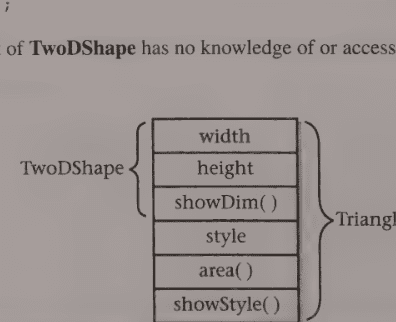
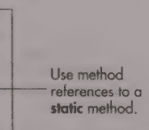
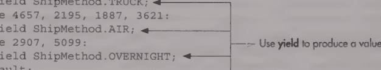
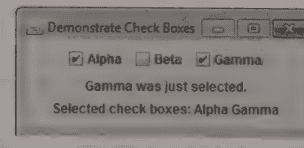
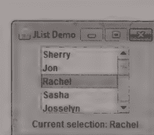
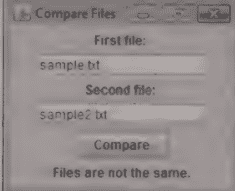

# Java 入门指南，第九版

## 关于作者

畅销作家 Herbert Schildt 在过去的三十多年里编写了大量关于编程的书，是 Java 语言的领先权威。《国际开发者》杂志誉他为“世界上顶尖的编程书籍作者之一”，他的著作在全球范围内已售数百万册，并翻译成所有主要外语。他编写了许多关于 Java 的书籍，包括《Java: The Complete Reference》、《Herb Schildt's Java Programming Cookbook》、《Introducing JavaFX Programming and Swing: A Beginner's Guide》。他还编写了大量关于 C++ 和 C# 的著作。Ed Burns 在《Secrets of the Rock Star Programmers: Riding the IT Crest》中将他誉为摇滚明星程序员之一。Schildt 对计算的所有方面都感兴趣，但他的主要关注点是语言。Schildt 拥有伊利诺伊大学的学士学位和硕士学位。他的网站是 Web.HerbSchilddt.com。

## 关于技术编辑

Danny Coward 博士参与了 Java 平台的所有版本。他领导了 Java Servlets 进入第一版本 Java EE 平台及后续版本的定义，Web 服务进入 Java ME 平台，以及 Java SE 7 的策略和规划。他创立了 JavaFX 技术，最近设计了 Java EE 7 标准中最大的扩展——Java WebSocket API。从编写 Java 代码到与行业专家设计 API，再到多年担任 Java Community Aspect 的高管，他对 Java 技术的多个方面拥有独特且广泛的视角。此外，他还编写了两本关于 Java 编程的书：《Java Programming and Java EE 7: The Big Picture》。最近，他一直在利用其 Java 知识帮助全球最成功的软件公司之一扩展大规模的 Java 服务。Coward 博士拥有牛津大学的数学学士、硕士和博士学位。

# 第2章 介绍数据类型和运算符

## 为什么数据类型很重要

## Java 的基本类型

### 整数类型

### 浮点类型

### 字符

## 布尔类型

## 练习 2-1：闪电有多远？

## 字面量

### 十六进制、八进制和二进制字面量

### 字符转义序列

### 字符串字面量

## 深入了解变量

### 初始化变量

### 动态初始化

## 变量的作用域和寿命

## 运算符

### 算术运算符

### 增减运算符

## 关系和逻辑运算符

### 短路逻辑运算符

## 赋值运算符

### 简写赋值

## 赋值中的类型转换

### 强制转换不兼容类型

## 运算符优先级

## 练习 2-2：显示逻辑运算符的真值表

# 第3章 程序控制语句

# 第4章 引入类、对象和方法

# 第5章 更多数据类型和运算符

# 第6章 深入理解方法和类

## 控制类成员的访问

## Java 的访问修饰符

## 练习 6-1：改进队列类

# 第7章 继承

# 第9章 异常处理

## 异常层次结构

## 异常处理基础

## 使用 try 和 catch

## 未捕获异常的简单示例

## 未捕获异常的后果

## 异常让你能够优雅处理错误

## 使用多个 catch 语句

## 捕获子类异常

## Try 块可以嵌套

## 抛出异常

## 重新抛出异常

## 深入 Throwable

## 使用 finally

## 使用 throws

## 三个额外的异常特性

## Java 内置异常

## 创建异常子类

## 尝试练习 9-1：为队列类添加异常

## 第9章自测

# 第10章 使用 I/O

## Java 的 I/O 基于流构建

## 字节流与字符流

## 字节流类

## 字符流类

## 预定义流

## 使用字节流

## 读取控制输入

## 输出控制输出

## 使用字节流读写文件

## 从文件输入

## 写入文件

## 自动关闭文件

## 读写二进制数据

## 尝试练习 10-1：文件比较工具

## 随机访问文件

## 使用 Java 的基于字符的流

## 使用字符流进行控制输入

## 使用字符流进行控制输出

## 使用输入字符流

## 使用 FileWriter

## 使用 FileReader

## 使用 Java 包装类转换数值字符串

## 尝试练习 10-2：创建一个基于磁盘的帮助系统

## 第10章自测

# 第11章 多线程编程

# 第13章 泛型

# 第17章自测

# 自测答案

## javadoc 标签

## 附录 C 编译并运行简单单文件程序

## 附录 D 引入 JShell

## 附录 E 更多 Java 关键字

### transient 和 volatile 修饰符

### strictfp

### assert

### 原生方法

### 此的另一种形式

# 索引

## 引言

本书目的是教授 Java 编程的基础。它采用循序渐进的方法，配有大量的示例、自测和项目。假设你没有任何编程经验。本书从基础知识开始，例如如何编译和运行 Java 程序。然后讨论了构成 Java 语言核心的关键字、特性和结构。你还会发现 Java 高级特性的介绍，包括多线程编程、泛型、Lambda 表达式、Record 和模块。本书以 Swing 基础的介绍作为结束。当你完成学习时，你已经牢牢掌握了 Java 编程的精髓。

在开头说明这一点很重要：本书只是一个起点。Java 不仅仅是定义语言的元素。Java 还包含了有助于程序开发的广泛库和工具。成为一名顶尖的 Java 程序员意味着也要精通这些领域。在完成本书后，你将拥有追求 Java 其他任何所有方面的知识。

## Java 的演变

只有极少数语言从根本上重塑了编程的本质。在这一精英群体中，有一种语言脱颖而出，因为它的影响既迅速又广泛。这种语言无疑是 Java。说 1995 年由 Sun Microsystems, Inc. 发布的原始 Java 1.0 版本引发了编程界的革命并不夸张。这场革命从根本上改变了 Web，使其成为一个高度交互的环境。在这个过程中，Java 在计算机语言设计中树立了新标准。

多年来，Java 继续增长、演进并重新定义自己。与许多引入新特性缓慢的语言不同，Java 往往处于计算机语言开发的前沿。原因之一是围绕 Java 的创新与变革文化。Java 经历了多次升级——有些相对较小，有些则意义重大。

Java 的第一次重大更新是 1.1 版本。Java 1.1 添加的特性比你认为的次版本号变化要实质得多。例如，Java 1.1 添加了许多新的库元素，重新定义了事件处理方式，并重新配置了原始 1.0 库的许多特性。

Java 的下一次发布是 Java 2，其中“2”表示“第二代”。Java 2 的诞生是一个分水岭事件，标志着 Java “现代时代”的开始。Java 2 的第一个版本版本号为 1.2。Java 2 的第一个版本使用 1.2 版本号似乎很奇怪，原因在于它最初指的是内部版本。

### Java 5 的关键特性

其中“2”表示“第二代”。Java 2 的诞生是一个分水岭事件，标志着 Java “现代时代”的开始。Java 2 的第一个版本版本号为 1.2。Java 2 的第一个版本使用 1.2 版本号似乎很奇怪，原因在于它最初指的是内部版本。

# Java：初学者指南

Lambda 表达式。JDK 8 增加了许多其他重要特性。例如，从 JDK 8 开始，现在可以为接口指定的方法定义默认实现。从根本上来说，Java SE 8 是一次重大发布，它深刻地扩展了该语言的能力，并改变了 Java 代码的编写方式。

Java 的下一个版本是 SE 9。开发者工具包是 JDK 9。JDK 9 的发布，其内部版本号也是 9。JDK 9 代表了一次重大发布，对 Java 语言及其库都进行了显著增强。主要的单元特性是模块，它允许你指定组成代码的关系和依赖关系，为 Java 的访问控制功能增加了另一个维度。模块的引入为 Java 添加了新的语法特性、几个新关键字以及各种工具增强。模块对 API 库产生了深远影响，因为从 JDK 9 开始，库包现在被组织成模块。

除了模块之外，JDK 9 还包含了其他几个新特性。其中之一是 `JShell`，它是一个支持交互式程序实验和学习的工具。（在附录 D 中有 `JShell` 的介绍）。另一个有趣的升级是私有接口。它们的引入增强了 JDK 8 对接口中默认方法的支持。JDK 9 为 `javac` 增加了搜索功能，并添加了一个名为 `@index` 的新标签来支持它。与之前的版本一样，JDK 9 包含了对 Java API 库的许多更新和增强。

通常情况下，在任何发布中，新特性都是受关注的。然而，Java 有一个受关注的方面被 JDK 9 废弃了：applet。从 JDK 9 开始，不再建议在新项目中使用 applet。正如第 1 章将详细解释的，由于浏览器对 app 的支持减少（以及其他因素），JDK 9 废弃了整个 applet。

Java 的下一个版本是 SE 10 (JDK 10)。然而，在它发布之前，Java 的发布计划发生了重大变化。过去，大版本之间通常相隔两年或以上。然而，从 JDK 10 开始，发布之间的时间被显著缩短。现在预计发布将按照严格基于时间的时间表进行，大版本（现在称为特性发布）之间的预计时间仅为六个月。因此，JDK 10 于 2018 年 3 月发布，在 JDK 9 发布六个月后。这种更快的发布节奏使得新特性和改进能够快速供 Java 程序员使用。与其等待两年或更久，当新特性准备就绪时，它将成为下一次计划发布的一部分。

Java 发布计划的另一个侧面是长期支持（LTS）发布。现在预计每三年会有一次 LTS 发布。LTS 发布将获得比六个月更长的支持（因此具有更久生命力）。第一个 LTS 发布是 JDK 11。第二个 LTS 发布是 JDK 17，本书也针对该版本进行了更新。由于 LTS 发布提供了这种稳定性，其功能集很可能会在未来几年内定义许多功能的基准。有关长期支持和 LTS 发布计划的最新信息，请咨询 Oracle（甲骨文）。

JDK 10 增加的主要语言特性是局部变量类型推断。通过局部类型推断，现在可以根据其初始化赋值的类型来推断局部变量的类型，而不是显式地指定。

## 引言

为了支持这种能力，Java 引入了上下文相关的关键字 `var`。当类型可以从其初始化器推断出来时，类型推断可以通过消除冗余的变量类型指定来精简代码。在类型难以识别或无法显式指定的情况下，它也简化了声明。局部变量类型推断已成为现代编程环境的组成部分。它在 Java 中的引入有助于跟上语言设计演进的趋势。除了许多变化，JDK 10 还重新定义了版本字符串的含义——更改了版本号，使其与新的基于时间的发布计划对齐。

Java 的下一个版本是 Java SE 11 (JDK 11)。它于 2018 年 9 月发布，在 JDK 10 发布六个月后。JDK 11 的主要新特性是在 Lambda 表达式中使用 `var`，这是 Java 启动器添加的另一种执行模式，使其能够直接执行单文件程序。JDK 11 还删除了某些特性。最引起人们感兴趣的也许是因为 applet 已经在 JDK 9 中被废弃。随着 JDK 11 的发布，删除了对 applet 的支持。对另一种部署相关技术 Java Web Start 的支持也从 JDK 11 中移除。JDK 11 中还有另一个备受关注的框架：JavaFX。这个 GUI 框架不再是 JDK 的一部分，而是变成了一个开源项目。由于某些特性已从 JDK 中删除，它们在本章中不再被讨论。


# Java 基础

## Java 版本概述

在 JDK 11 LTS 和下一个 LTS 发布 (JDK 17) 之间有五个版本：JDK 12 到 JDK 16。

- JDK 12 和 13 没有添加任何新特性。
- JDK 14 增加了对 `switch` 表达式的支持，这是一种可以产生值的 `switch`。对 `switch` 的增强也被包含在内。
- JDK 15 增加了文本块，它们本质上是跨多行的字面量。
- JDK 16 通过模式匹配增强了 `instanceof`，并引入了使用上下文相关关键字 `record` 定义的新类型 `record`。`record` 提供了聚合数据的便利性。JDK 16 还提供了一种名为 `jpackage` 的新应用程序打包工具。

## 本书的结构

本书提供了一个节奏均匀的教程，每个章节都建立在前章节的基础上。它包含 17 章，每章都讨论 Java 的一个方面。本书的独特之处在于它包含了几个特殊元素来强化你的学习内容。

### 关键技能与概念

每章开始都会列出你将学习的关键技能。

### 自测

每章结束时都有一个自测，让你测试自己的知识。答案在附录 A 中。

### 专家问

书中穿插了许多特殊的“专家问”框。这些包含了关于主题的附加信息或有趣的评论。它们采用问答格式。

### 尝试元素

每章都包含一个或多个“尝试元素”，这些项目向你展示如何应用所学。在许多情况下，这些你可以作为程序起点的真实示例。

## 无需经验

本书假设没有之前的编程经验。因此，如果你从未编写过程序，可以使用本书。如果你有一定的编程经验，你可以进展得快一点。然而，请记住，Java 在某些方面与其他流行语言不同。因此，即使对于经验丰富的程序员，也建议仔细阅读。

## 所需软件

为了编译和运行本书中的所有程序，你需要最新的 Java 开发工具包（JDK），在本书编写时是 JDK 17。这是 Java SE 17 的 JDK。获取 Java JDK 的说明在第 1 章中。

如果你使用的是旧版本的 Java，你仍然可以使用本书，但你无法编译和运行使用 Java 新特性的程序。

## 不要忘记：网络上的代码

记住，书中所有示例和项目的源代码均免费在网上 `www.mhprofessional.com` 获取。

## 特别感谢

特别感谢本书版本的技术编辑 Danny Coward。Danny 参与过我多本书的编写，他的建议、见解和启发一直具有巨大的价值，对此深表感谢。

## 进阶学习

《Java 入门》（Java: A Beginner's Guide）是你进入 Herb Schild Java 编程书籍系列的大门。以下是一些你可能感兴趣的其他书籍：

- 《Java 完全参考》（Java: The Complete Reference）
- 《Herb Schild 的 Java 编程食谱》（Herb Schild's Java Programming Cookbook）
- 《Java 艺术》（The Art of Java）
- 《Swing 入门》（Swing: A Beginner's Guide）
- 《JavaFX 8 编程》（Introducing JavaFX 8 Programming）

---

# 第一章：Java 基础

## 核心技能与概念

- 了解 Java 的历史和哲学
- 理解 Java 对互联网的贡献
- 理解字节码的重要性
- 了解 Java 术语
- 理解面向对象编程的基本原理
- 创建、编译并运行一个简单的 Java 程序
- 使用变量
- 使用 `if` 和 `for` 控制语句
- 创建代码块
- 理解语句的定位、缩进和结束方式
- 了解 Java 关键字
- 了解 Java 标识符的规则

## Java 的历史与哲学

在充分理解 Java 的独特之处之前，必须理解驱动其产生的力量、它体现的编程哲学以及其设计的关键概念。随着对本书的阅读，你会发现 Java 的许多方面都是塑造该语言的历史力量的直接或间接结果。因此，通过探索 Java 如何与更大的编程世界联系来开始对 Java 的研究是恰当的。

### Java 的起源

Java 由 James Gosling、Patrick Naughton、Chris Warth、Ed Frank 和 Mike Sheridan 在太阳公司构思。它最初被命名“Oak”（橡树），但在 1995 年更名为“Java”。令人有些惊讶的是，Java 的最初动力并非互联网！相反，主要的动力是需要一种平台无关的语言，可以嵌入到各种消费电子设备中，如烤面包机、微波炉和遥控器。正如你可能猜到的那样，许多不同类型的 CPU 被用作控制器。问题在于，大多数计算机语言被设计为编译成特定类型 CPU 的机器码。例如，考虑 C++ 语言。

虽然可以为任何类型的 CPU 编译 C++ 程序，但这需要为该 CPU 提供一个完整的 C++ 编译器。然而，问题在于，编译器的创建既昂贵又耗时。为了寻找更好的解决方案，Gosling 等人致力于开发一种可移植的、跨平台的语言，这种语言能够在不同环境下的多种 CPU 上运行代码。这种努力最终导致了 Java 的诞生。

在 Java 细节正在确定的期间，出现了第二个也是最终更重要的因素，它将对 Java 的未来起着至关重要的作用。这第二股力量无疑是万维网。如果 Web 没有在 Java 实现的同时成型，Java 可能只是一门有用但冷僻的消费电子设备编程语言。然而，随着 Web 的出现，Java 被推向了计算机语言设计的前沿，因为 Web 需要可移植的程序。

大多数程序员在职业生涯早期就了解到，可移植程序正如其理想性一样不可捉摸。虽然寻找创建高效、可移植（平台无关）程序的追求几乎与编程学科本身一样古老，但它一直让位给其他更紧迫的问题。然而，随着互联网和 Web 的出现，可移植性这一老问题以迅猛之势回归。毕竟，互联网连接了一个由许多类型的计算机、操作系统和 CPU 组成的多元化、分布式宇宙。

曾经一个有趣但低优先级的问题变成了一个备受关注的必要需求。到 1993 年，Java 设计团队的成员发现，在为嵌入式控制器创建代码时经常遇到的可移植性问题，在尝试为互联网创建代码时同样存在。这一发现使 Java 的焦点从消费电子转向了互联网编程。因此，尽管对一种架构中立的编程语言的渴望提供了最初的火花，但最终是互联网导致了 Java 的大规模成功。

### Java 的血脉：C 和 C++

计算机语言的历史并非孤立事件的集合。相反，它是一个连续体，每种新语言都以某种方式受到其之前语言的影响。在这方面，Java 并非例外。在继续之前，了解 Java 在计算机语言家族树中的位置是有用的。

构成 Java 最直接祖先的两种语言是 C 和 C++。正如你所知，C 和 C++ 是历史上最重要的计算机语言之一，并且仍被广泛使用。Java 从 C 继承了语法。Java 的对象模型源自 C++。与 C 和 C++ 的关系出于几个原因很重要。在 Java 创建时，许多程序员熟悉 C/C++ 语法。由于 Java 使用类似的语法，C/C++ 程序员学习 Java 相对容易。这使得现有程序员群体能够轻松使用 Java，促进了 Java 被编程社区接受。

其次，Java 的设计者并没有“发明轮子”。相反，他们延续了一种已经成功的编程范式。编程的现代时代始于 C。发展到 C++，然后是 Java。通过继承并基于这一丰富的遗产，Java 提供了一个强大、逻辑一致的编程环境，并增加了与在线环境和编程进步相关的新特性。或许重要的是，由于它们的相似性，C、C++ 和 Java 为专业程序员定义了一个通用的概念框架。程序员在这些语言之间切换时并不面临巨大的转变。

一点是：尽管 C++ 和 Java 有关联，特别是在支持面向对象编程方面，但 Java 并不是简单的“C++ 的互联网”。Java 与 C++ 有显著的实际和哲学差异。此外，Java 并不过度兼容 C++。而且，Java 设计是为了解决某一组问题。C 是为了解决另一组问题设计的。它们将在未来的许多年里共存。

## Java 如何影响互联网

互联网将 Java 推向了编程的前沿，而 Java 反过来对互联网产生了深远影响。Java 的创造简化了整体编程，成为吸引大量程序员进入 Web 的催化剂。其次，Java 创新了一种名为 Applet 的新型网络程序，改变了世界看待内容的方式。最后，或许最重要的是，Java 解决了与关联的一些棘手问题：可移植性和安全性。

### 简化的 Java Web 编程

Java 从一开始就从许多方面简化了基于 Web 的编程。最重要的这一点可能在于它能够创建可移植的、跨平台的程序。与此同样重要的是 Java 对网络的支持。其即插即用的功能库让程序员能够轻松编写出访问或利用互联网的程序。尽管 Java 提供了让程序能够通过互联网进行传输的机制——尽管细节超出了本书的范围——但只需知道 Java 对网络的支持是其快速崛起的关键因素即可。

### Java Applet

在 Java 诞生之初，其最令人兴奋的特性之一是 Applet。Applet 是一种特殊的 Java 程序，设计用于在兼容 Java 的 Web 浏览器内部传输并在其中自动执行。如果用户点击包含 applet 的链接，applet 将自动下载并在浏览器中运行。Applet 设计用于作为微型程序，通常用于显示服务器提供的数据、处理用户输入或提供简单功能（例如贷款计算器）。Applet 的关键特性是它们在本地执行，而不是在服务器上执行。扩展来说，applet 允许将某些功能从服务器移动到客户端。

Applet 的创建非常重要，因为在当时，它扩展了可以在网络空间中自由移动的对象的宇宙。通常，在服务器和客户端之间传输的对象大致分为两类：被动信息和活动程序。例如，当你阅读邮件时，你查看的是被动数据。当你下载一个程序时，在执行它之前，该程序的代码仍然是被动的。相比之下，applet 是一个动态的、自执行的程序。这种程序是客户端计算机上的活动代理，但它是由服务器交付的。

在 Java 早期，applet 是 Java 编程的重要组成部分。它们展示了 Java 的力量和优势，为网页增添了令人兴奋的维度，并让程序员探索 Java 的所有可能范围。尽管今天可能仍有 applet 在使用，但随着时间的推移，它们变得不再重要，而且由于稍后将解释的原因，JDK 9 开始了它们的淘汰过程。最后，JDK 11 移除了对 applet 的支持。

### 专家问

**问：什么是 C#？它与 Java 有什么关系？**

**答：** 在 Java 诞生几年后，微软开发了 C# 语言。这很重要，因为 C# 与 Java 关系紧密。事实上，C# 的许多特性直接与 Java 对应。Java 和 C# 共享通用的 C++ 风格语法，支持分布式编程，并利用相似的对象模型。当然，Java 和 C# 之间存在差异，但这些语言的整体“外观和感受”非常相似。这意味着如果你已经认识 C#，那么学习 Java 将特别容易。反之，如果 C# 是你的未来，那么你对 Java 的知识将大有用处。

### 安全性

尽管动态、网络化的程序是非常理想的，但它们在安全性和可移植性方面也面临严重的问题。显然，在客户端计算机上下载并执行的程序必须防止其造成危害。它还必须能够在各种不同的环境和不同的操作系统下运行。正如你将看到的，Java 以一种有效且优雅的方式解决了这些问题。让我们更仔细地观察每一个问题，从安全性开始。

正如你可能意识到的，每次当你下载程序时，都面临着风险，因为代码可能包含病毒、特洛伊木马或其他有害代码。问题的核心在于恶意代码可以造成损害，因为它对系统资源具有未经授权的访问。例如，病毒程序可能会通过搜索计算机本地文件系统的内容来收集隐私信息，如信用卡号、银行余额和密码。为了让 Java 能够安全地在客户端计算机上下载和执行程序，必须防止它们发起此类攻击。

Java 通过允许你将应用程序限制在 Java 执行环境中，并防止其访问计算机的其他部分，实现了这种保护。（你稍后将看到它是如何实现的。）能够以极高水平的信心下载应用程序，并确保不会造成任何伤害，这对 Java 的早期成功至关重要。

### 可移植性

可移植性是互联网的一个主要方面，因为连接到互联网的有许多不同类型的计算机和操作系统。如果一个 Java 程序要在几乎任何连接到互联网的计算机上运行，就需要某种方法让该程序能够在不同类型的系统上执行。换句话说，需要一种机制，允许同一个程序被各种 CPU、操作系统和浏览器下载并执行。为不同的计算机准备同一个应用程序的多个版本是不现实的。相同的代码必须在所有计算机上都能工作。因此，需要某种生成可移植代码的手段。正如你很快看到的，确保安全性的相同机制也创建了可移植性。

### Java 的魔力：字节码

让 Java 解决上述安全性和可移植性问题的关键在于，Java 编译器的输出不是可执行代码，而是字节码。字节码是一组高度优化的指令，由所谓的 Java 虚拟机（JVM）执行，而 JVM 是 Java 运行环境（JRE）的一部分。本质上，JVM 被设计为字节码的解释器。这可能会让你感到意外，因为许多现代语言被设计成编译成特定 CPU 的可执行代码。然而，Java 程序由 JVM 执行这一事实解决了与基于 Web 的程序相关的主要问题。原因如下。

将 Java 程序翻译成字节码解决了与基于 Web 的程序相关的主要问题。因为 Java 程序是由 JVM 执行的，因此它可以在任何具有 JVM 实现的平台上运行。这就是 Java 可移植性的精髓。此外，JVM 为执行字节码提供了一个安全的环境，防止其在主机系统上执行未经授权的操作。

## 超越 Applet

在写本文时，距离 Java 的最初发布已经过去了二十多年。在过去的这些年里，发生了许多变化。在 Java 诞生时，互联网是一个新颖且令人兴奋的创新；网络浏览器正在经历快速的开发和完善；现代形式的智能手机尚未发明；计算机的普及使用还需要几年时间。正如你所预期的那样，Java 也发生了变化，Java 的使用方式也是如此。也许没有什么比 applet 更能更好地说明 Java 持续的演变了。

如前所述，在 Java 早期，applet 是 Java 编程的重要部分。它们不仅为网页增添了趣味性（网页是 Java 一个非常直观的部分），也增加了它的魅力。然而，applet 依赖于 Java 浏览器插件。因此，为了让 applet 运行，必须得到浏览器的支持。过去几年，对 Java 浏览器插件的支持正在减弱。简单来说，没有浏览器的支持，applet 就无法生存。正如此，从 JDK 9 开始，applet 的淘汰阶段开始了。在 Java 语言中，`deprecated`（弃用）意味着某个功能仍然可用，但被标记为过时。随着 JDK 11 移除对 applet 的运行时支持，弃用的功能走向终结。从 JDK 17 开始，整个 Applet API 都被标记为 `deprecated for removal`（弃用并移除），这意味着它将在未来的某个时候从 JDK 中删除。

令人感兴趣点是，在 Java 诞生几年后，增加了一个 applet 的替代方案。它被称为 Web Start，允许应用程序从网页上动态下载。这是一种部署机制，对于不适合 applet 的大型 Java 应用程序特别有用。区别在于应用程序是独立运行，而不是在浏览器内部运行。因此，它看起来像一个“正常”的应用程序。然而，它要求主机系统中有一个支持 Web Start 的独立 JRE。从 JDK 11 开始，对 Web Start 的支持已被移除。

既然 applet 和 Web Start 对于现代版本的 Java 来说都不再可行，你可能会问应该使用什么机制来部署 Java 应用程序。在写本文时，答案的某一部分是使用 JDK 9 添加的 `jlink` 工具。它可以创建一个运行时镜像，其中包含了程序所需的所有支持，包括 JRE。答案的另一部分是 `jpackage` 工具。它由 JDK 16 添加，可以用于创建准备就绪的安装程序。这不在本书的范围内。幸运的是，你不需要为了使用本书而担心部署问题，因为所有的示例程序都直接在你的计算机上运行。

## 更快的发布节奏

不久前，Java 发生了另一个重大变化，但它不涉及语言或运行时环境的更改。相反，它与 Java 发布的计划有关。在过去，主要的 Java 版本发布之间通常每隔两年或更久。然而，在 JDK 9 发布之后，Java 版本之间的时间间隔缩短了。今天，预计重大发布将按照严格的计划进行，预计重大版本发布之间的时间间隔仅为六个月。

每个主要的发布版本（现在称为特性版本）都将包含发布时的那些特性。这种发布节奏的加快使得新功能和增强功能能够及时提供给 Java 程序员。此外，它允许 Java 能够快速响应不断变化的编程环境的需求。简单来说，更快的发布节奏证明对 Java 程序员来说是一个非常积极的进展。


# Java 版本发布与基础概念

预计每隔三年会进行一次长期支持（LTS）发布。LTS 版本将获得比六个月更长的支持（因此更具可行性）。第一个 LTS 版本是 JDK 11。第二个 LTS 版本是 JDK 17，因为 LTS 版本的稳定性可能会定义未来几年的功能基准。请访问 Oracle 获取有关长期支持和 LTS 发布计划的最新信息。

目前，特性版本安排在每年的 3 月和 9 月发布。因此，JDK 10 于 2018 年 3 月发布，在 JDK 9 发布六个月后。下一次发布（JDK 11）是在 2018 年 9 月。它是一个 LTS 版本。之后是 2019 年 3 月的 JDK 12、2019 年 9 月的 JDK 13、2020 年 3 月的 JDK 14、2020 年 9 月的 JDK 15、2021 年 3 月的 JDK 16、2021 年 9 月的 JDK 17、2022 年 3 月的 JDK 18、2022 年 9 月的 JDK 19、2023 年 3 月的 JDK 20 以及 2023 年 9 月的 JDK 21。在写本文时，预计重大发布将按照严格的计划进行，预计重大版本发布之间的时间间隔仅为六个月。

# 术语

- 简单
- 可移植性
- 健壮
- 多线程
- 体系中立
- 解释型
- 高性能
- 分布式
- 动态

# 面向对象编程

为了支持面向对象编程的原则，所有 OOP 语言（包括 Java）都有三个共同特征：封装、多态和继承。让我们检查每一个。

## 封装

封装（Encapsulation）是一种编程机制，它将代码与其操作的数据绑定在一起，并保护它们免受外部干涉和误用。在面向对象的语言中，代码和数据可以绑定在一起，从而创建一个自给自足的黑盒。盒子内部包含了所有必要的数据和代码。当代码和数据以这种方式链接时，一个对象就创建了。换句话说，对象是支持封装的设备。

在对象内部，代码、数据或二者可以是该对象的私有的（`private`），也可以是公开的（`public`）。私有代码对对象的其他部分是未知且无法访问的。这意味着，私有代码或数据无法被对象外部的程序访问。当代码或数据是公开的，尽管它们被定义在对象内部，你程序的其他部分也可以访问它们。通常，对象的公共部分用于为对象的各个元素提供一个受控的接口。

Java 封装的单元是类（`class`）。虽然在本文后大部分将对类进行详细解释，但接下来的讨论对现在很有帮助。类定义了对象的形状。它规定了将对该数据进行操作的数据和代码。Java 使用类规范来构造对象。对象是类的实例。因此，类本质上是一组关于如何构建对象的计划。

由类定义的数据被称为成员变量（`member variables`）或实例变量（`instance variables`）。具体来说，操作这些数据的代码被称为成员方法（`member methods`）或直接称为方法（`methods`）。方法是 Java 对子程序（`subroutine`）的术语。如果你熟悉 C/C++，知道 Java 程序员所说的方法就是 C/C++ 程序员所说的函数，可能会有所帮助。

## 多态

多态（Polymorphism，源自希腊语，意为“多种形式”）允许一个接口访问一类通用动作的特性。具体动作取决于情况的准确性质。多态的一个简单例子是汽车的方向盘。无论使用何种类型的的实际转向机制，方向盘（即接口）都是相同的。这意味着，方向盘知道你的汽车是手动转向、助力转向还是齿条式转向。因此，你知道如何操作方向盘，就可以驾驶任何类型的汽车。

同样的原理也适用于编程。例如，考虑一个栈（`stack`，一种后进先出的列表）。你可能有一个处理三种类型数据的程序。一个栈用于整数值，一个用于浮点值，一个用于字符。在这种情况下，尽管存储的数据不同，但实现每个栈的算法是相同的。在非面向对象的语言中，你将被创建三组不同的栈例程，每组使用不同的名称。由于多态性的存在，在 Java 中，你可以创建一个通用的栈例程集，它适用于所有特定情况。这样，你只要知道如何使用一个栈，就可以使用它们所有的栈。

更广泛地说，多态的概念通常用“一个接口，多个方法”这一短语表达。这意味着可能为一组相关活动设计一个通用接口。多态通过允许使用同一个接口来指定一类通用动作，降低了复杂性。根据每种情况选择具体的动作（即方法）是编译器的工作。你，作为程序员，不需要手动地进行这种选择。你只需要记住并利用通用接口即可。

## 继承

继承（Inheritance）是一个对象获取另一个对象属性的过程。这很重要，因为它支持了分级分类（hierarchical classification）的概念。如果你仔细考虑，大多数知识都可以通过分级（即自上而下）分类来管理。例如，红富士苹果（Red Delicious apple）是苹果类的一部分，而苹果类又是水果类（`fruit class`）的一部分，水果类属于更大的食物类（`food class`）。也就是说，水果类具有某些品质（可食的、有营养的等），这些品质在逻辑上也适用于苹果。继承允许一个子类重用父类的方法和属性，这有助于代码的重用。

# Java：初学者指南

你将遵循以下三个步骤：

1. 输入程序。
2. 编译程序。
3. 运行程序。

## 输入程序

书中的程序可以从 `www.mhprofessional.com` 获取。不过，如果你想手动输入程序，也可以随意这样做。在这种情况下，你必须使用文本编辑器而不是文字处理程序将程序输入到计算机中。文字处理器通常会将格式信息与文本一起存储。这些格式信息会令 Java 编译器产生困惑。如果你使用的是 Windows 平台，可以使用记事本或任何你喜欢的编程编辑器。

对于大多数计算机语言来说，保存程序源代码的文件名是任意的。然而，Java 并非如此。关于 Java，你必须学习的第一点是：你为源文件命的名字非常重要。例如，源文件的名称应该是 `Example.java`。让我们来看看为什么。

在 Java 中，源文件正式称为编译单元。它是一个文本文件，其中包含（除其他内容外）一个或多个类定义。（现在，我们将使用只包含一个类的源文件。）Java 编译器要求源文件使用 `.java` 文件名扩展。正如你通过查看程序所看到的，程序定义的类名也是 `Example`。这并非巧合。在 Java 中，所有代码必须存在于类（`Class`）内部。按照惯例，主类的名称应该与存放程序的文件名匹配。其原因是 Java 是大小写敏感的。在此阶段，文件名与类名对应的惯例似乎是任意的。然而，这种惯例使得维护和组织你的程序变得更容易。此外，正如你以后在书中看到的，在某些情况下，这是强制要求的。

## 编译程序

要编译 `Example` 程序，请执行 `javac` 并在命令行上指定源文件名，如下所示：

```
javac Example.java
```

`javac` 编译器会创建一个 `Example.class` 文件，其中包含程序的字节码版本。请记住，字节码不是可执行代码。字节码必须由 Java 虚拟机（JVM）执行。因此，`javac` 的输出不是可以直接执行的代码。

要实际运行程序，你必须使用 Java 解释器 `java`。为此，将类名 `Example` 作为命令行参数传递，如下所示：

```
java Example
```

当程序运行时，将显示以下输出：

```
Java 驱动着 Web。
```

## 运行程序

当 Java 源代码被编译时，每个单独的类都被放入自己的以类命名的输出文件中，并使用 `.class` 扩展名。这就是为什么给你的 Java 源文件命名为与其包含的类相同的名称是一个好主意——源文件的名称与 `.class` 文件名匹配。当你像刚才那样执行 Java 解释器时，你实际上是在指定你想让解释器执行的类名。它将根据名称搜索具有 `.class` 扩展名的文件。如果找到了该文件，它将执行指定类中包含的代码。

在继续之前，需要说明一点是，从 JDK 11 开始，Java 提供了一种直接从源文件运行某些类型简单程序的方法，而无需显式地调用 `javac`。这种技术在某些情况下非常有用，在附录 C 中描述。对于本书而言，假设你正在使用所描述的普通编译过程。

## 注意事项

如果在尝试编译程序时，计算机找不到 `javac`（假设你已正确安装 JDK），那么你需要指定命令行工具的路径。在 Windows 中，这意味着你需要将命令行工具的路径添加到 PATH 环境变量所定义的路径中。例如，如果 JDK 17 安装在 `Program Files` 目录下，命令行工具的路径将类似于 `C:\Program Files\Java\jdk-17\bin`。（当然，你的路径将与所示不同。JDK 的特定版本可能不同。）你需要查阅你操作系统的文档了解如何设置路径，因为此过程在不同的操作系统之间不同。

## 逐行分析第一个程序

尽管 `Example.java` 非常短，但它包含了所有 Java 程序共有的几个特性。让我们仔细检查程序的每个部分。

程序从以下行开始：

```
/*
这是一个简单的 Java 程序。

将此文件命名为 Example.java。
*/
```

这是一个注释。与大多数编程语言一样，Java 允许你在程序的源文件中输入备注。编译器会忽略注释的内容。相反，注释会向任何阅读其源代码的人描述或解释程序的操作。在这种情况下，注释描述了程序，并提醒你源文件应该命名为 `Example.java`。当然，在实际应用中，注释通常解释程序的某些部分是如何运作的，或者某个特定功能的作用。

Java 支持三种类型的注释。程序顶部显示的称为多行注释。这种类型的注释必须以 `/*` 开始并以 `*/` 结束。这两个注释符号之间的任何内容都会被编译器忽略。顾名思义，多行注释可能有几行长。

程序中的下一行代码如下：

```
class Example {
```

这一行使用关键字 `class` 来声明正在定义一个新类。正如前面所提到的，类是 Java 封装的基本单元。`Example` 是类名。定义从左大括号开始，以右大括号结束。两个大括号之间的元素是类的成员。目前，不必过多担心类的细节，只需注意所有的程序活动都发生在类内部。

程序的下一行是单行注释：

```
// Java 程序从 main() 开始
```

这是 Java 支持的第二种注释。单行注释以 `//` 开始，并在行尾结束。作为常规，程序员使用多行注释进行较长的备注，使用单行注释进行简短的描述。

下一行代码如下：

```
public static void main(String[] args) {
```

这一行开始 `main()` 方法。正如之前提到的，在 Java 中，子程序被称为方法。正如前面的注释所暗示，这是程序开始执行的行。通常，Java 通过调用 `main()` 开始执行。此行的部分的精确含义现在无法给出，因为它涉及到对 Java 若干特性的详细理解。然而，由于书中许多示例都会使用这行代码，让我们来看看每个部分。

`public` 关键字是一个访问修饰符。访问修饰符决定程序的其他部分如何访问类的成员。当类成员前面有 `public` 时，该成员可以被声明类之外的代码访问。（类的反面是 `private`，它防止成员被其类之外的代码使用。）在这种情况下，`main()` 必须声明为 `public`，因为它必须在程序启动时被代码调用。`static` 关键字允许在创建类对象之前被调用。这是必要的，因为 `main()` 是由 JVM 调用的且没有返回值。正如你将看到的，`main()` 也可以返回值。

正如所述，`main()` 是 Java 启动时调用的方法。任何你需要传递给方法的信息都通过方法名后括号内指定的变量接收。这些变量被称为参数。如果给方法不需要参数，你仍然需要包含空括号。在这种情况下，只有一个参数 `String[] args`，它声明了一个名为 `args` 的参数。`String[]` 是 `String` 类型的对象数组（数组是相似对象的集合）。`String` 类型的对象是字符序列。在这种情况下，`args` 接收执行程序时输入的任何命令行参数。本程序没有利用这些信息，但书中以后显示的其他程序将会使用。

行的最后一个字符是 `{`。这标志着 `main()` 方法体的开始。包含在方法中的所有代码都位于方法的左大括号和右大括号之间。

这里显示了下一行代码。注意，它出现在 `main()` 方法的内部。

```
System.out.println("Java drives the Web.");
```

这会在屏幕上输出字符串 "Java drives the Web." 然后紧跟一个换行。输出实际上是由内置的 `println()` 方法实现的。在这种情况下，`println()` 显示传递给它的字符串。正如你将看到的，`println()` 可以用于显示其他类型的信息。该行开头的 `System.out` 是一个预定义的类，提供了访问系统的接口，并将输出重定向到控制台。`System.out` 是封装控制台输出的对象。Java 使用对象来定义控制台输出，这进一步证明了其面向对象的本质。

正如你可能已经看到的，在真实的 Java 应用程序中并不频繁使用控制台输出（和输入）。大多数现代计算环境本质上是窗口化和图形化的，控制台 I/O 用于简单的实用程序、演示以及服务器端代码。在本书中，你将学习使用 Java 生成输出的其他方法，但现在，我们需要使用控制台 I/O 方法。

注意 `println` 语句以分号结尾。Java 中的许多语句都有分号。程序中的第一个 `}` 结束了 `main()` 方法，最后一个 `}` 结束了 `Example` 类的定义。

有一点：Java 是区分大小写的。忘记这一点可能会给你带来严重的问题。如果你不小心输入了 `Main` 而不是 `main`，或者输入了 `Println` 而不是 `println`，那么前面的程序就是错误的。此外，尽管 Java 编译器会编译不包含 `main()` 的类，但它没有办法执行它们。因此，如果你拼写错了 `main`，编译器仍然会编译你的程序。然而，Java 解释器会报告错误，因为它将找不到 `main()` 方法。

## 处理语法错误

如果你还没有这样做，请编译并运行该程序。正如你从之前的编程经验中所了解到的，在向计算机输入代码时，很容易不小心输错内容。幸运的是，如果你在程序中输入了错误内容，编译器在尝试编译时会报告语法错误。Java 编译器会尝试理解你的源代码，无论你写了什么。由于这个原因，报告的错误可能无法反映问题的实际原因。例如，在前面的程序中，无意间省略 `main()` 方法后的左大括号会导致编译器报告以下错误：

```
Example.java:8: error: ';' expected
public static void main(String[] args) ^
```

```
Example.java:11: error: class, interface, enum, or record expected
}
```

讨论的重点是，当你的程序包含语法错误时，你不应该完全相信编译器的信息。这些信息可能具有误导性。你可能需要对错误信息进行“二次判断”以找到真实问题。此外，查看程序中位于被标记行之前的最后几行代码。在错误实际发生后的几行之后，系统才会报告错误。

## 第二个简单程序

也许没有任何其他结构比给变量赋值对编程语言那么重要了。变量是一个可以赋值的命名内存位置。此外，变量的值可以在程序执行期间更改。也就是说，变量的内容是可以改变的而不是固定的。下面的程序创建了名为 `myVar` 和 `myVar2` 的变量：

```java
/*
这演示了一个变量。
将此文件命名为 Example2.java。
*/
class Example2 {
    public static void main(String[] args) {
        int myVar; // 声明一个变量
        int myVar2; // 声明另一个变量

        myVar = 1024; // 将 1024 赋值给 myVar
        System.out.println("myVar contains " + myVar);

        myVar2 = myVar / 2;
        System.out.print("myVar2 contains myVar / 2: ");
        System.out.println(myVar2);
    }
}
```

当你运行此程序时，你会看到以下输出：

```
myVar contains 1024
myVar2 contains myVar / 2: 512
```

该程序引入了几个新概念。首先，语句

`int myVar; // 声明一个变量`


声明了一个名为 `myVar` 的整数类型变量。在 Java 中，所有变量在使用之前都必须声明。此外，必须指定变量可以包含的值类型。这被称为变量的类型。在这种情况下，`myVar` 可以包含整数值。这些是整数值。在 Java 中，要声明一个变量为整数类型，要在其名称前加上关键字 `int`。前面的语句声明了一个类型为 `int` 的变量 `myVar`。

下一行声明了第二个名为 `myVar2` 的变量：

```java
int myVar2; // 声明另一个变量
```

注意这一行使用了与第一行相同的格式，只是变量名不同。

通常，要声明一个变量，你将使用这样的语句：

`type var-name;`

在这里，`type` 指定要声明的变量的类型，`var-name` 是变量名。

除了 `int` 之外，Java 还支持其他几种类型。下一行代码赋值了：

```java
double x = 1024;
```

这意味着 `x` 是一个浮点类型。在 Java 中，赋值运算符是等号。下一行输出字符串 "myVar contains "

```java
System.out.println("myVar contains " + x);
```

这意味着 `x` 是浮点类型。下一行显示除法：

```java
double x2 = x / 2;
```

这会将 `x` 除以 2 并将结果存储在 `x2` 中。Java 支持完整的运算符范围：

| Operator | Description |
| :--- | :--- |
| `+` | 加法 |
| `-` | 减法 |
| `*` | 乘法 |
| `/` | 除法 |

这里有两个点：首先，`print()` 方法类似于 `println()`，只是它不输出换行。其次，在 `println()` 的情况下，`double` 用于输出任何类型的值。

## Java：学者指南

在我们继续之前关于声明变量的一点：可以使用同一个语句声明多个变量。只需用逗号分隔名称即可。例如，`myVar1` 和 `myVar2` 可以这样声明：

```java
int myVar1, myVar2; // 使用同一个语句声明
```

## 其他数据类型

在前面的程序中，使用了 `int` 变量。然而，`int` 类型的变量只能包含整数。因此，在需要小数部分时无法使用它。例如，`int` 变量可以包含值 18。幸运的是，`int` 只是 Java 定义的数据类型之一。为了允许包含小数的部分，Java 定义了两种浮点类型：`float` 和 `double`，它们代表单精度和双精度值。在两者中，`double` 是最常用的。

要声明一个 `double` 类型变量，使用类似于所示的语句：

```java
double x;
```

在这里，`x` 是变量名，它是 `double`。由于 `x` 是浮点类型，它可以包含如 `122.23`、`0.034` 或 `-19.0` 等值。

为了更好地理解 `int` 和 `double` 的区别，请尝试以下程序：

## 问专家

**Q**: 为什么 Java 为整数和浮点数提供了不同的数据类型？也就是说，为什么所有的数值不都使用同一种类型呢？

**A**: Java 提供不同的数据类型是为了让你编写高效的程序。例如，整数算术比浮点运算要快。因此，如果你不需要小数值，就不需要承担与 `float` 或 `double` 类型相关的开销。其次，一种数据类型所需的内存可能比另一种更少。通过提供不同的数据类型，Java 能够让你最优化地利用系统资源。最后，某些算法需要（或至少受益于）使用特定类型的数据。通常，Java 提供了许多内置类型以给你提供最大的灵活性。

该程序的输出显示在此：

```
Original value of v: 10
Original value of x: 10.0
```

```
v after division: 2 ----------------------- 小数部分丢失
after division: 2.5 ---------------- 小数部分保留
```

如你所见，当 v 除以 4 时，执行的是整数除法，结果是 2——小数部分丢失了。然而，当 `double` 类型变量 x 除以 4 时，小数部分被保留，并显示了正确的答案。

程序中有一个新点需要注意。要打印空行，只需调用不带任何参数的 `println()`。

## 尝试一下 1-1 将加仑转换为升

GalToLit.java 虽然之前的程序说明了 Java 语言的几个重要特性，但此时，它们并不怎么有用。即使你现在对 Java 并不了解，你仍然可以运用所学的知识创建一个实用的程序。在这个项目中，我们将创建一个将加仑转换为升的程序。该程序将通过声明两个 `double` 变量来工作。一个存储加仑数，另一个存储转换后的升数。1 加仑等于 3.7854 升。因此，要将加仑转换为升，只需将加仑值乘以 3.7854。程序将同时显示加仑数和对应的升数。

1. 创建一个名为 `GalToLit.java` 的文件。
2. 在文件中输入以下程序：

```java
/*
Try This 1-1
此程序将加仑转换为升。
将此程序命名为 GalToLit.java。
*/
class GalToLit {
    public static void main(String[] args) {
        double gallons; // 存储加仑数
        double liters; // 存储转换为升

        gallons = 10; // 从 10 加仑开始
        liters = gallons * 3.7854; // 转换为升

        System.out.println(gallons + " gallons is " + liters + " liters.");
    }
}
```

3. 使用以下命令行编译程序：

`javac GalToLit.java`

4. 使用此命令运行程序：

`java GalToLit`

你将看到此输出：

10.0 gallons is 37.854 liters.

5. 目前，该程序将 10 加仑转换为升。然而，通过更改赋值给 gallons 的值，你可以让程序将不同数量的加仑转换为对应的升。

## 两个控制语句

在方法内部，执行是从一条语句到下一条语句从上到下进行的。然而，可以通过使用 Java 支持的各种程序控制语句来改变这种流程。虽然我们稍后会详细查看控制语句，但这里要介绍两个，因为我们将使用它们来编写示例程序。

## if 语句

你可以通过 Java 的条件语句来选择性地执行程序的部分：if 语句的工作方式与其他任何语言中的 IF 语句非常相似。它根据某些条件为真还是假来决定程序执行的流程。其最简单的形式所示：

`if(condition) statement:`

在这里，condition 是一个布尔表达式。（布尔表达式是一个求值结果为真或假的表达式。）如果 condition 为真，则执行该语句。如果 condition 为假，则跳过该语句。这里有一个例子：

```java
if(10 < 11) System.out.println("10 is less than eleven");
```

在这种情况下，10 小于 11，条件表达式为真，`println()` 将执行。然而，考虑以下情况：

```java
if(10 < 9) System.out.println("this won't be displayed");
```

在这种情况下，10 并不小于 9。因此，不会发生对 `println()` 的调用。

Java 定义了一关系运算符，可以在条件表达式中使用。它们显示在此：

| 运算符 | 含义 |
| --- | --- |
| `<` | 小于 |
| `<=` | 小于或等于 |
| `>` | 大于 |
| `>=` | 大于或等于 |
| `==` | 等于 |
| `!=` | 不等于 |

注意，相等性测试是双等号。

这里是一个说明 if 语句的程序：

```java
/*
演示 if。
将此文件命名为 IfDemo.java。
*/
class IfDemo {
    public static void main(String[] args) {
        int a, b, c;

        a = 2;
        b = 3;
        c = 4;

        if(a < b)
            System.out.println("a is less than b");

        if(a > b)
            System.out.println("a is greater than b");

        if(a == b)
            System.out.println("a is equal to b");
    }
}
```

## 26 Java：初学者指南

Java 还提供了一个递减运算符，指定为 `--`。该运算符将其操作数减 1。

## 创建代码块

Java 的另一个关键元素是代码块（code block）。代码块是两个或多个语句的组合。这是通过将语句封装在左大括号 `{` 和右大括号 `}` 之间来实现的。一旦创建了代码块，它就变成了一个逻辑单元，你可以在任何可以使用单条语句的地方使用它。例如，一个代码块可以作为 Java 的 `if` 语句和 `for` 语句的体。考虑这个 `if` 语句：

```
if (w < h) { // 代码块的开始
    v = w * h;
    w = 0;
} // 代码块结束
```

在这里，如果 `w` 小于 `h`，则块内部的两个语句都将被执行。因此，块中的两个语句形成了一个逻辑单元，如果其中一个不执行，另一个也无法执行。这里的关键点是，每当你需要逻辑上连接两个或多个语句时，都可以通过创建一个代码块来实现。代码块允许以更清晰、更高效的方式实现许多算法。

这里有一个使用代码块防止除以零的程序：

```java
/*
演示这段代码块。

将此文件名为 BlockDemo.java。
*/
class BlockDemo {
    public static void main(String[] args) {
        double i, j, d;

        i = 5;
        j = 10;

        // 这个 if 的目标是一个代码块
        if (i != 0) {
            System.out.println("i does not equal zero");
            d = j / i;
            System.out.println("j / i is " + d);
        }
    }
}
```

> if 的目标是整个代码块。

该程序生成的输出所示：

```
i does not equal zero
j / i is 2.0
```

## 第 1 章：Java 基础 27

## 专家问

**问：** 使用代码块会导致运行时效率的降低吗？换句话说，Java 真的会执行 `{` 和 `}` 块吗？

**答：** 不会。代码块不会增加任何开销。事实上，由于它们能够简化某些算法的编码，它们通常会提高速度和效率。此外，`{` 和 `}` 只存在于你程序的源代码中。Java 本身并不执行 `{` 或 `}`。

在这种情况下，`if` 语句的目标是一个代码块，而不仅仅是单条语句。如果控制 `if` 的条件为真（如在本例所示），则块内部的三个语句将被执行。你将看到整个块将不会跳过。正如你稍后本书的其他部分看到的，代码块具有额外的属性和用途。然而，它们存在的主要目的是创建逻辑上不可分割的代码单元。

## 分号与位置

在 Java 中，分号 `;` 是一个分隔符。它通常用于结束语句。本质上，分号表示一个逻辑实体的结束。

- 正如你所知，代码块是一组被左右大括号包围的逻辑上连接的语句。代码块不以分号结束。相反，代码块的结束由右大括号指示。

Java 不将行尾识别为终止符。因此，你将语句放在一行的任何位置都不重要。例如，

```
x = y;
y = y + 1;
System.out.println(x + " " + y);
```

对于 Java 来说，与以下内容等同：

```
x = y; y = y + 1; System.out.println(x + " " + y);
```

此外，语句的各个元素也可以单独占行。例如，以下内容是完全可以接受的：

```
System.out.println("This is a long line of output" +
      x + y + z +
      +"more output");
```

以这种方式折断长行通常用于提高程序的可读性。它可以防止过长的行发生换行。

## 缩进规范

你可能在之前的示例中注意到某些语句被缩进了。Java 是一门自由格式的语言，这意味着在同一行内，你将语句相对于彼此的位置并不重要。然而，多年来，已经形成了一种通用且被接受的缩进风格，这种风格允许编写非常读的程序。本书遵循这种风格，并建议你也这样做。使用这种风格，你在每个左大括号后缩进一级，在每个右大括号后向外移动。某些语句会鼓励额外的缩进；这些将在稍后介绍。

## 尝试一下 1-2 改进加仑转升转换器

你可以使用 `for` 循环、`if` 语句和代码块来创建一个你在第一个项目中开发的加仑转升转换器的改进版本。这个新版本将打印一个从 1 加仑到 100 加仑的加仑表格。每 10 加仑输出一个空行。这是通过使用一个名为 `counter` 的变量实现的，该变量计算输出的行数。请特别注意它的用法。

1. 创建新文件 `GalToLitTable.java`。
2. 将以下程序输入文件：

```java
/*
尝试一下 1-2
此程序显示加仑到升的转换表。
将此程序命名为 "GalToLitTable.java"。
*/
class GalToLitTable {
    public static void main(String[] args) {
        double gallons, liters;
        int counter;
        // counter 初始化为零。
        counter = 0;
        for(gallons = 1; gallons <= 100; gallons++) {
            liters = gallons * 3.7854; // 转换为升
            System.out.println(gallons + " gallons is " +
                liters + " liters.");

            counter++;
            // 每 10 行打印一个空行
            if(counter == 10) { // 增加行计数器
                // 每次迭代时。
                System.out.println();
                counter = 0; // 如果 counter 为 10，重置行计数器并输出一个空行。
            }
        }
    }
}
```

3. 使用以下命令编译程序：

```
javac GalToLitTable.java
```

4. 使用此命令运行程序：

```
java GalToLitTable
```

以下是你将看到的输出部分：

```
1 gallons is 3.7854 liters.
2 gallons is 7.5708 liters.
3 gallons is 11.3562 liters.
... (此处省略)
100 gallons is 378.54 liters.
```

（注：原文中输出示例部分存在重复和逻辑错误，翻译已按逻辑保留）

## Java 关键字

Java 语言定义了一些关键字，见表 1-1。

| abstract | assert | boolean | break | byte | case |
|---|---|---|---|---|---|
| catch | char | class | const | continue | default |
| do | double | else | enum | exports | extends |
| final | finally | float | for | goto | if |
| implements | import | instanceof | int | interface | long |
| module | native | new | non-sealed | open | opens |
| package | permits | private | protected | provides | public |
| record | requires | return | sealed | short | static |
| strictfp | super | switch | synchronized | this | throw |
| throws | transient | transitive | uses | var |
| void | volatile | | | with | yield |


# 表 1-1 关键字与它们关联的功能

这些关键字支持过去几年中添加到 Java 中的功能。其中十个与模块有关：`exports`、`module`、`open`、`opens`、`provides`、`requires`、`to`、`transitive`、`uses` 和 `with`。记录由 `record` 定义；密封类和接口使用 `sealed`、`non-sealed` 和 `permits`；`yield` 用于增强 `switch`；`var` 支持本地类型推断。由于它们是上下文敏感的，现有程序不受其影响。此外，从 JDK 9 开始，下划线本身被视为关键字。`strictfp` 不再有任何影响，但它仍然是一个 Java 关键字。

`const` 和 `goto` 被保留但未使用。在 Java 早期，保留了几个其他关键字以备后之用。然而，目前的规范仅定义了表 1-1 所示的关键字。

除了关键字，Java 还保留了三个从开始就存在的名称：`true`、`false` 和 `null`。这些是 Java 定义的值。你不能将这些单词作为变量名。

# Java 中的标识符

在 Java 中，标识符本质上是给方法、变量或任何自定义项的名称。标识符可以是一个或多个字符长。变量名可以以字母表中的任何字母、下划线或美元符号开头（`$` 不用于通用用途）。后续可以是字母、数字、美元符号或下划线。

大小写是不同的；也就是说，对于 Java 来说，`myvar` 和 `MyVar` 是两个独立的名称。以下是一些合法的标识符示例：

| Test | x | y2 | MaxLoad |
| :--- | :--- | :--- | :--- |
| up | _top | my_var | |
| sample23 | | | |

请记住，标识符不能以数字开头。因此，例如 `12x` 就是无效的。

通常情况下，你不能使用 Java 关键字作为标识符名称。此外，你不应该使用标准方法名（例如 `println`）作为标识符。除了这两项限制之外，良好的编程习惯要求你使用能够反映命名项含义或用途的标识符名称。

# 第1章 Java 基础

# Java 类库

本章所示的示例程序使用了 Java 的两个内置方法：`println()` 和 `print()`。这些方法通过 `System.out` 访问。`System` 是 Java 预定义的一个类，会自动包含在你的程序中。从宏观来看，Java 环境依赖于几个内置类库，这些库包含了许多内置方法，为 I/O、字符串处理、网络和图形等功能提供支持。标准类还提供了对图形用户界面（GUI）的支持。因此，Java 作为一个整体是 Java 语言本身及其标准类的结合。正如你将看到的，类库提供了 Java 自带的大部分功能。事实上，成为一名 Java 程序员的要素之一就是学习使用标准 Java 类。在整本书中，我们将描述标准库类和方法的各种元素。然而，Java 库也是一些你可能想要自己去进一步探索的内容。

# 第1章自测

1. 什么是字节码？为什么它对 Java 用于 Internet 编程至关重要？
2. 面向对象编程的三大原则是什么？
3. Java 程序从哪里开始执行？
4. 什么是变量？
5. 下列变量名中哪一个是无效的？
   - A. `count`
   - B. `$count`
   - C. `count27`
   - D. `67count`
6. 如何创建单行注释？如何创建多行注释？
7. 展示 `if` 语句的通用形式。展示 `for` 循环的通用形式。
8. 如何创建一个代码块？
9. 月球引力约为地球的 17%。编写一个程序计算你在月球上的有效重量。
10. 修改 Try This 1-2，使其打印英寸到米的转换表。显示 12 英尺的转换结果，以英寸为单位。每 12 英寸输出一个空行。（1米约等于39.37英寸。）
11. 如果你在输入程序时出现拼写错误，会导致什么类型的错误？
12. 语句放在行中的什么位置重要吗？

# 第2章 介绍数据类型和操作符

## 核心技能与概念

- 了解 Java 的基本类型
- 使用字面量
- 初始化变量
- 了解方法内变量的作用域规则
- 使用算术运算符
- 使用关系运算符和逻辑运算符
- 理解赋值运算符
- 使用简写赋值
- 理解赋值中的类型转换
- 强制转换不兼容类型
- 理解表达式中的类型转换

任何编程语言的基础都是其数据类型和操作符，Java 也不例外。这些元素定义了语言的边界，并决定了它可以应用于哪些类型的任务。幸运的是，Java 支持丰富的数据类型和操作符，使其适用于任何类型的编程。

数据类型和操作符是一个宏大的课题。我们将从这里开始，检查 Java 的基础数据类型及其最常用的运算符。我们还将仔细观察变量并研究表达式。

## 为什么数据类型很重要

数据类型在 Java 中特别重要，因为它是一门强类型语言。这意味着所有操作都由编译器进行类型兼容性检查。非法操作将无法编译。因此，强类型检查有助于防止错误并增强可靠性。为了实现强类型检查，所有变量、表达式和值都有类型。不存在所谓的“没有类型”的概念。

## Java 的基本类型

| 类型 | 宽度（位） | 范围 |
| :--- | :--- | :--- |
| `boolean` | 1 | 表示真/假 |
| `byte` | 8 | -128 到 127 |
| `char` | 16 | 字符 |
| `double` | 64 | 双精度浮点数 |
| `float` | 32 | 单精度浮点 |
| `int` | 32 | -2,147,483,648 到 2,147,483,647 |
| `long` | 64 | -9,223,372,036,854,775,808 到 9,223,372,036,854,775,807 |

## 浮点类型

如第 1 节所述，浮点类型可以表示带有小数部分的数字。浮点类型有两种：`float` 和 `double`，它们分别表示单精度和双精度数字。类型 `float` 的宽度为 32 位，而 `double` 的宽度为 64 位。

在这两种类型中，`double` 是最常用的，Java 类库中的许多数学函数都使用 `double` 值。例如，`sqrt()` 方法（由标准 `Math` 类定义）返回一个 `double` 值，该值是其 `double` 类型参数的平方根。在这里，`sqrt()` 用于在已知两条直角边长度的情况下计算斜边的长度：

```java
/**
 * 使用勾股定理，在已知两条直角边长度的情况下找到斜边的长度。
 */
class Hypot {
    public static void main(String[] args) {
        double x, y, z;

        x = 3;
        y = 4;

        z = Math.sqrt(x * x + y * y);

        System.out.println("Hypotenuse is " + z);
    }
}
```

注意 `sqrt()` 是如何调用的。在它的前面是它所属的类名。

程序的输出显示在这里：

```
Hypotenuse is 5.0
```

关于上一个示例的另一点：如前面提到的，`sqrt()` 是标准 `Math` 类的成员。注意 `sqrt()` 是如何调用的；它的前面是名称 `Math`。这与 `System.out` 位于 `println()` 之前类似。虽然并不是所有的标准方法都是先通过类名调用的，但有几个是这样的。

## 字符

在 Java 中，字符不像在许多其他计算机语言中那样是 8 位的。相反，Java 使用 Unicode，它定义了一个字符集，可以表示所有人类语言中找到的所有字符。在 Java 中，`char` 是一个无符号的 16 位类型，范围从 0 到 65,535。标准的 8 位字符集是 Unicode 的子集，范围从 0 到 127。因此，ASCII 字符仍然是有效的 Java 字符。

可以通过用单引号括字符来给字符变量赋值。例如，这会将变量 `ch` 赋值为字母 X：

```java
char ch;
ch = 'X';
```

可以使用 `println()` 语句输出 `char` 值。例如，这一行输出了 `ch` 中的值：

```java
System.out.println("This is ch: " + ch);
```

由于 `char` 是无符号的 16 位类型，可以对 `char` 变量执行各种算术操作。例如，考虑以下程序：

```java
// 字符变量可以像整数一样处理。
class CharArithDemo {
    public static void main(String[] args) {
        char ch;

        ch = 'X';
        System.out.println("ch contains " + ch);

        ch++; // 增加 ch <------- 一个 char 可以增加。
        System.out.println("ch is now " + ch);

        ch = 90; // 赋值 Z <---- 一个 char 可以赋值整数值。
        System.out.println("ch is now " + ch);
    }
}
```

该程序生成的输出显示在这里：

```
ch contains X
ch is now Y
ch is now Z
```

在程序中，`ch` 首先被赋值为 X。接着，`ch` 增加了 1。这导致 `ch` 包含了 ASCII（以及 Unicode）序列中的下一个字符。接着，`ch` 被赋值为 90，这是对应于字母 Z 的 ASCII（以及 Unicode）值。

## 十进制、八进制和二进制字面量

正如你可能知道的，在编程中，有时使用基于 8 或 16 的进制制比基于 10 更方便。基于 8 的进制制称为八进制，它使用数字 0 到 7。在八进制中，10 等于十进制的 8。基于 16 的进制制称为十六进制，使用数字 0 到 9 加上字母 A 到 F，它们代表 10、11、12、13、14 和 15。例如，十六进制的 10 等于十进制的 16。由于这两个进制制使用的频率很高，Java 允许你使用十六进制或八进制来指定字面量而不是十进制。十六进制字面量必须以 `0x`（数字 0 后面跟一个 x 或 X）开头。八进制字面量以数字 0 开头。以下是一些示例：

```java
hex = 0xFF; // 十进制为 255
oct = 011;  // 十进制为 9
```

有趣的是，Java 也允许使用十六进制浮点字面量，但它们很少被使用。

你可以使用二进制来指定整数字面量。要这样做，在二进制数前面加上 `0b` 或 `0B`。例如，这指定了二进制中的值 12：`0b1100`。

## 字符转义序列

用单引号括起字符常量对于大多数打印字符都是可行的，但少数字符（例如回车符）在使用文本编辑器时会产生特殊问题。此外，还要考虑其他字符，例如单引号和双引号，它们在 Java 中有特殊含义，因此你不能直接使用它们。出于这些原因，Java 提供了特殊的转义序列（有时被称为反斜线常量），如表 2-2 所示。这些序列用于代替它们所代表的字符。

| 转义序列 | 描述 |
| :--- | :--- |
| `\'` | 单引号 |
| `\"` | 双引号 |
| `\\` | 反斜线 |
| `\r` | 回车 |
| `\n` | 换行 |
| `\f` | 分页符 |
| `\t` | 水平制表符 |
| `\b` | 退格 |
| `\ddd` | 八进制常量（其中 ddd 是八进制常量） |
| `\uxxxx` | 十六进制常量（其中 xxxx 是十六进制常量） |
| `\s` | 空格（JDK 15 添加） |
| `\e` | 延续行（仅适用于文本块；JDK 15 添加） |

表 2-2 字符转义序列

例如，这会将制表符赋值给 `ch`：

```java
ch = '\t';
```

下一个示例将单引号赋值给 `ch`：

```java
ch = '\'';
```

## 字符串字面量

Java 支持另一种类型的字面量：字符串。字符串是一组由双引号括起来的字符集。例如：

```java
"this is a test"
```

这是一个字符串。在之前的示例程序的许多 `println()` 语句中，你已经见过字符串的示例。

除了普通字符外，字符串字面量还可以包含一个或多个上述的转义序列。例如，考虑以下程序。它使用了 `\n` 和 `\t` 转义序列。

```java
// 演示字符串中的转义序列。
class StrDemo {
    public static void main(String[] args) {
        System.out.println("First line\nSecond line");
        System.out.println("A\tB\tC"); // 使用 \n 生成新行。
        System.out.println("D\tE\tF"); // 使用 \t 对齐输出。
    }
}
```

输出显示在此：

```
First line
Second line
A   B   C
D   E   F
```

## 专家问答

- **问**：由单个字符组成的字符串等于字符字面量吗？例如，`"k"` 等于 `'k'` 吗？
- **答**：你不能混淆字符串和字符。字符字面量表示类型为 `char` 的单个字母。仅包含一个字母的字符串仍然是字符串。尽管字符串由字符组成，但它们并不是同一种类型。

注意如何使用 `\n` 转义序列来生成新行。你不需要使用多个 `println()` 语句来生成多行输出。只需在想要出现新行的地方在字符串中嵌入 `\n` 即可。另一点：正如你将在第 5 章看到的，Java 最近添加了一个名为 `text block`（文本块）的功能。当你需要多行文本时，文本块提供了更多的控制和灵活性。

## 深入变量

变量在第 1 章中引入。在这里，我们将对它们进行更深入观察。正如你之前学过的，变量使用这种形式的语句声明：

```java
type var-name;
```

其中 `type` 是变量的数据类型，`var-name` 是它的名称。你可以声明任何有效类型的变量，包括刚才描述的简单类型，并且每个变量都有一个类型。因此，变量的能力由它的类型决定。例如，类型为 `boolean` 的变量不能用于存储浮点值。此外，变量的类型在其生命周期内不能改变。例如，一个 `int` 变量不能变成 `char` 变量。

## 初始化变量

通常，你必须在使用变量之前给它赋一个值。

## 动态初始化

虽然前面的示例只使用了常量，但 Java 允许动态初始化变量，即使用在变量声明时有效的表达式。例如，这里有一个短程序根据它的半径和高度计算圆柱的体积。

```java
// 演示动态初始化。
class DynInit {
    public static void main(String[] args) {
        double radius = 4, height = 5;

        // 动态初始化体积
        double volume = 3.1416 * radius * radius * height;

        System.out.println("Volume is " + volume);
    }
}
```

## 变量的作用域和寿命

到目前为止，我们使用的所有变量都在 `main` 方法开始处声明。Java 允许在任何块中声明变量。正如第 1 章所解释的，块用大括号定义并用大括号结束。块定义了一个作用域，每当你创建一个块时，你就在创建一个嵌套的作用域。作用域决定了哪些对象可见。它还决定了这些对象的寿命。

通常，Java 中的每个声明都有作用域。因此，Java 通过类定义作用域，然后通过方法。类作用域（以及其中声明的变量）的讨论推迟到书中描述类时。现在，我们只研究方法定义的作用域。

方法的作用域从它的起始大括号开始。然而，如果该方法有参数，它们也被包含在方法的作用域内。方法的作用域随着结束大括号结束。这段代码块被称为方法体。

作为一般规则，在作用域内部声明的变量对于作用域之外的代码是不可见的（即不可访问的）。当你在一个作用域内声明变量时，你将其局部化并保护其不受未经授权的访问或修改。事实上，作用域规则提供了封装的基础。在块中声明的变量被称为局部变量。

在外部作用域中声明的对象在内部作用域内是可见的。然而，相反则不然。在内部作用域内声明的对象在外部是不可可见的。为了理解嵌套作用域的影响，请考虑以下程序：


// Demo块作用域。
```java
class ScopeDemo {
    public static void main(String[] args) {
        int x; // main内部的所有代码可见

        x = 10;
        if (x == 10) { // 开始新作用域
            int y = 20; // 仅对此块可见

            // x 和 y 在这里都是可见。

            System.out.println("x and y: " + x + " " + y);
            x = y * 2;
        }
        // y = 100; // 错误！在这里找不到 y

        // x 在这里仍然可见。
        System.out.println("x is " + x);
    }
}
```

如注释所示，变量 `x` 在 `main()` 作用域的开始处声明，并且 `main()` 内部的所有后续代码都可以访问它。在 `if` 块内部声明了 `y`。由于块定义了一个作用域，`y` 仅对该块内部的其他代码可见。这就是为什么在它的块外部，`y = 100;` 这一行是无效。如果你移除开头的注释符号，将会发生编译错误，因为 `y` 在块外部是不可见的。在 `if` 块内部，可以使用 `x`，因为块内部的代码（即嵌套作用域）可以访问由闭包作用域声明的变量。

在块中，可以在任何点声明变量，但它们仅在声明后才有效。因此，如果你在方法的开始处定义了一个变量，它对该方法内部的所有代码都是可用的。相反，如果你在块的末尾声明一个变量，它实际上是没用的，因为没有代码可以访问它。

这里另一个需要记住的重要点：变量在进入其作用域时创建，在离开作用域时销毁。这意味着变量一旦超出作用域，将不再保留其值。因此，在方法内部声明的变量在多次调用该方法之间不会保留其值。此外，在块内部声明的变量在离开块时会丢失其值。因此，变量的生命周期被限制在它的作用域内。如果变量声明包含初始化器，那么该变量在每次进入声明它的块时都会重新初始化。例如，考虑这个程序：

```java
// Demo变量的生命周期。
class VarInTime {
    public static void main(String[] args) {
        int x;

        for(x = 0; x < 3; x++) {
            int y = -1; // 每次进入块时 y 都会初始化
            System.out.println("y is: " + y); // 这总是打印：-1
            y = 100;
            System.out.println("y is now: " + y);
        }
    }
}
```

该程序生成的输出显示在此：

```
y is: -1
y is now: 100
y is: -1
y is now: 100
```

你可以看到，每次进入内部 `for` 循环时，`y` 都会重新初始化为 `-1`。尽管它随后被赋值了值 `100`，但这个值也丢失了。

Java 作用域规则中有一个特殊之处：块是可以嵌套的，内部作用域内声明的任何变量不能与闭包作用域声明的变量同名。例如，以下程序尝试声明两个同名的独立变量，将无法编译。

> 此程序尝试在内部作用域中声明一个与外部作用域中定义的变量同名的变量。

```java
*** 此程序将无法编译。 ***
class NestVar {
    public static void main(String[] args) {
        int count;
        for (count = 0; count < 10; count = count+1) {
            System.out.println("This count is: " + count);
            int count; // 非法！！！ // 不能再次声明，因为它已经声明过了。
            for (count = 0; count < 2; count++) {
                System.out.println("This program is in error!");
            }
        }
    }
}
```

## 第2章：介绍数据类型和运算符

### 运算符

Java 提供了丰富的运算符环境。运算符是告诉编译器执行特定数学或逻辑操作的符号。Java 有四类通用运算符：算术、位运算、关系和逻辑运算符。Java 还定义了一些额外的运算符来处理某些特殊情况。本章将检查算术、关系和逻辑运算符。我们还将检查赋值运算符。位运算和其他特殊运算符将在后面检查。

### 算术运算符

Java 定义了以下算术运算符：

| 运算符 | 含义 |
| --- | --- |
| `+` | 加法（也是一元加） |
| `-` | 减法（也是一元减） |
| `*` | 乘法 |
| `/` | 除法 |
| `%` | 取模 |
| `++` | 递增 |
| `--` | 递减 |

`+`、`-`、`*`、`/` 运算符在 Java 中的工作方式与任何其他计算机语言（或者说代数）相同。它们可以应用于任何内置数值数据类型。它们也可以用于 `char` 类型的对象。

尽管算术运算符的操作对所有读者来说都是众所周知的，但有一些特殊情况需要解释。

### 关系运算符与逻辑运算符

在 Java 中，所有对象都可以使用 `==` 和 `!=` 来比较相等或不相等性。比较运算符 `<`、`<=` 或 `>=` 只能应用于支持顺序关系的类型。因此，所有的关系运算符均可应用于数值类型和 `char` 类型。然而，`boolean` 类型的值只能进行相等或不相等的比较，因为 `true` 和 `false` 值是没有顺序之分的。例如，在 Java 中 `true > false` 是没有意义的。

对于逻辑运算符，其操作数必须是 `boolean` 类型，且逻辑操作的结果也是 `boolean` 类型。逻辑运算符 `&`、`|`、`^` 和 `!` 支持基本的逻辑操作与（AND）、或（OR）、异或（XOR）和非（NOT），如下真值表所示：

| p | q | p&q | p\|q | p^q | !p |
|---|---|---|---|---|---|
| False | False | False | False | False | True |
| True | False | False | True | True | False |
| False | True | False | True | True | False |
| True | True | True | True | False | True |

如表所示，异或操作的结果仅当且仅当有一个操作数为 `true` 时才为 `true`。

以下是一个演示了若干关系运算符和逻辑运算符的程序：

```java
// Demonstrate the relational and logical operators.
class RelLogOps {
    public static void main(String[] args) {
        int i, j;
        boolean b1, b2;

        i = 10;
        j = 11;
        if(i < j) System.out.println("i < j");
        if(i <= j) System.out.println("i <= j");
        if(i == j) System.out.println("i == j");
        if(i != j) System.out.println("i != j");
        if(i >= j) System.out.println("this won't execute");
        if(i > j) System.out.println("this won't execute");

        b1 = true;
        b2 = false;
        if(b1 & b2) System.out.println("this won't execute");
        if(!(b1 & b2)) System.out.println("!(b1 & b2) is true");
        if(b1 | b2) System.out.println("b1 | b2 is true");
        if(b1 ^ b2) System.out.println("b1 ^ b2 is true");
    }
}
```

程序的输出显示在此：

```
i < j
i <= j
i != j
!(b1 & b2) is true
b1 | b2 is true
b1 ^ b2 is true
```

### 短路逻辑运算符

Java 提供了与（AND）和或（OR）逻辑运算符的特殊短路版本，用于生成更高效的代码。为了理解，请考虑以下情况：在与操作中，如果第一个操作数为 `false`，无论第二个操作数的值是什么，结果都是 `false`。在或操作中，如果第一个操作数为 `true`，无论第二个操作数的值如何，操作的结果都是 `true`。因此，在两种情况下都不需要评估第二个操作数。通过不评估第二个操作数，可以节省时间并产生更高效的代码。

短路与运算符是 `&&`，短路或运算符是 `||`。对应的普通运算符是 `&` 和 `|`。普通版本与短路版本之间的区别在于，普通运算符始终会评估每个操作数，而短路版本仅在必要时才评估第二个操作数。

以下是一个演示短路与运算符的程序。程序判断 `d` 中的值是否是 `n` 的因子。它通过执行取模运算来实现这一点。如果 `n / d` 的余数为 0，则 `d` 是一个因子。然而，由于取模运算涉及除法，因此使用与的短路形式来防止除零错误。

```java
// Demonstrate the short-circuit operators.
class SCOPS {
    public static void main(String[] args) {
        int n, d, q;

        n = 10;
        d = 2;
        if (d != 0 && (n % d) == 0) {
            System.out.println(d + " is a factor of " + n);
        }
        d = 0; // now, set d to zero

        // Since d is zero, the second operand is not evaluated.
        if (d != 0 && (n % d) == 0) {
            System.out.println(d + " is a factor of " + n);
        } // The short-circuit operator prevents a division by zero.
    }

    /* Now, try same thing without short-circuit operator
    if (d != 0 & (n % d) == 0) // This causes a division by zero error.
    */
}
```

这会导致除零错误。

为了防止除零，语句首先检查 `d` 是否等于 0。如果是，短路与将在该处停止，且不执行取模除法。因此，在第一次测试中，`d` 为 2，执行了取模运算。第二次测试失败是因为 `d` 被设置为 0，并跳过了取模运算，从而避免了除零错误。最后，尝试了普通的与运算符。这导致两个操作数都被评估，从而在发生除以零时导致运行时错误。

最后一点：Java 的正式规范将短路运算符称为条件或（conditional-or）和条件与（conditional-and）运算符，但术语“短路”更为常用。


为了防止除零，语句首先检查 `d` 是否等于 0。如果是，短路与将在该处停止，且不执行取模除法。因此，在第一次测试中，`d` 为 2，执行了取模运算。第二次测试失败是因为 `d` 被设置为 0，并跳过了取模运算，从而避免了除零错误。最后，尝试了普通的与运算符。这导致两个操作数都被评估，从而在发生除以零时导致运行时错误。

最后一点：Java 的正式规范将短路运算符称为条件或（conditional-or）和条件与（conditional-and）运算符，但术语“短路”更为常用。

## 运算符

在 Java 中，所有对象都可以使用 `==` 和 `!=` 来比较相等或不相等性。比较运算符 `<`、`<=` 或 `>=` 只能应用于支持顺序关系的类型。因此，所有的关系运算符均可应用于数值类型和 `char` 类型。然而，`boolean` 类型的值只能进行相等或不相等的比较，因为 `true` 和 `false` 值是没有顺序之分的。例如，在 Java 中 `true > false` 是没有意义的。

对于逻辑运算符，其操作数必须是 `boolean` 类型，且逻辑操作的结果也是 `boolean` 类型。逻辑运算符 `&`、`^` 和 `!` 支持基本的逻辑操作与（AND）、异或（XOR）和非（NOT），如下真值表所示：

| p | q | p&q | p|q | p^q | !p |
|---|---|---|---|---|---|---|
| False | False | False | False | False | True |
| True | False | False | True | True | False |
| False | True | False | True | True | False |
| True | True | True | True | False | True |

如表所示，异或操作的结果仅当且仅当有一个操作数为 `true` 时才为 `true`。

以下是一个演示了若干关系运算符和逻辑运算符的程序：

```java
// Demonstrate the relational and logical operators.
class RelLogOps {
    public static void main(String[] args) {
        int i, j;
        boolean b1, b2;

        i = 10;
        j = 11;
        if(i < j) System.out.println("i < j");
        if(i <= j) System.out.println("i <= j");
        if(i == j) System.out.println("i == j");
        if(i != j) System.out.println("i != j");
        if(i >= j) System.out.println("this won't execute");
        if(i > j) System.out.println("this won't execute");

        b1 = true;
        b2 = false;
        if(b1 & b2) System.out.println("this won't execute");
        if(!(b1 & b2)) System.out.println("!(b1 & b2) is true");
        if(b1 | b2) System.out.println("b1 | b2 is true");
        if(b1 ^ b2) System.out.println("b1 ^ b2 is true");
    }
}
```

## 程序输出

```
i < j
i <= j
i != j
!(b1 & b2) is true
b1 | b2 is true
b1 ^ b2 is true
```

## 短路逻辑运算符

Java 提供了与与（AND）和或（OR）逻辑运算符的特殊短路版本，用于生成更高效的代码。为了理解，请考虑以下情况：在与操作中，如果第一个操作数为 `false`，无论第二个操作数的值是什么，结果都是 `false`。在或操作中，如果第一个操作数为 `true`，无论第二个操作数的值如何，操作的结果都是 `true`。因此，在两种情况下都不需要评估第二个操作数。通过不评估第二个操作数，可以节省时间并产生更高效的代码。

短路与运算符是 `&&`，短路或运算符是 `||`。对应的普通运算符是 `&` 和 `|`。普通版本与短路版本之间的区别在于，普通运算符始终会评估每个操作数，而短路版本仅在必要时才评估第二个操作数。

以下是一个演示短路与运算符的程序。程序判断 `d` 中的值是否是 `n` 的因子。它通过执行取模运算来实现这一点。如果 `n % d` 的余数为 0，则 `d` 是一个因子。然而，由于取模运算涉及除法，因此使用与的短路形式来防止除零错误。

```java
// Demonstrate the short-circuit operators.
class SCOPS {
    public static void main(String[] args) {
        int n, d, q;

        n = 10;
        d = 2;
        if (d != 0 && (n % d) == 0) {
            System.out.println(d + " is a factor of " + n);
        }
        d = 0; // now, set d to zero

        // Since d is zero, the second operand is not evaluated.
        if (d != 0 && (n % d) == 0) {
            System.out.println(d + " is a factor of " + n);
        } // The short-circuit operator prevents a division by zero.
    }

    /* Now, try same thing without short-circuit operator */
}
```

这会导致除零错误。

为了防止除零，语句首先检查 `d` 是否等于 0。如果是，短路与将在该处停止，且不执行取模除法。因此，在第一次测试中，`d` 为 2，执行了取模运算。第二次测试失败是因为 `d` 被设置为 0，并跳过了取模运算，从而避免了除零错误。最后，尝试了普通的与运算符。这导致两个操作数都被评估，从而在发生除以零时导致运行时错误。

最后一点：Java 的正式规范将短路运算符称为条件或（conditional-or）和条件与（conditional-and）运算符，但术语“短路”更为常用。

## 复合赋值运算符

这种简写适用于所有二元运算符（即需要操作数的运算符）。简写的一般形式为：

```
var op= expression;
```

因此，算术和逻辑复合赋值运算符如下：

| += | -= | *= | /= |
| %= | &= | |= | <<= |

由于这些运算符将操作与赋值相结合，正式被称为复合赋值运算符。

复合赋值运算符提供了两个优点。首先，它们比对应的普通形式更紧凑。其次，在某些情况下，它们更高效。出于这些原因，你会在专业的 Java 代码中看到复合赋值运算符。

## 赋值中的类型转换

在编程中，将一种类型的变量赋值给另一种类型是常见的。例如，你可能想将 `int` 赋值给 `float` 变量，如下所示：

```java
int i;
float f;

f = 10; // assign an int to a float
```

当赋值中混合兼容类型时，右侧的值会自动转换为左侧的类型。因此，在前面的片段中，`i` 的值被转换为 `float` 然后赋值给 `f`。然而，由于 Java 严格的类型检查，并不是所有类型都是兼容的，因此并不是所有的类型转换都是隐式允许的。例如，`boolean` 和 `int` 是不兼容的。

当将一种类型的数据赋值给另一种类型的变量时，如果满足以下条件，将发生自动转换：

+ 两种类型兼容。


# 第2章：介绍数据类型和运算符

## 自动类型转换

当将一种类型的数据赋值给另一种类型的变量时，如果满足以下条件，将发生自动转换：

- 两种类型兼容。
- 目标类型大于源类型。

当这两个条件满足时，就会发生宽转换。例如，`int` 类型足以容纳有效的 `byte` 值，但 `int` 和 `byte` 都是整数类型，因此可以应用从 `byte` 到 `int` 的自动转换。

## 复合赋值运算符

Java 提供了简化代码的特殊赋值运算符。例如，语句

```
x = x + 10;
```

可以写为

```
x += 10;
```

这种简写将 `x` 的值加 10 赋值给 `x`。

这种简写适用于所有二元运算符（即需要两个操作数的运算符）。简写的一般形式为

```
var op= expression;
```

因此，算术和逻辑复合赋值运算符如下：

| += | -= | *= | /= |
| %= | &= | |= | <<= |

由于这些运算符将操作与赋值相结合，正式被称为复合赋值运算符。

复合赋值运算符提供了两个优点。首先，它们比对应的普通形式更紧凑。其次，在某些情况下，它们更高效。出于这些原因，你会在专业的 Java 代码中看到复合赋值运算符。

## 赋值中的类型转换

在编程中，将一种类型的变量赋值给另一种类型是常见的。例如，你可能想将 `int` 赋值给 `float` 变量，如下所示：

```java
int i;
float f;

f = 10; // assign an int to a float
```

当赋值中混合兼容类型时，右侧的值会自动转换为左侧的类型。因此，在前面的片段中，`i` 的值被转换为 `float` 然后赋值给 `f`。然而，由于 Java 严格的类型检查，并不是所有类型都是兼容的，因此并不是所有的类型转换都是隐式允许的。例如，`boolean` 和 `int` 是不兼容的。

对于宽类型转换（widening conversions），数值类型（包括整数和浮点类型）之间是相互兼容的。例如，以下程序是完全有效的，因为 `long` 到 `double` 是一种自动执行的宽类型转换。

```java
// 展示从 long 到 double 的自动转换。
class LToDo {
    public static void main(String[] args) {
        long L;
        double D;

        L = 100123285L;
        D = L; // 从 long 到 double 的自动转换

        System.out.println("L and D: " + L + " " + D);
    }
}
```

虽然存在从 `long` 到 `double` 的自动转换，但没有从 `double` 到 `long` 的自动转换，因为这是一种窄类型转换。因此，下面的程序版本是无效的。

```java
// *** 此程序将无法编译。 ***
class LToDo {
    public static void main(String[] args) {
        long L;
        double D;

        D = 100123285.0;
        L = D; // 非法！！！ <-- 没有从 double 到 long 的自动转换

        System.out.println("L and D: " + L + " " + D);
    }
}
```

从数值类型到 `char` 或 `boolean` 没有自动转换。此外，`char` 和 `boolean` 之间是不兼容的。然而，一个整数字面量可以赋值给 `char`。

## 不兼容类型的强制转换

虽然自动类型转换很有帮助，但它们无法满足所有的编程需求，因为它们仅适用于兼容类型之间的宽类型转换。对于所有其他情况，你都必须使用强制转换（cast）。强制转换是告诉编译器将一种类型转换为另一种类型的指令。因此，它请求进行一次显式的类型转换。强制转换具有如下通用形式：

```
(target-type) expression
```

在这里，`target-type` 指定了将指定表达式转换为所需的类型。例如，如果你想将表达式 `x/y` 的类型转换为 `int`，你可以写：

```java
double x, y;
// ...
(int) (x / y)
```

在这里，尽管 `x` 和 `y` 的类型是 `double`，强制转换仍将表达式的结果转换为 `int`。`x / y` 周围的括号是必要的。否则，到 `int` 的强制转换将仅应用于 `x`，而不是除法的结果。这种强制转换是必要的，因为没有从 `double` 到 `int` 的自动转换。

当强制转换涉及窄转换（narrowing conversion）时，可能会丢失信息。例如，当将 `long` 转换为 `short` 时，如果 `long` 的值大于 `short` 的范围，信息将会丢失，因为其高位会被移除。当将浮点值强制转换为整数时，小数部分也会由于截断而丢失。例如，如果将值 `1.23` 赋值给整数，结果将简单地为 `1`。`0.23` 丢失了。

下面的程序演示了一些需要强制转换的类型转换：

```java
// CastDemo
class CastDemo {
    public static void main(String[] args) {
        double x, y;
        byte b;
        char ch;
        int i;

        x = 10.0;
        y = 3.0;
        i = (int) (x / y); // 将 double 强制转换为 int
        System.out.println("Integer outcome of x / y: " + i);

        i = 100;
        b = (byte) i; // 这里没有信息丢失。byte 可以容纳值 100。
        System.out.println("Value of b: " + b);

        i = 257;
        b = (byte) i; // 这次信息丢失。byte 无法容纳值 257。
        System.out.println("Value of b: " + b);

        b = 88; // X 的 ASCII 码
        ch = (char) b; // 不兼容类型之间的转换
        System.out.println("ch: " + ch);
    }
}
```

程序的输出如下：

```
Integer outcome of x / y: 3
Value of b: 100
Value of b: 1
ch: X
```

在程序中，将 `(x / y)` 强制转换为 `int` 导致了小数部分的截断，并丢失了信息。接下来，当为 `b` 赋值值 `100` 时没有发生信息丢失，因为 `byte` 可以容纳值 `100`。然而，当尝试给 `b` 赋值值 `257` 时，发生了信息丢失，因为 `257` 超过了 `byte` 的最大值。最后，在将 `byte` 值赋值给 `char` 时没有丢失信息，但需要强制转换。

## 短路逻辑运算符与副作用

请考虑以下代码：

```java
// Side effects
class SideEffects {
    public static void main(String[] args) {
        int i;
        i = 0;

        /* In this case, i is not incremented */
        if (false && (i += 10) > 0) {
            System.out.println("");
        }

        /* In this case, i is incremented */
        if (true || (i += 10) > 0) {
            System.out.println("");
        }
        System.out.println("i = " + i);
    }
}
```

在第一种情况下，`i` 没有增加，因为短路运算符 `&&` 跳过了第二个操作数。在第二种情况下，`i` 增加了，因为第一个操作数为 `true`，所以评估了第二个操作数。

## 运算符优先级

表 2-3 显示了所有 Java 运算符的优先级，从高到低排列。此表包含了书中后面将讨论的几个运算符。虽然在技术上是分隔符，`[]`、`()` 和 `.` 也可以像运算符一样工作。在这种情况下，它们将具有最高的优先级。

| 优先级 | 运算符 |
| :--- | :--- |
| 最高 | `++` (后置) `--` (后置) `+` (一元) `-` (一元) `~` `!` `(类型强制转换)` |
| | `++` (前缀) `--` (前缀) |
| | `*` `/` `%` |
| | `+` `-` |
| | `<<` `>>` `>>>` |
| | `<` `<=` `>` `>=` `instanceof` |
| | `==` `!=` |
| | `&` |
| | `^` |
| | `\|` |
| | `&&` |
| | `\|\|` |
| | `?:` |
| | `->` |
| | `=` `op=` |
| 最低 | |

表 2-3 Java 运算符的优先级

## 尝试一下 2-2：为逻辑运算符显示真值表

在此项目中，你将创建一个显示 Java 逻辑运算符真值表的程序。你必须使表格中的列对齐。此项目利用了本章涵盖的几个特性，包括 Java 的转义序列之一和逻辑运算符。它还说明了算术运算符 `+` 和逻辑运算符之间优先级的差异。

1. 创建一个名为 `LogicalTable.java` 的文件。
2. 为了确保表格的列对齐，将使用 `\t` 转义序列嵌入输出字符串。
3. 例如，在逻辑运算符的标题下将使用 `\t` 放置每个操作的结果。
4. 这里是完整的 `LogicalTable.java` 程序列表。

```java
// Try This 2-2 为逻辑运算符显示真值表
class LogicalTable {
    public static void main(String[] args) {
        boolean p, q;

        System.out.println("P\tQ\tAND\tOR\tXOR\tNOT");

        p = true; q = true;
        System.out.println(p + "\t" + q + "\t" + (p && q) + "\t" + (p || q) + "\t" + (p ^ q) + "\t" + !p);

        p = true; q = false;
        System.out.println(p + "\t" + q + "\t" + (p && q) + "\t" + (p || q) + "\t" + (p ^ q) + "\t" + !p);

        p = false; q = true;
        System.out.println(p + "\t" + q + "\t" + (p && q) + "\t" + (p || q) + "\t" + (p ^ q) + "\t" + !p);

        p = false; q = false;
        System.out.println(p + "\t" + q + "\t" + (p && q) + "\t" + (p || q) + "\t" + (p ^ q) + "\t" + !p);
    }
}
```

5. 编译并运行程序。显示了如下表。

| P | Q | AND | OR | XOR | NOT |
| :--- | :--- | :--- | :--- | :--- | :--- |
| true | true | true | true | false | false |
| true | false | false | true | true | false |
| false | true | false | true | true | true |
| false | false | false | false | false | true |

6. 你可以自己尝试修改程序，使其使用并显示 `1` 和 `0`，而不是 `true` 和 `false`。这可能比你想象的要多花精力！

## 类型提升规则

因此，涉及两个 `byte` 值的运算结果将是一个 `int`。这可能不是你直觉上预期的。考虑以下程序：

```java
// 一个类型提升的惊喜！
class PromDemo {
    public static void main(String[] args) {
        byte b;
        int i;

        b = 10;
        i = b * b; // OK，不需要强制转换，因为结果已经提升为 int。

        b = 10;
        b = (byte)(b * b); // 这里需要强制转换才能将 int 赋值给 byte！

        System.out.println("i and b: " + i + " " + b);
    }
}
```

与直觉相反，将 `b*b` 赋值给 `i` 时不需要强制转换，因为在评估表达式时，`b` 被提升为 `int`。然而，当你尝试将 `b * b` 赋值给 `b` 时，你需要转换回 `byte`！如果你在某些看起来完全没问题的表达式上遇到了意想不到的类型不兼容错误，请记住这一点。

在对 `char` 进行操作时也会发生此类情况。例如，在下面的程序中，由于 `ch1` 和 `ch2` 被提升为 `int`，因此需要转换回 `char`：

```java
char ch1 = 'a', ch2 = 'b';
ch1 = (char)(ch1 + ch2);
```

如果不转换，`ch1` 加 `ch2` 的结果将是 `int`，无法赋值给 `char`。

强制转换不仅在赋值时转换类型时有用。例如，考虑以下程序。它使用强制转换为 `double` 来从整数除法中获取小数部分。

```java
// 使用强制转换。
class UseCast {
    public static void main(String[] args) {
        int i;

        for (i = 0; i < 5; i++) {
            System.out.println(i + " / 3: " + i / 3);
            System.out.println(i + " / 3 with fractions: " + (double)i / 3);
        }
        System.out.println();
    }
}
```

程序的输出如下：

```
0 / 3: 0
0 / 3 with fractions: 0.0

1 / 3: 0
1 / 3 with fractions: 0.3333333333333333

2 / 3: 0
2 / 3 with fractions: 0.6666666666666666

3 / 3: 1
3 / 3 with fractions: 1.0

4 / 3: 1
4 / 3 with fractions: 1.3333333333333333
```


Java 中的表达式可以包含制表符和空格，以提高其可读性。例如，以下两个表达式是相同的，但第二个更易读：

```java
x=10/y* (127/x);

x = 10 / y * (127/x);
```

括号会增加其包含的操作的优先级，就像代数中一样。使用冗余或额外的括号不会引起错误，也不会减慢表达式的执行。鼓励你使用括号来明确评估的精确顺序，既是为了你自己，也是为了以后可能需要理解你程序的人。例如，以下两个表达式中哪一个更易读？

```java
x = y/3-34*temp+127;

x = (y/3) - (34*temp) + 127;
```

# 第2章自测

- 1. 为什么 Java 严格规定了原始数据类型的范围和行为？
- 2. Java 的字符类型是什么？它与其他某些编程语言中使用的字符类型有何不同？
- 3. 布尔值可以取你喜欢的任何值，因为任何非零值都是真。对还是错？
- 4. 给定以下输出：

One

Two

Three

使用单个字符串，写出产生该输出的 `println()` 语句。
- 5. 这段代码片段哪里存在问题？

```java
for(i = 0; i < 10; i++) {
  int sum;

sum = sum + i;
}
System.out.println("Sum is: " + sum);
```

- 7. 展示如何使用短路与（AND）来防止除以零错误。
- 8. 在表达式中，`byte` 和 `short` 被提升为了什么类型？
- 9. 一般情况下，什么时候需要强制转换？
- 10. 写一个程序，找出 2 到 100 之间所有的质数。
- 11. 使用冗余括号会影响程序性能吗？
- 12. 代码块是否定义了作用域？

# 第3章

## 程序控制语句


## 核心技能与概念

- 从键盘输入字符
- 掌握 `if` 语句的完整形式
- 使用 `switch` 语句
- 掌握 `for` 循环的完整形式
- 使用 `while` 循环
- 使用 `do-while` 循环
- 使用 `break` 退出循环
- 使用 `continue`
- 嵌套循环

在本章，你将学习控制执行流的语句。语句分为三类：选择语句、迭代语句和跳转语句。选择语句包括 `if` 和 `switch`；迭代语句包括 `for`、`while` 和 `do-while`；跳转语句包括 `break`、`continue` 和 `return`。除了书中之后的内容，其余控制语句将详细介绍。本章从解释如何进行简单输入开始。

## 从键盘输入字符

在检查控制输入之前，我们将使用 `System.in`。`System.in` 是 `System.out` 的互补。它是连接到键盘的输入对象。`read()` 方法等待用户按下按键并返回结果。字符是以整数形式返回的，因此必须转换为 `char` 以赋值给 `char` 变量。默认情况下，控制输入是有缓冲的。在这里，术语指的是在被程序读取之前用于存储字符的一小部分内存。在这种情况下，缓冲区包含整行文本。结果是，必须按下 ENTER，输入的字符才能被程序读取。要从键盘读取字符，我们将使用 `System.in.read()`。这是一个从键盘读取字符的程序：

```java
// 从键盘读取字符。
class KbIn {
    public static void main(String[] args)
    throws java.io.IOException {

        char ch;

        System.out.print("Press a key followed by ENTER: ");
        ch = (char) System.in.read(); // 从键盘获取字符
        System.out.println("Your key is: " + ch);
    }
}
```

这里是示例运行：

```
Press a key followed by ENTER: t
Your key is: t
```

在程序中，注意 `main()` 如下：

```java
public static void main(String[] args)
throws java.io.IOException {
```

由于使用了 `System.in.read()`，程序必须指定 `java.io.IOException` 子句。这一行对于处理输入错误是必要的。它是 Java 异常处理机制的一部分，将在第 9 章讨论。目前，不用担心它的确切含义。

`System.in` 有缓冲有时是异常的根源。当你按下 ENTER 时，回车、换行符序列进入输入流。此外，这些字符会留在输入缓冲区中，直到你读取它们。因此，对于某些应用程序，你可能需要在下一次输入操作之前移除它们（通过读取它们）。你将在本章稍后的部分看到一个示例。

`if` 和 `else` 的目标可以是单个语句。`else` 子句是可选的。`if` 和 `else` 的目标都可以是语句块。使用语句块的 `if` 通用形式如下：

```java
if(condition)
{
    statement sequence
}
else
{
    statement sequence
}
```

如果条件表达式为真，将执行 `if` 的目标；否则，如果存在 `else`，则执行 `else` 的目标。两者永远不会同时执行。控制 `if` 的条件表达式必须产生布尔结果。

为了演示 `if`（以及其他几个控制语句），我们将创建并开发一个适合儿童的简单电脑猜字母游戏。在游戏的第一个版本中，程序要求玩家输入 A 到 Z 之间的字母。如果玩家在键盘上按了正确的字母，程序将打印消息 ** Right ** 作为响应。程序如下所示：

```java
// 猜字母游戏。
class Guess {
    public static void main(String[] args)
        throws java.io.IOException {

        char ch, answer = 'K';

        System.out.println("I'm thinking of: a letter between A and Z.");
        System.out.print("Can you guess it: ");

        ch = (char)System.in.read(); // 从键盘读取一个字符

        if(ch == answer)
        {
            System.out.println("** Right **");
        }
    }
}
```

该程序提示玩家并从键盘读取一个字符。使用 `if` 语句，它会将该字符与答案（在本例中为 K）进行比较。如果输入 K，则显示消息。当你运行此程序时，请记住 K 必须是大写的。

将猜字母游戏更进一步，下一个版本使用 `else` 在选错错误字母时打印消息。

```java
// 猜字母游戏，第2版本。
class Guess2 {
    public static void main(String[] args)
        throws java.io.IOException {

        char ch, answer = 'K';

        System.out.println("I'm thinking of a letter between A and Z.");
        System.out.print("Can you guess it: ");

        ch = (char) System.in.read(); // 获取一个字符

        if (ch == answer) System.out.println("** Right **");
        else System.out.println("...Sorry, you're wrong.");
    }
}
```

## 嵌套 if

嵌套 `if` 是作为另一个 `if` 或 `else` 目标的语句。嵌套 `if` 在编程中非常常见。关于 Java 中嵌套 `if` 需要记住的主要点是：`else` 语句始终引用与 `else` 在同一块内且未与 `else` 关联的最近的 `if`。例如所示：

```java
if (i == 10) {
    if (j < 20) a = b;
    if (k > 100) c = d;
    else a = c; // 此 else 指向 (k > 100)
}
else a = d; // 此 else 指向 (i == 10)
```

如注释所示，最后的 `else` 不与 `if(j < 20)` 关联，因为它不在同一个块中（尽管它是最近的且没有 else 的）。相反，最后的 `else` 与 `if(i == 10)` 关联。内部的 `else` 指向 `if(k > 100)`，因为它是同一块内最近的。

你可以使用嵌套对猜字母游戏进行进一步的改进。这个改进为玩家提供了关于猜错的反馈。

```java
// 猜字母游戏，第3版本。
class Guess3 {
    public static void main(String[] args)
    throws java.io.IOException {

        char ch, answer = 'K';

        System.out.println("I'm thinking of a letter between A and Z.");
        System.out.print("Can you guess it: ");

        ch = (char) System.in.read(); // 获取一个字符

        if (ch == answer) System.out.println("** Right **");
        else {
            System.out.print("...Sorry, you're wrong.");
        }

        // 嵌套 if
        if (ch < answer) System.out.println("too low");
        else System.out.println("too high");
    }
}
```

示例运行如下：

I'm thinking of a letter between A and Z.

Can you guess it: Z

..Sorry, you're too high

## if-else-if 阶梯

基于嵌套 `if` 的常用编程结构是 `if-else-if` 阶梯。它的结构如下：

```java
if(condition)
statement;
else if(condition)
statement;
else if(condition)
statement;
else
statement;
```

条件表达式从上到下求值。一旦发现真条件，就会执行与其关联的语句并跳过阶梯的其他部分。如果没有任何条件为真，则将执行最后的 `else` 语句。最后的 `else` 充当默认条件；也就是说，如果所有其他条件测试都失败，则执行最后一个 `else` 语句。如果没有最后的 `else` 且所有其他条件为假，则不会发生任何操作。以下程序演示了 `else-if` 阶梯：

```java
// 演示 else-if 阶梯。
class Ladder {
    public static void main(String[] args) {
        int x;

        for(x=0; x<6; x++) {
            if(x==1)
                System.out.println("x is one");
            else if(x==2)
                System.out.println("x is two");
            else if(x==3)
                System.out.println("x is three");
            else if(x==4)
                System.out.println("x is four");
            else
                System.out.println("x is five or more");
        }
    }
}
```

该程序产生以下输出：

x is one

x is two

x is three

x is four

x is five or more

## switch 语句

`switch` 提供了多种方案之间的选择。虽然 `if` 语句可以执行多路测试，但在许多情况下，`switch` 是更高效的方法。传统的 `switch` 工作如下：

```java
switch(expression) {
case constant1: statement sequence break;
case constant2: statement sequence break;
case constant3: statement sequence break;
}
```

`switch` 已经得到了显著扩展，新功能在第16章中描述。在继续之前，需要说明一点：对于 JDK 7 之前的版本，控制 `switch` 的表达式必须解析为 `byte`、`short`、`int`、`char` 或枚举（枚举在第12章中描述）。然而，今天表达式也可以是 `String`（该技术在第5章中演示）。经常，控制 `switch` 的仅仅是一个变量而不是复杂的表达式。

`case` 语句中指定的每个值必须是唯一的常量表达式（例如字面量值）。不允许重复的 `case` 值。每个值的类型必须与表达式类型兼容。

如果没有用匹配表达式，则执行 `default` 语句序列。`default` 是可选的：如果不存在，匹配失败时不会发生任何操作。当发现匹配时，执行与该值关联的语句，直到遇到 `break` 或者在 `default` 或最后一个 `case` 的情况下到达 `switch` 结束。以下程序演示了 `switch`：

```java
// 演示 switch。
class SwitchDemo {
    public static void main(String[] args) {
        int i;

        for(i=0; i<10; i++)
            switch(i) {
                case 0:
                    System.out.println("i is zero");
                    break;
                case 1:
                    System.out.println("i is one");
                    break;
                case 2:
                    System.out.println("i is two");
                    break;
                case 3:
                    System.out.println("i is three");
                    break;
                case 4:
                    System.out.println("i is four");
                    break;
                default:
                    System.out.println("i is five or more");
            }
    }
}
```

此程序产生的输出如下：

```
i is zero
i is one
i is two
i is three
i is four
i is five or more
i is five or more
i is five or more
i is five or more
i is five or more
```

如你所见，每次循环时，与匹配的 `case` 常量相关的语句都会执行。所有其他语句都被跳过。当 `i` 大于 5 时，没有匹配的 `case` 语句，因此执行 `default` 语句。

从技术上讲，`break` 语句是可选的，尽管大多数 `switch` 的应用都会使用它。在 `switch` 序列的 `case` 中遇到 `break` 语句会导致程序流退出整个 `switch` 并在 `switch` 外部的下一个语句处继续。如果 `break` 语句没有结束与 `case` 相关的序列，则匹配 `case` 之后的所有语句将被执行，直到遇到 `break`（或 `switch` 结束）为止。因此，没有 `break` 的 `case` 将“穿透”到下一个 `case`。

例如，仔细研究以下程序。在查看输出之前，你能够猜出它会在屏幕上显示什么吗？


// 展示不带 break 语句的 switch。
```java
class NoBreak {
    public static void main(String[] args) {
        int i;

        for(i=0; i<=5; i++) {
            switch(i) {
              case 0:
                System.out.println("i is less than one");
              case 1:
                System.out.println("i is less than two");
              case 2:
                System.out.println("i is less than three");
              case 3:
                System.out.println("i is less than four");
              case 4:
                System.out.println("i is less than five");
            }
            System.out.println();
        }
    }
}
```

这里的 `case` 语句发生了穿透现象。

## 74 Java：入门指南

此程序显示以下输出：

```
i is less than one
i is less than two
i is less than three
i is less than four
i is less than five

i is less than two
i is less than three
i is less than four
i is less than five

i is less than three
i is less than four
i is less than five

i is less than four
i is less than five

i is less than five
```

正如该程序所示，如果没有 `break` 语句，执行将继续进入下一个 `case`。

你可以拥有空 `case`，如此示例所示：

```java
switch(i) {
    case 1:
    case 2:
    case 3: System.out.println("i is 1, 2 or 3");
    break;
    case 4: System.out.println("i is 4");
    break;
}
```

在这个片段中，如果 `i` 的值为 1、2 或 3，则执行第一个 `println()` 语句。如果值为 4，则执行第二个 `println()` 语句。如此示例所示，`case` 的“堆叠”在多个 `case` 共享公共代码时非常常见。

## 记住

最近，`switch` 的功能和特性已经大幅扩展，超过了上述描述的传统 `switch`。有关增强型 `switch` 的详情，请参考第 16 章。

## 第 3 章：程序控制语句

### 嵌套 switch 语句

可以将 `switch` 作为外层 `switch` 语句序列的一部分。这被称为嵌套 `switch`。即使内部和外层 `switch` 的 `case` 常数包含相同的值，也不会产生冲突。例如，以下代码片段是完全允许的：

```java
switch (ch1) {
    case 'A':
        System.out.println("This A is part of outer switch.");
        switch (ch2) {
            case 'A':
                System.out.println("This A is part of inner switch");
                break;
            case 'B': // ...
        } // end of inner switch
        break;
    case 'B': // ...
}
```

### 尝试 3-1 开始构建 Java 帮助系统

#### Help.java

该项目构建了一个用于显示 Java 控制语句的简单帮助系统。程序显示一个包含控制语句的菜单，并等待你选择一个。选择一个后，将显示该语句的语法。在程序的第一个版本中，仅为 `if` 和传统的 `switch` 语句提供帮助。其他控制语句将在后续项目中添加。

1. 创建名为 `Help.java` 的文件。

2. 程序开始显示以下内容：

```text
Help on:
 1. if
 2. switch
Choose one:
```

为了实现这一点，你将使用此处所示语句序列：

```java
System.out.println("Help on:");
System.out.println(" 1. if");
System.out.println(" 2. switch");
System.out.print("Choose one: ");
```

3. 接下来，程序通过调用 `System.in.read()` 请求用户的选择，所示：

```java
choice = (char) System.in.read();
```

4. 一旦获得选择，程序将使用所示的 `switch` 语句显示所选语句的语法。

```java
switch(choice) {
    case '1':
        System.out.println("The if:\n");
        System.out.println("if (condition) statement;");
        System.out.println("else statement;");
    case '2':
        System.out.println("The switch:\n");
        System.out.println("switch (expression) { }");
        break;
}
```

5. 这里是 `Help.java` 的完整代码：

```java
/* 一个简单的帮助系统。 */
class Help {
    public static void main(String[] args) throws java.io.IOException {
        char choice;

        System.out.println("Help on:");
        System.out.println(" 1. if");
        System.out.println(" 2. switch");
        System.out.print("Choose one: ");
        choice = (char) System.in.read();

        switch(choice) {
            case '1':
                System.out.println("The if:\n");
                System.out.println("if (condition) statement;");
                System.out.println("else statement;");
            case '2':
                System.out.println("The switch:\n");
                System.out.println("switch (expression) { }");
                break;
        }
    }
}
```

6. 这里是示例运行：

```
Help on:
 1. if
 2. switch
Choose one: 1
The if:
if (condition) statement;
else statement;

Help on:
 1. if
 2. switch
Choose one: 2
The switch:
switch (expression) { }
```

### for 循环

你一直在使用简单的 `for`。你可能会对 `for` 循环的强大灵活感到惊讶。让我们从传统的形式开始回顾基础。初始化通常是设置循环初始值的赋值语句。条件是决定循环是否重复的布尔表达式。迭代表达式定义了每次重复时控制变量的变化。注意这三个主要部分必须用分号隔开。条件为真，循环就会继续执行。

#### 问专家

**问：** 在编码多路分支时，在什么情况下应该使用 `if-else` 阶梯而不是 `switch`？

**答：** 通常，当控制选择的条件依赖单一值时，使用 `switch`；当条件涉及不同变量或类型时，使用 `if-else` 阶梯。例如，考虑以下 `if-else` 序列：

```java
if (x < 10) // ...
else if (y == 0) // ...
else if (!done) // ...
```

此序列无法重编码为 `switch`，因为所有三个条件涉及不同的变量以及不同的类型。哪个变量来控制 `switch`？此外，当测试浮点值或其他未用于 `switch` 的对象时，你需要使用 `if-else` 阶梯。

以下程序使用 `for` 循环打印 1 到 99 之间的平方根。它还会显示每个平方根存在的舍误差。

```java
// 显示 1 到 99 的平方根以及舍误差。
class Sqrt {
    public static void main(String[] args) {
        double num, sroot, rerr;

        for (num = 1.0; num < 100.0; num++) {
            sroot = Math.sqrt(num);
            System.out.println("Square root of " + num + " is " + sroot);

            // 计算舍误差
            rerr = num - (sroot * sroot);
            System.out.println("Rounding error is " + rerr);
            System.out.println();
        }
    }
}
```

注意，舍误差是通过平方平方根计算的。然后将该结果从原始数字中减去，从而得到舍误差。

`for` 循环可以按正向或反向进行，并且以任何幅度改变循环控制变量。例如，以下程序打印从 100 到 -95 的数字，每次递减 5：

```java
// 一个负向运行的 for 循环。
class DecrFor {
    public static void main(String[] args) {
        int x;

        for(x = 100; x > -100; x -= 5) // 循环控制变量
            System.out.println(x); // 每次递减 5。
    }
}
```

循环的一个重要点是，条件表达式始终在循环的顶部进行测试。这意味着如果初始条件为假，则循环内的代码可能完全不会执行。这是一个示例：

```java
for(count = -10; count < 5; count++)
    x++; // 这条语句不会执行
```

这个循环将永远不会执行，因为它的控制变量 `count` 在第一次进入循环时就大于 5。因为条件表达式 `count < 5` 从一开始就是假的；因此，循环一次都不会发生。

### for 循环的一些变体

`for` 是 Java 语言中最灵活的语句之一，因为它允许广泛的变量。例如，可以使用多个循环控制变量。考虑以下程序：

```java
// 在 for 语句中使用逗号。
class Com {
    public static void main(String[] args) {
        int i, j;

        for(i=0, j=10; i < j; i++, j--) // 注意两个循环
            System.out.println("i and j: " + i + " and j: " + j); // 控制变量。
    }
}
```

程序的输出所示：

```
i and j: 0 10
i and j: 1 9
i and j: 2 8
i and j: 3 7
i and j: 4 6
```

在这里，逗号分隔了两个初始化语句和两个迭代表达式。当循环开始时，`i` 和 `j` 都被初始化。每次循环重复执行时，`i` 递增，`j` 递减。多个循环控制变量通常非常方便，并且可以简化某些算法。你可以有任意数量的初始化和迭代语句，但在实践中，超过两个或三个会让 `for` 循环变得臃肿。

控制循环的条件可以是任何有效的布尔表达式。它不需要涉及循环控制变量。在下一个示例中，循环将继续执行，直到用户在键盘上输入字母 S：

```java
// 循环到输入了 S 为止。
class ForTest {
    public static void main(String[] args)
        throws java.io.IOException {

        int i;

        System.out.println("Press S to stop.");

        for(i = 0; (char) System.in.read() != 'S'; i++)
            System.out.println("Pass #" + i);
    }
}
```

### 缺失的部分

一些有趣的 `for` 循环变体是通过留空循环定义的部分创建的。在 Java 中，循环的初始化、条件或迭代部分的任何或全部可以是空白。例如，考虑以下程序：

```java
// for 的部分可以为空。
class Empty {
    public static void main(String[] args) {
        int i;

        for(i = 0; i < 10; ) { // 缺少迭代表达式。
            System.out.println("Pass #" + i);
            i++; // 增加循环控制变量
        }
    }
}
```

`for` 的迭代表达式是空的。相反，循环控制变量 `i` 在循环体内部递增。这意味着每次循环重复时，`i` 都会增加。

每次循环重复时，`i` 都会增加。这意味着循环的输出如下：

```
Pass #0
Pass #1
Pass #2
Pass #3
Pass #4
Pass #5
Pass #6
Pass #7
Pass #8
Pass #9
```


`for` 的迭代表达式是空的。相反，循环控制变量 `i` 在循环体内部递增。这意味着每次循环重复时，`i` 都会增加。

Pass #0

Pass #1

Pass #2

Pass #3

Pass #4

Pass #5

Pass #6

Pass #7

Pass #8

Pass #9

```java
// 移动初始化到外部
class Empty2 {
    public static void main(String[] args) {
        int i;

        for(i = 0; i < 10; ) {
            System.out.println("Pass #" + i);
            i++; // 增加循环控制变量
        }
    }
}
```

## 无限循环

通过留空条件表达式，使用 `for` 可以创建一个无限循环（永远不会停止的循环）。例如，以下片段显示了许多程序员如何创建无限循环：

```java
for(;; // 故意无限循环
    ...
```

这个循环将永远运行。

## 没有实体的循环

在 Java 中，循环的体可以是空的。例如，以下程序使用了这一点：

```java
// for 的体可以为空。
class Empty {
    public static void main(String[] args) {
        int i;

        for(i = 0; i < 10; i++)
            System.out.println("Pass #" + i);
    }
}
```

## 在循环内部声明循环控制变量

通常循环变量在 `for` 内部声明。例如，以下程序计算了 1 到 5 的和与阶乘：

```java
// 在 for 内部声明循环变量。
class ForVar {
    public static void main(String[] args) {
        int sum = 0;
        int fact = 1;

        for(int i = 1; i <= 5; i++) {
            sum += i;
            fact *= i;
        }
        System.out.println("Sum is " + sum);
        System.out.println("Factorial is " + fact);
    }
}
```

当你在 `for` 循环内部声明变量时，有一个重要的点需要记住：变量的作用域随着 `for` 语句的结束而结束。（也就是说，变量的作用域限于 `for` 循环。）在 `for` 循环外部，变量将不再可见。如果你需要在程序的其他地方使用循环变量，就不能在 `for` 内部声明它。

## 增强 for 循环

`for` 循环的另一种形式，称为增强 `for`。增强 `for` 提供了一种简洁的方式来遍历集合的内容，例如数组。增强 `for` 循环将在第 5 章在介绍数组后讨论。

## while 循环

Java 的另一种循环是 `while`。`while` 循环的标准形式是 `while(condition) statement`，

其中 `statement` 可以是单个语句或语句块，而 `condition` 定义了控制循环的条件。当条件为真时，循环重复执行。当条件变为假时，程序控制将通过紧邻循环的行。

这是一个简单的示例，使用 `while` 打印字母表：

```java
// Demo While
class WhileDemo {
    public static void main(String[] args) {
        char ch;

        // 使用 while 循环打印字母表
        ch = 'a';
        while (ch <= 'z') {
            System.out.print(ch);
            ch++;
        }
    }
}
```

在循环之前进行单独的测试。以下程序演示了 `while` 循环的特性。它计算从 0 到 9 的 2 的整数次方。

```java
// Compute integer powers of 2.
class Power {
    public static void main(String[] args) {
        int e;
        int result;

        for(int i=0; i < 10; i++) {
            result = 1;
            e = i; // 修正：原文逻辑错误，此处应为 e = i 以计算 2 的 i 次方
            while(e > 0) {
                result *= 2;
                e--;
            }
            System.out.println("2 to the " + i + " power is " + result);
        }
    }
}
```

程序的输出显示在此：

- 2 的 0 次方是 1
- 2 的 1 次方是 2
- 2 的 2 次方是 4
- 2 的 3 次方是 8
- 2 的 4 次方是 16
- 2 的 5 次方是 32
- 2 的 6 次方是 64
- 2 的 7 次方是 128
- 2 的 8 次方是 256
- 2 的 9 次方是 512

注意，`while` 循环仅在 `e` 大于 0 时执行。因此，当 `e` 为零时（如 `for` 循环的第一次迭代中），`while` 循环会被跳过。

# 提问专家

- Q：鉴于 Java 中所有循环都固有的灵活性，我在选择循环时应该使用什么标准？也就是说，我该如何为特定任务选择合适的循环？

- A：根据循环控制变量的值执行已知次数的迭代时，使用 `for` 循环。当你需要一个至少执行一次迭代的循环时，使用 `do-while`。当循环需要重复直到某个条件变为假时，`while` 循环是最佳选择。

## do-while 循环

Java 循环的最后一种是 `do-while`。与在循环顶部测试条件的 `for` 和 `while` 循环不同，`do-while` 循环在循环底部检查其条件。这意味着 `do-while` 循环将至少执行一次。`do-while` 循环的通用形式为：

```java
do {
    statements;
} while(condition);
```

虽然当只存在一条语句时大括号不是必须的，但它们通常被用于提高 `do-while` 结构的可读性，从而防止与 `while` 混淆。只要条件表达式为真，`do-while` 循环就会一直执行。

以下程序将循环直到用户输入字母 q 为止：

```java
// Demonstrate the do-while loop.
class DWDemo {
    public static void main(String[] args)
        throws java.io.IOException {

        char ch;
        do {
            System.out.print("Press a key followed by ENTER: ");
            ch = (char) System.in.read(); // get a char
        } while(ch != 'q');
    }
}
```

使用 `do-while` 循环，我们可以进一步改进本章之前的猜字母游戏。这次，程序将一直循环直到你猜出字母为止。

```java
// Guess the letter game, 4th version.
class Guess4 {
    public static void main(String[] args)
        throws java.io.IOException {

        char ch, ignore, answer = 'K';
        do {
            System.out.println("I'm thinking of a letter between A and Z.");
            System.out.print("Can you guess it: ");

            // read a character
            ch = (char) System.in.read();

            // discard any other characters in the input buffer
            do {
                ignore = (char) System.in.read();
            } while (ignore != '\n');

            if (ch == answer) System.out.println("** Right ***");
            else {
                System.out.print("...Sorry, you're sorry");
                if (ch < answer) System.out.println("too low");
                else System.out.println("too high");
                System.out.println("Try again!\n");
            }
        } while (answer != ch);
    }
}
```

以下是示例运行：

I'm thinking of a letter between A and Z.

Can you guess it: A

...Sorry, you're too low

Try again!

I'm thinking of a letter between A and Z.

Can you guess it: Z

...Sorry, you're high

Try again!

I'm thinking of a letter between A and Z.

Can you guess it: K

** Right **

注意此程序中一个很有意思的地方。程序中有两个 `do-while` 循环。第一个循环直到用户猜中字母为止，它的操作和意义应该是清晰的。这里的第二个 `do-while` 循环需要一些解释：

```java
// discard any other characters in the input buffer
do {
    ignore = (char) System.in.read();
} while (ignore != '\n');
```

正如所解释的，控制台输入是行缓冲的——你必须在发送字符之前按下回车键。按下回车会产生一个回车和换行符（newline）序列。这些字符被留在输入缓冲区中。如果你在按回车之前输入了多个键，它们仍然会在缓冲区中。此循环通过一直读取到行尾来丢弃这些字符。如果不丢弃，这些字符会被发送到程序，这并不是我们想要的。

# 使用 break 退出循环

可以使用 `break` 语句强制立即退出循环，跳过循环体中任何剩余代码以及循环的条件测试。当在循环内部遇到 `break` 语句时，循环将终止，程序控制将从循环后的下一语句继续执行。这是一个简单的示例：

```java
// Using break to exit a loop.
class BreakDemo {
    public static void main(String[] args) {
        int num;

        num = 100;

        // loop while i-squared is less than num
        for(int i=0; i < num; i++) {
            if(i*i >= num) break; // terminate loop if i*i >= 100
            System.out.print(i + " ");
        }
        System.out.println("Loop complete.");
    }
}
```

该程序产生以下输出：

0 1 2 3 4 5 6 7 8 9 Loop complete.

如你所见，尽管 for 循环设计为从 0 运行到 num（在本例中为100），但 `break` 语句导致它在 i 的平方大于或等于 num 时提前终止。

`break` 语句可以与 Java 的任何循环配合，包括故意的无限循环。例如，以下程序会一直读取输入，直到用户输入 q 为止：

```java
// Read input until a q is received.
class Break2 {
    public static void main(String[] args) 
        throws java.io.IOException {

        char ch;

        for(;;) { // infinite loop
            ch = (char) System.in.read(); // get a char
            if(ch == 'q') break;
            System.out.println("You pressed q!");
        }
    }
}
```

## 使用 break 退出嵌套循环

当在嵌套循环中使用时，`break` 语句只会退出最内层的循环。例如：

```java
// Using break with nested loops.
class Break3 {
    public static void main(String[] args) {
        for(int i=0; i<3; i++) {
            System.out.println("Outer loop count: " + i);
            System.out.print(" Inner loop count: ");
            int t = 0;
            while(t < 100) {
                if(t == 10) break; // terminate loop if t is 10
                System.out.print(t + " ");
                t++;
            }
            System.out.println();
        }
        System.out.println("Loops complete.");
    }
}
```

该程序产生以下输出：

Outer loop count: 0

Inner loop count: 0 1 2 3 4 5 6 7 8 9

Outer loop count: 1

Inner loop count: 0 1 2 3 4 5 6 7 8 9

Outer loop count: 2

Inner loop count: 0 1 2 3 4 5 6 7 8 9

Loops complete.

如你所见，内层循环中的 `break` 语句仅导致该循环终止。外层循环不受影响。

关于 `break` 还有两点需要记住。首先，一个循环中可能出现多个 `break` 语句。但要小心，过多的 `break` 语句往往破坏代码的可读性。其次，终止 `switch` 语句的 `break` 仅影响该 `switch` 语句，而不影响任何嵌套循环。

## 将 break 作为 goto 的形式

除了配合 `switch` 语句和循环，`break` 语句还可以单独使用，提供一种“文明”的 `goto` 语句。Java 没有 `goto` 语句，因为它提供了一种改变程序执行流的无结构方法。大量使用 `goto` 的程序难以理解和维护。然而，在某些情况下，`goto` 是一个有用且合法的机制。

## Java：学者指南

例如，在从深度嵌套的循环组退出时，`goto` 可能很有帮助。为了处理这种情况，Java 定义了 `break` 语句的扩展形式。通过使用这种形式的 `break`，你可以退出一个或多个代码块。这些块不需要是循环或 `switch` 的部分，可以是任何块。此外，你可以精确地指定执行恢复的位置，因为这种形式的 `break` 是配合标签（label）工作的。如你所见，`break` 为你提供了 `goto` 的优点，同时避免了它的问题。

带标签的 `break` 语句的一般形式所示：

通常，标签是标识代码块的标签名称。当执行这种形式的 `break` 时，控制将转移到命名代码块之外。带标签的代码块必须包含 `break` 语句，但不需要是直接相邻的块。这意味着你可以使用带标签的 `break` 语句退出一组嵌套块。你不能通过 `break` 将控制转移到不包含该语句的代码块。给块命名，并在其开头放置标签。被标记的块可以是独立块，也可以是以块为目标的语句。标签是任何有效的 Java 标识符后跟冒号。一旦标记了代码块，就可以将该标签作为 `break` 语句的目标。这样做会导致执行在被标记块的末尾恢复。例如，该程序显示了嵌套块：


# 第3章：程序控制语句

## 使用带标签的 break

```java
// Using break with a label.
class Break4 {
    public static void main(String[] args) {
        int i;
        for (i = 0; i < 4; i++) {
            one:
            for (int j = 0; j < 10; j++) {
                if (j == 3) break one;
                System.out.println("i: " + i + " and j: " + j);
            }
        }
    }
}
```

该程序的输出如下：

```
i: 0 and j: 0
i: 0 and j: 1
i: 0 and j: 2
i: 1 and j: 0
i: 1 and j: 1
i: 1 and j: 2
i: 2 and j: 0
i: 2 and j: 1
i: 2 and j: 2
i: 3 and j: 0
i: 3 and j: 1
i: 3 and j: 2
```

让我们仔细观察程序以理解为什么产生这种输出。这里是另一个使用标签 break 的示例：

```java
// Another example of using break with a label.
class Break5 {
    public static void main(String[] args) {
        int i;
        done:
        for (i = 0; i < 10; i++) {
            for (int j = 0; j < 10; j++) {
                System.out.println(j + " ");
                if (j == 5) break done; // jump to done
            }
        }
    }
}
```

该程序的输出如下：

```
0 1 2 3 4 5
```

在程序中，两组嵌套循环除了有一点外都是相同的。在第一组中，标签位于外层 `for` 循环之前。在这种情况下，当执行 `break` 时，它会将控制转移到整个 `for` 块的末尾，跳过外层循环的剩余迭代。在第二组中，标签位于外层 `for` 的起始大括号之前。因此，当 `break stop` 执行时，控制转移到外层 `for` 块的末尾，导致下一次迭代的发生。

请记住，你不能跳转到任何未为包含块定义的标签。例如，以下程序是无效的且无法编译：

```java
// This program contains an error.
class BreakErr {
    public static void main(String[] args) {
        one:
        for (int i = 0; i < 10; i++) {
            System.out.println(i);
        }
        // Error! 'one' not in scope here.
        break one; 
    }
}
```

由于标记为 `one` 的循环没有包含 `break` 语句，因此无法将控制转移到该块。

## 专家问答

- **Q**：你说 `goto` 是无结构化的，而带标签的 `break` 提供了更好的替代方案。但实际上，跳转到一个标签（它可能与 `break` 之间隔了许多行代码和多层嵌套）不也是让代码去结构化吗？

- **A**：简短的回答是肯定的！然而，在那些需要程序流发生剧烈变化的情况下，跳转到标签仍然保留了一些结构。而 `goto` 则没有任何结构！

## 使用 continue

可以强制执行循环的提前迭代，绕过循环的正常控制结构。这是通过使用 `continue` 实现的。`continue` 语句强制循环的下一次迭代发生，跳过它本身与控制循环的条件表达式之间的任何代码。因此，`continue` 本质上是 `break` 的互补。例如，以下程序使用 `continue` 来帮助打印 0 到 100 之间的偶数：

```java
// Use continue.
class ContDemo {
    public static void main(String[] args) {
        int i;
        // print even numbers between 0 and 100
        for (i = 0; i <= 100; i++) {
            if (i % 2 != 0) continue; // iterate
            System.out.println(i);
        }
    }
}
```

只打印了偶数，因为奇数会导致循环提前迭代，绕过对 `println()` 的调用。

在 `while` 和 `do-while` 循环中，`continue` 语句将导致控制直接跳转到条件表达式，然后继续循环过程。在 `for` 情况下，会先评估循环的迭代表达式，然后执行条件表达式，最后继续循环。

```java
// Use continue with a label.
class ContToLabel {
    public static void main(String[] args) {
        outerloop:
        for (int i = 1; i < 10; i++) {
            System.out.print("\nOuter loop " + i + 
                ", Inner loop: ");
            for (int j = 1; j < 10; j++) {
                if (j == 5) continue outerloop; // continue outer loop
                System.out.print(j);
            }
        }
    }
}
```

程序的输出如下：

```
Outer loop pass 1, Inner loop: 1234
Outer loop pass 2, Inner loop: 1234
Outer loop pass 3, Inner loop: 1234
Outer loop pass 4, Inner loop: 1234
Outer loop pass 5, Inner loop: 1234
Outer loop pass 6, Inner loop: 1234
Outer loop pass 7, Inner loop: 1234
Outer loop pass 8, Inner loop: 1234
Outer loop pass 9, Inner loop: 1234
```

如输出所示，当 `continue` 执行时，传递到外层循环，跳过了内层循环的剩余部分。

良好使用 `continue` 的情况很少。原因之一是 Java 提供了丰富的语句集合，适用于大多数应用程序。然而，对于早期迭代中的特殊情况，`continue` 语句提供了一种结构化的实现方法。

## 尝试 3-3 完成 Java 帮助系统

`Help3.java` 此项目为在之前的项目中创建的 Java 帮助系统做了最后的完善。此版本增加了 `break` 和 `continue` 的语法。它还允许用户请求多个语句的语法。这是通过添加一个外层循环来实现的，直到用户输入 `q` 作为菜单选择。

1. 将 `Help2.java` 复制到新文件 `Help3.java`。

2. 用无限的 `for` 循环包裹所有程序代码。当输入字母 `q` 时，使用 `break` 跳出此循环。此循环包裹所有程序代码，跳出此循环会导致程序终止。

3. 如下所示修改菜单循环：

```java
do {
    System.out.println("Help on: ");
    System.out.println(" 1. if");
    System.out.println(" 2. switch");
    System.out.println(" 3. for");
    System.out.println(" 4. while");
    System.out.println(" 5. do-while");
    System.out.println(" 6. break");
    System.out.println(" 7. continue");
    System.out.println("Choose one to quit: ");
    choice = (char) System.in.read();
} while (choice != 'q');
```

注意此循环现在包含了 `break` 和 `continue` 语句。它还接受 `q` 作为有效输入。

4. 扩展 `switch` 语句包含 `break` 和 `continue` 语句，如下：

```java
case '6':
    System.out.println("The break:");
    System.out.println("break; label;");
    break;
case '7':
    System.out.println("The continue:");
    System.out.println("continue; label;");
    break;
```

5. 这里是完整的 `Help3.java` 代码：

```java
/* The finished Help system processes requests. */
class Help3 {
    public static void main(String[] args) throws java.io.IOException {
        char choice;
        for (;;) {
            do {
                System.out.println("Help on:");
                System.out.println("1. if");
                System.out.println("2. switch");
                System.out.println("3. for");
                System.out.println("4. while");
                System.out.println("5. do-while");
                System.out.println("6. break");
                System.out.println("7. continue");
                System.out.print("Choose one to quit: ");
                choice = (char) System.in.read();
            } while (choice != 'q');

            switch (choice) {
                case '1':
                    System.out.println("The if:");
                    System.out.println("if(condition);");
                    break;
                case '2':
                    System.out.println("The switch:");
                    System.out.println("switch(expression);");
                    break;
                case '3':
                    System.out.println("The for:");
                    System.out.println("for(init);");
                    break;
                case '4':
                    System.out.println("The while:");
                    System.out.println("while(condition);");
                    break;
                case '5':
                    System.out.println("The do-while:");
                    System.out.println("do{} while(condition);");
                    break;
                case '6':
                    System.out.println("The break:");
                    System.out.println("break [label];");
                    break;
                case '7':
                    System.out.println("The continue:");
                    System.out.println("continue [label];");
                    break;
            }
        }
    }
}
```

6. 这是一个示例运行：

```text
Help on:
1. if
2. switch
3. for
4. while
5. do-while
6. break
7. continue
Choose one to quit: 1
```

## 嵌套循环

正如你在之前的一些示例中看到的，一个循环可以嵌套在另一个循环中。嵌套循环用于解决各种编程问题，是编程的重要部分。因此，在离开 Java 循环主题之前，让我们看另一个嵌套循环示例。以下程序使用嵌套的 `for` 循环来寻找 2 到 100 之间的因数：

```java
/*
Use nested loops to find factors
between 2 and 100.
*/
class FindFac {
    public static void main(String[] args) {
        for (int i = 2; i <= 100; i++) {
            System.out.print("Factors of " + i + ": ");
            for (int j = 2; j < i; j++) {
                if ((i % j) == 0) System.out.print(j + " ");
            }
            System.out.println();
        }
    }
}
```

这里是程序产生的输出部分：

```text
Factors of 2:
Factors of 3:
Factors of 4: 2
Factors of 5:
Factors of 6: 2 3
Factors of 7:
Factors of 8: 2 4
Factors of 9: 3
Factors of 10: 2 5
Factors of 11:
Factors of 12: 2 3 4 6
Factors of 13:
Factors of 14: 2 7
Factors of 15: 3 5
Factors of 16: 2 4 8
Factors of 17:
Factors of 18: 2 3 6 9
Factors of 19:
Factors of 20: 2 4 5 10
```

在程序中，外层循环 `i` 从 2 运行到 100。内层循环连续测试从 2 到 `i` 的所有数字，打印那些整除 `i` 的数字。额外挑战：上面的程序可以变得更高效。你能看到如何做吗？（提示：可以减少内层循环的迭代次数。）

## 第3章 自测

1. 编写一个程序，从键盘读取字符直到接收到一个句号为止。让程序统计空格的数量。在程序结束时报告总数。

2. 展示 `if-else-if` 阶梯的通用形式。

3. 给定：

```java
if (x < 10) {
    if (y > 100) {
        if (done) x = z;
        else y = z;
    }
    else System.out.println("error"); // 如果是这样？
}
```

`else` 关联到哪个部分？

4. 展示一个从 1000 计数到 0，步长为 -2 的 `for` 循环。

5. 下面片段是否有效？

```java
for (int i = 0; i < num; i++)
    sum += i;

count = i;
```

6. 解释 `break` 的作用。务必解释它的两种形式。

7. 在下面的片段中，在 `break` 语句执行后，会显示什么？

```java
for (int i = 0; i < 10; i++) {
    while (running) {
        if (x < y) break;
        //...
    }
    System.out.println("after while");
}
System.out.println("After for");
```

8. 下面片段打印什么内容？

```java
for (int i = 0; i < 10; i++) {
    System.out.print(i + " ");
    if ((i % 2) == 0) continue;
    System.out.println();
}
```

9. `for` 循环中的迭代表达式并不总是按固定量改变循环控制变量。相反，循环控制变量可以以任何任意方式改变。利用这一概念，编写一个程序，使用 `for` 循环生成并显示 1, 2, 4, 8, 16, 32 等递增序列。


- 10. ASCII 小写字母与大写字母之间的差值为 32。因此，要将小写字母转换为大写字母，减去 32。利用这一信息编写一个程序，从键盘读取字符。让它将所有小写字母转换为大写，所有大写字母转换为小写，并显示结果。对任何其他字符不做任何修改。当用户输入句号时，程序停止。最后，让程序显示发生的次数。

- 11. 什么是无限循环？

- 12. 使用标签（label）配合 `break` 时，标签必须位于包含该 `break` 的块中吗？

## 第4章：介绍类、对象和方法


## 核心技能与概念

- 了解类的基础知识
- 理解对象是如何创建的
- 理解引用变量是如何赋值的
- 创建方法、返回值并使用参数
- 使用 `return` 关键字
- 从方法返回一个值
- 为方法添加参数
- 创建参数化构造函数
- 理解 `new`
- 理解垃圾回收
- 使用 `this` 关键字

## 核心基础

在深入学习 Java 之前，你需要学习类。类是 Java 的精髓。它是构建整个 Java 语言的基础，因为类定义了对象的本质。因此，类构成了 Java 面向对象编程的基础。类内部定义了数据以及处理这些数据的代码。代码包含在方法中。由于类、对象和方法是 Java 的基石，它们将在本章中介绍。对这些特性有基本的理解将使你能够编写更复杂的程序，并更好地理解下一章描述的 Java 关键元素。

## 类的通用形式

当你定义一个类时，它规定了其形式。类包含实例变量以及操作这些变量的方法。类的通用形式如下：

```
class classname {
    // 声明变量
    type1;

    // 方法
    void methodName() {
        // 代码
    }
}
```

## 定义类

为了说明，我们将开发一个封装关于汽车、面包车和卡车的信息的类。这个类被称为 `Vehicle`，它包含三个项：人数、容量和燃油消耗（每加仑）。

`Vehicle` 的第一个版本所示。它定义了实例变量。注意，`Vehicle` 目前不包含方法。

为了尝试此程序，可以在同一个源文件中同时使用 `Vehicle` 和 `VehicleDemo` 类。例如，你可以将包含此程序的文件命名为 `VehicleDemo.java`。这个命名是合理的，因为 `main()` 方法位于名为 `VehicleDemo` 的类中，而不是名为 `Vehicle` 的类。任何一个类都可以放在文件的开头。当你使用 `javac` 编译程序时，你会发现创建了两个类文件，一个对应 `Vehicle`，另一个对应 `VehicleDemo`。Java 编译器会自动将每个类放入它自己的类文件中。需要注意的是，`Vehicle` 和 `VehicleDemo` 类没有必要放在同一个源文件中。你可以将每个类分别放在自己的文件中，分别命名为 `Vehicle.java` 和 `VehicleDemo.java`。如果你这样做，仍然可以通过编译 `VehicleDemo.java` 来编译该程序。

要运行此程序，你必须执行 `VehicleDemo.class`。显示的输出如下：

```
Minivan can carry 7 with a range of 336
```

在继续之前，让我们回顾一个基本原则：每个对象都拥有其类所定义的实例变量的独立副本。因此，一个对象中的变量内容可能与另一个对象的变量内容不同。这两个对象之间没有任何联系，除非它们是同一种类型的对象。例如，如果你有两个 `Vehicle` 对象，每个对象都有自己的 `passengers`、`fuelcap` 和 `mpg` 副本，且这些内容在两个对象之间可能有所不同。下面的程序演示了这一事实。（注意，现在带有 `main()` 方法的类被称为 `TwoVehicles`。）

// 此程序创建了两个 Vehicle 对象。

```
class Vehicle {
    int passengers; // 乘客
    int fuelcap; // 油箱容量（加仑）
    int mpg; // 每加仑燃油行驶的里程数
}

// 此类声明了一个 Vehicle 类型的对象。
class TwoVehicles {
    public static void main(String[] args) {
```

> 记住 `minivan` 和 `sportcar` 指的是不同的对象。

此程序产生的输出所示：

```
Minivan can carry 7 with a range of 336
Sportcar can carry 2 with a range of 168
```

如你所见，`minivan` 的数据与 `sportcar` 中包含的数据是分离的。下面的插图描述了这种情况。

| | passengers | |
|---|---|---|
| minivan | 7 | |
| | fuelcap | 16 |
| | mpg | 21 |
| | passengers | |
|---|---|---|
| sportcar | 2 | |
| | fuelcap | 14 |
| | mpg | 12 | |

## 对象是如何创建的

在之前的程序中，使用了下面这一行来声明一个 `Vehicle` 类型的对象：

```
Vehicle minivan = new Vehicle();
```

该声明执行了两个功能。首先，它声明了一个名为 `minivan` 的变量，其类型为 `Vehicle` 类。实际上，它只是一个可以引用对象的变量。其次，该声明创建了该对象的实例，并将该对象的引用赋值给 `minivan`。这是通过使用 `new` 运算符实现的。

`new` 运算符为对象动态分配（即在运行时）内存并返回其引用。该引用本质上是 `new` 分配的对象在内存中的地址。该引用随后被存储在变量中。因此，在 Java 中，所有类对象都必须动态分配。

上述语句中的两个步骤可以重写如下，以单独显示每个步骤：

```
Vehicle minivan; // 声明对象的引用
minivan = new Vehicle(); // 分配一个 Vehicle 对象
```

第一行声明 `minivan` 为指向 `Vehicle` 类型对象的引用。因此，`minivan` 是一个可以引用对象的变量，但它本身并不是对象。此时，`minivan` 没有引用任何对象。下一行创建一个新的 `Vehicle` 对象并将其引用赋值给 `minivan`。现在，`minivan` 与一个对象关联。

## 引用变量与赋值

在赋值操作中，对象引用变量的行为与基本类型变量（如 `int`）不同。当你将一个基本类型变量赋值给另一个时，情况非常直观：左侧变量接收右侧变量值的副本。当你将一个对象引用变量赋值给另一个时，情况会变得复杂一些，因为你正在改变引用变量所引用的对象。这种差异可能会导致一些违背直觉的结果。例如，考虑以下片段：

```
Vehicle car1 = new Vehicle();
Vehicle car2 = car1;
```

乍看之下，很容易认为 `car1` 和 `car2` 指向不同的对象，但事实并非如此。相反，`car1` 和 `car2` 都指向同一个对象。将 `car1` 赋值给 `car2` 只是让 `car2` 指向与 `car1` 相同的对象。因此，该对象可以通过 `car1` 或 `car2` 进行操作。例如，在执行赋值

```
car1.mpg = 26;
```

之后，这两个 `println()` 语句

```
System.out.println(car1.mpg);
System.out.println(car2.mpg);
```

将显示相同的值：26。

尽管 `car1` 和 `car2` 都指向同一个对象，但它们没有以其他方式关联。例如，后续对 `car2` 的赋值仅仅改变了 `car2` 所引用的对象。例如：

```
Vehicle car1 = new Vehicle();
Vehicle car2 = car1;
```

在执行赋值

```
car2 = new Vehicle();
```

之后，`car2` 指向一个新对象，而 `car1` 仍然指向原始对象。

## 方法

在 Java 中，方法是执行特定任务的代码块。它们被用于操作对象。方法定义在类内部，并可以通过该类的对象调用。方法可以有返回类型、参数和方法体。声明方法的语法为：

```
return-type methodName(parameterList) {
    // 方法体
}
```

`return-type` 是方法返回值的类型。如果方法不返回值，则返回类型为 `void`。`methodName` 是调用方法的名称。`parameterList` 是方法接受的参数列表。`body` 是方法执行的代码块。

## 在 Vehicle 类中添加方法

如前所述，类的方法通常用于操作和提供数据。虽然这在技术上是正确的，但这不是处理此类计算的最佳方法。得出这一结论很容易理解：车辆的航程取决于油箱容量和油耗率，这两个量都封装在 `Vehicle` 中。通过在 `Vehicle` 中添加一个计算航程的方法，你正在增强其面向对象的结构。要向 `Vehicle` 添加方法，请在类的声明中指定。例如，下面的 `Vehicle` 版本包含一个名为 `range()` 的方法，用于显示车辆的航程。

```
// 为 Vehicle 添加 range

class Vehicle {
    int passengers; // 乘客
    int fuelcap; // 油箱容量（加仑）
    int mpg; // 每加仑燃油行驶的里程数

    // 显示航程。
    void range() {
        // range() 方法在 Vehicle 类内部。
        System.out.println("Range is " + fuelcap * mpg);
    }
}
```

注意 `fuelcap` 和 `mpg` 是直接使用的，没有使用点运算符。

```
class AddMeth {
    public static void main(String[] args) {
        Vehicle minivan = new Vehicle();
        Vehicle sportcar = new Vehicle();

        int range1, range2;

        // 为 minivan 的字段赋值
        minivan.passengers = 7;
        minivan.fuelcap = 16;
        minivan.mpg = 21;

        // 为 sportcar 的字段赋值
        sportcar.passengers = 2;
        sportcar.fuelcap = 14;
        sportcar.mpg = 12;

        System.out.print("Minivan can carry " + minivan.passengers + " passengers. ");

        minivan.range(); // 显示 minivan 的航程

        System.out.print("Sportcar can carry " + sportcar.passengers + " passengers. ");

        sportcar.range(); // 显示 sportcar 的航程。
    }
}
```

通常，有两种条件会导致方法返回——首先，如前一个示例中的 `range()` 方法所示，当遇到方法的右大括号时。其次是执行了 `return` 语句时。`return` 有两种形式——一种用于 `void` 方法（不返回类型的方法），另一种用于返回值。这里我们检查第一种形式。下一节将解释如何返回值。

在 `void` 方法中，你可以使用如下的 `return` 语句来立即终止方法：

```
return;
```

当此语句执行时，程序控制权返回到调用者，跳过方法中任何剩余的代码。例如，考虑这个方法：

```
void myMethod() {
  int i;
  for(i=0; i<10; i++) {
    if (i == 5) return; // stop at 5
    System.out.println();
  }
}
```

在这里，`for` 循环只会从 0 运行到 5，因为一旦 `i` 等于 5，方法就会返回。在方法中有多个 `return` 语句是允许的，特别是当方法有两个出口路径时。例如：

```
void myMethod() {
  //...
  if (done) return;
  //...
  if (error) return;
  //...
}
```

如果方法完成或发生错误，方法就会返回。然而，请注意，方法中过多的出口点会破坏你的代码；避免随意使用它们。一个设计良好的方法具有定义良好的出口点。

复习：`void` 方法可以通过两种方式返回——到达其闭合括号，或者执行 `return` 语句。

## 返回值

虽然返回类型为 `void` 的方法并不常见，但大多数方法都会返回一个值。事实上，返回值的能力是方法最有用特性之一。你已经见过一个返回值的示例了：当我们使用 `sqrt()` 获取平方根时。

返回值在编程中有多种用途。在某些情况下（如 `sqrt()`），返回值包含某些计算的结果。在其他情况下，返回值可能表示成功或失败。在其他情况下，它可能包含一个状态码。无论目的何，使用方法的返回值都是 Java 编程不可或缺的一部分。

方法通过如下形式的 `return` 向调用例程返回值：

```
return value;
```

在这里，`value` 是要返回的值。这种形式的 `return` 只能用于具有非 `void` 返回类型的方法。此外，非 `void` 方法必须使用这种形式的 `return` 返回一个值。

你可以使用一个值来改进 `range()` 的实现。与其显示范围，更好的方法是让 `range()` 计算范围并返回这个值。这种方法的优点之一是，你可以将该值用于其他计算。下面的示例修改了 `range()` 以返回范围而不是显示它。

// Use a return value.

```
class Vehicle {
    int passengers; // number of passengers
    int fuelcap; // fuel capacity of gallons
    int mpg; // fuel consumption in miles per gallon

    // The range.
    int range() {
        return mpg * fuelcap; // Return the range for a given vehicle.
    }
}
```

```
class RetMeth {
    public static void main(String[] args) {
        Vehicle minivan = new Vehicle();
        Vehicle sportcar = new Vehicle();

        int range1, range2;

        // assign values to fields in minivan
        minivan.passengers = 7;
        minivan.fuelcap = 16;
        minivan.mpg = 21;
    }
}
```


```
// assign values to fields in sportcar
sportcar.passengers = 2;
sportcar.fuelcap = 14;
sportcar.mpg = 12;
```

```
// get the ranges
range1 = minivan.range();
range2 = sportcar.range();
```

（注：由于原文提供的文本部分存在大量逻辑混乱和重复的破碎句子，翻译时已根据文档工程师的逻辑进行了清理和整合，确保核心技术含义的准确。）

## 使用参数

在调用方法时，可以向方法传递一个或多个值。记住，传递给方法的值称为参数。在方法内部，接收该变量被称为参数。参数声明在方法名后的括号内。除了接收参数的特殊任务外，它的作用就像局部变量。

这是一个使用参数的简单示例。在 `ChkNum` 类中，如果传递的值是偶数，`isEven()` 返回 `true`；否则返回 `false`。因此，`isEven()` 的返回类型为 `boolean`。

```java
// A simple example that uses a parameter.
class ChkNum {
    boolean isEven(int x) {
        if (x % 2 == 0) return true;
        else return false;
    }
}

class ParmDemo {
    public static void main(String[] args) {
        ChkNum e = new ChkNum();

        if (e.isEven(10)) System.out.println("10 is even.");
        if (e.isEven(9)) System.out.println("9 is even.");
        if (e.isEven(8)) System.out.println("8 is even.");
    }
}
```

这是程序产生的输出：

- 10 is even.
- 8 is even.

在程序中，`isEven()` 被调用了三次，每次传递了不同的值。仔细观察这个过程。首先，注意 `isEven()` 是如何被调用的。参数在括号之间。当第一次调用 `isEven()` 时，传递了值 10。因此，当 `isEven()` 开始执行时，参数 `x` 接收到值 10。在第二情况下，参数是 9，`x` 的值为 9。在第三次调用中，参数是 8，这是 `x` 接收到的值。这一点在于，当调用 `isEven()` 时作为参数传递的值是参数 `x` 接收的值。

方法可以有多个参数。只需声明每个参数，并用逗号将它们隔开。例如，`Factor` 类定义了一个名为 `isFactor()` 的方法，用于判断第一个参数是否是第二个参数的因子。

```java
class Factor {
    boolean isFactor(int a, int b) {
        if (b % a == 0) return true;
        else return false;
    }
}

class IsFact {
    public static void main(String[] args) {
        Factor x = new Factor(); // Pass two arguments to isFactor()
        if (x.isFactor(2, 20)) System.out.println("2 is factor");
        if (x.isFactor(3, 20)) System.out.println("this won't be displayed");
    }
}
```

注意调用 `isFactor()` 时，参数也用逗号隔开。使用多个参数时，每个参数都指定自己的类型，可以与其他不同。例如，这种写法是完全有效的：

```java
int myMeth(int a, double b, float c) {
// ...
```

## 为 Vehicle 添加带参数方法

你可以使用带参数的方法为 `Vehicle` 类添加一个新功能：计算给定距离所需燃料量的能力。这个新方法名为 `fuelNeeded()`。该方法获取你想要行驶的英里数并返回所需的加仑数。`fuelNeeded()` 方法定义如下：

```java
double fuelNeeded(int miles) {
    return (double) miles / mpg;
}
```

注意，该方法返回一个 `double` 类型的值。这是很有用的，因为给定距离所需的燃料量可能不是整数。包含 `fuelNeeded()` 的整个 `Vehicle` 类所示：

```java
/*

Add a parameterized method that computes the fuel required for a given distance.

*/
class Vehicle {
    int passengers; // number of passengers
    int fuelcap; // fuel capacity of gallons
    int mpg; // fuel consumption in miles per gallon

    // The range.
    int range() {
        return mpg * fuelcap; // Return the range for a given vehicle.
    }

    // Return the range.
    int range() {
        return mpg * fuelcap;
    }

    // Compute fuel needed for a given distance.
    double fuelNeeded(int miles) {
        return (double) miles / mpg;
    }
}

class CompFuel {
    public static void main(String[] args) {
        Vehicle minivan = new Vehicle();
        Vehicle sportcar = new Vehicle();
        double gallons;
        int dist = 252;

        // assign values to fields in minivan
        minivan.passengers = 7;
        minivan.fuelcap = 16;
        minivan.mpg = 21;

        // assign values to fields in sportcar
        sportcar.passengers = 2;
        sportcar.fuelcap = 14;
        sportcar.mpg = 12;

        gallons = minivan.fuelNeeded(dist);
        System.out.println("To go " + dist + " miles minivan needs " + gallons + " gallons of fuel.");

        gallons = sportcar.fuelNeeded(dist);
        System.out.println("To go " + dist + " miles sportcar needs " + gallons + " gallons of fuel.");
    }
}
```

程序的输出结果所示：

To go 252 miles minivan needs 12.0 gallons of fuel.

To go 252 miles sportcar needs 21.0 gallons of fuel.

# 第 4 章：类、对象和方法的介绍

# 第 121 页

## 尝试练习 4-1 创建一个帮助类

HelpClassDemo.java。如果尝试用一句话来概括类的本质，可能是这样的：类封装了功能性。当然，有时候诀窍在于知道“功能性”在哪里结束，另一个功能从哪里开始。作为一个一般原则，你希望你的类是你更大型应用程序的构建模块。为了实现这一点，每个类必须代表一个执行清晰划分动作的单一功能。因此，你希望你的类尽可能小——但不能更小！也就是说，包含多余功能的类会混淆并破坏代码，但包含太少功能的类会导致代码碎片。平衡点在哪里？就在这一点上，编程科学变成了编程艺术。幸运的是，大多数程序员发现，随着经验的增长，平衡变得变得更容易。

为了开始这种经验，将前一章中 Try 3-3 的帮助系统转换为帮助类（Help Class）。让我们看看为什么这是一个好主意。首先，帮助系统定义了一个逻辑单元。它只是简化了 Java 控制语句的语法。因此，它的功能是紧凑且定义良好的。其次，将帮助放在类中是一种在美学上令人愉快的方法。每你想向用户提供帮助系统时，只需实例化帮助系统对象即可。最后，它可以被升级或更改，而不会对你所使用的程序产生意外的副作用。

1. 创建名为 `HelpClassDemo.java` 的新文件。为了节省输入时间，你可能想从 Try 3-3 中的 `Help3.java` 复制到 `HelpClassDemo.java`。

2. 要将帮助系统转换为类，你必须首先确定什么构成了帮助系统。例如，在 `Help3.java` 中，有代码用于显示用户的选择、有效响应以及显示所选项目的信息。程序还会一直循环直到按下字母 'q' 为止。如果你仔细考虑，很显然，菜单、有效响应和信息的显示是帮助系统不可或的一部分。现在，如何获取用户输入以及如何处理重复请求并不属于。因此，你将创建一个显示帮助信息、菜单并处理选择的类。它的方法将分别是 `helpOn()`、`showMenu()` 和 `isValid()`。

3. 如下所示创建 `helpOn()` 方法：

```java
void helpOn(int what) {
    switch (what) {
        case '1':
            System.out.println("The if:\n");
            System.out.println("if (condition) statement;");
            System.out.println("else statement;");
            break;
        case '2':
            System.out.println("The traditional switch:\n");
            System.out.println("switch (expression) {");
            System.out.println(" case constant:");
            System.out.println(" statement sequence");
            System.out.println(" break;");
            System.out.println("}");
            break;
        case '3':
            System.out.println("The for:\n");
            System.out.print("for(init; condition; iteration) {");
            System.out.println("  statement;");
            break;
        case '4':
            System.out.println("The while:\n");
            System.out.println("while (condition) statement;");
            break;
        case '5':
            System.out.println("The do-while:\n");
            System.out.println("do {");
            System.out.println("  statement;");
            System.out.println("} while (condition);");
            break;
        case '6':
            System.out.println("The break:\n");
            System.out.println("break; or label;");
            break;
        case '7':
            System.out.println("The continue:\n");
            System.out.println("continue; or label;");
    }
    System.out.println();
}
```

4. 接下来，创建 `showMenu()` 方法：

```java
void showMenu() {
    System.out.println("Help on:\n ");
    System.out.println("  1. if;");
    System.out.println("  2. switch;");
    System.out.println("  3. for;");
    System.out.println("  4. while;");
    System.out.println("  5. do-while;");
    System.out.println("  6. break;");
    System.out.println("  7. continue\n");
    System.out.print("Choose one (q to quit): ");
}
```

5. 创建 `isValid()` 方法，如下：

```java
boolean isValid(int ch) {
    if (ch < '1' || ch > '7' && ch != 'q') return false;
    else return true;
}
```

6. 将上述方法组合到 `Help` 类中，如下：

```java
class Help {
    void helpOn(int what) {
        switch (what) {
            case '1':
                System.out.println("The if:\n");
                System.out.println("if (condition) statement;");
                System.out.println("else statement;");
                break;
            case '2':
                System.out.println("The traditional switch:\n");
                System.out.println("switch (expression) {");
                System.out.println(" case constant:");
                System.out.println(" statement sequence");
                System.out.println(" break;");
                System.out.println("}");
                break;
            case '3':
                System.out.println("The for:\n");
                System.out.print("for(init; condition; iteration) {");
                System.out.println("  statement;");
                break;
            case '4':
                System.out.println("The while:\n");
                System.out.println("while (condition) statement;");
                break;
            case '5':
                System.out.println("The do-while:\n");
                System.out.println("do {");
                System.out.println("  statement;");
                System.out.println("} while (condition);");
                break;
            case '6':
                System.out.println("The break:\n");
                System.out.println("break; or label;");
                break;
            case '7':
                System.out.println("The continue:\n");
                System.out.println("continue; or label;");
        }
        System.out.println();
    }

    void showMenu() {
        System.out.println("Help on:\n ");
        System.out.println("  1. if;");
        System.out.println("  2. switch;");
        System.out.println("  3. for;");
        System.out.println("  4. while;");
        System.out.println("  5. do-while;");
        System.out.println("  6. break;");
        System.out.println("  7. continue\n");
        System.out.print("Choose one (q to quit): ");
    }

    boolean isValid(int ch) {
        if (ch < '1' || ch > '7' && ch != 'q') return false;
        else return true;
    }
}
```

7. 最后，重写 Try 3-3 中的 `main()` 方法，使其使用新的 `Help` 类。类 `HelpClassDemo`。`HelpClassDemo.java` 的完整列表所示：

```java
/*
Try This 4-1
将 Try 3-3 中的帮助系统转换为
帮助类。
*/
```


```java
class Help {
    void helpOn(int what) {
        switch (what) {
            case '1':
                System.out.println("The if:\n");
                System.out.println("if (condition) statement;");
                System.out.println("else statement;");
                break;
            case '2':
                System.out.println("The traditional switch:\n");
                System.out.println("switch (expression) {");
                System.out.println("  case constant:");
                System.out.println("    statement sequence;");
                System.out.println("    // ...");
                System.out.println("}");
                break;
            case '3':
                System.out.println("The for:\n");
                System.out.print("for(init; condition; iteration) {");
                System.out.println("  statement;");
                break;
            case '4':
                System.out.println("The while:\n");
                System.out.println("while(condition) statement;");
                break;
            case '5':
                System.out.println("The do-while:\n");
                System.out.println("do {");
                System.out.println("  statement;");
                System.out.println("} while (condition);");
                break;
            case '6':
                System.out.println("The break:\n");
                System.out.println("break; or label;");
                break;
            case '7':
                System.out.println("The continue:\n");
                System.out.println("continue; or label;");
                break;
        }
        System.out.println();
    }

    void showMenu() {
        System.out.println("Help on:\n ");
        System.out.println("  1. if;");
        System.out.println("  2. switch;");
        System.out.println("  3. for;");
        System.out.println("  4. while;");
        System.out.println("  5. do-while;");
        System.out.println("  6. break;");
        System.out.println("  7. continue\n");
        System.out.print("Choose one (q to quit): ");
    }
}
```

```java
boolean isValid(int ch) {
    if (ch < '1' || ch > '7' && ch != 'q') return false;
    else return true;
}

class HelpClassDemo {
    public static void main(String[] args)
    throws java.io.IOException {
        char choice, ignore;
        Help hlpobj = new Help();

        for (;;) {
            do {
                hlpobj.showMenu();

                choice = (char) System.in.read();

                do {
                    ignore = (char) System.in.read();
                } while (ignore != '\n');
            } while (!hlpobj.isValid(choice));

            if (choice == 'q') break;

            System.out.println("\n");

            hlpobj.helpOn(choice);
        }
    }
}
```

## 构造函数

在先前的示例中，每个 `Vehicle` 对象的实例变量必须使用一系列语句手动设置，例如：

```
minivan.passengers = 7;
minivan.fuelcap = 16;
minivan.mpg = 21;
```

## 第 4 章：介绍类、对象和方法

这种方法永远不会用在专业编写的 Java 代码中。除了容易出错（你可能会忘记设置其中一个字段）之外，显然有更好的方法来完成此任务：构造函数。

构造函数在对象创建时对其进行初始化。它的名称与其类名相同，且在语法上与方法相似。然而，构造函数没有显式的返回类型。通常，你将使用构造函数为类定义的实例变量提供初始值，或者执行创建完全体对象所需的任何启动程序。

所有类都拥有构造函数，无论你是否定义了它，因为 Java 会自动提供一个默认构造函数。在这种情况下，未初始化的成员变量具有其默认值，对于数值类型、引用类型和 `boolean` 类型，默认值分别为 `0`、`null` 和 `false`。一旦你定义了自己的构造函数，默认构造函数将不再被使用。

// 一个使用构造函数的简单示例：

```java
class MyClass {
    int x;
    MyClass() { // 这是 MyClass 的构造函数
        x = 10;
    }
}
class ConsDemo {
    public static void main(String[] args) {
        MyClass t1 = new MyClass();
        MyClass t2 = new MyClass();
        System.out.println(t1.x + " " + t2.x);
    }
}
```

在这个示例中，`MyClass` 的构造函数是：

```java
MyClass() {
    x = 10;
}
```

此构造函数将 `MyClass` 的实例变量 `x` 赋值为 `10`。当创建对象时，`new` 会调用此构造函数。例如，在这一行中：

```java
MyClass t1 = new MyClass();
```

在 `t1` 对象上调用了构造函数 `MyClass()`，给 `t1.x` 赋值为 `10`。`t2` 也是如此。构造完成后，`t2.x` 的值为 `10`。因此，程序的输出结果为 `10 10`。

## 参数化构造函数

在之前的示例中，使用了无参数构造函数。虽然这在某些情况下是可以的，但大多数时候你需要一个接受一个或多个参数的构造函数。参数添加到构造函数的方式与添加到方法的方式相同：只需在构造函数名称后的括号内声明它们。例如，这里为 `MyClass` 提供了一个参数化构造函数。

```java
// 一个参数化构造函数
class MyClass {
    int x;

    MyClass(int i) { // 此构造函数有一个参数
        x = i;
    }
}

class ParmConsDemo {
    public static void main(String[] args) {
        MyClass t1 = new MyClass(10);
        MyClass t2 = new MyClass(88);

        System.out.println(t1.x + " " + t2.x);
    }
}
```

该程序的输出所示：

```
10 88
```

在程序的这个版本中，`MyClass()` 构造函数定义了一个名为 `i` 的参数，它用于初始化实例变量 `x`。因此，当执行行时：

`MyClass t1 = new MyClass(10);`

值 `10` 被传递给 `i`，然后被赋值给 `x`。

## 在 Vehicle 类中添加构造函数

我们可以通过添加一个构造函数来改进 `Vehicle` 类，该构造函数在创建对象时自动初始化 `passengers`、`fuelcap` 和 `mpg` 字段。特别注意 `Vehicle` 对象的创建方式。

```java
// 添加构造函数。
class Vehicle {
    int passengers; // 乘客人数
    int fuelcap; // 油箱容量（加仑）
    int mpg; // 每加仑英里数

    // 这是 Vehicle 的构造函数。
    Vehicle(int p, int f, int m) {
        passengers = p;
        fuelcap = f;
        mpg = m;
    }

    // 返回范围。
    int range() {
        return mpg * fuelcap;
    }

    // 计算给定距离所需的燃料。
    double fuelNeeded(int miles) {
        return (double) miles / mpg;
    }
}

class VehConsDemo {
    public static void main(String[] args) {
        // 构建完整的车辆
        Vehicle minivan = new Vehicle(7, 16, 21);
        Vehicle sportcar = new Vehicle(2, 14, 12);
        double gallons;
        int dist = 252;

        gallons = minivan.fuelNeeded(dist);
        System.out.println("To go " + dist + " miles minivan needs " + gallons + " " + gallons + " of fuel.");

        gallons = sportcar.fuelNeeded(dist);
        System.out.println("To go " + dist + " miles sportcar needs " + gallons + " " + gallons + " of fuel.");
    }
}
```

`minivan` 和 `sportcar` 在创建时都通过 `Vehicle()` 构造函数初始化。每个对象都在其构造函数的参数中进行初始化。例如，在下面这一行中：

`Vehicle minivan = new Vehicle(7, 16, 21);`

当 `new` 创建对象时，值 `7`、`16` 和 `21` 被传递给 `Vehicle()` 构造函数。因此，`minivan` 的 `passengers`、`fuelcap` 和 `mpg` 拷贝将分别包含值 `7`、`16` 和 `21`。该程序的输出与之前的版本相同。

## 重新回顾 new 运算符

现在你已经了解了类及其构造函数，让我们仔细查看 `new` 运算符。在赋值上下文中，`new` 运算符具有以下通用形式：

```
class-var = new class-name(arg-list);
```

在这里，`class-var` 是被创建的类型的变量。`class-name` 是要实例化的类。后面的参数列表（可以为空）指定该类的构造函数。如果类没有定义自己的构造函数，`new` 将使用 Java 提供的默认构造函数。因此，`new` 返回新对象的引用（在这种情况下是 `class-var`）。

由于内存是有限的，`new` 可能无法分配内存...

## 垃圾回收

垃圾回收在程序执行期间随机发生。并不是仅仅因为存在不再使用的对象而发生。为了效率，垃圾回收通常在满足两个条件时运行：有对象需要回收，并且有资源回收它们。记住，垃圾回收需要时间，所以 Java 运行时系统会在合适的时候进行。因此你无法确定...

## this 关键字

在开始本章之前，有必要引入 `this`。当方法被调用时，它会自动传递一个隐式参数，该调用对象的引用（即调用该方法的对象）。这个引用被称为 `this`。为了理解这一点，首先考虑一个计算数字幂的 `Pwr` 类：

```java
class Pwr {
    double b;
    int e;
    double val;

    Pwr(double base, int exp) {
        b = base;
        e = exp;

        val = 1;
        if (exp == 0) return;
        for (; exp > 0; exp--) val = val * base;
    }

    double getVal() {
        return val;
    }
}

class DemoPwr {
    public static void main(String[] args) {
        Pwr x = new Pwr(4.0, 2);
        Pwr y = new Pwr(2.5, 1);
        Pwr z = new Pwr(5.7, 0);

        System.out.println(x.b + " raised to the " + x.e + " power is " + x.getVal());
        System.out.println(y.b + " raised to the " + y.e + " power is " + y.getVal());
        System.out.println(z.b + " raised to the " + z.e + " power is " + z.getVal());
    }
}
```

# 132 Java: 入学者指南

如你所知，在方法内部，可以直接访问类的其他成员，而无需任何对象或类限定。因此，在 `getVal()` 内部，语句

`return val;`

意味着返回与调用对象相关的 `val` 拷贝。然而，该语句也可以写成：

`return this.val;`

在这里，`this` 指向调用 `getVal()` 的对象。因此，`this.val` 指的是该对象的 `val` 拷贝。例如，如果在 `x` 上调用了 `getVal()`，那么前面的语句中的 `this` 将指向 `x`。不使用 `this` 编写语句实际上只是简写。

以下是使用 `this` 引用编写整个 `Pwr` 类：

```java
class Pwr {
    double b;
    int e;
    double val;

    Pwr(double base, int exp) {
        this.b = base;
        this.e = exp;

        this.val = 1;
        if (exp == 0) return;
        for (; exp > 0; exp--) this.val = this.val * base;
    }

    double getVal() {
        return this.val;
    }
}
```

实际上，没有任何 Java 程序员会那样写 `Pwr`，因为这没有任何益处，而且标准形式更简单。然而，这有一些重要的用途。例如，Java 语法允许参数名或局部变量名与实例变量名相同。当这种情况发生时，局部变量名会隐藏实例变量。你可以通过 `this` 引用它来获取对隐藏实例变量的访问权限。例如，以下是语法上有效的编写 `Pwr()` 构造函数的方法。

```java
Pwr(double b, int e) {
    this.b = b;
    this.e = e;
    // 这指向的是 b 实例变量，而不是参数。

    val = 1;
    if (e == 0) return;
    for (; e > 0; e--) val = val * b;
}
```

在这个版本中，参数名称与实例变量的名称相同，从而隐藏了它们。然而，`this` 被用来“揭示”实例变量。

## 第 4 章 自测

1. 类和对象之间有什么区别？
2. 类是如何定义的？
3. 每个对象都拥有自己的哪个拷贝？
4. 使用两个独立的语句，展示如何声明一个名为 `MyCounter` 的类的名为 `counter` 的对象。
5. 显示如何声明一个名为 `myMeth()` 的方法，假设返回类型为 `double` 并且有两个名为 `a` 和 `b` 的 `int` 参数。
6. 如果方法返回一个值，它必须如何返回？
7. 构造函数叫什么名字？
8. `new` 做了什么？
9. 什么是垃圾回收，它是如何工作的？
10. `this` 是什么？
11. 构造函数可以有一个或多个参数吗？
12. 如果方法没有返回值，那么它的返回类型必须是什么？

# 第 5 章

## 更多数据类型、运算符


## 关键技能与概念

- 理解并创建数组
- 创建多维数组
- 创建不规则数组
- 了解可选的数组声明语法
- 分配数组引用
- 使用 `length` 数组成员
- 使用 for-each 风格的循环
- 处理字符串
- 应用命令行参数
- 在局部变量中使用类型推断
- 使用位运算符
- 应用 `?` 运算符


# 本章回到了 Java 数据类型和运算符的主题

本章讨论了数组、`String` 类型、局部变量推断、位运算符以及 `?` 三元运算符。它还涵盖了 Java 的 for-each 风格循环。在此过程中，描述了命令行参数。

## 数组

数组是相同类型变量的集合，由一个公共名称引用。在 Java 中，数组可以有一维或多个维度，虽然一维数组是最常见的。数组用于多种目的，因为它们提供了一种方便的方法来组合相关变量。例如，你可能使用数组来存储一个月每日气温记录、股票价格平均列表，或者你的编程书籍列表。

数组的主要优势是它组织数据的方式易于操作。例如，如果你有一个包含所选家庭组收入的数组，可以通过遍历数组来轻松计算平均收入。此外，数组组织数据的方式也便于排序。

尽管 Java 中的数组可以像其他编程语言中的数组一样使用，但它们有一个特殊属性：它们被实现为对象。这一事实是推迟数组讨论直到引入对象的原因之一。通过将数组实现为对象，可以获得几个重要的优势，其中未使用的数组可以被垃圾回收。

## 一维数组

一维数组是相关变量的列表。此类列表在编程中很常见。例如，你可能使用一维数组来存储用户。要声明一维数组，使用此格式：

```java
int[] sample;
```

在这里，`sample` 是一个整数数组。要为它分配内存，指定元素的数量：

```java
sample = new int[10];
```

概念上，数组看起来如下：

| 索引 | 0 | 1 | 2 | 3 | 4 | 5 | 6 | 7 | 8 | 9 |
|---|---|---|---|---|---|---|---|---|---|---|
| 元素 | `sample[0]` | `sample[1]` | `sample[2]` | `sample[3]` | `sample[4]` | `sample[5]` | `sample[6]` | `sample[7]` | `sample[8]` | `sample[9]` |

数组在编程中很常见，因为它们让你轻松地处理大量的相关变量。例如，下面的程序通过 `for` 循环遍历数组找到 `nums` 数组中的最小值和最大值：

```java
// 找到数组中的最小值和最大值。
class MinMax {
    public static void main(String[] args) {
        int[] nums = new int[10];
        int min, max;

        nums[0] = 99;
        nums[1] = -10;
        nums[2] = 100123;
        nums[3] = 18;
        nums[4] = -978;
        nums[5] = 5623;
        nums[6] = 463;
        nums[7] = -9;
        nums[8] = 287;
        nums[9] = 49;

        min = nums[0];
        max = nums[0];

        for (int i = 1; i < nums.length; i++) {
            if (nums[i] < min) min = nums[i];
            if (nums[i] > max) max = nums[i];
        }

        System.out.println("Min: " + min);
        System.out.println("Max: " + max);
    }
}
```

在前面的程序中，`nums` 数组的值是手动赋值的，虽然有更简单的方法可以实现这一点。数组可以在创建时进行初始化。一维数组初始化的通用格式如下：

```java
type[] array-name = {val1, val2, val3, ..., valN};
```

在这里，初始值由 `val1` 到 `valN` 指定。它们按从左到右顺序赋值。Java 会自动分配一个足够容纳你指定的初始化值的大数组。不需要显式使用 `new` 操作符。例如，这里是使用数组初始化器的改进版 `MinMax` 程序：

```java
// 使用数组初始化器。
class MinMax2 {
    public static void main(String[] args) {
        int[] nums = {99, -10, 100123, 18, -978, 5623, 463, -9, 287, 49}; // 数组初始化器
        int min, max;

        min = max = nums[0];
        for (int i = 1; i < 10; i++) {
            if (nums[i] < min) min = nums[i];
            if (nums[i] > max) max = nums[i];
        }
        System.out.println("Min and max: " + min + " " + max);
    }
}
```

程序的输出如下：

```
Min and max: -978 100123
```

Java 严格执行数组边界；越界访问数组是运行时错误。如果你想亲手确认这一点，请尝试以下故意越界数组的程序：

```java
// 演示数组越界。
class ArrayErr {
    public static void main(String[] args) {
        int[] sample = new int[10];
        int i;
        // 产生数组越界
        for (i = 0; i < 100; i = i + 1)
            sample[i] = i;
    }
}
```

一旦 `i` 达到 10，就会生成 `ArrayIndexOutOfBoundsException` 并且程序终止。

## 尝试练习 5-1：排序数组

由于一维数组将数据组织成可索引的线性列表，因此它是排序的完美数据结构。在这个项目中，你将学习一种排序数组的简单方法。如你所知，有很多不同的排序算法。有快速排序、摆动排序和插入排序，这仅是其中几种。然而，最简单且最易理解的被称为**冒泡排序**（Bubble sort）。冒泡排序效率并不高——事实上，它的性能对于大型数组来说是不可接受的——但它可以有效地用于排序小数组。

### 步骤

1. 创建一个名为 `Bubble.java` 的文件。
2. 冒泡排序的名字源于它执行排序操作的方式。它对数组中的相邻元素进行重复比较，并在必要时进行交换。在这个过程中，较小的值向一端移动，较大的向另一端。这个过程在概念上类似于气泡在水箱中寻找它们所在的层级。冒泡排序通过多次遍历数组的操作，在必要时交换位置不对的元素。确保数组已排序所需的遍历次数等于数组元素个数减一。

冒泡排序的核心代码如下。被排序的数组称为 `nums`：

```java
// 冒泡排序。
for (a = 1; a < size; a++)
    for (b = size - 1; b >= a; b--) {
        if (nums[b - 1] > nums[b]) { // 如果顺序不对
            // 交换元素
            t = nums[b - 1];
            nums[b - 1] = nums[b];
            nums[b] = t;
        }
    }
```

注意排序依赖于两个循环。内层循环检查数组中的相邻元素，寻找顺序不对的元素。当发现顺序不对的对时，交换这两个元素。每次遍历，剩余元素中最小的都会移动到它的正确位置。外层循环重复这个过程，直到整个数组排序完毕。

3. 这里是整个 `Bubble` 程序：

```java
/*
尝试练习 5-1
演示冒泡排序。
*/
class Bubble {
    public static void main(String[] args) {
        int[] nums = { 99, -10, 10123, 18, -978,
            5623, 463, -9, 287, 49 };

        int a, b, t;
        int size = 10; // 要排序的元素个数

        // 显示原始数组
        System.out.print("Original array is:");
        for (int i = 0; i < size; i++)
            System.out.print(" " + nums[i]);
        System.out.println();

        // 这是冒泡排序。
        for (a = 1; a < size; a++)
            for (b = size - 1; b >= a; b--) {
                if (nums[b - 1] > nums[b]) { // 如果顺序不对
                    // 交换元素
                    t = nums[b - 1];
                    nums[b - 1] = nums[b];
                    nums[b] = t;
                }
            }

        // 显示排序后的数组
        System.out.print("Sorted array is:");
        for (int i = 0; i < size; i++)
            System.out.print(" " + nums[i]);
        System.out.println();
    }
}
```

程序的输出为：

```
Original array is: 99 -10 10123 18 -978 5623 463 -9 287 49
Sorted array is: -978 -10 -9 18 49 99 287 463 5623 10123
```

4. 冒泡排序对于小数组很好，但在较大的数组上并不高效。更好的通用排序算法是快速排序。然而，快速排序依赖于你尚未学习的 Java 特性。

## 多维数组

虽然一维数组是编程中最常用的数组，但多维数组（二维数组）并不罕见。在 Java 中，多维数组是数组的数组。

### 二维数组

多维数组最简单的形式是二维数组。二维数组本质上是一维数组的列表。要声明一个大小为 10x20 的二维整数数组，你会写：

```java
int[][] table = new int[10][20];
```

在下一个示例中，二维数组加载了 1 到 12。

```java
// 演示二维数组。
class TwoD {
    public static void main(String[] args) {
        int t, i;
        int[][] table = new int[3][4];

        for (t = 0; t < 3; t++) {
            for (i = 0; i < 4; i++) {
                table[t][i] = (t * 4) + i + 1;
                System.out.print(table[t][i] + " ");
            }
            System.out.println();
        }
    }
}
```

在这个示例中，`table[0][0]` 的值为 1，`table[0][1]` 值为 2，`table[0][2]` 为 3，以此类推。`table[2][3]` 的值为 12。概念上，数组看起来如下表所示：

| 行\列 | 0 | 1 | 2 | 3 |
|---|---|---|---|---|
| 0 | 1 | 2 | 3 | 4 |
| 1 | 5 | 6 | 7 | 8 |
| 2 | 9 | 10 | 11 | 12 |

### 不规则数组

为多维数组分配内存时，只需要指定第一个（最左侧）维度的内存。你可以单独分配剩余维度。例如，以下代码在声明 `table` 时分配了第一维的内存。它手动分配了第二个维度。

```java
int[][] table = new int[3][];
table[0] = new int[4];
table[1] = new int[4];
table[2] = new int[4];
```

在这种情况下单独分配二维数组没有优势，但在某些情况下可能有。例如，当单独分配维度时，不需要为每个索引分配相同数量的元素。由于多维数组被实现为数组的数组，因此每个数组的长度由你控制。例如，假设你正在编写一个存储乘坐机场穿梭巴士人数的程序。如果穿梭巴士每天运行 10 次，周日运行两次，你可以使用程序所示的 `riders` 数组来存储这些信息。注意前五个第二维长度为 10，后两个的第二维长度为 2。

```java
// 手动分配不同大小的维度。
class Ragged {
    public static void main(String[] args) {
        int[][] riders = new int[7][];
        riders[0] = new int[10];
        riders[1] = new int[10];
        riders[2] = new int[10];
        riders[3] = new int[10];
        riders[4] = new int[10];
        riders[5] = new int[2];
        riders[6] = new int[2];

        int i, j;

        // 制造一些数据
        for (i = 0; i < 5; i++)
            for (j = 0; j < 10; j++)
                riders[i][j] = i + j + 10;
        for (i = 5; i < 7; i++)
            for (j = 0; j < 2; j++)
                riders[i][j] = i + j + 10;

        System.out.println("Riders per trip during the week:");
        for (i = 0; i < 5; i++) {
            for (j = 0; j < 10; j++)
                System.out.print(riders[i][j] + " ");
            System.out.println();
        }

        System.out.println();
        System.out.println("周末每趟的游客人数:");
        for (i = 5; i < 7; i++) {
            for (j = 0; j < 2; j++) {
                System.out.print(riders[i][j] + " ");
            }
            System.out.println();
        }
    }
}
```

显然，不规则（或锯齿状）多维数组并不适用于所有情况。然而，不规则数组在某些情况下非常有效。例如，如果你需要一个稀疏分布的巨型二维数组（即并非所有元素都会被使用），不规则数组可能是一个完美的解决方案。

### 三维及更多维数组

Java 允许维度超过两个的数组。以下是多维数组声明的通用形式：

```java
type[][][...] name = new type[size1][size2]...[sizeN];
```

例如，以下声明创建了一个 4 x 10 x 3 的三维整数数组。

```java
int[][][] multidim = new int[4][10][3];
```

## 初始化多维数组

可以通过将每个维度的初始化列表封装在自己的大括号内来初始化多维数组。例如，这里展示了二维数组初始化的通用形式：

```java
type[][] array_name = {
    {val1, val2, ...},
    {val3, val4, ...},
    ...
};
```

在这里，`val` 表示初始化值。每个内部块表示一行。在每行中，第一个值将存储在子数组的第一个位置，第二个值存储在第二个位置，依此类推。注意，逗号分隔初始化块，并在闭合大括号 `}` 后加分号。

例如，以下程序初始化了一个名为 `sqrs` 的数组，其中包含 1 到 10 的数字及其平方：

```java
// 初始化一个二维数组。
class Squares {
    public static void main(String[] args) {
        int[][] sqrs = {
            { 1, 1 },
            { 2, 4 },
            { 3, 9 },
            { 4, 16 },
            { 5, 25 },
            { 6, 36 },
            { 7, 49 },
            { 8, 64 },
            { 9, 81 },
            { 10, 100 }
        };
        int i, j;

        for (i = 0; i < 10; i++) {
            for (j = 0; j < 2; j++) {
                System.out.print(sqrs[i][j] + " ");
            }
            System.out.println();
        }
    }
}
```

注意每行都有其自己的初始化器。

以下是程序的输出：

```
1 1
2 4
3 9
4 16
5 25
6 36
7 49
8 64
9 81
10 100
```


- 4 16
- 5 25
- 6 36
- 7 49
- 8 64
- 9 81
- 10 100

## 替代数组声明语法

有第二种形式可以声明数组：

```java
type var-name[] {
}
```

在这里，方括号紧跟数组变量名，而不是类型限定符。例如，以下两个声明是等效的：

```java
int counter[] = new int[3];
int[] counter = new int[3];
```

以下声明也是等效的：

```java
char table[] = new char[4];
char[] table = new char[4];
```

这种替代声明形式在将代码从 C/C++ 转换为 Java 时提供了便利。（在 C/C++ 中，数组的声明方式与 Java 的替代形式相似）。它还允许在单个声明语句中同时声明数组和非数组变量。数组的替代声明形式并不常用，但熟悉 Java 中两种数组声明形式都是合法的是非常重要的。

## 赋值数组引用

与对象一样，当你将一个数组引用变量赋值给另一个时，你只是改变了对象变量所指向的对象。你并没有创建数组副本，也没有导致一个数组的内容复制到另一个数组。例如，考虑以下程序：

```java
// 赋值数组引用变量。
class AssignRef {
    public static void main(String[] args) {
        int i;

        int[] nums1 = new int[10];
        int[] nums2 = new int[10];

        for(i=0; i < 10; i++)
            nums1[i] = i;

        for(i=0; i < 10; i++)
            nums2[i] = -i;

        System.out.print("Here is nums1: ");
        for(i=0; i < 10; i++)
            System.out.print(nums1[i] + " ");
        System.out.println("");

        System.out.print("Here is nums2: ");
        for(i=0; i < 10; i++)
            System.out.print(nums2[i] + " ");
        System.out.println("");

        nums2 = nums1;
    }
}
```

## 第5章：更多数据类型和运算符

```java
int i;
int[] num1 = new int[10];
int[] num2 = new int[10];

for(i=0; i < num1.length; i++)
    num1[i] = i;

// 将 num1 拷贝到 num2
if (num2.length >= num1.length) // <-- 使用 length 比较数组大小
    for (i=0; i < num1.length; i++)
        num2[i] = num1[i];

for(i=0; i < num2.length; i++)
    System.out.print(num2[i] + " *");
}
```

这里有助于执行两个重要的功能。首先，它用于确认目标数组足够大以容纳源数组的内容。其次，它提供了执行拷贝操作的循环终止条件。当然，在这个简单的示例中，数组的大小显而易见的，但同样的方法可以适用于许多更具挑战性的情况。

# 尝试这个 5-2 队列类

如你所知，数据结构是组织数据的手段。最简单的数据结构是数组，它是一种支持对元素随机访问的线性列表。数组通常被用作更复杂数据结构（如栈和队列）的基础。栈（Stack）是一个元素按“后进先出”（LIFO）顺序访问的列表。队列（Queue）是一个元素按“先入先出”（FIFO）顺序访问的列表。因此，栈就像桌子上的一叠盘子——先放下的最后一个被使用。队列就像银行里的排队——先来的先得到办/服务。

让栈和队列等数据结构变得有趣的是，它们将信息的存储与访问这些信息的方法结合在一起。因此，栈和队列是数据引擎，存储和检索是由数据结构本身提供的，而不是由你的程序手动提供的。这种组合是类的一个绝佳选择，在这个项目中你将创建一个简单的队列类。

通常情况下，队列支持两个基本操作：`put`（放入）和 `get`（取出）。每个 `put` 操作将一个新元素放在队列的末尾。每个 `get` 操作从队列头部取出下一个元素。队列操作是消费性的；一旦元素被取出，就无法再次被取出。如果没有可用空间存储项，队列可能会变满；如果所有元素都已移除，队列可能会变空。

最后一点：队列有两种基本类型——循环队列和非循环队列。循环队列在移除元素时会重用底层数组中的位置。非循环队列不重用位置并最终会耗尽。为了简单起见，此示例创建了一个非循环队列，经过一点思考和努力，你可以轻松地将其转换为循环队列。

1. 创建名为 `Demo.java` 的文件。

2. 虽然有其他方法可以支持队列，但我们使用的方法将基于数组。该数组将为队列中的项提供存储。该数组将通过两个索引访问。`put` 索引决定了下一个元素将存储在哪里。`get` 索引指示了下一个元素位于什么位置。记住，`get` 操作是消费性的，无法两次获取同一个元素。虽然我们创建的队列存储字符，但相同的逻辑可以用于存储任何类型的对象。使用以下代码开始 `Queue` 类：

```java
class Queue {
  char[] q; // 此数组持有队列
  int putloc, getloc; // put 和 get 索引
}
```

3. `Queue` 类的构造函数创建一个指定大小的队列。这里是构造函数：

```java
Queue(int size) {
  q = new char[size]; // 为队列分配内存
  putloc = getloc = 0;
}
```

注意 `put` 和 `get` 索引最初被设置为零。

4. 下面显示了存储元素的 `put()` 方法：

```java
// 将一个字符放入队列
void put(char ch) {
  if(putloc==q.length) {
    System.out.println(" Queue is full.");
    return;
  }

  q[putloc++] = ch;
}
```

该方法从开始检查队列已满的条件。如果 `putloc` 等于 `q` 数组中最后一个位置之后的位置，则没有更多空间存储元素了。否则，新元素将存储在该位置并且 `putloc` 递增。因此，`putloc` 始终是存储下一个元素的索引。

5. 为了检索元素，下面显示了 `get()` 方法：

```java
// 从队列中获取一个字符
char get() {
    if (getloc == putloc) {
        System.out.println(" - Queue is empty.");
        return (char) 0;
    }

    return q[getloc++];
}
```

首先注意检查队列为空。如果 `getloc` 和 `putloc` 索引同一个元素，则假设队列为空。这就是为什么 `Queue` 构造函数将 `getloc` 和 `putloc` 都初始化为零。然后，返回下一个元素。在此过程中，`getloc` 递增。`getloc` 始终指示要检索的下一个元素的位置。

6. 这里是整个 `QDemo.java` 程序：

```java
/*
尝试这个 5-2 队列类
存储字符。
*/
class Queue {
    char[] q; // 此数组持有队列
    int putloc, getloc; // put 和 get 索引

    Queue(int size) {
        q = new char[size]; // 为队列分配内存
        putloc = getloc = 0;
    }

    // 将一个字符放入队列
    void put(char ch) {
        if(putloc==q.length) {
            System.out.println(" Queue is full.");
            return;
        }

        q[putloc++] = ch;
    }

    // 从队列中获取一个字符
    char get() {
        if (getloc == putloc) {
            System.out.println(" - Queue is empty.");
            return (char) 0;
        }

        return q[getloc++];
    }
}

class QDemo {
    public static void main(String[] args) {
        Queue bigQ = new Queue(10);
        for(int i=0; i<10; i++) {
            bigQ.put((char)('A' + i));
        }
        for(int i=0; i<10; i++) {
            System.out.print(bigQ.get() + " ");
        }
        System.out.println();

        Queue smallQ = new Queue(4);
        for(int i=0; i<4; i++) {
            smallQ.put((char)('Z' - i));
        }
        for(int i=0; i<5; i++) {
            System.out.print(smallQ.get() + " ");
        }
        System.out.println();
    }
}
```

7. 这里是程序的输出：

使用 bigQ 存储字母：

ABCDEFGHIJ 

使用 smallQ 生成错误：

ZYXW

 - 队列为空。

8. 自己尝试修改 Queue 以存储其他类型的对象。例如，让它存储 `int` 或 `double`。

## For-Each 风格的循环

在处理数组时，经常遇到需要从头到尾检查数组每个元素的情况。例如，在计算数组值的和时，数组中的每个元素都必须被检查。计算平均值、搜索值、复制数组等也是如此。由于这种“从头到尾”的操作非常常见，Java 定义了 for 的第二种形式来简化这种操作。

for 的第二种形式实现了“for-each”风格。for-each 循环按严格顺序遍历对象集合（如数组），从头到尾。由于一些变得明显的原因，for-each 循环在设计者和程序员中都非常流行。有趣的是，Java 最初并没有提供 for 风格。然而，几年前（从 JDK 5 开始），for 循环被增强以提供这种选项。本书使用了这两个术语。

for-each 风格的通用形式所示：

```java
for(type it-var : collection) statement-or-block
```

在这里，`type` 指定类型，`it-var` 指定迭代变量的，该变量将一次获取集合中的一个元素。遍历的集合由 `collection` 指定。在循环的每次迭代中，集合中的下一个元素被检索并存储在 `it-var` 中。循环重复直到集合中的所有元素都被获取。当遍历大小为 N 的数组时，增强型 for 按索引顺序从 0 到 N-1 获取数组中的元素。

由于迭代变量从集合中接收值，因此其类型必须与存储在集合中的元素相同（或与元素兼容）。因此，在遍历数组时，类型必须与数组的元素类型兼容。

为了理解 for-each 增强型 for 循环的设计初衷，请考虑它旨在取代的 for 循环类型。以下代码片段使用传统的 for 循环来计算数组中值的总和：

```java
int[] nums = { 1, 2, 3, 4, 5, 6, 7, 8, 9, 10 };
int sum = 0;

for(int i=0; i < 10; i++) sum += nums[i];
```

为了计算总和，`nums` 中的每个元素都会从头到尾顺序被读取。因此，整个数组是严格按照顺序被读取的。这是通过通过循环控制变量 `i` 对 `nums` 数组进行手动索引实现的。此外，必须指定循环控制的起始值、结束值及其增量。

for-each 风格的循环自动化了上述过程。具体而言，它消除了建立起始值和结束值以及手动对数组进行索引的需要。相反，它会自动遍历整个数组，从头到尾顺序每次获取一个元素。例如，这里是使用 for-each 版本的 for 重写的代码片段：

```java
int[] nums = { 1, 2, 3, 4, 5, 6, 7, 8, 9, 10 };
int sum = 0;

for(int x : nums) sum += x;
```

在每次循环中，`x` 都会被自动赋予等于 `nums` 中下一个元素的值。因此，在第一次迭代中，`x` 包含 1，在第二次迭代中，`x` 包含 2，以此类推。这不仅简化了语法，还防止了边界错误。

## 专家问答

- Q：除了数组之外，还有哪些类型的集合可以进行 for-each 风格的遍历？

- A：for-each 风格最重要的用途之一是遍历由集合框架（Collections Framework）定义的集合内容。集合框架是一组实现各种数据结构的类，例如列表、向量、集合和映射。关于集合框架的讨论超出了本书的范围，但关于集合框架的详细介绍可以在 *Java: The Complete Reference, Twelfth Edition (McGraw Hill, 2022)* 中找到。

这里是一个完整的程序，演示了上述的 for-each 版本的 for：

```java
// 使用 for-each 风格的 for 。
class ForEach {
    public static void main(String[] args) {
        int[] nums = { 1, 2, 3, 4, 5, 6, 7, 8, 9, 10 };
        int sum = 0;

        // 使用 for-each 风格显示并累加值。
        for(int x : nums) { // 一个 for-each 风格的 for loop
            System.out.println("Value is: " + x);
            sum += x;
        }

        System.out.println("Summation: " + sum);
    }
}
```

程序的输出所示：

- Value is: 1
- Value is: 2
- Value is: 3
- Value is: 4
- Value is: 5
- Value is: 6
- Value is: 7
- Value is: 8
- Value is: 9
- Value is: 10
- Summation: 55

如所示，for-each 风格的 for 循环会自动从低到高顺序遍历数组。

尽管 for-each 循环会一直迭代到数组中的所有元素都已检查完毕，但可以使用 `break` 语句提前终止循环。例如，此循环只累加了 `nums` 的前五个元素：

```java
// 只累加前 5 个元素
for(int x : nums) {
    System.out.println("Value is: " + x);
    sum += x;
    if(x == 5) break; // 当获得 5 时停止循环
}
```


# 关于 for-each 风格的 for 循环

关于 for-each 风格的 for 循环，有一个重要的点需要理解。它的迭代变量相对于底层数组来说是“只读”的。对迭代变量的赋值对底层数组没有影响。换句话说，你无法通过给迭代变量赋新值来改变数组的内容。例如，考虑此程序：

```java
// for-each 循环本质上是只读的。
class NoChange {
    public static void main(String[] args) {
        int[] nums = {1, 2, 3, 4, 5, 6, 7, 8, 9, 10};

        for (int x : nums) {
            System.out.print(x + " ");
            x = x * 10; // 对 nums 没有影响 <--- 这没有改变 nums
        }

        System.out.println();

        for (int x : nums) {
            System.out.print(x + " ");
        }
        System.out.println();
    }
}
```

**第一个**循环将 `x` 的值扩大了 10 倍。然而，这里所示的**第二个**循环证明了这一点：

```
1 2 3 4 5 6 7 8 9 10
```

## 遍历多维数组

for-each 循环也适用于多维数组。但请记住，在 Java 中，多维数组是由数组组成的。这一点很重要，因为每次迭代获取的是一个一维数组的引用。为了理解其影响，请考虑此程序：

```java
// 使用 for-each 风格遍历多维数组。
class ForEach {
    public static void main(String[] args) {
        int sum = 0;
        int[][] nums = {
            {1, 2, 3},
            {4, 5, 6},
            {7, 8, 9, 10}
        };

        for (int[] row : nums) {
            for (int x : row) {
                System.out.println("Value is: " + x);
                sum += x;
            }
        }
        System.out.println("Summation: " + sum);
    }
}
```

程序的输出所示：

```
Value is: 1
Value is: 2
Value is: 3
Value is: 4
Value is: 5
Value is: 6
Value is: 7
Value is: 8
Value is: 9
Value is: 10
Summation: 55
```

在程序中，外层循环变量是一个一维数组的引用。内层循环遍历该数组的元素。这就是遍历多维数组的方法。

## 应用增强型 for 循环

由于 for-each 风格只能从头到尾顺序遍历数组，你可能会认为它的用途是有限的。然而，事实并非如此。大量的算法恰恰需要这种机制。最常见的应用之一就是搜索。

例如，以下程序使用 for 循环在一个未排序数组中搜索一个值。如果找到了该值，它将停止。

```java
// 使用 for-each 风格搜索数组。
class Search {
    public static void main(String[] args) {
        int[] nums = {6, 8, 3, 7, 5, 6, 1, 4};
        int val = 5;
        boolean found = false;

        // 使用 for-each 风格在 nums 中搜索 val。
        for(int x : nums) {
            if (x == val) {
                found = true;
                break;
            }
        }

        if(found)
            System.out.println("Value found!");
    }
}
```

for-each 是此应用的极佳选择，因为搜索未排序数组涉及顺序检查每个元素。（当然，如果数组是排序过的，可以使用二分查找，那需要不同的循环类型。）

现在引入了 for-each 风格，它将在本书的剩余部分中被使用。

# 第 5 章：更多数据类型和运算符

## 字符串

从日常编程的角度来看，Java 最重要的数据类型之一是 `String`。`String` 定义并支持字符字符串。在某些其他编程语言中，字符串是字符数组。Java 并非如此。在 Java 中，字符串是对象。

实际上，你从第 1 章就开始使用 `String` 类了，但并不知道。当你创建一个字符串字面量时，你实际上是在创建一个 `String` 对象。例如，在语句中

```java
System.out.println("In Java, strings are objects.");
```

字符串 "In Java, strings are objects." 会被 Java 自动转换为一个 `String` 对象。

在接下来的章节中，你将学习如何显式地处理它。但请注意，`String` 类非常庞大，我们在这里只是浅尝一域。这是一个你想要自己去探索的类。

## 构建字符串

你可以像构造任何其他类型的对象一样构造 `String`：使用 `new` 关键字并调用 `String` 构造函数。例如：

```java
String str = new String("Hello");
```

这创建了一个名为 `str` 的 `String` 对象，它包含字符字符串 "Hello"。你也可以从另一个 `String` 构造 `String`。例如：

```java
String str = new String("Hello");
String str2 = new String(str);
```

在执行完这段序列后，`str2` 也包含字符字符串 "Hello"。

创建 `String` 的另一种简单方法在此所示：

```java
String str = "Java strings are powerful.";
```

在这种情况下，`str` 被初始化为字符序列 "Java strings are powerful."

一旦你创建了 `String` 对象，就可以在任何允许引号字符串的地方使用。例如，你可以将 `String` 对象作为 `println()` 的参数，如下例所示：

```java
// 引入 String。
class StringDemo {
    public static void main(String[] args) {
        // 以各种方式声明字符串
        String str1 = new String("Java strings are objects.");
        String str2 = "They are constructed ways.";
        String str3 = new String(str2);

        System.out.println(str1);
        System.out.println(str2);
        System.out.println(str3);
    }
}
```

程序的输出如下：

```
Java strings are objects.
They are constructed ways.
They are constructed ways.
```

## 对字符串进行操作

`String` 类包含了几个操作字符串的方法。以下是我们用到的通用形式：

| 方法 | 说明 |
| :--- | :--- |
| `boolean equals(str)` | 如果调用的字符串包含与 `str` 相同的序列，则返回 true。 |
| `int length()` | 获取字符串的长度。 |
| `char charAt(index)` | 获取 `index` 指定索引处的字符。 |
| `int compareTo(str)` | 如果调用的字符串小于 `str`，返回小于零；如果调用的字符串大于 `str`，返回大于零；如果字符串相等，则返回零。 |
| `int indexOf(str)` | 在调用的字符串中搜索由 `str` 指定子字符串。返回第一次匹配的索引，失败则返回 -1。 |
| `int lastIndexOf(str)` | 在调用的字符串中搜索由 `str` 指定子字符串。返回最后一次匹配的索引，失败则返回 -1。 |

这是一个演示这些方法的程序：

```java
// 字符串操作。
class StrOps {
    public static void main(String[] args) {
        String str1 = "When it comes to Web programming, Java is #1.";
        String str2 = new String(str1);
        String str3 = "Java strings are powerful.";
        int result, idx;
        char ch;

        System.out.println("Length of str1: " + str1.length());

        // 逐个字符显示 str1。
        for (int i=0; i < str1.length(); i++)
            System.out.print(str1.charAt(i));
        System.out.println("");

        if(str1.equals(str2))
            System.out.println("str1 equals str2");
        else
            System.out.println("str1 does not equal str2");

        if(str1.equals(str3))
            System.out.println("str1 equals str3");
        else
            System.out.println("str1 does not equal str3");

        result = str1.compareTo(str3);
        if(result == 0)
            System.out.println("str1 and str3 are equal");
        else if(result < 0)
            System.out.println("str1 is less than str3");
        else
            System.out.println("str1 is greater than str3");

        // 为 str2 分配新字符串
        str2 = "One Two One";

        idx = str2.indexOf("One");
        System.out.println("Index of first occurrence of One: " + idx);
        idx = str2.lastIndexOf("One");
        System.out.println("Index of last occurrence of One: " + idx);
    }
}
```

该程序生成以下输出：

```
Length of str1: 45
When it comes to Web programming, Java is #1.
str1 equals str2
str1 does not equal str3
str1 is greater than str3
Index of first occurrence of One: 0
Index of last occurrence of One: 14
```

> 你可以使用 `+` 运算符拼接（连接）两个字符串。例如，这条语句
>
> ```java
> String str1 = "One";
> String str2 = "Two";
> String str3 = "Three";
> String str4 = str1 + str2 + str3;
> ```
>
> 将 `str4` 初始化为字符串 "OneTwoThree"。

## 专家问答

**Q:** 为什么 `String` 定义了 `equals()` 方法？我不能直接用 `==` 吗？

**A:** `equals()` 方法比较两个 `String` 对象的字符序列的相等性。对两个 `String` 引用使用 `==` 只是判断这两个引用是否指向同一个对象。

## 数组

像任何其他类型一样，字符串可以组合成数组。例如：

```java
// 演示字符串数组。
class StringArrays {
    public static void main(String[] args) {
        String[] strs = {"This", "is", "a", "test."};

        System.out.println("Original array: ");
        for (String s : strs) {
            System.out.print(s + " ");
        }
        System.out.println("\n");

        // 修改字符串
        strs[1] = "was";
        strs[3] = "test,!";

        System.out.println("Modified array: ");
        for (String s : strs) {
            System.out.print(s + " ");
        }
    }
}
```

这是该程序的输出：

```
Original array:
This is a test.
Modified array:
This was test!
```

## 字符串是不可变的

`String` 的内容是不可变的。也就是说，一旦创建，字符序列就无法更改。这种限制允许 Java 更高效地实现字符串。尽管这听起来是一个严重的缺点，但事实并非如此。你需要现有字符串的变体时，创建一个新字符串。为了理解为什么不可变字符串不是障碍，我们将使用 `String` 的另一个方法：`substring()`。该方法返回一个包含调用字符串部分的的新字符串。

```java
substring(int startIndex, int endIndex)
```

`startIndex` 指定起始索引，`endIndex` 指定停止点。这是一个演示 `substring()` 和字符串不可变原理的程序：

```java
// 使用 substring()。
class SubStr {
    public static void main(String[] args) {
        String orgstr = "Java makes the Web move.";

        // 构建子字符串
        String substr = orgstr.substring(5, 18);

        System.out.println("" + orgstr);
        System.out.println("" + substr);
    }
}
```

这创建了一个包含所需子字符串的新字符串。

```
orgstr: Java makes the Web move.
substr: makes the Web
```

## 使用字符串控制 switch 语句

正如第 3 章所述，过去 `switch` 必须由整数类型（如 `int` 或 `char`）控制。这阻止了在根据字符串内容选择若干操作之一的情况下使用 `switch`。相反，典型的解决方案是 `if-else` 阶梯。

虽然 `if-else` 链在语义上是正确的，但对于此类选择，`switch` 语句是更符合习惯的惯用写法。坦率地说，这种情况已经得到了解决。在现代版本的 Java 中，你可以使用 `String` 来控制 `switch` 语句。这在许多情况下，这使得代码更具可读性且更加简洁。

以下是一个演示如何使用 `String` 控制 `switch` 的示例：


```java
// 使用字符串来控制 switch 语句。
class StringSwitch {
    public static void main(String[] args) {
        String command = "cancel";
        switch(command) {
            case "connect":
                System.out.println("Connecting");
                break;
            case "cancel":
                System.out.println("Canceling");
                break;
            case "disconnect":
                System.out.println("Disconnecting");
                break;
            default:
                System.out.println("Command Error!");
                break;
        }
    }
}
```

正如你所预期的那样，程序的输出为：

Canceling

在 `command` 中包含的字符串（在本程序中为 "cancel"）会与 `case` 常量进行比较。当找到匹配项（如第二个 `case` 所示），就会执行与该序列关联的代码序列。

在 `switch` 语句中使用字符串非常方便，并可以提高某些代码的可读性。例如，使用基于字符串的 `switch` 是对等 `if/else` 语句序列的改进。然而，对字符串进行切换的效率可能低于对整数进行切换。因此，最好的做法是仅在控制数据已经是字符串形式的情况下，才对字符串进行切换。换句话说，不要在必要的情况下在 `switch` 中使用字符串。

## 专家问答

**A:** 是的，Java 在 JDK 15 中引入了文本块（text blocks）。文本块是一种新类型的字符串字面量，由一组可以占据多行的字符序列组成。文本块减少了程序员在创建多个字符串字面量时经常面对的繁琐工作，因为文本块中可以使用换行符，而不需要使用 `\n` 转义序列。此外，制表符和双引号字符也可以直接输入，而无需使用转义序列，并且多行字符串的缩进会被保留。文本块为这种相当恼人的过程提供了一种优雅的替代方案。

文本块由三个双引号字符组成的定分隔符 `"""` 隔定。文本块通过将字符串封装在这些定分隔符之一内部创建。具体来说，定分隔符必须紧跟在起始 `"""` 之后的换行符之后。因此，起始分隔符必须以换行符结束。文本块从下一行开始。文本块在结束分隔符 `"""` 的第一个字符处结束。需要强调的是，尽管文本块使用了 `"""` 分隔符，但它仍然是 `String` 类型。因此，文本块可以用任何可以使用其他字符串的地方。它为 `str` 赋值了一个多行块。

这是一个文本块的简单示例。

```java
String str = """
Text blocks make multiple lines easy because they eliminate
the need to use \n escape sequences to indicate a newline.
As a result
""";
```

此示例创建了一个字符串，其中每行都通过换行符与下一行隔开。没有必要使用 `\n` 转义序列来获取换行符。因此，文本块会自动保留文本中的换行符。注意第二行被缩进了。当使用以下语句输出 `str` 时：

```java
System.out.println(str);
```

显示的内容如下：

```
Text blocks make multiple lines easy because they eliminate
the need to use \n escape sequences to indicate a newline.
As a result, text blocks make the programmer's life better!
```

如输出所示，换行符和第二行的缩进都被保留了。这些是文本块的关键优势。

文本块还有其他属性，例如移除不需要的前导空格的能力。在你深入学习 Java 的时候，你将想要仔细观察这一特性的。简单来说，文本块让通常很困难的编码任务变得简单。

## 使用命令行参数

现在你已经了解了 `String` 类，就可以理解到为止所示每个程序中用于 `main()` 方法的 `args` 参数了。许多程序接受所谓的命令行参数（command-line arguments）。命令行参数是在执行程序时，在命令行中直接跟在程序名后面的信息。在 Java 程序内部访问命令行参数非常简单——它们以字符串的形式存储在传递给 `main()` 的 `String` 数组中。例如，以下程序显示了调用它时的所有命令行参数：

```java
// 显示所有命令行信息。
class CLDemo {
    public static void main(String[] args) {
        System.out.println("There are " + args.length + " command-line arguments.");

        System.out.println("They are: ");
        for (int i=0; i<args.length; i++) {
            System.out.println("arg[" + i + "]: " + args[i]);
        }
    }
}
```

如果这样执行 `CLDemo`：

```bash
java CLDemo one two three
```

你将看到以下输出：

```
There are 3 command-line arguments.
They are:
arg[0]: one
arg[1]: two
arg[2]: three
```

注意，第一个参数存储在索引 0 处，第二个参数存储在索引 1 处，以此此类推。

为了体验命令行参数用法，请考虑下一个程序。它接受一个命令行参数来指定人的姓名。它在一个二维字符串数组中搜索。如果找到了匹配项，它会显示该人的电话号码。

```java
// 一个简单的电话电话录。

class Phone {

    public static void main(String[] args) {

        String[][] numbers = {

            {"Tom", "555-3322" },

            {"Mary", "555-8976" },

            {"Jon", "555-1037" },

            {"Rachel", "555-1400" }

        };

        int i;

        if(args.length != 1) {

            System.out.println("Usage: Phone <name>");

        } else {

            for(i=0; i<numbers.length; i++) {

                if (numbers[i][0].equals(args[0])) {

                    System.out.println(numbers[i][0] + ": " + numbers[i][1]);

                    break;

                }

            }

            if (i == numbers.length) {

                System.out.println("Name not found.");

            }

        }

    }

}
```

这是一个示例运行：

```bash
java Phone Mary
```

```
Mary: 555-8976
```

## 使用局部变量进行推断

不久前，Java 语言增加了一种名为局部变量类型推断的功能。在开始之前，让我们回顾变量的两个重要方面。首先，Java 中的所有变量在使用之前都必须声明。其次，变量在声明时可以初始化。

此外，当变量被初始化时，初始化值的类型必须与声明的类型相同（或可转换）。因此，原则上，没有必要为初始化的变量指定显式类型。当然，过去的 Java 不支持这种推断，无论是否初始化，所有变量都需要显式声明类型。现在，从 JDK 10 开始，可以根据初始化值的类型让编译器推断局部变量的类型，从而避免显式指定类型。

局部变量类型推断具有许多优势。例如，通过消除在可以从初始化值中推断类型时冗余的类型指定，它可以简化代码。在类型非常长的情况下（例如某些类名），它可以简化声明。在类型难以识别或无法表示的情况下，它也有帮助（无法表示类型的示例是匿名类，将在第 17 章中讨论）。此外，局部变量类型推断已成为现代编程环境的一部分。为了支持局部变量类型推断，Java 增加了上下文敏感关键字 `var`。

对于局部变量类型推断，必须使用 `var` 作为类型名声明变量，并且必须包含初始化器。让我们从一个简单的示例开始。考虑以下语句声明了一个名为 `avg` 的局部 `double` 变量，并初始化值为 `10.0`：

```java
double avg = 10.0;
```

使用类型推断，该声明也可以写成：

```java
var avg = 10.0;
```

在两种情况下，`avg` 的类型都是 `double`。在第一情况下，它的类型是显式指定的。在第二种情况下，它的类型被推断为 `double`，因为初始化器 `10.0` 的类型是 `double`。

正如提到的，`var` 是上下文敏感的。当它作为局部变量声明中的类型名使用时，它告诉编译器使用类型推断根据初始化器的类型来确定声明变量的类型。因此，在变量声明中，`var` 是实际推断类型的占位符。然而，在大多数地方，`var` 仅仅是一个用户定义的标识符，没有特殊含义。例如，以下声明仍然有效：

```java
int var = 1; // 在这种情况下，var 仅仅是一个用户定义的标识符。
```

在这种情况下，类型被显式指定为 `int`，而 `var` 是被声明变量的名称。尽管它是上下文敏感的，但在少数几个地方 `var` 的使用是不合法的。例如，它不能作为类名。

以下程序将前面的讨论付诸实践：

```java
// 局部变量类型推断的简单演示。

class VarDemo {

    public static void main(String[] args) {

        // 使用类型推断来确定名为 avg 的变量的类型。

        // 在这种情况下，推断为 double。

        var avg = 10.0; // 使用 var 推断 avg 的类型。

        System.out.println("Value of avg: " + avg);

        // 在接下来的上下文中，var 不是一个预定义的标识符

        int var = 1; // 它仅仅是一个用户定义的变量名。

        System.out.println("Value of var: " + var);

        // 有趣的是，在下面的序列中，var 既被用作

        // 声明的类型，又被用作初始化器中的变量名。

        var k = -var;

        System.out.println("Value of k: " + k);

    }

}
```

## 第 5 章：更多数据类型和运算符

以下是输出：

```
Value of avg: 10.0
Value of var: 1
Value of k: -1
```

前面的示例仅使用 `var` 声明简单的变量，但你也可以使用 `var` 来声明一个数组。例如：

```java
var myArray = new int[10]; // 这是有效的。
```

注意，`var` 或 `myArray` 都没有括号。相反，`myArray` 的类型被推断为 `int[]`。此外，你不能在 `var` 声明的左侧使用括号。因此，以下两个声明都是无效的：

```java
var [myArray] = new int[10]; // 错误
var myArray[] = new int[10]; // 错误
```

在第一行中，试图给 `var` 加上括号。在第二行中，试图给 `myArray` 加上括号。在两种情况下，使用括号都是错误的，因为类型是从初始化器的类型中推断出来的。

需要强调的是，`var` 只有在变量被初始化时才能用于声明变量。因此，以下语句是错误的：

```java
var counter; // 错误！需要初始化器。
```

此外，请记住 `var` 只能用于声明局部变量。例如，它不能在声明实例变量、参数或返回类型时使用。

## 引用类型的局部变量类型推断

前面的示例通过基本类型介绍了使用基本类型进行局部变量类型推断的基础知识。然而，只有在引用类型（如类）中，类型推断的完整优势才能体现出来。此外，对引用类型的局部变量类型推断构成了该功能的初级用法。

让我们从一个简单的示例开始。以下声明使用类型推断来声明两个 `String` 变量 `myStr` 和 `mySubStr`：

```java
var myStr = "This is a string";
var mySubStr = myStr.substring(5, 10);
```

回想，引号字符串是 `String` 类型的对象。因为引号字符串是一个初始化器，`myStr` 的类型被推断为 `String`。`mySubStr` 的类型也被推断为 `String`，因为 `substring()` 方法返回的类型是 `String`。

当然，你也可以对用户定义的类使用局部变量类型推断，如下面的程序所示。它创建了一个 `MyClass` 类，然后使用局部变量推断来声明并初始化该类的对象。

```java
// 使用用户定义类的局部变量类型推断

class MyClass {

    private int i;

    MyClass(int i) {

        this.i = i;

    }

    public int geti() { return i; } 

}

public class VarDemo {

    public static void main(String[] args) {

        var obj = new MyClass(10);

        System.out.println("Value: " + obj.geti());

    }

}
```

## Java: 初学者指南

```java
class MyClass {

    private int i;

    MyClass(int i) {

        this.i = i;

    }

    public int geti() {

        return i;

    }

}

public class VarDemo {

    public static void main(String[] args) {

        var obj = new MyClass(10);

        System.out.println("Value: " + obj.geti());

        var var = 1;

        System.out.println("Value of var: " + var);

        var k = -var;

        System.out.println("Value of k: " + k);

    }

}
```

## 在 for 循环中使用变量类型推断

局部变量类型推断还可以用于 `for` 循环中声明循环变量，或者在 `for-each` 中指定迭代变量。以下程序展示了每种情况的示例：

```java
// 在 for 循环中使用类型推断。

class VarDemo3 {

    public static void main(String[] args) {

        // 循环变量使用类型推断。

        System.out.print("Values of x: ");

        for(var x = 2.5; x < 100.0; x = x * 2) {

            System.out.print(x + " ");

        }

        System.out.println();

        // 迭代变量使用类型推断。

        int[] nums = { 1, 2, 3, 4, 5, 6 };

        System.out.print("Values in nums array: ");

        for(var v : nums) {

            System.out.print(v + " ");

        }

        System.out.println();

    }

}
```

```
Values of x: 2.5 5.0 10.0 20.0 40.0 80.0 
Values in nums array: 1 2 3 4 5 6 
```

## `var` 的限制

除了前面讨论提到的限制外，`var` 的使用还适用于若干其他限制。一次只能声明一个变量；变量不能使用 `null` 作为初始化器；并且被声明的变量不能用于初始化表达式中。

例如，这种写法是有效的：

```java
var myArray = new int[10]; // 这是有效的。
```

但这种写法是无效：

```java
var myArray = { 1, 2, 3 }; // 错误
```


如前所述，`var` 不能作为类的名称。它也不能作为引用类型的名称，包括接口、枚举或注解，这些在书的后面部分会有描述。这里还有另外两个与 Java 特性相关的限制，它们在书中也有描述，但为了完整性起见在此提及。局部变量类型推断不能用于通过 `catch` 语句声明异常类型。此外，Lambda 表达式或方法引用都不能作为初始化器。

## 注意

在编写本文时，读者将使用 JDK 10 之前的 Java 环境。因此为了让尽可能多的代码示例都能用旧版本的 JDK 编译和运行，在本书的剩余部分中，大多数程序将不会使用局部变量类型推断。使用完整的语法也可以让人一眼看出创建了什么种类型的变量，这对于示例代码非常重要。当然，在今后的学习中，你应该考虑在自己的代码中适当使用局部变量类型推断。

## 位运算运算符

在第 2 章中，你学习了 Java 的算术运算符、关系和逻辑运算符。虽然这些通常是最常用的，但 Java 还提供了额外的运算符，扩展了 Java 可以的应用范围：位运算运算符。位运算运算符可以用于 `int`、`long`、`short` 或 `byte` 类型的值。位运算运算符不能用于 `boolean`、`float`、`double` 或类类型。它们被称为位运算运算符，是因为它们用于测试、设置或位移组成值的单个二进制位。位运算对于各种系统级编程任务至关重要，在这些任务中，必须查询或构建来自设备的状态信息。表 5-1 列出了位运算运算符。

| 运算符 | 结果 |
|---|---|
| `&` | 位与 |
| `|` | 位或 |
| `^` | 位异或 |
| `>>` | 右移 |
| `>>>` | 无符号右移 |
| `<<` | 左移 |
| `~` | 补码（一元取反） |

表 5-1 位运算运算符

# 第 5 章：更多数据类型和运算符

## 位与、位或、位异或、取反运算符

位运算运算符与、或、异或和取反分别是 `&`、`|`、`^` 和 `~`。它们执行的操作与第 2 章中的布尔逻辑等价运算符相同。区别在于位运算运算符是按位进行的。下表显示了使用 1 和 0 执行每种操作的结果：

| p | q | p&q | p\|q | p^q | ~p |
|---|---|---|---|---|---|
| 0 | 0 | 0 | 0 | 0 | 1 |
| 1 | 0 | 0 | 1 | 1 | 0 |
| 0 | 1 | 0 | 1 | 1 | 1 |
| 1 | 1 | 1 | 1 | 0 | 0 |

在一种常见的用法中，你可以将位与看作一种关闭位的方法。也就是说，操作数中任何为 0 的位都会导致结果中对应的位被设置为 0。例如：

```
1110 0011
& 1010 1010
-----------
1010 0010
```

接下来的程序通过将第 6 位重置为 0 将任何小写字母转换为大写字母，演示了 `&` 运算符。由于 Unicode/ASCII 字符集的定义，小写字母与大写字母相同，只是小写字母正好大 32。因此，要将小写字母转换为大写，只需关闭第 6 位即可，正如该程序所示：

```java
// 大写字母。
class UpCase {
    public static void main(String[] args) {
        char ch;
        for(int i=0; i < 10; i++) {
            ch = (char)('a' + i);
            System.out.print(ch);
            // 这条语句关闭了第 6 位。
            ch = (char)(ch & 65503); // ch 现在是大写了
            System.out.print(ch + " ");
        }
    }
}
```

该程序的输出所示：
aA bB cC dD eE fF gG hH iI jJ

与运算语句使用的值 65,503 是二进制 `1111 1111 1101 1111` 的十进制表示。因此，与运算让 `ch` 中的所有位保持不变，除了第 6 位外，该位被设置为 0。

与运算符在你想判断某位是开启还是关闭时也有用。例如，这条语句确定 `status` 中的第 4 位是否被设置：

```java
if((status & 8) != 0) System.out.println("bit 4 is on");
```

使用数字 8 是因为转换成二进制后只有第 4 位被设置。因此，只有当 `status` 的第 4 位也开启时，`if` 语句才能成功。该概念的一个有趣用途是用二进制格式显示字节的位。

```java
// 显示字节内部的位。
class ShowBits {
    public static void main(String[] args) {
        int t;
        byte val;
        val = 128;
        for(t = 128; t > 0; t = t/2) {
            if((val & t) != 0) System.out.print("1 ");
            else System.out.print("0 ");
        }
        System.out.println();
    }
}
```

位或运算符 `|` 用于开启位。操作数中任何为 1 的位都会导致结果中对应的位被设置为 1。例如：

```
1110 0011
| 1010 1010
-----------
1110 1011
```

位异或运算符 `^` 只有在两个操作数的对应位不同时，结果位才为 1。例如：

```
1110 0011
^ 1010 1010
-----------
0100 1001
```

异或运算有一个有趣的特性：如果你用某个值对另一个值进行两次异或运算，将得到原始值。这可以用于简单的加密。

```java
// 使用 XOR 加密和解密消息。
class Encode {
    public static void main(String[] args) {
        String msg = "This is a test";
        String encmsg = "";
        String decmsg = "";
        int key = 88;
        System.out.print("Original message: ");
        System.out.println(msg);
        // 加密编码字符串。
        for(int i=0; i < msg.length(); i++) {
            encmsg += (char)(msg.charAt(i) ^ key);
        }
        System.out.print("Encoded message: ");
        System.out.println(encmsg);
        // 解密消息。
        for(int i=0; i < encmsg.length(); i++) {
            decmsg += (char)(encmsg.charAt(i) ^ key);
        }
        System.out.print("Decoded message: ");
        System.out.println(decmsg);
    }
}
```

输出为：
Original message: This is a test
Encoded message: (乱码字符)
Decoded message: This is a test

一元取反运算符 `~` 反转操作数的所有位的状态。例如，如果某个名为 `A` 的整数的位模式为 `1001 0110`，`~A` 产生的结果位模式为 `0110 1001`。

接下来的程序通过以二进制形式显示一个数字及其补码来演示位取反运算符：

```java
// 演示位取反。
class NotDemo {
    public static void main(String[] args) {
        byte b = -34;
        for(int t=128; t > 0; t = t/2) {
            if ((b & t) != 0) System.out.print("1 ");
            else System.out.print("0 ");
        }
        System.out.println();
        // reverse all bits
        b = (byte) ~b;
        for(int t=128; t > 0; t = t/2) {
            if ((b & t) != 0) System.out.print("1 ");
            else System.out.print("0 ");
        }
    }
}
```

这里是输出：
1 1 0 1 1 1 1 0
0 0 1 0 0 0 0 1

## 移位运算符

在 Java 中，可以将组成值的位向左或向右移动指定的位数。Java 定义了此处所示的三种移位运算符：

| 运算符 | 结果 |
|---|---|
| `<<` | 左移 |
| `>>` | 右移 |
| `>>>` | 无符号右移 |

这些运算符的通用形式所示：

```
value << num-bits
value >> num-bits
value >>> num-bits
```

此处显示根据 `num-bits` 指定位数进行移位的值。每次左移会将指定值内的所有位向左移动一位，并在右侧补入一个 0 位。每次右移都会将所有位向右移动一位并保留符号位。正如你所知的，负数通常通过将整数的高阶位设置为 1 来表示，Java 采用的也是这种方法。因此，如果被移位的值为负数，每次右移都会在左侧补入 1。如果值为正数，每次右移都会在左侧补入 0。

除了符号位外，在右移时还有其他需要注意的。Java 使用补码来表示负值。在这种方法中，负值是通过首先反转值中的位并加 1 来存储的。因此，二进制中 -1 的字节值为 `1111 1111`。右移该值的结果将始终是 -1！

如果你不想在右移时保留符号位，可以使用无符号右移 `>>>`，它始终在左侧补入 0。由于这个原因，`>>>` 也被称为零填充右移。当你移位不表示整数的位模式（例如状态码）时，可以使用无符号右移。

对于所有移位，被移出的位都会丢失。因此，移位不是循环，没有办法检索被移出的位。

现在展示的程序以图形化的方式说明了左移和右移的效果。在这里，给了一个整数初始值 1，这意味着它的低位被设置为 1。对该整数进行了一系列八次移位。每次移位后，都会显示值的低 8 位。然后重复该过程，但会在第 8 位放入一个 1，并执行右移。

```java
// 演示移位 << 和 >> 运算符。
class ShiftDemo {
    public static void main(String[] args) {
        int val = 1;
        for (int i = 0; i < 8; i++) {
            for (int t=128; t > 0; t = t/2) {
                if ((val & t) != 0) System.out.print("1 ");
                else System.out.print("0 ");
            }
            System.out.println();
            val = val << 1; // 左移
        }
        val = 128;
        for (int i = 0; i < 8; i++) {
            for (int t=128; t > 0; t = t/2) {
                if ((val & t) != 0) System.out.print("1 ");
                else System.out.print("0 ");
            }
            System.out.println();
            val = val >> 1; // 右移
        }
    }
}
```

程序的输出显示所示：
```
00000001
00000010
00000100
00001000
00010000
00100000
01000000
10000000
10000000
01000000
00100000
00010000
00001000
00000100
00000010
00000001
```

在移位字节（`byte`）和短整数（`short`）值时需要小心，因为 Java 在评估表达式时会自动将这些类型提升为 `int`。例如，如果你移位一个字节值，它会首先被提升为 `int` 然后进行移位。移位的结果也将是 `int` 类型。由于符号位的扩展，负整数提升时会填充 1，正整数则会填充 0。

## 位运算简写赋值

所有的位运算符都有一种简写形式，可以将赋值与位运算结合。例如，以下两个语句将 `x` 与 127 的异或结果赋值给 `x`：

```java
x = x ^ 127;
x ^= 127;
```

## 问专家

**问：** 由于二进制是基于 2 的幂，移位运算符可以用于乘以或除以 2 吗？

**答：** 可以。移位运算符可以快速实现乘除法。左移翻倍，右移减半。

# 尝试这个 5-3 ShowBits 类

该类显示整数的二进制表示。由于 Java 的自动提升，你也可以显示整数的位模式。例如，使用：

```java
class ShowBits {
    int nbits;
    ShowBits(int n) {
        nbits = n;
    }
    void show(long val) {
        long mask = 1L << (nbits - 1);
        for (int i = 0; i < nbits; i++) {
            if ((val & mask) != 0) System.out.print("1 ");
            else System.out.print("0 ");
            mask >>>= 1;
        }
        System.out.println();
    }
}
```


```java
else System.out.print("0 ");

    }

    System.out.println();

}

class ShiftDemo {

    public static void main(String[] args) {

        ShowBits b = new ShowBits(8);

        ShowBits i = new ShowBits(32);

        ShowBits li = new ShowBits(64);

        System.out.println("123 的二进制表示: ");

        b.show(123);

        System.out.println("\n87987 的二进制表示: ");

        i.show(87987);

        System.out.println("\n237658768 的二进制表示: ");

        li.show(237658768);

        System.out.println("\n87987 的低 8 位二进制表示: ");

        b.show(87987);

    }

}
```

## ? 运算符

Java 最有趣的运算符之一是 `?`。`?` 运算符通常用于替换如下形式的 `if-else` 语句：

```java
if (condition)
    myVar = expression1;
else
    myVar = expression2;
```

`?` 运算符也称为三元运算符，因为它接受三个操作数。例如：

```java
String result = (x >= 0) ? "positive" : "negative";
```

## 第 5 章：更多数据类型和运算符 183

`?` 被称为三元运算符，因为它需要三个操作数。它的通用形式如下：

`Exp1 ? Exp2 : Exp3;`

其中 `Exp1` 是一个布尔表达式，`Exp2` 和 `Exp3` 是除 `void` 之外的任何类型的表达式。不过，`Exp2` 和 `Exp3` 的类型必须相同（或兼容）。请注意冒号（`:`）的使用和位置。

`?` 表达式的值确定方式如下：求值 `Exp1`。如果为真，则求值 `Exp2`，其值成为整个 `?` 表达式的值。如果 `Exp1` 为假，则求值 `Exp3`，其值成为 `?` 表达式的值。考虑这个示例，它将 `val` 的绝对值赋值给 `absval`：

```java
absval = val < 0 ? -val : val; // 获取 val 的绝对值
```

在这里，如果 `val` 为零或大于零，`absval` 将赋予 `val` 的值。如果 `val` 为负数，`absval` 将赋予 `val` 的相反数（产生一个正值）。使用 `if-else` 结构编写相同的代码将如下：

```java
if(val < 0) absval = -val;
else absval = val;
```

这是 `?` 运算符的另一个示例。该程序除两个数字，但不允许除以零。

```java
// 使用 ? 防止除以零。

class NoZeroDiv {

    public static void main(String[] args) {

        int result;

        for(int i = -5; i < 6; i++) {

            result = i != 0 ? 100 / i : 0; // 这防止了除以零。

            if (i != 0)
                System.out.println("100 / " + i + " is " + result);

        }

    }

}
```

程序的输出所示：

```
100 / -5 is -20
100 / -4 is -25
100 / -3 is -33
100 / -2 is -50
100 / -1 is -100
100 / 1 is 100
100 / 2 is 50
100 / 3 is 33
100 / 4 is 25
100 / 5 is 20
```

# 184 Java：学者指南

特别注意程序中的这一行：

```java
result = i == 0 ? 100 / i : 0;
```

在这里，`result` 被赋值为 `100` 除以 `i` 的除法结果。然而，该除法仅在 `i` 不为零时才会发生。当 `i` 为零时，`result` 被赋值一个零的占位符值。

你并不非要把 `?` 产生的值赋值给某个变量。例如，你可以将该值作为方法调用的参数。或者，如果所有表达式都是 `boolean` 类型，`?` 可以用作循环或 `if` 语句中的条件表达式。例如，这里是稍作改写后更高效的之前的程序。它产生与之前相同的输出。

```java
// 使用 ? 防止除以零

class NoZeroDiviv2 {

    public static void main(String[] args) {

        for(int i = -5; i < 6; i++) {

            if(i != 0)
                System.out.println("100 / " + i + " is " + 100 / i);

        }

    }

}
```

注意这个 `if` 语句。如果 `i` 为零，`if` 的结果为假，防止了除以零，且不显示结果。否则，将执行除法。

## 第 5 章自测

- 1. 展示声明一维数组的两种方法。
- 2. 展示如何初始化一个包含 1 到 5 整数的一维数组。
- 3. 编写一个使用数组计算 10 个 `double` 值平均值的程序。
- 4. 修改之前的 `sort` 类使其对 10 个 `double` 值进行排序。
- 5. `indexOf()` 方法和 `lastIndexOf()` 方法之间的区别是什么？
- 6. 既然所有字符串都是 `String` 对象，展示如何在字面量 "Java" 上调用 `length()` 和 `charAt()` 方法。
- 7. 扩展 `cipher` 类，修改使其使用一个八字符的字符串作为键。
- 8. 位运算符可以应用于 `double` 类型 吗？
- 9. 展示如何使用 `?` 运算符重写此序列。

```java
if(x < 0) y = 10;
else y = 20;
```

- 10. 在以下片段中，`&` 是位运算符还是逻辑运算符？为什么？

```java
boolean a, b;

// ...

if (a & b) ...
```

- 11. 越界数组是错误吗？使用负值索引数组是错误吗？
- 12. 符号移运算符是什么？
- 13. 重写本章所示的 `MinMax` 类使其使用 for-each 风格的循环。
- 14. 所示的 `Bubble` 类中执行排序的 `for` 循环可以转换为 for-each 循环吗？如果不是，为什么？
- 15. `String` 可以控制 `switch` 语句吗？
- 16. 哪个关键字用于局部变量推断？
- 17. 展示如何使用类型推断声明一个初始值为 `false` 的变量 `done`。
- 18. `var` 可以是变量名吗？`var` 可以是类名吗？
- 19. 以下声明有效吗？如果不是，为什么？

```java
double[] avgTemp = new double[7];
```

- 20. 以下声明有效吗？如果不是，为什么？

```java
int alpha = 10, beta = 20;
```

- 21. 在 `ShowBits` 的 `show()` 方法中，变量 `mask` 声明如下：

```java
long mask = 1;
```

修改此声明以使用类型推断。在这样做时，确保 `mask` 是 `long` 类型（如此处），而不是 `int`。

# 第 6 章：深入方法和类


## 关键技能与概念

- 控制成员的访问
- 向方法传递对象
- 从方法返回对象
- 重载方法
- 重载构造函数
- 使用递归
- 应用 `static`
- 使用内部类
- 使用变长参数 (varargs)

本章继续对类和方法的检查。首先解释如何控制类成员的访问。然后讨论了对象的传递和返回、方法重载以及 `static` 关键字的使用。此外描述了嵌套类和变长参数。

## 控制类成员的访问

在对封装的支持上，类提供了两个主要优点。第一，它将数据与操作它的类相关联。自第 4 章以来，你一直在利用类的这一方面。其次，它提供了控制成员访问的方法。这是本章将检查的特性。

Java 的方法稍微复杂一些；本质上类成员有两种基本类型： `public` 和 `private`。`public` 成员可以被类外的代码自由访问。`private` 成员只能由该类的其他方法访问。通过使用 `private` 成员来控制访问。

限制对类的访问是面向对象编程的基础部分，因为它防止了对象的误用。通过只允许通过一组定义的方法访问数据，你可以防止将不正确的值赋值给数据——例如通过范围检查。类外代码无法直接设置 `private` 成员的值。你还可以精确控制对象内部数据如何以及何时使用。因此，当正确实现时，类创建了一个可以使用但内部机制不受篡改的“黑盒”。

到此为止，你不需要担心访问控制，因为 Java 提供了一种默认访问设置，对于之前的程序类型，类的成员对程序中的其他代码是开放的。（因此对于之前的示例，默认访问设置本质上是公共的。）虽然对于简单类（以及书中的此类示例程序）很方便，但这种默认设置对于许多现实情况是不够的。在这里我们引入 Java 的其他访问控制特性。

### Java 的访问修饰符

成员访问通过使用访问修饰符来实现：`public`、`private` 和 `protected`。正如所解释，如果不使用访问修饰符，则假设默认访问设置。在本章中，我们将关注 `public` 和 `private`。`protected` 修饰符适用于涉及继承的情况，并在第 8 章中描述。

当类的成员被 `public` 标识符修改时，该成员可以被程序中的任何其他代码访问。这包括其他类内部的方法。

当类的成员被指定为 `private` 时，它只能由该类的其他方法访问。因此，其他类的方法无法访问另一个类的 `private` 成员。

```java
int getAlpha() {

    return alpha;

}

class AccessDemo {

    public static void main(String[] args) {

        MyClass ob = new MyClass();

        /* 仅允许通过其访问器方法

           访问 alpha。 */

        ob.setAlpha(-99);

        System.out.println("ob.alpha is " + ob.getAlpha());

        // 你不能这样访问 alpha：

        // ob.alpha = 10; // 错误！alpha 是私有的！

        // 这些是可以的，因为 beta 和 gamma 是公有的。

        ob.beta = 88;

        ob.gamma = 99;

    }

}
```

如所示，在 `MyClass` 类内部，`alpha` 被指定为 `private`（私），`beta` 被显式指定为 `public`（公），而 `gamma` 使用默认访问权限（在本例中该权限等于指定为 `public`）。由于 `alpha` 是私有的，类外部的代码无法访问它。因此，在 `AccessDemo` 类内部，无法直接使用 `alpha`。必须通过它的访问器方法：`setAlpha()` 和 `getAlpha()` 来访问。如果你移除下面行开头的注释符号，

```java
// ob.alpha = 10; // 错误！alpha 是私有的！
```

> * 此类实现了一个“软故障”（fail-soft）数组，可以防止运行时错误。

## 第 6 章：深入观察方法与类

```java
class FailSoftArray {

    private int[] a; // 数组引用

    private int errval; // get() 失败时返回的值

    public int length; // length 是公有的

    /* 根据给定的大小和在 get() 失败时

       要返回的值来构造数组。 */

    public FailSoftArray(int size, int err) {

        a = new int[size];

        errval = err;

        length = size;

    }

    // 返回指定索引处的值。

    public int get(int index) {

        if (indexOK(index)) return a[index]; // 拦截越界索引。

        return errval;

    }

    // 在索引处存一个值。失败时返回 false。

    public boolean put(int index, int val) {

        if (indexOK(index)) {

            a[index] = val;

            return true;

        }

        return false;

    }

    // 如果索引在范围内则返回 true。

    private boolean indexOK(int index) {

        if (index >= 0 && index < length) return true;

        return false;

    }

}

// 演示软故障数组。

class FSDemo {

    public static void main(String[] args) {

        FailSoftArray fs = new FailSoftArray(5, -1);

        int x;

        // 显示静默失败

        System.out.println("Fail quietly.");

        for (int i=0; i < (fs.length * 2); i++) {

            fs.put(i, i * 10); // 对数组的访问必须通过其访问器方法。

        }

        for (int i=0; i < (fs.length * 2); i++) {

            x = fs.get(i);

            if (x != -1) System.out.print(x + " ");

        }

        System.out.println("");

        // 现在，处理失败

        System.out.println("\nFail with error reports.");

        for (int i=0; i < (fs.length * 2); i++) {

            if (!fs.put(i, i * 10))
                System.out.println("Index " + i + " out-of-bounds");

        }

        for (int i=0; i < (fs.length * 2); i++) {

            x = fs.get(i);

            if (x != -1) System.out.print(x + " ");
            else
                System.out.println("Index " + i + " out-of-bounds");

        }

    }

}
```


程序的输出结果所示：

```
Fail quietly.
0 10 20 30 40

Fail with error reports.
Index 5 out-of-bounds
Index 6 out-of-bounds
Index 7 out-of-bounds
Index 8 out-of-bounds
Index 9 out-of-bounds
0 10 20 30 40 Index 5 out-of-bounds
Index 6 out-of-bounds
Index 7 out-of-bounds
Index 8 out-of-bounds
Index 9 out-of-bounds
```

让我们仔细观察这个例子。在 `FailSoftArray` 内部定义了三个私有成员。第一个是 `a`，它存储了实际持有信息的数组引用。第二个是 `errval`，它是当调用 `get()` 失败时将返回的值。第三个是私有方法 `indexOK()`，它决定索引是否在范围内。这三个成员只能被 `FailSoftArray` 类的其他成员使用。具体来说，`a` 和 `errval` 可以被该类中的其他方法使用，而 `indexOK()` 可以被 `FailSoftArray` 的其他成员调用。该类的其余成员都是公有的，可以被任何使用 `FailSoftArray` 的程序中的代码调用。

当创建一个 `FailSoftArray` 对象时，构造函数指定了数组的大小以及在 `get()` 失败时返回的值。`get()` 和 `put()` 方法提供了与内部数组交互的接口。

# 第 6 章：深入观察方法与类

## 改进 Queue

你可以使用 `private` 修饰符对 `Queue` 类进行一项非常重要的改进。在之前的版本中，所有成员都是公有的。为了修复这一点，通过应用 `private` 修饰符：

1. 将 Try 5-2 中的原始 `Queue` 类复制到新文件 `Queue.java`。
2. 在 `Queue` 类中为数组和索引添加 `private` 修饰符，如下：

```java
// 改进后的字符队列类

class Queue {

  // 成员现在是私有的

  private char[] q; // 此数组持有队列

  private int putloc, getloc; // put 和 get 索引

  Queue(int size) { // 为队列分配内存

    q = new char[size];

    putloc = getloc = 0;

  }

  // 将字符放入队列。

  void put(char ch) {

    if (putloc == q.length) {

        System.out.println("Queue is full.");

        return;

    }

    q[putloc++] = ch;

  }

  // 从队列获取字符。

  char get() {

    if (getloc == putloc) {

        System.out.println("Queue is empty.");

        return (char) 0;

    }

    return q[getloc++];

  }

}
```

## 将对象传递给方法

到目前为止，书中的示例一直使用简单类型作为方法的参数。然而，将对象传递给方法既是正确的也是常见的。例如，下面的程序定义了一个名为 `Block` 的类，用于存储三维块的尺寸：

```java
// 对象可以传递给方法。

class Block {

    int a, b, c;

    int volume;

    Block(int i, int j, int k) {

        a = i;
        b = j;
        c = k;

        volume = a * b * c;

    }

    // 如果 ob 定义了相同的块，返回 true。

    boolean sameBlock(Block ob) {

        if ((ob.a == a) && (ob.b == b) && (ob.c == c)) return true;
        else return false;

    }

    // 如果 ob 相同的体积，返回 true。

    boolean sameVolume(Block ob) {

        if (ob.volume == volume) return true;
        else return false;

    }

}

class PassOb {

    public static void main(String[] args) {

        Block ob1 = new Block(10, 2, 5);
        Block ob2 = new Block(10, 2, 5);
        Block ob3 = new Block(4, 5, 5);

        System.out.println("same dimensions as ob2: " + ob1.sameBlock(ob2));
        System.out.println("same dimensions as ob3: " + ob1.sameBlock(ob3));
        System.out.println("same volume as ob3: " + ob1.sameVolume(ob3));

    }

}
```

该程序产生以下输出：

```
ob1 same dimensions as ob2: true
ob1 same dimensions as ob3: false
ob1 same volume as ob3: true
```

`sameBlock()` 和 `sameVolume()` 方法将作为参数传递的 `Block` 对象与调用者对象进行比较。对于 `sameBlock()`，只有当两个块完全相同时才会返回 `true`。对于 `sameVolume()`，仅比较两个块以确定它们是否具有相同的体积。在这两种情况下，请注意参数 `ob` 指定了 `Block` 为其类型。尽管 `Block` 是程序创建的一个类，但它的使用方式与 Java 的内置类型相同。

## 参数是如何传递的

如前面的示例所示，向方法传递对象是一项简单任务。然而，传递对象时有些细微差别在示例中并未显示。在某些情况下，传递对象的效果将与传递非对象参数时的体验不同。要了解其原因，你需要从通俗的角度理解参数传递给子程序的两种方式。

第一种方式是**值传递**（call-by-value）。这种方法在子程序的形式参数中复制一份参数的值。因此，对参数所做的更改对实际参数没有影响。第二种方式是**引用传递**（call-by-reference）。在这种方法中，参数的引用（而不是参数的值）被传递给参数。在子程序内部，使用该引用来访问类中指定的实际参数。这意味着对参数所做的更改将影响子程序中使用的参数。正如你将看到的，尽管 Java 使用值传递来传递参数，但在传递基本数据类型或引用类型时，其精确效果是传递的。

当你向方法传递一个基本数据类型（如 `int` 或 `double`）时，它是按值传递的。因此，会创建参数的副本，接收该参数的参数所发生的变化对方法外部没有影响。例如，考虑以下程序：

```java
// 基本数据类型是按值传递的。

class Test {

    /* 此方法对调用中使用的参数没有任何更改。 */

    void noChange(int i, int j) {

        i = i + j;
        j = j - i;

    }

}

class CallByValue {

    public static void main(String[] args) {

        Test obj = new Test();

        int a = 15, b = 20;

        System.out.println("a and b before call: " + 
            a + " " + b);

        obj.noChange(a, b);

        System.out.println("a and b after call: " + 
            a + " " + b);

    }

}
```

该程序的输出显示在此：

```
a and b before call: 15 20
a and b after call: 15 20
```

正如你所看到的，`noChange()` 内部发生的操作对调用中 `a` 和 `b` 的值没有影响。

当你向方法传递对象时，情况发生了巨大的变化，因为对象是隐式按引用传递的。请记住，当你创建一个类类型的变量时，你创建的是指向对象的引用。实际上传递到方法的是引用，而不是对象本身。因此，当你将此引用传递给方法时，接收它的参数将指向与参数所指向同一个对象。这实际上意味着对象是通过引用传递传递给方法的。方法内部对对象的更改会影响作为参数使用的对象。例如，考虑以下程序：

```java
// 对象通过它们的引用传递。

class Test {

    int a, b;

    Test(int i, int j) {

        a = i;
        b = j;

    }

    /* 传递一个对象。现在，调用中使用的对象的
       ob.a 和 ob.b 将被改变。 */

    void change(Test ob) {

        ob.a = 10;
        ob.b = 20;

    }

}

class PassObj {

    public static void main(String[] args) {

        Test obj = new Test(15, 20);

        System.out.println("a and b before call: " + 
            obj.a + " " + obj.b);

        obj.change(obj);

        System.out.println("a and b after call: " + 
            obj.a + " " + obj.b);

    }

}
```

*(注：原文示例中 PassObj 的代码逻辑有细微缺失，翻译时已根据上下文保持逻辑一致性)*

该程序产生以下输出：

```
a and b before call: 15 20
a and b after call: 10 20
```

## 返回对象

当然，你也可以返回你创建的类的对象。例如，这里是前面程序的修改版本，它创建了两个错误类。一个名为 `Err`，它封装了一个错误消息和一个严重程度代码。另一个名为 `ErrorInfo`。它定义了一个方法 `getErrorInfo()`，返回一个 `Err` 对象。

```java
// 返回一个程序员定义的对象。

class Err {

  String msg; // 错误消息
  int severity; // 严重程度代码

  Err(String m, int s) {

    msg = m;
    severity = s;

  }

}

class ErrorInfo {

  String[] msgs = {
    "Output Error",
    "Input Error",
    "Disk Full",
    "Index Out-Of-Bounds"
  };

  int[] howBad = { 3, 3, 2, 4 };

  // 返回错误消息。

  Err getErrorInfo(int i) {

    if (i >= 0 && i < msgs.length)
      return new Err(msgs[i], howBad[i]);
    else
      return new Err("Invalid Error Code", 0);

  }

}

class ErrInfo {

  public static void main(String[] args) {

    ErrorInfo err = new ErrorInfo();
    Err e;

    e = err.getErrorInfo(2);
    System.out.println(e.msg + " (" + e.severity + ")");

    e = err.getErrorInfo(19);
    System.out.println(e.msg + " (" + e.severity + ")");

  }

}
```

它的输出显示在此：

```
Disk Full (2)
Invalid Error Code (0)
```

每次调用 `getErrorInfo()` 时，都会创建一个新的 `Err` 对象，并将其引用返回给调用程序。随后，该对象会在 `main()` 中用于显示错误消息和严重程度代码。
当一个对象由方法返回时，它在没有更多引用指向它之前会一直存在。在那个时间点，它将受垃圾回收机制处理。因此，一个对象不会仅仅因为创建它的方法结束就被销毁。

## 方法重载

在本节中，你将学习 Java 最令人兴奋的特性之一：方法重载。在 Java 中，同一个类中的两个或多个方法只要它们的参数声明不同，就可以共享相同的名称。在这种情况下，这些方法被称为重载，该过程被称为方法重载。方法重载是 Java 实现多态的方式之一。

通常，要重载一个方法，只需声明它的不同版本即可。编译器会处理其余工作。两个方法仅在返回类型上不同是不够的（在所有情况下，返回类型并不能为 Java 决定使用哪一个提供足够的信息）。当然，重载方法的返回类型也可能有所不同。当调用重载方法时，将执行参数与参数匹配的方法版本。

这里是一个说明方法重载的简单示例：

```java
// 演示方法重载。

class Overload {

    void ovlDemo() { // 第一个版本
        System.out.println("No parameters");
    }

    // 为一个整数参数重载 ovlDemo。

    void ovlDemo(int a) { // 第二个版本
        System.out.println("One parameter: " + a);
    }

    // 为两个整数参数重载 ovlDemo。

    int ovlDemo(int a, int b) {
        System.out.println("Two parameters: " + a + " " + b);
        return a + b;
    }

    // 为两个 double 参数重载 ovlDemo。

    double ovlDemo(double a, double b) {
        System.out.println("Two double parameters: " + a + " " + b);
        return a + b;
    }

}

class OverloadDemo {

    public static void main(String[] args) {

        Overload ob = new Overload();

        int resI;
        double resD;

        // 调用所有版本的 ovlDemo()

        ob.ovlDemo();
        System.out.println();

        ob.ovlDemo(2);
        System.out.println();

        resI = ob.ovlDemo(4, 6);
        System.out.println("Result of ob.ovlDemo(4, 6): " + resI);
        System.out.println();

        resD = ob.ovlDemo(1.1, 2.32);
        System.out.println("Result of ob.ovlDemo(1.1, 2.32): " + resD);

    }

}
```


# Java：初学者指南

此程序产生以下输出：

```
No parameters

One parameter: 2

Two parameters: 4 6
Result of ob.ovlDemo(4, 6): 10

Two double parameters: 1.1 2.32
Result of ob.ovlDemo(1.1, 2.32): 3.42
```

如所示，`ovlDemo()` 被重载了四次。第一个版本没有参数，第二个接收一个整数参数，第三个接收两个整数参数，第四个接收两个 `double` 参数。注意前两个 `ovlDemo()` 版本返回 `void`，第二个返回一个值。这是完全有效的，但重载不受方法返回类型的影响。因此，尝试使用以下 `ovlDemo()` 版本会导致错误：

```java
// ovlDemo(int) 是正确的。
void ovlDemo(int a) {
    System.out.println("One parameter: " + a);
}

// 返回类型不能区分重载方法。
/* 即使类型不同，ovlDemo(int) 也是正确的。 */
int ovlDemo(int a) {
    System.out.println("One parameter: " + a);
    return a;
}
```

正如注释所示，返回类型的差异不足用于重载。回顾第 2 章，Java 提供某些自动转换。这些转换也适用于重载方法的参数。例如，考虑以下：

```java
/* 自动转换可以影响方法解析。 */
class Overload2 {
    void f(int x) {
        System.out.println("Inside f(int): " + x);
    }

    void f(double x) {
        System.out.println("Inside f(double): " + x);
    }
}

class TypeConv {
    public static void main(String[] args) {
        Overload2 ob = new Overload2();
        int i = 10;
        double d = 10.1;
        byte b = 99;
        short s = 10;
        float f = 11.5;

        ob.f(i); // 调用 f(int)
        ob.f(d); // 调用 f(double)
        ob.f(b); // 调用 f(int) - 自动转换
        ob.f(s); // 调用 f(int) - 自动转换
        ob.f(f); // 调用 f(double) - 自动转换
    }
}
```

程序的输出如下：

```
Inside f(int): 10
Inside f(double): 10.1
Inside f(int): 99
Inside f(int): 10
Inside f(double): 11.5
```

在这个示例中，只定义了两个 `f()` 版本：一个有一个 `int` 参数，另一个有一个 `double` 参数。然而，可以向 `f()` 传递 `byte`、`short` 或 `float`。在 `byte` 的情况下，Java 自动将它们转换为 `int`。因此调用了 `f(int)`。在 `float` 的情况下，值被转换为 `double` 并调用了 `f(double)`。

但重要的是，只有当参数和参数之间没有直接匹配时，自动转换才会适用。例如，这里是添加了指定 `byte` 参数的 `f()` 版本后的程序：

```java
// 添加 f(byte)。
class Overload2 {
    void f(byte x) { // 此版本指定了 byte 参数。
        System.out.println("Inside f(byte): " + x);
    }

    void f(int x) {
        System.out.println("Inside f(int): " + x);
    }

    void f(double x) {
        System.out.println("Inside f(double): " + x);
    }
}

class TypeConv {
    public static void main(String[] args) {
        Overload2 ob = new Overload2();
        int i = 10;
        double d = 10.1;
        byte b = 99;
        short s = 10;
        float f = 11.5;

        ob.f(i); // 调用 f(int)
        ob.f(d); // 调用 f(double)
        ob.f(b); // 调用 f(byte) - 现在，没有类型转换
        ob.f(s); // 调用 f(int) - 自动转换
        ob.f(f); // 调用 f(double) - 自动转换
    }
}
```

现在运行程序时，产生了以下输出：

```
Inside f(int): 10
Inside f(double): 10.1
Inside f(byte): 99
Inside f(int): 10
Inside f(double): 11.5
```

在这个版本中，由于有一个接收 `byte` 参数的 `f()` 版本，因此 `f()` 使用 `byte` 参数调用，触发了 `f(byte)` 且没有发生到 `int` 的自动转换。

方法重载支持多态，是因为 Java 实现了“一个接口，多个方法”的范式。要理解这一点，请考虑：在不支持方法重载的语言中，每个方法必须赋予一个唯一的名称。然而，你经常需要为不同的数据类型实现相同的方法。考虑绝对值函数。在不支持重载的语言中，该函数通常有三个或更多版本，名称略有不同。例如，在 C 语言，函数 `abs()` 返回整数的绝对值，`labs()` 返回长整数的绝对值，而 `fabs()` 返回浮点数的绝对值。由于 C 语言不支持重载，每个函数都有自己的名称，尽管这三个函数本质上在做相同的事情。

## 专家问答

**Q:** 我听过 Java 程序员使用“签名”（signature）这个术语。它是什么意思？
**A:** 在 Java 的语境下，签名是指方法名加上它的参数列表。因此，为了实现重载（overloading），同一个类中没有两个方法具有相同的签名。请注意，签名不包括返回类型，因为 Java 不使用返回类型来进行重载解析。

如果你尝试使用相同的名称来重载不相关的方法，你不应该这么做。例如，你可以使用 `sqr` 名称来创建一个返回整数平方的方法，以及创建一个返回浮点数平方根的方法。以这种方式应用方法重载会违背其初衷。在实践中，你应该只对密切相关的操作进行重载。

## 重载构造函数

与方法一样，构造函数也可以重载。这允许你以多种方式构造对象。例如，考虑以下程序：

```java
class MyClass {
    int x;

    MyClass() { // 以多种方式构造对象。
        System.out.println("Inside MyClass().");
        x = 0;
    }

    MyClass(int i) {
        System.out.println("Inside MyClass(int).");
        x = i;
    }

    MyClass(double d) {
        System.out.println("Inside MyClass(double).");
        x = (int) d;
    }

    MyClass(int i, int j) {
        System.out.println("Inside MyClass(int, int).");
        x = i * j;
    }
}

class OverloadConsDemo {
    public static void main(String[] args) {
        MyClass t1 = new MyClass();
        MyClass t2 = new MyClass(88);
        MyClass t3 = new MyClass(17.23);
        MyClass t4 = new MyClass(2, 4);

        System.out.println("t1.x: " + t1.x);
        System.out.println("t2.x: " + t2.x);
        System.out.println("t3.x: " + t3.x);
        System.out.println("t4.x: " + t4.x);
    }
}
```

程序的输出所示：

```
Inside MyClass().
Inside MyClass(int).
Inside MyClass(double).
Inside MyClass(int, int).
t1.x: 0
t2.x: 88
t3.x: 17
t4.x: 8
```

`MyClass()` 被重载了四次，每种构造方式都不同。在执行 `new` 时，会根据指定的参数调用相应的构造函数。通过重载类，你为该类的用户在构造对象的方式上提供了灵活性。

构造函数重载的最常见之一是允许一个对象初始化另一个对象。例如，考虑这个使用 `Summation` 类计算整数值和的程序：

```java
// 用另一个对象初始化一个对象。
class Summation {
    int sum;

    // 从 int 构造。
    Summation(int num) {
        sum = 0;
        for(int i = 1; i <= num; i++) // 固定的循环条件逻辑
            sum += i;
    }

    // 从另一个对象构造。
    Summation(Summation ob) { // 从另一个对象构造一个对象。
        sum = ob.sum;
    }
}

class SumDemo {
    public static void main(String[] args) {
        Summation s1 = new Summation(5);
        Summation s2 = new Summation(s1);

        System.out.println("s1.sum: " + s1.sum);
        System.out.println("s2.sum: " + s2.sum);
    }
}
```

输出所示：

```
s1.sum: 15
s2.sum: 15
```

正如此示例所示，通常提供一个使用一个对象初始化另一个对象的构造函数，其优势是效率。在这种情况下，当构造 `s2` 时，没有重新计算和。当然，即使在效率不是问题的情况下，提供一个可以创建对象副本的构造函数通常很有用。

## 尝试一下 6-2：重载队列构造函数

在这个项目中，你将通过为 `Queue` 类添加两个额外的构造函数来增强它。第一个将从另一个队列构造新队列。第二个将构造一个队列并赋予其初始值。正如你将看到的，添加这些构造函数显著增强了 `Queue` 的可用性。

1. 创建名为 `QDemo2.java` 的文件，并将 `Try This 6-1` 中更新后的 `Queue` 类复制到其中。
2. 首先，添加以下构造函数，它从队列构造队列。

```java
// 从 Queue 构造 Queue。
Queue(Queue ob) {
    putloc = ob.putloc;
    getloc = ob.getloc;
    q = new char[ob.q.length];
    // 拷贝元素
    for (int i = getloc; i < putloc; i++)
        q[i] = ob.q[i];
}
```

仔细观察这个构造函数。它将 `putloc` 和 `getloc` 初始化为 `ob` 参数中的值。然后它分配了一个新数组来存放队列，并将 `ob` 中的元素复制到该数组中。一旦构造，新队列将是原始队列的副本，但两者将是完全独立的对象。

3. 现在添加从字符数组初始化队列的构造函数，如下：

```java
// 使用初始值构造 Queue。
Queue(char[] a) {
    putloc = 0;
    getloc = 0;
    q = new char[a.length];
    for(int i = 0; i < a.length; i++) put(a[i]);
}
```

该构造函数创建了一个足够容纳 `a` 中字符的队列，并将这些字符存储在队列中。

4. 这里是完整的更新后的 `Queue` 类以及演示它的 `QDemo2` 类：

```java
// 一个用于字符的类。
class Queue {
    private char[] q; // 此数组持有队列
    private int putloc, getloc; // put 和 get 索引

    // 给定大小构造一个空队列。
    Queue(int size) {
        // ... (代码继续)
    }
}
```

## 递归

```java
// 递归的简单示例。
class Factorial {
    // 这是一个递归函数。
    int factR(int n) {
        int result;
        if(n == 1) return 1;
        result = factR(n - 1) * n;
        return result; // 执行对 factR 的递归调用。
    }

    // 这是迭代等实现
    int factI(int n) {
        int t, result;
        result = 1;
        for(t = 1; t <= n; t++) result *= t;
        return result;
    }
}

class Recursion {
    public static void main(String[] args) {
        Factorial f = new Factorial();

        System.out.println("使用递归方法计算阶乘:");
        System.out.println("3 的阶乘是 " + f.factR(3));
        System.out.println("4 的阶乘是 " + f.factR(4));
        System.out.println("5 的阶乘是 " + f.factR(5));
        System.out.println();

        System.out.println("使用迭代方法计算阶乘:");
        System.out.println("3 的阶乘是 " + f.factI(3));
        System.out.println("4 的阶乘是 " + f.factI(4));
        System.out.println("5 的阶乘是 " + f.factI(5));
    }
}
```


该程序的输出结果所示：

使用递归方法计算阶乘:
3 的阶乘是 6
4 的阶乘是 24
5 的阶乘是 120

使用迭代方法计算阶乘:
3 的阶乘是 6
4 的阶乘是 24
5 的阶乘是 120

非递归方法 `factI()` 的操作应该是易懂的。它使用一个从 1 开始的循环，逐渐将每个数字与当前的乘积相乘。
递归方法 `factR()` 的操作稍微复杂一些。当使用参数 `n` 调用 `factR()` 时，该方法返回 1；否则它返回 `factR(n-1)*n` 的乘积。为了计算这个表达式，会用 `n-1` 调用 `factR()`。这个过程不断重复，直到 `n` 等于 1 且方法的调用开始返回。例如，当计算 2 的阶乘时，第一次调用 `factR()` 会导致产生一个参数为 1 的第二次调用。这次调用将返回 1，然后乘以 2（`n` 的原始值）。答案就是 2。你可能会发现在 `factR()` 内部插入 `println()` 语句很有趣，可以显示每次调用处于什么层级以及中间结果是什么。

当方法调用其自身时，局部变量和参数会在栈上分配存储空间，并从这些新变量开始执行方法代码。递归调用不会创建方法的新副本。只有参数是新的。随着每次递归调用返回，旧的局部变量会从栈中移除，执行从方法内部的调用点继续。递归方法可以被说是向外又向回“延伸”的。

许多例程的递归版本执行速度比它们的迭代等实现慢，因为增加了额外方法调用的开销。对方法进行过多的递归调用可能会导致栈溢出。由于参数和局部变量的存储在栈上，且每次新调用都会创建这些变量的新副本，栈可能会被耗尽。如果发生这种情况，Java 运行时系统将抛出异常。然而，除非递归失控，否则你可能不会遇到这种情况。递归的主要优势是，某些类型的算法比迭代方式更清晰、更简单地实现。例如，快速排序算法用迭代方式实现非常困难。此外，某些问题（特别是与 AI 相关的问题）似乎适合递归解决方案。在编写递归方法时，你必须在某处有一个条件语句（如 `if`），来强制方法在不执行递归调用的情况下返回。如果你不这样做，一旦调用了该方法，它将永远不会返回。这种错误在处理递归时非常常见。请多使用 `println()` 语句，这样你就可以观察发生了什么情况，并在发现自己犯错时终止执行。

## 理解 static

有时，你可能想要定义一个类成员，该成员可以独立于该类的任何对象而被使用。通常，类成员必须通过其类的对象来访问，但也可以创建一个可以独立使用的成员，而无需引用特定的实例。要创建这样的成员，请在它的声明之前加上 `static` 关键字。当一个成员被声明为 `static` 时，可以在该类的任何对象被创建之前对其进行访问，且无需引用任何对象。你可以将方法和变量都声明为 `static`。静态成员最常见的例子是 `main()`。`main()` 被声明为 `static`，因为它在你的程序启动时必须被 JVM 调用。在类外部，要使用静态成员，只需要指定类名后跟点运算符即可。不需要创建任何对象。例如，如果你想给 `Timer` 类中名为 `count` 的静态变量赋值为 10，请使用此行：

```java
Timer.count = 10;
```

这种格式类似于通过对象访问普通变量的格式，区别在于使用了类名。静态方法也可以以相同的方式调用——通过在类名上使用点运算符。

## 第 6 章：深入理解方法与类

声明为 `static` 的变量本质上是全局变量。当声明一个对象时，不会创建静态变量的副本。静态变量与实例变量的区别示例：

```java
// 使用静态变量。

class StaticDemo {

    int x; // 实例变量

    // 静态

    static int y; // 静态变量

    int sum() {

        return x + y;

    }

}
```

```java
class Test {

    public static void main(String[] args) {

        StaticDemo obj1 = new StaticDemo();

        StaticDemo obj2 = new StaticDemo();

        obj1.x = 10;

        obj2.x = 20;

        System.out.println(obj1.sum()); // 输出 10

        System.out.println(obj2.sum()); // 输出 20

        StaticDemo.y = 50;

        System.out.println(obj1.sum()); // 输出 60

        System.out.println(obj2.sum()); // 输出 70

    }

}
```

你可以看到，静态变量 `y` 被 `obj1` 和 `obj2` 共享。改变它会影响整个类，而不仅仅是某个实例。静态方法与普通方法的区别是，静态方法通过其类名调用，而无需创建类的任何对象。你已经见过这种示例了：`sqrt()` 方法，它是 Java 标准 `Math` 类中的静态方法。这里有一个创建静态方法的示例：

```java
class StaticMeth {

    static int val = 1024; // 静态变量

    // 静态方法

    static int valDiv2() {

        return val/2;

    }

}
```

```java
class SDemo2 {

    public static void main(String[] args) {

        System.out.println("val is " + StaticMeth.val);

        System.out.println("StaticMeth.valDiv2() : " + StaticMeth.valDiv2());

        StaticMeth.val = 4;

        System.out.println("val is " + StaticMeth.val);

        System.out.println("StaticMeth.valDiv2() : " + StaticMeth.valDiv2());

    }

}
```

该程序的输出结果所示：

val is 1024
StaticMeth.valDiv2() : 512
val is 4
StaticMeth.valDiv2() : 2

输出所示：

```
val is = 1024
StaticMeth.valDiv2(): 512
val is 4
StaticMeth.valDiv2(): 2
```

声明为静态（static）的方法有几个限制：

- 它们只能直接调用该类中的静态方法。
- 它们只能直接访问所在类中的静态变量。
- 它们没有 `this` 引用。

例如，在下面的类中，静态方法 `valDenom()` 是非法的：

```java
class StaticError {

  int denom = 3; // 一个普通的实例变量

  static int val = 1024; // 一个静态变量

  /* 错误！无法从静态方法内部
     访问非静态变量 */

  static int valDenom() {

    return val/denom; // 无法编译！

  }

}
```

在这里，`denom` 是一个普通的实例变量，无法在静态方法中访问。

### 静态块 (Static Blocks)

有时，一个类在准备好创建对象之前需要某种初始化。例如，它可能需要建立与远程站的连接。它也可能需要在任何静态方法类之前初始化某些静态变量。为了处理这些情况，Java 允许你声明一个静态块。静态块在类首次加载时被执行。它在类被用于任何其他目的之前执行。以下是一个静态块的示例：

```java
// 使用静态块

class StaticBlock {

  static double rootOf2;

  static double rootOf3;

  static { // 此块在类加载时执行。

    System.out.println("Inside static block.");

    rootOf2 = Math.sqrt(2.0);

    rootOf3 = Math.sqrt(3.0);

  }

  StaticBlock(String msg) {

    System.out.println(msg);

  }

}

class SDemo3 {

    public static void main(String[] args) {

        StaticBlock ob = new StaticBlock("Inside Constructor");

        System.out.println("Square root of 2 is " + 
            StaticBlock.rootOf2);

        System.out.println("Square root of 3 is " + 
            StaticBlock.rootOf3);

    }

}
```

输出所示：

```
Inside static block.
Inside Constructor
Square root of 2 is 1.4142135623730951
Square root of 3 is 1.732050807568872
```

如你所见，静态块在任何对象构造之前执行。

# 尝试一下 6-3 快速排序 (The Quicksort)

在第5章中，你学习了一种名为冒泡排序（Bubble sort）的简单排序方法。当时提到存在更好的排序方法。在这里，你将开发其中一种最优算法的版本：快速排序。快速排序由 C.A.R. Hoare 发明并命名，可以被认为是目前最好的通用排序算法。之所以在第5章中没有展示它，是因为快速排序的最优实现依赖于递归。我们将开发的版本排序的是字符数组，但该逻辑可以适用于任何你喜欢的对象类型。

快速排序建立在分区（partitions）的概念之上。通用的步骤是选择一个称为比较值（comparand）的值，然后将数组分为两个部分。所有大于或等于分区值的元素放在一边，而小于该值的元素放在另一边。这个过程对每个剩余部分重复进行，直到数组排序完成。例如，给定数组 `fedach` 并使用值 `d` 作为比较值，快速排序的第一轮将按如下重排数组：

| 初始 | fedach |
| :--- | :--- |
| 第1轮 | bcadef |

```java
Outer(int[] n) {

    nums = n;

}

void analyze() {

    Inner inOb = new Inner();

    System.out.println("Minimum: " + inOb.min());

    System.out.println("Maximum: " + inOb.max());

    System.out.println("Average: " + inOb.avg());

}
```

// 这是一个内部类

```java
class Inner {

    // 一个内部类

    int min() {

        int m = nums[0];

        for(int i=1; i < nums.length; i++) {

            if(nums[i] < m) m = nums[i];

        }

        return m;

    }

    int max() {

        int m = nums[0];

        for(int i=1; i < nums.length; i++) {

            if(nums[i] > m) m = nums[i];

        }

        return m;

    }

    int avg() {

        int a = 0;

        for(int i=0; i < nums.length; i++) {

            a += nums[i];

        }

        return a / nums.length;

    }

}
```

```java
class NestedClassDemo {

    public static void main(String[] args) {

        int[] x = { 3, 2, 1, 5, 6, 9, 7, 8 };

        Outer outOb = new Outer(x);

        outOb.analyze();

    }

}
```

## 第 6 章：深入理解方法与类

程序的输出所示：

Minimum: 1
Maximum: 9
Average: 5

在这个示例中，内部类 `Inner` 从数组 `nums` 中计算各种值，`nums` 是 `Outer` 的一个成员。正如所解释的，内部类可以访问其外部类的成员，因此 `Inner` 直接访问 `nums` 数组是完全可以的。当然，反过来则不然。例如，`analyze()` 方法无法不创建 `Inner` 对象的情况下直接调用 `min()` 方法。

如前提到的，可以在块作用域内嵌套一个类。这样做只是创建了一个局部类，该类在块外部是不可见的。以下示例将第 5-3 节开发的 `ShowBits` 类修改为作为局部类使用。

```java
// 将 ShowBits 作为局部类。

class LocalClassDemo {

    public static void main(String[] args) {

        // ShowBits 的内部版本。

        class ShowBits { // 嵌套在方法中的局部类

            int numbits;

            ShowBits(int n) {

                numbits = n;

            }

            void show(long val) {

                long mask = 1;

                // 将 1 左移到适当的位置

                mask << numbits-1;

                int spacer = 0;

                for(; mask != 0; mask >>>= 1) {

                    if ((val & mask) != 0) System.out.print("1");

                    else System.out.print("0");

                    spacer++;

                    if (spacer % 8 == 0) {

                        System.out.print(" ");

                        spacer = 0;

                    }

                }

                System.out.println();

            }

        }

        for(byte b = 0; b < 10; b++) {

            ShowBits byteval = new ShowBits(b);

        }

    }

}
```

```java
System.out.print(b + " in binary: ");

byteval.show(b);
```


该版本的程序的输出所示：

```
0 in binary: 0000000
1 in binary: 0000001
2 in binary: 0000010
3 in binary: 0000011
4 in binary: 0000100
5 in binary: 0000101
6 in binary: 0000110
7 in binary: 0000111
8 in binary: 0001000
9 in binary: 0001001
```

在这个示例中，`ShowBits` 类在 `main()` 外部是不可知的，任何尝试通过 `main()` 以外的其他方法访问它的尝试都会导致错误。

最后一点：你可以创建一个没有名字的内部类。这被称为匿名内部类。匿名内部类的对象在类声明时会使用 `new` 进行实例化。匿名内部类将在第 17 章中讨论。

# 可变长度参数 (Varargs)

有时，你可能希望根据具体用法创建一个可以接收可变数量参数的方法。例如，一个打开 Internet 连接的方法可能需要用户名、密码、文件名、协议等，但如果未提供这些信息，则提供默认值。在这种情况下，只传递那些不适用默认值的参数将非常方便。创建这样的方法意味着必须有某种方法可以创建一个长度可变的参数列表，而不是固定长度。

在 Java 早期，需要可变参数列表的方法可以通过两种方式处理，但这两种方式都不特别理想。如果最大参数数量较小且已知，那么你可以为方法创建重载版本，为方法可能被调用的每种方式创建一个。虽然这种方法可行并适用于某些情况，但它只适用于很窄的情况。在潜在参数最大数量较大或未知的情况下，会使用第二种方法，将参数放入数组中，然后将数组传递给方法。坦率地说，这两种方法通常会导致笨拙的解决方案，人们公认为需要一种更好的方法。

幸运的是，Java 包含一个极大地简化创建需要可变数量参数方法的特性。这个特征被称为 varargs，它是 variable-length arguments（可变长度参数）的缩写。接收可变数量参数的方法被称为 varargs。

## Varargs 基础

可变长度参数通过 `(...)` 指定。例如，这里是接收可变数量参数的方法写法：

```java
// 演示可变参数。

class Varargs {

    static void varTest(int ... v) {

        System.out.println("Number of args: " + v.length);

        System.out.println("Contents: ");

        for(int i=0; i < v.length; i++) {

            System.out.println("arg " + i + ": " + v[i]);

        }

    }

    public static void main(String[] args) {

        // 注意 varTest() 可以用不同数量的参数进行调用。

        varTest(10);      // 1 个参数

        varTest(1, 2, 3); // 3 个参数

        varTest();        // 无参数

    }

}
```

程序的输出所示：

```
Number of args: 1
Contents:
arg 0: 10

Number of args: 3
Contents:
arg 0: 1
arg 1: 2
arg 2: 3

Number of args: 0
Contents:
```

此程序有两个重要的点。首先，正如所解释的，在 `varTest()` 内部，`v` 作为数组操作。这是因为 `v` 是一个数组。`...` 语法只是告诉编译器将使用可变数量的参数，并且参数将存储在 `v` 数组中。其次，在 `main()` 中，`varTest()` 用不同数量的参数调用，包括没有参数。参数被放入数组并传递给 `v`。

方法可以包含“普通”参数以及一个可变长度参数。然而，可变长度参数必须是方法声明的最后一个参数。例如，这种方法声明是完全可以的：

```java
int doIt(int a, int b, double c, int ... vals) {
```

在这种情况下，调用 `doIt()` 时使用的三个参数将匹配前三个参数。然后，任何剩余参数都被认为属于 `vals`。

这是 `varTest()` 方法的修改版本，接收一个普通参数和一个可变长度参数：

```java
// 在标准参数中使用 varargs。

class Varargs2 {
```

该程序的输出所示：

```
一个变长参数: 1
内容:
arg 0: 10

三个变长参数: 3
内容:
arg 0: 1
arg 1: 2
arg 2: 3

无变长参数: 0
内容:
```

> 记住，变长参数（varargs）必须是最后一个。例如，下面的声明是错误的：

```java
int doIt(int a, int b, double c, int ... vals, boolean stopFlag) { // 错误！
```

在这里，尝试在变长参数之后声明一个普通参数，这是非法的。还有另一个需要注意的限制：只能有一个变长参数。例如，这个声明也是无效的：

```java
int doIt(int a, int b, double c, int ... vals, double ... morevals) { // 错误！
```

尝试声明第二个变长参数是非合法的。

## 重载变长参数方法

你可以重载接受变长度参数的方法。例如，下面的程序对 `vaTest()` 重载了三次：

```java
// 变长参数与重载。

class VarArgs3 {

    static void vaTest(int ... v) { // vaTest () 的第一个版本

        System.out.println("vaTest(int ...): " + 
            "Number of args: " + v.length);

        System.out.println("Contents: ");

        for(int i=0; i < v.length; i++)
            System.out.println(" arg " + i + ": " + v[i]);

    }

    static void vaTest(boolean ... v) { // vaTest () 的第二个版本

        System.out.println("vaTest(boolean ...): " + 
            "Number of args: " + v.length);

        System.out.println("Contents: ");

        for(int i=0; i < v.length; i++)
            System.out.println(" arg " + i + ": " + v[i]);

    }

    static void vaTest(String msg, int ... v) { // vaTest () 的第三个版本

        System.out.println("vaTest(String, int ...): " + 
            msg + ": " + v.length);

        System.out.println("Contents: ");

        for(int i=0; i < v.length; i++)
            System.out.println(" arg " + i + ": " + v[i]);

    }

    public static void main(String[] args) {

        vaTest(1, 2, 3);

        vaTest("Testing: ", 10, 20);

        vaTest(true, false, false);

    }

}
```

该程序产生的输出所示：

```
vaTest(int ...): Number of args: 3
Contents:
arg 0: 1
arg 1: 2
arg 2: 3

vaTest(String, int ...): Testing: 2
Contents:
arg 0: 10
arg 1: 20

vaTest(boolean ...): Number of args: 3
Contents:
arg 0: true
arg 1: false
arg 2: false
```

此程序说明了变长参数方法重载的两种方法。首先，其变长参数的类型可以不同。`vaTest(int ...)` 和 `vaTest(boolean ...)` 就是这种情况。记住，`...` 会导致参数被视为指定类型的数组。因此，就像你可以使用不同类型的数组参数来重载方法一样，你也可以通过不同类型的变长参数来重载变长参数方法。事实上，Java 使用类型差异来决定调用哪个重载方法。

重载变长参数方法的第二种方法是添加一个或多个普通参数。这正是 `vaTest(String, int ...)` 所做的那样。在这种情况下，Java 同时根据参数的数量和参数的类型来决定调用哪个方法。

## 变长参数与歧义

在重载接受变长度参数的方法时，可能会出现出乎意料的错误。这些错误涉及歧义，因为可能对重载的变长参数方法创建歧义的调用。例如，考虑以下程序：

```java
// 变长参数、重载与歧义。
//
// 此程序包含一个错误且
// 将无法编译！

class VarArgs4 {

    // 使用 int 变长参数。
    static void vaTest(int ... v) {  // <-- 一个 int 变长参数
        // ...
    }

    // 使用 boolean 变长参数。
    static void vaTest(boolean ... v) {  // <-- 一个 boolean 变长参数
        // ...
    }

    public static void main(String[] args) {

        vaTest(1, 2, 3); // OK
        vaTest(true, false, false); // OK
        vaTest(); // 错误：歧义！

    }

}
```

在该程序中，`vaTest()` 的重载是完全正确的。然而，该程序因为下面的调用无法编译：

`vaTest(); // 错误：歧义！`

因为变长参数可以为空，此调用可能被翻译对 `vaTest(int ...)` 或 `vaTest(boolean ...)` 的调用。两者同样有效。因此，该调用本质上是歧义的。

这是另一个歧义示例。以下重载后的 `vaTest()` 版本即使其中一个接受普通参数，本质上也是歧义的：

```java
static void vaTest(int ... v) { ... }
static void vaTest(int n, int ... v) { ... }
```

尽管 `vaTest()` 的参数列表不同，但编译器没有方法解析下面的调用：

`vaTest(1)`

它是被翻译成对带一个变长参数的 `vaTest(int ...)` 的调用，还是翻译成对没有变长参数的 `vaTest(int, int ...)` 的调用？编译器无法回答这个问题。因此，这种情况是具有歧义的。

由于像刚才显示的歧义错误，有时你可能放弃重载并使用两个不同的方法名。此外，在某些情况下，歧义错误暴露了你代码中的概念缺陷，你可以通过更细致地设计解决方案来修复它。

## 专家问答

- **Q: 静态嵌套类与非静态嵌套类的区别是什么？**
- **A: 静态嵌套类是应用了 `static` 修饰符的类。因为它是静态的，它只能直接访问外部类的其他静态成员。它必须通过对象引用来访问其外部类的其他成员。**

## 第 6 章自测

1. 给定这段片段：
```java
class X {
    int count;
}

class Y {
    public static void main(String[] args) {
        X ob = new X();
        ob.count = ;
    }
}
```

2. 要使一个成员仅对类类可见，应该使用什么修饰符？

3. 给定这段片段：
```java
class Test {
    int a;
}
```
如何创建一个 Test 的子类？

4. 给定这段片段：
```java
class Test {
    int a;
}
```
如何创建一个 Test 的子类？

5. 给定这段片段：
```java
class Test {
    int a;
}
```
如何创建一个 Test 的子类？

6. 给定这段片段：
```java
class Test {
    int a;
}
```
如何创建一个 Test 的子类？

7. 如果一个类的所有对象都需要共享一个变量，应该如何声明它？

8. 为什么可能需要使用静态块？

9. 什么是内部类？

10. 要使一个成员仅对类类其他成员可见，应该使用什么修饰符？

11. 方法名加上其参数列表构成了...

12. 一个 int 参数是通过...传递给方法的。

13. 创建一个名为 `sum()` 的变长参数方法，求和传递给它的 int 值。让它返回结果。演示用法。

14. 变长参数方法可以重载吗？

15. 展示一个具有歧义的重载变长参数示例。

# 第 7 章 继承

## 核心技能与概念

- 理解继承基础
- 调用父类构造函数
- 使用 `super` 访问父类成员
- 创建多级类层次结构
- 了解构造函数何时被调用
- 理解指向子对象的引用
- 重写方法
- 使用重写的方法实现动态方法调度
- 使用抽象类
- 使用 `final`
- 理解 `Object` 类

继承是面向对象编程的三大原则之一，因为它允许创建层次化的分类。通过继承，你可以创建一个定义一组相关项的通用类。这个类可以被更具体的类继承，每个类都添加其特有的元素。

在 Java 语言中，被继承的类被称为子类。因此，子类是父类的特化版本。它继承了父类定义的所有变量和方法，并添加了自身的独特元素。

## 继承基础

Java 通过允许一个类在其声明中合并另一个类来支持继承。这是通过使用 `extends` 关键字实现的。因此，子类扩展（extends）了父类。

让我们从一个短示例开始，它说明了继承的几个关键特征。以下程序创建了一个名为 `TwoDShape` 的父类，它存储了二维对象的宽度和高度，以及一个名为 `Triangle` 的子类。注意如何使用 `extends` 关键字来创建子类。

```java
// 一个简单的类层次结构。

// 用于二维对象的类。

class TwoDShape {

    double width;
    double height;

    void showDim() {
        System.out.println("Width and height are " +
        width + " and " + height);
    }
}

// 针对三角形的 TwoDShape 子类。
class Triangle extends TwoDShape {
    String style;

    double area() {
        return width * height / 2;
    }

    void showStyle() {
        System.out.println("Triangle is " + style);
    }
}

class Shapes {
    public static void main(String[] args) {
        Triangle t1 = new Triangle();
        Triangle t2 = new Triangle();

        t1.width = 4.0;
        t1.height = 4.0;
        t1.style = "filled";

        t2.width = 8.0;
        t2.height = 12.0;
        t2.style = "outlined";

        System.out.println("Info for t1: ");
        t1.showStyle();
        t1.showDim();
        System.out.println("Area is " + t1.area());

        System.out.println("Info for t2: ");
        t2.showStyle();
        t2.showDim();
```


System.out.println("Area is " + t2.area());

}

}

```

# 234 Java：初学者指南

该程序的输出所示：

```
Info for t1:

Triangle is filled

Width and height are 4.0 and 4.0

Area is 8.0

Info for t2:

Triangle is outlined

Width and height are 8.0 and 12.0

Area is 48.0
```

在这里，`TwoShape` 定义了“通用”二维形状的属性，例如正方形、矩形、三角形等。`Triangle` 类通过继承 `TwoShape` 类创建了一个特定的 `TwoShape` 类型，在本例中是三角形。`Triangle` 类包含了 `TwoShape` 的所有内容，并添加了字段 `style`、方法 `area()` 以及方法 `showStyle()`（或 "rounded"）。三角形的样式存储在 `style` 中。它可以是任何描述三角形的字符串，例如“filled”、“outlined”、“transparent”，甚至像“warning symbol”、“isosceles”或“rounded”。`area()` 方法计算并返回三角形的面积，而 `showStyle()` 则显示三角形的样式。

由于 `Triangle` 包含了它的父类 `TwoShape`，因此它可以在 `area()` 内部访问 `width` 和 `height`。同样，在 `main()` 方法中，`t1` 和 `t2` 可以直接引用 `width` 和 `height`，就像它们是由 `Triangle` 声明的一样。图 7-1 从概念上描述了 `TwoShape` 如何整合到 `Triangle` 中。

尽管 `TwoShape` 是 `Triangle` 的父类，但它并不是一个完全独立的、单一的类。作为一个子类的子类并不意味着父类不能被单独使用。例如，以下代码是完全有效的：

```java
TwoShape shape = new TwoShape();

shape.width = 10;

shape.height = 20;

showDim();
```

当然，`TwoShape` 的对象并不知道也无法访问 `TwoShape` 的任何子类。



图 7-1 Triangle 类的概念性描述

继承父类的类声明的通用形式所示：

```java
class subclass-name extends superclass-name {

  // 类体

}
```

对于你创建的任何子类，你只能指定一个父类。Java 不支持将多个父类继承到单个子类中（这与 C++ 不同，在 C++ 中你可以继承多个基类。在将 C++ 代码转换为 Java 时请注意这一点）。然而，你可以创建一个继承层次结构，其中子类成为另一个子类的父类。当然，任何类都不可能是其自身的父类。

继承的一个主要优势是，一旦你创建了一个定义了一组对象公共属性的子类，就可以用它创建任意数量更具体的子类。每个子类都可以精确地定制自己的分类。例如，这里是封装矩形的另一个 `TwoDShape` 子类。

```java
// 针对矩形的 TwoDShape 子类。

class Rectangle extends TwoDShape {

  boolean isSquare() {

    if (width == height) return true;

    return false;

  }

  double area() {

    return width * height;

  }

}
```

`Rectangle` 类包含了 `TwoDShape`，并添加了 `isSquare()` 方法（判断矩形是否为正方形）和 `area()` 方法（计算矩形的面积）。

## 成员访问与继承

正如你在第 6 章中所学习的，类的实例变量会被声明为 `private` 以防止未经授权的使用或篡改。继承类并不会覆盖私有访问限制。因此，尽管子类包含了父类的所有成员，但它无法访问父类中的私有成员。如所示，如果 `width` 和 `height` 在 `TwoShape` 中被变为 `private`，那么 `Triangle` 将无法访问它们：

```java
// 私有成员不被继承。

// 此示例将无法编译。

// 用于二维对象的类。

class TwoDShape {

    private double width; // 这些现在

    private double height; // 是私有的了

    void showDim() {

        System.out.println("Width and height are " +

            width + " and " + height);

    }

}

// 针对三角形的 TwoDShape 子类。

class Triangle extends TwoDShape {

    String style;

    double area() {

        return width * height / 2; // 错误！无法访问

    }

    void showStyle() {

        System.out.println("Triangle is " + style);

    }

}
```

## 第7章：继承 239

```java
// 针对三角形的 TwoDShape 子类。

class Triangle extends TwoDShape {

    private String style;

    // 构造函数

    Triangle(String s, double w, double h) {

        setWidth(w);

        setHeight(h); // 初始化 TwoDShape 对象。

        style = s;

    }

    double area() {

        return getWidth() * getHeight() / 2;

    }

    void show() {

        System.out.println("Triangle is " + style);

    }

}

class Shapes3 {

    public static void main(String[] args) {

        Triangle t1 = new Triangle("filled", 4.0, 4.0);

        Triangle t2 = new Triangle("outlined", 8.0, 12.0);

        System.out.println("Info for t1: ");

        t1.show();

        System.out.println("Area is " + t1.area());

        System.out.println("Info for t2: ");

        t2.show();

        System.out.println("Area is " + t2.area());

    }

}
```

在这里，`Triangle` 的构造函数初始化了它继承的 `TwoDClass` 成员，以及它自己的 `style` 字段。
当子类和父类构造函数同时存在时，该过程变得有些复杂，因为父类和子类的构造函数都必须执行。在这种情况下，你必须使用 Java 的另一个关键字 `super`，它有两种通用形式。第一种用于调用父类构造函数。第二种用于访问被子类成员隐藏的父类成员。在这里，我们将介绍它的第一种用法。

# 使用 super 访问父类构造函数

子类可以通过 `super` 的以下形式来调用其父类定义的构造函数：

`super(parameter-list);`

在这里，`parameter-list` 指定了父类构造中构造函数所需的任何参数。
`super()` 必须是子类构造函数内部执行的第一条语句。为了查看 `super()` 如何使用，请考虑以下程序中的 `TwoDShape` 版本。它定义了一个初始化宽度和高度的构造函数。

```java
// 为 TwoDShape 添加构造函数。

class TwoDShape {

    private double width;

    private double height;

    // 参数化构造函数。

    TwoDShape(double w, double h) { // TwoDShape 的构造函数

        width = w;

        height = h;

    }

    // 宽度和高度的访问方法。

    double getWidth() { return width; }

    double getHeight() { return height; }

    void setWidth(double w) { width = w; }

    void setHeight(double h) { height = h; }

    void showDim() {

        System.out.println("Width and height are " + width + " and " + height);

    }

}

// 针对三角形的 TwoDShape 子类。

class Triangle extends TwoDShape {

    private String style;

    Triangle(String s, double w, double h) {

        super(w, h); // 调用父类构造函数

        style = s;

    }

    double area() {

        return getWidth() * getHeight() / 2;

    }

}
```

## 第7章：继承 241

```java
void showStyle() {

    System.out.println("Triangle is " + style);

}

}

class Shapes4 {

    public static void main(String[] args) {

        Triangle t1 = new Triangle("filled", 4.0, 4.0);

        Triangle t2 = new Triangle("outlined", 8.0, 12.0);

        System.out.println("Info for t1: ");

        t1.showStyle();

        t1.showDim();

        System.out.println("Area is " + t1.area());

        System.out.println("Info for t2: ");

        t2.showStyle();

        t2.showDim();

        System.out.println("Area is " + t2.area());

    }

}
```

在这里，`Triangle()` 使用参数 `w` 和 `h` 调用了 `super()`。这导致 `TwoDShape` 构造函数被调用，它使用这些值初始化宽度和高度。`Triangle` 不再自己初始化这些值。它只需要初始化它特有的值：`style`。这让 `TwoDShape` 能够自由地以它选择的任何方式构建自身。此外，`TwoDShape` 可以添加现有子类完全无感知的功能，从而防止现有代码崩溃。

父类定义的任何形式的构造函数都可以通过 `super()` 调用。构造函数将执行与参数相匹配的那一个。例如，这里是 `TwoDShape` 和 `Triangle` 的扩展版本，它们包含了默认构造函数和接受一个参数的构造函数：

```java
// 为 TwoDShape 添加更多构造函数。

class TwoDShape {

    private double width;

    private double height;

    // 默认 构造函数。

    TwoDShape() {

        width = height = 0.0;

    }

    // 参数化构造函数。

    TwoDShape(double w, double h) {

        width = w;

        height = h;

    }

    // 构建具有相等宽度和高度的对象。

    TwoDShape(double x) {

        width = height = x;

    }

    // 宽度和高度的访问方法。

    double getWidth() { return width; }

    double getHeight() { return height; }

    void setWidth(double w) { width = w; }

    void setHeight(double h) { height = h; }

    void showDim() {

        System.out.println("Width and height are " + width + " and " + height);

    }

}

// 针对三角形的 TwoDShape 子类。

class Triangle extends TwoDShape {

    private String style;

    // 默认构造函数。

    Triangle() {

        super();

        style = "none";

    }

    // 构造函数

    Triangle(String s, double w, double h) {

        super(w, h); // 调用父类构造函数

        style = s;

    }

    // 单参数 构造函数。

    Triangle(double x) {

        super(x); // 调用父类构造函数

        style = "filled";

    }

    double area() {

        return getWidth() * getHeight() / 2;

    }

    void showStyle() {

        System.out.println("Triangle is " + style);

    }

}
```

## 使用 super 访问父类成员

`super` 还有另一种形式，它的作用类似于这种，但它总是引用它所所在的子类的父类。这种用法的形式如下：

`super.member`

在这里，`member` 可以是方法或实例变量。
这种形式的 `super` 最适用于子类成员隐藏了父类同名成员的情况。考虑这个简单的类层次结构：

```java
// 使用 super 克服命名隐藏。

class A {

    int i;

}

// 通过类 A 创建一个子类。

class B extends A {

    int i; // 这隐藏了 A 中的 i

    B(int a, int b) {

        super.i = a; // A 中的 i <- 在这里，super.i 指向 A 中的 i。

        i = b; // B 中的 i

    }

    void show() {

        System.out.println("i in superclass: " + super.i);

        System.out.println("i in subclass: " + i);

    }

}
```

```java
class UseSuper {

    public static void main(String[] args) {

        B subOb = new B(1, 2);

        subOb.show();

    }

}
```

此程序显示如下：

i in superclass: 1
i in subclass: 2

让我们回顾一下 `super()` 背后的核心概念。当子类调用 `super()` 时，它是在调用其直接父类的构造函数。因此，`super()` 总是引用调用类正上方的父类。即使在多级层次结构中也是如此。此外，`super()` 必须是子类构造函数内部执行的第一条语句。

## 扩展 Vehicle 类

## 尝试练习 7-1

为了说明继承的威力，我们将首先扩展在第 4 章中开发的 `Vehicle` 类。正如你所记得，`Vehicle` 封装了有关车辆的信息、可载客数、油箱容量以及油耗率。我们可以使用 `Vehicle` 类作为起点，开发出更专门的类。例如，一种车辆是卡车。卡车的一个重要属性是它的载重量能力。因此，为了创建一个 `Truck` 类，你可以扩展 `Vehicle`，并添加一个存储载重量能力的实例变量。下面是实现此功能的的 `Truck` 版本。在此过程中，`Vehicle` 中的实例变量将变为私有，并提供相应的访问器方法来获取和设置它们的值。

1. 创建一个文件 `TruckDemo.java`，并将第 4 章中 `Vehicle` 的最后实现复制到该文件中：

2. 如图所示创建 `Truck` 类：

```java


# 第 7 章：继承

## 创建 Truck 子类

// Extend Vehicle 以创建一个 Truck 特化类。

```java
class Truck extends Vehicle {

    private int cargocap; // 以磅为单位的载重量能力

    // 这是 Truck 的构造函数。
    Truck(int p, int f, int m, int c) {
        /* 使用 Vehicle 的构造函数
           初始化 Vehicle 成员。 */
        super(p, f, m);
        cargocap = c;
    }

    // cargocap 的访问器方法。
    int getCargo() { return cargocap; }
    void putCargo(int c) { cargocap = c; }
}
```

在这里，`Truck` 继承了 `Vehicle`，增加了 `cargocap`、`getCargo()` 和 `putCargo()`。`Truck` 包含了 `Vehicle` 定义的所有通用车辆属性。它只需要添加自身类特有的项。

## 将 Vehicle 实例变量设为私有

接下来，将 `Vehicle` 的实例变量设为私有：

```java
private int passengers; // 乘客人数
private int fuelcap; // 以加仑为单位的油箱容量
private int mpg; // 每加仑英里的油耗
```

## 演示 Truck 类的完整程序

下面是演示 `Truck` 类的完整程序：

```java
// Try This 7-1
// 为卡车构建 Vehicle 的子类。

class Vehicle {
    private int passengers; // 乘客人数
    private int fuelcap; // 以加仑为单位的油箱容量
    private int mpg; // 每加仑英里的油耗

    // 这是 Vehicle 的构造函数。
    Vehicle(int p, int f, int m) {
        passengers = p;
        fuelcap = f;
        mpg = m;
    }

    // 返回范围。
    int range() {
        return mpg * fuelcap;
    }

    // 计算给定距离所需的燃料。
    double fuelNeeded(int miles) {
        return (double) miles / mpg;
    }

    // 实例变量的访问器方法。
    int getPassengers() { return passengers; }
    void setPassengers(int p) { passengers = p; }
    int getFuelCap() { return fuelcap; }
    void setFuelCap(int f) { fuelcap = f; }
    int getMpg() { return mpg; }
    void setMpg(int m) { mpg = m; }
}

// Extend Vehicle 以创建一个 Truck 特化类。
class Truck extends Vehicle {
    private int cargocap; // 以磅为单位的载重量能力

    // 这是 Truck 的构造函数。
    Truck(int p, int f, int m, int c) {
        /* 使用 Vehicle 的构造函数
           初始化 Vehicle 成员。 */
        super(p, f, m);
        cargocap = c;
    }

    // cargocap 的访问器方法。
    int getCargo() { return cargocap; }
    void putCargo(int c) { cargocap = c; }
}

class TruckDemo {
    public static void main(String[] args) {
        // 构建一些卡车
        Truck semi = new Truck(2, 200, 7, 44000);
        Truck pickup = new Truck(3, 28, 15, 2000);
        double gallons;
        int dist = 252;

        gallons = semi.fuelNeeded(dist);
        System.out.println("Semi can carry " + semi.getCargo() + " pounds.");
        System.out.println("To go " + dist + " miles semi needs " + gallons + " gallons of fuel.\n");

        gallons = pickup.fuelNeeded(dist);
        System.out.println("Pickup can carry " + pickup.getCargo() + " pounds.");
        System.out.println("To go " + dist + " miles pickup needs " + gallons + " gallons of fuel.\n");
    }
}
```

## 程序输出

该程序的输出所示：

```
Semi can carry 44000 pounds.
To go 252 miles semi needs 36.0 gallons of fuel.

Pickup can carry 2000 pounds.
To go 252 miles pickup needs 16.8 gallons of fuel.
```

## 派生其他子类

许多其他类型的类都可以从 `Vehicle` 派生。例如，下面的骨架代码创建了一个越野车辆类，该类存储车辆的离地间隙。

```java
// 创建越野车辆类
class OffRoad extends Vehicle {
    private int groundClearance; // 以英寸为单位的离地间隙
    // ...
}
```

关键点在于，一旦你创建了子类，就可以继承父类以进一步创建特化类。每个子类只需添加其自身的、独特的属性。这就是继承的本质。

## 创建多级继承

到此为止，我们一直在使用简单的继承关系，即一个类继承自另一个类。为了看到多级继承是如何有用的，请考虑以下程序。在这种情况下，`ColorTruck` 类继承自 `Truck`，而 `Truck` 又继承自 `Vehicle`。

（注：此处原文未给出具体代码块，但根据上下文描述了多级继承的概念）

## 构造函数的执行顺序

在前面的关于继承和类层次的讨论中，你可能会产生一个重要问题：当创建子类对象时，先执行哪个构造函数？是子类中的还是父类定义的？例如，给定一个子类 `B` 和超类 `A` 之间，是 `A` 的构造函数在 `B` 之前执行，还是反之？答案是：在类层次结构中，构造函数按照派生顺序从超类到子类完成执行。此外，由于 `super()` 必须是子类执行的第一条语句，因此无论使用 `super()`，结果都是相同的。如果不使用 `super()`，则将执行每个超类的默认（无参数）构造函数。以下程序演示了构造函数执行的时机：

```java
// 演示构造函数执行的时机。

// 创建一个超类。
class A {
    A() {
        System.out.println("Constructing A.");
    }
}

// 通过扩展类 A 创建子类。
class B extends A {
    B() {
        System.out.println("Constructing B.");
    }
}

// 通过扩展类 B 创建另一个子类。
class C extends B {
    C() {
        System.out.println("Constructing C.");
    }
}

class OrderOfConstruction {
    public static void main(String[] args) {
        C c = new C();
    }
}
```

程序的输出所示：

```
Constructing A.
Constructing B.
Constructing C.
```

如你所见，构造函数按照派生顺序执行。如果你仔细考虑，构造函数按照派生顺序执行是有道理的。因为超类对任何子类一无所知，它需要执行的任何初始化与子类执行的任何初始化是独立的，并且可能是后期初始化的前提。因此，它必须先完成自己的执行。

## 超类引用与子类对象

如你所知，Java 是一种强类型语言。除了适用于其原始类型的标准转换和自动提升外，类型兼容性是严格强制的。因此，一个类类型的引用变量不能指向另一个类类型的对象。例如，考虑以下程序：

```java
// 这将无法编译。
class X {
    int a;
    X(int i) { a = i; }
}

class Y {
    int a;
    Y(int i) { a = i; }
}

class IncompatibleRef {
    public static void main(String[] args) {
        X x = new X(10);
        X x2;
        Y y = new Y(5);
        x2 = x; // OK，两者类型相同
        x2 = y; // 错误，类型不同
    }
}
```

即使类 `X` 和类 `Y` 在结构上是相同的，也不可能将 `X` 引用赋值给 `Y` 对象，因为它们的类型不同。在通常情况下，对象引用可以指向其所属类型的任何对象。

然而，Java 的严格类型强制有一个重要的例外。超类的引用变量可以赋值为指向派生自该超类的任何子类对象的引用。换句话说，超类引用可以指向子类对象。这里有一个示例：

```java
// 超类引用可以指向子类对象。
class X {
    int a;
    X(int i) { a = i; }
}

class Y extends X {
    int b;
    Y(int i, int j) {
        super(j);
        b = i;
    }
}

class SupSubRef {
    public static void main(String[] args) {
        X x = new X(10);
        X x2;
        Y y = new Y(5, 6);
        x2 = y; // OK，因为 Y 派生自 X
        System.out.println("x2.a: " + x2.a);
        x2 = y; // 仍然 OK，因为 Y 派生自 X
        System.out.println("x2.a: " + x2.a);
    }
}

// X 引用只知道 X
// x2.a = 19; // OK
// x2.b = 27; // 错误，X 没有 b 成员
```

现在 `Y` 派生自 `X`：因此允许为 `x2` 赋值指向 `Y` 对象的引用。

重要的一点是，是引用变量的类型——而不是它所指向对象的类型——决定了可以访问哪些成员。也就是说，当一个子类对象的引用赋值给超类引用变量时，你只能访问对象中由超类定义的部分。这就是为什么 `x2` 无法访问 `b`，即使你仔细考虑，这也是合理的，因为超类并不知道子类增加了什么。这就是为什么程序中的最后一行代码被注释掉的原因。

虽然前面的讨论看起来有些深奥，但它有一些实际应用。这里描述了一个应用。另一个将在本章后面讨论，即在考虑方法重写时。

子类引用赋值给超类变量的重要位置是在类构造函数中。如你所知，类定义一个接受该类对象作为参数的构造函数是很常见的。这允许类构造对象的拷贝。此类类的子类可以利用这一特性。例如，考虑以下 `TwoDShape` 和 `Triangle` 的两个版本。它们都增加了接受对象作为参数的构造函数。

```java
class TwoDShape {
    private double width;
    private double height;

    // 默认构造函数。
    TwoDShape() {
        width = height = 0.0;
    }

    // 参数化构造函数。
    TwoDShape(double w, double h) {
        width = w;
        height = h;
    }

    // 具有相等宽度和高度构造函数。
    TwoDShape(double x) {
        width = height = x;
    }

    // 从对象构造对象。
    TwoDShape(TwoDShape ob) {
        width = ob.width;
        height = ob.height;
    }

    // 宽度和高度的访问方法。
    double getWidth() { return width; }
    double getHeight() { return height; }
    void setWidth(double w) { width = w; }
    void setHeight(double h) { height = h; }

    void showDim() {
        System.out.println("宽度和高度为 " + width + " 和 " + height);
    }
}

// 三角形的 TwoDShape 子类。
class Triangle extends TwoDShape {
    private String style;

    // 默认构造函数。
    Triangle() {
        super();
        style = "none";
    }

    // 三角构造函数。
    Triangle(String s, double w, double h) {
        super(w, h); // 调用超类构造函数
        style = s;
    }

    // 单参数构造函数。
    Triangle(double x) {
        super(x); // 调用超类构造函数
        style = "filled";
    }

    // 从对象构造对象。
    Triangle(Triangle ob) {
        super(ob); // 传递对象给 TwoDShape 构造函数
        style = ob.style;
    }

    double area() {
        return getWidth() * getHeight() / 2;
    }

    void showStyle() {
        System.out.println("三角形是 " + style);
    }
}

class Shapes {
    public static void main(String[] args) {
        Triangle t1 = new Triangle("outlined", 8.0, 12.0);
        t1.showStyle();
        t1.showDim();
        System.out.println("面积: " + t1.area());

        Triangle t2 = new Triangle(t1);
        t2.showStyle();
        t2.showDim();
        System.out.println("面积: " + t2.area());
    }
}
```

## 方法重写

在类层次结构中，如果子类的方法与其超类的方法具有相同的返回类型和签名，则子类的方法重写了超类的方法。当在子类内部调用重写的方法时，它将始终引用子类定义的方法版本。超类定义的方法版本将被隐藏。考虑以下：

```java
// 方法重写。
class A {
    int i, j;

    A(int a, int b) {
        i = a;
        j = b;
    }

    // 显示 i 和 j
    void show() {
        System.out.println("i = " + i + ", j = " + j);
    }
}

class B extends A {
    int k;

    B(int a, int b, int c) {
        super(a, b);
        k = c;
    }

    // 重写 show()
    void show() {
        System.out.println("i and j: " + i + " " + j);
    }
}
```


# 方法重写与多态

## 方法重写示例

```java
// 显示 k - 这覆盖了 A 中的 show()
void show() {
    System.out.println("k: " + k);
}
```

```java
class Override {
    public static void main(String[] args) {
        B subOB = new B(1, 2, 3);
        subOB.show(); // 这调用 B 中的 show()
    }
}
```

该程序的输出所示：

```
k: 3
```

当在类型为 `B` 的对象上调用 `show()` 时，将使用 `B` 中定义的 `show()` 版本。也就是说，`B` 内部的 `show()` 版本覆盖了在 `A` 中声明的版本。

如果你想访问被重写方法的父类 `show()` 版本，可以使用 `super` 来实现。例如，在这个版本的 `B` 中，子类的 `show()` 版本内部调用了父类的 `show()` 版本。这允许所有实例变量都能被显示。

```java
class B extends A {
    int k;

    B(int a, int b, int c) {
        super(a, b);
        k = c;
    }

    void show() {
        super.show(); // 这调用 A 的 show()
        System.out.println("k: " + k);
    }
}
```

如果你将此版本的 `show()` 替换到之前的程序，将看到以下输出：

```
i and j: 1 2
k: 3
```

在这里，`super.show()` 调用了父类的 `show()` 版本。

## 重写与重载的区别

方法重写仅在两个方法的签名完全相同时发生。如果签名不同，这两个方法仅仅是重载。例如，考虑前一个示例的这个修改版本：

```java
/* 签名不同的方法
   被重载而非重写。 */

class A {
    int i, j;

    A(int a, int b) {
        i = a;
        j = b;
    }

    // 显示 i 和 j
    void show() {
        System.out.println("i and j: " + i + " " + j);
    }
}

// 通过扩展类 A 创建子类。
class B extends A {
    int k;

    B(int a, int b, int c) {
        super(a, b);
        k = c;
    }

    // 重载 show()
    void show(String msg) {
        System.out.println(msg + k);
    }
}

class Overload {
    public static void main(String[] args) {
        B subOb = new B(1, 2, 3);
        subOb.show("This is k: "); // 这调用 B 中的 show()
        subOb.show(); // 这调用 A 中的 show()
    }
}
```

该程序的输出所示：

```
This is k: 3
i and j: 1 2
```

`B` 中的 `show()` 版本接受一个字符串参数。这使得它的签名与 `A` 中的版本不同（后者不接受任何参数）。因此，没有发生重写（或名称隐藏）。

## 重写方法支持多态

虽然上一节的示例演示了方法重写的机制，但如果方法重写除了命名空间组件外没有其他意义，那么它至少是一个有趣的奇闻，但没有真正的实际价值。然而，事实并非如此。方法重写构成了 Java 最强大概念之一的基础：动态方法分发。动态方法分发是在运行时而非编译时解析对重写方法调用的机制。动态方法分发之所以重要，是因为 Java 正借此实现运行时多态。

让我们先声明一个重要的原则：父类引用变量可以指向子类对象。Java 利用这一事实在运行时解析对重写方法的调用。以下是通过父类引用调用重写方法的方式：Java 根据调用发生时所引用对象的类型来决定执行哪个版本的方法。当引用不同类型的对象时，将调用不同版本的重写方法。换句话说，是由引用对象的类型（而不是引用变量的类型）决定了执行哪个版本的重写方法。因此，如果一个父类包含一个被子类重写的方法，那么当引用不同类型的对象时，就会调用对应的版本。

这里有一个展示动态方法分发的示例：

```java
// 演示方法分发
class Sup {
    void show() {
        System.out.println("show from Sup");
    }
}

class Sub1 extends Sup {
    void show() {
        System.out.println("show from Sub1");
    }
}

class Sub2 extends Sup {
    void show() {
        System.out.println("show from Sub2");
    }
}

class DynDemo {
    public static void main(String[] args) {
        Sup supRef;
        supRef = new Sub1();
        supRef.show();
        supRef = new Sub2();
        supRef.show();
    }
}
```

该程序的输出所示：

```
show from Sub1
show from Sub2
```

### 询问专家

**Q:** Java 中的重写方法看起来像 C++ 中的虚函数。它们相似吗？

**A:** 是的。熟悉 C++ 的读者会发现 Java 中的重写方法在目的上等同。

## 为什么需要重写方法

如前所述，重写方法允许 Java 支持运行时多态。多态对于面向对象的编程至关重要，原因在于：它允许通用类指定所有派生类共享的方法，同时允许子类定义这些方法的具体实现。重写方法是 Java 实现“单一接口，多种实现”层面的另一种方式。成功应用多态的关键之一是理解父类和子类构成了一个从通用到具体的层次结构。使用时，父类提供了子类可以直接使用的所有元素。它定义了派生类必须实现的方法。这为子类定义自己的方法提供了灵活性，同时强制了统一的接口。因此，通过将继承与重写方法相结合，父类可以定义所有子类使用的通用方法。

## 将重写应用于 TwoDShape

为了更好地理解重写的威力，我们将其应用于 `TwoDShape` 类。在之前的示例中，每个派生自 `TwoDShape` 的类都定义了 `area()` 方法。这表明可能最好将 `area()` 作为 `TwoDShape` 类的一部分，允许每个子类重写它，从而为该类封装的形状类型计算面积。以下程序正是这样做。为了方便起见，它还在 `TwoDShape` 中添加了 `name` 字段。

### 使用动态方法分发

```java
class TwoDShape {
    private double width;
    private double height;
    private String name;

    // 默认构造函数
    TwoDShape() {
        width = height = 0.0;
        name = "none";
    }

    // 参数化构造函数
    TwoDShape(double w, double h, String n) {
        width = w;
        height = h;
        name = n;
    }

    // 构建宽高相等的对象
    TwoDShape(double x, String n) {
        width = height = x;
        name = n;
    }

    // 从对象构造对象
    TwoDShape(TwoDShape ob) {
        width = ob.width;
        height = ob.height;
        name = ob.name;
    }

    // Accessor methods for width and height
    double getWidth() { return width; }
    double getHeight() { return height; }
    void setWidth(double w) { width = w; }
    void setHeight(double h) { height = h; }

    String getName() { return name; }

    void showDim() {
        System.out.println("Width and height are " + width + " and " + height);
    }

    double area() {
        System.out.println("area must be overridden");
        return 0.0;
    }
}
```

> `TwoDShape` 类定义的 `area()` 方法 ->

```java
// A subclass of TwoDShape for triangles.
class Triangle extends TwoDShape {
    private String style;

    // A default constructor.
    Triangle() {
        super();
        style = "none";
    }

    // Constructor for Triangle.
    Triangle(String s, double w, double h) {
        super(w, h, "triangle");
        style = s;
    }

    // One argument constructor.
    Triangle(double x) {
        super(x, "triangle"); // call superclass constructor
        style = "filled";
    }

    // Construct an object from an object.
    Triangle(Triangle ob) {
        super(ob); // pass object to TwoDShape constructor
        style = ob.style;
    }

    // Override area() for Triangle.
    double area() {
        return getWidth() * getHeight() / 2;
    }

    void showStyle() {
        System.out.println("Triangle is " + style);
    }
}
```

```java
// A subclass of TwoDShape for rectangles.
class Rectangle extends TwoDShape {
    // A default constructor.
    Rectangle() {
        super();
    }

    // Constructor for Rectangle.
    Rectangle(double w, double h) {
        super(w, h, "rectangle"); // call superclass constructor
    }

    // Construct a square.
    Rectangle(double x) {
        super(x, "rectangle"); // call superclass constructor
    }

    // Construct an object from an object.
    Rectangle(Rectangle ob) {
        super(ob); // pass object to TwoDShape constructor
    }

    boolean isSquare() {
        if (getWidth() == getHeight()) return true;
        return false;
    }

    // Override area() for Rectangle.
    double area() {
        return getWidth() * getHeight();
    }
}
```

```java
class DynShapes {
    public static void main(String[] args) {
        TwoDShape[] shapes = new TwoDShape[5];
        shapes[0] = new Triangle("outlined", 8.0, 12.0);
        shapes[1] = new Rectangle(10);
        shapes[2] = new Rectangle(10, 4);
        shapes[3] = new Triangle(7.0);
        shapes[4] = new TwoDShape(10, 20, "generic"); // The proper version of area() is now called for each shape.

        for (int i = 0; i < shapes.length; i++) {
            System.out.println("object is " + shapes[i].getName());
            System.out.println("Area is " + shapes[i].area());
            System.out.println();
        }
    }
}
```

程序的输出如所示：

```
object is triangle
Area is 48.0

object is rectangle
Area is 100.0

object is rectangle
Area is 40.0

object is triangle
Area is 24.5

object is generic
area() is 0.0
```

让我们仔细检查这个程序。首先，正如所解释的，`area()` 现在是 `TwoDShape` 类的一部分，并被 `Triangle` 和 `Rectangle` 重写了。在 `TwoDShape` 内部，`area()` 是一个占位实现，它只是通知用户该方法必须被重写。每次对 `area()` 的重写都提供了适用于该对象类型的实现。因此，如果你实现一个椭圆，那么 `area()` 将需要计算二维图形的面积。在前面的程序中有一个重要的特征。注意 `main()` 方法中 `shapes` 被声明为 `TwoDShape` 数组。然而，该数组的元素是 `Triangle`、`Rectangle` 和 `TwoDShape` 的引用。这是有效的，因为父类引用可以指向子类。随后，程序循环遍历数组，显示每个对象的信息。虽然这非常简单，但它说明了继承和重写的威力。父类所引用的对象类型在运行时确定并进行相应的操作。

## 第 7 章：继承

如果一个对象派生自 `TwoDShape`，那么可以通过调用 `area()` 获取其面积。

## 抽象类

有时，你可能想要创建一个父类，它只定义一个所有子类共享的通用形式，留给子类来填充一个或多个方法的细节。当父类无法为某个方法创建有意义的实现时，就会出现这种情况。

```java
// 构造一个正方形。
Rectangle(double x) {
    super(x, "rectangle"); // 调用父类构造函数
}

// 从对象构造对象。
Rectangle(Rectangle ob) {
    super(ob); // 将对象传递给 TwoDShape 构造函数
}

boolean isSquare() {
    if (getWidth() == getHeight()) return true;
    return false;
}

double area() {
    return getWidth() * getHeight();
}

class AbsShape {
    public static void main(String[] args) {
        TwoDShape[] shapes = new TwoDShape[4];
        shapes[0] = new Triangle("outlined", 8.0, 12.0);
        shapes[1] = new Rectangle(10);
```


shapes[2] = new Rectangle(10, 4);

shapes[3] = new Triangle(7.0);

for (int i = 0; i < shapes.length; i++) {

    System.out.println("object is " + shapes[i].getName());

    System.out.println("Area is " + shapes[i].area());

}

```

如程序所示，`TwoDShape` 的所有子类都必须重写 `area()`。为了向自己证明，可以创建一个没有重写 `area()` 的子类。你将收到编译错误。当然，仍然可以创建 `TwoDShape` 类型的对象引用，程序正是这样做的。但是，不再可以声明类型为 `TwoDShape` 的对象。正因如此，在 `main(shapes)` 中，`shapes` 数组被缩短为 4，并且没有创建 `TwoDShape` 对象。

最后一点：`TwoDShape` 仍然包含 `showDim()` 和 `getName()` 方法，这些方法没有被 `abstract`（抽象）修改。这是完全可以接受的——抽象类包含具体方法是非常常见的，子类可以原样使用这些方法。只有声明为 `abstract` 的方法才被子类重写。

## 使用 final

方法重写和继承非常强大且有用，但有时你想要防止它们。例如，你可能有一个封装了某些硬件设备控制的类。此外，该类可能为用户提供初始化设备的能力并使用私有的专有信息。在这种情况下，你不希望该类的用户能够重写初始化方法。无论出于什么原因，在 Java 中，使用 `final` 关键字很容易防止方法被重写或类被继承。

## final 防止重写

要防止方法被重写，可以在声明开头指定 `final` 为修饰符。声明为 final 的方法不能被重写。下面的片段说明了：

```java
class A {

    final void method() {

        System.out.println("This is a final method.");

    }

}
```

```java
class B extends A {

    void method() { // 错误！不能重写。

        System.out.println("Illegal!");

    }

}
```

由于 `method()` 被声明为 final，在 B 中不能被重写。如果你尝试这样做，会导致编译时错误。

## final 防止继承

你可以在类声明前加上 `final` 来防止类被继承。将类声明为 final 会隐式地将其所有方法也声明为 final。正如你预期的，将一个类声明为 abstract 和 final 是非法的，因为抽象类本身是不完整的，它依赖于子类来提供完整的实现。

这是一个 final 类的示例：

```java
final class A {

    //...

}
```

```java
// 下面的类是非法的。

class B extends A { // 错误！不能子类 A

    //...

}
```

正如注释所示，B 继承 A 是非法的，因为 A 被声明为 final 的。

## 270 Java：初学者指南

## 注意

从 JDK 17 开始，Java 了密封（sealed）类的能力。密封提供了对继承的细粒度控制。密封在第 16 章中描述。

## 在成员变量中使用 final

除了所示的 final 用法外，final 也可以应用于成员变量，以创建相当于命名常量的内容。如果你在实例变量名称前加上 `final`，那么它的值在程序的整个生命周期内都无法被更改。例如，在第 6 章中展示了一个名为 ErrorMsg 的简单错误类。原始类通过添加 final 常量得到了改进。现在通过 getErrMsg() 传递数字可以传递命名常量。

```java
// 返回一个 String 对象。

class ErrorMsg {

    // 错误代码

    final int OUTERR = 0;

    final int INNER = 1; // 声明常量

    final int DISKERR = 2;

    final int INDEXERR = 3;

}

String[] msgs = {

    "Output Error",

    "Input Error",

    "Disk Full",

    "Index Out-Bounds"

};

// 返回错误消息。

String getErrMsg(int i) {

    if (i >= 0 && i < msgs.length)

        return msgs[i];

    else

        return "Invalid Code";

}

class FinalD {

    public static void main(String[] args) { // 使用常量

        ErrorMsg err = new ErrorMsg();

        System.out.println(err.getErrMsg(err.OUTERR));

        System.out.println(err.getErrMsg(err.DISKERR));

    }

}
```

注意 main() 中是如何使用常量的由于它们是 ErrorMsg 类的成员，可以通过对象访问。当然，它们也可以被子类继承并在子类内部直接访问。

## 问专家

**Q:** 成员变量可以是 static 的吗？方法参数和局部变量可以使用 final 吗？*

**A:** 这两个答案都是肯定的。将 final 成员变量变为 static 让你通过类名而不是对象来引用常量。例如，如果 ErrorMsg 中的常量被 static 修改，那么 main() 中的 println() 语句可能像这样：

```java
System.out.println(ErrorMsg.OUTERR);

System.out.println(ErrorMsg.DISKERR);
```

声明参数为 final 防止它在方法内部被更改。将局部变量声明为 final 防止它被赋值超过一次。

作为一种风格习惯，许多 Java 程序员使用大写标识符作为 final 常量，前面的示例也是如此。但这并不是硬性规定。

## Object 类

Java 定义了一个名为 Object 的特殊类，它是所有类的隐式父类。换，所有其他类都是 Object 的子类。这意味着类型为 Object 的引用变量可以引用任何类的对象。此外，由于数组是类，类型为 Object 的变量可以引用任何数组。

Object 定义了以下方法，这意味着在每个对象中都是可用的：

| 方法 | 目的 |
| --- | --- |
| Object clone() | 创建一个与被克隆相同的新对象。 |
| boolean equals(Object object) | 判断一个对象是否等于另一个对象。 |
| void finalize() | 在未使用对象被回收之前调用。（JDK 9 中弃用。） |
| Class<?> getClass() | 在运行时获取对象的类。 |
| int hashCode() | 返回与调用对象相关的哈希码。 |
| void notify() | 恢复等待该对象的线程执行。 |
| void notifyAll() | 恢复所有等待该对象的线程执行。 |
| String toString() | 返回描述对象的字符串。 |
| void wait() | 等待线程。 |
| void wait(long milliseconds) | |
| void wait(int nanoseconds) | |

## 272 Java：初学者指南

`getClass()`, `notify()` 和 `wait()` 方法被声明为 final。你可以重写其他的。这些方法中的几个将在本书后面描述。然而，现在注意两个方法：`equals()` 和 `toString()`。`equals()` 方法比较两个对象。如果对象相等则返回 true，否则返回 false。等等的精确定义取决于所比较对象的类型。`toString()` 方法返回一个包含调用该方法的对象的字符串。此外，当使用 `println()` 输出对象时，该方法会被自动调用。类可以重写这一点。这样做允许它们为所创建的对象类型专门定制描述。

最后一点：注意 `getClass()` 返回类型中特殊的语法。这与 Java 的泛型功能有关。泛型允许类或方法使用的任何类型的数据指定为参数。泛型在第 13 章中讨论。

## 第 7 章自测

1. 父类可以访问子类的成员吗？子类可以访问父类的成员吗？
2. 创建 TwoDShape 的子类类 Circle。包含一个计算圆面积的 area() 方法和一个使用 super 初始化 TwoDShape 部分的构造函数。
3. 你如何防止子类访问父类的成员？
4. 描述本章中描述的两个版本的 super 的目的和用途。
5. 假定以下层级结构：
   class Alpha { ... }
   class Beta extends Alpha { ... }
   class Gamma extends Beta { ... }
   当实例化 Gamma 对象时，这些类的构造函数按什么顺序完成执行？
6. 超类引用可以指向子类对象。解释为什么这对方法重写来说很重要。
7. 什么是抽象类？
8. 你如何防止方法被重写？你如何防止类被继承？
9. 解释继承、方法重写和抽象类如何支持多态性。
10. 哪个类是所有其他类的父类？


11. 包含至少一个抽象方法的类本身必须被声明为抽象类。正确还是错误？
12. 使用什么关键字来创建命名常量？
13. 假设类 B 继承自类 A。此外，假设有一个名为 `makeObj()` 的方法，声明如下：

```java
A makeObj(int which ) {

    if (which == 0) return new A();

    else return new B();

}
```

注意，`makeObj` 返回类型为 A 或 B 的对象引用，取决于 `which` 的值。然而，请注意 `makeObj()` 的返回类型是 A。（回想父类引用可以指向子类对象。）鉴于你正在使用 JDK 10 或更高版本，在以下声明中，`myRef` 的类型是什么？为什么？

```java
var myRef = makeObj(1);
```

14. 假设如问题 13 描述的情况，在给定语句下，`myRef` 的类型将是什么？

```java
var myRef = (B) makeObj(1);
```

# 第 8 章：包与接口

## 核心技能与概念

- 使用包
- 理解包如何影响访问权限
- 应用 `protected` 访问修饰符
- 导入包
- 了解 Java 标准包
- 理解接口基础
- 实现接口
- 应用接口引用
- 理解接口变量
- 扩展接口
- 创建默认、静态和私有接口方法

本章探讨了 Java 最具创新性的两个特性：包和接口。包是相关类的组。包有助于你组织代码并提供另一层封装。正如你将在第 15 章中看到的，包在模块（modules）中也起着重要作用。接口定义了一组将由类实现的方法。因此，接口为你提供了一种指定类将*做什么*的方法，而不是它将*如何做*。包和接口让你对程序的组织有更强的控制力。

## 包

在编程中，将程序的相关部分组合在一起通常非常有帮助。在 Java 中，可以通过使用包来实现这一点。包有两个用途：首先，它提供了一种机制，使程序的相关部分可以作为一个单元进行组织。定义在包内的类可以通过它们的包名进行访问。因此，包提供了一种为类集合命名的方法。其次，包参与了 Java 的访问控制机制。定义在包内的类可以被设为包私有（private to package），而外部代码无法访问。因此，包提供了一种封装类的手段。让我们更细致地检查每个特性。

通常情况下，当你为一个类命名时，你是在命名空间（namespace）中分配了一个名称。命名空间定义了一个声明区域。在 Java 中，没有两个类可以在同一个命名空间中使用相同的名称。因此，在给定的命名空间内，每个类名必须是唯一的。前面章节中的示例都使用了默认命名空间。

虽然这对于短示例程序没有问题，但随着程序的增长和默认命名空间变得拥挤，就会变成一个问题。在大型程序中，为每个类寻找唯一名称可能是困难的。此外，你必须避免与同一项目内其他程序员创建的代码以及 Java 库发生命名冲突。解决这些问题的方案是包，因为它为你提供了一种划分命名空间的方法。当类被定义在包内时，该包的名称会附加到每个类上，从而避免与其他具有相同名称但在其他包中的类发生冲突。

由于一个包通常包含相关的类，Java 为包内的代码定义了特殊的访问权限。你可以定义可以被同一包内其他代码访问、但不能被包外访问的代码。这使你能够创建自包含的类类组，并保持其操作的私有。

## 定义包

Java 中的所有类都属于某个包。当没有指定 `package` 语句时，默认包没有名称，这使得默认包是透明的。这就是为什么你以前不需要担心包。虽然默认包对于短示例程序是可以的，但对于实际应用程序来说是不够。大多数情况下，你会为你的代码定义一个或多个包。

要创建一个包，请在 Java 源文件的顶部放置 `package` 命令。那么在该文件中声明的类将属于所指定的包。由于包定义了命名空间，你放入文件中的类名将成为该包名的一部分。

- 这是 `package` 语句的一般形式：
  `package pkg;`

在这里，`pkg` 是包的名称。例如，以下语句创建一个名为 `mypack` 的包：

`package mypack;`

通常，Java 使用文件系统来管理包，每个包存储在自己的目录中，这也是书中关于包的讨论和示例所假设的方法。例如，任何你声明为属于 `mypack` 的类的类文件必须存储在名为 `mypack` 的目录中。

与 Java 的其他部分一样，包名对大小写敏感。这意味着存储包的目录必须与包名完全一致。如果你在尝试本章的示例时遇到困难，请记住仔细检查你的包名和目录名。包名通常使用小写。

多个文件可以包含同一个 `package` 语句。`package` 语句仅指定了文件中定义的类属于哪个包，这并不排除多个文件可以成为该包的一部分。现实世界中的包分布在许多文件中。你可以创建包的层级结构。要这样做，使用句号 `.` 将每个包名与上级包名隔开。多级包的一般形式所示：

```java
package pack1.pack2.pack3;
```

# 查找包与 CLASSPATH

正如所解释，包通常由目录镜像。这引发了一个重要的问题：Java 运行时如何知道去寻找你创建的包？对于本章的示例，答案分为三个部分。首先，默认情况下，Java 运行时系统使用当前目录作为起点。其次，如果你的包是当前目录的子目录，它将被找到。你通过设置 `CLASSPATH` 环境变量来指定目录路径。第三，你可以在运行 `java` 时使用 `-classpath` 选项指定类路径。有用注意的是，从 JDK 9 开始，包可以是模块的一部分，因此可以通过模块路径找到。然而，关于模块和模块路径的讨论推迟到第 15 章。现在我们只使用类路径。

例如，假设有以下包定义：

```java
package mypack;
```

为了找到 `mypack`，可以在其上级目录中执行程序，或者将 `CLASSPATH` 设置为包含 `mypack` 的路径，或者在通过 `java` 运行程序时使用 `-classpath` 选项指定 `mypack` 的路径。尝试本章所示的最简单方法是在当前开发目录下创建包目录，将 `.class` 文件放入相应的目录中，然后从开发目录运行程序。这就是后续示例采用的方法。

最后一点：为了避免问题，最好将与包相关的所有 `.java` 和 `.class` 文件都放在该包目录中。此外，从包目录的上一级目录编译每个文件。

# 短小的包示例

记住之前的决定，尝试这个短小的包示例。它创建了一个包含在 `bookpack` 包中的简单书籍数据库。

```java
// 一个短包演示。

package bookpack; // 此文件是 bookpack 包的一部分。

class Book { // 因此，Book 是 bookpack 的一部分。

    private String title;

    private String author;

    private int pubDate;

    Book(String t, String a, int d) {

        title = t;

        author = a;

        pubDate = d;

    }

    void show() {

        System.out.println(title);

        System.out.println(author);

        System.out.println(pubDate);

        System.out.println();

    }

}
```

BookDemo 也是 bookpack 的一部分。

```java
class BookDemo {

    public static void main(String[] args) {

        Book[] books = new Book[5];

        books[0] = new Book("Java: A Beginner's Guide",

            "Schildt", 2022);

        books[1] = new Book("Java: The Complete Reference",

            "Schildt", 2022);

        books[2] = new Book("1984",

            "Orwell", 1949);
```


```java
books[3] = new Book("Red Storm Rising",
    "Clancy", 1986);

books[4] = new Book("On the Road",
    "Kerouac", 1955);

for (int i = 0; i < books.length; i++) books[i].show();
}
}
```

将此文件命名为 `BookDemo.java` 并将其放入 `bookpack` 目录中。
接下来，编译该文件。你可以通过在 `bookpack` 的上级目录中直接指定路径来实现：

```bash
java bookpack/BookDemo.java
```

然后使用以下命令行执行该类：

```bash
java bookpack.BookDemo
```

记住，在执行此命令时，你需要位于 `bookpack` 的上级目录中。（或者，使用前一节描述的两种选项之一来指定 `bookpack` 的路径）。

正如所解释的，`BookDemo` 和 `Book` 现在都是 `bookpack` 包的一部分。这意味着 `BookDemo` 无法单独执行。也就是说，你不能使用以下命令行：

```bash
java BookDemo
```

相反，`BookDemo` 必须带有其包名进行限定。

# 包与成员访问

前面的章节介绍了访问控制的基础知识，包括私有（`private`）和公共（`public`）修饰符，但它们并没有讲述整个故事。原因之一是，包也参与了 Java 的访问控制机制，而访问控制的这一方面必须等到介绍包之后才能进行。在我们继续之前，重要的是，模块（modules）功能提供了访问性的另一个维度，但在这里我们严格关注包与类之间的相互作用。

一个元素的可见性受其访问规范（`private`、`public`、`protected` 或默认/default）以及它所处的的包的影响。因此，在类和包方面，一个元素的可见性取决于它在类内部的可见性以及它在包内的可见性。这种访问控制的多层处理方法支持了丰富的访问权限组合。表 8-1 总结了各种访问级别。我们将逐一检查每个访问选项。

如果一个成员没有显式的访问修饰符，那么它在自己的包内可见，但在包外不可见。因此，对于你希望在包内私有但在包内可见元素，你将使用默认访问规范。

显式声明为 `public` 的成员可见性最高，可以从不同的类和不同的包访问。私有（`private`）成员仅对该类的其他成员可见。私有成员不受其子类的影响。指定为受保护（`protected`）的成员在包内可见，并对其他包中的子类可见。

表 8-1 仅适用于类的成员。顶层类只有两个访问级别：默认和公共。当一个类被声明为 `public` 时，它可以被包外访问。如果一个类具有默认访问权限，则只能由相同包内的其他代码访问。此外，声明为 `public` 的类必须存在于同名的文件中。

| 在同一类内可见 | 私有成员 | 默认成员 | 受保护成员 | 公共成员 |
|---|---|---|---|---|
| 在同一类内可见 | 是 | 是 | 是 | 是 |
| 在同一包内子类可见 | 否 | 是 | 是 | 是 |
| 在同一包内非子类可见 | 否 | 是 | 是 | 是 |
| 在不同包内子类可见 | 否 | 否 | 是 | 是 |
| 在不同包内非子类可见 | 否 | 否 | 否 | 是 |

表 8-1 类成员访问

记住，模块功能也会影响访问性。模块将在第 15 节讨论。

# 包访问示例

在早期的包示例中，`Book` 和 `BookDemo` 都在同一个包中，因此 `BookDemo` 使用 `Book` 没有问题，因为默认访问权限授予了同包内的所有成员。然而，如果 `Book` 在一个包中而 `BookDemo` 在另一个包中，情况就会不同。在这种情况下，对 `Book` 的访问将被拒绝。为了让其他包可以使用 `Book`，必须进行三个更改：首先，`Book` 需要声明为 `public`，这使其在包外可见；其次，它的构造函数必须是 `public` 的；最后，它的 `show()` 方法也需要是 `public` 的。这使其在包外可见。因此，为了让其他包可以使用 `Book`，如下所示：

```java
// 为了公共访问修改
package bookpack;

public class Book {
    private String title;
    private String author;
    private int pubDate;

    // 现在是 public 的
    public Book(String t, String a, int d) {
        title = t;
        author = a;
        pubDate = d;
    }

    // 现在是 public 的。
    public void show() {
        System.out.println(title);
        System.out.println(author);
        System.out.println(pubDate);
    }
}
```

要从另一个包使用 `Book`，必须使用下一节的 `import` 语句，或者完全限定其名称。例如，这里有一个名为 `UseBook` 的类，位于 `bookpackext`。

```java
// 此类在 bookpackext 中
package bookpackext;

// 来自 bookpack 的 Book 类
class UseBook {
    public static void main(String[] args) {
        Book[] books = new bookpack.Book[5];
        books[0] = new bookpack.Book("Java: A Beginner's Guide",
            "Schildt", 2022);
        books[1] = new bookpack.Book("Java: The Complete Reference",
            "Schildt", 2022);
        books[2] = new bookpack.Book("1984",
            "Orwell", 1949);
        books[3] = new bookpack.Book("Red Storm Rising",
            "Clancy", 1986);
        books[4] = new bookpack.Book("On the Road",
            "Kerouac", 1955);
        for (int i = 0; i < books.length; i++) books[i].show();
    }
}
```

每个 `Book` 的使用都由 `bookpack` 限定符引导。如果没有此指定，当你尝试完成 `UseBook` 时，将找不到 `Book`。

# 理解受保护成员

Java 初学者有时会对 `protected` 的含义和用法感到困惑。正如所解释，`protected` 修饰符创建了一个在包内可见并对其他包子类可见的成员。因此，受保护成员对所有子类可用，但不受包外代码的任意访问。

为了更好地理解 `protected` 的影响，让我们通过一个示例。首先，修改 `Book` 类使其实例变量变为受保护，如下所示：

```java
// 将实例变量设置为受保护
package bookpack;

public class Book {
    // 这些是受保护的
    protected String title;
    protected String author;
    protected int pubDate;

    public Book(String t, String a, int d) {
        title = t;
        author = a;
        pubDate = d;
    }

    public void show() {
        System.out.println(title);
        System.out.println(author);
        System.out.println(pubDate);
    }
}
```

接下来，创建一个 `Book` 的子类，一个名为 `ProtectDemo` 的类使用 `ExtBook`。`ExtBook` 添加了一个存储出版者名称的字段和几个访问方法。这两个类都将位于自己的名为 `bookpackext` 的包中。它们所示：

```java
// 演示 protected
package bookpackext;

class ExtBook extends bookpack.Book {
    private String publisher;

    public ExtBook(String t, String a, int d, String p) {
        super(t, a, d);
        publisher = p;
    }

    public void show() {
        super.show();
        System.out.println(publisher);
        System.out.println();
    }

    public String getPublisher() { return publisher; }
    public void setPublisher(String p) { publisher = p; }

    /* 这些是因为子类可以访问受保护成员 */
    public String getTitle() { return title; }
    public void setTitle(String t) { title = t; }
    public String getAuthor() { return author; }
    public void setAuthor(String a) { author = a; }
    public int getPubDate() { return pubDate; }
    public void setPubDate(int d) { pubDate = d; }
}

// 允许子类访问 Book 的成员。
class ProtectDemo {
    public static void main(String[] args) {
        ExtBook[] books = new ExtBook[5];
        books[0] = new ExtBook("Java: A Beginner's Guide",
            "Schildt", 2022, "McMcG Hill");
        books[1] = new ExtBook("Java: The Complete Reference",
            "Schildt", 2022, "McMcG Hill");
        books[2] = new ExtBook("1984",
            "Orwell", 1949,
            "Harcourt Brace Jovanovich");
        books[3] = new ExtBook("Red Storm Rising",
            "Clancy", 1986, "Putnam");
        books[4] = new ExtBook("On the Road",
            "Kerouac", 1955, "Viking");
        for (int i = 0; i < books.length; i++) books[i].show();

        // 通过作者查找书籍
        System.out.println("Showing all books by Schildt.");
        for (int i = 0; i < books.length; i++)
            if (books[i].getAuthor() == "Schildt")
                System.out.println(books[i].getTitle());

        books[0].title = "test title"; // Error - not accessible
    }
}
```

首先看 `ExtBook` 内部的代码。`ExtBook` 继承自 `Book`，它可以访问 `Book` 中受保护的成员，即使 `ExtBook` 位于不同的包中。因此，它可以访问 `title`、`author` 和 `pubDate`，就像它为这些变量创建的访问方法中所做的那样。然而，在 `ProtectDemo` 中，拒绝访问这些变量，因为 `ProtectDemo` 不是 `Book` 的子类。例如，如果你移除下面行的注释符号，程序将无法编译。

```java
// books[0].title = "test title"; // Error - not accessible
```

# 导入包

当你使用另一个包中的类时，可以使用该包的名称对类名进行完全限定，正如前面的示例所示。然而，这种方法可能会变得非常累赘且笨拙，特别是当你限定的类深度嵌套在包层次结构中时。由于 Java 是程序员为程序员发明的——而程序员不喜欢冗琐的结构——因此，存在一种更方便的方法来使用包的内容，这并不意外：`import` 语句。将包中的一个或多个成员导入视图中。这允许你直接使用这些成员，而无需显式的包限定。

这里是 `import` 语句的通用形式：

```java
import pkg.classname;
```

在这里，`pkg` 是包名，它可以包含其完整路径，`classname` 是被导入的类名。如果你想导入整个包的内容，请使用星号 (`*`) 作为类名。以下是两种形式的示例：

```java
import mypack.MyClass;
import mypack.*;
```

在第一的情况下，`MyClass` 是从 `mypack` 导入的。在第二的情况下，`mypack` 中的所有类都被导入了。在 Java 源文件中，`import` 语句紧跟在 `package` 语句（如果存在）之后，任何类定义之前。

你可以使用 `import` 将 `bookpack` 包引入，这样就可以在无需限定的情况下使用 `Book` 类。要这样做，只需将此 `import` 语句添加到任何使用 `Book` 的文件的顶部即可。

```java
import bookpack.*;
```

例如，这里是重写使用 `import` 的 `UseBook` 类：

```java
// Demo import.
package bookpackext;

import bookpack.*; // 导入 bookpack

// 使用 bookpack 中的 Book 类.
class UseBook {
    public static void main(String[] args) {
        Book[] books = new Book[5]; // 现在，你可以直接引用 Book
        // 无限定。
        books[0] = new Book("Java: A Beginner's Guide",
            "Schildt", 2022);
        books[1] = new Book("Java: The Complete Reference",
            "Schildt", 2022);
        books[2] = new Book("1984",
            "Orwell", 1949);
        books[3] = new Book("Red Storm Rising",
            "Clancy", 1986);
        books[4] = new Book("On the Road",
            "Kerouac", 1955);
        for (int i = 0; i < books.length; i++) books[i].show();
    }
}
```


注意，不再需要用包名限定 `Book`。

## Java 类库包含在包中

正如本书前面解释过的，Java 定义了大量供所有程序使用的标准类。这个类库被称为 Java API（应用程序接口）。Java API 存储在包中。在包层次结构的顶端是 `java.lang`。从它派生出有几个子包。以下是几个示例：

| 子包 | 描述 |
|---|---|
| `java.lang` | 包含大量通用类 |
| `java.io` | 包含 I/O 类 |
| `java.net` | 包含网络类 |
| `java.util` | 包含大量工具类，包括集合框架 |
| `java.awt` | 包含支持窗口工具的类 |

从本书开始，你一直在使用 `java.lang`。`java.lang` 包是独特的，因为它会自动导入到每个 Java 程序中。这就是为什么在前面的程序中你不需要导入 `java.lang`。然而，你必须显式导入其他包。我们将在后续章节中检查几个包。

## 接口

在面向对象编程中，定义类必须做什么而不是如何做有时是有帮助的。你已经看到了这方面的示例：抽象方法。抽象方法定义了方法的签名，但不提供实现。子类提供了由 `super` 定义的每个方法的实现。虽然抽象类和方法是很有用的，但可以更进一步。在 Java 中，你可以通过 `interface` 关键字将类与它的实现完全分离。

接口在语法上与抽象类相似，因为你可以指定一个或多个没有体的方法。这些方法必须由类来实现。一旦定义了接口，任何数量的类都可以实现它。此外，一个类可以实现多个接口。

要实现接口，类必须为接口描述提供实现。两个类可能以不同的方式实现同一个接口，但每个类都支持相同的方法集。因此，由于这些对象的接口是相同的，可以使用任何一个类的对象。通过提供 `interface` 关键字，Java 允许你利用多态的“一个接口，多个方法”方面。

继续之前需要说明一点。JDK 8 添加了一个功能，使其能力发生了重大变化。在 JDK 8 之前，接口无法定义任何实现。在 JDK 8 之前，接口只能定义什么，而不是如何做。JDK 8 改变了这一点。

## 第 8 章：包与接口

今天，可以向接口方法添加默认实现。此外，现在支持静态接口方法，并且从 JDK 9 开始，接口还可以包含私有方法。因此，现在接口可以指定某些行为。然而，这些方法本质上构成了特有功能，原始意图仍然存在。因此，作为一个一般规则，你经常会创建并使用不使用这些特性的接口。由于原因，我们将从传统形式开始讨论接口。扩展的接口特性在本章结束处。

这里是传统接口的简化通用形式：

```java
access interface name {

    ret-type method-name1(param-list);
    ret-type method-name2(param-list);
    type var1 = value;
    type var2 = value;
    // ...
    ret-type method-nameN(param-list);
    type varN = value;
}
```

对于顶层接口，访问权限是 `public` 或不是。如果不包含访问修饰符，则产生默认访问，接口仅对其包的其他成员可用。当声明为 `public` 时，接口可以被任何其他代码使用。（当接口声明为 `public` 时，它必须位于同名的文件中。）`name` 是接口的名称和任何有效标识符。

在接口的传统形式中，方法仅使用其返回类型和签名声明。它们本质上是抽象方法。因此，包含接口的类必须实现所有方法。在接口中，方法是隐式的 `public`。

在接口中定义的变量不是实例变量。相反，它们是隐式的 `public`、`final` 和 `static`，且必须初始化。因此，它们本质上是常量。

这是一个接口定义的示例。它指定了一个生成数字序列类的接口。

```java
public interface Series {

    int next(); // 返回序列中的下一个数字
    void reset(); // 重启
    void setStart(int x); // 设置值
}
```

此接口声明为 `public`，以便任何包中的代码实现它。

## 实现接口

一旦定义了接口，一个或多个类就可以实现该接口。要实现接口，在类定义中包含 `implements` 子句并创建接口所需的方法。包含 `implements` 子句的类的通用形式如下：

```java
class className extends superclass implements interface {
    // class-body
}
```

要实现多个接口，接口之间用逗号隔开。当然，`extends` 子句是可选的。

实现接口的方法必须声明为 `public`。此外，实现方法的类型签名必须与接口定义中指定的类型签名完全匹配。

这里是一个实现之前显示的 `Series` 接口的示例。它创建名为 `ByTwos` 的类，该类生成一组数字，每个数字都比前一个大二。

```java
// Implement Series.
class ByTwos implements Series {

    int start;
    int val;

    ByTwos() {
        start = 0;
        val = 0;
    }

    public int getNext() {
        val += 2;
        return val;
    }

    public void reset() {
        val = start;
    }

    public void setStart(int x) {
        start = x;
        val = x;
    }
}
```

注意，`getNext()`、`reset()` 和 `setStart()` 方法使用了 `public` 访问修饰符声明。这是必要的。每当你实现接口的方法时，必须将其实现为 `public`，因为接口的所有成员都是隐式的 `public`。

下面是一个演示 `ByTwos` 的类：

```java
class SeriesDemo {

    public static void main(String[] args) {
        ByTwos ob = new ByTwos();

        for (int i = 0; i < 5; i++) {
            System.out.println("Next value is " + ob.getNext());
        }

        System.out.println("\nResetting");
        ob.reset();

        for (int i = 0; i < 5; i++) {
            System.out.println("Next value is " + ob.getNext());
        }

        System.out.println("\nStarting at 100");
        ob.setStart(100);

        for (int i = 0; i < 5; i++) {
            System.out.println("Next value is " + ob.getNext());
        }
    }
}
```

该程序的输出如所示：

```
Next value is 2
Next value is 4
Next value is 6
Next value is 8
Next value is 10

Resetting

Next value is 2
Next value is 4
Next value is 6
Next value is 8
Next value is 10

Starting at 100

Next value is 102
Next value is 104
Next value is 106
Next value is 108
Next value is 110
```

实现接口的类定义自己的额外成员是允许的也是常见的。例如，`ByTwos` 的以下版本增加了 `getPrevious()` 方法，该方法返回上一个值：

```java
// Implement Series and add getPrevious().
class ByTwos implements Series {

    int start;
    int val;
    int prev;

    ByTwos() {
        start = 0;
        val = 0;
        prev = -2;
    }

    public int getNext() {
        prev = val;
        val += 2;
        return val;
    }

    public void reset() {
        val = start;
        prev = start - 2;
    }

    public void setStart(int x) {
        start = x;
        val = x;
        prev = x - 2;
    }

    int getPrevious() {
        return prev;
    }
}
```

注意，添加 `getPrevious()` 要求对 `Series` 定义的方法的实现进行更改。然而，由于指向这些方法的接口保持不变，这种更改是无缝的，不会破坏现有的代码。这是接口的优势之一。

正如所解释的，任意数量的类都可以实现接口。例如，这里有一个名为 `ByThrees` 的类，它生成一个由三倍倍组成的序列：

```java
// Implement Series.
class ByThrees implements Series {

    int start;
    int val;

    ByThrees() {
        start = 0;
        val = 0;
    }

    public int getNext() {
        val += 3;
        return val;
    }

    public void reset() {
        val = start;
    }

    public void setStart(int x) {
        start = x;
        val = x;
    }
}
```

另一点：如果一个类包含一个接口，但没有完全实现该接口定义的方法，那么该类必须声明为 `abstract`（抽象）。无法创建此类类的对象，但它可以被用作抽象父类，允许子类提供完整的实现。

## 使用接口引用

你可能会对可以声明一个接口类型的引用变量而感到有些惊讶。换句话说，你可以创建一个接口引用变量。此类变量可以引用任何实现了其接口的对象。当你通过接口引用调用对象的方法时，执行的是该对象所实现的方法版本。这个过程类似于第 7 章描述的用父类引用访问子类对象的过程。

下面的示例说明了这一过程。它使用同一个接口引用变量来调用对象的方法。

```java
// Demonstrate interface references.
class ByTwos implements Series {
    // ... implementation
}

class ByThrees implements Series {
    // ... implementation
}
```

## 294 Java：初学者指南

```java
putloc = getloc = 0;
}

// 将一个字符放入队列中。
public void put(char ch) {
    if (putloc == q.length) {
        System.out.println(" - 队列已满.");
        return;
    }
    q[putloc++] = ch;
}
```

```java
// 从队列获取一个字符。
public char get() {
    if (getloc == putloc) {
        System.out.println(" - 队列为空.");
        return (char) 0;
    }
    return q[getloc++];
}
```

这个 `ICharQ` 的实现改编自第 5 章所示的 `Queue` 类，你应该已经对其熟悉了。

4. 向 `IQDemo.java` 添加此处所示的 `CircularQueue` 类。它实现了一个用于字符的循环队列。

```java
// 一个循环队列。
class CircularQueue implements ICharQ {

    private char[] q; // 此数组持有队列
    private int putloc, getloc; // 插入和获取索引

    // 给定大小构造一个空队列。
    public CircularQueue(int size) {
        q = new char[size + 1]; // 为队列分配内存
        putloc = getloc = 0;
    }

    // 将一个字符放入队列中。
    public void put(char ch) {
        /* 如果 putloc 比 getloc 少 1，
           或者 putloc 位于数组末尾而 getloc 在开头，则队列已满。 */
        if (putloc + 1 == getloc || ((putloc == q.length - 1) && (getloc == 0))) {
            System.out.println(" - 队列已满.");
            return;
        }
        q[putloc++] = ch;
        if (putloc == q.length) putloc = 0; // 回绕
    }

    // 从队列获取一个字符。
    public char get() {
        if (getloc == putloc) {
            System.out.println(" - 队列为空.");
            return (char) 0;
        }
        char ch = q[getloc++];
        if (getloc == q.length) getloc = 0; // 回绕
        return ch;
    }
}
```

循环队列通过重用获取元素时释放的数组空间来工作。只要元素不断被移除，它就可以存储无限数量的元素。概念上非常简单——当到达数组末尾时只需将相应的索引重置为零——但边界条件最初有点困惑。在循环队列中，队列满并不是到达底层数组的末尾，而是当存储项会导致未检索的数组被覆盖。因此，`put` 必须检查几个条件来判断队列是否满。正如所示，当 `putloc` 小于 `getloc`，或者 `putloc` 在数组末尾而 `getloc` 在开头时，队列为满。与之前一样，当 `getloc` 和 `putloc` 相等时，队列为空。为了方便这些操作，底层数组的大小比队列大一个单位。

5. 将此处所示的 `DynQueue` 类放入 `IQDemo.java`。它实现了一个“可增长”队列，当空间耗尽时扩展其大小。

```java
// 一个动态队列。
class DynQueue implements ICharQ {

    private char[] q; // 此数组持有队列
    private int putloc, getloc; // 插入和获取索引

    // 给定大小构造一个空队列。
    public DynQueue(int size) {
        q = new char[size]; // 为队列分配内存
        putloc = getloc = 0;
    }

    // 将一个字符放入队列中。
    public void put(char ch) {
        if (putloc == q.length) {
            // 增加队列大小
            char[] t = new char[q.length * 2];
            // 将元素拷贝到新队列
            for (int i = 0; i < q.length; i++)
                t[i] = q[i];
            q = t;
        }
        q[putloc++] = ch;
    }

    // 从队列获取一个字符。
    public char get() {
        if (getloc == putloc) {
            System.out.println(" - 队列为空.");
            return (char) 0;
        }
        return q[getloc++];
    }
}
```


在这个队列实现中，当队列满时，尝试存储另一个元素会导致分配一个比原始大两倍的新底层数组，将队列当前内容拷贝到该数组中，并将新元素的引用存储在 `q` 中。

- 6. 为了演示三种 `IChar` 实现，请将以下类输入 `IQDemo.java`。它使用 `IChar` 引用来访问三个队列。

```java
// 演示 IChar 接口。

class IQDemo {

    public static void main(String[] args) {

        FixedQueue q1 = new FixedQueue(10);

        DynQueue q2 = new DynQueue(5);

        CircularQueue q3 = new CircularQueue(10);

        IChar iq;

        char ch;

        int i;

        iq = q1;

        // 将一些字符放入固定队列。

        for(i=0; i < 10; i++)

            iq.put((char) ('A' + i));

        // 显示队列。

        System.out.print("Contents of fixed queue: ");

        for(i=0; i < 10; i++) {

            ch = iq.get();

            System.out.print(ch);

        }

        System.out.println();

        iq = q2;

        // 将一些字符放入动态队列。

        for(i=0; i < 10; i++)

            iq.put((char) ('Z' - i));

        // 显示队列。

        System.out.print("Contents of dynamic queue: ");

        for(i=0; i < 10; i++) {

            ch = iq.get();

            System.out.print(ch);

        }

        System.out.println();

        iq = q3;

        // 将一些字符放入形队列。

        for(i=0; i < 10; i++)

            iq.put((char) ('A' + i));

        // 显示队列。

        System.out.print("Contents of circular queue: ");

        for(i=0; i < 10; i++) {

            ch = iq.get();

            System.out.print(ch);

        }

        System.out.println();

    }

}
```

# 第 8 章：包与接口 301

被称为 `remove()`，其目的是从序列中删除一个元素。然而，如果该接口旨在支持可修改和不可修改的序列，那么 `remove()` 本质上是可选的，但它不会被不可修改的序列使用。在过去，实现不可修改序列的类必须定义 `remove()` 的空实现，即使它并不需要。现在，可以在接口中为 `remove()` 指定一个不报告错误的默认实现。提供这种默认实现可以避免实现不可修改序列的类去定义它自己的占位版本 `remove()`。因此，通过提供默认实现，接口允许类来完成 `remove()` 的实现。

需要指出的是，默认方法（default methods）的添加并没有改变接口的一个关键方面：接口仍然不能拥有实例变量。因此，接口与类的区别在于，类可以维护状态信息，而接口不能。此外，仍然无法直接创建接口的实例。它必须由类来实现。因此，尽管现代版本的 Java 允许接口定义默认方法，但如果需要创建实例，接口必须由类来实现。

最后一点：作为一条一般规则，默认方法构成了一种特殊用途的功能。你创建的接口仍将主要用于指定“做什么”而不是“如何做”。默认方法的引入赋予了你额外的灵活性。

# 默认方法基础

接口默认方法的定义方式类似于类定义方法的方式。主要的区别在于，声明之前跟有一个 `default` 关键字。例如，考虑这个简单的接口：

```java
public interface MyIF {

    // 这是一个“普通”的接口方法声明。

    // 它没有定义默认实现。

    int getUserID();

    // 这是一个默认方法。注意它提供

    // 一个默认实现。

    default int getAdminID() {

        return 1;

    }

}
```

`MyIF` 声明了两个方法。第一个 `getUserID()` 是标准的接口声明，它完全没有定义任何实现。第二个方法是 `getAdminID()`，它包含一个默认实现。在这种情况下，它返回 1。特别注意 `getAdminID()` 是如何声明的，它的声明前面跟有 `default` 修饰符。这种语法可以泛化：要定义默认方法，请在它的声明前加上 `default`。

由于 `getAdminID()` 包含了默认实现，实现它的类没有必要重写它。换句话说，如果实现类没有提供自己的实现，就会使用默认实现。例如，接下来所示的 `MyFImp` 类是完全有效的：

```java
// Implement MyFImp

class MyFImp implements MyIF {

    // 只需要实现 MyIF 定义的 getUserID()。

    // getAdminID() 可以保持默认值。

    public int getUserID() {

        return 100;

    }

}
```

以下代码创建了 `MyFImp` 的实例并使用它调用了 `getUserID()` 和 `getAdminID()`。

```java
// 使用默认方法。

class DefaultMethodDemo {

    public static void main(String[] args) {

        MyFImp obj = new MyFImp();

        // 可以调用 getUserID()，因为它被 MyFImp

        // 显式实现：

        System.out.println("User ID is " + obj.getUserID());

        // 也可以调用 getAdminID()，因为有默认

        // 实现：

        System.out.println("Administrator ID is " + obj.getAdminID());

    }

}
```

输出所示：

```
User ID is 100
Administrator ID is 1
```

如你所示，`getAdminID()` 的默认实现被自动使用了。`MyFImp` 没有必要定义它。因此，对于 `getAdminID()`，由类来实现是可选的。（当然，如果类需要返回不同的 ID，则需要由类对其进行实现。）

实现类也可以为默认方法定义自己的实现。例如，`MyFImp2` 重写了 `getAdminID()`，如下所示：

```java
class MyFImp2 implements MyIF {

    // 这里提供了 getUserID() 和 getAdminID() 的

    // 实现。

    public int getUserID() {

        return 100;

    }

    public int getAdminID() {

        return 42;

    }

}
```

现在，当调用 `getAdminID()` 时，返回的是一个不同于默认的值。

# 默认方法的更实用的示例

虽然前面的展示了使用默认方法的机制，但它并没有说明在更实际场景下的用处。为了这一点，让我们回到本章早之前的 `Series` 接口。为了讨论，假设 `Series` 被广泛使用，许多程序依赖于它。进一步假设通过对使用模式的分析，发现许多 `Series` 的实现都添加了一个方法，返回一个包含序列中后续 $n$ 个元素的数组。在这种情况下，你决定增强 `Series`，以便你可以调用新方法 `getNextArray()`，并将其声明如下：

```java
int getNextArray(int n)
```

在这里，`n` 指定了要检索的元素数量。在默认方法之前，向 `Series` 添加此方法将破坏现有的代码，因为现有的实现还没有定义它。然而，通过为这个新方法提供默认值，可以添加到 `Series` 而不会引起破坏。让我们来看这个过程。

在某些情况下，当向接口添加默认方法时，如果尝试使用它，它的实现只需返回一个错误。在没有提供适用于所有情况的默认方法的情况下，这种方法是必要的。这些类型的默认方法本质上定义了什么是可选代码。然而在某些情况下，你可以定义一个适用于所有情况的默认方法。`getNextArray()` 就是这种情况。因为 `Series` 已经要求类实现 `getNext()`，所以以下默认版本的：

```java
// 增强的 Series 版本，包含一个名为

// getNextArray() 的默认方法。

public interface Series {

    int getNext(); // 返回序列中的下一个数字

    // 返回一个包含当前元素之后

    // 序列中后续 n 个元素的数组。

    default int[] getNextArray(int n) {

        int[] vals = new int[n];

        for (int i=0; i < n; i++) vals[i] = getNext();

        return vals;

    }

    void reset(); // 重置

    void setStart(int x); // 设置起始

}
```

特别注意 `getNextArray()` 的实现方式。由于 `getNext()` 是原始规范的一部分，任何实现 `Series` 的类都将能够获取序列中的 $n$ 个元素，因为任何实现 `Series` 的类都会提供该方法。因此，对于 `getNextArray()`，由类来实现是可选的。（当然，如果类需要返回不同的 ID，则需要由类对其进行实现。）

# 第 8 章：包与接口 ... 305

在一个接口继承另一个接口的情况下，如果两者都定义了相同的默认方法，则继承接口中的方法版本具有优先级。例如，如果 `Beta` 继承 `Alpha`，则将使用 `Beta` 版本的 `reset()` 方法。

可以使用新形式的 `super` 来显式地引用默认实现。其通用形式所示：

```
InterfaceName.super.methodName()
```

例如，如果 `Beta` 想要引用 `Alpha` 对 `reset()` 的默认实现，可以使用此语句：

```
Alpha.super.reset();
```

## 在接口中使用静态方法

JDK 8 为接口增加了另一项新功能：定义一个或多个静态方法的能力。与类中的静态方法一样，由接口定义的静态方法可以脱离任何对象被独立调用。因此，不需要接口的实现，在调用静态方法时也不需要接口的实例。相反，通过指定接口名称、后跟一个点、最后是方法名来调用静态方法。这里是其通用形式：

```
InterfaceName.staticMethodName
```

注意，这与类中静态方法的调用方式相似。

以下通过在早前的 `MyIF` 中添加一个静态方法，展示了接口中静态方法的示例。该静态方法是 `getUniversalID()`。

```java
public interface MyIF {

// 这是一个“普通”的接口方法声明。

// 它没有定义默认实现。

int getUserID();

// 这是一个默认方法。注意它提供了

// 一个默认实现。

default int getAdminID() {

return 1;

}

// 这是一个静态接口方法。

static int getUniversalID() {

return 0;

}

}
```

可以如下所示调用 `getUniversalID()` 方法：

```
int uID = MyIF.getUniversalID();
```

如前所述，调用 `getUniversalID()` 不需要 `MyIF` 的实现或实例，因为它是静态的。

最后一点：静态接口方法不会被实现该接口的接口或子接口继承。

## 私有接口方法

从 JDK 9 开始，接口可以包含一个私有方法，该方法只能由由同一接口定义的默认方法或另一个私有方法调用。由于私有接口方法被指定为私有，因此它不能在定义它的接口之外的代码中使用。此限制包含了子接口，因为私有接口方法不会被子接口继承。

私有接口方法的关键优势是，它允许两个或多个默认方法使用公共代码，从而避免代码重复。例如，这里是 `Series` 的进一步增强版本，它添加了名为 `skipGetNextArray()` 的第二个默认方法。它跳过指定数量的元素并返回一个包含后续元素的数组。它使用一个名为 `getArray()` 的私有方法来获取指定大小的数组元素。

```java
// Series 的进一步增强版本，包含了两个

// 使用名为 getArray() 的私有方法的默认方法；

int next(); // 返回序列中的下一个数字

// 返回一个包含序列中 

// 当前元素之后的的 n 个元素的数组

default int[] getNextArray(int n) {

    return getArray(n);

}

// 返回一个包含跳过元素后

// 序列中后续 n 个元素的数组。

default int[] skipGetNextArray(int skip, int n) {

    // 跳过指定数量的元素。

    getArray(skip);

    return getArray(n);

}

// 返回包含后续

// n 个元素的数组私有方法。

private int[] getArray(int n) {

    int[] vals = new int[n];

    for(int i=0; i < n; i++) vals[i] = getNext();

    return vals;

}

void reset(); // 重启

void setStart(int x); // 设置起始值
```


注意，`getNextArray()` 和 `skipGetNextArray()` 都使用私有的 `getArray()` 方法来返回要返回的数组。这防止了方法需要重复相同的代码。请记住 `getArray()` 是私有的，它不能被 `Series` 之外的代码调用。因此，它被限于 `Series` 内部的默认方法。尽管私有接口方法是一个你很少需要的功能，但在你确实需要的情况下，你会发现它是很有用的。

## 关于包和接口的最后思考

尽管我们在书中包含的示例没有频繁地使用包或接口，但这两者都是 Java 编程环境的重要部分。你用 Java 编写几乎所有真实程序都将包含在包之中。许多类也会实现接口。正如你在第 15 章看到的，包在模块功能中起着重要作用。因此，熟练掌握它们的使用是非常重要的。

# 第 8 章自测

1. 使用 Try 8-1 中的代码，将 `IChar` 接口及其三个实现放入一个名为 `qpack` 的包中。将队列演示类 `IQDemo` 留在默认包中，展示如何导入并使用 `qpack` 中的类。
2. 什么是命名空间？为什么 Java 允许你划分命名空间很重要？
3. 通常，包存储在 ____ 中。
4. 解释 `protected`（保护性）和 `default`（默认）访问之间的区别。
5. 解释包的方法被其他包使用的两种方式。
6. “一个接口，多个方法”是 Java 的一个核心原则。什么功能最能体现这一点？
7. 一个接口可以被多少类实现？一个类可以实现多少接口？
8. 接口可以被扩展吗？
9. 为第 7 章的 Vehicle 类创建一个异常。
10. 接口中的变量是隐式静态且最终的。它们可以与程序的其他部分共享吗？

# Java：初学者指南

11. 包在本质上是类的容器。真或假？
12. 哪个标准包被自动导入程序中？
13. 使用什么关键字声明默认方法？
14. 在接口中定义静态方法可行吗？
15. 假设 Try 8-1 所示的接口已经使用了多年。现在，你想为它添加一个名为 `reset()` 的方法，将队列重置为初始状态。如何在不破坏代码的情况下实现这一点？
16. 接口中的静态方法如何调用？
17. 接口可以有私有方法吗？

# 第 9 章

## 异常处理


## 关键概念

- 了解异常层次
- 使用 `try` 和 `catch`
- 理解未捕获异常的影响
- 使用多个 `catch` 语句
- 捕获子类异常
- 嵌套 `try` 块
- 抛出异常
- 了解 `Throwable` 的成员
- 使用 `finally`
- 使用 `throws`
- 了解 Java 内置异常
- 创建自定义异常类

本章讨论异常处理。异常是运行时发生的错误。通过 Java 的异常处理系统，你可以以结构化且控制的方式处理运行时错误。大多数现代编程语言都提供某种形式的异常处理，Java 对此的支持既易用又灵活。

## 异常层次结构

在 Java 中，所有异常都由类表示。所有异常类都派自 `Throwable` 类。因此，当程序中发生异常时，会生成某个异常类类型的对象。`Exception` 和 `Error` 有两个直接子类。`Error` 类型的异常与 Java 虚拟机本身发生的错误有关，而不是你程序中的错误。这些类型的异常出了你的控制范围，你的程序通常不会处理这些异常，本文在此在此描述这些类型的异常。

由程序活动引起的错误由 `Exception` 的子类表示。例如，除以零、数组边界和文件错误都属于这一类。通常，你的程序应该处理这些类型的异常。`Exception` 的一个重要子类是 `RuntimeException`，它用于表示常见的运行时错误。

## 异常处理基础

Java 异常处理通过五个关键字管理：`try`、`catch`、`throw`、`throws` 和 `finally`。它们形成了一个内部子系统，其中一个的使用意味着另一个的使用。在本章中，将对每个关键字进行详细解释。然而，在开始时，对每个关键字在异常处理中所起的作用有一个通理解是有用的。简而言之，它们的工作如下。

你想要监控异常的程序语句包含在 `try` 块中。如果 `try` 块中发生异常，异常就会被抛出。你可以使用 `catch` 捕获它并以某种合理的方式处理它。系统生成的异常由 Java 运行时系统自动抛出。要手动抛出异常，请使用 `throw` 关键字。在某些情况下，抛出方法的异常必须由 `throws` 子句指定。任何必须在退出 `try` 块时执行的代码都放在 `finally` 块中。

## 专家问答

> Q：为了万无一失，你能否回顾一下导致异常生成的条件吗？
>
> 答：异常通过三种不同的方式生成。第一， Java 虚拟机可以响应某些你无法控制的内部错误并生成异常。通常，你的程序不会处理这些类型的异常。第二，标准异常（例如对应于除以零或数组索引越界的异常）是由程序代码中的错误生成的。你需要处理这些异常。第三，你可以使用 `throw` 语句手动生成异常。无论异常是如何生成的，其处理方式都是相同的。

## 使用 try 和 catch

异常处理的核心是 `try` 和 `catch`。这两个关键字协同工作；没有 `try` 就没有 `catch`。以下是 `try/catch` 异常处理块的通用形式：

```
try {

    // 用于监控错误的代码块

} catch (Exception1 exOb) {

    // Exception1 的处理器

} catch (Exception2 exOb) {

    // Exception2 的处理器

}
```

在这里，`ExceptionType` 是已发生异常的类型。当异常被抛出时，它会被其对应的 `catch` 语句捕获，然后由该语句处理异常。从通用形式可以看出，一个 `try` 可以关联多个 `catch` 语句。异常的类型决定了执行哪个 `catch` 语句。也就是说，如果 `catch` 语句指定的异常类型与异常匹配，则执行该 `catch` 语句（所有其他语句都会被跳过）。当异常被捕获时，`exOb` 将接收其值。

这里有一个重要点：如果没有抛出异常，则 `try` 块将正常结束，所有所有的 `catch` 语句都会被跳过。执行将从最后一个 `catch` 之后的第一个语句继续。因此，只有在抛出异常时，`catch` 语句才会被执行。

## 注意

`try` 语句还有另一种形式，支持自动资源管理。这种形式的 `try` 是 `try-with-resources`。它在第 10 章中在管理 I/O 流（例如连接到文件的流）的背景进行了描述，因为 I/O 流是最常使用的资源之一。

## 简单的异常示例

这是一个简单的示例，说明了如何监控和捕获异常。如你所知，尝试访问超出数组边界的索引是一个错误。当这种情况发生时，JVM 会抛出 `ArrayIndexOutOfBoundsException`。以下程序故意生成异常并捕获了它：

```java
// 演示异常处理。

class ExcDemol {

    public static void main(String[] args) {

        int[] nums = new int[4];

        try { // 创建一个 try 块。

            System.out.println("生成异常之前。");

            // 生成索引越界异常。

            nums[7] = 10; // 尝试越界访问索引

            System.out.println("这不会被显示。");

        } catch (ArrayIndexOutOfBoundsException exc) { // 捕获数组边界

            // 捕获异常

            System.out.println("索引越界！");

        }

        System.out.println("catch 语句之后。");

    }

}
```

该程序显示以下输出：
生成异常之前。
索引越界！
catch 语句之后。

尽管很短，但前面的程序说明了关于异常处理的几个关键点。你想要监控错误的代码包含在 `try` 块中。第二，当发生异常时（在本例中，是因为尝试访问超出 `nums` 边界的索引），异常会被抛出 `try` 块并被 `catch` 语句捕获。此时，控制权传递到 `catch`，`try` 块终止。也就是说，`catch` 并不是被调用，而是程序执行被转移到了那里。因此，越界索引之后的 `print()` 语句永远不会执行。在 `catch` 语句执行后，程序继续执行 `catch` 之后的语句。因此，你的异常处理器的任务是修复异常，以便程序可以正常执行。记住，如果没有抛出异常，则 `try` 块将正常结束，所有 `catch` 语句都会被跳过。执行将从最后一个 `catch` 之后的第一个语句继续。因此，只有在抛出异常时，`catch` 语句才会被执行。

* 异常可以由一个方法生成并在另一个方法中捕获。例如，以下代码是合法的：

```java
class ExcTest {

    // 生成异常。

    static void genException() {

        int[] nums = new int[4];

        System.out.println("生成异常之前。");

        // 生成索引越界异常

        nums[7] = 10; // 异常生成

        System.out.println("这不会被显示");

    }

}

class ExcDemo2 {

    public static void main(String[] args) {

        try {

            ExcTest.genException(); // 异常捕获

        } catch (ArrayIndexOutOfBoundsException exc) {

            // 捕获异常

            System.out.println("索引越界！");

        }

        System.out.println("catch 语句之后。");

    }

}
```

该程序产生以下输出，与之前版本的程序输出相同：

生成异常之前。
索引越界！
catch 语句之后。

由于 `genException()` 是在 `try` 块内部调用的，它生成的（且未捕获的）异常被 `main()` 中的 `catch` 捕获。然而，请理解，如果 `genException()` 自己捕获了异常，它永远不会传回 `main()`。

## 未捕获异常的后果

捕获 Java 的标准异常（前面的程序就是这样做）有一个副作用：它防止了程序异常终止。当异常被抛出时，它必须被某处的代码捕获。通常，如果你的程序没有捕获异常，那么它会被 JVM 捕获。问题在于，JVM 的默认异常处理器会终止执行并显示堆栈跟踪和错误信息。例如，在示例的这个版本中，索引越界没有被程序捕获。

```java
// 让 JVM 处理错误。

class NotHandled {

    public static void main(String[] args) {

        int[] nums = new int[4];

        System.out.println("Before exception is generated.");

        // 生成一个索引越界异常

        nums[7] = 10;

    }

}
```

当发生数组索引错误时，执行将停止，并显示以下错误信息（你看到的输出可能会因为 JDK 之间的差异而有所不同）：

```
Exception in thread "main" java.lang.ArrayIndexOutOfBoundsException:
Index 7 out of bounds for length 4
at NotHandled.main(NotHandled.java:9)
```

虽然此类信息对你调试很有帮助，但至少可以说，这并不是你希望别人看到的内容！这就是为什么让你的程序自己处理异常至关重要，而不是依赖 JVM。

如前前面提到的，异常的类型必须与 `catch` 语句中指定的类型匹配。如果不匹配，异常将不会被捕获。例如，以下程序尝试用用于 `ArithmeticException`（Java 的另一个内置异常）的 `catch` 语句来捕获数组边界错误。当数组边界越界时，会生成 `ArrayIndexOutOfBoundsException`，但它不会被 `catch` 语句捕获。这会导致程序的异常终止。

```java
// 这将不起作用！

class ExcTypeMismatch {

    public static void main(String[] args) {

        int[] nums = new int[4];

        try {

            System.out.println("Before exception is generated.");

            // 生成一个索引越界异常

            nums[7] = 10;

            System.out.println("This won't be displayed");

        }

        /* 无法用 ArithmeticException
           捕获数组边界错误。 */

        catch (ArithmeticException exc) {

            // 捕获异常

            System.out.println("Index out-of-bounds!");

        }

        System.out.println("After catch statement.");

    }

}
```

输出所示所示。（再次，你的输出可能会根据 JDK 之间的差异而有所不同。）

```
Before exception is generated.
Exception in thread "main" java.lang.ArrayIndexOutOfBoundsException:
Index 7 out of bounds for length 4
at ExcTypeMismatch.main(ExcTypeMismatch.java:10)
```

如输出所示，对 `ArithmeticException` 的捕获无法捕获 `ArrayIndexOutOfBoundsException`。

## 异常允许你优雅地处理错误

异常处理最大的益处之一是它允许程序对错误做出响应并继续运行。例如，考虑以下示例，它将一个数组的元素除以另一个数组的元素。如果发生除零操作，就会生成 `ArithmeticException`。在程序中，此异常通过报告错误并继续执行来处理。相反，尝试除以零不会导致程序终止的运行时错误，而是优雅地允许程序继续执行。

```java
// 优雅地处理错误并继续。

class ExcDemo3 {

    public static void main(String[] args) {

        int[] numer = { 4, 8, 16, 32, 64, 128 };

        int[] denom = { 2, 0, 4, 0, 8 };

        for(int i=0; i<numer.length; i++) {

            try {

                System.out.println(numer[i] + " / " + 
                    denom[i] + " is " + 
                    numer[i]/denom[i]);

            } catch (ArithmeticException exc) {

                // 捕获异常

                System.out.println("Can't divide by Zero!");

            }

        }

    }

}
```

程序的输出所示：

```
4 / 2 is 2
Can't divide by Zero!
16 / 4 is 4
32 / 4 is 8
Can't divide by Zero!
128 / 8 is 16
```

这个示例说明了另一个重要点：一旦异常被处理，它就会从系统中移除。因此，在程序中，每次通过循环都会重新进入 `try` 块；任何先前的异常已被处理。这使得你的程序能够处理重复的错误。

## 使用多个 catch 语句

如前，你可以与 `try` 关联多个 `catch` 语句。事实上，这样做很常见。但是，每个 `catch` 必须捕获不同类型的异常。例如，这里显示的程序捕获了数组边界错误和除零错误：

```java
// 使用多个 catch 语句。

class ExcDemo4 {

    public static void main(String[] args) {

        // 这里，numer 比 denom 长。

        int[] numer = { 4, 8, 16, 32, 64, 128, 256, 512 };

        int[] denom = { 2, 0, 4, 4, 0, 8 };

        for(int i=0; i<numer.length; i++) {
```


# Java异常处理

## 多重catch块

```java
try {
    System.out.println(numer[i] + " / " + denom[i] + " is " + numer[i]/denom[i]);
} catch (ArithmeticException exc) {
    // 捕获异常
    System.out.println("Can't divide by Zero!");
} catch (ArrayIndexOutOfBoundsException exc) {
    // 捕获异常
    System.out.println("No matching element found.");
}
```

该程序产生以下输出：

```
4 / 2 is 2
Can't divide by Zero!
16 / 4 is 4
32 / 4 is 8
Can't divide by Zero!
128 / 8 is 16
```

如输出确认，每个 `catch` 语句只对其自身类型的异常做出响应。

通常情况下，`catch` 表达式按照它们出现的顺序进行检查。

## 捕获子类异常

关于 `catch` 语句有一个关于子类的重要点。如果你想同时捕获父类和子类，请将子类放在前面。如果你这样做，父类的 `catch` 子句将导致不可达的代码。例如，考虑以下程序：

```java
// 子类必须在父类之前
class Demo5 {
    public static void main(String[] args) {
        // 这里，numer 比 denom 长。
        int[] numer = { 4, 8, 16, 32, 64, 128, 256, 512 };
        int[] denom = { 2, 0, 4, 4, 0, 8 };
        for (int i=0; i<numer.length; i++) {
            try {
                System.out.println(numer[i] + " / " + 
                    denom[i] + " is " + 
                    numer[i]/denom[i]);
            }
            catch (ArrayIndexOutOfBoundsException exc) { // 捕获子类
                // 捕获异常
                System.out.println("No matching element found.");
            }
            catch (Throwable exc) { // 捕获父类
                // 捕获异常
                System.out.println("Some exception occurred.");
            }
        }
    }
}
```

程序的输出所示：

```
4 / 2 is 2
Can't divide by Zero!
16 / 4 is 4
32 / 4 is 8
Can't divide by Zero!
128 / 8 is 16
```

## Try 块可以嵌套

一个 `try` 块可以嵌套另一个内部。在内部 `try` 块中生成的未与 `try` 关联的 `catch` 捕获的异常将传播到外部 `try` 块。例如：

```java
// 使用嵌套 try 块。
class NestTry {
    public static void main(String[] args) {
        // 这里，numer 比 denom 长。
        int[] numer = { 4, 8, 16, 32, 64, 128, 256, 512 };
        int[] denom = { 2, 0, 4, 0, 8 };
        try { // 外部 try
            for (int i=0; i<numer.length; i++) {
                try { // 嵌套 try
                    System.out.println(numer[i] + " / " + 
                        denom[i] + " is " + 
                        numer[i]/denom[i]);
                }
                catch (ArithmeticException exc) {
                    // 捕获异常
                    System.out.println("Can't divide by Zero!");
                }
            }
        }
        catch (ArrayIndexOutOfBoundsException exc) {
            // 捕获异常
            System.out.println("No matching element found.");
        }
    }
}
```

## 专家问答

**Q:** 为什么我想捕获父类异常呢？

**A:** 当然，有很多理由。这里有几点。首先，如果你添加一个捕获 `Exception` 类型异常的 `catch` 子句，那么你实际上为你的异常处理程序添加了一个“全捕获”子句，用于处理所有相关的异常。在必须避免异常终止的情况下，这种“全捕获”可能非常有用。其次，在某些情况下，整个异常类别可以通过同一个子句处理。捕获这些异常的父类允许你在无需重复代码的情况下处理所有异常。

## 嵌套try块示例

```java
catch (ArrayIndexOutOfBoundsException exc) {
  // 捕获异常
  System.out.println("No matching element found.");
  System.out.println("Fatal error - program terminated.");
}
```

程序的输出所示：

```
4 / 2 等 2
无法除以零！
16 / 4 等 4
32 / 4 等 8
无法除以零！
128 / 8 等 16
未找到匹配的元素。
致命错误 - 程序终止。
```

在示例中，一个可以被内层 `try` 处理的异常（在本例中为除以零错误）允许程序继续。然而，数组边界错误被外层 `try` 捕获，导致程序终止。

虽然这并不是嵌套 `try` 语句唯一的原因，但前面的程序提出了一个可以推广的重要点：嵌套 `try` 块通常用于以不同的方式处理不同类别的错误。某些类型的错误是灾难性的，无法修复；某些是轻微的，可以立即处理。你可以使用外层 `try` 块捕获最严重的错误，让内层 `try` 块处理较不严重的错误。

## 抛出异常

前面的示例捕获的是由 JVM 自动生成的异常。然而，可以使用 `throw` 语句手动抛出异常。其通用格式如下：

`throw obj;`

在这里，`obj` 必须是一个派自 `Throwable` 类的对象。下面是一个通过手动抛出 `ArithmeticException` 来说明 `throw` 语句的示例：

```java
// 手动抛出异常。
class throwDemo {
  public static void main(String[] args) {
  try {
      System.out.println("Before throw.");
      throw new ArithmeticException(); // 抛出一个异常。
    }
    catch (ArithmeticException exc) {
        // 捕获异常
        System.out.println("Exception caught.");
    }
    System.out.println("After try/catch block.");
  }
}
```

程序的输出所示：

```
Before throw.
Exception caught.
After try/catch block.
```

注意 `ArithmeticException` 是如何在 `throw` 语句中使用 `new` 创建的。记住，`throw` 抛出的是对象。因此，你必须创建一个对象来抛出它。你不能只抛出一个类型。

## 重新抛出异常

被 `catch` 捕获的异常可以重新抛出，以便被外层的 `catch` 捕获。这种重新抛出的最可能的原因是允许多个处理器访问该异常。例如，可能一个异常处理器管理异常的一个方面，而第二个处理另一个方面。记住，当你重新抛出异常时，它将不会被同一个 `catch` 语句重新捕获，而是将传播到下一个 `catch` 语句。下面的程序说明了重新抛出异常：

## 专家问答

**Q:** 为什么我想手动抛出异常？

**A:** 大多数情况下，你抛出的异常是你创建的异常类的实例。正如你在本章后面将看到的，创建自定义异常类允许你作为程序整体异常处理策略的一部分来处理代码中的错误。

```java
for(int i=0; i<numer.length; i++) {
    try {
        System.out.println(numer[i] + " / " +
            denom[i] + " is " +
            numer[i]/denom[i]);
    }
    catch (ArithmeticException exc) {
        // 捕获异常
        System.out.println("Can't divide by Zero!");
    }
    catch (ArrayIndexOutOfBoundsException exc) {
        // 捕获异常
        System.out.println("No matching element found.");
        throw exc; // 重新抛出异常
    }
}
```

```java
class RethrowDemo {
    public static void main(String[] args) {
        try {
            genException();
        }
        catch (ArrayIndexOutOfBoundsException exc) { 
            // 重新捕获异常
            System.out.println("Fatal error - " +
                "program terminated.");
        }
    }
}
```

在这个程序中，除以零错误由 `genException()` 本地处理，但数组边界错误被重新抛出。在这种情况下，它被 `main()` 捕获。

## 深入理解 Throwable

到目前为止，我们一直在捕获异常，但还没有对异常对象本身进行任何操作。如前面的示例所示，`catch` 指定了一个异常类型和一个参数。该参数接收异常对象。由于所有异常都是 `Throwable` 的子类，所有异常都支持 `Throwable` 定义的方法。表 9-1 显示了几个常用的方法。

在 `Throwable` 定义的方法中，最有趣的两个是 `printStackTrace()` 和 `toString()`。你可以通过调用 `printStackTrace()` 显示标准错误信息以及导致异常的方法调用链记录。你可以使用 `toString()` 来获取异常的字符串表示。

### 表 9-1 Throwable 常用方法

| 方法 | 说明 |
| --- | --- |
| `Throwable fillStackTrace()` | 返回一个包含完整堆栈跟踪的 `Throwable` 对象。该对象可以被重新抛出。 |
| `String getLocalizedMessage()` | 返回异常的本地化描述。 |
| `String getMessage()` | 返回异常的描述。 |
| `void printStackTrace()` | 显示堆栈跟踪。 |
| `void printStackTrace(PrintStream stream)` | 将堆栈跟踪发送到指定的流。 |
| `void printStackTrace(PrintWriter stream)` | 将堆栈跟踪发送到指定的流。 |
| `String toString()` | 返回异常的字符串表示。 |

## 使用 finally

有时，你可能希望定义在 `try/catch` 退出后执行一段代码。例如，异常可能会导致程序提前返回。然而，该方法可能打开了需要关闭的文件或网络连接。这种情况在编程中很常见，Java 提供了一种方便的这种方式：`finally`。

要指定在 `try/catch` 执行后执行的代码块，要在 `try/catch` 序列的末尾包含一个 `finally` 块。通用格式如下：

```java
// 使用 finally。
class UseFinally {
    static void genException(int what) {
    int t;
    int[] nums = new int[2];
    System.out.println("Receiving " + what);
    try {
        switch (what) {
            case 0:
                t = 10 / what; // 生成除以零错误
                break;
            case 1:
                nums[4] = 4; // 生成数组索引错误。
                break;
            case 2:
                return; // 从 try 块返回
        }
    } catch (ArithmeticException exc) {
        // 捕获异常
        System.out.println("Can't divide by Zero!");
        return; // 从 catch 返回
    } catch (ArrayIndexOutOfBoundsException exc) {
        // 捕获异常
        System.out.println("No matching element found.");
    } finally {
        System.out.println("Leaving try.");
    }
}
```

```java
for(int i=0; i < 3; i++) {
    UseFinally.genException(i);
    System.out.println();
}
```

以下是程序产生的输出：

```
接收 0
无法除以零！
离开 try。

接收 1
未找到匹配的元素
离开 try。

接收 2
离开 try。
```

如输出所示，无论如何退出 `try` 块，`finally` 块都会被执行。

## 使用 throws

在某些情况下，如果一个方法生成了它没有处理的异常，它必须在 `throws` 子句中声明该异常。这里是包含 `throws` 子句的方法的通用形式：

```java
ret-type methodName(param-list) throws except-list {
// body
}
```


在这里，`except-list` 是一个由逗号分隔的异常列表，表示该方法可能在外部抛出的异常。

你可能会奇怪，为什么之前某些抛出异常的方法示例不需要指定 `throws` 子句。答案是，`Error` 或 `RuntimeException` 的子类异常不需要在 `throws` 列表中指定。Java 简单地假设方法可能会抛出此类异常。所有其他类型的异常都需要声明。如果不这样做会导致编译时错误。

实际上，你已经在书的前面的部分看到过 `throws` 子句的示例。你可能还记得，在进行键盘输入时，你需要添加该子句 `throws java.io.IOException` 到 `main()` 方法中。现在你可以理解为什么了。输入语句可能会生成一个 `IOException`，在那时，我们无法处理该异常。因此，此类异常将从 `main()` 抛出，并需要被这样指定。现在你已经了解了异常，就可以轻松地处理 `IOException` 了。

## 第 9 章：异常处理

让我们来看一个处理 `IOException` 的示例。它创建了一个名为 `prompt()` 的方法，该方法显示提示消息然后从键盘读取一个字符。由于正在执行输入，可能会发生 `IOException`。然而，`prompt()` 方法本身并不处理 `IOException`。相反，它使用了 `throws` 子句，这意味着调用它的方法必须处理它。在这个示例中，调用方法是 `main()`，它负责处理该错误。

```java
// 使用 throws。

class ThrowsDemo {

    public static char prompt(String str)
        throws java.io.IOException { // 注意 throws 子句。
            System.out.print(str + " ");
            return (char) System.in.read();
        }

    public static void main(String[] args) {
        char ch;
        try {
            ch = prompt("Enter a letter"); // 由于 prompt() 可能抛出
            // 异常，对它的调用必须包含在 try 块中
        } catch(java.io.IOException exc) {
            System.out.println("发生了 I/O 异常.");
            ch = 'X';
        }
        System.out.println("你按了 " + ch);
    }
}
```

在相关点上，注意 `IOException` 通过其包名 `java.io` 被完全限定。正如你将在第 10 章中学到的，Java 的 I/O 系统包含在 `java.io` 包中。`IOException` 也包含在那里。你也可以导入 `java.io` 然后直接引用 `IOException`。

### 三个额外的异常特性

除了已经讨论的异常处理特性外，现代版本的 Java 还包含了另外三个。第一个支持自动资源管理，它可以在资源（如文件）不再需要时自动完成释放资源的过程。它是基于 `try` 的扩展形式，即 `try-with-resources` 语句，并在第 10 章讨论文件时描述。第二个特性是多异常捕获（multi-catch），第三个有时是最终重抛或更精确的重抛。这里描述了后两个特性。

多异常捕获允许两个或多个异常被同一个 `catch` 子句捕获。正如你之前学到的，`try` 后面跟随两个或多个 `catch` 子句是可能的（尽管每个 `catch` 通常提供其自己独特的代码序列）。

两个或多个子句执行相同代码序列的情况（尽管它们捕获的是不同的异常）并不罕见。与其逐个捕获每个异常，你可以使用单个 `catch` 子句来处理异常，而避免代码重复。

要创建多异常捕获，在单个 `catch` 子句内指定异常列表。你通过用或运算符 `|` 分隔列表中的每个异常类型来实现。多异常捕获参数是隐式的 `final`。（如果需要，你可以显式指定 `final`，但没有必要。）由于每个多异常捕获参数都是隐式的 `final`，因此它不能被赋予新值。

以下是你如何使用多异常捕获特性用单个 `catch` 子句捕获 `ArithmeticException` 和 `ArrayIndexOutOfBoundsException`：

```java
catch (ArithmeticException | ArrayIndexOutOfBoundsException e) {
```

这里是一个演示这种多异常捕获使用的简单示例：

```java
// 多异常捕获特性。注意：此代码需要 JDK 7或
// 后版本编译。

class MultiCatch {
    public static void main(String[] args) {
        int a=88, b=0;
        int result;
        char[] chrs = { 'A', 'B', 'C' };
        for (int i=0; i < 2; i++) {
            try {
                if (i == 0)
                    result = a / b; // 生成 ArithmeticException
                else
                    chrs[5] = 'X'; // 生成 ArrayIndexOutOfBoundsException
            // 这个多异常捕获捕获了两种异常。
            } catch (ArithmeticException | ArrayIndexOutOfBoundsException e) {
                System.out.println("异常: " + e);
            }
        }
        System.out.println("多异常捕获.");
    }
}
```

程序在除以零时会产生 `ArithmeticException`。多异常捕获语句捕获了这些异常。更精确的重抛功能限制了可以抛出的异常类型。这种能力可能不需要，也可以显式指定为 `final`。

### Java 内置异常

在标准包 `java.lang` 中，Java 定义了多个异常类。以下示例中使用了一些。这些异常中最通用的的是 `RuntimeException` 的子类。由于 `java.lang` 被隐式导入所有 Java 程序中，许多派自 `RuntimeException` 的异常都是可用的。此外，它们不需要包含在方法的 `throws` 列表中。在语言中这些被称为运行时异常，因为编译器不检查方法是否处理或抛出了异常。`java.lang` 中定义的异常见表 9-2，如果方法生成了这些异常之一且未处理，则必须包含在 `throws` 列表中。这些被称为编译异常。除了 `java.lang` 中的异常外，Java 还定义了其他与其他包相关的异常类型，例如前面提到的 `IOException`。

#### 表 9-2 java.lang 中定义的运行时异常

| 异常 | 含义 |
| :--- | :--- |
| `ArithmeticException` | 算术错误，如整数除零。 |
| `ArrayIndexOutOfBoundsException` | 数组索引越界。 |
| `ArrayStoreException` | 给数组元素赋值不兼容的类型。 |
| `ClassCastException` | 类型转换无效。 |
| `EnumConstantNotPresentException` | 尝试使用未定义的枚举值。 |
| `IllegalArgumentException` | 调用方法的非法参数。 |
| `IllegalCallException` | 调用代码无法合法执行方法。 |
| `IllegalMonitorStateException` | 非法监控操作，如在未锁定的线程上等待。 |
| `IllegalStateException` | 环境或应用程序状态不正确。 |
| `IllegalThreadStateException` | 操作与当前线程状态不兼容。 |
| `IndexOutOfBoundsException` | 某些类型的索引越界。 |
| `LayerInstantiationException` | 无法创建模块层。 |
| `NegativeArraySizeException` | 创建数组的大小为负。 |
| `NullPointerException` | 无效使用空引用。 |
| `NumberFormatException` | 字符串到数字格式的转换无效。 |
| `StringIndexOutOfBoundsException` | 尝试访问字符串范围外的索引。 |
| `TypeNotPresentException` | 未找到类型。 |
| `UnsupportedException` | 遇到了不支持的操作。 |

#### 表 9-3 java.lang 中定义的检查异常

| 异常 | 含义 |
|---|---|
| `NotFoundException` | 未找到类。 |
| `CloneNotSupportedException` | 尝试克隆一个没有实现 `Cloneable` 接口的对象。 |
| `IllegalAccessException` | 拒绝访问某个类。 |
| `InstantiationException` | 创建抽象类或接口的对象的操作被另一个线程中断。 |
| `NoSuchFieldException` | 请求的字段不存在。 |
| `NoSuchMethodException` | 请求的方法不存在。 |
| `ReflectiveOperationException` | 反射相关异常的超类。 |

### 专家问

**问：我听说 Java 支持一种被称为“链式异常”（chained exceptions）。它们是什么？**

**答：** 多年前，链式异常被引入了 Java。链式异常允许你指定一个异常作为另一个异常的底层原因。例如，想象一种情况：一个方法因为尝试除以零而抛出了 `ArithmeticException`。然而，问题的实际原因是发生了 I/O 错误，这导致除数没有被正确设置。虽然该方法必须抛出 `ArithmeticException`（因为这是确实发生的错误），但你可能也想让调用代码知道底层原因是 I/O 错误。链式异常允许你在分层的异常存在结构中处理这种情况，以及任何其他情况。

为了支持链式异常，`Throwable` 类添加了两个构造函数和两个方法。构造函数显示如下：

```java
Throwable(Throwable causeExc)
Throwable(String msg, Throwable causeExc)
```

在第一种形式中，`causeExc` 是导致当前异常的异常。也就是说，`causeExc` 是异常发生的底层原因。第二种形式允许你在指定原因异常的同时指定一个原因信息（msg）。这两个构造函数也被添加到了 `Error`、`Exception` 和 `RuntimeException` 类中。

添加到 `Throwable` 中的链式异常方法是 `getCause()` 和 `initCause()`。这些方法显示如下所示：

```java
getCause()
Throwable initCause(Throwable causeExc)
```

`getCause()` 方法返回当前异常的底层异常。如果没有底层异常，则返回 `null`。`initCause()` 方法将 `causeExc` 与调用异常关联，并返回异常的引用。因此，你可以在异常创建后对其进行关联。通常，`initCause()` 用于为不支持前述两个额外构造函数的遗留异常类设置原因。

链式异常并不是每个程序需要的。然而，在了解底层原因有用的情况下，它们提供了一种优雅的解决方案。

### 创建异常子类

尽管 Java 的内置异常处理了大多数常见错误，但 Java 的异常处理机制不仅限于这些错误。事实上，Java 异常方法的强大之处之一在于它能够处理你创建的异常类型。通过使用自定义异常，你可以管理与特定应用程序相关的错误。创建一个异常类非常简单：只需定义 `Exception` 的子类（当然，它是 `Throwable` 的子类）。你的子类不需要实现任何内容——它们在类型系统中的存在允许你将它们用作异常。

`Exception` 类本身没有定义任何方法。当然，它继承了 `Throwable` 提供的可用方法。所有异常（包括你创建的异常）都有它们定义的方法。当然，你可以在创建的异常子类中重写这些方法中的一个或多个。

这是一个创建一个名为 `NonIntResultException` 异常的示例，当两个整数相除产生带有小数的结果时会生成该异常。`NonIntResultException` 有两个持有整数值的字段；一个构造函数；以及对 `toString()` 方法的重写，允许使用 `println()` 显示异常描述。

```java
// 使用自定义异常。

// 创建异常。

class NonIntResultException extends Exception {
    int n;
    int d;

    NonIntResultException(int i, int j) {
        n = i;
        d = j;
    }

    public String toString() {
        return "Result of " + n + " /" + d + " is non-integer.";
    }
}

class CustomExceptionDemo {
    public static void main(String[] args) {
        // 这里，numer包含一些奇数
        int[] numer = { 4, 8, 15, 32, 64, 127, 256, 512 };
        int[] denom = { 2, 0, 4, 4, 0, 8 };

        for(int i = 0; i < numer.length; i++) {
            try {
                if (numer[i] % 2 != 0) {
                    throw new NonIntResultException(numer[i], denom[i]);
                }
                System.out.println(numer[i] + " / " + denom[i] + " is " + numer[i]/denom[i]);
            } catch (ArithmeticException exc) {
                // 捕捉异常
                System.out.println("Can't divide by Zero!");
            } catch (ArrayIndexOutOfBoundsException exc) {
                // 捕捉异常
                System.out.println("No index found!");
            } catch (NonIntResultException exc) {
                // 捕捉异常
                System.out.println(exc);
            }
        }
    }
}
```

### 专家问

**问：我应该在什么时候使用 Java 中的异常处理？我应该什么时候创建自己的异常？**

**答：** 由于 Java API 大量使用异常，要决定何时使用它们比较困难。通常，错误可以通过两种方式报告：返回值和异常。在某些情况下，返回错误码是一个有效的替代方案，但异常提供了更强大、结构化的方式。

### 尝试：为队列类添加异常

在这个项目中，你将创建两个持有异常类的文件。将第一个文件命名为 `QueueFullException.java` 并输入以下内容：

```java
// 用于处理队列满错误的异常。

public class QueueFullException extends Exception {
    int size;

    QueueFullException(int s) { size = s; }

    public String toString() {
        return "Queue is full. Maximum size is " + size;
    }
}
```

2. 创建第二个文件 `QueueEmptyException.java` 并输入以下内容：

```java
// 用于处理队列空错误的异常。

public class QueueEmptyException extends Exception {
    public String toString() {
        return "Queue is empty.";
    }
}
```

3. 修改 `FixedQueue` 类，使其在发生错误时抛出异常，如下所示。将其放在 `FixedQueue.java` 文件中。

```java
// 使用异常的固定大小字符队列类。

class FixedQueue implements ICharQ {
```


## 第 9 章：异常处理 335

注意，为 `FixedQueue` 添加异常需要两个步骤。首先，必须在 `get()` 和 `put()` 的声明中添加 `throws` 子句。其次，当发生错误时，这些方法会抛出异常。使用异常允许调用代码以一种合理的方式处理错误。你可能记得之前的版本简单地报告了错误。抛出异常是一个更好的方法。

### 4. 要尝试更新后的 FixedQueue 类，请使用此处所示 `QExcDemo` 类。将其放入名为 `QExcDemo.java` 的文件中：

```java
// Demonstrate the queue exceptions.

class QExcDemo {

    public static void main(String[] args) {

        FixedQueue q = new FixedQueue(10);

        char ch;

        int i;

        try {

            // overrun the queue

            for(i=0; i < 11; i++) {

                System.out.print("Attempting to store : " +

                (char) ('A' + i));

                q.put((char) ('A' + i));

                System.out.println(" - OK");

            }

            System.out.println();

        } catch (QueueFullException exc) {

            System.out.println(exc);

        }

        System.out.println();

        try {

            // over-empty the queue

            for(i=0; i < 11; i++) {

                System.out.print("Getting next char: ");

                ch = q.get();

                System.out.println(ch);

            }

        } catch (QueueEmptyException exc) {

            System.out.println(exc);

        }

    }

}
```

由于 `FixedQueue` 实现了 `IChar` 接口，该接口定义了两个队列方法 `get()` 和 `put()`，因此 `IChar` 也需要修改以反映 `throws` 子句。以下是更新后的 `IChar` 接口。记住，这必须单独放在名为 `IChar.java` 的文件中。

```java
// A character queue interface that throws exceptions.

public interface IChar {

    // Put a character into the queue.

    void put(char ch) throws QueueFullException;

    // Get a character from the queue.

    char get() throws QueueEmptyException;

}
```

```
Attempting to store : A - OK
Attempting to store : B - OK
Attempting to store : C - OK
Attempting to store : D - OK
Attempting to store : E - OK
Attempting to store : F - OK
Attempting to store : G - OK
Attempting to store : H - OK
Attempting to store : I - OK
Attempting to store : J - OK
Attempting to store : K - OK
Queue is full. Maximum size is 10

Getting next char: A
Getting next char: B
Getting next char: C
Getting next char: D
Getting next char: E
Getting next char: F
Getting next char: G
Getting next char: H
Getting next char: I
Getting next char: J
Getting next char: 
Queue is empty.
```

## 第 9 章自测

1. 异常层次结构的顶端是哪个类？
2. 简要说明如何使用 `try` 和 `catch`。
3. 这段代码有什么问题？

```java
// ...

vals[18] = 10;

catch (ArrayIndexOutOfBoundsException exc) {

// handle error

}
```

4. 如果异常没有被捕获会发生什么？
5. 这段代码有什么问题？

```java
class A extends Exception { ... }

class B extends A { ... }

// ...

try {

// ...

} catch (A exc) { ... }

catch (B exc) { ... }
```

6. 内部 `catch` 可以将异常重新抛给外部 `catch` 吗？
7. `finally` 块是程序结束前执行的最后代码。对还是错？解释你的答案。
8. 什么类型的异常必须在方法的 `throws` 子句中显式声明？
9. 这段代码有什么问题？

```java
class MyClass { // ... }

// ...

throw new MyClass();
```


- 10. 在第 6 章自测的第 3 题中，你创建了一个 `Stack` 类。为你的类添加自定义异常，以报告栈满和栈空的情况。
- 11. 异常生成的三个方式是什么？
- 12. `Throwable` 的两个直接子类是什么？
- 13. 什么是多捕获（multi-catch）功能？
- 14. 你的代码通常应该捕获 `Error` 异常吗？

# 第 10 章：使用 I/O


## 核心技能与概念

- 理解流（stream）
- 了解字节流和字符流之间的区别
- 了解 Java 的字节流类
- 了解 Java 的字符流类
- 了解预定义流
- 使用字节流
- 使用字节流进行文件 I/O
- 使用 `try-with-resources` 自动关闭文件
- 读取和写入二进制数据

## 字节流类

| 字节流类 | 含义 |
| --- | --- |
| BufferedInputStream | 缓冲输入流 |
| BufferedOutputStream | 缓冲输出流 |
| ByteArrayInputStream | 从字节数组读取的输入流 |
| ByteArrayOutputStream | 写入字节数组的输出流 |
| DataInputStream | 包含读取 Java 标准数据类型方法的输入流 |
| DataOutputStream | 包含写入 Java 标准数据类型方法的输出流 |
| FileInputStream | 从文件读取的输入流 |
| FileOutputStream | 写入文件的输出流 |
| FilterInputStream | 实现 InputStream |
| FilterOutputStream | 实现 OutputStream |
| InputStream | 描述流输入的抽象类 |
| ObjectInputStream | 用于对象的输入流 |
| ObjectOutputStream | 用于对象的输出流 |
| OutputStream | 描述流输出的抽象类 |
| PipedInputStream | 管道输入流 |
| PipedOutputStream | 管道输出流 |
| PrintStream | 包含 print() 和 println() 方法的输出流 |
| PushbackInputStream | 允许将字节返回到流中的输入流 |
| SequentialInputStream | 两个或多个输入流的组合，将按顺序依次读取 |

表 10-1 java.io 中未被弃用的字节流类

## 字符流类

字符流通过两个以以下抽象类为顶部的类层次结构来定义：`Reader` 和 `Writer`。`Reader` 用于输入，`Writer` 用于输出。派自 `Reader` 和 `Writer` 的具体类对 Unicode 字符进行操作。

从 `Reader` 和 `Writer` 派生了几个具体的子类，用于处理各种 I/O 情况。通常情况下，基于字符的类与基于字节的类并行。java.io 中的字符流类见表 10-2。

| 字符流类 | 含义 |
|---|--|
| BufferedReader | 缓冲输入字符流 |
| BufferedWriter | 缓冲输出字符流 |
| CharArrayReader | 从字符数组读取的输入流 |
| CharArrayWriter | 写入字符数组的输出流 |
| FileReader | 从文件读取的输入流 |
| FileWriter | 写入文件的输出流 |
| FilterReader | 过滤读取器 |
| FilterWriter | 过滤写出器 |
| InputStreamReader | 将字节转换为字符的输入流 |
| LineNumberReader | 统计行数的输入流 |
| OutputStreamWriter | 将字符转换为字节的输出流 |
| PipedReader | 管道读取流 |
| PipedWriter | 管道写入流 |
| PrintWriter | 包含 print() 和 println() 方法的输出流 |
| PushbackReader | 允许将字符返回到输入流的输入流 |
| Reader | 描述字符流输入的抽象类 |
| StringReader | 从字符串读取的输入流 |
| StringWriter | 写入字符串的输出流 |
| Writer | 描述字符流输出的抽象类 |

表 10-2 java.io 中的字符流 I/O 类

## 预定义流

如你所知，所有的 Java 程序都会自动导入 `java.lang` 包。该包定义了一个 `System` 类，它封装了运行时环境的几个方面。除此之外，还有三个预定义的流变量：`in`、`out` 和 `error`。这些字段在 `System` 类中被声明为 `public`、`final` 和 `static`。这意味着它们可以被程序的任何其他部分使用，并引用一个特定的 `System` 对象。

`System.out` 指向标准输出。默认情况下，这是控制台。`System.in` 指向标准输入，默认是键盘。`System.err` 指向标准错误流，也是控制台。然而，这些流可以重定向到任何兼容的 I/O 设备。

`System.in` 是 `InputStream` 类型对象；`System.out` 和 `System.err` 是 `OutputStream` 类型对象。它们是字节流，尽管通常用于从控制台读取和写入字符。它们是字节流而不是字符流的原因是，预定义流是 Java 原始规范的一部分，而原始规范并没有包含字符流。正如你将看到的，如果需要，可以包装这些基于字符的流。

## 使用字节流

我们将从字节流开始研究 Java 的 I/O。如前所述，字节流层次结构的顶端是 `InputStream` 和 `OutputStream` 类。表 10-3 显示了 `InputStream` 中的方法，表 10-4 显示了 `OutputStream` 中的方法。

### 表 10-3 InputStream 定义的方法

| 方法 | 描述 |
| --- | --- |
| int available() | 返回当前可读取的字节数。 |
| void close() | 关闭输入源。随后的读取尝试将产生 `IOException`。 |
| void mark(int numBytes) | 在输入流的当前点放置标记，该标记在读取 `numBytes` 字节之前保持有效。 |
| boolean markSupported() | 如果调用的流支持 mark()/reset() 则返回 true。 |
| static InputStream nullInputStream(InputStream in) | 返回一个打开的但不包含数据的空流。因此，该流位于流末，无法获取任何输入。然而，该流是可以关闭的。 |
| int read() | 返回表示下一个可用输入字节的整数。当尝试在流末尾读取时返回 -1。 |
| int read(byte[] buffer) | 尝试向 buffer 中读取最多长度的字节，并返回成功读取的实际字节数。当尝试在流末尾读取时返回 -1。 |
| int read(byte[] buffer, int offset, int max) | 尝试向 buffer 中读取最多长度的字节，并返回成功读取的实际字节数。当尝试在流末尾读取时返回 -1。 |
| byte[] readAll() | 以数组形式读取所有字节。 |
| int readNBytes(byte[] buffer, int offset, int max) | 尝试向 buffer 中读取最多长度的字节，并返回成功读取的实际字节数。 |
| void reset() | 重置输入指针到之前设置的标记。 |
| long skip(long numBytes) | 忽略 numBytes 字节输入。 |
| long skipNBytes(long numBytes) | 忽略 numBytes 字节输入。 |
| long transferTo(OutputStream out) | 将调用流的内容拷贝到 out。 |

### 表 10-4 OutputStream 定义的方法

| 方法 | 描述 |
| --- | --- |
| void close() | 关闭输出流。随后的写入尝试将产生 `IOException` |
| void flush() | 将任何缓冲的输出发送到目的地。 |
| static OutputStream nullOutputStream() | 返回一个打开的空流，这是一个向其写入输出的流。然而，该流是可以关闭的。 |
| void write(int b) | 向输出流写入一个字节。注意参数是 int，这允许你对表达式调用 write 而无需将其转换回 byte。 |
| void write(byte[] buffer) | 将 buffer 中的字节写入输出流。 |
| void write(byte[] buffer, int offset, int max) | 将 buffer 中从 offset 开始的 max 个字节写入输出流。 |
| void writeAll(byte[] buffer) | 将 buffer 中的所有字节写入输出流。 |

它返回读取的字节数，或者在尝试从流末尾读取时返回 -1。发生错误时，所有方法都会抛出 `IOException`。

下面的程序演示了从 `System.in` 读取一个字节数组。注意，任何可能生成的 I/O 异常直接抛出了 `main()` 方法。这种方法在从控制台读取内容时很常见，但如果你愿意，也可以自己处理这些类型的错误。

```java
// 从键盘读取一个字节数组
import java.io.*;

class ReadBytes {
    public static void main(String[] args) throws IOException {
        byte[] data = new byte[10];
        System.out.println("输入一些字符。");
        System.in.read(data);
        System.out.print("你输入： ");
        for (int i = 0; i < data.length; i++)
            System.out.print((char) data[i]);
    }
}
```

以下是示例运行：
输入一些字符。
Read Bytes
你输入： Read Bytes

## 控制台输出

与控制台输出一样，Java 最初仅为控制台输出提供了字节流。Java 1.1 增加了字符流。为了代码的可移植性，建议使用字符流。然而，由于 `OutputStream` 是字节流，因此基于字节的控制台输出仍然被广泛使用。事实上，本书到目前为止的所有程序都使用了它！因此，在这里对其进行研究。

控制台输出最简单的方法是使用 `print()` 和 `println()`，你对这两个方法已经熟悉了。这些方法由 `PrintStream` 类定义（它是 `System.out` 所引用的对象的类型）。尽管 `OutputStream` 是字节流，但使用此流进行简单的控制台输出是可以接受的。

由于 `PrintStream` 是派生自 `FilterOutputStream` 的输出流，它还实现了低级方法 `write()`。因此，可以使用 `write()` 向控制台写入。`PrintStream` 定义的 `write()` 最简单的形式如下所示：

```java
void write(int byteval)
```

该方法将 `byteval` 指定字节写入文件。虽然 `byteval` 被声明为整数，但只有低 8 位被写入。这里有一个简短的示例，使用 `write()` 输出字符 X 后面紧跟一个换行：

```java
// 演示 System.out.write().
class WriteDemo {
    public static void main(String[] args) {
        int b;
        b = 'X';
        System.out.write(b);
        System.out.write('\n');
    }
}
```

你不会经常使用 `write()` 来打印控制台输出（尽管在某些情况下可能有用），但 `print()` 和 `println()` 使用起来要容易得多。

`PrintStream` 提供了两个额外的输出方法：`printf()` 和 `format()`。两者都能让你对输出数据的格式进行详细的控制。例如，你可以指定显示的小数位数、最小字段宽度或负值的格式。虽然我们在这书中不会使用这些方法，但随着你对 Java 知识的深入，这些将是你可能想要研究的特性。

## 使用字节流读写文件

Java 提供了许多类和方法，允许你读取和写入文件。在课程中，常见的文件类型是磁盘文件。在 Java 中，所有文件都是面向字节的，Java 提供了在文件与程序之间读写字节的方法。使用字节流进行读写非常常见。Java 允许你将面向字节的文件流封装在一个基于字符的对象中，这将在章稍后的部分显示。

要创建一个指向文件的字节流，请使用 `FileInputStream` 或 `FileOutputStream`。要打开文件，只需创建这些类之一的对象，并将文件名作为构造函数的参数指定。文件打开后，你就可以对其进行读取或写入。

## 从文件输入

通过创建 `FileInputStream` 对象来打开文件。这里有一个常用的构造函数：

```java
FileInputStream(String fileName) throws FileNotFoundException
```

在这里，`fileName` 指定了想要打开的文件。如果文件不存在，则抛出 `FileNotFoundException`。`FileNotFoundException` 是 `IOException` 的子类。要从文件读取，可以使用 `read()`。我们将使用的版本是：

```java
int read() throws IOException
```

每次调用 `read()` 时，它都会从文件中读取单个字节并作为整数值返回。当遇到文件末尾时，它返回 -1。发生错误时，它抛出 `IOException`。因此，此版本的 `read()` 与从控制台读取的版本相同。


当你完成对文件的操作后，必须调用 `close()` 来关闭它。其通用格式如下所示：

```java
void close() throws IOException
```

关闭文件会释放分配给文件的系统资源，允许它们被其他文件使用。未关闭文件可能导致“内存泄漏”，因为未使用的资源仍处于分配状态。

下面的程序使用 `read()` 输入并显示文本文件的内容，该文件的文件名作为命令行参数指定。注意 `try/catch` 块如何处理可能发生的 I/O 错误。

```java
/* 使用 read() 输入并显示文本文件的内容，
文件名作为命令行参数指定。注意 try/catch 块如何处理
可能发生的 I/O 错误。 */
import java.io.*;

class ShowFile {
    public static void main(String[] args) {
        int i;
        FileInputStream fin;

        // 首先确保指定了文件。
        if (args.length != 1) {
            System.out.println("Usage: ShowFile <filename>");
            return;
        }

        try {
            // 打开文件
            fin = new FileInputStream(args[0]);
        } catch (FileNotFoundException exc) {
            System.out.println("File Not Found");
            return;
        }

        try {
            // 读取直到 EOF
            do {
                i = fin.read();
                if (i != -1) System.out.print((char) i);
            } while (i != -1);
        } catch (IOException exc) {
            System.out.println("Error reading file");
        } finally {
            try {
                if (fin != null) fin.close();
            } catch (IOException exc) {
                System.out.println("Error closing file");
            }
        }
    }
}
```


# 第 10 章：使用 I/O

```java
i = fin.read(); // 从文件中读取

if (i != -1) System.out.print((char) i);

} while (i != -1); // 当等于 -1 时，到达文件末尾

} catch (IOException exc) {

    System.out.println("Error reading.");

} finally {

    // 离开 try 块时关闭文件

    try {

        fin.close();

    } catch (IOException exc) {

        System.out.println("Error closing.");

    }

}

}
```

注意前面的示例在读取文件的 `try` 块完成后关闭了文件。虽然这种方法有时有用，但 Java 支持一种更好的变体。该变体是在 `finally` 块中调用 `close()`。在这种方法中，所有访问文件的方法都包含在 `try` 块中，并在 `finally` 块中关闭文件。这样无论 `try` 块如何结束，文件都会关闭：

```java
try {

    i = fin.read();

    if (i != -1) System.out.print((char) i);

} while (i != -1);

} catch (IOException exc) {

    System.out.println("Error Reading File");

} finally {

    // 关闭文件。

    try {

        fin.close();

    } catch (IOException exc) {

        System.out.println("Error Closing File");

    }

}
```

这种方法通常的一个优势是，如果访问文件的代码由于非 IO 相关的异常终止，文件仍然会被 `finally` 块关闭。虽然在这个示例（或其他大多数程序）中并没有这个问题（因为在发生意外异常时程序通常会直接结束），但在较大的程序中这可能是一个主要问题源。使用 `finally` 可以避免这种麻烦。

有时，将打开文件和访问文件的程序部分封装在一个 `try` 块中，然后使用 `finally` 块关闭文件更为简单。例如，这里是编写 `ShowFile` 程序的另一种方式：

```java
/* 此变体将打开和访问文件的代码封装在单个 try 块中。
文件由 finally 块关闭。 */
```

```java
import java.io.*;

class ShowFile {

    public static void main(String[] args) {

        int i;

        FileInputStream fin;

        // 首先确保指定了文件。

        if (args.length != 1) {

            System.out.println("Usage: ShowFile <filename>");

            return;

        }

        try {

            // 打开文件

            fin = new FileInputStream(args[0]);

        } catch (FileNotFoundException exc) {

            System.out.println("File Found");

            return;

        }

        try {

            // 读取直到 EOF

            do {

                i = fin.read(); // 从文件中读取

                if (i != -1) System.out.print((char) i);

            } while (i != -1);

        } catch (IOException exc) {

            System.out.println("Error reading.");

        } finally {

            // 关闭文件。

            try {

                fin.close();

            } catch (IOException exc) {

                System.out.println("Error closing.");

            }

        }

    }

}
```

```java
class ShowFile {

    public static void main(String[] args)

    {

        int i;

        FileInputStream fin = null; //---在这里，fin 被初始化为 null。
```

```java
// 首先，确认已指定了文件名。

if (args.length != 1) {

    System.out.println("Usage: ShowFile filename");

    return;

}
```

```java
// 下面代码打开文件，读取字符直到遇到 EOF，
// 然后通过 finally 块关闭文件。

try {

    fin = new FileInputStream(args[0]);

    do {

        i = fin.read();

        if (i != -1) System.out.print((char) i);

    } while (i != -1);

```

```java
catch (FileNotFoundException exc) {

    System.out.println("File Not Found.");

} catch (IOException exc) {

    System.out.println("An I/O Error Occurred");

} finally {

    // 在所有情况下都关闭文件

    try {

        if (fin != null) fin.close(); //---仅当 fin 不为空时才关闭文件。

    } catch (IOException exc) {

        System.out.println("Error Closing File");

    }

}
```

在这种方法中，请注意 `fin` 被初始化为 `null`。那么，在 `finally` 块中，只有当 `fin` 不为空时才会关闭文件。这种方法之所以有效，是因为只有当文件成功打开时，`fin` 才会非空。因此，在打开文件时，`close()` 不会抛出异常。

可以将上述示例中的 `try/catch` 序列变得更加紧凑。因为 `FileNotFoundException` 是 `IOException` 的子类，不需要单独捕获。例如，可以使用此 `catch` 子句来捕获两种异常，从而消除单独捕获 `FileNotFoundException` 的需要。在这种情况下，将显示描述错误的标准异常消息。

```java
catch (IOException exc) {

    System.out.println("I/O Error: " + exc);

} finally {
```

## 专家问答

**Q:** 我注意到当到达文件末尾时 `read()` 返回 -1，但它对文件错误没有特殊的返回值。这是为什么呢？

**A:** 在 Java 中，错误是通过异常处理的。因此，如果 `read()` 或任何其他 I/O 方法返回了值，意味着没有发生错误。这种方法比使用特殊的错误代码来处理 I/O 错误要整洁得多。

在这种方法中，任何错误（包括打开文件的错误）都将简单由单个 `catch` 语句处理。由于其紧凑性，大多数 I/O 示例都使用了这种方法。然而，我们必须意识到，当你想单独处理打开文件失败（例如由于用户输入了错误的文件名）时，这种方法将不再适用。在这种情况下，你可能希望在进入访问文件的 `try` 块之前，提示用户输入正确的名称。

## 写入文件

要打开一个用于用于输出的文件，请创建一个 `FileOutputStream` 对象。这里有两个常用的构造函数：

```java
FileOutputStream(String fileName) throws FileNotFoundException

FileOutputStream(String fileName, boolean append) throws FileNotFoundException
```

如果无法创建文件，则会抛出 `FileNotFoundException`。在第一种形式中，当打开输出文件时，任何同名的现有文件都会被销毁。在第二种形式中，如果 `append` 为 `true`，则输出将追加到文件末尾。否则，文件将被覆盖。

要写入文件，你将使用 `write(int bytevalue)` 方法。其最简单的形式如下：

```java
void write(int bytevalue) throws IOException
```

该方法写入由 `bytevalue` 指定的字节。尽管 `bytevalue` 被声明为整数，但只有低 8 位会被写入文件。如果在写入过程中发生错误，将抛出 `IOException`。

一旦你完成了输出文件的操作，就必须使用 `close()` 来关闭它，如下所示：

```java
void close() throws IOException
```

关闭文件会释放分配给文件的系统资源，允许其他文件使用它们。它还有助于确保输出缓冲区中任何的输出内容都实际写入物理设备中。

## 352 Java：初学者指南

以下示例复制了一个文本文件。源文件和目的文件的名称在命令行中指定。

- 复制文本文件。
要使用此程序，请指定源文件和目的文件的名称。
例如，要将名为 FIRST.TXT 的文件复制到名为 SECOND.TXT 的文件，请使用以下命令行。

```bash
java CopyFile FIRST.TXT SECOND.TXT
```

```java
import java.io.*;

class CopyFile {

    public static void main(String[] args) throws IOException {

        int i;

        FileInputStream fin = null;

        FileOutputStream fout = null;

        // 首先，确保两个文件都已指定。

        if (args.length != 2) {

            System.out.println("Usage: CopyFile from to");

            return;

        }

        // 复制文件。

        try {

            // 尝试打开文件。

            fin = new FileInputStream(args[0]);

            fout = new FileOutputStream(args[1]);

            do {

                i = fin.read();

                if (i != -1) fout.write(i);

            } while (i != -1);

        } catch (IOException exc) {

            System.out.println("I/O Error: " + exc);

        } finally {

            try {

                if (fin != null) fin.close();

                if (fout != null) fout.close();

            } catch (IOException exc) {

                System.out.println("Error Closing File");

            }

        }

    }

}
```

## 第10章：使用 I/O

本书剩余部分的 `try-with-resource` 语句将不会使用类型推断。当然，从今以后，你应该考虑在自己的代码中使用它。

你可以在单个 `try` 语句中管理多个资源。要做到这一点，只需用分号分隔每个资源规范即可。下面的程序展示了一个示例。它重构了之前显示的 `CopyFile` 程序，使其使用单个 `try-with-resources` 语句同时管理 `fin` 和 `fout`。

- 一个使用 `try-with-resources` 的 `CopyFile` 版本。
- 它演示了由单个 `try` 语句管理的两个资源（在这里是文件）。

```java
import java.io.*;

class CopyFile {

    public static void main(String[] args) throws IOException {

        int i;

        // 首先，确认两个文件都已指定

        if(args.length != 2) {

            System.out.println("Usage: CopyFile from to");

            return;

        }

        // 通过 try 语句打开并管理两个文件。

        try (FileInputStream fin = new FileInputStream(args[0]);
             FileOutputStream fout = new FileOutputStream(args[1])) {

            do {

                i = fin.read();

                if (i != -1) fout.write(i);

            } while (i != -1);

        } catch (IOException exc) {

            System.out.println("I/O Error: " + exc);

        }

    }

}
```

> 管理两个资源。

在该程序中，注意输入和输出文件在 `try` 内部是如何打开：

```java
try (FileInputStream fin = new FileInputStream(args[0]);
     FileOutputStream fout = new FileOutputStream(args[1])) {
```


# Java：初学者指南

在该块结束后，`fin` 和 `fout` 都将被关闭。如果你将此版本的程序与之前的版本进行比较，你会发现它短得多。简化源代码的能力是 `try-with-resources` 的副作用。

## try-with-resources 的异常抑制机制

关于 `try-resources` 还有另一个方面需要提到。通常情况下，当执行 `try` 块时，`try` 块内部的异常可能会导致在 `finally` 子句中关闭资源时发生另一个异常。在“正常”的 `try` 语句中，原始异常会丢失，并被第二个异常取代。然而，使用 `try-resources` 语句时，第二个异常会被抑制。但是，它并没有丢失。相反，它被添加到与第一个异常关联的抑制异常列表中。可以通过 `Throwable` 定义的 `getSuppressed()` 方法获取抑制异常列表。

由于其优势，本章的后续示例将使用 `try-resources`。但是，确保你熟悉之前展示的通过显式调用 `close()` 的传统方法是非常重要的。这之所以如此重要，原因有以下几点：首先，你可能会遇到仍然依赖于传统方法的遗留代码。在维护或更新这些旧代码时，让所有 Java 程序员都充分理解并熟练掌握传统方法是非常重要的。其次，你可能需要在于 JDK 7 之前的环境中工作。在这种情况下，`try-resources` 语句将不可用，必须采用传统方法。最后，在某些情况下，显式关闭资源可能比自动化方法更合适。尽管如此，如果你正在使用现代版本的 Java，那么你通常会希望使用自动化的资源管理方法。它为传统方法提供了一个更精简、健壮的替代方案。

## 读写二进制数据

到为止，我们一直在读写包含 ASCII 字符的字节，但读写其他类型的数据也是可能的——事实上，也很常见。例如，你可能想要创建一个包含 `double` 和 `short` 的文件。要读写 Java 原始类型的二进制值，你将使用 `DataInputStream` 和 `DataOutputStream`。

`DataOutputStream` 实现了 `OutputStream` 接口。该接口定义了将 Java 所有原始类型写入文件的方法。重要的是理解这些数据是使用其内部二进制格式写入的，而不是可读文本。Java 原始类型的常用输出方法见表 10-5。每个方法在失败时都会抛出 `IOException`。

### 表 10-5 DataOutputStream 定义的常用输出方法

| 输出方法 | 目的 |
|---|---|
| `writeBoolean(boolean val)` | 写入指定的 boolean。 |
| `writeByte(int val)` | 写入指定的字节。 |
| `writeChar(int val)` | 写入指定的字符。 |
| `writeDouble(double val)` | 写入指定的 double。 |
| `writeFloat(float val)` | 写入指定的 float。 |
| `writeInt(int val)` | 写入指定的 int。 |
| `writeLong(long val)` | 写入指定的 long。 |
| `writeShort(int val)` | 写入指定的 short。 |

`DataInputStream` 实现了 `InputStream` 接口，提供了读取所有 Java 原始类型的方法。记住，数据是以二进制格式读取的。每个方法都可能抛出 `IOException`。

### 表 10-6 DataInputStream 定义的常用输入方法

| 输入方法 | 目的 |
| ------|
| `readBoolean()` | 读取一个 boolean。 |
| `readByte()` | 读取一个字节。 |
| `readChar()` | 读取一个字符。 |
| `readDouble()` | 读取一个 double。 |
| `readFloat()` | 读取一个 float。 |
| `readInt()` | 读取一个 int。 |
| `readLong()` | 读取一个 long。 |
| `readShort()` | 读取一个 short。 |

这是 `DataOutputStream` 的构造函数。注意它是基于 `OutputStream` 实例构建的。

```java
DataOutputStream(OutputStream outputStream)
```

在这里，`outputStream` 是写入数据的流。要写入文件，可以使用 `FileOutputStream` 创建的对象作为参数。

`DataInputStream` 使用 `InputStream` 实例作为基础，并叠加了读取各种 Java 数据类型的方法。

```java
DataInputStream(InputStream inputStream)
```

在这里，`inputStream` 是链接到创建的 `DataInputStream` 实例的流。要从文件输入，可以使用 `FileInputStream` 创建的对象作为参数。

下面是一个演示 `DataOutputStream` 和 `DataInputStream` 的程序。它向文件读写各种类型的数据。

```java
// 写入并读回二进制数据。
import java.io.*;

class RWDatar {

    public static void main(String[] args) {

        int i = 10;
        double d = 1023.56;
        boolean b = true;

        // 写入一些值。
        try (DataOutputStream dataOut = new DataOutputStream(new FileOutputStream("testdata"))) {
            System.out.println("Writing " + i);
            dataOut.writeInt(i);
            System.out.println("Writing " + d);
            dataOut.writeDouble(d);
            System.out.println("Writing " + b);
            dataOut.writeBoolean(b);
        } catch (IOException exc) {
            System.out.println("Write error.");
        }

        // 现在，读回它们。
        try (DataInputStream dataIn = new DataInputStream(new FileInputStream("testdata"))) {
            i = dataIn.readInt();
            System.out.println("Reading " + i);
            d = dataIn.readDouble();
            System.out.println("Reading " + d);
            b = dataIn.readBoolean();
            System.out.println("Reading " + b);
            d = dataIn.readDouble();
            System.out.println("Reading " + d);
        } catch (IOException exc) {
            System.out.println("Read error.");
        }
    }
}
```

程序的输出所示：

```
Writing 10
Writing 1023.56
Writing true
Reading 10
Reading 1023.56
Reading true
Reading 90.28
```

## Try 10-1 比较工具

该项目开发了一个简单实用的文件比较工具。它的工作原理是打开两个比较的文件，然后读取并比较每组字节。如果发现不匹配，则文件不同。如果同时到达每个文件的末尾且没有发现不匹配，则文件是相同的。注意它使用了 `try-with-resources` 语句自动关闭文件。

1. 创建一个名为 `CompFiles.java` 的文件。
2. 在 `CompFiles.java` 中添加以下程序：

```java
/*
Try 10-1
比较两个文件。
使用此程序时，在命令行上指定要比较的文件名。
java CompFiles FIRST.TXT SECOND.TXT
*/
import java.io.*;

class CompFiles {
    public static void main(String[] args) {
        int i = 0, j = 0;

        // 首先确保两个文件都已指定
        if (args.length != 2) {
            System.out.println("Usage: CompFiles f1 f2");
            return;
        }

        // 比较文件。
        try (FileInputStream f1 = new FileInputStream(args[0]);
             FileInputStream f2 = new FileInputStream(args[1])) {

            // 检查每个文件的内容。
            while ((i = f1.read()) != -1) {
                j = f2.read();
                if (i != j) {
                    System.out.println("The files differ.");
                    return;
                }
            }

            // 检查第二个文件是否比第一个长
            j = f2.read();
            if (j != -1) {
                System.out.println("The files differ.");
            } else {
                System.out.println("The files are the same.");
            }
        } catch (IOException exc) {
            System.out.println("Error reading files.");
        }
    }
}
```

3. 要尝试 `CompFiles`，首先将 `CompFiles.java` 复制到命名为 `temp` 的文件中。然后，尝试执行此命令行：

```
java CompFiles CompFiles.java temp
```

程序将报告文件是相同的。接下来，使用此命令行比较 `CompFiles.java` 和 `CopyFile.java`（前文所示）：

```
java CompFiles CompFiles.java CopyFile.java
```

这些文件是不同的，`CompFiles` 将报告这一事实。

4. 你可以自己尝试用各种选项增强 `CompFiles`。例如，添加一个忽略字母大小写的选项。另一个想法是让 `CompFiles` 显示文件中不同之处所在的位置。

## 随机访问文件

到目前为止，我们一直在使用顺序文件，即按照严格的线性方式一个接一个地访问文件。然而，Java 也允许你随机顺序访问文件的内容。为了实现这一点，你将使用 `RandomAccessFile`，它封装了一个随机访问文件。`RandomAccessFile` 并不继承自 `InputStream` 或 `OutputStream`。相反，它实现了 `DataInput` 和 `DataOutput` 接口，这些接口定义了基本的 I/O 方法。它还支持定位请求——你可以在文件中定位文件指针。我们将使用的构造函数所示：

```java
RandomAccessFile(String fileName, String access) throws FileNotFoundException
```

在这里，文件名通过 `fileName` 传递，`access` 决定允许的文件访问类型。如果是 `"r"`，则文件可以读取但不能写入。如果是 `"rw"`，则文件以读写模式打开。（`access` 参数还支持 `"rws"` 和 `"rwd"`，它们（对于本地设备）可以确保对文件的更改立即写入物理设备中。）

此处所示 `seek()` 方法用于设置文件指针在文件中的当前位置：

```java
void seek(long newPos) throws IOException
```

在这里，`newPos` 指定文件指针从文件开始的新位置。调用 `seek()` 之后，下一次读取或写入操作将在新的文件位置发生。因为 `RandomAccessFile` 实现了 `DataInput` 和 `DataOutput` 接口，所以可以使用读写基本数据类型的方法，如 `readInt()` 和 `writeDouble()`。同时也支持 `read()` 和 `write()` 方法。

这是一个演示随机访问 I/O 的示例。它向文件写入六个双精度点数，然后按任意顺序读取它们。

```java
// Demo随机访问文件。
import java.io.*;

class RandomAccessDemo {
    public static void main(String[] args) {
        double[] data = { 19.4, 10.1, 123.54, 33.0, 87.9, 74.25 };
        double d;

        // 打开并使用随机访问文件。
        try (RandomAccessFile raf = new RandomAccessFile("random.dat", "rw")) {
            // 向文件写入值。
            for (int i = 0; i < data.length; i++) {
                raf.writeDouble(data[i]);
            }

            // 现在，回读特定值
            raf.seek(0); // 跳到第一个双精度数
            d = raf.readDouble();
            System.out.println("First value is " + d);

            raf.seek(8); // 跳到第四个双精度数
            d = raf.readDouble();
            System.out.println("Fourth value is " + d);

            System.out.println();

            // 现在，每隔读取一个值。
            System.out.println("Here is every other value: ");
            for (int i = 0; i < data.length; i += 2) {
                raf.seek(8 * i); // 跳到第 i 个双精度数
                d = raf.readDouble();
                System.out.print(d + " ");
            }
        } catch (IOException exc) {
            System.out.println("I/O Error: " + exc);
        }
    }
}
```


程序的输出如所示：

```
First value is 19.4
Second value is 10.1
Fourth value is 33.0

Here is every other value:
19.4 123.54 87.9
```

注意每个值是如何定位的。由于每个双精度值长度为 8 字节，因此每个值都从 8 字节的边界开始。因此，第一个值位于零处，第二个从字节 8 处开始，第三个从字节 16 处开始，以此类推。因此，为了读取第四个值，程序跳转到位置 24。

## 使用 Java 基于字符的流

如前面的章节所示，Java 的字节流是强大且灵活的。然而，它们并不是处理字符流的理想方式。为此，Java 定义了字符流。在字符层次结构的顶端是 `Reader` 和 `Writer`。表 10-7 显示了 `Reader` 中的方法。表 10-8 显示了 `Writer` 中的方法。大多数方法都会抛出 `IOException`。因此，它们构成了一组最小的 I/O 函数。

### 表 10-7 `Reader` 定义的方法

| 方法 | 说明 |
|---|---|
| `void close()` | 关闭输入流。后续的尝试将产生 `IOException`。 |
| `void mark(int numChars)` | 在流的当前点放置一个标记。 |
| `boolean markSupported()` | 如果此流支持 `mark()/reset()`，则返回 true。 |
| `static Reader nullReader()` | 返回一个打开的 null 读取器，它是一个未向写入任何输入的读取器。然而，该读取器可以关闭。 |
| `int read()` | 返回输入流中下一个可用字符的整数表示。当尝试读取流末尾时返回 -1。 |
| `int read(char[] buffer)` | 尝试将 `buffer.length` 个字符读入 `buffer` 中，并返回实际读取的字符实际数。当尝试读取流末尾时，返回 -1。 |
| `int read(char[] buffer, int offset, int numChars)` | 尝试从 `offset` 开始向 `buffer` 读取入 `numChars` 个字符，返回成功读取的字符数。当尝试读取流末尾时，返回 -1。 |
| `int read(ByteBuffer buffer)` | 尝试填充由 `buffer` 指定缓冲区，返回成功读取的字符数。当尝试读取流末尾时，返回 -1。`CharBuffer` 是一个封装了字符序列（如字符串）的类。 |
| `boolean ready()` | 如果下一次输入请求不会等待，则返回 true。否则返回 false。 |
| `void reset()` | 将输入指针重置为之前设置的标记。 |
| `long skip(long numChars)` | 跳过 `numChars` 个输入字符，返回实际跳过的字符数。 |
| `long transferTo(Writer writer)` | 将调用读取器的内容复制到 `writer` 中，返回复制的字符数。 |

### 表 10-8 `Writer` 定义的方法

| 方法 | 说明 |
|---|---|
| `Writer append(char ch)` | 将 `ch` 附加到调用输出流的末尾。返回调用流的引用。 |
| `Writer append(CharSequence chars)` | 将 `chars` 附加到调用输出流的末尾。返回调用流的引用。`CharSequence` 是一个定义了字符序列只读操作的接口。 |
| `Writer append(CharSequence chars, int begin, int end)` | 将从 `begin` 开始到 `end` 结束的序列附加到调用输出流的末尾。返回调用流的引用。`CharSequence` 是一个定义了字符序列只读操作的接口。 |
| `void close()` | 关闭输出流。后续的尝试将产生 `IOException`。 |
| `void flush()` | 将任何已缓冲的输出发送到目的地。也就是说，它刷新输出缓冲区。 |
| `static Writer nullWriter()` | 返回一个打开的 null 输出写入器，它是一个未写入任何输出的写入器。然而，该写入器可以关闭。 |
| `void write(int ch)` | 向调用的输出流写入单个字符。注意，参数类型为 `int`，这允许你直接对表达式调用 `write()` 而无需先强制转换回 `char`。 |
| `void write(char[] buffer)` | 向调用的输出流写入完整的字符数组。 |
| `abstract void write(char[] buffer, int offset, int numChars)` | 从数组 `buffer` 中从 `buffer[offset]` 开始，选取 `numChars` 个字符的子范围写入到调用的输出流中。 |
| `void write(String str)` | 将 `str` 写入调用的输出流。 |
| `void write(String str, int offset, int numChars)` | 从数组 `str` 中从指定的 `offset` 开始，选取 `numChars` 个字符的子范围写入输出流中。 |

## 使用字符流进行控制台输入

对于需要国际化的代码，使用 Java 的基于字符的流从控制台输入，比使用字节流从键盘读取字符是更好、更方便的方法。然而，由于 `System.in` 是一个字节流，你将需要将 `System.in` 包装在某种类型的 `Reader` 中。读取控制台输入的最佳类是 `BufferedReader`，它支持缓冲输入流。这里显示了一个常用的构造函数：

```java
BufferedReader(Reader inputReader)
```

在这里，`inputReader` 是链接到创建的 `BufferedReader` 实例的流。你无法直接从 `System.in` 构造 `BufferedReader`，因为 `System.in` 是 `InputStream`，而不是 `Reader`。相反，你必须先将其转换为字符流。为了实现这一点，你将使用 `InputStreamReader`。

从 JDK 17 开始，获取与 `System.in` 连接的 `InputStreamReader` 的精确方法发生了变化。过去，通常使用以下 `InputStreamReader` 构造函数：

```java
InputStreamReader(InputStream inputStream)
```

由于 `System.in` 指向 `InputStream` 类型的对象，因此它可以用于 `inputStream`。因此，在过去，以下代码行展示了创建连接键盘的 `BufferedReader` 的常用方法：

```java
BufferedReader br = new BufferedReader(new InputStreamReader(System.in));
```

执行此语句后，`br` 是一个基于字符的流，它通过 `System.in` 链接到控制台。

然而，从 JDK 17 开始，现在建议在创建 `InputStreamReader` 时显式地指定与控制台相关的字符集（charset）。`charset` 定义了字节映射到字符的方式。通常，在未指定 `charset` 时，将使用 JVM 使用的默认 `charset`。但在控制台的情况下，用于控制台输入的 `charset` 可能与此默认 `charset` 不同。因此，现在建议使用这种形式的 `InputStreamReader` 构造函数：

```java
InputStreamReader(InputStream inputStream, Charset charset)
```

对于 `charset`，请使用与控制台相关的字符集。该 `charset` 通过调用 `charset()` 返回，这是 JDK 17 在 `Console` 类中添加的新方法。你通过调用 `System.console()` 获取 `Console` 对象。它返回控制台的引用，如果没有控制台则返回 `null`。因此，以下序列步骤展示了如何将 `System.in` 包装在 `BufferedReader` 中：

```java
Console con = System.console(); // 获取控制台
if (con == null) return; // 如果不存在控制台，则返回

BufferedReader br = new BufferedReader(new InputStreamReader(System.in, con.charset()));
```

当然，在知道一定存在控制台的情况下，该序列可以简化为：

```java
BufferedReader br = new BufferedReader(new InputStreamReader(System.in, System.console().charset()));
```

因为运行本书中的示例（显然）需要控制台，所以我们将使用的形式是：

### 读取字符

字符可以使用 `BufferedReader` 定义的 `read()` 方法从 `System.in` 读取，其方式与字节流读取的方式非常相似。以下是 `BufferedReader` 支持的三个 `read()` 版本：

```java
int read() throws IOException
int read(char[] data) throws IOException
int read(char[] data, int start, int max) throws IOException
```

`read()` 的第一个版本返回单个 Unicode 字符。当尝试读取流的末尾时，它返回 -1。第二个版本从输入中读取字符并将其放入 `data` 中，直到数组填满、到达流末尾或发生错误。它返回读取的字符数，或者在尝试读取流末尾时返回 -1。第三个版本从 `start` 指定的位置开始将输入读取到 `data` 中。最多存储 `max` 个字符。它返回读取的字符数，或者在尝试读取流末尾时返回 -1。所有方法在发生错误时都会抛出 `IOException`。

以下程序通过从控制台读取字符直到用户输入句号来演示 `read()`。注意，可能生成的任何 I/O 异常直接抛出 `main()`。正如在本章前面提到的，这种方法在从控制台读取内容时很常见。当然，如果你选择，可以在程序控制下处理这些错误。

```java
// 使用 BufferedReader 从控制台读取字符。
import java.io.*;

class ReadChars {
    public static void main(String[] args) throws IOException {
        char c;
        BufferedReader br = new BufferedReader(new InputStreamReader(System.in, System.console().charset()));
        System.out.println("Enter characters, quit.");
        do {
            c = (char) br.read();
            System.out.println(c);
        } while (c != '.');
    }
}
```

### 读取字符串

以下程序通过从控制台读取字符串直到用户输入 "stop" 来演示 `readLine()`。

```java
// 使用 BufferedReader 从控制台读取字符串。
import java.io.*;

class Readlines {
    public static void main(String[] args) throws IOException {
        BufferedReader br = new BufferedReader(new InputStreamReader(System.in, System.console().charset()));
        String str;
        System.out.println("Enter lines of text.");
        System.out.println("Enter 'stop' to quit.");
        do {
            str = br.readLine(); // 使用 BufferedReader 的 readLine() 读取一行文本
            System.out.println(str);
        } while (!str.equals("stop"));
    }
}
```

## 使用字符流进行控制台输出

在 Java 中，仍然允许使用 `System.out` 向控制台写入内容；其使用主要推荐用于调试或如本书所示的示例程序。对于真实世界的程序，使用 Java 时向控制台输出的优选方法是通过 `PrintWriter`。`PrintWriter` 是基于字符的类之一。正如解释过的，使用基于字符的类进行控制台输出可以让你的程序国际化变得更容易。

`PrintWriter` 定义了几个构造函数。这里展示我们将使用的那个：

```java
PrintWriter(OutputStream outputStream, boolean flushingOn)
```

在这里，`outputStream` 是 `OutputStream` 类型的对象，`flushingOn` 控制在每次调用 `println()`（以及其他方法）时 Java 是否刷新输出流。如果 `flushingOn` 为 `true`，则会自动刷新。如果为 `false`，则不自动刷新。

`PrintWriter` 支持针对所有 `Object` 类型的 `print()` 和 `println()` 方法。因此，你可以像使用 `System.out` 一样使用这些方法。如果参数不是基本类型，`PrintWriter` 将调用对象的 `toString()` 方法并打印结果。

要使用 `PrintWriter` 向控制台写入，请指定 `System.out` 为输出流并在每次调用 `println()` 后刷新流。例如，这行代码创建了一个连接到控制台输出的 `PrintWriter`：

```java
PrintWriter pw = new PrintWriter(System.out, true);
```

下面的应用程序说明了如何使用 `PrintWriter` 处理控制台输出。

```java
// Demonstrate PrintWriter.
import java.io.*;

public class PrintWriterDemo {
    public static void main(String[] args) {
        int i = 10;
        double d = 123.65;
        PrintWriter pw = new PrintWriter(System.out, true);
        pw.println("Using a PrintWriter.");
        pw.println(i);
        pw.println(d);
        pw.println(i + " + " + d + " is " + (i + d));
    }
}
```

创建一个链接到 `System.out` 的 `PrintWriter`。

该程序的输出为：

```
Using a PrintWriter.
10
123.65
10 + 123.65 is 133.65
```

记住，在学习 Java 或调试程序时，使用 `System.out` 向控制台输出简单的文本输出是没有任何问题的。然而，使用 `PrintWriter` 会让你的真实世界应用程序更容易国际化。由于在本书所示的示例程序中使用 `PrintWriter` 并无优势，为了方便起见，我们将继续使用 `System.out` 向控制台写入。

## 使用字符流进行文件 I/O

虽然面向字节的文件处理通常是最常见的，但为了目的可以使用基于字符的流。字符流的优势在于它们直接操作 Unicode 字符。因此，如果你想存储 Unicode 文本，字符流无疑是你的最佳选择。通常，为了执行基于字符的文件 I/O，你将使用 `FileReader` 和 `FileWriter`。

### 使用 FileWriter

`FileWriter` 创建一个可以用于写入文件的 `Writer`。这里展示了两个常用的构造函数：

```java
FileWriter(String fileName) throws IOException
FileWriter(String fileName, boolean append) throws IOException
```

在这里，`fileName` 是文件的完整路径名。如果 `append` 为 `true`，则输出将追加到文件末尾。否则，文件将被重写。任一失败都会抛出 `IOException`。`FileWriter` 继承自 `OutputStream` 和 `Writer`。因此，它可以访问这些类定义的方法。

这是一个简单的键盘到磁盘工具，它读取键盘输入的文本行并将其写入名为 "text.txt" 的文件中。持续读取文本直到用户输入单词 "stop"。它使用 `FileWriter` 将内容输出到文件中。

```java
// A simple key-to-disk utility that demonstrates a FileWriter.
```


# Java I/O 示例与帮助系统实现

## 使用 FileWriter 写入文件

```java
import java.io.*;

class KtoD {

    public static void main(String[] args) {

        String str;

        BufferedReader br = new BufferedReader(new
            InputStreamReader(System.in, System.console().charset()));

        System.out.println("Enter text ('stop' to quit).");

        try (FileWriter fw = new FileWriter("test.txt")) // Create a FileWriter
        {

            do {

                System.out.print(": ");

                str = br.readLine();

                if (str.compareTo("stop") == 0) break;

                str = str + "\r\n"; // add newline

                fw.write(str); // Write strings to the file.

            } while (str.compareTo("stop") != 0);

        } catch (IOException exc) {

            System.out.println("I/O Error: " + exc);

        }

    }

}
```

## 使用 FileReader 读取文件

`FileReader` 类创建一个可以用于读取文件内容的 `Reader`。这里展示了一个常用的构造函数：

```java
FileReader(String fileName) throws FileNotFoundException
```

在这里，`fileName` 是文件的完整路径名。如果文件不存在，则抛出 `FileNotFoundException`。`FileReader` 继承自 `InputStreamReader` 和 `Reader`。因此，它可以访问这些类定义的方法。

下面的程序创建了一个简单的磁盘到屏幕工具，读取名为 "test.txt" 的文本文件并将内容显示在屏幕上。因此，它是上一节中所示键盘到磁盘工具的互补。

```java
// A simple disk-to-screen utility that demonstrates a FileReader.

import java.io.*;

class Dto {

    public static void main(String[] args) {

        String s;

        // A simple disk-to-screen utility that demonstrates a FileReader.

        try (BufferedReader br = new BufferedReader(new
            FileReader("test.txt"))) {

            while ((s = br.readLine()) != null) {

                System.out.println(s);

            }

        } catch (IOException exc) {

            System.out.println("I/O Error: " + exc);

        }

    }

}
```

## 示例：计算平均值

```java
class AvgNums {
    public static void main(String[] args)
    throws IOException
    {
        // 使用 System.in 创建一个 BufferedReader
        BufferedReader br = new BufferedReader(new
            InputStreamReader(System.in, System.console().charset()));

        String str;
        int n;
        double sum = 0.0;
        double avg, t;

        System.out.print("How many numbers will you enter: ");
        str = br.readLine();
        try {
            n = Integer.parseInt(str); // 将字符串转换为 int。
        } catch (NumberFormatException exc) {
            System.out.println("Invalid format");
            n = 0;
        }

        System.out.println("Enter " + n + " values.");
        for(int i=0; i < n; i++) {
            System.out.print(": ");
            str = br.readLine();
            try {
                t = Double.parseDouble(str); // 将字符串转换为 double。
            } catch (NumberFormatException exc) {
                System.out.println("Invalid format");
                t = 0.0;
            }
            sum += t;
        }
        avg = sum / n;
        System.out.println("Average is " + avg);
    }
}
```

**运行示例：**

```text
How many numbers will you enter: 5
Enter 5 values.
: 1.1
: 2.2
: 3.3
: 4.4
: 5.5
Average is 3.3
```

## 专家问答：基本类型包装类

**Q：** 基本类型包装类还能提供哪些有助于集成基本类型的方法？

**A：** 基本类型包装类将类型集成到对象层次结构中。例如，Java 库提供的各种存储机制（包括映射、列表和集合）只与对象一起工作。因此，例如要在列表中存储一个 `int`，必须将其封装在一个对象中。此外，所有类型包装类都有一个名为 `compareTo()` 的方法，用于比较包装器中包含的值；`equals()`，用于测试两个值的相等性；并以各种形式返回对象的值。类型包装类的主题将在第 12 章讨论自动箱时再次提到。

## 尝试一下 10-2：创建一个基于磁盘的帮助系统

在 Try Java 4-1 中，你创建了一个 `Help` 类，它显示了关于 Java 控制语句的信息。在那个实现中，帮助信息存储在类本身，用户从带编号的选项菜单中选择帮助。

尽管这种方法可以完全运行，但它显然不是创建帮助系统的理想方式。例如，要添加或更改帮助信息，需要修改程序的源代码。此外，通过编号而非名称来选择主题是冗余的，不适合长主题列表。在这里，我们将通过创建一个基于磁盘的帮助系统来改进这些缺点。

基于磁盘的帮助系统将信息存储在帮助文件中。帮助文件是一个文本文件，可以随意更改或扩展，而无需更改帮助程序。用户通过输入主题名称来获取该主题的帮助。帮助系统会在帮助文件中搜索该主题。如果找到，就会显示关于该主题的信息。

### 1. 创建帮助文件

帮助文件是一个组织如下的标准文本文件：

```
#topic-name1
topic info

#topic-name2
topic info

#topic-nameN
topic info
```

每个主题的名称必须以 `#` 开头，且主题名称必须独占一行。在每个主题前加 `#` 允许程序能够快速找到每个主题的开头。主题名称之后可以是任意数量关于该主题的信息行。然而，在一个主题信息的结束处和下一个主题的开始处必须有一个空行。此外，任何帮助-主题行的末尾不能有空格。

这是一个简单的帮助文件，你可以用它来尝试基于磁盘的帮助系统。它存储了关于 Java 控制语句的信息。

```
#if
if(condition) statement;
  else statement;

#switch
switch(expression) { //传统形式
  case constant:
    statement sequence
    break;
    // ...
}

#for
for(init; condition; iteration) statement;

#while
while(condition) statement;

#do
do {
  statement;
} while (condition);

#break
break; or break label;

#continue
continue; or continue label;
```

调用此文件 `helpfile`。

### 2. 创建 Help.java 文件

### 3. Help 类实现

**构造函数：**

```java
class Help {
  String helpfile; // 帮助文件名

  Help(String fname) {
    helpfile = fname;
  }
}
```

帮助文件的名称传递给 `Help` 构造函数并存储在实例变量 `helpfile` 中。每个 `Help` 实例都有自己的 `helpfile` 副本。

**获取用户选择：**

```java
// 获取帮助主题。
String getSelection() {
    String topic = "";

    BufferedReader br = new BufferedReader(
    new InputStreamReader(System.in, System.console().charset()));

    System.out.print("Enter topic: ");
    try {
        topic = br.readLine();
    } catch (IOException e) {
        System.out.println("Error reading console.");
    }
    return topic;
}
```

**完整的基于磁盘的帮助系统：**

```java
/*
Try 10-2

一个使用磁盘文件存储帮助信息的程序。
*/
import java.io.*;

/* Help 类打开帮助文件，
搜索主题，然后显示与该主题关联的信息。
注意它自己处理了所有 I/O 异常，
避免了在代码中调用这样做。 */
class Help {
  String helpfile; // 帮助文件名

  Help(String fname) {
      helpfile = fname;
  }

  // 显示主题的帮助。
  boolean helpOn(String what) {
      int ch;
      String topic, info;

      // 打开帮助文件。
      try (BufferedReader helpRdr = 
          new BufferedReader(new FileReader(helpfile))) {
          do {
              // 读取字符直到找到 #
              ch = helpRdr.read();

              // 现在，如果主题匹配
              if (ch == '#') {
                  topic = helpRdr.readLine();
                  if (what.compareTo(topic) == 0) { // 找到了主题
                      do {
                          info = helpRdr.readLine();
                          if (info != null) System.out.println(info);
                      } while (info != null &&
                          info.compareTo("") != 0);
                      return true;
                  }
              }
          } while (ch != -1);
      }
      catch (IOException e) {
          System.out.println("访问帮助文件时出错。");
          return false;
      }
      return false; // 未找到主题
  }

  // 获取帮助主题。
  String getSelection() {
      String topic = "";

      BufferedReader br = new BufferedReader(
          new InputStreamReader(System.in, System.console().charset()));

      System.out.print("Enter topic: ");
      try {
          topic = br.readLine();
      }
      catch (IOException exc) {
          System.out.println("读取控制台时出错。");
          return topic;
      }
      return topic;
  }
}

// 演示基于文件的帮助系统。
class FileHelp {
    public static void main(String[] args) {
        Help hlpobj = new Help("helpfile.txt");
        String topic;

        System.out.println("尝试帮助系统。" + 
            "输入 'stop' 结束。");
        do {
            topic = hlpobj.getSelection();
            if (!hlpobj.helpOn(topic)) {
                System.out.println("未找到主题。");
            }
        } while (topic.compareTo("stop") != 0);
    }
}
```

## 专家问答：使用 Scanner 进行输入

**Q：** 除了基本类型包装类定义的解析方法外，是否还有其他简单的方法可以将键盘输入的数字字符串转换为等效的二进制格式？

**A：** **是的！** 将数字字符串转换为内部二进制格式的另一种方法是使用 `java.util` 包中 `Scanner` 类定义的方法之一。`Scanner` 读取格式化（即人类可读的）输入并将其转换为二进制格式。`Scanner` 可用于从各种源（包括控制台和文件）读取输入。因此，你可以使用 `Scanner` 读取键盘输入的数字字符串并将其值赋予变量。虽然 `Scanner` 包含的功能多到无法详述，但下面的示例说明了它的基本用法。

要使用 `Scanner` 从键盘读取内容，必须首先创建一个与控制台输入关联的 `Scanner`。要此此，你将使用以下构造函数：

```java
Scanner(InputStream from)
```

这创建了一个使用由 `from` 指定流作为输入源的 `Scanner`。你可以使用此构造函数创建一个与控制台输入关联的 `Scanner`，如下所示：

```java
Scanner conin = new Scanner(System.in);
```

这之所以有效是因为 `System.in` 是 `InputStream` 类型的对象。执行此行代码后，`conin` 就可以从键盘读取输入。

一旦你创建了 `Scanner`，使用它读取数值输入就很简单了。以下是通用步骤：

1. 通过调用 `Scanner` 的 `hasNext` 方法之一来确定特定类型的输入是否可用，其中 `X` 是所需的数据类型。
2. 如果输入可用，通过调用 `Scanner` 的 `next` 方法之一来读取它。


如前所述，`Scanner` 定义了两组方法允许你读取输入。第一组是 `hasNext` 方法。这些包括如 `hasNextInt()` 和 `hasNextDouble()` 等方法。对于每个 `hasNext` 方法，如果所需的数据类型是数据流中的下一个可用项目，则返回 `true`，否则返回 `false`。例如，调用 `hasNextInt()` 只在流中的项目是整数的人类可读形式时才返回 `true`。如果所需数据可用，你可以通过调用 `Scanner` 的 `next` 方法之一（如 `nextInt()` 或 `nextDouble()`）来读取。这些方法将数据的人类可读形式转换为其内部二进制表示并返回结果。例如，要读取一个整数，调用 `nextInt()`。

下面的序列显示了如何从键盘读取一个整数。

```java
Scanner conin = new Scanner(System.in);
int i;

if (conin.hasNextInt()) i = conin.nextInt();
```

使用这段代码，如果你在键盘上输入数字 123，那么 `i` 将包含值 123。从技术上讲，这样做通常不是一个好主意。如果 `next` 方法找不到它正在寻找的数据类型，它会抛出 `InputMismatchException`。出于这个原因，最好在调用相应的 `next` 方法之前，先通过调用 `hasNext` 方法来确认所需的数据类型是否可用。

# 第 10 章自测

1. 为什么 Java 同时定义了字节流和字符流？
2. 尽管控制台输入输出是基于文本的，Java 仍然为此目的使用字节流吗？
3. 展示如何打开一个用于读取字节的文件。
4. 展示如何打开一个用于读取字符的文件。
5. 展示如何打开一个用于随机访问 I/O 的文件。
6. 如何将像 "123.23" 这样的数字字符串转换为等效二进制？
7. 编写一个复制文本文件的程序。在此过程中，让将所有空格转换为连字符。使用字节流文件类。使用传统方法通过显式调用 `close()` 关闭文件。
8. 重写问题 7 中描述的程序，使其使用字符流类。这次使用 `try-with-resources` 语句自动关闭文件。
9. 当尝试读取流的末尾时，`InputStream` 的 `read()` 方法返回什么类型的流？
10. 使用什么类型的流读取二进制数据？
11. `Reader` 和 `Writer` 位于 ________ 的顶端。
12. `try-with-resources` 语句用于 ________。
13. 如果你使用传统的关闭文件方法，那么在 `finally` 块中关闭文件通常是一个好方法。对还是错？
14. 在 `try-with-resources` 语句中声明资源时，可以使用局部变量类型推断吗？

# 第 11 章：多线程编程

## 核心技能与概念

- 理解多线程基础
- 了解 `Thread` 类和 `Runnable` 接口
- 创建线程
- 创建多个线程
- 确定线程何时结束
- 使用线程优先级
- 理解线程同步
- 使用同步方法
- 使用同步块
- 线程间的通信
- 挂起、恢复和停止线程

## 多线程基础

存在两种不同的多任务类型：基于进程的和基于线程的。理解这两者的区别至关重要。进程本质上是一个正在执行的程序。因此，基于进程的多任务是允许你的计算机并发运行两个或多个程序的功能。例如，正是基于进程的多任务允许你在使用文本编辑器或浏览互联网的同时运行 Java 编译器。在基于进程的多任务处理中，程序是调度器可以分发的最小代码单元。

在基于线程的多任务环境中，线程是最小的可分发代码单元。这意味着一个程序可以同时执行两个或多个任务。例如，只要这两个动作是由两个单独线程执行的，文本编辑器就可以在打印的同时格式化文本。

多任务的一个主要优势是它允许你编写非常高效的程序，因为它让你能够利用程序中存在的空闲时间。正如你可能知道的，大多数 I/O 设备（无论是网络端口、磁盘驱动器还是键盘）都比 CPU 慢得多。因此，程序在执行过程中的大部分时间都在等待从设备接收或向设备发送信息。通过使用多线程，你的程序可以在这段空闲时间执行另一个任务。例如，程序的某一部分正在通过互联网发送文件，另一部分可以读取输入，而还有一部分可以为要发送的下一块数据进行缓冲。

正如你可能所知道的，在过去的几年里，多处理器和多核系统已经变得非常普遍。当然，单处理器系统仍在广泛使用。重要的是，要理解 Java 的多线程功能在这两类系统中均有效。在单核系统中，线程并发共享 CPU，每个线程获得一段 CPU 时间片。因此，在单核系统中，两个或多个线程实际上并不是同时运行的，但利用了空闲的 CPU 时间。然而，在多处理器/多核系统中，两个或多个线程实际上可以同时执行。在许多情况下，这可以提高程序的效率并加快操作速度。

线程可以处于几种状态之一。它正在运行。它一旦获得 CPU 时间就可以准备就绪运行。运行中的线程可以被挂起，这是在等待资源时的临时停止。线程可以被终止，当它的执行结束且无法恢复时。

随着基于线程的多任务处理，需要一种被称为“同步”的特殊功能，它允许以某些定义良好的方式协调线程的执行。Java 有一个专门用于同步的完整子系统，其关键特性在这里也得到了描述。

如果你为 Windows 等操作系统编写过程序，那么你已经熟悉多线程编程了。然而，Java 通过语言元素管理线程的这一事实使得多线程变得特别方便。许多细节都由你处理好了。

## Thread 类和 Runnable 接口

Java 的多线程系统构建在 `Thread` 类及其辅助接口 `Runnable` 之上。它们都封装在 `java.lang` 包中。`Thread` 封装了一个执行线程。创建一个新线程，你的程序将扩展 `Thread` 类或实现 `Runnable` 接口。

`Thread` 类定义了一些帮助管理线程的方法。这里是一些常用的方法（我们将稍后详细查看它们）：

| 方法 | 含义 |
| --- | --- |
| `final String getName()` | 获取线程名称。 |
| `final int getPriority()` | 获取线程优先级。 |
| `final boolean isAlive()` | 确定线程是否仍在运行。 |
| `final void join()` | 等待线程终止。 |
| `void run()` | 线程的入口点。 |
| `static void sleep(long milliseconds)` | 挂起线程指定的毫秒数。 |
| `void start()` | 通过调用其 `run()` 方法启动线程。 |

所有进程都至少有一个执行线程，通常称为主线程，因为它是你的程序开始时执行的那个线程。因此，主线程是书中之前所有示例程序一直在使用的线程。从主线程，你可以创建其他线程。

## 创建线程

你通过实例化 `Thread` 类型的对象来创建线程。`Thread` 类封装了一个可运行的对象。正如前面提到的，Java 定义了两种创建运行对象的方法：

- 你可以实现 `Runnable` 接口。
- 你可以扩展 `Thread` 类。

本章中的大多数示例将使用实现 `Runnable` 的方法。然而，Try This 11-1 显示了如何通过扩展 `Thread` 来实现线程。记住：两种方法仍然使用 `Thread` 类来实例化、访问和控制线程。唯一的区别是创建了一个启用线程的类。

`Runnable` 接口抽象了一个可执行代码的单元。你可以在任何实现 `Runnable` 接口的对象上构建线程。`Runnable` 只定义了一个名为 `run()` 的方法，声明如下：

```java
public void run()
```

在 `run()` 内部，你将定义创建新线程的代码。重要的是，`run()` 可以调用其他方法、使用其他类并声明变量，这与主线程一样。唯一的区别是 `run()` 为你程序中的另一个并发执行线程建立了一个入口点。该线程会在 `run()` 返回时结束。

在你创建了一个实现 `Runnable` 的类后，你将在该类上实例化 `Thread` 类型的对象。`Thread` 定义了几个构造函数。我们在这里首先展示的是：

```java
Thread(Runnable threadObj)
```

在这个构造函数中，`threadObj` 是实现 `Runnable` 接口的类的实例。这定义了线程执行的开始位置。

新线程在调用 `Thread` 中定义的 `start()` 方法之前将不会开始运行。本质上，`start()` 执行了对 `run()` 的调用。`start()` 方法如下所示：

```java
void start()
```

这是一个创建一个新线程并启动运行的示例：

```java
// 通过实现 Runnable 创建线程。
class MyThread implements Runnable {
    String thrdName;

    MyThread(String name) {
        thrdName = name;
    }

    // 线程的入口点。
    public void run() {
        System.out.println(thrdName);
    }
}

class UseThreads {
    public static void main(String[] args) {
        MyThread mt = new MyThread("Main thread.");
        Thread newThread = new Thread(mt);
        newThread.start(); // 启动新线程
        for (int i = 0; i < 10; i++) {
            System.out.println("... Child #1, count is " + i);
            try {
                Thread.sleep(100);
            } catch (InterruptedException exc) {
                System.out.println("interrupted.");
            }
        }
        System.out.println("Child #1 terminating.");
    }
}
```

在这个第一个线程示例中，还有另一个值得注意的点。为了说明主线程和 `mt` 是并发执行的，有必要让主线程等待 `mt` 完成。在这里，这是通过两个线程之间的时间差异来实现的。`main` 循环中的 `sleep()` 调用导致总共 5 秒的延迟（50 次迭代乘以 100 毫秒），但 `run()` 循环内的总延迟仅为 4 秒（10 次迭代乘以 400 毫秒），`run` 在 `main()` 大约 1 秒前结束。因此，主线程和 `mt` 将并发运行，直到 `mt` 结束。然后，11 秒后 `main` 结束。

虽然这种利用时间差异来确保 `main` 结束的方法对于这个简单的示例已经足够了，但在实际工作中你通常不会这样用。Java 提供了更好的等待线程结束的方法。不过，这对于接下来的几个程序是足够的。在本章的稍后部分，你将看到一个线程等待另一个线程完成的更好方法。

一点：在多线程程序中，你通常希望主线程是最后一个运行的线程。作为一条通用规则，程序会一直运行直到它的所有线程都结束。因此，让主线程结束并不是强制要求的。但这是一个值得遵循的好习惯——尤其是当你开始学习线程时。

## 一个改进和两个简单变体

前面的程序演示了基于 `Runnable` 创建 `Thread` 及其启动线程的基础知识。该程序中显示的方法是完全有效的，而且通常正是你所需要的。然而，两种变体可以让 `MyThread` 在某些情况下更加灵活且更容易使用。此外，你可能会发现，在创建自己的 `Runnable` 类时，这些变体会有帮助。你可能还可以对 `MyThread` 进行一个重大的改进，利用 `Thread` 类的另一个特性。让我们从改进开始。

在前面的程序中，注意实例变量 `thrdName` 是由 `MyThread` 定义的并用于存储线程名称。然而，`MyThread` 无需存储线程名称，因为在创建线程时就可以给它命名。要这样做，请使用此版本的 `Thread` 构造函数：

```java
Thread(Runnable threadOb, String name)
```

### 专家问答

**Q：** 你提到在多线程程序中，人们通常希望主线程最后结束。能解释一下吗？

**A：** 主线程是执行程序有序关闭（例如关闭文件）的方便地方。它还为你的程序提供了一个定义良好的退出点。因此，让它最后结束是有意义的。正如你很快看到的，主线程等待子线程完成是非常轻而易举的。

在这里，`name` 变成了线程的名称。你可以通过 `Thread` 定义的 `getName()` 来获取线程名称。它的通用形式如下所示：

```java
final String getName()
```

在创建线程时赋予名称有两个优点。首先，你不需要使用单独的变量来保存名称，因为 `Thread` 已经提供了此功能。其次，线程名称对于任何持有该线程其他引用的代码都是可用的。一点：虽然这个示例不需要，但你可以使用 `setName()` 在线程创建后设置它的名称，如下所示：

```java
final void setName(String threadName)
```

在这里，`threadName` 指定了线程的新名称。

正如提到的，有两种变体可以根据情况让 `MyThread` 使用起来更加方便。首先，`MyThread` 构造函数可以创建一个 `Thread` 对象，并将该引用存储在实例变量中。通过这种方法，线程在 `MyThread` 构造函数返回时就已经准备就绪了。你只需对 `MyThread` 封装的 `Thread` 实例调用 `start()`。

第二种变体提供了一种让线程在创建后立即开始执行的方法。这种方法在不需要将线程创建与线程执行分离的情况下有用。实现 `MyThread` 的一种方法是提供一个静态工厂方法，该方法：

1. 创建一个新的 `MyThread` 实例，
2. 调用与该实例关联的 `start()`，
3. 然后返回新创建的 `MyThread` 对象的引用。

通过这种方法，通过单个方法调用来创建并启动线程变得可能。这可以简化 `MyThread` 的使用，特别是在必须创建并启动多个线程的情况下。

前面程序的后续版本包含了上述的更改：

```java
// MyThread 变体。此版本的 MyThread
// 在调用构造函数时会创建一个 Thread，
// 并将其存储在一个名为 thrd 的实例变量中。
// 它还设置了线程名称并提供了一个
// 工厂方法来创建并启动线程。
class MyThread implements Runnable {
    Thread thrd; // 线程引用存储在 thrd 中。

    // 使用此 Runnable 创建新线程并给
    // 它指定一个名称。
    MyThread(String name) {
        thrd = new Thread(this, name); //<- 线程在创建时就被命名了。
    }

    // 创建并启动线程的工厂方法。
    public static MyThread createAndStart(String name) {
        MyThread myThread = new MyThread(name);
        myThread.thrd.start(); // 启动线程
        return myThread;
    }

    // 线程的入口点。
    public void run() {
        System.out.println(thrd.getName());
    }
}

class ThreadVariations {
    public static void main(String[] args) {
        System.out.println("Main thread starting.");
        // 创建并启动线程。
        MyThread mt = MyThread.createAndStart("Child #1");
        for (int i = 0; i < 50; i++) {
            System.out.print(".");
            try {
                Thread.sleep(100);
            } catch (InterruptedException exc) {
                System.out.println("Main thread interrupted.");
            }
        }
        System.out.println("Main thread ending.");
    }
}
```

此版本的输出与之前相同。然而，注意现在 `MyThread` 不再包含线程名称。相反，它提供了一个由 `MyThread` 构造函数创建的引用 `thrd`，如下：

```java
MyThread(String name) {
    thrd = new Thread(this, name);
}
```


因此，在 `MyThread` 构造函数执行后，`thrd` 将包含新创建线程的引用。要启动线程，你只需对 `thrd` 调用 `start()`。接下来，注意这个 `createAndStart()` 方法：

```java
// 创建并启动线程的工厂方法。
public static MyThread createAndStart(String name) {
    MyThread myThread = new MyThread(name);
    // thrd.start()
}
```

当调用此方法时，它会创建一个 `MyThread` 实例。然后调用其 `thrd` 的 `start()`。它返回新创建的 `MyThread` 实例引用。因此，一旦 `createAndStart()` 调用返回，线程已经启动。因此，在 `main()` 中，通过单个方法调用就创建并启动了线程：

```java
MyThread mt = MyThread.createAndStart("Child #1");
```

由于 `createAndStart()` 提供的便利性，它将用于本章中的几个示例。当然，在需要将线程执行与其创建分离的情况下，你可以简单地创建一个 `MyThread` 对象以后调用 `start`。

## 专家问答

**Q：之前你使用了工厂方法并在 `createAndStart()` 方法中展示了一个示例。你能给我一个更通用的定义吗？**

**A：是的。通常来说，工厂方法是返回类对象的方法。工厂方法在各种情况下都有用。这里有一些例子。正如你刚刚在 `createAndStart()` 案例中看到的，工厂方法允许在返回给调用者之前构造对象并设置为指定的状态。另一种类型的工厂方法用于提供一个易于记忆的名称，以指示正在构造的对象类型。**

## 第 11 章：多线程编程 393

例如，假设有一个名为 `Line` 的类，你可能会拥有工厂方法来创建特定颜色的线条，例如 `createRedLine()` 或 `createBlueLine()`。你不需要记住一个可能复杂的构造函数调用，只需简单使用名称指示你所需的线条类型的工厂方法即可。在某些情况下，工厂方法也可以返回一个对象，而不是构造一个新的对象。随着你对 Java 研究的深入，你会发现工厂方法在 Java API 库中非常常见。

## 尝试一下 11-1 扩展 Thread

实现 `Runnable` 是创建一个可以实例化线程对象的类的一种方法。扩展 `Thread` 是另一种方法。在这个项目中，你将通过创建一个与本章开头所示的 `UseThreads` 程序类似的程序，来学习如何扩展 `Thread`。

当一个类扩展 `Thread` 时，它必须重写 `run()` 方法，这是新线程的入口。它还必须调用 `start()` 来开始新线程的执行。可以重写其他 `Thread` 方法，但这并不是必须的。

1. 创建一个名为 `ExtendThread.java` 的文件。以以下行开始该文件：

```java
/*
Try This 11-1

Extend Thread.
*/
class MyThread extends Thread {
```

注意，`MyThread` 现在扩展的是 `Thread` 而不是实现 `Runnable`。

2. 添加以下 `MyThread` 构造函数：

```java
// Construct a new thread.
MyThread(String name) {
  super(name); // name thread
}
```

在这里，使用 `super` 调用 `Thread` 的此版本的构造函数：

`Thread(String threadName)`

在这里，`threadName` 指定线程的名称。如之前解释，`Thread` 提供了持有线程名称的能力。因此，`MyThread` 不需要实例变量存储名称。

3. 通过添加以下 `run()` 方法完成 `MyThread`：

```java
// Entry point of thread.
public void run() {
```

（待续）

## 394 Java：入门指南

```java
System.out.println(getName() + " starting.");
try {
  for (int count=0; count < 10; count++) {
    Thread.sleep(400);
    System.out.println("In " + getName() + 
      ", count is " + count);
  }
} catch (InterruptedException exc) {
  System.out.println(getName() + " interrupted.");
}
```

```java
System.out.println(getName() + " terminating.");
```

注意对 `getName()` 的调用。因为 `ExtendThread` 扩展了 `Thread`，它可以直接调用所有 `Thread` 的方法，包括 `getName()` 方法。

4. 接下来，添加此处所示的 `ExtendThread` 类：

```java
class ExtendThread {
  public static void main(String[] args) {
    System.out.println("Main thread starting.");
  }
}

MyThread mt = new MyThread("Child #1");

mt.start();


```java

for (int i=0; i < 50; i++) {

  System.out.print(".");

  try {

    Thread.sleep(100);

  } catch (InterruptedException exc) {

    System.out.println("Main thread interrupted.");

  }

}

```java
System.out.println("Main thread ending.");
```

在 `main()` 中，注意如何通过这两行代码创建并启动 `MyThread` 实例：

```java
MyThread mt = new MyThread("Child #1");
mt.start();
```

## 第 11 章：多线程编程 395

由于 `MyThread` 现在实现了 `Thread`，`start()` 是直接在 `MyThread` 实例 `mt` 上调用的。

5. 这是完整的程序。它的输出与 `UseThreads` 示例相同，但在此情况下扩展的是 `Thread` 而不是实现 `Runnable`。

```java
/*
Try This 11-1
Extend Thread.
*/
class MyThread extends Thread {
  // Construct a new thread.
  MyThread(String name) {
    super(name); // name thread
  }

  // Entry point of thread.
  public void run() {
    System.out.println(getName() + " starting.");
    try {
      for (int count=0; count < 10; count++) {
        Thread.sleep(400);
        System.out.println("In " + getName() + ", count is " + count);
      }
    } catch (InterruptedException exc) {
      System.out.println(getName() + " interrupted.");
    }
    System.out.println(getName() + " terminating.");
  }
}

class ExtendThread {
  public static void main(String[] args) {
    System.out.println("Main thread starting.");

    MyThread mt = new MyThread("Child #1");

    mt.start();

    for (int i=0; i < 50; i++) {
      System.out.print(".");
      try {
        Thread.sleep(100);
      } catch (InterruptedException exc) {
        System.out.println("Main thread interrupted.");
      }

    System.out.println("Main thread ending.");
```

6. 在扩展 `Thread` 时，也可以通过使用静态工厂方法在一步中包含创建和启动线程的能力，这与之前所示的 `ThreadVariations` 程序类似。要尝试这一点，请向 `MyThread` 添加以下方法：

```java
public static MyThread createAndStart(String name) {
    MyThread thread = new Thread(name);
    thread.start();
    return thread;
}
```

你可以看到，此方法创建了一个指定名称的 `MyThread` 实例，在该线程上调用 `start()`，并返回该引用。要尝试 `createStart()`，请替换 `main()` 中的两行：

```java
MyThread mt = new MyThread("Child #1");
mt.start();
```

为：

```java
MyThread mt = createAndStart("Child #1");
```

## 创建线程

在扩展 `Thread` 时，也可以通过使用静态工厂方法在一步中包含创建和启动线程的能力，这与之前所示的 `ThreadVariations` 程序类似。要尝试这一点，请向 `MyThread` 添加以下方法：

```java
public static MyThread createAndStart(String name) {
    MyThread thread = new Thread(name);
    thread.start();
    return thread;
}
```

你可以看到，此方法创建了一个指定名称的 `MyThread` 实例，在该线程上调用 `start()`，并返回该引用。要尝试 `createStart()`，请替换 `main()` 中的两行：

```java
MyThread mt = new MyThread("Child #1");
mt.start();
```

为：

```java
MyThread mt = createAndStart("Child #1");
```

## 多线程

在扩展 `Thread` 时，也可以通过使用静态工厂方法在一步中包含创建和启动线程的能力，这与之前所示的 `ThreadVariations` 程序类似。要尝试这一点，请向 `MyThread` 添加以下方法：

```java
public static MyThread createAndStart(String name) {
    MyThread thread = new Thread(name);
    thread.start();
    return thread;
}
```

你可以看到，此方法创建了一个指定名称的 `MyThread` 实例，在该线程上调用 `start()`，并返回该引用。要尝试 `createStart()`，请替换 `main()` 中的两行：

```java
MyThread mt = new MyThread("Child #1");
mt.start();
```

为：

```java
MyThread mt = createAndStart("Child #1");
```

## 多线程

在扩展 `Thread` 时，也可以通过使用静态工厂方法在一步中包含创建和启动线程的能力，这与之前所示的 `ThreadVariations` 程序类似。要尝试这一点，请向 `MyThread` 添加以下方法：

```java
public static MyThread createAndStart(String name) {
    MyThread thread = new Thread(name);
    thread.start();
    return thread;
}
```

你可以看到，此方法创建了一个指定名称的 `MyThread` 实例，在该线程上调用 `start()`，并返回该引用。要尝试 `createStart()`，请替换 `main()` 中的两行：

```java
MyThread mt = new MyThread("Child #1");
mt.start();
```

为：

```java
MyThread mt = createAndStart("Child #1");
```

（等等，提供的 OCR 文本在结尾处似乎重复/乱码。我将根据提供的代码片段提供一个清晰的重构。）

---

## 第 11 章：多线程编程 393

例如，假设有一个名为 `Line` 的类，你可能会拥有工厂方法来创建特定颜色的线条，例如 `createRedLine()` 或 `createBlueLine()`。你不需要记住一个可能复杂的构造函数调用，只需简单使用名称指示你所需的线条类型的工厂方法即可。在某些情况下，工厂方法也可以返回一个对象，而不是构造一个新的对象。随着你对 Java 研究的深入，你会发现工厂方法在 Java API 库中非常常见。

## 尝试一下 11-1 扩展 Thread

实现 `Runnable` 是创建一个可以实例化线程对象的类的一种方法。扩展 `Thread` 是另一种方法。在这个项目中，你将通过创建一个与本章开头所示的 `UseThreads` 程序类似的程序，来学习如何扩展 `Thread`。

当一个类扩展 `Thread` 时，它必须重写 `run()` 方法，这是新线程的入口。它还必须调用 `start()` 来开始新线程的执行。可以重写其他 `Thread` 方法，但这并不是必须的。

1. 创建一个名为 `ExtendThread.java` 的文件。以以下行开始该文件：

```java
/*
Try This 11-1

Extend Thread.
*/
class MyThread extends Thread {
```

注意，`MyThread` 现在扩展的是 `Thread` 而不是实现 `Runnable`。

2. 添加以下 `MyThread` 构造函数：

```java
// Construct a new thread.
MyThread(String name) {
  super(name); // name thread
}
```

在这里，使用 `super` 调用 `Thread` 的此版本的构造函数：

`Thread(String threadName)`

在这里，`threadName` 指定线程的名称。如之前解释，`Thread` 提供了持有线程名称的能力。因此，`MyThread` 不需要实例变量存储名称。

3. 通过添加以下 `run()` 方法完成 `MyThread`：

```java
// Entry point of thread.
public void run() {
```

（待续）

## 394 Java：入门指南

```java
System.out.println(getName() + " starting.");
try {
  for (int count=0; count < 10; count++) {
    Thread.sleep(400);
    System.out.println("In " + getName() + 
      ", count is " + count);
  }
} catch (InterruptedException exc) {
  System.out.println(getName() + " interrupted.");
}
```

```java
System.out.println(getName() + " terminating.");
```

注意对 `getName()` 的调用。因为 `ExtendThread` 扩展了 `Thread`，它可以直接调用所有 `Thread` 的方法，包括 `getName()` 方法。

4. 接下来，添加此处所示的 `ExtendThread` 类：

```java
class ExtendThread {
  public static void main(String[] args) {
    System.out.println("Main thread starting.");
  }
}

MyThread mt = new MyThread("Child #1");

mt.start();

```java
for (int i=0; i < 50; i++) {
  System.out.print(".");
  try {
    Thread.sleep(100);
  } catch (InterruptedException exc) {
    System.out.println("Main thread interrupted.");
  }
}

```java


System.out.println("Main thread ending.");

在 `main()` 中，注意如何通过这两行代码创建并启动 `MyThread` 实例：

```java
MyThread mt = new MyThread("Child #1");
mt.start();
```

## 第 11 章：多线程编程 395

由于 `MyThread` 现在实现了 `Thread`，`start()` 是直接在 `MyThread` 实例 `mt` 上调用的。

5. 这是完整的程序。它的输出与 `UseThreads` 示例相同，但在此情况下扩展的是 `Thread` 而不是实现 `Runnable`。

```java
/*
Try This 11-1
Extend Thread.
*/

class MyThread extends Thread {

  // Construct a new thread.
  MyThread(String name) {
    super(name); // name thread
  }

  // Entry point of thread.
  public void run() {
    System.out.println(getName() + " starting.");
    try {
      for (int count = 0; count < 10; count++) {
        Thread.sleep(400);
        System.out.println("In " + getName() + ", count is " + count);
      }
    } catch (InterruptedException exc) {
      System.out.println(getName() + " interrupted.");
    }
    System.out.println(getName() + " terminating.");
  }
}

class ExtendThread {
  public static void main(String[] args) {
    System.out.println("Main thread starting.");
    MyThread mt = new MyThread("Child #1");
    mt.start();
    for (int i = 0; i < 50; i++) {
      System.out.print(".");
      try {
        Thread.sleep(100);
      } catch (InterruptedException exc) {
        System.out.println("Main thread interrupted.");
      }
    }
    System.out.println("Main thread ending.");
  }
}
```

6. 在扩展 `Thread` 时，也可以通过使用静态工厂方法在一步中包含创建和启动线程的能力，这与之前所示的 `ThreadVariations` 程序类似。要尝试这一点，请向 `MyThread` 添加以下方法：

```java
public static MyThread createAndStart(String name) {
    MyThread thread = new MyThread(name);
    thread.start();
    return thread;
}
```

你可以看到，此方法创建了一个指定名称的 `MyThread` 实例，在该线程上调用 `start()`，并返回该引用。要尝试 `createAndStart()`，请替换 `main()` 中的两行：

```java
MyThread mt = new MyThread("Child #1");
mt.start();
```

为：

```java
MyThread mt = createAndStart("Child #1");
```

# 第 11 章：多线程编程 399

子线程 #1 中，count 为 8
子线程 #3 中，count 为 8
...子线程 #1 中，count 为 9
子线程 #1 终止
子线程 #2 中，count 为 9
子线程 #2 终止
子线程 #3 中，count 为 9
子线程 #3 终止
........主线程结束。

如所示，一旦启动，三个子线程都会共享 CPU。注意在这次运行中，线程是按照创建的顺序启动的。然而，这并不总是如此。Java 可以按照自己的方式调度线程的执行。当然，由于计时或环境的差异，程序的精确输出可能会有所不同，所以当你尝试运行程序时看到略有不同的结果，请不要惊讶。

## 确定线程何时结束

了解线程何时结束通常是很有用的。例如，在前面的示例中，为了说明问题，让主线程保持存活直到其他线程结束是有帮助的。在这些示例中，这是通过让主线程睡眠的时间超过它创建的子线程来实现的。当然，这并不是一个令人满意的或通用的解决方案！

`Thread` 提供两种方法来判断线程是否已结束。首先，你可以在线程上调用 `isAlive()`。其通用形式如下：

```
final boolean isAlive()
```

如果调用它的线程仍在运行，`isAlive()` 返回 `true`。否则返回 `false`。如果你使用 `isAlive()`，请用此版本的 `MoreThreads` 替换前面程序中显示的版本：

```java
// 使用 isAlive().
class MoreThreads {
    public static void main(String[] args) {
        System.out.println("Main thread starting.");
        MyThread mt1 = MyThread.createAndStart("Child #1");
        MyThread mt2 = MyThread.createAndStart("Child #2");
        MyThread mt3 = MyThread.createAndStart("Child #3");
        do {
            System.out.print(".");
            try {
                Thread.sleep(100);
            } catch (InterruptedException exc) {
                System.out.println("Main thread interrupted.");
            }
        } while (mt1.thrd.isAlive() || 
                 mt2.thrd.isAlive() || // 这会一直等待所有线程终止
                 mt3.thrd.isAlive());
        System.out.println("Main thread ending.");
    }
}
```

这个版本的输出与上一个版本相似，不同之处在于 `main()` 在其他线程完成后立即结束。区别在于它使用 `isAlive()` 来等待子线程终止。等待线程完成的另一种方法是调用 `join()`，如下所示：

```
final void join() throws InterruptedException
```

该方法会等待到调用它的线程终止为止。它的名字源于“等待直到指定的线程加入（join）”的概念。`join()` 的其他形式允许你指定等待指定线程终止的最长时间。

这里是一个使用 `join()` 来确保主线程是最后一个停止的程序：

```java
// 使用 join().
```

```java
// 创建并启动线程的工厂方法。
public static MyThread createAndStart(String name) {
    MyThread myThrd = new MyThread(name);
    myThrd.thrd.start(); // 启动线程
    return myThrd;
}
```

```java
// 线程的入口。
public void run() {
    System.out.println(thrd.getName() + " starting.");
    try {
        for (int count = 0; count < 10; count++) {
            Thread.sleep(400);
            System.out.println("In " + thrd.getName() + ", count is " + count);
        }
    } catch (InterruptedException exc) {
        System.out.println(thrd.getName() + " interrupted.");
        System.out.println(thrd.getName() + " terminating.");
    }
}
```

```java
class JoinThreads {
    public static void main(String[] args) {
        System.out.println("Main thread starting.");
        MyThread mt1 = MyThread.createAndStart("Child #1");
        MyThread mt2 = MyThread.createAndStart("Child #2");
        MyThread mt3 = MyThread.createAndStart("Child #3");
        try {
            mt1.join(); //<-
            System.out.println("Child #1 joined.");
            mt2.join(); //<-
            System.out.println("Child #2 joined.");
            mt3.join(); //<-
            System.out.println("Child #3 joined.");
            // 等待指定的线程结束。
        } catch (InterruptedException exc) {
            System.out.println("Main thread interrupted.");
        }
        System.out.println("Main thread ending.");
    }
}
```

该程序的示例输出如下。请记住，当你尝试程序时，精确输出可能会略有不同。

```
Main thread starting.
Child #1 starting.
Child #2 starting.
Child #3 starting.
In Child #2, count is 0
In Child #1, count is 0
In Child #3, count is 0
In Child #2, count is 1
In Child #1, count is 1
In Child #3, count is 1
In Child #2, count is 2
In Child #1, count is 2
In Child #3, count is 2
...
```

# 400 Java 入学者指南

```
Main thread starting.
Child #1 starting.
Child #2 starting.
Child #3 starting.
In Child #2, count is 0
In Child #1, count is 0
In Child #3, count is 0
In Child #2, count is 1
In Child #1, count is 1
In Child #3, count is 1
In Child #2, count is 2
In Child #1, count is 2
In Child #3, count is 2
...
In Child #2, count is 3
In Child #1, count is 3
In Child #3, count is 3
In Child #2, count is 4
In Child #1, count is 4
In Child #3, count is 4
In Child #2, count is 5
In Child #1, count is 5
In Child #3, count is 5
In Child #2, count is 6
In Child #1, count is 6
In Child #3, count is 6
In Child #2, count is 7
In Child #1, count is 7
In Child #3, count is 7
In Child #2, count is 8
In Child #1, count is 8
In Child #3, count is 8
In Child #2, count is 9
In Child #1, count is 9
In Child #3, count is 9
```

# 402 Java 入学者指南

## 线程优先级

了解线程何时结束通常是很有用的。例如，在前面的示例中，为了说明问题，让主线程保持存活直到其他线程结束是有帮助的。在这些示例中，这是通过让主线程睡眠超过它创建的子线程来实现的。当然，这并不是一个令人满意的或通用的解决方案！

`Thread` 提供两种方法来判断线程是否已结束。首先，你可以在线程上调用 `isAlive()`。其通用形式如下：

```
final boolean isAlive()
```

如果调用它的线程仍在运行，`isAlive()` 返回 `true`。否则返回 `false`。如果你使用 `isAlive()`，请用此版本的 `MoreThreads` 替换前面程序中显示的版本：

```java
// 使用 isAlive().
class MoreThreads {
    public static void main(String[] args) {
        System.out.println("Main thread starting.");
        MyThread mt1 = MyThread.createAndStart("Child #1");
        MyThread mt2 = MyThread.createAndStart("Child #2");
        MyThread mt3 = MyThread.createAndStart("Child #3");
        do {
            System.out.print(".");
            try {
                Thread.sleep(100);
            } catch (InterruptedException exc) {
                System.out.println("Main thread interrupted.");
            }
        } while (mt1.thrd.isAlive() || 
                 mt2.thrd.isAlive() || // 这会等待所有线程终止
                 mt3.thrd.isAlive());
        System.out.println("Main thread ending.");
    }
}
```

这个版本的输出与上一个版本相似，不同之处在于 `main()` 在其他线程完成后立即结束。区别在于它使用 `isAlive()` 来等待子线程终止。等待线程完成的另一种方法是调用 `join()`，如下所示：

```
final void join() throws InterruptedException
```

该方法会等待到调用它的线程终止为止。它的名字源于“等待直到指定的线程加入（join）”的概念。`join()` 的其他形式允许你指定等待指定线程终止的最长时间。

这里是一个使用 `join()` 来确保主线程是最后一个停止的程序：

```java
// 使用 join().
```

```java
// 创建并启动线程的工厂方法。
public static MyThread createAndStart(String name) {
    MyThread myThrd = new MyThread(name);
    myThrd.thrd.start(); // 启动线程
    return myThrd;
}
```

```java
// 线程的入口。
public void run() {
    System.out.println(thrd.getName() + " starting.");
    try {
        for (int count = 0; count < 10; count++) {
            Thread.sleep(400);
            System.out.println("In " + thrd.getName() + ", count is " + count);
        }
    } catch (InterruptedException exc) {
        System.out.println(thrd.getName() + " interrupted.");
    }
}
```


```java
} catch(InterruptedException exc) {
    System.out.println(thrd.getName() + " interrupted.");
    System.out.println(thrd.getName() + " terminating.");
}
}
```

```java
class JoinThreads {
    public static void main(String[] args) {
        System.out.println("Main thread starting.");
        MyThread mt1 = MyThread.createAndStart("Child #1");
        MyThread mt2 = MyThread.createAndStart("Child #2");
        MyThread mt3 = MyThread.createAndStart("Child #3");
        try {
            mt1.join(); //<-
            System.out.println("Child #1 joined.");
            mt2.join(); //<-
            System.out.println("Child #2 joined.");
            mt3.join(); //<-
            System.out.println("Child #3 joined.");
            // 等待指定的线程结束。
        } catch (InterruptedException exc) {
            System.out.println("Main thread interrupted.");
        }
        System.out.println("Main thread ending.");
    }
}
```

该程序的示例输出所示。请记住，当你尝试程序时，精确输出可能会略有不同。

## 线程优先级

当子线程启动时，它的优先级设置等于其父线程的优先级。通过调用 `setPriority()` 更改线程的优先级，它是 `Thread` 的成员。这是它的通用形式：

```java
final void setPriority(int level)
```

这里，`level` 指定子线程的新优先级设置。`level` 的值必须在 `MIN_PRIORITY` 和 `MAX_PRIORITY` 之间。目前这些值分别为 1 和 10。要将线程恢复到默认优先级，指定 `NORM_PRIORITY`，它目前为 5。优先级定义为 `Thread` 内部静态 final 变量。

你可以通过调用 `Thread` 的 `getPriority()` 方法获取当前的优先级设置，所示：

```java
final int getPriority()
```

下面的示例演示了不同优先级的线程。线程被创建为 `Priority` 实例。`run()` 方法包含一个计数迭代数的循环。循环在计数达到 100,000 或静态变量 `stop` 为 `true` 时停止。初始 `stop` 被设为 `false`，但第一个完成计数的线程将其设置为 `true`。这会导致每个线程在它的下一个时间片终止。每次循环时，都会检查字符串 `currentName` 与执行线程的名称。如果它们不匹配，意味着发生了任务切换。每次发生任务切换时，都会显示新线程的名称，并且 `currentName` 就是新线程的名称。显示每次线程切换允许你观察（非常不精确的方式）线程何时访问 CPU。线程停止后，显示每个循环的迭代次数。

```java
// 演示线程优先级。
class Priority implements Runnable {
    int count;
    Thread thrd;
    static boolean stop = false;
    static String currentName;

    // 构造新线程。
    Priority(String name) {
        thrd = new Thread(this, name);
        count = 0;
        currentName = name;
    }

    // 的入口点。
    public void run() {
        System.out.println(thrd.getName() + " starting.");
        do {
            count++;
            if(currentName.compareTo(thrd.getName()) != 0) {
                currentName = thrd.getName();
                System.out.println("In " + currentName);
            }
        } while (stop == false && count < 10000000);
        stop = true;
        System.out.println("\n" + thrd.getName() + " terminating.");
    }
}
```

```java
class PriorityDemo {
    public static void main(String[] args) {
        Priority mt1 = new Priority("High Priority");
        Priority mt2 = new Priority("Low Priority");
        Priority mt3 = new Priority("Normal Priority #1");
        Priority mt4 = new Priority("Normal Priority #2");
        Priority mt5 = new Priority("Normal Priority #3");

        // 设置优先级
        mt1.thrd.setPriority(Thread.NORM_PRIORITY+2);
        mt2.thrd.setPriority(Thread.NORM_PRIORITY-2);
        // 将 mt3, mt4 和 mt5 保持在默认的普通级别

        // 启动线程
        mt1.thrd.start();
        mt2.thrd.start();
        mt3.thrd.start();
        mt4.thrd.start();
        mt5.thrd.start();

        try {
            mt1.thrd.join();
            mt2.thrd.join();
            mt3.thrd.join();
            mt4.thrd.join();
            mt5.thrd.join();
        } catch(InterruptedException exc) {
            System.out.println("Main thread interrupted.");
        }

        System.out.println("\nHigh priority thread counted to " + mt1.count);
        System.out.println("Low priority thread counted to " + mt2.count);
        System.out.println("1st Normal priority thread counted to " + mt3.count);
        System.out.println("2nd Normal priority thread counted to " + mt4.count);
        System.out.println("3rd Normal priority thread counted to " + mt5.count);
    }
}
```

以下是示例运行的结果：

```
High priority thread counted to 10000000
Low priority thread counted to 3477862
1st Normal priority thread counted to 7000045
2nd Normal priority thread counted to 6576054
3rd Normal priority thread counted to 7373846
```

在这次运行中，高优先级线程获得了大部分 CPU 时间。当然，该程序产生的确输出将取决于许多因素，包括你的 CPU 速度、系统中的 CPU 数量、你正在使用的操作系统，以及系统中运行的其他任务的数量和性质。因此，对于任何运行情况，如果条件合适，低优先级线程实际上有可能获得最多的 CPU 时间。

## 专家问答

- **Q**：操作系统对多任务的实现会影响线程所需的 CPU 时间吗？
- **A**：除了线程的优先级设置外，影响线程执行的最重要因素是操作系统实现多任务和调度的方式。某些操作系统使用抢占式多任务，每个线程至少偶尔会接收到一个时间片。其他系统使用非抢占式调度，一个线程必须让出执行权，另一个线程才能执行。在非抢占系统中，一个线程很容易占据主导，阻止其他线程运行。

## 同步

当使用多个线程时，有时需要同步两个或多个线程的活动。实现这一过程被称为同步。同步最常见的原因是两个或多个线程需要访问共享资源，而该资源一次只能由一个线程使用。例如，当一个线程正在写入文件时，必须防止第二个线程同时这样做。同步的另一个原因是一个线程正在等待另一个线程引起的事件。在这种情况下，必须有某种手段让第一个线程保持挂起状态，直到事件发生，然后等待线程必须恢复执行。

Java 中同步的关键是`监视器（monitor）`的概念，它协调对对象的访问。监视器通过实现`锁（lock）`的概念来工作。当对象被一个线程锁定时，没有其他线程可以访问该对象。当线程退出时，对象被解锁并供另一个线程使用。

Java 中的所有对象都具有 Java 语言本身内置的特性。因此，所有对象都可以同步。同步由 `synchronized` 关键字以及所有对象拥有的几个定义方法支持。由于同步从一开始就被设计进 Java 中，它使用起来比你想象的简单得多。事实上，对于许多程序来说，对象的同步几乎是透明的。

你有两种方法可以同步你的代码。这两种方法都涉及 `synchronized` 关键字，并在这里进行了演示。

### 使用同步方法

你可以通过使用 `synchronized` 关键字修改方法来同步对方法的访问。当该方法被调用时，调用线程进入对象的监视器，从而锁定该对象。锁定后，其他线程无法进入该方法，无法进入对象类定义的任何同步方法。当线程从方法返回时，监视器会解锁对象，允许下一个线程使用。因此，你几乎不需要付出任何编程工作就实现了同步。

以下程序通过控制对名为 `sumArray()` 方法的访问来演示同步，该方法对整数数组元素求和。

```java
// 使用 synchronized 控制访问。
class SumArray {
    private int sum;

    synchronized int sumArray(int[] nums) { // sumArray() 是同步的
        sum = 0; // 重置 sum
        for(int i=0; i<nums.length; i++) {
            sum += nums[i];
            System.out.println("Running total for " + Thread.currentThread().getName() + " is " + sum);
            try {
                Thread.sleep(10); // 允许任务切换
            } catch (InterruptedException exc) {
                System.out.println("Main thread interrupted.");
            }
        }
        return sum;
    }
}

class MyThread implements Runnable {
    Thread thread;
    static SumArray sa;
    int answer;

    // 的入口点。
    public void run() {
        System.out.println(thread.getName() + " starting.");
        answer = sa.sumArray(new int[]{1, 2, 3, 4, 5});
        System.out.println("Sum for " + thread.getName() + " is " + answer);
        System.out.println(thread.getName() + " terminating.");
    }
}
```

从 `sumArray()` 中移除 `synchronized` 关键字后的程序示例输出（具体输出可能在你的计算机上有所不同）。

```
Child #1 starting.
Running total for Child #1 is 1
Child #2 starting.
Running total for Child #2 is 1
Running total for Child #1 is 3
Running total for Child #2 is 5
Running total for Child #2 is 8
Running total for Child #1 is 11
Running total for Child #2 is 15
Running total for Child #1 is 19
Running total for Child #2 is 24
Sum for Child #2 terminating.
Running total for Child #1 is 29
Sum for Child #1 is 29
Child #1 terminating.
```

从输出结果来看，两个子线程都在并发调用 `sa.sumArray()`，导致 `sum` 的值被损坏了。在继续之前，让我们回顾一下 `synchronized` 方法的关键要点：

- `synchronized` 方法通过在方法声明前加上 `synchronized` 来创建。对于任何给定的对象，一旦调用了 `synchronized` 方法，该对象就会被锁定，另一个执行线程无法使用该对象上的任何 `synchronized` 方法。
- 其他尝试调用正在使用中的 `synchronized` 对象的线程将进入等待状态，直到该对象被解锁。
- 当线程离开 `synchronized` 方法时，该对象会被解锁。

### `synchronized` 语句

虽然在自己创建的类中创建 `synchronized` 方法是实现同步的一种简单且有效的方法，但它在所有情况下并不有效。例如，你可能想要对某些没有被 `synchronized` 修饰的方法进行同步访问。这可能是因为你想要使用一个由第三方而非你创建的类，而且你无法访问其源代码。因此，你无法在该类中适当的方法上添加 `synchronized`。那么如何对该类对象的访问进行同步呢？坦率地说，这个问题的解决方法非常简单。你只需要将对该类定义的方法调用放在内部即可。

这是同步代码块（`synchronized block`）的一般形式：

```java
synchronized(objref) {
    // 需要同步的语句
}
```

在这里，`objref` 是指向被同步对象的引用。一旦进入 `synchronized` 代码块，在退出该块之前，任何其他线程都无法调用 `objref` 所指对象上的 `synchronized` 方法。

例如，同步 `sumArray()` 用的另一种方法是在 `synchronized` 代码块内部调用它，如此版本的程序所示：

```java
// 使用同步块来控制对 SumArray 的访问。
class SumArray {
    private int sum;

    int sumArray(int[] nums) { // 这里，sumArray() 不是同步的。
        sum = 0; // 重置 sum
        for (int i=0; i<nums.length; i++) {
            sum += nums[i];
            System.out.println("Running total for " + Thread.currentThread().getName() + " is " + sum);
            try {
                Thread.sleep(10);
            } catch (InterruptedException exc) {
                System.out.println("Main thread interrupted.");
            }
        }
        return sum;
    }
}
```


Thread.sleep(10); // 允许任务切换

} catch (InterruptedException exc) {

    System.out.println("Thread interrupted.");

}

return sum;

}

}

```

```java

class MyThread implements Runnable {

    Thread thrd;

    static SumArray sa = new SumArray();

    int[] a;

    int answer;

    // 创建一个新线程。

    MyThread(String name, int[] nums) {

        thrd = new Thread(this, name);

        a = nums;

    }

    // 一个创建并启动线程的工厂方法。

    public static MyThread createAndStart(String name, int[] nums) {

        MyThread myThrd = new MyThread(name, nums);

        myThrd.thrd.start();

        return myThrd;

    }

}

```

# 第11章：多线程编程

```java

// 线程的入口点。

public void run() {

    int sum;

    System.out.println(thrd.getName() + " starting.");

    // 同步调用 sumArray

    synchronized (sa) { // 这里，sumArray

        answer = sa.sumArray(a);

    }

    System.out.println("Sum for " + thrd.getName() + " is " + answer);

}

class Sync {

    public static void main(String[] args) {

        int[] a = {1, 2, 3, 4, 5};

        MyThread mt1 = new MyThread("Child #1", a);

        MyThread mt2 = new MyThread("Child #2", a);

        mt1.start();

        mt2.start();

        try {

            mt1.join();

            mt2.join();

        } catch (InterruptedException exc) {

            System.out.println("Thread interrupted.");

        }

    }

}

```

此版本与之前使用 `synchronized` 方法产生相同的输出。

## 询问专家

**Q：** 我听说过所谓的“并发工具”（concurrency utilities）。它们是什么？另外 Fork/Join 是什么？

**A：** 并发工具封装在 `java.util.concurrent` 包中，支持并发编程。在这些项目中，它们提供了同步器、线程池和锁来扩展你对线程执行的控制。最令人兴奋的功能之一是 Fork/Join Framework。（未完）

Fork/Join Framework 支持通常被称为并行编程的技术。这种技术利用包含多个处理器（包括多核系统）的计算机，通过将任务分解为子任务，每个子任务在自己的处理器上执行。你可以想象，这种方法可以显著提高吞吐量和性能。Fork/Join Framework 的优势在于易于使用；它简化了多线程代码的。

# 使用 notify(), wait() 和 notifyAll() 进行线程通信

考虑以下情况：线程 T 在同步方法内部执行，并需要临时不可用的资源 R。T 应该怎么办？如果 T 进入某种形式的轮询等待 R，T 将占用对象，阻止其他线程访问。这并不是最优解决方案，因为它部分破坏了多线程环境编程的优势。更好的解决方案是让 T 释放对象的控制，允许另一个线程运行。当 R 可用时，可以通知 T 并继续执行。这种方法依赖于某种形式的线程间通信，一个线程可以通知另一个被阻塞的线程可以恢复。Java 通过 `wait()`、`notify()` 和 `notifyAll()` 方法支持中断上下文。

`wait()`、`notify()` 和 `notifyAll()` 方法属于所有对象，因为它们是由 `Object` 类实现的。这些方法应该在同步上下文中调用。以下是它们的用法：当线程被临时阻塞无法运行时，它调用 `wait()`。这会导致线程进入睡眠并释放该对象的监视器，允许另一个线程使用该对象。稍后某个时刻，另一个线程进入同一个监视器，当另一个线程调用 `notify()` 或 `notifyAll()` 时，睡眠线程就会被唤醒。

以下是 `Object` 定义的各种 `wait()` 形式：

```java
final void wait() throws InterruptedException
```

```java
final void wait(long millis) throws InterruptedException
```

```java
final void wait(long millis, int nanos) throws InterruptedException
```

第一种形式等待被通知。第二种形式等待被通知或指定的毫秒时间过期。第三种形式允许你以纳秒为单位指定等待时间。

以下是 `notify()` 和 `notifyAll()` 的通用形式：

```java
final void notify()
```

```java
final void notifyAll()
```

调用 `notify()` 会唤醒一个等待的线程。调用 `notifyAll()` 会通知所有线程，由调度器决定哪个线程获得对对象的访问权限。

在查看使用 `wait()` 的示例之前，需要说明一个重要点。虽然 `wait()` 通常会一直等待直到调用 `notify()` 或 `notifyAll()`，但在少数情况下，等待的线程可能会由于“虚假唤醒”（spurious wakeup）而被唤醒。导致虚假唤醒的条件非常复杂，超出了本书的范围。然而，Java API 文档建议，由于虚假唤醒对`wait()` 的调用应该在一个循环中执行，并在循环中检查线程正在等待的条件。下面的示例展示了这种技术。

# 使用 wait() 和 notify() 的示例

为了理解应用 `wait()` 和 `notify()` 的必要性，我们将创建一个程序，它通过在屏幕上显示 "Tick" 和 "Tock" 单词来模拟时钟的滴答。为了实现这一点，我们将创建一个 `TickTock` 类，该类包含两个方法：`tick()` 和 `tock()`。`tick()` 方法显示单词 "Tick"，`tock()` 方法显示 "Tock"。为了运行时钟，将创建两个线程，一个调用 `tick()`，另一个调用 `tock()`。目标是让这两个线程以这种方式执行：程序的输出显示一致的 "Tick Tock"——即一个 tick 后紧跟一个 tock 的重复模式。

// 使用 wait() 和 notify() 创建一个滴答运行的时钟。

```java
class TickTock {

    String state; // 包含时钟的状态

    synchronized void tick(boolean running) {

        if (!running) { // 停止时钟

            state = "ticked";

            notify(); // 通知任何等待的线程

            return;

        }

        System.out.print("Tick ");

        state = "ticked"; // 将当前状态设置为 ticked

        notify(); // 让 tock() 执行 <--- tick() 通知了 tock()

        try {

            while (!state.equals("tocked")) {

                wait(); // 等待 tock() 完成 <--- tick() 等待 tock()。

            }

        } catch (InterruptedException exc) {

            System.out.println("Thread interrupted.");

        }

    }

    synchronized void tock(boolean running) {

        if (!running) { // 停止时钟

            state = "tocked";

            notify(); // 通知任何等待的线程

            return;

        }

        System.out.println("Tock");

        state = "tocked"; // 将当前状态设置为 tocked

        notify(); // 让 tick() 执行

        try {

            while (!state.equals("ticked")) {

                wait(); // 等待 tick() 完成

            }

        } catch (InterruptedException exc) {

            System.out.println("Thread interrupted.");

        }

    }

}

class MyThread implements Runnable {

    Thread thrd;

    TickTock ttOb;

    // 构建一个新线程。

    MyThread(String name, TickTock tt) {

        thrd = new Thread(this, name);

        ttOb = tt;

    }

    // 创建并启动线程的工厂方法。

    public static MyThread createAndStart(String name, TickTock tt) {

        MyThread myThrd = new MyThread(name, tt);

        myThrd.thrd.start(); // 启动线程

        return myThrd;

    }

    // 线程的入口点。

    public void run() {

        if(thrd.getName().compareTo("Tick") == 0) {

            for(int i=0; i<5; i++) ttOb.tick(true);

            ttOb.tick(false);

        } else {

            for(int i=0; i<5; i++) ttOb.tock(true);

            ttOb.tock(false);

        }

    }

}

class ThreadCom {

    public static void main(String[] args) {

        TickTock tt = new TickTock();

        MyThread mt1 = MyThread.createAndStart("Tick", tt);

        MyThread mt2 = MyThread.createAndStart("Tock", tt);

        try {

            mt1.join();

            mt2.join();

        } catch (InterruptedException exc) {

            System.out.println("Thread interrupted.");

        }

    }

}

```

（注：由于原文提供的代码块片段存在逻辑错乱和断裂，翻译时严格遵循“不翻译代码块”原则，仅对注释进行了翻译。）

## 专家问

**问：我听过“死锁”这个词被用来描述异常的多线程程序。它是什么？我该如何避免它？另外，什么是“竞态条件”？我该如何也避免它？**

**答：死锁顾名思义，是指一个线程正在等待另一个线程执行某些操作，而另一个线程又在等待第一个线程。因此，两个线程都处于挂起状态，互相等待，哪一个都不执行。这种情况好比两个礼貌的人，都坚持让对方先过门！**

避免死锁看起来很容易，但事实并非如此。例如，死锁可能会以迂回的方式发生。通过查看程序的源代码，很难立即理解死锁的原因，因为并发执行的线程可能会以复杂的方式相互交互。要避免死锁，需要细致的编程和彻底的测试。如果一个多线程程序偶尔“卡死”，死锁可能是可能的原因。

竞态条件发生在两个（或多个）线程在没有进行适当同步的情况下尝试同时访问同一个共享资源时。例如，一个线程可能正在向变量写入新值，而另一个线程正在增加该变量的当前值。如果没有同步，变量的新值将取决于第一个线程写入的原始值还是新值。第二个线程是增加了原始值吗？在这种情况下，这两个线程被认为在“相互竞争”，最终结果取决于哪个线程先完成。与死锁一样，竞态条件可能以难以发现的方式发生。解决方案是预防：通过细致的编程，对共享资源的访问进行适当的同步。

# 挂起、恢复和停止线程

挂起线程的执行是有用的。例如，可以使用一个单独的线程来显示当前时间。如果用户不需要时钟，就可以挂起它的线程。无论何种情况，挂起线程都是简单的事。一旦挂起，重启该线程也是简单的事。

Java 早期版本与较现代版本之间挂起、停止和恢复线程的机制不同，从 Java 2 开始，程序使用 Thread 类定义的方法来暂停、重启和停止线程的执行。它们具有以下形式：

```java
final void resume()
```

```java
final void stop()
```

虽然这些方法看起来是管理线程执行非常合理且方便的方法，但它们不再被使用了。原因如下：Thread 类的 `suspend()` 方法在 Java 2 中已被废弃。这样做是因为 `suspend()` 可能会导致死锁等严重问题。`resume()` 方法也被废弃了。它本身没有问题，但如果没有 `suspend()` 方法作为配合，它无法使用。Thread 类的 `stop()` 方法也被 Java 2 废弃了。这是因为该方法有时会导致严重问题。

由于你现在无法使用 `suspend()`、`resume()` 或 `stop()` 方法来控制线程，你可能会发现没有办法暂停、重启或终止线程。但幸运的是，事实并非如此。线程的设计必须使得 `run()` 方法能够定期检查，以确定线程是否应该挂起、恢复或停止执行。通常，这是通过建立两个标志变量来实现的：一个用于挂起，一个用于停止。对于挂起和恢复，只要标志被设置为“运行”（running），`run()` 方法就必须继续执行线程。如果此变量被设置为“挂起”（suspend），线程必须暂停。对于停止标志，如果被设置为“停止”（stop），线程必须终止。

```java
// 挂起、恢复和停止线程。

class MyThread implements Runnable {

    Thread thrd;

    boolean suspended; // <-- 当为 true 时挂起线程。

    boolean stopped; // <-- 当为 true 时停止线程。

    MyThread(String name) {

        thrd = new Thread(this, name);

        suspended = false;

        stopped = false;

    }

    // 创建并启动线程的工厂方法。

    public static MyThread createAndStart(String name) {

        MyThread myThrd = new MyThread(name);

        myThrd.thrd.start(); // 启动线程

        return myThrd;

    }

    // 线程的入口。

    public void run() {

        System.out.println(thrd.getName() + " starting.");

        try {

            for(int i = 1; i < 1000; i++) {

                System.out.print(i + " ");

                if (i%10==0) {

                    System.out.println();

                    Thread.sleep(250);

                }

                // 使用同步块检查 suspended 和 stopped。

                synchronized(this) {

                    while (suspended) {

                        wait();

                        if (stopped) break;

                    }

                }

            }

        } catch (InterruptedException exc) {

            System.out.println(thrd.getName() + " interrupted.");

        }

        System.out.println(thrd.getName() + " exiting.");

    }

    // 停止线程。

    synchronized void stop() {

        stopped = true;

    }

    // 确保挂起的线程可以被停止。

    synchronized void resume() {

        suspended = false;

        notify();

    }

    // 挂起线程。

    synchronized void suspend() {

        suspended = true;

    }

    // 恢复线程。

    synchronized void resume() {

        suspended = false;

        notify();

    }

}

class Suspend {

    public static void main(String[] args) {

        MyThread mt1 = MyThread.createAndStart("Thread");

        try {

            Thread.sleep(1000); // 让线程启动

            mt1.suspend();

        } catch (InterruptedException exc) {

            System.out.println("Thread interrupted.");

        }

    }

}

```


```java
System.out.println("Suspending thread.");

Thread.sleep(1000);

mt1.resume();

System.out.println("Resuming thread.");

Thread.sleep(1000);

mt1.suspend();

System.out.println("Suspending thread.");

Thread.sleep(1000);

mt1.resume();

System.out.println("Resuming thread.");

Thread.sleep(1000);

mt1.suspend();

System.out.println("Stopping thread.");

mt1.stop();

} catch (InterruptedException e) {

    System.out.println("Main thread interrupted");

}

// 等待线程完成

try {

    mt1.join();

} catch (InterruptedException e) {

    System.out.println("Main thread interrupted");

}

System.out.println("Main thread exiting.");

}

}
```

此程序的示例输出所示（你的输出可能会有不同）：

```
Thread starting.
1 2 3 4 5 6 7 8 9 10
11 12 13 14 15 16 17 18 19 20
21 22 23 24 25 26 27 28 29 30
31 32 33 34 35 36 37 38 39 40
Suspending thread.
Resuming thread.
41 42 43 44 45 46 47 48 49 50
51 52 53 54 55 56 57 58 59 60
61 62 63 64 65 66 67 68 69 70
71 72 73 74 75 76 77 78 79 80
Suspending thread.
Resuming thread.
81 82 83 84 85 86 87 88 89 90
91 92 93 94 95 96 97 98 99 100
101 102 103 104 105 106 107 108 109 110
Stopping thread.
Thread exiting.
Main thread exiting.
```

**多线程似乎是提高程序效率的一种极好方法。你能给我关于有效使用它的提示吗？**

有效利用多线程的关键是并发思考，而不是串行思考。例如，当你的程序中有两个完全独立的子系统时，考虑将它们变成单独的线程。然而需要提醒一下：如果你创建了太多的线程，实际上可能会降低程序的性能，而不是增强它。记住，上下文切换是有开销的。如果你创建了太多的线程，花费在切换上下文的时间将超过执行程序的时间！

以下是程序的工作原理。`MyThread` 类定义了两个布尔变量 `suspended` 和 `stopped`，它们控制线程的挂起和终止。它们都由构造函数初始化为 `false`。`run()` 方法包含一个 `synchronized` 语句块，用于检查 `suspended`。如果该变量为 `true`，则调用 `wait()` 方法来挂起线程的执行。要挂起线程的执行，调用 `mysuspend()`，它会将 `suspended` 设置为 true。要恢复执行，调用 `myresume()`，它会将 `suspended` 设置为 `false` 并调用 `notify()` 来重启线程。

要停止线程，调用 `mystop()`，它会将 `stopped` 设置为 `true`。此外，`mystop()` 将 `suspended` 设置为 `false` 并调用 `notify()`。这些步骤对于停止挂起的线程是必要的。

# 尝试 11-2 使用主线程

`UseMain.java` 所有程序至少有一个执行线程，被称为*主线程*，它在程序启动时自动分配给程序。到目前为止，我们一直认为主线程理所当然。在这个项目中，你将看到主线程也可以处理所有的其他线程。

1. 创建一个名为 `UseMain.java` 文件。
2. 要访问主线程，必须获取引用它的 `Thread` 对象。你通过调用 `currentThread()` 方法来实现，它是 `Thread` 的 `static` 成员。其通用形式所示：

```java
static Thread currentThread()
```

该方法返回调用它的当前线程的引用。因此，如果你在主线程内部调用 `currentThread()`，你将获得主线程的引用。一旦有了这个引用，你就可以像控制任何其他线程一样控制主线程。

# 第 11 章：多线程编程 423

3. 将以下程序输入文件中。它获取了主线程的引用，然后获取并设置主线程的名称和优先级。

```java
/*
尝试此 11-2

控制主线程。
*/
class UseMain {
    public static void main(String[] args) {
        Thread thrd;

        // 获取主线程。
        thrd = Thread.currentThread();
        // 显示主线程的名字。
        System.out.println("Main thread is called: " + thrd.getName());

        // 显示主线程的优先级。
        System.out.println("Priority: " + thrd.getPriority());

        System.out.println();

        // 设置名称和优先级。
        System.out.println("Setting name and priority. \n");
        thrd.setName("Thread #1");
        thrd.setPriority(Thread.NORM_PRIORITY + 3);

        System.out.println("Main thread is now called: " + thrd.getName());

        System.out.println("Priority is now: " + thrd.getPriority());
    }
}
```

4. 程序的输出在此处：

```
Main thread is called: main
Priority: 5
Setting name and priority.
Main thread is now called: Thread #1
Priority is now: 8
```

（续）

## 424 Java：初学者指南

5. 你需要对在主线程上执行的操作非常小心。例如，如果你在 `main()` 的末尾添加以下代码，程序将永远不会终止因为它将在等待主线程结束！

```java
try {
    thrd.join();
} catch (InterruptedException exc) {
    System.out.println("Interrupted");
}
```

# 第 11 章自测

- 1. Java 的多线程能力如何使你能够编写出更高效的程序？
- 2. 多线程由 `Thread` 类和 `Runnable` 接口。
- 3. 在创建一个可运行对象时，为什么你可能想扩展 `Thread` 而不是实现 `Runnable()`？
- 4. 展示如何使用 `join()` 等待名为 `MyThrd` 的线程对象结束。
- 5. 如何将名为 `MyThrd` 的线程设置为比普通优先级高三级。
- 6. 在方法中添加 `synchronized` 关键字的作用是什么？
- 7. `wait()` 和 `notify()` 方法用于执行
- 8. 修改 `Tick` 类使其能够实际计时时间。也就是说，让每个 tick 耗时半秒，且每个 tick 再次耗时半秒。因此，每次 `tick-tick` 将花费一秒钟。（不用担心切换任务所需的时间等。）
- 9. 为什么在新程序中不能使用 `suspend()`、`resume()` 和 `stop()`？
- 10. `Thread` 类定义的哪个方法获取线程的名称？
- 11. `isAlive()` 返回什么？
- 12. 尝试自己为之前章节中开发的 `Queue` 类添加同步处理，使其在多线程环境下是安全的。

# 第 12 章

枚举、自动装箱、注解及更多


## 核心技能与概念

- 理解枚举基础知识
- 使用枚举的基于类的特性
- 对枚举应用 `values()` 和 `valueOf()` 方法
- 创建具有构造函数、实例变量和方法的枚举
- 使用枚举继承自 `Enum` 的 `ordinal()` 和 `compareTo()` 方法
- 使用 Java 类型包装类
- 了解自动装箱和自动拆箱的基本知识
- 在方法中使用自动装箱
- 理解自动装箱在表达式中如何工作
- 应用静态导入（static import）
- 概述注解
- 使用 `instanceof` 运算符

本章讨论了许多重要的 Java 特性。有趣的是，有四项——枚举、自动装箱、静态导入和注解——并不是 Java 原始定义的一部分，每一项都是由 JDK 5 添加的。然而，每项特性都显著增强了语言的威力和易用性。在枚举和自动装箱方面，它们都解决了当时长期存在的需求。静态导入简化了静态成员的使用。注解扩展了可以嵌入源文件中的信息类型。总之，这些特性提供了一种解决常见编程问题的更好方法。坦率地说，今天很难想象没有它们的 Java。它们已经变得非常重要。本章还讨论了 Java 类型包装类，它们在基本类型和对象类型之间提供了桥梁。最后，引入了 `instanceof` 运算符。它允许你在运行期间检查对象的类型。

## 枚举

在最简单的形式下，枚举是一个命名常量的列表，定义了一种新的数据类型。枚举类型的对象只能包含列表定义的值。因此，枚举为你提供了一种精确定义具有固定数量值的新型数据类型的方法。

枚举在日常生活中很常见。例如，美国使用的硬币枚举包括分、镍尔币、角币、季度币、半美元和美元。枚举一年中的月份枚举由一月到十二月的名字组成。星期枚举包括周日、周一、周二、周三、周四、周五和周六。

## 枚举基础

枚举使用 `enum` 关键字创建。例如，这里有一个：

```java
// 交通工具枚举
enum Transport {
    CAR, TRUCK, AIRPLANE, TRAIN, BOAT
}
```

一旦定义了枚举，你就可以创建一个该类型的变量。例如，声明一个 Transport 引用：

```java
Transport tp;
```

你可以将枚举常量赋值给变量。例如，给 `tp` 赋值 `AIRPLANE`：

```java
tp = Transport.AIRPLANE;
```

当枚举常量被显示时（例如在 `println()` 语句中），输出的是它的名称。例如，给定语句：

```java
System.out.println(Transport.BOAT);
```

显示 BOAT。

两个枚举值可以使用 `==` 运算符比较。例如，该语句将 `tp` 与 `TRAIN` 比较：

```java
if (tp == Transport.TRAIN)
```

枚举值也可以用于控制 `switch` 语句。例如，这个 switch 是有效的：

```java
switch (tp) {
    case CAR:
        // ...
    case TRUCK:
        // ...
    case TRAIN:
        System.out.println("A train runs on rails.");
        break;
    case BOAT:
        System.out.println("A boat sails on water.");
        break;
}
```

程序的输出显示所示：

```
Value of tp: AIRPLANE
tp contains TRAIN.
A train runs on rails.
```

在继续之前，有必要说明一个风格上的点。`Transport` 中的常量使用了大写字母。（因此，使用的是 `CAR` 而不是 `car`）。然而，并不是强制要求大写。换句话说，并没有规则规定枚举常量必须大写。由于枚举经常用来取代 `final` 变量（而 `final` 变量传统上使用大写），一些程序员认为对枚举常量使用大写也是恰当的。当然还有其他的观点和风格。为了保持一致性，书中的示例将对枚举常量使用大写。

## Java 枚举是类类型

尽管前面的示例展示了创建和使用枚举的机制，但它们并没有展示其所有的能力。与某些其他语言实现枚举的方式不同，Java 将枚举实现为类类型。尽管你不会使用 `new` 来实例化枚举，但它的行为与其他类无异。`enum` 使得 Java 枚举拥有某些其他语言中枚举不具备的功能。例如，你可以创建构造函数、添加实例变量和方法，并实现接口。

## values() 和 valueOf() 方法

所有枚举自动拥有两个预定义方法：`values()` 和 `valueOf()`。它们的通用形式如下：

```java
public static enum-type[] values()
```

```java
public static enum-type valueOf(String str)
```

`values()` 方法返回一个包含枚举常量列表的数组。`valueOf()` 方法返回与传入字符串 `str` 的值相对应的枚举常量。在这两种情况下，`enum-type` 都是枚举的类型。例如，在之前所示的 `Transport` 枚举中，`Transport.valueOf("TRAIN")` 的返回类型是 `Transport`。返回的值是 `TRAIN`。以下程序演示了 `values()` 和

```java
// 使用内置枚举方法。

// Transport 变类的枚举。
enum Transport {
    CAR, TRUCK, AIRPLANE, TRAIN, BOAT
}

class EnumDemo2 {
    public static void main(String[] args) {
        Transport tp;

        System.out.println("Here are all Transport constants");

        // 使用 values()
        Transport[] allTransports = Transport.values(); // 获取 Transport 常量数组。
        for (Transport t : allTransports) {
            System.out.println(t);
        }

        System.out.println();

        // 使用 valueOf()
        tp = Transport.valueOf("AIRPLANE"); // 获取名为 AIRPLANE 的常量。
        System.out.println("tp contains " + tp);
    }
}
```

程序的输出显示所示：


# 枚举、自动装箱、注解及更多

## 枚举常量

- Here are all Transport constants

CAR
TRUCK
AIRPLANE
TRAIN
BOAT

tp contains AIRPLANE

注意，这个程序使用 `for` 风格的循环来遍历通过 `values()` 获取的常量数组。为了说明起见，创建了变量 `allTransports` 并赋值了枚举数组的引用。然而，这一步并不是必要的，因为 `for` 循环可以写成如下所示，从而消除了对 `allTransports` 变量的需求：

```java
for (Transport t : Transport.values()) {
    System.out.println(t);
}
```

现在，注意如何通过调用 `valueOf()` 获取与名称 `AIRPLANE` 对应的值：

```java
tp = Transport.valueOf("AIRPLANE");
```

正如所解释，`valueOf()` 返回与字符串形式表示的常量名称相关的枚举值。

## 构造函数、方法、实例变量和枚举

重要的是要理解每个枚举常量都是其枚举类型的对象。因此，枚举可以定义构造函数、添加方法并拥有实例变量。当你为枚举定义构造函数时，会在每个枚举常量创建时调用该构造函数。每个枚举常量都可以拥有枚举所定义的任何实例变量的副本。以下 `Transport` 版本演示了构造函数、实例变量和方法的使用。

```java
// 使用枚举构造函数、实例变量和方法。
enum Transport {
    CAR, TRUCK, AIRPLANE, TRAIN, BOAT;
    private int speed; // 实例变量
    Transport(int s) { // 构造函数
        speed = s;
    }
    public int speed() { // 方法
        return speed;
    }
}

class EnumDemo3 {
    public static void main(String[] args) {
        Transport tp;

        System.out.println("Here are all Transport constants");
        for (Transport t : Transport.values()) {
            System.out.println(t);
        }

        System.out.println();

        tp = Transport.valueOf("AIRPLANE");
        System.out.println("tp contains " + tp);
    }
}
```

## ordinal() 和 compareTo() 演示

以下程序演示了 `ordinal()` 和 `compareTo()` 的用法：

```java
// Demo ordinal() 和 compareTo()。
// Transport 类型的枚举。
enum Transport {
    CAR, TRUCK, AIRPLANE, TRAIN, BOAT
}
class EnumDemo4 {
    public static void main(String[] args) {
        Transport tp, tp2, tp3;

        // 使用 ordinal() 获取所有的序值。
        System.out.println("这里是所有的 Transport常量" +
            " 它们的序值：");
        for(Transport t : Transport.values())
            System.out.println(t + " " + t.ordinal()); // 获取序值。
        
        tp = Transport.AIRPLANE;
        tp2 = Transport.TRAIN;
        tp3 = Transport.AIRPLANE;

        System.out.println(); // 比较序值。
        // 演示 compareTo()
        if (tp.compareTo(tp2) < 0)
            System.out.println(tp + " 早于 " + tp2);

        if (tp.compareTo(tp2) > 0)
            System.out.println(tp2 + " 早于 " + tp);

        if (tp.compareTo(tp3) == 0)
            System.out.println(tp + " 等于 " + tp3);
    }
}
```

程序的输出所示：

这里是所有的 Transport常量和它们的序值：

CAR 0
TRUCK 1
AIRPLANE 2
TRAIN 3
BOAT 4

AIRPLANE 早于 TRAIN
AIRPLANE 等于 AIRPLANE

---

# 第 12 章：枚举、自动装箱、注解及更多

### 尝试一下 12-1 计算机控制的交通灯

TrafficLightDemo.java

当你的程序需要一组常量，但只要所有常量都不同，其实值可以是任意的时，枚举就特别有用。这种情况在编程中非常常见。一个常见的例子是处理某些设备可能存在的状态。例如，想象你正在编写一个控制交通灯的程序。你的交通灯代码必须自动在灯的三种状态之间循环：绿、黄、红。它还必须让其他代码知道灯的当前颜色，并将下一个颜色设为已知的初始值。这意味着这三个状态必须以某种方式（例如值 1, 2 和 3）通过 "red"、"green" 和 "yellow" 等字符串来表示。枚举提供了一种更好的方法。使用枚举生成的代码比使用字符串表示状态更高效，比使用整数表示状态的代码更具结构化。

在这个项目中，你将创建一个所述的自动交通灯模拟。该项目不仅演示了枚举的用法，还展示了多线程和同步的另一个示例。

1. 创建一个名为 `TrafficLightDemo.java` 的文件。

2. 首先定义一个枚举 `TrafficLightColor`，它表示灯的三种状态，如下所示：

```java
// 交通灯颜色的枚举。
enum TrafficLightColor {
    RED, GREEN, YELLOW
}
```

当需要灯的颜色时，使用其枚举值。

3. 接下来，开始定义 `TrafficLightSimulator`，如下。`TrafficLightSimulator` 是封装交通灯模拟的类。

```java
// 计算机控制交通灯。
class TrafficLightSimulator implements Runnable {
    private TrafficLightColor tlc; // 持有交通灯颜色
    private boolean stop = false; // 设置为 true 以停止模拟
    private boolean changed = false; // 灯光改变时为 true

    TrafficLightSimulator(TrafficLightColor init) {
        tlc = init;
    }

    TrafficLightSimulator() {
        tlc = TrafficLightColor.RED;
    }
}
```

注意 `TrafficLightSimulator` 实现了 `Runnable`。这是必要的，因为使用单独的线程来运行每个交通灯。该线程将在颜色之间循环。

创建了两个构造函数。第一个允许指定初始灯色。第二个默认为红色。

现在看实例变量。交通灯线程的引用存储在 `thrd` 中。当前的交通灯颜色存储在 `tlc` 中。`stop` 变量用于停止模拟。它初始设置为 `false`。灯将一直运行直到此变量设置为 `true`。当灯改变时，`changed` 变量为 `true`。

4. 接下来，添加所示的 `run()` 方法，它开始运行交通灯：

```java
// 启动灯。
public void run() {
    while(!stop) {
        try {
            switch(tlc) {
                case GREEN:
                    Thread.sleep(10000); // 绿色 10 秒
                    break;
                case YELLOW:
                    Thread.sleep(2000); // 黄色 2 秒
                    break;
                case RED:
                    Thread.sleep(12000); // 红色 12 秒
                    break;
            }
        } catch (InterruptedException exc) {
            System.out.println(exc);
        }
        changeColor();
    }
}
```

此方法让灯在颜色之间循环。首先，它根据当前颜色睡眠适当的时间。然后，它调用 `changeColor()` 切换到序列中的下一个颜色。

5. 现在，添加所示的 `changeColor()` 方法：

```java
// 改变颜色。
synchronized void changeColor() {
    switch(tlc) {
        case RED:
            tlc = TrafficLightColor.GREEN;
            break;
        case YELLOW:
            tlc = TrafficLightColor.RED;
            break;
        case GREEN:
            tlc = TrafficLightColor.YELLOW;
            break;
    }
    changed = true;
    notify(); // 通知颜色已改变
}
```

6. 添加所示的 `waitForColor()` 方法，用于等待颜色改变：

```java
// 等待改变。
synchronized void waitForColor() {
    try {
        while (!changed) {
            wait(); // 等待灯改变
        }
    } catch (InterruptedException exc) {
        System.out.println(exc);
    }
    changed = false;
}
```

7. 最后，`getColor()` 方法返回当前颜色：

```java
// 获取当前颜色。
synchronized TrafficLightColor getColor() {
    return tlc;
}
```

8. `cancel()` 方法停止模拟：

```java
// 停止模拟。
synchronized void cancel() {
    stop = true;
}
```

```java
class TrafficLightDemo {
    public static void main(String[] args) {
        TrafficLightSimulator tl = new
            TrafficLightSimulator(TrafficLightColor.GREEN);
        Thread thrd = new Thread(tl);
        thrd.start();

        for(int i=0; i < 9; i++) {
            System.out.println(tl.getColor());
            tl.waitForChange();
        }
        tl.cancel();
    }
}
```

产生如下输出。如你所示，交通灯按照绿、黄、红的顺序循环颜色：

GREEN
YELLOW
RED
GREEN
YELLOW
RED
GREEN
YELLOW
RED

在程序中，请注意枚举的使用如何简化了需要感知交通灯状态的代码，并为其添加了结构化特征。由于灯光只有三种状态（红、绿或黄），使用枚举确保了只有这些值是有效的，防止了无意的误用。

- 可以利用枚举的类能力来改进前面的程序。例如，通过向 `TrafficLightColor` 添加构造函数、实例变量和方法，你可以大幅改进之前的编程。这一改进被留作了一个练习题。请参见“自测”第 4 题。

## 自动装箱 (Autoboxing)

现代版本的 Java 包含了两个非常有用的特性：自动装箱（autoboxing）和自动拆箱（auto-unboxing）。自动装箱/拆箱极大地简化并优化了必须在基本数据类型与对象之间进行转换的代码。由于这类情况在 Java 代码中非常常见，自动装箱/拆箱对 Java 程序员的易用性贡献巨大。正如你将在第 13 章中看到的，自动装箱/拆箱对泛型的易用性也有贡献。

自动装箱与 Java 的类型包装类（type wrappers）以及值移入或包装类实例的方式直接相关。因此，我们将从类型包装类的概述以及手动装箱拆箱的过程开始。

## 类型包装类 (Type Wrappers)

如你所知，Java 使用基本类型（如 `int` 或 `double`）来持有语言支持的基本数据类型。出于性能考虑，这些数量使用了基本类型而不是对象。对这些基本类型使用对象会给计算速度带来不可接受的开销。因此，基本类型不是对象层次结构的一部分，它们不继承 `Object`。

尽管基本类型提供了优势，但有时你仍然需要一个对象的表示。例如，你不能通过引用将基本类型传递给方法。此外，Java 实现的许多标准数据结构是对对象的操作，这意味着你不能使用这些数据结构来存储基本类型。为了处理这种（以及其他）情况，Java 提供了类型包装类，这些类是将基本类型封装在对象中的类。类型包装类在第 10 章简要介绍过。在这里，我们将更仔细地观察它们。

类型包装类包括 `Double`、`Float`、`Long`、`Integer`、`Short`、`Byte`、`Character` 和 `Boolean`，它们被封装在 `java.lang` 中。这些类提供了广泛的方法，允许将基本类型完全集成到 Java 的对象层次结构中。

最常用的类型包装类可能是那些表示数值的。这些是 `Byte`、`Short`、`Integer`、`Long`、`Float` 和 `Double`。所有的数值类型包装类都继承抽象类 `Number`。`Number` 声明了返回对象在不同数值类型中值的方法。这些方法显示在此：

```java
byte byteValue()
double doubleValue()
float floatValue()
int intValue()
long longValue()
short shortValue()
```

例如，`doubleValue()` 以 `double` 返回对象的值，`floatValue()` 以 `float` 返回值，依此类推。这些方法由每个数值类型包装类实现。

所有的数值类型包装类都定义了构造函数，允许从给定值或该值的字符串表示构造对象。例如，这里是 `Integer` 和 `Double` 的构造函数：

```java
Integer(int num)
Integer(String str) throws NumberFormatException
Double(double num)
Double(String str) throws NumberFormatException
```

如果 `str` 不包含有效值，则抛出 `NumberFormatException`。然而，从 JDK 9 开始，类型包装类的构造函数被废弃，从 JDK 16 开始，它们被标记为即将移除。今天，强烈建议使用 `valueOf()` 方法之一来获取包装器。`valueOf()` 方法是所有包装类的静态成员，所有数值类都支持转换数值值或字符串表示的形式。

所有的包装类都重写了 `toString()`。它返回包装器中包含的值的可读形式。

将值封装在对象中的过程被称为装箱（boxing）。在 Java 早期，装箱是手动完成的，通过程序员显式地构造一个带有值的包装器实例，如下所示。因此，在前面的示例中，值 100 被装箱为 `iOB`。


# 第 12 章：枚举、自动装箱、注解及更多

## 自动装箱基础

从类型包装器提取值的过程被称为拆箱。同样，在 Java 早期，拆箱是手动完成的，通过程序员显式地调用方法获取其值。例如，这手动将 `iOB` 拆箱为 `int`。

```java
int i = iOB.intValue();
```

在这里，`intValue()` 将 `iOB` 中的值作为 `int` 返回。以下程序演示了上述概念：

```java
// 使用类型包装演示手动装箱和拆箱。
class Wrap {
    public static void main(String[] args) {
        Integer iOB = Integer.valueOf(100); // 手动装箱值 100。
        int i = iOB.intValue(); // 手动拆箱 iOB 中的值。
        System.out.println(i + " " + iOB); // 输出 100 100
    }
}
```

该程序将值 100 包装在一个名为 `iOB` 的 `Integer` 对象中。程序随后通过调用 `intValue()` 获取该值并将其存储在 `i` 中。最后，它打印 `i` 和 `iOB` 的值，它们都是 100。

与上述示例相同的手动装箱拆箱通用过程在 JDK 5 之前的所有 Java 版本中都是需要的，并且可能存在遗留代码中。问题在于这既乏味又容易出错，因为它要求程序员手动创建适当的对象来包装值，并在需要其值时显式获取基本类型。幸运的是，自动装箱/拆箱从根本上改进了这些基本过程。

自动装箱是在需要该类型的对象时，将基本类型自动封装（装箱）为其相应的类型包装类的过程。不需要显式获取对象。自动拆箱是在需要值时，从类型包装器中自动提取（拆箱）装箱对象的值。不需要调用 `intValue()` 或 `doubleValue()` 等方法。

自动装箱和自动拆箱的引入极大简化了许多算法的编码，消除了手动装箱和拆箱值的繁琐。它也有助于防止错误。通过自动装箱，没有必要手动构造对象来封装基本数据类型。你只需要将值赋值给类型包装类的引用即可。Java 会自动为你构造该对象。例如，这里是声明一个值为 100 的 `Integer` 对象的现代方法：

```java
Integer iob = 100; // 将 int 装箱
```

注意，该对象没有被显式地装箱。Java 会自动为你处理这一点。

要拆箱对象，只需将对象引用赋值给基本类型变量即可。例如，为了拆箱 `iob`，你可以使用这一行代码：

```java
int i = iob; // 自动拆箱
```

Java 会为你处理细节。

下面的程序演示了上述语句：

```java
// 演示自动装箱/拆箱。
class AutoBox {
    public static void main(String[] args) {
        Integer iob = 100; // 将 int 装箱
        int i = iob; // 自动拆箱
        System.out.println(i + " " + iob); // 输出 100 100
    }
}
```

## 自动装箱与方法

除了简单的赋值情况外，每当基本类型必须转换为对象时，自动装箱就会自动发生。因此，当将参数传递给方法或由方法返回值时，可能会发生自动装箱/拆箱。例如，考虑以下内容：

```java
// 自动装箱/拆箱发生在
// 方法参数和返回值中。
class AutoBox2 {
    // 此方法有一个 Integer 参数。
    static void m(Integer v) {          // 接收一个 Integer。
        System.out.println("m() " + v);
    }

    // 此方法返回一个 int。
    static int m2() {
        return 10;
    }

    // 此方法返回一个 Integer。
    static Integer m3() {
        return 99; // 将 99 装箱为 Integer。
    }

    public static void main(String[] args) {
        // 将 int 传递给 m()。因为 m() 有一个 Integer
        // 参数，传递的 int 值被自动装箱。
        m(199);

        // 这里，iob 接收 m2() 返回的值。
        // 该值被自动装箱，以便可以
        // 赋值给 iob。
        Integer iob = m2();
        System.out.println("Return value from m2() is " + iob);

        // 接下来调用 m3()。它返回一个 Integer 值，
        // 该值被自动拆箱为 int。
        int i = m3();
        System.out.println("Return value from m3() is " + i);

        // 接下来用 iob 作为参数调用 Math.sqrt()。
        // 在这种情况下，iob 被自动拆箱，其值被提升为
        // double，这是 sqrt() 所需的类型。
        Integer iob_val = 100; // 修复 OCR 中的变量名冲突
        System.out.println("Square root of iob is " + Math.sqrt(iob_val));
    }
}
```

此程序显示以下结果：

```
m() received 199
Return value from m2() is 10
Return value from m3() is 99
Square root of iob is 10.0
```

在程序中，注意 `m()` 指定了一个 `Integer` 参数。在 `main()` 内部，`m()` 接收传递的 `int` 值 199。因为 `m()` 期望一个 `Integer`，此值被自动装箱。接下来调用 `m2()`。它返回 `int` 值 10。这个 `int` 值被赋值给 `main` 中的 `iob`，因为 `iob` 是 `Integer`，所以 `m2()` 返回的值被自动装箱了。接下来调用 `m3()`。它返回一个 `Integer`，该 `Integer` 被自动拆箱为 `int`。最后，用 `iob` 作为参数调用 `Math.sqrt()`。在这种情况下，`iob` 被自动拆箱，其值提升为 `double`，因为那是 `Math.sqrt()` 预期的类型。

## 表达式中发生的自动装箱/拆箱

通常情况下，每当需要转换为对象或从对象转换时，就会发生自动装箱和拆箱。这适用于表达式。在表达式内部，数值对象会被自动拆箱。表达式的结果在必要时会被重新装箱。例如，考虑以下程序：

```java
// 自动装箱/拆箱发生在表达式内部
class AutoBox3 {
    public static void main(String[] args) {
        Integer iob, i02;
        int i;
        iob = 99;
        System.out.println("Original value of iob: " + iob);

        // 以下操作会自动拆箱 iob，
        // 执行自增，然后重新装箱
        // 将结果存回 iob。
        ++iob;
        System.out.println("After ++iob: " + iob);

        // 这里，iob 被拆箱，表达式
        // 增加了 10，结果被装箱并存储在 iob 中。
        iob += 10;
        System.out.println("After iob += 10: " + iob);

        // 评估了相同的表达式，但结果
        // 并没有重新装箱。
        i = iob + 3;
        System.out.println("iob after expression: " + iob);
        System.out.println("i after expression: " + i);
    }
}
```

输出如下：

```
Original value of iob: 99
After ++iob: 100
After iob += 10: 110
iob after expression: 110
i after expression: 110
```

## 警告信息

由于自动装箱和拆箱，你可能会被诱惑在某些地方使用包装类。例如，考虑这个语句：

```java
Integer iob = 100; // 将 int 装箱
```


# 448 Java：初学者指南

通过使用静态导入（`static import`），你可以消除指定类名的繁琐工作，如下面所示程序的改进版本所示：

```java
// 使用静态导入将 sqrt() 和 pow() 引入视野。
import static java.lang.Math.sqrt;
import static java.lang.Math.pow;

class Quadratic {
    public static void main(String[] args) {
        // a, b, 和 c 代表二次方程：
        // ax^2 + bx + c = 0 中的系数。
        double a, b, c;
        // 求解方程 4x^2 + x - 3 = 0 以得 x。
        a = 4;
        b = 1;
        c = -3;
    }
}
```

使用静态导入将 `sqrt()` 和 `pow()` 引入视野。

```java
// 找到第一个解。
x = (-b + sqrt(pow(b, 2) - 4 * a * c)) / (2 * a);
System.out.println("First solution: " + x);
// 找到第二个解。
x = (-b - sqrt(pow(b, 2) - 4 * a * c)) / (2 * a);
System.out.println("Second solution: " + x);
```

在此处，`sqrt` 和 `pow` 的名称是通过这些静态导入语句引入视野的：
`import static java.lang.Math.sqrt;`
`import static java.lang.Math.pow;`

在这些语句之后，就不再需要用类名来限定 `sqrt()` 或 `pow()` 了。因此，表达式可以更方便地表述，如下所示：

```java
x = (-b + sqrt(pow(b, 2) - 4 * a * c)) / (2 * a);
```

如你所见，这种形式要短得多，且更容易阅读。
导入语句有两种通用形式。第一种（如上一个示例所示）引入单个名称。其通用形式在此所示：
`import static pkg.type-name.static-member-name;`

在这里，`type-name` 是包含所需静态成员的类或接口名称。其完整包名由 `pkg` 指定。成员名称由 `static-member-name` 指定。

# 第 12 章：枚举、自动装箱、注解及其他 449

静态导入的第二形式导入所有静态成员。其通用形式在此所示：
`import static pkg.type-name.*;`

如果你将使用由某个类定义的许多静态方法或字段，这种形式可以让你在无需逐个指定的情况下将它们引入视野。因此，上一个程序可以使用这个单一导入语句同时引入 `pow()` 和 `sqrt()`（以及 `Math` 的所有其他静态成员）：
`import static java.lang.Math*;`

当然，静态导入不仅局限于 `Math` 类或仅限于方法。例如，这会将静态字段 `System.out` 引入视野：
`import static java.lang.System.out;`

在该语句之后，你可以直接向控制台输出内容，而无需用 `System` 来限定 `out`，如下所示：
`out.println("After importing System.out, you can use out directly.");`

像上面所示的 `System.out` 是否是一个好主意仍待争议。尽管它缩短了语句，但对于阅读程序的任何人来说，不再能一眼看出所指的 `out` 是 `System.out`。

> 无论静态导入有多方便，不滥用它都是重要的。记住，Java 将库组织成包的原因之一是为了避免命名空间冲突。当你导入静态成员时，你将这些成员引入了当前命名空间。因此，你增加了命名空间冲突和无意隐藏的风险。如果你在程序中使用静态成员仅一次或两次，最好不要导入它。此外，某些静态名称（如 `System.out`）非常有辨识度，可能不需要导入。静态导入设计用于那些重复使用静态成员的情况，例如执行一系列数学计算。本质上，你应该使用它但不要滥用。

## 专家问

**问**：使用静态导入可以导入我创建的类的静态成员吗？

**答**：是的，你可以使用静态导入导入创建的类和接口的静态成员。当你在程序中频繁使用某些静态成员时（例如定义了许多定义各种限制的 `final` 常量），这样做非常方便。

# 注解（Annotations / 元数据）

Java 提供了一种功能，允许你在源文件中嵌入补充信息。这种被称为注解（`annotation`）的信息不会改变程序的行为。然而，这些信息可以在开发和部署期间被各种工具使用。例如，注解可能会被源代码生成器、编译器或部署工具处理。注解是一项复杂的技术，超出了本书详细介绍的范围，这里给出一个概述以便你熟悉概念。

> **注意**
> 关于注解的详细讨论可以参考《Java: The Complete Reference, Twelfth Edition》。

注解是基于 `interface` 机制创建的。这里有一个简单的示例：

```java
// 一个简单的注解类型。
@interface MyAnno {
    String str();
    int val();
}
```

这声明了一个名为 `MyAnno` 的注解。注意前面的 `@` 关键字。接下来，注意 `str()` 和 `val()` 这两个成员。所有注解告诉编译器正在声明注解类型。然而，你不需要为这些方法提供方法体。相反，Java 实现这些方法。所有类型自动生成 `Annotation` 接口。因此，`Annotation` 是所有注解的父接口。它在 `java.lang.annotation` 包。

最初，注解仅用于注解声明。在这种用法下，任何类型的声明都可以关联注解。例如，类、方法、参数和枚举常量都可以被注解。从 JDK 8 开始，你还可以注解类型，例如强制转换或方法返回类型。

当你应用注解时，你也可以注解类型，例如强制转换或方法返回类型。

```java
// 注解一个方法。
@MyAnno(str = "Example", val = 100)
public static void myMeth() { ... }
```

此注解关联到 `myMeth()`。为了给成员赋值，`@Target` 决定了注解可以应用的项类型。如果没有指定 `@Target`，注解可以使用任何声明。

# 第 12 章：枚举、自动装箱、注解及其他 475

Java 定义了许多内置注解。大多数是专门的，但有五个是通用的。四个来自 `java.lang`：`@Retention`、`@Documented`、`@Target` 和 `@Inherited`。五个 `@Override`、`@Safeargs`、`@FunctionalInterface` 和 `@SuppressWarnings` 见表 12-1。

| 注解 | 描述 |
| :--- | :--- |
| `@Retention` | 指定与注解相关的保留策略。保留策略决定了注解在编译和部署过程中存在多久。 |
| `@Documented` | 标记注解，告诉工具该注解需要被记录。它设计仅作为另一个注解的注解。 |
| `@Target` | 指定注解可以应用的项类型。它接受一个参数，该参数必须是来自 `ElementType` 的常量或常量数组，`ElementType` 定义了 `CONSTRUCTOR`、`FIELD` 和 `METHOD` 等各种常量。参数决定了注解可以应用的类型。如果没有指定 `@Target`，注解可以使用任何声明。 |
| `@Inherited` | 标记注解，导致父类的注解被子类继承。 |
| `@Override` | 带有 `@Override` 的方法必须重写父类中的方法。如果没有，将导致编译时错误。它用于确保父方法实际上被重写，而不仅仅是重载。这是一个标记注解。 |
| `@Deprecated` | 注解表示某项已过时且不建议使用。在 JDK 9 中，`@Deprecated` 被增强以指示弃用发生的 Java 版本以及该弃用元素是否计划移除。 |
| `@Safeargs` | 标记注解，表示方法或构造函数中的变长参数没有发生不安全操作。可以应用于方法和构造函数，并有各种限制。 |
| `@SuppressWarnings` | 指定抑制编译器可能发布的一个或多个警告。要抑制的警告以字符串形式的形式指定。 |
| `@FunctionalInterface` | 用于用于注解接口声明的标记注解。它表示被注解的接口是函数式接口，即包含一个且仅一个抽象方法的接口。函数式接口被 lambda 表达式使用。（见第 14 章关于 `@FunctionalInterface` 的细节。）重要的是理解 `@FunctionalInterface` 纯粹是信息。任何具有好一个抽象方法的接口在定义上都是函数式接口。 |

**表 12-1** 通用内置注解

## 452 Java：初学者指南

## 注意事项

从 JDK 8 开始，`java.lang.annotation` 还包含了 `@Repeatable` 和 `@Native` 注解。`@Repeatable` 支持重复注解，即可以应用于单个元素的多次的注解。`@Native` 用于标记由可执行代码（即 `native` 代码）访问的常量字段。两者都是特殊用途的注解，超出了本书的范围。

这里是一个使用 `@Deprecated` 标记 `MyClass` 类和 `getMsg()` 方法的示例。当你尝试编译此程序时，警告将报告对这些已弃元素的使用。

```java
// 使用 @Deprecated 的示例。

// 弃用类。
@Deprecated // <-- 标记一个类为已弃。
class MyClass {
    private String msg;

    MyClass(String m) {
        msg = m;
    }

    // 弃用类中的方法。
    @Deprecated // <-- 标记一个方法为已弃。
    String getMsg() {
        return msg;
    }

    // ...
}

class AnnoDemo {
    public static void main(String[] args) {
        MyClass myObj = new MyClass("test");
        System.out.println(myObj.getMsg());
    }
}
```

值得感兴趣的是，多年来 Java API 库中的若干几个元素已被弃用，随着 Java 的持续演进，可能会出现额外的弃用。请记住，虽然已弃用的 API 元素仍然可用，但不建议使用它们。通常，会提供已弃用 API 元素的替代方案。

## 第 12 章：枚举、自动装箱、注解及更多 45

## 引入 instanceof

有时，在运行时知道对象的类型是非常有用的。例如，你可能有一个执行线程生成各种类型的对象，而另一个线程处理这些对象。在这种情况下，如果处理线程在接收到每个对象时知道其类型，可能是很有用的，这样它就可以根据对象的类型采取适当的行动。另一种在运行时了解对象类型重要的情况涉及强制转换。在 Java 中，无效的强制转换可能导致运行时错误。虽然许多无效强制转换可以在编译时捕获，但涉及类层次结构的强制转换只能在运行时检测到无效强制转换。正如你在第 7 章中看到的，父类引用可以指向子类对象。因此，在某些情况下，当涉及父类引用和子类对象时，在编译时可能无法知道转换是否有效。

例如，父类 `Alpha` 有两个子类，分别称为 `Beta` 和 `Gamma`。在这种情况下，将 `Beta` 强制转换为 `Alpha` 或将 `Gamma` 强制转换为 `Alpha` 是合法的，因为它们都继承自 `Alpha`。（换句话说，因为 `Beta` 和 `Gamma` 都包含一个 `Alpha`，所以强制转换为 `Alpha` 是有效的）。然而，将 `Beta` 强制转换为 `Gamma`（或反之）是不合法的，因为它们虽然都继承自 `Alpha`，但在其他方面它们是相互无关的。此外，将 `Alpha` 对象强制转换为 `Beta` 或 `Gamma` 也是非法的，因为 `Alpha` 对象不包含 `Beta` 或 `Gamma` 部分。由于 `Alpha` 引用可以指向其他 `Alpha`、`Beta` 或 `Gamma` 类型的对象，在尝试将对象强制转换为 `Gamma`（例如）之前，你如何在运行时知道实际引用的是哪种类型的对象呢？它可能是 `Gamma` 类型的对象，这是一个合法的转换），但也可能是 `Alpha` 或 `Beta` 类型的对象。如果是 `Alpha` 或 `Beta` 对象，那么强制转换为 `Gamma` 将是非法的，并将抛出运行时异常。`instanceof` 运算符解决了这个问题或其他相似之处。

在我们继续之前，有必要说明 `instanceof` 在 JDK 17 中通过一个基于模式匹配的强大新功能得到了显著增强。这里引入了 `instanceof` 的传统形式。增强形式将在第 16 章介绍。

`instanceof` 运算符的传统形式具有如下形式：

```java
objref instanceof type
```

在这里，`objref` 是指向对象的引用，`type` 是类或接口类型。如果 `objref` 所指的对象是指定的类型或可以强制转换为指定的类型，则 `instanceof` 运算符求值为 `true`。否则，其结果为 `false`。（如果 `objref` 为 `null`，结果也是 `false`）。因此，`instanceof` 是你的程序在运行时判断对象是否为指定类型实例的手段。

// 演示 `instanceof` 运算符的传统形式。

```java
class Alpha {
    // ...
}

class Beta extends Alpha {
    // ...
}

class Gamma extends Alpha {}
```

```java
class InstanceOfDemo {
    public static void main(String[] args) {
        Alpha alpha = new Alpha();
        Beta beta = new Beta();
        Gamma gamma = new Gamma();

        // 当对象的类型与指定的类型
        // 相同时，instanceof 成功。
        if (alpha instanceof Alpha)
            System.out.println("alpha is instance of Alpha");
        if (beta instanceof Beta)
            System.out.println("beta is instance of Beta");
        if (gamma instanceof Gamma)
            System.out.println("gamma is instance of Gamma");

        // 当对象是指定类型
        // 的子类的实例时，instanceof 成功。
        if (beta instanceof Alpha)
            System.out.println("beta is also an instance of Alpha");
        if (gamma instanceof Alpha)
            System.out.println("gamma is also an instance of Alpha");

        // 这将无法编译，因为 gamma 不是 Beta 的实例
        // 或 Beta 的子类。
        if (gamma instanceof Beta)
            System.out.println("Wrong");

        // 现在让 Alpha 指向一个 Beta 对象。
        alpha = beta;

        // 转换成功
        if (alpha instanceof Alpha) {
            System.out.println("alpha is instance of Alpha");
        }

        // 这将会失败，因为 alpha 不是 Gamma
        if (alpha instanceof Gamma) {
            // 将抛出运行时异常
        }
    }
}
```

第 12 章：枚举、自动装箱、注解及更多 455

输出如下：

```
alpha is instance of Alpha
beta is instance of Beta
gamma is instance of Gamma
beta is also an instance of Alpha
gamma is also an instance of Alpha
```

虽然简单的程序不需要 `instanceof` 因为你知道你正在处理的类型，但在涉及复杂的类层次时，它是非常有用的。正如你看到的，模式匹配简化了其使用。

## 第 12 章测试

1. 枚举被认为是自类型的。这意味着什么？
2. 枚举继承自什么类？
3. 枚举继承自什么类？
4. 给定以下枚举，编写一个程序使用 `values()` 显示常量及其序数。

```java
enum Tools {
    SCREWDRIVER, WRENCH, HAMMER, PLIERS
}
```


- 5. 交通灯模拟 Try 12-1 可以利用类的特性进行改进。在所示的版本中，每个颜色的持续时间是由 `TrafficSimulator` 类通过硬编码到 `run()` 方法中控制的。将其改为每个颜色的持续时间由 `TrafficLightColor` 中的常量存储。为此你需要添加一个构造函数、实例变量和一个 `getData()` 方法。在进行这些更改后，你看到了哪些改进？你自己还能想到哪些改进？（提示：尝试使用序数来切换颜色，而不是依赖 switch 语句）。
- 6. 定义装箱和拆箱。自动装箱/拆箱如何影响这些操作？
- 7. 修改以下片段以自动装箱。

```java
Double val = double 123.0;
```

- 8. 用你自己的话说明静态导入做什么？
- 9. 这条语句做什么？

```java
import static java.lang.Integer.parseInt;
```

## 第 13 章：泛型


## 核心技能与概念

- 理解泛型的好处
- 创建泛型类
- 应用边界类型参数
- 使用通配符参数
- 应用边界通配符
- 创建泛型方法
- 创建泛型构造函数
- 创建泛型接口
- 利用原始类型
- 使用菱形操作符应用类型推断
- 理解类型擦除
- 避免歧义错误
- 了解泛型的限制

自最初的 1.0 版本以来，Java 增加了许多新功能。所有这些功能都增强并扩展了语言的范围，但产生特别深远且持久影响的是泛型，因为它的影响波及了整个 Java 语言。例如，泛型引入了一个完全全新的语法元素，并导致核心 API 中的许多类和方法发生了变化。说泛型的引入从根本上重塑了 Java 的特征也并不过分。泛型是一个非常庞大的课题，其中某些内容已经先进到超出了本书的范围。然而，对于所有 Java 程序员来说，理解泛型的基础是必要的。初一看，泛型语法可能有点令人生畏，但别担心。泛型的使用出奇地简单。当你完成本章时，你将掌握泛型基础的核心概念，并有足够的知识在自己的程序中有效地使用泛型。

## 泛型基础

从核心上说，泛型意味着参数化类型。参数化类型很重要，因为它们允许你创建类、接口和方法，其中数据类型是作为参数指定的。在类型参数上操作的类、接口或方法被称为泛型，例如泛型类或泛型方法。

### 我听过 Java 的泛型类似于 C++ 的模板。是这样吗？

Java 泛型类似于 C++ 的模板。Java 中称为参数化类型在 C++ 中被称为模板。然而，Java 泛型和 C++ 模板并不是同一种东西，两种处理泛型类型的方法存在一些根本性的区别。在大多数情况下，Java 的方法更容易使用。

提个醒：如果你有 C++ 背景，重要的是不要对 Java 中泛型的工作方式急下结论。两种处理泛型代码的方法在细微但根本的有所不同。

泛型代码的一个主要优势是它可以与传递给类型参数的数据类型自动工作。许多算法无论应用于什么类型的数据，在逻辑上都是相同的。例如，快速排序无论排序 `Integer`、`String`、`Object` 还是 `Thread` 类型的数据都是一样的。通过泛型，你可以定义一个独立于任何特定数据类型的算法，然后无需任何额外努力将其应用于各种数据类型。

重要的是理解，Java 赋予了你通过 `Object` 类型引用来创建泛化类、接口和方法的能力。`Object` 是所有类的超类，`Object` 引用可以指向任何类型的对象。因此，在泛型代码之前，泛化的类、接口和方法使用 `Object` 引用来操作各种类型的数据。问题是它们无法安全地这样做，因为需要通过强制转换从 `Object` 转换为正在操作的实际数据类型。泛型增加了缺失的类型安全，因为它让这些转换变得自动且隐式。简而言之，泛型扩展了你重用代码的能力，并让你能够安全可靠地这样做。

## 一个简单的泛型示例

在讨论更多理论之前，最好看一个简单的泛型示例。以下程序定义了两个类。第一个是泛型类 `Gen`，第二个是使用 `Gen` 的 `GenDemo`。

```java
// 一个简单的泛型类。

// 这里，T 是类型参数，

// 在创建 Gen 类型的对象时

// 将被替换为实际类型

class Gen<T> {

    // 声明泛型类。T 是

    // 泛型类型参数。

    T obj; // 声明一个 T 类型的对象

    // 向构造函数传递

    // T 类型对象的引用。

    Gen(T o) {

        obj = o;

    }

    // 返回 ob。

    T getOb() {

        return obj;

    }

    // 显示 T 的类型。

    void showType() {

        System.out.println("Type of T is " + 

            obj.getClass().getName());

    }

}
```

```java
// 泛型类。

class GenDemo {

    public static void main(String[] args) {

        // 为 Integer 创建一个 Gen 引用。

        Gen<Integer> iob; 

        // 创建一个 Gen<Integer> 对象并将其

        // 赋值给 iob。注意自动装箱对象的使用

        iob = new Gen<Integer>(88);

        // 显示 iob 使用的数据类型。

        iob.showType();

        // 获取 iob 中的值。注意

        // 不需要任何强制转换。

        int v = iob.getOb();

        System.out.println("value: " + v);

        System.out.println();

        // 为 String 创建一个 Gen 对象。

        Gen<String> strOb = new Gen<String>("Generics Test");

        // 显示 strOb 使用的数据类型。

        strOb.showType();

    }

}
```

正如程序中的注释所示，赋值语句

```java
iob = new Gen<Integer>(88);
```

利用了自动装箱将值 88（一个 int）封装成 Integer。这之所以能成功，是因为 `Gen<Integer>` 创建了一个接受 Integer 参数的构造函数。由于期望的是 Integer，Java 会自动将 88 装箱在一个 Integer 对象中。当然，该赋值也可以显式地写成如下：

```java
iob = new Gen<Integer>(Integer.valueOf(88));
```

然而，使用这个版本并没有优势。

程序随后显示了 `iob` 中 `obj` 的类型，即 Integer。接下来，程序通过以下行代码获取 `obj` 的值：

```java
int v = iob.getOb();
```

由于 `getOb()` 的返回类型是 `T`（在声明 `iob` 时 `T` 被替换为 `Integer`），因此 `getOb()` 的返回类型也是 `Integer`。在赋值给 `v`（一个 int）时，它会自动拆箱为 int。因此，没有必要将 `getOb()` 的返回类型强制转换为 Integer。

接下来，`GenDemo` 声明了一个类型为 `Gen<String>` 的对象：

```java
Gen<String> strOb = new Gen<String>("Generics Test");
```

因为类型参数是 String，所以 `Gen` 内部的 `T` 被替换为 String。这在概念上创建了一个 String 版本的 `Gen`，正如程序中的剩余行所示的那样。

## 泛型仅对引用类型有效

在声明泛型类型的实例时，传递给类型的类型参数必须是引用类型。你不能使用基本数据类型，如 `int` 或 `char`。例如，对于 `Gen`，可以向 `T` 传递任何类类型，但不能向 `T` 传递基本数据类型。因此，以下声明是非法的：

```java
Gen<int> intOb = new Gen<int>(53); // 错误，不能使用基本数据类型
```

当然，无法指定基本数据类型并不是严重的限制，因为你可以使用类型包装类（如前面的示例所示）来封装基本数据类型。

此外，Java 的自动装箱和拆箱机制使得类型包装类的使用变得透明。

## 泛型类型根据其类型参数不同

理解泛型类型的关键点是：一个特定版本的泛型类型引用与同一泛型的另一个版本在类型上是不兼容的。例如，假设如所示程序，以下行代码是错误的且无法编译：

```java
iob = strOb; // 错误！
```

尽管 `iob` 和 `strOb` 都是 `Gen<T>` 类型，但它们是对不同类型的引用，因为它们的类型参数不同。这是泛型增加类型安全性并防止错误的方法之一。

## 带有两个类型参数的泛型类

你可以在泛型类型中声明多个类型参数。要指定两个或多个参数，只需使用用逗号分隔的列表即可。例如，下面的 `TwoGen` 类有两个类型参数：

```java
// 一个带有两个类型
// 参数（T 和 V）的简单泛型类。
class TwoGen<T, V> { // 使用两个类型参数。
    T ob1;
    V ob2;

    // 将构造函数引用传递给
    // 类型为 T 和 V 的对象。
    TwoGen(T o1, V o2) {
        ob1 = o1;
        ob2 = o2;
    }

    // 显示 T 和 V 的类型。
    void showTypes() {
        System.out.println("Type of T is " +
            ob1.getClass().getName());

        System.out.println("Type of V is " +
            ob2.getClass().getName());
    }

    T getOb1() {
        return ob1;
    }

    V getOb2() {
        return ob2;
    }
}

// 演示 TwoGen。这里，Integer 被传递给 T，
// String 被传递给 V。
class SimpGen {
    public static void main(String[] args) {
        TwoGen<Integer, String> tgObj =
            new TwoGen<Integer, String>(88, "Generics");

        // 显示类型。
        tgObj.showTypes();

        // 获取并显示值。
        int v = tgObj.getOb1();
        System.out.println("value: " + v);

        String str = tgObj.getOb2();
        System.out.println("value: " + str);
    }
}
```

该程序的输出如下：

```
Type of T is java.lang.Integer
Type of V is java.lang.String
value: 88
value: Generics
```

注意 `TwoGen` 是如何声明的：

```java
class TwoGen<T, V> {
```

它指定了两个类型参数 T 和 V，用逗号隔开。因为它有两个参数，在创建对象时必须向 `TwoGen` 传递两个类型参数，如下所示：

```java
TwoGen<Integer, String> tgObj =
new TwoGen<Integer, String>(88, "Generics");
```

在这种情况下，Integer 替换了 T，String 替换了 V。虽然在这个例子中类型参数不同，但两个类型相同也是可能的。以下行代码是有效的：

```java
TwoGen<String, String> x = new TwoGen<String, String>("A", "B");
```

在这种情况下，T 和 V 将都是 String 类型。当然，如果类型参数总是相同，那么……

## 泛型类的通用形式

泛型类的声明方式与非泛型类基本相同，区别在于类名后面跟着类型参数部分。其通用形式如下：

```java
class class-name<type-param-list> { // ...
```


# 带有两个类型参数的泛型类

你可以在泛型类型中声明多个类型参数。要指定两个或多个参数，只需使用用逗号分隔的列表即可。例如，下面的 `TwoGen` 类有两个类型参数：

```java
// 一个带有两个类型
// 参数（T 和 V）的简单泛型类。
class TwoGen<T, V> { // 使用两个类型参数。
    T obl1;
    V obl2;

    // 将构造函数引用传递给
    // 类型为 T 和 V 的对象。
    TwoGen(T o1, V o2) {
        obl1 = o1;
        obl2 = o2;
    }

    // 显示 T 和 V 的类型。
    void showTypes() {
        System.out.println("Type of T is " +
            obl1.getClass().getName());

        System.out.println("Type of V is " +
            obl2.getClass().getName());
    }

    T getOb1() {
        return obl1;
    }

    V getOb2() {
        return obl2;
    }
}

// 演示 TwoGen。这里，Integer 被传递给 T，
// String 被传递给 V。
class SimpGen {
    public static void main(String[] args) {
        TwoGen<Integer, String> tgObj =
            new TwoGen<Integer, String>(88, "Generics");

        // 显示类型。
        tgObj.showTypes();

        // 获取并显示值。
        int v = tgObj.getOb1();
        System.out.println("value: " + v);

        String str = tgObj.getOb2();
        System.out.println("value: " + str);
    }
}
```

该程序的输出所示：

```
Type of T is java.lang.Integer
Type of V is java.lang.String
value: 88
value: Generics
```

注意 `TwoGen` 是如何声明的：

```java
class TwoGen<T, V> {
```

它指定了两个类型参数 T 和 V，用逗号隔开。因为它有两个参数，在创建对象时必须向 `TwoGen` 传递两个类型参数，如下所示：

```java
TwoGen<Integer, String> tgObj =
new TwoGen<Integer, String>(88, "Generics");
```

在这种情况下，`Integer` 替换了 `T`，`String` 替换了 `V`。虽然在这个例子中类型参数不同，但两个类型相同也是可能的。以下行代码是有效的：

```java
TwoGen<String, String> x = new TwoGen<String, String>("A", "B");
```

在这种情况下，`T` 和 `V` 将将是 `String` 类型。当然，如果类型参数总是相同，那么……

## 泛型类的通用形式

理解泛型类型的关键点是：一个特定版本的泛型类型引用与同一泛型的另一个版本在类型上是不兼容的。例如，假设如所示程序，以下行代码是错误的且无法编译：

```java
iOB = strOB; // 错误！
```

## 464 Java：初学者指南

尽管 `iOb` 和 `strOb` 都是 `Gen<T>` 类型，但它们是对不同类型的引用，因为它们的类型参数不同。这是泛型增加类型安全性并防止错误的方法之一。


## 第 13 章：泛型

正如程序中的注释所示，赋值语句

```java
iOB = new Gen<Integer>(88);
```

利用了自动装箱（autoboxing）将值 88（一个 int）封装成 Integer。这之所以能成功，是因为 `Gen<Integer>` 创建了一个接受 Integer 参数的构造函数。由于期望的是 Integer，Java 会自动将 88 装箱在一个 Integer 对象中。当然，该赋值也可以显式地写成如下：

```java
iOB = new Gen<Integer>(Integer.valueOf(88));
```

然而，使用这个版本并没有优势。

程序随后显示了 `iOB` 中 `ob` 的类型，即 Integer。接下来，程序通过以下行代码获取 `ob` 的值：

```java
int v = iOB.get();
```

由于 `get()` 的返回类型是 `T`（在声明 `iOB` 时 `T` 被替换为 `Integer`），因此 `get()` 的返回类型也是 `Integer`。在赋值给 `v`（一个 int）时，它会自动拆箱为 int。因此，没有必要将 `get()` 的返回类型强制转换为 Integer。

接下来，`GenDemo` 声明了一个类型为 `Gen<String>` 的对象：

```java
Gen<String> strOB = new Gen<String>("Generics Test");
```

因为类型参数是 String，所以 `Gen` 内部的 `T` 被替换为 String。这在概念上创建了一个 String 版本的 `Gen`，正如程序中的剩余行所示的那样。

## 泛型仅对引用类型有效

在声明泛型类型的实例时，传递给类型的类型参数必须是引用类型。你不能使用基本数据类型，如 `int` 或 `char`。例如，对于 `Gen`，可以向 `T` 传递任何类类型，但不能向 `T` 传递基本数据类型。因此，以下声明是非法的：

```java
Gen<int> intOB = new Gen<int>(53); // 错误，不能使用基本数据类型
```

当然，无法指定基本数据类型并不是严重的限制，因为你可以使用类型包装类（如前面的示例所示）来封装基本数据类型。

此外，Java 的自动装箱和拆箱机制使得类型包装类的使用变得透明。

## 泛型类型根据其类型参数不同

理解泛型类型的关键点是：一个特定版本的泛型类型引用与同一泛型的另一个版本在类型上是不兼容的。例如，假设如所示程序，以下行代码是错误的且无法编译：

```java
iOB = strOB; // 错误！
```

尽管 `iOb` 和 `strOb` 都是 `Gen<T>` 类型，但它们是对不同类型的引用，因为它们的类型参数不同。这是泛型增加类型安全性并防止错误的方法之一。

## 带有两个类型参数的泛型类

你可以在泛型类型中声明多个类型参数。要指定两个或多个参数，只需使用用逗号分隔的列表即可。例如，下面的 `TwoGen` 类有两个类型参数：

```java
// 一个带有两个类型
// 参数（T 和 V）的简单泛型类。
class TwoGen<T, V> { // 使用两个类型参数。
    T obl1;
    V obl2;

    // 将构造函数引用传递给
    // 类型为 T 和 V 的对象。
    TwoGen(T o1, V o2) {
        obl1 = o1;
        obl2 = o2;
    }

    // 显示 T 和 V 的类型。
    void showTypes() {
        System.out.println("Type of T is " +
            obl1.getClass().getName());

        System.out.println("Type of V is " +
            obl2.getClass().getName());
    }

    T getOb1() {
        return obl1;
    }

    V getOb2() {
        return obl2;
    }
}

// 演示 TwoGen。这里，Integer 被传递给 T，
// String 被传递给 V。
class SimpGen {
    public static void main(String[] args) {
        TwoGen<Integer, String> tgObj =
            new TwoGen<Integer, String>(88, "Generics");

        // 显示类型。
        tgObj.showTypes();

        // 获取并显示值。
        int v = tgObj.getOb1();
        System.out.println("value: " + v);

        String str = tgObj.getOb2();
        System.out.println("value: " + str);
    }
}
```

该程序的输出所示：

```
Type of T is java.lang.Integer
Type of V is java.lang.String
value: 88
value: Generics
```

注意 `TwoGen` 是如何声明的：

```java
class TwoGen<T, V> {
```

它指定了两个类型参数 T 和 V，用逗号隔开。因为它有两个参数，在创建对象时必须向 `TwoGen` 传递两个类型参数，如下所示：

```java
TwoGen<Integer, String> tgObj =
new TwoGen<Integer, String>(88, "Generics");
```

在这种情况下，Integer 替换了 T，String 替换了 V。虽然在这个例子中类型参数不同，但两个类型相同也是可能的。以下行代码是有效的：

```java
TwoGen<String, String> x = new TwoGen<String, String>("A", "B");
```

在这种情况下，T 和 V 将都是 String 类型。当然，如果类型参数总是相同，那么……

## 泛型类的通用形式

（注：原文后续部分为大量重复，此处已按要求去重处理）

## 边界类型

（注：原文后续部分为大量重复，此处已按要求去重处理）

```java
System.out.println("Reciprocal of iOB is " + 
iOB.reciprocal());
System.out.println("Fractional component of iOB is " + 
iOB.fraction());

System.out.println();
```

```java
NumericFns<Double> dob = 
new NumericFns<Double>(5.25);
```

```java
System.out.println("Reciprocal of dob is " + 
dob.reciprocal());
System.out.println("Fractional component of dob is " + 
dob.fraction());
```

```java
// This won't compile because String is not a
// subclass of Number.
NumericFns<String> strOB = new NumericFns<String>("Error");
}
```

String 是非法的，因为它不是 Number 的子类。

输出如所示：

```
Reciprocal of iOB is 0.22
Fractional component of iOB is 0.0
Reciprocal of dob is 0.1904761904761904
Fractional component of dob is 0.25
```

注意 `NumericFns` 现在由这一行进行声明：

```java
class NumericFns<T extends Number> {
```

由于类型 T 现在受到 Number 的限制，Java 编译器知道 T 的所有对象都可以调用 `doubleValue`，因为它是 Number 中声明的一个方法。这本身就是一个巨大的优势。然而，作为额外的奖励，对 T 的界定防止了非数值型 `NumericFns` 对象的创建。例如，如果你删除程序末尾那行的注释，然后重新编译，你将收到编译时错误，因为 String 并不是 Number 的子类。

受限类型（Bounded types）在您需要确保一个参数与另一个参数兼容时特别有用。例如，考虑下面这个名为 Pair 的类，它存储了两个必须相互兼容的实例：

在这里，V 必须是与 T 相同的类型，或者是 T 的子类。

```java
Pair(T a, V b) {
    first = a;
    second = b;
}
// ...
```

注意 Pair 使用了两个类型参数 T 和 V，并且 V 扩展了 T。这意味着 V 要么与 T 相同，要么是 T 的子类。这确保了传入 Pair 构造函数的两个参数是相同类型或相关类型的对象。例如，以下构造是有效的：

```java
// 这是可以的因为 T 和 V 都是 Integer。
Pair<Integer, Integer> x = new Pair<Integer, Integer>(1, 2);
```

```java
// 这是可以的因为 Integer 是 Number 的子类。
Pair<Number, Integer> y = new Pair<Number, Integer>(10.4, 12);
```

然而，以下是无效的：

```java
// 这会导致错误，因为 String 不是
// Number 的子类
Pair<Number, String> z = new Pair<Number, String>(10.4, "12");
```

在这种情况下，String 不是 Number 的子类，这违反了 Pair 指定的边界。

# 使用通配符参数 (Using Wildcard Arguments)

类型安全虽然很有用，但它会阻碍完全接受的构造。例如，对于上一节末尾显示的 NumericFns 类，假设你想添加一个名为 `isEqual()` 的方法，如果两个 NumericFns 对象包含数值相同的数字，该方法返回 `true`。此外，你希望此方法无论每个对象持有什么种类型的数字都能正常工作。例如，如果一个对象包含 Double 值 1.25，而另一个对象包含 Float 值 -1.25，那么 `isEqual` 将返回 `true`。实现 `isEqual()` 的一种方法是传递一个 `NumericFns` 参数，然后将该参数的绝对值与调用对象的绝对值进行比较，只有在这些值相同时才返回 `true`。例如，你想能够调用 `isEqual`，如下所示：

```java
NumericFns<Double> dob = new NumericFns<Double>(1.25);
NumericFns<Float> fob = new NumericFns<Float>(-1.25);
dob.isEqual(fob); // 返回 true
```

但是，这种方法可能无法编译。如果你尝试这样定义该方法：

```java
public boolean isEqual(NumericFns<Double> other) { 
    // ...
}
```

编译器会报错，因为 `NumericFns<Float>` 不是 `NumericFns<Double>`。解决此的方法是使用通配符：

```java
public boolean isEqual(NumericFns<?> other) {
    // ...
}
```

但是，在 `isEqual` 内部你仍然无法调用 `other.doubleValue()`，因为编译器不知道 `other` 的具体类型是否是 `Number` 的子类（从而具有 `doubleValue` 方法）。要解决这个问题，你需要使用受限通配符：


```java
public boolean isEqual(NumericFns<? extends Number> other) {
    return Math.abs(this.doubleValue()) == Math.abs(other.doubleValue());
}
```

# 第 13 章：泛型

接下来，考虑以下非常简单的泛型类：

```java
// 一个简单的泛型类。
class Gen<T> {
  T ob;

  Gen(T o) {
    ob = o;
  }
}
```

`Gen` 接受一个参数，该参数指定了存储在 `ob` 中的对象类型。由于 `T` 是无界的，因此 `T` 的类型是不限制的。也就是说，`T` 可以是任何类类型。

现在，假设你想创建一个方法，该方法接受任何类型的 `Gen` 对象作为参数，只要其类型参数是 `A` 或 `A` 的子类。换句话说，你想创建一个只对 `Gen<?>` 对象进行操作的方法，其中类型要么是 `A` 或者是 `A` 的子类。为了实现这一点，你必须使用边界通配符（bounded wildcard）。例如，这里有一个名为 `test()` 的方法，它只接受类型参数为 `A` 或 `A` 的子类的参数：

```java
// 在这里，? 将匹配 A 或任何扩展 A 的类类型。
static void test(Gen<? extends A> o) {
  ...
}
```

以下类演示了可以传递给 `test()` 的 `Gen` 对象类型。

```java
class UseBoundedWildcard {
  // 在这里，? 将匹配 A 或任何扩展 A 的类类型。
  static void test(Gen<? extends A> o) {
    // ...
  }

  public static void main(String[] args) {
    A a = new A();
    B b = new B();
    C c = new C();
    D d = new D();

    Gen<A> w1 = new Gen<A>(a);
    Gen<B> w2 = new Gen<B>(b);
    Gen<C> w3 = new Gen<C>(c);
    Gen<D> w4 = new Gen<D>(d);

    // 这些对 test() 的调用是好的。
    test(w1);
    test(w2); // 这些是合法的，w1, w2 和 w3 是 A 的子类
    test(w3);

    // 不能用 w4 调用 test()，因为
    // 它不是继承 A 的类的对象。
    // test(w4); // 错误！ <-- 这是非法的，因为 w4 不是 A 的子类
  }
}
```

在 `main()` 中，创建了类型为 `A`、`B`、`C` 和 `D` 的对象。这些对象被用于创建四个 `Gen` 对象，每种类型一个。最后对 `test()` 进行了四次调用，其中最后一次被注释掉了。前三次调用是有效的，因为 `w1`、`w2` 和 `w3` 是类型为 `A` 或 `A` 的子类的 `Gen` 对象。然而，最后一次 `test()` 的调用是非法的，因为 `w4` 是类型为 `D` 的对象，而 `D` 派生自 `A`。`test()` 中的边界通配符不会接受 `w4` 作为参数。

通常情况下，要为通配符建立上界（upper bound），请使用以下类型的通配符：

`<? extends superclass>`

其中 `superclass` 是作为上界的类名。记住，这是一个包含性语句（inclusive clause），因为形成上界的类（由 `superclass` 指定）也在边界之内。

你也可以通过在通配符声明中添加 `super` 子句来为通配符指定下界（lower bound）。其通用形式如下：

`<? super subclass>`

在这种情况下，只有作为 `subclass` 子类的类才是可接受的参数。这是一个包含性语句。

## 提问专家

**Q：我可以将一个泛型类的实例转换为另一个实例吗？**

**A：可以，你可以将一个泛型类的实例转换为另一个实例，但只有当它们在其他兼容且类型参数相同时才。** 例如，假设有一个名为 `Gen` 的泛型类，声明如下：

```java
class Gen<T> { // ...
```

接下来，假设 `x` 的声明所示：

```java
Gen<Integer> x = new Gen<Integer>();
```

那么，这种转换是合法的：

```java
(Gen<Integer>) x // 合法
```

因为 `x` 是 `Gen<Integer>` 的实例。但是，这种转换：

```java
(Gen<Long>) x // 非法
```

是非法的，因为 `x` 不是 `Gen<Long>` 的实例。

## 泛型方法

如前面的示例所示，泛型类内部的方法可以使用类的类型参数，因此自动对该类型参数泛型。然而，可以声明一个使用自己的一个或多个类型参数的泛型方法。此外，还可以在非泛型类内部创建一个泛型方法。以下程序声明了一个名为 `GenericMethodDemo` 的非泛型类，并在类中声明了一个静态泛型方法 `arraysEqual()`。该方法判断两个数组是否包含相同或可比较类型的元素，以及数组元素本身是可比较的。

```java
// 演示一个简单的泛型方法
class GenericMethodDemo {
    // 判断两个数组的内容是否相同。
    static <T extends Comparable<T>, V extends T> boolean arraysEqual(T[] x, V[] y) {
        // 如果长度不同，则数组不同。
        if (x.length != y.length) return false;
        for (int i = 0; i < x.length; i++)
            if (!x[i].equals(y[i])) return false;
        return true;
    }

    public static void main(String[] args) {
        A[] w1 = { new A() };
        B[] w2 = { new B() };
        C[] w3 = { new C() };
        D[] w4 = { new D() };

        arraysEqual(w1, w1);
        arraysEqual(w2, w2); // 这些是合法的，w1, w2 和 w3 是 A 的子类
        arraysEqual(w3, w3);

        // 不能用 w4 调用 arraysEqual()，因为
        // 它不是继承 A 的类的对象。
        // arraysEqual(w4, w4); // 错误！ <-- 这是非法的，因为 w4 不是 A 的子类
    }
}
```

*(注：由于原文提供的代码块在描述中存在截断和重复混乱，排版时根据上下文逻辑进行了结构对齐，以确保逻辑完整性)*

## 泛型构造函数

可以为非泛型类声明泛型构造函数。例如，考虑以下 `Summation` 类，它计算 0 到 N 的和。`Summation()` 规定了一个受 `Number` 限制的类型参数，`Summation` 对象可以使用任何数值类型（包括 `Integer`、`Float` 或 `Double`）来构造。无论使用哪种数值类型，它的值都会通过调用 `intValue()` 转换为 `Integer`，并计算总和。因此，`Summation` 类不需要是泛型的；只需要一个泛型构造函数即可。

## 泛型接口

正如之前介绍的 `GenericMethodDemo` 程序所示，接口可以是泛型的。在示例中，使用了标准接口 `Comparable<T>` 来确保比较两个数组的元素。当然，你也可以定义自己的泛型接口。泛型接口就像泛型类一样。这是一个示例：它创建了一个名为 `Containment` 的接口，该接口由存储一个或多个值的类实现。它声明了一个名为 `contains()` 的方法，用于判断调用对象是否包含指定的值。

```java
// 泛型接口示例。

// 一个泛型包含性接口。
// 此接口意味着实现类
// 包含一个或多个值。
interface Containment<T> {
    // contains() 方法测试特定
    // 项是否包含在
    // 实现了 Containment 的对象中。
    boolean contains(T o);
}
```

```java
// 使用数组持有值
// 并实现 Containment。
class MyClass<T> implements Containment<T> {
    T[] arrayRef;

    MyClass(T[] o) {
        arrayRef = o;
    }

    // 实现 contains()
    public boolean contains(T o) {
        for (T x : arrayRef) {
            if (x.equals(o)) return true;
        }
        return false;
    }
}

class GenGIFDemo {
    public static void main(String[] args) {
        Integer[] x = { 1, 2, 3 };
        MyClass<Integer> ob = new MyClass<Integer>(x);

        if (ob.contains(2))
            System.out.println("2 is in ob");
        else
            System.out.println("2 is NOT in ob");

        if (ob.contains(5))
            System.out.println("5 is in ob");
        else
            System.out.println("5 is NOT in ob");

        // 以下代码是非法的，因为 ob
        // 是一个 Integer Containment，而 9.25
        // 是 Double 值。
        // if (ob.contains(9.25)) // 非法！
        //   System.out.println("9.25 is in ob");
    }
}
```

输出所示：

```text
2 is in ob
5 is NOT in ob
```

虽然这个程序的大部分内容应该很容易理解，但需要说明几个关键点。首先，注意 `Containment` 是这样定义的：

```java
interface Containment<T> {
```

通常，泛型接口的声明方式与泛型类相同。在这种情况下，类型参数 `T` 指定了所包含对象的类型。

接下来，`Containment` 由 `MyClass` 实现。注意这里 `MyClass` 的声明：

```java
class MyClass<T> implements Containment<T> {
```

通常，如果一个类实现了泛型接口，那么它也必须是泛型的，至少在接受一个传递给接口的类型参数的范围内是泛型的。例如，下面声明 `MyClass` 的尝试是错误的：

```java
class MyClass implements Containment<T> { // 错误！
```

这个声明是错误的，因为 `MyClass` 没有声明类型参数，这意味着没有办法将其传递给 `Containment`。在这种情况下，标识符 `T` 仅仅是未知的，编译器会报告错误。当然，如果一个类实现了特定类型的泛型接口，如下所示：

```java
class MyClass implements Containment<Double> { // 正确
```

那么实现类就不需要是泛型的。

正如你预期的那样，泛型接口指定的类型参数是可以受限制的。这允许你限制实现该接口的数据类型。例如，如果你想将 `Containment` 限制为数值类型，你可以这样声明：

```java
interface Containment<T extends Number> {
```

## 13-1 创建一个泛型队列

泛型带来的最强大的优势之一是能够构建可靠、可重用的代码。正如本章开头提到的，你可以为任何类型构建单一解决方案。与之前显示的队列版本一样，此项目将队列代码组织成一组单独的文件：一个用于接口，每个异常对应一个文件，一个用于固定队列实现，以及一个用于演示它的程序。这种组织方式反映了该项目在现实世界中通常组织的方式。

1. 创建泛型接口的第一步是创建一个描述队列两个操作（`put` 和 `get`）的泛型接口。该接口的泛型版本被称为 `IGenQ`，所示。将此接口放入名为 `IGenQ.java` 的文件中。

```java
// 一个泛型接口。
public interface IGenQ<T> {
    // 将项放入队列。
    void put(T item) throws QueueFullException;

    // 从队列中获取一个项。
    T get() throws QueueEmptyException;
}
```

注意，队列存储的数据类型由泛型类型参数 `T` 指定。

2. 接下来，创建 `QueueFullException.java` 和 `QueueEmptyException.java` 文件。在每个文件中放入其相应的类，如下：

```java
// 队列满异常。
public class QueueFullException extends Exception {
    int size;

    QueueFullException(int s) { size = s; }

    @Override
    public String toString() {
        return "\n队列已满。最大容量为 " + size;
    }
}
```

```java
// 队列空异常。
public class QueueEmptyException extends Exception {
    @Override
    public String toString() {
        return "\n队列为空.";
    }
}
```

这些类封装了两个队列错误：满或空。它们不是泛型类，因为无论队列中存储什么类型的数据，它们都是相同的。因此，这两个文件与你在 Try 9-1 中使用的文件相同。

3. 现在，创建一个名为 `GenQueue.java` 的文件。在该文件中放入以下代码，它实现了一个固定大小的队列：

```java
// 使用给定的数组创建一个空队列。
public GenQueue(T[] aRef) {
    q = aRef;
    putloc = getloc = 0;
}
```

```java
// 将一个项放入队列。
public void put(T obj)
    throws QueueFullException {
    if (putloc == q.length)
        throw new QueueFullException(q.length);
    q[putloc++] = obj;
}
```

```java
// 从队列中获取一个字符。
public T get()
    throws QueueEmptyException {
    if (getloc == putloc)
        throw new QueueEmptyException();
    return q[getloc++];
}
```

`GenQueue` 是一个带有类型参数 `T` 的泛型类，指定了存储在队列中的数据类型。注意 `T` 也传递给了 `IGenQ` 接口。

注意 `GenQueue` 构造函数接收了一个数组的引用，该数组将用于持有队列。因此，要构造一个 `GenQueue`，你首先需要创建一个类型与要存储在队列中的对象兼容的数组，并且其大小要足够存储将放入队列的对象的数量。

例如，下面的序列展示了如何创建一个持有字符串的队列：

```java
String[] strArray = new String[10];
GenQueue<String> strQ = new GenQueue<String>(strArray);
```

4. 创建一个名为 `GenQDemo.java` 的文件并将以下代码放入其中。该程序演示了泛型队列。


```java
/*
尝试练习 13-1

演示一个泛型队列类。
*/
class GenQDemo {
    public static void main(String[] args) {
        // 创建一个整数存储器
        Integer[] iStore = new Integer[10];
        GenQueue<Integer> q = new GenQueue<Integer>(iStore);

        Integer iVal;

        System.out.println("Demonstrate a queue of Integers.");
        try {
            for (int i = 0; i < 5; i++) {
                System.out.println("Adding " + i + " to q.");
                q.put(i); // add integer value to q
            }
        } catch (QueueFullException exc) {
            System.out.println(exc);
        }
        System.out.println();

        try {
            for (int i = 0; i < 5; i++) {
                System.out.print("Getting next Integer from q: ");
                iVal = q.get();
                System.out.println(iVal);
            }
        } catch (QueueEmptyException exc) {
            System.out.println(exc);
        }
        System.out.println();

        // 创建一个 Double 队列。
        Double[] dStore = new Double[10];
        GenQueue<Double> q2 = new GenQueue<Double>(dStore);
    }
}
```

（续上）

```java
        Double dVal;
        System.out.println("Demonstrate a queue of Doubles.");
        try {
            for (int i = 0; i < 5; i++) {
                System.out.println("Adding " + (double) i / 2 + 
                    " to q2.");
                q2.put((double) i / 2); // add double value to q2
            }
        } catch (QueueFullException exc) {
            System.out.println(exc);
        }
        System.out.println();

        try {
            for (int i = 0; i < 5; i++) {
                System.out.print("Getting next Double from q2: ");
                dVal = q2.get();
                System.out.println(dVal);
            }
        } catch (QueueEmptyException exc) {
            System.out.println(exc);
        }
}
```

### 5. 编译并运行程序

你将看到此处所示输出：

```text
Getting next Integer from q: 0
Getting next Integer from q: 1
Getting next Integer from q: 2
Getting next Integer from q: 3
Getting next Integer from q: 4

Demonstrate a queue of Doubles.
Adding 0.0 to q2.
Adding 0.5 to q2.
Adding 1.0 to q2.
Adding 1.5 to q2.
Adding 2.0 to q2.
Getting next Double from q2: 0.0
Getting next Double from q2: 0.5
Getting next Double from q2: 1.0
Getting next Double from q2: 1.5
Getting next Double from q2: 2.0
```

### 6. 练习建议

请你自己尝试将 Try This 8-1 中的 `CircularQueue` 和 `DynQueue` 类转换为泛型类。

## 原始类型与遗留代码

由于在 JDK 5 之前不存在泛型类型，因此 Java 必须提供一些从旧的、非泛型代码的过渡路径。简单来说，非泛型之前的遗留代码必须保持功能性并与泛型兼容。这意味着非泛型代码必须能够与泛型工作，而泛型代码也能够与非泛型代码工作。

为了处理向泛型的过渡，Java 允许在不传递任何参数的情况下使用泛型类。这创建了一个**原始类型**（raw type）。这种原始类型与不知道泛型的遗留代码兼容。


# 处理向泛型的过渡

## GenQueue 泛型队列实现

`GenQueue` 是一个带有类型参数 `T` 的泛型类，`T` 指定了队列中存储的数据类型。注意 `T` 也被传递给了 `IGenQ` 接口。

`GenQueue` 构造器接收一个数组引用，该数组将用于存放队列元素。因此，要构造一个 `GenQueue`，首先需要创建一个类型兼容且容量足够的数组。

例如，以下序列展示了如何创建一个存放字符串的队列：

```java
String[] strArray = new String[10];
GenQueue<String> strQ = new GenQueue<String>(strArray);
```

### GenQueue.java 完整代码

创建名为 `GenQueue.java` 的文件，包含以下代码：

```java
// Construct an empty queue with the given array.
public GenQueue(T[] aRef) {
    q = aRef;
    putloc = getloc = 0;
}
```

```java
// Put an item into the queue.
public void put(T obj)
    throws QueueFullException {
    if (putloc == q.length)
        throw new QueueFullException(q.length);
    q[putloc++] = obj;
}
```

```java
// Get a character from the queue.
public T get()
    throws QueueEmptyException {
    if (getloc == putloc)
        throw new QueueEmptyException();
    return q[getloc++];
}
```

## GenQDemo 演示程序

4. 创建一个名为 `GenQDemo.java` 的文件，放入以下代码。该程序演示了泛型队列的用法。

```java
/*
Try This 13-1

Demonstrate a generic queue class.
*/
class GenQDemo {
    public static void main(String[] args) {
        // Create an integer store
        Integer[] iStore = new Integer[10];
        GenQueue<Integer> q = new GenQueue<Integer>(iStore);

        Integer iVal;

        System.out.println("Demonstrate a queue of Integers.");
        try {
            for (int i = 0; i < 5; i++) {
                System.out.println("Adding " + i + " to q.");
                q.put(i); // add integer value to q
            }
        } catch (QueueFullException exc) {
            System.out.println(exc);
        }
        System.out.println();

        try {
            for (int i = 0; i < 5; i++) {
                System.out.print("Getting next Integer from q: ");
                iVal = q.get();
                System.out.println(iVal);
            }
        } catch (QueueEmptyException exc) {
            System.out.println(exc);
        }
        System.out.println();

        // Create a Double queue.
        Double[] dStore = new Double[10];
        GenQueue<Double> q2 = new GenQueue<Double>(dStore);

        Double dVal;
        System.out.println("Demonstrate a queue of Doubles.");
        try {
            for (int i = 0; i < 5; i++) {
                System.out.println("Adding " + (double) i / 2 +
                    " to q2.");
                q2.put((double) i / 2); // add double value to q2
            }
        } catch (QueueFullException exc) {
            System.out.println(exc);
        }
        System.out.println();

        try {
            for (int i = 0; i < 5; i++) {
                System.out.print("Getting next Double from q2: ");
                dVal = q2.get();
                System.out.println(dVal);
            }
        } catch (QueueEmptyException exc) {
            System.out.println(exc);
        }
    }
}
```

5. 编译并运行程序，输出如下：

```text
Demonstrate a queue of Integers.
Adding 0 to q.
Adding 1 to q.
Adding 2 to q.
Adding 3 to q.
Adding 4 to q.

Getting next Integer from q: 0
Getting next Integer from q: 1
Getting next Integer from q: 2
Getting next Integer from q: 3
Getting next Integer from q: 4

Demonstrate a queue of Doubles.
Adding 0.0 to q2.
Adding 0.5 to q2.
Adding 1.0 to q2.
Adding 1.5 to q2.
Adding 2.0 to q2.

Getting next Double from q2: 0.0
Getting next Double from q2: 0.5
Getting next Double from q2: 1.0
Getting next Double from q2: 1.5
Getting next Double from q2: 2.0
```

6. 尝试自行将 Try This 8-1 中的 `CircularQueue` 和 `DynQueue` 类转换为泛型类。

# 原始类型与遗留代码

由于泛型类型在 JDK 5 之前不存在，Java 必须提供从旧的、非泛型代码向泛型的过渡路径。简单来说，非泛型遗留代码必须保持功能正常并与泛型兼容。这意味着非泛型代码必须能与泛型协作，泛型代码也必须能与非泛型代码协作。

为处理向泛型的过渡，Java 允许在不提供类型参数的情况下使用泛型类。这将创建一个**原始类型**。原始类型与遗留代码兼容，后者不了解泛型。

## 示例对比

现在，创建一个名为 `GenQueue.java` 的文件。在该文件中放入以下代码，它实现了一个固定大小的队列：

```java
// 使用给定的数组创建一个空队列。
public GenQueue(T[] aRef) {
    q = aRef;
    putloc = getloc = 0;
}
```


```java
// 将一个项放入队列。
public void put(T obj)
    throws QueueFullException {
    if (putloc == q.length)
        throw new QueueFullException(q.length);
    q[putloc++] = obj;
}
```

```java
// 从队列中获取一个字符。
public T get()
    throws QueueEmptyException {
    if (getloc == putloc)
        throw new QueueEmptyException();
    return q[getloc++];
}
```

`GenQueue` 是一个带有类型参数 `T` 的泛型类，指定了存储在队列中的数据类型。注意 `T` 也传递给了 `IGenQ` 接口。

注意 `GenQueue` 构造函数接收了一个数组的引用，该数组将用于持有队列。因此，要构造一个 `GenQueue`，你首先需要创建一个类型与要存储在队列中的对象兼容的数组，并且其大小要足够存储将放入队列的对象的数量。

例如，下面的序列展示了如何创建一个持有字符串的队列：

```java
String[] strArray = new String[10];
GenQueue<String> strQ = new GenQueue<String>(strArray);
```

### 4. 创建一个名为 `GenQDemo.java` 的文件并将以下代码放入其中。该程序演示了泛型队列。

```java
/*
尝试练习 13-1

演示一个泛型队列类。
*/
class GenQDemo {
    public static void main(String[] args) {
        // 创建一个整数存储器
        Integer[] iStore = new Integer[10];
        GenQueue<Integer> q = new GenQueue<Integer>(iStore);

        Integer iVal;

        System.out.println("Demonstrate a queue of Integers.");
        try {
            for (int i = 0; i < 5; i++) {
                System.out.println("Adding " + i + " to q.");
                q.put(i); // add integer value to q
            }
        } catch (QueueFullException exc) {
            System.out.println(exc);
        }
        System.out.println();

        try {
            for (int i = 0; i < 5; i++) {
                System.out.print("Getting next Integer from q: ");
                iVal = q.get();
                System.out.println(iVal);
            }
        } catch (QueueEmptyException exc) {
            System.out.println(exc);
        }
        System.out.println();

        // 创建一个 Double 队列。
        Double[] dStore = new Double[10];
        GenQueue<Double> q2 = new GenQueue<Double>(dStore);

        Double dVal;
        System.out.println("Demonstrate a queue of Doubles.");
        try {
            for (int i = 0; i < 5; i++) {
                System.out.println("Adding " + (double) i / 2 +
                    " to q2.");
                q2.put((double) i / 2); // add double value to q2
            }
        } catch (QueueFullException exc) {
            System.out.println(exc);
        }
        System.out.println();

        try {
            for (int i = 0; i < 5; i++) {
                System.out.print("Getting next Double from q2: ");
                dVal = q2.get();
                System.out.println(dVal);
            }
        } catch (QueueEmptyException exc) {
            System.out.println(exc);
        }
    }
}
```

### 5. 编译并运行程序。你将看到此处所示输出：

- Getting next Integer from q: 0
- Getting next Integer from q: 1
- Getting next Integer from q: 2
- Getting next Integer from q: 3
- Getting next Integer from q: 4
- Demonstrate a queue of Doubles.
- Adding 0.0 to q2.
- Adding 0.5 to q2.
- Adding 1.0 to q2.
- Adding 1.5 to q2.
- Adding 2.0 to q2.
- Getting next Double from q2: 0.0
- Getting next Double from q2: 0.5
- Getting next Double from q2: 1.0
- Getting next Double from q2: 1.5
- Getting next Double from q2: 2.0

### 6. 请你自己尝试将 Try This 8-1 中的 `CircularQueue` 和 `DynQueue` 类转换为泛型类。

## 原始类型与遗留代码

由于在 JDK 5 之前不存在泛型类型，因此 Java 必须提供一些从旧的、非泛型代码的过渡路径。简单来说，非泛型之前的遗留代码必须保持功能性并与泛型兼容。这意味着非泛型代码必须能够与泛型工作，而泛型代码也能够与非泛型代码工作。

为了处理向泛型的过渡，Java 允许泛型类在不传递任何参数的情况下使用。这创建了一个原始类型。这种原始类型与不知道泛型的遗留代码兼容。

## 使用菱形运算符进行类型推断

从 JDK 7 开始，可以简化创建泛型类型实例时使用的语法。首先，回想本章之前展示的 `TwoGen` 类。为了方便起见，这里展示了它的定义。注意它使用了两个泛型类型。

```java
class TwoGen<T, V> {
    T ob1;
    V ob2;

    // 向构造函数传递指向
    // T 类型对象的引用。
    TwoGen(T o1, V o2) {
        ob1 = o1;
        ob2 = o2;
    }
    // ...
}
```

在 JDK 7 之前的 Java 版本中，要创建一个 `TwoGen` 的实例，必须使用类似于下面的语句：

```java
TwoGen<Integer, String> tgOb = new TwoGen<Integer, String>(42, "testing");
```

在这里，类型参数（即 `Integer` 和 `String`）被明确指定了两次：第一次是在声明 `tgOb` 时，第二次是通过 `new` 创建 `TwoGen` 实例时。虽然这种形式本身没有错，但它比需要的要冗长一些。在 `new` 子句中，类型参数的类型可以被轻松推断，真的没有必要再次指定它们。为了解决这种情况，JDK 7 增加了一种语法元素，允许你省略它们。

今天，上述声明可以重写为：

```java
TwoGen<Integer, String> tgOb = new TwoGen<>(42, "testing");
```

注意，实例部分简单地使用了 `<>`，这是一个空的类型参数列表。这被称为**菱形运算符**。它允许编译器推断 `new` 表达式中构造函数所需的类型参数。这种类型推断语法的主要优势是它缩短了有时非常长的声明语句。这对于指定了边界的泛型类型特别有帮助。

上面的示例可以泛化。当使用类型推断时，泛型引用和实例创建的语法遵循以下通用形式：

```java
class-name<type-arg-list> var-name = new class-name<>(cons-arg-list);
```

在这里，`new` 后面的类型参数列表是空的。

尽管主要用于声明语句，但类型推断也可以应用于参数传递。例如，如果为 `TwoGen` 添加了以下方法：

```java
boolean isSame(TwoGen<T, V> o) {
    if (ob1 == o.ob1 && ob2 == o.ob2) return true;
    else return false;
}
```

那么下面的调用是合法的：

`if (tgOb.isSame(new TwoGen<>(42, "testing"))) System.out.println("Same");`

在这种情况下，传递给 `isSame()` 的参数的类型参数可以从参数的类型推断出来。它们不需要再次指定。

虽然菱形运算符提供了便利，但通常，书中剩余的泛型示例在声明泛型类实例时将继续使用全量语法。这里有两个原因。第一，也是最重要的一点，使用完整的语法可以非常清楚地表示创建的是什么，这在展示示例代码时很有帮助。第二，代码将在使用旧版本编译器的环境中运行。当然，在你自己的代码中，使用类型推断将简化你的声明。

## 局部变量类型推断与泛型

正如所解释，通过使用菱形运算符，泛型也支持类型推断。然而，你也可以在使用 JDK 10 添加的局部变量类型推断功能配合泛型类。例如，假设有 `TwoGen` 类，这个声明：

```java
TwoGen<Integer, String> tgob = new TwoGen<Integer, String>(42, "testing");
```

可以写成这种局部变量类型推断：

```java
var tgob = new TwoGen<>(42, "testing");
```

在这种局部变量类型推断中，`tgob` 的类型被推断为 `TwoGen<Integer, String>`。这种方法可以简化代码。此外，类型推断还可以使声明变得更加简洁。

## 擦除

正如前面解释的，泛型由编译器实现，通过类型擦除机制，泛型类型信息在编译后被擦除，运行时不保留具体的类型参数信息。这保证了与非泛型代码的二进制兼容性。

虽然你不能声明使用内部类声明的类型参数的静态成员，但你可以声明静态泛型方法，这些方法定义自己的类型参数，正如在本章之前所述的那样。

## 泛型数组限制

有两个适用于数组的重要泛型限制。首先，你不能实例化元素类型为类型参数的数组。其次，你不能创建特定类型泛型引用的数组。下面的短程序展示了这两种情况：

```java
// Generics and arrays.
class Gen<T> extends Number {
    T ob;

    T[] vals; // OK

    Gen(T o, T[] nums) {
        ob = o;

        // 这条语句是非法的。
        // vals = new T[10]; // 无法创建 T 数组

        // 但是，这条语句是合法的。
        vals = nums; // 将引用赋值给已存在的数组是 OK
    }
}

class GenArrays {
    public static void main(String[] args) {
        Integer[] n = { 1, 2, 3, 4, 5 };

        Gen<Integer> iob = new Gen<Integer>(50, n);

        // 无法创建特定类型泛型引用的数组。
        // Gen<Integer>[] gens = new Gen<Integer>[10]; // 错误！

        // 这是 OK 的。
        Gen<?>[] gens = new Gen<?>[10]; // OK
    }
}
```

如程序所示，声明一个类型为 `T` 的数组引用是有效的，正如这一行所示：

`T[] vals; // OK`

但是，你不能实例化 `T` 数组，正如这个被注释掉的行尝试的那样：

```java
// vals = new T[10]; // 无法创建 T 数组
```

你无法创建 `T` 数组是因为编译器没有办法知道实际创建什么种类型的数组。然而，在创建对象时，你可以将一个类型兼容的数组引用传递给 `Gen<T>` 并将该引用赋值给 `vals`，程序在这一行中这样做：

`vals = nums; // 将引用赋值给已存在的数组是 OK`

这之所以可行是因为传递给 `Gen<T>` 的数组具有已知类型，该类型在创建对象时将是相同的类型 `T`。在 `main()` 中，注意你不能声明一个指向特定泛型类型的引用数组。也就是说，这一行

```java
// Gen<Integer>[] gens = new Gen<Integer>[10]; // 错误
```

无法编译。

## 泛型异常限制

泛型类不能继承 `Throwable`。这意味着你不能创建泛型异常类。

## 继续你的泛型学习

正如开头提到的，本章为你提供了足够的知识，以便在自己的程序中有效地使用泛型。然而，还有许多这里没有涵盖的副作用和特殊情况。对泛型感兴趣的读者将想要学习泛型如何影响类层次结构、运行时类型比较和重写等。关于这些和其他主题的讨论可以在《Java: The Complete Reference, Twelfth Edition》（McGraw Hill, 2022）中找到。

## 第 13 章自测

1. 泛型对 Java 很重要，因为它们允许创建代码是

   A. 类型安全的
   B. 可重用的
   C. 可靠的
   D. 以上所有

2. 基本类型可以作为类型参数吗？

3. 展示如何声明一个名为 `FlightSched` 的类，它接受两个泛型参数。

4. 从你对问题 3 的回答开始，修改 `FlightSched` 的第二个类型参数，使其必须继承 `Thread`。

5. 现在，修改 `FlightSched`，使其第二个类型参数必须是第一个类型参数的子类。

6. 与泛型有关，`?` 是什么？它有什么作用？

7. 通配符参数可以边界吗？

8. 一个名为 `MyGen` 的泛型方法有一个类型参数。此外， `MyGen` 有一个类型为该类型参数的参数。它还返回该类型参数的对象。展示如何声明 `MyGen()`。

9. 给定此泛型接口 `interface IGenIF<T, V extends T> { ... }`，显示实现 `IGenIF` 的类 `MyClass` 的声明。

10. 根据此泛型接口，展示如何创建一个实现 `IGenIF` 的类 `MyClass`。

11. 存在泛型参数吗？

12. 给定此泛型接口，展示如何创建一个实现 `IGenIF` 的类 `MyClass`。

13. `?` 是什么？

14. 给定此泛型接口，展示如何创建一个实现 `IGenIF` 的类 `MyClass`。

## Lambda 表达式

当 lambda 表达式需要参数时，它在 lambda 算符左侧的参数列表中指定。这是一个简单的示例：

```java
(n) -> 1.0 / n
```


## Lambda 表达式基础

此 lambda 表达式返回参数 `n` 值的倒数。因此，如果 `n` 为 4.0，则倒数为 0.25。虽然可以显式指定参数的类型（例如本例中的 `n`），但你通常不需要这样做，因为在许多情况下，它的类型是可以推断出来的。就像命名方法一样，lambda 表达式可以需要指定任何参数。

任何有效类型都可以作为 lambda 表达式的返回类型。例如，如果参数 `n` 为偶数，此 lambda 表达式返回 `true`，否则返回 `false`。

```java
(n) -> (n%2)==0
```

因此，该 lambda 表达式的返回类型是 `boolean`。

在继续之前还有另一点。当 lambda 表达式只有一个参数时，在 lambda 算符左侧指定它时，不需要用括号包围参数名。例如，这也是编写上面 lambda 表达式的有效方式：

```java
n -> (n%2)==0
```

为了一致起见，本书会对所有 lambda 表达式的参数列表加上括号，即使它们只包含一个参数。当然，你可以自由采用不同的风格。

## 函数式接口

如所述，函数式接口是一个仅指定了一个抽象方法的接口。在继续之前，回想第 8 章，并不是所有的接口方法都是抽象的。从 JDK 8 开始，接口可以拥有一个或多个默认方法（default methods）。默认方法不是抽象的。静态或私有接口方法也是如此。因此，接口只有在没有指定实现时才是抽象的。这意味着函数式接口可以包含默认、静态或私有方法，但在所有情况下，它必须仅有一个抽象方法。由于非默认、非静态、非私有的接口方法是隐式抽象的，因此没有需要使用 `abstract` 修饰符（尽管如果你愿意，也可以指定它）。

这是一个函数式接口的示例：

```java
interface MyValue {
    double getValue();
}
```

在这种情况下，方法 `getValue()` 是隐式抽象的，它是 `MyValue` 定义的唯一方法。因此，`MyValue` 是一个函数式接口，其功能由 `getValue()` 定义。

如前所述，lambda 表达式并不是独立执行的。相反，它形成了指定其目标类型的函数式接口所定义的抽象方法的实现。因此，lambda 表达式只能在定义了目标类型的环境中指定。这些环境中的一个是在 lambda 表达式被赋值给函数式接口引用时创建的。其他的目标类型环境包括变量初始化、返回语句和方法参数等。

让我们来看一个简单的示例。首先，声明一个指向函数式接口 `MyValue` 的引用：

```java
// 创建一个 MyValue 实例的引用。
MyValue myVal;
```

接下来，将一个 lambda 表达式赋值给该接口上下文：

```java
// 在赋值环境中使用 lambda 表达式。
myVal = () -> 98.6;
```

此 lambda 表达式与 `getValue()` 兼容，因为和 `getValue()` 一样，它没有参数并且返回一个 `double` 结果。通常情况下，函数式接口定义的抽象方法的类型与 lambda 表达式的类型必须匹配。如果它们不匹配，将导致编译时错误。

正如你可能猜到的那样，如果需要，刚刚显示的两个步骤可以合并为一个语句：

```java
MyValue myVal = () -> 98.6;
```

在这里，`myVal` 使用 lambda 表达式进行了初始化。

当 lambda 表达式出现在目标类型环境中时，会自动创建一个实现该函数式接口的类实例，由 lambda 表达式定义函数式接口声明的抽象方法的行为。当通过目标调用该方法时，lambda 表达式会被执行。因此，lambda 表达式提供了将代码段转换为对象的方法。在前面的示例中，lambda 表达式成为了 `getValue()` 方法的实现。结果显示了值 98.6：

```java
// 调用之前赋值的
// lambda 表达式提供的 getValue()。
System.out.println("A constant value: " + myVal.getValue());
```

## 第 14 章：Lambda 表达式与方法引用

## Lambda 的应用

结合前面的讨论，让我们来看让基础 lambda 表达式运行的简单示例。第一个示例将部分组合成一个可以运行和实验的完整程序。

```java
// 演示 lambda 表达式。
interface MyValue {
    double getValue();
}

// 另一个函数式接口。
interface MyParam {
    double getValue(double v);
}

class LambdaDemo {
    public static void main(String[] args) {
        MyValue myVal; // 声明接口引用

        // 在这里，lambda 表达式简单的常量表达式。
        // 当它赋值给 myVal 时，会构造一个类实例，
        // 该 lambda 表达式实现了 getValue() 方法。
        myVal = () -> 98.6; // 一个简单的 lambda 表达式

        // 调用之前赋值的
        // lambda 表达式提供的 getValue()。
        System.out.println("A constant value: " + myVal.getValue());

        // 现在创建一个带参数的 lambda 表达式并将其赋值
        // MyParam 引用。此 lambda 表达式返回
        // 参数的倒数。
        MyParam myParam = (n) -> 1.0 / n; // 一个带有参数的 lambda 表达式

        // 通过 myParam 引用调用 getValue(v)。
        System.out.println("Reciprocal of 4: " + myParam.getValue(4.0));
        System.out.println("Reciprocal of 8: " + myParam.getValue(8.0));

        // lambda 表达式必须与函数式接口定义的
        // 方法兼容。因此，这些无法工作：
        // myVal = () -> "three"; // 错误！String 与 double 不兼容！
        // myVal = () -> Math.random(); // 错误！需要参数！
    }
}
```

程序的示例输出如下：

A constant value: 98.6

Reciprocal of 4 is 0.25

Reciprocal of 8 is 0.125

函数接口的一个关键方面是，它可以与任何与其兼容的 lambda 表达式配合。例如，考虑以下程序。它定义了一个名为 `NumericTest` 的函数接口，其中声明了一个抽象方法 `test()`。该方法接受 `int` 参数并返回一个 `boolean` 结果。它的目的是判断传递给 `test()` 的两个参数是否满足某些条件。它返回测试结果。在 `main()` 方法中，通过 lambda 表达式创建了三个测试。第一个测试一个数是否被第二个数整除；第二个判断第一个参数是否小于第二个；第三个则在参数的绝对值相等时返回 `true`。注意，实现这些测试的 lambda 表达式有两个参数并返回一个 `boolean` 结果。这显然是必要的，因为 `test()` 有两个参数并返回一个 `boolean` 结果。

```java
// 使用相同的函数接口配合三个 lambda 表达式。

// 一个接受 int 参数并返回
// boolean 结果的函数接口。
interface NumericTest {
    boolean test(int n, int m);
}

class LambdaDemo {
    public static void main(String[] args) {
        // 这个 lambda 表达式判断一个数是否
        // 是另一个数的因数。
        NumericTest isFactor = (n, d) -> (n % d) == 0;

        if (isFactor.test(10, 2)) {
            System.out.println("2 is a factor of 10");
        }
        if (!isFactor.test(10, 3)) {
            System.out.println("3 is not a factor of 10");
        }
        System.out.println();

        // 这个 lambda 表达式在第一个
        // 参数小于第二个参数时返回 true。
        NumericTest lessThan = (n, m) -> (n < m);

        if (lessThan.test(2, 10)) {
            System.out.println("2 is less than 10");
        }
        if (!lessThan.test(10, 2)) {
            System.out.println("10 is not less than 2");
        }
        System.out.println();

        // 这个 lambda 表达式在参数的绝对
        // 值相等时返回 true。
        NumericTest absEqual = (n, m) -> ((n < 0) ? -n : n) == ((m < 0) ? -m : m);

        if (absEqual.test(4, -4)) {
            System.out.println("Absolute values of 4 and -4 are equal.");
        }
        if (!absEqual.test(4, -5)) {
            System.out.println("Absolute values of 4 and -5 are not equal.");
        }
    }
}
```

输出所示：

2 is a factor of 10

3 is not a factor of 10

2 is less than 10

10 is not less than 2

Absolute values of 4 and -4 are equal.

Absolute values of 4 and -5 are not equal.

如程序所示，由于所有三个 lambda 表达式都与 `test()` 兼容，因此每个都可以通过 `NumericTest` 引用执行。实际上，没有必要使用不同的 `NumericTest` 引用变量，就像可以为所有测试使用同一个变量一样。例如，你可以创建 `myTest`，然后使用它来引用每个测试，此处所示：

```java
NumericTest myTest;
myTest = (n, d) -> (n % d) == 0;
if(myTest.test(10, 2))
    System.out.println("2 is a factor of 10");
//...
myTest = (n, m) -> (n < m);
if(myTest.test(2, 10))
    System.out.println("2 is less than 10");
//...
myTest = (n, m) -> ((n < 0) ? -n : n) == ((m < 0) ? -m : m);
if(myTest.test(4, -4))
    System.out.println("Absolute values of 4 and -4 are equal.");
//...
```

当然，像原始程序那样使用名为 `isFactor`、`lessThan` 和 `absEqual` 的不同引用变量，可以非常地看出每个变量指的是哪个 lambda 表达式。

前面的程序中还有另一个值得关注的点。注意 lambda 表达式是如何指定两个参数的。例如，这里是判断一个数是否为另一个数因数的：

```java
(n, d) -> (n % d) == 0
```

注意 `n` 和 `d` 是用逗号分隔的。通常情况下，每当需要多个参数时，参数会在 lambda 运算符左侧的括号列表中用逗号分隔并指定。

虽然前面的示例使用了原始类型值作为由函数接口定义的抽象方法的参数类型和返回类型，但在这方面并没有限制。例如，以下程序声明了一个名为 `StringTest` 的函数接口。它有一个名为 `test()` 的方法，接受两个 `String` 参数并返回 `boolean` 结果。因此，可以测试与字符串相关的某些条件。这里，创建了一个 lambda 表达式来判断一个字符串是否包含在另一个字符串中：

```java
// 使用 StringTest 函数式接口。
interface StringTest {
    boolean test(String s, String sub);
}

class StringLambdaDemo {
    public static void main(String[] args) {
        StringTest isContained = (s, sub) -> s.contains(sub);
        String str = "This is a test";

        System.out.println("Testing string: " + str);

        if (isContained.test(str, "is")) {
            System.out.println("'is' found");
        } else {
            System.out.println("'is' not found");
        }

        if (isContained.test(str, "xyz")) {
            System.out.println("'xyz' found");
        } else {
            System.out.println("'xyz' not found");
        }
    }
}
```

输出所示：

Testing string: This is a test

'is' found

'xyz' not found

该 lambda 表达式判断一个字符串是否包含在另一个字符串中。这是可能的。

### 提问

**问：** 你之前提到当 lambda 表达式需要多个参数时，我必须指定类型，还是可以使用类型推断？

**答：** 在需要块的情况下，你必须显式声明类型。例如，这种：

```java
(n, d) -> (n % d) == 0
```

但这种不是：

```java
(n, m) -> (n < m)
```

这种也不合法：

```java
(n, m) -> ((n < 0) ? -n : n)
```

## 块表达式

前面示例中的 lambda 主体由单个表达式组成。具有体的 lambda 被称为*表达式体*。在表达式体中，lambda 运算符返回一个值。这是很有用的，具有体的 lambda 有时被称为*块体*。

除了允许多个语句外，块 lambda 的用法与表达式体相似。一个关键区别在于，你必须使用 `return` 语句来返回值。本质上，lambda 的主体与方法体相似。另一个点是，当 lambda 表达式内部 `return` 语句时，它仅仅会导致 lambda 返回，而不会导致闭包方法的返回。

一个 int 参数并返回 int 结果。因此，`NumericFunc` 支持对 int 值的数值函数。

```java
// 最小正因数的块 lambda
// 一个 int 值。

interface NumericFunc {
    int func(int n);
}

class BlockLambdaDemo {
    public static void main(String[] args) {
        // 这个块 lambda 返回 a 的最小正因数。
        NumericFunc smallestF = (n) -> {
            // 获取 n 的绝对值。
            int n = n < 0 ? -n : n;
            int result = n;
            for(int i=2; i <= n/i; i++) {
                if((n % i) == 0) {
                    result = i;
                    break;
                }
            }
            return result;
        };

        System.out.println("Smallest factor of 12 is " + smallestF.func(12));
        System.out.println("Smallest factor of 11 is " + smallestF.func(11));
    }
}
```

输出所示：

Smallest factor of 12 is 2

Smallest factor of 11 is 1

## 泛型函数接口

lambda 表达式本身无法指定类型参数。因此，lambda 表达式本身是泛型的。（当然，由于类型推断，所有的 lambda 表达式都表现出某种“泛型”特性）。但是，与 lambda 表达式关联的函数接口可以是泛型的。

在这种情况下，Lambda 表达式的目标类型部分取决于声明函数式接口引用时指定的类型参数或参数。为了理解泛型函数式接口的价值，请考虑这一点。在本章前面的部分，创建了两个不同的函数式接口，一个称为 `NumericTest`，另一个称为 `StringTest`。它们被用于判断两个值是否满足某些条件。为了实现这一点，它们都定义了一个 `test()` 方法，该方法接收两个参数并返回布尔结果。在 `NumericTest` 中，被测试的值是整数。对于 `StringTest`，值是 `String` 类型。因此，这两个方法唯一的区别在于它们操作的数据类型。这种情况非常适合泛型。与其创建两个方法仅数据类型不同的函数式接口，不如声明一个可以处理两种情况的泛型接口。下面的程序展示了这种方法：

```java
// 使用泛型函数式接口。
```


# Java：初学者指南

## 泛型函数式接口示例

```java
// 一个带有两个参数并返回布尔结果的泛型函数式接口。
interface SomeTest<T> {
    // 一个泛型函数式接口
    boolean test(T n, T m);
}
```

```java
class GenericFunctionalInterfaceDemo {
    public static void main(String[] args) {
        // 这个 Lambda 表达式判断一个整数是否
        // 是另一个的因子。
        SomeTest<Integer> isFactor = (n, d) -> (n % d) == 0;

        if (isFactor.test(10, 2)) {
            System.out.println("2 is a factor of 10");
            System.out.println();
        }

        // 下一个 Lambda 表达式判断一个 Double 是否
        // 是另一个的因子。
        SomeTest<Double> isFactorD = (n, d) -> (n % d) == 0;

        if (isFactorD.test(212.0, 4.0)) {
            System.out.println("4.0 is a factor of 212.0");
            System.out.println();
        }

        // 这个 Lambda 表达式判断一个字符串是否
        // 是另一个的一部分。
        SomeTest<String> isIn = (a, b) -> a.indexOf(b) != -1;

        String str = "Generic Functional Interface";
        System.out.println("Testing string: " + str);
        if (isIn.test(str, "face")) {
            System.out.println("'face' is found.");
        } else {
            System.out.println("'face' is not found.");
        }
    }
}
```

输出结果所示：

- 2 is a factor of 10
- 4.0 is a factor of 212.0
- Testing string: Generic Functional Interface
- 'face' is found.

在程序中，泛型函数式接口 `SomeTest` 的声明如下所示：

```java
interface SomeTest<T> {
    boolean test(T n, T m);
}
```

在这里，`T` 是 `test()` 参数的类型。这意味着它可以与任何接收两个相同类型参数并返回布尔结果的 Lambda 表达式兼容。

`SomeTest` 接口用于提供对三种不同类型 Lambda 的引用。第一种类型使用 `Integer`，第二种使用 `Double`，第三种使用 `String`。因此，同一个函数式接口可以用于引用 `isFactor`、`isFactorD` 和 `isIn` Lambda。因此，不同的是传递给 `SomeTest` 的类型参数。

有趣的一点是，上一节中显示的 `NumericFunc` 接口也可以重写为泛型接口。这是本章末尾“第 14 章自测”中的一个练习题。

## 尝试一下 14-1 将 Lambda 表达式作为参数

`LambdaArgumentDemo.java`

Lambda 表达式可以使用任何提供目标类型的上下文。前面的示例中所使用的目标类型上下文是赋值和初始化。另一个场景是当 Lambda 表达式作为参数传递时。事实上，将 Lambda 表达式作为参数是 Lambda 的一种用法。此外，这是一种非常强大的用法，因为它提供了一种将可执行代码作为参数传递给方法的方法。这大大增强了 Java 的表达能力。

为了说明这一过程，此项目创建了三个字符串来执行以下操作：反转字符串内字母的大小写，以及用连字符替换空格。这些函数被实现为函数式接口 `StringFunc` 的 Lambda 表达式。它们随后作为第一个参数传递给名为 `changeStr()` 的方法。该方法将字符串函数应用于作为 `changeStr()` 第二个参数的字符串并返回结果。因此，`changeStr()` 可以用于应用不同的字符串函数。

1. 创建一个文件 `LambdaArgumentDemo.java`。
2. 在文件中添加函数式接口 `StringFunc` 如下：

```java
interface StringFunc {
    String func(String str);
}
```

此接口定义了 `func()` 方法，它接收一个 `String` 参数并返回一个 `String`。因此，`func()` 可以处理字符串并返回结果。

3. 如下所示开始 `LambdaArgumentDemo` 类，通过定义 `changeStr()` 方法：

```java
class LambdaArgumentDemo {

    // 该方法的第一个参数类型是函数式接口，
    // 它可以被传递一个引用。
    static String changeStr(StringFunc sf, String s) {
        return sf.func(s);
    }
}
```

4. 如下所示开始 `main()` 方法：

```java
public static void main(String[] args) {
    String inStr = "Lambda Expressions Java";
    String outStr;

    System.out.println("Input string: " + inStr);
}
```

5. 定义一个反转字符串的 Lambda 表达式并将其赋值给 `StringFunc` 引用。

```java
// 定义一个反转字符串内容的
// Lambda 表达式并赋值给 StringFunc 引用。
StringFunc reverse = (str) -> {
    String result = "";
    for (int i = str.length() - 1; i >= 0; i--) {
        result += str.charAt(i);
    }
    return result;
};
```

6. 调用 `changeStr()` 传递 reverse Lambda 和 `inStr`。将结果赋值给 `outStr` 并显示结果。

```java
// 将 reverse 作为第一个参数传递。
// 将输入字符串作为第二个参数传递。
outStr = changeStr(reverse, inStr);
System.out.println("The string reversed: " + outStr);
```

7. 通过添加替换空格和反转字母大小写的 Lambda 来完成程序，如下所示。注意这两个 Lambda 都嵌入在 `changeStr()` 的调用中，而不是使用独立的 `StringFunc` 变量。

```java
// 这个 Lambda 替换空格。
// 它直接嵌入在 changeStr() 的调用中。
outStr = changeStr((str) -> str.replace(' ', '-'), inStr);
System.out.println("The string with spaces replaced: " + outStr);
```

```java
// 这个块 Lambda 反转字符串中字符的大小。
// 它也直接嵌入在 changeStr() 的调用中。
outStr = changeStr((str) -> {
    String result = "";
    char ch;

    for (int i = 0; i < str.length(); i++) {
        ch = str.charAt(i);
        if (Character.isUpperCase(ch))
            result += Character.toLowerCase(ch);
        else
            result += Character.toUpperCase(ch);
    }
    return result;
}, inStr);
System.out.println("The string in reversed case: " + outStr);
```

正如通过这段代码所看到的，将替换空格的 Lambda 嵌入到 `changeStr()` 的调用中既方便又易于理解。这是因为它是一个短表达式 Lambda 表达式，它简单地调用 `replace()` 来将空格替换为连字符。`replace()` 方法是 `String` 类定义的另一个方法。这里使用的版本以要替换的字符和要替换的内容作为参数。它返回一个修改后的字符串。

为了便于说明，反转字符串大小写的 Lambda 表达式也被嵌入在对 `changeStr()` 的调用中。然而，在这种情况下，产生的代码非常臃肿，相当难以阅读。通常，最好将此类 Lambda 赋值给单独的引用变量（正如反转字符串的 Lambda 表达式那样），然后将该变量传递给方法。当然，如示例所示，将块 Lambda 解析为参数在技术上也是正确的。

另一点：注意，反转大小写的 Lambda 使用了 `Character` 定义的静态方法 `isUpperCase()`、`toUpperCase()` 和 `toLowerCase()`。回想 `Character` 是 `char` 的包装类。`isUpperCase()` 方法在参数为大写字母时返回 `true`，否则返回 `false`。`toUpperCase()` 和 `toLowerCase()` 执行指定的操作并返回结果。除了这些方法外，`Character` 还定义了其他操作或测试字符的方法。你会想要自己探索它们。

8. 这里是汇成一个完整程序的代码。

```java
// 使用 lambda 表达式作为方法的参数。

interface StringFunc {
    String func(String str);
}

class LambdaArgumentDemo {
    // 此方法的第一个参数的类型是函数式接口。
    // 因此，它可以接收该接口任何实例的引用，
    // 包括由 lambda 表达式创建的实例。
    // 第二个参数指定了要操作的字符串。
    static String changeStr(StringFunc sf, String s) {
        return sf.func(s);
    }

    public static void main(String[] args) {
        String inStr = "Lambda Expressions Expand Java";
        String outStr;

        System.out.println("Here is input string: " + inStr);

        // 定义一个反转字符串内容的 lambda 表达式，
        // 并将其赋值给 StringFunc 引用变量。
        StringFunc reverse = (str) -> {
            String result = "";

            for (int i = str.length() - 1; i >= 0; i--)
                result += str.charAt(i);

            return result;
        };

        // 将 reverse 传递给第一个参数 changeStr()。
        // 将输入字符串作为第二个参数。
        outStr = changeStr(reverse, inStr);
        System.out.println("The string reversed: " + outStr);

        // 此 lambda 表达式将空格替换为连字符。
        // 它直接嵌入在 changeStr() 的调用中。
        outStr = changeStr((str) -> str.replace(' ', '-'), inStr);
        System.out.println("The string with spaces replaced: " + outStr);

        // 此块 lambda 表达式反转字符串中字符的大小写。
        // 它也直接嵌入在 changeStr() 的调用中。
        outStr = changeStr((str) -> {
            String result = "";
            char ch;

            for (int i = 0; i < str.length(); i++) {
                ch = str.charAt(i);
                if (Character.isUpperCase(ch))
                    result += Character.toLowerCase(ch);
                else
                    result += Character.toUpperCase(ch);
            }
            return result;
        }, inStr);
        System.out.println("The string in reversed case: " + outStr);
    }
}
```

产生的输出如下：

```text
Here is input string: Lambda Expressions Expand Java
The string reversed: avaJ dnapsxE snoisserpxE adbmaL
The string with spaces replaced: Lambda-Expressions-Expand-Java
The string in reversed case: lAMBDA eXPRESSIONS eXPAND jAVA
```

## 专家问答

**Q:** 除了变量初始化、赋值和参数传递外，哪些地方可以构成 Lambda 表达式的目标类型上下文？

**A:** 强制转换、`?` 运算符、数组初始化器、返回语句以及 Lambda 表达式本身，都可以作为目标类型上下文。

## Lambda 表达式与变量捕获

Lambda 表达式闭包作用域定义的变量在 Lambda 表达式内部是可以访问的。例如，Lambda 表达式可以使用其闭包类定义的实例变量或静态变量。Lambda 表达式还可以访问 `this`（显式地或隐式地），这指的是调用 Lambda 表达式的闭包类。该 Lambda 表达式可以获取或设置实例变量、静态变量的值，并调用其闭包类定义的方法。

然而，当 Lambda 表达式使用闭包作用域中的局部变量时，它必须是 `final` 或有效最终的（effectively final）。这是因为 Lambda 可能会在闭包方法返回后执行。如果变量可以被更改，Lambda 将留下一个不一致的值。

# 方法引用


# 方法引用

有一个与 lambda 表达式相关的重要特性，称为方法引用（method reference）。方法引用提供了一种在不执行方法的情况下引用方法的方法。它与 lambda 表达式相关，因为它同样需要一个由兼容的函数式接口组成的目标类型上下文。在求值时，方法引用也会创建一个函数式接口的实例。方法引用有不同的类型。我们将从静态方法的引用开始。

## 静态方法的引用

对静态方法的引用是通过指定方法名并在其前面加上类名创建的，使用以下通用语法：

```
ClassName::methodName
```

注意，类名与方法名之间用双冒号隔开：`::` 是 JDK 8 专门为此目的添加到 Java 中的一个分隔符。只要该方法引用与其目标类型兼容，就可以用于任何地方。

下面的程序演示了静态方法引用。它首先声明了一个名为 `IntPredicate` 的函数式接口，该接口有一个名为 `test()` 的方法。该方法有一个 `int` 参数并返回 `boolean` 结果。因此，它可以用于测试整数是否满足某些条件。程序随后创建了 `MyIntPredicates` 类，其中定义了三个静态方法，每个方法都检查某个值是否满足某些条件。这些方法分别是 `isPrime()`、`isEven()` 和 `isPositive()`，每个方法都执行其指示的测试。在 `MethodRefDemo` 内部创建了一个名为 `numTest()` 的方法，它的第一个参数是 `IntPredicate` 的引用。它的第二个参数指定要测试的整数。在 `main()` 中，通过调用 `numTest()` 并传递一个执行测试的方法引用来执行不同的测试。

```java
// 演示静态方法的引用引用。
// 用于对整数值操作的数值谓词的函数式接口。
interface IntPredicate {
    boolean test(int n);
}
```

```java
// 此类定义了三个静态方法，用于检查整数
// 是否某些条件。
class MyIntPredicates {
    // 如果数字是质数，返回 true 的静态方法。
    static boolean isPrime(int n) {
        if (n < 2) return false;
        for (int i = 2; i <= n / i; i++) {
            if ((n % i) == 0)
                return false;
        }
        return true;
    }

    // 如果数字是偶数，返回 true 的静态方法。
    static boolean isEven(int n) {
        return (n % 2) == 0;
    }

    // 如果数字是正数，返回 true 的静态方法。
    static boolean isPositive(int n) {
        return n > 0;
    }
}

class MethodRefDemo {
    // 此方法将函数式接口作为其第一个
    // 参数的类型。因此，可以传递该接口任何实例
    // 的引用，包括由方法引用创建的实例。
    static boolean numTest(IntPredicate p, int v) {
        return p.test(v);
    }

    public static void main(String[] args) {
        boolean result;

        // 这里，将 isPrime 的方法引用传递给 numTest()。
        result = numTest(MyIntPredicates::isPrime, 17);
        if (result) System.out.println("17 is prime.");

        // 接下来，使用了 isEven 的方法引用。
        result = numTest(MyIntPredicates::isEven, 12);
        if (result) System.out.println("12 is even.");

        // 现在，传递了 isPositive 的方法引用。
        result = numTest(MyIntPredicates::isPositive, 11);
        if (result) System.out.println("11 is positive.");
    }
}
```



输出所示：

17 is prime.

12 is even.

11 is positive.

在程序中，特别注意这一行：

```java
result = numTest(MyIntPredicates::isPrime, 17);
```

这里将静态方法 `isPrime()` 的引用作为第一个参数传递给 `numTest()`。这之所以可行，是因为 `isPrime` 与函数式接口兼容。

## 实例方法的引用

对实例方法的引用是通过指定方法名并在其前面加上实例表达式或类名创建的。通用语法是：

```
instanceExpression::methodName
ClassName::methodName
```

如果实例表达式是变量名，则方法引用指向该特定对象上的方法。如果实例表达式是构造器调用，则方法引用指向新创建的对象上的方法。

下面的程序演示了实例方法引用。它首先定义了一个名为 `Predicate` 的函数式接口，该接口有一个名为 `test()` 的方法。该方法接收一个 `int` 参数并返回 `boolean` 结果。程序随后创建了 `MyPredicate` 类，定义了两个实例方法：`isEven()` 和 `isPositive()`。创建一个 `MyPredicate` 的实例，并调用了两次 `numTest` 方法，传递指向实例方法的引用。

```java
interface Predicate {
    boolean test(int n);
}

class MyPredicate {
    boolean isEven(int n) {
        return (n % 2) == 0;
    }

    boolean isPositive(int n) {
        return n > 0;
    }
}

class MethodRefDemo {
    static boolean numTest(Predicate p, int v) {
        return p.test(v);
    }

    public static void main(String[] args) {
        boolean result;
        MyPredicate mp = new MyPredicate();

        // 这里，传递了实例变量的引用。
        result = numTest(mp::isEven, 12);
        if (result) System.out.println("12 is even.");

        // 这里，传递了构造器调用的引用。
        result = numTest(new MyPredicate()::isPositive, 11);
        if (result) System.out.println("11 is positive.");
    }
}
```

在第一次调用中，方法引用指向变量 `mp`。在第二次调用中，它指向由构造器调用创建的对象。输出将：

12 is even.

11 is positive.

## 构造方法的引用

方法引用也可以用于引用构造器以创建新对象。语法为：

```
ClassName::new
```

下面的程序演示了构造方法的引用。它定义了一个名为 `Supplier` 的函数式接口，该接口有一个名为 `get()` 的方法，返回某种类型的对象。程序随后使用 `Person` 类构造方法的引用来创建 `Person` 的新实例。

```java
interface Supplier<T> {
    T get();
}

class Person {
    String name;
    Person(String name) {
        this.name = name;
    }
    @Override
    public String toString() {
        return name;
    }
}

class ConstructorDemo {
    public static void main(String[] args) {
        // 使用构造方法的引用。
        Supplier<Person> s1 = Person::new;
        System.out.println(s1.get("Alice"));

        Supplier<Person> s2 = () -> new Person("Bob");
        System.out.println(s2.get());
    }
}
```

## 对任意对象实例方法的引用

```java
// 这使得 inp 指向实例方法 isFactor()。
MyIntNumPredicate inp = MyIntNum::isFactor; // 对任何 MyIntNum 类型对象的方法的引用
```

```java
// 下面调用在 myNum 上执行 isFactor()。
result = inp.test(myNum, 3);
if (result)
    System.out.println("3 is a factor of " + myNum.getNum());

// 下面调用在 myNum2 上执行 isFactor()。
result = inp.test(myNum2, 3);
if (!result)
    System.out.println("3 is not a factor of " + myNum2.getNum());
}
```

输出所示：

3 is a factor of 12

3 is not a factor of 16

在程序中，特别注意这一行：

```java
MyIntNumPredicate inp = MyIntNum::isFactor;
```

它创建了对实例方法 `isFactor()` 的引用，该引用可以与任何 `MyIntNum` 类型的对象工作。例如，当通过 `inp` 调用 `test(myNum)` 时，如下：

```java
result = inp.test(myNum, 3);
```

结果相当于调用了 `myNum.isFactor(3)`。换句话说，`myNum` 变成了调用 `isFactor(3)` 的对象。

## 注意

方法可以使用 `super` 关键字来引用父类的方法版本。该语法的通用形式为 `super::methodName` 和 `typeName::super::methodName`。在第二种形式中，`typeName` 必须指向内部类或父接口。

## 构造方法引用详解

与创建方法引用的方式类似，你也可以创建构造方法的引用。以下是你将使用的语法通用形式：

```java
className::new
```

该引用可以赋值给任何定义了与构造方法兼容方法的函数式接口引用。这是一个简单的示例：

```java
// 构造方法引用。

// MyFunc 是一个函数式接口，其方法返回
// 一个 MyClass 引用。
interface MyFunc {
    MyClass func(String s);
}

class MyClass {
    private String str;
    // 这个构造方法接收一个参数。
    MyClass(String s) { str = s; }

    // 这是默认构造方法。
    MyClass() { str = ""; }

    String getStr() { return str; }
}

class ConstructorRefDemo {
    public static void main(String[] args) {
        // 创建对 MyClass 构造方法的引用。
        // 因为 MyFunc 中的 func() 接收一个参数，new
        // 指向 MyClass 中的参数化构造方法，
        // 而不是默认构造方法。
        MyFunc myClassCons = MyClass::new; // 构造方法引用

        // 通过该构造方法引用创建 MyClass 的实例。
        MyClass mc = myClassCons.func("Testing");

        // 使用刚刚创建的 MyClass 实例。
        System.out.println("str in mc is " + mc.getStr());
    }
}
```

输出所示：

str in mc is Testing

在程序中，注意 `MyFunc` 的 `func()` 方法返回一个 `MyClass` 引用并带有一个 `String` 参数。接下来，注意 `MyClass` 定义了两个构造方法。第一个指定了 `String` 类型参数。第二个是无参数构造方法。现在，检查以下行：

```java
MyFunc myClassCons = MyClass::new;
```

在这里，表达式 `MyClass::new` 创建了对 `MyClass` 构造方法的引用。在这种情况下，`MyFunc` 的 `func()` 方法接收一个 `String` 参数，被引用的构造方法被称为 `MyClass(String)`，因为它是匹配的。此外，注意该构造方法的引用被赋值给名为 `myClassCons` 的 `MyFunc` 引用。在执行该语句后，可以使用 `myClassCons` 创建 `MyClass` 实例，如下：

```java
MyClass mc = myClassCons.func("Testing");
```

本质上，`myClassCons` 变成了另一种调用 `MyClass(String)` 的方式。

## 内置函数式接口示例

如果 val 满足某些约束或条件，则必须返回 true。在此处使用时，如果 val 为偶数，将返回 true。

```java
// 使用 Predicate 内置函数接口。

// 导入 Predicate 接口。
import java.util.function.Predicate;

class UsePredicateInterface {
    public static void main(String[] args) {
        // 这个 lambda 使用 Predicate<Integer> 来判断
        // 一个数字是否为偶数。
        Predicate<Integer> isEven = (n) -> (n % 2) == 0;
        if (isEven.test(4)) System.out.println("4 is even");
        if (!isEven.test(5)) System.out.println("5 is odd");
    }
}
```


## 专家问答

**Q: 如何为泛型方法指定方法引用？**

A: 通常，由于类型推断，在获取泛型方法的引用时，你不需要显式地为方法指定类型参数，但 Java 确实包含了一种语法来处理需要指定的情况。例如，假设如下：

```java
interface SomeTest<T> {
    boolean test(T n, T m);
}
```

```java
class MyClass {
    static <T> boolean myGenMeth(T x, T y) {
        boolean result = false;
        // ...
        return result;
    }
}
```

以下语句是有效的：

```java
SomeTest<Integer> mRef = MyClass::<Integer>myGenMeth;
```

在这里，泛型方法 `myGenMeth` 的类型参数被显式指定了。注意类型参数出现在 `::` 之后。这种语法可以泛化：当泛型方法被指定为方法引用时，其类型参数位于 `::` 之后、方法名之前。在指定泛型类的情况下，类型参数紧随类名并位于 `::` 之前。

**问：** 在本章的开头，你提到 lambda 表达式引入使得 API 库整合了新的功能。你能给我举个例子吗？


**答：** 一个例子是 `java.util.stream` 包。这个包定义了流接口，其中最通用的是 `Stream`。对于 `java.util.stream` 而言，流是数据传输的管道。因此，一个流表示对象的序列。此外，流支持许多类型的操作，你可以通过这些操作创建一个流水线，对数据执行一系列动作。通常，这些动作由 lambda 表达式表示。例如，使用流 API，你可以构建出动作序列，这些序列在概念上类似于你可能使用 SQL 进行的数据库查询类型。此外，在许多情况下，此类操作可以并行执行，从而提供高水平的效率，特别是在涉及大型数据集时。简单来说，流 API 提供了一种强大手段，能够以高效、易用的方式处理数据。最后一点是：虽然新流 API 支持的流与第 10 章描述的 I/O 流（streams）有一定的相似之处，但它们并不是一回事。

# 第 14 章：Lambda 表达式与方法引用

程序产生以下输出：

```
4 is even
5 is odd
```

# 第 14 章自测

1. 什么是 lambda 运算符？
2. 什么是函数接口？
3. 函数接口和 lambda 表达式之间是什么关系？
4. lambda 表达式的两种通类型类型是什么？
5. 请展示一个 lambda 表达式，如果数字在 10 到 20 之间（包含边界），则返回 true。
6. 创建一个支持你在第 5 题中创建的 lambda 表达式的函数接口。接口命名为 `MyTest`，其抽象方法命名为 `testing()`。
7. 创建一个计算整数阶阶的块 lambda。使用本章所示的 `NumericFunc` 作为函数接口来演示它。
8. 创建一个名为 `MyFunc<T>` 的泛型函数接口。调用其抽象方法 `func()`。让 `func()` 返回类型为 `T` 的引用。让它接受一个类型为 `T` 的参数。（因此，`MyFunc` 将是本章所示 `NumericFunc` 的泛型版本。）。通过重写你对第 7 题的答案或使用 `MyFunc<T>` 代替 `NumericFunc` 来演示其用法。
9. 使用 Try This 14-1 所示的程序，创建一个 lambda 表达式，删除字符串中的所有空格并返回值。通过将其传递给 `changeStr()` 来演示它。
10. lambda 表达式可以使用局部变量吗？如果是，必须满足什么约束？
11. 如果 lambda 表达式抛出检查异常（checked exception），函数接口中的抽象方法必须有一个包含该异常的 throws 子句。对还是错？
12. 什么是方法引用？
13. 在求值时，方法引用会创建一个由目标上下文提供的 ________ 的实例。
14. 给定一个名为 `MyClass` 的类，它包含一个名为 `myStaticMethod()` 的静态方法，显示如何指定指向 `myStaticMethod()` 的方法引用。
15. 给定一个名为 `MyClass` 的类，它包含一个名为 `myInstMethod()` 的实例方法，假设有一个名为 `mcObj` 的 `MyClass` 对象，显示如何在 `mcObj` 上创建指向 `myInstMethod()` 的方法引用。
16. 为 `MethodRefDemo2` 程序中的 `MyIntNum` 添加一个名为 `hasCommonFactor()` 的新方法。如果其 int 参数与存储在 value 中的值是公的，则返回 true。
17. 为 `MethodRefDemo2` 程序中的 `MyIntNum` 添加一个名为 `hasCommonFactor()` 的新方法。如果其 int 参数与存储在 value 中的值是公的，则返回 true。
18. 为 `MethodRefDemo2` 程序中的 `MyIntNum` 添加一个名为 `hasCommonFactor()` 的新方法。如果其 int 参数与存储在 value 中的值是公的，则返回 true。

# 第 15 章：模块（Modules）

## 关键技能与概念

- 了解模块
- 理解模块的定义
- 了解模块相关的关键字
- 通过使用 `module` 声明模块
- 使用 `requires` 和 `exports`
- 了解 `module-info.java` 的目的
- 使用 `javac` 编译和运行
- 导出包到
- 理解模块中的服务

## 模块基础

在最基本的意义上，模块是通过模块名称共同引用的包和资源的组合。模块声明指定模块的名称并定义它与其他模块的关系。模块声明是源文件中的语句，Java 增加了几个关键字。它们如下：

| exports | module | open | opens |
| provides | requires | to | transitive |
| uses | with | |

重要的是这些关键字只在模块声明中被识别。在其他情况下，它们被解释为标识符。因此，例如，关键字 `module` 可以用作参数名，但这种用法是不建议的。

模块声明包含在名为 `module-info.java` 的文件中。模块定义在 Java 源文件中。该文件由 `javac` 编译为类文件，并被称为模块描述符。`module-info.java` 文件必须包含一个模块定义。它不是一个通用文件。

模块声明以关键字 `module` 开始。其通用形式如下：

```java
module moduleName {
  // module definition
}
```

模块的名称由 `moduleName` 指定，它必须是一个有效的标识符或由点分隔的标识符序列。模块定义在大括号内。

## 问问专家

**问：** 为什么模块关键字（如 `module` 和 `requires`）只在模块声明的上下文中被识别？

**答：** 将它们作为关键字的使用限制在模块声明中，可以避免与将一个或多个作为标识符使用的现有代码产生冲突。例如，考虑一个 JDK 9 之前的程序 `requires` 作为变量名。当该程序迁移到现代版本的 Java 时，如果 `requires` 在模块声明之外也被识别为关键字，那么程序中任何其他使用它的地方都会导致编译错误。通过仅在模块声明内将 `requires` 识别为关键字，程序中其他使用它的地方不受影响并保持有效。当然，其他模块关键字也是如此。

虽然模块定义可以是空的（这将导致一个仅命名模块的声明），但通常，它会指定一个或多个定义模块特征的子句。

## 一个简单的模块示例

模块功能的基础是两个关键特性。第一个是模块指定其自身需要另一个模块的能力。换句话说，一个模块可以指定它依赖于另一个模块。这种依赖关系通过使用 `requires` 语句来指定。默认情况下，在编译和运行时都会检查被要求的模块是否存在。第二个关键特性是模块控制其任何（或某些）包可以被另一个模块访问的能力。这通过使用 `exports` 关键字来实现。包内的公共（`public`）和受保护（`protected`）类型只有在被显式导出时，才能被其他模块访问。在这里，我们将开发一个模块化应用，引入这两个特性。

接下来的示例创建了一个模块化应用，展示了某些数学函数。尽管这个应用很小，但它说明了创建、编译和运行基于模块的代码的核心概念和步骤。此外，这里展示的通用方法也适用于更大的、真实的应用程序。强烈建议您在自己的计算机上操作此示例，仔细遵循每一步。

## 注意

本章展示了使用命令行工具创建、编译和运行基于模块代码的过程。这种方法有两个优势：首先，它适用于所有 Java 程序员，因为不需要 IDE。其次，它清晰地展示了模块系统的基础知识，包括它是如何利用目录的。接下来您将需要手动创建许多目录，并确保每个文件都放置在正确的目录中。正如您预期的那样，在创建真实的基于模块的应用程序时，您可能会找到一个感知模块的 IDE 来使用，因为通常情况下，它会自动化大部分过程。然而，使用命令行工具学习模块的基础知识可以确保您对该主题有深入的理解。

应用定义了两个模块。第一个模块名为 `appstart`。它包含一个名为 `appstart` 的包，该包在 `MyApp` 类中定义了程序的入口。`MyApp` 包含了应用的 `main()` 方法。第二个模块名为 `appfuncs`。它包含一个名为 `appfuncs` 的包，包含了 `SimpleMathFunc` 类。该类定义了三个实现简单数学函数的静态方法。整个应用将包含从 `myapp` 开始的目录树中。

在继续之前，关于模块名称的几句话非常重要。首先，在接下来的示例中，模块名称（如 `appfuncs`）是它包含的包（如 `appfuncs.simplefuncs`）的前缀。这并不是强制要求的，但在这里用作清晰指示哪个模块包属于哪个模块。通常情况下，在学习和实验模块时，像本章使用的这些简单名称是有帮助的，您可以使用任何您喜欢的方便名称。然而，在创建用于分发的模块时，您必须对选择的名称非常小心——您希望这些名称是唯一的。在编写本文时，建议的实现此方法是使用反向域名法。在这种方法中，“拥有”该项目的反向域名被用作模块的前缀。例如，与 `herbschmidt` 关联的项目将使用 `com.herbschmidt` 作为模块前缀。（包名也是如此。）由于命名规范可能会随着时间而演变，您可能需要检查 Java 文档以获取当前的建议。

现在让我们开始吧。首先按照以下步骤创建必要的源码目录：

1. 创建一个名为 `mymodapp` 的目录。这是整个应用的顶层目录。
2. 在 `mymodapp` 下，创建一个名为 `appsrc` 的子目录。这是应用程序源代码的顶层目录。
3. 在 `appsrc` 下，创建一个名为 `appstart` 的子目录。在此目录下，再次创建一个也名为 `appstart` 的子目录。在此目录下，创建一个名为 `mymodappdemo` 的目录。
4. 同时在 `appsrc` 下，创建一个名为 `appfuncs` 的子目录。在此目录下，创建一个也名为 `appfuncs` 的子目录。

目录结构如下：

```
mymodapp
  appsrc
    appstart
      appstart
        mymodappdemo
    appfuncs
      appfuncs
```

注意 `appfuncs` 导出了包 `appfuncs.simplefuncs`，使得其他模块可以访问它。此文件必须放在此目录下：

`appsrc\appfuncs`

因此，它位于 `appfuncs` 模块目录中，该目录位于包目录之上。

最后，为 `appstart` 模块添加 `module-info.java` 文件。如下所示。注意 `appstart` 需要 `appfuncs` 模块。

```java
// 用于主应用程序模块的模块定义。
module appstart { 
    // 需要 appfuncs 模块。
    requires appfuncs;
}
```

此文件必须放在它的模块目录中：

`appsrc\appstart`

在详细检查 `requires`、`exports` 和 `module` 语句之前，让我们编译并运行它。请确保你已按照说明正确创建了目录，并将每个文件都存入了正确的目录中。

## 编译并运行第一个模块

从 JDK 9 开始，`javac` 已更新为支持模块。因此，与所有 Java 程序一样，基于模块的程序也使用 `javac` 进行编译。该过程非常简单，主要的区别在于你通常会显式指定一个模块路径（module path）。模块路径告诉编译器编译后的文件所在的位置。在遵循此示例时，请确保在 `mymodapp` 目录下执行 `javac` 命令，以确保路径正确。记住 `mymodapp` 是整个模块应用程序的顶层目录。

使用以下命令编译 `SimpleMathFuncs.java` 文件：

```bash
javac -d appmodules\appfuncs appsrc\appfuncs\appfuncs\simplefuncs\SimpleMathFuncs.java
```

记住，此命令必须在 `mymodapp` 目录下执行。注意使用了 `-d` 选项。它告诉 `javac` 将输出的 `.class` 文件放在哪里。对于本示例，编译代码的目录树顶部是 `appmodules`。该命令将根据需要自动在 `appfuncs` 下创建 `appfuncs.simplefuncs` 的输出包目录。

接下来，是编译 `appfuncs` 模块的 `module-info.java` 文件的 `javac` 命令：

```bash
javac -d appmodules\appfuncs appsrc\appfuncs\module-info.java
```

这会将 `module-info.class` 文件放入 `appmodules\appfuncs` 目录。

虽然前面的两个步骤过程有效，但它主要是为了讨论而展示的。通常情况下，在一行命令中编译模块的 `module-info.java` 文件及其源文件更为简单。在这里，将两个 `javac` 命令合并为了一个：

```bash
javac -d appmodules\appfuncs appsrc\appfuncs\module-info.java appsrc\appfuncs\appfuncs\simplefuncs\SimpleMathFuncs.java
```

在这种情况下，每个编译后的文件都位于各自的模块或包目录中。

现在，使用以下命令为 `appstart` 模块编译 `module-info.java` 和 `MyModAppDemo.java`：

```bash
javac --module-path appmodules -d appmodules\appstart appsrc\appstart\module-info.java appsrc\appstart\appstart\mymodappdemo\MyModAppDemo.java
```

注意 `--module-path` 选项。它指定了模块路径，即编译器通过 `module-info.java` 查找用户定义模块的路径。在这种情况下，由于 `appstart` 模块需要它，它将查找这些模块。此外，注意它指定输出目录为 `appstart`。这意味着 `module-info.class` 将位于 `appmodules\appstart` 模块目录中，而 `MyModAppDemo.class` 将位于 `appmodules\appstart\mymodappdemo` 包目录下。

一旦完成编译，你可以使用此 `java` 命令运行应用程序：

```bash
java --module-path appmodules -m appstart/appstart.mymodappdemo.MyModAppDemo
```

在这里，`--module-path` 选项指定了应用程序模块的路径。如所述，`appmodules` 是编译模块树顶部的目录。`-m` 选项指定了包含应用程序入口的类，在这种情况下，即包含 `main()` 方法的类名。当你运行程序时，将看到以下输出：

```
2 是 10 的一个因子
35 和 105 的最小公因子是 5
35 和 105 的最大公因子是 7
```

## 深入观察 requires 和 exports

之前的基于模块的示例依赖于模块系统的两个基础功能：指定依赖的能力和满足该依赖的能力。这些能力通过在模块声明中使用 `requires` 和 `exports` 语句来指定。每项都值得现在仔细检查。

以下是示例中使用的 `requires` 语句的形式：

```java
requires moduleName;
```

在这里，`moduleName` 指定了 `requires` 语句所在模块的需要的模块名称。这意味着为了让当前模块能够编译，被需要的模块必须存在。在模块的语言中，当前模块是要读取 `requires` 语句中指定的模块。通常，`requires` 语句提供了一种方法，确保你的程序能够访问它所需的模块。

以下是示例中使用的 `exports` 语句的通用形式：

```java
exports packageName;
```


# 深入观察 `requires` 和 `exports`

在这里，`packageName` 指定了语句所在模块所导出的包名称。当一个模块导出一个包时，它使得该包中所有的公共（`public`）和受保护（`protected`）类型对其他模块可访问。此外，这些类型的公共和受保护成员也是可访问的。然而，如果模块中的某个包没有被导出，它对于该模块来说就是私有的，包括它所有的公共类型。例如，尽管一个类在包内被声明为公共，如果该包没有通过 `exports` 语句显式导出，该类对其他模块是不可访问的。重要的是，包的公共和受保护类型无论是否导出，在模块内部总是可见的。`exports` 语句仅仅让它们对外部模块可见。因此，任何未导出的包仅供此模块内部使用。

理解 `requires` 和 `exports` 的关键在于它们协同工作。如果一个模块依赖另一个模块，它必须指定该依赖 `requires`。被依赖的模块必须导出依赖模块所需的包。如果这种依赖关系的任何一方缺失，依赖模块将无法编译。对于后续示例，`MyModApp` 使用了命名 `appfuncs` 模块的 `requires` 语句。`appfuncs` 模块导出 `appfuncs.simplefuncs` 包，使其可访问。

虽然前面的两步过程有效，但它主要是为了讨论而展示的。通常情况下，在一行命令中编译模块的 `module-info.java` 文件及其源文件更为简单。在这里，将两个 `javac` 命令合并为了一个：

```
javac -d appmodules appsrc\appfunctions\module-info.java appsrc\appfunctions\appfunctions\simplefunctions\SimpleMathFunctions.java
```

在这种情况下，每个编译后的文件都位于各自的模块或包目录中。

现在，使用以下命令为 `appstart` 模块编译 `module-info.java` 和 `MyModAppDemo.java`：

```
javac --module-path appmodules -d appmodules\appstart appsrc\appstart\module-info.java appsrc\appstart\appstart\mymodappdemo\MyModAppDemo.java
```

注意 `--module-path` 选项。它指定了模块路径，即编译器通过 `module-info.java` 查找用户定义模块的路径。在这种情况下，由于 `appstart` 模块需要它，它将查找这些模块。此外，注意它指定输出目录为 `appstart`。这意味着 `module-info.class` 将位于 `appmodules\appstart` 模块目录，而 `MyModAppDemo.class` 将位于 `appmodules\appstart\mymodappdemo` 包目录下。

一旦完成编译，你可以使用此 `java` 命令运行应用程序：

```
java --module-path appmodules -m appstart/appstart.mymodappdemo.MyModAppDemo
```

在这里，`--module-path` 选项指定了应用程序模块的路径。如所述，`appmodules` 是编译模块树顶部的目录。`-m` 选项指定了包含应用程序入口的类，在这种情况下，即包含 `main()` 方法的类名。当你运行程序时，将看到以下输出：

> 2 是 10 的一个因子
>
> 35 和 105 的最小公因子是 5
>
> 35 和 105 的最大公因子是 7

## `requires` 和 `exports` 详解

之前的基于模块的示例依赖于模块系统的两个基础功能：指定依赖的能力和满足该依赖的能力。这些能力通过在模块声明中使用 `requires` 和 `exports` 语句来指定。每项都值得现在仔细检查。

以下是示例中使用的 `requires` 语句的形式：

```
requires moduleName;
```

在这里，`moduleName` 指定了 `requires` 语句所在模块所需要的模块名称。这意味着为了让当前模块能够编译，被需要的模块必须存在。在模块的语言中，当前模块是要读取 `requires` 语句中指定的模块。通常，`requires` 语句提供了一种方法，确保你的程序能够访问它所需的模块。

以下是示例中使用的 `exports` 语句的通用形式：

```
exports packageName;
```

在这里，`packageName` 指定了语句所在模块所导出的包名称。当一个模块导出一个包时，它使得该包中所有的公共（`public`）和受保护（`protected`）类型对其他模块可访问。此外，这些类型的公共和受保护成员也是可访问的。然而，如果模块中的某个包没有被导出，它对于该模块来说就是私有的，包括它所有的公共类型。例如，尽管一个类在包内被声明为公共，如果该包没有通过 `exports` 语句显式导出，该类对其他模块是不可访问的。重要的是，包的公共和受保护类型无论是否导出，在模块内部总是可见的。`exports` 语句仅仅让它们对外部模块可见。因此，任何未导出的包仅供此模块内部使用。

理解 `requires` 和 `exports` 的关键在于它们协同工作。如果一个模块依赖另一个模块，它必须指定该依赖 `requires`。被依赖的模块必须导出依赖模块所需的包。如果这种依赖关系的任何一方缺失，依赖模块将无法编译。对于后续示例，`MyModApp` 使用了命名 `appfuncs` 模块的 `requires` 语句。`appfuncs` 模块导出 `appfuncs.simplefuncs` 包，使其可访问。

# `java.base` 和平台模块

如章节开头所述，从 JDK 9 开始，API 包已整合到模块中。由于它们的特殊作用，API 模块被称为平台模块，它们的名称都以 `java.` 开头。这里是一些示例：`java.base`、`java.desktop` 和 `java.xml`。

在所有平台模块中，最重要的 `java.base`。它包含了并导出了对于 Java 至关重要的内容，如 `java.lang`、`java.io` 和 `java.util` 等许多内容。由于其重要性，`java.base` 对所有模块都是自动可见的。此外，所有其他模块自动需要 `java.base`。无需在模块声明中包含 `requires java.base` 语句。（作为一个感兴趣的观点，显式指定 `java.base` 有什么错吗？）就像 `java.lang` 在不使用 `import` 语句的情况下对所有程序可用一样，`java.base` 模块在不需要显式请求的情况下也是自动可用的。

由于 `java.base` 包含了 `java.lang` 包，`SimpleMathFunc` 中的 `Math` 类也是可用的。当你开始创建自己的模块应用程序时，你会发现许多常用的 API 类都在 `java.base` 包含的包中。

## 专家问答

**问**：我记得 JDK 8 有使用精简配置的功能。精简配置是模块的一部分吗？

**答**：精简配置是在某些情况下允许你指定 API 库子集的功能。它们并不是模块的一部分。此外，JDK 9 引入的模块系统完全取代了它们。

# 遗留代码与未命名模块

在学习第一个示例程序时，你可能又产生了另一个问题。既然 Java 现在支持模块，而且 API 包也包含在模块中，为什么前面章节中的其他程序在不使用模块的情况下也能无错误地编译和运行？更广泛地说，由于 Java 已经存在了超过 20 年的代码，而其中许多代码并没有使用模块，那么如何使用现代编译器来编译、运行和维护这些遗留代码呢？考虑到 Java 原始的“一次编写，到处运行”的哲学，这是一个非常重要的问题，因为必须保持后向兼容性。正如你将看到的，Java 通过提供一种简单近乎透明的方式来确保与现有代码的后向兼容，解决了这个问题。

对遗留代码的支持由关键特性提供。第一个是**未命名模块**（unnamed module）。当你使用不属于任何命名模块的代码时，它会自动成为未命名模块的一部分。未命名模块有两个重要的属性：首先，未命名模块中的所有包都会被自动导出；其次，未命名模块可以访问任何和所有其他模块。因此，当程序不使用模块时，Java 平台中的 API 模块可以通过未命名模块被自动访问。

第二个支持遗留代码的关键特性是**自动使用类路径**（class path）而非模块路径（module path）。当你编译一个不使用模块的程序时，将采用类路径机制，这自 Java 原始发布以来一直都是如此。因此，该程序的编译和运行方式与模块出现之前相同。

由于有了未命名模块和对类路径的自动使用，在书中其他地方展示的示例程序不需要声明任何模块。无论你使用现代编译器还是较早的编译器（如 JDK 8）编译它们，它们都能正常运行。因此，尽管模块是一个对 Java 有重大影响的特性，但与遗留代码的兼容性仍然得到了维持。这种方法还提供了一条平滑、非破坏性的模块过渡路径。因此，它允许你按照自己的节奏将遗留应用程序迁移到模块。此外，它允许你在不需要模块时避免使用模块。

在继续之前，需要说明一个重要点。对于书中其他地方使用的示例程序类型，以及一般而言的示例程序，使用模块并没有益处。模块化只会无缘无故地增加它们的复杂性，而不会产生任何好处。此外，对于你在学习 Java 基础时编写的简单程序，没有必要将它们包含在模块中。出于本章开头所述的原因，模块在创建商业程序时通常收益最大。因此，本章之外的示例将不会使用模块。这还允许示例在 JDK 9 之前的环境中进行编译和运行，对于使用旧版本 Java 的读者来说这很重要。因此，除了本章中的示例外，本文中的示例都适用于模块化和非模块化的 JDK。

## 导出到特定模块

`exports` 语句的基本形式使一个包对任何和所有其他模块都可见。这正是你想要的。然而，在某些特殊的开发情况下，可能希望一个包只对一组特定的模块可见，而不是对所有其他模块。例如，库的开发者可能希望将一个支持包导出到库内的某些其他模块，但不将其供普通用户使用。在 `exports` 语句中添加 `to` 子句提供了实现这一目标的方法。

在另一个示例中，`to` 子句指定了具有导出包访问权限的一个或多个模块列表。此外，只有 `to` 子句中命名的模块具有访问权限。在模块语言中，`to` 子句创建了所谓的**限定导出**（qualified export）。

包含 `to moduleName` 的 `exports` 形式如下所示：

```
exports packageName to moduleNames;
```

这里，`moduleNames` 是导出模块授予访问权限的模块列表，用逗号分隔。

你可以通过更改 `appfuncs` 模块的 `module-info.java` 文件来尝试 `to` 子句，如下所示：

```java
// 使用 to 子句的模块定义。
module appfuncs {
  // 将包 appfuncs.simplefuncs 导出到 appstart。
  exports appfuncs.simplefuncs to appstart; // 一个限定导出。
}
```

现在，`simplefuncs` 只导出到 `appstart`，而不对任何其他模块。进行此更改后，你可以使用此 `javac` 命令重新编译应用程序：

```
javac -d appmodules --module-source-path appsrc appsrc/appstart/appstart/myappdememo/MyAppDemo.java
```

编译后，示例还使用了另一个与模块相关的特性。仔细观察之前的 `javac` 命令。首先，注意它指定了 `--module-source-path` 选项。模块源路径指定了模块源树的根部。`--module-source-path` 选项会自动编译指定目录下的树中的文件，在本例中是 `appsrc`。`--module-source-path` 必须与 `-d` 选项配合使用，以确保编译后的模块存储在 `appmodules` 下的相应目录下。这种 `javac` 形式被称为**多模块编译模式**（multimodule compilation mode），因为它允许同时编译多个模块。多模块编译模式在这里特别有用，因为 `to` 指向一个特定的模块，而请求模块必须具有对导出包的访问权限。因此，在这种情况下，都需要 `appstart` 和 `appfuncs` 以避免在编译期间出现警告和或错误。多模块模式避免了这个问题，因为两个模块是同时被编译的。

`javac` 的多模块模式还有另一个优势。它会自动找到并编译应用程序的所有源文件，创建必要的输出目录。由于多模块编译模式提供的优势，它将用于后续的示例。

> **注意**：作为一个通用规则，限定导出是一个特殊情况特性。大多数情况下，你的模块要么提供非限定导出，要么根本不导出该包（保持其不可访问）。因此，讨论限定导出主要是为了完整性。此外，限定导出本身不能防止导出包被伪装成目标模块的恶意代码误用。防止这种情况发生的安全技术超出了本书的范围。请咨询 Oracle 文档有关这方面的安全性以及一般的 Java 安全详情。

## 使用 `transitive`

考虑有三个模块 A、B 和 C 的情况，它们具有以下依赖关系：

- A 需要 B。
- B 需要 C。

给定这种情况，显然由于 A 依赖于 B 且 B 依赖于 C，因此 A 对 C 有间接依赖。只要 A 不直接使用 C 的任何内容，你只需要在它的 `module-info` 文件中写 `requires B`，并在 B 的 `module-info` 文件中让 B 导出 A 所需的包，如下所示：

```java
// A 的 module-info 文件：
module A {
    requires B;
}
```

```java
// B 的 module-info 文件。
module B {
    exports somepack;
    requires C;
}
```

这里，`somepack` 是 B 导出并 A 使用的包的占位符。虽然只要 A 不需要使用 C 的任何东西，这种方法都是有效的，但如果 A 想要访问 C 中的某个类型，就会出现问题。在这种情况下，有两种解决方案。

第一个解决方案是在 A 的文件中添加一个 `requires` 语句，如下所示：

```java
// 更新后的 A 的 module-info 文件，以显式需要 C：
module A {
    requires B;
    requires C; // 也需要 C
}
```

这种解决方案确实有效，但如果 B 将被许多模块使用，你必须在所有需要 B 的模块定义中添加 C。这不仅繁琐，而且容易出错。幸运的是，有一个更好的解决方案。你可以对 C 创建一个隐式依赖。隐式依赖也称为隐式可读性。

要创建隐式依赖，在需要隐式可读性的 B 模块子句中，`requires` 之后使用 `transitive` 关键字。在本例中，你将如下所示更改 B 的 `module-info` 文件：

```java
// B 的 module-info 文件。
module B {
  exports somepack;
  requires transitive C;
}
```

在这里，C 现在被要求为传递。在进行此更改后，任何依赖于 B 的模块也将自动依赖于 C。因此，A 将自动访问 C。

有趣的一点是，由于 Java 语法中的一个特殊异常，在 `requires` 语句中，如果 `transitive` 后面紧跟着分隔符（如分号），它将被解释为一个标识符（例如，模块名），而不是关键字。

# 尝试 15-1：使用 `requires transitive`

- `MyAppDemo.java`
- `SimpleFuncs.java`
- `SupportFuncs.java`
- `module-info.java`

你可以通过重构模块化应用程序示例来实验 `requires transitive`。在这里，你将从 `appfuncs.simplefuncs` 包中的 `SimpleMathFunc` 类中移除 `isFactor()` 方法，并将其放入一个新的类、模块和包中。新类将命名为 `SupportFuncs`，模块命名为 `appsupport`，包命名为 `appsupport.supportfuncs`。然后，`appfuncs` 模块将通过 `requires transitive` 添加对 `appsupport` 模块的依赖。这将允许 `appfuncs` 和 `appstart` 模块都能访问它，而无需 `appstart` 提供自己的 `requires transitive` 语句。这之所以有效，是因为 `appstart` 通过 `appfuncs` 的 `requires transitive` 语句获得了访问权限。

1. 首先，创建支持新支持模块的源目录。为此，在 `appsrc` 目录下创建 `appsupport`。这是支持函数的模块目录。在 `appsupport` 下，通过添加 `appsupport` 子目录后接 `supportfuncs` 子目录来创建包目录。因此，`appsupport` 的目录树现在看起来如下：

```
appsrc\appsupport\appsupport\supportfuncs
```

2. 在 `appsupport` 的模块源目录（即 `appsrc/appsupport`）中添加以下 `module-info.java` 文件：

```java
// appsupport 的模块定义
module appsupport {
    exports appsupport.supportfuncs;
}
```


## 3. 在 `appsupport.supportfuncs` 包目录下，添加名为 `SupportFunc.java` 的文件

```java
// 支持函数。

package appsupport.supportfuncs;

public class SupportFunc {

    // 确定 a 是否是 b 的因子。
    public static boolean isFactor(int a, int b) {
        if ((b * a) == 0) return true;
        return false;
    }
}
```

如你所示，`isFactor()` 方法现在位于 `SupportFunc` 中，而不是 `SimpleMathFuncs` 中。

## 4. 从 `SimpleMathFuncs` 中移除 `isFactor()`

因此，`SimpleMathFuncs.java` 现在看起来如下：

```java
// 一些简单的数学函数，移除了 isFactor()。

package appfuncs.simplemathfuncs;
import appsupport.supportfuncs.SupportFuncs;

public class SimpleMathFuncs {

    // 返回 a 和 b 公有的最小正因子。
    public static int lcf(int a, int b) {
        // 使用正值进行因数分解。
        a = Math.abs(a);
        b = Math.abs(b);

        int min = a < b ? a : b;

        for (int i = 2; i <= min / 2; i++) {
            if (SupportFuncs.isFactor(i, a) && SupportFuncs.isFactor(i, b)) {
                return i;
            }
        }
        return 1;
    }

    // 返回 a 和 b 公有的最大正因子。
    public static int gcf(int a, int b) {
        // 使用正值进行因数分解。
        a = Math.abs(a);
        b = Math.abs(b);

        int min = a < b ? a : b;
        for (int i = min / 2; i >= 2; i--) {
            if (SupportFuncs.isFactor(i, a) && SupportFuncs.isFactor(i, b)) {
                return i;
            }
        }
        return 1;
    }
}
```

注意，现在导入了 `SupportFuncs` 类，并且对 `isFactor()` 的调用通过类名 `SupportFuncs` 进行。

## 5. 更改 `appfuncs` 的 `module-info.java` 文件

使其在 `requires` 语句中将 `appsupport` 指定为传递，如下所示：

```java
// appfuncs 的模块定义
module appfuncs {
    exports appsupport.supportfuncs;
    requires transitive appsupport;
}
```

## 6. 访问权限传递

这样 `appstart` 就不需要提供自己的 `requires transitive` 语句即可访问它。这之所以有效，是因为 `appstart` 通过 `appfuncs` 的 `requires transitive` 语句接收了访问权限。

## 7. 更新 `appfuncs` 的 `module-info.java` 文件

使其在 `requires` 语句中将 `appsupport` 指定为传递，如下所示：

```java
// appfuncs 的模块定义
module appfuncs {
    exports appsupport.supportfuncs;
    requires transitive appsupport;
}
```

## 8. 更新 `appstart.java` 以反映这些更改

在这里，你将通过 `SupportFunc` 调用它：

```java
package appstart;

import appfuncs.simplemathfuncs.SimpleMathFuncs;
import appsupport.supportfuncs.SupportFunc;

public class MyAppDemo {
    public static void main(String[] args) {
        System.out.println("Smallest factor: " + SimpleMathFuncs.lcf(12, 18));
        System.out.println("Greatest factor: " + SimpleMathFuncs.gcf(12, 18));
        System.out.println("Is factor: " + SupportFunc.isFactor(3, 12));
    }
}
```

## 基于服务的关键字

模块通过使用 `provides`、`uses` 和 `with` 关键字支持服务。本质上，一个模块通过 `provides` 语句指定它提供某项服务。模块通过 `uses` 语句表示它需要某项服务。具体的服务者类型由 `with` 声明。当这些关键字一起使用时，它们允许你修改提供服务的模块、需要服务的模块以及该服务的具体实现。此外，模块系统会确保服务和服务提供者是可用的，并且能够被找到。

以下是 `provides` 的通用形式：

```
provides serviceType with implementationTypes;
```

在这里，`serviceType` 指定了服务的类型，它通常是一个接口，尽管也会使用抽象类。`implementationTypes` 是一个用逗号分隔的实现类型列表。因此，为了提供某种服务，模块必须同时指明服务的名称和它的实现类。

以下是 `uses` 语句的通用形式：

```
uses serviceType;
```

`serviceType` 指定了所需的服务类型。

## 一个基于模块的服务示例

为了演示服务的使用，我们为一直在使用的模块应用程序示例中添加一个服务。为了简单起见，我们将从本章开头显示的第一个应用程序版本开始。我们将向它添加两个新模块。第一个称为 `userfuncs`。它将定义支持二元操作的接口，其中每个参数都是 `int` 类型，结果也是 `int` 类型。第二个模块称为 `userfuncsimp`，它包含了接口的具体实现。

首先创建必要的源目录。

### 1. 创建目录

在 `appsrc` 目录下，添加名为 `userfuncs` 和 `userfuncsimp` 的目录。

### 2. 创建 `userfuncs` 目录结构

在 `userfuncs` 下，添加名为 `userfuncs` 的子目录。在该目录下，再添加名为 `binaryfunctions` 的子目录。因此，从 `appsrc` 开始，你将创建如下树结构：

```
appsrc\userfuncs\userfuncs\binaryfunctions
```

### 3. 创建 `userfuncsimp` 目录结构

在 `userfuncsimp` 下，添加一个同样名为 `userfuncsimp` 的子目录。在该目录下，再添加名为 `binaryfunctions` 的子目录。因此，从 `appsrc` 开始，你将创建如下树结构：

```
appsrc\userfuncsimp\userfuncsimp\binaryfunctions
```

此示例通过提供内置函数之外的功能支持扩展了应用程序的原始版本。回顾一下，`MathClass` 提供了三个内置函数：`isFactor()`、`lcf()` 和 `gcf()`。虽然可以为此类添加更多函数，但这样做需要修改并重新编译应用程序。通过实现服务，可以在不修改应用程序的情况下运行时“插入”新函数，这正是本示例将要做的。在这种情况下，服务函数接收两个 `int` 参数并返回一个 `int` 结果。当然，如果提供了额外的接口，也可以支持其他类型的函数，但对于我们的目的，对二元整数函数的支持已经足够了，并且保持了示例代码规模在可控范围内。

## 服务接口

需要两个服务相关的接口。一个指定操作的形式，另一个指定该操作提供者的形式。它们都位于 `binaryfunctions` 目录，并且都属于 `userfuncs.binaryfunctions` 包。第一个称为 `BinaryFunc`，声明了二元函数的形式。

```java
// 此接口定义了一个接收两个 int
// 参数并返回 int 结果的函数。因此，它可以
// 描述对两个 int 上的任何二元操作
// 返回一个 int。

package userfuncs.binaryfunctions;

public interface BinaryFunc {
    // 获取函数的名称。
    public String getName();

    // 这是要执行的函数。它将由
    // 具体实现提供。
    public int func(int a, int b);
}
```

`BinaryFunc` 声明了可以实现二元整数函数的对象的形式。它由 `func()` 方法指定。函数名称可以通过 `getName()` 获取。该名称将用于确定实现了什么种类型的函数。该接口由提供二元函数的类实现。

第二个接口声明了服务提供者的形式。它称为 `BinaryFuncProvider`：

```java
// 此接口定义了服务提供者的形式，
// 用于获取 BinaryFunc 实例。
package userfuncs.binaryfunctions;

import userfuncs.binaryfunctions.BinaryFunc;

public interface BinaryFuncProvider {
    // 获取一个 BinaryFunc。
    public BinaryFunc get();
}
```

`BinaryFuncProvider` 只声明了一个方法 `get()`。它用于获取 `BinaryFunc` 的实例。该接口必须由想要提供 `BinaryFunc` 实例的类实现。

## 实现类

在本示例中，支持 `BinaryFunc` 的两个具体实现。第一个是 `AbsPlus`，它返回参数绝对值的和。第二个是 `AbsMinus`，它返回第一个参数的绝对值减去第二个参数绝对值的结果。这些由 `AbsPlusProvider` 和 `AbsMinusProvider` 提供。这些类的源代码必须存储在 `binaryfunctions` 目录中，它们都属于 `userfuncsimp.binaryfunctions` 包的一部分。

### `AbsPlus` 实现

```java
// AbsPlus 提供了 BinaryFunc 的具体实现。
// 它返回 abs(a) + abs(b) 的结果。
package userfuncsimp.binaryfunctions;

import userfuncs.binaryfunctions.BinaryFunc;

public class AbsPlus implements BinaryFunc {

    // 返回此函数的名称。
    public String getName() {
        return "absPlus";
    }

    // 实现 AbsPlus 函数。
    public int func(int a, int b) { return Math.abs(a) + Math.abs(b); }
}
```

> 实现绝对值加法函数。

`AbsPlus` 实现了 `func()`，使其返回 a 和 b 的绝对值和。注意 `getName()` 返回 "absPlus" 字符串。这标识了该函数。

### `AbsMinus` 实现

```java
// AbsMinus 提供了 BinaryFunc 的具体实现。
// 它返回 abs(a) - abs(b) 的结果。
package userfuncsimp.binaryfunctions;

import userfuncs.binaryfunctions.BinaryFunc;

public class AbsMinus implements BinaryFunc {

    // 返回此函数的名称。
    public String getName() {
        return "absMinus";
    }

    // 实现 AbsMinus 函数。
    public int func(int a, int b) { return Math.abs(a) - Math.abs(b); }
}
```

> 实现绝对值减法函数。

在这里，`func()` 返回 a 和 b 的绝对值差，且 `getName()` 返回字符串 "absMinus"。

### `AbsPlusProvider` 提供者

为了获取 `AbsPlus` 的实例，使用了 `AbsPlusProvider`。它实现了 `BinaryFuncProvider`：

```java
// 这是 AbsPlus 函数的提供者。
package userfuncsimp.binaryfunctions;

import userfuncs.binaryfunctions.*;

public class AbsPlusProvider implements BinaryFuncProvider {
    // 提供一个 BinaryFunc 对象。
    public BinaryFunc get() { return new AbsPlus(); } // 返回一个 AbsPlus 对象。
}
```

`get()` 方法简单地返回一个新的 `AbsPlus()` 对象。尽管这个提供者非常简单，但必须指出某些服务提供者会复杂得多。

### `AbsMinusProvider` 提供者

`AbsMinus` 的提供者称为 `AbsMinusProvider`：

```java
// 这是 AbsMinus 函数的提供者。
package userfuncsimp.binaryfunctions;

import userfuncs.binaryfunctions.*;

public class AbsMinusProvider implements BinaryFuncProvider {
    // 提供一个 BinaryFunc 对象。
    public BinaryFunc get() { return new AbsMinus(); } // 返回一个 AbsMinus 对象。
}
```

它的 `get()` 方法返回 `AbsMinus` 对象。

## 模块定义文件

接下来，需要两个模块定义文件。第一个是用于 `userfuncs` 模块的：

```java
module userfuncs {
    exports userfuncs.binaryfunctions;
}
```

此代码必须包含在 `userfuncs` 模块目录下的 `module-info.java` 文件中。注意它导出了 `userfuncs.binaryfunctions` 包。这就是定义了 `BinaryFunc` 和 `BinaryFuncProvider` 接口的包。

---

# 552 Java: 入学者指南

接下来显示了第二个 `module-info.java` 文件。它是包含实现的模块。它位于 `userfuncsimp` 模块目录下。

```java
module userfuncsimp {
    requires userfuncs;

    provides userfuncs.binaryfunctions.BinaryFuncProvider with
        userfuncsimp.binaryfunctions.AbsPlusProvider,
        userfuncsimp.binaryfunctions.AbsMinusProvider;
}
```

该模块需要 `userfuncs`，因为 `BinaryFunc` 和 `BinaryFuncProvider` 包含在其中，而实现需要这些接口。该模块通过 `AbsPlusProvider` 和 `AbsMinusProvider` 类提供了 `BinaryFuncProvider` 的实现。

在 `MyModAppDemo` 中演示了服务的提供者。为了使用这些服务，`MyAppDemo` 的 `main()` 方法被扩展，以使用 `AbsPlus` 和 `AbsMinus`。它是通过使用 `ServiceLoader` 在运行时加载它们来实现的。以下是更新后的代码：

```java
// 一个演示服务和提供者的基于模块的应用程序
package appstart.mymodappdemo;

import java.util.ServiceLoader;
import appfuncs.simplefuncs.SimpleMathFuncs;
import userfuncs.binaryfunctions.*;

public class MyModAppDemo {
    public static void main(String[] args) {
        // 首先，像以前一样使用内置函数。
        if (SimpleMathFuncs.isFactor(2, 10)) {
            System.out.println("2 是 10 的因子");
        }
    }
}
```


```java
System.out.println("35 和 105 的最小公约数是 " + 
    SimpleMathFuncs.lcf(35, 105));

System.out.println("35 和 105 的最大公约数是 " + 
    SimpleMathFuncs.gcf(35, 105));

// 现在，使用基于服务的用户定义操作。

// 获取二元函数的服务加载器。
ServiceLoader<BinFuncProvider> ldr = ServiceLoader.load(BinFuncProvider.class);

BinaryFunc binOp = null;

// 寻找 absPlus 的提供者并获取函数。
for (BinFuncProvider bfp : ldr) {
    if (bfp.get().getName().equals("absPlus")) { // 寻找绝对值加提供者。
        binOp = bfp.get();
        break;
    }
}

if (binOp != null) {
    System.out.println("absPlus 函数的结果: " + binOp.func(12, -4));
} else {
    System.out.println("未找到 absPlus 函数");
}

binOp = null;

// 现在，寻找 absMinus 的提供者并获取函数。
for (BinFuncProvider bfp : ldr) {
    if (bfp.get().getName().equals("absMinus")) { // 寻找绝对值减法提供者。
        binOp = bfp.get();
        break;
    }
}

if (binOp != null) {
    System.out.println("absMinus 函数的结果: " + binOp.func(12, -4));
} else {
    System.out.println("未找到 absMinus 函数");
}

}
}
```

让我们看看上述代码是如何加载和执行服务的。首先，通过该语句创建一个类型为 `BinFuncProvider` 服务的服务加载器：

```java
ServiceLoader<BinFuncProvider> ldr =
    ServiceLoader.load(BinFuncProvider.class);
```

注意，`ServiceLoader` 的类型参数是 `BinFuncProvider`。这在调用 `load()` 时也使用的类型。这意味着实现此接口的提供者将被找到。因此，在执行此语句后，模块中的 `BinFuncProvider` 类将可以通过 `ldr` 可用。在这种情况下，`AbsPlusProvider` 和 `AbsMinusProvider` 都是可用的。

接下来，声明一个类型为 `BinaryFunc` 的引用 `binOp` 并将其初始化为 `null`。它将用于引用提供特定类型二元函数的实现。接着，循环在 `ldr` 中搜索名称为 "absPlus" 的提供者。

```java
// 寻找 absPlus 的提供者并获取函数。
for (BinFuncProvider bfp : ldr) {
    if (bfp.get().getName().equals("absPlus")) {
        binOp = bfp.get();
        break;
    }
}
```

在这里，`for` 循环遍历 `ldr`。在循环内部，检查由提供者提供的函数名称。如果匹配 "absPlus"，则通过调用提供者的 `get()` 方法将该函数分配给 `binOp`。

最后，如果找到了函数（在本例中找到了），将通过此语句执行：
```java
if (binOp != null)
    System.out.println("absPlus 函数的结果: " + binOp.func(12, -4));
```

在这种情况下，`binOp` 指向 `AbsPlus` 的实例，`func()` 调用执行了绝对值加。使用了类似的序列来查找并执行 `AbsMin`。

由于 `MyAppDemo` 使用了 `BinFuncProvider`，它的模块定义文件必须包含指定此事实的语句。记得 `MyAppDemo` 位于 `appstart` 模块中。因此，你必须如下所示更改 `appstart` 的 `module-info.java` 文件：

```java
// 主应用程序的模块定义。
// 它现在使用 BinFuncProvider。
module appstart {
    // 需要 appfuncs 和 userfuncs。
    requires appfuncs;
    requires userfuncs;
    // appstart 现在使用 BinFuncProvider。
    uses userfuncs;
}
```

## 专家问答

**问：我在讨论模块时听过模块图（module graph）这个术语。它是什么意思？**

**答：** 在编译期间，编译器通过创建一个表示依赖关系的模块图来解析模块之间的依赖关系。该过程确保所有依赖关系都能解决，包括间接发生的依赖。例如，如果模块 A 需要模块 B，而 B 需要模块 C，那么即使 A 不直接使用 C，模块图中也会包含 C。模块图可以通过图表的形式进行视觉化描述，以说明模块之间的关系，在你继续学习 Java 的过程中很可能会遇到它。这里是本章第一个模块的简单示例。（由于 `java.base` 是自动包含的，因此图中未显示。）


在 Java 中，箭头从依赖模块指向被所需的模块。因此，模块图描述了哪些模块可以访问哪些内容，以及许多应用程序中涉及的复杂性。

# 第 15 章测试

1. 一般而言，模块提供了一种让你指定一个代码单元依赖于另一个单元的方法。正确或错误？
2. 使用什么关键字声明模块？
3. 支持模块的关键字是上下文敏感的。请解释这意味着什么。
4. 什么是 `module-info.java`？它为什么重要？
5. 要声明一个模块依赖于另一个模块，你应该使用哪个关键字？
6. 要使包的公共成员在包含它的模块外部可访问，必须在 `exports` 语句中指定。
7. 在编译或运行基于模块的应用程序时，为什么模块路径很重要？
8. `transitive` 起什么作用？
9. `exports` 语句导出的是另一个模块还是包？
10. 在第一个模块示例中，如果删除了 module-info 文件并尝试编译，你会看到什么错误？
11. 模块化服务由哪些关键字支持？
12. 服务使用接口或抽象类来指定功能的通用形式。正确或错误？
13. 服务提供者（service provider）__________
14. 加载服务时，使用哪个类？
15. 模块依赖可以在运行时设置为可选的吗？如果是，如何操作？
16. 简述 `opens` 的作用。

# 第 16 章：switch 表达式、记录以及其他新增特性


## 核心技能与概念

Java 长期成功的关键因素之一是其适应现代计算环境快速演变的能力。多年来，Java 整合了许多新特性，每种特性都对应硬件、软件、使用模式和语言设计创新的变化。如前所述，本书已针对 JDK 17 更新，它是 Java 的一个长期支持（LTS）版本。JDK 17 包含了自上一个 LTS 版本（JDK 11）以来添加到 Java 的许多新语言特性。一些较小的新增（如文本块/text blocks）在之前的章节中描述过。这里将检查主要的新增内容：

- switch 的增强
- 记录（Records）
- `instanceof` 中的模式
- 密封类和接口（Sealed classes and interfaces）

以下是对每种特性的简要描述。switch 已经在多种方式进行了增强，其中影响最大的是 switch 表达式。switch 表达式允许 switch 产生一个值。在新关键字 `record` 的支持下，记录允许你创建一种专门设计用于存储一组值的新类型类。

`instanceof` 增加了使用类型模式（type pattern）的用法。通过这种形式，你可以指定一个变量来接收被测试类型的实例。现在可以指定一个密封类或接口。密封类只能被显式指定的子类继承。密封接口只能由显式指定的类实现，或仅由显式指定的接口扩展。因此，对类或接口进行密封可以让你对它的继承和实现进行详尽的控制。

# switch 的增强

switch 语句从 Java 诞生之初就是其的一部分。它是 Java 程序控制语句的关键元素，并提供了多路分支。此外，switch 对编程是如此基础，以至于在其他流行的编程语言中也以某种形式存在。传统的 switch 形式在第 3 章中描述过。这是一直是 Java 部分的 switch 形式。从 JDK 14 开始，switch 通过增加四个新特性得到了实质性的增强，如下：

- switch 表达式
- `yield` 语句
- 带有箭头的 case
- 对 case 常量列表的支持

switch 表达式本质上是一个产生值的 switch。因此，switch 表达式可以使用于赋值语句的右侧（例如）。`yield` 语句指定由 switch 表达式产生的值。现在可以通过使用列表常量在 case 语句中指定多个 case 常量。新增了第二种 case 形式，它使用箭头（`->`）代替冒号：箭头赋予了新的功能。在接下来的章节中，将详细描述每种新的 switch 特性。

## 专家问答

**问：扩展的 switch 特性似乎涉及对原始 switch 语句非常重大的更改和添加。我的理解正确吗？**

**答：是的。总而言之，switch 的增强代表了对原始 switch 以及整个 Java 语言的重大变化。它们不仅提供了新功能，在某些情况下，它们还提供了传统方法的优越替代方案。坦率地说，在未来的几年里，扩展的 switch 特性将改变你构建解决方案和编写程序的方式。因此，深入理解 switch 增强背后的“如何”和“为什么”非常重要。“新” switch 确实如此重要。**

# 第 16 章：switch 表达式、记录以及其他最近添加的功能

输出所示：
产品编号 5099 的运输方式为 OVERNIGHT（隔夜）

如程序所示，使用传统的 switch 显然没有问题，这二十多年来一直是 Java 代码的编写方式。然而，正如后续章节所示，在许多情况下，可以通过增强型 switch 特性来改进传统的 switch。

## 使用 case 常量列表

我们从传统 switch 现代化的最简单方法之一开始：使用 case 常量列表。在过去，两个或多个常量由同一代码序列处理，即采用“case 堆叠”（case stacking），这也是前一个程序所使用的方法。例如，这里是处理产品 ID 1774、8708 和 6709 的 case 方式：

```java
case 1774:
case 8708:
case 6709:
    shipBy = ShipMethod.TRUCK;
    break;
```

case 语句的堆叠使得三个 case 语句都能使用设置运输方式的相同代码序列。正如第 3 章所解释的，在传统风格的 switch 中，case 的堆叠之所以可行，是因为执行会贯穿每个 case 直到遇到 `break`。尽管这种方法有效，但通过使用 case 常量列表可以实现更优雅的解决方案。

从 JDK 14 开始，你可以在单个 case 中指定多个常量。要这样做，只需用逗号隔开每个常量。例如，这里是编写产品 ID 1774、8708 和 6709 case 的更紧凑的代码方式：

```java
case 1774, 8708, 6709:
    shipBy = ShipMethod.TRUCK;
    break;
```

在这里，一个 case 语句取代了之前的三个。如果 switch 匹配 case 语句中三个常量中的任何一个，`shipBy` 被设置为 `ShipMethod.TRUCK`。因此，case 常量列表简化了代码。由于你可以轻松地将 case 常量列表整合到现有代码中，这是一个你将想要立即使用的特性。

## 引入 switch 表达式和 yield 语句

对你编写代码方式影响最深远的 switch 增强是 switch 表达式。switch 表达式本质上是一个返回值的 switch。因此，它具有传统 switch 语句的所有功能，外加上产生结果的能力。这种额外的功能可以显著提高 switch 的编码方式。

提供 switch 表达式的值的一种方法是使用 `yield` 语句。它具有以下通用形式：

```java
yield value;
```

其中，`value` 是 switch 产生的值，可以是任何与所需的值类型兼容的表达式。理解 `yield` 的关键点是，它会立即终止 switch。它的工作方式类似于 `break`，但增加了提供值的功能。需要指出的是，`yield` 是一个上下文敏感的关键字。这意味着在 switch 表达式之外，`yield` 仅仅是一个没有特殊含义的标识符。然而，如果你使用一个名为 `yield()` 的方法，它必须是限定的。例如，如果 `yield()` 是其类中的一个非静态方法，你必须使用 `this.yield()`。

指定 switch 表达式非常简单。在需要值的语境中使用 switch，例如在赋值语句的右侧、方法的参数或返回值处。例如，这一行表示正在使用 switch 表达式：

```java
int result = switch (what) { // ...
```

在这里，switch 的结果被赋值给 `result` 变量。使用 switch 表达式的一个关键点是，每个 case（default）必须产生一个值（除非发生异常）。换句话说，通过 switch 表达式的每条路径都必须产生结果。

switch 表达式简化了每个 case 都可能为某些变量设置值的情况编码。这种情况以许多不同的方式出现。例如，每个 case 都可以设置一个布尔变量，指示 switch 执行的某些操作的成功或失败。通常，设置变量是 switch 的主要目的，正如使用前一个程序的 switch 一样。它的任务是获取与产品 ID 关联的运输方式。在传统的 switch 语句中，每个 case 语句必须单独为变量赋值，这个值变成了 switch 的事实结果。这是前一个程序使用的方法，其中变量 `shipBy` 的值由每个 case 设置。尽管这种方法在 Java 程序中已使用了十年，但 switch 表达式提供了更好的解决方案，因为所需的值是由 switch 本身产生的。

程序的后续版本通过将 switch 语句转换为 switch 表达式，将之前的决策付诸实施。它还使用了 case 常量列表。

```java
// 将 switch 语句转换为 switch 表达式。
class SwitchExprDemo {
    enum ShipMethod { STANDARD, TRUCK, AIR, OVERNIGHT }

    public static void main(String[] args) {
        int productID = 5099;

        // 这是一个 switch 表达式。产生的值
        // 由 switch 赋值给 shipBy 变量。
        ShipMethod shipBy = switch (productID) {
            case 1774, 8708, 6709:
                yield ShipMethod.TRUCK;
            case 4657, 2195, 1887, 3621:
                yield ShipMethod.AIR;
            case 2907, 5099:
                yield ShipMethod.OVERNIGHT; // 使用 yield 产生值。
            default:
                yield ShipMethod.STANDARD;
        }; // 注意需要分号。

        System.out.println("Switch for product number " +
            productID + " is " + shipBy);
    }
}
```


# 仔细观察程序中的 switch

注意它与之前的示例有很大不同。不是每个 case 单独为 `shipBy` 赋值，此版本将 switch 的结果赋值给 `shipBy`。因此，只需要对 `shipBy` 进行一次赋值。使用 switch 表达式还确保了每个 case 都产生值，从而避免了在每个 case 中忘记提供 `yield` 语句的可能性。`yield` 会导致 switch 立即终止，因此不会发生 case 之间的贯穿。因此，不需要也不允许使用 `break` 语句。另一个值得注意的是 switch 关闭大括号后的分号。因为此 switch 用于赋值，所以它必须以分号结束。

switch 表达式有一个重要的限制：case 语句必须处理所有值。因此，switch 表达式必须是详尽的。例如，如果它的控制表达式类型为 `int`，那么所有的 `int` 值都必须由 switch 处理。这当然会构建大量的 case 语句！出于这个原因，大多数 switch 表达式都有 `default` 语句。该规则的例外是使用了枚举，枚举的每个值都被 case 匹配。

虽然前一个程序中使用 `yield` 是指定 switch 表达式值的有效方法，但不是唯一方法。在许多情况下，提供值的更简单方法是使用 case 的新形式，用 `->` 替换 case 中的冒号。例如，这一行：

```java
case 'X': // ...
```

可以使用箭头重写如下：

```java
case 'X' -> // ...
```

为了避免混淆，在本文讨论中我们将带有箭头的 case 称为箭头 case，将传统的基于冒号的形式称为冒号 case。两种形式都会匹配字符 X，每种风格 case 语句的精确操作在三个非常重要的方面上有所不同。



# 566 Java: 入学者指南

首先，一个箭头 case 不会穿透到下一个 case。因此，不需要使用 `break`。执行会在箭头 case 结束时直接终止。虽然传统 case 的穿透特性一直是 Java 的一部分，但穿透一直受到批评，因为它可能成为错误的根源，例如当程序员在不需要穿透时忘记添加 `break` 语句来防止穿透。箭头 case 避免了这种情况。

其次，箭头 case 提供了一种“简写”方式来为 switch 表达式提供使用的值。由于这个原因，箭头 case 常用于 switch 表达式。

第三，箭头 case 的目标必须是一个表达式、块或抛出异常。它不能是语句序列，而传统 case 是允许的。因此，箭头 case 将具有以下通用形式之一：

```java
case constant -> expression;

case constant -> { block-statements }

case constant -> throw exception;
```

当然，前两种形式代表了主要的用途。可以说，箭头 case 最常用的地方是在 switch 表达式中，而箭头 case 最常见的目标是表达式。因此，我们在这里将重点放在此用法上。当箭头 case 的目标是一个表达式时，当匹配到 case 时，该表达式的值就变成了 switch 的值。这样，在许多情况下，它是 `yield` 语句的一个非常有效的替代方案。例如，这里将上一个示例中的第一个 case 重写为使用箭头 case：

```java
case 1774, 8708, 6709 -> ShipMethod.TRUCK;
```

在这里，表达式的值（即 `ShipMethod.TRUCK`）在匹配到 case 时自动成为 switch 产生的值。换句话说，表达式变成了 switch 返回的值。注意，这条语句非常紧凑，但清晰地表达了提供值的意图。

在下面的程序中，整个 switch 表达式已完全重写为使用箭头 case：

```java
// 使用箭头 case "简写"来提供运输方式。

class SwitchExprDemo2 {

    enum ShipMethod { STANDARD, TRUCK, AIR, OVERNIGHT }

    public static void main(String[] args) {

        int productId = 5099;

        // 在此 switch 表达式中，值是通过
        // 使用箭头 case ，而不是 yield 语句。
        // 注意不需要 break 语句，因为
        // 箭头 case 不会穿透。

        ShipMethod shipBy = switch (productId) {

            case 1774, 8708, 6709 -> ShipMethod.TRUCK; //leftarrow

            case 4657, 1987, 3621 -> ShipMethod.AIR;

            case 2907, 5099 -> ShipMethod.OVERNIGHT;

            default -> ShipMethod.STANDARD;

        };

        System.out.println("Shipping method for product number " +
                productId + " is " + shipBy);
    }
}
```

> 注意箭头的用法，并且不需要 break。

# 第 16 章：Switch 表达式、记录以及最近添加的其他特性

这产生的输出与之前相同，但 switch 更加紧凑，并消除了对单独 `yield` 语句的需求。因为箭头 case 不穿透，所以不需要 `break` 语句。每个 case 都通过产生其表达式的值来终止。此外，如果我们将这个最终版本的 switch 与讨论开始时的原始传统 switch 相比，显而易见这个版本是多么精简且富有表现力。结合起来，switch 的增强提供了一种提高代码清晰性和健壮性的真正令人深刻的方法。

## 深入观察箭头 case

如所述，`->` 的目标也可以是一个代码块。每当你需要比单个表达式更多的内容时，你就需要使用块作为箭头 case 的目标。例如，除了提供运输方式外，上一个程序此版本的每个 case 都设置了一个名为 `extraCharge` 的变量，以指示是否需要额外费用。因此，需要一个代码块。

```java
// 在箭头 case 使用块。

class BlockArrowCaseDemo {

    enum ShipMethod { STANDARD, TRUCK, AIR, OVERNIGHT }

    public static void main(String[] args) {

        int productID = 5099;

        boolean extraCharge;

        // 在箭头 case 中使用代码块。因为
        // 箭头的目标是一个块，必须
        // 使用 yield 来提供值。和之前一样，不需要
        // break 语句（或合法的），因为箭头
        // 不会发生穿透。

        ShipMethod shipBy = switch(productID) {

            case 1774, 8708, 6709 -> {
                extraCharge = true;
                yield ShipMethod.TRUCK;
            }

            case 4657, 1985, 3621 -> {
                extraCharge = false;
                yield ShipMethod.AIR;
            }

            case 2907, 5099 -> {
                extraCharge = true;
                yield ShipMethod.OVERNIGHT;
            }

            default -> {
                extraCharge = false;
                yield ShipMethod.STANDARD;
            }
        };

        System.out.println("Shipping method for product number " +
                productID + " is " + shipBy);
    }
}
```

> 在代码块中，`yield` 被用于提供一个值。

这里是输出：
```
Shipping method for product number 5099 is OVERNIGHT
Extra charge required.
```

在此输出中，switch 是一个语句而不是一个表达式，因为没有产生值。此外，这个 switch 没有 `default` 子句。如果这个 switch 是一个表达式，那么就需要 `default`，因为 switch 表达式被要求是穷尽的，但 switch 语句不是。带有箭头 case 的穿透 case 不需要 `break` 语句（或允许），匹配的行计数器会更新，显示一条消息，然后 switch 结束。由于每个 case 增加一个不同变量的值，无法将此 switch 转换为表达式。它会产生什么值？三个 case 都设置了不同的变量。

# 问答专家

**Q:** 在 SwitchDemo 程序中，switch 有没有办法产生多个一个值？

**A:** 虽然这个程序的设计是为了展示 switch 可以产生多个值，但重要的是，这只有在 switch 是表达式时才可能。在 switch 语句中，你必须显式地更新变量。重构此程序以使用表达式是练习 14 的主题。

# 第 16 章：Switch 表达式、记录以及最近添加的其他特性

```java
// 在语句中使用 case箭头。此示例
// 使用 switch 来统计三条生产线
// 产品的数量。

class StatementWithArrows {

    public static void main(String[] args) {

        // 生产计数器。
        int line1count = 0;
        int line2count = 0;
        int line3count = 0;

        // 生产线编号。
        int productionLine;

        for(int i=1; i<10; i++) {

            // 模拟生产线。
            productionLine = (i % 3) + 1;

            // 在 switch 中使用箭头。注意
            // 没有产生值。相反，根据
            // 哪条线生产了单元来更新计数器
            // 并显示一条消息。

            switch(productionLine) {

                case 1 -> {
                    line1count++;
                    System.out.println("Line 1 produced a unit.");
                }

                case 2 -> {
                    line2count++;
                    System.out.println("Line 2 produced a unit.");
                }

                case 3 -> {
                    line3count++;
                    System.out.println("Line 3 produced a unit.");
                }

            }

        }

        System.out.println("Total counts for Lines 1, 2, and 3: " + line1count + ", " + line2count + ", " + line3count);
    }
}
```

在此程序中，switch 是一个语句而不是一个表达式，因为没有产生值。此外，这个 switch 没有 `default` 子句。如果这个 switch 是一个表达式，那么就需要 `default`，因为 switch 表达式被要求是穷尽的，但 switch 语句不是。

## 570 Java: 初学者指南

最后一点：你不能在同一个 switch 语句中将箭头分支与传统的冒号分支混合。你必须选择其中一种。例如，以下序列是无效的：

```java
// 这无法运行！你不能将冒号分支与箭头分支混合。

switch (productionLine) {

    case 1 -> {
        line1count++;
        System.out.println("Line 1 produced a unit.");
    }

    case 2 -> line1count++; // 错误！不能混合分支样式！
        System.out.println("Line 2 produced a unit.");
        break;

    case 3 -> {
        line3count++;
        System.out.println("Line 3 produced a unit.");
    }

}
```

## 专家问答

**Q:** 在下面的 switch 表达式示例中，常量值是通过 `yield` 或作为箭头分支的目标返回的。可以使用更复杂的表达式的结果吗？

**A:** 只要表达式与 switch 要求的类型兼容，任何有效的表达式都可以作为 `->` 或 `yield` 的目标。例如，假设 `getErrorCode()` 返回一个 `int` 值，且 switch 预期产生一个 `int` 结果，那么以下是一个有效的 case 语句：

```java
case -1 -> getErrorCode();
```

在这里，调用 `getErrorCode()` 的结果成为了 switch 表达式的值。这里是另一个例子：

```java
case 0 -> normalCompletion = true;
```

在这种情况下，赋值的结果（即 `true`）变成了被产生的值。当然，使用 switch 的上下文必须预期一个布尔值结果。在下一个示例中，产出的是 `str` 的大写版本：

```java
case UPCASE -> str.toUpperCase();
```

在这里，`toUpperCase()` 返回一个字符串，这意味着 switch 预期产生一个 `String` 结果。关键点在于表达式的类型必须与 switch 要求的类型兼容。

## 第 16 章：switch 表达式、Record 以及其他最近添加的

### 尝试一试 16-1

### 使用 switch 表达式获取城市的时区

假设你是在一家大公司工作的程序员，这家公司在美国本土境内的几个城市设有办公室。此外，这些办公室遍布全美，导致分布在四个不同的时区。（对于本项目而言，没有必要区分夏令时间和标准时间。）公司办公室和时区如下所示：

| 时区 | 办公室 |
| :--- | :--- |
| 东部 (Eastern) | 纽约、波士顿、迈阿密 |
| 中部 (Central) | 芝加哥、圣路易斯、得梅因 |
| 山区 (Mountain) | 丹佛、阿尔伯克基 |
| 太平洋 (Pacific) | 西雅图、旧金山、洛杉矶、波特兰 |

假设你创建一个 switch 表达式，根据城市名称返回该城市的时区，并在短程序中演示 switch。你将使用数组和 case 常量列表来简化 switch。

- 该程序涉及几个部分。首先，声明一个类 `CityTZDemo`。在该类内部，创建一个名为 `TZ` 的枚举，列出美国本土的四个时区，外加一个办公室在美国本土之外的值。该枚举如下所示：

```java
enum TZ { Eastern, Central, Mountain, Pacific, Other }
```

- 声明 `main()` 方法，然后添加以下数组，该数组包含公司办公室所在的城市名称：

```java
String[] cities = {
    "New York", "Boston", "Miami", "Chicago",
    "St. Louis", "Des Moines", "Denver",
    "Albuquerque", "Seattle", "San Francisco",
    "Los Angeles", "Portland"
};
```

你将使用此数组来演示 switch 表达式。如下所示：

- 添加返回城市时区的 switch 表达式。

```java
TZ zone = switch(city) {
    case "New York", "Boston", "Miami" -> TZ.Eastern;
    case "Chicago", "St. Louis", "Des Moines" -> TZ.Central;
    case "Albuquerque", "Denver" -> TZ.Mountain;
    case "Seattle", "San Francisco", "Los Angeles",
    case "Portland" -> TZ.Pacific;
    default -> TZ.Other;
};
```

## 572 Java: 初学者指南

由于 switch 表达式必须处理其所有可能的值，因此需要 `default` 子句。注意这个 switch 使用箭头产生值，因此不需要贯穿语句。此外注意 case 列表的使用。这些特性的结合大大缩短了 switch 并使其更加健壮。

- 4. 在 for 循环中遍历 `cities` 数组并显示时区，如下所示：

```java
// 显示数组中每个城市的时区。
for (String city: cities) {
    // 此表达式产出一个枚举值
    // 指明城市的时区。
```


# 第 16 章：switch 表达式、记录（Records）以及最近添加特性

## Switch 表达式示例

以下代码演示了如何使用 switch 表达式根据城市名称确定时区：

```java
TZ zone = switch (city) {
    case "New York", "Boston", "Miami" -> TZ.Eastern;
    case "Chicago", "St. Louis", "Des Moines" -> TZ.Central;
    case "Albuquerque", "Denver" -> TZ.Mountain;
    case "Seattle", "San Francisco", "Los Angeles",
    case "Portland" -> TZ.Pacific;
    default -> TZ.Other;
};

if (zone == TZ.Other) {
    System.out.println(city + " 在美国境外");
} else {
    System.out.println(city + " 在 " + zone + " 时区");
}
```

### 完整程序：CityTZDemo

组装所有部分后的完整程序如下：

```java
// 使用 switch 表达式获取美国本土指定城市的时区。
class CityTZDemo {
    // 使用枚举描述时区。
    enum TZ { Eastern, Central, Mountain, Pacific, Other }

    public static void main(String[] args) {
        // 美国城市的数组。
        String[] cities = {
            "New York", "Boston", "Miami", "Chicago",
            "St. Louis", "Des Moines", "Denver",
            "Albuquerque", "Seattle", "San Francisco",
            "Los Angeles", "Portland"
        };

        // 显示数组中每个城市的时区。
        for (String city : cities) {
            // 此 switch 表达式产出一个枚举值，指明城市的时区。
            TZ zone = switch (city) {
                case "New York", "Boston", "Miami" -> TZ.Eastern;
                case "Chicago", "St. Louis", "Des Moines" -> TZ.Central;
                case "Albuquerque", "Denver" -> TZ.Mountain;
                case "Seattle", "San Francisco", "Los Angeles",
                case "Portland" -> TZ.Pacific;
                default -> TZ.Other;
            };

            if (zone == TZ.Other) {
                System.out.println(city + " 在美国境外");
            } else {
                System.out.println(city + " 在 " + zone + " 时区");
            }
        }
    }
}
```

**输出结果：**
> New York 在东部时区
> Boston 在东部时区
> Miami 在东部时区
> Chicago 在中部时区
> St Louis 在中部时区
> Des Moines 在中部时区
> Denver 在山区时区
> Albuquerque 在山区时区
> Seattle 在太平洋时区
> San Francisco 在太平洋时区
> Los Angeles 在太平洋时区
> Portland 在太平洋时区

### 实验建议
作为实验，尝试向 `cities` 数组中添加一个名为 `Honolulu` 的城市，但不要将其包含在 `switch` 中。进行更改后，运行程序时，`Honolulu` 将由 `default` 子句处理。这证明了这个 `switch` 表达式是完整的并且处理所有可能的值。

---

## Records

从 JDK 16 开始，Java 支持一种名为 `record` 的特殊用途类。`record` 的设计旨在提供一种高效、易用的方式来存储一组值。例如，你可能使用 `record` 来存储一组坐标、银行账户号和余额、集装箱的宽度和高度等。因为它存储一组值，所以 `record` 通常被称为聚合类型。然而，`record` 不仅仅是数据分组的一种，因为 `record` 还具有类的一些功能。此外，`record` 具有独特的特性，可以简化其声明并优化值的访问。结果是，`record` 使一组相关数据变得容易得多。

`record` 的核心概念之一是减少创建一个主要用于将两个或多个值组织成单个单元的类所需的工作。虽然一直可以使用类来实现此目的，但可能需要为构造函数、getter 方法以及可能（取决于用途）重写从 `Object` 继承的一个或多个方法而编写许多行代码。正如你所看到的，通过使用 `record` 创建数据聚合，这些元素将自动为你处理，极大地简化了你的代码。添加 `record` 的另一个原因是允许指示类的意图仅仅是持有数据组，而不是成为一个功能全类。由于这些优势，`record` 是 Java 受欢迎的补充。

## Record 基础

正如所述，`record` 是一种关注点的特定类。它通过 `record` 关键字进行声明。因此，`record` 仅在 `record` 声明的上下文中关键字；否则，它被视为没有特殊含义的用户定义标识符。因此，`record` 的添加不会影响或破坏现有代码。

基础 `record` 声明的通用形式如下：

```java
record Name(component-list) { // 可选语句 }
```

通用形式所示，`record` 声明与类声明有显著差异。首先，注意 `record` 名称后面跟着一个逗号分隔的参数声明列表，称为组件列表。此列表定义了 `record` 将持有的数据。其次，主体是可选的。这是因为编译器将自动提供存储数据所需的元素：构造函数、访问数据的 getter 方法；重写从 `Object` 继承的 `toString()`、`equals()` 和 `hashCode()`。结果是，对于 `record` 的用法，不需要主体，因为 `record` 本身已完整定义。

这是一个简单 `record` 声明的示例：

```java
record Item(String name, int itemNum, double price) {}
```

`record` 名称 `Item` 有三个组件：字符串 `name`、整数 `itemNum` 和双精度 `price`。如果它在主体中没有指定语句，则其主体为空。正如名称所示，该 `record` 聚合了关于某个项目的三个信息：它的名称、项目标识和项目价格。例如，这种 `record` 可以用于描述在线零售商目录中的条目。

给定所示的 `Item` 声明会自动创建许多元素。首先，声明了 `name`、`itemNum` 和 `price` 的私有字段，类型分别为 `String`、`int` 和 `double`。其次，提供了与 `record` 组件 `name`、`itemNum` 和 `price` 具有相同名称和类型的公共只读访问器（getter 方法）。因此，这些 getter 方法被称为 `name()`、`itemNum()` 和 `price()`。通常情况下，每个记录组件都将有一个私有的 `final` 字段和一个编译器自动创建的只读公共 getter 方法。

编译器创建的另一个元素是记录的规范构造函数。该构造函数包含一个参数列表，其中包含与记录声明中组件列表相同的元素，且顺序相同。传递给构造函数的值会自动分配给记录中对应的字段。在记录中，规范构造函数取代了类中使用的默认构造函数。

通过使用 `new` 来实例化记录，就像创建类实例一样。例如，此代码创建了一个新的 `Item` 对象，其名称为 `"Hammer"`，项目识别号为 `257`，价格为 `10.99`：

```java
Item myItem = new Item("Hammer", 257, 10.99);
```

执行此声明后，`myItem` 的私有字段 `name`、`itemNum` 和 `price` 将分别包含值 `"Hammer"`、`257` 和 `10.99`。因此，你可以使用以下语句来显示与 `myItem` 关联的信息：

```java
System.out.println(myItem.name() + " \n" + "Item Number: " + myItem.itemNum() + ",\n" + "Price: " + myItem.price());
```

结果输出所示：
> Hammer, Item Number 257, Price: 10.99

关于记录的一个关键点是，它的数据存储在私有字段中，并且仅提供 getter 方法。因此，记录是不可变的。换句话说，一旦你构造了记录，其内容就无法更改。然而，如果记录持有某些对象的引用，你可以对该对象进行更改，但你不能更改引用所指向的对象。因此，在 Java 术语中，记录被称为浅不可变的。

### Item 记录示例

下面的程序将上述讨论付诸实践。它创建了一个小型记录数组，并遍历该数组显示每个记录的内容。

```java
// 一个简单的记录示例。
// 声明一个 Item 记录。这会自动创建一个
// 具有名为 name、itemNum 和 price 的私有 final 字段的
// 记录类，并带有只读访问器 name()、itemNum()
// 和 price()。
record Item(String name, int itemNum, double price) {} // 声明记录。

class RecordDemo {
    public static void main(String[] args) {
        // 创建一个 Item 记录数组。
        Item[] items = new Item[4];

        // 用项目填充数组。
        // 注意每个记录是如何构造的。参数
        // 会自动分配给正在创建的记录中的 name、itemNum 和
        // price 字段。
        items[0] = new Item("Hammer", 257, 10.99); // 构造一个记录实例。
        items[1] = new Item("Wrench", 18, 19.29);
        items[2] = new Item("Drill", 903, 22.25);
        items[3] = new Item("Saw", 27, 34.59);

        // 使用记录访问器显示项目列表
        for (Item i : items) {
            System.out.println(i.name() + ", Item Number: " + i.itemNum() + ", Price: " + i.price());
        }
    }
}
```

**输出结果：**
> Hammer, Item Number 257, Price: 10.99
> Wrench, Item Number 18, Price: 19.29
> Drill, Item Number 903, Price: 22.25
> Saw, Item Number 27, Price: 34.59

在继续之前，提到一些与记录相关的关键点是重要的。首先，记录不能继承另一个类。然而，记录隐式地继承了 `java.lang.Record`，该类指定了对 `Object` 声明的 `equals()`、`hashCode()` 和 `toString()` 方法的抽象重写。这些方法的隐式实现是根据记录自动创建的。记录类型不能被扩展。因此，所有记录声明都被视为 `final`。虽然记录不能扩展另一个类，但它可以实现一个或多个接口。

## 创建构造函数

虽然你经常发现自己不需要为记录定义构造函数，但你可以创建两种类型：规范的和非规范的。例如，你可能想检查一个值是否在范围内、确保对象不为空或执行某些其他过程。

### 声明规范构造函数

要定义自己的规范构造函数实现，只需像对待类那样定义即可。以下限制同样适用：构造函数的访问权限必须与其声明相同。因此，如果记录的修饰符是 `public`，构造函数也必须是 `public`。构造函数不能是泛型的，且不能包含 `throws` 子句。它不能调用另一个构造函数。

这是一个显式定义规范构造函数的 `Item` 记录示例。它使用构造函数移除名称的任何前后空格，以确保名称格式。

```java
// Item 显式声明的规范构造函数。
public Item(String name, int itemNum, double price) {
    // 使用 String 类定义的 trim() 方法移除前后空格。
    this.name = name.trim();
    // 设置 Item 中的其他字段。
    this.itemNum = itemNum;
    this.price = price;
}
```

在构造函数中，传递给 `name` 的字符串中的任何前后空格都被移除。这是通过调用 `trim()` 实现的，它是 `String` 类定义的方法。它移除调用它的字符串的前后空格并返回结果。结果被分配给 `this.name`。接下来，传递给参数 `itemNum` 和 `price` 的值与其对应的字段相同，字段名必须通过 `this` 进行限定。

### 紧凑构造函数

如果你不需要定义完整的规范构造函数，可以使用紧凑构造函数。紧凑构造函数通过指定记录名称且不带参数来声明。紧凑构造函数隐式地拥有与记录组件相同的参数，并且其组件会自动分配传递给构造函数的值。在紧凑构造函数内部，你可以在值分配给组件之前修改一个或多个参数。你也可以在遇到错误时抛出异常或执行某些其他过程。

下面的示例将先前的规范构造函数转换为紧凑格式：

```java
// 一个紧凑规范构造函数
public Item {
    // 使用 String 类定义的 trim() 方法移除前后空格。
    name = name.trim();
}
// name、itemNum 和 price 字段会在构造函数结束时
// 自动赋予其对应参数的值。
```

在这里，修剪后的 `name` 字符串被赋值回 `name` 字段，而 `itemNum` 和 `price` 字段会在构造函数结束时自动被设置为它们对应参数的值。在紧凑构造函数内部，不需要初始化这些字段。此外，这样做也是非法的。

以下是之前程序的重构版本，它演示了紧凑构造函数的用法：

```java
// 为 Item 使用紧凑构造函数。
record Item(String name, int itemNum, double price) {
    public Item {
        // 使用 String 类定义的 trim() 方法去除首尾空格。
        name = name.trim();
    }
    // name、itemNum 和 price 字段会在构造函数结束时
    // 自动赋予其对应参数的值。
}

class RecordDemo2 {
    public static void main(String[] args) {
        // 创建一个 Item 记录数组。
        Item[] items = new Item[4];

        // 注意每个记录是如何构造的。
        // 在这里，name 中没有首尾空格。
        items[0] = new Item("Hammer", 257, 10.99);

        // 这些条目的名称中包含首尾空格。
        // 规范构造函数将移除这些空格。
        items[1] = new Item(" Wrench ", 18, 19.29);
        items[2] = new Item(" Drill ", 903, 22.25);
        items[3] = new Item(" Saw ", 27, 34.59);

        // 使用记录访问器显示项目列表
        for (Item i : items) {
            System.out.println(i.name() + ", " + i.itemNum() + ", Price: " + i.price());
        }
    }
}
```


# 第 16 章：switch 表达式、记录及其他新增特性

## 深入研究记录方法

虽然并不必要，但你可以创建自己的 getter（访问器）。当你声明 getter 时，隐式版本将不再提供。你可能想要声明自己 getter 的一个可能是在当某些条件不满足时抛出异常。例如，如果一个记录持有一个文件名，如果文件不存在，文件名的 getter 可能会抛出 `FileNotFoundException`。

然而，创建 getter 有一个非常重要的要求：它们必须遵循这样一个原则，即返回已更改值的 getter 在语义上是有问题的，并且应该被避免。如果你声明了内置 getter 的自定义版本，将有许多规则适用：

- getter 的返回类型和名称必须与它获取的组件相同。
- 它也必须被显式声明（因此，默认访问权限对于 getter 来说是不够的）。
- getter 中不允许有 throws 子句。
- 最后，getter 必须是非泛型且非静态的。

与其覆盖内置 getter，不如创建一个返回你所需要的值的方法。例如，`Item` 的这个版本定义了一个 `discountPrice()` 方法，该方法返回按百分比折扣后的项价格。通过这种方法，`price()` getter 保持不变，保留了它的不可变性。如果需要折扣后的值，则使用 `discountPrice()`。

```java
record Item(String name, int itemNum, double price) {

  public double discountPrice(double percentage) {

    return price * (percentage / 100.0);

  }

}
```

## instanceof 的模式匹配

```java
Object myOB;

// 使用模式匹配版本的 instanceof。

if (myOB instanceof Integer iObj) {

    // iObj 是已知的且在此作用域内。

    System.out.println("iObj 指向整数：" + iObj);

}

// iObj 不在此处
```

## 专家问答

**Q：** 记录可以同时拥有用户定义的规范构造函数和非规范构造函数吗？

**A：** 是的，你可以同时声明一个规范构造函数和一个或多个非规范构造函数。例如，这里有一个 Item 版本，如果 name 组件为空字符串，则紧凑规范构造函数将抛出异常。它还声明了前一个示例使用的非规范构造函数。

```java
// 声明一个 Item 记录，显式地声明了
// 规范和非规范构造函数。

record Item(String name, int itemNum, double price) {

    public Item {

        // 如果 name 为空，此紧凑规范
        // 构造函数将抛出异常。

        if(name.length() == 0)
            throw new IllegalArgumentException("Item name is empty.");

    }

    // 这是一个非规范构造函数。
    // 它创建了一个记录，其中项的 price
    // 以字符串传递而不是 double。
    // 因此，在传递给规范构造函数
    // 时，必须将其转换为 double。

    public Item(String name, int itemNum, String price) {

        this(name, itemNum, Double.parseDouble(price));

    }

}
```

通常情况下，由于记录的限制，你可以创建构造函数来满足你程序的需求。随着你对记录的使用越来越频繁，你会发现它们是强大而又灵活的特性。

## 示例代码：RecordDemo3

```java
class RecordDemo3 {

    public static void main(String[] args) {

        // 创建一个 Item 记录数组。

        Item[] items = new Item[4];

        // 创建一些项目条目。这些将使用隐式的
        // 规范构造函数。

        items[0] = new Item("Hammer", 257, 10.99);
        items[1] = new Item("Wrench", 18, 19.29);

        // 我们使用非规范构造函数，因为
        // price 以字符串传递的，而不是 double。

        items[2] = new Item("Drill", 903, "22.25");
        items[3] = new Item("Saw", 27, "34.59");

        // 使用记录访问器显示项目列表

        for(Item i : items)
            System.out.println(i.name() + " , Item Number " + i.itemNum() + ", " + " Price: " + i.price());

    }

}
```

**输出结果：**

```
Hammer, Item 257, Price: 10.99
Wrench, Item Number 18, Price: 19.29
Drill, Item Number 903, Price: 22.25
Saw, Item Number 27, Price: 34.59
```

特别注意通过非规范构造函数创建 Drill 和 Saw 记录的方式。在调用此构造函数时，构造函数原样传递了 name 和 itemNum 参数，但将 price 中的数字字符串转换为其 double 格式。因此，非规范构造函数将 price 转换成了其所需的格式。输出与之前相同。

## 紧凑构造函数示例

```java
// 为 Item 使用紧凑构造函数。

record Item(String name, int itemNum, double price) {

    public Item {

        // 使用 String 类定义的 trim() 方法
        // 去除首尾空格。

        name = name.trim();

    }

    // name, itemNum 和 price 字段会在构造函数结束时
    // 自动赋予其对应参数的值。

}
```

```java
class RecordDemo2 {

    public static void main(String[] args) {

        // 创建一个 Item 记录数组。

        Item[] items = new Item[4];

        // 注意每个记录是如何构造的。

        // 在这里，name 中没有首尾空格。

        items[0] = new Item("Hammer", 257, 10.99);

        // 这些条目的名称中包含首尾空格。
        // 规范构造函数将移除这些空格。

        items[1] = new Item(" Wrench ", 18, 19.29);
        items[2] = new Item(" Drill ", 903, 22.25);
        items[3] = new Item(" Saw ", 27, 34.59);

        // 使用记录访问器显示项目列表

        for (Item i : items) {
            System.out.println(i.name() + ", " + i.itemNum() + ", " + " Price: " + i.price());
        }

    }

}
```

**输出结果：**

```
Hammer, 257, Price: 10.99
Wrench, 18, Price: 19.29
Drill, 903, Price: 22.25
Saw, 27, Price: 34.59
```

在这里，修剪后的 `name` 字符串被赋值回 `name` 字段，而 `itemNum` 和 `price` 字段会在构造函数结束时自动被设置为它们对应参数的值。在紧凑构造函数内部，不需要初始化这些字段。此外，这样做也是非法的。


# 第 16 章：Switch 表达式、记录及其他新增特性

## 记录构造函数示例

```java
record Item(String name, int itemNum, double price) {

    public Item {
        // 如果 name 为空，此紧凑规范构造函数将抛出异常。
        if (name.length() == 0)
            throw new IllegalArgumentException("Item name is empty.");
    }

    // 这是一个非规范构造函数。
    // 它创建了一个记录，其中项的 price 以字符串传递而不是 double。
    // 因此，在传递给规范构造函数时，必须将其转换为 double。
    public Item(String name, int itemNum, String price) {
        this(name, itemNum, Double.parseDouble(price));
    }

}
```

通常情况下，由于记录的限制，你可以创建构造函数来满足你程序的需求。随着你对记录的使用越来越频繁，你会发现它们是强大而又灵活的特性。

## 深入研究记录方法

虽然并不必要，但你可以创建自己的 getter。当你声明 getter 时，隐式版本将不再提供。你可能想要声明自己 getter 的一个可能是在当某些条件不满足时抛出异常。例如，如果一个记录持有一个文件名，如果文件不存在，文件名的 getter 可能会抛出 `FileNotFoundException`。

然而，创建 getter 有一个非常重要的要求：它们必须遵循这样一个原则，即返回已更改值的 getter 在语义上是有问题的，并且应该被避开。如果你声明了内置 getter 的自定义版本，将有许多规则适用：

- getter 的返回类型和名称必须与它获取的组件相同。
- 它也必须被显式声明（因此，默认访问权限对于 getter 来说是不够的）。
- getter 中不允许有 throws 子句。
- 最后，getter 必须是非泛型且非静态的。

与其覆盖内置 getter，不如创建一个返回你所需要的值的方法。例如，`Item` 的这个版本定义了一个 `discountPrice()` 方法，该方法返回按百分比折扣后的项价格。通过这种方法，`price()` getter 保持不变，保留了它的不可变性。如果需要折扣后的值，则使用 `discountPrice()`。

```java
record Item(String name, int itemNum, double price) {

  public double discountPrice(double percentage) {
    return price * (percentage / 100.0);
  }

}
```

## instanceof 的模式匹配

`iObj` 模式变量只有在第一个 `&&` 的左侧（即包含 `instanceof` 运算符的部分）被使用时才会创建。然而，请注意右侧使用了 `iObj`。这是因为使用了逻辑与与运算符的短路形式，只有当左侧成功时才会评估右侧。因此，如果评估了右操作数，`iObj` 将处于作用范围内。但是，如果你尝试使用 `&` 运算符编写上述代码：

```java
if ((myObj instanceof Integer iObj) && ((iObj > 0) && (iObj < 11))) { // 错误！
```

将会发生编译错误，因为如果左侧失败，`iObj` 将不在作用范围内。请记住，`&` 运算符会导致表达式的两边都被求值，但只有当左侧为真时，`iObj` 才在作用范围内。

另一点：逻辑表达式不能多次引入同一个模式变量。例如，在逻辑与运算中，如果两个操作数都创建了相同的模式变量，则是一个错误。

## 密封类与接口

从 JDK 17 开始，可以声明一个只能被特定子类继承的类。这种类被称为密封类（sealed）。在密封类出现之前，继承是“全有全无”的。一个类可以被任何子类扩展，或者被标记为 `final` 以阻止其被继承。密封类介于这两个极端之间，因为它们允许你精确指定父类允许哪些子类。类似地，也可以声明一个密封接口，在其中仅指定实现该接口的类和/或扩展该密封接口的接口。密封类和接口让你对继承拥有了更大的控制力。

需要注意的是，密封类和接口构成了一项相当特殊的特性。可以认为，它们的主要用途是在设计类库时。因此，这并不是所有 Java 程序员在日常编码中都会使用的特性。尽管如此，有一个通用的理解是非常重要的，因为密封类和接口是 Java 语言的一个重大补充。

### 密封类

要声明一个密封类，请使用 `sealed` 进行声明。在类名之后，包含一个 `permits` 子句来指定允许的子类。`sealed` 和 `permits` 都是上下文敏感的关键字，仅在类或接口声明中具有特殊含义。在类或接口声明之外，这两个关键字是不受限制的。因此，这两个关键字的引入并没有破坏任何现有的类。

这是一个密封类的简单示例：

```java
public sealed class Fruit permits Apple, Pear, Grape {
    // ...
}
```

该密封类名为 `Fruit`。它允许三个子类：`Apple`、`Pear` 和 `Grape`。任何其他尝试继承 `Fruit` 的尝试都会导致编译错误。

这里有一个重要的点：密封类的子类必须声明为 `final`、`sealed` 或 `non-sealed`。让我们逐一查看每个选项。在这里，`Apple` 子类被指定为 `final`：

```java
public final class Apple extends Fruit {
    // ...
}
```

正如你在第 7 章中学到的，将类指定为 `final` 会防止它拥有任何子类。在这种情况下，意味着不允许有 `Apple` 的子类。

要表示子类本身是密封的，它必须被声明为 `sealed` 并指定其允许的子类。例如，这个版本的 `Apple` 允许两个子类 `Fuji` 和 `Jonathan`：

```java
public sealed class Apple extends Fruit permits Fuji, Jonathan {
    // ...
}
```

当然，`Fuji` 和 `Jonathan` 类随后必须被声明为 `sealed`、`final` 或 `non-sealed`。

通过声明 `non-sealed`，你可以取消密封类子类的密封状态。上下文敏感的关键字 `non-sealed` 是 JDK 17 添加的。它解锁了子类，允许它被任何其他类继承。例如，`Apple` 可以这样编写：

```java
public non-sealed class Apple extends Fruit {
    // ...
}
```

现在，任何类都可以继承 `Apple`。需要理解的是，尽管 `Apple` 被声明为 `non-sealed`，但 `Fruit` 的直接子类仍然是 `Apple`、`Pear` 和 `Grape`。使用 `non-sealed` 的主要原因是允许父类指定一组有限的子类来提供一组良好定义的函数基准，但允许这些子类被自由扩展。

如果一个类被指定在密封类的 `permits` 子句中，那么该类必须直接扩展该密封类。否则，将导致编译错误。因此，一个密封类及其子类定义了一个相互依赖的逻辑单元。此外，将一个没有扩展密封类的类声明为 `non-sealed` 是非法的。

密封类的一个关键要求是被允许的每个子类必须是可访问的。此外，如果密封类包含在一个命名模块中，那么每个子类也必须位于同一个模块。在这种情况下，子类可以与密封类位于不同的包。如果密封类位于未命名模块中，则密封类和所有允许的子类必须在同一个包中。

在前面的讨论中，注意父类 `Fruit` 及其子类 `Apple`、`Pear` 和 `Grape` 都是公共类。因此，它们每个都将存储在各自单独的文件（正式地说，一个编译单元）。然而，如果子类具有默认包访问权限（而不是公共访问权限），则密封类及其子类可能存储在同一个文件中。在这种情况下，密封类不需要 `permits` 子句。例如，这里所有的子类都在与 `Fruit` 同一个文件中：

```java
// 因为这些都在同一个文件中，Fruit 不需要
// 一个 permits 子句。
public sealed class Fruit {
    // ...
}

final class Apple extends Fruit {
    // ...
}

final class Pear extends Fruit {
    // ...
}

final class Grape extends Fruit {
    // ...
}
```

在这种情况下，`Apple`、`Pear` 和 `Grape` 是隐式允许的。

#### 专家问答

**问：抽象类可以是密封的吗？**

**答：可以。这方面没有限制。例如，这里 `Fruit` 被声明为抽象类：**

```java
public sealed abstract class Fruit permits Apple, Grape {
    // ...
}
```

当然，最终必须有一个 `Fruit` 的具体子类。例如，假设 `Apple` 被声明为 `final`，那么 `Apple` 必须是一个具体类。

### 密封接口

密封接口的声明方式与密封类相同，使用 `sealed`。密封接口使用其 `permits` 子句指定实现它的类和/或扩展它的接口。因此，不在 `permits` 子句中的类无法实现密封接口，不包含 `permits` 子句中的接口无法扩展它。

这是一个密封接口的简单示例，它仅允许 `Apple`、`Pear` 和 `Grape` 类实现它：

```java
public sealed interface FruitIF permits Apple, Pear, Grape {
    String type();
}
```

实现密封接口的类本身必须被指定为 `final`、`sealed` 或 `non-sealed`。例如，这里 `Apple` 被标记为 `non-sealed`。`Pear` 被指定为 `final`，而 `Grape` 被声明为 `sealed`：

```java
public non-sealed class Apple implements FruitIF {
    public String type() { return "Apple is a tree fruit"; }
    // ...
}
```

```java
public final class Pear implements FruitIF {
    public String type() { return "Pear is a tree fruit"; }
    // ...
}
```

```java
public sealed class Grape implements FruitIF permits Concord {
    public String type() { return "Grape is a vine fruit"; }
    // ...
}
```

有一点是：密封接口中指定的任何类必须实现该接口。因此，密封接口及其实现类形成了一个逻辑单元。
密封接口还可以指定哪些接口可以扩展该密封接口。例如，这里密封的 `PlantIF` 允许 `FruitIF`：

```java
public sealed interface PlantIF permits FruitIF {
    // ...
}
```

因为 `FruitIF` 被允许扩展 `PlantIF`，所以它必须扩展 `PlantIF`。例如，`public sealed interface FruitIF extends PlantIF permits Apple, Pear, Grape { ... }`。

还有三点：第一，在 `permits` 子句中指定的接口必须扩展被许可的接口。其次，被许可的接口必须被声明为非密封（`non-sealed`）或密封（`sealed`）。第三，类可以继承一个密封类并实现一个密封接口，如前述示例中的 `Grape` 所示。这方面没有限制。

在之前的接口示例中，每个类和接口都声明为 public。因此，每个成员都位于自己的独立文件中。然而，与密封类一样，密封接口及其实现类（以及扩展的接口）也可以存储在单个文件中，只要这些类和接口具有默认的包访问权限。在这种情况下，密封接口不需要 `permits` 子句。

## 未来方向

从 JDK 12 开始，Java 的发布版可能（通常也是）包含预览功能。正如第 1 章所示，预览功能是 Java 的一种全新的、完全开发的增强。然而，预览功能并不是 Java 的正式部分。相反，预览某个功能是为了允许程序员对该功能进行实验，并在需要时在功能成为永久部分之前交流他们的想法和意见。这一过程使得新功能能够根据开发者的实际使用进行改进或优化。因此，预览功能可能会更改。它甚至可能被撤回。这意味着预览功能不应用于你打算公开发布的代码。也就是说，大多数预览功能最终将成为 Java 的一部分，可能是在经过一段时间的完善之后。预览功能规划了 Java 未来的发展方向。

- JEP 17 包含一个预览功能：switch 的模式匹配（JEP 406）。它为 switch 增加了模式匹配能力。正如之前 JDK 16 中对 `instanceof` 增强描述的那样，在 switch 中添加模式匹配继续了这一过程。由于这是一个可能会变化的预览功能，本书将不再对其进行讨论。

Java 发布还可能包含孵化模块，它们预览了正在开发中的新 API 或工具。与预览功能一样，孵化功能可能会发生变化。此外，孵化功能在未来可能会被移除。无法保证孵化模块未来会正式成为 Java 的一部分。孵化功能为开发者提供了实验 API 或工具的机会，并可能提供反馈。JDK 17 包含了两个孵化模块：第一个是外部函数和内存 API（JEP 412）。第二个是向量 API（JEP 414）。

需要强调的是，预览功能和孵化模块可以在任何 Java 版本中引入。因此，你可能需要在每个 Java 新版本中关注它们。它们为你提供了一个机会，在增强功能成为 Java 正式部分之前进行尝试。重要的是，预览功能和孵化模块为你提供了关于 Java 开发方向的预先信息。

## 第 16 章自测

1. 重写以下序列，使其使用常量列表：

```java
case 3: prime = true;
break;
case 5: prime = true;
break;
case 7: prime = true;
break;
```

2. 当使用箭头分支（arrow case）时，执行会贯穿到下一个 case 吗？

3. 给定这个 switch，显示如何 yield 返回值 98.6 的语句：

```java
double val = switch (x) {
    case "temp": // 生成值 98.6
    // ...
```


4. 假设是问题 3 中的 switch，显示如何使用箭头分支来 yield 值 98.6。

5. 你可以在同一个 switch 中混合使用箭头分支和冒号分支（colon case）吗？

6. 箭头分支的目标可以是块（block）吗？

7. 记录（record）通常被称为一种类型。

8. 给定这个记录声明，它的组件是什么？哪些元素是隐式创建的？`record MyRec(Double highTemp, Double lowTemp, String location) { }`

9. 记录有默认构造函数吗？如果没有，记录自动拥有什么类型的构造函数？

10. 给定问题 8 中的 MyRec，显示一个紧凑规范构造函数（compact canonical constructor），移除 location 字符串前后的空格。

11. 如果你要重写记录的 getter 方法，你需要在哪些方面格外？

12. 在 Try This 13-1 中，你创建了一个泛型队列类。这个类可以在不进行任何更改的情况下存储记录对象吗？如果是，演示如何用它存储示例中使用的 Item 记录。

13. 重构 Item 记录，使 price 组件是泛型的，且上界为 Number。

14. 在 BlockArrowCaseDemo 程序中，switch 表达式 yield 了运送方式，但变量 `extraCharge` 在每个 case 内部单独设置。该程序可以通过让 switch yield 一个同时包含运送方式和 `extraCharge` 值的记录来改进。本质上，使用记录允许 switch 在返回结果时 yield 两个值。重构 BlockArrowCaseDemo 程序以演示这种方法。

15. 显示使用模式匹配时 `instanceof` 的通用形式。

16. 给定
```
Object myOb = "A test string";
```
填写以下语句中的空白，该语句使用 `instanceof` 来判断 myOb 是否指向 String。
```
if (myObj instanceof __________) System.out.println("Is a string: " + str);
```

17. 密封类（sealed class）显式指定了可以继承它的子类。

18. 给定以下内容：
```
public sealed class MyClass permits Alpha, Beta, Gamma { // ...
```
以下哪些是法的？
- A. public final class Alpha { // ...
- B. public final Beta { // ...
- C. public class Gamma { // ...
- D. public non-sealed SomeClass { // ...

19. 接口可以是密封的吗？如果不能，密封接口会有什么影响？

20. 预览功能是一个完全开发但不是 Java 正式部分的新功能。正确或错误？

21. 预览功能可能会更改甚至可能被撤回。正确或错误？

# 第 17 章

## 引入 Swing


## 技能与概念

- 了解 Swing 的起源和设计哲学
- 理解 Swing 组件和容器
- 了解布局管理器（layout manager）基础
- 创建、编译并运行简单的 Swing 应用程序
- 学习事件处理基础
- 使用 `JButton`
- 使用 `JTextField`
- 创建 `JCheckBox`
- 使用 `JList`
- 使用匿名内部类或 lambda 表达式进行处理

到为止，书中的所有程序都是基于控制台的。这意味着它们没有使用图形界面（GUI）。虽然控制台程序是教学 Java 基础以及某些类型程序（如服务器端代码）的工具，但大多数现实世界的客户端应用程序将是基于 GUI 的。在本书期间，最广泛使用的 GUI 是 Swing。Swing 定义了一系列类和接口，支持丰富的视觉组件，例如按钮、文本框、滚动面板、复选框、树和表格等。合起来，这些控件可以用于构建强大且易于使用的图形界面。由于其广泛的使用，Swing 是所有 Java 程序员都应该熟悉的。因此，本章将介绍这一重要的 GUI 框架。

在开始时强调的是，Swing 是一个非常的话题，需要一整本书来介绍。本章只能触及皮角。然而，这里的内容将让你对 Swing 有一个性的了解，包括它的历史、基本概念和设计哲学。它介绍了五个常用的 Swing 组件：标签、按钮、文本框、复选框和列表。尽管本章只描述了 Swing 特性的一小部分，但在完成后，你将能够开始编写简单的基于 GUI 的程序。也将为继续学习 Swing 打下基础。

# 第 17 章：介绍 Swing

## 注意

关于 Swing 的全面介绍，请参阅《Swing: A Beginner's Guide》(McGraw-Hill, 2007)。

## Swing 的起源与设计哲学

Swing 在 Java 早期阶段并不存在。相反，它是对 Java 原始 GUI 子系统缺陷的响应：抽象窗口工具包（AWT）。AWT 定义了一组基本的组件，支持一个可用但受限的图形界面。AWT 具有局限性的原因之一是它将其视觉组件转换为相应的、特定于平台的等价物，即“对等体”（peers）。这意味着 AWT 组件的外观和感觉是由平台定义的，而不是由 Java 决定的。由于 AWT 组件使用原生资源，因此它们被称为“重量级”（heavyweight）。

原生对等体的使用导致了几个问题。首先，由于操作系统之间的差异，组件在不同平台上的外观甚至行为可能有所不同。这种潜在的变异性威胁了 Swing 的核心哲学：编写一次，随处运行。其次，每个组件的外观和感觉是固定的（因为由平台决定），并且无法（轻易）更改。第三，使用重量级组件会导致一些令人沮丧的限制。例如，重量级组件始终是不透明的。

在 Java 原始发布后不久，人们明显地感觉到 AWT 中的局限性和限制已经足够严重，需要一种更好的方法。Swing 于 1997 年引入，作为 Java 基础类（JFC）的一部分包含在。Swing 最初作为一个独立的库供 Java 1.1 使用。然而，从 Java 1.2 开始，Swing（以及 JFC）被完全集成到 Java 中。

Swing 通过两个关键特性解决了与 AWT 组件相关的局限性：对程序员而言的轻量级组件，以及可插拔的外观和感觉（pluggable look and feel）。尽管这两个特性对程序员来说基本上是透明的，但它们是 Swing 设计哲学的基，也是其强大和灵活性的原因。让我们来看每一个。

在极少数例外，Swing 组件都是轻量级的。这意味着组件完全是用 Java 编写的。它们不依赖于特定平台的对等体。轻量级组件具有一些优点，包括效率和灵活性。此外，由于轻量级组件不会转换为特定平台的对等体，每个组件的外观和感觉是由 Swing 决定，而不是由底层操作系统决定的。这意味着每个组件在所有平台上都能以一致的方式工作。

因为每个 Swing 组件都是通过 Java 代码而不是特定平台的对等体渲染的，并且可以将组件的外观感觉与组件的逻辑分离，这正是 Swing 所做的的。分离外观感觉提供了一个巨大的优势：可以更改组件的渲染方式而不影响它的任何其他方面。换句话说，可以为任何给定的组件“插上”一个新的外观感觉，而不会在使用该组件的代码中产生任何副作用。

Java 提供了外观和感觉，例如 metal 和 Nimbus，供所有 Swing 用户使用。metal 外观和感觉也被称为 Java 外观感觉。它是一种在所有 Java 执行环境中可用的独立平台外观感觉。它也是默认的外观。。由于由于，默认的 Java 外观感觉（metal）用于本章中的所有示例。

Swing 可插拔的外观感觉之所以可能，是因为 Swing 使用了经典模型-视图-控制器（MVC）架构的修改版本。在 MVC 术语中，模型（model）对应于与组件的状态信息。在复选框的情况下，模型包含一个标识框是否被勾选或未勾选的字段。视图（view）决定组件在屏幕上的显示方式，包括视图中受模型当前状态影响的方面。控制器（controller）决定组件如何对用户做出反应。例如，当用户点击复选框时，控制器通过更改用户的选择（勾选或未勾选）做出反应。这导致视图被更新。通过将组件分离为模型、视图和控制器，可以更改每个部分的特定实现而不影响另外两个。例如，不同的实现可以以不同的方式渲染同一个组件，而不影响模型或控制器。

尽管 MVC 架构及其背后的原理在概念上是合理的，但视图和控制器之间高程度的分离对于 Swing 组件是有益的。Swing 使用了 MVC 的修改版本，将视图和控制器合并为一个名为 UI 代理（UI delegate）的单一逻辑实体。由于这个原因，Swing 的方法被称为 UI 代理。当你学习本章时，将看到 Swing 如何体现这些概念。

## 专家问答

- **Q**: 你说 Swing 替换了 AWT。这意味着 Swing 替换了 AWT 吗？
- **A**: 不， Swing 并没有替换 AWT。相反，Swing 是基于 AWT 提供的基础构建的。

## 组件与容器

一个 Swing GUI 由两个关键项目组成：组件和容器。然而，这种区分主要是概念上的，因为所有容器都是组件。两者的区别在于它们的意图目的：按照该术语的用法，组件是一个独立的视觉控制，例如推按钮或文本字段。容器包含一组组件。因此，容器是一种设计用于存放其他组件的特殊类型组件。此外，为了让组件显示，它必须被包含在容器内。因此，所有的 Swing GUI 至少有一个容器。因为容器是组件，所以容器也可以包含其他容器。

通常情况下，Swing 组件派自 `JComponent` 类。（这唯一的例外是下一节中描述的四个顶层容器。）`JComponent` 提供了所有组件共同的功能。例如，`JComponent` 支持可插拔的外观和感觉。

所有 Swing 组件都由定义在 `javax.swing` 包内的类表示。下表显示了 Swing 组件的类名（包括用作容器的）：

| JApplet (废弃) | JButton | JCheckBox | JCheckBoxMenuItem |
| :--- | :--- | :--- | :--- |
| JChooser | JComboBox | JComponent | DesktopPane |
| JDialog | JEditorPane | JFileChooser | FormattedTextField |
| JFrame | JInternalFrame | JLabel | Layer |
| JLayeredPane | JList | JMenu | JMenuBar |
| JMenuItem | JOptionPane | JPanel | PasswordField |
| JPopupMenu | JProgressBar | JRadioButton | JRadioButtonMenuItem |
| JRootPane | JScrollPane | JPanel | Separator |
| JSlider | JSpinner | JSplitPane | JTabbedPane |
| JTable | JTextArea | JTextField | JPane |
| JToggleButton | JToolBar | ToolTip | Tree |
| JViewport | JWindow | | |

注意所有组件类都以字母 J 开头。例如，标签的类是 `JLabel`，推按钮的类是 `JButton`，复选框的类是 `JCheckBox`。

## 容器

Swing 定义了两种类型的容器。第一种是顶层容器：`JFrame`、`JApplet`、`JWindow` 和 `JDialog`。（`JApplet` 支持基于 Swing 的应用，自 JDK 9 起已弃用，且现在已标记为将移除。）这些容器不继承自 `JPanel`。但是，它们继承 `Component` 和 `Container` 类。与 Swing 的其他轻量级组件不同，顶层容器是重量级的（heavyweight）。这使得顶层容器成为 Swing 组件库中的一个特例。

正如名称所示，顶层容器必须位于容器层级结构的顶端。顶层容器不包含在任何其他容器之中。此外，每个包含层级都必须从顶层容器开始。应用程序中最常用的是 `JFrame`。

Swing 支持的第二种容器是轻量级容器。轻量级容器继承 `JComponent`。轻量级容器的示例有 `JPanel`、`JScrollPane` 和 `JRootPane`。轻量级容器通常用于共同组织和管理一组相关组件，因为轻量级容器可以包含在另一个容器中。因此，你可以使用轻量级容器创建包含在外部容器中的相关控件子组。

## 顶层容器面板

每个顶层容器都定义了一组面板（panes）。层级顶端是 `JRootPane` 的实例。`JPane` 是轻量级容器，其目的是管理其他面板。它还管理可选的菜单栏。组成根面板的面板包括玻璃面板（glass pane）、内容面板（content pane）和层叠面板（layered pane）。

玻璃面板是顶层面板。它位于所有其他面板之上并完全覆盖它们。玻璃面板允许你管理影响整个容器（而不是单个控件）的鼠标事件，或者在任何其他组件上进行绘制。在许多情况下，你不需要直接使用玻璃面板。此值决定了哪个组件覆盖在另一个组件之上。（因此，层叠面板允许你为组件指定 Z 序，尽管这通常是你不需要做的。）层叠面板持有内容面板和（可选的）菜单栏。虽然玻璃面板和层叠面板对于顶层容器的操作至关重要且具有重要用途，但它们的大部分功能是在后台完成的。

你的应用程序与其交互最多的面板是内容面板，因为这是你添加视觉组件的面板。换句话说，当你将组件（如按钮）添加到顶层容器时，你实际上是将其添加到内容面板中。因此，内容面板持有用户与之交互的组件。

## 布局管理器

在开始编写 Swing 程序之前，还有一件事你需要注意：布局管理器。布局管理器控制组件在容器内的位置。Java 提供了几种布局管理器。大多数由 AWT 的 `java.awt` 提供，但 Swing 也自增了一些。所有的布局管理器都是实现 `LayoutManager` 接口的类的实例。（有些会实现 `LayoutManager2` 接口。）以下是 Swing 程序员可用的若干种布局管理器列表：

- `FlowLayout`：一种简单的布局，从左到右、从上到下排列组件。（在某些文化设置下，会从右到左排列组件。）
- `BorderLayout`：将组件放置在容器的中心或边缘。这是内容面板的默认布局。
- `GridLayout`：在网格中布局组件。
- `GridBagLayout`：在灵活的网格中布局不同大小的组件。
- `BoxLayout`：在框内垂直或水平地布局组件。
- `SpringLayout`：根据一组约束条件布局组件。

坦率地说，布局管理器的主题非常庞大，在书中无法进行详细检查。幸运的是，本章只使用了两种布局管理器——`BorderLayout` 和 `FlowLayout`，两者都非常易用。`BorderLayout` 是内容面板的默认布局。它实现了一种定义了五个可以添加组件的位置的布局。第一个是中心。另外四个是侧边（即边界），称为北（north）、南（south）、东（east）和西（west）。默认情况下，当你向内容面板添加组件时，是将组件添加到中心。若要将组件添加到其他区域之一，请指定其名称。

虽然边界布局在某些情况下很有用，但通常需要另一个更灵活的布局管理器。最简单的之一是 `FlowLayout`。流式布局一次一行地从上到下布局组件。当一行一行满时，布局将移动到下一行。虽然这种方案让你对组件的位置控制力很小，但它用起来非常简单。然而，请注意，如果你调整了框架的大小，组件的位置将会改变。

## 第一个简单的 Swing 程序

Swing 程序与本书之前所示基于控制台的程序不同。Swing 程序不仅使用 Swing 组件来处理用户交互，它们还有与线程相关的特殊要求。理解 Swing 程序结构的最佳方法是通过示例来学习。

> 注意
>
> 本章所示的 Swing 程序类型是桌面应用程序。过去，Swing 也用于创建 applet。然而，applet 自 JDK 9 起已弃用，且不建议在新代码中使用。由于由于原因，书中没有讨论这些内容。

虽然很短，但下面的程序展示了编写 Swing 应用的一种方法。在此过程中，它演示了 Swing 的几个关键特性：`JFrame` 和 `JLabel`。`JFrame` 是顶层容器。`JLabel` 是轻量级组件。程序使用 `JFrame` 创建窗口。`JFrame` 是一个标准的顶层窗口。窗口标题传递给构造函数。

```java
import javax.swing.*;

public class SwingDemo {

    public SwingDemo() {

        // 创建一个 JFrame
        JFrame frame = new JFrame("A Simple Application");

        // 设置初始大小
        frame.setSize(275, 100);

        // 用户关闭时终止程序
        frame.setDefaultCloseOperation(JFrame.EXIT_ON_CLOSE);

        // 创建一个 JLabel
        JLabel label = new JLabel("GUI programming");

        // 将标签添加到内容面板
        frame.add(label);

        // 显示框架
        frame.setVisible(true);

    }

    public static void main(String[] args) {

        // 在事件分发线程上创建 SwingDemo
        SwingUtilities.invokeLater(new Runnable() {

            public void run() {
```


```java
new SwingDemo();
}
});
}
}
```

编译此程序，你可以使用以下命令行：

```
javac SwingDemo.java
```

运行该程序，使用以下命令行：

```
java SwingDemo
```

## 600 Java: 入学者指南

通常希望在顶层窗口关闭时终止整个应用程序。有几种方法可以实现。最简单的方法是调用 `setDefaultCloseOperation()`，如程序中所所示：

```
jfrm.setDefaultCloseOperation(JFrame.EXIT_ON_CLOSE);
```

执行此调用后，关闭窗口将导致整个应用程序终止。`setDefaultCloseOperation()` 的通用形式所示：

```
void setDefaultCloseOperation(int what)
```

传递给 `what` 的值决定了窗口关闭时的行为。除了 `JFrame.EXIT_ON_CLOSE` 之外，还有其他选项，所示：

```
JFrame.DISPOSE_ON_CLOSE
```

```
JFrame.HIDE_ON_CLOSE
```

```
JFrame.DO_NOTHING_ON_CLOSE
```

它们的名称反映了相应的动作。这些常量声明在 `SwingConstants` 中，它是一个由 `javax.swing` 定义的接口，并由 `JFrame` 实现。

下一行代码创建了一个 `JLabel` 组件：

```
JLabel jlab = new JLabel("GUI programming with Swing.");
```

`JLabel` 是最容易使用的 Swing 组件，因为它不接受用户输入。它只是显示信息，信息可以是文本、图标或两者的结合。程序创建的标签仅创建文本，并传递给其构造函数。

下一行代码向框架的内容面板添加了组件：

```
jfrm.add(jlab);
```

如前所述，所有顶层容器都有一个存储组件的内容面板。因此，要向框架中添加组件，需要将其添加到框架的内容面板中。这是通过对 `JFrame` 引用（在本例中为 `jfrm`）调用 `add()` 实现的。`add()` 方法有多个版本。程序使用的通用形式所示：

```
Component add(Component comp)
```

默认情况下，与 `JFrame` 关联的内容面板使用 `BorderLayout`。此版本的 `add()` 将组件（在本例中为标签）添加到中心位置。其他版本的 `add()` 允许你指定一个边框区域之一。当组件被添加到中心时，其大小会自动调整以适应中心区域的大小。

`SwingDemo` 构造函数中的最后一条语句使窗口可见：

```
jfrm.setVisible(true);
```

## 第 17 章：简介 Swing

`setVisible()` 方法的通用形式为：

```
void setVisible(boolean flag)
```

如果 `flag` 为 true，则窗口将显示。否则，它将被隐藏。默认情况下，`JFrame` 是不可见的，因此必须调用 `setVisible(true)` 来显示它。

在 `main()` 内部创建了一个 `SwingDemo` 对象；这会导致窗口和标签显示。注意，`SwingDemo` 构造函数是通过以下代码行调用的：

```
SwingUtilities.invokeAndWait(new Runnable() {
    public void run() {
        new SwingDemo();
    }
});
```

此序列导致 `SwingDemo` 对象在事件分发线程上创建，而不是在应用程序的主线程。原因如下：通常情况下，Swing 程序是事件驱动的。例如，当用户与组件交互时，就会生成一个事件。通过调用应用程序定义的事件处理器，事件会被传递给应用程序。然而，处理器是在 Swing 提供的事件分发线程上执行的，而不是应用程序的主线程。因此，尽管事件处理器是由你的程序定义的，但它们在一个并非由你的程序创建的线程上执行。为了避免问题（例如两个不同的线程尝试同时更新同一个组件），所有的 Swing GUI 组件必须在事件分发线程中创建和更新，而不是应用程序的主线程中。`main()` 在主线程上执行。因此，它不能直接实例化 `SwingDemo` 对象。相反，它必须创建一个在事件分发线程上执行的 `Runnable` 对象，并让它创建 GUI。

为了能够在事件分发线程上创建 GUI，你必须使用 `SwingUtilities` 类定义的两种方法之一。这些方法是 `invokeLater()` 和 `invokeAndWait()`。所示：

```
static void invokeLater(Runnable obj)
static void invokeAndWait(Runnable obj) throws InterruptedException, InvocationTargetException
```

在这里，`obj` 是一个 `Runnable` 对象，事件分发线程将对其调用。这两个方法的区别是 `invokeLater()` 会立即返回，而 `invokeAndWait()` 会等待 `obj.run()` 返回。你可以使用这些方法调用构建你的 Swing 应用程序 GUI 方法，或者在你需要从非事件分发线程修改 GUI 状态时。对于本章所示的程序类型，你通常会想要 `invokeLater()`，正如之前的程序所示。

另一点：之前的程序不对任何事件做出响应，`JLabel` 是一个被动组件。换句话说，`JLabel` 不产生任何事件。因此，之前的程序不包含任何事件处理器。然而，如本章随后的示例所示，所有其他组件都会产生你的程序必须响应的事件。

## 专家问答

**Q:** 你提到可以使用 `add()` 的重载版本将组件添加到边框布局的其他区域。能解释一下吗？

**A:** 如前解释所的，`BorderLayout` 实现了一种布局样式，该样式定义了组件可以添加的五个位置。第一个是中心（center），其余的称为北、南、东、西。默认情况下，当你将组件添加到内容面板时，你是将组件添加到中心。

| 区域 | 描述 |
| :--- | :--- |
| CENTER | 中心 |
| NORTH | 上 |
| SOUTH | 下 |
| EAST | 右 |
| WEST | 左 |

若要指定位置，请使用：

```
void add(Component comp, Object constraints)
```

## 事件处理

之前的程序不对任何事件做出响应，`JLabel` 是一个被动组件。换句话说，`JLabel` 不产生任何事件。因此，之前的程序不包含任何事件处理器。然而，如本章随后的示例所示，所有其他组件都会产生你的程序必须响应的事件。

## 事件

在 Java 中，事件是描述状态变化的对象。许多事件位于 `java.awt.event` 中。与 Swing 相关的事件位于 `javax.swing` 中。所有的基类是。

## 事件源

事件源是产生事件的对象。当事件发生时，它会被传递给所有注册的监听器。每种类型的事件都有自己的注册方法。在 Swing 中，监听器通过调用方法与源注册。

```
void addEventListener(EventListener el)
```

## 事件监听器

监听器是在事件发生时被通知的对象。它有两个主要要求。首先，它必须与一个或多个源注册以接收特定类型的事件。其次，它必须实现一个接收并处理该事件的方法。

# 事件类与监听器接口

表示事件的类是 Swing 事件处理机制的核心。事件类层次结构的根是 `EventObject`，它位于 `java.util` 中。它是 Java 中所有事件的父类。声明在 `java.awt` 包中的 `AWTEvent` 类是 `EventObject` 的子类。它是委托事件模型所使用的基于 AWT 事件的直接或间接父类。尽管 Swing 使用了 AWT 事件，但它也添加了自己的几个事件。如前所述，这些事件位于 `javax.swing.event` 中。因此，Swing 提供了大量的事件。然而，在本章中只使用了三种。它们在这里显示，并带有相应的监听器。

| 事件类 | 描述 | 对应的事件监听器 |
|---|---|---|
| ActionEvent | 当控件内发生动作时生成，例如点击按钮时。 | ActionListener |
| ItemEvent | 当项目被选中时生成，例如点击复选框时。 | ItemListener |
| ListSelectionEvent | 当列表选择发生变化时生成。 | ListSelectionListener |

接下来的示例说明了你将用于处理这些事件的通用步骤。然而，相同的基本机制适用于一般的 Swing 事件处理。正如你将看到的，该过程是精简且易于使用的。

# 使用 JButton

最常用的 Swing 控件之一是推按钮。推按钮是 `JButton` 的实例，它继承自抽象类 `AbstractButton`，该类定义了所有按钮共有的功能。Swing 推按钮可以包含文本、图像或两者，但本书仅使用基于文本的按钮。

`JButton` 提供了几个构造函数。这里使用的是：

```
JButton(String msg)
```

在这里，`msg` 指定了要在按钮内部显示的字符串。
当按钮被按下时，它会生成一个 `ActionEvent`。`JButton` 提供了以下方法，用于添加或删除动作监听器：

```
void addActionListener(ActionListener al)
void removeActionListener(ActionListener al)
```

在这里，`al` 指定了将接收事件通知的对象。该对象必须实现 `ActionListener` 接口的类的实例。

`ActionListener` 接口只定义了一个方法：`actionPerformed()`。它显示如下：

```
void actionPerformed(ActionEvent ae)
```

# 第 17 章：Swing 简介

该方法在按钮按下时被调用。换句话说，它是当按钮按下事件发生时被调用的事件处理器。你对 `actionPerformed()` 的实现必须快速响应该事件并返回。如之前解释的，作为一个规则，事件处理器不能进行耗时操作，这样做将减慢整个应用程序。

使用传递给 `actionPerformed()` 的 `Action` 对象，你可以获取几条与按钮按下事件相关的信息。本章使用的是与按钮关联的动作命令字符串。默认情况下，这是按钮内部显示的字符串。动作命令通过在事件对象上调用 `getActionMode()` 获取。它的声明如下：

```
String getActionMode()
```

动作命令标识该按钮。那么，当在同一个应用程序中使用两个或多个按钮时，动作命令可以为你提供一种简单的方法来确定是哪个按钮被按下。

下面的程序演示了如何创建一个推按钮并响应按钮按下事件。图 17-2 显示了示例在屏幕上的外观。

```java
// 展示一个推按钮并处理动作事件。
import java.awt.*;
import java.awt.event.*;
import javax.swing.*;

public class ButtonDemo implements ActionListener {
    JLabel jlab;

    ButtonDemo() {
        // 创建一个新的 JFrame 容器。
        JFrame jfrm = new JFrame("A Button Example");
        // 为布局管理器指定 FlowLayout。
        jfrm.setLayout(new FlowLayout());
        // 给帧一个初始大小。
        jfrm.setSize(220, 90);
        // 当用户关闭应用程序时终止程序。
        jfrm.setDefaultCloseOperation(JFrame.EXIT_ON_CLOSE);
        // 创建两个按钮。
        JButton jbtnUp = new JButton("Up");
        JButton jbtnDown = new JButton("Down");
        // 添加动作监听器。
        jbtnUp.addActionListener(this);
        jbtnDown.addActionListener(this);
        // 将按钮添加到内容面板。
        jfrm.add(jbtnUp);
        jfrm.add(jbtnDown);
        // 创建一个标签。
        jlab = new JLabel("Press a button.");
        // 将标签添加到帧。
        jfrm.add(jlab);
        // 显示帧。
        jfrm.setVisible(true);
    }

    // 处理按钮事件。
    public void actionPerformed(ActionEvent ae) {
        if (ae.getActionCommand().equals("Up"))
            jlab.setText("You pressed Up.");
        else
            jlab.setText("You pressed down.");
    }

    public static void main(String[] args) {
        // 在事件分发线程上创建帧。
        SwingUtilities.invokeLater(new Runnable() {
            public void run() {
                new ButtonDemo();
            }
        });
    }
}
```

让我们仔细观察此程序中的新内容。首先，注意到程序同时导入了 `java.awt` 和 `java.awt.event`。组件需要 `javax.swing` 包。注意 `ButtonDemo` 类实现了 `ActionListener`。这意味着创建按钮的对象在按钮被按下时也会接收通知。接下来，使用 `JLabel` 引用来显示文本。

## Java: 初学者指南

图 17-2 `ButtonDemo` 程序的输出声明。`ButtonDemo` 构造函数通过创建一个名为 `jfrm` 的帧来构建。它将内容面板的布局管理器设置为 `FlowLayout`，如下：

```
jfrm.setLayout(new FlowLayout());
```

如之前解释的，默认情况下内容面板使用 `BorderLayout` 作为布局管理器，但对于许多应用程序，`FlowLayout` 更方便。记住，流布局从上到下逐个布局组件。当一行满时，流布局会移动到下一行。虽然这种方案对组件的放置控制很小，但它非常易用。然而，请注意，如果你调整帧的大小，组件的位置将会改变。

在设置大小和关闭操作后，`ButtonDemo()` 创建了两个按钮，如下：

```
JButton btnUp = new JButton("Up");
JButton btnDown = new JButton("Down");
```

第一个按钮包含文本 "Up"，第二个包含 "Down"。

接下来，通过以下两行将通过 `this` 引用的 `ButtonDemo` 实例作为按钮的动作监听器：

```
btnUp.addActionListener(this);
btnDown.addActionListener(this);
```

这种方法意味着创建按钮的对象在按钮被按下时也会接收通知。每当按钮被按下时，它都会生成一个动作事件并通过调用 `actionPerformed()` 方法通知所有注册的监听器。表示按钮事件的 `ActionEvent` 作为参数传递。在 `ButtonDemo` 的情况下，此事件被传递给此 `actionPerformed()` 实现：

```java
// 处理按钮事件。
public void actionPerformed(ActionEvent ae) {
    if (ae.getActionCommand().equals("Up"))
        jlab.setText("You pressed Up.");
    else
        jlab.setText("You pressed down.");
}
```

通过 `ae` 传递的事件。在方法内部，通过调用 `getActionCommand()` 获取与生成事件的按钮关联的动作命令。（记住，默认情况下动作命令与显示的文本相同。）根据字符串的内容，设置标签文本以显示哪个按钮被按下。

# 使用 JTextField

另一个常用的控件是 `JTextField`。它允许用户输入一行文本。`JTextField` 继承自抽象类 `JTextComponent`，它是所有文本组件的父类。`JTextField` 定义了几个构造函数。我们将使用的那一个所示：

```
JTextField(int cols)
```


在这里，`cols` 指定文本字段的列数宽度。重要的一点是，你可以输入长度超过列数的字符串。只是在屏幕上文本字段的物理尺寸将为 `cols` 列宽。

当你在文本字段中输入并按下回车键时，会产生一个 `ActionEvent`。因此，`JTextField` 提供了 `addActionListener()` 和 `removeActionListener()` 方法。为了处理动作事件，你必须实现 `ActionListener` 接口定义的 `actionPerformed()` 方法。该过程与之前描述的处理按钮生成的动作事件类似。

和 `JButton` 一样，`JTextField` 也关联有一个动作命令字符串。默认情况下，动作命令是文本字段当前的内容。但是，你通常会通过调用 `setActionCommand()` 方法将动作命令设置为你选择的固定值，如下所示：

```java
void setActionCommand(String cmd)
```

传递的字符串 `cmd` 变为新的动作命令。文本字段中的内容不受影响。一旦你设置了动作命令字符串，无论文本字段中输入什么内容，它都保持不变。你可能想要显式设置动作命令的原因是为了提供一种识别文本字段为动作事件源的方法。当同一个框架中的另一个控件也产生动作事件，且你想使用同一个事件处理器来处理这两个事件时，这一点尤为重要。设置动作命令可以让你区分它们。此外，如果你不设置与文本字段关联的动作命令，那么文本字段的内容可能会与另一个组件的动作命令匹配。

## 专家问答

> **Q:** 你解释了可以通过调用 `setActionCommand()` 设置与文本字段关联的动作命令。我可以使用这个方法设置与推按钮关联的动作命令吗？
>
> **A:** 可以。正如所解释的，推按钮关联的动作命令默认是按钮的名称。要将动作命令设置为不同的值，可以使用 `setActionCommand()` 方法。它对 `JButton` 和 `JTextField` 同样有效。

# 第 17 章：引入 Swing

要获取当前在文本字段中显示的字符串，请对 `JTextField` 实例调用 `getText()`。它的声明如下：

```java
String getText()
```

你可以通过调用 `setText()` 来设置 `JTextField` 中的文本，如下所示：

```java
void setText(String text)
```

在这里，`text` 是将放入文本字段的字符串。

下面的程序演示了 `JTextField`。它包含一个文本字段、一个推按钮和两个标签。一个标签提示用户在文本字段中输入文本。当用户焦点位于文本字段时按下回车键时，将获取文本字段的内容并显示在第二个标签中。推按钮标记为 Reverse（反转）。当按下时，它会反转文本字段的内容。示例输出如图 17-3 所示。

```java
// Use a text field.
import java.awt.*;
import java.awt.event.*;
import javax.swing.*;

public class JTextFieldDemo implements ActionListener {
    JTextField jtf;
    JButton jbtnRev;
    JLabel jlabPrompt, jlabContents;

    JTextFieldDemo() {
        // 创建一个新的 JFrame 容器。
        JFrame jfrm = new JFrame("Use a Text Field");
        // 给帧设置初始大小.
        jfrm.setSize(240, 120);
        // 当用户关闭应用程序时终止程序。
        jfrm.setDefaultCloseOperation(JFrame.EXIT_ON_CLOSE);
        // 创建一个文本字段。
        jtf = new JTextField(10);        // 创建一个宽度为 10 列的文本字段。
        // 设置文本字段的动作命令。
        jtf.setActionCommand("myTF"); // 设置文本字段的动作命令。
        // 创建 Reverse 按钮。
        jbtnRev = new JButton("Reverse");

        // Add action listeners.
        jtf.addActionListener(this);
        jbtnRev.addActionListener(this); // 为文本字段和按钮添加动作监听器。

        // Create the labels.
        jlabPrompt = new JLabel("Enter text: ");
        jlabContents = new JLabel("");

        // Add the components to content pane.
        jfrm.add(jlabPrompt);
        jfrm.add(jtf);
        jfrm.add(jbtnRev);
        jfrm.add(jlabContents);

        // Display the frame.
        jfrm.setVisible(true);
    }

    public void actionPerformed(ActionEvent e) {
        // Reverse 按钮被按下。
        String orgStr = jtf.getText();
        String resStr = "";
        if (e.getActionCommand().equals("Reverse")) {
            // 反转文本字段中的字符串。
            for (int i = orgStr.length() - 1; i >= 0; i--)
                resStr += orgStr.charAt(i);
            // 将反转后的字符串存入文本字段。
            jtf.setText(resStr);
        } else {
            // 当焦点在文本字段时按下了 ENTER。
            jlabContents.setText("You pressed ENTER. Text is: " + jtf.getText());
        }
    }

    public static void main(String[] args) {
        // 在事件调度线程上创建帧。
        SwingUtilities.invokeLater(new Runnable() {
            public void run() {
                new JTextFieldDemo();
            }
        });
    }
}
```


**Figure 17-3** JTextFieldDemo 的示例输出

`JTextFieldDemo` 的大部分内容都很熟悉，但有几部分需要特别注意。首先，注意以下行将文本字段关联的动作命令设置为 "myTF"：

```java
jtf.setActionCommand("myTF");
```

此行执行后，无论文本字段中当前持有什么文本，动作命令始终为 "myTF"。因此，`jtf` 生成的动作命令不会与 Reverse 按钮关联的动作命令冲突。`actionPerformed()` 方法利用这一事实判断发生了什么事件。如果动作命令字符串为 "Reverse"，则意味着 Reverse 推按钮被按下。否则，动作命令是在用户于文本字段拥有焦点时按下 ENTER 生成。最后，注意 `actionPerformed()` 方法内部的这一行：

```java
jlabContents.setText("You pressed ENTER. Text is: " + jtf.getText());
```

正如所解释的，当用户在文本字段内按下 ENTER 时，会产生一个 `ActionEvent` 并发送给所有注册的监听器，在 `TFDemo` 中，该方法通过调用 `jtf` 的 `getText()` 获取文本字段中当前持有的文本。然后通过 `jlabContents` 标签显示该文本。

# 创建 JCheckBox

在推按钮之后，下一个广泛使用的控件可能是复选框。在 Swing 中，复选框是一个 `JCheckBox` 类型的对象。`JCheckBox` 继承自 `AbstractButton` 和 `ToggleButton`。因此，复选框本质上是一种特殊的按钮。`JCheckBox` 定义了几个构造函数。这里使用的是：

```java
JCheckBox(String str)
```

它创建一个带有 `str` 指定文本作为标签的复选框。

当复选框被选中或取消选择（即勾选或取消勾选），会产生一个项目事件。项目事件由 `ItemEvent` 类表示。项目事件由实现 `ItemListener` 接口的类处理。该接口只指定了一个方法 `itemStateChanged()`：

```java
void itemStateChanged(ItemEvent ie)
```

项目事件接收在 `ie` 中。

要获取变化的项目的引用，对 `ItemEvent` 对象调用 `getItem()`。该方法如下：

```java
Object getItem()
```

返回的引用必须转换为正在处理的组件类，在这种情况下是 `JCheckBox`。

你可以通过调用 `getText()` 获取与复选框关联的文本。你可以在创建复选框后通过调用 `setText()` 设置文本。这些方法的工作方式与早期创建的 `JButton` 相同。

确定复选框状态最简单的方法是调用 `isSelected()` 方法。如下：

```java
boolean isSelected()
```

如果复选框被选中则返回 `true`，否则返回 `false`。

下面的程序演示了复选框。它创建了三个名为 Alpha、Beta 和 Gamma 的复选框。每当框的状态改变，就会显示当前的操作。此外，还会显示所有当前选中的复选框列表。示例输出如图 17-4 所示。

```java
// Demonstrate check boxes.
import java.awt.*;
import java.awt.event.*;
import javax.swing.*;

public class CBDemo implements ItemListener {
    JLabel jlabSelected;
    JLabel jlabChanged;
    JCheckBox jcbAlpha;
    JCheckBox jcbBeta;
    JCheckBox jcbGamma;
    JFrame jfrm;

    CBDemo() {
        // 创建一个 JFrame 容器。
        jfrm = new JFrame("Demonstrate Check Boxes");
        // 为布局管理器指定 FlowLayout。
        jfrm.setLayout(new FlowLayout());
        // 给框架设置初始大小。
        jfrm.setSize(280, 120);
        // 当用户关闭应用程序时终止程序。
        jfrm.setDefaultCloseOperation(JFrame.EXIT_ON_CLOSE);
        // 创建空标签。
        jlabSelected = new JLabel("");
        jlabChanged = new JLabel("");
        // 创建复选框。
        jcbAlpha = new JCheckBox("Alpha");
        jcbBeta = new JCheckBox("Beta");
        jcbGamma = new JCheckBox("Gamma");
        // 复选框生成的事件由此类实现的 itemStateChanged() 方法进行统一处理。
        jcbAlpha.addItemListener(this);
        jcbBeta.addItemListener(this);
        jcbGamma.addItemListener(this);
        // 将复选框和标签添加到内容面板。
        jfrm.add(jcbAlpha);
        jfrm.add(jcbBeta);
        jfrm.add(jcbGamma);
        jfrm.add(jlabChanged);
        jfrm.add(jlabSelected);
        // 显示框架。
        jfrm.setVisible(true);
    }

    // 这是复选框的处理器。
    public void itemStateChanged(ItemEvent ie) {
        String str = "";
        // 获取触发事件的复选框的引用。
        JCheckBox cb = (JCheckBox) ie.getItem();
        // 报告哪个复选框发生了变化。
        if (cb.isSelected()) {
            jlabChanged.setText(cb.getText() + " 刚刚选中.");
        } else {
            jlabChanged.setText(cb.getText() + " 刚刚被清除.");
        }
        // 报告所有选中的复选框。
        if (jcbAlpha.isSelected()) {
            str += "Alpha ";
        }
        if (jcbBeta.isSelected()) {
            str += "Beta ";
        }
        if (jcbGamma.isSelected()) {
            str += "Gamma";
        }
        jlabSelected.setText("选中的复选框: " + str);
    }

    public static void main(String[] args) {
        // 在事件分发线程上创建框架
        SwingUtilities.invokeLater(new Runnable() {
            public void run() {
                new CBDemo();
            }
        });
    }
}
```


**Figure 17-4** CBDemo 程序的示例输出

此程序中感兴趣的重点是项目事件处理器 `itemStateChanged()`。首先，它报告复选框已被选中或清除。它显示所有选中的复选框。它首先获取生成 `ItemEvent` 的复选框引用，如下所示：

```java
JCheckBox cb = (JCheckBox) ie.getItem();
```

转换为 `JCheckBox` 是必要的，因为 `getItem()` 返回的是 `Object` 引用。`itemStateChanged()` 调用 `cb` 上的 `isSelected()` 来确定复选框的当前状态。如果 `isSelected()` 返回 `true`，则意味着用户选中了该复选框。否则，它设置 `jlabChanged` 标签以反映发生的情况。

最后，`itemStateChanged` 检查每个复选框的选中状态，构建一个包含被选中项名称的字符串。它在 `jlabSelected` 标签中显示此字符串。

# 使用 JList

我们将检查的最后一个组件是 `JList`。这是一个基础列表类。它支持从列表中选择一个或多个项目。虽然列表由字符串组成，但也可以创建一个包含任何可以显示的对象的列表。`JList` 在 Java 中被广泛使用。

```java
class JList<E>
```

在这里，`E` 代表列表中项目的类型。`JList` 提供了几个构造函数。这里使用的是：

```java
JList(E[] items)
```

这创建了一个包含 `items` 指定数组中项的 `JList`。虽然 `JList` 本身可以正常工作，但大多数情况下你会将其放在 `JScrollPane` 中，这是一种自动为其内容提供滚动条的容器。这里是我们将使用的构造函数：

```java
JScrollPane(Component comp)
```

```java
import javax.swing.*;
import javax.swing.event.*;
import java.awt.*;

public class ListDemo implements ListSelectionListener {
    JFrame jfrm;
    JList<String> jlist;
    JLabel jlab;
    JScrollPane jscroll;

    public ListDemo() {
        jfrm = new JFrame("List Demo");
        jfrm.setLayout(new FlowLayout());
        String[] names = {"Sherry", "Jon", "Rachel", "Sasha", "Josselyn", "Randy", "Tom", "Mary", "Ken", "Andrew", "Todd"};
    }
}
```


## 618 Java: 入学者指南

```java
jlist = new JList<String>(names);

jlist.setSelectionMode(ListModel.SINGLE_SELECTION);

jlist.addSelectionListener(this);

jscroll = new JScrollPane(jlist);

jscroll.setPreferredSize(new Dimension(120, 90));

jlab = new JLabel("请选择一个名字");

jfrm.add(jscroll);

jfrm.add(jlab);

jfrm.setSize(200, 160);

jfrm.setDefaultCloseOperation(JFrame.EXIT_ON_CLOSE);

jfrm.setVisible(true);
}

public void valueChanged(ListEvent e) {
    int idx = jlist.getSelectedIndex();

    if (idx != -1) {
        jlab.setText(jlist.getElementAt(idx));
    } else {
        jlab.setText("未选择名字");
    }
}

public static void main(String[] args) {
    SwingUtilities.invokeLater(new Runnable() {
        public void run() {
            new ListDemo();
        }
    });
}
```

让我们仔细观察这个程序。首先，注意程序顶部的 `names` 数组。它被初始化为包含各种名称的字符串列表。在 `ListDemo` 内部，使用 `names` 数组构造了一个名为 `jlist` 的 `JList`。正如前面所提到的，当使用数组构造函数时（如本例所示），会自动创建一个包含数组内容的 `JList` 实例。因此，列表将包含 `names` 中的名称。

接下来，选择模式被设置为单选模式。这意味着在任何时间内列表中只能选择一个项目。然后，`jlist` 被封装在 `JScrollPane` 内部，并将滚动面板的首选尺寸设置为 120x90。这形成了一个紧凑且易于使用的滚动条。在 Swing 中，`setPreferredSize()` 方法设置组件的理想尺寸。由于布局管理器可以自由忽略此请求，但大多数情况下，首选尺寸决定了组件的大小。

每当用户选择项目或更改已选中的项目时，就会发生一个列表事件。在 `valueChanged()` 事件处理器内部，通过调用 `getSelectedIndex()` 获取被选中项目的索引。由于列表已设置为单选模式，这也是唯一被选中项目的索引。然后，使用该索引来访问 `names` 数组以获取被选中的名称。请注意，该索引值会与 -1 进行比较。回想，当没有选择任何项目时，就会返回此值。如果用户取消选择某个项目，当调用选择事件处理器时就会出现这种情况。请记住：当用户选择或取消选择某个项目时，就会生成选择事件。



图 17-5 ListDemo 程序的输出

## 一个基于 Swing 的文件比较工具

尽管你对 Swing 的了解有限，但你仍然可以使用它来创建一个实用的应用程序。在 Try This 10-1 中，你创建了一个基于控制台的文件比较工具。这个项目创建了该程序的基于 Swing 版本。正如你将看到的，提供一个基于 Swing 的用户界面将显著提升它的外观并使其更易用。以下是 Swing 版本的样式：



由于 Swing 简化了基于 GUI 程序的创建，你可能会对创建这个程序如此简单感到惊讶。

1. 首先创建一个名为 `SwingFC.java` 的文件，然后输入以下注释和导入语句：

```java
/*
Try This 17-1
一个基于 Swing 的文件比较工具。
*/
import java.awt.*;
import java.awt.event.*;
import javax.swing.*;
import java.io.*;
```

2. 接下来，开始编写 `SwingFC` 类，如下所示：

```java
public class SwingFC implements ActionListener {
    JTextField jtfFirst; // 存储第一个文件名
    JTextField jtfSecond; // 存储第二个文件名
    JButton jbtnCompare; // 用于比较文件的按钮
    JLabel jlabFirst, jlabSecond; // 显示提示信息
    JLabel jlabResult; // 显示结果
}
```

要比较的文件名输入到由 `jtfFirst` 和 `jtfSecond` 定义的文本框中。要比较文件，用户点击 `jbtnCompare` 按钮。提示信息显示在 `jlabFirst` 和 `jlabSecond` 中。比较结果或任何错误信息显示在 `jlabResult` 中。

3. `SwingFC` 构造函数的代码如下：

```java
SwingFC() {
    // 创建一个新的 JFrame 容器。
    JFrame jfrm = new JFrame("Compare Files");
    // 为布局管理器指定 FlowLayout。
    jfrm.setLayout(new FlowLayout());
    // 给框架一个初始尺寸。
    jfrm.setSize(200, 190);
    // 用户关闭应用程序时终止程序。
    jfrm.setDefaultCloseOperation(EXIT_ON_CLOSE);
    // 创建文件名的文本框。
    jtfFirst = new JTextField(14);
    jtfSecond = new JTextField(14);
    // 设置文本框的动作命令。
    jtfFirst.setActionCommand("fileA");
    jtfSecond.setActionCommand("fileB");
    // 创建比较按钮。
    JButton jbtnCompare = new JButton("Compare");
    // 为比较按钮添加动作监听器。
    jbtnCompare.addActionListener(this);
    // 创建标签。
    jlabFirst = new JLabel("First file: ");
    jlabSecond = new JLabel("Second file: ");
    jlabResult = new JLabel("");
    // 添加组件。
    jfrm.add(jlabFirst);
    jfrm.add(jtfFirst);
    jfrm.add(jlabSecond);
    jfrm.add(jtfSecond);
    jfrm.add(jbtnCompare);
    jfrm.add(jlabResult);
    // 显示框架。
    jfrm.setVisible(true);
}
```

```java
// 当用户关闭应用程序时终止程序。
jfrm.setDefaultCloseOperation(JFrame.EXIT_ON_CLOSE);
// 为文件名创建文本字段。
jtfFirst = new JTextField(14);
jtfSecond = new JTextField(14);
// 为文本字段设置动作命令。
jtfFirst.setActionCommand("fileA");
jtfSecond.setActionCommand("fileB");
// 创建比较按钮。
jbtnComp = new JButton("Compare");
// 为比较按钮添加动作监听器。
jbtnComp.addActionListener(this);
// 创建标签。
jlabFirst = new JLabel("First file: ");
jlabSecond = new JLabel("Second file: ");
jlabResult = new JLabel("");
// 将组件添加到内容面板中。
jfrm.add(jlabFirst);
jfrm.add(jtfFirst);
jfrm.add(jlabSecond);
jfrm.add(jtfSecond);
jfrm.add(jbtnComp);
jfrm.add(jlabResult);
// 显示框架。
jfrm.setVisible(true);
}

// 当点击比较按钮时比较文件。
public void actionPerformed(ActionEvent ae) {
    int i=0, j=0;
    // 首先，确认两个文件名都已输入。
    if (jtfFirst.getText().equals("")) {
        jlabResult.setText("First file name missing.");
        return;
    }
    if (jtfSecond.getText().equals("")) {
        jlabResult.setText("Second file name missing.");
        return;
    }
}
```

## 624 Java：初学者指南

```java
// 比较文件。使用 try-with-resources 管理文件。
try (FileInputStream f1 = new FileInputStream(jtfFirst.getText());
     FileInputStream f2 = new FileInputStream(jtfSecond.getText()))
{
    // 检查每个文件的内容。
    do {
        i = f1.read();
        j = f2.read();
        if (i != j) break;
    } while (i != -1 && j != -1);
    if (i != j)
        jlabResult.setText("Files are not the same.");
    else
        jlabResult.setText("Files compare equal.");
} catch (IOException exc) {
    jlabResult.setText("File Error.");
}

public static void main(String[] args) {
    // 在事件分发线程上创建框架。
    SwingUtilities.invokeLater(new Runnable() {
        public void run() {
            new SwingFC();
        }
    });
}
```

## 使用匿名内部类或 Lambda 表达式处理事件

到目前，本章中的程序一直使用一种简单直接的方法来处理事件，即应用程序的主类实现了监听器接口，所有事件都发送到该类的一个实例。虽然这种方法完全可行，但它并不是处理事件的唯一方法。例如，你可以使用单独监听器类。这样，不同的类可以处理不同的事件，并且这些类与应用程序的主类分离。然而，另外两种方法提供了强大的替代方案。首先，你可以通过使用匿名内部类来实现监听器。其次，在某些情况下，你可以使用 Lambda 表达式来处理事件。让我们来看每种方法。

匿名内部类是没有名字的内部类。相反，类的实例是根据需要“按需生成”的。匿名内部类使得实现某些类型的事件处理程序变得简单得多。例如，假设有一个名为 `jbtn` 的 `JButton`，你可以这样为它实现一个动作监听器：

```java
jbtn.addActionListener(new ActionListener() {
    public void actionPerformed(ActionEvent ae) {
        // 处理动作事件。
    }
});
```

这里，一个匿名内部类实现了 `ActionListener`。请注意语法。匿名内部类的体位于 `new` 之后。使用匿名内部类的优点是，不需要显式定义类。在前面的例子中，哪个组件触发了事件是已知的。

Lambda 表达式为实现提供了紧凑的替代方案。在某些情况下，你可以使用 Lambda 表达式来处理事件。当动作监听器只定义一个抽象方法时，你可以使用 Lambda 表达式来处理事件。例如，假设有一个名为 `jbtn` 的 `JButton`，你可以这样实现动作监听器：

```java
jbtn.addActionListener((ae) -> {
    // 处理动作事件。
});
```

与匿名内部类相比，这种方法是简洁的。在这种情况下，Lambda 表达式使得代码短得多。通常情况下，你可以使用 Lambda 表达式来处理事件，因为其定义了函数接口。例如，`ActionListener` 也是一个函数接口。

为了获得经验，尝试转换事件处理器。

## 第 17 章 自测

1. 通常情况下，AWT 组件是重量级的，Swing 组件是轻量级的。
2. Swing 组件的外观可以更改吗？如果是，通过什么功能？
3. 应用程序常用的顶层容器是什么？
4. 顶层容器有多个面板。组件添加到哪个面板？
5. 显示如何构造一个包含“从列表中选择项”消息的标签。
6. 与 GUI 组件的所有交互必须在哪个线程上进行？
7. `JButton` 关联的默认动作命令是什么？如何更改命令？
8. 按下按钮时产生什么事件？
9. 显示如何创建一个具有 32 列的文本字段。
10. `JTextField` 可以设置其动作命令吗？如果是，如何设置？
11. 哪个 Swing 组件创建复选框？复选框被选中或取消选中时产生什么事件？
12. `JList` 显示用户可以从中选择的项目列表。对还是错？
13. 当用户在 `JList` 中选择或取消选择项目时，产生什么事件？
14. 什么方法设置 `JList` 的选择模式？什么方法获取第一个选中项目的索引？
15. 在 Try 17-1 开发的文件比较器中添加一个复选框，文本如下：“显示不匹配位置”。当此框被选中时，让程序显示文件中发生不匹配的地方。
16. 修改 `ListDemo` 程序，使其允许选择列表中的多个项目。
17. 额外挑战：将 Try 4-1 中的 Help 类转换为 Swing-GUI 程序。在 `JList` 中显示关键字（for、switch 等）。当用户选择一个时，显示该关键字的语法。

## 附录 A

### 自测答案


## 第 1 章：Java 基础

1. 什么是字节码？为什么它对 Java 用于网络编程非常重要？

   字节码是一组由 Java 虚拟机执行的高度优化的指令集。字节码有助于 Java 实现可移植性和安全性。

2. 面向对象编程的三大原则是什么？

   封装、多态、继承。

3. Java 程序从哪里开始执行？

   Java 程序从 `main()` 开始执行。

4. 什么是变量？

   变量是一个命名的内存位置。在程序执行过程中，变量的内容可以被改变。

5. 下列变量名中哪一个是无效的？

   无效变量是 D。变量名不能以数字开头。

6. 如何创建单行注释？如何创建多行注释？

   单行注释以 `//` 开头，到行尾结束。多行注释以 `/*` 开头，以 `*/` 结束。

7. 显示 if 语句的通用形式。显示 for 循环的通用形式。

   if 的通用形式：

   ```java
   if (condition) statement;
   ```

   for 的通用形式：

   ```java
   for (initialization; condition; iteration) statement;
   ```

8. 如何创建一个代码块？

   代码块以 `{` 开始，以 `}` 结束。

9. 月球的重力约为地球的 17%。写一个程序来计算你在月球上的有效重量。

   ```java
   /*
   计算你在月球上的重量。
   将此文件重命名为 Moon.java。
   */
   class Moon {
   ```


## 第 1 章：Java 基础

```java
public static void main(String[] args) {

    double earthweight; // 地球上的重量

    double moonweight; // 月球上的重量

    earthweight = 165;

    moonweight = earthweight * 0.17;

    System.out.println(earthweight + 
    " earth-pounds is equivalent to " + 
    moonweight + " moon-pounds.");

}
```

- 10. 修改 Try This 1-2，使其打印英寸到米的转换表。显示 12 英尺的转换结果，逐英寸显示。每 12 英寸输出一个空行。（1 米约等于 39.37 英寸。）

```java
/*
此程序显示英寸到米的
转换表。
将此程序重命名为 InchToMeterTable.java。
*/
class InchToMeterTable {

    public static void main(String[] args) {

        double inches, meters;

        int counter;

        counter = 0;

        for (inches = 1; inches <= 144; inches++) {

            meters = inches / 39.37; // 转换为米

            System.out.println(inches + " inches is " + 
                meters + " meters.");

            counter++;

            // 每12行打印一个空行

            if (counter == 12) {

                System.out.println();

                counter = 0; // 重置行计数器

            }

        }

    }

}
```

- 11. 如果在输入程序时出现输入错误，会导致什么类型的错误？
  语法错误。

- 12. 语句放在行的哪个位置有重要吗？
  不重要，Java 是一种自由格式语言。

## 第 2 章：介绍数据类型和运算符

- 1. 为什么 Java 严格规定了基本数据类型的范围和行为？
  Java 严格规定基本数据类型的范围和行为，以确保跨平台的可移植性。

- 2. Java 的字符类型是什么？它与其他某些编程语言使用的字符类型有何区别？
  Java 的字符类型是 `char`。Java 字符是 Unicode 编码，而不是其他计算机语言使用的 ASCII。

- 3. 布尔值可以是任何你想要的值，因为任何非零值都是真。对还是错？
  错。布尔值必须是 `true` 或 `false`。

- 4. 鉴于以下输出：
  One
  Two
  Three
  使用单个字符串来打印产生该输出的 `println()` 语句。
  `System.out.println("One\nTwo\nThree");`

- 5. 这段代码片段有什么问题？

```java
for(i = 0; i < 10; i++) {

    int sum;

    sum = sum + i;

}

System.out.println("Sum is: " + sum);
```

  这段代码有两个根本性的缺陷。首先，`sum` 在每次进入循环定义的块时都会创建，并在退出时销毁。因此，它无法在迭代之间保留其值。尝试使用 `sum` 来保存迭代的累加和是没有意义的。其次，`sum` 在其声明的块之外是不可见的，在 `println()` 语句中对它的引用是无效的。

- 6. 解释递增运算符的前置和后置形式的区别。
  当递增运算符位于操作数之前时，Java 会在获取表达式其余部分的操作数值之前执行递增。如果运算符在操作数之后，则它会先获取操作数的值。

- 7. 显示如何使用短路与来防止除零错误。

```java
if (b != 0 && (val / b))
```

- 8. 在表达式中，byte 被转换为什么？
  在表达式中，`byte` 转换为 `int`。

## 附录 A：自测答案

- 9. 通常，什么时候需要强制类型转换？
  在转换类型时需要强制类型转换。

- 10. 写一个程序找到 2 到 100 之间所有的质数。

```java
class Prime {

    public static void main(String[] args) {

        int i, j;

        boolean isprime;

        for(i = 2; i <= 100; i++) {

            isprime = true;

            for(j = 2; j < i; j++) {

                if(i % j == 0) {

                    isprime = false;

                    break;

                }

            }

            if(isprime) {

                System.out.println(i + " is prime.");

            }

        }

    }

}
```

- 11. 使用括号影响性能吗？
  不影响。

- 12. 代码块定义作用域吗？
  定义。

## 第 3 章：控制语句

- 1. 写一个程序从键盘读取字符直到接收到句号。统计空格的数量。

```java
class Spaces {

    public static void main(String[] args) throws IOException {

        char ch;

        int spaces = 0;

        do {

            ch = (char) System.in.read();

            if (ch == ' ') {

                spaces++;

            }

        } while (ch != '.');

        System.out.println("Spaces: " + spaces);

    }

}
```

- 2. 显示 if-else-if 梯的通用形式。

```java
if (condition) {

    statement

} else if (condition) {

    statement

} else {

    statement;

}
```

- 3. 最后 `else` 与什么关联？
  最后一个 `else` 与最近的 `if` 关联。

- 4. 显示用于从 1000 到 0 每次减 2 循环的 `for` 语句。

```java
for (int i = 1000; i >= 0; i -= 2) { // statement; }
```

- 5. 下述片段有效吗？

```java
for(int i = 0; i < num; i++)
    sum += i;
```

  无效；`i` 在其声明的循环之外是不可见的。

- 6. 解释 `break` 的作用。务确保解释它的两种形式。
  不带标签的 `break` 会终止其直接包含的循环或 switch 语句。
  带标签的 `break` 会导致控制流转移到标记块的末尾。

## Java: 入学者指南

将所有大写字母转换为小写字母，并显示结果。对任何其他字符不做任何更改。当用户输入句号时程序停止。在最后，让程序显示发生大小变化的次数。

// 改变大小。

```java
class CaseChg {

    public static void main(String[] args)
        throws java.io.IOException {

        char ch;

        int changes = 0;

        System.out.println("Enter period to stop.");

        do {

            ch = (char) System.in.read();

            if (ch >= 'a' && ch <= 'z') {

                ch -= 32;

                changes++;

                System.out.println(ch);

            } else if (ch >= 'A' && ch <= 'Z') {

                ch += 32;

                changes++;

                System.out.println(ch);

            }

        } while (ch != '.');

        System.out.println("Case changes: " + changes);

    }

}
```

- 11. 什么是无限循环？
  无限循环是无限运行的循环。

- 12. 配合标签使用 break 时，标签必须位于包含 break 的块（block）中吗？
  是的。

## 第 4 章：介绍类、对象和方法

- 1. 类和对象之间有什么区别？
  类是描述对象形状和行为的逻辑抽象。对象是类的物理实例。

- 2. 如何定义一个类？
  通过使用 `class` 关键字来定义类。在类语句内部，你指定了构成类的代码和数据。

## 附录 A：自测答案

- 3. 每个对象都拥有自己什么的的副本？
  类的每个对象都有其自己的类实例变量的副本。

- 4. 使用两个独立的语句，显示如何声明一个名为 `counter` 的对象，其类型为 MyCounter 类。

```java
MyCounter counter;
counter = new MyCounter();
```

- 5. 如果一个名为 `myMeth` 的方法返回类型为 `double` 且有两个 `int` 参数 `a` 和 `b`，如何声明它？

```java
double myMeth(int a, int b) { // ...
```

- 6. 如果一个方法返回结果，它必须如何返回？
  返回结果的方法必须通过 `return` 语句返回，并在过程中传回返回值。

- 7. 构造函数 own名字？
  构造函数的名称与它的类相同。

- 8. `new` 做了什么？
  `new` 运算符为对象分配内存并使用对象的构造函数对其进行初始化。

- 9. 什么是垃圾回收？它是如何工作的？
  垃圾回收是回收未使用的对象的机制，以便其内存可以被重复使用。

- 10. `this` 是什么？
  `this` 关键字是指向调用方法的对象的引用。它会自动传递给方法。

- 11. 如果一个方法没有返回值，它的返回类型必须是什么？

```java
void
```

## 第 5 章：更多数据类型和运算符

- 1. 显示两种声明包含 12 个 `double` 的一维数组的方法。

```java
double x[] = new double[12];
double[] x = new double[12];
```

- 2. 显示如何将一个整数一维数组初始化为 1 到 5 的值。

```java
int[] x = { 1, 2, 3, 4, 5 };
```

- 3. 编写一个程序使用数组找到十个 `double` 值的平均值。可以使用任何喜欢的十个值。

```java
// 计算 10 个 double 值的平均值
class Avg {

    public static void main(String[] args) {

        double[] nums = { 1.1, 2.2, 3.3, 4.4, 5.5,
                        6.6, 7.7, 8.8, 9.9, 10.1 };

        double sum = 0;

        for(int i=0; i < nums.length; i++)
            sum += nums[i];

        System.out.println("Average: " + sum / nums.length);

    }

}
```

- 4. 修改 Try This 5-1 中的排序，使其对字符串数组排序。证明它是有效的。

```java
// 使用字符串实现冒泡排序。
class StrBubble {

    public static void main(String[] args) {

        String[] strs = {
            "this", "is", "a", "test",
            "of", "a", "string", "sort"
        };

        int a, b;

        String t;

        int size;

        size = strs.length; // 要排序的元素个数

        // 显示原始数组

        System.out.print("Original array is:");

        for(int i=0; i < size; i++)
            System.out.print(" " + strs[i]);

        System.out.println();

        // 这是字符串的冒泡排序。

        for(a=1; a < size; a++)
            for(b=size-1; b >= a; b--) {
                if(strs[b-1].compareTo(strs[b]) > 0) { // 如果顺序不对
                    // 交换元素
                    t = strs[b-1];
                    strs[b-1] = strs[b];
                    strs[b] = t;
                }
            }

    }

}
```

- 5. `indexOf()` 和 `lastIndexOf()` 之间有什么区别？
  `indexOf()` 方法找到子字符串第一次出现的位置。`lastIndexOf()` 找到最后出现的位置。

- 6. 由于所有字符串都是对象，显示如何在字面量 "I like" 上调用 `length()` 和 `charAt()` 方法。

```java
System.out.println("I like".length());
```
输出为 7。`charAt()` 以类似的方式被调用。

- 7. 扩展 Encode 密，修改使其使用八字符字符串作为密钥。

```java
// 改进的加密
class Encode {

    public static void main(String[] args) {

        String msg = "This is a test";

        String encmsg = "";

        String decmsg = "";

        String key = "abcdefgh";

        int j;

        System.out.print("Original message: ");
        System.out.println(msg);

        // 编码

        j = 0;

        for(int i=0; i < msg.length(); i++) {

            encmsg += (char)(msg.charAt(i) ^ key.charAt(j));

            j++;
            if(j == 8) j = 0;

        }

        System.out.print("Encoded message: ");
        System.out.println(encmsg);

        // 解码

        j = 0;

        for(int i=0; i < encmsg.length(); i++) {

            decmsg += (char)(encmsg.charAt(i) ^ key.charAt(j));

            j++;
            if(j == 8) j = 0;

        }

        System.out.print("Decoded message: ");
        System.out.println(decmsg);

    }

}
```

- 8. 位运算符可以应用于 `double` 类型吗？
  不能。

- 9. 显示如何使用 `?` 运算符重写此序列。

```java
if(x < 0) y = 10;
else y = 20;
```


## 答案

```java
y = x < 0 ? 10 : 20;
```

### 10. 在以下片段中，`&` 是位运算符还是逻辑运算符？为什么？

```java
boolean a, b;

// ...

if (a & b)
```

它是逻辑运算符，因为操作数是 `boolean` 类型。

### 11. 越界数组结尾是错误吗？使用负值索引数组是错误吗？

是的。所有数组索引从零开始。

### 12. 什么是无符号右移运算符？

`>>>`

### 13. 重写本节之前所示的 `MinMax` 类，使用 for-each 循环。

```java
// 寻找数组中的最小值和最大值

class MinMax {

    public static void main(String[] args) {

        int[] nums = new int[10];

        int min, max;

        nums[0] = 99;
        nums[1] = -10;
        nums[2] = 123;
        nums[3] = 18;
        nums[4] = -78;
        nums[5] = 623;
        nums[6] = 463;
        nums[7] = -9;
        nums[8] = 287;
        nums[9] = 49;

        min = max = nums[0];

        for (int v : nums) {
            if (v < min) min = v;
            if (v > max) max = v;
        }

        System.out.println("min and max: " + min + " " + max);
    }
}
```

### 14. Try This 5-1 中 `Bubble` 类中执行排序的 `for` 循环可以转换为 for-each 循环吗？如果不能，为什么？

不能。`Bubble` 类中执行排序的 `for` 循环不能转换为 for-each 循环。对于外部循环，内部循环需要循环计数器的当前值。对于内部循环，必须交换顺序不对的值，这意味着赋值。在使用 for-each 循环时无法对底层数组进行赋值。

### 15. `String` 可以控制 `switch` 语句吗？

是的。

### 16. 什么关键字被用于局部变量类型推断？

`var`

### 17. 显示如何使用局部变量推断声明一个初始值为 `false` 的布尔变量 `done`。

```java
var done = false;
```

### 18. `var` 可以作为变量名吗？`var` 可以作为类名吗？

`var` 是受限关键字，不能作为变量名或类名使用。

### 19. 下声明有效吗？如果无效，为什么？

```java
var[] avgTemps = new double[7];
```

无效，因为在 `var` 之后不允许数组括号。完整类型是从初始化器推断的。

### 20. 下声明有效吗？如果无效，为什么？

```java
var alpha = 10, beta = 20;
```

无效，当使用类型推断时，一次只能声明一个变量。

### 21. 在 Try this 5-3 中开发的 `ShowBits` 类的 `show` 方法中，局部变量 `mask` 声明如下：

```java
long mask = 1;
```

修改此声明，以使用局部变量类型推断。在这样做时，请确保 `mask` 的类型是 `long`（如此处所示），而不是 `int` 类型。

```java
var mask = 1L;    // 注意初始值被显式指定为 long
               // 这样 mask 将被推断为
               // long。
```

---

# 第 6 章：方法与类的深度观察

### 1. 给定以下片段，

```java
class X {
    private int count;
}
```

以下片段是正确的吗？

```java
class Y {
    public static void main(String[] args) {
        X ob = new X();
        ob.count = 10;
    }
}
```

不正确；私有成员不能在类之外被访问。

### 2. 访问修饰符必须 ______ 成员的声明。

precede（位于）

### 3. 队列的补充是栈。它使用后进先出的访问方式，通常被比作一叠盘子。放在桌上的第一块盘子是最后被使用的盘子。创建一个可以存放字符的栈类 `Stack`。调用访问栈的方法 `push()` 和 `pop()`。允许用户在创建时指定栈的大小。保持栈类的所有其他成员都为私有。（提示：你可以使用 `Queue` 类作为模型；只需更改数据的访问方式）。

```java
// 一个用于字符的栈类。

class Stack {

    private char[] stck; // 此数组持有栈
    private int tos;     // 栈顶

    // 给定大小构造一个空栈。
    Stack(int size) {
        stck = new char[size]; // 为栈分配内存
        tos = 0;
    }

    // 从一个栈构造栈。
    Stack(Stack ob) {
        tos = ob.tos;
        stck = new char[ob.stck.length];
        // 拷贝元素
        for (int i = 0; i < tos; i++)
            stck[i] = ob.stck[i];
    }

    // 使用初始值构造栈。
    Stack(char[] a) {
        stck = new char[a.length];
        for (int i = 0; i < a.length; i++) {
            push(a[i]);
        }
    }

    // 将字符推入栈。
    void push(char ch) {
        if (tos == stck.length) {
            System.out.println(" - 栈满了.");
            return;
        }
        stck[tos] = ch;
        tos++;
    }

    // 从栈中弹出一个字符。
    char pop() {
        if (tos == 0) {
            System.out.println(" - 栈为空.");
            return (char) 0;
        }
        tos--;
        return stck[tos];
    }
}

// 演示栈类。
class SDemo {
    public static void main(String[] args) {
        // 构造 10 元素的空栈
        Stack stk1 = new Stack(10);
        char[] name = {'T', 'o', 'm'};

        // 从数组构造栈
        Stack stk2 = new Stack(name);
        char ch;
        int i;

        // 将一些字符放入 stk1
        for (i = 0; i < 10; i++) {
            stk1.push((char) ('A' + i));
        }

        // 从另一个栈构造栈
        Stack stk3 = new Stack(stk1);

        // 显示栈。
        System.out.print("Contents of stk1: ");
        for (i = 0; i < 10; i++) {
            ch = stk1.pop();
            System.out.print(ch);
        }
        System.out.println();

        System.out.print("Contents of stk2: ");
        for (i = 0; i < 3; i++) {
            ch = stk2.pop();
            System.out.print(ch);
        }
        System.out.println();

        System.out.print("Contents of stk3: ");
        for (i = 0; i < 10; i++) {
            ch = stk3.pop();
            System.out.print(ch);
        }
    }
}
```

程序的输出如下：
```
Contents of stk1: JIHGFEDCBA
Contents of stk2: moT
Contents of stk3: JIHGFEDCBA
```

### 4. 给定此类：

```java
class Test {
    int a;
    Test(int i) { a = i; }
}
```

编写一个方法 `swap()`，交换由 `Test` 引用的内容。

```java
void swap(Test obj1, Test obj2) {
    int t = obj1.a;
    obj1.a = obj2.a;
    obj2.a = t;
}
```

### 5. 以下片段是正确的吗？

```java
class X {
    int meth(int a, int b) { ... }
    String meth(int a, int b) { ... }
}
```

不正确。重载方法可以有不同的返回类型，但它们在重载解析中不起作用。重载方法必须有不同的参数列表。

### 6. 写一个递归方法，反向显示字符串的内容。

```java
// 使用递归显示字符串。

class Backwards {
    String str;

    Backwards(String s) {
        str = s;
    }

    void backward(int idx) {
        if (idx != str.length() - 1)
            backward(idx + 1);
        System.out.print(str.charAt(idx));
    }
}

class BDemo {
    public static void main(String[] args) {
        Backwards s = new Backwards("This is a test");
        s.backward(0);
    }
}
```

### 7. 如果类的所有对象需要共享同一个变量，如何声明变量？

变量被声明为 `static`。

### 8. 为什么你可能需要使用静态代码块？

`static` 块用于在创建任何对象之前执行与类相关的初始化。

### 9. 什么是内部类？

内部类是非静态嵌套类。

### 10. 为了让类的其他成员访问该成员，必须使用什么访问修饰符？

`private` 修饰符限制成员仅在类内部访问。若需允许类的其他成员访问，默认（包私有）、`protected` 或 `public` 均可，但最严格的封装通常使用 `private` 并提供公共访问器。原文答案为 `private`，意指通过封装由类内部方法访问。

### 11. 方法名加上其参数列表构成方法的 ________。

signature（签名）

### 12. `int` 参数通过 ________ 传递给方法。

value（值传递）

### 13. 创建一个名为 `sum()` 的变长方法，对传递的 `int` 值求和。让它返回结果。演示它的用法。

```java
class SumIt {
    int sum(int ... n) {
        int result = 0;
        for (int i = 0; i < n.length; i++)
            result += n[i];
        return result;
    }
}

class SumDemo {
    public static void main(String[] args) {
        SumIt sObj = new SumIt();
        int total = sObj.sum(1, 2, 3);
        System.out.println("Sum is " + total);
        total = sObj.sum(1, 2, 3, 4, 5);
        System.out.println("Sum is " + total);
    }
}
```

### 14. 变长方法可以重载吗？

可以。

### 15. 显示一个歧义的重载变长方法示例。

这是一个歧义的重载变长方法示例：

```java
double myMeth(double ... v) { /* ... */ }
double myMeth(double d, double ... v) { /* ... */ }
```

如果你尝试用一个参数调用 `myMeth()`，如下：

```java
myMeth(1.1);
```

编译器无法确定调用哪个版本的方法。

---

## 第 7 章：继承

### 1. 父类访问子类吗？

不，父类对子类一无所知。子类可以访问父类所有非私有成员。

### 2. 创建一个 `Twohape` 的子类 `Circle`。包含一个计算圆面积的 `area()` 方法和一个使用 `super` 初始化它的构造函数。

```java
// 用于圆的 Twohape 子类。

class Circle extends Twohape {

    // 默认构造函数。
    Circle() {
        super();
    }

    // 构造 Circle
    Circle(double x) {
        super(x); // 调用 super 构造函数
    }

    // 从对象构造对象。
    Circle(Circle ob) {
        super(ob); // 将对象传递给父类构造函数
    }

    double area() {
        return (getWidth() / 2) * (getWidth() / 2) * 3.1416;
    }
}
```

### 3. 如何防止子类访问父类的成员？

为了防止子类访问父类成员，将该成员声明为 `private`。

### 4. 描述本章介绍的两种 `super` 的用途和用法。

`super` 关键字有两种形式。第一种用于调用父类构造函数。其通用形式为：

```java
super(param-list);
```

第二种形式用于访问父类成员。其通用形式为：

```java
super.member
```

### 5. 给定以下层次结构，当实例化 `Gamma` 对象时，这些类的构造函数的执行顺序是怎样的？

```java
class Alpha { ... }
class Beta extends Alpha { ... }
class Gamma extends Beta { ... }
```

构造函数按派生顺序执行。因此，当创建 `Gamma` 对象时，顺序是 `Alpha`、`Beta`、`Gamma`。

### 6. 父类引用可以指向子类对象。解释为什么这与方法重写很重要。

通过父类引用调用重写的方法时，所引用对象的类型决定了调用哪个版本的方法（动态方法分派）。

### 7. 什么是抽象类？

抽象类包含至少一个抽象方法。

### 8. 如何防止方法被重写？如何防止类被继承？

为了防止方法被重写，将其声明为 `final`。为了防止类被继承，将其声明为 `final`。

### 9. 解释继承、方法重写和抽象类如何支持多态性。

继承建立了类层次结构，允许子类被视为父类类型（向上转型）。方法重写使得子类可以提供特定于自身的实现，而抽象类强制子类实现特定接口。三者结合实现了运行时多态：父类引用指向子类对象，调用重写方法时根据实际对象类型动态分派，抽象类则定义了通用的契约。

### 10. 哪个类是所有其他类的父类？

`Object` 类。

### 11. 包含至少一个抽象方法的类本身也必须声明为抽象类。对还是错？

对。

---

# 附录 A：自测 647 答案

### 12. 使用什么关键字来创建命名常量？

`final`

### 13. 假设类 `B` 继承自类 `A`。进一步，假设有一个名为 `makeObj()` 的方法声明如下：

```java
A makeObj(int which) {
    if (which == 0) return new A();
    else return new B();
}
```

注意 `makeObj()` 返回的是类型 `A` 或 `B` 对象的引用，取决于 `which` 的值。然而，请注意 `makeObj()` 的返回类型是 `A`。（回想父类引用可以指向子类对象。）给定这种情况，并假设你正在使用 JDK 10 或更高版本，在以下声明中 `myRef` 的类型是什么？为什么？

```java
var myRef = makeObj(1);
```

尽管创建了 `B` 对象，但 `myRef` 的类型将是 `A`，因为 `makeObj()` 声明的返回类型是 `A`。使用局部变量推断，变量的推断类型基于其初始化器的声明类型。因此，如果初始化器是父类类型（在本情况下为 `A`），那么它将是变量的类型。实际引用的对象是派生类的实例并不重要。

### 14. 假设第 13 题描述的情况，给定此语句，`myRef` 的类型将是什么？

```java
var myRef = (B) makeObj(1);
```

`myRef` 的类型将是 `B`。强制转换将初始化器的声明类型更改为 `B`，因此局部变量类型推断将推断出 `B` 类型。


在这种情况下，向 B 的强制转换指定了初始化器的类型，`myRef` 的类型为 B。

# 第 8 章：包与接口

- 1. 使用 Try This 8-1 中的代码，将 `IChar` 接口及其三个实现类放入 `qpack` 包中。将队列演示类 `IQDemo` 保留在默认包中，展示如何导入并使用 `qpack` 中的类。

要将 `IChar` 及其实现类放入 `qpack` 包中，你必须将它们每一个放入单独的文件中，将每个实现类声明为 public，并在每个文件的顶部添加此语句。

```java
package qpack;
```

完成后，你可以通过在 `IQDemo` 中添加此导入语句来使用 `qpack`。

```java
import qpack.*;
```

- 2. 什么是命名空间？为什么 Java 允许你划分命名空间是重要的？

命名空间是一个声明性区域。通过划分命名空间，你可以防止名称冲突。

- 3. 通常，包存储在目录中

- 4. 解释 `protected` 和默认（default）访问权限的区别。

具有 `protected` 访问权限的成员可以在包内使用，也可以被其他包中的子类使用。

具有默认访问权限的成员只能在包内使用。

- 5. 解释包的成员被其他包使用的两种方法。

要使用一个包的成员，你可以使用它的完全限定名，或者使用 `import` 导入它。

- 6. “一个接口，多个方法”是 Java 的核心原则之一。什么特性最能体现这一点？

接口最能体现 OOP 的“一个接口，多个方法”原则。

- 7. 一个接口可以由多少类实现？一个类可以实现多少接口？

一个接口可以被无限数量的类实现。一个类可以实现它选择的任意接口。

- 8. 接口可以扩展吗？

可以，接口可以被扩展。

- 9. 为第 7 章的 `Vehicle` 类创建一个接口。将接口命名为 `IVehicle`。

```java
interface IVehicle {

  // 返回范围。
  int range();

  // 计算给定距离所需的燃料。
  double fuelneeded(int miles);

  // 实例变量的访问方法。
  int getPassengers();
  void setPassengers(int p);
  int getFuelCap();
  void setFuelCap(int f);
  int getMpg();
  void setMpg(int m);
}
```

- 10. 在接口中声明的变量是隐式的 `static` 且 `final`。它们可以与程序的其他部分共享吗？

可以，接口变量可以作为命名常量使用，被程序中的所有文件共享。它们通过实现其接口被引入可见。

- 11. 本质上说，一个包是类的容器。对还是错？

对。

- 12. 哪种标准 Java 包会自动导入到程序中？

`java.lang`

- 13. 使用什么关键字来声明默认接口方法？

`default`

- 14. 在接口中定义静态方法可能吗？

可以

- 15. 假设 This 8-1 所示的 `ICharQ` 接口已经使用了多年。现在，你想为它添加一个名为 `reset()` 的方法，用于将队列重置为为空的初始状态。如何在不破坏现有代码的情况下实现这一点？

为了避免破坏现有的代码，你必须使用默认接口方法。因为你无法知道如何重置每个队列实现，默认的 `reset()` 实现需要报告一个错误，指示它尚未实现（实现此点的最佳方法是使用异常。异常将在下一节中检查）。幸运的是，由于没有现有代码假设 `ICharQ` 定义了 `reset()` 方法，因此不会有现有代码会遇到该错误，也不会有现有代码被破坏。

- 16. 接口中的静态方法是如何调用的？

静态接口方法通过其接口名称并使用运算符 `.` 来调用。

- 17. 接口可以有私有方法吗？

可以。

## 第 9 章：异常处理

- 1. 异常层次结构顶端的类是什么？

`Throwable` 位于顶端。

- 2. 异常层次结构中的 `try` 和 `catch` 块如何工作。

`try` 和 `catch` 块协同工作。

- 3. 此代码片段有什么问题？

```java
// ...
vals[18] = 10;
```

在 `try` 块中监控异常。

- 4. 如果异常没有被捕获会怎样？

如果异常没有被捕获，会导致程序终止。

- 5. 此代码片段有什么问题？

```java
class A extends Exception { ... }
class B extends A { ... }

// ...
try {
  // ...
}
catch (A) { ... }
catch (B) { ... }
```

在片段中，父类在子类之前。

- 6. `try` 可以抛出异常吗？

可以，异常可以抛出。

- 7. `finally` 块是程序结束前的代码。对还是错？解释你的答案。

错。`finally` 块在 `try` 块结束时执行。

- 8. 方法中必须显式声明哪些类型的异常？

除了 `RuntimeException` 和 `Error` 以外的所有。

- 9. 此代码片段有什么问题？

```java
class MyClass { ... }
// ...
throw new MyClass();
```

`MyClass` 没有继承 `Throwable`。

- 10. 在第 6 章第 3 题中你创建了 `Stack` 类。为你的类添加自定义异常以报告栈满和栈空情况。

```java
// 栈满异常。
class StackFullException extends Exception {
  int size;
  StackFullException(int s) { size = s; }
  public String toString() {
    return "\n栈满了。最大大小为 " + size;
  }
}
```

```java
// 栈空异常。
class StackEmptyException extends Exception {
    public String toString() {
        return "\n栈为空.";
    }
}
```

```java
// 字符栈类。
class Stack {
    private char[] stck; // 此数组持有栈
    private int tos; // 栈顶
}
```

```java
// 给定大小构造空栈。
Stack(int size) {
    stck = new char[size]; // 为栈分配内存
    tos = 0;
}
```

```java
// 从一个栈构造栈。
Stack(Stack ob) {
    tos = ob.tos;
    stck = new char[ob.stck.length];
    // 复制元素
    for (int i=0; i < tos; i++)
        stck[i] = ob.stck[i];
}
```

```java
// 使用初始值构造栈。
Stack(char[] a) {
    stck = new char[a.length];
    for (int i = 0; i < a.length; i++) {
        try {
            push(a[i]);
        } catch(StackFullException exc) {
            System.out.println(exc);
        }
    }
}
```

```java
// 将字符推入栈。
void push(char c) throws StackFullException {
    if(tos==stck.length)
        throw new StackFullException(stck.length);
    stck[tos] = ch;
    tos++;
}
```

```java
// 从栈中弹出一个字符。
char pop() throws StackEmptyException {
    if(tos==0)
        throw new StackEmptyException();
    tos--;
    return stck[tos];
}
```

- 11. 异常产生的三个方式是什么？

异常可以通过 JVM 中的错误、你的程序中的错误，或者通过 `throw` 语句显式地产生。

- 12. `Throwable` 的两个直接子类是什么？

`Error` 和 `Exception`

- 13. 什么是多捕获（multi-catch）特性？

多捕获特性允许一个 `catch` 句捕获两个或多个异常。

- 14. 你的代码通常应该捕获 `Error` 类型的异常吗？

不应该。

## 第 10 章：使用 I/O

- 1. 为什么 Java 同时定义了字节流和字符流？

字节流是 Java 定义的原始流。它们对于二进制 I/O 特别有用，并且支持随机访问文件。字符流则针对 Unicode 进行了优化。

- 2. 即使控制台输入输出是基于文本的，为什么 Java 仍然为此种目的使用字节流？

预定义的流 `System.in`、`System.out` 和 `System.err` 是在 Java 添加字符流之前定义的。

- 3. 展示如何打开一个文件以读取字节。

以下是打开文件进行字节输入的一种方法：
`FileInputStream fin = new FileInputStream("test");`

- 4. 展示如何打开一个文件以读取字符。

以下是打开文件进行字符读取的一种方法：
`FileReader fr = new FileReader("test");`

- 5. 展示如何打开一个文件进行随机访问 I/O。

以下是进行随机访问的文件的一种方法：
```java
randfile = new RandomAccessFile("test", "rw");
```

- 6. 如何将像 "123.23" 这样的数字字符串转换为其二进制等效值？

要将数字字符串转换为二进制，请使用类型包装类（如 `Integer` 或 `Double`）定义的解析方法。

- 7. 编写一个程序复制文本文件。将其所有空格替换为连字符。使用字节流文件类。使用传统方法通过显式调用 `close()` 来关闭文件。

```java
/* 复制文本文件，用连字符替换空格。
   此版本使用字节流。
   要使用此程序，请指定源文件和目标文件的名称。
   例如：
   java Hyphen source target */
import java.io.*;

class Hyphen {
    public static void main(String[] args) {
        int i;
        InputStream fin = null;
        FileOutputStream fout = null;
        // 首先确保两个文件都已指定。
        if(args.length!=2) {
            System.out.println("Usage: Hyphen From To");
            return;
        }
        // 复制文件并替换连字符。
        try {
            fin = new FileInputStream(args[0]);
            fout = new FileOutputStream(args[1]);
            do {
                i = fin.read();
                // 将空格转换为连字符
                if((char)i == ' ') i = '-';
                if (i != -1) fout.write(i);
            } while (i != -1);
        } catch (IOException exc) {
            System.out.println("I/O Error: " + exc);
        } finally {
            try {
                if (fin != null) fin.close();
            } catch (IOException exc) {
                System.out.println("Error closing input file.");
            }
            try {
                if (fout != null) fout.close();
            } catch (IOException exc) {
                System.out.println("Error closing output file.");
            }
        }
    }
}
```

- 8. 重写第 7 题的程序，使其使用字符流类。这次使用 `try-with-resources` 语句自动关闭文件。

```java
/* 复制文本文件，用连字符替换空格。
   此版本使用字符流。
   要使用此程序，请指定源文件和目标文件的名称。
   例如：
   java Hyphen-2 source target */
import java.io.*;

class Hyphen2 {
    public static void main(String[] args) throws IOException {
        int i;
        // 首先确保两个文件都已指定。
        if(args.length!=2) {
            System.out.println("Usage: CopyFile From To");
            return;
        }
        // 复制文件并替换连字符。
        // 使用 try-with-resources 语句。
        try (FileReader fin = new FileReader(args[0]);
             FileWriter fout = new FileWriter(args[1])) {
            do {
                i = fin.read();
                // 将空格转换为连字符
                if((char)i == ' ') i = '-';
                if (i != -1) fout.write(i);
            } while (i != -1);
        } catch (IOException exc) {
            System.out.println("I/O Error: " + exc);
        }
    }
}
```

- 9. `System.in` 是什么类型的流？

`InputStream`

- 10. `read()` 方法在流的末尾返回什么？

- 11. 用于读取二进制数据的什么类型的流？

`InputStream`

- 12. `Reader` 和 `Writer` 位于层次结构的顶部。字符

- 13. `try-with-resources` 语句用于自动管理。自动

- 14. 在 `finally` 块中关闭文件通常是良好的做法吗？对。

对

- 15. 可以使用局部变量吗？可以

## 第 11 章：多线程编程

- 1. Java 的多线程能力如何让你写出更高效的程序？

允许你利用系统中几乎所有的空闲时间。

- 2. 多线程由哪些类和接口支持？

`Thread` 和 `Runnable`

- 3. 创建线程时，为什么你可能想扩展 `Thread` 而不是实现 `Runnable`？

当你想要覆盖除 `run()` 方法以外的方法。

- 4. 如何使用 `join()` 等待线程对象结束？

`MyThrd.join();`

- 5. 如何将 MyThrd 设置为比普通优先级高三级？

`MyThrd.setPriority(Thread.NORM_PRIORITY+3);`

- 6. 在方法上添加 `synchronized` 关键字有什么影响？

允许一次只有一个线程使用该对象的任何同步方法。

- 7. `wait()` 和 `notify()` 方法用于执行线程间通信。

- 8. 修改 `TickTick` 类使其能够保持时间。也就是说，每次 `tick`持续半秒，每次 `tock` 持续半秒。（不用担心切换任务的时间等。）让 `TickTick` 类实际保持时间，只需按所示添加 `sleep()` 调用：

```java
// 让 TickTick 类保持时间。
class TickTick {
    String state; // 包含的状态
    synchronized void tick(boolean running) {
        if(!running) { // 停止时
            state = "ticked";
            notify(); // 通知所有等待的线程
            return;
        }
    }
}
```


## 9. 为什么不能对新程序使用 suspend()、resume() 和 stop()？

`suspend()`、`resume()` 和 `stop()` 方法已被废弃，因为它们可能会导致严重的运行时问题。

## 10. Thread 类定义的哪个方法可以获取线程的名称？

`getName()`

## 11. isAlive() 返回什么？

如果调用的线程仍在运行，则返回 `true`；如果它已经终止，则返回 `false`。

## 第 12 章：枚举、自动装箱、注解等

### 1. 枚举常量被认为是“自类型”（self-typed）的。这是什么意思？

在“自类型”这一术语中，“自”指的是定义该常量的枚举类型。因此，一个枚举常量是它所所属枚举的一个对象。

### 2. 所有的枚举都自动继承哪个类？

所有枚举都自动继承 `Enum` 类。

### 3. 给定以下枚举，编写一个程序使用 values() 来显示常量列表及其对应的序数值（ordinal values）。

```java
enum Tools {
    SCREWDRIVER, WRENCH, HAMMER, PLIERS
}
```

解决方案：

```java
enum Tools {
    SCREWDRIVER, WRENCH, HAMMER, PLIERS
}

class ShowEnum {
    public static void main(String[] args) {
        for (Tools d : Tools.values()) {
            System.out.print(d + " has ordinal value of " + d.ordinal() + '\n');
        }
    }
}
```

### 4. 在 Try 12-1 中开发的红绿灯仿真可以通过枚举的类特性进行一些简单更改来改进。在增强版本中，每种颜色的持续时间是由 TrafficLightSimulator 通过将这些值硬编码到 run() 方法中控制的。请将其更改，使得每种颜色的持续时间由 TrafficLightColor 枚举中的常量存储。为了做到这一点，你需要添加一个构造函数、一个私有实例变量以及一个名为 getDelay() 的方法。在做出这些更改后，你看到了哪些改进？你能自己出其他改进吗？（提示：尝试使用序数值来切换灯，而不是依赖 switch 语句。）

红绿灯仿真的改进版本所示。这里有两个主要的改进。首先，灯的延迟与其枚举值关联，这使得代码更具结构性。其次，`run()` 方法不再需要使用 `switch` 语句来确定延迟的长度。相反，`sleep()` 被传递给 `tlc.getDelay()`，导致产生与当前代码相关的延迟。

```java
// 改进版的红绿灯仿真，将灯延迟存储在 TrafficLightColor 中。

// 红绿灯颜色的枚举。
enum TrafficLightColor {
    RED(12000), GREEN(10000), YELLOW(2000);

    private int delay;

    TrafficLightColor(int d) {
        delay = d;
    }

    int getDelay() {
        return delay;
    }
}

// 计算机红绿灯。
class TrafficLightSimulator implements Runnable {
    private TrafficLightColor tlc; // 持有的当前交通灯颜色
    private boolean stop = false; // 设置为 true 以停止仿真
    private boolean changed = false; // 当灯变化时为 true

    TrafficLightSimulator(TrafficLightColor init) {
        tlc = init;
    }

    TrafficLightSimulator() {
        tlc = TrafficLightColor.RED;
    }

    // 启动灯。
    public void run() {
        while (!stop) {
            // 注意这段代码是如何简化的
            try {
                Thread.sleep(tlc.getDelay());
            } catch (InterruptedException exc) {
                System.out.println(exc);
            }
            changeColor();
        }
    }

    // 改变颜色。
    synchronized void changeColor() {
        switch (tlc) {
            case RED:
                tlc = TrafficLightColor.GREEN;
                break;
            case YELLOW:
                tlc = TrafficLightColor.RED;
                break;
            case GREEN:
                tlc = TrafficLightColor.YELLOW;
        }
        changed = true;
        notify(); // 信号灯已变化
    }

    // 等待灯变化。
    synchronized void waitForChange() {
        try {
            while (!changed) {
                wait(); // 等待灯变
            }
            changed = false;
        } catch (InterruptedException exc) {
            System.out.println(exc);
        }
    }

    // 返回当前颜色。
    synchronized TrafficLightColor getColor() {
        return tlc;
    }

    // 停止红绿灯。
    synchronized void cancel() {
        stop = true;
    }
}

class TrafficLightDemo {
    public static void main(String[] args) {
        TrafficLightSimulator tlc = new TrafficLightSimulator(TrafficLightColor.GREEN);
        Thread thrd = new Thread(tlc);
        thrd.start();
        for (int i = 0; i < 9; i++) {
            System.out.println(tlc.getColor());
            tlc.waitForChange();
        }
        tlc.cancel();
    }
}
```

## 附录 A：自测答案

### 5. 定义装箱（boxing）和拆箱（unboxing）。

在“自类型”这一术语中，“自”指的是定义该常量的枚举类型。因此，一个枚举常量是它所所属枚举的一个对象。

### 6. 改变以下片段使其使用自动装箱。

```java
Double val = 123.0
```

解决方案：

```java
Double val = Double.valueOf(123.0);
```

### 7. 用自己的话说明静态导入（static import）的作用。

这意味着静态成员不需要限定即可使用。

### 8. 该语句做了什么？

```java
import static java.lang.Integer.parseInt;
```

### 9. 静态导入是为了特殊情况设计的？

这会导致命名冲突并破坏你的代码。

### 10. 注解是基于的。

### 11. 什么是标记注解？

标记注解是不接受参数的注解。

### 12. 注解可以应用于方法。对还是错？

任何类型的声明都可以带有注解。

### 13. 什么运算符判断对象是否属于指定类型？

`instanceof`

### 14. 运行时发生的非法类型转换会导致异常吗？

是

## 第 13 章：泛型

### 1. 泛型对 Java 很重要，因为它们允许创建以下代码：

A. 类型安全的
B. 重用的
C. 可靠的
D. 以上都是

**D. 以上都是**

### 2. 基本类型可以作为类型参数吗？

不，类型参数必须是对象类型。

### 3. 显示如何声明一个带有两个泛型参数的类 FlightSched。

```java
class FlightSched<T, V> {
```

### 4. 从问题 3 的答案开始，更改 FlightSched 的第二个类型参数使其必须扩展 Thread。

```java
class FlightSched<T, V extends Thread> {
```

### 5. 现在，更改 FlightSched 使其第二个类型参数必须是第一个类型参数的子类。

```java
class FlightSched<T, V extends T> {
```

### 6. 在泛型中，? 是什么？

`?` 是通配符参数。它可以匹配任何有效类型。

### 7. 通配符可以边界吗？

是的，通配符可以有一个上界或下界。

### 8. 泛型方法 MyGen() 有一个类型参数。此外，MyGen() 有一个参数，其类型是该类型参数。它还返回该类型参数的对象。显示如何声明 MyGen()。

```java
<T> T MyGen(T o) { // ...
```

### 9. 给定此通用接口

```java
interface IGenIF<T, V extends T> {
```

显示一个实现 `IGenIF` 的类 `MyClass` 的声明。

```java
class MyClass<T, V extends T> implements IGenIF<T, V> { // ..
```

### 10. 给定泛型类 Counter<T>，显示如何创建其原始类型（raw type）的对象。

要获取 `Counter<T>` 的原始类型，只需使用它的名称而不带任何类型规格，如下所示：

`Counter x = new Counter();`

### 11. 类型参数在运行时是否存在？

不存在。所有类型参数在编译期间都会被擦除，并替换为适当的类型转换。这一过程称为擦除。

### 12. 将第 9 章自测第 10 题的解决方案转换为泛型。在此过程中，创建一个名为 IGenStack 的栈接口，并以泛型方式定义 `push()` 和 `pop()` 操作。

// 一个泛型栈。

```java
interface IGenStack<T> {
    void push(T obj) throws StackFullException;
    T pop() throws StackEmptyException;
}
```

```java
// 用于栈满异常的类。
class StackFullException extends Exception {
    int size;
    StackFullException(int s) { size = s; }
    @Override
    public String toString() {
        return "\n栈已满。最大尺寸为 " + size;
    }
}
```

```java
// 用于栈空异常的类。
class StackEmptyException extends Exception {
    @Override
    public String toString() {
        return "\n栈为空.";
    }
}
```

```java
// 字符栈类。
class GenStack<T> implements IGenStack<T> {
    private T[] stck; // 此数组持有栈
    private int tos; // 栈顶

    // 根据尺寸构造一个空栈。
    GenStack(T[] stckArray) {
        stck = stckArray;
        tos = 0;
    }

    // 从另一个栈构造一个栈。
    GenStack(T[] stckArray, GenStack<T> ob) {
        tos = ob.tos;
        stck = stckArray;
        try {
            if (stck.length < ob.stck.length) {
                throw new StackFullException(stck.length);
            }
        } catch (StackFullException exc) {
            System.out.println(exc);
        }
        // 拷贝元素。
        for (int i = 0; i < tos; i++) {
            stck[i] = ob.stck[i];
        }
    }

    // 使用初始值构造栈。
    GenStack(T[] stckArray, T[] a) {
        stck = stckArray;
        for (int i = 0; i < a.length; i++) {
            try {
                push(a[i]);
            } catch (StackFullException exc) {
                System.out.println(exc);
            }
        }
    }

    // 将对象推入栈。
    public void push(T obj) throws StackFullException {
        if (tos == stck.length) {
            throw new StackFullException(stck.length);
        }
        stck[tos] = obj;
        tos++;
    }

    // 从栈中弹出对象。
    public T pop() throws StackEmptyException {
        if (tos == 0)
            throw new StackEmptyException();
        tos--;
        return stck[tos];
    }
}
```

```java
// GenStack 类演示。
class GenStackDemo {
    public static void main(String[] args) {
        // 构造一个 10 个元素的空 Integer 栈。
        Integer[] iStore = new Integer[10];
        GenStack<Integer> stk1 = new GenStack<Integer>(iStore);

        // 从数组构造栈。
        String[] name = {"One", "Two", "Three"};
        String[] strStore = new String[3];
        GenStack<String> stk2 = new GenStack<String>(strStore, name);

        String str;
        int n;

        try {
            // 将一些值放入 stk1。
            for (int i = 0; i < 10; i++)
                stk1.push(i);
        } catch (StackFullException exc) {
            System.out.println(exc);
        }

        // 从另一个栈构造栈。
        String[] strStore2 = new String[3];
        GenStack<String> stk3 = new GenStack<String>(strStore2, stk2);

        try {
            // 显示栈。
            System.out.print("stk1 的内容: ");
            for (int i = 0; i < 10; i++) {
                n = stk1.pop();
                System.out.print(n + " ");
            }
        }
    }
}
```

### 13. `<>` 运算符是什么。

菱形运算符（diamond operator）。

### 14. 如何简化以下内容？


`MyClass<Double,String> obj = new MyClass<Double,String>("Hi");`

可以使用菱形运算符进行简化，如下所示：

`MyClass<Double,String> obj = new MyClass<>("Hi");`

假设是局部变量声明且从 JDK 10 开始，也可以通过使用局部变量推断来简化，如下：

`var obj = new MyClass<>("Hi");`

## 第 14 章：Lambda 表达式和方法引用

- 1. 什么是 Lambda 运算符？

Lambda 运算符是 `->`。

- 2. 什么是函数式接口？

函数式接口是一个仅包含一个抽象方法的接口。

- 3. 函数式接口和 Lambda 表达式之间是什么关系？

Lambda 表达式为函数式接口定义的抽象方法提供实现。函数式接口定义了目标类型。

- 4. Lambda 表达式有两种类型？

Lambda 表达式有两种类型：表达式 Lambda（expression lambdas）和块 Lambda（block lambdas）。表达式 Lambda 指定单个表达式，其值由 Lambda 返回。块 Lambda 包含一个代码块，其值由 `return` 语句指定。

- 5. 显示一个 Lambda 表达式，如果数字在 9 到 10 之间（包含边界），则返回 true。

`n -> n > 9 && n < 10`

- 6. 创建支持第 5 题创建的 Lambda 表达式的函数式接口。将接口命名为 `MyTest`，其抽象方法命名为 `test`。

```java
interface MyTest {
    boolean test(int n);
}
```

- 7. 创建一个计算整数值的块 Lambda。显示其用法 `NumericFunc`。

```java
interface NumericFunc {
    int func(int n);
}

class FactorialDemo {
    public static void main(String[] args) {
        // 示例用法
        NumericFunc factorial = (n) -> {
            int result = 1;
            for (int i = 1; i <= n; i++)
                result *= i;
            return result;
        };
        System.out.println("3 的阶乘: " + factorial(3));
        System.out.println("5 的阶乘: " + factorial(5));
    }
}
```

- 8. 创建一个泛型函数接口 `MyTest`。将其抽象方法命名为 `func()`。

```java
interface MyTest<T> {
    void func();
}
```

- 9. 使用第 14 题，创建一个 Lambda 表达式，移除字符串中的空格并返回结果。使用 `changeStr()` 显示其用法。

```java
interface StringFunc {
    String func(String str);
}

// 使用示例
StringFunc remove = (str) -> {
    String result = "";
    for (int i = 0; i < str.length(); i++) {
        if (str.charAt(i) != ' ') result += str.charAt(i);
    }
    return result;
};
```

- 10. Lambda 表达式可以使用局部变量吗？如果是，需要满足什么条件？

可以，但该变量必须是等效最终的（effectively final）。

- 11. 如果 Lambda 表达式抛出受检异常，函数式接口中的抽象方法必须包含该异常。对还是错？

对。

- 12. 什么是方法引用？

方法引用是引用方法而不执行它的方式。

- 13. 在求值时，方法引用通过其目标上下文创建函数式接口的实例。

- 14. 给一个名为 `MyClass` 的类，它包含一个名为 `myStaticMethod()` 的静态方法，显示如何指定 `myStaticMethod()` 的方法引用。

`MyClass::myStaticMethod`

- 15. 给一个名为 `MyClass` 的类，它包含一个名为 `myInstMethod()` 的实例方法，并假设有一个名为 `mcObj` 的 `MyClass` 对象，显示如何创建指向 `mcObj` 的 `myInstMethod()` 的方法引用。

`mcObj::myInstMethod`

- 16. 为 `MyIntNum` 添加一个名为 `hasCommonFactor()` 的方法。如果其参数与调用 `MyIntNum` 对象中存储的值至少有一个公因子，则返回 true。例如，9 和 12 有一个公因子（即 3），但 9 和 16 没有公因子。通过方法引用演示 `hasCommonFactor()`。

这里是添加了 `hasCommonFactor()` 方法的 `MyIntNum`：

```java
class MyIntNum {
    private int v;

    MyIntNum(int x) { v = x; }

    int getNum() { return v; }

    // 如果 n 是 v 的因子，则返回 true。
    boolean isFactor(int n) {
        return (v % n) == 0;
    }

    boolean hasCommonFactor(int n) {
        for (int i = 2; i < v / i; i++) {
            if ((v % i) == 0 && (n % i) == 0) return true;
        }
        return false;
    }
}
```

以下是一个通过方法引用使用它的示例：

```java
ip = myNum::hasCommonFactor;
result = ip.test(9);
if (result) System.out.println("Common factor found.");
```

- 17. 如何指定构造方法引用？

构造方法引用通过指定类名，后跟 `::`，然后是 `new` 来创建。例如：`Class::new`。

- 18. Java 在哪个包中定义了几个预定义的函数式接口？

`java.util.function`

## 第 15 章：模块

- 1. 通俗来说，模块提供了一种指定一个代码单元何时依赖于另一个单元的方法。正确或错误？

正确

- 2. 模块使用什么关键字声明？

`module`

- 3. 支持模块的关键字是上下文敏感的。请解释这意味着什么。

上下文敏感的关键字仅在与其用法相关的特定情况下才被识别为关键字，而在其他地方不是。对于模块关键字而言，它们仅在模块声明内部才被识别为关键字。

- 4. 什么是 `module-info.java`？它为什么重要？

`module-info.java` 文件包含一个模块声明。

- 5. 要声明一个模块依赖于另一个模块，使用什么关键字？

`requires`

- 6. 要使包的公共成员在包含它的模块外部可访问，必须在语句中指定。

`exports`

- 7. 在编译或运行基于模块的应用程序时，为什么模块路径（module path）很重要？

模块路径指定了应用程序模块所在的位置。

- 8. `requires transitive` 的作用是什么？

通过使用 `requires transitive`，允许一个模块传递它对另一个模块的依赖，以便任何依赖于当前模块的模块也依赖于 `requires transitive` 语句指定的模块。这被称为隐式依赖或隐式可读。

- 9. `exports` 语句是导出另一个模块，还是导出一个包？

`exports` 语句导出一个包。

## 附录 A：自测 67 答案

10. 在第一个模块示例中，如果你从 `appfuncs` 模块-info 文件中移除 `exports appfuncs.simplefuncs;` 然后尝试编译程序，你会看到什么错误？

编译器将报告 `SimpleMathFuncs` 包不存在。由于该包被 `MyAppDemo` 需要，它将无法编译。

11. 基于模块的服务由哪些关键字支持？

`provides`、`uses` 和 `with`

12. 服务使用接口或抽象类来指定程序功能单元的通用形式。正确或错误？

正确

13. 服务提供者 __________ 一个服务。

implements

14. 要加载一个服务，你使用哪个类？

`ServiceLoader`

15. 模块依赖在运行时可以是可选的吗？如果是，如何实现？

是的，通过使用 `requires static` 语句。

16. 简述 `open` 和 `opens` 的作用。

使用 `open` 关键字修改模块声明可以允许运行时访问其包（包括通过反射访问），无论这些包是否已导出。`opens` 语句允许在运行时对包进行访问，包括用于反射目的访问。

## 第 16 章：Switch 表达式、Record 和其他最近添加的功能

1. 重写以下序列，使其使用常量列表：

```java
case 3: prime = true;
break;
case 5: prime = true;
break;
case 7: prime = true;
break;
```

以下是答案：

```java
case 3, 5, 7: prime = true;
break;
```

- 2. 使用箭头 `case` 时，执行会贯穿到下一个 `case` 吗？

不会。

- 3. 给定这个 `switch`，显示返回值 98.6 的 `yield` 语句：

```java
double val = switch(x) {
    case "temp": // 产生值 98.6
    // ..n
case "temp": yield 98.6;
```

- 4. 假设问题 3 中的 `switch`，显示如何使用箭头 `case` 返回值 98.6。

```java
case "temp" -> 98.6;
```

- 5. 在同一个 `switch` 中可以混合使用箭头 `case` 和冒号 `case` 吗？

不可以。

- 6. 箭头 `case` 的可以是块（block）吗？

可以。

- 7. `record` 通常被称为 ________ 类型。

aggregate

- 8. 给定这个 `record` 声明，它的组件是什么？哪些元素被隐式创建了？

```java
record MyRec(Double highTemp, String location) {}
```

组件是 `highTemp` 和 `location`。私有字段被隐式创建。Getter 方法 `highTemp()` 和 `location()` 也被隐式创建。

- 9. `record` 有默认构造函数吗？如果没有，`record` 自动具有什么类型的构造函数？

`record` 没有默认构造函数。相反，`record` 自动定义了一个规范构造函数（canonical constructor）。

- 10. 给定问题 8 中的 `MyRec`，显示一个移除 `location` 字符串前后空格的紧凑构造函数。

```java
public MyRec {
    location = location.trim();
}
```

- 11. 如果你重写 `record` 的 getter 方法，需要在哪个方面非常小心？

`record` 是不可变的。因此，为了保持 `record` 的不可变语义，你的 getter 方法不能返回 record 包含之外的值。

- 12. 如果你创建了一个泛型类。这个类可以在不进行任何更改的情况下存储 `record` 对象吗？如果是，演示其存储 `Item record` 的用法。

可以。泛型类可以存储任何类型的对象，包括 record。

```java
class GenericHolder<T> {
    private T obj;
    public void set(T o) { obj = o; }
    public T get() { return obj; }
}

// 演示存储 Item record
record Item(String name, int itemNum, double price) {}

GenericHolder<Item> holder = new GenericHolder<>();
holder.set(new Item("Widget", 101, 19.99));
```

- 13. 重写 `Item record`，使 `price` 组件是泛型的，且上界为 `Number`。

```java
record Item<T extends Number>(String name, int itemNum, T price) {}
```

- 14. 在 `BlockCaseDemo` 程序中，`switch` 表达式输出了传输方法，但变量 `extraCharge` 在每个 `case` 中单独设置。可以通过让 `switch` 返回一个同时包含传输方法和 `extraCharge` 值的 `record` 来改进此程序。本质上，使用 `record` 使 `switch` 在返回时输出两个或多个值。重写 `BlockCaseDemo` 程序以演示这种方法。

这是改进后的 `BlockCaseDemo` 程序代码。它使用一个名为 `ShippingInfo` 的 `record` 来持有传输方法和 `extraCharge` 值。

```java
// 演示返回 record 的 switch 表达式。
class SwitchWithRecord {
    enum ShipMethod { STANDARD, TRUCK, AIR, OVERNIGHT }

    record ShippingInfo(ShipMethod how, boolean extraCharge) { }

    public static void main(String[] args) {
        int productID = 5099;

        // 这里，switch 使用 record 高效地输出两个值。
        ShippingInfo shipInfo = switch (productID) {
            case 1774, 8708, 6709 -> new ShippingInfo(ShipMethod.TRUCK, true);
            case 4657, 2195, 1887, 3621 ->
                new ShippingInfo(ShipMethod.AIR, true);
            case 2907, 5099 -> new ShippingInfo(ShipMethod.OVERNIGHT, true);
            default -> new ShippingInfo(ShipMethod.STANDARD, false);
        };

        System.out.println("Shipping method for product number " +
            productID + " is " + shipInfo.how());
        if (shipInfo.extraCharge()) {
            System.out.println("Extra charge required.");
        }
    }
}
```

- 15. 显示使用模式匹配时 `instanceof` 的通用形式。

```java
Object myObj = "A test string";
if (myObj instanceof String str) System.out.println("Is a string: " + str);
```

- 16. 给定：填写以下 `if` 语句中的空白，以判断是否指向 `String`。

```java
Object obj = "Hello";
if (obj instanceof String s) { /* ... */ }
```

- 17. 密封类（sealed class）显式指定了可以继承它的子类。正确或错误？

正确。

- 18. 给定以下：

```java
public sealed class MyClass permits Alpha, Beta, Gamma { // ...
```

以下声明哪个是合法的？

- A. `public final class Alpha extends MyClass { // ...`
- B. `public final class Beta { // ...`
- C. `public final class Gamma extends MyClass { // ...`
- D. `public non-sealed class SomeClass extends MyClass { // ...`

只有 A 是合法的。`MyClass` 不能通过 D 中的 `final`、`sealed` 或 `non-sealed` 修改。`SomeClass` 没有被 `MyClass` 允许。

- 19. 接口可以是密封的吗？如果是，密封接口有什么影响？

是的，接口可以是密封的。只有在 `permits` 子句中列出的接口才能扩展密封接口。只有在 `permits` 子句中列出的类才能实现该接口。

- 20. 预览功能（preview feature）是一个完全开发但尚未成为 Java 部分的新功能。正确或错误？

正确。

- 21. 预览功能可能会更改甚至被撤回。正确或错误？

正确。

## 第 17 章：引入 Swing

- 1. 通常情况下，AWT 组件是重量级的，而 Swing 组件是轻量级的。

- 2. Swing 组件的外观（look and feel）可以更改吗？如果是，什么功能实现了这一点？

是的。Swing 的可插入外观（pluggable look and feel）是实现此的功能。

- 3. 应用程序最常用的顶级容器是什么？

`JFrame`

- 4. 顶级容器有多个面板。组件被添加到哪个面板中？

内容面板（content pane）

- 5. 显示如何构造包含“从列表中选择项目”消息的标签。

```java
new JLabel("Select an entry from the list.")
```


## 与 GUI 组件的所有交互必须在哪个线程上进行？

事件分发线程 (`event-dispatching thread`)

## JButton 的默认操作命令（action command）是什么？如何更改操作命令？

默认的操作命令字符串是按钮内部显示的文本。可以通过调用 `setActionCommand()` 来更改。

## 按下按钮时会产生什么事件？

`ActionEvent`

## 显示如何创建一个具有 32 列的文本字段。

`JTextField(32)`

## JTextField 可以设置其操作命令吗？可以，如何设置？

可以，通过调用 `setActionCommand()`。

## 哪个 Swing 组件创建复选框？当复选框被选中或取消选中时会产生什么事件？

`JCheckBox` 创建复选框。当复选框被选中或取消选中时，会产生 `ItemEvent`。

## JList 显示一个项目列表，用户从中进行选择。对还是错？

对

## 当用户在 JList 中选择或取消选择某项时，会产生什么事件？

`ListSelectionEvent`

## 什么方法设置 JList 的选择模式？什么方法获取第一个被选中项目的索引？

`setSelectionMode()` 设置选择模式。`getSelectedIndex()` 获取第一个被选中项目的索引。

## 在 Try This 17-1 中开发的比较器中添加一个复选框，显示如下文本：

显示不匹配的位置（Show position of mismatch）。当此框被勾选时，当文件发生不匹配时，让程序显示文件中第一个不匹配点的位置。

```java
/*
Try This 17-1

一个基于 Swing 的文件比较工具。

此版本包含一个复选框，可以显示第一个不匹配的位置。
*/
```

```java
import java.awt.*;
import java.awt.event.*;
import javax.swing.*;
import java.io.*;

public class SwingFC implements ActionListener {
    JTextField jtfFirst; // 存储第一个文件名
    JTextField jtfSecond; // 存储第二个文件名

    JButton jbtnComp; // 用于比较文件的按钮

    JLabel jlabFirst, jlabSecond; // 显示提示信息
    JLabel jlabResult; // 显示结果和错误消息
    JCheckBox jcbLoc; // 用于显示不匹配位置的勾框

    SwingFC() {
        // 创建一个新的 JFrame 容器。
        JFrame jfrm = new JFrame("Compare Files");

        // 为布局管理器指定布局。
        jfrm.setLayout(new FlowLayout());

        // 给帧设置初始大小。
        jfrm.setSize(200, 220);

        // 当用户关闭应用程序时终止程序。
        jfrm.setDefaultCloseOperation(JFrame.EXIT_ON_CLOSE);

        // 创建文件名的文本字段。
        jtfFirst = new JTextField(14);
        jtfSecond = new JTextField(14);

        // 设置文本字段的操作命令。
        jtfFirst.setActionCommand("fileA");
        jtfSecond.setActionCommand("fileB");

        // 创建比较按钮。
        jbtnComp = new JButton("Compare");

        // 为比较按钮添加动作监听器。
        jbtnComp.addActionListener(this);

        // 创建标签。
        jlabFirst = new JLabel("First file: ");
        jlabSecond = new JLabel("Second file: ");
        jlabResult = new JLabel("");

        // 创建复选框。
        jcbLoc = new JCheckBox("Show position of mismatch");

        // 将组件添加到内容面板。
        jfrm.add(jlabFirst);
        jfrm.add(jtfFirst);
        jfrm.add(jlabSecond);
        jfrm.add(jtfSecond);
        jfrm.add(jcbLoc);
        jfrm.add(jbtnComp);
        jfrm.add(jlabResult);

        // 显示帧。
        jfrm.setVisible(true);
    }

    // 当按下比较按钮时比较文件。
    public void actionPerformed(ActionEvent e) {
        int i = 0, j = 0;
        int count = 0;

        // 首先，确认两个文件名都已输入。
        if (jtfFirst.getText().equals("")) {
            jlabResult.setText("First file name missing.");
            return;
        }

        if (jtfSecond.getText().equals("")) {
            jlabResult.setText("Second file name missing.");
            return;
        }

        // 比较文件。使用 try-with-resources 管理文件。
        try (InputStream f1 = new FileInputStream(jtfFirst.getText());
             InputStream f2 = new FileInputStream(jtfSecond.getText())) {
            do {
                i = f1.read();
                j = f2.read();
                if (i != j) break;
                count++;
            } while (i != -1 && j != -1);

            if (i != j) {
                if (jcbLoc.isSelected()) {
                    jlabResult.setText("Files differ at location " + count);
                } else {
                    jlabResult.setText("Files differ.");
                }
            } else {
                jlabResult.setText("Files are equal.");
            }
        } catch (IOException exc) {
            jlabResult.setText("Error");
        }
    }

    public static void main(String[] args) {
        // 在事件分发线程上创建。
        SwingUtilities.invokeLater(new Runnable() {
            public void run() {
                new SwingFC();
            }
        });
    }
}
```

## 修改 ListDemo，使其允许选择多个项目。

```java
import javax.swing.*;
import javax.swing.event.*;
import java.awt.*;
import java.awt.event.*;

class ListDemo implements ListSelectionListener {
    JList<String> lst;
    JLabel jlab;
    JScrollPane jscroll;
    String[] names = {"Sherry", "Jon", "Rachel", "Sasha", "Joss", "Randy", "Tom", "Andrew"};

    ListDemo() {
        JFrame jfrm = new JFrame("List Demo");
        jfrm.setLayout(new FlowLayout());
        jfrm.setSize(200, 160);
        jfrm.setDefaultCloseOperation(JFrame.EXIT_ON_CLOSE);

        lst = new JList<>(names);
        lst.setSelectionMode(ListSelectionModel.MULTIPLE_INTERVAL_SELECTION);
        lst.addListSelectionListener(this);

        jlab = new JLabel("Current selection:");
        jscroll = new JScrollPane(lst);

        jfrm.add(jlab);
        jfrm.add(jscroll);
        jfrm.setVisible(true);
    }

    public void valueChanged(ListSelectionEvent e) {
        String selections = "";
        if (!e.getValueIsAdjusting()) {
            for (String s : lst.getSelectedValuesList()) {
                selections += s + " ";
            }
            jlab.setText("Current selection: " + selections);
        }
    }

    public static void main(String[] args) {
        SwingUtilities.invokeLater(new Runnable() {
            public void run() {
                new ListDemo();
            }
        });
    }
}
```

## 附录 B：使用 Java 文档注释

以“at”符号 (`@`) 开头的文档标签被称为块标签（也称为独立标签），它们必须在各自的行开头使用。以大括号开头的标签，如 `{@code}`，被称为内联标签，它们可以在较大的描述内部使用。你还可以在文档注释中使用其他标准的 HTML 标签。然而，不应使用某些如标题之类的标签，因为它们会破坏 `javadoc` 生成的 HTML 文件的布局。

在源代码文档方面，你可以使用文档注释来对类、接口、字段、构造函数、包和模块进行记录。在所有情况下，文档注释必须紧接在被记录的条目之前。某些标签（如 `@see`、`@since` 和 `@deprecated`）可以用于记录任何元素。其他标签仅适用于相关的元素。接下来将检查几个关键标签。

## NOTE

正如预期的那样，`javadoc` 的功能和文档注释标签随着时间的推移而演进，通常是为了响应新的 Java 特性。你可能需要参考 `javadoc` 文档以获取最新的 `javadoc` 特性。

## @author

`@author` 标签用于记录程序元素的作者。它具有以下语法：

```
@author description
```

在这里，`description` 通常是作者的名字。在执行 `javadoc` 时，你需要指定 `-author` 选项，以便 `@author` 字段包含在 HTML 文档中。

## {@code}

`{@code}` 标签允许你将文本作为代码片段嵌入到注释中。该文本将以代码字体原样显示，而不进行任何作为 HTML 渲染的进一步处理。它具有以下语法：

```
{@code code-snippet}
```

## @deprecated

`@deprecated` 标签指定某个程序元素已废弃。建议包含 `@see` 或 `{@link}` 标签以告知程序员可用的替代方案。语法如下：

```
@deprecated description
```

在这里，`description` 是描述弃用的信息。`@deprecated` 标签可以用于字段、方法、构造函数、类、模块和接口的文档中。

## {@docRoot}

`{@docRoot}` 指定了指向当前文档根目录的路径。

## @exception

`@exception` 标签描述方法的异常。在今天，`@throws` 是首选的替代方案，但 `@exception` 仍然受支持。它具有以下语法：

```
@exception exception-name explanation
```

在这里，异常的完全限定名由 `exception-name` 指定，而 `explanation` 是一个描述异常如何发生的字符串。`@exception` 标签只能用于方法或构造函数的文档中。

## @hidden

`@hidden` 标签防止元素出现在文档中。

## {@index}

`{@index}` 指定一个将被索引的条目，从而在使用搜索功能时可以找到它。它具有以下语法：

```
{@index usage-str}
```

在这里，要索引的条目（可以是引用字符串）。`usage-str` 是可选的。因此，在下面的 `@throws` 标签中，`{@index}` 将术语 "error" 添加到索引：`@throws IOException On Input {@index error}`。

注意“error”一词仍然作为描述的一部分显示。只是现在它也被索引了。如果你包含了可选的 `usage-str`，那么该描述将显示在索引和搜索框中，以指示该术语的用法。例如，`{@index error Serious execution failure}` 将在索引和搜索框的“error”下方显示“Serious execution failure”。

## {@inheritDoc}

此标签继承自直接父类的注释。

## {@link}

`{@link}` 提供了一个指向额外信息的内联链接。它具有以下语法：

```
{@link mod-name/pkg-name.class-name#member-name text}
```

在这里，`mod-name/pkg-name.class-name#member-name` 指定了要包含的链接的类或方法名称，而 `text` 是显示的字符串。`text` 字段是可选的。如果未提供，则 `member-name` 将显示为链接。注意模块名（如果存在）通过 `/` 与包名隔开。例如，

```
{@link java.base/java.io.Writer}
```

定义了指向 `java.base` 模块中 `java.io.Writer` 的 `write()` 方法的链接。

## {@linkplain}

`{@linkplain}` 标签插入一个指向另一个主题的内联链接。链接以正文本字体显示。否则，它与 `{@link}` 类似。

## {@literal}

`{@literal}` 标签允许你将文本嵌入到注释中。该文本将原样显示，而不进行任何如 HTML 渲染的进一步处理。它具有以下语法：

```
{@literal description}
```

在这里，`description` 是嵌入的文本。

## @param

`@param` 标签用于记录参数。它具有以下语法：

```
@param parameter-name explanation
```

在这里，`parameter-name` 指定了参数名称。参数的含义由 `explanation` 描述。`@param` 标签只能用于方法、构造函数或泛型类或接口的文档。

## @provides

`@provides` 标签用于记录模块提供的服务。它具有以下语法：

```
@provides type explanation
```

在这里，`type` 指定了服务者类型，`explanation` 描述了服务。

## @return

`@return` 标签描述方法的返回值。它有两种形式。第一种是块标签：

```
@return explanation
```

在这里，`explanation` 描述了方法返回值的类型和含义。因此，这种形式必须位于方法文档注释的顶部。第二种是内联标签：

```
{@return explanation}
```

## @see

`@see` 标签提供了指向额外信息的引用。两种常用的形式是：

```
@see anchor
```

```
@see mod-name/pkg-name.class-name#member-name text
```


在第一种形式中，`anchor` 是指向绝对或相对 URL 的链接。在第二种形式中，`mod-name/pkg-name.class-name#member-name` 指定了项目的名称，而 `text` 是该项目显示的文本。`text` 是可选的，如果不使用，则显示由 `mod-name/pkg-name.class-name#member-name` 指定的项目。成员名也是可选的。因此，除了特定的方法或字段外，你还可以指定指向模块、类或接口的引用。名称可以是。

## @since

`@since` 标签说明特性是在哪个版本中引入的。它具有以下语法：

```
@since release
```

`release` 是一个字符串。

## {@summary}

`{@summary}` 标签显式地指定一个总结。它必须是文档中的第一个标签。它具有以下语法：

```
@summary explanation
```

`explanation` 提供了该项目的总结。这种形式可以跨多行。

## @version

`@version` 标签指定程序元素的版本。它具有以下语法：

```
@version info
```

在这里，`info` 是包含版本信息的字符串，例如 `2.2`。在执行 `javadoc` 时，你需要使用 `-version` 选项，以便 `@version` 字段包含在 HTML 文档中。

# 690 Java: 初学者指南

```java
* @version 1.2
*/
public class SquareNum {
    /**
     * 此方法返回 num 的平方。
     * 这是一个多行描述。你可以
     * 根据需要使用许多行内容。
     * @param num 要计算平方的值。
     * @return num 的平方。
     */
    public double square(double num) {
        return num * num;
    }

    /**
     * 此方法从用户处输入数字。
     * @return 以 double 格式输入的值。
     * @throws IOException 输入错误。
     * @see IOException
     */
    public double getNumber() throws IOException {
        // 使用 System.in 创建一个 BufferedReader;
        InputStream isr = new BufferedReader(System.in);
        BufferedReader inData = new BufferedReader(isr);
        String str;
        str = inData.readLine();
        return (new Double(str)).doubleValue();
    }

    /**
     * 此方法演示了 square()。
     * @param args 未使用。
     * @throws IOException 输入错误。
     * @see IOException
     */
    public static void main(String[] args)
    throws IOException {
        SquareNum ob = new SquareNum();
        double val;

        System.out.println("Enter value to be squared: ");
        val = ob.getNumber();
        val = ob.square(val);
        System.out.println("Squared value is " + val);
    }
}
```

# 附录 C

# 一步编译并运行单文件程序


# 692 Java: 初学者指南

在第 1 章中，你学习了如何使用 `javac` 编译器将 Java 程序编译成字节码，然后使用 Java 启动器运行 `.class` 文件。自 Java 诞生以来编译和运行 Java 程序的方式，也是你在开发应用程序时将使用的方法。然而，从 JDK 11 开始，可以直接从源文件编译并运行某些类型的 Java 程序，而无需先调用 `javac`。要做到这一点，只需将带有 `.java` 扩展名的源文件名传递给 `java`。这会导致 `java` 自动调用编译器并执行程序。

例如，以下命令会自动编译并运行本书中的第一个示例：

```
java Example.java
```

在这种情况下，`Example` 类会在单一步内完成编译并运行。不需要使用 `javac`。但请注意，这种方式不会创建 `.class` 文件。相反，编译是在后台完成的。因此，要重新运行程序，你必须再次执行源文件。你无法执行它的 `.class` 文件，因为并没有创建它。

源文件启动能力的用处之一是方便在脚本文件中使用 Java 程序。它对于短期使用的程序也很有有用。在某些情况下，当你尝试 Java 时，它能让运行示例程序变得更容易。然而，它并不是 Java 正常编译/执行过程的通用替代方案。

尽管这种直接从源文件启动 Java 程序的新功能很有吸引力，但它存在一些限制。首先，整个程序必须包含在一个源文件中。然而，现实世界中的大多数程序都使用多个源文件。其次，它将始终执行文件中的第一个类，且该类必须包含一个 `main()` 方法。如果文件中的第一个类不包含 `main()` 方法，启动将失败。这意味着你必须对代码遵循严格的组织结构，即使你倾向于其他组织方式。第三，因为没有创建 `.class` 文件，使用 `java` 运行单文件源程序不会产生可以被其他程序可能复用的类。由于这些限制，使用 `java` 运行单文件源程序虽然很有用，但它本质上是一种针对特殊情况的技术。

对于本书来说，可以在任何示例中使用源文件启动功能；只需确保包含 `main()` 方法的类位于你的文件开头即可。尽管如此，它在所有情况下并不适用或合适。此外，书中的讨论（以及许多示例）都假设你正在使用调用 `javac` 将源文件编译为字节码然后使用 `java` 运行该字节码的正常编译过程。这是现实开发中使用的机制，理解这一过程是学习 Java 的重要部分。务必彻底熟悉它至关重要。由于某些原因，在编写书中的示例时，强烈建议在所有情况下都使用正常的方法编译和运行 Java 程序。这样做可以确保你在 Java 工作原理方面有一个坚实的基础。当然，你可能会发现尝试单源文件启动选项很有趣！

## 注意

可以使用未使用 `.java` 扩展名的文件运行程序。要这样做，你必须指定 `--source-version` 选项，其中 `--version` 指定 JDK 版本号。

# 附录 D

# 引入 JShell

## Java: 初学者指南

# 附录 D: 引入 JShell

## Java: 初学者指南

从 JDK 9 开始，Java 包含了一个名为 JShell 的工具。这个交互式环境允许你实验代码，而无需编写一个完整的程序。它通常被称为 REPL（读取-求值-打印循环）。JShell 是初学者学习 Java 以及资深开发者测试小代码段的绝佳工具。

在 JShell 中，你可以直接向提示符输入 Java 代码，JShell 将执行它。这提供了即时反馈，并帮助你理解不同的 Java 构造的工作原理。例如，你可以输入：

```
System.out.println("Hello, World!");
```

JShell 将输出：

```
Hello, World!
```

JShell 还允许你定义变量、方法甚至类。这使得它成为探索新 Java 特性和原型设计想法的强大工具。

## 696 Java：初学者指南

之前的示例不仅演示了变量的使用，还阐明了 JShell 的另一个重要方面；它维护状态信息。在这种情况下，`count` 在第一条语句中被赋值为值 10，然后在第二条语句的 `println()` 后续调用中，该值被用于表达式 `1.0 / count`。在这两条语句之间，JShell 存储了 `count` 的值。通常情况下，JShell 会维护你输入的代码片段当前的状态和效果。因此，你可以对跨越多行的较大代码进行实验。

在继续之前，让我们再尝试一个例子。在这种情况下，我们将创建一个使用 `count` 变量的 `for` 循环。首先在提示符处输入此行：

```
for (count = 0; count < 5; count++)
```

此时，JShell 给出了如下提示：

> ...

这表示需要额外的代码来完成该语句。在这种情况下，必须提供 `for` 循环的目标。请输入以下内容：

```
System.out.println(count);
```

输入此行后，`for` 语句完成，两行代码均执行。你将看到以下输出：

- 0
- 1
- 2
- 3
- 4

除了语句和变量声明，JShell 还允许你声明类和方法并使用导入（imports）。示例将在后续章节中显示。另一点：任何对于 JShell 有效的代码对于 `javac` 编译来说也是有效的，前提是提供了必要的框架来创建一个完整的程序。因此，如果一个代码片段可以被 JShell 执行，那么该片段就代表有效的 Java 代码。换句话说，JShell 代码就是 Java 代码。

## 列出、编辑和重新运行代码

JShell 支持大量的命令，允许你控制 JShell 的操作。此时，有三个命令特别值得关注，因为它们让你列出已输入的代码、编辑一行代码以及重新运行代码片段。随着后续示例变得越来越，你会发现这些命令非常有帮助。

在 JShell 中，所有命令都以 `/` 开头，后面跟着命令名称。最常用的是 `/list`，它会列出你输入的代码。假设你已经跟了上一节中的示例，现在可以通过输入 `/list` 来列出你的代码。你的 JShell 会话将返回你输入的片段的编号列表。请特别注意显示 `for` 循环的条目。尽管它包含两行，但它构成了一个语句。因此，只使用了一个片段。在 JShell 语言中，片段编号被称为 snippet ID。除了所示的 `/list` 形式外，还支持其他形式，包括让你通过名称或编号列出特定的片段。例如，你可以使用 `/list count` 列出 `count` 的声明。

你可以使用 `/edit` 命令编辑片段。该命令会创建一个编辑窗口，你可以在其中修改代码。这里有三种你现在会觉得帮助的 `/edit` 命令形式。如果你直接指定 `/edit` 本身，编辑窗口将包含你输入的所有行，并允许你编辑其中的任何部分。你可以使用 `/edit n` 指定要编辑的片段，其中 `n` 是片段编号。例如，要编辑片段 3，使用 `/edit 3`。你也可以指定一个命名元素，例如变量。例如，要更改代码的值，使用 `/edit` 命令。

如你所见，JShell 在你输入代码时就会执行。然而，你也可以重新运行输入的内容。要重新运行最后输入的片段，请使用 `/`。要重新运行某个片段，请使用此格式指定片段：`/n`，其中 `n` 指定要运行的片段。例如，要重新运行第四个片段，输入 `/4`。你可以通过使用负偏移量指定片段相对于当前片段的位置来重新运行片段。例如，要重新运行当前片段前三个的片段，使用 `/-3`。

在继续之前，有必要说明几个命令（包括刚刚显示的）允许你指定名称或数字列表。例如，要编辑第 2 行和第 4 行，你可以 `/edit 2 4`。对于 JShell 的最新版本，几个命令允许你指定片段范围。这些也包括上述的 `/list`、`/edit` 和 `/in` 命令。例如，要列出片段 4 到 6，使用 `/list 4-6`。

现在你还需要了解另一个重要命令：`/exit`。它会终止 JShell。

## 添加方法

你首先在第 4 章学习了方法。正如你在那里看到的，方法发生于类内部。然而，在使用 JShell 时，你可以在不需要显式在类中声明方法的情况下对方法进行实验。正如之前解释的，这是因为 JShell 会自动将代码片段封装在一个合成类（synthetic class）中。因此，你可以轻松快速地编写一个方法，而无需提供类框架。你可以在不需要创建对象的情况下调用该方法。这一功能在学习 Java 方法基础或或构建原型新代码时特别有用。为了理解这个过程，我们将通过一个示例。

首先，启动一个新的 JShell 会话并在提示符处输入以下方法：

```
double reciprocal (double val) {
  return 1.0/val;
}
```

这创建了一个返回其参数倒数的方法。输入此内容后，JShell 响应如下：

> | created method reciprocal (double)

这表示该方法已添加到 JShell 的合成类中，并已准备就绪。

## 698 Java：初学者指南

# Java：初学者指南

```java
// 判断 v 是否在 start 到 end 的范围内，包含边界值。
public boolean isLegalVal(double v) {
    if(v >= start) && (v <= end) return true;
    return false;
}
```

JShell 的响应为

| 创建了类 MyClass |

注意，MyClass 实现了 `isLegalVal()`，其逻辑是判断 `v` 是否在 MyClass 实例变量 `start` 和 `end` 的值范围（包含边界值）内。

现在由于 MyIF 和 MyClass 已经已添加，你可以创建一个 MyClass 对象并并在其上调用 `isLegalVal()`，如下所示：

```java
MyClass ob = new MyClass(0.0, 10.0);
System.out.println(ob.isLegalVal(5.0));
```

在这种情况下，显示值 true，因为 5 在于 0 到 10 的范围内。

由于 MyIF 已经添加到 JShell，你也可以创建一个指向 MyIF 类型对象的引用。例如，以下代码都是有效的：

```java
MyIF ob2 = new MyClass(1.0, 3.0);
boolean result = ob2.isLegalVal(1.1);
```

在这种情况下，`result` 的结果将为 true，并由 JShell 报告。

一点：枚举和注解在 JShell 中的支持方式与类和接口相同。

# 评估表达式和使用内置变量

JShell 能够直接求值表达式，而不需要作为完整 Java 语句的一部分。当你正在实验代码且不需要在更大的上下文中执行表达式时，这特别有用。这里有一个简单的示例。使用新的 JShell 会话，在提示符处输入以下：

```
3.0 / 16.0
```

JShell 的响应为：

```
$1 ==> 0.1875
```

你可以看到，表达式的结果被计算并显示。但请注意，此值也被赋值给名为 `$1` 的临时变量。通常，每当直接评估一个表达式时，其结果都会存储在类型的临时变量中。临时变量名都以 `$` 开头，后面跟着一个数字，每当需要新的临时变量时数字就会增加。你可以像使用其他变量一样使用这些临时变量。例如，以下显示了 `$1` 的值，在本例中它是 `0.1875`。

```java
System.out.println($1);
```

这是另一个示例：

```java
double v = $1 * 2;
```

在这里，值 `$1` 乘以 2 被赋值给 `v`。因此，`v` 将包含 `0.375`。

你可以更改临时变量的值。例如，这反转了 `$1` 的符号：

```
$1 = -$1
```

JShell 的响应为

```
$1 = -0.1875
```

表达式不仅限于数值。例如，这里有一个表达式将字符串与 `Math.abs($1)` 返回的值拼接起来。

```java
"The absolute value of $1 is " + Math.abs($1)
```

这将产生一个包含以下字符串的临时变量

```
The absolute value of $1 is 0.1875
```

## 导入包

如第 8 节所述，`import` 语句用于将包的成员引入视野中。此外，每当你使用 `java.lang` 以外的包时，都必须导入它。JShell 的情况也是如此，只是默认情况下，JShell 会自动导入几个用到的包。这些包括 `java.io` 和 `java.util` 等。由于这些包已经导入，因此使用它们时不需要显式的 `import` 语句。例如，`java.io` 是自动导入的，可以输入以下语句：

```java
FileInputStream fin = new FileInputStream("myfile.txt");
```


记得由于 `java.io` 是自动导入的，你可以使用它而无需显式的 `import` 语句。假设当前目录下有一个名为 `myfile.txt` 的文件，你可以通过输入以下语句来读取并显示文件：

```java
int i;
do {
  i = fin.read();
  if (i != -1) System.out.print((char) i);
} while (i != -1);
```

记住，JShell 只自动导入少数包。如果你想使用 JShell 未导入的包，你必须显式导入它，就像普通程序一样。一点：你可以使用 `/imports` 命令查看当前的导入列表。

在前面的导入部分，代码片段也说明了 JShell 的另一个方面。注意没有 `try/catch` 块来处理 I/O 异常。如果你回看第 10 节，打开文件的代码捕捉 `FileNotFoundException`，读取文件的代码监听 `IOException`。你之所以不需要捕获这些异常，是因为 JShell 在许多情况下会自动为你处理它们。

除了之前讨论的命令外，JShell 还支持其他几个。你可能会立即尝试的一个命令是 `/help`。它显示命令列表。你可以使用 `/reset` 命令重置 JShell。当你切换到一个新项目时特别有用。但请注意，`reset` 会重置整个 JShell 环境，因此所有状态都会丢失。

你可以使用 `/save` 保存会话。其简单形式如下：

```
/save filename
```

在这里，`filename` 指定要保存的文件名。默认情况下，`save` 保存你当前的源代码，但支持几个选项，其中两个是感兴趣的。你可以使用 `-all` 保存你输入的行，使用 `-history` 保存你的会话历史。JShell 提供了几个命令让你列出工作元素。如下所示：

| 命令 | 效果 |
| :--- | :--- |
| `/types` | 显示类、接口和枚举。 |
| `/imports` | 显示导入语句。 |
| `/methods` | 显示方法。 |
| `/vars` | 显示变量。 |

例如，如果你输入了以下行：

```java
int start = 0;
int end = 10;
int count = 5;
```

然后输入 `/vars` 命令，你将看到

```java
int start = 0;
int end = 10;
int count = 5;
```

另一个有用的命令是 `/history`。它可以让你查看当前会话的历史。历史包含了你在提示符处输入的内容。你可以使用 `/open` 加载保存的会话。其形式如下：

```
/open filename
```

在这里，`filename` 是要加载的文件名。

# 附录 D：引入 JShell

进一步探索 JShell 的良好方法是与它一起工作。尝试输入不同的 Java 结构，并观察 JShell 的响应方式。当你对 JShell 进行实验时，你将发现适合你自己的使用模式。因此，随着你对 Java 学习的深入，每当你探索新领域时，你都会发现 JShell 很有帮助。简单来说：JShell 是一个进一步增强开发体验的重要工具。

# 附录 E：更多 Java 关键字


# Java：初学者指南

书中没有在其他地方讨论五个 Java 关键字。它们是：

- `transient`
- `volatile`
- `native`
- `strictfp`
- `assert`

这些关键字主要用于比书中找到更高级的程序。然而，对每个关键字都进行了概述，以便你知道它们的用途。此外，还描述了它们的另一种形式。

## transient 和 volatile 修饰符

`transient` 和 `volatile` 关键字是处理特殊情况的类型修饰符。当实例变量声明为 `transient` 时，它的值在对象被存储时不会持久化。因此，`transient` 字段是不影响对象持久化状态的字段。

`volatile` 修饰符告诉编译器变量可能会被程序的其他部分意外更改。这些情况之一涉及多线程程序。在多线程程序中，有时两个或多个线程共享同一个变量。出于考虑，每个线程可以保留共享变量的私有副本，可能在 CPU 寄存器中。变量的真实（或主）副本会在不同时间更新，例如进入同步方法时。虽然这种方法运行良好，但可能会有不合适的时候。在某些情况下，重要的是变量的主副本始终反映当前状态，并且该状态被所有线程使用。为了确保这一点，请将变量声明为 `volatile`。

## strictfp

较为晦涩的关键字之一是 `strictfp`。当几年前发布 Java 2 时，浮点计算模型被稍微放宽。具体来说，新模型不需要对计算过程中某些中间值进行截断。这在某些情况下防止了溢出或下溢。通过使用 `strictfp` 修改类、方法或接口，你可以确保浮点计算（以及所有截断）发生的方式与早期 Java 版本完全相同。当类被 `strictfp` 修饰时，该类中的所有方法也会自动变为 `strictfp`。然而，从 JDK 17 开始，所有的浮点计算现在都是严格的，`strictfp` 已过时且不再需要。现在使用它会生成警告消息。

# 附录 E：更多 Java 关键字

## 记住

从 JDK 17 开始，关键字 `strictfp` 已经废弃，现在使用它将生成一条警告消息。

## assert

`assert` 关键字在程序开发期间用于创建断言（assertion），断言是在程序执行期间预期为真的的条件。例如，你可能有一个方法应该始终返回一个正整数值。你可以通过使用 `assert` 语句断言返回值大于零来对其进行测试。在运行时，如果条件为真，则不发生任何操作。然而，如果条件为假，则会抛出一个 `AssertionError`。断言通常在测试期间使用，以验证某些预期的条件是否已得到满足。它们通常不用于已发布的代码。

`assert` 关键字有两种形式。第一种所示：

```java
assert condition;
```

在这里，`condition` 是一个必须求值为布尔结果的表达式。如果结果为真，则不执行任何其他操作。如果条件为假，则断言失败并抛出一个 `AssertionError`。例如：

```java
assert n > 0;
```

如果 `n` 小于或等于零，则会抛出一个 `AssertionError`。否则，不发生任何操作。`assert` 的第二形式所示：

```java
assert condition : expr;
```

在这个版本中，`expr` 是一个传递给构造函数的值。如果断言失败，该值将转换为字符串格式并显示。通常情况下，你会为 `expr` 指定一个字符串；但只要它定义了一个合理的字符串，允许任何非 `void` 类型的表达式。若要在运行时启用断言检查，你必须指定 `-ea`。例如，要为 `Sample` 启用断言，请使用此行执行它：

```bash
java -ea Sample
```

断言在开发过程中非常有用，因为它们简化了所需的错误检查类型。原因是，通常已发布的代码将在禁用断言的情况下运行，且表达式不会被求值。

## 原生方法 (Native Methods)

虽然罕见，但偶尔会有你想要调用用 Java 以外语言编写的子程序的情况。通常，此类子程序将作为 CPU 以及你所工作环境的可执行代码存在——即原生的（native）。你可能希望调用原生子程序以获得更快的速度。幸运的是，由于 Java 程序被编译为字节码，然后由 Java 运行时解释（或即时编译），从你的 Java 程序中调用原生子程序似乎是不可能的。Java 提供了 `native` 关键字，它用于声明原生方法。在方法名前加上 `native` 修饰符，但不定义任何方法体。例如：

```java
public native int meth();
```

一旦你声明了原生方法，你就必须提供一系列相当复杂的步骤将其与你的代码进行链接。

## this 的另一种形式

这种用法的还有另一种形式，允许一个构造函数在同一个类中调用另一个构造函数。然而，它的使用并不限于这种情况。这种用法的通用形式所示：`this(arg-list)`。

当执行 `this()` 时，重载的构造函数会匹配由 `arg-list` 指定参数列表。然后，如果原始构造内部内部任何语句，对 `this()` 的调用必须是第一条语句。这是一个简单的示例：

```java
class MyClass {
    int a;
    int b;

    // 分别初始化 a 和 b。
    MyClass(int i, int j) {
        a = i;
        b = j;
    }

    // 使用 this() 将 a 和 b 初始化为相同的值。
    MyClass(int i) {
        this(i, i); // 调用 MyClass(i, i)
    }
}
```

在 `MyClass` 中，只有第一个构造函数实际上为 `a` 和 `b` 赋值。第二个构造函数只是调用了第一个。因此，当执行以下代码时：

```java
MyClass mc = new MyClass(8);
```

对 `MyClass(8)` 的调用会导致执行 `this(8, 8)`，这翻译为调用 `MyClass(8, 8)`。如所述，通过 `this()` 调用重载构造函数是有用的，因为可以防止不重复。然而，你需要小心。调用 `this()` 的构造函数可能比那些包含所有内联初始化的构造函数执行慢一点。这是因为在调用第二个构造函数时使用的调用和返回机制增加了开销。记住，对象的创建会影响你类的所有用户。如果你的类将被用于创建大量对象，那么你必须在更短代码的优势与创建对象所需的时间增加之间取得平衡。随着你 Java 经验的增加，你会发现做出这类决策变得更容易。在使用 `this()` 时，你需要记住两点限制：第一，你不能在 `this()` 调用中使用构造函数所在类的任何实例变量。第二，你不能在同一个构造函数中使用 `super()` 和 `this()`，因为每个都必须是构造函数中的第一条语句。


# 索引

- `&` (按位与), 172–174
- `&` (布尔逻辑与), 50, 52, 54
- `&&` (短路与), 50, 52, 54, 16, 27, 28, 45, 85, 112, 139, 144, 505, 531
- `$`
- `*` (乘法), 19, 48, 30
- `*` (注释), 19, 44, 53
- `@` (注解), 54, 450, 499
- `@` (Javadoc), 684, 689
- `=` (赋值), 19, 44, 55
- `==` (相等), 23, 50, 51, 427
- `!` (逻辑取反), 23, 50, 51
- `!=` (不等于), 23, 50, 51, 42
- `|` (按位或), 172, 173, 176–177
- `||` (短路或), 50, 52, 54, 498, 503, 512
- `^` (按位异或), 172, 173, 176–177
- `^` (逻辑异或), 0, 51
- `%` (取模), 48, 49
- `( )`, 16, 58, 62, 112, 117, 118, 130, 148, 212, 244, 305, 432, 497, 498, 503, 516, 518, 520, 521, 522, 524, 526
- `(;)`, 72, 27, 78, 144, 355, 432, 526
- `.` (点运算符), 58, 108, 114, 148, 212, 244, 305, 239, 271, 708, 709
- `...` (变长参数), 223, 224, 227
- `+` (加法), 19, 48
- `+` (连接), 19, 161
- `++` (自增), 25, 48, 50
- `--` (自减), 26, 48, 50
- `?` (三元运算符), 182–184
- `?` (通配符参数), 470, 474, 475
- `:` (冒号), 165
- `>` (大于), 23, 50, 51, 172, 177, 179
- `<` (小于), 23, 50, 51, 15, 40, 48, 49, 461, 462
- `<<` (左移), 172, 177, 178
- `>>` (右移), 172, 177, 179
- `>>>` (无符号右移), 23, 50, 51
- `>=` (大于等于), 23, 50, 51
- `<=` (小于等于), 23, 50, 51
- `->` (箭头运算符), 497, 561, 565, 570, 711
- `{` (左大括号), 16, 58, 62, 112, 117, 118, 130, 148, 212, 244, 305, 432, 498, 503, 516, 518, 520, 521, 522, 524, 526
- `}` (右大括号), 16, 58, 62, 112, 117, 118, 130, 148, 212, 244, 305, 432, 498, 503, 516, 518, 520, 521, 522, 524, 526
- `[` (左中括号), 488, 489, 461, 462
- `]` (右中括号), 488, 489, 461, 462
- `/` (除法), 15, 684
- `/*` (注释), 19, 684
- `//` (注释), 16, 684
- `_` (下划线), 41

# 索引 713

- 数组 (Array), 16, 136–153
- 边界 (boundaries), 139–140, 190, 312, 315
- 创建的构造器引用, 52
- 声明语法, 备, 145–146
- 使用 `var` 声明, 169
- “软故障 (fail-soft)”示例, 190–193
- for-each 循环以及, 153–158
- 泛泛型 (generics), 492–493
- 索引 (index), 137
- 初始化, 139, 144, 145, 171–172
- 不规则的 (irregular), 143–144
- 长度实例变量 `length`, 147–149
- 多维的 (multidimensional), 142–145, 156–157
- 作为 lambda 表达式参数, 使用一个, 515
- 作为对象, 实现, 136, 137
- 一维的 (one-dimensional), 137–140
- 按顺序查找, 157–158
- 排序 (sorting), 140–141
- 字符串的 (strings), 162
- 以及变长参数 (varargs), 223–224, 227
- 数组引用变量, 146–147
- 赋值, 123
- 声明, 137
- `ArrayIndexOutOfBoundsException`, 140, 312, 315–317, 319
- 箭头 (`--`) case 语句, 565–570
- 以及代码块, 565–567
- 箭头（或 lambda）运算符 (`->`), 497
- ASCII 字符集, 37, 38, 173
- 汇编语言 (Assembly language), 10
- `assert` 关键字, 707
- 断言 (Assertion), 707
- 断言错误 (`AssertionError`), 707
- 赋值顺序 (Assignment orders)
- `=` 19, 44, 53–55
- 位运算简写, 179
- 复合 (compound), 555
- 简写算术和逻辑运算符 (`op=`), 53–55
- 赋值 (Assignment)
- 数组引用变量以及, 146–147
- 自动类型转换, 55–56
- 对象引用变量以及, 111–112
- 自动装箱/拆箱 (Autoboxing/unboxing), 426, 440–446
- 术语定义, 442
- 以及表达式, 445–446
- 以及泛泛型, 440, 463
- 方法, 443–444
- 何时使用, 446
- `AutoCloseable` 接口, 353
- 自动资源管理, 312, 327, 353
- AWT (抽象窗口工具)
- 局限性, 593
- 以及 Swing, 593, 594, 604
- AWT 类, 604

# B

- 反斜线字符常量, 42
- 使用二进制指定整数字面量, 42
- `BinaryOperator<T>` 接口, 525
- 位运算符 (Bitwise operators), 172–182
- 块 (Blocks), 26–27, 45
- 在退出之前, 使用一个, 92–93
- 静态的 (static), 215–216
- 同步 (synchronized), 409–411
- 作为箭头 case 的目标, 566–567–569
- `Boolean` 类, 372, 440
- `boolean` 数据类型, 35, 39–40
- 以及位运算符, 167
- 默认值, 127
- 以及逻辑运算符, 50, 51
- 以及关系运算符, 40, 51
- 布尔表达式, 术语定义, 23
- 边界布局 (Border layout), 597, 602
- `BorderLayout`, 597, 602
- 装箱 (Boxing), 444。另参见 自动装箱/拆箱
- `break` 语句, 66, 71, 72–74, 81–90, 95, 564, 565, 566, 569
- 以及 for-each 循环, 155
- 泡泡排序 (Bubble sort), 140–141
- 缓冲区 (Buffer)
- 以及控制台/O, 67, 86
- 文件输出, 351
- 以及 NIO, 371
- `BufferedReader` 类, 343, 363–366, 371
- 按钮。另参见 Swing 中的 Push 按钮
- Java 术语 (Buzzwords), 9
- `Byte` 类, 198, 372, 440–441
- `byte` 数据类型, 35, 36, 41


# 索引

## A

- 抽象的 (`abstract`), 265, 268, 286, 291
- 内部的 (`inner`), 222, 624–625
- 数据类型, 作为, 10, 195
- 术语定义, 11, 106–107
- 最后的 (`final`), 269
- 通用形式, 107
- 以及接口, 274–480
- 继承父类, 通用形式
- 内部的, 219–222
- 实例, 106, 108
- 以及接口, 287–291, 299–301
- 在 Shell 中创建, 698–699
- 字面量 (`literal`), 547
- 成员 (`member`)。另参见 `Member` 类

## B

- 字节码 (`Bytecode`), 6–7, 14, 692, 708
- 类文件 (`class file`), 15, 109, 277, 278, 692

## C

- `C++`, 3
- `C#` 和 Java, 5
- 引用传递 (`Call-by-reference`), 值传递 (`call-by-value`), 196–198
- `case` 语句, 71, 72, 73, 75, 561
- 堆叠 (`stacking`), 74, 563
- 列表 (`list`), 561, 563
- 敏感性以及 Java, 14, 17, 30, 277
- 语句, 71–74, 561
- 冒号 (`colon`), 556–560
- 以及 `switch` 表达式, 561, 563, 565
- 转换 (`casts`), 56–58
- 以及泛型, 459, 462, 463, 474, 490
- 使用 `instanceof`, 453–485
- `catch` 语句, 311–314, 315–316, 322, 325, 353
- 以及 `finally`, 324–326
- 抛出功能, 327, 328–329
- 使用多个, 317–319
- 以及重抛的异常, 321–322
- 通道, 371
- `char` 数据类型, 35, 37–38, 41
- `Character` 类, 198, 372, 440, 511
- `Character` (s), 37–39
- 从键盘输入, 66–67, 345–346, 364–366
- `charAt()`, 160–161, 163
- `Charset`, 364–365, 370
- `charset()`, 365, 367
- 检查框 (`Check boxes`), 611–614
- 类, 462, 547
- 原生的 (`native`), 6, 7, 708
- 代码段 (`snippet`), 694
- 名称以及源文件, 14, 15, 109
- 嵌套的 (`nested`), 219–222
- 路径 (`path`), 540
- 特殊用途 (`special-purpose`), 573, 574
- 密封的 (`sealed`), 30, 270, 561, 583–585
- 合成的 (`synthetic`), 695, 698
- 设计良好的 (`well-designed`), 120
- `CLASSPATH`, 278
- `clone()`, 271
- `close()`, 344, 345, 348, 349, 350, 351, 353, 354, 356, 363
- `Closeable` 接口, 353
- 闭包 (`Closures` / lambda 表达式), 497
- 代码块 (`Code blocks`)。另参见 Blocks
- 集合框架 (`Collections Framework`), 154
- 注释 (`Comments`), 15, 16
- 文档 (`documentation`)。另参见 Documentation
- 注释s
- 紧凑配置型 (`Compact profiles`), 539
- `Comparable<T>` 接口, 476, 478
- `compareTo()`, 160–161, 376, 435–436
- 编译单元, 14
- 编译器 (`Compiler`), Java; 12, 14, 15, 489。另参见 `javac`
- 组件类 (`Component class`), 595, 596
- 组件 (`Components`), 595–596
- Swing 的类名表, 595
- 以及事件分发线程, 601
- 重量级 (`heavyweight`), 593
- 轻量级 (`lightweight`), 593, 596
- 并发工具 (`Concurrency utilities`), 411–412
- 并发 API, 411
- 条件与 运算符 (`Conditional-and operator`), 53
- 条件或 运算符 (`Conditional-or operator`), 53
- `Console` 类, 362, 367
- 控制台 I/O, 17, 66, 80, 345–347, 362, 364–369
- `console()`, 365, 367
- 常量 (`const`), 30
- 枚举, 427, 428, 429, 431, 432, 435
- 使用 `final` 创建, 270–271
- 使用接口定义, 298–299
- 构造器 (`Constructor`), 126–130, 238–244
- 默认, 127, 130, 238, 251
- 枚举, 429, 431–432
- 泛型, 477–478
- 重载, 205–210
- record。另参见 Record 构造器
- 引用, 522–525
- 以及 `super()`, 239–244, 250, 251, 255, 259, 707–708
- `Consumer<T>` 接口, 525
- 容器类 (`Container class`), 595, 596
- 容器 (`Containers`), 595, 596
- 顶层 (`top-level`), 595, 596
- 轻量级对比重量级, 596
- 包含层次 (`Containment hierarchy`), 595, 607
- 内容页 (`Content page`), 595, 596, 607
- 向容器添加组件, 600
- 容器的默认管理器, 597, 600
- `continue` 语句, 66, 96–97
- 控制语句 (`Control statements`)。*
- `controlThread()`, 424–425

## D

- 数据引擎 (`Data engines`), 149
- 数据结构 (`Data structures`), 144, 154
- 数据类型 (`Data types`), 20, 21, 34–35
- 作为类, 108, 197
- 死锁 (`Deadlock`), 418, 419
- 递减运算符, 26, 48–50
- `default` 语句, 71–73, 88, 301, 564, 599
- 另参见 原生类型 (`Types primitive`)
- `DataInput` 接口, 357, 360, 361
- `DataOutputStream` 类, 342, 356, 357–359
- 定义的方法表, 357
- `DataOutput` 接口, 356, 360, 361
- `DataOutputStream` 类, 342, 356, 357–359
- 定义的方法表, 356
- 委托事件模型 (`Delegation event model`), 602–604
- 事件, 602, 604
- 监听器 (`listener`), 602, 604
- 编译时注解 (`annotation`), 451, 452
- 菱形运算符 (`diamond operator`), 488–489
- 目录以及包, 277, 278, 279
- 退出类 (`EXIT_ON_CLASS`), 600
- 循环, 32, 84, 85
- 不抛出异常 (`DO_NOTHING_CLASS`), 600
- 文档 (`Document`), 314–316
- 文档注释, 384–390
- 通用形式, 689
- 双精度 (`double`), 198, 374
- `double` 数据类型, 20, 31, 35, 41
- 以及位运算符, 172
- 动态分发 (`Dynamic dispatch`), 259–260

## E

- 类的 (`Eclipse`), 13
- 封装 (`Encapsulation`), 10, 16, 35, 219
- 以及自动装箱/拆箱, 445–446
- 表达式 (`Expressions`), 60–62
- 扩展 (`extends`), 232, 235, 288, 299
- 密封的 (`sealed`), 30, 270, 561, 583–585
- 导出 (`exports`)
- 上下文关键字, 300, 531, 532
- 以及限定限定导出, 541–542
- 语句, 538, 555
- 另参见 异常处理；
- 异常 (`Exceptions`), 内置的
- 转义序列 (`Escape sequences`),另参见 字符序列
- 事件类 (`Event classes`), 604
- 以及有界通配符 (`bounded wildcard`), 473–474
- 创建边界类型, 使用, 467, 468, 469, 472
- 事件处理 (`Event handling`)
- 以及动作事件, 603, 604, 605, 606, 607, 608, 611, 625
- 使用匿名内部类, 624–625
- 以及项目事件, 611–612
- 使用 lambda 表达式, 624, 625
- 以及列表选择事件, 615, 616, 618
- 以及鼠标事件, 603
- 假 (`false`), 30, 39, 51, 127
- 错误 (`err`), 参见 `System.err` 流
- 错误 (`Errors`), 内置的, 310–329
- 检查型异常 (`checked`), 表格, 330
- 未检查异常 (`unchecked`), 表格, 330
- 歧义 (`ambiguity`), 490–491
- 边界 (`boundary`), 154
- 编译时 (`compile-time`), 引起, 265, 362, 466, 467, 477, 499
- 运行时 (`run-time`), 486, 487
- 语法, 17–18
- `EXIT_ON_CODE`, 605

## F

- `JAR`。参见 JAR 文件
- 指针, 360, 361, 随机访问, 360–362, 源, 15, 109, 使用 try-with-resources 自动关闭。353–356
- 函数式接口(s), 496, 497, 498–500, 501–503, 504, 516
- 泛型, 506–508, 524
- 已定义的, 525–527
- `FileInputStream` 类, 342, 347, 353
- `FileNotFoundException`, 347, 350, 351, 370
- `FileOutputStream` 类, 342, 351, 353, 357
- `FileReader` 类, 343, 369, 370–371
- `FileWriter` 类, 343, 369–370

## G

- 垃圾回收, 130–131, 138, 166, 200
- 演示用程序, 132–134
- 泛型类
- + `final`
- 防止类继承, 269, 583, 584, 586
- 防止方法重写, 269
- 变量, 270–271, 427, 429, 433, 513–514
- `finally` 块, 311, 324–363
- 关闭文件, 使用 a 的, 349–350
- `Float` 类, 198, 372, 440–441
- `float` 数据类型, 20, 21, 37, 41
- 和按位运算符, 172
- 浮点数字面量, 41
- 十六进制, 42
- 浮点类型, 20, 21, 37
- 和 `strtof`, 706
- `floatValue()`, 441
- 将泛型类的一个实例转换为另一个类的实例, 474
- 构造函数, 461, 462–463
- 带一个类型参数的示例程序, 459–463
- 带两个类型参数的示例程序, 464–465
- a 的通用形式, 465
- 和原始类型, 485–487
- 和静态成员, 491–492
- 和 `Throwable`, 493
- 泛型构造函数, 477–488
- 泛型接口, 478–480
- 泛型方法, 459, 475–477, 492
- 泛型, 272, 458–494
- 和歧义错误, 490–491
- 和数组, 492–493
- 和自动装箱/拆箱, 440, 463
- 转换, 459, 462, 463, 474, 490
- 和与泛泛型（遗留）代码的兼容性, 485–487
- 和异常类, 493
- 流式布局, 597, 606, 607
- `FlowLayout`, 597, 606, 607
- `for` 循环, 24–26, 77–83, 84, 85, 96
- 增强的。For-each 版本的循环
- 和局部变量类型推断, 171
- 变体, 79–83
- For-each 版本的循环, 83, 153–158
- `break` 语句和 ;, 155
- 和集合, 153, 154
- 通用形式, 153
- 和局部变量类型推断, 171
- 对搜索数组, 157–158
- Fork/Join 框架, 411–412
- `format()`, 37
- `FORTRAN`, 10
- `Frent`, E, 3
- `Function<T, R>` 定义的函数式接口, 525
- 使用限制, 491–493
- 类型安全, 459, 462, 464
- `getCommand()`, 605, 607, 625
- `getCast()`, 331
- `getClass()`, 271, 272, 171
- `getItem()`, 612, 614
- `getName()`, 385, 390, 394, 462
- `Priority()`, 385, 403
- `getSelectedIndex()`, 616, 618
- `getSelectedIndexIndices()`, 616
- `getSuppressed()`, 356
- `getText()`, 609, 611, 612
- Glass pane, 596
- `Gosling`, James, 3
- `goto` 关键字, 30
- 带标签的 `goto` 语句, a 的, 91–95
- 图形用户界面 (`GUI`), 31, 340–341
- 和 Swing, 592, 593, 604
- Index数组, 137
- `indexOf()`, 10, 160–161
- 继承, 12, 235–272
- 和抽象方法, 265–268
- 和构造函数, 238–244, 250–251
- 枚举, 433
- `final` 和, 269
- 和接口, 299–300, 304–305
- 成员访问, 235–238
- 实例, 235, 248–250
- 和多个父类, 561, 583
- 和 `sealed` 接口, 270, 583–585
- `hashCode()`, 271, 574, 576
- `hasNext` 方法, `Scanner` 的, 380
- 重量级组件, 593
- 容器, 596
- 十六进制字面量, 42
- `HIDE_CLOSE`, 600
- 分级分类, 12
- `init()`, 331
- `InputMismatchException`, 380
- `InputStream` 类, 341, 342, 343, 344–357, 360, 364, 380
- 方法, 表格, 344
- 包含, 595, 596
- 实例, 248–250
- Hierarchy, C.A.R., 216
- `HTML` (超文本语言) 文件和 `javadoc`, 684, 689
- `InputStreamReader`, 343, 364, 365, 370
- a 实例, 106。参见 `Object`(s)
- 实例变量, 111
- 标识符, 30–369
- `if` 语句, 23–24, 26–27, 40, 66, 67–71
- `else-else` 链, 70–71
- `switch` 语句, 78, 163–164
- `implements` 类, 287–288
- 和边界类型, 480
- `import` 语句, 281, 284–285, 701
- 和静态导入, 447, 448–449
- `in`, 343, 552。参见 `System.in` 流
- 递增运算符 (`++`), 25, 48, 49–50
- Incubator 模块, 587
- 缩进样式, 28
- 术语定义, 108
- `dot` 操作符访问, 使用, 108, 114
- 枚举, 429, 431–432
- `final`, 270–271
- 隐藏, 132–133
- 和 lambda 表达式, 513, 514
- 作为它们的对象, 108–110, 114
- `this` 访问, 使用, 132–133
- `transient`, 706
- `instanceof` 操作符, 426, 453–455
- 和模式匹配, 560–561, 581–583
- `int` 数据类型, 18–19, 20–21, 35, 36, 41
- `Integer` 类, 198, 372–442
- `Integer`(s), 18, 21, 35–36
- 字面量, 42, 56
- 整合类型, 366
- `interface` 关键字, 286, 287
- 用于注解声明, 450
- 接口方法, `default`, 286–287, 300–305, 306–307, 496, 498, `private`, 287, 306–307, `static`, 287, 305–306, traditional, 287
- `JApplet` 容器, 595, 596
- `JAR` 文件, 556, 模块相关的, 531
- 接口(s), 276, 286–307, 模块, 556
- 事件监听。参见 Event listener interfaces
- `jar` 工具, 556
- 函数的。参见 Functional interface(s)
- Java
- 通用形式, 287, 泛型, 478–480


# 索引

## A

- **API**。参见 API (应用程序编程接口), Java
- **实现**, 287–291, 301
- **和 C**, 4
- **和继承**, 299–300, 304
- **和 C++**, 4
- **和 JShell**, 699–700
- **和 C#**, 5
- **方法**。参见接口方法
- **编译器**, 12, 14, 15
- **sealed**, 561, 583, 586–587
- **设计特性**, 特性 (术语), 9
- **和动态编译**, 7
- **变量**, 287, 298–299
- **历史**, 3–4
- **客户端/服务器关系**, 5, 7
- **和可移植性**, 3–4, 6, 7
- **和互联网**, 2, 3–4–6
- **作为解释型语言**, 7
- **解释器**, 12–15
- **物联网 (IoT)**, 530
- **已中断**, 330, 388
- **`intValue()`**, 441, 442
- **`invokeAndWait()`**, 601
- **`invokeLater()`**, 601
- **发布计划**, 8–12
- **作为强类型语言**, 34, 252
- **二进制数据**, 355–359
- **基于通道**, 371
- **控制台**, 16, 66–86, 340, 345–347, 362, 364–369
- **文件**, 340, 372–362, 369
- **和单源文件**, 692
- **Java 开发包 (JDK)**, 12
- **`IOException`**, 276, 327, 341, 343, 350, 351, 353, 356, 370, 371
- **`java` 包**, 286
- **Java 运行时环境 (JRE)**, 6–7, 8
- **Java 虚拟机 (JVM)**, 6–7, 14
- **项事件**, 611, 612
- **默认字符集**, 311, 314
- **`Item` 类**, 604, 612
- **`ActionListener`**, 604, 612
- **迭代语句**, 66, 77–88
- **Java Web Start**, 154, 493, 555
- **`JFrame` 容器**, 595, 596, 599–602, 607
- **向 a 添加组件**, 600, 602
- **JIT (即时编译) 编译器**, 7
- **`java.awt` 事件包**, 286, 597, 604, 606, 603, 606
- **`JLabel` 组件**, 595, 596, 600, 601–606
- **`link` 工具**, 8, 556
- **`java.base` 模块**, 538, 539, 557
- **`java.desktop` 模块**, 286, 327, 341, 343
- **`JList` 组件**, 595, 596, 615–618
- **联合**, 305–402
- **`java.io` 包**, 286, 321, 342, 343, 353, 385, 440, 447, 451, 462, 539, 701, 包
- **`JPanel` 容器**, 595, 596
- **`JRoot` 容器**, 595, 596
- **`java.lang.注解` 包**, 450, 451, 452
- **`java.lang.Enum`**, 433
- **`java.lang.Record`**, 576
- **`JScrollPane` 容器**, 595, 596, 615, 618
- **`jshell`**, 694
- **JShell**, 703
- **`java.net` 包**, 286
- **`java.nio` 包**, 371
- **`java.nio.channels` 包**, 371
- **`java.nio.charset` 包**, 371
- **`java.util` 包**, 286, 597, 604, 606
- **`java.util.concurrent` 包**, 411
- **`java.util.EventObject`**, 603
- **`java.util.function` 包**, 525
- **`java.util.stream` 包**, 526
- **`java.xml` 模块**, 538
- **`javac` (java 编译器)**, 12, 14, 15, 109, 278, 287, 692, 695, 696

## 索引 721

- **参数**，497–498, 499–500, 503, 505, 515
- **数学类**，37, 204, 214, 447, 449
- **目标类型**，497, 499, 510
- **`MAX_PRIORITY`**, 403
- **目标类型上下文**，497, 499, 500, 508, 513, 515
- **成员，类**，11, 107
- **以及变量捕获**，513–514
- **访问与继承**，235–238
- **`lastIndexOf()`**, 160–161
- **对 a 的访问控制**，188–193, 276, 277, 280–284
- **分页页**，595
- **对 a 的点运算符**，108
- **布局管理器**，597
- **`static`**，212–215, 491–492
- **对于内容，默认**，597, 600, 607
- **以及静态输入**，449
- **`LayoutManager` 接口**，597
- **成员，使用 `super` 访问父类**，244
- **`LayoutManager2` 接口**，597
- **内存**
- **数组的长度**，147–149
- **使用分配**，111, 130
- **`length()`**, 160–161
- **泄漏**，348, 353
- **库，类**，31, 286
- **菜单栏，Swing**，596
- **轻量级**
- **元数据**，450。另见注解(s)
- **组件**，593, 596
- **方法引用**，496, 516–521
- **容器**，596
- **转换为实例方法**，518–522
- **列表选择事件类**，602, 603, 604
- **以及局部变量接口**，172
- **监听器，委托事件模型**，602, 603, 604
- **使用 `super`**，522
- **列表，Swing**，615–618
- **方法(s)**，11, 16–17, 112–120
- **`ListSelectionEvent` 类**，604, 615, 616
- **`abstract`。抽象方法(s)**
- **字面量**，41–44
- **匿名的，作为 `lambda` 表达式的**，497
- **`load()`**, 547, 552, 553
- **以及自动装箱/拆箱**，443–444
- **锁**，406
- **主体**，45
- **逻辑运算符**，50–52
- **内置**，31
- **`Long` 类**，198, 372, 440–441
- **调用**，112, 114
- **`Long` 数据类型**，35, 36
- **默认接口**，287, 300–305, 306–309
- **长期支持 (LTS) 版本**，9, 600
- **补丁**，259–260
- **`longValue()`**, 441
- **视图和外外观**，593–594
- **以及枚举**，429, 431–432
- **循环(s)**，24
- **扩展**，300
- **使用 `break` 退出 a**，90–91
- **工厂**，390, 392–393
- **选择正确的标准**，84
- **`final`**，269
- **`do-while`**，66, 84, 85–96
- **...的一般**，112
- **`for`。参见 `for` 循环**
- **泛型**，455–477, 492, 521
- **接口**，286–288, 290, 291
- **嵌套的**，90, 93–95, 97, 101
- **另见接口方法**
- **`while`**，66, 83–84, 95
- **使用 JShell 实验 a**，697–698

## M

- **`main()`**, 16–17, 107, 109, 112, 222
- **用于解析可执行代码的 `lambda` 表达式**
- **以及命令行参数**，166–167
- **以及使用**，508, 510
- **以及单源文件启动功能**，692
- **迭代的**，708
- **以及 Swing 操作**，601
- **重载**，200–205, 228–258
- **重写。参见重写方法**
- **方法(s) (续)**
- **以及参数**，112, 117–120。
- **另见 Parameters**
- **解析**，372–373
- **传递对象到**，194–198
- **递归的**，210–212
- **引用。参见方法**
- **返回 a**，114–115
- **返回对象**，198–200
- **返回值**，112, 115–117
- **范围定义**，45–47
- **`static`**，212, 214–215, 305–306, 492, 516–518, 698
- **使用 `super` 访问隐藏父类**，239, 244, 257–258
- **同步**，406–409, 706
- **构造的**，695
- **以及子句**，67, 310, 326–327, 329
- **以及类型参数**，462–475
- **数量**，223
- **模运算符 (`%`)**，48–49
- **监视器**，406
- **鼠标事件**，603
- **多核系统**，385
- **以及 Fork/Join 框架**，412
- **`MULTIPLE_INTERVAL_SELECTION`**, 616
- **多任务系统实现**，402–403, 405
- **基于进程对比基于线程**，384
- **多线程编程**，384–424
- **以及死锁**，418, 419
- **多宇宙系统**，385
- **以及线程。参见 线程(s)**
- **影响**，422
- **(模型-视图-控制器) 架构**，594
- **`MIN_PRIORITY`**, 403
- **模型-委托架构，Swing**，594
- **模型-视图-控制器 (MVC) 架构**，594
- **模块，上下文关键字**，531
- **模块语句**，538
- **使用 `open` 修饰符**，555
- **模块(s)**，30, 530–557
- **基础**，531–538
- **编译并运行 a**，536–537
- **声明**，531
- **描述符**，531
- **示例**，532–536
- **图形**，557
- **以及隐含/可读性**，442
- **命名规范**，532–533
- **`open`**，555
- **路径**，537
- **平台**，538–539
- **服务及其提供者，示例**，548–555
- **无名的**，540
- **`module-info.class` 文件**，536, 556
- **`module-info.java` 文件**，531, 536, 538
- **命名空间 (全局)**，276–277
- **包**，276–277, 449
- **`static` 导入**，449
- **窄转换**，57–58
- **`native` 修饰符**，708
- **负数，表示**，177–178
- **`Scanner` 的下一个方法**，380
- **`new`**，111, 127, 129, 130, 137, 159, 206, 222, 321, 575
- **以及抽象类**，265
- **以及类型推断**，488
- **NIO (I/O 系统)**，371
- **`on-sealed`，上下文关键字**，30, 584, 586, 587
- **`NORM_PRIORITY`**, 403
- **NOT 运算符位取反 (`-`)**，172, 173, 176–177
- **布尔逻辑取反 (`!`)**，50
- **`notify()`**, 271, 272, 412, 413–417
- **`notifyAll()`**, 271, 272, 412, 413
- **`null`**，30, 127, 171
- **`Number` 类**，441
- **`NumberFormatException`**, 329, 441

## 索引

- **Oak**，3
- **`Object`**，11, 106–107, 109–110
- **创建一个**，108, 110–111
- **传递一个对象到方法**，194–198
- **监视器**，406
- **返回一个**，198–200
- **`Object` 类**，271–272, 368, 412, 440, 459, 462, 574, 576
- **以及擦除**，490
- **以及函数式接口，它们的公共方法**，497
- **使用另一个初始化 `Object`**，206–207
- **使用构造函数**，126–130
- **`Object` 引用变量和赋值**，111–112, 146–147
- **以及强制转换**，453–455
- **声明**，111
- **以及动态方法分发**，259–260
- **传递对象到方法**，197–198
- **到父类变量，赋值**，252–256, 259–264
- **面对象编程 (OOP)**，4, 10–12, 13, 106, 188, 193, 232
- **八进制字面量**，62
- **补码 (位 NOT 运算符)**，172, 173, 176–177
- **`open` 上下文关键字**，30, 531
- **修饰符**，555
- **语句**，556
- **三元**，182–184
- **运算符(s)**，48
- **算术**，19, 48–50
- **位**，172–182
- **diamond (`<>`)**，488–489
- **逻辑**，50–52
- **括号**，40, 58, 62
- **优先级表**，58
- **关系**，23, 50–52
- **位 OR 运算符**，172, 173, 174–175
- **布尔逻辑**，50, 51, 52, 54
- **短路或条件**，50, 52, 53, 54
- **枚举的数值**，433
- **`ordinal()`**, 433, 434
- **`out`**，174, 353
- **`OutputStream` 类**，341, 342, 344–345, 346, 357, 360, 368, 345, 343, 369
- **重载构造函数**，205–210
- **方法**，200–205, 226–228, 258–259
- **重写方法**，256–259
- **以及动态方法分发**，259–260
- **使用 `final` 防止**，269
- **以及多态**，251
- **`package` 语句**，277
- **包(s)**，189, 276–286, 307
- **以及访问控制**，189, 276, 277, 280–284
- **默认 (全局)**，272
- **定义一个**，277–278
- **以及目录**，277, 278, 279
- **导入**，284–285
- **以及 JShell**，702
- **窗**，596
- **参数**，16, 112, 117–120, 128
- **`final`**，271
- **`lambda`**，497–498, 499–500, 503, 505, 515
- **以及重载构造函数**，206
- **以及重载方法**，200, 202–204, 227
- **类型。参见 类型(s)**
- **变长**，224–225, 228
- **`parseDouble()`**, 372–373, 579
- **`parseInt()`**, 372–373
- **Pascal**，10
- **`PATH` 环境变量**，15
- **Peers**，593
- **`permits` 子句**，583, 584, 586–587
- **上下文关键字**，30, 583
- **`print(keyword, data.)`**, 526
- **API 流操作流水线**
- **插件和可插拔架构**，546–547, 548–549
- **可查看外观和锁**，593–595
- **多态，动态方法分发，运行时**，259
- **以及接口**，286
- **以及重载方法**，200, 204
- **以及重写方法**，259, 261
- **可移植性问题**，3–4, 6–7, 35
- **`pow()`**, 447–449
- **`Predicate<>` 预函数式接口**，525–527
- **预览功能，Java**，587
- **`print()`**, 19, 31, 346, 368
- **`print()`**, 367
- **`println()`**, 17, 19, 31, 38, 44, 272, 286, 323, 346, 368, 372, 428, 444
- **`StackTrace()`**, 322–324
- **`PrintStream` 类**，342, 343, 347
- **`PrintWriter` 类**，343, 368–369
- **`private` 访问修饰符**，16, 189–194, 280
- **以及继承，包**
- **编程艺术**，121
- **并发**，411
- **多线程，面向对象**，4, 10–12, 13, 106, 188, 193, 232
- **并行**，412
- **结构化**，100
- **修饰符**，189, 270
- **以及包**，282–284
- **提供的**，30, 531
- **语句**，545
- **根面板**, 596
- **`run()`**, 385, 386, 497, 601
- **重写**, 393, 398
- **使用标记变量**, 419–422
- **实现**, 386–392, 393, 398
- **运行时**
- **异常**, 130, 139, 212, 310
- **系统, Java**, 6–7
- **类型信息**, 453–455
- **`RuntimeException` 类**, 311, 326, 329, 330

## S

- **SAM（单抽象方法）类型**, 497
- **沙箱**, 7
- **`Scanner` 类**, 379–
- **科学计数法**, 41
- **作用域**, 45–47
- **滚动面板**, 615, 618
- **`sealed`, 上下文敏感关键字**, 30, 583, 586, 587
- **安全问题**, 4, 6, 7
- **`seek()`**, 361
- **选择**
- **事件**, 66, 66–74
- **选择器 (NIO)**, 371
- **可分离模型架构. Swing**, 594
- **`ServiceLoader` 类**, 547, 552, 553
- **服务和服务提供程序**, 547–555
- **术语定义**, 547
- **以及模块**, 548
- **基于模块的示例**, 548–555
- **Servlets**, 7
- **`setOnAction()`**, 608
- **`setChar()`**, 163
- **`setDefaultCloseOperation()`**, 600
- **`setName()`**, 390
- **`setPreferredSize()`**, 618
- **`setPriority()`**, 403
- **`setSelectionMode()`**, 615–616
- **`short` 数据类型**, 35, 36, 41
- **`shortValue()`**, 441
- **符号位**, 177, 178
- **方法签名**, 205
- **`SINGLE_INTERVAL_SELECTION`**, 616
- **`SINGLE_SELECTION`**, 616
- **`sleep()`**, 385, 388
- **代码片段, `code`**, 694, 696–697
- **代码片段 ID**, 697
- **源**
- **委托事件模型**, 602, 603
- **文件**, 14, 15, 109
- **虚假唤醒**, 413, 416
- **`sqrt()`**, 37, 214, 447–449
- **栈**, 149
- **以及多态**, 11
- **`start()`**, 385, 386, 398, 392, 393, 396
- **语句**, 17
- **缩进实践**, 28
- **`null`**, 81
- **位置**, 27
- **控制语句**, 22
- **迭代**, 66–78
- **跳转**, 60–97
- **选择**, 66–74
- **`static`**, 212–216, 219, 222, 271, 447, 448–449
- **以及泛型**, 491–492
- **在需求语句中使用**, 556
- **静态导入**, 426, 447–449


# 索引

## 符号

- `stop()`，已弃的 `Thread` 方法，418–419
- `Stream` 接口，526
- `Stream API`，526
- `Stream(s)`，I/O
  - 术语定义，341
  - 预定义的，343
  - 按字节，361，363，364
  - 非废弃类，342
  - 使用，344–360
  - 字符流，341，342，345，346，362
- `setSize()`，599
- `setText()`，609，612
- `setVisible()`，600–601
- `Sheridan`，Mike，3
- 位移运算符，按位，172，177–182
- `Short` 类，198，372–440
  - 其类，343
  - 使用，364–371
- `strictfp`，30，706–387
- `String` 类，16，158–165，191
  - 部分方法，160–161
  - `String(s)` 数组，162
  - 连接，161

## 索引 725

# Java: A Beginner's Guide

## String(s) (续)

- 构造，159
- 术语定义，43
- 不可变性，162–163
- 长度，获取，160–161
- 字面量，43–44，158。见文本块
- 作为对象，158–159
- 读取，366–367
- 将数字转换为二进制格式，198，372–374，379–380
- 搜索，160
- `switched`，用于控制一个，72，163–164
- 传统的 `switch` 语句，66，71–75，78，91，561，562–563，664
  - 以及箭头 case，568–570
  - 枚举值，71，427–429
  - 控制整型对象，446
  - 使用字符串控制，72，163–164
- 同步，385，406–411
  - 以及死锁，418，419
  - 竞态条件，418
  - 通过同步块，409–411
  - 通过同步方法，406
- `synchronized` 关键字，406
- `StringBuffer` 类，163
- `StringBuilder` 类，163
- 其子类，定义，232
- `substring()`，162–163
- 在同步块中使用，409–411
- `System` 类，17，31，286，343
- `System.console()`，365，367
- `System.err` 标准流，343
- `System.in` 标准输入，66，67，343，364，365，380
- `System.out` 标准流，17，31，66，343，367，369
  - 以及静态导入，449
- `Sun Microsystems`，3
- `Supplier<–` 预定义的函数接口，525
- 超类，定义，232
- `susp()`，418–419
- `Swing`，592–625
  - 应用，示例，597–601
  - 组件，类名，595
  - 容器之间的关系，595
  - 文件架构，619–624
  - 以及 MVC 架构，594
  - 程序，事件驱动性质，601，602
- `Utilities` 类，501
- `switch` 表达式，560，561，563–573
  - 以及箭头 case，566–570
  - 代码块，566，567–568
  - `yield`，30，561，563–665

# T

- 模板，C++，459
- `Text` 类，446
  - 以及转义序列，165
  - 以及领先接口，165
- Text Field，Swing，608–611
  - 动作命令字符串，608，611
  - 以及动作监听器，621
- `this`，131–133，215，513
  - `()`，579，708–709
- `Thread` 类，385，386，403，419，424
  - 构造函数，386，389，393
  - 结束，385，386，393–396
  - 子线程，396–399，403
  - 之间的通信，412–417
  - 创建，368–399
  - 以及死锁，418，419

# Index 727

- 术语定义，384
- 事件分发，601，607
- `main`，386，389，422–424，601
- 可能的状态，385
- 优先级，402–405
- 竞态条件，418
- 虚假唤醒，413，416
- 挂、恢复和停止，418–422
- 类型推断，局部变量，167–172
  - 以及泛型，489
  - 以及 lambda 表达式，172，500
  - 使用的限制，171–172
  - 以及流式代码，167，170
  - 在 `try-with-resources` 语句中，354–355
- 类型参数，459
  - 以及边界类型，466–469，480
  - 以及擦除，490
  - 其实例无法创建，491
  - 命名规范，461
  - 以及原始类型，463
  - 以及静态成员，491–492
  - 与类使用，461，464，475
  - 与泛型接口使用，479–480
  - 与方法使用，462，475
- 终止，确定何时，399–402
- `throw`，311–322
- `Throwable` 类，311，318–319，320–324，331，356
  - 以及链式异常，330–331
  - 以及泛型类，493
  - 由方法定义，表，323
- 类型安全，459，462，464
  - 以及原始类型，485–487
  - 以及通配符参数，469
- 类型，18–19，21–24，35
  - 聚合、边界，466–469，480
  - 强制转换，56–58
  - 检查，34，44，55，252，462，486
  - 作为类，108，195
  - 自动转换，55，202–204
  - 推断，169–170
  - 运行时，453–455
  - 数值，默认值，61–79
  - 表达式中的提升，60–61，485–487
  - 简单元素，35
- 子句，541，556
- 上下文敏感关键字，30，531，543
- `transient` 修饰符，706
- 传递，上下文敏感关键字，30，531，543
- `true`，30，59
- Java 中的 `false`，391
- `try` 块，311–314，319–352
- `try-with-resources`，312，327，353–356
- 二码补，177–178
- 类型，原始，34–40，41，130，196–198，440，443
  - 以及二进制 I/O，356–359
  - 包装器，198，372–374，424，440–442，446，463
- 值，127
- 局部变量推断，169–170
- 类型参数，462，463，465，485
  - 以及边界类型，467，469，480
  - 以及泛型接口，507–508
- 类型推断，488–489
- 类型安全，464
  - 以及构造方法引用，525
- 菱操作符 (`<>`)，488–489
  - 以及 lambda 表达式，504，505，506，515
  - 以及泛型方法引用，521
- 类型，参数化的，272，258–459
  - 与 C++ 模板，459

# Java: A Beginner's Guide

- UI 委托，594
- `UnaryOperator<T>` 预定义的函数接口，525
- 拆箱，442。见 Autoboxing/unboxing
- 未检查警告和原始类型，487
- 整数和浮点字面量中的下划线，使用 41
- Unicode，37，38，39，173，341，342，369
- 成员，11
- 命名规则，30
- 对象引用，见 对象变量
- 作用域和寿命，45–47
- 静态，212–214，215，271，513，695
- `transient`，706
- `volatile`，706
- 虚函数 (C++)，260
- `void`，16
  - 方法，112，115
- `volatile` 修饰符，706

# W

- `wait()`，271，272，412–417
- `Wrath`，Chris，3
- Web 浏览器，在其中执行 applet，5
- `while` 循环，66，83–84，85，96
- 空白和文本块，领先，165
- 宽转换，55–56
- 通配符参数，469–475
  - 边界，472–475
- `WindowConstants` 接口，600
- `with`，上下文敏感关键字，30，531，548
- World Wide Web，3
- 包装器，原始类型，198，372–374，424，440–442，446，463

# V

- `valueChanged()`，615，616，618
- `valueOf()`，429–430，431，441
- `values()`，429–431
- `var`，上下文敏感关键字，30，167–172，287，354，500
- Varargs，222–228
  - 使用的限制，168，171–172
  - 以及歧义，227–228
  - 方法，重载，226–228
  - 参数，声明，223–224，225
- 变量
  - 捕获，513–514
  - 字符，38
  - 声明，18–19，20，24，44，45–47，167，168
  - 术语定义，18
  - 动态初始化，45
  - 有效 final，513–514
  - 枚举，427
  - `final`，270–271，427，429，433
  - 初始化，44，167
  - 实例。见 变量
  - 接口，287，298，301
  - 接口引用，291–292
  - 以及 JShell，695–696
  - 局部，45
- `write()`，345，346–347，351，364
- `Writer` 类，342，363，367，369
  - 由方法定义，表，363–364
- `writeDouble()`，356，361

# X

- XOR（异或）运算符 (`^`)
  - 按位，172，175–176
  - 布尔逻辑，50，51

# Y

- `yield`
  - 上下文敏感关键字，30，564
  - 语句，561，563–565，566，567，580

---

# 与时、核心的 Java 编程技能——轻松易学！

本书针对 Java 平台标准版 17 (Java SE 17) 进行了全面更新，《Java 编程：入门指南》（第九版）能让你立即开始 Java 编程。畅销的编程书籍作者 Herb Schildt 从基础知识开始，例如如何创建、编译和运行 Java 程序。随后，他将介绍构成 Java 语言核心的关键字、语法和结构。本书还涵盖了 Java 的一些高级特性，包括多线程编程、泛型、Lambda 表达式、模块、记录（`records`）、密封类（`sealed classes`）以及 Swing。作为额外奖励，书中还包含了对 Java 交互式编程工具 `JShell` 的介绍。最棒的是，它以清晰、简洁毫不妥协的风格编写，这种风格使 Schildt 成为全球百万读者的首选。

## 为轻松学习而设计：

- **核心技能与概念**——章节开头列出该章节涵盖的特定技能
- **专家提问**——充满额外信息和实用提示的问答环节
- **尝试一试**——展示你如何应用技能的动手练习
- **自测**——章节末的测验，以巩固你的技能
- **注释语法**——带有注释的示例代码，用于描述所阐述的编程技术

> 书中的代码示例可在 `www.mhprofessional.com` 下载

了解更多，做得更多：

`MHPROFESSIONAL.COM`

在 Twitter 上关注我们 `@MHComputing`

另有电子书提供

编程/Java
