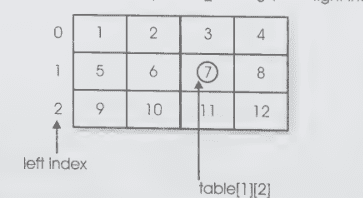
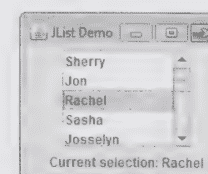
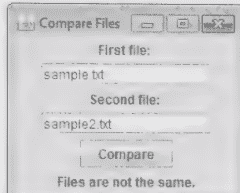
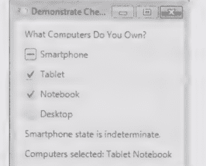

# Java 入门指南，第七版

## 关于作者

畅销作家赫伯特·希尔特（Herbert Schildt）在三十多年里撰写了大量编程书籍，是 Java 语言领先的权威。他的书在全球范围内售出了数百万册，并翻译成所有主要外语。他是许多语言书籍的作者，包括《Java: The Complete Reference》、《Herb Schildt's Java Programming Cookbook》、《Introducing JavaFX8 Programming》以及《Swing: A Beginner's Guide》。他还撰写了大量关于 C、C++ 和 C# 的书籍。尽管对计算的各个方面都感兴趣，他的主要关注点是计算机语言。希尔特拥有伊利诺伊大学的硕士和本科学位。他的个人网站是 www.HerbSchildt.com。

## 关于技术编辑

丹尼·考瓦德（Danny Coward）博士参与了 Java 平台的所有版本工作。他领导了将 Java Servlets 定义 Java EE 平台的第一版本及后续版本，将 Web 服务引入 Java ME 平台，并负责 Java SE 7 的策略和规划。他创立了 JavaFX 技术，最近设计了 Java EE 7 标准中最大的扩展——Java WebSocket API。从编写 Java 代码、与行业专家合作设计 API，到多年担任 Java 社区进程（JCP）的执行官，他对 Java 技术的多个方面拥有独特且广阔的视角。此外，他还是两本 Java 编程书籍的作者：《Java WebSocket Programming》和《Java EE: The Big Picture》。考瓦德博士拥有牛津大学数学学士、硕士和博士学位。

## 目录

- 第10 章自测 ...................................................................... 372
- 尝试练习 11-1：扩展 Thread ......................................................... 383
- 创建多个线程 ........................................................ 386
- 判断线程何时结束 ................................................................ 389
- 第11 章自测 ...................................................................... 414
- 尝试练习 13-1：创建一个通用队列 ................................... 468
- 继续学习通用型 ................... 481
- 使用 JList ........................................................................................ 571

## 引言

本书的目的是教你 Java 编程的基础。它采用了循序渐进的方法，并配有大量的示例、自测和项目。它假设读者没有之前的编程经验。本书从基础知识开始，例如如何编译和运行 Java 程序。然后讨论了构成 Java 语言核心的关键字、特性和结构。你还会发现对 Java 高级特性的介绍，包括多线程编程、泛型、lambda 表达式和模块。书以 Swing 和 JavaFX 基础的介绍作为结束。当你完成这本书时，你已经牢牢掌握了 Java 编程的精髓。

在开始时说明这一点很重要：本书只是一个起点。Java 不仅仅是定义语言的元素。Java 还包含了有助于程序开发的大量库和工具。成为一名顶级的 Java 程序员意味着也要精通这些领域。完成本书后，你将拥有探索 Java 任何及所有其他方面的知识。

## Java 的演变

只有极少数语言从根本上重塑了编程的本质。在这一精英群体中，有一种语言脱颖而出，因为它的影响是如此迅速且广泛。这种语言无疑是 Java。说 Sun Microsystems, Inc. 在 1995 年发布的 Java 1.0 原始版本引发了编程领域的革命，这并不夸张。这场革命从根本上将 Web 变成了一个高度交互的环境。在此过程中，Java 在计算机语言设计中确立了新标准。

多年来，Java 持续增长、演变并重新定义自己。与许多引入新特性较慢的语言不同，Java 往往处于计算机语言开发的前沿。原因之一是围绕 Java 的创新与变革的文化。因此，Java 经过了多次升级——有些相对较小，另一些则更为重大。

Java 的第一次重大更新是 1.1 版本。Java 1.1 添加的特性比你想象的修订版本号变化要实质得多。例如，Java 1.1 添加了许多新的库元素，重新定义了处理事件的方式，并重新配置了原始 1.0 库的许多特性。

Java 的下一次重大发布是 Java 2，其中 "2" 表示“第二代”。Java 2 的诞生是一个分水岭事件，标志着 Java “现代时代”的开始。Java 2 的第一个版本版本号为 1.2。Java 2 的第一个版本使用 1.2 版本号似乎很奇怪。原因是它最初指的是 Java 库的内部版本号，后来被泛化指向整个发布版本。通过 Java 2，Sun 将 Java 产品重新封装为 J2SE（Java 2 标准版），版本号开始应用。

Java 的下一次升级是 J2SE 1.3。这一版本是对原始 Java 2 的首次重大升级，增加了功能。J2SE 1.4 版本进一步增强了 Java。该版本包含了许多重要的新特性，包括链异常、通道 I/O 和 `assert` 关键字。

J2SE 5 的发布无异于一场革命。与提供渐进改进的以往 Java 升级不同，J2SE 5 从根本上扩展了语言的范围和力量。为了让你了解 JSE 5 的规模，这里有一个列表：

- 泛型
- 自动装箱/拆箱
- 枚举
- 增强型 for 循环
- 变长参数
- 静态导入
- 注释

lambda 表达式的影响过去现在都是深远的，改变了编程语言的理念和 Java 代码的编写。在此过程中，lambda 表达式可以简化并减少创建某些结构所需的代码量。lambda 表达式的引入导致了新的运算符 `->` 和新的语言语法元素的引入。

这些特性的重要性体现在版本号上。然而，从 1.4 到 1.5 的转变并没有体现这种规模。相反，Sun 选择使用 5 作为版本号。因此，它命名为 JSE 5，开发工具包（JDK）被称为 JDK 5。内部版本号为 1.5。

Java SE 6 在 Java 5 的基础上增加了改进。Java SE 6 没有为语言本身添加重大特性，但它增强了 API 库，增加了新包，并对运行时进行了改进。在漫长的生命周期内还经历了多次更新。总体，SE 6 进一步巩固了 SE 5 的进展。

Java 的下一次发布是 SE 7，开发工具包为 JDK 7。Oracle 收购了 Microsystems。Java SE 7 增加了许多新特性，包括语言和 API 库的补充。添加的一些重要特性是通过“Coin 项目”开发的。Coin 项目的目的是识别一些将纳入 JDK 7 的 Java 语言小改进，包括：

- `String` 可以控制 `switch` 语句。
- 二进制整数字面量。
- 数字字面量中的下划线。
- 扩展的 `try` 语句，称为 try-with-resources，支持自动资源管理。
- 构建泛型实例时的类型推断（通过钻石操作符）。
- 增强的异常处理，可以使用单个 `catch` 块捕获两个或多个异常（多异常），并对重新抛出的异常进行更好的类型检查。

Java 的下一次发布是 SE 8，开发工具包为 JDK 8。它的内部版本号为 1.8。由于包含了一个影响广泛的新特性：lambda 表达式，JDK 8 代表了 Java 语言的一次非常重大的更新。

除了 lambda 表达式之外，JDK 8 还增加了许多其他重要特性。例如，从 JDK 8 开始，现在可以为接口指定的方法定义默认实现。JDK 8 还整合了对 JavaFX 的支持，JavaFX 是 Java 的新型 GUI 框架。JavaFX 预计很快将在所有 Java 中发挥重要作用，最终取代 Swing 成为大多数基于 GUI 项目的选择。归结底，Java SE 8 是一次重大发布，深刻地扩展了语言的能力并改变了代码的编写方式。

Java 的最新版本是 Java SE 9。开发者工具包称为 JDK 9。随着 JDK 9 的发布，内部版本号也变为 9。JDK 9 代表了 Java 的一次重大发布，包含了对 Java 语言及其库的显著增强。主要的单元特性是模块（modules），它允许你指定构成应用程序的代码之间的关系和依赖关系。模块还为 Java 的访问控制功能增加了另一个维度。模块的引入为 Java 增加了新的语法元素、几个关键字以及各种工具的增强。模块对 API 库也产生了深远影响，从 JDK 9 开始，库包现在被组织成模块。

除了模块之外，JDK 9 还包含了其他几个新特性。其中特别受关注的是 JShell，它是一个支持交互式程序实验和学习的工具。（在附录 D 中可以找到 JShell 的介绍。）另一个有趣的升级是对私有接口方法的支持。这些引入增强了 JDK 8 对接口中默认方法的支持，JDK 9 为 javadoc 添加了搜索功能，并添加了一个名为 `@index` 的新标签来支持它。与之前的版本一样，JDK 9 包含了对 Java API 库的许多更新和增强。

通常情况下，在任何 Java 版本中，新特性都是最受关注的。然而，Java 有一个备受关注的方面被 JDK 9 弃用了：applets。从 JDK 9 开始，不再推荐在新项目中使用 applet。正如第 1 章将详细解释的，由于浏览器对 applet 的支持减弱（以及其他因素），JDK 9 弃用了整个 applet API。此时，建议使用 Java Web Start 在网络上部署应用程序。（在附录 C 中有 Java Web Start 的介绍。）由于 applet 正在被淘汰且不再推荐用于新代码，因此书中将不再讨论它们。然而，对 applet 感兴趣的读者可以在本书之前的版本中找到关于它们的介绍。

归结底，JDK 9 继续了 Java 的创新传统，确保 Java 仍然是编程世界所期待的充满活力、敏捷的语言。书中的材料已更新以反映 Java SE 9 (JDK 9)，贯穿了许多新特性、更新和补充。

本书提供了一个节奏均匀的教程，每个章节都建立在前一节的基础上。它包含 17 章，每章都讨论 Java 的一个方面。这本书的独特之处在于，它包含了几个特殊元素，可以加强你所学的内容。

每章的开头都介绍了你将学习的一系列关键技能。

每章的最后都有一个自测，让你能够测试自己的知识。答案在附录 A 中。

书中散布着特殊的“提问专家”框。这些框包含了关于某个主题的额外信息或有趣的评论。它们采用问答格式。

每章都包含一个或多个“试试看”元素，这些项目向你展示了如何应用你所学的内容。在许多情况下，这些是真实世界的示例，你可以将其作为自己程序的起点。

本书假设读者没有先前的编程经验。因此，如果你以前从未编写过程序，可以使用这本书。如果你有一些编程经验，你将能够进展得快一点。但请记住，Java 在几个方面与其他流行的计算机语言不同。不要急于下结论是非常重要的。因此，即使对于经验丰富的程序员来说，也建议仔细阅读。

## 所需软件

为了编译和运行书中的所有程序，你需要 Oracle 最新的 Java 开发工具包 (JDK)，在编写本书时，它是 JDK 9。这是用于 Java SE 9 的 JDK。获取 Java JDK 的说明在第 1 章中给出。

如果你使用的是旧版本的 Java，你仍然可以使用这本书，但你将无法编译和运行使用 Java 较新特性的程序。

## 不要忘记：网络上的代码

记住，书中所有示例和项目的源代码都可以在网站 www.oraclepressbooks.com 免费获取。

特别感谢本版本的技术编辑 Danny Coward。Danny 曾参与过我的几本书，他的建议、见解和想法总是非常有价值的，深受我的感激。

《Java：初学者指南》是你进入 Herb Schildt Java 编程书籍系列的大门。这里是其他你可能感兴趣的书籍：

- 介绍 JavaFX 8 编程

在计算领域，很少有技术像 Java 一样产生影响。它在 Web 时代的出现确保了它保持活力和生命力，适应快速变化的格局。简单来说，Java 不仅仅是世界上最重要的语言之一，它还是一种改变世界的力量。虽然 Java 经常与网络编程相关联，但它绝非限于此。Java 是一种功能强大的通用型编程语言。如果你是编程新手，Java 是一门极好的学习语言。

本章的目的是向你介绍 Java，从它的历史、设计和一些特性开始。它没有进入过多细节，而是关注通用概念。

Java 是由 James Gosling、Patrick Naughton、Chris Warth、Ed Frank 和 Mike Sheridan 在 1991 年在 Sun Systems 设计的。这种语言最初被称为 Oak，1995 年更名为 Java。最令人惊讶的是，Java 的最初动力并不是互联网！相反，主要的动力是需要一种可以在各种电子设备（如烤面包机、微波炉和遥控器）中使用的平台无关语言。正如你猜到的，使用了许多不同类型的 CPU。问题在于（当时）大多数语言被编译成针对特定 CPU 的机器码。例如，考虑 C++ 语言。可以将 C++ 程序编译为任何类型的 CPU，但这样做需要该 CPU 的完整 C++ 编译器。然而，问题是编译器既昂贵又耗时。为了寻找更好的解决方案，Gosling 等人开发了一种可以在任何地方运行的可移植的、跨平台的语言。这种努力最终导致了 Java 的诞生。

计算机语言的历史并非孤立的事件。相反，它是一个连续体，其中每种语言都以某种方式受到前序语言的影响。在这方面，Java 并不例外。在继续讨论之前，了解 Java 在计算机语言族谱中处于什么位置是有用的。

构成 Java 最直接祖先的两种语言是 C 和 C++。如你所知，C 和 C++ 是人类发明的最重要的计算机语言之一，并且在今天仍被广泛使用。Java 从 C 继承了语法。Java 的对象模型改编自 C++。Java 与 C 和 C++ 的关系出于许多原因非常重要。首先，在创建时，许多程序员熟悉 C/C++ 语法。由于 Java 使用了类似的语法，C/C++ 程序员学习 Java 相对容易。这使得现有程序员群体能够利用 Java，从而促进了 Java 被编程社区的接受。

其次，Java 的设计者并没有“发明轮子”。相反，他们完善了 C 中已经非常成功的编程范式。它转向了继承并在这一丰富的遗产基础上进行构建。Java 提供了一个强大且逻辑一致的编程环境，它汲取了过去的精华，并增加了与在线环境以及编程艺术进步相关的新功能。可能最重要的是，由于它们的相似性，C、C++ 和 Java 为专业程序员定义了一个通用的概念框架。程序员在一种语言之间切换时，不会面临重大的转变。

Java 与 C 和 C++ 还有另一个共同点：它是由真实的、在线的程序员设计、测试和完善的。它是一种植根于设计者需求和经验的语言。没有比这更好的方法产生顶尖的专业编程语言了。

最后一点：尽管 C 和 Java 之间存在联系（特别是在对面向对象编程的支持方面），Java 并不是简单的“互联网版 C++”。Java 与 C++ 在实践和哲学上都有显著的差异。此外，Java 并不是 C++ 的增强版。例如，它既不与 C++ 向上兼容。此外，Java 的设计并不是为了取代 C++。Java 的设计是为了解决一组问题，而 C++ 设计是为了解决另一组问题。它们在未来的许多年里将共存。

互联网帮助 Java 跃入编程领域的前沿，而 Java 反过来对互联网产生了深远的影响。首先，Java 的创造简化了整个互联网编程，充当了催化剂吸引了大量程序员进入 Web。其次，Java 创新了一种名为 applet（小程序）的新型网络程序，改变了在线世界对内容的思考方式。最后，可能最重要的是，Java 解决了与互联网相关的一些棘手问题：可移植性和安全性。

...系统，被称为 Java 虚拟机（JVM）。从本质上说，最初的 JVM 被设计为字节码的解释器。这可能让你感到有些意外，因为出于性能考虑，现代语言被设计为编译成针对特定 CPU 的可执行代码。然而，Java 程序由 JVM 执行这一事实有助于解决基于网络的程序面临的大部分问题。原因如下。

将 Java 程序翻译成字节码使得在各种环境中运行程序变得简单得多，因为每个环境都需要实现相应的 JVM。一旦为特定系统存在运行时包（runtime package），任何 Java 程序都可以在其上运行。请记住，JVM 的细节会随平台的不同而异，但所有的 JVM 均理解相同的 Java 字节码。如果 Java 程序被编译为本地代码，那么同一个程序的不同版本必须为连接到互联网的每种 CPU 类型都存在。显然，这不是一个可行的解决方案。因此，通过 JVM 执行字节码是创建可移植程序最简单的方法。

程序由 JVM 执行这一事实也有助于提高安全性。由于 JVM 掌握着控制权，它管理着程序的执行。因此，JVM 可以创建一个名为“沙箱”的限制环境，该环境包含程序，防止对机器的无限制访问。Java 语言中存在的某些限制也增强了安全性。

当程序被解释时，其运行速度通常比相同程序编译为可执行代码后的运行速度慢。然而，在 Java 中，两者之间的差异并不大。由于字节码经过了高度优化，使用字节码使得 JVM 执行程序的速度比你想象的要快得多。

尽管 Java 被设计为一种解释语言，但 Java 没有任何特性会阻止为了提高性能而将字节码即时（编译）为本地代码。由于这个原因，HotSpot 技术在 Java 初始发布很久之后才被引入。HotSpot 为字节码提供了一个即时编译（JIT）编译器。当 JIT 编译器实时将部分字节码编译为可执行代码时，它是按需、逐段完成的。此外，并不是所有的字节码序列都会被编译——只有在执行期间需要的那些部分会被编译。此外，剩余的代码仅被简单地解释。然而，即时编译方法仍然带来了显著的性能提升。即使对字节码应用动态编译，可移植性和安全性特性仍然允许 JVM 继续主导执行环境。


另一点：从 JDK 9 开始，选定的 Java 环境还将包含“提前编译”（Ahead-of-Time Compilation），它可以用于在 JVM 执行之前将字节码编译为本地代码，而不是即时编译。提前编译是一项专门的特性，并不取代上述的 Java 传统方法。此外，提前编译有几项限制。以下是三个示例：在编写本文时，提前编译仅用于实验目的，仅在 64 位的 Linux 版本 Java 上可用，且预编译的代码必须在编译该代码的相同（或配置相似的）系统上执行。因此，提前编译降低了可移植性。由于提前编译的高度专业化性质，本书将不再对其进行讨论。

**问：** 我听说过一种名为 servlet 的特殊 Java 程序。它是什么？

**答：** Java servlet 是一个运行在服务器上的小型程序。Servlets 动态地扩展 Web 服务器的功能。理解这一点很有帮助：尽管客户端应用程序可能非常有用，但它们只是客户端/服务器等式的一半。在 Java 初始发布后不久，人们显而易见 Java 在服务器端也会很有用。结果就是有了 servlet。因此，随着 servlet 的出现，Java 跨越了客户端/服务器连接的两端。尽管 servlet 的主题超出了本初学者指南的范畴，但在你学习 Java 编程的过程中，会有一些你想要研究的内容。（相关内容见 *Java: The Complete Reference*, 第 10 版。）

尽管 Java 被设计为一种解释语言，但 Java 没有任何特性会阻止为了提高性能而将字节码即时编译为本地代码。由于这个原因，HotSpot 技术在 Java 初始发布很久之后才被引入。HotSpot 为字节码提供了一个即时编译（JIT）编译器。当 JIT 编译器实时将部分字节码编译为可执行代码时，它是按需、逐段完成的。此外，并不是所有的字节码序列都会被编译——只有在执行期间需要的那些会被编译。此外，剩余的代码仅被简单地解释。然而，即时编译方法仍然带来了显著的性能提升。即使对字节码应用动态编译，可移植性和安全性特性仍然允许 JVM 继续主导执行环境。

Java 的核心是面向对象编程（OOP）。面向对象的方法与 Java 是不可分的，所有的 Java 程序在某种程度上都是面向对象的。由于 OOP 对 Java 的重要性，在编写即使简单的 Java 程序之前，通俗地理解基本原理是有用的。在本书后面，你将看到如何将这些概念付诸实践。

20 世纪 60 年代诞生了结构化编程。这是 C 和 Pascal 等语言所倡导的方法。结构化语言的使用使得编写中等复杂的程序变得可能。结构化语言的特征是支持子程序、局部变量、丰富的控制结构以及不再对 GOTO 语句的依赖。尽管结构化语言是强大的工具，当项目变得过大时，它们会达到局限。

考虑这一点：在编程发展的里程碑上，创建了技术和工具允许程序员处理日益增长的复杂性。每一步，新方法都吸收了以前方法的优点并向前发展。在面向对象编程（OOP）发明之前，许多项目已经接近（或超过）了结构化方法不再有效的界限。面向对象方法的创建是为了帮助程序员突破这些障碍。

面向对象编程吸取了结构化编程的精良思想，并将其与几个新概念相结合。结果产生了一种组织程序的不同方式。从广义上说，一个程序可以通过两种方式之一进行组织：围绕代码（发生了什么）或围绕数据（受到了什么影响）。仅使用结构化编程技术时，程序通常是围绕代码组织的。这种方法可以被视为“代码作用于数据”。

面向对象的程序工作方式则相反。它们围绕数据组织，核心原则是“数据访问代码”。在面向对象的语言中，你定义数据以及允许对这些数据进行操作的程序。因此，数据类型精确地定义了可以应用于该数据的操作类型。

为了支持面向对象编程的原则，所有的 OOP 语言都包含了封装、多态和继承。让我们来分析每一个。

封装是一种编程机制，它将代码及其管理的数据结合在一起，并保护它们免受外部干扰和误用。在面向对象的语言中，代码和数据可以结合在一起，创建一个自包含的黑盒。盒子内部包含了所有必要的数据和代码。当代码和数据以这种方式链接时，一个对象就被创建了。换句话说，对象是支持封装的设备。

在对象内部，代码、数据或两者可以是私有的（`private`），也可以是公共的（`public`）。私有代码或数据只能由对象的另一个作者访问。因此，程序外部无法访问私有代码或数据。当代码或数据是公共的时，即使它们定义在对象内部，程序的其他部分也可以访问它们。通常，对象的公共部分用于为对象提供受控的接口。

构成类的代码和数据被称为类的成员。具体来说，类定义的数据被称为成员变量或实例变量。操作这些数据的代码被称为成员方法或直接称为方法。`Method` 是 Java 对子程序的术语。如果你熟悉 C/C++，了解 Java 程序员所说的方法即 C/C++ 程序员所说的函数，可能会有所帮助。

多态（源自希腊语，意为“多种形式”）是一种允许一个接口访问一类通用动作的特性。具体的动作取决于情况的准确性质。多态的一个简单例子可以在汽车的方向盘中找到。

方向盘（即接口）无论使用何种类型的实际转向机构都是相同的。也就是说，无论你的车采用的是手动转向、助力转向还是齿条式螺杆转向，方向盘的工作方式都是一样的。因此，一旦你学会了如何操作方向盘，就可以驾驶任何类型的汽车。

同样的原理也适用于编程。例如，考虑一个栈（stack），它是一个先进先出的列表。你可能有一个需要三种不同类型栈的程序。一个栈用于整数值，一个用于浮点值，一个用于字符。此外，尽管存储的数据不同，但实现每个栈的算法是相同的。在非面向对象的语言中，你可能被要求创建三组不同的栈方法集，且每组都使用不同的名称。然而，由于多态的存在，在 Java 中，你可以为这三个特定情况创建一个通用的栈方法集。这意味着，一旦你学会了如何使用一个栈，你就可以使用所有的栈。

更通俗地说，多态的概念通常用“一个接口，多个方法”这个短语来表达。这意味着为一组相关活动设计一个通用接口是可能的。多态通过允许一类动作使用相同的接口来降低复杂性。编译器的任务是根据每种情况选择具体的动作（即方法）。你作为程序员，不需要手动进行这种选择。你只需要记住并利用通用接口即可。

继承是一个对象可以获取另一个对象的属性的过程。这很重要，因为它支持了层级分类的概念。如果你仔细考虑，大多数知识都可以通过层级（即自上而下）的分类来管理。例如，红蛇果（Red Delicious apple）是苹果分类的一部分，而苹果又属于水果类，而水果类又属于更大的食物类。这意味着，食物类具有某些品质（可食的、有营养的等），这些品质在逻辑上也同样适用于其子类水果。除了这些品质外，水果类还有特定的特征（多汁的、甜的等），这些特征将其与其他食物区分开来。苹果类定义了苹果特有的品质（生长在树上、不是热带水果等）。红蛇果反过来将继承之前所有类的所有品质，并且只定义那些使其自己独特的品质。

如果不使用继承，每个对象都必须显式地定义其所有特征。使用继承，对象只需要定义在其类中唯一的品质。它可以从父类继承其通用属性。

现在已经解释了 Java 的理论基础，是时候开始编写程序了。然而，在编译和运行程序之前，你必须安装开发工具包（JDK）。JDK 是免费提供的。在编写本书时，当前的版本是 JDK 9。（SE 代表标准版。）

你可以从 `www.oracle.com/java/javase/index.html` 下载 JDK。只需根据你的计算机类型按照说明操作即可。安装 JDK 后，你就可以编译和运行程序。JDK 提供了两个主要的程序。第一个是 `javac`，它是 Java 编译器。另一个是标准 Java 解释器，称为应用程序启动器。

另一点：JDK 在命令行提示符环境中运行并使用命令行工具。它不是窗口应用程序。它也不是集成开发环境（IDE）。

**问：** 你提到面向对象编程是管理大型程序的有效方法。然而，看起来它会给较小的程序增加大量的开销。一旦你发现所有 Java 程序在某种程度上都是面向对象的，这是否会对小型程序产生惩罚？

**答：** 正如你所看到的，对于小型程序，Java 的面向对象特性几乎是透明的。虽然 Java 确实遵循严格的对象模型，但你在使用它的程度上有很大的自由度。

让我们从编译并运行此处显示的短示例程序开始：

```java
/*
这是一个简单的 Java 程序。
*/

class Example {
    public static void main(String args[]) {
        System.out.println("Java drives the Web.");
    }
}
```

你将遵循以下三个步骤：

对于大多数语言来说，存放程序源代码的文件名是任意的。但 Java 并非如此。你必须学习的 Java 第一点是，你给源文件命名的非常重要。对于这个例子，源文件的名称应该是 `Example.java`。让我们看看为什么。

要编译 `Example` 程序，请在命令行执行编译器 `javac`，并指定源文件的名称，如下：

```bash
javac Example.java
```

`javac` 编译器会创建一个名为 `Example.class` 的文件，其中包含程序的字节码版本。请记住，字节码不是可执行代码。字节码必须由 Java 虚拟机（JVM）执行。因此，`javac` 的输出不是可以直接执行的代码。

要实际运行程序，你必须使用 Java 解释器 `java`。为此，将类名 `Example` 作为命令行参数传递，如下：

```bash
java Example
```

当程序运行时，将显示以下输出：

```text
Java drives the Web.
```

当 Java 源代码被编译时，每个单独的类都会被放入一个以类名命名并使用 `.class` 扩展名的输出文件中。这就是为什么给你的 Java 源文件赋予与其包含的类相同的名称是一个好主意——源文件的名称将与类文件名匹配。当你像刚才那样执行 Java 解释器时，你实际上指定了你想让解释器执行的类名。它会自动搜索具有 `.class` 扩展名的同名文件。如果找到了该文件，它将执行指定类中包含的代码。

> **注意**：如果你尝试编译程序时，计算机找不到 `javac`（假设你已正确安装了 JDK），你可能需要指定命令行工具的路径。在 Windows 中，这意味着你需要将命令行工具的路径添加到 `PATH` 环境变量定义的路径中。例如，如果 JDK 9 安装在 Program Files 目录下，命令行工具的路径将类似于 `C:\Program Files\Java\jdk-9\bin`。（当然，你需要找到你计算机上 Java 的路径，它可能与刚才显示的不同。此外，JDK 的特定版本可能不同。）你需要咨询你操作系统的文档了解如何设置路径，因为此过程在不同的操作系统之间不同。

# 逐行查看第一个程序

尽管 `Example.java` 非常短，但它包含了所有 Java 程序共有的几个特征。让我们仔细检查程序的每个部分。

程序从以下行开始：

```java
/*
这是一个简单的 Java 程序。
将此文件命名为 Example.java。
*/
```

这是一个注释。与其他编程语言一样，Java 允许你在程序的源文件中输入备注。编译器会忽略注释的内容。相反，注释会为任何阅读其源代码的人描述或解释程序的运行。在这种情况下，注释描述了程序，并提醒你源文件应该被命名为 `Example.java`。在实际应用中，注释通常解释程序的某部分是如何工作的，或者提供特定功能的细节。

Java 支持三种类型的注释。程序顶部显示的是多行注释（multiline comment）。这种类型的注释以 `/*` 开始，以 `*/` 结束。这两个注释符号之间的内容会被编译器忽略。正如名称所示，多行注释可能有几行长。

程序中的下一行代码如下：

```java
class Example {
```

该行使用 `class` 关键字来声明正在定义一个新类。如所述，类是 Java 的基本单元。类名是 `Example`。该行以左大括号 `{` 开始，标志着类体的开始。

程序的下一行是：

```java
public static void main(String args[]) {
```

这一行开始 `main()` 方法。正如前面提到的，在 Java 中，所有应用程序都从 `main()` 方法开始执行。`main()` 方法的完整声明是 `public static void main(String args[])`。`public` 关键字是一个访问修饰符，它允许程序员控制类成员的可见性。当类成员前面加上 `public` 时，该成员可以被其他包中的代码访问。在这种情况下，`main()` 必须声明为 `public`，因为它必须由 Java 运行时系统调用。`static` 关键字允许 `main()` 在不实例化特定类实例的情况下被调用。这是必要的，因为 `main()` 是在创建任何对象之前由 Java 运行时系统调用的。`void` 只是告诉编译器 `main()` 不返回值。正如你将看到的，方法也可以返回值。如果所有这些都有点令人困惑，不要担心。这些概念将在后面详细讨论。

`String args[]` 声明一个名为 `args` 的参数，它是 `String` 类实例的数组。`String` 类型的对象存储字符序列。在这种情况下，`args` 接收在命令行上指定的任何命令行参数。本示例程序不使用命令行参数，但后面的示例将会使用。

`main()` 方法的最后一个字符是 `{`。这表示 `main()` 方法体的开始。所有构成方法的代码都将出现在这个左大括号和对应的右大括号 `}` 之间。

程序的下一行代码如下。请注意，它发生在 `main()` 内部。

```java
System.out.println("Java drives the Web.");
```

这一行输出字符串 "Java drives the Web."，后面跟着一个新行。输出实际上是由内置的 `println()` 方法完成的。在这种情况下，`println()` 将传递给它的内容显示到控制台。正如你将看到的，`println()` 可以用来显示其他类型的信息。该行以分号 `;` 结尾。Java 中的所有语句都以分号结尾。之所以该行不以右大括号 `}` 结尾，是因为它是方法体内的语句，而不是方法或类本身的结束。

程序的第一个 `}` 结束了 `main()`，最后一个 `}` 结束了 `Example` 类定义。

最后一点：Java 是大小写敏感的。忘记这一点可能会导致严重问题。例如，如果你不小心输入了 `Main` 而不是 `main`，或者输入了 `PrintLn` 而不是 `println`，之前的程序将会出错。此外，Java 编译器会编译不包含 `main()` 方法的类，但它无法执行这些类。所以，如果你拼错了 `main`，编译器仍然会编译你的程序，但 Java 解释器会报告错误，因为它找不到 `main()` 方法。

## 处理语法错误

如果你还没有这样做，请输入并运行之前的程序。正如你可能从之前的编程经验中所知，在向计算机输入代码时，很容易不小心输错。坦率地说，如果你在程序中输入了错误内容，编译器在尝试编译时会报告语法错误信息。无论你写了什么，Java 编译器都会尝试理解你的源代码。因此，报告的错误可能永远无法反映问题的实际原因。在之前的程序中，例如，无意中漏掉了 `main()` 方法后的左大括号，会导致编译器报告以下错误：

```
Example.java:8: ';' expected
public static void main(String args[]) {
Example.java:11: class, interface, or enum expected
}
```

显然，第一个错误信息是完全错误的，因为缺失的不是分号，而是大括号。

讨论的重点是，当你的程序包含语法错误时，你不一定从表面上接受编译器的信息。这些信息可能具有误导性。你可能需要对错误信息进行“质疑”，以找到真实问题。此外，查看程序中被标记行之前的最后几行代码。有时，在错误实际发生几行之后，错误才会被报告。

## 第二个简单程序

可能没有其他结构比给变量赋值对编程语言来说更重要了。变量是一个可以被赋值的内存位置。此外，变量的值在程序执行过程中会改变。也就是说，变量的内容是可变的，而不是固定的。以下程序创建了两个变量 `var1` 和 `var2`：

```java
/*
这演示了一个变量。
将此文件命名为 Example2.java。
*/
class Example2 {
    public static void main(String args[]) {
        int var1; // 声明一个变量
        int var2; // 声明另一个变量
        var1 = 1024; // 将 1024 赋值给 var1
        System.out.println("var1 contains " + var1);
        var2 = var1 / 2;
        System.out.print("var2 contains var1 / 2: ");
        System.out.println(var2);
    }
}
```

当你运行这个程序时，你会看到以下输出：

```text
var1 contains 1024
var2 contains var1 / 2: 512
```

这个程序引入了几个新概念。首先，语句

```java
int var1; // 声明一个变量
int var2; // 声明另一个变量
```

声明了一个类型为整数的名为 `var1` 的变量。在 Java 中，所有变量在使用之前都必须声明。此外，变量能包含的值的类型也必须指定。这被称为变量的类型。在这种情况下，`var1` 可以存储整数值。这些是整数值。在 Java 中，要声明一个类型为整数的变量，需要在其名称前加上关键字 `int`。因此，之前的语句声明了一个类型为 `int` 的名为 `var1` 的变量。

下一行声明了第二个名为 `var2` 的变量：

```java
int var2; // 声明另一个变量
```

注意这一行使用的格式与第一行相同，只是变量名不同。通常，声明变量你会使用类似这样的语句：

```text
type var-name;
```

在这里，`type` 指定要声明的变量类型，`var-name` 是变量名。除了 `int` 之外，Java 还支持其他几种数据类型。

下一行代码为 `var1` 赋值为 1024：

```java
var1 = 1024; // 将 1024 赋值给 var1
```

在 Java 中，赋值运算符是单等号。它将等号右侧的值复制到左侧的变量中。

下一行代码在字符串 "var1 contains " 之后输出 `var1` 的值：

```java
System.out.println("var1 contains " + var1);
```

在这个语句中，加号导致 `var1` 的值在其之前的字符串之后显示。这种方法可以泛化。使用 `+` 运算符，你可以在单个 `println()` 语句中链起任意数量的项目。

下一行代码将 `var2` 赋值为 `var1` 除以 2 的值：

```java
var2 = var1 / 2;
```

这一行将 `var1` 中的值除以 2，并将结果存储在 `var2` 中。因此，在该行执行后，`var2` 将包含值 512。`var1` 的值保持不变。与大多数其他计算机语言一样，Java 支持全范围算术运算符，包括这里的：

| 运算符 | 说明 |
| :--- | :--- |
| `+` | 加法 |
| `-` | 减法 |
| `*` | 乘法 |
| `/` | 除法 |

这是程序中的接下来两行：

```java
System.out.print("var2 contains var1 / 2: ");
System.out.println(var2);
```

首先 `print()` 输出字符串 "var2 contains var1 / 2: "。其次 `println()` 输出 `var2` 的值。

要声明一个类型为 `double` 的变量，使用类似于此处的语句：

```java
double x;
```


在这里，`x` 是变量名，类型为 `double`。由于 `x` 是浮点类型，它可以包含诸如 12.3 这样的值。

为了更好地理解 `int` 和 `double` 的区别，尝试以下程序：

```java
/*
此程序演示了 int 和 double 的区别。
将此文件命名为 Example3.java。
*/
class Example3 {
    public static void main(String args[]) {
        int var; // 声明一个 int 变量
        double x; // 声明一个浮点变量
        var = 10; // 给 var 赋值 10
        x = 10.0; // 给 x 赋值 10.0
        System.out.println("Original value of var: " + var);
        System.out.println("Original value of x: " + x);
        System.out.println(""); // 打印空行。
        // 现在，将两者除以 4
        var = var / 4;
        x = x / 4;
        System.out.println("after division: " + var);
        System.out.println("x after division: " + x);
    }
}
```

该程序的输出所示：

```
Original value of var: 10
Original value of x: 10.0
```

```
var after division: 2          -小数部分丢失
x after division: 2.5 -小数部分保留
```

正如你所看到的，当 `var` 除以 4 时，执行的是整数除法，结果是 2——小数部分丢失了。然而，`double` 变量 `x` 除以 4 时，小数部分被保留，并显示了正确的答案。
程序中还有另一个值得注意的新点。要打印空行，只需调用不带任何参数的 `println()` 即可。

## 问专家

**问: 为什么 Java 为整数和浮点数提供了不同的数据类型？换句话说，为什么所有的数值不是同一种类型呢？**

**答:** Java 提供了不同的数据类型，以便你编写高效的程序。例如，整数运算比浮点数计算更快。因此，如果你不需要小数值，就不需要承担 `float` 或 `double` 类型带来的开销。其次，一种数据类型所需的内存可能少于另一种。通过提供不同的类型，Java 允许你能够最度地利用系统资源。最后，某些算法需要（或至少受益于）使用特定类型的数据。总来说，Java 提供了许多内置类型以给你提供最大的灵活性。

## 尝试练习 1-1 将加仑转换为升

尽管前面的示例程序说明了 Java 语言的几个重要特性，但它们并不是非常有用。尽管你现在对 Java 并不了解，但你仍然可以利用所学知识创建一个实用的程序。在这个项目中，我们将创建一个将加仑转换为升的程序。该程序将通过声明两个 `double` 变量来工作。一个存储加仑数，另一个存储转换后的升数。1 加仑等于 3.7854 升。因此，将加仑转换为升需要将加仑值乘以 3.7854。程序将同时显示加仑数和对应的升数。

1. 创建一个名为 `GalToLit.java` 的新文件。
2. 在文件中输入以下程序：

```java
/*
Try This 1-1
此程序将加仑转换为升。
调用此程序 GalToLit.java。
*/
class GalToLit {
    public static void main(String[] args[]) {
        double gallons; // 存储加仑数
        double liters; // 存储转换为升
        gallons = 10; // 从 10 加仑开始
        liters = gallons * 3.7854; // 转换为升
        System.out.println(gallons + " gallons is " + liters + " liters.");
    }
}
```

3. 使用以下命令行编译程序：
```
javac GalToLit.java
```

4. 使用此命令运行程序：
```
java GalToLit
```

你将看到此输出：
```
10.0 gallons is 37.854 liters.
```

5. 目前，该程序将 10 加仑转换为升。然而，通过更改赋值给 `gallons` 的值，你可以让程序将不同的加仑数转换为对应的升。

## 两个控制语句

在方法内部，执行从一条语句到下一条语句，从上到下。然而，可以通过使用 Java 支持的各种程序控制语句来改变这种流程。虽然我们将仔细观察控制语句，但这里简要介绍其中两个，因为我们将使用它们来编写示例程序。

## if 语句

你可以通过 Java 的条件语句：`if` 来选择性地执行程序的某部分。`if` 语句的工作原理与其他任何语言中的 `IF` 语句非常相似。它根据某些条件的真与假来决定程序执行的流。它最简单的形式如下：

```
if(condition) statement;
```

在这里，`condition` 是一个布尔表达式。（布尔表达式是一个求值为真或假的表达式。）如果 `condition` 为真，则执行该语句。如果 `condition` 为假，则跳过该语句。这里有一个例子：

```
if(10 < 11) System.out.println("10 is less than 11");
```

在这种情况下，10 小于 11，条件表达式为真，`println()` 将执行。然而，考虑以下情况：

```
if(10 < 9) System.out.println("this won't be displayed");
```

在这种情况下，10 不小于 9。因此，不会发生 `println()` 的调用。Java 定义了完整的关系运算符，可以在条件表达式中使用。它们在此显示：

### 第 1 节：Java 基础 23

| 运算符 | 含义 |
| --- | --- |
| < | 小于 |
| <= | 小于等于 |
| > | 大于 |
| >= | 大于等于 |
| == | 等于 |
| != | 不等于 |

注意相等性测试是双等号。
这里是一个说明 `if` 语句的程序：

```java
/*
演示 if。
调用此文件 IfDemo.java。
*/
class IfDemo {
    public static void main(String[] args[]) {
        int a, b, c;
        a = 2;
        b = 3;
        if (a < b) System.out.println("a is less than b");
        // 这不会显示任何内容
        if (a == b) System.out.println("you won't see this");
        System.out.println();
        c = a - b; // c  -1
        System.out.println("c contains -1");
        if (c >= 0) System.out.println("c is non-negative");
        if (c < 0) System.out.println("c is negative");
        System.out.println();
        c = b - a; // c 现在包含 1
        System.out.println("c contains 1");
        if (c >= 0) System.out.println("c is non-negative");
        if (c < 0) System.out.println("c is negative");
        System.out.println();
    }
}
```

## Java：初学者指南

在这里，如果 `w` 小于 `h`，则块内的两个语句都将被执行。块中的两个语句形成一个逻辑单元，如果没有其中一个语句执行，另一个语句就无法执行。这里的关键点是，每当你需要从逻辑上连接两个或多个语句时，你都可以通过创建一个块来实现。代码块允许以更清晰、更高效的方式实现许多算法。

下面是一个使用代码块来防止除以零的程序：

```java
/*
演示代码块。
将此文件命名为 BlockDemo.java。
*/
class BlockDemo {
    public static void main(String[] args[]) {
        double i, j, d;
        i = 5;
        j = 10;
        // 此处的目标是一个 if 块
        if (i != 0) {
            System.out.println("i does not equal zero");
            d = j / i;
            System.out.println("j / i is " + d);
        }
    }
}
```

`if` 的目标是整个块。

该程序生成的输出所示：
```
i does not equal zero
j / i is 2.0
```

在这种情况下，`if` 语句的目标是一个代码块，而不是单个语句。如果控制 `if` 的条件为真（在本例中如此），则块内的三个语句将执行。尝试将 `i` 设置为 0 并观察结果。你会发现整个块都被跳过了。

## 提问专家

**问：使用代码块会引入任何运行时的效率低下问题吗？换句话说，Java 实际上会执行 `{` 和 `}` 吗？**

**答：不会。代码块不会增加任何开销。事实上，由于它们能够简化某些算法的编码，它们的使用通常会提高速度和效率。此外，`{` 和 `}` 只存在于你程序的源代码中。Java 本身并不会执行 `{` 或 `}`。**

# 第 1 章：Java 基础

正如你将在本书的后半部分看到的那样，代码块具有额外的属性和用途。然而，它们存在的主要目的是为了创建逻辑上不可分割的代码单元。

## 分号与位置

在 Java 中，分号是一个分隔符。它通常被用于终止一个语句。从本质上说，分号表示一个逻辑实体的结束。

如你所知，块是一组由左、右大括号括起来的逻辑连接语句。块不以分号终止。相反，块的结束由右大括号指示。

Java 不将行尾识别为终止符。因此，你将语句放在一行的任何位置都不重要。例如，

```java
x = y;
y = y + 1;
System.out.println(x + " " + y);
```

对 Java 而言，这与上面是一样的：

```java
x = y; y = y + 1; System.out.println(x + " " + y);
```

此外，语句的各个元素也可以放在单独的行上。例如，

```java
System.out.println("This is a long line of output" +
  x + y + z +
  "more output");
```

以这种方式换行长行通常用于提高程序的可读性。它还可以防止过长的行发生自动换行。

## 缩进规范

你可能在之前的示例中注意到某些语句被缩进了。Java 是一种自由格式语言，这意味着在同一行内将语句放置在什么位置并不重要。然而，多年来，一种常见且被接受的缩进风格已经形成，适用于非常可读的程序。本书遵循这种风格，也建议你也这样做。使用这种风格，你在每个左大括号后缩进一级，在每个右大括号后向外移动一级。某些语句鼓励进行额外的缩进；这些内容将在稍后介绍。

## Java：初学者指南

## 尝试 1-2 改进加仑到升的转换器

`GalToLitTable.java` 你可以使用 `for` 循环、`if` 语句和代码块来创建一个你在第一个项目中开发的加仑到升转换器的改进版本。此版本将打印一个转换表，从 1 加仑开始，到 100 加仑结束。每隔 10 加仑输出一个空行。这是通过使用一个名为 `counter`（计数器）变量实现的，该变量用于计算输出的行数。请特别注意它的用法。

1. 创建一个名为 `GalToLitTable.java` 的新文件。
2. 在文件中输入以下程序：

```java
/*
尝试 1-2
此程序显示加仑到升的转换表。
将此程序命名为 "GalToLitTable.java"
*/
class GalToLitTable {
    public static void main(String args[]) {
        double gallons, liters;
        int counter; // 行计数器初始设置为零。
        counter = 0;
        for(gallons = 1; gallons <= 100; gallons++) {
            liters = gallons * 3.7854; // 转换为升
            System.out.println(gallons + " " + gallons + " is " +
                liters + " " + liters + ")");
            counter++; // 每次行迭代时增加行计数器
            // 每第 10 行，打印一个空行
            if(counter == 10) { // 输出一个空行。
                System.out.println();
                counter = 0; // 重置行计数器
            }
        }
    }
}
```

3. 使用以下命令编译程序：
```
javac GalToLitTable.java
```

4. 使用以下命令运行程序：
```
java GalToLitTable
```


1 gallon is 3.7854
2 gallons is 7.5708
3 gallons is 11.3562
4 gallons is 15.1416
5 gallons is 18.927
6 gallons is 22.7124
7 gallons is 26.4978
8 gallons is 30.2832
9 gallons is 34.0656
10 gallons is 37.854
（此处省略后续，直到 100 加仑）

# Java 类库

本章展示的示例程序使用了 Java 的内置方法：`println()` 和 `print()`。这些方法通过 `System.out` 访问。`System` 是 Java 预定义的一个类，会自动包含在你的程序中。从大局来看，Java 环境依赖于几个内置类库，这些库包含了许多内置方法，为 I/O、字符串处理、网络和图形等功能提供支持。标准类还提供了对图形用户界面（GUI）的支持。因此，Java 作为一个整体是 Java 语言本身及其标准类的结合。正如你将看到的，类库提供了 Java 自带的大部分功能。事实上，成为 Java 程序员的一部分就是学习使用 Java 类。在整本书中，将描述标准库中类和方法的各种元素。然而，Java 库是你也想要自己进一步探索的内容。

## 第 1 章自测

1. 什么是字节码？为什么它对 Java 用于网络编程非常重要？
2. 面向对象的三大原则是什么？
3. Java 程序从哪里开始执行？
4. 什么是变量？
5. 下列哪个变量名是无效的？
   - A. count
   - B. $count
   - C. count27
6. 如何创建单行注释？如何创建多行注释？
7. 显示 `if` 语句的通用形式。显示 `for` 循环的通用形式。
8. 如何创建一个代码块？
9. 月球引力大约是地球的 17%。编写一个程序计算在月球上的有效重量。
10. 修改 Try This 1-2，使其打印英寸到米的转换表。显示 12 英尺的转换，以英寸为单位。每 12 英寸输出一个空行。（1 米约等于 39.37 英寸。）
11. 如果输入程序时出现拼写错误，会导致什么样的错误？
12. 语句放在行的什么位置重要吗？

# 第 2 章：介绍数据类型和运算符

## 核心技能与概念

- 了解 Java 的基本类型
- 使用字面量
- 初始化变量
- 了解方法内变量的作用域规则
- 使用算术运算符
- 使用关系运算符和逻辑运算符
- 理解赋值运算符
- 使用复合赋值运算符
- 理解赋值中的类型转换
- 强制转换不兼容类型
- 理解表达式中的类型转换

任何编程语言的基础都是其数据类型和运算符，Java 也不例外。这些元素定义了语言的局限性，并决定了它可以应用于什么样的任务。幸运的是，Java 支持丰富的数据类型和运算符，适用于任何类型的编程。

数据类型和运算符是一个庞大的课题。我们将从检查 Java 的基础数据类型及其最常用的运算符开始。我们还将仔细查看变量并研究表达式。

## 为什么数据类型很重要

数据类型在 Java 中尤为重要，因为它是一门强类型语言。这意味着所有操作都由编译器进行类型兼容性检查。非法操作将无法编译。因此，强检查有助于防止错误并增强可靠性。为了实现强类型检查，所有变量、表达式和值都有自己的类型。例如，没有“无类型”变量的概念。此外，值的类型决定了允许对它执行哪些操作。在一种类型上允许的操作在另一种类型上可能是不允许的。

## Java 的基本类型

Java 包含两类内置数据类型：面向对象和非面向对象的。Java 的面向对象类型由类定义，关于类的讨论将推后进行。

| 类型 | 含义 |
|---|---|
| boolean | 表示真/假 |
| byte | 8 位整数 |
| char | 字符 |
| double | 双精度浮点数 |
| float | 单精度浮点数 |
| int | 整数 |
| long | 长整数 |
| short | 短整数 |

**表 2-1** Java 的内置基本类型

然而，Java 的核心是八种基本（也称为元素的或简单的）类型，如表 2-1 所示。Java 严格规定了每个基本类型的范围和行为，所有 Java 虚拟机实现必须支持。由于 Java 的可移植性，在这方面它是不妥协的。例如，`int` 在所有执行环境中都是相同的。这使得程序完全可移植。尽管严格规定基本类型的范围在某些环境中会导致性能损失。

## 整数

Java 定义了四种整数类型：`byte`、`short`、`int` 和 `long`，如下：

| 类型 | 宽度（位） | 范围 |
|---|---|---|
| byte | 8 | -128 到 127 |
| short | 16 | -32,768 到 32,767 |
| int | 32 | -2,147,483,648 到 2,147,483,647 |
| long | 64 | -9,223,372,036,854,775,808 到 9,223,372,036,854,775,807 |

如表所示，所有整数类型都是符号的。Java 不支持无符号（仅正）整数。许多其他计算机语言支持符号和无符号整数。然而，Java 的设计者认为无符号整数是没有必要的。

> **注意** 技术上，Java 运行时系统可以使用任何大小。但在所有情况下，类型必须按指定的执行。

### Java：学者指南

最常用的整数类型是 `int`。`int` 类型的变量通常用于控制循环、索引以及执行通用数学计算。

当你需要范围大于 `int` 的整数时，使用 `long`。例如，这里有一个程序计算一英尺乘一英尺乘一英尺的立方英寸：

```java
/*
 * 计算一英尺乘一英尺乘一英尺的立方英寸。
 */
class Inches {
    public static void main(String args[]) {
        long ci;
        long im;
        im = 5280 * 12;
        ci = im * im * im;
        System.out.println("There are " + ci + " cubic inches in mile.");
    }
}
```

这是该程序的输出：

每英里有 25435860000 立方英寸。

显然，结果不能放在 `int` 变量中。最小的整数类型是 `byte`。在处理与 Java 其他内置类型不直接兼容的原始二进制数据时，`byte` 类型特别有用。`short` 类型创建一个短整数。当你不需要 `int` 提供的更大范围时，`short` 类型是合适的。

### 问专家

**问**：你说有种整数类型：`int`、`short`、`long` 和 `byte`。但我听过 `char` 在 Java 中也可以归类为整数类型。你能解释一下吗？

**答**：Java 的正式规范定义了一种称为整数类型，包括 `byte`、`short`、`int`、`long` 和 `char`。它们都是整数类型，因为它们持有的是整数二进制值。然而，前者的目的是表示数值。`char` 的目的是表示字符。因此，`char` 的主要用途与其他整数类型的用途有本质区别。由于这些差异，书中单独处理了 `char` 类型。

## 浮点类型

正如第 1 章所示，浮点类型可以表示包含小数部分的数字。有两种浮点类型：`float` 和 `double`，它们分别表示单精度和双精度数字。`float` 类型宽度为 32 位，`double` 类型宽度为 64 位。

两者中，`double` 是最常用的，Java 类库中的许多数学函数都使用 `double` 值。例如，`sqrt()` 方法（由标准 `Math` 类定义）返回一个 `double` 值，该值是其 `double` 参数的平方根。在这里，`sqrt()` 用于在给定两个直角边的情况下计算斜边的长度：

```java
/*
 * 使用勾股定理，在给定两个直角边的情况下
 * Find斜边的长度。
 */
class Hypot {
    public static void main(String[] args) {
        double x, y, z;
        x = 3; // 注意 sqrt() 是如何调用的。它的前面是
        y = 4; // 它所所属的类名。
        z = Math.sqrt(x*x + y*y);
        System.out.println("Hypotenuse is " + z);
    }
}
```

程序的输出显示在此：

斜边长度为 5.0

关于前一个示例的另一点：正如提到的，`sqrt()` 是标准 **Math** 类的成员。注意 `sqrt()` 是如何调用的；它的前面是类名 **Math**。这与我们使用 **System.out** 引导 `println()` 的方式类似。

## 字符

在 Java 中，字符不像在许多其他计算机语言中是 8 位数值。相反，Java 使用 Unicode 定义了一个字符集，可以表示在所有人类语言中找到的所有字符。在 Java 中，`char` 是一个 16 位类型，范围从 0 到 65,535。标准的 8 位 ASCII 字符集是 Unicode 的子集，范围从 0 到 127。因此，ASCII 字符仍然是有效的 Java 字符。

### Java 入门指南

可以通过将字符括在单引号中来给字符变量赋值。例如，这会将变量 `ch` 赋值为字母 `X`：

```java
char ch;
ch = 'X';
```

你可以使用 `println()` 语句输出 `char` 值。例如，这一行输出了 `ch` 中的值：

```java
System.out.println("This is ch: " + ch);
```

由于 `char` 是一个无符号 16 位类型，因此对 `char` 变量执行各种算术操作是可能的。考虑以下程序：

```java
// 字符变量可以像整数一样处理。
class CharArithDemo {
    public static void main(String args[]) {
        char ch;
        ch = 'X';
        System.out.println("ch contains " + ch);
        ch++; // 增 ch <---------- char 可以递增。
        System.out.println("ch is now " + ch);
        ch = 90; // 给 ch 赋值为 Z <---------- char 可以赋值整数值。
        System.out.println("ch is now " + ch);
    }
}
```

该程序生成的输出所示：

```
ch contains X
ch is now Y
ch is now Z
```

在程序中，`ch` 首先被赋值为 `X`。接下来，`ch` 增加。这导致 `ch` 包含 `Y`，即 ASCII（以及 Unicode）序列中的下一个字符。接着，`ch` 被赋值为 `90`，这是对应于字母 `Z` 的 ASCII（以及 Unicode）值。由于 ASCII 字符集占据了 Unicode 字符集的前 127 个值，因此你可能在其他语言中用于处理字符的所有“老技巧”在 Java 中同样适用。

### 专家问答

**问**：为什么 Java 使用 Unicode？

**答**：Java 的设计目标是为了在全球范围内使用的。因此，它需要使用一种能够表示世界上所有语言的字符集。Unicode 是专为这一目的设计的标准字符集。当然，对于英语、德语、西班牙语或法语等语言，使用 Unicode 的效率并不高，因为它们的字符可以包含在 8 位中。但这是为了全球可移植性必须付出的代价。

## 布尔类型

布尔类型表示 true（真）/false（假）值。Java 使用保留字 `true` 和 `false` 来定义真值和假值。`boolean` 类型的变量或表达式将是这两个值之一。

以下是一个演示布尔类型的程序：

```java
// 布尔值。
class BoolDemo {
    public static void main(String args[]) {
        boolean b;
        b = false;
        System.out.println("is is " + b);
        b = true;
        System.out.println("is is " + b);
        // 布尔值可以控制 if 语句
        if(b) System.out.println("This is executed.");
        b = false;
        if(b) System.out.println("This is not executed.");
        // 关系运算符的结果是一个布尔值
        System.out.println("10 > 9 is " + (10 > 9));
    }
}
```

该程序生成的输出所示：

```
b is false
b is true
This is executed.
10 > 9 is true
```

### Java 入门指南

关于这个程序有三个值得注意的有趣之处。首先，如你所见，当通过 `println()` 输出布尔值时，会显示 `"true"` 或 `"false"`。其次，布尔变量的值本身就足以控制 `if` 语句。不需要编写像这样的 `if` 语句：

```java
if (b == true)
```

第三，关系运算符（如 `<`）的结果是一个布尔值。这就是为什么表达式 `10 > 9` 显示的是值 `"true"`。此外，`10 > 9` 外围的额外括号是必要的，因为 `+` 运算符的优先级高于 `>`。

## 雷电距离有多远？

在这个项目中，你将创建一个程序，计算听者到雷击发生位置的距离（以英尺为单位）。声音在空气中的传播速度大约为每秒 1100 英尺。因此，通过看到闪电的时间和声音到达的时间之间的间隔，你就可以计算出到闪电的距离。对于这个项目，假设间隔为 7.2 秒。

1. 创建一个新文件 `Sound.java`。
2. 为了计算距离，你需要使用浮点值。为什么？因为时间间隔 `7.2` 有小数部分。虽然可以使用 `float` 类型的变量，但我们将在示例中使用 `double`。
3. 为了计算距离，你将 `7.2` 乘以 `1100`。然后你将此值赋值给变量。
4. 你将显示结果。

这里是 `Sound.java` 程序的列表：

```java
/*
尝试此 2-1
计算到雷击的距离，
其声音需要7.2秒到达你这里。
*/
class Sound {
    public static void main(String args[]) {
        double dist = 7.2 * 1100;
        System.out.println("The lightning is " + dist + " feet away.");
    }
}
```

5. 编译并运行程序。输出将是：

```
The lightning is 7920 feet away.
```

6. 修改程序，以英里而不是英尺计算距离。（注意：1英里是5280英尺）。

## 字面量

在 Java 中，字面量可以是八进制、十六进制或二进制。

- 八进制字面量以 `0` 开头。
- 十六进制字面量以 `0x` 或 `0X` 开头。
- 二进制字面量（从 JDK 7 开始）以 `0b` 或 `0B` 开头。
- 为了让大数字更具读性，可以使用下划线。下划线会被编译器忽略。

```java
int octal = 010; // 十进制的 8
int hex = 0xFF; // 十进制的 255
int binary = 0b1010; // 十进制的 10
```

## 浮点字面量

浮点字面量带有小数部分。Java 有两种类型：`float` 和 `double`。默认是 `double`。要指定 `float`，请附加 `f`。

```java
double d1 = 3.14;
float f1 = 3.14f;
```

你也可以使用科学计数法表示浮点字面量。

```java
double d2 = 1.23e3; // 10 的 3 次方
float f2 = 1.23e2f; // 10 的 2 次方
```

## 布尔字面量

布尔字面量是最简单的：`true` 或 `false`。

```java
boolean isTrue = true;
boolean isFalse = false;
```

## 字符字面量

字符字面量括在单引号中。它们表示单个 Unicode 字符。

```java
char c1 = 'A';
char c2 = '7';
```

某些字符不能直接在单引号中表示，例如换行符或反斜杠。对于这些字符，Java 提供了特殊的转义序列（有时称为反斜线字符常量），表 2-2 所示。这些序列用于替代它们所代表的字符。

| 转义序列 | 描述 |
| --- | --- |
| `\'` | 单引号 |
| `\"` | 双引号 |
| `\\` | 反斜杠 |
| `\r` | 回车 |
| `\n` | 换行 |
| `\f` | 换页 |
| `\t` | 水平制表符 |
| `\b` | 退格 |
| `\ddd` | 八进制常量（其中 ddd 是八进制常量） |
| `\xxxx` | 十六进制常量（其中 xxxx 是十六进制常量） |

例如，这会将 `ch` 赋值为制表符：

```java
ch = '\t';
```

下一个示例将单引号赋值给 `ch`：

```java
ch = '\'';
```


## 字符串字面量

Java 支持另一种类型的字面量：字符串。字符串是一组包含在双引号中的字符集。例如，`"Hello"` 就是一个字符串。在之前的示例程序的许多 `println()` 语句中，你已经见过字符串的示例。

除了普通字符外，字符串字面量还可以包含上述的一个或多个转义序列。例如，考虑以下程序。它使用了 `\n` 和 `\t` 转义序列。

```java
// 演示字符串中的转义序列。

class StrDemo {

    public static void main(String args[]) {

        System.out.println("First line\nSecond line");

        System.out.println("A\tB\tC"); // 使用 \n 生成新行。

        System.out.println("D\tE\tF");

    }

}
```

使用制表符对齐输出。输出如下：

```
First line
Second line
A   B   C
D   E   F
```

## 专家问答

**Q：由单个字符组成的字符串与字符字面量相同吗？例如，`"k"` 和 `'k'` 相同吗？**

**A：你不能将字符串与字符混淆。字符字面量表示类型为 `char` 的单个字母。只包含一个字母的字符串仍然是一个字符串。虽然字符串由字符组成，但它们不是同一个类型。**

注意如何使用 `\n` 转义序列来生成新行。你不需要使用多个 `println` 语句来获取多行输出。只需要在较长字符串中你想要换行的地方嵌入 `\n` 即可。

## 深入观察变量

变量在第 1 章中介绍。在这里，我们将对它们进行更深入的观察。正如你之前学到的，变量是使用这种形式的语句声明的：

`type var-name;`

其中 `type` 是变量的数据类型，`var-name` 是它的名称。你可以声明任何有效类型的变量，包括刚刚描述的简单类型，并且每个变量都将有一个类型。因此，变量的能力由它的类型决定。例如，类型为 `boolean` 的变量不能用于存储浮点值。此外，例如，`int` 变量不能变成 `char` 变量。

Java 中的所有变量在使用之前都必须声明。这是必要的，因为编译器在正确编译任何使用该变量的语句之前，必须知道变量包含什么类型。这使得 Java 能够执行严格的类型检查。

## 初始化变量

通常情况下，你必须在使用变量之前给它一个值。给变量赋值的一种方法是通过赋值语句，正如你已经看到的。另一种方法是在声明时给它一个初始值。要这样做，在变量名后跟随等号和要赋值的值。初始化的通用形式如下：

`type var = value;`

在这里，`value` 是创建 `var` 时赋予它的值。该值必须与指定的类型兼容。以下是一些示例：

```java
int count = 10; // 给 count 赋一个初始值 10
char ch = 'X'; // 用字母 X 初始化 ch
float f = 1.2F; // f 初始化为 1.2
```

当使用逗号分隔列表声明两个或多个相同类型的变量时，你可以为其中一个或多个变量赋初始值。例如：

```java
int a, b = 8, c = 19; // b 和 c 有初始化
```

在这种情况下，只有 `b` 和 `c` 被初始化了。

## 动态初始化

之前的示例只使用了常量作为初始化器，但 Java 允许在声明变量时使用任何表达式进行动态初始化。例如，这里有一个短程序，它根据底半径和高度计算圆柱的体积：

```java
// 演示动态初始化。

class DynInit {

    public static void main(String args[]) {

        double radius = 4, height = 5;

        // 动态初始化体积
        double volume = 3.1416 * radius * radius * height;

        System.out.println("Volume is " + volume);

    }

}
```

在这里，声明了三个局部变量——`radius`、`height` 和 `volume`。前两个 `radius` 和 `height` 由常量初始化。然而，`volume` 被动态初始化为圆柱的体积。关键点是，初始化过程可以使用初始化时有效的任何元素，包括对方法的调用、其他变量或字面量。

## 变量的作用域和生命周期

到目前为止，我们使用的所有变量都在 `main()` 方法开始时声明的。Java 允许在任何块中声明变量。正如第 1 章解释过的，块由左大括号定义并由右大括号结束。块定义了一个作用域。每当你开始一个新块，你就在创建一个新的作用域。作用域决定了哪些对象对程序的其他部分可见。它还决定了这些对象的生命周期。其他计算机语言定义了两类作用域：全局和局部。虽然 Java 支持这些，但它们不是分类 Java 作用域的最佳方式……（注：原文此处存在大量重复段落，译文已根据逻辑处理，保留了核心作用域定义描述）。

为了理解嵌套作用域的影响，请考虑以下程序：

```java
// 演示块作用域。

class ScopeDemo {

    public static void main(String args[]) {

        int x; // main 已知

        x = 10;

        if (x == 10) { // 开始新作用域
            int y = 20; // 仅在此块已知

            // x 和 y 在这里已知
            System.out.println("x and y: " + x + " " + y);

            x = y * 2;
        }

        // y = 100; // 错误！y 在此处未知 < 这里，y 在其作用域之外。

        // x 在这里仍然已知
        System.out.println("x is " + x);

    }

}
```

```java
for(x = 0; x < 3; x++) {
    int y = -1; // 每次进入代码块时都会初始化 y
    System.out.println("y is " + y); // 这始终打印 -1
    y = 100;
    System.out.println("y is now: " + y);
}
```

该程序生成的输出如下：

```
y is -1
y is now: 100
y is -1
y is now: 100
y is -1
y is now: 100
```

每当进入内部 `for` 循环时，`y` 都会被重新初始化为 -1。尽管随后它被赋值为值 100，但这个值丢失了。

关于 Java 的作用域规则有一个可能会让你感到惊讶的特性：虽然块可以嵌套，但在内部作用域内声明的变量不能与外层作用域中声明的变量同名。例如，下面的程序尝试声明两个同名的变量，将无法编译。

```java
/*
此程序尝试在内部作用域中声明一个变量，
与外层作用域中定义的变量同名。
*** 此程序将无法编译。 ***
*/
class NestVar {

    public static void main(String args[]) {

        int count;

        for(count = 0; count < 10; count = count+1) {
            System.out.println("This is count: " + count);
        }

        int count; // 非法！！！

        for(count = 0; count < 2; count++) {
            System.out.println("This program is in error!");
        }

    }

}
```

## 运算符

Java 提供了丰富的数学环境。运算符是一个符号，告诉编译器执行特定的数学、位或逻辑操作。Java 有四类通用运算符：算术运算符、位运算符、关系运算符和逻辑运算符。Java 还定义了一些处理特殊情况的额外运算符。本章将检查算术运算符、关系运算符和逻辑运算符。我们还将检查赋值运算符。位运算符和其他特殊运算符将在后面检查。

### 算术运算符

Java 定义了以下算术运算符：

| 运算符 | 含义 |
| --- | --- |
| `+` | 加法（也是一元加） |
| `-` | 减法（也是一元减） |
| `*` | 乘法 |
| `/` | 除法 |
| `%` | 取模 |
| `++` | 递增 |
| `--` | 递减 |

运算符 `+`、`-`、`*` 和 `/` 的工作方式与它们在任何其他计算机语言（或者代数）中的相同。这些可以应用于内置的数值数据类型，也可以用于 `char` 类型的对象。

尽管所有读者对算术运算符的操作都很熟悉，但某些特殊情况需要解释。首先，记住，当 `/` 应用于整数时，任何余数都会被截断；例如，在整数除法中，`10/3` 等于 3。你可以使用取模运算符 `%` 获取此除法的余数。它产生整数除法的余数。例如，`10 % 3` 等于 1。在 Java 中，`%` 可以同时应用于整数和浮点数类型。因此，`10.0 % 3.0` 也等于 1。下面的程序演示了取模运算符。

```java
// % 运算符

class ModDemo {

    public static void main(String args[]) {

        int result, irem;
        double dresult, drem;

        result = 10 / 3;
        irem = 10 % 3;
        dresult = 10.0 / 3.0;
        drem = 10.0 % 3.0;

        System.out.println("Result and remainder of 10 / 3: " + result + " " + irem);
        System.out.println("Result and remainder of 10.0 / 3.0: " + dresult + " " + drem);

    }

}
```

程序的输出如下：

```
Result and remainder of 10 / 3: 3 1
Result and remainder of 10.0 / 3.0: 3.3333333333333335 1.0
```

正如你所看到的，`%` 对于整数和浮点操作都会产生余数 1 的结果。

### 递增和递减

在第 1 章中引入的 `++` 和 `--` 是 Java 的递增和递减运算符。正如你将看到的，它们有一些特殊的属性，使得它们非常有趣。让我们先回顾一下递增和递减运算符的具体作用。

递增运算符对其操作数加 1，递减运算符减去 1。因此，

```java
x = x + 1;
```

等同于

```java
x++;
```

以及

```java
x = x - 1;
```

等同于

```java
x--;
```

递增和递减运算符都可以位于操作数之前（前缀）或之后（后置）。例如，

```java
x = x + 1;
```

写为

```java
++x; // 前缀
```

或写为

```java
x++; // 后置
```

在前面的示例中，递增在操作数之前或之后没有区别。然而，当递增运算符位于操作数之前时，递增在表达式之前执行。当它位于操作数之后时，递增在表达式之后执行。

### 关系和逻辑运算符

关系运算符用于比较两个值。比较的结果是一个布尔值，真（`true`）或假（`false`）。常见的关系运算符有：

| 运算符 | 含义 |
| --- | --- |
| `==` | 等于 |
| `!=` | 不等于 |
| `>` | 大于 |
| `<` | 小于 |
| `>=` | 大于等于 |
| `<=` | 小于等于 |

逻辑运算符用于组合多个布尔表达式。常见的逻辑运算符有：

| 运算符 | 含义 |
| --- | --- |
| `&&` | 逻辑与 |
| `||` | 逻辑或 |
| `!` | 逻辑非 |

根据真值表，逻辑运算符 `&`、`^` 和 `!` 支持基本的逻辑运算 AND（与）、OR（或）、XOR（异或）和 NOT（非）：

| p | q | p&q | p\|q | p^q |
|---|---|---|---|---|
| False | False | False | False | False |
| True | False | False | True | True |
| False | True | False | True | True |
| True | True | True | True | False |

如表所示，异或运算的结果在有且仅有一个操作数为真时为真。

程序的输出显示如下：

```
i < j
i <= j
i != j
!(b1 & b2) is true
b1 | b2 is true
b1 ^ b2 is true
```

### 短路逻辑运算符

Java 提供了 AND（与）和 OR（或）逻辑运算符的特殊短路版本，用于生成更高效的代码。为了理解为什么，请考虑以下情况：在 AND 操作中，如果第一个操作数为假，那么无论第二个操作数的值是什么，结果都是假。在 OR 操作中，如果第一个操作数为真，那么操作的结果就是真。因此，在这两种情况下，没有必要评估第二个操作数。通过不评估第二个操作数，可以节省时间并产生更高效的代码。

短路 AND 运算符是 `&&`，短路 OR 运算符是 `||`。它们的普通对应物是 `&` 和 `|`。普通版本与短路版本的区别在于普通运算符总是评估每个操作数，而短路版本只在需要时评估第二个操作数。

这是一个演示短路 AND 运算符的程序。该程序判断 `d` 中的值是否是 `n` 的因子。它是通过执行取模操作来实现的。如果 `n / d` 的余数为零，则 `d` 是因子。然而，由于取模操作涉及除法，使用了 AND 的短路形式来防止除零错误。

```java
// 演示短路运算符。

class Scops {

    public static void main(String args[]) {

        int n, d, q;

        n = 10;
        d = 2;

        if(d != 0 && (n % d) == 0) {
            System.out.println(d + " is a factor of " + n);
        }

        d = 0; // 现在，将 d 设置为零

        // 因为 d 为零，第二个操作数不会被评估
        if(d != 0 && (n % d) == 0) {
            System.out.println(d + " is a factor of " + n);
        }
    }
}
```

现在，尝试不使用短路运算符尝试相同。这会导致除零错误。

```java
if (d != 0 & (n % d) == 0)
    System.out.println(d + " is a factor of " + n);
```

为了防止除零，`if` 语句首先检查 `d` 是否等于零。如果是，则通过测试通过（`d` 为 2）并执行取模操作。因此，第二个测试失败（因为 `d` 被设置为零），取模操作被跳过，从而避免了除零错误。最后，尝试普通的 AND 运算符。这会导致两个操作数都被评估，从而在发生除法时导致运行时错误。

最后一点：Java 的正式规范将短路运算符称为“条件或”运算符和“条件与”运算符，但通常使用“短路”一词。

### 赋值运算符

你从第 1 章开始一直在使用赋值运算符。现在是时候正式查看它了。赋值运算符是单个等号 `=`。该运算符在 Java 中的工作方式与任何其他语言都一样。它具有这种通用形式：

```java
var = expression;
```

在这里，`var` 的类型必须与 `expression` 的类型兼容。

赋值运算符有一个有趣的属性，你可能不熟悉右侧的值：它允许你创建赋值链。例如，考虑这段代码：

```java
int x, y, z;
x = y = z = 100; // 将 x, y, 和 z 设置为 100
```

这段代码使用单个语句将变量 `x`、`y` 和 `z` 设置为 100。这是因为 `=` 是一个返回右侧值的赋值运算符。因此，`z = 100` 的值 100 被赋值给 `y`，然后赋值给 `x`。使用“赋值链”是将一组变量设置为相同值的简单方法。

### 简写赋值

Java 提供了特殊的简写赋值运算符来简化某些赋值。让我们从一个示例开始。这里的赋值语句

```java
x = x + 10;
```

可以使用简写写为：

```java
x += 10;
```

## 问答

**由于短路运算符在某些情况下比对应物更高效，为什么 Java 仍然提供普通的 AND 和 OR 运算符？**

**答：在某些情况下，由于副作用，你希望 AND 或 OR 操作的两个操作数都被评估。考虑以下情况：**

```java
// 副作用是可以重要的。

class SideEffects {

    public static void main(String args[]) {

        int i;
        i = 0;
    }
}
```


/* 即使语句失败，i 仍然增加了。 */

if (false || (++i < 100))
    System.out.println("this't be displayed");

System.out.println("if executed: " + i);

/* 在这种情况下，i 没有增加，因为短路运算符跳过了增量。 */

if (false && (++i < 100))
    System.out.println("this't be displayed");

System.out.println("if executed: " + i);

}

}

```

注释表明，在第一个语句中，无论成功失败 `i` 都会增加。然而，当使用短路运算符时，如果第一个操作数为假，`i` 就不会增加。如果你的代码期望 AND 或 OR 操作，必须使用 Java 的非短路形式。

`+=` 运算符告诉编译器将 `x` 加 10 的值赋值给 `x`。这是另一个例子。语句

```java
x = x - 100;
```

等于

```java
x -= 100;
```

两个语句都将 `x` 减 100 的值赋值给 `x`。这种简写适用于 Java 中所有的二进制运算符（即需要操作数的运算符）。简写的通用形式是

```java
var op = expression;
```

因此，算术和逻辑简赋值运算符如下：

| += | *= | /= |
|---|---|---|
| &= | |= |

由于这些运算符将操作与赋值结合，正式称为复合赋值运算符。复合赋值运算符有两个优点：首先，它们比长形式更紧凑；在某些情况下，它们更高效。由于这些原因，你经常会在编写良好的 Java 程序中使用复合赋值运算符。

## 赋值中的类型转换

在编程中，将一种类型的变量赋值给另一种类型是常见的。例如，你可能想将 `int` 值赋值给 `float` 变量，如下：

```java
int i;
float f;
```

```java
i = 10;
f = i; // 将 int 赋值给 float
```

当赋值中混合了兼容类型时，右侧的值会自动转换为左侧的类型。在前面的片段中，`i` 中的值转换为 `float`，左侧转换为 `f`。然而，由于 Java 严格的类型检查，并不是所有类型都兼容，因此并不是所有转换都是隐式允许的。例如，`boolean` 和 `int` 是不兼容。

当一种数据类型赋值给另一种变量类型时，如果满足以下条件，就会发生自动转换：

- 两种类型兼容。
- 目标类型大于源类型。

当这两个条件满足时，就会发生宽转换。例如，`int` 类型总是足够大以包含所有 byte 值，且 int 和 byte 都是整数类型，因此可以应用 `byte` 到 `int` 的自动转换。

对于宽转换，包括整数和浮点类型在内的数值类型是相互兼容的。例如，以下程序完全有效，long 到 double 是一个自动执行的宽转换：

```java
// 演示从 long 到 double 的自动转换。
class LtoD {
    public static void main(String args[]) {
        long L;
        double D;
        L = 100123285L; // 从 long 到 double 的自动转换
        D = L;
        System.out.println("L and D: " + L + " " + D);
    }
}
```

虽然从 long 到 double 有自动转换，但没有从 double 到 long 的自动转换，因为这不是宽转换。因此，前面的程序版本是无效的。

```java
// *** 此程序无法编译。 ***
class LtoD {
    public static void main(String args[]) {
        long L;
        double D;
        D = 100123285.0;
        L = D; // 非法！！！ --------- 没有 double 到 long 的自动转换
        System.out.println("L and D: " + L + " " + D);
    }
}
```

从数值类型到 `char` 或 `boolean` 没有自动转换。同样，`char` 和 `boolean` 互不兼容。然而，整数字面量被赋值给 `char`。

## 不兼容类型的强制转换

虽然自动类型转换很有帮助，但它们无法满足所有的编程需求，因为它们仅适用于兼容类型之间的宽转换。对于所有其他情况，你必须使用强制转换。强制转换是指令编译器将一种类型转换为另一种类型。因此，它需要显式的类型转换。强制转换具有这种通用形式：

`(target-type) expression`

# 第 2 章：介绍数据类型和运算符

在这里，`target-type` 指定了将指定表达式转换所需的类型。例如，如果你想将表达式 `x/y` 的类型转换为 `int`，你可以写道：

```java
double x, y;
// ...
(int) (x / y)
```

在这里，尽管 x 和 y 的类型是 `double`，但强制转换将表达式的结果转换为 `int`。`x / y` 外围的括号是必要的。否则，对 `int` 的强制转换将仅应用于 `x` 而不是除法的结果。在这里，强制转换是必要的，因为从 `double` 到 `int` 没有任何自动转换。

当强制转换涉及收缩转换时，可能会丢失信息。例如，当将 `long` 转换为 `short` 时，如果 `long` 的值大于 `short` 的范围，信息将会丢失。当将浮点值强制转换为整数类型时，小数部分也会因为截断而丢失。例如，如果将值 `1.23` 赋值给整数，结果将是 `1`。`0.23` 丢失了。

下面的程序演示了一些需要强制转换的类型转换：

```java
// 演示强制转换
class CastDemo {
    public static void main(String args[]) {
        double x, y;
        byte b;
        int i;
        char ch;
        x = 10.0;
        y = 3.0; // 在此转换中会发生截断
        i = (int)(x / y); // 将 double转换为 int
        System.out.println("Integer outcome of x / y: " + i);
        i = 100;
        b = (byte) i; // 此处丢失信息。byte 可以存储值 100
        System.out.println("Value of b: " + b);
        i = 257;
        b = (byte) i; // 这次信息丢失。byte 无法存储值 257
        System.out.println("Value of b: " + b);
        b = 88; // X 的 ASCII 码
        ch = (char) b; // 不兼容类型之间的强制转换
        System.out.println("ch: " + ch);
    }
}
```

# 58 Java：初学者指南

程序的输出所示：
Integer outcome of x / y: 3
Value of b: 100
Value of b: 1
x: X

在程序中，将 `(x / y)` 强制转换为 `int` 导致小数部分的截断，并丢失了信息。接下来，当给 `b` 赋值值 100 时没有发生信息丢失，因为 byte 可以存储值 100。然而，当尝试给 `b` 赋值值 257 时，当 257 超过 byte 的最大值时，就会发生信息丢失。最后，在将 byte 值赋值给 `char` 时，没有丢失信息，但需要进行强制转换。

## 运算符优先级

表 2-3 显示了所有 Java 运算符的优先级，从高到低。此表包含了书中后面将讨论的几个运算符。虽然从技术上讲它们分隔符，但 `[]`、`()` 和 `.` 也可以像运算符一样。在这种情况下，它们的优先级最高。

| 最高 | ++ (后置) | -- (后置) | + (一元) | -- (一元) | (类型转换) |
|---|---|---|---|---|---|
| ++ (前置) | -- (前置) | | | | |
| * | / | % | | | |
| + | - | | | | |
| >> | >>> | << | | | |
| > | >= | < | <= | instanceof | |
| == | != | | | | |
| & | | | | | |
| ^ | | | | | |
| \| | | | | | |
| && | | | | | |
| ?: | | | | | |
| -> | | | | | |
| = | op= | | | | |

表 2-3 Java运算符的优先级

# 第 2 章：介绍数据类型和运算符 59

## 尝试 2-2 显示逻辑运算符的真值表

在这个项目中，你将创建一个显示 Java 逻辑运算符真值表的程序。你必须让表格中的列对齐。该项目使用了本章过的几个特性，包括 Java 的转义序列和逻辑运算符。它还说明了 `+` 与逻辑运算符之间的优先级。

1. 创建新文件 `LogicalOpTable.java`。
2. 为了确保列对齐，你将使用 `\t` 转义序列将制表符嵌入每个字符串中。例如，`println("P\t")` 语句显示表头：`"P\tAND\tOR\tNOT"`。
3. 表格中的后续每行将使用制表符将操作结果放在正确的标题下方。
4. 这里是完整的 `LogicalOpTable.java` 程序。输入它：

```java
// 尝试 2-2：逻辑运算符的真值表
class LogicalOpTable {
    public static void main(String args[]) {
        boolean p, q;
        System.out.println("P\tAND\tOR\tNOT");
        p = true; q = true;
        System.out.print(p + "\t" + q + "\t");
        System.out.print((p&q) + "\t" + (p|q) + "\t");
        System.out.println((!p));
        p = true; q = false;
        System.out.print(p + "\t" + q + "\t");
        System.out.print((p&q) + "\t" + (p|q) + "\t");
        System.out.println((!p));
        p = false; q = true;
        System.out.print(p + "\t" + q + "\t");
        System.out.print((p&q) + "\t" + (p|q) + "\t");
        System.out.println((!p));
        p = false; q = true;
        System.out.print(p + "\t" + q + "\t");
        System.out.print((p&q) + "\t" + (p|q) + "\t");
        System.out.println((!p));
        p = false; q = false;
        System.out.print(p + "\t" + q + "\t");
        System.out.print((p&q) + "\t" + (p|q) + "\t");
        System.out.println((!p));
    }
}
```
（续）

# 60 Java：初学者指南

```java
p = false; q = false;
System.out.print(p + "\t" + q + "\t");
System.out.print((p&q) + "\t" + (p|q) + "\t");
System.out.println((p^q) + "\t" + (!p));
```

`println` 语句内部逻辑操作周围的括号是必要的，这是因为 Java 运算符的优先级。`+` 运算符优先级高于逻辑运算符。

5. 编译并运行程序。显示了下表。

| P | Q | AND | XOR | NOT |
|---|---|---|---|---|
| true | true | true | false | false |
| true | false | false | true | false |
| false | true | false | true | true |
| false | false | false | false | true |

6. 你自己尝试修改程序，使其使用并显示 1 和 0，而不是 `true` 和 `false`。这可能比你想象的要费精力！

## 表达式

运算符、变量和字量是表达式的组成部分。你可能已经通过其他编程经验或代数知道了表达式的一般形式。现在将讨论表达式的几个方面。

## 表达式中的类型转换

在表达式内部，只要两种数据类型相互兼容，就可以混合使用不同类型。例如，你可以在表达式中混合 `short` 和 `long`，因为它们都是数值类型。当表达式中混合不同类型的数据时，它们都会被转换为相同的类型。这是通过使用 Java 的类型提升实现的。

首先，所有的 `char`、`byte` 和 `short` 值都被提升为 `int`。如果一个操作数是 `long`，整个表达式被提升为 `long`。如果一个操作数是 `float`，整个表达式被提升为 `float`。如果任何一个操作数是 `double`，结果就是 `double`。

重要的是要理解，类型提升仅适用于求值时使用的值。例如，如果一个 `byte` 的值在表达式内部被提升为 `int`，在表达式外部，该变量仍然是 `byte`。类型提升影响表达式的求值。

然而，类型提升可能会导致某些意外的结果。例如，当算术运算涉及两个 `byte` 值时，会发生以下序列：首先，`byte` 操作数被提升为 `int`。然后进行操作，产生 `int` 结果。

# 第 2 章：介绍数据类型和运算符 61

因此，涉及两个 `byte` 值的操作结果将是一个 `int`。这并不是你直觉预期的。考虑以下程序：

```java
// 提升惊喜！
class PromDemo {
    public static void main(String args[]) {
        byte b;
        int i;
        // 不需要强制转换，因为结果已经提升到了 int
        b = 10;
        i = b * b; // 正确，不需要强制转换
        // 在将 int 赋值给 byte 时需要强制转换！
        b = 10;
        b = (byte)(b * b); // 需要强制转换！！
        System.out.println("i and b: " + i + " " + b);
    }
}
```

与直觉相反的是，将 `b*b` 赋值给 `i` 时不需要强制转换，因为在求值表达式时 `b` 被提升为 `int`。然而，当你尝试将 `b * b` 赋值给 `b` 时，你需要转换回 `byte`！如果你在看似完全正常的表达式上遇到意外的类型不兼容错误信息，请记住这一点。例如，

当对 `char` 进行操作时也会发生类似的情况。由于 `ch1` 和 `ch2` 在表达式内部的提升，因此转换回 `char`：

```java
char ch1 = 'a', ch2 = 'b';
ch1 = (char)(ch1 + ch2);
```

如果没有强制转换，`ch1` 加 `ch2` 的结果将是 `int`，无法赋值给 `char`。强制转换不仅在赋值时转换类型时有用。例如，考虑以下程序。它使用强制转换为 `double` 来从原本整数除法中获得小数部分。

## Java：初学者指南

程序的输出所示：

```
0 / 3: 0
0 / 3 with fractions: 0.0
1 / 3: 0
1 / 3 with fractions: 0.3333333333333333
2 / 3: 0
2 / 3 with fractions: 0.6666666666666666
3 / 3: 1
3 / 3 with fractions: 1.0
4 / 3: 1
4 / 3 with fractions: 1.3333333333333333
```

## 空格与括号

Java 中的表达式可以包含制表符和空格，以提高可读性。例如，以下两个表达式是相同的，但第二个更易读：

```java
x=10/y*(127/x)
x = 10 / y * (127/x);
```

括号会增加其包含的操作的优先级，就像在代数中一样。使用冗余或额外的括号不会导致错误，也不会减慢程序的执行。鼓励你使用括号来明确精确的求值顺序，不仅是为了你自己，也是为了以后可能需要研究你程序的其他人。例如，以下哪一个表达式更易读？

```java
x = y/3-34*temp*127;
x = (y/3) - (34*temp) + 127;
```


## 第 2 章自测

1. 为什么 Java 严格规定其原始数据类型的范围和行为？
2. Java 的字符类型是什么？它与其他某些编程语言使用的字符类型有何不同？
3. 布尔值可以是你喜欢的任何值，因为任何非零值都是 true。对还是错？

# 第 2 章：介绍数据类型和运算符

4. 给定以下输出：

```
One
Two
Three
```

使用单个字符串，写产生该输出的 `println()` 语句。

5. 这段代码片段有什么问题？

```java
for(i = 0; i < 10; i++) {
    int sum;
    sum = sum + i;
}
System.out.println("Sum is: " + sum);
```

6. 解释自增运算符的前缀和后置形式之间的区别。
7. 展示如何使用短路逻辑与（AND）来防止除以零错误。
8. 在表达式中，`byte` 和 `short` 被转换为什么类型？
9. 通常情况下，什么时候需要强制类型转换？
10. 编写一个程序，找出 2 到 100 之间所有的质数。
11. 使用冗余括号会影响程序性能吗？
12. 块（block）定义了作用域吗？

# 第 3 章：程序控制语句

## 技能与概念

- 从键盘输入字符
- 熟悉 `if` 语句的完整形式
- 使用 `switch` 语句
- 熟悉 `for` 循环的完整形式
- 使用 `while` 循环
- 使用 `do-while` 循环
- 使用 `break` 退出循环
- 将 `break` 作为 `goto`
- 应用 `continue`
- 嵌套循环

在本章中，你将学习控制程序执行流的语句。程序控制语句分为三类：选择语句（包括 `if` 和 `switch`）、迭代语句（包括 `for`、`while` 和 `do-while` 循环）以及跳转语句（包括 `break`、`continue` 和 `return`）。除了本书后面讨论的 `return` 之外，其余控制语句（包括你已经简要介绍过的 `if` 和 `for` 语句）将在这里进行详细检查。本章从如何进行一些简单的键盘输入开始。

## 从键盘输入字符

在检查控制语句之前，我们将介绍如何输入字符。由于 `System.in` 是行缓冲的，这有时会令人困扰。当你按下回车键时，信息进入输入流。如果条件为真，则将执行目标。`if` 语句的通用形式如下：

```java
if (condition)
    statement
```

如果条件为假，则不执行语句。你可以使用 `else` 语句提供替代方案：

```java
if (condition)
    statement;
else
    statement;
```

如果条件为真，则执行第一个语句；如果为假，则执行第二个语句。你还可以使用嵌套的 `if` 语句：

```java
if (condition1)
    if (condition2)
        statement1;
    else
        statement2;
else
    statement3;
```

这些 `if` 语句在书中详细介绍。由于 `System.in` 是行缓冲的，在你按下回车键后，字符才会被程序读取。为了从键盘读取字符，我们将使用 `System.in.read()`。由于该方法返回的是整数，因此必须将其强制转换为 `char` 以赋值给字符变量。这里有一个从键盘读取的程序：

```java
// 从键盘读取字符。
class K {
    public static void main(String args[])
        throws java.io.IOException {
        char ch;
        System.out.print("Press a key followed by ENTER: ");
        ch = (char) System.in.read(); // 获取字符
        System.out.println("Your key is: " + ch);
    }
}
```

这是一个示例运行：

```
Press a key followed by ENTER: t
Your key is: t
```

在程序中，注意 `main()` 方法如下：
`public static void main(String args[]) throws java.io.IOException {`

因为使用了 `System.in.read()`，程序必须指定 `throws java.io.IOException` 子句。此行对于处理输入错误是必要的。它是 Java 异常处理机制的一部分，该机制将在第 9 章讨论。现在，不需要担心它的精确含义。

```java
char ch, answer = 'K';
System.out.println("我正在想一个 A 到 Z 之间的字母。");
System.out.print("你能猜到吗: ");
```

这是一个嵌套的 `if`。

```java
// a nested if
if(ch < answer) System.out.println("too low");
else System.out.println("too high");
```

此处显示了一个示例运行：

```
我正在想一个 A 到 Z 之间的字母。
你能猜到它吗：Z
...抱歉，你猜得太高了
```

## if-else-if 梯形

基于嵌套 `if` 的常用编程结构是 `if-else-if` 梯形。它的形式如下所示：

```java
if(condition)
    statement;
else if(condition)
    statement;
else if(condition)
    statement;
else
    statement;
```

条件表达式从上到下求值。一旦找到真条件，就会执行与它关联的语句，并跳过梯形的其余部分。如果没有一个条件为真，则将执行最后的 `else` 语句。最后的 `else` 经常充当默认条件；也就是说，如果所有其他条件测试都失败，则执行最后一个 `else` 语句。如果没有最后的 `else` 且所有其他条件均为假，则不会采取任何操作。

下面的程序演示了 `if-else-if` 梯形：

```java
// Demonstrate an if-else-if ladder.
class Ladder {
    public static void main(String args[]) {
        int x;
        for(x=0; x<6; x++) {
            if(x==1)
                System.out.println("x is one");
            else if(x==2)
                System.out.println("x is two");
            else if(x==3)
                System.out.println("x is three");
            else if (x==4)
                System.out.println("x is four");
            else
                System.out.println("x is not between 1 and 4");
        }
    }
}
```

程序产生了以下输出：

```
x is not between 1 and 4
x is one
x is two
x is three
x is four
x is not between 1 and 4
```

如你所见，只有在前面的 `if` 语句没有一个成功时，才会执行默认 `else`。

## switch 语句

Java 选择语句中的第二个是 `switch`。`switch` 提供了多路分支。因此，它允许程序在几个替代方案中进行选择。虽然一系列嵌套的 `if` 语句可以执行多路测试，但在许多情况下，`switch` 是一种更高效的方法。它的工作原理如下：表达式的值会与常量列表进行连续测试。当找到匹配项时，执行与该匹配项关联的语句序列。`switch` 语句的通用形式为：

```java
switch(expression) {
    case constant1:
        statement sequence
        break;
    case constant2:
        statement sequence
        break;
    case constant3:
        statement sequence
        break;
    default:
        statement sequence
}
```

对于 JDK 7 之前的 Java 版本，控制 `switch` 的 `expression` 必须解析为类型 `byte`、`short`、`int`、`char` 或枚举（枚举在第 12 章中描述）。

然而，从 JDK 7 开始，表达式也可以是 `String` 类型。这意味着现代版本的 Java 使用字符串来控制 `switch`。这种技术在描述 `String` 的第 5 章中进行了演示。通常，控制 `switch` 的表达式仅仅是一个变量，而不是一个更大的表达式。

`case` 语句中指定的每个值必须是一个唯一的常量表达式（例如字面量值）。不允许出现重复的 `case` 值。每个值的类型必须与表达式的类型兼容。

如果没有 `case` 匹配表达式，则执行默认语句序列。`default` 是可选的；如果不存在，则当所有匹配都失败时将不采取任何操作。当找到匹配项时，将执行与该 `case` 关联的语句，直到遇到 `break`，或者（在 `default` 或最后一个 `case` 的情况下）直到到达 `switch` 的末尾。

下面的程序演示了 `switch`：

```java
// Demonstrate the switch
class SwitchDemo {
    public static void main(String args[]) {
        int i;
        for(i=0; i<10; i++) {
            switch(i) {
                case 0:
                    System.out.println("i is zero");
                    break;
                case 1:
                    System.out.println("i is one");
                    break;
                case 2:
                    System.out.println("i is two");
                    break;
                case 3:
                    System.out.println("i is three");
                    break;
                case 4:
                    System.out.println("i is four");
                    break;
                default:
                    System.out.println("i is five or more");
            }
        }
    }
}
```

此程序产生的输出如下：

```
i is zero
i is one
i is two
i is three
i is four
i is five or more
i is five or more
i is five or more
i is five or more
i is five or more
```

如你所见，每次循环时，都会执行与匹配 `i` 的 `case` 常量关联的语句。所有其他语句都被跳过。当 `i` 等于或大于五时，执行默认语句。

技术上，`break` 语句是可选的，尽管大多数应用程序都使用它。如果没有 `break`，执行将贯穿到下一个 `case`，即使该 `case` 不匹配。例如，研究以下程序：

```java
// Demonstrate switch without break
class NoBreak {
    public static void main(String args[]) {
        int i;
        for(i=0; i<5; i++) {
            switch(i) {
                case 0:
                    System.out.println("i is zero");
                case 1:
                    System.out.println("i is one");
                case 2:
                    System.out.println("i is two");
                case 3:
                    System.out.println("i is three");
                case 4:
                    System.out.println("i is four");
            }
        }
    }
}
```

此程序显示：

```
i is zero
i is one
i is two
i is three
i is four
i is one
i is two
i is three
i is four
i is one
i is two
i is three
i is four
i is one
i is two
i is three
i is four
i is one
i is two
i is three
i is four
```

## 嵌套语句

可以在 `switch` 内部嵌套 `switch`。即使 `case` 常量共享值，也不会产生冲突。例如，以下代码片段：

```java
switch (ch1) {
    case 'A':
        System.out.println("This is part of outer switch.");
        switch (ch2) {
            case 'A':
                System.out.println("This is part of inner switch.");
                break;
            case 'B':
        }
        break;
    case 'B':
}
```

## 尝试 3-1：开始构建帮助系统

**Help.java**

此项目构建了一个显示控制语句语法的简单帮助系统。程序显示包含控制语句的菜单并等待你选择。选择后将显示该语句的语法。在程序的第一个版本中，仅提供 `if` 和 `switch` 语句的帮助。其他控制将在后续项目中添加。

1. 创建一个名为 `Help.java` 的文件。
2. 程序显示以下菜单：
   ```
   Help on:
     1. if
     2. switch
   Choose one:
   ```
   要实现这一点，你将使用此处的语句序列：
   ```java
   System.out.println("Help on:");
   System.out.println("  1. if");
   System.out.println("  2. switch");
   System.out.print("Choose one: ");
   ```
3. 接下来，程序通过调用 `System.in.read()` 获取用户的选择，如下：
   ```java
   choice = (char) System.in.read();
   ```
4. 一旦获取了选择，程序使用此处的 `switch` 语句显示所选语句的语法。
   ```java
   switch (choice) {
       case '1':
           System.out.println("The if:\n");
           System.out.println("if (condition) statement;");
           System.out.println("else statement;");
           break;
       case '2':
           System.out.println("The switch:\n");
           System.out.println("switch (expression) {");
           System.out.println("  case constant:\n");
           System.out.println("    statement sequence:\n");
           System.out.println("      break;\n");
           System.out.println("    // ...\n");
           System.out.println("}\n");
           break;
       default:
           System.out.print("Selection not found.");
   }
   ```
   注意 `default` 子句是如何捕获无效选择的。例如，如果用户输入 `3`，将没有任何 `case` 实例匹配，从而导致 `default` 序列执行。

5. 这里是整个 `Help.java` 程序的列表：
```java
/*
```


# 尝试此 3-1

一个简单的帮助系统。

```java
class Help {
    public static void main(String args[]) throws IOException {
        char choice;
        System.out.println("帮助信息:");
        System.out.println(" 1. if");
        System.out.println(" 2. switch");
        System.out.println("请选择一: ");
        choice = (char) System.in.read();
        System.out.println("\n");
        switch (choice) {
            case '1':
                System.out.println("The if:\n");
                System.out.println("if (condition) statement; ");
                System.out.println("else statement; ");
                break;
            case '2':
                System.out.println("The switch:\n");
                System.out.println("switch (expression) ");
                System.out.println(" case constant: ");
                System.out.println(" statement sequence; ");
                System.out.println(" break; ");
                System.out.println(" // ... ...\n");
                break;
            default:
                System.out.print("Selection not found.");
        }
    }
}
```

# 第 3 章：程序控制语句

## 运行示例

- 帮助信息:
1. if
2. switch
请选择一: 1

The if:
if (condition) statement;
else statement;

## for 循环

从第 1 章开始，你一直在使用简单形式的 `for` 循环。你可能会对 `for` 循环如此强大且灵活感到惊讶。让我们从回顾基础知识开始，从最传统的 `for` 形式开始。

重复单语句的 `for` 循环通用形式为：

`for(initialization; condition; iteration) statement;`

重复一个代码块的通用形式为：

```java
for(initialization; condition; iteration) {
    statement sequence
}
```

## 专家问答

**Q：** 在编写多路分支时，在什么情况下应该使用 `if-else-if` 阶梯而不是 `switch`？

**A：** 通常情况下，当控制选择过程的条件不依赖于单一值时，使用 `if-else-if` 阶梯。例如，考虑以下 `if-else-if` 序列：

```java
if (x < 10) // . . .
else if (y != 0) // . . .
else if (done) // . . .
```

该序列无法重写为 `switch`，因为三个条件都涉及不同的变量以及不同的类型。哪个变量来控制 `switch`？此外，在测试浮点值或其他并非 `switch` 表达式有效类型的对象时，你需要使用 `if-else-if` 阶梯。

初始化通常是一个赋值语句，用于设置循环变量的初始值，该变量作为控制循环的计数器。条件是一个布尔表达式，决定循环是否重复。迭代定义了循环控制变量在每次循环重复时改变的幅度。注意，循环的三个主要部分必须用分号分隔。只要条件测试为真，`for` 循环将继续执行。一旦条件变为假，循环将退出，程序执行恢复 `for` 之后的语句。

以下程序使用 `for` 循环打印 1 到 99 之间数字的平方根。它还显示了每个平方根的舍误差。

```java
// 显示 1 到 99 的平方根和舍误差。
class SqrRoot {
    public static void main(String args[]) {
        double num, sroot, rerr;
        for (num = 1.0; num < 100; num++) {
            sroot = Math.sqrt(num);
            System.out.println("Square root of " + num + " is " + sroot);
            // 计算舍误差
            rerr = num - (sroot * sroot);
            System.out.println("Rounding error is " + rerr);
            System.out.println();
        }
    }
}
```

注意舍误差是通过每个数字平方根的平方计算的。然后将其从原始数字中减去，从而得到舍误差。

`for` 循环可以按正向或反向方式进行，并以任何方式改变循环控制变量。以下程序以 5 为增量打印数字 100 到 -95。

```java
// 一个反向运行的 for 循环。
class DecrFor {
    public static void main(String args[]) {
        int x;
        for (x = 100; x > -100; x -= 5) // 循环控制变量每次减 5。
            System.out.println(x);
    }
}
```

关于 `for` 循环的一个重要点是，条件表达式始终在循环顶部进行测试。这意味着如果条件一开始为假，则循环内部的代码可能完全不会执行。这里有一个示例：

```java
for(count=10; count < 5; count++)
```

这个循环不会执行，因为当循环开始时，条件 `count` 已经大于 5。

## for 循环的一些变体

`for` 是 Java 语言中多功能的语句之一，因为它允许范围范围的变量。例如，考虑以下程序：

```java
// 在 for 中逗号
class Comma {
    public static void main(String args[]) {
        int i, j;
        for (i=0, j=10; i < j; i++) // 注意两个循环变量
            System.out.println("i and j: " + i + " " + j);
    }
}
```

该程序的输出如下：

```
i and j: 0 10
i and j: 1 9
i and j: 2 8
...（此处类推）
```

在这里，逗号分隔了两个初始化语句。当循环开始时，`i` 和 `j` 都被初始化。每次循环重复，`i` 递增 `j` 递减。多个循环变量通常很方便并可以简化算法，但在实践中，超过两个会让 `for` 变得臃肿。

控制循环的条件可以是任何有效的布尔表达式。它不需要涉及循环变量。在下一个示例中，循环持续执行直到用户输入字母 S：

```java
// 直到输入 S 为止。
class ForTest {
    public static void main(String args[]) throws java.io.IOException {
        int i;
        System.out.println("按 S 停止。");
        for (i = 0; (char) System.in.read() != 'S'; i++)
            System.out.println("Pass #" + i);
    }
}
```

## 缺失部分

通过留空循环的部分创建有趣的 `for` 变体。在 Java 中，`for` 循环的初始化、条件或迭代部分可以是空的。例如，考虑以下程序：

```java
// for 的部分为空。
class Empty {
    public static void main(String args[]) {
        int i;
        for (i = 0; i < 10; ) // 迭代表达式缺失。
            System.out.println("Pass #" + i);
            i++; // 递增
    }
}
```

在这里，`for` 的迭代表达式是空的。相反，循环控制变量 `i` 在循环体内部递增。这意味着每次循环重复时，都会测试 `i` 是否等于 10，但没有发生其他操作。当然，由于 `i` 仍在循环体内递增，循环正常运行，显示以下输出：

```
Pass #0
Pass #1
Pass #2
Pass #3
Pass #4
Pass #5
Pass #6
Pass #7
Pass #8
Pass #9
```

在下一个示例中，初始化部分也移出了 `for`：

```java
// 将更多内容移出 for 循环。
class Empty2 {
    public static void main(String args[]) {
        int i;
        i = 0; // 将初始化移出循环
        for (; i < 10;) { // 初始化表达式被移出了循环。
            System.out.println("Pass #" + i);
            i++; // 递增
        }
    }
}
```

在这个版本中，`i` 在循环开始之前被初始化，而不是作为 `for` 语句的一部分。通常情况下，你会希望在 `for` 内部初始化循环控制变量。将初始化放在循环外部通常只在初始值是通过复杂过程得到的，且该过程不包含在 `for` 语句内部。

## 无限循环

你可以通过让 `for` 循环的条件表达式为空来创建一个无限循环（永不终止的循环）。例如，以下代码段展示了 Java 程序员创建无限循环的方法：

```java
for(;;) // 意图上的无限循环
{
  //...
}
```

这个循环将一直运行下去。尽管某些编程任务（例如操作系统命令处理器）需要无限循环，但大多数“无限循环”实际上只是具有特殊终止要求的循环。在本章末尾，你将看到如何停止这种类型的循环。（提示：这是通过使用 `break` 语句实现的）。

## 无主体的循环

在 Java 中，与 `for` 循环（或任何其他循环）关联的主体可以是空的。这是因为空语句在语法上是有效的。无主体的循环通常很有用。例如，以下程序使用一个这样的循环来累加直到 5 的数字：

```java
// 循环的主体可以是空的。
class Empty3 {
  public static void main(String args[]) {
    int i;
    int sum = 0;
    // 累加直到 5 的数字
    for (i = 1; i <= 5; sum += i++); // 此循环没有主体！
    System.out.println("Sum is " + sum);
  }
}
```

程序的输出如下：

```
Sum is 15
```

注意，累加过程完全在 `for` 语句内部处理，不需要主体。请特别关注此迭代表达式：

`sum += i++`

不要被这类语句吓到。这些语句在专业编写的 Java 程序中很常见，如果你将它们拆解为各个部分，就很容易理解。换句话说，这条语句的意思是：“将 sum 的值加上 i 的值赋给 sum，然后将 i 加 1。”因此，它等同于以下语句序列：

```java
sum = sum + i;
i++;
```

## 在 for 循环内部声明循环控制变量

通常，控制 `for` 循环的变量只需要用于循环本身，而不会在其他地方使用。在这种情况下，可以在 `for` 的初始化部分声明该变量。例如，以下程序同时计算 1 到 5 的数字的累和和阶乘。它在 `for` 内部声明了循环控制变量。

```java
// 在 for 内部声明循环控制变量。
class ForVar {
    public static void main(String[] args[]) {
        int sum = 0;
        int fact = 1;
        // 计算直到 5 的数字的阶乘
        for (int i = 1; i <= 5; i++) {
            sum += i; // i 在整个循环中都是可知的
            fact *= i;
        }
        // 但是，i 在这里不可用
        System.out.println("Sum is " + sum);
        System.out.println("Factorial is " + fact);
    }
}
```

当你在 `for` 循环内部声明变量时，有一点需要记住：变量的作用域在 `for` 语句结束时结束。也就是说，变量的作用域仅限于 `for` 循环。在 `for` 循环外部，该变量将不再存在。因此，在前面的示例中，`i` 在 `for` 循环外部无法访问。如果你需要在程序的其他地方使用循环控制变量，就无法在 `for` 循环内部声明它。

在继续之前，你可能想尝试编写一些你自己的 `for` 循环变体。你会发现，这是一个非常有趣的循环。

## 增强型 for 循环

`for` 循环还有另一种形式，被称为增强型 `for`。增强型 `for` 提供了一种简洁的方式来遍历对象集合（如数组）的内容。增强型 `for` 循环将在第 5 章介绍数组后讨论。

## while 循环

Java 的另一种循环是 `while`。`while` 循环的一般形式是：

```java
while(condition) statement;
```

其中 `statement` 可以是一个单独语句或语句块，而 `condition` 定义了控制循环的条件。条件可以是任何有效的布尔表达式。当 `condition` 变为假时，循环停止，程序控制传递到紧接在循环之后的行。

这里是一个使用 `while` 循环打印字母表的简单示例：

```java
// 演示 while 循环。
class WhileDemo {
    public static void main(String args[]) {
        char ch;
        // 使用 while 循环打印字母表
        ch = 'a';
        while (ch <= 'z') {
            System.out.print(ch);
            ch++; // 原文缺失递增，逻辑上需补充以避免死循环
        }
    }
}
```

这里，`ch` 被初始化为 'a'。当 `condition` 变为假时，循环停止，程序控制传递到紧接在循环之后的行。每次通过 `while` 循环时，`ch` 被输出并递增。

与 `for` 循环一样，`while` 循环在循环顶部检查条件。这意味着 `while` 循环可能一次都不执行。以下程序展示了 `while` 循环的这一特性。它计算 2 的幂：

```java
// 计算 2 的幂。
class Power {
    public static void main(String args[]) {
        int e;
        int result = 1;
        for (int i = 0; i < 10; i++) {
            result *= 2;
            System.out.println(result);
        }
    }
}
```

程序的输出如下：

```
2
4
8
16
32
64
128
256
512
```

注意 `while` 只在 `e` 大于 0 时执行。

## 专家问答

**Q：** 考虑到所有循环的灵活性，我应该根据什么标准选择循环？也就是说，我如何选择合适的循环？

**A：** 根据循环控制变量执行已知迭代次数时使用 `for` 循环。当你需要循环至少执行一次时使用 `do-while`。循环直到条件变为假。

## do-while 循环

Java 的最后循环是 `do-while`。与 `for` 和 `while` 循环在循环顶部测试条件不同，`do-while` 循环在循环底部检查其条件。这意味着 `do-while` 循环至少执行一次。`do-while` 循环的一般形式是：

```java
do {
  statements;
} while(condition);
```


虽然只有一个语句时大括号不是必须，但通常使用它们来提高 `do-while` 结构的可读性，防止与 `while` 混淆。`do-while` 循环只要条件为真就会一直执行。

以下程序循环直到用户输入字母 q：

```java
// 演示 do-while 循环。

class DWDemo {

  public static void main(String args[])
      throws java.io.IOException {

    char ch;

    do {
      System.out.print("按下一个键并回车： ");
      ch = (char) System.in.read(); // 获取字符
    } while (ch != 'q');
  }
}
```

使用 `do-while` 循环，我们可以改进在本章之前的猜测游戏。这次，程序循环直到你猜中字母。

```java
// 字母猜测游戏，第 4 版本。

class Guess4 {

  public static void main(String args[])
      throws java.io.IOException {

    char ch, ignore, answer = 'K';

    do {
      System.out.println("我正在想一个 A 到 Z 之间的字母.");
      System.out.print("你能猜到吗：");

      // 读取一个字符
      ch = (char) System.in.read();

      // 丢弃输入缓冲区中的其他字符
      do {
        ignore = (char) System.in.read();
      } while (ignore != '\n' && ignore != '\r');

      if (ch == answer) {
        System.out.println("你对了！");
      } else {
        System.out.println("再试一次。");
      }
    } while (ch != answer);
  }
}
```

这里是一个运行示例：

我正在想一个 A 到 Z 之间的字母。
你能猜中吗：A
...抱歉，你猜得太小了
再试一次，

我正在想一个 A 到 Z 之间的字母。
你能猜中吗：Z
...抱歉，你猜得太大
再试一次，

我正在想一个 A 到 Z 之间的字母。
你能猜中吗：K
**正确！**

注意此程序中另一个很有意思的地方。程序中有两个 `do-while` 循环。第一个循环一直运行到用户猜中字母为止。它的操作和意义应该是很易懂的。第二个 `do-while` 循环再次出现，需要一些解释：

```java
// 丢弃输入缓冲区中的其他字符

do {
    ignore = (char) System.in.read();
} while (ignore != '\n');
```

如之前解释过的，控制台输入是行缓冲的——你必须按下 ENTER 才能发送字符。按下 ENTER 会产生一个回车和换行符（newline）序列。这些字符会留存在输入缓冲区中等待。如果你输入的字符超过了缓冲器的容纳能力，这个循环将通过继续读取直到到达行尾来丢弃这些字符。如果不丢弃它们，这些字符也将作为猜测发送给程序，这并不是我们想要的（要查看此效果，你可以尝试替换内部的 `do-while` 循环）。在第 10 章中，在你学习 Java 之后，会介绍其他处理控制台的高级方法。然而，使用 `read()` 可以让你了解 Java I/O 系统的基础是如何运作的。它还展示了 Java 循环运行的另一个示例。

# 第 3 章：程序控制语句

## 尝试 3-2 改进 Java 帮助系统

`Help2.java`

此项目扩展了在尝试 3-1 中创建的 Java 帮助系统。这个版本增加了 `for`、`while` 和 `do-while` 循环的语法。它还会检查用户的菜单选择，一直循环到输入有效响应为止。

1. 将 `Help2.java` 复制到新文件 `Help2.java` 中。
2. 修改 `main()` 的第一部分，使其使用循环显示选项，如下所示：

注意这里使用了一个 `do-while` 循环来丢弃输入缓冲区中剩余的无效字符。进行此更改后，程序将循环显示菜单，直到用户输入一个在 1 到 5 之间的响应为止。

3. 扩展 `switch` 语句以包含 `for`、`while` 和 `do-while` 循环，如下所示：

（续）

```java
System.out.println(" ...");

System.out.println("{}");

break;

case '3':

System.out.println("The for:\n");

System.out.print("for(init; condition; iteration)");

System.out.println(" statement;");

break;

case '4':

System.out.println("The while:\n");

System.out.println("while(condition) statement;");

break;

case '5':

System.out.println("The do-while:\n");

System.out.println("do {");

System.out.println(" statement;");

System.out.println("} while (condition);");

break;
}
```

注意在这个版本的 `switch` 语句中没有默认（`default`）语句。由于菜单循环确保了输入有效响应，因此不再需要包含 `default` 语句来处理无效选择。

4. 这里是整个 `Help2.java` 程序的列表：

```java
/*

尝试 3-2

一个改进的帮助系统，它使用

do-while 来处理选择。

*/

class Help2 {

  public static void main(String args[])
      throws java.io.IOException {

    char choice = (char) System.in.read();

    do {
      ignore = (char) System.in.read();
    } while (ignore != '\n');

    while (choice < '1' || choice > '5');

    switch(choice) {
      case '1':
          System.out.println("The if:\n");
          break;

      case '2':
          System.out.println("The else:\n");
          break;

      case '3':
          System.out.println("The for:\n");
          System.out.print("for(init; condition; iteration)");
          System.out.println(" statement;");
          break;

      case '4':
          System.out.println("The while:\n");
          System.out.println("while(condition) statement;");
          break;

      case '5':
          System.out.println("The do-while:\n");
          System.out.println("do {");
          System.out.println(" statement;");
          System.out.println("} while (condition);");
          break;
    }
  }
}
```

## 使用 break 退出循环

可以使用 `break` 语句强制退出循环。这里有一个简单的示例：

```java
// 使用 break 退出循环。

class BreakDemo {

    public static void main(String args[]) {

        int num = 100;

        for(int i=0; i < num; i++) {

            if(i == num) break; // i 等于 10 时退出

            System.out.print(i + " ");
        }

        System.out.println("Loop complete.");
    }
}
```

该程序产生以下输出：

0 1 2 3 4 5 6 7 8 9 Loop complete.

你可以看到，尽管 `for` 循环设计为运行 `num`（在本例中为 100），但 `break` 语句使其提前终止。

`break` 语句可以用于 Java 的任何循环，包括无限循环。例如，以下程序简单地读取输入直到用户输入字母 q：

```java
// 读取输入直到收到 q。

for(; ) { // 这个“无限”循环由 break 终止。
    ch = (char)System.in.read(); // 获取字符
    if (ch == 'q') break;
    System.out.println("You pressed q!");
}
```

## 在嵌套循环中使用 break

当嵌套循环中使用时，`break` 语句只会退出最内层的循环。例如：

```java
// 在嵌套循环中使用 break。

class Break3 {

    public static void main(String args[]) {

        for (int i=0; i<3; i++) {
            System.out.println("Outer loop count: " + i);
            System.out.print(" Inner loop count: ");

            int t = 0;

            while (t < 100) {
                if (t == 10) break; // t 等于 10 时终止
                System.out.print(t + " ");
                t++;
            }

            System.out.println();
        }

        System.out.println("Loops complete.");
    }
}
```

该程序产生以下输出：

Outer loop count: 0
Inner loop count: 0 1 2 3 4 5 6 7 8 9
Outer loop count: 1
Inner loop count: 0 1 2 3 4 5 6 7 8 9
Outer loop count: 2
Inner loop count: 0 1 2 3 4 5 6 7 8 9
Loops complete.

你可以看到，嵌套循环中的 `break` 语句只会导致该循环的终止。外层循环不受影响。

关于 `break` 还有两点需要记住。首先，一个循环中可以出现多个 `break` 语句。然而，许多 `break` 语句有破坏代码的倾向。其次，终止 `switch` 语句的 `break` 仅影响该 `switch` 语句，而不影响任何嵌套的循环。

## 将 break 作为 goto 的形式

除了在 `switch` 语句和循环中使用外，`break` 语句还可以单独使用，以提供一种“文明”的 `goto` 语句形式。Java 没有 `goto` 语句，因为它提供了一种非结构化的方式来改变程序的执行流。大量使用 `goto` 的程序通常难以理解和维护。然而，在少数地方，`goto` 是一个有用且合法的设备。

例如，在退出深度嵌套的循环组时，代码可能会很有帮助。为了处理此类情况，Java 定义了 `break` 语句的扩展形式。使用这种形式的 `break`，你可以跳出一个或多个代码块。这些代码块不需要是循环或 `switch` 的一部分。此外，你可以精确指定执行恢复的位置，因为这种形式的 `break` 是配合标签（label）工作的。正如你将看到的，`break` 让你获得了 `goto` 的优点而没有它的问题。

带标签的 `break` 语句的一般形式所示：

```java
break label;
```

通常，`label` 是标识代码块的标签名称。当执行这种形式的 `break` 时，控制权将转移到命名代码块之外。带标签的代码块必须包含 `break` 语句，但它不需要是直接相邻的块。这意味着你可以使用带标签的 `break` 语句退出一组嵌套循环。但你不能使用 `break` 将控制转移到不包含 `break` 语句的代码块。

要给代码块命名，可以在它的开头放置一个标签。被标记的块可以是一个独立的代码块，也可以是一个以代码块为目标的语句。标签是任何 Java 标识符后跟一个冒号。当你标记了一个代码块后，就可以将此标签作为 `break` 语句的目标。这样做会导致执行在被标记代码块的末尾恢复。例如，以下程序显示了三个嵌套块：

```java
// 使用标签配合 break。

class Break4 {

    public static void main(String args[]) {

        int i;

        for(i=1; i<4; i++) {

            one: {
                System.out.println("\ni is " + i);

                if (i==1) break one; // 跳到标签。

                two: {
                    if (i==2) break two;

                    three: {
                        // 永远不会到达这里
                        System.out.println("won't print");

                        if (i==3) break three;
                    }

                    System.out.println("After block three.");
                }

                System.out.println("After block two.");
            }

            System.out.println("After block one.");
        }

        System.out.println("After for for.");
    }
}
```

# 第3章：程序控制语句

程序的输出所示：

i is 1
After block one.

i is 2
After block two.
After block one.

i is 3
After block two.
After block one.
After for.

让我们仔细观察程序，以精确理解为什么产生这种输出。当 `i` 为 1 时，第一个语句成功，使用 `break` 跳到由标签 `one` 定义的代码块的末尾。这导致打印了 `After block one`。当 `i` 为 2 时，`if` 成功，导致控制转移到标签为 `two` 的块的末尾。这导致打印了消息 `After block two` 和 `After block one`。当 `i` 为 3 时，第三个语句成功，控制转移到标签为 `three` 的块的末尾。现在，所有三个消息都显示了。

这是另一个例子。这次，`break` 被用于跳出一系列嵌套的 `for` 循环。当内部循环中的 `break` 语句执行时，程序控制跳转到外层循环定义的块的末尾，导致三个循环的剩余部分都被跳过。

```java
// 使用标签配合 break 的另一个例子。

class Breaks {

    public static void main(String[] args) {

        done: { // 添加 done 标签以修正原文错误
            for(int i=0; i<10; i++) {
                for(int j=0; j<10; j++) {
                    for(int k=0; k<10; k++) {
                        System.out.println(k + " ");

                        if (k == 5) break done; // 跳到 done
                    }

                    System.out.println("After k loop"); // 不执行
                }

                System.out.println("After j loop"); // 不执行
            }
        }

        System.out.println("After i loop");
    }
}
```

（注：原文代码示例中 `done` 标签未定义，此处仅按代码逻辑翻译注释）

程序的输出所示：

```
Outer loop pass 1, Inner loop: 1234

Outer loop pass 2, Inner loop: 1234

Outer loop pass 3, Inner loop: 1234
```


Outer loop pass 4, Inner loop: 1234

Outer loop pass 5, Inner loop: 1234

Outer loop pass 6, Inner loop: 1234

Outer loop pass 7, Inner loop: 1234

Outer loop pass 8, Inner loop: 1234

Outer loop pass 9, Inner loop: 1234

如输出所示，当执行 `continue` 时，控制将传递到外层循环，跳过内层循环的剩余部分。

`continue` 的良好用法很少。原因之一是 Java 提供了一套丰富的循环语句，适用于大多数应用程序。然而，对于那些需要提前迭代的特殊情况，`continue` 语句提供了一种结构化的方式来实现它。

## 尝试练习 3-3 完成 Java 帮助系统

`Help3.java` 这个文件对之前项目中创建的 Java 帮助系统进行了最后的完善。此版本增加了 `break` 和 `continue` 的语法。它还允许用户请求多个语句的语法。这是通过添加一个外层循环来实现，直到用户输入 `q` 作为菜单选择。

1. 将 `Help2.java` 复制到名为 `Help3.java` 的新文件中。
2. 用一个无限 `for` 循环包裹所有的程序代码。当输入字母 `q` 时，使用 `break` 跳出此循环。由于此循环包裹了所有程序代码，跳出此循环会导致程序终止。
3. 如下所示修改菜单循环：

```java
do {
  System.out.println("Help on: ");
  System.out.println("  1. if");
}
```

## Java：学者指南

```java
do {
  ignore = (char) System.in.read();
} while (ignore != '\n');
} while (choice < '1' || choice > '7' && choice != 'q');
```

注意此循环包含了 `break` 和 `continue` 语句。它还接受字母 `q` 作为选择。

4. 扩展 `switch` 语句以包含 `break` 和 `continue` 语句，如下：

5. 这里是整个 `Help3.java` 程序列表：

```java
/*
 * 练习 3-3
 * 处理多个请求的完成 Java 语句帮助系统。
 */
class Help3 {
  public static void main(String[] args)
  throws IOException {
    char choice;
```

### 第 3 章：程序控制语句

```java
while(choice < '1' || choice > '7' && choice != 'q');
if(choice == 'q') break;
System.out.println("\n");
switch(choice) {
```

```java
case '1':
    System.out.println("The if:\n");
    System.out.println("if(condition) statement;\n");
    System.out.println("else statement;\n");
    break;
```

```java
case '2':
    System.out.println("The switch:\n");
    System.out.println("switch(expression) {}\n");
    System.out.println("  case constant:\n");
    System.out.println("  statement sequence;\n");
    System.out.println("  break;\n");
    System.out.println("  ...\n");
    System.out.println("  }\n");
    break;
```

```java
case '3':
    System.out.println("The for:\n");
    System.out.print("for(init; condition; iteration) {\n");
    System.out.println("  statement;\n");
    break;
```

```java
case '4':
    System.out.println("The while:\n");
    System.out.println("while(condition) statement;\n");
    break;
```

```java
case '5':
    System.out.println("The do-while:\n");
    System.out.println("  do {}\n");
    System.out.println("    statement;\n");
    System.out.println("  } while(condition);\n");
    break;
```

```java
case '6':
    System.out.println("The break:\n");
    System.out.println("break; or label;\n");
    break;
```

```java
case '7':
    System.out.println("The continue:\n");
    System.out.println("continue; or label;\n");
    break;
```

```java
}
System.out.println();
}
```

6. 这是一个示例运行：

```
Help on:
1. if
2. switch
3. for
4. while
5. do-while
6. break
7. continue
选择一个（输入 q 退出）：1
if 语句：
if(condition) statement;
else statement;

Help on:
1. if
2. switch
3. for
4. while
5. do-while
6. break
7. continue
选择一个（输入 q 退出）：6
break 语句：
break; or label;

Help on:
1. if
2. switch
3. for
4. while
5. do-while
6. break
7. continue
选择一个（输入 q 退出）：q
```

## 第 3 章：程序控制语句

## 嵌套循环

正如你在前面的示例中看到的，一个循环可以嵌套在另一个循环内部。嵌套循环用于解决各种编程问题，是编程的重要组成部分。因此，在离开 Java 循环语句主题之前，让我们来看另一个嵌套循环示例。以下程序使用嵌套 `for` 循环来查找 2 到 100 之间的因数。

```java
/*
 * 嵌套循环查找 2 到 100 之间的因数。
 */
class FindFac {
    public static void main(String args[]) {
        for(int i=2; i <= 100; i++) {
            System.out.print("Factors of " + i + ": ");
            for(int j = 2; j < i; j++) {
                if (i%j == 0) {
                    System.out.print(j + " ");
                }
            }
            System.out.println();
        }
    }
}
```

这里是程序产生的部分输出：

```
Factors of 2: 1
Factors of 3: 3 
Factors of 4: 2 
Factors of 5: 5 
Factors of 6: 2 3 
Factors of 7: 7 
Factors of 8: 2 4 
Factors of 9: 3 
Factors of 10: 2 5 
Factors of 11: 11 
Factors of 12: 2 3 4 6 
Factors of 13: 13 
Factors of 14: 2 7 
Factors of 15: 3 5 
Factors of 16: 2 4 8 
Factors of 17: 17 
Factors of 18: 2 3 6 9 
Factors of 19: 19 
Factors of 20: 2 4 5 10 
Factors of 21: 3 7 
Factors of 22: 2 11 
Factors of 23: 23 
Factors of 24: 2 3 4 6 8 12 
Factors of 25: 5 
Factors of 26: 2 13 
Factors of 27: 3 9 
Factors of 28: 2 4 7 14 
Factors of 29: 29 
Factors of 30: 2 3 5 6 10 15 
Factors of 31: 31 
Factors of 32: 2 4 8 16 
Factors of 33: 3 11 
Factors of 34: 2 17 
Factors of 35: 5 7 
Factors of 36: 2 3 4 6 9 12 18 
Factors of 37: 37 
Factors of 38: 2 19 
Factors of 39: 3 13 
Factors of 40: 2 4 5 8 10 20 
Factors of 41: 41 
Factors of 42: 2 3 6 7 14 21 
Factors of 43: 43 
Factors of 44: 2 4 11 22 
Factors of 45: 3 5 9 15 
Factors of 46: 2 23 
Factors of 47: 47 
Factors of 48: 2 3 4 6 8 12 16 24 
Factors of 49: 7 
Factors of 50: 2 5 25 
Factors of 51: 3 17 
Factors of 52: 2 4 13 26 
Factors of 53: 53 
Factors of 54: 2 3 6 9 18 27 
Factors of 55: 5 11 
Factors of 56: 2 4 7 8 14 28 
Factors of 57: 3 19 
Factors of 58: 2 29 
Factors of 59: 59 
Factors of 60: 2 3 4 5 6 10 12 15 20 30 
Factors of 61: 61 
Factors of 62: 2 31 
Factors of 63: 3 7 9 21 
Factors of 64: 2 4 8 16 32 
Factors of 65: 5 13 
Factors of 66: 2 3 6 11 22 33 
Factors of 67: 67 
Factors of 68: 2 4 17 34 
Factors of 69: 3 23 
Factors of 70: 2 5 7 10 14 35 
Factors of 71: 71 
Factors of 72: 2 3 4 6 8 9 12 18 24 36 
Factors of 73: 73 
Factors of 74: 2 37 
Factors of 75: 3 5 15 25 
Factors of 76: 2 4 19 38 
Factors of 77: 7 11 
Factors of 78: 2 3 6 13 26 39 
Factors of 79: 79 
Factors of 80: 2 4 5 8 10 16 20 40
```

## 第 4 章：介绍类、对象和方法

## 关键技能与概念

- 了解类的基础
- 理解对象是如何创建的
- 理解引用变量是如何赋值的
- 创建方法、返回值并使用参数
- 使用 `return` 关键字
- 从方法返回值
- 为方法添加参数
- 利用构造函数
- 创建参数化构造函数
- 理解 `new`
- 理解垃圾回收
- 使用 `this` 关键字

在深入学习 Java 之前，你需要学习“类”。类是 Java 的本质。它是构建整个语言的基础，因为类定义了对象的本质。因此，类是 Java 面向对象编程的基础。类内部定义了处理这些数据的代码。代码包含在方法中。由于类、对象和方法是 Java 的基础，它们在本章中被介绍。

## 类基础

由于所有的 Java 程序活动都发生在类内部，我们从本书开始就开始使用类了。当然，我们只使用了极其简单的类，还没有利用它们的大部分功能。正如你所看到的，类比目前展示的强大得多。让我们开始回顾基础知识。类是一个定义对象形状的模板。它指定了操作这些数据的数据代码。Java 使用类规范来构造对象。对象是类的实例。因此，类本质上是一组指定了如何构建对象的计划。明确这一点至关重要：类是一个逻辑抽象。只有当创建了该类的对象后，该类的物理表示才在内存中存在。

另一点：记住，构成类的方法和变量被称为类的成员。数据成员也被称为实例变量。

## 类的通用形式

当你定义一个类时，你声明了它的精确形式和性质。你通过指定它所包含的实例变量和操作它的方法来完成这一点。虽然非常简单的类可能只包含方法或只包含实例变量，但现实世界中的类两者都包含。

类是通过使用 `class` 关键字创建的。这里展示了类定义的简化通用形式：

```java
class className {
    // declare instance variables
    type var1;
    type var2;
    // ...
    type varN;

    // declare methods
    type method1(parameters) {
        // body of method
    }
    type method2(parameters) {
        // body of method
    }
    // ...
    type methodN(parameters) {
        // body of method
    }
}
```

虽然没有强制性的语法规则，但一个设计良好的类应该定义且仅一个逻辑实体。例如，一个存储名称和电话号码的类通常不会同时也存储有关股市、平均降雨量、太阳黑子周期或其他无关信息。这里的重点是，一个设计良好的类将逻辑上连接的信息组合在一起。将无关的信息放在同一个类中会迅速破坏你的代码！

到目前为止，我们使用的类只有一个方法：`main()`。很快你就会看到如何创建其他方法。类的通用形式并没有指定 `main()` 方法。只有当该类是你的程序的起点时，才需要 `main()` 方法。此外，某些类型的 Java 应用不需要 `main()`。

## 定义类

为了说明类，我们将开发一个封装车辆信息的类，例如汽车、箱面包车和卡车。这个类被称为 `Vehicle`，它将存储关于车辆的三个项信息：它能承载的乘客人数、油箱容量以及平均油耗（每加仑英里）。

`Vehicle` 的第一个版本如下所示。它定义了三个实例变量：`passengers`、`fuelcap` 和 `mpg`。注意 `Vehicle` 不包含任何方法。因此，它目前是一个纯数据类。（后续章节将为其添加方法）。

```java
class Vehicle {
    int passengers; // number of passengers
    int fuelcap; // fuel capacity in gallons
    int mpg; // fuel consumption in miles per gallon
}
```

类定义了一种新的数据类型。在这种情况下，这个新数据类型被称为 `Vehicle`。你将使用这个名称来声明类型为 `Vehicle` 的对象。记住，类声明只是一个类型描述；它不会创建实际的对象。因此，前面的代码没有导致任何类型为 `Vehicle` 的对象产生。

要实际创建一个 `Vehicle` 对象，你将使用像下面这样的语句：

`Vehicle minivan = new Vehicle(); // 创建一个名为 minivan 的 Vehicle 对象`

在这条语句之后，`minivan` 指向 `Vehicle` 的一个实例。因此，它将具有“物理”现实。目前，不要担心这条语句的细节。

每当你创建一个类的实例时，你都会创建一个对象，该对象包含了由类定义的每个实例变量的自己的副本。因此，每个 `Vehicle` 对象都将包含它自己的实例变量 `passengers`、`fuelcap` 和 `mpg` 的副本。要访问这些变量，你使用 `.` 运算符。点操作符将对象的名称与成员的名称链接起来。点操作符的通用形式如下：

`object.member`

因此，对象指定在左侧，成员放在右侧。例如，要将 `minivan` 的 `fuelcap` 变量赋值为值 16，使用以下语句：

`minivan.fuelcap = 16;`

通常，你可以使用点操作符访问实例变量和方法。这里是一个使用 `Vehicle` 类的完整程序：

```java
/* 使用 Vehicle 类的程序。 */

// 将此文件命名为 VehicleDemo.java
```


## Vehicle 类定义

```java
class Vehicle {
    int passengers; // number of passengers
    int fuelcap; // fuel capacity in gallons
    int mpg; // fuel consumption in miles per gallon
}
```

## VehicleDemo 类

```java
class VehicleDemo {
    public static void main(String[] args) {
        Vehicle minivan = new Vehicle();
        int range;

        // 给 minivan 中的字段赋值
        minivan.passengers = 7;
        minivan.fuelcap = 16; // 注意点运算符的使用
        minivan.mpg = 21; // 访问成员的操作符。

        // 假设满箱油计算续程
        range = minivan.fuelcap * minivan.mpg;

        System.out.println("Minivan can carry " + minivan.passengers + 
        " with a range of " + range);
    }
}
```

你应该将包含此程序的文件命名为 `VehicleDemo.java`，因为 `main()` 方法位于名为 `VehicleDemo` 的类中，而不是 `Vehicle` 类。当你编译此程序时，你会发现了两个 `.class` 文件，一个用于 `Vehicle`，另一个用于 `VehicleDemo`。Java 编译器会自动将每个类放入它自己的 `.class` 文件中。没有要求 `Vehicle` 和 `VehicleDemo` 必须同一个源文件中。你可以将每个类放在它们自己的文件中，分别命名为 `Vehicle.java` 和 `VehicleDemo.java`。

要运行此程序，你必须执行 `VehicleDemo`。

## 对象引用赋值

尽管 `car1` 和 `car2` 都指向同一个对象，但它们之间没有以其他方式建立联系。例如，后续对 `car2` 的赋值仅仅是改变了 `car2` 指向的对象。例如：

```java
Vehicle car1 = new Vehicle();
Vehicle car2 = car1;
Vehicle car3 = new Vehicle();
car2 = car3; // 现在 car2 和 car3 指向同一个对象。
```

执行这一序列操作后，`car2` 指向与 `car3` 相同的对象。`car1` 指向的对象仍然保持不变。

## 方法

正如前面解释的，实例变量和方法是类的组成部分。到目前为止，`Vehicle` 类包含数据，但没有方法。虽然只有数据的类是完全有效的，但大多数类都会有方法。方法是操纵类定义的数据的子程序，在许多情况下提供了对这些数据的访问。在大多数情况下，程序的其他部分将通过类的方法与类进行交互。

一个方法包含一个或多个语句。在编写良好的 Java 代码中，每个方法只执行一个任务。每个方法都有一个名称，调用该方法时使用这个名称。然而，请记住 `main()` 是为开始程序执行的方法保留的。此外，不要使用 Java 的关键字作为方法名。

在文中表示方法时，本书已使用并将继续使用一种在编写 Java 时变得常见的约定。方法名称后会跟有一个括号。例如，如果一个方法的名称是 `get`，那么在句子中使用该名称时，将写成 `get()`。这种记法将帮助你区分书中变量名和方法名。方法的通用形式所示：

```java
ret-type name(parameter-list) {
    // 方法体
}
```

在这里，`ret-type`（返回类型）指定了方法返回的数据类型。它可以是任何有效类型，包括你创建的类类型。如果方法不返回值，其返回类型必须是 `void`。方法的名称由 `name` 指定。这是除当前作用域内其他项目使用的标识之外的任何合法标识符。`parameter-list`（参数列表）是由逗号分隔的类型和标识符序列。参数本质上是变量，在方法被调用时接收传递给方法的参数值。如果方法没有参数，则参数列表将为空。

## 在 Vehicle 类中添加方法

正如前面解释的，类的方法通常操纵并提供对类数据的访问。考虑到这一点，回想前面的示例中的 `main` 通过将油耗乘以油箱容量来计算车辆的里程。虽然在技术上是正确的，但这不是处理此类计算的最佳方法。车辆里程的计算很简单，但最好由 `Vehicle` 本身来处理。得出这一结论很容易理解：车辆的里程取决于油箱的容量和油耗率，而这两个量都被 `Vehicle` 封装了。通过向 `Vehicle` 添加一个计算里程的方法，你正在增强其面向对象的结构。要向 `Vehicle` 添加方法，请在 `Vehicle` 的声明中指定它。例如，以下版本的 `Vehicle` 包含名为 `range()` 的方法，该方法可以显示车辆的里程。

// 为 Vehicle 添加 range。

```java
class Vehicle {
    int passengers; // 人数
    int fuelcap; // 油箱容量（加仑）
    int mpg; // 每英里油耗

    // 显示里程。
    void range() { // range() 方法包含在 Vehicle 类中。
        System.out.println("Range is " + fuelcap + " * " + mpg);
    }
}
```

注意 `fuelcap` 和 `mpg` 是直接使用的，没有使用点操作符。

```java
class AddMeth {
    public static void main(String args[]) {
        Vehicle minivan = new Vehicle();
        Vehicle sportcar = new Vehicle();
        int range2;

        // 为 minivan 的字段赋值
        minivan.passengers = 7;
        minivan.fuelcap = 16;
        minivan.mpg = 21;

        // 为 sportcar 的字段赋值
        sportcar.passengers = 2;
        sportcar.fuelcap = 14;
        sportcar.mpg = 12;

        System.out.print("Minivan can carry " + minivan.passengers + " passengers + ");
        minivan.range(); // 显示 minivan 的里程
        System.out.print("Sportcar can carry " + sportcar.passengers + " passengers + ");
        sportcar.range(); // 显示 sportcar 的里程。
    }
}
```

该程序生成了以下输出：

Minivan can carry 7. Range is 336
Sportcar can carry 2. Range is 168

让我们看看这个程序的关键元素，从 `range()` 方法本身开始。
`range()` 的第一行是

```java
void range() {
```

这一行声明了一个名为 `range` 的没有参数的方法。它的返回类型是 `void`。
`range()` 不向调用者返回值。该行以方法体的左大括号结束。

`range()` 的体完全由行组成。

```java
System.out.println("Range is " + fuelcap * mpg);
```

该语句通过将 `fuelcap` 乘以 `mpg` 显示车辆的里程。由于每个类型为 `Vehicle` 的对象都有它们自己的变量副本……

## 从方法返回

通常情况下，有两种条件会导致方法返回——第一是遇到了方法的右大括号。第二是执行了 `return` 语句。返回有两种形式——`void` 方法（不返回值的类型）和用于返回值的方法。这里将第一种形式。

在 `void` 方法中，你可以使用这种形式导致方法的终止：

`return;`

当此语句执行时，程序控制返回到调用者，跳过方法中的剩余代码。例如，考虑这个方法：

```java
void myMeth() {
    int i;
    for(i=0; i<10; i++) {
      if(i == 5) return; // 在5处停止
      System.out.println();
    }
}
```

在这里，for 循环将从 0 运行到 5，因为一旦 i 等于 5，方法就会返回。在方法中允许有多个 `return` 语句，特别是当有两个或多个出口时。例如：

```java
void myMeth() {
    //
    if(done) return;
    //
    if(error) return;
    //
}
```

方法在完成或发生错误时会返回。然而，请注意，方法中过多的出口点会破坏你的代码；因此不要随意使用它们。设计良好的方法具有定义良好的出口点。

回顾：`void` 方法有两种返回方式——到达其右大括号，或执行了 `return` 语句。

## 返回值

返回类型为 `void` 的方法并不罕见，大多数方法都会返回值。事实上，返回值的能力是方法最实功能之一。你已经看到了一个返回值的示例：当我们使用 `sqrt()` 函数获取平方根时。

返回值在编程中用于多种目的。在某些情况下，如 `sqrt()` 所示，返回值包含了某些计算的结果。在其他情况下，返回值可能仅仅是指示成功或失败。在其他情况下，它可能包含一个状态码。无论目的何，使用方法返回值都是 Java 编程中不可或缺的一部分。

方法使用这种形式的返回向调用程序返回一个值：

`return value;`

在这里，`value` 是返回的值。这种形式的返回只能用于具有非 `void` 返回类型的方法。此外，非 `void` 方法必须使用这种形式的返回返回一个值。

你可以使用返回值来改进 `range()` 的实现。与其直接显示范围，更好的方法是让 `range()` 计算范围并返回此值。这种方法的优点之一是你可以将该值用于其他计算。下面的示例修改了 `range()`，使其返回范围而不是显示它。

// 使用返回值。

```java
class Vehicle {
    int passengers; // 乘客人数
    int fuelcap; // 油油箱容量（单位：加仑）
    int mpg; // 每加仑的行驶英里

    // 返回范围。
    int range() {
        return mpg * fuelcap; // 返回给定值的范围。
    }
}
```

```java
class ReturnMeth {
    public static void main(String args[]) {
        Vehicle minivan = new Vehicle();
        Vehicle sportcar = new Vehicle();
        int range1, range2;

        // 为 minivan 的字段赋值
        minivan.passengers = 7;
        minivan.fuelcap = 16;
        minivan.mpg = 21;

        // 为 sportcar 的字段赋值
        sportcar.passengers = 2;
        sportcar.fuelcap = 14;
        sportcar.mpg = 12;

        // 获取范围
        range1 = minivan.range(); // 将值赋值
        range2 = sportcar.range(); // 返回给变量。
    }
}
```

输出所示：

Minivan 可以载入 7 人，范围为 336 英里
Sportcar 可以载入 2 人，范围为 168 英里

在程序中，当调用 `range()` 时，它被放在赋值语句的右侧。左侧是一个接收 `range()` 返回值的变量。因此，在执行 `range = minivan.range();` 后，minivan 的范围被存储在 `range1` 中。

注意 `range()` 的返回类型为 `int`。这意味着它将向调用者返回一个整数值。方法的返回类型非常重要，因为方法返回的数据类型必须与方法指定的返回类型兼容。因此，如果你想让方法返回 `double` 类型的数据，它的返回类型必须是 `double`。

虽然前一个程序是正确的，但它的写法并没有可能性的那么高效。具体来说，不需要 `range` 或 `range2` 变量。`range()` 的调用可以在 `println()` 语句中使用，如下：

在这种情况下，当执行 `println()` 时，`minivan.range()` 会被自动调用，其值将传递给 `println()`。此外，你可以在创建 `Vehicle` 对象的范围时随时调用 `range()`。例如，此语句比较了两辆汽车的范围：

## 使用参数

在调用方法时，可以向方法传递一个或多个值。回想一下传递给方法的值称为**参数**（argument）。在方法内部，接收参数的变量称为**参数**（parameter）。参数声明在方法名后的括号内。参数的语法与变量使用的语法相同。参数在其方法的作用域内，除了接收参数的特殊任务外，它的作用就像任何其他局部变量。

这是一个使用参数的简单示例。在 `ChkNum` 类内部，`isEven()` 方法如果传递的值是偶数，则返回 `true`；否则返回 `false`。因此，`isEven()` 的返回类型为 `boolean`。

```java
// 一个使用参数的简单示例。
class ChkNum {
    // return true isEven(int x) <---- 这里，x 是 isEven() 的一个整数参数。
    boolean isEven(int x) {
        if(x%2 == 0) return true;
        else return false;
    }
}

class ParmDemo {
    public static void main(String args[]) {-------- 向 isEven()传递参数。
        ChkNum e = new ChkNum();
        if(e.isEven(10)) System.out.println("10 is even");
        if(e.isEven(9)) System.out.println("9 is even");
        if(e.isEven(8)) System.out.println("8 is even");
    }
}
```

这里是程序产生的输出：

10 is even.
8 is even.

在程序中，`isEven()` 被调用了三次，每次都传递了不同的值。让我们仔细观察这个过程。首先，注意 `isEven()` 是如何调用的。参数指定在括号之间。当第一次调用 `isEven()` 时，它传递了值 10。因此，当 `isEven()` 开始执行时，参数 `x` 接收到值 10。在第二次调用中，`x` 是参数，然后 `x` 的值为 9。在第三次调用中，参数是 8，这是 `x` 接收到的值。重点在于，当调用 `isEven()` 时作为参数传递的值就是其参数 `x` 接收到的值。

一个方法可以有多个参数。只需声明每个参数，用逗号将它们隔开。例如，`Factor` 类定义了一个方法，判断第一个参数是否是第二个参数的因数。

```java
class Factor {
    boolean isFactor(int a, int b) { // 此方法有两个参数。
        if(b % a == 0) return true;
        else return false;
    }
}
```

注意当调用 `isFactor()` 时，参数也是分开的。当使用多个参数时，每个参数都指定了其类型，这些类型可以不同。例如，这是完全有效的：

```java
class IsFact {
    public static void main(String args[]) {
        Factor x = new Factor();
        if(x.isFactor(2, 20)) System.out.println("2 is factor");
        if(x.isFactor(3, 20)) System.out.println("this won't be factor");
    }
}
```

## 添加参数化方法

你可以使用参数化方法为 `Vehicle` 类添加一个新功能：计算给定距离范围的能力。该方法接受你想行驶的英里数，并返回所需的加仑数。

```java
class Vehicle {
    int passengers; // 乘客人数
    int fuelcap; // 油油箱容量（单位：加仑）
    int mpg; // 每加仑的行驶英里

    /*
    返回范围。
    */
    int range() {
```


# 第 4 章：介绍类、对象和方法

## 尝试 4-1 创建类

### HelpClassDemo.java

如果我们要尝试用一句话来总结类的本质，那可能是类封装了功能。当然，技巧在于知道“功能”在哪里结束，另一个从哪里开始。作为一条一般规则，你会希望你的类是更大型应用程序的构建块。为了实现这一点，每个类必须代表一个执行清晰的单一功能。因此，你会希望你的类尽可能小——但不能太小！也就是说，包含极端功能的类会令人困惑并破坏结构，但功能太少的类是碎片化的。平衡点在哪里？正是在这里，编程科学变成了编程艺术。幸运的是，大多数程序员通过经验学会这种平衡。

为了开始这种经验，你把上一章中的帮助系统转换为 `Help` 类。让我们看看为什么这是一个好主意。首先，帮助系统定义了一个逻辑单元。它只需显示 Java 控制语句的语法。因此，它的功能紧凑且定义清晰。其次，将帮助系统放入类中是一种美感的方法。每当你向用户提供帮助系统时，只需实例化帮助系统对象。最后，由于帮助是被封装的，可以对其进行升级或更改，而不会对你使用的程序产生意外影响。

### 3. 创建 `helpOn()` 方法

```java
void helpOn(int what) {
    switch (what) {
        case '1':
            System.out.println("The if:\n");
            System.out.println("if (condition) statement;");
            System.out.println("else statement;");
            break;
        case '2':
            System.out.println("The switch:\n");
            System.out.println("switch (expression) {");
            System.out.println(" case constant:");
            System.out.println(" statement sequence");
            System.out.println(" break;");
            System.out.println(" // ...");
            System.out.println("}");
            break;
        case '3':
            System.out.println("The for:\n");
            System.out.println("for(init; condition; iteration)");
            System.out.println(" statement;");
            break;
        case '4':
            System.out.println("The while:\n");
            System.out.println("while(condition) statement;");
            break;
        case '5':
            System.out.println("The do-while:\n");
            System.out.println("do {");
            System.out.println(" statement;");
            System.out.println("} while (condition);");
            break;
        case '6':
            System.out.println("The break:\n");
            System.out.println("break; or break label;");
            break;
        case '7':
            System.out.println("The continue:\n");
            System.out.println("continue; or continue label;");
            break;
    }
    System.out.println();
}
```

### 4. 创建 `showMenu()` 方法

```java
void showMenu() {
    System.out.println("Help on:");
    System.out.println("  1. if;");
    System.out.println("  2. switch;");
    System.out.println("  3. for;");
    System.out.println("  4. while;");
    System.out.println("  5. do-while;");
    System.out.println("  6. break;");
    System.out.println("  7. continue\n");
    System.out.print("Choose one (q to quit): ");
}
```

### 5. 创建 `isValid()` 方法

```java
boolean isValid(int ch) {
    if (ch < '1' || ch > '7' && ch != 'q') return false;
    else return true;
}
```

### 6. 将上述方法组合到 `Help` 类中

```java
class Help {
    void helpOn(int what) {
        switch (what) {
            case '1':
                System.out.println("The if:\n");
                System.out.println("if(condition) statement;");
                System.out.println("else statement;");
                break;
            case '2':
                System.out.println("The switch:\n");
                System.out.println("switch(expression) {");
                System.out.println(" case constant:");
                System.out.println(" statement sequence");
                System.out.println(" break;");
                System.out.println(" // ...");
                System.out.println("}");
                break;
            case '3':
                System.out.println("The for:\n");
                System.out.println("for(init; condition; iteration)");
                System.out.println(" statement;");
                break;
            case '4':
                System.out.println("The while:\n");
                System.out.println("while(condition) statement;");
                break;
            case '5':
                System.out.println("The do-while:\n");
                System.out.println("do {");
                System.out.println(" statement;");
                System.out.println("} while (condition);");
                break;
            case '6':
                System.out.println("The break:\n");
                System.out.println("break; or break label;");
                break;
            case '7':
                System.out.println("The continue:\n");
                System.out.println("continue; or continue label;");
                break;
        }
        System.out.println();
    }

    void showMenu() {
        System.out.println("Help on:");
        System.out.println(" 1. if;");
        System.out.println(" 2. switch;");
        System.out.println(" 3. for;");
        System.out.println(" 4. while;");
        System.out.println(" 5. do-while;");
        System.out.println(" 6. break;");
        System.out.println(" 7. continue\n");
        System.out.print("Choose one (q to quit): ");
    }

    boolean isValid(int ch) {
        if (ch < '1' || ch > '7' && ch != 'q') return false;
        else return true;
    }
}
```

### 7. 重写 `main()` 方法

`HelpClassDemo.java` 的完整代码列表如下所示：

```java
/*
尝试 4-1
将 Try This 3-3 中的帮助系统转换为 Help 类。
*/
class Help {
    void helpOn(int what) {
        switch (what) {
            case '1':
                System.out.println("The if:\n");
                System.out.println("if (condition) statement;");
                System.out.println("else statement;");
                break;
            case '2':
                System.out.println("The switch:\n");
                System.out.println("switch(expression) {");
                System.out.println(" case constant:");
                System.out.println(" statement sequence");
                System.out.println(" break;");
                System.out.println(" // ...");
                System.out.println("}");
                break;
            case '3':
                System.out.println("The for:\n");
                System.out.println("for(init; condition; iteration)");
                System.out.println(" statement;");
                break;
            case '4':
                System.out.println("The while:\n");
                System.out.println("while(condition) statement;");
                break;
            case '5':
                System.out.println("The do-while:\n");
                System.out.println("do {");
                System.out.println(" statement;");
                System.out.println("} while (condition);");
                break;
            case '6':
                System.out.println("The break:\n");
                System.out.println("break; or break label;");
                break;
            case '7':
                System.out.println("The continue:\n");
                System.out.println("continue; or continue label;");
                break;
        }
        System.out.println();
    }

    void showMenu() {
        System.out.println("Help on:");
        System.out.println(" 1. if;");
        System.out.println(" 2. switch;");
        System.out.println(" 3. for;");
        System.out.println(" 4. while;");
        System.out.println(" 5. do-while;");
        System.out.println(" 6. break;");
        System.out.println(" 7. continue\n");
        System.out.print("Choose one (q to quit): ");
    }

    boolean isValid(int ch) {
        if (ch < '1' || ch > '7' && ch != 'q') return false;
        else return true;
    }
}

class HelpClassDemo {
    public static void main(String args[]) throws java.io.IOException {
        char choice, ignore;
        Help hlpobj = new Help();

        for (;;) {
            do {
                hlpobj.showMenu();
                choice = (char) System.in.read();
                do {
                    ignore = (char) System.in.read();
                } while (ignore != '\n');
            } while (!hlpobj.isValid(choice));

            if (choice == 'q') break;

            System.out.println("\n");
            hlpobj.helpOn(choice);
        }
    }
}
```

当你尝试运行该程序时，你会发现它的功能与之前是一样的。这种方法的用处是，你现在有了一个可以在需要时随时重复使用的帮助系统组件。

## 构造方法

在前面的示例中，每个对象的实例变量都必须使用一系列语句手动设置，例如：

```java
minivan.passengers = 7;
minivan.fuelcap = 16;
minivan.mpg = 21;
```

这种方法在专业编写的代码中永远不会被使用。除了容易出错（你可能会忘记设置其中一个字段）之外，显然有更好的方法来完成此任务：构造方法在对象创建时对其进行初始化。所有类都有构造方法。在这种情况下，未初始化的成员变量具有其默认值，数值类型为 `0`，引用类型为 `null`，布尔类型为 `false`。一旦你定义了自己的构造方法，默认的构造方法就不再被使用。

### 一个使用构造方法的简单示例

```java
class MyClass {
    int x;

    MyClass() {
        x = 10;
    }
}

class ConsDemo {
    public static void main(String args[]) {
        MyClass t1 = new MyClass();
        MyClass t2 = new MyClass();
        System.out.println(t1.x + " " + t2.x);
    }
}
```

在这个示例中，构造的变量 `x` 被赋值为 `10`。

## 参数化构造方法

在前面的示例中，使用了无参数的构造方法。虽然在某些情况下是可以的，但你通常需要一个接受一个或多个参数的构造方法。参数以如下方式添加到构造方法的名称括号内：

```java
class MyClass {
    int x;

    MyClass(int i) { // 参数化构造方法
        x = i;
    }
}

class ConsDemo {
    public static void main(String args[]) {
        MyClass t1 = new MyClass(10);
        MyClass t2 = new MyClass(88);
        System.out.println(t1.x + " " + t2.x);
    }
}
```

此程序的输出如下：

```
10 88
```

在这个程序版本中，`MyClass` 构造方法定义了一个参数 `i`，用于初始化实例变量 `x`。

## 为 Vehicle 类添加构造方法

我们可以通过添加一个在构造对象时自动初始化 `passengers`、`fuelcap` 和 `mpg` 的构造方法来改进 `Vehicle` 类。注意 `Vehicle` 对象是如何创建的。

```java
class Vehicle {
    int passengers; // 乘客
    int fuelcap; // 油箱容量（加仑）
    int mpg; // 每加仑行驶英里

    // 这是 Vehicle 的构造方法。
    Vehicle(int p, int f, int m) { // 构造方法
        passengers = p;
        fuelcap = f;
        mpg = m;
    }

    // 返回范围
    int range() {
        return mpg * fuelcap;
    }

    // 计算给定距离所需的燃料。
    double fuelneeded(int miles) {
        return (double) miles / mpg;
    }
}

class VehConsDemo {
    public static void main(String args[]) {
        // 构造车辆
        Vehicle minivan = new Vehicle(7, 16, 21);
        Vehicle sportscarcar = new Vehicle(2, 14, 12);
        double gallons;
        int dist = 252;

        gallons = minivan.fuelneeded(dist);
        System.out.println("行驶 " + dist + " 英里 minivan 需要 " + gallons + " 加仑燃料。");

        gallons = sportscarcar.fuelneeded(dist);
        System.out.println("行驶 " + dist + " 英里 sportscar 需要 " + gallons + " 加仑燃料。");
    }
}
```


minivan 和 sportscar 在创建时都通过 `Vehicle()` 构造方法初始化。每个对象都根据其构造方法指定的参数进行初始化。例如，在以下行中，值 7, 16 和 21 被传递给 `Vehicle()` 构造方法，当 `new` 创建对象时。

## 重新回顾 new 运算符

现在你已经对类及其构造函数有了进一步的了解，让我们仔细观察一下 `new` 运算符。在赋值上下文中，`new` 运算符具有以下通用形式：

```
class-var = new class-name(arg-list);
```

在这里，`class-var` 是正在创建的类的变量。`class-name` 是被实例化的类名。类名后跟着参数列表（可以为空），指定了该类的构造函数。如果一个类没有定义自己的构造函数，`new` 将使用 Java 提供的默认构造函数。因此，`new` 可以用于创建任何类型的对象。`new` 运算符返回新创建对象的引用，该引用（在这种情况下）被赋值给 `class-var`。

由于内存是有限的，可能 `new` 会因为内存不足而无法为对象分配内存。如果发生这种情况，将会发生运行时异常。（你将在第 9 章中学习异常。）对于书中的示例程序，你不需要担心内存耗尽，但在你编写的真实世界程序中，你需要考虑这种可能性。

## 垃圾回收

正如你所看到的，通过使用 `new` 运算符，对象是从空闲内存池动态分配的。正如所解释的，内存不是无限的，空闲可能会耗尽。因此，`new` 可能会因为没有足够的空闲内存创建所需的对象而失败。出于如此，任何动态分配方案的关键组件都是从未使用对象中回收内存，以便后续重新分配。在某些编程语言中，释放之前的内存是手动处理的。然而，Java 使用了一种不同且更简单的方法：垃圾回收。

Java 的垃圾回收系统会自动回收对象——在后台透明地发生，不需要程序员的干预。它的工作原理是：当不存在指向对象的引用时，该对象被认为不再需要，对象占据内存会被释放。这些回收的内存可以用于随后的分配。

## 专家问答

- Q：为什么对于像 `int` 或 `float` 等基本类型的变量我不需要使用 `new` 呢？

- A：Java 的基本类型不是实现为对象的。相反，出于效率考虑，它们被实现为“普通”变量。基本类型变量实际上包含了你给它的值。正如所解释的，对象变量是对对象的引用。这种间接性（以及其他对象特性）为对象增加了开销，而基本类型则避免了这种开销。

# 第 4 章：介绍类、对象和方法

垃圾回收只在程序执行期间偶然发生。它不会仅仅因为存在一个或多个不再使用的对象而发生。为了效率，垃圾回收器通常只在满足两个条件时运行：有对象可以回收，并且有回收它们的理由。记住，垃圾回收需要时间，因此 Java 运行时系统只在适当的时候执行它。因此，你无法精确知道垃圾回收何时发生。

## this 关键字

在结束本章之前，有必要引入 `this`。当调用一个方法时，系统会自动传递一个隐式参数，该参数是调用对象的引用（即调用该方法的对象）。这个引用被称为 `this`。为了理解这一点，首先考虑一个名为 `Pwr` 的类，它计算一个数字的某个整数幂的结果。

```java
class Pwr {
  double b;
  int e;
  double val;

  Pwr(double base, int exp) {
    b = base;
    e = exp;
    val = 1;
    if(exp==0) return;
    for(; exp>0; exp--) val = val * base;
  } // 修复缺失的括号

  double get_pwr() {
    return val;
  }
}
```

```java
class DemoPwr {
  public static void main(String[] args) {
    Pwr x = new Pwr(4.0, 2);
    Pwr y = new Pwr(2.5, 1);
    Pwr z = new Pwr(5.7, 0);

    System.out.println(x.b + " raised to the " + x.e + 
      " power is " + x.get_pwr());
    System.out.println(y.b + " raised to the " + y.e + 
      " power is " + y.get_pwr());
    System.out.println(z.b + " raised to the " + z.e + 
      " power is " + z.get_pwr());
  }
}
```

## Java：初学者指南

如你所知，在方法内部，可以直接访问类的其他成员，无需任何对象或类限定。因此，在 `get_pwr()` 内部，语句

return val;

意味着与调用对象相关的 `val` 副本将通过返回。然而，相同的语句也可以写成这样：

return this.val;

在这里，`this` 指向调用 `get_pwr()` 的对象。因此，`this.val` 指的是该对象的 `val` 副本。例如，如果 `get_pwr()` 是在 `x` 上调用的，那么前述语句中的 `this` 将指向 `x`。不使用 `this` 写该语句实际上是简写。

# 第 5 章：更多数据类型和运算符

## 一维数组

一维数组是相关变量的列表。这类列表在编程中非常常见。例如，你可能使用一个一维数组来存储网络上活跃用户的账号。另一个数组可能被用于存储一个棒球球队当前的击球率。

要声明一个一维数组，你可以使用以下通用形式：

```java
type array_name[] = new type[size];
```

在这里，`type` 声明数组的元素类型。（元素类型也通常被称为基类型）。元素类型决定了数组中包含的每个元素的数据类型。数组容纳的元素数量由 `size` 决定。由于数组是作为对象实现的，因此数组的创建是一个两步走的过程。首先，你声明一个数组引用变量。其次，你为数组分配内存，并将引用赋给内存变量。因此，Java 中的数组是使用 `new` 运算符进行动态分配的。

以下示例创建了一个包含 10 个元素的数组，并将其链接到一个名为 `sample` 的数组引用变量：

```java
int sample[] = new int[10];
```

此声明的工作方式与对象声明完全相同。`sample` 变量持有指向 `new` 分配内存的引用。这部分内存足够容纳 10 个 `int` 类型的元素。与对象一样，可以将上述声明拆分为两部分。例如：

```java
int sample[];
sample = new int[10];
```

在这种情况下，当 `sample` 首次创建时，它没有指向任何物理对象。只有在第二条语句执行后，`sample` 才与一个数组链接。

数组中的单个元素通过使用索引来访问。索引描述了元素在数组中的位置。在 Java 中，所有数组的第一个元素的索引均为 0。因为 `sample` 有 10 个元素，所以它的索引值为 0 到 9。你创建一个数组后，用方括号括起指定你想要的元素编号。因此，`sample` 中的第一个元素是 `sample[0]`，最后一个元素是 `sample[9]`。例如，以下程序将数字 0 到 9 加载到 `sample` 中：

```java
// 演示一维数组。
class ArrayDemo {
  public static void main(String args[]) {
    int sample[] = new int[10];
    int i;

    for(i = 0; i < 10; i = i+1)
      sample[i] = i;
    System.out.println("This is sample[" + i + "]: " + sample[i]);
  }
}
```

程序的输出显示此处：

This is sample[0]: 0

This is sample[1]: 1

This is sample[2]: 2

This is sample[3]: 3

This is sample[4]: 4

This is sample[5]: 5

This is sample[6]: 6

This is sample[7]: 7

This is sample[8]: 8

This is sample[9]: 9

从概念上讲，`sample` 数组看起来如下：

| 0 | 1 | 2 | 3 | 4 | 5 | 6 | 7 | 8 | 9 |
|---|---|---|---|---|---|---|---|---|---|
| Sample[0] | Sample[1] | Sample[2] | Sample[3] | Sample[4] | Sample[5] | Sample[6] | Sample[7] | Sample[8] | Sample[9] |

数组在编程中很常见，因为它们让你能够轻松处理大量相关变量。例如，以下程序通过使用 `for` 循环遍历数组，找到存储在 `nums` 数组中的最小值和最大值：

```java
// 寻找数组中的最小值和最大值。
class MinMax {
  public static void main(String args[]) {
    int nums[] = new int[10];
    int min, max;

    nums[0] = 99;
    nums[1] = -10;
    nums[2] = 100123;
    nums[3] = 18;
    nums[4] = -978;
    nums[5] = 5623;
    nums[6] = 463;
    nums[7] = -9;
    nums[8] = 287;
    nums[9] = 49;

    min = max = nums[0];
    for(int i=1; i < 10; i++) {
      if (nums[i] < min) min = nums[i];
      if (nums[i] > max) max = nums[i];
      System.out.println("min and max: " + min + " " + max);
    }
  }
}
```

程序的输出显示此处：

min and max: -978 100123

在前面的程序中，`nums` 数组的值是通过手动赋值的，使用了 10 条独立的赋值语句。虽然这完全正确，但有种更简单的方法可以实现这一点。数组可以在创建时进行初始化。初始化一维数组的通用形式所示：

```java
type array_name[] = {val1, val2, val3, ..., valN};
```

在这里，初始值由 `val` 到 `valN` 指定。它们按照索引顺序从左到右依次赋值。不需要使用 `new` 运算符。例如，这里是编写该程序的更好方法：

```java
// 使用初始化器。
class MinMax {
  public static void main(String args[]) {
    int nums[] = {99, -10, 100123, 18, -978, 5623, 463, -9, 287, 49};
    int min = max = nums[0];
    for(int i=1; i < 10; i++) {
      if (nums[i] < min) min = nums[i];
      if (nums[i] > max) max = nums[i];
      System.out.println("min and max: " + min + " " + max);
    }
  }
}
```

## 多维数组

虽然一维数组是编程中是最常用的数组，但多维数组（两个或更多维度）也并不罕见。在 Java 中，多维数组是“数组的数组”。

### 二维数组

多维数组最简单的形式是二维数组。二维数组本质上是一个一维数组的列表。要声明一个大小为 10x20 的二维整型数组，你可以写成：

```java
int table[][] = new int[10][20];
```

注意这个声明方式。与其他某些使用逗号分隔数组维度的语言不同，Java 将每个维度放在它自己的括号中。同样，要访问数组 `table` 的第 3 行第 5 列元素，你将使用 `table[3][5]`。

在示例中，二维数组被加载了数字 12。

```java
// Demo二维数组
class TwoD {
    public static void main(String args[]) {
        int t, i;
        int table[][] = new int[3][4];

        for(t=0; t < 3; ++t) {
            for(i=0; i < 4; ++i) {
                table[t][i] = (t*4)+1;
                System.out.print(table[t][i] + " ");
            }
        }
        System.out.println();
    }
}
```

在这个示例中，`table[0][0]` 的值为 1，`table[0][1]` 的值为 2，`table[0][2]` 的值为 3，依此类推。`table[2][3]` 的值为 12。从概念上讲，该数组的外看起来如图 5-1 所示。



图 5-1 TwoD 程序中 table 数组的概念视图

### 不规则数组

当你为多维数组分配内存时，只需要指定第一个（最左侧）维度的内存。你可以单独分配剩余的维度。例如，以下代码在声明 `table` 时为第一维度分配了内存，并手动分配了第二维度。

```java
int table[][] = new int[3][];
table[0] = new int[4];
table[1] = new int[4];
table[2] = new int[4];
```

虽然在这种情况下单独分配第二维度数组没有优势，但在其他情况下可能有。例如，当单独分配时，你不需要为每个索引分配相同数量的元素。由于多维数组被实现为数组的数组，每个数组的长度都由你控制。例如，假设你正在编写一个存储乘坐穿梭机的乘客数量的程序。穿梭机每周运行 10 次，周六和周日每天两次，你可以使用如下程序所示的 `riders` 数组来存储信息。注意，前五个索引的第二维度长度为 10，最后两个的第二维度长度为 2。

```java
// 手动分配不同大小的第二维度。
class Ragged {
    public static void main(String[] args) {
        int riders[][] = new int[7][];
        riders[0] = new int[10];
        riders[1] = new int[10];
        riders[2] = new int[10];
        riders[3] = new int[10];
        riders[4] = new int[10];
        riders[5] = new int[2];
        riders[6] = new int[2];

        int i, j;

        // 构造一些伪数据
        for(i=0; i < 5; i++)
            for(j=0; j < 10; j++)
                riders[i][j] = i + j + 10;
        for(i=5; i < 7; i++)
            for(j=0; j < 2; j++)
                riders[i][j] = i + j + 10;

        System.out.println("每周每趟的乘客人数:");
        for(i=0; i < 5; i++) {
            for(j=0; j < 10; j++)
                System.out.print(riders[i][j] + " ");
            System.out.println();
        }

        System.out.println("周末每趟的乘客人数:");
        for(i=5; i < 7; i++) {
            for(j=0; j < 2; j++)
                System.out.print(riders[i][j] + " ");
            System.out.println();
        }
    }
}
```

大多数应用不建议使用不规则（或称锯齿状）多维数组，因为这与人们在遇到多维数组时的预期相违背。然而，在某些情况下可以使用不规则数组。例如，如果你需要一个稀疏的大型二维数组（即并非所有元素都会被使用），不规则数组可能是完美选择。

### 三维或更多维数组

Java 允许超过两个维度的数组。以下是通用的声明形式：

```java
type name[size1][size2]...[sizeN];
```

### 初始化多维数组

可以通过将每个维度包含在自己的大括号内来初始化多维数组。例如，二维数组初始化的通用形式所示：

```java
type[][] name = {
    {val, val, val},
    {val, val, val}
};
```

注意用逗号分隔初始化器块。例如，以下程序初始化了一个名为 `sqrs` 的数组，数字如下：


```java
// 初始化一个二维数组。
class Squares {
    public static void main(String args[]) {
        int sqrs[][] = {
            {1, 4, 9, 16, 25},
            {36, 49, 64, 81, 100}
        };
        int i, j;

        for(i=0; i < 2; i++) {
            for(j=0; j < 5; j++) {
                System.out.print(sqrs[i][j] + " ");
            }
            System.out.println();
        }
    }
}
```

这里是程序的输出：

```
1 4 9 16 25 
36 49 64 81 100 
```

## 替代声明语法

有另一种可用于声明数组的形式：

```
type[] name;
```

在这里，方括号跟随类型指示符，而不是数组变量名。这种替代声明在同时声明多个数组时提供了便利。例如：

```java
int[] nums, nums2, nums3; // 创建三个数组
```

这创建了三个 `int` 类型的变量。它等同于编写：

```java
int nums[], nums2[], nums3[]; // 同样创建三个数组
```

声明形式在指定方法的数组返回类型也有用。例如：

```java
int[] someMeth() {
```

这声明了 `someMeth()` 返回一个 `int` 数组。

## 赋值引用

与对象一样，当你将一个数组引用赋值给另一个时，你只是改变了该变量的内容。你并没有复制数组，也没有将一个数组的内容复制到另一个。例如，考虑这个程序：

```java
// 赋值数组引用。
class AssignArrayRef {
    public static void main(String args[]) {
        int i;
        int nums1[] = new int[10];
        int nums2[] = new int[10];

        for(i=0; i < 10; i++)
            nums1[i] = i;

        for(i=0; i < 10; i++)
            nums2[i] = -i;
    }
}
```

```java
System.out.print("Here is nums1: ");
for(i=0; i < 10; i++)
  System.out.print(nums1[i] + " ");
  System.out.println();
```

```java
System.out.print("Here is nums2: ");
for(i=0; i < 10; i++)
  System.out.print(nums2[i] + " ");
  System.out.println();
```

`nums2 = nums1; // 现在 nums2 指向 nums1` ← 赋值数组引用。

```java
// 通过 nums2 操作 nums1 数组
nums2[3] = 99;
```

```java
System.out.print("Here is nums1 after change through nums2: ");
for(i=0; i < 10; i++)
  System.out.print(nums1[i] + " ");
  System.out.println();
```

```java
}
```

程序的输出所示：

```
Here is nums1: 0 1 2 3 4 5 6 7 8 9
Here is nums2: 0 -1 -2 -3 -4 -5 -6 -7 8 -9
Here is nums2 after assignment: 0 1 2 3 4 5 6 7 8 9
Here is nums1 after change through nums2: 0 1 2 99 4 5 6 7 8 9
```

如输出所示，在将 `nums1` 赋值给 `nums2` 后，两个数组引用变量都指向同一个对象。

## 使用 length 成员

由于数组是作为对象实现的，因此每个数组都关联着一个 `length` 实例，该实例包含了数组可以容纳的元素数量。（换句话说，`length` 包含了数组的大小。）下面的程序演示了这一属性：

```java
// 使用 length 数组成员。
class LengthDemo {
  public static void main(String[] args[]) {
    int[] list = new int[10];
    int nums[] = { 1, 2, 3 };
    int table[][] = { // 一个变长表格
      {1, 2, 3},
      {4, 5},
      {6, 7, 8, 9}
    };
    System.out.println("length of list is " + list.length);
    System.out.println("length of nums is " + nums.length);
    System.out.println("length of table is " + table.length);
    System.out.println("length of table[0] is " + table[0].length);
    System.out.println("length of table[1] is " + table[1].length);
    System.out.println("length of table[2] is " + table[2].length);
    System.out.println();

    // 使用 length 初始化 list
    for(int i=0; i < list.length; i++)
    list[i] = i * i;

    System.out.print("Here is list: ");
    // 使用 length 显示 list
    for(int i=0; i < list.length; i++)
    System.out.print(list[i] + " ");
    System.out.println();
  }
}
```


该程序显示输出：

```
length of list is 10
length of nums is 3
length of table is 3
length of table[0] is 3
length of table[1] is 2
length of table[2] is 4
```

```
Here is list: 0 1 4 9 16 25 36 49 64 81
```

特别注意我们在二维数组 `table` 中使用的 `length`。正如前面所解释的，二维数组是数组的数组。因此，当使用表达式

```
table.length
```

来获取存储在 `table` 中的数组数量时，在这种情况下结果为 3。要获取 `table` 中任何单个数组的长度，你将使用如下表达式：

```
table[0].length
```

在这种情况下，它获取了第一个数组的 `LengthDemo` 长度。

另一个值得注意的是 `list.length` 被 `for` 循环用于控制执行迭代次数的方式。由于每个数组都携带了自身的长度，你可以使用此信息，而不是手动去跟踪数组的大小。

## 第 5 章：更多数据类型和运算符

请记住，`length` 的值与实际使用的元素数量无关。它包含了数组能够容纳元素数量。

`length` 成员的引入简化了许多算法，使得某些类型的数组操作更容易且更高效。例如，下面的程序使用 `length` 将一个数组复制到另一个数组，同时防止了数组越界及其随后的运行时异常。

```java
// 使用 length 变量帮助复制数组。
class ACopy {
    public static void main(String[] args[]) {
        int i;
        int nums1[] = new int[10];
        int nums2[] = new int[10];

        for(i=0; i < nums1.length; i++)
            nums1[i] = i;

        // 将 nums1 复制到 nums2
        for(i=0; i < nums1.length; i++)
            nums2[i] = nums1[i];

        for(i=0; i < nums2.length; i++)
            System.out.print(nums2[i] + " ");
    }
}
```

在这里，`length` 帮助实现了两个功能。首先，它用于确认目标数组足够大以存放源数组的内容。其次，它为 `for` 循环提供了终止条件。在这个简单的示例中，数组的大小是容易感知的，但这种方法可以适用于更广泛的情况。

## 队列 类

如你所知，数据结构是组织数据的一种。最简单的数据结构是数组，它是支持随机访问元素的线性列表。数组通常被用作更复杂的结构（如栈和队列）的基础。栈是以后进先出（LIFO）顺序访问元素的；队列是以先进先出（FIFO）顺序访问元素的。因此，栈就像一个盘子——后放入的先取出；队列就像排队——先来的先服务。

让栈和队列有趣的地方在于它们将存储与检索结合了一起。通常，队列支持两个基本操作：`put` 和 `get`。每次 `put` 操作将新元素放在队列末尾。每次 `get` 操作从队列头部检索元素。队列操作是破坏性的：一旦元素被检索，就无法再次检索。如果没有可用空间存储项，队列就会变满；如果所有元素都被移除，队列就会为空。最后一点：队列有两种类型——循环和非循环。循环队列在元素移除时重用空间。非循环队列不重用空间并最终会耗尽。为了简单，这个示例创建一个非循环队列，但只需稍微思考，就可以将其转换为循环队列。

1. 创建名为 `QDemo.java` 的文件。

2. 尽管有其他支持队列的方法，我们将使用的方法基于数组。也就是说，通过两个索引访问数组。`put` 索引决定下一个元素的存储位置。`get` 索引指示获取下一个元素的位置。记住 `get` 操作是破坏性的，无法检索同一个元素。尽管我们将创建字符，但相同的逻辑可以存储任何类型的对象。用这些行创建 `Queue` 类：

```java
class Queue {
    char q[]; // 此数组持有队列
    int putloc, getloc; // put 和 get 索引
```

3. `Queue` 类的构造函数创建一个指定大小的队列。这里是 `Queue` 构造函数：

```java
Queue(int size) {
    q = new char[size]; // 为队列分配内存
    putloc = getloc = 0;
}
```

注意 `put` 和 `get` 索引初始设置为 0。

4. 存储元素的 `put()` 方法所示：

```java
// 向队列中放入一个字符
void put(char ch) {
    if(putloc==q.length) {
        System.out.println(" Queue is full.");
        return;
    }

    q[putloc++] = ch;
}
```

该方法从检查队列满条件开始。如果 `putloc` 等于 `q` 数组最后一个位置之后，则没有更多空间存储元素。否则，新元素存储在该位置并递增 `putloc`。因此，`putloc` 是存储下一个元素的索引。

5. 要检索元素，使用所示的 `get()` 方法：

```java
// 从队列获取一个字符
char get() {
    if(getloc == putloc) {
        System.out.println(" Queue is empty.");
        return 0;
    }

    return q[getloc++];
}
```

注意第一个队列空检查。如果 `getloc` 和 `putloc` 指向同一个元素，则假设队列为空。这就是为什么 `Queue` 构造函数将 `getloc` 和 `putloc` 都初始化为 0。然后，返回下一个元素。在此过程中，`getloc` 递增。因此，`getloc` 始终指示要检索的下一个元素的位置。

6. 这是完整的 `QDemo.java` 程序：

```java
/*
尝试这个类。
*/
class Queue {
    char q[]; // 此数组持有队列
    int putloc, getloc; // put 和 get 索引

    Queue(int size) {
        q = new char[size]; // 为队列分配内存
        putloc = getloc = 0;
    }

    // 向队列中放入一个字符
    void put(char ch) {
        if(putloc==q.length) {
            System.out.println(" Queue is full.");
            return;
        }

        q[putloc++] = ch;
    }

    // 从队列获取一个字符
    char get() {
        if(getloc == putloc) {
            System.out.println(" Queue is empty.");
            return 0;
        }

        return q[getloc++];
    }
}
```

```java
// 演示 Queue 类。
class QDemo {
    public static void main(String[] args[]) {
        Queue bigQ = new Queue(100);
        Queue smallQ = new Queue(4);
        char ch;
        int i;

        System.out.println("Using bigQ to store the alphabet.");
        // 将一些数字放入 bigQ
        for(i=0; i<26; i++)
            bigQ.put((char) ('A' + i));

        // 从 bigQ 获取并显示元素
        System.out.println("Contents of bigQ: ");
        for(i=0; i<26; i++) {
            ch = bigQ.get();
            if(ch != (char) 0) System.out.print(ch);
        }

        System.out.println("\n");

        System.out.println("Using smallQ to generate errors.");
        // 现在，使用 smallQ 生成一些错误
        for(i=0; i<5; i++) {
            System.out.print("Attempting to store ");
            smallQ.put((char) ('Z' - i));
        }
        System.out.println();
    }
}
```

```java
    System.out.println();
    // smallQ 上更多的错误
System.out.print("Contents of smallQ: ");
for(i=0; i < 5; i++) {
  ch = smallQ.get();

  if(ch != (char) 0) System.out.print(ch);
}
}
```

7. 程序产生的输出所示：

```
Using bigQ to store the alphabet.
Contents of bigQ: ABCDEFGHIJKLMNOPQRSTUVWXYZ
Using smallQ to generate errors.
Attempting to store Z
Attempting to store Y
Attempting to store X
Attempting to store W
Attempting to store V - Queue is full.
Contents of smallQ: ZYXW - Queue is empty.
```

8. 尝试自己修改 `Queue`，使其存储其他类型的对象。例如，让它存储 `int` 或 `double`。


## for-each 风格循环

在处理数组时，经常会遇到需要从头到尾检查数组中每个元素的情况。例如，为了计算数组中包含的值之和，必须检查数组中的每个元素。在计算平均值、搜索值、复制数组等情况下，也会发生相同的情况。由于这种“执行到尾”的操作非常常见，Java 定义了 `for` 循环的第二种形式，以简化这种操作。

`for` 的第二种形式实现了一种“for-each”风格的循环。for-each 循环以严格的顺序、从头到尾遍历对象集合（如数组）。多年来，for-each 风格的循环在计算机语言设计者和程序员中都变得越来越流行。最初，Java 并没有提供 for-each 风格的循环。

然而，随着 JDK 5 的发布，`for` 循环得到了增强以提供这一选项。for-each 风格的 `for` 也称为增强循环。书中使用了这两个术语。

for-each 风格的一般形式如下：

```java
for(type itr-var : collection) statement-block
```

这里，`type` 指定类型，`itr-var` 指定迭代变量，该变量将从头到尾逐个接收集合中的元素。被遍历的集合由 `collection` 指定。有多种可以用于 `for` 的集合类型，但书中使用的类型是数组。在循环的每次迭代中，集合中的下一个元素被检索并存储在 `itr-var` 中。循环一直重复直到集合中的所有元素都被获取为止。因此，当遍历大小为 N 的数组时，增强型 `for` 会按照 0 到 N-1 的顺序获取数组中的元素。

由于迭代变量从集合中接收值，因此 `type` 必须与存储在集合中的元素相同（或与之兼容）。因此，在遍历数组时，`type` 必须与数组的元素类型兼容。

为了理解 for-each 风格背后的动机，请考虑它旨在替换的 `for` 循环类型。以下片段使用传统的 `for` 来计算数组中值的之和：

```java
int nums[] = { 1, 2, 3, 4, 5, 6, 7, 8, 9, 10 };
int sum = 0;
for(int i=0; i < 10; i++) sum += nums[i];
```

为了计算总和，`nums` 中的每个元素都从头到尾按顺序被读取。因此，整个数组按严格的顺序被读取。这是通过手动使用 `i`（循环控制变量）对 `nums` 数组进行索引来实现的。此外，循环控制变量的起始和结束值及其增量必须显式指定。

### 问专家

**问：** 除了数组之外，for-each 循环还可以遍历哪些其他类型的集合？

**答：** for-each 风格最重要的用途之一是遍历由集合框架定义的集合内容。集合框架是实现各种数据结构的类的集合，例如列表、向量、集合和映射。对集合框架的讨论超出了本书的范围，但集合框架的详细介绍可以在我的《Java: The Complete Reference, Tenth Edition》（Oracle Press/McGraw Hill Education, 2018）中找到。

### for-each 风格自动化循环

for-each 风格自动化了前面的循环。具体而言，它消除了建立起始和结束值以及手动对数组进行索引的需求。相反，它会自动遍历整个数组，从头到尾顺序一次获取一个元素。例如，这里是使用 `for` 的 for-each 版本重写的前述片段：

```java
int nums[] = { 1, 2, 3, 4, 5, 6, 7, 8, 9, 10 };
int sum = 0;
```

在循环的每次通过中，`x` 都会被自动赋予等于 `nums` 中下一个元素的值。因此，for-each 循环演示了：

```java
// 使用 for-each 循环。
class ForEach {
    public static void main(String args[]) {
        int nums[] = {1, 2, 3, 4, 5, 6, 7, 8, 9, 10 };

        for(int x : nums) {
            System.out.println("Value is: " + x);
            sum += x;
        }
        System.out.println("Summation: " + sum);
    }
}
```

程序的输出如下：

```
Value is: 1
Value is: 2
Value is: 3
Value is: 4
Value is: 5
Value is: 6
Value is: 7
Value is: 8
Value is: 9
Value is: 10
Summation: 55
```

正如此输出所示，for-each 按顺序从低索引到高索引遍历数组。

尽管 for-each 循环会持续到数组中的所有元素都被检查完毕，但可以使用 `break` 语句提前终止循环。例如，此循环计算前五个元素：

```java
// 只 5 个元素。
for(int x : nums) {
    System.out.println("Value is: " + x);
    sum += x;
    if (x == 5) break; // 获取 5 时停止循环
}
```

关于 for-each 风格有一个重要的点需要理解。它的迭代变量对于底层数组是“只读的”。对迭代变量的任何赋值对底层数组都没有影响。也就是说，你不能通过给迭代变量赋新值来更改数组的内容。例如，考虑这个程序：

```java
// for-each 循环本质上是只读的。
class NoChange {
    public static void main(String args[]) {
        int nums[] = {1, 2, 3, 4, 5, 6, 7, 8, 9, 10 };

        for(int x : nums) {
            System.out.print(x + " ");
            x = x * 10; // 对 nums 无影响 <————这不会改变 nums。
        }

        System.out.println();

        for(int x : nums) {
            System.out.print(x + " ");
        }

        System.out.println();
    }
}
```

第一个循环将迭代变量的值扩大了10倍。然而，正如第二个 `for` 循环所示，这种赋值对底层数组 `nums` 没有影响。输出证明了这一点：

```
1 2 3 4 5 6 7 8 9 10 
1 2 3 4 5 6 7 8 9 10 
```

### 遍历多维数组

增强 `for` 也适用于多维数组。然而，请记住，在 Java 中，多维数组是由数组的数组组成的。（例如，二维数组是一维数组的数组）。这在遍历多维数组时很重要，这是因为每次迭代获取的是下一个一个数组，而不是单个元素。此外，`for` 循环中的迭代变量必须与获取的数组类型兼容。例如，在二维数组的情况下，迭代变量必须是一个指向一维数组的引用。通常情况下，当使用 `for-each` 遍历 N 维数组时，获取的对象将是 N-1 维数组。为了理解其含义，请考虑以下程序。它使用嵌套的 `for` 循环按行顺序（从第一个到最后一个）获取二维数组的元素。

```java
// 在二维数组上使用 for-each 风格。
class ForEach {
    public static void main(String[] args[]) {
        int sum = 0;
        int nums[][] = new int[3][5];

        // 给 nums 赋一些值
        for (int i=0; i < 3; i++)
            for (int j=0; j < 5; j++)
                nums[i][j] = (i+1)*(j+1);

        // 使用 for-each 循环显示并累加值。
        for (int[] x : nums) {    // 注意 x 是如何声明的。
            for (int y : x) {
                System.out.println("Value is: " + y);
                sum += y;
            }
        }
        System.out.println("Summation: " + sum);
    }
}
```

该程序的输出如下：

```
Value is: 1
Value is: 2
Value is: 3
Value is: 4
Value is: 5
Value is: 2
Value is: 4
Value is: 6
Value is: 8
Value is: 10
Value is: 3
Value is: 6
Value is: 9
Value is: 12
Value is: 15
Summation: 90
```

在程序中，请特别注意这一行：

```java
for (int[] x : nums) {
```

注意 `x` 是如何声明的。它是一个指向整数一维数组的引用。这是必要的，因为 `for` 循环的每次迭代都会获取 `nums` 中的下一个数组，从 `nums[0]` 指定的数组开始。内部 `for` 循环遍历这些数组中的每一个，显示每个元素的值。

### 应用增强型 for 循环

由于 `for-each` 只能从头到尾顺序遍历数组，你可能会认为它的用途是有限的。然而，事实并非如此。许多算法恰恰需要这种机制。最常见的之一是搜索。例如，以下程序使用 `for` 循环在未排序的数组中搜索一个值。如果找到了该值，它就会停止。

```java
// 使用 for-each 风格搜索数组。
class Search {
    public static void main(String[] args) {
        int[] nums = { 6, 8, 3, 7, 5, 6, 1, 4 };
        int val = 5;
        boolean found = false;

        // 使用 for-each 风格在 nums 中搜索 val。
        for (int x : nums) {
            if (x == val) {
                found = true;
                break;
            }
        }

        if (found)
            System.out.println("Value found!");
    }
}
```

`for-each` 风格在此应用中是一个极佳的选择，因为搜索未排序数组涉及按顺序检查每个元素。（当然，如果数组是经过排序的，可以使用二分查找，那将需要不同的循环风格。）其他得益于 `for-each` 风格循环的应用程序类型还包括计算平均值、集合的最小值或最大值、查找重复项等。

现在已经引入了 `for-each` 风格，在本书的剩余部分将在适当的地方使用它。

## 字符串

从日常编程的角度来看，Java 数据类型最重要的之一是 `String`。`String` 定义并支持字符字符串。在其他一些编程语言中，字符串是字符数组。Java 并非如此。在 Java 中，字符串是对象。

实际上，你从第 1 章就开始使用 `String` 类了，但你并不知道。当你创建一个字符串字面量时，你实际上是在创建一个 `String` 对象。例如，在语句 `System.out.println("In Java, strings are objects.");` 中：

`"In Java, strings are objects."` 被 Java 自动转换成了 `String` 对象。因此，`String` 类的使用在之前的程序中一直“隐藏在表面之下”。在接下来的章节中，你将学习显式地处理它。但请注意，`String` 类非常大，我们在这里只是浅尝一辄。这是一个你将会想要亲自探索的类。

### 构造字符串

你可以像构造任何其他类型的对象一样构造 `String`：使用 `new` 并调用 `String` 的构造函数。例如：

```java
String str = new String("Hello");
```

这创建了一个名为 `str` 的 `String` 对象，它包含字符字符串 "Hello"。你也可以从另一个字符串构造一个 `String`。例如：

```java
String str = new String("Hello");
String str2 = new String(str);
```

```java
String str = "Java strings are powerful.";
```

在这种情况下，`str` 被初始化为字符序列 "Java strings are powerful."。一旦你创建了 `String` 对象，你就可以使用它了。

### 字符串操作

`String` 类包含几个操作字符串的方法。这里有几个：

| 方法 | 说明 |
| :--- | :--- |
| `boolean equals(str)` | 如果调用字符串与 `str` 相同的字符序列则返回 `true`。 |
| `int length()` | 获取字符串的长度。 |
| `char charAt(int index)` | 获取指定 `index` 处的字符。 |
| `int compareTo(str)` | 如果调用字符串小于 `str` 则返回负数，大于 `str` 则返回正数，如果相等则返回零。 |
| `int indexOf(str)` | 在调用字符串中搜索子字符串 `str`。返回首次匹配的索引，失败则返回 -1。 |
| `int lastIndexOf(str)` | 在调用字符串中搜索子字符串 `str`。返回最后匹配的索引，失败则返回 -1。 |

这是一个演示这些方法的程序：

```java
// 一些字符串操作。
class StringStrops {
    public static void main(String[] args) {
        String str1 = "One";
        String str2 = "Two One";

        if (str1.equals(str2))
            System.out.println("str1 equals str2");
        else
            System.out.println("str1 does not equal str2");

        if (str1.equals("Java strings are powerful."))
            System.out.println("str1 equals str3");
        else
            System.out.println("str1 does not equal str3");

        int result = str1.compareTo("Java strings are powerful.");
        if (result == 0)
            System.out.println("str1 and str3 are equal");
        else if (result < 0)
            System.out.println("str1 is less than str3");
        else
            System.out.println("str1 is greater than str3");

        int idx = str2.indexOf("One");
        System.out.println("Index of first occurrence of One: " + idx);
        idx = str2.lastIndexOf("One");
        System.out.println("Index of last occurrence of One: " + idx);
    }
}
```


# 字符串操作示例

```
str1 does not equal str2
str1 does not equal str3
str1 is greater than str3
Index of first occurrence of One: 0
Index of last occurrence of One: 14
```

你可以使用 `+` 操作符来连接两个字符串。例如，此条语句

```java
String str1 = "One";
String str2 = "Two";
String str3 = "Three";
String str4 = str1 + str2 + str3;
```

将 `str4` 初始化为字符串 "OneTwoThree"。

## 专家问

**问:** 为什么 String 要定义 `equals()` 方法？我不能直接用 `==` 吗？

**答:** `equals()` 方法用于比较两个 String 对象的字符序列是否相等。对两个 String 引用使用 `==` 仅仅是判断这两个引用是否指向同一个对象。

## 字符串数组

与任何其他数据类型一样，字符串也可以被组合成数组。例如：

```java
// 演示字符串数组。
class StringArrays {
    public static void main(String args[]) {
        String[] strs = { "This"
```

以下是该程序的输出：

原始数组：

This is a test.

修改后的数组：

This is a test, too!

## 字符串是不可变的

String 对象内部的内容是不可变的。也就是说，一旦创建，构成字符串的字符序列就不能被修改。这种限制允许 Java 更高效地实现字符串处理。尽管这听起来可能是一个严重的缺点，但事实并非如此。当你需要一个现有字符串的变体时，只需创建一个包含所需更改的新字符串即可。由于不再使用的 String 对象会被垃圾回收，你甚至不需要担心那些被丢弃的字符串会发生什么。然而，必须明确的是，String 引用变量当然可以改变它们所引的对象。只是特定 String 对象的内容在创建后无法被更改的。

为了完全理解为什么字符串是不可变的，我们将使用 String 的另一个方法：`substring()`。`substring()` 方法返回一个新的字符串，其中包含调用字符串的指定部分。由于制造了一个包含该子字符串的新 String 对象，原始字符串保持不变，不可变性规则依然完整。

`substring(int startIndex, int endIndex)`

在这里，`startIndex` 指定起始索引，`endIndex` 指定停止点。下面是一个演示 `substring()` 和字符串不可变原理的程序：

```java
// 使用 substring()
class SubStr {
    public static void main(String args[]) {
        String orgstr = "Java makes the Web.";
        // 构建一个子字符串
        String substr = orgstr.substring(5, 18);

        System.out.println("orgstr: " + orgstr);
        System.out.println("substr: " + substr);
    }
}
```

以下是程序的输出：

```
orgstr: Java makes the Web.
substr: makes the Web
```

如你所见，原始字符串 `orgstr` 未发生变化，而 `substr` 包含了该子字符串。

## 专家问

问：你提到 String 对象一旦创建就是不可变的。我理解这一点，从实际角度来看，这不是一个严重的限制，但如果我想创建一个可以更改的字符串怎么办？

答：你运气不错。Java 提供了 `StringBuilder` 类，它可以创建可以被更改的字符串对象。例如，除了用于获取特定位置字符的 `charAt()` 方法外，`StringBuffer` 还定义了 `setCharAt()`，用于设置字符串中的某个字符。Java 还提供了与 `StringBuffer` 相关的 `StringBuilder`，它也支持可以更改的字符串。然而，对于大多数用途，你可能希望使用 `String`，而不是 `StringBuffer` 或 `StringBuilder`。

## 使用字符串控制 switch

正如第 3 章所示，在 JDK 7 之前，switch 必须由整数类型（如 `int` 或 `char`）控制。这导致在从几个操作中选择一个时无法使用 `switch`。坦率地说，`if-else` 链是典型的解决方案。虽然 `if-else` 链在语义上是正确的，但对于这种选择，`switch` 语句是更自然的习惯用法。今天，你可以使用字符串来控制 `switch`。这使得代码更具可读性且更简洁。这里是一个使用字符串控制 `switch` 的示例：

```java
// 使用字符串控制 switch 语句。
class StringSwitch {
    public static void main(String args[]) {
        String command = "cancel";

        switch (command) {
            case "connect":
                System.out.println("Connecting");
                break;
            case "cancel":
                System.out.println("Canceling");
                break;
            case "disconnect":
                System.out.println("Disconnecting");
                break;
            default:
                System.out.println("Error!");
                break;
        }
    }
}
```

正如你所预期的，程序的输出是 Canceling。`command` 中包含的字符串（在本程序中为 "cancel"）会与 case常量进行测试。当找到匹配项时（如在第二个 case 中），将执行与该 case 关联的代码序列。

在 `switch` 语句中使用字符串非常方便，并可以提高某些代码的可读性。例如，使用基于字符串的 switch 比使用等效的 if-else 语句序列有所改进。然而，对字符串进行 switch的效率可能低于对整数进行 switch。因此，最好只在控制数据已经是字符串形式的情况下才对字符串进行 switch。换句话说，不要在 switch 中不必要地使用字符串。

# 第 5 章：更多数据类型和运算符

## 命令行参数

现在你已经了解了 `String` 类，就可以理解到为止每个程序中 `main()` 方法的 `args` 参数了。许多程序接受所谓的命令行参数。命令行参数是程序执行时直接跟在命令行程序名称后面的信息。在 Java 程序内部访问命令行参数非常简单——它们以字符串的形式存储在传递给 `main()` 的 `String` 数组中。例如，下面的程序显示调用它时所有的命令行参数：

```java
// 显示所有命令行信息
class CLDemo {
    public static void main(String args[]) {
        System.out.println("There are " + args.length + 
                           " command-line arguments.");

        System.out.println("They are: ");
        for (int i=0; i<args.length; i++)
            System.out.println("arg[" + i + "]: " + args[i]);
    }
}
```

如果像这样执行 `CLDemo`：

```
java CLDemo one two three
```

你将看到以下输出：

There are 3 command-line arguments.

They are:

- arg[0] : one
- arg[1] : two
- arg[2] : three

注意，第一个参数存储在索引 0，第二个参数存储在索引 1，以此此类推。

为了体验一下命令行参数的使用方法，请考虑下一个程序。它接收一个命令行参数来指定一个人的姓名。然后在一个字符串二维数组中搜索该姓名。如果找到匹配项，它将显示该人的电话号码。

```java
// 一个简单的自动电话电话录。
class Phone {
    public static void main(String args[]) {
        String numbers[][] = {
            {"Tom", "555-3322"},
            {"Mary", "555-8976"},
            {"Jon", "555-1037"},
            {"Rachel", "555-1400"}
        };
        int i;

        if (args.length != 1) // 使用该程序时，必须有一个命令行参数。
            System.out.println("Usage: java Phone <name>");
        for (i=0; i<numbers.length; i++) {
            if (numbers[i].equals(args[0])) {
                System.out.println(numbers[i] + ": " + numbers[i][1]);
                break;
            }
        }
        if (i == numbers.length)
            System.out.println("Name not found.");
    }
}
```

这里是一个示例运行：

```
java Phone Mary
```

```
Mary: 555-8976
```

### 位与、位或、位异或、位非

位运算符 AND、OR、XOR 和 NOT 分别为 `&`、`|`、`^`、`~`。它们执行的操作与第 2 章中描述的布尔逻辑等效运算符相同。区别在于位运算符是按位进行工作的。下表显示了使用 1 和 0 进行每次操作的结果：

| p | q | p&q | p\|q | p^q | ~p |
| :--- | :--- | :--- | :--- | :--- | :--- |
| 0 | 0 | 0 | 0 | 0 | 1 |
| 1 | 0 | 0 | 0 | 1 | 0 |
| 0 | 1 | 0 | 0 | 1 | 1 |
| 1 | 1 | 1 | 1 | 0 | 0 |

从最常用的用法来看，你可以将位与（AND）看作一种关闭位的方法。也就是说，任何操作数中为 0 的位都会导致结果中对应的位被设置为 0。例如：

```
1101 0011
& 1010 1010
-----------
1000 0010
```

下面的程序演示了通过将第 6 位重置为 0 将任何小写字母转换为大写。由于 Unicode/ASCII 字符集的定义，小写字母与大写字母相同，只是小写字母的值正好大 32。因此，要将小写字母转换为大写，只需关闭第 6 位，正如此程序所示：

```java
// 大写字母。
class UpCase {
    public static void main(String args[]) {
        char ch;

        for (int i=0; i < 10; i++) {
            ch = (char) ('a' + i);
            System.out.print(ch);
        }

        // 该语句关闭了第 6 位。
        ch = (char) ((int)ch & ~32); // ch 现在是大写了

        System.out.print(ch + " ");
    }
}
```

```
1101 0011
1010 1010
1111 1011
```

我们可以利用位或（OR）将大写程序改为小写程序，如下所示：

```java
// 小写字母。
class LowerCase {
    public static void main(String args[]) {
        char ch;

        for (int i=0; i < 10; i++) {
            ch = (char) ('A' + i);
            System.out.print(ch);
        }

        // 该语句开启了第 6 位。
        ch = (char) ((int) ch | 32); // ch 现在是小写了

        System.out.print(ch + " ");
    }
}
```

该程序的输出所示：

```
Aa Bb Cc Dd Ee Ff Gg Hh Ii Jj
```

该程序的工作原理是将每个字符与值 32 进行位或运算，这产生一个二进制值，只有第 6 位被设置为 1。当这个值与任何其他值进行位或运算时，产生的结果是第 6 位被设置，而所有其他位保持不变。正如所解释的，对于字符来说这意味着每个大写字母都被转换为其小写等效字符。

异或（exclusive OR，通常缩写为 XOR）当且仅当比较的位不同时，将产生设置位，如下所示：

```
01111111
10111001
-----------
11000110
```

异或运算符有一个有趣的属性，使其成为一种简单的消息编码方法。当某个值 X 与另一个值 Y 进行异或运算，然后将该结果再次与 Y 进行异或运算，就会产生 X。也就是说，序列

```
R1 = X ^ Y; R2 = R1 ^ Y;
```

那么 R2 的值与 X 相同。两次异或序列的结果可以产生原始值。

你利用这个原理创建一个简单的加密程序，其中某个整数作为密钥，通过对消息中的字符进行异或运算来同时编码和解码消息。编码时，第一次应用异或运算，产生密文。解码时，第二次应用异或运算，产生明文。当然，这种加密没有实际价值，因为非常容易破解。然而，它提供了一个演示异或的有趣方法。这里是一个使用这种方法编码和解码短消息的程序：

```java
// 使用 XOR 编码和解码消息。
class Encode {
    public static void main(String args[]) {
        String msg = "This is a test";
        String encmsg = "";
        String decmsg = "";
        int key = 88;

        System.out.print("Original message: ");
        System.out.println(msg);

        // 编码消息
        for(int i=0; i < msg.length(); i++)
            encmsg += (char) (msg.charAt(i) ^ key);

        System.out.print("Encoded message: ");
        System.out.println(encmsg);

        // 解码消息
        for(int i=0; i < msg.length(); i++)
            decmsg += (char) (encmsg.charAt(i) ^ key);

        System.out.print("Decoded message: ");
        System.out.println(decmsg);
    }
}
```

### 移位运算符

```
0 0 0 1 0 0
0 0 1 0 0 0
0 1 0 0 0 0
0 1 0 0 0 0
1 0 0 0 0 0
```

```
1 0 0 0 0 0
0 1 0 0 0 0
0 0 1 0 0 0
0 0 0 1 0 0
0 0 0 0 1 0
0 0 0 0 0 1
```

在移位 **byte（字节）**和 **short（短整数）**值时，需要小心，因为 Java 在求值表达式时会自动将这些类型提升为 **int（整数）**。例如，如果你移位一个 **byte** 值，它会先被提升为 **int** 然后进行移位。移位的结果也将是 **int** 类型。这种转换没有影响。但是，如果你移位一个负的 **byte** 或 **short** 值，它在提升为 **int** 时会进行符号扩展。因此，结果整数值的高位将用 1 填充。这在执行普通右移时是没问题的。但当你执行零填充右移时，在字节值开始出现 0 之前，会有 24 个 1 需要被移位。

### 位运算符复合赋值

所有的二进制位运算符都有一个简写形式，将赋值与位运算结合起来。例如，对于 x 的异或（XOR），以下两个语句都向 x 赋值 x 与值 127 异或后的结果。

```
x = x ^ 127;
x ^= 127;
```

## 专家问答

**问：** 由于二进制基于 2 的幂，移位运算符可以作为整数乘以或除以2的快捷方法吗？

**答：** 可以的。位移运算符可以用于执行非常快速的乘2或除以2。左移使数值翻倍。右移使数值减半。


# 174 Java：初学者指南

# 尝试此题 5-3 一个 ShowBits 类

ShowBitsDemo.java 该项目创建了一个名为 `ShowBits` 的类，它允许你显示任何整数值的二进制位模式。这样的类在编程中可能非常有用。例如，如果你正在调试设备驱动代码，那么能够以二进制形式监控数据流通常是有益的。

1. 创建名为 `ShowBitsDemo.java` 的文件。

2. 如下所示开始 `ShowBits` 类：

```java
class ShowBits {
    int numbits;

    ShowBits(int n) {
        numbits = n;
    }
}
```

`ShowBits` 创建显示指定位数的对象。例如，要创建一个显示某些值之低位 8 位的对象，请使用：

`ShowBits byteval = new ShowBits(8)`

要显示的位数存储在 `numbits` 中。

3. 为了实际显示位模式，`ShowBits` 提供了 `show()` 方法，如下所示：

```java
void show(long val) {
    long mask = 1;

    // 将 1 左移到适当的位置
    mask <<= numbits - 1;

    int spacer = 0;
    for (; mask != 0; mask >>= 1) {
        if ((val & mask) != 0) System.out.print("1");
        else System.out.print("0");
        spacer++;
        if ((spacer % 8) == 0) {
            System.out.print(" ");
        }
    }
    System.out.println();
}
```

# 第 5 章：更多数据类型和运算符 175

注意 `show()` 指定了 `long` 参数。这并不意味着由于 Java 的自动提升，你总是必须向 `show()` 传递一个 `long` 值，因为整数类型可以传递给 `show()`。显示的位数由 `numbits` 决定。在每组 8 位之后，`show()` 都会输出一个空格。这使得二进制值更容易读取。

4. `ShowBitsDemo` 程序如下所示：

```java
/*
尝试类 5-3
一个用于显示值之二进制表示的类。
*/
class ShowBits {
    int numbits;

    ShowBits(int n) {
        numbits = n;
    }

    void show(long val) {
        long mask = 1;

        // 将 1 左移到适当的位置
        mask <<= numbits - 1;
        int spacer = 0;
        for (; mask != 0; mask >>>= 1) {
            if ((val & mask) != 0) System.out.print("1");
            else System.out.print("0");
            spacer++;
            if ((spacer % 8) == 0) {
                System.out.print(" ");
                spacer = 0;
            }
        }
        System.out.println();
    }
}

// Demo ShowBits
class ShowBitsDemo {
    public static void main(String args[]) {
        ShowBits b = new ShowBits(8);
        ShowBits i = new ShowBits(32);
        ShowBits l = new ShowBits(64);
        // (继续)

        System.out.println("123 in binary: ");
        b.show(123);

        System.out.println("127 in binary: ");
        i.show(127);

        System.out.println("127 in binary: ");
        l.show(127);

        System.out.println("Low order 8 bits of 127 in binary:");
        b.show(127);
    }
}
```


# 第 5 章：更多数据类型和运算符

```java
System.out.println();

}

}

// Demo ShowBits

class ShowBitsDemo {

  public static void main(String args[]) {

    ShowBits b = new ShowBits(8);

    ShowBits i = new ShowBits(32);

    ShowBits l = new ShowBits(64);

// (继续)

    System.out.println("123 in binary: ");

    b.show(123);

    System.out.println("127 in binary: ");

    i.show(127);

    System.out.println("127 in binary: ");

    l.show(127);

Low order 8 bits of 127 in binary:

    b.show(127);

  }

}
```

8. 位运算符可以应用于 `double` 类型吗？

9. 演示如何使用 `?` 运算符重写此序列。

```java
if(x < 0) y = 10;
else y = 20;
```

10. 在以下片段中，`&` 是位运算符还是逻辑运算符？为什么？

```java
boolean a
```

11. 越界数组末尾是错误吗？使用负值作为数组索引是错误吗？

12. 什么是无符号右移运算符？

13. 重写本章之前显示的 `MinMax` 类，使其使用 for-each 风格的循环。

14. “尝试一 5-1”中所示 `Bubble` 类中执行排序的 `for` 循环可以转换为 for-each 风格的循环吗？如果不能，为什么？

15. `String` 可以控制 `switch` 语句吗？

# 第 6 章：深入理解方法和类

## Java：初学者指南

## 核心技能与概念

- 控制成员的访问权限
- 将对象传递给方法
- 从方法返回对象
- 重载方法
- 重载构造函数
- 使用递归
- 应用 `static`
- 使用内部类
- 使用可变参数 (`varargs`)

本章总结了我们对类和方法的检查。它首先解释了如何控制类成员的访问权限。然后讨论了对象的传递和返回、方法重载、递归以及 **static** 关键字的使用。此外还描述了嵌套类和变长参数。

## 控制类成员的访问

为了支持封装，类提供了两个主要优势。首先，它将数据与操作数据的代码结合起来。从第 4 章开始，你一直在利用类的这方面特性。其次，它提供了控制成员访问权限的手段。我们检查的正是这一特性。

尽管 Java 的方法稍微复杂一些，但从本质上说，类成员有两种基本类型：公共（`public`）成员可以被类外部定义的代码自由访问；私有（`private`）成员只能由其定义的其他方法访问。正是通过使用私有成员来控制访问的。

限制类成员的访问是面向对象编程的一个基本部分，因为它有助于防止对象的误用。通过允许通过一组定义良好的方法访问私有数据，你可以防止将不当的值分配给数据——例如通过执行范围检查。类外部的代码无法设置私有成员的值。你还可以精确地控制对象内部数据何时以及如何被使用。因此，当正确实现时，类创建了一个“黑盒”，可以使用它，但其内部机制不对篡改开放。

到目前为止，你不需要担心访问控制，因为 Java 提供了一个默认访问设置，在该设置下，对于之前显示的程序类型，类的成员对程序中的其他代码是自由可用的。（因此，对于前面的示例，默认访问设置本质上是 `public` 的。）虽然对于简单类（以及像这样的书中的示例程序）很方便，但这种默认设置对于许多现实情况是不够的。我们在这里引入 Java 的其他访问控制功能。

## Java 的访问修饰符

成员访问通过使用三种访问修饰符来实现：`public`、`private` 和 `protected`。如所解释的，如果不使用访问修饰符，则假设使用默认访问设置。在本章中，我们将关注 `public` 和 `private`。`protected` 修饰符仅在涉及继承时适用，并将在第 8 章中描述。

当类的成员被 `public` 修饰符修改时，该成员可以被程序中的任何其他代码访问。这包括在其他类内部定义的方法。

当类的成员被指定为 `private` 时，该成员只能由该类的其他成员访问。因此，其他类中的方法无法访问另一个类的私有成员。

默认访问设置（不使用访问修饰符时）与 `public` 相同，除非你的程序被分成包（packages）。包本质上来说是类的分组。包既是一种组织功能，也是一种访问控制功能，但对包的讨论必须等到第 8 章。对于本章及之前章节中显示的程序类型，`public` 访问等同于默认访问。

访问修饰符位于成员其余类型说明之前。也就是说，它必须是成员声明语句的开头。这里是一些示例：

```java
public String errMsg;

private accountBalance bal;

private boolean isError(byte status) { // ...
```

为了理解 `public` 和 `private` 的影响，请考虑以下程序：

```java
// 公共与私有访问

class MyClass {

    private int alpha; // 私有访问

    public int beta; // 公共访问

    int gamma; // 默认访问

    /* 要访问 alpha，使用方法 */

    int getAlpha() {

        return alpha;

    }

}
```

```java
class AccessDemo {
    public static void main(String args[]) {
        MyClass obj = new MyClass();
        System.out.println("Beta: " + obj.beta);
        System.out.println("Gamma: " + obj.gamma);
        // System.out.println("Alpha: " + obj.alpha); // 无法编译
        System.out.println("Alpha: " + obj.getAlpha()); // 允许的
    }
}
```

```java
class FailSoftArray {
    private int a[]; // 数组
    private int errval; // get()失败时的返回值
    public int length; // length 是公共

    /* 根据大小和 get()失败时的返回值构造数组 */
    public FailSoftArray(int size, int errv) {
        a = new int[size];
        errval = errv;
        length = size;
    }

    /* 返回指定索引的值 */
    public int get(int index) {
        if (indexOK(index)) return a[index];
        return errval;
    }

    /* 在索引处放置值。失败时返回 false */
    public boolean put(int index, int val) {
        if (indexOK(index)) {
            a[index] = val;
            return true;
        }
        return false;
    }

    /* 如果索引在边界内返回 true */
    private boolean indexOK(int index) {
        if (index >= 0 && index < length) return true;
        return false;
    }
}

class AccessDemo {
    public static void main(String args[]) {
        FailSoftArray fs = new FailSoftArray(5, -1);
        int x;

        System.out.println("FailSoft 静默处理.");
        for (int i = 0; i < (fs.length * 2); i++) {
            if (fs.put(i, i * 10)) {
                x = fs.get(i);
                System.out.println("Index " + i + ": " + x);
            } else {
                System.out.println("Index " + i + " out of bounds.");
            }
        }
    }
}
```

# 186 Java：初学者指南

```java
if (x != -1) System.out.print(x + " ");
}
System.out.println("");

// 现在，处理失败
System.out.println("\nFail with error reports.");
for(int i=0; i < (fs.length * 2); i++)
  if (fs.put(i, i*10))
    System.out.println("Index " + i + " out-of-bounds");

for(int i=0; i < (fs.length * 2); i++) {
  x = fs.get(i);
  if (x != -1) System.out.print(x + " ");
  else
    System.out.println("Index " + i + " out-of-bounds");
}
```

程序的输出结果如下：

静默失败。

0 10 20 30 40

带错误报告的失败。

Index 5 out-of-bounds

Index 6 out-of-bounds

Index 7 out-of-bounds

Index 8 out-of-bounds

Index 9 out-of-bounds

0 10 20 30 40 Index 5 out-of-bounds

Index 6 out-of-bounds

Index 7 out-of-bounds

Index 8 out-of-bounds

Index 9 out-of-bounds

让我们仔细观察这个示例。在 `FailSoftArray` 中定义了三个私有成员。第一个是 `a`，它存储指向实际持有信息的数组的引用。第二个是 `errval`，它是当调用 `get()` 失败时返回的值。第三个是私有方法 `indexOK()`，它用于判断索引是否在范围内。因此，这些成员只能由 `FailSoftArray` 类的其他成员使用。具体来说，`a` 和 `errval` 只能被类中的其他方法使用，而 `indexOK()` 只能由 `FailSoftArray` 的其他成员调用。类的其余成员都是公共的，可以被使用 `FailSoftArray` 的程序中的任何其他代码调用。

构造 `FailSoftArray` 对象时，你必须指定数组的大小以及当调用 `get()` 失败时想要返回的值。错误值必须是一个通常情况下不会存储在数组中的值。一旦构造完成，`a` 指向的数组和存储在 `errval` 中的错误值就无法被 `FailSoftArray` 对象的访问访问。因此，它们不会被误用。例如，用户无法尝试直接对 `a` 进行索引，可能会超出其边界。只能通过 `get()` 和 `put()` 方法进行访问。

`indexOK()` 方法设为私有主要是为了说明需要。将其设为私有是无害的，因为它不会修改对象。然而，由于它被 `FailSoftArray` 类在内部使用，因此它可以是私有的。

注意 `length` 变量是公共的。这与 Java 实现数组的方式一致。要获取 `FailSoftArray` 的长度，直接使用其 `length` 成员即可。

要使用 `FailSoftArray`，调用 `put()` 在指定的索引处存储值。调用 `get()` 从指定的索引处检索值。如果越界，`put()` 返回 `false`，`get()` 返回错误值。

为了方便起见，书中的大多数示例将继续对大多数成员使用默认值。但请记住，在现实世界中，限制对成员的访问（尤其是实例变量）是面向对象编程的重要部分。正如你将在第 7 章中看到的，当涉及继承时，访问控制变得更加关键。

## 注意

JDK 9 添加的新模块也可以在访问性方面发挥作用。模块将在第 15 章中讨论。

# 尝试 6-1 改进 Queue 类

你可以使用 `private` 修饰符对第 5 章 Try 5-5-2 中开发的 `Queue` 类进行一项非常重要的改进。在那个版本中，`Queue` 类的所有成员都使用默认访问权限。这意味着使用 `Queue` 的程序可能直接访问底层数组，可能会跳跃访问其元素。由于队列的本质是提供一个先进先出的列表，因此允许无序访问是不符合要求的。程序员还可能更改存储在 `putloc` 和 `getloc` 索引中的值，从而损坏队列。幸运的是，通过应用 `private` 修饰符可以很容易防止这类问题。

1. 将 Try This 5-2 中的原始 `Queue` 类复制到新文件 `Queue.java`。

2. 在 `Queue` 类中，为 `q` 数组以及索引 `putloc` 和 `getloc` 添加 `private` 修饰符，如下所示：

```java
// 改进后的字符队列类。
class Queue {
  // 这些成员现在是私有的
  private char q[]; // 此数组持有队列
  private int putloc, getloc; // put 和 get 索引

  Queue(int size) {
    q = new char[size]; // 为队列分配内存
    putloc = getloc = 0;
  } // (续)
```

```java
// 将一个字符放入队列。
void put(char ch) {
    if(putloc==q.length) {
        System.out.println(" Queue is full.");
        return;
    }

    q[putloc++] = ch;
}

// 从队列中获取一个字符。
char get() {
    if(getloc == putloc) {
        System.out.println(" Queue is empty.");
        return 0;
    }
}
```

3. `indexOK()` 方法设为私有主要是为了说明需要。将其设为私有是无害的，因为它不会修改对象。然而，由于它被 `FailSoftArray` 类在内部使用，因此可以是私有的。

注意 `length` 变量是公共的。这与 Java 实现数组的方式一致。要获取 `FailSoftArray` 的长度，直接使用其 `length` 成员即可。

要使用 `FailSoftArray`，调用 `put()` 在指定的索引处存储值。调用 `get()` 从指定的索引处检索值。如果越界，`put()` 返回 `false`，`get()` 返回错误值。

为了方便起见，书中的大多数示例将继续对大多数成员使用默认值。但请记住，在现实世界中，限制对成员的访问（尤其是实例变量）是面向对象编程的重要部分。正如你将在第 7 章中看到的，当涉及继承时，访问控制变得更加关键。

# 第 6 章：深入研究方法与类

如你所见，`onChange()` 内部的操作对调用时使用的 `a` 和 `b` 的值没有影响。

当你将对象传递给方法时，情况会发生巨大变化，因为对象是隐式通过引用传递的。请记住，当你创建一个类类型的变量时，你实际上创建的是对该对象的引用。传递给方法的是引用，而不是对象本身。因此，当你将此引用传递给方法时，接收它的参数将指向与实参指向同一个对象。这实际上意味着对象是通过**引用传递（call-by-reference）**传递给方法的。方法内部对对象的修改会影响到作为参数使用的那个对象。例如，考虑以下程序：

```java
// 对象通过它们的引用传递
class Test {
    int a, b;

    Test(int i, int j) {
        a = i;
        b = j;
    }
    /* 传递一个对象。现在，调用中使用的对象
    ob.a 和 ob.b 将被改变。 */
    void change(Test ob) {
        ob.a = ob.a + ob.b;
        ob.b = -ob.b;
    }
}

class PassObRef {
    public static void main(String args[]) {
        Test ob = new Test(15, 20);

        System.out.println("ob.a " + " " + ob.b + " before call: " + 
        ob.a + " " + ob.b);
        ob.change(ob);

        System.out.println("ob.a " + " " + ob.b + " after call: " + 
        ob.a + " " + ob.b);
    }
}
```

该程序产生以下输出：


# 第 6 章：深入研究方法与类

如你所见，`onChange()` 内部的操作对调用时使用的 `a` 和 `b` 的值没有影响。

当你将对象传递给方法时，情况会发生巨大变化，因为对象是隐式通过引用传递的。请记住，当你创建一个类类型的变量时，你实际上创建的是对该对象的引用。传递给方法的是引用，而不是对象本身。因此，当你将此引用传递给方法时，接收它的参数将指向与实参指向同一个对象。这实际上意味着对象是通过**引用传递（call-by-reference）**传递给方法的。方法内部对对象的修改会影响到作为参数使用的那个对象。例如，考虑以下程序：

```java
// 对象通过它们的引用传递
class Test {
    int a, b;

    Test(int i, int j) {
        a = i;
        b = j;
    }
    /* 传递一个对象。现在，调用中使用的对象
    ob.a 和 ob.b 将被改变。 */
    void change(Test ob) {
        ob.a = ob.a + ob.b;
        ob.b = -ob.b;
    }
}

class PassObRef {
    public static void main(String args[]) {
        Test ob = new Test(15, 20);

        System.out.println("ob.a " + " " + ob.b + " before call: " + 
        ob.a + " " + ob.b);
        ob.change(ob);

        System.out.println("ob.a " + " " + ob.b + " after call: " + 
        ob.a + " " + ob.b);
    }
}
```

该程序产生以下输出：

```
ob.a and ob.b before call: 15 20
ob.a and ob.b after call: 35 -20
```

如你所见，在这种情况下，`change()` 内部的动作影响了作为参数使用的对象。

## 问专家

**Q：有什么方法可以按引用传递基本类型吗？**

**A：** 不直接。但是，Java 定义了一组类，将基本类型封装在对象中。这些是 `Double`、`Float`、`Byte`、`Short`、`Long`、`Character`。除了允许基本类型按引用传递外，这些包装类还定义了几个方法，允许你操作它们的值。例如，数值类型包装类包含了将数值从其二进制形式转换为人类可读的 `String` 形式的方法，反之亦然。

请记住，当对象引用传递给方法时，引用本身是通过**按值传递（call-by-value）**传递的。但是，由于传递的值引用的是一个对象，该值的拷贝仍然指向与其对应实参指向同一个对象。

# 返回对象

方法可以返回任何类型的数据，包括类类型。例如，这里显示的 `ErrorMsg` 类可以用于报告错误。它的方法 `getErrorMsg()` 返回一个 `String` 对象，该对象根据其接收的错误代码包含对错误的描述。

```java
// 返回一个 String 对象。
class ErrorMsg {
  String msgs[] = {
    "Output Error",
    "Input Error",
    "Disk Full",
    "Index Out-Of-Bounds"
  };

  // 返回错误消息。
  String getErrorMsg(int i) {
    if(i>=0 && i < msgs.length)
      return msgs[i];
    else
      return "Invalid Error Code";
  }
}

class ErrMsg {
  public static void main(String args[]) {
    ErrorMsg err = new ErrorMsg();
    System.out.println(err.getErrorMsg(2));
    System.out.println(err.getErrorMsg(19));
  }
}
```

它的输出在此处：

```
Disk Full
Invalid Error Code
```

当然，你也可以返回你创建的类的对象。例如，这里是前面程序的重构版本，创建了两个错误类。其中一个名为 `Err`，它封装了错误消息以及一个严重性代码。第二个名为 `ErrorInfo`。它定义了一个方法 `getErrorInfo()`，返回一个 `Err` 对象。

```java
// 返回一个程序员定义的对象。
class Err {
    String msg; // 错误消息
    int severity; // 表示错误严重程度的错误代码

    Err(String m, int s) {
        msg = m;
        severity = s;
    }
}

class ErrorInfo {
    String msgs[] = {
      "Output Error",
      "Input Error",
      "Disk Full",
      "Index Out-of-Bounds"
    };
    int howbad[] = { 3, 3, 2, 4 };

    Err getErrorInfo(int i) {
      if (i >= 0 && i < msgs.length)
        return new Err(msgs[i], howbad[i]);
      else
        return new Err("Invalid Error Code", 0);
    }
}

// 返回一个 Err 类型的对象。
class ErrInfo {
    public static void main(String args[]) {
        ErrorInfo err = new ErrorInfo();
        Err e;

        e = err.getErrorInfo(2);
        System.out.println(e.msg + " " + e.severity);

        e = err.getErrorInfo(19);
        System.out.println(e.msg + " " + e.severity);
    }
}
```

输出如下：

```
Disk Full 2
Invalid Error Code 0
```


# 第 6 章：深入理解方法与类

## 返回对象的方法

```java
// 返回一个程序员定义的对象。
class Err {
    String msg; // 错误消息
    int severity; // 表示错误严重程度的错误代码

    Err(String m, int s) {
        msg = m;
        severity = s;
    }
}

class ErrorInfo {
    String msgs[] = {
      "Output Error",
      "Input Error",
      "Disk Full",
      "Index Out-of-Bounds"
    };
    int howbad[] = { 3, 3, 2, 4 };

    Err getErrorInfo(int i) {
      if (i >= 0 && i < msgs.length)
        return new Err(msgs[i], howbad[i]);
      else
        return new Err("Invalid Error Code", 0);
    }
}

// 返回一个 Err 类型的对象。
class ErrInfo {
    public static void main(String args[]) {
        ErrorInfo err = new ErrorInfo();
        Err e;

        e = err.getErrorInfo(2);
        System.out.println(e.msg + " " + e.severity);

        e = err.getErrorInfo(19);
        System.out.println(e.msg + " " + e.severity);
    }
}
```

## 方法重载与类型转换

```java
ob.f(i); // 调用 ob.f(int)
ob.f(d); // 调用 ob.f(double)

ob.f(b); // 调用 ob.f(int) - 类型转换
ob.f(s); // 调用 ob.f(int) - 类型转换
ob.f(f); // 调用 ob.f(double) - 类型转换
```

程序的输出如下：

```
Inside f(int): 10
Inside f(double): 10.1
Inside f(int): 99
Inside f(int): 10
Inside f(double): 11.5
```

在例例中，只定义了两个版本的 `f()`：一个具有 int 参数，另一个具有 double 参数。然而，你仍然可以向 `f()` 传递一个 byte、short 或 float 值。对于 byte 和 short，Java 会自动将它们转换为 int。因此，调用了 `f(int)`。对于 float，该值被转换为 double 并调用 `f(double)`。

然而，重要的一点是，只有当参数与参数之间没有直接匹配时，参数转换才会发生。例如，在前面的程序中添加一个指定 byte 参数的 `f()` 版本：

```java
// 添加 f(byte)
class Overload2 {
    void f(byte x) {
        System.out.println("Inside f(byte): " + x);
    }

    void f(int x) {
        System.out.println("Inside f(int): " + x);
    }

    void f(double x) {
        System.out.println("Inside f(double): " + x);
    }
}
```

这个版本指定了一个 byte 参数。

```java
class TypeConv {
    public static void main(String args[]) {
        // Overload2 ob = new Overload2();

        int i = 10;
        double d = 10.1;

        byte b = 99;
        short s = 10;
        float f = 11.5F;
    }
}
```

```java
ob.f(i); // 调用 ob.f(int)
ob.f(d); // 调用 ob.f(double)

ob.f(b) // 调用 ob.f(byte) - 现在不再进行类型转换

ob.f(s); // 调用 ob.f(int) - 类型转换
ob.f(f); // 调用 ob.f(double) - 类型转换
```

现在运行程序时，会产生以下输出：

```
Inside f(int): 10
Inside f(double): 10.1
Inside f(byte): 99
Inside f(int): 10
Inside f(double): 11.5
```

在这个版本中，由于存在一个接受 byte 参数的 `f()` 版本，因此使用 byte 参数调用 `f()`，触发了 `f(byte)`，且没有发生到 int 的自动转换。方法重载支持多态，因为它是 Java 实现“一个接口，多个方法”范式的方法之一。在不支持方法重载的语言中，每个方法必须赋予一个唯一的名称。然而，你通常需要为不同的数据类型实现本质相同的方法。考虑绝对值函数。在不支持重载的语言中，该函数通常有三个或更多版本，名称略有不同。例如，在 C 语言中，函数 `abs` 返回整数的绝对值，`labs()` 返回长整数绝对值，而 `fabs()` 返回浮点数的绝对值。由于 C 不支持重载，每个函数都必须有自己的名称，尽管所有函数本质上都在做相同的事情。这在概念上使情况比实际情况更复杂。尽管底层概念是相同的，你仍然有三个名称需要记忆。这种情况在 Java 中不会发生，因为每个绝对值方法都可以使用相同的名称。事实上，Java 的标准类库包含一个名为 `abs()` 的绝对值方法。Java 的 `Math` 类对该方法进行了重载，以处理所有的数值类型。Java 根据参数的类型决定调用哪个版本的 `abs()`。

重载的价值在于，它允许通过通用名称来访问相关方法。因此，该名称代表了正在执行的通用操作。为特定情况选择正确的版本是由程序员决定的。你，程序员，只需要记住正在执行的通用操作。通过多态的应用，多个名称减少为了一个。虽然这个例子非常简单，但如果你扩展这个概念，就可以看到重载如何帮助处理复杂性。

当你重载一个方法时，该方法可以执行你需要的任何活动。没有规则规定重载的方法之间必须相互关联。然而，从风格的角度来看，方法重载暗示了一种关系。因此，虽然你可以使用相同的名称来重载不相关的方法，但你不应该这样做。例如，你可以使用 `sqr` 创建返回整数平方的方法和返回浮点数平方的方法。但这些操作在本质上是不同的。

## 专家问答

**Q：我听过 Java 程序员使用“签名”（signature）这个词。它是什么意思？**

**A：** 在 Java 中，签名是指方法名加上它的参数列表。因此，为了实现重载，同一类中的没有两个两个方法可以具有相同的签名。请注意，签名不包括返回类型，因为 Java 不使用返回类型来进行重载解析。

## 重载构造函数

像方法一样，构造函数也可以可以被重载。这样做允许你以多种方式构造对象。例如，考虑以下程序：

```java
// 演示重载构造函数
class Summation {
    int sum;

    // 默认构造函数
    Summation() {
        sum = 0;
    }

    // 带有 int 参数的构造函数
    Summation(int num) {
        sum = 0;
        for(int i=1; i <= num; i++) {
            sum += i;
        }
    }

    // 来自另一个对象的构造函数
    Summation(Summation ob) {
        sum = ob.sum;
    }
}
```

```java
class SumDemo {
    public static void main(String args[]) {
        Summation s1 = new Summation(5);
        Summation s2 = new Summation(s1);

        System.out.println("s1.sum: " + s1.sum);
        System.out.println("s2.sum: " + s2.sum);
    }
}
```

输出如下：

```
s1.sum: 15
s2.sum: 15
```

通常，如示例所示，提供使用一个对象初始化另一个对象的构造函数的优势是效率。当然，即使在效率不是问题的情况下，提供一个复制对象的构造函数通常也是用的。

## 尝试 6-2 重载队列构造函数

QDemo2.java 在此项目中，你将通过为 Queue 类添加两个额外的构造函数来增强它。第一个是从另一个队列构造新队列。第二个构造队列并赋予初始值。正如你将看到的，添加这些构造函数大大增强了 Queue 的可用性。

- 创建一个名为 QDemo2.java 的文件并将 Try 6-1 中更新后的 Queue 类复制到其中。

- 首先，添加以下构造函数，它从一个队列构造队列。

```java
// 从一个队列构造队列。
Queue(Queue ob) {
    putloc = ob.putloc;
    getloc = ob.getloc;
    q = new char[ob.q.length];

    // 复制元素
for(int i=getloc; i < putloc; i++)
        q[i] = ob.q[i];
}
```

3. 现在添加一个从字符数组初始化队列的构造函数，如下所示：

```java
// 创建带有初始值的队列。
Queue(char a[]) {
    putloc = 0;
    getloc = 0;
    q = new char[a.length];

    for(int i = 0; i < a.length; i++) put(a[i]);
}
```

该构造函数创建一个足够大的队列以容纳 `a` 中的字符，并将这些字符存储在队列中。

4. 这里是完整的更新后的 `Queue` 类以及用于演示它的 `QDemo2` 类：

```java
// 用于字符的 Queue 类。
class Queue {
    private char q[]; //此数组持有队列
    private int putloc, getloc; // 和获取索引

    // 根据给定大小构造空队列。
    Queue(int size) {
        q = new char[size]; // 为队列分配内存
        putloc = getloc = 0;
    }

    // 从另一个队列构造队列。
    Queue(Queue ob) {
        putloc = ob.putloc;
        getloc = ob.getloc;
        q = new char[ob.q.length];
        // 拷贝元素
        for(int i=getloc; i < putloc; i++)
            q[i] = ob.q[i];
    }

    // 创建带有初始值的队列。
    Queue(char a[]) {
        putloc = 0;
        getloc = 0;
        q = new char[a.length];

        for(int i = 0; i < a.length; i++) put(a[i]);
    }

    // 将字符放入队列。
    void put(char ch) {
        if(putloc==q.length) {
            System.out.println(" 队列已满.");
            return;
        }

        q[putloc++] = ch;
    }

    // 从队列中获取字符。
    char get() {
        if(getloc == putloc) {
            System.out.println(" 队列为空.");
            return (char) 0;
        }

        return q[getloc++];
    }
}

// 演示 Queue 类。
class QDemo2 {
    public static void main(String args[]) {
        // 构造一个10个元素的空队列
        Queue q1 = new Queue(10);

        char name[] = {'T', 'o', 'm'};
        // 从数组构造队列
        Queue q2 = new Queue(name);

        char ch;
        int i;

        // 将一些字符放入 q1
        for(i=0; i < 10; i++)
            q1.put((char)('A' + i));

        // 从另一个队列构造队列
        Queue q3 = new Queue(q1);

        // 显示队列。
        System.out.print("Contents of q1: ");
        for(i=0; i < 10; i++) {
            ch = q1.get();
            System.out.print(ch);
        }
        System.out.println("\n");

        System.out.print("Contents of q2: ");
        for(i=0; i < 3; i++) {
            ch = q2.get();
            System.out.print(ch);
        }
        System.out.println("\n");

        System.out.print("Contents of q3: ");
        for(i=0; i < 10; i++) {
            ch = q3.get();
            System.out.print(ch);
        }
    }
}
```

程序的输出结果所示：

```
Contents of q1: ABCDEFGHIJ

Contents of q2: Tom

Contents of q3: ABCDEFGHIJ
```

## 递归

在 Java 中，方法可以调用自己。这个过程被称为递归，调用它自己的方法被称为递归方法。通常来说，递归是用自身来定义某物的过程，与循环定义有些相似。递归方法的核心组件是一个执行自身调用的语句。递归是一种强大的控制机制。

递归的经典例子是计算数字的阶乘。数字 N 的阶乘是 1 到 N 之间所有数字的积。例如，3 的阶乘是 1 x 2 x 3，即 6。以下程序展示了使用递归计算数字阶乘的方法。为了比较，还包含了一个非递归的等效实现。

```java
// 递归的简单示例。
class Factorial {
    // 这是一个递归函数。
    int factR(int n) {
        int result;
        if(n==1) return 1;
        result = factR(n-1) * n;
        return result; // 执行对 factR() 的递归调用。
    }

    // 迭代等效实现。
    int factI(int n) {
        int t, result;
        result = 1;
        for(t=1; t<=n; t++) {
            result *= t;
        }
        return result;
    }

    public static void main(String args[]) {
        Factorial f = new Factorial();
        System.out.println("Recursive factorial: " + f.factR(5));
        System.out.println("Iterative factorial: " + f.factI(5));
    }
}
```

## 静态变量

声明为 `static` 的变量本质上是全局变量。当声明一个对象时，不会创建静态变量的副本。相反，类的所有实例都共享同一个静态变量。这里是一个展示静态变量与实例变量区别的示例：

```java
// 使用静态变量
class StaticDemo {
    int x; // 一个普通的实例变量
    static int y; // 一个静态变量        <-- 只有一个副本
                                                 供所有对象共享。

    // 返回实例变量 x 和
    // 静态变量 y 的和。
    int sum() {
        return x + y;
    }
}
```


```java
class SDemo {
    public static void main(String args[]) {
        StaticDemo obj1 = new StaticDemo();
        StaticDemo obj2 = new StaticDemo();

        // 每个对象都有自己的实例变量副本
        obj1.x = 10;
        obj2.x = 20;
        System.out.println("当然，obj1.x 和 obj2.x " +
                           "是独立的。");
        System.out.println("obj1.x: " + obj1.x +
                           "obj2.x: " + obj2.x);
        System.out.println();

        // 每个对象共享一个静态变量副本。
        System.out.println("静态变量 y 是共享的。");
        StaticDemo.y = 19;
        System.out.println("将 StaticDemo.y 设置为 19。");

        System.out.println("obj1.sum(): " + obj1.sum());
        System.out.println("obj2.sum(): " + obj2.sum());
        System.out.println();

        StaticDemo.y = 100;
        System.out.println("将 StaticDemo.y 修改为 100");

        System.out.println("obj1.sum(): " + obj1.sum());
        System.out.println("obj2.sum(): " + obj2.sum());
        System.out.println();
    }
}
```

## 208 Java：初学者指南

程序的输出显示所示：

```
当然，obj1.x 和 obj2.x 是独立的。
obj1.x: 10
obj2.x: 20

静态变量 y 是共享的。
将 StaticDemo.y 设置为 19。
obj1.sum(): 29
obj2.sum(): 39

将 StaticDemo.y 修改为 100
obj1.sum(): 110
obj2.sum(): 120
```

如你所见，静态变量 `y` 被 `obj1` 和 `obj2` 共享。改变它会影响整个类，而不仅仅是一个实例。静态方法和普通方法之间的区别是，静态方法是通过类名调用的，而无需创建该类的任何对象。你已经见过这方面的例子了：`sqrt()` 方法，它是 Java 标准类 `Math.class` 中的一个静态方法。这里是一个创建静态方法的示例：

```java
// 使用静态方法。
class StaticMeth {
    static int val = 1024; // 一个静态变量

    // 一个静态方法
    static int valDiv2() {
        return val/2;
    }
}
class SDemo2 {
    public static void main(String args[]) {
        System.out.println("val is " + StaticMeth.val);
        System.out.println("StaticMeth.valDiv2(): " + StaticMeth.valDiv2());

        StaticMeth.val = 4;
        System.out.println("val is " + StaticMeth.val);
        System.out.println("StaticMeth.valDiv2(): " + StaticMeth.valDiv2());
    }
}
```

## 第 6 章：深入理解方法与类 209

输出显示所示：

```
val is 1024
StaticMeth.valDiv2(): 512
val is 4
StaticMeth.valDiv2(): 2
```

声明为 `static` 的方法有若干限制：

- 只能直接调用所在类中的其他静态方法。
- 只能直接访问所在类中的静态变量。
- 它们没有 `this` 引用。

例如，在下面的类中，静态方法 `valDivDenom()` 是非法的：

```java
class StaticError {
    int denom = 3; // 一个普通的实例变量
    static int val = 1024; // 一个静态变量

    /* 错误！无法在静态方法内部
       访问非静态方法。 */
    static int valDivDenom() {
        return val/denom; // 无法编译
    }
}
```

`denom` 是普通的实例变量，无法在静态方法中访问。

## 静态块 (Static Blocks)

有时类在准备好创建对象之前需要某种初始化。例如，它可能需要建立到远程站的连接。它还可能在类的任何静态方法被使用之前初始化某些静态变量。为了处理这些情况，Java 允许你声明一个静态块。静态块在类首次加载时执行。它在类被用于任何其他用途之前执行。这里是一个示例：

```java
// 使用静态块
class StaticBlock {
    static double root2;
    static double root3;

    static {
        System.out.println("static block");
        root2 = Math.sqrt(2.0);
        root3 = Math.sqrt(3.0);
    }
}
```

## 210 Java：初学者指南

输出显示所示：

```
static block
1.4142135623730951
1.7320508075688772
```

## 快速排序 (Quicksort)

在第 5 章中你见过一种名为冒泡排序的简单排序。快速排序由 C.A. Hoare 发明，可能是最好的算法。快速排序的思想是选择一个值，然后将数组划分为部分。所有大于等于该值的放在一侧，小于该值的放在另一侧。这个过程一直进行，直到数组排序。例如，给定数组并使用该值作为比较值，第一次遍历将重排数组如下：

| 初始 | 遍历 1 |
| --- | --- |
| 29, 10, 14, 37, 13, 25 | |

## 第 6 章：深入理解方法与类 211

这个过程随后对每个部分重复——即递归地——直到数组排序。

你可以通过两种方式选择比较值。你可以随机选择，也可以通过对从数组选取的一组值取平均值来选择。为了最优排序，你应该选择一个恰位于范围中间的值。然而，对于大多数数据集来说，这很难。在最坏的情况下，选择的值位于一端。即使在这种情况下，快速排序仍然可以正确运行。我们将开发的版本使用数组的中间元素作为比较值。

1. 创建文件 `QSDome.java`。
2. 首先，创建所示的 `Quicksort` 类：

```java
// 尝试 6-3：快速排序的简单版本。
class Quicksort
```

```java
// 设置对实际快速方法的调用。
static void qsort(char items[]) {
    qs(items, 0, items.length-1);
}
```

```java
// 字符的递归快速排序。
private static void qs(char items[], int left, int right) {
    int i, j;
    char x, y;

    i = left; j = right;
    x = items[(left+right)/2];

    do {
        while((items[i] < x) && (i < right)) i++;
        while((x < items[j]) && (j > left)) j--;

        if(i <= j) {
            y = items[i];
            items[i] = items[j];
            items[j] = y;
            i++; j--;
        }
    } while (i <= j);

    if(left < j) qs(items, left, j);
    if(i < right) qs(items, i, right);
}
```

## 212 Java: 入学者指南

`Quicksort` 类的接口提供了一个 `qsort()` 方法，该方法设置了对实际快速排序方法 `qs()` 的调用。这使得只需提供要排序的数组名称即可调用快速排序，而无需提供初始分区。`qs()` 仅在内部使用，被指定为 `private`。

3. 要使用快速排序，简单地调用 `Quicksort.qsort()` 即可。由于 `qsort()` 被指定为 `static`，可以通过其类而不是对象来调用它。因此，不需要创建 `Quicksort` 对象。调用返回后，数组将完成排序。请记住，此版本仅适用于字符数组，但你可以调整逻辑来对任何类型的数组排序。

4. 是一个演示快速排序的程序：

```java
// Try This 6-3: A simple version of the Quicksort.
class Quicksort {

    // Set up a call to the Quicksort method.
    static void qsort(char items[]) {
        qs(items, 0, items.length-1);
    }

    // A recursive version of Quicksort for characters.
    private static void qs(char items[], int left, int right) {
        int i, j;
        char x, y;

        i = left; j = right;
        x = items[(left+right)/2];

        do {
            while((items[i] < x) && (i < right)) i++;
            while((x < items[j]) && (j > left)) j--;

            if(i <= j) {
                y = items[i];
                items[i] = items[j];
                items[j] = y;
                i++; j--;
            }
        } while (i <= j);

        if(left < j) qs(items, left, j);
        if (i < right) qs(items, i, right);
    }
}

class QSDemo {

    public static void main(String args[]) {
        char a[] = { 'd', 'x', 'a', 'r', 'p', 'j', 'i' };
        int i;

        System.out.print("Original array: ");
        for(i=0; i < a.length; i++)
            System.out.print(a[i]);

        System.out.println();

        // now, sort the array
        Quicksort.qsort(a);

        System.out.print("Sorted array: ");
        for(i=0; i < a.length; i++)
            System.out.print(a[i]);
    }
}
```

# 第 6 章：深入理解方法和类

## 介绍嵌套类和内部类

在 Java 中，你可以定义一个嵌套类。这是一个声明在另一个类内部的类。坦率地说，嵌套类是一个相当高级的话题。事实上，Java 的第一个版本中甚至不允许使用嵌套类。直到 Java 1.1 版本，它们才被引入。然而，了解它们是什么以及使用机制是非常重要的，因为它们在许多真实世界的程序中都起着重要作用。

嵌套类并不独立于它的外部类而存在。因此，嵌套类的作用范围受其外部类的限制。直接声明在其外部类作用域范围内的嵌套类是其外部类的成员。也可以声明一个局部于块（block）的嵌套类。

嵌套类通常有两种类型：前面带有 `static` 修饰符的和不带的。我们在书中关心的唯一类型是非静态的变体。这种类型的嵌套类也称为内部类（inner class）。它可以访问其外部类的所有变量和方法，并可以像外部类的其他非静态成员一样直接引用它们。

有时，内部类被用于提供一组仅供其外部类使用的服务。这里有一个使用内部类为其外部类计算各种数值的示例：

```java
// Use an inner class.
class Outer {
    int nums[];

    Outer(int n[]) {
        nums = n;
    }

    void analyze() {
        Inner inB = new Inner();

        System.out.println("Minimum: " + inB.min());
        System.out.println("Maximum: " + inB.max());
        System.out.println("Average: " + inB.avg());
    }
}

// This is an inner class.
class Inner {
    int min() {
        int m = nums[0];
        for(int i=1; i < nums.length; i++)
            if (nums[i] < m) m = nums[i];
        return m;
    }

    int max() {
        int m = nums[0];
        for(int i=1; i < nums.length; i++)
            if (nums[i] > m) m = nums[i];
        return m;
    }

    int avg() {
        int a = 0;
        for(int i=0; i < nums.length; i++)
            a += nums[i];
        return a / nums.length;
    }
}

class NestedDemo {
    public static void main(String args[]) {
        int x[] = { 3, 2, 1, 5, 6, 9, 7, 8 };
        Outer out = new Outer(x);
        out.analyze();
    }
}
```

## 214 Java: 入学者指南

该程序的输出是：

```
0 in binary: 00000000
1 in binary: 00000001
2 in binary: 00000010
3 in binary: 00000011
4 in binary: 00000100
5 in binary: 00000101
6 in binary: 00000110
7 in binary: 00000111
8 in binary: 00001000
9 in binary: 00001001
```

## Varargs：可变长度参数

有时，你希望创建一个根据其精确使用情况接收可变数量参数的方法。例如，一个打开 Internet 连接的方法可能会接收用户名、密码、文件名、协议等，但如果未提供这些信息，则提供默认值。在这种情况下，只传递那些不适用默认值的参数将非常方便。创建这样的方法意味着必须有某种方法来创建一个长度可变的参数列表。

## 专家问答

**问：静态嵌套类（static nested class）与非静态嵌套类有什么区别？**

**答：** 静态嵌套类是应用了 `static` 修饰符的类。由于它是静态的，因此它可以直接访问外部类的其他静态成员。它必须通过对象引用来访问外部类的其他成员。

## 第 6 章：深入研究方法与类

每种可能被调用的方式都对应一个。虽然这种方法可行并适用于某些情况，但它仅适用于极少数情况。在潜在参数数量较多或未知的情况下，使用了第二种方法：将参数放入数组中，然后将变长参数列表（vararg）传递给方法。坦白地说，这两种方法通常会导致臃肿的解决方案，人们普遍认为需要一种更好的方法。

从 JDK 5 开始，这个问题通过引入一项功能得到了解决，该功能简化了需要变数量参数的方法的创建。这项功能被称为 varargs，它是变长参数（variable-length arguments）的缩写。接受变数量参数的方法被称为变长性数度方法（variable-arity method），或简单称为 varargs 方法。varargs 方法的参数列表不是固定的，而是长度可变的。因此，varargs 方法可以接受任意数量的参数。

## Varargs 基础


变长参数通过三个点号（`...`）来指定。例如，以下是编写一个名为 `vaTest()` 且接受变数量参数的方法的方法：

```java
for (int i = 0; i < v.length; i++)
    System.out.println(" arg " + i + ": " + v[i]);
```

```java
System.out.println();
}
```

注意 `v` 的声明如下处所示：

```java
int ... v
```

此语法告诉编译器 `vaTest()` 可以用零或多个参数调用。此外，它导致 `v` 被隐式地处理为 `int[]` 类型的数组。因此，在 `vaTest()` 内部，使用普通的数组语法访问 `v`。

这里是一个演示变长参数的完整程序。

```java
// 演示变长参数。
class VarArgs {

    // vaTest() 使用了一个变长参数。
    static void vaTest(int ... v) {
        System.out.println("Number of args: " + v.length);
        System.out.println("Contents: ");

        for (int i = 0; i < v.length; i++)
            System.out.println(" arg " + i + ": " + v[i]);

        System.out.println();
    }

    public static void main(String[] args) {

        // 注意 vaTest() 如何用变数量的参数调用。
        vaTest(10);      // 1 个参数
        vaTest(1, 2, 3); // 3 个参数 使用不同数量的参数
        vaTest();         // 无参数
    }
}
```

程序的输出显示在此：

```
Number of args: 1
Contents:
arg 0: 10
Number of args: 3
Contents:
arg 0: 1
arg 1: 2
arg 2: 3
Number of args: 0
Contents:
```

关于这个程序有两个重要的点需要注意。首先，如所解释的，在 `vaTest()` 内部，`v` 被当作数组操作。这是因为 `v` 是一个数组。`...` 语法仅仅告诉编译器将使用变数量的参数，这些参数将存储在 `v` 所指的数组中。其次，在 `main()` 中，调用 `vaTest` 使用了不同数量的参数，甚至没有参数。参数被自动放入数组并传递给 `v`。在没有参数的情况下，数组的长度为零。

方法可以有一个“普通”参数并同时带有一个变长参数。然而，变长参数必须是方法声明的最后一个参数。例如，这种方法声明是完全可以的：

```java
int doIt(int a, int b, double c, int ... vals) {
```

在这种情况下，调用 `doIt()` 时使用的三个参数与前三个参数匹配。然后，任何剩余的参数都被认为属于 `vals`。

这里是 `vaTest()` 方法的重构版本，它接受一个普通参数和一个变长参数：

```java
// 与标准参数使用 varargs。
class VarArgs {

    // 在这里，msg 是普通参数，v 是一个 varargs 参数。
    static void vaTest(String msg, int ... v) { // “普通”和 vararg 参数
        System.out.println(msg + " " + v.length);
        System.out.println("Contents: ");

        for (int i = 0; i < v.length; i++)
            System.out.println("arg " + i + ": " + v[i]);

        System.out.println();
    }

    public static void main(String args[]) {
        vaTest("One vararg: ", 10);
        vaTest("Three varargs: ", 1, 2, 3);
        vaTest("No varargs: ");
    }
}
```

该程序的输出显示在此：

```
One vararg: 1
Contents:
arg 0: 10
Three varargs: 3
Contents:
arg 0: 1
arg 1: 2
arg 2: 3
No varargs: 0
Contents:
```

记住，varargs 参数必须是最后的一个。例如，以下声明是不正确的：

```java
int doIt(int a, int b, double c, int ... vals, boolean stopFlag) { // 错误！
```

在这里，尝试在 varargs 之后声明一个参数。还有一个限制需要注意：只能有一个 varargs 参数。例如，这个声明是无效的：

```java
int doIt(int a, int b, double c, int ... vals)
```

## 重载 varargs

你可以重载一个接受变数量参数的方法。例如，以下程序重载了 `vaTest()` 三次：

```java
// Varargs 与重载
class VarArgs {

    // 使用 int vararg 参数。
    static void vaTest(int ... v) {
        System.out.println("Number of args: " + v.length);
        System.out.println("Contents: ");

        for (int i = 0; i < v.length; i++)
            System.out.println("arg " + i + ": " + v[i]);
    }

    // 使用 boolean vararg 参数。
    static void vaTest(boolean ... v) {
        System.out.println("Number of args: " + v.length);
        System.out.println("Contents: ");

        for (int i = 0; i < v.length; i++)
            System.out.println("arg " + i + ": " + v[i]);
    }

    // 与标准参数使用 varargs。
    static void vaTest(String msg, int ... v) {
        System.out.println(msg + " " + v.length);
        System.out.println("Contents: ");

        for (int i = 0; i < v.length; i++)
            System.out.println("arg " + i + ": " + v[i]);
    }

    public static void main(String[] args) {
        vaTest(1, 2, 3);
        vaTest("Testing: ", 10);
        vaTest(true, false, false);
    }
}
```

该程序的输出显示在此：

```text
vaTest(int ...): Number of args: 3
Contents:
arg 0: 1
arg 1: 2
arg 2: 3

vaTest(String, int ...): Testing: 2
Contents:
arg 0: 10

vaTest(boolean ...): Number of args: 3
Contents:
arg 0: true
arg 1: false
arg 2: false
```

这个程序说明了 varargs 方法重载的两种方式。首先，它的变长参数类型可以不同。对于 `vaTest(int ...)` 和 `vaTest(boolean ...)` 便是如此。记住，`...` 会导致参数处理为指定类型的数组。因此，正如你可以使用不同类型的数组参数重载方法一样，你也可以通过使用不同类型的 varargs 来重载 varargs 方法。在这种情况下，Java 使用类型差异来确定哪个重载方法。

重载 varargs 方法的第二种方法是添加一个或多个普通参数。这就是 `vaTest(String, int ...)` 所做的。在这种情况下，Java 同时根据参数的数量和类型来确定调用哪个方法。

## Varargs 与歧义

在重载接受变长参数的方法时，可能会产生意料之外的错误。这些错误涉及歧义，因为可能对重载的 varargs 方法创建歧义调用。例如，考虑以下程序：

```java
// Varargs、重载与歧义。
// 此程序包含错误且无法编译！
class VarArgs {

    // 使用 int vararg 参数。
    static void vaTest(int ... v) {
        // ...
    }

    // 使用 boolean vararg 参数。
    static void vaTest(boolean ... v) {
        // ...
    }

    public static void main(String[] args) {
        vaTest(1, true); // 歧义调用
    }
}
```

```java
public static void main(String args[]) {
    vaTest(1, 2, 3); // OK
    vaTest(true, false, false); // OK
    vaTest(); // Error: Ambiguous!
}
```

歧义！

在这个程序中，`vaTest()` 的重载是完全正确的。然而，该程序将因为以下调用而无法编译：

```java
vaTest(); // Error: Ambiguous!
```

因为 `var` 参数可以为空，此调用可以被转换为对 `vaTest(int ...)` 或 `vaTest(boolean ...)` 的调用。两者都是同样有效的。因此，该调用本质上是歧义的。

这是另一个歧义示例。以下 `vaTest()` 的重载版本即使其中一个接收一个普通参数，在本质上也是歧义的：

```java
static void vaTest(int ... v) { // ...
static void vaTest(int n, int ... v) { // ...
```

尽管 `vaTest()` 的参数列表有所不同，但编译器没有办法解析以下调用：

```java
vaTest(1)
```

它是被翻译成带有一个变长参数的 `vaTest(int ...)` 调用，还是翻译成带有零个变长参数的 `vaTest(int, int ...)` 调用？编译器无法回答这个问题。因此这种情况是歧义的。

由于存在像上面那样的歧义错误，有时你可能需要放弃重载并使用两个不同的方法名。此外，在某些情况下，歧义错误暴露了你代码中的逻辑缺陷，你可以通过仔细设计解决方案来弥补它。

# 第 6 章自测

1. 给定以下片段，

```java
class X {
    private int count;
}
```

以下片段是正确的吗？

```java
class Y {
    public static void main(String args[]) {
        X ob = new X();
        cb.count = 10;
    }
}
```

2. 访问修饰符必须是一个成员声明。

3. 队列（queue）的补集是栈（stack）。它使用后进先出的访问方式，通常被比作叠盘子。放在桌上的第一个盘子是最后一个使用的盘子。创建一个名为 `Stack` 的栈类，用于字符。调用访问栈的方法 `push()` 和 `pop()`。允许用户在创建栈时指定栈的大小。保持 `Stack` 类的所有其他成员为私有。（提示：你可以使用 `Queue` 类作为模型；只需更改数据访问的方式。）

4. 给定此类，

```java
class Test {
    int a;
    Test(int i) { a = i; }
}
```

编写一个名为 `swap()` 的方法，交换由两个 `Test` 对象引用所指向的对象的内容。

5. 以下片段是正确的吗？

```java
class X {
    int meth(int a, int b) { ... }
    String meth(int a, int b) { ... }
}
```

6. 编写一个递归方法，反向显示字符串的内容。

7. 如果一个类的所有对象都需要共享同一个变量，你必须如何声明该变量？

8. 为什么你可能需要使用静态块（static block）？

9. 什么是内部类？

10. 为了使成员仅能被类的其他成员访问，必须使用哪种访问修饰符？

11. 方法名加上其参数列表构成了方法的____

12. int 参数通过 call-by-____ 传递给方法。

13. 创建一个名为 `sum()` 的变长方法，求加传递给它的 int 值。让它返回结果。演示它的用法。

14. 变长参数可以重载吗？

15. 展示一个歧义的重载变长方法示例。

# 第 7 章

## 继承

## 关键技能与概念

- 理解继承基础
- 调用父类构造函数
- 使用 `super` 访问父类方法
- 创建多级类层次结构
- 了解构造函数何时被调用
- 理解父类对子类对象的引用
- 重写方法
- 使用重写的方法实现动态方法分发
- 使用抽象类
- 使用 `final`
- 了解 `Object` 类

继承是面向对象编程三大基本原则之一，因为它允许创建分级分类。通过继承，你可以创建一个具有一组相关项共同特征的通用类。这个类然后可以被其他更具体的类继承，每个子类都添加其所特有的元素。

在 Java 语言中，被继承的类称为父类（superclass）。进行继承的类称为子类（subclass）。因此，子类是父类的特殊版本。它继承了父类定义的所有变量和方法，并添加了自身的、独特的元素。

## 继承基础

Java 通过允许一个类在其声明中包含另一个类来实现继承。这是通过使用 `extends` 关键字实现的。因此，子类扩展（extends）父类。

让我们从一个短示例开始，来说说明继承的几个关键特征。以下程序创建了一个名为 `TwoDShape` 的父类，它存储二维对象的宽度和高度，以及一个名为 `Triangle` 的子类。注意如何使用关键字来创建子类。

```java
// 一个简单的类层次结构。

// 用于二维对象的类。
class TwoDShape {

    double width;
    double height;

    void showDim() {
        System.out.println("Width: " + width + ", Height: " + height);
    }
}

// TwoDShape 的子类。
class Triangle extends TwoDShape {
    Triangle(double w, double h) {
        width = w;
        height = h;
    }

    double area() {
        return 0.5 * width * height;
    }

    @Override
    void showDim() {
        System.out.println("Triangle - Width: " + width + ", Height: " + height);
    }
}

public class Shapes {
    public static void main(String args[]) {
        TwoDShape shape = new TwoDShape();
        shape.width = 10;
        shape.height = 20;
        shape.showDim();

        Triangle triangle = new Triangle(10, 20);
        triangle.showDim();
        System.out.println("Triangle area: " + triangle.area());
    }
}
```

继承父类的类通用形式所示：

```java
class subclass-name extends superclass-name {
    // 类体
}
```

对于任何子类只能指定一个父类。Java 不支持多父类继承。（这与 C++ 不同，C++ 可以继承多个基类。）你可以创建一个继承层次结构，其中子类成为另一个类的父类。没有类能是自身的子类。

继承的一个主要优势是，一旦你创建了定义对象共同属性的父类，就可以用来创建任意的特定子类。每个子类都可以精确地定制自己的分类。例如，另一个 `TwoDShape` 的子类封装了矩形：

```java
// 用于矩形的 TwoDShape 的子类。
class Rectangle extends TwoDShape {
    boolean isSquare() {
        if (width == height) return true;
        return false;
    }

    double area() {
        return width * height;
    }
}
```

`Rectangle` 类包含了 `TwoDShape` 并增加了方法 `isSquare()`（判断矩形是否为方形）和 `area()`（计算矩形面积）。

## 成员访问与继承


正如你在第 6 章中学到的，通常类的实例变量会被声明为私有以防止未经授权的使用或篡改。继承类不会覆盖私有访问限制。因此，尽管子类包含了其父类的所有成员，它无法访问父类中声明为私有的成员。例如，如果如所示，在 `TwoDShape` 中将 `width` 和 `height` 为私有，那么 `Triangle` 将无法访问它们：

```java
// 私有成员不会被继承。

// 此示例将无法编译。

class TwoDShape {
    private double width; // 这些是
    private double height; // 现在是私有的

    void showDim() {
        System.out.println("Width and height are " +
            width + " and " + height);
    }
}

// 用于三角形的 TwoDShape 子类。
class Triangle extends TwoDShape {
    String style;

    double area() {
        // 无法访问私有成员
        return width * height / 2; // 错误！无法访问
    }

    void useStyles() {
        System.out.println("Triangle is " + style);
    }
}
```

`Triangle` 类将无法编译，因为 `area()` 方法内部对 `width` 和 `height` 的引用会导致访问违规。由于 `width` 和 `height` 被声明为私有，它们只能由其所属类的其他成员访问。子类没有访问它们的权限。

记住，被声明为私有的类成员对于该类仍然保持私有。类外部的任何代码都无法访问它，包括子类。

起初，你可能会认为子类无法访问父类的私有成员是一个严重的限制，会阻止在许多情况下对私有成员的使用。然而，事实并非如此。正如第 6 章所示，Java 程序员通常使用访问器方法来访问类的私有成员。以下是 `TwoDShape` 和 `Triangle` 类的重写版本，它们使用方法来访问私有实例变量 `width` 和 `height`：

```java
// 用于设置和获取私有成员的访问器方法。

// 用于二维对象的类。
class TwoDShape {
    private double width; // 这些是
    private double height; // 现在是私有的

    // 返回 width 和 height 的访问方法。
    double getWidth() { return width; }
    double getHeight() { return height; }
    void setWidth(double w) { width = w; }
    void setHeight(double h) { height = h; }

    void showDim() {
        System.out.println("Width and height are " + 
        width + " and " + height);
    }
}

// 用于三角形的 TwoDShape 子类。
class Triangle extends TwoDShape {
    String style;

    double area() {
        return getWidth() * getHeight() / 2;
    }

    void showStyle() {
        System.out.println("Triangle is " + style);
    }
}

class Shapes {
    public static void main(String[] args) {
        Triangle t1 = new Triangle();
        Triangle t2 = new Triangle();

        t1.setWidth(4.0);
        t1.setHeight(4.0);
        t1.style = "filled";

        t2.setWidth(8.0);
        t2.setHeight(12.0);
        t2.style = "outlined";

        System.out.println("Info for t1: ");
        t1.showStyle();
        t1.showDim();
        System.out.println("Area is " + t1.area());

        System.out.println("Info for t2: ");
        t2.showStyle();
        t2.showDim();
        System.out.println("Area is " + t2.area());
    }
}
```

## 专家问答

**Q：我应该何时将实例变量设为私有？**

**A：** 没有硬性规定，但这里有两个通用原则。如果一个实例变量仅供其类内部的方法使用，那么它应该被设为私有。如果一个实例变量必须在某些范围内可访问，那么它应该是私有的，并通过访问器方法提供访问。这样一来，你可以防止无效值被赋值。

## 构造函数与继承

在层次结构中，父类和子类都可能拥有自己的构造函数。这引出了重要问题：哪个构造函数负责构建子类对象——是父类中的、子类中的，还是两者都有？答案是：父类的构造函数构建对象的父类部分，子类的构造函数构建子类部分。这是有道理的，因为之前的示例依赖于 Java 创建的默认构造函数，所以这还不是一个问题。但在实践中，大多数类将具有显式的构造函数。在这里你将看到如何处理这种情况。当只有子类定义了构造函数时，过程非常简单：只需构建子类对象即可。对象的父类部分将使用其默认构造函数自动构建。例如，这里有一个重写的 `Triangle` 版本，它定义了一个构造函数，因为现在它是通过构造函数设置的。

```java
// 用于二维对象的类。
class TwoDShape {
    private double width; // 这些是
    private double height; // 现在是私有的

    // 用于 width 和 height 的访问方法。
    double getWidth() { return width; }
    double getHeight() { return height; }
    void setWidth(double w) { width = w; }
    void setHeight(double h) { height = h; }

    void showDim() {
        System.out.println("Width and height are " + width + " " + height);
    }
}

// 用于三角形的 TwoDShape 子类。
class Triangle extends TwoDShape {
    private String style;

    // 构造函数
    Triangle(String s, double w) {
        // 构造函数逻辑
    }
}
```

```java
// 构建一个宽高相等的对象。
class TwoDShape {
    private double width;
    private double height;

    TwoDShape(double x) {
        width = height = x;
    }

    // 宽度高度的访问器方法。
    double getWidth() { return width; }
    double getHeight() { return height; }
    void setWidth(double w) { width = w; }
    void setHeight(double h) { height = h; }

    void showDim() {
        System.out.println("Width and height are " + 
            width + " and " + height);
    }
}

// TwoDShape 的三角形子类。
class Triangle extends TwoDShape {
    private String style;

    // 默认构造函数。
    Triangle() {
        super();
        style = "none";
    }

    // 构造函数
    Triangle(String s, double w, double h) {
        super(w, h); // 调用父类构造函数
        style = s;
    }

    // 单参数构造函数。
    Triangle(double x) {
        super(x); // 调用父类构造函数
        style = "filled";
    }

    double area() {
        return getWidth() * getHeight() / 2;
    }

    void showStyle() {
        System.out.println("Triangle is " + style);
    }
}

class Shapes5 {
    public static void main(String args[]) {
        Triangle t1 = new Triangle();
        Triangle t2 = new Triangle("outlined", 8.0, 12.0);
        Triangle t3 = new Triangle(4.0);

        t1 = t2;

        System.out.println("Info for t1: ");
        t1.showStyle();
        t1.showDim();
        System.out.println("Area is " + t1.area());

        System.out.println();

        System.out.println("Info for t2: ");
        t2.showStyle();
        t2.showDim();
        System.out.println("Area is " + t2.area());

        System.out.println();

        System.out.println("Info for t3: ");
        t3.showStyle();
        t3.showDim();
        System.out.println("Area is " + t3.area());

        System.out.println();
    }
}
```

以下是此版本的输出结果：

```text
Info for t1:
Triangle is outlined
Width and height are 8.0 and 12.0
Area is 48.0

Info for t2:
Triangle is outlined
Width and height are 8.0 and 12.0
Area is 48.0

Info for t3:
Triangle is filled
Width and height are 4.0 and 4.0
Area is 8.0
```

让我们回顾 `super()` 背后的核心概念。当子类调用 `super()` 时，它是在调用其直接父类的构造函数。因此，`super()` 始终指向调用类正上方的父类。这在多层级层次结构中也是如此。此外，`super()` 必须始终是子类构造函数内部执行的第一条语句。

## 使用 super 访问父类成员

`super` 还有第二种形式，其作用类似于此，不同在于它始终指向使用它所处子类的父类。这种用法具有以下通用形式：

`super.member`

在这里，`member` 也可以是一个方法，也可以是实例变量。

这种形式的 `super` 最适用于子类的成员名隐藏了父类中同名成员的情况。考虑这个简单的类层次结构：

```java
// 使用 super 克服名称隐藏
class A {
    int i;
}

// 通过扩展类 A 创建子类。
class B extends A {
    int i; // 这隐藏了 A 类中的 i

    B(int a, int b) {
        super.i = a; // A 中的 i
        i = b; // B 中的 i
    }

    void show() {
        System.out.println("i in superclass: " + super.i);
        System.out.println("i in subclass: " + i);
    }
}

class UseSuper {
    public static void main(String[] args) {
        B subob = new B(1, 2);
        subob.show();
    }
}
```

> 这里，`super.i` 指向 `A` 中的 `i`

此程序显示以下内容：

```text
i in superclass: 1
i in subclass: 2
```

尽管 `B` 中的实例变量 `i` 隐藏了 `A` 中的 `i`，但 `super` 允许访问父类中定义的 `i`。`super` 也可以用于调用被子类隐藏的方法。

## 扩展 Vehicle 类

为了说明继承的力量，我们将首先扩展第 4 章开发的 `Vehicle` 类。正如你所记得，`Vehicle` 封装了有关车辆的信息，包括它可以承载人数、油箱容量和油耗率。我们可以使用 `Vehicle` 类作为起点，开发更专门的类。例如，一种车辆是卡车。卡车的一个重要属性是它的货物容量。因此，为了创建一个 `Truck` 类，我们可以扩展 `Vehicle`，添加一个存储载重量能力的实例变量。这里有一个版本，`Vehicle` 中的实例变量将被设为私有，并提供访问器方法来获取和设置。

1. 将 `Vehicle` 中的实例变量设为私有，并提供访问器方法来获取和设置。
2. 创建名为 `TruckDemo.java` 的文件。
3. 接下来，将 `Vehicle` 的实现复制到文件中。
4. 这里是整个程序：


```java
class Vehicle {
    private int passengers; // 人数
    private int fuelcap; // 油容量
    private int mpg; // 油耗率

    // 这是 Vehicle 的构造函数。
    Vehicle(int p, int f, int m) {
        passengers = p;
        fuelcap = f;
        mpg = m;
    }

    // 返回范围。
    int range() {
        return mpg * fuelcap;
    }

    // 计算给定距离所需的燃料。
    double fuelneeded(int miles) {
        return (double) miles / mpg;
    }

    // 变量的访问器方法。
    int getPassengers() { return passengers; }
    void setPassengers(int p) { passengers = p; }
    int getFuelcap() { return fuelcap; }
    void setFuelcap(int f) { fuelcap = f; }
    int getMpg() { return mpg; }
    void setMpg(int m) { mpg = m; }
}

// 构建子类 Vehicle
class Truck extends Vehicle {
    private int cargap; // 货物容量（磅）

    // 这是 Truck 的构造函数。
    Truck(int p, int f, int m, int c) {
        /* 使用 Vehicle 的构造函数初始化 Vehicle 成员 */
        super(p, f, m);
        cargap = c;
    }

    // cargap 的访问器方法。
    int getCargo() { return cargap; }
    void putCargo(int c) { cargap = c; }
}

class TruckDemo {
    public static void main(String args[]) {
        // 构建一些卡车
        Truck semi = new Truck(2, 200, 7, 44000);
        Truck pickup = new Truck(3, 28, 15, 2000);
        double gallons;
        int dist = 252;

        gallons = semi.fuelneeded(dist);

        System.out.println("Semi can carry " + semi.getCargo() + " pounds.");
        System.out.println("To go " + dist + " miles needs " + gallons + " gallons of fuel.");

        System.out.println("Pickup can carry " + pickup.getCargo() + " pounds.");
        System.out.println("To go " + dist + " miles pickup needs " + pickup.fuelneeded(dist) + " gallons of fuel.");
    }
}
```

# Java: 入学者指南

## 创建多级层级结构

到目前，我们一直在使用仅包含一个父类和一个子类的简单类层级结构。然而，你可以构建包含任意数量继承层的层级结构。如前所述，将一个子类作为另一个类的父类是完全可以的。例如，给定三个名为 `A`、`B` 和 `C` 的类，`C` 可以是 `B` 的子类，而 `B` 是 `A` 的子类。当这种情况发生时，每个子类都会继承其所有祖类的所有特征。在这种情况下，`C` 继承了 `B` 和 `A` 的所有方面。

为了了解多级层级结构的用途，请考虑以下程序。在程序中，子类 `Triangle` 被用作父类创建子类 `ColorTriangle`。`ColorTriangle` 继承了 `Triangle` 和 `TwoShape` 的所有特征，并增加了一个字段 `color`，用于存储三角形的颜色。

```java
// multilevel hierarchy.
class TwoShape {
    private double width;
    private double height;

    // A default constructor.
    TwoShape() {
        width = height = 0.0;
    }

    // Parameterized constructor.
    TwoShape(double w, double h) {
        width = w;
        height = h;
    }

    // Construct object with equal width and height.
    TwoShape(double x) {
        width = height = x;
    }

    // Accessor methods for width and height.
    double getWidth() { return width; }
    double getHeight() { return height; }
    void setWidth(double w) { width = w; }
    void setHeight(double h) { height = h; }

    void showDim() {
        System.out.println("Width and height are " + width + " and " + height);
    }
}

// Extend TwoShape.
class Triangle extends TwoShape {
    private String style;

    // A default constructor.
    Triangle() {
        super();
        style = "none";
    }

    Triangle(String s, double w, double h) {
        super(w, h); // call superclass constructor
        style = s;
    }

    // One argument constructor.
    Triangle(double x) {
        super(x); // call superclass constructor
        style = "filled";
    }

    double area() {
        return getWidth() * getHeight() / 2;
    }

    void showStyle() {
        System.out.println("Triangle is " + style);
    }
}

// Extend Triangle.
class ColorTriangle extends Triangle {
    private String color;

    ColorTriangle(String color, String style, double w, double h) {
        super(style, w, h);
        color = color;
    }

    String getColor() { return color; }

    void showColor() {
        System.out.println("Color is " + color);
    }
}

class Shapes6 {
    public static void main(String args[]) {
        ColorTriangle t1 = new ColorTriangle("Blue", "outlined", 8.0, 12.0);
        ColorTriangle t2 = new ColorTriangle("Red", "filled", 2.0, 2.0);

        System.out.println("Info for t1:");
        t1.showStyle();
        t1.showDim();
        t1.showColor();
        System.out.println("Area is " + t1.area());

        System.out.println("Info for t2:");
        t2.showStyle();
        t2.showDim();
        t2.showColor();
        System.out.println("Area is " + t2.area());
    }
}
```

> `ColorTriangle` 继承自 `Triangle`，而 `Triangle` 源自 `TwoShape`，`ColorTriangle` 包含了 `Triangle` 和 `TwoShape` 的所有成员。

该程序的输出所示：

- Info for t1:

Triangle is outlined

Width and height are 8.0 and 12.0

Color is Blue

Area is 48.0

- Info for t2:

Triangle is filled

Width and height are 2.0 and 2.0

Color is Red

Area is 2.0

由于继承，`ColorTriangle` 可以利用之前定义的 `Triangle` 和 `TwoShape` 类，仅为其特定应用添加所需的额外信息。这是继承的价值之一；它允许代码复用。

这个示例说明了一个重要的点：`super()` 指向最近父类中的构造函数。`super()` 调用调用了 `Triangle` 中的构造函数。`Triangle` 中的 `super()` 调用了 `TwoShape` 中的构造函数。在类层级结构中，如果父类需要参数，那么所有子类必须将这些参数“向上传递”。无论子类本身是否需要参数都是如此。

## 构造函数何时被执行？

在上述关于继承和类层级结构的讨论中，你可能产生了一个重要问题：当创建一个子类对象时，首先执行的是谁的构造函数？子类的还是父类定义的？例如，给定一个名为 `B` 的子类和一个名为 `A` 的父类，是 `A` 的构造函数在 `B` 之前执行，还是反之？答案是，在类层级结构中，构造函数按照派生顺序从父类到子类执行。此外，由于 `super()` 必须是子类构造函数中执行的第一条语句，无论是否使用 `super()`，这种顺序都是相同的。如果没有使用 `super()`，编译器会自动插入对无参数父类构造函数的调用。考虑这个示例：

```java
class A {
    A() {
        System.out.println("A constructor");
    }
}

class B extends A {
    B() {
        System.out.println("B constructor");
    }
}

public class Test {
    public static void main(String args[]) {
        B b = new B();
    }
}
```

该程序的输出是：

```
A constructor
B constructor
```

如果父类没有无参数构造函数，子类必须使用 `super()` 显式调用相应的父类构造函数。考虑这个示例：

```java
class A {
    A(int x) {
        System.out.println("A constructor: " + x);
    }
}

class B extends A {
    B(int x) {
        super(x);
        System.out.println("B constructor: " + x);
    }
}

public class Test {
    public static void main(String args[]) {
        B b = new B(10);
    }
}
```

该程序的输出是：

```
A constructor: 10
B constructor: 10
```

```java
width = height = 0.0;
}

// 参数化构造函数。
TwoDShape(double w, double h) {
  width = w;
  height = h;
}

// 构建一个宽高相等的对象。
TwoDShape(double x) {
  width = height = x;
}

// 从一个对象构造对象。
TwoDShape(TwoDShape ob) { // 从一个对象构造对象。
  width = ob.width;
  height = ob.height;
}

// width 和 height 的访问方法。
double getWidth() { return width; }
double getHeight() { return height; }
void setWidth(double w) { width = w; }
void setHeight(double h) { height = h; }

void showDim() {
  System.out.println("Width and height are " + 
    width + " and " + height);
}

// TwoDShape 的子类，用于三角形。
class Triangle extends TwoDShape {
  private String style;

  // 默认构造函数。
  Triangle() {
    super();
    style = "none";
  }

  // Triangle 的构造函数。
  Triangle(String s, double w, double h) {
    super(w, h); // 调用父类构造函数
    style = s;
  }

  // 单参数构造函数。
  Triangle(double x) {
    super(x); // 调用父类构造函数
    style = "filled";
  }

  // 从一个对象构造对象。
  Triangle(Triangle ob) {
    super(ob); // 将对象传递给 TwoDShape 构造函数
    style = ob.style;
  }

  double area() {
    return getWidth() * getHeight() / 2;
  }

  void showStyle() {
    System.out.println("Triangle is " + style);
  }
}

class Shapes7 {
  public static void main(String[] args[]) {
    Triangle t1 =
      new Triangle("Outlined", 8.0, 12.0);

    //  t1 的拷贝
    Triangle t2 = new Triangle(t1);

    System.out.println("Info for t1: ");
    t1.showStyle();
    t1.showDim();
    System.out.println("Area is " + t1.area());

    System.out.println("");

    System.out.println("Info for t2: ");
    t2.showStyle();
    t2.showDim();
    System.out.println("Area is " + t2.area());
  }
}
```

在这个程序中，`t2` 是从 `t1` 构造的，因此它们是相同的。输出所示：

Info for t1:

Triangle is outlined

Width and height are 8.0 and 12.0

Area is 48.0

Info for t2:

Triangle is outlined

Width and height are 8.0 and 12.0

Area is 48.0

请特别注意这个 `Triangle` 构造函数：

```java
// 从一个对象构造对象。
Triangle(Triangle ob) {
    super(ob); // 将对象传递给 TwoDShape 构造函数
    style = ob.style;
}
```

它接收一个 `Triangle` 类型的对象，并将该对象（通过 `super`）传递到这个 `TwoDShape` 构造函数：

```java
// 从一个对象构造对象。
TwoDShape(TwoDShape ob) {
    width = ob.width;
    height = ob.height;
}
```


关键点在于 `TwoDShape()` 期望一个 `TwoDShape` 对象。然而，`Triangle()` 传递给它的是一个 `Triangle` 对象。这种做法之所以行通，是因为正如所解释的，父类引用可以指向子类对象。因此，向 `TwoDShape()` 传递一个源自 `TwoDShape` 的派生类对象的引用是完全可以的。由于 `TwoDShape()` 构造函数只初始化子类对象中属于 `TwoDShape` 的成员部分，因此该对象可能包含由派生类添加的其他成员并无关。

## 方法重写

在类层次结构中，当子类中的方法的返回类型和签名与其父类中的方法相同时，则子类中的方法被称为重写了其父类中的方法。当被重写的方法在子类内部被调用时，它将始终引用子类定义的该方法版本。父类定义版本将被隐藏。考虑以下情况：

```java
// 方法重写。
class A {
    int i, j;
    A(int a, int b) {
        i = a;
        j = b;
    }

    // 显示 i 和 j
    void show() {
        System.out.println("i and j: " + i + " " + j);
    }
}

class B extends A {
  int k;

  B(int a, int b, int c) {
    super(a, b);
    k = c;
  }

  // 显示 k - 这重写了 A 中的 show
  void show() {
    System.out.println("k: " + k);
  }
}

class Override {
  public static void main(String[] args[]) {
    A obj1 = new B(10, 20, 30);
    obj1.show();
    A obj2 = new B(40, 50, 60);
    obj2.show();
  }
}
```

程序的输出为：

i and j: 10 20

k: 30

i and j: 40 50

k: 60

## Java：初学者指南

```java
class Sub2 extends Sup {
    void who() {
        System.out.println("who() in Sub2");
    }
}

class DyndispDemo {
    public static void main(String args[]) {
        Sup superOb = new Sup();
        Sub1 subOb1 = new Sub1();
        Sub2 subOb2 = new Sub2();

        Sup supRef;

        supRef = superOb;
        supRef.who();        // 在每个情况下，调用的 who() 版本在运行时由所引用的对象的类型决定的。

        supRef = subOb1;
        supRef.who(); //

        supRef = subOb2;
        supRef.who(); //
    }
}
```

程序的输出所示：

who() in Sup

who() in Sub1

who() in Sub2

该程序创建了一个超类 `Sup` 以及它的两个子类，分别称为 `Sub1` 和 `Sub2`。`Sup` 声明了一个名为 `who()` 的方法，子类重写了该方法。在 `main()` 方法中，声明了类型为 `Sup`、`Sub1` 和 `Sub2` 的对象。此外还声明了一个类型为 `Sup` 的引用，称为 `supRef`。程序随后将每个类型对象的引用赋值给 `supRef`，并使用该引用调用 `who()`。如输出所示，执行的 `who()` 版本取决于调用时所引用的对象类型，而不是取决于 `supRef` 的类类型。

## 专家问答

- Q：Java 中的重写方法看起来非常像 C++ 中的虚拟函数。它们之间有相似之处吗？

- A：是的。熟悉 C++ 的读者会发现，Java 中的重写方法在目的上等同于 C++ 中的虚拟函数，在操作上也相似。

# 第 7 章：继承

## 为什么要用重写方法？

如前所述，重写方法允许 Java 支持运行时多态。多态对于面向对象编程之所以至关重要，原因在于：它允许通用类指定所有派生类都共有的方法，并允许子类定义其中某些或所有方法的具体实现。重写方法是 Java 实现多态中“一个接口，多个方法”特性的另一种方式。成功应用多态的关键在于理解：超类和子类形成了一个从低特化化到高特化化的层次结构。如果使用正确，超类提供了子类可以直接使用的所有元素。它还定义了派生类必须实现的方法。这允许派生类定义自己的方法，同时仍强制执行一致的接口。然而，通过将继承与重写方法结合，超类可以定义所有子类都将使用的方法的通用形式。

## 将方法重写应用于 TwoShape

为了更好地理解方法重写的威力，我们将将其应用于 `TwoShape` 类。在之前的示例中，每个继承自 `TwoShape` 的类都定义了一个名为 `area()` 的方法。这表明，可能最好在 `TwoShape` 类中创建 `area()`，让每个子类去重写它，从而定义为 `TwoShape` 封装的形状类型如何计算面积。以下程序执行了这一点。为了方便起见，它还在 `TwoShape` 中添加了一个 `name` 字段。（这使得编写演示程序更加简单。）

```java
// 使用动态方法分发。
class TwoDShape {
    private double width;
    private double height;
    private String name;

    // 默认构造函数。
    TwoDShape() {
        width = height = 0.0;
        name = "none";
    }

    // 参数构造函数。
    TwoDShape(double w, double h, String n) {
        width = w;
        height = h;
        name = n;
    }

    // 使用等宽等高构造对象。
    TwoDShape(double x, String n) {
        width = height = x;
        name = n;
    }

    // 从一个对象构造对象。
    TwoDShape(TwoDShape ob) {
        width = ob.width;
        height = ob.height;
        name = ob.name;
    }

    // 宽度和高度的访问方法。
    double getWidth() { return width; }
    double getHeight() { return height; }
    void setWidth(double w) { width = w; }
    void setHeight(double h) { height = h; }

    String getName() { return name; }

    void showDim() {
        System.out.println("Width and height are " + width + " and " + height);
    }

    // 由 TwoDShape 定义的 area() 方法
    double area() {
        System.out.println("area() must be overridden");
        return 0.0;
    }
}

// 用于三角形的 TwoDShape 子类。
class Triangle extends TwoDShape {
    private String style;

    // 默认构造函数。
    Triangle() {
        super();
        style = "none";
    }

    // Triangle 的构造函数。
    Triangle(String s, double w, double h) {
        super(w, h, "triangle");
        style = s;
    }

    // 单参数构造函数。
    Triangle(double x) {
        super(x, "triangle"); // 调用超类构造函数
        style = "filled";
    }

    // 从一个对象构造对象。
    Triangle(Triangle ob) {
        super(ob); // 将对象传递给 TwoDShape 构造函数
        style = ob.style;
    }

    // Triangle 重写 area()。
    double area() {
        return getWidth() * getHeight() / 2;
    }

    void showStyle() {
        System.out.println("Triangle is " + style);
    }
}

// 用于矩形的 TwoDShape 子类。
class Rectangle extends TwoDShape {
    // 默认构造函数。
    Rectangle() {
        super();
    }

    // Rectangle 的构造函数。
    Rectangle(double w, double h) {
        super(w, h, "rectangle");
    }

    // 构造正方形。
    Rectangle(double x) {
        super(x, "rectangle");
    }

    // 从一个对象构造对象。
    Rectangle(Rectangle ob) {
        super(ob); // 将对象传递给 TwoDShape构造函数
    }

    boolean isSquare() {
        if (getWidth() == getHeight()) return true;
        return false;
    }

    // Rectangle 重写 area()。
    double area() {
        return getWidth() * getHeight();
    }
}

class DynShapes {
    public static void main(String args[]) {
        TwoDShape shapes[] = new TwoDShape[5];

        shapes[0] = new Triangle("outlined", 8.0, 12.0);
        shapes[1] = new Rectangle(10);
        shapes[2] = new Rectangle(10, 4);
        shapes[3] = new Triangle(7.0);
        shapes[4] = new TwoDShape(10, 20, "generic"); // area() 的正确版本
        // 为每个形状调用。

        for (int i = 0; i < shapes.length; i++) {
            System.out.println("object is " + shapes[i].getName());
            System.out.println("Area is " + shapes[i].area());
        }
    }
}
```

程序的输出如下：

object is triangle

Area is 48.0

object is rectangle

Area is 100.0

object is rectangle

Area is 40.0

object is triangle

Area is 24.5

让我们仔细检查这个程序。首先，正如，`area()` 现在是 `TwoDShape` 类的一部分，并被 `Triangle` 和 `Rectangle` 重写。在 `TwoDShape` 内部，`area()` 被赋予了一个占位实现，仅告知用户该方法必须被子类重写。每个对 `area()` 的重写都提供了适用于子类封装对象的实现。因此，例如，`area()` 需要计算椭形的面积。

程序中还有另一个有趣的特征。注意在 `main()` 中 `shapes` 被声明为 `TwoDShape` 数组。然而，此数组的元素被赋值为 `Triangle`、`Rectangle` 和 `TwoDShape` 引用。这是有效的，因为正如解释，超类可以引用子类对象。程序遍历数组，显示每个对象的信息。虽然这很简单，但它说明了继承和方法重写的威力。子类变量引用的对象类型在运行时确定并进行相应的处理。

如果对象派自 `TwoDShape`，那么可以通过调用 `area()` 获取其面积。无论使用什么类型的形状，此操作的接口都是。

## 使用抽象类

有时你想要创建一个只定义通用形式的超类，让每个子类来填充细节。这种类确定了子类必须实现的方法，但其本身并不提供这些方法之一的实现。这种情况的一种可能是当子类无法为方法创建有意义的实现。示例中使用的 `TwoDShape` 就是如此。`area()` 的定义仅仅是一个占位符。它不会编译，也不会显示任何类型对象的面积。

正如你在创建自己的类库时会看到的，在子类的语文中，方法没有有意义的定义并不常见见。你可以通过两种方式处理这种情况。一种方法（如之前的示例所示）是让它报告警告信息。虽然这种方法在某些情况下（如调试）很有用，但通常并不合适。你可能拥有某些必须由子类重写才能使子类具有意义的方法。考虑 `Triangle` 类。如果没有定义 `area()`，它就是完整的。在这种情况下，你希望确保子类确实重写了所有必要的方法。Java 解决这个问题的方法是抽象方法。

通过指定 `abstract` 类型修饰符声明抽象方法。抽象方法没有体，因此没有由超类实现。因此，子类必须重写它——它不能简单地使用超类定义的版本。要声明抽象方法，使用这种通用形式：

```java
abstract type name(parameter-list);
```

如你所见，没有体。抽象方法只能用于实例方法。它不能应用于静态方法或构造函数。

包含一个或多个抽象方法的类也通过在类声明之前加上 `abstract` 修饰符来声明为抽象。由于抽象类没有定义完整的实现，因此不能有抽象类的对象。因此，尝试使用 `new` 创建抽象类的对象将导致编译错误。

当子类继承抽象类时，它必须实现超类中所有的抽象方法。如果没有这样做，子类也必须被指定为抽象。因此，抽象属性一直被继承，直到实现了完整的实现。

使用抽象类，你可以改进 `TwoDShape`。由于未定义的二维图形没有有意义的面积概念，以下程序版本在 `TwoDShape` 内部声明了 `area()`，并将 `TwoDShape` 设为抽象。这自然意味着所有派自 `TwoDShape` 的类都必须重写 `area()`。

```java
// 创建一个抽象类。
abstract class TwoDShape {
    private double width;
    private double height;
    private String name;
}
```

```java
// 默认构造函数。
TwoDShape() {
  width = height = 0.0;
  name = "none";
}
```

```java
// 参数化构造函数。
TwoDShape(double w, double h, String n) {
  width = w;
  height = h;
  name = n;
}
```

```java
// 构造宽高相同的对象。
TwoDShape(double x, String n) {
  width = height = x;
  name = n;
}
```

```java
// 从一个对象构造对象。
TwoDShape(TwoDShape ob) {
  width = ob.width;
  height = ob.height;
  name = ob.name;
}
```

```java
// 宽度高度的访问器方法。
double getWidth() { return width; }
double getHeight() { return height; }
void setWidth(double w) { width = w; }
void setHeight(double h) { height = h; }
```

```java
String getName() { return name; }
```

```java
void showDim() {
  System.out.println("Width and height are " +
    width + " and " + height);
}
```

```java
// 现在，area 是抽象的。
abstract double area();
```


```java
// TwoShape 的三角形子类。
class Triangle extends TwoDShape {
  private String style;

  // 默认构造函数。
  Triangle() {
    super();
    style = "none";
  }

  // Triangle 的构造函数。
  Triangle(String s, double w, double h) {
    super(w, h, "triangle");
    style = s;
  }
}
```


# Java 代码示例

```java
super(w, h, "triangle");

style = s;

}

// 单参数构造函数。

Triangle(double x) {

  super(x, "triangle"); // 调用父类构造函数

  style = "filled";

}

// 从一个对象构造对象。

Triangle(Triangle ob) {

  super(ob); // 将对象传递给 TwoShape 构造函数

  style = ob.style;

}

@Override

double area() {

  return getWidth() * getHeight() / 2;

}

void show() {

  System.out.println("Triangle is " + style);

}

// TwoShape 的矩形子类。

class Rectangle extends TwoShape {

  // 默认构造函数。

  Rectangle() {

    super();

  }

  // Rectangle 的构造函数。

  Rectangle(double w, double h) {

    super(w, h, "rectangle"); // 调用父类构造函数

  }

}
```

# 262 Java: 入学者指南

```java
// 构造一个正方形。

Rectangle(double x) {

    super(x, "rectangle"); // 调用父类构造函数

}

// 从一个对象构造对象。

Rectangle(Rectangle ob) {

    super(ob); // 将对象传递给 TwoShape 构造函数

}

boolean isSquare() {

    if (getWidth() == getHeight()) return true;

    return false;

}

@Override

double area() {

    return getWidth() * getHeight();

}

class AbsShape {

    public static void main(String args[]) {

    TwoDShape shapes[] = new TwoDShape[4];

    shapes[0] = new Triangle("outlined", 8.0, 12.0);

    shapes[1] = new Rectangle(10);

    shapes[2] = new Rectangle(10, 4);

    shapes[3] = new Triangle(7.0);

    for (int i=0; i < shapes.length; i++) {

        System.out.println("object is " + shapes[i].getName());

        System.out.println("Area is " + shapes[i].area());

    }

    System.out.println(")");

    }

}
```

该程序说明，`TwoShape` 的子类必须重写 `area()`。要向自己证明这一点，可以尝试创建一个没有重写 `area()` 的子类。你将收到编译错误。当然，仍然可以创建 `TwoShape` 类型的对象引用，程序正是这样做的。但是不再声明 `TwoShape` 类型的对象了。正如此，在 `main()` 方法中 `shapes` 数组被缩短为 4，并且没有创建 `TwoDShape` 对象。

最后一点：注意 `TwoShape` 仍然包含 `showDim()` 和 `getName()` 方法，这些方法没有被抽象（`abstract`）修改。抽象类按原样使用是完全可以的——事实上，这非常常见。只有被声明为抽象的方法才必须被子类重写。

## 使用 final

尽管方法重写和继承强大且有用，但有时你想防止它们的发生。例如，你可能有一个类封装了某些专利信息的控制。无论出于如何，在 Java 中，使用 `final` 关键字可以轻松防止你的类的用户重写初始化。

## final 防止重写

要防止方法被重写，在声明的开头指定 `final` 为修饰符。声明为 `final` 的方法不能被重写。以下片段说明了这一点：

```java
class A {

    final void method() {

        System.out.println("This is a final method.");

    }

}

class B extends A {

    void method() { // 错误！不能重写

        System.out.println("Illegal!");

    }

}
```

由于 `method()` 被声明为 `final`，因此不能被重写。

## final 防止继承

要防止类被继承，在声明之前指定 `final`。声明为 `final` 的类不能被继承。如下片段所示：

```java
final class A {

    //...

}

class B extends A { // 错误！

//...

}
```

由于 `A` 被声明为 `final`，如果你尝试这样做，将产生编译错误。

## 使用 final 成员

正如前面所示，`final` 也可以应用于成员变量。一旦赋值，其值就不能被更改。在 Java 中，使用 `final` 关键字可以防止用户重写初始化。

```java
class ErrorMsg {

    final int OUTERR = 0;

    final int INERR = 1;

    final int DISKERR = 2;

    final int INDEXERR = 3;

}
```

## 询问专家

**Q：** `final` 成员变量可以是静态的吗？`final` 可以用于参数和局部变量吗？

**A：** 答案都是可以。将成员变量变为静态允许通过类名而不是对象来引用它。例如，如果常量是静态的，语句将如下：

```java
static final void method() {

    System.out.println("This is a static final method.");

}
```

将参数声明为 `final` 防止其在方法内部被更改。将局部变量声明为 `final` 防止其多次赋值。

## Object 类

Java 定义了一个名为 `Object` 的特殊类，它是所有类的隐式父类。换句话说，所有类都是 `Object` 的子类。这意味着类型为 `Object` 的引用可以指向任何类的对象。此外，由于数组被实现为类，类型为 `Object` 的变量也可以引用数组。

`Object` 定义了以下方法，这意味着每个对象都可用：

| 方法 | 目的 |
| :--- | :--- |
| `Object clone()` | 创建与克隆对象相同的新对象。 |
| `boolean equals(Object object)` | 判断一个对象是否另一个对象相等。 |
| `void finalize()` | 在未使用对象回收之前调用。（JDK 已弃用。） |
| `Class<?> getClass()` | 获取对象的运行时类。 |
| `int hashCode()` | 返回与调用对象相关的哈希码。 |
| `void notify()` | 恢复等待调用对象的线程执行。 |
| `void notifyAll()` | 恢复等待对象的所有线程执行。 |
| `String toString()` | 返回描述对象的字符串。 |
| `void wait()` | 等待另一个线程执行。 |
| `void wait(long milliseconds)`, `void wait(long milliseconds, int nanoseconds)` | |

`getClass()`、`notify()`、`notifyAll()` 和 `wait()` 被声明为 `final`。你可以重写其他的。这些某些方法在本书的后续部分会有描述。然而，现在注意有两个方法：`equals()` 和 `toString()`。

## Java：初学者指南

如果对象等效，则返回 `true`，否则返回 `false`。`toString()` 方法返回一个包含调用该方法的对象的描述的字符串。此外，当使用 `println()` 输出对象时，该方法会被自动调用。许多类都重写了此方法。这样做允许它们为所创建的特定类型定制专门的描述。

最后一部分：注意 `getClass()` 返回类型中不寻常的语法。这与 Java 的*泛型*（generics）特性有关。泛型允许将类或方法所使用的数据类型指定为参数。泛型将在第 13 章中讨论。

# 第 7 章自测

1. 父类可以访问子类的成员吗？子类可以访问父类的成员吗？
2. 创建一个 `TwoDShape` 的子类，并命名为 `Circle`（圆形）。包含一个计算面积的 `area()` 方法，以及一个使用 `super` 来初始化 `TwoDShape` 部分的构造函数。
3. 如何防止子类访问父类的成员？
4. 描述本章描述的两个版本的 `super` 的用途和用法。
5. 给定以下层次结构：
```java
class Alpha { ... }

class Beta extends Alpha { ... }

class Gamma extends Beta { ... }
```
当实例化一个 `Gamma` 对象时，这些类的构造函数按什么顺序完成执行？
6. 父类引用可以指向子类对象。请解释为什么这对于方法重写很重要。
7. 什么是抽象类？
8. 如何防止一个方法被重写？如何防止一个类被继承？
9. 解释继承、方法重写和抽象类是如何用于支持多态性的。
10. 所有其他类的父类是什么？
11. 包含至少一个抽象方法的类本身必须声明为抽象类。对还是错？
12. 使用哪个关键字来创建具名常量？

# 第 8 章：包与接口

## 核心技能与概念

- 使用包（packages）
- 理解包如何影响访问权限
- 应用 `protected` 访问修饰符
- 导入包
- 了解 Java 标准包
- 理解接口基础
- 实现接口
- 应用接口引用
- 理解接口变量
- 创建默认、静态和私有接口方法

本章研究了 Java 最创新的两个特性：包和接口。包是相关类的组。包有助于组织你的代码并提供另一层封装。正如你将在第 15 章中看到的，包在 JDK 9 添加的新模块化功能中也起着重要作用。接口定义了一组将由类实现的方法。因此，接口为你提供了一种指定类将“做什么”的方法，而不是它“如何做”。包和接口让你对程序的组织有更大的控制力。

## 包 (Packages)

在编程中，将程序的相关部分组合在一起通常很有帮助。在 Java 中，这可以通过使用包来实现。包具有两个作用：首先，它提供了一种机制，使程序的相关部分可以作为一个单元进行组织。定义在包内的类必须通过其包名来访问。因此，包提供了一种为类集合命名的方法。包参与了 Java 的访问控制机制。定义在包内的类可以是该包的私有的，且包外部的代码无法访问。因此，包提供了一种类被封装的手段。让我们更仔细地检查每个特性。

通常情况下，当你为类命名时，你是在为命名空间分配一个名称。命名空间定义了一个声明区域。在 Java 中，没有两个类可以在同一个命名空间中使用相同的名称。因此，在给定的命名空间内，每个类名必须是唯一的。前面的章节中的示例都使用了默认（全局）命名空间。

虽然这对于短示例程序没有问题，但随着程序的增长和默认命名空间变得拥挤，就会出现问题。在大型程序中，为每个类寻找唯一名称可能是困难的。此外，你必须避免与在同一项目的其他程序员创建的代码以及 Java 库的代码发生冲突。这些问题的解决方案是“包”，它为你提供了一种划分命名空间的方法。当类被定义在包内时，该包的名称将附加到每个类，从而避免与具有相同名称但在其他包中的类发生命名冲突。

由于包通常包含相关的类，Java 为包内的代码定义了特殊的访问权限。在包中，你可以定义可以被包内其他代码访问、但不能被包外代码访问的代码。这允许你创建自包含的相关类组，并保持其操作的私有。

## 定义包 (Defining a Package)

Java 中的所有类都属于某个包。当没有指定包语句时，将使用默认（全局）包。此外，默认包没有名称，这使得默认包是透明的。这就是为什么你以前不需要担心包的原因。虽然默认包用于短的示例程序，但对于实际应用来说是不够的。在大多数情况下，你将为你的代码定义一个或多个包。

要创建一个包，请在 Java 源文件的顶部放置一个 `package` 命令。在该文件中声明的类随后将属于指定的包。由于包定义了命名空间，你放入文件中的类名将成为该包命名空间的一部分。

这是包语句的泛用形式：

```
package pkg;
```

这里，`pkg` 是包的名称。例如，以下语句创建了一个名为 `mypack` 的包：

```java
package mypack;
```

为了让程序找到 `mypack`，程序可以在其上级目录执行，或者必须设置 `CLASSPATH` 以包含 `mypack`，或者通过 `java` 指定路径。

# 查找包与 CLASSPATH (Finding Packages and CLASSPATH)

正如刚刚解释的，包是由目录对应的。这提出了一个重要问题：Java 运行时如何知道去哪里寻找你创建的包？与本章中的示例有关，答案包含三个部分。首先，默认情况下，Java 运行时使用当前目录作为起点。因此，如果你的包在当前目录的子目录下，它将被找到。其次，你可以通过设置环境变量 `CLASSPATH` 来指定目录路径。第三，你可以使用 `java` 和 `javac` 的 `-classpath` 选项来指定类的路径。需要注意的是，从 JDK 9 开始，包可以是模块的一部分，这可以在模块路径上找到。然而，关于模块和模块路径的讨论推迟到第 15 章。目前，我们将仅使用类路径。

尝试本章示例的最简单方法是在当前开发目录下方创建目录，将 `.class` 文件放入相应的目录，并从开发目录执行程序。这是使用以下示例。

最后一点：为了避免问题，最好将所有 `.java` 和 `.class` 文件与包的目录关联。此外，从包目录的上级编译每个文件。

多级包的泛用形式如下：

```java
package pack1.pack2.pack3;
```

# 一个短包示例 (A Short Package Example)

考虑到前面的讨论，这个短包示例创建了一个包含在 `bookpack` 包中的简单数据库。

```java
// 一个短包演示。

package bookpack; // 此文件属于 bookpack 包。

class Book {

    private String title; // 因此，Book 属于 bookpack。

    private String author;

    private int pubDate;

    Book(String t, String a, int d) {

        title = t;
        author = a;
        pubDate = d;
    }

    void show() {

        System.out.println(title);
        System.out.println(author);
        System.out.println(pubDate);
        System.out.println();
    }
}
```

`BookDemo` 也是 `bookpack` 的一部分。

```java
class BookDemo {

    public static void main(String args[]) {

        Book books[] = new Book[5];

        books[0] = new Book("Java: A Beginner's Guide", "Schildt", 2018);
        books[1] = new Book("Java: The Complete Reference", "Schildt", 2018);
        books[2] = new Book("Introducing JavaFX 8 Programming", "Schildt", 2015);
        books[3] = new Book("Red Storm Rising", "Clancy", 1986);
        books[4] = new Book("On the Road", "Kerouac", 1955);

        for(int i=0; i < books.length; i++) books[i].show();
    }
}
```

将此文件命名为 `BookDemo.java` 并放入名为 `bookpack` 的目录中。
接下来，编译该文件。你可以通过指定以下命令来实现：

```bash
javac bookpack/BookDemo.java
```

在 `bookpack` 的上一级目录直接执行。然后尝试使用以下命令行执行该类：

```bash
java bookpack.BookDemo
```

记住，在执行此命令时，你需要在 `bookpack` 的上一级目录中。（或者，使用前一节描述的其他两个选项之一来指定 `bookpack` 的路径）。

如所解释，`BookDemo` 和 `Book` 现在都是包 `bookpack` 的一部分。这意味着 `BookDemo` 无法单独执行。也就是说，你不能使用此命令行：

```bash
java BookDemo
```


相反，`BookDemo` 必须带有其包名进行限定。

## 包与成员访问

前面的章节引入了访问控制的基础知识，包括 `private` 和 `public` 修饰符，但它们并没有讲述整个故事。其中一个原因是，包也参与了 Java 的访问控制机制，而访问控制的这一方面必须等到介绍包之后才能讨论。在我们继续之前，重要的是，JDK 9 添加的新模块（modules）功能也提供了访问性的另一个维度，但在这里我们严格关注包与类之间的相互作用。

一个元素的可见性受其访问规范（`private`、`public`、`protected` 或默认/default）以及它所在的包的影响。因此，在涉及类和包时，元素的可见性取决于它在类内部以及包内部的可见性。这种访问控制的多层处理方法支持了丰富的访问权限组合。表 8-1 总结了各种访问级别。让我们逐一检查每个访问选项。

如果一个成员没有显式的访问修饰符，那么它在自己的包内可见，但在自己的包外不可见。因此，对于你希望对包保持私有但在该包内公开的元素，你将使用默认访问规范。

显式指定为 `public` 的成员可见性最高，可以从不同的类和包访问。`private` 成员仅对该类的其他成员可见。`public` 成员不受其所属包身份的影响。被指定为 `protected` 的成员在它的包内可见，并对其他包中的子类可见。

表 8-1 适用于类的成员。顶层类只有两种可能的访问级别：默认和 `public`。当一个类被声明为 `public` 时，它在包外是可以访问的。如果一个类具有默认访问权限，则只能由同一包内的其他代码访问。此外，声明为 `public` 的类必须存在于同名的文件中。

| Private 成员 | 默认 成员 | Protected 成员 | Public 成员 |
|---|---|---|---|
| 在同一类内可见 | 是 | 是 | 是 | 是 |
| 在同一包内通过子类可见 | 否 | 是 | 是 | 是 |
| 在同一包内非子类可见 | 否 | 是 | 是 | 是 |
| 在不同包内通过子类可见 | 否 | 否 | 是 | 是 |
| 在不同包内非子类可见 | 否 | 否 | 否 | 是 |

表 8-1 类成员访问

## 注意

记住，JDK 9 添加的新模块功能也会影响访问性。模块将在第 15 章中讨论。

## 包访问示例

在之前显示的包示例中，`Book` 和 `BookDemo` 都在同一个包中，因此 `BookDemo` 使用 `Book` 没有问题，因为默认访问权限授予了同包所有成员访问权限。然而，如果 `Book` 在一个包中而 `BookDemo` 在另一个包中，情况就会有所不同。在这种情况下，为了让其他包访问 `Book`，你必须进行三个更改。首先，`Book` 需要被声明为 `public`。这使得 `Book` 在 `bookpack` 外部可见。其次，它的构造函数必须是 `public`，最后，它的 `show()` 方法也需要是 `public` 以在 `bookpack` 外部可见。因此，为了让其他包可以使用 `Book`，它必须如下所示记录：

```java
// Book 记录以便公共访问。

package bookpack;

public class Book { // Book 及其成员必须是 public

    private String title;

    private String author;

    private int pubDate;

    // 现在是 public 的。

    public Book(String t, String a, int d) {

        title = t;

        author = a;

        pubDate = d;

    }

    public void show() {

        System.out.println(title);

        System.out.println(author);

        System.out.println(pubDate);

    }

}
```

要在另一个包中使用 `Book`，必须使用 `import` 语句或限定其名称。例如，有一个类名为 `UseBook`，它位于 `bookext`。

```java
// UseBook 类

package bookext;

import bookpack.Book;

public class UseBook {

    public static void main(String args[]) {

        Book books[] = new Book[5];

        books[0] = new Book("Java: A Beginner's Guide", "Schildt", 2018);

        books[1] = new Book("Java: The Complete Reference", "Schildt", 2018);

        books[2] = new Book("Introducing JavaFX 8 Programming", "Schildt", 2015);

        books[3] = new Book("Red Storm Rising", "Clancy", 1986);

        books[4] = new Book("On the Road", "Kerouac", 1955);

        for(int i=0; i < books.length; i++) books[i].show();

    }

}
```

## 理解保护成员

Java 初学者有时会对 `protected` 的含义和用法感到困惑。为了更好地理解 `protected` 的影响，让我们通过一个示例。首先，修改 `Book` 类使其实例变量变为 `protected`，如下：

```java
// 将 Book 中的实例变量改为 protected

package bookpack;

public class Book {

    // 这些是 protected

    protected String title;

    protected String author;

    protected int pubDate;

    public Book(String t, String a, int d) {

        title = t;

        author = a;

        pubDate = d;

    }

    public void show() {

        System.out.println(title);

        System.out.println(author);

        System.out.println(pubDate);

    }

}
```

接下来，创建一个 `Book` 的子类名为 `ExtBook`，以及一个使用 `ProtectDemo` 的类添加一个存储出版者名称的字段和几个访问方法。这两个类将位于它们自己的包 `bookpackext` 中。如下所示：

```java
// Demo protected

package bookpackext;

class ExtBook extends bookpack.Book {

    private String publisher;

    public ExtBook(String t, String a, int d, String p) {

        super(t, a, d);

        publisher = p;

    }

    public void show() {

        super.show();

        System.out.println(publisher);

    }

    public String getPublisher() { return publisher; }

    public void setPublisher(String p) { publisher = p; }

    /* 这些是 OK 的，因为子类可以访问

    protected 成员 */

    public String getTitle() { return title; }

    public void setTitle(String t) { title = t; }

    public String getAuthor() { return author; }

    public void setAuthor(String a) { author = a; }

    public int getPubDate() { return pubDate; }

    public void setPubDate(int d) { pubDate = d; }

}
```

```java
books[0] = new ExtBook("Java: A Beginner's Guide",
    "Schildt", 2018, "Oracle Press");

books[1] = new ExtBook("Java: The Complete Reference",
    "Schildt", 2018, "Oracle Press");

books[2] = new ExtBook("Introducing Java 8 Programming",
    "Schildt", 2015,
    "Oracle Press");

books[3] = new ExtBook("Red Storm Rising",
    "Clancy", 1986, "Putnam");

books[4] = new ExtBook("On the Road",
    "Kerouac", 1955, "Viking");

for(int i=0; i < books.length; i++) books[i].show();

// 按作者查找书籍

System.out.println("Showing all books by Schildt.");

for(int i=0; i < books.length; i++)
    if (books[i].getAuthor() == "Schildt")
        System.out.println(books[i].getTitle());

books[0].title = "test title"; // Error - 不访问

// 非子类不允许访问保护级字段。
```

查看 `ExtBook` 内部的代码。由于 `ExtBook` 继承了 `Book`，它可以访问 `Book` 的保护级成员，即使 `ExtBook` 位于不同的包中。因此，它可以直接访问 `title`、`author` 和 `pubDate`，就像为这些变量创建的访问器方法一样。但在 `ProtectDemo` 中，对这些变量的访问被拒绝了，因为 `ProtectDemo` 不是 `Book` 的子类。例如，如果移除下行的注释符号，程序将无法编译。

## 导入包

当你使用另一个包中的类时，可以使用包名对类进行完全限定，正如前面的示例所示。然而，这种方法可能会变得乏味且笨拙，特别是当你要限定的类深度嵌套在包层次结构中时。由于 Java 是程序员为程序员发明的——而且程序员不喜欢冗余的结构——因此，存在一种更方便的方法来使用包的内容，这并不意外：`import` 语句。使用 `import` 允许你将一个或多个包的成员引入视野。这使得你能够直接使用这些成员，而不需要显式的包限定。

## Java 的类库包含在包中

正如本书前面解释的那样，Java 定义了大量所有程序可用的标准类。这个类库通常被称为 Java API（应用程序编程接口）。Java API 存储在包中。在包层次结构的顶端是 `java.lang`。从 `java` 派出了几个子包。以下是几个示例：

| 子包 | 说明 |
| :--- | :--- |
| `java.lang` | 包含大量的通用类 |
| `java.io` | 包含 I/O 类 |
| `java.net` | 包含支持网络应用的类 |
| `java.util` | 包含大量的工具类，包括集合框架 (Collections Framework) |
| `java.awt` | 包含支持抽象窗口工具包 (Abstract Window Toolkit) 的类 |

从本书开始，你一直在使用 `java.lang`。它包含了许多其他类，比如 `System` 类，你在使用 `println()` 执行输出时一直在使用它。`java.lang` 包是唯一的，因为它会被自动导入到每个 Java 程序中。这就是为什么在之前的示例程序中你不需要导入 `java.lang`。然而，你显式地导入了其他包。我们将在后续章节中检查这些包。

## 接口

在面向对象的编程中，定义类“必须做什么”以及“如何做”有时是有帮助的。你已经看到了一个示例：抽象方法。抽象方法定义了方法的签名但没有实现。子类为父类定义的每个抽象方法提供自己的实现。因此，抽象方法指定了方法的接口而不是实现。虽然抽象类和方法很有用，但可以进一步完成这一步。在 Java 中，你可以通过使用 `interface` 关键字将类与其实现完全分离。

接口在语法上与抽象类相似，因为你可以指定一个或多个没有方法体的方法。这些方法必须由类来实现，以定义它们的行为。因此，接口定义了必须做什么，而不是如何做。一旦定义了接口，任何数量的类都可以实现它。此外，一个类也可以实现任何数量的接口。

要实现接口，类必须为接口方法提供实现。此外，现在支持静态方法，并且从 9 版本开始，接口还可以包含私有方法。因此，现在可以为接口方法添加默认实现。在 8 之前，接口只能定义什么，而不是如何做，如所述。JDK 8 改变了这一点。今天，可以为接口添加默认实现。

要实现多个接口，可以使用逗号将接口隔开。当然，`extends` 子句是可选的。

实现接口的方法必须声明为 `public`。此外，实现方法的类型签名必须与接口定义中指定的类型签名完全匹配。

这里是一个实现之前提到的 `Series` 的示例。它创建了一个名为 `ByTwos` 的类，该类生成一组数字，每个数字比前一个大 2。

```java
// Implement Series.

class ByTwos implements Series {

    int start;

    int val;

    ByTwos() {

        start = 0;

        val = 0;

    }

    public int getNext() {

        val += 2;

        return val;

    }

    public void reset() {

        val = start;

    }

    public void setStart(int x) {

        start = x;

        val = x;

    }

}
```


`getNext()`、`reset()` 和 `set()` 方法使用 `public` 访问修饰符声明。这是必要的。每当你实现由接口定义的方法时，必须将其实现为 `public`，因为接口的所有成员都是隐式的 `public`。

以下是一个演示 `ByTwos` 的类：

```java
class SeriesDemo {

    public static void main(String args[]) {

        ByTwos ob = new ByTwos();

        for (int i = 0; i < 5; i++) {

            System.out.println("Next value is " + 
                ob.getNext());
        }

        System.out.println("\nResetting");

        ob.reset();

        for (int i = 0; i < 5; i++) {

            System.out.println("Next value is " +
                ob.getNext());
        }
    }
}
```

```java
// Implement Series and add getPrevious().

class ByTwos implements Series {

    int start;
    int val;
    int prev;

    ByTwos() {
        start = 0;
        val = 0;
        prev = -2;
    }

    public int getNext() {
        prev = val;
        val += 2;
        return val;
    }

    public void reset() {
        val = start;
        prev = start - 2;
    }

    public void setStart(int x) {
        start = x;
        val = x;
        prev = x - 2;
    }

    public int getPrevious() {
        return prev;
    }
}
```

注意，添加 `getPrevious()` 要求对由 `Series` 定义的方法实现进行更改。然而，由于指向方法的接口保持不变，这种更改是无缝的，不会破坏现有的代码。这是接口的优势之一。

正如所解释的，任意数量的类都可以实现接口。例如，这里有一个名为 `ByThrees` 的类，它生成由三的倍数组成的序列：

```java
// Implement Series

class ByThrees implements Series { // Implement Series a different way.

    int start;
    int val;

    ByThrees() {
        start = 0;
        val = 0;
    }

    public int getNext() {
        val += 3;
        return val;
    }

    public void reset() {
        val = start;
    }

    public void setStart(int x) {
        start = x;
        val = x;
    }
}
```

# 第 8 章：包与接口

另外一点：如果一个类包含一个接口但没有完全实现该接口定义的方法，那么该类必须声明为抽象类（`abstract`）。无法创建此类类的对象，但它可以被用作抽象父类，允许子类提供完整的实现。

## 使用接口引用

你可能会发现可以声明一个接口类型的引用变量而有些惊讶。换句话说，你可以创建一个接口引用变量。这种变量可以引用任何实现接口的对象。当你通过接口引用调用对象上的方法时，执行的是该对象所实现的方法版本。这个过程类似于第 7 章描述的用父类引用来访问子类对象。

下面的示例说明了这一过程。它使用同一个接口引用变量来调用 `ByTwos` 和 `ByThrees` 对象的方法。

```java
// Demonstrate interface references

class ByTwos implements Series {

    int start;
    int val;

    ByTwos() {
        start = 0;
        val = 0;
    }

    public int getNext() {
        val += 2;
        return val;
    }

    public void reset() {
        val = start;
    }

    public void setStart(int x) {
        start = x;
        val = x;
    }
}

class ByThrees implements Series {

    int start;
    int val;

    ByThrees() {
        start = 0;
        val = 0;
    }

    public int getNext() {
        val += 3;
        return val;
    }

    public void reset() {
        val = start;
    }

    public void setStart(int x) {
        start = x;
        val = x;
    }
}

class SeriesDemo {

    public static void main(String args[]) {

        Series s;

        s = new ByTwos();

        s.setStart(10);

        for (int i = 0; i < 5; i++) {
            System.out.println("Next value is " + 
                s.getNext());
        }

        System.out.println("\nResetting");

        s.reset();

        for (int i = 0; i < 5; i++) {
            System.out.println("Next value is " +
                s.getNext());
        }

        s = new ByThrees();

        for (int i = 0; i < 5; i++) {
            System.out.println("Next value is " + 
                s.getNext());
        }
    }
}
```

```java
// 从队列中获取一个字符。

public char get() {
    if (getloc == putloc) {
        System.out.println(" Queue is empty.");
        return (char) 0;
    }
    return q[getloc++];
}
```

此 `ICharQ` 的实现适配自第 5 章所示的 `Queue` 类，你应该已经熟悉它。

4. **IQDemo.java** 适配了此处显示的 `CircularQueue` 类。它实现了一个字符的环形队列。

```java
// 一个环形队列。

class CircularQueue implements ICharQ {

    private char q[]; // 此数组持有队列
    private int putloc, getloc; // 插入和取出索引

    // 根据指定的大小构造空队列。
    public CircularQueue(int size) {
        q = new char[size + 1]; // 为队列分配内存
        putloc = getloc = 0;
    }

    // 将字符放入队列中。
    public void put(char ch) {
        /* 如果 putloc 比 getloc 少 1，或者 putloc 在数组末尾
           且 getloc 在数组开头，则队列满。 */
        if (putloc + 1 == getloc || ((putloc == q.length - 1) && (getloc == 0))) {
            System.out.println(" - Queue is full.");
            return;
        }

        q[putloc++] = ch;

        if (putloc == q.length) putloc = 0; // 回环
    }

    // 从队列中获取一个字符。
    public char get() {
        if (getloc == putloc) {
            System.out.println(" - Queue is empty.");
            return (char) 0;
        }

        char ch = q[getloc++];

        if (getloc == q.length) getloc = 0; // 回环

        return ch;
    }
}
```

环形队列通过重用已释放的数组来工作，前提是元素也会被取出。因此，它可以存储无限数量的元素。虽然它在概念上很简单——当到达数组末尾时将相应的索引重置为零——但边界条件最初可能会令人困惑。在环形队列中，队列满并不是因为到达底层数组的末尾，而是因为存储项目会导致意外的元素被覆盖。因此，`put()` 必须检查几个条件来判断队列是否满。正如注释所示，当 `putloc` 小于 `getloc`，或者 `putloc` 在数组末尾且 `getloc` 在开头时，队列满。之前一样，当 `putloc` 和 `getloc` 相同时，队列为空。为了使这些检查更容易，底层数组创建比队列大小大一。

5. 将接下来所示 `DynQueue` 类放入 `Demo.java`。它实现了一个“可增长”队列，当空间耗尽时会扩展大小。

```java
// 一个动态队列。

class DynQueue implements ICharQ {

    private char q[]; // 此数组持有队列
    private int putloc, getloc; // 插入和取出索引

    // 根据指定的大小构造空队列。
    public DynQueue(int size) {
        q = new char[size]; // 为队列分配内存
        putloc = getloc = 0;
    }

    // 将字符放入队列中。
    public void put(char ch) {
        if (putloc == q.length) {
            // 增加大小
            char t[] = new char[q.length * 2];

            // 将元素拷贝到新队列
            for (int i = 0; i < q.length; i++)
                t[i] = q[i];

            q = t;
        }

        q[putloc++] = ch;
    }

    // 从队列中获取一个字符。
    public char get() {
        if (getloc == putloc) {
            System.out.println(" - Queue is empty.");
            return (char) 0;
        }

        return q[getloc++];
    }
}
```

在此实现中，当队列满时，尝试存储另一个元素会导致分配一个原始大两倍的新数组，将队列的当前内容复制到该数组，并将新数组的引用存储在 `q` 中。

6. 为了演示三种 `ICharQ` 实现，请将以下类输入 `IQDemo.java`。它使用 `ICharQ` 引用来访问所有三个队列。

```java
// 演示 ICharQ 接口。

class IQDemo {

    public static void main(String args[]) {

        FixedQueue q1 = new FixedQueue(10);
        DynQueue q2 = new DynQueue(5);
        CircularQueue q3 = new CircularQueue(10);

        ICharQ iQ;
        char ch;
        int i;

        iQ = q1;

        // 将一些字符放入固定队列。
        for (i = 0; i < 10; i++)
            iQ.put((char) ('A' + i));

        // 显示队列。
        System.out.print("Contents of fixed queue: ");

        for (i = 0; i < 10; i++) {
            ch = iQ.get();
            System.out.print(ch);
        }

        System.out.println();

        iQ = q2;

        // 将一些字符放入动态队列。
        for (i = 0; i < 10; i++)
            iQ.put((char) ('A' + i));

        // 显示队列。
        System.out.print("Contents of fixed queue: ");

        for (i = 0; i < 10; i++) {
            ch = iQ.get();
            System.out.print(ch);
        }

        System.out.println();

        iQ = q3;

        // 将一些字符放入环形队列。
        for (i = 0; i < 10; i++)
            iQ.put((char) ('A' + i));

        // 显示队列。
        System.out.print("Contents of fixed queue: ");

        for (i = 0; i < 10; i++) {
            ch = iQ.get();
            System.out.print(ch);
        }

        System.out.println();
    }
}
```

7. 此程序的输出在此处：

```
fixed queue: ABCDEFGHIJ
dynamic queue: ABCDEJ
circular queue: ABCDEFGHIJ
```

8. 这里是一些你可以自己尝试的东西。创建一个 `DynQueue` 的环形版本。在 `ICharQ` 中添加一个 `reset()` 方法，用于重置队列。编写一个静态方法将一种队列的内容拷贝到另一种。

# Java: 入学者指南

```java
public void meth2() {
    System.out.println("Implement meth2().");
}

public void meth3() {
    System.out.println("Implement meth3().");
}

class IFExend {
    public static void main(String args[]) {
        MyClass ob = new MyClass();
        ob.meth1();
        ob.meth2();
        ob.meth3();
    }
}
```


# 第 8 章：包与接口

作为一个实验，你可以尝试移除 `MyClass` 中对 `meth1()` 的实现。这将导致编译时错误。如前所述，任何实现接口的类都必须实现该接口要求的所有方法，包括从其他接口继承的任何方法。

## 默认接口方法

如前所述，在 JDK 8 之前，接口不能定义任何实现。在 Java 的之前所有版本中，接口指定的方法都是抽象的，不包含方法体。这是接口的传统形式，也是前面的讨论中所一直使用的接口类型。JDK 8 的发布改变了这一点，为接口引入了一种名为**默认方法**（default method）的新功能。默认方法允许你为接口方法定义一个默认实现。换句话说，通过使用默认方法，接口可以提供方法体，而不是抽象的。在开发过程中，默认方法也被称为扩展方法（extension method），你可能会使用这两个术语。

默认方法的主要动机是提供一种手段，使得可以在不破坏现有代码的情况下扩展接口。回想一下，接口定义的所有方法必须有实现。过去，如果向一个流行且广泛使用的接口添加一个新方法，那么该方法的添加将破坏现有代码，因为将找不到该方法的实现。默认方法通过提供一个在没有显式提供其他实现时将使用的实现，解决了这个问题。因此，添加默认方法不会导致既有代码崩溃。

默认方法的另一个动机是希望在接口中指定本质上是可选的方法，这取决于接口如何被使用。例如，一个接口可能会定义一组对元素序列操作的方法。其中一个方法可能被命名为 `remove()`，其目的是从序列中删除一个元素。然而，如果该接口旨在同时支持可修改和不可修改的序列，那么 `remove()` 本质上是可选的，因为不可修改的序列不会使用它。在过去，实现不可修改序列的类必须定义 `remove()` 的实现，即使它不需要。今天，可以在接口中指定 `remove()` 的默认实现，该实现可以什么都不做或者返回一个错误。这样做防止了不可修改序列的类无需定义它自己的占位符版本的 `remove()`。因此，通过提供默认值，接口使得类对 `remove()` 的实现变为可选。

必须指出的是，默认方法的添加并没有改变接口的一个关键方面：接口仍然不能拥有实例变量。因此，接口和类之间的定义区别在于，类可以维护状态信息，而接口不能。此外，仍然无法直接创建接口的实例。它必须由类来实现。尽管在 JDK 8 中接口可以定义默认方法，但如果要创建实例，接口仍然必须由类来实现。

最后一点：作为一般规则，默认方法构成了一项特殊用途的功能。你创建的接口将主要用于指定“什么”而不是“如何做”。然而，默认方法的引入赋予了额外的额外的活性。

## 默认方法基础

接口方法的定义方式类似于类定义方法的方式。主要的区别在于声明之前跟有 `default` 关键字。例如，考虑这个简单的接口：

```java
public interface MyIF {

    // 这是一个“普通”的接口方法声明。
    // 它没有定义默认实现。
    int getID();

    // 这是一个默认方法。注意它提供
    // 一个默认实现。
    default int getAdminID() {
        return 1;
    }
}
```

`MyIF` 声明了两个方法。第一个方法 `getID()` 是一个标准方法声明。它没有定义任何实现。第二个方法是 `getAdminID()`，它确实包含一个默认实现。在这种情况下，它简单地返回 1。注意 `getAdminID()` 的声明方式。它的声明之前有 `default` 修饰符。这种语法可以泛化。要定义默认方法，在它的声明之前加上 `default` 即可。

由于 `getAdminID()` 包含了默认实现，因此实现它的类没有必要重写它。换句话说，如果实现类没有提供它自己的实现，则使用默认实现。例如，接下来所示 `MyIFImp` 类是完全有效的：

```java
// Implement MyIFImp
class MyIFImp implements MyIF {

    // 只有 MyIFImp 定义的 getUserID() 需要实现。
    // getAdminID() 可以保持默认值。
    public int getUserID() {
        return 100;
    }
}
```

以下代码创建了 `MyIFImp` 的实例并使用它调用了 `getUserID()` 和 `getAdminID()`。

```java
// 使用默认方法。
class DefaultMethodDemo {
    public static void main(String args[]) {
        MyIFImp obj = new MyIFImp();

        // 可以获取 getUserID()，因为它被 MyIFImp
        // 显式实现：
        System.out.println("User ID is " + obj.getUserID());

        // 也可以调用 getAdminID()，因为有默认
        // 实现：
        System.out.println("Administrator ID is " + obj.getAdminID());
    }
}
```

输出如下：
```
User ID is 100
Administrator ID is 1
```

你可以看到，`getAdminID()` 的默认实现被使用了。这意味着 `MyIFImp` 不需要定义它。因此，对于 `getAdminID()`，类的实现是可选的。（当然，如果类需要返回不同的值，则需要它的实现。）实现类重写默认方法是可能的且常见的。例如，`MyIF2` 所示重写了 `getAdminID()`：

```java
class MyIF2 implements MyIF {
    // 这里提供了 getUserID() 和 getAdminID()
    // 的实现。
    public int getUserID() {
        return 100;
    }

    public int getAdminID() {
        return 42;
    }
}
```

现在，当调用 `getAdminID()` 时，返回的是默认值。

## 默认方法的实际示例

虽然展示了默认方法的机制，但没有说明它们在更实际设置中的实用性。为了这一点，让我们回到本章之前的 `Series` 接口。为了便于讨论，假设 `Series` 被广泛使用且许多程序依赖它。进一步假设通过对使用模式的分析，发现许多 `Series` 的实现都需要一个返回元素数组的方法。鉴于这种情况，你决定增强 `Series` 以包含这样一个方法，调用新方法 `getNextArray()` 并按如下声明：

```java
int[] getNextArray(int n);
```

在这里，`n` 指定了检索的元素数量。在默认方法之前，向 `Series` 添加此方法将破坏既有代码，因为现有的实现没有定义该方法。然而，通过为这个新方法提供默认值，可以将其添加到 `Series` 而不会造成破坏。让我们完成这个过程。

在某些情况下，当向接口添加默认方法时，如果尝试使用默认实现，其实现简单地报告错误。这种方法对于无法提供可以在所有情况下工作的默认方法是必要的。这些类型的默认方法定义了本质上是可选的代码。然而，在某些情况下，你可以定义一个可以在所有情况下工作的默认方法。这就是 `getNext()` 的情况。因为 `Series` 已经要求类实现 `getNext()`，`getNextArray()` 的默认版本可以使用它。那么这里是包含默认 `getNextArray()` 方法的 `Series` 新版本的实现方式：

```java
// 增强版的 Series，包含一个默认
// 方法 getNextArray()。
public interface Series {
    int getNext(); // 返回序列下一个数字

    // 返回一个包含当前元素之后序列中
    // n 个元素的数组。
    default int[] getNextArray(int n) {
        int[] vals = new int[n];
        for (int i = 0; i < n; i++) vals[i] = getNext();
        return vals;
    }

    void reset(); // 重启
    void setStart(int x); // 设置起始值
}
```

特别注意默认方法 `getNextArray()` 的实现方式。由于 `getNext()` 是 `Series` 原始规范的一部分，任何实现 `Series` 的类都将提供该方法。因此，可以在 `getNextArray()` 内部使用它来获取系列中的下一个 $n$ 个元素。结果是，任何实现增强版 `Series` 的类都可以直接使用 `getNextArray()`，而不需要任何类对其进行重写。因此，现有的代码不会被破坏。当然，如果你愿意，类仍然可以为 `getNextArray()` 提供它自己的实现。

如上一个示例所示，默认方法提供了两个主要优势：

- 它为你提供了一种优雅演进接口的方法，而不需要在不需要某些功能时让类提供占位符实现。
- 在 `getNextArray()` 的情况下，第二点尤为重要。如果 `Series` 的某个实现不需要 `getNextArray()` 提供的功能，它就不需要提供自己的占位符实现。这允许创建更简洁的代码。

## 多重继承问题

正如本书前面介绍的，Java 不支持类的多重继承。既然接口包含默认方法，你可能会想接口是否可以提供一种绕过这种限制的方法。答案是，基本上不能。回想类和接口之间仍然存在关键区别：类可以维护状态信息（通过使用实例变量），但接口不能。

尽管如此，默认方法确实提供了一部分人们通常与多重继承概念相关的内容。例如，你可能有一个类实现了两个接口。如果这些接口中的每个都提供了默认方法，那么某些行为就会从这两个接口中继承。在有限的范围内，默认方法确实支持行为的多重继承。正如你可能猜到的，在这种情况下，可能会发生冲突。

例如，假设有两个名为 `Alpha` 和 `Beta` 的接口被一个名为 `MyClass` 的类实现。如果这两个接口都声明了一个名为 `reset()` 的方法且都声明了默认实现，会发生什么？使用的是 Alpha 的版本还是 Beta 的版本？或者考虑 `MyClass` 继承 `Alpha` 的情况。使用哪个版本的默认方法？或者，如果 `MyClass` 提供了方法的自己的实现呢？为了处理这些和其他类似的情况，Java 定义了一组规则来解决冲突。

首先，在所有情况下，类的实现高于接口的默认实现。因此，如果 `MyClass` 对 `reset()` 默认方法进行了重写，则使用 `MyClass` 的版本。如果 `MyClass` 同时实现了 `Alpha` 和 `Beta`，情况也是如此。在这种情况下，两个默认实现都被 `MyClass` 的实现所覆盖。

其次，在类继承两个具有相同默认方法的接口的情况下，如果该类没有重写该方法，就会发生错误。继续上面的示例，如果 `MyClass` 继承了 `Alpha` 和 `Beta` 但没有重写 `reset()`，则会发生错误。

在一个接口继承另一个接口且两者都定义了公共默认方法的情况下，继承接口的方法版本具有优先。因此，继续上面的示例，如果 `Beta` 继承 `Alpha`，则将使用 `Beta` 的 `reset()` 版本。可以使用 `super` 的新形式显式地引用默认实现。其通用形式所示：

```
InterfaceName.super.methodName()
```

例如，如果 `Beta` 想要引用 `Alpha` 的 `reset()` 默认实现，可以使用此语句：

`Alpha.super.reset();`

## 在接口中使用静态方法

JDK 8 为接口增加了另一个功能：定义一个或多个静态方法的能力。与类中的静态方法一样，由接口定义的静态方法可以独立于任何对象被调用。因此，不需要接口的任何实现，调用静态方法也不需要接口的实例。相反，通过指定接口名称、点符号、后跟方法名来调用静态方法。其通用形式如下：

```
InterfaceName.staticMethodName
```

注意，这与调用类中静态方法的方法类似。下面通过在之前显示的 `MyIF` 中添加一个静态方法，展示接口中静态方法的示例。该静态方法是 `getUniversalID()`。它返回零。

```java
public interface MyIF {
    // 这是一个“普通”的接口方法声明。
    // 它没有定义默认实现。
    int getUniversalID();

    // 这是一个默认方法。注意它提供了
    // 一个默认实现。
    default int getAdminID() {
        return 1;
    }

    // 这是一个静态接口方法。
    static int getUniversalID() {
        return 0;
    }
}
```

`getUniversalID()` 方法可以被调用，如下所示：

```
int uID = MyIF.getUniversalID();
```

正如提到的，调用 `getUniversalID()` 不需要 `MyIF` 的实现或实例，因为它是静态的。

最后一点：静态接口方法不会被实现它的类或子接口继承。

## 私有接口方法

从 JDK 9 开始，接口可以包含私有方法。私有接口方法只能由由同一接口定义的默认方法或另一个私有方法调用。由于私有接口方法被指定为私有，它不能在定义它的接口之外的代码中运行。此限制也包括子接口，因为私有方法不会被子接口继承。

私有接口方法的关键优势是它允许两个或多个默认方法使用公共代码，避免代码重复。例如，这里 `Series` 的进一步增强版本添加了名为 `skipNextArray()` 的第二个默认方法。它跳过指定数量的元素并返回数组。它使用私有方法 `getArray()` 获取指定大小的元素。

```java
public interface Series {
    int getNext(); // 返回系列中的下一个

    // 返回包含
    // n 个元素的数组。
    default int[] getNextArray(int n) {
        int[] vals = new int[n];
        for (int i = 0; i < n; i++) vals[i] = getNext();
        return vals;
    }

    // 返回包含
    // n 个元素的数组。
    default int[] skipNextArray(int skip, int n) {
        getNextArray(skip);
        return getNextArray(n);
    }

    // 返回
    // n 个元素的私有方法。
    private int[] getArray(int n) {
        // 实现省略
    }
}
```

注意，`getNextArray()` 和 `skipNextArray()` 都使用私有的 `getArray()` 返回数组。这防止了代码序列的重复。记住 `getArray()` 是私有的，不能在 Series 之外的代码中使用。因此，它的使用局限于内部的默认方法。

尽管私有接口方法是一个很少需要的功能，但在需要的情况下，你会发现它非常有用。

## 关于包和接口的总结

尽管我们在书中包含的示例没有频繁使用包或接口，但这两个工具都是 Java 编程环境的重要部分。你编写的所有 Java 程序几乎都包含包中。你可能还会实现接口。正如你在第 15 章中看到的，包在 JDK 9 增加的新模块功能中起着重要作用。因此，熟悉它们的使用是非常重要的。

## 第 8 章自测

1. 使用 This 8-1 中的代码，将 `CharQ` 接口及其三个实现放入名为 `pack` 的包中。将队列演示类 `IQDemo` 保留在默认包，展示如何导入并使用 `pack` 中的类。
2. 什么是命名空间？为什么 Java 允许划分命名空间很重要？
3. 包存储在
4. 解释 `protected` 和默认（default）访问权限的区别。
5. 解释其他包使用包成员的两种方式。
6. “一个接口，多个方法”是 Java 的核心原则。什么功能最体现了这一点？
7. 多少类可以实现一个接口？一个类可以实现多少接口？
8. 接口可以扩展吗？
9. 为第 7 章中的 `Vehicle` 类创建一个接口。该接口名为 `IVehicle`。
10. 接口中声明的变量是隐式静态且最终的。它们可以与程序的其他部分共享吗？
11. 本质上，包（package）是类的容器。对还是错？
12. 哪种标准 Java 包会被自动导入到程序中？
13. 使用哪个关键字来声明默认接口方法？
14. 从 JDK 8 开始，是否可以在接口中定义静态方法？
15. 假设“尝试一试 8-1”中所示的 `ICharQ` 接口已广泛使用了多年。现在，你想向它添加一个名为 `reset()` 的方法，该方法将用于将队列重置为为空的初始状态。假设使用 JDK 8 或更高版本，如何在不破坏现有代码的情况下实现这一目标？
16. 如何调用接口中的静态方法？
17. 接口可以有私有方法吗？

# 第 9 章：异常处理

## 核心技能与概念

- 了解异常的分层结构
- 使用 `try` 和 `catch`
- 理解未捕获异常的影响
- 使用多个 `catch` 语句
- 捕获子类异常
- 嵌套 `try` 块
- 抛出异常
- 了解 `Throwable` 的成员
- 使用 `finally`
- 使用 `throws`
- 了解 Java 的内置异常
- 创建自定义异常类


# 第 9 章：异常处理

本章讨论了异常处理。异常是运行时发生的错误。通过 Java 的异常处理子系统，你可以以一种结构化且受控制的方式处理运行时错误。尽管大多数现代语言都提供了某种形式的异常处理，但 Java 对此的支持既易用又灵活。

异常处理的一个主要优势是它自动化了许多以前在任何大型程序中必须“手动”输入的错误处理代码。例如，在旧的计算机语言中，当方法失败时会返回错误，每次调用该方法都必须手动检查这些值。这种方法既冗长又容易出错。异常处理简化了错误处理过程，因为它允许你的程序定义一个代码块（称为异常处理程序），该块在发生错误时会自动执行。你不需要手动检查每个特定操作或方法调用的成功或失败。如果发生错误，它将由异常处理程序处理。

异常处理重要的另一个原因是，Java 为常见的程序错误（如除以零或文件未找到）定义了标准异常。为了响应这些错误，你的程序必须监控并处理这些异常。此外，Java 的 API 库也广泛使用了异常。

归根结底，成为一名成功的 Java 程序员意味着你完全有能力处理 Java 的异常处理子系统。

## 异常分层结构

所有的异常都由类表示。所有的异常类都派生自一个名为 `Throwable` 的类。因此，当程序发生异常时，会生成一个某种类型的异常对象。`Throwable` 有两个直接子类：`Exception`（异常）和 `Error`（错误）。`Error` 类型的异常与 Java 虚拟机本身发生的错误有关，而不是你程序中的错误。这类异常超出了你的控制范围，你的程序通常不会处理它们，此处也不描述这类类型的异常。

由程序活动引起的错误由 `Exception` 的子类表示。例如，除以零、数组越界和文件错误属于这一类。通常情况下，你的程序应该处理这些类型的异常。`Exception` 的一个重要子类是 `RuntimeException`，它用于表示各种运行时错误。

## 异常处理基础

Java 异常处理通过五个关键字管理：`try`、`catch`、`throw`、`throws` 和 `finally`。它们形成了一个相互关联的子系统，其中一个的使用意味着另一个的使用。在本章中，每个关键字都将进行详细解释。然而，在开始时，对每个关键字在异常处理中所扮演的角色有一个通用的理解是有用的。简而言之，它们的工作原理如下：

你想要监控异常的程序语句包含在 `try` 块中。如果在 `try` 块内部发生异常，异常会被抛出。你可以使用 `catch` 对此异常进行编码，并以任何合理的方式处理它。不需要手动检查每个特定操作或方法调用的成功或失败。如果发生错误，它将由异常处理程序处理。

## 专家问答

**问：** 异常是以什么方式生成的？

**答：** 异常通过三种方式产生。首先，Java 虚拟机产生超出你控制范围的异常。其次，标准异常（如除以零）由你的程序监控并捕获。第三，你可以通过 `throw` 语句手动抛出异常。

## 使用 try 和 catch

异常处理的核心是 `try` 和 `catch`。这两个关键字共同工作，用于监控异常的 `try/catch` 形式：

```java
try {
  // 监控错误的代码
} catch (Exception1 ex) {
  // Exception1 的处理器
} catch (Exception2 ex) {
  // Exception2 的处理器
}
```

这里，如果发生了异常，它会被 `catch` 捕获。如果异常匹配，`catch` 语句就会执行。如果没有抛出异常，`catch` 块就会被跳过。

请记住，还有另一种 `try` 形式可以支持自动资源管理。这种形式被称为 `try-with-resources`，将在第 10 章中介绍。

## 异常处理示例

这里有一个简单的示例展示了如何监控并捕获异常。正如你所知，尝试访问越界边界的索引会导致错误。

```java
// 演示异常处理
class ExcDemo {
  public static void main(String args[]) {
    int nums[] = new int[4];
    try { // 创建 try 块
      System.out.println("发生异常前。");

      // 产生越界异常。
      nums[7] = 10; // 尝试越界索引
      System.out.println("此行不会显示。");
    } catch (ArrayIndexOutOfBoundsException exc) { // 捕获数组越界
      // 异常处理器
      System.out.println("索引越界！");
    }
    System.out.println("异常后。");
  }
}
```

该程序的输出如下：

```
发生异常前。
索引越界！
异常后。
```

尽管很短，但前面的程序说明了关于异常处理的几个关键点。首先，你想要监控错误的代码包含在 `try` 块中。其次，当发生异常时（在本例中是因为尝试越界访问索引），异常会抛出 `try` 块并进入 `catch` 语句。此时，控制传递给 `catch`，`try` 块终止。也就是说，`catch` 没有被调用，而是程序执行转移到了它那里。因此，越界索引之后的 `println()` 语句永远不会执行。在 `catch` 语句执行后，程序继续执行 `catch` 之后的语句。因此，异常处理程序的任务是修复导致异常的问题，以便程序继续运行。

记住，如果 `try` 块没有抛出异常，任何 `catch` 语句将不会执行，程序控制将在 `catch` 语句之后恢复。为了确认这一点，在前面的代码中，修改索引以不产生异常，那么 `catch` 块就不会被执行。

重要的是理解 `try` 块中的所有代码都会受到异常的监控。这包括了从 `try` 块内部调用的方法可能产生的异常。从 `try` 块调用的方法抛出的异常可以被该块关联的 `catch` 语句捕获——前提是该方法本身没有捕获该异常。例如，这是一个有效的程序：

```java
/* 异常可以由一个方法生成并由另一个方法捕获。 */
class ExcTest {
  // 生成一个异常。
  static void genException() {
    int nums[] = new int[4];

    System.out.println("Before exception is generated.");

    // 生成一个索引越界的异常
    nums[7] = 10; // 在此处生成异常。
    System.out.println("this won't be displayed");
  }
}
class ExcDemo2 {
  public static void main(String args[]) {

    try {
      ExcTest.genException();
    } catch (ArrayIndexOutOfBoundsException exc) {
      // 捕获异常
      System.out.println("Index out-of-bounds!");
    }
    System.out.println("After catch statement.");
  }
}
```

该程序产生以下输出，与之前显示的第一个版本程序的输出相同：

```
Before exception is generated.
Index out-of-bounds!
After catch statement.
```

**由于 `genException()` 是从 `try` 块内部调用的，它所产生的（且未捕获的）异常被 `main()` 中的 `catch` 捕获。** 然而，请理解，如果 `genException()` 自身捕获了异常，它将永远不会返回给 `main()`。

## 未捕获异常的后果

捕获 Java 的标准异常之一，上述程序有一个好处：它防止了程序的异常终止。当异常被抛出时，它必须被某处的某些代码捕获。通常情况下，如果你的程序没有捕获异常，它将被 JVM 捕获。问题在于，JVM 的默认异常处理器会终止执行并显示堆栈跟踪和错误信息。例如，在上述示例的版本中，索引越界异常没有被程序捕获。

```java
// JVM 处理错误。
class NotHandled {
  public static void main(String args[]) {
    int nums[] = new int[4];

    System.out.println("Before exception is generated.");

    // 生成一个索引越界的异常
    nums[7] = 10;
  }
}
```

当发生数组索引错误时，执行将停止，并显示以下错误信息。

```
Exception in thread "main" java.lang.ArrayIndexOutOfBoundsException: 7 at NotHandled.main(NotHandled.java:9)
```

虽然此类信息在调试时很有用，但它绝对不是你希望看到的东西！这就是为什么你的程序处理异常是非常重要的，而不是依赖 JVM。

正如前面提到的，异常的类型必须与 `catch` 语句中指定的类型匹配。如果不匹配，异常将不会被捕获。例如，以下程序尝试用用于处理 `ArithmeticException` 的 `catch` 语句来捕获数组边界错误。当生成数组索引 `ArrayIndexOutOfBoundsException` 时，它将不会被 `catch` 语句捕获。这将导致程序的异常终止。

```java
// 这将不起作用！
class ExcTypeMismatch {
    public static void main(String args[]) {
        int nums[] = new int[4];

        try {
            System.out.println("Before exception is generated.");

            // 生成一个索引越界的异常
            nums[7] = 10;
            System.out.println("this won't be displayed");
        }
        
        /* 无法用 ArithmeticException
           捕获数组边界错误。 */
        catch (ArithmeticException exc) {
            // 捕获异常
            System.out.println("Index out-of-bounds!");
        }
        System.out.println("After catch statement.");
    }
}
```

输出显示在此。

```
Before exception is generated.
Exception in thread "main" java.lang.ArrayIndexOutOfBoundsException: 7
at ExcTypeMismatch.main(ExcTypeMismatch.java:10)
```

如输出所示，对 `ArithmeticException` 的 `catch` 无法捕获 `ArrayIndexOutOfBoundsException`。

## 异常允许你优雅地处理错误

异常处理的好处之一是它使程序能够响应错误并继续运行。例如，考虑以下示例，它将一个数组的元素除以另一个数组。如果发生了除以零，就会产生一个 `ArithmeticException`。在程序中，此异常通过报告错误并继续执行来处理。因此，尝试除以零不会导致导致程序终止的突然运行时错误。相反，它是被优雅地处理的，允许程序继续执行。

```java
// 优雅地处理错误并继续。
class ExcDemo3 {
    public static void main(String args[]) {
        int num[] = { 4, 8, 16, 32, 64, 128 };
        int denom[] = { 2, 0, 4, 4, 0, 8 };

        for(int i=0; i<num.length; i++) {
            try {
                System.out.println(num[i] + " / " + 
                                   denom[i] + " is " + 
                                   num[i]/denom[i]);
            } catch (ArithmeticException exc) {
                // 捕获异常
                System.out.println("Can't divide!");
            }
        }
    }
}
```

程序的输出在此处：

```
4 / 2 is 2
Can't divide!
16 / 4 is 4
32 / 4 is 8
Can't divide!
128 / 8 is 16
```

这个示例说明了另一个点：一旦异常被处理，它就会从系统中移除。因此，在程序中，每个 `catch` 响应其自身的类型。

## 使用多个 catch 语句

正如前面提到的，你可以与 `try` 关联多个 `catch` 语句。事实上，这样做很常见。然而，每个 `catch` 必须处理不同类型。

```java
// 使用多个 catch。
class Exception4 {
    public static void main(String args[]) {
        // 这里 number 大于 denom。
        int[] number = { 4, 8, 16, 32, 64, 128, 256, 52 };
        int[] denom = { 2, 0, 4, 4, 0, 8 };

        for(int i=0; i<number.length; i++) {
            try {
                System.out.println(number[i] + " / " + 
                                   denom[i] + " is " + 
                                   number[i]/denom[i]);
            } catch (ArithmeticException exc) { // 捕获异常
                System.out.println("Can't divide!");
            }
            catch (ArrayIndexOutOfBoundsException exc) { // 捕获异常
                System.out.println("No element found.");
            }
        }
    }
}
```

该程序产生以下输出：

```
4 / 2 is 2
Can't divide!
16 / 4 is 4
32 / 4 is 8
Can't divide!
128 / 8 is 16
No element found.
No element found.
```

通常情况下，`catch` 表达式按照它们在程序中的顺序进行检查。只有一个匹配的语句会被执行。其他 `catch` 块被忽略。

## 捕获子类异常

关于多个 `catch` 语句有一个重要的点与子类有关。父类的 `catch` 子句也会匹配它的任何子类。例如，如果所有异常的父类是 `Throwable`，捕获所有异常只需捕获 `Throwable`。如果你想捕获子类类型和父类型异常，请将子类放在序列前面。如果不这样做，父类也会捕获派生类。这条规则是强制执行的，因为将父类放在前面会导致创建无法到达的代码。在 Java 中，无法到达的代码是一个错误。

例如，考虑以下程序：


```java
// 子类必须在 catch 语句中位于子类之前。
class ExcDemo {
    public static void main(String args[]) {
        // 这里 number 大于 denom。
        int[] number = { 4, 8, 16, 32, 64, 128, 256, 52 };
        int[] denom[] = { 2, 0, 4, 4, 0, 8 };

        for(int i=0; i<number.length; i++) {
            try {
                System.out.println(number[i] + " / " + 
                                   denom[i] + " is " + 
                                   number[i]/denom[i]);
            } catch (ArrayIndexOutOfBoundsException exc) { // 捕获子类
                // 捕获异常
                System.out.println("No element found.");
            }
            catch (Throwable exc) { // 捕获父类
                System.out.println("Some exception occurred.");
            }
        }
    }
}
```

程序的输出在此处：

```
4 / 2 is 2
Some exception occurred.
16 / 4 is 4
32 / 4 is 8
Some exception occurred.
128 / 8 is 16
No element found.
No element found.
```

## 专家问答

**问：** 为什么我想捕获父类的异常？

**答：** 当然，有很多原因。这里有两个。首先，如果你添加了一个捕获 `Exception` 类型异常的 `catch` 子句，那么你实际上为你的异常处理程序添加了一个“捕获所有”子句，用于处理所有与程序相关的异常。在无论发生什么都必须避免程序异常终止的情况下，这种“捕获所有”子句可能有用。其次，在某些情况下，一整类异常可以由父类来处理。捕获这些异常的父类允许你在不产生重复代码的情况下处理所有异常。

在这种情况下，`catch(Throwable)` 会捕获除 `ArrayIndexOutOfBoundsException` 之外的所有异常。当你创建自己的异常时，捕获子类异常的问题变得更加重要。

## try 块可以嵌套

一个 `try` 块可以嵌套另一个 `try` 块中。在内部 `try` 块中生成的异常如果没有被该 `try` 关联的 `catch` 捕获，就会传播到外部 `try` 块。例如，这里的 `ArrayIndexOutOfBoundsException` 没有被内部的 `catch` 捕获，而是被外部的 `catch` 捕获：

```java
// 使用一个 try 块。
class NestTrys {
    public static void main(String args[]) {
        // 这里，numer 比 denom 长。
        int numer[] = { 4, 8, 16, 32, 64, 128, 256, 512 };
        int denom[] = { 2, 0, 4, 0, 8 };

        try { // 外部 try
            for (int i=0; i<numer.length; i++) {
                try { // 嵌套 try
                    System.out.println(numer[i] + " / " + 
                        denom[i] + " is " + +
                        numer[i]/denom[i]);
                }
                catch (ArithmeticException exc) {
                    // 捕获异常
                    System.out.println("Can't divide by Zero!");
                }
            }
        }
        catch (ArrayIndexOutOfBoundsException exc) {
            // 捕获异常
            System.out.println("No matching element found.");
            System.out.println("Fatal error - program terminated.");
        }
    }
}
```

程序的输出显示在这里：

```
4 / 2 is 2
Can't divide by Zero!
16 / 4 is 4
32 / 4 is 8
Can't divide by Zero!
128 / 8 is 16
No matching element found.
Fatal error - program terminated.
```

在这个示例中，可以由内部 try 处理的异常（在本例中是除以零错误）允许程序继续。然而数组边界错误被外部 try 捕获，导致程序终止。

虽然这不是嵌套 `try` 语句的唯一原因，但前面的程序说明了一个可以推广的重要点。嵌套的 `try` 块通常用于以不同的方式处理不同类型的错误。某些类型的错误是灾难性的，无法修复。某些是微小的，可以立即处理。你可能使用外部 `try` 块来捕获最严重的错误，让内部 `try` 块处理不严重的错误。

## 抛出异常

之前的示例是捕获由 JVM 自动生成的异常。然而，可以使用 `throw` 语句手动抛出异常。其通用形式所示：

```
throw exceptionOb;
```

在这里，`exceptionOb` 必须是一个派生自 `Throwable` 的异常类对象。这里有一个示例，通过手动抛出 `ArithmeticException` 来说明了 `throw` 语句：

```java
// 手动抛出一个异常。
class ThrowDemo {
    public static void main(String args[]) {
        try {
            System.out.println("Before throw.");
            throw new ArithmeticException(); // 抛出一个异常。
        }
        catch (ArithmeticException exc) {
            // 捕获异常
            System.out.println("Exception caught.");
            System.out.println("After try/catch block.");
        }
    }
}
```

程序的输出显示在这里：

```
Before throw.
Exception caught.
After try/catch block.
```

注意 `ArithmeticException` 是如何在使用 `throw` 语句通过 `new` 创建的。记住，`throw` 抛出的是一个对象。因此，你必须创建一个对象以便它被抛出。也就是说，你不能只抛出一个类型。

## 重新抛出异常

被一个 `catch` 语句捕获的异常可以被重新抛出，以便被外部的 `catch` 捕获。这样重新抛出异常最可能的原因是允许多个处理器访问该异常。例如，也许一个异常处理器管理异常的某方面，而第二个处理器处理另一个方面。记住，当你重新抛出异常时，它将不会被同一个 `catch` 语句捕获。它将传播到下一个 `catch` 语句。下面的程序说明了重新抛出异常：

```java
// 重新抛出一个异常。
class Rethrow {
    public static void genException() {
        // 这里，numeris 比 denom 长
        int numer[] = { 4, 8, 16, 32, 64, 128, 256, 512 };
        int denom[] = { 2, 0, 4, 4, 0, 8 };
```

## 专家问答

**问：** 为什么我想手动抛出异常？

**答：** 大多数情况下，你抛出的异常将是你创建的异常类的实例。正如我们稍后看到的，创建自己的异常类允许你以代码的方式处理错误。到目前为止，我们一直在捕获异常，但我们还没有对异常对象进行任何操作。正如前面的示例所示，catch 子句指定了类型和参数。参数接收异常对象。由于所有异常都是 `Throwable` 的子类，所有异常都支持 `Throwable` 定义的方法。常用的方法所示表 9-1。

在 `Throwable` 定义的方法中，最感兴趣的是 `printStackTrace()` 和 `toString()`。通过调用 `printStackTrace()` 可以显示标准错误消息以及导致异常的方法调用记录。可以使用 `toString()` 获取标准错误消息。当异常用作 `println()` 的参数时，也会调用 `toString()`。

| 方法 | 描述 |
| --- | --- |
| `fillInStackTrace()` | 返回一个包含完整堆栈的 `Throwable` 对象。该对象可以被重新抛出。 |
| `String getLocalizedMessage()` | 返回异常的本地化描述。 |
| `String getMessage()` | 返回异常的描述。 |
| `void printStackTrace()` | 显示堆栈跟踪。 |
| `void printStackTrace(OutputStream stream)` | 将堆栈跟踪发送到指定的输出流。 |
| `void printStackTrace(Writer stream)` | 将堆栈跟踪发送到指定的写入器。 |
| `String toString()` | 返回一个包含异常完整描述的字符串对象。在输出 `Throwable` 对象时，会调用此方法。 |

表 9-1 `Throwable` 定义的常用方法

```java
// 使用 Throwable 方法。
class ExcTest {
    static void genException() {
        int nums[] = new int[4];

        System.out.println("生成异常之前。");

        // 生成一个越界异常
        nums[7] = 10;
        System.out.println("这不会被显示");
    }
}
class UseThrowableMethods {
    public static void main(String[] args[]) {
        try {
            ExcTest.genException();
        } catch (ArrayIndexOutOfBoundsException exc) {
            // 捕获异常
            System.out.println("标准消息是： ");
            System.out.println(exc);
            System.out.println("\n堆栈跟踪: ");
            exc.printStackTrace();
        }
        System.out.println("After catch statement.");
    }
}
```

该程序的输出所示：

```
生成异常之前。
标准消息为：
java.lang.ArrayIndexOutOfBoundsException: 7
堆栈跟踪：
java.lang.ArrayIndexOutOfBoundsException: 7
at ExcTest.genException(UseThrowableMethods.java:10)
at UseThrowableMethods.main(UseThrowableMethods.java:19)
catch语句之后。
```

## 使用 finally

有时，你可能希望定义一段代码，这段代码会在离开 try/catch 块时执行。例如，一个异常可能会导致错误并终止当前方法，导致其提前返回。然而，该方法可能打开了文件或网络连接，这些连接需要被关闭。这类情况在编程中很常见，Java 提供了一种方便的方法来处理它们：`finally`。

要指定在退出 try/catch 时执行的代码块，请在 try/catch 序列的末尾包含一个 `finally` 块。包含 finally 的 try/catch 通用形式如下所示。

```java
try {
    // 监控错误的代码块
} catch (ExceptType1 exOb) {
    // ExceptType1 的处理程序
} catch (ExType2 exOb) {
    // ExType2 的处理程序
}
//...
finally {
    // finally 代码
}
```

## 第 9 章：异常处理

只要执行离开 try/catch 块，`finally` 块就会被执行，无论什么条件导致了它。这意味着，无论 try 块是正常结束还是因为异常而结束，最后执行的代码都由 `finally` 定义。如果 try 块中的任何代码或其任何 catch 语句返回了方法，`finally` 块也会执行。

以下是 finally 的示例：

```java
// 使用 finally。
class UseFinally {
    public static void genException(int what) {
        int t;
        int[] nums = new int[2];

        System.out.println("Receiving " + what);
        try {
            switch (what) {
                case 0:
                    t = 10 / what; // 生成除以零错误
                    break;
                case 1:
                    nums[4] = 4; // 生成数组索引越界错误
                    break;
                case 2:
                    return; // 从 try 块返回
            }
        } catch (ArithmeticException exc) {
            // 捕捉异常
            System.out.println("Can't divide by Zero!");
            return; // 从 catch 返回
        }
        catch (ArrayIndexOutOfBoundsException exc) {
            // 捕捉异常
            System.out.println("No matching element found.");
        }
        finally {
            System.out.println("Leaving try.");
        }
    }
}
class FinallyDemo {
    public static void main(String args[]) {
        for(int i=0; i < 3; i++) {
            UseFinally.genException(i);
            System.out.println();
        }
    }
}
```

> 这是在离开 try/catch 块的过程中执行的。

以下是程序产生的输出：

```
Receiving 0
Can't divide by Zero!
Leaving try.

Receiving 1
No matching element found.
Leaving try.

Receiving 2
Leaving try.
```

如输出所示，无论如何退出 try 块，`finally` 块都会被执行。

## 使用 throws

在某些情况下，如果一个方法生成了它没有处理的异常，它必须在 `throws` 子句中声明该异常。以下是包含 `throws` 子句的方法通用形式：

```java
ret-type methodName(param-list) throws except-list {
    body
}
```

`except-list` 是该方法在外部可能抛出的异常列表，用逗号分隔。

你可能在奇怪，为什么在之前的某些示例中不需要指定 `throws` 子句，而这些示例在方法外部抛出了异常。答案是，`Error` 或 `RuntimeException` 的子类异常不需要在 `throws` 列表中指定。Java 简单地假设该方法可能会抛出此类异常。所有其他类型的异常都需要声明。未这样做会导致编译错误。

实际上，你已经在本书的早期看到过 `throws` 子句的示例了。你可能还记得，在进行键盘输入时，你需要在 `main()` 中添加该子句：

```java
throws java.io.IOException
```


现在你可以理解为什么了。输入语句可能会产生 `IOException`，到那时我们能够处理该异常。因此，此类异常被抛出到 `main()` 并需要这样指定。现在你了解了异常，就可以轻松地处理 `IOException` 了。

# 第 9 章：异常处理

让我们来看处理 `IOException` 的示例。它创建了一个名为 `prompt()` 的方法，显示提示信息然后从键盘读取一个字符。由于正在执行输入，可能会发生 `IOException`。然而，`prompt()` 方法本身并不处理 `IOException`。相反，它使用了 `throws` 子句，这意味着调用方法必须处理它。在这个示例中，调用方法是 `main()`，它负责处理该错误。

```java
// 使用 throws。
class ThrowsDemo {
    public static char prompt(String str)
        throws java.io.IOException { // 注意 throws 子句。

        System.out.print(str + ": ");
        return (char) System.in.read();
    }

    public static void main(String[] args) {
        char ch;
        try {
            ch = prompt("Enter a letter:");
        } catch (java.io.IOException exc) {
            System.out.println("IOException occurred.");
        }
        System.out.println("You pressed " + ch);
    }
}
```

## 三种额外的异常功能

从 JDK 7 开始，Java 的异常处理通过三个功能得到了扩展：

- `try-with-resources`：在需要时自动释放资源（例如文件）。
- `multi-catch`：允许由同一个 catch 语句捕获多个异常。
- 更精确的重新抛出：将可以重新抛出的异常类型限制为关联块抛出的、未被先前的 catch 语句处理的、且是参数子类或超类的异常。这两种功能在这里进行描述。

### Multi-catch

在某些情况下，会有多个 catch 语句执行相同的代码序列，尽管它们捕捉的是不同的异常。与其单独捕获每个异常，可以使用单个 catch 语句来处理这些异常。要创建多异常捕捉，请在单个 catch 语句中指定异常列表。你可以通过 OR 运算符分隔每个异常类型。multi-catch 参数隐式地是 `final`（如果你需要，可以显式指定 `final`，但没有必要）。因为每个 multi-catch 参数是隐式的 `final`，所以不能被赋值新值。

以下是如何使用 multi-catch 捕获 `ArithmeticException` 和 `ArrayIndexOutOfBoundsException`：

```java
catch (ArithmeticException | ArrayIndexOutOfBoundsException) {
```

这是一个演示这种多异常捕捉的简单程序：

```java
// 使用 multi-catch 功能。注意：此代码需要 JDK 7
// 才能编译。
class MultiCatch {
    public static void main(String args[]) {
        int a=88, b=0;
        int result;
        char chars[] = { 'A', 'B', 'C' };

        for(int i=0; i<2; i++) {
            try {
                if(i == 0)
                    result = a / b; // 生成 ArithmeticException
                else
                    chars[5] = 'X'; // 生成 ArrayIndexOutOfBoundsException

            // 此 catch 语句捕获两种异常。
            catch (ArithmeticException | ArrayIndexOutOfBoundsException e) {
                System.out.println("Exception caught: " + e);
            }
        }
        System.out.println("After multi-catch.");
    }
}
```

程序在尝试除以零时会生成 `ArithmeticException`。在尝试访问 `chars` 边界之外时会生成 `ArrayIndexOutOfBoundsException`。这两个异常都由 catch 语句捕获。

更精确的重新抛出将可以重新抛出的异常类型限制为关联块抛出的受检异常、未被先前的 catch 语句处理的、且是参数子类或超类的异常。虽然这种能力可能并不经常需要，但现在已经可以了。为了最后的重新抛出功能生效，最后的 catch 参数必须是有效的 `final`。这意味着不能在 catch 块内部对其赋值新值。你也可以显式地将其指定为 `final`，但这不是必要的。

## Java 内置异常

在标准包 `java.lang` 中，Java 定义了多个异常类。前面的示例已经用了其中几个。这些异常中最通用的是标准类型 `RuntimeException` 的子类。由于 `java.lang` 会被隐式导入到所有 Java 程序中，因此大多数 `RuntimeException` 异常都是自动可用的。此外，它们不需要包含在任何方法的 `throws` 列表中。在 Java 语言中，这些异常被称为未检查异常，因为编译器不会检查方法是否处理了或抛出了这些异常。`java.lang` 中定义的未检查异常如表 9-2 所示。表 9-3 列出了由 `java.lang` 定义的异常，如果该方法可能产生这些异常之一且没有自行处理，则它们必须包含在方法的 `throws` 列表中。这些被称为已检查异常。除了 `java.lang` 中的异常外，Java 还定义了若干种与其他包相关的异常类型，例如前面提到的 `IOException`。

### 表 9-2 `java.lang` 中定义的未检查异常

| 异常 | 含义 |
| --- | --- |
| `ArithmeticException` | 算术错误，例如整数除以零。 |
| `ArrayOutOfBoundsException` | 索引越界。 |
| `ArrayStoreException` | 向不兼容类型的数组元素赋值。 |
| `ClassCastException` | 无效的类型转换。 |
| `EnumConstantNotPresentException` | 尝试使用未定义的枚举值。 |
| `IllegalArgumentException` | 调用方法时使用了非法参数。 |
| `IllegalCallerException` | 调用代码无法合法地调用该方法。（JDK 9 添加） |
| `IllegalMonitorStateException` | 非法监视器操作，例如在未锁定的线程上等待。 |
| `IllegalStateException` | 环境或应用程序处于错误状态。 |
| `IllegalThreadException` | 请求的操作与当前线程状态不兼容。 |
| `IndexOutOfBoundsException` | 某种索引越界。 |
| `LayerInstantiationException` | 无法创建模块。（JDK 9 添加） |
| `NegativeArraySizeException` | 使用负数大小创建了数组。 |
| `NullPointerException` | 对空引用的无效使用。 |
| `NumberFormatException` | 字符串到数字格式的无效转换。 |
| `SecurityException` | 尝试违反安全。 |
| `StringIndexOutOfBoundsException` | 尝试访问字符串边界之外的索引。 |
| `TypeNotPresentException` | 未找到类型。 |
| `UnsupportedOperationException` | 遇到了不支持的操作。 |

### 表 9-3 `java.lang` 中定义的已检查异常

| 异常 | 含义 |
| --- | --- |
| `ClassNotFoundException` | 未找到类。 |
| `CloneSupportedException` | 尝试克隆未实现 `Cloneable` 接口的对象。 |
| `IllegalAccessException` | 拒绝访问类。 |
| `InstantiationException` | 尝试创建抽象类或接口的对象。 |
| `InterruptedException` | 一个线程被另一个线程中断。 |
| `NoSuchFieldException` | 请求的字段不存在。 |
| `NoSuchMethodException` | 请求的方法不存在。 |
| `ReflectiveOperationException` | 反射相关异常的超类。 |

## 专家问答

**Q：我听说 Java 支持一种被称为“链式异常”（chained exceptions）的东西。它们是什么？**

**A：链式异常是由 JDK 1.4 引入 Java 的。** 链式异常功能允许你指定一个异常作为另一个异常的根本原因。例如，想象一种情况：一个方法由于尝试除以零而抛出 `ArithmeticException`。然而，问题的实际原因是发生了 I/O 错误，导致除数被设置不当。虽然该方法必须抛出 `ArithmeticException`（因为这是发生的错误），但你可能也想让调用代码知道根本原因是 I/O 错误。链式异常允许你处理这种情况以及任何其他存在分层异常的情况。

为了支持链式异常，`Throwable` 添加了两个构造函数和两个方法。构造函数所示：

```java
Throwable(Throwable causeExc)
Throwable(String msg, Throwable causeExc)
```

在第一形式中，`causeExc` 是导致当前异常的异常。也就是说，`causeExc` 是异常发生的底层原因。第二种形式允许你同时指定一个原因。添加到 `Throwable` 的链式异常方法是：

```java
Throwable getCause()
Throwable initCause(Throwable causeExc)
```

## 创建子类

尽管 Java 的内置异常处理了常见错误，但你的子类不需要实现任何内容。这里的示例创建名为 `NonIntegerException` 的异常，当整数除法的结果产生带有小数部分的结果时会生成该异常。

```java
class NonIntegerException extends Exception {
  int n;
  int d;

  NonIntegerException(int i, int j) {
    n = i;
    d = j;
  }

  public String toString() {
    return "Result of " + n + " / " + d + " is non-integer";
  }
}
```

```java
class CustomExceptionDemo {
    public static void main(String[] args) {
        // 这里，numer 包含一些奇值。
        int numer[] = { 4, 8, 15, 32, 64, 127, 256, 512 };
        int denom[] = { 2, 0, 4, 4, 0, 8 };

        for(int i=0; i<numer.length; i++) {
            try {
                if(numer[i]%2 != 0)
                    throw new NonIntegerException(numer[i], denom[i]);

                System.out.println(numer[i] + " / " +
                    denom[i] + " is " + numer[i]/denom[i]);
            } catch (ArithmeticException exc) {
                // 捕捉异常
                System.out.println("Can't divide by Zero!");
            } catch (ArrayIndexOutOfBoundsException exc) {
                // 捕捉异常
                System.out.println("No matching element found.");
            } catch (NonIntegerException exc) {
                System.out.println(exc);
            }
        }
    }
}
```

程序的输出所示：

```
4 / 2 is 2
Can't divide by Zero!
Result of 15 / 4 is non-integer.
32 / 4 is 8
Can't divide by Zero!
Result of 127 / 8 is non-integer.
No matching element found.
No matching element found.
```

## 专家问答

**问：我应该在程序的什么时候使用异常处理？我应该什么时候创建自定义的异常类呢？**

**答：由于 Java API 广泛使用异常来报告错误，几乎所有的真实世界程序都会使用异常处理。这是异常处理中大多数初级 Java 程序员认为容易的部分。要决定何时以及如何使用你自定义的异常要困难得多。总的来说，错误可以通过两种方式报告：返回值和异常。什么情况下一种方法比另一种方法更好？简单来说，异常处理应该是常态。当然，在某些情况下，返回错误代码确实是一个有效的替代方案，但异常提供了一种更强大、更结构化的处理错误的方法。这是专业 Java 程序员在代码中处理错误的方法。**

# 尝试一试 9-1 向 Queue 类中添加异常

| 文件名 | 说明 |
| --- | --- |
| `QueueFullException.java` | 队列满异常类 |
| `QueueEmptyException.java` | 队列空异常类 |
| `FixedQueue.java` | 修改后的队列类 |
| `QExcDemo.java` | 演示类 |

在这个项目中，你将创建两个异常类，这些类可以由项目 8-1 中开发的队列类使用。这些异常类将指示队列满和队列空的错误状态。这些异常可以分别由 `put()` 和 `get()` 方法抛出。为了简单起见，本项目将这些异常添加到 `FixedQueue` 类中，但你可以轻松地将它们整合到项目 8-1 中的其他队列类中。

1. 你将创建两个存放队列异常类的文件。将第一个文件命名为 `QueueFullException.java`，并在输入以下内容：

```java
// 队列满错误的异常。
public class QueueFullException extends Exception {
    int size;

    public QueueFullException(int s) { size = s; }

    public String toString() {
        return "\nQueue is full. Maximum size is " +
               size;
    }
}
```

当尝试向已满的队列存储项时，将生成一个 `QueueFullException`。

2. 创建第二个文件 `QueueEmptyException.java`，并在其中输入以下内容：

```java
// 队列空错误的异常。
public class QueueEmptyException extends Exception {

    public String toString() {
        return "\nqueue is empty.";
    }
}
```

当尝试从空队列中移除元素时，将生成一个 `QueueEmptyException`。

3. 修改 `FixedQueue` 类，使其在发生错误时抛出异常，如下所示。将其放在名为 `FixedQueue.java` 的文件中。


```java
// 使用异常的字符固定大小队列类。
class FixedQueue implements ICharQ {
    private char q[]; // 此数组持有队列
    private int putloc, getloc; // 放入和获取的索引

    // 给定大小构造空队列。
    public FixedQueue(int size) {
        q = new char[size]; // 为队列分配内存
        putloc = getloc = 0;
    }

    // 将一个字符放入队列。
    public void put(char ch)
        throws QueueFullException {
        if (putloc == q.length)
            throw new QueueFullException(q.length);
        q[putloc++] = ch;
    }

    // 从队列中获取一个字符。
    public char get()
        throws QueueEmptyException {
        if (getloc == putloc)
            throw new QueueEmptyException();
        return q[getloc++];
    }
}
```

# 第 9 章：异常处理

注意，向 `FixedQueue` 添加异常需要两个步骤。首先，必须在 `get()` 和 `put()` 的声明中添加 `throws` 子句。其次，当发生错误时，这些方法会抛出异常。使用异常允许调用代码以合理的方式处理错误。你可能记得之前的版本只是简单地报告错误。抛出异常是一个更好的方法。

4. 要尝试更新后的 `FixedQueue` 类，请使用此处的 `QExcDemo` 类。将其放入名为 `QExcDemo.java` 的文件中：

```java
// 演示队列异常。
class QExcDemo {
    public static void main(String[] args) {
        FixedQueue q = new FixedQueue(10);
        char ch;
        int i;

        try {
            // 队列溢出
            for (i = 0; i < 11; i++) {
                System.out.print("Attempting to store : " + (char) ('A' + i));
                q.put((char) ('A' + i));
                System.out.println(" OK");
            }
        } catch (QueueFullException exc) {
            System.out.println(exc);
        }

        try {
            // 队列取空
            for (i = 0; i < 11; i++) {
                System.out.print("Getting next char : ");
                ch = q.get();
                System.out.println(ch);
            }
        } catch (QueueEmptyException exc) {
            System.out.println(exc);
        }
    }
}
```

5. 由于 `FixedQueue` 实现了 `ICharQ` 接口（该接口定义了 `get()` 和 `put()` 方法），`ICharQ` 需要修改以反映 `throws` 子句。以下是 `ICharQ` 接口，它必须单独放在名为 `ICharQ.java` 的文件中。

```java
// 抛出异常的字符接口。
public interface ICharQ {
    // 将一个字符放入队列。
    void put(char ch) throws QueueFullException;

    // 从队列中获取一个字符。
    char get() throws QueueEmptyException;
}
```

6. 现在，编译更新后的 `ICharQ.java`。然后编译 `FixedQueue.java`、`QueueFullException.java`、`QueueEmptyException.java` 和 `QExcDemo.java`。最后你将看到以下输出：

```
Attempting to store : A - OK
Attempting to store : B - OK
Attempting to store : C - OK
Attempting to store : D - OK
Attempting to store : E - OK
Attempting to store : F - OK
Attempting to store : G - OK
Attempting to store : H - OK
Attempting to store : I - OK
Attempting to store : J - OK
Queue is full. Maximum size is 10
Getting next char: A
Getting next char: B
Getting next char: C
Getting next char: D
Getting next char: E
Getting next char: F
Getting next char: G
Getting next char: H
Getting next char: J
Queue is empty.
```

# 第 9 章 自测

1. 异常层次结构顶部的类是哪个？
2. 简要解释如何使用 `try` 和 `catch`。
3. 下段代码哪里有问题？

```java
vals[18] = 10;
catch (ArrayIndexException) {
    handle error
}
```

4. 如果异常没有被捕获会发生什么？
5. 下段代码哪里有问题？

```java
class A { ... }
class B extends A { ... }
// ...
try {
    // ...
} catch (A exc) { ... }
catch (B exc) { ... }
```

6. 内部 `catch` 可以重抛异常吗？
7. `finally` 块是程序结束前最后执行的代码。true？解释你的答案。
8. 什么类型的异常必须被显式声明？
9. 下段代码哪里有问题？

```java
class MyClass { ... }
// ...
throw new MyClass();
```

10. 在第 6 章自测第 3 题中，你创建了一个 `Stack` 类。添加自定义异常来报告栈满和栈空。
11. 异常生成的三个方式是什么？
12. `Throwable` 的两个直接子类是什么？
13. 多异常捕获功能是什么？
14. 你的代码应该捕获 `Error` 吗？

# 第 10 章 使用 I/O

## 技能与概念

- 理解流
- 了解字节流和字符流的区别
- 了解 Java 的字节流类
- 了解 Java 的字符流类
- 了解预定义流
- 使用字节流
- 使用字节流进行文件 I/O
- 使用 `try-with-resources` 自动关闭文件
- 读二进制数据
- 使用随机访问文件
- 使用字符流
- 使用字符流进行文件 I/O
- 应用 Java 类型包装器转换数字字符串

从本书开始，你一直在使用 Java I/O 系统的一部分，例如 `println()`。但你是在没有正式解释的情况下使用它们的。由于 Java I/O 系统基于类层次结构，在没有讨论类、继承和异常之前，无法介绍其理论。现在是时候详细研究 Java 的 I/O 系统了。

预警，Java 的 I/O 系统非常庞大，包含许多类、接口和方法。规模巨大的原因之一是 Java 定义了两个完整的 I/O 系统：一个是字节 I/O，另一个是字符 I/O。我们无法在这里讨论 Java I/O 系统的每一个方面（可以有一整本书专门介绍它）。但是本章将向你介绍许多重要且常用的功能。幸运的是，Java 的 I/O 系统是统一且一致的：一旦你理解了它的基础知识，剩下的 I/O 系统就很容易掌握。

# 第 10 章：使用 I/O

接口（GUI）。因此，你不会使用它们来创建窗口应用程序，例如。然而，Java 确实对构建图形用户界面提供了大量支持。GUI 编程的基础知识可以在第 16 章找到，该章节介绍了 Swing；第 17 章则介绍了 JavaFX 的概述（Swing 和 JavaFX 是 Java 的两个 GUI 工具包）。

## Java 的 I/O 构建在流之上

Java 程序通过流（streams）执行 I/O。I/O 流是一个产生或消耗信息的抽象。Java I/O 系统将流连接到物理设备上。所有流的行为方式都是相同的，即使它们所连接的实际设备有所不同。因此，相同的 I/O 类和方法可以应用于不同类型的设备。例如，你用于写入控制台的方法也可以用于写入磁盘文件。Java 在 `java.io` 包中定义的类层级结构中实现了 I/O 流。

## 字节流和字符流

现代版本的 Java 定义了两种类型的 I/O 流：字节流和字符流。（Java 的原始版本仅定义了字节流，但很快添加了字符流。）字节流为处理字节的输入输出提供了方便的方法。它们被用于读取或写入二进制数据。在处理文件时，它们特别有用。字符流设计用于处理字符的输入输出。它们使用 Unicode，因此可以进行国际化。此外，在某些情况下，字符流比字节流更高效。

Java 定义两种不同类型的流使得 I/O 系统变得庞大，因为需要两套独立的类层级结构（一个用于字节，一个用于字符）。I/O 类的数量可能让 I/O 系统看起来比实际上更令人生畏。只需记住，在大多数情况下，字节流的功能与字符流的功能是平行的。

另一点：在最底层，所有的 I/O 都是面向字节的。基于字符的流仅仅提供了一种处理字符的方便且高效的方法。

## 字节流类

字节流通过两个层级结构定义。在这些层级的顶端是两个抽象类：`InputStream` 和 `OutputStream`。`InputStream` 描述了输入流的共同特征，`OutputStream` 描述了字节输出流的行为。

从 `InputStream` 和 `OutputStream` 创建了具体的子类，它们提供不同的功能，并处理读取和写入各种设备（如磁盘文件）的细节。`java.io` 中的字节流类如表 10-1 所示。不要被不同类的数量所压倒。一旦你使用了一个字节流，其他的就很容易掌握了。

| 字节流类 | 含义 |
|---|---|
| `BufferedInputStream` | 缓冲输入流 |
| `BufferedOutputStream` | 缓冲输出流 |
| `ByteArrayInputStream` | 从字节数组中读取的输入流 |
| `ByteArrayOutputStream` | 写入字节数组的输出流 |
| `DataInputStream` | 包含读取 Java 标准数据类型方法的输入流 |
| `DataOutputStream` | 包含写入 Java 标准数据类型方法的输出流 |
| `FileInputStream` | 从文件读取的输入流 |
| `FileOutputStream` | 写入文件的输出流 |
| `FilterInputStream` | 实现 `InputStream` |
| `FilterOutputStream` | 实现 `OutputStream` |
| `InputStream` | 描述流输入的抽象类 |
| `ObjectInputStream` | 用于对象的输入流 |
| `ObjectOutputStream` | 用于对象的输出流 |
| `OutputStream` | 描述流输出的抽象类 |
| `PipedInputStream` | 输入管道 |
| `PipedOutputStream` | 输出管道 |
| `PrintStream` | 包含 `print()` 和 `println()` 的输出流 |
| `PushbackInputStream` | 允许将字节返回流的输入流 |
| `SequentialInputStream` | 两个或多个输入流的组合，将按顺序一个一个读取 |

表 10-1 `java.io` 中的字节流类

## 字符流类

字符流通过两个层级结构定义，由这些抽象类顶端：`Reader` 和 `Writer`。`Reader` 用于输入，`Writer` 用于输出。派自 `Reader` 和 `Writer` 的具体类在 Unicode 字符流上操作。

通常情况下，基于字符的类与基于字节的类功能是平行的。`java.io` 中的字符流类如表 10-2 所示。

| 字符类 | 含义 |
|---|---|
| `BufferedReader` | 缓冲输入字符流 |
| `BufferedWriter` | 缓冲输出字符流 |
| `CharArrayReader` | 从字符数组读取的输入流 |
| `CharArrayWriter` | 写入字符数组的输出流 |
| `FileReader` | 从文件读取的输入流 |
| `FileWriter` | 写入文件的输出流 |
| `FilterReader` | 过滤器读取器 |
| `FilterWriter` | 过滤器写入器 |
| `InputStreamReader` | 将字节转换为字符的输入流 |
| `LineNumberReader` | 计算行数的输入流 |
| `OutputStreamWriter` | 将字符转换为字节的输出流 |
| `PipedReader` | 输入管道 |
| `PipedWriter` | 输出管道 |
| `PrintWriter` | 包含 `print()` 和 `println()` 的输出流 |
| `PushbackReader` | 允许将字符返回到输入流的输入流 |
| `Reader` | 描述字符输入的抽象类 |
| `StringReader` | 从字符串读取的输入流 |
| `StringWriter` | 写入字符串的输出流 |
| `Writer` | 描述字符输出的抽象类 |

表 10-2 字符流 I/O

## 预定义流

如你所知，`java.io` 包定义了一个名为 `System` 的类，它其中包含三个预定义的变量：`in`、`out` 和 `err`。这些是公共的、最终的且静态的。`in` 是 `InputStream` 对象，`out` 是 `PrintStream` 对象，`err` 是 `PrintStream` 对象。这些流用于执行控制台的输入和输出。

最初，执行控制台输入的唯一方法是使用字节流，许多 Java 代码仍然专门地使用字节流。今天，你可以使用字符流。

## 使用字节流

我们将从 `InputStream` 开始对字节流的检查。字节层级结构的顶端是 `InputStream` 和 `OutputStream`。表 10-3 显示了 `InputStream` 中的方法，表 10-4 显示了 `OutputStream` 中的方法。通常，这两个抽象类定义的方法对它们所有的子类都可用。

## 读取控制台输入

最初，执行控制台输入的唯一方法是使用字节流，许多 Java 代码仍然专门地使用字节流。今天，你可以使用字符流。

| 方法 | 描述 |
| --- | --- |
| `int available()` | 返回可用于读取的字节数。 |
| `void close()` | 关闭输入源。随后的尝试将产生 `IOException`。 |
| `void mark(int numBytes)` | 在输入流的当前点放置标记，该标记在读取 `numBytes` 字节之前将保持有效。 |
| `boolean markSupported()` | 如果输入流支持 `mark()/reset()` 则返回 `true`。 |
| `int read()` | 返回下一个可用字节的整数表示。当尝试读取流末尾时返回 -1。 |
| `int read(byte buffer[])` | 尝试读取 `buffer.length` 个字节并返回实际读取的字节数。当尝试读取流末尾时返回 -1。 |
| `int read(byte buffer[], int offset, int numBytes)` | 尝试从 `offset` 处读取最多 `numBytes` 个字节，返回成功读取的字节数。当尝试读取流末尾时返回 -1。 |
| `byte[] readAllBytes()` | 读取并以字节数组的形式返回流中所有可用的字节。尝试读取流末尾时返回空数组。（JDK 9 引入） |
| `int readNBytes(byte buffer[], int offset, int numBytes)` | 尝试从 `offset` 处读取最多 `numBytes` 个字节，返回成功读取的字节数。当尝试读取流末尾时返回零字节。（JDK 9 引入） |
| `void reset()` | 将输入指针重置为之前设置的标记。 |
| `long skip(long numBytes)` | 忽略（即跳过）`numBytes` 个输入，返回实际忽略的字节数。 |
| `long transferTo(OutputStream outStrm)` | 将调用流的内容复制到 `outStrm`，返回复制的字节数。（JDK 9 引入） |

表 10-3 `InputStream` 定义的方法

# 第 10 章：使用 I/O

| 方法 | 说明 |
| --- | --- |
| `void close()` | 关闭输出流。随后的写入尝试将产生 `IOException`。 |
| `void flush()` | 将任何已缓冲的输出发送到目的地。也就是说，刷新输出缓冲区。 |


| void write(int b) | 向输出流写入单个字节。注意该参数是 `int` 类型，这允许你直接对表达式调用 `write()` 而无需强制转换回 `byte`。 |

表 10-4 `OutputStream` 定义的方法

对于商业代码，读取控制台输入的首选方法是使用面向字符的流。这样做使你的程序更易国际化且更易于维护。直接操作字符比在字符和字节之间来回转换也更方便。然而，对于示例程序、供你使用的简单实用程序以及处理原始键盘输入的应用程序，使用字节流是可以接受的。正因如此，此处检查了使用字节流的控制台 I/O。

`System.in` 是 `InputStream` 的一个实例，你自动可以访问 `InputStream` 定义的方法。注意，例如，你可以使用 `read()` 方法从 `System.in` 读取字节。这里有三个版本的 `read()`，显示如下：

```
int read() throws IOException
int read(byte data[]) throws IOException
int read(byte data[], int start, int max) throws IOException
```

在第 3 章中，你已经看到过如何使用第一个版本的 `read()` 从键盘（通过 `System.in`）读取单个字符。当尝试在流的末尾读取时，它返回 -1。第二个版本从输入流读取字节并将它们放入 `data` 中，直到数组填满、到达流的末尾或发生错误。它返回读取的字节数，或者在尝试在流末尾读取时返回 -1。第三个版本从 `start` 指定的位置开始读取输入到 `data`。最多读取 `max` 个字节并返回读取的字节数，或者在尝试在流末尾读取时返回 -1。所有三个版本在发生错误时都会抛出 `IOException`。从 `System.in` 读取时，按下回车键会产生流结束条件。

> 下面程序演示了如何从 `System.in` 读取字节数组。注意，任何可能产生的 I/O 异常都直接抛到了 `main()` 方法之外。这种方法在从控制台读取时很常见，但如果你选择，也可以自己处理这些类型的错误。

// 从键盘读取字节数组。

```java
import java.io.*;
```

## Java：学者指南

```java
class ReadBytes {
    public static void main(String args[])
    throws IOException {
        byte data[] = new byte[10];

        System.out.println("Enter some characters.");
        System.in.read(data);
        System.out.print("You entered: ");
        for (int i=0; i < data.length; i++) {
            System.out.print((char) data[i]);
        }
    }
}
```

以下是示例运行：

Enterter some characters.

Read Bytes

You entered: Read Bytes

## 输出控制台输出

与控制台输入一样，Java 最初为控制台输出提供了字节流。Java 1.1 增加了字符流。为了获得最可移植的代码，推荐使用字符流。然而，由于 `System.out` 是字节流，基于字节的控制台输出仍然被广泛使用。事实上，到目前为止书中所有的程序都使用了它！因此，此处对其进行了检查。

控制台输出最容易通过我们已经熟悉的 `print()` 和 `println()` 实现。这些方法由 `PrintStream` 类定义（该类是 `System.out` 所引用的对象类型）。`System.out` 是一个字节流，使用此流进行简单的控制台输出仍然是可以接受的。

由于 `PrintStream` 是派生自 `OutputStream` 的输出流，它也实现了低级方法 `write()`。因此，可以使用 `write()` 向控制台写入。`PrintStream` 定义的最简单的 `write()` 形式所示所示：

```
void write(int byteval)
```

该方法将 `byteval` 指定的字节写入文件。尽管 `byteval` 被声明为整数，但只有低 8 位会被写入。这里有一个使用 `write()` 输出字符 `X` 后紧跟一个换行的短示例：

```java
// 演示 System.out.write().
class WriteDemo {
    public static void main(String args[]) {
        int b;

        b = 'X';
        System.out.write(b);
        System.out.write('\n');
    }
}
```

# 第 10 章：使用 I/O

你不会使用 `write()` 来执行控制台输出（尽管它在某些情况下可能有用），因为 `print()` 和 `println()` 实际上要易用得多。`PrintStream` 提供了两个额外的输出方法：`printf()` 和 `format()`。两者都能让你对输出数据的精确格式进行详细的控制。例如，你可以指定显示的小数点位数、最小字段宽度以及负值的格式。虽然我们不会在书中的示例中使用这些方法，但当你不断提高 Java 知识的水平时，这些是你会想要研究的功能。

最常见的文件类型是磁盘文件。在 Java 中，所有文件都是面向字节的，Java 提供了从文件读取和写入文件字节的方法。因此，使用字节流读写文件非常常见。然而，Java 允许将字节流封装在基于字符的对象中，这将在本章稍后显示。要创建一个与文件关联的字节流，请使用 `InputStream` 或 `OutputStream`。一旦文件打开，你就可以从中读取或向其写入。

# 使用字节流读写文件

通过创建 `FileInputStream` 对象为文件打开输入通道。这里有一个常用的构造函数：

```
InputStream(String fileName) throws FileNotFoundException
```

在这里，`fileName` 指定了你要打开的文件名。如果文件不存在，则抛出 `FileNotFoundException`。`FileNotFoundException` 是 `IOException` 的子类。要从文件读取，你可以使用 `read()`。你将使用的版本是：

```
read() throws IOException
```

每次被调用时，`read()` 都会从文件中读取单个字节并将其作为整数返回。当遇到文件末尾时，它返回 -1。当发生错误时，它抛出 `IOException`。因此，这个版本的 `read()` 与从控制台读取的版本相同。

当你完成文件操作后，必须调用 `close()` 将其关闭。它的通用形式为：

```
close() throws IOException
```

关闭文件会释放分配给文件的系统资源，允许其他文件使用它们。未关闭文件可能会导致由于未使用的资源导致的“内存泄漏”。

## 从文件输入

以下程序使用 `read()` 输入并显示文本文件的内容，该文件的名称作为命令行参数指定。注意 `try/catch` 块如何处理可能发生的 I/O 错误。

- 显示文本文件。

要使用此程序，请指定你想查看的文件。例如，要查看名为 `TEST.TXT` 的文件，使用以下命令行。

```
java ShowFile TEST.TXT
```

```java
import java.io.*;
class ShowFile {
    public static void main(String[] args) {
        int i;
        FileInputStream fin;

        // 首先确保指定了文件。
        if (args.length != 1) {
            System.out.println("Usage: ShowFile File");
            return;
        }

        try {
            fin = new FileInputStream(args[0]);
        } catch (FileNotFoundException exc) {
            System.out.println("File Not Found");
            return;
        }

        try {
            // 读取字节直到遇到 EOF
            do {
                i = fin.read();
                if (i != -1) System.out.print((char) i);
            } while (i != -1);
        } catch (IOException exc) {
            System.out.println("Error reading file.");
        }
    }
}
```

```java
try {
    fin.close(); // 关闭文件。
} catch (IOException exc) {
    System.out.println("Error closing file.");
}
```

前面的示例在读取文件的 `try` 块完成后关闭了文件流。虽然这种方法偶尔有用，但 Java 支持一种通常是更好的变体。这种变体是在 `finally` 块中调用 `close()`。在这种方法中，所有访问文件的方法都包含在一个 `try` 块中，并使用 `finally` 块来关闭文件。无论 `try` 块如何终止，文件都会被关闭。假设前面的示例，以下是读取文件的 `try` 块的重写：

```java
try {
    do {
        i = fin.read();
        if (i != -1) System.out.print((char) i);
    } while (i != -1);
} catch (IOException exc) {
    System.out.println("Error Reading File");
} finally {
    // 在离开 try 块时关闭文件。
    try {
        fin.close(); // <--
    } catch (IOException exc) {
        System.out.println("Error Closing File");
    }
}
```


这种方法的通用优点是，如果访问文件的代码因为某些非 I/O 相关的异常而终止，文件仍由 `finally` 块关闭。虽然在这个示例（以及大多数其他示例程序）中，发生意外异常时直接结束并不是问题，但在较大的程序中这可能是麻烦的主要根源。使用 `finally` 可以避免这种麻烦。

有时，将打开文件和访问文件的部分封装在单个 `try` 块中（而不是分开），然后使用 `finally` 块关闭文件更为简单。例如，这里是编写 `ShowFile` 程序的另一种方法：

- /* 这种变体将打开和访问文件的代码封装在一个 `try` 块中。文件由 `finally` 块关闭。 */

```java
import java.io.*;

class ShowFile {
    public static void main(String args[]) {
        int i;
        FileInputStream fin = null; // 在这里，fin 被初始化为 null。

        // 第一，确认已指定了文件名。
        if (args.length != 1) {
            System.out.println("Usage: ShowFile filename");
            return;
        }

        // 以下代码打开一个文件，读取字符直到遇到文件结束 (EOF)，
        // 然后通过 finally 块关闭文件。
        try {
            fin = new FileInputStream(args[0]);

            do {
                i = fin.read();
                if (i != -1) System.out.print((char) i);
            } while (i != -1);
        } catch (FileNotFoundException exc) {
            System.out.println("File Not Found.");
        } catch (IOException exc) {
            System.out.println("An I/O Error Occurred");
        } finally {
            // 在所有情况下关闭文件
            try {
                if (fin != null) fin.close(); // 仅当 fin 不为空时才关闭 fin。
            } catch (IOException exc) {
                System.out.println("Error Closing File");
            }
        }
    }
}
```

在这种方法中，注意 `fin` 被初始化为 `null`。那么，在 `finally` 块中，如果 `fin` 不为空，则关闭文件。这之所以有效，是因为如果文件成功打开，`fin` 将是非空值。因此，如果在打开文件时发生异常，将不会调用 `close()`。

可以将前面示例中的 `try/catch` 序列变得稍微复杂一点。因为 `FileNotFoundException` 是 `IOException` 的子类，它不需要单独捕获。例如，可以使用此 `catch` 同时捕获这两种异常，从而消除了单独捕获 `FileNotFoundException` 的需要。在这种情况下，将显示描述错误的标准异常消息。

```java
catch (IOException exc) {
    System.out.println("I/O Error: " + exc);
} finally {
```

## 专家问答

Q：我注意到 `read()` 在到达文件末尾时返回 -1，但它对文件错误没有特殊的特殊的返回值。为什么呢？

A：在 Java 中，错误是通过异常来处理的。因此，如果 `read()` 或任何其他 I/O 方法返回了一个值，意味着没有发生错误。这比使用特殊的错误代码来处理 I/O 错误要明洁得多。

在这种方法中，任何错误（包括打开文件的错误）都将由单个 `catch` 语句处理。由于其紧凑性，大多数 I/O 示例都使用了这种方法。但请注意，在需要单独处理打开文件失败的情况下（例如用户输错了文件名），这种方法可能是不适当的。在这种情况下，你可能希望在进入访问文件的 `try` 块之前提示输入正确的名称。

## 写入文件

要打开一个文件进行输出，请创建一个 `FileOutputStream` 对象。这里有两个常用的构造函数：

```java
FileOutputStream(String fileName) throws FileNotFoundException
FileOutputStream(String fileName, boolean append)
throws FileNotFoundException
```

如果无法创建文件，将抛出 `FileNotFoundException`。在第一形式中，当打开输出文件时，任何同名的现有文件将被覆盖。在第二形式中，如果 `append` 为 `true`，数据将追加到末尾。要写入文件，请使用 `write()` 方法。

# Java: 入学者指南

```java
class ShowFile {
    public static void main(String args[]) {
        int i;
        // 首先，确保已经指定了文件名。
        if (args.length != 1) {
            System.out.println("Usage: ShowFile filename");
            return;
        }
        // 下面的代码使用 try-with-resources 打开文件，
        // 并在离开代码块时自动关闭它。
        try (FileInputStream fin = new FileInputStream(args[0])) {
            do {
                i = fin.read();
                if (i != -1) System.out.print((char) i);
            } while (i != -1);
        } catch (IOException exc) {
            System.out.println("I/O Error: " + exc);
        }
    }
}
```

在程序中，请特别注意在 `try-with-resources` 语句中是如何打开文件的：

```
try (FileInputStream fin = new FileInputStream(args[0])) {
```

注意 `try` 语句中的资源规格部分声明了一个名为 `fin` 的 `FileInputStream`，该变量被赋值为其构造函数打开的文件引用。因此，在这个版本的程序中，变量 `fin` 是 `try` 块局部的，在进入 `try` 块时创建。当 `try` 退出时，与 `fin` 相关的文件通过隐式调用 `close()` 自动关闭。你不需要显式调用 `close()`，这意味着你不会忘记关闭文件。这是自动资源管理的一个优势。


# 理解 `try-with-resources` 中的资源特性

理解 `try` 语句中声明的资源是 `final` 的这一点很重要。这意味着在资源创建后不能对其进行赋值。此外，资源的作用范围仅限于 `try-with-resources` 语句。

你可以在单个 `try` 语句中管理多个资源。要做到这一点，只需用分号分隔每个资源规格即可。下面的程序展示了一个示例。它调整了之前显示的 `CopyFile` 程序，使其使用单一的 `try-with-resources` 语句来同时管理 `fin` 和 `fout`。

```
/* 使用 try-with-resources 的 CopyFile 版本。
 * 它演示了由单个 try 语句管理的两个资源（在本例中为文件）。
 */
```

```java
import java.io.*;

class CopyFile {
    public static void main(String args[]) throws IOException {
        int i;

        // 首先，确认两个文件都已指定
        if (args.length != 2) {
            System.out.println("Usage: CopyFile from to");
            return;
        }

        // 通过 try 语句打开并管理两个文件
        try (FileInputStream fin = new FileInputStream(args[0]);
             FileOutputStream fout = new FileOutputStream(args[1])) {
            do {
                i = fin.read();
                if (i != -1) fout.write(i);
            } while (i != -1);
        } catch (IOException exc) {
            System.out.println("I/O Error: " + exc);
        }
    }
}
```

在这个程序中，注意输入输出文件是在 `try` 内部打开的：

当这个 `try` 块结束后，`fin` 和 `fout` 都被关闭了。如果你将此版本的程序与之前的版本比较，你会发现它短得多。精简源代码的能力是 `try-with-resources` 的副作用。

关于 `try-with-resources` 还有一点需要提到。通常情况下，当 `try` 块执行时，`try` 块内部的异常可能会导致在 `finally` 子句中关闭资源时发生另一个异常。在“正常”的 `try` 语句中，原始异常会丢失，被第二个异常抢占。然而，使用 `try-with-resources` 语句时，第二个异常会被抑制（suppressed）。它并没有丢失，相反，它被添加到与第一个异常关联的抑制异常列表中。可以通过 `Throwable` 类定义的 `getSuppressed()` 方法获取抑制异常列表。

由于其优势，本章剩余的示例将全部使用 `try-with-resources`。然而，对你熟悉之前显示的显式调用 `close()` 的传统方法来说仍然非常重要。这背后的原因有几点：首先，你可能会遇到仍然依赖传统方法的遗留代码。对于所有 Java 程序员来说，在维护或更新这些旧代码时，完全掌握并熟练使用传统方法是关键的。其次，你可能需要在 JDK 7 之前的环境中工作。在这种情况下，无法使用 `try-with-resources` 语句，必须采用传统方法。最后，在某些情况下，显式关闭资源比自动化方法更合适。尽管如此，但如果你使用的是现代版本的 Java，那么你通常会希望使用新的、自动资源管理方法。它为传统方法提供了一种精简且健壮的替代方案。

# 读取和写入二进制数据

到目前为止，我们只是使用 ASCII 字符来读写字节，但读写其他类型的数据是可能的——事实上，这很常见。例如，你可能想创建一个包含 `int`、`double` 或 `short` 的文件。要读写 Java 原始数据类型的二进制值，你将使用 `DataInputStream` 和 `DataOutputStream`。

`DataOutputStream` 实现了 `DataOutput` 接口。该接口定义了将 Java 所有原始数据类型写入文件的方法。重要的是，数据是使用其内部二进制格式写入的，而不是人类可读的文本形式。Java 原始类型常用的输出方法如表 10-5。每个方法在失败时都会抛出 `IOException`。

这里是 `DataOutputStream` 的构造函数。注意它是基于 `OutputStream` 实例构建的。

```
DataOutputStream(OutputStream outputStream)
```

在这里，`outputStream` 是写入数据的流。要向文件写入输出，可以使用由 `FileOutputStream` 创建的对象作为此参数。

| 输出方法 | 目的 |
| :--- | :--- |
| `writeBoolean(boolean val)` | 写入 `val` 指定的布尔值 |
| `writeByte(int val)` | 写入 `val` 指定的低字节 |
| `writeChar(int val)` | 将 `val` 指定的值作为 char 写入 |
| `writeDouble(double val)` | 写入 `val` 指定的 double |
| `writeFloat(float val)` | 写入 `val` 指定的 float |
| `writeInt(int val)` | 写入 `val` 指定的 int |
| `writeLong(long val)` | 写入 `val` 指定的 long |
| `writeShort(int val)` | 将 `val` 指定的值作为 short 写入 |

表 10-5 DataOutputStream 定义的常用输出方法

# 第10 章：使用 I/O

| 输入方法 | 目的 |
| --- | --- |
| `readBoolean()` | 读取布尔值 |
| `readByte()` | 读取字节 |
| `readChar()` | 读取字符 |
| `readDouble()` | 读取 double |
| `readFloat()` | 读取 float |
| `readInt()` | 读取 int |
| `readLong()` | 读取 long |
| `readShort()` | 读取 short |

表 10-6 DataInputStream 定义的常用输入方法

`DataInputStream` 实现了 `DataInput` 接口，该接口提供了读取 Java 所有原始数据类型的方法。这些方法如表 10-6 所示，每个方法都可能抛出 `IOException`。`DataInputStream` 使用 `InputStream` 实例作为基础，在其之上叠加了各种数据类型。记住 `DataInputStream` 读取的是二进制格式，而不是人类可读的格式。`DataInputStream` 的构造函数所示：

```
DataInputStream(InputStream inputStream)
```

```java
// 写入并读回二进制数据。
import java.io.*;

class RWDData {
    public static void main(String args[]) {
        int i = 10;
        double d = 1023.56;
        boolean b = true;

        // 写入一些值。
        try (DataOutputStream dataOut = 
            new DataOutputStream(new FileOutputStream("testdata"))) {
            System.out.println("Writing " + i);
            dataOut.writeInt(i);
            System.out.println("Writing " + d);
            dataOut.writeDouble(d);
            System.out.println("Writing " + b);
            dataOut.writeBoolean(b);
            System.out.println("Writing " + 12.2 * 7.4);
            dataOut.writeDouble(12.2 * 7.4);
        } catch (IOException exc) {
            System.out.println("Write error.");
            return;
        }

        System.out.println();

        // 现在，将它们读回来。
        try (DataInputStream dataIn =
            new DataInputStream(new FileInputStream("testdata"))) {
            i = dataIn.readInt();
            System.out.println("Reading " + i);
            d = dataIn.readDouble();
            System.out.println("Reading " + d);
            b = dataIn.readBoolean();
            System.out.println("Reading " + b);
            d = dataIn.readDouble();
            System.out.println("Reading " + d);
        } catch (IOException exc) {
            System.out.println("Read error.");
        }
    }
}
```

> 写入二进制数据。
> 读取二进制数据。

程序的输出所示。

```
Writing 10
Writing 1023.56
Writing true
Writing 90.28
Reading 10
Reading 1023.56
Reading true
Reading 90.28
```

# 尝试这个 10-1：文件比较实用程序

这个项目开发了一个简单且实用的文件比较工具。它通过打开两个要比较的文件，然后读取并比较每组字节来工作。如果发现不匹配，则文件不同。如果每个文件同时到达结尾且没有发现任何不匹配，则文件是相同的。注意，它使用了 `try-with-resources` 语句来自动关闭文件。

1. 创建名为 `CompFiles.java` 的文件。
2. 在 `CompFiles.java` 中添加以下程序：

```java
/*
尝试这个 10-1
比较两个文件。
要使用此程序，请在命令行指定
要比较的文件名。
java CompFiles FIRST.TXT SECOND.TXT
*/
import java.io.*;

class CompFiles {
    public static void main(String[] args) {
        int i = 0, j = 0;

        // 首先确保两个文件都已指定。
        if (args.length != 2) {
            System.out.println("Usage: CompFiles f1 f2");
            return;
        }

        // 比较文件。
        try (FileInputStream f1 = new FileInputStream(args[0]);
             FileInputStream f2 = new FileInputStream(args[1])) {
            // 检查每个文件的内容。
            do {
                i = f1.read();
                j = f2.read();
                if (i != j) break;
            } while (i != -1 && j != -1);

            if (i != j) {
                System.out.println("Files differ.");
            } else {
                System.out.println("Files are the same.");
            }
        } catch (IOException exc) {
            System.out.println("I/O Error: " + exc);
        }
    }
}
```

3. 要尝试 `CompFiles`，首先将 `CompFiles.java` 复制到名为 `temp` 的文件。然后，尝试此命令行：

```
java CompFiles CompFiles.java temp
```


程序将报告文件是相同的。接下来，比较 `CompFiles.java` 和 `temp`。

## 使用 Java 的字符流

如前几节所示，Java 的字节流既强大又灵活。然而，它们并不是处理基于字符的 I/O 的理想方式。为了实现这一目的，Java 定义了字符流类。字符流层级结构的顶端是抽象类 `Reader` 和 `Writer`。表 10-7 显示了 `Reader` 中的方法，表 10-8 显示了 `Writer` 中的方法。大多数方法在出错时可能会抛出 `IOException`。这两个抽象类定义的方法对其所有子类都可用。因此，它们构成了一组所有字符流都具备的最小 I/O 函数集。

### 表 10-7 `Reader` 定义的方法

| 方法 | 说明 |
|---|---|
| abstract void close() | 关闭输入源。随后的读取尝试将产生 `IOException`。 |
| void mark(int numChars) | 在输入流的当前点放置一个标记，该标记在读取 `numChars` 个字符之前保持有效。 |
| boolean markSupported() | 如果此流支持 `mark()/reset()`，则返回 `true`。 |
| int read() | 返回调用输入流中下一个可用字符的整数表示。当尝试到达流末尾时返回 -1。 |
| int read(char buffer[]) | 尝试将 `buffer` 长度的字符读取到 `buffer` 中，并返回成功读取的字符数。当尝试到达流末尾时返回 -1。 |
| abstract int read(char buffer[], int offset, int numChars) | 尝试从 `buffer[offset]` 开始将 `numChars` 个字符读取到 `buffer` 中，返回成功读取的字符数。当尝试到达流末尾时返回 -1。 |
| int read(ByteBuffer buffer) | 尝试填充 `buffer` 指定的缓冲区，返回成功读取的字符数。当尝试到达流末尾时返回 -1。 |
| boolean ready() | 如果下一次输入请求不会等待，则返回 `true`。否则返回 `false`。 |
| void reset() | 将输入指针重置为之前设置的标记。 |
| long skip(long numChars) | 跳过 `numChars` 个输入字符，返回实际跳过的字符数。 |

### 表 10-8 `Writer` 定义的方法

| 方法 | 说明 |
|---|---|
| Writer append(char ch) | 将 `ch` 追加到调用输出流的末尾。返回调用输出流的引用。 |
| Writer append(CharSequence chars) | 将 `chars` 追加到调用输出流的末尾。返回调用输出流的引用。`CharSequence` 是一个定义对字符序列只读操作的接口。 |
| Writer append(CharSequence chars, int begin, int end) | 将从 `begin` 开始并在 `end` 结束的 `chars` 序列追加到调用输出流。返回调用输出流的引用。`CharSequence` 是一个定义对字符序列只读操作的接口。 |
| abstract void close() | 关闭输出流。随后的写入尝试将产生 `IOException`。 |
| abstract void flush() | 使任何已刷出的输出发送到其目标。也就是说，它刷新了输出缓冲区。 |
| void write(int ch) | 将单个字符写入调用输出流。注意参数是 `int`，这允许你直接对表达式调用 `write()` 而无需将它们强制转换回 `char`。 |
| void write(char buffer[]) | 将完整的字符数组写入调用输出流。 |
| abstract void write(char buffer[], int offset, int numChars) | 从数组缓冲区中从 `buffer[offset]` 开始，将 `numChars` 个字符的子字符串写入调用输出流。 |
| void write(String str) | 将 `str` 写入调用输出流。 |
| void write(String str, int offset, int numChars) | 从数组 `str` 的指定 `offset` 开始，写入 `numChars` 个字符的子字符串。 |

## 使用字符流进行控制台输入

对于需要国际化的代码，使用 Java 的字符流从控制台输入，比使用字节流从键盘读取字符更好、更方便的方法。然而，由于 `System.in` 是一个字节流，你需要将 `System.in` 包装在某种类型的 `Reader` 中。读取控制台输入的最佳类是 `BufferedReader`。

`BufferedReader` 是一个封装了字符序列（如字符串）的类。然而，你不能从 `System.in` 直接构造 `BufferedReader`。相反，你必须首先将其转换为字符流。为了做到这一点，你使用 `InputStreamReader`，它将字节转换为字符。要获取一个链接到 `System.in` 的 `InputStreamReader` 对象，使用以下构造函数：

```java
InputStreamReader(InputStream inputStream)
```

由于 `System.in` 指向 `InputStream` 类型的对象，因此可以用于 `inputStream`。
接下来，使用 `BufferedReader` 产生的对象，使用此处所示的构造函数构造 `BufferedReader`：

```java
BufferedReader(Reader inputReader)
```

在这里，`inputReader` 是与正在创建的 `BufferedReader` 实例链接的流。整合起来，下行代码创建了一个连接到键盘的 `BufferedReader`。

```java
BufferedReader br = new BufferedReader(new InputStreamReader(System.in));
```

执行此语句后，`br` 将是一个通过 `System` 链接到控制台的字符流。

### 读取字符

可以使用 `BufferedReader` 定义的 `read()` 方法从 `System.in` 读取字符，其方式与使用字节流读取非常相似。这里是 `BufferedReader` 支持的三个版本的 `read()`。

```java
read() throws IOException
read(char buffer[], int offset, int numChars) throws IOException
```

第一个版本的 `read()` 读取单个 Unicode 字符。当尝试到达流末尾时返回 -1。第二个版本将数据读取到数组中，直到数组满、到达末尾或发生错误。第三个版本从 `start` 指定的位置读取字符。最多存储 `max` 个字符。

下面的程序通过从控制台读取字符直到用户输入句号来演示 `read()`。注意可能生成的 I/O 异常可以简单地抛出 `main` 方法。

```java
// 使用 BufferedReader 从控制台读取字符。

import java.io.*;

class ReadChars {

    public static void main(String[] args) throws IOException {

        char c;

        // 使用 System.in 创建一个 BufferedReader

        BufferedReader br = new BufferedReader(new InputStreamReader(System.in));

        System.out.println("Enter characters, period to quit.");

        // 读取字符

        do {

            c = (char) br.read();

            System.out.println(c);

        } while(c != '.');

    }

}
```

这是一个示例运行示例：

```text
Enter characters, period to quit.
One Two.
O
n
e
Two
.
```

### 读取字符串

要从键盘读取字符串，请使用 `BufferedReader` 类成员的 `readLine()` 版本。其通用格式所示：

```java
readLine() throws IOException
```

它返回一个包含读取字符的 `String` 对象。如果在流末尾时尝试读取，它将返回 `null`。

下面的程序演示了 `BufferedReader` 和 `readLine()` 方法。程序读取并显示文本行，直到你输入单词 "stop"。

```java
// 使用 BufferedReader 从控制台读取行。

import java.io.*;

class ReadLines {

    public static void main(String[] args) throws IOException {

        // 使用 System.in 创建一个 BufferedReader

        BufferedReader br = new BufferedReader(new InputStreamReader(System.in));

        String str;

        System.out.println("Enter lines of text.");
        System.out.println("Enter 'stop' to quit.");

        do {

            str = br.readLine(); // 使用 readLine()

            System.out.println(str);

        } while (!str.equals("stop"));

    }

}
```

## 使用字符流进行控制台操作

虽然在 Java 中使用 `System.out` 向控制台写入内容仍然允许的，但其使用主要推荐用于调试目的或如书中的示例程序。对于真实世界的程序，使用 Java 向控制台写入内容的首选方法是通过 `PrintWriter`。`PrintWriter` 是基于字符的类之一。正如解释过的，使用基于字符的类进行控制台输出可以让你的程序国际化更容易。`PrintWriter` 定义了几个构造函数。我们使用的是这里所示：

```java
PrintWriter(OutputStream outputStream, boolean flushingOn)
```

在这里，`OutputStream` 是 `OutputStream` 类型的对象，`flushingOn` 控制 Java 在每次调用 `println()`（或其他方法）时是否刷新输出流。如果 `flushingOn` 为 `true`，则会自动进行刷新。如果为 `false`，则不自动刷新。`PrintWriter` 支持包括 `Object` 在内所有类型的 `print()` 和 `println()` 方法。因此，你可以像使用 `System.out` 一样使用这些方法。如果参数不是基本类型，`PrintWriter` 将调用 `toString()` 方法并打印结果。

要使用 `PrintWriter` 向控制台写入内容，请指定 `System.out` 为输出流，并在每次调用 `println()` 后刷新流。例如，这行代码创建了一个连接到控制台输出的 `PrintWriter`。

```java
PrintWriter pw = new PrintWriter(System.out, true);
```

下面的应用程序演示了使用 `PrintWriter` 处理控制台输出。

```java
// Demonstrate PrintWriter.

import java.io.*;

public class PrintWriterDemo {

    public static void main(String[] args) {

        PrintWriter pw = new PrintWriter(System.out, true);

        int i = 10;

        double d = 123.65;

        pw.println("Using a PrintWriter.");

        pw.println(i);

        pw.println(d);

        pw.println(i + " + " + d + " is " + (i+d));

    }

}
```

该程序的输出是：

```text
Using a PrintWriter.
10
123.65
10 + 123.65 is 133.65
```

请记住，当你学习 Java 或调试程序时，使用 `System.out` 向控制台写入简单的文本输出是没有错误的。然而，使用 `PrintWriter` 会让你的真实世界应用程序更容易进行国际化。由于在本书所示示例程序中使用 `PrintWriter` 并获得任何优势，为了方便起见，我们将继续使用 `System.out` 向控制台写入内容。

## 使用字符流进行文件 I/O

虽然面向字节的文件处理是最常见的，但也可以使用基于字符的流来实现此目的。字符流的优势是它们直接对 Unicode 字符操作。因此，如果你想存储 Unicode 文本，字符流无疑是你的最佳选择。通常，为了执行基于字符的文件 I/O，你将使用 `FileReader` 和 `FileWriter` 类。

### 使用 FileWriter

`FileWriter` 创建一个你可以用它写入文件的 `Writer`。这里显示了两个常用的构造函数：

```java
FileWriter(String fileName) throws IOException
FileWriter(String fileName, boolean append) throws IOException
```

在这里，`fileName` 是文件的完整路径。如果 `append` 为 `true`，则输出将追加到文件末尾。否则，文件将被重写。如果失败，任一抛出一个 `IOException`。`FileWriter` 继承自 `OutputStream` 和 `Writer`。因此，它可以访问这些类定义的方法。

这是一个简单的按键到磁盘的工具，它读取键盘输入的文本行并将其写入名为 "test.txt" 的文件中。一直读取文本直到用户输入 "stop" 单词。它使用 `FileWriter` 输出到文件。

```java
// A simple key-to-disk utility that demonstrates a FileWriter.

import java.io.*;

class KToD {

    public static void main(String args[]) {

        String str;

        BufferedReader br = new BufferedReader(new InputStreamReader(System.in));

        System.out.println("Enter text ('stop' to quit).");

        try (FileWriter fw = new FileWriter("test.txt")) { // Create a FileWriter

            do {
                System.out.print(": ");
                str = br.readLine();
                if (str.compareTo("stop") == 0) break;
                str = str + "\n"; // add newline
                fw.write(str); // Write strings to the file.
            } while (str.compareTo("stop") != 0);

        } catch (IOException exc) {
            System.out.println("I/O Error: " + exc);
        }
    }
}
```

### 使用 FileReader

`FileReader` 类创建一个你可以用它读取文件内容的 `Reader`。这里显示了一个常用的构造函数：

```java
FileReader(String fileName) throws FileNotFoundException
```

在这里，`fileName` 是文件的完整路径。如果文件不存在，它将抛出一个 `FileNotFoundException`。`FileReader` 继承自 `InputStreamReader` 和 `Reader`。因此，它可以访问这些类定义的方法。

下面的程序创建了一个简单的磁盘到屏幕的工具，它读取名为 "test.txt" 的文本文件并在屏幕上显示其内容。因此，它是上一节所示的按键到磁盘工具的互补。

```java
// A simple disk-to-screen utility that demonstrates a FileReader.

import java.io.*;

class Dto {

    public static void main(String[] args) { // Create a Reader
        String s;
        // ... 后续代码省略
    }
}
```


# 364 Java：初学者指南

```java
// Input the text file
try (BufferedReader br = new BufferedReader(new FileReader("test.txt"))) {
    while ((s = br.readLine()) != null) {
        System.out.println(s);
    }
} catch (IOException exc) {
    System.out.println("I/O Error: " + exc);
}
```

```java
class AvgNums {
    public static void main(String args[]) throws IOException {
        // 使用 System.in 创建一个 BufferedReader
        BufferedReader br = new BufferedReader(new InputStreamReader(System.in));
        String str;
        int n;
        double sum = 0.0;
        double avg, t;
        System.out.print("你将输入几个数字： ");
        str = br.readLine();
        try {
            n = Integer.parseInt(str); // 将字符串转换为 int。
        } catch (NumberFormatException exc) {
            System.out.println("格式无效");
            n = 0;
        }
        System.out.println("请输入 " + n + " 个数值.");
        for (int i = 0; i < n; i++) {
            System.out.print(": ");
            str = br.readLine();
            try {
                t = Double.parseDouble(str); // 将字符串转换为 double。
            } catch (NumberFormatException exc) {
                System.out.println("格式无效");
            }
            sum += t;
        }
        avg = sum / n;
        System.out.println("平均数是 " + avg);
    }
}
```

以下是示例运行：

```
你将输入几个数字：5
请输入 5 个数值。
: 1.1
: 2.2
: 3.3
: 4.4
: 5.5
平均数是 3.3
```

## 提问专家

**A**：基本类型包装类提供了许多方法，可以帮助将基本类型集成到对象层次结构中。例如，Java 库提供的各种存储机制（包括映射 `maps`、列表 `lists` 和集合 `sets`）只对对象有效。因此，为了在列表中存储 `int`，必须将其封装成一个对象。此外，所有类型包装类都有一个名为 `compareTo()` 的方法，用于比较包装类中包含的值；`equals()` 方法用于测试两个值是否相等；以及以各种形式返回对象值的方法。类型包装类的主题将在第 12 章讨论自动装箱（`autoboxing`）时再次提到。

## 创建基于磁盘的帮助系统

`FileHelp.java`

在 Try 4-1 中，你创建了一个 `Help` 类来显示关于 Java 控制语句的信息。在那个实现中，帮助信息存储在类本身，用户从编号选项的菜单中选择帮助。尽管这种方法功能完备，但它显然不是创建帮助系统的理想方式。例如，要添加或更改帮助信息，需要修改程序的源代码。此外，通过编号而非名称来选择主题是繁琐的，且不适用于长主题列表。在这里，我们将通过创建一个基于磁盘的帮助系统来改进这些缺点。

基于磁盘的帮助系统将信息存储在帮助文件中。帮助文件是一个标准的文本文件，可以根据意愿更改或扩展，而无需更改帮助程序。用户通过输入主题名称来获取关于该主题的帮助。帮助系统会在帮助文件中查找该主题。如果找到，则显示关于该主题的信息。

1. 创建将由帮助系统使用的帮助文件。帮助文件是一个组织如下的标准文本文件：

```
#主题名1
主题信息
#主题名2
主题信息
#主题名N
主题信息
```

每个主题名称之前必须有一个 `#` 号，且主题名称必须单独成行。在每个主题名称前加上 `#` 允许程序快速找到每个主题的开头。主题名称之后可以是任意数量关于该主题的信息行。然而，在一个主题信息的结束和下一个主题的开始之间，必须有一个空行。此外，任何帮助主题行的末尾都不能有尾随空格。

这是一个简单的帮助文件，可以使用它来尝试基于磁盘的帮助系统。它存储了关于 Java 控制语句的信息。

```
#if
if(condition) statement;
else statement;

#switch
switch(expression) {
    case constant:
        statement sequence
        break;
    // ...
}

#for
for(init; condition; iteration) statement;

#while
while(condition) statement;

#do
do {
    statement;
} while (condition);
break;

#continue
continue; or continue label;
```

将此文件命名为 `helpfile.txt`。

2. 创建一个名为 `FileHelp.java` 的文件。

3. 使用这些代码开始创建新的 `Help` 类。

```java
class Help {
    String helpfile; // 帮助文件名

    Help(String fname) {
        helpfile = fname;
    }
}
```

# 第 10 章：使用 I/O

帮助文件名传递给 `Help` 构造函数并存储在实例 `helpfile` 中。由于每个 `Help` 实例都有自己的 `helpfile` 副本，因此每个实例可以使用不同的文件。因此，你可以为不同的主题组创建不同的帮助文件组。

4. 为 `Help` 类添加所示的 `helpOn()` 方法。该方法获取指定主题的帮助。

```java
// 显示某个主题的帮助。
boolean helpOn(String what) {
    int ch;
    String topic, info;

    // 打开帮助文件。
    try (BufferedReader helppdr = new BufferedReader(new FileReader(helpfile))) {
        // 读取字符直到找到 #
        do {
            ch = helppdr.read();
            // 现在查找一个主题
            if (ch == '#') {
                topic = helppdr.readLine();
                // 检查主题是否匹配 what
                if (topic.compareTo(what) == 0) {
                    do {
                        info = helppdr.readLine();
                        System.out.println(info);
                    } while (info != null);
                    return true;
                }
            }
        } while (ch != -1);
    } catch (IOException exc) {
        System.out.println("访问帮助文件出错.");
    }
    return false;
}
```

首先注意到，`helpOn()` 内部处理了所有的 I/O 异常。通过处理自己的异常，它防止了这种负担传递给所有使用它的代码。

帮助文件是使用 `FileReader` 打开的，`FileReader` 又被包装在 `BufferedReader` 中。由于帮助文件包含文本，使用字符流允许帮助系统更具国际化。

`helpOn()` 方法的工作原理如下：一个包含主题名称的字符串作为参数 `what` 传入。然后打开帮助文件。随后开始查找 `what` 与主题之间的匹配。记住，在文件中，每个主题前面都有一个 `#`。当找到它时，检查主题是否与 `what` 匹配。如果是，则显示与该主题的信息。它返回 `true`。

5. `Help` 类还提供了一个名为 `getSelection()` 的方法。它提示用户输入主题并返回用户输入的字符串。

```java
// 获取帮助主题。
String getSelection() {
    String topic = "";
    BufferedReader br = new BufferedReader(new InputStreamReader(System.in));
    System.out.println("输入主题： ");
    try {
        topic = br.readLine();
    } catch (IOException exc) {
        System.out.println("读取控制台出错.");
    }
    return topic;
}
```

该方法创建一个连接到 `System.in` 的 `BufferedReader`。然后提示用户输入主题，读取并返回给调用者。

6. 这里显示了整个基于磁盘的帮助系统：

```java
/*
Try 10-2
一个使用磁盘文件存储信息的帮助程序。
*/

import java.io.*;

/* Help 类打开帮助文件，查找主题，然后显示与该主题的信息。
注意它自己处理了所有的 I/O 异常，避免了调用代码也需要这样做。 */
class Help {
    String helpfile; // 帮助文件名

    Help(String fname) {
        helpfile = fname;
    }

    // 显示主题的帮助信息。
    boolean helpOn(String what) {
        int ch;
        String topic, info;

        // 打开帮助文件。
        try (BufferedReader helpRdr = new BufferedReader(new FileReader(helpfile))) {
            // 读取字符直到找到 # 符号
            do {
                ch = helpRdr.read();
                // 现在，检查主题是否匹配
                if (ch == '#') {
                    topic = helpRdr.readLine();
                    if (what.compareTo(topic) == 0) { // 找到主题
                        do {
                            info = helpRdr.readLine();
                            if (info != null) System.out.println(info);
                        } while ((info != null) && (info.compareTo("") != 0));
                        return true;
                    }
                }
            } while (ch != -1);
        } catch (IOException exc) {
            System.out.println("访问帮助文件出错.");
            return false;
        }
        return false; // 未找到主题
    }

    // 获取帮助主题。
    String getSelection() {
        String topic = "";
        BufferedReader br = new BufferedReader(new InputStreamReader(System.in));
        System.out.print("Enter topic: ");
        try {
            topic = br.readLine();
        } catch (IOException exc) {
            System.out.println("读取控制台出错.");
            return topic;
        }
        return topic;
    }
}

// 演示基于文件的帮助系统。
class FileHelp {
    public static void main(String args[]) {
        Help hlpobj = new Help("helpfile.txt");
        String topic;
        System.out.println("尝试使用帮助系统。" + "输入 'stop' 结束.");
        do {
            topic = hlpobj.getSelection();
            if (!hlpobj.helpOn(topic)) {
                System.out.println("未找到主题。\n");
            }
        } while (topic.compareTo("stop") != 0);
    }
}
```

## 专家问答

**Q**：除了基本类型包装类中定义的解析方法外，是否还有其他方法可以将键盘输入的数字字符串转换为等效的二进制格式？

**A**：是的！将数字字符串转换为其内部二进制格式的另一种方法是使用 `java.util` 包中 `Scanner` 类定义的方法之一。`Scanner` 读取格式化（即人类可读的）的输入，并将其转换为二进制形式。`Scanner` 可以从各种来源读取输入，包括控制台和文件。因此，你可以使用 `Scanner` 读取键盘输入的数字字符串并将其值赋值给变量。虽然 `Scanner` 包含许多待详细描述的特性，但下面的示例说明了它的基本用法。

# 第 10 章：使用 I/O

要使用 `Scanner` 从键盘读取内容，你必须先创建一个链接控制台输入的 `Scanner`。要做到这一点，你将使用以下构造函数：

```java
Scanner(InputStream from)
```

这创建了一个使用 `from` 指定流作为输入源的 `Scanner`。你可以使用此构造函数创建一个链接到控制台输入的 `Scanner`，如下所示：

```java
Scanner conin = new Scanner(System.in);
```

这之所以有效是因为 `System.in` 是 `InputStream` 类型的对象。在此行代码执行后，`conin` 就可以从键盘读取输入。

一旦你创建了 `Scanner`，使用它来读取数值输入就是简单的事了。以下是通用步骤：

1. 通过调用 `Scanner` 的 `hasNextX` 方法（其中 X 是所描述的数据类型）来确定是否存在特定类型的输入。
2. 如果输入可用，通过调用 `Scanner` 的 `nextX` 方法之一来读取它。

上述表明，`Scanner` 定义了两组方法允许你读取输入。第一组包含诸如 `hasNextInt()` 和 `hasNextDouble()` 等方法。每个 `hasNext` 方法在数据中存在所需数据类型时返回 `true`，否则返回 `false`。例如，只有当流中的下一个项目是整数的人类可读形式时，调用 `hasNextInt()` 才会返回 `true`。第二组方法（例如 `nextInt()` 或 `nextDouble()`）用于读取并转换数据。

```java
Scanner conin = new Scanner(System.in);
int i;
if (conin.hasNextInt()) {
    i = conin.nextInt();
    System.out.println("You entered: " + i);
}
```


# 第 10 章：使用 I/O

- 1. 通过调用 `Scanner` 的 `hasNextX` 方法（其中 X 是所描述的数据类型）来确定是否存在特定类型的输入。
- 2. 如果输入可用，通过调用 `Scanner` 的 `nextX` 方法之一来读取它。

上述表明，`Scanner` 定义了两组方法允许你读取输入。第一组包含诸如 `hasInt()` 和 `hasNext()` 等方法。每个 `hasNext` 方法在数据中存在所需数据类型时返回 `true`，否则返回 `false`。例如，只有当流中的下一个项目是整数的人类可读形式时（例如 `nextInt()` 或 `nextDouble()` 的对象），调用 `hasInt()` 才会返回 `true`。这些方法转换了。

```java
Scanner conin = new Scanner(System.in);

int i;

if (conin.hasNextInt()) {

    i = conin.nextInt();

    System.out.println("You entered: " + i);

}
```

## 专家问答

**Q:** 除了基本类型包装类中定义的解析方法外，是否还有其他方法可以将键盘输入的数字字符串转换为等效的二进制格式？

**A:** 是的！将数字字符串转换为其内部二进制格式的另一种方法是使用 `java.util` 包中 `Scanner` 类定义的方法之一。`Scanner` 读取格式化（即人类可读的）输入，并将其转换为二进制形式。`Scanner` 可以从各种来源读取输入，包括控制台和文件。因此，你可以使用 `Scanner` 读取键盘输入的数字字符串并将其值赋值给变量。虽然 `Scanner` 包含许多待详细描述的特性，但下面的示例说明了它的基本用法。

## 第 10 章：使用 I/O（续）

要使用 `Scanner` 从键盘读取内容，你必须先创建一个链接控制台输入的 `Scanner`。要做到这一点，你将使用以下构造函数：

```java
Scanner(InputStream from)
```

这创建了一个使用 `from` 指定流作为输入源的 `Scanner`。你可以使用此构造函数创建一个链接到控制台输入的 `Scanner`，如下所示：

```java
Scanner conin = new Scanner(System.in);
```

这之所以有效是因为 `System.in` 是 `InputStream` 类型的对象。在此行代码执行后，`conin` 就可以从键盘读取输入。

一旦你创建了 `Scanner`，使用它来读取数值输入就是简单的事了。以下是通用步骤：

- 1. 通过调用 `Scanner` 的 `hasNextX` 方法（其中 X 是所描述的数据类型）来确定是否存在特定类型的输入。
- 2. 如果输入可用，通过调用 `Scanner` 的 `nextX` 方法之一来读取它。

上述表明，`Scanner` 定义了两组方法允许你读取输入。第一组包含诸如 `hasInt()` 和 `hasNext()` 等方法。每个 `hasNext` 方法在数据中存在所需数据类型时返回 `true`，否则返回 `false`。例如，只有当流中的下一个项目是整数的人类可读形式时（例如 `nextInt()` 或 `nextDouble()` 的对象），调用 `hasInt()` 才会返回 `true`。这些方法转换了。

```java
Scanner conin = new Scanner(System.in);

int i;

if (conin.hasNextInt()) {

    i = conin.nextInt();

    System.out.println("You entered: " + i);

}
```

## 专家问答（续）

**Q:** 除了基本类型包装类中定义的解析方法外，是否还有其他方法可以将键盘输入的数字字符串转换为等效的二进制格式？

**A:** 是的！将数字字符串转换为其内部二进制格式的另一种方法是使用 `java.util` 包中 `Scanner` 类定义的方法之一。`Scanner` 读取格式化（即人类可读的）输入，并将其转换为二进制形式。`Scanner` 可以从各种来源读取输入，包括控制台和文件。因此，你可以使用 `Scanner` 读取键盘输入的数字字符串并将其值赋值给变量。虽然 `Scanner` 包含许多待详细描述的特性，但下面的示例说明了它的基本用法。

1. 通过调用 `Scanner` 的 `hasNextX` 方法（其中 X 是所描述的数据类型）来确定是否存在特定类型的输入。
2. 如果输入可用，通过调用 `Scanner` 的 `nextX` 方法之一来读取它。

上述表明，`Scanner` 定义了两组方法允许你读取输入。第一组包含诸如 `hasInt()` 和 `hasNext()` 等方法。每个 `hasNext` 方法在数据中存在所需数据类型时返回 `true`，否则返回 `false`。例如，只有当流中的下一个项目是整数的人类可读形式时（例如 `nextInt()` 或 `nextDouble()` 的对象），调用 `hasInt()` 才会返回 `true`。这些方法转换了。

```java
Scanner conin = new Scanner(System.in);

int i;

if (conin.hasNextInt()) {

    i = conin.nextInt();

    System.out.println("You entered: " + i);

}
```

# 第 11 章：多线程编程

## 关键技能与概念

- 理解多线程基础
- 了解 `Thread` 类和 `Runnable` 接口
- 创建多个线程
- 确定线程何时结束
- 使用线程优先级
- 理解线程同步
- 使用同步方法
- 使用同步块
- 线程间的通信
- 暂停、恢复和停止线程

## 多线程基础

存在两种不同的任务处理类型：基于进程的和基于线程的。理解它们之间的区别非常重要。进程在本质上是一个执行中的程序。因此，基于进程的任务处理是允许你的计算机并发运行多个程序的功能。例如，正是基于进程的任务处理允许你在使用文本编辑器或浏览互联网的同时运行 Java 编译器。在基于进程的任务处理中，程序是可调度代码的最小单元。在基于线程的任务处理环境中，线程是可调度代码的最小单元。这意味着单个程序可以同时执行多个任务。例如，文本编辑器可以在格式化文本的同时进行打印，只要这两个操作是由独立的线程执行的即可。

大多数 I/O 设备（无论是网络端口、磁盘驱动器还是键盘）都比 CPU 慢得多。程序在执行过程中，大部分时间都在等待从设备接收或向设备发送信息。通过使用多线程，你的程序可以在这段空闲时间内执行另一个任务。例如，当程序的某部分正在通过网络发送文件时，另一部分可以读取键盘输入，而另一部分可以为要发送的下一个数据块进行缓冲。

正如你可能知道的，在过去的几年里，多处理器和多核心系统已变得非常普遍。当然，单处理器系统仍在被广泛使用。重要的是要理解 Java 的多线程特性在这两类系统中均有效。在单核系统中，并发执行的线程共享 CPU，每个线程获得一段 CPU 时间切片。因此，在单核系统中，两个或多个线程实际上并不会同时运行，但它利用了空闲时间。然而，在多处理器/多核心系统中，两个或多个线程实际上可以同时执行。在许多情况下，这可以进一步提高程序效率并加快某些操作的速度。

线程可以处于几种状态之一。它可以是“运行”状态。它可以处于“就绪”状态，一旦获得 CPU 时间即可运行。运行中的线程可以被“挂起”，即对其执行进行临时停止。在等待资源时，稍后可以被“恢复”。当线程的执行结束且无法恢复时，线程可以被“终止”。

随着基于线程的多任务处理出现，还需要一种被称为“同步”（synchronization）的特殊特性，它允许以某些定义良好的方式协调线程的执行。Java 有一个专门用于同步的完整子系统，并描述了其关键特性。

如果你为 Windows 等操作系统编写过程序，那么你已经对多线程编程非常熟悉。然而，Java 通过语言元素管理线程，这一事实使得多线程变得特别方便。许多细节都由你处理好了。

## Thread 类和 Runnable 接口

Java 的多线程系统构建在 `Thread` 类及其伴侣接口 `Runnable` 之上。它们都封装在 `java.lang` 包中。`Thread` 封装了一个执行线程。要创建一个新线程，你的程序要么扩展 `Thread`，要么实现 `Runnable` 接口。

`Thread` 类定义了几个有助于管理线程的方法。以下是一些常用的方法（我们将在使用它们时进行详细这些）：

| 方法 | 含义 |
| --- | --- |
| `final String getName()` | 获取线程名称。 |
| `final int getPriority()` | 获取线程的优先级。 |
| `final boolean isAlive()` | 确定线程是否正在运行。 |
| `final void join()` | 等待线程终止。 |
| `void run()` | 线程的入口。 |
| `static void sleep(long milliseconds)` | 使线程挂起指定的毫秒数。 |
| `void start()` | 通过调用其 `run()` 方法启动线程。 |

所有进程都至少有一个执行线程，通常被称为“主线程”（main thread），因为它是当你的程序开始时执行的那个线程。因此，主线程是书中之前所有示例程序一直以来使用的线程。从主线程，你可以创建其他线程。

## 创建线程

你通过实例化一个 `Thread` 类型的对象来创建一个线程。`Thread` 类封装了一个可运行的对象。正如前面提到的，Java 定义了两种你创建可运行对象的方法：

- 你可以实现 `Runnable` 接口。
- 你可以扩展 `Thread` 类。

本章中的大多数示例将使用实现 `Runnable` 的方法。然而，Try This 11-1 展示了如何通过扩展 `Thread` 来实现线程。记住：两种方法仍然使用 `Thread` 类来实例化、访问和控制线程。唯一的区别在于创建启用线程类的方式。

`Runnable` 接口抽象了一个可执行代码单元。你可以在任何实现 `Runnable` 接口的对象上构建线程。`Runnable` 只定义了一个名为 `run()` 的方法，其声明如下：

```java
public void run()
```

在 `run()` 内部，你将定义构成新线程的代码。重要的是，`run()` 可以像主线程一样调用其他方法、使用其他类并声明变量。唯一的区别是，`run()` 为程序中的另一个并发执行的线程建立了入口点。该线程会在 `run()` 返回时结束。

在你创建了一个实现 `Runnable` 的类后，你将在一个类对象上实例化一个 `Thread` 类型的对象。`Thread` 定义了几个构造函数。我们将首先使用的那个是这里：

```java
Thread(Runnable threadObj)
```

在这个构造函数中，`threadObj` 是实现 `Runnable` 接口的类的实例。这定义了线程执行的开始位置。

一旦创建，新线程在调用它的 `start()` 方法之前不会开始运行，该方法在 `Thread` 内部声明。本质上，`start()` 执行了对 `run()` 的调用。`start()` 方法所示：

```java
void start()
```

这是一个创建一个新线程并启动其运行的示例：

```java
// 通过实现 Runnable 创建线程。

class MyThread implements Runnable {

    String threadName;

    // MyThread 的对象可以在自己的线程中运行，因为 MyThread 实现了 Runnable。

    MyThread(String name) {
        thrdName = name;
    }

    // 线程的入口点。

    public void run() {
        System.out.println(threadName + " starting.");

        try {
            for(int count = 0; count < 10; count++) {
```


```
System.out.println("...In " + threadName + ", count is " + count);

Thread.sleep(400);

}

} catch (InterruptedException exc) {

    System.out.println(threadName + " interrupted.");

}

System.out.println(threadName + " terminating.");

}

class UseThreads {

    public static void main(String args[]) {

        MyThread mt = new MyThread("Child #1");

        Thread newThread = new Thread(mt);

        System.out.println("Main thread starting.");

        newThread.start();

        System.out.println("Main thread ending.");

    }

}
```

# 第 11 章：多线程编程

在第一个线程示例中，还有一点需要注意。为了说明主线程和 `mt` 是并发执行的，有必要在 `mt` 完成之前不让 `main()` 终止。在这里，这是通过两个线程之间的时间差异来实现的。因为 `main()` 循环内部对 `sleep()` 的调用导致了总计 5 秒的延迟（50 次迭代乘以 100 毫秒），而 `run()` 内部的总延迟仅为 4 秒（10 次迭代乘以 400 毫秒），因此 `run` 将在 `main` 之前大约 1 秒完成。结果是主线程和 `mt` 将并发执行，直到 `mt` 结束。然后，1 秒后 `main` 退出。

虽然这种使用时间差异来确保 `main()` 最后结束对于这个简单的示例已经足够了，但这通常不是你在实践中会使用的方法。Java 提供了更好的方法来等待线程结束。然而，这对于接下来的程序来说足够了。在本章的后面，你将看到一个线程等待另一个线程完成的更好方法。

**一点**：在多线程程序中，你通常希望主线程是最后一个运行结束的线程。作为一个通用规则，程序将一直运行直到它所有的线程都结束。因此，让主线程最后结束并不是要求的。但这通常是一个值得遵循的良好实践——特别是当你正在学习线程时。

## 一个改进和两个简单变体

上一个程序演示了基于 `Runnable` 创建 `Thread` 并启动线程的基础知识。程序中显示的方法是完全有效的，也是你将需要的需要的。然而，两个简单的变体可以使 `MyThread` 在某些情况下更加灵活且易于使用。此外，你可能会发现在创建自己的 `Runnable` 类时，这些变体会有帮助。你还可能利用 `Thread` 类的另一个功能对 `MyThread` 进行重大的改进。让我们从改进开始。

在上一个程序中，注意 `MyThread` 定义了一个名为 `thrdName` 的实例变量，并用它来存储线程的名称。然而，`MyThread` 并不需要存储线程名称，因为在创建线程时就可以给它命名。为了做到这一点，可以使用这个版本的 `Thread` 构造函数：

```
Thread(Runnable threadOb, String name)
```

# 专家提问

- **Q**：你提到在多线程程序中，人们通常希望主线程最后一个结束。你能解释一下吗？

- **A**：主线程是执行程序有序关闭（例如关闭文件）的一个方便的场所。它也为你的程序提供了一个定义良好的退出点。因此，让它最后结束是有意义的。幸运的是，正如你很快看到的，主线程等待子线程完成是非常轻而易举的。

在这里 `name` 变成了线程的名称。你可以通过调用 `Thread` 定义的 `getName()` 来获取线程名称。它的通用形式如下：

```
final String getName()
```

创建线程时赋予线程名称有两个优势。首先，你不需要使用单独的变量来持有名称，`Thread` 已经拥有这种能力。其次，线程名称对于任何持有该线程引用的代码都是可用的。

**一点**：虽然示例不需要，但你可以在线程创建后使用 `setName(Thread threadName)` 设置线程名称，如下所示：

```
final void setName(Thread threadName)
```


# 第 11 章：多线程编程

在这一第一个线程示例中，还有一点需要注意。为了说明主线程和 `mt` 是并发执行的，有必要在 `mt` 完成之前不让 `main()` 终止。在这里，这是通过两个线程之间的时间差异来实现的。因为 `main()` 循环内部对 `sleep()` 的调用导致了总计 5 秒的延迟（50 次迭代乘以 100 毫秒），而 `run()` 内部的总延迟仅为 4 秒（10 次迭代乘以 400 毫秒），因此 `run` 将在 `main` 之前大约 1 秒完成。结果是主线程和 `mt` 将并发执行，直到 `mt` 结束。然后，1 秒后 `main` 退出。

虽然这种使用时间差异来确保 `main()` 最后结束对于这个简单的示例已经足够了，但这通常不是你在实践中会使用的方法。Java 提供了更好的方法来等待线程结束。然而，这对于接下来的程序来说足够了。在本章的后面，你将看到一个线程等待另一个线程完成的更好方法。

**一点**：在多线程程序中，你通常希望主线程是最后一个运行结束的线程。作为一个通用规则，程序将一直运行直到它所有的线程都结束。因此，让主线程最后结束并不是要求的。但这通常是一个值得遵循的良好实践——特别是当你正在学习线程时。

## 一个改进和两个简单变体

上一个程序演示了基于 `Runnable` 创建 `Thread` 并启动线程的基础知识。程序中显示的方法是完全有效的，也是你将需要的。然而，两个简单的变体可以使 `MyThread` 在某些情况下更加灵活且易于使用。此外，你可能会发现在创建自己的 `Runnable` 类时，这些变体会有帮助。你还可能利用 `Thread` 类的另一个功能对 `MyThread` 进行重大的改进。让我们从改进开始。

在上一个程序中，注意 `MyThread` 定义了一个名为 `thrdName` 的实例变量，并用它来存储线程的名称。然而，`MyThread` 并不需要存储线程名称，因为在创建线程时就可以给它命名。为了做到这一点，可以使用这个版本的 `Thread` 构造函数：

```
Thread(Runnable threadOb, String name)
```

# 专家提问

- **Q**：你提到在多线程程序中，人们通常希望主线程最后一个结束。你能解释一下吗？

- **A**：主线程是执行程序有序关闭（例如关闭文件）的一个方便的场所。它也为你的程序提供了一个定义良好的退出点。因此，让它最后结束是有意义的。幸运的是，正如你很快看到的，主线程等待子线程完成是非常轻而易举的。

在这里，`name` 变成了线程的名称。你可以通过调用 `Thread` 定义的 `getName()` 来获取线程名称。它的通用形式如下：

```
final String getName()
```

在创建线程时赋予线程名称有两个优势。首先，你不需要使用单独的变量来持有名称，`Thread` 已经拥有这种能力。其次，线程名称对于任何持有该线程引用的代码都是可用的。**一点**：虽然示例不需要，但你可以在线程创建后使用 `setName(String threadName)` 设置线程名称，如下所示：

```
final void setName(String threadName)
```

## 尝试 11-1 扩展 Thread

实现 `Runnable` 是创建一个可以实例化 `ExtendThread` 对象类的方法之一。另一种是扩展 `Thread`。在这个项目中，你将通过创建一个与本章开头所示的 `UseThreads` 程序功能类似的程序来扩展 `Thread`。

当一个类扩展 `Thread` 时，它必须重写 `run()` 方法，这是新线程的入口。它还必须调用 `start()` 来执行新线程。可以重写 `Thread` 方法，但并不是必须的。

1. 创建名为 `ExtendThread.java` 的文件。该文件开头如下所示：

```java
/*
Try This 11-1
Extend Thread
*/
class MyThread extends Thread {
```
注意 `MyThread` 现在扩展的是 `Thread` 而不是 `Runnable`。

2. 添加以下 `MyThread` 构造函数：

```java
// Construct a new thread.
MyThread(String name) {
    super(name); // name thread
}
```
在这里，使用 `super` 调用 `Thread` 的此版本的构造函数：`Thread(String threadName)`。在这里，`threadName` 指定了线程的名称。如之前解释过的，`Thread` 提供了持有线程名称的能力。因此，`MyThread` 不需要实例变量来存储名称。

3. 通过添加以下 `run()` 方法完成 `MyThread`：

```java
// Entry point of thread.
public void run() {
    System.out.println(getName() + " starting.");
    try {
        for (int count = 0; count < 10; count++) {
            Thread.sleep(400);
            System.out.println("In " + getName() + ", count is " + count);
        }
    } catch (InterruptedException exc) {
        System.out.println(getName() + " interrupted.");
    }
    System.out.println(getName() + " terminating.");
}
```
注意对 `getName()` 的调用。因为 `ExtendThread` 扩展了 `Thread`，它可以轻松调用 `Thread` 的所有方法，包括 `getName()` 方法。

4. 接下来，添加此处所示的 `ExtendThread` 类：

```java
class ExtendThread {
    public static void main(String args[]) {
        System.out.println("Main thread starting.");
        MyThread mt = new MyThread("Child #1");
        mt.start();
        for (int i = 0; i < 50; i++) {
            System.out.print(".");
            try {
                Thread.sleep(100);
            } catch (InterruptedException exc) {
                System.out.println("Main thread interrupted.");
            }
        }
        System.out.println("Main thread ending.");
    }
}
```
在 `main()` 中，注意通过这两行代码创建并启动 `MyThread` 实例：
```java
MyThread mt = new MyThread("Child #1");
mt.start();
```
因为 `MyThread` 现在实现了 `Thread`，直接在 `MyThread` 实例 `mt` 上调用 `start()`。

5. 这里是完整的程序。它的输出与 `UseThreads` 示例相同，但在这种情况下是扩展了 `Thread` 而不是实现 `Runnable`。

```java
/*
Try This 11-1
Extend Thread.
*/
class MyThread extends Thread {
    // Construct a new thread.
    MyThread(String name) {
        super(name); // name thread
    }
    // Entry point of thread.
    public void run() {
        System.out.println(getName() + " starting.");
        try {
            for (int count = 0; count < 10; count++) {
                Thread.sleep(400);
                System.out.println("In " + getName() + ", count is " + count);
            }
        } catch (InterruptedException exc) {
            System.out.println(getName() + " interrupted.");
        }
        System.out.println(getName() + " terminating.");
    }
}
class ExtendThread {
    public static void main(String args[]) {
        System.out.println("Main thread starting.");
        MyThread mt = new MyThread("Child #1");
        mt.start();
        for (int i = 0; i < 50; i++) {
            System.out.print(".");
            try {
                Thread.sleep(100);
            } catch (InterruptedException exc) {
                System.out.println("Main thread interrupted.");
            }
        }
        System.out.println("Main thread ending.");
    }
}
```

在扩展 `Thread` 时，也可以使用静态工厂方法在一步内包含创建并启动线程，类似于之前所示的 `Thread Variations` 程序中使用的方法。要尝试这一点，请向 `MyThread` 添加以下方法：

```java
public static MyThread createAndStart(String name) {
    MyThread myThread = new MyThread(name);
    myThread.start();
    return myThread;
}
```


如你所见，这创建了一个新的 `Thread` 实例，在该线程上调用 `start()`，并返回该线程的引用。要尝试这一点，将 `main()` 中的这两行：

```java
MyThread mt = new MyThread("Child #1");
mt.start();
```

替换为：

```java
MyThread mt = createAndStart("Child #1");
```

## 创建多个线程

之前的示例只创建了一个线程。然而，你的程序产生许多线程。例如，以下程序创建了三个线程：

```java
class MoreThreads {
    public static void main(String args[]) {
        System.out.println("Main thread starting.");
        MyThread mt1 = createAndStart("Child #1");
        MyThread mt2 = createAndStart("Child #2");
        MyThread mt3 = createAndStart("Child #3");
        for (int i = 0; i < 50; i++) {
            System.out.print(".");
            try {
                Thread.sleep(100);
            } catch (InterruptedException exc) {
                System.out.println("Main thread interrupted.");
            }
        }
        System.out.println("Main thread ending.");
    }
}
```

## 专家问

**问：** 为什么 Java 有两种创建子线程的方法（扩展 `Thread` 或实现 `Runnable`），哪种方法更好？

**答：** `Thread` 类定义了多个可以被派生类重写的方法。这些方法中，唯一必须重写的是 `run()`。这当然也是实现 `Runnable` 时要求的方法。有些程序员认为只有当类在某些方面被扩展时才应该被扩展。因此，如果你不会重写 `Thread` 的其他方法，实现 `Runnable` 可能是最好的。此外，通过实现 `Runnable`，你可以让线程继承 `Thread` 以外的类。

该程序的示例输出如下：

```
Main thread starting.
Child #1 starting.
Child #2 starting.
Child #3 starting.
...In Child #3, count is 0
In Child #2, count is 0
In Child #1, count is 0
...In Child #1, count is 1
In Child #2, count is 1
In Child #3, count is 1
...In Child #2, count is 2
In Child #3, count is 2
In Child #1, count is 2
...In Child #1, count is 3
In Child #2, count is 3
In Child #3, count is 3
...In Child #1, count is 4
In Child #3, count is 4
In Child #2, count is 4
...In Child #1, count is 5
In Child #3, count is 5
In Child #2, count is 5
...In Child #3, count is 6
In Child #2, count is 6
In Child #1, count is 6
...In Child #3, count is 7
In Child #1, count is 7
In Child #2, count is 7
...In Child #2, count is 8
In Child #1, count is 8
In Child #3, count is 8
...In Child #1, count is 9
Child #1 terminating.
In Child #2, count is 9
Child #2 terminating.
In Child #3, count is 9
Child #3 terminating.
......Main thread ending.
```

正如你所见，一旦启动，三个子线程都会共享 CPU。注意在这次运行中线程是按照创建的顺序启动的。然而，情况并不总是如此。Java 可以自由地以任何方式调度线程的执行。由于时机或环境的差异，程序的精确输出可能会有所不同，因此如果你尝试运行程序时看到略有不同的结果，请不要惊讶。

## 确定线程何时结束

了解线程何时结束通常是很有用的。例如，在之前的示例中，为了说明演示，让主线程在其他线程结束之前保持存活是有帮助的。在这些示例中，这是通过让主线程睡眠的时间比它创建的子线程长来实现的。当然，这并不是一个令人满意或通用的解决方案！

幸运的是，`Thread` 提供了两种方法可以让你判断线程是否已经结束。首先，你可以对线程调用 `isAlive()`。它的通用形式在此所示：

```java
final boolean isAlive()
```

如果调用 `isAlive()` 的线程仍在运行，则返回 `true`。否则返回 `false`。要尝试 `isAlive()`，请用这个版本的 `MoreThreads` 替换之前程序中的版本：

```java
// 使用 isAlive().
class MoreThreads {
    public static void main(String args[]) {
        System.out.println("Main thread starting.");
        MyThread mt1 = MyThread.createStart("Child #1");
        MyThread mt2 = MyThread.createStart("Child #2");
        MyThread mt3 = MyThread.createStart("Child #3");
        do {
            System.out.print(".");
            try {
                Thread.sleep(100);
            } catch (InterruptedException exc) {
                System.out.println("Main thread interrupted.");
            }
        } while (mt1.thrd.isAlive() || mt2.thrd.isAlive() || mt3.thrd.isAlive()); // 这会等待所有线程终止。
        System.out.println("Main thread ending.");
    }
}
```

此版本产生的输出与之前的版本相似，不同之处在于 `main()` 在其他线程完成后立即结束。区别在于它使用 `isAlive()` 来等待子线程终止。另一种等待线程完成的方法是调用 `join()`，在此所示：

```java
final void join() throws InterruptedException
```

该方法会一直等到调用它的线程终止为止。它的名字源于“调用线程等待被指定的线程加入（join）”的概念。`join()` 的其他形式允许你指定等待指定线程的最大时间。

这里是一个使用 `join()` 来确保主线程是最后一个停止的程序：

```java
// join()
class MyThread implements Runnable {
    Thread thrd;

    // 构建新线程。
    MyThread(String name) {
        thrd = new Thread(this, name);
    }

    // 创建并启动线程的工厂方法。
    public static MyThread createAndStart(String name) {
        MyThread myThread = new MyThread(name);
        myThread.thrd.start(); // 启动线程
        return myThread;
    }

    // 线程的入口。
    public void run() {
        System.out.println(thrd.getName() + " starting.");
        try {
            for (int count = 0; count < 10; count++) {
                Thread.sleep(400);
                System.out.println("In " + thrd.getName() + ", count is " + count);
            }
        } catch (InterruptedException exc) {
            System.out.println(thrd.getName() + " interrupted.");
        }
        System.out.println(thrd.getName() + " terminating.");
    }
}

class JoinThreads {
    public static void main(String args[]) {
        System.out.println("Main thread starting.");
        MyThread mt1 = MyThread.createAndStart("Child #1");
        MyThread mt2 = MyThread.createAndStart("Child #2");
        MyThread mt3 = MyThread.createAndStart("Child #3");
        try {
            mt1.thrd.join();
            System.out.println("Child #1 joined.");
            mt2.thrd.join();
            System.out.println("Child #2 joined.");
            mt3.thrd.join();
            System.out.println("Child #3 joined.");
        } catch (InterruptedException exc) {
            System.out.println("Main thread interrupted.");
        }
        System.out.println("Main thread ending.");
    }
}
```

> 等待指定的线程结束。

该程序的示例输出在此处。请记住，当你尝试程序时，你的精确输出可能会略有不同。

```
Main thread starting.
Child #1 starting.
Child #2 starting.
Child #3 starting.
In Child #1, count is 0
In Child #2, count is 0
In Child #3, count is 0
In Child #1, count is 1
In Child #2, count is 1
In Child #3, count is 1
... (省略中间部分以保持逻辑)
In Child #1, count is 8
In Child #3, count is 8
...In Child #1, count is 9
Child #1 terminating.
In Child #2, count is 9
Child #2 terminating.
In Child #3, count is 9
Child #3 terminating.
......Main thread ending.
```

## 线程优先级

每个线程都关联有一个优先级。优先级决定了（通常情况下）线程获得多少时间。例如，如果你给一个线程高优先级而另一个低优先级，这并不意味着一个线程会运行得更快或更频繁，只是高优先级线程拥有更多的 CPU 使用。

当子线程启动时，它的优先级设置与其父线程相同。你可以通过调用 `setPriority()` 来更改线程的优先级，它是 `Thread` 的成员方法。其通用形式如下：

```java
final void setPriority(int level)
```

在这里，`level` 指定了调用线程的新优先级。值必须在 `MIN_PRIORITY` 和 `MAX_PRIORITY` 之间。目前这些值分别为 1 和 10。要将线程恢复到默认优先级，指定 `NORM_PRIORITY`，它目前为 5。这些优先级定义为 `Thread` 中的静态常量。

你可以通过调用 `Thread` 的 `getPriority()` 方法获取当前的优先级设置，如下：

```java
final int getPriority()
```

下面的示例演示了不同优先级的线程。线程被创建为 `Priority` 的实例。`run()` 方法包含一个计算迭代次数的循环。循环在计数达到 10000 或静态变量 `stop` 为 `true` 时停止。初始时 `stop` 被设置为 `false`，但第一个完成计数的线程会将其设置为 `true`。这会导致每个线程在下一个时间片时终止。每当 `currentName` 中的字符串与执行线程的名称进行比对时，如果它们不匹配，意味着发生了任务切换。每次发生任务切换时，都会显示新线程的名称并将 `currentName` 赋予新线程。显示每个线程允许你以一种非常不精确的方式观察线程何时获取 CPU。

```java
// 演示线程优先级。
class Priority implements Runnable {
    int count;
    Thread thrd;
    static boolean stop = false;
    static String currentName;

    // 构建新线程。
    Priority(String name) {
        thrd = new Thread(this, name);
        count = 0;
        currentName = name;
    }

    // Entry point of thread.
    public void run() {
        System.out.println(thrd.getName() + " starting.");
        do {
            count++;
            if (currentName.compareTo(thrd.getName()) != 0) {
                currentName = thrd.getName();
                System.out.println("In " + currentName);
            }
        } while (stop == false && count < 10000000);
        stop = true;
        System.out.println("\n" + thrd.getName() + " terminating.");
    }
}

class PriorityDemo {
    public static void main(String args[]) {
        Priority mt1 = new Priority("High Priority");
        Priority mt2 = new Priority("Low Priority");
        Priority mt3 = new Priority("Normal Priority #1");
        Priority mt4 = new Priority("Normal Priority #2");
        Priority mt5 = new Priority("Normal Priority #3");

        // set the priorities
        mt1.thrd.setPriority(Thread.NORM_PRIORITY + 2); // Give mt1 a higher priority
        mt2.thrd.setPriority(Thread.NORM_PRIORITY - 2); // than mt2.
        // Leave mt3, mt4, and mt5 at the default, normal priority

        // start the threads
        mt1.thrd.start();
        mt2.thrd.start();
        mt3.thrd.start();
        mt4.thrd.start();
        mt5.thrd.start();

        try {
            mt1.thrd.join();
            mt2.thrd.join();
            mt3.thrd.join();
            mt4.thrd.join();
            mt5.thrd.join();
        } catch (InterruptedException exc) {
            System.out.println("Main thread interrupted.");
        }
    }
}
```


System.out.println("\nHigh priority thread counted to " + mt1.count);
System.out.println("Low priority thread counted to " + mt2.count);
System.out.println("1st Normal priority thread counted to " + mt3.count);
System.out.println("2nd Normal priority thread counted to " + mt4.count);
System.out.println("3rd Normal priority thread counted to " + mt5.count);

```

以下是示例运行的结果：

- 高优先级线程计数到 10000000
- 低优先级线程计数到 3477862
- 第 1 个普通优先级线程计数到 7000045
- 第 2 个普通优先级线程计数到 6576054
- 第 3 个普通优先级线程计数到 7373846

在这次运行中，高优先级线程占用的 CPU 时间最多。当然，此程序产生的确切输出取决于许多因素，包括你的 CPU 速度、系统中的 CPU 数量、你正在使用的操作系统以及在系统中运行的其他任务的数量和性质。因此，如果情况允许，低优先级线程完全有可能获得最多的 CPU 时间。

## 专家问答

**问**：操作系统的多任务处理实现会影响线程接收 CPU 时间的数量吗？

**答**：除了线程的优先级设置外，影响线程执行最重要的因素是操作系统实现多任务处理和调度的方式。某些操作系统使用抢占式多任务处理，每个线程至少偶尔会获得时间切片。其他系统使用非抢占式调度，其中一个线程必须让出执行权，另一个线程才能执行。在非抢占式系统中，一个线程很容易占据主导地位，阻止其他线程运行。

## 同步

在使用多个线程时，有时需要协调两个或多个线程的活动。实现这一点的过程被称为同步。同步最常见的原因是两个或多个线程需要访问共享资源，而该资源一次只能被一个线程使用。例如，当一个线程正在写入文件时，必须防止第二个线程同时进行该操作。同步的另一个原因是一个线程正在等待由另一个线程引起的事件。在这种情况下，必须有某种手段让线程保持挂起状态，直到事件发生。然后，该线程必须恢复执行。

Java 中同步的关键是`monitor`（监视器）的概念，它控制对对象的访问。监视器通过实现`lock`（锁）的概念来工作。当一个对象被一个线程锁定时，其他线程都无法访问该对象。当该线程退出时，对象将被解锁并供另一个线程使用。

所有对象都有一个监视器。这一功能是内置在 Java 语言本身的。因此，所有对象都可以同步。同步由`synchronized`关键字以及所有对象拥有的几个定义方法支持。由于同步从 Java 之初就被设计进来，它比你最初想象的要容易得多。事实上，对于许多程序来说，对象的同步几乎是透明的。

你有两种方法可以同步代码。这两种方法都涉及`synchronized`关键字的使用，在这里都进行了介绍。

## 使用同步方法

你可以通过使用`synchronized`关键字修改方法来实现对方法的访问同步。当一个方法被标记为`synchronized`时，调用它的线程在执行该方法之前必须获取对象的锁。如果另一个线程已经持有锁，调用线程必须等待直到锁被释放。这确保了同一时间只有一个线程可以执行特定对象上的任何同步方法。

当线程退出同步方法时（无论是正常返回还是抛出异常），锁都会自动释放，允许等待锁的其他线程继续运行。

## 第 11 章：多线程编程 399

这是从`sumArray()`声明中移除`synchronized`后的程序示例输出。（具体输出可能在你的计算机上有所不同。）

```
Child #1 starting.
Running total for Child #1 is 1
Child #2 starting.
Running total for Child #2 is 1
Running total for Child #1 is 3
Running total for Child #2 is 5
Running total for Child #2 is 8
Running total for Child #1 is 11
Running total for Child #2 is 15
Running total for Child #1 is 19
Running total for Child #2 is 24
Sum for Child #2 is 24
Child #2 terminating.
Running total for Child #1 is 29
Sum for Child #1 is 29
Child #1 terminating.
```

如输出所示，两个子线程都在并发调用`sa.sumArray()`，导致`sum`的值被损坏了。在继续之前，让我们来回顾一下同步方法的关键点：

- 同步方法通过在方法声明前添加`synchronized`来创建。
- 对于任何给定对象，一旦调用了同步方法，该对象就会被锁定，另一个执行线程无法使用该对象上的任何同步方法。
- 其他尝试调用正在使用中的同步对象的线程将进入等待状态，直到该对象被解锁。
- 当线程离开同步方法时，对象将被解锁。

## `synchronized`语句

尽管在自己创建的类中创建同步方法是实现同步的一种简单且有效的方法，但在并非所有情况下它都有效。例如，你可能想要同步对某些未被`synchronized`修改方法的访问。这可能是因为你想要使用一个不是由你而是由第三方创建的类，而且你无法访问其源代码。因此，你无法在该类的相应方法中添加`synchronized`。那么如何对该类对象的访问进行同步呢？幸运的是，解决办法非常简单：你只需要将对该类定义方法的调用放在`synchronized`块内部即可。

这是同步块的一般形式：

```
synchronized(objref) {
  // 需要同步的语句
}
```

## Java：学者指南

在这里，`objref`是指向被同步对象的引用。一旦进入同步块，在同步块退出之前，其他线程都无法调用`objref`所指对象上的同步方法。

例如，同步`sumArray()`调用的另一种方法是在同步块内部调用它，如下所示版本的程序所示：

```java
// 使用同步块来控制对 SumArray 的访问
class SumArray {
    private int sum;
    int sumArray(int nums[]) {
        sum = 0; // 重置 sum
        for(int i=0; i<nums.length; i++) {
            sum += nums[i];
            System.out.println("Running total for " + Thread.currentThread().getName() + " is " + sum);
        }
        try {
            Thread.sleep(10); // 允许任务切换
        } catch (InterruptedException exc) {
            System.out.println("Thread interrupted.");
        }
        return sum;
    }
}
```

```java
class MyThread implements Runnable {
    Thread thrd;
    static SumArray sa = new SumArray();
    int a[];
    int answer;
    // 构造一个新线程。
    MyThread(String name, int nums[]) {
        thrd = new Thread(this, name);
        a = nums;
    }
    // 创建并启动线程的工厂方法。
    public static MyThread createAndStart(String name, int nums[]) {
        MyThread myThrd = new MyThread(name, nums);
        myThrd.thrd.start(); // 启动线程
        return myThrd;
    }
}
```

```java
// 线程的入口点。
public void run() {
    int sum;
    System.out.println(thrd.getName() + " starting.");
    // 同步 sumArray() 的调用
    synchronized (sa) { // 这里
```

此版本产生的输出与之前使用同步方法的输出相同且是正确的。

## 专家问答

**Q**：我听过所谓的“并发工具类”（concurrency utilities）。它们是什么？另外，Fork/Join 框架是什么？

**A**：并发工具类封装在`java.util.concurrent`（及其子包）中，支持并发编程。在许多其他项目之外，还有同步器、线程池、执行管理器和扩展对线程执行控制能力的锁。并发 API 最令人兴奋的特性之一就是 Fork/Join 框架。

## Java：学者指南

Fork/Join 框架支持通常被称为并行编程的使用。这种技术通常指的是利用包含两个或多个处理器（包括多处理器系统）的计算机，通过将任务分解为子任务，并让每个子任务在自己的处理器上执行。正如你想象的，这种方法可以显著提高吞吐量和性能。Fork/Join 框架的关键优势在于易于使用；它简化了多线程代码，使其能够扩展并利用所有处理器。

## 使用`notify()`、`wait()`和`notifyAll()`进行线程通信

考虑以下情况：一个线程正在同步方法内部执行，并且访问一个暂时不可用的资源。T 应该怎么办？更好的解决方案让 T 临时放弃对对象的控制，允许另一个线程运行。以下是它们的用法：

```java
// 使用 wait() 和 notify() 创建一个滴答钟。
class TickTock {
    String state; // 包含钟的状态
    synchronized void tick(boolean running) {
        if(!running) { // 停止时
            state = "ticked";
            notify(); // 通知任何等待的线程
            return;
        }
        System.out.print("Tick ");
        state = "ticked"; // 将当前状态设置为 ticked
        notify(); // 让 tock() 运行 <- tick() 通知了 tock()。
        try {
            while(!state.equals("tocked"))
                wait(); // 等待 tock() <- tick() 等待 tock()。
        } catch (InterruptedException exc) {
            System.out.println("Thread interrupted.");
        }
    }
    synchronized void tock(boolean running) {
        if(!running) { // 停止计时
            state = "tocked";
            notify(); // 通知任何等待的线程
            return;
        }
        System.out.println("Tock");
        state = "tocked"; // 将当前状态设为 tocked
        notify(); // 让 tick() 运行 ← tock() 通知 tick。
        try {
            while(state.equals("ticked"))
                wait(); // 等待 tick 完成 ← tock() 等待 tick。
        } catch (InterruptedException exc) {
            System.out.println("Thread interrupted.");
        }
    }
}
```

```java
class MyThread implements Runnable {
    Thread thrd;
    TickTock ttOb;
    // 构造新线程。
    MyThread(String name, TickTock tt) {
        thrd = new Thread(this, name);
        ttOb = tt;
    }
    // 创建并启动线程的工厂方法。
    public static MyThread createAndStart(String name, TickTock tt) {
        MyThread myThrd = new MyThread(name, tt);
        myThrd.thrd.start(); // 启动线程
        return myThrd;
    }
    // 线程的入口点。
    public void run() {
        if (thrd.getName().compareTo("Tick") == 0) {
            for (int i=0; i<5; i++) ttOb.tick(true);
            ttOb.tick(false);
        } else {
            for (int i=0; i<5; i++) ttOb.tock(true);
            ttOb.tock(false);
        }
    }
}
```

```java
class ThreadCom {
    public static void main(String args[]) {
        TickTock tt = new TickTock();
        MyThread mt1 = MyThread.createAndStart("Tick", tt);
        MyThread mt2 = MyThread.createAndStart("Tock", tt);
        try {
            mt1.thrd.join();
            mt2.thrd.join();
        } catch (InterruptedException exc) {
            System.out.println("Main thread interrupted.");
        }
    }
}
```

这里是程序的输出结果：

```
Tick Tock
Tick Tock
Tick Tock
Tick Tock
Tick Tock
```

让我们仔细观察这个程序。程序的核心是`TickTock`类。它包含了两个方法：`tick()`和`tock()`，它们相互通信以确保一个 Tick 之后跟着一个 Tock，而 Tock 之后总是跟着一个 Tick，依此类推。注意`state`字段。当计时运行时，`state`将持有"ticked"或"tocked"字符串，表示时钟的当前状态。在`main()`中，创建了一个名为`tt`的`TickTock`对象，该对象用于启动两个执行线程。

线程基于`MyThread`类型的对象。`MyThread`构造函数和`createAndStart()`方法都传递了两个参数。第一个参数是线程名称。第二个参数是`TickTock`对象的引用（在此例为`tt`）。在`MyThread`的`run()`方法中，如果线程名称是"Tick"，则调用`tick()`。如果线程名称是"Tock"，则调用`tock()`方法。每个方法都进行了五次传递`true`的调用。只要传递的是`true`，计时器就会运行。最后向每个方法传递`false`的调用会停止计时。

程序最重要的部分位于`TickTock`类的`tick()`和`tock()`方法中。我们将从`tick()`方法开始，为了方便起见，在此显示：

```java
synchronized void tick(boolean running) {
    if(!running) { // 停止计时
        state = "ticked";
        notify(); // 通知任何等待的线程
        return;
    }
    System.out.print("Tick ");
    state = "ticked"; // 将当前状态设为 ticked
    try {
        while(!state.equals("tocked")) {
            wait(); // 等待 tock() 完成
        }
    } catch (InterruptedException exc) {
        System.out.println("Thread interrupted.");
    }
}
```


首先，注意 `tick()` 被 `synchronized` 修饰了。记住，`wait()` 和 `notify()` 只适用于 `synchronized` 方法。该方法开始时检查 `running` 参数的值。该参数用于提供清晰的计时停止。如果它是 `false`，则计时器已经停止。如果是这种情况，则将 `state` 设置为 "ticked" 并调用 `notify` 以启用任何等待的线程。我们稍后会回到这一点。假设在执行 `tick()` 时计时正在运行，显示单词 "Tick"，将 `state` 设为 "ticked"，然后进行 `notify()` 调用。`notify()` 的调用允许在同一对象上等待的线程运行。接下来，在 `while` 循环中调用了 `wait()`。循环 `while wait()` 会挂起另一个线程，直到调用了 `notify()`。因此，循环将一直迭代，直到另一个线程在同一对象上调用 `notify()`。结果是 `tick()` 被调用，它显示 "Tick"，让另一个线程运行，然后挂起。

`while` 循环检查 `state` 的值，等待它等于 "tocked"，如果它等于 "tocked" 就会停止。（此处原文似乎出现了严重的重复/错误，已根据逻辑推断应为 `while(!state.equals("tocked"))` 的逻辑）

`while` 循环检查 `state` 的值，等待它等于 "tocked"，如果它等于 "tocked" 就会停止。这种 `while` 循环通过 `wait()` 挂起线程，直到 `notify()` 被调用。如果它是 `tocked` 就会继续。（注：原文文本中存在异常重复，此处翻译了逻辑部分）

`while` 循环检查 `state` 的值，等待它等于 "tocked"，如果它等于 "tocked" 就会停止。这种 `while` 循环通过 `wait()` 挂起线程，直到另一个线程调用 `notify()` 运行。

# 第 11 章：多线程编程

虽然这些方法看起来是管理线程执行非常合理且方便的方法，但它们可能不再被使用。以下是 Java 2 弃用 `Thread` 类的 `suspend()` 方法的原因：因为 `suspend()` 可能会导致死锁的严重问题。`resume()` 方法也被废弃了，它本身不会引起问题，但如果没有 `suspend()` 方法作为配合就无法使用。`Thread` 类的 `stop()` 方法也被 Java 2 废弃了，因为这也会导致一些严重的问题。

由于你现在无法使用 `suspend()`、`resume()` 或 `stop()` 方法来控制线程，你起初可能会认为没有办法暂停、重启或终止线程。但坦率地说，事实并非如此。相反，必须设计线程，使其 `run()` 方法定期检查线程是否应该挂起、恢复或停止自身的执行。通常，这是通过建立两个标志来实现：一个用于挂起，一个用于停止。对于挂起和恢复，只要标志被设置为“running”，`run()` 方法就必须让线程继续执行。如果该变量被设置为“suspend”，线程必须暂停。对于停止标志，如果它被设置为“stop”，线程必须终止。

下面的示例展示了实现你自己的版本的 `suspend()`、`resume()` 和 `stop()` 的方法：

```java
// 挂起、恢复和停止线程。

class MyThread implements Runnable {

    Thread thread;

    boolean suspended; // 当为 true 时挂起线程。

    boolean stopped; // 当为 true 时停止线程。

    MyThread(String name) {

        thread = new Thread(this, name);

        suspended = false;

        stopped = false;

    }

    // 创建并启动线程的工厂方法。

    public static MyThread createAndStart(String name) {

        MyThread myThrd = new MyThread(name);

        myThrd.start(); // 启动线程

        return myThrd;

    }

    // 线程的入口点。

    public void run() {

        System.out.println(thread.getName() + " starting.");

        try {

            for (int i = 1; i < 1000; i++) {

                System.out.print(i + " ");

                if ((i % 10) == 0) {

                    System.out.println();

                    Thread.sleep(250);

                    // 使用同步块检查 suspended 和 stopped。

                    synchronized(this) {

                        while (suspended) {

                            wait();

                        }

                        if (stopped) break;

                    }

                }

            }

        } catch (InterruptedException exc) {

            System.out.println(thread.getName() + " interrupted.");

        }

        System.out.println(thread.getName() + " exiting.");

    }

    // 停止线程。

    synchronized void mystop() {

        stopped = true;

        // 下面的操作确保挂起的线程可以被停止。

        suspended = false;

        notify();

    }

    // 挂起线程。

    synchronized void mysuspend() {

        suspended = true;

    }

    // 恢复线程。

    synchronized void myresume() {

        suspended = false;

        notify();

    }

}
```

```java
class Suspend {

    public static void main(String args[]) {

        MyThread mt1 = MyThread.createAndStart("My Thread");

        try {

            Thread.sleep(1000); // 让对象 1 线程开始执行

            mt1.mysuspend();

            System.out.println("Suspending thread.");

            Thread.sleep(1000);

            mt1.myresume();

            System.out.println("Resuming thread.");

            Thread.sleep(1000);

            mt1.mysuspend();

            System.out.println("Suspending thread.");

            Thread.sleep(1000);

            mt1.myresume();

            System.out.println("Resuming thread.");

            Thread.sleep(1000);

            mt1.mysuspend();

            System.out.println("Stopping thread.");

            mt1.mystop();

        } catch (InterruptedException e) {

            System.out.println("Main thread Interrupted");

        }

        // 等待线程完成

        try {

            mt1.thread.join();

        } catch (InterruptedException e) {

            System.out.println("Main thread Interrupted");

        }

        System.out.println("Main thread exiting.");

    }

}
```

此程序的示例输出在此。（你的输出可能有所不同。）

```
My Thread starting.
Suspending thread.
Resuming thread.
Suspending thread.
Resuming thread.
Suspending thread.
Stopping thread.
My Thread exiting.
Main thread exiting.
```

## 专家问答

**Q:** 多线程似乎是提高程序效率的极佳方法。你能给我提供一些关于使用它的建议吗？

**A:** 有效利用多线程的关键在于并发思维，而不是串行思维。例如，当你的程序中有两个完全独立的子系统时，考虑将它们设为单独的线程。然而需要警告的是顺序问题。如果你创建了许多线程，实际上可能会降低程序的性能而不是增强它。记住，上下文切换伴随着开销。如果你创建了太多线程，花在切换上下文上的时间将比执行你程序的时间更多！

这里是程序的工作原理。*MyThread* 类定义了两个布尔变量 `suspended` 和 `stopped`，它们控制着线程的挂起和终止。这两个变量都由构造函数初始化为 `false`。*run()* 方法包含一个检查 `suspended` 的同步块。如果该变量为 `true`，则调用 `wait()` 方法来挂起线程的执行。要挂起线程执行，调用 `mysuspend()`，它会将 `suspended` 设置为 true。要恢复执行，调用 `myresume()`，它会将 `suspended` 设置为 false 并调用 `notify()` 来重启线程。

要停止线程，调用 `mystop()`，它会将 `stopped` 设置为 true。此外，`mystop()` 会将 `suspended` 设置为 false 然后调用 `notify()`。这些步骤对于停止一个挂起的线程是必要的。

## 尝试题 1-2 使用主线程

所有的 Java 程序都至少有一个执行线程，称为*主线程*（main thread），它在程序开始运行时自动分配给程序。到目前为止，我们一直认为主线程是理所当然的。在这个项目中，你将看到主线程可以像其他线程一样被处理。

1. 创建名为 `UseMain.java` 的文件。
2. 要访问主线程，必须获取指向它的 `Thread` 对象。你通过调用 `currentThread()` 方法来实现，该方法是 `Thread` 的一个静态成员。其通用形式如下所示：

```java
static Thread currentThread()
```

该方法返回调用它的线程的引用。因此，如果你在主线程内部调用 `currentThread()`，你就会获得主线程的引用。一旦你有了这个引用，就可以像控制其他线程一样控制主线程。

3. 将以下程序输入文件。它获取主线程的引用，然后设置了主线程的名字和优先级。

```java
/*

尝试题 1-2

控制主线程。

*/

class UseMain {

    public static void main(String args[]) {

        Thread thread;

        // 获取主线程。

        thread = Thread.currentThread();

        // 显示主线程的名字。

        System.out.println("Main thread is called: " + thread.getName());

        // 显示主线程的优先级。

        System.out.println("Priority: " + thread.getPriority());

        System.out.println();

        // 设置名称和优先级。

        System.out.println("Setting name and priority.\n");

        thread.setName("Thread #1");

        thread.setPriority(Thread.NORM_PRIORITY+3);

        System.out.println("Main thread is now called: " + thread.getName());

        System.out.println("Priority is now: " + thread.getPriority());

    }

}
```


## 程序的输出

```
Main thread is called: main
Priority: 5
Setting name and priority.
Main thread is now called: Thread #1
Priority is now: 8
```

# 414 Java：初学者指南

5. 你需要对你在主线程上执行的操作保持格外小心。例如，如果你在 `main()` 方法的末尾添加以下代码，程序将永远不会结束，因为它一直在等待主线程结束！

```java
try {
    thrd.join();
} catch (InterruptedException exc) {
    System.out.println("Interrupted");
}
```

# 第 11 章自测

1. Java 的多线程能力如何让你能够编写出更高效的程序？
2. 多线程支持由 `Thread` 类和 `Runnable` 接口支持。
3. 在创建可运行对象时，为什么你可能想扩展 `Thread` 而不是实现 `Runnable`？
4. 显示如何使用 `join()` 等待一个名为 `MyThrd` 的线程对象结束。
5. 显示如何将一个名为 `MyThrd` 的线程设置为比普通优先级高三级。
6. 在方法上添加 `synchronized` 关键字的作用是什么？
7. `wait()` 和 `notify()` 方法用于执行 ________。
8. 修改 `TickTock` 类，使其能够实际记录时间。也就是说，让每个 tick 持续半秒，每个 tick 再次持续半秒。因此，每次 tick-tick 将耗时一秒。（不用担心切换任务所需的时间等。）
9. 为什么在新程序中不能使用 `suspend()`、`resume()` 和 `stop()`？
10. `Thread` 类定义的哪个方法可以获取线程的名称？
11. `isAlive()` 返回什么？
12. 请你独立为之前章节中开发的 `Queue` 类添加同步机制，使其在多线程环境中使用是安全的。

# 第 12 章：枚举、自动装箱、静态导入和注解

## 核心技能与概念

- 理解枚举的基础知识
- 使用枚举基于类的特性
- 对枚举应用 `values()` 和 `valueOf()` 方法
- 创建具有构造函数、实例变量和方法的枚举
- 使用枚举从 `Enum` 继承的 `ordinal()` 和 `compareTo()` 方法
- 使用 Java 的类型包装类
- 了解自动装箱和自动拆箱的基本知识
- 在方法中使用自动装箱
- 理解自动装箱在表达式中的工作原理
- 应用静态导入
- 概述注解

本章讨论了枚举、自动装箱、静态导入和注解。虽然这些内容都不是 Java 原始定义的一部分，但它们都是通过 JDK 5 添加的，极大地增强了该语言的功能和易用性。在枚举和自动装箱方面，两者都解决了当时长期存在的需求。静态导入简化了静态成员的使用。注解扩展了可以在源文件中嵌入的信息类型。总的来说，这些特性提供了一种解决常见编程问题的更好方法。坦率地说，如今很难想象没有这些特性的 Java。它们已经变得非常重要。本章还讨论了 Java 的类型包装类。

## 枚举

在最简单的形式下，枚举是定义新数据类型的命名常量列表。枚举类型的对象只能包含列表所定义的值。因此，枚举为你提供了一种精确定义具有固定数量有效值的新数据类型的方法。

枚举在日常生活中很常见。例如，美国使用的硬币枚举包括分（penny）、镍角、角、季度币、半美元和美元。年的月份枚举包括从一月到十二月的名字。星期几的枚举包括周一、周二、周三、周四、周五、周六和周日。

从编程的角度来看，每当你需要定义一组代表项目集合的值时，枚举都是非常有用的。例如，你可能使用枚举来表示一组状态代码，如成功、等待、失败和重试，这些状态代码指示了某些操作的进度。在过去，这些值被定义为 `final` 变量，但枚举提供了一种更结构化的方法。

## 枚举的基础

使用 `enum` 关键字创建枚举。例如，这里有一个列出各种交通工具的简单枚举：

```java
// 交通工具枚举。
enum Transport {
    CAR, TRUCK, AIRPLANE, TRAIN, BOAT
}
```

标识符 `CAR`、`TRUCK`、`AIRPLANE`、`TRAIN` 和 `BOAT` 都是常量。注意在 `switch` 语句中，你不需要类型类型来限定常量。例如：

```java
switch (tp) {
    case CAR:
        // ...
    case TRUCK:
        // ...
}
```

一旦定义了枚举，就可以将其赋值给变量。例如：

```java
Transport tp = Transport.AIRPLANE;
```

你还可以使用 `==` 运算符比较枚举值。

```java
if (tp == Transport.TRAIN) {
    // ...
}
```

事实上，下面的程序整合了所有的部分：

```java
// 交通工具枚举。
enum Transport {
    CAR, TRUCK, AIRPLANE, TRAIN, BOAT
}

class EnumDemo {
    public static void main(String[] args) {
        Transport tp;
        tp = Transport.AIRPLANE;
        // 输出值
        System.out.println("Value of tp: " + tp);
        // 比较枚举值
        if (tp == Transport.TRAIN) {
            System.out.println("tp contains TRAIN");
        }
        // 使用枚举控制 switch语句
        switch (tp) {
            case CAR:
                System.out.println("A car carries people.");
                break;
            case TRUCK:
                System.out.println("A truck carries freight.");
                break;
            case AIRPLANE:
                System.out.println("An airplane flies.");
                break;
            case TRAIN:
                System.out.println("A train runs on rails.");
                break;
            case BOAT:
                System.out.println("A boat sails on water.");
                break;
        }
    }
}
```

程序的输出所示：

```
Value of tp: AIRPLANE
tp contains TRAIN
```

在继续之前，有必要说明一点风格上的问题。`Transport` 中的常量使用了大写（因此，不是 `car`）。然而，使用大写并不是强制的。换说，没有规则规定枚举常量必须大写。因为枚举经常取代传统的使用大写的 `final` 变量，一些程序员认为对枚举常量大写也是合适的。当然，还有其他的观点和风格。书中的示例将使用大写枚举常量以保持一致。

## Java 枚举是类类型

虽然前面的示例展示了创建和使用枚举的机制，但并没有展示它的所有能力。与其他语言实现枚举的方式不同，Java 将枚举实现为类类型。你不能使用 `new` 来实例化枚举，否则它的行为就像其他类一样。`enum` 定义类这一事实使得 Java 枚举拥有某些其他语言枚举不具备的功能。例如，你可以为它提供构造函数、添加实例变量和方法，甚至实现接口。

## `values()` 和 `valueOf()` 方法

所有枚举自动拥有两个预定义方法：`values()` 和 `valueOf()`。它们的通用形式所示：

```java
public static enum-type[] values()
```

```java
public static enum-type valueOf(String str)
```

`values()` 方法返回一个包含枚举常量列表的数组。`valueOf()` 方法返回一个与传入的字符串 `str` 值相对应的枚举常量。在这两种情况下，`enum-type` 都是该枚举的类型。例如，在之前所示的 `Transport` 枚举中，`Transport.valueOf("TRAIN")` 的返回类型是 `Transport`。返回的是 `TRAIN`。下面的程序演示了 `values()` 方法：

```java
// 使用内置的枚举方法。
// Transport 种类的枚举。
enum Transport {
    CAR, TRUCK, AIRPLANE, TRAIN, BOAT
}

class EnumDemo2 {
    public static void main(String args[]) {
        Transport tp;
        System.out.println("Here are all Transport constants");
        // 使用 values()
        Transport allTransports[] = Transport.values(); // 获取一个 Transport 常量数组。
        for (Transport t : allTransports) {
            System.out.println(t);
        }
        System.out.println();
        // 使用 valueOf()
        tp = Transport.valueOf("AIRPLANE"); // 获取名称为 AIRPLANE 的常量。
        System.out.println("tp contains " + tp);
    }
}
```

程序的输出所示：

```
Here are all Transport constants
CAR
TRUCK
AIRPLANE
TRAIN
BOAT
tp contains AIRPLANE
```

注意，此程序使用了 for-each 风格的循环来遍历通过调用 `values()` 获取的常量数组。为了说明，变量 `allTransports` 被创建并赋值了枚举数组的引用。然而，这一步并不是必要的，因为 `for` 循环可以写成如下形式，消除了对 `allTransports` 变量的需求：

```java
for(Transport t : Transport.values())
    System.out.println(t);
```

现在注意如何通过调用 `valueOf()` 获取与名称 `AIRPLANE` 对应的值：

```java
tp = Transport.valueOf("AIRPLANE");
```

如所述，`valueOf()` 返回与字符串表示的常量名称关联的枚举值。

理解每个枚举常量都是其枚举类型的对象是非常重要的。因此，枚举可以定义构造函数、添加方法并拥有实例变量。当你为枚举定义构造函数时，在每个枚举常量创建时，构造函数就会被调用。每个枚举常量都拥有枚举所定义的任何实例变量的拷贝。`Transport` 的以下版本演示了构造函数、实例变量和方法的使用。它为每种交通工具都给了一个典型速度。

```java
// 使用枚举构造函数、实例变量和方法。
enum Transport {
    CAR(65), TRUCK(55), AIRPLANE(600), TRAIN(70), BOAT(22); // 注意初始化值。
    private int speed; // 每种交通工具的典型速度
    // 构造函数
    Transport(int s) { speed = s; } // 添加实例变量。
    int getSpeed() { return speed; } // 添加方法。
}

class EnumDemo3 {
    public static void main(String[] args) {
        Transport tp;
        // 显示飞机的速度。
        System.out.println("Typical speed for an airplane is " + Transport.AIRPLANE.getSpeed() + " miles per hour. Obtain the speed by calling getSpeed()");
        // 显示所有 Transport 及其速度。
        System.out.println("All Transport speeds: ");
        for(Transport t : Transport.values()) {
            System.out.println(t + " typical speed is " + t.getSpeed() + " miles per hour.");
        }
    }
}
```

输出所示：

```
Typical speed for an airplane is 600 miles per hour.
All Transport speeds:
CAR typical speed is 65 miles per hour.
TRUCK typical speed is 55 miles per hour.
AIRPLANE typical speed is 600 miles per hour.
TRAIN typical speed is 70 miles per hour.
BOAT typical speed is 22 miles per hour.
```

理解每个枚举常量都是其枚举类型的对象是非常重要的。因此，枚举可以定义构造函数、添加方法并拥有实例变量。当你为枚举定义构造函数时，在每个枚举常量创建时，构造函数就会被调用。每个枚举常量都拥有枚举所定义的任何实例变量的拷贝。

### 咨询专家

**问**：既然 Java 引入了枚举，我应该避免使用 final 变量吗？也就是说，枚举是否让 final 变量过时？

**答**：不是。当你处理必须用标识符表示常量值（例如数组大小）时，final 变量是合适的。枚举的优势在于它们不会被用于不适合它们的工作。

## 两个重要的限制

对于枚举有两个重要的限制。首先，枚举不能继承其他类。其次，这意味着枚举不能被扩展。除此之外，枚举的行为与其他类并相似。关键在于记住每个枚举常量都是其所属类的对象。

## 枚举继承

虽然在声明枚举时不能继承父类，但所有枚举都自动继承自 `java.lang.Enum`。这个类定义了所有枚举可用的方法。通常你不需要这些方法，但有两个方法你可能会用到：`ordinal()` 和 `compareTo()`。

`ordinal()` 方法获取枚举常量在常量列表中的位置。这被称为它的序数值（ordinal）。`ordinal()` 方法所示：

```java
final int ordinal()
```

它返回调用者的值。序数从 0 开始。因此，在 `Transport` 枚举中，`CAR` 的序数为 0，`TRUCK` 的序数为 1，`AIRPLANE` 的序数为 2，以此类推。

你可以通过使用 `compareTo()` 方法比较同一枚举中两个常量的序数。

```java
final int compareTo(enum-type e)
```

在这里，`enum-type` 是枚举类型，`e` 是要与调用者比较的常量。记住，调用者和 `e` 必须属于同一个枚举。如果调用者的序数小于 `e`，则 `compareTo()` 返回负值。如果两个序数相同，则返回 0。如果调用者的序数大于 `e`，则返回正值。

下面的程序演示了 `ordinal()` 和 `compareTo()`：

```java
// 演示 ordinal() 和 compareTo()。
// 交通工具类型的枚举。
enum Transport {
    CAR, TRUCK, AIRPLANE, TRAIN, BOAT
}

class EnumDemo4 {
    public static void main(String args[]) {
        Transport tp, tp2, tp3;
        // 使用 ordinal() 获取所有序数。
        System.out.println("Here are all Transport constants " + " and their ordinal values: ");
        for (Transport t : Transport.values())
```


# 第 12 章：枚举、自动装箱、静态导入和注解

## 尝试一下 12-1：一个计算机控制的交通灯

**TrafficLightDemo.java**

当你的程序需要一组常量，但这些常量的实际值是任意的（只要它们互不相同）时，枚举就特别有用。这种情况在编程中非常常见。一个常见的例子是处理某些设备可能存在的状态。例如，想象你正在编写一个控制交通灯的程序。你的交通灯代码必须自动循环灯的状态：绿色、黄色和红色。它还必须让其他代码知道灯的当前颜色以及要设置为初始值的灯颜色。这意味着这三个状态必须以某种方式表示。虽然可以使用整数值（例如 1、2 和 3）或字符串（如 "red"、"green" 和 "yellow"）来表示这三个状态，但枚举提供了一种更好的方法。在代码中使用枚举比使用表示状态的整数或字符串要高效得多。

在这个项目中，你将创建一个如描述的自动交通灯模拟器。这个项目不仅演示了枚举的用法，还展示了多线程和同步的另一个例子。

1. 创建一个名为 `TrafficLightDemo.java` 的文件。
2. 首先定义一个名为 `TrafficLightColor` 的枚举，表示灯的三个状态，如下所示：

```java
// 交通灯颜色的枚举。
enum TrafficLightColor {
    RED, GREEN, YELLOW
}
```

每当颜色变化时，定义如下所示的 `TrafficLightSimulator`，`TrafficLightSimulator` 是封装交通灯模拟的类。

3. 接下来，当需要灯时，使用其枚举值。

```java
// 计算机控制灯实现了 Runnable
class TrafficLightSimulator implements Runnable {
    private TrafficLightColor tlc; // 存储交通灯颜色
    private boolean stop = false; // 设置为 true 以停止模拟
    private boolean changed = false; // 灯发生变化时为 true

    TrafficLightSimulator(TrafficLightColor init) {
        tlc = init;
    }

    TrafficLightSimulator() {
        tlc = TrafficLightColor.RED;
    }
}
```

注意 `TrafficLightSimulator` 实现了 `Runnable`。这是必要的，因为使用单独的线程运行每个交通灯。该线程将循环颜色。

创建了两个构造函数。第一个允许你指定初始灯色。第二个默认为红色。

现在看实例变量。`tlc` 中存储了交通灯的引用。当前灯颜色存储在 `tlc` 中。`stop` 变量用于停止模拟。初始设置为 `false`。当灯变化时，`changed` 变量为 `true`。

4. 接下来，添加所示的 `run()` 方法，它启动灯：

```java
// 启动灯。
public void run() {
    while(!stop) {
        try {
            switch(tlc) {
                case GREEN:
                    Thread.sleep(10000); // 绿色 10 秒
                    break;
                case YELLOW:
                    Thread.sleep(2000); // 黄色 2 秒
                    break;
                case RED:
                    Thread.sleep(12000); // 红色 12 秒
                    break;
            }
        } catch (InterruptedException exc) {
            // 异常处理
        }
    }
}
```

该方法循环各个颜色。它根据当前颜色睡眠相应的时间。

5. 现在，添加所示的 `setColor()` 方法：

```java
// 改变颜色。
synchronized void setColor(TrafficLightColor color) {
    tlc = color;
    changed = true;
    notify();
}
```

```java
changed = true;
```

该语句简单地调用了 `notify()`。

6. 接下来，添加所示的 `waitForChange()` 方法：

```java
// 等待颜色变化。
synchronized void waitForChange() {
    try {
        while(!changed) {
            wait();
        }
        changed = false;
    } catch (InterruptedException exc) {
        System.out.println(exc);
    }
}
```

7. 最后，添加 `getColor()` 方法返回当前颜色，以及 `cancel()` 方法通过设置为 `true` 来停止灯。

```java
// 返回当前颜色。
synchronized TrafficLightColor getColor() {
    return tlc;
}
```

```java
// 停止灯。
synchronized void cancel() {
    stop = true;
}
```

8. 这里是将所有代码组合成一个完整的程序，演示交通灯：

```java
// 使用枚举描述灯颜色的交通灯模拟。

// 交通灯颜色的枚举
enum TrafficLightColor {
    RED, GREEN, YELLOW
}

// 计算机控制的交通灯。
class TrafficSimulator implements Runnable {
    private TrafficLightColor tlc; // 存储交通灯颜色
    private boolean stop = false; // 设置为 true 以停止模拟
    private boolean changed = false; // 灯发生变化时为 true

    TrafficSimulator(TrafficLightColor init) {
        tlc = init;
    }

    TrafficSimulator() {
        tlc = TrafficLightColor.RED;
    }

    // 启动灯。
    public void run() {
        while(!stop) {
            try {
                switch(tlc) {
                    case GREEN:
                        Thread.sleep(10000); // 绿色 10 秒
                        break;
                    case YELLOW:
                        Thread.sleep(2000); // 黄色 2 秒
                        break;
                    case RED:
                        Thread.sleep(12000); // 红色 12 秒
                        break;
                }
            } catch (InterruptedException exc) {
                System.out.println(exc);
            }
            changeColor();
        }
    }

    // 改变颜色。
    synchronized void changeColor() {
        switch(tlc) {
            case RED:
                tlc = TrafficLightColor.GREEN;
                break;
            case YELLOW:
                tlc = TrafficLightColor.RED;
                break;
            case GREEN:
                tlc = TrafficLightColor.YELLOW;
                break;
        }
        changed = true;
        notify(); // 发送灯光变化的信号
    }

    // 等待灯光变化。
    synchronized void waitChange() {
        try {
            while(changed)
                wait(); // 等待光变化
            changed = false;
        } catch (InterruptedException exc) {
            System.out.println(exc);
        }
    }

    // 返回当前颜色。
    synchronized TrafficLightColor getColor() {
        return tlc;
    }

    // 停止交通灯。
    synchronized void cancel() {
        stop = true;
    }
}

class TrafficLightDemo {
    public static void main(String[] args) {
        TrafficLightSimulator tlc = new TrafficLightSimulator(TrafficLightColor.GREEN);
        Thread thrd = new Thread(tlc);
        thrd.start();
        for(int i = 0; i < 9; i++) {
            System.out.println(tlc.getColor());
            tlc.waitForChange();
        }
        tlc.cancel();
    }
}
```

产生如下输出。如你所示，交通灯按照绿、黄、红的顺序循环颜色：

```
GREEN
YELLOW
RED
GREEN
YELLOW
RED
GREEN
YELLOW
RED
```

在程序中，注意使用枚举如何简化并为需要知道交通灯状态的代码添加了结构性。交通灯只能有三种状态（红色、绿色或黄色），使用枚举确保了只有这些值是有效的，从而防止了无意误用。

9. 可以利用枚举的类能力来改进前面的程序。例如，通过向 `TrafficLightColor` 添加构造函数、实例变量和方法，你可以大幅改进前面的编程。这一改进被留作了一项练习。请参见自测测试第 4 题。

## 自动装箱

从 JDK 5 开始，Java 包含了两个非常有用的特性：自动装箱和自动拆箱。自动装箱/拆箱极大地简化并优化了必须在基本类型和对象之间进行转换（以及反之亦然）的代码。由于这种情况在 Java 代码中频繁出现，自动装箱/拆箱的好处影响几乎所有的 Java 程序员。正如你在第 13 章中看到的，自动装箱/拆箱对泛型的易用性也有贡献。

自动装箱/拆箱与 Java 的类型包装类以及值移入包装类实例的方式直接相关。因此，我们将从概述类型包装类以及手动装箱和拆箱值的过程开始。

### 类型包装类

如你所知，Java 使用基本类型（如 `int` 或 `double`）来存储语言支持的基本数据类型。为了性能考虑，这些数量使用了基本类型而不是对象。对这些基本类型使用对象会给最简单的计算增加不可接受的开销。因此，基本类型不是对象层次结构的一部分，它们不继承 `Object`。

尽管基本类型提供了性能优势，但有时你需要一个对象的表示。例如，你不能通过引用将基本类型传递给方法。此外，Java 实现的许多标准数据结构是对对象的操作，这意味着你不能使用这些数据结构存储基本类型。为了处理这种情况（以及其他情况），Java 提供了类型包装类，它们是将基本类型封装在对象中的类。类型包装类在第 10 章中简要介绍过。在这里，我们将更仔细地观察它们。

这些类型为 `Double`、`Float`、`Long`、`Integer`、`Short`、`Byte`、`Character` 和 `Boolean`，封装在 `java.lang` 包中。这些类提供了广泛的方法，允许将基本类型完全集成到 Java 的对象层次结构中。

最常用的类型包装类可能是表示数值的那些。这些是 `Byte`、`Short`、`Integer`、`Long`、`Float` 和 `Double`。所有的数值类型包装类都继承抽象类 `Number`。`Number` 声明了返回以下内容的方法：

| 包装类 | 基本类型 |
| :--- | :--- |
| `Byte` | `byte` |
| `Short` | `short` |
| `Integer` | `int` |
| `Long` | `long` |
| `Float` | `float` |
| `Double` | `double` |

所有的数值类型包装类都继承抽象类 `Number`。`Number` 声明了返回以下内容的方法：

| 方法 | 返回类型 |
| :--- | :--- |
| `byteValue()` | `byte` |
| `shortValue()` | `short` |
| `intValue()` | `int` |
| `longValue()` | `long` |
| `floatValue()` | `float` |
| `doubleValue()` | `double` |

所有的类型包装类都重写了 `toString()` 方法。它返回其中包含的值的可读形式。这允许你输出 `iOB` 的值，而无需将其转换为基本类型。

将值封装在对象内部的过程被称为装箱。在 JDK 5 之前，所有的装箱都是手动进行的，程序员显式地创建一个对象来包装一个值，如下所示。因此，在前面的示例中，值 100 被认为装在 `iOB` 内部。

从包装类中提取值的过程被称为拆箱。同样，在 JDK 5 之前，所有的拆箱都是手动进行的，程序员显式地调用包装类上的方法来获取其值。例如，这手动地将 `iOB` 中的值拆箱为 `int`。

```java
int i = iOB.intValue();
```

在这里，`intValue()` 返回封装在 `iOB` 内部的 `int` 值。下面的程序演示了前面的概念：

```java
// 使用类型包装类进行手动装箱和拆箱。
class Wrap {
    public static void main(String args[]) {
```


# 自动装箱基础

自动装箱（autoboxing）是在需要对象时，将基本类型自动封装到对应的类型包装类中的过程。不需要显式获取对象。自动拆箱（auto-unboxing）是在需要值时，从包装类中自动提取（拆箱）对象的值的过程。不需要调用 `intValue()` 等方法。

```java
Integer iOB = Integer.valueOf(100); //--- 手动装箱值100。

int i = iOB.intValue(); //--- 手动拆箱 iOB 中的值。

System.out.println(i + " " + iOB); // 输出 100 100
```

该程序将整数值 100 封装在一个名为 `iOB` 的 `Integer` 对象中。程序通过调用 `intValue()` 获取该值存储在 `i` 中。最后，它输出 `i` 和 `iOB` 的值，它们都是 100。

前面示例中手动装箱和拆箱的通用过程是 JDK 5 之前的所有 Java 版本要求的，并且在旧代码中仍然常见。问题在于它既繁琐又容易出错，因为它要求程序员显式地创建合适的对象来包装值，并在需要其值时显式地获取基本类型。幸运的是，自动装箱/拆箱从根本上改进了这些基础过程。

自动装箱（autoboxing）和自动拆箱（auto-unboxing）的引入极大简化了许多算法的编码，消除了手动装箱和拆箱值的繁琐。它也有防止错误。通过自动装箱，无需手动构造对象来包装基本类型。你只需要将值赋值给类型包装类的引用。Java 会自动为你构造对象。例如，这里是声明值为 100 的 `Integer` 对象的现代方法：

```java
Integer i0 = 100; // 将 int 自动装箱
```

注意，对象并没有显式装箱。Java 会自动为你处理这一点。

要拆箱一个对象，只需将对象引用赋值给基本类型变量。例如，要拆箱 `i0`，可以使用这行代码：

```java
int i = i0; // 自动拆箱
```

Java 会为你处理这些细节。

以下程序演示了上述语句：


# 自动装箱与方法

除了简单的赋值情况外，每当基本类型必须转换为对象时，就会自动发生自动装箱；每当对象必须转换为基本类型时，就会发生自动拆箱。因此，当将参数传递给方法或方法返回值时，可能会发生自动装箱/拆箱。例如，考虑以下代码：

```java
// 自动装箱/拆箱发生在
// 方法参数和返回值。

class AutoBox {

    // 此方法有一个 Integer 参数
    static void m(Integer v) {
        System.out.println("m() = " + v);
    }

    // 此方法返回一个 int。
    static int m2() { // 返回一个 int。
        return 10;
    }

    // 此方法返回一个 Integer。
    static Integer m3() { // 将 99 自动装箱为 Integer。
        return 99;
    }

    public static void main(String args[]) {
        // 将一个 int 传递给 m()。由于 m() 有一个 Integer
        // 参数，传递的 int 值被自动装箱。
        m(199);

        // 这里，iob 接收由 m2() 返回的 int 值。
        // 该值被自动装箱，以便它可以
        // 赋值给 iob。
        Integer iob = m2();

        System.out.println("Return value from m2() is " + iob);

        // 接下来，调用 m3()。它返回一个 Integer 值
        // 该值被自动拆箱为 int。
        int i = m3();

        System.out.println("Return value from m3() is " + i);

        // 接下来，将 iob 作为参数调用 Math.sqrt()。
        // 在这种情况下，iob 被自动拆箱，其值被提升为
        // double，这是 sqrt() 需要的类型。
        double iob = 100;

        System.out.println("Square root of iob is " + Math.sqrt(iob));
    }
}
```

此程序显示以下结果：

```
m() received 199
Return value from m2() is 10
Return value from m3() is 99
Square root of iob is 10.0
```

在程序中，注意 `m()` 指定了一个 `Integer` 参数。在 `main()` 中，向 `m()` 传递了 `int` 值 199。由于 `m()` 期望一个 `Integer`，传递的 `int` 值被自动装箱。接下来，调用 `m2()`。它返回 `int` 值 10。这个 `int` 值被赋值给 `iob`。由于 `iob` 是 `Integer`，接下来调用 `m3()` 会自动装箱。它返回一个 `Integer`，被自动拆箱为 `int`。最后，将 `iob` 作为参数调用 `Math.sqrt()`。在这种情况下，`iob` 被自动拆箱，其值提升为 `double`，这是 `Math.sqrt()` 要求的类型。

## 自动装箱/拆箱发生在表达式中

通常情况下，每当需要转换为对象或从对象转换时，就会发生自动装箱和拆箱。这适用于表达式。在表达式内部，数值对象会被自动拆箱。如果需要，表达式的结果会被重新装箱。例如，考虑以下程序：

```java
// 表达式内部的自动装箱/拆箱

class AutoBox3 {

    public static void main(String[] args[]) {
        Integer i0B;
        int i;

        i0B = 99;

        System.out.println("Original value of i0B: " + i0B);

        // 以下代码拆箱 i0B，
        // 执行增，然后将结果重新装回 i0B。
        ++i0B;

        System.out.println("After ++i0B: " + i0B);

        // 这里，i0B 被拆箱，值增加了10，
        // 结果装箱并存回 i0B。
        i0B += 10;

        System.out.println("After i0B += 10: " + i0B);

        // 这里，i0B 被拆箱，表达式被求值，
        // 结果重新装箱并赋值给 i0B。
        i0B = i0B + (i0B / 3);

        System.out.println("i0B after expression: " + i0B);

        // 相同的表达式被求值，但
        // 结果没有重新装箱。
        i = i0B + (i0B / 3);

        System.out.println("i after expression: " + i);
    }
}
```

输出所示：
```
Original value of i0B: 99
After ++i0B: 100
After i0B += 10: 110
i0B after expression: 146
i after expression: 146
```


在程序中，特别注意这一行：

`++i0B` 导致 `iob` 中的值增加。它的工作原理是：`i0B` 被拆箱，值增加，然后结果被重新装箱。由于自动装箱，你可以使用数值对象（如 `Integer`）来控制 `switch` 语句。例如，考虑这个：

```java
Integer i0B = 2;

switch(i0B) {
  case 1: System.out.println("one"); break;
  case 2: System.out.println("two"); break;
  default: System.out.println("error");
}
```

当求值 `switch` 表达式时，`iobB` 被拆箱并获取其值。正如程序示例所示，由于自动装箱/拆箱，在表达式中使用数值对象既直观又简单。在 Java 的早期版本中，这种将涉及强制转换以及对 `intValue()` 等方法的调用。

# 警告

由于自动装箱和自动拆箱，人们可能会完全使用 `Integer` 或 `Double` 对象，放弃基本类型。例如，通过自动装箱/拆箱可以编写这样的代码：

```java
// 自动装箱/拆箱的不当用法

Double a, b, c;

a = 10.2;

b = 11.4;

c = 9.8;

Double avg = (a + b + c) / 3;
```

在这个示例中，`Double` 类型的对象持有值，然后计算平均值并将结果赋值另一个 `Double` 对象。尽管这段代码在技术上是正确的且实际上运行正常，但它是自动装箱/拆箱的不当用法。它比使用基本类型 `double` 的对应代码效率低得多。原因是每次自动装箱和自动拆箱都会增加使用基本类型时不存在的开销。

通常，你应该将包装类的使用限制在需要基本类型的对象表示的情况下。自动装箱/拆箱加入 Java 并不是消除基本类型的“后门”方法。

# 静态导入

Java 支持 `import` 关键字的扩展用法。通过在 `import` 之后跟随 `static` 关键字，可以使用导入语句来导入类或接口的静态成员。这被称为静态导入。使用静态导入时，可以直接通过名称引用静态成员，而无需使用类名来限定它们。这简化并缩短了使用静态成员所需的语法。

为了理解静态导入的用处，让我们从一个不使用它的示例开始。以下程序计算二次方程的解，其形式如下：

`ax² + bx + c = 0`

程序使用了 Java 内置类 `Math` 的两个静态方法，它是 `java.lang` 的一部分。第一个是 `Math.pow()`，它返回指定幂的值。第二个是 `Math.sqrt()`，它返回参数的平方根。

```java
// 求二次方程的解。

class Quadratic {

    public static void main(String args[]) {
        // a, b, 和 c 代表二次方程的系数
        //：ax² + bx + c = 0
        double a, b, c, x;

        // 求解 4x² + x - 3 = 0 的 x。
        a = 4;
        b = 1;
        c = -3;

        // 寻找第一个解。
        x = (-b + Math.sqrt(Math.pow(b, 2) - 4 * a * c)) / (2 * a);

        System.out.println("First solution: " + x);

        // 寻找第二个解。
        x = (-b - Math.sqrt(Math.pow(b, 2) - 4 * a * c)) / (2 * a);

        System.out.println("Second solution: " + x);
    }
}
```

通过使用静态导入（static import），你可以消除指定类名的繁琐工作，如下程序的版本所示：

```java
// 使用静态导入将 sqrt() 和 pow() 引入视野。

import static java.lang.Math.sqrt;
import static java.lang.Math.pow;

class Quadratic {

    public static void main(String args[]) {
        // a, b, 和 c 代表二次方程
        // 方程 ax^2 + bx + c = 0 中的系数
        double a, b, c, x;

        // 解方程 4x^2 + x - 3 = 0 求 x。
        a = 4;
        b = 1;
        c = -3;

        // 寻找第一个解。
        x = (-b + sqrt(pow(b, 2) - 4 * a * c)) / (2 * a);

        System.out.println("First solution: " + x);

        // 寻找第二个解。
        x = (-b - sqrt(pow(b, 2) - 4 * a * c)) / (2 * a);

        System.out.println("Second solution: " + x);
    }
}
```

在这个版本中，`sqrt` 和 `pow` 名称通过这些静态导入语句引入了视野：

```java
import static java.lang.Math.sqrt;
import static java.lang.Math.pow;
```

在这些语句之后，不再需要用类名来对 `sqrt()` 或 `pow()` 进行限定。因此，可以更方便地指定表达式，如处所示：

```java
x = (-b + sqrt(pow(b, 2) - 4 * a * c)) / (2 * a);
```

如你所见，这种形式要短得多且更容易阅读。

静态导入语句有两种通用形式。第一种（上一个示例所使用的）引入单个名称。其通用形式在此所示：

```java
import static pkg.type-name.static-member-name;
```

在这里，`type-name` 是包含所需静态成员的类或接口名。其完整包名由 `pkg` 指定。成员名称由 `static-member-name` 指定。

静态导入的第二种形式导入所有静态成员。其通用形式在此所示：

```java
import static pkg.type-name.*;
```

如果你将使用类定义的静态方法或字段，这种形式允许你将它们引入视野而无需逐个指定。因此，上一个程序可以使用这一个静态导入语句将 `pow()` 和 `sqrt()`（以及 `Math` 的所有其他静态成员）都引入视野：

```java
import static java.lang.Math.*;
```

当然，静态导入不仅限于 `Math` 类，也不仅限于方法。例如，这可以将静态字段 `System.out` 引入视野：

```java
import static java.lang.System.out;
```

在该语句之后，你可以直接向控制台输出，而无需用 `System` 进行限定，如处所示：

```java
out.println("After importing System.out, you can use out directly.");
```

直接导入 `System.out` 是否不再是一个好主意仍存在争议。尽管它缩短了语句，但对于阅读程序的人来说，不再能一眼看出所指的 `out` 是 `System.out`。

尽管静态导入很方便，但不要滥用它非常重要。记住，Java 将其库组织成包的原因之一是为了避免命名空间冲突。当你导入静态成员时，你实际上是将这些成员引入了全局命名空间。因此，你增加了命名空间冲突和无意隐藏其他名称的风险。如果你在程序中只使用一两次静态成员，最好不要导入它。此外，像 `System.out` 的一些静态名称具有很高的识别度，你可能不想导入它们。静态导入的设计是为了那些重复使用静态成员的情况，例如执行一系列数学计算。从本质上说，你应该使用这项功能，但不要滥用它。

## 专家问答

- **Q**：使用静态导入，我可以导入我创建的类的静态成员吗？
- **A**：是的，你可以使用静态导入来导入你创建的类和接口的静态成员。当你定义了几个在大型程序中频繁使用的静态成员时，这样做将尤为方便。例如，如果一个类定义了若干定义各种限制的 `static final` 常量，那么使用静态导入将它们引入视野将节省你大量的打字工作。

# 注解（元数据）

Java 提供了一项功能，允许你向源文件嵌入补充信息。这种信息被称为*annotation*（注解），它不会改变程序的行为。然而，这些信息可以在开发和部署期间被各种工具使用。例如，一个注解可能会被源代码生成器、编译器或部署工具处理。*metadata*（元数据）一词也用来指代这项功能，但“注解”一词最具描述性，也更常用。

注解是一个大且复杂的话题，详细介绍它远超本书的范围。不过，这里提供了一个概述，以便你熟悉它。

> **注意**
> 关于注解的更详细的讨论可以在我的书籍 *Java: The Complete Reference, Tenth Edition*（Oracle Press/McGraw-Hill Education, 2018）中找到。

注解是一种特殊的类型，提供了关于程序的元数据。这里是一个简单的示例：

```java
@interface MyAnno {
    String str();
}
```


# 第 12 章：枚举、自动装箱、静态导入和注解

## 注解基础

注解可以应用于类、方法和参数。例如：

```java
@MyAnno(str = "hello", val = 10)
class MyClass {
    @MyAnno(str = "test", val = 5)
    public void myMethod() {
    }
}
```

Java 定义了许多内置注解。大多数是专门的，但有九个是通用的。表 12-1 显示了通用内置注解。

| 注解 | 说明 |
| :--- | :--- |
| `@Retention` | 指定与注解关联的保留策略。保留策略决定了注解在编译过程中持续多久。 |
| `@Documented` | 标记注解，告诉工具该注解将被文档。它被设计仅用于注解。 |
| `@Target` | 指定注解可以应用于哪些类型。`@Target` 取一个参数，必须是 `ElementType` 枚举中的常量或常量数组。该参数决定了注解的应用类型。如果未指定 `@Target`，注解可以应用于任何声明。 |
| `@Inherited` | 标记注解，允许父类的注解被子类继承。 |
| `@Override` | 带有 `@Override` 的方法必须重写父类方法。如果没有，将产生编译错误。它用于确保父类方法确实被重写，而不仅仅是重载。 |
| `@Deprecated` | 表示某项已过时且不建议使用的注解。从 JDK 9 开始，`@Deprecated` 得到了增强，能够启用弃用发生的 Java 版本以及该弃用元素是否计划移除。 |
| `@Safevarargs` | 标记注解，表示方法或构造函数中的变长参数（varargs）没有发生不安全的操作。应用于方法和构造函数，具有各种限制。 |
| `@SuppressWarnings` | 指定抑制编译器可能发出的一个或多个警告。要抑制的警告以字符串的形式指定。 |
| `@FunctionalInterface` | 用于注解接口声明的标记注解。它表示被注解的接口是一个函数式接口，即包含且仅包含一个抽象方法的接口。 |

> **注意**
>
> 从 JDK 8 开始，`java.lang.annotation` 还包含了 `@Repeatable` 和 `@Native` 注解。`@Repeatable` 支持重复注解，即可以对单个项目应用多次的注解。`@Native` 用于标记由可执行代码（即本地代码）访问的常量字段。这两者都是特殊用途的注解，超出了本书的范围。

以下是一个使用 `@Deprecated` 标记 `MyClass` 类和 `getMsg()` 方法的示例。当你尝试编译此程序时，警告将报告使用了这些已弃用的元素。

```java
// 一个使用 @Deprecated 的示例。

// 废弃一个类。
@Deprecated // 将类标记为已弃。
class MyClass {
    private String msg;

    MyClass(String m) {
        msg = m;
    }

    // 在类中废弃一个方法。
    @Deprecated // 将方法标记为已弃。
    String getMsg() {
        return msg;
    }
    // ...
}

class AnnoDemo {
    public static void main(String[] args) {
        MyClass myObj = new MyClass("test");
        System.out.println(myObj.getMsg());
    }
}
```

值得关注的是，多年来，Java API 库中的元素已不断被弃用，并且随着 Java 的持续演进，可能会出现更多弃用。请记住，虽然已弃用的 API 元素仍然可用，但不建议使用它们。通常，会提供已弃用 API 元素的替代方案。

## 第 12 章自测

1. 枚举常量被认为是自类型的。这意味着什么？
2. 所有的枚举都继承自哪个类？
3. 给定的枚举，编写一个使用 `values()` 方法显示常量列表及其序数的程序：
   ```java
   enum Tools {
       SCREWDRIVER, WRENCH, HAMMER, PLIERS
   }
   ```
4. 之前开发的红绿灯模拟可以通过利用枚举特性的几个简单更改来改进。在所示的版本中，每个颜色的持续时间是通过将这些值硬编码到 `TrafficLight` 类中控制的。为了做到，你需要添加一个构造函数、一个私有实例变量和一个 `delay()` 方法。进行这些更改后，你看到了哪些改进？你自己能想到其他改进吗？（提示：尝试使用序数而不是依赖 `switch` 语句。）
5. 定义装箱和拆箱。自动装箱/拆箱是如何影响这些操作的？
6. 修改以下片段使其使用自动装箱：
   ```java
   Double val = 0.0;
   ```
7. 用你的话，静态导入的作用是什么？
8. 这条语句是做什么的？
   ```java
   import static java.lang.Integer.parseInt;
   ```
9. 静态导入是为了特殊情况设计的，还是将所有类的所有静态成员都引入视野是一种良好实践？
10. 注解在语法上基于 _________。
11. 什么是标记注解（marker annotation）？
12. 注解可以应用于方法上。对或错？

# 第 13 章：泛型

## 核心技能与概念

- 理解泛型的好处
- 创建泛型类
- 应用边界类型参数
- 使用通配符参数
- 创建泛型方法
- 创建泛型构造函数
- 创建泛型接口
- 利用原始类型（raw types）
- 使用菱运算符应用类型推断
- 理解擦除（erasure）
- 了解泛型限制

从最初的 1.0 版本以来，Java 添加了许多新功能。所有这些都增强并扩展了语言，但其中一种具有特别深远且广泛影响的是泛型，因为它的影响贯穿了整个 Java 语言。例如，泛型引入了一个全新的语法元素，并导致了核心 API 中许多类和方法的更改。说泛型的引入从根本上重塑了 Java 并不为夸张。泛型主题非常庞大，某些内容足够先进，超出了本书的范围。然而，对于所有 Java 程序员来说，对泛型的基础理解是必要的。初看，泛型语法可能看起来令人生畏，但不要担心。泛型使用起来非常简单。当你完成本章时，你将掌握泛型基础的核心概念，并有足够的知识在自己的程序中有效地使用泛型。

## 泛型基础

从核心上讲，“泛型”一词意味着参数化类型。参数化类型很重要，因为它们允许你创建类、接口和方法，其中它们所操作的数据类型被指定为一个参数。操作类型参数的类、接口或方法被称为泛型，例如泛型类或泛型方法。

> **注意**
>
> Java 泛型类似于 C++ 中的模板。Java 认为的参数化类型在 C++ 中称为模板。然而，Java 泛型和 C++ 模板并不是同一种，这两种处理泛型类型的方法之间存在一些根本区别。在大多数情况下，Java 的方法更易使用。警告一下：如果你有 C++ 背景，那么不要急于对 Java 中泛型的工作原理下结论。这两种处理泛型代码的方法在细微但根本的方式上不同。

泛型代码的一个主要优势是它可以自动与传递给其类型参数的数据类型工作。无论应用于何种类型的数据，许多算法在逻辑上都是相同的。例如，快速排序无论是在排序 `Integer`、`String` 还是 `Object` 类型的项都是相同的。泛型让你可以独立于特定类型来定义算法，从而复用。

## 简单的泛型示例

在讨论更多理论之前，最好看一个简单的泛型示例。以下程序定义了两个类。第一个是 `Gen`，第二个是 `GenDemo`，它使用了 `Gen`。

```java
// 泛型类。
// 这里，T 是类型参数，
// 在创建 Gen 对象时会被真实的类型替换。
class Gen<T> {
    T obj; // 声明一个类型为 T 的对象

    // 给构造函数传递一个对象的引用。
    Gen(T o) {
        obj = o;
    }

    // 返回 obj。
    T getob() {
        return obj;
    }

    // 显示 T 的类型。
    void showType() {
        System.out.println("Type of T is " + obj.getClass().getName());
    }
}

// 演示泛型类。
class GenDemo {
    public static void main(String args[]) {
        // 为 Integer 创建引用。
        Gen<Integer> iOb;

        // 创建一个 Gen<Integer> 对象并将其引用
        // 赋值给 iOb。注意使用自动装箱
        // 将值 88 封装在 Integer 对象中。
        iOb = new Gen<Integer>(88);

        // 显示 iOb 使用的数据类型。
        iOb.showType();

        // 获取 iOb 中的值。注意
        // 不需要强制转换。
        int v = iOb.getob();
        System.out.println("value: " + v);
        System.out.println();

        // 为 String 创建一个 Gen 对象。
        Gen<String> strOb = new Gen<String>("Generics Test");

        // 显示 strOb 使用的数据类型。
        strOb.showType();

        // 获取 strOb 的值。再次注意，
        // 不需要任何类型转换。
        String str = strOb.getob();
        System.out.println("value: " + str);
    }
}
```

程序产生的输出所示：

```text
Type of T is java.lang.Integer
value: 88

Type of T is java.lang.String
value: Generics Test
```

让我们仔细检查这个程序。首先，注意通过以下行是如何声明 `Gen` 的：

```java
class Gen<T> {
```

在这里，`T` 是类型参数的名称。这个名称被用作占位符，代表创建对象时传递给 `Gen` 的实际类型。因此，每当需要类型参数时，`T` 都会在 `Gen` 内部使用。注意 `T` 被包含在尖括号内。这种语法是可以泛用化的。每当声明类型参数时，它都会在尖括号内指定。由于 `Gen` 使用了类型参数，所以 `Gen` 是一个泛型类。

在 `Gen` 的声明中，名称 `T` 没有特殊意义。可以使用任何有效的标识符，但 `T` 是传统写法。此外，建议类型参数名称使用单个大写字母。其他常用的类型参数名称是 `V` 和 `E`。

接下来，`T` 被用于声明一个对象 `obj`，如下：

```java
T obj; // 声明一个类型为 T 的对象
```

现在考虑 `Gen` 的构造函数：

```java
Gen(T o) {
    obj = o;
}
```

注意它的参数 `o` 的类型是 `T`。这意味着 `o` 的实际类型取决于创建 `Gen` 对象时传递给 `T` 的类型。此外，由于参数 `o` 和成员变量 `obj` 的类型都是 `T`，因此在创建 `Gen` 对象时，它们的实际类型将是相同的。

类型参数 `T` 也可以被用于指定方法的返回类型，这里所示的 `getob()` 方法便是：

```java
T getob() {
    return obj;
}
```

由于 `obj` 也是 `T` 类型，因此它的类型与 `T` 指定的返回类型是兼容的。`showType()` 方法显示了调用 `getClass()` 返回的类型。它通过调用 `getName()` 实现这一点。正如你从第 7 章所回想的，`Object` 类定义了 `getClass()` 方法。因此，`getClass()` 是所有类类型的成员。它返回一个与调用它的对象的类类型相对应的 `Class` 对象。`Class` 是定义在 `java.lang` 中的一个类，它封装了关于类的信息。`Class` 定义了几个方法，可用于运行时获取有关类的信息。其中包含 `getName()` 方法，它返回类名的字符串表示形式。

`GenDemo` 展示了泛型 `Gen` 类。它为整数创建了一个 `Gen` 的版本，如下所示：

```java
Gen<Integer> iOb;
```

仔细观察这个声明。注意在 `Gen` 后面的括号内指定了 `Integer`。在这种情况下，`Integer` 是传递给 `Gen` 类型参数的类型参数。`T` 实际上创建了 `Gen` 的一个版本，在该版本中，所有对 `T` 的引用都被翻译为对 `Integer` 的引用。因此，对于这个声明，`obj` 的类型是 `Integer`，而 `getob()` 的返回类型是 `Integer` 类型。

在继续之前，有必要说明 Java 编译器并不会实际创建 `Gen` 或任何其他泛型类的版本。虽然用这些术语来思考是有帮助的，但这不是实际发生的情况。相反，编译器会移除所有的泛型类型信息，替换必要的类型转换，以使你的代码行为就像创建了一个特定版本的 `Gen` 一样。因此，在你的程序中实际上只存在一个 `Gen` 版本。移除泛型类型信息的过程被称为擦除（erasure），在本章中将讨论。

接几行显示了对 `Integer` 版本的 `Gen` 类实例的引用。

```java
iOb = new Gen<Integer>(88);
```

注意，在 `new Gen<Integer>` 中括号内指定了 `Integer` 版本的 `Gen` 类。在泛型中，类型参数必须是引用类型。例如，不能使用 `int` 或 `char`。因此，以下声明是不合法的：

```java
Gen<int> intOb = new Gen<int>(53); // 错误，不能使用基本类型
```

当然，无法使用基本类型并不是严格限制，因为你可以使用包装类（如前面的示例所示）来封装基本类型。此外，Java 的自动装箱和拆箱机制使得类型的使用变得透明。

## 泛型类型根据类型参数而不同

理解泛型类型的一个关键点是，泛型的一个特定版本与同一泛型的另一个版本是不兼容的。例如，假设前面的程序，以下行代码是错误的且无法编译：

```java
iOb = strOb; // 错误
```

## 具有两个类型参数的泛型类

你可以在泛型类型中声明多个类型参数。指定两个或多个类型参数只需使用逗号分隔的列表。例如，下面的 `TwoGen` 类是 `Gen` 类的变体，它有两个类型参数：

```java
// 两个类型参数的简单泛型类
class TwoGen<T, V> { // 使用两个类型参数
    T ob1;
    V ob2;

    // 将 T 和 V 类型对象的引用传递给构造函数
    TwoGen(T o1, V o2) {
        ob1 = o1;
        ob2 = o2;
    }

    // 显示 T 和 V 的类型。
    void showTypes() {
        System.out.println("T 的类型是 " + ob1.getClass().getName());
        System.out.println("V 的类型是 " + ob2.getClass().getName());
    }

    T getOb1() {
        return ob1;
    }

    V getOb2() {
        return ob2;
    }
}

// 演示 TwoGen。
class SimpGen {
    public static void main(String args[]) {
        TwoGen<Integer, String> tgObj =
            new TwoGen<Integer, String>(88, "Generics");
        // 在这里，Integer 被传递给 T，
        // 而 String 被传递给 V。

        // 显示类型。
        tgObj.showTypes();

        // 获取并显示值。
        int v = tgObj.getOb1();
        System.out.println("value: " + v);

        String str = tgObj.getOb2();
        System.out.println("value: " + str);
    }
}
```

该程序的输出所示：

```text
Type of T is java.lang.Integer
Type of V is java.lang.String
value: 88
value: Generics
```

注意 `TwoGen` 是如何声明的：

```java
class TwoGen<T, V> {
```

它指定了两个类型参数 `T` 和 `V`，用逗号隔开。因为它有两个类型，所以在创建对象时，必须向 `TwoGen` 传递两个类型参数，如下：

```java
TwoGen<Integer, String> tgObj =
    new TwoGen<Integer, String>(88, "Generics");
```

在这种情况下，`Integer` 替换了 `T`，`String` 替换了 `V`。尽管在这个示例中两个类型参数不同，但两个类型也可以是相同的。例如，下面这行代码是有效的：

```java
TwoGen<String, String> x = new TwoGen<String, String>("A", "B");
```


在这种情况下，`T` 和 `V` 的类型都将是 `String`。当然，如果类型参数总是相同，那么两个类型参数就是没必要的。

## 泛型类的通用形式

前面示例所示泛型语法可以泛化。以下是声明泛型类的语法：

```java
class class-name<type-param-list> { // ...
```

以下是声明泛型类并创建泛型实例的完整语法：

```java
class-name<type-arg-list> var-name =
new class-name<type-arg-list>(cons-arg-list);
```

## 边界

在前面的示例中，类型参数可以替换为任何类类型。这对于许多用途是可以的，但有时限制传递给类型参数的类型是很有用的。例如，假设你想创建一个泛型类来存储数值，并能够执行各种数学函数，例如计算倒数或获取小数部分。此外，你希望使用该类为任何类型的数字（包括整数、浮点数和双精度浮点数）计算这些数值。因此，你想使用类型参数指定数值的类型。为了创建这样一个类，你可能会尝试这样做：

```java
// NumericFns（尝试失败）以创建
// 一个泛型类，它可以计算各种
// 数值函数，例如倒数或
// 小数部分，前提是任意类型的数字。
class NumericFns<T> {
    T num;

    // 向构造函数传递一个
    // 数值对象的引用。
    NumericFns(T n) {
        num = n;
    }

    // 返回倒数。
    double reciprocal() {
        return 1 / num.doubleValue(); // 错误
    }

    // 返回小数部分。
    double fraction() {
        return num.doubleValue() - num.intValue(); // 错误
    }
}
```

遗憾的是，`NumericFns` 按所示编写无法编译，因为两个方法都会产生编译时错误。首先检查 `reciprocal()` 方法，它尝试返回 `num` 的倒数。为了做到这一点，它必须将 1 除以 `num` 的值。`num` 的值通过调用 `doubleValue()` 获取，该方法获取存储在 `num` 中的数值对象的 double 版本。由于所有数值类（如 `Integer` 和 `Double`）都是 `Number` 的子类，而 `Number` 定义了 `doubleValue()` 方法，因此该方法对所有数值包装类都是可用的。问题在于，编译器无法知道你打算仅使用数值类型创建 `NumericFns` 对象。因此，当你尝试编译 `NumericFns` 时，会报告一个错误，指示 `doubleValue()` 方法未知。同样的错误在 `fraction()` 中也发生了两次。

要解决这个问题，你需要某种方法告诉编译器你打算只传递数值类型。这通过在指定类型参数时使用 `extends` 子句来实现，如下：

```java
class NumericFns<T extends Number> {
    // ...
}
```

# 458 Java：初学者指南

起初，创建 `absEqual` 似乎是一项简单的任务。遗憾的是，一旦你声明一个 `NumericFns` 类型的参数，问题就开始了。你为 `NumericFns` 类型参数指定哪种类型？起初，你可能会想到这样的解决方案，使用 `T` 用作参数类型：

```java
// 这行不通的！
// 判断两个对象的绝对值是否相同。
boolean absEqual(NumericFns<T> ob) {
    if (Math.abs(num.doubleValue()) ==
        Math.abs(ob.doubleValue())) return true;

    return false;
}
```

在这里，使用了标准方法 `Math.abs()` 来获取每个数字的值，然后对值进行比较。这种尝试的麻烦在于，它只能与类型与调用对象相同的其他 `NumericFns` 对象工作。例如，如果调用对象的类型是 `NumericFns<Integer>`，那么参数 `ob` 也必须是 `NumericFns<Integer>` 类型。例如，它不能用于比较 `NumericFns<Double>` 类型的对象。这种方法没有提供通用的（即泛型的）解决方案。

要创建一个泛型的 `absEqual()` 方法，你必须使用 Java 泛型的另一个特性：通配符（wildcard）。通配符参数由 `?` 指定，它表示未知类型。使用通配符，有一种编写 `absEqual()` 方法的方法：

```java
// 判断两个对象的
// 绝对值是否相同。
boolean absEqual(NumericFns<?> ob) {             // 注意这里的通配符。
    if (Math.abs(num.doubleValue()) ==
        Math.abs(ob.doubleValue())) return true;

    return false;
}
```

`NumericFns<?>` 匹配任何类型的 `NumericFns` 对象，允许对任何两个 `NumericFns` 对象进行绝对值比较。下面的程序演示了这一点：

```java
// 使用通配符。
class NumericFns<T extends Number> {
    T num;

    // 向构造函数传递一个
    // 数字对象的引用。
    NumericFns(T n) {
        num = n;
    }

    // 返回倒数。
    double reciprocal() {
        return 1 / num.doubleValue();
    }
    // 返回小数部分。
    double fraction() {
        return num.doubleValue() - num.intValue();
    }
    // 判断两个对象的
    // 绝对值是否相同。
    boolean isEqual(NumericFns<?> ob) {
        if (Math.abs(num.doubleValue()) ==
            Math.abs(ob.doubleValue())) return true;
        return false;
    }
    // ...
}
// 演示通配符。
class WildcardDemo {
    public static void main(String[] args) {
        NumericFns<Integer> i0B =
            new NumericFns<Integer>(6);

        NumericFns<Double> d0B =
            new NumericFns<Double>(-6.0);

        NumericFns<Long> l0B =
            new NumericFns<Long>(5L);

        System.out.println("Testing i0B and d0B.");
        if (i0B.isEqual(d0B)) {
            System.out.println("Absolute values are equal.");
        } else {
            System.out.println("Absolute values differ.");
        }

        System.out.println();

        System.out.println("Testing i0B and l0B.");
        if (i0B.isEqual(l0B)) {
            System.out.println("Absolute values are equal.");
        } else {
            System.out.println("Absolute values differ.");
        }
    }
}
```

# 460 Java：初学者指南

输出如下：

```
Testing i0B and d0B.
Absolute values are equal.

Testing i0B and l0B.
Absolute values differ.
```

在程序中，注意这两个 `isEqual()` 的调用：

```java
if(i0B.isEqual(d0B))
if(i0B.isEqual(l0B))
```

在第一次调用中，`i0B` 是 `NumericFns<Integer>` 类型，`d0B` 是 `NumericFns<Double>` 类型。然而，通过通配符的使用，在 `isEqual()` 调用中传递一个 `NumericFns<Long>` 类型的对象是可能的。最后一点：重要的是理解通配符并不影响可以创建什么类型的 `NumericFns` 对象。这是由 `extends` 子句决定的。

## 边界通配符

通配符参数可以与类型参数相同的方式被设定边界。当你创建一个仅针对特定父类的子类操作的方法时，边界通配符特别重要。为了理解这一点，让我们来看一个简单的例子。考虑以下类：

```java
class A {
  //...
}

class B extends A {
  //...
}

class C extends A {
  //...
}

// 注意 D 没有扩展 A。
class D {
  //...
}
```

在这里，类 `A` 被类 `B` 和 `C` 扩展了，但没有被类 `D` 扩展。

接下来，考虑以下简单的泛型类：

```java
// 简单的泛型。
class Gen<T> {
  T ob;

  Gen(T o) {
    ob = o;
  }
}
```

`Gen` 取一个类型参数，指定存储在 `ob` 中的类型。由于 `T` 是无边界的，`T` 的类型可以是任何类。现在，假设你想创建一个方法，接收任何 `Gen` 对象，只要其类型参数是 `A` 或 `A` 的子类。为了实现这一点，你必须使用边界通配符。例如，这里有一个接受类型参数为 `A` 的任何 `Gen` 对象的方法：

```java
// 这里，? 匹配 A 或
// 扩展 A 的任何类。
static void test(Gen<? extends A> o) {
  // ...
}
```

下面的类演示了可以传递给 `test()` 的 `Gen` 类型：

```java
class UseWildcard {
  // 这里，? 匹配 A 或
  // 扩展 A 的任何类。
  static void test(Gen<? extends A> o) { // 使用边界通配符。
    // ...
  }

  public static void main(String[] args[]) {
    A a = new A();
    B b = new B();
    C c = new C();
    D d = new D();

    Gen<A> w = new Gen<A>(a);
    Gen<B> w2 = new Gen<B>(b);
    Gen<C> w3 = new Gen<C>(c);
    Gen<D> w4 = new Gen<D>(d);

    // 这些对 test() 的调用是 OK 的。
    test(w);
    test(w2); // 这些是合法的 w2 和 w3 是 A 的子类。
    test(w3);

    // 不能用 w4 调用 test()，因为
    // 它不是继承 A 的类。
    // test(w4); // 错误！w4 不是 A 的子类。
  }
}
```

通常，为通配符建立上限，使用以下类型的通配符表达式：

```java
<? extends superclass>
```

## 专家

问：我可以将一个泛型类的实例转换为另一个吗？

答：是的，你可以将一个泛型类的实例转换为另一个，但仅当两者彼此兼容且它们的类型参数相同时。例如，假设一个名为 `Gen` 的泛型类声明如下：

```java
class Gen<T> { // ...
```

接下来，假设 `x` 如下所示：

```java
Gen<Integer> x = new Gen<Integer>();
```

那么，这种转换是合法的：

```java
(Gen<Integer>) x // 合法
```

因为 `x` 是 `Gen<Integer>` 的实例。但是，这种转换：

```java
(Gen<Long>) x // 非法
```

是不合法的，因为 `x` 不是 `Gen<Long>` 的实例。`superclass` 是作为上限的类名。记住，这是一个包含子句，因为形成上限的类（由 `superclass` 指定）也在边界之内。

你还可以通过向通配符声明添加 `super` 子句来为通配符指定下限。它的通用形式是：

```java
<? super superclass>
```

在这种情况下，只有作为子类的父类是接受的参数。这是一个包含子句。

## 泛型方法

如前面的示例所示，泛型类内部的方法可以使用类类型参数，因此相对于类型参数自动是泛型的。然而，可以声明一个使用一个或多个自身类型参数的泛型方法。此外，可以在非泛型类内部创建一个泛型方法。下面的程序演示了一个非泛型类 `GenericMethodDemo` 以及内部的一个静态泛型方法 `arraysEqual()`。该方法判断两个数组是否包含相同的元素且顺序相同。只要数组具有相同或兼容的类型，并且数组元素本身是可以比较的，就可以用来比较任何两个数组。

```java
// 演示一个简单的泛型方法。
class GenericMethodDemo {
  // 判断数组的内容是否相同。
  static <T extends Comparable<T>, V extends T> boolean arraysEqual(T[] x, V[] y) {
    // 如果数组长度不同，则数组不同。
    if (x.length != y.length) return false;

    for(int i=0; i < x.length; i++) {
      if(!x[i].equals(y[i])) return false; // 数组不同
    }

    return true; // 数组内容等同
  }
}
```

第一个参数的元素类型是 `Integer`，这导致 `Integer` 替换了 `T`。第二个参数的元素类型也是 `Integer`，这使得 `Integer` 也替换了 `V`。因此，对 `arraysEqual()` 的调用以及这两个数组是可以进行比较的。

# 第13章：泛型 465

现在，注意这里显示的被注释掉的代码：

```java
// if(arraysEqual(nums, dvals))
// System.out.println("nums equals dvals");
```

如果你移除注释并尝试编译程序，你将收到一个错误。原因是类型参数 `V` 在 `V` 的声明中通过 `extends` 子句被 `T` 限制了。这意味着 `V` 要么是类型 `T`，要么是 `T` 的子类。在这种情况下，第一个参数类型是 `Integer` 类型，使得 `T` 变为 `Integer`，而第二个参数是 `Double` 类型，它并不是 `Integer` 的子类。这导致对 `arraysEqual()` 的调用非法，并引发编译时的类型匹配错误。

`arraysEqual()` 使用的语法可以通用。这里是泛型方法的语法：

```java
<type-param-list> ret-type meth-name(param-list) { // ...
```

在所有情况下，`type-param-list` 是用逗号分隔的类型参数列表。注意，对于泛型方法，类型参数列表位于返回类型之前。

## 泛型构造函数

构造函数可以是泛型的，即使它的类不是泛型的。例如，在下面的程序中，`Summation` 类不是泛型的，但它的构造函数是泛型的。

```java
// 使用泛型构造函数。
class Summation {
    private int sum;

    <T extends Number> Summation(T arg) {
        sum = 0;

        for(int i=0; i <= arg.intValue(); i++)
            sum += i;
    }

    int getSum() {
        return sum;
    }
}

class GenConsDemo {
    public static void main(String[] args) {
        Summation ob = new Summation(4.0);

        System.out.println("Summation of 4.0 is " + ob.getSum());
    }
}
```

`Summation` 类计算并封装了传递给其构造函数的数值总和。记住，N 的总和是 0 到 N 之间所有整数之和。由于 `Summation()` 指定了一个被 `Number` 限制的类型参数，因此可以使用任何数值类型构造 `Summation` 对象，包括 `Integer`、`Float` 或 `Double`。无论使用哪种数值类型，它的值都会通过调用 `intValue()` 转换为 `Integer` 并计算总和。因此，`Summation` 类不需要是泛型的；只需要一个泛型构造函数即可。

## 泛型接口


# 第 13 章：泛型

正如你在之前提供的 `GenericMethodDemo` 程序中所看到的，接口可以是泛型的。例如，使用了标准接口 `Comparable<T>` 来确保两个数组的元素可以进行比较。当然，你也可以定义自己的泛型接口。泛型接口的指定与泛型类一样。这里有一个示例。它创建了一个名为 `Containment` 的接口，该接口可以由存储一个或多个值的类实现。它声明了一个名为 `contains()` 的方法，用于判断指定的值是否被调用对象包含。

```java
// 一个泛型接口示例。

// 一个泛型包含接口。
// 此接口意味着实现该
// 类包含一个或多个值。
interface Containment<T> { // 一个泛型接口
    // contains( ) 方法测试特定
    // 条目是否包含在
    // 实现了 Containment 的对象中。
    boolean contains(T o);
}
```

```java
// 使用数组持有值来实现 Containment。
class MyClass<T> implements Containment<T> { // 任何实现
    // 泛型接口的类都必须是泛型的。
    T[] arrayRef;

    MyClass(T[] o) {
        arrayRef = o;
    }

    // 实现 contains()
    public boolean contains(T o) {
        for (T x : arrayRef) {
            if (x.equals(o)) return true;
        }
        return false;
    }
}
```

```java
class GenIFDemo {
    public static void main(String args[]) {
        Integer x[] = { 1, 2, 3 };

        MyClass<Integer> ob = new MyClass<Integer>(x);

        if (ob.contains(2))
            System.out.println("2 is in ob");
        else
            System.out.println("2 is NOT in ob");

        if (ob.contains(5))
            System.out.println("5 is in ob");
        else
            System.out.println("5 is NOT in ob");

        // 以下是非法的，因为
        // ob 是一个 Integer Containment 且 9.25 是
        // 一个 Double 值。
        // if (ob.contains(9.25)) // 非法！
        //     System.out.println("9.25 is in ob");
    }
}
```

输出所示：

```
2 is in ob
5 is NOT in ob
```

尽管该程序的大部分很容易理解，但有几个关键点需要注意。首先，注意 `Containment` 是泛型的。接下来，注意它的声明方式，如下：

```java
interface Containment<T> {
```

通常，任何实现泛型接口的类都必须是泛型的。例如，`MyClass` 的声明如下：

```java
class MyClass<T> implements Containment<T> {
```

如果类实现了泛型接口，它必须指定类型参数。例如：

```java
class MyClass<T> implements Containment<Double>
```

如果你尝试在 `implements` 子句中再次指定限制，编译器将报告错误。例如：

```java
// 这是错误的！
class MyClass<T extends Number> implements Containment<T extends Number> {
```

一旦建立了类型参数，就可以传递给接口无需进一步修改。这里是泛型接口的通用语法：

```java
interface interface-name<type-param-list> { // ...
```

在这里，`type-param-list` 是用逗号分隔的类型参数列表。实现泛型接口时，必须指定类型参数，如下：

```java
class class-name<type-param-list>
implements interface-name<type-param-list> {
```

## 尝试 13-1 创建泛型队列

| 文件名 |
| :--- |
| `IGenQ.java` |
| `QueueFullException.java` |
| `QueueEmptyException.java` |
| `GenQueue.java` |
| `GenQDemo.java` |

泛型为编程带来的最强大优势之一是能够构建可靠、可重用的代码。正如本章开头提到的，许多算法无论处理什么类型的数据都保持不变。例如，无论是对于整数、字符串还是 `File` 对象，队列的工作方式都是相同的。你不需要为每种类型创建一个单独的类，而是可以创建一个任何类型的单一泛型解决方案。因此，当你创建一个泛型解决方案时，不需要在每次需要新数据类型的队列时重复进行设计、编码、测试和调试循环。

在这个项目中，你将调整自 Try 5-2 以来一直在演化的队列示例，使其变为泛型。这个项目代表了队列的最终演进。

一个定义了队列操作的接口、两个异常类以及一个队列实现：固定大小的队列。当然，你可以尝试其他类型的泛型队列，例如泛型动态队列或泛型循环队列。只需遵循此处的示例即可。

与“尝试 9-1”中所示的队列之前的版本一样，此项目将代码组织成一组独立的文件：一个用于接口，每个队列异常一个文件，一个用于固定队列实现，以及一个用于演示的程序。这种组织方式反映了该项目在现实世界中通常组织结构。

### 1. 创建泛型接口

创建泛型的第一步是创建一个泛型接口，描述队列的两个操作：put 和 get。队列的泛型版本称为 `IGenQ`。将此接口存放在一个名为 `IGenQ.java` 的文件中。

```java
// 一个泛型接口。
public interface IGenQ<T> {
    // 将一个项放入队列。
    void put(T ch) throws QueueFullException;

    // 从队列中获取一个项。
    T get() throws QueueEmptyException;
}
```

注意，队列存储的数据类型是由泛型类型参数 `T` 指定的。

### 2. 创建异常类

创建 `QueueFullException.java` 和 `QueueEmptyException.java` 文件。在每个文件中放入其对应的类，如下：

```java
// 针对队列满错误的异常。
public class QueueFullException extends Exception {
    int size;

    QueueFullException(int s) { size = s; }

    public String toString() {
        return "\n队列已满。最大大小为 " + size;
    }
}
```

```java
// 针对队列空错误的异常。
public class QueueEmptyException extends Exception {
    public String toString() {
        return "\n队列为空.";
    }
}
```

这些类封装了两种队列错误：满或空。它们不是泛型类，因为无论队列中存储什么类型的数据，它们都是相同的。因此，这两个文件将与你在“尝试 9-1”中使用的文件相同。

### 3. 创建泛型队列实现

现在，创建一个名为 `GenQueue.java` 的文件。在该文件中放入以下代码，它实现了一个固定大小的队列：

```java
// 一个实现了 IGenQ 的固定大小泛型队列类。
public class GenQueue<T> implements IGenQ<T> {
    T[] q; // 存储队列元素的数组
    int putloc, getloc; // 放入和获取索引

    // 使用给定的数组构造一个空队列。
    public GenQueue(T[] aRef) {
        q = aRef;
        putloc = getloc = 0;
    }

    // 将一个项放入队列。
    public void put(T obj)
        throws QueueFullException {

        if (putloc == q.length)
            throw new QueueFullException(q.length);

        q[putloc++] = obj;
    }

    // 从队列中获取一个项。
    public T get()
        throws QueueEmptyException {

        if (getloc == putloc)
            throw new QueueEmptyException();

        return q[getloc++];
    }
}
```

`GenQueue` 是一个带有类型参数 `T` 的泛型类，它指定了存储在队列中的数据类型。注意 `T` 也传递给了 `IGenQ` 接口。

注意 `GenQueue` 构造函数接收了一个数组引用，该数组将用于持有队列。因此，要构造一个 `GenQueue`，你首先创建一个类型与你将存储在队列中的对象兼容的数组，且其大小足够存储放入队列的对象数量。

例如，下面的序列显示了如何创建一个持有字符串的队列：

```java
String strArray[] = new String[10];
GenQueue<String> strQ = new GenQueue<String>(strArray);
```

### 4. 创建演示程序

创建名为 `GenQDemo.java` 的文件并将以下代码放入其中。该程序演示了泛型队列。

```java
/*
尝试 13-1
演示泛型队列类。
*/
class GenQDemo {
    public static void main(String args[]) {
        // 创建一个整数队列。
        Integer iStore[] = new Integer[10];
        GenQueue<Integer> q = new GenQueue<Integer>(iStore);

        Integer iVal;

        System.out.println("演示整数队列.");
        try {
            for (int i = 0; i < 5; i++) {
                System.out.println("正在向 q 添加 " + i + ".");
                q.put(i); // 将整数值添加到 q
            }
        } catch (QueueFullException exc) {
            System.out.println(exc);
        }
        System.out.println();

        try {
            for (int i = 0; i < 5; i++) {
                System.out.print("正在从 q 获取下一个 Integer: ");
                iVal = q.get();
                System.out.println(iVal);
            }
        } catch (QueueEmptyException exc) {
            System.out.println(exc);
        }
        System.out.println();

        // 创建一个 Double 队列。
        Double dStore[] = new Double[10];
        GenQueue<Double> q2 = new GenQueue<Double>(dStore);

        Double dVal;

        System.out.println("演示 Double 队列.");
        try {
            for (int i = 0; i < 5; i++) {
                System.out.println("正在向 q2 添加 " + (double)i + ".");
                q2.put((double)i); // 将 double 值添加到 q2
            }
        } catch (QueueFullException exc) {
            System.out.println(exc);
        }
        System.out.println();

        try {
            for (int i = 0; i < 5; i++) {
                System.out.print("正在从 q2 获取下一个 Double: ");
                dVal = q2.get();
                System.out.println(dVal);
            }
        } catch (QueueEmptyException exc) {
            System.out.println(exc);
        }
        System.out.println();
    }
}
```

### 5. 编译并运行

编译并运行程序。你将看到输出：

```
演示整数队列。
正在向 q 添加 0.
正在向 q 添加 1.
正在向 q 添加 2.
正在向 q 添加 3.
正在向 q 添加 4.
正在从 q 获取下一个 Integer: 0
正在从 q 获取下一个 Integer: 1
正在从 q 获取下一个 Integer: 2
正在从 q 获取下一个 Integer: 3
正在从 q 获取下一个 Integer: 4

演示 Double 队列。
正在向 q2 添加 0.0.
正在向 q2 添加 1.0.
正在向 q2 添加 2.0.
正在向 q2 添加 3.0.
正在向 q2 添加 4.0.
正在从 q2 获取下一个 Double: 0.0
正在从 q2 获取下一个 Double: 1.0
正在从 q2 获取下一个 Double: 2.0
正在从 q2 获取下一个 Double: 3.0
正在从 q2 获取下一个 Double: 4.0
```

## 原始类型与遗留代码

在 JDK 5 之前，不存在泛型支持。为了处理泛型，必须使用原始类型。原始类型是不类型安全的。

使用原始类型的类型缺陷是不类型安全的，是因为泛型的类型检查机制被绕过了。

这里有一个示例展示了原始类型的运行情况：

```java
// 泛型类。
class Gen<T> {
    T ob; // 声明类型 T 的对象

    // 将类型 T 的引用传递构造函数。
    Gen(T o) {
        ob = o;
    }

    // 返回 ob。
    T get() {
        return ob;
    }
}

// 原始类型。
class RawDemo {
    public static void main(String args[]) {
        // 创建一个整数的 Gen 对象。
        Gen<Integer> iOb = new Gen<Integer>(8);

        // 创建一个字符串的 Gen 对象。
        Gen<String> strOb = new Gen<String>("泛型测试");

        // 创建一个原始类型的 Gen 对象并获取 Double 值。这创建一个原始类型。
        Gen raw = new Gen(9.6); // 当未提供类型参数时，创建原始类型。

        // 此处的转换是必要的，因为类型未知。
        double d = (Double) raw.get();
        System.out.println("值: " + d);

        // 使用原始类型会导致运行时异常。例如：
        // 下面的代码会导致运行时错误！
        int i = (Integer) raw.get(); // 运行时错误

        // 这种赋值也破坏了类型安全。
        strOb = raw; // OK，但可能是错误的
        String str = strOb.get(); // 运行时错误
    }
}
```

接下来的序列将 `strOb`（一个类型为 `Gen<String>` 的引用）赋值为一个原始 `Gen` 对象的引用：

```java
strOb = raw; // OK，但可能错误
// String str = strOb.get(); // 运行时错误
```

赋值操作本身在语法上是正确的，但值得怀疑。因为 `strOb` 的类型是 `Gen<String>`，所以假设它包含一个 `String`。然而，在赋值之后，`strOb` 指向的对象包含一个 `Double`。因此，在运行时，当尝试将 `strOb` 的内容赋值给 `str` 时，会发生运行时错误，因为 `strOb` 现在包含的是一个 `Double`。因此，将原始引用赋值给泛型引用绕过了类型安全机制。

以下序列调用了前述的情况：

```java
raw = iOb; // OK，但可能错误
// double d = (Double) raw.get(); // 运行时错误
```


在这里，将一个泛型引用赋值给原始变量。虽然这在语法上是正确的，但可能会导致问题，正如第二行所示。在这种情况下，`raw` 指向一个包含 `Integer` 对象的对象，但强制转换假设它包含一个 `Double`。这种错误无法在编译时防止，而是导致了运行时错误。

由于原始类型固有的危险性，当以可能危害类型安全的方式使用原始类型时，`javac` 会显示未检查警告。在前面的程序中，这些行生成了未检查警告：

```
Gen raw = new Gen(98.6);
```

```
strOb = raw; // OK，但可能错误
```

在第一行中，由于未使用带类型参数的 `Gen` 导致了警告。在第二行中，是将原始引用赋值给泛型变量产生了警告。

起初，你可能认为这一行也会生成未检查警告，但并没有：

```
raw = iOb; // OK，但可能错误
```

没有发出编译器警告，因为赋值没有导致在 `raw` 创建时已经发生的任何类型安全损失。

最后一点：你应该将原始类型的使用限制在必须将遗留代码与现代泛型代码混合的情况中。原始类型仅仅是一种过渡性特性，不应该在新代码中使用。

## 使用菱形运算符进行类型推断

从 JDK 7 开始，可以缩短创建泛型类型实例的语法。首先，回想本章早期显示的 `TwoGen` 类。为了方便起见，这里显示了部分。注意它使用了两个泛型类型。

```
class TwoGen<T, V> {
  T ob1;
  V ob2;
  // 向构造函数传递指向
  // 类型 T 对象的引用。
  TwoGen(T o1, V o2) {
    ob1 = o1;
    ob2 = o2;
  }
  // ...
}
```

对于 JDK 7 之前的 Java 版本，要创建 `TwoGen` 的实例，必须使用类似下面的语句：

```
TwoGen<Integer, String> tgOb = new TwoGen<Integer, String>(42, "testing");
```

在这里，类型参数（`Integer` 和 `String`）被指定了两次：第一次在声明 `tgOb` 时，第二次在通过 `new` 创建 `TwoGen` 实例时。虽然这种形式本身没有问题，但它比需要的要冗长了一些。因为实际上没有理由在 `new` 子句中再次指定它们。在 `new` 子句中，参数的类型很容易推断。为了解决这种情况，JDK 7 增加了一种语法元素，让你避免第二次指定。

```
TwoGen<Integer, String> tgOb = new TwoGen<>(42, "testing");
```

注意实例创建简单使用了 `<>`，这是一个空类型列表。这告诉编译器推断 `new` 表达式中构造函数所需的类型参数。这种类型推断语法的主要优势是它缩短了有时非常长的声明语句。它对于指定了边界的泛型类型特别有用。

前面的示例可以泛化。当使用类型推断时，泛型引用的声明语法和实例创建具有如下的通用形式：

```
class-name<type-arg-list> var-name = new class-name<>(cons-arg-list);
```

在这里，`new` 子句的类型参数列表是空的。

虽然主要用于声明语句，但类型推断也可以应用于参数传递。例如，如果将以下方法应用于 `TwoGen`：

```
boolean isSame(TwoGen<T, V> o1) {
    if (ob1 == o.ob1 && ob2 == o.ob2) return true;
    else return false;
}
```

那么下面的调用是合法的：
`if (tgOb.isSame(new TwoGen<>(42)))`

在这种情况下，传递给 `isSame()` 的类型参数可以从参数的类型推断出来。它们不需要指定。

尽管菱形运算符提供了便利，但通常情况下书中泛型的后续示例在声明泛型类实例时将继续使用完整语法。这里有两个原因。第一，使用全长度语法可以非常清楚地确定具体创建了什么，这在共享示例代码时很有帮助。第二，代码将在使用旧版本编译器的环境中运行。当然，在你的代码中，使用菱形运算符将简化你的声明。

## 擦除

通常，程序员不需要了解泛型工作原理的细节。然而，对于泛型，了解它们是如何实现的是重要的。这解释了为什么它们的行为有时令人惊讶。泛型引入 Java 的一个重要限制是为了与之前的版本兼容。简单来说，这就是擦除是如何运作的。当你的 Java 代码被编译时，所有的泛型类型信息被移除（擦除）。这意味着用其边界替换类型参数（如果没有指定边界，则是 `Object`），并应用相应的强制转换（由类型参数确定）以保持兼容性。这种泛型方法意味着运行时不存在类型参数。

## 歧义错误

泛型产生了一种必须防止的新类型错误：歧义。当擦除导致两个看似相同的声明解析为同一个擦除类型时，就会发生冲突。这里涉及方法重载的示例：

```
// 由擦除引起的
// 重载方法
class MyGenClass<T, V> {
    T ob1;
    V ob2;
    // ...
    // 这两个重载方法是有歧义的
    // 无法编译。
    void set(T o) {
        ob1 = o;
    }
    void set(V o) {
        ob2 = o;
    }
}
```

这两个方法在本质上是有歧义的。

注意 `MyGenClass` 声明了两个泛型类型：`T` 和 `V`。在 `MyGenClass` 内部，尝试根据类型 `T` 和 `V` 的参数重载 `set()`。这看起来是合理的，因为 `T` 和 `V` 似乎是不同的类型。然而，这里有两个歧义问题。

首先，根据 `MyGenClass` 的编写方式，并没有要求 `T` 和 `V` 必须是不同的类型。例如，原则上按照所示方式构造 `MyGenClass` 对象是完全正确的：

```
MyGenClass<String, String> obj = new MyGenClass<String, String>()
```

在这种情况下，`T` 和 `V` 都被替换为 `String`。这使得两个 `set()` 版本完全相同，这当然是一个错误。

其次，更根本的是，`set()` 的类型擦除实际上将两个版本都变为了：

```
void set(Object o) { // ...
}
```

因此，在 `MyGenClass` 中尝试的 `set()` 重载在本质上是有歧义的。在这种情况下解决方案是使用两个独立的方法名称，而不是尝试重载 `set()`。

## 一些通用限制

在使用泛型时，有几点限制需要记住。这些限制涉及创建类型参数的实例、静态成员、异常和数组。这里将对每项限制进行检查。

### 类型参数无法实例化

无法创建类型参数的实例。例如，考虑以下类：

```
// 不能创建 T 的实例。
class Gen<T> {
    T ob;
    Gen() {
        ob = new T(); // 非法！！！
    }
}
```

在这里，尝试创建 T 的实例是非法的。原因很容易理解：编译器无法知道要创建什么类型的对象。T 仅仅是一个占位符。

### 针对静态成员的限制

任何静态成员都不能使用由外围类声明的类型参数。例如，该类的两个静态成员都是非法的：

```
class Wrong<T> {
    // 错误，没有类型为 T 的静态变量。
    static T ob;
    // 错误，没有静态方法可以使用 T。
    static T getob() {
        return ob;
    }
}
```

虽然你不能声明使用外围类声明的类型参数的静态成员，但你可以声明静态泛型方法，它们定义了自己的类型参数，正如在本章早期所做的那样。

### 泛型数组限制

有两个适用于数组的重要泛型限制。第一，你不能实例化一个元素类型为类型参数的数组。第二，你不能创建一个特定类型泛型引用的数组。下面的短程序展示了两种情况：

```
// 泛型与数组。
class Gen<T extends Number> {
    T ob;
    T vals[]; // 正确
    Gen(T o, T[] nums) {
        ob = o;
        // 这条语句是非法的。
        // vals = new T[10]; // 不能创建 T 数组
        // 但是，这条语句是合法的。
        vals = nums; // 给现有数组赋值引用是正确的
    }
}

class GenArrays {
    public static void main(String args[]) {
        Integer n[] = { 1, 2, 3, 4, 5 };
        Gen<Integer> iOb = new Gen<Integer>(50, n);
        // 不能创建特定类型泛型的数组
        // Gen<Integer> gens[] = new Gen<Integer>[10]; // 错误！
        // 这是合法的。
        Gen<?> gens[] = new Gen<?>[10]; // 正确
    }
}
```

如程序所示，声明一个指向 T 数组的引用是有效的，如这一行：

`T vals[]; // 正确`

但是，你不能实例化 T 数组，正如这个注释掉的行尝试的那样：

`// vals = new T[10]; // 不能创建 T 数组`

你不能创建 T 数组的原因是编译器没有方法知道实际上要创建什么类型的数组。然而，在创建对象时，你可以将类型兼容的引用传递给 `Gen<T>` 并赋值给 `vals`，正如程序在这一行中所做的：

`vals = nums; // 给现有数组赋值引用是正确的`

这之所以有效是因为传递给 `Gen()` 的数组具有已知类型，该类型在对象创建时将与 T 的类型相同。在 `main()` 中，注意你不能声明一个指向特定泛型类型引用的数组。也就是说，这一行

`// Gen<Integer> gens[] = new Gen<Integer>[10]; // 错误！`

无法编译。

### 泛型异常限制

泛型类不能继承 `Throwable`。这意味着你不能创建泛型异常类。

## 继续你对泛型的学习

正如开头提到的，本章为你提供了足够的知识，以便在自己的程序中有效地使用泛型。然而，还有许多这里没有涵盖的副作用和特殊情况。对泛型特别感兴趣的读者将想要了解泛型如何影响类层次结构、运行时类型比较和重写等。关于这些及其他主题的讨论，可以在我的书籍《Java: The Complete Reference, Tenth Edition》(Oracle Press/McGraw-Hill Education, 2018) 中找到。

## 第 13 章自测

1. 泛型对 Java 很重要，因为它们允许创建以下特征的代码：
   A. 类型安全
   B. 可重用
   C. 可靠
   D. 以上所有

2. 基本类型可以作为类型参数使用吗？

3. 显示如何声明一个名为 `FlightSched` 的接收两个泛型参数的。

4. 从你对问题 3 的回答开始，将 `FlightSched` 的第二个类型参数更改为必须扩展 `Thread`。

5. 现在，修改 `FlightSched`，使其第二个类型参数必须是其第一个类型参数的子类。

6. 关于泛型，`?` 是什么？它有什么作用？

7. 通配符可以被限制吗？

8. 一个名为 `MyGen()` 的泛型方法有一个类型参数。此外，`MyGen()` 有一个类型为该类型参数的参数。它还返回该类型参数的对象。显示如何声明 `MyGen()`。

9. 给定此泛型接口
```
interface IGenIF<T, V extends T> { // ... }
```
显示实现 `IGenIF` 的类 `MyClass` 的声明...

10. 给定一个泛型类 `Counter<T>` 显示如何创建其原始类型的对象。

11. 类型参数在运行时存在吗？

12. 将你在第 9 章自测中第 10 题的解决方案转换为泛型。在此过程中，创建一个名为 `IGen` 的接口，它泛型定义 `push()` 和 `pop()`。

13. `<?>` 是什么

14. 如何简化以下内容？
```
MyClass<Double, String> obj = new MyClass<Double, String>(1.1,"Hi");
```

# 第 14 章

## Lambda 表达式与方法引用

## 关键技能与概念

- 理解 Lambda 表达式的通用形式
- 理解函数式接口
- 使用表达式 Lambda
- 使用块 Lambda
- 使用泛型函数接口
- 理解 Lambda 表达式中的变量捕获
- 从 Lambda 表达式抛出异常
- 理解方法引用
- 理解构造方法引用
- 了解 `java.function` 中的预定义函数接口

从 JDK 8 开始，Java 增加了一项极大增强的功能，函数式接口是一个包含一个抽象方法的接口。它有时被称为 SAM 类型，SAM 代表单抽象方法。

> **注意** 函数式接口可以指定 `Object` 的任何公共方法（如 `equals()`），而不影响其“函数式接口”状态。`Object` 方法被认为是由接口实例隐含实现的。

## Lambda 表达式基础

Lambda 表达式依赖于与之前章节不同的语法元素和运算符。该运算符有时称为 Lambda 运算符或箭头运算符，即 `->`。它将 Lambda 表达式分为两部分。左侧指定表达式所需的任何参数。右侧是 Lambda 体，指定表达式的操作。Java 定义了两种 Lambda 体。一种类型是单个表达式，另一种类型是代码块。我们将从定义单个表达式的 Lambda 开始。

这一点，在继续之前，查看几个 Lambda 表达式示例会有帮助。让我们从你可以编写的最简单的 Lambda 表达式类型开始。它如下：

```
() -> 98.6
```

这个 Lambda 表达式不需要参数，因此参数列表为空。它返回常量值 98.6。返回类型推断为 `double`。因此，它类似于下面的方法：

```
double myMeth() { return 98.6; }
```

当然，由 Lambda 表达式定义的方法没有名称。

稍微有趣的 Lambda 表达式如下所示：

```
() -> Math.random() * 100
```

这个 Lambda 表达式从 `Math.random()` 获取一个伪随机值，乘以 100 并返回结果。它同样不需要参数。

当 Lambda 表达式需要参数时，它在 Lambda 运算符左侧的参数列表中指定。这里有一个简单的示例：

```
(n) -> 1.0 / n
```

此 Lambda 表达式返回参数 `n` 值的倒数。因此，如果 `n` 为 4.0，倒数就是 0.25。虽然可以显式指定参数的类型（例如在本例中的 `n`），但通常你不需要关心；在许多情况下，它的类型是可以推断出来的。与命名方法一样，Lambda 表达式可以指定任意数量的参数。

任何有效类型都可以作为 Lambda 表达式的类型。例如，如果参数 `n` 的值为偶数，此 Lambda 表达式返回 `true`，否则返回 `false`。

```
(n) -> (n % 2)==0
```

因此，此 Lambda 表达式的类型是 `boolean`。

在继续之前还有一点。当 Lambda 表达式只有一个参数时，在 Lambda 运算符左侧指定它时，没有用括号括围参数名。例如，这也是编写上面 Lambda 表达式的有效方式：

```
n -> (n % 2)==0
```

为了一致性，本书将为所有 Lambda 表达式参数列表加上括号，即使它们只包含一个参数。当然，你可以自由地采用不同的风格。

## 函数式接口

如所述，函数式接口是仅指定一个抽象方法的接口。在继续之前，回想第 8 章，并不是接口方法都是抽象的。从 JDK 8 开始，接口可以拥有一个或多个默认方法。默认方法不是抽象的。静态或私有方法也不是抽象的。因此，接口只有没有指定实现时才是抽象的。这意味着函数式接口可以包含默认、静态或私有方法，但在所有情况下，它必须有且只有一个抽象方法。由于非默认、非静态、非私有的接口方法是隐式的，因此不需要使用 `abstract` 修饰符（尽管如果你愿意，也可以指定它）。

这里有一个函数式接口的示例：

```
interface MyValue {
  double getValue();
}
```

在这种情况下，`getValue()` 方法是隐式抽象的，它是 `MyValue` 定义的唯一方法。因此，`MyValue` 是一个函数式接口，它的功能由 `getValue()` 定义。如前所述，Lambda 表达式不会独立执行。相反，它构成了函数式接口定义的抽象方法的实现，该接口指定了其目标类型。因此，Lambda 表达式只能在定义了目标类型的环境中指定。这些环境之一是在 Lambda 表达式赋值给函数式接口引用时创建的。其他目标类型环境还包括初始化、返回语句和方法参数等。

让我们来看一个简单的示例。首先，声明一个对函数式接口 `MyValue` 的引用：

```
// 创建一个 MyValue 实例的引用
MyValue myVal;
```

接下来，将一个 Lambda 表达式赋值给该接口引用：

```
// 在赋值上下文中使用 lambda
myVal = () -> 98.6;
```

此 Lambda 表达式与 `getValue()` 兼容，因为和 `getValue()` 一样，它没有参数并返回一个 `double` 结果。通常，函数式接口定义的抽象方法的类型与 Lambda 表达式的类型必须是兼容。如果它们不兼容，将导致编译错误。

正如你可能猜到的那样，如果需要，这两个步骤可以合并为一条语句：


MyValue myVal = () -> 98.6;

这里，`myVal` 使用 lambda 表达式进行了初始化。

当 lambda 表达式出现在目标类型上下文中，会自动创建一个实现该函数式接口的类实例，由 lambda 表达式定义函数式接口声明的抽象方法的行为。当通过目标调用该方法时，就会执行 lambda 表达式。因此，lambda 表达式为我们提供了一种将代码转换为对象的方法。

在示例中，lambda 表达式变成了 `getValue()` 方法的实现。因此，下面的代码显示值为 98.6。

```java
// 调用 getValue()，它是由之前赋值的
// lambda 表达式
System.out.println("A constant value: " + myVal.getValue());
```

由于赋值给 `myVal` 的 lambda 表达式返回值 98.6，这就是调用 `getValue()` 时得到的结果。

如果 lambda 表达式接收一个或多个参数，那么函数式接口中的抽象方法也必须接收相同数量的参数。例如，这里有一个名为 `MyParamValue` 的接口，它允许你向 `getValue` 传递一个值：

```java
interface MyParamValue {
  double getValue(double v);
}
```

你可以使用此接口来实现上一节所示的倒数 lambda 表达式。例如：

```java
MyParamValue myPval = (n) -> 1.0 / n;
```

然后你可以这样使用 `myPval`：

```java
System.out.println("Reciprocal of 4 is " + myPval.getValue(4.0));
```

在这里，`getValue()` 由 `myPval` 引用的 lambda 表达式实现，它返回参数的倒数。在这种情况下，4.0 被传递给 `getValue()`，它返回 0.25。

在前面的示例中还有其他令人感兴趣的地方。注意 `n` 的类型没有指定。相反，它的类型是推断出来的。

## Lambda 表达式的实战应用

考虑到前面的背景，让我们来看一些将 lambda 表达式放入实际应用的示例。

## 第 14 章：Lambda 表达式与方法引用

可以被第二个参数整除；第二个参数决定第一个参数是否小于第二个参数；第三个参数在参数的绝对值相等时返回 true。注意这些实现这些测试的 lambda 表达式有两个参数并返回一个布尔结果。这，当然是必要的，因为 `test()` 方法有两个参数并返回一个布尔结果。

// 使用同一个函数式接口配合三个不同的 lambda 表达式。

```java
// 一个接收两个 int 参数并返回
// 布尔结果的函数式接口。
interface NumericTest {
    boolean test(int n, int m);
}

class LambdaDemo2 {
    public static void main(String args[]) {
        // 这个 lambda 表达式判断一个数是否是
        // 数的因子。
        NumericTest isFactor = (n, d) -> (n % d) == 0;

        if (isFactor.test(10, 2)) {
            System.out.println("2 is a factor of 10");
        }

        if (!isFactor.test(10, 3)) {
            System.out.println("3 is not a factor of 10");
        }

        // 这个 lambda 表达式在参数
        // 小于第二个参数时返回 true。
        NumericTest lessThan = (n, m) -> (n < m);

        if (!lessThan.test(2, 10)) {
            System.out.println("2 is less than 10");
        }

        if (lessThan.test(10, 2)) {
            System.out.println("10 is not less than 2");
        }

        // 这个 lambda 表达式在参数的
        // 绝对值相等时返回 true。
        NumericTest absEqual = (n, m) -> ((n < 0) ? -n : n) == (m < 0) ? -m : m;

        if (absEqual.test(4, -4)) {
            System.out.println("Absolute values of 4 and -4 are equal.");
        }

        if (!absEqual.test(4, -5)) {
            System.out.println("Absolute values of 4 and -5 are not equal.");
        }

        System.out.println();
    }
}
```

> 使用同一个函数式接口配合三个不同的 lambda 表达式。

输出如下：

```
2 is a factor of 10
3 is not a factor of 10

2 is less than 10
10 is not less than 2

Absolute values of 4 and -4 are equal.
Absolute values of 4 and -5 are not equal.
```

如程序所示，三个 lambda 表达式都与 `test()` 兼容，它们都可以通过 `NumericTest` 引用执行。事实上，没有必要使用三个单独的 `NumericTest` 引用变量，因为同一个变量可以用于这三个测试。例如，你可以创建一个变量 `myTest`，然后依次使用它来引用每个测试，正如我们所示：

```java
NumericTest myTest;

myTest = (n, d) -> (n % d) == 0;
if (myTest.test(10, 2))
    System.out.println("2 is a factor of 10");

//...

myTest = (n, m) -> (n < m);
if (myTest.test(2, 10))
    System.out.println("2 is less than 10");

//...

myTest = (n, m) -> (n < 0 ? -n : n) == (m < 0 ? -m : m);
if (myTest.test(4, -4))
    System.out.println("Absolute values of 4 and -4 are equal.");
```

## 块表达式

**Q:** 之前你提到表达式 lambda 由一个语句组成。我可以使用多个语句吗？

**A:** 可以的，但你必须在大括号内封装主体并使用 return 语句来返回值。这里有一个使用块 lambda 查找 int 值最小因子的示例。

```java
// 一个函数式接口
interface NumericFunc {
    int func(int n);
}

class BlockLambdaDemo {
    public static void main(String args[]) {
        // 这个块 lambda 返回值的最小正因子。
        NumericFunc smallestF = (n) -> {
            int result = 1;
            // 获取 n 的绝对值。
            n = n < 0 ? -n : n;
            for(int i=2; i <= n/i; i++) {
                if((n % i) == 0) {
                    result = i;
                    break;
                }
            }
            return result;
        }; // 一个块 lambda 表达式

        System.out.println("Smallest factor of 12 is " + smallestF.func(12));
        System.out.println("Smallest factor of 11 is " + smallestF.func(11));
    }
}
```

## 泛型函数式接口

lambda 表达式本身无法指定类型参数。因此，lambda 表达式不能是泛型的。（当然，由于类型推断，所有 lambda 表达式都表现出某些“泛型”特性。）但是，与 lambda 表达式关联的函数式接口可以是泛型的。

在这种情况下，Lambda 表达式的目标类型在部分取决于声明函数接口引用时指定的类型参数或多个类型参数。

为了理解泛型函数接口的价值，请考虑这一点。在本章之前，创建了两个不同的函数接口，一个叫 `NumericTest`，另一个叫 `StringTest`。它们被用于判断两个值是否满足某些条件。为了实现这一点，它们都定义了一个 `test()` 方法，该方法接收两个参数并返回一个布尔结果。在 `NumericTest` 的案例中，被测试的值是整数。对于 `StringTest`，这些值是 `String` 类型。因此，这两个方法之间的唯一区别是它们操作的数据类型。这种情况非常适合泛型。与其创建两个方法数据类型不同的函数接口，不如声明一个泛型接口，使其可以用于处理这两种情况。下面的程序展示了这种方法：

```java
// 使用泛型函数接口。
// 一个带有两个参数并返回布尔结果的泛型函数接口。
interface SomeTest<T> { // 一个泛型函数接口
    boolean test(T n, T m);
}

class GenericFunctionalInterfaceDemo {
    public static void main(String args[]) {
        // 这个 Lambda 表达式判断一个整数是否为
        // 另一个的因子。
        SomeTest<Integer> isFactor = (n, d) -> (n % d) == 0;
        if (isFactor.test(10, 2)) {
            System.out.println("2 is a factor of 10");
            System.out.println();
        }

        // 下一个 Lambda 表达式判断一个 Double 是否为
        // 另一个的因子。
        SomeTest<Double> isFactorD = (n, d) -> (n % d) == 0;
        if (isFactorD.test(212.0, 4.0)) {
            System.out.println("4.0 is a factor of 212.0");
            System.out.println();
        }

        // 这个 Lambda 表达式判断一个字符串是否为
        // 另一个的一部分。
        SomeTest<String> isIn = (a, b) -> a.indexOf(b) != -1;
        String str = "Generic Functional Interface";
        System.out.println("Testing string: " + str);
        if (isIn.test(str, "face"))
            System.out.println("'face' is found.");
        else
            System.out.println("'face' not found.");
    }
}
```


# 第 14 章：Lambda 表达式与方法引用

## 尝试一下 14-1 将 Lambda 表达式作为参数

**LambdaArgumentDemo.java**

Lambda 表达式可以用于任何提供目标类型的上下文。前面的示例和初始化已经使用了这些上下文。另一种情况是将 Lambda 表达式作为参数传递。事实上，将 Lambda 表达式作为参数是 Lambda 的一种常用用法。此外，这是一个非常强大的特性，因为它为你提供了一种将可执行代码作为参数传递给方法的方法。这大大增强了 Java 的表达能力。

为了说明这一过程，此项目创建了三个执行以下操作的字符串函数：反转字符串、反转字符串内字母的大小写以及将空格替换为连字符。然后，它们作为第一个参数传递给接口 `StringFunc` 的方法 `changeStr()`。该方法将字符串函数应用于作为 `changeStr()` 第二个参数传递的字符串并返回结果。因此，`changeStr()` 可以用于应用不同的字符串函数。

1. 创建名为 `LambdaArgumentDemo.java` 的文件。
2. 在文件中添加函数接口 `StringFunc`，如下所示：

```java
interface StringFunc {
    String func(String str);
}
```

此接口定义了方法 `func()`，它接收一个 `String` 参数并返回一个 `String`。因此，`func()` 可以作用于字符串并返回结果。

3. 开始 `LambdaArgumentDemo` 类，如下所示，通过定义 `changeStr()` 方法：

```java
class LambdaArgumentDemo {
    // 此方法的第一个参数类型是函数接口。
    // 因此，它可以作为该接口任何实例的引用传递，
    // 包括由 lambda 表达式创建的实例。第二个参数指定了
    // 要操作的字符串。
    static String changeStr(StringFunc sf, String s) {
        return sf.func(s);
    }
}
```

如注释所示，`changeStr()` 有两个参数。第一个参数是 `StringFunc`。这意味着它可以作为 lambda 表达式创建的任何实例的引用传递。第二个参数指定要操作的字符串。

4. 开始 `main()` 方法，如下所示：

```java
public static void main(String[] args) {
    String inStr = "Lambda Expressions Java";
    String outStr;
    System.out.println("Here is string: " + inStr);
}
```

5. 定义一个反转字符串内容的 Lambda 表达式并将其赋值给 `StringFunc` 变量。注意这是 Lambda 块的另一个示例。

```java
StringFunc reverse = (str) -> {
    String result = "";
    for(int i = str.length() - 1; i >= 0; i--)
        result += str.charAt(i);
    return result;
};
```

6. 调用 `changeStr()` 并传递 `reverse` lambda 和 `inStr`。将结果赋值给 `outStr` 并显示结果。

```java
// 将 reverse 传递给 changeStr 的第一个参数。
// 将输入字符串作为第二个参数传递。
outStr = changeStr(reverse, inStr);
System.out.println("The string reversed: " + outStr);
```

由于 `changeStr()` 的第一个参数是 `StringFunc` 类型，可以将 `reverse` lambda 传递给它。

7. 通过添加将空格替换为连字符和反转字母大小写的 lambda 来完成程序，如下所示。注意这两个 lambda 都嵌入在 `changeStr()` 的调用中，而不是使用单独的 `StringFunc` 变量。

```java
// 这个 lambda 将空格替换为连字符。
// 它直接嵌入在 changeStr() 的调用中。
outStr = changeStr((str) -> str.replace(' ', '-'), inStr);
System.out.println("The string with spaces replaced: " + outStr);
```

```java
// 这个块 lambda 反转字符串中字符的大小写。
// 它也直接嵌入在 changeStr() 的调用中
outStr = changeStr((str) -> {
    String result = "";
    for(int i = 0; i < str.length(); i++) {
        char ch = str.charAt(i);
        if (Character.isUpperCase(ch))
            result += Character.toLowerCase(ch);
        else
            result += Character.toUpperCase(ch);
    }
    return result;
}, inStr);
System.out.println("The string in reversed case: " + outStr);
}
}
```

通过观察这段代码可以看出，将空格替换为连字符的 lambda 嵌入在 `changeStr()` 的调用中既方便又易于理解。因为它是一个简短的表达式方法，简单地调用 `replace()` 将空格替换为连字符。`replace()` 方法是 `String` 类定义的另一个方法。这里使用的版本其参数为要被替换的字符及其替换内容。它返回一个修改后的字符串。

为了说明起见，反转字符串中字母大小写的 Lambda 表达式也嵌入在 `changeStr()` 的调用中。然而，在这种情况下，产生的代码相当臃肿，且难以追踪。通常，最好将此类 Lambda 赋值给单独的引用变量（正如对反转字符串的 Lambda 所做的那样），然后将该变量传递给方法。当然，如示例所示，将 Lambda 作为参数传递在技术上是正确的。

另一点：注意反转大小写的 Lambda 使用了 `Character` 类的静态方法 `isUpperCase()` 和 `toLowerCase()`。记得 `Character` 是 `char` 的包装类。如果参数是大写字母，`isUpperCase()` 返回 `true`，否则返回 `false`。`toUpperCase()` 和 `toLowerCase()` 执行指定的操作并返回结果。除了这些方法外，`Character` 还定义了其他几个操作或测试字符的方法。你想要自己探索它们。

8. 这里是组成完整程序的所有代码。

```java
// 使用 lambda 表达式作为方法的参数。
interface StringFunc {
    String func(String str);
}

class LambdaArgumentDemo {
    // 此方法将函数接口作为其第一个
    // 参数的类型。因此，它可以接收该接口的任何
    // 实例的引用，包括由 lambda 表达式创建的实例。
    // 第二个参数指定了要操作的字符串。
    static String changeStr(StringFunc sf, String s) {
        return sf.func(s);
    }

    public static void main(String[] args) {
        String inStr = "Lambda Expressions Expand Java";
        String outStr;
        System.out.println("输入字符串为: " + inStr);

        // 定义一个反转字符串内容的 lambda 表达式
        // 并将其赋值给 StringFunc 引用变量。
        StringFunc reverse = (str) -> {
            String result = "";
            for(int i = str.length()-1; i >= 0; i--)
                result += str.charAt(i);
            return result;
        };

        // 将 reverse 传递给 changeStr 的第一个参数。
        // 将输入字符串作为第二个参数传递。
        outStr = changeStr(reverse, inStr);
        System.out.println("反转后的字符串: " + outStr);

        // 此 lambda 表达式将空格替换为连字符。
        // 它直接嵌入在 changeStr() 的调用中。
        outStr = changeStr((str) -> str.replace(' ', '-'), inStr);
        System.out.println("替换空格后的字符串: " + outStr);

        // 此块反转字符串中字符的大小写。
        // 它也直接嵌入在 changeStr 的调用中。
        outStr = changeStr((str) -> {
            String result = "";
            char ch;
            for(int i = 0; i < str.length(); i++ ) {
                ch = str.charAt(i);
                if(Character.isUpperCase(ch))
                    result += Character.toLowerCase(ch);
                else
                    result += Character.toUpperCase(ch);
            }
            return result;
        }, inStr);
        System.out.println("反转大小写的字符串: " + outStr);
    }
}
```

产生的输出如下：

```
输入字符串为: Lambda Expressions Expand Java
反转后的字符串: avaJ dnapxE snoisserpxpE adbmal
替换空格后的字符串: Lambda-Expressions-Expand-Java
反转大小写的字符串: LAMBDA eXPRESSIONS EXPAND JAVA
```

## 专家问答

**Q:** 除了变量初始化、赋值和参数传递外，还有哪些地方构成 Lambda 表达式的目标类型上下文？

**A:** 强制类型转换、`?` 运算符、数组初始化器、返回语句以及 Lambda 表达式本身也可以作为目标类型上下文。

## Lambda 表达式与变量捕获

闭包作用域定义的变量在 Lambda 表达式内部是可以的。例如，Lambda 表达式可以使用其闭包类定义的实例变量或静态变量（显式或隐式）。然而，当 Lambda 表达式使用闭包作用域中的局部变量时，会创建一个特殊情况，被称为变量捕获。Lambda 表达式只能使用“有效最终”（effectively final）的局部变量。你不需要显式地将此类变量声明为 `final`，尽管这样做不会导致错误。重要的是，闭包作用域的局部变量不能被 Lambda 表达式修改。这样做将移除其有效最终状态，使其变得非法。以下程序说明了有效最终变量与可变变量之间的区别：

```java
// 从闭包作用域捕获变量的示例。
interface MyFunc {
    int func(int n);
}

class VarCapture {
    public static void main(String[] args) {
        int num = 10;
        MyFunc myLambda = (n) -> {
            // 对 num 的这种使用是可以的。它没有修改 num。
            int v = num + n;
            return v;
        };

        // 使用 lambda。这会显示 18。
        System.out.println(myLambda.func(8));

        // 下面行也会导致错误，因为
        // 它会移除 num 的有效最终状态。
        // num++; 
    }
}
```

注：原文代码中 `num++` 似乎被注释掉了或未显示，根据逻辑描述它会导致错误。

## 从 Lambda 表达式抛出异常

Lambda 表达式可以抛出异常。如果 Lambda 表达式抛出受检异常，那么函数接口中的抽象方法也必须抛出该异常。例如，如果 Lambda 表达式抛出 `IOException`：

```java
import java.io.*;

interface MyAction {
    boolean ioAction(Reader rdr) throws IOException;
}

class LambdaExceptionDemo {
    public static void main(String[] args) {
        // 此 lambda 可能抛出 IOException
        MyAction myIO = (rdr) -> {
            int ch = rdr.read(); // 可能抛出 IOException
            // ...
            return true;
        };
    }
}
```

由于 `read()` 方法可能导致 `IOException`，因此 `ioAction` 方法必须在 `throws` 子句中包含它。如果不这样做，程序将无法编译。

## 专家问答

**Q:** Lambda 表达式可以使用作为数组的参数吗？

**A:** 可以。然而，在推断类型时，Lambda 表达式的参数并不使用标准的数组语法。相反，参数被指定为一个简单的名称，例如 `n`，而不是 `n[]`。记住，Lambda 表达式参数的类型是从目标上下文推断出来的。如果目标上下文需要数组，参数的类型将自动推断为数组。为了更好地理解这一点，让我们来看一个短示例。

这里有一个名为 `MyTransform` 的泛型函数接口，它可以对数组元素应用某些转换：

```java
// 一个函数接口。
interface MyTransform<T> {
    void transform(T[] a);
}
```

注意 `transform()` 方法的参数是类型 `T` 的数组。现在，考虑以下使用 `MyTransform` 将 Double 数组元素转换为平方根的 Lambda 表达式：

```java
MyTransform<Double> sqts = (v) -> {
    for (int i=0; i < v.length; i++) v[i] = Math.sqrt(v[i]);
};
```

在这里，`a` 的类型是 `Double[]`，因为在声明 `sqts` 时 `Double` 指定为类型参数。因此，Lambda 表达式中 `v` 的类型被推断为 `Double[]`。没有必要（也不允许）将其指定为 `v[]`。

## 方法引用

有一个与 lambda 表达式相关的重要特性，被称为方法引用（method reference）。方法引用提供了一种在不执行方法的情况下引用方法的方法。它与 lambda 表达式有关，因为它同样需要一个由兼容的函数式接口组成的目标类型上下文。在求值时，方法引用也会创建一个函数接口的实例。方法引用有不同的类型。我们将从静态方法的引用开始。

## 静态方法的引用

对静态方法的引用是通过指定方法名前面加上类名来创建的，使用以下通用语法：

```
ClassName::methodName
```


类名与方法名之间用双冒号 `::` 隔开。`::` 是 JDK 8 专门为此目的而添加到 Java 中的一个分隔符。这种方法引用可以使用于任何与其目标类型兼容的地方。

下面的程序演示了静态方法引用。它声明了一个名为 `IntPredicate` 的函数式接口，该接口包含一个 `test()` 方法。该方法有一个 `int` 参数并返回一个 boolean 值。因此，它可以用于测试整数值是否满足某些条件。程序创建了一个 `MyIntPredicates` 类，它定义了三个方法，每个方法都检查一个值是否满足某个条件。这些方法分别为 `isPrime()`、`isEven()` 和 `isPositive()`，每个方法都执行其名称所示的测试。在 `MethodDemo` 内部，创建了一个名为 `numTest()` 的方法，它的第一个参数是 `IntPredicate` 的引用。第二个参数指定了要测试的整数。在 `main()` 方法中，通过调用 `numTest()` 并传递测试的方法引用执行了三个不同的测试。

```java
// 演示静态方法的引用引用。

// 用于操作整数值的数值谓词的

// 函数式接口。

interface IntPredicate {

    boolean test(int n);

}

// 此类定义了三个静态方法，用于检查

// int是否符合某些条件。

class MyIntPredicates {

    // 如果数字是质数，返回 true。

    static boolean isPrime(int n) {

        if (n < 2) return false;

        for(int i=2; i <= n/i; i++) {

            if((n % i) == 0)

                return false;

        }

        return true;

    }

    // 如果数字是偶数，返回 true。

    static boolean isEven(int n) {

        return (n % 2) == 0;

    }

    // 如果数字是正数，返回 true。

    static boolean isPositive(int n) {

        return n > 0;

    }

}

class MethodRefDemo {

    // 此方法的第一个参数类型是一个函数式

    // 接口。因此，可以传递该接口

    // 任何实例的引用，包括通过方法引用

    // 创建的实例。

    static boolean numTest(IntPredicate p, int v) {

        return p.test(v);

    }

    public static void main(String args[]) {

        boolean result;

        // 这里，将 isPrime 的方法引用传递给 numTest()。

        result = numTest(MyIntPredicates::isPrime, 17);

        if(result) System.out.println("17 is prime.");

        // 接下来使用了 isEven 的方法引用。

        result = numTest(MyIntPredicates::isEven, 12);

        if(result) System.out.println("12 is even.");

        // 现在，传递了 isPositive 的方法引用。

        result = numTest(MyIntPredicates::isPositive, 11);

        if(result) System.out.println("11 is positive.");

    }

}
```

# 506 Java: 入学者指南

输出所示：

```text
17 is prime.
12 is even.
11 is positive.
```

在程序中，请特别注意这一行：

```java
result = numTest(MyIntPredicates::isPrime, 17);
```

在这里，静态方法 `isPrime()` 的引用作为第一个参数传递给 `numTest()`。这之所以能行，是因为 `isPrime` 与 `IntPredicate` 函数式接口兼容。因此，表达式 `MyIntPredicates::isPrime` 求值结果是一个对对象的引用，其中 `isPrime()` 实现了 `test()`。对 `numTest()` 的其他调用也同样的方式工作。

## 实例方法的引用

对特定对象的实例方法的引用通过此语法创建：

```java
objRef::methodName
```

如你所见，该语法与用于静态方法的语法相似，区别在于使用的是对象而不是类名。因此，方法引用引用的方法相对于 `objRef` 进行操作。下面的程序说明了这一点。它使用了相同的 `IntPredicate` 接口和 `test()` 方法。然而，它创建了 `MyIntNum` 类，存储一个 `int` 值并定义了 `isFactor()` 方法，该方法判断传递的值是否为存储值的因数。`main()` 方法随后创建了两个 `MyIntNum` 实例并调用 `numTest()`，传递指向检查的值的方法引用。在每情况下，方法引用都相对于特定对象进行操作。

```java
// 使用实例方法的引用。

// 用于操作整数值的数值谓词的

// 函数式接口。

interface IntPredicate {

    boolean test(int n);

}

// 此类存储一个 int 值并定义了实例

// 方法 isFactor()，如果其参数是

// 存储值的因数，则返回 true。

class MyIntNum {

    private int v;

    MyIntNum(int x) { v = x; }

    int getNum() { return v; }

    // 如果 n 是 v 的因数，返回 true。

    boolean isFactor(int n) {

        return (v % n) == 0;

    }

}

class MethodRefDemo {

    public static void main(String args[]) {

        boolean result;

        MyIntNum myNum = new MyIntNum(12);

        MyIntNum myNum2 = new MyIntNum(16);

        // 这里，创建了对 myNum 的方法引用。

        IntPredicate ip = myNum::isFactor;

        result = ip.test(3);

        if(result) System.out.println("3 is factor of " + myNum.getNum());

        // 此时，创建了对 myNum2 的方法引用。

        ip = myNum2::isFactor;

        result = ip.test(3);

        if(!result) System.out.println("3 is not a factor of " + myNum2.getNum());

    }

}
```

此程序产生以下输出：

```text
3 is factor of 12
3 is not a factor of 16
```

在程序中，特别注意这一行：

```java
IntPredicate ip = myNum::isFactor;
```

在这里，赋值给 `ip` 的方法引用指向 `myNum` 的实例方法。因此，当通过 `ip.test(3)` 调用时，将执行 `myNum` 的 `isFactor()` 方法。对于 `myNum2::isFactor`，情况相同，只是执行的是 `myNum2` 的 `isFactor()` 方法。

# 第 14 章：Lambda 表达式与方法引用

```java
// 这使得 inp 指向实例方法 isFactor()。

MyIntPredicate inp = MyIntNum::isFactor; // 指向任何 MyIntNum 类型对象的方法引用
```

```java
// 下面在 myNum 上调用了 isFactor()。

result = inp.test(myNum, 3);

if(result)

    System.out.println("3 is a factor of " + myNum.getNum());
```

```java
// 下面在 myNum2 上调用了 isFactor()。

result = inp.test(myNum2, 3);

if(result)

    System.out.println("3 is not a factor of " + myNum2.getNum());
```

## 专家问答

- **Q:** 如何为泛型方法指定方法引用？
- **A:** 通常，由于类型推断，在获取泛型方法的引用时，不需要显式指定类型参数，但 Java 确实包含处理此类需要指定情况的语法。例如，假设如下：

```java
interface SomeTest<T> {

    boolean test(T n, T m);

}
```

```java
class MyClass {

    static <T> boolean myGenMeth(T x, T y) {

        boolean result = false;

        // ...

        return result;

    }

}
```

以下语句是有效的：

```java
SomeTest<Integer> mRef = MyClass::<Integer>myGenMeth;
```

这里显式指定了类型参数。注意这里，泛型方法 `myGenMeth` 的类型参数出现在 `::` 之后。这种语法可以泛化：当泛型方法被指定为方法引用时，其类型参数位于 `::` 之后、方法名之前。在指定泛型类的情况下，类型参数紧随类名之后、`::` 之前。

# 510 Java：入门指南

输出如所示：

```text
3 is a factor of 12
3 is not a factor of 16
```

在程序中，特别注意这一行：

```java
MyIntNumPredicate inp = MyIntNum::isFactor;
```

它创建了一个指向实例方法 `isFactor()` 的引用，该方法适用于任何 `MyIntNum` 类型的对象。例如，当通过 `inp` 调用 `test(3)` 时，所示：

```java
result = inp.test(myNum, 3);
```

它会导致调用 `myNum.isFactor(3)`。换句话说，`myNum` 变成了调用 `isFactor(3)` 的目标对象。

## 注意

方法引用可以使用 `super` 关键字来引用父类版本的方法。语法的通用形式为 `super::methodName` 和 `typeName::methodName`。在第二种形式中，`typeName` 必须指向包含类或父接口。

## 构造器引用

与创建方法引用的方式类似，你也可以创建构造函数的引用。以下是你可以将使用的语法通用形式：

```java
className::new
```

该引用可以赋值给任何定义了与构造函数兼容方法的函数式接口引用。这里有一个简单的示例：

```java
// 演示构造器引用。

// MyFunc 是一个函数接口，其方法返回

// 一个 MyClass 引用。

interface MyFunc {

    MyClass func(String s);

}

class MyClass {

    private String str;

    // 此构造函数接收一个参数

    MyClass(String s) { str = s; }

    // 这是默认构造函数。

    MyClass() { str = ""; }

    // ...

    String getStr() { return str; }

}

class ConstructorRefDemo {

    public static void main(String[] args) {

        // 创建指向 MyClass 构造器的引用。

        // 因为 MyFunc 中的 func() 需要一个参数，

        // new 指向 MyClass 中的参数化构造函数，

        // 而默认构造函数。

        MyFunc myClassCons = MyClass::new; // 构造器引用

        // 通过构造器引用创建 MyClass 的实例。

        MyClass mc = myClassCons.func("Testing");

        // 使用刚刚创建的 MyFunc 实例。

        System.out.println("str in mc is " + mc.getStr());

    }

}
```

输出如所示：

```text
str in mc is Testing
```

在程序中，注意 `MyFunc` 的 `func()` 返回一个 `MyClass` 类型的引用并有一个 `String` 参数。接下来，注意 `MyClass` 定义了两个构造函数。第一个指定了 `String` 类型的参数。第二个是默认的无参数构造函数。现在检查以下行：

```java
MyFunc myClassCons = MyClass::new;
```

在这里，表达式 `MyClass::new` 创建了一个指向 `MyClass` 构造器的引用。在这种情况下，由于 `MyFunc` 的 `func()` 方法接收一个 `String` 参数，因此引用的构造器是 `MyClass(String s)`，因为它是匹配的。同样注意对该构造器的引用被赋值给名为 `myClassCons` 的 `MyFunc` 引用。在该语句执行后，可以使用 `myClassCons` 来创建 `MyClass` 的实例，如下所示：

```java
MyClass mc = myClassCons.func("Testing");
```

本质上，`myClassCons` 有另一种调用 `MyClass(String s)` 的方式。如果是默认构造函数，则你需要使用一个定义了无参数方法的函数接口。在许多情况下，你不需要定义自己的函数式接口，因为 `java.util.function` 包提供了几个预定义的接口。以下是采样示例：

| 接口 | 用途 |
| :--- | :--- |
| `UnaryOperator<T>` | 对 `T` 类型的对象应用一元操作并返回结果，结果也是 `T` 类型。其方法名为 `apply()`。 |
| `BinaryOperator<T>` | 对两个 `T` 类型的对象应用操作并返回结果，结果也是 `T` 类型。其方法名为 `apply()`。 |
| `Consumer<T>` | 对 `T` 类型的对象应用操作。其方法名为 `accept()`。 |
| `Supplier<T>` | 返回一个 `T` 类型的对象。其方法名为 `get()`。 |
| `Function<T, R>` | 对 `T` 类型的对象应用操作并返回 `R` 类型的的结果。其方法名为 `apply()`。 |
| `Predicate<T>` | 判断 `T` 类型的对象是否满足某些约束。其方法名为 `test()`。 |

# 514 Java：入门指南

如果 val 满足某些约束或条件，则必须返回 true。在此处的的用法是，如果 val 为偶数，它将返回 true。

```java
// 使用 Predicate 内置函数式接口。

// 导入 Predicate 接口。

import java.util.function.Predicate;

class UsePredicateInterface {

    public static void main(String args[]) {

        // 此 lambda 使用 Predicate<Integer> 来判断

        // 一个数字是否为偶数。

        Predicate<Integer> isEven = (n) -> (n % 2) == 0;

        if(isEven.test(4)) System.out.println("4 is even");

        if(!isEven.test(5)) System.out.println("5 is odd");

    }

}
```


## 提问专家

+ **Q：** 在本章开头，你提到 lambda 表达式引入了整合到 API 库中的新功能。你能给我举个例子吗？
+ **A：** 一个例子是 `java.util.stream` 流包。该包定义了多个流接口，最通用的是 `Stream`。对于 `java.util.stream` 而言，流是数据的数据通道。因此，流支持许多类型的操作，允许你创建一个流水线，对数据执行一系列动作。通常，这些动作由 lambda 表达式表示。例如，使用流 API，你可以构建动作序列，这些序列在概念上类似于我们使用 SQL 进行的数据库查询类型。在许多情况下，这些操作可以并行执行，提供高水平的效率，特别是在涉及大型数据集时。简单来说，流 API 提供了一种高效、易用方法处理数据的强有力手段。最后一点：虽然流 API 支持的流与第 10 章描述的 I/O 流有一些相似之处，但它们并不是同一种东西。

# 第 14 章：Lambda 表达式与方法引用

## 程序输出

程序产生以下输出：

+ 4 is even
+ 5 is odd

# 第 14 章自测

1. 什么是 lambda 算符？
2. 什么是函数式接口？
3. 函数式接口和 lambda 表达式之间是什么关系？
4. lambda 表达式有哪两种大类型？
5. 写一个 lambda 表达式，如果数字在 10 到 20 之间（包含），则返回 true。
6. 创建一个可以支持你在第 5 题中创建的 lambda 表达式的函数式接口。接口命名为 `MyTest`，其抽象方法命名为 `testing()`。
7. 创建一个计算整数阶乘的块 lambda。使用本章所示 `NumericFunc` 函数式接口来演示其用法。
8. 创建一个泛型函数式接口 `MyFunc<T>`。调用其抽象方法 `func()`。让 `func()` 返回类型 T 的引用。让它接受一个类型为 T 的参数。（因此，`MyFunc` 将是本章所示 `NumericFunc` 的泛型版本。）通过重写你对第 7 题的答案来演示其用法，使用 `MyFunc<T>` 而不是 `NumericFunc`。
9. 使用 Try This 14-1 所示程序，创建一个 lambda 表达式，移除字符串中的所有空格并返回结果。通过将其传递给 `changeStr()` 来演示这一点。
10. lambda 表达式可以使用局部变量吗？如果是，必须满足什么条件？
11. 如果 lambda 表达式抛出受检异常，函数式接口中的抽象方法必须有一个包含该异常的 throws 子句。对还是错？
12. 什么是方法引用？
13. 在求值时，方法引用会根据目标上下文创建所提供的实例。
14. 给定一个名为 `MyClass` 的类，其中包含一个名为 `myStaticMethod()` 的静态方法，如何指定指向 `myStaticMethod()` 的方法引用。
15. 给定一个名为 `MyClass` 的类，其中包含一个名为 `myInstMethod()` 的实例方法以及 `MyClass` 的对象 `mcObj`，显示如何在 `mcObj` 上创建指向 `myInstMethod()` 的方法引用。
16. 为 `MethodRefDemo2` 程序中的 `MyIntNum` 增加一个新方法 `hasCommonFactor()`。如果它的参数与调用用的 `MyIntNum` 对象中存储的值至少有一个公约数，则返回 true。例如，9 和 12 有一个公约数是 3，但 9 和 16 没有公约数。通过方法引用演示 `hasCommonFactor()`。
17. 如何指定构造函数引用？
18. Java 在哪个包中定义了几个预定义的函数式接口？

# 第 15 章：模块

## 核心技能与概念

- 了解模块的定义
- 了解 Java 与模块相关的关键字
- 使用 `module` 关键字声明模块
- 使用 `requires` 和 `exports`
- 理解 `module-info.java` 的用途
- 使用 `javac` 和 `java` 编译和运行基于模块程序
- 理解 `java.base` 的用途
- 理解如何支持模块之前的旧代码
- 将包导出到特定模块
- 使用隐含可读性
- 在模块中使用服务

随着 JDK 9 的发布，Java 增加了一个名为模块的新型重要功能。模块为你提供了一种描述组成应用程序的代码之间的关系和依赖的方法。模块还允许你控制模块的哪些部分对其他模块可见，哪些不可见。通过使用模块，你可以创建更可靠、可扩展的程序。

作为一个一般规则，模块对大型应用程序很有帮助，因为减少了复杂性。然而，模块对小型程序也有用，因为它们指定了需要哪些 API 部分。因此，本章介绍了模块的关键方面。

## 模块基础

在最基本的意义上，模块是包和资源的组合，可以通过模块名称进行引用。模块声明指定了模块的名称，并定义了模块与其他模块之间的关系。模块声明由几个新关键字支持，所示：

| exports | module | opens |
| :--- | :--- | :--- |
| provides | requires | to |
| uses | with | transitive |

重要的是，这些关键字仅在模块声明中是关键字。在其他情况下它们被解释为标识符。

模块声明包含在一个名为 `module-info.java` 的文件中。因此，模块是在 Java 源文件中定义的。该文件由 `javac` 编译为类文件，被称为模块描述符。`module-info.java` 文件必须只包含模块定义。它不是一个通用文件。

虽然模块定义可以是空的（这将导致一个仅命名模块的声明），但通常它会指定一个或多个定义模块特性的子句。

## 简单模块示例

模块功能的基础是两个关键特性。第一个是模块能够指定它需要另一个模块的能力。换句话说，一个模块可以指定它依赖于另一个模块。依赖关系通过使用 `requires` 语句来指定。默认情况下，会在编译和运行时检查所需模块是否存在。第二个特性是模块能够控制其中的哪些包可以被另一个模块访问的能力。这是通过使用 `exports` 关键字来实现的。只有在显式导出的情况下，包内的公共和受保护类型才能被其他模块访问。在这里，我们将开发一个模块化应用程序，引入这两个特性。

接下来的示例创建了一个模块化应用程序，演示了一些简单的数学函数。虽然这个应用程序很小，但它说明了创建、编译和运行基于模块的代码所需的的核心概念和步骤。此外，这里的通用方法也适用于更大的真实世界应用程序。强烈建议您在计算机上操作此示例，仔细遵循每一步。

### 注意事项

本章展示了如何使用命令行工具创建、编译和运行基于模块的代码的过程。这种方法有两个优势。首先，它适用于所有 Java 程序员，因为不需要 IDE。其次，它清晰地展示了模块系统的基础知识，包括它是如何利用目录的。为了跟随，你将需要手动创建多个目录并确保每个文件都放置在正确的目录中。正如你预期的，在创建真实的基于模块的应用程序时，你会发现支持模块的 IDE 更加易用，通常它会自动化大部分过程。然而，使用命令行工具学习模块的基础知识可以确保你对该主题有深入的理解。

应用程序定义了两个模块。第一个模块名为 `appstart`。它包含一个名为 `appfuns.myappdemo` 的包，该包在一个名为 `MyAppDemo` 的类中定义了入口代码。因此，`MyAppDemo` 包含了应用程序的 `main()` 方法。第二个模块名为 `appfuns`。它包含一个名为 `appfuns.simplefuncs` 的包，包含了 `SimpleMathFunc`。该类定义了三个静态方法，实现了一些简单的数学函数。整个应用程序将包含在从 `myapp` 开始的目录树中。

在继续之前，关于模块名称的几点非常重要。首先，在示例中，模块名称（如 `appfuns`）是它包含的包（如 `appfuns.simplefuncs`）的前缀。这不是强制要求的，但在这里用作一种清晰指示一个包属于哪个模块的方法。通常，在学习实验模块时，像本章中使用的简短、简单的名称是有帮助的，你可以使用任何你喜欢的方便的名称。在创建适用于分发的模块时，你必须小心你选择的名称，因为你希望这些名称是唯一的。在编写此时，建议的实现这一点的方法是使用反向域名方法。在这种方法中，使用“拥有”项目的域名的反向域名作为模块的前缀。例如，与 `herbschildt.com` 关联的项目将使用 `com.herbschildt` 作为模块前缀（包名也是如此）。由于模块是 Java 的新特性，命名规范可能会随着推移而演变。你可能需要检查 Java 文档以获取当前的建议。

现在让我们开始吧。通过以下步骤创建必要的源码目录：

1. 创建一个名为 `mymodapp` 的目录。这是整个应用程序的顶层目录。
2. 在 `mymodapp` 下，创建一个名为 `appsrc` 的子目录。这是应用程序源码的顶层目录。
3. 在 `appsrc` 下，创建一个名为 `appstart` 的子目录。在此目录下，创建一个名为 `mymodapp` 的子目录（注：此处应为逻辑对应包名）。在此目录下，创建一个 `MyAppDemo.java` 类。因此，在 `appstart` 下，你将得到如下目录结构：
```
appsrc\appstart\mymodapp
```
4. 同样在 `appsrc` 下，创建一个名为 `appfuncs` 的子目录。在此目录下，创建一个名为 `simplefuncs` 的子目录。因此，在 `appfuncs` 下，你将得到如下目录结构：
```
appsrc\appfuncs\simplefuncs
```

请注意，`appfuncs` 导出了 `appfuncs.simplefuncs` 包，这使得其他模块可以访问它。此文件必须放在此目录下：
```
`appsrc\appfuncs`
```
因此，它位于 `appfuncs` 模块目录下，该目录位于包目录的上方。

最后，我们为 `appstart` 模块添加了 `module-info.java` 文件。如下所示。注意 `appstart` 需要 `appfuncs` 模块。

```java
// 主应用程序模块的模块定义
module appstart { // 为 appstart 定义一个模块。
    // Requires the module appfuncs;
}
```

此文件必须放在其模块目录中：
```
`appsrc\appstart`
```

在详细检查 `requires`、`exports` 和 `module` 语句之前，让我们先编译并运行这个示例。请确保你已正确创建了目录，并按照前面的说明将每个文件放入正确的目录。

## 编译并运行第一个模块示例

从 JDK 9 开始，`javac` 已更新以支持模块。因此，与所有其他 Java 程序一样，基于模块的程序也使用 `javac` 进行编译。该过程非常简单，主要的区别在于你将显式指定模块路径。模块路径告诉编译器编译后的文件所在的位置。在遵循此示例时，请确保在 `mymodapp` 目录下执行 `javac` 命令，以确保路径正确。记住，`mymodapp` 是整个模块应用程序的顶级目录。

首先，使用以下命令编译 `SimpleMathFuncs.java` 文件：

```bash
javac -d modules\appfuncs appsrc\appfuncs\simplefuncs\SimpleMathFuncs.java
```

记住，此命令必须在 `mymodapp` 目录下执行。注意使用 `-d` 选项。它告诉 `javac` 将输出类文件放在哪里。对于本章中的示例，编译代码目录树的顶部是 `modules`。此命令将根据需要自动在 `modules` 下创建 `appfuncs.simplefuncs` 的输出包目录。

接下来，是编译 `appfuncs` 模块的 `module-info.java` 文件的 `javac` 命令：

```bash
javac -d modules\appfuncs appsrc\appfuncs\module-info.java
```

这会将 `module-info.class` 文件放入 `modules\appfuncs` 目录。

虽然上述两个步骤的方法有效，但展示它们主要是为了讨论。通常情况下，在一个命令行中同时编译模块的 `module-info.java` 文件及其源文件更为简单。在这里，将之前的两个 `javac` 命令合并为了：

```bash
javac -d modules/appfuncs appsrc/appfuncs/module-info.java appsrc/appfuncs/simplefuncs/SimpleMathFunc.java
```

在这种情况下，每个编译后的文件都在其相应的模块或包目录中。

现在，使用以下命令为 `appstart` 模块编译 `module-info.java` 和 `MyModAppDemo.java` 文件：

```bash
javac --module-path appfuncs -d appstart appsrc/appstart/module-info.java appsrc/appstart/mymodapp/mymodappdemo/MyAppDemo.java
```

注意 `--module-path` 选项指定了模块路径，即编译器查找 `module-info.java` 文件所需的自定义定义模块的路径。在这种情况下，它将查找 `appfuncs` 模块，因为 `appstart` 模块需要它。此外，注意它指定了输出目录为 `appstart`。这意味着 `module-info.class` 文件将位于 `modules\appstart` 模块目录，而 `MyModAppDemo.class` 将位于 `modules\appstart\mymodapp\mymodappdemo` 包目录。

一旦完成编译，你可以使用 `java` 命令运行应用程序：

```bash
java --module-path modules -m appstart/appstart.mymodappdemo.MyModAppDemo
```

在这里，`--module-path` 选项指定应用程序模块的路径。如所述，`modules` 是编译后模块树顶部的目录。`-m` 选项指定包含应用程序入口点的类，在本情况下，即包含 `main()` 方法的类名。当你运行程序时，将看到以下输出：

```
2 is a factor of 10
Smallest factor common to both 35 and 105 is 5
Largest factor common to both 35 and 105 is 7
```

## 深入观察 requires 和 exports

之前的模块示例依赖于模块系统的两个基础功能：指定依赖的能力和满足该依赖的能力。这些功能通过模块声明内部 `requires` 和 `exports` 语句指定。现在每一项都值得仔细检查。

以下是示例中使用的 `requires` 语句：

```java
requires moduleName;
```

在这里，`moduleName` 指定了 `requires` 语句的模块的所需的模块名称。这意味着为了编译当前模块，该所需的模块必须存在。在模块的语言中，当前模块被认为读取了 `requires` 语句中指定的模块。通常，`requires` 语句为你提供了一种方法，确保你的程序拥有所需的模块。

以下是示例中 `exports` 语句的通用形式：

```java
exports packageName;
```


# 第 15 章：模块

在这里，`packageName` 指定了该语句所在模块所导出的包名称。当模块导出一个包时，它使该包中所有公共（`public`）和受保护（`protected`）的成员对其他模块均可见。此外，这些类型的公共和受保护成员也是可访问的。然而，如果一个包没有被导出，它对于该模块是私有的。例如，尽管一个类在包内被声明为公共，但如果该包没有通过 `exports` 语句显式导出，那么该类对其他模块是不可访问的。重要的是，无论是否导出，包的公共和受保护成员在模块内部总是可访问的。

理解 `requires` 和 `exports` 的关键在于它们协同工作。如果一个模块依赖于另一个模块，它必须通过 `requires` 指定这种依赖关系。被依赖的模块必须显式导出（即使其可访问）依赖模块所需的包。如果这种关系中的任何一方缺失，依赖模块将无法编译。对于上述示例，`MyAppDemo` 使用 `SimpleMaths` 中的函数。因此，`appstart` 模块声明包含一个指向 `appfuncs` 模块的 `requires` 语句。`appfuncs` 模块导出 `appfuncs` 包，使得 `SimpleMaths` 类可用。由于关系的双方都已满足，应用程序可以编译并运行。如果缺失任何一方，编译将失败。（当你执行本章末尾自测中的练习 10 时，将看到缺少导出语句的结果。）

必须强调的是，`requires` 和 `exports` 语句必须出现在 `module` 语句内部。此外，`module` 语句必须单独存在于 `module-info.java` 的文件中。

## java.base 与平台模块

正如本章开头提到的，从 JDK 9 开始，Java API 包已整合到模块中。事实上，API 的模块化是引入模块后实现的主要收益之一。由于其特殊作用，API 模块被称为平台模块（platform modules），它们的名称均以 `java.` 为前缀。这里是一些示例：`java.base`、`java.desktop` 和 `java.xml`。通过对 API 进行模块化，可以仅携带所需的包来部署应用程序，而不是整个 Java 运行环境（JRE）。由于完整 JRE 的体积很大，这是一个非常重要的改进。

所有的 Java API 库包现在都已经出现，这引发了以下问题：前一个示例中 `MyModAppDemo` 的 `main()` 方法是否可以在不为包含 `System` 类的模块指定 `requires` 语句的情况下使用 `System.out.println`？显然，除非存在 `System`，否则程序将无法编译和运行。同样的问题也适用于 `SimpleMathFunc` 中对 `Math` 类的使用。对这个问题的答案可以在 `java.base` 中找到。

在平台模块中，最重要的是 `java.base`。它包含了导出了对 Java 至关重要的包，如 `java.lang`、`java.io` 和 `java.util` 等。由于其重要性，所有模块都可以自动访问 `java.base`。此外，所有其他模块自动需要 `java.base`。在模块声明中不需要包含 `requires java.base` 语句。有趣的是，显式指定 `java.base` 并不是错误的，只是没有必要。那么，就像 `java.lang` 在不使用 `import` 语句的情况下对所有程序自动可用一样，`java.base` 模块在不显式请求的情况下，对所有基于模块的程序自动可用。

由于 `java.base` 包含了 `java.lang` 包，而 `java.lang` 包含了 `System` 类，前一个示例中的 `MyModAppDemo` 可以在没有显式 `requires` 语句的情况下使用 `System.out.println()`。`SimpleMathFunc` 中对 `Math` 类的使用也是如此，因为 `Math` 类也在 `java.lang` 中。当你开始创建自己的基于模块的应用程序时，你会发现你经常需要的许多 API 类都在 `java.base` 包含的包中。因此，`java.base` 的自动包含简化了基于模块的代码的创建，因为 Java 的核心包是可以自动访问的。

最后一点：从 JDK 9 开始，Java API 文档现在会告诉你包所包含的模块名称。如果该模块是 `java.base`，那么你可以直接使用该包的内容。否则，你的模块声明必须包含针对目标模块的 `requires` 子句。

## 专家问

- **Q**：我记得 JDK 8 具有使用名为“紧凑配置”（compact profiles）特性的功能。紧凑配置是模块的一部分吗？
- **A**：紧凑配置是一种特性，在某些情况下允许你指定 API 库的一个子集。它们不是模块系统的一部分。此外，JDK 9 引入的模块系统完全取代了它们。

## 遗留代码与未命名模块

在学习第一个示例模块程序时，你可能产生了另一个问题。由于 JDK 9 现在支持模块，而且 API 包也包含在模块中，为什么前几个章节中的所有程序在不使用模块的情况下也能无错误地编译和运行？更泛地说，由于已经存在 20 多年的 Java 代码（在本文写作时），这些代码没有使用模块，是否可能使用 JDK 9 或更高版本的编译器编译、运行和维护遗留代码？考虑到 Java 原始的“编写一次，到处运行”的哲学，这是一个重要的问题，因为必须保持向后兼容性。正如你将看到的，Java 通过提供一种优雅且近乎透明的方式来确保与现有代码的向后兼容，解决了这个问题。

对遗留代码的支持由两个关键特性提供。第一个是未命名模块（unnamed module）。当你使用不属于任何命名模块的代码时，它会自动成为未命名模块的一部分。未命名模块有两个重要属性：首先，未命名模块中的所有包都是自动导出的；其次，未命名模块可以访问所有模块。因此，当程序不使用模块时，Java 平台中的所有 API 模块都可以通过未命名模块访问。

支持遗留代码的第二个特性是自动使用类路径（class path），而不是模块路径（module path）。当你编译不使用模块的程序时，将采用类路径机制，就像自 Java 原始发布以来一样。结果是程序的编译和运行方式与 JDK 9 之前相同。

## `javac` 的多模块模式

`javac` 的多模块模式还有另一个优势。它会自动查找并编译应用程序的所有源文件，并创建必要的输出目录。由于多模块编译模式提供的这些优势，将在随后的示例中使用该模式。

## 注意事项

作为一般规则，限定导出（qualified export）是一种特殊情况功能。大多数情况下，你的模块要么对某个包提供未限定的导出，要么完全不导出该包，以保持其不可访问状态。因此，为了完整性起见，这里讨论了限定导出。此外，限定导出本身并不能防止导出的包被伪装成目标模块的恶意代码滥用。防止这种情况发生所需的安全技术超出了本书的范围。有关这方面的安全细节以及通用的 Java 安全细节，请咨询 Oracle 文档。

## 使用 requires transitive

考虑一种三个模块 A、B 和 C 的情况，它们具有以下依赖关系：

- A 依赖于 B。
- B 依赖于 C。

给定这种情况，显然，由于 A 依赖于 B 且 B 依赖于 C，因此 A 对 C 有间接依赖。只要 A 不直接使用 C 的任何内容，你只需要在 A 的 `module-info` 文件中让 A require B，并在 B 的 `module-info` 文件中导出 A 需要的包，如下所示：

```java
// A 的 module-info 文件：
module A {
    requires B;
}

// B 的 module-info 文件。
module B {
    exports somepack;
    requires C;
}
```

在这里，`somepack` 是 B 导出供 A 使用的包的占位符。只要 A 不需要使用 C 中定义的任何内容，这种方法就可以，但如果 A 想要访问 C 中的某个类型，就会出现问题。在这种情况下，有两种解决方案。

第一个解决方案是向 A 的文件中添加 `requires C`，如下所示：

```java
// 更新后的 A module-info 文件以显式要求 C：
module A {
    requires B;
    requires C; // 也要求 C
}
```

这种解决方案确实有效，但如果 B 将被许多模块使用，你必须在所有需要 B 的模块定义中都添加 `requires C`。这不仅繁琐，而且容易出错。幸运的是，有一个更好的解决方案。你可以对 C 创建一个隐式依赖。隐式依赖也称为隐含可读性（implied readability）。

要创建隐式依赖，在需要隐式可读性的模块子句的 `requires` 之后添加 `transitive` 关键字。在本例中，你将如下所示修改 B 的 `module-info` 文件：

```java
// B 的 module-info 文件。
module B {
    exports somepack;
    requires transitive C;
}
```

在这里，C 现在被要求为传递性的。做出此更改后，任何依赖于 B 的模块也将自动依赖于 C。因此，A 将自动获得对 C 的访问。

值得注意的是，由于 Java 语法中的特殊异常，在 `requires` 语句中，如果 `transitive` 紧跟一个分隔符（如分号），它将被解释为标识符（例如，模块名）而不是关键字。

## 尝试 15-1 使用 requires transitive

```
MyAppDemo.java
SimpleFuncs.java
SupportFuncs.java
module-info.java
```

你可以通过重构模块化应用程序示例来实验 `transitive`。在这里，你将从 `appfuncs.simplefuncs` 包中的 `SimpleMath` 类中移除 `isFactor` 方法，并将其放入一个新的类、模块和包中。新类将命名为 `SupportFuncs`，模块命名为 `support`，包命名为 `support.supportfuncs`。`appfuncs` 模块将通过使用 `requires transitive` 添加对 `appsupport` 模块的依赖。这将允许 `appfuncs` 和 `appstart` 模块访问它，而无需提供自己的 `requires` 语句。这之所以可行是因为 `appstart` 通过 `appfuncs` 的 `transitive` 语句获取了访问权限。

1. 首先，创建支持 `appsupport` 模块的源目录。为此，在 `appsrc` 目录下创建 `appsupport`。这是支持函数的目录。在 `appsupport` 下，通过添加 `supportfuncs` 子目录来创建包目录，如下所示。
   因此，`appsupport` 的目录树现在看起来如下：

```
appsrc\appsupport\supportfuncs
```

2. 在 `appsupport` 源目录中添加以下 `module-info.java` 文件：

```java
// appsupport 的模块定义
module appsupport {
    exports appsupport.supportfuncs;
}
```

3. 在 `appsupport.supportfuncs` 包目录中添加以下名为 `SupportFuncs.java` 的文件：

```java
// 支持函数
package appsupport.supportfuncs;

public class SupportFuncs {
    // 判断 a 是否为 b 的因子
    public static boolean isFactor(int a, int b) {
        if ((b % a) == 0) return true;
        return false;
    }
}
```

你可以看到，`isFactor()` 方法现在位于 `SupportFuncs` 中，而不是 `SimpleMaths` 中。

4. 从 `SimpleMaths` 中移除 `isFactor()`：

```java
// 某些简单的数学函数，移除了 isFactor()
package appsupport.simplemathfuncs;
```

## 服务与服务提供者

通过简单更改插件即可进行增强、升级或修改。应用程序的核心保持不变。Java 支持插件式应用程序架构的一种方式是通过使用服务（services）和服务提供者（service providers）。由于它们的重要性（特别是在大型商业应用程序中），Java 的模块系统为它们提供了支持。

在我们开始之前，有必要说明，使用服务和服务提供者的应用程序通常是高度复杂的。因此，你可能会发现自己并不需要基于服务的模块功能。然而，由于对服务的支持构成模块系统中相当重要的一部分，对这些功能的工作原理有一个通用的理解是非常重要的。此外，本文还展示了一个简单的示例，说明了使用这些功能的核心技术。

### 服务与服务提供者基础

在 Java 中，服务是一个程序单元，其功能由接口或抽象类定义。因此，服务以一种通用方式指定了某种形式的程序活动。服务的具体实现由服务提供者提供。换句话说，服务定义了某些动作的形式，而服务提供者提供该动作。

如所述，服务通常被用于支持插件式架构。例如，一个服务可能用于支持将一种语言翻译成另一种语言。在这种情况下，服务提供者提供特定的翻译，例如从德语到英语或从法语到中文。由于所有服务提供者都实现相同的接口，可以使用不同的翻译器来翻译不同的语言，而无需更改应用程序的代码。你只需要更改服务提供者即可。

服务提供者由 `ServiceLoader` 类支持。`ServiceLoader` 是封装在 `java.util` 中的泛型类。它的声明如下：

```java
class ServiceLoader<S>
```

在这里，`S` 指定服务的类型。服务提供者通过 `load()` 方法加载。它有几种形式；我们将使用的形式如下所示：

```java
public static <S> ServiceLoader<S> load(Class<S> serviceType)
```

在这里，`serviceType` 指定所需服务的类型的 `Class` 对象。回想第 13 章，`Class` 是一个封装了关于类信息的类。获取 `Class` 实例有多种方法。我们在这里使用的方法称为类字面量（class literal）。类字面量具有以下通用格式：

```
className.class
```

在这里，`className` 指定了类的名称。

当调用 `load()` 时，它会返回一个应用程序的 `ServiceLoader` 实例。该对象支持迭代，并可以通过 for-each 循环使用。因此，要找到特定的提供者，只需使用循环进行搜索即可。

### 基于服务的关键字

模块通过使用 `provides`、`uses` 和 `with` 关键字来支持服务。本质上，模块通过 `provides` 语句指定它提供某种服务。模块通过 `uses` 语句指示它需要某种服务。服务提供者的具体类型由 `with` 声明。当它们一起使用时，它们允许你指定一个提供服务的模块、一个需要该服务的模块以及该服务的具体实现。此外，模块系统确保服务和服务提供者是可用的并且会被找到。

以下是 `provides` 的通用形式：

```java
provides serviceType with implementationTypes;
```

在这里，`serviceType` 指定服务的类型，通常是一个接口（也使用抽象类）。`implementationTypes` 指定由逗号分隔的实现类型列表。因此，为了提供服务，模块同时指示了服务的名称和其实现方式。

以下是 `uses` 语句的通用形式：

```java
uses serviceType;
```

在这里，`serviceType` 指定了所需的服务的类型。

### 基于模块的服务示例

为了演示服务的使用，我们将为一直使用的模块化应用程序示例添加一个服务。为了简单起见，我们将从本章开头显示的应用程序的第一版本开始。向它添加两个新模块。第一个称为 `userfuncs`。它将定义接口，支持执行二元操作的功能，其中每个参数都是 `int` 且结果是 `int`。第二个模块称为 `userfuncsimp`，它包含了接口的具体实现。

从创建源目录开始：

1. 在 `appsrc` 目录下，添加名为 `userfuncs` 和 `userfuncsimp` 的目录。
2. 在 `userfuncs` 下，添加同样名为 `userfuncs` 的子目录。在该目录下，添加名为 `binaryfuncs` 的子目录。然后，从 `appsrc` 开始，你已经创建了这个树：
3. 在 `userfuncsimp` 下，添加同样名为 `userfuncsimp` 的子目录。在该目录下，添加名为 `binaryfuncsimp` 的子目录。然后，从 `appsrc` 开始，你已经创建了这个树：

```
appsrc/userfuncs/userfuncs/binaryfuncs
appsrc/userfuncsimp/userfuncsimp/binaryfuncsimp
```


此示例通过为应用程序内置函数之外的功能提供支持，扩展了原始版本的应用程序。回想 `SimpleMath` 类提供了三个内置函数：`isFactor()`、`left()` 和 `get()`。虽然可以向此类添加更多函数，但这样做需要修改并重新编译应用程序。通过实现服务，可以在运行时不修改应用程序的情况下“插上”新函数，这正是本示例将要做的。在这种情况下，服务提供了接受两个 `int` 参数并返回 `int` 结果的功能。当然，如果提供了额外的接口，也可以支持其他类型的函数，但对二元整数函数的支持对于我们的目的来说足够了，并且保持了示例源代码大小在可管理范围内。

## 服务接口

需要两个与服务相关的接口。一个指定功能，另一个提供实现。

```java
public interface BinaryFunc {

    String getName();

    int func(int a, int b);

}

public interface BinaryFuncProvider {

    BinaryFunc get();

}
```

## 实现类

在此示例中支持两个 `BinaryFunc` 的具体实现。第一个是 `AbsPlus`，它返回参数的和。第二个是 `AbsMinus`，它返回从第一个参数的绝对值减去第二个参数的结果。这些由 `AbsPlusProvider` 和 `AbsMinusProvider` 提供。

`AbsPlus` 的代码如下：

```java
package userfuncsimp.binaryfuncsimp;

import userfuncs.binaryfuncs.BinaryFunc;

public class AbsPlus implements BinaryFunc {

    @Override
    public String getName() {
        return "absPlus";
    }

    @Override
    public int func(int a, int b) {
        return Math.abs(a) + Math.abs(b);
    }

}
```

`AbsMinus` 的代码紧随其后：

```java
package userfuncsimp.binaryfuncsimp;

import userfuncs.binaryfuncs.BinaryFunc;

public class AbsMinus implements BinaryFunc {

    @Override
    public String getName() {
        return "absMinus";
    }

    @Override
    public int func(int a, int b) {
        return Math.abs(a) - Math.abs(b);
    }

}
```

## 服务提供者

在这里，`func()` 的实现用于返回 a 和 b 的绝对值之差，而 `getName()` 返回字符串 "absMinus"。

为了获取 `AbsPlus` 的实例，使用了 `AbsPlusProvider`。它实现了 `BinaryFuncProvider`，如下所示：

```java
// 这是一个 AbsPlus 函数的提供者。

package userfuncsimp.binaryfuncs;

import userfuncs.binaryfuncs.*;

public class AbsPlusProvider implements BinaryFuncProvider {

    // 提供一个 AbsPlus 对象。

    public BinaryFunc get() { return new AbsPlus(); } // 返回一个 AbsPlus 对象。

}
```

`get()` 方法简单地返回一个新的 `AbsPlus()` 对象。虽然这非常简单，但重要的是指出，某些服务提供者会要复杂得多。`AbsMinus` 的提供者被称为 `AbsMinusProvider`，代码如下：

```java
// 这是一个 AbsMinus 函数的提供者。

package userfuncsimp.binaryfuncs;

import userfuncs.binaryfuncs.*;

public class AbsMinusProvider implements BinaryFuncProvider {

    // 提供一个 AbsMinus 对象。

    public BinaryFunc get() { return new AbsMinus(); } // 返回一个 AbsMinus 对象。

}
```

`get()` 方法返回一个 `AbsMinus` 对象。

## 模块定义文件

接下来，需要两个模块定义文件。第一个用于 `userfuncs` 模块。如下所示：

```java
module userfuncs {
  exports userfuncs.binaryfuncs;
}
```

这段代码必须包含在 `userfuncs` 目录下的 `module-info.java` 文件。注意它导出了 `userfuncs.binaryfuncs` 包。该包定义了 `BinaryFunc` 和 `BinaryFuncProvider` 接口。

第二个 `module-info.java` 文件如下所示。它定义了包含实现的模块。它位于 `userfuncsimp` 目录。

```java
module userfuncsimp {
    requires userfuncs;
    provides userfuncs.binaryfuncs.BinaryFuncProvider with
        userfuncsimp.binaryfuncs.AbsPlusProvider,
        userfuncsimp.binaryfuncs.AbsMinusProvider;
}
```

该模块需要 `userfuncs`，因为实现需要 `BinaryFuncProvider`。该模块提供了 `AbsPlusProvider` 和 `AbsMinusProvider`。

## 在 ModDemo 中演示服务提供者

为了演示服务的使用，`ModDemo` 的 `main()` 方法被扩展以使用 `AbsPlus` 和 `AbsMinus`。它通过 `ServiceLoader.load()` 在运行时加载它们。以下是更新后的代码：

```java
// 一个基于模块的应用程序，用于演示服务和服务提供者。

package appstart.myappdemo;

import java.util.ServiceLoader;
import appfuncs.SimpleMath;
import userfuncs.binaryfuncs.*;

public class ModDemo {

    public static void main(String[] args) {
        // 首先，像以前一样使用内置函数。

        ServiceLoader<BinaryFuncProvider> ldr = ServiceLoader.load(BinaryFuncProvider.class);
        BinaryFunc binOp = null;

        for (BinaryFuncProvider bfp : ldr) {
            if (bfp.get().getName().equals("absPlus")) { // 绝对值加法的提供者。
                binOp = bfp.get();
                break;
            }
        }

        if (binOp != null) {
            System.out.println("Result of absPlus function: " + binOp.func(12, -4));
        } else {
            System.out.println("absPlus function not found");
        }

        binOp = null;

        // 现在，寻找 AbsMinus 的提供者并获取函数。

        for (BinaryFuncProvider bfp : ldr) {
            if (bfp.get().getName().equals("absMinus")) { // 绝对值减法的提供者。
                binOp = bfp.get();
                break;
            }
        }

        if (binOp != null) {
            System.out.println("Result of absMinus function: " + binOp.func(12, -4));
        } else {
            System.out.println("absMinus function not found");
        }
    }
}
```

# 第 15 章：模块

## opens 语句

模块可以为了其他模块的运行时访问和反射访问打开一个特定的包，而不是打开整个模块。要实现这一操作，请使用 `opens` 语句。

```java
opens packageName;
```

在这里，`packageName` 指定了要打开的包。也可以包含一个子句，指明该包开放给哪些模块。

重要的一点是，理解 `opens` 并不授予编译时的访问权限。它仅用于为运行时和反射访问打开一个包。另一点：`opens` 语句不能在 `open`（已打开）模块中使用。请记住，`open` 模块中的所有包已经是开放状态了。

## requires static

如你所知，`requires` 指定了一个依赖项，该依赖项默认在编译和运行时都会强制执行。然而，可以放宽这一要求，使得某个模块在运行时是不需要的。这通过在 `requires` 语句中使用 `static` 修饰符来实现。例如，`mymod` 在编译时是需要的，但在运行时不需要：

```java
requires static mymod;
```

在这种情况下，添加 `static` 使得 `mymod` 在运行时是可选的。这在某些情况下很有帮助，即程序可以在功能存在时利用它，但并不要求它存在。

## 继续你的模块学习

前面的讨论介绍并演示了 Java 模块系统的核心元素。这些元素是 Java 语言中关键字支持的功能。因此，它们是每个 Java 程序员都应该具备基础理解的功能。正如你可能猜到的那样，模块系统提供了额外的功能，随着你对 Java 学习的深入，你将想要了解这些功能。一个很好的起点是 `java` 和 `java.base`。这两个模块都包含更多与模块相关的选项。

这里还有你可能想要探索的其他领域。从 JDK 9 开始，JDK 包含了 `jlink` 工具，它能够将模块化应用程序转换为一个只包含应用程序相关模块的运行时镜像。这既节省了空间又节省了下载时间。模块化应用程序可以打包成 JAR 文件（JAR 代表 Java Archive，是一种通常用于应用程序部署的文件格式）。因此，该工具现在有了模块路径选项。包含 `module-info.class` 的 JAR 文件被称为模块 JAR 文件。对于与模块相关的特殊高级工作，你将希望学习模块层、自动模块以及在编译或执行期间添加模块的技术。

总之，模块预计将在 Java 编程中扮演重要角色。虽然在目前并不强制使用它们，但它们为商业应用程序提供了任何 Java 程序员都无法忽视的重要益处。基于模块的应用程序可能会出现在几乎每个 Java 程序员的未来。

## 提问专家

**A:** 在编译期间，编译器通过创建一个表示依赖关系的模块图来解析模块之间的依赖关系。该过程确保了所有依赖都得到解决，包括间接发生的依赖。例如，如果模块 A 需要模块 B，而 B 需要模块 C，那么即使 A 不直接使用 C，模块图中也会包含模块 C。

模块图可以通过图形进行视觉化表示，以说明模块之间的关系，当你继续学习 Java 时很可能会遇到它。这里有一个简单的例子。它是本章第一个模块示例的图。（因为 `java.base` 是自动包含的，所以图中没有显示它。）


在 Java 中，箭头从依赖模块指向被需要的模块。因此，模块图的绘制描述了哪些模块可以访问哪些其他模块。坦率地说，由于许多商业应用程序通常涉及复杂性，只有最小的应用程序才能对其模块图进行视觉表示。

## 第 15 章自测

1. 通俗地说，模块提供了一种方法，来指定一个代码单元何时依赖于另一个单元。正确或错误？
2. 模块使用什么关键字声明？
3. 支持模块的关键字是上下文敏感的。请解释这意味着什么。
4. `module-info.java` 是什么？它为什么重要？
5. 要声明一个模块依赖于另一个模块，使用哪个关键字？
6. 要使包的公共成员在在其包含的模块之外可见，必须在一个 ________ 语句中指定。
7. 在编译或运行基于模块的应用程序时，为什么模块路径很重要？
8. `requires transitive` 是什么意思？
9. 一个 ________ 语句是导出另一个模块，还是导出一个包？
10. 在第一个模块示例中，如果你从 `module-info` 文件中移除

```java
exports appfuncs.simplefuncs;
```


并然后尝试编译，你会看到什么错误？

- 11. 模块化的服务由哪些关键字支持？
- 12. ________ 使用接口或抽象类指定功能单元的通用形式。正确或错误？
- 13. 一个提供者（provider）_________ 一项服务。
- 14. 为了加载服务，你使用哪个类？
- 15. 依赖项可以在运行时设为可选的吗？如果是，如何做？
- 16. 简要描述 `opens` 的作用。

## 第 16 章 介绍 Swing

## 关键技能与概念

- 了解 Swing 的起源和设计哲学
- 理解 Swing 组件和容器
- 了解布局管理器（`layout manager`）
- 创建、编译并运行一个简单的应用程序
- 学习事件处理
- 使用 `JButton`
- 使用 `JTextField` 工作
- 创建 `JCheckBox`
- 配合 `JList` 工作
- 使用匿名内部类或 lambda 表达式处理事件

到目前为止，所有的内容都介绍了 Java 的模块系统。它们是 Java 语言中关键字支持的功能。因此，它们是每个 Java 程序员都应该具备基础理解的功能。正如你可能猜到的，模块系统提供了额外的功能，随着你对 Java 学习的深入，你将想要了解这些功能。一个很好的起点是 `java` 和 `java.base`。这两个模块都包含更多与模块相关的选项。

这里还有你可能想要探索的其他领域。从 JDK 9 开始，JDK 包含了 `jlink` 工具，它能够将模块化应用程序转换为一个只包含应用程序相关模块的运行时镜像。这既节省了空间又节省了下载时间。模块化应用程序可以打包成 JAR 文件（JAR 代表 Java Archive Java 归档，是一种通常用于应用程序部署的文件格式）。因此，该工具现在有了模块路径选项。包含 `module-info.class` 的 JAR 文件被称为模块 JAR 文件。对于与模块相关的特殊高级工作，你将希望学习模块层、自动模块以及在编译或执行期间添加模块的技术。

总之，模块将在 Java 编程中扮演重要角色。虽然在目前并不强制使用它们，但它们为商业应用程序提供了任何 Java 程序员都无法忽视的重要益处。基于模块的可能会出现在几乎每个 Java 程序员的未来。

### 提问专家

**A:** 在编译期间，编译器通过创建一个表示依赖关系的模块图来解析模块之间的依赖关系。该过程确保了所有依赖都得到解决，包括间接发生的依赖。例如，如果模块 A 需要模块 B，而 B 需要模块 C，那么即使 A 不直接使用 C，模块图中也会包含模块 C。

模块图可以通过图形进行视觉化表示，以说明模块之间的关系，当你继续学习 Java 时很可能会遇到它。这里有一个简单的例子。它是本章第一个模块示例的图。（因为 `java.base` 是自动包含的，所以图中没有显示它。）


在 Java 中，箭头从依赖模块指向被需要的模块。因此，模块图的绘制描述了哪些模块可以访问哪些其他模块。坦率地说，由于许多商业应用程序通常涉及复杂性，只有最小的应用程序才能对其模块图进行视觉表示。

### 第 15 章自测

- 1. 通俗地说，模块提供了一种方法，来指定一个代码单元何时依赖于另一个单元。正确或错误？
- 2. 模块使用什么关键字声明？
- 3. 支持模块的关键字是上下文敏感的。请解释这意味着什么。
- 4. `module-info.java` 是什么？它为什么重要？
- 5. 要声明一个模块依赖于另一个模块，使用哪个关键字？
- 6. 要使包的公共成员在在其包含的模块之外可见，必须在一个 ________ 语句中指定。
- 7. 在编译或运行基于模块的应用程序时，为什么模块路径（`module path`）很重要？
- 8. `requires transitive` 是什么意思？
- 9. 一个 ________ 语句是导出另一个模块，还是导出一个包？
- 10. 在第一个模块示例中，如果你从 `module-info` 文件中移除

```
exports appfuncs.simplefuncs;
```

并然后尝试编译，你会看到什么错误？

- 11. 模块化的服务由哪些关键字支持？
- 12. ________ 使用接口或抽象类指定功能单元的通用形式。正确或错误？
- 13. 一个提供者（provider）_________ 一项服务。
- 14. 为了加载服务，你使用哪个类？
- 15. 依赖项可以在运行时设为可选的吗？如果是，如何做？
- 16. 简要描述 `opens` 的作用。

## 第 16 章 介绍 Swing

## 关键技能与概念

- 了解 Swing 的起源和设计哲学
- 理解 Swing 组件和容器
- 了解布局管理器
- 创建、编译并运行一个简单的应用程序
- 学习事件处理
- 使用 `JButton`
- 使用 `JTextField` 工作
- 创建 `JCheckBox`
- 配合 `JList` 工作
- 使用匿名内部类或 lambda 表达式处理事件

### Swing 的起源和设计哲学

Swing 并不在 Java 早期。相反，它是对 Java 原始图形系统缺陷的响应：抽象窗口工具包（AWT）。AWT 定义了一套基础的图形界面。AWT 的局限性原因之一是它将其组件转换为平台特定的等价物，即*原生*（peers）。这意味着 AWT 组件的外观是由平台决定的，而不是 Java。因为 AWT 组件使用原生资源，它们被称为“重量级”（heavyweight）。

重量级组件的使用导致了一些问题。首先，由于操作系统之间的差异，组件在不同平台上的外观（甚至行为）可能不同。这种不确定性威胁了 Java 的核心哲学：一次编写，随运行。AWT 组件的外观是固定的（因为它是由平台定义的），并且无法轻易更改。重量级组件的使用导致了一些糟糕的体验。例如，重量级组件是不透明的。

在 Java 发布后不久，人们发现 AWT 的限制足够严重，需要更好的方法。解决方案就是 Swing。Swing 于 1997 年引入，作为 Java Foundation Classes（JFC）的一部分。Swing 最初作为 Java 1.1 的独立库可用。然而，从 Java 1.2 开始，Swing（以及 JFC 的其他部分）完全集成到了 Java 中。

Swing 通过两个关键特性解决了 AWT 组件的局限性：*轻量级组件和可插件的外观*。虽然这些特性对程序员来说大部分是透明的，但这两个特性是 Swing 设计哲学的基石，也是其强大灵活的原因。让我们来看每一个。

除极例外外，Swing 组件都是*轻量级的*（lightweight）。这意味着组件是完全用 Java 代码编写的。轻量级组件具有一些重要的优点，包括效率和灵活性。此外，轻量级组件不会转换为平台特定的等价物，组件的外观是由 Swing 决定的，而不是底层操作系统。这意味着每个组件在所有平台上都能以一致的方式工作。

由于每个 Swing 组件都是通过 Java 代码渲染的，而不是通过平台特定的原生代码，因此可以将组件的外观与组件的逻辑分离，这正是 Swing 所做的。分离外观和感觉提供了一个巨大的优势：可以更改组件的渲染方式，而不影响任何

#### 外观和感觉（look and feel）

Swing 提供了可插件的外观（pluggable look and feel）。这允许应用程序具有不同的视觉风格，而无需更改代码。

Java 提供了多种外观和感觉（look-and-feels），例如 metal 和 Nimbus，供所有 Swing 用户使用。metal 外观和感觉也被称为 Java 外观。它是一种平台无关的外观和感觉，适用于所有的 Java 执行环境。它也是默认的外观和感觉。由于这个原因，本章中的所有示例都使用了默认的 Java 外观（metal）。

Swing 的可插拔外观和感觉之所以能够实现，是因为 Swing 使用了经典模型-视图-控制器（MVC）架构的修改版本。在 MVC 术语中，模型（model）对应于组件相关的状态信息。例如，在复选框的情况下，模型包含一个用于标识框是否被勾选或未勾选的字段。视图（view）决定组件在屏幕上如何显示，包括受模型当前状态影响的所有视图部分。控制器（controller）通过更改以反映用户的选择（已勾选或未勾选）来决定组件如何反应。这导致视图被更新。通过将组件拆分为模型、视图和控制器，可以更改每个部分的特定实现，而不影响另外两个。例如，不同的视图实现可以以不同的方式渲染同一个组件，而不影响模型或控制器。

尽管 MVC 架构及其背后的原理在概念上是完善的，但视图和控制器之间高程度的隔离对于 Swing 组件来说并无益。Swing 使用了 MVC 的修改版本，将视图和控制器合并成一个称为 UI 的单一逻辑实体。由于这个原因，Swing 的方法被称为模型-代理架构或可分离模型架构。因此，Swing 的组件架构构建在 MVC 之上，但它并没有使用它的经典实现。尽管在本章中你不会直接操作模型或 UI 代理，但它们在后台仍然是存在的。

在学习本章的过程中，你会发现尽管 Swing 体现了每一个复杂的的设计概念，但它非常易用。事实上，人们可以认为 Swing 的易用性是它最重要的优势。简单来说，Swing 让开发程序用户界面这项艰巨的任务变得易管理。这让你能够集中精力 GUI 本身，而不是实现细节。

### 专家问答

- **Q：** 你说 Swing 定义的 GUI 优于 AWT。这意味着 Swing 替换了 AWT 吗？
- **A：** 不，Swing 并没有替换 AWT。相反，Swing 是基于 AWT 某些方面提供的基础构建的。因此，AWT 的部分仍然是 Java 的关键组成。虽然本章不要求具备 AWT 的知识，但如果你想精通 Swing，就需要对其结构和特征有良好的理解。

## 组件与容器

一个 Swing GUI 由两个关键项组成：组件和容器。然而，这种区别大多是概念上的，因为所有容器也是容器。两者之间的区别在于它们的意图用途：按照常用术语，组件是一个独立的视觉控件，例如推入按钮或文本字段。容器容纳一组组件。因此，容器是一种特殊的组件类型，设计用于容纳其他组件。此外，为了让一个组件被显示，它必须被包含在容器内。因此，所有的 Swing GUI 都至少有一个容器。因为容器也是组件，所以容器也可以包含其他容器。这使得 Swing 能够定义所谓的包含层次结构（containment hierarchy），其顶端必须是一个顶层容器。

### 组件

通常情况下，Swing 组件继承自 `JComponent` 类。（唯一的例外是下一节中描述的四个顶层容器。）`JComponent` 提供了所有组件共有的功能。例如，`JComponent` 支持可插拔的外观和感觉。`JComponent` 继承了 `Container` 和 `Component`。因此，Swing 组件构建在 AWT 组件之上并与之兼容。由于容器也是组件，一个容器也可以容纳其他容器。这使得 Swing 能够定义所谓的包含层次结构，其顶端必须是一个顶层容器。由于是。

所有 Swing 的组件类都属于 `javax.swing` 包。下表显示了 Swing 组件类（作为容器的类）：

| JApplet（已弃） | JButton | JComboBox | JMenuItem |
| :--- | :--- | :--- | :--- |
| JColorChooser | Component | DesktopPane | Pane |
| JDialog | JEditor | JFileChooser | FormattedTextField |
| JFrame | InternalFrame | JLabel | Layer |
| JLayeredPane | List | JMenu | JMenuBar |
| JMenuItem | OptionPane | JPanel | JPasswordField |
| RootPane | JScrollPane | JSplitPane | TabbedPane |
| JSlider | Spinner | | |
| JTable | TextArea | | |
| JToolTip | ToolBar | | |
| JViewport | JTree | | |
| Window | | | |

注意所有组件类都以字母 J 开头。例如，标签是 `JLabel`，推入按钮是 `JButton`，复选框是 `JCheckBox`。

本章介绍了常用的组件：`JLabel`、`JButton`、`JCheckBox` 和 `JList`。一旦你理解了基本操作，使用它们将很容易。

### 容器

Swing 定义了两种容器。第一种是顶层容器：`JFrame`、`Applet`、`JWindow` 和 `JDialog`。（Applet，从 JDK 9 起已弃用。）这些容器不继承 `JComponent`。然而，它们继承 AWT 的 `Component` 和 `Container`。与 Swing 其他组件不同，顶层容器是重量级的。这使得顶层容器在 Swing 库中是特殊的。

正如名称所示，顶层容器位于包含层次结构的顶端。此外，每个包含层次结构都从顶层容器开始。最常用 `JFrame`。

Swing 支持的第二种容器是轻量级容器。轻量级容器继承 `JComponent`。轻量级容器的包括 `JPanel`、`JScrollPane` 和 `JRootPane`。轻量级容器通常用于组织和管理相关组件，因为轻量级容器可以包含在另一个容器中。因此，你可以使用轻量级容器创建位于外部容器内的控件组。

### 顶层容器面板

每个顶层容器定义一组面板。顶端是 `RootPane` 的实例。`RootPane` 是一个轻量级容器，其目的是管理其他面板。它还帮助管理可选的菜单栏。组成根面板的面板被称为玻璃面板、内容面板和层面板。

玻璃面板是顶级面板。它位于所有面板之上并完全覆盖它们。玻璃面板允许你管理影响容器（而不是单个控件）的鼠标事件，或者在任何其他组件上绘制。通常情况下，不需要直接使用玻璃面板。

层面板允许组件赋予深度值。这使得组件覆盖另一个组件。（因此，层面板允许为组件指定 Z 序，尽管这不是你需要的。）层面板持有内容面板和（可选的）菜单栏。

## 布局管理器

在开始编写 Swing 程序之前，你还有另一件事需要注意：布局管理器。布局管理器控制组件在容器内的位置。Java 提供了几种布局管理器。大多数是由（`java.awt` 包内）提供的，Swing 额外添加了少数它自己的。所有的布局管理器都是实现 `LayoutManager` 接口的类的实例。（某些类还实现了 `LayoutManager2` 接口。）以下是与 Swing 中使用的几个布局管理器列表：

- `FlowLayout`（流式布局）：一种简单的布局，按左到右、从上到下的顺序排列组件。（在某些文化设置下，组件是从右到左排列。）
- `BorderLayout`（边框布局）：将组件放置在容器的中心或边缘。这是内容窗格的默认布局。
- `GridLayout`（网格布局）：在网格中布局。
- `GridBagLayout`（网格袋布局）：在灵活的网格中布局不同尺寸的组件。
- `BoxLayout`（框式布局）：在框内垂直或水平地布局组件。
- `BorderLayout`（边框布局）：根据一组约束条件布局组件。

布局管理器的主题非常庞大，在书中无法进行详细检查。坦率地说，本章只使用了两种布局管理器——`BorderLayout` 和 `FlowLayout`——它们都非常易用。

`BorderLayout` 是内容窗格的默认布局。它实现的布局定义了组件可以添加的五个位置。第一个是中心（center）。另外四个是侧边（即边界），分别称为北（north）、南（south）、东（east）和西（west）。默认情况下，当你将组件添加到内容窗格时，你是将组件添加到中心。要将组件添加到其他区域之一，请指定其名称。

虽然边框布局在某些情况下很有用，但通常需要另一个更灵活的布局管理器。最简单的之一是 `FlowLayout`。流式布局一次一行地从上到底布局组件。当一行满时，布局将扩展到下一行。虽然这种方案让你对组件的放置控制很小，但它非常简单实用。然而，请注意，如果你调整了框架的大小，组件的位置将会改变。

## 第一个简单的 Swing 程序

Swing 程序与书中之前所示的控制台程序不同。Swing 程序不仅使用 Swing 组件来处理用户交互，它们还有与线程相关的特殊要求。理解 Swing 程序结构的最好方法是运行示例。

### 注意

本章所示的 Swing 程序类型是桌面应用程序。过去，Swing 也被用于创建 applet。然而，applet 已在 JDK 9 中被弃用，不建议在新代码中使用。出于这个原因，书中没有讨论它们。

虽然下面的程序很短，但展示了编写 Swing 应用的一种方式。在此过程中演示了 Swing 的几个关键特性。它使用了两个 Swing 组件：`JFrame` 和 `JLabel`。`JFrame` 是用于 Swing 程序的顶级容器。`JLabel` 是创建标签的 Swing 组件，它是显示信息的组件。标签是 Swing 最简单的组件，因为它是被动的。也就是说，标签不响应用户输入。它只显示输出。程序使用 `JFrame` 来包含一个 `JLabel` 实例。标签显示了一条短的文本消息。

```java
// 一个简单的 Swing 程序。

import javax.swing.*;

public class SwingDemo {

    SwingDemo() {

        // 创建一个 JFrame 容器。

        JFrame jframe = new JFrame("A Simple Swing Application");

        // 给帧一个初始大小。

        jfrm.setSize(275, 100);

        // 当用户关闭应用程序时，终止程序。

        jfrm.setDefaultCloseOperation(JFrame.EXIT_ON_CLOSE);

        // 创建一个文本标签。
```


# 第 16 章：Swing 简介

## 布局管理器

在开始编写 Swing 程序之前，你还有另一件事需要注意：布局管理器。布局管理器控制组件在容器内的位置。Java 提供了几种布局管理器。大多数是由 `java.awt` 包提供的，Swing 额外添加了少数它自己的。所有的布局管理器都是实现 `LayoutManager` 接口的类的实例（某些类还实现了 `LayoutManager2` 接口）。以下是与 Swing 中使用的几个布局管理器列表：

- `FlowLayout`（流式布局）：一种简单的布局，按左到右、从上到下的顺序排列组件（在某些文化设置下，组件是从右到左排列）。
- `BorderLayout`（边框布局）：将组件放置在容器的中心或边缘。这是内容窗格的默认布局。
- `GridLayout`（网格布局）：在网格中布局。
- `GridBagLayout`（网格袋布局）：在灵活的网格中布局不同尺寸的组件。
- `BoxLayout`（框式布局）：在框内垂直或水平地布局组件。
- `BorderLayout`（边框布局）：根据一组约束条件布局组件。

布局管理器的主题非常庞大，在书中无法进行详细检查。坦率地说，本章只使用了两种布局管理器——`BorderLayout` 和 `FlowLayout`——它们都非常易用。

`BorderLayout` 是内容窗格的默认布局。它实现的布局定义了组件可以添加的五个位置。第一个是中心。另外四个是侧边（即边界），分别称为北、南、东和西。默认情况下，当你将组件添加到内容窗格时，你是将组件添加到中心。要将组件添加到其他区域之一，请指定其名称。

虽然边框布局在某些情况下很有用，但通常需要另一个更灵活的布局管理器。最简单的之一是 `FlowLayout`。流式布局一次一行地从上到底布局组件。当一行满时，布局将扩展到下一行。虽然这种方案让你对组件的放置控制很小，但它非常简单实用。然而，请注意，如果你调整了帧的大小，组件的位置将会改变。

## 第一个简单的 Swing 程序

Swing 程序与书中之前所示的控制台程序不同。Swing 程序不仅使用 Swing 组件来处理用户交互，它们还有与线程相关的特殊要求。理解 Swing 程序结构的最好方法是运行示例。

> **注意**
>
> 本章所示的 Swing 程序类型是桌面应用程序。过去，Swing 也被用于创建 applet。然而，applet 已在 JDK 9 中被弃用，不建议在新代码中使用。出于这个原因，书中没有讨论它们。

虽然下面的程序很短，但展示了编写 Swing 应用的一种方式。在此过程中演示了 Swing 的几个关键特性。它使用了两个 Swing 组件：`JFrame` 和 `JLabel`。`JFrame` 是用于 Swing 程序的顶级容器。`JLabel` 是创建标签的 Swing 组件，它是显示信息的组件。标签是 Swing 最简单的组件，因为它是被动的。也就是说，标签不响应用户输入。它只显示输出。程序使用 `JFrame` 来包含一个 `JLabel` 实例。标签显示了一条短的文本消息。

```java
// 一个简单的 Swing 程序。
import javax.swing.*;

public class SwingDemo {

    SwingDemo() {
        // 创建一个 JFrame 容器。
        JFrame jfrm = new JFrame("A Simple Swing Application");

        // 给帧一个初始大小。
        jfrm.setSize(275, 100);

        // 当用户关闭应用程序时，终止程序。
        jfrm.setDefaultCloseOperation(JFrame.EXIT_ON_CLOSE);

        // 创建一个文本标签。
        JLabel label = new JLabel("GUI programming with Swing.");

        // 将标签添加到内容窗格中。
        jfrm.add(label);

        // 显示帧。
        jfrm.setVisible(true);
    }

    public static void main(String args[]) {
        // 在事件分发线程上运行。
        SwingUtilities.invokeLater(new Runnable() {
            public void run() {
                new SwingDemo();
            }
        });
    }
}
```

`setVisible()` 方法具有如下通用形式：

```java
void setVisible(boolean flag)
```

如果 `flag` 为 `true`，则窗口将显示。否则，它将被隐藏。默认情况下，`JFrame` 是不可见的，因此必须调用 `setVisible(true)` 才能显示它。

在 `main()` 方法中，创建了一个 `SwingDemo` 对象，这会导致窗口和标签的显示。注意，通过以下代码行调用了 `SwingDemo` 构造函数：

```java
SwingUtilities.invokeLater(new Runnable() {
    public void run() {
        new SwingDemo();
    }
});
```

这一序列会导致 `SwingDemo` 对象在事件分发线程上创建，而不是在应用程序的主线程上。原因如下：通常情况下，Swing 程序是事件驱动的。例如，当用户与组件进行交互时，就会生成一个事件。应用程序通过调用其定义的事件处理器将事件传递给程序。然而，处理器是在 Swing 提供的事件分发线程上执行的，而不是在应用程序的主线程上。因此，尽管事件处理器是由你的程序定义的，它们在一个并非由你的程序创建的线程上被调用。为了避免问题（例如，两个不同的线程尝试同时更新同一个组件），Swing 组件必须在事件分发线程中创建和更新，而不是在应用程序的主线程中。然而，`main()` 是在主线程上执行的。因此，它不能直接实例化 `SwingDemo` 对象。相反，它必须创建一个在事件分发线程上执行的 `Runnable` 对象，并让它创建 GUI。

为了让 GUI 在事件分发线程上创建，你必须使用 `SwingUtilities` 类定义的两种方法之一。这些方法是 `invokeLater()` 和 `invokeAndWait()`。它们如下所示：

```java
static void invokeLater(Runnable obj)
static void invokeAndWait(Runnable obj) throws InterruptedException, InvocationTargetException
```

这里，`obj` 是一个拥有 `run()` 方法的 `Runnable`。二者的区别在于 `invokeLater()` 会立即返回，而 `invokeAndWait()` 会等待 `run()` 返回。你可以使用这些方法来调用构建 Swing 应用程序 GUI 的方法，或者当你需要从非事件分发线程执行的代码修改 GUI 状态时。对于本章所示的程序，你通常希望使用 `invokeLater()`，正如前面的程序所做的那样。

一点：前面的程序没有对任何事件做出响应，因为 `JLabel` 是一个被动组件。换句话说，`JLabel` 不产生任何事件。因此，前面的程序没有包含任何事件处理器。然而，所有其他组件生成的事件你的程序都必须做出响应，正如本章随后的示例所示。

## 专家问答

**Q：你提到可以使用重载的 `add()` 方法向边界布局的其他区域添加组件。能解释一下吗？**

**A：如所述，`BorderLayout` 实现了一种布局样式，它定义了五个可以添加组件的位置。第一个是中心。另外四个是侧边（即边界），称为北、南、东和西。默认情况下，当你向内容面板添加组件时，你是将组件添加到中心。要指定其他位置之一，请使用这种形式的 `add()`：**

```java
void add(Component comp, Object loc)
```

这里，`comp` 是要添加的组件，`loc` 指定了要添加的位置。`loc` 的值通常是以下内容之一：

| 常量 | 说明 |
| :--- | :--- |
| `BorderLayout.CENTER` | 中心 |
| `BorderLayout.EAST` | 东 |
| `BorderLayout.NORTH` | 北 |
| `BorderLayout.SOUTH` | 南 |
| `BorderLayout.WEST` | 西 |

通常情况下，当你创建一个包含居中组件的 `JFrame` 时，该组件（可能是 Swing 的轻量级容器之一内的组件组）关联有一个头部和/或页脚组件，`BorderLayout` 最为适用。在其他情况下，Java 的其他布局管理器可能更合适。

# Swing 事件处理

如所述，通常情况下，Swing 程序是事件驱动的，组件通过事件与程序交互。例如，当用户点击按钮、移动鼠标、输入按键或从列表中选择项目时，就会生成一个事件。也可以通过其他方式生成事件。例如，当定时器触发时会生成事件。当事件被发送到程序时，程序通过事件处理器对事件做出响应。因此，事件处理是几乎所有 Swing 应用的重要部分。

Swing 使用的事件处理机制被称为委托模型。它的概念非常简单。事件源产生事件并将其发送到一个或多个监听器。通过这种方法，监听器等待直到接收到事件。一旦事件到达，监听器处理它并返回。这种设计的优处是，处理事件的应用程序逻辑与产生事件的用户界面逻辑清晰地分离。因此，用户界面能够将事件的处理“委托”给特定的代码段。在委托事件模型中，监听器必须向源注册以接收事件。

让我们更仔细地查看事件、事件源和监听器。

## 事件

在 Java 中，事件是一个描述事件源状态变化的对象。它可以是由于人与图形用户界面中的元素交互而产生的，也可以是在程序控制下产生的。所有事件的超父类是 `java.util.Object`。许多事件声明在 `java.awt.event` 中。与 Swing 特别相关的事件位于 `javax.swing.event` 中。

### 事件源

事件源是产生事件的对象。当源产生事件时，它将其发送给所有注册的监听器。因此，监听器为了接收事件，必须向该事件的源注册。在 Swing 中，监听器通过调用源对象的方法进行注册。每种类型的事件都有自己的注册方法。通常，你使用以下命名约定：

```java
public void addTypeListener(TypeListener listener)
```

这里，`Type` 是事件的名称，`listener` 是监听器的引用。例如，注册键盘监听器的方法是 `addKeyListener()`。注册鼠标监听器的方法是 `addMouseMotionListener()`。

源还必须提供一种方法允许监听器取消对特定类型感兴趣。在 Swing 中，这种方法的命名约定为：

```java
public void removeTypeListener(TypeListener listener)
```

再次，`Type` 是事件的名称，`listener` 是监听器的引用。例如，要移除键盘监听器，你应该调用 `removeKeyListener()`。

添加或移除监听器的方法是由产生事件的源提供的。例如，正如你看到的，`JButton` 是 `ActionEvent` 的源，这些事件表示某些动作（如按下按钮）已发生。因此，`JButton` 提供了添加或移除动作监听器的方法。

### 事件监听器

监听器是在事件发生时被通知的对象。它有两个主要要求。首先，它必须在一个或多个源注册以接收特定类型的事件。其次，它必须实现一个接收并处理该事件的方法。

适用于 Swing 的事件处理方法定义在一组接口中，例如 `java.awt.event` 和 `javax.swing.event`。例如，`ActionListener` 接口定义了一个处理 `ActionEvent` 的方法。任何对象只要实现了 `ActionListener` 接口，就可以接收并处理该事件。

现在必须说明一个重要的通用原则。事件处理器应该快速完成工作并返回。在大多数情况下，它不应该参与长时间的操作，因为这将减慢整个应用程序。如果需要耗时操作，则应该为此目的创建一个单独的线程。

## 事件类与监听器接口

表示事件的类是 Swing 事件处理机制的核心。事件类层次结构的根是 `EventObject`，它位于 `java.util` 中。它是 Java 中所有事件的父类。在 `java.awt` 包中定义的 `AWTEvent` 是 `EventObject` 的子类。它是委托事件模型所使用的所有基于 AWT 的事件的直接或间接子类。尽管 Swing 使用了 AWT 事件，但它也添加了几个自己的事件。如前所述，这些事件位于 `javax.swing.event` 中。因此，Swing 支持大量的事件。然而，在本章中仅使用了三种。它们在此列出，并带有相应的监听器。

| 事件类 | 描述 | 对应的事件监听器 |
| :--- | :--- | :--- |
| `ActionEvent` | 当控件内发生动作时生成，例如点击按钮时。 | `ActionListener` |
| `ItemEvent` | 当项目被选中时生成，例如点击复选框时。 | `ItemListener` |
| `ListSelectionEvent` | 当列表选择发生变化时生成。 | `ListSelectionListener` |

示例说明了你将用于处理这些事件的一般步骤。然而，相同的基本机制适用于一般的 Swing 事件处理。正如你将看到的，该过程是精简的且易于使用的。

## JButton

最常用的 Swing 控件之一是推按钮。推按钮是 `JButton` 的实例。`JButton` 继承自抽象类 `AbstractButton`，该类定义了所有按钮共有的功能。Swing 推按钮可以包含文本、图像或两者都有，但本书仅使用基于文本按钮。

`JButton` 提供了几个构造函数。这里使用的是：

```java
JButton(String msg)
```

在这里，`msg` 指定了要在按钮内部显示的字符串。

当推按钮被按下时，它会生成一个 `ActionEvent`。`JButton` 提供了以下方法用于添加或删除动作监听器：

```java
void addActionListener(ActionListener al)
void removeActionListener(ActionListener al)
```

在这里，`al` 指定了将接收事件通知的对象。该对象必须是实现 `ActionListener` 接口的类的实例。

`ActionListener` 接口只定义了一个方法：`actionPerformed()`。显示如下：

```java
void actionPerformed(ActionEvent ae)
```

该方法在按钮被按下时被调用。换句话说，它是当按钮按下事件发生时调用的事件处理器。你对 `actionPerformed()` 的实现必须对该事件做出响应并返回。正如之前解释的，作为一个一般规则，事件处理器不能参与长时间的操作，因为这样做会减慢整个应用程序。

通过在 `actionPerformed()` 中使用 `ActionEvent` 对象，你可以获取与按钮按下事件相关的几个有用信息。本章使用的是与按钮关联的动作命令字符串。默认情况下，这是按钮内部显示的字符串。动作命令通过在事件对象上调用 `getActionCommand()` 获取。它的声明如下：

```java
String getActionCommand()
```

动作命令标识按钮。因此，当在同一个应用程序中使用两个或多个按钮时，动作命令可以为你提供一种简单的方法来确定是哪个按钮被按下。

以下程序演示了如何创建一个推按钮并响应按钮按下事件。图 16-2 显示了该示例在屏幕上的外观。

```java
// 演示推按钮并处理动作事件。
import java.awt.*;
import java.awt.event.*;
import javax.swing.*;

public class ButtonDemo implements ActionListener {

    JLabel jlab;

    ButtonDemo() {
        // 创建一个新的 JFrame 容器。
        JFrame jfrm = new JFrame("A Button Example");

        // 指定布局管理器为 FlowLayout。
```


## 使用 `FlowLayout` 布局管理器

```java
jfrm.setLayout(new FlowLayout());
```

正如之前解释的，默认情况下内容面板使用 `BorderLayout` 作为布局管理器，但对于许多应用程序，`FlowLayout` 更方便。记住，流布局一次一行、从上到下布局组件。当一行满时，布局将到下一行。虽然这种方案对组件的放置控制很小，但它非常易用。然而，请注意，如果你调整帧的大小，组件的位置将改变。

## 创建按钮并添加动作监听器

在设置了大小和关闭操作后，`ButtonDemo` 创建了两个按钮：

```java
JButton jbtnUp = new JButton("Up");
JButton jbtnDown = new JButton("Down");
```

第一个按钮包含文本 "Up"，第二个包含 "Down"。
接下来，通过以下两行将 `ButtonDemo` 实例添加为按钮的动作监听器：

```java
jbtnUp.addActionListener(this);
jbtnDown.addActionListener(this);
```

这种方法意味着当按钮被按下时，创建按钮的对象也将接收通知。

每当按钮被按下时，它都会生成一个事件，并通过调用 `actionPerformed()` 方法通知所有注册的监听器。表示按钮事件的 `ActionEvent` 作为参数传递。在 `ButtonDemo` 的情况下，它被传递给这个 `actionPerformed()` 实现：

```java
public void actionPerformed(ActionEvent ae) {
    if (ae.getActionCommand().equals("Up")) {
        jlab.setText("You pressed Up.");
    } else {
        jlab.setText("You pressed down.");
    }
}
```

发生的事件通过 `ae` 传递。在方法内部，通过调用 `getActionCommand()` 获取与生成事件的按钮关联的动作命令。（记住，默认情况下动作命令与按钮显示的文本相同。）根据该字符串的内容，设置标签文本以显示哪个按钮被按下。

最后一点。记住，正如之前解释的，`actionPerformed()` 是在事件分发线程上调用的。它必须快速返回，以避免减慢应用程序。

## 使用 `JTextField`

另一个常用的控件是 `JTextField`。它允许用户输入一行文本。`JTextField` 继承自抽象类 `JTextComponent`，它是所有文本组件的父类。`JTextField` 定义了几个构造函数。我们将使用的一个如下：

```java
JTextField(int cols)
```

在这里，`cols` 指定文本框的列数宽度。需要理解的是，你可以输入比列数更长的字符串，只是屏幕上文本框的物理尺寸为 `cols` 列宽。

当你在文本框中输入并按下回车键时，会产生一个 `ActionEvent`。因此，`JTextField` 提供了 `addActionListener()` 和 `removeActionListener()`。要处理动作事件，你必须实现 `ActionListener` 接口定义的 `actionPerformed()` 方法。该过程与之前描述的处理按钮生成的动作事件类似。

与 `JButton` 一样，`JTextField` 也关联着一个动作命令。默认情况下，动作命令是文本框当前的内容。然而，这种默认值很少使用。相反，你将通过调用 `setActionCommand()` 方法将动作命令设置为你选择的固定值：

```java
void setActionCommand(String cmd)
```

传入的字符串 `cmd` 变成新的动作命令。文本框中的文本不受影响。一旦设置了动作命令字符串，无论在文本框中输入什么内容，它都会保持不变。你可能想要显式设置动作命令的一个原因是为了提供一种识别文本框为动作事件源的方法。当同一个框架中的另一个控件也产生动作事件，且你想使用同一个事件处理器来处理这两个事件时，这一点尤为重要。设置动作命令给了你区分它们的方法。此外，如果你没有设置与文本框关联的动作命令，可能会偶然文本框的内容与另一个组件的动作命令匹配。

### 专家问答

- **Q**：你解释了可以通过调用 `setActionCommand()` 设置与文本框关联的动作命令。我可以使用这个方法来设置与推按钮关联的动作命令吗？
- **A**：可以。正如所解释的，推按钮关联的动作命令默认是按钮的名称。要将动作命令设置为不同的值，你可以使用 `setActionCommand()` 方法。对于 `JButton` 和 `JTextField`，工作原理相同。

要获取当前在文本框中显示的字符串，请对 `JTextField` 实例调用 `getText()`：

```java
String getText()
```

你可以通过调用 `setText()` 来设置 `JTextField` 中的文本：

```java
void setText(String text)
```

在这里，`text` 是将放入文本框的字符串。

### `JTextField` 示例程序

下面的程序演示了 `JTextField`。它包含一个文本框、一个推按钮和两个标签。一个标签提示用户向文本框输入文本。当用户在焦点位于文本框内时按下回车键时，将获取文本框的内容并显示在第二个标签中。推按钮命名为 "Reverse"。当被按下时，它会反转文本框的内容。

```java
// 使用文本框。
import java.awt.*;
import java.awt.event.*;
import javax.swing.*;

public class TFDemo implements ActionListener {
    JTextField jtf;
    JButton jbtnRev;
    JLabel jlabPrompt, jlabContents;

    TFDemo() {
        // 创建一个新的 JFrame 容器。
        JFrame jfrm = new JFrame("Use a Text Field");

        // 为布局管理器指定 FlowLayout。
        jfrm.setLayout(new FlowLayout());

        // 给框架一个初始大小。
        jfrm.setSize(240, 120);

        // 当用户关闭应用程序时终止程序。
        jfrm.setDefaultCloseOperation(JFrame.EXIT_ON_CLOSE);

        // 创建一个文本框。
        jtf = new JTextField(10); // 创建一个 10 列宽的文本框。

        // 设置文本框的动作命令。
        jtf.setActionCommand("myTF"); // 设置文本框的动作命令。

        // 创建反转按钮。
        jbtnRev = new JButton("Reverse");

        // 添加动作监听器。
        jtf.addActionListener(this);
        jbtnRev.addActionListener(this);

        // 将组件添加到内容面板。
        jfrm.add(jlabPrompt);
        jfrm.add(jtf);
        jfrm.add(jbtnRev);
        jfrm.add(jlabContents);

        // 显示框架。
        jfrm.setVisible(true);
    }

    // 处理动作事件。
    public void actionPerformed(ActionEvent ae) { // 此方法同时处理按钮和文本框事件。
        if (ae.getActionCommand().equals("Reverse")) {
            // 反转按钮被按下。
            String orgStr = jtf.getText(); // 使用动作命令确定是哪个组件生成的事件。
            String resStr = "";

            // 反转文本框中的字符串。
            for (int i = orgStr.length() - 1; i >= 0; i--)
                resStr += orgStr.charAt(i);

            // 将反转后的字符串存入文本框。
            jtf.setText(resStr);
        } else {
            // 在文本框中输入反转后的字符串。
            jlabContents.setText("You pressed: " + jtf.getText());
        }
    }

    public static void main(String args[]) {
        SwingUtilities.invokeLater(new Runnable() {
            public void run() {
                new TFDemo();
            }
        });
    }
}
```

## 创建 `JCheckBox`

在 Swing 中，最广泛使用的控件是复选框。当复选框被选中或取消选中时，一个 `ItemEvent` 会产生。复选框通过 `itemStateChanged` 方法接收 `ItemEvent`。`JCheckBox` 构造函数如下：

```java
JCheckBox(String str)
```

你可以调用 `getText()` 获取与复选框关联的文本。通过调用 `setText()` 设置复选框中的文本。

下面的程序演示了复选框。它包含了 Alpha、Beta 和 Gamma 三个复选框。一个标签显示当前选中的复选框。每当复选框被选中或取消选中时，都会获取框的内容并显示在另一个标签中。标签显示当前选中的复选框状态。此外，复选框显示了所有选中的复选框的列表。

```java
// 展示复选框。
import java.awt.*;
import java.awt.event.*;
import javax.swing.*;

public class CheckDemo implements ItemListener {
    JLabel jlabSelected;
    JLabel jlabChanged;
    JCheckBox jcbAlpha;
    JCheckBox jcbBeta;
    JCheckBox jcbGamma;

    CheckDemo() {
        // 创建一个新的 JFrame 容器。
        JFrame jfrm = new JFrame("Demonstrate Check Boxes");

        // 为布局管理器指定 FlowLayout。
        jfrm.setLayout(new FlowLayout());

        // 给框架一个初始大小。
        jfrm.setSize(300, 150);

        // 当用户关闭应用程序时终止程序。
        jfrm.setDefaultCloseOperation(JFrame.EXIT_ON_CLOSE);

        // 创建复选框。
        jcbAlpha = new JCheckBox("Alpha");
        jcbBeta = new JCheckBox("Beta");
        jcbGamma = new JCheckBox("Gamma");

        // 添加 item 监听器。
        jcbAlpha.addItemListener(this);
        jcbBeta.addItemListener(this);
        jcbGamma.addItemListener(this);

        // 创建标签。
        jlabSelected = new JLabel("Selected: ");
        jlabChanged = new JLabel("Last Changed: ");

        // 将组件添加到内容面板。
        jfrm.add(jcbAlpha);
        jfrm.add(jcbBeta);
        jfrm.add(jcbGamma);
        jfrm.add(jlabSelected);
        jfrm.add(jlabChanged);

        // 显示框架。
        jfrm.setVisible(true);
    }

    // 处理 item 事件。
    public void itemStateChanged(ItemEvent e) {
        JCheckBox source = (JCheckBox) e.getSource();
        String name = source.getText();

        if (e.isSelected()) {
            jlabSelected.setText("Selected: " + name);
        } else {
            jlabSelected.setText("Selected: ");
        }

        jlabChanged.setText("Last Changed: " + name);
    }

    public static void main(String args[]) {
        SwingUtilities.invokeLater(new Runnable() {
            public void run() {
                new CheckDemo();
            }
        });
    }
}
```

```java
// Give the frame an initial size.
jfrm.setSize(280, 120);

// Terminate the program when the user closes the application.
jfrm.setDefaultCloseOperation(JFrame.EXIT_ON_CLOSE);

// Create empty labels.
jlabSelected = new JLabel("");
jlabChanged = new JLabel("");

// Make check boxes.
cbAlpha = new JCheckBox("Alpha");
cbBeta = new JCheckBox("Beta");
cbGamma = new JCheckBox("Gamma");

// Events generated by the check boxes
```


# 第 16 章：Swing 简介

## 使用 JCheckBox

该程序中感兴趣的重点是项事件处理器 `itemStateChanged()`。它执行了两个功能：首先，它报告检查框是被选中还是被清空；其次，它显示所有选中的检查框。它首先开始获取生成 `ItemEvent` 的检查框引用，如下所示：

```java
JCheckBox cb = (JCheckBox) e.getItem();
```

转换为 `JCheckBox` 是必要的，因为 `getItem()` 返回的是 `Object` 类型的引用。接下来，`itemStateChanged()` 调用 `cb` 的 `isSelected()` 来确定检查框的当前状态。如果 `isSelected()` 返回 `true`，则意味着用户选择了检查框；否则，检查框被清空。然后它设置 `jlabChanged` 标签以反映发生的情况。

最后，`itemStateChanged()` 检查每个检查框的状态，构建一个包含所有已选中项目名称的字符串。它在 `jlabSelected` 标签中显示此字符串。


图 16-4 CBDemo 程序的示例输出

## 使用 JList

我们检查的最后一个组件是 `JList`。这是 Swing 的基础列表类。它支持从列表中选择一个或多个项目。虽然这些列表通常由字符串组成，但也可以创建一个包含任何可以显示的对象的列表。`JList` 在 Java 中被广泛使用，你不太可能以前没见过它。

在过去，`JList` 中的项是以 `Object` 引用表示的。然而，从 JDK 7 开始，`JList` 变为了泛型，现在的声明方式如下：

```java
class JList<E>
```

在这里，`E` 代表列表的项目类型。结果是 `JList` 现在是类型安全的。`JList` 提供了几个构造函数。这里使用的是：

```java
JList(E[] items)
```

这创建了一个包含 `items` 数组中项目的 `JList`。

虽然 `JList` 自身可以正常工作，但大多数情况下你会将 `JList` 封装在 `JScrollPane` 中，后者是一个自动为其内容提供滚动条容器。这是我们将使用的构造函数：

```java
JScrollPane(Component comp)
```

在这里，`comp` 指定要滚动的组件，在本例中是 `JList`。当你将 `JList` 封装在 `JScrollPane` 中时，长列表将自动滚动。这简化了 GUI 设计，也使得在更改列表条目数量时无需更改 `JList` 组件的大小。

当用户做出或更改选择时，`JList` 会产生一个 `ListSelectionEvent`。当用户取消选择项目时也会产生该事件。它通过实现 `ListSelectionListener` 处理，该接口封装在 `javax.swing.event` 中。该监听器只指定了一个方法，称为 `valueChanged(ListSelectionEvent e)`，如下：

```java
void valueChanged(ListSelectionEvent le)
```

在这里，`le` 是生成事件对象的引用。虽然 `ListSelectionEvent` 自身提供了一些方法，但通常你会查询 `JList` 本身来确定发生了什么。`ListSelectionEvent` 同样封装在 `javax.swing.event` 中。

```java
// 如果选中了项目，则显示选择项。
if (idx != -1)
    lab.setText("Current selection: " + names[idx]);
else // 否则，重新提示。
    lab.setText("Please choose a name");

public static void main(String[] args[]) {
    // 在事件分发线程上创建框架。
    SwingUtilities.invokeLater(new Runnable() {
        public void run() {
            new ListDemo();
        }
    });
}
```

让我们仔细观察这个程序。首先，注意程序顶部的 `names` 数组。它被初始化为包含各种名称的字符串列表。在 `ListDemo()` 中，使用 `names` 数组构造了一个名为 `jlist` 的 `JList`。如前提到的，当使用数组构造函数时（在本例中如此），会自动创建一个包含数组内容的 `JList` 实例。因此，列表将包含 `names` 中的名称。

接下来，将选择模式设置为单选。这意味着在任何时候，列表中只能选择一个项目。然后，将 `jList` 封装在 `JScrollPane` 中，并将滚动面板的优选大小设置为 120x90。这使得滚动面板既紧凑又易于使用。在 Swing 中，`setPreferredSize()` 方法设置了组件的理想大小。请注意，某些布局管理器可能会忽略此请求，但大多数情况下，优选大小决定了组件。

每当用户选择项目或更改所选项目时，就会发生一次列表选择事件。使用 `valueChanged()` 事件处理器，通过调用 `getSelectedIndex()` 获取被选中项目的索引。由于列表已设置为单选模式，这也就是唯一被选中项目的索引。然后使用该索引从 `names` 中获取选中的名称。注意，该索引值会与 `-1` 进行比较。回想一下，如果没有选择任何项目，则会返回该值。如果用户取消了某个项目的选择，当调用选择事件处理器时就会出现这种情况。记住：当用户选择或取消选择某个项目时，就会生成一个选择事件。



图 16-5 ListDemo 程序的输出

## 尝试此练习 16-1 编写一个基于 Swing 的文件比较工具

`SwingFC.java`

尽管你对 Swing 的了解较少，但你仍然可以使用它创建一个实用的应用程序。在尝试此练习 10-1 中，你创建了一个基于控制台的比较工具。此项目创建了该程序的 Swing 版本。正如你所看到的，为此应用程序提供基于 Swing 的用户界面将显著提升它的外观并使其更易用。以下是 Swing 版本的样式：



Swing 简化了基于 GUI 的程序的创建，你可能会对创建这个程序如此简单感到惊讶。

1. 首先创建一个文件 `SwingFC.java`，然后输入以下注释和导入语句：

```java
/*
Try This 16-1
A Swing-based file comparison utility.
*/
import java.awt.*;
import java.awt.event.*;
import javax.swing.*;
import java.io.*;
```

2. 接下来，开始编写 `SwingFC` 类，如下：

```java
public class SwingFC implements ActionListener {
    JTextField jtfFirst; // 存储第一个文件名
    JTextField jtfSecond; // 存储第二个文件名
    JButton jbtnComp; // 用于比较文件的按钮
    JLabel jlabFirst, jlabSecond; // 显示提示
    JLabel jlabResult; // 显示结果和错误消息
}
```

要比较的文件名输入到由 `jtfFirst` 和 `jtfSecond` 定义的文本框中。要比较文件，用户按下 `jbtnComp` 按钮。提示信息显示在 `jlabFirst` 和 `jlabSecond` 中。比较结果或任何错误消息将显示在 `jlabResult` 中。

3. 按照如下代码编写 `SwingFC` 构造函数：

```java
// 创建一个新的 JFrame 容器
JFrame jfrm = new JFrame("Compare Files");
// 为布局管理器指定 FlowLayout。
jfrm.setLayout(new FlowLayout());
// 给框架一个初始大小。
jfrm.setSize(200, 190);
// 当用户关闭应用程序时终止程序。
jfrm.setDefaultCloseOperation(JFrame.EXIT_ON_CLOSE);
// 创建文件名的文本框。
jtfFirst = new JTextField(14);
jtfSecond = new JTextField(14);
// 设置文本框的动作命令。
jtfFirst.setActionCommand("fileA");
jtfSecond.setActionCommand("fileB");
// 创建比较按钮。
JButton jbtnComp = new JButton("Compare");
// 为比较按钮添加动作监听器。
jbtnComp.addActionListener(this);
// 创建标签。
jlabFirst = new JLabel("First file: ");
jlabSecond = new JLabel("Second file: ");
jlabResult = new JLabel("");
// 将组件添加到内容面板。
jfrm.add(jlabFirst);
jfrm.add(jtfFirst);
jfrm.add(jlabSecond);
jfrm.add(jtfSecond);
jfrm.add(jbtnComp);
jfrm.add(jlabResult);
// 显示框架。
jfrm.setVisible(true);
```

构造函数中的大部分代码对你来说是熟悉的。但请注意一点：只有在按下比较按钮时，才会显示结果。

4. 开始编写 `actionPerformed()`，如下：

```java
public void actionPerformed(ActionEvent ae) {
    int i=0, j=0;
    // 比较文件。
    try (FileInputStream f1 = new FileInputStream(jtfFirst.getText());
         FileInputStream f2 = new FileInputStream(jtfSecond.getText())) {
        // 检查文件的内容。
        do {
            i = f1.read();
            j = f2.read();
            if (i != j) break;
        } while (i != -1 && j != -1);
        if (i == j) {
            jlabResult.setText("Files equal.");
        } else {
            jlabResult.setText("Files are not the same.");
        }
    } catch (IOException exc) {
        jlabResult.setText("File Error");
    }
}
```

5. 通过添加以下 `main` 方法完成 `SwingFC`：

```java
public static void main(String[] args[]) {
  // 在事件分发线程上创建框架。
  SwingUtilities.invokeLater(new Runnable() {
    public void run() {
      new SwingFC();
    }
  });
}
```

6. 整个 Swing 文件比较程序如下所示：

```java
/*
Try This 16-1
A Swing-based file comparison utility.
*/
import java.awt.*;
import java.awt.event.*;
import javax.swing.*;
import java.io.*;

public class SwingFC implements ActionListener {
    JTextField jtfFirst;
    JTextField jtfSecond;
    JButton jbtnComp;
    JLabel jlabFirst, jlabSecond;
    JLabel jlabResult;

    SwingFC() {
        JFrame jfrm = new JFrame("Compare Files");
        jfrm.setLayout(new FlowLayout());
        jfrm.setSize(200, 190);
        jfrm.setDefaultCloseOperation(JFrame.EXIT_ON_CLOSE);
        jtfFirst = new JTextField(14);
        jtfSecond = new JTextField(14);
        jtfFirst.setActionCommand("fileA");
        jtfSecond.setActionCommand("fileB");
        jbtnComp = new JButton("Compare");
        jbtnComp.addActionListener(this);
        jlabFirst = new JLabel("First file: ");
        jlabSecond = new JLabel("Second file: ");
        jlabResult = new JLabel("");
        jfrm.add(jlabFirst);
        jfrm.add(jtfFirst);
        jfrm.add(jlabSecond);
        jfrm.add(jtfSecond);
        jfrm.add(jbtnComp);
        jfrm.add(jlabResult);
        jfrm.setVisible(true);
    }

    public void actionPerformed(ActionEvent ae) {
        int i=0, j=0;
        try (FileInputStream f1 = new FileInputStream(jtfFirst.getText());
             FileInputStream f2 = new FileInputStream(jtfSecond.getText())) {
            do {
                i = f1.read();
                j = f2.read();
                if (i != j) break;
            } while (i != -1 && j != -1);
            if (i == j)
                jlabResult.setText("Files equal.");
            else
                jlabResult.setText("Files are not the same.");
        } catch (IOException exc) {
            jlabResult.setText("File Error");
        }
    }

    public static void main(String[] args[]) {
        SwingUtilities.invokeLater(new Runnable() {
            public void run() {
                new SwingFC();
            }
        });
    }
}
```

## 使用匿名内部类或 Lambda 表达式处理事件

到目前为止，本章中的程序一直使用简单直接的方法来处理事件，即应用程序的主类自己实现了监听器接口，所有事件都发送到该类的实例。虽然这种方法完全可以接受的，但并不是处理事件的唯一方法。例如，你可以使用监听器类。这样，不同的类可以处理不同的事件，而这些类与应用程序的主类分离。然而，另外两种方法提供了强大的替代方案。首先，你可以通过使用匿名内部类来实现监听器。其次，在某些情况下，你可以使用 lambda 表达式来处理事件。让我们来看每种方法。

匿名内部类是不具名字的内部类。相反，根据需要会直接“按需”生成该类的实例。匿名内部类使得实现某些类型的事件处理程序变得简单得多。例如，给一个名为 `jbtn` 的 `JButton`，你可以像这样为它实现一个动作监听器：

```java
jbtn.addActionListener(new ActionListener() {
    public void actionPerformed(ActionEvent ae) {
        // 处理动作事件
    }
});
```


```java
jbtn.addActionListener(new ActionListener() {

    public void actionPerformed(ActionEvent ae) {

        // 在此处处理动作事件。

    }

});
```

在这里，创建了一个实现 `ActionListener` 接口的匿名内部类。请特别注意语法。内部类的主体紧跟在 `new ActionListener()` 之后的 `{` 之后。注意 `addActionListener()` 的调用也以 `)` 和 `;` 结束，与正常一样。创建任何事件处理器的匿名内部类都使用相同的基本语法和方法。当然，对于不同的事件，你需要指定不同的事件监听器并实现不同的方法。

使用匿名内部类的一个优势是，调用方法的组件是已知的。继续后续时，不需要确定哪个组件生成了事件，因为这个 `actionPerformed()` 的实现只会被 `jbtn` 调用。

对于定义了函数式接口的事件，你可以使用 lambda 表达式来处理事件。例如，动作事件是使用 lambda 表达式处理的，因为 `ActionListener` 只定义了一个抽象方法 `actionPerformed()`。使用 lambda 表达式实现 `ActionListener` 为显式声明匿名内部类提供了一个紧凑的替代方案。例如，假设有一个名为 `jbtn` 的 `JButton`，你可以像这样实现动作监听器：

```java
jbtn.addActionListener((ae) -> {

    // 在此处处理动作事件。

});
```

与匿名内部类的情况一样，生成事件的对象是已知的。在这种情况下，lambda 表达式仅适用于 `jbtn` 按钮。

当然，当事件可以通过单个表达式处理时，没有必要使用块 lambda。例如，这里是前文所示 `ButtonDemo` 程序中 Up 按钮的动作处理程序。它只需要一个事件 lambda。

```java
jbtnUp.addActionListener((ae) -> label.setText("You pressed Up."));
```

注意这段代码与匿名内部类相比短了多少。

# 第 16 章测试

1. AWT 控件通常是重量级的，而 Swing 控件是____。
2. Swing 的外观和感觉可以更改吗？如果是，如何？
3. 应用程序最常用的顶层容器是？
4. 这种方法是通过什么容器实现的？
5. 显示如何创建一个包含多行的文本标签。
6. 与 GUI 的交互必须在哪个线程上进行？
7. `JButton` 的动作命令是基于什么？
8. 按钮被按下时产生什么事件？
9. 显示如何创建一个包含文本的文本框。
10. `JTextField` 的动作命令可以设置吗？如果是，如何？
11. 创建复选框的是？勾选或取消勾选时产生什么事件？
12. `JList` 允许用户选择。对或错？
13. 用户选择或取消选择时产生什么事件？
14. 用什么方法设置选择模式？
15. 用什么方法获取索引？
16. 奖励性挑战：转换 List 以便允许多个项目。
17. 为了在标签中显示多行，你可以使用 HTML。例如，这创建一个显示“Top”在“Bottom”之上的标签：

```java
JLabel label = new JLabel("<html>Top<br>Bottom</html>");
```

此练习题未显示答案。你已经达到了可以运用这些技能的水平！

# 第 17 章：引入 JavaFX

## Java：初学者指南

## 关键技能与概念

- 理解 JavaFX 的 stage、scene、node 和 scene graph 概念
- 熟悉 JavaFX 生命周期方法
- 了解 JavaFX 应用的标准形式
- 理解如何启动 JavaFX 应用
- 创建 `Label`
- 使用 `Button`
- 处理事件
- 使用 `CheckBox`
- 使用 `ListView`
- 创建 `TextField`
- 添加效果
- 应用变换

在快速变化的世界中，变化是持续的，编程的艺术和科学不断演进和进步。因此，Java 的 GUI 框架也参与这一过程并不令人意外。尽管 Swing 取得了巨大成功，但要创建许多应用程序所需的视觉效果却很困难。支撑 GUI 设计的概念基础也在进步，需要一种方法。结果是 JavaFX，Java 的下一代 GUI 框架。本章将介绍这个强大的系统。

在开始之前，回答一个与 JavaFX 自然相关的问题是很有用的：JavaFX 被设计为 Swing 的替代品吗？答案基本上是肯定的。然而。

Swing 在未来一段时间内将仍然是 Java 编程的一部分。这是因为大量的 Swing 遗留代码。此外，还有大量的程序员知道如何编写 Swing 程序。尽管如此，JavaFX 已经被明确定位为未来的平台。预计在接下来的几年里，JavaFX 将在新的项目中取代 Swing，而基于 Swing 的应用程序将迁移到 JavaFX。简单来说：JavaFX 是任何 Java 程序员都无法忽视的内容。

> **注意**
> 本章假设你已经理解了 GUI 基础知识，包括第 16 章介绍的事件处理。

# JavaFX 基础概念

在创建 JavaFX 应用程序之前，你必须理解几个关键概念和特性。虽然 JavaFX 与 Swing 具有相似之处（已在上一章中讨论过），但它们存在本质区别。例如，像 Swing 一样，JavaFX 组件是轻量级的，并以易于管理、直接的方式进行处理。然而，JavaFX 的整体结构及其主要组件之间的关系与 Swing 有显著不同。因此，建议仔细阅读以下章节。

## JavaFX 包

JavaFX 框架包含在以 `javafx` 前缀开头的包中。在编写本书时，其 API 库中有 30 多个 JavaFX 包。以下是四个示例：`javafx.application`、`javafx.stage`、`javafx.scene` 和 `javafx.scene.layout`。虽然在本章中我们只会使用几个 JavaFX 包，但你可能想花时间浏览它们的功能。JavaFX 提供了广泛的功能。从 JDK 9 开始，JavaFX 包被组织成模块，例如 `javafx.base`、`javafx.graphics` 和 `javafx.controls`。

## Stage 和 Scene 类

JavaFX 实现的核心隐喻是 stage（舞台）。在实际舞台剧中，一个舞台包含一个 scene（场景）。从宽泛地说，舞台定义了一个空间，而场景定义了该空间里的内容。或者换一种说法，舞台是场景的容器，而场景是组成场景的项的容器。因此，所有 JavaFX 应用程序至少有一个 stage 和一个 scene。这些元素在 JavaFX API 中通过 `Stage` 和 `Scene` 类进行封装。要创建一个 JavaFX 应用程序，你至少需要将一个 `Scene` 对象设置到 `Stage` 上。让我们仔细观察一下这两个类。

`Stage` 是顶层容器。所有 JavaFX 应用程序都自动拥有一个 `Stage`，称为主舞台（primary stage）。主舞台是在 JavaFX 应用程序启动时由运行时系统提供的。虽然你可以创建其他主舞台，但对于许多应用程序来说，主舞台是唯一要求的。

如所述，`Scene` 是组成场景的项的容器。这些项可以由控件（如按钮和复选框）、文本和图形组成。要创建一个场景，你把这些元素添加到 `Scene` 的实例中。

## Nodes 和场景图

场景中的单个元素被称为节点（nodes）。例如，一个推按钮控件就是一个节点。然而，节点也可以由一组节点组成。此外，一个节点可以有一个子节点。在这种情况下，带有子节点的节点被称为父节点（parent node）或分支节点（branch node）。没有子节点的节点是终端节点（terminal nodes），称为叶节点（leaves）。场景中所有节点的集合创建了所谓的场景图（scene graph），它包含了一棵树。

场景图中有一种特殊类型的节点，称为根节点（root node）。它是顶层节点，也是场景图中唯一没有父节点的节点。因此，除根节点外，所有其他节点都有父节点，且所有节点都直接或间接地继承自根节点。

所有节点的基类是 `Node`。还有其他类直接或间接地是 `Node` 的子类。这包括 `Parent`、`Group`、`Region` 和 `Control` 等。

## 布局

JavaFX 提供了几种布局来管理在场景中放置元素的过程。例如，`FlowPane` 类提供了流式布局，`GridPane` 类支持行/列网格布局。其他可用布局如 `BorderPane`（类似于 AWT 的 `BorderLayout`）。每个布局都继承自 `Node`。布局封装在 `javafx.scene.layout` 中。

# Application 类和生命周期方法

JavaFX 应用程序必须是 `Application` 类的子类，该类位于 `javafx.application` 中。因此，你的应用程序将扩展 `Application`。`Application` 类定义了三个生命周期方法。分别是 `init()`、`start()` 和 `stop()`。

`init()` 方法在 `start()` 方法之前调用，用于执行初始化。`start()` 方法在应用程序启动时调用，你通常在此处创建场景。`stop()` 方法在应用程序终止时调用，用于清理工作。

当然，在实际程序中，生命周期方法通常不会向 `System.out` 输出任何内容。这样做仅仅是为了说明每个方法何时被调用。此外，如之前解释的那样，如果你的应用程序必须执行特殊的启动或关闭操作，将需要重写 `init()` 和 `stop()` 方法。否则，你可以使用 `Application` 类提供的这些方法的默认实现。

让我们详细检查这个程序。它首先导入了四个包。第一个是 `javafx.application`，它包含 `Application` 类。`Scene` 类封装在 `javafx.scene` 中，而 `Stage` 封装在 `javafx.stage` 中。`javafx.scene.layout` 包提供了几种布局。程序中使用的是 `FlowPane`。

接下来，创建了应用程序 `JavaFX`。注意它扩展了 `Application`。正如所解释，`Application` 是所有 JavaFX 应用程序的派生基类。JavaFX 包含四个方法。第一个是 `main()`。它用于通过调用 `launch()` 来启动应用程序。注意 `main()` 的 `args` 参数被传递给 `launch()` 方法。虽然这是一种常用方法，但你可以向 `launch` 传递不同的参数集，或者一个都不传。一点：独立应用程序需要 `launch()`；已经解释过，`main()` 和 `launch()` 也不是需要的。然而，由于其他情况的原因，在需要时，`main()` 被包含在该类系统的程序中。

当应用程序开始时，JavaFX 运行时系统首先调用 `init()` 方法。为了说明，它在 `System.out` 上显示消息，但它通常用于初始化应用程序的某些方面。当然，没有必要重写 `init()`，因为提供了一个空的默认实现。需要强调的是，不能用 `init()` 来创建舞台或 GUI 的部分。相反，这些元素应该由 `start()` 方法构建并显示。

在 `init` 完成后，执行 `start` 方法。在这里创建了初始场景并将其设置为主舞台（primary stage）。让我们逐行查看此方法。首先，注意 `start()` 有一个 `Stage` 类型的参数。当调用 `start()` 时，该参数将携带应用程序主舞台的引用。你将为应用程序的该舞台设置场景。

在控制台上显示 `start()` 开始执行的消息后，它使用 `setTitle()` 设置舞台的标题：

```java
stage.setTitle("JavaFX Skeleton");
```

虽然这一步不是必须的，但对于独立应用程序来说是惯例。此标题将成为主应用程序窗口的名称。它没有父节点。

接下来，为场景创建一个根节点（root node）。根节点是场景图中的唯一节点。在这种情况下，使用 `FlowPane` 作为根节点，但其他几个类也可以用于根节点。

```java
FlowPane rootNode = new FlowPane();
```

正如提到的，`FlowPane` 使用流式布局（flow layout）。在这种布局中，元素按行定位，并根据需要自动换行。（因此，它的工作方式类似于 Swing 使用的 `FlowLayout`。）在这种情况下，使用了水平流式布局，也可以指定垂直流式布局。虽然这个骨架程序不需要，但也可以指定其他布局属性，例如元素之间的垂直和水平间隙以及对齐方式。

## Java：学者指南

下一行使用根节点来构建一个 `Scene`：

```java
Scene myScene = new Scene(rootNode, 300, 200);
```

`Scene` 提供了多个版本的构造函数。这里使用的版本创建一个具有指定根节点、指定宽度和高度的场景。其如下所示：

```java
Scene(Parent rootnode, double width, double height)
```

注意 `rootnode` 的类型是 `Parent`。它是 `Node` 的子类，封装了可以拥有子节点的节点。注意宽度和高度都是 `double` 类型的值。这允许你在需要时传递小数值。在骨架程序中，根节点 `rootNode` 的宽度为 300，高度为 200。

程序的下一行将 `myScene` 设置为 `myStage` 的场景：

```java
myStage.setScene(myScene);
```

在这里，`setScene()` 是由 `Stage` 定义的方法，它将场景设置为其参数所指定的场景。

在不再进一步使用该场景的情况下，你可以合并这两个步骤，如下所示：

```java
myStage.setScene(new Scene(rootNode, 300, 200));
```

由于其紧凑性，这种形式将用于后续的大多数示例。

`start()` 方法中的最后一行显示了舞台及其场景：

```java
myStage.show();
```

本质上，`show()` 显示了由舞台和场景创建的窗口。

当你调用应用程序时，它的窗口从屏幕上移除，JavaFX 运行时系统调用 `stop()` 方法。在这种情况下，`stop()` 仅仅在控制台上显示消息，说明它何时被调用。然而，`stop()` 通常不会显示任何内容。此外，如果你的应用程序不需要处理任何关闭操作，没有理由重写 `stop()`，因为提供了一个空的默认实现。

## 编译和运行 JavaFX 程序

JavaFX 的一个重要优势是同一个程序可以在多种不同的执行环境中运行。例如，你可以将 JavaFX 程序作为独立桌面应用程序运行，或作为 Java Web Start 应用程序运行。然而，某些情况下可能需要不同的辅助文件，例如 HTML 文件或 JNLP 文件。通常，JavaFX 程序像任何其他程序一样编译。但是，取决于目标环境，可能需要额外的步骤。因此，运行 JavaFX 应用程序最好的方法是使用 IDE。

## 应用程序线程

在之前的讨论中，提到不能使用 `init()` 方法来构建舞台或场景。你不能在构造函数内部创建这些项目，原因是舞台或场景必须在应用程序线程上构建。然而，`init()` 方法和类的构造函数是在主线程（也称为启动线程）上调用的。因此，它们不能用于构建舞台或场景。相反，你必须使用 `start()` 方法（如骨架所示）来创建 GUI，因为 `start()` 是在应用程序线程上调用的。此外，对 GUI 的任何更改必须从应用程序线程进行。坦率地说，在 JavaFX 中，事件是在应用程序线程发送到你的程序的。因此，可以使用事件处理器与 GUI 交互。`stop()` 方法也是在应用程序线程上调用的。

## 简单的 JavaFX 控件：Label

正如你所料的，JavaFX 提供了丰富的控件种类。简单的控件是标签，因为它只显示消息或图像。虽然非常易用，但标签是引入构建场景所需技巧的好方法。JavaFX 标签是 `Label` 类的实例，它封装在 `javafx.scene.control` 中。`Label` 继承了 `Labeled` 和 `Control` 等类。`Labeled` 类定义了所有标签元素（即包含文本的元素）共有的特征，而 `Control` 定义了与所有控件相关的特征。

我们将使用的 `Label` 构造函数如下：

```java
Label(String str)
```


# 第 17 章：介绍 JavaFX

显示的字符串由 `str` 指定。

一旦你创建了标签（或其他任何控件），必须将其添加到场景的内容中，这意味着将其添加到场景图中。为了这样做，你首先要在场景图的根节点上调用 `getChildren()`。它返回一个 `ObservableList<Node>` 子节点列表。虽然对 `List` 和集合框架的讨论超出了本书的范围，但使用 `ObservableList` 添加子节点很容易。只需在 `getChildren()` 返回的子节点列表上调用 `add()`，并传入要添加节点的引用，在本例中是标签。

## 592 Java：初学者指南

以下程序通过创建一个显示标签的 JavaFX 应用程序，将前面的讨论付诸实践：

```java
// Demonstrate a JavaFX label.
import javafx.application.*;
import javafx.scene.*;
import javafx.stage.*;
import javafx.scene.layout.*;
import javafx.scene.control.*;

public class JavaFXLabelDemo extends Application {
    public static void main(String[] args) {
        // 调用 launch() 启动 JavaFX。
        launch(args);
    }

    // 重写 start 方法。
    public void start(Stage myStage) {
        // 给阶段设置一个标题。
        myStage.setTitle("Use a JavaFX label.");
        // 使用 FlowPane 作为根节点。
        FlowPane rootNode = new FlowPane();
        // 创建一个场景。
        Scene myScene = new Scene(rootNode, 300, 200);
        // 将场景设置到阶段上。
        myStage.setScene(myScene);
        // 创建一个标签。
        Label myLabel = new Label("JavaFX is a powerful GUI!");
        // 将标签添加到场景图节点。
        rootNode.getChildren().add(myLabel);
        // 显示阶段及其场景。
        myStage.show();
    }
}
```

## 专家问答

**Q：** 你已经解释了如何向场景图添加节点。有办法可以移除它吗？

**A：** 是的，要从场景图中移除控件，可以在 `ObservableList` 上调用 `remove()` 方法。例如：

```java
rootNode.getChildren().remove(myLabel);
```

将 `myLabel` 从场景中移除。通常情况下，`ObservableList` 支持广泛的列表管理方法。这里有两个示例。你可以通过调用 `isEmpty()` 判断列表是否为空。可以通过调用 `size()` 获取列表中的节点数量。随着你对 JavaFX 研究的深入，你将会自己探索 `ObservableList`。

此程序将产生以下窗口：


在程序中，请特别注意这一行：

```java
rootNode.getChildren().add(myLabel);
```

它将标签添加到以 `rootNode` 为父节点的子列表中。虽然这一行可以被拆分为各个部分，但你经常会看到像这里所示的写法。
在继续之前，有必要指出的是，`ObservableList` 提供了一个名为 `addAll()` 的方法，可以在单次调用中向场景图添加两个或多个子节点。你很快就会看到这方面的示例。

## 使用按钮和事件

虽然上一节中的程序展示了使用 JavaFX 控件和构建场景图的简单示例，但它并没有展示如何处理事件。事件处理很重要，因为大多数 GUI 控件都会生成由你的程序处理的事件。例如，按钮、复选框和列表在被使用时都会生成事件。在很多方面，JavaFX 中的事件处理与前一章所示的 Swing 事件处理相似，但更加精简。常用的控件是按钮，这使得按钮事件成为最频繁处理的事件之一。因此，按钮是引入 JavaFX 事件处理的良好方法。正出于这个原因，我们将事件处理的基础和按钮放在一起介绍。

## 事件基础

JavaFX 事件的基类是 `Event` 类，它封装在 `javafx.event` 包中。它继承自 `java.util.EventObject`，这意味着 JavaFX 事件与其他 Java 事件共享相同的基本功能。文中定义了 `Event` 的子类。我们将用到的是 `EventHandler`。它封装了按钮生成的动作事件。

通常情况下，JavaFX 使用本质上是基于委托模型的方法来处理事件。要处理一个事件，你必须先注册作为该事件监听器的处理器。当事件发生时，监听器就会被调用。它随后必须对事件做出响应并返回。在这方面，JavaFX 事件的管理方式与 Swing 事件非常相似。

事件通过实现 `EventHandler` 接口来处理，该接口位于 `javafx.event` 中。这是一个具有如下形式的泛接口：

```java
interface EventHandler<T extends Event>
```

在这里，`T` 指定了处理器将处理的事件类型。它定义了一个名为 `handle()` 的方法，该方法接收事件对象作为参数。示例如下：

```java
void handle(T eventObj)
```

在这种情况下，`eventObj` 是生成的事件。通常，事件处理器通过匿名内部类或 Lambda 表达式实现，但如果使用独立类更适合你的应用程序，也可以使用（例如，如果一个事件处理器需要处理来自多个源的事件）。

## 引入按钮控件

在 JavaFX 中，推按钮控件由 `Button` 类提供，它位于 `javafx.scene.control`。`Button` 继承了一个相当长的基类列表，包括 `ButtonBase`、`Label`、`Region`、`Control`、`Parent` 和 `Node`。如果你查看 `Button` 的 API 文档，你会发现大部分功能来自于它的基类。此外，它支持大量的选项。在这里，我们将使用它的默认形式。按钮可以包含文本、图形或两者。在这个示例中，我们将使用基于文本的按钮。

我们使用的 `Button` 构造函数如下：

```java
Button(String str)
```

在这种情况下，`str` 是显示在按钮上的消息。

当按钮被按下时，会生成一个 `ActionEvent`。为了处理此事件，我们使用 `setOnAction()` 方法。以下程序演示了事件处理。

接下来，为这些按钮中的每一个都设置一个动作事件处理器。Up 按钮的序列此处所示：

```java
// Handle the action events for the Up button.
btnUp.setOnAction(new EventHandler<ActionEvent>() {
    public void handle(ActionEvent e) {
        response.setText("You pressed Up.");
    }
});
```

如前所述，按钮对类型为 `ActionEvent` 的事件做出响应。要为事件注册处理器，会在按钮上调用 `setOnAction` 方法。通过使用匿名内部类来实现 `EventHandler` 接口。（记住 `EventHandler` 只定义了 `handle()` 方法。）在 `handle()` 内部，设置响应标签的文本以反映点击了 Up 按钮。Down 按钮也以相同的方式处理事件。

设置好事件处理器后，通过调用 `addAll()` 将响应标签以及按钮 `btnUp` 和 `btnDown` 添加到场景图中：

```java
rootNode.getChildren().addAll(btnUp, btnDown, response);
```

`addAll()` 方法添加了调用父节点的节点列表。这些节点可以通过三个独立的 `add()` 调用来添加，但在这种情况下使用 `addAll()` 方法更方便。

该程序中还有两个值得关注的地方，涉及到控件在窗口中的显示方式。首先，当创建根节点时，使用了此语句：

```java
FlowPane rootNode = new FlowPane(10, 10);
```

在这里，`FlowPane` 构造函数传递了两个值。这些值指定了场景中元素周围的水平和垂直间距。如果没有指定，则两个元素（例如两个按钮）将排列在彼此之间没有任何空间。控件将挤在一起，创建一个非常难看的用户界面。指定间距可以防止这种情况。

另一个感兴趣的点是以下行，它设置了 `FlowPane` 中元素的对齐方式：

```java
rootNode.setAlignment(Pos.CENTER);
```

在这里，元素的对齐方式为居中。这是通过在 `FlowPane` 上调用 `setAlignment()` 实现的。`Pos.CENTER` 值指定将同时使用垂直和水平居中。其他对齐方式也是可能的。`Pos` 是指定对齐常量的枚举，它封装在 `javafx.geometry` 中。

在继续之前，还需要说明一点。前面的程序使用匿名内部类来处理按钮事件。然而，由于 `EventHandler` 接口只定义了抽象方法 `handle()`，可以将 lambda 表达式传递给 `setOnAction()`，例如，Up 按钮的处理器可以重写为 lambda：

```java
btnUp.setOnAction((ae) -> 
    response.setText("You pressed Up."));
```

注意，lambda 表达式比匿名内部类更紧凑。（当你在自测的练习 10 中修改此示例时，你将使用 lambda 表达式。）

## 三种 JavaFX 控件

JavaFX 定义了一组控件，它们封装在 `javafx.scene.control` 中。你已经见过了其中两个：`Label` 和 `Button`。在这里，我们将查看三个：`CheckBox`、`ListView` 和 `TextField`。正如它们的名称所示，它们分别支持复选框、列表控件和文本字段。这些控件组合提供了 JavaFX 控件的代表性采样。它们还有助于演示几种常用技术。一旦你理解了基础知识，你就可以自己探索其他控件。

所描述的控件提供了与前一个 Swing 章提供的 Swing 控件类似的功能。在学习这一节时，你可能会发现比较这两个框架实现这些控件的方式很有趣。

## CheckBox

在 JavaFX 中，复选框由 `CheckBox` 类封装。它的直接父类是 `Button`。因此，它是特殊的按钮。尽管你无疑对复选框熟悉，因为它们是广泛使用的控件，但 JavaFX 复选框比你最初认为的要复杂一些。这是因为 `CheckBox` 支持三种状态。前两个是已选中或未选中（正如你通常的那样），这是默认行为。第三种状态是不确定，也称为未定义。这种状态通常用于表示复选框的状态未设置，或者与特定情况不相关。尝试一下 17-1。在这里，我们将检查 `CheckBox` 的传统操作。

这是我们使用的 `CheckBox` 构造函数：

```java
CheckBox(String str)
```

它创建了一个带有 `str` 指定文本作为标签的复选框。与其他所有按钮一样，`CheckBox` 在被选中时会产生一个事件。

以下程序演示了复选框。它显示了四个代表不同类型计算机的复选框。标签分别为 Smartphone、Tablet、Notebook 和 Desktop。每当复选框状态更改时，就会产生一个动作事件。通过部署新状态（选中或清除）并显示所有已选框的列表来处理该事件。


# JavaFX CheckBox 与 ListView 示例

## CheckBoxDemo 程序

```java
// Demonstrate CheckBoxes.

import javafx.application.*;
import javafx.scene.*;
import javafx.stage.*;
import javafx.scene.layout.*;
import javafx.scene.control.*;
import javafx.event.*;
import javafx.geometry.*;

public class CheckboxDemo extends Application {

    CheckBox cbSmartphone;
    CheckBox cbTablet;
    CheckBox cbNotebook;
    CheckBox cbDesktop;

    Label response;
    Label selected;

    public static void main(String[] args) {
        // 通过调用 launch() 启动 JavaFX。
        launch(args);
    }

    // 重写 start(Stage myStage) 方法。
    @Override
    public void start(Stage myStage) {

        // 给阶段设置标题。
        myStage.setTitle("Demonstrate Check Boxes");

        // 使用 FlowPane 作为根节点。在这种情况下，
        // 垂直和水平间距为 10。
        FlowPane rootNode = new FlowPane(10, 10);

        // 场景中的控件居中。
        rootNode.setAlignment(Pos.CENTER);

        // 创建场景。
        Scene myScene = new Scene(rootNode, 230, 200);

        // 在阶段上设置场景。
        myStage.setScene(myScene);

        Label heading = new Label("What Computers Do You Own?");

        // 创建一个报告复选框状态的标签。
        response = new Label("");

        // 创建一个报告所有已选框的标签。
        selected = new Label("");

        // 创建复选框。
        cbSmartphone = new CheckBox("Smartphone");
        cbTablet = new CheckBox("Tablet");
        cbNotebook = new CheckBox("Notebook");
        cbDesktop = new CheckBox("Desktop");

        // 处理复选框的动作事件。
        cbSmartphone.setOnAction(new EventHandler<ActionEvent>() {
            @Override
            public void handle(ActionEvent e) {
                if (cbSmartphone.isSelected()) {
                    response.setText("Smartphone was selected.");
                } else {
                    response.setText("Smartphone was cleared.");
                }
                showAll();
            }
        });

        cbTablet.setOnAction(new EventHandler<ActionEvent>() {
            @Override
            public void handle(ActionEvent e) {
                if (cbTablet.isSelected()) {
                    response.setText("Tablet was selected.");
                } else {
                    response.setText("Tablet was cleared.");
                }
                showAll();
            }
        });

        cbNotebook.setOnAction(new EventHandler<ActionEvent>() {
            @Override
            public void handle(ActionEvent e) {
                if (cbNotebook.isSelected()) {
                    response.setText("Notebook was selected.");
                } else {
                    response.setText("Notebook was cleared.");
                }
                showAll();
            }
        });

        cbDesktop.setOnAction(new EventHandler<ActionEvent>() {
            @Override
            public void handle(ActionEvent e) {
                if (cbDesktop.isSelected()) {
                    response.setText("Desktop was selected.");
                } else {
                    response.setText("Desktop was cleared.");
                }
                showAll();
            }
        });

        // 将控件添加到场景图中。
        rootNode.getChildren().addAll(heading, cbSmartphone, cbTablet, cbNotebook, cbDesktop, response, selected);

        // 显示阶段及其对应的场景。
        myStage.show();
    }

    private void showAll() {
        selected.setText("");
        if (cbSmartphone.isSelected()) {
            selected.appendText("Smartphone ");
        }
        if (cbTablet.isSelected()) {
            selected.appendText("Tablet ");
        }
        if (cbNotebook.isSelected()) {
            selected.appendText("Notebook ");
        }
        if (cbDesktop.isSelected()) {
            selected.appendText("Desktop ");
        }
    }
}
```

## 程序运行逻辑

该程序的运行逻辑非常直观。每当复选框发生变化时，就会生成一个 `ActionEvent`。这些事件的处理器首先报告复选框是被选中还是清空。为了做到这一点，我们对事件源上使用 `isSelected()` 方法。如果复选框刚刚被选中，它返回 `true`；如果刚刚被清空，则返回 `false`。接下来，调用 `showAll()` 方法，它会显示所有选中的复选框。

程序中还有另一个值得关注点。注意它使用了垂直流布局进行布局，如下：

```java
FlowPane rootNode = new FlowPane(Orientation.VERTICAL, 10, 10);
```

默认情况下，`FlowPane` 是水平流动的。通过向 `FlowPane` 构造函数的第一个参数传递值 `Orientation.VERTICAL`，可以创建一个垂直流。

## 尝试 17-1：使用 CheckBox 的不确定状态

如所述，默认情况下 `CheckBox` 实现两种状态：已选中和未选中。然而，`CheckBox` 还支持第三种状态——不确定状态，它可以用于表示框的状态尚未设置或该选项不适用于这种情况。复选框的不确定状态必须显式启用，它默认并不提供。复选框的事件处理器也必须处理不确定状态。该项目演示了这一过程。它是通过为刚才显示的 `CheckBoxDemo` 程序中的 `Smartphone` 复选框添加对不确定状态的支持来实现的。

1. 要启用复选框的不确定状态，调用 `setAllowIndeterminate(boolean enable)`，所示：

```java
final void setAllowIndeterminate(boolean enable)
```

如果 `enable` 为 `true`，则启用不确定状态。否则禁用。当不确定状态启用时，用户可以在已选中、未选中和不确定之间进行选择。因此，要启用 `Smartphone` 复选框的不确定状态，请添加此行：

```java
cbSmartphone.setAllowIndeterminate(true);
```

2. 要确定复选框是否处于不确定状态，调用 `isIndeterminate()`，所示：

```java
final boolean isIndeterminate()
```

如果复选框状态是不确定的，返回 `true`，否则返回 `false`。复选框的事件处理器需要测试不确定状态。为了做到这一点，请将其添加到 `Smartphone` 事件处理器中，所示：

```java
cbSmartphone.setOnAction(new EventHandler<ActionEvent>() {
    @Override
    public void handle(ActionEvent event) {
        if (cbSmartphone.isIndeterminate()) {
            response.setText("Smartphone state is indeterminate.");
        } else if (cbSmartphone.isSelected()) {
            response.setText("Smartphone was just selected.");
        } else {
            response.setText("Smartphone was just cleared.");
        }
        showAll();
    }
});
```

3. 完成这些更改后，编译并运行程序。现在，你可以将 `Smartphone` 复选框的状态设置为不确定状态。



## ListView 控件

另一个常用的控件是列表视图，在 JavaFX 中，它由 `ListView` 封装。

`ListView` 可以显示条目列表，你可以从中选择一个或多个。`ListView` 的一个非常实用的功能是，当列表中的项目数量超过在控件尺寸内能显示的数量时，会自动添加滚动条。由于其能够高效地利用有限的屏幕空间，`ListView` 是其他类型选择控件的流行替代方案。

`ListView` 是一个如下声明泛型类：

```java
class ListView<T>
```

这里，`T` 指定存储在列表视图中的条目类型。通常，这些是 `String` 类型的条目，但也允许其他类型。

这是我们将使用的 `ListView` 构造函数：

```java
ListView(ObservableList<T> list)
```

要显示的项目列表由 `list` 指定。它是一个 `ObservableList` 类型的对象。默认情况下，`ListView` 允许列表中仅选择一个项目。你可以通过更改选择模式来允许多次选择，但我们将使用默认的单选模式。

创建一个用于 `ListView` 的 `ObservableList` 可能最简单的方法是使用工厂方法 `observableArrayList()`，它是 `FXCollections` 类（封装在 `javafx.collections` 包中）定义的一个静态方法。我们将使用的版本所示：

```java
static <E> ObservableList<E> observableArrayList(E ... elements)
```

在这种情况下，`E` 指定元素的类型，这些元素通过 `elements` 传递。

## ListViewDemo 程序

下面的示例将前面的讨论付诸实践。它创建了一个列表视图，显示计算机类型列表，允许用户选择一个。当选择一个时，将显示该选择。

```java
// 演示列表视图。

import javafx.application.*;
import javafx.scene.*;
import javafx.stage.*;
import javafx.scene.layout.*;
import javafx.scene.control.*;
import javafx.geometry.*;
import javafx.beans.value.*;
import javafx.collections.*;

public class ListViewDemo extends Application {
    Label response;

    public static void main(String[] args) {
        // 通过调用 launch() 启动 JavaFX。
        launch(args);
    }

    // 重写 start 方法。
    @Override
    public void start(Stage primaryStage) {
        // 给阶段设置标题。
        primaryStage.setTitle("List Demo");

        // 使用 FlowPane 作为根节点。在这种情况下，
        // 垂直和水平间隙均为 10。
        FlowPane rootNode = new FlowPane(10, 10);

        // 在场景中居中控件。
        rootNode.setAlignment(Pos.CENTER);

        // 创建一个场景。
        Scene myScene = new Scene(rootNode, 200, 120);

        // 将场景设置到阶段上。
        primaryStage.setScene(myScene);

        // 创建一个标签。
        response = new Label("Select Computer Type");
        
        // 为列表视图创建一个可观察的列表。
        ObservableList<String> computerTypes = FXCollections.observableArrayList("Smartphone", "Tablet", "Notebook", "Desktop");
    }
}
```


# 第 17 章：引入 JavaFX

```java
// 创建列表视图。
ListView<String> lvComputers = new ListView<String>(computerTypes);

// 设置首选高度和宽度。
lvComputers.setPrefSize(100, 70);

// 获取列表选择模型。
MultipleSelectionModel<String> lvSelectionModel = lvComputers.getSelectionModel();

// 使用更改监听器响应列表视图内选择的变化。
lvSelectionModel.selectedItemProperty().addListener( // 处理更改事件。
new ChangeListener<String>() {
    public void changed(ObservableValue<? extends String> observable, String oldVal, String newVal) {
        // 显示选择结果。
        response.setText("选中的计算机是 " + newVal);
    }
});

// 将标签和列表视图添加到场景图。
rootNode.getChildren().addAll(lvComputers, response);
```

```java
// 显示阶段及其场景。
myStage.show();
```

此处显示示例输出。


注意，包含了一个垂直滚动条，以便可以滚动到所有条目。正如前面提到的，当 `ListView` 的内容超过其大小时，会自动添加滚动条。这使得 `ListView` 成为一个非常方便的控件。

在你的程序中，请特别注意 `ListView` 如何构建的。首先，通过此行创建了一个 `ObservableList`：

```java
ObservableList<String> computerTypes =
FXCollections.observableArrayList("Smartphone", "Tablet", "Notebook", "Desktop");
```

它使用 `observableArrayList()` 方法创建一个字符串列表。然后，使用该 `ObservableList` 初始化 `ListView`，如下所示：

```java
ListView<String> lvComputers = new ListView<String>(computerTypes);
```

程序随后设置控件的首选宽度和高度。

现在，注意如何获取 `lvComputers` 的选择模型：

```java
MultipleSelectionModel<String> lvSelModel =
    lvComputers.getSelectionModel();
```

正如所解释的，即使只允许单选，`ListView` 也使用 `MultipleSelectionModel`。随后在项目上调用 `selectedItemProperty()` 方法并注册一个更改监听器，如下：

```java
lvSelModel.selectedItemProperty().addListener(
    new ChangeListener<String>() {
        public void changed(ObservableValue<? extends String> changed, 
            String oldVal, String newVal) {

        // 显示选择结果。
        response.setText("选中的计算机是 " + newVal);
    }
});
```

有趣一点是，用于监听和处理更改事件的相同基本机制可以应用于任何生成更改事件的控件。

## 提问专家

**问：如何在 ListView 中启用多选？**

**答：** 当使用 `ListView` 时，如果你想允许选择多个项目，你必须显式地请求。要做到这一点，你必须通过在 `ListView` 模型上调用 `setSelectionMode()` 来选择选择模式。如下所示：

```java
final void setSelectionMode(SelectionMode mode)
```

在这种情况下，获取被选中项目列表的一种方法是在选择模型上调用 `getSelectedItems()`。如下所示：

```java
ObservableList<T> getSelectedItems()
```

它返回一个包含项目的 `ObservableList`。然后你可以使用 `for-each` 循环遍历返回的列表，例如检查这些项目。

## TextField

显然，像 `Button`、`CheckBox` 和 `ListView` 这样的控件非常有用，但它们都实现了一种选择预定选项或操作的方法。然而，有时你可能希望用户输入一个他们选择的字符串。为了适应这种类型的输入，JavaFX 包含了几种基于文本的控件。我们将查看的是 `TextField`。它允许输入一行文本。因此，它对于获取名称、ID 字符串、地址和行信息非常有用。与所有 JavaFX 控件一样，`TextField` 继承自 `TextInputControl`，后者定义了它的大部分功能。

`TextField` 定义了两个构造函数。第一个是默认构造函数，创建一个具有默认大小的空字段。第二个允许你指定字段的初始内容。在这里，我们将使用默认构造函数。

尽管 `TextField` 的默认大小有时足够，但你通常会指定它的大小。这是通过调用 `setPrefColumnCount()` 实现，如下：

```java
final void setPrefColumnCount(int columns)
```

`columns` 值被 `TextField` 用于确定其大小。

你可以通过调用 `setText()` 设置文本框中的文本。通过调用 `getText()` 获取当前文本。除了这些基础操作外，`TextField` 还支持你可能想要探索的其他功能，如剪切、粘贴和追加。你也可以在程序控制下选择部分文本。

一个特殊的 `TextField` 选项是在用户尝试使用空字段时，在文本框内设置提示消息。要实现这一点，调用 `setPromptText()`，如下：

```java
final void setPromptText(String str)
```

在这种情况下，`str` 是在未输入文本时显示在文本框中的字符串。它以低强度颜色（例如灰色调）显示。

当用户在 `TextField` 内部按下 `ENTER` 键时，会生成动作事件。虽然处理此事件通常很有帮助，但在某些情况下，你的程序会在需要时直接获取文本，而不是处理动作事件。以下程序演示了这两种方法。它创建了一个请求名称的文本框。当用户在文本框获得焦点时按下 `ENTER` 或按下 Get Name 按钮，文本会被获取。注意包含了提示消息。

// 展示一个文本框。

```java
import javafx.application.*;
import javafx.scene.*;
import javafx.scene.layout.*;
import javafx.event.*;
import javafx.geometry.*;
import javafx.scene.control.*;

public class TextFieldDemo extends Application {

    TextField tf;
    Label response;

    public static void main(String[] args) {

        // 通过调用 launch 启动 JavaFX 。
        launch(args);
    }

    // 重写 start 方法。
    public void start(Stage myStage) {
        // 给阶段设置标题。
        myStage.setTitle("Demonstrate TextField");

        // 使用 FlowPane 作为根节点。在这种情况下，垂直和水平间距为 10。
        FlowPane rootNode = new FlowPane(10, 10);

        // 居中控件。
        rootNode.setAlignment(Pos.CENTER);

        // 创建场景。
        Scene myScene = new Scene(rootNode, 230, 140);

        // 将场景设置到阶段。
        myStage.setScene(myScene);

        // 创建一个报告文本框状态的标签。
        response = new Label("Enter Name: ");

        // 创建一个获取文本的按钮。
        Button btnGetText = new Button("Get Name");

        // 创建文本框。
        tf = new TextField();

        // 设置提示词。
        tf.setPromptText("Enter a name.");

        // 设置首选列数。
        tf.setPrefColumnCount(15);

        // 将控件添加到场景图。
        rootNode.getChildren().addAll(tf, btnGetText, response);
        
        // 使用分隔器更好地组织布局。
        Separator separator = new Separator();
        separator.setPrefWidth(180);
        // 将分隔器添加到场景图。
        rootNode.getChildren().add(separator);

        // 使用 Lambda 表达式处理文本框的动作事件。
        // 按下 ENTER 时生成事件。
        tf.setOnAction((ae) -> response.setText("Enter pressed. Name is: " +
            tf.getText()));

        // 使用 Lambda 表达式在按下按钮时从文本框获取文本。
        btnGetText.setOnAction((ae) -> response.setText("Button pressed. Name is: " +
            tf.getText()));

        // 显示阶段及其场景。
        myStage.show();
    }
}
```

# 介绍效果与变换

JavaFX 的一个主要优势是通过应用效果和/或变换来改变控件（或场景图中的任何节点）的精确外观。效果和变换都能帮助你的 GUI 具有用户所期待的复杂、现代的外观。正如你将看到的，在 JavaFX 中使用效果和/或变换的便利性是其最强大的特性之一。虽然效果和变换的主题非常广泛，但以下介绍将让你了解它们提供的优势。

## 效果

效果由抽象类 `Effect` 及其子类支持，这些类封装在 `javafx.scene.effect` 中。通过使用这些效果，你可以自定义场景图中节点的外观。系统提供了几种内置效果。以下是部分示例：

| 效果 | 说明 |
| :--- | :--- |
| Bloom (泛光) | 增加节点较亮部分的亮度。 |
| Blur (模糊) | 模糊节点。 |
| DropShadow (外投影) | 显示节点背后的阴影。 |
| Glow (发光) | 产生发光效果。 |
| InnerShadow (内投影) | 在节点内部显示阴影。 |
| Lighting (光照) | 创建光源的阴影效果。 |
| Reflection (反射) | 显示反射。 |

这些以及其他效果易于使用，并适用于任何 `Node`，包括控件。当然，取决于控件的具体，某些效果比其他效果更合适。

要在节点上设置效果，请调用由 `Node` 定义的 `setEffect(Effect)`。所示：

```java
final void setEffect(Effect effect)
```

在这种情况下，`effect` 是将要应用的效果。要指定不使用效果，请传递 `null`。要给节点添加效果，请先创建 `effect` 的实例并将其传递给 `setEffect()`。完成此操作后，每当渲染节点都会使用该效果（只要环境支持它）。为了演示效果的力量，我们将使用其中两个：`Reflection` 和 `BoxBlur`。然而，无论选择哪种效果，添加效果的过程本质上是相同的。

`Blur` 会模糊它所使用的节点。它被称为 `BoxBlur`，因为它使用基于调整矩形区域内像素的模糊技术。模糊程度由你控制。要使用模糊效果，必须先创建一个 `BoxBlur` 实例。`BoxBlur` 提供了两个宽度。这里是我们将使用的构造函数：

```java
BoxBlur(double width, double height, int iterations)
```

在这里，`width` 和 `height` 指定了像素被模糊的框的大小。这些值必须在 0 到 255 之间（包含边界）。通常，这些值处于该范围的低端。

模糊效果的应用次数由 `iterations` 指定，它必须在 0 到 3 之间（包含边界）。还支持默认构造函数，它将宽度和高度设置为 5.0，并将迭代次数设置为 1。

在创建 `BoxBlur` 实例后，可以使用 `setWidth()` 和 `setHeight()` 改变框的高度，所示：

```java
final void setWidth(double width)
final void setHeight(double height)
```

可以通过调用 `setIterations()` 更改迭代次数：

```java
final void setIterations(int iterations)
```

通过使用这些方法，你可以在程序执行期间更改模糊效果。

**Reflection**（反射）会产生一种模拟其被调用节点产生反射的效果。它对于文本（例如 label 中包含的文本）特别有用。**Reflection 让你对反射的外观具有显著的控制能力。** 例如，你可以设置反射顶部和底部的透明度。你还可以设置图像与其反射之间的空间，以及反射的量。这些可以通过以下 **Reflection** 构造函数设置：

```java
Reflection(double offset, double fraction, double topOpacity, double bottomOpacity)
```

在这里，`offset` 指定了图像底部与其反射之间的距离。显示的反射量以分的形式指定，由 `fraction` 指定。它必须在 0 到 1.0 之间。顶部和底部的透明度由 `topOpacity` 和 `bottomOpacity` 指定。两者都必须在 0 到 1.0 之间。还提供了一个默认构造函数，它将 `offset` 设置为 0，量设置为 0.75，顶部透明度设置为 0.5，底部透明度设置为 0。

偏移量、显示量和透明度也可以在程序执行期间更改。例如，所示的 `setTopOpacity()` 和 `setBottomOpacity()`：

```java
final void setTopOpacity(double opacity)
final void setBottomOpacity(double opacity)
```

通过调用 `setOffset()` 更改偏移量：

```java
final void setOffset(double offset)
```

通过调用 `setFraction()` 设置显示的反射量：

```java
final void setFraction(double amount)
```

这些方法允许你在程序执行期间调整反射。

## 变换

变换由抽象类 `Transform` 支持，该类封装在 `javafx.scene.transform` 中。它的四个子类是 `Rotate`、`Scale`、`Shear` 和 `Translate`。每个类的作用如其名所示。（另一个子类是 `Affine`，但通常你会使用上述变换类中的一个或多个。）可以在节点上执行多个变换。例如，你可以对其进行旋转和缩放。变换由 `Node` 类支持，下文所示。

要给节点添加变换的方法是将其添加到变换列表中。变换由 `Node` 类支持，下文所示。它返回变换列表。所示：

```java
ObservableList<Transform> getTransforms()
```


# 第 17 章：介绍 JavaFX

```java
// 创建初始效果和变换。
Reflection reflection = new Reflection();
BoxBlur blur = new BoxBlur(1.0, 1.0, 1);
Rotate rotate = new Rotate();
Scale scale = new Scale(scaleFactor, scaleFactor);

// 创建按钮。
Button btnRotate = new Button("Rotate");
Button btnBlur = new Button("Blur off");
Button btnScale = new Button("Scale");

Label reflect = new Label("Reflection Adds Visual Sparkle");

public static void main(String[] args) {
    // 通过调用 launch() 启动 JavaFX 。
    launch(args);

    // 重写 start() 方法。
    public void start(Stage myStage) {
        // 设置阶段标题。
        myStage.setTitle("Effects and Transforms Demo");

        // 使用 FlowPane 作为根节点。在这种，
        // 使用了 20 的垂直和水平间距。
        FlowPane rootNode = new FlowPane(20, 20);

        // 在场景中居中对齐控件。
        rootNode.setAlignment(Pos.CENTER);

        // 创建场景。
        Scene myScene = new Scene(rootNode, 300, 120);

        // 将场景设置到阶段。
        myStage.setScene(myScene);

        // 为 Rotate 按钮向变换列表添加旋转。
        btnRotate.getTransforms().add(rotate);

        // 为 Scale 按钮向变换列表添加缩放。
        btnScale.getTransforms().add(scale);

        // 在反射标签上设置反射效果。
        reflection.setTopOpacity(0.7);
        reflection.setBottomOpacity(0.3);
        reflect.setEffect(reflection);

        // 处理 Rotate 按钮的动作事件。
        btnRotate.setOnAction(new EventHandler<ActionEvent>() {
            public void handle(ActionEvent ae) {
```


```java
// 每当按下按钮时，它都会绕中心旋转 30 度。
angle += 15.0;

rotate.setAngle(angle);
rotate.setPivotX(btnRotate.getWidth() / 2);
rotate.setPivotY(btnRotate.getHeight() / 2);
}
));
```

```java
// 处理 Scale 按钮的动作事件。
btnScale.setOnAction(new EventHandler<ActionEvent>() {
    public void handle(ActionEvent ae) {
        // 每当按钮被按下时，按钮的缩放比例就会发生变化。
        scaleFactor += 0.1;
        if (scaleFactor > 2.0) scaleFactor = 0.4;

        scale.setX(scaleFactor);
        scale.setY(scaleFactor);
    }
});
```

```java
// 处理 Blur 按钮的动作事件。
btnBlur.setOnAction(new EventHandler<ActionEvent>() {
    public void handle(ActionEvent ae) {
        // 每当按钮被按下时，它的模糊状态就会发生变化。
        if (blurVal == 0) {
            blurVal = 1.0;
            btnBlur.setEffect(null);
            btnBlur.setText("Blur off");
        } else {
            blurVal++;
            btnBlur.setEffect(blur);
            btnBlur.setText("Blur on");
        }
        blur.setWidth(blurVal);
        blur.setHeight(blurVal);
    }
});
```

```java
// 将标签和按钮添加到场景图中。
rootNode.getChildren().addAll(btnRotate, btnScale, btnBlur, reflect);
```

```java
// 显示阶段及其场景。
myStage.show();
}
}
```

示例输出所示：


在离开效果和变换的话题之前，很有用的是提到，几种效果在使用 `Text` 节点上时特别美观。`Text` 是封装在 `javafx.scene.text` 中的一个类。它创建了一个由文本组成的节点。因为它是一个节点，所以文本可以作为一个单元被方便地操作，并且可以应用各种效果和变换。

# 接下来做什么？

恭喜你！如果你已经阅读并学习了前面的 17 章，你就可以称自己为 Java 程序员了。当然，关于 Java、其库及其子系统，还有许多东西需要学习，但你现在已经有了坚实的基础，可以在此基础上构建你的知识和专业技能。

以下是你可能想要学习的一些主题：

- JavaFX 和 Swing——它们都是当今 Java 编程环境的重要部分。
- 网络和 Web 编程。
- 多线程。
- 使用 JDBC 进行数据库编程。
- 如 JUnit 等测试框架。
- 如 Maven 和 Gradle 等构建工具。
- 如 Spring 和 Hibernate 等框架。

学习 Java 的之旅永无止境。继续探索、实践和构建吧！

# 附录 A：自测答案

## 第 1 章：Java 语言基础

- 10. 修改 Try This 1-2，使其打印一个英寸到米的转换表。显示 12 英尺的转换，以英寸为单位。每 12 英寸输出一个空行。（1 米约等于 39.37 英寸。）

```java
/*
此程序显示英寸到米的
转换表。

请将此程序命名为 InchToMeterTable.java。
*/
class InchToMeterTable {
    public static void main(String[] args) {
        double inches, meters;
        int counter;

        counter = 0;
        for (inches = 1; inches <= 144; inches++) {
            meters = inches / 39.37; // 转换为米
            System.out.println(inches + " " +
            meters + " meters.");

            counter++;
            // 每 12 行，打印一个空行
            if (counter == 12) {
                System.out.println();
                counter = 0; // 重置行计数器
            }
        }
    }
}
```

- 11. 如果在输入程序时出现拼写错误，会产生什么错误？

语法错误（Syntax error）。

- 12. 语句放在一行的什么位置重要吗？

不重要，Java 是一种自由格式的语言。

## 第 2 章：引入数据类型和运算符

- 1. 为什么 Java 要严格规定其原始类型的范围和行为？

Java 严格规定其原始数据类型的范围和行为，以确保跨平台的可移植性。

- 2. Java 的字符类型是什么？它与某些其他编程语言使用的字符类型有何区别？

Java 的字符类型是 `char`。Java 字符是 Unicode 而不是 ASCII（某些其他计算机语言使用 ASCII）。

- 3. 布尔值可以取任何你喜欢的值，因为任何非零值都是真。对还是错？

错。布尔值必须是 `true`（真）或 `false`（假）。

- 4. 给定以下输出，

```
One
Two
Three
```

使用单个字符串显示产生该输出的 `println()` 语句。

```java
System.out.println("One\nTwo\nThree");
```

- 5. 这个代码片段有什么问题？

```java
for (i = 0; i < 10; i++) {
    int sum;

    sum = sum + i;
}
System.out.println("Sum is: " + sum);
```

这段代码片段有两个根本性缺陷。首先，`sum` 在每次进入 `for` 循环定义的块时都会创建并销毁。因此，它不会在迭代之间保留其值。尝试使用 `sum` 来保存迭代的运行累加和是没有意义的。其次，`sum` 在其声明的块之外是不可见的。因此，`println()` 语句中对它的引用是无效的。

- 6. 解释递增运算符的前缀形式和后置形式之间的区别。

当递增运算符位于操作数之前时，Java 会在获取表达式的操作数值之前执行递增。如果运算符位于操作数之后，则 Java 会在递增之前获取操作数的值。

- 7. 展示如何使用短路与（AND）来防止除零错误。

```java
if ((b != 0) && (val / b)) ...
```

- 8. 在表达式中，`byte` 和 `short` 被提升为什么类型？

在表达式中，`byte` 和 `short` 被提升为 `int`。

- 9. 通常情况下，什么时候需要类型转换？

在不兼容的类型之间转换，或者发生窄化转换时，需要类型转换。

- 10. 写一个程序，寻找 2 到 100 之间所有的质数。

```java
// 寻找 2 到 100 之间的质数。
class Prime {
    public static void main(String[] args) {
        int i, j;
        boolean isprime;

        for (i = 2; i < 100; i++) {
            isprime = true;

            // 检查数字是否能被整除
            for (j = 2; j <= i / j; j++) {
                // 如果能除，则它不是质数
                if ((i % j) == 0) isprime = false;
            }

            if (isprime)
                System.out.println(i + " is prime.");
        }
    }
}
```

- 11. 使用冗余的括号会影响程序性能吗？

不会。

- 12. 代码块定义了作用域吗？

是的。

## 第 3 章：程序控制语句

- 1. 写一个程序从键盘读取字符直到接收到点。让程序计算空格的数量。在程序结束时报告总数。

```java
// 统计空格。
class Spaces {
    public static void main(String[] args)
    throws java.io.IOException {

        char ch;
        int spaces = 0;

        System.out.println("Enter a period to stop.");

        do {
            ch = (char) System.in.read();
            if (ch == ' ') spaces++;
        } while (ch != '.');

        System.out.println("Spaces: " + spaces);
    }
}
```

- 2. 展示 `if-else-if` 链的通用形式。

```java
if (condition)
    statement;
else if (condition)
    statement;
else if (condition)
    statement;
else
    statement;
```

- 3. 给定

```java
if (x < 10)
    if (y > 100) {
        x = z;
        else y = z;
    }
else System.out.println("error");
```

else 关联什么？

最后的 else 关联什么？

- 4. 展示一个从 1000 到 0 减 2 的 `for` 语句。

```java
for (int i = 1000; i >= 0; i -= 2) // ...
```

- 5. 以下代码片段有效吗？

```java
for (int i = 0; i < 10; i++) {
    int sum;

    sum = sum + i;
}
```

`sum` 在声明它的块之外是不可知的。

- 6. 解释 `break` 的作用。

不带标签的 `break` 会终止直接包含它的循环。带标签的 `break` 会跳转到标记块的结束。

- 7. 在以下片段中，执行 `break` 后会显示什么？

```java
for (int i = 0; i < 10; i++) {
    while (true) {
        System.out.println(i);
        break;
    }
}
```

- 9. `for` 循环中的迭代表达式并不总是通过固定量改变循环变量。相反，循环变量可以任意方式改变。使用这一概念，写一个程序使用 `for` 循环生成并显示 1, 2, 4, 8, 16, 32 等序列。

```java
class Progress {
    public static void main(String args[]) {
        for (int i = 1; i < 100; i *= 2) {
            System.out.print(i + " ");
        }
    }
}
```

- 10. ASCII 小写字母与大写字母相差 32。因此，要将小写字母转换为大写，需减去 32。利用此信息写一个程序从键盘读取字符。使其将所有小写字母转换为大写，所有大写字母转换为小写。对任何其他字符不做任何更改。当用户输入点时程序停止。在结束时，让程序显示发生了大小转换的数量。

## 第 4 章：类、对象和方法

- 3. 每个对象都拥有哪个内容的副本？

类的每个对象都拥有该类实例变量的副本。

- 4. 使用两个独立的语句，显示如何声明一个名为 `MyCounter` 的类的名为 `counter` 的对象。

```java
MyCounter counter;
counter = new MyCounter();
```

- 5. 显示如何声明名为 `MyMethod()` 的方法，假设返回类型为 `double` 且有两个名为 `a` 和 `b` 的 `int` 参数。

```java
double myMethod(int a, int b) { // ...
```

- 6. 如果方法返回结果，必须如何返回？

返回结果的方法必须通过 `return` 语句返回，在此过程中传递返回值。

- 7. 构造函数叫什么名字？

构造函数的名称与其类相同。

- 8. `new` 的作用是什么？

`new` 运算符为对象分配内存并使用对象的构造进行初始化。

- 9. 什么是垃圾回收？它是如何工作的？

垃圾回收是一种回收未使用对象的机制，以便其内存可以被重新使用。

- 10. `this` 是什么？

`this` 关键字是指向调用该方法的对象的引用。它会自动传递给方法。

- 11. 构造函数可以有一个或多个参数吗？

可以。

- 12. 如果方法不返回结果，它的返回类型必须是什么？

`void`

## 第 5 章：更多数据类型和运算符


# 第 5 章：更多数据类型和运算符

## 1. 显示声明一个包含 12 个 `double` 元素的一维数组的两种方法。

```java
double x[] = new double[12];
// double[] x = new double[12];
```

## 2. 显示如何将一个整数一维数组初始化为 1 到 5 的值。

```java
int x[] = { 1, 2, 3, 4, 5 };
```

## 3. 写一个程序，使用数组找到十个 `double` 值的平均值。可以使用任何你喜欢的十个值。

```java
// 计算 10 个 double 值的平均值。
class Avg {
    public static void main(String args[]) {
        double nums[] = { 1.1, 2.2, 3.3, 4.4, 5.5,
                          6.6, 7.7, 8.8, 9.9, 10.1 };

        double sum = 0;

        for(int i = 0; i < nums.length; i++)
            sum += nums[i];

        System.out.println("Average: " + sum / nums.length);
    }
}
```

## 4. 修改 "Try This 5-1" 中的排序逻辑，使其对字符串数组进行排序。证明它是有效的。

```java
// 演示字符串冒泡排序。
class StrBubble {
    public static void main(String args[]) {
        String strs[] = {
            "this", "is", "a", "test",
            "of", "a", "string", "sort"
        };

        int a, b;
        String t;
        int size;

        size = strs.length; // 需要排序的元素个数

        // 显示原始数组
        System.out.print("Original array is: ");
        for(int i = 0; i < size; i++)
            System.out.print(" " + strs[i]);
        System.out.println("");

        // 这是字符串的冒泡排序。
        for(a = 1; a < size; a++)
            for(b = size - 1; b >= a; b--)
                if (strs[b - 1].compareTo(strs[b]) > 0) { // 如果顺序不对
                    // 交换元素
                    t = strs[b - 1];
                    strs[b - 1] = strs[b];
                    strs[b] = t;
                }

        // 显示排序后的数组
        System.out.print("Sorted array is:");
        for(int i = 0; i < size; i++)
            System.out.print(" " + strs[i]);
        System.out.println();
    }
}
```

## 5. String 的方法 `indexOf()` 和 `lastIndexOf()` 之间有什么区别？

`indexOf()` 方法找到子字符串第一次出现的位置。`lastIndexOf()` 找到最后一次出现的位置。

## 6. 由于所有字符串都是 String 类型的对象，显示如何在此字符串字面量 "like Java" 上调用 `length()` 和 `charAt()` 方法。

尽管看起来很奇怪，但这是 `length()` 的有效调用：

```java
System.out.println("like Java".length());
```

显示的输出是 11。以类似的方式调用 `charAt(4)`。

## 7. 扩展 `Encode` 密码类，修改它使其使用一个八字符字符串作为密钥。

```java
// 改进后的 XOR 异或加密。
class Encode {
    public static void main(String[] args) {
        String msg = "This is a test";
        String encmsg = "";
        String decmsg = "";
        String key = "abcdefghi";
        int j;

        System.out.print("Original message: ");
        System.out.println(msg);

        // 加密消息
        j = 0;
        for(int i = 0; i < msg.length(); i++) {
            encmsg = encmsg + (char) (msg.charAt(i) ^ key.charAt(j));
            j++;
            if (j == 8) j = 0;
        }

        System.out.print("Encoded message: ");
        System.out.println(encmsg);

        // 解密消息
        j = 0;
        for(int i = 0; i < encmsg.length(); i++) {
            decmsg = decmsg + (char) (encmsg.charAt(i) ^ key.charAt(j));
            j++;
            if (j == 8) j = 0;
        }

        System.out.print("Decoded message: ");
        System.out.println(decmsg);
    }
}
```

## 8. `new` 做了什么？

`new` 运算符为对象分配内存并使用对象的构造函数对其初始化。

## 9. 什么是垃圾回收？它是如何工作的？

垃圾回收是一种回收未使用对象的机制，以便其内存可以被重新使用。

## 10. `this` 是什么？

`this` 关键字是指向调用方法的对象的引用。它会自动传递给方法。

## 11. 构造函数可以有一个或多个参数吗？

可以。

## 12. 如果方法不返回结果，它的返回类型必须是什么？

`void`

---

# 第 6 章：方法的深入观察

## 1. 访问修饰符 ________ 成员声明。

`precede`

## 2. 队列的补集是栈。它使用先进后出，通常比作一叠盘子。放在最上面的盘子是最后一个使用的。

名为 `Stack` 的类。访问栈的 `push()` 和 `pop()` 方法。允许用户在创建时指定栈的大小。保持 `Stack` 类的所有成员为私有。

```java
// 字符栈类
class Stack {
    private char stck[]; // 此数组持有栈
    private int tos; // 栈顶
}
```

```java
// 给大小构造空栈。
Stack(int size) {
    stck = new char[size]; // 为栈分配内存
    tos = 0;
}
```

```java
// 从栈构造栈。
Stack(Stack ob) {
    tos = ob.tos;
    stck = new char[ob.stck.length];
}
```

```java
// 拷贝元素
for(int i = 0; i < tos; i++) {
    stck[i] = ob.stck[i];
}
```

```java
// 使用初始值构造栈。
Stack(char a[]) {
    stck = new char[a.length];
}
```

```java
for(int i = 0; i < a.length; i++) {
    push(a[i]);
}
```

```java
// 将字符推入栈。
void push(char ch) {
    if(tos == stck.length) {
        System.out.println(" - 栈溢出了.");
        return;
    }
    stck[tos] = ch;
    tos++;
}
```

```java
// 从栈中弹出字符。
char pop() {
    if(tos == 0) {
        System.out.println(" - 栈空了.");
        return '\0';
    }
    tos--;
    return stck[tos];
}
```

## 13. 使用负值索引数组是错误吗？

是

## 14. 可以将 `Stack` 类转换为 `for-each` 循环吗？

不；需要计数器。

## 15. 可以使用 `switch` 语句吗？

是。

---

# 录 A：自测试答案 ... 633

```java
System.out.println(" Stack is empty.");
return (char) 0;
}
```

```java
tos--;
return stck[tos];
}
```

```java
// 测试 Stack 类。
class SDemo {
    public static void main(String args[]) {
        // 构建一个包含10个元素的栈
        Stack stkl = new Stack(10);
```

```java
char name[] = {'T', 'o', 'm'};
```

```java
// 从数组构造栈
Stack stk2 = new Stack(name);
```

```java
char ch;
int i;
```

```java
// 将一些字符放入 stkl1
for(i = 0; i < 10; i++) {
    stkl1.push((char) ('A' + i));
```

```java
// 从另一个栈构造栈
Stack stk3 = new Stack(stkl1);
```


# 附录 A：自测试答案

```java
// 显示栈的内容。
System.out.println("Contents of stkl1: ");
for(i=0; i < 10; i++) {
  ch = stkl1.pop();
  System.out.print(ch);
}
```

```java
System.out.println("\n");
```

```java
System.out.println("Contents of stk2: ");
for(i=0; i < 3; i++) {
  ch = stk2.pop();
  System.out.print(ch);
}
```

```java
System.out.println("\n");
System.out.print("Contents of stk3: ");
```

# 634 Java：初学者指南

```java
for(i=0; i < 10; i++) {
    ch = stk3.pop();
    System.out.print(ch);
}
```

这里是程序的输出：

Contents of stk1: JIHGFEDCBA

Contents of stk2: mT

Contents of stk3: JIHGFEDCBA

- 4. 给定以下类，

```java
class Test {
    int a;
    Test(int i) { a = i; }
}
```

编写一个 `swap()` 方法，交换两个 `Test` 对象引用所指代对象的内容。

```java
void swap(Test obj1, Test obj2) {
    int t;

    t = obj1.a = obj2.a;
    obj2.a = t;
}
```

- 5. 下面的片段是正确的吗？

```java
class X {
    int meth(int a, int b) { ... }
    String meth(int a, int b) { ... }
}
```

重载方法不能有不同的返回值，但它们在重载解析中不起作用。重载方法必须具有不同的参数列表。

- 6. 写一个递归方法，反向显示字符串的内容。

```java
// 使用递归反向显示字符串
class Backwards {
    String str;

    Backwards(String s) {
        str = s;
    }

    void backward(int idx) {
        if (idx != str.length()-1) backward(idx+1);
        System.out.print(str.charAt(idx));
    }
}
```

```java
class BWDemo {
    public static void main(String args[]) {
        Backwards s = new Backwards("This is a test");
        s.backward(0);
    }
}
```

- 7. 如果一个类的所有对象共享同一个变量，你必须如何声明该变量？

共享变量声明为 `static`。

- 8. 为什么你可能需要使用静态块？

`static` 块用于在创建任何对象之前执行与类相关的任何初始化。

- 9. 什么是内部类？

内部类是非静态的嵌套类。

- 10. 要使成员仅可被该类的其他成员访问，必须使用什么访问修饰符？

`private`

- 11. 方法名加上其参数列表构成了方法的 _________ 签名

- 12. `int` 参数通过 call-by-________ 值传递给方法

- 13. 创建一个名为 `sum()` 的可变参数方法，对传递它的 `int` 值求和。让它返回结果。演示它的用法。

有许多方法可以实现解决方案。这里是其中一种：

```java
class SumIt {
    int sum(int ... n) {
        int result = 0;
        for(int i = 0; i < n.length; i++)
            result += n[i];
        return result;
    }
}
```

```java
class SumDemo {
    public static void main(String[] args) {
        SumIt sObj = new SumIt();

        int total = sObj.sum(1, 2, 3);
        System.out.println("Sum is " + total);

        total = sObj.sum(1, 2, 3, 4, 5);
        System.out.println("Sum is " + total);
    }
}
```

- 14. 可变参数方法可以重载吗？

可以。

- 15. 展示一个歧义的重载可变参数方法示例。

这里有一个重载可变参数方法的歧义示例：

```java
void method(int ... n) {}
void method(int a, int ... n) {}
```

如果你用一个参数调用 `method(5)`，编译器将无法确定调用哪一个。

# 第7章 继承

- 1. 如果一个类的所有对象共享同一个变量，你必须如何声明该变量？

共享变量声明为 `static`。

- 2. 为什么你可能需要使用静态块？

`static` 块用于在创建任何对象之前执行与类相关的任何初始化。

- 3. 什么是内部类？

内部类是非静态的嵌套类。

- 4. 要使成员仅可被该类的其他成员访问，必须使用什么访问修饰符？

`private`

- 5. 方法名加上其参数列表构成了方法的 _________ 签名

- 6. `int` 参数通过 call-by-________ 值传递给方法

# 附录 A：自测试答案 (续)

- 5. 解释包的成员被其他包使用的两种方式。

要使用某个包的成员，你可以使用它的完全限定类名，也可以使用 `import` 关键字将其导入。

- 6. “一个接口，多个方法”是 Java 的一个核心原则。哪种特征最能体现这一点？

接口最能体现面向对象编程（OOP）中的接口与多方法原则。

- 7. 有多少类可以实现一个接口？一个类可以实现多少个接口？

接口可以被无限数量的类实现。类可以实现它选择的任意接口。

- 8. 接口可以被扩展吗？

可以，接口可以被扩展。

- 9. 为第 7 章的 `Vehicle` 类创建一个接口。将接口命名为 `IVehicle`。

```java
interface IVehicle {

  // 返回范围。
  int range();

  // 计算给定距离所需的燃料。
  double fuelneeded(int miles);

  // 实例变量的访问方法。
  int getPassengers();
  void setPassengers(int p);
  int getFuelcap();
  void setFuelcap(int f);
  int getMpg();
  void setMpg(int m);
}
```

- 10. 接口中的变量是隐式静态（`static`）且最终（`final`）的。它们可以与程序的其他部分共享吗？

可以。接口变量可以作为命名常量，供程序中的所有文件共享。通过导入该接口可以使它们可见。

- 11. 本质上，包是类的容器。正确或错误？

正确。

- 12. 哪个标准 Java 包会被自动导入到程序中？

`java.lang`

- 13. 使用什么关键字来声明默认接口方法？

`default`

- 15. 假设“尝试练习 8-1”中显示的 `IChar` 接口已经广泛使用了多年。现在，你想向它添加一个名为 `reset()` 的方法，用于将队列重置为空的初始状态。假设使用 JDK 8 或更高版本，如何在不破坏现有代码的情况下实现这一点？

为了避免破坏代码，你必须使用**默认接口方法**。因为你无法知道如何重置每个实现，默认的 `reset()` 实现需要报告一个指示其尚未被实现的错误。（实现此点的最佳方法是使用异常。异常将在下一章中讨论。）幸运的是，由于没有现有代码假设 `IChar` 定义了 `reset()` 方法，因此现有代码不会遇到该错误，也不会被破坏。

- 16. 接口中的静态方法是如何调用的？

静态接口方法通过其接口名称并使用点运算符（`.`）来调用。

- 17. 接口可以有私有方法吗？

从 JDK 9 开始，答案是肯定的。

# 第 9 章：异常处理

- 1. 异常层次结构的顶端是哪个类？

`Throwable` 位于异常层次的顶端。

- 2. 简要说明如何使用 `try` 和 `catch`。


`try` 和 `catch` 语句协同工作。你想要监控异常的程序语句包含在 `try` 块中。使用 `catch` 来捕获异常。

### 3. 这段代码片段哪里有问题？

```java
// ...
vals[18] = =
catch (ArrayOutOfBoundsException exc) {
    // 处理错误
}
```

在 `catch` 语句之前没有 `try` 块。

### 4. 如果异常没有被捕获会发生什么？

如果异常未被捕获，会导致程序异常终止。

### 5. 这段代码片段哪里有问题？

```java
class A extends Exception { ... }
class B extends A { ... }
// ...
try {
  // ...
}
catch (A exc) { ... }
catch (B exc) { ... }
```

在片段中，父类的 `catch` 块位于子类的 `catch` 之前。由于父类 `catch` 会捕获所有子类异常，因此产生了不可达的代码。

### 6. 内部 `catch` 可以将异常重新抛出给外部 `catch` 吗？

可以，异常可以重新抛出。

### 7. `finally` 块是程序结束前最后执行的代码。正确或错误？解释你的答案。

错误。`finally` 块是在 `try` 块结束时执行的代码。

### 8. 方法的 `throws` 子句中必须显式声明哪些类型的异常？

除了 `RuntimeException` 和 `Error` 类型的异常外，都必须在 `throws` 子句中声明。

### 9. 这段代码片段哪里有问题？

```java
class MyClass { ... }
//
throw new MyClass();
```

`MyClass` 没有继承 `Throwable`。只有 `Throwable` 的子类可以被 `throw` 出来。

### 10. 在第 6 章自测第 3 题中，你创建了一个 `Stack` 类。为你的类添加自定义异常以报告栈满和栈空。

（注：此部分根据题目逻辑重构，代码应包含 `Stack` 类、`push`/`pop` 方法以及 `StackFullException`/`StackEmptyException` 的实现。）

```java
// 用于字符的类。
class Stack {
    private char stck[]; // 此数组持有数据
    private int tos; // 栈顶

    // 构造一个空栈
    Stack() {
        stck = new char[10];
        tos = 0;
    }

    // 将字符推入栈中
    void push(char ch) throws StackFullException {
        if (tos == stck.length) {
            throw new StackFullException();
        }
        stck[tos++] = ch;
    }

    // 从栈中弹出字符 
    char pop() throws StackEmptyException {
        if (tos == 0) {
            throw new StackEmptyException();
        }
        return stck[--tos];
    }
}
```

# 附录 A：自测答案 645

```java
System.out.println("Error closing input file.");
}
try {
    if (fin != null) fout.close();
} catch (IOException exc) {
    System.out.println("Error closing output file.");
}
}
}
```

### 8. 重写第 7 题程序，使其使用字符流类。这次，使用 try-with-resources 语句来自动关闭文件。

```java
/* 复制文本文件，将连字符替换为空格。

此版本使用了字符流。

要使用此程序，请指定源文件名和目标文件名。
例如，

java Hyphen2 source target
*/
import java.io.*;
class Hyphen2 {
    public static void main(String args[])
    throws IOException {
        int i;

        // 首先确保两个文件都已指定。
        if (args.length != 2) {
            System.out.println("Usage: CopyFile From To");
            return;
        }

        // 复制文件并替换连字符。
        // 使用 try-with-resources 语句。
        try (FileReader fin = new FileReader(args[0]);
             FileWriter fout = new FileWriter(args[1])) {
            do {
                i = fin.read();
 // 将空格转换为连字符
if((char)i == ' ') i = '-';

if (i != -1) fout.write(i);
while(i != -1) {
 } catch (IOException exc) {
  System.out.println("I/O Error: " + exc);
}
}
```

### 9. System.in 是什么类型的流？

`InputStream`

### 10. 当尝试读取流的末尾时，InputStream 的 read() 方法返回什么？

`-1`

### 11. 使用什么种类型的流来读取二进制数据？

`DataInputStream`

### 12. Reader 和 Writer 位于 ________ 层次结构的顶端。

基于字符的 I/O (character-based I/O)

### 13. try-with-resources 语句用于自动资源管理

### 14. 如果你使用传统方法关闭文件，那么在 finally 块中关闭它通常是一个好方法。对还是错？

对

# 第 11 章：多线程编程

### 1. Java 的多线程能力如何让程序更高效？

多线程允许你利用几乎所有程序中都存在的空闲时间。当一个线程无法运行时，另一个线程可以运行。在多核系统中，两个或多个线程可以同时执行。

### 2. 多线程由 ________ 类和 ________ 接口支持。

`Thread`, `Runnable`

### 3. 在创建 runnable 时，为什么你可能想扩展 Thread 而不是实现 Runnable？

为了重写除 `run()` 之外的一个方法。

### 4. 如何使用 join() 等待名为 MyThread 的线程结束。

```java
MyThread.join();
```

### 5. 显示如何将名为 MyThread 的线程设置为比普通优先级高三个。

```java
MyThread.setPriority(Thread.NORM_PRIORITY + 3);
```

### 6. 在方法中添加 synchronized 的效果是什么？

在方法中添加 `synchronized` 允许一次只有一个线程可以使用该类的任何对象的该方法。

### 7. wait() 和 notify() 方法用于执行线程间的通信。

### 8. 修改 Tick 类使其能够实际计时。也就是说，每个 tick 耗费半秒，每个 tick 再次花费半秒。因此，每个 tick 将花费一秒（不要担心切换任务所需的时间等）。要让 Tick 类实际计时，只需如所示添加对 sleep() 的调用：

```java
class Tick {
  String state; // 包含……的 own

  synchronized void tick(boolean running) {
    if (!running) { // 停止时
      state = "ticked";
      notify(); // 通知任何等待的线程
      return;
    }
    System.out.print("Tick ");

    // 等待 12 秒
    try {
      Thread.sleep(500);
    } catch (InterruptedException exc) {
      System.out.println("Thread interrupted.");
    }

    state = "ticked"; // 将当前状态设置为 ticked
    notify(); // 让 tick() 
    try {
      while (!state.equals("ticked")) {
        wait(); // 等待 tick() 完成
      }
    } catch (InterruptedException exc) {
      System.out.println("Thread interrupted.");
    }
  }
}
```

### 9. 为什么在新程序中不能 suspend(), resume() 和 stop()？

`suspend()`, `resume()` 和 `stop()` 方法已弃用，因为它们可能会导致严重的运行时问题。

### 10. Thread 定义的哪个方法获取线程名称？

`getName()`

### 11. isAlive() 返回什么？

如果调用线程仍在运行，则返回 `true`；如果它已终止，则返回 `false`。

# 第 12 章：枚举、自动装箱、静态导入和注解

### 1. 枚举常量被说是“自类型”（self-typed）的。这意味着什么？

在“自类型”这一术语中，“自”指的是定义常量的枚举类型。因此，一个枚举常量是其所属枚举类型的对象。

### 2. 所有的枚举自动继承哪个类？

所有枚举都自动继承 `Enum` 类。

### 3. 给定以下枚举，编写一个使用 values() 方法来显示常量列表及其序数（ordinal values）的程序。

```java
enum Tools {
  SCREWDRIVER, WRENCH, HAMMER, PLIERS
}
```

解决方案是：

```java
enum Tools {
  SCREWDRIVER, WRENCH, HAMMER, PLIERS
}

class ShowEnum {
  public static void main(String args[]) {
    for (Tools d : Tools.values()) {
      System.out.println(d + " has ordinal value " + d.ordinal());
    }
  }
}
```

# 附录 A：自测答案

```java
changed = false;
} catch (InterruptedException exc) {
    System.out.println(exc);
}

// Return current color.
synchronized TrafficLight getColor() {
    return tlc;
}

// Stop the traffic light.
synchronized void cancel() {
    stop = true;
}

class TrafficLightDemo {
    public static void main(String[] args) {
    TrafficLightSimulator tl =
    new TrafficLightSimulator(TrafficLightColor.GREEN);

    Thread third = new Thread(tl);
    thrd.start();
    for(int i=0; i < 9; i++) {
        System.out.println(tl.getColor());
        tl.waitForChange();
    }

    tl.cancel();
    }
}
```

### 5. 定义装箱（boxing）和拆箱（unboxing）。自动装箱/拆箱（autoboxing/unboxing）是如何影响这些操作的？

装箱是将原始值存储在类型包装器中的过程。拆箱是从类型包装器中检索原始值的过程。自动装箱在不需要显式构造对象的情况下自动对原始值进行装箱。自动拆箱自动从类型包装器中检索原始值，而不需要显式调用方法（例如 `intValue()`）。

### 6. 修改以下片段以使用自动装箱。

```java
Double val = Double.valueOf(123.0);
```

解法是

```java
Double val = 123.0;
```

### 7. 用你自己的话，静态导入（static import）的作用是什么？

静态导入将类或接口的静态成员引入全局命名空间。这意味着使用静态成员时，不需要通过其类或接口名称进行限定。

### 8. 这条语句的作用是什么？

`import static java.lang.Integer.parseInt();`

该语句将类型包装器 `Integer` 的 `parseInt()` 方法引入全局命名空间。

### 9. 静态导入是为特殊情况设计的，还是将所有类的所有静态成员都引入视图是一种良好的做法？

静态导入是为特殊情况设计的。将许多静态成员引入视图会导致命名空间冲突并破坏你的代码。

### 10. 注解（annotation）在语法上基于一个/一个

### 11. 什么是标记注解（marker annotation）？

标记注解是不接受任何参数的注解。

### 12. 注解只能应用于方法。正确还是错误？

错误。任何类型的声明都可以拥有注解。从 JDK 8 开始，类型使用也可以有注解。

# 第 13 章：泛型（Generics）

### 1. 泛型对 Java 来说非常重要，因为它们能够创建如下代码：

A. 类型安全的

B. 可重用的

C. 可靠的

D. 以上所有

**D. 以上所有**

### 2. 原始类型可以作为类型参数吗？

不可以，类型参数必须是对象类型。

### 3. 如何声明一个名为 `FlightSched` 的类，它接收两个泛型参数。

解法是

```java
class FlightSched<T, V> {
```

### 4. 从你对问题3的回答开始，修改 `FlightSched` 的第二个类型参数，使其必须扩展 `Thread`。

解法是

```java
class FlightSched<T, V extends Thread> {
```

### 5. 现在，修改 `FlightSched`，使其第二个类型参数必须是其类型参数的子类。

解法是

```java
class FlightSched<T, V extends T> {
```

### 6. 与泛型有关，`?` 是什么？它的作用是什么？

`?` 是通配符参数（wildcard argument）。它可以匹配任何有效类型。

### 7. 通配符参数可以边界吗？

可以，通配符可以有上限或下限。

### 8. 一个名为 `MyGen()` 的泛型方法有一个类型参数。此外，`MyGen()` 有一个类型与该类型参数相同的参数。它返回该类型参数的对象。显示如何声明 `MyGen()`。

解法是

```java
<T> T MyGen(T o) // ...
```

### 9. 给定一个泛型接口

```java
interface IGenIF<T, V extends T> // ...
```

显示实现 `IGenIF` 的类 `MyClass` 的声明。

解法是

```java
class MyClass<T, V extends T> implements IGenIF<T, V> // ...
```

### 10. 给定一个名为 `Counter<T>` 的泛型类，显示如何创建其原始类型（raw type）的对象。

要获取 `Counter<T>` 的原始类型，只需使用其名称而不带任何类型指定，如下：

```java
Counter x = new Counter();
```

### 11. 类型参数在运行时存在吗？

不存在。所有的类型参数在编译期间都会擦除，并替换为相应的类型转换。

### 12. 将你对第9章自测第10题的题目转换为泛型。在此过程中，创建一个名为 `IGenStack` 的栈接口，泛型地定义 `push()` 和 `pop()` 操作。

```java
// A generic stack.
```

```java
interface IGenStack<T> {
void push(T obj) throws StackFullException;
void pop() throws StackEmptyException;
}
```

```java
// An exception for stack-full errors.
```

```java
class StackFullException extends Exception {
int size;
}
```

```java
StackFullException(int s) { size = s; }
```

# Java: 入门指南

```java
return result;
System.out.println("The factorial of 3 is " + factorial.func(3));
System.out.println("The factorial of 5 is " + factorial.func(5));
System.out.println("The factorial of 9 is " + factorial.func(9));
```


## 8. 创建一个名为 `MyFunc<T>` 的泛型函数接口。调用它的抽象方法 `func()`。让 `func()` 返回类型为 `T` 的引用。让它接受一个类型为 `T` 的参数。（因此，`MyFunc` 将是章节中所示 `NumericFunc` 的泛型版本）。通过重写你第 7 题的答案来演示这一点，使用 `MyFunc<T>` 而不是 `NumericFunc`。

```java
interface MyFunc<T> {
    T func(T n);
}
```

```java
class FactorialLambdaDemo {
    public static void main(String args[]) {
        
        // 此块 lambda 计算 int 值的阶乘。
        MyFunc<Integer> factorial = (n) -> {
            int result = 1;
            for(int i=1; i <= n; i++)
                result = i * result;
            return result;
        };

        System.out.println("The factorial of 3 is " + factorial.func(3));
        System.out.println("The factorial of 5 is " + factorial.func(5));
        System.out.println("The factorial of 9 is " + factorial.func(9));
    }
}
```

## 9. 使用“尝试 14-1”中的程序，创建一个 lambda 表达式来移除字符串中的所有空格并返回结果。通过将其传递给 `changeStr()` 来演示此方法。

以下是移除空格的 lambda 表达式。它用于初始化 `remove` 引用变量。

```java
StringFunc remove = (str) -> {
    String result = "";
    for(int i = 0; i < str.length(); i++)
        if(str.charAt(i) != ' ') result += str.charAt(i);
    return result;
};
```

以下是它的用法示例：

```java
outStr = changeStr(remove, inStr);
```

## 附录 A：自测 659 答案

- **10. lambda 表达式可以使用局部变量吗？如果可以，必须满足什么条件？**

  可以，但该变量必须是有效最终的（effectively final）。

- **11. 如果 lambda 表达式抛出一个受检异常，函数接口中的抽象方法必须带有一个包含该异常的 throws 子句。对还是错？**

  对

- **12. 什么是方法引用？**

  方法引用是一种在不执行方法的情况下引用方法的方法。

- **13. 在求值时，方法引用通过其目标上下文创建所提供的函数接口的实例。**

- **14. 给定一个包含名为 `myStaticMethod()` 的静态方法的 `MyClass`，显示如何指定指向 `myStaticMethod()` 的方法引用。**

  ```java
  MyClass::myStaticMethod
  ```

- **15. 给定一个包含名为 `myInstMethod()` 的实例方法的 `MyClass`，并假设有一个名为 `mcObj` 的 `MyClass` 对象，显示如何创建 `mcObj` 上创建指向 `myInstMethod()` 的方法引用。**

  `mcObj` 上的 `myInstMethod()`。

  ```java
  mcObj::myInstMethod
  ```

- **16. 在 `MethodDemo2` 程序中为 `MyIntNum` 添加一个名为 `CommonFactor()` 的新方法。如果它的 `int` 参数与调用用的 `MyIntNum` 对象存储的值至少有一个公因数，则返回 `true`。例如，9 和 12 有一个公因数，即 3，但 9 和 16 没有公因数。通过方法引用演示 `CommonFactor()`。**

  以下是添加了 `CommonFactor()` 方法的 `MyIntNum`：

  ```java
  class MyIntNum {
      private int v;

      MyIntNum(int x) { v = x; }

      int getNum() { return v; }

      // 如果 n 是 v 的因子，则返回 true。
      boolean isFactor(int n) {
          return (v % n) == 0;
      }

      boolean hasCommonFactor(int n) {
          for(int i=2; i <= v/i; i++)
              if ((v % i) == 0 && (n % i) == 0) return true;

          return false;
      }
  }
  ```

  这是一个使用方法引用的示例：

  ```java
  ip = myNum::hasCommonFactor;
  result = ip.test(9);
  if (result) System.out.println("Common factor found.");
  ```

- **17. 如何指定构造函数引用？**

  构造函数引用是通过指定类名后跟 `::new` 创建的。例如，`MyClass::new`。

- **18. Java 在哪个包中定义了几个预定义的函数接口？**

  `java.util.function`

# 第 15 章：模块

- **1. 一般而言之，模块提供了一种方法指定一个代码单元依赖于另一个单元的方法。对还是错？**

  对

- **2. 使用什么关键字声明模块？**

  `module`

- **3. 支持模块的关键字是上下文敏感的。请解释这意味着什么。**

  上下文敏感关键字仅在与其用途相关的特定情况下被识别为关键字，在其他地方则不然。对于模块关键字而言，它们仅在模块声明内部被识别为关键字。

- **4. 什么是 `module-info`？**

- **5. 要声明一个模块依赖于另一个模块，你使用哪个关键字？**

  `requires`

## 附录 A：自测 660 答案

- **6. 要使模块的公共成员可访问，必须在指定指定。**

  `exports`

- **7. `transitive` 是什么？**

  通过使用 `transitive` 传递依赖。

- **8. 在编译或运行时，`module-info.java` 为什么很重要？**

  它包含了模块声明。

- **9. 如果移除 `module-info.java` 并尝试编译，你会看到什么错误？**

  编译器将报告找不到 `SimpleMath`。

- **10. 模块服务由哪些关键字支持？**

  `provides`、`uses` 以及

- **11. 服务提供者 ________ 服务。**

  `implements`

- **12. 加载服务时使用哪个类？**

  `ServiceLoader`

- **13. 模块依赖可以在运行时变为可选吗？如果可以，如何做？**

  使用 `open` 语句。

- **14. 简单描述 `open` 的作用。**

  通过关键字在运行时访问其包，无论它们是否已导出。

# 第 16 章：简介 Swing

- **1. 一般而言，AWT 组件是重量级的，而 Swing 组件是轻量级的。**

- **2. Swing 组件的外观感觉可以更改吗？如果可以，什么功能实现了这一点？**

  可以。Swing 的可插拔外观感觉（pluggable look and feel）实现了这一点。

- **3. 应用程序常用的顶层容器是什么？**

  `JFrame`

- **4. 顶层容器有多个面板。组件添加到哪个面板？**

  内容面板（Content pane）

- **5. 显示构造包含“从列表中选择项”消息的标签。**

  `JLabel("Select an entry from the list")`

- **6. 与 GUI 组件交互必须在什么线程上进行？**

  事件调度线程（event-dispatching thread）

- **7. `JButton` 的默认动作命令是什么？如何更改动作命令？**

  默认动作命令字符串是按钮内部显示的文本。可以通过调用 `setActionCommand()` 更改。

- **8. 按下按钮会产生什么事件？**

  `ActionEvent`

- **9. 显示如何创建一个具有 32 列的文本字段。**

  `JTextField(32)`

- **10. `JTextField` 可以设置其动作命令吗？如果可以，如何设置？**

  可以，通过调用 `setActionCommand()`。

- **11. 哪个 Swing 组件创建复选框？当复选框被选中或取消时会产生什么事件？**

  `JCheckBox` 创建复选框。当复选框被选中或取消时，产生 `ItemEvent`。

- **12. `JList` 显示一个用户可以从中选择的项目列表。对还是错？**

  对

- **13. 当用户在 `JList` 中选择或取消选择项时，产生什么事件？**

  `ListSelectionEvent`

## 附录 A：自测答案 66

- **14. 什么方法设置 `JList` 的选择模式？什么方法获取第一个选中项的索引？**

  `setSelectionMode()` 设置选择模式。`getSelectedIndex()` 获取第一个选中项的索引。

- **15. 在 Try This 16-1 中为文件比较器添加一个复选框，文本为：Show position of mismatch（显示不匹配位置）。当勾选框时，让程序显示文件中出现第一次不匹配的位置。**

  ```java
  /*
  Try This 16-1

  一个基于 Swing 的文件比较工具。

  此版本有一个复选框，可以显示
  第一次不匹配的位置。
  */
  ```

  ```java
  import java.awt.*;
  import java.awt.event.*;
  import javax.swing.*;
  import java.io.*;

  public class SwingFC implements ActionListener {
      JTextField jtfFirst; // 存储第一个文件名
      JTextField jtfSecond; // 存储第二个文件名

      JButton jbtnComp; // 用于比较文件的按钮
      JLabel jlabFirst, jlabSecond; // 显示提示
      JLabel jlabResult; // 显示结果和错误信息

      JCheckBox jcbLoc; // 用于显示不匹配位置的复选框

      SwingFC() {
          // 创建一个新的 JFrame 容器
          JFrame jfrm = new JFrame("Compare Files");

          // 为布局管理器指定 FlowLayout。
          jfrm.setLayout(new FlowLayout());

          // 给帧设置一个初始大小。
          jfrm.setSize(200, 220);

          // 当用户关闭应用程序时终止程序。
          jfrm.setDefaultCloseOperation(JFrame.EXIT_ON_CLOSE);

          // 为文件名创建文本字段。
          jtfFirst = new JTextField(14);
          jtfSecond = new JTextField(14);

          // 为文本字段设置动作命令。
          jtfFirst.setActionCommand("fileA");
          jtfSecond.setActionCommand("fileB");

          // 创建比较按钮。
          jbtnComp = new JButton("Compare");

          // 为比较按钮添加动作监听器。
          jbtnComp.addActionListener(this);

          // 创建标签。
          jlabFirst = new JLabel("First file: ");
          jlabSecond = new JLabel("Second file: ");
          jlabResult = new JLabel("");

          // 创建复选框。
          jcbLoc = new JCheckBox("Show position of mismatch");

          // 将组件添加到内容面板。
          jfrm.add(jlabFirst);
          jfrm.add(jtfFirst);
          jfrm.add(jlabSecond);
          jfrm.add(jtfSecond);
          jfrm.add(jcbLoc);
          jfrm.add(jbtnComp);
          jfrm.add(jlabResult);

          // 显示帧。
          jfrm.setVisible(true);
      }

      // 当按下比较按钮时比较文件。
      public void actionPerformed(ActionEvent ae) {
          int i=0, j=0;
          int count = 0;

          // 首先，确认两个文件名都已输入。
          if (jtfFirst.getText().equals("")) {
              jlabResult.setText("First file name missing.");
              return;
          }

          // 比较文件。使用 try-with-resources 管理文件。
          try (FileInputStream f1 = new FileInputStream(jtfFirst.getText());
               FileInputStream f2 = new FileInputStream(jtfSecond.getText())) {
              // 检查每个文件的内容。
              do {
                  i = f1.read();
                  j = f2.read();
                  if (i != j) break;
                  count++;
              } while (i != -1 && j != -1);

              if (i == j) {
                  jlabResult.setText("Files are the same.");
              } else {
                  if (jcbLoc.isSelected()) {
                      jlabResult.setText("Files differ at location " + count);
                  } else {
                      jlabResult.setText("Files are not the same.");
                  }
              }
          } catch (IOException e) {
              jlabResult.setText("Error: " + e.getMessage());
          }
      }
  }
  ```

- **16. 修改 ListDemo 程序，使其允许列表中多个项。**

  // 在 JList 中演示多项选择。

  ```java
  import javax.swing.*;
  import javax.swing.event.*;
  import java.awt.*;
  import java.awt.event.*;

  public class ListDemo implements ListSelectionListener {

      JList<String> jlist;
      JLabel jlab;
      JScrollPane jscrlp;

      // 创建一个名称数组。
      String names[] = { "Sherry", "Jon", "Rachel",
          "Sasha", "Josselyn", "Randy",
          "Tom", "Mary", "Ken",
          "Andrew", "Matt", "Todd" };

      ListDemo() {
          // 创建一个新的 JFrame 容器。
          JFrame jfrm = new JFrame("List Demo");

          // 指定流布局。
          jfrm.setLayout(new FlowLayout());

          // 给帧设置一个初始大小。
          jfrm.setSize(200, 160);

          // 当用户关闭应用程序时终止程序。
          jfrm.setDefaultCloseOperation(JFrame.EXIT_ON_CLOSE);

          // 创建一个 JList。
          jlist = new JList<String>(names);

          // 移除 setSelectionMode 限制，将使用多项选择（是 JList 的默认行为）。
          // jlist.setSelectionMode(ListSelectionModel.SINGLE_SELECTION);

          // 将列表添加到滚动面板。
          jscrlp = new JScrollPane(jlist);

          // 添加滚动面板。
          jfrm.add(jscrlp);

          // 显示帧。
          jfrm.setVisible(true);
      }

      public void valueChanged(ListSelectionEvent le) {
          // 处理选择事件
      }
  }
  ```


# 文件比较程序示例

```java
try (FileInputStream f1 = new FileInputStream(jtfFirst.getText());
     FileInputStream f2 = new FileInputStream(jjfSecond.getText())) {

    // 检查每个文件的内容。
    do {
        int i = f1.read();
        int j = f2.read();
        if (i != j) break;
        count++;
    } while (i != -1 && j != -1);

    if (i == j) {
        if (jcbLoc.isSelected()) {
            jlabResult.setText("Files differ at location " + count);
        } else {
            jlabResult.setText("Files are not the same.");
        }
    }
}
```

## 16. 修改 ListDemo 程序，使其允许列表中多个项被选中

在 `JList` 中演示多项选择。

```java
import javax.swing.*;
import javax.swing.event.*;
import java.awt.*;
import java.awt.event.*;

public class ListDemo implements SelectionListener {

    JList<String> jlist;
    JLabel jlab;
    JScrollPane jscrlp;

    // 创建一个名称数组。
    String names[] = { "Sherry", "Jon", "Rachel",
        "Sasha", "Josselyn", "Randy",
        "Tom", "Mary", "Ken",
        "Andrew", "Matt", "Todd" };

    ListDemo() {
        // 创建一个新的 JFrame 容器。
        JFrame jfrm = new JFrame("List Demo");

        // 指定流布局。
        jfrm.setLayout(new FlowLayout());

        // 给帧设置一个初始大小。
        jfrm.setSize(200, 160);

        // 当用户使用应用程序时终止程序。
        jfrm.setDefaultCloseOperation(JFrame.EXIT_ON_CLOSE);

        // 创建一个 JList。
        jlist = new JList<String>(names);

        // 通过移除下面这一行，将使用多项选择（是 JList 的默认行为）。
        jlist.setSelectionMode(ListSelectionModel.SINGLE_SELECTION);

        // 将列表添加到滚动面板。
        jscrlp = new JScrollPane(jlist);

        // 创建标签。
        jlabFirst = new JLabel("First file: ");
        jlabSecond = new JLabel("Second file: ");
        jlabResult = new JLabel("");

        // 创建复选框。
        jcbLoc = new JCheckBox("Show position of mismatch");

        // 将组件添加到内容面板。
        jfrm.add(jlabFirst);
        jfrm.add(tjfFirst);
        jfrm.add(jlabSecond);
        jfrm.add(tjfSecond);
        jfrm.add(jcbLoc);
        jfrm.add(jbtnComp);
        jfrm.add(jlabResult);

        // 添加滚动面板。
        jfrm.add(jscrlp);

        // 显示帧。
        jfrm.setVisible(true);
    }

    // 当按下比较按钮时比较文件。
    public void actionPerformed(ActionEvent ae) {
        int i = 0, j = 0;
        int count = 0;

        // 首先，确认两个文件名都已输入。
        if (tjfFirst.getText().equals("")) {
            jlabResult.setText("First file name missing.");
            return;
        }

        // 比较文件。使用 try-with-resources 管理文件。
        try (FileInputStream f1 = new FileInputStream(jtfFirst.getText());
             FileInputStream f2 = new FileInputStream(jjfSecond.getText())) {
            // 检查每个文件的内容。
            do {
                i = f1.read();
                j = f2.read();
                if (i != j) break;
                count++;
            } while (i != -1 && j != -1);

            if (i == j) {
                if (jcbLoc.isSelected()) {
                    jlabResult.setText("Files differ at location " + count);
                } else {
                    jlabResult.setText("Files are not the same.");
                }
            }
        } catch (IOException exc) {
            // 处理异常
        }
    }
}
```

# 第 17 章：引入 JavaFX

1. 什么 JavaFX 控制实现了复选框？
2. `ListView` 是一个显示本地文件系统目录列表的控件。是或否？
3. 场景图由节点组成。
4. JavaFX 继承自什么类？
5. 生命周期方法有哪些？
6. 在什么方法中构造应用程序？
7. 调用 `launch()` 方法启动 JavaFX 应用程序是或否？
8. 支持标签和按钮的 JavaFX 类名称是什么？
9. 终止 JavaFX 应用的一种方法是调用 `exit()`。
10. 使用 Lambda 表达式处理处理器。

```java
import javafx.application.*;
import javafx.scene.*;
import javafx.stage.*;
import javafx.scene.layout.*;
import javafx.scene.control.*;
import javafx.event.*;
import javafx.geometry.*;

public class JavaFXDemo extends Application {

    Label response;

    public static void main(String[] args) {
        // 通过调用 launch 启动 JavaFX
        launch(args);
    }

    // 重写 start 方法。
    public void start(Stage myStage) {
        // 给场景设置标题。
        myStage.setTitle("JavaFX");

        // 使用 FlowPane 作为根节点。在这种情况下，
        // 垂直和水平间隙为 10。
        FlowPane rootNode = new FlowPane(10, 10);

        // 在场景中对齐控件。
        rootNode.setAlignment(Pos.CENTER);

        // 创建一个场景。
        Scene myScene = new Scene(rootNode, 300, 100);

        // 将场景设置到阶段上。
        myStage.setScene(myScene);

        // 创建一个标签。
        response = new Label("Push Button");

        // 创建两个推按钮。
        Button btnRun = new Button("Run");
        Button btnExit = new Button("Exit");

        // 处理 Run 按钮的动作事件。
        btnRun.setOnAction((ae) -> response.setText("You pressed Run."));

        // 处理 Exit 按钮的动作事件。
        btnExit.setOnAction((ae) -> Platform.exit());

        // 将标签和按钮添加到场景图。
        rootNode.getChildren().addAll(btnRun, btnExit, response);

        // 显示阶段及其场景。
        myStage.show();
    }
}
```

11. 什么 JavaFX 控件实现了复选框？
12. `ListView` 是一个显示本地文件系统目录列表的控件。是或否？
13. 将 Try This 16-1 中基于 Swing 的文件比较程序转换为使用 JavaFX 代替的程序。在此过程中，利用 JavaFX 的另一个功能：在程序控制下触发按钮的动作事件的能力。这是通过调用按钮的 `fire()` 方法实现的。

```java
// A JavaFX version of the file comparison program shown in
// Try This 16-1.

import javafx.application.*;
import javafx.scene.*;
import javafx.stage.*;
import javafx.scene.layout.*;
import javafx.scene.control.*;
import javafx.scene.event.*;
import javafx.geometry.*;
import javafx.io.*;

public class JavaFXFileComp extends Application {

    TextField tfFirst; // 存储第一个文件名
    TextField tfSecond; // 存储第二个文件名

    Button btnComp; // 用于比较文件的按钮

    Label labelFirst, labelSecond; // 显示提示
    Label labelResult; // 显示结果和错误信息

    public static void main(String[] args) {
        // 通过调用 launch() 启动 JavaFX 应用程序。
        launch(args);
    }

    // 重写 start() 方法。
    public void start(Stage myStage) {
        // 给阶段（stage）设置标题。
        myStage.setTitle("Compare Files");

        // 使用 FlowPane 作为根节点。在这种情况下，
        // 垂直和水平间距均为 10。
        FlowPane rootNode = new FlowPane(10, 10);

        // 在场景中居中对控件。
        rootNode.setAlignment(Pos.CENTER);

        // 创建一个场景。
        Scene myScene = new Scene(rootNode, 180, 180);

        // 将场景设置到阶段上。
        myStage.setScene(myScene);

        // 为文件名创建文本框。
        tfFirst = new TextField();
        tfSecond = new TextField();

        // 设置首选列数。
        tfFirst.setPrefColumnCount(12);
        tfSecond.setPrefColumnCount(12);

        // 为文件名设置提示文本。
        tfFirst.setPromptText("Enter file name.");
        tfSecond.setPromptText("Enter file name.");

        // 创建比较按钮。
        btnComp = new Button("Compare");

        // 创建标签。
        labelFirst = new Label("First file:");
        labelSecond = new Label("Second file:");
        labelResult = new Label("");

        // 使用 lambda 表达式处理文本框的动作事件。
        // 这些处理器只是简单地触发比较按钮。
        tfFirst.setOnAction((ae) -> btnComp.fire());
        tfSecond.setOnAction((ae) -> btnComp.fire());

        // 处理比较按钮的动作事件。
        btnComp.setOnAction(new EventHandler<ActionEvent>() {
            public void handle(ActionEvent ae) {
                int i = 0, j = 0;

                // 首先，确认两个文件名都已输入。
                if (tfFirst.getText().equals("")) {
                    labelResult.setText("First file name missing.");
                    return;
                }

                if (tfSecond.getText().equals("")) {
                    labelResult.setText("Second file name missing.");
                    return;
                }

                // 比较文件。使用 try-with-resources 来管理文件。
                try (FileInputStream f1 = new FileInputStream(tfFirst.getText());
                     FileInputStream f2 = new FileInputStream(tfSecond.getText())) {
                    // 检查每个文件的内容。
                    do {
                        i = f1.read();
                        j = f2.read();
                        if (i != j) break;
                    } while (i != -1 && j != -1);

                    if (i != j) {
                        labelResult.setText("Files are not the same.");
                    } else {
                        labelResult.setText("Files compare equal.");
                    }

                } catch (IOException exc) {
                    labelResult.setText("File Error Encountered");
                }
            }
        });

        // 将控件添加到场景图中。
        rootNode.getChildren().addAll(labelFirst, tfFirst, labelSecond, tfSecond, btnComp, labelResult);

        // 显示阶段及其场景。
        myStage.show();
    }
}
```

14. 修改 `EffectsAndTransformsDemo` 程序，使 Rotate 按钮也变为模糊。使用宽度和高度为 5 的模糊，以及 2 次迭代次数。

要为 Rotate 按钮添加模糊效果，首先按如下所示创建 `BoxBlur` 实例：

```java
BoxBlur rotateBlur = new BoxBlur(5.0, 5.0, 2);
```

然后添加以下行：

```java
btnRotate.setEffect(rotateBlur);
```

进行这些更改后，Rotate 按钮将变得模糊并且也可以旋转。

# 附录 A：自测答案

# 附录 B：使用 Java 的文档注释

正如第 1 章所示，Java 支持三种类型的注释。前两种是 `//` 和 `/* */`。第三种类型称为文档注释。它以序列 `/**` 开始，以 `*/` 结束。文档注释允许你将有关程序的信息嵌入到程序本身中。然后你可以使用 `javadoc` 工具程序（随 JDK 提供）来提取信息并将其放入 HTML 文件中。文档注释为你的程序编写文档变得非常方便。你几乎肯定见过使用这些注释的文档，因为 Java API 库就是这样编写的。从 JDK 9 开始，`javadoc` 包含了对模块的支持。

## javadoc 标签

`javadoc` 工具识别几个标签，包括此处显示的标签：

| 标签 | 含义 |
| :--- | :--- |
| `@author` | 标识作者。 |
| `@code` | 以代码字体显示代码。 |
| `@deprecated` | 标记已过用。 |
| `@docroot` | 指定根目录。 |
| `@exception` | 等同 `@throws`。 |
| `@hidden` | 防止元素出现在文档中。 |
| `@index` | 指定索引术语。 |
| `@inheritDoc` | 继承自父类的注释。 |
| `@link` | 插入指向另一个主题的链接。 |
| `@linkplain` | 插入纯文本链接。 |
| `@literal` | 原样显示文本而不处理。 |
| `@param` | 文档参数。 |
| `@provides` | 提供服务。 |
| `@return` | 文档方法的返回值。 |
| `@see` | 指定指向另一个主题。 |
| `@serial` | 文档序列化字段。 |
| `@serialData` | 由 `writeObject()` 或 `writeExternal()` 写入的数据。 |
| `@serialField` | 文档静态字段。 |
| `@since` | 说明引入的版本。 |


| 标签 | 说明 |
| :--- | :--- |
| `@throws` | 等同 `@exception`。 |
| `@uses` | 说明模块所需的服务。 |
| `@value` | 显示常量的值。 |
| `@version` | 指定元素的版本。 |

# 附录 B：使用 Java 的文档注释

以“at”符号（`@`）开头的文档标签称为独立标签（也称为块标签），它们必须单独占一行。以大括号开头的标签，如 `{@code}`，称为内联标签，它们可以在较大的描述中使用。你还可以在文档注释中使用其他标准的 HTML 标签。但是，不应使用标题之类的标签，因为它们会破坏 javadoc 生成的 HTML 布局。

在记录源代码方面，你可以使用文档注释来记录类、接口、字段、构造函数、方法和模块。在所有情况下，文档注释必须紧接在记录的项目之前。某些标签，如 `@see`、`@since` 和 `@deprecated`，可以记录任何元素。其他标签仅适用于相关元素。

## 注意

文档注释还可以用于记录包和准备概述，但其方法与记录源代码的方法不同。请参见 javadoc 文档了解这些用法。从 JDK 9 开始，javadoc 还可以记录 `module-info.java` 文件。

# @author

`@author` 标签记录程序元素的作者。它的语法如下：

```
@author description
```

在这里，`description` 通常是作者的名字。在执行 javadoc 时，你需要指定 `-author` 选项，以便 `@author` 字段包含在 HTML 文档中。

# @deprecated

`@deprecated` 标记程序元素已过用。建议你包含 `@see` 或 `{@link}` 以告知程序员可用的替代方案。语法如下：

```
@deprecated description
```

在这里，`description` 是描述过用的信息。`@deprecated` 标签可以用于字段、方法、构造函数、类和接口的文档。

# {@docRoot}

`{@docRoot}` 指定当前文档根目录的路径。

# @exception

`@exception` 标签描述方法的异常。它具有以下语法：

```
@exception exception-name explanation
```

在这里，通过 `exception-name` 指定异常的完全限定名，而 `explanation` 是一个描述该异常如何发生的字符串。`@exception` 标签只能用于方法或构造函数的文档中。

# @hidden

`@hidden` 标签防止元素出现在文档中。该标签是由于 JDK 9 引入的。

# {@index}

`{@index}` 标签指定一个将被索引的项，从而在使用 JDK 9 增加的搜索功能时可以找到它。它具有以下语法：

```
@index term usage-str
```

在这里，`term` 是用于索引的项，可以是一个用引号括起的字符串。`usage-str` 是可选的。因此，在下面的 `@exception` 标签中，`{@index}` 会将项 "error" 添加到索引中：

```
@exception IOException On input {@index error}.
```

注意，单词 "error" 仍然作为描述的一部分显示出来。只是现在它也被索引了。如果你包含了可选的 `usage-str`，那么该描述将显示在索引和搜索框中，以指示该项的使用方式。例如，`{@index error "Serious execution failure"}` 将在索引和搜索框的 "error" 下显示 "Serious execution failure"。该标签是由于 JDK 9 引入的。

# {@inheritDoc}

此标签继承自直接父类的注释。

# {@link}

`{@link}` 标签提供一个指向额外信息的内联链接。它具有以下语法：

```
{@link pkg.class#member text}
```

在这里，`pkg.class#member` 指定要添加链接的类或方法的名称，而 `text` 是显示的字符串。

## {@linkplain}

`{@linkplain}` 标签插入一个指向另一个主题的内联链接。该链接以纯文本字体显示。否则，它与 `{@link}` 类似。

## {@literal}

`{@literal}` 标签允许你将文本嵌入到注释中。该文本将原样显示，而不进行任何进一步的处理（如 HTML 渲染）。它具有以下语法：

```
{@literal description}
```

在这里，`description` 是被嵌入的文本。

# @param

`@param` 标签记录参数。它具有以下语法：

```
@param parameter-name explanation
```

在这里，`parameter-name` 指定参数的名称。该参数的含义由 `explanation` 描述。`@param` 标签只能用于方法、构造函数或泛型类或接口的文档中。

# @provides

`@provides` 标签记录模块提供的服务。它具有以下语法：

```
@provides type explanation
```

在这里，`type` 指定服务提供者类型，`explanation` 描述服务提供者。该标签是由于 JDK 9 引入的。

# @return

`@return` 标签描述方法的返回值。它具有以下语法：

```
@return explanation
```

在这里，`explanation` 描述了方法返回的值的类型和含义。`@return` 标签只能用于方法的文档中。

# @see

`@see` 标签提供指向额外信息的引用。这里展示了两种常用的形式：

```
@see anchor
```

```
@see pkg.class#member text
```

在第一种形式中，`anchor` 是指向绝对或相对 URL 的链接。在第二种形式中，`pkg.class#member` 指定项的名称，`text` 是为该项显示的文本。`text` 参数是可选的，如果不使用，则显示 `pkg.class#member` 指定的项。成员名称也是可选的。因此，你可以指定指向包、类或接口的引用，以及指向特定方法或字段的引用。成员名称前的点必须替换为井号字符。

# @since

`@since` 标签说明该元素是在特定版本中引入的。它具有以下语法：

```
@since release
```

在这里，`release` 是指定该功能可用版本的字符串。

# @throws

`@throws` 标签与 `@exception` 标签含义相同。

# @uses

`@uses` 标签记录模块所需的服务提供者。它具有以下语法：

```
@uses type explanation
```

在这里，`type` 指定服务提供者类型，`explanation` 描述服务。该标签是由于 JDK 9 引入的。

# {@value}

`{@value}` 有两种形式。第一种显示它之前的常量的值，该常量必须是一个静态字段。它的形式如下：

```
{@value}
```

第二种形式显示指定的静态字段的值。它的形式如下：

```
{@value pkg.class#field}
```

在这里，`pkg.class#field` 指定静态字段的名称。

# @version

`@version` 标签指定程序元素的版本。它具有以下语法：

```
@version info
```

在这里，`info` 是包含版本信息的字符串，通常是一个版本号（如 2.2）。在执行 javadoc 时需要指定 `-version` 选项，以便将 `@version` 字段包含在 HTML 文档中。

# 附录 C：Java Web Start 概述

# Java Web Start 的四个核心要素

尽管使用 Java Web Start 部署应用程序涉及许多功能、技术和细微差别，但有四个核心元素。首先，Java Web Start 应用程序必须封装在 JAR 文件中。其次，JAR 文件必须经过签名。第三，必须创建一个 JNLP 文件，用于指定应用程序启动信息的完整性。最后，你将创建一个指向 JNLP 文件的链接，以此启动应用程序。这里对每个元素进行了简要描述。

# Java Web Start 应用需要 JAR 文件

所有的 Java Web Start 应用程序必须封装在 JAR 文件中。正如本书前面解释过的，JAR 代表 Java Archive（Java 存档）。JAR 文件是通过使用 `jar` 命令行工具创建的。在为 Java Web Start 创建 JAR 文件时，你需要指定应用程序所需的所有文件（如类和资源）以及要包含在应用程序清单（manifest）中的信息。清单包含有关 JAR 文件的信息，包括安全设置。

`jar` 工具支持许多选项，但对于简单的应用程序，你只需要使用 `c`、`f` 和 `m`。`c` 选项告诉你创建一个归档，`f` 指定归档名称，`m` 告诉你要包含指定清单文件中的信息。例如，以下命令创建了一个名为 `MyJar.jar` 的 JAR 文件，它包含了 `MyClass.class` 中的类，并包含了由 `MyMan.txt` 指定清单。

```
jar cfm MyJar.jar MyMan.txt MyClass.class
```

注意，每个文件名都是按照选项列表的顺序指定的。

# Java Web Start 应用需要签名

通常情况下，Java Web Start 应用必须使用有效证书进行签名。这是通过对应用程序的 JAR 文件进行签名来实现的。简单来说，签名是为了识别应用程序的所有者。它还有助于确保与应用程序关联的文件的完整性，因为签名的 JAR 文件在签名后如果被更改，将会失效。证书必须从合法的第三方证书颁发机构获得。此类证书不是免费的，必须购买。

在继续下去之前，重要的是要提到一种被称为“自签名”（self-signed）的特殊类型证书。自签名证书是由你自己创建的，而不是从证书颁发机构获取的。在本文写作时，可以使用自签名证书对 Java Web Start 应用程序进行签名。需要理解，对于现代版本的 Java，除非在控制面板的“例外列表”（Exception Site List）中明确指定，否则自签名应用程序将被阻止执行。即使如此，当你尝试运行应用程序时也会看到安全提示。因此，不应使用自签名应用程序进行部署。对于商业应用程序而言尤其如此。记住，所有商业 Java Web Start 应用程序必须使用有效且受认可的证书进行签名。尽管如此，在某些情况下，在学习 Java Web Start 或开发和调试此类应用程序时，自签名可能会帮助。

要对 JAR 文件签名，你将使用 `jarsigner` 命令行工具。在使用 `jarsigner` 之前，你需要一个证书。正如解释过的，对于常规部署（特别是商业代码），你必须使用第三方证书颁发机构的证书。然而，在学习或实验时，可以使用 `keytool` 命令行工具获取自签名证书。在 Java 中，数字签名基于公钥/私钥安全机制。`keytool` 与密钥库文件（keystore）配合，该文件存储密钥并管理证书。本附录后面的示例演示了如何使用 `jarsigner` 和 `keytool` 对示例应用程序进行自签名。

## 注意

在本文写作时，技术上讲，如果 JNLP 包含在 Java 控制面板的“例外列表”中，可以使用 Java Web Start 使用未签名的 JAR 文件。当然，从最严格的角度来说，不建议部署未签名的应用程序。

# Java Web Start 依赖 JNLP

Java Web Start 是通过 JNLP 文件启动的。JNLP 代表 Java Network Launch Protocol（Java 网络启动协议）。JNLP 文件本质上是一个 XML 文件，具有 `jnlp` 元素和 `.jnlp` 扩展名。在 `jnlp` 元素内部描述了 Java Web Start 应用程序。尽管 `jnlp` 元素支持许多选项，但对于简单的应用程序，你只需要使用少数几个。例如，你通常需要指定应用程序的描述、它使用的资源以及有关应用程序的信息。例如，这里有一个简单的 JNLP 文件，用于启动第 16 章中的 `ButtonDemo` 程序。

```xml
<?xml version="1.0" encoding="UTF-8"?>
<jnlp href="ButtonDemo.jnlp" spec="6.0+">
<!-- This describes the app. -->
<application-desc main-class="ButtonDemo">
</application-desc>
<!-- Resources required by app. -->
<resources>
  <!-- This specifies ButtonDemo's jar file. -->
  <jar href="ButtonDemo.jar" main="true"/>
</resources>
<!-- Specify a minimum version for Java -->
<java version="1.8"/>
<!-- Information related to the app. -->
<information>
  <!-- This info is shown in the cache list of the
  Java control panel. -->
  <title>ButtonDemo Application</title>
  <vendor>Self</vendor>
<!-- The following allows offline execution -->
<offline-allowed/>
</information>
</jnlp>
```

让我们仔细查看此文件的内容。文件开头指定了最小 XML 版本和 UTF-8 编码。虽然不是强制要求的，但这是推荐的做法。这里显示的值是常见的，但你可以根据需要进行调整。在 `jnlp` 元素内部，`href` 属性指定了此 JNLP 文件。在此示例中，`spec` 属性指定了 JNLP 版本。指定为 6.0 或更高。版本可以根据你的需求进行更改。`application-desc` 描述了应用程序。注意它通过 `main-class` 属性识别了应用程序的主类。`resources` 指定了应用程序的资源。在此示例中，`jar` 元素指示了应用程序的 JAR 文件。`java` 元素指定了执行应用程序的 Java 最小版本。（在 JNLP 6 之前的版本中，此元素为 `j2se` 仍然允许。）这里指定 Java 1.8 为最小版本，但可以根据应用程序的要求进行更改。通常，你应该使用适用于应用程序的最低版本号。

`information` 元素包含了有关应用程序的信息。在这里指定了应用程序的名称和供应商。此外注意由于包含了 `offline-allowed` 元素，应用程序可以离线运行。离线执行对于不需要访问互联网即可运行的程序特别有用。

需要说明的是 `jnlp` 元素支持比这里显示的更多选项和属性。当你想要详细探索它们时，为应用程序精确定制 JNLP 文件将产生最佳的用户体验。

最后一点：虽然使用 JNLP 文件从浏览器启动应用程序，应用程序运行在浏览器之外。因此，使用 JNLP 启动应用程序消除了对 Java 浏览器插件的需求。这是 Java Web Start 的主要优势之一。

# 链接 Java Web Start JNLP 文件

通常，你会在网页中提供一个启动应用程序的链接。这里有一个非常简单的示例：

```html
<body>
<a href="jnlp-path">Launch App</a>
</body>
```

在这里，`jnlp-path` 指定了要启动的应用程序的 JNLP 文件路径。将 `jnlp-path` 替换为 JNLP 文件的实际路径。点击此链接时，浏览器将重定向到指定的 JNLP 文件并使用 Java Web Start 启动程序。如前所述，程序将在桌面上运行。因此，你可以保持链接开启，程序一直运行直到你关闭它。

# 尝试 Web Start

## 使用本地文件系统

在本节中，我们将开发一个你可以尝试的简单 Java Web Start 示例。然而，如前所述，Java Web Start 应用程序通常是从网络下载的，但假设你的浏览器允许打开文件，你就可以通过从本地文件系统运行应用程序来尝试 Java Web Start。这样做可以让你以一种简单的方法直观 Java Web Start 的工作原理，而无需使用 Web 服务器。它还可以让你像程序用户那样通过点击网页上的链接来运行应用程序。

正如前面提到的，通过 Java Web Start 部署的应用本质上是普通的 Java 程序。因此，Swing 和 JavaFX 程序可以在 Java Web Start 中使用。在本示例中，我们将使用第 16 章所示的 Swing `ButtonDemo` 程序。虽然过程涉及几个步骤，但一旦你完成了操作，你将对 Java Web Start 的工作原理有更好的理解。

以下是你从机器上的文件创建并部署 `ButtonDemo` 将遵循的步骤：

1. 创建一个名为 `ButtonDemo.jar` 的文件。
2. 创建一个包含自签名证书的密钥库（keystore），并对 `ButtonDemo.jar` 进行签名。
3. 创建一个名为 `ButtonDemo.jnlp` 的 JNLP 文件，用于描述并启动 `ButtonDemo`。
4. 创建一个名为 `StartBD.html` 的短 HTML 文件，其中包含指向 `ButtonDemo.jnlp` 的链接。
5. 将 `ButtonDemo.jnlp` 添加到 Java 控制面板的异常站点列表（Exception Site List）中。
6. 在浏览器中打开 `StartBD.html`，然后点击链接。经过安全检查后，`ButtonDemo` 将在桌面上执行（或在浏览器中执行，Applet 可以）。

后续章节将详细介绍这些步骤。


在我们开始之前，重要的是说明，并不是所有这些步骤对于从本地文件系统运行 Java Web Start 应用程序都是必要的。例如，对应用程序进行自签名并没有用处。在这里包含自签名是为了演示如何对 JAR 文件进行签名。此外，HTML 文件在技术上可能不是必须的，因为可以直接执行 JNLP 文件。显示所有步骤是因为它们能让你对该过程有深入见解。此外，在未来，可能需要额外的步骤或修改后的流程。

# 为 ButtonDemo 创建 JAR 文件

首先，如果你还没有这样做过，请使用第 16 章所示的代码编译 `ButtonDemo.java`。这将创建两个类文件：`ButtonDemo.class` 和 `ButtonDemo$1.class`。第一个包含应用程序的主类。第二个包含通过调用 `SwingUtilities.invokeLater()` 创建的可运行实例。应用程序都需要这两个类。因此，它们都将包含在应用程序的 JAR 文件中。

要为应用程序创建 JAR 文件，你将使用 `jar` 命令。以下是我们将为 ButtonDemo 程序使用的格式：

```
jar cfm ButtonDemo MyMan.txt ButtonDemo.class ButtonDemo$1.class
```

在这里，`c` 告诉 `jar` 创建一个 JAR 文件。`f` 选项指定文件名，在本例中为 `ButtonDemo.jar`。`m` 选项将 `MyMan.txt` 中的信息带入与 JAR 文件关联的清单（manifest）中。

JAR 文件包含与文件相关的信息。所有的 JAR 文件都有一个清单文件（manifest），`m` 选项会将指定文本文件中的信息添加到其中。对于 ButtonDemo，创建一个名为 `MyMan.txt` 的以下文件：

```
Main-Class: ButtonDemo
Permissions: sandbox
```

这指定了程序的主类是 `ButtonDemo`，并且程序的执行被限制在沙箱（sandbox）中，这是 Java 最严格的设置。此设置将与应用程序 JNLP 文件指定的设置匹配，该文件默认是被沙箱隔离的。

# 创建密钥库并签名 ButtonDemo.jar

对于所有现代版本的 Java，Java Web Start 应用程序必须使用有效的安全证书进行签名。证书标识应用程序的所有者，而签名有助于确保其 JAR 文件的完整性。在 Java 中，证书存储在一种名为密钥库安全机制（keystore security mechanism）的特殊文件中。在对应用程序签名之前，你需要创建一个包含证书的密钥库。密钥库和证书通过 JDK 提供的 `keytool` 进行管理。

正如前面提到的，对于常规部署，你需要从合法的第三方证书颁发机构获取证书。然而，你可以通过使用自签名证书来了解该过程。请记住，自签名应用程序不分发，因为它会产生安全提示，从而阻止用户使用你的应用程序。它还可能被完全拦截。但是，使用自签名证书可以为你提供一种简单、免费的方法来使用 JAR 签名。

正如你预期的，`keytool` 支持许多选项，但为了本示例的目的只需要几个。以下是你可以使用的一种方法：

```bash
keytool -genkeypair -alias devName -keystore devKeys
```

在这里，`genkeypair` 告诉 `keytool` 生成一个新的密钥对并使用该对创建一个自签名证书。你在 `alias` 选项后指定的名称（在本例中为 `devName`）标识了密钥库中的条目。密钥库的名称由 `keystore` 指定，在本例中为 `devKeys`。

输入此命令后，系统将提示输入以下信息：密码、你的姓名、组织单元名称、组织名称、城市、州和国家代码（为 US）。该命令随后创建一个自签名证书。

现在你已经有了证书，可以使用 `jarsigner` 为 `ButtonDemo.jar` 签名。以下是使用的命令：

```bash
jarsigner -keystore devKeys ButtonDemo.jar devName
```

# 创建短 HTML 文件 StartBD.html

虽然可以直接从 Web 使用 JNLP 文件，但通常会提供一个链接来启动应用程序。以下是 ButtonDemo 的简单示例：

```html
<body>
<a href="ButtonDemo.jnlp">启动应用程序</a>
</body>
```

调用此文件 `StartBD.html`。当你点击链接时，浏览器将重定向到 `ButtonDemo.jnlp` 并使用 Java Web Start 启动。正如前面提到的，它将在桌面上运行。因此，你可以留在页面，程序将一直保持运行。

# 将 ButtonDemo.jnlp 添加到 Java 控制面板的异常站点列表

由于 `ButtonDemo.jar` 是自签名的，而且它从本地文件系统执行，你需要将 `ButtonDemo.jnlp` 的 URL 添加到 Java 控制面板维护的异常站点列表中。（异常站点列表是在 Java 7 更新 5.1 中引入的。）假设 `ButtonDemo.jnlp` 位于 `C:\Java\MyFileFiles` 目录下，你会将以下内容添加到异常站点列表：

```
FILE:C:\Java\MyFileFiles\ButtonDemo.jnlp
```

在这里，`FILE:` 表示本地文件系统的文件。对于正常部署，你会指定网络地址。

# 为 ButtonDemo 创建 JNLP 文件

```xml
<?xml version="1.0" encoding="UTF-8"?>
<jnlp href="ButtonDemo.jnlp" spec="6.0+">
  <!-- 描述应用程序 -->
  <application-desc main-class="ButtonDemo">
  </application-desc>

  <!-- 应用程序所需的资源 -->
  <resources>
    <!-- 这里的 jar 文件 -->
    <jar href="buttonDemo.jar" main="true"/>
  </resources>

  <!-- 与应用程序相关的信息 -->
  <information>
    <!-- 在 Java 控制面板的缓存列表中显示的信息 -->
    <title>ButtonDemo 应用程序</title>
    <vendor>自</vendor>

    <!-- 以下允许离线执行 -->
    <offline-allowed/>
  </information>
</jnlp>
```

# Java：初学者指南

## 注意

作为一个通用规则，异常站点列表（Exception Site List）中使用的 `FILE` 类型 URL（例如引用本地文件系统上文件的 URL）构成了安全风险。因此，在为非你创建的程序将此类 URL 添加到异常站点列表之前，请务必格外小心。

# 通过浏览器执行 ButtonDemo

此时，你可以从浏览器启动 ButtonDemo。要做到这一点，请在浏览器中打开 `ButtonDemo.html` 文件。例如，在 Internet Explorer 中；使用“文件”菜单中的“打开”选项。（正如本节开头所提到的，这要求你的浏览器允许你打开本地文件系统上的文件。）一旦显示该文件，点击“启动 ButtonDemo App”链接。尽管你已经将 `ButtonDemo.jnlp` 添加到异常站点列表，但在第一次运行程序时，你可能仍收到安全提示。在响应安全提示后，ButtonDemo 将运行。它的外观看起来与你在第 16 节中从命令行正常运行时看起来完全一模一样。

## 注意

请记住，从本地文件系统上的文件执行 Java Web Start 以及使用自签名证书正在逐步淘汰；这仅用于开发调试、实验和学习目的。对于实际部署，需要来自认可机构的证书，且应用程序将通过网络部署。

# 使用 javasaws 运行 Java Web Start 应用

在开发 Java Web Start 应用时，没有必要使用浏览器来运行应用程序。相反，你可以使用 `javasaws` 工具从命令行直接运行应用程序。只需指定 JNLP 文件的名称。例如，假设 `ButtonDemo.jnlp` 和 `ButtonDemo.jar` 在你的当前工作目录下，那么

```
javasaws ButtonDemo.jnlp
```

将导致不使用浏览器或 HTML 文件执行 ButtonDemo 程序。这可以实现更快的编译/测试/调试循环。当然，安全要求仍然适用。

# 使用 Applet 使用 Java Web Start

Applet 正在淘汰；目前仍然被 Java Web Start 支持并通过 JNLP 文件运行。你可能会在旧代码中看到这种方法。描述 applet 的元素称为 `applet-desc`。在更新旧代码时，你应该将 applet 重构为应用程序，并像之前使用的那样用 `application-desc` 对进行指定。

# 附录 D

## 引入 JShell

从 JDK 9 开始，Java 有一个名为 JShell 的工具。它提供了一个交互式环境，让你能够快速轻松地尝试 Java 代码。JShell 实现了所谓的“读取-评估-打印循环”（REPL）执行。使用这种机制，系统会提示你输入代码片段。该片段随后被读取并评估。接着，JShell 会显示与代码相关的输出，例如由 `println()` 语句产生的输出、表达式的结果或变量的当前值。然后，JShell 会提示输入下一段代码，并持续下去（即循环）。在 JShell 的语言中，你输入的每个代码序列被称为一个“片段”（snippet）。

理解 JShell 的关键点是，你不需要输入完整的 Java 程序即可使用它。每个片段在你输入时就会被简单评估。这之所以可能，是因为 JShell 会在后台自动为你处理许多与 Java 程序相关的细节。这让你能够专注于某个特定功能，而无需编写完整的程序，使得 JShell 在你初学 Java 时特别有帮助。

正如你可能想到的，JShell 对经验丰富的程序员也可能有用。因为 JShell 会存储状态信息，所以可以在 JShell 中输入多个代码序列并在内部运行它们。这使得 JShell 在进行概念原型时非常有用，因为它让你能够交互地实验代码，而无需开发和编译一个完整的程序。

本附录介绍了 JShell 并探索了它的几个关键特性，主要重点是这些对 Java 初学者来说最有用的特性。

# JShell 基础知识

JShell 是一个命令行工具。因此，它在命令提示符窗口中运行。要启动 JShell 会话，从命令行执行 `jshell`。执行后，你将看到 JShell 提示符：

```
jshell>
```

当显示此内容时，你可以输入代码片段或 JShell 命令。在最简单的形式下，JShell 允许你输入单个语句并立即看到结果。要开始，请回想书中的第一个示例程序。它在这里显示：

```java
class Example {
    // 一个 Java 程序从调用 main() 开始。
    public static void main(String args[]) {
        System.out.println("Java drives the Web.");
    }
}
```

在程序中，只有 `println()` 语句实际上执行了操作，即将其消息显示在屏幕上。代码的其他部分提供了所需的类和方法声明。在 JShell 中，没有必要显式指定类或方法即可执行 `println()` 语句。JShell 可以直接执行它。要查看如何操作，请在 JShell 提示符输入以下行：

```java
System.out.println("Java drives the Web.");
```

然后，按回车键。显示此输出：

```
Java drives the Web.

jshell>
```

如你所示，对 `println()` 的调用被评估，其字符串参数被输出。然后，提示符重新显示。

在继续之前，解释一下这一点是有用的：当 Java 编译器 `javac` 要求一个完整的程序时，JShell 可以执行单个语句（例如对 `println()` 的调用）。JShell 能够评估单个语句是因为 JShell 在后台自动为你提供了必要的程序框架。这由一个合成类和一个合成方法组成。因此，在这种情况下，`println()` 语句被嵌入到一个合成方法之中。

# 附录 D：介绍 JShell

此时，你的 JShell 会话将对你输入的片段以编号列表的形式进行响应。请注意显示 for 循环的条目。尽管它由两行组成，但它为一个语句。因此，只使用了一个片段。

你可以使用 `/edit` 命令来编辑片段。该命令会打开一个编辑窗口，你可以在其中修改代码。`/edit` 命令有三种形式。首先，如果你单独指定 `/edit`，编辑窗口将包含你输入的所有行，并允许你编辑任何部分。其次，你可以使用 `/edit n` 指定要编辑的片段，其中 `n` 是片段的编号。例如，要编辑片段 3，使用 `/edit 3`。最后，你可以指定一个命名元素作为变量。例如，要更改 `count` 的值，使用 `/edit count`。

如你所见，JShell 在你输入代码时就会执行。然而，你可以重新运行输入的内容。要重新运行最后的一个片段，使用 `/`。要重新运行特定的片段，使用以下格式指定其编号：`/n`，其中 `n` 指定要运行的片段。例如，要运行第四个片段，使用 `/4`。你可以通过使用负偏移量指定片段相对于当前片段的位置来运行片段。例如，要运行当前片段前三个片段的片段，使用 `/-3`。

你现在需要知道的一个重要命令：`/exit`。它会终止 JShell。

# 添加方法

你首先在第 4 章学习了方法。正如你在那里看到的，方法发生于类内部。然而，在使用 JShell 时，你可以在不需要显式在类中声明方法的情况下对方法进行实验。正如之前解释的那样，这是因为 JShell 会自动将代码片段封装在一个合成类中。因此，你可以轻松快速地编写方法，而无需提供类框架。你还可以在无需创建对象的情况下调用该方法。JShell 的这一特性在学习 Java 方法基础或对新代码进行原型设计时特别有用。为了理解这一过程，我们将通过一个示例。

首先，启动一个新的 JShell 会话，并在提示符处输入以下方法：

```java
double reciprocal(double val) {
    return 1.0/val;
}
```

这创建了一个返回其参数倒数的方法。输入此内容后，JShell 响应如下：

```
+ | created method reciprocal(double)
```

这表示该方法已添加到 JShell 的合成类中并准备好使用。

要调用 `reciprocal()`，只需指定其名称，无需任何对象或类引用。例如：

```java
System.out.println(reciprocal(4.0));
```

JShell 的响应是显示为 0.25。

# 96 Java：初学者指南

你可能奇怪为什么不需要点操作符和对象引用就可以调用 `reciprocal()`。答案就在这里。当你在 JShell 中创建一个独立方法（如 `reciprocal()`）时，JShell 会自动使该方法成为合成类的 `static` 成员。正如你从第 5 章了解到的，`static` 方法是相对于类调用的，而不是针对特定对象调用的。因此，不需要对象。这与之前声明的独立变量变成合成类的 `static` 变量的方式类似。

JShell 的另一个重要方面是它支持方法内部的前向引用。此特性允许你输入一个依赖于另一个方法的方法，而无论第二个方法是否已经声明。这让你无需担心先输入哪一个。这里有一个简单的例子。在 JShell 中输入此行：

```java
void myMethod() { myMethod2(); }
```

JShell 的响应如下：

```
> > created method myMethod(), however, it cannot be invoked until myMethod2() is declared
```

如你所见，JShell 知 `myMethod2()` 尚未声明，但它仍然允许你定义 `myMethod()`。正如你预期的，如果你此时尝试调用 `myMethod()`，你将收到错误信息，因为 `myMethod2()` 尚未定义，但你仍然可以输入 `myMethod()` 的代码。

接下来，这样定义 `myMethod2()`：

```java
void myMethod2() { System.out.println("JShell is powerful."); }
```

现在 `myMethod2()` 已定义，你可以调用 `myMethod()`。

# 创建类

尽管 JShell 会将代码片段封装在合成类中，但你也可以创建自己的。让我们来看示例。启动一个新的 JShell 会话并输入以下内容：

```java
class MyClass {
    double start;
    double end;

    MyClass(double a, double b) { start = a; end = b; }

    // Determine v 是否在 start 到 end 之间
    public boolean isLegal(double v) {
        if((v >= start) && (v <= end)) return true;
        return false;
    }
}
```

JShell 响应为

```
+ | created class MyClass
```

现在 `MyClass` 已添加，你可以创建一个 `MyClass` 对象。例如：

```java
MyClass ob = new MyClass(0.0, 10.0);
System.out.println(ob.isLegal(5.0));
```

在这种情况下，显示为 true，因为 5 在 0 到 10 的范围之内。

## 使用接口

JShell 对接口的支持方式与对类相同。在开始之前，启动一个新的 JShell 会话并输入以下内容：

```java
interface MyIF {
    boolean isLegal(double v);
}
```

JShell 响应为

```
+ | created interface MyIF
```

接下来，输入实现 `MyIF` 的类：


```java
class MyClass implements MyIF {
    double start;
    double end;

    MyClass(double a, double b) { start = a; end = b; }

    // Determine v 是否在范围内
    public boolean isLegal(double v) {
        if((v >= start) && (v <= end)) return true;
        return false;
    }
}
```

JShell 响应为

+ | created class MyClass

现在 `MyIF` 和 `MyClass` 都已添加，你可以创建一个 `MyClass` 对象并在上面调用 `isLegal()`，如下：

```java
MyClass ob = new MyClass(0.0, 10.0);
System.out.println(ob.isLegal(5.0));
```

在这种情况下，显示值为 true，因为 5 在 0 到 10 的范围之内。

# 评估表达式和使用内置变量

JShell 包含了直接评估表达式的能力，无需其成为完整的 Java 语句。这在你实验代码且不需要在更大的上下文中执行表达式时特别有用。这里有一个简单的例子。使用新的 JShell 会话，在提示符处输入：

```
3.0 / 16.0
```

JShell 的响应为

```
$1 => 0.1875
```

如你所见，表达式的结果被计算并显示出来。然而，请注意该值也被赋值了一个名为 `$1` 的临时变量。通常情况下，每当直接评估表达式时，其结果都会存储在相应类型的临时变量中。临时变量名称都以 `$` 后跟数字开头，每当产生新的时数字就会增加。

# 附录 D：引入 JShell

## 临时变量

你可以像使用其他变量一样使用这些临时变量。例如，下面的代码显示了 `$1` 的值，在这种情况下该值为 0.1875。

```
System.out.println($1);
```

这里是另一个示例：

```
double v = $1 * 2;
```

在这里，`$1` 的值被默认赋值给 `v`（类型为 `java.util`）。因此，`v` 将包含 0.375。

你可以更改临时变量的值。例如，此操作反转了 `$1` 的符号：

```
$1 = -$1
```

JShell 的响应为：

```
$1 => -0.1875
```

表达式不仅限于数值值。例如，这里有一个将字符串与 `Math.abs($1)` 返回的值进行拼接的表达式。

这将产生一个包含以下字符串的临时变量：

```
The absolute value of $1 is 0.1875
```

## 导入包

如第 8 章所述，`import` 语句用于将包的成员引入视图。此外，每当你使用除 `java.lang` 以外的包时，都必须导入它。情况是，在 JShell 中，除了默认外，JShell 会自动导入几个使用的包。这些包括 `java.io` 和 `java.util` 等。由于这些包已经导入，因此使用它们时不需要显式的 `import` 语句。

例如，`java.io` 是自动导入的，可以输入以下语句：

```
FileInputStream fin = new FileInputStream("myfile.txt");
```

记住，`FileInputStream` 封装在 `java.io` 中。`java.io` 是自动导入的，可以直接使用它而无需包含显式的 `import` 语句。假设在当前目录下确实有一个名为 `myfile.txt` 的文件，JShell 将通过添加变量 `fin` 并打开文件来响应。然后你可以通过输入这些语句来读取并显示文件：

```
int i;
do{
    i = fin.read();
    if (i != -1) System.out.print((char) i);
} while (i != -1);
```

## Java：学者指南

这与第 10 章讨论的基础代码相同，但不需要显式的 `import java.io` 语句。

请记住，JShell 只自动导入少数包。如果你想使用未被 JShell 自动导入的包，则必须像编写普通 Java 程序那样显式导入它。另一点：你可以使用 `/imports` 命令查看当前的导入列表。

# 异常

在前面的导入节中所示的 I/O 示例中，代码片段还说明了 JShell 的另一个重要方面。注意，没有处理 I/O 操作的 `try/catch` 块。如果你回看第 10 章类似的代码，捕获 `FileNotFoundException` 的代码以及读取文件的代码都在等待 `IOException`。在之前的代码片段中不需要捕获这些异常的原因是 JShell 会自动为你处理它们。更广泛地说，JShell 在许多情况下会自动处理检查异常（checked exceptions）。

# 更多 JShell 命令

除了之前讨论过的命令外，JShell 还支持其他几个。你想要立即尝试的一个命令是 `/help`。它显示命令列表。你也可以使用 `/?` 获取帮助。在这里检查了其他常用的命令。

你可以使用 `/reset` 命令重置 JShell。当你想要切换到一个新项目时特别有用。通过使用 `/reset`，你避免了退出并重启 JShell。但请注意，`/reset` 会重置整个 JShell 环境，因此所有状态信息都会丢失。

你可以使用 `/save` 保存会话。其最简单的形式所示：

```
/save filename
```

在这里，`filename` 指定了要保存的文件名。默认情况下，`/save` 保存你当前的源代码，但它支持三个选项，其中两个特别有用。`-all` 保存你输入的所有行，包括你输入错误的行。你可以使用 `-history` 选项来保存会话历史（即你输入的命令列表）。

你可以使用 `/open` 加载已保存的会话。其形式如下：

```
/open filename
```

在这里，`filename` 是要加载的文件名。

# 附录 D：引入 JShell

JShell 提供了几个命令，让你列出工作的各种元素。它们显示在这里：

| 命令 | 效果 |
| --- | --- |
| `/types` | 显示类、接口和枚举。 |
| `/imports` | 显示 import 语句。 |
| `/methods` | 显示方法。 |
| `/vars` | 显示变量。 |

例如，如果你输入了以下行：

```
int start = 0;
int end = 10;
int count = 5;
```

然后输入 `/vars` 命令，你将看到：

```
int start = 0;
int end = 10;
int count = 5;
```

另一个有用的命令是 `/history`。它让你查看当前会话的历史。历史包含了你在命令提示符处输入的列表。

# 进一步探索 JShell

精通 JShell 的最佳方法是与其一起工作。尝试输入几个不同的 Java 结构并观察 JShell 的响应方式。当你实验 JShell 时，你会发现最适合你的模式。这将让你能够找到有效的方法将 JShell 集成到你的学习或开发过程中。此外，请记住 JShell 不仅适用于初学者。随着你学习的深入，当你需要探索新领域时，仍然发现 JShell 有帮助。JShell 的功能可能会整合到 IDE 中。JShell 是一个进一步增强开发体验的重要工具。

# 附录 E 更多 Java 关键字

## Java：学者指南

这里有几个在本书中讨论的 Java 关键字：

- `transient`
- `volatile`
- `instanceof`
- `native`
- `strictfp`
- `assert`

# transient 和 volatile 修饰符

`transient` 和 `volatile` 是处理特殊情况的类型修饰。当实例变量被声明为 `transient` 时，它的值在存储时不需要持久化。因此，`transient` 字段是一个不影响对象持久化的字段。

`volatile` 修饰符告诉编译器，变量会被程序的其他部分意外更改。这些情况之一涉及多线程程序。在多线程程序中，有时两个或多个线程共享同一个变量。出于效率考虑，每个线程可以保留该变量的私有副本，可能位于 CPU 寄存器中。真实的（主）副本会在各种时间更新，例如进入同步方法时。这种方法运行良好，但在某些情况下可能适用。在某些情况下，真正重要的是变量的主副本始终反映当前状态，并且所有线程都使用该状态。为了确保这一点，将变量声明为 `volatile`。

# instanceof

有时在运行时知道对象的类型是有用的。例如，你可能有一个生成各种类型对象的线程以及另一个处理这些对象的线程。在这种情况下，处理线程在接收到每个对象时知道其类型可能是非常有用的。另一个在运行时了解对象类型很重要的情况涉及非法转换。在 Java 中，非法转换会导致运行时错误。许多非法转换可以在编译时捕获。然而，涉及类层次结构的转换可能会产生只能在运行时检测的非法转换。由于父类引用可以指向子类对象，在编译时并不总是知道是否

## 附录 E：Java 关键字

涉及父类引用的强制转换是有效的。`instanceof` 关键字用于处理这类情况。`instanceof` 运算符具有如下通用形式：

```
objref instanceof type
```

在这里，`objref` 是一个类实例的引用，而 `type` 是一个类或接口类型。如果 `objref` 所引的对象是指定的类型，或者可以强制转换为指定的类型，则 `instanceof` 运算符的结果为 `true`。否则，其结果为 `false`。因此，`instanceof` 是你的程序获取对象运行类型类型信息的手段。

## strictfp

最晦涩的关键字之一是 `strictfp`。当 Java 2 在几年前发布时，浮点计算模型被稍微放宽了。具体来说，新模型不需要对计算过程中发生的某些中间值进行截断。这在某些情况下可以防止溢出或欠溢。通过使用 `strictfp` 修改类、方法或接口，你可以确保浮点计算（以及所有截断）的执行方式与早期 Java 版本中的方式完全一致。当一个类被 `strictfp` 修改时，该类中的所有方法也会自动成为 `strictfp`。

## assert

`assert` 关键字在程序开发期间用于创建断言，断言是一个在程序执行期间预期为 `true` 的条件。例如，你可能有一个方法应该始终返回一个正整数。你可以通过使用 `assert` 语句断言返回值大于零来测试这一点。在运行时，如果条件为 `true`，则不发生任何其他操作。然而，如果条件为 `false`，则会抛出一个 `AssertionError`。断言通常用于测试，以验证某些预期条件是否真实满足。它们通常不用于发布的代码。

`assert` 关键字有两种形式。此处显示形式：

```
assert condition;
```

在这里，`condition` 是一个必须求值为布尔结果的表达式。如果结果为 `true`，则断言成立，不发生任何其他操作。如果条件为 `false`，则断言失败并抛出一个默认的 `AssertionError` 对象。例如：

```
assert n > 0;
```

如果 `n` 小于或等于零，则会抛出一个 `AssertionError`。否则，不发生任何操作。

`assert` 的第二种形式如下所示：

```
assert condition : expr;
```

## Java：初学者指南

在这个版本中，`expr` 是一个传递给 `AssertionError` 构造函数的值。如果断言失败，该值将转换为字符串格式并显示。通常，你会为 `expr` 指定一个字符串，但只要它定义了合理的字符串转换，允许任何非 void 类型的表达式。

要在运行时启用断言检查，必须指定 `-ea` 选项。例如，要为 `Sample` 启用断言，请使用此行执行：

```
java -ea Sample
```

断言在开发过程中非常有用，因为它们简化了测试期间常见的错误检查。但要小心——你不能依赖断言来执行程序实际所需的任何操作。原因是，通常发布的代码会在禁用断言的情况下运行，断言中的表达式将不会被求值。

## 原生方法

虽然罕见，但偶尔你可能想要调用用 Java 以外语言编写的子程序。通常，这样的子程序将作为你工作环境中 CPU 和环境的可执行代码存在——即原生代码。例如，你可能希望调用原生代码子程序以实现更快的执行速度。你可能想要使用专门的第三方库，例如统计包。然而，由于 Java 程序被编译为字节码，然后由 Java 运行时系统解释（或即时编译），似乎无法像调用其他 Java 方法一样从你的 Java 程序调用原生代码子程序。幸运的是，这个结论是错误的。Java 提供了 `native` 关键字，用于声明原生方法。一旦声明，这些方法就可以从你的 Java 程序内部调用。

要声明原生方法，在方法之前加上 `native` 修饰符，但不要为方法定义任何方法体。例如：

```
public native int meth();
```

一旦声明了原生方法，你必须提供原生方法并遵循一系列复杂的步骤将其与你的 Java 代码链接。

## this 的另一种形式

`this` 有另一种形式，允许一个构造函数调用同一类中的另一个构造函数。`this` 这种使用的通用形式所示：

```
this(arg-list)
```

当执行 `this()` 时，匹配 `arg-list` 指定参数列表的重载构造函数将首先执行。然后，如果原始构造函数中有任何语句，将执行它们。对 `this()` 的调用必须是构造函数中的第一个语句。这里有一个简单的例子：

```java
class MyClass {
    int a;
    int b;

    // 分别初始化 a 和 b。
    MyClass(int i, int j) {
        a = i;
        b = j;
    }

    // 使用 this() 将 a 和 b 初始化为相同的值。
    MyClass(int i) {
        this(i, i); // 调用 MyClass(i, i);
    }
}
```

在 `MyClass` 中，只有第一个构造函数实际上为 `a` 和 `b` 赋值。第二个构造函数只是调用了第一个。因此，当此语句执行时：

`MyClass mc = new MyClass(8);`

对 `MyClass(8, 8)` 的调用导致 `this(8, 8)` 执行，这被转换为对 `MyClass` 的调用。在 `MyClass` 中，只有第一个构造函数实际上为 `a` 和 `b` 赋值。第二个构造函数只是调用了第一个。

## Java：学者指南

`>=`, 23, 50, 51

`;` (分号), 16, 27, 78, 144, 346, 422

`~` (按位取反), 166, 167, 170-171

`_` (下划线)

以及互联网, 5, 6, 682

以及 Java Web Start, 692

`Applet` 类, 682

应用程序架构, 可插式的, 534-535, 536-537

应用程序启动器, 12

用于整数或浮点数字面量, 41

作为关键字使用, 29

`main()` 的 `args` 参数, 16, 165-166

参数, 110, 115-117

命令行, 16, 165-166

传递, 190-192

# A

`abs()`, 198

抽象方法(), 259-262, 278, 485, 486, 487

抽象方法与 lambda 表达式, 486-487, 488, 489, 492, 502

抽象类型修饰符, 259, 262, 263, 486

抽象 Toolkit, 参见 AWT (Abstract Window Toolkit)

类型, 参见类型参数

变变长度, 参见通配符

通配符, 参见 Wild 参数

`JButton`, 560, 567

访问控制, 182-187

以及 Java 的默认访问权限, 183, 272

以及接口, 279

算术运算符, 19, 48-50, 307, 321, 322

算术异常 (`ArithmeticException`), 307-308, 321

`Array()`, 16, 16-63

边界, 139-140, 184, 304, 307

以及模块, 520, 527, 543

以及接口, 263, 268-272

访问访问器 (`Access Accessors`), 16, 183-184

访问方法, 184, 230-232

创建的构造方法引用, 512

声明语法, 备选, 145-146

“软故障”(fail-soft) 示例, 184-187

for-each 循环, 153-158

以及泛型, 479-480

访问命令字符串, 561, 563, 564, 567

访问事件, 559, 560, 562, 563, 564, 594-595

597, 598, 599, 600, 601, 618

索引, 137, 138-142

初始化, 139, 144-145

不规则的, 143-144

`length` 实例变量, 147-149

多维的, 142-145, 156-158

作为 lambda 表达式, 使用一个, 503

维维, 137, 140

查找超出, 158

排序, 140, 141

字符串的, 162

`ActionEvent` 类, 559, 560, 561, 562, 563, 564, 567

JavaFX, 693

`ActionListener` 接口, 559, 560, 562, 564, 578, 581

`actionPerformed()`, 560, 561, 563, 564, 567, 581

`add()`, 556, 558, 597, 591, 603

`addListener()`, 560, 564, 581

`addActionListener()`, 593, 597

`addMouseListener()`, 559

`addTypeListener()`, 559

`Affine` 类, 613

AND 运算符, 166-168

布尔逻辑(), 5, 50, 51, 52, 54

短路或条件, 50, 52-53, 54

`Annotation` 接口, 442


# 索引

## A

- **注解 (Annotations)**, 442-444
  - 内置注解表, 443
  - 标记, 443
  - 使用类型, 442
- **API (应用程序编程接口)**, Java, 278, 302
- **并发配置**, 527
- **并发**, 401, 617
- **以及模块**, 518, 526, 528
- **箭头（或 lambda 运算符）(`->`)**, 48
- **ASCII 字符**, 37, 38, 167
- **汇编语言**, 9
- **`assert` 关键字**, 705-706
- **断言 (Assertion)**, 705
- **赋值运算符(`=`)**, 18, 44-53
  - 复合, 55
  - 简写算术和逻辑(), 53-55
- **数组引用变量**, 146-147
- **自动类型转换**, 55-56
- **对象引用变量**, 111-112
- **自动箱/拆箱 (Autoboxing/unboxing)**, 430-432
  - 定义, 432
  - 以及表达式, 435-436
  - 以及泛型, 430, 451
- **Applet**, 8, 553
  - 其特性, 50
  - 以及方法, 433-434
  - 使用, 436
- **`AutoCloseable` 接口**, 345
- **自动资源管理**, 304, 319, 345
- **AWT (Abstract Window Toolkit)**, 584
  - 其限制, 549
  - 以及 Swing, 554, 560
- **`AWTEvent` 类**, 560
- **Java**, 5
- **按引用传递与按值传递**, 190-192
- **Java 大小写敏感**, 13, 17, 30, 269
- **`case` 语句**, 71-74
- **强制转换 (Casts)**, 55-58, 61
  - 以及泛型, 447, 450, 451, 462, 477
  - 使用实例, 704-705
- **`catch` 开始的**, 303-306, 307-308, 314, 345
  - 以及 `finally`, 316-318
  - 以及更精确 (`final`) 返回值, 319, 320
  - 多重 `catch` 特性, 319-320
  - 使用多个, 309-311
  - 重新抛出的异常, 313-314

## B

- **反斜杠常量**, 42
- **使用指定整数字面量**, 42
- **`BinaryOperator<T>` 预定义接口**, 513
- **位运算符**, 160-176
- **块 (Blocks)**, 25-27
  - 带标签的, 使用一个, 92-93
  - 静态, 209-210
  - 同步, 399-401
- **`Boolean` 类**, 563, 430
- **`boolean` 数据类型**, 35, 39-440
  - 以及按位运算符, 166
  - 其默认值, 127
  - 以及逻辑运算符, 50, 50, 51
  - 以及关系运算符, 40, 50, 51
- **`Border` 类**, 553, 558, 563
- **`BorderLayout`**, 553, 558, 563
- **`BorderPane` 类**, 586
- **`Box` 类**, 511, 612
  - 程序演示, 614-617
- **装箱 (Boxing)**, 538, 参见自动箱/拆箱
- **`break` 语句**, 66,
- **更改事件**, 604, 607
- **`changed()`**, 604
- **`ChangeListener` 接口**, 604
- **类**, 962
- **`char` 数据类型**, 35, 37-38, 41
  - 作为整型, 36
- **`Character` 类**, 192, 363, 430, 499
- **字符 (Characters)**, 379
- **常量 (字面量)**, 41, 42, 43
- **转义序列**, 42-45
- **从键盘输入**, 66-67, 336-338, 355-358
- **`charAt()`**, 160-161, 163
- **`Charsets`**, 362
- **`switch` 语句**, 71, 72-74, 81, 90-99
  - 以及 `for-each` 循环, 156
- **冒泡排序**, 140-141
- **以及控制台 I/O**, 67, 86
- **文件输出**, 343
- **`BufferedReader` 类**, 335, 355-358
- **`Button` 类**, 594, 568
- **基类**, 594, 598
- **按钮 集, JavaFX**, 598
- **Java 术语 (Buzzwords)**, 8-29
- **`Byte` 类**, 192, 363, 430-431
- **`byte` 数据类型**, 35, 36, 41
- **字节码**, 6-7, 14, 406
- **`byteValue()`**, 431
- **启用确定性状态**, 602-603
- **框, Swing**, 567-570
- **`CheckBox` 类**, 592, 608
- **类文件**, 14, 109, 270
- **`class` 关键字**, 15, 107
  - 静态, 259-262, 273, 288
  - 内部, 216, 580-581, 594, 595, 598
  - 实例实例, 106, 108
  - 在 J-Shell 中创建, 696-697
  - 库, 31
  - 成员类, 14, 109, 270
  - 内部的, 213-216
  - 路径文件, 528
  - 合成的, 693
  - 确定的, 695, 696

## C

- **数据引擎**, 190
- **数据结构**, 149
- **数据类型**, 19, 21, 30-34
  - 类, 108, 参见类型(T): 原始类型
- **`DataObject` 接口**, 349, 352
- **`DataInputStream` 类**, 348, 349, 353
  - 其方法表, 339
- **`DataInput` 接口**, 348, 352, 353
- **`DataOutputStream` 类**, 334, 348, 351
  - 其方法表, 348
- **死锁**, 409
- **递减运算符 (`--`)**, 25, 48-50
- **`default` 语句**, 71-73, 88, 293
- **委托事件模型**, 558-560
- **事件**, 558, 559, 560
- **监听**, 558, 559, 560, 594
- **`@Deprecated` 内置注解**, 441, 444
- **菱运算符 (`<>`)**, 476-477
- **目录和包**, 269, 270
- **`DISPOSE_ON_CLOSE`**, 556
- **`DO_NOTHING_ON_CLOSE`**, 556
- **`do-while` 循环**, 66, 84, 85-96
- **`double` 运算符**, 38, 108, 118, 148, 206, 297
- **`double` 值**, 192, 368, 432-433
- **`double` 数据类型**, 19-20, 21, 35, 37, 41
  - 以及按位运算符, 166
- **`doubleValue()`**, 431

## E

- **Eclipse**, 12
- **特效 类**, 611
- **特效**, 611
  - 某些内置的, 611
  - 程序演示, 614-617
- **`else`**, 67-79
- **封装**, 10, 15, 49, 182, 268
- **枚举类 (Enum class)**, 423
  - `enum` 关键字, 417, 419
  - **枚举 (Enumeration)**, 416-430
    - 关系运算符和, 417
    - 作为类类型, 419, 422, 423
    - `const`, 416, 419, 421, 422, 423, 425
    - 构造函数, 419, 421-422
    - 作为数据类型, 416
    - 术语定义, 416
    - `final` 变量, 417, 419, 423
    - 与继承, 419, 421-423
    - 与 JShell, 698
    - 与方法, 419, 421-422
    - 序数值, 423
    - 限制, 423
    - `switch` 语句所使用的值, 417-419
    - 声明，一个, 417
- **`equals()`**, 160-161, 266-265, 385
- **`equals` verse `==`**, 162
- **擦除 (Erasure)**, 450-477
  - 与歧义错误, 478
- **`err`**, 335 见 `System.err` 标准错误
- **错误 (Error)**, 318
- **错误 (Errors)**
  - 歧义, 478
  - 编译时，产生原因, 259, 318, 450, 454, 455, 456, 465, 467, 488
  - 原始类型与运行, 474
  - 运行时, 302
- 另：异常处理 (Exception handling)；异常 (Exceptions), 标准内置
- **转义序列 (Escape sequences), 字符**, 42-423
- **事件类 (Event class)**, 594
- **事件处理 (Event handling)**
  - 与事件, 559, 560, 561, 562, 563, 564, 567, 581, 594-595, 597, 598, 601, 610
  - 匿名内部类，用于, 580-581, 594, 595, 597
  - 与变更事件, 604, 607
  - 与后期事件, 567, 568-570
  - 与 JavaFX, 591, 593-598
  - 用于 lambda 表达式, 580, 581, 594, 598, 610
  - 与列表选择, 571, 572, 574
  - 与移动事件, 599
  - 使用独立的监听器类, 580
  - Swift, 557-558-560
- 另：委托事件模型 (Delegation event model)
- **事件监听器接口 (Event listener interfaces)**, 560
  - `EventHandler` 接口, 594, 597
  - `Object` 类, 559, 560, 594
- **异常 (Exception)**
  - 产生异常的条件, 130, 139
  - 实例的影响, 306-308
  - 术语定义, 302
  - 从 lambda 表达式，抛出一个, 502-503
  - 被抑制, 347
- **异常类 (Exception class)**, 303, 311, 322, 323
- **异常处理 (Exception handling)**, 302-329
  - 益处, 302, 308-309
  - 块的一般格式, 304, 316-317
  - 与链式异常, 322-323
  - 与创建异常, 323-328, 481
  - 与默认处理器, 306-307
  - 与 `final` (更 free) 特, 319, 320-321
  - 与 JShell, 700
  - 版本错误代码, 325, 343
- **异常站点列表 (Exception Site List)**, 683, 689, 690
- **标准内置异常 (Exceptions, standard built-in)**, 302, 321-322
  - 表格的，of, 321
- **`EXIT_ON_CLOSE`**, 556
- **`exports`**
  - 关键字, 30, 519
  - 限定错误, 529-530
  - 语句, 520, 526, 543
- **表达式 (Expressions)**, 602
  - 与自动装载/解包, 435-436
  - 直接与 JShell, 698-699
- **`extends`**, 226, 229, 280, 391
  - 与边界通配符参数, 461-462
  - 使用以创建边界类型, 455-456-470

## F

- **`false`**, 30, 51, 127
- **文件比较工具示例**
  - 基于控制台的, 351-352
  - 基于 Swing 的, 575-580
- **`close()`**, 130
- **关闭一个**, 339, 341, 343, 345
- **IO**, 332, 359-362
- **JAR**, 684-687
- **指针**, 352, 353
- **随机访问**, 352-354
- **源**, 13, 109
- **`try-with-resources`**, 345-348
- **`FileInputStream`**, 333, 339, 345
- **`FileNotFoundException`**, 339, 342, 343, 361
- **`FileOutputStream`**, 339, 343, 345
- **`FileReader` 类**, 335, 360, 361
- **`FileWriter` 类**, 335, 360, 361
- **`final` 继承方法**, 263
- **重写方法**, 263
- **变量**, 264-265, 417, 419, 423, 501-502
- **`finalize()`**, 265
- **`finally`**, 303, 316-318, 345
  - 使用关闭文件, 341-342
- **`Float` 类**, 192, 363, 430-431
- **`float` 数据类型**, 19, 21, 35, 37, 41
  - 与位运算符, 166
  - 十进制的, 42
- **浮点类型**, 19-20, 27, 38
- **`floatValue()`**, 431
- **`FlowLayout`**, 553, 552, 563, 589
- **`FlowPane` 类**, 586, 589, 597, 601
- **`for` 循环**, 24-25, 66, 72, 84, 85
  - 增强的, 79-82
- **For-each 循环**, 83, 153-158
  - `break` 语句和, 156
  - 集合和, 154
  - 类型安全和, 447, 450, 452
- **`getActionCommand()`**, 561, 563, 581
- **`getCause()`**, 323
- **`getChildren()`**, 591
- **`getClass()`**, 265, 266, 450
- **`getItem()`**, 567, 580
- **`getName()`**, 375, 380, 384, 450
- **`getPriority()`**, 375, 393
- **`getSelectedIndex()`**, 572, 574
- **`getSelectedItem()`**, 572
- **`getElements()`**, 607
- **`getSelectionModel()`**, 604
- **`getSuppressed()`**, 347
- **`getText()`**, 565, 567, 568, 609
- **`getTransform()`**, 613
- **`Glass` 类**, 552
- **Gosling, James**, 3
- **`goto` 语句，作为 `break` 的**, 91-95
- **图形用户界面 (GUI)**, 313, 332, 584
  - 与 JavaFX, 548-549, 584
  - 与 Swing, 548, 549, 550, 557
- **`GridPane` 类**, 586
- **`Group` 类**, 586
- **Fork/Join Framework**, 401-402
- **`format()`**, 339
- **`Function<T>` 函数式接口**, 153
- **函数式接口**, 484, 485, 486, 488, 489, 492, 504
  - 泛型的, 494-496
  - 定义, 513-515
- **`FXCollections` 类**, 603
- **垃圾收集**, 130-131, 138, 165, 194
- **泛型类**
  - 将泛型类的实例转换为另一个
  - 实例 of a, 462
  - 构造函数, 449, 450-451
  - 单参数的示例程序, 447-451
  - 两个类型参数的示例程序, 452-453
  - a 的通用形式, 453
  - 与原始类型, 473-475
  - 与静态成员, 479
  - 与 `Throwable`, 481
- **泛型构造函数**, 465-466
- **泛型接口**, 466-468
- **泛型方法**, 447, 463-465, 479
- **泛型 (Generics)**, 226, 446-483
  - 与歧义错误, 478
  - 与数组, 479-480
  - 与自动装箱/装箱, 430, 451
  - 与强制转换, 447, 450, 451, 462
  - 与泛型的兼容性（旧代码）, 473-475, 477
  - 与异常类, 481
- **`handle()`**, 594, 597, 598
- **`hashCode()`**, 265
- **`hasNext` Methods, `Scanner` 的**, 371
- **重量型的**, 549
- **容器**, 552
- **十六进制字面量**, 42
- **`HIDE_ON_CLOSE`**, 556
- **层次级分类**, 51
- **包含**, 551, 552
- **多层级树**, 242-244
- **Hoare, C.**, 210
- **HotSpot**, 7
- **HTML (Hypertext Markup Language)**, 67, 779
  - 与 JavaFX, 590
- **`HTMLEditor` 控制**, 610

## I

- **标识符 (Identifiers)**, 30
- **`if` 语句**, 22-24, 25-26, 40, 66, 67
- **if-else 阶梯**, 71
- **`switch` 语句**, 77, 164
- **`implements` 子句**, 279-280
- **`import` 语句**, 273-276
  - 静态 `import`, 437, 438-439
- **`in`**, 335
- **标准输入**, 48, 49-50
- **继承**, 291-292, 296-297
- **缩进样式**, 227
- **索引 (Index)**, 137
- **`indexOf()`**, 160-161, 192
- **继承**, 10, 112-226
  - 基础的, 222-229
- **安全**, 6, 7
- **物联网 (IoT)**, 518
- **Java 解释器**, 12, 14
- **中断异常 (`InterruptedException`)**, 328
- **构造函数和**, 232-238, 244-245
- **与枚举类**, 423
- **与接口**, 291-292, 296-297
- **成员访问和**, 229-232
- **多个类**, 229-244
- **`intValue()`**, 431
- **`invokeAndWait()`**, 557
- **`invokeLater()`**, 557
- **I/O**, 321
  - 基于通道的, 362
  - 控制台, 16, 67, 86, 332, 336-339, 354-356
  - 文件, 332, 339-360
- **`Insets`**, 586, 587, 589, 591
- **`InputMismatchException`**, 371
- **`InputStream`**, 333, 334, 335, 337, 342, 348, 349, 357, 360, 502
- **NIO (New I/O)**, 362
- **随机访问**, 352-354
- **流 (streams). 见 (Stream), I/O**
- **包. 见 java 包**
- **方法，of**, 336
- **`InputStreamReader`**, 333, 355, 361
- **类的实例**, 106


# 索引

- `IOException`, 267, 318-319, 321, 331, 336, 337, 339, 342, 348, 349, 357, 360, 502
- `isAlive()`, 379-390
- 实例变量, 10
- 术语定义, 107
- 点运算符，访问, 108, 114
- 枚举, 419, 421-422
- `final`, 264-265
- `isEmpty()`, 597
- `isDeterministic()`, 602
- `isSelected()`, 568, 570, 601
- `isUpperCase()`, 499
- `ItemEvents`, 567, 568, 570
- `ItemClass`, 560, 568, 581
- `ItemListener`, 560, 568, 581
- `itemChanged()`, 568, 578
- 隐藏, 132-133
- 继承与私有, 229-232
- 与 lambda 表达式, 501, 502
- 作为其对象唯一的, 108, 109-114
- 使用 `super` 访问隐藏内容, 238
- 使用 `this` 访问隐藏内容, 132-133
- `transient`, 704-705

## 迭代 (Iterations)
66-778

## instanceof 运算符
704

## int 数据类型
18, 19, 20, 35, 37, 41

## Integer 类
192, 363, 430-431

## Integer()
18, 21, 35, 36

## 字面量
41, 42

---

# Java：初学者指南

## Java (续)

- `java.util.List`, 591
- `java.util.stream` 程序包, 514
- 以及动态编译, 7
- 历史, 3-4
- `java.util.xml` 模块, 526
- IDEs, 12
- 以及 Internet, 2, 3, 4-6
- 作为一种解释语言, 7
- 解释器, 12, 14
- `javac` (作为编译器), 12, 14, 270, 475, 591, 693
  - `-d`, 524, 529
- 关键字: 关键字, Java
- 外观和感觉 (理想的), 550
- 以及网络, 5
- `--module-path`, 525
- 作为一种强类型语言, 34, 246
- 以及 World Web, 3
- `--source-path`, 529
- `Java` (解释器), 12, 14, 270, 518, 544, 591
- 以及模块, 518, 529, 524, 545
- 以及多模块模式, 529-530
- `-m`, 525
- Java 工具程序, 674, 679
- Java 控制面板, 683, 682
- 标签, 部分标签列表, 674
- Java 开发工具包 (JDK), 11-12
- 文件扩展名, 13, 270
- JavaFX, 548, 584-617
- Java 基础类 (JFC), 549
- Java 协议 (JNLP) 文件: Java JNLP 网络启动协议文件
- 事件处理, 591, 593-598
- 布局页面, 580
- Java 运行环境 (JRE), 304
- Java 虚拟机 (JVM), 6, 17, 14, 36
- 以及异常, 303, 304-307
- 生命周期方法, 586-587, 589
- Node.Scene, JavaFX
- Java Start, 682
- 程序包, 585
- 以及使用, 690
- 实用的, 683-686
- scene, 585, 586, 589, 590
- 使用本地文件的示例, 686-690
- 以及 Java, 590, 686
- 场景图, 586, 589, 591, 593
- 以及 javafx, 690
- 以及 Swing
- Script, 584
- 相对于 apiece, 682
- stage, 585, 589, 590
- 相对于 Swing, 584-585

### Java 编译和运行
a, 590-591

### 以及 Java Start
580, 696

### 骨架
587-590

### 《Java 编程完全指南》第十版
8, 154, 440, 481, 541-544

### 线程
591

- `javafx.application`, 585, 586, 589
- `java.util.base` 模块, 585
- `java.util.beans` 值程序包, 604
- `javafx.collections` 程序包, 601
- `javafx.controls` 模块, 585
- `javafx.event` 程序包, 594
- `java.geometry.` 程序包, 597
- `javafx.graphics.` 模块, 585
- `javafx.scene` 模块, 585
- `javafx.scene.control` 程序包, 591, 594, 598
- `javafx.scene.effect` 程序包, 611
- `javafx.scene.layout` 程序包, 585, 586
- `javafx.scene.text` 程序包, 617
- `javafx.scene.transform` 程序包, 613
- `javafx.stage` 程序包, 585, 589
- `javafx.packer`, 587
- `javaws` 工具, 690
- `java.swing` 程序包, 551, 555, 556, 572
- `java.swing event`, 550, 571, 559, 563, 564
- `JButton`, 551, 552, 559, 560-563, 564
- `JComboBox`, 551, 552, 567-570
- `JComponent`, 551, 552
- `JDialog`, 551, 552
- `java.awt` 程序包, 278, 553, 560, 562
- `java.awt.event` 程序包, 559, 562
- `java.base` 模块, 526, 527, 545
- `java.desktop` 模块, 526, 555, 562
- `java.io` 程序包, 319, 533, 335, 344, 362
- `java.io.Exception`, 576, 见 `IOException`
- `java.lang` 程序包, 278, 321, 335, 345, 375, 430, 441, 450, 464, 529
- `java.lang.annotation` 程序包, 440, 441, 442
- Java Enum, 423
- `java.nio` 程序包, 362
- `java.nio.channels` 程序包, 362
- `java.nio.charset` 程序包, 362
- `java.nio.file` 程序包, 362
- `java.nio.file.spi` 程序包, 362
- `java.util` 程序包, 278, 370, 535, 560
- 以及 JShell, 699
- `java.util.concurrent` 程序包, 401
- `java.util.EventObject`, 559
- `java.util.function` 程序包, 513
- JDK (开发包), 11-12
- JIT (即时) 编译器, 7
- `JFrame`, 551, 552, 554, 555, 563
- `JLabel`, 551, 552, 554, 555, 557, 562-563
- `JList`, 551, 552, 571-574
- JNLP (Java 网络启动协议), 590
- 以及 applets, 690
- 以及 Java Web Start, 682, 683, 684-686
- `JPanel` 容器, 551, 552
- JRE (Java 运行环境), 562
- `RootPane` 容器, 551, 552
- `ScrollPane` 容器, 551, 572, 571, 574
- `jshell`, 692-700
  - 命令, 694-695, 700-701
  - 以及状态信息, 692-694
- `JTextFieldComponent` 容器, 564
- `JTextField` 容器, 551, 552, 564-567
- `JToggleButton` 类, 551, 563
  - action 命令, 564, 567
- Jump 命令, 96, 90-97
- JVM KIT (工具), 572
- JVM. 见 Java 虚拟机
- `Window` 容器, 552
- `LayoutManager` 接口, 553
- `LayoutManager2` 接口, 553
- 数组实例变量, 147-149
- `length()`, 160-161
- 库, 31, 278
- 轻量级组件, 549, 552, 585
- 容器, 552
- `List` 类, 591
- List 选择事件, 571, 572, 574
- List 视图, 598, 603-607
  - 改变事件处理, 604, 607
  - 多选启用, 607
  - 滚动条, 603, 506
- Listener, 委托事件模型, 558, 559, 560
- List String, 571, 576
- `ListSelection` 类, 560, 571, 572
- `ListSelectionListener` 接口, 560, 571, 572
- `ListSelectionModel` 接口, 560, 572
- List 视图, 598, 603, 607
- 字面量, 41-44

---

# K

- Keystore 文件, 684, 687-688
- `keytool` 命令行工具, 684, 687, 688
- 关键字, Java, 29-30
  - 模块相关的, 519
  - 限制的, 519
- `break`, a, 92-95
- with `continue`, a, 96-97
- JavaFX, 591-593
- Swing, 254, 256
- `Label` 类, 591, 594
- Lambda 表达式(), 484-503
  - 作为参数, 496-500
  - 块, 483-494
  - 主体, 485, 493
  - 术语定义, 485
  - 使用事件处理, 580, 581, 594, 595, 610
  - 表达式, 493
  - 参数, 485-486, 487-488, 491, 503
  - 目标类型, 485, 498
  - 目标类型上下文, 485, 487, 488, 491, 502
  - 以及变量上下文, 501-502
- `lastIndex()`, 160-161
- `launch()`, 587, 589
- 分层面板, 551
- 布局管理器, 553
  - 对于内容面板的默认值, 553, 556, 563

---

# L

---

# M

## M

- `main()`, 15-16, 17, 109, 112, 206
  - 以及命令行参数, 161, 165-166
  - 以及 JavaFX 应用, 589
  - 以及 Swing 应用, 555
- `Math` 类, 375, 408, 437, 399
- `MAX_PRIORITY`, 393
- `Member` 类, 10, 519
  - 控制访问, 182, 268, 272
  - 以及静态导入, 209
- Member 类的 `super` 类, 238
- 分配, 111, 230
- 内存, 206, 209, 279
- 泄漏, 339, 345
- 菜单栏, 552

## Java：初学者指南

- 元数据, 440
- 方法引用, 484, 504-510
  - 以及实例方法, 506
  - 以及静态方法
- 方法(s), 10, 15, 120
  - 抽象: 见 抽象
  - 访问器, 186, 230
  - 自动装箱, 331-334
  - 默认接口, 279, 297-298
  - Lambda 表达式, 485-506
  - 可执行代码, 496, 498
  - 代码, 706
  - 重载, 194-199
  - 引用: 见 方法引用
  - 传递对象, 188-192
  - 递归, 204-206
  - 从 a 转换, 114-115
  - 从对象转换, 192
  - 从值转换, 111, 115
  - 定义为, 363-364
  - 泛型, 443, 465, 479, 509, 514, 510, 512
  - 静态, 206, 209, 297, 504, 506, 696
  - 使用 `super` 访问子类, 333, 251-255
  - 同步, 396, 399, 704
  - 合成的, 93

## NORM_PRIORITY
393

## OR 运算符 (||)

- NOT 运算符
- 位按位一元运算符 (`-`), 166, 167, 170-171
- 布尔逻辑一元运算符 (`!`), 50, 51
- `notify()`, 265, 402, 403-408
- 布尔逻辑, 50, 51, 52, 54
- `notifyAll()`, 265, 402, 403
- OR 运算符，短路或条件或 (`||`), 50, 52, 53, 54
- `null`, 30, 127
- 枚举量的序值, 423
- `Number` 类, 431
- `ordinal()`, 423
- `NumberFormatException`, 321, 431
- `out`, 16, 355. 参见 `System.out` 标准流
- `OutputStream` 类, 333, 336, 338, 348, 352, 359
  - 方法的, 337
- `OutputStreamWriter` 类, 335, 360
- 重载
  - 构造函数, 199-204
  - Oak, 3
  - 方法, 194-199, 222, 252, 253
- `Object`, 106-107, 109-110
- 重写，方法分发, 253-254
  - 创建一个, 108, 110-111
  - 以及动态方法分发, 261
  - 向方法，传递, 188-192
  - 使用 `final`, 261
- 监视器, 396
  - 以及多态, 253, 255
  - 返回一个, 192-194
- `package` 语句, 269
- `Object` 类, 265-266, 359, 402, 447, 450
- 包(Package), 183, 268-278
  - 以及擦除, 477
  - 以及访问控制, 183, 268, 269-272
  - 以及函数式接口，路径的方法, 485
  - 默认 (全局), 269
- 对象初始化
  - 定义一个, 269-270
  - 使用另一个对象, 200-201
  - 以及目录, 269, 270, 271
  - 使用构造函数, 126-130
  - 导入-, 276
- 对象引用变量
  - 以及自身, 699-702
  - 以及赋值, 112, 142-147
- 参数, 16, 112-120, 128
  - 声明, 111
  - `final`, 265
  - 以及动态方法分发, 253-254
  - liams-486, 487-488, 491, 493, 503
  - 向方法，影响, 191-192
  - 以及重载的构造函数, 200
  - 向子类引用变量，赋值子类
  - 以及重载方法, 194, 196-221
  - 246-250, 253-254, 258
  - 变长长度, 218-212
  - 187, 252
- 父类, 586, 590, 594
- `observableArrayList()`, 603, 606
- `parseDouble()`, 363-364
- `ObservableList`, 591, 593, 603, 606-607
- Pascal, 9
- `ObservableValue<`, 604
- `PasswordJavaFXControl`, 610
- 进制字面量, 42
- `PATH` 环境变量, 14
- `onActionProperty`, 595
- 节点, 549
- 取补码（位按位）运算符, 166, 167, 170-171
- 用于 action API 流数据的流水线, 354, 536-537
- `open`
- 可插件式外观和感觉, 549-550, 551
- 关键字, 30, 519
- 多态, 10
- 修饰符, 543
  - 以及动态方法分发，运行时, 253
  - 语句, 544
  - 以及接口, 278
- 运算符(s), 8
  - 以及重载方法, 194, 198
  - `?` 继承, 179, 48-50
  - 以及被写的方法, 253, 255
  - 算术, 19, 48-50 参见赋值运算符(s)
  - 位按位, 166-176
  - 菱形 (`<>`), 476-477
  - 括号 (`()`), 40, 58, 62
  - 优先级, 58
  - 关系, 22-23, 40, 50-52
  - `Predicate<T>` 定义式接口, 513-515

---

## Java: 入学者指南

- `print()`, 19, 338, 339
- `print()`, 3, 354
- `println()`, 16, 19, 20, 44, 266, 278, 315, 339, 359, 363, 418, 432, `stackTrace()`, 314-316
- `PrintStream` 类, 334, 335, 338
- `PrintWriter` 类, 335, 359-360
- `private` 修饰符, 16, 183-288, 272
  - 以及继承, 229-232
- 编程的, 121
- 面对象的, 4, 9-12, 116, 182, 226
- 并行, 402
- 结构化, 9-10
- `protected` 修饰符, 183, 272
  - 以及包, 272, 274-276
- 关键字, 30, 519, 536
- 语句, 536, 543
- `public` 修饰符, 16, 183-272
  - 以及接口, 279, 280
- Push, JavaFX, 594-598
- Push, 560-563
  - action 命令字符串, 561, 563
- `remove()`, 593, 613
- `removeEventListener()`, 560, 564
- `removeKeyListener()`, 559


# 索引

## 方法与关键字

- `removeListener()`, 559
- `replace()`, 499
- `requires` 关键字, 30, 519
- `requires` 语句, 520, 525-526
- 使用 `transitive` a, 530-534
- `requires static`, 543, 544
- `resume()`, 408-409
- `return` 语句, 66, 114-116
- 以及 lambda 块, 493, 494
- `Root` 窗, 552
- `Rotate` 类, 613
- 程序演示, 614-617
- `run()`, 375, 376, 485
- 重写, 383, 388
- 使用标志变量, 409-412
- `Runnable` 接口, 375, 455
- 实现, 376-382, 388
- 运行时异常, 130, 206, 302
- 系统, Java, 6-7
- 类型信息, 704-705
- `RuntimeException` 类, 303, 318, 321, 322

## S

- **SAM** (单抽象方法类型), 485
- 沙箱, 7, 682, 687
- `Scale` 类, 613, 614
- 程序演示, 614-617
- `Scanner` 类, 370-371
- `Scene` 类, 585, 586, 589, 590
- `Scene` 图, 586, 589, 591, 593
- 科学计数法, 41
- 作用域, 45-47
- 滚动条, 603, 606
- 滚动面板, 571, 574
- 安全领域, 4, 6-7
- `seek()`, 1, 353
- `selectedProperty()`, 604, 607
- 选择事件, 574
- 语句, 66, 67-74
- `SelectionMode`, 607
- `SelectionModel` 类, 604
- `Selectors` (NIO), 362
- 可分离模块架构, Swing, 550
- `ServiceLoader` 类, 535, 540, 541
- 服务及服务提供者, 535-543
- 术语定义, 535
- 以及模块, 536
- 基于模块的示例, 536-543
- Servlets, 8, 617
- `Queue()`, 149-150
- 泛型，创建, 468-483
- 接口，创建, 285-290
- 快速排序算法, 141, 206-210, 447
- `RandomAccessException`, 352-354
- 原始类型, 473-475
- read-event loop (REPL), 692
- `read()`, 66, 87, 86, 337, 338, 339, 340, 353, 355, 357-358
- `Reader` 类, 334, 335, 354
- 方法定义的, 355
- `readLine()`, 349
- `ReadLine()`, 354, 358, 362, 363
- `readPassword()`, 354
- 递归, 204-206
- 反射, 543
- `Reflection` 类, 611, 612
- 程序演示, 614-617
- `Region` 类, 586
- 关系运算符, 22-23, 40, 50-52
- Index 721
- `setActionCommand()`, 564
- `setAlignment()`, 597
- `setIndeterminate()`, 602
- `setAngle()`, 613
- `setCharAt()`, 163
- `setCloseOperation()`, 556
- `setEffect()`, 611
- `setFraction()`, 612
- `setHeight()`, 612
- `setIterations()`, 612
- `setName()`, 380
- `setAction()`, 594, 395, 398
- `setPivotX()`, 613
- `setPivotY()`, 613
- `setColumnCount()`, 608
- `setPrefizedSize()`, 574
- `setHeight()`, 604
- `setPrefValue()`, 604
- `setPriority()`, 393
- `setRotate()`, 613
- `setScaleX()`, 613
- `setScaleY()`, 613
- `setScene()`, 590
- `setSelectionMode()`, 571-572, 607
- `setSize()`, 555
- `setText()`, 365, 568, 597, 608
- `setTilt()`, 389
- `setTopOff()`, 612
- `setTopOpacity()`, 612
- `setTranslate()`, 613
- `setVisibility()`, 555-567
- `setWidth()`, 612
- `setX()`, 614
- `setY()`, 614
- `Shear` 类, 613
- Shift 运算符，二进制, 166, 171-177
- `Short` 类, 192, 363, 430-431
- `short` 数据类型, 35, 36, 41
- `shortValue()`, 431
- `show()`, 590, 601
- Sign 位, 171
- 方法签名, 199
- `SINGLE_SELECTION`, 572
- `size()`, 593, 375, 378, 380, 382, 383, 386, 585, 587, 589, 590, 591
- Snippet，代码, 692
- Stacks, 149
- 以及多态, 11
- `Stage` 类, 585, 586, 590
- `start()`, 375, 376, 378, 380, 382, 383, 386, 585, 587, 589
- 语句, 16, 27
- null, 81
- 控制语句, 22
- 迭代, 66-78
- 跳转, 66, 97
- 选择, 67-74
- `static`, 16, 206-210, 213, 216, 265, 437, 438-439
- 在 required 语句中使用, 544
- `StaticImport`, 437-439
- `stop()`
- 由 `Application` 类定义, 586, 587, 589
- 已弃, 314
- Deprecated Thread. 408-409
- `Stream` 接口, 314
- `Stream`, stream API, 514
- Stream/O 定义，术语, 332
- 预定义的, 335
- 字节, 333, 355
- 类表, 334
- 使用, 336-352
- Streams, 374, 333, 334, 337, 338, 555
- 类表, 335
- 调优, 355-362
- `strictfp`, 705
- `String` 类, 16, 158-165, 499
- 方法，某些, 160-162
- `String()`
  - 数组, 12
  - 链接, 161
  - 构建, 159-160
  - 术语定义, 43
  - 不变性, 162-163
  - 长度，获取, 160-161
  - 字面量, 44-159
  - 作为对象, 158
  - 读取, 358
  - 将数字转换为二进制格式,
  - 转换, 192, 362-365, 370-371
  - 搜索, 160
  - switch，用于控制一个, 72, 164

## 类型系统

- 类型参数(s), 447
- 以及边界类型, 454-457, 468
- 以及擦除, 477, 478
- a 的实例, 无法创建 an, 479
- 以及原始类型, 451
- 以及静态成员, 479
- 与类一起, 449, 452, 453, 467
- 与泛型接口一起, 427-468
- 与方法一起, 450, 463-465
- 类型安全, 447, 450, 452
- 以及泛型, 447-452
- 以及行类型, 473-476
- 以及通配符参数, 457
- 类型(s), 18, 19, 21-34
- 边界, 454-458
- 强制转换, 56-58, 61
- 检查, 34, 44, 55, 246, 250, 474
- 类作为数据, 108, 189
- 转换, 自动, 55, 196-198
- 枚举作为 a, 416
- 推断。参见 类型推断
- 信息, 运行时, 704-705
- 数值型, 默认值, 127
- 泛型中的提升, 60, 61-173, 473-476
- 引用, 默认值, 127
- 简单或元素, 35
- 类型-原始, 33, 40, 41, 130-192, 190, 433, 436
- 以及二进制和 I/O, 348-351
- 类型表, 35
- 以及类型参数, 451
- 包装类, 192, 363-365, 430-432, 436, 451
- 类型, 参数化的, 226, 446-447
- 用户 C++ 模板, 447

## U

- UI 代理, 550
- `UnaryOperator<T>` 预定义接口, 153
- 拆箱, 332。参见 自动装箱/拆箱
- 未检查警告和行类型, 475

### 下划线

- 与整数和浮点数字面量一起, an, 41
- 作为关键字, 29
- Unicode, 37, 38, 39, 167, 333, 334, 360
- 使用关键字 `uses`, 30, 59, 536
- 语句, 526, 543

## V

- `valueChanged()`, 571, 572, 574
- `valueOf()`, 419, 420, 421
- `values()`, 419-421
- 可变参数, 216-222
- 以及歧义, 221-222
- 方法, 载载, 220-222
- 参数, 声明 a, 217-218, 219

## 变量

- 捕获, 501-502
- 字符, 38
- 声明, 18, 19, 24, 44, 45-57
- 术语定义, 17
- 动态初始化, 45
- 有效 finally, 501-502
- 枚举, 417
- `final`, 264-267, 419, 423
- 初始化, 44
- 实例。参见 实例变量
- 接口, 279, 290, 291
- 接口引用, 283-284
- 以及 JSpell, 693-694
- 成员, 10
- 对象引用。参见 引用变量
- 作用域和生命周期, 45-57
- 静态, 206, 208, 209, 251, 603
- `transient`, 704
- `volatile`, 704
- 虚函数 (C++), 254
- `volatile` 修饰符, 704

## W

- `wait()`, 265, 402-407
- Wraith, Chris, 3

### Web 浏览器

- 执行输入 inlet, 5
- 以及 Java Web. 372, 682-685
- `while` 循环, 66, 83-84, 85, 96
- 宽转换参数, 457-463
- 边界, 460-463
- `windowClose`, 155, 556
- 与 `with` 关键字, 30, 51, 519, 536
- 世界网 World Wide Web, 3
- 包装类, 原始类型, 192, 363-365, 430-432, 436, 451
- `write()`, 337, 338
- 类, 354
- 类型, 参数化的, 365
- 语句, 348-351
- 方法, 定义的, 353

## X

- 异或运算符 XOR (exclusive)
- 位运算, 166
- 逻辑 OR, 190

---

# 书籍简介

## Beta 测试

完全适用于 Java Platform, Standard Edition 9 (Java SE 9) 的 **Java: 入门指南, 第七版**，你将立即开始学习 Java 编程。

畅书作者 Herb Schildt 从基础知识开始，例如如何创建、编译和运行 Java 程序。随后他涵盖了构成 Java 语言的核心关键字、语法结构。这本书还涵盖了 Java 的一些高级特性，包括多线程编程、泛型、Lambda 表达式、Swing、JavaFX，当然还有，通过 Oracle 认证，介绍了 Java SE 9 创新的模块功能。作为额外奖励，这本实用的 Oracle Press 指南还包含了对 Java 新交互式编程工具 **JShell** 的介绍。

## 便于学习的设计

- **关键技能和概念**——章节开头列出的特定技能列表
- **专家问答**——充满额外信息和实用技巧的问答章节
- **试一试**——动手练习，向你展示如何应用你的技能
- **自测**——章节末尾的测验以强化你的技能
- **注释语法**——带有说明所演示编程技巧的示例代码

书中的代码示例可在 `www.OraclePress.com` 下载。

获取完整的 Oracle Press 书籍列表，请访问 `www.OraclePressBooks.com`。
