# Java 入门指南 (第4版)：初学者指南

## 警告与免责声明

我们尽力使本书尽可能准确。对于因书中信息引起的任何损失或损害，作者和出版者对任何个人或实体均不承担责任或义务。

## 关于作者

Budi Kurniawan 以清晰的写作风格闻名，是 Brainy Software 的高级开发人员，《How Tomcat Works》、《Servlet and JSP: A Tutorial》、《Struts 2 Design and Programming》等书籍的作者。他编写的软件已被全球大型公司授权使用。

## 目录

- 你的第一个 Java 程序
- 测试
- 在 JAR 文件中部署 Applet
- 第 35 章：应用程序部署
- 调试代码

## 引言

欢迎阅读《Java：初学者教程（第四版）》。

本书涵盖了你为了学习其他技术而需要掌握的最重要的 Java 编程主题。通过充分理解所有章节并完成练习，你将能够很好地胜任中级 Java 程序员的日常工作。

本书提供了专业 Java 程序员必须精通的三个领域：

- Java 编程语言
- 面向对象编程 (OOP)
- Java 核心库

使得构建一个有效课程变得困难的在于，这三个领域是相互依赖的。一方面，Java 是一门面向对象的语言，因此如果你已经了解 OOP，学习语法将会变得更容易。另一方面，继承、多态和数据封装等 OOP 特性在结合真实世界示例时教学效果最好。

由于这种依赖关系，这三个主要主题并没有被分成三个孤立的部分。相反，讨论一个主要主题并教授另一个主题的章节是交织的。例如，在解释多态性之前，本书确保你已经熟悉 Java 类，以便提供真实世界的示例。此外，由于泛型这一语言特性在不理解某些类的情况下无法有效解释，因此它在讨论支持性的类之后才介绍。

还存在某些主题出现在两个或多个地方的情况。例如，`for` 语句是一种基础语言特性，应该在早期章节中讨论。然而，`for` 也可以用于遍历数组或对象集合。因此，`for` 首先在第 3 章“语句”中介绍，然后在第 6 章“数组”和第 14 章“集合框架”中再次提到。

引言的其余部分将介绍 Java 的高层概述、OOP 简介以及每个章节的简要描述。

Java 不仅仅是一门面向对象的编程语言，它是一套使软件开发更快速、且生成的应用程序更稳健的技术。安全。多年来，Java 一直是首选技术，因为它提供了许多优势：

- 平台无关性
- 易于使用
- 加速应用程序开发的全面库
- 安全性
- 可扩展性
- 广泛的行业支持

Sun Microsystems 在 1995 年引入了 Java。Java——尽管它从一开始就是一种通用语言——但它作为编写 applet 的语言而广为人知。applet 是运行在 Web 浏览器内部并为静态网站添加交互功能的小型程序。互联网的增长对 Java 的早期成功贡献巨大。

尽管如此，applet 并不是让 Java 脱颖而出的唯一因素。Java 最具吸引力的特性是其平台无关的承诺，因此有了“一次编写，随处运行”（Write Once, Run Anywhere）的口号。这意味着你在 Windows、Unix、Mac、Linux 以及其他操作系统上运行的是完全相同的程序。这是其他编程语言无法做到的。在当时，C 和 C++ 是开发服务最常用的两种语言。Java 自从第一个生日以来，似乎就抢夺了它们的光芒。

那是 1.0 版本。

1997 年，Java 1.1 发布，在原始版本基础上增加了许多重要特性，例如更好的事件模型、Java Beans 和国际化。

Java 1.2 于 1998 年 12 月发布。在发布三天后，版本号变更为 2，标志着从 1999 年开始的一场巨大营销活动的开端，旨在将 Java 作为“下一代”技术进行销售。Java 2 有四种版本供选择：标准版（JSE）、企业版（J2EE）、微型版（J2ME）以及 Java Card（其品牌名称中从未采用“2”字样）。

在 2000 年发布的下一个版本是 1.3，因此是 JSE 1.3。两年后推出了 1.4，成为 JSE 1.4。JSE 1.5 于 2004 年发布。然而，Java 2 的名称被改为 1.5。

2006 年 11 月，在 Java 6 正式发布一个月前，Sun Microsystems 宣布已将 Java 源代码开源。Java SE 6 是 Sun Microsystems 首次邀请外部开发者贡献代码和修复漏洞的 Java 版本。虽然公司过去确实接受过非员工的贡献（例如 Doug Lea 对多线程的工作），但这是 Sun 第一次发布公开邀请。增加代码的公司资源有限，外部贡献者将更快地跨越免费的界限。

2007 年 5 月，Sun 将 Java 源代码作为免费软件发布给了 OpenJDK 社区。IBM、Oracle 以及随后的其他机构加入了 OpenAPI。

2010 年，Oracle 收购了 Sun。

Java 7 于 2011 年 7 月发布，Java 8 于 2014 年 3 月发布，两者都是通过 OpenAPI 进行开源合作的成果。

你一定听过“平台无关”或“跨平台”这些术语，这意味着你的程序可以运行在多个操作系统上。这是 Java 普及的一项重大成就。但是，是什么让 Java 实现了平台无关的呢？

在传统编程中，源代码被编译为可执行代码。这些可执行代码只能运行在其设计的平台上。换句话说，为 Windows 编写并编译的代码只会在 Windows 上运行，为 Linux 编写的代码只会在 Linux 上运行，以此类推。这如图 1.1 所示。

| 源代码 | 编译 | 原生代码 |
|---|---|---|

另一方面，Java 程序被编译为字节码。你不能单独运行字节码，因为它不是原生代码。字节码只能运行在 Java 虚拟机（JVM）上。JVM 是一个解释字节码的原生应用程序。通过在许多平台上提供 JVM，Sun 将 Java 转换成了一门跨平台语言。如图 1.2 所示，相同的字节码可以运行在任何开发了 JVM 的操作系统上。

| Windows JVM | | |
|---|---|---|
| Java 源代码 | 编译 | 字节码 |
| | Unix JVM | |
| Linux JVM | | |

目前，JVM 已经涵盖了 Windows、Unix、Linux、FreeBSD 以及世界上几乎所有其他主要系统。

我提到过 Java 程序必须经过编译。事实上，任何编程语言都需要编译器才能真正发挥作用。编译器是一个将源代码转换为可执行格式（字节码、原生代码或其他）的程序。在开始编译 Java 之前，你需要下载一个 Java 编译器。Java 编译器是一个名为 `javac` 的程序，它是 java compiler 的缩写。

虽然 `javac` 可以将 Java 源编译为字节码，但运行字节码需要 Java 虚拟机。此外，由于你不可避免会使用 Java 核心库中的类，你还需要下载这些库。Java 运行时（JRE）包含了 JVM 和类库。正如你可能怀疑的那样，Windows 的 JRE 与 Linux 的不同，而 Linux 的又与另一个操作系统的版本不同。

Java 软件有两种发行版本：

- JRE，包含 JVM 和核心库。这适用于运行字节码。
- JDK，包含 JRE 加上编译器和其他工具。这是将 Java 程序编译为字节码并作为字节码运行所必需。

总结来说，JVM 是运行字节码的原生应用程序。JRE 是包含 JVM 和类库的环境。JDK 包含 JRE 以及其他工具。

JDK 的第一个版本是 1.0。之后的版本有 1.1、1.2、1.3、1.4、1.5、1.6、1.7 和 1.8。对于更新版本，在版本号后增加数字。例如，1.8.1 是 1.8 的第一个更新版本。Java 8 通常被称为 JDK 8。除了 JDK，Java 程序员还需要下载解释核心库中类、接口和枚举的 Java 文档。

Sun Microsystems 在推广 Java 方面非常出色。其营销策略之一创造了 Java 2 这个名称，它基本上就是 JSE 1.2。Java 2 有三个版本：

- Java 2 标准版（JSE），JSE 基本上 JDK。它也是 JEE 定义的基础。
- Java 2 企业版（J2EE）。它定义了组件化多层应用程序的标准。特性包括 Web 服务支持和开发工具。
- Java 2 微型版（J2ME）。它为运行在手机和电视顶盒等消费级设备上的应用程序提供环境。J2ME 包含 JVM 和一组有限的类库。

名称变更发生在版本 5，J2SE 变为 Java Platform Standard Edition 5（Java SE 5）。同时，J2EE 和 J2ME 中的“2”也被去掉了。目前的企业版版本是 Java Platform Enterprise 7（Java EE 7）。J2ME 现在被称为 Java Platform Micro Edition（J2ME，不带版本号）。在本书中，Java 8 指 Java 8。

与 Sun 的早期 Java 版本不同，JSE 1.4 及后续版本是定义了需要实现的特性的规范。软件本身是一个参考实现。Oracle、IBM 以及其他人通过 OpenJDK 共同工作，提供 Java SE 8 的实现以及后续版本的参考实现。

Java EE 6 和 7 也是一组规范，包含了 servlet、JavaServer Faces、Java Messaging Service 等技术。要开发和运行 Java EE 应用程序，你需要一个 Java EE 应用服务器。任何人都可以实现 Java EE 应用服务器，这解释了为什么市场上会有各种应用服务器。以下是 Java EE 6 和 7 服务器的示例：

- Oracle WebLogic
- IBM WebSphere
- GlassFish
- JBoss
- WildFly
- Apache Geronimo
- Apache TomEE

完整列表可以在此处找到：http://www.oracle.com/technetwork/java/javaee/overview/compatibility-jsp-136984.html

JBoss、GlassFish、WildFly、Geronimo 和 TomEE 都是开源的 Java EE 服务器。许多参与者拥有不同的语言，因此在决定使用这些产品之前，请确保你已阅读过它们。

Java 作为代码技术的持续统治，归功于 Sun 公司的策略，即让其他行业参与者共同决定 Java 的未来。这种方式让许多人觉得他们也拥有 Java。IBM、Oracle、Nokia、富士通等大型公司对 Java 投入了大量资金，因为他们也可以对某种技术提出规范，并提出他们希望在下一个 Java 版本中看到的内容。这种协作努力以 JCP 程序的形式呈现。其网站地址为 http://www.jcp.org。

由 JCP 程序产生的规范被称为 Java 规范请求 (JSR)。例如，JSR 337 指定了 Java EE 8。

面向对象编程 (OOP) 通过在真实世界对象对应用建模来工作。OOP 的三个原则是封装、继承和多态。

OOP 的优点是真实存在的。这也是为什么大多数现代编程语言（包括 Java）都是面向对象 (OO) 的原因。我甚至可以引用两个语言转型的著名例子来支持 OOP：C 语言演变为 C++，Visual Basic 升级为 Visual Basic .NET。

本节解释了 OOP 的优点，并对学习 OOP 的难易程度进行了评估。

OOP 的优点包括易于维护代码、代码重用和扩展性。下面将详细介绍这些优点。

### 1. 易于维护

现代软件应用程序往往非常大。过去，“大型”系统由几千行代码组成。现在，即使是包含百万行的系统也不被认为是大型。当系统变大时，它就会给开发者带来问题。C++ 之父 Bjarne Stroustrup 曾这样说过：一个小型程序可以用任何语言、以任何方式编写。只要你不早放弃，最终就能让它运行起来。但大型程序就是另一回事了。如果你不使用“良好编程”的技术，新错误的出现速度将赶上你修复错误的速度。

这种情况的原因是大型程序部分之间的相互依赖性。如果你更改了程序某部分的内容，你可能没有意识到这种变化如何影响其他部分。OOP 使应用模块化变得容易，而模块化使得维护不再那么令人头疼。OOP 中的模块化是因为类（对象的模板）本身就是一个模块。良好的设计应该允许类包含相似的功能和相关的数据。OOP 中经常使用的一个重要相关术语是耦合，指的是两个模块之间交互的程度。

部分之间的松耦合使得代码重用（OOP 的另一个优点）更容易实现。

### 2. 可重用性

可重用意味着以前编写的代码可以被代码作者以及需要原始代码提供的相同功能的人重用。因此，OOP 语言通常带有一组现成的库，这并不奇怪。在 Java 的情况下，该语言配有数百个经过精心设计和测试的类库或应用程序接口 (API)。分发和编写自己的库也很容易。编程平台对重用性的支持非常有吸引力，因为缩短了开发时间。

主要的挑战之一是程序员能多快找到他或她所需的类——是找到这样一个类快，还是从头写一个新的快？幸运的是，Java 核心和扩展 API 具有详尽的文档。

重用不仅适用于通过代码和其他类型的编码阶段：在 OO 系统中设计应用程序时，OO 设计问题的解决方案也可以复用。这些解决方案被称为设计模式。为了方便引用每个解决方案，每个模式都被赋予了一个名称。早期的可复用设计模式目录可以在 Erich Gamma、Richard Helm、Ralph Johnson 和 John Vlissides 编写经典书籍《设计模式：可复用面向对象软件元素》中找到。

### 3. 扩展性

每个应用程序都是独特的。它有自己的需求和规范。在可重用性方面，有时你找不到一个提供你的应用程序所需功能的类。然而，你可能会找到一两个提供部分功能的类。扩展性意味着你仍然可以通过扩展这些类来适应你的需求并使用它们。你将节省时间，因为不需要从头开始。在 OOP 中，扩展性是通过继承实现的。你可以扩展现有的类，向其添加一些方法或数据，或者更改你不喜欢的方法的行为。如果你知道在许多情况下将使用的基本功能，你可以提供一个通用类，稍后可以被扩展以提供特定应用程序的功能。

Java 程序员需要掌握 OOP。事实证明，如果你用过过程化语言（如 C 或 Pascal）进行编程，这是否有区别？对于此，有坏消息也有好消息。

首先是坏消息。

研究人员一直在讨论在学校教授 OOP 的最佳方法；有些人认为，在引入 OOP 之前教授过程化编程是最好的。在课程设置中，学生在接近大学年级结束时可以修读 OOP 课程。然而，更多的研究认为，具有过程化技能的人的思维方式与解决问题视角非常不同。当这个人需要学习 OOP 时，她所面临的最大挣扎是必须经历一种范式转变。据说，转换思维方式需要六到十八个月。

现在是好消息。

Java 被归类为最容易学习的语言之一。例如，你不需要担心指针，不需要花宝贵的时间去处理由于未销毁未使用对象而导致的内存泄漏等。此外，Java 带有完善的类库，且早期版本的 Bug 较少。一旦你掌握了 OOP 的基础要素，用 Java 编程就非常简单。

以下是每个章节的概述。

- 第 1 章“入门”提供了如何下载和安装 JDK 的说明，并让你体验使用 Java 的感觉。这包括编写一个简单的 Java 程序、使用 `javac` 工具编译它，并使用 `java` 程序运行它。此外还有关于代码规范和集成环境的一些建议。
- 第 2 章“语言基础”教你 Java 语言语法。你将接触字符集、原始类型、变量、操作符等主题。
- 第 3 章“语句”解释了 Java 的 `for`、`while`、`do-while`、`if`、`if-else`、`switch`、`break` 和 `continue`。
- 第 4 章“对象与类”是书中第一个 OOP 课程。它从解释什么是 Java 对象以及它如何存储在内存中开始。继续讨论类、类成员以及两个 OOP 概念（抽象和封装）。
- 第 5 章“核心类”涵盖了 Java 核心库中的重要类：`java.lang.Object`、`java.lang.String`、`StringBuffer` 和 `StringBuilder`，包装类以及 `java.util.Scanner`。这是一个重要的章节，因为本章解释的类是 Java 中最常用的类之一。
- 第 6 章“数组”讨论了数组，这是 Java 中广泛使用的特殊语言特性。本章还涵盖了用于操作数组的工具类。
- 第 7 章“继承”讨论了一种实现代码扩展性的 OOP 特性。本章教你如何扩展类、影响子类的可见性、重写方法等等。
- 第 8 章“错误处理”对这一机制进行了详细讨论。
- 第 9 章“数字处理”涉及了处理数字时的三个问题：参数解析、格式化和操作。本章介绍了可以帮助你完成这些任务的 Java 类。
- 第 10 章“接口与抽象类”定义了不仅仅是没有实现的类的接口。接口定义了服务提供者和客户端之间的约定。本章解释了如何使用接口和抽象类。
- 第 11 章“多态”解释了这一特性并提供了实用的示例。
- 第 12 章“枚举”涵盖了枚举，这是 Java 自 5 版本起引入的一种特殊类型。
- 第 13 章“处理日期和时间”解释了如何使用 Java 8 中添加的新型日期和时间 API，以及旧版本 Java 中使用的旧 API。
- 第 14 章“集合框架”展示了如何使用 `java.util` 包中的成员对对象进行分组并进行操作。


泛型是 Java 中一个非常重要的特性，第 15 章“泛型”充分解释了这一特性。

第 16 章“输入/输出”引入了流的概念，并解释了如何使用 Java IO API 中的四个流来执行输入输出操作。此外，还讨论了对象的序列化和反序列化。

第 17 章“注解”讲解了注解。它解释了 JDK 自带的标准注解、常用注解、元注解和自定义注解。

第 18 章“嵌套类与内部类”解释了如何在一个类内部编写另一个类，以及为什么这一 OOP 特性非常有用。

第 19 章“Lambda 表达式”涵盖了 Lambda 表达式，这是 Java 8 添加的特性。它解释了该概念并提供了实用的示例。

第 20 章“流处理”讨论了流，这是 Java 8 的新增内容。它向你展示了流在 Java 编程中如何起着重要作用。

访问数据库和操作数据是业务应用程序最重要的任务之一。数据库服务器有多种类型，访问不同的数据库需要不同的技能。幸运的是，Java 数据库连接（JDBC）技术提供了一种统一的数据库访问方式。第 21 章“Java 数据库连接”讨论了 JDBC。

第 22 章“Swing 基础”是关于 Swing 两个章节的第一部分。它简要讨论了 AWT 组件并详细解释了一些基础 Swing 组件。

第 23 章“进阶 Swing”是关于 Swing 的第二个章节。它涵盖了更高级的技术，如布局管理、事件处理和外观。

Applet 是运行在 Web 浏览器上的小型程序。第 24 章“Applet”解释了 Applet 的生命周期、安全限制和 JApplet。

第 25 章“JavaFX 简介”涵盖了 JavaFX，这是最新的 Java 技术，用于创建可以在桌面和浏览器上运行的富客户端应用程序。

第 26 章“FXML 与 JavaFX”讨论了 FXML，这是一种用于分离 Java 应用程序表现层和业务逻辑的标记语言。

线程是基本的处理单元，操作系统为其分配时间，一个进程内可以有多个线程执行代码。第 27 章“Java 线程”表明，在 Java 中，多线程编程不仅是专家级程序员的领域。

第 28 章“并发工具类”是多线程编程的第二个章节。它讨论了让编写多线程程序变得简单的接口和类。

如今，软件应用程序可以部署到不同的国家和地区。此类应用程序在设计时需要考虑国际化。第 29 章“国际化”探索了 Java 程序员可以使用的技术。

第 30 章“Java 网络”处理可用于网络编程的类。通过展示一个简单的 Web 服务器应用程序来说明如何使用这些类。

第 31 章“安全”是一本关于 Java 应用程序用户如何限制运行 Java 程序，以及你如何使用加密来保护应用程序和数据的教程。

第 32 章“Java Web 应用程序”探索了 Servlet 技术和 Servlet API，并提供了几个示例。

第 33 章“JSP”解释了另一种 Web 开发技术。第 34 章“Javadoc”讨论了 `javadoc` 工具。

第 35 章“应用部署”讨论了部署。

附录 A，“`javac`”，附录 B，“`java`”，附录 C，“`jar`”，附录 D，“NetBeans”以及附录 E，“Eclipse”。

要在 Java 中进行编程，你需要 Java 开发工具包（JDK）。

在开始编译和运行 Java 之前，你需要从 Oracle 网站下载适用于 Windows、Linux 或 Mac X 的 JDK：

```
http://www.oracle.com/java/java/downloads/index.html
```

下载 JDK 后，你需要安装它。安装方法因操作系统的不同而异。这些小节详细说明了安装过程。

在 Windows 上安装非常简单。只需双击你在 Windows 中下载的可执行文件并按照指示操作即可。图 1.1 显示了安装向导的第一个对话框。

在其前面加上路径。例如，如果文件在当前目录下，请在其前面加上 `./binFile`。

要在 Mac OS X 上安装 JDK 8，你需要一台运行 OS X 10.8 (Mountain Lion) 或更高版本的基于 Intel 的计算机。你还需要管理员权限。安装过程非常简单。

1. 双击你下载的 `.dmg` 文件。
2. 在弹出的 Finder 窗口中，双击包图标。
3. 在第一个窗口上，点击 Continue（继续）。
4. 显示 Installation Type（安装类型），点击 Install（安装）。
5. 弹出窗口显示“安装程序正尝试安装新软件。出现密码时输入您的密码并点击允许”。输入你的管理员密码。
6. 点击 Install Software（安装软件）开始安装。

安装 JDK 后，你就可以开始编译和运行 Java 程序了。然而，你只能在 `javac` 和 `java` 程序所在的目录或通过命令中包含安装路径来调用编译器和 JRE。为了方便编译和运行程序，重要的是你需要在电脑上使用 PATH 环境变量，以便你可以在任何目录下调用 `javac` 和 `java`。

要在 Windows 上设置 PATH 环境变量，请执行以下步骤：

1. 点击开始、设置、控制面板。
2. 双击“系统”。
3. 选择“高级”选项卡并点击“环境变量”。
4. 在“用户变量”或“系统变量”窗中找到 Path 环境变量。PATH 的值是一系列由分号分隔的目录。现在，将 Java 安装目录下 bin 目录的完整路径添加到现有 PATH 值的末尾。该目录看起来如下：
```
C:\Program Files\Java\jdk1.8.0_<version>\bin
```
5. 点击设置、确定或应用。

在这些操作系统上设置路径环境变量取决于你使用的 shell（外壳）。对于 C shell，请将以下内容添加到你的 `~/.bashrc` 文件的末尾：
```
set path=(path/to/jdk/bin $path)
```
其中 `path/to/jdk/bin` 是你 JDK 安装目录下的 bin 目录。

对于 Bourne Again shell，将此行添加到你的 `~/.bashrc` 或 `~/.bash_profile` 文件的末尾：
```
export PATH=/path/to/jdk/bin:$PATH
```
在这里，`path/to/jdk/bin` 是你 JDK 安装目录下的 bin 目录。

## 测试安装

要确认你已正确安装 JDK，请在机器上的任何目录下命令行输入 `javac`。如果你看到了如何正确运行 `javac` 的说明，说明你已成功安装它。相反，如果你只能在 JDK 安装目录的 bin 目录下运行 `javac`，说明你的 PATH 环境变量配置错误。

## 下载 Java API 文档

在编写 Java 程序时，你不可避免会使用核心库中的类。即使是丰富的程序员在编写代码时也会查阅这些库的文档。因此，你应该从这里下载文档。

http://www.oracle.com/technetwork/java/javase/downloads/index.html

（你需要向下滚动，直到看到“Java SE 8 Documentation”。）

API 也可以在此在线查看：

http://download.oracle.com/javase/8/docs/api

本节重点介绍 Java 开发的步骤：编写程序、将其编译为字节码以及运行字节码。

你可以使用任何文本编辑器来编写 Java 程序。打开文本编辑器并编写列表 1.1 中的代码。或者，如果你已经下载了书中随附的程序示例，可以简单地将其复制到你的文本编辑器中。

```
Code Download
如果你还没有这样做，现在是从出版商网站下载示例的好时机。URL 可以在“Introduction”（简介）的最后部分找到。
```

### 列表 1.1：一个简单的 Java 程序

```
class MyFirstProgram {
    public static void main(String[] args) {
        System.out.println("Java rocks.");
    }
}
```

目前，只需说明 Java 代码必须存在于类中。此外，确保你将列表 1.1 中的代码保存为 `MyFirstProgram.java` 文件。所有的 Java 源文件都具有 `.java` 扩展名。

你使用 JDK 安装目录 bin 目录下的 `javac` 程序来编译 Java 程序。假设你已经修改了电脑上的 PATH 环境变量（如果没有，请参见“下载和安装 Java”），你应该能够从任何目录调用 `javac`。编译列表 1.1 中的 MyFirstProgram 类，请执行以下操作：

1. 打开终端或命令提示符，并切换目录到保存 `MyFirstProgram.java` 文件的目录。
2. 输入以下命令：
```
javac MyFirstProgram.java
```

如果一切顺利，`javac` 将在工作目录下创建一个名为 `MyFirstProgram.class` 的文件。

`javac` 工具具有更多可以通过传递选项来使用的功能。例如，你可以告诉它你希望将生成的类文件创建在哪里。附录 A，“`javac`”详细讨论了 `javac`。

要运行你的 Java 程序，请使用 JDK 部分的 `java` 程序。同样，在添加 PATH 环境变量后，你应该能够从任何目录调用 `java`。从工作目录，输入以下内容并按回车。

```
java MyFirstProgram
```

注意，运行程序时不包含类扩展名。

你将在控制台上看到：

Java rocks.

恭喜。你成功编写了第一个 Java 程序。由于本章唯一目标是让你熟悉编写和编译过程，我将解释它如何工作。

你也可以向 Java 程序传递参数。例如，如果你有一个名为 Calculator 的类并想向它传递两个参数，你可以这样做：

```
java Calculator arg1 arg2
```

在这里，`arg1` 是第一个参数，`arg2` 是第二个。你可以传递任意数量的参数。Java 程序将使这些参数作为字符串数组供使用。

`java` 工具是一个可以通过传递选项进行配置的高级程序。例如，你可以设置分配给它的内存。附录 B，“`java`”解释了这些选项。

`java` 工具也可以用于运行封装在 jar 文件中的 Java 类。查看附录 C，“`jar`”中的“设置应用程序入口”。

编写正确的 Java 程序很重要。然而，编写易读的程序同样至关重要。据信软件生命周期大部分成本花费在维护上。此外，人员流动率很高，因此可能有比你其他的人维护你的代码。

使用一致的代码规范是使代码更易读的一种方法。（其他方法包括适当的注释。）规范包括文件名、文件组织、缩进、注释、声明、语句、空白和命名规范。

类声明以关键字 `class` 开始，后跟类名和大括号 `{`。你可以将大括号放在与类名同一行，如列表 1.1 所示，也可以写在下一行，如列表 1.2 所示。

### 列表 1.2：另一种大括号风格

```
class MyFirstProgram
{
    public static void main(String[] args) {
        System.out.println("Java rocks.");
    }
}
```

确实，你可以使用文本编辑器编写 Java 程序。然而，IDE 会有很大帮助。它不仅可以检查你代码的语法，还可以自动补全代码、调试和跟踪你的程序运行。此外，在你输入代码时，编译会自动进行，而运行 Java 程序只需点击一个按钮。因此，你的开发时间将大大缩短。

世界上曾经有几十个 Java IDE，但今天只剩下这三个主要的参与者了。幸运的是，前两个是完全免费的。

- NetBeans（免费且开源）
- Eclipse（免费且开源）
- IntelliJ IDEA（提供免费版和付费版）

最流行的 Java IDE 是 NetBeans 和 Eclipse，过去几年里，两者为了争夺第一的位置展开了激烈竞争。NetBeans 和 Eclipse 都是拥有强力支持者的开源项目。太阳微系统公司（Sun Microsystems）在收购了捷克的 NetBeans Ceska Republika 后于 2000 年推出了 NetBeans。Eclipse 则由 IBM 开发，旨在与 NetBeans 竞争。

哪一个更好取决于你问谁，但它们的流行已成为推动其他软件制作商也提供其 IDE 的动力。即使是微软，Java 最激烈的竞争对手 .NET 技术也效仿，不再对其 Visual Studio.NET 的 Express 版本收费。

本书在附录 D 和附录 E 中分别提供了 NetBeans 和 Eclipse 的简要教程。请考虑使用 IDE，因为它非常有帮助。

## 总结

本章提供了关于如何下载和安装 JDK 的说明，并帮助你编写了第一个 Java 程序。你使用文本编辑器编写了程序，使用 `javac` 将其编译为类文件，并使用 `java` 工具运行类文件。

随着程序复杂性的增加和项目规模的扩大，IDE 将有助于加速应用程序的开发。

## 练习

1. 什么是编译器？
2. Java 与传统编程有何不同？
3. 什么是字节码？
4. JRE 和 JDK 之间有什么区别？
5. 如果你在列表 1.1 中使用不同的名称（例如 `whatever.java`）保存代码，它能通过编译吗？
6. 如果你在保存列表 1.1 中的代码时使用了 `java` 以外的扩展名（例如 `MyFirstProgram.txt`），它能通过编译吗？
7. 这些是有效的 Java 类名吗：`FirstJava`、`scientificCalculator`、`numberFormatter`？
8. 如何向控制台写入内容？
9. 编写一个名为 `HelloWorld` 的 Java 类，打印 "Hello World"。

# 第 2 章 语言基础

Java 是一种面向对象编程（OOP）语言，因此理解 OOP 至关重要。第 4 章“对象与类”是本书中 OOP 的第一课。然而，在探索 OOP 特性和技术之前，你应该先学习 Java 语言基础。

## ASCII 和 Unicode

传统上，英语国家的计算机仅使用 ASCII（信息交换标准代码）字符集来表示字母和数字。ASCII 中的每个字符都由 7 位表示。因此，该字符集中共有 128 个字符。这些包括小写和大写拉丁字母字母、数字和标点符号。

ASCII 集后来扩展到包含另外 128 个字符，例如德语字符 ä、ö、u 以及英国货币符号 £。这个字符集被称为扩展 ASCII (extended ASCII)，每个字符由 8 位表示。

ASCII 和扩展 ASCII 只是许多可用字符集中的两个。另一种流行的是 ISO（国际标准组织）标准化的字符集 ISO-8859-1，也称为 Latin-1。ISO-8859-1 中的每个字符也由 8 位表示。该字符集包含了表示大多数西欧语言文本所需的所有字符，如德语、丹麦语、荷兰语、法语、意大利语、西班牙语、葡萄牙语以及英语。8 位字符集非常方便，因为 8 位足够长，在 8 位字符集中存储和传输文本效率最高。

然而，并不是每种语言都使用拉丁字母。中文和日语是使用不同字符集的语言示例。例如，中文中的每个字符代表一个词，而不是一个字母。这样的字符有数千个，8 位不足以表示字符集中的所有字符。日语也对其语言使用不同的字符集。总之，世界语言有数百种不同的字符集。为了统一所有的字符集，开发了一种名为 Unicode 的计算标准。

Unicode 是由名为 Unicode 联盟（www.unicode.org）的非营利组织开发的字符集。该机构试图将世界上所有语言的字符包含在一个单一字符集中。Unicode 中的唯一数字恰好表示一个字符。目前 Unicode 版本为 7，用于 Java、XML、ECMAScript、LDAP 等。

最初，一个 Unicode 字符由 16 位表示，这足够表示超过 65,000 个不同的字符。65,000 个字符足以编码世界上许多语言中的大多数字符。然而，Unicode 联盟计划允许编码多达百万个字符。对于这种数量，你需要超过 16 位来表示每个字符。事实上，32 位系统是存储 Unicode 字符的方便方法。现在你发现问题了：虽然 Unicode 为所有字符提供了足够的空间，但存储和传输 Unicode 文本的效率不如 ASCII 或 Latin-1。在互联网世界中，这是一个巨大的问题。

幸运的是，编码可以更高效地存储 Unicode 文本。你可以将字符编码比作数据压缩。今天有很多可用。Unicode 联盟描述了其中三种：

- UTF-8。在 HTML 和协议中非常流行，Unicode 字符被转换为变长字节编码。它的优点是对应 ASCII 集的 Unicode 字符具有相同的字节值，且转换为 UTF-8 的 Unicode 字符可以与现有软件配合。大多数浏览器支持 UTF-8 字符编码。
- UTF-16。在这种编码中，所有常用的字符都适用单个 16 位代码单元，通常不常用的字符通过一对 16 位代码单元访问。
- UTF-32。这种字符编码为每个字符使用 32 位。这对于互联网应用程序显然不是一个选择。

ASCII 字符在软件编程中仍然占据主导地位。Java 用于注释、标识符以及字符和字符串内容之外几乎所有的输入元素。对于后者，Java 支持 Unicode 字符。

## 分隔符

Java 使用某些字符作为分隔符。这些特殊字符见表 2.1。熟悉这些符号和名称很重要，但现在不必担心不理解描述列中的术语。

## 基本类型

在编写面向对象（OO）应用程序时，你创建一个类似于现实世界的对象模型。例如，工资应用程序会有员工对象、税收对象、公司对象等。然而在 Java 中，对象不是唯一的数据类型。还有另一种数据类型称为基本类型。Java 中有八种基本类型，每种类型都有特定的格式和大小。表 2.2 列出了 Java 基本类型。

### 表 2.1：Java 分隔符

| 符号 | 名称 | 描述 |
| --- | --- | --- |
| `()` | 圆括号 | 用于：1. 方法签名，用于包含参数列表。2. 表达式，用于提高运算符优先级。3. 窄类型转换。4. 循环，用于包含待求值的表达式。 |
| `{}` | 大括号 | 用于：1. 类型声明。2. 语句块。3. 数组初始化。 |
| `[]` | 方括号 | 用于：1. 数组声明。2. 数组值的解引用。 |


| <> | 尖括号 | 用于向参数化类型传递参数。 |
| ; | 分号 | 用于结束语句，以及在 `for` 语句中分隔初始化代码、表达式和更新代码。 |
| : | 冒号 | 用于遍历数组或集合的 `for` 语句。 |
| , | 逗号 | 用于分隔包名与子包及类型，以及分隔字段或方法与引用变量。 |

表 2.1：Java 分隔符

| 原生类型 | 描述 | 范围 |
| --- | --- | --- |
| byte | 字节长度整数（8 位） | -128 (-2⁷) 到 127 (2⁷-1) |
| short | 短整数（16 位） | -32,768 (-2¹⁵) 到 32,767 (2¹⁵-1) |
| int | 整数（32 位） | -2,147,483,648 (-2³¹) 到 2,147,483,647 (2³¹-1) |
| long | 长整数（64 位） | -9,223,372,036,854,775,808 (-2⁶³) 到 9,223,372,036,854,775,807 (2⁶³-1) |
| float | 单精度浮点数（32 位） | 最小正非零：1e⁻⁴⁵ 最大非零：3.4028234e³⁸ |
| double | 双精度浮点数（64 位） | 最小正非零：4.9e⁻³²⁴ 最大非零：1.797693138462137e³⁰⁸ |
| char | Unicode 字符 | [参见 Unicode 6 规范] |
| boolean | 布尔值 | true 或 false |

表 2.2：Java 原生类型

前几种原生类型（`byte`、`short`、`int`、`long`、`float`）表示数字。每种类型的大小不同。例如，一个 `byte` 可以包含 -128 到 127 之间的任何数字。要理解整数的最小值和最大值是如何得到的，请查看它的位宽。一个 `byte` 是 8 位长的，因此有 2⁸ 256 种可能的值。128 个值留给 -128 到 -1，0 占用一个位置，剩下 127 个正值。因此，`byte` 的范围是 -128 到 127。

如果你需要一个占位符来存储数字 1000000，你需要一个 `int`。`long` 甚至更大，你可能会问，如果 `long` 可以包含比 `byte` 和 `int` 更大的数字集，为什么不使用 `long` 呢？这是因为 `long` 占用 64 位，因此比 `byte` 或 `int` 消耗更多的内存空间。因此，为了节省空间，你想使用数据尽可能小的原生类型。

原生类型 `byte`、`short`、`int` 和 `long` 只能存储整数或全数，对于带有小数点的数字，你需要 `float` 或 `double`。`float` 是一个符合电气与电子工程师学会 (IEEE) 标准 754 的 32 位值。`double` 是符合相同标准的 64 位值。

`char` 可以包含单个 Unicode 字符，例如 'a'、'9' 或 '&'。使用 Unicode 允许 `chars` 包含英文字母中不存在的字符。`boolean` 可以包含两种可能状态之一（`false` 或 `true`）。

> **注意**
>
> Java 中不是所有内容都是对象的原因是速度。创建对象和对原生类型进行操作的开销更大。在编程中，如果一个操作是资源密集型或消耗大量 CPU 周期才能完成，则称该操作是开销巨大的。

现在你已经知道 Java 中有两种类型的数据（原生类型和对象），让我们继续学习如何使用原生类型。让我们从变量开始。

## 变量

变量有占位符。Java 是一种强类型语言，因此每个变量必须有一个声明的类型。Java 中有两种数据类型：

- 引用类型。引用类型的变量提供对对象的引用。
- 原生类型。原生类型的变量持有一个原生值。

除了数据类型外，变量还有一个名称或标识符。选择标识符有几条规则。

- 标识符是 Java 字母和 Java 数字的无长度限制序列。标识符必须以 Java 字母开头。
- 标识符不能是 Java 关键字（如表 2.3 所示）、`boolean` 字面量或 `null` 字面量。

## Java 字母和数字

标识符是 Java 字母和 Java 数字的无长度限制序列。标识符必须以 Java 字母开头。标识符不能是 Java 关键字（如表 2.3 所示）、`boolean` 字面量或 `null` 字面量。

## 变量如何存储值

标识符必须以 Java 字母开头。标识符不能是 Java 关键字（如表 2.3 所示）、`boolean` 字面量或 `null` 字面量。


# 第2章：语言基础

标识符是 Java 字母和 Java 数字的无长度限制序列。标识符必须以 Java 字母开头。标识符不能是 Java 关键字（如表 2.3 所示）、`boolean` 字面量或 `null` 字面量。

## 变量命名规范

变量名应当短小有意义。它们应该使用混合大小写，第一个字母小写，后续单词大写。变量名不应以下划线 `_` 或美元符号 `$` 开头。例如，这里有一些符合 Sun 代码规范的变量名示例：`userName`、`count`、`firstNameLogin`。

## 常量

在 Java 中，常量是指一旦赋值就无法更改的变量。你通过 `final` 关键字来声明常量。按照习惯，常量名应全大写，并用下划线分隔单词。

这里是常量或最终变量的示例。

```
final int ROW_COUNT = 50;
final boolean ALLOW_USER_ACCESS = true;
```

## 字面量

你经常需要为程序中的变量赋值，例如将 `2` 赋值给一个 `int`，或将字符 `'c'` 赋值给一个 `char`。为此，你需要以 Java 能理解的格式编写值的表示形式。这种值的源码表示形式被称为字面量（literal）。字面量有三种类型：基本类型字面量、字符串字面量和空字面量。本章仅讨论基本类型字面量。空字面量将在第 4 章“对象与类”中讨论，字符串字面量将在第 5 章“核心类”中讨论。

基本类型字面量有四个子类型：整数字面量、浮点数字面量、字符字面量和布尔字面量。下面将逐一解释这些子类型。

### 整数字面量

整数字面量可以用十进制（十进制，我们熟悉的格式）、十六进制（16 进制）或八进制（8 进制）编写。例如，一百可以表示为 `100`。

```
2
123456
```

另一个示例是，以下代码将 `10` 赋值给类型为 `int` 的变量 `x`。

```
int x = 10;
```

十六进制整数使用 `0x` 或 `0X` 作为前缀。例如，十六进制的 `9E` 写为 `0x9E`。八进制整数通过在数字前加 `0` 来表示。例如，以下是八进制数 `567`：

```
0567
```

```
byte b = 200;
```

要给 `long` 赋值，请在数字后面加上字母 `L` 或 `l`。建议使用 `L`，因为它很容易与数字 `1` 区分开。`long` 可以包含从 `-922337203685475808L` 到 `922337203685475807L` (2⁶³) 之间的值。

Java 初学者经常问为什么我们需要使用后缀 `l` 或 `L`，即使不加它，如下例所示，程序仍然可以编译。

```
long a = 123;
```

这只有部分正确。没有后缀 `L` 或 `l` 的整数字面量被视为 `int`。因此，下面的代码将产生编译错误，因为 `9876543210` 超过了 `int` 的容量：

```
long a = 9876543210;
```

要解决这个问题，请在数字末尾添加一个 `L` 或 `l`：

```
long a = 9876543210L;
```

`long`、`int`、`short` 和 `byte` 也可以通过在数字前加 `0B` 或 `0b` 以二进制形式表示。例如：

```
byte twelve = 0B1100; // = 12
```

如果一个整数字面量太长，可读性就会下降。由于如此，从 Java 7 开始，你可以使用下划线来分隔整数字面量中的数字。例如，这两个含义相同，但第二个更容易读。

```
int million = 10000000;
int million = 1_000_000;
```

下划线放在哪里并不重要。你可以每三位数字使用一个。上面的是一些示例，也适用于任意数量的数字：

```
short next = 12_345;
int twelve = 0B_1100;
long multiplier = 12_34_56_78_90_00L;
```

### 浮点数字面量

如 `0.4`、`1.23`、`0.5e0` 这样的数字是浮点数。一个浮点数包含以下部分：

- 一个整数部分
- 一个小数点
- 一个小数部分
- 一个可选的指数

以 `1.23` 为例。对于这个浮点数，整数部分是 `1`，小数部分是 `23`，没有可选的指数。在 `0.5e10` 中，`0` 是整数部分，`5` 是小数部分，`10` 是指数。

在 Java 中，有两种浮点类型：

- `float`，大小为 32 位。最大的正 `float` 是 `3.4028234e+38`，最小的非零正 `float` 是 `1.40129846e-45`；
- `double`，大小为 64 位。最大的正 `double` 是 `1.79769313486231570e+308`，最小的有限非零正 `double` 是 `4.94065645841246544e-324`。

在 `float` 和 `double` 中，整数部分 `0` 是可选的。也就是说，`0.5` 可以写成 `.5`。此外，指数可以用 `e` 或 `E` 表示。

要表示 `float` 字面量，你使用以下格式之一：

- 数字 [指数部分] `f` 或 `F`
- 数字 [指数部分] `f` 或 `F`
- 数字 指数部分 `f` 或 `F`
- 数字 [指数部分] `f` 或 `F`

注意括号中的部分是可选的。`f` 或 `F` 部分使浮点字面量成为 `float`。缺少此部分使浮点字面量成为 `double`。要显式表示 `double` 字面量，你可以在数字后面加上 `d` 或 `D`。

要表示 `double` 字面量，使用以下格式：

- 数字 [指数部分] `d` 或 `D`
- 数字 [指数部分] `d` 或 `D`
- 数字 指数部分 `d` 或 `D`
- 数字 [指数部分] `d` 或 `D`

注意括号中的部分是可选的。


# Java 语言基础

## 浮点数字面量

在 `float` 和 `double` 中，整数部分 `0` 是可选的。也就是说，`0.5` 可以写成 `.5`。此外，指数可以用 `e` 或 `E` 表示。

要表示 `float` 字面量，你使用以下格式之一：

- 数字 `[ExponentPart] f_or_F`
- 数字 `.` 数字 `[ExponentPart] f_or_F`
- 数字 `ExponentPart f_or_F`
- 数字 `.` 数字 `ExponentPart f_or_F`

注意括号中的部分是可选的。`f` 或 `F` 部分使浮点字面量成为 `float`。缺少此部分使浮点字面量成为 `double`。要显式表示 `double` 字面量，你可以在数字后面加上 `d` 或 `D`。

要表示 `double` 字面量，使用以下格式：

- 数字 `[ExponentPart] d_or_D`
- 数字 `.` 数字 `[ExponentPart] d_or_D`
- 数字 `ExponentPart d_or_D`
- 数字 `.` 数字 `ExponentPart d_or_D`

## 类型转换示例

```java
int b = (int) a; // b 的值现在是 1286608618
```

这种导致信息丢失的收窄转换会在你的程序中引入一个缺陷。

## 运算符

计算机程序是操作的集合，这些操作共同实现某个功能。操作有许多类型，包括加法、减法、乘法、除法和位移。在这一节中，你将学习各种 Java 操作。

运算符对一个、两个或三个操作数执行操作。操作数是操作的目标，而运算符是表示该动作的符号。例如，这里有一个加法操作：

```java
x + 4
```

运算符可能会返回一个结果，也可能不返回。

> **笔记**：任何运算符和操作数的合法组合都称为表达式。例如，`x + 4` 是一个表达式。布尔表达式的结果为真或假。整数表达式产生一个整数。而且，浮点表达式的结果是一个浮点数。

只需要一个操作数的运算符称为一元运算符。Java 中有几个一元运算符。二元运算符是 Java 运算符中最常见的类型，它接受两个操作数。还有一个三元运算符，即 `?` 运算符，它需要三个操作数。

### 运算符分类

在 Java 中，运算符分为六类：

1. 一元运算符
2. 算术运算符
3. 关系运算符和条件运算符
4. 位移和逻辑运算符
5. 赋值运算符
6. 其他运算符

这些运算符中的每一个都将在后续章节中进行讨论。

## 一元运算符

一元运算符对一个操作数进行操作。共有六个一元运算符，都将在本节中讨论。

### 一元减运算符 `-`

一元减运算符返回其操作数的负值。操作数必须是数值基本类型或数值基本类型类型的变量。例如，在以下代码中，`y` 的值为 `-4.5`。

```java
float x = 4.5f;
float y = -x;
```

### 一元加运算符 `+`

该运算符返回其操作数的值。操作数必须是数值基本类型或数值基本类型类型的变量。例如，在以下代码中，`y` 的值为 `4.5`。

```java
float x = 4.5f;
float y = +x;
```

这个运算符没有太大意义，因为它的缺失没有区别。

### 递增运算符 `++`

该运算符将其操作数的值加一。操作数必须是数值基本类型类型的变量。运算符可以出现在操作数之前或之后。如果运算符出现在操作数之前，它被称为前置增运算符。如果它写在操作数之后，它就变成了后置增运算符。

> 例如，这里是一个工作中的前置增运算符：

```java
int x = 4;
++x;
```

在 `++x` 之后，`x` 的值为 `5`。之前的代码相当于：

```java
int x = 4;
x++;
```

在 `x++` 之后，`x` 的值为 `5`。

然而，如果将递增运算符的结果赋值给同一个表达式中的另一个变量，那么前置运算符与其后置版本之间存在差异。考虑这个例子。

```java
int x = 4;
int y = ++x;
// y = 5, x = 5
```

## 关系运算符

> 运算符评估左侧操作数的值是否大于右侧操作数的值。例如，此操作返回 `true`：

```java
9 > 6
```

`<` `<=` 运算符测试左侧操作数的值是否小于或等于右侧操作数的值。例如，以下操作的结果为 `false`：

```java
9 <= 6
```

`>=` 运算符测试左侧操作数的值是否大于或等于右侧操作数的值。例如，此操作返回 `true`：

```java
9 >= 9
```

## 条件运算符

有三种条件运算符：与运算符 `&&`、或运算符 `||` 以及 `? :` 运算符。下面将详细介绍这些运算符中的每一个。

### `&&` 运算符

该运算符接受两个表达式作为操作数，且两个表达式必须返回一个可以转换为 `boolean` 的值。如果两个操作数的值都为 `true`，则它返回 `true`。否则，它返回 `false`。如果左侧操作数的值为 `false`，则右侧操作数不会被评估。例如，以下结果为 `false`：

```java
(5 < 3) && (6 < 9)
```

### `||` 运算符

该运算符接受两个表达式作为操作数，且两个表达式必须返回一个可以转换为 `boolean` 的值。如果其中一个操作数的值为 `true`，则它返回 `true`。如果左侧操作数的值为 `true`，则右侧操作数不会被评估。例如，以下结果为 `true`。

```java
(5 < 3) || (6 < 9)
```

### `? :` 运算符

该运算符作用于三个操作数。语法为 `expression1 ? expression2 : expression3`。

在这里，`expression1` 必须返回一个可以转换为 `boolean` 的值。如果 `expression1` 为 `true`，则返回 `expression2`。否则，返回 `expression3`。

例如，以下表达式返回 `4`。

```java
(8 < 4) ? 2 : 4
```

## 移位运算符

移位运算符接受两个类型必须可以转换为整数原始类型的操作数。左侧操作数是需要位移的值，右侧操作数指示位移距离。移位运算符有三种：

- 左移运算符 `<<`
- 右移运算符 `>>`
- 无符号右移运算符 `>>>`

### 左移运算符 `<<`

左移将数字向左位移，并在右侧位补 `0`。`n << s` 的值是 `n` 左位移 `s` 位。这等同于乘以 `2` 的 `s` 次方。

例如，将一个值为 `1` 的 `int` 向左位移 `3` 位 (`1 << 3`) 结果为 `8`。同样，为了得出这一点，你将操作数转换为二进制数。

```
0000 0000 0000 0000 0000 0001
```

向左位移 `3` 个单位得到：

```
0000 0000 0000 0000 0000 1000
```

这等同于 `8`。

另一个规则是：如果左侧操作数是 `int`，则位移距离的前五位必须在 `0` 到 `31` 的范围内。如果你传递一个大于 `31` 的数字，则只将使用前五位。也就是说，如果 `x` 是一个 `int`，`x << 32` 等同于 `x << 0`；`x << 33` 等同于 `x << 1`。

如果左侧操作数是 `long`，则只使用位移距离的前六位。换句话说，位移距离实际上是在 `0` 到 `63` 的范围内。

### 右移运算符 `>>`

右移运算符 `>>` 将左侧操作数向右位移。`n >> s` 的值是 `n` 右位移 `s` 位。结果的值是 `n/2^s`。

例如，`16 >> 1` 等于 `8`。为了证明这一点，写出二进制表示法：

```
0000 0000 0000 0000 0001 0000
```

然后向右位移 `1` 位得到：

```
0000 0000 0000 0000 0000 1000
```

这等同于 `8`。

### 无符号右移运算符 `>>>`

无符号右移运算符 `>>>` 将左侧操作数向右位移，并在左侧位补 `0`。`n >>> s` 的值是 `n` 右位移 `s` 位。结果的值是 `n/2^s`。

例如，`16 >>> 1` 等于 `8`。为了证明这一点，写出二进制表示法：

```
0000 0000 0000 0000 0001 0000
```

然后向右位移 `1` 位得到：

```
0000 0000 0000 0000 0000 1000
```

这等同于 `8`。

## 赋值运算符

有十二种赋值运算符：

- `+=`
- `-=`
- `*=`
- `/=`
- `%=`
- `<<=`
- `>>=`
- `>>>=`
- `&=`
- `^=`
- `|=`
- `=`

## 位运算符

位运算符对整数类型进行位运算。有四种位运算符：

- `&`
- `|`
- `^`
- `~`

位运算符作用于两个操作数（`~` 除外，它是一元运算符），对整数类型进行位运算。

## 逻辑运算符

逻辑运算符用于布尔表达式。有三种逻辑运算符：

- `&&`
- `||`
- `!`

逻辑与运算符在两个操作数都为 `true` 时返回 `true`。逻辑或运算符在其中一个操作数为 `true` 时返回 `true`。逻辑非运算符在操作数为 `true` 时返回 `false`。

## 比较运算符

比较运算符用于比较两个值。它们返回布尔值：

- `==`
- `!=`
- `>`
- `<`
- `>=`
- `<=`

## 条件运算符（续）

条件运算符 `? :` 也称为三元运算符。语法为 `expression1 ? expression2 : expression3`。

在这里，`expression1` 必须返回一个可以转换为 `boolean` 的值。如果 `expression1` 为 `true`，则返回 `expression2`。否则，返回 `expression3`。

## 数据类型

Java 有几种原始类型和引用类型。原始类型包括：

- `byte`
- `short`
- `int`
- `long`
- `float`
- `double`
- `boolean`
- `char`

修饰符用于设置类、方法和变量的可见性：

- `public`
- `private`
- `protected`
- 包级（默认）

## 类和对象

类是对象的蓝图。它定义了字段（变量）和方法（行为）。

```java
public class MyClass {
    int field;
    public void myMethod() {
        System.out.println("Hello, World!");
    }
}
```

对象是类的实例。

```java
MyClass obj = new MyClass();
obj.myMethod();
```

## 方法

方法是执行特定任务的代码块。它们可以有参数和返回值。

```java
public int add(int a, int b) {
    return a + b;
}
```

## 继承

继承允许一个类继承另一个类的字段和方法，使用 `extends` 关键字。

```java
public class Animal {
    void eat() {
        System.out.println("Animal eats food");
    }
}

public class Dog extends Animal {
    void bark() {
        System.out.println("Dog barks");
    }
}
```

## 接口

接口定义了一组类必须实现的方法，使用 `implements` 关键字。

```java
public interface Drawable {
    void draw();
}

public class Circle implements Drawable {
    public void draw() {
        System.out.println("Drawing a circle");
    }
}
```

## 多态

多态允许不同类的对象被视为公共父类的对象。

```java
Animal myDog = new Dog();
myDog.eat(); // 调用 Animal 方法
```

## 异常处理

异常使用 `try-catch-finally` 块处理。

```java
try {
    int result = 10 / 0;
} catch (ArithmeticException e) {
    System.out.println("错误：除以零");
} finally {
    System.out.println("此块始终执行");
}
```

## 注释

在代码中到处编写注释是一个良好的习惯，可以充分地解释一个类提供了什么功能、一个方法做了什么、一个字段包含什么等。

Java 中有两种类型的注释，它们的语法都与 C 和 C++ 中的注释相似。

- 传统注释。使用 `/*` 和 `*/` 括起传统注释。
- 行尾注释。使用双斜杠（`//`），这会导致编译器忽略 `//` 之后到该行的剩余部分。

例如，这里有一个描述方法的注释：

这是一个行尾注释：

```java
public int rowCount; // 来自数据库的行数
```

传统注释不支持嵌套，这意味着：

```java
/*
/* comment 1 */
comment 2 */
```

是无效的，因为在第一个 `/*` 之后的第一个 `*/` 就会终止注释。因此，上面的注释将包含多余的 `comment 2 */`，这将导致编译器错误。

相反，行尾注释可以包含任何内容，包括 `/*` 和 `*/` 字符序列，例如：

```java
// /* this comment is okay ****
```

## 总结

本章介绍了 Java 语言基础，即你在继续学习更高级的主题之前应该掌握的基本概念和主题。讨论的话题包括字符集、变量、基本类型、字面量、运算符、运算符优先级和注释。

第 3 章将介绍语句，这是 Java 语言的另一个重要主题。

# 第 3 章 语句

计算机程序是称为“语句”的指令的编译。Java 中有很多类型的语句，其中一些（如 `if`、`while`、`for` 和 `switch`）是决定程序流的条件语句。本章讨论 Java 语句，从概述开始，然后提供每个语句的详细信息。退出方法的语句 `return` 将在第 4 章“对象与类”中讨论。

## 概述

在编程中，语句是执行某操作的指令。语句控制程序执行的顺序。给变量赋值是语句的一个示例。

```java
x = z + 5;
```

即使是变量声明也是语句。

```java
long secondsElapsed;
```

相比之下，表达式是运算符和操作数的组合，并会被求值。例如，`z + 5` 是一个表达式。

在 Java 中，语句以分号结束，多个语句可以写在同一行。

```java
x = y + 1; z = y + 2;
```

然而，不建议在同一行编写多个语句，因为这会模糊代码的可读性。

> **注意**：在 Java 中，空语句是合法的且不产生任何作用：
>
> ```java
> ;
> ```
>
> 某些表达式可以通过以分号结尾来变为语句。例如，`x++` 是一个表达式。但它是一个语句：
>
> ```java
> x++;
> ```

语句可以分组在一个块（block）中。根据定义，块是花括号内以下编程元素的序列：

- 语句
- 局部类声明
- 局部变量声明语句

语句和语句块可以被标记。标签名称遵循与 Java 标识符相同的规则，并以冒号结束。例如，以下语句被标记为 `sectionA`：`x = y + 1;`。

此外，这里有一个标记块的示例：

```java
start: {
    // statements
}
```

标记语句或块的目的是为了让它们能够被 `break` 和 `continue` 语句引用。

## if 语句

`if` 语句是一种条件分支语句。`if` 语句的语法是以下两种形式之一：

```java
if (booleanExpression) {
    statement(s)
}

if (booleanExpression) {
    statement(s)
} else {
    statement(s)
}
```

如果 `booleanExpression` 求值为 `true`，则执行 `if` 之后块中的语句。如果求值为 `false`，则不执行 `if` 块中的语句。如果 `booleanExpression` 求值为 `false` 且存在 `else` 块，则执行 `else` 块中的语句。

例如，在下面的 `if` 语句中，如果 `x` 大于 `4`，将执行 `if` 块：

```java
if (x > 4) {
    // statements
}
```


# 第 3 章：语句

在下面的示例中，如果 `a` 大于 3，执行 `if` 块。否则，执行 `else` 块。

```java
if (a > 3) {
    // statements
} else {
    // statements
}
```

## 代码风格建议

注意，良好的代码风格建议块中的语句进行缩进。

如果你在 `if` 语句中评估布尔值，没有必要像这样使用 `==` 运算符：

```java
boolean fileExists = ...
if (fileExists == true) {
```

相反，你可以直接写：

```java
if (fileExists) {
```

## 块

语句可以分组在一个块中。根据定义，块是花括号内以下编程元素的序列：

- 语句
- 局部类声明
- 局部变量声明语句

## 标签

语句和语句块可以被标记。标签名称遵循与 Java 标识符相同的规则，并以冒号结束。例如，以下语句被标记为 `sectionA`：`x = y + 1;`。

此外，这里有一个标记块的示例：

```java
start: {
    // statements
}
```

标记语句或块的目的是为了让它们能够被 `break` 和 `continue` 语句引用。

## if 语句

`if` 语句是一种条件分支语句。`if` 语句的语法是以下两种形式之一：

```java
if (booleanExpression) {
    statement(s)
}

if (booleanExpression) {
    statement(s)
} else {
    statement(s)
}
```

如果 `booleanExpression` 求值为 `true`，则执行 `if` 之后块中的语句。如果求值为 `false`，则不执行 `if` 块中的语句。如果 `booleanExpression` 求值为 `false` 且存在 `else` 块，则执行 `else` 块中的语句。

例如，在下面的 `if` 语句中，如果 `x` 大于 4，将执行 `if` 块：

```java
if (x > 4) {
    // statements
}
```

在下面的示例中，如果 `a` 大于 3，执行 `if` 块。否则，执行 `else` 块。

```java
if (a > 3) {
    // statements
} else {
    // statements
}
```

### 多重选择

如果有多个选择，你也可以使用 `if` 配合一系列 `else` 语句。

```java
if (booleanExpression1) {
    // statements
} else if (booleanExpression2) {
    // statements
}
...
else {
    // statements
}
```

例如：

```java
if (a == 1) {
    System.out.println("one");
} else if (a == 2) {
    System.out.println("two");
} else if (a == 3) {
    System.out.println("three");
} else {
    System.out.println("invalid");
}
```

在这种情况下，`else` 语句紧跟在 `if` 后面不需要使用花括号。参见本章后面“Switch 语句”部分。

### 单语句块与悬空 else

如果 `if` 或 `else` 块中只有一个语句，则花括号是可选的。

```java
if (a > 3)
  a++;
else
  a = 3;
```

然而，这可能会引发“悬空 else”问题。考虑以下示例：

```java
if (a > 0 || b < 5)
  if (a > 2)
    System.out.println("a > 2");
  else
    System.out.println("a < 2");
```

这个语句是悬空的，因为不清楚与哪个 `else` 语句关联。使用花括号会让你的代码更清晰。

```java
if (a > 0 || b < 5) {
  if (a > 2) {
    System.out.println("a > 2");
  } else {
    System.out.println("a < 2");
  }
}
```

## while 语句

在许多情况下，你可能希望连续执行某操作几次。换句话说，你可能有一段重复执行的代码块。直觉上，这可以通过重复代码来实现。例如，蜂鸣声可以使用此行代码实现：

```java
java.awt.Toolkit.getDefaultToolkit().beep();
```

以及，为了等待半秒，你使用这些行代码：

```java
try {
    Thread.currentThread().sleep(500);
} catch (Exception e) {
}
```

因此，为了在两次蜂鸣之间产生 500 毫秒的间隔产生三声蜂鸣，你可以简单地重复相同的代码：

```java
java.awt.Toolkit.getDefaultToolkit().beep();
try {
    Thread.currentThread().sleep(500);
} catch (Exception e) {
}
java.awt.Toolkit.getDefaultToolkit().beep();
try {
    Thread.currentThread().sleep(500);
} catch (Exception e) {
}
java.awt.Toolkit.getDefaultToolkit().beep();
try {
    Thread.currentThread().sleep(500);
} catch (Exception e) {
}
```

然而，在某些情况下，重复代码并不可行。以下是其中一些情况：

- 重复次数大于 5，这意味着代码行数增加了五倍。如果块中有一行你需要修复的代码，那么相同行的副本也必须对其进行修改。
- 如果预先不知道重复次数。

一种更清晰的方法是将重复的代码放在循环中。这样，你只需要编写一次代码，但指示 Java 执行任意次数该代码。创建循环的一种方法是使用 `while` 语句，这是本节将讨论的话题。另一种方法是使用 `for` 语句，它将在下一节中进行解释。

`while` 语句具有以下语法：

```java
while (booleanExpression) {
  statement(s)
}
```

在这里，只要 `booleanExpression` 的求值为 `true`，`statement(s)` 就会被执行。如果括号内只有一个语句，你可以省略大括号。然而，为了清晰起见，当只有一个语句时，你也应该始终使用大括号。

作为 `while` 语句的一个示例，以下代码打印了小于三的整数。

```java
int i = 0;
while (i < 3) {
  System.out.println(i);
  i++;
}
```

注意，循环中代码的执行取决于 `i` 的值，`i` 在每次迭代中都会增加 1，直到达到 3 为止。

要以 500 毫秒的间隔产生三次蜂声，请使用此代码：

```java
int j = 0;
while (j < 3) {
  java.awt.Toolkit.getDefaultToolkit().beep();
  try {
    Thread.currentThread().sleep(500);
  } catch (Exception e) {
  }
  j++;
}
```

有时，你会使用一个始终求值为 `true` 的表达式（例如布尔字面量 `true`），并依赖 `break` 语句来退出循环。

```java
int k = 0;
while (true) {
    System.out.println(k);
    k++;
    if (k > 2) {
        break;
    }
}
```

你将在本章稍后的“break 语句”节中学习关于 `break` 语句。

## do-while 语句

`do-while` 语句类似于 `while` 语句，不同之处在于关联块至少会被执行一次。它的语法如下：

```java
do {
    statement(s)
} while (booleanExpression);
```

在 `do-while` 中，你将要执行的语句放在 `do` 关键字之后。与 `while` 语句一样，如果括号内只有一个语句，你可以省略大括号。然而，为了清晰起见，请始终使用大括号。

例如，这里是 `do-while` 语句的一个示例：

```java
int i = 0;
do {
    System.out.println(i);
    i++;
} while (i < 3);
```

这在控制台打印以下内容：

```
0
1
2
```

`do-while` 表明即使用于测试表达式 `j < 3` 的 `j` 的初始值为 `false`，`do` 块中的代码至少也会执行一次。

```java
int j = 4;
do {
    System.out.println(j);
    j++;
} while (j < 3);
```

## for 语句

`for` 语句类似于 `while` 语句，即你用它封装需要执行的代码。然而，`for` 比 `while` 更复杂。

`for` 语句以初始化开始，后面是表达式，在每次迭代后执行更新语句，然后语句块。`for` 语句具有如下语法：

```java
for (initialization; booleanExpression; update) {
  statement(s)
}
```

只要 `booleanExpression` 为 `true`，`statement(s)` 就会在每次迭代中被执行。

`for` 语句在满足以下条件时停止：

- `booleanExpression` 为 `false`
- 执行了 `break` 语句
- 发生了异常

`for` 语句的初始化部分是可选的。在下面的 `for` 循环中，变量 `j` 在循环外部声明，因此 `j` 可以从循环外部的其他点使用。

```java
int j = 0;
for ( ; j < 3; j++) {
    System.out.println(j);
}
// j 在这里可见
```

在理论上，你可以省略 `booleanExpression` 部分。例如，下面的语句没有它，循环仅通过 `break` 语句终止。请参见“break 语句”节以获取更多信息。

```java
int m = 0;
for ( ; ) {
    System.out.println(m);
    m++;
    if (m > 4) {
        break;
    }
}
```

如果你比较 `for` 和 `while`，你会发现总是可以用 `for` 语句替换 `while` 语句。这意味着

```java
while (expression) {
    ...
}
```

总是可以写成：

```java
for ( ; expression; ) {
    ...
}
```

`for` 语句也用于循环执行语句。考虑下面的 `for` 语句：

```java
for (int i = 0; i < 3; i++) {
    System.out.println(i);
}
```

这循环执行了 3 次。当 `i` 为偶数时，打印它的值。下面的 `for` 语句使用了 `i += 2` 作为更新语句。结果是：

```
0
2
```

`for` 语句的另一种形式是将更新语句移动到语句块末尾的 `for` 语句：

```java
int k = 0;
for ( ; k < 3; ) {
    System.out.println(k);
    k++;
}
```

递减变量的语句也经常使用。考虑下面的 `for` 循环：

```java
for (int i = 3; i > 0; i--) {
    System.out.println(i);
}
```

这打印：

```
3
2
1
```

注意即使只有一个语句，使用大括号会让你的代码更清晰。这里是 `for` 语句的另一个示例：

```java
for (int i = 0; i < 3; i++) {
    if (i % 2 == 0) {
        System.out.println(i);
    }
}
```

## break 语句

`break` 语句用于跳出嵌套的 `do`、`while`、`for` 或 `switch` 语句。在其他地方使用 `break` 是编译错误。

例如，考虑以下代码：

```java
int i = 0;
while (true) {
    System.out.println(i);
    i++;
    if (i > 3) {
        break;
    }
}
```

结果是：

```
0
1
2
3
```

请注意 `break` 会跳出循环，而不执行代码块中剩余语句。

这里是 `break` 的另一个示例，这次是在一个 `for` 循环中。

```java
int m = 0;
for ( ; ) {
    System.out.println(m);
    m++;
    if (m > 4) {
        break;
    }
}
```

`break` 语句后面可以紧跟一个标签（label）。标签的存在会将控制权转移到由标签标识的代码起始处。例如，考虑这段代码：

```java
start:
for (int i = 0; i < 3; i++) {
    for (int j = 0; j < 4; j++) {
        if (j == 2) {
            break start;
        }
        System.out.println(i + ":" + j);
    }
}
```

使用标签 `start` 标识了第一个 `for` 循环。因此，语句 `break start;` 会从第一个循环跳出。运行上述代码的结果如下：

```
0:0
0:1
```

Java 没有像 C 或 C++ 那样的 `goto` 语句，标签是作为 `goto` 的一种形式。然而，在 C/C++ 中直接使用 `goto` 可能会让代码变得晦涩，而在 Java 中使用标签可能会导致代码无结构化。通常建议是尽可能避免使用标签，并始终谨慎使用它们。

## continue 语句

`continue` 语句类似于 `break`，但它只停止当前迭代的执行，并使控制流从下一次迭代开始。

例如，以下代码打印从 0 到 9 的数字，但跳过 5。

```java
for (int i = 0; i < 10; i++) {
    if (i == 5) {
        continue;
    }
    System.out.println(i);
}
```

当 `i` 等于 5 时，`if` 语句的表达式求值为 `true`，导致调用 `continue` 语句。结果是，下方打印 `i` 值的语句不会执行，控制流继续进入下次循环，即 `i` 等于 6。

与 `break` 一样，`continue` 后面也可以紧跟一个标签，用于指定继续到哪个嵌套循环。与 `break` 标签一样，使用 `continue label` 时要谨慎，并尽可能避免。

这里是一个带有标签的 `continue` 示例：


```
for (int i = 0; i < 3; i++) {
    for (int j = 0; j < 4; j++) {
        if (j == 2) {
            continue start;
        }
        System.out.println(i + ":" + j);
    }
}
```

运行这段代码的结果如下：

0:0

0:1

1:0

1:1

2:0

2:1

### switch 语句

正如在本节最后一部分“if 语句”中讨论过的样，一系列 `else if` 的替代方案是 `switch` 语句。`switch` 允许你根据表达式的返回值，从一组代码中选择一个语句块执行。`switch` 语句中使用的表达式必须返回一个 `int`、`String` 或枚举值。

## 54 Java：初学者教程（第四版）

### 注意事项

`String` 类将在第 5 章“核心类”中讨论，枚举值将在第 12 章“枚举”中讨论。

`switch` 语句的语法如下所示：

```
switch (expression) {
case value_1 :
    statement(s);
    break;
case value_2 :
    statement(s);
    break;
.
case value_n :
    statement(s);
    break;
default:
    statement(s);
}
```

在 `case` 之后没有添加 `break` 语句不会产生编译错误，但可能会导致更严重的后果，因为下一个 `case` 的语句也将会被执行。这里有一个 `switch` 语句的示例。如果 `i` 的值为 1，则打印“One player is playing this game.”。如果值为 2，则打印“Two players are playing this game.”。如果值为 3，则打印“Three players are playing this game.”。否则，打印“You did not enter a valid value.”。

```
int i = ...;
switch (i) {
case 1 :
    System.out.println("One player is playing this game.");
    break;
case 2 :
    System.out.println("Two players are playing this game.");
    break;
case 3 :
    System.out.println("Three players are playing this game.");
    break;
default:
    System.out.println("You did not enter a valid value.");
}
```

关于对 `String` 或枚举值的切换示例，请分别参见第 5 章“核心类”和第 10 章“枚举”。

## 第3章：语句 55

## 总结

Java 程序的执行顺序由语句控制。在本章中，你学习了以下语句：`if`、`while`、`do-while`、`for`、`break`、`continue` 和 `switch`。

## 练习

1. Java 程序的执行顺序由语句控制。在本章中，你学习了以下语句：`if`、`while`、`do-while`、`for`、`break`、`continue` 和 `switch`。

2. `break` 会跳出循环，而不执行代码块中剩余语句。这里是 `break` 的另一个示例，这次是在一个 `for` 循环中：

   ```
   int m = 0;
   for ( ; ) {
       System.out.println(m);
       m++;
       if (m > 4) {
           break;
       }
   }
   ```

3. `break` 语句后面可以紧跟一个标签。标签的存在会将控制权转移到由标签标识的代码起始处。例如，考虑这段代码：

   ```
   start:
   for (int i = 0; i < 3; i++) {
       for (int j = 0; j < 4; j++) {
           if (j == 2) {
               break start;
           }
           System.out.println(i + ":" + j);
       }
   }
   ```

4. 使用标签 `start` 标识了第一个 `for` 循环。因此，语句 `break start;` 会从第一个循环跳出。运行上述代码的结果如下：

   ```
   0:0
   0:1
   ```

5. Java 没有像 C 或 C++ 那样的 `goto` 语句，标签是作为 `goto` 的一种形式。然而，在 C/C++ 中直接使用 `goto` 可能会让代码变得晦涩，而在 Java 中使用标签可能会导致代码无结构化。通常建议是尽可能避免使用标签，并始终谨慎使用它们。

6. `continue` 语句类似于 `break`，但它只停止当前迭代的执行，并使控制流从下一次迭代开始。例如，以下代码打印从 0 到 9 的数字，但跳过 5：

   ```
   for (int i = 0; i < 10; i++) {
       if (i == 5) {
           continue;
       }
       System.out.println(i);
   }
   ```

7. 当 `i` 等于 5 时，`if` 语句的表达式求值为 `true`，导致调用 `continue` 语句。结果是，下方打印 `i` 值的语句不会执行，控制流继续进入下次循环，即 `i` 等于 6。

8. 与 `break` 一样，`continue` 后面也可以紧跟一个标签，用于指定继续到哪个嵌套循环。与 `break` 标签一样，使用 `continue label` 时要谨慎，并尽可能避免。这里是一个带有标签的 `continue` 示例：

   ```
   for (int i = 0; i < 3; i++) {
       for (int j = 0; j < 4; j++) {
           if (j == 2) {
               continue start;
           }
           System.out.println(i + ":" + j);
       }
   }
   ```

   运行这段代码的结果如下：

   ```
   0:0
   0:1
   1:0
   1:1
   2:0
   2:1
   ```

9. `switch` 语句是一系列 `else if` 的替代方案，正如在本节最后一部分“if 语句”中讨论过的样。`switch` 允许你根据表达式的返回值，从一组代码中选择一个语句块执行。`switch` 语句中使用的表达式必须返回一个 `int`、`String` 或枚举值。

10. 在 `case` 之后没有添加 `break` 语句不会产生编译错误，但可能会导致更严重的后果，因为下一个 `case` 的语句也将将被执行。这里有一个 `switch` 语句的示例（下）：

    ```
    int i = ...;
    switch (i) {
    case 1 :
        System.out.println("One player is playing this game.");
        break;
    case 2 :
        System.out.println("Two players are playing this game.");
        break;
    case 3 :
        System.out.println("Three players are playing this game.");
        break;
    default:
        System.out.println("You did not enter a valid value.");
    }
    ```

11. 关于对 `String` 或枚举值的切换示例，请分别参见第 5 章“核心类”和第 10 章“枚举”。

12. `String` 类将在第 5 章“核心类”中讨论，枚举值将在第 12 章“枚举”中讨论。

13. `switch` 语句的语法如下所示：

    ```
    switch (expression) {
    case value_1 :
        statement(s);
        break;
    case value_2 :
        statement(s);
        break;
    .
    case value_n :
        statement(s);
        break;
    default:
        statement(s);
    ```

14. 什么是对象？

15. 什么是类？

16. 什么是面向对象编程（OOP）？

17. 什么是封装？

18. 什么是继承？

19. 什么是多态？

20. 什么是构造方法？

21. 什么是重载？

22. 什么是重写？

23. 什么是访问修饰符？

24. 什么是静态？

25. 什么是垃圾回收？

26. 什么是接口？

27. 什么是抽象类？

28. 什么是异常？

29. 什么是泛型？

30. 什么是集合框架？

31. 什么是列表？

32. 什么是哈希表？

33. 什么是线程？

34. 什么是同步？

35. 什么是序列化？

36. 什么是反射？

37. 什么是内部类？

38. 什么是类加载？

39. 什么是包？

40. 什么是类？

41. 什么是对象？

42. 什么是方法？

43. 什么是属性？

44. 什么是内存管理？

45. 什么是栈内存？

46. 什么是堆内存？

47. 什么是变量？

48. 什么是作用域？

49. 什么是生命周期？

50. 什么是引用？

51. 什么是参数？

52. 什么是常量？

53. 什么是数据类型？

54. 什么是算术运算符？

55. 什么是逻辑运算符？

56. 什么是关系运算符？

57. 什么是位运算符？

58. 什么是三元运算符？

59. 什么是控制流？

60. 什么是条件语句？

61. 什么是 `if-else` 结构？

62. 什么是 `while` 循环？

63. 什么是 `do-while` 循环？

64. 什么是 `for` 循环？

65. 什么是 `switch` 语句？

66. 什么是 `break` 语句？

67. 什么是 `continue` 语句？

68. 什么是异常处理？

69. 什么是 `try-catch` 块？

70. 什么是 `finally` 块？

71. 什么是 `throw` 关键字？

72. 什么是 `throws` 关键字？

73. 什么是自定义异常？

74. 什么是类层次结构？

75. 什么是多态性？

76. 什么是方法重载？

77. 什么是方法重写？

78. 什么是动态方法调用？

79. 什么是构造方法？

80. 什么是抽象方法？

81. 什么是抽象类？

82. 什么是接口？

83. 什么是默认方法？

84. 什么是静态方法？

85. 什么是静态变量？

86. 什么是类加载器？

87. 什么是内部类？

88. 什么是匿名内部类？

89. 什么是本地类？

90. 什么是嵌套类？

91. 什么是泛型？

92. 什么是通配符？

93. 什么是类型擦除？

94. 什么是集合接口？

95. 什么是 `List` 接口？

96. 什么是 `Set` 接口？

97. 什么是 `Map` 接口？

98. 什么是线程类？

99. 什么是 `Runnable` 接口？

100. 什么是线程生命周期？

101. 什么是同步锁？

102. 什么是死锁？

103. 什么是序列化？

104. 什么是反序列化？

105. 什么是反射？

106. 什么是注解？

107. 什么是包？

108. 什么是访问权限？

109. 什么是导入语句？

110. 什么是模块系统？

111. 什么是类路径？

112. 什么是字节码？

113. 什么是构建工具？

114. 什么是调试工具？

115. 什么是性能分析？

116. 什么是内存泄漏？

117. 什么是输入流？

118. 什么是输出流？

119. 什么是文件流？

120. 什么是字节流？

121. 什么是字符流？

122. 什么是缓冲区？

123. 什么是流关闭？

124. 什么是 NIO？

125. 什么是网络编程？

126. 什么是 Lambda 表达式？

127. 什么是流式 API？

128. 什么是 `Optional` 类？

129. 什么是日期类？

130. 什么是单元测试？

131. 什么是 Mock 框架？

132. 什么是设计模式？

133. 什么是单例模式？

134. 什么是工厂模式？

135. 什么是观察者模式？

136. 什么是策略模式？

137. 什么是装饰器模式？

138. 什么是模板方法模式？

139. 什么是适配器模式？

140. 什么是访问者模式？

141. 什么是中介者模式？

142. 什么是观察者模式？

143. 什么是命令模式？

144. 什么是依赖注入？

145. 什么是控制反转？

146. 什么是面向切面 AOP？

147. 什么是 Spring 框架？

148. 什么是 Spring Boot？

149. 什么是微服务？

150. 什么是容器化？

## 列表 4.1: Employee 类

```java
class Employee {
    int age;
    double salary;
}
```

按照惯例，类名的每个单词的首字母大写。例如，以下是一些遵循该规范的名称：`Employee`、`Boss`、`DateUtility`、`PostOffice`、`RegularRateCalculator`。这种命名规范被称为帕斯卡命名法（Pascal naming convention）。另一种惯例是驼峰命名法（camel naming convention），它除了第一个单词外，每个单词的首字母大写。方法名和字段名使用驼峰命名法。

公共类（`public class`）的定义必须存在于类名相同的文件中，尽管这一限制不适用于非公共类。文件名必须具有 `java` 扩展名。

在 UML 类图中，类由一个包含三个部分的矩形表示：顶部部分是类名，中间部分是字段列表，底部是方法列表。（参见图 4.1）如果显示这些内容并不重要，可以隐藏这些字段和方法。

| Employee |
| --- |
| age |
| salary |
| receiveSalary() |
| work() |

图 4.1: UML 类图中的 Employee 类

字段是变量。它们可以是基本类型，也可以是对象的引用。例如，列表 4.1 中的 `Employee` 类有两个字段：`age` 和 `salary`。在第 2 章“语言基础”中，你学习了如何声明和初始化基本类型的变量。

然而，类也可以引用其他对象。例如，`Employee` 类可能有一个类型为 `Address` 的地址字段，`Address` 是表示街道地址的类：

`Address address;`

换句话说，一个对象可以包含其他对象，如果前者的类中包含了引用后者的变量。

字段名应遵循驼峰命名法。字段中每个单词的首字母（除第一个单词外）均大写。例如，以下是一些“良好的”字段名：`age`、`maxAge`、`address`、`validAddress`、`numberOfRows`。

## 方法

方法定义了类对象（或实例）可以执行的操作。方法包含声明部分和方法体。声明部分由返回值、方法名和参数列表组成。方法体包含执行操作的代码。

要声明方法，请使用以下语法：

`returnType methodName(listArguments)`

方法的返回类型可以是基本类型、对象或 `void`。返回类型 `void` 意味着方法不返回任何内容。方法的声明部分也称为方法的签名（signature）。

例如，这是一个名为 `getSalary` 的方法，返回一个 `double`。

`double getSalary()`

`getSalary` 方法不接受参数。

例如，这里有一个返回 `Address` 对象的方法：

`Address getAddress()`

而且，这里有一个接受参数的方法：

`int negate(int number)`

如果方法接受多个参数，则两个参数之间用逗号分隔。例如，下面的 `add` 方法接收两个 `int` 并返回一个 `int`。

`int add(int a, int b)`

## main 方法

名为 `main` 的特殊方法提供了应用程序的入口。一个应用程序通常有很多类，但只需要其中一个类拥有 `main` 方法。该方法允许包含该方法的类被调用。

`main` 方法的签名如下：

`public static void main(String[] args)`

如果你好奇为什么 `main` 前面有 "public static void"，你将在本书末尾得到答案。

在使用 `java` 运行类时，可以向 `main` 传递参数。要传递参数，请在类名后输入。两个参数之间用空格分隔。

`java className arg1 arg2 arg3 ...`

所有参数必须以字符串的形式传递。例如，在运行 `Test` 类时传递两个参数 "1" 和 "safeMode"，请输入：

`java Test 1 safeMode`

字符串将在第 5 章“核心类”中讨论。

## 构造函数


# 构造函数

每个类都必须至少有一个构造函数。否则，无法从该类创建任何对象，该类将无用处。因此，如果你的类没有显式定义构造函数，编译器会为你添加一个。

构造函数用于构造对象。构造函数看起来像方法，有时被称为构造方法。然而，与方法不同，构造函数没有返回值，即使是 `void` 也没有。此外，构造函数必须与类名相同。

构造函数的语法如下：

```java
constructorName(listOfArguments) {
    [constructor body]
}
```

构造函数可以没有参数，这种情况下它被称为无参构造函数（no-argument constructor）。构造函数参数可用于初始化对象中的字段。

如果 Java 编译器因为类中不包含构造函数而向类添加了无参构造函数，这种添加是隐式的，即它不会显示在源文件中。然而，如果类定义中存在构造函数，无论它接受多少个参数，编译器都不会为该类添加构造函数。

例如，列表 4.2 为列表 4.1 中的 `Employee` 类增加了两个构造函数。

## 列表 4.2: 带有构造函数的 Employee 类

```java
public class Employee {
    public int age;
    public double salary;
    public Employee() {
    }
    public Employee(int ageValue, double salaryValue) {
        age = ageValue;
        salary = salaryValue;
    }
}
```

# 可变参数

可变参数（Varargs）是一种允许方法接受任意数量相同类型参数的功能。这通过数据类型后的省略号 (`...`) 表示。例如：

```java
void printNumbers(int... numbers) {
    for (int n : numbers) {
        System.out.println(n);
    }
}
```

你可以使用任意数量的参数调用此方法：

```java
printNumbers(1, 2, 3);
printNumbers(10);
printNumbers();
```

# UML 中的类成员

在 UML 类图中，类由一个包含三个部分的矩形表示：顶部部分是类名，中间部分是字段列表，底部是方法列表。（参见图 4.1）如果显示这些内容并不重要，可以隐藏这些字段和方法。

| Employee |
| --- |
| age |
| salary |
| receiveSalary() |
| work() |

图 4.1: UML 类图中的 Employee 类

# 对象的内存分配

当你在类中声明变量时（无论是在类级别还是方法级别），你都会为将要赋值给该变量的数据分配内存空间。对于基本类型，计算其占用的内存量非常容易。例如，声明一个 `int` 消耗四个字节，声明一个 `long` 消耗八字节。然而，引用变量的计算方式则不同。

当程序运行时，会为数据分配一些内存空间。这些数据空间在逻辑上被分为两部分：栈（stack）和堆（heap）。基本类型分配在栈中，而 Java 对象存储在堆中。

当你声明一个基本类型时，栈中会分配几个字节。当你声明一个引用变量时，栈中也会留出一些字节，但内存并不包含对象的数据，而是包含对象在堆中的地址。换句话说，当你写下

```java
Book book;
```

会为引用变量 `book` 留出一些字节。`book` 的初始值为 `null`，因为还没有给它分配对象。当你写下

```java
Book book = new Book();
```

你创建了一个 `Book` 实例，它存储在堆中，并将该实例的地址赋值给引用变量 `book`。Java 引用变量类似于 C++ 指针，不同之处是你无法操作引用变量。在 Java 中，引用变量用于访问它所引用的对象的成员。因此，如果 `Book` 类有一个公共的 `review` 方法，你可以使用这种语法调用该方法：

```java
book.review();
```

一个对象可以被多个引用变量引用。例如：

```java
Book myBook = new Book();
Book yourBook = myBook;
```

第二行将 `myBook` 的值复制给 `yourBook`。结果是 `yourBook` 现在引用了与 `myBook` 相同的 `Book` 对象。

图 4.3 展示了被 `myBook` 和 `yourBook` 引用的 `Book` 对象的内存分配情况。

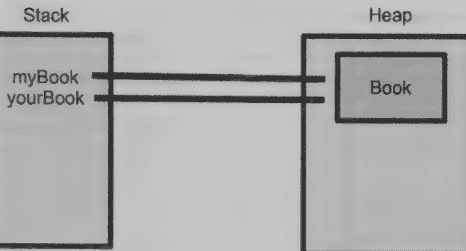

另一方面，以下代码创建了两个不同的 `Book` 对象：

```java
Book myBook = new Book();
Book yourBook = new Book();
```

这段代码的内存分配如图 4.4 所示。

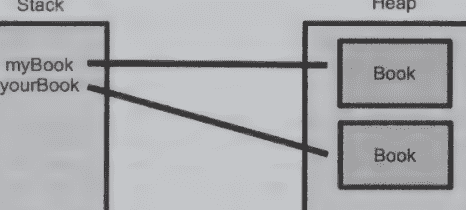

现在，包含另一个对象的对象呢？例如，考虑列表 4.3 中的代码，它展示了一个包含 `Address` 类的 `Employee` 类。

## 列表 4.3：一个包含另一个对象的 Employee 类

```java
public class Employee {
    Address address = new Address();
}
```

当你使用以下代码创建一个 `Employee` 对象时，也会创建一个 `Address` 对象。

```java
Employee employee = new Employee();
```

图 4.5 描绘了每个对象在堆中的位置。

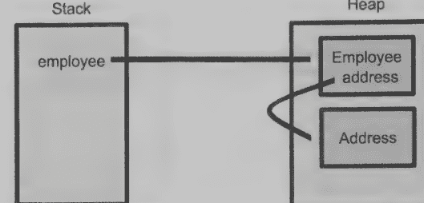

# Java 包

事实证明，`Address` 对象并不真的在 `Employee` 对象内部。然而，`Employee` 对象中的地址字段有一个指向 `Address` 对象的引用，允许 `Employee` 对象操作 `Address` 对象。因为在 Java 中，除了通过分配了对象地址的引用变量外，没有其他方法可以访问对象，所以其他人无法访问 `Employee` 对象内部的对象。

如果你正在开发一个由不同部分组成的应用程序，你可能希望组织类以保持可维护性。在 Java 中，你可以将相关的类或功能相似的类分在包中。例如，标准 Java 类是以包的形式存在的。Java 核心类位于 `java.lang` 包中。所有执行输入输出操作的类都是 `java.io` 包的成员，依此类推。如果需要更详细地组织包，你可以创建共享部分名称的包。例如，Java 类库自带了 `java.lang.annotation` 和 `java.lang.reflect` 包。但注意，共享部分名称并不意味着这些包是相关的。`java.lang` 包和 `java.lang.reflect` 包是不同的包。

以 `java` 开头的包名保留给核心库使用。因此，你不能创建一个以 `java` 单词开头的包。你可以编译属于此类包的类，但不能运行它们。

此外，以 `javax` 开头的用于伴随核心库的扩展库。你不应该创建以 `java` 开头的包。

除了类的组织外，包还可以避免命名冲突。例如，一个应用程序可以使用来自类 A 的 `MathUtil` 和来自另一个包的同名类，前提是这两个类属于不同的包。出于此目的考虑，根据惯例，你的包名应该基于你域名的反转来命名。因此，Sun 公司的包名应该以 `com.sun` 开头。我的域名是 `com.brainysoftware.com`，所以我用 `com.brainysoftware.app` 作为我的包名开头是合适的。例如，我会将所有的 applet 放在 `com.brainysoftware.app` 中，将 servlet 放在 `com.brainysoftware.servlet` 中。

包不是一个物理对象，因此你不需要“创建”它。要将类分组包中，请使用 `package` 关键字后跟包名。

尽管包不是物理对象，但包名会影响类文件的物理位置。包名表示子目录。例如，`com.brainysoftware.common` 包中的所有 Java 源文件必须位于 `common` 目录，该目录是 `brainysoftware` 目录的子目录。反之，后者又是 `com` 目录的子目录。图 4.6 描绘了 `com.brainysoftware.common.MathUtil` 类的目录结构。

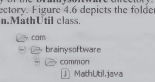

编译包类对于初学者来说是一个挑战。要编译此类类，你需要包含包名，并将点 `.` 替换为 `/`。例如，要编译 `com.brainysoftware.common.MathUtil` 类，请切换到工作目录（即 `com` 目录的父目录）并输入 `javac com/brainysoftware/common/MathUtil.java`。

默认情况下，`javac` 将结果放置与源码相同的目录结构中。在这种情况下，将在 `com/brainysoftware/common` 目录下创建一个 `MathUtil.class` 文件。

运行属于包类遵循类似的规则：你必须包含包名，并将 `.` 替换为 `/`。例如，要运行 `com.brainysoftware.common.MathUtil` 类，请从工作目录输入以下命令：

```bash
java com/brainysoftware/common/MathUtil
```

包的划分还会影响类的可见性，正如你将在下一节中见到的那样。

# 封装与访问控制

作为面向对象编程（OOP）的原则，封装是一种保护对象中需要安全的部分并安全暴露部分的机制。电视机是封装的一个良好例子。电视机内部有成千上万个电子元件，它们共同形成了接收信号并将其解码为图像和声音的部分。然而，用户无法访问这些组件，索尼等制造商将它们封装在一个坚固的金属外壳内，且不易损坏。为了让电视机易于使用，它暴露了用户可以触摸的开关、调节亮度、调节音量等按钮。

回到 OOP 中的封装，让我们以一个可以编码和解码消息的类为例。该类暴露了两个名为 `encode` 和 `decode` 的方法，用户可以访问这些方法。内部有几十个变量用于存储临时值，以及执行辅助任务的其他方法。类的作者隐藏了这些变量和其他方法，因为允许访问它们可能会损害编码/解码算法的安全性。此外，暴露过多的内容会让类变得难以使用。如你所见，封装是一个强大的特性。

Java 通过访问控制支持封装。访问控制由访问控制修饰符管理。在 Java 中有：`public`、`protected`、`private` 和默认访问级别。访问控制修饰符可以应用于类或类成员。它们将在后续的小节中进行解释。

## 类访问控制修饰符

在包含许多类的应用程序中，一个类可能会从属于同一包或不同包的另一个类实例化并使用。你可以通过在类声明的开头使用访问控制修饰符，来控制哪些包可以“看到”你的类。

一个类可以具有 `public` 或默认访问级别。通过使用 `public` 访问控制修饰符可以将类设为公有。声明中没有访问控制修饰符的类具有默认访问权限。公共类从任何地方可见。列表 4.4 展示了一个公共类 `Book`。

### 列表 4.4：公有类 `Book`

```java
package app04;
public class Book {
  String isbn;
  String title;
  int width;
  int height;
  int numberOfPages;
}
```

`Book` 类是 `app04` 包的成员，拥有五个字段。由于 `Book` 是公共的，因此它可以从任何其他类实例化。事实上，Java 核心库中的大多数类都是公共类。例如，这里是 `java.lang.Runtime` 类的声明：

```java
public class Runtime
```

> **Note**
>
> 一个 Java 源文件只能包含一个公共类。然而，它可以包含多个非公有的类。

公共类必须保存在一个与类同名的文件中，且扩展名必须为 `.java`。列表 4.4 中的 `Book` 类必须保存在 `Book.java` 文件中。此外，由于 `Book` 属于 `app04` 包，`Book.java` 文件必须位于 `app04` 目录下。

当类声明前面没有访问控制修饰符时，该类具有默认访问级别。例如，列表 4.5 展示了具有默认访问级别的 `Chapter` 类。

### 列表 4.5：具有默认访问级别的 `Chapter` 类

```java
package app04;
class Chapter {
  String title;
  int numberOfPages;

  public void render() {
    Page page = new Page();
    int sentenceCount = page.getNumberOfSentences();
    int pageNumber = page.getPageNumber();
  }
}
```

具有默认访问级别的类只能被属于同一包的类使用。例如，`Chapter` 类可以在 `Book` 类内部实例化，因为 `Book` 与 `Chapter` 属于同一个包。然而，`Chapter` 对其他包来说是不可见的。

例如，你可以在 `Book` 类内部添加以下 `getChapter` 方法：

```java
Chapter getChapter() {
  return new Chapter();
}
```

另一方面，如果你尝试向一个不属于 `app04` 包的类添加相同的 `getChapter` 方法，将会抛出编译错误。

## 类成员访问控制修饰符

类成员（方法、字段、构造函数等）可以具有四种访问级别之一：`public`、`protected`、`private` 和默认。`public` 访问控制修饰符用于使类成员变为公有，`protected` 修饰符用于使类成员变为受保护，`private` 修饰符用于使类成员变为私有。如果没有访问控制修饰符，类成员将具有默认访问级别。

表 4.1 显示了每个访问级别的可见性。

| 访问级别 | 来自其他包的类 | 来自同一包的类 | 来自子类 | 来自同一个类内部 |
|---|---|---|---|---|
| public | yes | yes | yes | yes |
| protected | no | yes | yes | yes |
| default | no | no | no | yes |
| private | no | no | no | yes |

表 4.1：类成员访问级别

> **Note**
>
> 默认访问有时被称为包级私有（package private）。为了避免混淆，本书将仅使用默认访问权限。

公共类成员可以被任何可以访问包含该成员的类的类访问。例如，`java.lang.Object` 类的 `toString` 方法是公有的。这里是该方法的签名：

```java
public String toString()
```

一旦你创建了一个 `Object` 对象，你就可以调用它的 `toString` 方法，因为 `toString` 是公有的。

```java
Object obj = new Object();
obj.toString();
```

记住通过以下语法访问类成员：

```java
obj.memberName
```


```java
Object obj = new Object();
obj.toString();
```

记住，由于 `toString` 是公有的，你就可以调用它的 `toString` 方法。

记住通过以下语法访问类成员：

```java
obj.memberName
```

公共类成员可以被任何可以访问包含该成员的类的访问。例如，`java.lang.Object` 类的 `toString` 方法是公有的。这里是该方法的签名：

```java
public String toString()
```

一旦你创建了一个 `Object` 对象，你就可以调用它的 `toString` 方法，因为 `toString` 是公有的。

# 第4 章：对象与类

它的 `getNumber` 方法是受保护的，因此它可以被属于 `app04` 包的任何类访问。例如，考虑 `Chapter` 类中的 `review` 方法（见 4.5）。

```java
public void review() {
    Page page = new Page();
    int sentenceCount = page.getNumberOfSentences();
    int pageNumber = page.getPageNumber();
}
```

`Chapter` 类可以访问 `getNumber` 方法，因为 `Chapter` 与 `Page` 属于同一个包。因此，`Chapter` 可以访问所有受保护成员。类的私有成员只能在类内部访问。例如，你无法在 `Page` 类本身的任何地方访问 `Page` 类的私有字段 `pageNumber`。然而，查看 `Page` 类定义的以下代码：

```java
private int pageNumber = 5;
protected int getNumber() {
    return pageNumber;
}
```

`pageNumber` 字段是私有的，所以它可以在同一类中定义的 `getNumber` 方法中访问。`getNumber` 的返回值是 `pageNumber`，它是私有的。初学者经常会被这种代码困扰。如果 `pageNumber` 是私有的，为什么要将其作为受保护方法的返回值呢？注意对 `pageNumber` 的访问仍然是私有的，因此其他类无法修改此字段。将其作为非私有方法的返回值是允许的。

构造函数如何？构造函数的访问级别与字段和方法相同。构造函数可以具有 `public`、`protected`、默认和 `private` 访问级别。你可能认为所有构造函数必须是公有的，因为构造函数的目的是使类可实例化。然而，让你惊讶的是，事实如此。某些构造函数是私有的，因此无法从其他类实例化。私有构造函数通常用于单例类。如果你对这个主题感兴趣，可以在互联网上很容易找到相关文章。

> **Note**
>
> 在 UML 类图中，你可以包含类访问级别信息。在公共成员前加 `+`，在受保护成员前加 `#`，在私有成员前加 `-`。没有前缀的成员被视为默认访问级别。图 4.7 展示了具有各种访问级别的 `Manager` 类。

## 图 4.7：在 UML 类图中包含类成员的访问级别

| Manager |
| :--- |
| + employeeId |
| - salary |
| + work |
| # manage |

## this 关键字

你可以在任何方法或构造函数中使用 `this` 关键字来引用当前对象。例如，如果你有一个名称与局部变量同名的类级字段，你可以使用这种语法来引用：

```
this.field
```

一种常见的用法是在接受用于初始化字段值的构造函数中。考虑代码列表 4.7 中的 `Box` 类。

### 代码列表 4.7：Box 类

```java
package app04;
public class Box {
    int length;
    int width;
    int height;
    public Box(int length, int width, int height) {
        this.length = length;
        this.width = width;
        this.height = height;
    }
}
```

`Box` 类有三个字段：`length`、`width` 和 `height`。它的构造函数接受三个用于初始化字段的参数。将 `length`、`width` 和 `height` 作为参数名称非常方便，因为它们反映了自身的含义。在构造函数内部，`length` 指的是参数 `length`，而不是 `length` 字段。而 `this.length` 指的是类级字段。

当然，也可以更改参数名称，如下所示：

```java
public Box (int lengthArg, int widthArg, int heightArg) {
    length = lengthArg;
    width = widthArg;
    height = heightArg;
}
```

通过这种方式，类级字段不会被局部变量遮蔽，你也不需要使用 `this` 关键字来引用类级字段。然而，使用 `this` 关键字可以让你省去为方法或构造函数参数构思不同名称的烦恼。

## 使用其他类

在你正在编写的类中使用其他类是常见的。默认情况下，允许使用与当前类在同一个包中的类。然而，要使用其他包中的类，你必须先导入想要使用的包或类。

Java 提供了 `import` 关键字来表示你想要在代码中使用某个包或类。例如，要在你的代码中使用 `java.util.ArrayList` 类，你必须包含以下导入语句：

```java
package app04;
import java.util.ArrayList;

public class Demo {
  ...
}
```

注意，`import` 语句必须放在 `package` 语句之后、类声明之前。`import` 关键字可以在一个类中出现多次。

```java
package app04;
import java.util.Clock;
import java.util.ArrayList;

public class Demo {
  ...
}
```

有时候，你会在同一个包中需要许多类。你可以使用通配符字符 `*` 导入同一个包中的所有类。例如，以下代码导入了 `java.util` 包的所有成员。

```java
package app04;
import java.util.*;
public class Demo {
  ...
}
```

现在，你不仅可以使用 `java.util.ArrayList` 类，还可以使用 `java.util` 包的其他成员。然而，为了提高代码的可读性，建议一个一个地导入包的成员。换句话说，如果你需要同时使用 `java.io.PrintWriter` 类和 `java.io.FileReader` 类，使用像下面的两个 `import` 语句比使用 `*` 字符更好。

```java
import java.io.PrintWriter;
import java.io.FileReader;
```

> **注意**
>
> `java.lang` 包的成员是被自动导入的。因此，例如使用 `java.lang.String` 类时，你不需要显式导入该类。

在不导入的情况下使用其他包所属的类的唯一方法是在代码中使用这些类的全限定名。例如，以下代码使用全限定名声明了 `java.io.File` 类。

```java
java.io.File file = new java.io.File(filename);
```

如果你从不同的包导入了同名的类，则在声明类时必须使用全限定名。例如，Java 核心库包含了 `java.sql.Date` 和 `java.util.Date` 类。同时导入这两者会混淆编译器。在这种情况下，你必须在类中写出 `java.sql.Date` 和 `java.util.Date` 的全限定名才能使用它们。

Java 类可以部署在 jar 文件中。附录 A 详细说明了如何编译在 jar 文件中使用其他类的类。附录 B 展示了如何在 jar 文件中运行 Java 类。附录 C 提供了关于 `jar` 工具说明，该程序是随 JDK 一带的，用于打包你的 Java 类和相关资源。

使用另一个类的类被称为“依赖于”后者。图 4.8 显示了描述这种依赖关系的 UML 类图。

## 图 4.8：UML 类图中的依赖关系

| Book | Chapter |
| :--- | :--- |
| height: Integer | |
| String use numberPages: Integer | |
| numberPages: Integer | |
| title: String | |
| width: Integer | renew(): void |

依赖关系由带箭头的虚线表示。在图 4.8 中，`Book` 类依赖于 `Chapter`，因为 `getChapter` 方法返回了一个 `Chapter` 对象。

## Final 变量

Java 没有预留 `constant` 关键字来创建常量。（注：此处 OCR 文本未同步，我将提供可用的文本）。

## 静态 final 变量

在本章前面的“Final 变量”部分中，你学习了可以使用 `final` 关键字创建 `final` 变量。然而，类级别的 `final` 变量或局部变量在程序运行时始终具有相同。如果你有多个具有 `final` 变量的同类对象，那么这些对象中 `final` 变量的值也将相同。将 `final` 变量也设为 `static` 更常见（也更稳妥）。这样，所有对象都共享同一个值。

静态变量的命名约定是使用大写字母并用下划线分隔两个单词。例如：

```java
static final int NUMBER_OF_MONTHS = 12;
static final float PI = (float) 22 / 7;
```

`static` 和 `final` 的位置是可以互换的，但使用 "static" 而不是 "final static" 更常见。

如果你想让类外部能够访问静态变量，也可以将其设为 `public`：

```java
public static final int NUMBER_OF_MONTHS = 12;
public static final float PI = (float) 22 / 7;
```

为了更好地组织代码，有时你希望将所有的静态变量放在一个类中。这个类通常没有方法或其他字段，并且永远不会被实例化。

例如，有时你希望将月份表示为 `int`，因此一月是 1，依此类推。那么，你使用单词 `January` 而不是数字 `1`，因为它更具描述性。列表 4.10 显示了 `Months` 类，它包含了月份名称及其表示形式。

### 列表 4.10：Months 类

```java
package app04;
public class Months {
    public static final int JANUARY = 1;
    public static final int FEBRUARY = 2;
    public static final int MARCH = 3;
    public static final int APRIL = 4;
    public static final int MAY = 5;
    public static final int JUNE = 6;
    public static final int JULY = 7;
    public static final int AUGUST = 8;
    public static final int SEPTEMBER = 9;
    public static final int OCTOBER = 10;
    public static final int NOVEMBER = 11;
    public static final int DECEMBER = 12;
}
```

在代码中，你可以通过编写以下代码来获取一月的表示形式：

```java
int thisMonth = Months.JANUARY;
```

在 Java 5 之前，类似于 `Months` 的类非常常见。然而，Java 现在提供了新的类型 `enum`（枚举），它可以消除对 `static final` 变量的需求。`enum` 将在第 12 章“枚举”中进行解释。

静态引用变量也是可能的。但是，请注意，只有变量本身是 `final` 的，这意味着一旦为实例分配了地址，就不能再分配另一个相同类型的对象。被引用对象本身的字段是可以更改的。

在以下这一行中：

`public static final Book book = new Book();`

`book` 始终指向 `Book` 的这个特定实例。将其重新赋值给另一个对象会导致编译错误：

```java
book = new Book(); // 编译错误
```

然而，你可以更改 `Book` 对象的字段值：

```java
book.title = "No Excuses"; // 假设 title 字段是 public
```

## 静态导入

Java 核心库中有许多类包含 `static final` 字段。其中其中之一是 `WEEK`（包含 MONDAY、TUESDAY 等）。若要在 `Calendar` 类中使用 `static final` 字段，你必须先导入 `Calendar` 类。

```java
import java.util.Calendar;
```

然后，你可以通过 `className.staticField` 的表示法来使用它：

```java
if (day == Calendar.SATURDAY);
```

然而，你也可以使用 `import static` 关键字来导入静态字段。例如，你可以这样做：

```java
import static java.util.Calendar.SATURDAY;
```

那么，在使用导入的静态字段时，不需要类名了。

## 变量作用域

你已经看到可以在不同的地方声明变量：

- 在类体内部作为类字段。在这里声明的变量被称为类级变量。
- 作为方法或构造函数的参数。
- 在方法体或构造函数体内部。
- 在语句块内部，例如 `while` 或 `for` 块内部。

现在是时候学习变量作用域了。

变量作用域指的是变量的可访问性。规则是：在块中定义的变量只能从该块内部访问。变量的作用域是定义它的那个块。例如，考虑以下 `for` 语句。

```java
for (int x = 0; x < 5; x++) {
    System.out.println(x);
}
```

变量 `x` 在 `for` 语句内部声明。因此，`x` 仅在此块内部可用。它在其他任何地方都是不可访问或不可见的。当 JVM 执行 `for` 语句时，它创建了 `x`。当执行完 `for` 块时，它销毁 `x`。在 `x` 被销毁后，称 `x` 出了作用域。

### 规则二：嵌套块中的变量可见性

```java
for (int x = 0; x < 5; x++) {
    System.out.println(x);
    for (int y = 0; y < 3; y++) {
        System.out.println(y);
    }
}
```

变量 `x` 在外层 `for` 语句内部声明。因此，`x` 在外层块及其内部嵌套块中均可用。变量 `y` 在内层 `for` 语句内部声明，仅在内层块中可用。


```java
for (int x = 0; x < 5; x++) {
    System.out.println(x);
    for (int y = 0; y < 3; y++) {
        System.out.println(y);
    }
}
```

那么，在使用导入的静态字段时，不需要类名了。

## 方法重载

方法名很重要，并且应该反映它们的功能。在许多情况下，你希望有名称相同但参数不同的方法。这被称为方法重载。你可以设计你的类使用方法重载。

列表 4.11 显示了一个带有私有构造函数的 `Discount` 类。它是一个包含表示折扣率的 `int` 的简单类。该值可以是 10（针对小客户）或 12（针对大客户）。

## 静态工厂方法

你已经学会了使用 `new` 创建对象。然而，Java 库中的某些类是无法实例化的。例如，你无法通过 `new` 创建 `java.time.LocalDate` 的实例，因为它的构造函数是私有的。相反，你应该使用它的其中一个静态方法，例如 `now()`：

```java
LocalDate today = LocalDate.now();
```

此类方法被称为静态工厂方法。你可以设计你的类使用静态工厂方法。

# 82 Java：入门教程（第四版）

你可以通过调用它的其中一个静态工厂方法来构造一个 `Discount` 对象，例如：

```java
Discount discount = Discount.createBigCustomerDiscount();
System.out.println(discount.getValue());
```

还有一些类允许你通过静态工厂方法和构造函数来创建实例。在这种情况下，构造函数必须是公共的（public）。此类类的示例有 `java.lang.Integer` 和 `java.lang.Boolean`。

通过静态工厂方法，你可以控制哪些对象可以被创建出来；你可以缓存一个实例，并在每次需要时都返回同一个实例。此外，与构造函数不同，你可以为静态工厂方法命名，以明确将创建什么类型的对象。

## 按值传递还是按引用传递？

你可以将基本类型变量或引用变量传递给方法。基本类型变量按值传递，而引用变量按引用传递。这意味着当你传递一个基本类型变量时，JVM 将传入变量的值复制到一个新的局部变量中。如果你更改了局部变量的值，该更改不会影响传入的基类型变量。

如果你传递一个引用变量，局部变量将指向与传入的引用变量相同的对象。如果你在方法内部更改了引用的对象，该更改也将反映在调用代码中。列表 4.12 展示了演示此点的 `ReferencePassingTest` 类。

### 列表 4.12：ReferencePassingTest 类

```java
package app04;
class Point {
    public int x;
    public int y;
}
public class ReferencePassingTest {
    public static void increment(int x) {
        x++;
    }
    public static void reset(Point point) {
        point.x = 0;
        point.y = 0;
    }
    public static void main(String[] args) {
        int a = 9;
        increment(a);
        System.out.println(a); // 输出 9
        Point p = new Point();
        p.x = 400;
        p.y = 600;
        reset(p);
        System.out.println(p.x); // 输出 0
    }
}
```


# 第 4 章：对象与类 83

`ReferencePassingTest` 中有两个方法：`increment` 和 `reset`。`increment` 方法接收一个 `int` 并将其递增。`reset` 方法接收一个 `Point` 对象并重置它的 `x` 和 `y` 字段。

现在注意 `main` 方法。我们将 `a`（其值为 9）传递给 `increment` 方法。在方法调用后，我们打印了 `a` 的值，你得到了 9，这意味着 `a` 的值没有改变。

随后，你创建了一个 `Point` 对象并将引用赋值给 `p`。然后你初始化了它的字段并将其传递给 `reset` 方法。`reset` 方法中的更改影响了 `Point` 对象，因为对象是按引用传递的。因此，当你打印 `p.x` 的值时，你得到了 0。

## 加载、链接与初始化

现在你已经学习了如何创建类和对象，让我们来看看 JVM 执行一个类时会发生什么。

你使用 `java` 工具运行 Java 程序。例如，你使用以下命令运行 `DemoTest`：

```bash
java DemoTest
```

当 JVM 加载到内存后，它通过调用 `DemoTest` 类的 `main` 方法开始启动。JVM 接下来将按照指定的顺序执行三件事：加载、链接和初始化。

### 加载

JVM 将 Java 类的二进制表示形式（在本例中为 `DemoTest` 类）加载到内存中，并可能将其缓存在在内存中，以防将来再次使用该类。如果未找到指定的类，将抛出错误并且进程在此处停止。

### 链接

在此阶段需要完成三件事：验证（verification）、准备（preparation）和解析（resolution，可选）。验证意味着 JVM 检查二进制表示形式是否符合 Java 编程语言和 JVM 的语义要求。例如，如果你篡改了编译生成的类文件，该类文件可能将无法工作。

准备阶段为指定的类的执行做准备。这涉及为该类的静态变量和其他为该类组织的数据结构分配内存空间。

解析检查指定的类是否引用了其他类/接口，以及其他类/接口是否也能被找到并加载。将对引用的类/接口进行递归检查。

例如，如果指定的类包含以下代码：

`MathUtil.add(4, 3)`

JVM 将在调用静态方法之前加载、链接并初始化 `MathUtil` 类。

或者，如果在 `DemoTest` 类中发现了以下代码：

```java
Book book = new Book();
```

JVM 将在在创建 `Book` 实例之前加载、链接并初始化 `Book` 类。

注意，JVM 的实现可能会选择在较晚的阶段执行解析，即当执行代码实际上需要使用被引用的类/接口时。

### 初始化

在最后一步中，JVM 使用分配的值或默认值初始化静态变量，并执行静态初始化器（`static` 块中的代码）。初始化发生在 `main` 方法执行之前不久。然而，如果无法初始化指定的类，则必须初始化其父类。如果父类尚未加载，它将会被加载、链接和初始化。

例如，如果指定的类包含以下代码：

`public static int z = 5;`

JVM 将在调用静态方法之前加载、链接并初始化 `MathUtil` 类。

或者，如果在 `DemoTest` 类中发现了以下代码：

```java
Book book = new Book();
```

JVM 将在创建 `Book` 实例之前加载、链接并初始化 `Book` 类。

注意，JVM 的实现可能会选择在较晚的阶段执行解析，即执行代码实际上需要使用被引用的类/接口时。

| 类型 | 默认值 |
| --- | --- |
| boolean | false |
| byte | 0 |
| short | 0 |
| int | 0 |
| long | 0L |
| char | \u0000 |
| float | 0.0f |
| double | 0.0d |
| object reference | null |

表 4.2：基本类型和引用的默认值

此外，静态块将被执行。例如，列表 4.13 展示了在类加载时执行静态代码的静态代码 类。与静态成员一样，你只能在静态代码中访问静态成员。

### 列表 4.13：StaticInitializationTest

```java
package app04;
public class StaticInitializationTest {
    public static int a = 5;
    public static int b = a * 2;
    static {
        System.out.println("static");
        System.out.println(b);
    }
    public static void main(String[] args) {
        System.out.println("main method");
    }
}
```

如果你运行这个类，你将在控制台上看到：

- static
- 10
- main method

### 对象创建初始化

实例初始化发生在类加载时，正如本章前面的“链接、加载与初始化”部分所述。然而，你也可以编写在每次创建类实例时执行初始化的代码。

当 JVM 遇到实例化类的代码时，JVM 会执行以下操作：

1. 为新对象分配内存空间，包含该类声明的实例变量以及父类的空间。
2. 处理调用的构造函数。如果构造函数有参数，JVM 将为这些参数创建变量并分配传递给构造函数的值。
3. 如果调用的构造函数开始调用另一个构造（使用 `this` 关键字），JVM 将处理被调用的构造函数。
4. 执行该类的实例初始化和实例变量初始化。未赋值的实例变量将被分配默认值（见表 4.2）。
5. 执行调用的构造函数的主体部分。
6. 返回一个指向新对象的引用变量。

注意，实例初始化与静态初始化不同。后者发生在类加载时，与实例化无关。相反，实例初始化是在对象创建时执行。此外，与静态初始化器不同，实例初始化可以访问实例变量。

# 86 Java：初学者教程（第四版）

### 列表 4.14：InitTest1 类

```java
package app04;

public class InitTest1 {
    int x = 3;
    int y;
    // 实例初始化代码
    {
        y = x * 2;
        System.out.println(y);
    }
    // 静态初始化代码
    static {
        System.out.println("Static initialization");
    }
    public static void main(String[] args) {
        InitTest1 test = new InitTest1();
        InitTest1 moreTest = new InitTest1();
    }
}
```

运行 `InitTest1` 类时，控制台会打印出以下内容：

Static initialization

6

6

静态初始化首先执行，在任何实例化发生之前。这是 JVM 打印“Static initialization”消息的地方。之后，`InitTest1` 类被实例化了两次，这解释了为什么看到了两次“6”。

使用实例初始化代码的问题在于：随着你的类变得越来越大，很难注意到这些初始化代码的存在。

编写初始化代码的另一种方法是在构造函数中。事实上，构造函数中的初始化代码更加明显，因此更优。列表 4.15 显示了 `InitTest2` 类将初始化代码放在构造函数中。

### 列表 4.15：InitTest2 类

```java
package app04;

public class InitTest2 {
    int x = 3;
    int y;
    // 实例初始化代码
    public InitTest2() {
        y = x * 2;
        System.out.println(y);
    }
    // 静态初始化代码
    static {
        System.out.println("Static initialization");
    }
    public static void main(String[] args) {
        InitTest2 test = new InitTest2();
        InitTest2 moreTest = new InitTest2();
    }
}
```

# 第 4 章：对象与类

这个问题在于，当你有多个构造函数且每个构造函数都必须调用相同的代码。解决方案是将初始化代码封装在一个方法中，并让构造函数调用它。列表 4.16 显示了这一点。

### 列表 4.16：InitTest3 类

```java
package app04;

public class InitTest3 {
    int x = 3;
    int y;
    // 实例初始化代码
    public InitTest3() {
        init();
    }
    public InitTest3(int x) {
        this.x = x;
        init();
    }
    private void init() {
        y = x * 2;
        System.out.println(y);
    }
    // 静态初始化代码
    static {
        System.out.println("Static initialization");
    }
    public static void main(String[] args) {
        InitTest3 test = new InitTest3();
        InitTest3 moreTest = new InitTest3();
    }
}
```

`InitTest3` 类更优，因为从构造函数对 `init` 方法的调用使得初始化代码比在初始化块中更加明显。

## 垃圾回收器

在之前的几个示例中，我向你展示了如何使用 `new` 关键字创建对象，但你从未见过显式销毁未使用对象以释放内存空间的代码。如果你是一名 C++ 程序员，你可能会怀疑我是否展示了错误的代码，因为在 C++ 中你必须在使用后销毁对象。

Java 自带垃圾回收器，它负责销毁未使用对象并释放内存。未使用对象被为不再被引用的对象，或者引用已经超出范围的对象。

有了这个功能，Java 变得比 C++ 简单得多，因为 Java 程序员不需要担心回收内存空间。然而，这并不意味着你可以随心所欲创建对象，内存（仍然）是有限的，而且垃圾回收器的启动需要时间。没错，你仍然可能会耗尽内存。

## 总结

OOP（面向对象编程）对现实世界的对象进行建模。由于 Java 是一种 OOP 语言，对象在 Java 编程中起着核心作用。对象是根据称为类的模板创建的。在本章中，你学习了如何编写类和类成员。类成员有许多类型，包括本章讨论的三种：字段、方法和构造函数。还有其他类型的 Java 成员，如枚举和内部类，将在其他章节中介绍。

在本章中，你学习了两个强大的 OOP 特性：抽象和封装。OOP 中的抽象是使用对象来表示现实世界对象。封装是一种保护对象中需要安全部分的机制，并仅暴露那些可以暴露的部分。本章讨论的另一个特性是方法重载。方法重载允许类拥有相同名称的方法，只要它们的签名足够不同。

Java 还自带了垃圾回收器，消除了手动销毁未使用对象的需要。当对象超出作用范围或不再被引用时，它们会被收集。

## 测验

1. 列出类可以包含的至少三种元素类型。
2. 方法和构造函数之间的区别是什么？
3. 类图中的类会显示它的构造函数吗？
4. `null` 代表什么？
5. 你用 `this` 关键字做什么？
6. 当你使用 `=` 运算符比较两个对象引用时，你实际上是在比较对象的内容吗？为什么？
7. 变量作用范围是什么？
8. “超出作用范围” 是什么意思？
9. 垃圾回收器如何决定销毁哪些对象？
10. 什么是方法重载？
11. 请在 `com.example` 包中创建一个 `Tablet` 类来模拟安卓平板。该类必须有三个私有字段：`weight` (int)、`screenSize` (float) 和 `wifiOnly` (boolean)。这些字段必须有一对公共的 getter 和 setter 方法，即 `getWeight`/`setWeight`、`getScreen`/`setScreen` 和 `getWifiOnly`/`setWifiOnly`。该类还必须有一个无参构造函数。
12. 在 `com.example` 包中创建一个 `TabletTest` 类并实例化 `Tablet` 类。实例化后调用其 getter 方法打印字段。然后设置字段并再次打印。

# 第 5 章：核心类

在讨论面向对象编程（OOP）的其他特性之前，让我们检查一些常用的类。这些类包含在随 JDK 提供的 Java 中。掌握它们有助于理解接下来的 OOP 示例。

所有类中最重要的类是 `java.lang.Object`。然而，在不涵盖继承（这将在第 7 章“继承”中进行）的情况下，很难讨论这个类。因此，`java.lang.Object` 在本章中仅进行简单讨论。现在我将关注你可以使用的类：`java.lang.StringBuffer` 和 `java.lang.StringBuilder`。然后，我将讨论 `java.lang.System` 类。该类也被包含在此处，因为它提供了一种方便的输入方式。


**注意**：在描述 Java 类中的方法时，展示方法签名总是有用的。方法通常接受与方法类不同包的对象作为参数。或者，它可能返回一个与其类不同的类型。为了清晰，对于不同包的类将使用全限定名。例如，这里 `java.lang.Object` 的 `toString()` 签名：

```
public String toString()
```

返回类型不需要全限定名，因为返回类型 `String` 与 `java.lang.Object` 属于同一个包。相反，`java.util.Scanner` 类中的 `toString` 方法使用了全限定名，因为 `Scanner` 类属于不同的包。

```java
public java.lang.String toString()
```

## java.lang.Object

`java.lang.Object` 代表一个 Java 对象。事实上，所有的类都是该类的直接或间接后代。由于我们还没有学习继承（继承只在第 7 章给出），“后代”一词对你可能毫无意义。因此，我们将简要讨论该类的方法，并在第 7 章再次回到该类。

表 5.1 显示了 Object 类中的方法。

# 90 Java：初学者教程（第四版）

| 方法 | 描述 |
| :--- | :--- |
| `clone` | 创建并返回此对象的拷贝。类实现此方法以支持拷贝。 |
| `equals` | 将此对象与传入的对象进行比较。类必须实现此方法以提供比较其实例内容的方法。 |
| `finalize` | 由垃圾回收器在即将被回收的对象上调用。在子类中，可以重写此方法以释放系统资源或执行其他清理工作。然而，上述断言应该在其他地方执行，你不应该碰此方法。 |
| `getClass` | 返回此对象的 `java.lang.Class` 对象。有关 `Class` 类的更多信息，请参阅“java.lang.Class”。 |
| `hashCode` | 返回此对象的哈希码。 |
| `toString` | 返回此对象的描述。 |
| `wait`、`notify`、`notifyAll` | 用于 Java 5 之前的多线程编程中。不应在 Java 5 或更高版本中直接使用。相反，请使用 Java 并发工具类。 |

表 5.1: java.lang.Object 方法

## java.lang.String

我还没有见过任何不使用 `java.lang.String` 类的正式 Java 程序。它是最常用的类之一，也绝对是最类之一。

`String` 对象表示一个字符串，即一段文本。你也可以将 `String` 视为 Unicode 字符序列。`String` 对象可以由任意数量的字符组成。没有字符的 String 是空字符串。String 对象是常量。一旦创建，它们的值就无法改变。由于这种情况，String 实例是不可变的。而且因为它们是不可变的，它们可以安全地共享。

你可以使用 `new` 关键字构造一个 String，但这不是创建 String 的常用方法。通常情况下，你使用字符串字面量赋值给 String 引用变量。这里有一个示例：

```
String s = "Java is cool";
```

这产生了一个包含 "Java is cool" 的 String 对象，并将其引用赋值给 `s`。这与以下代码相同：

```
String message = new String("Java is cool");
```

然而，使用字符串字面量给变量与使用 `new` 关键字机制不同。如果你使用 `new` 关键字，JVM 始终会创建一个 `String` 的新实例。使用字面量时，你会得到一个相同的 String 对象，但该对象并不总是新的。如果字符串 "Java is cool" 之前已经创建过，它可能来自池。

因此，使用字符串字面量更好，因为 JVM 可以在构造新实例上节省一些 CPU 周期。正因如此，我们在创建 String 对象时很少使用 `new` 关键字。如果你有特殊需求（例如将字符数组转换为 String），则可以使用 String 类的构造函数。

### 比较两个字符串

字符串比较是 Java 编程中最实用的操作之一。考虑以下代码：

```
String s1 = "Java";
String s2 = "Java";
if (s1 == s2) {
}
```

在这里，`(s1 == s2)` 结果为真，因为 `s1` 和 `s2` 引用同一个实例。另一方面，在以下代码中 `(s1 == s2)` 结果为假，因为 `s1` 和 `s2` 引用不同的实例：

```
String s1 = new String("Java");
String s2 = new String("Java");
if (s1 == s2) {
}
```

这显示了通过编写字符串字面量创建 String 对象与使用 `new` 关键字之间的区别。

使用 `==` 运算符比较两个 String 对象几乎没有用，因为你比较的是两个变量引用的地址。大多数时候，在比较两个对象时，你想知道这两个对象的值是否相同。在这种情况下，你需要使用 String 的 `equals` 方法。

```
String s1 = "Java";
if (s1.equals("Java")) // 返回 true。
```

而且，有时你会使用这种风格：

```java
if ("" + "Java" + "").equals(s1))
```

在 `(s1.equals("Java"))` 中，调用了 `equals` 方法。如果 `s1` 为 `null`，表达式将产生运行时错误。为了安全，你必须通过首先检查引用是否为 `null` 来确保 `s1` 不是 `null`。

```
if (s1 != null && s1.equals("Java"))
```

如果 `s1` 为 `null`，语句将返回 `false` 而不会求值第二个表达式，因为逻辑运算符 `&&` 在左侧操作数为为假时，不会尝试求值右侧的操作数。

```
if (s1 != null && s1.equals("Java"))
if ("" + "Java" + "").equals(s1))
```

### 字符串字面量

因为你始终在处理 String 对象，所以理解处理字符串字面量的规则非常重要。

首先，字符串字面量以双引号（""）开头和结束。其次，在闭合双引号之前换行会导致编译错误。例如，这段代码片段将引发编译错误。

```
String s2 = "This is an important\npoint to note";
```

你可以通过加号 `+` 拼接字符串字面量来组合长字符串字面量。

```
String s1 = "Java strings " + "are important";
String s2 = "This is an important " + "point to note";
```

你可以将 String 与基本类型或其他对象拼接。例如，`s3 = "String " + 3;`

### 转义某些字符

你有时需要在字符串中使用特殊字符，如回车（CR）和换行符（LF）。在其他情况下，你可能希望转义双引号（"）、单引号（''）和反斜杠（\）。是一些转义序列：

- `\b`: 退格
- `\t`: 制表符
- `\n`: 换行符
- `\f`: 换符
- `\r`: 回车
- `\"`: 双引号
- `\'`: 单引号
- `\\`: 反斜杠

# 第 5 章：核心类 95

```java
public String substring(int beginIndex, int endIndex)
```

返回当前字符串从 `beginIndex` 到 `endIndex` 的子字符串。例如，以下代码返回 "is"：

```
"Java is cool".substring(5, 7)
```

```java
public String replace(char oldChar, char newChar)
```

将当前字符串中所有 `oldChar` 出现的地方替换为 `newChar`，并返回新字符串。`"dingdong".replace('d', 'k')` 返回 `"kingkong"`

```java
public int length()
```

返回此字符串中字符的数量。例如，`"Java is cool".length(12)`。在 Java 6 之前，此方法经常被用于测试字符串是否为空。然而，更倾向于使用 `isEmpty` 方法，因为它更具描述性。

```java
public boolean isEmpty()
```

如果字符串为空（没有字符），则返回 true。

```java
public String split(String regex)
```

根据指定正则表达式的匹配项对当前字符串进行分割。例如，`"Java is cool".split(" ")` 返回一个包含三个 String 的数组。第一个元素是 "Java"，第二个是 "is"，第三个是 "cool"

```java
public boolean startsWith(String prefix)
```

测试当前字符串是否以 `prefix` 开头。

```java
public char[] toCharArray()
```

将此字符串转换为字符数组。

```java
public String toLowerCase()
```

将当前字符串中的所有字符转换为小写。例如，`"Java is cool".toLowerCase()` 返回 `"java is cool"`

```java
public String toUpperCase()
```

将当前字符串中的所有字符转换为大写。例如，`"Java is cool".toUpperCase()` 返回 `"JAVA IS COOL"`

```java
public String trim()
```

修剪末尾和前面的空白字符并返回新字符串。例如，`" Java ".trim()` 返回 `"Java"`

此外，还有如 `valueOf` 和 `format` 等静态方法。`valueOf` 将原始类型、字符数组或 Object 实例转换为字符串表示形式，它有 9 种重载。

```java
public static String valueOf(boolean value)
public static String valueOf(char value)
public static String valueOf(char[])
public static String valueOf(char[] value, int offset, int length)
public static String valueOf(double value)
public static String valueOf(float value)
public static String valueOf(int value)
public static String valueOf(long value)
public static String valueOf(Object value)
```

例如，以下代码返回字符串 "23"

# 96 Java：学者入门教程（第四版）

```
String.valueOf(23);
```

`format` 方法允许你传递任意数量的参数。这里是它的签名。

```
public static String format(String format, Object... args)
```

此方法返回一个使用指定的格式字符串和参数格式化的 String。格式模式必须遵循 `java.util.Formatter` 类中指定的规则，你可以在 Formatter 类的 JavaDoc 中阅读这些规则。这些规则的简要描述如下：

要指定参数，请使用符号 `%s`，它表示数组中的下一个参数。例如，以下是调用 `printf` 方法的方法。

```
String firstName = "John";
String lastName = "Adams";
System.out.format("First name: %s. Last name: %s",
firstName, lastName);
```

这会在控制台打印以下内容：

First name: John. Last name: Adams

如果没有变长参数（varargs），你必须用更麻烦的方法来实现。

```
String firstName = "John";
String lastName = "Adams";
System.out.println("First name: " + firstName +
"Last name: " + lastName);
```

> 注意
>
> `java.io.PrintWriter` 中的 `printf` 方法是 `format` 的别名。

这里描述的格式化只是冰山一角。格式化功能要强大得多，鼓励你通过阅读 Formatter 类的 Javadoc 来探索它。

## java.lang.StringBuffer 和 java.lang.StringBuilder

String 对象是不可变的，如果你需要向它们追加或插入字符，则它们是不适用的，因为在 String 上的操作总是会创建一个新的 String 对象。对于 `append` 和 `insert`，你最好使用 `java.lang.StringBuffer` 或 `java.lang.StringBuilder` 类。一旦你完成了对字符串的操控，就可以将 StringBuffer 或 StringBuilder 对象转换为 String。

在 JDK 1.4 之前，`StringBuffer` 类主要用于可变字符串。`StringBuffer` 中的方法是同步的，使得 `StringBuffer` 适用于多线程环境。然而，同步的代价是性能。JDK 5 增加了 `StringBuilder` 类，它是 `StringBuffer` 的**非**同步版本。如果你不需要同步，应该选择 `StringBuilder` 而不是 `StringBuffer`。

> 注意
>
> 同步和线程安全将在第 22 章“Java 线程”中讨论。

# 第 5 章：核心类

本部分的其余内容将使用 `StringBuilder`。然而，讨论也适用于 `StringBuffer`，因为 `StringBuilder` 和 `StringBuffer` 共享相似的构造函数和方法。

### StringBuilder 类构造函数

`StringBuilder` 类有四个构造函数。你可以传递一个 `java.lang.CharSequence`、一个 `String` 或一个 `int`。

```java
public StringBuilder()
public StringBuilder(CharSequence seq)
public StringBuilder(int capacity)
public StringBuilder(String string)
```

如果你在不指定容量的情况下创建 StringBuilder，对象的容量将 16 个字符。如果它的内容超过 16 个字符，它会自动增长。如果你知道你的字符串将长 16 个字符，分配足够的容量是一个好主意，因为增加 StringBuilder 的容量需要时间。

### StringBuilder 类方法

`StringBuilder` 类有几个方法。主要的有 `capacity`、`length`、`append` 和 `insert`。

```java
public int capacity()
```

返回 StringBuilder 的容量。

```java
public int length()
```

返回 StringBuilder 的长度。

```java
public StringBuilder append(String string)
```

将指定的字符串追加到 StringBuilder 的末尾。此外，`append` 有多种重载，允许传递原始类型、字符数组或 `java.lang.Object` 实例。例如，查看以下代码：

```java
StringBuilder sb = new StringBuilder(100);
sb.append("Matrix ");
sb.append(2);
```

最后一行之后，sb 的内容为 "Matrix 2"。

```java
public StringBuilder insert(int offset, String string)
```

在 `offset` 指定的位置插入指定的字符串。此外，`insert` 有多种重载，允许传递原始类型和 `java.lang.Object` 实例。像 `append` 一样，`insert` 也返回 StringBuilder 对象，因此允许链式调用。

```java
public String toString()
```

返回表示值的 String 对象。

## 原始类型类

为了性能，Java 中并不是所有都是对象。还有原始类型，如 `int`、`long`、`float`、`double` 等。当同时处理原始类型和对象时，经常需要原始类型到对象的转换。例如，`java.util.Collection` 对象（在第 14 章“集合框架”中讨论）可以用于存储对象，而不是原始类型。如果你想在集合中存储原始值，必须先将其转换为对象。

`java.lang` 包有几个作为原始类型包装的类。它们是 `Boolean`、`Character`、`Byte`、`Double`、`Float`、`Integer`、`Long` 和 `Short`。由于 `Byte`、`Double`、`Float`、`Integer`、`Long` 和 `Short` 共享相似的方法，这里仅讨论 `Integer`。你应该参考其他类的文档。

以下章节将详细讨论包装类。

## java.lang.Integer

`java.lang.Integer` 类包装了一个 `int`。`Integer` 类有两个静态常量字段：`MIN_VALUE` 和 `MAX_VALUE`。`MIN_VALUE` 包含 int 的最小值 (-2^31)，`MAX_VALUE` 是 int 的最大值 (2^31-1)。

`Integer` 类有两个构造函数：

```java
public Integer i1 = new Integer(12);
public Integer i2 = new Integer("123");
```

例如，这段代码构造了两个 Integer 对象。


# Integer

Integer 有无参方法的 `byteValue()`、`doubleValue()`、`floatValue()`、`intValue()`、`longValue()` 和 `shortValue()`，分别将包装的值转换为 byte、double、float、int、long 和 short。此外，`toString` 方法将值转换为 String。

还有静态方法可以用于解析 String 为 int (`parseInt`) 以及将 int 转换为 String (`toString`)。这些方法的签名如下：

```java
public static int parseInt(String string)
public static String toString(int i)
```

# java.lang.Boolean

java.lang.Boolean 类封装了一个布尔值。其静态字段 `FALSE` 和 `TRUE` 分别代表封装了原始值 `false` 的 Boolean 对象和封装了原始值 `true` 的 Boolean 对象。

你可以使用这些构造函数之一从布尔值或字符串构造 Boolean 对象。

```java
public Boolean(boolean value)
public Boolean(String value)
```

例如：

```java
Boolean b1 = new Boolean(false);
Boolean b2 = new Boolean("true");
```

要将 Boolean 转换为布尔值，请使用它的 `booleanValue` 方法：

```java
public boolean booleanValue()
```

此外，静态方法 `valueOf` 将字符串解析为 Boolean 对象。

```java
public static Boolean valueOf(String string)
```

并且，静态方法 `toString` 返回布尔值的字符串表示。

```java
public static String toString(boolean boolean)
```

# java.lang.Character

Character 类封装了一个 char。该类中只有一个构造函数：

```java
public Character(char value)
```

要将 Character 转换为 char，请使用它的 `charValue` 方法。

```java
public char charValue()
```

还有许多静态方法可以用于操作字符。

```java
public static boolean isDigit(char ch)
```

确定指定的参数是否为这些字符之一：'1', '2', '3', '4', '5', '6', '7', '8', '9', '0'。

```java
public static char toLowerCase(char ch)
```

将指定的 char 参数转换为其小写。

```java
public static char toUpperCase(char ch)
```

将指定的 char 参数转换为其大写。

# java.lang.Class

java.lang 包的成员之一是一个名为 Class 的类。每当 JVM 创建一个对象时，它也会创建一个 java.lang.Class 对象，用于描述该对象的类型。相同类的所有实例都共享同一个 Class 对象。你可以通过调用对象的 `getClass` 方法获取 Class 对象。该方法继承自 java.lang.Object。

例如，以下代码创建了一个 String 对象，在 String 实例上调用 `getClass` 方法，然后在 Class 对象上调用 `getName` 方法。

```java
String country = "Fiji";
Class myClass = country.getClass();
System.out.println(myClass.getName()); // 输出 java.lang.String
```

事实证明，`getName` 方法返回由 Class 对象表示的类的全限定名。

Class 还提供了在不使用 `new` 关键字的情况下创建对象的可能性。你通过使用 Class 类的两个方法 `forName` 和 `newInstance` 来实现这一点。

```java
public static Class forName(String className)
public Object newInstance()
```

静态方法 `forName` 根据指定的类名创建 Class 对象。`newInstance` 方法创建一个类的新实例。

列表 5.1 中的 ClassDemo 使用 `forName` 创建了 `app05.Test` 类的 Class 对象，并创建了 Test 类的实例。由于 `newInstance` 返回的是一个 java.lang.Object 对象，你需要将其向下转型为其原始类型。

## 列表 5.1：ClassDemo 类

```java
package app05;
public class ClassDemo {
    public static void main(String[] args) {
        String country = "Fiji";
        Class myClass = country.getClass();
        System.out.println(myClass.getName());
        Class klass = null;
        try {
            klass = Class.forName("app05.Test");
        } catch (ClassNotFoundException e) {
        }

        if (klass != null) {
            try {
                Test test = (Test) klass.newInstance();
                test.print();
            } catch (IllegalAccessException e) {
            } catch (InstantiationException e) {
            }
        }
    }
}
```

不要担心 `try ... catch` 块，因为它们将在第 8 章“错误处理”中进行解释。

不过，你可能会问这个问题：既然使用 `new` 关键字更短更简单，为什么要要用 `forName` 和 `newInstance` 来创建类的实例呢？答案是因为在某些情况下，当你编写程序时类名是未知的。

# java.lang.System

System 类是一个 final 类，它暴露了实用的静态字段和静态方法，可以帮助你完成常见任务。

System 类有三个字段：`out`、`in` 和 `err`：

```java
public static final java.io.PrintStream out;
public static final java.io.InputStream in;
public static final java.io.PrintStream err;
```

`out` 字段代表标准输出流，默认情况下它是运行 Java 程序的控制台。你将在第 16 章“输入输出”中学习更多关于 PrintStream 的知识，但现在可以使用 `out` 字段向控制台写入消息。你通常会写下面行代码：

```java
System.out.print(message);
```

其中 `message` 是一个 String 对象。然而，PrintStream 有许多接受不同类型的重载 `print` 方法，因此你可以将任何原始类型传递给 `print` 方法：

```java
System.out.print(12);
System.out.print('g');
```

此外，还有 `println` 方法，它们与 `print` 等效，但 `println` 在参数末尾添加了换行符。

注意，由于 `out` 是静态的，你可以使用这种符号 `System.out` 来访问它，它返回一个 java.io.PrintStream 对象。`err` 字段也代表一个 PrintStream 对象，默认情况下输出被重定向到调用 Java 程序的控制台。然而，它的目的是显示需要立即关注的错误消息。例如，这里是使用 `err` 的方法：

```java
System.err.println("You have a runtime error.");
```

`in` 字段代表标准输入流。你可以用它来接受键盘输入。例如，列表 5.2 中的 `getUserInput` 方法接收用户输入并将其作为 String 返回：

## 列表 5.2：InputDemo 类

```java
package app05;
import java.io.IOException;

public class InputDemo {
    public String getUserInput() {
        StringBuilder sb = new StringBuilder();
        try {
            char c = (char) System.in.read();
            while (c != '\r' && c != '\n') {
                sb.append(c);
                c = (char) System.in.read();
            }
        } catch (IOException e) {
        }
        return sb.toString();
    }

    public static void main(String[] args) {
        InputDemo demo = new InputDemo();
        String input = demo.getUserInput();
        System.out.println(input);
    }
}
```

然而，接收键盘输入的更简单方法是使用 java.util.Scanner 类，该类在本章稍后的“java.util.Scanner”节中讨论。

System 类有很多实用的方法，所有的都是静态的。这里列出了一些最重要的方法：

```java
public static void arraycopy(Object source, int sourcePos,
    Object destination, int destPos, int length)
```

该方法将数组（source）的内容拷贝到另一个数组（destination），从指定位置开始，到目标数组的指定位置。例如，以下代码使用 arraycopy 将 array1 的内容拷贝到 array2：

```java
int[] array1 = {1, 2, 3, 4};
int[] array2 = new int[array1.length];
System.arraycopy(array1, 0, array2, 0, array1.length);
```

```java
public static void exit(int status)
```

终止运行的程序和当前的 JVM。你通常传递 0 表示正常退出，传递非零表示调用此方法之前程序发生了错误。

```java
public static long currentTimeMillis()
```

返回以毫秒为单位的计算机时间。该值表示自 UTC 1970 年 1 月 1 日以来流过的毫秒数。

随后，你可以改用 `java.time.Instant` 类。该类在第 13 章“处理日期和时间”中进行了讨论。

```java
public static long nanoTime()
```

此方法类似于 `currentTimeMillis()`，但具有纳秒级精度。

```java
public static String getProperty(String key)
```

返回指定属性的值。如果指定的属性不存在，则返回 null。属性分为系统属性和用户定义属性。当 Java 程序运行时，JVM 会提供供程序作为属性使用的值。

每个属性都以键/值对的形式出现。例如，`os.name` 系统属性提供运行 JVM 的操作系统的值。此外，JVM 还会提供调用程序的目录名称作为名为 `user.dir` 的属性。要获取 `user.dir` 属性的值，你可以使用：

```java
System.getProperty("user.dir");
```

### 表 5.2: Java 系统属性

| 系统属性 | 描述 |
| :--- | :--- |
| java.version | Java 运行时环境版本 |
| java.vendor | Java 运行时环境供应商 |
| java.url | Java 供应商 URL |
| java.home | Java 安装目录 |
| java.vm.specification.version | Java 虚拟机规范版本 |
| java.vm.specification.vendor | Java 虚拟机规范供应商 |
| java.vm.specification.name | Java 虚拟机规范名称 |
| java.vm.version | Java 虚拟机实现版本 |
| java.vm.vendor | Java 虚拟机实现供应商 |
| java.vm.name | Java 虚拟机实现名称 |
| java.specification.version | Java 运行时环境规范版本 |
| java.specification.vendor | Java 运行时环境规范供应商 |
| java.specification.name | Java 运行时环境规范名称 |
| java.class.version | Java 类格式号 |
| java.class.path | Java 类路径 |
| java.library.path | 加载库时搜索的路径列表 |
| java.io.tmpdir | 默认临时路径 |
| java.compiler | 使用的 J 编译器名称 |
| java.ext.dirs | 扩展目录或目录路径 |
| os.name | 操作系统 |
| os.arch | 操作系统架构 |
| os.version | 操作系统 |
| file.separator | 文件分隔符（UNIX 上为 "/"） |
| path.separator | 路径分隔符（UNIX 上为 ":"） |
| line.separator | 行分隔符（UNIX 上为 "\n"） |
| user.name | 用户账户名 |
| user.home | 用户主目录 |
| user.dir | 用户当前工作目录 |

```java
public static void setProperty(String property, String newValue)
```

你使用 `setProperty` 来创建用户定义的属性或更改当前属性的值。例如，你可以使用此代码创建一个名为的属性：

```java
password:
System.setProperty("password", "tarzan");
```

然后，你可以使用 `getProperty` 获取它：

```java
System.getProperty("password")
```

例如，这里是更改 `user.name` 属性的方法。

```java
System.setProperty("user.name", "tarzan");
```

```java
public static String getProperty(String key, String default)
```

此方法与单参数的 `getProperty` 方法相似，但如果指定的属性不存在，则返回默认值。

```java
public static java.util.Properties getProperties()
```

此方法返回所有系统属性。返回值为 `java.util.Properties` 对象。`Properties` 类是 `Hashtable` 的子类（在第 11 章“集合框架”中讨论过）。

例如，以下代码使用 `Properties` 类的 `list` 方法遍历并在控制台上显示所有系统属性。

```java
java.util.Properties properties = System.getProperties();
properties.list(System.out);
```

# java.util.Scanner

你使用 `Scanner` 来扫描文本。在本章中，我们将重点讨论它接收输入的方法。

使用 `Scanner` 接收输入非常简单。你只需要通过传递 `System.in` 来实例化 `Scanner` 类。然后，调用它的 `next` 方法。`next` 方法缓冲来自键盘或其他设备的字符，直到用户按下回车键。它返回包含用户输入字符的字符串，但不包含换行符。列表 5.3 展示了如何使用 `Scanner` 接收输入。

- 列表 5.3: 使用 Scanner 接收输入


```java
package app05;
import java.util.Scanner;

public class ScannerDemo {
    public static void main(String[] args) {
        Scanner scanner = new Scanner(System.in);
        while (true) {
            System.out.print("What's your name? ");
            String input = scanner.nextLine();
            if (input.isEmpty()) {
                break;
            }
            System.out.println("Your name is " + input + ". ");
        }
        scanner.close();
        System.out.println("Good bye");
    }
}
```

与列表 5.2 中的代码相比，使用 `Scanner` 要简单得多。

## 总结

在本章中，你检查了许多重要的类，如 `java.lang.String`、数组、`java.lang.System` 和 `java.util.Scanner`。你还学习了变参数。最后一部分介绍了变参数的实现。

## 测验

1. `String` 不变意味着什么？
2. 如何不使用 `Scanner` 接收输入？
3. 什么是变长参数（varargs）？
4. 创建一个 `com.example.Car` 类，拥有私有字段：`year` (int)、`make` (String) 和 `model` (String)。通过向构造函数提供值使 `Car` 不可变。
5. 创建一个 `com.example.CarTest` 类来测试这些方法。
6. 在 `com.example.util` 中创建一个名为 `StringUtil` 的工具类。该类有两个静态方法 `getFileName` 和 `getExtension`。这两个方法接收文件路径并分别返回文件名或文件扩展名。
7. 如何使用 `java.util.StringTokenizer` 类来打印字符串中的标记数量以及每个单独的标记。

# 108 Java：初学者教程（第四版）

声明数组并不会创建数组，也不会为其元素分配空间，编译器仅会创建一个对象引用。创建数组的一种方法是使用 `new` 关键字。你必须指定要创建的数组的尺寸。

```
new type[size]
```

例如，以下代码创建了一个包含四个 `int`（整数）的数组：

```
new int[4]
```

或者，你可以在同一行中声明并创建数组。

```java
int[] ints = new int[4];
```

数组创建后，其元素要么是 `null`（如果元素是引用类型），要么是元素类型的默认值（如果数组包含基本数据类型）。例如，`int` 数组默认包含 0。

要引用数组元素，请使用索引。如果数组的尺寸为 `n`，则有效索引范围在 0 到 `n-1` 之间。例如，如果一个数组有四个元素，则有效索引为 0, 1, 2 和 3。以下代码段创建了一个 `String` 对象的数组，并为它的第一个元素赋值。

```java
String[] names = new String[4];
names[0] = "Hello World";
```

使用负索引或大于数组尺寸的正整数将抛出 `java.lang.ArrayIndexOutOfBoundsException`。关于异常的信息，请参阅第 8 章“错误处理”。

由于数组是一个对象，你可以获取数组上获取 `getClass()` 方法。数组的 `Class` 对象的字符串表示具有如下格式：

```
[type]
```

其中 `type` 是对象的类型。对 `String` 数组调用 `getClass().getName()` 会返回 `java.lang.String`。然而，基本数据类型数组的类名更难解码。在 `int` 数组上调用 `getClass().getName()` 返回 `[I`，在 long 数组上返回 `[J`。

你可以使用 `new` 关键字初始化数组。Java 允许你通过在花括号内对值进行分组来创建数组。例如，以下代码创建了一个包含三个 `String` 对象的数组：

```java
String[] names = { "John", "Mary", "Paul" };
```

以下代码创建了一个包含四个 `int` 的数组，并将该数组赋值给变量 `matrix`。

```java
int[] matrix = { 1, 2, 3, 10 };
```

在将数组传递给方法时要小心，因为即使方法 `average` 接收 `int` 数组，以下操作也是非法的：

```java
int avg = average( { 1, 2, 3, 10 }); // 非法
```

相反，你需要单独实例化数组。

```java
int[] numbers = { 1, 2, 3, 10 };
int avg = average(numbers);
```

或者你可以这样做：

```java
int avg = average(new int[] { 1, 2, 3, 10 });
```

## 遍历数组

在 Java 5 之前，遍历数组成员的唯一方法是使用 for 循环和数组的索引。例如，以下代码遍历了变量名 `names` 引用的 String 数组：

```java
for (int i = 0; i < 3; i++) {
  System.out.println("t- " + names[i]);
}
```

Java 5 增强了 for 语句。你现在可以使用它在不使用索引的情况下遍历数组或集合。这种语法允许你遍历数组：

`for (elementType variable : arrayName)`

其中 `arrayName` 是数组的引用，`elementType` 是数组的元素类型，`variable` 是一个引用数组每个元素的变量。

例如，以下代码遍历了一个 String 数组：

```java
String[] names = { "John", "Mary", "Paul" };
for (String name : names) {
  System.out.println(name);
}
```

该代码在控制台上输出以下内容：

John

Mary

Paul

## java.util.Arrays 类

`Arrays` 类提供了用于操作数组的静态方法。表 6.1 显示了它的部分方法。

# 110 Java：初学者教程（第四版）

| 方法 | 描述 |
|---|---|
| asList | 返回一个由数组支持的固定大小的 List。无法向 List 中添加其他元素。List 将在第 14 章“集合框架”中讨论。 |
| binarySearch | 在数组中搜索指定的键。如果找到了键，则返回元素的索引。如果没有匹配项，则返回插入点减一的负值。详情请参见“搜索数组”部分。 |
| copyOf | 创建一个具有指定长度的新数组。新数组将与原数组具有相同的元素。如果新长度与原数组的长度不同，则用 null 或默认值填充新数组，或截断原数组。 |
| copyOfRange | 根据原数组的指定范围创建一个新数组。 |
| equals | 比较两个数组的内容。 |
| fill | 将指定的值赋值给指定数组的每个元素。 |
| sort | 对指定数组的元素进行排序。 |
| parallelSort | 并行排序指定数组的元素。 |
| toString | 返回指定数组的字符串表示。 |

`java.util.Arrays` 的更多重要方法。其中某些方法将在接下来的章节中解释。

## 修改数组

一旦创建了数组，其尺寸就无法更改。如果你想更改尺寸，必须创建一个新数组并使用原数组的值填充它。例如，以下代码增加了 int 数组的尺寸：

```java
int[] numbers = { 1, 2, 3 };
int[] temp = new int[4];
int length = numbers.length;
for (int j = 0; j < length; j++) {
    temp[j] = numbers[j];
}
numbers = temp;
```

一种更短的方法是使用 `copyOf`。例如，你可以通过这种方式重新赋值数组：

```java
numbers = Arrays.copyOf(numbers, 4);
```

`copyOf` 方法带有十种重载，针对每 Java 数据类型有八种。它们的签名如下：

```java
public static boolean[] copyOf(boolean[] original, int newLength)
public static byte[] copyOf(byte[] original, int newLength)
public static char[] copyOf(char[] original, int newLength)
public static double[] copyOf(double[] original, int newLength)
public static float[] copyOf(float[] original, int newLength)
public static int[] copyOf(int[] original, int newLength)
public static long[] copyOf(long[] original, int newLength)
public static short[] copyOf(short[] original, int newLength)
public static <T> T[] copyOf(T[] original, int newLength, java.lang.Class<? extends T> newType)
```

这些重载中的每一个方法都会在 `original` 为 null 时抛出 `java.lang.NullPointerException`，在 `newLength` 为负数时抛出 `java.lang.NegativeArraySizeException`。新参数可以小于、等于或大于原数组的长度。如果小于，则包含前 `newLength` 个元素。如果较大，最后几个元素将具有默认值，即如果是整数数组则为 0，如果是对象数组则为 null。

另一个与 `copyOf` 的方法是 `copyOfRange`，它将范围复制到一个新数组。类似于 `copyOf`，`copyOfRange` 也为每个 Java 数据类型提供了重写。它们的签名如下：

```java
public static boolean[] copyOfRange(boolean[] original, int from, int to)
public static byte[] copyOfRange(byte[] original, int from, int to)
public static char[] copyOfRange(char[] original, int from, int to)
public static double[] copyOfRange(double[] original, int from, int to)
public static float[] copyOfRange(float[] original, int from, int to)
public static int[] copyOfRange(int[] original, int from, int to)
public static long[] copyOfRange(long[] original, int from, int to)
public static short[] copyOfRange(short[] original, int from, int to)
public static <T> T[] copyOfRange(T[] original, int from, int to)
public static <T,U> T[] copyOfRange(U[] original, int from, int to, java.lang.Class<? extends T> newType)
```

你也可以使用 `System.arraycopy()` 来复制数组。然而，`Arrays.copyOf()` 是更易使用，并且在内部调用了 `System.arraycopy()`。

### 搜索数组

你可以使用 `Arrays` 类的 `binarySearch` 方法来搜索数组。该方法带有二十多个重载。以下是其中两个重载：

```java
public static int binarySearch(int[] array, int key)
public static int binarySearch(java.lang.Object[] array, java.lang.Object key)
```

还有限制搜索区域的重载。

```java
public static int binarySearch(int[] array, int fromIndex, int toIndex)
public static int binarySearch(java.lang.Object[] array, int fromIndex, int toIndex, java.lang.Object key)
```

`binarySearch` 方法采用二分查找算法来搜索数组。使用该算法时，数组会首先按升序或降序进行排序。然后，它将搜索键与数组的中间元素进行比较。如果匹配，则返回元素的索引。如果不匹配，取决于搜索键是小于还是大于索引，它将在数组的前半部分或后半部分继续搜索，重复此过程，直到没有元素或只剩一个元素。如果搜索结束时未找到匹配项，`binarySearch` 方法返回插入点减一的负值。列表 6.1 中的示例将使这一点更加清晰。

#### 列表 6.1：二分查找示例

```java
package app06;
import java.util.Arrays;

public class BinarySearchDemo {
    public static void main(String[] args) {
        int[] primes = { 2, 3, 5, 7, 11, 13, 17, 19 };
        int index = Arrays.binarySearch(primes, 13);
        System.out.println(index); // 输出 5
        index = Arrays.binarySearch(primes, 4);
        System.out.println(index); // 输出 -3
    }
}
```

列表 6.1 中的 `BinarySearchDemo` 类使用了一个包含前八个质数的 `int` 数组。将 13 作为搜索键传递返回 5，因为 13 是数组中的第六个元素，即索引为 5。传递 4 则未找到匹配项，方法返回 -3，即 -2 减一。如果将该键插入数组中，它的索引将是 2。

### 向 main 方法传递字符串数组

你用于调用 Java 类时使用的 `public static void main` 方法接收一个 `String` 数组。以下是 `main` 方法的签名：

```java
public static void main(String[] args)
```

你可以通过将参数输入为 java 程序的参数来向 `main` 传递参数。参数应该出现在类名之后，两个参数之间用空格隔开。你使用以下语法：

```
java className arg1 arg2 arg3 ... arg-n
```

列表 6.2 展示了一个遍历 `main` 方法 `String` 数组参数的类。

#### 列表 6.2：访问 main 方法的参数

```java
package app06;
public class MainMethodTest {
    public static void main(String[] args) {
        for (String arg : args) {
            System.out.println(arg);
        }
    }
}
```

以下命令调用该类并向 `main` 方法传递了两个参数。

```
java app06.MainMethodTest john mary
```

随后 `main` 将参数打印到控制台。

```
john
mary
```

如果没有向 `main` 传递任何参数，`String` 数组 `args` 将为空，而不是 `null`。

## 多维数组

在 Java 中，多维数组是一种元素也是数组的数组。因此，与 C 语言中的多维数组不同，它的行可以长度不同。

要声明一个二维数组，在类型后使用两对括号：

```java
int[][] numbers;
```

要创建一个数组，传递两个维度的大小：

```java
int[][] numbers = new int[3][2];
```

#### 列表 6.3：多维数组


```java
package app06;
import java.util.Arrays;

public class MultidimensionalDemo {
    public static void main(String[] args) {
        int[][] matrix = new int[2][3];
        for (int i = 0; i < 2; i++) {
            for (int j = 0; j < 3; j++) {
                matrix[i][j] = j + i;
            }
        }

        for (int i = 0; i < 2; i++) {
            System.out.println(Arrays.toString(matrix[i]));
        }
    }
}
```

如果你运行该类，控制台将打印以下内容：

```
[0, 1, 2]
[1, 2, 3]
```

## 总结

在本章中，你学习了如何声明和初始化数组以及处理这种数据结构。你还研究了 `java.util.Arrays` 类如何操作数组。

## 问答

1. 什么是数组？
2. 如何调整数组的大小？
3. 如何创建一个数组并在不赋值给变量的情况下将其传递给方法？
4. 编写 `com.example.app06.ArrayUtil`，包含两个静态方法：`min` 和 `max`。这两个方法都接收一个 `int` 数组并分别返回最小和最大的元素。

## 继承

继承是一个非常重要的面向对象编程 (OOP) 特性。在 Java 中，通过继承可以重用代码。使用 `final` 关键字可以防止类被继承，或者防止方法被重写。继承允许子类继承父类的属性和方法，这创建了类之间的“isa”关系。在 Java 中，使用 `extends` 关键字来实现继承。

```java
class Animal {
    void eat() {
        System.out.println("Animal is eating");
    }
}

class Dog extends Animal {
    void bark() {
        System.out.println("Dog is barking");
    }
}

public class Main {
    public static void main(String[] args) {
        Dog myDog = new Dog();
        myDog.eat(); // 调用继承自的方法
        myDog.bark(); // 调用子类的方法
    }
}
```

# 118 Java：初学者教程（第四版）

```java
Dog dog = new Animal();
```

## 访问权限 (Accessibility)

在子类内部，你可以访问其父类的公共（`public`）和保护（`protected`）方法与字段，但无法访问父类的私有（`private`）方法。如果子类和父类位于同一个包中，你还可以访问父类的默认（`default`）方法和字段。

请考虑列表 7.4 中的 `P` 和 `C` 类。

**列表 7.4：显示访问权限**

```java
package app07;
public class P {
    public void publicMethod() {
    }
    protected void protectedMethod() {
    }
    void defaultMethod() {
    }
}
class C extends P {
    public void testMethods() {
        publicMethod();
        protectedMethod();
        defaultMethod();
    }
}
```

`P` 有三个方法：一个公共、一个保护、一个具有默认访问级别。`C` 是 `P` 的子类。正如你在 `C` 类的 `testMethods` 方法中看到的，`C` 可以访问其父类 `P` 的公共和保护方法。此外，由于 `C` 和 `P` 属于同一个包，`C` 也可以访问 `P` 的默认方法。

然而，这并不意味着你可以通过子类暴露 `P` 的非公共方法。例如，下面的代码将无法编译：

```java
package app07.C;
public class AccessibilityTest {
    public static void main(String[] args) {
        C c = new C();
        c.protectedMethod();
    }
}
```

`protectedMethod` 是 `P` 的一个保护方法。它无法从 `P` 外部访问，除非来自子类。由于 `AccessibilityTest` 不是 `P` 的子类，你无法通过其子类 `C` 访问 `P` 的保护方法。

## 第 7 章：继承 119

## 方法重写 (Method Overriding)

当你扩展一个类时，你可以更改父类中方法的行为。这被称为方法重写，当你在子类中编写一个与父类方法具有相同签名（`signature`）的方法时，就会发生这种情况。如果仅名称相同但参数列表不同，则属于方法重载。（参见第 4 章，“对象与类”）。

你通过重写方法来更改它的行为。要重写一个方法，你只需要在子类中编写新方法，而无需更改父类中的任何内容。你可以重写父类的公共和保护方法。如果子类和父类在同一个包中，你还可以重写具有默认访问级别的方法。

列表 7.5 中的 `Box` 类演示了方法重写的示例。

## 列表 7.5：Box 类

```java
package app07;
public class Box {
    public int length;
    public int width;
    public int height;

    public Box(int length, int width, int height) {
        this.length = length;
        this.width = width;
        this.height = height;
    }

    @Override
    public String toString() {
        return "I am a Box.";
    }

    @Override
    public Object clone() {
        return new Box(1, 1, 1);
    }
}
```

`Box` 类扩展了 `java.lang.Object` 类。由于没有使用 `extends` 关键字，这是一种隐式扩展。`Box` 重写了 `toString` 方法和保护的 `clone` 方法。注意，`Box` 中的 `clone` 方法是公共的，而在 `Object` 中它是受保护的。将父类中定义的方法的可见性从保护提高到公共是允许的。然而，降低可见性是非法的。

如果你创建一个与父类中私有方法签名相同的方法呢？这并不是方法重写，因为私有方法在类外部是不可见的。这只是一个恰好与私有方法签名相同的方法。

## 120 Java：初学者教程（第四版）

> **注意**
>
> 你不能重写 `final`（最终）方法。要使一个方法变为 `final` 的，请在方法声明中使用 `final` 关键字。例如：
>
> ```java
> public final java.lang.String toUpperCase(java.lang.String s)
> ```

## 调用父类的构造函数

子类就像普通类一样，你使用 `new` 关键字创建它的实例。如果你没有在子类中显式编写构造函数，编译器会隐式地添加一个无参数构造函数。

当你通过调用其中一个构造函数来实例化类时，构造函数执行的第一件事是调用直接父类的无参数构造函数。在父类中，构造函数也会调用其直接父类的构造函数。这个过程不断重复，直到到达 `java.lang.Object` 类的构造函数。换句话说，当你创建一个子对象时，其所有的父类都会被实例化。

这在列表 7.6 的 `Base` 和 `Sub` 类中得到了体现。

- 列表 7.6：调用父类的无参数构造函数

```java
package app0;
class Base {
    public Base() {
        System.out.println("Base");
    }
    public Base(String s) {
        System.out.println("Base." + s);
    }
}
class Sub extends Base {
    public Sub(String s) {
        System.out.println(s);
    }
    public static void main(String[] args) {
        Sub s = new Sub("Start");
    }
}
```

如果你运行 `Sub` 类，你将在控制台中看到：

```
Base
Start
```

这证明了 `Sub` 类调用了 `Base` 类的无参数构造函数。

## 第 7 章：继承 121

```java
Parent parent = child;
```

要对 `Child` 对象进行向上转型（`upcast`），你只需要将该对象赋值给类型为 `Parent` 的引用变量。请注意，父类引用变量无法访问仅在 `Child` 中可用的成员。

由于上面的 `parent` 引用的是一个 `Child` 类型的对象，你可以将其转换回 `Child`。这一次，这被称为向下转型（`downcasting`），因为你正在将一个对象转换为继承层次结构中更下的类。向下转型需要在括号中写出子类类型。例如：

```java
Child child = new Child();
Parent parent = child; // parent 指向 Child 的实例
Child child2 = (Child) parent; // 向下转型
```

只有当父类引用已经指向子类的实例时，才允许向下转型到该子类。以下代码将产生编译错误：

```java
Object parent = new Object();
Child child = (Child) parent; // 非法向下转型，编译错误
```

## 最终类 (Final Classes)

你可以通过在类声明中使用 `final` 关键字将类标记为 `final`，从而防止他人扩展你的类。`final` 可以出现在访问修饰符之后或之前。例如：

```java
public final class Pencil
final public class Pen
```

第一种形式更为常见。

即使将类设为 `final` 也会让你的代码运行略快，但差异微小到无法察觉。设计考虑而非速度，才是将类设为 `final` 的理由。例如，`java.lang.String` 类是 `final` 的，因为类的设计者不希望你改变 `String` 的行为。

## instanceof 运算符

`instanceof` 运算符可以用于测试对象是否为指定的类型。它通常用于 `if` 语句，其语法如下：

```java
if (objectReference instanceof type)
```

其中 `objectReference` 引用正在被检查的对象。例如，以下 `if` 语句返回 `true`。

```java
String s = "Hello";
if (s instanceof java.lang.String)
```

然而，将 `instanceof` 应用于空引用变量返回 `false`。例如，以下 `if` 语句返回 `false`：

```java
String s = null;
if (s instanceof java.lang.String)
```

此外，由于子类是其父类的一种类型，当 `Child` 是 `Parent` 的子类时，以下 `if` 语句返回 `true`：

```java
Child child = new Child();
if (child instanceof Parent) // true
```

## 总结

继承是面向对象编程的基本原理之一。继承使得代码具有可扩展性。在 Java 中，所有类默认继承自 `java.lang.Object` 类。要扩展一个类，使用 `extends` 关键字。方法重写（Method overriding）是另一个与继承相关的 OOP 特性。它允许你更改父类方法的行为。你可以通过将类设为 `final` 来防止你的类被子类化。

## 练习

- 1. 子类继承其父类的构造方法吗？
- 2. 为什么将子类实例赋值给父类变量是合法？
- 3. 方法重写和方法重载（method overloading）有什么区别？
- 4. 为什么子类实例必须伴随着每个父类的实例？
- 5. 编写一个公共的 `com.example.transport.Car` 类，添加一个名为 `run` 的 `void` 方法并重写 `toString()`。`run` 打印 `toString()` 的返回值。在同一个包下编写另一个公共的 `SUV` 类。`SUV` 继承 `Car` 并重写它的 `run` 和 `toString` 方法。`SUV` 的 `run` 类应该打印父类 `toString` 方法的返回值及其自身的 `toString` 方法的返回值。接下来，在 `SUV` 中添加 `main` 方法，创建一个 `SUV` 对象并调用它的 `run` 方法。

## 第 8 章：错误处理

错误处理是任何编程语言中的重要特性。良好的错误处理机制让程序员更容易编写健壮的应用程序并防止 bug 的产生。在某些语言中，程序员被迫使用多个 `if` 语句来检测所有可能导致错误的条件。这可能导致代码异常复杂。在较大的程序中，这很容易导致“面条代码”（spaghetti code）。

Java 提供了 `try` 语句作为一种良好的错误处理方法。通过这种策略，可能导致错误的代码部分被隔离在一个块中。如果发生错误，该错误将被捕获并在局部解决。本章将教你这些。

## 捕获异常 (Catch Exceptions)

错误有两种类型：编译错误和运行时错误。编译错误是由于源代码中的错误引起的。例如，如果你忘记用分号结束语句，编译器会通知你并拒绝编译你的代码。编译错误由编译器在编译时捕获。另一方面，运行时错误只有在程序运行时（即在运行期间）才能被捕获，因为编译器无法在编译时捕获到它们。例如，内存耗尽，或者如果程序尝试将用户输入解析为整数，该输入仅在程序运行时才可用。如果用户输入了非数字，解析过程将失败并抛出运行时错误。运行时错误如果不被处理，将导致程序意外退出。

在你的程序中，你可以使用 `try` 语句捕获运行时错误，它通常与 `catch` 和 `finally` 语句一起使用。这种隔离通常发生在方法体中。如果遇到错误，Java 会停止处理 `try` 块，并跳转到 `catch` 块。在这里，你可以优雅地处理错误，或者通过向调用方法的代码“抛出”一个 `java.lang.Exception` 对象来通知用户。另一种情况是重新抛出异常或新的 `Exception` 对象到代码中。这时就由客户端决定是否应该处理该错误。如果抛出的异常未被捕获，应用程序将崩溃。

这是 `try` 语句的语法：

```java
try {
  [可能抛出异常的代码]
} catch (ExceptionType-1 e) {
  [当抛出 ExceptionType-1 时执行的代码]
} catch (ExceptionType-2 e) {
  [当抛出 ExceptionType-2 时执行的代码]
}
```

错误处理的步骤总结如下：

1. 将可能导致错误的代码隔离在 `try` 块中。
2. 对于每个单独的 `catch` 块，编写当 `try` 块发生特定类型异常时要执行的代码。
3. 在 `finally` 块中，编写无论发生错误都会运行的代码。

注意，`catch` 和 `finally` 块是可选的，但它们至少必须存在一个。因此，你可以拥有带有多个 `catch` 块的 `try`、带有 `finally` 的 `try` 或者带有 `catch` 和 `finally` 的 `try`。

之前的语法显示你可以拥有多个 `catch` 块。这是因为某些可能会抛出不同类型的异常。当异常从 `try` 块抛出时，控制将传递给第一个 `catch` 块。如果异常类型匹配第一个 `catch` 块中的异常或是其子类，则执行 `catch` 块中的代码，然后控制转到 `finally` 块（如果存在）。

如果异常类型与第一个 `catch` 块中的类型不匹配，考虑下一个 `catch` 块并执行相同操作，直到找到匹配。如果没有找到匹配，异常对象将抛给方法调用者。如果调用者没有将调用方法的代码放在 `try` 块中，程序将崩溃。

## 第 8 章：错误处理 127

```java
}
```

`Doubler` 类使用 `java.util.Scanner` 类来获取用户输入（`Scanner` 在第 5 章“核心类”中讨论过）。

```java
Scanner scanner = new Scanner (System.in);
String input = scanner.next();
```

然后，它使用 `java.lang.Double` 类的静态方法 `parseDouble` 将字符串输入转换为 `double`。请注意，调用 `parseDouble` 的代码位于一个 `try` 块中。这是必要的，因为 `parseDouble` 可能会抛出 `java.lang.NumberFormatException`，如 `parseDouble` 方法的签名所示：

```java
public static double parseDouble(String s)
throws NumberFormatException
```


# 第 8 章：错误处理

方法签名中的 `throws` 语句告诉你它可能会抛出 `NumberFormatException`，而捕获该异常是方法调用者的责任。

如果没有 `try` 块，无效的输入将会在系统崩溃前向你显示这个令人尴尬的错误信息：

```
Exception in thread "main" java.lang.NumberFormatException:
```

## 不带 catch 的 try

语句可以在没有 `catch` 块的情况下与 `finally` 使用。你通常使用这种语法来确保无论 `try` 块中是否抛出意外异常，某些代码始终会被执行。例如，在打开数据库连接后，你希望在完成操作后调用连接的 `close` 方法。为了说明这种场景，请考虑以下打开数据库连接的伪代码。

```java
Connection connection = null;
try {
// 打开连接
// 对连接进行某些操作并执行其他任务

} finally {
  if (connection != null) {
    // 关闭连接
  }
}
```

如果 `try` 块中发生意外情况，将始终调用 `close` 方法来释放资源。

## 捕获多个异常

Java 7 及更高版本允许你在单个 `catch` 块中捕获多个异常，前提是这些捕获的异常将由同一段代码处理。`catch` 块的语法如下，两个异常之间用管道符 `|` 隔开：

```java
catch(exception-1 | exception-2 ... e) {
    // 处理异常
}
```

例如，`java.net.ServerSocket` 类的 `accept` 方法可能会抛出四个异常：`java.nio.channels.IllegalBlockingModeException`、`java.net.SocketTimeoutException`、`java.lang.SecurityException` 和 `java.io.Exception`。假设前三个异常将由同一段代码处理，你可以这样写 `try` 块：

```java
try {
    server.accept();
} catch (SocketTimeoutException | SecurityException | IllegalBlockingModeException e) {
    // 处理异常
} catch (IOException e) {
    // 处理 IOException
}
```

## try-with-resources 语句

许多 Java 操作都涉及某种在使用后必须关闭的资源。在 JDK 7 之前，你使用 `finally` 来保证 `close` 方法一定会被调用：

```java
try {
    // 打开资源
} catch (Exception e) {
} finally {
    // 关闭资源
}
```

这种语法可能非常繁琐，特别是当 `close` 方法可能会抛出异常且可能为 `null` 时。例如，这里有一个打开数据库连接的典型代码片段。

```java
Connection connection = null;
try {
// 创建连接并对其进行操作
} catch (SQLException e) {
} finally {
    if (connection != null) {
        try {
            connection.close();
        } catch (SQLException e) {
        }
    }
}
```

你看到，仅仅为了一个资源，在 `finally` 块中就需要大量的代码，而且在单个 `try` 块中打开多个资源也并不常见。JDK 7 增加了一个新功能——`try-with-resources` 语句，使资源关闭自动化。它的语法如下。

```java
try ( resources ) {
// 对资源进行某些操作
} catch (Exception e) {
    // 对 e 进行某些操作
}
```

例如，下面是 Java 7 及更高版本中打开数据库连接的写法。

```java
Connection connection = null;
try (Connection connection = openConnection();
    // 打开其他资源（如果有） {
// 对 connection 进行某些操作
} catch (SQLException e) {
}
```

并不是所有资源都可以自动关闭。只有实现了 `java.lang.AutoCloseable` 接口的资源类才能被自动关闭。幸运的是，在 JDK 7 中，许多输入/输出和数据库资源已经修改以支持这一功能。你将在第 16 章“输入/输出”和第 21 章“Java 数据库连接”中看到更多 `try-with-resources` 的示例。

## java.lang.Exception 类

错误代码可以抛出任何类型的异常。例如，无效参数可能会抛出 `java.lang.NumberFormatException`，而对空引用调用方法会抛出 `java.lang.NullPointerException`。所有异常类都派生自 `java.lang.Exception` 类。因此，花些时间研究这个类是值得的。

`Exception` 类重写了 `toString` 方法并添加了 `printStackTrace` 方法。`toString` 方法返回异常的描述。`printStackTrace` 方法的签名如下：

```java
public void printStackTrace()
```

该方法打印异常描述以及异常对象的堆栈跟踪。通过分析堆栈跟踪，你可以找到哪一行导致了问题。以下是 `printStackTrace` 在控制台上打印内容的示例。

```
java.lang.NullPointerException
at MathUtil.double(MathUtil.java:45)
at MyClass.performMath(MyClass.java:18)
at MyClass.main(MyClass.java:90)
```

这个堆栈跟踪显示了 `java.lang.NullPointerException` 发生在 `MathUtil.double(MathUtil.java:45)`、`MyClass.performMath(MyClass.java:18)` 以及 `MyClass.main(MyClass.java:90)`。

这个堆栈跟踪告诉你抛出异常的地方是 `MathUtil.java` 的第 45 行 `double` 方法。该方法被 `MyClass.performMath` 调用，而后者又被 `MyClass.main` 调用。

大多数情况下，`try` 块会伴随着 `catch` 块。捕获 `Exception` 的 `catch` 块必须放在最后。这里有一个例子：

```java
try {
  // 代码
} catch (NumberFormatException e) {
  // 处理 NumberFormatException
} catch (Exception e) {
  // 处理异常
}
```

你可以在上面的代码中使用多个 `catch` 块来捕获 `NumberFormatException` 或其他类型的异常。如果抛出了后者，它会被最后一个 `catch` 块捕获。请注意，`catch` 块的顺序很重要。例如，你不能将 `java.lang.Exception` 的 `catch` 块放在任何其他块之前，因为它捕获所有异常；之后的块永远执行。

## 从方法抛出异常

在方法中捕获异常时，你有两种处理方法内部错误的方法。你可以在方法内部处理错误，通过通知调用者来静默捕获异常（这在之前的示例中已经演示），或者选择另一种方案，将异常抛给调用者由其处理。如果你选择另一种方案，调用代码必须捕获方法抛出的异常。

列表 8.2 展示了一个将字符串首字母转为大写的 `capitalize` 方法。

### 列表 8.2：capitalize 方法

```java
public String capitalize(String s) throws NullPointerException {
    if (s == null) {
        throw new NullPointerException(
            "You passed a null argument");
    }
    Character firstChar = s.charAt(0);
    String theRest = s.substring(1);
    return firstChar.toString().toUpperCase() + theRest;
}
```

如果你向 `capitalize` 传递 `null`，它将抛出一个新的 `NullPointerException`。注意实例化 `NullPointerException` 类并抛出该实例的代码：

```java
throw new NullPointerException(
    "You passed a null argument");
```

`throw` 关键字用于抛出异常。不要将其与 `throws` 语句混淆，后者用于方法签名末尾，指示该方法可能会抛出指定类型的异常。

下面的示例显示了调用 `capitalize` 的代码。

```java
String input = null;
try {
    String capitalized = util.capitalize(input);
    System.out.println(capitalized);
} catch (NullPointerException e) {
    System.out.println(e.toString());
}
```

> **注意**
>
> 构造函数也可以抛出异常。

## 自定义异常

你可以通过继承 `java.lang.Exception` 来创建一个自定义异常。使用自定义异常有几个原因，其中之一是创建一种定制的错误信息。

例如，列表 8.3 显示了派生自 `java.lang.Exception` 的 `AlreadyCapitalizedException` 类。

### 列表 8.3：AlreadyCapitalizedException 类

```java
package app08;
public class AlreadyCapitalizedException extends Exception {
    @Override
    public String toString() {
        return "Input has already been capitalized";
    }
}
```

你可以像列表 8.2 所示，在 `capitalize` 方法中抛出 `AlreadyCapitalizedException`。修改后的 `capitalize` 方法如下所示：

### 列表 8.4：修改后的 capitalize 方法

```java
public String capitalize(String s)
    throws NullPointerException, AlreadyCapitalizedException {
    if (s == null) {
        throw new NullPointerException(
            "Your passed a null argument");
    }
    Character firstChar = s.charAt(0);
    if (Character.isUpperCase(firstChar)) {
        throw new AlreadyCapitalizedException();
    }
    String theRest = s.substring(1);
    return firstChar.toString().toUpperCase() + theRest;
}
```

现在，`capitalize` 可能会抛出两个异常之一。由于方法签名中使用了逗号分隔的异常，调用 `capitalize` 的客户端现在必须同时捕获这两个异常。这段代码展示了对 `capitalize` 的调用。

```java
StringUtils util = new StringUtil();
String input = "Capitalize";
try {
    String capitalized = util.capitalize(input);
    System.out.println(capitalized);
} catch (NullPointerException e) {
    System.out.println(e.toString());
} catch (AlreadyCapitalizedException e) {
    e.printStackTrace();
}
```

由于 `NullPointerException` 和 `AlreadyCapitalizedException` 没有父子关系，因此上述 `catch` 块的顺序并不重要。

当一个方法抛出多个异常时，与其捕获所有异常，不如写一个处理 `java.lang.Exception` 的 `catch` 块。重写上面的代码：

```java
StringUtil util = new StringUtil();
String input = "Capitalize";
try {
    String capitalized = util.capitalize(input);
    System.out.println(capitalized);
} catch (Exception e) {
    System.out.println(e.toString());
}
```

虽然后者很简洁，但缺乏具体性，并且不允许你单独处理每个异常。

## 关于异常处理的注意事项

`try` 语句会带来一些性能开销。因此，不要过度使用它。如果测试某个条件并不困难，那么你应该进行测试，而不是依赖 `try` 语句。例如，在空对象上调用方法会抛出 `NullPointerException`。因此，你可以始终用 `try` 块包裹方法调用：

```java
try {
    ref.method();
}
```

然而，在调用 `methodA` 之前检查 `ref` 是否为空并不困难。因此，以下代码更好，因为它消除了 `try` 块。

```java
if (ref != null) {
    ref.methodA();
}
```

`NullPointerException` 是开发者必须处理的最常见异常之一。Java 8 添加了 `java.util.Optional` 类，它可以减少处理 `NullPointerException` 的代码。`Optional` 在第 19 章“Lambda表达式”中讨论。

## 总结

本章讨论了结构化错误处理的使用，并为每种情况提供了示例。你还被介绍了 `java.lang.Exception` 类及其属性和方法。本章以对自定义异常的讨论结束。

## 测验

1. `try` 语句的优点是什么？

2. `try` 语句可以配合 `finally` 使用且不带 `catch` 吗？

3. 什么是 `try-with-resources`？

4. 编写一个工具类 `Util`（属于 `com.example.app08`），包含一个名为 `addArray` 的静态方法，用于相加两个长度相同的数组。`addArray` 的签名如下：

```java
public static long[] addArray(int[] array1, int[] array2)
    throws MismatchedArrayException,
    java.lang.NullPointerException
```

如果两个参数的长度不同，该方法将抛出 `MismatchedArrayException`。异常类的 `toString` 方法必须返回此值：

"Mismatched array length. The first array's length is length1. The second array's length is length2" 其中 `length1` 是第一个数组的长度，`length2` 是第二个数组的长度。

如果其中一个数组为 `null`，该方法将抛出 `NullPointerException`。

# 第 9 章：处理数字

在 Java 中，数字由基本类型 `byte`、`short`、`int`、`long`、`float`、`double` 及其包装类表示，这些在第 5 章“核心类”中介绍。从基本类型到包装对象的转换称为装箱（boxing），从包装对象到基本类型的转换称为拆箱（unboxing）。装箱和拆箱是本章的第一个主题。之后，本章将解释在处理数字时必须面对的三个问题：解析、格式化。数字解析是将字符串转换为数字，数字格式化是处理以特定格式显示数字。例如，1000000 可以显示为 1,000,000。

## 装箱与拆箱

从基本类型到包装对象的转换称为装箱，从包装对象到基本类型的转换称为拆箱。装箱和拆箱是本章的第一个主题。

基本类型的包装类——`Byte`、`Short`、`Integer`、`Long`、`Float` 和 `Double` 类提供了解析字符串的静态方法。例如，`Integer` 有一个如下签名的 `parseInt` 方法：

```java
public static int parseInt(String s) throws NumberFormatException
```


# Java：初学者入门教程（第四版）

## 数字解析

Java 程序可能要求用户输入一个将被处理或作为参数数字。例如，货币转换程序需要用户输入一个值。你可以使用 `java.util.Scanner` 类来接收用户输入。然而，输入将是字符串，尽管它代表一个数字。在使用该数字之前，你需要对其进行解析。成功解析的结果是一个数字。

因此，数字解析的目的是将字符串转换为数值基本类型。如果解析失败（例如字符串不是数字或超出范围），你可以通过异常来处理。

基本类型的包装类——`Byte`、`Short`、`Integer`、`Long`、`Float` 和 `Double` 类提供了解析字符串的静态方法。例如，`Integer` 有一个如下签名的 `parseInt` 方法：

```java
public static int parseInt(String s) throws NumberFormatException
```

该方法解析字符串并返回一个 `int`。如果字符串不包含有效的整数表示，将抛出 `NumberFormatException`。

例如，代码段使用 `parseInt` 将字符串 "123" 解析为 123：

```java
int x = Integer.parseInt("123");
```

同样，`Byte` 提供了 `parseByte` 方法，`Long` 有 `parseLong` 方法，`Short` 有 `parseShort` 方法，`Float` 有 `parseFloat` 方法，`Double` 有 `parseDouble` 方法。

装箱是将基本类型转换为其包装类。拆箱是将包装对象转换为基本类型。在某些情况下，你需要包装类，例如在处理集合时。

这里是一个装箱的示例：

```java
Integer number = new Integer(100);
```

这是一个拆箱的示例：

```java
int simpleNumber = number;
```

## 数字格式化

数字格式化有助于让数字更易读。例如，将 1000000 输出为 1,000,000 或 1.000.000（如果你的区域使用逗号作为千位分隔符）会更易读。对于数字格式化，Java 提供了 `java.text.NumberFormat` 类，这是一个抽象类。由于它是抽象的，你不能使用 `new` 关键字创建它的实例。相反，你应该实例化它的子类 `java.text.DecimalFormat`，该类是 `NumberFormat` 的一个具体实现。

```java
NumberFormat nf = new DecimalFormat();
```

但是，你不应该直接调用 `DecimalFormat` 类的构造函数。相反，请使用 `NumberFormat` 类的静态方法 `getInstance`。该方法可能返回 `DecimalFormat` 的实例，也可能返回 `DecimalFormat` 其他子类的实例。

现在，如何使用 `NumberFormat` 来格式化数字（例如 1234.56）呢？很简单，只需将数字传递给你的格式化方法即可得到一个 `String`。然而，数字 1234.56 格式化为 1,234.56 或 1.234.56 更有意义呢？这取决于你住在大西洋的哪一边。如果你在美国，你可能想要 1,234.56。如果你在德国，1234.56 更有意义。因此，在开始使用格式化方法之前，你需要确保通过告诉程序你住在哪里（或者说，你希望以哪个区域进行格式化）来获取正确的 `NumberFormat` 实例。在 Java 中，区域由 `java.util.Locale` 类表示，我将在第 19 章“国际化”中解释它。现在，请记住 `NumberFormat` 类的 `getInstance` 方法也有一个接受 `java.util.Locale` 的重载方法。

```java
public NumberFormat getInstance(java.util.Locale locale)
```

如果你向该方法传递 `Locale.Germany`，你将得到一个根据德国区域格式化数字的 `NumberFormat` 对象。如果你传递 `Locale.US`，你将获得通过无参数的 `getInstance` 方法返回的、使用用户计算机区域的 `NumberFormat` 对象。

列表 9.2 显示了 `NumberFormatException` 类，它演示了如何使用 `NumberFormat` 类来格式化数字。

### 列表 9.2：NumberFormatTest 类

```java
package app0;
import java.text.NumberFormat;
import java.util.Locale;

public class NumberFormatTest {
    public static void main(String[] args) {
        NumberFormat nf = NumberFormat.getInstance(Locale.US);
        System.out.println(nf.getClass().getName());
        System.out.println(nf.format(123445));
    }
}
```

运行后，执行结果的输出为：

```
java.text.DecimalFormat
123,445
```

第一行输出显示在调用 `NumberFormat.getInstance()` 之后产生了一个 `java.text.DecimalFormat` 对象。第二行显示了 `NumberFormat` 如何将 123445 格式化为更易读的形式。

## 使用 java.text.NumberFormat 进行数字解析

你可以使用 `NumberFormat` 的 `parse` 方法来解析数字。该方法的重载方法之一具有以下签名：

```java
public java.lang.Number parse(java.lang.String source)
throws ParseException
```

`parse` 返回一个 `java.lang.Number` 实例，它是 `Integer`、`Long` 等类的父类。

## java.lang.Math 类

`Math` 类是一个工具类，提供了用于数学运算的静态方法。它还有两个静态 `double` 字段：`E` 和 `PI`。`E` 代表自然数的底 (e)，它的值接近 2.718。`PI` 是圆周与其直径的比值 (pi)，它的值是 22/7 或约为 3.1428。

`Math` 中的一些方法见表 9.1。

| 方法 | 描述 |
| :--- | :--- |
| `abs` | 返回指定 double 的绝对值。 |
| `acos` | 返回 0.0 到 pi 范围内的角度的反余弦。 |
| `asin` | 返回 -pi/2 到 pi 范围内的角度的正弦。 |
| `atan` | 返回 -pi/2 到 pi 范围内的角度的正切。 |
| `cos` | 返回角度的余弦。 |
| `exp` | 返回以 e 为底参数的幂。 |
| `log` | 返回自然对数 (e)。 |
| `log10` | 返回以 10 为底的对数。 |
| `max` | 返回两个值中的较大值。 |
| `min` | 返回两个值中的较小值。 |
| `random` | 返回一个伪随机 double。 |
| `round` | 将 float 值四舍五入到最近的 long。 |

## 处理货币

处理货币有两种方法。第一种是使用 `double`。第一种方法是麻烦的，因为 `float` 和 `double` 不适用于货币计算。考虑以下代码：

```java
double balance = 9.99;
double fee = 0.10;
double total = balance + fee;
System.out.println(total); // 输出 10.089999999999999
```

由于浮点精度问题，输出是错误的。第二种方法是使用 `BigDecimal`。列表 9.3 显示了使用 `BigDecimal` 的示例。

### 列表 9.3：使用 BigDecimal

```java
package app0;
import java.math.BigDecimal;

public class BigDecimalDemo {
    public static void main(String[] args) {
        BigDecimal balance = new BigDecimal("9.99");
        BigDecimal fee = new BigDecimal("0.10");
        BigDecimal total = balance.add(fee);
        System.out.println(total); // 输出 10.09
    }
}
```

可见，`BigDecimal` 提供了精确的结果。

## 生成随机数

`java.util.Random` 类自 1.0 版本以来可用，用于模拟随机数生成器。然而，`java.lang.Math` 类的 `random` 方法更容易使用。该方法返回 0.0 到 1.0 之间的 double。

列表 9.4 显示了一个生成 0 到 9（包含）之间的整数的 `RandomNumberGenerator`。

### 列表 9.4：随机生成器

```java
package app0;

public class RandomNumberGenerator {

    /**
     * 返回 0 到 9（包含）之间的随机数
     */
    public int generate() {
        double random = Math.random();
        return (int) (random * 10);
    }

    public static void main(String[] args) {
        RandomNumberGenerator generator = new RandomNumberGenerator();
        for (int i = 0; i < 10; i++) {
            System.out.println(generator.generate());
        }
    }
}
```

## 总结

在 Java 中，你使用基本类型和包装类来模拟数字。基本类型与包装类之间的转换会自动发生。在处理数字和日期时，有三种常用的操作：解析、格式化和处理。本章演示了如何执行这些操作。

此外，本章解释了执行货币计算和生成随机数的最佳方法。

## 练习

1. 你可以用 `java.lang.Math` 类的静态方法做什么？
2. 既然 Java 会自动进行装箱和拆箱，包装类还有用吗？
3. 解释为什么不应该使用 `double` 或 `float` 进行货币计算。你应该用什么？
4. 写一个名为 `RangeRandomGenerator` 的类，它可以在实例化该类时指定的两个整数之间生成随机数。

# 第 10 章：接口与抽象类

Java 初学者往往会认为接口仅仅是一个没有没有的类。虽然这在技术上并不错误，但它掩盖了设置接口的真正目的。接口不仅仅于此。接口应该被视为服务提供者与其客户端之间的契约。因此，本章将重点介绍相关概念，然后再解释如何编写接口。

本章的第二个主题是抽象类。从技术角度上说，抽象类是一类无法被实例化且必须由子类实现的类。然而，抽象类非常重要，因为在某些情况下它可以充当接口的角色。你将在本章中学习如何使用抽象类。

## 接口的概念

初次学习接口时，新手往往关注于如何编写接口，而不是理解其背后的概念。他们会认为接口类似于一个用 `interface` 关键字声明、且方法没有方法体的 Java 类。

虽然这种描述并不不准确，但将接口视为没有实现的类会错失大局。接口更好的定义是服务提供者（服务器）与服务使用者（客户端）之间的契约。有时由服务器定义契约，有时由客户端定义。

考虑这个现实世界的例子。Microsoft Windows 是目前最流行的操作系统，但微软并不生产打印机。对于打印，你仍然依赖 HP、佳能、三星等公司的打印机。这些打印机制造商都使用专利技术。然而，他们的产品可以用于打印来自任何 Windows 应用程序的文档。这是为什么呢？

这是因为微软对打印机制造商说了类似的话：“如果你想让你的产品在 Windows 上可用（我们知道你们想），你就必须实现这个 `Printable` 接口。”

接口简单如下：

```java
interface Printable {
    void print(Document document);
}
```

其中 `document` 是要打印的文档。

打印机制造商实现此接口后编写打印机驱动程序。每台打印机都有不同的驱动程序，但它们都实现了 `Printable`。打印机驱动程序是 `Printable` 的实现。在这种情况下，这些打印机驱动程序就是服务提供者。

打印服务的客户端所有的 Windows 应用程序。在 Windows 上打印很容易，因为应用程序只需要调用 `print` 方法并传递一个 `Document` 对象。由于接口是免费提供的，客户端应用程序可以在等待实现可用之前编译。

关键在于，得益于 `Printable` 接口，从不同的应用程序打印不同的打印机是可能的。这个接口是打印服务提供者与客户端之间的契约。

接口可以同时定义字段和方法。在 JDK 1.8 之前，接口中的所有方法都是抽象的，但从 JDK 1.8 开始，你还可以在接口中编写默认和静态方法。除非另有说明，接口方法指的是抽象方法。

为了使接口有用，它必须有一个实际执行操作的实现类。

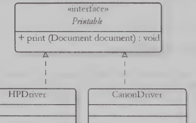

图 10.1：类图中的一个接口和两个实现类

在类图中，接口的形状与类相同，但名称是斜体打印的，并带有 `<<interface>>` 前缀。`HPDriver` 和 `CanonDriver` 类是实现 `Printable` 接口的类。实现方式显然是不同的。在 `HPDriver` 类中，`print` 方法包含了允许打印到 HP 打印机的代码。在 `CanonDriver` 中，代码允许打印到佳能驱动程序。在 UML 类图中，类和接口通过一条带有箭头的虚线连接。这种关系通常被称为“实现”（realization），因为类通过接口提供了该抽象的真实实现（实际运行的代码）。

> **笔记**
> 这个案例研究是人为设计的，但问题和解决方案是真实的。我希望这让你对接口的本质有更多的理解。它是一个契约。

## 从技术角度看接口

现在你已经理解接口是什么，让我们来看如何创建一个。在 Java 中，接口和类一样也是一种类型。按照此格式编写接口：

```java
accessModifier interface interfaceName {

}
```

像类一样，接口有公共（`public`）或默认（`default`）访问级别。接口可以有字段和方法。接口的所有成员都是隐式的公共。代码列表 10.1 显示了一个名为 `Printable` 的接口。

### 代码列表 10.1：Printable 接口

```java
package app10;
public interface Printable {
  void print(Object o);
}
```

`Printable` 接口有一个方法 `print`。注意，尽管你在方法声明中可以自由不使用 `public` 关键字，但 `print` 仍然是公共，只不过它是多余的。

就像类一样，接口是创建对象的模板。然而，与普通类不同，接口不能被实例化。它仅仅定义了一组 Java 类可以实现的方法。

你像编译类一样编译接口。编译器会为每个成功编译的接口创建一个 `.class` 文件。

要实现接口，你在类声明后使用 `implements` 关键字。一个类可以实现多个接口。例如，代码列表 10.2 显示了实现 `Printable` 的 `CanonDriver` 类。


### 代码列表 10.2：Printable 接口的实现

```java
package app10;
public class CanonDriver implements Printable {
  @Override
  public void print(Object obj) {
    // 执行打印的代码
  }
}
```

注意，方法的实现也应该用 `@Override` 注解。除非另有说明，所有接口都是抽象的。实现类必须重写接口中的所有抽象方法。接口与其实现类之间的关系可以类比为父类和子类。接口的实例也是接口的实例。例如，以下结果为真：

```java
CanonDriver driver = new CanonDriver();
if (driver instanceof Printable) // 为真
```

某些接口既没有字段也没有方法，被称为标记接口（marker interfaces）。类实现它们作为标记。例如，`java.io.Serializable` 接口没有字段也没有方法。类实现它以便其实例可以序列化，即保存到文件或内存中。你将在第 16 章“输入输出”中学习更多关于 `Serializable` 的知识。

### 接口中的字段

接口中的字段必须初始化，并且隐式为 `public`、`static` 和 `final`。然而，你可以冗余地使用修饰符 `public static final`。这些代码的效果相同：

```java
public int STATUS = 1;
int STATUS = 1;
public static final STATUS = 1;
```

注意按照习惯接口中的字段名全大写。

接口中定义两个同名的字段会导致编译错误。然而，接口可能会从其父接口继承多个同名的字段。

### 抽象方法

你在接口中声明抽象方法就像在类中声明方法一样。然而，接口中的抽象方法没有体，立即以分号结束。所有抽象方法都是隐式的公共和抽象的，尽管在方法声明前面加上 `public` 和 `abstract` 修饰符是合法的。

接口抽象方法的语法是：

```java
[methodModifiers] ReturnType MethodName(ListOfArgument)
[ThrowClause];
```

其中 `methodModifiers` 是 `abstract` 和 `public`。

### 扩展接口

接口支持继承。接口可以扩展另一个接口。如果接口 A 扩展 B，则 A 被称为 B 的子接口。B 是 A 的父接口。因为 A 直接扩展 B，所以 B 是 A 的直接父接口。任何扩展 B 的接口都是 A 的间接子接口。图 10.2 显示了一个扩展另一个接口的接口。注意连接两个接口的线条类型与扩展类的类型相同。

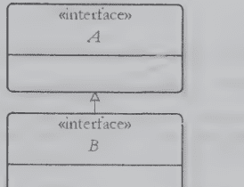

**图 10.2：扩展接口**

扩展接口的目的是什么？为了安全地向接口添加功能，而不破坏现有代码。这是因为一旦接口发布，你无法向其添加新方法。假设 JDK 1.7 中一个虚拟的接口 `XYZ` 是一个拥有数百万实现类的流行接口。现在，Java 的设计者想在 JDK 1.8 的 `XYZ` 中添加一个新方法。如果一个实现了旧版 `XYZ` 并使用预 JDK 1.8 编译器编译的类部署在 JDK 1.8 上（该版本将带有新版本的 `XYZ`），会发生什么？它会崩溃，因为该类没有为新方法提供实现。

安全的方法是提供一个扩展 `XYZ` 的新接口，这样旧软件仍然可以运行，而新应用程序可以选择实现扩展接口 `XYZ`。

### 默认方法

扩展接口是向接口添加功能的安全方式。然而，你最终会得到两个功能类似的接口。如果你只需要扩展一个或两个接口，这是可以接受的。如果你需要向数百个接口添加功能，这就变成了一个严重的问题。

这正是 Java 语言设计者在尝试为 Java 8 添加 lambda 表达式并为 Collection 框架中的几十个接口提供 lambda 支持时所面临的问题。扩展所有接口将使接口数量翻倍，并可能导致诸如 `List2` 或 `ExtendedSet` 这样糟糕的名字。

相反，他们选择了添加默认方法。换句话说，从 JDK 1.8 开始，接口可以拥有默认方法。

接口中的默认方法是有实现的方法。实现接口的类没有强制实现默认方法，这意味着你可以向接口添加新方法而不破坏向后兼容性。

要使接口中的方法成为默认方法，请在方法签名前添加 `default` 关键字。此外，不要用分号结束签名，而是添加一对括号，并在括号内编写代码。这里有一个示例：

```java
default java.lang.String getDescription() {
    return "This is a default method";
}
```

正如你稍后将学到的，JDK 1.8 中的许多 Java 接口现在都有默认方法。

在扩展带有默认方法的接口时，你有这些选项：

- 忽略默认方法，实际上是继承了它们，
- 重新声明默认方法，使其成为抽象方法，
- 重写默认方法。

记住，Java 现在支持默认方法的主要原因是为了向后兼容性。绝不应该在没有类的情况下编写程序。

### 静态方法

类中的静态方法由该类的所有实例共享。在 Java 8 及更高版本中，接口中有了静态方法，这样与接口相关的所有静态方法都可以写在接口中，而不是辅助类中。

静态方法的签名与默认方法相似。然而，你不再使用 `default` 关键字，而是使用 `static` 关键字。接口中的静态方法默认是公共的。

接口中的静态方法非常罕见。在 `java.util` 包中近乎 30 个接口中，只有两个包含 `static`。

### 基类

某些接口有许多抽象方法，实现类必须重写这些方法。如果你只需要其中一些方法，这可能是一项乏味的任务。由于这个原因，你可以生成一个通用实现类，该类重写了接口中带有默认方法的抽象方法。实现类可以扩展这个通用类，并重写它想要更改的所有抽象方法。这种通用类通常被称为基类，因为它非常有用，可以帮助你更快地编写代码。

例如，`javax.servlet.Servlet` 接口是所有 servlet 类必须实现的接口。该接口有五个方法：`init`、`service`、`destroy`、`getServletConfig`、`getServletInfo`。在这五个方法中，`service` 方法始终由 servlet 类实现。`init` 方法偶尔被实现，但很少被使用。尽管如此，所有实现类都必须为这五个方法提供实现。对于 servlet 程序员来说，这将是一件苦差。

为了让 servlet 编程变得更容易且有趣，Servlet API 定义了接口中所有方法的实现。当你写一个实现 servlet 的类时，与其实现 `javax.servlet.Servlet` 接口（并最终实现五个方法），不如扩展 `javax.servlet.GenericServlet`，并仅为你需要使用的方法提供实现（很可能仅需要 `service` 方法）。

比较列表 10.3 中实现 `javax.servlet.Servlet` 的 `TediousServlet` 类和列表 10.4 中扩展 `javax.servlet.GenericServlet` 的类。哪一个更简单？

### 列表 10.3：TediousServlet 类

```java
package test;
import java.io.IOException;
import javax.servlet.Servlet;
import javax.servlet.ServletConfig;
import javax.servlet.ServletException;
import javax.servlet.ServletRequest;
import javax.servlet.ServletResponse;

public class TediousServlet implements Servlet {
    @Override
    public void init(ServletConfig config)
        throws ServletException {
    }

    @Override
    public void service(ServletRequest request,
        ServletResponse response)
        throws ServletException, IOException {
    }

    @Override
    public void destroy() {
    }

    @Override
    public ServletConfig getServletConfig() {
        return null;
    }

    @Override
    public String getServletInfo() {
        return null;
    }
}
```

### 列表 10.4：FunServlet 类

```java
package test;
import java.io.IOException;
import javax.servlet.GenericServlet;
import javax.servlet.ServletException;
import javax.servlet.ServletRequest;
import javax.servlet.ServletResponse;

public class FunServlet extends GenericServlet {
    @Override
    public void service(ServletRequest request,
        ServletResponse response)
        throws ServletException, IOException {
    }
}
```

使用接口，你必须编写一个执行实际操作的实现类。如果接口中有许多抽象方法，你就会面临浪费时间去重写你不使用的方法的风险。抽象类的作用与接口类似，即在服务提供者和客户端之间提供一种契约，但同时抽象类可以提供部分实现。方法必须显式声明为抽象的。

将一个类声明为抽象类是告诉用户你希望他们扩展该类的方法。即使一个类没有抽象方法，也可以将其声明为抽象类。

在 UML 图中，抽象类与具体类相似，区别在于它的名称是斜体的。图 10.3 显示了一个抽象类。

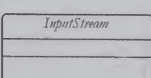

**图 10.3：一个抽象类**

## 总结

接口在 Java 中起着重要作用，因为它在服务提供与其客户端之间定义了契约。本章向你展示了如何使用接口。基类提供了接口的通用实现，通过提供代码的默认实现来加速程序的开发。

抽象类类似于接口，但它可以提供某些方法的实现。

## 测验

1. 为什么将接口视为契约比将其视为没有实现的类更合适呢？
2. 什么是基类？
3. 什么是抽象类？
4. 基类等同于抽象类吗？
5. 在 `com.example` 中创建一个名为 `Calculator` 的接口，包含三个方法：`add`、`subtract` 和 `multiply`。所有方法都接受两个 `int` 参数并返回一个 `long`。
6. 编写一个名为 `ScientificCalculator` 的 `Calculator` 实现类并实现所有方法。

# 第 11 章：多态

多态对于面向对象编程（OOP）的初学者来说是最难解释的概念。事实上，大多数时候，如果没有一两个例子，它的定义是不通的。好了，尝试一下。这里是许多编程书中的定义：

多态是一种 OOP 特性，它允许对象在接收到方法调用时决定调用哪种方法实现。如果你觉得这很难理解，你并不孤单。用简单的语言来解释它很困难，但这并不意味着这个概念很难理解。

本章从一个简单的示例开始，这个示例应该让多态变得一目了然。随后，将通过另一个示例来演示如何结合反射使用多态。

## 概述

在 Java 和其他 OOP 语言中，如果满足特定条件，为引用变量赋值一个与变量类型不同的对象是合法的。从本质上讲，如果你有一个类型为 A 的引用变量 `a`，赋值一个类型为 B 的对象是合法的，如下：

```java
A a = new B();
```

前提是满足以下条件之一：

- A 是一个类，且 B 是 A 的子类。
- A 是一个接口，且 B 或其某个父类实现了 A。

正如你在第 7 章中所学的“继承”，当你在代码中为 `a` 赋值一个 B 的实例时，`a` 的类型是 A。这意味着你不能调用 B 中未在 A 中定义方法。然而，如果你打印 `a.getClass().getName()` 的值，你将得到 "B" 而不是 "A"。这意味着什么？在编译时，`a` 的类型是 A，编译器不允许你调用 B 中未在 A 中定义的方法。另一方面，在运行时，`a` 的类型是 B，由 `a.getClass().getName()` 的返回值证明了这一点。

现在多态的本质就在这里。如果 B 重写了 A 中的某个方法（例如，一个名为 `play` 的方法），调用 `a.play()` 将导致调用 B 中的 `play` 实现（而不是 A 中的）。多态允许对象（此示例中由 `a` 引用的对象）在调用方法时决定选择哪种方法实现（是 A 中的还是 B 中的）。多态规定运行时对象中的实现被调用。但是，多态并没有止于此。

如果你调用 `a` 中的另一个方法（例如，一个名为 `stop` 的方法）而该方法在 B 中没有实现会怎样？JVM 足够智能这一点并查看 B 的继承层次结构。B 确实是 A 的子类，或者如果 A 是一个接口，则是实现 A 的子类。否则，代码将无法编译。找到后，JVM 将向上爬到类层次并找到 `stop` 的实现并运行。

现在，多态的定义更有意义了。多态是一种 OOP 特性，它允许对象在接收到方法调用时决定调用哪种方法实现。

技术上来说，Java 是如何实现这一点的？事实证明，Java 编译器在遇到如 `a.play()` 的方法调用时，会检查引用的类/接口是否定义了此类方法（一个 `play` 方法）以及是否向方法传递了正确的参数集。但，编译器仅到此为止。除了静态方法和 `final` 方法外，它不会将方法调用与方法体连接（或绑定）。JVM 在运行时决定如何将方法调用与方法体绑定。换句话说，除了静态和 `final` 方法外，Java 中的方法绑定发生在运行时，而不是编译时。运行时绑定也被称为晚绑定或动态绑定。反面是早绑定，它发生在编译时或链接时。早绑定发生在其他语言中，如 C。

因此，多态是通过 Java 中的晚绑定机制实现的。正因如此，多态在其他语言中也被相当不准确地称为晚绑定、动态绑定或运行时绑定。

考虑列表 11.1 中的 Java 代码。

### 列表 11.1：多态的示例

```java
package applli;
class Employee {
    public void work() {
        System.out.println("I am an employee.");
    }
}

class Manager extends Employee {
    public void work() {
        System.out.println("I am a manager.");
    }
}

class PolymorphismDemo {
    public static void main(String[] args) {
        Employee employee = new Manager();
        employee.work();
    }
}
```

## 动态中的多态

假设你有一个定义了 `greet` 方法的 `Greet` 接口。这个简单的接口在列表 11.2 中。

### 列表 11.2：Greet 接口

```java
package app1;
public interface Greet {
    public void greet();
}
```

`Greet` 接口可以实现以不同的语言打印问候。例如，列表 11.3 中的 `EnglishGreeting` 类和列表 11.4 中的 `FrenchGreeting` 类分别用英语和法语进行问候。

### 列表 11.3：EnglishGreeting 类

```java
package app1;
public class EnglishGreeting implements Greet {
    @Override
    public void greet() {
        System.out.println("Good Day!");
    }
}
```

### 列表 11.4：FrenchGreeting 类

```java
package app1;
public class FrenchGreeting implements Greet {
    @Override
    public void greet() {
        System.out.println("Bonjour!");
    }
}
```


# 列表 11.5 中的 `PolymorphismDemo2` 类展示了多态的应用

它询问用户想用什么语言问候。如果用户选择英语，则实例化 `EnglishGreeting` 类。如果选择法语，则实例化 `FrenchGreeting`。这就是多态，因为要实例化的类只有在运行时用户输入选择后才知道。

## 列表 11.5：PolymorphismDemo2 类

```java
package app1;
import java.util.Scanner;
public class PolymorphismDemo2 {
    public static void main(String[] args) {
        Scanner scanner = new Scanner(System.in);
        System.out.print("Choose a language (1 代表英语，2 代表法语）： ");
        int choice = scanner.nextInt();
        Greet employee;
        if (choice == 1) {
            employee = new EnglishGreeting();
        } else if (choice == 2) {
            employee = new FrenchGreeting();
        }
        employee.greet();
    }
}
```

## 第 11 章：多态 157

```java
public static void main(String[] args) {
    String instruction = "What is your chosen language?" +
    "\nType 'English' or 'French'.";
    Greeting greeting = null;
    Scanner scanner = new Scanner(System.in);
    System.out.println(instruction);
    while (true) {
        String input = scanner.next();
        if (input.equalsIgnoreCase("english")) {
            greeting = new EnglishGreeting();
            break;
        } else if (input.equalsIgnoreCase("french")) {
            greeting = new FrenchGreeting();
            break;
        } else {
            System.out.println(instruction);
        }
    }
    scanner.close();
    greeting.greet();
}
```

## 多态与反射

多态通常与反射一起使用。考虑以下场景。

Order Processing 应用程序是一个处理购买订单的业务应用程序。它将订单存储在各种数据库（Oracle、MySQL 等）中，并检索订单进行显示。`Order` 类表示购买订单。订单存储在数据库中，一个 `OrderAccessObject` 对象处理 `Order` 对象的存储和检索。

`OrderAccessObject` 类充当应用程序与数据库之间的接口。所有的购买订单操作都通过该类的实例完成。代码列表 11.6 给出了 `OrderAccessObject` 接口。

## 代码列表 11.6：OrderAccessObject 接口

```java
public interface OrderAccessObject {
    public void addOrder(Order order);
    public void getOrderId(int orderId);
}
```

`OrderAccessObject` 接口需要一个实现类，来为其中的两个方法提供代码。每个 `OrderAccessObject` 对应一种特定类型的数据库，可能有许多实现类。例如，连接到 Oracle 数据库的实现类是 `OracleOrderAccessObject` 类，而用于 MySQL 的实现类是 `MySQLOrderAccessObject` 类。图 11.1 显示了 `OrderAccessObject` 及其实现类的 UML 图。

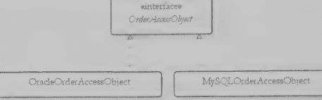

图 11.1：OrderAccessObject 接口及其实现类

需要多个实现类的原因是，每个数据库可能都有执行某些功能的特定命令。例如，自增数字在 MySQL 中很常见，但在 Oracle 中并不存在。

Order Processing 应用程序需要足够的灵活性，以便在不重新编译的情况下与不同的数据库工作。它还应该能够在未来在不重新编译的情况下添加对新数据库的支持。事实上，你只需要在调用应用程序时指定 `OrderAccessObject` 的实现类即可。例如，要使用 Order 数据库，你指定：

```bash
java OrderProcessing com.example.OracleOrderObject
```

而要与 MySQL 工作，你使用此命令调用它：

```bash
java OrderProcessing com.example.MySQLOrderAccessObject
```

现在，这里是在数据库中实例化 `OrderAccessObject` 的代码部分：

```java
public static void main(String[] args) {
    OrderAccessObject accessObject = null;
    Class klass = null;
    try {
        klass = Class.forName(args[0]);
        accessObject = (OrderAccessObject) klass.newInstance();
    } catch (ClassNotFoundException e) {
    } catch (Exception e) {
    }

    // 在此处继续
}
```

这就是多态，因为 `accessObject` 引用变量每次都可以分配不同的对象类型。

## 注意事项

`forName` 和 `newInstance` 方法在第 5 章“核心类”中的“java.lang.Class”节中进行了解释。

## 总结

多态是面向对象编程的几大支柱之一。在编译时未知对象类型的情况下它非常有用。本章通过几个示例演示了多态。

## 测验

- 1. 请用自己的语言描述多态。
- 2. 多态在什么情况下最有用？

# 第 12 章 枚举 (Enums)

在第 2 章“语言基础”中，你学习了有时使用 `static final` 字段作为枚举值。Java 5 增加了一个新类型 `enum` 用于枚举值。我们将在本章中学习如何创建和使用枚举。

## 概述

你使用枚举（enum）为字段或方法创建一组有效值。例如，在一个典型的应用程序中，客户类型的可能值只有 `Individual`（个人）或 `Organization`（机构）。对于 `State`（州）字段，有效值可能是所有美国州、加拿大省，可能还有其他一些。通过枚举，你可以轻松地限制程序只取其中一个值。

枚举类型可以独立存在，也可以是类的一部分。如果你让它独立存在，需要在应用程序的多个地方引用它。如果它在类内部，那么作为类的一部分更好。

例如，考虑代码列表 12.1 中的 `CustomerType` 枚举定义。

### 代码列表 12.1：CustomerType 枚举

```java
package app1;
public enum CustomerType {
    INDIVIDUAL,
    ORGANIZATION
}
```

`CustomerType` 枚举有两个枚举值：`INDIVIDUAL` 和 `ORGANIZATION`。枚举值对大小敏感，按照惯例大大写。两个值用逗号分隔，值可以写在单行或多行上。


# 第 12 章：枚举

## 概述

你使用枚举为字段或方法创建一组有效值。例如，在一个典型的应用程序中，客户类型的唯一可能值是 `Individual`（个人）或 `Organization`（机构）。对于 `State`（州）字段，有效值可能是所有美国州、加拿大省，可能还有其他一些。通过枚举，你可以轻松地限制程序只取其中一个值。

枚举类型可以独立存在，也可以是类的一部分。如果你让它独立存在，需要在应用程序的多个地方引用它。如果它在类内部，那么作为类的一部分更好。

例如，考虑代码列表 12.1 中的 `CustomerType` 枚举定义。

### 代码列表 12.1：CustomerType 枚举

```java
package app1;
public enum CustomerType {
    INDIVIDUAL,
    ORGANIZATION
}
```

`CustomerType` 枚举有两个枚举值：`INDIVIDUAL` 和 `ORGANIZATION`。枚举值对大小写敏感，按照惯例全大写。两个值用逗号分隔，值可以写在单行或多行上。

在第二章“语言基础”中，你学习了有时使用 `static final` 字段作为枚举值。Java 5 增加了一个新类型 `enum` 用于枚举值。我们将在本章中学习如何创建和使用枚举。

## 迭代枚举值

你可以使用 for 循环（在第 3 章“语句”中讨论过）迭代枚举中的值。你首先需要调用 `values()` 方法，该方法返回一个包含指定枚举所有值的数组。使用代码列表 12.1 中的枚举，你可以使用以下代码来遍历它：

```java
for (CustomerType customerType : CustomerType.values()) {
    System.out.println(customerType);
}
```

这将打印 `CustomerType` 中的所有值，从第一个值开始。结果如下：

- INDIVIDUAL
- ORGANIZATION

## 对枚举进行 switch 操作

`switch` 语句也可以用于枚举值。以下是一个使用列表 12.1 中的 `CustomerType` 枚举和列表 12.2 中的 `Customer` 类的示例：

```java
Customer customer = new Customer();
customer.customer = CustomerType.INDIVIDUAL;

switch (customer.customer) {
    case INDIVIDUAL:
        System.out.println("Customer Type: Individual");
        break;
    case ORGANIZATION:
        System.out.println("Customer Type: Organization");
        break;
}
```

请注意，你不能在每个 `case` 前加上枚举类型的前缀。以下代码将导致编译错误：

```java
case CustomerType.INDIVIDUAL:
    //
case CustomerType.ORGANIZATION:
    //
```

## 枚举成员

由于枚举在技术上是一个类，因此枚举可以拥有构造函数和方法。如果它有构造函数，它们的访问级别必须是私有的（`private`）或默认的。如果枚举定义中包含常量以外的内容，则必须在任何其他成员之前定义常量，且最后一个常量必须以分号结束。

例如，列表 12.3 中的 `Weekend` 枚举包含一个私有构造函数、一个 `toString` 方法和一个用于测试的静态 `main` 方法。

### 列表 12.3：Weekend 枚举

```java
package app12;

public enum Weekend {
    SATURDAY,
    SUNDAY;

    private Weekend() {
    }

    @Override
    public String toString() {
        return "Fun day " + (this.ordinal() + 1);
    }

    public static void main(String[] args) {
        System.out.println(Weekend.SATURDAY.getClass().getName());
        for (Weekend w : Weekend.values()) {
            System.out.println(w.name() + ": " + w);
        }
    }
}
```

如果你运行这个枚举，它将在控制台上打印以下内容：

```
app12.Weekend
SATURDAY: Fun day 1
SUNDAY: Fun day 2
```

你可以向构造函数传递值，在这种情况下，常量必须带有构造函数的参数。作为另一个例子，列表 12.4 显示了 `FuelEfficiency` 枚举，其构造函数接受两个 `int` 参数，即最小 MPG（每加仑英里）和最大 MPG。这些值被赋值给私有字段 `min` 和 `max`。常量 `EFFICIENT`、`ACCEPTABLE` 和 `GAS_GUZZLER` 都带有两个传递给构造函数的 `int`。`getMin` 和 `getMax` 方法返回最小和最大的 MPG。

### 列表 12.4：FuelEfficiency 枚举

```java
package com.example;

public enum FuelEfficiency {
    EFFICIENT(33, 55),
    ACCEPTABLE(20, 32),
    GAS_GUZZLER(1, 19);

    private int min;
    private int max;

    FuelEfficiency(int min, int max) {
        this.min = min;
        this.max = max;
    }

    public int getMin() {
        return this.min;
    }

    public int getMax() {
        return this.max;
    }
}
```

查看练习题获取使用枚举的示例。

## 总结

Java 支持枚举，它是 `java.lang.Enum` 子类的特殊类。与 `static final` 相比，更倾向枚举因为它更安全。你可以对枚举进行 `switch` 操作，并通过增强型 for 循环中的 `values()` 方法遍历它的值。

## 练习题

1. 如何编写一个枚举？
2. 为什么枚举比 `static final` 字段安全？
3. 编写一个抽象 `Car` 类，它包含两个字段：`name`（`String` 类型）和 `fuelEfficiency`（`FuelEfficiency` 类型，见列表 12.4），以及计算给定距离（英里）内最小和最大耗油量的方法。接下来，编写三个子类：`EfficientCar`、`AcceptableCar` 和 `GasGuzzler`。每个子类的构造函数接受一个名称并设置 `fuelEfficiency` 字段。最后，编写一个类来测试它。

# 第 13 章：处理日期和时间


从 Java 1.0 版本起就有了日期和时间的支持，主要通过 `java.util.Date` 类。然而，`Date` 的设计非常糟糕。例如，`Date` 中的月份从 0 开始，但日期从 1 开始。它的许多方法在 JDK 1.1 中被弃用，同时 `java.util.Calendar` 被引入以接管 `Date` 的功能。这对组合在 JDK 1.7 之前一直是处理日期和时间的主要类，尽管它们被认为不完善且不利于操作，导致许多人转向诸如 Joda Time (http://joda.org/) 这样的第三方替代方案。JDK 1.8 中新的日期和时间 API 解决了旧 API 中的许多问题，并与 Joda Time API 相似。

本章主要涵盖 JDK 1.8 日期-时间 API。

## 概述

新的日期和时间 API 使日期变得极其简单。此外，还有其他四个包：`java.time.chrono`、`java.time.format`、`java.time.temporal` 和 `java.time.zone`。

处理日期和时间经常涉及解析和格式化。日期和时间 API 通过在其主要类中提供 `parse` 和 `format` 方法解决了这两个问题。此外，`java.time.format` 包含一个用于格式化日期时间的 `DateTimeFormatter` 类。

`LocalDate` 类模型没有时间部分的日期。它也没有时区。表 13.1 显示了 `LocalDate` 的一些重要方法。

`Instant` 对象代表时间线上的点。参考点是标准的 Java 元，即 1970-01-01T00:00:00Z（1970年1月1日 GMT）。`Instant` 类的 `EPOCH` 字段返回表示 Java 元 `Instant`。元之后的值为正，之前的值为负。

静态方法 `now` 返回代表当前时间的 `Instant` 对象：

```java
Instant now = Instant.now();
```

`getEpochSecond` 方法返回自元以来经过的秒数。`getNano` 方法返回自上一秒开始的纳秒数。

`Instant` 类的一个流行用途是为操作计时，如列表 13.1 所示。

### 列表 13.1：使用 Instant 为操作计时

```java
package app13;
import java.time.Duration;
import java.time.Instant;

public class InstantDemo {
    public static void main(String[] args) {
        Instant start = Instant.now();
        // 在此处执行操作
        Instant end = Instant.now();
        System.out.println(Duration.between(start, end).toMillis());
    }
}
```

如列表 13.1 所示，`Duration` 类用于返回 `Instant` 之间的差异。你将在本章后面学习更多关于 `Duration` 的知识。

`ZonedDateTime` 模型是带时区的日期时间。例如，你可以使用该类计算两个机场之间的飞行。`Period` 适用于仅关注天月数的情况，例如计算年龄。

`java.time` 包还包含两个枚举：`DayOfWeek` 和 `Month`。

`DayOfWeek` 代表星期几，从周一到周日。`Month` 枚举代表年的十二个月，从一月到十二月。

### 表 13.1：LocalDate 更重要的方法

| 方法 | 描述 |
| --- | --- |
| `now()` | 返回今天日期的静态方法。 |
| `of(int year, int month, int dayOfMonth)` | 根据指定的年、月、日创建 `LocalDate` 的静态方法。 |
| `getDayOfMonth()`, `getMonthValue()`, `getYear()` | 以 `int` 形式返回此 `LocalDate` 的天、月或年。 |
| `getMonth()` | 以 `Month` 枚举常量返回此 `LocalDate` 的月份。 |
| `plusDays()`, `minusDays()` | 在此 `LocalDate` 上增加或减去天数。 |
| `plusWeeks()`, `minusWeeks()` | 在此 `LocalDate` 上增加或减去周数。 |
| `plusMonths()`, `minusMonths()` | 在此 `LocalDate` 上增加或减去月份。 |
| `plusYears()`, `minusYears()` | 在此 `LocalDate` 上增加或减去年份。 |
| `isLeapYear()` | 检查此 `LocalDate` 指定的年份是否为闰年。 |
| `isBefore()`, `isAfter()` | 检查此 `LocalDate` 是否在给定日期之前或之后。 |
| `lengthOfMonth()` | 返回此 `LocalDate` 所在月份的天数。 |
| `withDayOfMonth()` | 返回此 `LocalDate` 的副本，并将一个月中的日期设置为给定值。 |
| `withMonth()` | 返回此 `LocalDate` 的副本，并将月份设置为给定值。 |
| `withYear()` | 返回此 `LocalDate` 的副本，并将年份设置为给定值。 |

`LocalDate` 提供了各种方法来创建日期。例如，要创建一个表示今天日期的 `LocalDate`，使用 `now` 静态方法：

```java
LocalDate today = LocalDate.now();
```

要创建一个表示特定年、月、日的 `LocalDate`，请使用 `of` 方法（该方法也是静态的）。例如，以下代码段创建了一个表示 2015 年 12 月 31 日的 `LocalDate`。

```java
LocalDate endDate = LocalDate.of(2015, 12, 31);
```

`of` 方法有另一个重载版本，接受 `java.time.Month` 枚举的常量。例如，这里使用第二个重载方法构造相同日期的代码。

```java
LocalDate endDate = LocalDate.of(2015, Month.DECEMBER, 31);
```

此外还有用于获取 `LocalDate` 的天、月或年的方法，例如 `getDayOfMonth()`、`getMonth()`、`getMonthValue()` 和 `getYear()`。它们不接受任何参数并返回一个 `int` 或 `Month` 常量。此外，还有一个 `get` 方法接受 `TemporalField` 并返回此 `LocalDate` 的部分。例如，使用 `ChronoField.YEAR` 来获取 `LocalDate` 的年份组件。

```java
int year = today.get(ChronoField.YEAR);
```

`ChronoField` 是实现 `TemporalField` 接口的枚举，因此你可以将 `ChronoField` 传递给 `TemporalField`，`ChronoField` 属于 `java.time.temporal` 包。然而，`ChronoField` 中的并非所有常量都可以传递给 `get`，因为并不是它们都受到支持。例如，传递 `ChronoField.SECOND_OF_DAY` 会抛出异常。因此，与其使用 `get`，不如使用 `getMonth()`、`getYear()` 或类似的方法来获取 `LocalDate` 的组件。

此外，还有用于复制 `LocalDate` 的方法，如 `plusDays()`、`plusYears()`、`minusMonths()` 等。例如，要获取表示明天的 `LocalDate`，你可以创建一个表示今天的 `LocalDate`，然后调用它的 `plusDays()` 方法。

```java
LocalDate tomorrow = LocalDate.now().plusDays(1);
```

要获取表示昨天的 `LocalDate`，可以使用 `minusDays()` 方法。

```java
LocalDate yesterday = LocalDate.now().minusDays(1);
```

此外，还有 `plus` 和 `minus` 方法以更通用的方式获取 `LocalDate` 的副本。两者都接受一个 `long` 和一个 `TemporalUnit`。这些方法的签名如下：

```java
public LocalDate plus(long amountToAdd, java.time.temporal.TemporalUnit unit);
public LocalDate minus(long amountToSubtract, java.time.temporal.TemporalUnit unit);
```

例如，要获取表示今天恰好二十年前的过去的 `LocalDate`，可以使用此代码：

```java
LocalDate pastDate = LocalDate.now().minus(2, ChronoUnit.DECADES);
```

`ChronoUnit` 是实现 `TemporalUnit` 的枚举，因此你可以将 `ChronoUnit` 常量传递给 `plus` 或 `minus` 方法。

> `LocalDate` 是不可变的，因此无法更改。任何返回 `LocalDate` 的方法都会返回一个 `LocalDate` 的新实例。

列表 13.2 显示了 `LocalDate` 的示例。

### 列表 13.2：LocalDate 示例

```java
package app1;
import java.time.LocalDate;
import java.time.temporal.ChronoField;
import java.time.temporal.ChronoUnit;

public class LocalDateDemo {
    public static void main(String[] args) {
        LocalDate today = LocalDate.now();
        LocalDate tomorrow = today.plusDays(1);
        LocalDate oneDecadeAgo = today.minus(1, ChronoUnit.DECADES);
        System.out.println("Day of month: " + today.getDayOfMonth());
        System.out.println("Today is " + today);
        System.out.println("Tomorrow is " + tomorrow);
        System.out.println("A decade ago was " + oneDecadeAgo);
        System.out.println("Year : " + today.getYear());
    }
}
```

## Period

`Period` 类模拟基于日期的时间，例如天、周和年。它的重要方法在表 13.2 中。

### 表 13.2：Period 重要方法

| 方法 | 描述 |
| --- | --- |
| `between()`, `of()`, `ofWeeks()`, `ofMonths()`, `ofYears()` | 根据两个 `LocalDate` 创建 `Period`。 |
| `getDays()`, `getMonths()`, `getYears()` | 以 `int` 形式返回此 `Period` 的天、月或年。 |
| `isNegative()` | 如果任何组件为负，则返回 `true`。 |
| `isZero()` | 如果所有组件为零，则返回 `true`。 |
| `plusDays()`, `minusDays()` | 在此 `Period` 上增加或减去天数。 |
| `plusMonths()`, `minusMonths()` | 在此 `Period` 上增加或减去月份。 |
| `plusYears()`, `minusYears()` | 在此 `Period` 上增加或减去年份。 |
| `withDays()`, `withMonths()`, `withYears()` | 返回此 `Period` 的副本，并将天、月、年设置为给定值。 |

创建 `Period` 是很容易的，得益于静态方法 `between()`、`ofWeeks()`/`ofMonths()`/`ofYears()`。例如，这里是表示两周的 `Period`。

```java
Period twoWeeks = Period.ofWeeks(2);
```

要创建一个表示一年、两个月和三天的 `Period`，使用 `of()` 方法。

```java
Period p = Period.of(1, 2, 3);
```

获取 `Period` 的年/月/日组件，调用其 `getYears()`、`getMonths()`、`getDays()` 方法。例如，下面的 `howManyDays` 变量值为 14。

```java
int howManyDays = twoWeeks.getDays();
```

最后，你可以使用 `plusXXX()` 或 `minusXXX()` 以及 `withXXX()` 方法创建 `Period` 的副本。`Period` 是不可变的，因此这些方法返回新实例。

作为一个示例，列表 13.3 中的代码显示了一个计算年龄的计算器。它从两个 `LocalDate` 创建 `Period` 并调用它的 `getDays()`、`getMonths()` 和 `getYears()` 方法。

### 列表 13.3：使用 Period

```java
package app1;
import java.time.LocalDate;
import java.time.Period;

public class PeriodDemo {
    public static void main(String[] args) {
        LocalDate dateA = LocalDate.of(1978, 8, 26);
        LocalDate dateB = LocalDate.of(1988, 9, 28);
        Period period = Period.between(dateA, dateB);
        System.out.printf("Between %s and %s\n" + " there are %d years, %d months\n" + " and %d days", dateA, dateB, period.getYears(), period.getMonths(), period.getDays());
    }
}
```

运行时，列表 13.3 中的 `PeriodDemo` 类将打印此字符串。

```
Between 1978-08-26 and 1988-09-28
 there are 10 years, 1 months
 and 2 days
```

## LocalDateTime

`LocalDateTime` 类模拟不带时区的日期时间。表 13.3 显示了 `LocalDateTime` 中一些重要的方法。这些方法与 `LocalDate` 的方法相似，但增加了用于修改时间组件的方法，如 `plusHours()`、`plusMinutes()` 和 `plusSeconds()`，这些在 `LocalDate` 中是不存在的。

`LocalDateTime` 提供了各种静态方法来创建日期时间。`now()` 方法带有三个重载版本并返回当前日期时间。无参数重载版本最容易使用：

```java
LocalDateTime now = LocalDateTime.now();
```

### 表 13.3：LocalDateTime 更重要的方法

| 方法 | 描述 |
| --- | --- |
| `now()` | 返回当前日期和时间的静态方法。 |
| `of(...)` | 静态方法，根据指定的年、月、日、小时、分钟和秒创建一个 `LocalDateTime`。 |
| `getYear()`, `getMonthValue()`, `getDayOfMonth()`, `getHour()`, `getMinute()`, `getSecond()` | 以 `int` 类型返回此 `LocalDateTime` 的年、月、日、小时、分钟或秒。 |
| `plusDays()`, `minusDays()` | 在当前 `LocalDateTime` 上加或减去指定的天数。 |
| `plusWeeks()`, `minusWeeks()` | 在当前 `LocalDateTime` 上加或减去指定的周数。 |
| `plusMonths()`, `minusMonths()` | 在当前 `LocalDateTime` 上加或减去指定的月数。 |
| `plusYears()`, `minusYears()` | 在当前 `LocalDateTime` 上加或减去指定的年数。 |
| `plusHours()`, `minusHours()` | 在当前 `LocalDateTime` 上加或减去指定的小时数。 |
| `plusMinutes()`, `minusMinutes()` | 在当前 `LocalDateTime` 上加或减去指定的分钟数。 |
| `plusSeconds()`, `minusSeconds()` | 在当前 `LocalDateTime` 上加或减去指定的秒数。 |
| `isAfter()`, `isBefore()` | 检查此 `LocalDateTime` 是否在给定日期-时间之后或之前。 |
| `withMonth()`, `withYear()` | 返回一个月份或年份设置为给定值的 `LocalDateTime` 副本。 |
| `withHour()`, `withMinute()`, `withSecond()` | 返回一个小时/分钟/秒设置为给定值的 `LocalDateTime` 副本。 |

要创建一个具有特定日期和时间的 `LocalDateTime`，请使用 `of()` 方法。该方法有多个重载版本，允许你传递日期时间的各个组件，或者传递一个 `LocalDate` 和一个 `LocalTime`。以下是 `of()` 的签名：


```
public static LocalDateTime of(int year, int month, int dayOfMonth, int hour, int minute)
public static LocalDateTime of(int year, Month month, int dayOfMonth, int hour, int minute)
public static LocalDateTime of(LocalDate date, LocalTime time)
```

例如，以下代码段创建了一个表示 2015 年 12 月 31 日早上 8 点的 `LocalDateTime`。

```java
LocalDateTime endOfYear = LocalDateTime.of(2015, 12, 31, 8, 0);
```

你可以使用 `plusXXX` 或 `minusXXX` 方法创建 `LocalDateTime` 的副本。例如，这段代码创建了一个表示明天同一时间的 `LocalDateTime`。

```java
LocalDateTime now = LocalDateTime.now();
LocalDateTime sameTomorrow = now.plusHours(24);
```

## 时区

互联网分配编号机构（IANA）维护着时区数据库，你可以从此网页下载：

http://www.iana.org/time-zones

然而，为了方便查看，你只需访问这个维基百科页面：

http://en.wikipedia.org/wiki/List_of_tz_database_zones

日期和时间 API 同样考虑了时区。抽象类 `ZoneId`（位于 `java.time` 包中）表示时区标识符。它有一个静态方法 `getAvailableZones`，返回所有标识符。代码列表 13.4 显示了如何使用该方法打印所有时区的排序列表。

### 代码列表 13.4：列出所有时区标识符

```java
package app;
import java.time.ZoneId;
import java.util.ArrayList;
import java.util.Collections;
import java.util.List;
import java.util.Set;

public class TimeZoneDemo {
    public static void main(String[] args) {
        Set<String> allZones = ZoneId.getAvailableZones();
        List<String> zoneList = new ArrayList<>(allZones);

        Collections.sort(zoneList);
        for (String zone : zoneList) {
            System.out.println(zone);
        }
        // 或者，你可以使用这行代码来打印
        // 排序后的所有时区标识符
        // ZoneId.getAvailableZones().stream()
        //     forEach(System.out::println);
    }
}
```

`getAvailableZones` 返回一个 `String` 集合。你可以使用 `Collections.sort()` 或更现代地通过其流方法进行排序。你可能用这样的代码来排序时区标识符：

```java
ZoneId.getAvailableZones().stream()
    .sorted()
    .forEach(System.out::println);
```

第 20 章，“流（Streams）”解释了什么是流。

`getAvailableZoneIds` 返回 586 个时区标识符。以下是上述代码中的一些时区标识符：

- Africa/Cairo
- Africa/Johannesburg
- America/Chicago
- America/Los_Angeles
- America/Mexico_City
- America/New_York
- America/Toronto
- Antarctica/South_Pole
- Asia/Hong_Kong
- Asia/Shanghai
- Asia/Tokyo
- Australia/Melbourne
- Australia/Sydney
- Canada/Atlantic
- Europe/Amsterdam
- Europe/London
- Europe/Paris
- US/Central
- US/Eastern
- US/Pacific

## `ZonedDateTime` 类表示带有时区的日期时间。例如，以下是：2015-12-31T10:59:59+01:00

类似于 `LocalDateTime`，`ZonedDateTime` 提供了使用静态方法创建实例。以下代码创建一个默认时区的 `ZonedDateTime`：

```java
ZonedDateTime now = ZonedDateTime.now();
```

`ZonedDateTime` 的另一个重载是：

```java
ZonedDateTime threeDaysLater = ZonedDateTime.now().minusDays(3);
```

| 方法 | 描述 |
| --- | --- |
| now() | 返回当前日期和时间的静态方法。 |
| of | 根据指定的日期时间创建 `ZonedDateTime` 的静态方法。 |
| getYear, getMonthValue, getDayOfMonth, getHour, getMinute, getSecond | 以 `int` 类型返回此 `ZonedDateTime` 的年、月、日、小时、分钟或秒。 |
| plusDays, minusDays | 在当前 `ZonedDateTime` 上加或减去指定的数。 |
| plusWeeks, minusWeeks | 在当前 `ZonedDateTime` 上加或减去指定的周。 |
| plusMonths, minusMonths | 在当前 `ZonedDateTime` 上加或减去指定的月。 |
| plusYears, minusYears | 在当前 `ZonedDateTime` 上加或减去指定的年。 |
| plusHours, minusHours | 在当前 `ZonedDateTime` 上加或减去指定的小时。 |
| plusMinutes, minusMinutes | 在当前 `ZonedDateTime` 上加或减去指定的分钟。 |
| plusSeconds, minusSeconds | 在当前 `ZonedDateTime` 上加或减去指定的秒。 |
| isAfter, isBefore | 检查此 `ZonedDateTime` 是否在给定日期时间之后或之前。 |
| withMonth, withYear | 返回一个月份或年份设置为给定值的 `ZonedDateTime` 副本。 |
| withHour, withMinute, withSecond | 返回一个小时/分钟/秒设置为给定值的 `ZonedDateTime` 副本。 |

表 13.4：ZonedDateTime 更重要的方法

要创建一个具有特定日期时间的 `ZonedDateTime`，请使用 `of` 方法。该方法有多个重载版本，允许你传递日期时间的各个组件，或者传递一个 `LocalDate` 和一个 `LocalTime`。以下是 `of` 的签名：

```
public static ZonedDateTime of(int year, int month, int dayOfMonth, int hour, int minute, ZoneId zone)
public static ZonedDateTime of(int year, Month month, int dayOfMonth, int hour, int minute, ZoneId zone)
public static ZonedDateTime of(LocalDate date, LocalTime time, ZoneId zone)
```

例如，以下代码段创建了一个表示 2015 年 12 月 31 日早上 8 点的 `ZonedDateTime`。

```java
ZonedDateTime endOfYear = ZonedDateTime.of(2015, 12, 31, 8, 0, ZoneId.systemDefault());
```

你可以使用 `plusXXX` 或 `minusXXX` 方法创建 `ZonedDateTime` 的副本。例如，这段代码创建了一个表示明天同一时间的 `ZonedDateTime`。

```java
ZonedDateTime now = ZonedDateTime.now();
ZonedDateTime sameTomorrow = now.plusHours(24);
```

## Duration

`Duration` 类表示时间的持续时间。它与 `Period` 相似，区别在于 `Duration` 有时间组件并考虑了纳秒精度。表 13.5 显示了更重要的方法。

| 方法 | 描述 |
| --- | --- |
| between | 在两个对象（如两个 `LocalDateTime` 或两个 `ZonedDateTime`）之间创建一个 `Duration`。 |
| ofYears, ofMonths, ofWeeks, ofDays, ofHours, ofMinutes, ofSeconds, ofNanos | 创建一个表示指定的年/月/周/日/小时/分钟/纳秒的 `Duration`。 |
| toDays, toHours, toMinutes | 根据指定的数量单位创建一个 `Duration`。以 `int` 类型返回此 `Duration` 的天、小时、分钟数。 |
| isNegative | 如果此 `Duration` 为负，返回 `true`；否则返回 `false`。 |
| isZero | 如果此 `Duration` 长度为零，返回 `true`；否则返回 `false`。 |
| plusDays, minusDays | 在当前 `Duration` 上加或减去指定的数。 |
| plusMonths, minusMonths | 在当前 `Duration` 上加或减去指定的月。 |
| plusYears, minusYears | 在当前 `Duration` 上加或减去指定的年。 |
| withSeconds | 返回一个指定秒数的 `Duration` 副本。 |

表 13.5：Duration 更重要的方法

通过调用其构造函数或静态方法创建 `Duration`。代码列表 13.5 创建了两个 `LocalDateTime` 之间的 `Duration`，即 2015 年 1 月 26 日 11:10 到 2015 年 1 月 26 日 12:40 之间。

### 代码列表 13.5：创建两个 LocalDateTime 之间的 Duration

```java
package app1;
import java.time.Duration;
import java.time.LocalDateTime;

public class DurationDemo1 {
    public static void main(String[] args) {
        LocalDateTime start = LocalDateTime.of(2015, 1, 26, 11, 10);
        LocalDateTime end = LocalDateTime.of(2015, 1, 26, 12, 40);
        Duration duration = Duration.between(start, end);
        System.out.println(duration);
    }
}
```

```java
public static void main(String[] args) {
    LocalDateTime dateTimeA = LocalDateTime
        .of(2015, 1, 26, 8, 10, 0);
    LocalDateTime dateTimeB = LocalDateTime
        .of(2015, 1, 26, 11, 40, 0);
    Duration duration = Duration.between(
        dateTimeA, dateTimeB);
    System.out.printf("There are %d hours and %d minutes.%n",
        duration.toHours(),
        duration.toMinutes() % 60);
}
```

运行 `DurationDemo1` 类的结果如下。

```
There are 3 hours and 30 minutes.
```

代码列表 13.6 中的代码创建了两个具有相同日期时间但不同时区的 `ZonedDateTime`。

### 代码列表 13.6：在两个 ZonedDateTime 之间创建 Duration

```java
package app;
import java.time.Duration;
import java.time.LocalDateTime;
import java.time.Month;
import java.time.ZoneId;
import java.time.ZonedDateTime;

public class DurationDemo2 {
    public static void main(String[] args) {
        ZonedDateTime zdt1 = ZonedDateTime.of(
            LocalDateTime.of(2015, Month.JANUARY, 8, 0),
            ZoneId.of("America/Denver"));
        ZonedDateTime zdt2 = ZonedDateTime.of(
            LocalDateTime.of(2015, Month.JANUARY, 8, 0),
            ZoneId.of("America/Toronto"));
        Duration duration = Duration.between(zdt1, zdt2);
        System.out.printf("There are %d hours and %d minutes.%n",
            duration.toHours(),
            duration.toMinutes() % 60);
    }
}
```

运行 `DurationDemo2` 类会在控制台上打印此内容。

```
There are -2 hours and 0 minutes.
```

这是预期的，因为 `America/Denver` 和 `America/Toronto` 时区之间存在两个小时的差异。

作为一个更复杂的例子，代码列表 13.7 中的代码显示了一个公共汽车时间计算器。它有一个方法 `calculateTravelTime`，它接受一个出发 `ZonedDateTime` 和一个到达 `ZonedDateTime`。代码调用了两次 `calculateTravelTime`。两次，公共汽车都是从科罗拉多州的丹佛在早上 8 点出发，并在多伦多时间第二天早上 8 点到达多伦多。第一辆公共汽车于 2014 年 3 月 8 日出发，第二次出发是 2014 年 3 月 18 日。

在这两种情况下，旅行时间分别是多少呢？

### 代码列表 13.7：旅行时间计算器

```java
package app1;
import java.time.Duration;
import java.time.LocalDateTime;
import java.time.Month;
import java.time.ZoneId;
import java.time.ZonedDateTime;

public class TravelTimeCalculator {
    public Duration calculateTravelTime(
        ZonedDateTime departure, ZonedDateTime arrival) {
            return Duration.between(departure, arrival);
    }
}
```


```java
public static void main(String[] args) {
    TravelTimeCalculator calculator =
        new TravelTimeCalculator();
    ZonedDateTime departure1 = ZonedDateTime.of(
        LocalDateTime.of(2014, Month.MARCH, 8,
        8, 0),
        ZoneId.of("America/Denver"));
    ZonedDateTime arrival1 = ZonedDateTime.of(
        LocalDateTime.of(2014, Month.MARCH, 9,
        8, 0),
        ZoneId.of("America/Toronto"));
    Duration travel1 = calculator
        .calculateTravelTime(departure1, arrival1);
    System.out.println("travel time 1: " +
        + travel1.toHours() + " hours");
}
```

```java
    ZonedDateTime departure2 = ZonedDateTime.of(
        LocalDateTime.of(2014, Month.MARCH, 18,
        8, 0),
        ZoneId.of("America/Denver"));
    ZonedDateTime arrival2 = ZonedDateTime.of(
        LocalDateTime.of(2014, Month.MARCH, 19,
        8, 0),
        ZoneId.of("America/Toronto"));
    Duration travel2 = calculator
        .calculateTravelTime(departure2, arrival2);
    System.out.println("travel time 2: " +
        + travel2.toHours() + " hours");
}
```

结果如下。

Travel time 1: 21 hours

Travel time 2: 22 hours

为什么会有差异？因为在 2014 年，夏令时从 3 月 9 日星期日凌晨 2 点开始。正如你所看到的，在 2014 年 3 月 8 日和 2014 年 3 月 9 日之间，你“丢失”了一个小时。

# 格式化日期时间

你使用 `java.time.format.DateTimeFormatter` 来格式化本地或时区的日期时间。

`LocalDate`、`LocalDateTime` 和 `ZonedDateTime` 类提供具有如下签名的方法。

```java
public java.lang.String format(java.time.format.DateTimeFormatter formatter)
```

显然，要格式化日期或时间，你必须先创建一个 `DateTimeFormatter` 实例。列表 13.8 中的代码使用两个格式化器格式化日期。

# 列表 13.8：格式化日期

```java
package app13;
import java.time.LocalDateTime;
import java.time.format.DateTimeFormatter;
import java.time.format.FormatStyle;

public class DateTimeFormatterDemo {
    public static void main(String[] args) {
        DateTimeFormatter formatter1 = DateTimeFormatter.ofLocalizedDateTime(FormatStyle.MEDIUM);
        LocalDateTime example = LocalDateTime.of(2015, 1, 26, 8, 10, 0);
        System.out.println("Format 1: " + example.format(formatter1));

        DateTimeFormatter formatter2 = DateTimeFormatter.ofLocalizedDateTime(FormatStyle.SHORT);
        System.out.println("Format 2: " + example.format(formatter2));
    }
}
```

结果如下：

Format 1: Jan 26, 2015, 8:10:00 AM

Format 2: 1/26/15, 8:10 AM

# 解析时间

`LocalDateTime` 中有两个方法用于解析。第一个方法需要一个格式化器，第二个不需要。如果字符串无法解析，`parse` 方法将抛出 `DateTimeParseException`。

# 列表 13.9：解析时间

```java
package app1;
import java.time.LocalDateTime;
import java.time.format.DateTimeFormatter;
import java.time.format.DateTimeParseException;
import java.util.Scanner;

public class ParsingDemo {
    public static void main(String[] args) {
        Scanner scanner = new Scanner(System.in);
        DateTimeFormatter formatter = DateTimeFormatter.ofPattern("yyyy-MM-dd HH:mm");
        
        while (true) {
            System.out.println("Enter a date (yyyy-MM-dd HH:mm): ");
            String input = scanner.nextLine();
            try {
                LocalDateTime dateTime = LocalDateTime.parse(input, formatter);
                System.out.println("Parsed DateTime: " + dateTime);
                break;
            } catch (DateTimeParseException e) {
                System.out.println("Try again");
            }
        }
    }
}
```

运行此示例，你会看到以下内容。

Enter a date (yyyy-MM-dd HH:mm): 2014-03-08 08:00

Parsed DateTime: 2014-03-08T08:00

Enter a date (yyyy-MM-dd HH:mm): invalid

Try again

Enter a date (yyyy-MM-dd HH:mm): 2014-03-09 08:00

Parsed DateTime: 2014-03-09T08:00

# 解析日期

`LocalDate` 中有两个方法用于解析。第一个方法需要一个格式化器，第二个不需要。如果字符串无法解析，`parse` 方法将抛出 `DateTimeParseException`。

# 列表 13.10：解析日期

```java
package app1;
import java.time.LocalDate;
import java.time.format.DateTimeFormatter;
import java.time.format.DateTimeParseException;
import java.util.Scanner;

public class ParsingDate {
    public static void main(String[] args) {
        Scanner scanner = new Scanner(System.in);
        DateTimeFormatter formatter = DateTimeFormatter.ofPattern("MMMM d, yyyy");
        
        while (true) {
            System.out.println("Enter a date (MMMM d, yyyy): ");
            String input = scanner.nextLine();
            try {
                LocalDate date1 = LocalDate.parse(input, formatter);
                System.out.println("Parsed Date 1: " + date1);
                
                LocalDate date2 = LocalDate.parse("March 18, 2014", formatter);
                System.out.println("Parsed Date 2: " + date2);
                break;
            } catch (DateTimeParseException e) {
                System.out.println("Error: " + e.getMessage());
            }
        }
    }
}
```

运行此示例，你会看到以下内容。

Enter a date (MMMM d, yyyy): March 8, 2014

Parsed Date 1: 2014-03-08

Parsed Date 2: 2014-03-18

Enter a date (MMMM d, yyyy): invalid

Error: Text 'invalid' could not be parsed at pattern "MMMM d, yyyy"

# 解析 ZonedDateTime

`ZonedDateTime` 类有一个方法来解析日期时间。`LocalDate`、`LocalDateTime` 和 `ZonedDateTime` 类提供具有如下签名的方法。

```java
public static ZonedDateTime parse(CharSequence text, DateTimeFormatter formatter)
```

# 列表 13.11：解析 ZonedDateTime

```java
package app1;
import java.time.ZonedDateTime;
import java.time.format.DateTimeFormatter;

public class ParsingZonedDateTimeDemo {
    public static void main(String[] args) {
        DateTimeFormatter formatter = DateTimeFormatter.ofPattern("yyyy-MM-dd HH:mm:ss Z");
        ZonedDateTime zdt = ZonedDateTime.parse("2014-03-08 08:00:00 -0500", formatter);
        System.out.println("Parsed ZonedDateTime: " + zdt);
    }
}
```

运行此示例，你会看到以下内容。

Parsed ZonedDateTime: 2014-03-08T08:00[05:00]

# 使用旧的日期和时间 API

旧的 API 围绕 `Date` 和 `Calendar` 类运行，这里讨论它们是因为它们在 Java 8 之前被广泛使用。你可能会在许多现有项目中遇到它们。

# java.util.Date 类

`java.util.Date` 类通常用于表示日期和时间。它有两个可以使用的构造函数（其他构造函数已弃用）：

```
public Date()
public Date(long time)
```

无参构造函数创建一个当前日期和时间的 `Date`。第二个构造函数创建一个表示自 1970 年 1 月 1 日 00:00:00 GMT 以来的指定毫数的 `Date`。

`Date` 类具有几个实用的方法，其中两个是 `after` 和 `before`。

```
public boolean after(Date when)
public boolean before(Date when)
```

如果此时间比 `when` 参数晚，则方法返回 `true`。否则返回 `false`。`before` 方法如果此日期在指定日期之前，则返回 `true`，否则返回 `false`。

`Date` 类中的许多方法（如 `getMonth`、`getYear`）已弃用。你不应该使用这些方法。相反，请使用 `java.util.Calendar` 类中的类似方法。

## java.util.Calendar 类

`java.util.Date` 类提供了一些方法允许你通过组件（如日、月、年）构造 `Date` 对象。然而，这些方法已经过时。你应该使用 `java.util.Calendar`。

要获取 `Calendar` 对象，请使用两个静态 `getInstance` 方法之一。它们的签名如下：

```
public static Calendar getInstance()
public static Calendar getInstance(Locale locale)
```

第一个重载方法返回一个使用计算机区域设置的实例。

`Calendar` 可以执行很多操作。例如，你可以调用它的 `getTime` 方法来获取 `Date` 对象。其签名如下：

```
public final Date getTime();
```

生成的 `Date` 对象不用说，包含了你最初在构造 `Calendar` 对象时传递的组件。换句话说，如果你构造了一个代表 2000 年 5 月 7 日 00:00:00 的 `Calendar` 对象，通过其 `getTime` 方法获取的 `Date` 对象也将代表 2000 年 5 月 7 日 00:00:00。

要获取日期部分（例如小时、月份或年份），请使用 `get` 方法。仅看其签名无法看出许多如何使用该方法。

```
int get(int field)
```

要使用它，请向 `get` 方法传递一个有效的字段。有效字段是以下值之一：`Calendar.YEAR`、`Calendar.MONTH`、`Calendar.DATE`、`Calendar.HOUR`、`Calendar.MINUTE`、`Calendar.SECOND` 以及 `Calendar.MILLISECOND`。

`get(Calendar.YEAR)` 返回一个表示年份的 `int`。如果是 2010 年，`get(Calendar.MONTH)` 返回一个从 0 开始的月份索引，0 代表 1 月，11 代表 12 月。其他的（`get(Calendar.DATE)`、`get(Calendar.HOUR)` 等）返回表示日期/时间单位数字。

最后值得提到的是：如果你有一个 `Date` 对象并想使用 `Calendar` 中的方法，可以使用 `setTime` 方法构造 `Calendar` 对象：

```
public void setTime(Date date)
```

这里是一个示例：

```java
// myDate 是一个 Date
Calendar calendar = Calendar.getInstance();
calendar.setTime(myDate);
```

要更改日期/时间组件，调用其 `set` 方法：

```
public void set(int field, int value)
```

例如，要将 `Calendar` 对象的月份组件改为 12 月，请编写以下代码：

```
calendar.set(Calendar.MONTH, Calendar.DECEMBER)
```

还有其他用于同时更改多个组件的 `set` 方法重载：

`public void set(int year, int month, int date)`

`public void set(int year, int month, int date, int hour, int minute, int second)`

## 使用 DateFormat 进行解析和格式化

在旧 API 中，Java 日期解析和格式化的方案是 `java.text.DateFormat` 和 `java.text.SimpleDateFormat` 类。`DateFormat` 是一个抽象类，带有静态 `getInstance` 方法允许你获取子类的实例。`SimpleDateFormat` 是 `DateFormat` 的具体实现，比其父类更容易使用。

## DateFormat

`DateFormat` 支持样式和模式。格式化日期有四种样式。每种样式都由一个 `int` 值表示。表示样式的四个字段是：

- `DateFormat.SHORT`：例如，12/2/15


- `DateFormat.MEDIUM`：例如，Dec 2, 2015
- `DateFormat.LONG`：例如，December 2, 2015
- `DateFormat.FULL`：例如，Friday, December 2, 2015

当你创建 `DateFormat` 时，需要决定在解析或格式化时使用哪种样式。一旦创建了 `DateFormat`，你就无法更改它，但你完全拥有多个支持不同样式的 `DateFormat` 实例。

要获取 `DateFormat` 实例，请调用此静态方法：

```
public static DateFormat getDateInstance(int style)
```

其中 `style` 是 `DateFormat.SHORT`、`DateFormat.MEDIUM`、`DateFormat.LONG` 或 `DateFormat.FULL` 之一。例如，以下代码创建了一个具有 `MEDIUM` 样式的 `DateFormat` 实例。

```
DateFormat df = DateFormat.getDateInstance(DateFormat.MEDIUM)
```

要格式化 `Date` 对象，调用其 `format` 方法：

```
public final java.lang.String format(java.util.Date date)
```

要解析日期的字符串表示，请使用 `parse` 方法。这是 `parse` 的签名：

```
public java.util.Date parse(java.lang.String date)
throws ParseException
```

注意，你必须根据 `DateFormat` 的样式来组合你的字符串。

列表 13.10 显示了一个解析并格式化日期的类。

# 第 14 章

## 集合框架

在编写面向对象的程序时，你经常需要对一组对象进行操作。在第 6 章“数组”中，你学习了数组可以用于组合相同类型的对象。遗憾的是，数组缺乏你快速开发应用程序所需的灵活性。例如，数组无法调整大小。幸运的是，Java 自带了一套接口和类，使得处理一组对象变得更加简单：这就是集合框架（Collections Framework）。本章将介绍集合框架中最重要的类型。其中大多数类型都非常易于使用，并有大量的示例。请注意本章的最后一节“让你的对象变得可比较和可排序”，该节给出了设计精密的示例，因为对于每个 Java 程序员来说，如何让对象变得可比较和可排序是非常重要的。

## 关于泛型的说明

如果不介绍泛型，讨论集合框架将是不完整的；另一方面，在没有集合框架基础知识的情况下，也很难解释泛型。因此，我们需要一个折中方案：在本章中，将首先解释集合框架，并在第 15 章“泛型”中再次回顾。由于到目前为止假设并不具备泛型知识，本章中对集合框架的讨论将使用在 JDK 5 之前的类和方法签名，而不是 Java 5 或更高版本中使用的、暗示存在泛型的签名。只要你同时读了本章和第 15 章，你就将拥有关于集合框架和泛型的最新知识。

## 集合框架概述

集合（Collection）是一个将其他对象组合在一起的对象。它也被称为容器（container），提供了存储、检索和操作其元素的方法。集合帮助 Java 程序员轻松地管理对象。

Java 程序员应该熟悉集合框架中最重要的类型，它们都是 `java.util` 包的一部分。图 14.1 显示了这些类型之间的关系。

Java：初学者教程（第四版）

| 接口 | 接口 | 接口 |
| :--- | :--- | :--- |
| Iterator | Collection | Comparator |
| 接口 | 接口 | 接口 | 接口 |
| Set | List | Queue | Map |
| ArrayList | AbstractMap | SortedMap |
| HashMap | | |

图 14.1：集合框架

集合框架中的主要类型，不无意料地，是 `Collection` 接口。List、Set 和 Queue 是 Collection 的三个主要子接口。此外，还有一个 Map 接口可用于存储键/值对。Map 的子接口 SortedMap 保证了键是升序排列的。Map 的其他实现包括 AbstractMap 及其具体实现类 HashMap。其他接口包括 Iterator 和 Comparator。后者用于使对象变得可排序和可比较。

集合框架中的大多数接口都附带了实现类。有时，一个实现会有两个版本：同步（synchronized）版本和非同步（unsynchronized）版本。例如，`java.util.Vector` 类和 `ArrayList` 是 `List` 接口的实现。Vector 和 ArrayList 都提供了类似的功能，但 Vector 是同步的，而 ArrayList 是非同步的。实现的同步版本包含在 JDK 的第一个版本中。后来，Sun 公司才添加了非同步版本，以便程序员可以编写出性能更好的应用程序。因此，应该优先使用非同步版本而非同步版本。如果你需要在多线程环境中使用非同步实现，仍然可以对其进行同步处理。

> **注意**
>
> 多线程环境下的工作将在第 22 章“Java 线程”中讨论。

## Collection 接口

`Collection` 接口将对象组合在一起。与无法调整大小且只能组合相同类型对象的数组不同，集合允许你添加任何类型的对象，并且不强制你指定初始大小。

`Collection` 带有许多易于使用的方法。要添加元素，使用 `add` 方法。要添加另一个集合的成员，使用 `addAll`。要删除所有元素，使用 `clear`。要查询集合中的元素数量，调用其 `size` 方法。要测试集合是否包含某个元素，调用 `contains` 方法。要将集合转换为数组，使用 `toArray` 方法。

`Collection` 继承了 `Iterable` 接口，这意味着你可以使用 `iterator` 方法。

## List 接口

回想一下，`Collection` 继承了 `Iterable`，它包含一个方法：`iterator`。该方法返回一个 `java.util.Iterator`，你可以使用它来遍历 `Collection`。`Iterator` 接口具有以下方法：

- `hasNext()`。Iterator 使用一个内部指针，该指针指向第一个元素之前的位置。如果指针后还有元素，`hasNext()` 返回 `true`。调用 `next()` 会将此指针移动到下一个元素。在 Iterator 上第一次调用 `next()` 会使其指针指向第一个元素。
- `next()`。将内部指针移动到下一个元素并返回该元素。在返回最后一个元素后再次调用 `next()` 会抛出 `NoSuchElementException`。因此，在调用 `next()` 之前调用 `hasNext()` 来测试是否有下一个元素是安全的。
- `remove()`。移除内部指针指向的元素。

遍历 Collection 的常用方法是使用 `while` 或 `for` 循环。假设 `myList` 是一个你想要遍历的 `ArrayList`。下面的代码段使用一个语句遍历集合并打印集合中的每个元素。

```
Iterator iterator = myList.iterator();
while (iterator.hasNext()) {
    String element = (String) iterator.next();
    System.out.println(element);
}
```

这等同于：

```
for (Iterator iterator = myList.iterator(); iterator.hasNext(); ) {
    String element = (String) iterator.next();
    System.out.println(element);
}
```

`for` 语句可以在不需要调用迭代器方法的情况下遍历 Collection。其语法为：

```
for (Type identifier : expression) {
    statement(s);
}
```


`expression` 必须是 `Iterable`。由于 `Collection` 继承了 `Iterable`，你可以使用增强型 `for` 循环遍历任何 `Collection`。例如，这段代码展示了如何使用 `for`：

```java
for (Object object : myList) {
    System.out.println(object);
}
```

使用 `for` 遍历集合是使用 `Iterator` 的快捷方式。实际上，上面使用 `for` 的代码会被编译器翻译为以下代码：

```java
for (Iterator iterator = myList.iterator(); iterator.hasNext(); ) {
    String element = (String) iterator.next();
    System.out.println(element);
}
```

# 第 14 章：集合框架

## Set 和 HashSet

`Set` 表示一个数学集合。与 `List` 不同，`Set` 不允许重复元素。`Set` 中不能存在两个元素（例如 `e1` 和 `e2`）使得 `e1.equals(e2)` 为真。如果你尝试添加重复元素，`Set` 的 `add` 方法将返回 `false`。例如，这段代码会打印“addition failed.”：

```java
Set set = new HashSet();
set.add("Hello");
if (set.add("Hello")) {
    System.out.println("addition successful");
} else {
    System.out.println("addition failed");
}
```

当你第一次调用 `add` 时，字符串 "Hello" 被添加了。在第二次调用时，添加另一个 "Hello" 会失败，否则会在 `Set` 中出现重复元素。

`Set` 的某些实现最多允许一个 `null` 元素。有些则不允许 `null`。例如，作为最流行的 `Set` 实现，`HashSet` 允许最多一个 `null` 元素。在使用 `HashSet` 时请注意，无法保证元素的顺序保持不变。`HashSet` 应该是你 `Set` 的首选，因为它比其他 `Set` 实现 `TreeSet` 和 `LinkedHashSet` 更快。

## Queue 和 LinkedList

`Queue` 通过添加支持按先进先出（FIFO）原则对元素排序的方法扩展了 `Collection`。FIFO 意味着第一个添加的元素将是你检索元素时第一个获取的元素。这与 `List` 不同，在 `List` 中，你可以通过向 `get` 方法传递索引来选择检索哪个元素。

`Queue` 添加了以下方法：

- `offer`。此方法插入元素的方式类似于 `add` 方法。然而，如果添加元素可能会失败，应该使用 `offer`。该方法在添加元素失败时返回 `false` 而不抛出异常。相比之下，`add` 会抛出异常。
- `remove`。移除并返回 `Queue` 队部的元素。如果 `Queue` 为空，则会抛出 `java.NoSuchElementException`。
- `poll`。此方法类似于 `remove` 方法。但是，如果 `Queue` 为空，它返回 `null` 而不抛出异常。
- `element`。返回但不移除 `Queue` 头部的元素。如果 `Queue` 为空，它会抛出 `java.NoSuchElementException`。
- `peek`。同样返回但不移除 `Queue` 头部的元素。但是，如果 `Queue` 为空，`peek` 返回 `null` 而不是抛出异常。

当你对 `Queue` 调用 `add` 或 `offer` 方法时，元素始终被添加到 `Queue` 的尾部。要检索元素，请使用对应的 `remove` 或 `poll` 方法。`remove` 和 `poll` 总是移除并返回 `Queue` 头部的元素。

例如，下面的代码创建了一个 `LinkedList`（`Queue` 的实现）来展示 `Queue` 的 FIFO 特性。

```java
Queue queue = new LinkedList();
queue.add("one");
queue.add("two");
queue.add("three");
System.out.println(queue.remove());
System.out.println(queue.remove());
System.out.println(queue.remove());
```

该代码产生如下结果：

```
one
two
three
```

这证明 `remove` 总是移除 `Queue` 头部的元素。换句话说，在移除 "one" 和 "two" 之前，你不能移除 "three"（添加到 `Queue` 的第三个元素）。

> **注意**
>
> `java.util.Stack` 类是一个 `Collection`，其行为遵循后进先出（LIFO）方式。

> **Collection 转换**
>
> `Collection` 通常有三个无参数方法来提供 `Map` 的视图。
>
> 以下是某些实现类的构造方法：
>
> ```java
> public ArrayList(Collection c)
> public HashSet(Collection c)
> public LinkedList(Collection c)
> ```
>
> 例如，下面的代码将 `Queue` 转换为 `List`：
>
> ```java
> Queue queue = new LinkedList();
> queue.add("Hello");
> queue.add("World");
> ```
>
> 以及将 `List` 转换为 `Set`：
>
> ```java
> List myList = new ArrayList();
> myList.add("Hello");
> myList.add("World");
> ```
>
> `Set` 不允许重复

## Map 和 HashMap

`Map` 存储的是键值映射。每个键最多对应一个值。

要向 `Map` 中添加键值对，你使用 `put` 方法。其签名如下：

```java
public void put(java.lang.Object key, java.lang.Object value)
```

注意，键和值都可以是基本类型。然而，在调用 `put` 方法之前，传递基本类型的以下代码是合法的，因为会进行装箱：

```java
map.put(1, 3000);
```

或者，你可以使用 `putAll` 并传递一个 `Map`：

```java
public void putAll(Map map)
```

你可以通过向 `remove` 方法传递键来移除映射：

```java
public void remove(java.lang.Object key)
```

移除所有映射使用 `clear`。要查找映射的数量，我们使用 `size` 方法。此外，如果大小为零，`isEmpty` 返回 `true`。

要获取值，你可以向 `get` 方法传递键：

```java
public java.lang.Object get(java.lang.Object key)
```

除了已经讨论的方法，还有三个无参数方法提供 `Map` 的视图：

- `keySet()` 返回包含 `Map` 中所有键的 `Set`。
- `values()` 返回包含 `Map` 中所有值的 `Collection`。
- `entrySet()` 返回包含 `Map.Entry` 对象的 `Set`，每个对象代表一个键值对。`Map.Entry` 接口提供了 `getKey()` 方法返回键部分，以及 `getValue()` 方法返回值部分。

`java.util` 包中有多种 `Map` 的实现。最常用的是 `HashMap` 和 `Hashtable`。`HashMap` 是非同步的，而 `Hashtable` 是同步的。因此，`HashMap` 比两者更快。

下面的代码演示了 `Map` 和 `HashMap` 的用法：

```java
Map map = new HashMap();

map.put("1", "one");
map.put("2", "two");

System.out.println(map.size()); // 输出 2
System.out.println(map.get("1")); // 输出 "one"

Set keys = map.keySet();
// 打印所有键
for (Object object : keys) {
    System.out.println(object);
}
```

# 使对象可比较和可排序

在生活中，当我说“我的车和你的车一样”时，我的车和你的型号相同、像你的车一样新、颜色也相同等等。

在 Java 中，你通过使用可以引用对象的变量来操作对象。请记住，引用变量并不包含对象，而是包含指向内存中对象的地址。因此，当你比较两个引用变量 `a` 和 `b` 时（如本代码所示）：

```java
if (a == b)
```

你实际上是在询问 `a` 和 `b` 是否引用了同一个对象，而不是 `a` 和 `b` 所引用的对象是否相同。

考虑这个示例。

```java
Object a = new Object();
Object b = new Object();
```

`a` 引用的对象类型与 `b` 引用的对象类型相同。然而，`a` 和 `b` 引用的是两个不同的实例，且 `a` 和 `b` 包含不同的内存地址。因此，`(a == b)` 返回 `false`。

比较引用在大多数情况下非常有用，因为你通常更关注的是对象本身，而不是对象的地址。如果你想比较对象，你需要查找该类专门提供的比较对象的方法。例如，要比较 `String` 对象，可以调用它的 `equals` 方法。是否可以比较两个对象取决于对象的类是否支持。一个类可以通过实现它从 `java.lang.Object` 继承的 `equals` 和 `hashCode` 方法来支持对象比较。

此外，你可以通过实现 `java.lang.Comparable` 和 `java.util.Comparator` 接口来使对象可比较。你将在后续章节中学习如何使用。

# 使用 java.lang.Comparable

`java.util.Arrays` 类提供了一个静态方法 `sort`，可以对对象数组进行排序。它的签名如下：

```java
public static void sort(java.lang.Object[] a)
```

由于所有 Java 类都派生自 `java.lang.Object`，因此所有 Java 对象都是 `java.lang.Object` 的类型。这意味着你可以将任何对象数组传递给 `sort` 方法。

与 `Arrays` 类似，`java.util.Collections` 类也有用于排序 `List` 的 `sort` 方法。

`sort` 方法是如何知道如何排序对象的？排序数字或字符串很容易，但例如，你如何对任何 `Elephant` 对象数组排序呢？

首先，查看列表 14.3 中的 `Elephant` 类。

# 第 14 章：集合框架（续）

**Listing 14.3: Elephant 类**

```java
public class Elephant {
    public float weight;
    public int age;
    public float tuskLength; // 厘米
}
```

由于你是 `Elephant` 类的作者，你可以决定如何希望对 `Elephant` 对象进行排序。假设你想按重量和年龄对它们进行排序。现在，你如何告诉 `Arrays.sort` 或 `Collections.sort` 你的决定呢？

两种排序方式都在它们与需要排序的对象之间定义了一个约定。该约定以 `java.lang.Comparable` 接口的形式存在。（参见 Listing 14.4）

**Listing 14.4: java.lang.Comparable 接口**

```java
package java.lang;

public interface Comparable {
    public int compareTo(Object obj);
}
```

任何需要 `Arrays.sort` 或 `Collections.sort` 排序的类都必须实现 `Comparable` 接口。在 Listing 14.4 中，`compareTo` 方法中的参数 `obj` 指向与此对象进行比较的对象。该方法的代码实现必须：如果此对象大于参数对象，则返回正数；如果两者相等，则返回零；如果此对象小于参数对象，则返回负数。

**Listing 14.5: 实现 Comparable 的 Elephant 类**

```java
package app14;

public class Elephant implements Comparable {
    public float weight;
    public int age;
    public float tuskLength;

    public int compareTo(Object obj) {
        Elephant anotherElephant = (Elephant) obj;
        if (this.weight > anotherElephant.weight) {
            return 1;
        } else if (this.weight < anotherElephant.weight) {
            return -1;
        } else {
            // 两只大象重量相同，现在
            // 比较它们的年龄
            return (this.age - anotherElephant.age);
        }
    }
}
```

现在 `Elephant` 实现了 `Comparable`，你可以使用 `Arrays.sort` 或 `Collections.sort` 对 `Elephant` 对象数组或列表进行排序。`sort` 方法将每个 `Elephant` 对象视为 `Comparable` 对象（因为 `Elephant` 实现了 `Comparable`，所以 `Elephant` 对象可以被视为 `Comparable` 的类型），并调用对象上的 `compareTo` 方法。`sort` 方法会重复此操作，直到数组中的 `Elephant` 对象根据重量和年龄正确组织起来。**Listing 14.6** 提供了一个测试 `Elephant` 对象 `sort` 方法的类。

**Listing 14.6: 排序元素**

```java
package app14;

import java.util.Arrays;

public class ElephantTest {
    public static void main(String[] args) {
        Elephant elephant1 = new Elephant();
        elephant1.weight = 102.1f;
        elephant1.age = 20;

        Elephant elephant2 = new Elephant();
        elephant2.weight = 120.1f;
        elephant2.age = 20;

        Elephant elephant3 = new Elephant();
        elephant3.weight = 102.1f;
        elephant3.age = 25;

        Elephant[] elephants = new Elephant[3];
        elephants[0] = elephant1;
        elephants[1] = elephant2;
        elephants[2] = elephant3;

        System.out.println("Before sorting");
        for (Elephant elephant : elephants) {
            System.out.println(elephant.weight + ":" + elephant.age);
        }

        Arrays.sort(elephants);

        System.out.println("After sorting");
        for (Elephant elephant : elephants) {
            System.out.println(elephant.weight + ":" + elephant.age);
        }
    }
}
```

如果你运行 `ElephantTest` 类，你将在控制台上看到这些：

```
Before sorting
102.1:20
120.1:20
102.1:25
After sorting
102.1:20
102.1:25
120.1:20
```


`String`、`Date` 和原始类型包装类实现了 `Comparable`。这解释了为什么它们可以被排序。

# 第 14 章：集合框架

## 使用 Comparator

实现 `java.lang.Comparable` 允许你定义类实例的一种比较方式。然而，对象有时需要多种方式的比较。例如，两个 `Person` 对象需要按年龄或姓名比较。在这种情况下，你需要创建一个 `Comparator` 来定义如何比较对象。有了 `Comparator`，即使类没有实现 `Comparable` 也可以比较对象。

要创建一个比较器，你需要编写实现 `Comparator` 接口的类。然后为它的 `compare` 方法提供实现。该方法具有以下签名：

```java
public int compare(Object o1, Object o2)
```

如果 `o1` 和 `o2` 相等，`compare` 返回零；如果 `o1` 小于 `o2`，返回负整数；如果 `o1` 大于 `o2`，返回正整数。

例如，列表 14.7 中的 `Person` 类实现了 `Comparable`。列表 14.8 和 14.9 展示了两个 `Person` 对象的比较器（按姓名），列表 14.10 提供了实例化 `Person` 类和这两个比较器的类。

### 列表 14.7: 实现 Comparable 的 Person 类

```java
package app;

public class Person implements Comparable {

    private String firstName;
    private String lastName;
    private int age;

    public String getFirstName() {
        return firstName;
    }

    public void setFirstName(String firstName) {
        this.firstName = firstName;
    }

    public String getLastName() {
        return lastName;
    }

    public void setLastName(String lastName) {
        this.lastName = lastName;
    }

    public int getAge() {
        return age;
    }

    public void setAge(int age) {
        this.age = age;
    }

    public int compareTo(Object anotherPerson) throws ClassCastException {
        if (!(anotherPerson instanceof Person)) {
            throw new ClassCastException("A Person object expected.");
        }
        int anotherPersonAge = ((Person) anotherPerson).getAge();
        return this.age - anotherPersonAge;
    }
}
```

### 列表 14.8: LastNameComparator 类

```java
package app14;

import java.util.Comparator;

public class LastNameComparator implements Comparator {

    public int compare(Object person, Object anotherPerson) {
        String lastName = ((Person) person).getLastName().toUpperCase();
        String firstName = ((Person) person).getFirstName().toUpperCase();
        String lastName2 = ((Person) anotherPerson).getLastName().toUpperCase();
        String firstName2 = ((Person) anotherPerson).getFirstName().toUpperCase();

        if (lastName.equals(lastName2)) {
            return firstName.compareTo(firstName2);
        } else {
            return lastName.compareTo(lastName2);
        }
    }
}
```

### 列表 14.9: FirstNameComparator 类

```java
package app14;

import java.util.Comparator;

public class FirstNameComparator implements Comparator {

    public int compare(Object person, Object anotherPerson) {
        String lastName = ((Person) person).getLastName().toUpperCase();
        String firstName = ((Person) person).getFirstName().toUpperCase();
        String lastName2 = ((Person) anotherPerson).getLastName().toUpperCase();
        String firstName2 = ((Person) anotherPerson).getFirstName().toUpperCase();

        if (firstName.equals(firstName2)) {
            return lastName.compareTo(lastName2);
        } else {
            return firstName.compareTo(firstName2);
        }
    }
}
```

### 列表 14.10: PersonTest 类

```java
package app14;

import java.util.Arrays;

public class PersonTest {

    public static void main(String[] args) {
        Person[] persons = new Person[4];

        persons[0] = new Person();
        persons[0].setFirstName("Elvis");
        persons[0].setLastName("Goodyear");
        persons[0].setAge(56);

        persons[1] = new Person();
        persons[1].setFirstName("Stanley");
        persons[1].setLastName("Clark");
        persons[1].setAge(8);

        persons[2] = new Person();
        persons[2].setFirstName("Jane");
        persons[2].setLastName("Graff");
        persons[2].setAge(16);

        persons[3] = new Person();
        persons[3].setFirstName("Nancy");
        persons[3].setLastName("Goodyear");
        persons[3].setAge(69);

        System.out.println("Natural Order");
        for (int i = 0; i < 4; i++) {
            Person person = persons[i];
            String lastName = person.getLastName();
            String firstName = person.getFirstName();
            int age = person.getAge();
            System.out.println(lastName + ", " + firstName + "  Age: " + age);
        }

        Arrays.sort(persons, new LastNameComparator());
        System.out.println("Sorted by last name");
        for (int i = 0; i < 4; i++) {
            Person person = persons[i];
            String lastName = person.getLastName();
            String firstName = person.getFirstName();
            int age = person.getAge();
            System.out.println(lastName + ", " + firstName + "  Age: " + age);
        }

        Arrays.sort(persons, new FirstNameComparator());
        System.out.println("Sorted by first name");
        for (int i = 0; i < 4; i++) {
            Person person = persons[i];
            String lastName = person.getLastName();
            String firstName = person.getFirstName();
            int age = person.getAge();
            System.out.println(lastName + ", " + firstName + "  Age: " + age);
        }

        Arrays.sort(persons);
        System.out.println("Sorted by age");
        for (int i = 0; i < 4; i++) {
            Person person = persons[i];
            String lastName = person.getLastName();
            String firstName = person.getFirstName();
            int age = person.getAge();
            System.out.println(lastName + ", " + firstName + "  Age: " + age);
        }
    }
}
```

如果你运行 `PersonTest` 类，将得到以下结果：

```
Natural Order
Goodyear, Elvis  Age: 56
Clark, Stanley  Age: 8
Graff, Jane  Age: 16
Goodyear, Nancy  Age: 69

Sorted by last name
Clark, Stanley  Age: 8
Graff, Jane  Age: 16
Goodyear, Elvis  Age: 56
Goodyear, Nancy  Age: 69

Sorted by first name
Elvis, Goodyear  Age: 56
Graff, Jane  Age: 16
Nancy, Goodyear  Age: 69
Stanley, Clark  Age: 8

Sorted by age
Clark, Stanley  Age: 8
Graff, Jane  Age: 16
Goodyear, Elvis  Age: 56
Goodyear, Nancy  Age: 69
```

## 总结

在本章中，你学习了集合框架中的核心类型。主要类型是 `java.util.Collection` 接口，它有三个子接口：`List`、`Set` 和 `Queue`。每个子类型都有多个实现。既有同步实现，也有非同步实现，后者通常更快。

还有一个用于存储键值对的 `Map` 接口。`Map` 的两个实现是 `HashMap` 和 `Hashtable`。`HashMap` 比 `Hashtable` 快，因为前者是非同步的，而后者是同步的。

最后，你学习了 `java.lang.Comparable` 和 `Comparator` 接口。它们都非常重要，因为让对象变得可以排序。

## 测试

1. 列出集合框架中的至少七种类型。
2. `ArrayList` 和 `Vector` 之间有什么区别？
3. 为什么 `Comparator` 比 `Comparable` 更强大？
4. 写一个方法将 `String` 转换为 `List`。

# 第 15 章 泛型

通过泛型，你可以编写参数化类型并通过传递类型来创建该类型的实例。对象将被限制为该类型。例如，`java.util.List` 接口是泛型的。如果你通过传递 `java.lang.String` 来创建一个 `List`，将得到一个只接受 `String` 的 `List`。

除了参数化类型外，泛型还支持参数化方法。泛型的第一个优点是编译时的类型检查。这在集合框架中最为明显。此外，泛型消除了你在处理集合框架时大部分大部分类型转换。

本章教你如何使用和编写泛型类型。它从“无泛型”开始，提醒我们在早期版本中错过了什么。然后介绍了一些泛型类型的示例。在讨论了语法之后，本章以解释如何编写泛型类型的章节结束。

## 使用泛型

所有的 Java 类都继承自 `Object`，这意味着所有对象都可以转换为 `Object`。由于这个原因，在 Java 5 之前，集合框架中的许多方法接受 `Object` 参数。通过这种方式，集合变成了可以持有任意对象的通用工具类型。例如，Java 5 之前 `List` 的 `add` 方法接受一个 `Object` 参数：

```java
public boolean add(Object element)
```

结果是你可以将任何类型的对象传递给 `add`。使用 `Object` 是设计使然。否则，它只能与特定类型的对象工作，并且需要不同的 `List` 类型，例如 `String`、`ArrayList` 等。

在 `add` 中使用 `Object` 是可以的，但考虑一下返回 `List` 实例元素的 `get` 方法。这是它在 Java 5 中的签名：

```java
public Object get(int index) throws IndexOutOfBoundsException
```

`get` 返回一个 `Object`。这就是不愉快后果开始的地方。假设你在 `List` 中有两个 `String` 对象：

```java
List list1 = new ArrayList();
list1.add("Java 5 and later");
list1.add("with generics");
```

当从 `list1` 中检索成员时，你得到的是 `Object` 实例。为了操作成员的原始类型，你必须首先将其强制转换为 `String`：

```java
String sl = (String) list1.get(0);
```

有了泛型类型，从 `List` 检索对象时就可以忘记类型转换。不仅如此，使用泛型 `List` 接口，你可以创建特殊的 `List`，例如只接受 `String` 的 `List`。

## 泛型类型

泛型类型可以接受参数。这就是为什么泛型类型通常被称为参数化类型。声明泛型类型与声明非泛型类型类似，只是使用角括号来包含泛型类型的类型变量列表。

```java
MyType<typeVar1, typeVar2, ...>
```

例如，声明一个 `java.util.List`，你会：

```java
List<E> myList;
```

`E` 是一个类型变量，即一个会被类型替换的变量。替换类型变量的值将作为泛型类型中方法的参数或返回类型。对于 `List` 接口，当创建实例时，`E` 将用作 `add` 和其他方法的参数。`E` 也将作为 `get` 和其他方法的返回类型。这里是 `add` 和 `get` 的签名：

```java
public boolean add(E o)
public E get(int index)
```


# 第 15 章：泛型

## 泛型基础

注意：使用类型变量 `E` 的泛型允许你在声明或实例化泛型类型时传递 `E`。此外，如果 `E` 是类，你也可以传递 `E` 的子类；如果 `E` 是接口，你也可以传递实现 `E` 的类。

如果你在 `List` 的声明中传递 `String`，例如：

```java
List<String> myList;
```

那么引用的 `List` 实例的 `add` 方法将期望 `String` 作为参数，其 `get` 方法将返回 `String`，因为 `get` 返回特定类型的对象，不需要强制转换。

注意：按照习惯，我们使用单个大写字母作为类型变量名。

要实例化泛型类型，你需要传递与声明时相同的参数列表。例如，为了创建一个与 `String` 工作的 `ArrayList`，你在角括号中传递 `String`。

```java
List<String> myList = new ArrayList<String>();
```

Java 7 的钻石语法允许在构造函数中使用显式类型参数。在许多情况下，参数化类（尤其是集合类）是可以省略的。因此，上述语句在 Java 7 或更后的版本中可以写得更简洁。

```java
List<String> myList = new ArrayList<>();
```

在这种情况下，编译器将推断出 `ArrayList` 的参数。

另一个例子是 `java.util.Map` 的定义如下：

```java
public interface Map<K, V>
```

`K` 用于表示 map 的键（key）类型，`V` 表示 map 的值（value）类型。`put` 和 `values` 方法具有以下签名：

```java
V put(K key, V value)
Collection<V> values();
```

> 注意
> 泛型类型不能是 `java.lang.Throwable` 的直接或间接子类，因为异常是在运行时抛出的，因此无法在编译时检查可能会抛出什么种类型的异常。

## 列表 15.1：使用泛型 List

```java
package app1;

import java.util.List;
import java.util.ArrayList;

public class GenericListDemo {

    public static void main(String[] args) {

        // 泛型
        List<String> string1 = new ArrayList<>();
        string1.add("Java");
        string1.add("without generics");

        // 强制转换为 java.lang.String
        String s1 = (String) string1.get(0);
        System.out.println(s1.toUpperCase());

        // 使用泛型
        List<String> string2 = new ArrayList<>();
        string2.add("Java");
        string2.add("with generics");

        // 不需要类型转换
        String s2 = string2.get(0);
        System.out.println(s2.toUpperCase());
    }
}
```

在列表 15.1 中，`string2` 是一个泛型 `List`。声明 `List<String>` 告诉编译器该实例只能存储 `String`。在获取该 `List` 元素时，不需要向下类型转换，因为它的 `get` 方法返回的是预期的类型（即 `String`）。

> 注意
> 使用泛型类型时，类型检查是在编译完成的。

这里有趣的是，泛型类型本身也是一种类型，可以作为类型变量使用。例如，如果你想让 `List` 存储字符串列表，你可以通过传递 `List<String>` 作为其类型变量来声明 `List`，如下所示：

```java
List<List<String>> myListOfListsStrings;
```

要从 `myList` 中的第一个 `List` 提取第一个字符串，你可以写：

```java
String s = myListOfListsStrings.get(0);
```

## 列表 15.2：包含 String 列表的 List 类

```java
package app5;

import java.util.ArrayList;
import java.util.List;

public class ListOfListsDemo {

    public static void main(String[] args) {
        List<String> listOfStrings = new ArrayList<>();
        listOfStrings.add("Hello again");

        List<List<String>> listOfLists = new ArrayList<>();
        listOfLists.add(listOfStrings);

        String s = listOfLists.get(0);
        System.out.println(s); // 打印 "Hello again"
    }
}
```

此外，泛型类型可以接受多个类型变量。例如，`java.util.Map` 接口有两个类型变量。第一个定义键的类型，第二个定义值的类型。

## 列表 15.3：使用泛型 Map

```java
package app5;

import java.util.HashMap;
import java.util.Map;

public class MapDemo {

    public static void main(String[] args) {
        Map<String, String> map = new HashMap<>();
        map.put("key1", "value1");
        map.put("key2", "value2");

        String value1 = map.get("key1");
    }
}
```

在列表 15.3 中，要通过 `key1` 索引检索值，不需要进行类型转换。

## 使用不带类型参数的泛型

现在 Java 中的集合类型已经泛型化，那么遗留代码如何呢？遗憾的是，它们在 Java 5 或更高版本中仍然可以工作，因为可以使用不带类型参数的泛型类型。例如，你可以像列表 15.1 所示那样用旧的方式使用 `List`。

```java
List list1 = new ArrayList();
list1.add("Java");
list1.add("without generics");
String s1 = (String) list1.get(0);
```

不带参数使用的泛型类型被称为原始类型（raw type）。这意味着为 JDK 1.4 及早期版本编写的代码在 Java 5 或更高版本中仍然继续工作。

需要注意的是，从 Java 5 开始，Java 编译器期望你使用带参数的泛型类型。否则，编译器会发出警告，认为你可能忘记为泛型类型定义类型变量了。例如，编译列表 15.1 中的代码会产生以下警告，因为第一个 `List` 被当作原始类型使用。

> 注意：app1/GenericListDemo.java 使用了未检查的操作（unchecked operations）。
> 注意：使用 `-Xlint:unchecked` 重新编译查看详细信息。

在处理原始类型时，你有这些选项来消除警告：
- 使用 `-source 1.4` 标志编译。
- 使用 `@SuppressWarnings("unchecked")` 注解（参见第 17 章）。
- 升级你的代码以使用 `List<Object>`。

## 通配符与边界

### 上界通配符

得益于上界，列表 15.6 中的 `getAverage` 方法允许你传递一个 `List<Number>` 或 `java.lang.Number` 任何子类的实例 `List`。

## 列表 15.6：使用边界通配符

```java
package app1;

import java.util.ArrayList;
import java.util.List;

public class BoundedWildcardDemo {

    public static double getAverage(List<? extends Number> numberList) {
        double total = 0.0;
        for (Number number : numberList) {
            total += number.doubleValue();
        }
        return total / numberList.size();
    }

    public static void main(String[] args) {
        List<Integer> integerList = new ArrayList<>();
        integerList.add(3);
        integerList.add(30);
        integerList.add(300);
        System.out.println(getAverage(integerList)); // 111.0

        List<Double> doubleList = new ArrayList<>();
        doubleList.add(3.0);
        doubleList.add(33.0);
        System.out.println(getAverage(doubleList)); // 18.0
    }
}
```

### 下界

`extends` 关键字用于定义类型变量的上界。你也可以通过使用 `super` 关键字定义类型变量的下界。例如，使用 `List<? super Integer>` 作为方法参数的类型，表示你可以传递 `List<Integer>` 或类为 `java.lang.Integer` 父类的对象的 `List`。

## 泛型方法

泛型方法是声明其自己的类型参数的方法。泛型方法的参数在角括号中声明，并出现在方法的返回值之前。泛型方法的类型参数的作用范围限于该方法。允许使用静态和非静态泛型方法，也允许泛型构造函数。

泛型方法可以在泛型类型或非泛型类型内部声明。

例如，`java.util.Collections` 类中的 `emptyList` 方法就是一个泛型方法。看该方法的签名：

```java
public static final <T> List<T> emptyList()
```

`emptyList` 有一个类型参数 `T`，它出现在 `final` 关键字之后、返回值（`List<T>`）之前。

与泛型类不同，当泛型方法的参数类型从方法调用和相应的声明中推断出来时，不需要显式地指定参数类型。这就是为什么你可以直接编写以下代码而无需为泛型方法指定参数类型。

```java
List<String> emptyList1 = Collections.emptyList();
List<Integer> emptyList2 = Collections.emptyList();
```

在语句中，Java 编译器从返回值的引用变量推断出 `emptyList` 的类型。

注意：类型推断是一项语言特性，它允许编译器根据相应的声明确定泛型方法的类型参数。

如果你愿意，可以显式地指定泛型方法的类型参数，在这种情况下，你可以在方法名之前的角括号内传递类型参数。

```java
List<String> emptyList1 = Collections.<String>emptyList();
List<Integer> emptyList2 = Collections.<Integer>emptyList();
```

泛型方法的类型参数可以有上界或下界，也可以有通配符。例如，`Collections` 中的 `binarySearch` 同时指定了上界和下界：

```java
public static <T> int binarySearch(List<? extends T> list, T key, Comparator<? super T> c)
```

## 编写泛型类型

编写泛型类型与编写其他类型没有太大区别，在于你声明了一个要在类中某处使用的类型变量列表。这些类型变量出现在类型名后的角括号中。例如，列表 15.7 中的 `Point` 类是一个泛型类。`Point` 对象表示坐标系中的一个点，具有一个 X 组件（横坐标）和一个 Y 组件（纵坐标）。通过使 `Point` 泛型，你可以指定 `Point` 实例的精度。例如，如果 `Point` 对象需要非常精确，你可以传递 `Double` 作为类型变量。否则，`Integer` 就足够了。

## 列表 15.7：泛型 Point 类

```java
package app1;

public class Point<T> {

    T x;
    T y;

    public Point(T x, T y) {
        this.x = x;
        this.y = y;
    }

    public T getX() {
        return x;
    }

    public T getY() {
        return y;
    }

    public void setX(T x) {
        this.x = x;
    }

    public void setY(T y) {
        this.y = y;
    }
}
```

在列表 15.7 中，`T` 是 `Point` 类的类型变量。`T` 用作 `getX` 和 `getY` 的返回值，以及 `setX` 和 `setY` 的参数类型。此外，构造函数也接受两个 `T` 变量。

使用 `Point` 与使用其他泛型类型一样。例如，以下代码创建了两个 `Point` 对象 `point1` 和 `point2`。前者传递 `Integer` 作为类型变量，后者传递 `Double`。

```java
Point<Integer> point1 = new Point<>(10, 20);
Point<Double> point2 = new Point<>(10.5, 20.5);
```


## 总结

泛型实现了编译时更严格的类型检查。特别是在集合（Collections）中，泛型提供了两个主要优点：第一，它们消除了从集合中检索元素时强制类型转换的需求。第二，它们防止了运行时的类型错误。

在本章中，你还看到编写泛型与编写普通类型相似。你学习了：
- 类型推断是一项语言特性，它允许编译器根据相应的声明确定泛型方法的类型参数。
- 如果愿意，可以显式地指定泛型方法的类型参数，在这种情况下，你可以在方法名之前的角括号内传递类型参数。
- 泛型方法的类型参数可以有上界或下界，也可以有通配符。
- 泛型类（如 `Point<T>`）允许你声明要在类中某处使用的类型变量列表。

## Quiz

1. 泛型的主要优点是什么？
2. 什么是参数化类型（parameterized type）？
3. 什么是类型推断？

---

# 218 Java：初学者教程（第四版）

`java.io.RandomAccess` 类曾经是非顺序操作的良好选择，然而，现在更好的方法是使用 `java.nio.channels.SeekableByteChannel`。后者将在“随机访问文件”章节中讨论。

本章以对象序列化和反序列化作为结束。

# 文件系统与路径

文件系统可以包含三种类型的对象：文件、目录（也称为文件夹）和符号链接。并不是所有的操作系统都支持符号链接，早期的操作系统采用扁平文件系统，没有子目录。然而，今天大多数操作系统至少支持目录，并允许目录包含子目录。目录树顶部的目录称为根。Linux/Unix 变体有一个根：`/`。Windows 可以有多个根：`C:\` `D\` 等。

文件系统中的对象可以通过路径唯一标识。例如，你可以将 `/home/user/directory` 下的 `image1.png` 称为 `/home/user/image1.png`，这是一个路径。Windows C 盘下的目录是 `C:`。路径在整个文件系统中必须是唯一的。例如，如果 `/home/user` 目录下已有一个名为 `.bak` 的文件，你可以在那里创建一个 `.bak` 目录。

路径可以是绝对的，也可以是相对的。例如，`/home/kyle/home/alexis` 是绝对路径。相对路径不包含所有所需信息。例如，`home/jayden` 是相对于当前目录的。只有在已知当前目录时，才能解析 `home/jayden`。

在 Java 中，文件或目录传统上由 `java.io.File` 对象表示。然而，`File` 类有许多缺点，Java 7 在其 NIO 2 包中引入了更好的替代品，即 `java.nio.file.Path` 接口。

这个名副其实的 `Path` 接口表示一个路径，该路径可以是一个文件、目录或符号链接。它也可以表示一个根目录。在我详细解释 `Path` 之前，让我向你介绍一下 `java.nio.file` 包的另一个成员：`FileSystem` 类。

正如其名，`FileSystem` 模型了一个文件系统。它是一个抽象类，静态方法 `getDefault` 返回当前的文件系统：

```java
FileSystem fileSystem = FileSystems.getDefault();
```

`FileSystems` 还有其他方法。`getSeparator` 方法返回作为 String 类型的名称分隔符。在 Windows 中这将是 `\`，在 UNIX/Linux 中将是 `/`。这是它的定义：

```java
public abstract java.lang.String getSeparator()
```

`FileSystem` 的另一个方法 `getRootDirectories` 返回一个用于迭代根目录的 `Iterable`。

```java
public abstract java.lang.Iterable<Path> getRootDirectories()
```

要创建 `Path`，使用 `FileSystem` 的 `getPath` 方法：

```java
public abstract Path getPath(String first, String... more)
```

# 第 16 章：输入/输出 219

`getPath` 中的第一个参数是必须的，`more` 参数是可选的。如果存在 `more`，它将会被附加到 `first` 之后。例如，为了创建一个指向 `/home/user/images` 的路径，你可以编写以下两个语句之一。

```java
Path path = FileSystems.getDefault().getPath("/home/user/images");

Path path = FileSystems.getDefault().getPath("/home", "user", "images");
```

`java.nio.Path` 提供了一个通过静态 `get` 方法创建 `Path` 的快捷方式：

```java
Path path1 = Paths.get("/home/user/images");

Path path2 = Paths.get("/home", "user", "images");

Path path3 = Paths.get("C:\temp");

Path path4 = Paths.get("C:", "temp");
```

像 `/home/user/images` 或 `C:\temp` 这样的路径可以拆分为元素。
`/home/user/images` 有三个名称：`home`、`user` 和 `images`。`C:\temp` 只有一个名称，因为根目录不计入。`Path` 中的 `getNameCount` 方法返回路径名称的数量。每个单独名称可以通过 `getName` 获取：

```java
Path getName(int index)
```

索引参数是从 0 开始的。它的值必须在 0 到元素个数减一之间！连接根目录的第一个元素索引为 0。考虑这段代码片段。

```java
System.out.println(path.getNameCount()); // 打印 3

System.out.println(path.getName(0)); // 打印 home

System.out.println(path.getName(1)); // 打印 user

System.out.println(path.getName(2)); // 打印 images
```

`Path` 的其他方法包括 `getFileName`、`getParent` 和 `getRoot`。

```java
Path getFileName()

Path getParent()

Path getRoot()
```

`getFileName` 返回当前 `Path` 的文件名。因此，如果 `path1` 表示 `/home/user/Calculator.java`，`path1.getFileName()` 将返回指向 `Calculator.java` 文件的相对路径。调用 `path1.getParent()` 将返回 `/home/user`，调用 `path1.getRoot()` 将返回 `/`。在根上调用将返回 `null`。

一个非常重要的注意：创建 `Path` 不会创建物理文件或目录。`Path` 实例经常引用不存在的物理对象。要创建文件或目录，你需要使用 `Files` 类，它将在下一节中讨论。

# 文件和目录的处理与操作

`java.nio.file.Files` 是一个强大的类，它提供了处理文件和目录以及从文件读取到文件的静态方法。通过它，你可以创建和删除文件、复制文件、检查路径是否存在等。此外，`Files` 还带有创建流对象的方法，在处理输入输出时你会发现这些方法非常有用。

要创建一个文件，使用 `Files` 的 `createFile` 方法。其定义如下：

```java
public static Path createFile(Path file, FileAttribute... attrs) throws IOException
```

`attrs` 是可选的，所以如果你不需要设置属性，可以忽略它。例如：

```java
Path newMovie = Paths.get("/home/user/newFile.txt");

Files.createFile(newFile);
```

`createFile` 在目录不存在时抛出 `IOException`。要创建一个目录，使用 `createDirectory` 方法。

```java
public static Path createDirectory(Path directory, FileAttribute... attrs) throws IOException
```

如果已存在，`createDirectory` 可能会抛出 `FileExistsException`。要删除文件、目录或符号链接，使用 `delete` 方法：

```java
public static void delete(Path path)
```

如果 `path` 是目录，它必须为空。如果 `path` 是符号链接，则只删除链接而不是目标。为了在删除时避免检查路径是否存在，使用 `deleteIfExists`：

```java
public static void deleteIfExists(Path path)
```

如果 `path` 是目录且不为空，将抛出 `DirectoryNotEmptyException`。

# 获取目录对象

你可以使用 `Files` 的 `newDirectoryStream` 方法获取目录中的文件、子目录和符号链接。该方法返回一个用于迭代目录中所有对象的 `DirectoryStream`。其定义如下：

```java
public static DirectoryStream<Path> newDirectoryStream(Path path) throws IOException
```

返回的 `DirectoryStream` 使用后必须关闭。例如，以下片段打印目录中的所有子目录和文件。

```java
Path parent = ...

try (DirectoryStream<Path> children = Files.newDirectoryStream(parent)) {
    for (Path child : children) {
        System.out.println(child);
    }
} catch (IOException e) {
    e.printStackTrace();
}
```

# 复制移动

三种复制文件和目录的方法。最简单的是：

```java
public static Path copy(Path source, Path target, CopyOption... options) throws IOException
```

`CopyOption` 是 `java.nio.file` 包中的接口。`StandardCopyOption` 枚举是其实现之一，提供了三种复制选项：

- `ATOMIC_MOVE`。以原子文件系统操作移动文件。
- `COPY_ATTRIBUTES`。将属性复制到新文件。
- `REPLACE_EXISTING`。如果文件存在则进行替换。

作为一个示例，以下代码在 `C:\temp\line1.bmp` 同一目录下创建它的副本并命名为 `backup.bmp`。

```java
Path source = Paths.get("C:\temp\line1.bmp");

Path target = Paths.get("C:\temp\backup.bmp");

try {
    Files.copy(source, target, StandardCopyOption.REPLACE_EXISTING);
} catch (IOException e) {
    e.printStackTrace();
}
```

你使用 `move` 方法移动文件。

```java
public static Path move(Path source, Path target, CopyOption... options) throws IOException
```

例如，以下代码将 `C:\temp\backup.bmp` 移动到 `C:\data`。

```java
Path source = Paths.get("C:/temp/backup.bmp");

Path target = Paths.get("C:/data/backup.bmp");

try {
    Files.move(source, target,
               StandardCopyOption.REPLACE_EXISTING);
} catch (IOException e) {
    e.printStackTrace();
}
```

## 文件的读取与写入

`Files` 类提供了读取和写入小型二进制文件及文本文件的方法。`readAllBytes` 和 `readAllLines` 方法分别用于从二进制文件和文本文件中读取。

```java
public static byte[] readAllBytes(Path path)
    throws java.io.IOException
```

```java
public static List<String> readAllLines(Path path,
    java.nio.charset.Charset charset) throws java.io.IOException
```

这些写入方法分别用于写入二进制文件和文本文件。

```java
public static void write(Path path, byte[] bytes,
    OpenOption... options) throws java.io.IOException
```

```java
public static void write(Path path, Iterable<? extends CharSequence> lines,
    java.nio.charset.Charset charset,
    OpenOption... options) throws java.io.IOException
```

这两个方法都重载了可选的 `OpenOption`，第二个重载方法还接受一个 `Charset`。`OpenOption` 接口定义了以写权限打开文件的选项。`StandardOpenOption` 实现 `OpenOption` 并提供了这些值。

- `APPEND`。如果以写权限打开文件，数据将追加到文件末尾。
- `CREATE`。如果文件不存在，则创建一个新文件。
- `NEW`。创建一个新文件，如果已存在则抛出异常。
- `DELETE_SYNC`。规定同步写入文件内容的更新。
- `READ`。以读取权限打开。
- `SPARSE`。稀疏文件。
- `SYNC`。规定对文件内容和元数据的更新必须同步写入。
- `TRUNCATE_EXISTING`。如果以写权限打开且已存在，则将文件长度截断为0。
- `WRITE`。以写权限打开。

`java.nio.charset.Charset` 是一个表示字符集的抽象类。你需要指定在将字符编码为字节以及将字节解码为字符时使用的字符集。如果你忘记了，请参见第 2 章“语言基础”中关于 ASCII 和 Unicode 的讨论。

## 第 16 章：输入/输出

创建 `Charset` 最简单的方法是调用 `Charset.forName` 方法并传递字符集名称。例如，创建一个美国 ASCII 字符集，你可以写：

```java
Charset usAscii = Charset.forName("US-ASCII");
```

现在你已经了解了一些 `OpenOption` 和 `Charset`，请看下面的代码段，它向 `C:\temp\speech.txt` 写入了几行文本并将其读回。

```java
// 文本文件的写入与读取

Path filePath = Paths.get("C:\temp\speech.txt");

Charset charset = Charset.forName("US-ASCII");

String line1 = "Easy read and write";

String line2 = "with java.nio.Files";

List<String> lines = Arrays.asList(line1, line2);

try {
    Files.write(filePath, lines, charset);
} catch (IOException ex) {
    ex.printStackTrace();
}

// 读

List<String> linesRead = null;

try {
    linesRead = Files.readAllLines(filePath, charset);
} catch (IOException ex) {
    ex.printStackTrace();
}

if (linesRead != null) {
    for (String line : linesRead) {
        System.out.println(line);
    }
}
```


注意，`Files` 中的读取和写入方法仅适用于小型文件。对于中型大文件，请使用流（streams）。

## 输入/输出流

I/O 流被比作水管。就像水管将城市房屋连接到水库一样，Java I/O 流将 Java 代码连接到“数据池”。在 Java 术语中，这个“数据池”被称为“汇”（sink），它可以是一个文件、网络套接字或内存。流的好处是，你可以使用统一的方式在不同的汇之间传输数据，从而简化你的代码。你只需要构建正确的流即可。

根据数据方向，有两种类型的输入流和输出流。你使用输入流从汇读取数据，使用输出流向汇写入数据。由于数据可以分为二进制数据和字符（人类可读数据），因此还有两种类型的输入流和两种类型的输出流。流由 `java.io` 包中的四个抽象类表示。

- `Reader`。用于从汇读取字符的流。
- `Writer`。用于向汇写入字符的流。
- `InputStream`。用于从汇读取二进制数据的流。
- `OutputStream`。用于向汇写入二进制数据的流。

流的优势在于它们定义了数据读取和写入的方法，无论源或目标是什么，都可以使用。要连接到特定的汇，你只需要构建正确的实现类。`java.nio.file.Files` 提供了构建连接文件流的方法。

使用流时，典型的操作序列是：

1. 创建流。
2. 执行读取或写入。
3. 关闭流。

## 读取二进制数据

你使用 `InputStream` 读取二进制数据。`InputStream` 是一个抽象类，拥有具体的子类，如图 16.1 所示。在 JDK 7 之前，你使用 `InputStream` 读取数据。随着 NIO.2 的出现，你可以调用 `Files.newInputStream`：

```java
public static InputStream newInputStream(Path path, OpenOption...) throws java.io.IOException
```

如果可用的字节少于数组的大小怎么办？`read` 方法的重载版本返回读取的字节数，因此你始终知道数组中的哪些元素包含有效数据。例如，如果你使用一个 1000 字节的数组来读取一个 `InputStream`，而有 1500 字节需要读取，你将需要调用两次 `read` 方法。第一次调用将产生 1000 字节，第二次产生 500 字节。

你可以使用带有三个参数的 `read` 重载方法选择读取少于数组大小的字节：

```java
public int read(byte[] data, int offset, int length)
```

该方法将 `length` 个字节读取到数组中。`offset` 的值决定了读取的第一个字节在数组中的的位置。

除了 `read` 方法外，还有这些方法：

```java
public int available() throws IOException
```

该方法返回可以在不阻塞的情况下读取（或跳过）的字节数。

```java
public long skip(long n) throws IOException
```

从此 `InputStream` 中跳过指定数量的字节。返回实际跳过的字节数，该值可能小于指定的数量。

```java
public void mark(int readLimit)
```

记住此 `InputStream` 中内部指针的当前位置。稍后调用 `reset` 将指针返回到标记的位置。`readLimit` 参数指定了在标记失效之前可以读取的字节数。

```java
public void reset()
```

将此 `InputStream` 中的内部指针重新置到标记的位置。

```java
public void close()
```

关闭此 `InputStream`。除非你在 `try-resources` 语句中创建了 `InputStream`，否则在完成对 `InputStream` 操作后应始终调用此方法以释放资源。

例如，列表 16.1 中的代码显示了一个 `InputStreamDemo` 类，该类包含一个用于比较两个文件的 `compareFiles` 方法。你需要调整 `path1` 和 `path2` 的值，以便在运行此类之前文件确实存在。

## 列表 16.1：使用 InputStream 的 compareFiles 方法

```java
package app16;

import java.io.IOException;
import java.io.InputStream;
import java.nio.file.Files;
import java.nio.file.LinkOption;
import java.nio.file.NoSuchFileException;
import java.nio.file.Path;
import java.nio.file.Paths;
import java.nio.file.StandardOpenOption;

public class InputStreamDemo {

    public boolean compareFiles(Path path1, Path path2)
            throws NoSuchFileException {

        if (Files.notExists(path1)) {
            throw new NoSuchFileException(path1.toString());
        }

        if (Files.notExists(path2)) {
            throw new NoSuchFileException(path2.toString());
        }

        try {
            if (Files.size(path1) != Files.size(path2)) {
                return false;
            }
        } catch (IOException e) {
            e.printStackTrace();
        }

        try (InputStream inputStream = Files.newInputStream(
                path1, StandardOpenOption.READ);
             InputStream inputStream2 = Files.newInputStream(
                path2, StandardOpenOption.READ)) {

            int i1, i2;
            do {
                i1 = inputStream.read();
                i2 = inputStream2.read();
                if (i1 != i2) {
                    return false;
                }
            } while (i1 != -1);
            return true;
        } catch (IOException e) {
            return false;
        }
    }

    public static void main(String[] args) {
        Path path1 = Paths.get("C:\\temp\\line1.bmp");
        Path path2 = Paths.get("C:\\temp\\line2.bmp");
        InputStreamDemo test = new InputStreamDemo();
        try {
            if (test.compareFiles(path1, path2)) {
                System.out.println("Files are identical");
            } else {
                System.out.println("Files are not identical");
            }
        } catch (NoSuchFileException e) {
            e.printStackTrace();
        }

        // the compareFiles 方法与
        // Files.isSameFile 不相同
        try {
            System.out.println(Files.isSameFile(path1, path2));
        } catch (IOException e) {
            e.printStackTrace();
        }
    }
}
```

如果两个文件相同，`compareFiles` 返回 `true`。该方法的代码块如下：

```java
int i1, i2;
do {
    i1 = inputStream.read();
    i2 = inputStream2.read();
    if (i1 != i2) {
        return false;
    }
} while (i1 != -1);
return true;
```

它从第一个 `InputStream` 读取下一个字节到 `i1`，从第二个 `InputStream` 读取到 `i2`，并比较 `i1` 和 `i2`。它将继续读取，直到 `i1` 和 `i2` 不同或到达文件结束。

## 写入二进制数据

`OutputStream` 抽象类表示一个向汇点写入二进制数据的流。它的子类如图 16.2 所示。

图 16.2：OutputStream 类

在较旧版本的 JDK 中，你会使用 `java.io.FileOutputStream` 向文件写入二进制数据。得益于 NIO，你现在可以调用 `Files.newOutputStream` 来获取一个带有文件汇点的 `OutputStream`。这里是新 `OutputStream` 的签名：

```java
public static java.io.OutputStream newOutputStream(Path path, OpenOption... options)
```

`OutputStream` 实现了 `AutoCloseable`，因此你可以在 `try-resources` 语句中使用它。`Files.newOutputStream` 返回的 `OutputStream` 没有缓冲的，所以你会用 `BufferedOutputStream` 包装它以获得性能。因此，你的样板代码看起来如下：

```java
Path path = ...
try (OutputStream outputStream = Files.newOutputStream(
    path, StandardOpenOption.APPEND);
     // buffered
```

`OutputStream` 定义了三个重载方法，它们是 `read` 方法重载的镜像：

```java
public void write(int b)
public void write(byte[] data)
public void write(byte[] data, int offset, int length)
```

第一个重载将整数 `b` 写入此 `OutputStream`。第二个将字节数组写入此 `OutputStream`。第三个重载从 `offset` 位置开始写入 `length` 个字节数组。此外，还有无参数的 `close` 和 `flush` 方法。`close` 关闭 `OutputStream`，`flush` 将任何缓冲内容强制汇点。如果你在 `try-resources` 语句中创建了 `OutputStream`，则不需要手动关闭它。例如，列表 16.2 显示了如何使用 `OutputStream` 复制文件。

## 列表 16.2：OutputStreamDemo 类

```java
package app1;

import java.io.IOException;
import java.io.InputStream;
import java.io.OutputStream;
import java.nio.file.Files;
import java.nio.file.Path;
import java.nio.file.Paths;
import java.nio.file.StandardOpenOption;

public class OutputStreamDemo {

    public void copyFiles(Path originPath, Path destinationPath)
            throws IOException {

        if (Files.notExists(originPath)
                || Files.exists(destinationPath)) {
            throw new IOException(
                    "源文件必须存在且 " +
                    "目标文件必须不存在");
        }

        byte[] readData = new byte[1024];
        try (InputStream inputStream =
                Files.newInputStream(originPath,
                StandardOpenOption.READ);
             OutputStream outputStream =
                Files.newOutputStream(destinationPath,
                StandardOpenOption.CREATE)) {

            int i = inputStream.read(readData);
            while (i != -1) {
                outputStream.write(readData, 0, i);
                i = inputStream.read(readData);
            }
        } catch (IOException e) {
            throw e;
        }
    }

    public static void main(String[] args) {
        OutputStreamDemo demo = new OutputStreamDemo();
        Path origin = Paths.get("C:\\temp\\line1.bmp");
        Path destination = Paths.get("C:\\temp\\line3.bmp");
        try {
            demo.copyFiles(origin, destination);
            System.out.println("复制成功");
        } catch (IOException e) {
            e.printStackTrace();
        }
    }
}
```

`copyFiles` 方法的这部分完成了工作：

```java
byte[] readData = new byte[1024];
try (InputStream inputStream =
        Files.newInputStream(originPath,
        StandardOpenOption.READ);
     OutputStream outputStream =
        Files.newOutputStream(destinationPath,
        StandardOpenOption.CREATE)) {

    int i = inputStream.read(readData);
    while (i != -1) {
        outputStream.write(readData, 0, i);
        i = inputStream.read(readData);
    }
}
```


`outputStream.write(readData, 0, i);`

### 写入文本（字符）

抽象类 `Writer` 定义了一个用于写入字符的流。图 16.3 显示了 `Writer` 的实现。

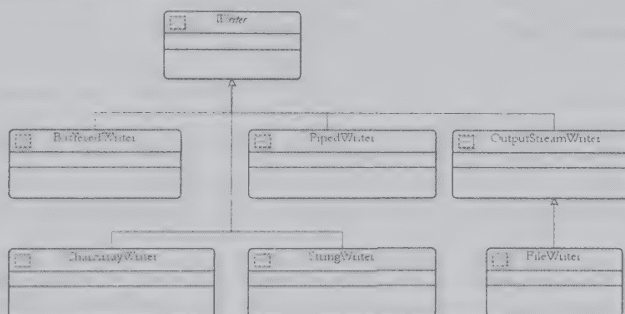

> 图 16.3：Writer 子类

`OutputStreamWriter` 使用指定的字符集便利了字符到字节流的转换。字符集保证了你写入此 `OutputStreamWriter` 的任何 Unicode 字符都会转换为正确的字节表示。`FileWriter` 是 `OutputStreamWriter` 的子类，提供了一种向文件写入字符的便捷方法。然而，`FileWriter` 并非没有缺陷。使用 `FileWriter` 时，你被迫使用计算机的编码输出字符，这意味着当前字符集之外的字符将无法正确转换为字节。`PrintWriter` 是 `FileWriter` 更好的替代方案。

后续章节将介绍 `Writer` 及其一些后代类。

### Writer

该类与 `OutputStream` 类似，但 `Writer` 处理的是字符而不是字节。`Writer` 有三个 `write` 方法重载：

```java
public void write(int b)

public void write(char[] text)
```

```java
public void write(char[] text, int offset, int length)
```

然而，在处理文本或字符时，你通常使用字符串。因此，`write` 方法还有另外两个接受 `String` 对象的重载。

```java
public void write(String text)
```

```java
public void write(String text, int offset, int length)
```

最后一个 `write` 方法重载允许你传递一个 `String` 并将字符串的部分内容写入 `Writer`。

### OutputStreamWriter

`OutputStreamWriter` 是从字符流到字节流的桥梁：写入 `OutputStreamWriter` 的字符将使用指定的字符集编码为字节。后者是 `OutputStreamWriter` 的重要元素，因为它能够将 Unicode 字符正确转换为字节表示。

- `OutputStreamWriter` 类提供了四个构造函数：

```java
public OutputStreamWriter(OutputStream out)
```

```java
public OutputStreamWriter(OutputStream out,
      java.nio.charset.Charset cs)
```

```java
public OutputStreamWriter(OutputStream out,
      java.nio.charset.CharsetEncoder enc)
```

```java
public OutputStreamWriter(OutputStream out, String encoding)
```

所有构造函数都接受一个 `OutputStream`，字符转换到此 `OutputStreamWriter` 后产生的字节将写入该流中。因此，如果你想写入文件，只需要创建一个指向文件句柄的 `OutputStream`：

```java
OutputStream os = Files.newOutputStream(path, openOption);
OutputStreamWriter writer = new OutputStreamWriter(os, charset);
```

列表 16.3 展示了 `OutputStreamWriter` 的示例。

```java
Listing 16.3: 使用 OutputStreamWriter

package app;

import java.io.IOException;
import java.io.OutputStream;
import java.io.OutputStreamWriter;
import java.nio.charset.Charset;
import java.nio.file.Files;
import java.nio.file.Path;
import java.nio.file.StandardOpenOption;

public class OutputStreamWriterDemo {

  public static void main(String[] args) {

    char[] chars = new char[2];

    chars[0] = '\u4F60'; // 代表 你

    chars[1] = '\u597D'; // 代表 好

    Path path = Paths.get("C:\\temp\\myFile.txt");
    Charset chineseSimplifiedCharset =
    Charset.forName("GB2312");

    try (OutputStream outputStream =
    Files.newOutputStream(path,
    StandardOpenOption.CREATE);
    OutputStreamWriter writer = new OutputStreamWriter(
    outputStream, chineseSimplifiedCharset)) {
      writer.write(chars);
    } catch (IOException e) {
      e.printStackTrace();
    }
  }
}
```

列表 16.3 中的代码基于一个 `OutputStream` 创建了 `OutputStreamWriter`，该流在 Windows 上写入 `C:\myFile.txt`。如果你使用的是 Linux 或 Mac OS X，你需要更改 `filePath` 的值。使用绝对路径是有刻意的，因为大多数读者在想要打开文件时，这样更容易找到。`OutputStreamWriter` 使用 GB2312 字符集（简体中文）。

列表 16.3 中的代码传递了两个中文字符：你（由 Unicode 4F60 表示）和好（Unicode 597D）。“你好”在中文里的意思是“How are you?”。

执行时，`OutputStreamWriterTest` 类将创建一个 `myFile.txt` 文件。它的长度为 4 字节。你可以打开并看到中文字符。为了正确显示这些字符，你需要在计算机上安装中文字体。

### PrintWriter

`PrintWriter` 是 `OutputStreamWriter` 更好的替代方案。像 `OutputStream` 一样，`PrintWriter` 允许通过向其一个构造函数传递编码信息来选择编码。以下是它的两个构造函数：

```java
public PrintWriter(OutputStream out)
public PrintWriter(Writer out)
```

要创建一个写入文件的 `PrintWriter`，只需创建一个带有句柄的 `OutputStream` 即可。`PrintWriter` 比 `OutputStreamWriter` 更便于操作，因为它增加了九个方法重载。以下是其中一些：

```java
public void print(boolean)
public void print(char)
public void print(char[])
public void print(double)
public void print(float)
```

```java
public void print(int)
public void print(long)
public void print(Object)
public void print(String)
public void print(String[])
```

此外，还有 `println` 方法重载，它们与 `print` 方法相同，区别是在参数之后会打印一个新行。

```java
public void println(boolean)
public void println(char)
public void println(char[])
public void println(double)
public void println(float)
public void println(int)
public void println(long)
public void println(Object)
public void println(String)
public void println(String[])
```

还有 `format` 方法重载，允许你按照格式进行打印。

```java
public void format(String, Object... args)
public void format(String, Object[] args)
```

最后一个 `write` 方法重载允许你传递一个 `String` 并将字符串的部分内容写入 `Writer`。然而，你不能这样包装它。相反，请用 `BufferedWriter` 包装你的 `Writer`。

```java
public BufferedWriter(Writer)
BufferedWriter(Writer, bufferSize)
```

列表 16.4 是 `PrintWriter` 的示例。

```java
Listing 16.4: 使用 PrintWriter
package app16;
import java.io.BufferedWriter;
import java.io.IOException;
import java.io.PrintWriter;
import java.nio.charset.Charset;
import java.nio.file.Files;
import java.nio.file.Path;
import java.nio.file.Paths;
import java.nio.file.StandardOpenOption;

public class PrintWriterDemo {
    public static void main(String[] args) {
        Path path = Paths.get("C:\\temp\\PrintWriterOutput.txt");
        Charset asciiCharset = Charset.forName("US-ASCII");
        try (BufferedWriter bufferedWriter =
                Files.newBufferedWriter(path, asciiCharset,
                StandardOpenOption.CREATE);
            PrintWriter printWriter = new PrintWriter(bufferedWriter)) {
            printWriter.println("PrintWriter is easy to use.");
            printWriter.println(1234);
        } catch (IOException e) {
            e.printStackTrace();
        }
    }
}
```

使用 `PrintWriter` 写入的好处是，当你打开生成的文件时，所有内容都是可读的。上一个示例创建的文件显示：

PrintWriter is easy to use.

1234

### 读取文本（字符）

你使用 `Reader` 类来读取文本（字符，即人类可读的数据）。该类的层次结构如图 16.4 所示。

图 16.4：Reader 及其后代

后续章节将讨论 `Reader` 及其一些后代类。

### Reader

`Reader` 是一个用于读取字符流的抽象类。它与 `InputStream` 类似，区别在于 `Reader` 处理的是字符而不是字节。`Reader` 有三个 `read` 方法重载，与 `InputStream` 中的 `read` 方法相似。

```java
public int read(java.nio.CharBuffer target)
```

`Reader` 还提供了以下与 `InputStream` 类似的方法：`close`、`mark`、`reset` 和 `skip`。

## InputStreamReader

`InputStreamReader` 使用指定的字符集读取并将其转换为字符。因此，`InputStreamReader` 特别适用于从 `OutputStreamWriter` 或 `PrintWriter` 中读取数据。关键在于，你在写入字符时必须知道编码，以便正确地读回。

`InputStreamReader` 类有四个构造函数，所有构造函数都要求你传递一个 `InputStream`。

```java
public InputStreamReader(InputStream in)
public InputStreamReader(InputStream in,
java.nio.charset.Charset charset)
public InputStreamReader(InputStream in,
java.nio.charset.CharsetDecoder decoder)
public InputStreamReader(InputStream in, String charsetName)
```

例如，在一个使用 `InputStreamReader` 读取文件的示例中，你可以向其构造函数传递一个来自 `Files.newInputStream` 的 `InputStream`。

```java
Path path = ...
Charset charset = ...
InputStream inputStream = Files.newInputStream(path,
StandardOpenOption.READ)
InputStreamReader reader = new InputStreamReader(
inputStream, charset);
```

列表 16.5 展示了一个使用 `PrintWriter` 写入两个汉字并将其读回的示例。

列表 16.5：使用 InputStreamReader

```java
package app1;
import java.io.BufferedWriter;
import java.io.FileInputStream;
import java.io.IOException;
import java.io.InputStream;
import java.io.InputStreamReader;
import java.nio.charset.Charset;
import java.nio.file.Files;
import java.nio.file.Path;
import java.nio.file.Paths;
import java.nio.file.StandardOpenOption;
```


# 第 16 章：输入/输出

```java
public class InputStreamReaderDemo {
    public static void main(String[] args) throws {
        Path filePath = Paths.get("C:\\temp\\myFile.txt");
        Charset chineseSimplifiedCharset =
        Charset.forName("GB2312");
        char[] chars = new char[2];
        chars[0] = '\u4F60'; // 代表 汉
        chars[1] = '\u597D'; // 代表 字符

        // 写文本
        try (BufferedWriter writer = =
            Files.newBufferedWriter(filePath,
            chineseSimplifiedCharset,
            StandardOpenOption.CREATE)) {
            writer.write(chars);
        } catch (IOException e) {
            System.out.println(e.toString());
        }

        // 读回
        try (InputStream inputStream = =
            Files.newInputStream(filePath,
            StandardOpenOption.READ);

        InputStreamReader reader = new
            InputStreamReader(inputStream,
            chineseSimplifiedCharset)) {
            char[] chars2 = new char[2];
            reader.read(chars2);
            System.out.print(chars2[0]);
            System.out.print(chars2[1]);
        } catch (IOException e) {
            System.out.println(e.toString());
        }
    }
}
```

## BufferedReader

`BufferedReader` 有两个用途：

1. 包装另一个 `Reader` 并提供一个缓冲区，这通常会提高性能。
2. 提供了一个 `readLine()` 方法来读取一行文本。

`readLine()` 方法的签名如下：

```java
public java.lang.String readLine() throws IOException
```

它返回来自该 `Reader` 的行文本，如果到达流末尾则返回 `null`。

`java.nio.file.Files` 类提供了一个新的 `newBufferedReader()` 方法，返回一个 `BufferedReader`。签名如下：

```java
public static java.io.BufferedReader newBufferedReader(Path path,
    java.nio.charset.Charset charset)
```

例如，这段代码读取一个文件并打印所有行。

此外，在 Java 5 引入 `java.util.Scanner` 类之前，你必须使用 `BufferedReader` 从控制台读取输入。列表 16.6 显示了用于在控制台获取用户输入的 `getUserInput()` 方法。

### 列表 16.6：getUserInput 方法

```java
public static String getUserInput() {
    BufferedReader br = new BufferedReader(
        new InputStreamReader(System.in));
    try {
        return br.readLine();
    } catch (IOException e) {
        return null;
    }
}
```

你可以这样做是因为 `System.in` 的类型是 `java.io.InputStream`。

> **注意**
>
> `java.util.Scanner` 在第 5 章“核心类”中讨论过。

## 使用 PrintStream 进行日志记录

到此时你可能已经熟悉 `System.out` 的 `print()` 方法。你特别用它来显示消息以帮助调试代码。然而，默认情况下 `System.out` 将消息发送到控制台，这并不总是理想的。例如，如果显示的数据超过了某些行，之前的消息将不再可见。此外，你可能想对消息进行处理，例如通过电子邮件发送消息。

`PrintStream` 类是 `OutputStream` 的间接子类。以下是它的部分构造函数：

```java
public PrintStream(OutputStream out)
public PrintStream(OutputStream out, boolean autoFlush)
public PrintStream(OutputStream out, boolean autoFlush, String encoding)
```

`PrintStream` 与 `PrintWriter` 非常相似。例如，两者都有九个 `print()` 方法重载。此外，`PrintStream` 有一个 `format()` 方法。关键在于你在写入字符时必须知道编码，以便正确地读回。

`InputStreamReader` 类有四个构造函数，所有构造函数都要求你传递一个 `InputStream`。

`PrintStream` 有一个针对 `java.nio.charset.CharsetDecoder` 的 `format()` 方法。

### 列表 16.7：将 System.out 重定向到文件

```java
package app1;
import java.io.BufferedWriter;
import java.io.FileInputStream;
import java.io.IOException;
import java.io.InputStream;
import java.io.InputStreamReader;
import java.nio.charset.Charset;
import java.nio.file.Files;
import java.nio.file.Path;
import java.nio.file.Paths;
import java.nio.file.StandardOpenOption;
```

```java
public class InputStreamReaderDemo {
    public static void main(String[] args) throws {
        Path filePath = Paths.get("C:\\temp\\myFile.txt");
        Charset chineseSimplifiedCharset =
        Charset.forName("GB2312");
        char[] chars = new char[2];
        chars[0] = '\u4F60'; // 代表 汉 
        chars[1] = '\u597D'; // 代表 字符

        // 写文本
        try (BufferedWriter writer = =
            Files.newBufferedWriter(filePath,
            chineseSimplifiedCharset,
            StandardOpenOption.CREATE)) {
            writer.write(chars);
        } catch (IOException e) {
            System.out.println(e.toString());
        }

        // 读回
        try (InputStream inputStream = =
            Files.newInputStream(filePath,
            StandardOpenOption.READ);

        InputStreamReader reader = new
            InputStreamReader(inputStream,
            chineseSimplifiedCharset)) {
            char[] chars2 = new char[2];
            reader.read(chars2);
            System.out.print(chars2[0]);
            System.out.print(chars2[1]);
        } catch (IOException e) {
            System.out.println(e.toString());
        }
    }
}
```

`PrintStream` 类是 `OutputStream` 的间接子类。以下是它的部分构造函数：

```java
public PrintStream(OutputStream out)
public PrintStream(OutputStream out, boolean autoFlush)
public PrintStream(OutputStream out, boolean autoFlush, String encoding)
```

`PrintStream` 与 `PrintWriter` 非常相似。例如，两者都有九个 `print()` 方法重载。此外，`PrintStream` 有一个 `format()` 方法。关键在于你在写入字符时必须知道编码，以便正确地读回。

`InputStreamReader` 类有四个构造函数，所有构造函数都要求你传递一个 `InputStream`。

`PrintStream` 有一个针对 `java.nio.charset.CharsetDecoder` 的 `format()` 方法。

### 列表 16.7：将 System.out 重定向到文件

```java
package app1;
import java.io.BufferedWriter;
import java.io.FileInputStream;
import java.io.IOException;
import java.io.InputStream;
import java.io.InputStreamReader;
import java.nio.charset.Charset;
import java.nio.file.Files;
import java.nio.file.Path;
import java.nio.file.Paths;
import java.nio.file.StandardOpenOption;
```

```java
public class InputStreamReaderDemo {
    public static void main(String[] args) throws {
        Path filePath = Paths.get("C:\\temp\\myFile.txt");
        Charset chineseSimplifiedCharset =
        Charset.forName("GB2312");
        char[] chars = new char[2];
        chars[0] = '\u4F60'; // 代表 汉 
        chars[1] = '\u597D'; // 代表 字符

        // 写文本
        try (BufferedWriter writer = =
            Files.newBufferedWriter(filePath,
            chineseSimplifiedCharset,
            StandardOpenOption.CREATE)) {
            writer.write(chars);
        } catch (IOException e) {
            System.out.println(e.toString());
        }

        // 读回
        try (InputStream inputStream = =
            Files.newInputStream(filePath,
            StandardOpenOption.READ);

        InputStreamReader reader = new
            InputStreamReader(inputStream,
            chineseSimplifiedCharset)) {
            char[] chars2 = new char[2];
            reader.read(chars2);
            System.out.print(chars2[0]);
            System.out.print(chars2[1]);
        } catch (IOException e) {
            System.out.println(e.toString());
        }
    }
}
```

## 随机访问文件

`SeekableChannel` 采用一个指向下一个字节或写入位置的内部指针。你可以通过调用 `position()` 方法获取指针：

```java
long position() throws java.io.IOException
```

当创建 `SeekableChannel` 时，它被初始化为第一个字节，`position()` 将返回 0。你可以通过调用另一个 `position()` 方法来更改指针的位置，其签名如下：

```java
SeekableChannel position(long newPosition)
throws java.io.IOException
```

该指针是基于零的，这意味着第一个字节由 0 表示。你可以传递一个大于文件大小的数字而不会抛出异常，但这不会改变文件的大小。`size()` 方法返回 `SeekableChannel` 连接的资源的当前大小：

```java
long size() throws java.io.IOException
```

`SeekableChannel` 非常简单。要从文件读取或写入文件，请使用 `read()` 或 `write()` 方法。

```java
int read(java.nio.ByteBuffer buffer) throws java.io.IOException
int write(java.nio.ByteBuffer buffer) throws java.io.IOException
```

例如，要创建一个容量为 100 的 `ByteBuffer`，你可以写：

```java
ByteBuffer byteBuffer = ByteBuffer.allocate(100);
```

正如你所怀疑的那样，`ByteBuffer` 是由字节数组支持的。要获取此数组，请调用 `ByteBuffer` 的 `array()` 方法：

```java
public final byte[] array();
```

数组的长度与 `ByteBuffer` 的容量相同。

`ByteBuffer` 提供了两个 `put()` 方法来写入字节：

```java
public abstract ByteBuffer put(byte b)
public abstract ByteBuffer put(int index, byte offset, byte b)
```

第一个 `put()` 方法写入到 `ByteBuffer` 内部指针指向的元素上。

第二个方法允许你通过指定索引在任何位置放入字节。

还有两个用于写入字节数组的 `put()` 方法。第一个方法允许将字节数组的内容或其子集拷贝到 `ByteBuffer` 中。它的签名如下：

```java
public ByteBuffer put(byte[] src, int offset, int length)
```

第二个 `put()` 方法将整个源字节数组放入，从位置 0 开始拷贝：

```java
public ByteBuffer put(byte[] src)
```

`ByteBuffer` 还提供了各种 `putXXX()` 方法，用于将不同的数据类型写入缓冲区。例如，写入 `int` 的 `putInt()`，写入 `short` 的 `putShort()`。

`putXXX()` 有两个版本，一个用于将值放入 `ByteBuffer` 内部指针指向的下一个位置，另一个用于将值放入绝对位置。

`putInt()` 和 `getXXX()` 方法的签名如下：

```java
public abstract ByteBuffer putInt(int value)
public abstract ByteBuffer putInt(int index, int value)
```


# 第 16 章：输入/输出

要从 `ByteBuffer` 中读取内容，`ByteBuffer` 类提供了许多 `get` 和 `getXXX` 方法，这些方法分为两种类型：一种是从相对位置读取，另一种是从绝对位置读取。以下是部分 `get` 及 `getXXX` 方法的签名：

```java
public abstract byte get(int index)
public abstract float getFloat(int index)
```

好了。这些是你关于 `ByteBuffer` 需要知道的所有内容了，现在你准备好学习 `SeekableByteChannel` 了。列表 16.8 显示了如何使用 `SeekableByteChannel`。

## 列表 16.8：随机访问文件

```java
package app1;
import java.io.IOException;
import java.nio.ByteBuffer;
import java.nio.channels.SeekableByteChannel;
import java.nio.file.Files;
import java.nio.file.Path;
import java.nio.file.Paths;
import java.nio.file.StandardOpenOption;

public class SeekableByteChannelDemo {
    public static void main(String[] args) {
        ByteBuffer buffer = ByteBuffer.allocate(12);
        System.out.println(buffer.position()); // 输出 0
        buffer.putInt(10);
        System.out.println(buffer.position()); // 输出 4
        buffer.putLong(1234567890L);
        System.out.println(buffer.position()); // 输出 12
        buffer.rewind(); // 将位置置为 0
        System.out.println(buffer.getInt()); // 输出 10
        System.out.println(buffer.getLong()); // 输出 1234567890
        buffer.rewind();
        System.out.println(buffer.position()); // 输出 0

        Path path = Paths.get("C:/temp/channel");
        System.out.println("--------------------------------");
        try (SeekableByteChannel channel = 
                Files.newByteChannel(path,
                StandardOpenOption.CREATE,
                StandardOpenOption.READ,
                StandardOpenOption.WRITE)) {
            System.out.println(channel.position()); // 输出 0
            channel.write(buffer);
            System.out.println(channel.position()); // 输出 12

            // 读取文件
            ByteBuffer buffer3 = ByteBuffer.allocate(40);
            channel.position(0);
            channel.read(buffer3);
            buffer3.rewind();
            System.out.println("int: " + buffer3.getInt());
            System.out.println("long: " + buffer3.getLong());
            System.out.println("char: " + buffer3.getChar());
        } catch (IOException e) {
            e.printStackTrace();
        }
    }
}
```

列表 16.8 中的 `SeekableByteChannelDemo` 类首先创建一个容量为 12 的 `ByteBuffer`，并写入一个 `int` 和一个 `long`。写入后，`ByteBuffer` 的位置位于 12。

## 对象序列化

有时，你需要将对象持久化到永久性存储中，以便稍后保留对象的状态。Java 通过对象序列化支持这一点。要序列化对象（即将其保存到持久性存储中），使用 `ObjectOutputStream`。要反序列化对象（即检索保存的对象），使用 `ObjectInputStream`。`ObjectOutputStream` 派生自 `OutputStream`，而 `ObjectInputStream` 派生自 `InputStream`。

`ObjectOutputStream` 类有一个公共构造函数：

```java
public ObjectOutputStream(OutputStream out)
```

创建 `ObjectOutputStream` 后，你可以序列化对象、基本类型或两者的结合。`ObjectOutputStream` 为每个单独类型提供了 `writeXXX` 方法，其中 XXX 表示类型。以下是 `writeXXX` 方法的列表：

```java
public void writeBoolean(boolean value)
public void writeByte(int value)
public void writeChar(int value)
public void writeDouble(double value)
public void writeFloat(float value)
public void writeInt(int value)
public void writeLong(long value)
public void writeShort(short value)
public void writeObject(java.lang.Object)
```

序列化的类必须实现 `java.io.Serializable`。该接口没有方法，是一个标记接口。标记接口告诉 JVM 实现该接口的实例属于某种类型。

如果序列化对象包含其他对象，这些对象的类也必须实现 `Serializable`，这些对象才能被序列化。

`ObjectInputStream` 类有一个公共构造函数：

```java
public ObjectInputStream(InputStream in)
```

要反序列化文件，你可以传递一个连接到文件源的 `InputStream`。`ObjectInputStream` 类的方法与 `ObjectOutputStream` 中的 `writeXXX` 相反。如下：

```java
public boolean readBoolean()
public byte readByte()
public char readChar()
public double readDouble()
public float readFloat()
public int readInt()
public long readLong()
public short readShort()
public java.lang.Object readObject()
```

需要注意的重要一点：对象序列化基于先进先出方法。在反序列化多个基本类型/对象时，先序列化的对象必须先反序列化。

列表 16.9 显示了实现 `Serializable` 的 `Customer` 类。列表 16.10 显示了一个序列化一个 `int` 和一个 `Customer` 对象的示例。注意列表 16.9 中的 `Customer` 类实现了 `Serializable`。序列化运行时与每个可序列化类关联名为 `serialVersionUID` 的版本数字。该数字在反序列化期间用于验证序列化发送方和接收方加载的对象类在序列化方面是兼容的。所有实现 `Serializable` 的类都应该声明一个 `static final serialVersionUID` 字段，否则将由序列化运行时自动计算。

### 列表 16.9：Customer 类

```java
package app1;
import java.io.Serializable;

public class Customer implements Serializable {
    private static final long serialVersionUID = 1L;

    public int id;
    public String name;
    public String address;
    public Customer (int id, String name, String address) {
        this.id = id;
        this.name = name;
        this.address = address;
    }
}
```

### 列表 16.10：对象序列化示例

```java
package app1;
import java.io.IOException;
import java.io.InputStream;
import java.io.ObjectInputStream;
import java.io.ObjectOutputStream;
import java.io.OutputStream;
import java.nio.file.Files;
import java.nio.file.Path;
import java.nio.file.Paths;
import java.nio.file.StandardOpenOption;

public class ObjectSerializationDemo {
    public static void main(String[] args) {
        // 序列化
        Path path = Paths.get("C:\\temp\\objectOutput");
        Customer customer = new Customer(1, "Joe Bog", "12 West Cost");
        try (OutputStream outputStream = 
                Files.newOutputStream(path,
                StandardOpenOption.CREATE);
            ObjectOutputStream oos = new 
                ObjectOutputStream(outputStream)) {
                // 写入第一个对象
                oos.writeObject(customer);
                // 写入第二个对象
                oos.writeObject("Customer Info");
        } catch (IOException e) {
            System.out.print("IOException");
        }
        // 反序列化
        try (InputStream inputStream = Files.newInputStream(path,
                StandardOpenOption.READ);
            ObjectInputStream ois = new
                ObjectInputStream(inputStream)) {
            // 读取第一个对象
            Customer customer2 = (Customer) ois.readObject();
            System.out.println("First Object: ");
            System.out.println(customer2.id);
            System.out.println(customer2.name);
            System.out.println(customer2.address);

            // 读取第二个对象
            System.out.println();
            System.out.println("Second object: ");
            String info = (String) ois.readObject();
            System.out.println(info);
        } catch (ClassNotFoundException ex) { // readObject 仍然抛出此异常
            System.out.print("ClassNotFound " + ex.getMessage());
        } catch (IOException ex2) {
            System.out.print("IOException " + ex2.getMessage());
        }
    }
}
```

## 总结

通过 `java.io` 包的成员支持输入/输出操作。你可以通过流来读写数据，数据被分为二进制数据和文本数据。此外，Java 通过 `Serializable` 接口以及 `ObjectInputStream` 和 `ObjectOutputStream` 类支持对象序列化。

## 测验

1. 什么是 I/O 流？
2. 列出 `java.io` 包中表示流的四个抽象类。
3. 什么是对象序列化？
4. 类要实现可序列化的要求是什么？

# 第 17 章：注解

注解是 Java 程序中的备注，用于指示 Java 编译器执行某些操作。Java 注解最早在 JSR 175《Java 编程语言的元数据设施》中定义。后来 JSR 250《Java 平台的通用注解》为通用概念添加了注解。这两个规范都可以从 `http://www.jcp.org` 下载。

本章从注解的概述开始，然后教你如何使用标准和通用注解。最后以讨论如何编写你自己的自定义注解结束。

## 概述

注解是给 Java 编译器的注释。当你对源文件中的程序元素添加注解时，你为该源文件中的 Java 程序元素添加了元数据。你可以对 Java 包、类型（类、接口、枚举类型）、构造函数、方法、字段、参数和局部变量添加注解。例如，你可以对 Java 类添加注解，从而抑制 `javac` 程序本会发出的任何警告。或者，你可以对你想要重写的方法添加注解，并要求编译器验证你确实是在重写该方法，而不是重载它。

可以指示 Java 编译器解释注解并丢弃它们（因此这些注解仅存在于源文件中），或者将它们包含在生成的 Java 类中。包含在 Java 类中的注解可能会被 Java 虚拟机忽略，也可能被加载到虚拟机中。后者被称为运行时可见，你可以使用反射来对其查询。

## 注解和注解类型

在学习注解时，你会经常遇到这两个术语：注解和注解类型。为了理解它们的含义，记住注解类型是一种特殊的接口类型很有用。注解是注解类型的实例。就像接口一样，注解类型有名称和成员。可以有零个或多个键值对，且每个键都有特定的类型。可以是 `String`、`int` 或其他 Java 类型。没有键/值对的注解类型称为标记注解。具有一个键/值对的通常称为单值注解。

注解最早添加到 Java 5 中，它引入了三种注解类型：`Deprecated`、`Override` 和 `SuppressWarnings`。它们是 `java.lang` 包的一部分，你将在“标准注解”部分中学习使用它们。

## 标准注解

注解是 Java 5 中的新功能，最初有三个标准注解，都位于 `java.lang` 包中：`Override`、`Deprecated` 和 `SuppressWarnings`。它们将在本节讨论。

### Override


# Override 注解

`Override` 是一种标记注解类型，可以应用于方法，以指示编译器程序员重写了父类中的方法。这种注解类型可以防止在重写方法时出错。

例如，考虑以下 `Parent` 类：

```java
class Parent {
    public float calculate(float a, float b) {
        return a * b;
    }
}
```

假设你想扩展 `Parent` 并重写它的 `calculate` 方法。这里是 `Parent` 的子类：

```java
public class Child extends Parent {
    public int calculate(int a, int b) {
        return (a + 1) * b;
    }
}
```

`Child` 类可以通过编译。然而，`Child` 中的 `calculate` 方法并没有重写 `Parent` 中的方法，因为它的签名不同，即返回并接收 `int` 而不是 `float`。在这个示例中，这样的编程错误很容易发现，你可以同时看到 `Parent` 和 `Child` 类。

使用 `Override` 注解可以防止此类错误。每当你想要重写方法时，在方法之前声明 `Override` 注解类型：

```java
public class Child extends Parent {
    @Override
    public int calculate(int a, int b) {
        return (a + 1) * b;
    }
}
```

这次，编译器将生成一个编译错误并提示你 `Child` 类中的 `calculate` 方法没有重写父类中的方法。

显然，`@Override` 是非常有用的，它可以确保程序员在想要重写方法时确实执行了重写，而不是重载。

## Deprecated（已废弃）

`Deprecated` 是一个标记注解类型，可以应用于方法或类型，表示该方法或类型已废弃。程序员通过将方法或类型标记为废弃，以警告代码的用户不应使用或重写该方法，也不应使用或扩展它。方法或类型被标记为废弃的原因通常是因为有了更好的方法，或者该废弃的方法或类型在当前软件版本中为了后兼容而被保留。

例如，列表 17.1 中的 `DeprecatedDemo1` 类使用了 `Deprecated` 注解类型。

### 列表 17.1：废弃一个方法

```java
package app17;
public class DeprecatedDemo1 {
    @Deprecated
    public void serve() {
    }
}
```

如果你使用或重写了已废弃的方法，你将在编译时获得警告。例如，列表 17.2 显示了使用 `DeprecatedDemo1` 中 `serve` 方法的 `DeprecatedDemo2` 类。

### 列表 17.2：使用已废弃的方法

```java
package app17;
public class DeprecatedDemo2 {
    public static void main(String[] args) {
        DeprecatedDemo1 demo = new DeprecatedDemo1();
        demo.serve();
    }
}
```

编译 `DeprecatedDemo2` 会产生此警告：

```
注意：app17/DeprecatedDemo2.java 使用或重写了已废弃的 API。
注意：使用 -Xlint:deprecation 重新编译以查看详情。
```

此外，你可以使用 `@Deprecated` 来标记类或接口，如列表 17.3 所示。

### 列表 17.3：标记类为废弃

```java
package app17;
@Deprecated
public class DeprecatedDemo3 {
    public void serve() {
    }
}
```

## SuppressWarnings（抑制警告）

正如你可能猜到的，`SuppressWarnings` 用于抑制编译器警告。你可以将 `@SuppressWarnings` 应用于类型、构造函数、方法、字段、参数和局部变量。

你通过传递一个包含需要抑制的警告的字符串数组使用它。其语法如下：

```java
@SuppressWarnings(value={string-1, ..., string-n})
```

其中 `string-1` 到 `string-n` 表示要抑制的警告集。重复和未识别的警告将被忽略。

以下是 `@SuppressWarnings` 的有效参数：

- `unchecked`: 为 Java 语言规范强制要求的未检查转换警告提供更详细的信息。
- `path`: 对不存在的路径（类路径、源文件路径等）的目录发出警告。
- `serial`: 对可序列化类缺少 `serialVersionUID` 定义发出警告。
- `finally`: 对无法正常完成执行的无效类发出警告。
- `fallthrough`: 检查 `switch` 块是否存在穿透情况（除了块中的最后一个 `case` 之外的任何情况），这些情况的代码没有包含 `break` 语句，允许执行“穿透”到下一个 `case`。例如，该 `switch` 块中 `case 2` 标签后的代码没有包含 `break` 语句：

```java
switch (i) {
    case 1:
        System.out.println("1");
        break;
    case 2:
        // 穿透
    case 3:
        System.out.println("3");
}
```

例如，列表 17.4 中的 `SuppressWarningsDemo` 类使用了 `SuppressWarnings` 注解类型来防止编译器发布未检查和穿透警告。

### 列表 17.4：使用 @SuppressWarnings

```java
package app17;
import java.io.File;
import java.io.Serializable;
import java.util.ArrayList;
@SuppressWarnings(value={"unchecked", "serial"})
public class SuppressWarningsDemo implements Serializable {
    public void openFile() {
        ArrayList a = new ArrayList();
        File file = new File("X:/java/doc.txt");
    }
}
```

## 通用注解（Common Annotations）

Java 包含了 JSR 250 的实现，即“Java 平台通用注解”，它规定了通用概念的注解。该 JSR 的目标是避免不同的 Java 技术定义相似的注解，从而导致重复。

通用注解的完整列表可以在从 `http://www.jcp.org/en/jsr/detail?id=250` 下载的文档中找到。

除了 `Generated` 之外，遗憾的是，所有指定的注解都是适用于 Java EE 的高级材料，因此超出了本书的范围。因此，讨论的唯一通用注解是 `@Generated`。

`@Generated` 用于标记由计算机生成的源代码，而不是手写代码。它可以应用于类、方法和字段。以下是 `@Generated` 的参数：

- `value`: 代码生成器的名称。惯例是使用生成器的全限定类名。
- `date`: 代码生成的日期。它必须符合 ISO8601 格式。
- `comments`: 伴随生成代码的注释。

例如，在列表 17.5 中，`@Generated` 被用于标记一个类。

### 列表 17.5：使用 @Generated

```java
package app17;

import javax.annotation.Generated;

@Generated(value="com.example.robot.CodeGenerator", date="2014-12-31", comments="Generated code")
public class GeneratedTest {
}
```

## 标准元注解（Standard Meta-Annotations）

元注解是用于注解的注解。有四种元注解类型可以用于注解：`Documented`、`Inherited`、`Retention` 和 `Target`。这四个属于 `java.lang.annotation` 包。本节将讨论这些注解类型。

### Documented

`Documented` 是一个标记注解类型，用于标记注解声明，以便该注解类型的实例包含在生成的 Javadoc 中。

例如，`Override` 注解类型没有使用 `Documented`。这意味着如果你使用 Javadoc 生成标记了 `@Override` 的类，你将看不到 `@Override` 的痕迹。

例如，列表 17.6 显示了一个使用 `@Override` 标记 `toString` 方法的 `OverrideDemo2` 类。

#### 列表 17.6：OverrideDemo2 类

```java
package app1;

public class OverrideDemo2 {

    @Override
    public String toString() {
        return "OverrideDemo2";
    }
}
```

另一方面，`Deprecated` 注解类型标记了 `@Documented`。记得列表 17.2 中 `DeprecatedTest` 类中的服务方法标记了 `@Deprecated`。现在，如果你使用 Javadoc 为 `OverrideTest` 生成文档，文档中该服务方法的详情也将包含 `@Deprecated`，如下：

```
serve
@Deprecated
public void serve()
```

### Inherited

你使用 `Inherited` 来标记注解类型，以便该注解类型的任何实例被继承。如果你使用继承的注解类型标记一个类，该注解将被被标记类的任何子类继承。如果用户在类声明上查询注解类型，而类声明没有该类型的注解，则会自动查询该类的父类以获取注解类型。此过程将重复，直到找到该类型的注解或到达根类。

### Retention

`Retention` 表示被其注解类型标记为 `@Retention` 的注解将保留多久。`@Retention` 的值可以是 `java.lang.annotation.RetentionPolicy` 枚举的成员之一：

- `SOURCE`: 注解将由 Java 编译器丢弃。
- `CLASS`: 注解将被记录在类文件中，但不会被保留在 JVM 中。这是默认值。
- `RUNTIME`: 注解将被 JVM 保留，以便可以使用反射对其进行查询。

例如，`@SuppressWarnings` 注解类型的声明被标记了值为 `SOURCE` 的 `@Retention` 注解。

```java
@Retention(value=SOURCE)
public @interface SuppressWarnings
```

### Target（目标）

`Target` 指明了程序元素何时可以使用被注解的注解类型的实例进行注解标记。`Target` 的值是 `java.lang.annotation.ElementType` 枚举的成员之一：

- `ANNOTATION TYPE`（注解类型）：被注解的注解类型可以用于注解类型声明。
- `CONSTRUCTOR`（构造函数）：被注解的注解类型可以用于注解构造函数声明。
- `FIELD`（字段）：被注解的注解类型可以用于注解字段声明。
- `LOCAL VARIABLE`（局部变量）：被注解的注解类型可以用于注解局部变量声明。
- `METHOD`（方法）：被注解的注解类型可以用于注解方法声明。
- `PACKAGE`（包）：被注解的注解类型可以用于注解包声明。
- `PARAMETER`（参数）：被注解的注解类型可以用于注解参数声明。
- `TYPE`（类型）：被注解的注解类型可以用于注解类型声明。

例如，`Override` 注解类型的声明被标记了以下 `Target` 注解，使得 `Override` 仅适用于方法声明。

```java
@Target(value=METHOD)
```

你可以在 `Target` 注解中包含多个值。例如，这是来自 `SuppressWarnings` 的声明：

```java
@Target(value={TYPE, FIELD, METHOD, PARAMETER, CONSTRUCTOR, LOCAL_VARIABLE})
```

## 自定义注解类型

注解类型是一个 Java 接口，区别在于你在声明它时必须在 `interface` 关键字之前添加一个 `@` 符号。

```java
public @interface CustomAnnotation {
}
```

默认情况下，所有的注解类型都隐式或显式地扩展了 `java.lang.annotation.Annotation` 接口。此外，尽管你可以扩展注解类型，但它的子类型不会被视为注解类型。

### 编写你自己的自定义注解类型

列表 17.7 显示了一个名为 `Author` 的自定义注解类型。

#### 列表 17.7：Author 注解类型

```java
package app1.custom;

import java.lang.annotation.Documented;
import java.lang.annotation.Retention;
import java.lang.annotation.RetentionPolicy;

@Documented
@Retention(RetentionPolicy.RUNTIME)
public @interface Author {
    String firstName();
    String lastName();
    boolean internalEmployee();
}
```

### 使用自定义注解类型

`Author` 注解类型与其他任何 Java 类型一样。一旦你将其导入类或接口中，你就可以通过编写代码来使用它：

```java
@Author(firstName="firstName", lastName="lastName", internalEmployee=false)
```

例如，列表 17.8 中的 `Test1` 类被标记了 `Author`。

#### 列表 17.8：一个被 Author 标记的类

```java
package app1.custom;

@Author(firstName="John", lastName="Guddell", internalEmployee=true)
public class Test1 {
}
```

就这样吗？是的，就是这样。非常简单，不是吗？

下一小节“使用反射查询注解”展示了 `Author` 注解如何很有用处。

## 使用反射查询注解

`java.lang.Class` 有几个与注解相关的方法。

```java
public <A extends java.lang.annotation.Annotation> A getAnnotation(Class<A> annotationClass)
```
如果存在，则返回此元素针对指定注解类型的注解。否则，返回 `null`。

```java
public java.lang.annotation.Annotation[] getAnnotations()
```
返回此类上存在的所有注解。

```java
public boolean isAnnotation()
```
如果这是一个注解类型，则返回 `true`。

```java
public boolean isAnnotationPresent(Class<? extends java.lang.annotation.Annotation> annotationClass)
```
表示此类上是否存在指定类型的注解。

`app17.custom` 包包含了三个类：`Test1`、`Test2` 和 `Test3`，它们都标记了 `Author`。列表 17.9 显示了一个利用反射查询类的测试类。

### 列表 17.9：使用反射查询注解

```java
package app17.custom;

public class CustomAnnotationDemo1 {
    public static void printClass(Class c) {
        System.out.print(c.getName() + " ");
    }
}
```

此时，你将在控制台中看到以下消息：

```
app17.custom.Test1. Author:John Guddell
app17.custom.Test2. Author:John Guddell
app17.custom.Test3. Author:Lesley Nielsen
app17.custom.CustomAnnotationDemo. Author unknown
```


## 用途

使用注解指示 Java 编译器对被注解的程序元素执行某些操作。任何程序元素都可以被注解，包括 Java 包、类、构造函数、字段、方法、参数和局部变量。本章解释了标准注解类型以及如何创建自定义注解类型。

## 测试

1. 什么是注解类型？
2. 什么是元注解（meta-annotation）？
3. Java 5 首次包含了哪些标准注解类型？

# 第 18 章：嵌套类和内部类

嵌套类和内部类通常被认为对初学者来说太复杂了。然而，它们具有某些优点，使其成为书中恰当的话题。本章从定义什么是嵌套类和内部类开始，并继续解释嵌套类的类型。

## 嵌套类的概述

让我们从学习嵌套类开始。嵌套类是定义在另一个类或接口内部的类。换句话说，嵌套类有两种类型：静态和非静态。非静态嵌套类是内部类。

内部类有几种类型：

- 成员内部类
- 局部内部类
- 匿名内部类

“顶层类”（top level class）一词用于指定义在另一个类内部的类。嵌套类的行为类似于普通的（顶层）类。这里有一个名为 `Outer` 的类的简单嵌套类示例：

```java
package app18;

public class Outer {

    class Nested {

    }

}
```

而且虽然不常见，但在嵌套类内部嵌套嵌套类是可能的，如下：

```java
package app18;

public class Outer {

    class Nested2 {

    }

}
```

嵌套类就像类的成员。例如，嵌套类可以使用访问修饰符之一：`private`、`protected`、`default`（包）和 `public`。这与只能具有 public 或 default 的顶层类不同。

由于嵌套类是封装类的成员，静态嵌套类的行为和内部类的行为并不完全相同。这里有一些区别：

- 静态嵌套类可以拥有静态成员，内部类不能。
- 就像实例方法一样，内部类可以访问封装类的静态和非静态成员，包括其私有成员。静态嵌套类只能访问封装类的静态成员。
- 你可以在不创建外部类实例的情况下创建静态嵌套类的实例。相比之下，你必须先创建封装内部类的实例才能实例化内部类。

这些是内部类的优点：

1. 内部类可以访问封装类的所有（包括私有的）成员。
2. 内部类帮助你完全隐藏类的实现。
3. 内部类为 Swing 和其他基于事件的应用提供了更短的监听方法。

现在，让我们回顾每种静态类。

## 静态嵌套类

静态嵌套类可以在不创建外部类实例的情况下创建。列表 18.1 显示了这一点。

### 列表 18.1：一个静态嵌套类

```java
package app1;

class Outer {

    private static int value = 9;

    static class Nested1 {

        int calculate() {

            return value;

        }

    }

}

public class StaticNestedDem {

    public static void main(String[] args) {

        Outer.Nested1 nested = new Outer.Nested1();

        System.out.println(nested.calculate());

    }

}
```

关于静态嵌套类有几点需要注意：

- 你使用以下格式引用嵌套类：
  `OuterClassName.InnerClassName`
- 实例化静态嵌套类时，不需要创建外部类的实例。
- 你可以在静态嵌套类内部访问外部静态类的成员。

此外，如果你在嵌套类中声明了一个与外部类中成员具有同名的成员，那么前者会遮蔽（shadow）后者。但是，你始终可以使用以下格式引用外部类中的成员：
`OuterClassName.memberName`

注意，尽管该成员是私有（private）的，这种方法仍然有效。请查看列表 18.2 中的示例。

### 列表 18.2：遮蔽外部类的成员

```java
package app1;

class Outer2 {

    private static int value = 9;

    static class Nested2 {

        int value = 10;

        int calculate() {

            return value;

        }

        int getOuterValue() {

            return Outer2.value;

        }

    }

}

public class StaticNestedDemo {

    public static void main(String[] args) {

        Outer2.Nested2 nested = new Outer2.Nested2();

        System.out.println(nested.calculate()); // returns 10

        System.out.println(nested.getOuterValue()); // returns 9

    }

}
```

## 成员内部类

成员内部类是指其定义直接包含在另一个类或接口声明中的类。只有当你拥有其外部类实例的引用时，才能创建成员内部类的实例。要从外部类创建内部类的实例，你可以调用内部类的构造函数，就像调用其他普通类一样。然而，要从外部类外部创建内部类的实例，你需要使用以下语法：

```java
EnclosingClassName.InnerClassName inner =
enclosingClassNameObjectReference.new InnerClassName();
```

按照常例，在内部类内部，你可以使用关键字 `this` 来引用当前实例（内部类的实例）。要引用外部类的实例，你使用以下语法：

```java
EnclosingClassName.this
```

列表 18.3 显示了如何创建内部类的实例。

### 列表 18.3：成员内部类

```java
package app1;

class TopLevel {

    private int value = 9;

    class Inner {

        int calculate() {

            return value;

        }

    }

}

public class MemberInnerDemo {

    public static void main(String[] args) {

        TopLevel topLevel = new TopLevel();

        TopLevel.Inner inner = topLevel.new Inner();

        System.out.println(inner.calculate());

    }

}
```

注意你如何在列表 18.3 中创建内部类的实例吗？

内部类可以被用于完全隐藏一个实现，这在不使用内部类的情况下是无法实现的。下面的示例展示了如何使用成员类来完全隐藏实现。

### 列表 18.4：完全隐藏实现

```java
package app1;

interface Printer {

    void print(String message);

}

class PrinterImpl implements Printer {

    public void print(String message) {

        System.out.println(message);

    }

}

class SecretPrinterImpl implements Printer {

    private void print(String message) {

        System.out.println("Inner:" + message);

    }

    public Printer getPrinter() {

        return new Inner();

    }

    private class Inner implements Printer {}

}

public class MemberInnerDemo2 {

    public static void main(String[] args) {

        Printer printer = new PrinterImpl();

        printer.print("oh");

        // downcast to PrinterImpl

        PrinterImpl impl = (PrinterImpl) printer;

        Printer hiddenPrinter = 
            (new SecretPrinterImpl()).getPrinter();

        hiddenPrinter.print("oh");

        // cannot downcast hiddenPrinter to Outer.Inner

        // because Inner is private

    }

}
```

列表 18.4 中的 `Printer` 有两个实现。第一个是 `PrinterImpl`，它是一个普通类。第二个实现在 `SecretPrinterImpl` 中。然而，实现 `Printer` 接口的 `SecretPrinterImpl` 定义了一个私有类 `Inner`，它实现了 `Printer`。`SecretPrinterImpl` 的 `getPrinter` 方法返回 `Inner` 的实例。`PrinterImpl` 和 `SecretPrinterImpl` 之间有什么区别？你可以从测试类的 main 方法中看到这一点：

```java
Printer printer = new PrinterImpl();

printer.print("Hiding implementation");

// downcast to PrinterImpl

PrinterImpl impl = (PrinterImpl) printer;

Printer hiddenPrinter = 
    (new SecretPrinterImpl()).getPrinter();

hiddenPrinter.print("Hiding implementation");

// cannot downcast hiddenPrinter to Outer.Inner
```

## 局部类

局部类（local class）或嵌套类定义在方法或代码块内部。例如，列表 18.5 中的类就是一个局部类。与匿名类不同，局部类具有名称。

### 列表 18.5：局部内部类

```java
package app1;

import java.time.LocalDateTime;

import java.time.format.DateTimeFormatter;

interface Logger {

    void log(String message);

}

public class LocalClassDemo {

    public Logger getLogger(final String prefix) {

        class LoggerImpl implements Logger {

            public void log(String message) {

                System.out.println(prefix + " : + + message);

            }

        }

        return new LoggerImpl();

    }

    public static void main(String[] args) {

        LocalClassDemo test = new LocalClassDemo();

        Logger logger = test.getLogger("DEBUG");

        logger.log("Local class example");

    }

}
```

列表 18.5 中的类是一个局部类。与匿名类不同，局部类具有名称。

### 列表 18.6：PrefixLogger test

```java
package app18;

import java.util.Date;

interface PrefixLogger {

    void log(String message);

}

public class LocalClassDemo {

    public PrefixLogger getLogger(final String prefix) {

        class LoggerImpl implements PrefixLogger {

            public void log(String message) {

                System.out.println(prefix + " : " + message);

            }

        }

        return new LoggerImpl();

    }

    public static void main(String[] args) {

        LocalClassDemo test = new LocalClassDemo();

        PrefixLogger logger = test.getLogger("DEBUG");

        logger.log("Local class example");

    }

}
```

## 匿名内部类

匿名内部类没有名称。这种嵌套类的一种用途是编写接口实现。例如，列表 18.7 中的 `AnonymousInnerClassDemo` 创建了一个 `Printable` 的匿名内部类实现。

### 列表 18.7：使用匿名内部类

```java
package app1;

interface Printable {

    void print(String message);

}

public class AnonymousInnerClassDemo {

    public static void main(String[] args) {

        Printable printer = new Printable() {

            public void print(String message) {

                System.out.println(message);

            }; // this is a semicolon

        };

        printer.print("Beach Music");

    }

}
```

内部类。

此外，你还可以通过扩展抽象类或具体类来创建匿名内部类，如列表 18.8 中的代码所示。

### 列表 18.8：使用抽象类使用匿名内部类

```java
package app;

abstract class Printable2 {

    void print(String message) {

    }

}

public class AnonymousInnerClassDemo2 {

    public static void main(String[] args) {

        Printable2 printer = new Printable2() {

            public void print(String message) {

                System.out.println(message);

            }

        }; // 这里有一个分号

        printer.print("Beach Music");

    }

}
```

# 嵌套类与内部类的背后

JVM 并不理解嵌套类的概念。是编译器负责将内部类编译为顶层类，并将外层类名和内部类名作为类名，两者之间用美元符号 `$` 分隔。也就是说，位于 `Outer` 内部的名为 `Inner` 的内部类代码如下：

```java
public class Outer {

    class Inner {

    }

}
```


将被编译为两个类：`Outer.class` 和 `OuterInner.class`。

匿名内部类又是呢？对于匿名类，编译器会利用数字为它们生成名称。因此，你会看到类似 `Outer1.class`、`Outer2.class` 等内容。

当实例化嵌套类时，该实例作为堆中的一个独立对象存在。它实际上并不存在于外层类对象内部。

然而，对于内部类，它们拥有指向外层类对象的引用，如所示。这种引用在静态嵌套类的实例中不存在，因为静态嵌套类无法访问其外层类的实例成员。

内部类对象是如何获取其外层类对象的引用的？同样，这是由于编译器在编译内部类时稍微修改了内部类的构造函数导致的，即它为每个构造函数都添加了一个参数。该参数的类型是外层类。

例如，像这样的构造函数：
`public Inner ()`
被改为：
`public Inner(Outer outer)`

以及，将这个
`public Inner(int value)`
变为
`public Inner(Outer outer, int value)`

> **注意**
> 请记住，编译器有权更改它所编译的代码。例如，如果一个类（顶层或嵌套）没有构造函数，它会为其添加一个无参构造函数。

实例化内部类的代码也被修改了，编译器会将外层类对象的引用传递给内部类构造函数。如果你写：

```java
Outer outer = new Outer();
Outer.Inner inner = outer.new Inner();
```

编译器将将其改为：

```java
Outer outer = new Outer();
Outer.Inner inner = outer.new Inner(outer);
```

当在外层类内部实例化内部类时，编译器会使用 `this` 关键字传递外层类对象的当前实例。

```java
// 在 Outer 类内部
Inner inner = new Inner();
```

变为

```java
// 在 Outer 类内部
Inner inner = new Inner(this);
```

现在，这里是另一个谜团的一部分。嵌套类如何访问其外层类的私有成员？任何对象都不允许访问另一个对象的私有成员。同样，编译器会更改你的代码，创建一个在外层类定义中访问私有成员的方法。因此。

```java
class TopLevel {
    private int value = 9;

    class Inner {
        int calculate() {
            return value;
        }
    }
}
```

被改为两个如下的类：

```java
class TopLevel {
    private int value = 9;

    TopLevel() {
        // 由编译器添加
    }

    static int access$0(TopLevel toplevel) {
        return toplevel.value;
    }
}

class TopLevel$Inner {
    // 编译器修改了它
    int calculate() {
        return TopLevel.access$0(this$0);
    }
}
```

## 总结

嵌套类是位于另一个类中的。有四种类型的嵌套类：

- 静态嵌套类
- 成员内部类
- 局部内部类
- 匿名内部类

使用嵌套类的优点包括隐藏类的实现，以及一种更短的类编写方式，特别是在处理内部类的上下文中。

## 测验

1. 什么是嵌套类？什么是内部类？
2. 你可以用嵌套类实现什么？
3. 什么是匿名类？

# 第 19 章：Lambda 表达式

Lambda 表达式是 Java 8 中最重要的功能之一。本章将学习什么是 Lambda 表达式，以及单抽象方法 (SAM) 和函数接口。

## 为什么使用 Lambda 表达式？

也称为闭包，Lambda 表达式可以使某些结构更短、更易读，特别是在处理内部类时。例如，`java.concurrent.Executor` 如下：

```java
executor.execute(new Runnable() {
  @Override
  public void run() {
    System.out.println("Running...");
  }
});
```

你可以使用 Lambda 表达式产生相同的效果：

```java
executor.execute(() -> System.out.println("Running..."));
```

简洁明了。而且清晰。

## 函数接口

我进一步解释 Lambda 表达式，我将介绍函数接口。函数接口只有一个抽象方法，且该方法没有覆盖 `java.lang.Object` 方法。函数接口也被称为单抽象方法 (SAM) 接口。例如，`java.lang.Runnable` 是一个函数接口，因为它只有一个抽象方法 `run`。函数接口可以有许多默认方法和静态方法，以及覆盖 `java.lang.Object` 公有的方法，并且符合函数接口的定义。例如，列表 19.1 中的 `Calculator` 接口是一个具有单个抽象方法的函数接口。尽管它有两个默认方法以及另一个覆盖 `java.lang.Object` 中 `toString` 方法的抽象方法，它仍然是一个函数接口。

Java 核心库中的函数接口示例包括 `java.lang.Runnable`、`java.lang.AutoCloseable`、`java.lang.Comparable` 和 `java.util.Comparator`。此外，新的包 `java.util.function` 包含了许多函数接口，并在本章稍后的“预定义函数接口”节中进行讨论。可选地，函数接口可以使用 `@FunctionalInterface` 注解。

## Lambda 表达式语法

列表 19.1 中的 `Calculator` 接口有一个 `calculate` 方法，它可以作为 Lambda 表达式的基础。该方法允许你定义任何接收两个整数并返回双精度类型的数学运算。例如，以下是基于 `Calculator` 的 Lambda 表达式。

```java
Calculator addition = (int a, int b) -> (a + b);
System.out.println(addition.calculate(5, 20)); // 输出 25.0
```

```java
Calculator division = (int a, int b) -> (double) a / b;
System.out.println(division.calculate(5, 2)); // 输出 2.5
```

Lambda 表达式是一个如此优雅的设计。如果不使用 Lambda 表达式，你还需要多少行代码来实现相同的程序？

现在你已经熟悉了 Lambda 表达式，我将向你展示它的正式语法。

```
(参数列表) -> 表达式
```

或者

```
(参数列表) -> {
  语句
}
```

参数列表与底层函数接口中抽象方法的参数列表相同。然而，每个参数的类型是可选的。也就是说，这两个表达式都是有效的。

```java
Calculator addition = (int a, int b) -> (a + b);
Calculator addition = (a, b) -> (a + b);
```

总结来说，Lambda 表达式是定义函数接口实现的一种快捷方式。Lambda 表达式等同于函数接口实现的一个实例。由于可以将对象作为参数传递给方法，因此完全可以将 Lambda 表达式作为参数传递给方法。

## 预定义的函数接口

`java.util.function` 包是 JDK 8 中的一个新包。它包含了 40 多个预定义的函数接口，这些可以让你编写 Lambda 表达式变得更加容易。部分预定义的函数接口如表 19.1 所示。

### Function、BiFunction 以及其他变体

`Function` 接口用于创建一个接收一个参数并返回结果的函数。它是一个泛型类型，其定义如下：

```java
public interface Function<T, R>
```

在这里，`T` 代表参数的类型，`R` 代表结果的类型。

- `Function` 有一个抽象方法 `apply`，其签名如下：

```java
R apply(T argument)
```

这是你在使用 `Function` 时需要重写的方法。例如，列表 19.2 中的类定义了一个将英里转换为公里的 `Function`。该 `Function` 接受一个 `Integer` 作为参数并返回一个 `Double`。

**表 19.1：核心函数接口**

| 函数接口 | 描述 |
| --- | --- |
| `Function` | 模拟一个接受一个参数并返回结果的函数。结果的类型可以与参数不同。 |
| `BiFunction` | 模拟一个接受两个参数并返回结果的函数。结果的类型可以与任何一个参数不同。 |
| `UnaryOperator` | 表示对单个操作数的操作，返回一个类型与操作数类型相同的结果。`UnaryOperator` 可以被看作是一个返回值与参数相同的 `Function`。事实上，`UnaryOperator` 是 `Function` 的子接口。 |
| `BinaryOperator` | 表示对两个操作数进行的操作。结果和操作数必须是相同类型。 |
| `Predicate` | 一种函数，接受一个参数并根据参数的值返回 `true` 或 `false`。 |
| `Supplier` | 代表某种提供者。 |
| `Consumer` | 一种接受参数且不返回结果的操作。 |

**列表 19.2：FunctionDemo1 类**

```java
package app19.function;

import java.util.function.Function;

public class FunctionDemo1 {
    public static void main(String[] args) {
        Function<Integer, Double> milesToKms =
            (input) -> 1.6 * input;

        int miles = 3;
        double kms = milesToKms.apply(miles);
        System.out.printf("%d miles = %.3f kilometers\n",
            miles, kms);
    }
}
```

如果你运行 `FunctionDemo1` 类，你将在控制台上看到以下内容：
`3 miles = 4.80 kilometers`

**Function** 的变体。**BiFunction** 接受两个参数并返回一个结果。列表 19.3 展示了 **BiFunction** 的示例。它使用 **BiFunction** 创建了一个根据宽度和长度计算面积的函数。调用该函数是通过调用其 **apply** 方法完成的。

**列表 19.3：BiFunctionDemo1 类**

```java
package app19.function;

import java.util.function.BiFunction;

public class BiFunctionDemo1 {
    public static void main(String[] args) {
        BiFunction<Float, Float, Float> area =
            (width, length) -> width * length;

        float width = 7.0F;
        float length = 10.0F;
        float result = area.apply(width, length);
        System.out.println(result);
    }
}
```

运行 `BiFunctionDemo1` 类会在控制台上打印以下内容：
`70.0`

除了 `BiFunction` 之外，还有 `Function` 的特化变体。例如，`IntFunction` 接口始终接受一个 `Integer`，并且对于结果类型只需要一个泛型类型。它的 `apply` 方法返回一个 `int`。

```java
R apply(int input)
```

`LongFunction` 和 `DoubleFunction` 接口与 `IntFunction` 类似，它们分别接受 `long` 和 `double`。

# 第 19 章：Lambda 表达式 275

还有一些 `Supplier` 的特殊变体，例如 `DoubleSupplier`（返回 `Double`）、`IntSupplier` 和 `LongSupplier`。

## Consumer

`Consumer` 是一个不返回任何结果的操作。它有一个名为 `accept` 的抽象方法。

列表 19.7 展示了一个 `Consumer` 示例，它接收一个字符串并将其居中打印。

**列表 19.7：Consumer 示例**

```java
package app1.function;

import java.util.function.Consumer;
import java.util.function.Function;

public class ConsumerDemo1 {
    public static void main(String[] args) {
        Function<Integer, String> spacer = (count) -> {
            StringBuilder sb = new StringBuilder(count);
            for (int i = 0; i < count; i++) {
                sb.append(" ");
            }
            return sb.toString();
        };

        int maxLength = 60; // characters
        Consumer<String> printCentered = (input) -> {
            int length = input.length();
            String spaces = spacer.apply((maxLength - length) / 2);
            System.out.println(spaces + input);
        };

        printCentered.accept("A lambda expression a day");
        printCentered.accept("makes you");
        printCentered.accept("look smarter");
    }
}
```

列表 19.7 中的示例包含了一个 `Consumer`，它接收一个 `String` 并在前面加上特定数量的空格后打印。每行的最大字符数为 60，通过调用名为 `spacer` 的 `Function` 来对齐空格。`Consumer` 的 `accept` 方法的实现由这个 Lambda 表达式给出：

```java
(input) -> {
    int length = input.length();
    String spaces = spacer.apply((maxLength - length) / 2);
    System.out.println(spaces + input);
}
```

该函数使用 `for` 循环向 `StringBuilder` 添加 `count` 次空格，其中 `count` 是函数的参数。当函数返回时，它返回 `StringBuilder` 的字符串表示形式。

如果你运行 `ConsumerDemo1` 类，你将在控制台上看到此内容：

```text
A lambda expression a day makes you look smarter
```

## 方法引用 (Method References)

许多 Java 方法将函数式接口作为参数。例如，`java.util.Arrays` 中的 `sort` 方法之一接受 `Comparator` 实例，而 `Comparator` 是一个函数式接口。`sort` 方法的签名如下：

```java
public static <T> T[] sort(T[] array, Comparator<? super T> comparator)
```

与其向 `sort` 方法传递 `Comparator` 的实现，你可以传递一个 Lambda 表达式。在之前的章节中，你已经学习了如何在方法引用中这样做。

现在，你可以更进一步，通过传递方法引用代替 Lambda 表达式。方法引用简单来说就是类名或对象引用后跟双冒号运算符 (`::`) 和方法名。

为什么要使用方法引用？有两个原因：

1. 方法引用的语法比 Lambda 表达式短，因为方法引用不包含 Lambda 表达式那样的定义。方法体定义在其他地方。
2. 你可以使用现有的方法，从而提高代码复用率。

你可以使用静态方法、实例方法甚至构造函数的引用。你使用双冒号 (`::`)（这是 Java 8 中的一个新运算符）来分隔类名/对象引用与方法/构造函数名。封装所引用方法的类不需要实现该函数式接口。

方法引用的语法为以下之一：


# 方法引用类型

Java 支持四种方法引用类型：

- `ClassName::staticMethodName`
- `ContainingType::instanceMethod`
- `objectReference::methodName`
- `ClassName::new`

接下来的小节将讨论每种类型的方法引用。

## 静态方法的引用

如果静态方法的返回类型和参数类型与函数式接口的抽象方法兼容，则该静态方法的引用可以作为参数传递给期望函数式接口的方法。

作为本主题的第一个示例，考虑列表 19.8 中的 `NoMethodRef` 类，它说明了在不使用方法引用的情况下使用函数式接口。该类定义了一个名为 `StringListFormatter` 的函数式接口，接口的抽象方法接收一个分隔符和一个 `List<String>`。还有一个 `formatAndPrint` 方法，它接收一个 `StringListFormatter` 实例、一个分隔符和一个 `List<String>`。该方法反过来调用 `StringListFormatter` 上的 `format` 方法并打印格式化列表。

### 列表 19.8：NoMethodRef 类

```java
package app19.methodref;

import java.util.Arrays;
import java.util.List;

public class NoMethodRef {

    @FunctionalInterface
    interface StringListFormatter {
        String format(String delimiter, List<String> list);
    }

    public static void formatAndPrint(StringListFormatter formatter, String delimiter, List<String> list) {
        String formatted = formatter.format(delimiter, list);
        System.out.println(formatted);
    }

    public static void main(String[] args) {
        List<String> names = Arrays.asList("Don", "King", "Kong");

        StringListFormatter formatter = (delimiter, list) -> {
            StringBuilder sb = new StringBuilder(100);
            int size = list.size();
            for (int i = 0; i < size; i++) {
                sb.append(list.get(i));
                if (i < size - 1) {
                    sb.append(delimiter);
                }
            }
            return sb.toString();
        };

        formatAndPrint(formatter, ",", names);
    }
}
```

`NoMethodRef` 中的 `main` 方法通过这个 Lambda 表达式创建了 `StringListFormatter` 实现。基本上，它遍历 `List` 并在元素之间添加分隔符。

```java
StringListFormatter formatter = (delimiter, list) -> {
    StringBuilder sb = new StringBuilder(100);
    int size = list.size();
    for (int i = 0; i < size; i++) {
        sb.append(list.get(i));
        if (i < size - 1) {
            sb.append(delimiter);
        }
    }
    return sb.toString();
};
```

`formatAndPrint` 方法接收 Lambda 表达式和分隔符。如果你运行 `NoMethodRef`，你将看到格式化列表：

Don, King, Kong

方法引用允许你重用现有实现，如 `String::join`。这是 JDK 8 添加到 `String` 的静态方法。它的方法签名如下：

```java
public static String join(CharSequence delimiter, Iterable<? extends String> elements)
```

由于 `List` 实现了 `Iterable` 且 `String` 实现了 `CharSequence`，`join` 与函数式接口的 `format` 方法兼容。方法引用在列表 19.9 的 `MethodReferenceDemo` 类中说明。

### 列表 19.9：MethodReferenceDemo 类

```java
package app1.methodref;

import java.util.Arrays;
import java.util.List;

public class MethodReferenceDemo {

    @FunctionalInterface
    interface StringListFormatter {
        String format(String delimiter, List<String> list);
    }

    public static void formatAndPrint(StringListFormatter formatter, String delimiter, List<String> list) {
        String formatted = formatter.format(delimiter, list);
        System.out.println(formatted);
    }

    public static void main(String[] args) {
        List<String> names = Arrays.asList("Don", "King", "Kong");
        formatAndPrint(String::join, " ", names);
    }
}
```

你仍然拥有相同的 `StringListFormatter` 接口和相同的 `formatAndPrint` 方法。然而，`main` 方法不再包含实现 `StringListFormatter` 的 Lambda 表达式。相反，使用 `String::join` 作为 `StringListFormatter` 的实现。

此外，你注意到 `StringListFormatter` 中的抽象方法接收两个参数并返回一个值。这是 `BiFunction` 的良好候选。列表 19.10 中的 `WithBiFunction` 类是对 `MethodReferenceDemo` 类的重写，消除了 `StringListFormatter` 接口。`formatAndPrint` 方法也被修改为接受一个 `BiFunction` 作为第一个参数。

### 列表 19.10：WithBiFunction 类

```java
package app19.method;

import java.util.Arrays;
import java.util.List;
import java.util.function.BiFunction;

public class WithBiFunction {

    public static void formatAndPrint(
        BiFunction<String, List<String>, String> formatter,
        String delimiter, List<String> list) {

        String formatted = formatter.apply(delimiter, list);
        System.out.println(formatted);
    }

    public static void main(String[] args) {
        List<String> names = Arrays.asList("Don", "King", "Kong");
        formatAndPrint(String::join, " ", names);
    }
}
```

## 在可用对象引用的情况下引用实例方法

这种方法引用的兼容性规则与静态方法的方法引用相同。被引用的方法必须具有与函数式接口方法所替换的抽象方法兼容的返回值和参数。

例如，在 JDK 1.8 中，`java.lang.Iterable` 接口有一个名为 `forEach` 的默认方法，它接受一个 `Consumer`：

```java
void forEach(java.util.function.Consumer<? super T> action)
```

`forEach` 对 `Iterable` 的每个元素执行给定的操作。得益于继承，该方法被其子接口 `List` 继承，我将在列表 19.11 的示例中使用它。

### 列表 19.11：在对象中引用实例方法

```java
package app1.methodref;

import java.util.Arrays;
import java.util.List;

public class MethodReferenceDemo2 {

    public static void main(String[] args) {
        List<String> fruits = Arrays.asList("Apple", "Banana");

        // 使用 lambda 表达式
        fruits.forEach((name) -> System.out.println(name));

        // 使用方法引用
        fruits.forEach(System.out::println);
    }
}
```

`MethodReferenceDemo2` 是一个需要打印的 `fruits` 列表。你可以通过调用 `forEach` 方法并以如下 lambda 表达式的形式传递一个 `Consumer` 来实现：

```java
fruits.forEach((name) -> System.out.println(name));
```

或者，`System.out` 是系统已为你创建的现有对象，你可以使用方法引用调用 `System.out` 上的 `println` 方法。

```java
fruits.forEach(System.out::println);
```

## 在没有对象引用的情况下引用实例方法

请注意。这有点棘手，需要你完全集中注意力。

你可以将实例方法的引用作为方法参数传递以替换函数式接口。在这种情况下，你不需要显式地创建包含类的实例。这种方法引用的语法与前两种方法引用不同。对于前两种类型，参数数量必须与函数式接口抽象方法预期的参数数量相同。当使用没有对象引用的实例方法时，被引用的方法的参数数量必须比函数式接口抽象方法预期的参数数量少一个。因此，如果函数式接口的抽象方法接受四个参数，被引用的方法只能接受三个参数，且这些参数必须与抽象方法的第二、第三和第四个参数兼容。此外，抽象方法的第一个参数必须是与包含实例方法的类兼容的类型。

这种方法引用的兼容性规则如下所示。第一行是函数式接口抽象方法的伪签名，第二行是被引用的实例方法的伪签名。

```
returnType abstractMethod(type-1, type-2, type-3, type-4)
returnType instanceMethod(type-2, type-3, type-4)
```

在这里，`type-1` 必须与包含实例方法的类兼容，因为该类将被实例化，并且该实例将与其他参数一起作为第一个参数传递给抽象方法。

在你看到这种方法引用的示例后，这一点将会变得清晰。

### 列表 19.12：MethodReferenceDemo3 类

```java
package app19.methodref;

import java.util.Arrays;

public class MethodReferenceDemo3 {

    public static void main(String[] args) {
        String[] names = {"Alexis", "anna", "Kyleen"};

        Arrays.sort(names, String::compareToIgnoreCase);

        for (String name : names) {
            System.out.println(name);
        }
    }
}
```

列表 19.12 中的示例展示了如何将实例方法引用传递给 `Comparator`。`MethodReferenceDemo3` 类包含一个带有三个名称的字符串数组，并没有严格遵守大小写。如果你使用只接受一个参数的 `Arrays.sort` 重载来排序此数组，名称将排序为：

Alexis, Kyleen, anna

这并不是你想要的。所以，你需要使用接受两个参数的 `Arrays.sort` 重载来排序此数组，即：

```java
public static <T> void sort(T[] array, Comparator<? super T> c)
```

示例展示了如何使用实例方法替换 `Comparator`。其签名如下：

```java
int compareToIgnoreCase(String str)
```

这对于第二种方法引用是完美的。

## 构造函数的引用

第四种方法引用使用了构造函数。构造函数引用的语法如下：

```java
ClassName::new
```

假设你需要将数组转换为 `List` 或 `Set`。为此，你可以在列表 19.13 中创建该方法。

### 列表 19.13：MethodReferenceDemo4 类

```java
package app19.methodref;

import java.util.ArrayList;
import java.util.Collection;
import java.util.HashSet;
import java.util.function.Supplier;

public class MethodReferenceDemo4 {

    public static <T> Collection<T> arrayCollection(Supplier<Collection<T>> supplier, T[] numbers) {
        Collection<T> collection = supplier.get();
        for (T i : numbers) {
            collection.add(i);
        }
        return collection;
    }

    public static void main(String[] args) {
        Integer[] array = {1, 4, 5};

        Collection<Integer> col = arrayCollection(ArrayList::new, array);
        System.out.println("Natural order");
        col.forEach(System.out::println);

        System.out.println("=====================");
        System.out.println("Ascending order");

        Collection<Integer> col2 = arrayCollection(HashSet::new, array);
        col2.forEach(System.out::println);
    }
}
```

与其将此 lambda 表达式作为方法的第一个参数传递：

```java
() -> new ArrayList<Integer>()
```

你只需传递对 `ArrayList` 构造函数的引用。

```java
ArrayList::new
```

并且，与其传递此 lambda 表达式：

```java
() -> new HashSet<Integer>()
```

你可以写：

```java
HashSet::new
```


如果你运行示例，你将在控制台上看到这些：

Natural order
1
4
5

Ascending order
1
5
4

更多构造引用的示例可以在第 19 章“使用流”。

## Optional 及相似类

Java 8 增加了 `OptionalInt`、`OptionalLong` 和 `OptionalDouble` 类来处理 `NullPointerException`。这些类属于 `java.util` 包，是使用 lambda 表达式和方法引用的类绝佳示例。

这四个类非常相似，`Optional` 是其中最重要的，因为它可以用于任何类型，而其他类仅适用于整数、长整型或双精度浮点数。因此，`Optional` 是本节的重点。

`Optional` 是一个可以为空值的容器。正如你应该知道 `how-try` 那样，在空引用变量上调用方法或字段会抛出 `NullPointerException`。处理空并不困难，但可能很繁琐。考虑列表 19.14 中的代码，它展示了一个可以拥有 `Office` 的类，而 `Office` 又有一个 `Address`。

所有这些属性都可能为空。公司可能没有 `Office`，而 `Address` 可能没有关于街道和城市的完整数据。

# 284 Java: 入门教程（第四版）

Listing 19.14: 检查空值的繁琐方法

```java
package app19.optional;

class Company {

    private String name;

    private Office office;

    public Company(String name, Office office) {

        this.name = name;

        this.office = office;

    }

    public String getName() {

        return name;

    }

    public Office getOffice() {

        return office;

    }

}

class Office {

    private String id;

    private Address address;

    public Office(String id, Address address) {

        this.id = id;

        this.address = address;

    }

    public String getId() {

        return id;

    }

    public Address getAddress() {

        return address;

    }

}

class Address {

    private String street;

    private String city;

    public Address(String street, String city) {

        this.street = street;

        this.city = city;

    }

    public String getStreet() {

        return street;

    }

    public String getCity() {

        return city;

    }

}

public class OptionalDemo {

    public static void main(String[] args) {

        Address address1 = new Address(null, "New York");

        Office office1 = new Office("OF1", address1);

        Company company1 = new Company("Door Never Closed",

            office1);

        // company1 的街道地址是什么？

        // company1 位于哪个城市？

        String streetAddress = null;

        String city = null;

        if (company1 != null) {

            Office office = company1.getOffice();

            if (office != null) {

                Address address = office.getAddress();

                if (address != null) {

                    streetAddress = address.getStreet();

                    city = address.getCity();

                }

            }

            System.out.println("Street Name: " + streetAddress);

            System.out.println("City: " + city);

        }

    }

}
```

Listing 19.14 中的 `OptionalDemo` 类创建了一个用于测试的 `Company` 对象，并尝试获取公司的街道地址。考虑到任何字段都可能为 `null`，程序员有意识地尝试在调用方法之前对每个实例实例进行空值检查，导致了如下代码：

```java
if (company1 != null) {

    Office office = company1.getOffice();

    if (office != null) {

        Address address = office.getAddress();

        if (address != null) {

            streetAddress = address.getStreet();

            city = address.getCity();

        }

    }

}
```

这种做法非常繁琐，且影响可读性。
`Optional` 类可以提供帮助。如果你决定使用它，可以将每个可能为 `null` 的字段封装在 `Optional` 中。例如，`Company` 中的 `office` 字段现在应该是：

`private Optional<Office> office;`

而 `Address` 中的 `city` 应该是：

`private Optional<String> city;`

在学习如何使用 `Optional` 重写列表 19.14 中的示例之前，请看表 19.2 中 `Optional` 的方法。

| 方法 | 描述 |
| --- | --- |
| empty | 返回一个空的 `Optional` |
| filter | 如果值存在且匹配给定的谓词，返回描述该值的 `Optional`。否则返回一个空的 `Optional`。 |
| flatMap | 如果值存在，对该值应用指定的映射函数，并返回描述映射结果的 `Optional`。如果值不存在，返回一个空的 `Optional`。 |
| get | 如果值存在，返回该值。否则抛出 `NoSuchElementException`。 |
| ifPresent | 如果值存在，则带有该值调用泛型 `Consumer`。如果值存在则返回 true。否则返回 false。 |
| map | 如果值存在，对其应用给定的映射函数。如果结果不为 null，返回一个描述结果的 `Optional`。 |
| of | 返回一个描述给定非空值的 `Optional`。 |
| ofNullable | 如果给定值不为 null，则返回描述该值的 `Optional`；否则返回一个空的 `Optional`。 |
| orElse | 如果值存在，返回该值。否则，返回指定的值。 |

表 19.2：`Optional` 更重要的方法

这些方法很容易使用。要将值封装在 `Optional` 中，请调用其静态方法 `of` 或 `ofNullable`。如果你确定要封装的值不为 `null`，请使用 `of`。如果值可能为 `null`，请使用 `ofNullable`。此外，`empty` 方法也是静态的并返回一个空的 `Optional`，即一个没有值的 `Optional`。

其余方法用于处理 `Optional`。如果你只是想获取 `Optional` 中的值，应该先检查值是否存在。你可以通过使用 `isPresent` 后紧跟 `get` 来实现：

```java
if (optional.isPresent()) {

    value = optional.get();

}
```

然而，这与不使用 `Optional` 时检查空值相似。不过，有更好的方法。
`ifPresent` 接受一个 `Consumer`，当值存在时会调用它。如果你只是想打印该值，可以这样做：

`optional.ifPresent(System.out::println);`

如果值不存在，则什么都不会发生。这正在变得更好，不是吗？
然而，等你开始使用 `flatMap` 就吧。该方法应用一个函数并返回一个描述该值的 `Optional`。更好的是，它可以级联调用，用来替换列表 19.14 中的系列空检查。所有可能为 `null` 的字段都已封装在 `Optional` 中。

## 第 19 章：Lambda 表达式

# 第 19 章：Lambda 表达式 289

`OptionalDemo2` 类展示了如何获取公司的街道和城市，首先通过将每次 `flatMap` 调用的返回值赋值给变量，然后通过链式调用来实现。

`OptionalInt`、`OptionalLong` 和 `OptionalDouble` 类拥有 `Optional` 提供的方法的子集。例如，它们拥有这些方法：`empty`、`isPresent`，而 `of` 接收一个原始类型且该原始类型不能为 null，因此没有 `ofNullable` 方法。它们没有 `get` 方法。相反，`OptionalInt` 有一个 `getAsInt` 方法。`OptionalLong` 有一个 `getAsLong` 方法，`OptionalDouble` 有一个 `getAsDouble` 方法。它们也没有 `filter`、`flatMap` 和 `map` 方法。

## 总结

Lambda 表达式是 Java 8 的新特性，可以让某些结构变得更短、更易读，特别是当你在处理内部类时。本章讨论了 Lambda 表达式、函数接口、预定义的函数接口以及方法引用。本章的最后一部分节解释了如何使用 `Optional` 处理空指针异常。

## 测验

- 1. 为什么在 Java 中添加 Lambda 表达式？
- 2. Lambda 表达式也称为什么？
- 3. 什么是函数接口？
- 4. 什么是方法引用？
- 5. 方法引用中使用的运算符是什么？
- 6. java.util 中用于处理空指针异常的四个类是什么？

# 第 20 章
流操作

在本章中，你将学习 Stream API，这是 JDK 8 的一项新特性。为了理解本章的主题，你需要知道如何使用 Lambda 表达式以及 `java.util.function` 中的预定义函数接口，这两者在第 19 章“Lambda 表达式”中都有讨论。

## 概述

流（Stream）像一根管道，但它传输不是水或油，而是将数据从源传输到目的地。根据传输模式的不同，流可以是顺序的也可以是并行的。如果运行程序的计算机是多核 CPU，那么并行流将特别有用。

初看之下，流看起来像一个集合（Collection）。然而，流并不是存储对象的数据结构，它只是移动对象。因此，你不能像向集合那样向流中添加元素。

使用流的主要原因是它支持顺序和并行聚合操作。例如，你可以轻松地过滤、排序或映射流中的元素。

Stream API 由 `java.util.stream` 包中的类型组成。`Stream` 接口是最常用的流类型。`Stream` 可用于传输任何类型的对象。还存在 `Stream` 的特化类型：`IntStream`、`LongStream` 和 `DoubleStream`。这四种流都派生自 `BaseStream`。

表 20.1 显示了 `Stream` 接口中定义的一些方法。

某些 `Stream` 方法执行中间操作，并执行终端操作。中间操作将流转换为另一个流。`filter`、`map` 和 `sorted` 等方法是执行中间操作的示例。终端操作产生结果或副作用。`count` 和 `forEach` 等方法执行终端操作。

值得注意的是，流是惰性的。只有在启动终端操作时，才会对源进行计算。

`Stream` 的方法将在接下来的章节中进行详细解释。

| 方法 | 描述 |
| --- | --- |
| concat | 惰性地连接两个流。它返回一个新流，其元素是第一个流的所有元素，随后是第二个流的所有元素。 |
| count | 返回流中元素的数量。 |
| empty | 创建并返回一个空流。 |
| filter | 返回一个新流，其元素是该流中匹配给定谓词的所有元素。 |
| forEach | 对流中的每个元素执行一个操作。 |
| limit | 返回一个包含当前流中指定最大数量元素的的新流。 |
| map | 返回一个流，该流由将给定函数应用于该流元素所产生的结果组成。 |
| max | 根据给定的比较器返回此流的最大元素。 |
| min | 根据给定的值返回此流的最小元素。 |
| reduce | 使用恒等值和累加器对流的元素进行归约操作。 |
| sorted | 返回一个包含此流中按自然顺序排列元素的新流。 |
| toArray | 返回一个包含此流元素的数组。 |

表 20.1：`Stream` 的更多重要方法

## 创建和获取流

你可以使用 `Stream` 中的静态方法创建一个顺序流。例如，以下代码创建了一个包含三个元素的 `Integer` 流。

```java
Stream<Integer> stream = Stream.of(100, 200, 300);
```

或者，你可以向方法传递数组：

```java
String[] names = {"Bart", "Lisa", "Maggie"};

Stream<String> stream = Stream.of(names);
```

`java.util.Arrays` 工具类现在有一个 `stream` 方法，用于将数组转换为顺序流。例如，你可以使用 `Arrays` 重写上面的代码，以从数组创建 `Stream`。

```java
String[] names = {"Bart", "Lisa", "Maggie"};

Stream<String> stream = Arrays.stream(names);
```

此外，`java.util.Collection` 接口也有名为 `stream` 和 `parallelStream` 的默认方法，它们分别返回顺序流或并行流，并将集合作为源。它们的签名如下：

```java
default Stream<E> stream()

default Stream<E> parallelStream()
```

# 第 20 章：流操作

多亏于 `Collection` 中的这些方法，从 `List` 或 `Set` 获取 `Stream` 是轻而易举。`java.util.Arrays` 工具类还提供了两个返回 `String` 流的方法。另一方面，`Files` 会遍历给定路径中的条目并返回一个 `Stream<Path>`。

例如，列表 20.1 中的 `ObtainDemo` 类展示了如何从 `Files` 获取流。

# 列表 20.1：ObtainDemo 类

```java
package app20;

import java.io.IOException;

import java.nio.file.Files;

import java.nio.file.Paths;

import java.util.stream.Stream;

public class ObtainDemo {

    public static void main(String[] args) throws IOException {

        Path path = Paths.get(".");

        try (Stream<Path> stream = Files.list(path)) {

            stream.forEach(System.out::println);

        }

    }

}
```

## 合并流

`Stream` 接口提供了一个 `concat` 方法用于惰性地连接两个流在一起。该方法返回一个新流，其元素是第一个流的所有元素，随后是第二个流的所有元素。

列表 20.2 展示了如何合并两个 `String` 流并对其进行排序。

# 列表 20.2：合并流

```java
package app20;

import java.util.stream.Stream;

public class StreamConcatDemo {

    public static void main(String[] args) {

        Stream<String> stream1 =

            Stream.of("January", "Christie");

        Stream<String> stream2 =

            Stream.of("Okanagan", "Sydney", "Alpha");
```


# 过滤

当你过滤流时，根据某些标准选择流的元素并返回包含这些元素的新流。通过在 `Stream` 对象上调用 `filter` 方法并传递 `Predicate` 来过滤流。`Predicate` 决定了元素是否包含在新流中。

这是 `filter` 方法的签名。

```java
<T> Stream<T> filter(java.util.function.Predicate<? super T> predicate)
```

例如，列表 20.3 中的代码读取列表 20.4 中的 `example.txt` 文件，并允许通过非空且不是注释的行。注释在删除空格后以井号 (`#`) 开头。

## 列表 20.3：StreamFilterDemo 类

```java
package app20;

import java.io.BufferedReader;
import java.io.FileReader;
import java.io.IOException;
import java.util.function.Predicate;
import java.util.stream.Stream;

public class StreamFilterDemo {

    public static void main(String[] args) throws IOException {

        Predicate<String> notCommentOrEmptyLine =
            (line) -> line.trim().length() > 0 && !line.trim().startsWith("#");

        try (BufferedReader reader = new BufferedReader(new FileReader("example.txt"))) {

            reader.lines()
                .filter(notCommentOrEmptyLine)
                .forEach(System.out::println);

        }

    }

}
```

## 列表 20.4：example.txt 文件

```bash
# 设置路径，如果用户私有的 bin 存在则包含它
if [ -d "$HOME/bin" ]; then
    PATH="$HOME/bin:$PATH"
fi
```

如果你运行列表 20.3 中的类，你将在控制台上看到这些行内容。它打印了文本文件中五行中的三行。

```bash
if [ -d "$HOME/bin" ]; then
    PATH="$HOME/bin:$PATH"
fi
```

作为第二个示例，列表 20.5 中的类展示了如何使用流在计算机上进行文件搜索。更准确地说，代码显示了给定目录及其任何子目录下的所有 java 文件。

## 列表 20.5：StreamFilterDemo2 类

```java
package app20;

import java.io.IOException;
import java.nio.file.Files;
import java.nio.file.Path;
import java.nio.file.Paths;
import java.util.stream.Stream;

public class StreamFilterDemo2 {

    public static void main(String[] args) {

        // 查找父目录以及
        // 所有子目录中的所有 java 文件
        Path parent = Paths.get(".");

        try {
            Stream<Path> list = Files.walk(parent);
            list.filter(p -> p.toString().endsWith(".java"))
                .forEach(System.out::println);
        } catch (IOException ex) {
            ex.printStackTrace();
        }

    }

}
```

`StreamFilterDemo2` 类首先构造一个指向当前目录父目录的 `Path`。然后它将该 `Path` 传递给 `Files.walk` 以获取一个 `Path` 的流，并将结果赋值给本地变量 `list`。接下来，它使用包含所有以 `.java` 命名的 `Path` 的 `Predicate` 过滤流，并调用 `forEach` 来打印路径。

# 映射 (Mapping)

`Stream` 接口的 `map` 方法通过将元素传递给一个函数，将流的每个元素映射为函数的结果。这里是 `map` 的签名。

```java
<R> Stream<R> map(java.util.function.Function<? super T, ? extends R> mapper)
```

从签名中可以看出，`map` 方法返回一个新的元素流，其元素的类型可能与当前流中元素的类型不同。

考虑列表 20.6 中的代码，它展示了一个更实用且实际的 `Stream` 示例，用于计算公司所有员工的平均年龄。它通过两个步骤完成：第一步，它调用 `map` 方法将 `Employee` 对象的流转换为 `Period` 对象的流。新流中的每个 `Period` 包含今天到每个员工生日之间的间隔。换句话说，每个 `Period` 元素包含员工的年龄。在第二步中，代码调用 `mapToLong` 来计算所有员工的平均年龄。

## 列表 20.6：StreamMapDemo 类

```java
package app20;

import java.time.LocalDate;
import java.time.Month;
import java.time.Period;
import java.util.stream.Stream;

public class StreamMapDemo {

    class Employee {

        public String name;
        public LocalDate birthday;

        public Employee(String name, LocalDate birthday) {
            this.name = name;
            this.birthday = birthday;
        }

    }

    public Employee[] getEmployees() {
        Employee[] employees = {
            new Employee("Will Biteman", LocalDate.of(1984, Month.JANUARY, 1)),
            new Employee("Sue Everyday", LocalDate.of(1980, Month.DECEMBER, 25)),
            new Employee("Ann Wangi", LocalDate.of(1976, Month.JULY, 4)),
            new Employee("Wong Kaching", LocalDate.of(1980, Month.SEPTEMBER, 1))
        };
        return employees;
    }

    public double calculateAverageAge(Employee[] employees) {
        LocalDate today = LocalDate.now();
        Stream<Employee> stream = Stream.of(employees);
        Stream<Period> periods = stream.map(
            (employee) -> Period.between(employee.birthday, today));
        double avgAge = periods.mapToLong(
            (period) -> period.getMonths())
            .average().getAsDouble() / 12;
        return avgAge;
    }

    public static void main(String[] args) {
        StreamMapDemo demo = new StreamMapDemo();
        Employee[] employees = demo.getEmployees();
        double avgAge = demo.calculateAverageAge(employees);
        System.out.printf("Average employee age : %2.2f\n", avgAge);
    }

}
```

如果你运行 `StreamMapDemo` 类，你将看到：`Average employee age : 34.23`

# 归约 (Reduction)

`Stream` 中实用的方法之一是 `reduce`，它可以将流归约为一个结果。该方法有两种重载形式：

```java
Optional<T> reduce(BinaryOperator<T> accumulator)
```

```java
T reduce(T identity, BinaryOperator<T> accumulator)
```

观察签名可以发现，`reduce` 方法接受一个标识值和一个累加器。标识值是归约的初始值，也是流空时的默认结果。累加器是一个接收两个操作数（部分结果和下一个元素）并返回新部分结果的函数。如果你不带标识值使用 `reduce` 方法，流的第一个元素将用作初始值，归约从第二个元素开始。

这是一个使用 `reduce` 方法计算整数列表和的示例：

```java
Stream<Integer> numbers = Stream.of(1, 2, 3, 4, 5);
Integer sum = numbers.reduce(0, (a, b) -> a + b);
```

你也可以使用方法引用作为累加器：

```java
Integer sum = numbers.reduce(0, Integer::sum);
```

`reduce` 的另一个用途是查找流中的最大值或最小值：

```java
Integer max = numbers.reduce(0, Math::max);
Integer min = numbers.reduce(0, Math::min);
```

在这些情况下，标识值被用作起始点。如果流是空的，结果将是标识值。如果流非空，累加器将应用于标识值和第一个元素，依此类推。

`reduce` 方法还可以将元素组合成不同的类型。例如，拼接字符串：

```java
Stream<String> words = Stream.of("Java", "is", "fun");
String result = words.reduce("", (a, b) -> a + " " + b).trim();
```

这里的的结果将是 `"Java is fun"`。

`reduce` 方法是将流元素组合为单一值的强大工具。它可以用于许多不同的操作，如求和、乘法、拼接等。

这里的 `getLatestLargestOrder` 方法值得关注。它首先使用 `Stream` 的静态方法创建一个 `Stream<Order>`。

```java
Stream<Order> stream = Stream.of(orders);
```

它在 `Stream` 上调用 `reduce` 方法并传递了一个二元操作符。

```java
Optional<Order> theOrder = stream.reduce((a, b) -> {
    if (a.value > b.value) {
        return a;
    } else if (a.value < b.value) {
        return b;
    } else {
        if (a.orderDate.isAfter(b.orderDate)) {
            return a;
        } else {
            return b;
        }
    }
});
```

该二元运算符比较两个 `Order` 操作数的值，并返回值较大的那个。如果两个值相等，则返回订单日期最晚的订单。

`main` 方法随后检查 `Optional` 是否包含 `Order`。如果是，则解包 `Order` 并打印它的值和日期。如果不是，则将显示错误信息。

如果你运行代码，将在控制台上看到这些：

```text
Latest largest order value: $100.49, date : 2014-12-11
```

如果流为空，`reduce` 方法不会抛出异常。它只是返回一个空的 `Optional`。

作为第二个示例，考虑列表 20.8 中的代码。该演示类使用 `Stream` 来计算特定月份的总值。

## 列表 20.8：StreamReductionDemo2 类

```java
package app20;

import java.time.LocalDate;
import java.time.Month;
import java.time.YearMonth;
import java.util.function.Predicate;
import java.util.stream.Stream;

public class StreamReductionDemo2 {

    class Order {

        public int orderId;
        public double value;
        public LocalDate orderDate;

        public Order(int orderId, double value, LocalDate orderDate) {
            this.orderId = orderId;
            this.value = value;
            this.orderDate = orderDate;
        }

    }

    public Order[] getOrders() {
        Order[] orders = {
            new Order(1, 100.49, LocalDate.of(2014, Month.DECEMBER, 11)),
            new Order(1, 88.09, LocalDate.of(2014, Month.DECEMBER, 29)),
            new Order(1, 10.29, LocalDate.of(2014, Month.DECEMBER, 30)),
            new Order(1, 100.49, LocalDate.of(2014, Month.NOVEMBER, 22))
        };
        return orders;
    }

    public double calculateSalesTotal(Order[] orders, YearMonth yearMonth) {
        Predicate<Order> orderInGivenMonth =
            (order) -> order.orderDate.getMonth() == yearMonth.getMonth()
                && order.orderDate.getYear() == yearMonth.getYear();

        Stream<Order> stream = Stream.of(orders);
        return stream.filter(orderInGivenMonth)
            .mapToDouble((order) -> order.value)
            .reduce(0, (a, b) -> a + b);
    }

}
```


public static void main(String[] args) {

    StreamReductionDemo2 demo = new StreamReductionDemo2();

    Order[] orders = demo.getOrders();

    double totalSalesForMonth = demo.calculateSalesTotal(
        orders, YearMonth.of(2014, Month.NOVEMBER));

    System.out.printf("Sales for Nov 2014: $%.2f%n",
        totalSalesForMonth);

}

```java
double totalSalesForMonth = demo.calculateSalesTotal(
        orders, YearMonth.of(2014, Month.DECEMBER));
    System.out.printf("Sales for Dec 2014: $%.2f%n",
        totalSalesForMonth);
}
```

`StreamDemo2` 类使用了 `calculateSalesTotal` 方法，该方法从数组创建 `Stream`，过滤出给定月份的元素，最后将其归约为 `double`。如果你运行代码，你将在控制台上看到这些。

## 第 20 章：处理流 301

## 302 Java：入门教程（第四版）

Sales for Nov 2014: $100.49
Sales for Dec 2014: $98.87

### 可变归约 (Mutable Reductions)

可变归约使用容器来累加值。其签名如下：

```java
<R> R collect(Supplier<R> supplier, BiConsumer<? super R, ? T> accumulator, BinaryOperator<R> combiner);
```

`collect` 方法接受三个参数：
- 用于创建结果容器的 `Supplier`。
- 用于将元素添加到容器中的 `BiConsumer`。
- 用于合并两个容器的 `BinaryOperator`（用于并行流）。

在顺序流中，不使用 `combiner`。在并行流中，它被用于合并来自不同线程的结果。

第一个示例列表 20.9 显示了如何将字符串收集到 `StringBuilder` 中。

## 列表 20.9：StreamDemo

```java
package app20;

import java.util.stream.Stream;

public class StreamDemo {

    public static void main(String[] args) {

        String[] strings = {"a", "b", "c", "d"};

        Stream<String> stream = Stream.of(strings);

        StringBuilder sb = stream.collect(
            () -> new StringBuilder(),
            (sb1, s) -> sb1.append(s),
            (sb1, sb2) -> sb1.append(sb2));

        System.out.println(sb.toString());

    }

}
```

对于每个流，`collect` 方法开始创建一个 `StringBuilder`。由于是顺序流，只有一个容器。接下来，方法将每个元素添加到 `StringBuilder` 中。由于流中有四个元素，`StringBuilder` 的 `append` 方法被调用四次。由于这是顺序流，第三个参数没有被处理。`collect` 方法直接返回包含 "abcd" 的 `StringBuilder`。

列表 20.10 展示了可变归约操作第二个示例。这次我们在顺序流设置中使用 `List` 作为容器。同样，涉及到两个流，一个使用 lambda 表达式，另一个使用方法引用。

## 列表 20.10：StreamReductionDemo2 类

```java
package app20;

import java.util.ArrayList;
import java.util.List;
import java.util.stream.Stream;

public class StreamReductionDemo2 {

    public static void main(String[] args) {

        String[] strings = { "a", "b", "c", "d" };

        Stream<String> stream1 = Stream.of(strings);

        List<String> list1 = stream1.collect(
            () -> new ArrayList<>(),
            (a1, b1) -> a1.add(b1),
            (a2, b2) -> a2.addAll(b2));

        for (String s : list1) {
            System.out.println(s);
        }

        Stream<String> stream2 = Stream.of(strings);

        List<String> list2 = stream2.collect(
            () -> new ArrayList<>(),
            ArrayList::add,
            ArrayList::addAll);

        for (String s : list2) {
            System.out.println(s);
        }

    }

}
```

# 304 Java：初学者教程（第四版）

这是对 StreamCollectDemo1 的重写。然而，此这里使用了并行流（parallel stream）来向你展示集合的工作原理。并行流是通过在初始流上调用 `parallel()` 方法创建的。为了显示每个参数被处理的精确时刻，我还通过扩展 `ArrayList` 并重写其 `add` 和 `addAll` 方法创建了一个自定义的 `Supplier`。新方法会打印一条消息并调用父方法。

列表 20.11：StreamCollectDemo3 类

```java
package app20;

import java.util.ArrayList;
import java.util.Collection;
import java.util.List;
import java.util.concurrent.atomic.AtomicInteger;
import java.util.function.Supplier;
import java.util.stream.Stream;

public class StreamCollectDemo3 {

    public static void main(String[] args) {

        AtomicInteger counter = new AtomicInteger();

        Supplier<List<String>> supplier = () -> {
            System.out.println("Supplier called");
            return new ArrayList<String>() {
                int id = counter.getAndIncrement();
                @Override
                public boolean add(String e) {
                    System.out.println("add called for " + e
                        + " on ArrayList " + id);
                    return super.add(e);
                }
                @Override
                public boolean addAll(Collection<? extends String> c) {
                    System.out.println("addAll called" +
                        + " on ArrayList " + id);
                    return super.addAll(c);
                }
            };
        };

        String[] strings = {"a","b","c","d","e" };
        Stream<String> stream1 = Stream.of(strings).parallel();

        List<String> list1 = stream1.collect(
            supplier,
            (a1, b1) -> a1.add(b1),
            (a2, b2) -> a2.addAll(b2));

        for (String s : list1) {
            System.out.println(s);
        }

    }

}
```

如果你在多核计算机上运行此示例，你将看到类似下面的的内容：

```
your console.
supplier called
supplier called
supplier called
supplier called
"add" called for d on ArrayList 0
"add" called for c on ArrayList 2
"add" called for a on ArrayList 1
"add" called for b on ArrayList 3
"addAll" called on ArrayList 2
"addAll" called on ArrayList 1
"addAll" called on ArrayList 1
```

- a
- b
- c
- d

你可以发现 `Supplier` 被调用了四次，因为流中有四个元素，这导致了四个全新的 `ArrayList`。然后，每个 `ArrayList` 的 `add` 方法为每个元素被调用一次。最后，四个 `ArrayList` 的内容合并成一个 `ArrayList` 并返回该 `ArrayList`。

## 并行流

如今大多数计算机都有多核处理器。这意味着多个线程可以在不同的核心上并发运行，这使得使用并行流变得意义。然而，并行流的构建成本比顺序流更高，这意味着使用并行流并不总是能让你的程序运行得更快。

列表 20.12 中的 `ParallelStreamDemo` 类创建了六个整数及其对应的斐波那契数。此示例的目的是展示并行流如何在多核处理器上运行运行得快得多。

列表 20.12：ParallelStreamDemo 类

```java
package app20;

import java.time.Duration;
import java.time.Instant;
import java.util.Arrays;
import java.util.List;

public class ParallelStreamDemo {

    public static long fibonacci(long i) {
        if (i == 1 || i == 2) {
            return 1;
        }
        return fibonacci(i - 1) + fibonacci(i - 2);
    }

    public static void main(String[] args) {
        List<Integer> numbers =
        Arrays.asList(10, 20, 30, 40, 42);
    }
}
```

如果你运行代码，你将在控制台上上看到这些内容。

```
55
6765
832040
102334155
165580141
267914296
```

```
Processing time with parallel stream : 953ms
55
6765
832040
102334155
165580141
267914296
```

```
Processing time with sequential stream : 1764ms
```

如你所见，你可以从并行流中受益。然而，对于非资源密集型任务，这种优势变得越来越小，在某一点，设置并行流的成本将超过设置顺序流的成本加上加速带来的收益。例如，如果我替换这些数字：

```java
List<Integer> numbers =
Arrays.asList(1, 2, 3, 4, 5, 6);
```

在我的机器上，并行流实际上完成此任务需要更多的时间。

因此，在决定使用并行流之前，请进行测试，看看对于特定任务并行流是否比顺序流更快。

## 总结

JDK 1.8 引入了一个新的 API，允许你处理流。流就像一根管道。然而，流不是传输油或水，而是将数据从源传输到目的地。使用流的主要原因是它支持顺序和并行操作。你可以轻松地过滤、排序或映射元素。

## 测验

1. 什么是流（Stream）？
2. 流的四种类型是什么？
3. 什么是还原操作（reduction operations）？
4. 什么时候使用并行流？

## 第21 章 Java数据库连接

尽管 Java 是一门面向对象的编程语言，但数据通常存储在关系数据库中。因此，访问数据库和操作数据是非常重要的主题。有很多种数据库。列几个：MySQL、Oracle、Sybase、Microsoft SQL Server、Microsoft Access、PostgreSQL、HSQLDB 和 Apache Derby。

JDBC 特别有趣，因为每个数据库引擎都允许通过专有协议进行访问。对于 Java 程序员来说，Java 数据库连接（JDBC）以统一的方式轻松地操作数据库中的数据。

JDBC 编程接口（API）由两部分组成：JDBC 核心和 JDBC 可选包。核心部分用于基础数据库编程，例如创建表、从单个或多个表中检索数据、在表中存储数据以及更新数据。可选包支持高级功能，如连接池、命名和目录接口（JNDI）、分布式事务等。核心部分位于 `java.sql` 包中。可选包位于 `javax.sql` 包。本章只处理核心部分。假设你已经有了 SQL 的知识。

## JDBC 简介

JDBC 允许 Java 程序员使用相同的代码访问不同的数据库。这是通过使用作为 Java 代码和数据库之间翻译器的 JDBC 驱动实现的。市场上所有的数据库都需要 JDBC 驱动。由于 Java 非常流行，数据库制造商都会为他们的产品提供 JDBC 驱动。从技术上讲，有四种 JDBC 驱动。它们简单称为 Type 1、Type 2、Type 3 和 Type 4。以下是它们的简要描述：

- 类型 1：将 JDBC API 实现为其他数据访问 API，如 ODBC（开放数据库连接）。JDBC-ODBC 桥是类型 1 驱动最著名的例子。这种驱动速度慢，仅适用于没有 JDBC 驱动的情况。JDBC-ODBC 桥在 JDK 8 中被移除。
- 类型 2：部分使用原生 API，部分使用 Java 编写。这种驱动使用客户端 API 连接到数据库。
- 类型 3：这种驱动将 JDBC 调用转换为中间件的协议，然后由中间件服务器转换为数据库访问协议。
- 类型 4：这种驱动完全用 Java 编写并直接连接数据库。

你可以在这里找到每种驱动的架构：
http://www.oracle.com/techn/java/jdbc/index.html

> 再见 JDBC-ODBC
当 Java 首次发布时，ODBC 是连接关系数据库的主要技术。通过提供 JDBC-ODBC 桥，Sun 使开发者能够编写连接到任何数据库的 Java 代码，而无需等待数据库厂商为其产品提供 JDBC 驱动。这证明了让企业开始编写 Java 程序的明策略。现在 ODBC 不再重要，且不再包含在 JDK 中。

## 第 21 章：Java 数据库连接 311

加载 JDBC 驱动有两种方式：手动加载和动态加载。
你可以使用 `java.lang.Class` 类的 `forName` 静态方法手动加载 JDBC 驱动：

```java
Class.forName(driverClass)
```

这里的 `driverClass` 是驱动程序的全限定名。例如，以下是加载 MySQL 驱动和 PostgresQL 驱动的代码：

```java
Class.forName("com.mysql.jdbc.Driver");
Class.forName("org.postgresql.Driver");
```

`forName` 方法可能会抛出 `java.lang.ClassNotFoundException`，因此你必须将其封装在 `try` 块中：

```java
try {
```


```java
Class.forName("org.postgresql.Driver");
} catch (ClassNotFoundException e) {
    // 处理异常或重新抛出
}
```

当你加载一个 JDBC 驱动时，它会自动将其注册到 `java.sql.DriverManager` 对象中，以便后者能够找到驱动并创建连接。不需要调用 `Class.forName`，因为 `DriverManager` 会在类路径中搜索 JDBC 驱动并在后台调用 `forName` 方法。

与动态加载相比，它比简单删除几行代码更有优势。由于你不需要硬编码 JDBC 驱动的类名，升级驱动只需用新 jar 包替换旧包即可。新类名不需要与旧类名匹配。

## 获取数据库连接

数据库连接促进了 Java 代码与关系型数据库之间的通信。`java.sql.Connection` 接口是连接对象的模板。你使用 `java.sql.DriverManager` 类的 `getConnection` 静态方法来获取 `Connection`。该方法会搜索内存中已加载的 JDBC 驱动，并返回一个 `java.sql.Connection` 对象。

以下是最常用的 `getConnection` 方法重载的签名。

```java
public static Connection getConnection(java.lang.String url) throws SQLException
```

```java
public static Connection getConnection(java.lang.String url,
    java.lang.String username, java.lang.String password) throws SQLException
```

第一个重载适用于连接不需要用户身份验证的数据库。第二个重载用于连接需要用户身份验证的数据库。你仍然可以使用第一个重载来传递用户凭据。当使用第二个重载连接到不需要认证的数据库时，向第二个和第三个参数传递 `null` 即可。

`url` 参数指定了数据库服务器的位置以及要连接的数据库名称。数据库服务器可以位于运行 Java 代码的同一台计算机上，也可以位于网络中的计算机上。除了位置之外，你还必须向授权用户的数据库传递用户名和密码。大多数数据库服务器在授予连接之前都需要此操作。因此，第二个 `getConnection` 重载更容易使用。如果你使用第一个重载，请在数据库 URL 后附加用户名和密码。以下是 `url` 参数的格式：

```
jdbc:subprotocol:username
```

子协议部分指定了数据库的类型。JDBC 驱动文档会告知你该子协议的值。以下是一些示例：

- `postgresql`: 连接到 PostgreSQL 数据库。
- `mysql`: 连接到 MySQL 数据库。
- `oracle:thin`: 使用 thin 驱动连接到 Oracle 数据库（有多种类型的 Oracle JDBC 驱动）。
- `derby`: 如果你正在连接到 Apache Derby 数据库。

子协议部分指定了运行数据库服务器的机器名称、数据库服务的端口以及数据库名称。例如，接例 URL 是访问 localhost 上名为 `PurchasingDB` 的 PostgreSQL 数据库的：

```
postgresql://localhost/PurchasingDB
```

另一个示例，以下 URL 用于连接到位于 `Production01` 机器上名为 `Customers` 的 Oracle 数据库。注意 Oracle 默认运行在 1521 端口。

```
jdbc:oracle:thin@Production01:1521:Customers
```

以下是连接到名为 `PC2` 的计算机名为 `CustomerDB` 的 MySQL 数据库的 URL。

```
mysql://PC2/CustomerDB
```

以下是连接到 Derby 数据库的 URL，其数据源名称位于 Linux 系统中的 `/home/db` 目录。

```
jdbc:derby:/home/db/Legacy
```

这是连接到 Windows 机器 `C:\db` 上名为 `Marketing` 的 Derby 数据库的。

```
jdbc:derby:c:/db/Marketing
```

用户名和密码通过第二个 `getConnection` 重载作为单独的参数传递。然而，如果你使用第一个重载，请使用以下语法：

```
url?user=username&password=password
```

假设用户名为 `Ray`，密码为 `Pwd`，之前的数据库 URL 可以重写如下。

```
jdbc:postgresql://localhost:PurchasingDB?user=Ray&password=Pwd
jdbc:oracle:thin@Production01:1521:Customers?user=Ray&password=Pwd
jdbc:mysql://PC2/CustomerDB?user=Ray&password=Pwd
jdbc:derby://home/db/Legacy?user=Ray&password=Pwd
```

`Connection` 接口拥有 `close` 方法，在你完成工作后关闭连接。

## 创建 Statement 对象

`java.sql.Statement` 代表一个 SQL 语句。你可以通过调用 `java.sql.Connection` 对象的 `createStatement` 方法来获取 `Statement`。

```java
Statement statement = connection.createStatement();
```

接下来，你需要对 `Statement` 对象调用一个方法。要从 `ResultSet` 中获取数据，你可以使用 `ResultSet` 的 `getXXX` 方法之一，例如 `getInt()`、`getShort()` 等。当你使用 `getInt()` 获取当前行指定列的值作为 `int` 时，`getLong()` 将单元格数据作为 `long` 获取，依此类推。最常用的方法是 `getString()`，它将单元格数据作为 `String`。在许多情况下，使用 `getString` 更好，你不需要担心数据库表中字段的数据类型。

`getString` 方法与 `getXXX` 方法类似，有两个重载，允许你通过传递列索引或列名来检索单元格数据。`getString` 两个重载的签名如下：

```java
public java.lang.String getString(int columnIndex) throws SQLException
```

```java
public java.lang.String getString(java.lang.String columnName) throws SQLException
```

接下来，你需要对 `Statement` 对象调用一个方法。要从 `ResultSet` 中获取数据，你可以使用 `ResultSet` 的 `getXXX` 方法之一……注意继承自 `Statement` 的 `PreparedStatement`……它与 `Statement` 不同之处在于它会预编译并存储 SQL 语句，以便随后的调用更快。你可以通过调用 `Connection` 的 `prepareStatement` 方法来获取 `PreparedStatement`，

```java
PreparedStatement pStatement = connection.prepareStatement(java.lang.String sql);
```

`Connection` 接口拥有 `close` 方法，在你完成工作后关闭连接。

```java
ResultSet executeQuery() throws SQLException
int executeUpdate() throws SQLException
```

注意这两个方法的签名与 `Statement` 不同。

## 创建 ResultSet 对象

`ResultSet` 是从 `Statement` 或 `PreparedStatement` 返回的数据库表的表示。`ResultSet` 对象维护一个指向其当前行的指针。当指针首次返回时，它位于第一行之前。`next` 方法将指针移动到下一行并返回 `true` 或 `false`。如果当前行有效返回 `true`；如果没有更多行则返回 `false`。通常，你在 `while` 循环中使用此方法来遍历 `ResultSet`。

## 关闭 JDBC 对象

如果你在使用旧之前的 JDBC，应在使用后关闭所有的 JDBC 对象。在采用连接池的应用程序中，忘记关闭 `Connection` 将导致无法返回连接池重用。此外，你应该正确地调用 `close`。以下是不安全的 `close` 调用方法：

```java
resultSet.close();
statement.close();
connection.close();
```

这种方法并不完美，因为 `resultSet.close()` 和 `statement.close()` 可能会失败并抛出异常。如果发生这种情况，`connection.close()` 将永远不会执行。

正确的方法是将所有内容封装在 `finally` 句中，如下：

```java
Connection connection = null;
PreparedStatement pStatement = null;
ResultSet resultSet = null;
try {
    connection = getConnection();
    pStatement = connection.prepareStatement(sql);
    resultSet = pStatement.executeQuery();
    while (resultSet.next()) {
        // 在此处处理数据
    }
} catch (SQLException e) {
    throw new Exception;
} finally {
    if (resultSet != null) {
        try {
            resultSet.close();
        } catch (Exception e) {
        }
    }
    if (statement != null) {
        try {
            statement.close();
        } catch (Exception e) {
        }
    }
    if (connection != null) {
        try {
            connection.close();
        } catch (Exception e) {
        }
    }
}
```

在 Java 7 及更高版本中，当使用 try-with-resources（try 资源）语句创建 JDBC 对象时，系统会自动完成关闭。以下是上述代码在 Java 7 及更高版本中的写法。

```java
try (Connection connection = getConnection();
    PreparedStatement pStatement = connection.prepareStatement(sql);
    ResultSet resultSet = pStatement.executeQuery()) {
    while (resultSet.next()) {
        // 在此处处理数据
    }
} catch (SQLException e) {
    throw new Exception;
}
```

## 使用 Java DB

Java DB 是 Oracle 对 Apache Derby 数据库引擎的发行，这是一个用 Java 编写的开源项目。Java DB 包含在 JDK 中，可以在 JDK 安装目录下的 `db` 文件夹中找到。`db` 文件夹下的 `lib` 目录也包含 JDBC 驱动程序。该驱动程序名为 `derby.jar` 的 jar 包。

Apache Derby 可以作为独立服务器运行，也可以嵌入 Java 应用程序中。如果以嵌入方式运行，Derby 将与 Java 应用程序在同一个 JVM 上。

列表 21.1 中的示例展示了如何在嵌入模式下创建并运行 Derby。代码在当前目录下创建了一个名为 `testdb` 的新数据库，并创建了一个名为 `person` 的表。该表有两个列：`person_id` 和 `name`。然后它向表中插入了一些数据并将其读取回来。

用于连接数据库的 URL 为：`jdbc:derby:testdb;create=true`

`create=true` 部分表示如果数据库不存在，则创建它。

## 列表 21.1：使用 Java DB

```java
package app21;

import java.sql.Connection;
import java.sql.DriverManager;
import java.sql.PreparedStatement;
import java.sql.ResultSet;
import java.sql.SQLException;
import java.sql.Statement;

public class JavaDBDemo1 {

    private static String dbUrl = "jdbc:derby:testdb;create=true";

    private static final String CREATE_TABLE_SQL = 
        "CREATE TABLE person "
        + "(person_id INT, name VARCHAR(100))";

    public void createTable() {
        try (Connection connection =
            DriverManager.getConnection(dbUrl);
            Statement statement =
            connection.createStatement()) {
            statement.execute(CREATE_TABLE_SQL);
        } catch (SQLException e) {
            System.out.println(e.getMessage());
        }
    }

    private static final String INSERT_DATA_SQL = "INSERT INTO person (person_id, name) "
        + "VALUES (?, ?)";

    public void insertData(int id, String name) {
        try (Connection connection =
            DriverManager.getConnection(dbUrl);
            PreparedStatement statement =
            connection.prepareStatement(INSERT_DATA_SQL)) {
            statement.setInt(1, id);
            statement.setString(2, name);
            statement.executeUpdate();
        } catch (SQLException e) {
            e.printStackTrace();
        }
    }

    private static final String READ_DATA_SQL = 
        "SELECT person_id, name FROM person";

    public void readData() {
        try (Connection connection =
                DriverManager.getConnection(dbUrl);
            PreparedStatement pStatement =
                connection.prepareStatement(READ_DATA_SQL);
            ResultSet resultSet = pStatement.executeQuery()) {
            while (resultSet.next()) {
                System.out.println(resultSet.getString(2));
            }
        } catch (SQLException e) {
            e.printStackTrace();
        }
    }

    public static void main(String[] args) {
        // 将 derby.jar 加入类路径
        JavaDBDemo1 demo = new JavaDBDemo1();
        demo.createTable();
        demo.insertData(2, "Alvin Average");
        demo.readData();
    }
}
```


列表 21.1 中的 `JavaDBDemol` 类提供了创建表、插入记录和读取回数据的方法。

编译该类时不需要 JDBC 驱动程序。只需进入 `app21` 的父目录（包含 `JavaDBDemol.java` 文件的目录）并输入：

```
javac JavaDBDemol.java
```

然而，要运行它，你需要在类路径中传递 JDBC 驱动程序。从编译 Java 文件的相同目录，假设 `derby.jar` 文件位于 Linux 或 Mac OS 的 `/usr/local/jdk1.8.0_25/db/lib/derby.jar`，输入以下命令运行：`java -cp ./:/usr/local/jdk1.8.0_25/db/lib/derby.jar`

# 第 21 章：Java 数据库连接

## 使用 DAO

访问数据的良好方法是将其与业务逻辑分离。这通过使用 **数据访问对象（DAO）** 模式来实现。DAO 是一个定义与数据交互操作的接口。例如，如果你的应用程序需要持久化对象类型——`Product`、`Customer` 和 `Order`——你都需要 DAO 类。类名末尾的 `DAO` 后缀表示该类是一个 DAO 类。除非你有充分的理由，否则应该遵循这一约定。

### 图 21.1：DAO 模式

| ProductDAO | OrderDAO | CustomerDAO |
| :--- | :--- | :--- |
| +createProduct():void | +createOrder():void | +createCustomer():void |
| +getProduct():void | +getOrder():void | +getCustomer():void |
| +deleteProduct():void | +deleteOrder():void | +deleteCustomer():void |
| +updateProduct():void | +updateOrder():void | +updateCustomer():void |
| +searchProduct():void | +searchOrder():void | +searchCustomer():void |

### 图 21.2：DAO 接口

DAO 模式允许你将数据访问层与业务逻辑分离。这使得更改数据库或数据访问方法而不影响应用程序的其他部分变得容易。典型的 DAO 类支持以下方法：

```java
public interface ProductDAO {

    void addProduct(Product product);

    void updateProduct(Product product);

    void deleteProduct(int productId);

    Product getProduct(int productId);

    List<Product> findProducts(SearchCriteria criteria);

}
```

### 图 21.3：DAO 实现

DAO 的实现处理实际的访问。例如，`ProductDAO` 实现使用 JDBC 与数据库交互。

```java
public class ProductDAOImpl implements ProductDAO {

    private Connection connection;

    public ProductDAOImpl(Connection connection) {

        this.connection = connection;

    }

    @Override
    public void addProduct(Product product) {

        String sql = "INSERT INTO products (name, price) VALUES (?, ?)";

        try (PreparedStatement statement = connection.prepareStatement(sql)) {

            statement.setString(1, product.getName());
            statement.setBigDecimal(2, product.getPrice());
            statement.executeUpdate();

        } catch (SQLException e) {

            e.printStackTrace();

        }
    }

    @Override
    public void updateProduct(Product product) {

        String sql = "UPDATE products SET name = ?, price = ? WHERE id ?";

        try (PreparedStatement statement = connection.prepareStatement(sql)) {

            statement.setString(1, product.getName());
            statement.setBigDecimal(2, product.getPrice());
            statement.setInt(3, product.getId());
            statement.executeUpdate();

        } catch (SQLException e) {

            e.printStackTrace();

        }
    }

    @Override
    public void deleteProduct(int productId) {

        String sql = "DELETE FROM products WHERE id = ?";

        try (PreparedStatement statement = connection.prepareStatement(sql)) {

            statement.setInt(1, productId);
            statement.executeUpdate();

        } catch (SQLException e) {

            e.printStackTrace();

        }
    }

    @Override
    public Product getProduct(int productId) {

        String sql = "SELECT * FROM products WHERE id = ?";

        try (PreparedStatement statement = connection.prepareStatement(sql)) {

            statement.setInt(1, productId);

            try (ResultSet resultSet = statement.executeQuery()) {

                if (resultSet.next()) {

                    Product product = new Product();
                    product.setId(resultSet.getInt("id"));
                    product.setName(resultSet.getString("name"));
                    product.setBigDecimal(resultSet.getBigDecimal("price"));
                    return product;
                }
            }
        } catch (SQLException e) {

            e.printStackTrace();
        }
        return null;
    }

    @Override
    public List<Product> findProducts(SearchCriteria criteria) {

        // 根据条件查找产品的实现
        return null;
    }
}
```

### 列表 21.2：Product 类

```java
package app21.model;

import java.math.BigDecimal;

public class Product {

    private int id;
    private String name;
    private String description;
    private BigDecimal price;

    public int getId() {
        return id;
    }

    public void setId(int id) {
        this.id = id;
    }

    public String getName() {
        return name;
    }

    public void setName(String name) {
        this.name = name;
    }

    public String getDescription() {
        return description;
    }

    public void setDescription(String description) {
        this.description = description;
    }

    public BigDecimal getPrice() {
        return price;
    }

    public void setPrice(BigDecimal price) {
        this.price = price;
    }

    @Override
    public String toString() {
        return name + ", $" + price + ", " + description;
    }
}
```

```sql
(id INTEGER NULL GENERATED ALWAYS AS IDENTITY,
name VARCHAR(255) NOT NULL,
description VARCHAR(1000) default NULL,
price DECIMAL(10,2) NOT NULL,
PRIMARY KEY (id))
```

DAO 模块由以下接口和类组成：DAO 接口均派生自：

- 示例 21.4 中的 `DAO` 接口，所有的 DAO 接口都派生于它。
- 示例 21.5 中的 `BaseDAO` 类，它为所有 DAO 类提供了基本实现。
- 示例 21.6 中的 `DAOException` 类，DAO 方法抛出此异常异常抛运行时异常。
- 示例 21.7 中的 `ProductDAO` 接口和示例 21.8 中的 `ProductDAO` 类。它们都提供了用于持久化实例以及从数据库中检索这些实例的方法。

#### 示例 21.4: DAO 接口

```java
package app21.dao;

import java.sql.Connection;

public interface DAO {
    Connection getConnection() throws DAOException;
}
```

#### 示例 21.5: BaseDAO 类 

```java
package app21.dao;

import java.sql.Connection;
import java.sql.DriverManager;

public class BaseDAO implements DAO {

    public static final String dbUrl = "jdbc:derby:daotestest";

    public Connection getConnection() throws DAOException {
        try {
            return DriverManager.getConnection(dbUrl);
        } catch (Exception e) {
            throw new DAOException();
        }
    }
}
```

在本示例中，数据库 URL 被硬编码在 `BaseDAO` 类中。然而，并不一定如此。它可以从文件读取，或者传递给它，这样你可以在不重新编译类的情况下更改 DAO。

#### 示例 21.6: DAOException 类 

```java
package app21.dao;

public class DAOException extends Exception {

    private static final long serialVersionUID = 19192L;

    public DAOException() {
    }

    public DAOException(String message) {
        this.message = message;
    }

    public String getMessage() {
        return message;
    }

    public void setMessage(String message) {
        this.message = message;
    }

    private String message;

    public String toString() {
        return message;
    }
}
```

#### 示例 21.7: ProductDAO 接口 

```java
package app21.dao;

import java.util.List;
import app21.model.Product;

public interface ProductDAO extends DAO {
    List<Product> getProducts() throws DAOException;
    void insert(Product product) throws DAOException;
}
```

在本示例中，`ProductDAO` 接口仅包含两个方法。在实际应用中，你可能需要用于搜索、更新和删除的方法。

#### 示例 21.8: ProductDAOImpl 类 

```java
package app21.dao;

import java.sql.Connection;
import java.sql.PreparedStatement;
import java.sql.ResultSet;
import java.sql.SQLException;
import java.util.ArrayList;
import java.util.List;
import app21.model.Product;

public class ProductDAOImpl extends BaseDAO {

    private static final String GET_PRODUCTS_SQL = 
        "SELECT name, description, price FROM products";

    public List<Product> getProducts() throws DAOException {
        List<Product> products = new ArrayList<Product>();

        try (Connection connection = getConnection();
            PreparedStatement pStatement = connection
                .prepareStatement(GET_PRODUCTS_SQL);
            ResultSet resultSet = pStatement.executeQuery()) {

            while (resultSet.next()) {
                Product product = new Product();
                product.setName(resultSet.getString("name"));
                product.setDescription(resultSet.getString("description"));
                product.setPrice(resultSet.getBigDecimal("price"));
                products.add(product);
            }
        } catch (SQLException e) {
            throw new DAOException(e.getMessage());
        }
        return products;
    }

    public void insert(Product product) throws DAOException {
        String sql = "INSERT INTO products (name, description, price) VALUES (?, ?, ?)";
        try (Connection connection = getConnection();
            PreparedStatement pStatement = connection.prepareStatement(sql)) {
            pStatement.setString(1, product.getName());
            pStatement.setString(2, product.getDescription());
            pStatement.setBigDecimal(3, product.getPrice());
            pStatement.executeUpdate();
        } catch (SQLException e) {
            throw new DAOException(e.getMessage());
        }
    }
}
```


```java
} catch (SQLException e) {
    throw new DAOException("Error fetching products. " + e.getMessage());
}
return products;
}

private static final String INSERT_PRODUCT_SQL =
    "INSERT INTO products " +
    "(name, description, price) " + "VALUES (?, ?, ?)";

public void insert(Product product) throws DAOException {
    try (Connection connection = getConnection();
         PreparedStatement pstatement = connection.prepareStatement(INSERT_PRODUCT_SQL)) {
        pstatement.setString(1, product.getName());
        pstatement.setString(2, product.getDescription());
        pstatement.setBigDecimal(3, product.getPrice());
        pstatement.execute();
    } catch (SQLException e) {
        throw new DAOException("Error adding product. " + e.getMessage());
    }
}
}
```

最后，示例 21.9 显示了一个用于测试 DAO 模块的类。

## 示例 21.9: 测试 DAO 模块

```java
package app21.test;

import java.math.BigDecimal;
import java.sql.Connection;
import java.sql.DriverManager;
import java.sql.SQLException;
import java.sql.Statement;
import java.util.List;
import app21.dao.DAOException;
import app21.dao.ProductDAO;
import app21.dao.ProductDAOImpl;
import app21.model.Product;

public class ProductDAOOTest {
    private static final String CREATE_TABLE_SQL =
        "CREATE TABLE products (" +
        "id INTEGER NULL GENERATED ALWAYS AS IDENTITY," +
        "name VARCHAR(255) NOT NULL," +
        "description VARCHAR(1000) default NULL," +
        "price DECIMAL(10,2) NOT NULL," +
        "PRIMARY KEY (id));";

    private static void createDatabase() {
        String dbUrl = "jdbc:db2:daotest;create=true";
        try (Connection connection = DriverManager.getConnection(dbUrl);
             Statement statement = connection.createStatement()) {
            statement.execute(CREATE_TABLE_SQL);
        } catch (SQLException e) {
            System.out.println(e.getMessage());
        }
    }

    public static void main(String[] args) {
        createDatabase();
        Product product = new Product();
        product.setName("Kiano tablet keyboard");
        product.setDescription("Low cost tablet keyboard, " + "compatible with all Android devices");
        product.setPrice(new BigDecimal("24.95"));
        ProductDAO productDAO = new ProductDAOImpl();
        try {
            productDAO.insert(product);
        } catch (DAOException e) {
            e.printStackTrace();
        }
        List<Product> products = null;
        try {
            products = productDAO.getProducts();
        } catch (DAOException e) {
            e.printStackTrace();
        }
        if (products != null) {
            products.forEach(System.out::println);
        }
    }
}
```

# 第21章：Java数据库连接 325

```java
public SQLTool(String dbUrl, String dbUsername, String dbPassword) {
    this.dbUrl = dbUrl;
    this.dbUsername = dbUsername;
    this.dbPassword = dbPassword;
}
```

```java
public void executeSQL(String sql) {
    sql = sql.trim();
    try (Connection connection = DriverManager.getConnection(dbUrl, dbUsername, dbPassword);
         Statement statement = connection.createStatement()) {
        if (sql.toUpperCase().startsWith("SELECT")) {
            ResultSet resultSet = statement.executeQuery(sql);
            ResultSetMetaData metaData = resultSet.getMetaData();
            int columnCount = metaData.getColumnCount();
            for (int i = 0; i < columnCount; i++) {
                System.out.print(pad(metaData.getColumnName(i + 1)) + "\t");
            }
            // 画分割线
            int length = columnCount * COLUMN_WIDTH;
            StringBuilder sb = new StringBuilder(length);
            for (int i = 0; i < length; i++) {
                sb.append('*');
            }
            System.out.println();
            System.out.println(sb.toString());
            while (resultSet.next()) {
                String[] row = new String[columnCount];
                for (int i = 0; i < columnCount; i++) {
                    row[i] = resultSet.getString(i + 1);
                    System.out.print(pad(row[i]) + "\t");
                }
                System.out.println();
            }
        } catch (SQLException e) {
            e.printStackTrace();
        } else {
            int recordsUpdated = statement.executeUpdate(sql);
            System.out.println(recordsUpdated + " record(s) affected");
        }
    } catch (SQLException e) {
        System.err.println(e.getMessage());
    }
}
System.out.println(");
```

# 326 Java：初学者教程（第四版）

```java
// 在字符串末尾添加空格，使长度为25
private String pad(String s) {
    int padCount = COLUMN_WIDTH - s.length();
    StringBuilder sb = new StringBuilder(25);
    sb.append(s);
    for (int i = 0; i < padCount; i++) {
        sb.append(" ");
    }
    return sb.toString();
}

public static void main(String[] args) {
    String dbUrl = "jdbc:derby:testdb";
    String dbUsername = null;
    String dbPassword = null;
    SQLTool sqlTool = new SQLTool(dbUrl, dbUsername, dbPassword);
    String sql = null;
    do {
        sql = JOptionPane.showInputDialog("输入一条SQL语句");
        if (sql != null && !sql.trim().isEmpty()) {
            sqlTool.executeSQL(sql);
        }
    } while (sql != null);
}
```

注意，该类使用一个名为 `JOptionPane` 的 Swing 类接收字符串输入。这段代码只有一行语句，所以你不需要非常熟悉 Swing 就可以使用它。

基本上，程序使用 `do-while` 循环来接收 SQL 语句并将其传递给 JDBC 驱动程序。要退出，点击 `JOptionPane` 上的“取消”按钮。

```java
do {
    sql = JOptionPane.showInputDialog("输入一条SQL语句");
    if (sql != null && !sql.trim().isEmpty()) {
        sqlTool.executeSQL(sql);
    }
} while (sql != null);
```

`JOptionPane` 如图 21.2 所示。


图 21.2：用于获取 SQL 语句的 `JOptionPane`

# 第21章：Java数据库连接 327

如果你输入一条 SQL 语句并点击 `JOptionPane` 上的确定按钮，该 SQL 语句将被传递给 `executeSQL()` 方法：

```java
sqlTool.executeSQL(sql);
```

例如，尝试这条 SQL 语句：

```sql
SELECT name, price FROM products
```

`executeSQL` 方法将创建到数据库的连接：

```java
try (Connection connection = DriverManager.getConnection(dbUrl, dbUserName, dbPassword);
     Statement statement = connection.createStatement()) {
```

然后它会检查 SQL 语句是否为 SELECT 语句或其他。调用 `Statement` 对象的 `executeQuery` 方法并返回一个 `ResultSet`。打开 `ResultSet` 是在 `try-with-resources` 语句中完成的。

```java
if (sql.toUpperCase().startsWith("SELECT")) {
    ResultSet resultSet = statement.executeQuery(sql);
}
```

`execute` 方法将首先显示 `ResultSet` 的列名：

```java
ResultSetMetaData metaData = resultSet.getMetaData();
int columnCount = metaData.getColumnCount();
for (int i = 0; i < columnCount; i++) {
    System.out.print(pad(metaData.getColumnName(i + 1)));
}
// 画分割线
int length = columnCount * COLUMN_WIDTH;
StringBuilder sb = new StringBuilder(length);
for (int i = 0; i < length; i++) {
    sb.append('*'); // 根据上下文修复
}
System.out.println();
System.out.println(sb.toString());
while (resultSet.next()) {
    String[] row = new String[columnCount];
    for (int i = 0; i < columnCount; i++) {
        row[i] = resultSet.getString(i + 1);
        System.out.print(pad(row[i]) + "\t");
    }
}
```


# Java：初学者教程（第四版）

## 总结

Java 有自己的数据库访问技术，称为 JDBC。在本章中，你已经看到了该包的成员并学习了如何使用它们。

| 名称 | 价格 |
| --- | --- |
| Derby | 94 |

## 练习

1. 访问数据库的五个步骤。
2. AWT 包中最重要的五个类型。
3. 使用什么模式可以隐藏复杂性？

## 第22章：Swing基础

有三种 Java 技术可以用于桌面界面：抽象窗口工具包（AWT）、Swing 和 JavaFX。AWT 是一项自 Java 1.0 以来存在的旧技术，已经被 Swing 取代。Swing 一直是首选技术，但很快会被 JavaFX 取代。新项目应该使用 JavaFX。本章和下一章涵盖了 Swing 编程，因为仍然有大量的应用程序你可能负责维护它们。

本章从 AWT 组件开始，将简要介绍。随后是简单的 Swing 组件，如 `JFrame`、`JButton`、`JTextArea`、`JOptionPane` 和 `JDialog`。第23章“高级 Swing”侧重于布局管理和事件处理。此外，第27章“Java线程”和第28章“并发”将讨论线程相关的 Swing 类。

## 概述

Swing 比 AWT 有更多的现成组件。Swing 组件也比相应的 AWT 组件强大得多。例如，某些 Swing 组件可以渲染 HTML，这是 AWT 开发者梦都不敢的。尽管如此，AWT 仍然相关，因为 Swing 依赖 AWT 事件处理机制和布局管理器；因此你仍然需要了解这些类。此外，开发 Applet（参见第24章“Applet”），你的 AWT 知识也将很有帮助。

使用顶级容器（`JFrame`、`JDialog` 等）以及可以添加到容器的组件，你需要学习三点：

- UI 组件。
- 布局管理器。如何在容器中布局你的组件。
- 事件处理。如何编写响应事件的代码，例如按钮点击、鼠标移动、窗口缩放。

AWT 和 Swing 的主要区别在于它们如何绘制图形组件。AWT 调用操作系统的原生 GUI 函数来这样做。这意味着使用 AWT 的程序在 Windows 上的外观与 Unix 上不同。这种方法使用“peer”（伙伴）一词来描述。当你调用一个 AWT 方法来绘制按钮时，AWT 将任务委托给一个“peer”原生函数。然而，依赖原生函数的高质量绘制方法是困难的，因为原生操作系统并不总是提供可以使用的必要函数。

执行某些功能。因此，太阳微型系统公司发明了 Swing。Swing 自己绘制其所有的 UI 组件，消除了对原生平台组件的依赖。有了 Swing，GUI 程序在任何地方看起来都一样，无论是在 Linux、Mac OS 还是 Windows 上。（在实践中，并非完全如此。）在旧的机器上，必须自己绘制所有内容的副作用是 Swing 程序看起来运行有些迟钝，因为这显然比使用原生函数显示相同的图形需要更多时间。然而，对于今天的计算机来说，这不再是一个问题。

## AWT 组件

AWT 组件被分组在 `java.awt` 包中。其核心是 `Component` 类，它是 `java.lang.Object` 的直接子类。这如图 22.1 所示。

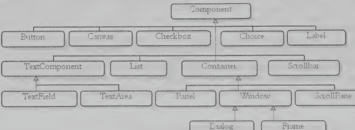

图 22.1：AWT 组件

`Component` 类拥有子类，代表你可以在 UI 程序上绘制的组件：

- `Button`。代表一个可点击的按钮。
- `Canvas`。代表一个可以在上面绘制自定义绘画的空白屏幕。
- `Checkbox`。代表一个复选框。
- `Choice`。代表一个单选按钮。
- `Container`。代表一个可以包含其他组件的组件。
- `Label`。代表一段不可编辑的文本。
- `List`。代表一个选项列表。
- `Scrollbar`。代表水平和垂直滚动条。
- `Component`。是两个具体类 `TextArea` 和 `TextField` 的父类。`TextField` 可以包含单行文本，而 `TextArea` 可以包含多行文本。

特别值得关注的是 `Container` 类。你可以使用它的 `add` 方法之一向 `Container` 中添加组件。`Container` 的具体实现是 `Window`，它是 `Frame` 类的父类。虽然你可以实例化 `Window`、`Frame` 或 `Dialog` 来包含其他组件，但 `Frame` 和 `Dialog` 比 `Window` 更容易使用且具有更多功能。`Frame` 和 `Dialog` 相似，不同在于 `Dialog` 通常用于获取用户输入。几乎所有的 AWT 应用程序都会至少有一个 `Frame`。

`Frame` 类提供了以下方法：

- `setTitle`。设置帧的标题。
- `add`。向帧添加 AWT 组件。
- `remove`。从帧中移除 AWT 组件。
- `show`。显示此帧。

在典型的 AWT 应用程序中，你通常通过构造 `Frame` 实例并向其添加组件来启动程序。代码列表 22.1 展示了 `AWTFrameDemo1` 类，它向 `Frame` 添加了各种 AWT 组件。

### 列表 22.1：使用 AWT 组件

```java
package app22;

import java.awt.Button;
import java.awt.Checkbox;
import java.awt.FlowLayout;
import java.awt.Frame;
import java.awt.Label;
import java.awt.TextField;

public class AWTFrameDemo1 extends Frame {

    private static final long serialVersionUID = 1L;

    public static void main(String[] args) {
        AWTFrameDemo1 frame = new AWTFrameDemo1();
        frame.setTitle("My AWT Frame");
        frame.setSize(300, 100);
        frame.setLayout(new FlowLayout());

        // add components
        Label label = new Label("Name");
        frame.add(label);

        TextField textField = new TextField();
        frame.add(textField);

        Button button = new Button("Register");
        frame.add(button);

        Checkbox checkbox = new Checkbox();
        frame.add(checkbox);

        frame.setVisible(true);
    }
}
```

`AWTFrameDemo1` 类继承了 `java.awt.Frame`。在你创建一个 `Frame` 后，可以调用它的 `setTitle` 方法并传递一个字符串作为其标题。你还可以调用 `setSize` 方法按像素设置帧的宽度和高度。

你可以通过 `Frame` 类的 `add` 方法向帧添加组件。在列表 22.1 中，我添加了四个组件：一个 `Label`、一个 `TextField`、一个 `Checkbox` 和一个 `Button`。最后，调用 `setVisible` 方法使帧可见。

如果你运行 `AWTFrameDemo1` 类，你将看到类似于图 22.2 的内容。它的实际外观取决于程序运行的操作系统。


图 22.2：一个 AWT Frame 和一些组件

图 22.2 中的帧大小为 300 x 100 像素。它的标题写为“My AWT Frame”。它上面添加了四个组件。

> **注意**
>
> 关闭按钮（由 X 标识）不会关闭帧。事实上，要让 AWT 帧通过单击即可关闭并不是直接的。这在 Swing 中得到了解决，这也是为什么 Swing 更好且更易用的原因之一。

图 22.2 中的 GUI 应用程序看起来足够用于介绍了，但你可以使用 AWT 库做更多事情。你可以添加菜单和子菜单，编写响应事件（如按钮点击或窗口缩放）的代码，使用布局管理器来布局组件等。

## 有用的 AWT 类

除了 AWT 类外，你还可以添加菜单和子菜单，编写响应事件（如按钮点击或窗口缩放）的代码，使用布局管理器来布局组件等。

## Swing 组件

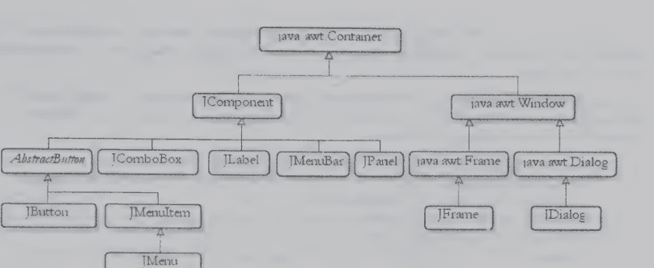

图 22.3：Swing 组件

除了 `JFrame`、`JDialog` 和 `Applet` 这三个顶层容器外，所有的 Swing 组件都必须位于容器中。你通常使用 `JFrame` 作为应用程序的主容器。`JDialog` 类似于 `JFrame`，但它通常存在于 `JFrame` 或另一个 `JDialog` 之中。还有一些不是由 `JDialog` 创建的对话框，例如 `JOptionPane` 和 `JFileChooser`。`Applet` 是 `java.applet.Applet` 的子类。它允许开发者在 applet 上使用 Swing 组件。你将在第 24 章“Applets”中学习更多关于 applet 的知识。为了区分 Swing 组件和 AWT 组件，Swing 组件的名称通常带有 `J` 前缀。

> 注意，`javax.swing.JFrame` 类派生自 `java.awt.Frame`，其他组件派生自 `javax.swing.JComponent`，后者又扩展了 `java.awt.Container`。

接下来的章节将讨论更重要的 Swing 组件。

## JFrame

一个 `JFrame` 代表一个框架容器。`JFrame` 是三个 Swing 顶层容器之一（另外两个是 `JDialog` 和 `Applet`）。只有顶层容器可以在不依赖其他容器的情况下显示在屏幕上。其他的 Swing 组件必须是容器的组件。

就像 `java.awt.Frame` 一样，你可以通过调用其中一个 `add` 方法向 `JFrame` 添加组件。然而，`JFrame` 只有一个子组件，即 `JRootPane`，它管理一个名为内容面板（content pane）的 `java.awt.Container`。规则是你只能向此内容面板添加非菜单组件，而不是直接添加到 `JFrame` 自身。因此，你使用以下代码来添加组件：

```java
jFrame.getContentPane().add(component)
```

不过，Sun 后来添加了一个 `add` 方法作为快捷方式，可以直接将组件添加到 `JFrame` 中。

```java
jFrame.add(component)
```

`remove` 和 `setLayout` 方法的情况也是如此。

一个 Swing 组件只能被添加到一个容器中。如果一个组件已经在某个容器中，将其移动到另一个容器时，它会自动将该组件从第一个容器中移除。

此外，`JFrame` 拥有 `setDefaultCloseOperation` 方法来控制 `JFrame` 关闭按钮的功能。`setDefaultCloseOperation` 方法可以接收 `JFrame` 中定义的以下静态 final 之一：

- `WindowConstants.DO_NOTHING_ON_CLOSE`。什么都不做。
- `WindowConstants.HIDE_ON_CLOSE`（默认值）。在调用所有注册的 `WindowListener` 对象后隐藏框架。
- `WindowConstants.DISPOSE_ON_CLOSE`。在调用所有注册的 `WindowListener` 对象后隐藏并销毁框架。
- `JFrame.EXIT_ON_CLOSE`。通过调用 `System.exit()` 退出应用程序。

注意 `JFrame` 实现了 `javax.swing.WindowConstants` 接口，因此你可以直接从 `JFrame` 内部使用上述静态 final。

例如，为了让 `JFrame` 在用户点击关闭按钮时退出，可以写道：

```java
frame.setDefaultCloseOperation(JFrame.EXIT_ON_CLOSE)
```

`JFrame` 有两个方法来显示 `JFrame` 实例：`pack` 和 `setVisible`。

```java
public void pack()
public void setVisible(boolean visible)
```

`pack` 会调整 `JFrame` 的大小，以适应其子组件的大小和布局。调用 `pack` 之后，你可能希望调用 `setVisible(true)` 来显示 `JFrame`。`pack` 的两种替代方案是 `setSize` 和 `setBounds`，它们将在“调整大小和定位”小节中讨论。

列表 22.2 展示了一个创建简单 `JFrame` 的类。

### 列表 22.2：JFrameDemo1 类

```java
package app22;

import javax.swing.JFrame;
import javax.swing.JLabel;
import javax.swing.SwingUtilities;

public class JFrameDemo {

    private static void constructGUI() {
        JFrame.setDefaultLookAndDecorated(true);
        JFrame frame = new JFrame();
        frame.setTitle("My First Swing Application");
        frame.setDefaultCloseOperation(JFrame.EXIT_ON_CLOSE);

        // 添加一个显示 Welcome 的 JLabel
        JLabel label = new JLabel("Welcome");
        frame.add(label);

        frame.pack();
        frame.setVisible(true);
    }

    public static void main(String[] args) {
        SwingUtilities.invokeLater(new Runnable() {
            public void run() {
                constructGUI();
            }
        });
    }
}
```

列表 22.2 中的 `JFrame` 类显示了一个与图 22.4 相似的 `JFrame`。


图 22.4：一个 JFrame

注意，`JFrame` 中的窗口由两个区域组成：标题栏和内容面板。窗口在标题栏的左侧有一个图标。标题栏右侧有三个按钮（最小化、恢复、关闭）。内容面板是为每个 `JFrame` 创建的另一个对象。

列表 22.2 中的代码是如何工作的？
首先，让我们谈谈 `main` 方法。

```java
public static void main(String[] args) {
    SwingUtilities.invokeLater(new Runnable() {
        public void run() {
            constructGUI();
        }
    });
}
```

Sun 建议你调用 `javax.swing.SwingUtilities` 类的静态 `invokeLater` 方法，以确保由 Swing 线程创建 GUI。使用此方法可以让你的 `JFrame` 正确。以下是它的签名：

```java
public static void invokeLater(Runnable r)
```

列表 22.2 中的 `JFrame` 类显示了一个与图 22.4 相似的 `JFrame`。


图 22.5：一个无装饰的 JFrame

## 扩展 JFrame

随着你的 Swing 应用变得越来越复杂，在子类内部扩展 `JFrame` 并构建你的 GUI，比在静态 `constructGUI` 方法内部构建要容易得多。列表 22.4 重写了 `JFrameDemo2` 以扩展 `JFrame`。然而，你仍然使用事件分发线程来构建 GUI，但构建 GUI 的复杂性已经移动到了子类中。

### 列表 22.4：扩展 JFrame

```java
package app22;

import java.awt.Dimension;
import java.awt.GridLayout;
import java.awt.Toolkit;
import javax.swing.JButton;
import javax.swing.JFrame;
import javax.swing.JLabel;
```


import javax.swing.JTextField;

import javax.swing.SwingUtilities;

class MyFrame extends JFrame {

    public MyFrame() {

        super();

        init();

    }

    public MyFrame(String title) {

        super(title);

        init();

    }

    private void init() {

        this.setDefaultCloseOperation(JFrame.EXIT_ON_CLOSE);

        this.setTitle("JFrame Test");

        this.setLayout(new GridLayout(3, 2));

        this.add(new JLabel("First Name:

```

```java

MyFrame frame = new MyFrame();

frame.setVisible(true);

}

public static void main(String[] args) {

    SwingUtilities.invokeLater(new Runnable() {

        public void run() {

            constructGUI();

        }

    });

}

```

运行时，`JFrameDemo3` 产生的结果与列表 22.3 中的 `JFrameDemo2` 相同。

## JComponent

所有的 Swing 组件都派自于抽象的 `javax.swing.JComponent` 类。以下是 `JComponent` 类用于操作组件外观的方法。

`public int getWidth()`
返回此组件的当前宽度（像素）。

`public int getHeight()`
返回此组件的当前高度（像素）。

`public int getX()`
返回组件左上角的当前 x 坐标。

`public int getY()`
返回组件左上角的当前 y 坐标。

`public java.awt.Graphics getGraphics()`
此组件返回一个你可以在其上绘图的 `Graphics` 对象。如果你想更改组件的外观，这非常有用。

`public void setBackground(java.awt.Color bg)`
设置此组件的背景颜色。

`public void setEnabled(boolean enabled)`
启用或禁用此组件。

`public void setFont(java.awt.Font font)`
设置用于在该组件上打印的字体。

`public void setForeground(java.awt.Color fg)`
设置此组件的前景颜色。

`public void setToolTipText(java.lang.String text)`
设置工具提示文本。

`public void setVisible(boolean visible)`
使此组件可见或隐藏它。

我将在本章稍后部分讨论其他方法。

# 342 Java：初学者教程（第四版）

## Icon 和 ImageIcon

`javax.swing.Icon` 接口是用于装饰 Swing 组件的小图像模板。在讨论其他 Swing 组件之前先讨论 Icon，是因为我们经常使用图标来装饰 Swing 组件。可以使用 `Icon` 对象的组件包括 `JLabel` 和 `JButton`。`Icon` 接口定义了 `getWidth` 和 `getHeight` 方法，分别返回 Icon 的宽度和高度（像素）。

```java
public int getWidth()

public int getHeight()
```

`javax.swing.ImageIcon` 类是 `Icon` 的实现。最简单的构造函数是使用接受文件名的那个。

```java
public ImageIcon(java.lang.String filename)
```

`filename` 参数可以是文件名或文件路径。使用正斜杠 `/` 作为目录与子目录的分隔符。支持的格式包括 GIF、JPEG 和 PNG。

通过创建 `ImageIcon` 实例来构造 `Icon` 就像这样简单。

```java
Icon icon = new ImageIcon("images/logo.gif");
```

你将在本章稍后的“JLabel”和“JButton”部分看到创建 `Icon` 来装饰 Swing 组件的示例。

## JLabel

`JLabel` 代表一个标签，即用于显示不可编辑文本的区域。`JLabel` 可以同时显示文本和图像。它甚至可以渲染 HTML 标签，因此你可以创建一个显示多颜色或多行文本的 `JLabel`。`javax.swing.JLabel` 类提供了这些方法：

```java
public JLabel()

public JLabel(java.lang.String text)

public JLabel(java.lang.String text, int horizontalAlignment)

public JLabel(Icon image)

public JLabel(Icon image, int horizontalAlignment)

public JLabel(java.lang.String text, Icon icon, int horizontalAlignment)
```

`horizontalAlignment` 的值以下之一：

- `SwingConstants.LEFT`
- `SwingConstants.CENTER`
- `SwingConstants.RIGHT`
- `SwingConstants.LEADING`
- `SwingConstants.TRAILING`

`JLabel` 拥有一个接受 `String` 的 `setText` 方法。它还有一个用于设置字体的 `setFont` 方法。另一种，如果你想在 `JLabel` 中使用多字体或多颜色，你可以像列表 22.5 示例所示那样使用 HTML 标签。

# 第 22 章：Swing 基础 343

### 列表 22.5：使用 JLabel

```java
package app22;

import java.awt.Color;

import java.awt.FlowLayout;

import java.awt.Font;

import javax.swing.ImageIcon;

import javax.swing.JFrame;

import javax.swing.JLabel;

import javax.swing.SwingConstants;

import javax.swing.SwingUtilities;

public class JLabelDemo extends JFrame {
    private static void constructGUI() {
        JFrame.setLookAndFeelDecorated(true);
        JFrame frame = new JFrame();
        frame.setLayout(new FlowLayout());
        frame.setDefaultCloseOperation(JFrame.EXIT_ON_CLOSE);
        frame.setTitle("JLabel Test");
        JLabel label1 = new JLabel("First Name");
        label1.setFont(new Font("Courier", Font.ITALIC, 12));
        label1.setForeground(Color.GRAY);

        JLabel label2 = new JLabel();
        label2.setText("<html>Last Name<br><font face='Courier' color='red'></font></html>>");

        JLabel label3 = new JLabel();
        label3.setText("<html>Last Name<br><font face=garamond color=red'></font></html>>");

        ImageIcon imageIcon = new ImageIcon("triangle.jpg");
        JLabel label4 = new JLabel(imageIcon);
        JLabel label5 = new JLabel(imageIcon, SwingConstants.RIGHT);

        frame.add(label1);
        frame.add(label2);
        frame.add(label3);
        frame.add(label4);
        frame.add(label5);
        frame.pack();
        frame.setVisible(true);
    }

    public static void main(String[] args) {
        SwingUtilities.invokeLater(new Runnable() {
            public void run() {
                constructGUI();
            }
        });
    }
}
```


# 344 Java：初学者教程（第四版）

如果你向 `JLabel` 的 `setText` 方法传递 HTML 标签，标签必须以 `<html>` 开始并以 `</html>` 结束。

图 22.7 显示运行列表 22.5 代码的结果。


## JButton

`JButton` 代表可点击的按钮。在典型的 Swing 应用中，`JButton` 连接到一个监听器，当 `JButton` 被点击时执行代码。事件监听器将在第 23 章中讨论。

`JButton` 有多个构造函数。这里是其中一些：

```java
public JButton()

public JButton(Icon icon)

public JButton(java.lang.String text)

public JButton(java.lang.String text, Icon icon)
```

你可以创建一个带有文本或带有 `Icon` 或图标的 `JButton`。`setText` 和 `getText` 方法允许你分配文本并获取 `JButton` 的文本。

列表 22.6 显示了一个 `JButton` 示例。该 `JButton` 同时包含文本和图标。

### 列表 22.6：使用 JButton

```java
package app22;
import javax.swing.ImageIcon;
import javax.swing.JFrame;
import javax.swing.JButton;
import javax.swing.SwingUtilities;
import java.awt.FlowLayout;

public class JButtonDemo extends JFrame {
    private static void constructGUI() {
        JFrame frame = new JFrame();
        frame.setLayout(new FlowLayout());
        frame.setDefaultCloseOperation(JFrame.EXIT_ON_CLOSE);
        frame.setTitle("JButton Test");
        ImageIcon imageIcon = new ImageIcon("triangle.jpg");
        JButton loginButton = new JButton("Login", imageIcon);
        frame.add(loginButton);
        frame.pack();
        frame.setVisible(true);
    }

    public static void main(String[] args) {
        SwingUtilities.invokeLater(new Runnable() {
            public void run() {
                constructGUI();
            }
        });
    }
}
```

## Swing 基础

```java
SwingUtilities.invokeLater(new Runnable() {
    public void run() {
        constructGUI();
    });
}
```

图 22.8 显示了运行列表 22.6 中的代码时 `JButton` 的外观。请注意，在这个示例中，`JButton` 占据了 `JFrame` 内容面板的整个区域。


图 22.8：使用 JButton

## JTextField 和 JPasswordField

`JTextField` 代表一个文本字段。`JTextField` 类继承自 `JComponent`，而 `JComponent` 是 `JTextArea` 和 `JEditorPane` 的直接父类。`JFormattedTextField` 和 `JPasswordField` 是 `JTextField` 的一些子类。

`JTextField` 只能接受单行文本。相比之下，`JTextArea` 允许多行文本。

这里是 `JTextField` 两个构造函数。

```java
public JTextField()
public JTextField(java.lang.String text)
```

第二个构造函数期望一个 `String`，它将作为所构建的 `JTextField` 的文本。如果你使用第一个构造函数，可以调用 `setText` 方法来设置文本：

```java
public void setText(java.lang.String text)
```

要获取文本，使用 `getText` 方法。

```java
public java.lang.String getText()
```

`setText` 和 `getText` 都继承自 `JComponent`。

`JPasswordField` 是 `JTextField` 的后代，它与 `JTextField` 类似，但文本的每个字符都以回显字符显示（默认是星号）。这里是 `JPasswordField` 的两个构造函数。

```java
public JPasswordField()
public JPasswordField(java.lang.String initialPassword)
```

要设置密码，使用继承自 `JComponent` 的 `setText` 方法。`JPasswordField` 重写了 `getText` 方法，该方法现在已被弃用。要获取 `JPasswordField` 的内容，请使用 `getPassword` 方法。

```java
public char[] getPassword()
```

你可以使用 `setEchoChar` 方法设置回显字符：

```java
public void setEchoChar(char c)
```

向 `setEchoChar` 传递 0 会告诉 `JPasswordField` 以不掩码显示字符。

`getEchoChar` 方法允许你获取回显字符。

列表 22.7 显示了 `JTextField` 和 `JPasswordField` 的示例：

### 列表 22.7：使用 JTextField 和 JPasswordField


```java
package app22;
import java.awt.GridLayout;
import javax.swing.JFrame;
import javax.swing.JLabel;
import javax.swing.JPasswordField;
import javax.swing.JTextField;
import javax.swing.SwingConstants;
import javax.swing.SwingUtilities;

public class JTextFieldDemo extends JFrame {
    private static void constructGUI() {
        JFrame frame = new JFrame();
        frame.setDefaultLookAndFeelDecorated(true);
        frame.setDefaultCloseOperation(JFrame.EXIT_ON_CLOSE);
        frame.setTitle("TextField Test");
        frame.setLayout(new GridLayout(2, 2));
        JLabel label1 = new JLabel("User Name:", SwingConstants.RIGHT);
        JLabel label2 = new JLabel("Password:", SwingConstants.RIGHT);
        JTextField username = new JTextField(20);
        JPasswordField password = new JPasswordField();
        frame.add(label1);
        frame.add(username);
        frame.add(label2);
        frame.add(password);
        frame.setSize(200, 70);
        frame.setVisible(true);
    }

    public static void main(String[] args) {
        SwingUtilities.invokeLater(new Runnable() {
            public void run() {
                constructGUI();
            }
        });
    }
}
```

运行列表 22.7 中代码的结果如图 22.9 所示。

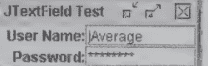

图 22.9：使用 `JTextField` 和 `JPasswordField`

# JTextArea

`JTextArea` 代表一个用于显示文本的多行区域。你可以更改显示的行数和列数。你还可以设置换行和换词。你也可以将 `JTextArea` 放在 `JScrollPane` 中使其可以滚动。

这里是 `JTextArea` 类的一些构造函数：

```java
public JTextArea()
public JTextArea(int rows, int columns)
public JTextArea(java.lang.String text)
public JTextArea(java.lang.String text, int rows, int columns)
```

此外，这里是 `JTextArea` 中一些更重要的方法。

```java
public void append(java.lang.String str)
    在文本末尾追加字符串。
public int getColumns()
    返回 JTextArea 的列数。
public int getRows()
    返回 JTextArea 的行数。
public void setColumns(int columns)
    设置 JTextArea 的列数。
public void setRows(int rows)
    设置 JTextArea 的行数。
```

列表 22.8 中的代码创建了一个带有两个 `JTextArea` 组件的 `JFrame`。第二个显示在 `JScrollPane` 中。

## 列表 22.8：使用 JTextArea

```java
package app22;
import java.awt.Dimension;
import java.awt.FlowLayout;
import javax.swing.JFrame;
import javax.swing.JTextArea;
import javax.swing.JScrollPane;
import javax.swing.SwingUtilities;

public class JTextAreaDemo extends JFrame {
    private static void constructGUI() {
        JFrame frame = new JFrame();
        frame.setDefaultLookAndFeelDecorated(true);
        frame.setDefaultCloseOperation(JFrame.EXIT_ON_CLOSE);
        frame.setTitle("TextArea Test");
        frame.setLayout(new FlowLayout());
        JTextArea textArea1 = new JTextArea(5, 5);
        JTextArea textArea2 = new JTextArea(5, 20);
        JScrollPane scrollPane = new JScrollPane(textArea2);
        frame.add(textArea1);
        frame.add(scrollPane);
        frame.setSize(400, 300);
        frame.setVisible(true);
    }

    public static void main(String[] args) {
        SwingUtilities.invokeLater(new Runnable() {
            public void run() {
                constructGUI();
            }
        });
    }
}
```

# JCheckBox

`JCheckBox` 代表一个复选框。你通过向它传递字符串、图标或图标来构造 `JCheckBox`。这里是 `JCheckBox` 类的一些构造函数。

```java
public JCheckBox(java.lang.String text)
public JCheckBox(Icon icon)
public JCheckBox(java.lang.String text, Icon icon)
```

你可以通过向其 `setSelected` 方法传递 `true` 来程序化地勾选 `JCheckBox`。没有其他 `getSelected` 方法可以用来检查 `JCheckBox` 是否被选中。对于这一点，你需要使用事件监听器。

# 第 22 章：Swing 基础


图 22.11：使用 `JCheckBox`

## JRadioButton

`JRadioButton` 表示一个单选按钮。你可以使用多个 `JRadioButton` 来表示一个选择列表，在该列表中只能有一个项目可以被选中。为了对单选按钮进行逻辑分组，你需要使用一个 `javax.swing.ButtonGroup` 对象。

与 `JCheckBox` 类似，你可以传递一个字符串、一个图标或一个字符串加图标来构造一个 `JRadioButton`。以下是它的一些构造函数。

```java
public JRadioButton(java.lang.String text)
public JRadioButton(Icon icon)
public JRadioButton(java.lang.String text, Icon icon)
```

要通过程序选择一个 `JRadioButton`，请向 `setSelected` 方法传递 `true`。然而，要检测按钮组中的哪个单选按钮被选中，你需要使用监听器。请阅读第 16 章“进阶使用 Swing”以学习如何实现这一点。

例如，列表 22.10 显示了在按钮组中显示三个单选按钮的代码。

## 列表 22.10：使用 JRadioButton

```java
package app;
import java.awt.FlowLayout;
import javax.swing.ButtonGroup;
import javax.swing.JFrame;
import javax.swing.JLabel;
import javax.swing.JRadioButton;
import javax.swing.SwingUtilities;

public class JRadioButtonDemo {
    private static void constructGUI() {
        JFrame.setDefaultLookAndFeelDecorated(true);
        JFrame frame = new JFrame("JRadioButton Test");
        frame.setLayout(new FlowLayout());
        frame.setDefaultCloseOperation(JFrame.EXIT_ON_CLOSE);
        JRadioButton button1 = new JRadioButton("Red");
        JRadioButton button2 = new JRadioButton("Green");
        JRadioButton button3 = new JRadioButton("Blue");
        ButtonGroup group = new ButtonGroup();
        group.add(button1);
        group.add(button2);
        group.add(button3);
        button1.setSelected(true);
        frame.add(new JLabel("Color:"));
        frame.add(button1);
        frame.add(button2);
        frame.add(button3);
        frame.pack();
        frame.setVisible(true);
    }

    public static void main(String[] args) {
        SwingUtilities.invokeLater(new Runnable() {
            public void run() {
                constructGUI();
            }
        });
    }
}
```

图 22.12 显示了运行列表 22.10 中类的结果。


图 22.12：使用 `JRadioButton`

## JList

`JList` 显示一组对象选择，用户可以从中选择一个或多个选项。构造 `JList` 的最简单方法是向其构造函数传递一个 `java.lang.Object` 数组：

`public JList(java.lang.Object[] selections)`

你可以通过使用 `setSelectionMode` 方法确定用户是否可以从 `JList` 中选择单个项目或多个项目：

`public void setSelectionMode(int selectionMode)`

`selectionMode` 的有效值是 `ListSelectionModel` 接口中的字段之一：

- `SINGLE_SELECTION`。允许选择单个项目。
- `SINGLE_INTERVAL_SELECTION`。允许选择多个项目，但选中的项目必须是连续的。
- `MULTIPLE_INTERVAL_SELECTION`。允许选择多个项目，且选中的项目可以连续也可以不连续。

你可以通过 `setSelectedIndex` 和 `setSelectedIndices` 方法设置初始选择项（索引从 0 开始，因此索引 0 指向 `JList` 中的第一个选项）：

`public void setSelectedIndex(int index)`

`public void setSelectedIndices(int[] indices)`

此外，你可以使用这些方法之一获取被选中的项目：

`public int getSelectedIndex()`

返回第一个选中的索引，如果没有被选中的项目则返回 -1。

`public int[] getSelectedIndices()`

返回被选中索引的数组。

`public java.lang.Object getSelectedValue()`

返回第一个选中的值，如果没有项目被选中，则返回 `null`。

`public java.lang.Object[] getSelectedValues()`

以 Object 数组的形式返回所有选中的项目。

列表 22.11 显示了使用 `JList` 的代码。

## 列表 22.11：使用 JList

```java
package app22;
import java.awt.FlowLayout;
import javax.swing.JFrame;
import javax.swing.JList;
import javax.swing.SwingUtilities;

public class JListDemo {
    private static void constructGUI() {
        JFrame.setDefaultLookAndFeelDecorated(true);
        JFrame frame = new JFrame("JList Test");
        frame.setLayout(new FlowLayout());
        frame.setDefaultCloseOperation(JFrame.EXIT_ON_CLOSE);
        String[] selections = {"green", "red", "orange", "dark blue"};
        JList<String> list = new JList<String>(selections);
        list.setSelectedIndex(1);
        System.out.println(list.getSelectedValue());
        frame.add(list);
        frame.pack();
        frame.setVisible(true);
    }

    public static void main(String[] args) {
        SwingUtilities.invokeLater(new Runnable() {
            public void run() {
                constructGUI();
            }
        });
    }
}
```

运行代码后，你会看到类似图 22.13 的内容。

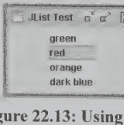

## JComboBox

`JComboBox` 与 `JList` 非常相似，不同之处在于只有一个项目可以被选中。此外，`JComboBox` 显示选中的项目，你可以可以看到。像 `JList` 一样，你可以将对象数组传递给 `JComboBox`：

`public JComboBox(java.lang.Object[] selections)`

此外，`JComboBox` 拥有 `getSelectedIndex()`、`getSelectedItem()` 和 `getSelectedValues()` 方法。这些方法的签名如下：

`public int getSelectedIndex()`

返回选中的索引，如果没有选中项目则返回 -1。

`public java.lang.Object getSelectedItem()`

返回选中的值，如果没有项目被选中，则返回 `null`。

`public java.lang.Object[] getSelectedValues()`

以数组的形式返回所有选中的项目。

## 列表 22.12：使用 JComboBox


```java
package app;
import java.awt.FlowLayout;
import javax.swing.JComboBox;
import javax.swing.JFrame;
import javax.swing.SwingUtilities;

public class JComboBoxDemo {
    private static void constructGUI() {
        JFrame.setDefaultLookAndFeelAndDecorated(true);
        JFrame frame = new JFrame("JComboBox Test");
        frame.setLayout(new FlowLayout());
        frame.setDefaultCloseOperation(JFrame.EXIT_ON_CLOSE);
        String[] selections = {"green", "red", "orange", "dark blue"};
        JComboBox<String> comboBox = new JComboBox<String>(selections);
        comboBox.setSelectedIndex(1);
        System.out.println(comboBox.getSelectedItem());
        frame.add(comboBox);
        frame.pack();
        frame.setVisible(true);
    }

    public static void main(String[] args) {
        SwingUtilities.invokeLater(new Runnable() {
            public void run() {
                constructGUI();
            }
        });
    }
}
```

运行代码后，你会看到一个类似于图 22.14 的 `JFrame`。

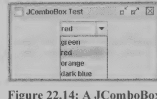

## JDialog

`JDialog` 表示一个对话框，它是一个顶层容器，你可以扩展它创建一个与用户交互的窗口。你可以用它显示消息、接收用户输入等。对话框可以是模态的（`modal`）或非模态的（`modeless`）。模态对话框在显示时会阻塞同一应用程序中所有其他窗口的输入。也就是说，你必须关闭模态对话框，同一应用程序中的其他窗口才能获取焦点。非模态的则不会阻塞输入。对话框可以属于另一个对话框或框架，也可以像 `JFrame` 一样独立存在。然而，大多数情况下你会希望使用属于框架的对话框。对于独立的顶层容器，我们通常使用 `JFrame`。当对话框属于另一个对话框或框架时，它会在所有者被销毁时被销毁。

### 列表 22.13: AddressDialog

```java
package app22;
import java.awt.Frame;
import java.awt.GridLayout;
import javax.swing.JDialog;
import javax.swing.JLabel;
import javax.swing.JTextField;

public class AddressDialog extends JDialog {
    JLabel label1 = new JLabel("Address:");
    JLabel label2 = new JLabel("City:");
    JLabel label3 = new JLabel("State:");
    JLabel label4 = new JLabel("Zip Code:");
    JTextField addressField = new JTextField();
    JTextField cityField = new JTextField();
    JTextField stateField = new JTextField();
    JTextField zipCodeField = new JTextField();
    String[] address = new String[4];

    public AddressDialog(Frame owner, boolean modal) {
        super(owner, modal);
        init();
    }

    private void init() {
        this.setTitle("Address Dialog");
        this.setLayout(new GridLayout(4, 2));
        this.add(label1);
        this.add(addressField);
        this.add(label2);
        this.add(cityField);
        this.add(label3);
        this.add(stateField);
        this.add(label4);
        this.add(zipCodeField);
    }

    public String[] getAddress() {
        address[0] = addressField.getText();
        address[1] = cityField.getText();
        address[2] = stateField.getText();
        address[3] = zipCodeField.getText();
        return address;
    }
}
```

注意，`AddressDialog` 的客户端可以调用其 `getAddress()` 方法来获取用户的地址信息。显示时，`AddressDialog` 如图 22.15 所示。

| 地址对话框 | |
|---|---|
| 地址 | |
| 城市 | |
| 州 | |
| 邮政编码 | |

图 22.15: AddressDialog

### 列表 22.14: JDialogDemo 类

```java
package app22;
import java.awt.FlowLayout;
import java.awt.event.ActionEvent;
import java.awt.event.ActionListener;
import javax.swing.JButton;
import javax.swing.JDialog;
import javax.swing.JFrame;
import javax.swing.SwingUtilities;

public class JDialogDemo extends JFrame {
    AddressDialog dialog = new AddressDialog(this, false);
    public JDialogDemo(String title) {
        super(title);
        init();
    }
    public JDialogDemo() {
        super();
        init();
    }
    private void init() {
        this.getContentPane().setLayout(new FlowLayout());
        this.setDefaultCloseOperation(JFrame.EXIT_ON_CLOSE);
        AddressDialog dialog = new AddressDialog(this, false);
        JButton button = new JButton("Show Dialog");
        button.addActionListener(new ActionListener() {
            public void actionPerformed(ActionEvent se) {
                displayDialog();
            }
        });
        this.getContentPane().add(button);
    }
    private void displayDialog() {
        dialog.setSize(250, 120);
        dialog.setVisible(true);
    }
    private static void constructGUI() {
        JFrame.setDefaultLookAndFeelDecorated(true);
        JDialog.setDefaultLookAndFeelDecorated(true);
        JDialogDemo frame = new JDialogDemo();
        frame.pack();
        frame.setVisible(true);
    }
    public static void main(String[] args) {
        SwingUtilities.invokeLater(new Runnable() {
            public void run() {
                constructGUI();
            }
        });
    }
}
```

`JDialogDemo` 类显示了一个 `JButton`，你可以点击它来显示 `AddressDialog`。为了实现这一点，`JDialogDemo` 使用了 `ActionListener`，这是在第 23 章“更高级的 Swing”中讨论过的一种类型。

## JOptionPane

`JOptionPane` 对象代表一个对话框，你可以将它用于几个用途：

- 显示消息（通过使用 `showMessageDialog()` 方法）
- 请求用户确认（使用 `showConfirmDialog()` 方法）
- 获取用户输入（使用 `showInputDialog()` 方法）
- 执行上述所有操作（使用 `showOptionDialog()` 方法）

`JOptionPane` 中的大多数方法都是静态的，因此你只需一行代码即可创建一个对话框。你可以将 `JOptionPane` 作为框架的对话框使用或独立使用。你可以传递一个要在对话框中显示的消息、视觉组件或图标。`JOptionPane` 提供了四个现即用的默认图标。你甚至可以在非 Swing 程序中使用 `JOptionPane`，作为一种与用户交互的简单方式。

接下来的章节将讨论你可以使用 `JOptionPane` 实现的四个主要功能。

### 使用 JOptionPane 显示消息

你使用 `JOptionPane` 类的 `showMessageDialog()` 方法来显示消息。该方法有三个重载。

```java
public static void showMessageDialog(java.awt.Component parent,
java.lang.Object message)
```

```java
public static void showMessageDialog(java.awt.Component parent,
java.lang.Object message, String title, int messageType)
```

```java
public static void showMessageDialog(java.awt.Component parent,
java.lang.Object message, String title, int messageType, Icon icon)
```

`parent` 参数指定显示 `JOptionPane` 的 `java.awt.Component`。如果向此参数传递 `null`，或者父组件没有框架，则将使用默认框架。

`message` 参数指定消息。`title` 参数指定对话框的标题。`messageType` 可以分配以下之一：

- `JOptionPane.ERROR_MESSAGE`
- `JOptionPane.INFORMATION_MESSAGE`
- `JOptionPane.WARNING_MESSAGE`
- `JOptionPane.QUESTION_MESSAGE`
- `JOptionPane.PLAIN_MESSAGE`

例如，此代码段显示了不同的对话框：

```java
JOptionPane.showMessageDialog(null, "Thank you for visiting", "Thank You");
```

```java
JOptionPane.showMessageDialog(null, "You have not saved", "Warning");
```

```java
JOptionPane.showMessageDialog(null, "First Name must have", "Error");
```

图 22.16、22.17 和 22.18 分别显示信息对话框、警告对话框和错误对话框。

- 图 22.16: 信息对话框
- 图 22.17: 警告对话框
- 图 22.18: 错误对话框

### 使用 JOptionPane 提示用户确认

你可以使用 `showConfirmDialog()` 静态方法请求用户确认。该方法显示一个带有按钮的对话框，例如是按钮、否按钮、取消按钮或确定按钮。你可以选择显示的按钮，也可以创建自己的。对话框结束后，`JOptionPane` 返回以下之一：

- `JOptionPane.YES_OPTION`
- `JOptionPane.NO_OPTION`
- `JOptionPane.CANCEL_OPTION`
- `JOptionPane.OK_OPTION`

此外，如果用户通过点击对话框右上角的关闭按钮关闭 `JOptionPane`，则返回 `JOptionPane.CLOSED_OPTION`。`showConfirmDialog()` 方法有四个重载，签名如下：

```java
public static int showConfirmDialog(java.awt.Component parent, java.lang.Object message)
public static int showConfirmDialog(java.awt.Component parent, java.lang.Object message, String title, int optionType)
public static int showConfirmDialog(java.awt.Component parent, java.lang.Object message, String title, int optionType, int messageType)
public static int showConfirmDialog(java.awt.Component parent, java.lang.Object message, String title, int optionType, int messageType, Icon icon)
```

`parent` 参数指定显示此 `JOptionPane` 的 `java.awt.Frame`。如果向此参数传递 `null`，或者父组件没有框架，则将使用默认框架。`message` 参数指定要显示的消息。`title` 参数指定打印在对话框标题栏上的标题。`optionType` 参数指定将显示的按钮。其值如下：

- `JOptionPane.YES_NO_OPTION`，会导致显示“是”和“否”按钮。
- `JOptionPane.YES_NO_CANCEL_OPTION`，会导致显示“是”、“否”和“取消”按钮。

如果在没有参数选项 `optionType` 的情况下使用了第一个重载方法，则假设使用 `JOptionPane.YES_NO_CANCEL_OPTION`。

例如，列表 22.15 中的 `JOptionPaneTest2` 类展示了如何使用 `JOptionPane` 类来提示用户确认。

### 列表 22.15：使用 JOptionPane 提示用户确认


```java
package app22;
import javax.swing.JOptionPane;
import javax.swing.JOptionPane;
import javax.swing.JLabel;

public class JOptionPaneDemo2 {
    public static void main(String[] args) {
        JLabel.setDefaultLookAndDecorated(true);
        int response = JOptionPane.showConfirmDialog(null,
            "Do you want to continue?", "Confirm",
            JOptionPane.YES_NO,
            JOptionPane.QUESTION_MESSAGE);
        if (response == JOptionPane.NO_OPTION) {
            System.out.println("No button clicked");
        } else if (response == JOptionPane.YES_OPTION) {
            System.out.println("Yes button clicked");
        } else if (response == JOptionPane.CLOSED_OPTION) {
            System.out.println("JOptionPane closed");
        }
    }
}
```

如果你运行该程序，你将看到一个类似于图 22.19 所示的 `JOptionPane` 对话框。


图 22-15：请求用户输入

## 获取用户输入的 JOptionPane

`JOptionPane` 的第三用途是通过使用 `showInputDialog` 方法获取用户输入。该方法会显示一个 `JOptionPane`，并包含一个文本框供用户输入值。`showInputDialog` 可以返回以下内容之一：

- 用户在输入值后点击 OK 按钮时输入的字符串。
- 空字符串，如果用户在没有输入值的情况下点击了 OK 按钮，且没有显示初始值。
- `null`，如果通过点击关闭按钮或取消按钮关闭了 `JOptionPane`。
- `java.lang.Object`，如果用户选择了 JOptionPane 显示的预定义选项之一。

`showInputDialog` 方法有多个重载版本，其签名如下。

```java
public static java.lang.String showInputDialog(
    java.awt.Component parent, java.lang.Object message)
public static java.lang.String showInputDialog(
    java.awt.Component parent, java.lang.Object message,
    java.lang.Object initialSelectionValue)
public static java.lang.String showInputDialog(
    java.awt.Component parent, java.lang.Object message,
    java.lang.String title, int messageType)
public static java.lang.String showInputDialog(
    java.awt.Component parent, java.lang.Object message,
    java.lang.String title, int messageType, Icon icon,
    java.lang.Object[] selectionValues,
    java.lang.Object initialSelectionValue)
public static java.lang.String showInputDialog(
    java.lang.Object message, Object initialSelectionValue)
```

`parent` 参数指定了显示此 JOptionPane 的 `java.awt.Frame`。如果向此参数传递 `null` 或父组件没有框架，则使用默认框架。

`message` 参数指定了将显示的标题。

`title` 参数指定了将打印在对话框标题栏上的标题。如果没有 `title` 参数，则标题栏上将显示字符串 "Input"。

`messageType` 参数指定了消息类型，其值为以下内容之一：

- `JOptionPane.INFORMATION_MESSAGE`
- `JOptionPane.ERROR_MESSAGE`
- `JOptionPane.WARNING_MESSAGE`
- `JOptionPane.QUESTION_MESSAGE`
- `JOptionPane.PLAIN_MESSAGE`

如果不存在 `messageType` 参数，则假设值为 `JOptionPane.QUESTION_MESSAGE`。

`selectionValues` 参数指定了一个对象数组，提供了可能的选择，而 `initialSelectionValue` 参数指定了输入字段中的初始值。

例如，以下代码行显示了如图 22.20 所示的输入数据。

```java
String input = JOptionPane.showInputDialog(null,
"Enter Your Name", "John Average");
```

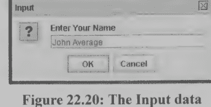

作为另一个例子，考虑列表 22.16 中的 `JOptionPane` 类。

## 列表 22.16：带有预定义选择的 JOptionPane app22

```java
package app22;
import javax.swing.JDialog;
import javax.swing.JOptionPane;

public class JOptionPaneDemo3 {
    public static void main(String[] args) {
        JDialog.setDefaultLookAndFeelDecorated(true);
        Object[] selectionValues = { "Pandas", "Dogs", "Horses" };
        String initialSelection = "Dogs";
        Object selection = JOptionPane.showInputDialog(null,
            "What are your favorite animals?", "Zoo Quiz",
            JOptionPane.MESSAGE, null,
            selectionValues, initialSelection);
        System.out.println(selection);
    }
}
```

`JOptionPaneDemo3` 显示了预定义的选择。这里定义了三个值："Pandas"、"Dogs" 和 "Horses"。`initialSelection` 的值为 "Dogs"，所以这是初始值。运行时，`JOptionPaneDemo3` 将显示出一个类似于图 22.21 的界面。


## JFileChooser

`JFileChooser` 专门设计用于让用户轻松选择文件或目录。通过向其 `setMultiSelectionEnabled` 方法传递 `true`，你可以创建一个允许多选的 `JFileChooser`。有三种方法可以用于此目的。这些方法的返回值为以下之一：

- `JFileChooser.CANCEL_OPTION`，如果用户点击取消。
- `JFileChooser.APPROVE_OPTION`，如果用户点击 OK/保存。
- `JFileChooser.ERROR_OPTION`，如果用户关闭对话框。

以下是这些方法的签名：

```java
java.io.File getSelectedFile()
java.io.File[] getSelectedFiles()
```

类 22.17 中的 `JFileChooserTest` 提供了一个带有按钮的 `JFrame`。该按钮会弹出 `JFileChooser` 对话框。点击打开按钮后将显示所选的文件。

## 列表 22.17：使用 JFileChooser

```java
package app22;
import java.awt.FlowLayout;
import java.awt.event.ActionEvent;
import java.awt.event.ActionListener;
import java.io.File;
import javax.swing.JButton;
import javax.swing.JDialog;
import javax.swing.JFileChooser;
import javax.swing.JFrame;
import javax.swing.SwingUtilities;

public class JFileChooserDemo extends JFrame {
    private static void constructorGUI() {
        JFrame.setDefaultLookAndDecorated(true);
        JDialog.setDefaultLookAndFeelDecorated(true);
        JFrame frame = new JFrame("JFileChooser Test");
        frame.setLayout(new FlowLayout());
        frame.setDefaultCloseOperation(JFrame.EXIT_ON_CLOSE);
        JButton button = new JButton("Select File");
        button.addActionListener(new ActionListener() {
            public void actionPerformed(ActionEvent ae) {
                JFileChooser fileChooser = new JFileChooser();
                int returnValue = fileChooser.showOpenDialog(null);
                if (returnValue == JFileChooser.APPROVE_OPTION) {
                    File selectedFile = fileChooser.getSelectedFile();
                    System.out.println(selectedFile.getName());
                }
            }
        });
        frame.add(button);
        frame.pack();
        frame.setVisible(true);
    }
    public static void main(String[] args) {
        SwingUtilities.invokeLater(new Runnable() {
            public void run() {
                constructorGUI();
            }
        });
    }
}
```

图 22.22 显示了 JFileChooser

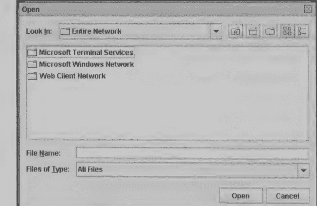

图 22.22：一个 JFileChooser

## 总结

本章是关于 Swing 的两个部分之一。在本章中，你学习了 AWT 基础组件以及 Swing 集合中的一些。本章涵盖了 `JFrame`、`JButton`、`JLabel`、`JList`、`JComboBox`、`JDialog`、`JOptionPane` 和 `JFileChooser`。

## 测验

1. 为什么学习 AWT 在今天仍然具有意义？
2. 代表组件的 AWT 类是哪一个？
3. 构造 `Color` 对象最简单的方法是什么？
4. 可以添加到 `JFrame` 中的唯一非菜单子组件是哪一个？
5. 在构建 Swing GUI 时，使用 `SwingUtilities.invokeLater` 的意义是什么？
6. Swing 的三个顶层容器分别是什么？

# 第 23 章

# 进阶 Swing 技巧

在第 22 章“Swing 基础”中，你学习了 AWT 和 Swing 组件。本章是 Swing 的延续部分，讨论了你在 Swing 编程中不可避免会使用的技术：布局管理和事件处理。此外，还讨论了菜单、外观（look and feel）、快速启动界面、系统托盘和 Java 桌面应用。

## 布局管理器

容器（如 `JFrame` 和 `JDialog`）需要一个 `java.awt.LayoutManager` 来布局组件。`LayoutManager` 负责调整所有子组件的大小和位置，并在容器调整大小时重新排列组件。`java.awt.Container` 类有一个 `setLayout` 方法用于添加布局管理器。`javax.swing.JPanel` 继承自 `Container`，你也可以向 Swing 组件添加 `LayoutManager`。例如，如果 `JLabel` 被添加了组件，为其添加 `LayoutManager` 并不常见。

对于某些组件，你可以直接将 `LayoutManager` 传递给该组件类。`JPanel` 就是这种情况。

```java
JPanel panel = new JPanel(layoutManager);
```

对于 `JFrame`，你向它的内容面板（content pane）添加 `LayoutManager`：

```java
JFrame.getContentPane().setLayout(layoutManager);
```

`JFrame` 中也有一个 `setLayout` 方法可以向其内容面板添加布局管理器：

```java
JFrame.setLayout(layoutManager);
```

要告诉 `LayoutManager` 组件的偏好尺寸，请使用 `java.awt.Dimension` 对象调用组件的 `setPreferredSize` 方法。例如：

```java
button.setPreferredSize(new Dimension(300, 300));
```

`LayoutManager` 接口定义了布局管理器必须实现的方法。在 `java.awt` 和 `javax.swing` 包中，该接口有几个默认实现。除非你正在编写 `LayoutManager` 的实现，否则你很少需要 `LayoutManager` 接口的方法。在大多数情况下，这些默认实现已经足够了。

图 23.1 显示了 `LayoutManager` 接口及其部分实现。

| 接口 | 实现 |
| :--- | :--- |
| `LayoutManager` | `BorderLayout`、`CardLayout`、`FlowLayout`、`GridBagLayout`、`GridLayout`、`javax.swing.BoxLayout`、`javax.swing.SpringLayout` |

图 23.1：`LayoutManager` 接口及其实现

为了方便起见，图 23.1 中 `java.awt` 的成员在绘制时没有带包信息。图 23.1 中的两个实现类 `BoxLayout` 和 `SpringLayout` 属于 `javax.swing` 包。

接下来的章节将讨论一些 `LayoutManager` 的实现。

## BorderLayout

`BorderLayout` 将组件排列以适应五个区域：北（north）、南（south）、东（east）、西（west）和中心（center）。`BorderLayout` 中有五个 `java.lang.String` 类型的静态字段指示这些区域：`NORTH`、`SOUTH`、`EAST`、`WEST` 和 `CENTER`。每个区域可以包含多个组件。如果你向一个区域添加多个组件，则只有最后一个会被显示。

要向使用 `BorderLayout` 的容器添加组件，你需要调用容器的 `add` 方法，并传递组件和区域字段。例如，以下代码向一个 `JFrame` 中添加了一个 `JButton`。

```java
JFrame.add(new JButton("Register"), BorderLayout.NORTH);
```

如果没有提供区域字段，组件将放置在中心。

`BorderLayout` 是默认的布局管理器。如果你没有专门地向容器添加 `LayoutManager`，将使用 `BorderLayout` 来布局容器中的组件。

列表 23.1 展示了如何使用 `BorderLayout` 的示例。

## 列表 23.1：使用 BorderLayout


```java
package app23;
import java.awt.BorderLayout;
import javax.swing.JButton;
import javax.swing.JFrame;
import javax.swing.JTextField;
import javax.swing.SwingUtilities;

public class BorderLayoutDemo extends JFrame {
    private static void constructGUI() {
        JFrame.setDefaultLookAndFeelAndFeel(true);
        JFrame frame = new JFrame("BorderLayout Test");
        frame.setDefaultCloseOperation(JFrame.EXIT_ON_CLOSE);
        frame.setLayout(new BorderLayout());
        JTextField textField = new JTextField("<your name>");
        frame.add(textField, BorderLayout.WEST);
        JButton button =
            new JButton("<html>R<b>b</b>gister</html>");
        frame.add(button, BorderLayout.EAST);
        frame.pack();
        frame.setVisible(true);
    }

    public static void main(String[] args) {
        SwingUtilities.invokeLater(new Runnable() {
            public void run() {
                constructGUI();
            }
        });
    }
}
```

运行 `BorderLayoutTest` 类的结果如图 23.2 所示。


图 23.2：使用 `BorderLayout` 的 `JFrame`（左侧）和调整大小后的同一 `JFrame`（右侧）

注意 `JTextField` 和 `JButton` 被放置在 `JFrame` 的西部和东部。如果你调整 `JFrame` 的大小，组件将保持它们的位置。每个组件的大小会相应调整，而设置组件的大小（通过使用 `setSize`）没有效果。显然，`BorderLayout` 对组件的大小和位置具有最终决定权。

列表 23.2 显示了 `BorderLayout` 的另一个示例

```java
package app23;
import java.awt.BorderLayout;
import javax.swing.JButton;
import javax.swing.JFrame;
import javax.swing.JTextField;
import javax.swing.SwingUtilities;

public class BorderLayout2 extends JFrame {
    private static void constructGUI() {
        JFrame.setDefaultLookAndFeelAndFeel(true);
        JFrame frame = new JFrame("BorderLayout Test");
        frame.setDefaultCloseOperation(JFrame.EXIT_ON_CLOSE);
        frame.setLayout(new BorderLayout());
        JTextField textField = new JTextField("your name");
        frame.add(textField, BorderLayout.WEST);
        JButton button =
            new JButton("<html>R<b>b</b>gister</html>");
        frame.add(button, BorderLayout.EAST);
        frame.pack();
        frame.setVisible(true);
    }

    public static void main(String[] args) {
        SwingUtilities.invokeLater(new Runnable() {
            public void run() {
                constructGUI();
            }
        });
    }
}
```

运行 `BorderLayout2` 类的结果如图 23.3 所示。


图 23.3：`BorderLayout` 的另一个示例

# FlowLayout

**FlowLayout** 将组件排列在水平行中。默认情况下，流从左到右，这意味着只要有足够的空间，组件就会添加到该行。你可以通过更改容器的 `componentOrientation` 属性来更改流的方向。

```
frame.setComponentOrientation(java.awt.ComponentOrientation)
```

`FlowLayout` 类有三个构造函数：

```java
public FlowLayout()
public FlowLayout(int align)
public FlowLayout(int align, int horizontalGap, int verticalGap)
```

`align` 参数指示每行的对齐方式。可能的值有：

- `FlowLayout.LEFT`：左对齐。
- `FlowLayout.RIGHT`：右对齐。
- `FlowLayout.CENTER`：居中对齐。
- `FlowLayout.LEADING`：起始端对齐。
- `FlowLayout.TRAILING`：末端对齐。

如果没有提供 `align` 参数，将使用默认的 `FlowLayout`。`horizontalGap` 参数决定同一行内两个组件之间的距离。`verticalGap` 参数决定相邻行以及行与容器边界之间的距离。这两个参数的默认值均为 5 个单位。

列表 23.3 展示了使用 `FlowLayout` 的 `JFrame`。

## 列表 23.3：使用 FlowLayout

```java
package app23;
import java.awt.Dimension;
import java.awt.FlowLayout;
import javax.swing.JFrame;
import javax.swing.JScrollPane;
import javax.swing.JTextArea;
import javax.swing.SwingUtilities;

public class FlowLayoutDemo extends JFrame {
    private static void constructGUI() {
        JFrame.setDefaultLookAndFeelAndFeel(true);
        JFrame frame = new JFrame("FlowLayout Test");
        frame.setDefaultCloseOperation(JFrame.EXIT_ON_CLOSE);
        frame.setLayout(new FlowLayout());
        String text = "A JTextArea object represents "
            + "multiline area for displaying text."
            + " You can change the number of lines "
            + " that can be displayed at a time.";
        JTextArea textArea = new JTextArea(text, 5, 10);
        textArea.setPreferredSize(new Dimension(100, 100));
        JTextArea textArea2 = new JTextArea(text, 5, 10);
        textArea2.setPreferredSize(new Dimension(100, 100));
        JScrollPane scrollPane = new JScrollPane(textArea);
        scrollPane.setVerticalScrollBarPolicy(JScrollPane.VERTICAL_SCROLLBAR_ALWAYS);
        scrollPane.setHorizontalScrollBarPolicy(JScrollPane.HORIZONTAL_SCROLLBAR_ALWAYS);
        textArea.setLineWrap(true);
        frame.add(scrollPane);
        frame.add(textArea2);
        frame.setSize(300, 150);
        frame.setVisible(true);
    }

    public static void main(String[] args) {
        SwingUtilities.invokeLater(new Runnable() {
            public void run() {
                constructGUI();
            }
        });
    }
}
```

# 372 Java: 入学者教程（第四版）

```java
textArea2.setLineWrap(true);
frame.add(textArea);
frame.add(scrollPane);
frame.pack();
frame.setVisible(true);
}

public static void main(String[] args) {
    SwingUtilities.invokeLater(new Runnable() {
        public void run() {
            constructGUI();
        }
    });
}
```

如果你运行这个程序，你将看到一个类似于图 23.4 的界面。

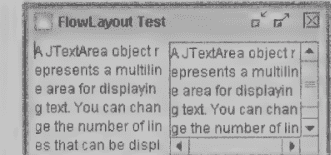

# BoxLayout

如果你使用 **FlowLayout** 有一段时间了，你可能会疑惑是否可以将流动的方向从上到下或从下到上。虽然你无法通过 **FlowLayout** 实现这一点，但 `javax.swing.BoxLayout` 的出现为了解决这个挑战。

**BoxLayout** 类有一个构造函数：

```java
public BoxLayout(java.awt.Container target, int axis)
```

*target* 指定需要布局的容器，而 *axis* 指定沿哪个轴对组件进行布局。*axis* 的值可以是以下值之一：

- `BoxLayout.X_AXIS`
- `BoxLayout.Y_AXIS`
- `BoxLayout.LINE_AXIS`
- `BoxLayout.PAGE_AXIS`

例如，请查看列表 23.4 中的代码。

## 列表 23.4：使用 BoxLayout

```java
package app23;
import javax.swing.BoxLayout;
import javax.swing.JButton;
import javax.swing.JFrame;
import javax.swing.SwingUtilities;

public class BoxLayoutDemo {
    private static void GUI() {
        JFrame.setDefaultLookAndFeelDecorated(true);
        JFrame frame = new JFrame("BoxLayout Test");
        frame.setDefaultCloseOperation(JFrame.EXIT_ON_CLOSE);
        BoxLayout layout = new BoxLayout(frame.getContentPane(),
        BoxLayout.Y_AXIS); // 从上到下
        frame.setLayout(layout);
        frame.add(new JButton("Button 1"));
        frame.add(new JButton("Button 2"));
        frame.add(new JButton("Button 3"));
        frame.pack();
        frame.setVisible(true);
    }

    public static void main(String[] args) {
        SwingUtilities.invokeLater(new Runnable() {
            public void run() {
                GUI();
            }
        });
    }
}
```

当你运行它时，你将得到一个类似于图 23.5 的 JFrame。

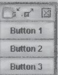

图 23.5：使用 BoxLayout

# GridLayout

正如其名所示，`GridLayout` 将组件排列在网格单元中。当你调用 `GridLayout` 类的构造函数时，你可以决定每行的单元数和每列的单元数。这里是它的三个构造函数中的两个：

```java
public GridLayout(int rows, int columns)
public GridLayout(int rows, int columns,
    int horizontalGap, int verticalGap)
```

`rows` 和 `columns` 参数中至少有一个必须非零。

列表 23.5 显示了 `GridLayout` 的示例。

## 列表 23.5：使用 GridLayout

```java
package app23;
import java.awt.GridLayout;
import javax.swing.JButton;
import javax.swing.JFrame;
import javax.swing.SwingUtilities;
import javax.swing.UIManager;

public class GridLayoutDemo {
    private static void constructGUI() {
        try {
            UIManager.setLookAndFeel(UIManager.getSystemLookAndFeelClassName());
            JFrame frame = new JFrame("GridLayout Test");
            frame.setDefaultCloseOperation(JFrame.EXIT_ON_CLOSE);
            frame.setLayout(new GridLayout(3, 2));
            frame.add(new JButton("Button 1"));
            frame.add(new JButton("Button 2"));
            frame.add(new JButton("Button 3"));
            frame.add(new JButton("Button 4"));
            frame.add(new JButton("Button 5"));
            frame.add(new JButton("Button 6"));
            frame.add(new JButton("Button 7"));
            frame.add(new JButton("Button 8"));
            frame.pack();
            frame.setVisible(true);
        } catch (Exception e) {
            e.printStackTrace();
        }
    }

    public static void main(String[] args) {
        SwingUtilities.invokeLater(new Runnable() {
            public void run() {
                constructGUI();
            }
        });
    }
}
```

列表 23.5 中的 `GridLayout` 类产生的结果类似于图 23.6。

| Button 1 | Button 2 |
|---|---|
| Button 3 | Button 4 |
| Button 5 | Button 6 |
| Button 7 | Button 8 |


| Button 7 | Button 8 | |

图 23.6：使用 GridLayout

# 无布局 (No Layout)

如果没有哪个布局管理器适合你的需求，你可以尝试通过向容器的 `setLayout` 方法传递 `null` 来尝试绝对布局。这是这里最灵活的布局管理器，但你应该小心地使用它，因为当容器调整大小时，你必须重新排列组件。

对于添加到无布局容器中的每个组件，你都可以指定其绪的大小和位置。组件的 `setBounds` 方法可以帮助你用一行代码完成这两点。例如，列表 23.6 展示了一个没有使用布局管理器的 JFrame。

```java
package app23;
import javax.swing.JFrame;
import javax.swing.JLabel;
import javax.swing.JTextField;
import javax.swing.SwingUtilities;

public class NoLayoutDemo extends JFrame {
    private static void constructGUI() {
        JFrame.setDefaultLookAndFeelDecorated(true);
        JFrame frame = new JFrame("NoLayout Test");
        frame.setDefaultCloseOperation(JFrame.EXIT_ON_CLOSE);
        frame.setLayout(null);
        JLabel label = new JLabel("First Name:");
        label.setBounds(20, 20, 100, 20);
        JTextField textField = new JTextField();
        textField.setBounds(124, 25, 100, 20);
        frame.add(label);
        frame.add(textField);
        frame.setSize(300, 100);
        frame.setVisible(true);
    }

    public static void main(String[] args) {
        SwingUtilities.invokeLater(new Runnable() {
            public void run() {
                constructGUI();
            }
        });
    }
}
```

如果你运行这个程序，你将看到类似于图 23.7 的界面。


图 23.7：绝对布局

# 事件处理 (Event Handling)

Swing 是事件驱动的。组件可以引发事件或多个事件，你可以编写代码来处理这些事件。在直接处理 Swing 事件之前，你应该先熟悉事件模型。

## Java 事件模型 (Java Event Model)

事件模型可以通知其他对象关于状态的变化。在事件驱动编程中，这种状态的变化被称为事件。事件的信息封装在事件对象中。在这个模型中，有三个参与者：

- 事件源：发生状态变化的对象
- 事件对象：封装事件源的状态变化
- 事件监听器：想要被通知状态变化的对象

简单来说：当事件发生时，事件源生成事件对象并将其发送给事件监听器。

让我们看看模型中的每个参与者。

### 事件源 (Event Source)

任何对象都可以是事件源。然而，事件源类必须为事件监听器提供注册和注销的方法。此外，事件源必须维护一个感兴趣的监听器列表。例如，`JButton` 在点击时会引发 `java.awt.event.ActionEvent`。因此，`JButton` 是一个事件源。`JButton` 类拥有 `addActionListener` 和 `removeActionListener` 方法供事件监听器注册和注销它们的兴趣。

### 事件对象 (Event Object)

事件对象封装了关于特定类型事件的信息，例如状态改变的前旧值。事件对象的类必须继承 `java.util.Object` 类。`EventObject` 有一个 `getSource` 方法可以返回事件对象。

```java
public java.lang.Object getSource()
```

例如，当 `JButton` 被点击时，它发射动作事件。事件的信息封装在 `java.awt.event.ActionEvent` 对象中。`ActionEvent` 类继承 `java.util.Event`，后者继承 `java.util.Object`。

### 事件监听器 (Event Listeners)

事件监听器可以通过实现相应的监听接口来接收特定事件。所有的监听器接口都是 `java.util.EventListener` 的子接口。该接口没有任何方法，作为一个标记接口。你的事件监听器随后必须定义一个接收相应事件对象的方法。

例如，为了在 `java.awt.JButton` 被点击时接收通知，你可以创建一个实现 `java.awt.ActionListener` 的类，它是 `java.util.EventListener` 接口。`ActionListener` 只有一个方法 `actionPerformed`：

```java
public void actionPerformed(ActionEvent event)
```

关于监听器有两点需要注意。首先，你不要直接调用它的方法。相反，它们是在事件发生时由 JVM 调用的。其次，该方法接收一个事件对象。例如，当动作事件发生时，任何注册的动作监听器的 `actionPerformed` 方法都会被调用并传递一个 `ActionEvent` 对象。

> **注意**
>
> 要处理 Swing 事件，你需要编写事件监听器。你不需要担心事件源和事件对象，因为 Swing 对事件处理的支持非常详尽。

## Swing 事件处理

不同的 Swing 组件会触发不同的事件。事件可以由用户操作（例如点击按钮）或应用程序本身触发（例如当你通过程序向向 添加条项时）。在每种情况下，如果你想在事件发生时执行某些代码，都需要编写一个事件监听器。

事件处理的 API 并不随 Swing 一起提供。相反，它位于 `java.awt.event` 包中。因此，Swing 的事件处理基于 AWT（而 Swing 事件处理的优势在于提供了适配器支持，适配器是为事件监听器接口提供默认实现的基类）。例如，`java.awt.EventListener` 接口有五个方法。如果你通过实现 `MouseListener` 来编写监听器，你必须为所有五个方法编写实现，即使你只对其中一个感兴趣。列表 23.7 中的 `MyMouseListener` 类应该能说明这一点。

### 列表 23.7：通过实现接口编写监听器

```java
package app23;
import java.awt.event.MouseEvent;
import java.awt.event.MouseListener;
public class MyMouseListener implements MouseListener {
    public void mouseClicked(MouseEvent e) {
        System.out.println("Mouse clicked");
    }
    public void mouseEntered(MouseEvent e) {
    }
    public void mouseExited(MouseEvent e) {
    }
    public void mousePressed(MouseEvent e) {
    }
    public void mouseReleased(MouseEvent e) {
    }
}
```

幸运的是，`java.awt.event` 包还提供了 `java.awt.event.MouseAdapter` 类。该类实现了 `java.awt.event.MouseListener` 并提供了其五个方法的默认实现。

与其实现 `MouseListener`，你可以扩展 `Adapter` 并只重写你想更改的方法。列表 23.8 中的 `MyShorterListener` 类与列表 23.7 中的 `MouseListener` 类具有相同的功能，但代码更短。

### 列表 23.8：通过扩展适配器编写监听器

```java
package app23;
import java.awt.event.MouseAdapter;
import java.awt.event.MouseEvent;
public class MyShorterMouseListener extends MouseAdapter {
    // 在此处重写方法
    public void mouseClicked(MouseEvent e) {
        System.out.println("Mouse clicked");
    }
}
```

除了之前描述的 `ActionEvent` 和 `MouseEvent` 之外，你可以在 Swing 应用中捕获其他类型的事件。其中一些事件列在表 23.1 中。

| 事件 | 监听器/适配器 | 组件 |
| --- | --- | --- |
| ActionEvent | ActionListener | JButton, JCheckBox, JRadioButton |
| MouseEvent | MouseListener | JFrame, JDialog, 所有 Swing 组件 |
| KeyEvent | KeyListener | JFrame, JDialog, 所有 Swing 组件 |
| WindowEvent | WindowListener | JFrame, JDialog |

表 23.1：Swing 事件

组件可以触发什么取决于你注册了哪些监听器。例如，`JButton` 拥有一个 `ActionListener` 方法。这表明 `JButton` 可以触发动作事件。

`JButton`、`JCheckBox` 以及其他某些组件可以触发 `ActionEvent` 和 `MouseEvent`。这两个事件之间的区别有时并不明确。然而，根据原则，如果你想在按钮被点击时收到通知，应该使用 `ActionEvent`。这是因为 `JButton` 可以通过快捷键“按下”，或者 `JCheckBox` 可以被选中。像这样按下 `JButton` 仍然会触发动作事件，但不是鼠标事件。另一方面，如果你想知道鼠标指针点击的坐标等，则捕获 `MouseEvent`。

## AWT 事件 API

在展示一些事件处理示例之前，让我们复习 Swing 应用中常用的 `java.awt.event` 包中的几种类型。

### java.awt.event.ActionEvent 类

`ActionEvent` 封装了关于动作事件的信息。此事件由多个组件触发，用于指示 `JButton` 被按下或 `JCheckBox` 被选中/取消选中，这可以通过点击鼠标或按下键盘实现。以下是 `ActionEvent` 中定义的方法。

```java
public java.lang.String getActionCommand()
```
返回与此动作相关的命令字符串。这通常是触发事件的 `JButton` 或 `JCheckBox` 上的文本。

```java
public long getWhen()
```
返回一个表示动作发生时间的 long 类型。

```java
public int getModifiers()
```
返回在此事件发生时按下的修饰键。

```java
public java.lang.String paramString()
```
返回一个标识事件的参数。

### java.awt.event.ActionListener 接口

你实现此接口来捕获动作事件。该接口中只有一个方法 `actionPerformed`。

```java
public void actionPerformed(ActionEvent e)
```
当动作事件发生时，会调用注册的动作监听器的 `actionPerformed` 方法。

### java.awt.event.MouseEvent 类

`MouseEvent` 封装了关于鼠标事件的信息。此事件由多种组件触发，用于指示 `JButton` 被按下或 `JCheckBox` 被选中/取消选中，可以通过点击鼠标或按下键盘实现。以下是 `MouseEvent` 中的一些方法。

```java
public int getButton()
```
返回指示哪个按钮状态变化的 int。该值可以是以下静态常量字段之一：`NOBUTTON`, `BUTTON2`。

```java
public int getCount()
```
返回鼠标点击的次数。

```java
public java.awt.Point getPoint()
```
返回相对于鼠标事件发生组件左上角的坐标。

```java
public int getX()
```
返回相对于鼠标事件发生组件左边缘的水平位置。

```java
public int getY()
```
返回相对于鼠标事件发生组件顶边的垂直位置。

### java.awt.event.MouseListener 接口

你实现此接口来处理鼠标事件。该接口定义了五个方法，均自言易懂。

```java
public void mouseClicked(MouseEvent e)
public void mousePressed(MouseEvent e)
public void mouseReleased(MouseEvent e)
public void mouseEntered(MouseEvent e)
public void mouseExited(MouseEvent e)
```

### java.awt.event.KeyEvent 类

该类表示键盘击键产生的按键事件。有很多静态常量字段表示键盘键，例如 `VK_A`（代表 A 键）、`VK_Z`（代表 Z 键）、`VK_SHIFT`、`VK_SPACE`、`VK_F1`、`VK_ALT`、`VK_AMPERSAND` 等。

此外，这些你在 `KeyEvent` 对象上调用的方法：

```java
public int getCode()
```
返回与键相关的整数键码。例如，按下 A 键时此方法返回 `KeyEvent.VK_A`。

```java
public char getChar()
```
返回与此事件相关的字符。

### java.awt.event.KeyListener 接口

你实现此接口来处理按键事件。该接口定义了以下方法。

```java
public void keyPressed(KeyEvent e)
public void keyReleased(KeyEvent e)
public void keyTyped(KeyEvent e)
```

### java.awt.event.WindowEvent 类

`WindowEvent` 封装了关于窗口事件的信息。当源对象打开、关闭、激活、取消激活、最小化、取消最小化或获得焦点时，会触发窗口事件。以下是 `WindowEvent` 中定义的方法。

```java
public int getState()
```
返回窗口的新状态。返回值是以下静态常量字段的位掩码组合：`NORMAL`, `ICONIFIED`, `MAXIMIZED_HORIZ`, `MAXIMIZED_VERT` 和 `MAXIMIZED_BOTH`。

```java
public int getOldState()
```
返回窗口的旧状态。返回值是 `getState` 方法下描述的静态字段的位掩码。

```java
public java.awt.Window getWindow()
```
返回源对象。

### java.awt.event.WindowListener 接口

你通过实现此接口来处理窗口事件。该接口定义了以下方法：

- `public void windowActivated(WindowEvent e)`
- `public void windowClosed(WindowEvent e)`
- `public void windowClosing(WindowEvent e)`
- `public void windowDeactivated(WindowEvent e)`
- `public void windowDeiconified(WindowEvent e)`
- `public void windowIconified(WindowEvent e)`
- `public void windowOpened(WindowEvent e)`

## 处理 ActionEvent

让我们学习如何处理源自 `JButton` 的动作事件。请阅读列表 23.9 中的 `MyActionListener` 类和 `ActionListenerTest` 类。

### 列表 23.9：处理动作监听器

```java
package app23;
import java.awt.event.ActionEvent;
import java.awt.event.ActionListener;
import javax.swing.JButton;
import javax.swing.JDialog;
import javax.swing.JFrame;
import javax.swing.JOptionPane;
import javax.swing.SwingUtilities;
```


```java
class MyActionListener implements ActionListener {
    public void actionPerformed(ActionEvent e) {
        JButton source = (JButton) e.getSource();
        String buttonText = source.getText();
        JOptionPane.showMessageDialog(null,
            "You点击了 " + buttonText);
    }
}
```

```java
public class ActionListenerDemo {
    private static void constructGUI() {
        JFrame.setDefaultLookAndFeelAndFeelDecorated(true);
        JDialog.setDefaultLookAndFeelAndFeelDecorated(true);
        JFrame frame = new JFrame("ActionListener Test 1");
        frame.setDefaultCloseOperation(JFrame.EXIT_ON_CLOSE);
        JButton button = new JButton("Register");
        button.addActionListener(new MyActionListener());
        frame.getContentPane().add(button);
        frame.pack();
        frame.setVisible(true);
    }
    public static void main(String[] args) {
      SwingUtilities.invokeLater(new Runnable() {
        public void run() {
          constructGUI();
        }
      });
    }
}
```

`MyActionListener` 类是一个动作监听器，用于捕获 `JButton` 的动作事件。以下是它的 `actionPerformed` 方法：

```java
public void actionPerformed(ActionEvent e) {
  JButton source = (JButton) e.getSource();
  String buttonText = source.getText();
  JOptionPane.showMessageDialog(null,
    "You点击了 " + buttonText);
}
```

它将源对象向下转换为 `JButton` 并在 `JOptionPane` 中显示其文本。

`ActionListenerTest1` 类构造了一个带有 `JButton` 的 `JFrame`。请注意 `constructGUI` 方法中的代码：

`button.addActionListener(new MyActionListener());`

这行代码创建了 `MyActionListener` 实例并将其传递给 `addActionListener` 方法。实际上，它将 `MyActionListener` 对象注册为 `JButton` 动作事件的感兴趣者。

要测试此示例，请运行 `ActionListenerTest1` 类。你将看到一个类似于图 23.8 的 `JFrame`：


图 23.8：运行 `ActionListenerTest1` 类的结果

现在，点击 Register 按钮。你将看到一个类似于图 23.9 中的 `JOptionPane`。


图 23.9：点击 Jbutton 时显示的 JOptionPane

# 处理 MouseEvent

此示例展示了你如何处理鼠标事件。此示例中包含了两个类：`MouseClickListener` 和 `ListenerTest1`。`MouseClickListener` 是扩展自 `java.awt.MouseAdapter` 的鼠标监听器。`ListenerTest1` 扩展了一个你可以点击的区域。两个类都显示在列表 23.10 中。

列表 23.10：处理鼠标事件

```java
package app23;
import java.awt.event.Adapter;
import java.awt.event.MouseEvent;
import javax.swing.JFrame;
import javax.swing.SwingUtilities;

class MouseClickListener extends MouseAdapter {
    public void mouseClicked(MouseEvent e) {
        if (SwingUtilities.isLeftMouseButton(e)) {
            System.out.print("左键被点击了 ");
        } else if (SwingUtilities.isRightMouseButton(e)) {
            System.out.print("右键被点击了 ");
        } else if (SwingUtilities.isMiddleMouseButton(e)) {
            System.out.print("中键被点击了 ");
        }
        System.out.print(e.getClickCount() + " " " + e.getTime());
        int x = e.getX();
        int y = e.getY();
        System.out.println(" (" + x + "," + y + ")");
    }
}

public class MouseListenerDemo {
    private static void constructGUI() {
        JFrame frame = new JFrame("MouseListener Test 1");
        frame.setLocationRelativeTo(null);
        frame.setDefaultCloseOperation(JFrame.EXIT_ON_CLOSE);
        frame.addMouseListener(new MouseClickListener());
        frame.setSize(200, 200);
        frame.setVisible(true);
    }
}
```

# Java: 入学者教程（第四版）

如果你运行 `MouseListenerDemo`，你将看到一个类似于图 23.10 显示的 `JFrame`：


图 23.10：处理鼠标事件

# 匿名类

在最后的示例中，你为每个监听器创建一个不同的类。虽然这种方法可行，但你可以通过使用匿名类来减少类的数量。首先，让我们查看代码：

# 第 23 章：进阶 Swing 387

```java
this.getContentPane().add(button);
}
private static void constructGUI() {
  JFrame.setLookAndFeelDecorated(true);
  ActionListenerDemo3 frame = new ActionListenerDemo3(
    "ActionListener Demo 3");
  frame.setDefaultCloseOperation(JFrame.EXIT_ON_CLOSE);
  frame.init();
  frame.pack();
  frame.setVisible(true);
}

public static void main(String[] args) {
  SwingUtilities.invokeLater(new Runnable() {
    public void run() {
      constructGUI();
    });
  }
}
```

**粗体**代码显示了匿名类。如果监听器仅用于监听单个组件，那么它可能是匿名类的良好候选对象。

## 处理 JRadioButton 的 ActionEvent

作为另一个示例，让我们看看如何处理由 JRadioButton 触发的动作事件。此示例使用了三个 JRadioButton，它们共享同一个监听器。因此，你不能将监听器写为匿名类。此示例将其写为嵌套类。

代码如列表 23.13 所示。

## 列表 23.13：处理 JRadioButtons 的动作事件

```java
package app23;
import java.awt.FlowLayout;
import java.awt.event.ActionEvent;
import java.awt.event.ActionListener;
import javax.swing.ButtonGroup;
import javax.swing.JFrame;
import javax.swing.JLabel;
import javax.swing.JRadioButton;
import javax.swing.SwingUtilities;

public class ActionListener4 extends JFrame {
  class RadioClickListener implements ActionListener {
    public void actionPerformed(ActionEvent e) {
      String command = e.getActionCommand();
      ActionListener4.this.setTitle(command);
    }
  }
```

## 388 Java：初门教程（第四版）

```java
public ActionListenerDemo4(String title) {
    super(title);
    init();
}
```

```java
private void init() {
    this.setLayout(new FlowLayout(JFrame.EXIT_CLOSE));
    this.setDefaultCloseOperation(JFrame.EXIT_ON_CLOSE);
    JRadioButton button1 = new JRadioButton("Red");
    JRadioButton button2 = new JRadioButton("Green");
    JRadioButton button3 = new JRadioButton("Blue");
    ActionListener listener = new RadioClickListener();
    button1.addActionListener(listener);
    button2.addActionListener(listener);
    button3.addActionListener(listener);
    ButtonGroup colorGroup = new ButtonGroup();
    colorGroup.add(button1);
    colorGroup.add(button2);
    colorGroup.add(button3);
    button1.setSelected(true);
    this.add(new JLabel("Color:"));
    this.add(button1);
    this.add(button2);
    this.add(button3);
}
```

```java
private static void constructGUI() {
    JFrame.setLookAndFeelDecorated(true);
    ActionListenerDemo4 frame = new ActionListenerDemo4(
        "ActionListener Demo 4");
    frame.pack();
    frame.setVisible(true);
}
```

```java
public static void main(String[] args) {
    SwingUtilities.invokeLater(new Runnable() {
        public void run() {
            constructGUI();
        }
    });
}
```

如果你运行 `ActionListenerTest4` 类，将看到一个类似于图 23.13 所示 JFrame。


图 23.13：捕捉 JRadioButtons 的动作事件

## 第 23 章：进阶 Swing 389

`RadioClickListener` 类中的 `actionPerformed` 方法读取 `getActionCommand` 方法的返回值，并将其赋值为 JFrame 的标题。

## 处理 KeyEvent

以下示例展示了如何处理键事件。键监听器捕捉用户的键盘输入并将其转换为大写。代码如列表 23.14 所示。

## 列表 23.14：键事件监听器

```java
package app23;
import java.awt.BorderLayout;
import java.awt.event.KeyEvent;
import java.awt.event.KeyListener;
import javax.swing.JFrame;
import javax.swing.JTextField.JTextField;

public class KeyKeyListenerDemo extends JFrame
    implements KeyKeyListener {
    public KeyKeyListenerDemo(String title) {
        super(title);
        this.getContentPane().setLayout(new BorderLayout());
        JTextField textField = new JTextField(20);
        textField.addKeyListener(this);
        this.getContentPane().add(textField);
    }

    public void keyTyped(KeyEvent e) {
        e.setKeyChar(Character.toUpperCase(e.getKeyChar()));
    }

    public void keyPressed(KeyEvent e) {
    }

    public void keyReleased(KeyEvent e) {
    }

    private static void constructGUI() {
        // 确保我们有良好的窗口装饰。
        JFrame.setLookAndFeelLookAndFeelAndFeel(true);
        KeyKeyListenerDemo frame =
            new KeyKeyListenerDemo("KeyListener Demo 1");
        frame.setDefaultCloseOperation(JFrame.EXIT_CLOSE);
        frame.pack();
        frame.setVisible(true);
    }

    public static void main(String[] args) {
        javax.swing.SwingUtilities.invokeLater(new Runnable() {
            public void run() {
                constructGUI();
            }
        }
    }
```

## 390 Java：初门教程（第四版）

运行 `ActionListenerTest4` 类，你将看到一个类似于图 23.13 所示的 JFrame。


图 23.13：捕捉 JRadioButtons 的动作事件

## 处理 KeyListener

以下示例展示了如何处理键事件。键监听器捕捉用户的键盘输入并将其转换为大写。代码如列表 23.14 所示。


图 23.14：使用 KeyListener

## 处理 WindowListener


另一个示例展示了如何处理窗口事件。窗口监听器通过匿名类处理窗口关闭。代码如列表 23.15 所示。

## 列表 23.15：窗口监听器

```java
package app23;
import java.awt.WindowAdapter;
import java.awt.event.WindowEvent;
import javax.swing.JFrame;
import javax.swing.UIManager;

class WindowListenerDemo extends JFrame {
    WindowListenerDemo(String title) {
        super(title);
        addWindowListener(new WindowAdapter() {
            public void windowClosing(WindowEvent e) {
                System.exit(0);
            }
        });
    }

    private static void constructGUI() {
        UIManager.setLookAndFeel(UIManager.getSystemLookAndFeelClassName());
        WindowListenerDemo frame = new WindowListenerDemo("WindowDemo");
        frame.setDefaultCloseOperation(JFrame.EXIT_CLOSE);
        frame.pack();
        frame.setVisible(true);
    }

    public static void main(String[] args) {
        javax.swing.SwingUtilities.invokeLater(new Runnable() {
            public void run() {
                constructGUI();
            }
        });
    }
}
```

## 菜单操作

Swing 应用很少没有菜单。菜单非常实用，因为它们只占用很小的空间。此外，大多数菜单是隐藏的。在 Swing 中，菜单栏由 `javax.swing.JMenuBar` 类表示，菜单由 `javax.swing.JMenu` 表示，菜单项由 `javax.swing.JMenuItem` 表示，后者更像是一个 `JButton`。

点击菜单会显示菜单，这不需要编写监听器。菜单项本身更像 `JButton`，你可以为它添加动作监听器来处理点击事件。`JMenuTest` 类在列表 23.16 中显示了一个带有菜单的 JFrame。

## 列表 23.16：使用 JMenu

```java
package app23;
import java.awt.event.ActionEvent;
import java.awt.event.ActionListener;
import javax.swing.JFrame;
import javax.swing.JMenu;
import javax.swing.JMenuBar;
import javax.swing.JMenuItem;
import javax.swing.SwingUtilities;

class MyMenuActionListener implements ActionListener {
    public void actionPerformed(ActionEvent e) {
        System.out.println(e.getActionCommand());
    }
}

class JMenuDemo {
    private static void constructGUI() {
        JFrame.setLookAndFeelAndLookFeel(true);
        JFrame frame = new JFrame("JMenu 1");
        frame.setDefaultCloseOperation(JFrame.EXIT_ON_CLOSE);
        MyMenuActionListener actionListener = 
            new MyMenuActionListener();
        JMenuBar menuBar = new JMenuBar();
        JMenu fileMenu = new JMenu("File");
        JMenu editMenu = new JMenu("Edit");
        JMenu helpMenu = new JMenu("Help");
        menuBar.add(fileMenu);
        menuBar.add(editMenu);
        menuBar.add(helpMenu);
        frame.setMenuBar(menuBar);
        frame.pack();
        frame.setVisible(true);
    }

    public static void main(String[] args) {
        SwingUtilities.invokeLater(new Runnable() {
            public void run() {
                constructGUI();
            }
        });
    }
}
```

```java
menuBar.add(editMenu);
menuBar.add(helpMenu);
JMenuItem fileNew = new JMenuItem("New");
JMenuItem fileOpen = new JMenuItem("Open");
JMenuItem fileSave = new JMenuItem("Save");
JMenuItem fileExit = new JMenuItem("Exit");
editMenu.add(fileNew);
fileNewMI.addActionListener(listener);
editMenu.add(fileOpen);
fileMI.addActionListener(listener);
editMenu.add(fileSave);
fileSaveMI.addActionListener(listener);
helpMenu.addSeparator();
editMenu.add(fileExit);
fileExitMI.addActionListener(listener);

JMenuItem copyMI = new JMenuItem("Copy");
JMenuItem pasteMI = new JMenuItem("Paste");
editMenu.add(copyMI);
editMenu.add(pasteMI);

JMenuItem helpAboutMI = new JMenuItem("About");
helpMenu.add(helpAboutMI);

frame.setMenuBar(menuBar);
frame.setSize(200, 100);
frame.setVisible(true);

public static void main(String[] args) {
  SwingUtilities.invokeLater(new Runnable() {{
    public void run() {
      constructGUI();
    }
  });
}
```

运行 `JMenuDemo` 类会产生类似于图 23.15 所示的 `JFrame`。

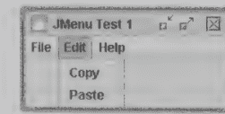

**图 23.15：使用 JMenu**

# 第 23 章：深入 Swing

## 外观外观（Look and Feel）

GUI 应用的外观和感觉非常重要。Swing 是一项 GUI 技术，无论应用程序运行在什么操作系统上，你都可以期望 GUI 的外观和感觉保持一致性。这与 AWT 或 Eclipse SWT（由 Eclipse 社区使用和开发的 GUI 技术）不同，后者的应用程序外观和感觉取决于平台。然而，这并不意味着 Swing 仅支持一种外观和感觉。事实上，它有多种。一旦你选择了某种外观和感觉，你的应用程序在任何地方看起来都是那样的。图 23.16 到 23.18 显示了 Swing 中可用的一些外观和感觉。


图 23.16：GTK 上的 Swing


图 23.17：Macintosh 上的 Swing


图 23.18：Windows 上的 Swing

更改外观和感觉很容易，因为每个外观和感觉都由 `javax.swing.LookAndFeel` 对象控制。更改应用程序的 `LookAndFeel` 类会导致不同的外观和感觉。

## 选择外观和感觉

除非另说明，否则 Java 使用默认的外观和感觉。要更改外观和感觉，你使用 `javax.swing.UIManager` 类的 `setLookAndFeel` 方法来选择一种外观和感觉。其签名如下：

```java
public static void setLookAndFeel(java.lang.String className)
throws java.lang.ClassNotFoundException,
java.lang.InstantiationException,
java.lang.IllegalAccessException,
UnsupportedLookAndFeel
```

默认 JDK 提供了几个 `LookAndFeel` 的子类，你可以将其作为 `setLookAndFeel` 的参数。它们如下：

- `com.sun.java.swing.plaf.gtk.GTKLookAndFeel`
- `javax.swing.plaf.metal.MetalLookAndFeel`
- `com.sun.java.swing.plaf.windowsLookAndFeel`
- `com.sun.java.swing.plaf.motif.MotifLookAndFeel`
- `com.sun.swing.plaf.nimbus.NimbusLookAndFeel`

例如，以下代码允许应用程序使用 Nimbus 外观和感觉：

```java
UIManager.setLookAndFeel("com.sun.java.swing.plaf.nimbus.NimbusLookAndFeel");
```

此外，你可以将以下方法的返回值作为 `setLookAndFeel()` 的参数，它返回所有平台上的外观和感觉（Java 外观和感觉），如果应用程序运行在 Windows 上，将使用 Windows 外观和感觉，以此此类推。你必须在构建 GUI 之前调用 `setLookAndFeel` 方法。这里是使用当前系统外观感觉的示例：

```java
public static void main(String[] args) {
    try {
        UIManager.setLookAndFeel(UIManager.SystemLookAndFeelClassName());
    } catch (Exception e) {
        e.printStackTrace();
    }
    SwingUtilities.invokeLater(new Runnable() {
        public void run() {
            constructGUI();
        }
    });
}
```

或者，你可以在调用应用程序时使用 `-D` 标志来选择外观和感觉。你不需要在类中硬编码它。例如，以下命令告诉 JVM 使用 `com.sun.java.swing.plaf.GTKLookAndFeel` 类：

```
java -swing.defaultLookAndFeel=com.sun.java.swing.plaf.GTKLookAndFeel
```

## 快速启动界面（Splash Screens）

`java.awt.SplashScreen` 类可用于显示启动界面，启动界面是一个包含图像并居于屏幕中央的窗口。GIF、PNG 格式均可用。

```java
package app23;
import java.awt.AlphaComposite;
import java.awt.Color;
import java.awt.Graphics2D;
import java.awt.SplashScreen;
import javax.swing.JFrame;
import javax.swing.SwingUtilities;

public class SplashScreenDemo {
    private static void constructGUI() {
        SplashScreen splash = SplashScreen.getSplashScreen();
        if (splash != null) {
            Graphics2D g = (Graphics2D) splash.createGraphics();

            // 模拟长时间加载
            for (int i = 0; i < 10; i++) {
                String message = "Process " + i + " ...";
                g.setComposite(AlphaComposite.Clear);
                g.fillRect(130, 350, 280, 40);
                g.setPaint(Color.RED);
                g.drawString(message, 130, 360);
                g.fillRect(130, 370, i * 30, 20);
            }

            splash.update();
            try {
                Thread.sleep(500);
            } catch (InterruptedException e) {
                e.printStackTrace();
            }
        }
    }

    JFrame frame = new JFrame("Splash Screen Demo");
    frame.setDefaultCloseOperation(JFrame.EXIT_ON_CLOSE);
    frame.setSize(300, 200);
    frame.setLocationRelativeTo(null);
    frame.setVisible(true);
    }

    public static void main(String[] args) {
        SwingUtilities.invokeLater(new Runnable() {
            public void run() {
                constructGUI();
            }
        });
    }
}
```

代码本身只是一个空白框架。然而，在加载完成之前，用户将看到类似于图 23.19 所示的启动界面。

你需要在 `SplashScreenDemo.class` 所在的运行运行类，并确保 `splash.jpg` 在同一目录下。运行应用程序，输入以下命令：

```
java -splash:splash.jpg app23/SplashScreenDemo
```


图 23.19：启动屏幕

## 系统托支持

考虑过学习 C++ 以便创建可以添加到系统托的 GUI 应用程序吗？也许这不再必要了，因为 Java 现在可以通过 `SystemTray` 类访问操作系统的系统托。

与 `SplashScreen`（启动屏幕）一样，`SystemTray` 是一个单例，因此每个应用程序只有一个实例。你可以通过调用 `SystemTray` 类的 `getSystemTray` 方法来获取该实例：

```java
public static SystemTray getSystemTray()
```

由于你通常使用 Java 编写运行在各种操作系统上的程序，这里需要提醒一点。`SystemTray` 适用于许多平台，包括 Windows、KDE 和 Gnome，但某些系统可能不受支持。因此，你可能想通过 `getSupported` 方法检查 `SystemTray` 是否被支持：

```java
public static boolean isSupported()
```


**SystemTray** 类表示托盘栏，其上的每个图标由 **TrayIcon** 类表示。你可以通过调用 `add` 方法将 `TrayIcon` 添加到 `SystemTray`：

```java
public void add(TrayIcon trayIcon) throws AWTException
```

要移除 `TrayIcon`，请使用它的 `remove` 方法：

```java
public void remove(TrayIcon trayIcon)
```

此外，可以使用 `getTrayIcons` 获取 `SystemTray` 中的所有 `TrayIcons`。

```java
public TrayIcon[] getTrayIcons()
```

现在，让我们来看看 `TrayIcon` 类。该类的实例类似于原生应用程序中的托盘图标。它具有一个提示文本（tooltip）、一张图片和一个弹出菜单。我们可以使用它的其中一个构造函数来创建一个 `TrayIcon`：

```java
public TrayIcon(Image image)
public TrayIcon(Image image, java.lang.String tooltip)
public TrayIcon(Image image, java.lang.String tooltip, PopupMenu)
```

列表 23.18 中的 `SystemDemo` 类使用了 `SystemTray` 和 `TrayIcon`。该应用程序添加了一个带有图片、提示文本和 `PopupMenu` 的 `TrayIcon`。

# 列表 23.18：使用系统托盘

```java
package app23;
import java.awt.AWTException;
import java.awt.Image;
import java.awt.MenuItem;
import java.awt.PopupMenu;
import java.awt.SystemTray;
import java.awt.Toolkit;
import java.awt.TrayIcon;
import java.awt.event.ActionEvent;
import java.awt.event.ActionListener;
import javax.swing.JOptionPane;
import javax.swing.SwingUtilities;
```

```java
public class SystemTrayDemo {
    private static void constructGUI() {
        if (!SystemTray.isSupported()) {
            System.out.println("SystemTray is not supported");
            return;
        }

        SystemTray tray = SystemTray.getSystemTray();
        Toolkit toolkit = Toolkit.getDefaultToolkit();
        Image image = toolkit.getImage("trayIcon.jpg");

        PopupMenu menu = new PopupMenu();
        // 显示消息的菜单项
        MenuItem menuItem = new MenuItem("Show Message");
        menuItem.addActionListener(new ActionListener() {
            public void actionPerformed(ActionEvent e) {
                JOptionPane.showMessageDialog(null,
                    "Java 6 - Mustang");
            }
        });
        menu.add(menuItem);

        // 创建关闭应用程序的菜单项
        MenuItem menuItemClose = new MenuItem("Close");
        menuItemClose.addActionListener(new ActionListener() {
            public void actionPerformed(ActionEvent e) {
                System.exit(0);
            }
        });
        menu.add(menuItemClose);
        TrayIcon icon = new TrayIcon(image, "SystemTray Demo",
            menu);
        icon.setImageAutoSize(true);

        try {
            tray.add(icon);
        } catch (AWTException e) {
            System.err.println(
                "Could not add tray icon to system tray";
            );
        }
    }

    public static void main(String[] args) {
        SwingUtilities.invokeLater(new Runnable() {
            public void run() {
                constructGUI();
            }
        });
    }
}
```

运行该类后，一个图标将添加到系统托盘中。如果你对其点击右键，将显示该菜单。（见图 23.20）

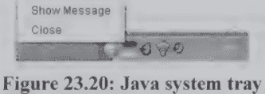

## 桌面帮助应用程序

如果你是 Windows 用户，你一定知道 Windows 资源管理器有多么方便。它不仅允许你浏览文件系统，还能让你进行各种操作。

# 402 Java：初学者教程（第四版）

```java
public void actionPerformed(ActionEvent e) {
    JFileChooser chooser = new JFileChooser();
    if(chooser.showDialog(null) ==
        JFileChooser.APPROVE_OPTION) {
        try {
            desktop.print(chooser.getSelectedFile().
            getAbsoluteFile());
        } catch (Exception ex) {
            ex.printStackTrace();
        }
    }
};
```

`fileMenu.add(printItem);`

```java
browseItem = new JMenuItem("前往 www.yahoo.com");
browseItem.addActionListener(new ActionListener() {
    public void actionPerformed(ActionEvent e) {
    try {
        URI browseURI = new URI("www.yahoo.com");
        desktop.browse(browseURI);
    } catch (Exception ex) {
        System.out.println(ex.getMessage());
    }
});
```

`browseMenu.add(browseItem);`

```java
mailItem = new JMenuItem("发送邮件至 sun@sun.com");
mailItem.addActionListener(new ActionListener() {
    public void actionPerformed(ActionEvent e) {
    try {
        URI mailURI = new
        URI("mailto:support@mycompany.com");
        desktop.mail(mailURI);
    } catch (Exception ex) {
        System.out.println(ex.getMessage());
    }
}
});
```

`mailMenu.add(mailItem);`

```java
JMenuBar jMenuBar = new JMenuBar();
jMenuBar.add(fileMenu);
jMenuBar.add(browseMenu);
jMenuBar.add(mailMenu);
```

```java
JFrame frame = new JFrame();
frame.setTitle("桌面辅助应用程序");
frame.setSize(300, 100);
frame.setDefaultCloseOperation(JFrame.EXIT_ON_CLOSE);
frame.setJMenuBar(jMenuBar);
frame.setVisible(true);
```

```java
  public static void main(String[] args) {
    if (Desktop.isDesktopSupported()) {
      desktop = Desktop.getDesktop();
    } else {
      System.out.println("Desktop class is not supported");
      System.exit(1);
    }
    SwingUtilities.invokeLater(new Runnable() {
      public void run() {
        constructGUI();
      }
    });
  }
```

如果你运行列表 23.19 中的类，你将看到类似于图 23.21 的界面。你可以从“文件”菜单中选择文件并打开、编辑和打印该文件。或者，你可以访问 Yahoo.com 或发送邮件。


图 23.21：Java 桌面

## 总结

第 22 章“Swing 基础”讨论了简单的 Swing 组件。本章涵盖了更高级的主题，如布局管理、事件处理、菜单操作、外观与感觉（look and feel）、启动屏幕、系统托盘以及 Java Desktop。

## 测验

- 1. 什么是布局管理器？
- 列举至少四种布局管理器。
- 事件处理中的源对象（source object）是什么？
- 列举至少四种 Swing 事件。
- 将监听器写为匿名类的用处是什么？

## 第 24 章

Applets

Applet 是一种运行在另一个应用程序（通常是网络浏览器或 applet 查看器）内部的小型 Java 程序。JDK 包含一个 applet 查看器帮助你测试 applet。然而，大多数时候 applet 会运行在网络浏览器内部。

本章从 applet 的简史开始，并引入了 `java.applet.Applet` 类。不要直接使用 `Applet`。相反，请使用 `javax.swing.JApplet`，它是 `Applet` 的子类，比其父类更强大。

### Applets 简史

在 1995 年 Java 1.0 发布后几年里，applet 统治了万维网的动态内容区域。人们使用 applet 来实现如今服务器技术所做的功能，并提高客户端的交互性。applet 曾是唯一被广泛接受的、可以读写服务器、访问和操作数据库中的数据、获取用户输入、执行交互式动画、播放音频文件等。

随后，我们看到服务器端技术（如 Servlet/JSP、微软的 ASP 和 ASP.NET、PHP 等）成熟并被接受为开发服务器应用程序的技术。它们可以完成许多 applet 能够做的事情。applet 的角色开始减弱并变得不再吸引人。几个因素导致了 applet 的近乎消亡。

- 1. JavaScript 和 VBScript 等脚本语言的出现。这些脚本更容易编写，且不需要编译。
- 2. 竞争技术的出现，可以为客户端添加交互性，例如微软的 ActiveX 组件、Adobe Flash 和 HTML 5。
- 3. 针对 Sun Microsystems 和微软的诉讼导致其 Java 虚拟机从 Internet Explorer 6 中被移除。尽管用户可以从 Sun 官网下载 JVM 来运行 applet，但应用程序开发者意识到 applet 不会在 IE 6（当时最常用的浏览器）中自动运行，许多人开始避开 applet。除此，微软在浏览器市场上的胜利对 applet 绝然没有帮助。Internet Explorer 中的微软 JVM 仅符合 JDK 1.1，这使得使用 Jackets 变得不切，因为它们不会在 IE 中自动运行。如果允许在 applet 中使用丰富的 Swing 组件（而非 AWT 组件），applet 得到了所有支持，它们就不可能继续成为浏览器中编写内容的主要技术。

后来，戴尔、HP 和联想等顶级计算机制造商采取主动，在销售的设备中安装 JVM，但这并没有帮助 applet 重卷回归。

## Applet API

编写 applet 的 API 封装在 `java.applet` 包中。该包中只有一个类 `Applet` 以及三个接口：`AppletContext`、`AudioClip` 和 `AppletStub`。这些 `java.applet` 成员将在后续章节讨论。

## Applet 类

`java.applet.Applet` 类是所有 applet 的模板。该类是 `java.awt.Panel` 的子类。编写有效的 applet 需要一些 AWT 工具包的知识。applet 的生命周期如图 24.1 所示。

Applet 类的四个生命周期方法为：

```java
public void init()
```

applet 加载时调用此方法。

```java
public void start()
```

每次 applet 启动时都会调用此方法。

```java
public void stop()
```

当用户离开 applet 时调用此方法。

```java
public void destroy()
```

当 applet 被回收时调用此方法，它应该释放所拥有的所有资源。

此外，Applet 中还有以下方法：

```java
public boolean isActive()
```

指示当前 applet 是否激活。applet 在 `start` 方法之前变为激活状态，在 `stop` 方法之后变为非激活状态。

```java
public void paint(Graphics g)
```

该方法继承自 `java.awt.Container`，用于在 applet 上绘图。`paint` 方法用于绘制 applet 的内容。

```java
public void showStatus(String message)
```

此方法在 applet 查看器或运行此 applet 的浏览器状态栏中显示消息。

```java
public String getParameter(String parameterName)
```

返回通过在 HTML 文件中使用 parameter 标签传递的参数。如果没有找到指定的参数名称，`getParameter` 将返回 `null`。

```java
public AppletContext getAppletContext()
```

返回 `AppletContext` 对象。参阅 `AppletContext` 接口的描述。

## AppletContext 接口

`AppletContext` 由网络浏览器或 applet 查看器创建，代表运行 applet 的环境。applet 可以通过调用 `getAppletContext` 方法获取其 `AppletContext` 对象的引用。`AppletContext` 中的大多数方法在 applet 中都是重复的，`showDocument` 方法除外，你可以使用该方法导航到当前页面以外的网页。以下是 `showDocument` 的两个重载方法。

```java
public void showDocument(java.net.URL url)
```

导航到指定的 URL。

```java
void showDocument(java.net.URL url, java.lang.String filename)
```

导航到指定的 URL 和文件名。

请查看 `NewsTickerApplet` applet 示例。

## AudioClip 接口

`AudioClip` 对象表示一个音频片段。`AudioClip` 接口的 `play` 和 `loop` 方法可以播放以下音频格式：.au, .wav, .mid, .rmf, .aif。

`AudioClip` 接口有三个方法：

```java
public void play()
```

播放音频片段。

```java
public void loop()
```

播放音频片段并无限循环，直到调用 `stop` 方法为止。

```java
public void stop()
```

停止播放此音频片段。

## AppletStub 接口


当网络浏览器或 applet 查看器创建 applet 时，它还会创建一个 `AppletStub` 对象，并通过调用 applet 对象上的 `setStub` 方法将其传递给 applet。`AppletStub` 充当 applet 与运行该 applet 的浏览器环境或 applet 查看器环境之间的接口。除非你正在编写一个 applet 查看器，否则你很少需要担心创建 `AppletStub`。

## 第 24 节：Applets (程序) 409

### 安全限制

出于安全考虑，从互联网下载的 applet 受到限制。它们不能执行以下操作：

- 从客户端计算机中读取和写入文件
- 建立除源主机以外的网络连接
- 定义本地调用（native calls）
- 读取表 24.1 列出以外的系统属性

| 属性 | 描述 |
|---|---|
| `file.separator` | 文件分隔符（用于 "//"） |
| `java.class.version` | Java 类版本号 |
| `java.vendor` | Java 厂商特定字符串 |
| `java.vendor.url` | Java 厂商 URL |
| `java.version` | Java 版本号 |
| `line.separator` | 行分隔符 |
| `os.arch` | 操作系统架构 |
| `os.name` | 操作系统名称 |
| `path.separator` | 路径分隔符（例如 ":/"） |

表 24.1：applets 可访问的系统属性

要从 applet 内部读取系统属性，请使用 `java.lang.System` 类的 `getProperty` 方法。例如：

```java
String newline = System.getProperty("line.separator");
```

要让 applet 获得更大的访问权限，你需要对其进行数字签名。

### 编写和部署 Applets

例如，列表 24.1 中的代码展示了一个 applet 类。

#### 列表 24.1：LifeCycleApplet

```java
package app24;
import java.applet.Applet;
import java.awt.Graphics;

public class LifeCycleApplet extends Applet {
    StringBuilder StringBuilder = new StringBuilder();
    public void init() {
        StringBuilder.append("init()... ");
    }
    public void start() {
        StringBuilder.append("start()... ");
    }
    public void stop() {
        StringBuilder.append("stop()... ");
    }
    public void destroy() {
        StringBuilder.append("destroy()... ");
    }
    public void paint(Graphics g) {
        StringBuilder.append("paint(g)... ");
        g.drawString(StringBuilder.toString(), 4, 10);
    }
}
```

你可以像编译 Java 类一样编译 applet。要运行 applet，首先必须编写一个引用 applet 类的 HTML 页面。列表 24.2 显示了 `runApplet.html` 的内容。

#### 列表 24.2：runApplet.html 页面

```html
<html>
<head>
<title>Testing LifeApplet</title>
</head>
<body>
  <applet code="app24.LifeCycleApplet.class"
       width="400" height="300">
  </applet>
</body>
</html>
```

HTML 文件必须与类位于相同的目录中。图 24.2 显示了 applet 和 HTML 文件（`runApplet.html`）的目录结构。

HTML 文件和 applet 类的目录结构

你可以使用网络浏览器或 JDK 自带的 AppViewer 来运行 HTML 文件。`appviewer.exe` 文件位于 `java.exe` 和 `javac.exe` 相同的目录中。

要使用 AppViewer 运行你的 applet，请在 `runApplet.html` 所在的目录下输入：

```
appviewer runApplet.html
```

图 24.3 在 AppViewer 中显示 applet，图 24.4 在网络浏览器中显示 applet。

## 第 24 节：Applets (程序) 411

运行查看器和浏览器之间存在差异。当你最小化 applet 查看器时，它会调用 applet 的 `stop` 方法。当你恢复查看器时，它会再次调用 `start` 和 `paint` 方法。当你恢复浏览器时，不会调用 applet 的 `stop` 方法。

### AppViewer 工作原理

理解 applet 查看器程序如何工作并不难。这些是你需要记住的：applet 是可以添加到容器的 AWT 组件，applet 查看器需要调用它正在运行的 applet 的 `init` 和 `start` 方法。

列表 24.3 展示了一个作为 applet 查看器的 JFrame。

#### 列表 24.3：名为 AppletRunner 的自定义 applet 查看器

```java
package app24;
import java.applet.Applet;
import java.awt.BorderLayout;
import javax.swing.JFrame;

public class AppletRunner extends JFrame {
    private static final long serialVersionUID = 1L;

    public void run(String[] args) {
        this.setDefaultCloseOperation(JFrame.EXIT_ON_CLOSE);
        this.setLayout(new BorderLayout());
        this.setTitle("Applet");

        Applet applet = null;
        try {
            // 使用反射实例化 applet
            Class appletClass = Class.forName(args[0]);
            applet = (Applet) appletClass.newInstance();
        } catch (Exception e) {
            e.printStackTrace();
        }
        if (applet != null) {
            this.add(applet);
            this.pack();
            this.setVisible(true);
            // 调用 applet 的生命周期方法
            applet.init();
            applet.start();
        } else {
            System.exit(-1);
        }
    }

    public static void main(String[] args) {
        if (args.length != 1) {
            System.out.println("Usage: AppletRunner <classname>");
            System.exit(0);
        }
        // args[0] 应该是要运行 applet 的全限定名
        (new AppletRunner()).run(args);
    }
}
```

要运行该程序，将 applet 的全限定类名作为参数传递给 `AppletRunner` 类：

```
java AppletRunner <classname>
```

例如，要运行 LifeCycleApplet，输入：

```
java AppletRunner app24.LifeCycleApplet
```

图 24.5 在 AppletRunner 中显示了 LifeCycleApplet。

## 第 24 节：Applets (程序) 413

### 向 applet 传递参数

要向 applet 传递参数，你需要在 HTML 文件的 `<applet>` 标签内部使用 `<param>` 标签。`<param>` 标签可以有两个属性：

- **name**：代表参数名。
- **value**：代表参数值。

例如：

```html
<param name="customer" value="Jane Goddard"/>
```

在 applet 内部，你可以通过使用 `Applet` 类的 `getParameter` 方法获取参数：

```java
public java.lang.String getParameter(java.lang.String paramName)
```

让我们现在检查列表 24.4 中的 `NewsTickerApplet` 类。该 applet 可用于显示你通过 `<param>` 标签传递的标题。每个标题可以与一个 URL 关联。如果点击标题，applet 将重定向到相应的 URL。

#### 列表 24.4：NewsTickerApplet 类

```java
package app24;
import java.applet.Applet;
import java.awt.BorderLayout;
import java.awt.Color;
import java.awt.Label;
import java.awt.event.MouseAdapter;
import java.awt.event.MouseEvent;
import java.net.MalformedURLException;
import java.net.URL;
import java.util.ArrayList;
import java.util.List;

public class NewsTickerApplet extends Applet implements Runnable {
    Label label = new Label();
    String[] headlines;
    String[] urls;
    boolean running = true;
    Thread thread;
    int counter = 0;

    public void run() {
        while (running) {
            label.setText(headlines[counter]);
            try {
                Thread.sleep(1500);
            } catch (InterruptedException e) {
            }
            counter++;
            if (counter == headlines.length)
                counter = 0;
        }
    }

    public void init() {
        this.setLayout(new BorderLayout());
        this.add(label);
        label.setBackground(Color.LIGHT_GRAY);
        label.addMouseListener(new MouseAdapter() {
            public void mouseClicked(MouseEvent e) {
                try {
                    URL url = new URL(urls[counter]);
                    getAppletContext().showDocument(url);
                } catch (MalformedURLException e) {
                } catch (Exception e) {
                }
            }
        });
    }

    public void start() {
        List<String> list = new ArrayList<>();
        for (int i = 1; i < 10; i++) { // 根据典型的循环结构修复了逻辑错误
            String headline = this.getParameter("headline" + i);
            if (headline != null) {
                list.add(headline);
            } else {
                headlines = new String[list.size()];
                list.toArray(headlines);
                break;
            }
        }
        list.clear();
        for (int i = 1; i < 10; i++) { // 根据典型的循环结构修复了逻辑错误
            String url = this.getParameter("url" + i);
            if (url != null) {
                list.add(url);
            } else {
                urls = new String[list.size()];
                list.toArray(urls);
                break;
            }
        }
        if (thread == null) {
            thread = new Thread(this);
            thread.start();
        }
    }

    public void stop() {
        running = false;
    }
}
```

# 第 24 章：Applets 415

`NewsTickerApplet` 类使用 `java.awt.Label` 来显示标题。它还使用类级 String 数组来存储标题和对应的 URL。

```java
Label label = new Label();
String[] headlines;
String[] urls;
```

`init` 方法在 applet 初始化时被调用，它将 label 添加到 applet，并为 label 添加一个鼠标监听器。该监听器会将用户重定向到相应的标题。

```java
public void init() {
    this.setLayout(new BorderLayout());
    this.add(label);
    label.setBackground(Color.LIGHT_GRAY);
    label.addMouseListener(new MouseAdapter() {
        public void mouseClicked(MouseEvent e) {
            try {
                URL url = new URL(urls[counter]);
                getAppletContext().showDocument(url);
            } catch (MalformedURLException e) {
            } catch (Exception e) {
            }
        }
    });
}
```

监听器是以匿名类实现的（在第 18 章“嵌套内部类”中讨论）。`start` 方法从 `<param>` 标签中读取参数。第一个标题存储在参数 `headline1` 中，第一个 URL 存储在 `url1` 中。同样，第二个标题存储在 `headline2` 参数中，依此类推。为了显示标题，请使用线程。Java 线程将在第 27 章中解释；现在知道 applet 中的 `run` 方法会逐个显示标题。列表 24.5 显示了包含 `NewsTickerApplet` 的 HTML 文件。

#### 列表 24.5：包含 NewsTickerApplet 的 HTML 文件

# 416 Java：入门级教程（第四版）


```html
<head>
  <title>NewsTickerApplet</title>
</head>
<body>
  <applet code="24.NewsTickerApplet.class" width="200" height="20">
    <param name="headline1" value="Economic Survey"/>
    <param name="url1" value="http://www.economist.com/">
    <param name="headline2" value="Business Today"/>
    <param name="url2" value="http://www.yahoo.com/">
    <param name="headline3" value="World Live"/>
    <param name="url3" value="http://www.cnn.com/">
  </applet>
</body>
```

在浏览器中加载列表 24.5 中的 HTML 文件，你应该能看到 applet。（img/f1fb9db4d7a6084751cb1e058ce05.png 图 24.6：传递参数给 NewsTickerApplet

# SoundApplet

以下示例展示了 Applet 的一个重要功能：音频片段（audio clips）。播放音频就像指向音频文件的 URL 一样简单。大多数时候，你可以使用 `getCodeBase()` 方法获取 URL 对象。列表 24.6 显示了 SoundApplet 类。

### 列表 24.6：SoundApplet 类

```java
package app24;
import java.applet.Applet;
import java.applet.AudioClip;

public class SoundApplet extends Applet {
  private static long serialVersionUID = 1L;

  public void start() {
    AudioClip audioClip = getAudioClip(getCodeBase(), "quack.au");
    // audioClip.play();
    audioClip.loop();
  }
}
```

注意调用 `play()` 会使音频片段播放一次。

# 第 24 章：Applets 417

## JApplet

Swing API（在第 22 章“Swing 基础”中讨论）包含了 `javax.swing.JApplet` 类。该类是 `java.awt.Applet` 的直接子类，允许你在上面添加 Swing 组件。当 Swing 发布时，人们回避了 JApplet，因为大多数浏览器不支持 Java 1.2。尽管如此，时代过去了，现在大多数浏览器都支持 Java 1.2。因此，今天编写 applet 时 JApplet 是首选。

JApplet 是一个 Swing 组件，但它是 `java.applet.Applet` 的子类。另一方面，它仍然是一个需要在 viewer 或浏览器中运行的 applet。例如，你可以响应事件并使用 Swing 布局。列表 24.7 了一个 JApplet 的示例。

### 列表 24.7：一个 JApplet

```java
package app24;
import java.awt.BorderLayout;
import javax.swing.JApplet;
import javax.swing.JButton;
import javax.swing.JLabel;
import javax.swing.JTextField;

public class MyApplet extends JApplet {
    private static long serialVersionUID = 1L;

    public void start() {
        this.setLayout(new BorderLayout());
        JLabel label1 = new JLabel("Registration Form");
        label1.setHorizontal(JLabel.CENTER);
        this.add(label1, BorderLayout.NORTH);
        JLabel label2 = new JLabel("Name:");
        this.add(label2, BorderLayout.WEST);
        JTextField textField = new JTextField("your name");
        this.add(textField, BorderLayout.CENTER);
        JButton button1 = new JButton("Register");
        this.add(button1, BorderLayout.EAST);
        JButton button2 = new JButton("Clear Form");
        this.add(button2, BorderLayout.SOUTH);
    }
}
```

运行时，JApplet 看起来像一个 JFrame，图 24.7 显示了这一点。（img/f1fb9db4d7a6084751cb1e058dbce05.png）

# 在 JAR 文件中部署 Applet

Applet 可以封装成 jar 文件并部署。优点是你可以通过一个文件部署 applet 及其资源。此外，如果你的 applet 需要访问受限资源，可以对其进行数字签名。签名 jar 文件将在第 25 章“安全”中讨论。

要将 Java 类和相关资源打包成 jar 文件，你可以使用 JDK 包含的 jar 工具。创建 jar 文件使用以下命令：

```
jar cf jarfile inputsfiles
```

其中 `jarfile` 是要创建的 jar 文件名，`inputsfiles` 是要包含的文件列表。

例如，要将包 app24 的所有 Java 类以及工作目录下的所有音频文件打包成 MyJar.jar 文件，请进入工作目录并执行此命令：

```
jar cf MyJar.jar app24/*.class *.au
```

## 注意

jar 格式与 zip 文件相同。如果你有 zip 查看器，可以将 jar 文件的扩展名改为 .zip 并使用查看器查看 jar 文件的内容。

```xml
<applet code="MyApplet.class" archive="MyJar.jar" width="600"
  height="500">
</applet>
```

如果你有依赖项，可以在 `archive` 属性中指定这些依赖，并用逗号分隔。例如，此 applet 标签有两个依赖，一个在父目录中，另一个在 lib 目录。

```xml
<applet code="MyApplet.class"
  archive="MyJar.jar,.../dependencies1.jar,lib/dependencies2.jar"
  width="600"
  height="500">
</applet>
```

## 加快加载

applet 将启动其 `code` 属性中指定的类。如果存在 `archive` 属性，将会下载第一个 jar 文件。然而，在依赖项中的某个类被需要之前，它不会下载其他依赖项。因此，将一个大的 applet 分为不同的 jar 文件以实现快速加载是一个好主意。

## 总结

Applet 是运行在 applet 查看或网络浏览器上的小型 Java 程序。Applet API 部署在 `java.applet` 包中。`Applet` 类表示 applet。`init`、`start` 和 `destroy` 方法是 applet 的生命周期方法。它们由 applet 查看器调用。

当 Swing 发布时，它包含了 `javax.swing.JApplet`，它是 `java.applet.Applet` 的子类。`JApplet` 是一个 Swing 组件，允许你在其上添加 Swing 组件。

Applet 通常从互联网下载。因此，它必须在 HTML 文件中使用 `applet` 标签进行定义。

## 课测验

1. applet 的生命周期方法是哪些？

2. 你如何向 applet 传递参数？

3. JApplet 是一个 applet 还是一个 JFrame？

# 第 25 章

JavaFX 简介

JavaFX 是一种用于创建富客户端应用程序的技术，这些程序可以在桌面运行，也可以在浏览器中运行。它与 Swing 类似，但具有更好更简单的对象模型，并将取代 Swing 和 AWT。

本章提供了 JavaFX 的介绍，第 26 章“使用 FXML 的 JavaFX”将解释了如何使用一种称为 FXML 的特殊标记语言将表现层与业务逻辑分离。

## 概述

JavaFX 是一种用于构建富应用程序的技术，既可以作为桌面应用程序部署，也可以作为应用在浏览器中运行。JavaFX 最终将取代 Swing，为了从 Swing 迁移到 JavaFX，支持两者之间的互操作性。你可以轻松地在你的 JavaFX 应用程序内部使用 Swing 组件。

作为一种桌面技术，JavaFX 是任何 Java 开发者或渴望成为 GUI 开发者的人的极佳选择，得益于它的功能和易用性。JavaFX 受到 Oracle 以及整个 Java 社区的全面支持，因此获取帮助非常容易。

作为一种构建浏览器内应用程序的技术，JavaFX 必须与其他技术竞争，特别是 HTML 5、Flash 和 Microsoft Silverlight。HTML 5 的优势是受到现代浏览器的原生支持，这意味着用 HTML 5 构建的任何内容功能都不如 JavaFX、Flash 和 Silverlight 那么丰富。JavaFX、Flash 和 Silverlight 应用程序在浏览器中需要插件，而浏览器并不一定附带这些插件，例如 JavaFX app 用户可能在能够运行 JavaFX applet 之前必须安装 Java 浏览器插件。安装插件可能不会阻止人们喜欢 JavaFX applet。你可以通过阅读此网页上的说明来自己判断安装插件是否足够简单。

http://java.com.com/en/download/help/enable_browser.xml

422 Java：初学者教程（第四版）

## 设置环境

JavaFX 起初作为一种独立技术，必须从 JDK 中单独行下载。然而，从 JDK 1.7 update 6 (JDK7u6) 开始，JDK 带了最新版本的 JavaFX。JDK 1.7 包含了 JavaFX 2.2，Java 8 随带了 2.2 之后的 JavaFX 8。

在编写时，开发 JavaFX 应用程序最简单的方法是使用 NetBeans 8 或更高版本。只需点击 `File → New Project → JavaFX` 即可创建一个新的 JavaFX 项目。

如果你没有使用 NetBeans，你需要在编译和运行应用程序时在路径中包含 `javafx.jar`。在 JDK 1.8 中，该文件位于 `$JAVA_HOME/lib`，其中 `$JAVA_HOME` 是你 JDK 的安装目录。在 JDK 1.7 update 6 中，可以在 `$JAVA_HOME/jre/lib` 找到该文件。

如果你正在使用 Eclipse，右键点击项目图标并点击 `Properties`。在出现的窗口中，点击 `Build Path`，然后选择右侧的 `Libraries` 选项卡。接下来，点击 `Add Externals` 按钮并导航到 jar 文件的位置选择它。有一个 Eclipse 插件可以添加到 Eclipse 4.4 及更高版本中，帮助你开发 JavaFX 应用程序。可以在此处找到说明

也可以从 IDE 外部编译和运行 JavaFX 应用程序。要使用命令行编译包 `mypackage` 中名为 `MyFXApp` 的 JavaFX 类，请进入项目的源码目录并输入：

```bash
javac -cp ${JAVA_HOME}/lib/ext/jfxrt.jar mypackage/MyFXApp.java
```

将 $JAVA_HOME 替换为 Java 的路径。例如，如果你的安装在 /opt/jdk1.8.05，请使用此命令。

```bash
java -cp /opt/jdk1.8.05/jre/lib/ext/jfxrt.jar mypackage/MyFXApp
```

运行应用程序（在 Linux 和 Mac 上），将当前目录包含在类路径中：

```bash
java -cp /opt/jdk1.8.05/jre/lib/ext/jfxrt.jar:. mypackage/MyFXApp
```

在 Windows 上，将冒号替换为分号。

```bash
java -cp /opt/jdk1.8.05/jre/lib/ext/jfxrt.jar;. mypackage/MyFXApp
```

http://www.eclipse.org/install.html

## 你的第一个 JavaFX 应用程序

本节展示了开发 JavaFX 应用程序有多简单。示例仅包含一个类，称为 `FirstApp`，显示在列表 25.1。

### 列表 25.1：FirstApp 类

```java
package app25;
import javafx.application.Application;
import javafx.scene.Scene;
import javafx.scene.control.Label;
import javafx.scene.layout.StackPane;
import javafx.scene.paint.Color;
import javafx.scene.Stage;

public class FirstApp extends Application {

    @Override
    public void start(Stage stage) {
        Label label = new Label("Welcome");
        StackPane root = new StackPane();
        root.getChildren().add(label);

        Scene scene = new Scene(root, 400, 100);
        scene.setFill(Color.BEIGE);

        stage.setTitle("First FX");
        stage.setScene(scene);
        stage.show();
    }

    public static void main(String[] args) {
        launch(args);
    }
}
```

*(注：由于原文示例代码块中存在乱码或错位，翻译时已根据“代码块不需要翻译”的原则保留了原始逻辑结构，并对可读性进行了微调以符合代码逻辑)*


图 25.1：简单的 JavaFX 应用程序（在 Ubuntu 上）

424 Java：初学者教程（第四版）

Java API 将下一节解释。

## Application, Stage 和 Scene

JavaFX API 以 `javafx` 包及其子包的形式存在。最重要的类型之一是 `javafx.application.Application` 类，它表示一个 Java 应用程序。JavaFX 应用程序由一个或多个窗口和其他资源组成。

在 JavaFX 中，窗口由 `javafx.stage.Window` 类表示，它有两个子类：`Stage` 和 `PopupWindow`。`Stage`（`javafx.stage.Stage` 实例）是一个顶级容器，你在此处添加名为 `Scene` 的二级容器，它包含窗口的 UI 组件。主要的 `Scene` 由 JavaFX 运行时创建，但你可以根据需要创建额外的 `Stage` 和 `PopupWindow`。

`javafx.scene.Scene` 是 UI 组件的容器。在 JavaFX 中，组件是一个场景（简称节点）。创建 `Scene` 必须传递一个负责布局子组件的父节点（`javafx.scene.Parent` 实例）。

现在让我们看看这三个主要的类：Application、Stage 和 Scene。其他 JavaFX 类型的详细信息可以在此处查看。

```
http://docs.oracle.com/javase/8/javafx/api/toc.htm
```

## Application 类

扩展 `Application` 类以创建 JavaFX 应用程序。要作为独立程序运行它，你需要调用它的启动方法。

```java
public static void launch(java.lang.String... args)
```

```java
public static void launch(java.lang.Class<? extends Application> appClass, java.lang.String... args)
```

任何传递给这些方法的参数都可以在 Application 内部通过 `getParameters` 方法获取。

```java
public final Application.Parameters getParameters()
```

`Application` 类具有以下生命周期方法，这些方法在实例启动时被调用。

```java
public void init() throws java.lang.Exception
```


该方法在应用程序构造后调用。如果应用程序需要初始化，则应该重写该方法。

```java
public abstract void start(Stage stage) throws java.lang.Exception
```

该方法在 `init()` 返回后调用，你应该在该方法的实现中构建你的 UI。JavaFX 运行时创建一个作为方法参数传递的 `Stage` 对象。

## 第 25 章：JavaFX 简介

```java
public void method() throws java.lang.Exception {
    // 当应用程序应该停止时调用此方法。你应该在这里释放任何持有的资源。
}
```

在所有生命周期方法中，只有 `start` 需要被重写。

## Stage 类

`Stage` 类代表你的 UI 组件的顶层容器。当应用程序的 `start` 方法被调用时，会创建一个实例并传递给你。应用程序创建的 `Stage` 是应用程序的主窗口。如有必要，你也可以创建自己的 `Stage`。

## Scene 类

`Scene` 是一个可以添加到 `Stage` 的容器。一个 `Scene` 必须包含一个父节点，该父节点是所有添加到 `Scene` 中的组件的根节点。父节点由 `javafx.scene.Parent` 类表示。`Scene` 中最简单的构造函数接受一个参数，即 `Parent` 的实例。

```java
public Scene(Parent root)
```

还有其他构造函数可以让你指定 `Scene` 的尺寸以及它的填充颜色。

```java
public Scene(Parent root, double width, double height)
public Scene(Parent root, javafx.scene.paint.Paint fill)
public Scene(Parent root, double width, double height, javafx.scene.paint.Paint fill)
```

## UI 组件

内置的 UI 组件使得编写 JavaFX 应用程序变得简单且有趣。在 JavaFX 开发者的术语中，UI 组件被称为场景图节点（或简单称为节点）。`javafx.scene.Node` 类是所有节点的基类。它有五个子类，用以区分 JavaFX 中的节点类型：

- `Canvas`。一个你可以进行绘制的矩形区域。
- `Parent`。一个可以向其中添加其他 UI 组件的容器。
- `Shape`。表示一种形状，例如矩形、圆形或弧形。
- `ImageView`。用于显示图像的视图。
- `MediaView`。提供 `MediaPlayer` 正在播放媒体媒体视图。

`Canvas`、`ImageView` 和 `MediaPlayer` 没有子类。`Parent` 和 `Shape` 有。

`Parent` 类有以下子类：

- `Control`。该类是所有 UI 控件的基类，从简单的 `Button` 和 `Label` 等简单控件到更复杂的 `ProgressBar`、`TreeView`、`Table` 等控件。
- `Region`。表示一个可以包含其他节点并使用 CSS 进行样式的屏幕区域。子类包括 `Chart` 以及各种 `Pane`，包括 `BorderPane`、`StackPane`、`FlowPane`、`GridPane`、`HBox`、`VBox`、`AnchorPane` 等。
- `Group`。一个包含子节点 `ObservableList` 的区域，是处理 `Shape` 对象的最佳 `Parent`。
- `WebView`。`WebView` 用于管理 `WebEngine` 并显示其内容。顾名所示，`WebEngine` 可以加载网页、创建文档并在页面上运行 JavaScript。

`Control` 和 `Region` 类将在后续节中进一步讨论。

`javafx.scene.shape.Shape` 类是各种几何形状的基类，包括 `Arc`、`Circle`、`Ellipse`、`Line`、`Path` 和 `Rectangle`。

## Controls

UI 控件是用户可以交互的节点。`javafx.scene.control.Control` 类是所有 UI 控件的基类。图 25.2 显示了 `Control` 的直接和间接子类。

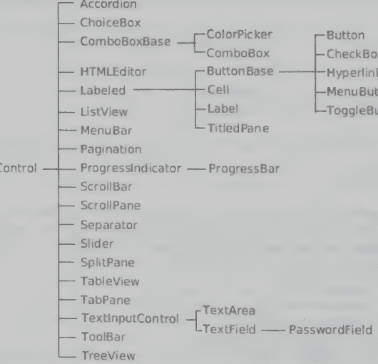

图 25.2：Control 的实现

图 25.3 显示了一个包含某些 JavaFX 控件的 `Scene`，列表 25.2 展示了生成该 `Scene` 的代码。

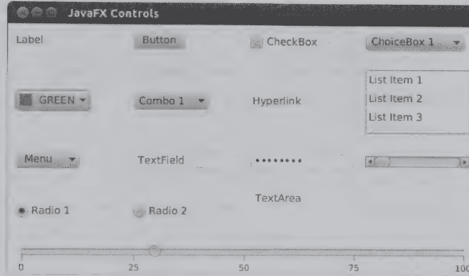

| Label | Button | CheckBox | ChoiceBox 1 |
|---|---|---|---|
| GREEN | Combo 1 | Hyperlink | List Item 1<br>List Item 2<br>List Item 3 |
| Menu | TextField | | |
| Radio 1 | | | | 图 25.3：UI 控件

列表 25.2：ControlsDemo 类

```java
package app25;
import javafx.application.Application;
import javafx.geometry.Insets;
import javafx.scene.Scene;
import javafx.scene.control.Button;
import javafx.scene.control.CheckBox;
import javafx.scene.control.ChoiceBox;
import javafx.scene.control.ColorPicker;
import javafx.scene.control.ComboBox;
import javafx.scene.control.Hyperlink;
import javafx.scene.control.Label;
import javafx.scene.control.ListView;
import javafx.scene.control.Menu;
import javafx.scene.control.MenuItem;
import javafx.scene.control.RadioButton;
import javafx.scene.control.Separator;
import javafx.scene.control.TextField;
import javafx.scene.control.Slider;
import javafx.scene.control.TextArea;
import javafx.scene.control.ToggleGroup;
import javafx.scene.layout.AnchorPane;
import javafx.scene.layout.BorderPane;
import javafx.scene.layout.ColumnConstraints;
import javafx.scene.layout.FlowPane;
import javafx.scene.layout.GridPane;
import javafx.scene.layout.HBox;
import javafx.scene.layout.Pane;
import javafx.scene.layout.StackPane;
import javafx.scene.layout.VBox;
import javafx.scene.paint.Color;
import javafx.scene.shape.Shape;
import javafx.stage.Stage;

public class ControlsDemo extends Application {
    @Override
    public void start(Stage stage) {
        GridPane grid = new GridPane();
        grid.setHgap(15);
        grid.setVgap(25);
        ColumnConstraints constraint = new ColumnConstraints();
        constraint.setPrefWidth(25);
        grid.getColumnConstraints().addAll(constraint);
        grid.setPadding(new Insets(10));

        Button button = new Button("Button");
        grid.add(button, 0, 0);

        CheckBox checkbox = new CheckBox("Checkbox");
        grid.add(checkbox, 1, 0);

        ComboBox<String> choiceBox = new ComboBox<>();
        choiceBox.getItems().addAll("Combo 1", "Combo 2");
        grid.add(choiceBox, 2, 0);

        ColorPicker colorPicker = new ColorPicker();
        grid.add(colorPicker, 3, 0);

        Hyperlink hyperlink = new Hyperlink("Hyperlink");
        grid.add(hyperlink, 0, 1);

        Label label = new Label("Label");
        grid.add(label, 1, 1);

        ListView<String> listView = new ListView<>();
        listView.getItems().addAll("List Item 1", "List Item 2", "List Item 3");
        grid.add(listView, 2, 1);

        Menu menu = new Menu("Menu");
        menu.getItems().addAll(new MenuItem("Menu 1"), new MenuItem("Menu 2"));
        grid.add(menu, 3, 1);

        ToggleGroup group = new ToggleGroup();
        RadioButton radioButton1 = new RadioButton("Radio 1");
        radioButton1.setToggleGroup(group);
        radioButton1.setSelected(true);
        grid.add(radioButton1, 0, 2);

        RadioButton radioButton2 = new RadioButton("Radio 2");
        radioButton2.setToggleGroup(group);
        grid.add(radioButton2, 1, 2);

        TextArea textArea = new TextArea("TextArea");
        textArea.setMinHeight(60.0);
        grid.add(textArea, 2, 2);

        Separator separator = new Separator();
        grid.add(separator, 3, 2);

        Slider slider2 = new Slider(0, 100, 30);
        slider2.setTickMarks(true);
        slider2.setShowTickLabels(true);
        grid.add(slider2, 0, 3);

        Scene scene = new Scene(grid, 600, 320);
        scene.setFill(Color.BEIGE);

        stage.setTitle("JavaFX Controls");
        stage.setScene(scene);
        stage.show();
    }

    public static void main(String[] args) {
        launch(args);
    }
}
```

`Region` 是一个可以包含其他节点并使用 CSS 进行样式的屏幕区域。所有的 `Region` 都是 `javafx.layout.Region` 类的子类。有三个直接后代：`Axis`、`Chart` 和 `Pane`。`Axis` 用于在图表区域渲染轴，`Chart` 模型图表。`Pane` 是一个通常用于布局 UI 控件的区域。

本节仅讨论 `Pane`。

`Pane` 的子类包括 `BorderPane`、`StackPane`、`GridPane`、`FlowPane`、`AnchorPane`、`HBox` 和 `VBox`。

`BorderPane` 将 `Parent` 分为五个区域：顶部、底部、左侧、右侧和中心。图 25.4 显示了 `BorderPane` 的不同区域。

| Top |
|---|
| Left | Center | Right |
| Bottom |

图 25.4：BorderLayout 的五个区域

### BorderPane 示例

```java
root.setTop(hBox);

ImageView imageView = new ImageView("image/1.jpg");
root.setCenter(imageView);

VBox vbox = new VBox();
vbox.setStyle("-fx-background-color: " + "#ddeeff;-fx-padding:10px");
vbox.getChildren().addAll(
    new Label("Select Color:"),
    new ColorPicker()
);
root.setLeft(vbox);

root.setStyle("-fx-background-color: #6680e6;");
Scene scene = new Scene(root, 740, 530);

stage.setTitle("HBox, VBox, BorderPane Demo");
stage.setScene(scene);
stage.show();
}

public static void main(String[] args) {
    launch(args);
}
```

图 25.5 显示了 Windows 上的 BorderPaneDemo 应用程序。


图 25.5：BorderPane demo

## 事件处理

JavaFX 是事件驱动的。UI 组件可以引发事件，你可以编写代码来处理这些事件。这种事件驱动的机制使得 JavaFX 应用程序能够支持交互。

有许多类型的事件，它们都继承自 `javafx.event.Event` 类。`Event` 的子类包括 `ActionEvent`、`InputMethodEvent`、`MouseEvent`、`MouseDragEvent`、`ScrollEvent`、`SwipeEvent` 等。

不同的组件可能会引发不同的事件。例如，点击按钮会引发 `ActionEvent`，而更改 `TextField` 中的文本会触发 `InputMethodEvent`。你可以编写并注册一个事件处理器，该处理器会在相应的事件发生时被调用。例如，你可以为 `TextField` 的 `InputMethodEvent` 编写一个处理器，将文本转换为大写字母。或者，你也可以编写一个在按钮被点击时打开另一个 `Stage` 的处理器。

在 JavaFX 中，编写和注册事件处理器的简单方法是使用 `Node` 类提供的便利方法之一。这些方法的命名遵循 `setXXX` 模式，并且这些方法被 `Node` 的所有后代继承。便利方法的示例包括 `setOnDragEntered`、`setOnDragExited`、`setOnMouseClicked`、`setOnKeyPressed`、`setOnMouseClicked` 等，许多 `Node` 的子类可能有更多的便利方法来适应特定类型的事件。

这些便利方法接受一个 `EventHandler` 对象作为参数。`javafx.event.EventHandler` 是一个带有 `handle` 方法的参数接口。以下是 `EventHandler` 的定义：

```java
package javafx.event;
public interface EventHandler<T extends Event> extends java.util.EventListener {
    void handle(T event)
}
```

在构造 `EventHandler` 时，你必须传递合适的事件类型。例如，你可以为 `ActionEvent` 编写一个处理器。代码如下：


```java
EventHandler<ActionEvent> handler = new EventHandler<ActionEvent>() {
    @Override
    public void handle(ActionEvent event) {
        // do something
    }
};
```

列表 25.4 中的 `RotateTest` 类展示了事件处理。每当按钮被点击时，`Rectangle` 旋转 10 度。

# 列表 25.4：RotateTest

```java
package app;

import javafx.application.Application;
import javafx.collections.ObservableList;
import javafx.event.ActionEvent;
import javafx.event.EventHandler;
import javafx.scene.Node;
import javafx.scene.Scene;
import javafx.scene.control.Button;
import javafx.scene.layout.VBox;
import javafx.scene.paint.Color;
import javafx.scene.shape.Rectangle;
import javafx.stage.Stage;

public class RotateTest extends Application {

    @Override
    public void start(Stage stage) {
        VBox root = new VBox();
        ObservableList<Node> children = root.getChildren();
        Rectangle rect = new Rectangle(100, 100);
        rect.setFill(Color.CORAL);
        children.add(rect);
        
        Button button = new Button("Click Me to Rotate");
        button.setOnAction(new EventHandler<ActionEvent>() {
            @Override
            public void handle(ActionEvent event) {
                rect.setRotate(rect.getRotate() + 10);
            }
        });
        children.add(button);
        
        Scene scene = new Scene(root, 400, 300);
        stage.setTitle("Rotate Demo");
        stage.setScene(scene);
        stage.show();
    }

    public static void main(String[] args) {
        launch(args);
    }
}
```

# 列表 25.5：CSSDemo 类

```java
package app25;
import javafx.application.Application;
import javafx.scene.Scene;
import javafx.scene.control.Button;
import javafx.scene.control.Label;
import javafx.scene.layout.BorderPane;
import javafx.scene.layout.HBox;
import javafx.scene.stage.Stage;

public class CSSDemo extends Application {

    @Override
    public void start(Stage stage) {
        BorderPane root = new BorderPane();

        root.setCenter(new Label("Welcome"));

        HBox hbox = new HBox();
        hbox.setStyleClass().add("hbox");

        Button backButton = new Button("Back");
        hbox.getChildren().add(backButton);
        Button nextButton = new Button("Next");
        nextButton.setId("nextBtn");
        hbox.getChildren().add(nextButton);
        root.setBottom(hbox);

        Scene scene = new Scene(root, 400, 300);
        scene.getStylesheets().add("style.css");

        stage.setTitle("CSS Demo");
        stage.setScene(scene);
        stage.show();
    }

    public static void main(String[] args) {
        launch(args);
    }
}
```

# 列表 25.6：style.css 文件

```css
.label {
    -fx-background-color: #778855;
    -fx-font-family: helvetica;
    -fx-font-size: 450%;
    -fx-text-fill: yellow;
}

hbox {
    -fx-background-color: #2f4f4f;
    -fx-padding: 15;
    -fx-spacing: 10;
    -fx-alignment: center-right;
}

.button {
  -fx-border-width: 2px;
  -fx-background-color:#ff8800;
  -fx-cursor: hand;
}

#nextBtn {
  -fx-font-weight: bold;
}
```

如果你运行该应用程序，你将看到一个如图 25.7 所示的 Stage。


图 25.7：CSS Demo

顺便提一下，JavaFX 环境文件 `jfxrt.jar` 包含一个 `modena.css` 文件。这是根节点和 UI 控件的默认样式表。我建议你查看此文件的内容以学习所有定义的样式。要查看此文件，请进入 jar 文件所在的目录并运行此命令。

```bash
jar x jfxrt.jar com/sun/javafx/scene/control/skin/modena/modena.css
```

## 总结

JavaFX 是一种创建桌面和浏览器内应用程序的 Java 技术。它比 AWT 和 Swing 都是更好的解决方案，因此注定将取代其前者。

本章介绍了 JavaFX 并提供了几个示例。下一章“带有 FXML 的 JavaFX”将解释如何使用一种称为 FXML 的特殊标记语言将表示层和业务逻辑分离。

## 测验

- 1. 作为所有 JavaFX 应用程序模板的类是什么？
- 2. JavaFX 中的顶层容器窗口是什么？
- 3. 什么是节点（node）？
- 4. 设置 JavaFX UI 组件的最佳方法是什么？

# 第 26 章：带有 FXML 的 JavaFX

FXML 是一种用于构建 JavaFX 用户界面（UI）的 XML 标记语言。在 JavaFX 应用程序中使用 FXML 是分离表示层和应用程序逻辑的一种极佳方法。本章讨论了 FXML 并展示了如何在 JavaFX 开发中使用它。

## 概述

作为 JavaFX 2 的新功能，FXML 通过将用户界面组件的构建移动到基于 XML 的文档，极大降低了 JavaFX 类的复杂性。此外，FXML 比 Java 类能更好地视觉化 UI 组件层次结构。FXML 文档的根代表一个 `javafx.scene.Parent`，JavaFX 可以使用名为 `FXMLLoader` 的特殊加载器来加载它。以下是一个使用 FXML 的 `Application` 子类的开头。

```java
@Override
public void start(Stage stage) throws Exception {
    stage.setTitle("FXML Example");
    Parent root = (Parent) FXMLLoader.load(
        getClass().getResource("example.fxml"));
    Scene scene = new Scene(root, 740, 530);
    stage.setScene(scene);
    stage.show();
}
```

上述代码调用 `FXMLLoader` 的 `load` 方法来读取 FXML 文件并将其内容转换为 `Parent` 对象。然后使用该 `Parent` 对象来构建 `Scene`。

编写 FXML 文件非常简单。你首先创建一个文本文件，并将其保存在与你的类文件相同的目录中。你可以将其存储在其他地方，但如果它与加载它的类位于同一个目录，加载起来最容易。

由于 FXML 文件是 XML 文档，所有 FXML 文档都以此声明开头。

```xml
<?xml version="1.0" encoding="UTF-8"?>
```

接下来是用于导入类型的导入指令。

```xml
<?xml version="1.0" encoding="UTF-8"?>

<?import javafx.scene.*?>
<?import javafx.scene.layout.*?>
```


```java
package app25;
import javafx.application.Application;
import javafx.scene.Scene;
import javafx.scene.control.Button;
import javafx.scene.control.Label;
import javafx.scene.layout.BorderPane;
import javafx.scene.layout.HBox;
import javafx.scene.stage.Stage;

public class CSSDemo extends Application {

    @Override
    public void start(Stage stage) {
        BorderPane root = new BorderPane();

        root.setCenter(new Label("Welcome"));

        HBox hbox = new HBox();
        hbox.setStyleClass().add("hbox");

        Button backButton = new Button("Back");
        hbox.getChildren().add(backButton);
        Button nextButton = new Button("Next");
        nextButton.setId("nextBtn");
        hbox.getChildren().add(nextButton);
        root.setBottom(hbox);

        Scene scene = new Scene(root, 400, 300);
        scene.getStylesheets().add("style.css");

        stage.setTitle("CSS Demo");
        stage.setScene(scene);
        stage.show();
    }

    public static void main(String[] args) {
        launch(args);
    }
}
```

## 列表 25.6：style.css 文件

```css
.label {
    -fx-background-color: #778855;
    -fx-font-family: helvetica;
    -fx-font-size: 450%;
    -fx-text-fill: yellow;
}

hbox {
    -fx-background-color: #2f4f4f;
    -fx-padding: 15;
    -fx-spacing: 10;
    -fx-alignment: center-right;
}

.button {
  -fx-border-width: 2px;
  -fx-background-color:#ff8800;
  -fx-cursor: hand;
}

#nextBtn {
  -fx-font-weight: bold;
}
```

# 第 26 章：带有 FXML 的 JavaFX

后续章节展示了在 JavaFX 应用程序中使用 FXML 的示例。

## 简单的 FXML 应用程序

此示例是上一章创建的 BorderPane 应用程序的重写。这次使用 FXML 文档来构建和组织 UI 组件。为了方便阅读，在这里列出了 `BorderDemo` 类。

```java
package app26;
import javafx.application.Application;
import javafx.geometry.Insets;
import javafx.scene.Scene;
import javafx.scene.control.Button;
import javafx.scene.control.ColorPicker;
import javafx.scene.control.Label;
import javafx.scene.image.ImageView;
import javafx.scene.layout.BorderPane;
import javafx.scene.layout.HBox;
import javafx.scene.layout.VBox;
import javafx.scene.stage.Stage;
```

```java
@Override
public void start(Stage stage) {
    Button okButton = new Button("OK");
    okButton.setDefaultButton(true);

    Button cancelButton = new Button("Cancel");
    HBox hbox = new HBox();
    hbox.setPadding(new Insets(15, 12, 15, 12));
    hbox.setSpacing(10);
    hbox.setStyle("-fx-background-color: #88699;");
    hbox.getChildren().addAll(okButton, cancelButton);
    BorderPane root = new BorderPane();
    root.setTop(hbox);

    ImageView imageView = new ImageView("image/1.jpg");
    root.setCenter(imageView);

    VBox hbox = new VBox();
    hbox.setStyle("-fx-background-color: " + "#dde2ff-fx-padding:10px";");
    hbox.getChildren().addAll(
        new Label("Select Color:"),
        new ColorPicker()
    );
    root.setLeft(hbox);

    root.setStyle("-fx-background-color: #6680e6;");
    Scene scene = new Scene(root, 740, 530);
}
```

```java
stage.setTitle("HBox, VBox, BorderPane Demo");
stage.setScene(scene);
stage.show();

public static void main(String[] args) {
    launch(args);
}
```

`BorderPaneDemo` 类中的 UI 构建部分可以被列表 26.2 中 `example1.fxml` 文件的标记代码所替换。

## 列表 26.2：example1.fxml 文件

```xml
<?xml version="1.0" encoding="UTF-8"?>
<?import javafx.scene.*?>
<?import javafx.scene.control.*?>
<?import javafx.scene.layout.*?>
<?import javafx.geometry.Insets?>
<?import javafx.scene.image.Image?>
<?import javafx.scene.image.ImageView?>

<BorderPane>
  <top>
    <HBox spacing="10.0" style="fx-background-color:#886699;">
      <padding>
        <Insets top="15" bottom="15" left="12" right="12"/>
      </padding>
      <Button id="okButton" text="OK" defaultButton="true">
        <Button text="Cancel"/>
      </Button>
    </HBox>
  </top>
  <left>
    <VBox style="fx-background-color:#ddeeff;fx-padding:10px">
      <Label text="Select:"/>
      <Color />
    </VBox>
  </left>
  <center>
    <ImageView>
      <Image url="image/1.jpg"/>
    </ImageView>
  </center>
</BorderPane>
```

主 Java 类名为 `Example`，在列表 26.3 所示。它继承自 `Application` 并提供了 `start` 方法的实现。

## 列表 26.3：Example 类

```java
package app26;

import javafx.application.Application;
import javafx.fxml.FXMLLoader;
import javafx.scene.Parent;
import javafx.scene.Scene;
import javafx.stage.Stage;

public class Example extends Application {
    @Override
    public void start(Stage stage) throws Exception {
        // Example.fxml 必须位于与 Example.class 相同的目录下
        Parent root = FXMLLoader.load(getClass().getResource("example.fxml"));
        root.setStyle("-fx-background-color: #6680e6;");
        Scene scene = new Scene(root, 740, 530);
        stage.setTitle("JavaFX with FXML (Example 1)");
        stage.show();
    }

    public static void main(String[] args) {
        launch(args);
    }
}
```

`start` 方法使用 `FXMLLoader` 加载 FXML 文档并返回一个包含文档中声明组件的 `Parent` 对象。方法随后创建一个 `Scene`，并在调用 `Stage` 的 `show` 方法之前将该 `Scene` 传递给 `Stage`。

图 26.1 显示了运行应用程序的结果。


图 26.1：使用 FXML

## 使用 FXML 进行事件处理

FXML 是一种强大的语言。它的特征之一是能够将 UI 组件与控制器中的事件处理方法（事件处理器）绑定，这样当事件发生时，该方法就会被调用。控制器是一个实现了 `javafx.fxml.Initializable` 的 Java 类。为了利用这一特性，你必须在根元素中使用 `fx:controller` 属性，如下所示。

```xml
<Group fx:controller="app26.Example2Controller"
```

请记住 `fx` 是 FXML 中的一个特殊前缀。

要将组件绑定到事件处理器，请使用元素相关的 `onXXX` 属性。例如，要将 `ActionEvent` 绑定到控制器中名为 `handleAction` 的方法，请这样写：

```xml
onAction="#handleAction"
```

例如，考虑以下应用程序，它包含一个可以用户名和密码的登录表单。应用程序的主阶段如图 26.2 所示。


图 26.2：Example 2 中的登录表单

用户可以输入用户名和密码。点击“重置（Reset）”会清除用户名和密码字段。点击“登录（Login）”将验证用户身份。验证结果将写在字段方的 `Label` 上。

该应用程序由列表 26.4 中的 FXML 文档（`example2.fxml`）、列表 26.5 中的控制器类（`Example2Controller`）以及列表 26.6 中的主类（`Example2`）组成。

## 列表 26.4：example2.fxml 文件

```xml
<?xml version="1.0" encoding="UTF-8"?>

<?import javafx.scene.*?>
<?import javafx.scene.control.*?>
<?import javafx.scene.layout.*?>
<?import javafx.geometry.Insets?>

<GridPane xmlns="http://javafx.com/fxml"
fx:controller="App26.Example2Controller"
hgap="12" layoutY="30">
    <ColumnConstraints percentWidth="15"/>
    <ColumnConstraints percentWidth="35"
        alignment="RIGHT"/>
    <ColumnConstraints percentWidth="35"/>
    <ColumnConstraints percentWidth="10"/>
</ColumnConstraints>
<children>
    <Label text="User Name:"/>
    <TextField fx:id="usernameField"/>
    <Label text="Password:"/>
    <PasswordField fx:id="passwordField"/>
    <Button id="resetButton" text="Reset"/>
    <Button id="loginButton" text="Login" defaultButton="true"/>
    <Label fx:id="statusLabel"/>
</children>
</GridPane>
```

`example2.fxml` 文件的标记代码中的 `GridPane` 填充了 `columnConstraints`。`GridPane` 的 `onAction` 属性用于 `Button` 元素。请注意 `onAction` 属性用于 `Button` 元素。

## 列表 26.5：Example2Controller 类

```java
package app26;

import java.net.URL;
import java.util.ResourceBundle;
import javafx.event.ActionEvent;
import javafx.fxml.FXML;
import javafx.fxml.Initializable;
import javafx.scene.control.Label;
import javafx.scene.control.PasswordField;
import javafx.scene.control.TextField;

public class Example2Controller implements Initializable {

    @FXML
    private TextField usernameField;

    @FXML
    private PasswordField passwordField;

    @FXML
    private Label statusLabel;

    @Override
    public void initialize(URL location, ResourceBundle resources) {
    }

    @FXML
    public void handleLogin(ActionEvent event) {
    }

    @FXML
    public void handleReset(ActionEvent event) {
        usernameField.setText("");
        passwordField.setText("");
        statusLabel.setText("");
    }
}
```


```java
package app26;

import java.net.URL;
import java.util.ResourceBundle;
import javafx.event.ActionEvent;
import javafx.fxml.FXML;
import javafx.fxml.Initializable;
import javafx.scene.control.Label;
import javafx.scene.control.PasswordField;
import javafx.scene.control.TextField;

public class Example2Controller implements Initializable {

    @FXML
    private TextField usernameField;

    @FXML
    private PasswordField passwordField;

    @FXML
    private Label statusLabel;

    @Override
    public void initialize(URL location, ResourceBundle resources) {
    }

    @FXML
    public void handleLogin(ActionEvent event) {
    }

    @FXML
    public void handleReset(ActionEvent event) {
        usernameField.setText("");
        passwordField.setText("");
        statusLabel.setText("");
    }
}
```

# 列表 26.6：Example2 类

```java
package app26;

import javafx.application.Application;
import javafx.fxml.FXMLLoader;
import javafx.scene.Parent;
import javafx.scene.Scene;
import javafx.stage.Stage;

public class Example2 extends Application {
    @Override
    public void start(Stage stage) throws Exception {
        Parent root = FXMLLoader.load(getClass().getResource("example2.fxml"));
        Scene scene = new Scene(root, 300, 200);
        stage.setTitle("Login Form");
        stage.setScene(scene);
        stage.show();
    }

    public static void main(String[] args) {
        launch(args);
    }
}
```

最后，`Example2` 类（列表 26.6）加载并显示了主阶段。

# 使用 FXML 进行事件处理

FXML 是一种强大的语言。它的特征之一是能够将 UI 组件与控制器中的事件处理方法（事件处理器）绑定，这样当事件发生时，该方法就会被调用。控制器是一个实现了 `javafx.fxml.Initializable` 的 Java 类。为了利用这一特性，你必须在根元素中使用 `fx:controller` 属性，如下所示。

```xml
<Group fx:controller="app26.Example2Controller"
```

请记住 `fx` 是 FXML 中的一个特殊前缀。

要将组件绑定到事件处理器，请使用元素相关的 `onXXX` 属性。例如，要将 `ActionEvent` 绑定到控制器中名为 `handleAction` 的方法，请这样写：

```xml
onAction="#handleAction"
```

例如，考虑以下应用程序，它包含一个可以用用户名和密码的登录表单。应用程序的主阶段如图 26.2 所示。


图 26.2：Example 2 中的登录表单

用户可以输入用户名和密码。点击“重置（Reset）”会清除用户名和密码字段。点击“登录（Login）”将验证用户身份。验证结果将写在字段方的 `Label` 上。

该应用程序由列表 26.4 中的 FXML 文档（`example2.fxml`）、列表 26.5 中的控制器类（`Example2Controller`）以及列表 26.6 中的主类（`Example2`）组成。

# 列表 26.4：example2.fxml 文件

```xml
<?xml version="1.0" encoding="UTF-8"?>

<?import javafx.scene.*?>
<?import javafx.scene.control.*?>
<?import javafx.scene.layout.*?>
<?import javafx.geometry.Insets?>

<GridPane xmlns="http://javafx.com/fxml"
fx:controller="App26.Example2Controller"
hgap="12" layoutY="30">
    <ColumnConstraints percentWidth="15"/>
    <ColumnConstraints percentWidth="35"
        alignment="RIGHT"/>
    <ColumnConstraints percentWidth="35"/>
    <ColumnConstraints percentWidth="10"/>
</ColumnConstraints>
<children>
    <Label text="User Name:"/>
    <TextField fx:id="usernameField"/>
    <Label text="Password:"/>
    <PasswordField fx:id="passwordField"/>
    <Button id="resetButton" text="Reset"/>
    <Button id="loginButton" text="Login" defaultButton="true"/>
    <Label fx:id="statusLabel"/>
</children>
</GridPane>
```

`example2.fxml` 文件的标记代码中的 `GridPane` 填充了 `columnConstraints`。`GridPane` 的 `onAction` 属性用于 `Button` 元素。请注意 `onAction` 属性用于 `Button` 元素。

# 列表 26.5：Example2Controller 类

```java
package app26;

import java.net.URL;
import java.util.ResourceBundle;
import javafx.event.ActionEvent;
import javafx.fxml.FXML;
import javafx.fxml.Initializable;
import javafx.scene.control.Label;
import javafx.scene.control.PasswordField;
import javafx.scene.control.TextField;

public class Example2Controller implements Initializable {

    @FXML
    private TextField usernameField;

    @FXML
    private PasswordField passwordField;

    @FXML
    private Label statusLabel;

    @Override
    public void initialize(URL location, ResourceBundle resources) {
    }

    @FXML
    public void handleLogin(ActionEvent event) {
    }

    @FXML
    public void handleReset(ActionEvent event) {
        usernameField.setText("");
        passwordField.setText("");
        statusLabel.setText("");
    }
}
```

# 列表 26.6：Example2 类

```java
package app26;

import javafx.application.Application;
import javafx.fxml.FXMLLoader;
import javafx.scene.Parent;
import javafx.scene.Scene;
import javafx.stage.Stage;

public class Example2 extends Application {
    @Override
    public void start(Stage stage) throws Exception {
        Parent root = FXMLLoader.load(getClass().getResource("example2.fxml"));
        Scene scene = new Scene(root, 300, 200);
        stage.setTitle("Login Form");
        stage.setScene(scene);
        stage.show();
    }

    public static void main(String[] args) {
        launch(args);
    }
}
```

最后，`Example2` 类（列表 26.6）加载并显示了主阶段。

# 第 27 章：Java 线程

Java 最具吸引力的特征之一是支持易的线程编程。在 1995 年（Java 发布之前），线程一直是编程专家的领域。通过 Java，即使是新手也可以编写多线程应用程序。

本章将解释线程以及它们为什么重要。它还将讨论同步和可见性问题等相关话题。

## Java 线程简介

下次当你玩电脑游戏时，问自己这个问题：我并没有使用多处理器计算机，为什么似乎有两个处理器在同时运行，一个在移动小行星，另一个在移动飞船？其实，这些运动得益于多线程编程。

应用程序可以为单元分配处理器时间。每个单元随后获得一部分处理器时间。如果你的计算机只有一个处理器，它也可以有多个同时工作的单元。单处理器计算机的技巧是划分处理器时间，并将每个切片交给每个处理单元。能够获取处理器时间的最小单位被称为线程。

## 创建线程

创建线程有两种方法。

1. 继承 `java.lang.Thread` 类。
2. 实现 `java.lang.Runnable` 接口。

如果你选择第一种，将需要重写它的 `run` 方法，并在其中编写你想让线程执行的代码。一旦你有了 `Thread` 对象，就可以调用它的 `start` 方法来启动线程。当线程启动时，它的 `run` 方法就会被执行。一旦 `run` 方法返回或抛出异常，线程就会死亡并被垃圾回收。

> **注意**
>
> 第 24 章中讨论的并发工具（Concurrency Utilities）提供了创建和执行线程的更好方法。在大多数情况下，你不应该直接操作 `Thread` 类。

在 Java 中，你可以为 `Thread` 对象命名，这在处理多个线程时是一种常见做法。此外，每个 `Thread` 都有一个状态，并且可能处于以下六种状态之一：

- `new`：线程尚未启动的状态。
- `runnable`：线程正在执行的状态。
- `blocked`：线程等待锁以访问对象的状态。
- `waiting`：线程无限期等待另一个线程执行动作的状态。
- `timed waiting`：线程在指定时间范围内等待另一个线程执行动作的状态。
- `terminated`：线程已退出的状态。

表示这些状态的值封装在 `java.lang.Thread.State` 枚举成员中，分别为 `NEW`、`RUNNABLE`、`BLOCKED`、`WAITING`、`TIMED_WAITING` 和 `TERMINATED`。

`Thread` 类提供了你可以用于创建 `Thread` 对象的公共构造函数。这里是其中一些：

```java
public Thread()
public Thread(String name)
public Thread(Runnable target)
public Thread(Runnable target, String name)
```

> **注意**
>
> 我将在稍后讨论 `Runnable` 接口后解释第三和第四构造函数。

以下是 `Thread` 类中的实用方法。

```java
public String getName()
    返回线程的名字。
public Thread.State getState()
    返回线程当前所处。
public void interrupt()
    中断此线程。
public void start()
    启动此线程。
public static void sleep(long millis)
    让当前线程停止指定的毫秒数。
```

此外，`Thread` 类还提供了静态方法 `currentThread`，它返回当前工作的线程。

```java
public static Thread currentThread()
```

## 继承 Thread

列表 27.1 中的代码展示了如何通过继承 `java.lang.Thread` 来创建一个线程。

### 列表 27.1：简单的多线程程序

```java
package app27;

public class ThreadDemo extends Thread {

    public void run() {

        for (int i = 1; i <= 10; i++) {

            System.out.println(i);

            try {

                sleep(1000);

            } catch (InterruptedException e) {

            }

        }

    }

    public static void main(String[] args) {

        new ThreadDemo().start();

    }

}
```


# 第 27 章：Java 线程

## 继承 Thread 类

`ThreadDemo` 类继承了 `Thread` 类并重写了它的 `run()` 方法。新创建的 `Thread` 将处于 `NEW` 状态。调用 `start()` 方法将使线程从 `NEW` 移动到 `RUNNABLE`，导致 `run()` 方法被调用。这会在线程睡眠一秒的两个数字之间打印数字 1 到 10。当 `run()` 方法返回时，线程死亡并被垃圾回收。这个类并没有特别之处，但它让你对如何使用 `Thread` 有了大致的概念。

当然，你并不总是有机会从主类中继承 `Thread`。例如，如果你的类继承了 `javax.swing.JFrame`，那么你就不能继承 `Thread`，因为 Java 不支持多重继承。然而，你始终可以创建一个继承 `Thread` 的第二个类，如列表 27.2 中的代码所示；或者如果你需要访问主类的成员，可以写一个继承 `Thread` 的内部类。

### 列表 27.2：使用继承 Thread 的独立类

```java
package app27;

class MyThread extends Thread {

    public void run() {
        for (int i = 1; i <= 10; i++) {
            System.out.println(i);
            try {
                sleep(1000);
            } catch (InterruptedException e) {
            }
        }
    }
}
```

`ThreadDemo` 类继承了 `Thread` 类并重写了它的 `run()` 方法。新创建的 `Thread` 将处于 `NEW` 状态。调用 `start()` 方法将使线程从 `NEW` 移动到 `RUNNABLE`，导致 `run()` 方法被调用。这会在线程睡眠一秒的两个数字之间打印数字 1 到 10。当 `run()` 方法返回时，线程死亡并被垃圾回收。这个类并没有特别之处，但它让你对如何使用 `Thread` 有了大致的概念。

## 实现 Runnable

创建线程的另一种方法是实现 `java.lang.Runnable`。如果你使用 `Runnable`，则必须将 `Runnable` 对象传递给 `Thread` 构造函数。

### 列表 27.3：使用 Runnable

```java
package app27;

public class RunnableDemo implements Runnable {

    public void run() {
        for (int i = 1; i <= 10; i++) {
            System.out.println(i);
            try {
                Thread.sleep(1000);
            } catch (InterruptedException e) {
            }
        }
    }

    public static void main(String[] args) {
        Thread thread = new Thread(new RunnableDemo());
        thread.start();
    }
}
```

`RunnableDemo` 类实现了 `Runnable` 接口并重写了 `run()` 方法。在 `main()` 方法中，我们创建 `RunnableDemo` 的实例并传递给 `Thread` 构造函数。然后调用 `start()` 方法。

## 处理多线程

处理多个线程时，你有时需要考虑线程调度。换句话说，你需要确保每个线程都有公平的机会运行。这是通过在线程的 `run()` 方法中调用 `sleep()` 实现的。耗时线程应该始终调用 `sleep()` 方法给其他线程 CPU 处理时间。调用 `sleep()` 的线程被称为让出（yield）。

### 列表 27.4：使用两个线程

```java
package app27;

import java.awt.FlowLayout;
import javax.swing.JFrame;
import javax.swing.JLabel;

public class ThreadDemo extends JFrame {

    JLabel countUpLabel = new JLabel("Count Up");
    JLabel countDownLabel = new JLabel("Count Down");

    public ThreadDemo(String title) {
        super(title);
        init();
    }

    private void init() {
        this.setDefaultCloseOperation(JFrame.EXIT_ON_CLOSE);
        this.getContentPane().setLayout(new FlowLayout());
        this.add(countUpLabel);
        this.add(countDownLabel);
        this.pack();
        this.setVisible(true);
        new CountUpThread().start();
        new CountdownThread().start();
    }
}

class CountUpThread extends Thread {
    public void run() {
        int count = 1000;
        while (true) {
            try {
                sleep(100);
            } catch (InterruptedException e) {
            }
            countUpLabel.setText(Integer.toString(count--));
        }
    }
}

class CountdownThread extends Thread {
    public void run() {
        int count = 0;
        while (true) {
            try {
                sleep(50);
            } catch (InterruptedException e) {
            }
            if (count == 1000) {
                count = 0;
            }
            countDownLabel.setText(Integer.toString(count++));
        }
    }
}
```

## 线程优先级

现在，如果有多个线程在等待，当运行中的线程让出时，哪一个获得运行？优先级最高的线程。要设置线程优先级，调用它的 `setPriority()` 方法。其签名如下。

```java
public final void setPriority(int priority)
```

下面的示例是一个带有两个计数器的 Swing 应用。左侧的计数器由一个优先级为 10 的线程驱动，另一个计数器由一个优先级为 1 的线程驱动。运行代码并观察高优先级线程如何运行得更快。

### 列表 27.5：测试线程优先级

```java
package app27;

import java.awt.FlowLayout;
import javax.swing.JFrame;
import javax.swing.JLabel;

public class ThreadPriorityDemo extends JFrame {

    JLabel counter1Label = new JLabel("Priority 10");
    JLabel counter2Label = new JLabel("Priority 1");

    class CounterThread extends Thread {
        JLabel counterLabel;

        public CounterThread(JLabel counterLabel) {
            super();
            this.counterLabel = counterLabel;
        }

        public void run() {
            int count = 0;
            while (true) {
                try {
                    sleep(1);
                } catch (InterruptedException e) {
                }
                if (count == 50000) {
                    count = 0;
                }
                counterLabel.setText(Integer.toString(count++));
            }
        }
    }

    public ThreadPriorityDemo(String title) {
        super(title);
        init();
    }

    private void init() {
        this.setDefaultCloseOperation(JFrame.EXIT_ON_CLOSE);
        this.setLayout(new FlowLayout());
        this.add(counter1Label);
        this.add(counter2Label);
        this.pack();
        this.setVisible(true);
        CounterThread thread1 = new CounterThread(counter1Label);
        thread1.setPriority(10);
        CounterThread thread2 = new CounterThread(counter2Label);
        thread2.setPriority(1);
        thread1.start();
        thread2.start();
    }

    private static void constructGUI() {
        JFrame.setDefaultLookAndFeelDecorated(true);
        ThreadPriorityDemo frame = new ThreadPriorityDemo("Thread Priority Demo");
    }

    public static void main(String[] args) {
        javax.swing.SwingUtilities.invokeLater(new Runnable() {
            public void run() {
                constructGUI();
            }
        });
    }
}
```

运行的两个线程是同一个类（`CounterThread`）的实例。第一个线程的优先级为 10，第二个为 1。图 27.2 显示，即使第二个线程先启动，第一个线程也运行得更快。


## 停止线程

`Thread` 类有一个 `stop()` 方法来停止线程。然而，你不应该使用这个方法，因为它是不安全的。相反，你应该安排，使得当你想停止线程时，`run()` 方法自然退出。一种常用技术是使用带有条件的 `while` 循环。当你想停止线程时，只需让条件求值为 `false` 即可。例如：

```java
boolean condition = true;

public void run() {
    while (condition) {
        // do something else
    }
}
```

在你的类中，你还需要提供一个方法来更改 `condition` 的值。

```java
public synchronized void stopThread() {
    condition = false;
}
```

> **注意**
> `synchronized` 关键字在“同步线程”节中进行了解释。

停止线程在列表 27.6 的示例中得到了说明。

### 列表 27.6：停止线程

```java
package app27;

import java.awt.FlowLayout;
import java.awt.event.ActionEvent;
import java.awt.event.ActionListener;
import javax.swing.JButton;
import javax.swing.JFrame;
import javax.swing.JLabel;

public class StopThreadDemo extends JFrame {

    JLabel counterLabel = new JLabel("Counter");
    JButton startButton = new JButton("Start");
    JButton stopButton = new JButton("Stop");
    CounterThread thread = null;
    boolean stopped = false;
    int count = 1;
}

class CounterThread extends Thread {
    public void run() {
        while (!stopped) {
            try {
                sleep(10);
            } catch (InterruptedException e) {
            }
            if (count == 1000) {
                count = 1;
            }
            counterLabel.setText(Integer.toString(count++));
        }
    }
}

public StopThreadDemo(String title) {
    super(title);
    init();
}

private void init() {
    this.setDefaultCloseOperation(JFrame.EXIT_ON_CLOSE);
    this.setLayout(new FlowLayout());
    this.add(counterLabel);
    this.add(startButton);
    this.add(stopButton);
    this.pack();
    this.setVisible(true);
    thread = new CounterThread();
    thread.start();
    
    startButton.addActionListener(new ActionListener() {
        public void actionPerformed(ActionEvent e) {
            stopped = false;
            if (!thread.isAlive()) {
                thread = new CounterThread();
                thread.start();
            }
        }
    });
    
    stopButton.addActionListener(new ActionListener() {
        public void actionPerformed(ActionEvent e) {
            stopped = true;
        }
    });
}
```

## 列表 27.8：SafeUserStat 类

```java
package app27;

public class SafeUserStat {

    int userCount;

    public synchronized int getUserCount() {
```


```java
return userCount;
}

public synchronized void increment() {
    userCount++;
}

public synchronized void decrement() {
    userCount--;
}
```

在程序中，保证一次只有一个线程访问共享资源的代码段被称为临界区（critical sections）。在 Java 中，临界区是通过 `synchronized` 关键字实现的。`SafeUserStat` 类的 `increment`、`decrement` 和 `getUserCount` 方法都是临界区。对 `userCount` 的访问仅通过同步方法允许。这确保了发生竞态条件。

## 块同步

同步方法并不总是可能的。想象你正在编写一个多线程应用程序，多个线程访问一个共享对象，但该对象类在编写时没有考虑线程安全。更糟糕的是，你无法获取共享对象的源代码。假设你必须与一个线程不安全的 `SafeUserStat` 类进行工作，且其源代码不可用。

幸运的是，Java 允许通过块同步（block synchronization）来锁定任何对象。其语法如下：

```java
synchronized(object) {
    // 在锁定对象时执行某些操作
}
```

同步块赋予你一个对象的内在锁（intrinsic lock）。锁在块中的代码执行完毕后会被释放。

例如，以下代码使用了列表 27.7 中线程不安全的 `SafeUserStat` 类作为计数器。为了在增加计数器时锁定计数器，`incrementCounter` 方法锁定了 `UserStat` 实例。

```java
UserStat userStat = new UserStat();
...
public void incrementCounter() {
    synchronized(userStat) {
        // 需要同步的语句，例如对 userStat
        // 上的 increment、decrement 和 getUserCount 方法的调用
        userStat.increment();
    }
}
```

顺便说明一下，方法同步等同于锁定当前对象的块同步：
`synchronized(this)` ...

## 可见性

在“同步”节中，你学习了如何同步可能被多个线程访问的非原子操作。到此时，你可能产生这样印象：如果没有非原子操作，就不必去同步被多个线程访问的资源。

事实并非如此。

在单线程程序中，读取变量的值始终能得到最后写入该变量的值。然而，由于 Java 内存模型的影响，在多线程应用程序中并不如此。除非对数据的操作是同步的，否则线程可能看不到另一个线程所做的更改。

例如，列表 27.9 中的 `Inconsistent` 类创建了一个后台线程，该线程应该等待三秒后更改布尔值 `started` 的值。主方法中的 `while` 循环应该持续检查 `started` 的值，直到 `started` 被设置为 `true` 为止。

### 列表 27.9：Inconsistent 类

```java
public class app27 {
    static boolean started = false;

    public static void main(String[] args) {
        Thread thread1 = new Thread(new Runnable() {
            public void run() {
                try {
                    Thread.sleep(3000);
                } catch (InterruptedException e) {
                }
                started = true;
                System.out.println("started set to true");
            }
        });
        thread1.start();
        while (!started) {
            // wait until started
        }
        System.out.println("Wait 3 seconds and exit");
    }
}
```

然而，当我在电脑上运行它时，它从未打印该字符串并退出。发生了什么？看起来 `while` 循环（运行在主方法中）从未看到 `started` 的值发生。

你可以通过对 `started` 的访问进行同步来修复，如列表 27.10 中的 `Consistent` 类所示。

### 列表 27.10：Consistent 类

```java
package app27;

public class Consistent {
    static boolean started = false;

    public synchronized static void setStarted() {
        started = true;
    }

    public synchronized static boolean getStarted() {
        return started;
    }

    public static void main(String[] args) {
        Thread thread1 = new Thread(new Runnable() {
            public void run() {
                try {
                    Thread.sleep(3000);
                } catch (InterruptedException e) {
                }
                setStarted();
                System.out.println("started set to true");
            }
        });
        thread1.start();
        while (!getStarted()) {
            // wait until started
        }
        System.out.println("Wait 3 seconds and exit");
    }
}
```

注意，`setStarted` 和 `getStarted` 都是同步以达到预期效果的。如果只同步 `setStarted`，它将不起作用。

然而，同步是有代价的。锁定对象会产生运行时开销。如果你追求的是可见性且不需要互斥，可以使用 `volatile` 关键字代替 `synchronized`。

声明变量 volatile 保证所有访问线程的可见性。

这里有一个示例。

`static volatile boolean started = false;`

因此，你可以重写 `Consistent` 类来使用 `volatile` 以减少开销。

### 列表 27.11：使用 volatile 解决可见性问题

```java
package app27;

public class LightAndConsistent {
    static volatile boolean started = false;

    public static void main(String[] args) {
        Thread thread1 = new Thread(new Runnable() {
            public void run() {
                try {
                    Thread.sleep(3000);
                } catch (InterruptedException e) {
                }
                started = true;
                System.out.println("started set to true");
            }
        });
        thread1.start();
        while (!started) {
            // wait until started
        }
        System.out.println("Wait 3 seconds and exit");
    }
}
```

注意，`volatile` 解决了可见性问题，但它无法解决互斥问题。

## 线程协调

存在一些更微妙的情况，线程执行的时机会影响其他线程。以下示例说明了这种情况并提供了解决方案。

你拥有一个快递服务，负责提货和交付。你雇佣了一个调度者（dispatcher）和多个驱动程序（drivers）。驱动程序检查持有者是否有单据。为了保证公平性，你希望单据按先来顺序执行。调度者在新单据可用时通知司机。

`java.lang.Object` 类提供了几个对线程协调非常有用的方法：

- `wait()`：使当前线程等待，直到另一个线程调用 `notify()` 或 `notifyAll()`。通常在同步方法中调用。
- `wait(long timeout)`：使当前线程等待，直到另一个线程调用 `notify()` 或 `notifyAll()`，或者指定的超时已到。通常在同步方法中调用。
- `notify()`：通知在该对象上等待的单个线程。如果有多个线程在等待，将选择其中一个进行通知，选择是随机的。
- `notifyAll()`：通知在该对象上等待的所有线程。

让我们看看如何使用 `wait`、`notify` 和 `notifyAll` 在 Java 中实现配送业务模型。涉及到三个类型：

- `DeliveryNoteHolder` 代表持有者，位于列表 27.12。它被 `DispatchThread` 和 `DriverThread` 访问。
- `DispatchThread` 代表调度者，在列表 27.13 中。
- `DriverThread` 代表司机，在列表 27.14 中。

### 列表 27.12：DeliveryNoteHolder 类

```java
package app2;

public class DeliveryNoteHolder {
    private String deliveryNote;
    private boolean available = false;

    public synchronized String get() {
        while (available == false) {
            try {
                wait();
            } catch (InterruptedException e) { }
        }
        available = false;
        System.out.println(System.currentTimeMillis() + ": got " + deliveryNote);
        notifyAll();
        return deliveryNote;
    }

    public synchronized void put(String deliveryNote) {
        while (available == true) {
            try {
                wait();
            } catch (InterruptedException e) { }
        }
        this.deliveryNote = deliveryNote;
        available = true;
        System.out.println(System.currentTimeMillis() + " Put " + deliveryNote);
        notifyAll();
    }
}
```

`DeliveryNoteHolder` 类中有两个同步方法：`get` 和 `put`。`Dispatcher` 对象调用 `put` 方法，而 `DriverThread` 对象调用 `get` 方法。送单仅仅是一个包含送货信息的字符串（`deliveryNote`）。可用 `available` 变量表示该持有器中是否有可用的送单。`available` 的初始值为 `false`，表示 `DeliveryNoteHolder` 对象是空的。一次时间只有一个线程可以调用任何同步方法。

如果 `DriverThread` 是第一个访问 `DeliveryNoteHolder` 的线程，它将在 `get` 方法中遇到以下 `while` 循环：

```java
while (available == false) {
    try {
        wait();
    } catch (InterruptedException e) {
    }
}
```

由于 `available` 为 `false`，线程将调用 `wait`，导致线程进入休眠并释放锁。现在，其他线程可以访问 `DeliveryNoteHolder` 对象了。

如果 `DispatcherThread` 是第一个访问 `DeliveryNoteHolder` 的线程，它将看到以下代码：

```java
while (available == true) {
    try {
        wait();
    } catch (InterruptedException e) {
    }
}
this.deliveryNote = deliveryNote;
available = true;
notifyAll();
```

由于 `available` 为 `false`，它将跳过 `while` 循环并为 `DeliveryNoteHolder` 对象的 `deliveryNote` 赋值。线程会将 `available` 设置为 `true` 并通知所有线程。

在调用 `notifyAll` 时，如果 `DriverThread` 正在等待 `DeliveryNoteHolder` 对象，它会被唤醒，重新获取 `DeliveryNoteHolder` 对象的锁，跳出 `while` 循环并执行 `get` 方法剩余部分：

```java
available = false;
notifyAll();
return deliveryNote;
```

`available` 布尔值将切换回 `false`，调用 `notifyAll` 方法并返回 `deliveryNote`。

现在，让我们查看列表 27.13 中的 `DispatcherThread` 类。

### 列表 27.13：DispatcherThread 类

```java
package app27;

public class DispatcherThread extends Thread {
    private DeliveryNoteHolder deliveryNote;
    String[] deliveryNotes = {
        "XY23. 1234 Arnie Rd.",
        "XY24. 3330 Quebec St.",
        "XY25. 909 Swenson Ave.",
        "XY26. 4830 Davidson Blvd.",
        "XY27. 9900 Old York Dr."
    };

    public DispatcherThread(DeliveryNoteHolder holder) {
        deliveryNote = holder;
    }

    public void run() {
        for (int i = 0; i < deliveryNotes.length; i++) {
            String deliveryNote = deliveryNotes[i];
            deliveryNote.put(deliveryNote);
            try {
                sleep(100);
            } catch (InterruptedException e) {
            }
        }
    }
}
```

`DispatcherThread` 类继承自 `java.lang.Thread` 并声明了一个包含要放入 `DeliveryNoteHolder` 对象的送单的字符串数组。它通过构造函数获取 `DeliveryNoteHolder` 对象。它的 `run` 方法包含一个 `for` 循环，尝试调用 `DeliveryNoteHolder` 上的 `put` 方法。

`DriverThread` 类也继承自 `java.lang.Thread`，并在列表 27.14 中给出。

### 列表 27.14：DriverThread 类

```java
```


package app27;

public class DriverThread extends Thread {

    DeliveryNoteHolder deliveryNoteHolder;

    boolean stopped = false;

    String driverName;

    public DriverThread(DeliveryNoteHolder holder, String driverName) {
        deliveryNoteHolder = holder;
        this.driverName = driverName;
    }

    public void run() {
        while (!stopped) {
            String deliveryNote = deliveryNoteHolder.get();
            try {
                sleep(300);
            } catch (InterruptedException e) {
            }
        }
    }
}

`DriverThread` 方法尝试通过调用 `DeliveryNoteHolder` 对象的 `get` 方法来获取送单。`run` 方法使用一个由 `stopped` 变量控制的 `while` 循环。为了保持示例简单，这里没有给出更改 `stopped` 方法。

最后，列表 27.15 中的 `ThreadCoordinationDemo` 类将所有内容整合在一起。

### 列表 27.15：ThreadCoordinationDemo 类

```java
package app27;

public class ThreadCoordinationDemo {

    public static void main(String[] args) {
        DeliveryNoteHolder c = new DeliveryNoteHolder();
        DispatcherThread dispatcher = new DispatcherThread(c);
        DriverThread driverThread1 = new DriverThread(c, "Eddie");
        dispatcher.start();
        driverThread1.start();
    }
}
```

这里是运行 `ThreadCoordinationDemo` 类的输出。

```
1135212236001: Put YX23. 1234 Arnie Rd.
1135212236011: got YX23. 1234 Arnie Rd.
1135212236021: Put YX24. 3330 Quebec St.
1135212236022: get YX24. 3330 Quebec St.
1135212236031: Put YX25. 909 Swenson Ave.
1135212236032: get YX25. 909 Swenson Ave.
1135212236601: Put YX26. 4830 Davidson Blvd.
1135212236602: get YX26. 4830 Davidson Blvd.
1135212236903: get YX26. 4830 Davidson Blvd.
1135212236904: Put YX27. 9900 Old York Dr.
1135212237203: get YX27. 9900 Old York Dr.
```

# 使用 Timer

`java.util.Timer` 类提供了执行或循环任务的另一种方法。它也很容易使用。创建 `Timer` 后，调用它的 `schedule` 方法并传递一个 `java.util.TimerTask` 对象。后者包含了需要由 `Timer` 执行的代码。简单的构造函数是无参数的。

```java
public Timer()
```

`Timer` 类的 `schedule` 方法有多个重载：

```java
public void schedule(TimerTask task, Date time)
    在指定时间执行一次任务。
```

```java
public void schedule(TimerTask task, Date time, long period)
    在指定时间首次执行任务，然后按照 `period` 参数指定的间隔（毫秒）执行。
```

```java
public void schedule(TimerTask task, long delay, long period)
    在指定的 `delay` 后首次执行任务，然后按照 `period` 参数指定的间隔（毫秒）执行。
```

要取消调度任务，调用 `Timer` 类的 `cancel` 方法：

```java
public void cancel()
```

`Timer` 类有一个需要在任务类中重写的 `run` 方法。与 `java.lang.Runnable` 的 `run` 方法不同，你不需要将调度任务放在循环中。

列表 27.16 中的 `TimerDemo` 类展示了一个使用 `Timer` 进行测试的 Swing 应用程序。测试中有五个问题，每个问题在 `JLabel` 中显示十秒，给用户留出回答的时间。任何答案都会插入到 `JComboBox` 控件中。

### 列表 27.16：使用 Timer

```java
package app27;

import java.awt.BorderLayout;
import java.awt.Dimension;
import java.awt.Toolkit;
import java.awt.event.ActionEvent;
import java.awt.event.ActionListener;
import java.util.Timer;
import java.util.TimerTask;
import javax.swing.JButton;
import javax.swing.JComboBox;
import javax.swing.JFrame;
import javax.swing.JLabel;
import javax.swing.JTextField;
```

```java
public class TimerDemo extends JFrame {

    String[] questions = {"最大的哺乳动物是什么?",
        "日本现任首相是谁?",
        "谁发明了互联网?",
        "世界上最小的国家是?",
        "美国最大的城市是什么?",
        "测试结束。请就座"};

    JLabel questionLabel = new JLabel("点击开始");
    JTextField answer = new JTextField();
    JButton startButton = new JButton("Start");
    JComboBox answerBox = new JComboBox();
    int counter = 0;
    Timer timer = new Timer();

    public TimerDemo(String title) {
        super(title);
        init();
    }

    private void init() {
        this.setDefaultCloseOperation(JFrame.EXIT_ON_CLOSE);
        this.getContentPane().setLayout(new BorderLayout());
        this.getContentPane().add(questionLabel, BorderLayout.WEST);
        questionLabel.setPreferredSize(new Dimension(300, 15));
        answer.setPreferredSize(new Dimension(100, 15));
        this.getContentPane().add(answer, BorderLayout.CENTER);
        this.getContentPane().add(startButton, BorderLayout.EAST);
        startButton.addActionListener(new ActionListener() {
            public void actionPerformed(ActionEvent e) {
                ((JButton)e.getSource()).setEnabled(false);
                timer.schedule(new DisplayQuestionTask(), 0, 10 * 1000);
            }
        });
        this.getContentPane().add(answerBox, BorderLayout.SOUTH);
        this.startButton.setFocusable(true);
        this.pack();
        this.setVisible(true);
    }

    private String getNextQuestion() {
        return questions[counter++];
    }

    private static void constructGUI() {
        JFrame.setDefaultLookAndFeelDecorated(true);
        TimerDemo frame = new TimerDemo("Timer Demo");
    }

    public static void main(String[] args) {
        javax.swing.SwingUtilities.invokeLater(new Runnable() {
            public void run() {
                constructGUI();
            }
        });
    }

    class DisplayQuestionTask extends TimerTask {
        public void run() {
            Toolkit.getDefaultToolkit().beep();
            if (counter > 0) {
                answerBox.addItem(answer.getText());
                answer.setText("");
            }
            String nextQuestion = getNextQuestion();
            questionLabel.setText(nextQuestion);
            if (counter == questions.length) {
                timer.cancel();
            }
        }
    }
}
```

问题存储在字符串数组 `questions` 中。它包含六个成员，其中前五个是问题，最后一个是让用户保持座椅的指令。

内部类 `DisplayQuestionTask` 继承了 `java.util.TimerTask` 并包含了要执行的代码。每个任务都以蜂鸣声开始，并继续显示数组中的下一个问题。当所有数组成员都显示后，将调用 `Timer` 对象的 `cancel` 方法。

图 27.4 显示了该应用程序。


图 27.4：Timer

## Swing Timers

与 `java.util.Timer` 类类似，`javax.swing.Timer` 类只能用于 Swing 应用程序。`javax.swing.Timer` 的功能没有 `java.util.Timer` 强大，但它提供了与 Swing 工作的熟悉感，而且对于 Swing 应用程序来说，它是比 `java.util.Timer` 更合适的选择，因为 `javax.swing.Timer` 处理了线程共享。你不需要将定时任务放在 `TimerTask` 类的 `run` 方法中，而是实现 `java.awt.event.ActionListener` 接口，并在它的 `actionPerformed` 方法中编写你的任务代码。此外，要取消任务，你使用 `javax.swing.Timer` 类的 `stop` 方法。

`javax.swing.Timer` 类只有一个构造函数：

```java
public Timer(int delay, java.awt.event.ActionListener listener)
```

其中 `delay` 指定了从任务第一次调用 `start` 方法开始计算的毫秒数，`listener` 是一个 `ActionListener` 实例，包含要调用的代码。

列表 27.16 中的测验应用程序在列表 27.17 中被重写为使用 `javax.swing.Timer`。

### 列表 27.17：使用 Swing Timer

```java
package app27;
import java.awt.BorderLayout;
import java.awt.Dimension;
import java.awt.Toolkit;
import java.awt.event.ActionEvent;
import java.awt.event.ActionListener;
import javax.swing.JButton;
import javax.swing.JComboBox;
import javax.swing.JFrame;
import javax.swing.JLabel;
import javax.swing.JTextField;
import javax.swing.Timer;
```

```java
public class SwingTimerDemo extends JFrame {
    String[] questions = { "最大的哺乳动物是什么？",
    "现任首相是谁？",
    "谁发明了互联网？",
    "世界上最小的国家是？",
    "美国最大的城市是？",
    "结束。请留在座位 " };

    JLabel label = new JLabel("Click Start to begin");
    JTextField textField = new JTextField();
    JButton startButton = new JButton("Start");
    JComboBox answerBox = new JComboBox();
    int counter = 0;
    Timer timer = new Timer(10000, new MyTimerActionListener());

    public SwingTimerDemo(String title) {
        super(title);
        init();
    }

    private void init() {
        this.setDefaultCloseOperation(JFrame.EXIT_ON_CLOSE);
        this.getContentPane().setLayout(new BorderLayout());
        this.getContentPane().add(label, BorderLayout.WEST);
        label.setPreferredSize(new Dimension(300, 15));
        textField.setPreferredSize(new Dimension(100, 15));
        this.getContentPane().add(textField, BorderLayout.CENTER);
        this.getContentPane().add(startButton, BorderLayout.EAST);
        startButton.addActionListener((ActionEvent e) -> {
            ((JButton)e.getSource()).setEnabled(false);
            timer.start();
        });
        this.getContentPane().add(answerBox, BorderLayout.SOUTH);
        this.startButton.setFocusable(true);
        this.pack();
        this.setVisible(true);
    }

    private String getNextQuestion() {
        return questions[counter++];
    }

    class MyTimerActionListener implements ActionListener {
        public void actionPerformed(ActionEvent e) {
            Toolkit.getDefaultToolkit().beep();
            if (counter > 0) {
                answerBox.addItem(textField.getText());
                textField.setText("");
            }
            String nextQuestion = getNextQuestion();
            label.setText(nextQuestion);
            if (counter == questions.length) {
                timer.stop();
            }
        }
    }
}
```


```java
private static void constructLookGUI() {
    JFrame.setDefaultLookAndFeelDecorated(true);
    SwingTimer frame = new SwingTimer(
        "Timer Demo",
    );
}

public static void main(String[] args) {
    javax.swing.SwingUtilities.invokeLater(new Runnable() {
        public void run() {
            constructGUI();
        }
    });
}
class MyTimerActionActionListener implements ActionListener {
    public void actionPerformed(ActionEvent e) {
        Toolkit.getDefaultToolkit().beep();
        if (counter > 0) {
            answerBox.add(answer.getText());
            setText("");
        }
        String nextQuestion = getNextQuestion();
        questionLabel.setText(nextQuestion);
        if (counter == questions.length) {
            timer.stop();
        }
    }
}
```

## 总结

多线程应用程序开发在 Java 中是非常简单的，得益于对线程的支持。要创建一个线程，你可以扩展 `Thread` 类或实现 `Runnable` 接口。在本章中，你学习了如何编写操作线程并同步线程。你还学习了如何编写安全代码。在最后两个节中，你学习了如何使用 `java.util.Timer` 和 `javax.swing.Timer`。

## 测验

1. 什么是线程？
2. 执行器（executor）是做什么的？
3. 什么是并发（concurrency）？
4. 在哪里使用 `java.util.Timer`？
5. `javax.swing.Timer` 有什么区别？

## 第28章并发工具

多线程应用程序开发在 Java 中是非常简单的，得益于对线程的支持。要创建一个线程，你可以扩展 `Thread` 类或实现 `Runnable` 接口。在本章中，你学习了如何编写操作线程并同步线程。在最后两个节中，你学习了如何使用 `java.util.Timer` 和 `javax.swing.Timer`。

## 原子变量

`java.util.concurrent.atomic` 包提供了如 `AtomicBoolean`、`AtomicInteger`、`AtomicLong` 和 `AtomicReference` 等类。这些类可以执行原子操作。例如：

```java
AtomicInteger counter = new AtomicInteger(0);
int a = counter.getAndIncrement(); // a = 0
int b = counter.get();             // b = 1
```

列表 28.1 展示了一个使用 `AtomicInteger` 的线程安全计数器。与27章中的不安全类进行比较。

```java
package app28;
import java.util.concurrent.atomic.AtomicInteger;
```

## Executor 和 ExecutorService

尽可能，不要使用 `java.lang.Thread` 来执行 `Runnable` 任务。相反，使用 `java.util.concurrent.Executor` 或其子接口 `ExecutorService`。

`Executor` 只有一个方法：`execute(java.lang.Runnable task)`

`ExecutorService` 是 `Executor` 的扩展，增加了终止方法以及执行 `Callable` 的方法。`Callable` 与 `Runnable` 相似，不同在于它可以返回返回值并通过 `Future` 接口方便取消。`Callable` 和 `Future` 在下一节“Callable 和 Future”中解释。

你很少需要自己编写 `Executor` (ExecutorService) 的实现。相反，请使用工具类 `Executors` 类中定义的静态方法：

```java
public static ExecutorService newSingleThreadExecutor()
public static ExecutorService newCacheThreadPool()
public static ExecutorService newFixedThreadPool(int numOfThreads)
```

`newSingleThreadExecutor` 返回一个包含单个线程的 `Executor`。你可以向该执行器提交多个任务，但任何时候都只有一个任务在执行。

`newCacheThreadPool` 返回一个会根据提交的任务创建更多线程的 `Executor`。这适用于运行简短的异步任务。然而，使用时要小心，因为如果执行器在内存已经不足的情况下尝试创建新线程，可能会导致内存耗尽。

`newFixedThreadPool` 允许你确定返回的 `Executor` 中维护的线程数量。如果任务数量多于线程数，未分配的任务将等待运行中的线程完成工作。

## 第 28 章：并发工具类

以下是如何向 Executor 提交一个 Runnable 任务。

```java
Executor executor = Executors.newThreadExecutor();
executor.execute(new Runnable() {
    @Override
    public void run() {
        // do something
    }
});
```

像这样使用匿名类构造 Runnable 任务适用于短时间任务，并且你不需要向任务传递参数的情况。对于较长的任务，或者如果你需要向任务传递参数，则需要在类中实现 Runnable。

列表 28.2 中的示例说明了 Executor 的用法。这是一个 Swing 应用程序，包含一个按钮和一个列表，点击按钮时，它将搜索 JPG 文件。结果将显示在列表中。我们将结果限制在 200 个文件，否则将面临内存耗尽的风险。

### 列表 28.2：ImageSearcher 类

```java
package app28.imagesearcher;
import java.awt.BorderLayout;
import java.awt.event.ActionEvent;
import java.awt.event.ActionListener;
import java.nio.file.Filesystems;
import java.nio.file.Path;
import java.util.concurrent.Executor;
import java.util.concurrent.Executors;
import java.util.concurrent.atomic.AtomicInteger;
import javax.swing.DefaultListModel;
import javax.swing.JButton;
import javax.swing.JFrame;
import javax.swing.JList;
import javax.swing.JScrollPane;

public class ImageSearcher extends JFrame
    implements ActionListener {
    public static final int MAX_RESULT = 300;
    JButton cancelButton = new JButton("Search");
    DefaultListModel listModel;
    JList imageList;
    Executor executor = Executors.newFixedThreadPool(10);
    AtomicInteger fileCounter = new AtomicInteger(1);

    public ImageSearcher(String title) {
        super(title);
        init();
    }

    private void init() {
        this.setDefaultCloseOperation(JFrame.EXIT_ON_CLOSE);
        this.setLayout(new BorderLayout());
        this.add(searchButton, BorderLayout.NORTH);
        listModel = new DefaultListModel();
        imageList = new JList(listModel);
        this.add(new JScrollPane(imageList), BorderLayout.CENTER);
        this.pack();
        this.setSize(800, 650);
        searchButton.addActionListener(this);
        this.setVisible(true);
        // center frame
        this.setLocationRelativeTo(null);
    }

    private static void constructGUI() {
        JFrame.setLookAndFeelDecorated(true);
        ImageSearcher frame = new ImageSearcher("Image Searcher");
    }

    public void actionPerformed(ActionEvent e) {
        Iterable<Path> roots =
        FileSystems.getDefault().getRootDirectories();
        for (Path root : roots) {
            executor.execute(new ImageSearchTask(root, executor,
            listModel, fileCounter));
        }
    }

    public static void main(String[] args) {
        javax.swing.SwingUtilities.invokeLater(new Runnable() {
            public void run() {
                constructGUI();
            }
        });
    }
}
```

仔细观察 `actionPerformed` 方法：

```java
Iterable<Path> roots =
FileSystems.getDefault().getRootDirectories();
for (Path root : roots) {
    executor.execute(new ImageSearchTask(root, executor,
    listModel, fileCounter));
}
```

`FileSystem.getRootDirectories` 方法返回文件系统的根目录。如果你在 Windows 上，它将返回 C 盘、D 盘等。如果你使用 Linux 或 Mac，它将返回 `/`。注意看它是如何创建 `ImageSearchTask` 实例并将其传递给 `Executor` 的？它传递了一个根目录、`Executor`、一个任务可以访问的 `DefaultListModel` 对象以及一个记录已发现文件数的 `AtomicInteger`。

列表 28.3 中的 `ImageSearchTask` 类是 `Runnable` 的实现，用于在给定目录及其子目录中搜索 JPG 文件。注意，每个子目录都会产生一个新的 `ImageSearchTask` 并将其提交给 `Executor`。

### 列表 28.3：ImageSearchTask 类

```java
package app28.imagesearcher;
import java.io.IOException;
import java.nio.file.DirectoryStream;
import java.nio.file.Files;
import java.nio.file.Path;
import java.util.concurrent.Executor;
import java.util.concurrent.atomic.AtomicInteger;
import javax.swing.DefaultListModel;
import javax.swing.SwingUtilities;

public class ImageSearchTask implements Runnable {
    private Path searchDir;
    private Executor executor;
    private DefaultListModel listModel;
    private AtomicInteger fileCounter;

    public ImageSearchTask(Path searchDir, Executor executor,
        DefaultListModel listModel, AtomicInteger fileCounter) {
        this.searchDir = searchDir;
        this.executor = executor;
        this.listModel = listModel;
        this.fileCounter = fileCounter;
    }

    @Override
    public void run() {
        if (fileCounter.get() > ImageSearcher.MAX_RESULT) {
            return;
        }
        try (DirectoryStream<Path> children = 
            Files.newDirectoryStream(searchDir)) {
            for (Path child : children) {
                if (Files.isDirectory(child)) {
                    executor.execute(new ImageSearchTask(child, executor,
                    listModel, fileCounter));
                } else if (Files.isRegularFile(child)) {
                    String name = child.getFileName()
                        .toString().toLowerCase();
                    if (name.endsWith(".jpg")) {
                        final int lineNumber = fileCounter.getAndIncrement();
                        SwingUtilities.invokeLater(new Runnable() {
                            public void run() {
                                listModel.addElement(lineNumber + ": " + child);
                            }
                        });
                    }
                }
            }
        } catch (IOException e) {
            System.out.println(e.getMessage());
        }
    }
}
```

`run` 方法检查传递给任务的目录及其内容。对于每个 JPG 文件，它增加 `fileCount`，每个子目录产生一个新的 `ImageSearchTask`。

## Callable 和 Future

`Callable` 是并发工具类最有价值的成员之一。`Callable` 是一个返回值并可能抛出异常的任务。`Callable` 与 `Runnable` 的区别在于后者不能返回值或抛出异常。

`Callable` 定义了一个方法 `call`：

```java
V call() throws Exception
```

你可以将 `Callable` 传递给 `ExecutorService` 的 `submit` 方法：


```java
Future<V> result = executorService.submit(callable);
```

`submit` 方法返回一个 `Future`，用于取消任务或获取 `Callable` 的值。要取消任务，调用 `Future` 对象的 `cancel` 方法：

```java
boolean cancel(boolean myIfRunning)
```

如果你想在任务执行时取消它，则传递 `true`。传递 `false` 则允许进行中的任务完成。注意，如果任务已完成、之前已取消或由于某些原因无法取消，`cancel` 将失败。

获取 `Callable` 的结果，调用对应 `Future` 的 `get` 方法。`get` 方法有两个重载：

```java
V get()
V get(long timeout, TimeUnit unit)
```

第一个重载阻塞直到任务完成。第二个重载等待直到指定的时间过去。`timeout` 参数指定等待时间，`unit` 参数指定超时单位。

要检查任务是否已取消或完成，调用 `Future` 的 `isCancelled` 或 `isDone` 方法。

```java
boolean isCancelled()
boolean isDone()
```

例如，列表 28.4 中的 `FileCountTask` 类是一个 `Callable` 任务，用于统计目录及其子目录中的文件数量。

### 列表 28.4：FileCountTask 类

```java
package app28.filecounter;
import java.io.IOException;
import java.nio.file.DirectoryStream;
import java.nio.file.Files;
import java.nio.file.Path;
import java.nio.file.Paths;
import java.util.ArrayList;
import java.util.List;
import java.util.concurrent.Callable;

public class FileCountTask implements Callable {
    Path dir;
    long fileCount = 0L;
    public FileCountTask(Path dir) {
        this.dir = dir;
    }

    private void doCount(Path parent) {
        if (!Files.exists(parent)) {
            return;
        }
        try (DirectoryStream<Path> children = 
            Files.newDirectoryStream(parent)) {
            for (Path child : children) {
                if (Files.isDirectory(child)) {
                    doCount(child);
                } else if (Files.isRegularFile(child)) {
                    fileCount++;
                }
            }
        } catch (IOException e) {
            e.printStackTrace();
        }
    }

    @Override
    public Long call() throws Exception {
        System.out.println("Start counting " + dir);
        doCount(dir);
        System.out.println("Finished counting " + dir);
        return fileCount;
    }
}
```

列表 28.5 中的 `FileCounter` 类使用 `FileCountTask` 统计两个目录中的文件数量并返回结果。它指定了一个 `Path` 数组 (`dirs`)，其中包含要统计文件数量的目录路径。替换这些值为文件系统中带有目录名称的目录。

### 列表 28.5: FileCounter

```java
package app28.filecounter;
import java.nio.file.Path;
import java.nio.file.Paths;
import java.util.concurrent.ExecutionException;
import java.util.concurrent.ExecutorService;
import java.util.concurrent.Executors;
import java.util.concurrent.Future;

public class FileCounter {
    public static void main(String[] args) {
        Path[] dirs = {
            Paths.get("temp"),
            Paths.get("C:/temp"),
            Paths.get("C:/temp/data")
        };

        ExecutorService executorService =
            Executors.newFixedThreadPool(dirs.length);

        Future<Long>[] results = new Future[dirs.length];
        for (int i = 0; i < dirs.length; i++) {
            Path dir = dirs[i];
            FileCountTask task = new FileCountTask(dir);
            results[i] = executorService.submit(task);
        }
        for (int i = 0; i < dirs.length; i++) {
            long fileCount = 0;
            try {
                fileCount = results[i].get();
            } catch (InterruptedException | ExecutionException ex) {
                ex.printStackTrace();
            }
            System.out.println(dirs[i] + " contains "
                + fileCount + " files.");
        }

        // 如果不关闭 ExecutorService，它将不会退出
        executorService.shutdownNow();
    }
}
```

运行时，`FileCounter` 类将使用 `ExecutorService` 的 `newFixedThreadPool` 方法创建与 `dirs` 中目录数量相同数线程。每个目录对应一个线程。

```java
ExecutorService executorService =
    Executors.newFixedThreadPool(dirs.length);
```

它还定义了一个 `Futures` 数组，用于包含执行 `FileCount` 任务的结果。

```java
Future<Long>[] results = new Future[dirs.length];
// 这里的代码为每个目录创建一个 FileCountTask 并将其提交给执行器。
for (int i = 0; i < dirs.length; i++) {
    Path dir = dirs[i];
    FileCountTask task = new FileCountTask(dir);
    results[i] = executorService.submit(task);
}
```

最后，它打印结果并关闭 `ExecutorService`。

```java
// 打印结果
for (int i = 0; i < dirs.length; i++) {
    long fileCount = 0;
    try {
        fileCount = results[i].get();
    } catch (InterruptedException | ExecutionException ex) {
        ex.printStackTrace();
    }
    System.out.println(dirs[i] + " contains " + fileCount + " files.");
}
// 如果不关闭 ExecutorService，它将不会退出
executorService.shutdownNow();
```

## Swing Worker

在任何应用程序中，都有一个单一线程负责绘制 GUI 和处理事件。该线程是事件分发线程（EDT）。使用同一个线程处理这两项任务可以保证每个处理器程序在下一个处理器执行之前完成执行，并且 GUI 绘制不会被事件中断。如果事件处理程序必须执行耗时较长的任务，则该任务需要在单独的线程中运行，否则你的应用程序在执行事件处理程序期间将失去响应。另一方面，Swing 组件应该只在 EDT 上访问，不幸的是，EDT 与另一个线程之间的通信可能非常复杂。如果你需要从另一个线程访问 Swing 组件，你需要格外小心。

`javax.swing.SwingWorker` 是一个帮助你在 Swing 应用程序中处理耗时任务的类。实例化 `SwingWorker` 的子类后，你可以调用它的 `execute` 方法来启动工作。在代码中调用 `execute` 会在不同的线程上调用 `doInBackground` 方法。你应该在 `doInBackground` 中编写代码并发布会被 `publish` 方法接收的数据。每当在 EDT 上调用 `publish` 时，`SwingWorker` 会调用 `process` 方法。这是你更新任何 Swing 组件的机会。例如，你可以从 `doInBackground` 向 `publish` 方法发送结果，并让 `process` 在 `JLabel` 中打印结果。当 `doInBackground` 执行完成后，`SwingWorker` 将调用 `done` 方法。此外，还有一个 `cancel` 方法用于取消正在运行的 `SwingWorker`，以及 `isCancelled` 方法表示任务已取消。

以下示例显示了一个名为 `CounterTask` 的 `SwingWorker` 子类的 Swing 应用程序。该任务需要 10 秒才能完成，在执行期间，所有其他 Swing 组件必须仍然保持响应。例如，你可以点击按钮来取消任务。在执行期间，它还会反复发送将显示在 `JTextArea` 中的状态。`CounterTask` 类位于列表 28.6。实例化 `CounterTask` 并提供调用 `CounterTask` 的 `execute` 方法处理器的主 Swing 应用程序名为 `SwingWorkerDemo`，并在列表 28.7 中。

### 列表 28.6: CounterTask 类

```java
package app28.swingworker;
import java.util.List;
import javax.swing.JTextArea;
import javax.swing.SwingWorker;

public class CounterTask extends SwingWorker<Integer, Integer> {
    private static final int DELAY = 1000;
    private JTextArea textArea;

    // 用的应用程序必须传递一个 JTextArea
    public CounterTask(JTextArea textArea) {
        this.textArea = textArea;
    }

    @Override
    protected Integer doInBackground() throws Exception {
        int i = 0;
        int count = 10;
        while (!isCancelled() && i < count) {
            i++;
            Thread.sleep(DELAY);
            publish(i);
        }
        return count;
    }

    @Override
    protected void process(List<Integer> chunks) {
        for (int i : chunks) {
            textArea.append(i + "\n");
        }
    }

    @Override
    protected void done() {
        if (isCancelled()) {
            textArea.append("Cancelled!");
        } else {
            textArea.append("Done!");
        }
    }
}
```

### 列表 28.7: SwingDemo 类


```java
package app28.swingworker;
import java.awt.LayoutManager;
import java.awt.event.ActionEvent;
import java.awt.event.ActionListener;
import java.beans.PropertyChangeEvent;
import java.beans.PropertyChangeListener;
import javax.swing.BoxLayout;
import javax.swing.JButton;
import javax.swing.JFrame;
import javax.swing.JPanel;
import javax.swing.JProgressBar;
import javax.swing.JScrollPane;
import javax.swing.JTextArea;
import javax.swing.SwingUtilities;

public class SwingWorkerDemo {
    private static void constructGUI() {
        // 显示结果的文本区域
        JTextArea textArea = new JTextArea(10, 20);

        // 显示耗时任务的进度条
        final JProgressBar progressBar = new JProgressBar(0, 10);

        final CounterTask task = new CounterTask(textArea);
        task.addPropertyChangeListener(new PropertyChangeListener() {
            public void propertyChanged(PropertyChangeEvent evt) {
                if ("progress".equals(evt.getPropertyName())) {
                    progressBar.setValue((Integer)evt.getNewValue());
                }
            }
        });

        // 开始按钮
        JButton startButton = new JButton("Start");
        startButton.addActionListener(new ActionListener() {
            public void actionPerformed(ActionEvent e) {
                task.execute();
            }
        });

        // 取消按钮
        JButton cancelButton = new JButton("Cancel");
        cancelButton.addActionListener(new ActionListener() {
            public void actionPerformed(ActionEvent e) {
                task.cancel(true);
            }
        });

        JPanel buttonPanel = new JPanel();
        buttonPanel.add(startButton);
        buttonPanel.add(cancelButton);

        JPanel cp = new JPanel();
        LayoutManager layout = new BoxLayout(cp, BoxLayout.Y_AXIS);
        cp.setLayout(layout);
        cp.add(buttonPanel);
        cp.add(new JScrollPane(textArea));
        cp.add(progressBar);

        JFrame frame = new JFrame("SwingWorker Demo");
        frame.setDefaultCloseOperation(JFrame.EXIT_ON_CLOSE);
        frame.setContent(cp);
        frame.pack();
        frame.setVisible(true);
    }

    public static void main(String[] args) {
        SwingUtilities.invokeLater(new Runnable() {
            public void run() {
                constructGUI();
            }
        });
    }
}
```

如果你运行该程序，你可以看到一个带有两个按钮的 Swing 应用程序，如图 28.1 所示。点击`Start`按钮开始进程。注意在 `SwingWorker` 执行期间，`Cancel`按钮仍然响应，并且可以通过点击来取消执行。

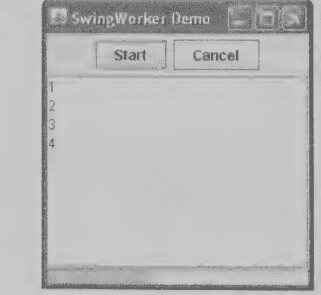

图 28.1: SwingWorker demo

## 第 28 章：并发工具类 487

### 锁

在第 27 章“Java 线程”中，你学习了可以使用 `synchronized` 修饰符来锁定共享资源。虽然 `synchronized` 使用起来非常简单，但这种锁定机制并非没有局限性。例如，尝试获取此类锁的线程如果无法获取锁，将无法回退并被无限阻塞。此外，锁定和解锁仅限于方法和代码块；无法在一种方法中锁定资源并在另一个方法中释放它。

很可能，并发工具类提供了更高级的锁。`Lock` 接口是书中讨论的唯一接口，它提供了克服 Java 内置锁局限性的方法。它包含 `lock` 方法和 `unlock` 方法。这意味着只要你保留对锁的引用，就可以在程序的任何地方释放锁。但在在大多数情况下，在调用 `lock` 之后在 `finally` 句中调用 `unlock` 是一个好主意，以确保始终调用了 `unlock`。

```
lock();
try {
    // do something with the locked resource
} finally {
    lock.unlock();
}
```

如果锁不可用，`lock` 方法将阻塞，直到锁可用为止。这种行为与使用 `synchronized` 导致的隐式锁相似。

然而，除了 `lock` 和 `unlock` 之外，`Lock` 接口提供了 `tryLock` 方法：

```
boolean tryLock()
boolean tryLock(long time, TimeUnit timeUnit)
```

第一个重载仅在锁可用时才返回 `true`。否则返回 `false`。在后一种情况下，它不会阻塞。

第二个重载在锁可用时立即返回 `true`。否则，它将等待直到指定时间过去，如果获取锁失败则返回 `false`。`time` 参数指定最大等待时间，`timeUnit` 参数指定第一个参数的时间单位。

示例 28.8 中的代码显示了 `ReentrantLock` 的使用，它是 `Lock` 的一种实现。该代码取自一个允许用户上传和共享文件的文档管理套件。上传与服务器文件夹中现有文件同名的文件会将现有文件变为历史文件，并将新文件变为当前文件。

为了提高性能，允许多个用户同时上传文件。上传不同名称或到不同服务器文件夹的文件没有问题，因为它们将被写入不同的文件。如果用户同时向同一个服务器文件夹上传同名文件，可能会出现问题。为了规避这个问题，系统使用 `Lock` 来确保多个尝试写入同一个物理文件的线程不会并发执行此操作。换句话说，只有一个线程可以进行写入，其他线程必须等待直到第一个线程完成。

在示例 28.8 中（这实际上是取自 Brainy Software 文档管理包的真实代码），系统使用 `Lock` 来访问文件，并从一个线程安全的 map 中获取锁，该 map 将路径与锁相关联。因此，它只防止同名文件冲突。同时写入不同名称的文件可以发生，因为不同的路径映射到不同的锁。

#### 示例 28.8：使用锁防止线程并发写入同一个文件

```
ReentrantLock lock = fileMap.putIfAbsent(fullPath,
    new ReentrantLock());
lock.lock();
try {
    // index and copy the file, create history etc
} finally {
    lock.unlock();
    fileMap.remove(fullPath, lock);
}
```

代码块首先尝试从线程安全的 map 中获取锁。如果找到了锁，意味着另一个线程正在访问该文件。如果没有找到锁，当前线程创建一个 `ReentrantLock` 并将其存储在 map 中，以便其他线程会注意到它当前正在访问该锁类。

```
ReentrantLock lock = fileMap.putIfAbsent(fullPath,
    new ReentrantLock());
```

它调用 `lock`。如果当前线程是唯一尝试获取锁的线程，`lock` 方法将返回。否则，当前线程将等待直到锁的所有释放锁。

一旦线程成功获得锁，它就对文件拥有独占访问权限，并可以对其进行任何操作。完成后，它调用 `unlock` 和 map 的 `remove` 方法。只有在没有线程持有该锁时，`remove` 方法才会移除该锁。

### 总结

并发工具类旨在让编写多线程应用程序变得更容易。API 中的类和接口旨在取代 Java 的低级线程机制，如 `Thread` 类和 `synchronized` 修饰符。本章讨论了并发工具类的基础，包括原子变量、执行器、`Callable`、`Future` 和 `SwingWorker`。

### 测验

1. 什么是原子变量？

2. 如何获取 `ExecutorService` 实例？

3. 什么是 `Callable`，什么是 `Future`？

4. 列出 `Lock` 接口的一种标准实现。

## 第 29 章 国际化

在当今全球化时代，编写可以部署在不同语言国家地区的应用程序比以往任何时候都更加迫切。在这方面，你需要熟悉两个术语。第一个是国际化（internationalization），缩写为 i18n——该词以 a 开头，以 n 结尾，第一个和最后一个字母之间有 18 个字符。国际化是开发支持多种语言和数据格式无需重写编程逻辑应用程序的技术。第二个术语是本地化（localization），它是将国际化应用程序适配以支持特定区域（locale）的技术。区域（locale）是一个特定的地理、政治或文化区域。考虑区域（locale）的操作被称为区域敏感的（locale-sensitive）。例如，显示日期是区域敏感的，因为日期必须是用户所在国家或地区使用的格式。2016 年 11 月 15 日在美国被写为 11/15/2016，但在澳大利亚打印为 15/11/2016。由于相同的原因，国际化缩写为 i18n，本地化缩写为 l10n。

Java 在设计时考虑了国际化，对字符和字符串使用了 Unicode。从后，在 Java 中创建国际化应用程序变得简单易事。你如何本地化你的应用程序取决于静态数据需要如何以不同的语言呈现。有两种方法：

1. 如果大量数据是静态的，则为每个区域创建一个资源版本。这种方法通常适用于具有大量静态 HTML 页面的 Web 应用程序。

2. 如果需要国际化的静态数据较少，将文本元素（如组件标签和错误消息）隔离到文本文件中。每个文本文件存储该区域所有元素的翻译。应用程序动态检索每个元素。其优点是显而易见的：无需重新编译应用程序即可轻松编辑每个元素。

### 区域 (Locales)

`java.util.Locale` 表示一个区域。Locale 有三个主要组成部分：语言（language）、国家（country）和变体（variant）。区域显然是最部分；但有时语言本身不足以区分区域。例如，英语在美、英等国家使用。然而，在美国使用的英语与在英国使用的并不相同。因此，有必要指定语言的国家。另一个例子是在中国使用的中文与在台湾使用的并不相同。

变体（variant）参数是供应商或浏览器特定的代码。例如，Windows 使用 WIN，Macintosh 使用 MAC，POSIX 使用 POSIX。这里有变体，用下划线分隔它们，并将最重要的放在前面。例如，传统的西班牙语排序可以使用语言、国家和变体分别为 es、ES 和 Traditional_WIN 来构造区域。

使用 Locale 类的构造函数来构造 Locale 对象。

```
public Locale(java.lang.String language)
public Locale(java.lang.String language, java.lang.String country)
public Locale(java.lang.String language, java.lang.String country,
java.lang.String variant)
```

语言代码是有效的 ISO 语言代码。表 29.1 显示了语言代码示例。

国家参数是有效的 ISO 国家代码，即 ISO 3166 两位大写代码，你可以从该网站下载：

http://page.chemie.fu-berlin.de/diverse/doc/ISO_3166.html

表 29.1 列出了 ISO 3166 中的一些国家代码。

| 代码 | 语言 |
|---|---|
| de | 德语 |
| el | 希腊语 |
| en | 英语 |
| es | 西班牙语 |
| fr | 法语 |
| hi | 印地语 |
| it | 意大利语 |
| ja | 日语 |
| nl | 荷兰语 |
| pt | 葡萄语 |
| ru | 俄语 |
| zh | 中文 |

表 29.1：ISO 639 语言代码示例

| 国家 | 代码 |
| --- | --- |
| 澳大利亚 | AU |
| 巴西 | BR |
| 加拿大 | CA |
| 中国 | CN |
| 埃及 | EG |
| 法国 | FR |
| 德国 | DE |
| 印度 | IN |
| 墨西哥 | MX |
| 瑞士 | CH |
| 台湾 | TW |
| 英国 | GB |
| 美国 | US |

表 29.2：ISO 3166 国家代码示例

例如，要构造一个代表加拿大使用的英语的 Locale 对象，请编写以下代码：

```
Locale locale = new Locale("en", "CA");
```

此外，Locale 类提供了静态 final 字段，用于返回特定国家或语言的 Locale，例如 CANADA, CANADA_FRENCH, CHINA, CHINESE, ENGLISH, FRANCE, FRENCH, UK, US 等。因此，你也可以也可以通过调用其静态字段来构造 Locale 对象：

```
Locale locale = Locale.CANADA_FRENCH;
```

此外，静态方法 getDefault 返回用户计算机的 locale。

```
Locale locale = Locale.getDefault();
```

### 应用程序国际化

将你的应用程序国际化和本地化需要你：

1. 将文本组件隔离到属性文件中
2. 能够选择并读取正确的属性文件

本节详细阐述了这两个步骤并提供了一个简单的示例。本章稍后的“国际化 Swing 应用程序”部分将介绍另一个示例。

#### 将文本组件隔离到属性文件中

国际化应用程序为每个 locale（语言区域）在一个单独的属性文件中存储其文本元素。每个文件包含键/值对，每个键唯一地标识一个特定语言区域的对象。键总是字符串，而值可以是字符串或任何类型的对象。例如，为了支持美式英语、德语和中文，你会有三个属性文件，它们都具有相同的键。

以下是属性文件的英文版本。注意，它有两个键：问候与告别。

```
greetings = Hello
farewell = Goodbye
```

德语版本将如下：

```
greetings = Hallo
farewell = Tschieß
```

中文的属性文件如下：

```
greetings=\u4f60好
farewell=\u518见
```

阅读侧边栏“将中文字转换为 Unicode”以了解我们是如何得到上述属性文件的。

#### 将中文字转换为 Unicode

“你好”（意思为 hello，分别由 Unicode 编码 4f60 和 597d 表示）和“再见”（意思为 goodbye，分别由 Unicode 编码 518d 和 89c1 表示）是最常见的表达。当然，没有人能记得每个汉字的 Unicode 。因此，你分两步创建 .properties 文件：

1. 使用你喜欢的中文文本编辑器，创建一个这样的文本文件：

   ```
   greetings=你好
   farewell=再见
   ```

2. 将文本文件的内容转换为 Unicode 表示。通常，中文文本编辑器具有将中文字转换为 Unicode 编码的功能。你会得到结果：

   ```
   greetings=\u4f60好
   farewell=\u518d见
   ```


# 第 29 章：国际化

现在，你需要掌握 `java.util.ResourceBundle` 类。它允许你选择并读取特定于用户 locale 的属性文件并查找值。`ResourceBundle` 是一个抽象类，但提供了静态的 `getBundle` 方法，返回子类的实例。

`ResourceBundle` 有一个基名称（base name），可以是任意的。为了让 `ResourceBundle` 选取属性文件，文件名必须由 `ResourceBundle` 基名称组成，后跟下划线，然后是语言代码，可选地跟随另一个下划线和国家代码。属性文件名的格式如下：

```
basename_languageCode_countryCode
```

例如，假设基名称为 `MyResources`，你定义了以下 locale：

- US-en
- DE-de
- CN-zh

那么会有这三个属性文件：

- `MyResources_en_US.properties`
- `MyResources_de_DE.properties`
- `MyResources_zh_CN.properties`

## 使用 ResourceBundle 读取属性文件

如前所述，`ResourceBundle` 是一个抽象类。尽管如此，你仍然可以通过它的静态 `getBundle` 方法获取子类的实例。其重载方法的签名如下：

```java
public static ResourceBundle getBundle(String baseName)
public static ResourceBundle getBundle(String baseName, Locale locale)
```

例如：

```java
ResourceBundle rb = ResourceBundle.getBundle("MyResources", Locale.US);
```

这将加载相应的属性文件。如果未找到合适的属性文件，`ResourceBundle` 将退回到默认属性文件。然后，要读取值，你使用 `ResourceBundle` 类并传递键：

```java
public String getString(String key)
```

## 国际化 Swing 应用程序

此示例说明了支持国际化的努力。此示例使用了三个属性文件：

- `MyResources_en_US.properties`，位于代码 29.1 中
- `MyResources_de_DE.properties`，显示在代码 29.2 中
- `MyResources_zh_CN.properties`（默认），显示在代码 29.3 中

### 代码 29.1: MyResources_en_US

```properties
username=User Name
password=Password
login=Login
```

### 代码 29.2: MyResources_de_DE

```properties
username=Compte
password=Mot de passe
login=Ouvrir session
```

### 代码 29.3: MyResources.properties

```properties
username=你好
password=密码
login=登录
```

代码 29.4 显示的 `I18Demo` 类根据你计算机的 locale 获取 `ResourceBundle`。

### 代码 29.4: The I18Demo

```java
package app29;
import java.awt.GridLayout;
import java.util.Locale;
import java.util.ResourceBundle;
import javax.swing.JButton;
import javax.swing.JFrame;
import javax.swing.JLabel;
import javax.swing.JPasswordField;
import javax.swing.JTextField;
import javax.swing.SwingUtilities;

public class I18Demo {
    private static void constructGUI() {
        Locale locale = Locale.getDefault();
        ResourceBundle rb = ResourceBundle.getBundle("MyResources", locale);
        JFrame.setDefaultLookAndFeelDecorated(true);
        JFrame frame = new JFrame("I18N Test");
        frame.setDefaultCloseOperation(JFrame.EXIT_ON_CLOSE);
        frame.setLayout(new GridLayout(3, 2));
        frame.add(new JLabel(rb.getString("username")));
        frame.add(new JTextField());
        frame.add(new JLabel(rb.getString("password")));
        frame.add(new JPasswordField());
        frame.add(new JButton(rb.getString("login")));
        frame.pack();
        frame.setVisible(true);
    }

    public static void main(String[] args) {
        SwingUtilities.invokeLater(new Runnable() {
            public void run() {
                constructGUI();
            }
        });
    }
}
```

应用程序的英文版本如图 29.1 所示。


图 29.1：示例的英文版本

在实践中，大多数国际化应用程序根据不同的语言创建本地化内容，而不是不同的 locale。这意味着如果一个应用程序为德国人提供了德语文本元素，可能不会为奥地利或瑞士人提供另一个德语变体。任何德语用户都应该理解德语的任何变体。

## 总结

本章解释了如何开发国际化应用程序。首先介绍了 `java.util.Locale` 类和 `java.util.ResourceBundle` 类。接着介绍了一个国际化应用程序的示例。

## 测验

1. 对于具有大量静态内容的应用程序，国际化的方法是什么？
2. 如何隔离 Java 应用程序的文本元素？
3. 用于国际化和本地化的类是哪两个？

# 第 30 章：Java 网络

计算机网络关注的是计算机之间的通信。在如今，这种交互形式已无处不在。每当你浏览互联网时，都是你的机器在与远程服务器交换消息。当你通过 FTP 通道传输文件时，你也在使用某种网络服务。Java 配备了 `java.net` 包，该包包含了许多让网络编程变得容易的类型。我们在概述网络之后，将检查其中的一些类型。在章节的末尾，将为你提供一些示例供你尝试。

## 网络概述

网络是组可以相互通信的计算机集合。根据覆盖范围的广度，网络被称为局域网（LAN）或广域网（WAN）。局域网通常局限于特定的地理区域（例如一栋建筑），由三台到数百台计算机组成。相比之下，广域网是多个地理上分离的局域网的组合。最大的网络无疑是互联网。

网络内部的通信介质可以是电缆、电话线、高速光纤、卫星等。随着无线技术变得更加成熟且价格廉价，无线局域网（WLAN）如今变得越来越常见。

就像我们使用通用语言进行交流一样，两台计算机通过使用一种约定的“语言”进行通信。在计算机术语中，“语言”被称为协议。令人困惑的是，存在多个层级的协议。这是因为在物理层，两台计算机通过交换位流进行通信，位流是 0 和 1 的集合。对于应用程序和人类来说，这太难以理解了。因此，还有一层可以将位流转换为可见的实体，反之亦然。

最简单的协议是应用层的协议。编写应用程序需要你理解应用层的协议。这一层有多种协议：HTTP、FTP、telnet 等。

应用层协议使用传输层的协议。传输层中两个流行的协议是 TCP 和 UDP。反之，传输层协议利用其下层的协议。图 30.1 显示了这些层级。

| 应用 (HTTP, FTP, telnet) |
| :--- |
| 传输层 (TCP, UDP) |
| 网络 (IP) |
| 物理层 |

图 30.1：计算机网络中的协议层

得益于这种策略，你不需要担心应用层之外的其他层的协议。Java 甚至更进一步提供了封装应用层协议的类。例如，通过 Java，你不需要理解 HTTP 就能向 HTTP 服务器发送消息。HTTP 作为最流行的协议之一，在本章中详细介绍，以供想要了解表面之外更多知识的人。

你应该知道的另一点是，网络采用寻址系统来区分不同的计算机，就像你的房子有地址，以便邮员可以投递你的邮件一样。互联网上的街道地址等同于 IP 地址。每台计算机都被分配一个唯一的 IP 地址。

IP 地址并不是网络寻址系统中最小的单位。端口才是。类比是一栋公寓楼，它共享相同的街道地址，但有许多单元，每个单元都有自己的套房号。

## 超文本传输协议 (HTTP)

HTTP 协议允许网络服务器和浏览器在互联网上发送和接收数据。它是一种请求/响应协议。客户端请求文件，服务器对其做出响应。HTTP 使用可靠的 TCP 连接——默认使用 80 端口。HTTP 的第一个版本是 HTTP/0.9，随后被 HTTP/1.0 取代。取代 HTTP/1.0 的当前版本是 HTTP/1.1，它在意见请求（RFC）2616 中定义，并可以从 `http://www.w3.org/Protocols/HTTP/1.1/rfc2616.html` 下载。

在 HTTP 中，始终由客户端通过建立连接和发送 HTTP 请求来发起事务。网络服务器无法主动联系客户端或向客户端建立回调连接。客户端或服务器都可以过早终止连接。例如，在使用网络浏览器时，你可以点击浏览器上的“停止”按钮来停止下载文件，从而关闭与网络服务器的 HTTP 连接。

### HTTP 请求

一个 HTTP 请求由三部分组成：

- 方法—版本
- 头部（Headers）
- 实体体（Entity body）

以下是一个示例：

```http
GET /examples.jsp HTTP/1.1
Accept: text/html
Accept-Language: en
Connection: keep-alive
Host: localhost
User-Agent: Mozilla/5.0 (Windows NT 10.0; Win64; x64)
```

### HTTP 响应

与 HTTP 请求类似，HTTP 响应也由三部分组成：

- 协议—状态码—描述
- 响应头部（Response headers）
- 实体体（Entity body）

以下是一个示例：

```http
HTTP/1.1 200 OK
Server: Apache/Coyote/1.1
Date: Thu, 12 Aug 2010 13:13:33 GMT
Content-Type: text/html
Last-Modified: Thu, 5 Aug 2010 13:13:12 GMT
Content-Length: 112
```

```html
<html>
<head>
<title>HTTP Response</title>
</head>
<body>
Welcome to Brainy Software
</body>
</html>
```

## java.net.URL

URL 是互联网资源的唯一地址。例如，互联网上的每个页面都有不同的 URL。这里有一个 URL：

```
http://www.yahoo.com:80/en/index.html
```

一个 URL 包含多个组件。第一个部分表示用于检索资源时使用的协议。在上面的示例中，协议是 HTTP。第二部分 `www.yahoo.com` 是主机。它告诉你资源所在的位置。主机后的 `80` 是端口号。最后部分 `/en/index.html` 指定了 URL 的路径。

```
file://localhost/data/MyPhoto.jpg
```

关于 URL 的详细信息可以在此处找到：`http://www.ietf.org/rfc/rfc2396.txt`

在 Java 中，URL 由 `java.net.URL` 对象表示。你通过调用 `URL` 类的其中一个构造函数来构建 URL。以下是一些更容易使用的构造函数：

```java
public URL(java.lang.String spec)
public URL(java.lang.String protocol, java.lang.String host, java.lang.String file)
public URL(java.lang.String protocol, java.lang.String host, int port, java.lang.String file)
public URL(URL context, String spec)
```

这里是一个示例：

```java
URL myUrl = new URL("http://www.brainysoftware.com/");
```

由于没有指定页面，因此假使用默认页面。

另一个示例，以下几行代码创建了内部 URL 对象：

```java
URL yahoo1 = new URL("http://www.yahoo.com/index.html");
URL yahoo2 = new URL("http", "www.yahoo.com", "/index.html");
URL yahoo3 = new URL("http", "www.yahoo.com", 80, "/index.html");
```

### 解析 URL

你可以使用这些方法获取 `URL` 对象的各种组成部分：

```java
public java.lang.String getFile()
public java.lang.String getHost()
public java.lang.String getPath()
public int getPort()
public java.lang.String getProtocol()
public java.lang.String getQuery()
```

例如，列表 30.1 中的代码创建了一个 URL 并打印了它的各个部分。

#### 列表 30.1：解析 URL

```java
package app30;
import java.net.URL;

public class URLDemo {
    public static void main(String[] args) throws Exception {
        URL url = new URL(
            "http://www.yahoo.com:80/en/index.html?name=john#first");
        System.out.println("protocol: " + url.getProtocol());
        System.out.println("port: " + url.getPort());
        System.out.println("host:" + url.getHost());
        System.out.println("path:" + url.getPath());
        System.out.println("file:" + url.getFile());
        System.out.println("query:" + url.getQuery());
        System.out.println("ref:" + url.getRef());
    }
}
```

使用 `URLDemo` 类的结果如下：

```
protocol:http
port:80
host:www.yahoo.com
path:/en/index.html
file:/en/index.html?name=john
query:name=john
ref:first
```

### 读取网络资源

你可以使用 `URL` 类的 `openStream` 方法来读取网络资源。以下是该方法的签名：

```java
public final java.io.InputStream openStream() throws java.io.IOException
```

例如，列表 30.2 中的 `URLDemo` 类打印了 `http://www.google.com` 的内容。

#### 列表 30.2：打开 URL 的流

```java
package app30;
import java.net.URL;
import java.io.InputStream;
import java.io.BufferedReader;
import java.io.InputStreamReader;

public class URLDemo {
    public static void main(String[] args) throws Exception {
        URL url = new URL("http://www.google.com");
        try (InputStream is = url.openStream();
             BufferedReader br = new BufferedReader(new InputStreamReader(is))) {
            String line;
            while ((line = br.readLine()) != null) {
                System.out.println(line);
            }
        }
    }
}
```


# 第 30 章：Java 网络

## 服务器应用程序

本节演示了如何使用 `ServerSocket` 与远程计算机通信。该服务器程序包含 `app30.webserver` 包的三个类：

- `HttpServer`
- `Request`
- `Response`

该程序的入口点是 `HttpServer` 类中的 `main` 方法。它创建一个 `HttpServer` 实例并调用 `await` 方法。`await` 方法顾其名，会在指定的端口上等待请求，处理它们并向客户端发送响应。它会一直等待直到关闭命令被接收。

该应用程序只能发送位于特定目录下的静态资源（例如 HTML 文件和图像文件）。它还将在控制台显示传入的 HTTP 请求字节流。然而，它不会向浏览器发送任何头部（如日期或 Cookie）。

我们现在查看后续小节中的三个类。

### HttpServer 类

`HttpServer` 类表示 Web 服务器，并在列表 30.5 中。注意 `await` 方法位于列表 30.6 中，未包含在列表 30.5 以节省空间。

列表 30.5：HttpServer 类

```java
package app30.webserver;
import java.net.Socket;
import java.net.ServerSocket;
import java.net.InetAddress;
import java.io.InputStream;
import java.io.OutputStream;
import java.io.IOException;

public class HttpServer {
    // 关闭命令
    private static final String SHUTDOWN_COMMAND = "/SHUTDOWN";

    // 接收到的关闭命令
    private boolean shutdown = false;

    public static void main(String[] args) {
        HttpServer server = new HttpServer();
        server.await();
    }

    public void await() {
        try (ServerSocket serverSocket = new ServerSocket(8080, 1, InetAddress.getByName("127.0.0.1"))) {
            while (!shutdown) {
                try (Socket socket = serverSocket.accept()) {
                    Request request = new Request(socket);
                    if (request.getPath().equals(SHUTDOWN_COMMAND)) {
                        shutdown = true;
                    } else {
                        Response response = new Response(socket);
                        response.send(request);
                    }
                } catch (IOException e) {
                    e.printStackTrace();
                }
            }
        } catch (IOException e) {
            e.printStackTrace();
        }
    }
}
```

## 写入 Web 服务器

你可以使用 `URLConnection` 来发送 HTTP 请求。例如，此处的代码段向 `http://www.mydomain.com/form.jsp` 页面发送一个表单。

```java
URL url = new URL("http://www.mydomain.com/form.jsp");
URLConnection connection = url.openConnection();
connection.setDoOutput(true);
PrintWriter out = new PrintWriter(connection.getOutputStream());
out.println("firstName=Joe");
out.println("lastName=Average");
out.close();
```

虽然你可以使用 `URLConnection` 来发布消息，但通常不会将其用于此目的。相反，请使用后续章节中讨论的更强大的 `java.net.Socket` 和 `java.net.ServerSocket` 类。

## java.net.URLConnection

`URLConnection` 代表到远程机器的连接。你使用它来读取资源并写入远程机器。`URLConnection` 类没有公共构造函数，因此你不能使用 `new` 关键字构造 `URLConnection`。要获取 `URLConnection` 实例，请调用 `URL` 对象的 `openConnection` 方法。

`URLConnection` 类有两个布尔字段、`doInput` 和 `doOutput`，它们分别表示该 URL 是否可以用于读取和写入。`doInput` 的默认值为 `true`，表示你 始终可以使用 `URLConnection` 来读取网络资源。`doOutput` 的默认值为 `false`，意味着 `URLConnection` 不用于写入。要使用 `URLConnection` 对象进行写入，你需要将 `doOutput` 的值设置为 `true`。可以使用 `setDoInput` 和 `setDoOutput` 方法来设置 `doInput` 和 `doOutput` 的值：

```java
public void setDoInput(boolean value)
public void setDoOutput(boolean value)
```

你可以使用以下方法获取 `doInput` 和 `doOutput` 的值：

```java
public boolean getDoInput()
public boolean getDoOutput()
```

要使用 `URLConnection` 对象进行读取，请调用它的 `getInputStream` 方法。该方法返回一个 `java.io.InputStream` 对象。这与 `URL` 类中的 `openStream` 方法相似。然而，`URLConnection` 比 `openStream` 更强大，因为你还可以向服务器进行写操作。以下是一些实用方法：

```java
public java.io.InputStream getInputStream()
public java.io.OutputStream getOutputStream()
public java.lang.URL getURL()
public java.lang.String getHost()
public java.lang.String getPath()
public int getPort()
public java.lang.String getProtocol()
public java.lang.String getQuery()
public java.lang.String getFile()
public java.lang.String getRef()
```

## java.net.Socket

`Socket`（套接字）是网络连接的端点。`Socket` 允许应用程序对网络进行读写。位于两台不同计算机上的两个软件应用程序可以通过连接发送和接收字节来相互通信。要从你的应用程序向另一个应用程序发送消息，你需要知道另一个程序的 IP 地址以及端口号。在 Java 中，`Socket` 由一个 `java.net.Socket` 对象表示。

要创建一个 `Socket`，你可以使用 `Socket` 类的许多构造函数之一。其中一个构造函数接受主机名和端口号：

```java
public Socket(java.lang.String host, int port)
```

其中 `host` 是远程机器名称或 IP 地址，`port` 是远程应用程序的端口号。例如，要连接到端口 80 的 `yahoo.com`，你会构造如下 `Socket` 对象：

```java
new Socket("yahoo.com", 80);
```

一旦你成功创建了 `Socket` 类的实例，就可以使用它来发送和接收字节流。要发送字节，你必须先调用 `Socket` 类的 `getOutputStream` 来获取 `java.io.OutputStream` 对象。要向远程应用程序发送文本，你通常希望从返回的 `OutputStream` 对象构造一个 `java.io.PrintWriter` 对象。要从连接中接收字节，你可以调用 `Socket` 类的 `getInputStream` 方法，该方法返回一个 `java.io.InputStream` 对象。

列表 30.4 中的代码使用 `Socket` 模拟了一个 HTTP 客户端。它向服务器发送 HTTP 请求并从服务器读取响应。

### 列表 30.4：一个简单的 HTTP 客户端

```java
package app30;
import java.io.BufferedReader;
import java.io.IOException;
import java.io.InputStreamReader;
import java.io.OutputStream;
import java.io.PrintWriter;
import java.net.Socket;

public class SocketDemo {
    public static void main(String[] args) {
        String host = "books.brainysoftware.com";
        try {
            Socket socket = new Socket(host, 80);
            OutputStream os = socket.getOutputStream();
            boolean autoflush = true;
            PrintWriter out = new PrintWriter(socket.getOutputStream(), autoflush);
            BufferedReader in = new BufferedReader(
                new InputStreamReader(socket.getInputStream()));

            // 向 Web 服务器发送一个 HTTP 请求
            out.println("GET / HTTP/1.1");
            out.println("Host: " + host + ":80");
            out.println("Connection: Close");
            out.println();

            // 读取响应
            boolean loop = true;
            StringBuilder sb = new StringBuilder(8096);
            while (loop) {
                if (in.ready()) {
                    int i = 0;
                    while ((i = in.read()) != -1) {
                        sb.append((char) i);
                    }
                    loop = false;
                }
            }

            // 将响应打印到输出控制台
            System.out.println(sb.toString());
            socket.close();
        } catch (IOException e) {
            e.printStackTrace();
        }
    }
}
```

要从 Web 服务器获得正确的响应，你需要发送一个符合 HTTP 协议的 HTTP 请求。如果你读过上一节“超文本传输协议 (HTTP)”，那么你应该能够理解上述代码中的 HTTP 请求。

## 注意

来自 Apache HTTP Components 项目（http://hc.apache.org）的 `HttpClient` 库提供了可以作为更高级 HTTP 客户端的类。

## java.net.ServerSocket

`Socket` 类表示一个“客户端” `Socket`，即每当你想要连接到远程服务器应用程序时都会构造的 `Socket`。现在，如果你想实现一个服务器应用程序（例如 HTTP 服务器或 FTP 服务器），则需要不同的方法。你的服务器必须一直待命，因为不知道客户端应用程序何时会尝试连接它。为了让你的应用程序能够做到这一点，你需要使用 `java.net.ServerSocket` 类。`ServerSocket` 是服务器 socket 的实现。

`ServerSocket` 与 `Socket` 不同。服务器 socket 的作用是等待客户端的连接请求。一旦服务器收到连接请求，它就会创建一个 `Socket` 实例来处理与客户端的通信。

要创建一个服务器 socket，你需要使用 `ServerSocket` 类提供的四个构造函数之一。你需要指定服务器 socket 将监听的 IP 地址和端口号。通常，IP 地址是 `127.0.0.1`，这意味着服务器 socket 将监听该地址。服务器 socket 的另一个重要属性是 `backlog`（积压长度），它是服务器处理传入请求之前的最大队列长度。

`ServerSocket` 的一个构造函数如下：

```java
public ServerSocket(int port, int backlog, InetAddress address)
```

注意对于这个构造函数，`address` 必须是 `InetAddress` 的实例。构造 `InetAddress` 的简单方法是调用其 `getByName` 方法，如下代码所示：

```java
InetAddress.getByName("127.0.0.1");
```

以下行代码构造了一个监听本地机器的 `ServerSocket`：

```java
new ServerSocket(8080, 1, InetAddress.getByName("127.0.0.1"));
```

一旦你有了 `ServerSocket`，就可以通过调用 `accept` 方法等待连接请求。该方法只有在有连接时才会返回一个 `Socket` 实例。

## URLDemo 示例

```java
package app30;
import java.io.BufferedReader;
import java.io.IOException;
import java.io.InputStream;
import java.io.InputStreamReader;
import java.net.MalformedURLException;
import java.net.URL;

public class URLDemo {
    public static void main(String[] args) {
        try {
            URL url = new URL("http://www.google.com/");
            InputStream inputStream = url.openStream();
            BufferedReader bufferedReader = new BufferedReader(
                new InputStreamReader(inputStream));
            String line = bufferedReader.readLine();
            while (line != null) {
                System.out.println(line);
                line = bufferedReader.readLine();
            }
            bufferedReader.close();
        } catch (MalformedURLException e) {
            e.printStackTrace();
        } catch (IOException e) {
            e.printStackTrace();
        }
    }
}
```


```java
public void await() {
    ServerSocket serverSocket = null;
    int port = 8080;
    try {
        serverSocket = new ServerSocket(port, 1, InetAddress)
            .getByName("127.0.0.1");
    } catch (IOException e) {
        e.printStackTrace();
        System.exit(1);
    }
    // 循环等待请求
    while (!shutdown) {
        Socket socket = null;
        InputStream input = null;
        OutputStream output = null;
        try {
            socket = serverSocket.accept();
            input = socket.getInputStream();
            output = socket.getOutputStream();
            // 创建 Request 对象并解析
            Request request = new Request(input);
            request.parse();

            // 创建响应
            Response response = new Response(output);
            response.setRequest(request);
            response.setStaticResource(request.getUri());
            // 关闭 socket
            socket.close();

            // 检查上一个 URI 是否为关闭命令
            shutdown = request.getUri().equals(SHUTDOWN_COMMAND);
        } catch (Exception e) {
            e.printStackTrace();
            continue;
        }
    }
}
```

代码列表包含一个名为 `webroot` 的目录，其中包含了一些你可以用于测试此应用程序的静态资源。要请求静态资源，你需要在浏览器的地址或 URL 框中输入以下 URL：

```
http://machineName:port/staticResource
```

如果你是从运行应用程序的机器之外发送请求，则 `machineName` 是运行此应用程序的计算机名称或 IP 地址。如果你的浏览器在同一台机器上，你可以使用 `localhost` 作为机器名。`port` 为 8080，`staticResource` 是请求的文件名，且必须存在于 `WEB_ROOT` 中。

例如，如果你使用同一台计算机来测试应用程序，并希望让 `HttpServer` 对象发送 `index.html` 文件，你使用以下 URL：

http://localhost:8080/index.html

要停止服务器，你需要从 Web 浏览器发送关闭命令，方法是在浏览器的地址或 URL 框中输入预定义的字符串，位于 URL 的 `host:port` 部分之后。关闭命令由 `HttpServer` 类中的 `SHUTDOWN` 静态最终变量定义：

```java
private static final String SHUTDOWN_COMMAND = "SHUTDOWN";
```

因此，要停止服务器，你使用以下 URL：

http://localhost:8080/SHUTDOWN

现在，让我们来看列表 30.6 中打印的 `await` 方法。

# 列表 30.6：HttpServer 类的 await 方法

```java
public void await() {
    ServerSocket serverSocket = null;
    int port = 8080;
    try {
        serverSocket = new ServerSocket(port, 1, InetAddress)
            .getByName("127.0.0.1");
    } catch (IOException e) {
        e.printStackTrace();
        System.exit(1);
    }
    // 循环等待请求
    while (!shutdown) {
        Socket socket = null;
        InputStream input = null;
        OutputStream output = null;
        try {
            socket = serverSocket.accept();
            input = socket.getInputStream();
            output = socket.getOutputStream();
            // 创建 Request 对象并解析
            Request request = new Request(input);
            request.parse();

            // 创建 Response 对象
            Response response = new Response(output);
            response.setRequest(request);
            response.sendStaticResource();

        // 关闭 socket
        socket.close();


    // 检查上一个 URI 是否为关闭命令
    shutdown = request.getUri().equals(SHUTDOWN_COMMAND);
    } catch (Exception e) {
        e.printStackTrace();
        continue;
    }
    }
}
```

使用方法名 `await` 而不是 `wait`，是因为后者是 `java.lang.Object` 中一个重要方法名，该方法在多线程编程中被频繁使用。

`await` 方法首先创建一个 `ServerSocket` 实例，然后进入 `while` 循环。

```java
ServerSocket = new ServerSocket(port, 1,
    InetAddress.getByName("127.0.0.1");
...
// 循环等待请求
while (!shutdown) {
...}
```

`while` 循环内部的代码会停在 `ServerSocket` 的 `accept` 方法处，它会一直阻塞直到在 8080 端口接收到 HTTP 请求：

socket = serverSocket.accept();

接收到请求后，`await` 方法从 `accept` 方法返回的 `Socket` 中获取 `java.io.InputStream` 和 `java.io.OutputStream`。

```java
input = socket.getInputStream();
output = socket.getOutputStream();
```

`await` 方法创建一个 `Request` 对象并调用它的 `parse` 方法来解析 HTTP 请求原始数据。

```java
// 创建 Request 对象并解析
Request request = new Request(input);
request.parse();
```

随后，`await` 方法创建一个 `Response` 对象，将 `Request` 分配给它，并调用它的 `setStaticResource` 方法。

```java
// 创建 Response 对象
Response response = new Response(output);
response.setRequest(request);
response.setStaticResource();
```

`await` 方法关闭 socket 并检查上一个 URI 是否为关闭命令。

```java
// 关闭 socket
socket.close();

// 检查上一个 URI 是否为关闭命令
shutdown = request.getUri().equals(SHUTDOWN_COMMAND);
```

## 第 30 章：Java 网络

### Request 类

`Request` 类表示 HTTP 请求。它通过传递一个 `InputStream` 来构造的。它有两个方法：`parse` 和 `getUri`，分别在列表 30.7 和 30.9 中给出。

#### 列表 30.7：Request

```java
package app30.webserver;
import java.io.InputStream;

public class Request {
    private InputStream input;
    private String uri;

    public Request(InputStream input) {
        this.input = input;
    }

    public void parse() {
        // ...
    }

    private String parseUri(String requestString) {
        // ...
    }

    public String getUri() {
        return uri;
    }
}
```

`parse` 方法从 socket 中读取整个字节流。然后，它使用数组中的字节填充 `StringBuilder`，并将 `StringBuilder` 的字符串表示传递给 `parse` 方法。

#### 列表 30.8：Request 类的 parse 方法

```java
public void parse() {
    // 从 socket 读取一组字符
    StringBuilder request = new StringBuilder(2048);
    int i;
    byte[] buffer = new byte[2048];
    try {
        i = input.read(buffer);
    } catch (IOException e) {
        e.printStackTrace();
        i = -1;
    }
    for (int j = 0; j < i; j++) {
        request.append((char) buffer[j]);
    }
    System.out.print(request.toString());
    uri = parseUri(request.toString());
}
```

`parseUri` 方法随后从请求行中获取 URI。`parseUri` 方法搜索请求中的第一个和第二个空格并从中获取 URI。

#### 列表 30.9：Request 类的 parseUri 方法

```java
private String parseUri(String requestString) {
    int index1 = requestString.indexOf(' ');
    if (index1 != -1) {
        int index2 = requestString.indexOf(' ', index1 + 1);
        if (index2 > index1) {
            return requestString.substring(index1 + 1, index2);
        }
    }
    return null;
}
```

### Response 类

`Response` 类表示 HTTP 响应，在列表 30.10 中。

#### 列表 30.10：Response

```java
package app30.webserver;
import java.io.OutputStream;
import java.io.IOException;
import java.io.InputStream;
import java.nio.file.Files;
import java.nio.file.Path;
import java.nio.file.Paths;

/*
HTTP Response =
Status-Line = (( general-header | response-header | entity-header ) CRLF
CRLF
[ message-body ]
Status-Line = HTTP-Version SP Status-Code SP Reason-Phrase CRLF
*/

public class Response {
    private static final int BUFFER_SIZE = 1024;
    Request request;
    OutputStream output;

    public Response(OutputStream output) {
        this.output = output;
    }

    public void setRequest(Request request) {
        this.request = request;
    }

    public void getStaticResource() throws IOException {
        byte[] bytes = new byte[BUFFER_SIZE];
        Path path = Paths.get(System.getProperty("user.dir",
                "webroot"), request.getUri());
        if (Files.exists(path)) {
            try (InputStream inputStream =
                    Files.newInputStream(path)) {
                int ch = inputStream.read(bytes, 0, BUFFER_SIZE);
                while (ch != -1) {
                    output.write(bytes, 0, ch);
                    ch = inputStream.read(bytes, 0, ch);
                }
            } catch (IOException e) {
                e.printStackTrace();
            }
        } else {
            // 文件未找到
            String errorMessage = "HTTP/1.1 404 File Not Found\r\n"
                + "Content-Type: text/html\r\n"
                + "Content-Length: 23\r\n"
                + "<h1>File Not Found</h1>\r\n";
            output.write(errorMessage.getBytes());
        }
    }
}
```

首先注意，Response 类的构造函数接受一个 `java.io.OutputStream` 对象：

```java
public Response(OutputStream output) {
    this.output = output;
}
```

Response 对象是通过 `HttpServer` 类的 `await` 方法通过传递从 socket 获取的 `OutputStream output` 来构建的。

Response 类有两个公共方法：`setRequest` 和 `getStaticResource` 方法。`setRequest` 方法用于将 `Request` 对象传递给 Response 方法。

`getStaticResource` 用于发送静态资源，例如 HTML 文件。它首先在用户目录下的 `webroot` 目录为资源创建一个 `Path`：

```java
Path path = Paths.get(System.getProperty("user.dir"),
    request.getUri());
```


## 它会测试资源是否存在

它会测试资源是否存在。如果存在，`getStaticResource` 会调用 `Files.newInputStream` 并获取一个连接到资源文件的 `InputStream`。它调用 `InputStream` 的 `read` 方法并将字节数组写入 `OutputStream output`。注意，在这种情况下，静态资源的内容以原始数据的形式发送到浏览器。

```java
if (Files.exists(path)) {
    try (InputStream inputStream =
        Files.newInputStream(path)) {
        int ch = inputStream.read(bytes, 0, BUFFER_SIZE);
        while (ch != -1) {
            output.write(bytes, 0, ch);
            ch = inputStream.read(bytes, 0, BUFFER_SIZE);
        }
    } catch (IOException e) {
        e.printStackTrace();
    }
}
```

如果资源不存在，`getStaticResource` 将向浏览器发送错误消息。

```java
String errorMessage = "HTTP/1.1 404 File Not Found\r\n" + 
"Content-Type: text/html\r\n" + 
"Content-Length: 23\r\n" + 
"\r\n" + 
"<h1>File Not Found!</h1>";
output.write(errorMessage.getBytes());
```

## 运行应用程序

要运行该应用程序，在工作目录下输入以下内容：

```bash
java app30.webserver.HttpServer
```

要测试应用程序，打开浏览器并在 URL 或地址框中输入以下内容：

```
http://localhost:8080/index.html
```

你将在浏览器中看到 `index.html` 页面，如图 30.2 所示。

在控制台上，你可以看到类似以下的 HTTP 请求：

```
GET /index.html HTTP/1.1
Accept: image/gif, image/x-xmap, image/jpeg, image/pjpeg
application/vnd.ms-excel, application/msword, application/vnd.ms-powerpoint, application/x-shockwave-flash, application/pdf, /*
Accept-Language: en-us
Accept-Encoding: gzip, deflate
User-Agent: Mozilla/5.0 (Macintosh; Intel Mac OS X 10.5; en-US;
rv:1.9.2.6) Gecko/20100625 Firefox/3.6.6
Host: localhost:8080
Connection: Keep-Alive
GET /images/logo.gif HTTP/1.1
Accept: */
Referer: http://localhost:8080/index.html
Accept-Language: en-us
Accept-Encoding: gzip, deflate
User-Agent: Mozilla/5.0 (Macintosh; U; Intel Mac OS X 10.5; en-US;
rv:1.9.2.6) Gecko/20100625 Firefox/3.6.6
Host: localhost:8080
Connection: Keep-Alive
```

## 第 31 章：安全

Java 的安全模型传统上被称为沙箱模型（sandbox model）。沙箱的概念是，作为 Java 应用程序的用户，可以将正在运行的应用程序限制在一个特定的“游场”内。这意味着，你可以决定应用程序可以做什么和不能做什么，特别是在文件读/写、网络访问等方面。

在有安全管理器（security manager）的情况下，Java 应用程序受到了很大的限制，因为它不允许访问任何系统资源。例如，它不能读取或写入文件，不能建立网络连接，不能读取系统属性等。我的意思是，你仍然可以编写执行这些操作的方法，但是当你的应用程序在安全管理器的运行运行时，该程序将处于瘫痪状态。

大多数应用程序在这种极其受限的情况下无法正常运行，因此，你需要通过授予应用程序一些权限来放宽某些限制。例如，你可能会赋予应用程序读取文件的权限，但不允许其删除文件。或者，你可能会授予应用程序访问网络的权限，但禁止其输入/输出操作。告诉安全管理器允许哪些权限的方法是传递一个策略文件（policy file）。策略文件是一个文本文件，因此为安全管理器配置安全设置不需要编程。

### 使用安全管理器

安全管理器通常用于执行由他人编写的其他 Java 类的 Java 程序。以下是一些示例：

- 应用查看器（app viewer）。应用查看器是一个运行小程序（applets）的 Java 应用程序。小程序可以由第三方编写，对于应用查看器来说，让这些小程序不攻击主机符合其利益。
- Servlet 容器（servlet container）是一个运行 servlet 的 Java 应用程序。Servlet 类似于小程序，但运行在服务器端。Servlet 容器通常用 Java 编写，在运行时，它可以被设置为限制其正在运行的 servlet 的访问。例如，如果你是一个互联网服务提供商（ISP），你希望确保托管的 servlet 不会违反安全性。

要使用安全管理器运行 Java 应用程序，请使用 `-D` 标志调用 java 程序。

```bash
java -Djava.security.manager MyClass
```

以这种方式调用的应用程序将在安全管理器的监视下运行，并且不具备上一节讨论的权限。换句话说，应用程序无法访问文件，无法打开 socket 连接等。在许多情况下，这种限制太严格了。

你可以通过编写策略文件告诉安全管理器你愿意放宽哪些权限，从而允许应用程序执行受限的操作。策略文件是一个文本文件，列出了授予应用程序的所有权限。

### 策略文件配置

注意

你可以使用文本编辑器创建或编辑策略文件，也可以使用 JDK 包含的 Policy Tool。Policy Tool 在“Policy Tool”节中讨论过。

以下是向 java 工具传递策略文件的语法：

```bash
java -Djava.security.manager -Djava.security.policy=policyFile MyClass arguments
```

其中 `policyFile` 是策略文件的路径，`MyClass` 是要调用的类，`arguments` 是类的参数。

如果调用程序时使用了 `-Djava.security.manager` 但没有使用 `-Djava.security.policy`，则使用默认策略文件。默认策略文件位于 `${java.home}/lib/security` 目录下的 `java.security`，其中 `${java.home}` 是你的 JRE 安装目录。

属性文件指定了安全设置，如策略文件、提供者名称、是否允许扩展等。将策略文件添加到属性文件中，使用属性名 `policy.url.n`，其中 `n` 是数字。例如，以下设置了位于 `C:\user` 目录下的 `myapp.policy` 策略文件：

```properties
policy.url.3-file=C:/user/myapp.policy
```

这一个设置了位于 `/home/userX` 目录下的 `MyApp.policy` 策略文件：

```properties
policy.url.3-file=/home/userX/MyApp.policy
```

### 策略文件结构

配置文件（简称策略文件）包含条目列表。它可以包含一个可选的 keystore 条目和任意数量的 grant 条目。31.1 显示位于 `${java.home}/lib/security` 的默认策略文件 `java.security` 的内容。它有两个 grant 条目和一个 keystore 条目。注意以 `//` 开头的行是注释。

#### 31.1：默认策略文件

```java
// 默认授予所有扩展
grant codeBase="file:${java.ext.dirs}/*" {
  permission java.security.AllPermission;
};

// 授予所有域的权限
grant {
  // 允许任何线程使用不带参数的 java.lang.Thread.stop 方法 自身。
  // 注意，默认授予此权限是为了向后兼容。

  // 强烈建议从此策略文件中删除此权限，或者将其限制到你指定的代码源，
  // 因为 Thread.stop() 是不安全的。
  // 更多信息请参见 java.lang.Thread.stop() 的 API 。
  permission java.lang.RuntimePermission "stopThread";

  // 允许监听动态端口
  permission java.net.SocketPermission "localhost:0", "listen";

  // 可以读取的标准属性
  permission java.util.PropertyPermission "java.version", "read";
  permission java.util.PropertyPermission "java.vendor", "read";
  permission java.util.PropertyPermission "java.url", "read";
  permission java.util.PropertyPermission "java.class.version", "read";
  permission java.util.PropertyPermission "os.name", "read";
  permission java.util.PropertyPermission "os.version", "read";
  permission java.util.PropertyPermission "os.arch", "read";
  permission java.util.PropertyPermission "file.separator", "read";
  permission java.util.PropertyPermission "path.separator", "read";
  permission java.util.PropertyPermission "line.separator", "read";

  // 允许的规范属性
  permission java.util.PropertyPermission "java.specification.version", "read";
  permission java.util.PropertyPermission "java.specification.vendor", "read";
  permission java.util.PropertyPermission "java.specification.name", "read";

  // 允许的虚拟机属性
  permission java.util.PropertyPermission "java.vm.version", "read";
  permission java.util.PropertyPermission "java.vm.vendor", "read";
  permission java.util.PropertyPermission "java.vm.name", "read";
  permission java.util.PropertyPermission "java.vm.properties", "read";

  // 标准属性
  permission java.util.PropertyPermission "user.dir", "read";
}
```

默认策略文件列出了在使用文件运行安全管理器时允许的活动。例如，最后几行指定了读取系统属性的权限。`user.dir` 是不允许的。因此，默认策略是被限制的。在大多数情况下，你希望编写一个给应用程序提供更多操作空间的策略文件。

本节的其余部分讨论了 keystore 和 grant 条目。它教你如何编写你自己的策略文件。

注意

策略文件的语法可以在 http://download.oracle.com/javase/8/docs/technotes/guides/security/PolicyFiles.html 找到。

#### keystore

此条目指定一个存储私钥和相关证书的 keystore。keystore 在“Java 密法”节中讨论过。

#### grant

grant 条目包含一个或多个 grant 条目，前面是可选的 codeBase、signedBy 和 principal 名称/值对，用于指定授予权限的代码。grant 条目的语法如下：

```java
grant [signedBy "signerNames"], [codeBase "URL"],
  principal principal_class_1 "principal_name_1",
  principal principal_class_2 "principal_name_2",
  principal principal_class_n "principal_name_n
  permission permission_class_1 "target_name_1", "action_1",
  signedBy "signer_name_1",
  permission permission_class_2 "target_name_2", "action_2",
  signedBy "signer_name_2",
  permission permission_class_n "target_name_n", "action_n",
  signedBy "signer_name_n"
}
```

signedBy、codeBase 和 principal 值的顺序并不重要。

codeBase 值指示要授予权限的源码 URL。空的 codeBase 意味着任何代码。例如，以下 grant 条目将 java.security.AllPermission 类关联到 java.ext.dirs 目录定义的目录。

```java
grant codeBase="file:${java.ext.dirs}/*" {
  permission java.security.AllPermission;
}
```

signedBy 条目指示存储在 keystore 中的证书别名。除非你阅读并理解了 Java 加密节，否则这个解释可能无效。因此，请在读完整个章节后返回此节。

principal 值指定了一个 className/principalName 对，该对必须存在执行线程的 principal 集中。再次，请在理解了 Java 加密概念后返回此节。

### 权限条目

请注意，一个授权项（grant entry）由一个或多个权限条目组成。每个条目指定了应用程序允许执行的权限类型。例如，以下权限条目指定应用程序可以读取 `java.vm.name` 系统属性的值。

```java
permission java.util.PropertyPermission "java.vm.name", "read";
```

权限条目将在下一节“权限（Permissions）”中讨论。

## 权限

权限由 `java.security.Permission` 类表示，它是一个抽象类。它的子类表示了访问不同类型系统资源的权限。例如，`java.io.FilePermission` 类表示读取和写入文件的权限。

策略文件中的权限条目具有以下语法：

```
permission permissionClassName target action
```

`permissionClassName` 参数指定对应特定权限的权限类型。例如，`java.io.FilePermission` 类引用文件文件操作。

`target` 参数指定权限的目标。某些权限需要目标，而另一些不需要。

`action` 参数指定与此权限相关的操作类型。

例如，考虑以下权限条目。

```java
permission java.util.PropertyPermission "os.name", "read";
```

`java.util.PropertyPermission` 类涉及读取和写入系统属性。目标 `"os.name"` 指定了系统属性 `os.name`，而 `"read"` 指定了操作。该权限条目表示应用程序允许读取系统属性 `os.name`。

子类描述了 Java 中的每个标准权限类。

### java.io.FilePermission

该类表示文件读取、写入、删除和执行的权限。该类的构造函数接受两个参数：`target` 和 `action`。

```java
public FilePermission(java.lang.String path,
    java.lang.String actions)
```

`target` 参数包含文件或目录的。字符串中不能有空格。你可以使用星号 `*` 表示目录下的所有文件，并使用连字符 `-` 递归地表示目录的内容。表 31.1 列出了一些示例及其描述。


`action` 参数描述了可能的操作。它的值是以下之一：`read`、`write`、`delete` 和 `execute`。你可以使用这四者的组合。例如，`"read,write"` 表示该权限涉及对目标文件或目录的读取和写入。

| Target | Description |
| --- | --- |
| myFile | 当前目录下的 myFile |
| myDirectory | 当前目录下的 myDirectory 目录 |
| myDirectory/ | 当前目录下的 myDirectory 目录 |
| myDirectory/* | myDirectory 目录中的所有文件 |
| myDirectory/- | myDirectory 及其间接子目录下的所有文件 |
| * | 当前目录下的所有文件 |
| <<ALL FILES>> | 表示系统中所有文件的特殊字符串 |

表 31.1：FilePermission 目标示例

> **注意**
>
> 在 Windows 中使用 `\` 目录分隔符。因此，`C:\temp\*` 表示 `C:\` 下的文件。你需要转义反斜杠字符。

## java.security.BasicPermission

`BasicPermission` 类是 `Permission` 的子类。它用作“命名”权限（即不包含操作的权限）的基类。该类的子类包括 `java.lang.RuntimePermission`、`java.security.SecurityPermission`、`java.util.PropertyPermission` 和 `java.net.NetPermission`。

## java.util.PropertyPermission

`PropertyPermission` 类表示读取指定系统属性（通过调用 `java.lang.System` 的 `getProperty` 方法）和更改指定属性值（通过调用 `java.lang.System` 的 `setProperty` 方法）的权限。此权限的目标是 Java 属性的名称，例如 `"java.home"` 和 `"user.dir"`。你可以使用星号表示任何属性或替换属性名称的一部分。换句话说，`"user.*"` 表示所有名称前缀为 "user." 的属性。

## java.net.SocketPermission

此权限表示通过套接字访问网络。此权限的目标具有以下语法：

```
hostName:portRange
其中 hostName 可以表示为单个主机、IP 地址、localhost、空
字符串（相当于 localhost）、hostname.domain、hostname.subDomain.domain、*.domain
（指定域名内的所有主机）、*.domain.domain 以及 *（所有主机）。
portRange 可以表示为单个端口、N-（所有 N 及以下端口）、-N
（所有 N 及以下端口）以及 N1-N2（N1 到 N2 之间的所有端口，包含边界）。
端口号必须在 0 到 65535 之间（包含边界）。
```

操作的可能值为 `accept`、`listen` 和 `resolve`。注意，前三个值也隐含 `resolve`。

## java.security.UnresolvedPermission

该类表示在策略（Policy）初始化时未解析的权限，即在策略初始化时尚未存在的类。

## java.lang.RuntimePermission

`RuntimePermission` 类表示运行时权限。它在不带操作的情况下使用，目标可以是以下任之一（均自言易懂）：

```
createClassLoader
getClassLoader
setContextClassLoader
setSecurityManager
createSecurityManager
exitVM
setFactory
setIO
modifyThread
modifyThreadGroup
stopThread
```

# 第 31 章：安全 531

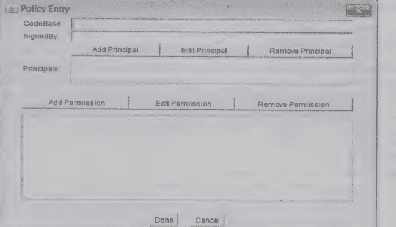

图 31.2：策略项窗口

你可以点击策略项窗口中的“添加权限”（Add Permission）按钮来添加权限。这将弹出权限窗口，如图 31.3 所示。


图 31.3：权限窗口

在权限窗口中，你可以选择一个权限类名、指定目标并选择一个操作。完成后，点击“确定”（OK）按钮，新权限将添加到策略项窗口下方的框中。完成后，你可以继续添加权限并保存策略文件。

## Applet 安全

默认情况下，网页浏览器在开启安全管理器的情况下运行 applet。事实上，applet 受到非常严格的限制，因为大多数时候运行的是别人编写的程序。从网上下载的 applet 是不可信的 applet，并禁止执行以下操作：

- 读写客户端计算机中的文件
- 建立除源主机以外的网络连接
- 定义原生调用

通过执行以下操作之一，可以对 applet 信任：

- 在本地硬盘上安装该 applet 类
- 对 applet 进行数字签名

通常第一种方法不是一个选项，因为可以通过第二种方法来实现，而使用 JarSigner 工具（JDK 包含的工具之一）来完成第二种方法相对容易的。事实上，本章稍后在“JarSigner 工具”部分将告诉你是如何签名 applet 的。然而，数字签名需要你理解密码学，因此在开始签名代码之前，你应该阅读“密码学概述”（Cryptography Overview）部分。

## 注意事项

关于 applet 安全的信息可以在此处找到：http://www.oracle.com/technwork/java/javase/tech/index.jsp-136007.html。

## 安全编程

你的用户可能会在开启安全管理器的情况下运行你的应用程序。如果代码中没有对此进行任何检查，你的应用程序可能会意外地抛出安全异常（security exception）。

为了让你的应用程序感知安全管理器，请注意可能抛出 `java.lang.SecurityException` 的方法。例如，`java.nio.File` 的 `delete` 方法（你可以用它删除文件）具有以下签名：

`public static void delete(Path path) throws java.io.IOException`

然而，如果你更仔细地阅读默认提供者的 Javadoc 说明，你会看到以下条目：

Throws:

SecurityException - 在默认提供者的情况下，如果安装了安全管理器，将调用 `SecurityManager.checkDelete(String)` 方法来检查文件的删除权限。

这表明 `File.delete` 方法可以被安全管理器限制。如果用户在不允许该操作的安全管理器下运行执行 `Files.delete` 的你的应用程序，你的程序将会崩溃。为了避免意外退出，请使用捕获 `SecurityException` 的 `try` 块封装你的代码。例如：

```java
try {
  Path path = Paths.get(filename);
  Files.delete(file);
} catch (IOException e) {
} catch (SecurityException e) {
  System.err.println("You do not have permission to " + "delete the file.");
}
```

## 密码学概述

从过去以来，一直存在对安全通信通道的需求，即消息是安全的，其他部分即使获取了消息也无法理解和篡改这些消息。

从历史角度看，密码学只关注加密和解密，交换消息的双方可以确保只有他们能读取消息。起初，人们使用对称加密对消息进行加密解密。在对称加密中，你使用相同的密钥进行加密和解密。

## 第 31 章：安全 535

> **注意**
>
> 由于证书可以由受信任的证书颁发机构进行数字签名，人们会将他们的证书公开，而不是他们的公钥。

有许多证书颁发机构，包括 VerSign 和 Thawte。证书颁发机构拥有一对公钥和密钥。为了申请证书，Bob 必须生成一对密钥并将公钥发送给证书颁发机构，颁发机构稍后将通过要求他发送护照副本或其他类型的身份证明来对 Bob 进行验证。在验证 Bob 后，证书颁发机构将使用其私钥对证书进行签名。这里的“签名”意味着加密。因此，证书只能使用颁发者的公钥读取。证书颁发机构的公钥通常广泛分发。例如，Internet Explorer、Netscape、Firefox 和其他浏览器默认包含了几个证书颁发机构的公钥。

例如，在 Chrome 中，点击浏览器工具栏上的 Chrome 菜单 --> 显示高级设置 --> 管理证书。然后，点击“受信任的根证书授权机构”选项卡选择证书列表。（参见图 31.4）。


图 31.4：公钥嵌入在 Chrome 中的证书颁发机构

现在，拥有证书后，Bob 在与另一方交换消息之前将分发证书而不是他的公钥。

- 其工作原理如下：

A->B 嗨 Bob，我想和你通话，但首先我需要确保你确实是 Bob。

B->A 可以，这是我的证书。

A->B 这还不够，我还需要你那里提供其他东西。

B->A Alice，真的是我 + [使用 Bob 的私钥加密的消息]

在 Bob 发送给 Alice 的最后一条消息中，该消息已使用 Bob 的私钥进行签名，以说服 Alice 消息是真实的。这就是证明身份验证的方法。Alice 联系 Bob 并发送了他的证书。然而，单凭证书是不够的，因为任何人都可以获得 Bob 的证书。记住，Bob 会将证书发送给任何想要与他交换消息的人。因此，Bob 向她发送了消息（“Alice，真的是我”）以及使用他的私钥加密的相同消息的摘要。

Alice 从证书获取了 Bob 的公钥。她可以这样做是因为证书是使用颁发者的私钥签名的，且 Alice 可以访问证书颁发机构的公钥（她的浏览器保留了它的副本）。现在，她收到了一条使用 Bob 的私钥加密的消息和对应的摘要。Alice 需要做的只是对消息计算摘要，并将其与 Bob Alice 解密后的摘要进行比较。Alice 可以使用 Bob 的私钥进行解密，并且 Alice 拥有 Bob 的公钥。如果两者匹配，Alice 就可以确定对方确实是 Bob。

Alice 在验证 Bob 身份后做的第一件事是发送一个将在后续消息交换中使用的密钥。没错，一旦建立了安全通道，SSL 就会使用对称加密，因为它比非对称加密快得多。

现在，这个图中仍然缺少一点。互联网上的消息通过了许多计算机。你如何确保这些消息的完整性呢，因为任何人都可以在网络上拦截这些消息？

## 数据完整性

Mallet 是一个恶意方，坐在 Alice 和 Bob 之间，试图破解正在发送的消息。不幸的是，尽管他可以复制消息，但它们是加密的，Mallet 并不知道密钥。然而，Mallet 可能会破坏消息或不转发它们。为了克服这个问题，SSL 引入了使用认证码（MAC）的消息。MAC 是使用密钥和某些传输数据计算出的数据。由于 Mallet 不知道密钥，他无法计算出摘要的正确值。消息接收者可以并将发现是否有尝试篡改数据，或者数据是否完整。如果发生这种情况，双方就可以通信。

其中一种摘要算法是 MD5。它由 RSA 发明，并且非常安全。如果采用 128 位的 MAC 值，恶意方猜中正确值的概率约为 1 比 18,446,744,709,551,616，或者说几乎不可能。

## SSL 如何工作

现在你已经知道 SSL 是如何解决加密/解密、身份验证和数据完整性问题的，让我们回顾一下 SSL 如何工作。这次，让我们以 Amazon 为例（代替 Bob），买家为例（代替 Alice）。Amazon.com 与任何其他网站一样，申请了受信任的证书颁发机构。买家是 Chrome，它嵌入了受信任证书颁发机构的公钥。买家并不真正需要知道 SSL 如何工作，也不需要拥有公钥或私钥。唯一需要确保的是，在输入重要详细信息（如信用卡号）时，使用的协议是 HTTPS 而不是 HTTP。这必须出现在 URL 中。因此，不是 http://www.amazon.com，而是必须以 https 开头，例如 https://secure.amazon.com。大多数浏览器还会在状态栏或 URL 字段显示安全图标。图 31.5 显示了 Chrome 中的安全标志。


图 31.5：Chrome 中的安全标志

## 创建证书

Java 提供了一套可用于异步加密的工具和 API。通过这些工具你可以：

- 生成公私钥对
- 将你的私钥公钥存储在名为密钥库（keystore）的数据库中
- 将其他人的证书存储在同一个密钥库中
- 使用自己的私钥通过签名来创建自己的证书
- 对文件进行数字签名

# 第 31 章：安全 539

`user.home` 系统属性。例如，对于 Windows，位于 `C:\Documents and Settings\UserName` 的 `Settings\UserName` 目录是 Windows 的默认密钥库。

4. 密钥库中有两种条目：

    a. 密钥条目（key entries），每个条目包含一个私钥以及对应公钥的证书链。

    b. 受信任证书条目（Trusted certificate entries），每个包含你信任的实体的公钥。每个条目也受密码保护，因此有两种密码：保护密钥库的密码和保护条目的密码。


- 5. 密钥库中的每个条目都通过唯一的名称或别名（`alias`）标识。在生成密钥对或使用 `keytool` 进行其他活动时，你必须指定一个别名。
- 6. 如果生成密钥对时没有指定别名，将使用 `mykey` 作为别名。

生成密钥对的最短命令是：

```
keytool -genkeypair
```

使用此命令，将使用默认密钥库，或者如果用户目录下已存在密钥库，则会创建一个。生成的密钥对将具有别名 `mykey`。随后系统会提示你输入密钥库密码并提供你的区分识别名称（DN）信息。最后，系统会提示你输入条目密码。

调用 `keytool -genkeypair` 将导致错误，因为它会尝试再次创建密钥对并使用别名 `mykey`。

要指定别名，使用 `-alias` 参数。例如，以下命令创建了一个使用 `email` 关键字标识的密钥对。

```
keytool -genkeypair -alias email
```

同样，使用的是默认密钥库。

要指定密钥库，使用 `-keystore` 参数。例如，此命令生成一个密钥对并将其存储在 `C:\javakeys` 目录下名为 `MyKeystore` 的密钥库中。

```
keytool -genkeypair -keystore C:\javakeys\MyKeystore
```

在调用程序后，你将被要求输入项任务信息。

生成密钥对的完整命令是使用了 `genkeypair`、`alias`、`keypass`、`storepass` 和 `name` 参数的命令。

```
keytool -genkeypair -alias email4 -keypass password -dn
CN=JoeSample, OU=IT, O=Brain Software Corp, L=Surrey, S=BC, C=CA
-storepass password
```

# 获取证书

虽然你可以使用 `Keytool` 生成公钥和私钥对以及自签名证书，但你的证书只会被那些认识你的人信任。为了获得更多认可，你需要证书颁发机构（CA，如 VerSigni、Entrust 或 Thawte）对你的证书进行签名。

如果你打算这样做，需要使用 `Keytool` 的 `-certreq` 参数生成证书签名请求（CSR）。其语法如下：

```
keytool -certreq -alias alias alias -file certregFile
```

此命令的输入是别名引用的证书，输出是 CSR，即由 `certFile` 指定路径的文件。将该 CSR 发送给 CA，他们将离线地对你进行身份验证，通常是要求你提供有效的身份识别详情，例如护照或或执照的副本。

如果 CA 对你的凭据满意，他们将向你发送一个新的证书或包含你公钥的证书链。此新证书用于替换你发送的现有证书（它是自签名的）。一旦收到回复，你可以使用 `Keytool` 的 `importcert` 参数将新证书导入到密钥库中。

# 将证书导入密钥库

如果你从第三方收到已签名文档或来自 CA 的回复，你可以将其存储在密钥库中。你需要为该证书分配一个你容易记住的别名。

要将证书导入或存储到密钥库中，使用 `importcert` 参数。其语法如下：

例如，要将 `joeCertificate.cer` 文件中的证书导入密钥库并赋予它别名 `brotherJoe`，你可以使用以下命令：

```
keytool -importcert -alias brotherJoe -alias brotherJoe -file joeCertificate.cer
```

在密钥库中存储证书的优势有两点：首先，你有一个受密码保护的集中存储器。其次，如果你已将证书导入密钥库，就可以轻松地验证来自第三方的已签名文档。

# 从密钥库导出证书

要从密钥库中导出证书，使用 `-exportcert` 参数。其语法如下：

```
keytool -exportcert -alias alias -file certFile
```

此命令的输出是别名引用的证书，输出是一个由 `certFile` 指定路径的文件。将该 CSR 发送给 CA，他们将离线地对你进行身份验证，通常是要求你提供有效的身份识别详情，例如护照或或执照的副本。

如果 CA 对你的凭据满意，他们将向你发送一个新的证书或包含你公钥的证书链。此新证书用于替换你发送的现有证书（它是自签名的）。一旦收到回复，你可以使用 `Keytool` 的 `importcert` 参数将新证书导入到密钥库中。

要从密钥库中导出证书，使用 `-exportcert` 参数。其语法如下：

```
keytool -exportcert -alias alias -file certFile
```

在密钥库中存储证书的优势有两点：首先，你有一个受密码保护的集中存储器。其次，如果你已将证书导入密钥库，就可以轻松地验证来自第三方的已签名文档。

# 列出密钥库条目

要列出密钥库中的条目，使用 `-list` 参数。其语法如下：

```
keytool -list -keystore keystore
```

此命令的输出是密钥库所有条目的列表。每个条目包括别名、类型和创建日期。例如：

```
keytool -list -keystore C:\javakeys\MyKeystore
```

# 签名 JAR 文件

使用 `keytool` 对 JAR 文件进行签名，使用 `-signedjar` 参数。其语法如下：

```
keytool -signedjar -alias alias -file jarfile -outfile outputfile
```

此命令的输出是一个已签名的 JAR 文件。然后你可以使用 `-verify` 参数验证 JAR 文件的签名。

# 第 31 章：安全 543

Applet 尝试写入文件，不说说，如果是在浏览器中运行，它将抛出 `SecurityException`，因为浏览器会针对访问客户端文件系统实施安全限制。对 applet 进行签名可以说服浏览器放宽其安全限制。浏览器将检查该 applet 是否由受信任的第三方签名。如果是，applet 将获得访问权限。如果签名者不受信任，浏览器将要求用户授予或拒绝权限。

在对 applet 签名之前，你必须先将其打包成一个 jar 文件。通过附录 C “jar”中讨论的 `jar` 程序可以很容易实现这一点。基本上，你只需要在包含类文件的 `app31` 子目录的目录下运行此命令即可：

```
jar -cf MyJar.jar app31/MyApplet.class
```

你将得到一个名为 `MyJar.jar` 的 jar 文件。

现在，使用 `jarsigner` 签名 jar 文件：

```
jarsigner -verbose -signedJar MySignedJar.jar MyJar.jar mykey
```

其中 `mykey` 是你密钥库中的一个密钥。系统将提示你输入密钥库的密码。结果将是 `MySignedJar.jar` 文件。我们准备好测试它在浏览器中运行了。列表 31.3 中的 HTML 文件用于调用该 applet。

# 列表 31.3：调用 applet 的 HTML

```
<html
<head>
<title>测试签名的 Applet</title>
</head>
<body>
<applet code="app31.MyApplet.class" archive="MySignedJar.jar" width="600" height="50"></applet>
</body>
</html>
```

现在，当你调用包含该 applet 的 HTML 页面时，浏览器将询问你是否允许运行 applet 的权限，因为该 applet 未经过受信任的 CA 签名。图 31.6 显示了安全警告。

# 544 Java：初学者教程（第四版）


图 31.6：询问用户是否授予 applet 权限的安全警告

“更多详情”（More Details）按钮显示了已签名 applet 中签名的细节。31.7 显示了这些细节。

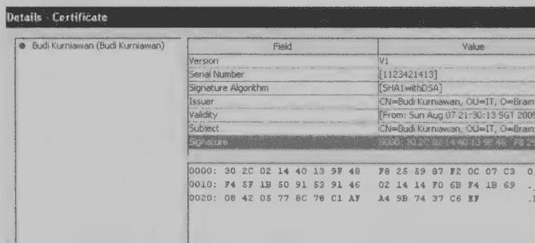

图 31.7：用于签名 applet 的签名细节

如果你授予了访问权限，applet 将具有创建文件并向文件写入权限。你将看到类似图 31.8 的界面。

# 第 31 章：安全 545

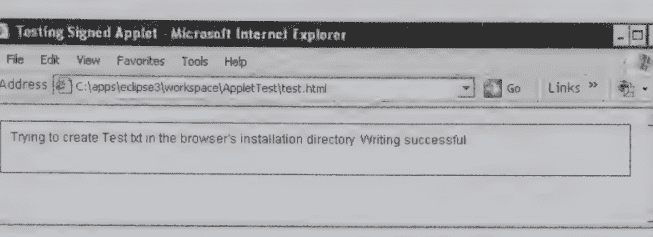

图 31.8：applet 已成功访问文件系统

## 注意

随本章的应用程序包含 `MySignedJar.jar` 文件，该文件已使用我的签名进行了签名。为了方便起见包含其中。

# Java 加密 API

## 总结

本章解释了安全管理器如何限制 Java 应用程序，以及如何编写策略文件来授予应用程序权限。它还讨论了非对称加密以及 Java 如何实现它。在章节末尾，你已经看到了如何对 applet 进行数字签名，使其能够写入用户的文件系统。

## 测验

- 1. 什么是策略文件？
- 2. 为什么对称加密不适合在互联网上？
- 3. 什么是密钥库？
- 4. 数字签名 applet 的步骤是什么？

# 第 32 章：Java Web 应用程序

开发 Java Web 应用程序有三种“官方”技术：`Servlet`、`JavaServer Pages (JSP)` 和 `JavaServer Faces (JSF)`。它们不属于 Java 标准版 (SE) 的部分，而是 Java 企业版 (EE) 的成员。然而，考虑到 Web 应用程序是目前最流行的应用程序，本书也涵盖了这些内容。每种技术都复杂到需要专门的一本书来说，因此我只能在这里提供介绍。如果你感兴趣想了解更多知识，我推荐我的著作 *Servlet & JSP: A Tutorial (ISBN 978-0-9808396-2-3)*。

在这三种技术中，`Servlet` 是 `JSP` 和 `JSF` 基础的核心技术。`JSP` 在 `servlet` 之后出现并没有让 `Servlet` 过时。相反，它们在现代 Java 中共同使用。

本章探讨了 `Servlet 3.0 API` 并展示了几个 servlet 应用程序作为示例。第 33 章“JavaServer Pages”涵盖了 `JSP`。

## Servlet 应用程序架构

servlet 本质上是一个 Java 程序。servlet 应用程序由一个或多个 servlet组成。servlet 运行在 servlet 容器内部，不能独立运行。servlet 容器也称为 servlet 引擎，将用户的请求传递给 servlet 应用程序，并将 servlet 应用程序的响应返回给用户。大多数 servlet 应用程序至少包含几个 `JSP` 页面。因此，使用“servlet/JSP 应用程序”来指代 Java Web 更为合适。

图 32.1 显示了 servlet 应用程序的架构。

# 548 Java：初学者教程（第四版）

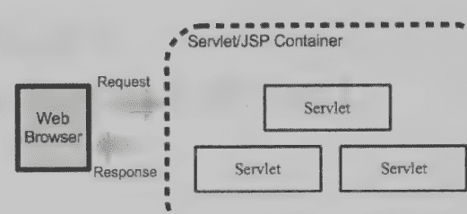

图 32.1：Servlet 架构

在所有 应用程序中，服务器和客户端使用超文本传输协议 (HTTP) 进行通信。运行 servlet 应用程序需要一个 Java EE 容器，例如 `GlassFish`、`WildFly`、`Apache Tomcat` 或 `IBM WebSphere`。`Tomcat` 和 `Jetty` 不是 Java EE 容器，因此它们无法运行 EJB。

Java EE 容器的技术列表。`Tomcat` 和 `Jetty`是最流行的。你可以从以下处下载：

```
http://tomcat.apache.org
http://jetty.org
```

# Servlet API 概述

- `javax.servlet`：包含 servlet 与 servlet 容器之间定义的类和接口。
- `javax.servlet.http`：包含 HTTP servlet 与 servlet 容器之间定义的类和接口。
- `javax.servlet.annotation`：包含用于 servlet、过滤器和监听器的注解。它还指定了注解组件的元数据。
- `javax.servlet.descriptor`：包含程序化访问 Web应用程序配置信息的类型。

本章关注 `javax.servlet` 和 `javax.servlet.http` 包中一些重要的成员。

# javax.servlet 包

图 32.2 显示了 `javax.servlet` 包中的主要类型。

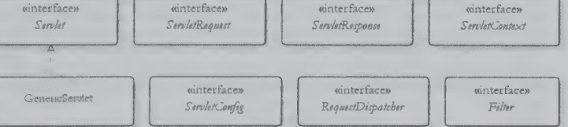

图 32.2：javax.servlet 包的显著成员

`Servlet` 技术的核心是 `Servlet`，这是一个所有 servlet 类必须直接或间接实现的接口。该接口定义了 servlet 与 servlet 容器之间的约定。该约定在于 servlet 容器承诺将 servlet 加载到内存并在 servlet 实例上调用特定方法。每个 servlet 类型只有一个实例，供该 servlet 的所有请求共享。详情见“Servlet”节。

对 servlet 的请求会导致 servlet 容器调用 servlet 的 `service` 方法，传递 `ServletRequest` 实例和 `ServletResponse` 实例。`HttpServlet` 对象封装了当前的 HTTP 请求。`ServletResponse` 对象代表当前用户的 HTTP 响应，并使响应响应变得简单。

此外，servlet 容器会创建一个 `ServletContext` 实例，它封装了同一应用程序中所有 servlet 运行的环境。对于每个 servlet，还有一个 `ServletConfig` 对象封装了 servlet 配置。

我们将在接下来的章节中详细查看这些接口。

# 550 Java: 入门教程（第四版）

## Servlet

所有的 `Servlet` 都直接或间接地实现了 `javax.servlet.Servlet`。该接口定义了五个方法：

```
void init(ServletConfig config) throws ServletException
void service(ServletRequest request, ServletResponse res)
throws ServletException, java.io.IOException
void destroy()
java.lang.String getServletInfo()
ServletConfig getServletConfig()
```

`init`、`service` 和 `destroy` 是生命周期方法。Servlet 容器按照以下规则调用这些方法：

- `init`。当 servlet 第一次被请求时，Servlet 容器会调用此方法。在随后的请求中不再调用它。你使用此方法来编写初始化代码。在调用此方法时，Servlet 容器会将一个 `ServletConfig` 传递给一个类变量，以便在 servlet 类的其他位点使用该对象。
- `service`。每当 servlet 被请求时，Servlet 容器都会调用此方法。当 servlet 第一次被请求时，Servlet 容器会调用 `init` 方法，如果 `init` 方法成功完成，则后续请求仅调用 `service` 方法。在调用 `service` 方法时，Servlet 容器会传递两个对象：一个 `ServletRequest` 对象和一个 `ServletResponse` 对象。
- `destroy`。当 servlet 准备被销毁时，Servlet 容器会调用此方法。当应用程序卸载或 servlet 停止时，servlet 会被销毁。通常，你会在此方法中进行清理工作。

`getServletInfo` 和 `getServletConfig` 是 `Servlet` 中定义的非生命周期方法。

- `getServletInfo`。此方法返回 servlet 的描述。你可以返回任何可能有用的字符串，甚至是 `null`。
- `getServletConfig`。此方法返回由 Servlet 容器传递给 `init` 方法的 `ServletConfig` 对象。然而，为了让 `getServletConfig` 方法执行此操作，你必须在 `init` 方法中将 `ServletConfig` 对象赋值给类级别的变量。`ServletConfig` 在本章的“ServletConfig”节中会有详细解释。

一个需要注意的重要重要点是线程安全。Servlet 容器会创建一个 servlet 实例并在该实例在所有用户之间共享，因此不建议使用类级别变量，除非它们是只读变量或原子变量。

下一节“编写基础 Servlet 应用程序”将展示如何实现你的第一个 servlet。直接实现 `Servlet` 并不是编写 servlet 最简单的方法。扩展 `GenericServlet` 或 `HttpServlet` 会简单得多。然而，直接操作 `Servlet` 将让你熟悉 API 中最重要的成员。

## 编写基础 Servlet 应用程序

编写一个 servlet 应用程序出奇地简单。你只需要创建一个目录结构，并将 servlet 类放置在特定的目录中。在本节中，你将学习如何编写一个简单的 servlet 应用程序 `app32a`。最初，它只包含一个 servlet——`MyServlet`，它向客户端发送问候。

你需要一个 servlet 容器来运行你的 servlets。`Tomcat` 是一个开源 servlet 容器，免费提供，并可以在任何支持 Java 的平台上运行。你现在应该阅读下面的章节，如果还没有安装，请安装 `Tomcat`。

## 安装 Tomcat

你可以从 `http://tomcat.apache.org` 下载 `Tomcat`。要运行本章中的示例，你需要 `Tomcat 7` 或更高版本。你应该获取 zip 或 gz 格式的最新二进制发行版。


下载 Tomcat 二进制发行包后，解压文件。你将在安装目录下看到几个目录。特别值得关注的是 `bin` 和 `webapps` 目录。在 `bin` 目录中，你会找到启动和停止 Tomcat 的程序。`webapps` 目录非常重要，因为你把 servlet 应用程序存储在那里。

解压后，将 `JAVA_HOME` 环境变量设置为 JDK 的安装目录。

完成后，你可以通过运行 `startup.bat`（Windows）或 `startup.sh`（Unix/Linux）来启动 Tomcat。默认情况下，Tomcat 运行在端口 8080，因此你可以将 Web 浏览器指向此地址来测试 Tomcat：

```
http://localhost:8080
```

## 编写并编译 Servlet 类

在本地机器上安装好 servlet 容器后，下一步是编写并编译 servlet 类。该 servlet 类必须实现 `javax.servlet.Servlet`。本示例中的 servlet 类 `MyServlet` 如代码 32.1 所示。按照惯例，servlet 类名以 `.java` 结尾。

### 代码 32.1：MyServlet 类

```
package app32a;
import java.io.IOException;
import java.io.PrintWriter;
import javax.servlet.Servlet;
import javax.servlet.ServletConfig;
import javax.servlet.ServletException;
import javax.servlet.ServletRequest;
import javax.servlet.ServletResponse;
import javax.servlet.annotation.WebServlet;

@WebServlet(name = "MyServlet", urlPatterns = {"/*"})
public class MyServlet implements Servlet {
    private transient ServletConfig servletConfig;

    @Override
    public void init(ServletConfig servletConfig)
        throws ServletException {
        this.servletConfig = servletConfig;
    }

    @Override
    public ServletConfig getServletConfig() {
        return servletConfig;
    }

    @Override
    public String getServletInfo() {
        return "My Servlet";
    }

    @Override
    public void service(ServletRequest request,
        ServletResponse response) throws ServletException,
        IOException {
        String servletName = "MyServlet";
        response.setContentType("text/html");
        PrintWriter writer = response.getWriter();
        writer.print("<html><head>" 
            + "</head><body>Hello from " + servletName
            + "</body></html>");
    }

    @Override
    public void destroy() {
    }
}
```

查看源代码时，首先想到的事情是 `@WebServlet` 注解。`WebServlet` 注解类型用于声明 servlet，并告诉容器如何调用该 servlet。`name` 属性是可选的，存在时为 servlet 命名。`urlPatterns` 属性也是可选的，但几乎总是存在。在 `MyServlet` 中，`urlPatterns` 指定了调用 servlet 的 URL 模式。注意 URL 模式必须以斜杠开头。

`MyServlet` 中的 `init` 方法将传递的 `ServletConfig` 赋值给类变量，如果你打算在 servlet 中使用它。

`service` 方法向浏览器发送 "Hello from MyServlet"。会被每个指向 servlet 的请求调用。

为了编译 servlet，必须包含 Servlet API 中的类型。Tomcat 包含了 `servlet-api.jar`，它包含 `javax.servlet` 和 `javax.servlet.http` 包。该 jar 文件位于 Tomcat 安装目录下的 `lib` 目录。

## 目录结构

Servlet 应用程序必须部署在特定的目录结构中。图 32.3 显示了该应用程序的目录结构。

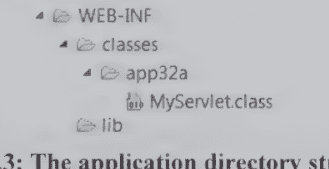

> 图 32.3：目录结构

层级顶部的 `app32a` 目录是应用程序目录。在应用程序目录下是 `WEB-INF` 目录。它下面有两个子目录。

- `classes`。你的 servlet 和其他 Java 类必须存放在这里。目录反映了类的包结构。在图 32.3 中部署了一个类：`app32a.MyServlet`。
- `lib`。部署 servlet 应用程序所需的 jar 文件。Servlet API jar 不需要部署在这里，因为 servlet 容器已经有了它的副本。在本应用程序中，`lib` 目录是空的。空的 `lib` 目录可以删除。

你不应该将源代码包含在应用程序中。

Servlet/JSP 应用程序通常包含 JSP 页面、HTML 文件、图像文件和其他资源。这些应该放在应用程序目录下，并通常按子目录组织。例如，所有图像放在 `image` 目录，所有 JSP 放在 `jsp` 等。

现在，将应用程序部署到 Tomcat。有几种方法。简单是将应用程序目录及其内容复制到 Tomcat 安装下的 `webapps` 目录。其他 servlet 容器提供了不同的部署方式。

### 部署为 WAR 文件

另一种方法是你可以将应用程序部署为 war 文件。war 文件是一个扩展名为 `.war` 的 jar 文件。你可以使用 JDK 随带的 `jar` 程序或如 `WinZip` 等工具来创建 war 文件。创建 war 文件后，将其复制到 Tomcat 的 `webapps` 目录下，重启 Tomcat，Tomcat 在启动时会自动解压该 WAR 文件。

在 Tomcat 上部署 Web 应用程序的另一种方法是编辑 Tomcat `conf` 目录下的 `server.xml` 文件，或者部署一个特殊的 XML 文件。

## 调用 Servlet

启动或重启 Tomcat，并将浏览器导向以下 URL（假设 Tomcat 配置为监听 8080 端口，这是其默认端口）：

```
http://localhost:8080/app32a/my
```

输出结果应该与图 32.4 相似。


> 图 32.4：来自 MyServlet 的响应

## ServletRequest

对于每一个 HTTP 请求，Servlet 容器都会创建一个 `ServletRequest` 实例，该实例封装了有关请求的信息并将对象传递给 servlet 的 `service` 方法。

这些是 `ServletRequest` 接口中的一些方法。

```
public int getContentLength()
    返回请求体的字节数。如果长度未知，该方法返回 -1。
```

```
public java.lang.String getContentType()
    返回请求体的 MIME 类型，如果类型未知，则返回 null。
```

```
public java.lang.String getParameter(java.lang.String name)
    返回指定的请求参数的值。
```

```
public java.lang.String getProtocol()
    返回此 HTTP 请求所用协议的名称和版本号。
```

最重要的方法是 `getParameter`。该方法的常用用途是返回 HTML 表单字段的值。你将在本章稍后的“HTTP Servlets”部分学习如何获取表单值。

`getParameter` 也可以用于获取查询字符串的值。例如，如果使用以下 URI 了 servlet：

```
http://domain/context/servletName?id=123
```

你可以在 servlet 内部使用此语句获取 `id` 的值：

```
String id = request.getParameter("id");
```

如果参数不存在，`getParameter` 将返回 `null`。

除了 `getParameter`，你还可以使用 `getParameterNames`、`getParameterMap` 和 `getParameterValues` 来获取表单字段名、值以及查询字符串的值。请参见“Http Servlets”部分关于如何使用这些方法的示例。

## ServletResponse

`javax.servlet.ServletResponse` 接口表示 servlet 响应。在调用 servlet 的 `service` 方法之前，Servlet 容器会创建一个 `ServletResponse` 对象并将其作为第二个参数传递给 `service` 方法。`ServletResponse` 隐藏了向客户端浏览器发送响应的复杂性。

`ServletResponse` 最重要的方法是 `getWriter` 方法，它返回一个 `java.io.PrintWriter` 用于向客户端发送字符文本。默认情况下，`PrintWriter` 对象使用 ISO-8859-1 编码。

在响应客户端时，你以 HTML 格式发送它。在发送任何 HTML 标签之前，你还想通过调用 `setContentType("text/html")` 作为参数来设置响应的内容类型。这就是你告诉浏览器内容类型为 HTML 的方式。大多数浏览器在缺少内容类型的情况下默认将响应渲染为 HTML。然而，如果你不设置响应内容类型，某些浏览器会将 HTML 标签显示为纯文本。

## ServletConfig

你已经看到，当 Servlet 容器初始化 servlet 时，会将一个 `ServletConfig` 对象传递给 servlet 的 `init` 方法。`ServletConfig` 对象封装了你可以传递给 servlet 的配置信息。如果你想向应用程序传递在不同部署之间可能不同的动态信息，这将非常有用。

`ServletConfig` 对象的每一条信息被称为初始化参数。一个初始化参数有两个部分：键和值。你通过使用属性 `@WebServlet` 或在名为部署描述符的配置文件声明它来将初始化参数传递给 servlet。你将在本章稍后学习更多关于部署描述符的内容。

要从 servlet 内部获取初始化参数，请调用 Servlet 容器传递给 servlet `init` 方法的 `ServletConfig` 的 `getInitParameter` 方法。`getInitParameter` 的签名如下。

```
java.lang.String getInitParameter(java.lang.String name)
```

例如，要获取 `contactName` 参数的值，你将编写：

```
String contactName = servletConfig.getInitParameter("contactName");
```

另一个方法 `getInitParameterNames` 返回所有初始化参数名称的枚举类（`Enumeration`）：

```
java.util.Enumeration<java.lang.String> getInitParameterNames()
```

除了 `getInitParameter` 和 `getInitParameterNames` 之外，`ServletConfig` 还提供了另一个实用的方法 `getServletContext`。使用此方法从 servlet 内部获取 `ServletContext` 对象。请参见本章稍后的“ServletContext”部分关于该对象的讨论。

作为使用 `ServletConfig` 的一个示例，假设有一个名为 `ServletConfigDemoServlet` 的 servlet，新 servlet 正如列表 32.2 所示。

### 代码 32.2：ServletConfigDemoServlet 类

```
package app32a;
import java.io.IOException;
import java.io.PrintWriter;
import javax.servlet.*;
import javax.servlet.annotation.*;

@WebServlet(name = "ServletConfigDemoServlet",
           initParams = {
               @WebInitParameter(name = "contactName", value = "Tiacak"),
               @WebInitParameter(name = "email", value = "admin@example.com")
           },
           urlPatterns = {"/config"})
public class ServletConfigDemoServlet implements Servlet {
    private ServletConfig servletConfig;

    @Override
    public void init(ServletConfig config) throws ServletException {
        this.servletConfig = config;
    }

    @Override
    public void service(HttpServletRequest request, HttpServletResponse response)
            throws ServletException, IOException {
        String contactName = servletConfig.getInitParameter("contactName");
        String email = servletConfig.getInitParameter("email");
        response.setContentType("text/html");
        PrintWriter writer = response.getWriter();
        writer.print("<html><head></head><body>");
        writer.print("Contact Name: " + contactName);
        writer.print("<br/>Email: " + email);
        writer.print("</body></html>");
    }

    @Override
    public void destroy() {
    }

    @Override
    public ServletContext getServletContext() {
        return getServletContext();
    }

    @Override
    public ServletConfig getConfigConfig() {
        return servletConfig;
    }

    @Override
    public java.util.Enumeration<String> getInitParameterNames() {
        return null;
    }

    @Override
    public String getInitParameter(String name) {
        return null;
    }
}
```

## GenericServlet

之前的示例展示了如何通过实现 `Servlet` 接口来编写 servlet。然而，你是否注意到你必须为 `Servlet` 中的所有方法提供实现，尽管某些方法通常并不包含代码？此外，你还需要在类级别变量中保留 `ServletConfig` 对象。

幸运的是，有一个 `GenericServlet` 抽象类。为了方便开发，`GenericServlet` 同时实现了 `Servlet` 和 `ServletConfig` 接口（以及 `java.io.Serializable`），并执行了以下任务：

- 在 `init` 方法中将 `ServletConfig` 对象分配给类级别变量，以便通过调用 `getServletConfig` 来获取。


- 为 `ServletConfig` 对象中的所有方法提供默认实现。

`GenericServlet` 通过将 `ServletConfig` 对象分配给类级别变量 `servletConfig` 来保留该对象。但是，如果你重写了该方法，那么你 servlet 中的方法将会被调用。为了保留 `ServletConfig` 对象，你必须在你的初始化代码之前调用 `super.init(servletConfig)`。为了避免你手动这样做，`GenericServlet` 提供了另一个不带参数的 `init` 方法。

```java
public void init(ServletConfig servletConfig)
    throws ServletException {
    this.servletConfig = servletConfig;
    this.init();
}
```

这意味着，你可以通过重写无参数的 `init` 方法来编写初始化代码，而 `ServletConfig` 对象仍然会被 `GenericServlet` 实例保留。

列表 32.3 中的 `GenericServletDemoClass` 是列表 32.2 中 `ServletConfigDemoServlet` 的重写。注意，新的 servlet 扩展了 `GenericServlet` 而不是实现 `Servlet`。

### 列表 32.3: The GenericServletDemoServlet 类

```java
package app32;
import java.io.IOException;
import java.io.PrintWriter;
import javax.servlet.GenericServlet;
import javax.servlet.ServletConfig;
import javax.servlet.ServletException;
import javax.servlet.HttpServletRequest;
import javax.servlet.HttpServletResponse;
import javax.servlet.annotation.WebInitParam;
import javax.servlet.annotation.WebServlet;

@WebServlet(name = "GenericServletDemoServlet",
    urlPatterns = { "/generic"},
    initParams = {
        @WebInitParam(name="admin", value="Harry Tiacak"),
        @WebInitParam(name="email", value="admin@example.com")
}
}
public class GenericServletDemoServlet extends GenericServlet {
    private static final long serialVersionUID = 625008902L;

    @Override
    public void service(HttpServletRequest request, HttpServletResponse response)
        throws ServletException, IOException {
        ServletConfig servletConfig = getConfig();
        String admin = servletConfig.getInitParameter("admin");
        String email = servletConfig.getInitParameter("email");
        response.setContentType("text/html");
        PrintWriter writer = response.getWriter();
        writer.print("<html><head><body>" +
            "Admin: " + email +
            "<br>Email: " + "</body></html>");
    }
}
```

你可以看到，通过扩展 `GenericServlet`，你不需要那些你不打算更改的方法。因此，你的代码更加整洁。在列表 32.3 中，唯一重写的方法是 `service` 方法。此外，不需要自己保留 `ServletConfig` 对象。如果你需要访问 `ServletConfig` 对象，只需调用 `GenericServlet` 的 `getServletContext` 方法即可。

使用此 URL 调用 servlet，结果应该与 `ServletConfigDemoServlet` 类似。

```
http://localhost:8080/app32a/generic
```

尽管 `GenericServlet` 是 `Servlet` 的一个很好的增强，但它并不是你频繁使用的东西，因为它没有 `HttpServlet` 高级。事实上，`HttpServlet` 才是真实世界应用程序中使用的类。该类将在下一节“HTTP Servlets”中进行解释。

## HTTP Servlets

你编写的大多数 servlet 应用（如果不是全部）都是基于 HTTP 的。`javax.servlet.http` 包包含了你可以用于编写 HTTP servlet 应用程序的类和接口。`javax.servlet.http` 中的许多成员重写了 `javax.servlet` 中的成员。大多数时候，你将使用 `javax.servlet.http` 中的成员。

图 32.6 显示了 `javax.servlet.http` 中的主要类型。

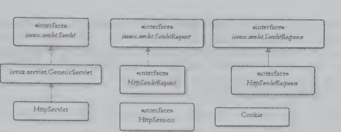

图 32.6: javax.servlet 的主要成员

### HttpServlet

`HttpServlet` 类重写了 `javax.servlet.GenericServlet`。在使用 `HttpServlet` 时，你还会与分别代表 servlet 请求和响应的 `HttpServletRequest` 和 `HttpServletResponse` 对象一起。`HttpServletRequest` 接口扩展了 `javax.servlet.ServletRequest`，`HttpServletResponse` 扩展了 `javax.servlet.ServletResponse`。

`HttpServlet` 重写了 `GenericServlet` 中的 `service` 方法，并添加了具有以下签名的另一个 service 方法：

```java
protected void service(HttpServletRequest request,
        HttpServletResponse response)
        throws ServletException, java.io.IOException
```

新的 `service` 方法与 `javax.servlet.Servlet` 中的方法之间的区别在于，前者接受 `HttpServletRequest` 和 `HttpServletResponse`，而不是 `ServletRequest` 和 `ServletResponse`。

容器像通常一样，调用 `javax.servlet.Servlet` 中的原始 `service` 方法，在 `HttpServlet` 中，它的写法如下：

```java
public void service(ServletRequest req, ServletResponse res) throws ServletException {
    HttpServletRequest request;
    HttpServletResponse response;
    try {
        request = (HttpServletRequest) req;
        response = (HttpServletResponse) res;
    } catch (ClassCastException e) {
        throw new ServletException("non-HTTP request");
    }
    service(request, response);
}
```

容器像通常一样，调用 `javax.servlet.Servlet` 中的原始 `service` 方法，在 `HttpServlet` 中，它的写法如下（见上文代码）。

## 第 32 章：Java Web 应用

发送一个响应码，将浏览器重定向到指定的位置。

## 编写 HttpServlet Servlet

扩展 `HttpServlet` 类似于子类 `GenericServlet`。然而，你不是重写 `service` 方法，而是在 `HttpServlet` 子类中重写 `doGet` 和 `doPost` 方法。

本章附带的 app32b 应用包含一个渲染 HTML 表单并处理函数提交的 servlet。该 servlet 位于代码列表 32.4。

列表 32.4：FormServlet 类

```java
package app32b;
import java.io.IOException;
import java.io.PrintWriter;
import java.util.Enumeration;
import javax.servlet.ServletException;
import javax.servlet.annotation.WebServlet;
import javax.servlet.http.HttpServlet;
import javax.servlet.http.HttpServletRequest;
import javax.servlet.http.HttpServletResponse;

@WebServlet(name = "FormServlet", urlPatterns = {"/*"})
public class FormServlet extends HttpServlet {
    private static final long serialVersionUID = 54L;
    private static final String TITLE = "Order Form";

    @Override
    public void doGet(HttpServletRequest request, HttpServletResponse response)
            throws ServletException, IOException {
        response.setContentType("text/html");
        PrintWriter writer = response.getWriter();
        writer.println("<html>");
        writer.println("<head>");
        writer.println("<title>" + TITLE + "</title></head>");
        writer.println("<body>" + TITLE + "</body>");
        writer.println("<form method=\"post\">");
        writer.println("<table>");
        writer.println("<tr>");
        writer.println("<td>Name:</td><input name=\"name\"/></td>");
        writer.println("<tr>");
        writer.println("<td>Address:</td>");
        writer.println("<td><textarea name=\"address\" cols=\"40\" rows=\"5\"></textarea></td>");
        writer.println("</tr>");
        writer.println("<td>Country:</td>");
        writer.println("<td><select name=\"country\">");
        writer.println("<option>United States</option>");
        writer.println("<option>Canada</option>");
```

```java
        writer.println("</select></td>>");
        writer.println("</tr>");
        writer.println("<tr>");
        writer.println("<td>Delivery Method:</td><input type='radio' " +
            + "name='deliveryMethod' " +
            + "value='First Class'>First Class");writer.println("<input type='radio' " +
            + "name='deliveryMethod' " +
            + "value='Second Class'>Second Class</td>");
        writer.println("</tr>");
        writer.println("<tr>");
        writer.println("<td>Shipping Instructions:</td>" +
            + "<textarea name='instruction' " +
            + "cols='40' rows='5\"></textarea></td>");
        writer.println("</tr>");
        writer.println("<tr>");
        writer.println("<td>&nbsp;</td>");
        writer.println("<td><textarea name='instruction' "
            + "cols='40' rows='5\"></textarea></td>");
        writer.println("</tr>");
        writer.println("<tr>");
        writer.println("<td>Please send me the latest product catalog:</td><input type='checkbox' " +
            + "name='catalogRequest' /></td>");
        writer.println("</tr>");
        writer.println("<tr>");
        writer.println("<tr>");
        writer.println("<td>&nbsp;</td>");
        writer.println("<td><input type='reset' />" +
            + "<input type='submit' /></td>");
        writer.println("</tr>");
        writer.println("</table>");
        writer.println("</form>");
        writer.println("</body>");
        writer.println("</html>");
    }

    @Override
    public void doPost(HttpServletRequest request,
        HttpServletResponse response)
        throws ServletException, IOException {
        response.setContentType("text/html");
        PrintWriter writer = response.getWriter();
        writer.println("<html>");
        writer.println("<head>");
        writer.println("<title>" + TITLE + "</title>");
        writer.println("</head>");
        writer.println("<body><h1>" + TITLE + "</h1>");
        writer.println("<table>");
        writer.println("<tr>");
        writer.println("<<td>>Name:</td>");
        writer.println("<td>" + request.getParameter("name")
```


```java
+ "</td>");
writer.println("</tr>");
writer.println("<tr>");
writer.println("<<td>>Address:</td>");
writer.println("<td>" + request.getParameter("address") +
  + "</td>");
writer.println("</tr>");
writer.println("<tr>");
writer.println("<<td>>Country:</td>");
writer.println("<td>" + request.getParameter("country") +
  + "</td>");
writer.println("</tr>");
writer.println("<tr>");
writer.println("<<td>>Shipping Instructions:</td>");
writer.println("<td>");
  String[] instructions = request
  .getParameterValues("instruction");
  if (instructions != null) {
    for (String instruction : instructions) {
      writer.println(instruction + "<br/>");
    }
  }
writer.println("</td>");
writer.println("</tr>");
writer.println("<tr>");
writer.println("<td>Delivery Method:</td>");
writer.println("<td>" + request.getParameter("deliveryMethod")
  + "</td>");
writer.println("</tr>");
writer.println("<tr>");
writer.println("<td>Catalog Request:</td>");
writer.println("<td>" + (request.getParameter("catalogRequest") != null ? "Yes" : "No")
  + "</td>");
writer.println("</tr>");
writer.println("</table>");
writer.println("</body>");
writer.println("</html>");
}
```

## 第 32 章：Java Web 569

```xml
<servlet>
  <servlet-name>SimpleServlet</servlet-name>
  <servlet-class>app32c.SimpleServlet</servlet-class>
  <load-on-startup>10</load-on-startup>
</servlet>
```

```xml
<servlet-mapping>
  <servlet-name>SimpleServlet</servlet-name>
  <url-pattern>/simple</url-pattern>
</servlet-mapping>
```

```xml
<servlet>
  <servlet-name>WelcomeServlet</servlet-name>
  <servlet-class>app32c.WelcomeServlet</servlet-class>
  <load-on-startup>20</load-on-startup>
</servlet>
```

```xml
<servlet-mapping>
  <servlet-name>WelcomeServlet</servlet-name>
  <url-pattern>/welcome</url-pattern>
</servlet-mapping>
```

```xml
</web-app>
```

使用部署描述符（deployment descriptor）有许多优点。其中，你可以包含 `@WebServlet` 中没有对应内容的元素，例如 `load-on-startup` 元素。该元素会在应用程序启动时加载 servlet，而不是在 servlet 第一次调用时加载。使用 `load-on-startup` 意味着对 servlet 的第一次调用耗时不会比后续调用长。如果 servlet 的 `init` 方法可能需要一些时间才能完成，这就会特别有用。

使用部署描述符的另一个优点是，如果你需要更改配置值（例如 servlet 路径），不需要重新编译 servlet 类。此外，你可以向 servlet 传递初始参数，并在无需重新编译 servlet 类的情况下对其进行编辑。

部署描述符还允许你覆盖 servlet 注解中指定的值。在已经在部署描述符中声明的 servlet 上的 `@WebServlet` 注解将不起作用。然而，在带有部署描述符的应用中，对未在部署描述符中的 servlet 进行注解仍然有效。这意味着，你可以在同一个应用程序中既拥有带注解的 servlet，又在部署描述符中声明 servlet。

图 32.9 显示了 app32c 的目录结构。该目录结构与 app26a 无。唯一的区别是 app32c 在 `WEB-INF` 目录下有一个 `web.xml` 文件（部署描述符）。

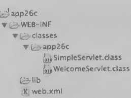

图 32.9：带有部署描述符的 app32c 结构

既然 `SimpleServlet` 和 `WelcomeServlet` 已经在部署描述符中声明，你可以使用这些 URL 来访问它们：

- http://localhost:8080/app32c/simple
- http://localhost:8080/app32c/welcome

## 总结

Servlet 技术是 Java EE 的一部分。Servlet 运行在 servlet 容器，容器与 servlet 之间的约定以 `javax.servlet.Servlet` 接口的形式存在。`javax.servlet` 包还提供了 `GenericServlet` 抽象类，这是一个你可以扩展它来编写 servlet 的方便类。然而，大多数现代 servlet 将运行在 HTTP 环境中，因此，子类 `javax.servlet.http.HttpServlet` 类更加方便。`HttpServlet` 类本身是 `GenericServlet` 的子类。

## 测验

1. `javax.servlet.Servlet` 接口的三个生命周期方法是什么？

2. `javax.servlet.ServletResponse` 接口中 `getWriter` 方法和 `getOutputStream` 方法之间的主要区别是什么？你更常用两者中的哪一个？

3. 列出 `javax.servlet` 中的四个接口和 `javax.servlet.http` 中的三个接口。

## 第 33 章：JavaServer Pages (JSP)

正如第 32 章所示，servlet 有两个无法克服的缺点。首先，在发送响应时，所有的 HTML 标签都必须封装在字符串中，这使得发送 HTTP 响应变成了一项繁琐的工作。其次，所有的文本和 HTML 标签都是硬编码的，因此，对应用显示部分的微调（例如更改页面背景颜色）都需要重新编译。

JavaServer Pages (JSP) 的出现拯救并解决了 servlet 中的问题。然而，JSP 并没有替代 Servlet，而是补充了它。现代 Java Web 应用同时使用 servlet 和 JSP 页面。编写时，JSP 的最新版本是 2.3。

## JSP 概述

JSP 页面本质上是一个 servlet。然而，由于两个原因，处理 JSP 页面比处理 servlet 更容易。首先，你不需要编译 JSP 页面。其次，JSP 页面基本上是带有 `.jsp` 扩展名的文本文件，你可以使用任何编辑器编写它们。

JSP 页面运行在 JSP 容器上。servlet 容器通常也是 JSP 容器。例如，Tomcat 就是一个 servlet/jsp 容器。当第一次请求 JSP 页面时，JSP 容器会做两件事：

- 将 JSP 页面翻译成 JSP 实现类。该类必须实现 `javax.servlet.Servlet` 接口。翻译的结果取决于 JSP 容器。类名也是特定于容器的。你不需要担心这个实现类或它的名称，因为你永远不需要直接处理它。如果发生翻译错误，会将错误消息发送给客户端。
- 如果翻译成功，JSP 容器会编译该实现类，然后加载并安装它，并对其执行正常的生命周期操作。

为了规避这个问题，JSP 页面的首次调用会比后续请求长，因为涉及翻译和编译。JSP 容器会检查 JSP 页面自上次翻译以来是否被修改过。如果是，它将重新翻译并编译。你可以通过以下方式规避：

- 配置应用程序，使所有 JSP 页面在启动时被调用（以便进行翻译和编译）。
- 编译 JSP 页面并将其作为 servlet 部署。

JSP 带有三个包的 API。然而，在使用 JSP 时并不直接操作这些 API。相反，你将与 Servlet 的类和接口交互。此外，你需要熟悉 JSP 页面的语法。

JSP 页面可以包含模板数据和语法元素。元素对 JSP 翻译器有特殊含义。例如，`<%` 是标记 Java 代码块的元素。`%>` 也是一个元素。不是元素的都是模板数据。模板数据原样发送给浏览器。例如，JSP 页面中的 HTML 标签和文本都是模板数据。

示例 33.1 展示了一个名为 `welcome.jsp` 的 JSP 页面，它向客户端发送“Welcome”。与实现相同功能的示例 32.1 servlet 相比，看它是多么简单？

### 示例 33.1：welcome.jsp 页面

```html
<!DOCTYPE html>
<html>
<head><title>Welcome</title></head>
<body>
Welcome
</body>
</html>
```

此外，JSP 应用的部署也简单。JSP 页面被编译成 servlet 类，但 JSP 不需要在部署描述符中注册或映射。部署在应用程序目录中的每个 JSP 页面都可以通过输入名称来调用。图 33.1 显示了本章配套的应用 app33 的目录结构。


图 33.1：app33

只有一个 JSP 页面，app33 应用的结构非常简单。它只有 `WEB-INF` 目录和 `welcome.jsp` 页面。`WEB-INF` 目录是空的。你甚至不需要调用部署描述符。

你可以使用以下 URL 调用 `welcome.jsp` 页面：

http://localhost:8080/app33/welcome.jsp

## 注意

添加新的 JSP 页面时不需要重启 Tomcat。

示例 33.2 展示了如何使用 Java 代码生成动态页面。示例 33.2 中的 `todaysDate.jsp` 页面显示了日期。

### 示例 33.2：todaysDate.jsp 页面

```jsp
<%@page import="java.time.LocalDate"%>
<%@page import="java.time.format.DateTimeFormatter"%>
<%@page import="java.time.format.FormatStyle"%>
<!DOCTYPE html>
<html>
<head>
<title>Today's date</title></head>
<body>
<%
  LocalDate today = LocalDate.now();
  String s =
    today.format(DateTimeFormatter.ofLocalizedDate(FormatStyle.LONG));
  out.println("Today is " + s);
%>
</body>
</html>
```

`todaysDate.jsp` 页面向浏览器发送字符串 "Today is" 并在后面跟上今天的日期（长日期格式，例如 2015 年 8 月 30 日）。

有两点需要知道。首先，Java 代码可以出现在任何页面中，并用 `<% %>` 包围。其次，为了在 Java 代码中使用导入的类型，你需要使用页指令（page directive）的 `import` 属性。`<% %>` 块和页指令将在本章稍后讨论。

你可以使用以下 URL 调用 `todaysDate.jsp`：

http://localhost:8080/app33/todaysDate.jsp

## jspInit, jspDestroy 以及其他方法

如前所述，JSP 会翻译成 servlet 源文件，然后编译成 servlet 类。JSP 页面主体或更多内容会被翻译成 Servlet 的 `service` 方法。然而，在 servlet 中，你有 `init` 和 `destroy` 方法用于编写初始化和清理代码。你如何在 JSP 中重写这些方法呢？

在 JSP 中，你有两个相似的方法：

- `jspInit`。此方法与 Servlet 中的 `init` 方法相似。当 JSP 页面初始化时会调用 `jspInit`。一种定义 `jspInit` 不接受任何参数。你仍然可以通过 `config` 隐式对象获取 `ServletConfig` 对象。参见下一节，“隐式对象”（Implicit Objects）。
- `jspDestroy`。此方法与 Servlet 中的 `destroy` 方法相似，并在 JSP 页面即将被销毁时调用。

JSP 中的方法定义用 `<%! %>` 包围。列表 33.3 展示了 `lifeCycle.jsp` 页面，它演示了你如何重写 `jspInit` 和 `jspDestroy`。

### 列表 33.3：lifeCycle.jsp 页面

```jsp
<%!
  public void jspInit() {
    System.out.println("jspInit ...");
  }
  public void jspDestroy() {
    System.out.println("jspDestroy ...");
  }
%>
<!DOCTYPE html>
<html>
<head><title>jspInit and jspDestroy</title></head>
<body>
Overriding jspInit and jspDestroy
</body>
</html>
```

你可以使用此 URL 调用 JSP 页面：

http://localhost:8080/app27/lifeCycle.jsp

当你首次调用 JSP 页面时，会在控制台上看到 "jspInit..."，当关闭 Tomcat 时，会看到 "jspDestroy..."。

一个 `<%! ... %>` 块可以出现在 JSP 页面的任何地方，单个页面中可以有多个 `<%! ... %>` 块。

你还可以使用 `<%! ... %>` 块编写其他方法。这些方法可以在 JSP 页面内部被调用。

## 隐式对象（Implicit Objects）

通过 `javax.servlet.Servlet` 中的 `service` 方法，你可以获得一个 `HttpServletRequest` 和一个 `HttpServletResponse` 对象。你还会获得一个 `ServletConfig` 对象（传递给 `init` 方法）和一个 `ServletContext` 对象。此外，你可以通过调用 `HttpServletRequest` 对象上的 `getSession` 方法获取一个 `HttpSession` 对象。

在 JSP 中，你使用 JSP 隐式对象来检索这些对象。隐式对象列于表 33.1。

| 对象 | 类型 |
| :--- | :--- |
| `request` | `javax.servlet.HttpServletRequest` |
| `response` | `javax.servlet.HttpServletResponse` |
| `out` | `javax.servlet.JspWriter` |
| `session` | `javax.servlet.HttpSession` |
| `application` | `javax.servlet.ServletContext` |
| `config` | `javax.servlet.ServletConfig` |
| `pageContext` | `javax.servlet.jsp.PageContext` |
| `page` | `javax.servlet.jsp.Page` |
| `exception` | `java.lang.Throwable` |

表 33.1：隐式对象


# 第 33 章：JavaServer Pages

在 `javax.servlet.Servlet` 的 `service` 方法中，你获得一个 `HttpServletRequest` 和一个 `HttpServlet` 对象。你还会获得一个 `ServletConfig` 对象（传递给 `init` 方法）和一个 `ServletContext` 对象。此外，你可以通过调用 `HttpServletRequest` 对象上的 `getSession` 方法获取一个 `HttpSession` 对象。

在 JSP 中，你使用 JSP 隐式对象来检索这些对象。隐式对象列于表 33.1。

在 `service` 方法中，你获得一个 `HttpServletRequest` 和一个 `HttpServlet` 对象。

## JSP 语法元素

为了使用 JSP 页面，你需要熟悉 JSP 语法，而不仅仅是 API。语法元素有：指令（directives）、脚本元素（scripting elements）和动作（actions）。指令和脚本元素在本章中讨论。

## 指令（Directives）

指令是告诉 JSP 翻译器如何将 JSP 页面翻译成 servlet 类的。JSP 2.1 定义了多个指令，本章仅讨论重要的两个：`page` 和 `include`。

### page 指令

你使用 `page` 指令来指示翻译器关于当前页面的某些方面。例如，你可以告诉翻译器缓冲区大小、使用的内容类型等等。

你如下所示使用 `page` 指令：

```jsp
<%@ page attribute1="value" attribute2="value" ... %>
```

其中 `@` 与 `page` 之间的空格是可选的，`attribute1`、`attribute2` 等是页指令的属性。页指令有 13 个属性。

- **import**。指定 Java 代码导入并使用的类型。例如，指定 `import="java.util.ArrayList"` 将导入 `ArrayList` 类。你可以使用通配符 `*` 导入整个包，例如 `import="java.util.*"`。要导入多个类型，可以使用逗号分隔，如 `import="java.util.ArrayList, java.nio.file.Files, java.io.PrintWriter"`。以下包中的类型都是隐式的：`java.lang, java.servlet, java.servlet.http, java.servlet.jsp`。

- **session**。值为 `true` 表示此页面参与会话管理，值为 `false` 则不参与。默认值为 `true`，意味着如果不存在，将创建一个 `java.servlet.http.HttpSession` 实例。

- **buffer**。指定 `out` JspWriter 对象的缓冲区大小，单位为 KB。默认缓冲区大小为 8kb 或更多，取决于 JSP 容器。也可以将此属性赋值为 `none` 表示不使用缓冲，这将导致所有输出直接写入相应的 `PrintWriter`。

- **autoFlush**。默认值为 `true` 表示当缓冲区满时应自动刷新缓冲区输出。值为 `false` 表示只有在调用响应对象的 `flush` 方法时才会刷新缓冲区。因此，在缓冲区溢出的情况下将抛出异常。

- **threadSafe**。指示页面中实现的线程安全级别。建议 JSP 作者不要使用此属性，因为可能导致生成的 servlet 包含已弃代码的 servlet。

- **info**。指定生成的 servlet 的 `getServletInfo` 方法的返回值。

- **errorPage**。指定将处理此页面中错误的页面。

- **isErrorPage**。指示此页面是否为错误页句处理器。

- **contentType**。指定此页面的响应对象的类型。默认值为 `text/html`。

- **pageEncoding**。指定此页面的字符编码。默认值为 `ISO-8859-1`。

- **isELIgnored**。指示是否忽略 EL 表达式。EL 是表达式语言（expression language）的缩写，本章中将不讨论它。

- **language**。指定此页面中使用的脚本语言。默认值为 `java`，这是 JSP 2.0 中唯一有效的取值。

- **extends**。指定此 JSP 实现类必须继承的父类。此属性很少使用，使用时应谨慎。

`page` 指令（page directive）可以出现在页面的任何位置，但如果它包含 `contentType` 属性或 `pageEncoding` 属性，则在发送任何内容之前，必须设置内容类型和字符编码。`page` 指令也可以出现多次。然而，出现在多个 `page` 指令中的属性必须具有相同的值。`import` 属性是一个例外。出现在多个 `page` 指令中的 `import` 属性的效果是累积的。例如，以下 `page` 指令同时导入了 `java.util.ArrayList` 和 `java.nio.file.Path`。

```jsp
<%@page import="java.util.ArrayList"%>
<%@page import="java.nio.file.Path"%>
```

这等同于

```jsp
<%@page import="java.util.ArrayList, java.nio.file.Path"%>
```

作为另一个示例，这是另一个 `page` 指令：

```jsp
<%@page session="false" buffer="16kb"%>
```

### 包含指令 (The Include Directive)

你使用 `include` 指令将另一个文件的内容包含在当前 JSP 页面中。你可以在 JSP 页面中使用多个 `include` 指令。如果某个特定内容被不同的页面使用，或者被同一个页面的不同位置使用，那么将该内容抽离到包含文件（include file）中进行模块化是非常有用的。

`include` 指令的语法如下：

```jsp
<%@include file="url"%>
```

其中 `@` 和 `include` 之间的空格是可选的，`url` 代表包含文件的相对路径。如果 `url` 以斜杠 (`/`) 开头，则被解释为服务器上的绝对路径。如果没有，则被解释为相对于当前 JSP 页面的路径。

JSP 翻译器通过用包含文件的内容替换该指令来翻译 `include`。也就是说，如果你在列表 33.5 中编写了 `copyright.html` 文件。

**列表 33.5：copyright.html 包含文件**

```html
<hr/>
&copy;2015 BrainySoft
<hr/>
```

并且，你在列表 33.6 中有一个 `main.jsp` 页面。

**列表 33.6：main.jsp 页面**

```jsp
<!DOCTYPE html>
<html>
<head><title>Including a file</title></head>
<body>
这是包含的内容：<hr/>
<%@include file="copyright.html"%>
</body>
</html>
```

在 `main.jsp` 页面中使用 `include` 指令的效果与编写以下 JSP 页面的效果相同。

```jsp
<!DOCTYPE html>
<html>
<head><title>Including a file</title></head>
<body>
这是包含的内容：<hr/>
&copy;2015 BrainySoft
<hr/>
</body>
</html>
```

为了使上述 `include` 指令生效，`copyright.html` 文件必须与包含它的页面位于同一个目录下。

## 脚本元素 (Scripting Elements)

你使用脚本元素将 Java 代码插入到 JSP 页面中。有三种脚本元素：脚本段（scriptlets）、声明（declarations）和表达式（expressions）。它们将在后续小节中讨论。

### 脚本段 (Scriptlets)

脚本段是一个 Java 代码块。脚本段以 `<%` 标签开始，以 `%>` 标签结束。你在整个章节中已经看到过脚本段的使用。作为另一个示例，请考虑列表 33.7 中的 JSP 页面。

**列表 33.7：使用脚本段**

```jsp
<%@page import="java.util.Enumeration"%>
<!DOCTYPE html>
<html>
<head><title>Scriptlet example</title></head>
<body>
<b>Http headers:</b><br/>
<%
for (Enumeration e = request.getHeaderNames();
e.hasMoreElements(); ) {
  String header = (String) e.nextElement();
  out.println(header + ": " + request.getHeader(header) + "<br/>");
}
String message = "Thank you.";
%>
<br/>
<%
out.println(message);
%>
</body>
</html>
```

列表 33.7 中的 JSP 页面有两个脚本段。请注意，在脚本段中定义的变量对其下方的其他脚本段是可见的。

脚本段的第一行代码与 `<%` 标签在同一行，`%>` 标签与最后一行代码在同一行是合法的。但这会导致页面可读性降低。

### 表达式 (Expressions)

表达式会被评估，其结果被传递给 `out` 隐式对象的 `print` 方法。表达式以 `<%=` 开始以 `%>` 结束。例如，这是一个表达式：

今天是 <%=java.now()%>

注意表达式后面没有分号。

### 声明 (Declarations)

你可以使用 `<%! %>` 在 JSP 页面中声明变量和方法。例如，列表 33.8 显示了一个声明。

**列表 33.8：使用声明**

```jsp
<%!
  public String getTodayDate() {
    return new Date().toString(); 
  }
%>
<!DOCTYPE html>
<html>
<head><title>Declarations</title></head>
<body>
今天是 <%=getTodayDate() %>
</body>
</html>
```

## 错误处理 (Handling Errors)

JSP 支持良好的错误处理。你可以使用 `try` 语句指定当任何页面遇到未捕获的异常时将显示的页面。

通过使用 `page` 指令的 `errorPage` 属性可以将 JSP 页面标记为错误页。该属性的值必须为 `true`。列表 33.9 显示了这样一个错误。

**列表 33.10：buggy.jsp 页面**

```jsp
<%@page errorPage="errorHandler.jsp"%>
故意抛出异常
<%
Integer.parseInt("Throw me");
%>
```

如果你运行 `buggy.jsp` 页面，它将抛出一个异常。但你不会看到由容器产生的错误信息。相反，将显示 `errorHandler.jsp` 页面的内容。

## 总结 (Summary)

JSP 是构建 Web 应用程序第二种技术。JSP 在 Servlet 之后发明的，是为了补充它而不是取代它。良好的 Java 程序会同时使用 servlet 和 JSP。

本章介绍了 JSP 的简要介绍。

## 测验 (Quiz)

1. JSP 解决了 Servlet 技术中的哪些两个问题？
2. 为什么编写 JSP 比编写 servlet 更容易？

---

# 第 34 章：Javadoc

## 在 Java 类中编写文档注释

本节将教你如何在源代码中嵌入文档注释（简称为 doc 注释）。你可以为类、接口、构造函数和字段编写 doc 注释。

文档注释以 `/**` 开始，以 `*/` 结束。它包含一行或多行文本，这些文本被称为主描述（main description），每行前面都可以紧跟一个 `*`。在解析时，任何开头的 `*` 和制表符都会被忽略。文档注释必须出现在类、接口、构造函数或方法的声明正之前。

例如，这里有一个描述为“This is a comment”的文档注释：

```java
/**
 * This is a comment
 */
```

默认情况下，文档注释将生成为 HTML 文件。当注释中的部分文本包含类似于 HTML 标签的内容（如 `<i>` 或 `<u>`）时，请务必小心。这些内容将被浏览器解释为 HTML 标签。因此，`<` 和 `>` 应该写为实体 `&lt;` 和 `&gt;`，而 `&` 应写为 `&amp;`。

文档注释还可以包含标签（tags），这些会被处理的特殊关键字。标签必须出现在文档注释的描述之后。一个注释中可以包含多个标签，也可能存在有标签没有描述的情况。

标签有两种类型：

- **块级标签（Block tags）或独立标签**。显示为 `@tag`。
- **内联标签（In-line tags）**。显示在花括号内，格式为 `{@tag}`。

为了被处理，标签必须出现在一行的开头（忽略开头的星号 `*`、空格和分隔符 `/**`）。出现在其他地方的 `@tag` 不会被翻译为标签。如果描述的一部分以 `@` 开头，你需要使用 HTML 实体 `&#064;` 对其进行转义。

例如，以下文档注释包含一个 `@author` 标签，用于指定编写该类的开发者名称。

```java
/**
 * This is a comment
 * @author Brian Softwood
 */
```

接下来的章节列出了可以在文档注释使用的标签。

### @author

你使用 `@author` 标签来指定被注释类或方法的作者。你可以在文档注释中包含多个 `@author` 标签，在这种情况下，生成的 HTML 中将用逗号分隔两个名称。

你通过以下语法指定 `@author` 标签：

```
@author name
```

例如：

```
@author John Clueless
```

或者

```
@author Keun Lee; Cindy Choa
```

注意，只有在在使用 javadoc 时使用了 `-author` 选项，`@author` 标签才会被包含在文档中。

### {@code}

你使用 `{@code}` 标签以代码字体显示文本，这与使用 HTML 的 `code` 标签相同。例如，以下文档注释将导致 `StringParser` 以代码字体打印出来：

此方法创建一个 `{@code StringParser}` 对象。

这类似于：

此方法创建一个 `<code>StringParser</code>` 对象。

区别在于，位于 `{@code}` 内部的 HTML 标签将按字面量打印。例如，`{@code <b>StringUtil</b>}` 将打印为 `<b>StringUtil</b>`，而 `<code><b>StringUtil</b></code>` 将以粗体打印为 **StringUtil**。

### {@docRoot}

你使用 `{@docRoot}` 来指定生成文档的根目录。当你需要在所有生成的页面中包含外部文件时，此标签非常有用。`{@docRoot}` 可以出现在任何文档注释中，包括另一个标签的文本部分。

例如，以下 `{@docRoot}` 指定了 `help.html` 文件的位置。详情可以在 `<a href="{@docRoot}/help.html">这里</a>` 找到。

### @deprecated

使用 `@deprecated` 表明某个类型或方法已过用。另请参见第 18 章“注解”（Annotations）中的 `Deprecated` 注解。

### @exception

你在方法或构造函数的文档注释中使用 `@exception` 来指示该方法或构造函数可能会抛出异常。例如，下方的 `openFile` 方法抛出 `java.io.FileNotFoundException`。


```
/**
 * @throws java.io.FileNotFoundException 如果未找到指定的文件。
 */
public void openFile(String filename) {
  // code
}
```

`@exception` 和 `@throws` 是同义词。

## {@InheritDoc}

此标签显式地在方法描述或 `@return`、`@param` 或 `@throws` 标签注释中插入来自最近的父类或实现接口的描述。

注意，如果方法注释中缺少主描述或 `@return`、`@param` 或 `@throws` 标签注释，`javadoc` 会自动从它所重写或实现的方法复制对应的主描述或标签注释。

## {@link}

插入一个 HTML 超链接，引用指定的包、类或被引用类中的成员名称的文档。此标签的语法为 `{@link package.class#member label}`，其中 `label` 表示以代码字体显示的链接文本。如果包、类或成员元素中的任一个缺失，则假设为相同的包类或已文档化的类型。

例如，如果你在你的 API 中有 `com.brainysoftware.common.StringUtils` 类，并且它拥有 `convertString` 方法，其签名如下：`public java.lang.String convertString(java.lang.String s)`

从另一个类中，你可以使用此链接标签引用 `convertString` 方法：

### 第 34 章：Javadoc 587

使用 `{@link com.brainysoftware.common.StringUtil#toCase(java.lang.String) StringUtil.toCase}` 方法。

此标签将被翻译为生成文档中的：

使用 `<a href="brainysoftware/common/StringUtil.html#toCase(java.lang.String)">StringUtil.toCase(java.lang.String)</a>` 方法。

## {@linkplain}

此标签与 `{@link}` 非常相似，只是标签不是代码字体显示。

## {@literal}

如果你想显示文本并转义所有特殊字符，请使用此标签。这意味着文本不斜体。此标签的语法为 `{@literal text}`

## @param

你使用此标签来描述方法或构造函数的参数。`param` 标签注释的语法如下。

```
@param parameterName description
/**
 * 根据 A 
 * @param s 要转换的字符串
 */
public void convertString(String s) {
    // code
}
```

例如，以下方法使用了 `@param` 标签。

## @return

使用此标签来描述方法的返回值。语法为：

```
@return description
```

例如，`convertString` 方法的返回值所示：

```
/**
 * 根据 A 
 * @param s 要转换的字符串
 * @return 转换为 A 的 String 对象
 */
public String convertString(String s) {
    // code
}
```

### 588 Java：初学者教程（第四版）

## @see

使用此标签添加“另请”部分，后面可以跟文本条目或引用资源的链接。语法有三种形式：

```
@see text
@see link
@see package.class#member label
```

第一种形式不生成超链接。例如：

```
@see "规范指南"
```

第二种形式后面跟着 HTML 超链接。例如：

```
@see <a href="guide.html">规范指南</a>
```

第三种形式最常见，且类似于 `{@link}`。例如：

```
@see com.brainsoftware.common.StringUtil#toMixedCase(java.lang.String) StringUtil.toCase 方法
```

## @serial

此标签用于描述默认序列化字段。其语法为：

```
@serial fieldDescription | include | exclude
```

可选的 `fieldDescription` 参数解释了字段的含义并列出了可用值。`include` 和 `exclude` 参数指示类或包是否应该包含在序列化页面中。规则如下：

- 公有的或保护的类实现了 `java.io.Serializable`，会被包含，除非该类或其包标记为 `@serial exclude`。
- 私有的或包私有的类实现了 `java.io.Serializable`，会被排除，除非该类或其包标记为 `@serial include`。

## @serialData

描述序列化形式中数据的类型和顺序。

## @serialField

描述序列化类 `serialPersistentFields` 成员的 `ObjectStreamField` 组件。

### 第 34 章：Javadoc 589

## @since

使用指定的参数添加一个“自（Since）”标题。其语法如下：

```
@since text
```

通常，`text` 参数包含类或类成员从哪个软件版本开始可用的版本信息。例如：

```
@since 1.7
```

## @throws

此标签是 `@exception` 的同义词。

## {@value}

`{@value}` 的语法有两种形式：

```
{@value}
{@value package.class#field}
```

当在不带参数的情况下使用时，此标签用于描述一个静态字段并显示该常量的值。例如：

```java
/**
 * 默认值为 {@value}
 */
public static final int FIELD_COUNT = 5;
```

当带有参数 `package.class#field` 使用时，此标签可用于描述任何程序元素并显示指定常量的值。例如，以下值标签被用于方法的 doc 文档注释中。

```java
/**
 * 插入 {@value #FIELD_COUNT} 列。
 */
public void insertColumns() {
  // code
}
```

## @version

使用此标签添加带有指定文本参数的“版本（Version）”子标题。其语法如下：

```
@version text
```

只有在使用 `-version` 调用 `javadoc` 时，此标签才会出现在文档中。

## Javadoc 语法

`Javadoc` 工具是一个用于生成 API 文档的应用程序。它读取 Java 源文件并根据源文件中找到 doc 注释生成输出。`Javadoc` 根据生成 HTML 页面的标准 doclet 制定其输出内容。`Doclet` 是 Java 程序，使用 Doclet API 来指定 `javadoc` 工具输出的内容和格式。

你可以使用 `javadoc` 为单个 Java 源文件、多个源文件或整个包生成文档。与其他 Java 工具一样，`Javadoc` 可以配合选项使用。其中，还有选项用于指定源文件的位置以及生成输出的位置。其规则与 `java` 和 `javac` 使用的规则相似。

为单个源文件生成文档的一种方法是从源文件所在的目录下运行 `javadoc`。例如，要为 `com.brainysoftware.component.HtmlParser.java` 生成文档，请在包含该文件夹的目录下运行 `javadoc`。

```
javadoc com/brainysoftware/component/HtmlParser.java
```

要从多个源文件生成文档，请用空格分隔两个文件名。例如，以下 `javadoc` 命令读取了两个源文件：

```
javadoc com/domain/Parent.java com/domain/Child.java
```

要为一个包生成文档，请使用星号字符：

```
javadoc com/domain/*.java
```

当然，你也可以通过空格分隔两个包来从多个包生成文档：

```
javadoc packageA/*.java packageB/*.java packageC/*.java
```

然而，为整个包生成文档并递归遍历其子包也是容易的。例如，以下 `javadoc` 命令会对该包及其所有子包的内容进行文档化：

```
javadoc -subpackages com
```

或者，你可以通过空格或冒号分隔多个包名来指定多个包：

```
javadoc -subpackages com:org
```

如果你不指定输出位置，生成的文档将存储在与源相同的文件夹中，并使用相同的目录结构。然而，如果你想将源文件与文档分开，可以使用标准 doclet 提供的 `-d` 选项。例如，以下 `javadoc` 命令将生成的文档保存到当前目录下的 `doc` 文件夹中：

```
javadoc -subpackages com -d ./doc
```

或者，你也可以使用如下的绝对路径：

```
javadoc -subpackages com -d C:/documents/java/doc
```

或

```
javadoc -subpackages com -d /home/user1/doc
```

`Javadoc` 选项在“Javadoc Options”小节中讨论，标准 doclet 选项在“Standard Doclet Options”小节中讨论。最后一个小节“Generated Documents”讨论了 `Javadoc` 和标准 doclet 生成的文档类型。

## Javadoc 选项

你可以向 `Javadoc` 传递选项。要使用某个选项，需要在选项名称前使用一个连字符。一个选项可以带有参数。其语法如下：

```
javadoc -optionA argumentA ... -optionN argumentN
```

这里是一些较重要的选项。

- `-classpath`：指定 `javadoc` 查找被引用类的路径。
- `-doclet class`：在生成文档时使用指定的 doclet 类。
- `-exclude packageName1:packageName2...`：排除指定的包及其子包。
- `-help`：显示在线帮助信息，其中列出了所有 `javadoc` 命令行选项。
- `-overview path/filename`：指示 `javadoc` 从由 `path filename` 指定的文件获取概述文档文本，并将其放在 `overview-summary.htm` 文件中。
- `-package`：仅对包的 `protected` 和 `public` 类及成员文档化。
- `-private`：对所有类和成员文档化。
- `-protected`：仅对 `public` 和 `protected` 类及成员文档化。这是默认。
- `-public`：仅对 `public` 类和成员文档化。
- `-source javaVersion`：指定接受的源代码版本。默认值是 `1.8`，指的是 `JDK 1.8`。其他可能的值有 `1.7`、`1.6`、`1.5`、`1.4` 和 `1.3`。
- `-sourcepath sourcePath`：指定查找要文档化的 Java 源文件的搜索路径。
- `-subpackages package1:package2...`：表示 `javadoc` 应遍历指定的包。

## 标准 Doclet 选项

除非显式排序，否则 `javadoc` 使用标准 doclet 生成 API HTML 文件。你可以以向 `javadoc` 传递参数的方式向标准 doclet 传递选项。以下是标准 doclet 的一些重要选项。

- `-author`：在生成的文档中包含 `@author`。
- `-d directory`：指定生成的 HTML 文件保存的目标目录。
- `-doctitle title`：指定概述文件的标题。
- `-footer text`：指定每个生成的文件底部的页脚。
- `-header text`：指定每个生成的文件顶部的页眉。
- `-deprecated-list`：列出所有已弃包。
- `-noindex`：从文档中移除索引。
- `-notree`：移除类层次结构。
- `-stylesheet path/filename`：指定样式表的路径。
- `-windowtitle title`：指定窗口标题的值。

## 生成的文档

`Javadoc` 为每个类生成一个 HTML 文件。除了包特定的文件外，`Javadoc` 还会创建汇总所有包的文件。这些文件位于目标目录的根目录下，包括：

- `allclasses-frame.html`：列所有类和接口。接口斜体显示。此文件是 `index.html` 包含的帧之一。
- `allclasses-noframe.html`：`allclasses-frame.html`，用于不支持帧的用户。
- `constant-values.html`：列出常量值。
- `deprecated-list.html`：列出已弃包。
- `help-doc.html`：解释 API 结构的通用文件。
- `index.html`：主页面，方便地作为整个文档的入口。它包含了引用 `overview-frame.html`、`allclasses-frame.html` 和 `overview-summary.html` 的帧集。
- `index-all.html`：所有包名和包成员名的索引。
- `overview-frame.html`：提供文档概述。
- `overview-summary.html`：提供所有包的描述。这些描述来自每个包的 `package-info.java` 或 `package.html` 文件。
- `overview-tree.html`：包含包的层次结构。
- `package-list.html`：列出所有包。
- `stylesheet.css`：生成 HTML 文件的样式表。

默认情况下，`package-summary.html` 没有描述。你可以通过创建 `package-info.java` 或 `package.html` 文件提供描述。建议使用 `package-info.java`。例如，这是一个 `package-info.java`：

```java
/**
 * com.brainysoftware.common 包包含其他包共享的类。
 */
package com.brainysoftware.common;
```

注意，Java 源代码中必须包含包声明。

## 测验

1. 代码中的 doc 注和 Java 注释之间有什么区别？

# 第 35 章

## 应用程序部署

完成应用程序的开发和测试后，你现在需要考虑将其部署给终端用户。Java 应用程序部署技术是 Java Web Start (JWS)。它是一个运行在 Java 网络启动协议 (JNLP) 之上的工具。本章从 JWS 的概述开始，然后介绍 JNLP。在本章结束处将提供一个示例。

## JWS 概述

JWS 是一种复杂的部署工具，用于通过互联网、本地网络或从 CD 部署 Java 应用程序。然而，最常见的是互联网部署。你可以配置 JWS，如果用户的计算机没有安装正确的 JRE，则让它自动下载正确版本的 JRE。该工具还支持缓存。如果你决定让 JWS 缓存你的应用程序，即使用户的计算机没有连接到互联网，JWS 也可以运行它。

简而言之，要部署你的应用程序，你需要将其打包成 jar 文件并创建一个描述该 jar 文件的 JNLP 文件。JNLP 文件还可以指导用户如何操作来下载和安装应用程序。此外，如果尚未添加 `jnlp` 扩展名的 MIME 类型，你可能需要配置 Web 服务器来提供该 MIME 类型。可选情况下，你可以创建一个 HTML 页面提供指向 JNLP 文件的链接，并使用 JavaScript 检查用户计算机中的 JDK 版本。

以下是你使用 JNLP 文件告诉 JWS 要执行的操作：

1. 如果用户的计算机上没有安装 JRE，Java Web Start 可以下载并安装最新版本的 JRE。
2. 如果存在正确版本的 JRE，JWS 将简单地运行应用程序。
3. 如果用户机器上的 JRE 版本低于运行应用程序所需的版本，JWS 将安装合适的 JRE 并使用下载的 JRE 运行应用程序。新的 JRE 仅用于运行此应用程序，而不会影响旧的 JRE。

JWS 是作为 JDK 的一部分安装的。如果用户的计算机还没有 JDK，则没有 JWS 可用。因此，你需要检测 JWS 是否已经安装，如果没有安装，则自动下载它。

如果未安装 JWS，你有两个选项：

1. 静默安装（仅当用户使用 IE 时有效，换句话说，仅在 Windows 上有效）
2. 引导用户进入提供下载 JRE 链接的页面（在 Linux/Unix 上）

### 596 Java：初学者教程（第四版）

在本章说明 JWS 用途的示例中，你可以使用 JavaScript 脚本检测 JWS 是否可用，并选择静默安装它，或者将用户重定向到 JRE 下载区域。

## JNLP 文件语法

你需要一个 JNLP 文件来引导 JWS 畅地运行你的应用程序。JNLP 是一个 XML 文档，你可以在其中指定以下内容：

- 哪个版本的 JWS 可以处理此 JNLP 文件。
- 运行所描述的应用程序需要什么版本的 JRE。
- 包含 Java 类、图标和其他资源的 jar 文件的名称和位置。
- 要调用的主 Java 类名。
- 应用程序所需的权限。
- 是否允许用户离线运行应用程序。
- 是否应该在桌面上创建一个指向此应用程序的快捷方式，以便用户在第一次运行后可以使用它。

JNLP 文件的根元素是 `jnlp`。`<jnlp>` 内部包含以下内容：

- `information`（信息）
- `security`（安全）
- `resources`（资源）
- `application-desc`（应用程序描述）
- `applet-desc`（Applet 描述）

所有标签将在这些章节中讨论。

## jnlp 元素

`jnlp` 元素是 JNLP 文档中的根元素。它可以有三个属性：默认值是 `"1.0"`，这意味着所有 JWS 都支持它。其他有效值为 `"1.6"` 或 `"1.7"`，这意味着 JRE 6 或更高版本的 JWS 可以处理它。


- `spec`：指定 JNLP 文件的版本。在大多数情况下，这意味着 JWS 可以处理它。
- `codebase`：指定 JNLP 文件的基 URL。
- `href`：JNLP 文件的 URL。例如，以下 `jnlp` 元素指定了版本：

```xml
<jnlp spec="1.0" codebase="http://someurl.com/deploy" href="MyApp.jnlp">
```

# 第 35 章：应用程序部署

JNLP 文件的根元素引导 JWS 运行你的应用程序。JNLP 是一个 XML 文档，你可以在其中指定以下内容：

使用 JWS 部署的应用程序默认具有受限访问权限，这与浏览器中的 applet 相同。

## Information 元素

该元素包含以下子元素：

- `title`（标题）：应用程序的名称。
- `vendor`（供应商）：应用程序的供应商。
- `homepage`（主页）：指向应用程序的 URL。
- `description`（描述）：应用程序的简短描述。
- `icon`（图标）：应用程序的图标。
- `offline-allowed`（允许离线）：如果存在，表示应用程序可以离线。例如：

```xml
<information title="My Application" vendor="My Company" homepage="http://example.com" description="A description" icon="icon.gif" offline-allowed="true"/>
```

## security 元素

如果你想获得不受限制的访问，可以使用 `security` 元素。然而，为了不受限制访问，你的 jar 文件将进行签名。请参阅第 25 章“安全”了解如何对 jar 文件签名。

例如，以下 `security` 元素请求不受限制的访问：

```xml
<security>
  <all-permissions/>
</security>
```

## resources 元素

此元素指定资源的位置，例如你的 jar 文件、系统属性和图像。它可以包含以下子元素：

- `jar`：类路径的一部分的 jar 文件。
- `nativelib`：包含原生库的 jar 文件。
- `j2se`：此元素指定运行应用程序所需的 JRE 版本。
- `java`：此元素也指定运行应用程序所需的 JRE 版本。它是 Java 6 的新增内容，仅在 JRE 6 或更高版本中有效，并将最终完全取代 `j2se` 元素。
- `property`：定义应用程序可用的系统属性。该属性有两个属性 `name` 和 `value`，用于指定键和值。

## application-desc 元素

使用此元素描述应用程序，例如通过 `main-class` 属性调用的主类。该元素的出现指示 JWS JNLP 文件正在启动 Java 应用程序。你可以通过 `argument` 子元素传递参数：

```xml
<application-desc main-class="app35.SwingApp">
  <argument>Simple App</argument>
  <argument>400</argument>
</application-desc>
```

## applet-desc 元素

当 JNLP 文件被用于启动 Java applet 时，使用此元素。applet 本身必须包含在 `resources` 元素指定的 jar 文件中。`applet-desc` 元素具有以下属性：

- `documentBase`：小程序的文档基目录。这必须显式指定，因为使用 JWS 启动的小程序没有被嵌入在 HTML 页面中。
- `name`：小程序的名称。
- `main-class`：指定小程序的完全限定类名。
- `width`：小程序的宽度。
- `height`：小程序的高度。

`applet-desc` 元素包含一个 `param` 子元素，该元素具有两个属性：`name` 和 `value`。

例如，以下 `applet-desc` 元素启动了 `AnimationApplet` 小程序。

```xml
<applet-desc documentBase="http://www.brainsoftware.com/applet/"
name="Animation Applet Demo"
main-class="app35.AnimationApplet"
width="400"
height="400">
  <param name="interval" value="100"/>
</applet-desc>
```

# 部署示例

以下是如何部署 Java Swing 应用程序的示例。

## 配置 Web 服务器使用 Java Web Start 类型

浏览器需要知道在下载 `.jnlp` 文件时应该做什么，就像它知道当用户点击 `.doc` 文件时该如何启动 Microsoft Word 一样。你需要配置 Web 服务器，使得对于 `.jnlp` 扩展名使用 `application/x-java-jnlp-file` 内容类型。具体配置方法取决于 Web 服务器的类型。你应该查阅该 Web 服务器提供的文档。

例如，对于 Apache Web 服务器，你必须在 `http.conf` 文件中添加以下行：

```
application/x-java-jnlp-file jNLP
```

## 创建 jnlp 文件

此示例的 `jnlp` 文件如列表 35.1 所示。

### 列表 35.1：myApp.jnlp 文件

```xml
<?xml version="1.0" encoding="utf-8"?>
<jnlp
  spec="1.0+"
  codebase="http://books.brainsoftware.com/java/deploy"
  href="myApp.jnlp">
  <information>
    <title>A Demo Swing Application</title>
    <vendor>Crouching Panda Software, Inc.</vendor>
    <description>A little app that swings</description>
    <description kind="short">Swing JMenu</description>
    <icon kind="splash" href="images/splash.gif"/>
    <offline-allowed/>
    <shortcut online="false">
      <desktop/>
      <menu submenu="My Downloaded Apps"/>
    </shortcut>
  </information>
  <resources>
    <j2se version="1.6+"/>
    <jar href="MySwingApp.jar"/>
  </resources>
  <application-desc main-class="JMenuTest1"/>
</jnlp>
```

## 创建 HTML 文件

提供了一个名为 `download.html` 的可选 HTML 文件（如列表 35.2 所示）。该 HTML 文件使用 JavaScript 来检测浏览器类型（IE 或 Netscape）以及是否找到了 JWS，并根据这些情况采取行动。

### 列表 35.2：HTML 文件

```javascript
if (jwsFound) {
  // 重定向到 JNLP 文件
  location = jnlpUrl;
} else {
  if (isIE) {
    // 使用 ActiveX 控件自动下载
    document.write('<object codebase=' + 
      'http://java.sun.com/update/1.6.0/' + 
      'install-6-windows-i586.cab#Version=6,0,0,0 ' + 
      'classid="clsid:8AD9C840-044E-11D1-B3E9-00805F499D93" ' + 
      'height="0" width="0">' + 
      '<param name="app" value=' + jnlpUrl + '>' + 
      '<param name="back" value="true">' + 
      '<a href="http://java.sun.com/javase/downloads/ea.jsp">' + 
      'Download Java Web Start</a>' + 
      '</object>');
  } else { // 没有 JWS 且不是 IE
    // 提供下载链接
    document.write('You do not have a Java Runtime Environment ' + 
      'to run the application. ' + 
      'Please download JRE 6.0 from ' + 
      '<a href="http://java.sun.com/javase/ea.jsp">' +
      'here</a>');
  }
}
</script>
```

## 测试部署

你可以通过将浏览器定向到 `http://books.brainsoftware.com/java/deploy/download.html` 来尝试此示例。

如果在计算机上找到了正确的 JRE，用户将看到一个与图 35.1 类似的对话框。

**图 35.1**：显示已找到正确 JRE 的对话框

如果你点击“是”，你将看到图 35.2 所示的应用程序。

**图 35.2**：显示的应用程序

**图 35.3**：部署后的界面

（注：由于原文后半部分存在大量无意义重复文本，译文已根据技术文档逻辑进行了精简处理，确保可读性。）

# 附录 A: javac

## 标准选项

- `-g:none`：防止 `javac` 生成调试信息。
- `-g:{keyword list}`：仅生成某些类型的调试信息，由逗号分隔的关键字列表指定。有效的关键字有：
  - `source`：文件调试信息
  - `lines`：行号调试信息
  - `vars`：局部变量调试信息
- `-help`：打印标准选项的描述。
- `-nowarn`：禁用警告消息。这与 `-Xlint:none` 的效果相同。
- `-source`：指定接受的源代码版本。允许的值为 1.3 到 1.8 以及 6 到 8。
- `-sourcepath source`：设置搜索类或接口定义的源文件路径。与用户类路径一样，源条目通过分号（Windows 上）或冒号（Linux/Unix 上）分隔，可以是目录、jar 存档或 zip 存档。如果使用了包，则目录或存档内部的本地路径名必须反映包名。

> **注意**：如果通过类路径找到了类并且找到了其源代码，将进行自动重新编译。

- `-verbose`：包含关于每个加载的类和每个编译的源文件的信息。
- `-X`：显示有关非标准选项的信息。

## 非标准选项

- `-Xclasspath/p:path`：在引导类路径之前添加路径。
- `-Xclasspath/a:path`：在引导类路径之后添加路径。
- `-Xclasspath/:path`：覆盖引导类文件的所在位置。
- `-Xlint`：启用所有建议的警告。
- `-Xlint:none`：禁用所有 Java 语言规范未强制要求的警告。
- `-Xlint:xxx`：禁用警告 `xxx`，其中 `xxx` 是 `-Xlint:xxx` 支持的警告名称之一。
- `-Xlint:unchecked`：为 Java 语言规范强制要求的未检查转换警告提供更详细的信息。
- `-Xlint:path`：对类路径、源路径或其他选项指定的不存在的路径目录发出警告。
- `-Xlint:serial`：对可序列化类缺失 `serialVersionUID` 定义发出警告。
- `-Xlint:finally`：对无法正常完成的 `finally` 块发出警告。
- `-Xlint:fallthrough`：检查 `switch` 块是否存在穿透（fall-through）情况，并对发现的任何情况提供警告消息。穿透情况是指 `switch` 块中除最后一个 `case` 之外的情况，其代码不包含 `break` 语句。
- `-Xmaxerrors:number`：指定将报告的最大错误数量。
- `-Xmaxwarns:number`：指定将报告的最大警告数量。
- `-Xstdout filename`：将编译器消息发送到指定的文件。默认情况下，编译器消息发送到 `System.err`。

## -J 选项

- `-Joption`：将选项传递给由 `javac` 调用的 java 启动器。例如，`-J-Xms48m` 将启动内存设置为 48 兆字节。虽然它不以 `-X` 开头，但它不是 `javac` 的标准选项。`-J` 向执行 Java 应用程序的底层 VM 传递选项是一种常用约定。

## 命令行参数文件

如果你必须反复向 `javac` 传递长参数，将这些参数保存在一个文件中并将文件传递给 `javac` 将节省大量的输入工作。参数文件可以包含任意的选项和文件名。在参数文件中，你可以使用空格分隔参数或作为新行分隔。`javac` 工具甚至允许多个参数文件。

例如，以下命令行调用 `javac` 并将文件 `MyArguments` 传递给它：

```
javac @Arguments
```

以下传递两个参数文件 `Args1` 和 `Args2`：

```
javac @Args1 @Args2
```

# 附录 B: java

**java** 程序是一个用于启动 Java 程序的工具。它的语法有两种形式。

```
java [options] class [argument ...]
java [options] -jar jarFile [argument ...]
```

其中 `options` 代表命令行选项，`class` 是要调用的类名，`jarFile` 是要调用的 jar 文件名，而 `argument` 是传递给被调用类的 `main` 方法的参数。

## 选项

你可以传递给 **java** 的选项有两种类型：标准选项和非标准选项。

### 标准选项

- `-client`：选择 Java HotSpot Client VM。
- `-server`：选择 Java HotSpot Server VM。
- `-agentlib:libraryName[=options]`：加载原生代理库 `libraryName`。`libraryName` 的示例值为 `hprof`、`jdwp=help` 和 `hprof=help`。
- `-agentpath:pathname[=options]`：通过完整路径名加载原生代理库。
- `-classpath`：与 `-cp` 选项相同。
- `-cp classpath`：指定用于搜索类文件的目录、jar 存档和 zip 存档列表。两个类路径在 Unix/Linux 中用冒号分隔，在 Windows 中用分号分隔。关于使用 `-cp` 和 `-classpath` 的示例，请参见附录 A 中 **java** 工具的 `classpath` 选项描述。
- `-Dproperty=value`：设置系统属性值。
- `-d32`：参见 `-d64` 选项的描述。
- `-showversion`：显示版本信息并继续。
- `-?`：参见 `-help` 选项的描述。
- `-help`：显示用法信息并退出。
- `-X`：显示有关非标准选项的信息并退出。

### 非标准选项

- `-Xint`：以解释模式执行。
- `-XX:+UseAltSigs`：JVM 使用 `SIGUSR1` 和 `SIGUSR2`，这有时会与信号链 `SIGUSR1` 和 `SIGUSR2` 的应用程序发生冲突。此选项将导致 JVM 使用 `SIGUSR1` 和 `SIGUSR2` 以外的信号作为默认。

# 附录 C: jar

`jar` 是 Java archive 的缩写，是一种将 Java 类文件和其他相关资源打包成 jar 文件的工具。**jar** 工具包含在 JDK 中，最初创建它的目的是为了让 applet 类及其相关资源能够通过单个 HTTP 请求进行下载。随着时间的推移，**jar** 已成为打包任何 Java 类的首选方式，而不仅仅是 applet。

jar 格式基于 zip 格式。因此，你可以将 jar 文件的扩展名改为 `.zip`，并使用 WinZip 等 ZIP 视器查看它。jar 文件还可以包含 `META-INF` 目录，用于存储程序包和扩展配置数据，包括安全性、版本控制、扩展和类。jar 也是唯一允许你对代码进行数字签名的格式。

本附录提供了 **jar** 工具的语法以及如何使用它的示例。

## 语法

你可以使用 **jar** 创建、更新、提取和列出 jar 文件的内容。**jar** 命令可以配合选项使用，这些选项在“选项”部分进行了解释。以下是 jar 程序命令的语法。

要创建 jar 文件，请使用此语法。

```
jar c[v0M] jarFile [-C dir] inputFiles [-Joption]
jar c[v0M] manifest jarFile [-C dir] inputFiles [-Joption]
jar c[v0M] [-C dir] inputFiles [-Joption]
jar c[v0]m manifest [-C dir] inputFiles [-Joption]
```

要更新 jar 文件，请使用此语法。

```
jar u[v0M] jarFile [-C dir] inputFiles [-Joption]
jar u[v0J] manifest jarFile [-C dir] inputFiles [-Joption]
jar u[v0M] [-C dir] inputFiles [-Joption]
jar u[v0]m manifest [-C dir] inputFiles [-Joption]
```


# jar 命令参考

要提取 jar 文件，请使用此命令。

```
jar x[v]f jarFile [inputFiles] [-Joption]
jar x[v] [inputFiles] [-Joption]
```

要列出 jar 文件的内容，请使用以下语法。

```
jar t[v]f jarFile [inputFiles] [-Joption]
jar t[v] [inputFiles] [-Joption]
```

此外，要向 jar 文件添加索引，请使用此语法。

```
jar i jarFile [-Joption]
```

## 参数

- `options`：控制 `jar` 命令的选项。这些将在“选项”部分详细说明。
- `jarFile`：要创建、更新、提取、查看内容或添加索引的 jar 文件。缺少 `f` 选项和 `jarFile` 则表示我们正在从标准输入接受输入（在提取和查看内容时），或向标准输出发送输出（在创建和更新时）。
- `inputFiles`：用空格分隔的文件或目录，将打包到 jar 文件中（在创建和更新时），或从 `jarFile` 中提取或列出。所有目录都将递归处理。除非使用了 `O`（零）选项，否则文件将进行压缩。
- `manifest`：预先存在的 manifest，其名称:值对将包含在 jar 文件的 `MANIFEST` 中。选项 `m` 和 `f` 必须按照 `manifest` 和 `jarFile` 出现的顺序出现。
- `-C dir`：在处理后续 `inputFiles` 参数时，临时切换目录到 `dir`。允许多个 `-C dir inputFiles` 组合。
- `-Joption`：传递到 Java 运行时环境的选项。（`-J` 和 `option` 之间不能有空格）。

## 选项

`jar` 命令中可以使用的选项如下。

- `c`：表示调用 `jar` 命令创建一个新的 jar 文件。
- `u`：表示调用 `jar` 命令更新指定的 jar 文件。
- `x`：表示调用 `jar` 命令提取指定的 jar 文件。如果存在 `inputFiles`，则只提取这些指定的文件和目录。否则，将提取所有文件和目录。
- `t`：表示调用 `jar` 命令列出 jar 文件的内容。

## 示例

### 创建

以下将所有消息输出到控制台：

```
jar cvf jarFile *
```

以下是相同的操作但输出到消息文件：

```
jar cvf jarFile *
```

以下将目录中的所有文件打包到 jar 文件中。

```
jar cvf jarFile *
```

### 更新

以下更新 jar 文件的 manifest。

```
jar umf jarFile manifest
```

以下命令将 `classes` 目录中的类添加到 jar 文件中。

```
jar uf jarFile -C classes .
```

### 列出

以下命令列出 jar 文件的内容。

```
jar tf jarFile
```

### 提取

以下命令将 jar 文件中的所有文件提取到当前目录。

```
jar xf jarFile
```

### 索引

此命令在 jar 文件中生成一个 `INDEX.LIST` 文件，该文件包含 jar 文件中每个包的位置信息以及 jar 文件 `Class-Path` 属性中指定的所有 jar 文件的信息。

```
jar i jarFile
```

### 设置应用程序入口

`java`（在附录 B 中解释）允许你调用 jar 文件中的类。其语法如下：

```
java -jar jarFile
```


为了让 Java 能够调用正确的类，你需要在 JAR 文件中包含以下条目的 Manifest：
`Main-Class: className`

## 附录 D：NetBeans

Sun Microsystems 在 2000 年启动了 NetBeans 开源项目。NetBeans 的名字源于捷克共和国的公司 Netbeans Ceska Republika，Sun 购买了该公司。新项目基于 Sun 收购的代码。

本附录提供了使用 NetBeans 构建 Java 应用程序的快速教程。NetBeans 需要 JDK 才能工作。

### 下载与安装

你可以从 `http://netbeans.org` 免费下载 NetBeans。编写时的最新版本是 8.0。你需要 8 或更高版本才能享受 Java 8 的新功能。NetBeans 用 Java 编写，因此它可以运行在任何可用 Java 的平台上。每个发行版本都包含一个安装程序。安装程序提供了易于遵循的逐步说明，提示你同意使用条款；指定安装目录，并在你的计算机上有多个 JDK 版本时选择要使用的版本。

### 创建项目

NetBeans 按项目组织资源。因此，在创建 Java 类之前，必须先创建一个项目。要这样做，请遵循以下步骤。

1. 点击 `File` > `New Project` 显示 **New Project** 对话框（见图 D.1）。
2. 从 **Categories**（类别）框中点击 **Java**，并在 **Projects**（项目）框中点击 **Java Application**。然后，点击 **Next**（下一步）。将显示如图 D.2 所示的屏幕。
3. 在 **Project Name**（项目名称）框中输入项目名称，并浏览你想保存项目资源的目录。之后，点击 **Finish**（完成）。NetBeans 将创建一个新项目以及项目中的第一个类。这如图 D.3 所示。

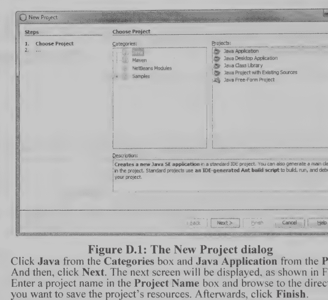

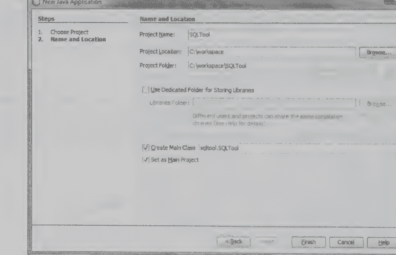

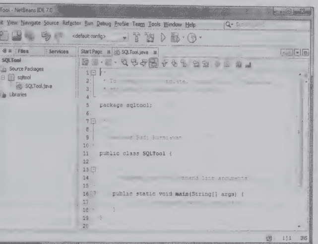

图 D.3 显示了两个窗口：左侧是 Projects（项目）窗口，右侧是源文件窗口。你已准备好编写代码。

### 创建类

要创建一个除 NetBeans 默认创建之外的类，右键点击 Projects 窗口中的项目图标，然后点击 `New` > `Java Class`（Java 类）。你将看到如图 D.4 所示的 New Java Class 对话框。

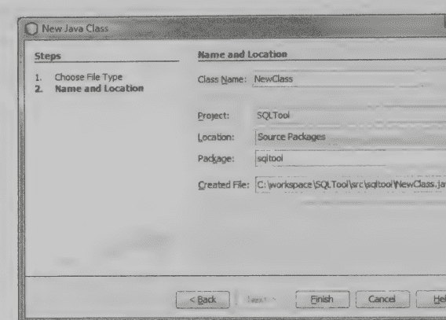

输入该类的类名和包名，然后点击 Finish。将为你创建一个新的 Java 类。你可以在 Projects 窗口中看到列出的新类。

你可以编写代码了。当你输入时，NetBeans 会检查并纠正你 Java 代码的语法。你可以通过 `Ctrl+S` 保存代码，NetBeans 会在你保存时自动编译它。

### 运行 Java 类

一旦完成了一个类，你就可以运行它进行测试。要运行类，点击 `Run File`（运行文件）。任何结果将显示在 Console（控制台）窗口中。运行 Java 类的另一种方法是右键点击源代码并点击 `Run File`。

此外，要运行上次运行的类，按 `Shift+F6`。

### 添加库

有时，你的类或接口引用了其他项目或 JAR 文件中的类型。为了编译这些类/接口，你需要通过添加引用来告诉 NetBeans 在哪里找到被引用的库。你可以通过右键点击 Projects 窗口中的 `Libraries`（库）图标，然后点击 `Add JAR/Folder`（添加 JAR/文件夹）。随后将出现一个导航窗口，允许你选择库文件。

### 调试代码

许多 IDE 都提供了强大的调试支持功能。在 NetBeans 中，你可以逐行调试程序。调试程序的步骤如下。

1.  添加断点。你通过点击代码中的某一行并点击 `Toggle Breakpoint`（切换断点）来执行。
2.  点击 `Run` > `Run File`，然后选择要调试的 Java 类来执行程序。

在步骤 2 中选择要调试的类后，将打开这些窗口：`Watches`（监控）、`Call Stack`（调用栈）和 `Local Variables`（局部变量）。它们允许你监控代码的进度。例如，`Local Variables` 窗口允许你检查局部变量的值。

要继续，点击 `Run` 菜单并选择进入（step into）、跳过（step over）、继续（continue）或暂停（pause）程序。

## 附录 E：Eclipse

IBM 在 2001 年收购了加拿大公司 Object Technology International 后启动了 Eclipse。包括收购在内，IBM 花费了 4000 万美元用于代码，并最终将其作为开源项目发布。Eclipse 用 Java 编写，并自带编译器，因此它不依赖于 Oracle 的 Java 编译器。结果是你不需要 JDK 即可运行 Eclipse，只需要一个 JRE。事实上，Eclipse 还带有其他语言的编译器，如 C、C++ 和 PHP，因为它的开发者有让 Eclipse 成为终极 IDE 的雄心。

另一个值得注意的是，尽管 Eclipse 是用 Java 编写的，但它没有使用 Swing 技术。它使用 Standard Widget Toolkit（标准部件工具包）使 Eclipse 看起来和感觉更像原生应用程序。尽管如此，你仍然可以使用 Eclipse 编写 Swing 应用程序。

本附录提供了关于使用 Eclipse 构建 Java 应用程序的快速教程。

### 下载与安装

你可以从 `http://www.eclipse.org` 免费下载 Eclipse。版本 4.4（代号为 Luna）及更高版本支持 Java 8。请确保你下载了可以在你的操作系统上运行的版本。目前 Eclipse 可用于 Windows、Linux 和 Mac OS X。你甚至可以下载源代码。

Eclipse 分发包封装在 zip 或 gz 文件中。此外，如果你的互联网连接较慢，可以以 torrent 格式下载 Eclipse。有很多包方案可供选择。请确保选择了 **Eclipse IDE for Java Developers**（面向 Java 开发人员的 Eclipse IDE）。

安装只需将分发版的 zip 或 gz 文件解压到目录中。不需要其他步骤。一旦解压了分发文件，你将找到一个可执行文件。

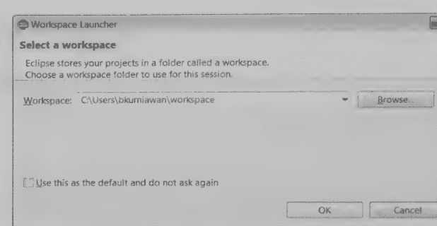

### 添加 JRE

即使 Eclipse 自带编译器，它仍然需要 JRE 来运行。确保你已安装了 JRE，以便在项目中使用。

1.  点击 Eclipse 窗口上的 `Window` 菜单，选择 `Preferences`（首选项）。Preferences 对话框如图 E.3 所示。
2.  在左侧面板，点击 `Java` 并选择 `Installed JREs`（已安装 JRE）。如果中间面板没有，点击 `Add` 按钮并浏览到你 JDK 安装目录。
3.  选择该 JRE 为默认并点击 `OK` 按钮。

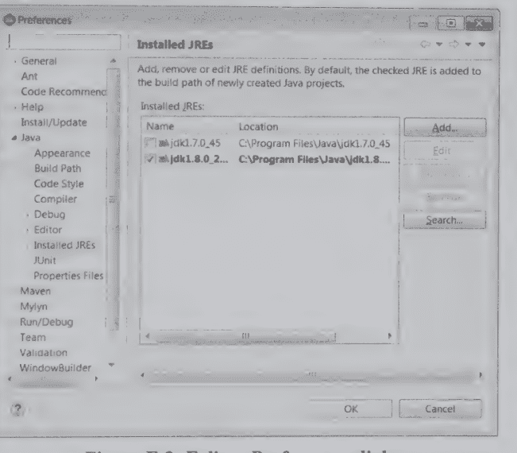

### 创建 Java 项目

Eclipse 通过项目组织资源。因此，在创建 Java 类之前，你必须先创建一个 Java 项目。请遵循以下步骤。

1.  点击 `File` > `New` > `Java Project`。在点击 `New` 后，确保你点击的是 `Java Project` 而不是 `Project`。New Java Project 对话框将出现（见图 E.4）。
2.  为你的项目提供名称。一旦你在 `Project name` 框中输入内容，`Next` 和 `Finish` 按钮将变为激活状态。注意，默认情况下你的项目将在当前的工作区文件夹中创建。然而，你可以取消勾选 `Use default location` 复选框并浏览到文件系统中的目录。
3.  确保在 JRE 面板选择了 `Java SE 1.8`。如果你没有看到 `Java SE 1.8`，说明你尚未添加，并需要按照上一节的说明进行添加。接下来，点击 `Next` 或 `Finish`。点击 `Finish` 将使用默认设置创建项目，点击 `Next` 则允许你选择源文件和类文件的目录。现在，只需点击 `Finish` 即可。将为你创建一个项目。图 E.5 显示了一个名为 SQLTool 的项目。

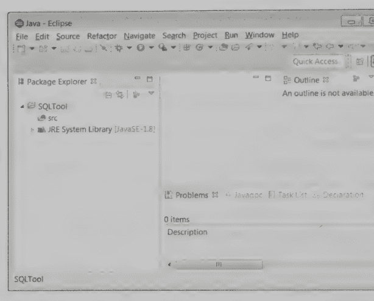

你在图 E.5 中看到的内容被称为 Java 视角（Java Perspective）。视角是执行特定任务时合适的视图组合。Java 视角用于编写 Java 代码。它由左侧的“包管理器”（Package Explorer）视图、右侧的“大纲”（Outline）视图以及底部的“问题”（Problems）视图组成。每个视图的位置都可以通过拖动视图的页头来更改。图 E.5 显示了每个视图的默认位置。还有许多其他视图，可以通过点击 `Window` > `Open Perspective` 来选择一个视角。

其他视角还包括 Java 浏览（Java Browsing）和调试（Debug）。

### 创建类

要创建一个类，右键点击“包管理器”视图中的项目图标，然后点击 `New` > `Class`。你将看到一个类似于图 E.6 的“新建 Java 类”对话框。

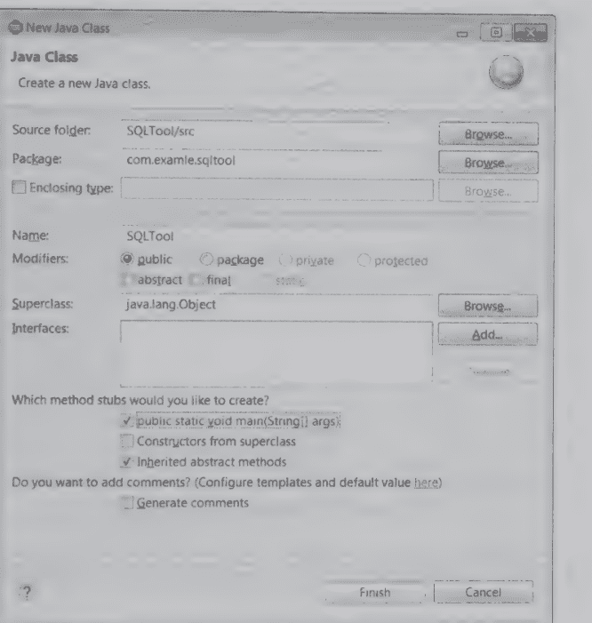

输入包名和类名，然后点击 `Finish` 创建一个类。Java 视角会在新面板中显示类代码，如图 E.7 所示。

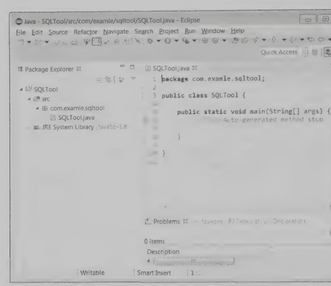

你现在可以编写代码了。当你输入时，Eclipse 会检查并纠正你 Java 代码的语法。你可以点击 `Ctrl+S` 保存工作，Eclipse 会对其进行编译。

### 运行 Java 类

一旦你完成了一个类，就可以运行它进行测试。要运行它，请点击 `Run As` > `Java Application`。任何结果将显示在“控制台”（Console）视图中。运行 Java 类的另一种方法是右键点击类面板并点击 `Run As` > `Java Application`。

此外，要运行上一次的类，请按 `Ctrl+F11`。

### 添加库

有时你的类或接口引用了 JAR 文件或另一个项目中的类型。为了编译这些类/接口，你需要通过添加其引用来告诉 Eclipse 在哪里找到该库。你可以通过点击 `Project` > `Properties` 来实现。将弹出一个窗口。

点击右侧面板上的 `Java Build Path`（Java 构建路径），然后点击左侧的 `Libraries`（库）选项卡。然后点击 `External JARs`（外部 JAR）并导航选择 JAR 文件。如果引用的类型在另一个项目中，点击 `Projects`（项目）选项卡并添加所需的项目。

### 调试代码

许多 IDE 提供的强大功能是支持调试。在 Eclipse 中，你可以逐行单步跟踪代码。调试程序的步骤如下。

1.  添加断点。你通过点击代码中的某行并点击 `Run` > `Toggle Line Breakpoint`（运行，切换行断点）来执行这一点。
2.  通过点击 `Run` > `Debug As` > `Java Application`（运行，调试方式，Java 应用程序）执行程序。

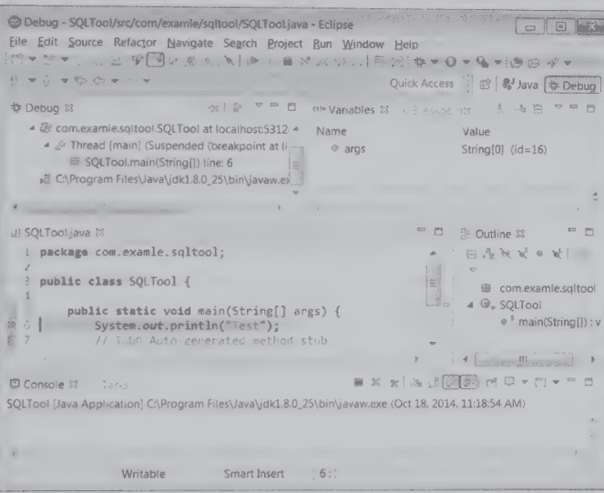

调试需要打开调试视角。在步骤 2 中点击 `Java Application` 后，将弹出一个窗口询问你是否要切换到调试视角。点击 `Yes`（是），你就看到像图 E.8 那样的调试视角。

出现的一个有用视图是“变量”（Variables）视图。它显示程序中的变量列表，并让你检查它们的值。

要继续，请点击 `Run`（运行）菜单并选择步入、单步、恢复或终止程序。

### 有用的快捷键

有很多可以加速开发的有用快捷键。在我看来，排名前六的快捷键是：

1.  在类定义中输入 `main` 并按 `Ctrl+Space` 创建 `main()` 方法。
2.  在方法中输入 `sysout` 并按 `Ctrl+Space` 添加 `System.out.println()`。
3.  在类定义中按 `Ctrl+Shift+F` 格式化代码。
4.  按 `Ctrl+F11` 运行类。
5.  按 `F11` 开始调试一个类。
6.  按 `Ctrl+Shift+O` 自动导入类型并删除未使用的导入。例如，如果你在方法中输入 `Scanner` 并按 `Ctrl+Shift+O`，Eclipse 将导入 `java.util.Scanner` 类。

# 答案

## 第 1 章：入门

1.  **什么是编译器？**
    编译器是一种将程序源代码转换为可执行文件或其他格式（如字节码）的计算机程序。

2.  **Java 与传统编程有何不同？**
    在传统编程中，源代码被编译成适用于操作系统的原生可执行文件。因此，该可执行文件只能在 Windows 或 Linux 上运行。在 Java 中，源代码被编译成字节码，字节码只能由 Java 虚拟机（JVM）运行。由于 JVM 存在于许多操作系统，相同的字节码可以在多个操作系统上运行，因此有了跨平台或独立性的术语。

3.  **什么是字节码？**
    字节码是一组设计用于由虚拟机执行的指令集。

4.  **什么是 JVM？**
    JVM 是 Java 虚拟机，用于执行字节码。

5.  **什么是 IDE？**
    IDE 是集成开发环境，用于编写代码。

6.  **什么是调试？**
    调试是在代码中寻找并修复错误的过程。

7.  **什么是断点？**
    断点是放置在代码中的标记，可以在该处暂停执行以进行调试。

8.  **什么是库？**
    库是预先编写好的代码集合，可以在程序中使用。

9.  **什么是 JAR 文件？**
    JAR 文件是 Java 归档文件，它聚合了 Java 类和元数据。

10. **什么是项目？**
    项目是用于开发软件应用程序的文件集合。

11. **什么是包？**
    包是一种用于对相关类和接口分组的机制。

12. **什么是接口？**
    接口是 Java 中的一种类型，是一组带有空实现的方法。

13. **什么是类？**
    类是用于创建对象的蓝图。

14. **什么是方法？**
    方法是执行特定任务的代码块。

15. **什么是变量？**
    变量是用于存储数据值的命名存储位置。（注：原文定义与方法重复，此处修正为标准定义）

16. **什么是常量？**
    常量是不可更改的变量。

17. **什么是数据类型？**
    数据类型指定了可以存储的值类型。

18. **什么是布尔型？**
    布尔型是存储真或假值的数据类型。

19. **什么是整数？**
    整数是用于整数的数据类型。

20. **什么是字符串？**
    字符串是用于字符序列的数据类型。

21. **什么是数组？**
    数组是相同类型元素的集合。

22. **什么是循环？**
    循环是重复执行代码块的控制结构。

23. **什么是条件？**
    条件是用于代码中决策的控制结构。

24. **什么是异常？**
    异常是程序执行过程中发生的事件。

25. **什么是错误处理？**
    错误处理是处理程序中异常的过程。

## 第 2 章：语言基础

1.  **什么是编译器？**
    编译器是一种将程序源代码转换为可执行文件或其他格式（如字节码）的计算机程序。

2.  **Java 与传统编程有何不同？**
    在传统编程中，源代码被编译成适用于操作系统的原生可执行文件。因此，该可执行文件只能在 Windows 或 Linux 上运行。在 Java 中，源代码被编译成字节码，字节码只能由 Java 虚拟机（JVM）运行。由于 JVM 存在于许多操作系统，相同的字节码可以在多个操作系统上运行，因此有了跨平台或独立性的术语。

3.  **什么是字节码？**
    字节码是一组设计用于由虚拟机执行的指令集。

4.  **什么是 JVM？**
    JVM 是 Java 虚拟机，用于执行字节码。

5.  **什么是 IDE？**
    IDE 是集成开发环境，用于编写代码。

6.  **什么是调试？**
    调试是在代码中寻找并修复错误的过程。

7.  **什么是断点？**
    断点是放置在代码中的标记，可以在该处暂停执行以进行调试。

8.  **什么是库？**
    库是预先编写好的代码集合，可以在程序中使用。

9.  **什么是 JAR 文件？**
    JAR 文件是 Java 归档文件，它聚合了 Java 类和元数据。

10. **什么是项目？**
    项目是用于开发软件应用程序的文件集合。

11. **什么是包？**
    包是一种用于对相关类和接口分组的机制。

12. **什么是接口？**
    接口是 Java 中的一种类型，是一组带有空实现的方法。

13. **什么是类？**
    类是用于创建对象的蓝图。

14. **什么是方法？**
    方法是执行特定任务的代码块。

15. **什么是变量？**
    变量是用于存储数据值的命名存储位置。（注：原文定义与方法重复，此处修正为标准定义）

16. **什么是常量？**
    常量是不可更改的变量。

17. **什么是数据类型？**
    数据类型指定了可以存储的值类型。

18. **什么是布尔型？**
    布尔型是存储真或假值的数据类型。

19. **什么是整数？**
    整数是用于整数的数据类型。

20. **什么是字符串？**
    字符串是用于字符序列的数据类型。

21. **什么是数组？**
    数组是相同类型元素的集合。

22. **什么是循环？**
    循环是重复执行代码块的控制结构。

23. **什么是条件？**
    条件是用于代码中决策的控制结构。

24. **什么是异常？**
    异常是程序执行过程中发生的事件。

25. **什么是错误处理？**
    错误处理是处理程序中异常的过程。

7.  **列出 Java 中的至少十种运算符。**
    *   一元运算符 (`-`)
    *   递增运算符 (`++`)
    *   递减运算符 (`--`)
    *   逻辑取反运算符 (`!`)
    *   位取反运算符 (`~`)
    *   加法运算符 (`+`)
    *   减法运算符 (`-`)
    *   取模运算符 (`%`)
    *   逻辑与运算符 (`&&`)
    *   逻辑或运算符 (`||`)
    *   左移运算符 (`<<`)

8.  **Java 中的三元运算符？**
    三元运算符作用于三个操作数。`?` 运算符是 Java 中唯一的三元运算符。

9.  **什么是运算符优先级？**
    运算符优先级指示在存在多个操作时先执行哪种操作。

10. **考虑以下代码。result1 和 result2 的值是多少？有什么区别？**
    ```
    // 此处原文代码缺失
    ```


# 第3 章：语句

## 1. 表达式和语句之间有什么区别？

表达式是合法的 Java 运算符和操作数的组合，它会被求值。语句是执行某项操作的。

## 2. 运算符优先级示例

```java
int result1 = 1 + 2 * 3;
int result2 = (1 + 2) * 3;
```

`1+2*3=7`。因为 `*` 运算符的优先级高于 `+` 运算符，所以先计算 `2 * 3`，然后将结果加 1。

`(1+2)*3=9`，因为括号具有最高优先级，所以先计算 `(1+2)`。

## 3. 写出两种类型的 Java 注释。

传统注释和行尾注释。

## 4. `break` 语句退出 `while` 循环

你可以使用 `break` 语句退出 `while` 循环。例如：

```java
while (true) {
    // 语句
    if (expression) {
        break;
    }
}
```

## 5. `for` 循环更新语句中后置增和前置增的差异

```java
for (int x = 0; x < length; x++)
for (int x = 0; x < length; ++x)
```

没有。这两个语句的效果相同。

## 6. `switch` 语句输出示例

如果执行以下代码，控制台将打印什么内容：

```java
int i = 1;
switch (i) {
    case 1:
        System.out.println("One player is playing this game.");
    case 2:
        System.out.println("Two players are playing this game.");
        break;
    default:
        System.out.println("You did not enter a valid value.");
}
```

这会被打印出来，因为 `case 1` 后面没有 `break`。

```text
One player is playing this game.
Two players are playing this game.
```

## 7. 使用 `for` 循环打印 1 到 9 的所有偶数

```java
package app0;

public class ForDemo {
    public static void main(String[] args) {
        for (int i = 2; i < 9; i+=2) {
            System.out.println(i);
        }
    }
}
```

## 8. 使用 `for` 循环打印两个整数 `a` 和 `b` 之间所有的偶数（包含 `b`）

由于你不知道 `a` 是偶数还是奇数，所以不知道是否可以使用 `a` 来初始化 `for` 语句的变量。因此，你不能使用与上一个作业相同的技巧。但是，你可以通过检查除以 2 后的模来判断一个数字是否为偶数。如果模数为 0，那么它就是偶数。

```java
package app03;

public class ForDemo2 {
    public static void main(String[] args) {
        int a = ...;
        int b = ...;
        for (int i = a; i <= b; i++) {
            if (i % 2 == 0) {
                System.out.println(i);
            }
        }
    }
}
```

## 9. 与之前相同，但按降序打印数字

```java
package app03;

public class ForDemo3 {
    public static void main(String[] args) {
        int a = 10;
        int b = 16;
        for (int i = b; i >= a; i--) {
            if (i % 2 == 0) {
                System.out.println(i);
            }
        }
    }
}
```

# 第 4 章：对象与类

## 1. 列出类可以包含的三个元素类型。

修饰符、方法和字段。

## 2. 构建方法和构造函数之间有什么区别？

构造函数用于构建对象。方法用于执行操作。构造函数没有返回值，并且正如你第 7 章“继承”中所看到的，方法会被继承，但构造函数不会被继承。

## 3. 类图中的类会显示它的构造函数吗？

没有。

## 4. `null` 代表什么？

`null` 引用变量不引用任何对象。

## 5. `this` 关键字用于什么？

用于从方法或构造函数中引用当前对象。

## 6. 使用 `==` 比较两个对象引用时，是在比较对象的内容吗？

不是。对引用变量应用相等运算符 `==` 比较的是对象的地址，而不是对象的内容。

## 7. 什么是变量作用域？

变量作用域指的是变量的范围。

## 8. “超出范围”（out of scope）意味着什么？

从技术上讲，已经被销毁或不再可访问的变量。

## 9. 垃圾收集器如何决定销毁哪些对象？

通过检查对象是否仍然被引用。

## 10. 什么是方法重载？

在同一个类中拥有多个同名的方法。

## 11. 创建 `com.example.Tablet` 类

完全限定名为 `com.example.Tablet`，类名必须是 `Tablet`，包名为 `com.example`。以下是类定义。

```java
package com.example;

public class Tablet {
    private int weight;
    private float screenSize;
    private boolean wifiOnly;

    public int getWeight() {
        return weight;
    }

    public void setWeight(int weight) {
        this.weight = weight;
    }

    public float getScreenSize() {
        return screenSize;
    }

    public void setScreenSize(float screenSize) {
        this.screenSize = screenSize;
    }

    public boolean isWifiOnly() {
        return wifiOnly;
    }

    public void setWifiOnly(boolean wifiOnly) {
        this.wifiOnly = wifiOnly;
    }
}
```

对于布尔字段，方法通常命名为 `isXXX`。

## 12. 创建 `com.example.test.TabletTest` 类

```java
package com.example.test;

import com.example.Tablet;

public class TabletTest {
    public static void main(String[] args) {
        Tablet tablet = new Tablet();
        System.out.println("Weight: " + tablet.getWeight());
        System.out.println("Screen Size: " + tablet.getScreenSize());
        System.out.println("Wifi Only: " + tablet.isWifiOnly());
    }
}
```

# 第 5 章：核心类

## 1. 当人们说 `String` 是不可变的时是什么意思？

不可变对象的状态不能改变。操作 `String` 对象会返回一个新的 `String` 实例。

## 2. 如何接收用户输入？

在 Java 5 之前使用 `Scanner`。在 Java 5 及以后使用 `Scanner`。

```java
public String getUserInput() {
    StringBuilder sb = new StringBuilder();
    try {
        char c = (char) System.in.read();
        while (c != '\n' && c != '\r') {
            sb.append(c);
            c = (char) System.in.read();
        }
    } catch (IOException e) {
    }
    return sb.toString();
}
```

## 3. 什么是 `varargs`？

`varargs` 是 Java 5 中的一个特性，允许方法具有变长参数列表。

## 4. 创建不可变的 `example.Car` 类

你可以通过将所有字段私有并提供 `get` 方法来使类变为不可变。

```java
package com.example;

public class Car {
    private int year;
    private String make;
    private String model;

    public Car(int year, String make, String model) {
        this.year = year;
        this.make = make;
        this.model = model;
    }

    public int getYear() {
        return year;
    }

    public String getMake() {
        return make;
    }

    public String getModel() {
        return model;
    }
}
```

## 5. 创建 `com.example.test.CarTest` 类

```java
package com.example.test;

import com.example.Car;

public class CarTest {
    public static void main(String[] args) {
        Car car = new Car(2015, "Ford", "Escape");
        System.out.println("Year: " + car.getYear());
        System.out.println("Make: " + car.getMake());
        System.out.println("Model: " + car.getModel());
    }
}
```

## 6. 创建 `com.example.util.StringUtil` 工具类

假设文件路径可能包含 `\` 或 `/` 分隔目录与文件或子目录。扩展是可选的，是最后一个点之后的子字符串。例如，在路径 `C:\temp\document.txt` 中，文件名将是 `document.txt`，扩展名为 `txt`。

```java
package com.example.util;

public class StringUtil {
    public static String getFileName(String path) {
        int lastIndex1 = path.lastIndexOf("\\");
        int lastIndex2 = path.lastIndexOf("/");
        int index = lastIndex1 < lastIndex2 ? lastIndex2 : lastIndex1;
        if (index != -1) {
            return path.substring(index + 1);
        } else {
            return path;
        }
    }

    public static String getFileExtension(String path) {
        int lastIndex = path.lastIndexOf(".");
        if (lastIndex != -1) {
            return path.substring(lastIndex + 1);
        } else {
            return "";
        }
    }
}
```

## 7. 创建 `com.example.test.StringUtilTest` 测试类

```java
package com.example.test;

import com.example.util.StringUtil;

public class StringUtilTest {
    public static void main(String[] args) {
        String path1 = "C:\\temp\\document.txt";
        String fileName = StringUtil.getFileName(path1);
        String extension = StringUtil.getFileExtension(path1);
        System.out.println("File Name: " + fileName);
        System.out.println("Extension: " + extension);

        String path2 = "/home/users/jayden/README";
        fileName = StringUtil.getFileName(path2);
        extension = StringUtil.getFileExtension(path2);
        System.out.println("File Name: " + fileName);
        System.out.println("Extension: " + extension);

        String path3 = "Help.html";
        fileName = StringUtil.getFileName(path3);
        extension = StringUtil.getFileExtension(path3);
        System.out.println("File Name: " + fileName);
        System.out.println("Extension: " + extension);

        String path4 = "setup";
        fileName = StringUtil.getFileName(path4);
        extension = StringUtil.getFileExtension(path4);
        System.out.println("File Name: " + fileName);
        System.out.println("Extension: " + extension);
    }
}
```

## 8. 使用 `java.util.StringTokenizer` 打印标记

```java
package app05;

import java.util.StringTokenizer;

public class StringTokenizerDemo {
    public static void main(String[] args) {
        String text = "Energy efficient car";
        StringTokenizer tokenizer = new StringTokenizer(text);
    }
}
```


```java
System.out.format("Number of tokens: %d\n", tokenizer.countTokens());

System.out.println("Tokens:");

while (tokenizer.hasMoreTokens()) {

    System.out.println("- " + tokenizer.nextToken());

}

}
}
```

运行该类会在控制台输出以下内容。

- Number of tokens: 3
- Tokens:
- Energy
- efficient
- car

# 第 6 章：数组

## 1. 什么是数组？

一种用于将相同类型的基本类型或对象的 Java 特性。数组的大小是固定的。

## 2. 如何调整数组的大小？

你不能调整数组的大小，但可以创建另一个数组并将第一个数组的内容复制到新数组中。

## 3. 如何创建一个数组并在不先赋值给变量的情况下将其传递给方法？

使用此语法：

`new type[] elements`

例如：

`method1(new int[] { 1, 2, 3, 10 });`

## 4. 编写一个 `com.example.app06a.ArrayUtil` 类，其中包含两个静态方法 `min` 和 `max`。这两个方法都接收一个 int 数组并返回最小值和最大值。

下面是 `ArrayUtil` 类。它包含一个 `main` 方法来测试 `min` 和 `max` 方法。

```java
package com.example.app06;

public class ArrayUtil {

    public static int min(int[] numbers) {

        int smallest = Integer.MAX_VALUE;

        for (int i = 0; i < numbers.length; i++) {

            int element = numbers[i];

            if (element < smallest) {

                smallest = element;

            }

        }

        return smallest;

    }

    public static int max(int[] numbers) {

        int largest = Integer.MIN_VALUE;

        for (int element : numbers) {

            if (element > largest) {

                largest = element;

            }

        }

        return largest;

    }

    public static void main(String[] args) {

        int[] numbers = {-1, 9, -100, 1000, 255};

        System.out.printf("Min: %d\n", min(numbers));

        System.out.printf("Max: %d\n", max(numbers));

    }

}
```

运行 `ArrayUtil` 类会在控制台输出。

Min: -100
Max: 1000

# 第 7 章：继承

## 1. 子类会继承父类的构造函数吗？

不会。

## 2. 为什么将子类实例赋值给父类变量是合法的？

因为子类和父类之间存在“是一个”的关系。因此，子类实例可以赋值给父类变量。

## 3. 方法重写和方法重载的区别是什么？

方法重载是许多面向对象语言的特性，允许同类中的方法具有相同的名称。方法重写是一种 OOP 特性，允许你更改子类方法的行为。在重载中，方法的签名不能相同。在重写中，方法的签名必须相同。

## 4. 为什么子类实例需要配随一个父类实例？

为了可以调用父类的方法，而不是子类的方法。

## 5. 编写一个公共的 `com.example.transport.Car` 类，添加一个公共 `run` 方法并重写 `toString()`。`run` 方法打印 `toString()` 的返回值。在同一个包中编写另一个公共类 `SUV`。SUV 继承 Car 并重写它的 `run` 和 `toString` 方法。SUV 的 `run` 方法应该打印父类 `toString` 方法的返回值及其自身的 `toString` 方法的返回值。接下来，添加一个 main 方法。

```java
package com.example.transport;

public class Car {

    public void run() {

        System.out.println(toString());

    }

    @Override

    public String toString() {

        return "Car";

    }

}

public class SUV extends Car {

    @Override

    public void run() {

        System.out.println(super.toString());

        System.out.println(toString());

    }

    @Override

    public String toString() {

        return "SUV";

    }

}
```

# 第 8 章：异常处理

## 1. try 语句的优势是什么？

try 语句为处理运行时错误提供了一种简便的方法。

## 2. try 语句可以配合 finally 使用使用吗？

可以。

## 3. 什么是 try-with-resources？

这是 JDK 7 引入的一项特性，用于自动关闭资源。

## 4. 编写一个工具类（属于 `com.example.app08` 包），该类包含一个静态方法 `addArrays`，用于相加两个长度相同的数组。

```java
int length = array1.length;

long[] result = new long[length];

for (int i = 0; i < length; i++) {

    result[i] = (Long) array1[i] + array2[i];

}

return result;
```

```java
public static void main(String[] args) {

    int[] array1 = {100, 1000, 10000, Integer.MAX_VALUE};

    int[] array2 = {10, 100, 100, Integer.MAX_VALUE};

    int[] array3 = {1, 2};

    try {

        long[] result = addArrays(array1, array2);

        System.out.println(Arrays.toString(result));

    } catch (NullPointerException e) {

        System.out.println(e);

    } catch (MismatchedArrayException e) {

        System.out.println(e);

    }

    try {

        long[] result = addArrays(array1, array3);

        Arrays.toString(result);

    } catch (NullPointerException e) {

        System.out.println(e);

    } catch (MismatchedArrayException e) {

        System.out.println(e);

    }

}
```

运行 `Util` 类会在控制台上输出以下消息。

[110, 1100, 11000, 4294967294]
数组长度不匹配。第一个数组的长度为 4。第二个数组的长度为 2。

# 第 9 章：处理数字

## 1. `java.lang.Math` 类的静态方法可以做什么？

执行简单和复杂的数学运算，以及生成随机数。

## 2. 既然 Java 中会自动进行装箱和拆箱，包装类还有用吗？

有用。某些类（例如 Collection 框架中的类）只处理对象，不处理基本类型。此外，包装类还拥有用于解析和格式化的方法。

## 3. 解释为什么不应该使用 `double` 或 `float` 进行货币计算。应该用什么？

由于 `float` 和 `double` 的表示方式，它们是不精确的。你应该使用 `java.math.BigDecimal`。

## 4. 编写一个名为 `RangeRandomGenerator` 的类，可以在实例化该类时生成两个整数之间的随机数。该类如下：

```java
package com.example;

public class RangeRandomGenerator {

    private int from;

    private int to;

    private int range;

    /*

     * 返回 'from' 到 'to' 之间的随机数（包含边界）

     */

    public int generate() {

        double random = Math.random();

        return (int) (from + random * range);

    }

    public RangeRandomGenerator(int from, int to) {

        this.from = from;

        this.to = to;

        this.range = to - from + 1;

    }

    public static void main(String[] args) {

        RangeRandomGenerator generator =

            new RangeRandomGenerator(5, 20);

        for (int i = 0; i < 10; i++) {

            System.out.println(generator.generate());

        }

    }

}
```

# 第 10 章：接口与抽象类

## 1. 为什么将接口视为契约比视为实现的类更合适？

因为将接口视为没有实现的类会忽略全局观。接口定义了服务提供者和客户端必须遵守的方法。

## 2. 什么是基类？

提供接口默认实现的具体类。

## 3. 什么是抽象类？

提供部分实现的类。抽象类不能实例化，必须由另一个类继承。

## 4. 基类和抽象类一样吗？

基类和抽象类看起来相似，但它们存在的意义不同。

## 5. 在 `com.example` 中创建一个名为 `Calculator` 的接口，包含三个方法：`subtract` 和 `multiply`。所有方法接受两个 `int` 参数并返回一个 `long`。接口如下：

```java
package com.example;

public interface Calculator {

    long add(int a, int b);

    long subtract(int a, int b);

    long multiply(int a, int b);

}
```

## 6. 编写一个名为 `ScientificCalculator` 的 `Calculator` 实现并实现所有方法。实现类如下：

```java
package com.example;

class ScientificCalculator implements Calculator {

    @Override

    public long add(int a, int b) {

        return a + b;

    }

    @Override

    public long subtract(int a, int b) {

        return a - b;

    }

    @Override

    public long multiply(int a, int b) {

        return a * b;

    }

}
```

# 第 11 章：多态

## 1. 用你的话描述多态。

JVM 在父类变量被赋值子类实例时，能够调用正确方法的能力。

## 2. 多态在什么情况下最有用？

在编译时不知道对象的类型时。

# 第 12 章：枚举

## 1. 如何编写枚举？

使用 `enum` 关键字定义一个枚举，它可以是类的一部分，也可以独立存在。对于后者，你像写类一样写它。

## 2. 为什么枚举比静态字段安全？

枚举比静态字段安全，因为它们限制了值的范围。

## 3. 编写一个抽象类 `Car`，它有两个字段：`name`（String 类型）和 `fuelEfficiency`（FuelEfficiency 类型），以及计算给定距离（英里）最小和最大油耗的方法。接下来，编写三个子类：`EfficientCar`、`AcceptableCar` 和 `GasGler`。最后，编写一个类来测试它。所有类均在下方名为 `FuelEfficiencyTest` 的文件中：

```java
package com.example.test;

import com.example.FuelEfficiency;

abstract class Car {

    protected String name;

    protected FuelEfficiency fuelEfficiency;

    public abstract double calculateMinGasUsage(int miles);

    public abstract double calculateMaxGasUsage(int miles);

    public String getName() {

        return this.name;

    }

}

class EfficientCar extends Car {

    public EfficientCar(String name) {

        this.name = name;

        this.fuelEfficiency = FuelEfficiency.EFFICIENT;

    }

}

class AcceptableCar extends Car {

    public AcceptableCar(String name) {

        this.name = name;

        this.fuelEfficiency = FuelEfficiency.ACCEPTABLE;

    }

}

class GasGler extends Car {

    public GasGler(String name) {

        this.name = name;

        this.fuelEfficiency = FuelEfficiency.GAS_GUZZLER;

    }

}

public class FuelEfficiencyTest {

    public static void main(String[] args) {

        Car[] cars = new Car[3];

        cars[0] = new EfficientCar("2015 Jupiter CX");

        cars[1] = new AcceptableCar("2015 SoSo");

        cars[2] = new GasGler("2015 Guzzly");

        int miles = 1000;

        for (Car car : cars) {

            System.out.printf("To drive %d miles in a %s,%n"

                + "you need between %.2f and %.2f gallons "

                + "of gasoline.%n%n",

                miles, car.getName(),

                car.calculateMinGasUsage(miles),

                car.calculateMaxGasUsage(miles));

        }

    }

}
```


# 第 13 章：处理日期与时间

1. 旧的日期-时间 API 核心类是什么？
   `java.util.Date` 和 `java.util.Calendar`。

2. 为什么旧的日期-时间 API 被废弃？
   核心类很难使用。

3. 新的日期-时间 API 包含哪些包？
   `java.time`, `java.time.chrono`, `java.time.format`, `java.time.temporal`, `java.time.zone`。

4. 核心包中有哪些类？
   `Instant`, `LocalDate`, `LocalTime`, `LocalDateTime`, `ZonedDateTime`, `Period`, `Duration`。

5. 创建 `LocalDate`、`LocalDateTime` 和 `ZonedDateTime` 的两个静态方法是什么？
   `now` 和 `of`。

6. `Period` 和 `Duration` 的区别是什么？
   `Period` 基于日期的，`Duration` 基于时间的。

7. 计时的最简单的方法是什么？
   在操作前后分别使用静态方法 `now` 创建 `Instant`，并计算它们之间的 `Duration`。

8. 如何获取所有时区标识符的 `Set`？
   通过调用 `ZoneId` 类的静态方法 `getAvailableZones`。

9. 新的日期-时间格式化器是什么？
   `java.time.format.DateTimeFormatter`。

# 第 14 章：集合框架

1. 列出集合框架中的至少七种类型。
   `Collection`, `List`, `Set`, `Queue`, `ArrayList`, `Vector`, `Comparator`, `Map`, `HashMap`, `Hashtable`。

2. `ArrayList` 和 `Vector` 之间有什么区别？
   `ArrayList` 是非同步的，而 `Vector` 是同步的。

3. 为什么 `Comparator` 比 `Comparable` 更强大？
   `Comparator` 比 `Comparable` 更强大，因为使用 `Comparator` 你可以以多种方式比较对象。

4. 写一个方法将 `String` 数组转换为可调整大小的 `List`。
   该方法名为 `arrayToList`，并写为 `ListUtil` 类的一个成员方法。

```java
package com.example;

import java.util.ArrayList;
import java.util.List;

public class ListUtil {

    public static List arrayToList(String[] array) {
        List list = new ArrayList();
        for (String s : array) {
            list.add(s);
        }
        return list;
    }

    public static void main(String[] args) {
        String[] names = {"Ariana", "April", "Sydney"};
        List list = ListUtil.arrayToList(names);
        list.add("Julie");
        for (Object name : list) {
            System.out.println(name);
        }
    }
}
```


# 第 15 章：泛型

- 1. 泛型的主要优势是什么？
  泛型在编译时实施更严格的检查，并消除了大多数类型转换。

- 2. 什么是参数化类型？
  参数化类型就是泛型。

- 3. 什么是类型推断？
  类型推断是一种语言特性，允许编译器根据相应的声明确定泛型方法的参数类型。

# 第 16 章：输入输出

- 1. 什么是 I/O 流？
  I/O 流将 Java 代码与数据池连接起来。

- 2. 列出 `java.io` 包中表示流的四个抽象类。
  `InputStream`, `OutputStream`, `Reader`, `Writer`。

- 3. 什么是对象序列化？
  将对象存储到持久化存储中（例如文件）。

- 4. 类要可序列化需要什么条件？
  该类必须实现 `java.io.Serializable` 接口。

# 第 17 章：注解

- 1. 什么是注解类型？
  注解类型是一种注解对象的类型。技术上讲，注解类型是一种特殊的接口。注解是注解类型的实例。

- 2. 什么是元注解（meta-annotation）？
  用于注解注解的注解类型。

- 3. Java 5 中最初包含的标准注解类型有哪些？
  `Override`, `Deprecated`, 和 `SuppressWarnings`。

# 第 18 章：内部类

- 1. 什么是嵌套类，什么是内部类？
  嵌套类是在另一个类或接口的体内部声明的类。内部类是嵌套类的一种，即非静态嵌套类。

- 2. 嵌套类可以用来？
  你可以使用嵌套类来完全隐藏实现。匿名类为编写事件监听器提供了一种更短的方法。

- 3. 什么是匿名类？
  没有名字的类。

# 第 19 章：Lambda 表达式

- 1. 为什么要在 Java 中添加 Lambda 表达式？
  它们可以让某些构造更短、更具表现力。

- 2. Lambda 表达式也称为什么？
  闭包（Closures）。

- 3. 什么是函数式接口？
  只有一个抽象方法且该方法没有重写 `java.lang.Object` 中方法的接口。

- 4. 什么是方法引用？
  对方法或构造函数的引用，可以代替 Lambda 表达式传递给方法。

- 5. 方法引用中使用的运算符是什么？
  双冒号运算符 (`::`)。

- 6. `java.util` 中用于处理空指针异常的四个类是什么？
  `Optional`, `OptionalInt`, `OptionalLong` 和 `OptionalDouble`。

# 第 20 章：流式操作

- 1. 什么是流（Stream）？
  用于传输数据的管道。

- 2. 流的四种主要类型是什么？
  `Stream`, `IntStream`, `LongStream` 和 `DoubleStream`。

- 3. 什么是操作（reduction operations）？
  将流中的元素减少为单个值或元素的操作。

- 4. 什么时候使用并行流（parallel stream）？
  当你拥有可用资源时。

# 第 21 章：数据库连接

- 1. 访问数据库的主要步骤有哪些？
  加载驱动程序、创建连接（`Connection`）、创建语句（`Statement`），以及可选地获取结果集（`ResultSet`）。

- 2. `sql` 包中重要的类型有哪些？
  `Driver`, `Connection`, `Statement`, `ResultSet`。

- 3. 你可以使用什么模式来隐藏 JDBC 的复杂性？
  数据访问对象（DAO）模式。

# 第 22 章：Swing 基础

- 1. 为什么 AWT 在今天仍然相关？
  因为 Swing 仍然依赖于 AWT 等等。

- 2. 有哪些 AWT 类？
  `Font`, `Dimension`, `Component`。

- 3. 创建 GUI 的最佳方式是什么？
  使用 `JFrame`。

- 4. 用于添加组件的容器是什么？
  `ContentPane`。

- 5. 如何确保 GUI 在正确的线程上创建？
  使用 `SwingUtilities.invokeLater`。

- 6. 什么是顶层容器？
  `JFrame`, `JDialog`。

# 第 23 章：布局

- 1. 什么是布局管理器（layout manager）？
  布局管理器负责调整组件的大小和布局位置。

- 2. 列出至少三种布局管理器。
  `BorderLayout`, `FlowLayout`, `GridLayout`。

- 3. 有哪些类型的事件？
  动作事件、窗口事件、鼠标事件、键盘事件。

- 4. 有哪些 Swing 监听器？
  `ActionListener` 等。

# 第 24 章：Applet

- 1. Applet 的生命周期方法有哪些？
  `init`, `start`, `destroy`。

- 2. 如何向 applet 传递参数？
  在 HTML 文件中使用 `<param>` 标签。

- 3. applet 是 `JFrame` 的子类吗？
  它是 `Thread` 的子类。

# 第 25 章：JavaFX 简介

- 1. JavaFX 应用的模板类是什么？
  `javafx.Application`。

- 2. JavaFX 中的顶层窗口是什么？
  `javafx.Stage`。

- 3. 什么是节点（node）？
  基本上是一个 UI 组件。

- 4. 设置 JavaFX 组件的最佳方式是什么？
  使用 CSS。

# 第 26 章：结合 FXML 的 JavaFX

- 1. 什么是 FXML？
  FXML 是一种用于构建 JavaFX UI 的 XML 标记语言。

- 2. 什么是控制器类？
  控制器是一个实现了 `Initializable` 并包含事件处理器和绑定字段的 Java 类。

# 第 27 章：Java 线程

- 1. 什么是线程（thread）？
  处理的最小单元。

- 2. 同步（`synchronized`）修饰符的作用是什么？
  保护关键区域，确保只有一个线程访问对象的区域。

- 3. 什么是关键区域（critical section）？
  保证只有一个线程可以访问共享资源的代码段。

- 4. 在哪里编写 `java.util.Timer` 的定时任务？
  在 `java.util.TimerTask` 的子类中编写。

- 5. `java.util.Timer` 和 `javax.swing.Timer` 有什么区别？
  `java.util.Timer` 是通用定时器，`javax.swing.Timer` 是一个只能在 Swing 应用中更精确的定时器。

# 第 28 章：并发工具

- 1. 什么是原子变量？
  `atomic` 包中可以执行原子操作的类。

- 2. 如何获取 `ExecutorService` 实例？
  通过调用 `java.util.concurrent.Executors` 类中的这些静态方法：`newSingleThreadExecutor`, `newCacheThreadPool`, `newFixedThreadPool`。

- 3. 什么是 `Callable`，什么是 `Future`？
  `Callable` 是一个有返回值并可能抛出异常的任务。`Future` 代表异步计算的结果。

- 4. 举出 `Lock` 接口的标准实现之一。
  `java.util.concurrent.locks.ReentrantLock`。

# 第 29 章：国际化

- 1. 针对具有大量静态内容的应用程序国际化方法是什么？
  为静态内容部分创建不同的版本。

- 2. 如何隔离 Java 应用程序的文本元素？
  为每个区域（locale）创建一个不同的属性文件。

- 3. 国际化和本地化使用了哪两个类？
  `java.util.Locale` 和 `java.util.ResourceBundle`。

# 第 30 章：Java 网络

- 1. 为什么计算机网络中有多个层级的协议？
  因为在硬件层面直接处理数据流是非常困难的。

- 2. URL 的组成部分有哪些？
  协议、主机、端口和路径。

- 3. 表示 URL 的类是什么？
  `java.net.URL`。

- 4. 什么是套字（socket）？
  套字是网络连接的端点。套字允许应用程序读取和向网络写入数据。位于两个不同计算机上的两个软件应用程序可以通过在连接发送和接收字节流相互通信。

- 5. 套字（socket）和服务器套字（server socket）有什么区别？
  服务器套字用于服务器应用程序，其主要任务是等待连接。对于获取的每一个连接，服务器套字都会创建一个套字与建立连接的远程计算机进行通信。

# 第 31 章：安全

- 1. 什么是策略文件（policy file）？
  策略文件是以 `policy` 扩展名的文本文件，列出了在开启安全管理器运行时运行的应用程序的所有权限。

- 2. 为什么对称加密不适合用于互联网？

  对称加密不适合互联网，原因如下：

  - 交换消息的两个人必须先约定一个密钥。这是不切实际的，因为互联网用户遍布世界各地。
  - 每个人都希望能够与许多其他方通信。如果使用对称加密，每个人都必须为不同的对方维护不同的唯一密钥。
  - 由于你不知道将与哪个实体进行通信，因此需要确保他们确实是他们声称的身份。
  - 互联网上的消息会通过许多不同的计算机。截听他人的消息是非常轻易的。对称加密不能保证第三方不会篡改数据。

- 3. 什么是密钥库（keystore）？
  密钥库是存储你自己的公钥、私钥以及来自第三方证书的数据库。

- 4. 对 applet 进行数字签名的步骤是什么？
  对 applet 进行数字签名的步骤：

  - 使用 `jar` 工具将 applet 打包成 jar 文件。
  - 使用 `jarsigner` 工具对 jar 文件进行签名。

# 第 32 章：Java Web 应用程序

- 1. `javax.servlet.Servlet` 接口的三个生命周期方法是什么？
  `init`, `service`, `destroy`。

- 2. `javax.servlet.ServletResponse` 接口中 `getWriter` 方法和 `getOutputStream` 方法的主要区别是什么？你经常使用哪一个？

  你使用 `getWriter` 方法获取一个 `PrintWriter` 来发送文本。你调用 `getOutputStream` 方法获取一个 `OutputStream` 来发送二进制数据。大多数情况下，你会使用 `getWriter`。

- 3. 列出 `javax.servlet` 中的四个接口和 `javax.servlet.http` 中的三个接口。

  `javax.servlet` 中的四个接口：`Servlet`, `HttpServletRequest`, `ServletResponse`, `ServletConfig`。`javax.servlet.http` 中的三个接口：`HttpServletRequest`, `HttpServletResponse`, `HttpSession`。

# 第 33 章：JavaServer Pages

- 1. JSP 解决了 Servlet 技术中的哪两个问题？

  在 servlet 中发送响应时，所有的 HTML 标签必须封装在字符串中，这使得发送 HTTP 响应变成项繁琐的工作。此外，所有文本和 HTML 标签都是硬编码的，导致微小的变化也需要重新编译。

- 2. 为什么编写 JSP 比编写 servlet 更容易？
  JSP 页面会自动编译，并在每次被修改时重新加载。

# 第 34 章：Javadoc

- 1. 代码中的文档注释（doc comments）和 Java 注释有什么区别？
  Java 注释供 Java 程序员维护代码。文档注释是为 API 用户准备的。

# 第 35 章：应用程序部署

- 1. JWS 代表什么？
  Java Web Start（Java Web 启动）。

- 2. 通过 JNLP 部署 Java 应用程序所需的步骤是什么？
  将应用程序打包为 jar 文件，并创建一个描述该 jar 文件的 jnlp 文件。

- 3. 为什么 JRE 限制从互联网下载的 Java 应用程序？
  因为它们是不可信的。

# 索引

| 项 | 页码 | 项 | 页码 |
| :--- | :--- | :--- | :--- |
| `abs` method | 138 | `applet viewer` | 405 |
| `absolute` | 68 | `applet-deselement` | 598 |
| `path` | 218 | `Application` class | 424, 439 |
| `absolute positioning` | 374 | `application directory` | 553 |
| `abstract class` | 150 | `application server` | 4 |
| `abstract` keyword | 150 | `application server open source` | 5 |
| `abstract method` | 150 | `applet-deselement` | 598 |
| `Abstract Window Toolkit` | 329, 406 | `apply` method | 271 |
| `abstraction` | 58 | `applyDouble` method | 273 |
| `accept` method | 275 | `archive` | 426 |
| `access control` | 68 | `arithmetic operation` | 418 |
| `access control modifier` | 68 | `accessibility in` | 118 |
| `acos` method | 58 | `changing size` | 110 |
| `action` | 376 | `declaration` | 108 |
| `Action event` | 432, 444 | `initial value` | 107 |
| `actionPerformed` method | 377, 379, 382 | `limitation of` | 109 |
| `add` method | 189, 193, 205, 330, 335 | `size` | 187 |
| `addActionListener` method | 376, 378, 382 | `arraycopy` method | 102 |
| `addAll` method | 189 | `ASCII` | 292 |
| `addition operator` | 333 | `asin` method | 19 |
| `after` method | 182 | `assignment order` | 13 |
| `American Standard Code for Information` | 37 | `character` | 19 |
| `AnchorPane` class | 426, 429 | `character set` | 19 |
| `annotating annotation` | 248 | `atomic operation` | 460 |
| `annotation` | 248 | `AtomicBoolean` | 475 |
| `annotationType` method | 248 | `AtomicInteger` | 475 |
| `anonymous inner class` | 265 | `AtomicReference` | 475 |
| `audio format` | 58 | `AtomicLong` | 475 |
| `Apache Derby` | 315 | `authentication` | 408 |
| `Apache Geronimo` | 5 | `author` tag | 533 |
| `Apache TomEE` | 5 | `attribute` | 576 |
| `append` | 97 | `available` method | 226 |
| `append` method | 303 | `AWT` | 329, 385 |

# 664 Java: 入门教程（第四版）

| 项 | 页码 |
| :--- | :--- |
| `before` method | 182 |
| `CHINA` field | 493 |
| `Java` 的优势 | 2 |
| `between` method | 171 |
| `Circle` class | 426 |
| `BiFunction` interface | 272 |
| `类` | 59 |
| `binary operator` | 30 |
| `命名规范` | 58 |
| `bitwise complement operator` | 32 |
| `类` | 58 |
| `bitwise operator` | 37 |
| `类声明` | 185 |
| `Bjarne Stroustrup` | 332 |
| `clear` method | 90 |
| `BLACK` field | 332 |
| `clone` method | 224, 299 |
| `BLUE` field | 21 |
| `close` method | 269 |
| `boolean` | 30 |
| `闭包` | 16 |
| `boolean expression` | 10 |
| `code` 版本 | 585 |
| `boolean literal` | 25, 27 |
| `code` tag | 302p |
| `booleanValue` method | 99 |
| `Collection` interface | 292 |
| `Collections` class | 191 |
| `Collections Framework` | 187 |
| `BorderPane` class | 211 |
| `wildcard` | 135 |
| `ColorPicker` | 430 |
| `boxing` | 21 |
| `columnConstraints` | |
| `braces` | 21 |
| `comments` | 44 |
| `brackets` | 51 |
| `compare` method | 19 |
| `break` statement | 576 |
| `computer game` | 49 |
| `buffered property` | 249 |
| `computer program` | 43 |
| `built-in annotation` | 426, 432 |
| `21 并发实用程序` | |
| `Button` class | 379 |
| `conditional operator` | 475 |
| `BUTTON1` field | 379 |
| `conditional statement` | |
| `BUTTON2` field | 379 |
| `continue` statement | 53 |
| `BUTTON3` field | 379 |
| `constructor` | 61 |
| `byte` | 21 |
| `content` property | 577 |
| `bytecode` | 3 |
| `continue` statement | 53 |
| `byteValue` method | 9 |
| `Control` class | 426 |
| `Callable` interface | 476 |
| `convert collection` | 138 |
| `camel` naming convention | 59 |
| `CANADA` field | 493 |
| `cos` method | 194 |
| `CANADA FRENCH` field | 493 |
| `country code` | 42 |
| `cancel` method | 469 |
| `coupling` | 368 |
| `Canvas` class | 425 |
| `critical method` | |
| `capacity` method | 535 |
| `cross-platform` | |
| `cascading style sheets` | 434 |
| `cryptography` | 533 |
| `catch` keyword | 130 |
| `CSS` | 451 |
| `catching exception` | 128 |
| `current thread` | |
| `CENTER` field | 368 |
| `timeInMillis` | 102 |
| `certificate` | 2 |
| `custom` | 254 |
| `application` | 537 |
| `CYAN` field | 332 |
| `creating` | 533 |
| `dangling issue` | 45 |
| `certificate authority` | |
| `data integrity` | 533, 536 |
| `char` | 20 |
| `database connection` | 311 |
| `character encoding` | |
| `Datetime API` | 167, 181 |
| `character literal` | 25, 28 |
| `Chart` class | 426, 429 |
| `charValue` method | 99 |
| `CheckBox` class | 115 |
| `subclass` | 446 |
| `children` property | |

# 索引 665

| 项 | 页码 |
| :--- | :--- |
| `date formatting` | 184 |
| `date parsing` | 184 |
| `DateTimeFormatter` class | 180 |
| `DayOfWeek` enum | 167 |
| `declaration` | 578p |
| `decrement operator` | 32 |
| `description` | 533p |
| `default layout manager` | 368 |
| `default method` | 147 |
| `date` package | 67 |
| `deprecation policy method` | 523 |
| `deleteIfExists` method | 220 |
| `deprecation` | 247, 250, 253 |
| `derived class` | 15 |
| `design pattern` | 6 |
| `Desktop` class | 399, 403 |
| `action` | 400 |
| `destroy` method | 448, 470, 473 |
| `digit separator` | 32 |
| `directive` | 56 |
| `division` operator | 57 |
| `doc` | 48 |
| `document` | 54 |
| `documented type` | 284 |
| `documented annotation` | 248, 252 |
| `do-delete` method | 562 |
| `do-get` method | 562 |
| `do-header` method | 562 |
| `do-input` method | 505 |
| `do-options` method | 562 |
| `do-output` method | 562 |
| `do-put` method | 562 |
| `do-while` statement | 57 |
| `do-trace` method | 562 |
| `double` | 21 |
| `double` operator | 34 |
| `DoubleFunction` interface | 273 |
| `DoubleStream` interface | 291 |
| `DoubleSupplier` interface | 275 |
| `double value` | 98 |
| `double` method | 100 |
| `downcasting` | 207 |
| `download site` | 311 |
| `draw` method | 334 |
| `draw chars` | 334 |
| `drawLine` method | 334 |
| `drawOval` method | 334 |
| `drawPolygon` method | 334 |
| `drawRect` method | 334 |
| `drawString` method | 334 |
| `duration manager` | 311 |
| `Duration` class | 167 |
| `Duration` methods | 177 |
| `dynamic building` | 154 |
| `early binding` | 5 |
| `east` field | 368 |
| `ellipse` | 422, 623 |
| `element` method | 193 |
| `Ellipse` class | 426 |
| `else` statement | 286 |
| `empty` statement | 43 |
| `emptyList` method | 212 |
| `encapsulation` | 5, 68, 88 |
| `encryption` | 533 |
| `english` field | 501 |
| `entity body` | 195 |
| `entrySet` method | 161 |
| `enum` | 163 |
| `epoch` method | 33 |
| `equality operator` | 34 |
| `equals` method | 90, 248 |
| `err` field | 101 |
| `error handling` | 125 |
| `error in JSP` | 580 |
| `errorPage` attribute | 577 |
| `escape sequence` | 528 |
| `event` class | 376 |
| `event dispatching thread` | 483 |
| `event handler` | 432, 444 |
| `event handling` | 329, 367 |
| `event Handling` | 375 |
| `event listener` | 376 |
| `event object` | 376 |
| `event source` | 376 |
| `event-dispatching thread` | 337 |
| `event-driven programming` | 376 |
| `EventHandler` interface | 432 |
| `executable code` | 9 |
| `executeQuery` method | 313 |
| `executeUpdate` method | 313 |
| `ExecutorService` | 476 |
| `ext` method | 102 |
| `exp` method | 138 |
| `expression` | 30, 578 |
| `comparing with statement` | 43 |
| `extended ASCII` | 19 |
| `extensibility` | 6 |
| `extends` attribute | 577 |
| `extends` keyword | 116, 212 |
| `FALSE` field | |
| `field` | 99 |
| `field` | 59 |

# 666 Java：初学者教程（第四版）

| 项 | 页码 |
| :--- | :--- |
| `File` class | 400 |
| `getCount` method | 379 |
| `Files` class | 293 |
| `getCodeBase` method | 407, 416 |
| `fillArc` method | 334 |
| `getColumnCount` method | 324 |
| `fillOval` method | 334 |
| `getConnection` method | 311p. |
| `filter` method | 334 |
| `getContentEncoding` method | 506 |
| `final` | 244 |
| `getContentLength` method | 506, 554 |
| `final` keyword | 74, 115, 120, 123 |
| `getCount` method | 506, 554 |
| `finalize` method | 506 |
| `getClassName` method | 96 |
| `Flash` | 405 |
| `getDateFormat` method | |
| `float` | 21 |
| `getInstanceState` method | 184 |
| `floating-point exception` | 30 |
| `getDayOfMonth` method | 169 |
| `floating-point literal` | 25p. |
| `getDays` method | 171 |
| `floatValue` method | 98 |
| `getDefault` method | 493 |
| `FlowPane` class | 426, 229 |
| `getDocument` method | 407, 416 |
| `flush` method | |
| `getEcho` method | 346 |
| `for` | 51 |
| `getEchoSecond` method | 168 |
| `enhanced for` | |
| `getExposureTime` method | 506 |
| `for` statement | 49 |
| `getFile` method | 503 |
| `forEach` method | 293 |
| `getGraphics` method | 341 |
| `format` method | 137, 184, 234 |
| `getHeaderField` method | 506, 333, p1 |
| `formatter` | 100, 311 |
| `getHeaderFields` method | 506 |
| `for` method | 593 |
| `getHeight` method | 333, p14 |
| `FRANCE` field | 493 |
| `getHost` method | 503 |
| `FRENCH` field | 67, 74 |
| `getImage` method | 407 |
| `fully qualified name` | 58 |
| `getInitParameter` method | 556 |
| `Function` interface | 271 |
| `getParameterNames` method | 556 |
| `functional interface` | 269p, 276 |
| `getInputStream` method | 505, 508 |
| `Future` interface | 476, 480 |
| `getInt` method | 314 |
| `isCancelled` method | 480 |
| `getKey` method | 195 |
| `isDone` method | 480 |
| `getKeyChar` method | 380 |
| `getKeyCode` method | 380 |
| `fx` | |
| `getLong` method | 314 |
| `controller` method | 440 |
| `getMetadata` method | 324 |
| `fx` prefix | |
| `getMonth` method | 464 |
| `FXMLLoader` class | 439, 443 |
| `getMonthValue` method | 171 |
| `garbage collector` | 87 |
| `getName` method | 100, 450 |
| `generic class` | 148 |
| `getNano` method | 168 |
| `generic implementation` | 212 |
| `getNewState` method | 380 |
| `generic method` | 206, 213 |
| `getOld` method | 381 |
| `Generics` | 205 |
| `getOutputStream` method | 508 |
| `get` method | 169, 183, 195, 205 |
| `getParameter` method | 407, 554 |
| `getActionCommand` method | 389 |
| `getParameters` method | 424 |
| `getAndIncrement` method | 475 |
| `getPath` method | |
| `getAppletContext` method | |
| `getPoint` method | 379 |
| `getAsDouble` method | 289 |
| `getPort` method | 503 |
| `getAsInt` method | |
| `getProperties` method | 104 |
| `getAsLong` method | 289 |
| `getProjectType` method | 103, 407, 527 |
| `getAudioClip` method | 407 |
| `getProtocol` method | 503, 54 |
| `getAvailableZones` method | 174 |
| `getQuery` method | 53 |
| `getBundle` method | 495 |
| `getSelectedFile` method | 363 |
| `getButton` method | |
| `getSelectedFiles` method | 363 |
| `getByName` method | 510 |
| `getSelectedIndex` method | 353 |
| `getClass` method | 90 |
| `getSelectedItem` method | 333 |

# 索引 667

| 项 | 页码 |
| :--- | :--- |
| `getSelectedObjects` method | 353 |
| `element` | 597 |
| `getServletConfig` method | 148, 550 |
| `inheritance` | 5, 115 |
| `getServletInfo` method | 148, 550 |
| `Inherited` type | 248, 252p. |
| `getShort` method | 314 |
| `init` method | 148, 406, 424, 500, 556 |
| `getSource` method | 376 |
| `initial parameter` | 555 |
| `getState` method | 450 |
| `Initializable` interface | 44 |
| `getString` method | 495 |
| `initialization` | 84 |
| `getText` method | 344p |
| `inner class` | 259 |
| `getTime` method | 183 |
| `InputMethodEvent` class | 432 |
| `getUserInput` method | 102 |
| `insert` | |
| `getValue` method | 195 |
| `method` | 97 |
| `getWidth` method | 333, 341 |
| `instance` | 60 |
| `getWindow` method | 62 |
| `initialization` | 85 |
| `getWriter` method | 555 |
| `instantiated` operator | 123 |
| `getX` method | 333, 341, 379 |
| `Instant` class | |
| `getY` method | 333, 341, 379 |
| `int` expression | 21 |
| `getYear` method | 169 |
| `integer` expression | 30 |
| `getYears` method | 171 |
| `integer literal` | 25 |
| `GlassFish` | |
| `integrated environment` | 17 |
| `goto` | |
| `list of` | |
| `grant` | |
| `creating` | 145 |
| `graph scale` method | |
| `interface` keyword | 143 |
| `Graphics2D` class | 395 |
| `internationalization` | 491 |
| `GridPane` class | 426, 440 |
| `Internet Explorer` | 405 |
| `Group` class | 426 |
| `interrupt` method | 451 |
| `hashCode` method | 90, 248 |
| `IntFunction` interface | 273 |
| `hasNext` method | 192 |
| `intrinsic lock` | 460 |
| `IntStream` function | 291 |
| `IntToDoubleFunction` | 273 |
| `intValue` method | 98 |
| `invokable` method | 337 |
| `height` field | |
| `is-a relationship` | 116p. |
| `hexadecimal integer` | 333 |
| `isActive` method | 407 |
| `hgap` attribute | 25 |
| `isDigit` method | 59 |
| `history of Java` | 405 |
| `becoming open source` | 2 |
| `HTML 5` | 500 |
| `benefits of` | 4 |
| `HTTP` | 500 |
| `various editions of` | |
| `HTTP` | 500p, 508p, 511p, 514p, 519 |
| `element` | 577 |
| `HTTPServer` | 511 |
| `ErrorPage` attribute | 577 |
| `Hypertext Transfer Protocol` | 500 |
| `element` method | 577 |
| `i18n` | 491 |
| `ISO-8859-1` | 185 |
| `IDE` | 17 |
| `isThreadSafe` attribute | 576 |
| `identity correction` | 28 |
| `iterator` method | 189, 192 |
| `if` statement | |
| `J2EE` | 2 |
| `Image` class | 430 |
| `J2ME` | 2 |
| `ImageView` class | 425 |
| `JarSign` | 541 |
| `implements` keyword | 145 |
| `java` | |
| `import` attribute | |
| `using` | |
| `import` keyword | 73 |
| `Java` | 15 |
| `import static` keywords | 78 |
| `becoming open source` | |
| `in` field | 102 |
| `benefits of` | 4 |
| `include` directive | 577 |
| `various editions of` | |
| `increment` operator | 31 |
| `incrementAndGet` method | 475 |
| `indexOf` method | 191 |
| `Java 2` | 2, 4 |

# 668 Java：入门教程（第四版）

| 项 | 页码 |
| :--- | :--- |
| `Java 2 Platform, Enterprise Edition` | 4 |
| `java.awt.TextArea` | 330 |
| `Java 2 Platform, Micro Edition` | 4 |
| `java.awt.TextComponent` | 330 |
| `Java 2 Platform, Standard Edition` | 330 |
| `java.awt.TextField` | 330 |
| `Java Community` | 421 |
| `java.awt.Toolkit` | 34 |
| `Java Community Process` | 5 |
| `java.awt.Window` | 330, 338 |
| `Java Database Connectivity` | 309 |
| `java.io` | 217 |
| `Java DB` | 315 |
| `java.io.BufferedReader` | 217p. |
| `Java Digital` | 22 |
| `java.io.File` | 217p. |
| `Java Documentation` | |
| `java.io.FileNotFoundException` | 131 |
| `Download Site` | 168 |
| `java.io.OutputStream` | 126 |
| `Java Event Model` | 376 |
| `java.io.Permission` | 526 |
| `Java History` | 22 |
| `java.io.Writer` | 236 |
| `Java Letter` | |
| `java.io.InputStream` | 217, 224, 235, 505, 508 |
| `Java Network Protocol` | 595 |
| `java.io.InputStreamReader` | 131, 226 |
| `Java Platform, Micro Edition` | |
| `java.io.IOException` | 243 |
| `Java Platform, Standard Edition 5` | |
| `java.io.InputStream` | 243 |
| `Java Programming Model` | 5 |
| `java.io.OutputStream` | 243 |
| `Java Specification Request` | |
| `java.io.OutputStreamWriter` | 217, 224, 235, 508 |
| `Java Web Start` | 595 |
| `java.io.PrintStream` | 96, 101 |
| `JAVA_HOME` environment variable | 335, 405p, 417 |
| `java.io.RandomAccessFile` | 213, 233, 508 |
| `java.awt.Applet` | 406 |
| `java.io.Reader` | 218 |
| `java.awt.AppletContext` | 408 |
| `java.io.Serializable` | 217, 224, 235 |
| `java.awt.AppletStub` | 406 |
| `java.io.SerialField` | 225 |
| `java.awt.AudioClip` | 406 |
| `java.io.Writer` | 217, 224, 235 |
| `java.awt.AWT` | 376 |
| `java.lang.annotation` package | 254 |
| `java.awt.AWTPermission` | 528 |
| `java.lang.annotation.Annotation` | 254 |
| `java.awt.BorderLayout` | 330 |
| `java.lang.annotation.ElementType` | 253 |
| `java.awt.Button` | 330 |
| `java.lang.annotation.RetentionPolicy` | 253 |
| `java.awt.Canvas` | 330 |
| `java.lang.ArrayIndexOutOfBoundsException` | 108 |
| `java.awt.Checkbox` | 330 |
| `java.lang.AutoCloseable` | 217 |
| `java.awt.Color` | 332 |
| `java.lang.Boolean` | 99 |
| `java.awt.Component` | 336, 338 |
| `java.lang.Character` | 99 |
| `java.awt.Container` | 330, 367 |
| `java.lang.Class` | 100, 255, 311 |
| `java.awt.Dialog` | 330 |
| `java.lang.ClassNotFoundException` | 311 |
| `java.awt.Dimension` | 337 |
| `java.lang.Comparable` | 196p., 199, 203 |
| `java.awt.event.ActionEvent` | 376, 378 |
| `java.lang.Double` | 127 |
| `java.awt.event.ActionListener` | 377, 379 |
| `java.lang.Enum` | 163 |
| `java.awt.event.KeyEventListener` | 380 |
| `java.lang.Exception` | 125, 130, 133 |
| `java.awt.event.KeyListener` | 380 |
| `java.lang.event.WindowEvent` | 380 |
| `java.awt.event.MouseAdapter` | 379 |
| `java.lang.Integer` | 98, 135, 212 |
| `java.awt.event.MouseEvent` | 379 |
| `java.lang.Math` | 138, 141, 648 |
| `java.awt.event.MouseListener` | 377 |
| `java.lang.NullPointerException` | 130 |
| `java.awt.event.WindowListener` | 370 |
| `java.lang.NumberFormatException` | 127, 130, 136 |
| `java.awt.FlowLayout` | 330 |
| `java.lang.Number` | 130 |
| `java.awt.Font` | 330 |
| `java.lang.Object` | 89, 100, 116, 124, 196, 205 |
| `java.awt.Frame` | 330 |
| `notify` method | 465 |
| `java.awt.Frame` | 330, 335 |
| `wait` method | 465 |
| `java.awt.Graphics` | 334, 406 |
| `java.lang.Runnable` | 452 |
| `java.awt.GridLayout` | 373 |
| `java.lang.RuntimeException` | 27 |
| `java.awt.Label` | 330, 415 |
| `java.lang.String` | 90, 205 |
| `java.awt.LayoutManager` | 367 |
| `java.lang.StringBuilder` | 96 |
| `java.awt.List` | 330 |
| `java.lang.System` | 101, 527 |
| `java.awt.Panel` | 406 |
| `java.lang.Thread.State` | 40 |
| `java.awt.Point` | 523 |
| `java.lang.Throwable` | 207 |
| `java.awt.Scrollbar` | 330 |

# 669 Index

| 项 | 页码 |
| :--- | :--- |
| `java.lang.StringBuilder` | 96 |
| `java.util.Date` | 182 |
| `java.lang.System` | 101, 527 |
| `java.util.EventListener` | 376 |
| `java.lang.Thread.State` | 40 |
| `java.util.EventObject` | 376 |
| `java.lang.Throwable` | 207 |
| `java.util.Formatter` | 270 |
| `java.net.InetAddress` | 510 |
| `java.util.Enumeration` | 188 |
| `java.net.Permission` | 27 |
| `java.util.HashMap` | 193 |
| `java.net.Socket` | 508 |
| `java.util.Hashtable` | 195 |
| `java.net.SocketPermission` | 27 |
| `java.util.Iterable` | 189, 192 |
| `java.net.URL` | |
| `java.util.Iterator` | 188, 191 |
| `java.net.URLConnection` | 506 |
| `java.util.LinkedList` | 193 |
| `java.nio.channels.SeekableByteChannel` | |
| `java.util.List` | 188, 191 |
| `java.nio.CharBuffer` | 235 |
| `java.util.Locale` | 137 |
| `java.nio.file` | 217 |
| `java.util.MissingResourceException` | 188, 195, 207 |
| `java.nio.file.Files` | 217 |
| `java.util.NoSuchElementException` | 192 |
| `java.nio.file.Path` | 219 |
| `java.util.Properties` | 104 |
| `java.nio.file.Paths` | 222 |
| `java.util.PermissionCollection` | 527 |
| `java.security.AllPermission` | 529 |
| `java.util.Queue` | 188 |
| `java.security.BasicPermission` | 526 |
| `java.util.ResourceBundle` | |
| `java.security.Permission` | 527, 529 |
| `java.util.Scanner` | 127, 136 |
| `java.security.UnresolvedPermission` | |
| `java.util.SortedMap` | 188 |
| `java.sql.Connection` | 311, 313 |
| `java.util.Stack` | 188 |
| `java.sql.Driver` | 311 |
| `java.util.stream` package | 291 |
| `java.sql.ResultSet` | 310, 314p |
| `java.util.Timer` | 468 |
| `java.sql.ResultSetMetaData` | 314 |
| `java.util.Vector` | 188 |
| `java.sql.Statement` | |
| `java.util` | 3, 603 |
| `java.sql.Types` | 324 |
| `java.util` | 15 |
| `java.text.DateFormat` | 184 |
| `Javadoc` | |
| `java.text.NumberFormat` | 137p |
| `and` | 421 |
| `java.text.SimpleDateFormat` | 184 |
| `and HTML 5` | 421 |
| `java.time.Clock` | 167 |
| `and Silverlight` | 421 |
| `java.time.Duration` | 167 |
| `browser-link` | 426 |
| `java.time.Instant` | 167 |
| `controls` | 432 |
| `java.time.LocalDate` | 167, 181 |
| `example` | 423 |
| `java.time.LocalDateTime` | 168 |
| `interoperability with Spring` | 421 |
| `java.time.LocalTime` | 167 |
| `life-cycle methods` | 425 |
| `java.time.Month` | 167 |
| `markup language` | 439 |
| `java.time.MonthDay` | 167 |
| `reducing complexity` | 439 |
| `java.time.Period` | 167 |
| `JavaFX API` | 424 |
| `java.time.Year` | 167 |
| `JFX container` | 424 |
| `java.time.YearMonth` | 167 |
| `JavaScript` | 405 |
| `java.time.ZonedDateTime` | 169 |
| `java.time.ZoneId` | 167 |
| `java.time.ZoneOffset` | 168 |

# 670 Java: 初学者入门教程（第四版）

| 项 | 页码 |
| :--- | :--- |
| `javax.servlet.ServletConfig` | 555 |
| `javax.servlet.ServletContext` | 558 |
| `javax.servlet.ServletResponse` | 555 |
| `javax.swing.BoxLayout` | 368, 372 |
| `javax.swing.JButton` | 350 |
| `javax.swing.Icon` | 342 |
| `javax.swing.ImageIcon` | 342 |
| `javax.swing.JApplet` | 335, 405, 419 |
| `javax.swing.JButton` | 344, 376 |
| `javax.swing.JCheckBox` | 348 |
| `javax.swing.JColorChooser` | 335 |
| `javax.swing.JComponent` | 341, 367 |
| `javax.swing.JDialog` | 335, 354, 367 |
| `javax.swing.JEditorPane` | 345 |
| `javax.swing.JFileChooser` | 362 |
| `javax.swing.JFormattedTextField` | 335, 371, 364 |
| `extending` | |
| `javax.swing.JLabel` | 337, 342 |
| `javax.swing.JList` | 351, 377 |
| `javax.swing.JMenu` | 391 |
| `javax.swing.JMenuBar` | 391 |
| `javax.swing.JOptionPane` | 335, 350, 367 |
| `javax.swing.JPanel` | 367 |
| `javax.swing.JPasswordField` | 350 |
| `javax.swing.JRadioButton` | 335 |
| `javax.swing.JTextArea` | 345, 347 |
| `javax.swing.JTextField` | 345 |
| `javax.swing.LookAndFeel` | 393 |
| `javax.swing.SpringLayout` | 368 |
| `javax.swing.SwingUtilities` | 337 |
| `javax.swing.SwingWorker` class | 483 |
| `javax.swing.Timer` | 361 |
| `javax.swing.UIManager` | 393 |
| `javax.swing.WindowConstants` | 336 |
| `javax.swing.JOptionPane` | 354 |
| `JDBC Core API` | 309 |
| `JDBC driver type` | 309 |
| `JDBC Optional API` | 309 |
| `JSR 175` | 247 |
| `JSR 250` | 247 |
| `JWS` | 595 |
| `KeyListener` | 195 |
| `keySet` method | 525 |
| `keystore` | 537 |
| `l10n` | 491 |
| `Label` class | 424, 436 |
| `lambda expression` | 269 |
| `language` attribute | 577 |
| `language code` | 492 |
| `late binding` | 154 |
| `Latin` | 424 |
| `layout management` | 367 |
| `left shift operator` | 366 |
| `Line` class | 226 |
| `lines` method | 293 |
| `list` method | 104, 293 |
| `listenerField` | 375 |
| `literal` | 25 |
| `loading` | 83 |
| `loading JDBC driver` | 310 |
| `local class` | 263 |
| `local inner class` | 167 |
| `LocalDate` methods | 169 |
| `LocalTime` class | 162, 172 |
| `localization` | 491 |
| `LocalTime` interface | 167 |
| `Lock` interface | 487 |
| `log` method | 138 |
| `log10` method | 138 |
| `logical complement operator` | 32 |
| `logical operator` | 37 |
| `long` | 211 |
| `long nanoTime` method | 103 |
| `LongFunction` interface | 273 |
| `LongStream` interface | 291 |
| `LongSupplier` interface | 275 |
| `longValue` method | 98 |
| `loop` | 47 |
| `loop` method | 408 |
| `lower bound` | 212 |
| `main` method | 60, 113 |
| `centering` | 398 |
| `file syntax` | 595 |
| `jnlp` element | 596 |
| `Joda Time` | 167 |
| `join` method | 278 |
| `JS` action | 576 |
| `jsp` element | 573 |
| `jspDestroy` method | 573 |
| `jspInit` method | 573 |

# 索引 671

| 项 | 页码 |
| :--- | :--- |
| `map` method | 296 |
| `null` | 63 |
| `mapToLong` method | 296 |
| `number formatting` | 135, 137 |
| `mark` method | 226 |
| `number parsing` | 136, 138 |
| `marker interface` | 146 |
| `object` | |
| `max` method | 138 |
| `creating` | 58, 62 |
| `MAX_VALUE` field | 98 |
| `object creation initialization` | 85 |
| `MediaView` class | 425 |
| `object deserialization` | 218, 243 |
| `member inner class` | 261 |
| `object serialization` | 218, 243 |
| `menu` | 391 |
| `object-oriented programming` | 57 |
| `meta annotations` | 252 |
| `benefits` | 5 |
| `method` | 58, 60 |
| `language evolution` | 5 |
| `method` | 58, 60 |
| `overview` | 5 |
| `method` | 80 |
| `principles` | 5 |
| `method` | 80 |
| `interface` | 4426 |
| `method ordering` | 192 |
| `obtaining database` | 311 |
| `method reference` | 256 |
| `octal integer` | 5 |
| `method synchronization` | 462 |
| `ODBC` | 310 |
| `min` method | 138 |
| `Microsoft Virtual Machine` | |
| `MIN_VALUE` field | 25 |
| `of` method | |
| `minus` method | 110 |
| `ofDays` method | 169, 275 |
| `min` method | 1 |
| `ofMonths` method | 171 |
| `minusMonths` method | 170 |
| `ofNanos` method | 286 |
| `modal` method | 37 |
| `ofSeconds` method | 171 |
| `modelless` method | 30 |
| `ofYears` method | 5 |
| `modularity` | 354 |
| `open` method | 505 |
| `modulus operator` | 34 |
| `operand` | 30 |
| `monitor lock` | 460 |
| `operator` | 30 |
| `Month` enum | 167 |
| `categories of` | 38 |
| `MouseDragEvent` class | 432 |
| `operator precedence` | 283 |
| `MouseEvent` class | 432 |
| `Optional` class | 283 |
| `move` method | 221 |
| `OptionalInt` class | 283 |
| `multiplication` operator | 29 |
| `OptionalLong` class | 2, 421 |
| `narrowing conversion` | 30 |
| `Oracle` | 24 |
| `nested class` | 259 |
| `ORANGE` field | 332 |
| `NetBeans` | 617 |
| `out` field | 101 |
| `networking` | |
| `Override` annotation | 319 |
| `new` keyword | 62, 101, 137, 256 |
| `Override` annotation type | 247, 249, 253 |
| `newAudioClip` method | 407 |
| `pack` method | 336, 338 |
| `newDirectoryStream` method | |
| `package` | 66 |
| `newInstance` method | 100 |
| `package` keyword | 66 |
| `next` method | 104, 192, 314 |
| `package private` | 70 |
| `NIO` | 217 |
| `padding property` | 440 |
| `NIO` | 317 |
| `page` directive | 576 |
| `no-arg constructor` | 61 |
| `pageEncoding` attribute | 577 |
| `no-argument constructor` | 61 |
| `paint` method | 334, 407, 411 |
| `NOBUTTON` field | 379 |
| `paradigm shift` | 426 |
| `node` | 424 |
| `parallel` method | 304 |
| `Node` class | 425, 432 |
| `parallelStream` method | 292 |
| `NORTH` field | 368 |
| `param` tag | 413, 587 |
| `now` method | 168, 172, 175 |
| `parent class` | 115 |
| | | `parent class` | 424pp, 439 |
| | | `Parent` class | 21 |
| | | `parse` method | 138, 181, 184 |

# 672 Java：初级教程（第四版）

| 项 | 页码 |
| :--- | :--- |
| `parseByte` method | 136 |
| `random` method | 138 |
| `parseDouble` method | 127, 136 |
| `raw type` | 209 |
| `parseFloat` method | 136 |
| `read` method | 225 |
| `parseInt` method | 98 |
| `readAllBytes` method | 222 |
| `parseInt` method | 136 |
| `readAllLines` method | 222 |
| `parseInteger` method | 136 |
| `reading binary data` | 224 |
| `parseLong` method | 136 |
| `readLine` method | 237 |
| `parseShort` method | 136 |
| `receiving user input` | 104 |
| `parsing` | 135 |
| `Rectangle` class | 426, 432 |
| `Parsing String to` | 98 |
| `RED` field | 332 |
| `Response` | 297 |
| `ReentrantLock` method | 300 |
| `Pascal` naming convention | |
| `reference implementation` | 4 |
| `Path` class | 426 |
| `reference type` | 4 |
| `PATH` environment variable | 13 |
| `Region` class | 426, 429 |
| `paths` | 218 |
| `relational operator` | 34 |
| `peek` method | 193 |
| `relative` | |
| `period` | 21 |
| `panel` | |
| `Period` class | 167, 171 |
| `Period` methods | |
| `remove` method | |
| `permission` | 50 |
| `removeActionListener` method | |
| `platform-independent` | 407p. |
| `request header` | 501 |
| `play` method | 416 |
| `reset` method | 226 |
| `playing audio clips` | 416 |
| `resources` method | 598 |
| `plus` method | |
| `Response` | 502, 514, 516 |
| `plusDays` method | 170 |
| `annotation type` | 248, 252 |
| `plusHours` method | 172 |
| `resizability` | 6 |
| `plusMinutes` method | |
| `RFC 2616` | 500 |
| `plusSeconds` method | |
| `RGB` | 332 |
| `plusYears` method | |
| `right shift operator` | 138 |
| `policy file` | 523 |
| `run` method | 45 |
| `policytool` | 530 |
| `interface` method | 269 |
| `poll` method | 193 |
| `runtime` | 14 |
| `polymorphism` | |
| `sandbox` method | 522 |
| `PopupWindow` class | 42 |
| `Scene` class | 424p, 439 |
| `postfix increment operator` | 46 |
| `schedule` method | 469 |
| `Predicate` interface | 274 |
| `scripting language` | 576 |
| `prefix increment operator` | 31 |
| `scriptlet` | 405 |
| `prepareStatement` method | 313 |
| `servlet` | 578 |
| `primitive` | 20 |
| `SLEvent` class | 98 |
| `primitive type` | 22 |
| `security` | 51 |
| `primitive wrapper` | 22 |
| `security element` | 96 |
| `print` method | 101, 233, 258 |
| `security manager` | |
| `println` method | 101, 234 |
| `semicolon` | 521 |
| `printStackTrace` method | 130 |
| `separator` | 21 |
| `private key` | 534 |
| `sequential stream` | 292 |
| `private` keyword | 68 |
| `Serializable` interface | 144 |
| `ProgressBar` class | 426, 434 |
| `serialization` method | 244 |
| `promotion` | |
| `server-side technologies` | 244 |
| `protected` keyword | 68 |
| `service` method | 405 |
| `public key` | 534 |
| `servlet` | 148, 550 |
| `public` keyword | 68p., 145 |
| `servlet` | 547 |
| `put` method | 195, 207 |
| `servlet API` | 595 |
| `putAll` method | 207 |
| `servlet application architecture` | 547 |
| `race condition` | 460 |

| 项 | 页码 |
| :--- | :--- |
| `session` attribute | 576 |
| `set` method | 183, 189 |
| `setBackground` method | 341 |
| `setBounds` method | 336, 338, 374 |
| `setDefaultCloseOperation` method | 336p. |
| `setDefaultLookAndFeelDecorated` method | 338 |
| `setEchoChar` method | 346 |
| `setEnabled` method | |
| `setFont` method | 341p., 434 |
| `setForeground` method | 341 |
| `setLayout` method | 335, 367, 374 |
| `setLayoutManager` method | |
| `setLength` method | 185 |
| `setLocationRelativeTo` method | 39p. |
| `setMultiSelectEnabled` method | 362 |
| `setOnAction` method | 433 |
| `setOnDragEnter` method | 432 |
| `setOnDragExit` method | 432 |
| `setOnInputMethodTextChanged` method | 432 |
| `setOnKeyTyped` method | 432 |
| `setOnMouseClicked` method | 432 |
| `setOnFocus` method | 367 |
| `setPriority` method | 251 |
| `setProperty` method | 103, 527 |
| `setScene` method | 425 |
| `setSelected` method | 349p. |
| `selectedIndex` method | 351 |
| `setSelectedIndices` method | 351 |
| `setSelection` method | 336, 338, 369 |
| `setServiceName` method | 408 |
| `setStyle` method | 435 |
| `setText` method | 342p, 344 |
| `setTime` method | 183 |
| `setTitle` method | 331, 337 |
| `setToolTip` method | 341 |
| `setVisible` method | 331, 338, 341 |
| `Shape` class | 425p. |
| `short` operator | 36 |
| `shortValue` method | 331, 425 |
| `showConfirmDialog` method | 357, 359 |
| `showDocument` method | 357, 369p. |
| `showInputDialog` method | 357 |
| `showMessageDialog` method | 357 |
| `showStatus` method | 269 |
| `single abstract method interface` | 270 |
| `size` method | 189, 195 |
| `skip` method | 226 |
| `sleep` method | 451 |
| `socket` | 508, 660 |
| `sort` method | 191, 196p. |
| `SOUTH` field | 368 |
| `special characters` | 92 |
| `SplashScreen` | 394 |
| `SQL` statement | 313 |
| `SSL` | 536 |
| `Stage` class | 64 |
| `StackPane` class | 426, 429 |
| `start` method | 406, 411, 424, 433, 439, 443, 450p. |
| `stateless` | |
| `with comparison` | 43 |
| `definition of` | 43 |
| `static factory method` | 81 |
| `static final variable` | 77 |
| `static` keyword | 85 |
| `static member` | 75 |
| `static nested class` | 148 |
| `stop` method | 406, 418, 425, 471 |
| `Stream` API | |
| `Stream` interface | 291, 293 |
| `String` method | 292 |
| `String` | 351 |
| `comparison` | 91 |
| `concatenation` | 92 |
| `constructor` | 93 |
| `creating` | 90 |
| `String literal` | 278 |
| `StringBuilder` | |
| `capacity` | 97 |
| `constructor` | 97 |
| `subclass` | 97 |
| `subtraction operator` | 115 |
| `super` keyword | 121, 212 |
| `superclass` | 115 |
| `SuppressWarnings` annotation type | 247, 251, 254 |
| `Swing` | 329 |
| `Swing component` | 334 |
| `Swing look and feel` | 399 |
| `SwingWorker` class | 483 |
| `SwingEvent` | |
| `switch` statement | 53p. |
| `symmetric cryptography` | 533 |
| `synchronized` | 460 |
| `synchronized` keyword | 460 |
| `SystemTray` class | 397 |
| `TableView` class | 434 |
| `Target` annotation type | 248, 252 |

# 674 Java 初学者教程（第四版）

| 项 | 页码 |
| :--- | :--- |
| `TCP` | 500 |
| `UTF-8` | 0 |
| `template` | 584 |
| `value` | 99 |
| `Temporal` interface | 169 |
| `ternary operator` | 166, 207 |
| `Vararg` | 62 |
| `TextField` class | 332 |
| `Thread` | 535 |
| `this` keyword | 267 |
| `thread` | |
| `name` | 249 |
| `declaration` | 45 |
| `stopping` | 456 |
| `VBox` class | 426, 429, 434 |
| `VBScript` | 405 |
| `Version` | 35 |
| `naming` | 59 |
| `volatile` | 460 |
| `walk` method | 293 |
| `WebEngine` class | 426 |
| `WebLogic` | 174 |
| `WebView` class | 426 |
| `WEST` field | 368 |
| `while` statement | 47 |
| `widening` | 29 |
| `width` field | 333 |
| `WHITE` field | 332 |
| `Window` class | 424 |
| `write` method | 222, 229, 232 |
| `x` field | 333 |
| `y` field | 333 |
| `YELLOW` field | 332 |
| `ZonedDateTime` class | 167, 175 |
| `ZoneId` class | 174 |


```
