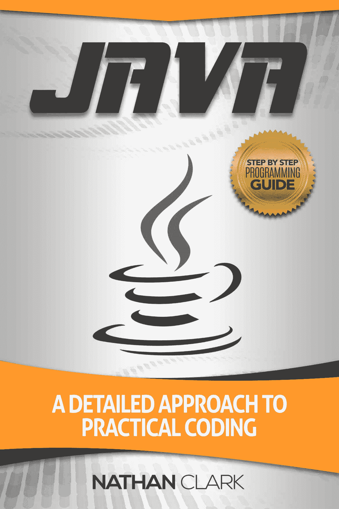

# Java：实用编程详细方法



## 目录

- 注意事项
- 引言
- 开始学习 Java
- Java 的数据类型
- 引用类型与基本类型对比
- 在 Java 中创建类
- 控制流与条件语句
- 使用 If 和 Switch 语句
- 处理继承
- Java 的其他其他功能
- 结语
- 作者简介

© Copyright 2017 Nathan Clark - 版权所有。

本书的出版旨在就相关的话题提供可靠、高质量的信息以及书中讨论的事实。本电子书的销售基于以下假设：不应要求作者或出版商提供书中书中讨论的服务。如果需要任何其他专业或法律方面的讨论，应咨询专业人士。

此声明已获得出版商和协会委员会以及美国律师协会的认可和同样批准。

无论是以印刷形式还是电子形式，对书中包含的任何信息的复制、复制或传输均被视为非法。除非事先获得出版者的许可并获得书面允许，否则禁止制作本作品的录制副本或副本。版权所有。

后续页面包含的任何信息均被认为是准确且真实的，任何因疏忽或对书中讨论主题的任何使用或误用导致的责任均由读者自行承担。在任何情况下，本书的出版者不对以任何方式、形式遵循所提供的信息而导致的任何金钱损失或其他损害承担责任或要求赔偿。

以下信息仅供参考之用，因此被认为是通用的。书中呈现的信息是在没有合同或任何其他关于质量或有效性的保证的情况下提供的。

所使用的任何商标均未经许可，对这些商标的任何使用并不意味着获得了所有者的同意或许可。书中发现的任何商标或品牌仅用于说明，所有者与本作品均无关联。

## 注意事项

请注意，这是《循序渐进 Java》（Step-By-Step Java Series）系列中的第二本书。这本书可以作为独立书籍阅读，但为了获得该系列的最大价值，强烈建议先阅读：

[Java：初学者的编程基础 (Nathan Clark)](https://www.amazon.com/dp/B01N0GP8R3)

## 引言

恭喜购买《Java：实战编程的详细方法》，感谢您的支持。

接下来的章节将讨论您开启使用 Java 作为编程语言旅程所需需要的所有知识。您有很多不同的语言可以选择，但当您尝试构建网页时，无论您构建什么类型的页面，Java 都是最好的选择之一。它将帮助您制作标题、编写段落，并在需要时添加链接和图片。

本指南将向您展示如何设计一些您自己的页面，以及在使用这种编程语言时可以实现的一些酷炫功能。我们假设您过去对 Java 有一点经验，可能只是刚开始用它来编写一些基础代码，然后我们将进入该程序内部更复杂的代码和选项。

本指南将帮助您编写属于您自己的代码，如果您选择的话，甚至可以让编写您自己的网页成为可能。虽然您可以在代码中添加许多很棒的东西，但本指南将向您展示如何完成一些最棒的事情，例如记录信息、添加指向您编写的其他页面或其他网站的链接、添加表单等。

无论您是刚开始编写实现此目的所需的代码，还是已经有编程经验但想进入使用 Java 编写自己网站的世界，本指南都将是您所需的工具。

市场上有很多许多关于这个主题的书，再次感谢您选择本本书！我们已尽力确保它包含尽可能有用的信息，请尽情享受！

## 开始学习 Java

虽然你可以用 Java 编程语言做很多事情，但你首先应该理解的是它是一种面向对象的编程语言。这基本上意味着它更容易理解；许多新的编程语言转向到 OOP 是因为它更容易使用，并且可以防止在编写代码时发生混淆和其他问题。Java 也是通用的，因为软件开发人员需要一种编写一次即可运行在不同平台上的编程语言。

该程序使用了 `C++` 和 `C#` 的一些功能，但对其进行了修改，使其更容易使用，而无需牺牲语言的性能和速度。Java 的核心在于保持易用。

### Java 基础知识

首先，让我们看看 Java 到底是什么。Java 是一种为了在计算机上创建应用程序而开发的编程语言。用户下载需要 Java 的程序并不罕见，你可能已经在计算机上安装了它。它也可以作为插件用于计算机，以便在浏览器中运行。

完成所有这些操作后，你就可以开始编写程序了。这些安装非常简单，只需要几分钟，而且你不需要担心它们会占用程序中过多的空间。如果你想对这种语言以及你所选择的环境有一个了解，从一个 Hello World 程序开始是最好的方法之一。

这就是你在设置 Java 程序时所需要的全部内容。一旦设置好了 IDE，并且你拥有了 Java 以及所有能让它良好运行的工具，你就可以使用任何你想编写来让你的网页变得惊艳的代码。

## 有哪些好处？

当你选择 Java 作为你的编程语言时，可以获得许多好处，包括：

### 它是具有可移植性的

Java 的开发者希望确保 Java 能够在尽可能多的平台上运行。这使得使用 Java 的开发者工作更加容易，因为他们只需要编写一次代码，就可以在任何读取 Java 代码的平台上运行。

### 它是安全且可靠的

在现代世界中，安全和可靠非常重要。你需要确保在创建新程序时，用户知道他们的信息是安全的，不会被拦截。Java 经过加密处理以确保所有信息都是安全的。

### 人们可以快速连接

Java 设计用于使用简单的词汇和短语，以便开发者能够快速与之连接。这使得他们更容易学习这种语言，尽管刚开始看起来可能很难，但他们很快就能写出代码。

### 它有很多很多功能

你会发现 Java 代码具有许多你正在寻找的特性。在需要时可以很容易进行修改，它可以与线程一起工作，它是动态编程语言之一。

### 它应该运行良好

没有人希望在费力编写代码后，发现它运行很慢，或者当你尝试执行它时出了问题。Java 是一种非常精确且易于使用的代码，你每次都能得到想要的结果。

由于所有这些极好的好处，许多开发者（无论是已经工作一段时间的还是刚开始的新手的）都选择使用 Java 来满足他们的编码需求。它易于使用、精确，而且这种编程语言并不是难以学习和理解的语言。

## Java 的缺点

Java 确实存在一些缺点，这就是为什么某些人会选择另一种编程语言来完成工作。你可能会发现的一些问题包括：

### Applet 局限性

这些是因为 Java 目前采用的安全模型。你在获取本地数据时会遇到困难。你只能获取 applet 所在网站的数据，并且无法进行系统调用。你可以引入其他应用程序来让处理变得容易一点。

### 速度较慢

这个程序比其他一些编程语言慢一点，但后来的版本已经进行了一些更改，有助于稍微提高速度。与其他选项相比，它的优化程度稍低，编译某些大型程序时将花费更多时间。

### 占用更多内存

不像 `C++` 和 `C` 等其他编程语言，后者在下载应用程序时可能花费多一点时间。

### 它仅仅是单范式语言

这主要上是一种单范式语言，尽管一些较新的版本正在转变为过程范式，以某种程度上解决这个问题。

总的来说，Java 是一个很棒的程序，你可以它来编写代码。你会喜欢使用这个程序的简易程度，以及你能够写出的所有让你的网站看起来惊艳的棒代码！

## 性能

起初，Java 是一个运行较慢的程序，主要因为与它一起的程序比为其他编程语言（如 `C+`）开发的程序需要更多内存。然而，Java 的开发者已经在此方面做了努力提高速度，随着它成为一种开源语言，这种编程语言一直在不断进行改进。

## 语法

Java 的语法对于确保解释器能够理解你想让它执行的内容非常重要。首先需要记住的是，当你用这种语言编写文件时，你需要将其保存为 `.java`，而子页面应该保存为 `.class`。如果你想确保子页面或任何类是私有的，你只需要将它们保存在同一个 Java 文件夹中即可。如果你将它保存在自己的文件夹中，其他人将拥有某些访问权限。

那么，你如何决定是否想让子页面被访问呢？如果程序仍处于开发阶段，你会希望保持它的私有，以便你能够继续进行工作，你可能需要保持其私有。但一旦你准备好让其他人和用户使用程序，你应该考虑将子页面移出私有，这样用户就可以访问它。

使用这种 Java 编程语言的代码示例包括：

```
Program HiWorld (
Public static.void (
System.out PrintIn.HiWorld
)
)
```

## 内存

起初，Java 的内存运行要慢得多，尤其是与当时的其他编程语言相比时。最初的内存问题使得程序加载时间更长，这并不那么友好。这是因为 Java 语言使用内存的方式与其他语言不同，但在后来的版本中已经进行了更改。

随着时间的推移，Java 的开发者进行了一些更改，以便 Java 能够运行得更快。这部分是因为它使用了自动内存管理。这基本上允许程序员选择他们要做的更改，而他们的运行时间不会受到任何影响。

这种内存机制改变了情况，使其不再引用对象。该对象现在不再是程序的一部分，这可以节省你需要的很多内存。你可能不需要了解内存的所有规范，但知道你能够处理代码并让它快速运行是一件好事。

现在你已经对 Java 以及这种编程语言的工作原理有了更多了解，是时候学习更多你可以使用这种语言做的一些事情了，以编写出你喜欢并享受的正确。

## Java 的数据类型

在 Java 中工作时，有几种不同的数据类型你需要学习。这些类型将确保程序运行正常，确保解释器能够查看代码并正确执行它，并且了解每种数据类型的工作原理可以确保你编写了正确的代码。让我们来看看 Java 编程中的原始数据类型。

### 字符

我们要讨论的第一种数据类型是字符。这些简单是你创建代码供他人使用时使用的词。这些可以包括许多不同的内容，但你可能想要学习的一些包括：

- `if`——它将在基于真和假的基础上工作。你也可以根据你想在代码块中完成的任务使用 `if...else` 和 `else if` 语句。
- `While`—这通常用于真条件或执行代码块之外。
- `For`—这用于绑定的代码块。
- `Try`—这由 `except` 处理，并将为你的代码块抛出异常变得更加容易。
- `With`—这将使用你的块管理器，并可以帮助打开和关闭文件。
- `Def`—这意味着你的函数或方法将在代码中被定义。
- `Class`—这将用于面向对象的编程，并会执行代码块。
- `Print`—当你想要在屏幕上打印短语时，可以使用它。例如，在某人输入年龄或数字后，你可以打印某些短语来告诉他们是对的还是错的。
- `Import`—如果你尝试从其他函数中导入某些模块，`import` 会很有用。
- `Yield`—这将作为一种运算符使用，用于生成函数值。
- `Assert`—这通常用于检查你想要应用的陈述语句。
- `Pass`—这允许你创建一个空的代码块。

如果你使用了这些词，你将无法将它们更改为变量。它们被保留用作程序的命令，以便程序在代码执行时知道你想要它完成什么任务。

## 行与缩进

你在程序中使用的空格和单词将决定代码是否会以你想要的方式显示。这是一个对空格非常重要的程序，因此你需要花一些时间来确保一切都按照应该的方式对齐。让我们来看两个例子，第一个在 Java 语言中是正确的，第二个是错误的。

### 示例 1

```python
if True:
  print "True"
else:
  print "False"
```

### 示例 2

```python
if True:
  print "Answer"
  print "True"
else:
  print "Answer
  print "False"
```

## 引号

如果你愿意，可以在 Java 语言中使用引号，且该语言允许所有类型的引号。你可以根据想要在代码中编写的内容，在单引号、双引号和三引号之间进行选择。

请记住，虽然可以使用任何一种引号，但请确保你在短语的开头和结尾使用的是相同类型的引号。这意味着如果你在短语的开头使用了双引号，那么你需要在短语的结尾也使用相同的双引号。

## 多行语句

当你使用 Java 时，当你开始新的一行，你就处于一个命令的结束。但如果这一行将占据多行，你该怎么办？程序会识别出你正尝试开始一个新行，还是会意识到你想把这仅仅视作一条命令？

如果你想创建一个跨越多行的命令，你只需要添加反斜杠（`\`）来实现它。如果你在使用括号，则不要求使用这个符号，但如果没有使用括号，你将需要确保跨越几行的相同命令使用该反斜杠，以帮助程序知道正在发生什么。

## 注释

有时你可能想在代码中留留注释。你可能想更深入地解释代码中正在发生什么，或者告诉用户他们应该如何操作代码使其运行。如果你使用正确的符号进行这些操作，你就可以将注释放入代码中，而不让解释器读取它。

注释并没有给代码添加任何内容。它不应该在代码中被读取，否则你可能会遇到问题，因此你需要确保使用正确的符号，以确保解释器直接跳过注释。这允许用户看到代码中发生了什么，但又防止注释在你的代码中产生问题。

在编写 Java 时，当你想要留注释时，需要使用井号符号（`#`）。简单地将井号放在注释的开头，然后写下你想发生的事情。就这么简单。这里有一个很好的例子：

```python
#在在下方输入你的年龄
```

然后用户就会知道他们需要在程序上看到的字段中输入他们的年龄。这很简单，你可以在每段代码中使用任意数量的注释。只需确保你将它们保持在需要的范围内，并让每条注释都从不同的行开始，以保持代码的整洁。

## 布尔表达式

你在 Java 中需要处理的下一件事是你的布尔逻辑。虽然在编写代码时可能有很多选项，但 Java 以及其他一些编程语言将将其简化为非假（false）或真（true）的语句。它们还将与二进制计数法配合。这将确保程序能够根据用户提供的信息做出自己的决策。

布尔表达式将基于真或假。例如，如果你只想让输入年龄的人大于 21 岁，那么当某人输入 21 以上任何数字时，会显示 `true`，而每当他们输入 20 或更低的数字时，就会显示 `false`。如果真表达式出现，你将有一个特定的语句。

...（现在，取决于你如何执行，可能会发生几件事。在最简单的形式中，如果语句结果为假，或者人输入的年龄为 20 或更低，程序将直接结束。...）

记住，涉及到你编写的代码时，你是负责的人。你有许多可以应用到布尔表达式中的表达式，例如 `if`、`if else` 和 `else if` 语句，这些语句允许无论你在处理什么程序，都能创建你所需要的精确代码。你可以确定几个与你正在创建的代码配合得最好的不同真、假语句。

## 浮点数和整数

在代码中工作时，你可以预计浮点数和整数将用于在代码中存储数值。它们也可以被分组在一起。Java 中识别的几种不同的数值类型以使事情变得简单一些，包括：

- `Int`（有符号整数）
- `Complex`（复数）
- `Float`（浮点实数）
- `Long`（长整数；这些可以是八进制或十六进制的）

处理这些内容时，你应该记住在将它们与数字结合时利用一些大写字母。例如，如果你使用小写的 `l`，计算机很容易将其与数字 `1` 混淆。因此，在编写程序时请确保使用 `L`，如果你不确定字母在混合了许多数字和字母的代码中看起来如何，最好是选择大写选项以保持视觉美观。

无论你使用哪种编程语言，变量都非常重要，在处理 Java 时也是如此。首先，我们需要理解变量是用于存储数据的手段。你将使用它们来确定将你在代码中创建的所有语句和其他内容存存在什么位置。为了创建你需要的变量，你需要使用许多不同的字符、整数和小数。

你首先需要要做的是值赋值。等号（`=`）是你最需要使用的符号，因为它直观地展示了所有内容是如何共同作用的。你可以显示年龄等于什么、颜色等于什么，或者其他类似的内容。你不一定需要在此处进行显式的声明，但你确实需要确保变量位于等号的左侧，而作用于变量的结果最终位于右侧。以下是这种操作工作原理的良好示例：

```bash
#!/usr/bin/java

counter = 100# 一个整数赋值

miles = 1000.0# 一个浮点数

name =”John”# 一个字符串

print counter

print miles

print name
```

当你将将这些内容放入系统时，你将得到以下输出：

```
100
1000.0
John
```

这只是你在语言中组合变量时可以使用的示例之一。你可以根据需要拥有尽可能多的变量来使代码运行，只需确保命名正确并且它们都对齐即可。

## 运算符

现在让我们花些时间看看 Java 语言中存在的运算符。运算符非常有趣，因为它们允许你以某种方式操作操作数的值，而且这些运算符还带有许多不同的类别。你在代码中可能需要的运算符类别包括：

- 算术
- 恒等
- 赋值
- 位运算
- 成员
- 比较或关系
- 逻辑

### 算术运算符

你有许多可以使用的算术运算符。这些运算符大多可以帮助你在编码中执行各种数学方程，所以如果你正在编写这类代码，了解它们是非常好的，或者仅仅是留备备之用。你可能会发现的一些好用的算术运算符包括：

- `+`——这是加法运算符。它将你的两个或多个操作数相加。例如，`a + b = 10`。
- `-`——这是减法运算符，它将取右侧的操作数并从左侧的操作数减去。例如，`a – b = 5`。
- `/`——这是除法运算符。它将左侧的操作数除以右侧的操作数。
- `*`——这是乘法运算符，它将乘你想要的两个或多个数字。
- `//`——当你寻找商的结果时（你可能想要使用这个），例如当小数被移除时。
- `**`——这是指数。如果你想使用“……的次方”或类似的选项，指数是你的最佳选择。

### 赋值运算符

列表中的下一个是赋值运算符。当你确保确保两个值被一起赋值时，这些运算符非常好用。这可以在你的代码中显示，或者你可以使用它来保存你正在工作的函数。你在代码中可能想要使用的赋值运算符示例包括：

- `=`——这会将右侧的值返回给左侧的操作数。例如，如果你有 `c = a + b`，那么你从 `a + b` 得到的值将变成 `c`。
- `-=`——减法并赋值——它将取右侧的操作数并从左侧的操作数减去，然后将结果赋值给左侧。例如，`c -= a` 等同于 `c = c - a`。
- `+=`——加法并赋值。它的工作方式与上面相同，但它会将右侧的操作数加到左侧，然后给出左侧操作数的结果。
- `/=`——除法并赋值。它将左侧除以右侧操作数，然后将值赋值给左侧。
- `*=`——乘法。在将结果赋值给左侧操作数之前，它会将右侧的操作数与左侧的操作数相乘。
- `**=`——指数并赋值。这将导出指数符号。`C ** = a` 等同于 `c = c ** a`。

### 恒等运算符


当你想要两个不同对象的内存时，这些非常有用，特别是当它们位于不同的位置时。你可能想在代码中使用以使它们紧密结合的一些恒等运算符包括：

- `Is`。这取决于判断两侧的变量是否为真。如果它们不是，运算符将指向同一个主体。

- `Is not`——如果代码两侧的变量为假，运算符将指向主体并在逻辑上返回真。

### 成员运算符

这些将在代码内部使用，用于检查你正在处理的特定序列中是否存在连贯性或成员关系。为了实现这一点，请尝试这些选项：

- `Is`。这取决于判断两侧的变量是否为真。这将检查两侧的变量是否为真。例如，`id(x)` 等于 `id(y)`。

- `No in`——这将检查变量是否在内部。

### 位运算符

位运算符将通过位进行处理。一个良好的示例是：

```
a = 00111100
b = 00001101
a&b = 00001100
a|b = 00111101
a^b = 00110001
a/b = 00001101
```

### 逻辑运算符

这些你可以选择的一些基础运算符。它们基本上是可以在之间持有 10 到 20 的项。

### 比较运算符

这些通过不同的比较来判断语句是否为真。你可能使用的比较运算符包括：

- `==`——当操作数相等时，条件为真。

- `<>`——如果值不等，条件将变为真。

- `!=`——如果两个操作数的值不等，条件将变为真。

- `<=`——如果左侧操作数的值小于右侧操作数，条件为真。

- `>=`——如果左侧的值大于右侧操作数，条件为真。

- `<`——如果左侧操作数小于右侧操作数，条件为真。

- `>`——如果左侧操作数大于右侧操作数，条件为真。

正如你所见，当设置正确时，你可以使用运算符执行许多不同的操作。你可以执行基础算术方程，判断语句是真是假，以及更多内容。

你应该花点时间尝试练习执行这些选项，看看它们是如何工作的并获得一些经验！

## 引用类型与原始类型

在处理 Java 时，有几种不同的数据类型。我们已经讨论了一部分 Java 中独立的或原始数据类型，但也有引用类型，这些类型也可以进入不同的类别。虽然它们略有不同，但你仍然需要它们由原始数据支持。

虽然基本类型可以独立存在，但引用数据类型能够完成一些功能，使你的程序运行得更好，当涉及到程序运行的程度时，你会看到巨大的差异。你可以使用几种不同类型的此类数据，让我们来看看它们，以学习它们是如何运作的。

## 用户数据报协议 (User Datagram Protocol)

这是 IPS 中一个非常重要的成员。它将提供无连接的传输，因此它是可靠的，并且不会以任何方式对你的网络协议产生任何问题。如果你有需要快速丢弃数据包的时间敏感型应用程序，这就是你应该使用的协议类型。用户数据报协议中你还可以看到的其他特性包括：

- 它能够向网络提供数据报文。

- 它被认为是事务导型的，因此它适用于域名系统（DNS）和网络时间协议（NTP）。

- 它支持单向通信，这对于广播信息和服务发现非常有益。

- 它适用于需要实时发生的应用程序，例如 Snapchat 和 Twitter，因为它可以处理传输延迟。它通常适用于某些游戏以及各种 VOIP 应用（如 Skype）。

- 当你处理许多不同的客户端和流媒体应用时，它是好用的。

## 传输控制协议 (Transmission Control Protocol)

你可以选择的另一个选项是传输控制协议。这是 IP 网络与其包含的各种网络之间发生的一种可靠字节流。它是有序且经过错误检查的，因此它适用于你在线使用的的大多数应用程序，但特别用于电子邮件。该协议也是无连接且有延迟的，它可以处理已经发送通过的数据。

在使用此协议时，你需要记住的几点，包括它是预留的，并且你需要让紧急指针、校验和和窗口大小同时被预留。你应该记住的几点包括：

- 4 位在 32 位字中指定数据标头。

- 16 位将标识源端口以及接收端口。

- 32 位识别确认号。

- 9 位将包含 9 位标志位。

- 3 位定义预留供未来使用的数据。

## 地址解析协议 (Address Resolution Protocol)

正如其名称所示，这是一种让网站和应用程序易于通信的电信协议。它被用于帮助映射网络地址，并使视频通话和其他消息成为可能。许多出色的技术都会使用这种协议，包括 `IPv4`、Xerox PARC Universal 数据包、ChaosNet 和 DEC Net。在使用它时你需要记住的项包括：

- 0 – 硬件类型 (`HTYPE`)。

- 2 – 协议类型 (`PTYPE`)。

- 4 – 硬件地址 (`HLEN`) 或协议地址 (`PLEN`)。

- 6 – 操作 (`OPER`)。

- 8 – 发送端硬件地址 (`SHA`)。

- 10 – 后续 2 个字节。

- 12 – 最后 2 个字节。

- 14 – 发送端地址协议 (`SAP`)。

- 16 – 后续 2 个字节。

- 18 – 目标硬件地址 (`THA`)。

- 20 – 后续 2 个字节。

- 22 – 最后 2 个字节。

- 24 – 目标协议地址 (`TPA`)。

- 26 – 后续 2 个字节。

## 网际协议 (Internet Protocol)

而与 Java 配合最好的是网际协议，因为这个程序是为了配合它而创建的。这个协议旨在为网络提供正确的边界，并中继数据报允许互联网上所有的网络活动发生。其结构将涉及有效负载和标头，其中标头被称为主 IP 地址，接口将在特定参数的帮助下连接在一起。

你还需要使用路由前缀和网络标识来让一切协同工作。你可以向此添加很多内容，但当涉及 Java 和网际协议时，你需要处理的基本框架包括：

```
DataApplication
UDP Header | UDP DATA Transport
IP Header | IP Data Internet
Frame Header | Frame Data | Frame FooterLink
```

### 在 Java 中创建一些类

现在我们已经花了一些时间查看你可以用 Java 代码创建的基本内容，现在是时候去代码中创建一些属于你自己的类了。对于你的 Java 程序来说，类实际上是非常重要的，因为它们决定了程序将发生什么。

在创建类时，会有很多元素被考虑。这些元素对于确保代码能够运行至关重要。我们将从类的框架开始，并从那里继续！

### 完善框架

在你想要创建的 Java 类框架中，你需要包含的内容包括：

- 程序类型。你需要使用 `UNICODE` 声明来描述程序类型。

- 程序信息将在文本内提供。你应该使用 `<HEAD>` 和 `</HEAD>` 符号来包围这些程序信息。

- Java 程序部分的描述方式类似，但符号将是 `<Java>` 和 `</Java>`。

- 标题应该位于开头，它将在文本 `<TITLE>` 和 `</TITILE>` 中找到。

- 你在 `<H1>` 和 `</H1>` 之间看到的文本是标题。

- 你在屏幕上看到的内容将在 `<BODY>` 和 `</BODY>` 之间。

- 以及如果你想创建一个段落，就在 `<p>` 和 `</p>` 之间编写文本。

## 标签速查表 (Cheat Sheet)

在编写标签时，你需要记住，大多数情况下它们是成对出现的。你之前见过这一点，标签所需的信息位于两个相同的标签之间。左侧的被视为开始标签，而结束标签几乎相同，但你需要在前面加一个斜杠来表示该部分代码的结束。你在 Java 程序中可能使用的某些标签包括：

### Unicode

- `NAME` – 它对应页面上的某个部分。

- `HREF` – 当你想在文档内进行超链接或想添加特定 URL 名称时，这是一个很好用的属性。

- `onclick` – 这是运行以便使用户能够点击锚点的脚本。这将使用户能够点击你的链接，当他们到达时链接将会有效。

### `<A>` 锚点

- `TITLE` – 这是你尝试打开的程序名称。

- `onmouseout` – 这是判断鼠标不再位于锚点文本上的脚本。

- `TARGET` – 它将显示程序进入的窗口。

- `onmouseover` – 这显示鼠标正位于锚点文本上方。

### `<App…>`

- `CODEBASE` – 这是通往 applet 类的路径。

- `CODE` – 它将决定当前运行哪个程序。

- `HEIGHT` – 这是 applet 的高度。

- `WIDTH` – 这决定了你的 applet 的宽度。

- `ALIGN` – 它决定你编写的文本在屏幕上显示多少。

### `<APPLET…>`

- `HSPACE` – 这将涉及 applet 与周围文本之间的水平空间。

- `VSPACE`—这是应用程序（applet）与周围文本之间的所有垂直空间。

- `NAME`—这是你将给应用程序的名称，它也是引用它的其他应用程序将使用的名称。

- `BORDER`—这是在应用程序周围将看到的空白空间。

- `ARCHIVE`—如果应用程序已经取了一些组件并将它们压缩成一个，那么这里就是这些组件的集合。

- `MAYSCRIPT`—这用来显示 JAVA 程序是否能够使用 JavaScript。

- `SHAPE`—这将显示屏幕上显示的区域的形状。

- `ALT`—这是当图像无法在屏幕上正常显示时使用的替代文本。

### `<AREA…>`

- `TARGET`—这将决定你将要跳转到的框架。

- `TITLE`—这是你正尝试使用的区域的简短描述。

- `NOHREF`—这意味着特定区域内不包含任何链接。

这些只是你在处理编码需求并使用 Java 时，可以使用的一些不同标签。还有许多其他标签，并且它们在你编写的代码中都将有其用武之地。

## 将你的类转换为页面

我们可以花整一天的时间来讨论你在类中使用的不同标签，甚至讨论类是什么，但实际上，你想要学习如何创建这些类，甚至将它们转换为页面。你想要编写自己的新页面，例如博客或网站，并让它根据你的需求正常运行。在这里，我们将提供一些实现这一点的示例。请记住，无论你在写什么，代码都必须以 `<!UNICODE Java>` 开始，以便它能够正常工作。这里有一个示例供你使用！

```html
<!UNICODE Java>
<Java>
<body>
<h1> Welcome to the Web! </h1>
<p> My first page </p>
</body>
</Java>
```

这是你在编写页面时能够做到的事情的一个简单示例。你只需要有一个显示“Welcome to the Web!”的标题，然后第一段将写着“My first page”。就如此简单。当然，你很可能想在这个地方写很多其他内容，但这是你第一次开始尝试的好地方。

## 标题

当你编写在线内容时，你需要让你的页面看起来具有吸引力。你不能只在页面上放一大块文字，这不是因为编码不允许，而是因为这很难集中注意力，也不易阅读。标题可以是简单的页面顶部说明主题的内容，也可以是帮助拆分信息并使其更有意义的小子标题。

你可以使用的标题范围从 `<H1>` 到 `<H6>`。它们非常容易添加。关于你如何操作的示例包括：

```html
<h1> Look at my heading </h1>
<h2> Today is a beautiful day </h2>
<h3> Tomorrow I have no plans </h3>
```

以此此类推。你会发现在页面上，这些每一个标题都会在页面上独立显示，表明它们是各自的一个小节。你可以添加更多的单词、任意数量的段落，以填充内容并将你所需的所有信息都放置到页面上。

## 段落

当然，当你编写代码时，你不希望只有几个标题和页面标题。人们来到页面是为了学习某些东西，为了弄清楚什么对你告诉他们来说是重要的。在你写的所有标题下方，你希望确保至少有一或两行文字来帮助进一步解释它们。

要在你的代码中编写段落，你只需要使用 `<p>` 和 `</p>` 符号来指示何时开始和结束。你可以在这些符号之间编写任何你想要的内容。有时只是几行或一个短段落，而其他时候会很长，像一页一样。段落的长度没有限制，只需确保它们有正确的符号包裹。

## 图像

有时你想添加一些图像。这些图像可以增强你正在编写的文章，或者如果你正在销售东西，你会发现有足够的图片来展示你待售的物品非常有帮助。将图片正确地放入代码中非常重要，因为它们非常重要。使用正确的图片可以使你的网站看起来更有吸引力，但错误的图片或不当的放置会让你的网站变得难以使用。

要使用图像标签，你只需要在你想要添加的图片周围使用 `<>`。确保属性包括替代文本（`alt`）、图像源（`src`）和大小都在正确的顺序上。

## 链接

有时你可能需要在网站中添加一些链接。如果你正在销售某种商品，你希望直接链接回你尝试销售的物品。或者你可能想提供另一个与你网站类似的网站示例，或者展示你的信息是从哪里获取的。你只需要使用 `<a>` 标签。链接在页面上显示的良好示例包括：

```html
<a href="https://google.com">See this link</a>
```

## 如何在页面中引用

有时你可能需要引用内容的某些部分。例如，如果你正尝试将某些信息归功于另一个网站，最好是让文字保持完全相同，这样读者就能获得最大的价值，而不是让它们被扭曲。

当你尝试引用 Java 时需要记住的一些事项包括：

- `<q>`—这将告诉程序你正在添加一段短引用。

- `<cite>`—这将被归属于页面上主题的标题。

- `<blockquote>`—这意味着你引用了来自外部来源的内容。

- `<bdo>`—这规定程序应该执行文本双排。

- `<address>`—这是联系信息。

- `<abbr>`—这显示存在缩写或首字母词。

你可以使用这些标签来编写较短的引用（例如一小行），或者引用长得的内容，取决于你的需求。

从一开始就组织好你的类是非常重要的，这样你就可以让页面看起来整洁漂亮。Java 编程语言保持得非常简单，允许你添加正确的标题、副标题、文字、图片甚至你所需的链接，以确保页面对终端用户来说良好。

## 控制流和条件语句

有时你想对一个程序进行编辑，使其更具个性化。如果你想在你编写的代码中做到这一点，条件语句将使这变得简单一些。它们将确保你正在开发的程序是完全属于你自己的，无论你想改变颜色、字体还是其他。这一章将花费一些时间来讨论你可以添加到页面中的不同内容，以让它看起来非常惊艳。

## Java 表单

很多时候，你会发现在 Java 页面中使用表单是非常方便的。你可能想从客户那里获取一些信息，例如通过调查卷或投票。如果你正在建立自己的业务网站，你可能需要一个帮助联系业务的表单，或者一个让客户在下单时填写的表单。Java 表单在很多情况下都非常有用。你可以用于创建 Java 表单的使用的元素包括：

- 文本区域元素

- 按钮元素

- `select` 元素

- `input` 元素

要实现这一点，你想要操作的一个良好示例包括：

```html
<div ng-app = “myFavoriteApp” ng-controller = “formCtrl”>
  <form novalidate>
    First Name: <br>
      <input type = “text” ng-model = “user.firstName”><br>
    Last Name:<br>
      <input type =”text” ng-model = “user.lastName”>
    <br><br>
      <button ng-click=”reset()”>RESET</button>
  </form>
  <p>form = {{user}}</p>
  <p>master={{master}}</p>
</div
```

这将允许用户在弹出的表单中输入姓名，然后计算机能够识别它是否为选项之一。你可能想要考虑的另一种表单是选择框（Select Boxes）。当你想要为客户提供几个选项供他们使用并进行选择时即可。对于我们在下面使用的示例，你可以输入一些动物的名称，让客户或用户选择他们喜欢的一个。

```html
<form>
Select an animal
<select ng-model=”myVar”>
    <option value-=””>
    <option value=”dogs”>Dogs
    <option value=”cats”>Cats
    <option value=”horses”>horses
</select>
</form>
```

你可以在表单中放入任意数量的选项，从两个到二十个或更多，尽管大多数此类表单保持很小，以便用户在需要时更容易完成。对于上面的示例，如果你需要比手机姓名更多的信息（例如邮寄地址和账单信息），你也可以将这些添加进去。

### 控制流语句

控制流语句将有助于确保程序运行顺畅。它通过利用 Java 系统中存在的控制器来实现。你需要使用语法 `JavaConnector::connect` 来让其工作。你将使用它来获取可用的 IP 地址字符串，以及能够良好协作客户端和服务器。在执行此操作时，请跟踪以下控制器，以知道哪一个适合你。

#### 控制器 17 到 20

这些被称为 `connect::passing()`，因为它们将用户引导到所需的正确结构。它将帮助你了解结构的长度，使得更容易将你的函数与程序内部以及网络中的其他函数混淆。

#### 控制器 16

这是第一个参数 `socket()`，以便你能够在通信网络中选择想要处理的所有细节和协议族。如果你不确定如何开始，应该尝试结合使用 `PF_INET` 和 `SOCK_STREAM`，因为它们结合使用时效果良好。

#### 控制器 13 和 15

这些是被称为 `JavaConnector::resolvehost` 的控制器。它们具有将 DNS 主机和名称字符串转换为 IP 地址的能力，以便所有的假设都能转换为不同的网络地址。

#### 控制器 5 到 10

这些将用于解析主机，它们将在 `JavaConnector::resolvehostname()` 语法下工作，并通过 `getaddridinfo()` 函数转换主机名和 IP 地址。这是完成此过程较安全的方法之一，但也有其他选择。

现在，如果你想连接到其中一个服务器，你需要使用以下代码：


```c
#include <string.h>
#include <netdb.h>
#include <arpa/inet.h>
#include “Javaconnector.h”

MyJavaStream*( MyJavaConnector::connect(const char* server, int port)
{
    Struct sockaddr_inaddress;
    Memset (&address, 0, sizeof(address));
    Address.sin_family = AF_INET;
    Address.sin_port = htons(port);
    if (pton(AF_INET, server, &address.sin_addr)) {
        int sd = socket(AF_INET, SOCK_STREAM, 0);
        if (sd < 0) return NULL;
        if (connect(sd, (struct sockaddr *)&address, sizeof(address)) == 0) {
            return new MyJavaStream();
        }
    }
    return NULL;
}
```

现在，通过上面的选项，你将只会得到一个真或假的答案。如果根据你输入程序的内容，答案结果为真，你将得到你放在代码内部的语句。但如果根据你输入代码的内容，答案为假，你将什么也得不到。

对于大多数人来说，这种效果并不理想。你不希望你的代码在答案结果为假后直接放弃。在大多数情况下，你可能希望无论某人的回答是否在某个年龄范围内，都能弹出一个消息。

让我们看看我们上面完成的例子。假设某人回答说他们是 16 岁。你仍然希望为回答这个年龄的人在代码中显示一些其他内容。你可以使用 `if…else` 子句来确保当第一个语句结果为假时（此人未满 18 岁或以上，因此第一个语句为假），代码将移动到你提供的第二个语句上。你可以选择诸如“抱歉，你目前没有参加资格。请稍后再试。”的消息。

因此，通过 `if…else` 语句，如果这个人是 18 岁或以上，他们将获得你编写的原始消息。但如果他们输入的数字小于 18，他们将得到我们刚刚讨论的第二条消息。这仍然基于真和假的逻辑运行，但它允许程序无论收到什么答案都能显示相应的示例。

你可以根据心意尽情地使用 `if…else` 语句。你可以编写你想要的任何数量的此类语句。如果你想将人们分为几个不同的组，这会很有。假设你想分三个不同的组：一个喜欢猫的组，一个喜欢狗的组，一个两个都喜欢的组。你可以在屏幕上列出所有这些选择并允许用户进行挑选。你可以根据收到的答案逐一添加你想要展示的语句。

在 `JavaScript` 代码中，你使用的 `if…else` 语句数量是没有限制的。你拥有控制权，所以请根据你的需求选择尽可能多的选项，以实现你对这段特定代码的想法。

## `switch` 语句

另一个你可以使用的选项是 `switch` 语句。这允许你有机会测试任何变量，以检查它与已知值列表的等等性。在这个选项中，单个值被称为 `case`（情况），而被切换的变量将对每个现有的 `case` 进行检查。一个在内部包含 `switch` 语句的增强循环示例包括：

```javascript
switch(expression){
  case value:
    //Statements
    Break; //optional

  Case value :
    //Statements
    Break; //optional

  //你可以有任何数量的 case 语句。

  Default : //Optional
    //Statements
}
```

很多时候，你会想要使用 `switch` 语句和 `if` 语句来为你的程序添加更多定义。你可以测试几次，以感受它们的工作原理以及你可以使用它们做些什么。

## 处理继承（Working with Inheritances）

在编写代码时，继承是非常实用的。它们允许你从一个旧的类中提取特征，并根据需要将其转移到新类中。然后你还可以对其进行更改。你仍然可以保持第一个类的完整性，如果你仍然想使用第一个类，但又想更改某些特征以配合新类，这非常有帮助。

例如，如果你将 `class A` 中的所有元素转移到 `class B`，那么这两个类在程序中都仍然存在。它们中的任何一个都不会消失。在开始时，你将有两个具有相同信息的类，尽管大多数使用继承的人会想要对 `class B` 进行修改，同时保留 `class A` 的一些原始特征。这使得事情变得更容易，因为你可以在不完全删除第一个类的情况下进行更改。

在处理这类事情时，记住 `class A` 被视为原始类，而 `class B` 被称为子类，以保持条理。一旦执行了继承，第一个类的元素现在可以在另一个类下找到，但你可以追溯回 `class A`。

## 继承背后的概念（Concepts behind Inheritance）

在大多数情况下，当你阅读编程书籍时，它们只是会谈论继承是元素拥有共同属性的能力。它还将强调这些元素具有某些独特特征，这些特征正是让新类脱颖出的原因。

继承允许第一个类的元素转移到另一个类，使其具有许多相同的特征。但这样做很好，因为你可以对这个第二个类进行一些更改，而完全不会丢失你在第一个类中所做的工作。这非常有用，因为它在编写代码时可以节省大量时间，并允许程序员从不同的程序中“借”元素来获取所需的功能。

## 传递关系意味着什么？（What Does the Transitive Relationship Mean?）

当你讨论类与子类之间的关系时，你讨论的是传递关系。在数学和编程中，这意味着这种关系可以追溯到偏序，以及等价序。如果一个组被引入另一个组，则认为这些组的元素是相互关联的。此外，继承的传递性质将指出它是包容且扩展的。

继承遵循两个两个概念。第一，如果 `class 1` 扩展自 `class 2`，`class 1` 的元素将包含在 `class 2` 中。第二，当 `class 2` 扩展到 `class 3` 时，`class 1` 和 `class 2` 的元素都包含在 `class 3` 中。

这基本上意味着你可以根据需要在后续创建任意数量的继承。如果你想从 `class A` 创建一个新代码，你可以这样做，然后你可以在之后创建一个具有了 `Class A` 和 `Class B` 特征的 `Class C`。你不能直接跳过 `Class B` 直接到 `Class C`，你需要在其中包含发现于 `Class A` 的特征，但你可以根据选择一直进行到 `Class Z` 或更远。

这从几个方面有助于防止浪费。首先，你不需要花费大量时间在代码中反复编写相同的代码特征，即使你想在代码中重用它们。其次，你不会在代码中浪费那么多空间，因为你创建的新子类可以链接回原始代码，而不是在代码中重写很多次。

当然，当你创建了新的子类后，你可以根据需要进行一些更改。如果你希望那部分代码执行的结果与原始代码略有不同，那是可以的。你可以对该子类进行更改，而不会对继承体系中的其他类或子类产生任何更改。

## Java 隐蔽（Java Shadowing）

在 Java 中，你还可以做的另一件与继承相关的操作是遮蔽（shadowing）。这种技术涉及两个命名相似且作用范围重叠的变量。它需要一个高层变量和一个低层变量，因为其中一个变量将覆盖另一个变量。低层变量的元素会在过程中被隐藏。

例如，你的低层变量可以命名为 `theta`，而高层变量命名为 `beta`。当 `theta` 能够覆盖高层变量时，它将隐藏 `beta` 中的所有元素。但仅仅因为被遮蔽变量的元素被隐藏了，并不意味着它们无法工作。它们仍然可以正常运行。通常情况下，隐藏它们是为了不需要显示其长度（length）。

你可能出于几个原因想这样做。有些程序员喜欢在将几个元素组合成一个新的子类之前，先将它们结合在一起。这可以节省大量时间，因为你不需要在过程中重写它们中的每一个。两者的元素都将具有完全的功能，因此你可以同时使用它们，但你可以将它们结合并在你正在尝试创建的新子类中进行更改。

有时隐藏高层变量的长度也是一种很好的做法。当你编写计算机语言时，你需要在处理长度方面非常小心，否则可能会减慢整个系统。遮蔽技术将帮助防止这些问题的发生，并让你的整个程序运行得快一点。

正如你所看到的，在编写自己的程序时，你可以做很多事情。虽然我们在本书中讨论了许多不同的内容，但继承可能是最有用的部分之一。它允许你混合组合各种元素，同时仍从原始代码中获得所需的所有功能。你可以进行更改、继续向下继承以及更多操作。尝试一下吧，看看在你的代码中引入继承后你到底能做些什么。

# 你用 Java 还可以做的其他事情

我们花费了相当的时间来讨论开始学习 Java 时可以做的事情，但仍然有许多其他你想要学习的内容，以便你的程序真正良好运行。在本章中我们将讨论的某些内容，如果使用得当，会让你的项目脱颖而出，最后是：对象、类和方法。

## 类、对象和方法

当你使用 Java 语言工作时，这些内容通常会被归在一起，因为它们是在该语言内执行操作的语句集合。例如，你可以使用 `System.out.println` 方法，它将带出许多显示在屏幕上的有序语句。

如果你想写一个方法，有一个基本的语法可以确保正确的内容出现。该语法包括：

```java
Modifier returnValueType methodName(list of parameters) {
  // Method body;
}
```

让我们来看所有这些部分的含义，以便你清楚每个部分应该填充什么内容来使代码正常工作。

### 方法名：修饰符（Modifiers）

这些是可选的修饰符，用于告诉编译器你希望它如何调用方法。方法的访问类型应该通过这种方式定义。

### 返回类型（Return type）

这将显示方法的某些返回值。`ReturnTypeType` 将定义为方法返回的值的数据类型。如果你选择，某些操作可以在不返回值的情况下执行。如果没有返回值，你需要确保使用 `void` 关键字。

### 方法名（Method name）

这将是方法的实际名称。参数列表和方法名构成了方法签的两个项。

## 仅操作类和对象

当你在 Java 内部工作时，对象是具有行为和状态的组件。你可以有一个球，并注意到状态是颜色、弹跳方式以及大小，而行为则是诸如滚动和弹跳等。当你与类工作时，你是在与一个描述其所支持的对象的行为和状态的计划或模板工作。类语法的良好示例包括：

```java
public class Horse {
  String color:
  int age;
  String breed;
  void lame (){
  }
  void happy(){
  }
  void lazy(){
  }
}
```

你可以在类中放入多种变量类型以使代码产生差异，包括：

### 局部变量（Local variables）

这些是定义在构造函数、块或方法内部的变量。变量会在方法内部初始化并声明。当首选方法完成后，该变量将被销毁。

### 实例变量（Instance variables）

这些是在类内部的变量，但它们位于你建立的方法之外。它们在类加载时实例化，可以在该定义类中的任何构造函数、块或方法中访问。

### 类变量（Class variables）

类变量定义在特定的类内部、方法外部，并使用 `static` 关键字使用。

## 异常处理（Exception Handling）

很多时候，你需要在代码中使用异常处理来保持安全。你必须使用 `catch` 和 `try` 关键字来处理代码中发生的异常处理。你可以将这些放置在你想要生成的代码周围，也可以放置在任何想要保护的代码周围。

## `Throws`/`Throw` 关键字

每当你有一个方法没有以某种方式处理的受检异常（checked exception）时，你就需要用 `throws` 关键字对其进行声明。这将出现在方法签名的末尾。

另一方面，如果你有一个新实例化的、或者你刚刚捕获的异常，你可以使用 `throw` 关键字将其抛出。这将帮助你在代码中做出一些改变。

## `Finally` 关键字

接下来，我们将查看 `finally` 关键字。当你有一段跟在 `try` 块之后的代码时，你需要使用 `finally` 关键字。即使在没有发生异常的情况下也是如此。这是一个非常值得学习的点，因为 `finally` 块允许你的清理语句运行，使代码看起来更好并准时结束，即使你周围有一些保护代码。你可能想要用于 `finally` 关键字的语法包括：

```java
try {
  //Protected code
}catch(ExceptionType1.ei) {
  //Catch block
}catch(ExceptionType2.e2) {
  //Catch block
}catch(ExceptionType3.e3) {
  //Catch block
}finally {
  //The finally block always executes
}
```

学习如何在你的代码中使用对象、类和方法，将帮助你在 Java 代码中定义某些行为和功能。尽管如此，有时你会发现自己试图向代码中放入太多的内容。在运行 Java 程序时，并不是越多越好，所以多次测试代码并在需要时进行调整是一个好主意。但总的来说，你会发现在 Java 中处理方法、类和对象可以为你的代码增添伟大之处，并开启许多你能够创造的新事物。

# 结论

感谢你读完《Java：实战编程详细指南》（Java: A Detailed Approach to Practical Coding），希望这本书能为你提供有益的信息，并为你提供实现目标所需的所有工具。

下一步是开始学习你的新编程语言。我们花了大量时间研究这门编程语言，以及你将如何利用它创建自己的网站或其他优秀的程序，无论你是编程初学者，还是已经使用过其他编程语言并想开始学习 `Java`。

虽然有很多优秀的编程语言供你选择，但如果你想创建自己的网站，`Java` 是最佳选择之一。配置环境并不会花费太长时间，一旦你写出在页面上想要显示的信息，并挑选出最适合你的连接方式，你就会发现它是编写网页最易的语言之一。

如果你对整个编程体验完全陌生，不必对编程感到恐惧。你只需要知道如何让它运行并学习一些语法即可。`Java` 足够简单，即使是初学者也能掌握，你将享受在短时间内让你的网站和其他网页内容运行起来的这种轻松。

最后，如果你觉得这本书在任何方面对你有帮助，我们将非常感谢你在 Amazon 上留下的评价！

## 关于作者

Nathan Clark 是一位拥有近 20 年软件行业经验的资深程序员专家。

他拥有 `MIT` 的硕士学位，曾在几家美国领先的软件公司工作，并在软件设计和开发方面积累了极其丰富的知识。

Nathan 和他的妻子 Sarah 于 2009 年创立了自己的开发公司，以承担更具挑战性和创造性的项目。如今，他们为来自世界各地的高端客户提供服务。

Nathan 喜欢通过他的系列书籍分享编程知识，为客户开发创新的软件解决方案，并在空闲时间观看经典的科幻电影。

如需向专家学习编程，请关注书店或网上 Nathan 的更多书籍。
