# Java：初学者零基础指南

## 什么是 Java？

Java 既是一个平台也是一种语言。作为一种平台，我们拥有 Java 运行时（JRE）。作为一种语言，它是高级的、健壮的面向对象的语言。该语言由 Sun 公司于 1995 年开发。由于 Java 是面向对象的语言，因此它将一切视为对象。Java 程序通过两个步骤来产生结果：第一步是编译，生成字节码。字节码与平台无关，可以在任何机器上运行。编译完成后，字节码通过执行步骤来产生结果。Java 被认为是一门易懂的语言。如果你熟悉面向对象编程，将易于理解 Java。Java 提供了一项安全功能，允许开发者创建安全且无病毒的系统。公钥加密技术用于确保系统。

## 开启 Java 之旅

为了编写和运行 Java 程序，你需要 Java 编译器和如记事本之类的文本编辑器。要获取 Java 编译器，你需要在电脑上安装 Java 开发工具包（JDK）。安装完成后，你的电脑将拥有 Java 编译器。现在你有了 Java 编译器，你需要一个文本编辑器。你可以使用基础或高级文本编辑器。高级编辑器的示例包括 NetBeans 和 Eclipse。

## 第一个 Java 程序

我们需要创建一个 Hello World Java 示例。为此，请打开你的文本编辑器创建一个新文件。将此文件命名为 `Hello.java`。标记你保存此文件的目录。在文件中添加以下 Java 代码并保存：

```java
public class Hello {
    /** 我的第一个 java 程序
     * 代码将打印 'Hello World'
     */

    public static void main(String[] args) {
        System.out.println("Hello World"); // 打印 Hello World
    }
}
```

一旦你保存了上述代码，打开你操作系统的终端并导航到你保存该文件的目录。

在终端中运行以下命令：

```bash
javac Hello.java
```

上述命令应该生成一个 `Hello.class` 文件。这是一个包含 Java 字节码的文件，它是与平台无关的。你可以通过检查相同目录下是否存在该文件来确认这一点。我们所做的是在该文件上调用了 Java 编译器 (`javac`) 来编译该文件中包含的 Java 代码。

现在代码已经编译且没有错误，我们可以执行它。只需在同一个终端中运行以下命令即可：

```bash
java Hello
```

上述命令应该在终端上返回如下所示的结果：

```
C:\Windows\system32>cd C:\Users\admin
C:\Users\admin>javac Hello.java
C:\Users\admin>java Hello
Hello World
C:\Users\admin>
```

上述显示代码返回了 `Hello World` 作为输出。

考虑下面我从代码中提取的这一行：

```java
public class Hello {
```

我们在上述行代码中正在做的是创建一个名为 `Hello` 的类。类名中的 `H` 已经大写了；因此，每当我们引用该类时，都必须大写。Java 是一门对大小写敏感的语言。`public` 是一个访问修饰符，将该类声明为公有，这意味着它可以被同一包内的其他类进行访问。左大括号 `{` 标记了类体的开始，要关闭它，我们必须使用右大括号 `}`。

考虑从代码中提取的以下后续章节：

```java
/* 我的第一个 java 程序
 * 代码将打印 'Hello World'
 */
```

```java
// 我的第一个 java 程序
```

Java 编译器对注释不做任何操作，但它会跳过它们。注释提高了代码的可读性。它们被用于解释各行代码的作用。

请注意，文件被命名为 `Hello.java`，而类被命名为 `Hello`。如果这两者不匹配，将会产生一个错误。当你想要从操作系统的终端运行 Java 代码时，这种情况应该是始终如此。

这里是从代码中提取的另一行代码：

```java
public static void main(String[] args) {
```

上述内容称为 `main` 方法。没有 `main` 方法，任何 Java 程序都无法运行或执行。

这里是从代码中提取的另一行代码：

```java
System.out.println("Hello World");
```

我们调用了一个名为 `println()` 的方法来帮助我们将传递的文本打印到显示屏。你还注意到我们使用了两个右大括号 `}`。第一个关闭 `main` 方法，而第二个关闭类。

# Java 类与对象

正如我们所说的，Java 是一门面向对象的编程语言。这意味着它可以支持面向对象编程范式的各种概念。

在 Java 中，对象以状态和行为为特征。一个对象的例子是狗。描述它的特征的一些状态包括名称、颜色和品种。描述它的特征的一些行为包括进食、吠叫和摇尾巴。对象是类的实例。

类是一个模板或蓝图，描述了该类型的任何对象应该支持的状态和行为。这里有一个类的示例：

```java
public class Dog {
    String name;
    int breed;
    String color;

    void eating() {
    }

    void barking() {
    }

    void sleeping() {
    }
}
```

在上面的示例中，我们定义了一个名为 `Dog` 的类。类内部定义了三个变量，分别是名称、品种和颜色。这些是 `Dog` 类的属性。我们还为该类定义了 3 个方法，即 `eating()`、`barking()` 和 `sleeping()`。我们可以在类内部定义许多方法。

## 构造函数

构造函数是类的重要部分。每个类都有构造函数。如果你不显式创建类构造函数，Java 编译器将自动为该类初始化默认构造函数。

每当你创建一个新对象时，至少会调用一次构造函数。注意，Java 中有一个规则规定构造函数的定义和使用。构造函数的名称必须与类相同。一个类可以有多个构造函数。

这里有一个例子：

```java
public class Dog {
    public Dog() {
    }

    public Dog(String breed) {
        // 一个带有一个参数 breed 的构造函数。
    }
}
```

在上面的类中，我们创建了两个构造函数，一个没有参数，另一个带有一个参数。你应该注意这两个构造函数与类具有相同的名称。

## 创建对象

类的目的是提供一个模板或蓝图，我们从之创建对象。这意味着对象是从类创建的。在 Java 中，对象是通过 `new` 关键字创建的。创建 Java 对象时应遵循以下步骤：

1.  **声明** - 这应该涉及声明对象引用。
2.  **实例化** - 使用 `new` 关键字。
3.  **初始化** - 遵循类定义（调用构造函数）。

这里有一个显示此点的示例：

```java
public class Dog {
    String name;
    int breed;
    String color;

    public Dog(String breed) {
        this.breed = breed;
    }

    public static void main(String[] args) {
        Dog myDog = new Dog("Golden Retriever");
        System.out.println(myDog.name);
    }
}
```

# Java 中的变量

**变量**可以被视为一个在程序生命周期持有值的容器。每个变量都有特定的数据类型，规定了它可以持有的值。使用 Java 变量有两个步骤：**变量声明**和**变量初始化**。

## 变量声明

变量的声明涉及给它命名并指定其数据类型。以下是有效变量声明的示例：

```java
int a, x, p;
float pi;
double p;
char c;
```

`int`、`float`、`double` 和 `char` 是数据类型，指定了每个变量应该持有的值。要在同一行声明多个变量，用逗号（,）分隔，如第一个示例所示。变量声明应以分号（;）结束。

## 变量初始化

变量初始化涉及给它赋值有效值。赋值给变量的值取决于变量所属的数据类型。以下是有效变量初始化的示例：

```java
pi = 3.14f;
a = 10.1276871;
c = 's';
```

变量的声明和初始化可以同时完成，如下所示：

```java
int a = 1, x = 4, p = 5;
float pi = 3.14f;
double p = 15.23d;
```

## 访问变量与方法

在类中，访问变量的最佳方法如下：

```java
Dog myDog = new Dog("Poodle");
myDog.name = "Buddy";
System.out.println(myDog.name);
```

## 变量类型

Java 支持三种变量类型：

1.  局部变量
2.  静态变量
3.  实例变量

### 局部变量

这些是在方法体内部声明的变量。它们只能在该方法内部被访问。

### 实例变量

这些是在没有使用 `static` 关键字的情况下定义的变量。这些变量特定于某个对象。

### 静态变量

这些是在程序执行开始时初始化一次的变量。你应该在初始化实例变量之前初始化它们。

以下示例展示了不同的 Java 变量：

```java
class VariablesExample {
    int p = 1; // 一个实例变量
    static int q = 5; // 一个静态变量
    void methodExample() {
        int r = 10; // 一个局部变量
    }
}
```

变量 `q` 是一个静态变量，因为它使用 `static` 关键字定义的。变量 `r` 在 `methodExample()` 方法内部声明，因此它是一个局部变量。它只能在该方法内部被访问。

# Java 数据类型

在 Java 中，数据类型可以是基本类型，也可以是非基本类型。

## 基本数据类型

这些是 Java 提供的预定义数据类型。它们共有 **8** 种，包括 `byte`、`short`、`long`、`char`、`int`、`float`、`boolean` 和 `double` 数据类型。

现在让我们讨论 Java 中的各种基本数据类型：

### boolean

这种数据类型只存储两个值：**true**（真）和 **false**（假）。它被用于仅跟踪**真/假条件**的简单语句。它只指定了一个位的信息，但我们无法精确地定义它的大小。

### byte

它的默认值为 **0**，最小值为 **-128 (-2^7)**。由于它比整数小 4 倍，它有助于在大型数组中节省空间。

### short

它的默认值为 **0**，取值范围在 **-32,768** 到 **32,767** 之间。它也可以像 `byte` 数据类型一样用于节省空间。

### int

它的默认值为 0，取值范围在 **-2,147,483,648** 到 **2,147,483,647** 之间。它的最小值为 -2,147,483,648，最大值为 2,147,483,647。

### long

这种数据类型的默认值也是 0，取值范围在 **-9,223,372,036,854,775,808** 到 **9,223,372,036,854,775,807** 之间。它的最小值为 -9,223,372,036,854,775,808，最大值为 9,223,372,036,854,775,807。当你想要获得比 `int` 数据类型提供的范围更广的值时，它是最好的数据类型。

### float

这种数据类型具有无限范围的值。与使用 `double` 相比，它可以帮助你节省空间。避免使用这种数据类型处理货币等精确数值。它的默认值为 `0.0f`。

### double

这种数据类型的默认值为 `0.0d`，并且具有无限范围的值。它被用于表示带有小数部分的值，就像 `float` 数据类型一样。避免将其用于货币等高精度数值。

### char

这种数据类型用于存储字符。

## 非基本数据类型

这些是通过使用定义的类构造函数定义的。它们帮助程序员访问对象。它们包括 `String`（字符串）和数组。

下面的示例展示了变量的使用：

```java
public class AddVariables {
    public static void main(String[] args) {
        int p = 10;
        int q = 22;
        int r = p + q;
        System.out.println(r);
    }
}
```

我们定义了三个整数变量 `p`、`q` 和 `r`。`p` 和 `q` 的值已经初始化，而 `r` 的值是前两个变量之和。然后我们调用了 `println()` 函数来打印 `r` 的值。它应该打印 `32`，即 `10` 和 `22` 相加的结果。

# 类型转换和类型转换

特定类型的变量可以获得另一种类型的值。当一个容量较小的变量被赋值一个容量较大的变量时，称为类型转换（隐式转换/自动类型提升）。

示例：

```java
double p;
int q = 6;
p = (double) q;
```

类型转换——当一个容量较大的变量被赋值另一个容量较小的变量时（强制类型转换）。

示例：

```java
double p = 6.5;
int q;
q = (int) p;
```

`(int)` 被称为类型转换运算符。如果不指定，你将得到错误。

类型转换示例：

```java
public class TypecastingExample {
    public static void main(String[] args) {
        float p = 19.7f;
        // int q = p; // 编译错误
        int q = (int) p;
        System.out.println(p);
        System.out.println(q);
    }
}
```

代码执行后返回以下内容：

```
19.7
19
```

# 数组

在 Java 中，数组是用来存储固定大小同类型元素的容器。

## 声明、实例化和初始化数组

```java
int[] myArray = new int[5]; // 声明并实例化长度为5的int数组
int[] myArray2 = {1, 2, 3, 4, 5}; // 声明并初始化
```

## 访问数组元素

```java
int firstElement = myArray2[0]; // 访问第一个元素
myArray2[1] = 10; // 修改第二个元素
```

## 多维数组

```java
int[][] matrix = new int[3][3]; // 3x3 的二维数组
```

## 数组工具类 `Arrays`

`java.util.Arrays` 类提供了操作数组的静态方法，如 `sort()`、`binarySearch()`、`equals()`、`fill()`、`toString()` 等。

```java
import java.util.Arrays;

public class ArrayExample {
    public static void main(String[] args) {
        int[] arr = {3, 1, 2};
        Arrays.sort(arr);
        System.out.println(Arrays.toString(arr)); // [1, 2, 3]
    }
}
```


```java
public class TypecastingExample{
    public static void main(String[] args){
        float p=19.7f;
        //int q=p/a 编译错误
        int q=(int)p;
        System.out.println(p);
        System.out.println(q);
    }
}
```

代码执行后返回以下内容：

```
19.7
19
```

# 数组

### Boolean

这种数据类型只存储两个值：`true`和`false`。它被用于仅跟踪**真/假条件**的简单语句。它只指定了一个位的信息，但我们无法精确地定义它的大小。

### Byte

它的默认值为 `0`，最小值为 `-128 (-2^7)`。由于它比整数小 4 倍，它有助于在大型数组中节省空间。

### Short

它的默认值为 `0`，取值范围在 `-32,768` 到 `32,767` 之间。它也可以像 `byte` 数据类型一样用于节省空间。

### Int

它的默认值为 `0`，取值范围在 `-2,147,483,648` 到 `2,147,483,647` 之间。它的最小值为 `-2,147,483,648`，最大值为 `2,147,483,647`。

### Long

这种数据类型的默认值也是 `0`，取值范围在 `-9,223,372,036,854,775,808` 到 `9,223,372,036,854,775,807` 之间。它的最小值为 `-9,223,372,036,854,775,808`，最大值为 `9,223,372,036,854,775,807`。当你想要获得比 `int` 数据类型提供的范围更广的值时，它是最好的数据类型。

### Float

这种数据类型具有无限范围的值。与使用 `double` 相比，它可以帮助你节省空间。避免使用这种数据类型处理货币等精确数值。它的默认值为 `0.0F`。

### Double

这种数据类型的默认值为 `0.0d`，并且具有无限范围的值。它被用于表示带有小数部分的值，就像 `float` 数据类型一样。避免将其用于货币等高精度数值。

### Char

这种数据类型用于存储字符。

### 非基本数据类型

这些是通过使用定义的类构造函数定义的。它们帮助程序员访问对象。它们包括 `Strings` 和数组。

下面的示例展示了变量的使用：

```java
public class AddVariables{
    public static void main(String[] args) {
        int p=10;
        int q=22;
        int r=p+q;
        System.out.println(r);
    }
}
```

我们定义了三个整数变量 `p`、`q` 和 `r`。`p` 和 `q` 的值已经初始化，而 `r` 的值是前两个变量之和。然后我们调用了 `println` 函数来打印 `r` 的值。它应该打印 `32`，即 `10` 和 `22` 相加的结果。如下所示：

```
32
```

# 类型转换和类型转换

一个特定类型的变量可以获得另一种类型的值。类型转换当一个容量较小的变量被赋值一个容量较大的变量时。

示例：

```java
double p;
int q=6;
p= (double)q;
```

类型转换（Typecasting）当一个容量较大的变量被赋值另一个容量较小的变量时。

示例：

```java
double p=G;
int q;
q=(int) p;
```

`(int)` 被称为类型转换运算符。如果不指定，你将得到错误。类型转换示例：

```java
public class TypecastingExample{
    public static void main(String[] args){
        float p=19.7f;
        //int q=p/a 编译错误
        int q=(int)p;
        System.out.println(p);
        System.out.println(q);
    }
}
```

代码执行后返回以下内容：

```
19.7
19
```

# 6-Java 运算符

运算符是用于执行操作的符号。例如，`+` 符号用于算术运算。Java 支持不同的运算符：

## 一元运算符

这是接受一个操作数的运算符。它们增加/减少一个值。它们包括 `++` (增) 和 `--` (减)。

示例：

```java
public class JavaUnaryOperator{
    public static void main(String[] args){
        int p=0;
        System.out.println(++p);//从 0 到 1
        System.out.println(++p);//2
        System.out.println(p--);//1
        System.out.println(-p);//0
    }
}
```

程序打印：

```
1
2
1
0
```

## 算术运算符

这些运算符用于执行乘、加、除等数学运算。它们被用作算术运算符。

示例：

```java
public class ArithmeticOperators{
    public static void main(String[] args){
        int p=13;
        int q=4;
        System.out.println(p+q); //17
        System.out.println(p-q); //9
        System.out.println(p*q); //52
        System.out.println(p/q); //3
        System.out.println(p%q); //6
    }
}
```

代码执行后返回以下结果：

```
17
9
52
3
6
```

`p++` 意味着在执行增加之前读取 `p` 的值；因此我们得到的 `p` 的值为 `0`。如果是 `++p`，那么我们作为 `p` 的第一个值得到 `1`。你可以尝试一下。

除。

## 逻辑运算符

这些运算符与布尔值一起使用。它们有助于在循环和条件语句中评估条件。它们包括 `||`、`&&`、`!`。假设我们有两个布尔变量 `a1` 和 `a2`，适用于以下条件：

- 如果 `a1` 和 `a2` 都为 `true`，则 `a1&&a2` 返回 `true`，否则 `false`。
- 如果 `a1` 和 `a2` 都为 `false`，则 `a1||a2` 返回 `false`，否则返回 `true`。
- `!a1` 将返回 `a1` 的取反值。

示例：

```java
public class Java.LogicalOperator {
    public static void main(String[] args) {
        boolean p = true;
        boolean q = false;

        System.out.println("p && q: " + (p && q));
        System.out.println("p || q: " + (p || q));
        System.out.println("!(p && q): " + !(p && q));
    }
}
```

程序执行后将返回以下内容：

```
p && q: false
p || q: true
!(p && q): true
```

变量 `p` 的值已设置为 `true`，而变量 `q` 的值已设置为 `false`。在第一情况下，我们使用了 `&&` 运算符，因此 `true` 和 `false` 返回 `false`。在第二情况下，我们使用了 `||` 运算符，因此 `true` 或 `false` 得到 `true`。在最后情况下，我们对 `&&` 操作的结果进行了取反。

## 比较运算符

Java 支持 6 种比较运算符：`==`、`!=`、`<`、`>`、`>=`、`<=`：

- 如果左右两边相等，则 `==` 返回 `true`。
- 如果运算符的左右两边不相等，则 `!=` 返回 `true`。
- 如果左侧大于右侧，则 `>` 返回 `true`。
- 如果左侧小于右侧，则 `<` 返回 `true`。
- 如果左侧大于或等于右侧，则 `>=` 返回 `true`。

示例：

```java
public class RelationalOperator {
    public static void main(String[] args[]) {
    int p = 10;
    int q = 15;
    if (p==q) {
        System.out.println("p and q are equal");
    }
    else{
        System.out.println("p and q aren't equal");
    }

    if(p != q) {
        System.out.println("p and q aren't equal");
    }
    else{
        System.out.println("p and q are equal");
    }

    if( p > q) {
        System.out.println("p is greater than q");
    }
    else{
        System.out.println("p isn't greater than q");
    }

    if (p >= q) {
      System.out.println("p is equal to or greater than q");
    } else {
      System.out.println("p is less than q");
    }

    if (p < q) {
      System.out.println("p is less than q");
    } else {
      System.out.println("p isn't less than q");
    }

    if (p <= q) {
      System.out.println("p is equal to or less than q");
    } else {
      System.out.println("p is greater than q");
    }
    }
}
```

代码执行后应返回以下结果：

```
p and q aren't equal
p and q aren't equal
p isn't greater than q
p is less than q
p is less than q
p is equal to or less than q
```

我们使用了各种比较运算符来比较变量 `p` 和 `q` 的值。

# 7 种决策语句

在 Java 中，决策有助于帮助我们测试条件并根据条件的结果运行语句。让我们讨论一下决策语句：

## if 语句

该语句包含一个**布尔表达式**和**语句（多个）**。其语法如下：

```java
if(A_boolean_expression) {
    // 如果为 true 则运行的语句
}
```

如果条件为真，表达式体内的语句将执行，否则程序将不产生结果。

示例：

```java
public class JavaIfStatement {
    public static void main(String[] args) {
        int x = 5;
        if(x < 10) {
            System.out.print("The value of x is below 10");
        }
    }
}
```

代码执行后将返回以下结果：

```
The value of x is below 10
```

我们声明了一个名为 `x` 的变量并将其初始化为 `5`。在 `if` 条件中，我们正在检查该变量的值是否低于 `10`。由于这是真的，该条件下方的语句已被执行。

## if...else 语句

该语句将“if”与“else”结合，后者指定了表达式为假时运行的语句。语法：

```java
if(A_boolean_expression) {
    // 如果表达式为真时运行的语句 (S)
} else {
    // 如果表达式为假时运行的语句 (S)
}
```

示例：

```java
public class JavaIfElseStatement {
    public static void main(String args[]) {
        int marks = 30;

        if(marks < 50) {
            System.out.print("The marks is below 50");
        } else {
            System.out.print("The marks is above 50");
        }
    }
}
```

将打印第一个语句，分数低于 50。这是因为布尔表达式将为真。如果它为假，则将打印另一个语句。

示例：

```java
public class JavaIfElseStatement {
    public static void main(String args[]) {
        int x = 10;
        if(x < 5) {
            System.out.print("The value of x is below 5");
        } else {
            System.out.print("The value of x is above 5");
        }
    }
}
```

代码返回以下执行结果：

```
The value of x is above 5
```

变量 `x` 的值已设置为 `10`。在 `if` 条件中，我们正在检查此值是否低于 `5`。测试结果为假，因此将执行 `else` 部分。

## if...else if 语句

如果你有多个条件需要测试，请使用此语句。语法：

```java
if(A_boolean_expression a) {
    // 语句
} else if(A_boolean_expression b) {
    // 语句
} else if(A_boolean_expression c) {
    // 语句
} else {
    // 语句
}
```

示例：

```java
public class JavaIfElseStatement {
    public static void main(String[] args) {
        int x = 15;

        if(x == 10) {
            System.out.print("value of x is 10");
        } else if (x == 15) {
            System.out.print("value of x is 15");
        } else if (x == 20) {
            System.out.print("value of x is 20");
        } else {
            System.out.print("None of the above");
        }
    }
}
```

代码执行后给出结果：

```
value of x is 15
```

变量 `x` 的值初始化为 `15`，因此 `15` 的测试条件为真。

这里另一个示例：

```java
public class JavaIfStatement {
  public static void main(String[] args) {
    int marks=64;

    if(marks<40){
      System.out.println("You fail");
    } else if(marks>=40 && marks<50){
      System.out.println("You scored D grade");
    } else if(marks>=50 && marks<60){
      System.out.println("You scored C grade");
    } else if(marks>=60 && marks<70){
      System.out.println("You scored B grade");
    } else if(marks>=70){
      System.out.println("You scored A grade");
    }
  }
}
```

代码返回：

```
You scored B grade
```

## 嵌套 if

`if...else` 语句可以嵌套，这意味着你可以在另一个语句内部使用 `if`，或者在另一个 `if...else` 内部使用 `if...else`。

嵌套语法所示：

```java
if(A_boolean_expression a) {
    // 语句
    if(A_boolean_expression b) {
        // 语句
    }
}
```

示例：


```java
public class NestingExample {
    public static void main(String[] args[]) {
        int age = 32;
        int weight = 77;

        if (age >= 18) {
            if (weight >= 55) {
                System.out.println("You can donate blood.");
            }
        }
    }
}
```

代码执行时打印以下结果：

You can donate blood.

如果第一个条件为真，则测试第二个条件。在我们的情况下这是真的；因此执行了 `println` 语句。

## switch 语句

该语句允许我们根据某个变量与某些值列表进行等性测试。每个值被称为一个 case（分支）。

使用了以下语法：

```java
switch (an_expression) {
  case value:
    // Statement(s)
    break; // optional

  case value:
    // Statement(s)
    break; // optional

  default: // Optional
    // Statement(s)
}
```

`switch` 一旦遇到 `break` 语句就会结束。执行流将跳转到下一行。然而，请注意，并没有强制要求每个 case 都添加 `break`。`default` 分句可以加到 `switch` 的末尾，如果没有任何 case 为真，则将执行它。

示例：

```java
public class SwitchExample {
  public static void main(String[] args) {
    char your_grade = 'A';

    switch (your_grade) {
      case 'A':
        System.out.println("That is Excellent!");
        break;
      case 'B':
        System.out.println("That is Good!");
        break;
      case 'C':
        System.out.println("That is Fair!");
        break;
      case 'D':
        System.out.println("That is Poor!");
        break;
      case 'F':
        System.out.println("You Failed!");
        break;
      default:
        System.out.println("Unknown grade");
    }
    System.out.println("You scored " + your_grade);
  }
}
```

代码返回如下结果：

> That is Excellent!
>
> You scored A

针对等级 `A` 的 `case` 测试结果为 `true`，因此产生了上述输出。

最后一个 `println` 语句无论等级的值如何，都将在所有情况下执行。

# 8-Java 循环

Java 循环帮助我们重复性地执行某些任务。循环按顺序执行语句。首先运行第一个，然后是第二个，依此类推。让我们讨论一下 Java 支持的各种类型的循环：

## for 循环

只要条件测试结果为真，循环就会运行。一旦条件变为假，执行将立即停止。语法：

```java
for (initialization; loop_condition; increment/decrement_part)
  the_statement(s);
```

初始化（`initialization`）定义了循环条件的初始值。循环条件（`loop_condition`）指定了循环运行必须始终为真的条件。循环增/减部分（`increment/decrement_part`）定义了在每次迭代后初始化值增加或减少的量。示例：

```java
public class LoopExample {
    public static void main(String args[]) {
        for (int p = 0; p < 10; p++) {
            System.out.println("The value of p now is: " + p);
        }
    }
}
```

程序返回的输出如下：

The value of p now is: 0
The value of p now is: 1
The value of p now is: 2
The value of p now is: 3
The value of p now is: 4
The value of p now is: 5
The value of p now is: 6
The value of p now is: 7
The value of p now is: 8
The value of p now is: 9

输出显示循环返回了变量 `p` 从 `0` 到 `9` 的值。当循环将 `9` 增加得到 `10` 时，它会发现这违反了循环条件 `p < 10`，因此执行将立即停止。

## while 循环

只要指定的条件为 `true`（真），该循环就会执行语句。首先测试条件，如果为真，则执行**循环语句**。如果条件变为 `false`（假），**控制流**将跳转去执行循环之后的语句。建议您在循环中添加一个增/减操作和一个**测试**条件，以便循环在条件变为假时停止执行。否则，循环可能会无限运行。

语法：

```java
while (A_boolean_expression) {
  // Statement(s)
}
```

示例：

```java
public class JavaLoopExample {

    public static void main(String[] args) {
        int p = 5;

        while (p < 12) {
            System.out.print("The value of p is: " + p);
            p++;
            System.out.print("\n");
        }
    }
}
```

代码打印以下结果：

| The value of p is: 5 |
| The value of p is: 6 |
| The value of p is: 7 |
| The value of p is: 8 |
| The value of p is: 9 |
| The value of p is: 10 |
| The value of p is: 11 |

程序打印了 `p` 从 `5` 到 `11` 的值。变量的初始值为 `5`。**测试**条件检查该值是否**小于 12**，结果为 `true`。这意味着循环将运行。当到达 `11` 时，它将检查并发现 `p` 的值为 `12`。循环的执行立即停止，因为继续执行将违反该条件。

## do...while 循环

这与 `while` 循环密切相关。在 **while 循环** 条件中，执行是在体之前完成的。在 `while` 循环中，体可能永远不会执行，但在 `do...while` 循环中，循环体必须执行一次。

语法：

```java
do {
  Statement or statements;
} while (loop_condition);
```

示例：

```java
public class JavaWhileLoop {

    public static void main(String[] args) {
        int p = 5;

        do {
            System.out.print("The value of p is: " + p);
            p++;
            System.out.print("\n");
        } while (p < 12);
    }
}
```

代码将像之前的循环一样打印从 5 到 11 的 `p` 的值。这是因为条件为真，5 小于 12。假设我们将条件设为假，如所示将 `p` 的值初始化为 20：

```java
public class JavaDoWhileLoop {

    public static void main(String[] args) {
        int p = 20;

        do {
            System.out.print("The value of p is: " + p);
            p++;
            System.out.print("\n");
        } while (p < 12);
    }
}
```

运行上述程序后，你将获得以下输出：

The value of p is: 20

## break 语句

`switch` 语句在达到 `break` 语句后就会结束。执行流将跳转到下一行。然而，注意并没有强制要求为每个 case 都添加 `break`。`default` 分句可以加到 `switch` 的末尾，如果没有任何 case 为真，则将执行它。

示例：

```java
public class SwitchExample {
  public static void main(String[] args) {
    char your_grade = 'A';

    switch (your_grade) {
      case 'A':
        System.out.println("That is Excellent!");
        break;
      case 'B':
        System.out.println("That is Good!");
        break;
      case 'C':
        System.out.println("That is Fair!");
        break;
      case 'D':
        System.out.println("That is Poor!");
        break;
      case 'F':
        System.out.println("You Failed!");
        break;
      default:
        System.out.println("Unknown grade");
    }
    System.out.println("You scored " + your_grade);
  }
}
```

代码返回如下结果：

> That is Excellent!
>
> You scored A

针对等级 `A` 的 `case` 测试结果为 `true`，因此产生了上述输出。

最后一个 `println` 语句无论等级的值如何，都将在所有情况下执行。


```java
public class SwitchExample {
  public static void main(String[] args) {
    char your_grade = 'A';

    switch(your_grade) {
      case 'A':
        System.out.println("That is Excellent!");
        break;
      case 'B':
        System.out.println("That is Good!");
        break;
      case 'C':
        System.out.println("That is Fair!");
        break;
      case 'D':
        System.out.println("That is Poor!");
        break;
      case 'F':
        System.out.println("You Failed!");
        break;
      default:
        System.out.println("Unknown grade");
    }
  }
}
```

```java
System.out.println("You scored " + your_grade);
}
}
```

代码返回如下结果：

> That is Excellent!
>
> You scored A

针对等级 `A` 的 `case` 测试结果为 `true`，因此产生了上述输出。

最后一个 `println` 语句无论等级的值如何，都将在所有情况下执行。

## break 语句

`break` 语句用于跳出循环。

示例：

```java
public class BreakExample {
  public static void main(String[] args) {
    for (int i = 0; i < 10; i++) {
      if (i == 5) {
        break;
      }
      System.out.println(i);
    }
  }
}
```

输出：

0
1
2
3
4

## continue 语句

`continue` 语句用于跳过当前迭代的剩余部分。

示例：

```java
public class ContinueExample {
  public static void main(String[] args) {
    for (int i = 0; i < 10; i++) {
      if (i == 5) {
        continue;
      }
      System.out.println(i);
    }
  }
}
```

输出：

0
1
2
3
4
6
7
8
9

## return 语句

`return` 语句从方法返回值并退出方法。

示例：

```java
public class ReturnExample {
  public static void main(String[] args) {
    int result = add(5, 3);
    System.out.println(result);
  }

  public static int add(int a, int b) {
    return a + b;
  }
}
```

输出：

8

```java
for(int p=1;p<=3;p++) {
    for(int q=1;q<=3;q++) {
        if(p==2 && q==2) {
            continue;
        }
        System.out.println("+" +q);
    }
}
```

该代码返回以下结果：

1 1
1 2
1 3
2 1
2 3
3 1
3 2
3 3

# 9-Java 方法

在 Java 中，`方法`（methods）用于将一组语句组合在一起，以执行相同的功能。函数的一个很好的例子是 `System.out.println`。该方法是 Java 内置的。当你调用上述方法时，在终端上获得结果之前，会执行多条语句。我们可以在 Java 中定义自己的方法。让我们讨论一下如何在 Java 中使用方法：

## 创建方法

要创建 Java 方法，你应该使用以下语法：

```java
public static int method_Name(int x, int y) {
  // 方法体
}
```

以下是对上述语法的描述：

- `public static` - 一个用于定义方法访问权限的修饰符。
- `int` - 方法的返回类型。
- `method_Name` - 方法名。
- `x, y` - 形式参数。
- `int x, int y` - 参数列表。

方法的定义由方法头和方法体组成。

以下语法最准确地描述了这一点：

```java
modifier return_Type method_Name (Parameter List) {
// 方法体
}
```

以下是对上述语法的描述：

- `modifier` – 定义方法的访问类型，它是可选的。
- `returnType` – 方法可能会返回一个值。
- `method_Name` – 方法名。方法签名包含了方法名和参数列表。
- `Parameter List` – 这是方法参数的列表，包含了该方法的参数的类型、顺序和数量。方法可以没有参数，因此这些是可选的。
- `method body` – 此方法体定义了方法将对语句执行什么操作。

这里是一个 Java 方法的示例：

```java
/** 返回两个数字中较小值的方法 */
public static int minimumFunction(int p, int q) {
    int min;
    if (p > q)
        min = q;
    else
        min = p;
    return min;
}
```

在上面的示例中，我们定义了一个名为 `minimumFunction` 的方法。该函数接受两个整数数据类型的参数。该方法应该比较你传递给它的两个整数值，并返回最小值。

代码在执行后将打印以下内容：

## 最小值是 10

我们使用了 `minimumFunction`，它检查并返回两个数字中的最小值。在上面的示例中，我们向它传递了值 `10` 和 `13`。它返回了 `10`，因为它是最小值。

## void 关键字

这是我们用于定义不应返回值的方法的关键字。让我们通过一个示例来展示这一点：

```java
public class VoidKeywordExample {
    public static void main(String[] args) {
        totalPoints(71);
    }
    public static void totalPoints(double points) {
        if (points >= 62) {
            System.out.println("政府将资助你的大学费");
        } else if (points >= 45) {
            System.out.println("你可能需要自付学费");
        } else {
            System.out.println("你没有入学大学的机会");
        }
    }
}
```

代码给出了下方的输出：

> 政府将资助你的大学费

正如你所注意到的，我们没有使用 `return` 关键字。

## return 关键字

这是我们用于定义应该返回值的方法的关键字。让我们通过一个示例来展示这一点：

```java
public class ReturnExample {
    public static void main(String[] args) {
        int result = addNumbers(5, 10);
        System.out.println("The sum is: " + result);
    }
    public static int addNumbers(int a, int b) {
        return a + b;
    }
}
```

代码在执行后将打印以下内容：

The sum is: 15

## final 关键字

这个关键字用于定义一个不可修改的变量或返回值。在下面的示例中，我们定义了两个常量：

```java
public class FinalExample {
    public static void main(String[] args) {
        final int LIMIT = 10;
        System.out.println(LIMIT);
        // LIMIT = 20; // 这将导致编译错误
    }
}
```

## static 关键字

这个关键字用于定义属于类本身而不是类实例的方法或变量。这意味着不需要实例化类就可以调用这些方法。

```java
public class StaticExample {
    public static void staticMethod() {
        System.out.println("Hello from static method!");
    }
    public static void main(String[] args) {
        StaticExample.staticMethod();
    }
}
```

## 继承

继承允许一个类继承另一个类的属性和方法。这实现了代码复用。

```java
class Animal {
    void eat() {
        System.out.println("This animal eats food.");
    }
}

class Dog extends Animal {
    void bark() {
        System.out.println("The dog barks.");
    }
}
```

## Overriding (方法重写)

方法重写允许子类提供父类中方法的特定实现。

```java
class Animal {
    void sound() {
        System.out.println("The animal makes a sound.");
    }
}

class Dog extends Animal {
    @Override
    void sound() {
        System.out.println("The dog barks.");
    }
}
```

## Overloading (方法重载)

方法重载允许在类中具有多个同名但参数列表不同的方法。

```java
class MathOperations {
    int add(int a, int b) {
        return a + b;
    }
    int add(int a, int b, int c) {
        return a + b + c;
    }
    double add(double a, double b) {
        return a + b;
    }
}
```

## Interface (接口)

接口是类抽象方法的集合。一个类可以实现多个接口。

```java
interface Animal {
    void makeSound();
}

class Cat implements Animal {
    public void makeSound() {
        System.out.println("The cat meows.");
    }
}
```

## Abstract Class (抽象类)

抽象类是不能被实例化的类，它通常作为其他类的基类。它可以包含抽象方法。

```java
abstract class Shape {
    abstract void draw();
}

class Circle extends Shape {
    void draw() {
        System.out.println("Drawing a circle.");
    }
}
```

## Exception (异常)

异常是程序执行过程中发生的意外事件。Java 使用 `try-catch` 块来处理异常。

```java
public class ExceptionExample {
    public static void main(String[] args) {
        try {
            int data = 10 / 0;
        } catch (ArithmeticException e) {
            System.out.println("错误：不能除以零");
        }
    }
}
```

引用类的成员，如变量、方法和构造函数。当方法或构造函数中的局部变量与实例变量同名时，它可以帮助区分局部变量和实例变量。

以下示例展示了如何使用 `this` 关键字：

```java
class Person {
  int age;
  Person(int age) {
    this.age = age;
  }
}
```

让我们展示如何使用 `this` 关键字来访问类的各种成员：

```java
public class This_Class {
  // 一个实例变量 x
  int x = 10;

  This_Class() {
    System.out.println("Demonstrating the use of this keyword in Java");
  }

  This_Class(int x) {
    // 调用默认构造函数
    this();
    // 将局部变量 num 赋值给实例变量 x
    this.x = x;
  }

  public void salute() {
    System.out.println("Welcome to Java Programming");
  }

  public void print() {
    // 局部变量 x
    int x = 20;

    // 打印局部变量
    System.out.println("value of local variable num is :"+x);

    // 打印实例变量
    System.out.println("The instance variable x has a value of :"+this.x);

    // 调用类的 salute 方法
    this.salute();
  }

  public static void main(String[] args) {
    // 实例化类
    This_Class object1 = new This_Class();

    // 调用 print 方法
    object1.print();

    // 通过参数化构造函数将新变量传递给 x
    This_Class object2 = new This_Class(30);

    // 再次调用 print 方法
    object2.print();
  }
}
```

该代码执行后将返回以下输出：

Demonstrating the use of this keyword in Java
value of local variable num is : 20
The instance variable x has a value of : 10
Welcome to Java Programming
Demonstrating the use of this keyword in Java
value of local variable num is : 20
The instance variable x has a value of : 30
Welcome to Java Programming

# 可变长度参数

Java 允许向方法传递数量不定的参数，但这些参数必须是相同类型。

可以通过在方法中声明参数来实现，如下：

```
type_Name... parameter_Name
```

在声明方法时，先指定类型，然后跟着一个省略号（...）。在方法中只能指定一个可变长度参数，且该参数必须是最后一个参数。如果有其他普通参数，它们应该在它之前。

下文是一个示例：


```java
public class VariableArguments {
    public static void main(String[] args) {
        // 调用带可变参数的方法
        showMax(new double[]{10, 23, 78.5, 43});
    }

    public static void showMax(double... values) {
        if (values.length == 0) {
            System.out.println("No argument were passed");
            return;
        }

        double output = values[0];
        for (int x = 1; x < values.length; x++) {
            output = values[x];
        }
        System.out.println("The maximum value is " + output);
    }
}
```

该代码执行后返回的结果如下：

> The maximum value is 87.0

The maximum value is 31.0

# 方法重写

如果父类中的方法没有用 `final` 关键字声明，子类就可以重写该方法。重写意味着覆盖现有方法的功能。

示例：

```java
class Mammal {
    public void run() {
    }
}

class Dog extends Mammal {
    @Override
    public void run() {
        System.out.println("Dog is running");
    }
}
```

```java
static int x=0
```

该代码将返回以下结果：

0 1 1 2 3 5 8 13 21 34 55 89 144 233 377 610 987 1597

注意，一个数字的**斐波那契数**是它前两个数字之和。在上面的示例中，我们进行了 **18** 次递归。

# 10-Java 中的继承

在继承中，一个对象获得了另一个对象的行为和属性。获得行为和属性的对象成为子类，而它们所自继承的对象称为父类。它们也可以分别称为子类和超类。继承使得信息能够按照层级顺序易于管理。在父类中定义的方法可以在子类中重用，而无需重新定义。

要从父类继承，我们使用 `extends` 关键字。继承的语法如下所示：

```java
class Child-class extends Parent-class-name
{
  // 字段和方法
}
```

`extends` 关键字表示我们正在从现有类创建某些新类。

示例：

```java
class Employee{
  float employee_salary=60000;
}
public class Developer extends Employee{
  int commision=20000;

public static void main(String[] args[]){
    Developer d=new Developer();
    System.out.println("developer salary:"+d.employee_salary);
    System.out.println("Commision for Developer:"+d.commision);
}
}
```

执行该代码将返回以下内容：

```
developer salary is:60000.0
Commision for Developer is:20000
```

我们首先创建了一个名为 `Employee` 的类。这在示例中形成了父类。然后我们创建了名为 `Developer` 的类，它继承自 `Employee` 类。`Developer` 类变成了子类。我们创建了 `Developer` 类的实例/对象并将其命名为 `d`。通过使用这个实例，我们可以访问父类中定义的变量。

Java 中有不同类型的继承。让我们讨论一下：

## 单继承

在这里，一个类继承自另一个类。之前提供的 `Worker` 和 `DBA` 类就是这种类型的示例。

示例：

```java
class Mammal{
    void run(){
        System.out.println("Running...");
    }
}
class Cow extends Mammal{
void moow(){System.out.println("Moowing...");}
}
public class JavaInheritance{
public static void main(String args[]){
  Cow cw=new Cow();
  cw.moow();
  cw.run();
}
}
```

代码执行后将返回以下结果：

Moowing...

Running...

在上面的示例中，`run()` 方法在 `Mammal` 类中定义，而 `moow()` 方法在继承 `Mammal` 类的 `Cow` 类中定义。在 `JavaInheritance` 类中，我们创建了 `Cow` 类的实例并命名为 `cw`。然后我们使用这个实例访问了定义在不同类中的两个方法。

## 多级继承

当类 B 继承自类 A，而类 C 继承自类 B 时，就会发生这种类型的继承。

这是一个示例：

```java
class Mammal{
  void run(){
    System.out.println("Running...");
  }
}
class Cow extends Mammal{
  void moow(){
    System.out.println("Moowing...");
  }
}
class BabyCow extends Cow{
void eat(){
    System.out.println("Eating...");
}
public class JavaInheritanceTest{
public static void main(String[] args){
    BabyCow bc=new BabyCow();
    bc.moow();
    bc.eat();
    bc.run();
}
}
```

该代码将返回以下结果：

Moowing...

Eating...

Running...

`run()` 方法在 `Mammal` 类中定义，`moow()` 方法在继承 `Mammal` 类的 `Cow` 类中定义。`eat()` 方法在继承 `Cow` 类的 `BabyCow` 类中定义。在 `InheritanceTest` 类中，我们创建了 `BabyCow` 类的实例 `bc`。该实例被用于访问各种属性。我们可以使用 `BabyCow` 类的实例访问定义在 `Cow` 和 `Mammal` 类中的方法。

## 层级继承

这种类型的继承可以通过以下示例演示：

```java
class Mammal{
void run(){
    System.out.println("Running...");
}
}
class Cow extends Mammal{
void moow(){
  System.out.println("Moowing...");
}
}
class Goat extends Mammal{
void meew(){
  System.out.println("Meowing...");
}
}
public class JavaInheritanceTest{
public static void main(String[] args){
  Goat gt=new Goat();
  gt.meew();
  gt.run();
  //gt.moow(); 会报错
}
}
```

在 `InheritanceTest` 类中创建 `Goat` 类实例后，我们无法继承父类中定义的属性。但是可以使用 `BabyCow` 类的实例访问定义在 `Cow` 和 `Mammal` 类中的方法。

# 11-Java 中的抽象

抽象是一项功能，它让开发者向用户展示必要的内容，并隐藏其他部分。开发者必须区分呈现给用户的内容和不呈现的内容。例如，当你发送电子邮件时，你需要输入内容、附加文档并点击“发送”按钮，而无需知道背后发生了什么。同样，当你开车时，你踩下加速板看到速度增加，当你踩刹车时汽车会停止。你不知道后台发生了什么。这就是我们在本章将讨论的抽象。

通过抽象，用户感知不到实现细节。开发者隐藏了它们。用户只获得应用程序的功能。因此，用户获得的是关于程序做什么的信息，而不是如何实现。一个抽象类使用 `abstract` 关键字。如果任何类拥有抽象方法，它必须被识别为抽象类。一个抽象类还必须继承自另一个抽象类。

示例：

```java
abstract class Student {
  abstract void register();
}
```

```java
public class John extends Student {
  void register() {
```

```java
System.out.println("John is going for registration");
}

public static void main(String[] args) {
    St st = new John();
    st.register();
    System.out.println("Done");
}
```

代码执行后将返回如下结果：

John is going for registration

Done

抽象类并不一定需要包含抽象方法。你无法实例化抽象类。这就是为什么我们实例化了 John 类，因为它从一个抽象类中继承了一个方法。

示例：

```java
public abstract class Worker {
    private String name;
    private String workerAddress;
    private int number;

    public Worker(String name, String workerAddress, int number) {
        System.out.println("Worker Construction");
        this.name = name;
        this.workerAddress = workerAddress;
        this.number = number;
    }

    public double getWorkerSalary() {
        System.out.println("Inside getWorkerSalary ");
        return 0.00;
    }

    public void checkMail() {
        System.out.println("Sending check to " + this.name + " " + this.workerAddress);
    }

    public String toString() {
        return name + " " + workerAddress + " " + number;
    }

    public String getWorkerName() {
        return name;
    }

    public String getWorkerAddress() {
        return workerAddress;
    }

    public void setWorkerAddress(String newWorkerAddress) {
        workerAddress = newWorkerAddress;
    }

    public int getWorkerNumber() {
        return number;
    }
}
```

Worker 类与其他 Java 类相似，区别仅在于使用了 `abstract` 关键字。尝试实例化它：

```java
public class InstantiateAbstract {
    public static void main(String [] args) {
        /* This will generate error */
        Worker wk = new Worker("Tony S.", "Texas, USA", 35);
        System.out.println("\n Calling checkMail with Worker reference\n");
        wk.checkMail();
    }
}
```

Worker 类的属性必须通过继承来，而不是通过实例化该类。

示例：

```java
public class Wage extends Worker {
    private double wage; // Annual salary
    public Wage(String name, String workerAddress, int number, double wage) {
        super(name, workerAddress, number);
    }

    setWage();
    }

    public void checkMail() {
        System.out.println("IncheckMail for Wage class ");
        System.out.println("Sending check to " + getWorkerName() + " with wage " + wage);
    }

    public double getWage() {
        return wage;
    }

    public void setWage(double newWage) {
        if(newWage >= 0.0) {
            wage = newWage;
        }
    }

    public double getWorkerPay() {
        System.out.println("Getting wage for " + getWorkerName());
        return wage/52;
    }
}
```

Worker 类不能被实例化，但 Wage 类可以实例化，然后我们可以使用它的实例来访问 Worker 的所有字段和方法。

示例：

```java
public class AbstractInst{
    public static void main(String[] args) {
        Wage w = new Wage("Don Lilly", "New York, USA", 4, 3400.00);
        Worker wk = new Worker("Lopez Terez", "Washington, USA", 3, 3800.00);
        System.out.println("Calling checkMail via Wage reference");
        w.checkMail();
        System.out.println("\n Calling checkMail via Worker reference");
        wk.checkMail();
    }
}
```

要运行上述代码，你必须在不同的文件中创建它们，编译并执行最后一个类。

然后，你将获得结果。如下所示：

```bash
C:\Users\admin>javac Worker.java
C:\Users\admin>javac Wage.java
C:\Users\admin>javac AbstractInsta.java
C:\Users\admin>java AbstractInsta
Worker Construction
Worker Construction
Calling checkMail via Wage reference
In checkMail for Wage class
Sending check to Don Lilly with wage 3400.0

Calling checkMail via Worker reference
In checkMail for Wage class
Sending check to Lopez Terez with wage 3800.0
C:\Users\admin>
```

# 12-封装

封装是面向对象编程的一项特性，有助于将数据和方法组合在一起。数据是变量，方法是允许我们处理数据的代码。通过封装，类变量可以对其他类隐藏，并且对它们的访问可能仅通过类的方法来实现。封装起到了“数据隐藏”的作用。它通过将类变量设为 `private` 来实现。变量的“setter”和“getter”方法应被设置为 `public`，并用于更改变量的值。

示例：

```java
public class Workers{
    private String name;

    public String getWorkerName(){
        return name;
    }
    public void setWorkerName(String name){
        this.name=name;
    }
}
```

你可以向同一个包添加一个带有此代码的新文件：


```java
public class TestWorkers {
    public static void main(String[] args){
        Workers wk=new Workers();
        wk.setWorkerName("Joel");
        System.out.println(wk.getWorkerName());
    }
}
```

编译并运行上述代码将得到输出：

```bash
C:\Users\admin>javac Workers.java
C:\Users\admin>javac TestWorkers.java
C:\Users\admin>java TestWorkers
Joel
C:\Users\admin>
```

（括号）。

示例：

```java
public interface Toyotas {
    public void setCarPrice(String carPrice);
    public void setCC(String cc);
}
```

```java
public interface Harrier extends Toyotas {
    public void maximumMileage(int miles);
    public void seats(int seats);
    public void kilometersPerLiter(int kms);
}
```

```java
public interface Prado extends Toyotas {
    public void interiorSpace();
    public void carLength();
    public void setCarPrice(String carPrice);
    public void setCC(String cc);
}
```

我们定义了 `Toyotas` 接口。其他的 `Harrier` 和 `Prado` 扩展了 `Toyotas` 接口。`Prado` 接口有四个方法，但其中两个方法是从 `Toyotas` 接口继承而来的。你可以通过使用 `,` 隔开多个接口来继承多个接口。

示例：

```
public interface Harrier extends Toyotas, Cars
```

Java 不支持多重继承，然而，我们可以通过接口来实现。

这是另一个接口示例：

```java
interface ObjectInterface{
    void drawObject();
    static int cubeObject(int ab){return ab*ab*ab;}
}
```

```java
class Cuboid implements ObjectInterface{
    public void drawObject(){
        System.out.println("drawing cuboid");
    }
}
public class InterfaceTest{
    public static void main(String[] args){
        ObjectInterface ob=new Cuboid();
        ob.drawObject();
        System.out.println(ObjectInterface.cubeObject(3));
    }
}
```

嵌套接口是在我们在另一个接口内部添加的接口。示例：

```java
interface Message{
    void printMessage();
    interface ShortMessage{
        void message();
    }
}
```

`ShortMessage` 接口被定义在 `Message` 接口内部，使其成为嵌套接口。

# 14-包 (Packages)

包是将相关的接口和类组合在一起的核心。分组是根据功能决定的。通过包，我们可以对类进行分组并轻松找到需要的类，以避免冲突。建议你创建一个包，然后使用它来分组相关的类、接口等。通过包，可以轻松访问在同一个包的类和接口中定义的变量和方法。

Java 包可以是用户定义的或内置的。内置 Java 包的示例包括 `lang`、`awt`、`java`、`javafx`、`net`、`io`、`swing`、`util`、`sql` 等。要使用这些包，请使用 `import` 语句使其在你的类中可用。要创建包，使用 `package` 关键字然后创建包名。

示例：

```java
package firstpackage;
public class MyPackage{
    public static void main(String args[]){
        System.out.println("My first package");
    }
}
```

执行上述代码将返回以下输出：

My first package

包的定义语句始终以分号（`;`）结尾。当我们创建包时，应该使用小写字母作为名称，以避免与接口/类名冲突。

另一个示例：

```java
package animal;
interface Mammals {
    public void run();
    public void eat();
}
```

我们创建了一个名为 `animal` 的包，其中包含一个名为 `Mammals` 的接口。现在我们可以在 `animal` 包中实现该接口：

```java
package animal;
public class Cow implements Mammals {
    public void run() {
        System.out.println("Cows run");
    }
    public void eat() {
        System.out.println("Cows eat");
    }
    public int legCount() {
        return 0;
    }
    public static void main(String args[]) {
        Cow c = new Cow();
        c.run();
        c.eat();
    }
}
```

代码将返回以下结果：

```
Cows run
Cows eat
```

如果我们不使用包，这两个者可以合并为一个：

```java
interface Mammals {
    public void run();
    public void eat();
}
```

```java
public class Cow implements Mammals {
    public void run() {
        System.out.println("Cows run");
    }

    public void eat() {
        System.out.println("Cows eat");
    }

    public int legCount() {
        return 0;
    }

    public static void main(String[] args) {
        Cow c = new Cow();
        c.run();
        c.eat();
    }
}
```

## Import 关键字 (Import Keyword)

你可以访问特定包之外的包。使用 `import` 关键字是实现此点的可能之一。访问同一个包中的类时不需要使用包。在使用 `packagename.classname` 语法导入类后，只有导入类中的方法是可访问的。

示例：

```java
package hellopackage;
public class HelloClass{
    public void message(){
        System.out.println("Hello there!");
    }
}
```

我们在名为 `hellopackage` 的包中定义了一个名为 `HelloClass` 的类，并将其保存在文件 `HelloClass.java` 中。我们有这个类：

```java
package studentspackage;
class HelloStudentsClass{
    public static void main(String args[]){
        HelloClass hello = new HelloClass();
        hello.message();
    }
}
```

第二个程序一旦执行将生成一个错误。我们实例化了类 `HelloClass` 来获取实例 `hello`。我们使用该实例来访问在 `HelloClass` 中定义的 `message()` 方法。


我们在名为 `hellopackage` 的包中定义了一个名为 `HelloClass` 的类，并将其保存在文件 `HelloClass.java` 中。我们有这个类：

```java
package studentspackage;
class HelloStudentsClass{
    public static void main(String args[]){
        HelloClass hello = new HelloClass();
        hello.message();
    }
}
```

第二个程序一旦执行将生成一个错误。我们实例化了类 `HelloClass` 来获取实例 `hello`。我们使用该实例来访问 `message()` 方法。我们在名为 `hellopackage` 的包中定义了一个名为 `HelloClass` 的类，并将其保存在文件 `HelloClass.java` 中。我们有这个类：

（此处省略后续重复内容的翻译，以保持文档简洁性）

# 15-Java Applets

Applets 是运行在网络浏览器上的 Java 程序。Applet 作为一个全功能完整的应用程序运行，因为它带有完整的 Java API。applet 类继承自 `java.applet.Applet`。Applets 没有 `main` 方法，因此它们不会调用 `main()`。相反，它们嵌入在 HTML 页面中。当打开带有 applet 的 HTML 页面时，其代码会被下载到本地机器。JVM（Java 虚拟机）是查看 applet 必须的。

Applets 在客户端处理；因此与其他应用程序相比，它们能给用户提供快速响应。

## Applets 的生命

Applets 经过以下步骤：

- **初始化** - `init()` 方法初始化 applet。
- **启动** - `start()` 方法启动 applet。
- **绘制** - 在调用 `paint()` 方法后执行。
- **停止** - 我们调用 `stop()` 方法停止 applet。
- **销毁** - 通过调用 `destroy()` 方法销毁 applet。

Applet 通过 HTML 查看。

示例：

在文本编辑器中创建一个名为 `FirstApplet.java` 的新文件，并为其添加以下代码：

```java
import java.awt.Graphics;
import java.applet.Applet;
public class FirstApplet extends Applet{

    public void paint(Graphics gc) { 
        gc.drawString('Our First Applet!',150,150);
    }
}
```

在编辑器中创建一个名为 `mycode.html` 的新文件。向其中添加以下代码：

```html
<html>
<body>
<applet code="FirstApplet.class" width="320" height="320">
</applet>
</body>
</html>
```

首先，我们有一段 Java 代码，在其中我们添加了关于我们的 applet 应该做什么的代码。该类被名为 `MyApplet`。考虑这段：

`gc.drawString('Our First Applet!',150,150);`

我们正在 applet 窗口的 150, 150 处绘制“Our First Applet!”文本。通过 `import` 语句添加了两个库：Graphics 和 Applet 库。`paint()` 方法定义在 Graphics 库中。如果不导入它，将产生错误，因为 Java 编译器将理解我们的意思。我们在 `mycode.html` 文件中有了 HTML 代码。在其中，我们创建了一个用于绘制文本的窗口。

注意我们是如何链接 HTML 代码和 Java 代码的：

```html
<applet code="FirstApplet.class" width="320" height="320">
```

我们链接的是 `FirstApplet.class` 而不是 `FirstApplet.java`。这意味着 Java 代码应该先编译以生成 `.class` 文件，然后 HTML 代码才能识别它。

打开 OS 终端，导航到文件所在位置。运行此命令编译 Java 代码：

`javac FirstApplet.java`

这将生成 `FirstApplet.class` 文件。我们可以使用 `appletviewer` 来查看我们的 applet。在控制台上运行此命令：

`appletviewer mycode.html`

窗口应该会显示一个带有 OurFirstApplet! 文本的弹出窗口。那就是 Applet。

```
C:\Users\admin>javac FirstApplet.java
C:\Users\admin>appletviewer mycode.html
```

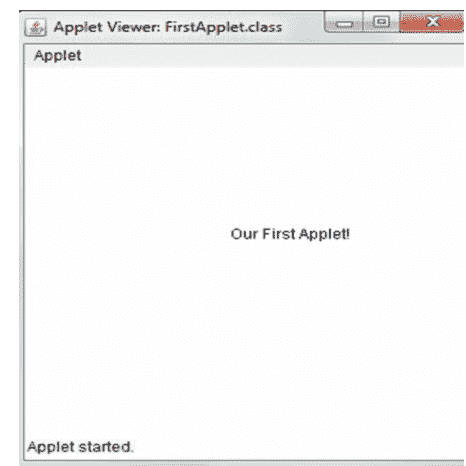

通过修改坐标来更改绘制文本的位置。它将改变文本在窗口上的位置。

尝试一下并查看生成的形状：

创建带有以下代码的文件 `MyPaint.java`：

```java
import java.applet.Applet;
import java.awt.*;
public class Mypaint extends Applet
{
    public void paint(Graphics gc){
        gc.drawOval(130, 40, 60, 50);
        gc.drawOval(120, 60, 10, 15);
        gc.drawOval(190, 60, 10, 15);

        gc.drawOval(160, 50, 10, 10);
        gc.drawOval(140, 50, 10, 10);
        gc.drawOval(150, 75, 15, 10);
        gc.drawRect(145, 90, 30, 30);
        gc.drawRect(120, 120, 80, 120);
        gc.drawRect(130, 240, 20, 120);
        gc.drawRect(170, 240, 20, 120);

        gc.drawRect(130, 360, 30, 20);
        gc.drawRect(170, 360, 30, 20);

        gc.drawLine(200, 160, 240, 240);
        gc.drawLine(240, 240, 280, 160);

        gc.drawRect(280, 130, 120, 30);
        gc.setColor(Color.blue);
        gc.fillRect(280, 130, 120, 30);

        gc.drawRect(280, 160, 120, 30);
        gc.setColor(Color.yellow);
        gc.fillRect(280, 160, 120, 30);

        gc.drawRect(280, 190, 120, 30);
        gc.setColor(Color.red);
        gc.fillRect(280, 190, 120, 30);
    }
}
```

带有以下代码创建新文件 `mycode.html`：

```html
<html>
<TITLE>Hello World</TITLE>
<HEAD>Our Hello Applet</HEAD>
<Applet code="MyPaint.class" width=500 height=500>
</applet>
</body>
</html>
```

编译 `MyPaint.java`，然后运行 `mycode2.html`。如下所示：

`javac MyPaint.java`

`appletviewer mycode.html`

这应该会给你输出：

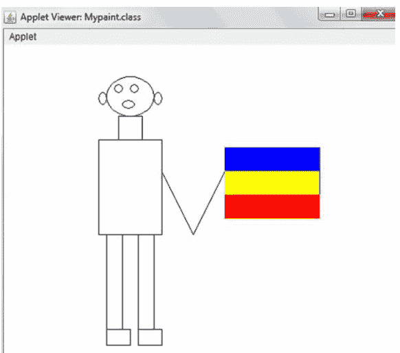

Graphics 库带有绘制许多形状的函数。要绘制椭圆，调用 `drawOval()` 方法。传递它的参数是椭圆的点。要绘制矩形，调用 `drawRect()` 方法并传递坐标来指定矩形的角。`drawLine()` 方法有助于绘制直线。`setColor()` 方法有助于设置颜色。

示例 3：

在 `OurPaintClass.java` 中编写此代码：

```java
import java.applet.Applet;
import java.awt.*;
public class OurPaintClass extends Applet {
    public void paint(Graphics g) {
        g.drawRect(120, 120, 160, 240);
        g.drawLine(120, 220, 440, 365);
    }
}
```

它的 HTML 代码如下：

```html
<html>
<TITLE>Hello World</TITLE>
<HEAD>Our Hello Applet</HEAD>
<applet code="OurPaintClass.class" width=500 height=500>
</applet>
</body>
</html>
```

编译 `OurPaintClass.java` 类，通过 `appletviewer` 运行 `OurPaint.html`。你将获得结果：

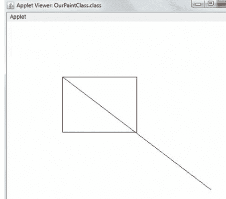

## 显示图像

可以在 applet 上显示图像，因为 applet 在游戏中很流行。`java.awt.Graphics` 类有一个用于显示的 `drawImage()` 方法。`getImage()` 方法返回图像对象。`getCodeBase()` 方法返回图片的 URL。

示例：

```java
import java.awt.*;
import java.applet.*;
public class ImageDisplay extends Applet {

    Image img;

    public void init() {
        img = getImage(getCodeBase(), "image.png");
    }

    public void paint(Graphics gc) {
        gc.drawImage(img, 30, 30, this);
    }
}
```

`drawImage()` 方法显示图像。它的第 4 个参数是观察者。将代码保存到名为 `ImageDisplay.java` 的文件中。向名为 `image.html` 的文件添加此代码：

```html
<html>
<body>
<applet code="ImageDisplay.class" width="350" height="350">
</applet>
</body>
</html>
```

通过命令 `javac ImageDisplay.java` 编译 Java 类，然后通过 `appletviewer` 调用 `image.html` 文件。如果在目录下指定了正确的图像，它将显示在窗口上。

## Applet 动画

由于 applet 在游戏中很常见，图像应该是移动的。示例：创建文件 `AnimationExample.java`。添加此代码：

```java
import java.applet.*;
import java.awt.*;
public class AnimationExample extends Applet {

    Image img;

    public void init() {
        img = getImage(getCodeBase(), "car.gif");
    }

    public void paint(Graphics gc) {
        for(int p=0; p<500; p++){
            gc.drawImage(img, p, 30, this);
        }
        try {
            Thread.sleep(100);
        } catch(Exception ex) {
        }
    }
}
```

`drawImage()` 方法帮助我们显示图像。创建一个名为 `animation.html` 的新文件，并添加此代码：

```html
<html>
<body>
<applet code="AnimationExample.class" width="350" height="300">
</applet>
</body>
</html>
```

编译 `.java` 类然后运行 `.html` 文件。确保在 `.java` 类中指定了正确的图像并将其保持在文件的同一目录下。运行代码后它会移动。

## Applet 事件

applet 上可以添加事件。在这里，我们为 applet 添加了一个事件，以便在点击按钮后显示消息：

创建文件 `Applet.java` 并添加此代码：

```java
import java.applet.*;
import java.awt.event.*;
import java.awt.*;
public class AppletEventExample implements ActionListener {
    Button btn;
    TextField txt;

    public void init() {
        txt = new TextField();
        txt.setBounds(30, 40, 150, 20);

        btn = new Button("Click");
        btn.setBounds(80, 150, 60, 50);

        add(btn);
        add(txt);
        btn.addActionListener(this);
        setLayout(null);
    }

    public void actionPerformed(ActionEvent ev) {
        txt.setText("Text on Applet");
    }
}
```

注意 applet 类实现了一个名为 `ActionListener` 的接口。它拥有用于监听动作事件并做出相应响应的方法。引入了新类：Button 类和 TextField 类。我们分别创建了这些类的实例，即 `btn` 和 `txt`，以获取一个按钮和一个文本框。文本 "Click" 被添加到按钮上，`setBounds()` 方法用于设置两者的边界。考虑这段：

`btn.addActionListener(this);`

该命令为我们的按钮添加了动作监听器事件，按钮将等待或监听被点击。点击后，将执行 `actionPerformed()` 方法中指定的动作。

创建一个名为 `myapplet.html` 的新文件并添加以下内容：

```html
<html>
<body>
<applet class="AppletEventExample.class" width="350" height="350">
</applet>
</body>
</html>
```

通过命令 `javac AppletEventExample.java` 编译你的 Java 代码，然后通过 `appletviewer myapplet.html` 调用 `.html` 文件。以下 applet 窗口将会弹出：

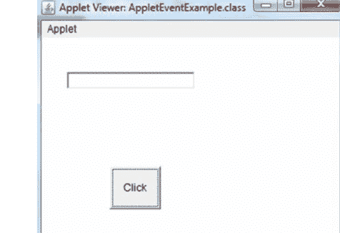

点击“Click”按钮。一条新消息将被到 `textfield` 中，如下所示：

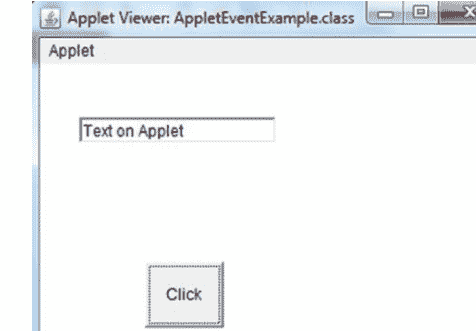

## Applet 参数

HTML 文件的信息可以作为 applet 的参数。这些参数可以通过 Applet 类的 `getParameter()` 方法获取。示例：

创建一个新文件 `AppletParameters.java`。添加此代码：

```java
import java.awt.Graphics;
import java.applet.Applet;

public class AppletParametersExample extends Applet{

    public void paint(Graphics g){

        String st=getParameter("message");

        g.drawString(st,50,50);

    }

}
```

为 HTML 代码创建一个新文件 `appletcode.html`：

```html
<html>

<body>

<applet code="AppletParameters.class" width="350" height="350">

<param name="message" value="Applet Parameters">

</applet>

</body>

</html>
```


在上述 HTML 代码中，`param name` 的值必须与 Java 类中传递给 `getParameter()` 的参数值完全匹配。

现在，通过 `javac AppletParametersExample.java` 命令编译你的 Java 代码将生成 `AppletParametersExample.class` 文件。通过 `appletviewer appletcode.html` 调用 html 代码。

随后你将得到所示的窗口：

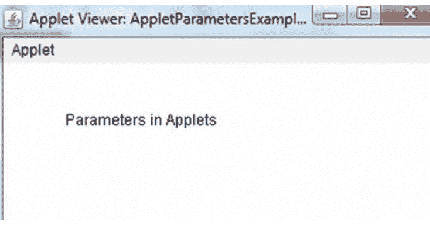

此文本是在 HTML 代码中 `param name` 的 value 属性中指定的。

# 16-Java 输入/输出

`java.io` 包包含了许多我们可以用来执行输入/输出任务的类。Java 中的输入/输出概念是通过使用流（streams）来实现的。流由 `java.io` 包提供，并支持不同类型的数据，包括局部变量、对象、基本数据类型等。

流简单来说就是数据的序列。有两种类型的流：

- `InputStream` – 用于从源读取数据。
- `OutputStream` – 用于向目标地写入数据。

## 字节流

Java 流由字节组成。Java 字节流执行 8 位字节的输入/输出操作。有几个类与字节流相关，但最常用的是 `FileInputStream` 和 `OutputStream`。让我们使用一个示例来演示如何使用这两个类：

```java
import java.io.*;

public class CopyingFiles {

    public static void main(String[] args) throws IOException {

        FileInputStream inp = null;
        FileOutputStream outp = null;

        try {

            inp = new FileInputStream("colleagues.txt");
            outp = new FileOutputStream("output.txt");

            int ch;

            while ((ch = inp.read()) != -1) {

                outp.write(ch);

            }

        } finally {

            if (inp != null) {

                inp.close();

            }

            if (outp != null) {

                outp.close();

            }

        }

    }

}
```

该代码将读取 `colleagues.txt` 文件的内容并将其复制到名为 `output.txt` 的新文件中。注意，后者将自动创建，并且内容会被复制进去。

## 字符流

字符流用于执行 16 位 Unicode 的输入和输出操作。有许多类与字符流相关。最流行的是 `FileReader` 和 `FileWriter`。内部，`FileReader` 使用了 `FileInputStream` 和 `FileOutputStream`，但它们之间的主要区别是 `FileReader` 每次读取两个字节，而 `FileWriter` 每次写入两个字节。让我们使用这两个类来重写我们之前的示例：

```java
import java.io.*;

public class CopyingFiles {

    public static void main(String[] args) throws IOException {

        FileReader in = null;
        FileWriter outp = null;

        try {

            in = new FileReader("colleagues.txt");
            outp = new FileWriter("output.txt");

            int ch;

            while ((ch = in.read()) != -1) {

                outp.write(ch);

            }

        } finally {

            if (in != null) {

                in.close();

            }

            if (outp != null) {

                outp.close();

            }

        }

    }

}
```

当你编译并运行代码时，它会将文件 `colleagues.txt` 的内容复制到名为 `output.txt` 的新文件中。

## 标准流

在每种编程语言中，都提供了一种方式，用户可以通过键盘输入输入，输入显示在计算机屏幕上。我们有三个标准流可以用于此目的：

- **标准输入 (Standard Input)** – 用于通过键盘向用户程序提供数据，并作为标准输入流。它使用 `System.in` 表示。
- **标准输出 (Standard Output)** – 用于通过计算机屏幕输出用户程序产生的数据，并作为标准输出流。它使用 `System.out` 表示。
- **标准错误 (Standard Error)** - 用于通过计算机屏幕输出用户程序生成的错误数据，并作为标准错误流。它使用 `System.err` 表示。

考虑下面给出的示例：

```java
import java.io.*;

public class ReadConsole {

    public static void main(String[] args) throws IOException {

        InputStreamReader inp = null;

        try {

            inp = new InputStreamReader(System.in);

            System.out.println("Enter 'q' to quit.");

            char ch;

            do {

                ch = (char) inp.read();

                System.out.print(ch);

            } while (ch != 'q');

        } finally {

            if (inp != null) {

                inp.close();

            }

        }

    }

}
```

从命令行编译并执行代码。在出现提示时，输入字母 `'q'` 然后按下 `enter` 键。看看发生了什么。

```
C:\Users\admin>javac ReadFromConsole.java
C:\Users\admin>java ReadFromConsole
Enter 'q' to quit.
q
C:\Users\admin>
```

你会注意到一旦你按下字母 `'q'` 然后按下 `enter` 键，程序就会退出。

你可以再次运行代码并在回车键后继续输入字母。如下所示：

```
C:\Users\admin>javac ReadFromConsole.java
C:\Users\admin>java ReadFromConsole
Enter 'q' to quit.
q
C:\Users\admin>
```

## 写文件

我们使用 `InputStream` 从源读取数据，使用 `OutputStream` 向目标写入数据。读写文件最重要的流是 `FileInputStream` 和 `OutputStream`。

`InputStream` 帮助我们从文件读取数据。我们可以通过使用 `new` 关键字创建对象，并访问广泛的构造函数。考虑下面的示例：

`InputStream f = new FileInputStream("java/names");`

在上述示例中，构造函数接受文件名作为字符串来创建文件的输入对象。考虑下一个示例：

```java
File f = new File("java/names");
InputStream f = new FileInputStream(f);
```

在上述情况下，我们有一个接受文件对象的构造函数，用于创建读取文件的**输入流**。我们首先使用了 `File()` 方法创建一个文件对象。

我们使用 `FileOutputStream` 用于创建文件并向其中写入一些数据。如果在打开之前没有找到文件，流将创建一个文件。

有两个构造函数，我们可以用于创建 `FileOutputStream` 对象。

**第一个**构造函数的使用如下所示：

`OutputStream f = new FileOutputStream("java/names")`

给定的构造函数接受文件名作为字符串创建写入文件的输入流对象。

**第二个**构造函数的使用如下所示：

```java
File f = new File("java/names");
OutputStream f = new FileOutputStream(f);
```

上述构造函数接受文件对象以创建一个用于写入文件的输出流对象。我们首先调用了 `File()` 方法来创建一个文件对象。以下示例展示了如何使用它们：

```java
import java.io.*;

public class FileStreamExample {

    public static void main(String args[]) {

        try {

            byte bWrite[] = {3};

            // 创建文件输出流
            FileOutputStream fos = new FileOutputStream("myfile.txt");

            // 写入字节数组
            fos.write(bWrite);

            // 关闭流
            fos.close();

        } catch (IOException e) {

            e.printStackTrace();

        }

    }

}
```

编译并运行该代码。它将生成一个名为 `myfile.txt` 的文件并将指定的数字写入该文件。请注意，这些数字将使用二进制格式写入。你在屏幕上看到的输出也是二进制格式的。

## 文件导航

Java 中有几个类可以帮助我们理解导航的概念。

## File 类

这个 Java 类以快捷的方式表示文件和目录路径。它是我们用于创建文件、删除目录、搜索文件等操作的类。我们使用 `file` 对象来表示磁盘上的真实文件/目录。下面的示例展示了我们如何创建一个 `File` 对象并使用它：

```java
import java.io.File;

public class FileExample {

    public static void main(String[] args) {

        File f = null;

        String[] sstrs = {"file1.txt","file2.txt"};

        try {

            // 遍历字符串数组中的每个字符串

            for(String s:sstrs) {

                // 创建新文件

                f = new File(s);

                // 检查是否为可执行文件

                boolean bool = f.canExecute();

                // 获取绝对路径

                String a = f.getAbsolutePath();

                // 返回绝对路径

                System.out.println(" executable: "+ bool);

            }

        } catch (Exception ex) {

            // 当发生 I/O 错误时

            ex.printStackTrace();

        }

    }

}
```

该代码将获取文件的目录，并告诉你这些文件是否可执行。

## FileReader 类

这是一个继承自 `InputStream` 类的 Java 类。我们用它来读取字符流。该类还带有许多构造函数，我们可以用于创建创建所需的对象。以下是该类提供的构造函数：

- `FileReader(File file)` - 这是一个用于在提供要读取的文件时创建新读取器的构造函数。
- `FileReader(Descriptor fd)` - 这是一个用于在提供要读取的文件描述符（`FileDescriptor`）时创建新 `FileReader` 的构造函数。
- `FileReader(String fileName)` - 这是一个用于在提供要读取的文件名时创建新 `FileReader` 的构造函数。

下面的示例展示了如何使用该类：

```java
import java.io.*;

public class ReadExample {

    public static void main(String[] args) throws IOException {

        File f = new File("hello.txt");

        // 创建文件

        f.createNewFile();

        // 创建一个 FileWriter 对象

        FileWriter wr = new FileWriter(f);

        // 将内容写入文件

        wr.write('\nA Java\n great\n example!\n');

        wr.flush();

        wr.close();

        // 创建一个 FileReader 对象

        FileReader fr = new FileReader(f);

        char [] ch = new char[50];

        fr.read(ch); // 将内容读到数组

        for(char c : ch) {

            System.out.print(c); // 打印字符

        }

        fr.close();

    }

}
```

该代码执行后将产生下面的输出：

```
C:\Users\admin>javac FileReadExample.java
C:\Users\admin>java FileReadExample
Java
great
example
C:\Users\admin>
```

## FileWriter 类

这是一个继承自 `OutputStream` 类的 Java 类。当我们需要写入字符流时，使用该类。该类带有许多可以用于创建对象的构造函数。它们包括：

- `FileWriter(File file)` - 这是一个在提供 `File` 对象时创建 `FileWriter` 的构造函数。
- `FileWriter(File file, boolean append)` - 这是一个在提供 `File` 对象并提供一个布尔值（显示是否追加现有数据）时创建 `FileWriter` 的构造函数。
- `FileWriter(FileDescriptor fd)` - 这是一个创建与给定文件描述符关联的 `FileWriter` 的构造函数。
- `FileWriter(String fileName)` - 此构造函数在提供文件名时创建 `FileWriter`。
- `FileWriter(String fileName, boolean append)` - 此构造函数在提供文件名并提供一个布尔值（显示是否追加写入的数据）时创建 `FileWriter`。

这里有一个示例如，展示了如何使用这个 Java 类的用法：

```java
import java.io.*;

public class FileReadExample {

    public static void main(String args[]) throws IOException {

        File f = new File("hello.txt");

        // 创建文件

        f.createNewFile();

        // 创建一个 FileWriter 对象

        FileWriter wr = new FileWriter(f);

        // 将内容写入文件

        wr.write("nJava\ngreat\nexample\n");

        wr.flush();

        wr.close();

        // 创建一个 FileReader

        FileReader fr = new FileReader(f);

        char[] ch = new char[50];

        fr.read(ch); // 将内容读到数组

        for(char c : ch) {

            System.out.print(c); // 打印字符

            fr.close();

        }

    }

}
```

## 列出目录

要查看特定目录下的所有目录和文件，可以使用 `File` 对象提供的 `list()` 方法。如下面的示例所示：

```java
import java.io.File;

public class ReadDirectory {

    public static void main(String[] args) {

        File f = null;

        String[] paths;

        try {

            // 创建一个新的文件对象

            f = new File("/tmp");

            // 获取文件列表数组

            paths = f.list();

            // 遍历路径数组中的每一项

            for(String path:paths) {

                // 输出文件名

                System.out.println(path);

            }

        } catch (Exception ex) {

            // 当发生任何错误时

            ex.printStackTrace();

        }

    }

}
```


## 异常处理

在程序的运行时，可能会出现意外情况并导致执行停止。我们需要一种机制来处理此类情况，以便程序能够无问题地执行。

程序运行期间发生的问题被称为异常。异常会破坏程序的正常流程，程序可能无法按预期工作。运行期间可能发生的异常包括用户输入无效数据、文件无法打开、网络连接丢失等。

考虑下面的示例，我们尝试访问一个不存在的文件：

```java
import java.io.File;
import java.io.FileReader;

public class ExceptionExample {
    public static void main(String[] args) {
        File f = new File("hello.txt");
        FileReader fr = new FileReader(f);
    }
}
```

该代码在编译时将产生以下异常：

```
C:\Users\admin>java ExceptionExample.java
ExceptionExample.java:8: error: unexpected exception FileNotFoundException; must be caught or declared to be thrown
FileReader fr = new FileReader(f);
error
C:\Users\admin>
```

`read()` 和 `write()` 方法抛出了 `IOException`，但 Java 编译器可以与 `FileNotFoundException` 一起处理它。

未检查异常是在程序运行时发生的一种异常。此类异常也被称为运行时异常。此类异常的例子是编程错误，例如 API 使用不当和逻辑错误。一个很好的例子是当你尝试访问越界的数组元素时，如下所示：

```java
public class ArrayException {
    public static void main(String[] args) {
        int values[] = {10, 25, 38, 46};
        System.out.println(values[6]);
    }
}
```

在上面的示例中，我们创建了一个包含 4 个元素的数组，但我们正尝试访问索引为 6 的元素。这将引发 `ArrayIndexOutOfBoundsException` 异常。

错误和异常之间存在区别。错误是发生的问题，且超出了程序员或用户的控制。错误通常是被忽略的代码，因为你对它们无能为力。一个很好的例子是发生在栈溢出（stack overflow）之后的错误。错误在编译期间会被忽略。

在 Java 中捕获异常，我们结合使用了 `try` 和 `catch` 关键字。将可能产生错误的代码用 `try/catch` 块包起来。放在 `try/catch` 块中的代码被称为受保护代码。以下是该语句的语法：

```java
try {
    // the protected code
} catch (ExceptionName ex1) {
    // the catch block
}
```

异常发生后，它将由你创建的 `catch` 块处理。每当你创建一个 `try` 块时，必须紧跟 `catch` 或 `finally` 块。如果发生的异常已经在 `catch` 块中定义，它将像参数传递给方法一样被传递。

这是一个示例：

```java
import java.io.*;

public class ArrayException {
    public static void main(String[] args) {
        try {
            int x[] = new int[3];
            System.out.println("Access element four : " + x[4]);
        } catch (ArrayIndexOutOfBoundsException ex) {
            System.out.println("Exception thrown : " + ex);
        }
        System.out.println("Outside the block");
    }
}
```

在上面的示例中，我们定义了一个有 3 个元素的数组，但我们试图访问它的第 4 个元素。代码执行后将返回以下结果：

```
Exception thrown : java.lang.ArrayIndexOutOfBoundsException: 4
Outside the block
```

## 多个 Catch 块

我们可以创建一个 `try` 块后跟多个 `catch` 块。这应该按照下面的语法进行：

```java
try {
    // the protected code
} catch (ExceptionType1 ex1) {
    // A Catch block
} catch (ExceptionType2 ex2) {
    // A Catch block
} catch (ExceptionType3 ex3) {
    // A Catch block
}
```

在上面的语法中，我们创建了三个 `catch` 块和一个 `try` 块。然而，对于单个 `try` 块可以使用任意数量的 `catch` 块。当受保护代码中发生异常时，它将抛给第一个 `catch` 块。如果异常的数据类型与 `ExceptionType` 匹配，则会在那里被捕获。如果没有发生这种情况，异常将抛给第二个 `catch` 块。这将一直持续到代码中所有的 `catch` 块。如果异常未被捕获，方法将停止执行。

以下是一个显示如何使用多个 `catch` 语句的代码示例：

```java
try {
    f = new FileInputStream(file_Name);
    x = (byte) f.read();
} catch (IOException io) {
    io.printStackTrace();
    return -1;
} catch (FileNotFoundException ex) { // Not valid!
    ex.printStackTrace();
    return -1;
}
```

## Throw/Throws 关键字

对于不处理受检异常的方法，必须通过使用 `throws` 关键字进行声明。该关键字应该添加到方法签的末尾。

可以使用 `throw` 关键字抛出异常，该异常可以是新实例化的，也可以是你刚刚捕获的异常。

了解并标记 `throw` 关键字和 `throws` 关键字之间的区别是非常重要的。我们使用 `throws` 关键字来推迟已受检异常的处理，而 `throw` 关键字用于显式地调用异常。

这是一个示例：

```java
import java.io.*;

public class ExceptionTest {
    public void save(double val) throws RemoteException {
        // Implement the method
        throw new RemoteException();
    }
    // The rest of class definition
}
```

在上面的示例中，我们有一个 `save()` 方法，它声明了它 `throws a RemoteException`。一个方法可以声明它将 `throw` 许多异常，此时你应该使用逗号 (,) 来分隔这些异常。

考虑下面的示例，它展示了如何实现这一点：

```java
import java.io.*;

public class ExceptionTest {
    public void save(double val) throws RemoteException, InadequateFundsException {
        // Implement the method
    }
    // The rest of class definition
}
```

## Finally 语句

`finally` 块位于 `try` 或 `catch` 块之后。无论是否发生异常，此块始终会被执行。`finally` 语句为你提供了一种运行清理类型语句的好方法，这些语句无论你的受保护代码内部发生了什么，都需要执行。它应该被添加到 `catch` 块的末尾，如下语法所示：

```java
try {
    // The protected code
} catch (Exception1 ex1) {
    // A Catch block
} catch (ExceptionType2 ex2) {
} catch (ExceptionType3 ex3) {
    // A Catch block
} finally {
    // The finally block to always execute.
}
```

下面的示例展示了这一点：

```java
public class ExceptionTest {
    public static void main(String[] args[]) {
        int x[] = new int[3];
        try {
            System.out.println("Access element four :" + x[4]);
        } catch (ArrayIndexOutOfBoundsException ex) {
            System.out.println("Exception thrown :" + ex);
        } finally {
            x[0] = 10;
            System.out.println("Element at index 0 is :" + x[0]);
            System.out.println("The finally statement has been executed");
        }
    }
}
```

代码将返回如下：

```
Exception thrown : java.lang.ArrayIndexOutOfBoundsException: 4
Element at index 0 is : 10
The finally statement has been executed
```

## Try-with-resources

除了你在括号内声明的资源外，其他一切都与普通 `try/catch` 块中的内容相似。你在 `try` 块中声明的资源将在 `try` 块开始之前实例化。`try` 块内声明的任何资源都将隐式声明为 `final`。

类要使用 `try-resources` 语句，必须实现 `AutoCloseable` 接口和 `close()` 方法，后者将被自动调用。Java 还允许在 `try-resources` 语句中使用多个类。如果你这样做，这些类必须以反序声明。

## 自定义异常

Java 允许你创建自己的异常。然而，你创建的任何异常都应该是 `Throwable` 的子类。每当你需要创建一个受检异常由 Handle 自动强制或设置规则时，你应该扩展 `Exception` 类。

为了创建我们自定义的异常，我们使用以下语法：

```java
class NewException extends Exception {
}
```

上面的语法显示，你只需要扩展预定义的 `Exception` 类即可创建你自己的异常。这些异常被称为受检异常。让我们展示如何在 Java 中创建一个异常：

```java
import java.io.*;

public class InadequateFundsException extends Exception {
    private double deposit;

    public InadequateFundsException(double deposit) {
        this.deposit = deposit;
    }

    public double getDeposit() {
        return deposit;
    }
}
```

```java
public class AccountCheck {
    private double account_balance;
    private int number;

    public AccountCheck(int number) {
        this.number = number;
    }

    public void save(double deposit) {
        account_balance += deposit;
    }

    public void withdraw(double deposit) throws InadequateFundsException {
        if (deposit <= account_balance) {
            account_balance = deposit;
        } else {
            double needs = deposit - account_balance;
            throw new InadequateFundsException(needs);
        }
    }

    public double getAccountBalance() {
        return account_balance;
    }

    public int getNumber() {
        return number;
    }
}
```

让我们展示如何调用 `AccountCheck` 类的 `save()` 和 `withdraw()` 方法：

```java
public class BankExample {
    public static void main(String[] args) {
        AccountCheck c = new AccountCheck(101);
        System.out.println("Depositing $1000...");
        c.save(1000.00);
        try {
            System.out.println("\nWithdrawing $200...");
            c.withdraw(200.00);
            System.out.println("\nWithdrawing $1100...");
            c.withdraw(1100.00);
        } catch (InadequateFundsException ex) {
            System.out.println("Sorry, your account is short $" + ex.getDeposit());
            ex.printStackTrace();
        }
    }
}
```

编译所有类并运行它们。最后应该抛出异常，因为你从账户中提取金额超过了你的余额。

# 18-Java AWT

AWT 代表抽象窗口工具包（Abstract Window Toolkit），它是我们用于在 Java 中开发基于窗口或 GUI 应用程序的 API。Java AWT 的组件是平台无关的，这意味着这些组件根据操作系统进行显示。该 API 是重量级的（heavyweight），意味着它的组件使用了操作系统的资源。

`java.awt` 包包含许多用于 AWT API 的类，如 `TextField`、`Label`、`CheckBox`、`TextArea`、`Choice` 和 `List`。让我们讨论其中一些重要的组件：

- **Container（容器）**：这是一种能够容纳文本字段、标签、按钮、文本区域等组件的 AWT 组件。它由 `Frame`、`Panel` 和 `Dialog` 等类扩展。
- **Window（窗口）**：这是一个没有菜单栏和边框的容器。要创建一个窗口，请使用 `dialog`、`frame` 或另一个 `window`。
- **Panel（面板）**：这是一个没有菜单栏和标题栏的容器。你可以向它添加文本字段和按钮等其他组件。
- **Frame（帧）**：这是一个带有标题栏的容器，并可能有菜单栏。你可以向它添加文本字段和按钮等其他组件。

该类带有不同的方法，最重要的包括以下：

- `public void add(Component c)`：此方法向组件中添加组件。
- `public void setSize(int width, int height)`：此方法设置组件的尺寸，包括宽度和高度。
- `public void setLayout(LayoutManager m)`：此方法定义组件的布局管理器。
- `public void setVisible(boolean status)`：这是我们用来更改组件可见性的方法。它的默认设置为 `false`。

我们需要创建一个 AWT 帧。为此我们需要一个帧。有两种方式可以创建：

- 通过继承 `Frame` 类（继承）。
- 通过创建 `Frame` 类的对象（关联）。

让我们通过继承 `Frame` 类来创建第一个示例。我们将在帧中添加一个按钮：

```java
import java.awt.*;

public class MyGui extends Frame {
    MyGui() {
        Button btn = new Button("click Here");
    }
}
```


## AWT 示例代码

```java
btn.setBounds(30, 100, 80, 30); // 设置按钮位置
add(btn); // 将按钮添加到帧中
setSize(300, 300); // 设置帧的大小，宽度300，高度300
setLayout(null); // 不使用布局管理器
setVisible(true); // 使帧可见，默认情况下它是不可见的
}

public static void main(String[] args[]) {
    MyGui mg = new MyGui();
}
}
```

该代码执行后将返回以下结果：

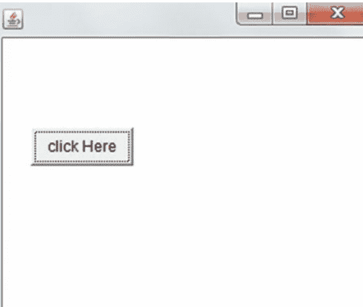

我们使用了 `setBounds()` 方法来为按钮设置位置。

现在让我们展示如何通过关联来创建 AWT：

```java
import java.awt.*;

public class MyGui {
    MyGui() {
        Frame fr = new Frame();
        Button btn = new Button("click Here");
        btn.setBounds(30, 50, 80, 30);
        fr.add(btn);
        fr.setSize(300, 300);
        fr.setLayout(null);
        fr.setVisible(true);
    }

    public static void main(String[] args[]) {
        MyGui mg = new MyGui();
    }
}
```

代码应该返回以下图形用户界面：


## 处理事件

事件指的是对象状态的改变。`java.awt.event` 提供了许多处理事件的类。要处理事件，必须在组件上注册监听器。事件示例包括鼠标点击、按键等。要处理事件，你需要创建一个实现监听器接口的类并在组件上注册。这是我们的第一个示例：

```java
import java.awt.*;
import java.awt.event.*;

class MyGui extends Frame implements ActionListener {
    TextField txt;

    MyGui() {
        txt = new TextField();
        txt.setBounds(60, 50, 170, 20);
        Button btn = new Button("click Here");
        btn.setBounds(100, 120, 80, 30);
        add(txt);
        add(btn);
        setSize(300, 300);
        setLayout(null);
        setVisible(true);
        btn.addActionListener(this);
    }

    public void actionPerformed(ActionEvent ev) {
        txt.setText("This is a message");
    }

    public static void main(String[] args[]) {
        new MyGui();
    }
}
```

我们还可以使用匿名类来处理事件。让我们通过示例来显示：

```java
import java.awt.*;
import java.awt.event.*;

class MyGui extends Frame {
    TextField txt;

    MyGui() {
        txt = new TextField();
        txt.setBounds(60, 50, 170, 20);
        Button btn = new Button("click Here");
        btn.setBounds(50, 120, 80, 30);
        add(txt);
        add(btn);
        setSize(300, 300);
        setLayout(null);
        setVisible(true);
        btn.addActionListener(new ActionListener() {
            public void actionPerformed(ActionEvent ev) {
                txt.setText("This is a message");
            }
        });
    }

    public static void main(String[] args[]) {
        new MyGui();
    }
}
```

```java
txtf.setText("This is a message");
}
);
add(btn);
add(txtf);
setSize(300, 200);
setLayout(null);
setVisible(true);
}
public static void main(String[] args) {
    new MyEvent3();
}
}
```

## AWT 按钮

我们使用 `Button` 类创建一个带有标签的按钮，这可以在任何平台上实现。也可以添加动作，以便按钮在被点击时执行某些操作。以下显示了如何使用该类来创建一个按钮：

```java
import java.awt.*;

public class MyButton {
    public static void main(String[] args) {
        Frame fr = new Frame("My Button");
        Button btn = new Button("Click Here");
        btn.setBounds(50, 100, 80, 30);
        fr.add(btn);
        fr.setSize(300, 400);
        fr.setLayout(null);
        fr.setVisible(true);
    }
}
```

代码执行后将返回以下内容：


我们可以如下所示给按钮添加 `ActionListener`：

```java
import java.awt.*;
import java.awt.event.*;

public class MyButton {
    public static void main(String[] args) {
        Frame fr = new Frame("My Button");
        final TextField txtf = new TextField();
        txtf.setBounds(50, 50, 150, 20);
        Button btn = new Button("Click Here");
        btn.setBounds(50, 100, 60, 30);
        btn.addActionListener(new ActionListener() {
            public void actionPerformed(ActionEvent ev) {
                txtf.setText("This is a message");
            }
        });
        fr.add(btn);
        fr.add(txtf);
        fr.setSize(400, 400);
        fr.setLayout(null);
        fr.setVisible(true);
    }
}
```

运行代码并点击按钮。文本将显示在文本字段中。


## AWT 标签

标签（`Label`）对象为我们提供了一种向容器添加文本的方法。我们使用它来显示一行只读的文本。应用程序可以编辑此文本，但用户可能无法直接更改。以下示例显示了如何在 Java 中创建标签：

```java
import java.awt.*;

class MyLabel {
    public static void main(String args[]) {
        Frame fr = new Frame("My Label");
        Label lab1 = new Label("Label 1");
        lab1.setBounds(50, 100, 100, 30);
        Label lab2 = new Label("Label 2");
        lab2.setBounds(50, 150, 100, 30);
        fr.add(lab1);
        fr.add(lab2);
        fr.setSize(400, 400);
        fr.setLayout(null);
        fr.setVisible(true);
    }
}
```

代码执行后应返回以下界面：


我们可以为标签添加动作监听器。以下示例显示了这一点：

```java
import java.awt.*;
import java.awt.event.*;

public class MyLabel extends Frame implements ActionListener {
    TextField txtf;
    Label lbl;
    Button btn;

    MyLabel() {
        txtf = new TextField();
        txtf.setBounds(50, 50, 150, 20);
        lbl = new Label();
        lbl.setBounds(50, 100, 250, 20);
        btn = new Button("Find IP");
        btn.setBounds(50, 150, 60, 30);
        btn.addActionListener(this);
        add(btn);
        add(txtf);
        add(lbl);
        setSize(400, 400);
        setLayout(null);
        setVisible(true);
    }

    public void actionPerformed(ActionEvent ev) {
        try {
            String host = txtf.getText();
            String ip = java.net.InetAddress.getByName(host).getHostAddress();
            lbl.setText("IP of host is " + ip);
        } catch (Exception ex) {
            System.out.println(ex);
        }
    }

    public static void main(String[] args) {
        new MyLabel();
    }
}
```

运行代码然后点击按钮。您应该获得当前主机的名称和 IP 地址，即您运行代码的主机：

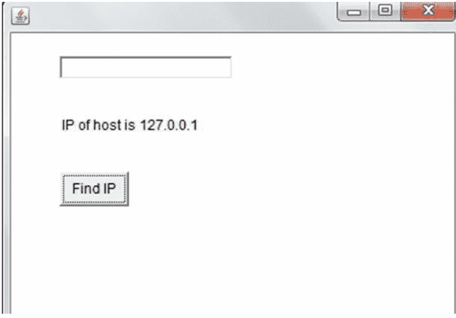

## AWT 文本字段

这是一个允许单行文本的组件，且文本是可编辑的。它继承自 `TextComponent` 类。

可以如下所示创建它：

```java
import java.awt.*;

class MyTextField {
    public static void main(String args[]) {
        Frame fr = new Frame("My TextField");
        TextField txtf1, txtf2;
        txtf1 = new TextField("Welcome to Java");
        txtf1.setBounds(50, 100, 200, 30);
        txtf2 = new TextField("Java is a great Language");
        txtf2.setBounds(50, 150, 200, 30);
        fr.add(txtf1);
        fr.add(txtf2);
        fr.setSize(400, 400);
        fr.setVisible(true);
    }
}
```

代码将返回下方的结果：

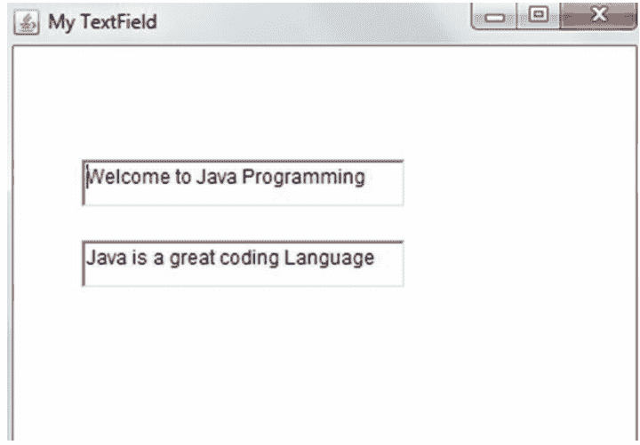

我们创建了两个带有文本的文本字段。尝试一下，你会发现这些文本字段是可以编辑的。我们可以为 `TextField` 添加动作监听器。让我们通过示例来演示这一点：

```java
import java.awt.*;
import java.awt.event.*;

public class MyTextField {
    TextField txtf1, txtf2, txtf3;
    Button btn1, btn2;

    MyTextField() {
        txtf1 = new TextField();
        txtf1.setBounds(50, 50, 150, 20);
        txtf2 = new TextField();
        txtf2.setBounds(50, 100, 150, 20);
        txtf3 = new TextField();
        txtf3.setBounds(50, 150, 150, 20);
        btn1 = new Button("+");
        btn1.setBounds(50, 200, 50, 30);
        btn2 = new Button("*");
        btn2.setBounds(100, 200, 50, 30);
        btn1.addActionListener(this);
        btn2.addActionListener(this);
        add(txtf1);
        add(txtf2);
        add(txtf3);
        add(btn1);
        add(btn2);
        setLayout(null);
        setVisible(true);
    }

    public void actionPerformed(ActionEvent ev) {
        int s1 = Integer.parseInt(txtf1.getText());
        int s2 = Integer.parseInt(txtf2.getText());
        if (ev.getSource() == btn1) {
            txtf3.setText(String.valueOf(s1 + s2));
        }
        if (ev.getSource() == btn2) {
            txtf3.setText(String.valueOf(s1 * s2));
        }
    }

    public static void main(String[] args) {
        new MyTextField();
    }
}
```

## AWT 复选框

点击后，其状态将根据当前状态切换为开启或关闭。以下是一个示例：

```java
import java.awt.*;

public class MyCheckbox {
    Frame fr = new Frame("My Checkbox");
    Checkbox cb1 = new Checkbox("Yes");
    cb1.setBounds(100, 100, 50, 50);
    Checkbox cb2 = new Checkbox("No", true);
    cb2.setBounds(100, 150, 50, 50);
    fr.add(cb1);
    fr.add(cb2);
    fr.setSize(450, 450);
    fr.setLayout(null);
    fr.setVisible(true);
}

public static void main(String args[]) {
    new MyCheckbox();
}
```

代码执行后将返回以下结果：


我们可以像下面所示向复选框添加一个 `ItemListener`：

```java
MyCheckbox2() {
    Frame fr = new Frame("My Checkbox");
    final Label lab = new Label();
    lab.setAlignment(Label.CENTER);
    lab.setSize(400, 100);
```


# AWT CheckboxGroup

我们通常创建一个 `CheckboxGroup` 类的对象，来帮助我们把许多复选框分组在一起。它继承自 `Object` 类。每组应该只有一个复选框处于“开启”状态，而组中的其他复选框则处于“关闭”状态。以下是一个示例：

```java
import java.awt.*;

public class MyCheckboxGroup {
    Frame fr = new Frame("My Checkbox");
    CheckboxGroup cg = new CheckboxGroup();
    Checkbox cb1 = new Checkbox("yes", cg, false);
    cb1.setBounds(100, 100, 50, 50);
    Checkbox cb2 = new Checkbox("No", cg, true);
    cb2.setBounds(100, 150, 50, 50);
    fr.add(cb1);
    fr.add(cb2);
    fr.setSize(400, 400);
    fr.setLayout(null);
    fr.setVisible(true);
}

public static void main(String args[]) {
    new MyCheckboxGroup();
}
```

代码将返回以下 GUI 界面：


你会发现每次只能勾选一个复选框。我们也可以向 `CheckboxGroup` 添加 `ItemListener`。下面的示例展示了这一点：

```java
import java.awt.*;
import java.awt.event.*;

public class MyCheckbox2 {
    MyCheckbox2() {
        Frame fr = new Frame("CheckboxGroup");
        final Label lab = new Label();
        lab.setAlignment(Label.CENTER);
        lab.setSize(400, 100);
        CheckboxGroup cg = new CheckboxGroup();
        Checkbox cb1 = new Checkbox("yes", cg, false);
        cb1.setBounds(100, 100, 50, 50);
        Checkbox cb2 = new Checkbox("No", cg, false);
        cb2.setBounds(100, 150, 50, 50);
        fr.add(cb1);
        fr.add(cb2);
        fr.add(lab);
        fr.setSize(400, 400);
        fr.setLayout(null);
        fr.setVisible(true);
        cb1.addItemListener(new ItemListener() {
            public void itemChanged(ItemEvent ev) {
                lab.setText("Yes checkbox: Checked");
            }
        });
        cb2.addItemListener(new ItemListener() {
            public void itemChanged(ItemEvent ev) {
                lab.setText("No checkbox: Checked");
            }
        });
    }

    public static void main(String[] args[]) {
        new MyCheckbox2();
    }
}
```

运行代码并点击任何复选框中的一个。你将在标签上看到一些文本。当你点击另一个复选框时，文本会改变：

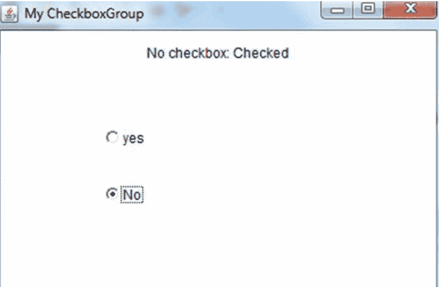

我们成功地向复选框组添加了一个 `ItemListener`。

# AWT Menu and MenuItem

这些用于向菜单中添加菜单和菜单项。可以通过一个示例来解释：

```java
import java.awt.*;

class MyMenu {
    MyMenu() {
        Frame fr = new Frame("Menu and MenuItem");
        MenuBar mnb = new MenuBar();
        Menu mnu = new Menu("File");
        Menu smn = new Menu("Save");
        MenuItem i1 = new MenuItem("New");
        MenuItem i2 = new MenuItem("Copy");
        MenuItem i3 = new MenuItem("Cut");
        MenuItem i4 = new MenuItem("Save");
        MenuItem i5 = new MenuItem("Save As");
        mnu.add(i1);
        mnu.add(i2);
        mnu.add(i3);
        smn.add(i4);
        smn.add(i5);
        mnb.add(mnu);
        mnb.add(smn);
        fr.setMenuBar(mnb);
        fr.setSize(400, 400);
        fr.setLayout(null);
        fr.setVisible(true);
    }

    public static void main(String args[]) {
        new MyMenu();
    }
}
```

运行代码你将得到一个窗口。点击窗口左上角的 File 菜单。你会在下面看到几个菜单项。点击 Save 选项以及添加到它的子菜单：

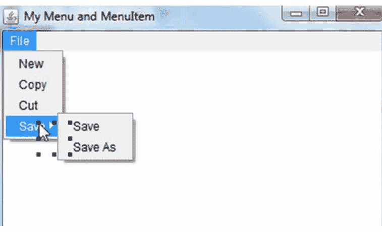

# KeyListener Interface

在你更改键的状态后，`KeyListener` 将收到通知。通知是针对 `KeyEvent` 进行的。你可以在 `java.awt.event` 包中找到 `KeyListener` 监听器。

`KeyListener` 接口有三个重要的方法，包括：

- `public abstract void keyPressed(KeyEvent ev);`
- `public abstract void keyReleased(KeyEvent ev);`
- `public abstract void keyTyped(KeyEvent ev);`

考虑给出的示例：

```java
import java.awt.*;
import java.awt.event.*;

public class MyKeyListener implements KeyListener {
    Label lab;
    TextArea area;

    MyKeyListener() {
        lab = new Label();
        lab.setBounds(20, 50, 100, 20);
        area = new TextArea();
        area.setBounds(20, 80, 300, 300);
        area.addKeyListener(this);
        add(lab);
        add(area);
        setSize(400, 400);
        setLayout(null);
        setVisible(true);
    }

    public void keyPressed(KeyEvent ev) {
        lab.setText("Key Pressed!");
    }

    public void keyReleased(KeyEvent ev) {
        lab.setText("Key Released!");
    }

    public void keyTyped(KeyEvent ev) {
        lab.setText("Key Typed!");
    }

    public static void main(String[] args) {
        new MyKeyListener();
    }
}
```

执行代码并尝试在提供的文本区域输入内容。你会看到标签上的文本根据你的键盘操作而改变。

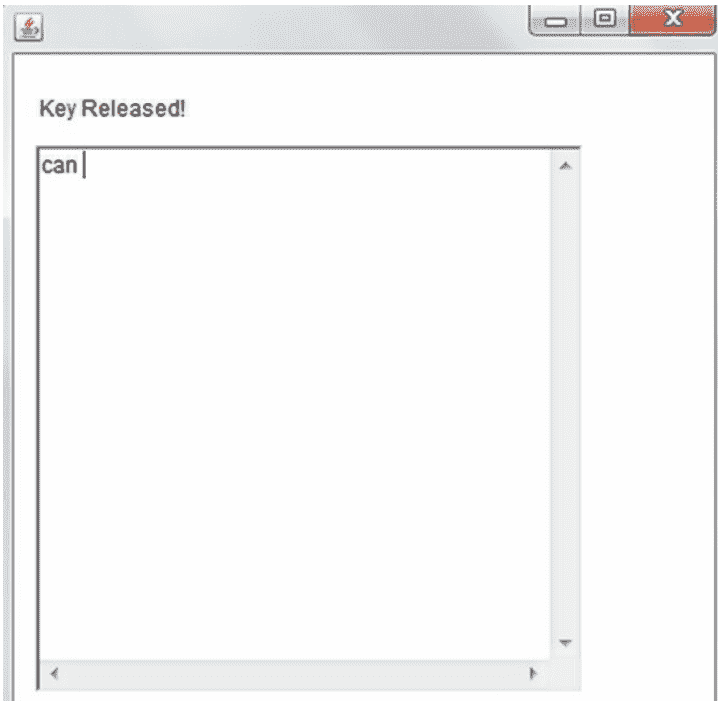

# Conclusion

本书到此结束。Java 是一种编程语言。它作为广泛使用的编程语言之一非常流行。使用 Java 可以实现很多功能。它非常适合开发桌面应用程序，通常称为独立应用程序。它可以嵌入网页中。学习 Java 很容易，特别是如果你有面向对象的编程背景。Java 支持面向对象等特性。编写 Java 代码需要编译器。这告诉你 Java 是编译的，而不是解释的。编译器在安装 JDK（Java 开发包）后会自动安装。

# 关于作者

Daniel Bell 出生于纽约布朗克斯。九岁时，他跟随父亲 Guy Bell 搬到了法国尼斯。他于 2012 年在尼斯大学获得计算机科学博士学位。Daniel 目前正在进行数据管理方面的研究，重点是大数据和数据共享相关主题，如概率数据、数据定价、并行数据处理和数据安全。他利用休息时间编写关于计算机编程和数据科学的书籍，帮助编程初学者轻松编程。他住在巴黎附近的 Chatillon。

# 致谢

首先，我要诚挚地感谢我的家人，我的妻子 Genevieve 和儿子 Adan 在我日常生活中提供的持续支持，感谢他们的耐心、动力和热情。除了家人，我还要感谢我的朋友和同事们：Jule Villepreux 教授、Hugo D. 和 James Rivera 博士，感谢他们的鼓励、富有见解的评论以及挑战性的问题。我感谢我的实验室伙伴们：Gang Yu、Ting Fan、Djibrilla Diallo 和 Juan Sanchez，感谢那些发发启发性的讨论，感谢我们在截止日期前并肩作战的那些不眠夜晚，以及我们度过的所有愉快时光。最后但同样重要的是，我要感谢我的父母 Guy Bell 和 Ezra Bell，感谢他们给了我生命并在我一生中给予我精神上的支持。


www.guzzlermedia.com
