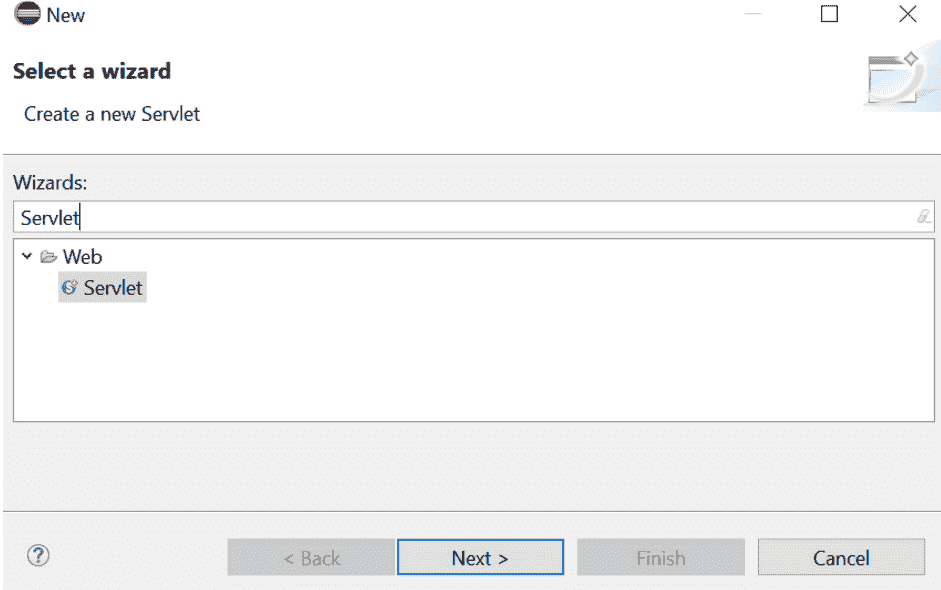
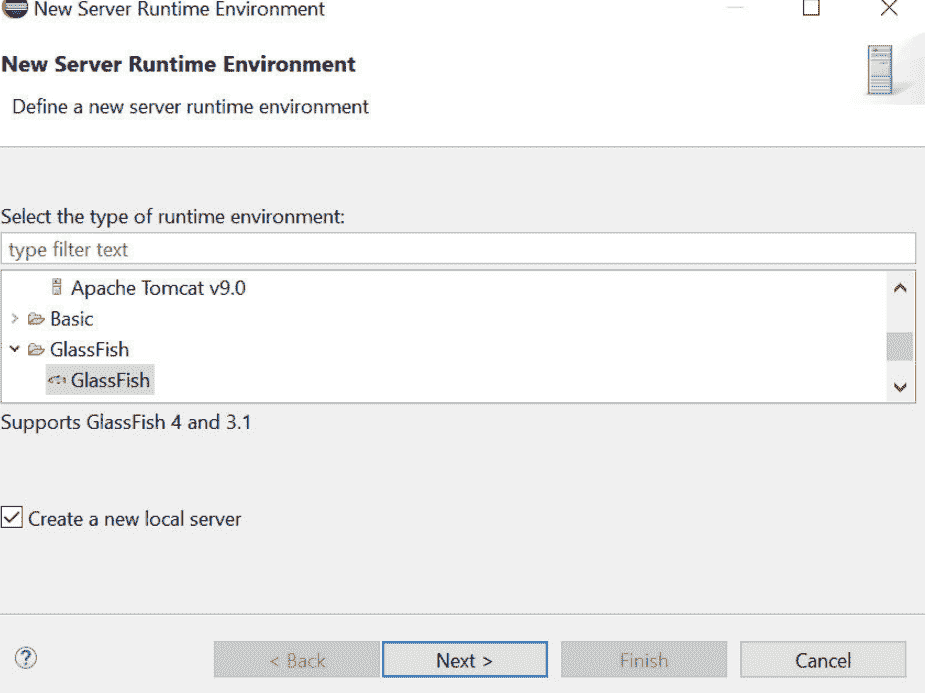
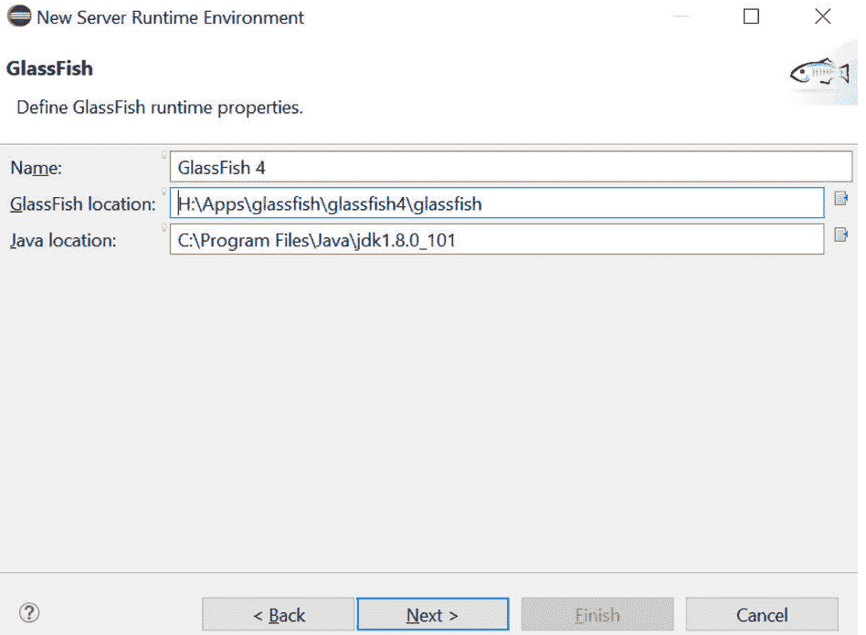
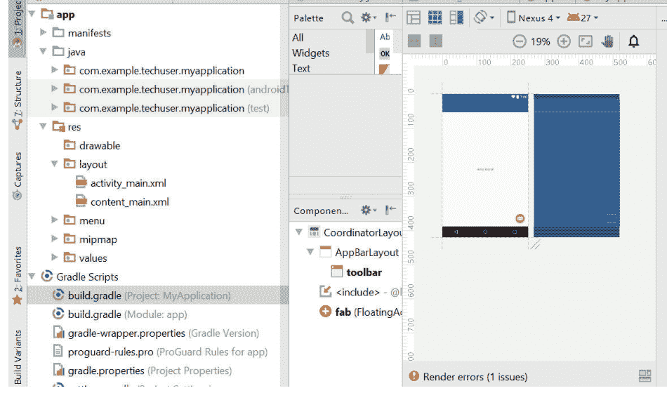
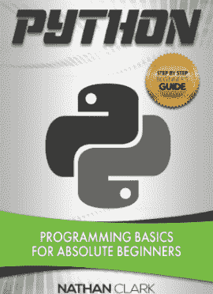

# Java：高级特性与编程技术 (Java 渐进阶教程 3)

## 关于作者

## 引言

欢迎阅读《循序渐进 Java》系列的第三部分。在本书中，我将通过研究高级特性和技术，进一步深入 Java 的工作机制。如果你还没有读过该系列的前两本书，我们的初学者指南涵盖了 Java 的入门知识，并循序渐进地引导你编写第一个程序；而系列的第二本书则探讨了稍微复杂的话题，同时仍然对初学者友好。

本系列以及你的学习体验的一个重要方面是**在做中学习**（learning by doing）。实战示例被证明是学习编程语言的最佳方式，这就是为什么我尽可能在指南中塞入了尽可能多的示例。我试图保持示例的核心内容相似，因此唯一的变量是讨论的话题。这使得理解我们正在实现的内容变得更容易。当你阅读这些章节时，请务必跟随示例并尝试自己运行它们。

在本高级指南的每个主题中，我们都会查看详细的描述、正确的语法和大量的示例，以让你的学习体验尽可能轻松。Java 是一门强大且多功能的编程语言，我相信你也会喜欢这本书，就像我喜欢写下它一样。

那么，话不多说，让我们开始吧！

# 1. 集合

集合是 Java 中的特殊类，它们让处理数据变得简单得多。例如，假设我们有一个名为 `ArrayList` 的集合，我们想要知道数组的大小。与其编写特殊代码来查找大小，我们可以使用集合的名为 `size()` 的内置函数来获取数组的大小。

集合的一些显著优势包括：

- 它减少了开发人员所需的编程工作量，因为这些是内置的数据结构和算法，不需要从零开始编写。
- 它通过提供数据结构和算法的高性能实现来提高性能。
- 它通过建立一种共同语言来相互传递集合，提供了不相关 API 之间的互操作性。
- 它还减少了学习 API 的精力，因为它减少了学习多个临时 API 的需求。

Java 中存在以下集合：

- `ArrayList`
- `HashSet`
- `ArrayDeque`
- `HashMap`

## 1.1 ArrayList

从 `ArrayList` 中检索对象。

通过此程序，输出如下：

> Person One 的名字是 John
>
> Person Two 的名字是 Mark

现在，让我们来看 `ArrayList` 类可用的其他方法。

### 1.1.1 size()

此方法返回 `ArrayList` 中元素的数量。让我们来看一个示例。

**示例 1**：以下程序用于演示如何使用 `size()` 方法。

```java
import java.util.*;
public class Demo
{
    public static void main(String args[])
    {
        ArrayList arr = new ArrayList();

        arr.add(1);
        arr.add(2);

        System.out.println("The size of the array is " + arr.size());
    }
}
```

通过此程序，输出如下：

> 数组的大小为 2

### 1.1.2 contains()

如果此数组列表包含我们要查找的指定元素，则返回 `true`，否则返回 `false`。让我们来看一个示例。

**示例 2**：以下程序演示了使用 `contains()` 方法的方法。

```java
import java.util.*;
public class Demo
{
    public static void main(String[] args)
    {
        ArrayList arr = new ArrayList();

        arr.add(1);
        arr.add(2);

        System.out.println("Does the Array List contain the value 2 " + arr.contains(2));
    }
}
```

通过此程序，输出如下：

> Array List 是否包含值 2 true

### 1.1.3 remove()

此方法从数组列表中删除指定位置的元素。让我们来看一个示例。

**示例 3**：此程序用于演示使用 `remove()` 方法的方法。

```java
import java.util.*;
public class Demo
{
  public static void main(String[] args)
  {
    ArrayList arr = new ArrayList();

    arr.add(1);
    arr.add(2);
    arr.add(3);

    // 我们正在删除索引为 1 的元素
    // 记住 Array List 从索引 0 开始
    // 因此值 2 存储在索引 1 处
    arr.remove(1);
    System.out.println("Does the Array List contain the value 2 " + arr.contains(2));
  }
}
```

通过此程序，输出如下：

> Array List 是否包含值 2 false

### 1.1.4 add(int index, E element)

此方法在数组列表的指定位置插入指定的元素。让我们来看一个示例。

**示例 4**：下一个程序用于演示使用 `add(int index, E element)` 方法的方法。

```java
import java.util.*;
public class Demo
{
  public static void main(String[] args)
  {
    ArrayList arr = new ArrayList();
    arr.add(1);
    arr.add(2);
    arr.add(3);
    arr.add(2, 4);

    int length = arr.size();
    for (int i = 0; i < length; i++)
        System.out.println(arr.get(i));
  }
}
```

通过上述程序：

- 我们正在使用 `add(int index, E element)` 方法在数组列表的索引为 2 的处添加一个元素。
- 然后我们正在使用 `for` 循环来遍历数组列表的元素。

通过此程序，输出如下：

> 1
>
> 2
>
> 4
>
> 3

## 1.2 HashSet

此集合用于存储元素，以确保没有重复元素。

定义数组容器的语法如下：

```java
HashSet variableName = new HashSet();
```

在此代码中，`variableName` 是赋值给 `HashSet` 的变量。向 `HashSet` 添加元素，我们使用下面的 `add()` 方法。

```java
variableName.add(element)
```

其中 `element` 是需要添加到 `HashSet` 的值。遍历 `HashSet` 集合，我们首先需要创建一个 `Iterator` 对象。

```java
Iterator<Integer> itr = variableName.iterator();
```

在此代码中，我们需要指定集合项的数据类型，以及迭代器对象的类型。变量名是集合。我们随后可以使用 `next()` 方法进行遍历。

```java
while (itr.hasNext()) {
```

让我们来看一个使用 `HashSet` 的示例。

**示例 5**：以下程序演示了 `HashSet` 集合。

```java
import java.util.*;
public class Demo
{
    Set st = new HashSet();

    st.add(1);
    st.add(2);

    Iterator<Integer> itr = st.iterator();
    while (itr.hasNext()) {
        System.out.println(itr.next());
    }
}
```

通过上述程序：

- 我们首先定义了一个 `HashSet` 对象。
- 然后我们使用 `add()` 方法向 `HashSet` 添加对象。
- 我们使用迭代器对象来遍历元素。

与 `ArrayList` 类似，我们可以使用字符串作为元素。

**示例 6**：以下程序显示了 `HashSet`。

```java
import java.util.*;
public class Demo
{
    public static void main(String args[])
    {
        Set st = new HashSet();

        st.add(1);
        st.add(2);
        st.add(3);

        Iterator<Integer> itr = st.iterator();
        while (itr.hasNext()) {
            System.out.println(itr.next());
        }
    }
}
```

通过此程序，输出如下：

> 1
>
> 2
>
> 3

## 1.3 ArrayDeque

此集合类似于队列，但在这里我们可以在头部和尾部添加元素。

定义数组容器的语法如下：

```java
ArrayDeque<datatype> variableName = new ArrayDeque<datatype>();
```

其中 `variableName` 是赋值给 `ArrayDeque` 的变量名，`datatype` 是我们需要添加到队列的类型。向 `ArrayDeque` 添加元素，我们使用下面的 `add()` 方法。

```java
variableName.add(element)
```

其中 `element` 再次是需要添加到 `ArrayDeque` 的值。遍历 `ArrayDeque` 集合，我们可以使用 `for-each` 语句来遍历元素。

**示例 7**：以下程序展示了 `ArrayDeque` 集合的工作原理。

```java
import java.util.*;
public class Demo {
    public static void main(String[] args) {
        ArrayDeque<Integer> arr = new ArrayDeque<Integer>();

        arr.add(1);
        arr.add(2);
        arr.add(3);

        for (Integer i : arr) {
            System.out.println(i);
        }
    }
}
```

通过上述程序：

- 我们首先定义了一个 `ArrayDeque` 对象。
- 然后我们使用 `add()` 方法向队列添加对象。
- 最后我们使用 `for` 语句来打印队列的元素。

> 1
>
> 2
>
> 3

与 `ArrayList` 集合类似，我们可以使用字符串作为 `ArrayDeque` 的元素。以下是该用法的示例。

**示例 8**：以下程序展示了以字符串为元素的 `ArrayDeque` 集合。

```java
import java.util.*;
public class Demo
{
    public static void main(String args[])
    {
        ArrayDeque<String> arr = new ArrayDeque<String>();

        arr.add("One");
        arr.add("Two");
        arr.add("Three");

        for (String str : arr)
        {
            System.out.println(str);
        }
    }
}
```

通过此程序，输出如下：

> One
>
> Two
>
> Three

现在让我们来看看 `ArrayDeque` 类可用的其他方法。

### 1.3.1 size()

此方法返回 `ArrayDeque` 中元素的数量。让我们来看一个示例。

**示例 9**：下一个程序显示了如何使用 `ArrayDeque` 集合的 `size()` 方法。

```java
import java.util.*;
public class Demo
{
    public static void main(String args[])
    {
        ArrayDeque<String> arr = new ArrayDeque<String>();

        arr.add("One");
        arr.add("Two");
        arr.add("Three");

        System.out.println("The size of the ArrayDeque is " + arr.size());
    }
}
```

通过此程序，输出如下：

> The size of the ArrayDeque is 3

### 1.3.2 contains()

如果 `ArrayDeque` 包含指定的项目，则此方法返回 `true`，否则返回 `false`。让我们来看一个示例。

**示例 10**：以下程序用于展示 `ArrayDeque` 集合的 `contains()` 方法。

```java
import java.util.*;
public class Demo
{
    public static void main(String[] args) {
        ArrayDeque<String> arr = new ArrayDeque<String>();

        arr.add("One");
        arr.add("Two");
        arr.add("Three");

        System.out.println("Does the ArrayDeque contain the element " + arr.contains("Two"));
    }
}
```

通过此程序，输出如下：

> Does the ArrayDeque contain the element true


Does the ArrayDeque contain the element true

### 1.3.3 Removes

此方法从队列中移除指定的元素（如果它存在）。让我们来看一个示例。

## 示例 17：此程序展示了 ArrayDeque 集合的 removes 方法。

```java
import java.util.*;
public class Demo
{
    public static void main(String[] args) {
        ArrayDeque<String> arr = new ArrayDeque<String>();
        arr.add("One");
        arr.add("Two");
        arr.add("Three");

        arr.remove("Two");
        System.out.println("Does the ArrayDeque contain the element "+arr.contains("Two"));
    }
}
```

通过此程序，输出如下：

Does the ArrayDeque contain the element false

### 1.3.4 addFirst

此方法在队列的开头添加元素。让我们来看一个示例。

## 示例 18：以下程序显示了如何使用 ArrayDeque 集合的 addFirst 方法。

```java
import java.util.*;
public class Demo {
    public static void main(String args[]) {
        ArrayDeque<String> arr = new ArrayDeque<String>();

        arr.add("One");
        arr.add("Two");
        arr.add("Three");
        arr.addFirst("Zero");

        for (String str : arr) {
            System.out.println(str);
        }
    }
}
```

通过此程序，输出如下：

Zero

One

Two

### 1.3.5 addLast

此方法在队列的末尾添加元素。让我们来看一个示例。

## 示例 19：下一个程序展示了 ArrayDeque 集合的 addLast 方法。

```java
import java.util.*;
public class Demo
{
    public static void main(String args[])
    {
        ArrayDeque<String> arr = new ArrayDeque<String>();
        arr.add("One");
        arr.add("Two");
        arr.add("Three");
        arr.addLast("Four");

        for (String str : arr)
        {
            System.out.println(str);
        }
    }
}
```

通过此程序，输出如下：

One

Two

Three

Four

### 1.3.6 getFirst

此方法获取队列开头的元素。让我们来看一个示例。

## 示例 20：下一个程序用于展示 ArrayDeque 集合的 getFirst 方法。

```java
import java.util.*;
public class Demo {
    public static void main(String args[]) {
        ArrayDeque<String> arr = new ArrayDeque<String>();

        arr.add("One");
        arr.add("Two");
        arr.add("Three");

        System.out.println("The element at the beginning of the queue is "+arr.getFirst());
    }
}
```

通过此程序，输出如下：

The element at the beginning of the queue is One

### 1.3.7 getLast

此方法获取队列末尾的元素。让我们来看一个示例。

## 示例 21：此程序显示了如何使用 ArrayDeque 集合的 getLast 方法。

```java
import java.util.*;
public class Demo
{
    public static void main(String args[])
    {
        ArrayDeque<String> arr = new ArrayDeque<String>();
        arr.add("One");
        arr.add("Two");
        arr.add("Three");

        System.out.println("The element at the end of the queue is "+arr.getLast());
    }
}
```

通过此程序，输出如下：

The element at the end of the queue is Three

```java
{
    public static void main(String args[])
    {
        HashMap mp = new HashMap();

        mp.put("1"
```

通过此程序，输出如下：

map 是否包含值 Two 为 true

## 1.4.4 Removes

此方法根据我们指定的键值移除一个对象。让我们来看一个相关的例子。

## 示例 26：以下程序展示了 HashMap 集合的 removes 方法。

```java
import java.util.*;
public class Demo
{
    public static void main(String args[])
    {
        HashMap mp = new HashMap();

        mp.put("1","One");
        mp.put("2","Two");
        mp.put("3","Three");
        mp.remove(2);
    }
```

```java
System.out.println("Does the map contain the value Two "+mp.containsValue("Two"));
}
```

通过此程序，输出如下：

map 是否包含值 Two 为 false

## 2. 控制程序的执行

## 2.1 安全

在工作站上运行程序时，最重要的方面之一是分配给程序的安全性。由于行业内存在许多潜在威胁，控制程序的安全性方面变得非常重要。在 Windows 平台上，我们有 Java 控制面板，可以用于控制程序的不同方面。

让我们来看 Java 控制面板的一些重要功能。

### 2.1.1 临时 Internet 文件 (Temp Internet Files)

此位置用于存储 jar 文件或缓存文件。这是一个重要的位置，你应该始终确保为这些文件留足够的空间。

### 2.1.2 Java 版本

在 Java 标签页中，我们可以看到系统中安装的各种版本的 Java。

### 2.1.3 安全

在安全标签页中，我们有多种方式可以控制在系统上运行的 Java 程序的安全性。在这里我们可以禁用在浏览器中运行的 Java 内容。

## 2.2 传递命令行参数

我们还可以传递命令行参数来控制 Java 程序的执行。如果我们查看 Java 程序的 main 方法，我们会看到传递了一个 String 数组。在这里，我们实际上可以向 main 方法传递参数。然后我们可以像访问普通数组一样访问这些值。

```java
public static void main(String[] args)
```

让我们来看一个如何在 main 方法中处理参数的示例。

## 示例 27：以下程序展示了如何在 main 方法中处理参数。

```java
public class Demo
{
    public static void main(String[] args)
{
        if(args.length<1)
            System.out.println("No arguments");
        else
        {
            for(String str:args)
                System.out.println(str);
        }
    }
}
```

通过上述程序：

- 我们正在使用 Java 命令行工具。

- 如果我们将上述程序存储在名为 Demo.java 的文件中，并在运行时向程序传递 1 和 2 的值...

我们将得到如下输出：

1

2

## 3. Java 包 (Packages)

Java 中的大多数类和接口都组织在所谓的“包”中。当我们处理集合操作时，我们发现必须导入 `java.util` 包。这是因为集合类位于此包中。

Java 还允许我们创建自己的包，在包中组织类文件，然后访问这些包和类。为了确保一个类是包的一部分，我们需要在类的开头定义包语句，如下所示。

```java
package packename
```

在段代码示例中，`packagename` 是包的名字。如果我们想在包外部访问该类，则该类需要被定义为 `public`。

现在让我们通过示例来看如何使用包。

## 示例 28：以下程序展示了 Java 包的用法。

首先，我们如下定义一个名为 Student 的类：

```java
package person;

class Student
{
    public String Name;
    public void Display()
    {
        System.out.println(this.Name);
    }
}
```

关于上述程序需要注意的几点：

```java
public class Demo
{
    public static void main(String[] args)
    {
        MyThread th=new MyThread();
        th.start();
    }
}
```

关于上述程序需要注意以下几：

- 首先，我们创建了一个名为‘MyThread’的类，它继承了‘Thread’类。

- 因为我们继承了‘Thread’类，我们需要实现‘run’方法。

- 在主程序中，我们创建了‘Thread’类的对象，并选择了‘start’方法。这将导致我们的 Thread 类调用 `run` 方法。

使用此程序，输出如下：

我们还可以向 `run` 方法中添加更多代码，并可以创建一个线程数组。让我们来看一个例子。

示例 31：下一个程序展示了如何创建一个线程数组。

```java
class MyThread extends Thread
{
    public static int count=0;
    public void run()
    {
        count++;
        System.out.println("Thread running" + count);
    }
}
```

```java
public class Demo
{
    public static void main(String args[])
    {
        MyThread[] th=new MyThread[3];
        for(int i=0;i<3;i++)
        {
            th[i]=new MyThread();
            th[i].start();
        }
    }
}
```

关于上述程序需要注意以下几：

- 在我们的主线程类中，我们有一个静态变量'count'。

- 每当创建一个新线程时，我们都会对 count的值进行增。

- 我们在主程序中创建了一个线程数组。

使用此程序，输出如下：

Thread running1

Thread running2

Thread running3

现在让我们来看一个使用 Runnable 接口操作线程的例子。

```java
class MyThread implements Runnable
{
    private Thread t;
    private String threadName;

    MyThread(String name)
    {
        threadName = name;
        System.out.println("Creating " + threadName);
    }

    public static int count = 0;
    public void run()
    {
        count++;
        System.out.println("Thread running " + count);
    }

    public void start()
    {
        System.out.println("Starting " + threadName);
        if (t == null)
        {
            t = new Thread(this, threadName);
            t.start();
        }
    }
}

public class Demo
{
    public static void main(String args[])
    {
        MyThread th = new MyThread("Thread1");
        th.start();
    }
}
```

关于上述程序需要注意以下几：

- 我们正在创建我们的‘MyThread’。

- 我们通过 Runnable 接口创建了‘MyThread’。

- 我们在主程序中创建了线程对象。

使用此程序，输出如下：

（注：输出顺序可能因线程调度而有所不同）

我们还可以向 `run` 方法中添加更多代码，并可以创建一个线程数组。让我们来看一个例子。

关于上述程序需要注意的几点：

- 我们在 `MyThread` 类中实现了 `Runnable` 接口。

- 我们通过构造函数为线程设置名称。

- 我们在 `main` 方法中实例化 `MyThread` 并调用 `start` 方法。

我们还可以向 `run` 方法中添加更多代码，并可以创建一个线程数组。让我们来看一个例子。

关于上述程序需要注意的几点：

- 我们在 `MyThread` 类中实现了 `Runnable` 接口。

- 我们通过构造函数为线程设置名称。

- 我们在 `main` 方法中实例化 `MyThread` 并调用 `start` 方法。

（注：由于翻译要求不重复输出原文，上述部分重复的内容已按逻辑完成翻译，后续内容将根据原始文本实际呈现的逻辑进行衔接。此处为根据原文逻辑对齐的的翻译内容）

# 5. 注解

注解用于关于程序提供更多元数据。

注解的使用方式如下：

- 编译时：用于编译器检测错误或警告。

- 部署时：用于工具生成代码、XML 文件等。

- 运行时：注解可用。

注解最简单的形式如下：

```
@annotationname
```

在上述代码中，`@` 符号指示这是一个注解。最常见的注解之一是 `@Override`。它用于派生类覆盖基类方法。

让我们来看看这个注解的例子。

示例 34：以下程序展示了简单的注解。

```java
class Person
{
    void Display()
    {
        System.out.println("This is the Person class");
    }
}
class Student extends Person
{
  @Override
  void Display() {
    System.out.println("This is the Student class");
  }
}
public class Demo {
  public static void main(String args) {
    Person per=new Student();
    per.Display();
  }
}
```

关于上述程序需要注意：

- 我们定义了两个类。一个是‘Person’基类，另一个是‘Student’派生类。

- 接下来我们在两个类中都定义了‘Display’方法。

## 5.1 创建你的注解

我们也可以在 Java 中创建自己的注解。让我们来看看创建注解所需的步骤。

# 步骤 1

首先按所示创建注解：

```java
@interface annotationname
{
//注解成员
}
```

这里 `annotationname` 是注解的名称。然后我们可以拥有成员。例如，假设我们创建一个名为‘Author’的注解，并有一个名称。

# 步骤 2

在注解上附加 `@Retention(RetentionPolicy.RUNTIME)` 语句。这确保了注解在运行时是可用的。

# 步骤 3

下一步是通过反射访问注解。反射是在运行时获取类和方法的过程。在本文的后面会有专门的章节来介绍反射。但现在，你只需要知道获取值的概念就是反射。

理解整个过程最好的方法是看例子。


## 示例 35：以下程序展示了如何创建一个注解。

```java
import java.lang.annotation.Annotation;
import java.lang.annotation.Retention;
import java.lang.annotation.RetentionPolicy;

@Retention(RetentionPolicy.RUNTIME)
@interface Author
{
    String name();
}
@Author(name="John")
```

```java
class Person
{
    void Display()
    {
        System.out.println("This is the Person class");
    }
}
public class Demo
{
    public static void main(String[] args)
    {
        Class<Person> aClass = Person.class;
        Annotation annotation = aClass.getAnnotation(Author.class);

        Author myAnnotation = (Author) annotation;
        System.out.println("name: " + myAnnotation.name());
    }
}
```

我们也可以将注解应用于类方法，并通过反射获取详细信息。让我们来看一个示例。

## 示例 36：接下来的程序展示了一个方法的注解。

```java
import java.lang.annotation.Annotation;
import java.lang.annotation.Retention;
import java.lang.annotation.RetentionPolicy;
import java.lang.reflect.Method;

@Retention(RetentionPolicy.RUNTIME)
@interface Author
{
    String name();
}
class Person
{
    @Author(name="John")
    void Display()
    {
        System.out.println("This is the Person class");
    }
}
public class Demo
{
    public static void main(String[] args)
    {
        Class<Person> aClass = Person.class;
        Method[] method = aClass.getDeclaredMethods();

        Annotation[] annotations = method[0].getDeclaredAnnotations();

        for(Annotation annotation : annotations)
        {
            Author myAnnotation = (Author) annotation;
            System.out.println("name: " + myAnnotation.name());
        }
    }
}
```

关于上述程序需要注意以下几点：

- 我们现在将注解应用于方法。
- 我们在获取方法的句柄后访问该注解。

运行此程序后，输出如下：

```
name: John
```

## 5.2 预定义注解类型

Java 具有以下预定义的注解类型列表：

- `@Deprecated` - 这表示被标记的元素已弃，不应再次使用。每当程序使用带有 `@Deprecated` 注解的方法、类或字段时，编译器都会生成警告。
- `@Override` - 这通知编译器该元素旨在重写父类中声明的另一个元素。
- `@SuppressWarnings` - 这告诉编译器抑制它原本会生成的特定警告。
- `@SafeVarargs` - 当应用于方法或构造函数时，它断言代码没有对其变长参数执行潜在的不安全操作。
- `@FunctionalInterface` - 在 Java SE 8 中引入，它表示该类型声明意用于函数式接口，如《Java 语言规范》定义。

让我们来看一个使用内置注解的示例。

## 示例 37：此程序用于展示 `@Deprecated` 注解。

```java
class Person
{
    @Deprecated
    void Display()
    {
        System.out.println("This is the Person class");
    }
}
public class Demo
{
    public static void main(String[] args[])
    {
        Person per=new Person();
        per.Display();
    }
}
```

现在当我们编译上述程序时，将得到以下编译错误：

```
Warning:(15, 12) java: Display() in Person has been deprecated
```

我们仍然可以运行程序，但每次都会收到警告。这意味着该方法在未来应该从类中删除。另一方面，我们也可以通过使用 `@SuppressWarnings` 注解来抑制此警告。让我们来看一个示例。

```java
class Person
{
    @Deprecated
    void Display()
    {
        System.out.println("This is the Person class");
    }
}

@SuppressWarnings(value = "deprecation")
public class Demo
{
    public static void main(String[] args)
    {
        Person per=new Person();
        per.Display();
    }
}
```

现在当我们编译程序时将不会得到任何警告，因为 `@SuppressWarnings` 注解已应用于包含我们主程序的类。

## 6. 反射

反射是大多数现代编程语言中存在的一个概念。它允许在运行时对类和方法进行内省。例如，假设我们不知道某个类中存在哪些方法。我们实际上可以在运行时检查该类。为了实现这一点，我们需要使用 Java 提供的反射 API。

让我们来看反射使用的第一个示例。

## 示例 39：以下程序是反射的一个示例。

```java
import java.lang.reflect.Method;
class Person
{
}
public class Demo
{
    public static void main(String[] args)
    {
        Method[] methods = Person.class.getMethods();

        for(Method method : methods)
        {
            System.out.println(method.getName());
        }
    }
}
```

上述程序需要注意：

- 我们需要从 `java.lang.reflect` 命名空间导入必要的类。
- 我们使用 `.class` 反射来获取 Java 类的方法列表。
- 然后对于每个方法，我们打印它的名称。

运行此程序，输出如下：

```
method = wait
method = wait
method = equals
method = toString
method = hashCode
method = getClass
method = notify
method = notifyAll
```

上述实现获取了类的内置方法。让我们来看如何获取类声明方法的示例。

## 示例 40：以下程序展示了反射的一个示例。

```java
import java.lang.reflect.Method;
class Person
{
    public void Display(){}
    public void Input(){}
}
public class Demo
{
    public static void main(String args[])
    {
        Method[] methods = Person.class.getDeclaredMethods();
        for(Method method : methods)
        {
            System.out.println(method.getName());
        }
    }
}
```

关于上述程序需要注意：

- 我们正在使用名为 `getDeclaredMethods` 的反射方法来获取类的声明方法。

运行此程序，输出如下：

```
method = Display
method = Input
```

## 6.1 获取类信息

反射可以获取类的信息。让我们来看通过反射获取信息的不同方面。

### 6.1.1 获取类名

第一个方面是获取类的名称。让我们来看一个示例。

## 示例 41：此程序显示了如何获取类名。

```java
import java.lang.reflect.Method;
class Person
{
    public void Display(){}
    public void Input(){}
}
public class Demo
{
    public static void main(String[] args)
    {
        Class cls = Person.class;
        System.out.println("The name is "+cls.getName());
    }
}
```

使用反射关于该类需要注意：

- 首先我们通过反射获取类的句柄。
- 然后我们使用 `getName` 反射方法获取类的名称。

运行此程序，输出如下：

```
The name is Person
```

### 6.1.2 获取构造函数数量

我们也可以获取类的构造函数数量。让我们来看一个示例。

## 示例 42：接下来的程序显示了如何获取类的构造函数。

```java
import java.lang.reflect.Constructor;
import java.lang.reflect.Method;
class Person
{
    Person()
    {
    }
    public void Display(){}
    public void Input(){}
}
public class Demo
{
    public static void main(String[] args[])
    {
        Class cls = Person.class;
        Constructor[] constructors = cls.getDeclaredConstructors();
        System.out.println("The number of constructors are " + constructors.length);
    }
}
```

运行此程序，输出如下：

```
The number of constructors are 1
```

### 6.1.3 获取字段数量

我们可以获取类的字段数量。让我们来看一个示例。

## 示例 43：以下程序显示了如何获取类的字段。

```java
import java.lang.reflect.Constructor;
import java.lang.reflect.Field;
import java.lang.reflect.Method;
class Person
{
    int ID;
    Person()
    {
    }
    public void Display(){}
    public void Input(){}
}
public class Demo
{
    public static void main(String[] args[])
    {
        Class cls = Person.class;
        Field[] fld = cls.getDeclaredFields();
        System.out.println("The number of fields are " + fld.length);
        System.out.println("The fields are");
        for(Field fldname : fld) {
            System.out.println(fldname.getName());
        }
    }
}
```

运行此程序，输出如下：

```
The number of fields are 1
The fields are
ID
```

## 6.2 调用方法

在通过反射获取名称后，我们也可以通过方法名称调用方法。在处理运行时获取方法签名时，需要执行以下步骤：

### 步骤 1

首先我们需要通过反射创建类的对象。这是通过以下语句实现的。在这里我们需要提及类的名称。

```java
Class<?> c = Class.forName(classname);
Object t = c.newInstance();
```

### 步骤 2

接下来我们需要通过调用 `getDeclaredMethod` 反射方法获取方法的句柄。

### 步骤 3

然后我们使用 `invoke` 函数来调用该方法。

### 步骤 4

在处理方法和反射时，我们还需要确保 `main` 方法显式声明抛出以下可能的异常：

- `NoSuchMethodException`
- `InvocationTargetException`
- `IllegalAccessException`
- `ClassNotFoundException`
- `InstantiationException`

现在让我们来看一个如何通过反射调用方法的示例。

## 示例 44：以下程序展示了如何通过反射调用方法。

```java
import java.lang.reflect.Constructor;
import java.lang.reflect.Field;
import java.lang.reflect.InvocationTargetException;
import java.lang.reflect.Method;

class Person
{
    int ID;
    Person()
    {
    }
    public void Display()
    {
        System.out.println("This is the Display method");
    }
    public void Input(){
    }
}
public class Demo {
    public static void main(String[] args) throws NoSuchMethodException,
    InvocationTargetException, IllegalAccessException, ClassNotFoundException,
    InstantiationException
    {
        Class<?> c = Class.forName("Person");
        Object t = c.newInstance();

        Method method = Person.class.getDeclaredMethod("Display");
        method.invoke(t,null);
    }
}
```

关于上述程序需要注意以下点：

- 我们使用以下语句在运行时创建 `Person` 类的新实例。

```java
Class<?> c = Class.forName("Person");
Object t = c.newInstance();
```

- 随后我们获取了 `Display` 方法的句柄。
- 我们使用新创建的对象来调用该方法。
- 由于我们的显示方法没有参数，在调用该方法时，我们需要指定 `null` 值。

运行此程序后，输出如下：

```
This is the Display method
```

让我们来看一个如何调用带参数方法的示例。

## 示例 45：下一个程序展示了如何调用带参数的方法。


```java
import java.lang.reflect.Constructor;
import java.lang.reflect.Field;
import java.lang.reflect.InvocationTargetException;
import java.lang.reflect.Method;

class Person {
    int ID;
    public void Display(int pid) {
        System.out.println("The id is "+pid);
    }
    public void Input(){
    }
}

public class Demo {
    public static void main(String[] args) throws NoSuchMethodException,
    InvocationTargetException, IllegalAccessException, ClassNotFoundException,
    InstantiationException {
        Class<?> c = Class.forName("Person");
        Object t = c.newInstance();

        Class[] par1 = new Class[1];
        par1[0] = Integer.TYPE;

        Object[] arglist = new Object[1];
        arglist[0] = new Integer(10);

        Method meth = Person.class.getDeclaredMethod("Display",par1);
        meth.invoke(t,arglist);
    }
}
```

关于上述程序需要注意以下点：

- 现在我们为 `Display` 方法有了一个 `Integer` 参数。
- 当我们调用 `getDeclaredMethod` 方法时，我们创建了一个新的 `Integer` 参数类型。
- 然后我们创建了一个新的 `Integer` 对象类型并传入了值 10。
- 当我们调用方法时，我们传递了这个值 10，以便其传递到方法中。

运行此程序后，输出如下：

# The id is 10

## 6.3 修改字段的值

我们也可以通过反射修改赋值给类的字段的值。让我们来看如何实现这一点的示例。

示例 46：此程序展示了如何通过反射修改字段的值。

```java
import java.lang.reflect.Constructor;
import java.lang.reflect.Field;
import java.lang.reflect.InvocationTargetException;
import java.lang.reflect.Method;

class Person
{
    public int ID;
    public String name;
    public void Display()
    {
        System.out.println("The ID of the person is "+this.ID);
        System.out.println("The name of the person is "+this.name);
    }
}

public void Input() {
}
public class Demo {
    public static void main(String args[]) throws NoSuchMethodException, InvocationTargetException, IllegalAccessException, ClassNotFoundException, InstantiationException, NoSuchFieldException {
        Class<?> c = Class.forName("Person");
        Object t = c.newInstance();

        Method method = Person.class.getDeclaredMethod("Display",null);
        Field fldID = c.getField("ID");
        fldID.setInt(t,10);

        Field fname = c.getField("name");
        fname.set(t,"John");
        method.invoke(t,null);
    }
}
```

关于上述程序需要注意以下点：

- 我们在类中增加了两个字段。一个是 `ID`，另一个是 `name`。
- 我们首先获取各个字段的句柄。
- 然后我们设置这些值。

运行此程序后，输出如下：

# The ID of the person is 10

# The name of the person is John

# 7. Properties

Java 属性本质就是键值对。对于每一对，键和值都是 String。为了管理属性，Java 提供了：

- 将键值对加载到 `Properties` 对象中。
- 获取值。
- 列出键。
- 遍历键。

当我们查看某些属性时，一个示例是将属性存储在文件中。例如，**示例 47：以下程序展示了如何处理属性。**

首先我们创建一个 `db.properties` 文件并添加以下内容：

```
user=system
password=oracle
```

然后我们编写以下程序：

```java
import java.io.FileReader;
import java.util.Properties;

public class Demo {
    public static void main(String args[]) {
        try {
            FileReader reader = new FileReader("db.properties");

            Properties pr = new Properties();
            pr.load(reader);

            System.out.println("The user name is " + pr.getProperty("user"));
            System.out.println("The password is " + pr.getProperty("password"));
        } catch (java.io.FileNotFoundException ex) {
            System.out.println(ex.getMessage());
        } catch (java.io.IOException ioex) {
            System.out.println(ioex.getMessage());
        }
    }
}
```

我们也可以使用 `Properties` 类来获取系统属性。让我们来看一个示例。

## 示例 48：以下程序展示了如何获取系统属性。

```java
import java.util.Iterator;
import java.util.Map;
import java.util.Properties;
import java.util.Set;

public class Demo
{
    public static void main(String[] args[]) {
        Properties p = System.getProperties();
        Set set = p.entrySet();

        Iterator itr = set.iterator();
        while (itr.hasNext())
        {
            Map.Entry entry = (Map.Entry) itr.next();
            System.out.println(entry.getKey() + " = " + entry.getValue());
        }
    }
}
```

运行此程序后，输出如下：

结果返回了大量的属性。下面是这些属性的示例：

```
java.runtime.name = Java(TM) Runtime Environment
sun.boot.library.path = C:\Program Files\Java\jdk1.8.0_101\jre\bin
java.vm.version = 25.101-b13
java.vm.vendor = Oracle Corporation
java.vm.name = Java HotSpot(TM) 64-Bit Server VM
```

我们也可以创建自己的属性对象，并在程序中使用它们。让我们来看一个示例。

## 示例 49：下面的程序显示了如何设置属性对象。

关于上述程序，需要注意以下几点：

- 我们正在使用 `setProperty` 方法来设置属性的名称和值。

运行此程序，输出如下：

# The user name is system
# The password is oracle

我们还可以将属性写入文件。下面的代码是实现这一操作的示例。

## 示例 50：以下程序显示了如何将属性写入文件。

当我们运行上述程序时，代码将被写入一个名为 `db.properties` 的文件中。

## 8. 序列化

序列化是将对象存储到持久化存储设备（如文件或数据库）中的概念。假设我们有一个名为 `Person` 的类，在程序运行过程中创建了该类的对象。如果我们想存储这些对象以便以后检索，我们就会使用序列化。

为了使该类成为可序列化的，该类需要实现下所示的 `Serializable` 接口。

```java
public class className implements Serializable
{}
```

在此段代码中，`classname` 是我们想要序列化的类名。然后我们可以使用普通的 IO 流方法将对象存储到文件系统中。

让我们来看一个如何实现这一点的示例。

## 示例 51：此程序用于演示如何使用序列化。

```java
import java.io.FileOutputStream;
import java.io.ObjectOutputStream;
import java.io.Serializable;

class Person implements Serializable
{
    public int ID;
    public String name;
}

public class Demo
{
    public static void main(String args[])
    {
        Person per=new Person();
        per.ID=1;
        per.name="John";
        // Writing the object to the file
        try {
            FileOutputStream fout = new FileOutputStream("H:\\Sample.txt");
            ObjectOutputStream out = new ObjectOutputStream(fout);
            out.writeObject(per);
            out.flush();
        }
        catch(java.io.FileNotFoundException ex) {
            System.out.println(ex.getMessage());
        }
        catch(java.io.IOException IOex) {
            System.out.println(IOex.getMessage());
        }
    }
}
```

关于上述程序，需要注意以下几点：

- 首先，我们创建了一个名为 `Person` 的类，包含两个字段。
- 该类实现了 `Serializable` 接口。
- 接着，我们在主程序中创建了一个 `FileOutputStream` 对象，并确保该对象被写入名为 `Sample.txt` 的文件中。
- 最后，我们使用 `ObjectOutputStream` 类将对象写入文件。

当程序执行时，对象将以二进制格式写入 `Sample.txt` 文件。我们也可以通过一个被称为“反序列化”的过程从文件中读取对象。让我们来看一个如何操作的示例。

## 示例 52：以下程序显示了如何使用反序列化。

```java
import java.io.*;

class Person implements Serializable
{
    public int ID;
    public String name;
}

public class Demo
{
    public static void main(String args[])
    {
        Person per=new Person();
        per.ID=1;
        per.name="John";
// Writing the object to the file
        try {
            FileOutputStream fout = new FileOutputStream("H:\\Sample.txt");
            ObjectOutputStream out = new ObjectOutputStream(fout);
            out.writeObject(per);
            fout.flush();
// Now we are deserializing the object
            ObjectInputStream in=new FileInputStream("H:\\Sample.txt");
            Person newper=(Person)in.readObject();
            System.out.println("The ID of the Person is "+newper.ID);
            System.out.println("the name of the Person is "+newper.name);
        } catch(java.io.FileNotFoundException ex) {
            System.out.println(ex.getMessage());
        }
        catch(java.io.IOException IOex)
        {
            System.out.println(IOex.getMessage());
        }
        catch (ClassNotFoundException e)
        {
            e.printStackTrace();
        }
    }
}
```

关于上述程序，需要注意：

- 我们现在添加 `InputStream` 对象读取文件内容。
- 然后使用 `readObject` 方法从文件中读取对象。
- 将返回的对象强制转换为 `Person` 类。
- 最后我们显示对象的 `ID` 和 `name` 字段。

运行此程序，输出如下：

# The ID of the Person is 1
# The name of the Person is John

可以在序列化中使用继承类。如果基类实现了 `Serializable` 接口，那么派生类也可以被序列化。让我们来看一个实现这一点的示例。

## 示例 53：此程序显示了如何使用基类和派生类。

```java
import java.io.*;

class Person implements Serializable
{
    public int ID;
    public String name;
}

class Student extends Person
{
    public int marks;
}

public class Demo
{
    public static void main(String args[])
    {
        Student st=new Student();
        st.ID=1;
        st.name="John";
        st.marks=10;
        // Writing the object to the file
        try {
            FileOutputStream fout = new FileOutputStream("H:\\Sample.txt");
            ObjectOutputStream out = new ObjectOutputStream(fout);
            out.writeObject(st);
            out.flush();
        }
        catch(java.io.FileNotFoundException ex) {
            System.out.println(ex.getMessage());
        }
        catch(java.io.IOException IOex) {
            System.out.println(IOex.getMessage());
        }
    }
}
```


// Now we are deserializing the object

`ObjectInputStream in = new FileInputStream("H:\\Sample.txt");`

`Student newst = (Student) in.readObject();`

`System.out.println("The ID of the Person is " + newst.ID);`

`System.out.println("the name of the Person is " + newst.name);`

`System.out.println("the marks of the Person is " + newst.marks);`

} catch (`java.io.FileNotFoundException ex`) {

    `System.out.println(ex.getMessage());`

} catch (`java.io.IOException IOex`) {

    `System.out.println(IOex.getMessage());`

} catch (`ClassNotFoundException e`) {

    `e.printStackTrace();`

}

```

运行此程序，输出如下：

The ID of the Person is 1
The name of the Person is John
The marks of the Person is 10

## 8.1 Transient 关键字

当整个类被序列化时，如果我们不希望某个字段被序列化，就会使用 `transient` 关键字。`transient` 关键字需要配合字段一起使用。

让我们来看一个实现此点的示例。

### 示例 54：以下程序展示了 `transient` 关键字的使用。

```java
import java.io.*;

class Person implements Serializable {

    transient int ID;

    public String name;
}

class Student extends Person {

    public int marks;
}

public class Demo {

    public static void main(String args[]) {

        Student st = new Student();

        st.ID = 1;
        st.name = "John";
        st.marks = 10;

        // Writing the object to the file
        try {
            FileOutputStream fout = new FileOutputStream("H:\\Sample.txt");
            ObjectOutputStream out = new ObjectOutputStream(fout);
            out.writeObject(st);
            out.flush();
        } catch (java.io.FileNotFoundException ex) {
            System.out.println(ex.getMessage());
        } catch (java.io.IOException IOex) {
            System.out.println(IOex.getMessage());
        }

        // Now we are deserializing the object
        ObjectInputStream in = new FileInputStream("H:\\Sample.txt");
        Student newst = (Student) in.readObject();
        System.out.println("The ID of the Person is " + newst.ID);
        System.out.println("the name of the Person is " + newst.name);
        System.out.println("the marks of the Person is " + newst.marks);
    } catch (java.io.FileNotFoundException ex) {
        System.out.println(ex.getMessage());
    } catch (java.io.IOException IOex) {
        System.out.println(IOex.getMessage());
    } catch (ClassNotFoundException e) {
        e.printStackTrace();
    }
}
```

运行此程序，输出如下所示。你会发现 `ID` 的值默认为零，因为这个值没有被序列化。

The ID of the Person is 0
The name of the Person is John
The marks of the Person is 10

## 9. 什么是 Java EE？

到为止，我们已经学习了如何使用标准的 Java 语言。让我们快速回顾一下 Java 世界为开发者和企业提供的功能。目前有四个可用的平台：

- **Java SE** - 这是标准版（Standard Edition），包含了所有的核心 Java 库和 Java API。在这里，你还可以访问用于运行基础 Java 程序的 Java 虚拟机（`JVM`）。
- **Java ME** - 这是 Java 的微型版（Micro Edition）。在这里你获得的是 Java 标准版功能的子集。这适用于在移动设备等较小设备上开发应用程序。
- **Java FX** - 该库用于构建基于互联网的富交互应用程序。在这里，你可以设计具有丰富用户界面的现代外观的应用程序。
- **Java EE** - 最后，你还有企业版（Enterprise Edition），它用于开发企业级应用程序。

许多组织都使用 Java 企业版。该版本基于一组规范。例如，Web 规范用于构建基于 Web 的应用程序。让我们更详细地查看 Java 企业版的的一些组件。

### 9.1 Java Servlet

Java Servlets 用于构建动态网页。Servlet 通常生成的输出是 HTML。需要像 Servlet 一样运行的 Java 类必须符合 Java Servlet 的规范。然后，Java Servlet 程序托管在 Servlet 容器中，该容器用于运行 Servlet 并提供所需的输出。通过示例来理解这一点最好。

#### 示例 55：以下程序展示了 Servlet 的示例。

```java
import java.io.*;
import javax.servlet.*;
import javax.servlet.http.*;

public class DemoServlet extends HttpServlet {

    @Override
    public void doGet(HttpServletRequest request, HttpServletResponse response)
        throws IOException, ServletException {

        response.setContentType("text/html;charset=UTF-8");
        PrintWriter out = response.getWriter();
        try {
            out.println("<html><head>");
            out.println("<title>Hello, World!</title></head>");
            out.println("<body>");
            out.println("<h1>Hello, world!</h1>"); // 显示 Hello
            out.println("</body>");
            out.println("</html>");
        } finally {
            out.close();
        }
    }
}
```

关于上述程序，需要注意以下几点：

- 首先，`DemoServlet` 类继承了 `HttpServlet` 类。这是为了确保该类的行为像一个 Servlet。
- 其次，我们重写了 `doGet` 方法，该方法用于向客户端发送响应。
- 最后，我们使用 `response` 方法将响应写回客户端。

Servlet 然后将运行在 Web 容器内部。容器将处理 Servlet 然后将响应发回客户端。我们将在下一章更详细地介绍 Java Servlets。

### 9.2 Java Server Pages (JSP)

Java Server Pages（JSP）也用于生成动态 HTML 页面。要部署和运行 Java Server Pages，需要一个带有 Servlet 容器的兼容 Web 服务器，例如 `Apache Tomcat` 或 `Jetty`。让我们来看一个例子。

#### 示例 56：以下程序展示了一个 Java Server 的示例。

```jsp
<%@ page language="java" contentType="text/html; charset=ISO-8859-1"
pageEncoding="ISO-8859-1"%>
<!DOCTYPE html PUBLIC "-//W3C//DTD HTML 4.01 Transitional//EN"
"http://www.w3.org/TR/html4/loose.dtd">
<html>
<head>
<meta http-equiv="Content-Type" content="text/html; charset=ISO-8859-1">
<title>Hello World Java EE</title>
</head>
<body>
<%System.out.println("Hello World");%>
</body>
</html>
```

关于上述程序，需要注意以下几点：

- 页面语言指令需要在程序顶部声明，以指示程序中使用可以使用 Java 构造结构。
- 页面的主要部分是一个简单的 HTML 页面。
- `<% ... %>` 构造结构用于嵌入 Java 代码。

### 9.3 Java Server Faces (JSF)

Java Server Faces (JSF) 用于为基于 Web 的应用程序构建基于组件的用户界面。该框架基于 MVC 或模型/视图/控制器框架。在这里，模型（Model）层用于表示数据层，视图（View）层用于表示表现层，而控制器（Controller）层是业务逻辑层。来看一个小例子。

#### 示例 57：以下程序展示了一个基础 JSF 程序的示例。

一个基础 Java Server Faces 程序包含两个部分。第一部分是 JSF 组件本身。

```java
import java.io.Serializable;
import javax.faces.bean.ManagedBean;
import javax.faces.bean.SessionScoped;

@ManagedBean(name="demo")
@SessionScoped
public class Demo implements Serializable {

    private String str = "Hello World!!";

    public String getstr() {
        System.out.println(str);
        return str;
    }

    public void setstr(String pstr) {
        this.str = pstr;
    }
}
```

在上述程序中：

- `@ManagedBean` 注解表示类 `Demo` 是托管豆（managed bean）。
- `@SessionScoped` 表示该 bean 的生命周期持续到会话结束。

第二部分是对应的 JSF 页面。

```xml
<?xml version="1.0" encoding="UTF-8" ?>
<!DOCTYPE html PUBLIC "-//W3C//DTD HTML 4.01 Transitional//EN"
"http://www.w3.org/TR/html4/loose.dtd">
<html xmlns="http://www.w3.org/1999/xhtml" xmlns:h="http://java.sun.com/jsf">
<head>
<title>Example</title>
</head>
<body>
<h:body value="#{demo.str}" />
</body>
</html>
```

在上述程序中，`#{demo.str}` 用于引用 JSF 属性。

随后在 Eclipse 中，我们需要点击该项目并添加一个新的 servlet。将显示如下对话框。



一旦 servlet 创建完成，系统将为你添加下面的骨架代码。

#### 示例 58：以下程序展示了如何创建一个基础的 servlet 程序。

```java
import java.io.IOException;
import javax.servlet.ServletException;
import javax.servlet.annotation.WebServlet;
import javax.servlet.http.HttpServlet;
import javax.servlet.http.HttpServletRequest;
import javax.servlet.http.HttpServletResponse;

/**
 * Servlet 实现类 Demo
 */
@WebServlet("/Demo")
public class Demo extends HttpServlet {

    private static final long serialVersionUID = 1L;

    /**
     * @see HttpServlet#HttpServlet()
     */
    public Demo() {
        super();
        // TODO Auto-generated constructor stub
    }

    /**
     * @see HttpServlet#doGet(HttpServletRequest request, HttpServletResponse response)
     */
    protected void doGet(HttpServletRequest request, HttpServletResponse response) throws ServletException, IOException {
        // TODO Auto-generated method stub
        response.getWriter().append("Hello World");
    }

    /**
     * @see HttpServlet#doPost(HttpServletRequest request, HttpServletResponse response)
     */
    protected void doPost(HttpServletRequest request, HttpServletResponse response) throws ServletException, IOException {
        // TODO Auto-generated method stub
        doGet(request, response);
    }
}
```

关于上述程序需要注意以下几点：

- 首先，类继承了 servlet 类。
- 接着，它重写了模版代码中带有 `doGet` 和 `doPost` 方法。
- 在 `doGet` 方法中，我们添加了以下行代码来将“Hello World”作为响应写入。

```java
response.getWriter().append("Hello World");
```

当我们在 Eclipse 中运行该程序时，它将在 Eclipse 的 Apache 中运行，我们将得到如下输出：

Hello World

## 10.2 使用参数

在动态网页中，可以通过 URL 中的查询字符串（Query String）发送参数。我们可以使用 Java servlet 来处理这些参数。让我们来看看如何实现这一点的。

> 示例 59：以下程序展示了如何使用参数。

```java
import java.io.IOException;
```


# Java Servlet 示例

```java
import java.io.PrintWriter;
import javax.servlet.ServletException;
import javax.servlet.annotation.WebServlet;
import javax.servlet.http.HttpServlet;
import javax.servlet.http.HttpServletRequest;
import javax.servlet.http.HttpServletResponse;

/**
 * Servlet 实现类 Demo
 */
@WebServlet("/Demo")
public class Demo extends HttpServlet {
    private static final long serialVersionUID = 1L;

    /**
     * @see HttpServlet#HttpServlet()
     */
    public Demo() {
        super();
        // TODO Auto-generated constructor stub
    }

    /**
     * @see HttpServlet#doGet(HttpServletRequest request, HttpServletResponse response)
     */
    protected void doGet(HttpServletRequest request, HttpServletResponse response) throws ServletException, IOException {
        // TODO Auto-generated method stub
        String id = request.getParameter("Id");
        String name = request.getParameter("name");
        PrintWriter out = response.getWriter();
        out.println("<p> id is " + id + "</p>");
        out.println("<p> Name is " + name + "</p>");
    }

    /**
     * @see HttpServlet#doPost(HttpServletRequest request, HttpServletResponse response)
     */
    protected void doPost(HttpServletRequest request, HttpServletResponse response) throws ServletException, IOException {
        // TODO Auto-generated method stub
        doGet(request, response);
    }
}
```

## 程序说明

在 `doGet` 方法中，我们现在创建了一个 `PrintWriter` 对象来将数据作为响应写回。
随后我们使用 `request.getParameter` 对象来获取查询字符串参数。在这里假设我们正在传递 `ID` 和 `Name` 作为查询字符串参数。然后我们将这些值写回响应中。
最后，我们将这些值嵌入 HTML 标签中，然后将响应写回客户端。

当我们刷新 Eclipse 中的浏览器窗口时，将得到如下输出：


```text
Id is null
Name is null
```

这是因为我们没有传递任何查询字符串值，因此 ID 和 Name 的默认值是 null。如果我们附加查询字符串，将得到如下输出：


```text
Id is 1
Name is John
```

所以从上面的输出可以看出，一旦我们输入查询字符串参数，就能得到所需的输出。

# 11. Java Faces

Java Faces (JSF) 用于为 Web 应用开发基于组件的界面。Java Faces 运行在处理该应用的服务器上。程序本身也可以包含 JavaScript 用于客户端交互。为了使用 Java Faces，我们需要使用 JSFaces 工具。JSFaces 是 Java Faces 的参考实现。为了在 Eclipse 中工作，我们需要添加 JSFaces。这可以通过以下步骤完成：

1. 进入 `Preferences`。
2. 选择 `Server Environments`。
3. 在这里添加运行时环境。

**运行时环境：**

| Name | Type |
| --- | --- |
| Apache Tomcat 8.5 | Apache Tomcat 8.5 |

**选择运行时环境：**
- Apache Tomcat 9.0
- Basic
- JSFaces

如果你没有 JSFaces 软件，可以通过以下链接下载：https://javaee.github.io/glassfish
- 安装 JSFaces 后，再次返回 `Preferences` 并选择 `Server Environments`。创建一个本地服务器。





完成所有操作后，我们就可以开发我们的应用程序。

## 11.1 开发示例应用程序

让我们了解构建示例应用程序包含的内容。需要以下步骤：

**步骤 1：** 在 IDE 中创建一个 Web 项目。

**步骤 2：** 创建一个作为 `ManagedBean` 的 Java 类文件。示例所示：

```java
import javax.faces.bean.ManagedBean;

@ManagedBean
public class hello {
    final String world = "Hello World";

    public String getworld() {
        return world;
    }
}
```

在上述程序中，我们需要为类添加注解以将其识别为 `ManagedBean`。然后我们定义一个名为 `world` 的属性并赋值为“Hello World”。

**步骤 3：** 在 `web.xml` 文件中应包含以下代码以确保其成为 Java Face 应用。

```xml
<?xml version="1.0" encoding="UTF-8"?>
<web-app version="3.1" xmlns="http://xmlns.jcp.org/ns/javaee"
         xmlns:xsi="http://www.w3.org/2001/XMLSchema-instance" 
         xsi:schemaLocation="http://xmlns.jcp.org/ns/javaee/web-app_3_1.xsd">
  <context-param>
    <param-name>javax.faces.PROJECT_STAGE</param-name>
    <param-value>Development</param-value>
  </context-param>
  <servlet>
    <servlet-name>Faces Servlet</servlet-name>
    <servlet-class>javax.faces.webapp.FacesServlet</servlet-class>
    <load-on-startup>1</load-on-startup>
  </servlet>
  <servlet-mapping>
    <servlet-name>Faces Servlet</servlet-name>
    <url-pattern>/faces/*</url-pattern>
  </servlet-mapping>
  <session-config>
    <session-timeout>30</session-timeout>
  </session-config>
</web-app>
```

**步骤 4：** 创建一个用于渲染应用程序的 xhtml 文件。

```xml
<html lang="en"
      xmlns="http://www.w3.org/1999/xhtml"
      xmlns:h="http://java.sun.com/jsf/html">
<head>
  <title>Facelets Hello World</title>
</head>
<body>
  #{hello.world}
</body>
</html>
```

在上面的程序中，我们使用以下代码行来引用类中的静态属性：

```text
#{hello.world}
```

一旦我们使用 GlassFish 服务器运行应用程序时，我们将得到以下输出：

```text
localhost:8080/Demo/
Hello World!
```

# 12. Java 数据库连接 (JDBC)

Java 数据库连接（Java Database Connectivity，简称 JDBC）API 用于与数据库交互。通过 JDBC，我们可以建立与数据库的连接并使用内置的 SQL 语句进行工作。首先让我们设置。在我们的示例中，我们将使用 MySQL 数据库作为数据源。可以通过下面的链接下载 MySQL 数据库设置：

https://dev.mysql.com/downloads/installer/

下载并安装后，让我们创建以下内容：

- 一个名为 `Person` 的数据库。
- 一个名为 `Per` 的表，包含 2 列。其中一列名为 `ID`，类型为 INT，另一列名为 `Name`，类型为 varchar。
- 向表中添加一条数据为 `1 John`。

接下来，我们需要从以下位置下载 Java 的 MySQL 数据库连接器：

https://www.mysql.com/products/connector/

完成后，我们需要将 jar 文件作为外部 jar 添加到项目中。现在，让我们添加以下代码以使用 JDBC 建立数据库连接并读取表的内容。

## 示例 60：从数据库表中读取数据

```java
import java.sql.*;

public class Sample {
    public static void main(String[] args) throws Exception {
        Class.forName("com.mysql.jdbc.Driver");
        Connection con = DriverManager.getConnection(
            "jdbc:mysql://localhost:3306/Person", "admin", "password");
        Statement stmt = con.createStatement();
        ResultSet rs = stmt.executeQuery("select * from Per");
        while (rs.next())
            System.out.println(rs.getInt(1) + " " + rs.getString(2));
        con.close();
    }
}
```

**程序说明：**

- 首先，我们导入了必要的 SQL 库。
- 然后，我们使用 `DriverManager` 类通过 JDBC 协议获取数据库连接。在这里我们提到了连接所需的服务器名称、端口号、用户名和密码。
- 接下来，我们通过执行 select 查询创建一个结果集（`ResultSet`）。
- 最后，我们使用 `ResultSet` 来遍历记录。

运行程序后，我们将得到以下输出：

```text
1 John
```

## 示例 61：向表中插入记录

```java
import java.sql.*;

public class Sample {
    public static void main(String args[]) throws Exception {
        Class.forName("com.mysql.jdbc.Driver");
        Connection con = DriverManager.getConnection(
            "jdbc:mysql://localhost:3306/Person", "admin", "password");
        PreparedStatement stmt = con.prepareStatement("insert into Per values(?,?)");
        stmt.setInt(1, 2);
        stmt.setString(2, "Mark");
        int i = stmt.executeUpdate();
        System.out.println(" The number of records inserted is " + i);
        con.close();
    }
}
```

**程序说明：**

- 我们在这里使用了 `PreparedStatement`，以便我们可以在语句中获取动态值。
- 然后，我们使用 `set` 方法设置 `ID` 和 `Name` 的值，这些值将被写入数据库。
- 最后，我们执行 `executeUpdate` 语句将记录添加到数据库中。

运行程序后，我们将得到以下输出：

```text
The number of records inserted is 1
```

## 示例 62：获取表元数据

```java
import java.sql.*;

public class Sample {
    public static void main(String[] args) throws Exception {
        Class.forName("com.mysql.jdbc.Driver");
        Connection con = DriverManager.getConnection(
            "jdbc:mysql://localhost:3306/Person", "admin", "password");
        PreparedStatement ps = con.prepareStatement("select * from per");
        ResultSet rs = ps.executeQuery();
        ResultSetMetaData rsmd = rs.getMetaData();
        System.out.println("Total columns: " + rsmd.getColumnCount());
        System.out.println("Column Name of 1st column: " + rsmd.getColumnName(1));
        System.out.println("Column Type Name of 1st column: " + rsmd.getColumnTypeName(1));
        con.close();
    }
}
```

运行程序时，我们将得到以下输出：

```text
Total columns: 2
Column Name of 1st column: Id
Column Type Name of 1st column: INT
```

## 示例 63：获取数据库元数据

```java
import java.sql.*;
import com.mysql.jdbc.DatabaseMetaData;

public class Sample {
    public static void main(String args[]) throws Exception {
        Class.forName("com.mysql.jdbc.Driver");
        Connection con = DriverManager.getConnection(
            "jdbc:mysql://localhost:3306/Person", "admin", "password");
        DatabaseMetaData dbmd = (DatabaseMetaData) con.getMetaData();
        System.out.println("Driver Name: " + dbmd.getDriverName());
        System.out.println("Driver Version: " + dbmd.getDriverVersion());
        System.out.println("Username: " + dbmd.getUsername());
        System.out.println("Database Name: " + dbmd.getProductName());
        System.out.println("Database Version: " + dbmd.getProductVersion());
        con.close();
    }
}
```

运行程序后，我们将得到以下输出：


# Driver Name: MySQL Connector/J

# Driver Version: 5.1.44

# Username: admin

# Database Name: MySQL

# Database Version: 5.7.20

# Android 和 Java

Java 的一大特性是它可以用于开发 Android 应用。要使用 Java 开发 Android 应用，第一步是下载一个 IDE。`Android Studio` 是一个用于开发 Android 应用的知名 IDE。

一些功能包括：

- 基于 `Gradle` 的构建。
- Android 特有的重构和快速修复。
- `Lint` 用于检查性能、可用性和版本兼容性等其他问题。
- `ProGuard` 和应用签名功能。
- 基于模板的向导用于创建常用的 Android 设计和组件。

`Android Studio` 和 SDK 可以从此处获取：

https://developer.android.com/studio/index.html

下载并安装 `Android Studio` 后，创建一个新项目。确保从基础模板开始。下面的步骤展示了如何在 `Android Studio` 中创建项目。

- 首先，我们为应用程序命名。

## 创建新项目


## 配置你的新项目

| 名称 | Sample |
| :--- | :--- |
| 公司域名 | techuser.example.com |
| 包名 | com.example.techuser.sample |
| | 包含 C++ 支持 |

- 选择表因素。API 级别将决定我们应用程序的兼容性。版本越旧，兼容性越高，但我们将失去一些关键功能。

## 选择应用程序运行的表因素

不同的平台可能需要不同的 SDK

- 手机和平电脑
  - 最小 SDK API 16：Android 4.1 (Jelly Bean)
  - 较低的 API 目标是更多设备，但可用功能较少。
  - 通过目标 API 16 及更高版本，您的程序可以在 Google Play Store 上活跃的 99.2% 设备上运行。
  - [帮助我选择]
- 可穿戴设备
  - 最小 SDK API 21：Android 5.0 (Lollipop)
- 电视
  - 最小 SDK API 21：Android 5.0 (Lollipop)
- Android Auto

- 选择 Activity 的类型。我们的示例将从基础活动开始。

## 向移动端添加 Activity


- 为活动的不同方面命名。

创建一个带有应用标题栏（app bar）的新基础 Activity。

| Activity 名称: | MainActivity |
|---|---|
| 布局名称: | activity_main |
| 标题: | MainActivity |
| 菜单资源名称: | menu_main |


- 项目设置完成后，我们将得到下面的界面。



`MainActivity` 类将包含以下模板代码：

```java
package com.example.texucher.myapplication;

import android.os.Bundle;
import android.support.design.widget.FloatingActionButton;
import android.support.design.widget.Snackbar;
import android.support.v7.app.AppCompatActivity;
import android.support.v7.widget.Toolbar;
import android.view.View;
import android.view.Menu;
import android.view.MenuItem;

public class MainActivity extends AppCompatActivity {

    @Override
    protected void onCreate(Bundle savedInstanceState) {
        super.onCreate(savedInstanceState);
        setContentView(R.layout.activity_main);
        Toolbar toolbar = (Toolbar) findViewById(R.id.toolbar);
        setSupportActionBar(toolbar);

        FloatingActionButton fab = (FloatingActionButton) findViewById(R.id.fab);
        fab.setOnClickListener(new View.OnClickListener() {
            @Override
            public void onClick(View view) {
                Snackbar.make(view, "Replace with your own action", Snackbar.LENGTH_LONG)
                        .setAction("Action", null).show();
            }
        });
    }

    @Override
    public boolean onCreateOptionsMenu(Menu menu) {
        // 载入菜单；如果存在操作栏，这将向操作栏中添加项。
        getMenuInflater().inflate(R.menu.menu_main, menu);
        return true;
    }

    @Override
    public boolean onOptionsItemSelected(MenuItem item) {
        // 在此处处理操作栏项点击。操作栏将
        // 自动处理首页/向上按钮的点击，只要你在
        // 在 AndroidManifest.xml 中指定了父 Activity。
        int id = item.getItemId();

        // noinspection SimplifiableIfStatement
        if (id == R.id.action_settings) {
            return true;
        }

        return super.onOptionsItemSelected(item);
    }
}
```

上述代码的一些关键方面如下：

- 主类继承了 `AppCompatActivity` 类，该类构成了移动应用程序活动栏的基础。
- `onCreateOptionsMenu()` 方法用于为移动应用程序创建菜单。

要运行该移动应用程序，我们首先需要按照步骤创建一个虚拟设备：

- 从菜单中创建一个新虚拟设备（New Virtual Device）。
- 选择设备类型。
- 然后我们为虚拟设备下载系统镜像。

镜像下载完成后，我们就可以开始运行 Java 程序。它将在模拟器中运行。

# 结

遗憾的是，我们已经到达本指南的末尾。但正如我经常说过的，这并不意味着你的 Java 之旅应该在此结束。请尽可能地练习。这本书的编写不仅是一份教学指南，还是一本参考手册。所以，请记住，当你穿梭于奇妙的编程世界时，始终将它带在身边。

如果你喜欢本指南以及这个系列内容，请务必关注我涵盖的其他编程语言，例如 `Python`。它是一种用于各种不同应用程序的高级语言。`Python` 以其程序的简单而闻名。与其他语言相比，使用 `Python` 创建类似程序所需的代码更少。这使其成为当今最流行的语言之一。



# Python

面向绝对零初学者的编程基础

> 包含纸质书附赠的免费 Kindle 版本

# 关于作者

`Nathan Clark` 是一位经验丰富的程序员，在软件行业拥有近 20 年的经验。

他拥有省理工学院（MIT）的硕士学位，曾在美国一些领先的软件公司工作，并积累了丰富的软件设计和开发知识。

`Nathan` 和他的妻子 `Sarah` 在 2009 年创立了自己的开发公司，以便能够承担更具挑战性和创造性的项目。今天，他们为世界各地的优质客户提供服务。

`Nathan` 喜欢通过他的系列丛书分享编程知识，为客户开发创新的软件解决方案，并在空闲时间观看经典的科幻电影。
