# Java 算法与数据结构：实用指南

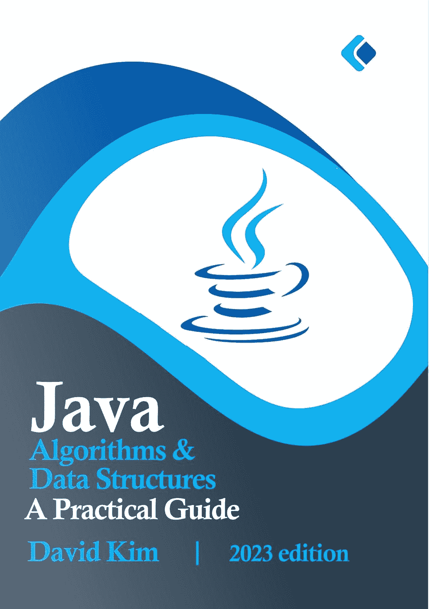

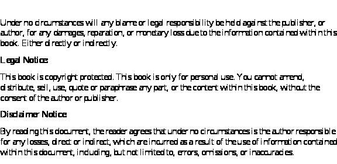

## 目录

- 序言
- 致谢
- 第一部分：算法与数据结构简介
- 第 1 章：算法简介
- 第 2 章：数据结构简介
- 第 3 章：数组
- 第 4 章：链表
- 第 5 章：栈
- 第 6 章：队列
- 第 7 章：递归
- 第三部分：排序与搜索算法
- 第 8 章：排序算法
- 第 9 章：搜索算法
- 第四部分：高级数据结构
- 第 10 章：树
- 第 11 章：堆
- 第 12 章：图
- 第 13 章：哈希
- 第 14 章：高级算法技巧
- 结语

## 序言

(c002.xhtml__Toc132222530)

## 致谢

(c003.xhtml__Toc132222531)

## 关于本书

(c003.xhtml__Toc132222532)

## 本书使用的约定

(c003.xhtml__Toc132222533)

# 第一部分：算法与数据结构简介

(c004.xhtml__Toc132222534)

## 第 1 章：算法简介

(c005.xhtml__Toc132222535)

### 1.1. 什么是算法？

(c005.xhtml__Toc132222536)

### 1.2. 算法设计技巧

(c005.xhtml__Toc132222537)

### 1.3. 算法分析与复杂度

(c005.xhtml__Toc132222538)

### 1.4. 渐进符号

(c005.xhtml__Toc132222539)

### 1.5. 时间复杂度与空间复杂度

(c005.xhtml__Toc132222540)

### 1.6. 最优、平均与最坏情况分析

(c005.xhtml__Toc132222541)

### 1.7. 求解递归式

(c005.xhtml__Toc132222542)

### 1.8. 摊还分析

(c005.xhtml__Toc132222543)

## 第 2 章：数据结构简介

(c006.xhtml__Toc132222544)

### 2.1. 什么是数据结构？

(c006.xhtml__Toc132222545)

### 2.2. 数据结构的类型

(c006.xhtml__Toc132222546)

### 2.3. 抽象数据类型

(c006.xhtml__Toc132222547)

### 2.4. Java 集合框架

(c006.xhtml__Toc132222548)

## 第 3 章：数组

(c007.xhtml__Toc132222549)

### 3.1. 数组简介

(c007.xhtml__Toc132222550)

### 3.2. 数组操作

(c007.xhtml__Toc132222551)

### 3.3. 多维数组

(c007.xhtml__Toc132222552)

#### 3.5. 数组背的列表

(c007.xhtml__Toc132222553)

## 第 4 章：链表

(c008.xhtml__Toc132222554)

### 4.1. 单链表

(c008.xhtml__Toc132222555)

### 4.2. 双向链表

(c008.xhtml__Toc132222556)

### 4.3. 循环链表

(c008.xhtml__Toc132222557)

### 4.5. Java LinkedList 类

(c008.xhtml__Toc132222558)

## 第 5 章：栈

(c009.xhtml__Toc132222559)

### 5.1. 数组实现栈

(c009.xhtml__Toc132222560)

### 5.2. 链表实现栈

(c009.xhtml__Toc132222561)

### 5.3. Java Stack 和 Deque 接口

(c009.xhtml__Toc132222562)

### 5.4. 栈的应用

(c009.xhtml__Toc132222563)

## 第 6 章：队列

(c010.xhtml__Toc132222564)

### 6.1. 队列 ADT

(c010.xhtml__Toc132222565)

### 6.2. 数组实现队列

(c010.xhtml__Toc132222566)

### 6.3. 链表实现队列

(c010.xhtml__Toc132222567)

### 6.4. 循环队列

(c010.xhtml__Toc132222568)

### 6.5. 优先级队列

(c010.xhtml__Toc132222569)

### 6.6. Java PriorityQueue 类

(c010.xhtml__Toc132222570)

### 6.7. 队列的应用

(c010.xhtml__Toc132222571)

## 第 7 章：递归

(c011.xhtml__Toc132222572)

### 7.1. 理解递归

(c011.xhtml__Toc132222573)

### 7.2. 递归与迭代

(c011.xhtml__Toc132222574)

### 7.3. 尾递归

(c011.xhtml__Toc132222575)

### 7.4. 备化与动态规划

(c011.xhtml__Toc132222576)

# 第三部分：排序与搜索算法

(c012.xhtml__Toc132222577)

## 第 8 章：排序算法

(c013.xhtml__Toc132222578)

#### 8.1. 泡泡排序

(c013.xhtml__Toc132222579)

### 8.2. 选择排序

(c013.xhtml__Toc132222580)

### 8.3. 插入排序

(c013.xhtml__Toc132222581)

### 8.4. 合并排序

(c013.xhtml__Toc132222582)

### 8.5. 快速排序

(c013.xhtml__Toc132222583)

### 8.6. 堆排序

(c013.xhtml__Toc132222584)

### 8.7. 计数排序

(c013.xhtml__Toc132222585)

#### 8.8. 桶数排序

(c013.xhtml__Toc132222586)

### 8.9. 排序算法比较

(c013.xhtml__Toc132222587)

### 8.10. Java 排序工具

(c013.xhtml__Toc132222588)

## 第 9 章：搜索算法

(c014.xhtml__Toc132222589)

### 9.1. 线性搜索

(c014.xhtml__Toc132222590)

### 9.2. 二分搜索

(c014.xhtml__Toc132222591)

### 9.3. 插值搜索

(c014.xhtml__Toc132222592)

### 9.4. 指数搜索

(c014.xhtml__Toc132222593)

### 9.5. 搜索算法比较

(c014.xhtml__Toc132222594)

### 9.6. Java 搜索工具

(c014.xhtml__Toc132222595)

# 第四部分：高级数据结构

(c015.xhtml__Toc132222596)

## 第 10 章：树

(c016.xhtml__Toc132222597)

### 10.1. 树简介

(c016.xhtml__Toc132222598)

### 10.2. 二叉树

(c016.xhtml__Toc132222599)

### 10.3. 二叉搜索树

(c016.xhtml__Toc132222600)

### 10.4. 平衡搜索树

(c016.xhtml__Toc132222601)

### 10.5. AVL 树

(c016.xhtml__Toc132222602)

### 10.6. 红黑树

(c016.xhtml__Toc132222603)

### 10.7. B 树

(c016.xhtml__Toc132222604)

### 10.8. 伸缩树

(c016.xhtml__Toc132222605)

### 10.9. 前缀树 (Trie)

(c016.xhtml__Toc132222606)

#### 10.10. 后树

(c016.xhtml__Toc132222607)

### 10.11. 树的实现

(c016.xhtml__Toc132222608)

## 第 11 章：堆

(c017.xhtml__Toc132222609)

### 11.1. 堆简介

(c017.xhtml__Toc132222610)

### 11.2. 二叉堆

(c017.xhtml__Toc132222611)

### 11.3. 数组实现堆

(c017.xhtml__Toc132222612)

### 11.4. 堆化与堆操作

(c017.xhtml__Toc132222613)

### 11.5. 基于堆的优先级队列

(c017.xhtml__Toc132222614)

### 11.6. D 叉堆

(c017.xhtml__Toc132222615)

### 11.7. 斐波那契堆

(c017.xhtml__Toc132222616)

## 第 12 章：图

(c018.xhtml__Toc132222617)

### 12.1. 图简介

(c018.xhtml__Toc132222618)

### 12.2. 图的术语

(c018.xhtml__Toc132222619)

### 12.3. 图的表示

(c018.xhtml__Toc132222620)

### 12.4. 图遍历

(c018.xhtml__Toc132222621)

#### 12.4.1. 深度优先搜索

(c018.xhtml__Toc132222622)

#### 12.4.2. 广度优先搜索

(c018.xhtml__Toc132222623)

### 12.5. 最短路径算法

(c018.xhtml__Toc132222624)

#### 12.5.1. Dijkstra 算法

(c018.xhtml__Toc132222625)

#### 12.5.2. Bellman-Ford 算法

(c018.xhtml__Toc132222626)

#### 12.5.3. Floyd-Warshall 算法

(c018.xhtml__Toc132222627)

### 12.6. 最小生成树算法

(c018.xhtml__Toc132222628)

#### 12.6.1. Kruskal 算法

(c018.xhtml__Toc132222629)

#### 12.6.2. Prim 算法

(c018.xhtml__Toc132222630)

### 12.7. 最大流算法

(c018.xhtml__Toc132222631)

#### 12.7.1. Ford-Fulkerson 算法

(c018.xhtml__Toc132222632)

#### 12.7.2. Edmonds-Karp 算法

(c018.xhtml__Toc132222633)

## 第 13 章：哈希

(c019.xhtml__Toc132222634)

### 13.1. 哈希简介

(c019.xhtml__Toc132222635)

### 13.2. 哈希函数

(c019.xhtml__Toc132222636)

### 13.3. 冲突解决策略

(c019.xhtml__Toc132222637)

#### 13.3.1. 分链链法

(c019.xhtml__Toc132222638)

#### 13.3.2. 开放寻址法

(c019.xhtml__Toc132222639)

### 13.4. 哈希表性能

(c019.xhtml__Toc132222640)

### 13.5. Java HashMap 和 HashSet 类

(c019.xhtml__Toc132222641)

## 第 14 章：高级算法技巧

(c020.xhtml__Toc132222642)

#### 14.1. 分治法

(c020.xhtml__Toc132222643)

### 14.2. 贪心算法

(c020.xhtml__Toc132222644)

### 14.3. 动态规划

(c020.xhtml__Toc132222645)

### 14.4. 回溯

(c020.xhtml__Toc132222646)

### 14.5. 分支界

(c020.xhtml__Toc132222647)

### 14.6. 随机算法

(c020.xhtml__Toc132222648)

## 结语

(c021.xhtml)

# 结论

(c021.xhtml__Toc132222649)

|  |  |  |


# 前言


欢迎阅读《Java 算法与数据结构》（Java Algorithms & Data Structures），这是一本全面的指南，旨在帮助你使用 Java 编程语言探索算法和数据结构的迷人世界。作为作者，我非常荣幸带你开启这段激动心的旅程，学习并掌握每一位计算机科学学生、软件工程师和编程爱好者都应该掌握的基础概念。

这本书是我多年在算法和数据结构领域进行教学、研究和工作的结晶。我将对这一学科的热情投入到书中，确保它在涵盖核心主题时既通俗易懂，又详尽细致。

在《Java 算法与数据结构》中，我们将从基础开始，介绍算法和数据结构，随后对数组、链表、栈和队列等基础数据结构进行深入讨论。接着，我们将深入研究排序和搜索算法，探索各种技术并分析它们的性能。书中将进阶到高级数据结构，如树、堆、图和哈希，并对高级算法技术以及并行和分布式算法进行研究。

在整书中，我优先为每个主题提供了大量的示例，确保你有充足的机会来练习并加强对材料的理解。这种实践性的方法使你能够对概念有更深入的理解，最终帮助成为一名更熟练的程序员。

在完成《Java 算法与数据结构》后，你将在算法和数据结构方面建立坚实的基础，并获得解决现实世界复杂问题的技能。我希望这本书能在你的整个编程之旅中成为宝贵的资源，并激励你深入探索这一迷人的领域。

那么，话不再说，让我们一起开启这段旅程，在 Java 中探索算法和数据结构的奇妙世界。学习愉快！

|  |  |  |


## 致谢


––––––––


写书是一项挑战性的工作，如果没有许多人的支持、鼓励和贡献，这本书是不可能完成的。首先，我要向我的家人表示最深的谢意，他们一直信任我并支持我的梦想。他们不移的爱和鼓励在这段旅程中是无价的。

我非常感谢我的导师、同事和学生，多年来他们一直启迪并挑战我，帮助我作为一名教育者、研究人员和程序员不断成长。他们富有洞见的问题和对话无疑塑造了本书的内容。

我还要感谢来自开源社区的众多贡献者以及 Java 的创造者，他们致力于让技术易于获取使得本书的开发成为可能。他们的努力为我们提供了探索算法和数据结构世界所需的工具和资源。特别感谢我的编辑和整个出版团队，感谢他们的指导、耐心和专业知识，将我的手稿转化为一本精良、专业的书籍。他们对细节的关注和对质量的承诺对这一项目的实现起到了至关的作用。

我也非常感谢我的技术评审人员，他们的反馈和建议帮助确保书中内容的准确性、相关性和时性。他们的专业知识和奉献在完善材料方面是无价的。

最后，我想向你——读者表示感谢，感谢你和我一起开启这段旅程。我真诚地希望《Java 算法与数据结构》能帮助你在计算机科学领域建立坚实的基础，并激励你继续探索这一迷人的领域。

感谢大家参与这段非凡的冒险。

## 关于本书

《Java 算法与数据结构》是一部全面的资源，旨在引导你使用 Java 编程语言学习算法和数据的核心概念和技术。本书适用于计算机科学学生、软件工程师、编程爱好者，以及任何希望加强对计算机科学这些关键主题理解的人。

书的结构逻辑清晰且循序渐进，允许读者在推进章节的过程中不断积累知识。它分为四个主要部分，每部分关注算法和数据结构的一个特定领域：

1. 第一部分：算法与数据结构简介：本节介绍了算法和数据结构的基本概念，涵盖了算法设计技术、算法分析与复杂度、渐近符号以及 `Java Collections Framework` 等主题。

2. 第二部分：基础数据结构：在这部分，我们探索基础数据结构的基础，包括数组、链表、栈、队列和递归。

3. 第三部分：排序与搜索算法：本节深入探讨各种排序和搜索算法，包括冒泡排序、选择排序、插入排序、合并排序、快速排序、堆排序、线性查找和二分查找。

4. 第四部分：高级数据结构：书的最后一部分涵盖了高级数据结构，如树、堆、图和哈希，以及高级算法技术、并行分布式算法以及算法设计模式。

在书中，解释配有大量的示例，帮助你深入理解概念及其实际应用。每个主题至少包含四个示例，为你提供了大量的练习机会。

除了核心内容外，本书还附带了涵盖 Java 编程基础、大 O 表示表、用于算法实现的常用 Java 类和方法以及部分练习题的答案。


在完成《Java 算法与数据结构》后，你将在这些关键领域建立坚实的基础，并具备解决现实问题的技能。本书旨在在你的整个编程之旅中成为一份宝贵的资源。

## 本书规范

为了使本书易于理解和导航，我们采用了一系列规范，帮助你识别和区分文本中的各种元素。这些规范旨在确保全书的一致性、可读性和清晰度。

1. **粗体文本**：用于首次引入时强调重要的术语或概念。这将帮助你在阅读过程中识别并记住关键术语。

2. *斜体文本*：用于突出新词汇或不常用的术语，以及书籍、文章和其他出版物的标题。

3. `等宽字体`：用于文本中的代码片段、文件名和代码相关的关键字。这种格式有助于将代码相关元素与正文区分开来，更容易阅读和理解示例和解释。

4. 代码块：

```
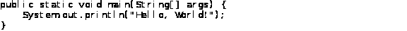
```

代码块使用等宽字体格式，并通过阴影背景与正文隔离开。这些块用于较长的代码片段和完整程序，使你能够轻松区分代码和说明文本。

- 编号列表：编号列表用于表示步骤序列、过程或一组有序项目。

- 项目符号列表：项目符号用于列出不需要特定顺序的相关项目或概念。

- 标题：标题用于将书籍组织成章节和子章节，便于导航和查找特定主题。

|  |  |  |


# 第一部分：算法与数据结构导论


本书的第一部分介绍了算法和数据结构的基本概念。它为书的其余部分奠定了基础，确保你在深入更复杂的话题之前对基础知识有良好的理解。本节的章节涵盖了以下主题：

## 第 1 章：算法导论

* 1.1. 什么是算法？

* 1.2. 算法设计技术

* 1.3. 算法分析与复杂度

* 1.4 渐近表示法

* 1.5 时间和空间复杂度

* 1.6 最好、平均和最坏情况分析

* 1.7 求解递推关系

* 1.8 均摊分析

## 第 2 章：数据结构导论

* 2.1. 什么是数据结构？

* 2.2. 数据结构的类型

* 2.3. 抽象数据类型

* 2.4 Java 集合框架

在第一章中，我们将探索算法的概念，包括它们的定义、设计技术以及用于分析其效率和复杂度的方法。我们还将介绍渐近表示法，这对于理解算法在时间和空间复杂度性能至关重要。

第二章重点关注数据结构，数据结构是实现算法的构建块。我们将讨论不同类型的数据结构及其用途，以及抽象数据类型的概念。本章还介绍了 `Java Collections Framework`，这是 Java 编程语言提供的一组预构建数据结构。

在完成第一部分后，你应该已经对算法和数据结构的基本概念有深入的理解，这将成为书中后续部分所涵盖的更高级主题的基础。

|  |  |  |


# 第 1 章：算法导论


在本章中，我们将介绍算法的基本概念，并探索与其设计、分析和效率相关的各个方面。本章涵盖的主题包括：

### 1.1. 什么是算法？

* 算法的定义

* 日中的算法示例

* 计算机科学中的算法

### 1.2. 算法设计技术

* 暴力破解

* 分治法

* 贪心算法

* 动态规划

* 回溯法

* 分支限界法

### 1.3. 算法分析与复杂度

* 为什么要分析算法？

* 影响算法性能的因素

* 衡量算法效率

### 1.4. 渐近表示法

* 大 O 符号 (`O`)

* Omega 符号 (`Ω`)

* Theta 符号 (`Θ`)

* 小 o 符号 (`o`)

* 小 omega 符号 (`ω`)

### 1.5. 时间和空间复杂度

* 定义与重要性

* 时间和空间复杂度分析的示例

* 时间与空间复杂度之间的权衡

### 1.6. 最好、平均和最坏情况分析

* 定义与示例

* 不同情况分析的重要性

### 1.7. 求解递推关系

* 算法中的递推关系

* 求解递推关系的常用方法

    * 代入法

    * 迭代法

    * 主主定理

### 1.8. 均摊分析

* 定义与动机

* 聚合分析法

* 臭账分析法

* 势分析法

在本章结束时，你应该对什么是算法、用于设计算法的不同技术以及如何分析它们的效率和复杂度有深入的理解。这些基础知识将使你能够更好地理解后续章节中涵盖的高级主题，并为你提供设计和分析自己的算法所需的工具。

### 1.1. 什么是算法？

算法是一个定义良好的、逐步执行的程序，用于解决问题或完成特定任务。它由一系列有限的指令组成，遵循这些指令可以保证获得正确的解决方案或输出。算法是计算机程序的根本构建块，被应用于计算机科学、数学和日常生活等多个领域。

算法的定义：算法可以定义为一组精确、无歧且有序的步骤，遵循这些步骤可以为给定的问题或任务带来解决方案或输出。它必须是清晰的、确定性的，并且具有有限的步骤。

日常生活中的算法示例：算法不仅限于计算机科学；它们也可以出现在我们的日常生活中。例如，食谱是准备特定菜肴的算法，它提供了一系列步骤，按顺序执行即可完成一道菜。同样，按照说明组装家具是另一个算法示例。

计算机科学中的算法：在计算机科学中，算法是软件开发的核心。它们用于处理、操作和分析数据以解决复杂问题。涉及算法的常见任务包括对列表排序、在数据集中搜索特定项目、压缩和解压缩文件以及在网络中路由。

对于任何学习计算机科学或在该领域工作的人来说，理解算法的概念至关重要，因为它允许你为各种问题和任务设计高效的。在后面的章节中，我们将探索不同的算法设计技术，并学习如何分析和比较它们的效率和复杂度。

## 1.2. 算法设计技术

算法设计技术是用于为问题或任务创建高效有效算法的策略。这些技术提供了系统的解决问题的方法，帮助开发者创建在各种条件下运行良好的算法。以下是一些常见的算法设计技术：

* 暴力破解：这种技术尝试问题的所有可能解决方案，直到找到正确的为止。暴力破解算法通常实现简单，但对于大型或复杂问题可能非常低效。

* 分治法：这种技术将问题分解为更小的子问题并独立求解每个子问题。然后将子问题的解决方案组合形成整体解决方案。分治算法的示例包括 `merge sort` 和 `quick sort`。

* 贪心算法：贪心算法每一步都做出局部最优选择，希望找到全局最优解。它们通常比其他技术更容易实现，但并不总是产生最优解。贪心算法的示例包括 `Dijkstra's` 短路径算法和 `Kruskal's` 最小生成树算法。

- **动态规划**：动态规划用于解决具有重叠子问题和最优子结构的问题。它通常涉及将问题分解为更小的子问题，每个子问题只求解一次，并将结果存储在表中以供以后备参考。动态规划算法的示例包括斐波纳契序列、背包问题和最长公共子序列问题。

- **回溯法**：回溯是一种用于解决涉及搜索大型解空间的问题的技术。它涉及增量地构建候选解，当部分候选无法扩展为完整解时，回溯到上一个步骤以探索其他可能性。回溯算法的示例包括八皇后问题和旅行员问题。

- **分支定界**：分支定界是一种用于解决组合问题的优化技术。它涉及将问题划分为更小的子问题（分支），并使用界限消除无法导致最优解的子问题（边界）。分支定界算法的示例包括整数线性规划问题和旅行员问题。

这些仅仅是许多算法设计技术中的少数。通过理解和应用这些技术，开发者可以创建出高效、有效且适用于各种问题解决任务的算法。

## 1.3 算法分析与复杂度

算法分析和复杂度是计算机科学中的基本概念，有助于确定算法的效率和性能。理解这些概念允许开发者在考虑可用资源和需求的情况下，为特定任务或问题选择最合适的算法。

- **为什么要分析算法？**：分析算法有助于开发者理解其行为、比较不同的算法并优化其性能。通过理解算法的时间和空间复杂度，开发者可以根据可用内存、处理器速度和问题规模等因素，针对特定问题的最高算法做出明智决策。

- **影响算法性能的因素**：算法的性能可能受到多个因素的影响，包括输入数据量、硬件和软件环境以及实现细节。然而，算法本身的复杂度通常是最显著的因素，它独立于硬件、软件和实现细节。

- **衡量算法效率**：算法效率通常通过时间复杂空间复杂度来衡量。时间复杂度指的是算法随输入规模变化的函数执行的基本操作次数，而空间复杂度指的是算法随输入规模变化的函数使用的内存量。在为特定任务或问题选择算法时，时间和空间复杂度都是必须考虑的关键因素。

## 1.4 渐近符号法

渐近符号是一种描述算法的时间或空间复杂度随输入规模趋于无穷大时的增长情况的方法。它提供了一种抽象，允许开发者在不考虑特定实现细节的情况下，比较算法并理解它们在大型输入规模下的行为。算法分析中使用了几种符号：

- **大 O 符号 (O)**：大 O 符号描述算法增长率的上界，换句话说，就是算法随输入规模变化的函数执行的最大操作次数。它用于表示最坏情况的时间复杂度。例如，如果一个算法的时间复杂度为 `O(n²)`，意味着在最坏情况下，操作次数将随输入规模呈平方级增长。

- **大 Omega 符号 (Ω)**：大 Omega 符号描述算法增长率的下界，即算法随输入规模变化的函数执行的最少操作次数。它用于表示最好情况的时间复杂度。例如，如果一个算法的时间复杂度为 `Ω(n)`，意味着在最好情况下，操作次数将随输入规模呈线性增长。

- **大 Theta 符号 (Θ)**：当算法增长率的上界和下界相同时（换句话说，当最好情况和最坏情况的时间复杂度相等时），使用大 Theta 符号。它用于表示平均情况的时间复杂度。例如，如果一个算法的时间复杂度为 `Θ(n²)`，意味着在平均情况下，操作次数将随输入规模呈平方级增长。

- **小 o 符号 (o)**：小 o 符号描述算法增长率的上界，但用于界限不是紧确的的情况。换句话说，它提供了一个不一定是最坏情况的渐近上界。例如，如果一个算法的时间复杂度为 `o(n²)`，意味着随着输入规模增大，操作次数的增长速率快于 `n²` 的任何常数倍。

- **小 omega 符号 (ω)**：小 omega 符号描述算法增长率的下界，但用于界限不是紧确的的情况。换句话说，它提供了一个不一定是最好情况的渐近下界。例如，如果一个算法的时间复杂度为 `ω(n)`，意味着随着输入规模增大，操作次数的增长速率慢于 `n` 的任何常数倍。

渐近符号提供了一种分析和比较算法效率与性能的方法，特别是对于大型输入规模。它帮助开发者理解算法内在复杂度，并在为特定任务或问题选择最合适算法时做出明智决策。


## 1.5 时间复杂度与空间复杂度

时间复杂和空间复杂度是算法分析的重要方面，有助于确定算法的效率和性能。它们描述了算法资源使用如何随输入规模的变化而增长。理解时间和空间复杂度允许开发者在考虑可用内存、处理器速度和问题规模等因素时，为给定问题选择最合适的算法。

### 时间复杂度

时间复杂度是衡量算法执行时间随输入规模变化的度量。它通常使用渐近符号（如大 O、大 Omega 或大 Theta）来表示。时间复杂度分析关注算法执行的基本操作，这些操作通常被假设为常数时间。常见的复杂度类包括：

- `O(1)`：常数复杂度，意味着算法的执行时间不取决于输入规模。

- `O(log n)`：对数复杂度，意味着算法的执行时间随输入规模对数级增长。

- `O(n)`：线性复杂度，意味着算法的执行时间随输入规模线性增长。

- `O(n log n)`：线性对复杂度，常见于合并排序和快速排序等算法。

- `O(n²)`：二次复杂度，常见于嵌套循环和某些排序算法，如冒泡排序和插入排序。

- `O(n³)`：立方复杂度，出现较少，但可见于处理三维数据的算法或具有三层嵌套循环的算法。

- `O(2^n)`, `O(n!)`：指数和阶阶复杂度，通常出现在暴力破解算法和某些组合问题。

### 空间复杂度

空间复杂度是衡量算法随输入规模变化而使用的内存数量的指标。它考虑了输入数据所需的内存、任何辅助数据结构以及算法本身使用的内存（例如函数调用栈）。与时间复杂度一样，空间复杂度通常使用渐近表示法。一些常见的空间复杂度类包括：

- `O(1)`：常数空间复杂度，意味着无论输入大小如何，算法使用的内存量都是固定的。

- `O(log n)`：对数空间复杂度，意味着算法的内存使用随输入规模呈对数增长。

- `O(n)`：线性空间复杂度，意味着算法的内存使用随输入规模呈线性增长。

在分析算法的效率时，应该同时考虑时间复杂空间复杂度。根据问题和系统限制，优化时间或空间可能更为重要。在某些情况下，可能需要在两者之间进行权衡，例如使用速度更快但需要更多内存的算法，反之亦然。

## 1.6. 最好、平均和最坏情况分析

在分析算法的效率时，考虑其在不同场景下的性能非常重要。最好情况、平均情况和最坏情况分析有助于开发人员理解算法在各种情况下的行为，这对于为特定任务或问题选择合适的算法至关重要。

### 最好情况分析（Best-Case Analysis）

最好情况分析考虑算法运行最优的情况，即所需的时间或资源最。这种情况通常发生在输入数据以对算法最有利的方式排列时。最好情况分析使用大 Omega（`Ω`）符号。虽然最好情况分析为算法的潜在性能提供了宝贵的见解，但在实践中通常用处不大，因为最好情况很少发生。

### 平均情况分析（Average-Case Analysis）

平均情况分析估计在考虑所有可能的输入数据分布时，算法的性能。这种分析比最好情况分析更现实，因为它对算法在实践中的运行表现提供了更好的理解。平均情况分析使用大 Theta（`Θ`）符号。然而，计算平均情况复杂度可能是具有挑战性的，因为它需要考虑所有可能的输入数据分布及其概率。

### 最坏情况分析（Worst-Case Analysis）

最坏情况分析考虑算法运行最差的情况，即需要的时间或资源最多。这种情况发生在输入数据以对算法最不利的方式排列时。最坏情况分析使用大 O（`O`）符号。最坏情况分析是最广泛使用且最实用的分析形式，因为它为算法性能提供了一个上限，确保算法在任何情况下性能都不会差于指定的复杂度。


### 1.7. 求解递归式

递归式（Recurrence relations）是根据其前驱元素定义序列的数学表达式。它们通常用于描述递归算法的时间复杂度。求解递归式意味着找到一个不需要引用前驱元素即可表示序列的闭式表达式（closed-form expression）。这种闭式表达式允许开发人员更好地理解算法的性能，并与其他算法进行比较。可以使用多种技术来求解递归式，包括：

1. **代入法（Substitution Method）**：代入法涉及递归地代入递归式，直到出现模式或达到基础情况。得到的表达式可以简化以找到闭式解。这种方法通常需要一些直觉或猜测，并且对于复杂的递归式来说可能非常耗时。

2. **迭代法（Iteration Method）**：迭代法也称为展开法，涉及逐步展开递归式，将每个项替换为基于前几项的定义。经过几次迭代后，可能会出现模式，然后可以对其进行泛化以获得闭式解。这种方法对于复杂的递归式也可能很耗时，但它可以为算法的行为提供有用的见解。

3. **主定理（Master Theorem）**：主定理是求解求解分治算法中出现的递归式的强大技术。它为形式如下的递归式提供了闭式解：

```
T(n) = aT(n/b) + f(n)
```

其中 `a ≥ 1`，`b > 1`，且 `f(n)` 是渐近正的函数。主定理允许开发人员快速确定广泛分治算法的时间复杂度，例如合并排序、快速排序等许多其他算法。

4. **递归树法（Recursion Tree Method）**：递归树法涉及将递归式可视化为一棵树，其中每个节点代表递归中的一项，树的深度对应于递归调次数。通过分析树的结构，开发人员可以识别模式并推导出闭式解。这种方法为理解递归算法的行为提供了一种直观的方法，尽管对于复杂的递归可能会变得难以处理。

5. **生成函数（Generating Functions）**：生成函数是用于表示和处理序列的数学工具，包括由递归式定义的序列。通过为序列定义生成函数并对其进行代数操作，开发人员通常可以推出递归式的闭式解。这种方法对于复杂的递归特别有用，但它要求对生成函数及其属性有深入理解。

## 1.8. 摊还分析（Amortized Analysis）

摊还分析是一种用于确定算法在系列操作期间的平均性能的技术。它与传统的最坏情况分析不同，后者考虑单次操作所需的最大时间或资源。摊还分析为算法的真实性能提供了更准确的表示，特别是当某些操作比其他操作贵但发生频率较低时。

执行摊还分析的三种主要方法是：

1. **聚合法（Aggregate Method）**：聚合法涉及计算 $n$ 次操作的总成本并除以 $n$，以获得每次操作的平均成本。这种方法简单易用，并提供了直观的理解。然而，它可能不适用于复杂算法或操作成本变化的算法。

示例：在动态数组中，当数组满时，尺寸会翻倍。虽然单次插入由于扩容而可能是昂贵的（`O(n)`），但 $n$ 次插入的成本为 `O(n)`，使得每次插入的摊还成本为 `O(1)`。

2. **会计法（Accounting Method）**：会计法也称为银行法，它为每次操作分配一个“费用”，代表其实际成本加上一个留供未来使用的额外“贷记”（credit）。这些贷记用于支付昂贵的操作，确保序列总成本保持在指定的范围内。会计法为算法的性能提供了更准确的表示，但它需要对贷记进行仔细管理并对算法行为有更深理解。

示例：在动态数组案例中，每次插入可以分配 2 的费用，其中一个单位覆盖插入的实际成本，另一个单位作为贷记存储。当数组需要调整大小时，存储的贷记覆盖成本，确保每次插入的摊还成本保持为 `O(1)`。

3. **势能法（Potential Method）**


势能法涉及定义一个势函数，用于衡量数据结构在任何给定时刻的“势能”。势能代表了目前为止完成的工作，这些工作可以用于抵消未来的昂贵操作。操作的摊还成本计算为实际成本与势能变化之和。势能法为摊还分析提供了一种更通用、更正式的方法，但它要求对算法有更深入的理解，并具备定义合适势函数的能力。

示例：对于动态数组情况，势函数可以定义为元素数量与数组容量的一半之间的差。势能随着每次插入而增加，并在数组调整大小时减小，从而确保每次插入的摊还成本保持在`O(1)`。

# 第 2 章：数据结构引论

数据结构是计算机编程中的基础构建模块，提供了一种组织和存储数据的方法，能够实现高效的访问和修改。数据结构的选择对算法或应用程序的性能产生巨大影响。本章介绍了数据结构的概念，并对其各种类型和应用进行了概述。

## 2.1. 什么是数据结构？

数据结构是在计算机内存中组织和存储数据的特定方式，以便高效地访问和修改。数据结构在计算机编程中至关重要，它们为设计算法和实现各种软件应用提供了基础。数据结构的选择会显著影响算法的性能和软件应用程序的整体效率。

数据结构使程序员能够管理复杂数据，更容易执行搜索、排序、插入、更新和删除元素的操作。通过为特定问题或用例选择合适的数据结构，程序员可以优化应用程序的性能，并确保系统资源的有效利用。

## 2.2. 数据结构的类型

数据结构大体分为两类：线性数据结构和非线性数据结构。

### 线性数据结构

这些数据结构以顺序方式存储元素。元素按线性顺序排列，除了第一个和最后一个元素，每个元素都有独特的前驱和继。线性数据结构的示例包括：

1. `Arrays`（数组）：固定大小的连续内存块，存储相同数据类型的元素。

2. `Linked Lists`（链表）：动态数据结构，由节点组成，节点包含一个元素以及指向序列中下一个节点的引用。

3. `Stacks`（栈）：后入先出（LIFO）数据结构，允许从顶部添加和删除元素。

4. `Queues`（队列）：先进后出（FIFO）数据结构，允许从尾部添加元素并从头部删除元素。

### 非线性数据结构

这些数据结构以层次化或相互连接的方式存储元素。元素根据它们之间的关系或关联组织，而不是线性序列。非线性数据结构的示例包括：

1. `Trees`（树）：层次化数据结构，由边连接的节点组成，有一个根节点且没有循环。

2. `Graphs`（图）：使用顶点（节点）和边（节点之间的连接）表示元素对之间关系的数据结构。

3. `Hash Tables`（哈希表）：使用哈希函数将键映射到对应的值，实现高效的插入、删除和查找。

每个数据结构都有自己的优缺点，使其更适用于特定的用例和问题领域。通过理解各种数据结构的特征，程序员可以选择最合适的一种。

## 2.3. 抽象数据类型

抽象数据类型（ADT）是对数据集合及其在该数据上执行的操作的高级描述。ADT 提供了一种描述数据结构行为的方法，无需指定底层实现。通过关注数据结构的本质属性和操作，ADT 使程序员能够设计独立于特定数据结构实现的算法和应用程序。这种抽象使得在需要时更改或优化底层数据结构变得更容易，而不会影响应用程序的整体功能。

常见的抽象数据类型包括：

1. `List`（列表）：具有线性顺序的集合，允许在特定位置插入、删除和访问元素。

2. `Set`（集合）：无序的不同元素集合，支持插入、删除和成员检查测试操作。

3. `Map`（映射）：键值对集合，允许根据相应的键高效检索值，以及键值对的插入和删除。

4. `Queue`（队列）：按先进后出（FIFO）顺序维护元素的集合，允许从一端（尾部）添加元素从另一端（头部）移除。

5. `Stack`（栈）：按后入先出（LIFO）顺序维护元素的集合，允许从顶部添加和移除元素。

6. `Graph`（图）：顶点（节点）和边（节点之间的连接）的集合，表示元素对之间的关系。

通过使用抽象数据类型，程序员可以设计更模块化、更易维护的代码，因为数据结构实现的细节被封装并对应用程序的其他部分隐藏。这种关注分离允许开发人员专注于应用程序的高级功能，并使代码轻松适应数据结构实现或需求的更改。

## 2.4. Java 集合框架

Java 集合框架是 Java 标准库中的一组接口和类，提供了各种数据结构和算法的实现。该框架通过提供现用、高效且灵活的数据结构，简化了处理数据集合的过程。通过使用 Java 集合框架，开发者可以利用内置的数据结构和算法，减少实现自定义数据结构的需求，提高应用程序的整体效率和维护性。

该框架包含了常用抽象数据类型的接口，例如：

1. `List`：有序集合，允许重复元素，并提供在特定位置访问、插入和删除元素。`List`的实现包括`ArrayList`和`LinkedList`。

2. `Set`：无序的不同元素集合，不允许重复元素。`Set`的实现包括`HashSet`、`TreeSet`和`LinkedHashSet`。

3. `Map`：键值对集合，允许根据相应的键高效检索、插入和删除值。`Map`的实现包括`HashMap`、`TreeMap`和`LinkedHashMap`。

4. `Queue`：按先进后出（FIFO）顺序维护元素的集合，允许从一端（尾部）添加元素从另一端（头部）移除。`Queue`的实现包括`LinkedList`（作为队列）和`PriorityQueue`。

5. `Deque`：双端队列，允许从两端添加和移除元素，比标准队列更具活性。`Deque`的实现包括`ArrayDeque`和`LinkedList`（作为双端队列）。

除了这些接口外，Java 集合框架还提供了如`Collections`和`Arrays`等工具类，这些类提供了用于处理和操作数据结构的方便方法。这些工具类包含了对集合和数组进行排序、搜索、反转以及其他常见操作的方法。

通过使用 Java 集合框架，开发者可以编写出更高效、更易维护且可重用的代码，因为他们可以利用内置的数据结构和算法，而无需自己创建自定义实现。

# 第二部分：基础数据结构

在本书的范围内，我们将深入探讨计算机编程中使用的基础数据结构。这些基础数据结构是更复杂、高级的数据结构以及各种算法的基础。我们将探索并理解它们的属性、操作和用例。本节涵盖的数据结构包括：

1. **数组 (Arrays)**：数组是固定大小的连续内存块，存储相同类型的元素。它们可以通过索引对元素进行常数时间访问，使其在各种操作中都非常高效。我们将学习不同类型的数组以及可以在它们上执行的操作。

2. **链表 (Linked Lists)**：链表是由节点动态数据结构，每个节点包含一个数据元素和一个指向序列中下一个节点的引用。它们允许高效的插入和删除，但不能提供对单个元素的常数时间访问。我们将讨论单链表、双向链表和循环链表，以及哨兵节点和伪头。

3. **栈 (Stacks)**：栈遵循后进先出（LIFO）原则的线性数据结构，这意味着最后添加的元素是最被移除的元素。它们通常用于解析表达式、实现撤销/重做功能等。我们将涵盖使用数组和链表实现的栈，以及`Stack`类和`Deque`接口。

4. **队列 (Queues)**：队列遵循先进先出（FIFO）原则的线性数据结构，其中队列中最旧的元素是最被移除的元素。它们用于任务管理、调度和其他需要按特定顺序处理元素的场景。我们将讨论各种类型的队列，包括优先级队列以及在 Java 中的实现。

5. **递归 (Recursion)**：递归是一种强大的编程技术，涉及函数调用自己来解决问题的较小规模实例。我们将探索递归的概念，比较递归和迭代解决方案，并学习尾递归、记忆化和动态规划。

在本部分的结束时，你将对这些基础数据结构有坚固的理解，并能够在 Java 中有效地实现和操作它们。

 |  | 


# 第 3 章：数组


## 3.1. 数组简介

数组是一种存储相同数据类型固定大小元素序列的数据结构。数组对于组织和处理数据非常有用，因为它们通过索引直接访问元素，索引代表每个元素在数组中的位置。这种直接访问使得在检索或更新数组中的元素时具有常数时间复杂度 (`O(1)`)。

在 Java 中，可以为任何数据类型创建数组，包括基本数据类型（例如`int`、`char`和`double`）和引用类型（例如对象和其他数组）。数组在 Java 中是对象，并分配在堆上。它们有一个名为`length`的内置属性，用于存储数组中的元素数量。

Java 中声明和初始化数组的示例：

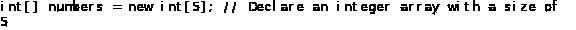

在 Java 中，还可以使用预定义的值初始化数组：


一旦创建了数组，其大小无法更改。如果你需要具有可调整数组的动态数据结构，可以使用 Java 中的`ArrayList`类。

数组是许多算法和数据结构的基础，因为它们提供了存储和处理数据的简单高效的方法。理解数组对于开发高效算法和构建更高级的数据结构至关重要。

## 3.2. 数组操作

Java 中可以对数组执行几种常用操作。这些操作包括：

1. **初始化数组**：为指定大小的数组声明并分配内存，或使用预定义的值初始化。

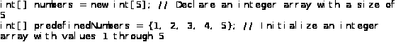

2. **访问元素**：使用索引检索或更新数组中的元素。

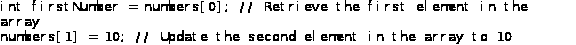

3. **遍历数组**：使用`for`循环或增强`for`循环（for-each 循环）遍历数组中的每个元素。

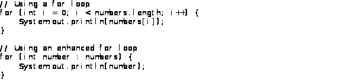

4. **搜索元素**：通过遍历数组并将每个元素与目标值比较，找到元素在数组中的索引。

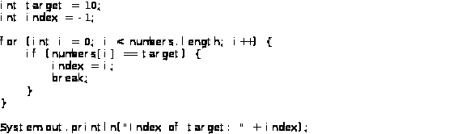

5. **复制数组**：创建一个新数组并从现有数组复制元素。

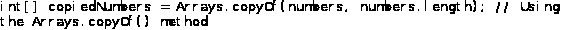

6. **排序数组**：按照特定顺序（如升序或降序）重新排列数组中的元素。

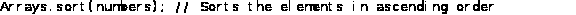

这些操作构成了 Java 中处理数组的基础。精通这些操作将有助于处理数组。

## 3.3. 多维数组

多维数组是数组的数组，每个元素本身也是数组。多维数组最常见的类型是二维数组，它可以被视为具有行和列的表格或矩阵。

在 Java 中，多维数组使用嵌套括号创建和访问。以下示例演示了如何声明、初始化和访问二维数组：

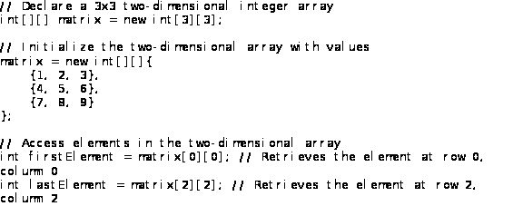

你也可以拥有超过两个维度的多维数组，尽管它们并不常见。例如，三维数组可以被视为二维数组的数组或矩阵的“堆”。这里是声明和初始化三维数组的示例：

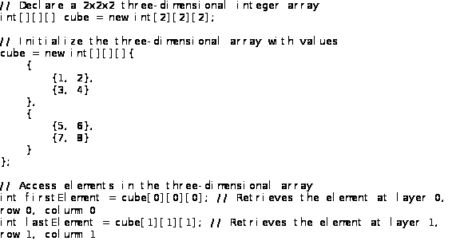

为了遍历多维数组可以使用嵌套循环。例如，以下代码打印二维数组中的所有元素：

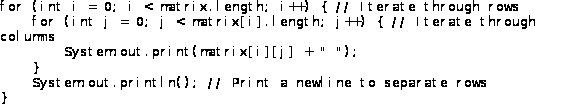

多维数组用于表示复杂的数据结构，如网格、矩阵或高维空间。理解如何处理多维数组使你能够有效地表示和处理各个维度的数据。

## 3.4. Java 数组工具函数

Java 在`java.util`包中提供了`Arrays`工具类，包含许多处理数组的静态方法。一些常用的方法包括：

1. `Arrays.toString(array)`：将数组转换为可读的字符串表示。

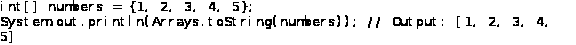

2. `Arrays.copyOf(array, newLength)`：创建一个指定长度的新数组，并将原始数组中的元素复制到新数组中。


3. `Arrays.fill(array, value)`：为数组中的每个元素分配指定的值。

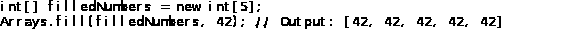

4. `Arrays.sort(array)`：按升序对数组元素排序。

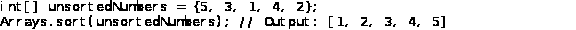

- `Arrays.binarySearch(array, key)`: 使用二分搜索算法在排序数组中搜索指定的`key`。如果找到，则返回`key`的索引；否则返回一个负值。

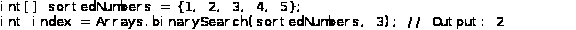

- `Arrays.equals(array1, array2)`: 通过检查两个数组的长度是否相同以及相应元素是否相等来比较两个数组的相等性。

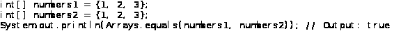

- `Arrays.deepToString(array)`, `Arrays.deepEquals(array1, array2)`和`Arrays.deepHashCode(array)`: 这些方法类似于`toString()`、`equals()`和`hashCode()`，但它们是专为多维数组设计的。

这些工具函数通过为常用操作提供方便的方法，使得在 Java 中处理数组变得更容易。在处理数组时使用这些函数可以帮助你编写更高效、可读性的代码。

## 3.5. 基于数组的列表

在 Java 中，`java.util`包中的`ArrayList`类提供了一个由数组支持的列表实现。`ArrayList`与数组相似，因为它维护了一个有序的元素集合，但它可以在添加或删除元素时动态调整自身的大小。

要创建一个`ArrayList`，你可以使用默认构造函数或指定初始容量的构造函数：

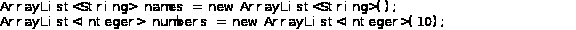

你可以使用`add()`方法向`ArrayList`添加元素：

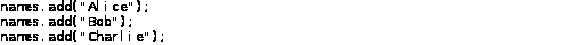

你可以使用`get()`方法访问`ArrayList`中的元素，该方法接收要检索的元素索引：

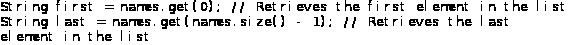

你可以使用`remove()`方法从`ArrayList`中删除元素，该方法接收要删除的元素索引：


`ArrayList`还提供了各种工具方法，如`size()`、`contains()`和`indexOf()`，它们的工作方式与数组中的对应方法类似。

`ArrayList`相比数组的一个优势是，你可以从列表中添加或删除元素，而不必担心底层数组的调整。`ArrayList`会根据需要自动调整数组，这使得在某些情况下处理起来更加方便。然而，与数组相比，`ArrayList`有一些开销，例如存储列表元数据所需的额外内存，并且在某些用例下的性能可能较差。

总的来说，`ArrayList`是一种有用且多功能的数据结构，可以简化 Java 程序中数据集合的操作。

|  |  |  |


# 第 4 章 链表


链表是计算机科学中另一种常见的数据结构，它们提供了一种动态且灵活的方式存储和操作元素集合。与数组不同，链表不需要连续的内存分配，这允许它们根据需要轻松地增长或缩小。

链表由一系列节点组成，每个节点包含一个元素以及指向列表中下一个节点的引用（或指针）。列表中的末尾节点通常指向`null`，表示列表的结束。列表中的第一个节点被称为列表的头（head）。

链表有几种类型，包括单链表、双链表和循环链表。在单链表中，每个节点只有一个指向列表中下一个节点的引用。在双链表中，每个节点都有指向列表中后一个节点和上一个节点的引用。在循环链表中，列表的末尾节点指向第一个节点，形成一个环链。

链表可以用于实现各种数据结构和算法，如栈、队列、哈希表和图的表示。它们对于某些类型的问题也有用，例如以深度优先或广度优先的方式遍历树或图。

## 4.1. 单链表

单链表是最简单的链表类型，列表中的每个节点包含一个元素和一个指向列表中下一个节点的引用。列表中的末尾节点指向`null`，表示列表的结束。列表中的第一个节点被称为列表的头。

这是一个单链表的示例：


在这个示例中，头指向包含元素 A 的第一个节点，该节点指向包含元素 B 的下一个节点，该节点指向包含元素 C 的下一个节点，该节点指向`null`，表示列表的结束。

单链表可以用于实现各种数据结构和算法，如栈、队列和哈希表。它们对于某些类型的问题也有用，例如以深度优先或广度优先的方式遍历链式结构。

单链表上的一些常用操作包括：

- `get(index)`: 返回列表中指定索引处的元素。

- `add(element)`: 在列表末尾添加元素。

- `add(index, element)`: 在列表的指定索引处插入元素。

- `remove(index)`: 从列表中删除指定索引处的元素。

- `size()`: 返回列表中的元素数量。

这是一个单链表的 Java 实现示例：

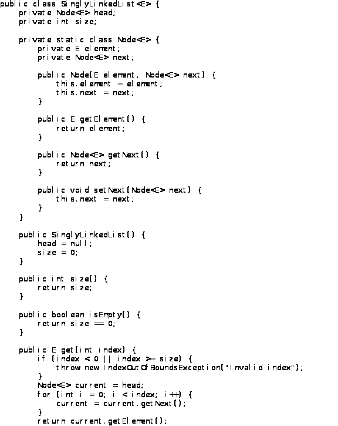

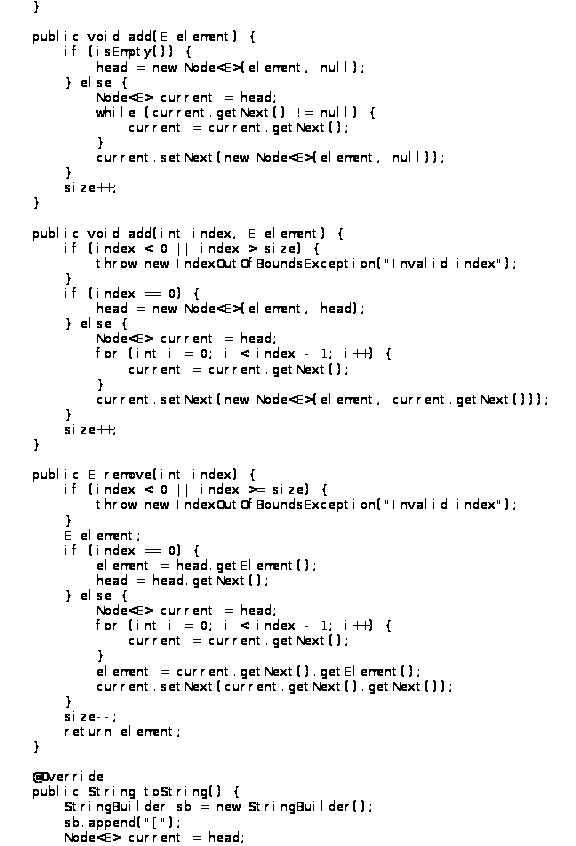

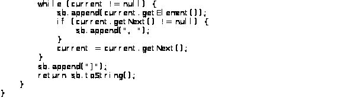

该实现包含了添加和删除元素、获取大小以及根据索引元素的方法。它还重写了`toString()`方法以提供列表的字符串表示。

## 4.2. 双链表

双链表是链表的一种类型，每个节点包含一个元素、指向下一个节点的引用以及指向上一个节点的引用。列表的第一个节点的上一个引用为`null`，列表的末尾节点的下一个引用为`null`。

这是一个链表的示例：


在这个示例中，第一个节点的上一个引用为`null`并指向包含元素 A 的第二个节点，该节点指向第一个节点并指向包含元素 B 的下一个节点。最后一个节点包含元素 C。

双链表可以用于需要双向遍历的各种数据结构和算法，例如实现文本编辑器、双端队列和 LRU（最少使用）缓存。


双链表上的一些常用操作包括：

- `get(index)`：返回列表中指定索引处的元素。
- `add(element)`：在列表末尾添加元素。
- `add(index, element)`：在列表的指定索引处插入元素。
- `remove(index)`：从列表中删除指定索引处的元素。
- `size()`：返回列表中的元素数量。

这是一个双链表的 Java 实现示例：

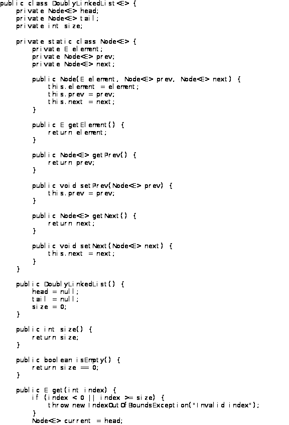

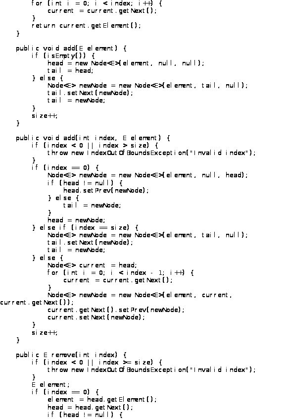

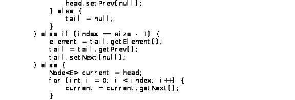

---


### 4.3. 循环链表

循环链表是一种末尾节点指向第一个节点的链表，形成了一个环。这意味着末尾节点的下一个引用指向第一个节点，而不是 `null`。循环链表可以是单链的也可以是双链的。

实现循环链表，我们需要跟踪列表的第一个和最后一个节点。在空列表添加新节点时，头和尾节点都指向该新节点。在非空列表添加新节点时，末尾节点的下一个引用指向新节点，新节点的下一个引用指向第一个节点。

同样地，当从只有一个节点的列表中删除节点时，我们需要将第一个节点和最后一个节点都设置为 `null`。当从包含多个节点的列表中删除最后一个节点时，我们需要更新倒数第二个节点的 `next` 指针，使其指向第一个节点，并将最后一个节点更新为倒数第二个节点。

这里有一个用 Java 实现的单向循环链表的示例代码：

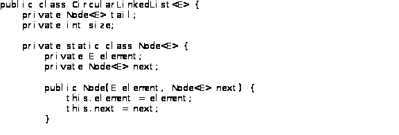

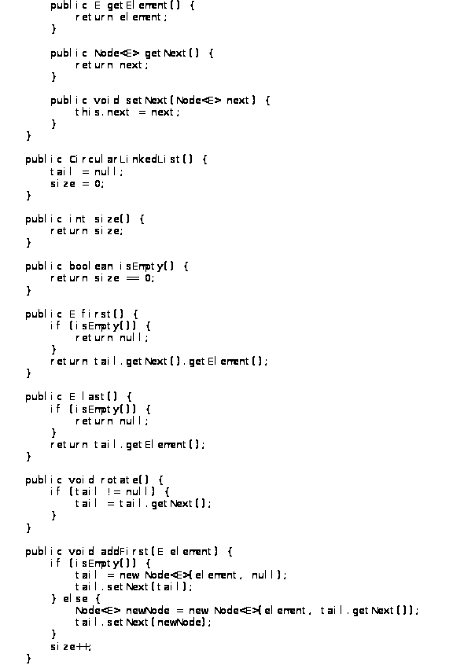

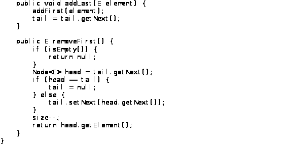

该实现包含了获取第一个和最后一个元素、旋转列表（即将第一个元素移动到末尾）以及在列表开头或末尾添加或删除元素的方法。

## 4.4. 哨兵节点（Sentinel Nodes）和虚拟头节点（Dummy Headers）

哨兵节点和虚拟头节点是特殊的节点，可以添加到链表中以简化其实现并提高性能。哨兵节点是添加在列表开头或末尾的节点，用作哨兵值。它通常用于简化边界条件的实现。例如，如果我们在单向链表的开头添加一个哨兵节点，就可以消除在插入或删除节点时检查列表是否为空的需求。与其检查列表是否为空，我们可以始终假设哨兵节点存在，并利用它来简化列表操作的实现。

虚拟头节点是一种特殊的哨兵节点，用于简化某些列表操作的实现。它通常用于表示列表的头部，并替代 `null` 指针。通过使用虚拟头节点，我们可以消除检查 `null` 头指针的需求，并简化如在列表开头插入或删除节点等列表操作的实现。这里有一个带虚拟头节点的单向链表的 Java 实现示例：

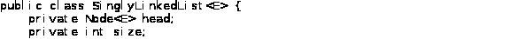

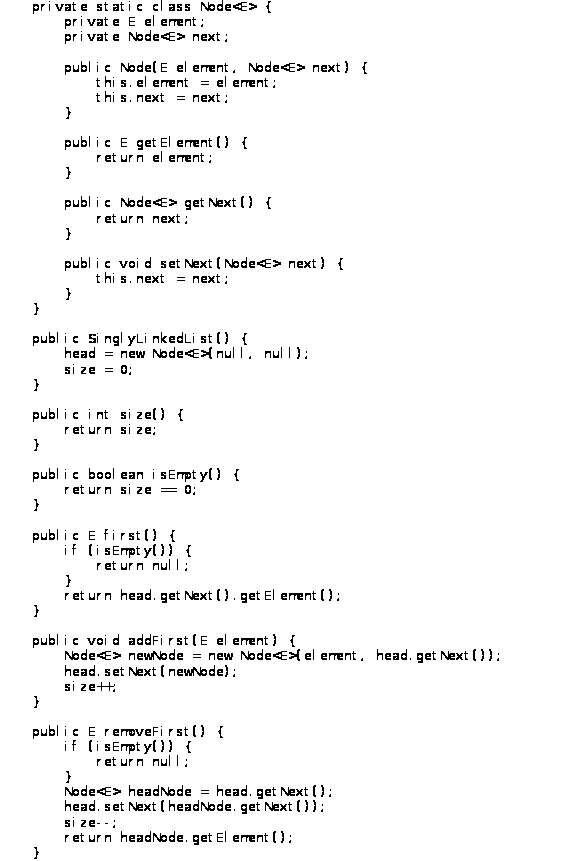

在此实现中，头节点是一个虚拟头节点，它始终存在于列表中，即使列表为空也是如此。这使得我们能够通过消除检查 `null` 头指针的需求来简化列表操作的实现。

### 4.5. Java LinkedList 类

Java 中的 `LinkedList` 类是双向链表的标准实现。它是 Java 集合框架的一部分，并提供了许多用于在列表中添加、删除和访问元素的方法。

以下是 `LinkedList` 类中一些最常用的方法：

- `addFirst(E element)`：将指定的元素添加到列表的开头。
- `addLast(E element)`：将指定的元素添加到列表的末尾。
- `removeFirst()`：移除并返回列表中的第一个元素。
- `removeLast()`：移除并返回列表中的最后一个元素。
- `getFirst()`：返回列表中的第一个元素。
- `getLast()`：返回列表中的最后一个元素。
- `isEmpty()`：如果列表为空返回 `true`，否则返回 `false`。
- `size()`：返回列表中元素的数量。
- `clear()`：移除列表中的所有元素。

`LinkedList` 类还提供了在列表特定位置插入或删除元素的方法，以及使用迭代器（iterator）遍历列表元素的方法。

这里是 `LinkedList` 类的使用示例：

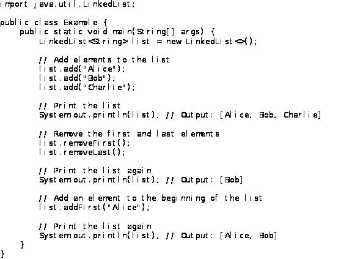

在这个示例中，我们创建了一个 `LinkedList` 对象，向其添加了一些元素，删除了第一个和最后一个元素，在列表开头添加了一个元素，并在每次操作后打印列表。

 | | 


# 第 5 章. 栈（Stacks）


栈是一种存储元素集合的数据结构，并提供了从集合的一端添加和移除元素的操作，这一端被称为栈的“栈顶”（top）。栈遵循“后进先出”（LIFO）原则，这意味着最近添加的元素是第一个被移除的元素。

在 Java 中，`Stack` 类是栈的标准实现。它是 Java 集合框架的一部分，并提供了许多用于在栈中添加、删除和访问元素的方法。

以下是 `Stack` 类中一些最常用的方法：

- `push(E element)`：将指定的元素添加到栈顶。
- `pop()`：移除并返回栈顶的元素。
- `peek()`：返回栈顶的元素但不将其移除。
- `isEmpty()`：如果栈为空返回 `true`，否则返回 `false`。
- `size()`：返回栈中元素的数量。

这里是 `Stack` 类的使用示例：

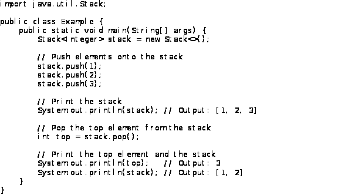

在这个示例中，我们创建了一个 `Stack` 对象，将一些元素推入栈中，从栈弹出顶部元素，并在每次操作后打印栈顶元素和栈。

除了 `Stack` 类外，Java 还提供了 `Deque` 接口，它代表“双端队列”（double-ended queue）。deque 是一种更通用的数据结构，支持从两端添加和移除元素，并用于实现栈。Java 中的 `ArrayDeque` 和 `LinkedList` 类都是 `Deque` 的实现。

## 5.1. 基于数组的实现

基于数组的栈实现使用数组来存储元素。栈顶由数组的索引表示，通过更新该索引来添加和移除元素。

在 Java 中实现基于数组的栈，我们可以定义一个拥有数组字段用于存储元素和一个整数字段用于跟踪栈顶索引的类。这里有一个实现示例：

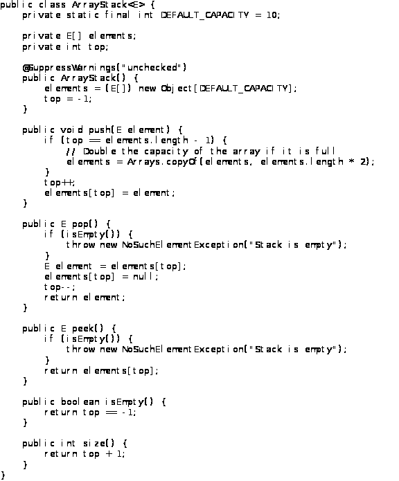

在此实现中，我们使用泛型类型 `E` 以允许栈存储任何类型的元素。我们还为数组定义了一个默认容量，并在数组满时使用 `Arrays.copyOf` 对其进行扩展。

`push` 方法通过增加索引并将元素赋值给数组的相应位置将新元素添加到栈顶。如果数组满了，我们在添加新元素之前将其容量翻倍。

`pop` 方法通过从数组相应位置获取元素将其移除并返回，将该位置设置为 `null` 以释放对元素的引用，并递减索引。如果栈为空，我们抛出 `NoSuchElementException`。

`peek` 方法返回栈顶的元素但不将其移除。如果栈为空，我们抛出 `NoSuchElementException`。

`isEmpty` 方法如果栈为空返回 `true`，否则返回 `false`。

`size` 方法返回栈中元素的数量。

## 5.2. 基于链表的实现

基于链表的栈实现使用链表来存储元素。栈顶由链表的头节点表示，通过更新头节点来添加和移除元素。

在 Java 中实现基于链表的栈，我们可以定义一个拥有 `node` 类用于表示元素和一个 `node` 字段用于跟踪链表头节点的类。这里有一个实现示例：

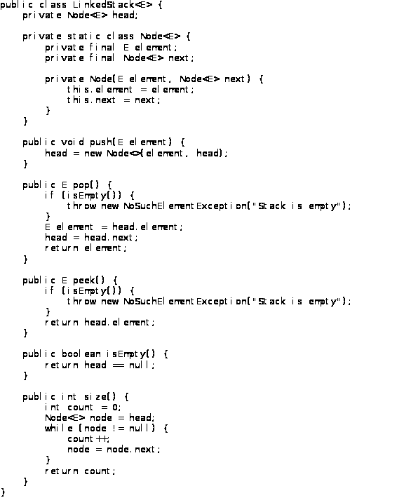

在此实现中，我们使用泛型类型 `E` 以允许栈存储任何类型的元素。我们还定义了一个嵌套的 `node` 类来表示元素。

`push` 方法通过创建一个带有指定元素并将当前头节点作为其 `next` 节点的新 `node`，将新元素添加到栈顶，并将新节点设置为新的头节点。

`pop` 方法通过从当前头节点获取元素、将下一个节点设置为新的头节点并返回该元素，从而移除并返回栈顶的元素。如果栈为空，我们会抛出一个 `NoSuchElementException`。

`peek` 方法返回栈顶的元素但不将其移除。如果栈为空，我们会抛出一个 `NoSuchElementException`。

`isEmpty` 方法在栈为空时返回 `true`，否则返回 `false`。

`size` 方法通过遍历链表并统计节点数，返回栈中元素的数量。

---


## 5.3. Java Stack 类与 Deque 接口

Java 提供了一个实现栈（stack）数据结构的内置 `Stack` 类。`Stack` 类派自于 `Vector` 类，并使用数组来存储栈的元素。然而，`Stack` 类被认为有些过时了，不建议在新代码中使用。相反，Java 提供了 `Deque` 接口，代表“双端队列”（double-ended queue），它可以用于实现栈，也可以实现队列和双端队列等其他数据结构。

`Deque` 接口定义了在队列两端添加和移除元素的方法，以及在不移除元素的情况下检查末端元素的方法。`ArrayDeque` 类和 `LinkedList` 类都实现了 `Deque` 接口，可以用于实现栈。

这是一个使用 `ArrayDeque` 类实现栈的示例：

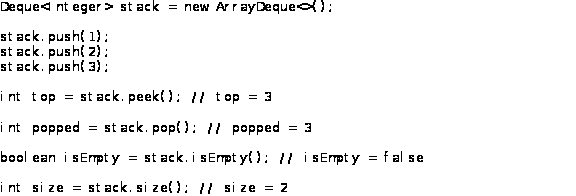

在这个示例中，我们创建了 `ArrayDeque` 的实例，并使用 `push` 方法将元素添加到栈顶。我们使用 `peek` 方法在不移除元素的情况下检查栈顶元素，使用 `pop` 方法移除并返回栈顶元素，使用 `isEmpty` 方法检查栈是否为空，并使用 `size` 方法获取栈中元素的数量。

我们也可以使用 `LinkedList` 类来实现栈：

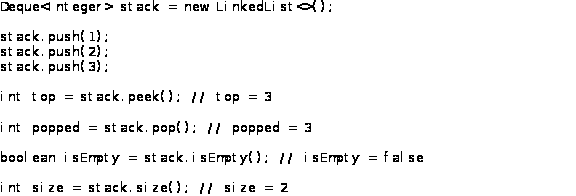

`LinkedList` 类也实现了 `Deque` 接口，因此我们可以使用相同的方法来实现栈。然而，`ArrayDeque` 和 `LinkedList` 的性能特征不同，因此实现的选择取决于应用程序的具体需求。

### 5.4. 栈的应用

栈在计算机科学和软件工程中有许多实际应用。以下是几个例子：

1. **表达式求值**：栈常用于计算算术表达式，如编程语言中的表达式。在此应用中，栈用于跟踪在表达式中遇到的操作符和操作数，并按正确的顺序执行必要的操作。
2. **函数调用栈**：当编程语言中调用函数时，函数的局部变量和参数被存储在调用栈上。这允许函数访问自己的变量，而不会干扰可能正在并发运行的其他函数的变量。
3. **解析**：栈可以用于解析和验证结构化数据，例如 XML 或 HTML。在此应用中，栈用于跟踪元素的开始标签和结束标签，并确保文档的结构正确。
4. **回溯**：栈可以用于实现回溯算法，这是一种探索问题所有可能解决方案的技术。在此应用中，栈用于跟踪搜索当前状态，并在遇到死胡同时回溯到之前的状态。
5. **撤销/重做功能**：栈可以用于软件应用程序中的撤销/重做功能。在此应用中，栈用于跟踪对象或文档之前的状态，使用户在必要时撤销之前的操作或重做它们。

|  | |  |


# 第 6 章 队列


队列是计算机科学中另一种重要的数据结构，用于按特定顺序存储一组元素。在队列中，元素从一端添加并从另一端移除。添加元素的端称为队列的尾部（`back` 或 `tail`），而移除元素的端称为队列的头部（`front` 或 `head`）。元素添加到队列的顺序被保留，第一个添加的元素是第一个被移除的。

在本章中我们将涵盖队列的基础知识，包括它们的定义、属性和应用。我们还将讨论 Java 中队列的各种实现，以及使用队列的一些常用算法。

### 6.1. 队列 ADT

队列抽象数据类型（ADT）是一个支持两个基本操作的元素集合：`enqueue`（入队）和 `dequeue`（出队）。`enqueue` 将元素添加到队列尾部，而 `dequeue` 移除并返回队列头部的元素。元素出队的顺序与它们入队的顺序相同。这种排序属性被称为先进先出（FIFO）。

除了基本的 `enqueue` 和 `dequeue` 操作外，队列 ADT 可能还支持其他操作，如 `peek`（查看）、`isEmpty`（判空）和 `size`（大小）。`peek` 操作允许我们在不移除元素的情况下检查头部的元素。`isEmpty` 检查队列是否为空，而 `size` 返回队列的大小。

以下是在 Java 中定义基础 `Queue` 接口的示例：


该接口定义了任何队列实现必须支持的基本操作。`enqueue` 方法将元素添加到尾部，`dequeue` 方法移除并返回头部的元素，`peek` 方法在不移除元素的情况下返回头部的元素。`isEmpty` 方法检查队列是否为空，`size` 方法返回队列元素数量。

通过定义 `Queue` 接口，我们可以编写独立于队列实现的代码。

## 6.2. 基于数组的队列实现

基于数组的队列是通过固定大小数组存储队列元素的队列实现。队列的头部位于数组索引 0，队列的尾部位于使用的最高索引处。当元素出队时，头部索引增加；当元素入队时，尾部索引增加。如果尾部索引到达数组末尾，它将回绕到数组开头。

这是一个 Java 中基于数组的队列实现的示例：

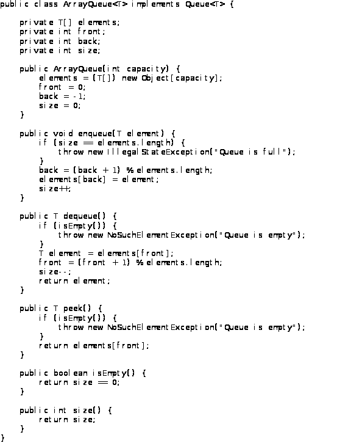

在这个实现中，我们使用一个数组元素来存储队列元素。我们还跟踪队列的头部和尾部索引，以及队列的当前 `size`。

`enqueue` 方法通过增加尾部索引（在必要时回绕）并将元素插入新的尾部索引处，将元素添加到队列尾部。

`dequeue` 方法通过获取头部索引元素、增加头部索引（在必要时回绕）并减少 `size` 来移除并返回头部的元素。

`peek` 方法在不移除元素的情况下返回头部的元素。

`isEmpty` 方法通过检查 `size` 来判断队列是否为空。

`size` 方法返回队列的大小。

注意，此实现使用了固定大小的数组，因此当数组满时，尝试入队新元素将抛出 `IllegalStateException`。

## 6.3. 基于链表的队列实现

基于链表的队列是一种使用链表来存储队列元素的队列实现方式。链表的每个节点都包含一个元素和一个指向下一个节点的引用。队列的头部是链表的表头，队列的尾部是链表的尾部。当元素入队（`enqueue`）时，一个新节点会被添加到链表的尾部；当元素出队（`dequeue`）时，链表的表头会被移除。

以下是一个 Java 中基于链表的队列实现的示例：

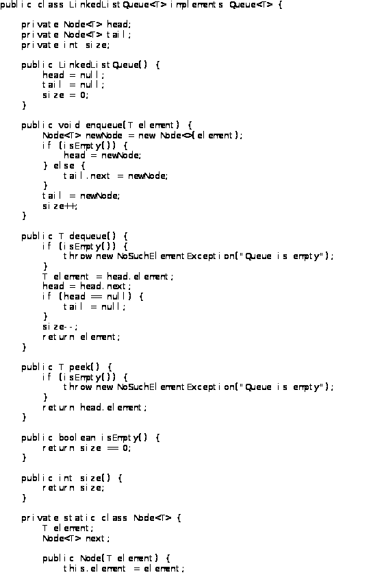

在这个实现中，我们使用链表来存储队列元素。我们还维护了链表的头部和尾部，以及队列的当前大小。

`enqueue` 方法通过创建一个包含元素的新节点，并将当前尾部节点的 `next` 引用指向新节点，从而将元素添加到链表的尾部。如果链表为空，则将头部和尾部引用指向新节点。

`dequeue` 方法通过获取头部节点的元素，移除并返回链表头部的元素，更新 `head` 引用指向下一个节点，并递减 `size`。如果移除头部节点后链表变空，则 `tail` 引用也会被设置为 `null`。

`peek` 方法在不移除元素的情况下返回链表头部的元素。

`isEmpty` 方法通过检查 `size` 来判断队列是否为空。

`size` 方法返回队列的当前大小。

注意，这种实现使用了动态数据结构，因此它可以根据需要增长或缩小以容纳元素。

### 6.4. 循环队列

循环队列是一种使用环形缓冲区（circular buffer）作为底层数据结构的队列。循环缓冲区是一个固定大小的缓冲区，其行为就像头部和尾部环形连接在一起一样。这意味着当缓冲区满时，新元素将覆盖缓冲区中最旧的元素；而当缓冲区为空时，尝试出队元素将导致错误。

循环队列像普通队列一样有一个 `front`（头）和一个 `rear`（尾），但当 `front` 和 `rear` 索引到达末尾时，它们会回到缓冲区开头。这允许循环队列重用缓冲区中之前被出队元素占据的空间。

以下是一个 Java 中循环队列实现的示例：

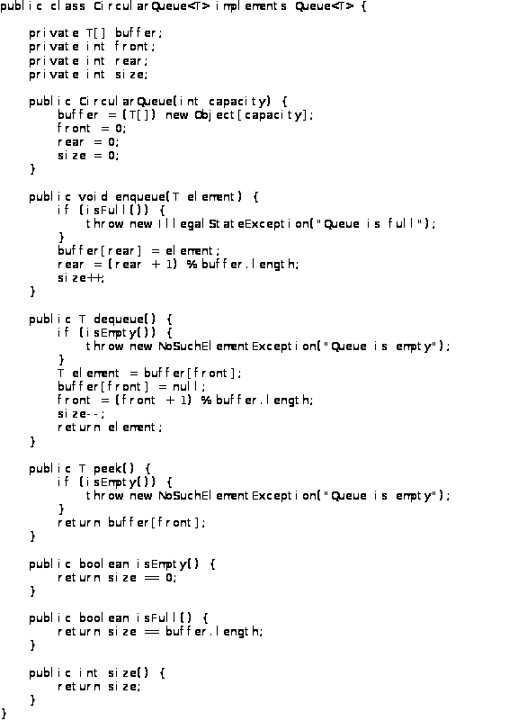

在这个实现中，我们使用环形缓冲区来存储队列元素。我们还维护了 `front` 和 `rear` 索引，以及队列的当前大小。

`enqueue` 方法通过将 `rear` 索引处的值设置为新元素，并将 `rear` 索引更新为循环缓冲区中的下一个位置，从而将元素添加到缓冲区的尾部。如果缓冲区满，将抛出一个异常。

`dequeue` 方法通过获取 `front` 索引处的值、将值设置为 `null` 并更新 `front` 索引为循环缓冲区中的下一个位置，从而移除并返回缓冲区头部的元素。如果缓冲区为空，将抛出一个异常。

`peek` 方法在不移除元素的情况下返回缓冲区头部的元素。

`isEmpty` 方法通过检查 `size` 来判断队列是否为空。

`isFull` 方法通过比较 `size` 和缓冲区长度来判断队列是否满。

`size` 方法返回队列的当前大小。

注意，这种实现使用了固定大小的缓冲区，因此它无法超出初始容量增长或缩小。此外，由于环形缓冲区的实现，缓冲区始终至少有一个空位，以区分空状态和满状态。

### 6.5. 优先级队列


优先级队列是一种抽象数据类型，类似于队列，但增加了一个特性：每个元素都有一个与其相关的优先级。优先级高的元素先出队，而优先级相同的元素则按照它们被加入队列的顺序进行出队。

优先级队列可以使用各种数据结构来实现，例如堆（heaps）、二叉搜索树，甚至是未排序数组。优先级队列的一种流行实现是使用二叉堆，二叉堆是一种满足堆属性的完全二叉树。

在 Java 中，`PriorityQueue` 类是优先级队列的一种实现，它使用二叉堆来存储元素。以下是在 Java 中使用 `PriorityQueue` 的示例：

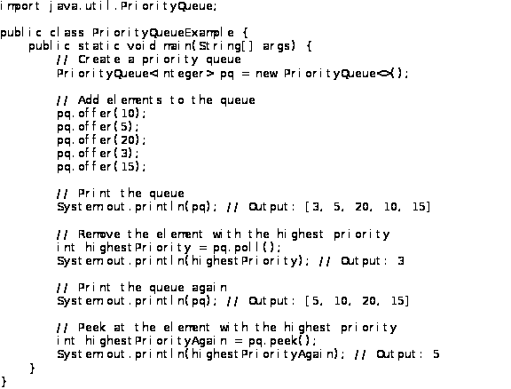

在这个示例中，我们创建了一个整数类型的 `PriorityQueue`，并使用 `offer` 方法向添加了一些元素。`PriorityQueue` 会自动维护堆属性，因此元素按其优先级进行排序。

然后，我们使用 `toString` 方法打印队列，它显示了元素将要出队的顺序。

接下来，我们使用 `poll` 方法移除优先级最高的元素，该方法会返回并移除队列的头部。我们打印该元素的值，然后再次打印队列以显示它已被移除。

最后，我们使用 `peek` 方法查看优先级最高的元素，该方法返回队列的头部但不移除它。我们打印该元素的值，以显示它是下一个将要出队的元素。

## 6.6. Java Queue 接口和 PriorityQueue 类

在 Java 中，`Queue` 接口是一种用于在处理前持有元素的集合。它类似于现实世界中的队列，先加入队列的元素先被移除。`Queue` 接口扩展了 `Collection` 接口，并增加了插入、移除和检查元素的方法。

`Queue` 接口的一种实现是 `PriorityQueue` 类，它是一个基于最小堆的优先级队列。`PriorityQueue` 类根据自然顺序或实例化时提供的自定义 `Comparator` 来维护元素的排序。

以下是在 Java 中使用 `Queue` 接口和 `PriorityQueue` 类的示例：

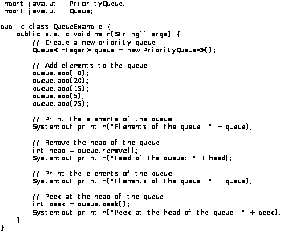

在这个示例中，我们首先使用 `Queue` 接口创建一个 `PriorityQueue` 实例。然后使用 `add` 方法向队列添加多个元素。

我们使用 `toString` 方法打印队列元素，它返回按元素出队顺序排列的字符串表示。

接下来，我们使用 `remove` 方法移除队列头部，并将移除的值存储在名为 `head` 的变量中。我们打印 `head` 的值，显示它是队列中的最小值。

我们再次打印队列元素，显示最小元素已被移除。

最后，我们使用 `peek` 方法查看队列头部，该方法返回队列头部但不移除它。我们打印 `peek` 的值，以显示它是下一个将要出队的元素。

### 6.7. 队列的应用

队列在计算机科学中有许多应用，特别是在需要按先入先出（FIFO）顺序处理数据的情况下。队列的一些常见应用包括：

1. **作业调度**：队列用于操作系统管理作业调度。每个作业被添加到队列中并按照它们被加入的顺序执行。

2. **广度优先搜索**：队列用于图遍历算法，如广度优先搜索（BFS）。BFS 按层遍历图，在访问距离起始节点为 $k$ 的所有节点之前，先访问距离为 $k+1$ 的节点。队列用于存储已访问但尚未处理的节点。

3. **缓存**：队列用于缓存淘汰策略。当缓存满且需要添加新项时，将从缓存中移除最近最使用的项。这可以使用队列来跟踪项添加到缓存的顺序来实现。

4. **消息队列**：队列用于消息传递系统，用于存储消息直到它们可以被处理为止。发送者将消息添加到队列中，接收者从队列中移除消息。

5. **仿真**：队列用于仿真软件来建模容量有限的系统。例如，队列可以用于模拟商店的结账队列或音乐会的候补名单。

## 第 7 章：递归

递归是一种强大的编程技术，函数通过调用自己来解决问题。在 Java 中，递归通过调用带有不同参数的自身方法来实现。

递归的核心思想是将问题分解为更小的子问题，直到这些子问题简单到可以直接解决的程度。当达到基准情况（即最简单的子问题）时，递归停止，并组合子问题的解决方案来解决原始问题。

这是一个计算数字阶乘的递归函数示例：

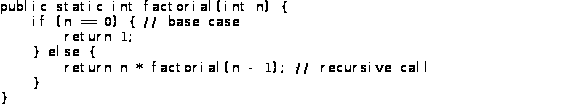

该函数接收一个整数 `n` 并递归地计算它的阶乘。基准情况是 `n` 等于 0，此时函数返回 `1`。否则，函数会对 `factorial(n - 1)` 进行递归调用，并将结果乘以 `n`。

递归可以是某些问题的优雅解决方案，但它的效率可能低于迭代方法。每次递归调用都会创建一个新的栈帧（stack frame），如果递归很深，可能会消耗大量的内存。此外，某些问题可能不适合递归，可能需要不同的方法。

确保递归函数具有基准情况且递归能够终止是非常关重要的，否则可能会导致无限循环和栈溢出错误。

### 7.1. 理解递归

要理解递归，理解函数调用栈（function call stack）的概念非常重要。函数调用栈是程序用于跟踪函数调用的数据结构。当函数被调用时，栈顶端会添加一个新帧。当函数返回时，该帧从栈中移除。

当一个函数递归地调用自己时，每次都会向栈中添加一个新帧。在执行新的函数调用期间，原函数的执行会被挂。一旦达到基准情况，函数将返回，每个先前的函数调用将恢复执行。

让我们来看一个例子来更好地理解递归是如何工作的。这里有一个计算第 n 个斐波那契数的递归函数：

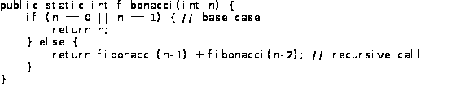

该函数接收一个整数 `n` 并返回第 n 个斐波那契数。基准情况是 `n` 等于 0 或 1，此时函数返回 `n`。否则，函数会对 `fibonacci(n-1)` 和 `fibonacci(n-2)` 进行两次递归调用，并返回它们结果之和。

如果我们调用 `fibonacci(5)`，函数调用栈将如下所示：

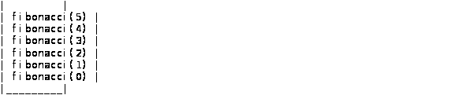

该函数首先调用 `fibonacci(5)`，它对 `fibonacci(4)` 和 `fibonacci(3)` 进行递归调用。`fibonacci(4)` 又对 `fibonacci(3)` 和 `fibonacci(2)` 进行递归调用，依此类推，直到达到基准情况。

一旦达到基准情况，函数返回其结果，每个先前的函数调用将恢复执行，最终返回最终结果。

## 7.2. 递归解决方案与迭代解决方案

递归和迭代解决方案是编程中解决问题的两种常见方法。递归解决方案使用函数调用将问题分解为更小的子问题，而迭代解决方案使用循环在问题空间上迭代，直到找到解决方案为止。

递归解决方案可以非常优雅且易于理解，但它们的效率可能低于迭代解决方案。每次递归函数调用都会创建一个新的栈帧，如果递归很深，可能会消耗大量的内存。此外，某些问题可能不适合递归，可能需要不同的方法。

另一方面，迭代解决方案使用循环在问题空间上迭代，直到找到解决方案。它们通常比递归解决方案高效，因为它们避免了函数调用和栈帧的开销。然而，迭代解决方案有时比递归解决方案更难阅读和理解。

这是一个用递归和迭代解决方案计算数字阶乘的示例：

递归解决方案：

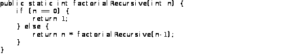

迭代解决方案：

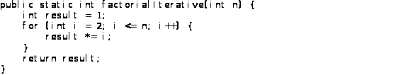

这两个函数都计算数字 `n` 的阶乘，但它们使用了不同的方法。递归解决方案使用较小的参数调用自身，直到达到基准情况，而迭代解决方案则使用循环在问题空间上迭代。

通常情况下，为当前的问题选择合适的解决方案是重要的。对于某些问题，递归解决方案可能是优雅且易于的，但对于其他问题，迭代解决方案可能更高效。

### 7.3. 尾递归

尾递归是一种特殊的递归，其中函数的最后一个操作是递归调用。换句话说，函数的返回值直接由递归调用的返回值决定，没有任何额外的计算或处理。

尾递归很重要，因为编译器和解释器可以对其进行优化，以避免创建新的栈帧。相反，每次调用可以重用同一个栈帧，从而提高性能并减少内存占用。

让我们来看一个例子看看尾递归是如何工作的。这里有一个计算数字阶乘的尾递归函数：

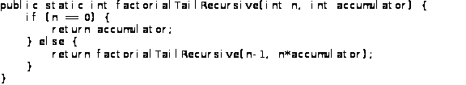

该函数接收两个参数：`n` 和 `accumulator`。`accumulator` 参数存储计算的中间结果，并初始化为 1。基准情况是 `n` 等于 0，此时函数返回 `accumulator`。

否则，函数使用 `n-1` 和 `n*accumulator` 作为新参数进行递归调用。注意函数的最后一个操作是递归调用，这使得该函数成为尾递归。

如果我们调用 `factorialTailRecursive(5, 1)`，函数将执行以下递归调用：

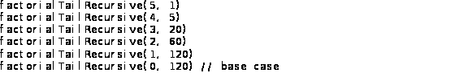

函数在基准情况处返回 `accumulator`，结果为 120。注意由于该函数是尾递归的，所有递归调用仅使用一个栈帧。

尾递归是优化具有特定形式递归函数的有用技术。然而，并非所有递归函数都能轻松转换为尾递归函数，理解使用尾递归的局限性和权衡是非常重要的。

## 7.4. 记忆化与动态规划

记忆化（Memoization）和动态规划是两种通过减少冗余计算来优化算法的相关技术。

记忆化是一种缓存昂贵函数调用结果的技术，并在当相同输入再次出现时返回缓存的结果。这可以显著加快频繁用相同输入调用的函数的计算速度。记忆化对于递归函数特别有用，因为它可以消除对相同参数的函数的冗余调用。

这里是一个计算第 n 个斐波那契数的记忆化递归函数示例：


该函数接受两个参数，`n` 和 `memo`。`memo` 参数是一个 `Map`，用于存储之前函数调用的结果。如果 `n` 小于或等于 1，函数直接返回 `n`。否则，如果 `n` 存在于 `memo` Map 中，函数将返回缓存的结果。否则，函数将递归计算第 n 个斐波那契数，并将结果缓存在 `memo` Map 中供以后使用。

动态规划是一种解决复杂问题的技术，它通过将问题分解为更小、更简单的子问题并仅求解每个子问题一次，将结果存储在表格或数组中供以后使用。其核心思想是通过重用已遇到的子问题解决方案来避免冗余计算。

动态规划可以解决许多广泛的问题，包括优化问题、图算法和序列对齐问题。解决动态规划问题的基本步骤是：

1. 用子问题的形式定义问题。

2. 识别边界情况（base case）。

3. 确定递归关系或公式。

4. 应用 `memoization`（备忘）或 `tabulation`（表规划）来避免冗余计算。

以下是最长公共子序列问题的动态规划解决方案示例：


该函数接受两个字符串 `s1` 和 `s2`，并返回最长公共子序列的长度。函数使用二维数组 `dp` 来存储每对子字符串的最长公共子序列的长度。边界情况是其中一个字符串为空时，此时公共子序列的长度为 0。递归关系基于两个字符串的当前字符是否匹配。函数使用嵌套循环填充 `dp` 数组，并返回 `dp[m][n]` 的最终值，即最长子序列的长度。

 |  |


# 第三部分：排序与搜索算法


本书第三部分涵盖了排序和搜索算法。排序算法用于按特定顺序排列数据，而搜索算法用于在集合中查找特定的值或项目。

关于排序算法的章节涵盖了一系列经典算法，包括 `bubble sort`（泡排序）、`selection sort`（选择排序）、`insertion sort`（插入排序）、`merge sort`（合并排序）、`quick sort`（快速排序）、`heap sort`（堆排序）、`counting sort`（计数排序）和 `radix sort`（基数排序）。每个算法都进行了详细解释，并包含了其时间复杂度和示例代码。

搜索算法的章节涵盖了 `linear search`（线性查找）、`binary search`（二分查找）、`interpolation search`（插值查找）和 `exponential search`（指数查找）。每个算法都进行了详细解释。排序与搜索算法章节为理解后续章节的高级算法和数据结构提供了价值的基础。

 |  |


## 第 8 章：排序算法


本书第 8 章详细介绍了排序算法。排序算法用于按特定顺序排列数据集合。有很多排序算法，每种算法在性能和实现易用性各有优劣。

本章涵盖了以下排序算法：

1. `Bubble Sort`（泡排序）：一种简单的算法，如果相邻元素顺序错误，则重复交换它们。

2. `Selection Sort`（选择排序）：一种重复从数组未排序部分找到最小元素并将其放在开头的算法。

3. `Insertion Sort`（插入排序）：一种通过将每个元素插入其正确位置来逐个构建最终排序数组的算法。

4. `Merge Sort`（合并排序）：一种分治算法，将数组分为两部分，对每部分排序，然后合并这两个部分。

5. `Quick Sort`（快速排序）：一种分治算法，选择一个元素作为基准并围绕基准对数组进行分区。

6. `Heap Sort`（堆排序）：一种构建二叉堆并从中重复提取最小元素以构建排序数组的算法。

7. `Counting Sort`（计数排序）：一种基于整数的非比较排序算法，通过统计每个值的出现次数来工作。

8. `Radix Sort`（基数排序）：一种非比较排序算法，通过比较每个元素的数字位进行排序。

对于每种排序算法，本章都提供了该算法的详细解释，包括其时间和空间复杂度。此外，本章还为每个算法提供了 `Java` 示例代码。

## 8.1. Bubble Sort

`Bubble Sort` 是一种简单的排序算法，它重复遍历元素集合，比较相邻元素，并在顺序错误时交换它们。重复遍历集合，直到集合排序好为止。`Bubble Sort` 的效率不高，通常不在实际应用中使用，但它是排序算法概念的良好介绍，在数据集较小的情况下很有用。

`Bubble Sort` 的基本思想是比较相邻元素，如果不符合所需的顺序则进行交换。算法多次遍历元素列表，每次迭代将剩余最大的元素移动到列表末尾的正确位置。

以下是 `Bubble Sort` 的 `Java` 中的示例实现：


––––––––


在此实现中，外层循环运行 `n-1` 次，其中 `n` 是数组的长度。内层循环在每次外层迭代中运行 `n-i-1` 次，因为最后 `i` 个元素已经排序，不需要比较。

`Bubble Sort` 的最坏和平均情况时间复杂度为 `O(n²)`，其中 `n` 是数组中的元素个数。这使得它在排序大数据集时不可行，但在数据集较小时可能用。

## 8.2. Selection Sort

`Selection Sort` 是一种简单的排序算法，通过重复从数组未排序部分找到最小元素并将其放在开头来排序。`Selection Sort` 的时间复杂度为 `O(n²)`，其中 `n` 是数组中的元素个数。这使得它在大列表中效率低下，且性能通常不如相似的 `Insertion Sort`。

以下是 `Selection Sort` 在 `Java` 中的示例实现：


在此实现中，外层循环运行 `n-1` 次，其中 `n` 是数组的长度。内层循环找到未排序部分的最小元素，并与未排序部分的头部元素交换。

`Selection Sort` 的空间复杂度为 `O(1)`，因为它只需要常量的额外内存来存储排序过程中使用的临时变量。虽然 `Selection Sort` 的效率不高，但在对内存使用敏感的情况下它是很有用的，因为与其他排序算法相比，它需要的额外内存很少。

## 8.3. Insertion Sort

`Insertion Sort` 是一种逐个元素构建最终排序数组的简单排序算法。它通过从数组未排序部分取一个元素，并将其插入排序部分的正确位置来工作。`Insertion Sort` 的时间复杂度为 `O(n²)`，其中 `n` 是数组中的元素个数。这使得它在大列表中效率低下，但可能比 `Bubble Sort` 和 `Selection Sort` 等其他二次算法更高效。

以下是 `Insertion Sort` 在 `Java` 中的示例实现：


在此实现中，外部循环运行 `n-1` 次，其中 `n` 是数组的长度。内部循环通过不断将元素与前一个元素交换，直到它处于正确位置，从而将其移动到数组已排序部分的适当位置。

插入排序（Insertion Sort）的空间复杂度为 `O(1)`，因为它只需要常数量的额外内存来存储排序过程中使用的临时变量。虽然插入排序的效率不高，但在数组已经部分排序或接近有序的情况下，它可能非常有用，因为对于这类输入，它的平均时间复杂度为 `O(n)`。

### 8.4. 合并排序

合并排序（Merge Sort）是一种分治法排序算法，其工作原理是将无序列表划分为 `n` 个子列表，每个子列表包含一个元素（单元素的列表被认为是有序的）。然后，它重复地合并这些子列表以生成新的排序子列表，直到只下一个子列表。这个最终的子列表就是排序后的列表。

合并排序的时间复杂度为 `O(n log n)`，其中 `n` 是数组中元素的数量。这使得它比冒泡排序和选择排序等二次算法更高效。

以下是合并排序在 Java 中的示例实现：


在此实现中，`mergeSort` 函数递归地将数组一分为两半，然后调用 `merge` 函数来合并已排序的半。`merge` 函数将两个排序的子数组合并成单个排序的子数组。


合并排序的空间复杂度为 `O(n)`，因为它需要额外的内存来存储合并步骤中使用的临时数组。虽然这可能导致它的效率低于插入排序等算法，但在稳定性和保证最坏情况时间复杂度重要的情况下，它是很有用的。

### 8.5. 快速排序

快速排序（Quick Sort）是另一种分治法排序算法，其工作原理是从数组中选择一个基准元素（pivot），并根据其他元素是否小于或大于基准将它们划分为两个子数组。然后递归地对子数组进行排序。

快速排序在平均情况下的时间复杂度为 `O(n log n)`，但如果基准选择不当，最坏情况的时间复杂度可能达到 `O(n²)`。然而，随机化的快速排序版本可以降低最坏情况发生的概率。

以下是快速排序在 Java 中的示例实现：


在此实现中，`quickSort` 函数根据基准元素递归地将数组分为两部分，基准元素被选择为数组中最右侧的元素。`partition` 函数通过将每个元素与基准进行比较来划分数组：如果元素小于基准，则移动到左子数组；如果大于或等于基准，则移动到右子数组。该函数随后返回基准元素的索引，该索引用于递归地划分子数组。

由于递归调用栈，快速排序的空间复杂度为 `O(log n)`，使其比合并排序更节省内存。然而，它的最坏情况时间复杂度可能为 `O(n²)` 且不是稳定的。

### 8.6. 堆排序

堆排序（Heap Sort）是另一种基于比较的排序算法，其工作原理是从输入数组构建一个最大堆或最小堆，并重复提取根元素将其放置在排序数组的末尾。

在堆排序中，堆是一个二叉树，取决于是最大堆还是最小堆，每个父节点都大于或小于它的子节点。堆的根节点是堆中的最大或最小元素，这取决于具体是最大堆还是最小堆。

堆排序的时间复杂度为 `O(n log n)`，空间复杂度为 `O(1)`。然而，它不是稳定的，这意味着相等元素在排序数组中的顺序可能无法保持。

以下是堆排序在 Java 中的示例实现：


在此实现中，`heapSort` 函数首先通过对堆中的每个父节点调用 `heapify` 函数，从输入数组构建一个最大堆。`heapify` 函数递归地将父节点与其较大的子节点进行交换，直到父节点大于它的两个子节点。一旦构建了最大堆，该函数通过将根元素与堆中的最后一个元素交换来重复提取，并将堆的大小减一，并在根节点上调用 `heapify` 以恢复最大堆属性。

堆排序是一种原地排序算法，这意味着它不需要额外的内存来存储排序后的数组。然而在实践中，由于缓存性能较差，它比其他 `O(n log n)` 排序算法慢。

### 8.7. 计数排序

计数排序（Counting Sort）是一种非比较的排序算法，其工作原理是统计输入数组中每个元素的次数，并利用这些信息将元素放在输出数组的正确顺序上。

计数排序的时间复杂度为 `O(n + k)`，其中 `n` 是输入数组中的元素数量，`k` 是元素的范围，空间复杂度为 `O(n + k)`。然而，它只能用于排序整数或小范围的数据集，因为对于较大的数据集，其空间和时间复杂度会显著增加。

以下是计数排序在 Java 中的示例实现：


在此实现中，`countingSort` 函数首先创建一个长度为输入元素范围的计数数组。然后遍历输入数组以统计每个元素的出现次数，并将这些信息存储在计数数组中。接着计算计数数组的前缀和以确定每个元素在输出数组中的位置。最后，它反向遍历数组，将每个元素放在正确的位置并减少该元素的计数。一旦所有元素都放入输出，该函数将元素复制回输入数组。

计数排序是一种稳定的排序算法，意味着相等元素在排序数组中的顺序会被保持。它通常用作其他算法（如基数排序）的子程序。

### 8.8. 基数排序

基数排序（Radix Sort）是一种非比较的排序算法，通过根据数字或字符对元素进行排序。它根据特定位置的数字或字符将元素分组（桶），然后重复地根据下一个数字或字符对元素进行排序，直到所有数字或字符都排序完毕。

基数排序的时间复杂度为 `O(k * n)`，其中 `k` 是输入元素中数字或字符的最大，`n` 是元素数量。然而，它只能用于排序具有固定位数或字符数的元素，且如果位数或字符数很大，其时间复杂度可能会变得非常高。

以下是基数排序在 Java 中的示例实现：


在此实现中，`radixSort` 函数首先找到输入数组中的最大元素，以确定排序所需的位数。然后它从低位到高位遍历每一位，并根据该数位对元素执行计数排序。它使用 `getMax` 函数确定数组中的最大元素，并计算计数数组的前缀和以确定每个元素在输出数组中的位置。然后它按照正确顺序将元素放入输出数组中，并将排序后的元素复制回输入数组。

## 8.9. 排序算法的比较

有很多不同的排序算法，每种都有自己的优缺点。以下是一些常见排序算法的简要比较：

1. **冒泡排序 (Bubble Sort)**：`Bubble Sort` 是一种简单的排序算法，如果相邻元素顺序错误，就反复交换它们。它的最坏情况时间复杂度为 `O(n²)`，因此对于大型数组来说效率较低。

2. **选择排序 (Selection Sort)**：`Selection Sort` 是一种排序算法，它反复从数组的未排序部分选择最小元素，并将其放在已排序部分的开头。它的最坏情况时间复杂度为 `O(n²)`，因此对于大型数组来说效率较低。

3. **插入排序 (Insertion Sort)**：`Insertion Sort` 是一种排序算法，它通过不断将新元素插入数组已排序部分的正确位置，逐个构建最终的排序数组。它的最坏情况时间复杂度为 `O(n²)`，因此对于大型数组来说效率较低。

4. **归并排序 (Merge Sort)**：`Merge Sort` 是一种排序算法，它将输入数组分为两部分，递归地对每部分进行排序，然后合并这两个已排序部分。它的最坏情况时间复杂度为 `O(n log n)`，因此对于大型数组来说效率很高。

5. **快速排序 (Quick Sort)**：`Quick Sort` 是一种选择一个元素作为基准并围绕其划分数组的算法，使得所有小于基准的元素在其之前，所有大于基准的元素在其之后。然后递归地对两个子数组进行排序。它的最坏情况时间复杂度为 `O(n²)`，但平均时间复杂度为 `O(n log n)`，对大多数输入都很高效。

6. **堆排序 (Heap Sort)**：`Heap Sort` 是一种排序算法，它从输入数组构建一个二堆，并反复提取最大元素将其放在已排序部分的末尾。它的最坏情况时间复杂度为 `O(n log n)`，因此对于大型数组来说效率很高。

7. **计数排序 (Counting Sort)**：`Counting Sort` 是一种通过统计每个元素出现的次数并利用这些信息确定每个元素在排序数组中的位置的算法。它的时间复杂度为 `O(n + k)`，其中 `k` 是输入元素的范围，因此对于范围较小的输入非常高效。

8. **基数排序 (Radix Sort)**：`Radix Sort` 是一种根据元素在特定位置的数字或字符值将它们分组到桶中排序的算法，然后反复根据下一个数字或字符对元素进行排序，直到所有数字或字符都排序完毕。它的时间复杂度为 `O(k * n)`，其中 `k` 是输入元素中最大的位数或位数，`n` 是元素个数。

总来说，`Merge Sort`、`Quick Sort`、`Heap Sort` 和 `Radix Sort` 被认为比 `Bubble Sort`、`Selection Sort` 和 `Insertion Sort` 更高效，特别是对于大型数组。然而，排序算法的选择还取决于应用的具体需求，例如稳定性、内存使用和实现的难易性。

## 8.10. Java 排序工具类

Java 提供了一个名为 `Arrays` 的内置工具类，其中包含各种数组排序算法。以下是 `Arrays` 类中可用的一些排序方法：

1. `Arrays.sort()`：该方法按升序排列指定的数组。它对原始数据类型使用双基准快速排序算法，对对象类型使用归并排序算法。

2. `Arrays.parallelSort()`：该方法并行地排序指定的数组，这在多核处理器上对于大型数组来说速度更快。

3. `Arrays.sort(array, comparator)`：该方法根据提供的 `Comparator` 对指定的数组进行排序。

对于大型数组，二分查找比线性查找更高效，因为它的时间复杂度为 `O(log n)`，而线性查找的复杂度为 `O(n)`。然而，它要求数组先进行排序，如果数组频繁更新，这会产生额外的开销。

以下是在 Java 中实现二分查找的几个示例：

### 示例 1：使用递归实现二分查找


在此示例中，`binarySearch` 方法通过递归实现。它接受四个参数：要搜索的数组、目标值、搜索范围的左索引以及搜索范围的右索引。在每次递归调用中，它计算搜索范围的中间索引，并将中间元素与目标值进行比较。如果它们相等，则返回中间元素的索引。否则，如果中间元素大于目标值，则通过递归调用方法并传入左索引和 `mid - 1` 索引在搜索范围的左半部分搜索。如果中间元素小于目标值，则通过递归调用方法并传入 `mid + 1` 和 `right` 索引在搜索范围的右半部分搜索。

### 示例 2：使用迭代实现二分查找


## 9.3. 插值查找

插值查找是另一种在均匀分布数据上效果最好的搜索算法。它是对二分查找的改进，因为它使用所搜索键的值来估计该键在排序数组中的位置。

插值查找算法的工作原理是首先计算目标值所在索引的估计值。这是通过使用以下公式估计位置的：


其中 `left` 和 `right` 是正在搜索的子数组的边界，`target` 是要搜索的值，而 `arr` 是排序后的数组。

一旦完成估算，算法会检查该索引处的值。如果该值等于目标值，则算法返回该索引。如果该值小于目标值，算法在右子数组中继续搜索。如果该值大于目标值，算法在左子数组中继续搜索。

如果算法到达子数组末尾仍未找到目标值，则返回 `-1` 表示未找到该值。

以下是 Java 中插值查找的一个示例实现：


在此实现中，我们首先检查目标值是否在正在搜索的子数组范围内。如果是，我们使用上述公式计算估计位置。如果估算位置处的值等于目标值，我们返回该索引。如果该值小于目标值，我们在右子数组中搜索。如果该值大于目标值，我们在左子数组中搜索。如果算法到达子数组末尾仍未找到目标值，则返回 `-1` 表示未找到该值。

## 9.4. 指数查找

指数查找是一种工作在排序数组上的搜索算法。它从将搜索键与数组的第一个元素进行比较开始。如果键小于第一个元素，则终止搜索，因为在数组中将无法找到该键。否则，算法将搜索范围的上界设置为大于数组长度的下一个 2 的幂，将下界设置为小于数组长度的最后一个 2 的幂。然后，在这些边界之间的子数组上执行二分查找，如果键存在于数组中，该子数组保证包含它。

以下是指数查找的实现：


在此实现中，函数接收一个整数数组 `arr` 和一个搜索键 `key` 作为输入，如果键存在于数组，则返回其在数组中的索引，否则返回 `-1`。

算法首先检查 `key` 是否等于数组的第一个元素。如果是，函数返回 `0`。否则，它将索引 `i` 设置为 `1`，并在每次迭代中将其翻倍，直到找到一个在该索引处的元素大于或等于搜索键的索引 `i`，或者 `i` 超过数组长度。此时，函数在 `i/2` 和 `i` 与数组长度的最小值之间的子数组上执行二分查找，如果键存在于数组中，该子数组保证包含它。使用 `Arrays.binarySearch` 函数来执行二分查找，如果键存在于子数组中，它返回其在子数组中的索引，否则返回负值。

以下是使用 `exponentialSearch` 函数的几个示例：

––––––––


输出：


### 9.5. 搜索算法比较

当在数据集中查找一个元素时，有多种算法可用，每种算法都有其优缺点。选择哪种算法通常取决于所搜索数据的特征以及应用的特定需求。在本节中，我们将比较最常用搜索算法的时间空间复杂度以及它们的优劣。

1. **线性查找（Linear Search）**：

    * 时间复杂度：`O(n)`

    * 空间复杂度：`O(1)`

    * 适用于小型数组或无序列表。

    * 性能随输入规模的增大而下降。

2. **二分查找（Binary Search）**：

    * 时间复杂度：`O(log n)`

    * 空间复杂度：`O(1)`

    * 适用于排序数组或列表。

    * 为较大的数组提供了快速搜索。

3. **插值查找（Interpolation Search）**：

    * 时间复杂度：`O(log log n)`（最好情况），`O(n)`（最坏情况）

    * 空间复杂度：`O(1)`

    * 对于均匀分布的数据，性能优于二分查找。

    * 对于非均匀分布的数据，性能逊于二分查找。

4. **指数查找（Exponential Search）**：

    * 时间复杂度：`O(log n)`

    * 空间复杂度：`O(1)`

    * 适用于无边界排序数组。

    * 当元素更靠近数组开头时，性能优于二分查找。

需要注意的是，这些算法的实际性能可能会取决于具体的实现和所搜索数据的特征。此外，某些算法除了时间和空间复杂度外可能还有其他优点或缺点，例如简单性或易于实现。因此，在选择搜索算法时，仔细考虑应用需求和数据属性很重要。

### 9.6. Java 搜索工具

Java 提供了用于在集合和数组中搜索元素的内置类和方法。一些常用的类和方法包括：

1. `Arrays.binarySearch()` 方法：用于在排序数组中查找元素。如果找到了元素，则返回索引；否则，返回一个表示元素插入点的负数。

示例：


2. `Collections.binarySearch()` 方法：用于在排序列表中查找元素。如果找到了元素，则返回索引；否则，返回一个表示元素插入点的负数。

示例：


3. `Arrays.asList()` 方法：用于将数组转换为 `List`。返回的 `List` 是由原始数组支持的固定大小列表。

示例：


### 1. `Collections.sort()` 方法

该方法用于对 `List` 进行升序排序。它使用元素的自然排序，即元素必须实现 `Comparable` 接口。

示例：


### 2. `Arrays.sort()` 方法

该方法用于对数组进行升序排序。它使用元素的自然排序，即元素必须实现 `Comparable` 接口。

示例：


### 3. `Collections.reverseOrder()` 方法

该方法返回一个 `Comparator`，它用于强制执行元素自然排序的反序。它可以与 `Collections.sort()` 方法结合使用，对 `List` 进行降序排序。

示例：


### 4. `Arrays.fill()` 方法

该方法用于用给定的值填充数组。

示例：


# 第四部分：高级数据结构

第四部分：高级数据结构涵盖了计算机科学各个领域广泛使用的更复杂的数据结构，如树、堆、图和哈希。这些数据结构对于解决许多高级编程问题和优化程序性能至关重要。在书的这部分，我们将讨论每种数据结构的基础、应用以及它们在 Java 中的实现。我们还将探索用于这些数据结构的各种算法和技术。在本部分的结束时，读者应该对高级数据结构有良好的理解，并在程序中有效地使用它们。

## 第 10 章：树

在计算机科学中，树是一种广泛使用的具有层次结构的数据结构。树被用于计算机科学、工程以及其他需要数据层次结构的许多应用中。

树是节点的集合，其中每个节点包含某些数据和一组子节点。树的顶端节点称为 `root`（根节点），每个节点可以有零或多个子节点。没有子节点的节点被称为 `leaf node`（叶子节点）。

树根据节点可以拥有的子节点数量进行分类。二叉树是每个节点最多有两个子节点的树，而三叉树是每个节点最多有三个子节点的树。

在本章中，我们将讨论不同类型的树、如何在 Java 中实现它们，以及可以在树上执行的操作。

## 10.1 树引引

在计算机科学中，树是一种广泛使用的数据结构，它表示数据元素的层次结构，其中每个元素被称为 `node`（节点）。树中的每个节点可以有零或多个子节点，并且有一个没有父节点的 `root` 节点。没有孩子的节点被称为 `leaf nodes`（叶子节点），而有一个或多个孩子的节点被称为 `internal nodes`（内部节点）。

树用于自然地表示数据，例如家谱、组织结构图和文件系统目录。树也可以用于搜索、排序和索引算法。树有许多类型，每种类型都有自己的属性和用途。

在二叉树中，每个节点最多有两个孩子，称为 `left child`（左孩子）和 `right child`（右孩子）。在二叉搜索树 (`BST`) 中，左子树中节点的值小于父节点的值，右子树中节点的值大于父节点的值。

其他类型的树包括 `AVL 树`、`红黑树`、`B 树` 和 `堆`。`AVL 树`是自平衡二叉搜索树，为每个节点维护一个平衡因子。`红黑树`是另一种使用颜色编码来平衡树的自平衡二叉搜索树。`B 树`用于在磁盘或其他辅助存储设备上存储大量数据。`堆`用于维护一个部分有序的元素集合，可以轻松访问最小或最大的元素。

## 10.2 二叉树


二叉树可以使用带有左、右孩子引用的节点来实现。这是一个示例实现：


在上面的实现中，`TreeNode` 类表示二叉树中的一个节点。每个节点包含一个整数值和指向其左、右孩子的引用。`BinaryTree` 类表示二叉树本身，并包含指向 `root` 节点的引用。

`insert` 方法根据节点的值在树的正确位置添加一个新节点。`search` 方法在树中搜索给定值的节点，如果找到该节点则返回 `true`，否则返回 `false`。

这里是 `BinaryTree` 类的使用示例：


这段代码创建了一个二叉树，插入了几个具有不同值的节点，然后搜索值为 3 和 6 的节点。输出分别为 "true" 和 "false"。

## 10.3 二叉搜索树

二叉搜索树（`BST`）是树的一种类型，其中每个节点最多有两个孩子。节点的左孩子小于父节点，而右孩子大于或等于父节点。这一属性允许高效的搜索、插入和删除操作。

这里是 Java 中二叉搜索树的实现：


在此实现中，`T` 是实现 `Comparable` 的泛型类型。`Node` 类表示树中的一个节点，包含对其数据的引用以及对其左、右子节点的引用。

`insert` 方法根据数据的值在树的正确位置插入一个新节点。`contains` 方法检查树中是否存在给定值的节点。`delete` 方法从树中删除具有给定值的节点，并在必要时重新调整树以维护 `BST` 属性。

## 10.4 平衡搜索树

平衡搜索树是二叉搜索树的一种类型，设计用于确保在插入和删除元素后树仍保持平衡。这有助于保证搜索、插入和删除操作的最坏时间复杂度为对数级（`O(log n)`）。

在 Java 中，有多种平衡搜索树实现，包括 `AVL 树`、`红黑树` 和 `B 树`。Java 集合提供了 `TreeSet` 类，它是自平衡二叉搜索树的实现。`TreeMap` 类是另一种使用 `红黑树` 的平衡搜索树实现。

在 Java 中使用 `TreeSet` 的示例：


在这个示例中，我们创建一个 `TreeSet` 并向其添加五个元素。然后我们使用各种方法从集合中检索元素，包括第一个和最后一个元素、小于或等于指定值的元素，以及两个指定值之间的元素。程序的输出为：


此示例演示了如何使用平衡搜索树按排序顺序存储和检索元素。

AVL 树是一种自平衡二叉搜索树，通过维护高度平衡来确保所有操作的最坏情况时间复杂度保证为 `O(log n)`，其中 n 是树中的元素数量。AVL 树与红黑树相似，但它们在平衡因子要求上更为严格。

以下是 AVL 树的实现：


## 10.6 红黑树

红黑树是一种自平衡二叉搜索树，能够保证插入、删除和查找操作的最坏情况时间复杂度为对数级。在 Java 中，`TreeMap` 和 `TreeSet` 类实现了红黑树。

以下是一个使用 `TreeMap` 类创建红黑树的示例：


在这个示例中，我们创建了一个名为 `tree` 的 `TreeMap` 对象。然后使用 `put()` 方法向树中插入键值对。程序的输出为 `{1=banana, 2=cherry, 3=apple, 4=elderberry, 5=durian}`，这表明红黑树按键升序排序。

注意，`TreeMap` 类提供了用于遍历树的其他方法，例如 `firstKey()`、`lastKey()`、`higherKey()` 和 `lowerKey()`。它还允许你指定自定义的 `Comparator` 来对键进行排序，这在键没有实现 `Comparable` 接口时非常有用。

## 10.7 B 树

B 树是一种自平衡树，通常用于数据库和文件系统。它们针对磁盘访问进行了优化，并能够高效地处理大量数据。

在 B 树中，每个节点可以拥有多个键和子指针。键的数量受一个称为树的阶数的常量限制。每个节点拥有的子指针最多比其包含的键数量多一个。这使得树具有较小的高度且保持平衡，从而最小化了磁盘访问。

以下是 Java 中 B 树的实现：


## 10.8 伸展树

伸展树是一种自调整二叉搜索树，其特性是最近访问的元素会被再次快速访问。伸展树的思想是通过执行树旋转将访问频繁的元素移动到靠近根部。

以下是 Java 中伸展树的实现：


在此实现中，`SplayTree` 类包含一个私有嵌套类 `Node`，代表树中的一个节点。树由其根节点表示。

## 10.9 Java 中的 Trie（前缀树）

引言：Trie（也称为前缀树）是一种存储动态字符串集合的树形数据结构。它用于高效地搜索字符串，特别对于搜索具有公共前缀的字符串非常有用。Trie 中的每个节点代表一个通过从根节点到该节点的路径可以形成的字符串（前缀）。

Trie 的 Java 实现：`Trie` 数据结构可以使用 `Node` 类实现，该类包含一个字符值、一个指示该节点是否代表单词结束的标志，以及一个指向 26 个子节点的指针数组（每个对应字母表中的一个字母）。以下是 `Node` 类的实现：


`Trie` 类可以使用 `Node` 类实现。它有一个根节点，这是一个空节点，不代表任何字符值。`insert()` 方法用于将字符串插入 `Trie`，`search()` 方法用于在 `Trie` 中搜索字符串。


用法示例：


在上面的示例中，我们首先创建一个新的 `Trie` 实例，使用 `insert()` 方法向 `Trie` 插入字符串 "hello" 和 "world"，然后使用 `search()` 方法搜索字符串 "hello"、world" 和 "hi"。输出显示 `Trie` 对于字符串 "hello" 和 "world" 正确返回 true，对于字符串 "hi" 返回 false。

注意，上述实现仅支持小写字母。如果你想支持大写字母、数字或其他特殊字符，则需要相应地修改实现。

## 10.10 Java 中的后缀树

后缀树是一种高级数据结构，可用于高效地解决各种字符串问题，例如寻找最长重复子串或多个字符串之间的最长公共子串。后缀树是一种树形结构，它以有利于快速模式匹配的方式存储给定字符串的所有后缀。

在 Java 中，有几个第三方库提供了后缀树的实现。最流行的之一是由 Suffix Trees 库提供的基于 Ukkonen 算法的实现。以下是其用法示例：


在这个示例中，我们通过将输入字符串传递给构造函数来创建一个 `SuffixTree` 对象。然后可以使用 `search` 方法查找模式的所有出现处，以及 `getLongestSubstring` 注意 Suffix Trees 库需要包含 Apache Commons Text 库。

## 10.11 Java 树实现

Java 提供了内置的树实现，可以在 `java.util` 中找到。常用的类包括：

1. `TreeMap`：实现自平衡二叉树。它根据自然排序或 `Comparator` 按升序维护元素。
2. `TreeSet`：基于 `TreeMap` 的 `NavigableSet`。
3. `HashMap`：哈希表的实现，不是树数据结构。
4. `HashSet`：基于 `HashMap` 的 `NavigableSet`。
5. `LinkedHashMap`：维护项顺序的 Map。该实现使用双向链表来维护顺序。
6. `LinkedHashSet`：维护元素顺序的 Set。该实现使用双向链表来维护顺序。
7. `PriorityQueue`：使用堆数据结构实现优先级队列。它可以维护一个动态变化的元素集合，元素的优先级由自然排序或 `Comparator` 决定。

这些类每个都有自己的属性和用场景。根据任务选择合适的实现对于性能和功能性原因来说是非常重要的。

在 Java 中，堆（heaps）通常用于实现优先级队列，可以高效地访问和移除最小或最大的元素。堆主要有两种类型：最大堆（max heaps）和最小堆（min heaps）。在最大堆中，最大的元素存储在堆的根节点，而在最小堆中，最小的元素存储在根节点。

Java 提供了一个内置的 `PriorityQueue` 类，它实现了最小堆。优先级队列中的元素根据它们的自然排序或在构造队列时提供的 `Comparator` 进行排序。`PriorityQueue` 类提供了提供了从队列中插入和移除元素的方法，以及访问头元素（最小元素）和检查队列是否为空的方法。

以下是一个创建和使用 `PriorityQueue` 的示例：


输出：

1

1

3

4

5

## 11.2 Java 中的二叉堆

二叉堆（Binary Heaps）是一种特殊的堆数据结构，它满足堆的属性，并且元素存储在二叉树结构中。二叉堆有两种类型：最小堆和最大堆。在最小堆中，父节点始终小于或等于其子节点，且根节点包含堆中的最小元素。在最大堆中，父节点始终大于或等于其子节点，且根节点包含堆中的最大元素。

在 Java 中，我们可以使用数组来实现二叉堆。我们可以将二叉堆表示为一棵完全二叉树，其中每一层都从左到右填充，最后底层可能不完全满。我们可以使用以下公式来计算父节点和子节点的位置：

- 索引为 `i` 的节点的父节点索引为 `(i - 1) / 2`。
- 索引为 `i` 的节点的左子节点索引为 `(2 * i) + 1`。
- 索引为 `i` 的节点的右子节点索引为 `(2 * i) + 2`。

以下是一个使用数组在 Java 中实现最小堆的示例代码：


## 11.3 基于数组的堆实现

这里是一个基于数组实现的二叉堆 `i` 的示例：


在此实现中，堆以数组形式存储，其中每个节点 `i` 的左子节点索引为 `2i + 1`，右子节点索引为 `2i + 2`，节点 `i` 的父节点索引为 `(i-1) / 2`。`insert` 方法向堆中添加新元素并将其向上移动（bubbles up）到正确位置，而 `remove` 方法移除根元素并将新的根元素向下移动（bubbles down）到正确位置。`peek` 方法返回根元素但不将其移除。

## 11.4 堆化（Heapify）与建堆（Build-Heap）操作

Heapify 和 Build-Heap 是堆数据结构中两种重要的操作，用于从给定数组创建堆。这些操作通常用于排序算法和优先级队列的实现。

Heapify 是一种恢复二叉树堆属性的操作。该操作假设给定节点的左右子树以其为根的二叉树已经是最大堆，但给定节点的值可能违反了堆属性。Heapify 从一个节点开始，递归地调整该节点及其后代以满足堆属性。在最大堆中，最大的元素位于树的根部。

Build-Heap 是一种从给定数组创建堆的操作。它从最底部的节点开始堆化，并向上处理到根节点。这是从无序数组创建堆的高效方法。该操作的时间复杂度为 `O(n)`，比逐个将每个元素插入堆要快，后者的时间复杂度为 `O(nlogn)`。

以下是使用 Java 中基于数组的实现最大堆的 Heapify 和 Build-Heap 操作实现：


在此实现中，`heapify` 方法接收基于数组的堆中节点的索引，并递归地调用自己以确保以给定节点为根的子树是一个最大堆。`buildHeap` 方法从树的最底层开始，一直向上到根节点，在路径上的每个节点上都调用 `heapify` 方法，以确保整棵树是一个最大堆。`getSize` 方法返回堆的大小，`getMax` 方法返回堆中的最大元素（即根元素）。

### 11.5 基于堆的优先级队列

基于堆的优先级队列是一种允许根据优先级插入和移除元素的数据结构。它使用堆数据结构实现，堆是一种具有堆属性的完全二叉树。堆属性是一个条件，其中父节点的优先级高于或低于其子节点，具体取决于它是最大堆还是最小堆。

基于堆的优先级队列中最常见的操作是插入和删除最高或最低优先级的元素，这取决于所使用的堆类型。在最大堆中，优先级最高的元素位于根节点，而在最小堆中，优先级最低的元素位于根节点。

要在基于堆的优先级队列中插入元素，我们首先将其添加到堆的末尾，然后执行上浮（sift-up）操作，即将其与父节点进行比较，直到找到正确位置。

Java 的 `PriorityQueue` 类实现了最小堆。优先级队列中的元素根据它们的自然排序或在构造队列时提供的 `Comparator` 进行排序。`PriorityQueue` 类提供了从队列中插入和移除元素的方法，以及访问头元素（最小元素）和检查队列是否为空的方法。

这里使用 `PriorityQueue` 配合反向排序器来实现最大堆的优先级队列。

以下是 Java 中使用 `PriorityQueue` 实现基于堆的优先级队列的示例：


在这个示例中，我们创建了一个泛型类 `MaxHeapQueue`，它使用带有反向自然排序器的 `PriorityQueue` 来实现最大堆优先级队列。`insert` 方法向队列添加元素，`deleteMax` 方法移除并返回最高元素，`getMax` 方法返回最高元素但不移除，`size` 方法返回队列的大小，`isEmpty` 方法返回队列是否为空。

## 11.6 D 叉堆（D-ary Heaps）

D 堆是二叉堆的一种变体，每个节点有 `d` 个子节点而不是 2 个。数字 `d` 称为堆的阶数（arity）。2 堆等同于二叉堆，而 3 堆是一种常见的替代方案。

D 堆的主要优势是与二叉堆相比减少了树的深度，这可以提高操作速度。但它的缺点是需要更多内存，因为每个节点现在有 `d` 个指针而不是 2 个。

要在 Java 中实现 D 堆，我们可以使用数组存储堆元素，并使用变量存储阶数。获取父节点和子节点索引的公式与二叉堆不同：

- 元素 `i` 的父节点索引：`(i - 1) / d`
- 元素 `i` 的第 `j` 个子节点索引：`d * i + j + 1`

以下是在 Java 中实现 3 堆的示例：


该实现支持 `insert` 和 `deleteMin` 操作，以及用于维护堆属性的 `siftUp` 和 `siftDown` 辅助方法。阶数固定为 3，但可以通过更改 `arity` 变量的值轻松修改。

斐波那契堆是一种堆数据结构，在某些应用中旨在提供比二叉堆更好的摊均渐时间复杂度。斐波那契堆是具有最小堆属性的树的集合。与二叉堆不同，斐波那契堆可以在常数摊均时间内执行 `decrease-key` 操作。斐波那契堆由 Michael L. Fredman 和 Robert E. Tarjan 于 1984 年发明。

斐波那契堆最重要的特性是其 `merge`（合并）操作非常快，这允许我们能够在不同操作中创建一个性能良好的优先级队列。

斐波那契堆有五种节点：

1. 根节点：没有父节点的节点。
2. 非根节点：有父节点的节点。
3. 子节点：直接与父节点连接的节点。
4. 兄弟节点：共享相同父节点的节点。
5. 树：具有最小堆属性的节点集合。

斐波那契堆支持以下操作：

1. 插入（Insert）：插入给定键的新节点。
2. 查找最小值（Find Minimum）：返回键值最小的节点。
3. 删除最小值（Delete Minimum）：删除键值最小的节点。
4. 减键（Decrease Key）：将节点的键值减为一个新值。
5. 合并（Merge）：将两个堆合并为一个。

以下是 Java 实现斐波那契堆的示例：


|  |  |  |


# 第 12 章 图


本书第 12 章讨论了图及其在 Java 中的实现。图是由边连接的顶点或节点构成的集合。图在计算机科学中被广泛用于建模和解决与网络、路由、路径规划等更多领域相关的问题。在本章中，我们将涵盖与图相关的各种术语、不同的表示方法，以及在图中进行遍历、寻找最短路径和创建最小生成树的各种算法。我们还将涵盖这些算法在 Java 中的实现。

## 12.1 Java 图简介

图是用于表示网络或对象之间关系的基础数据结构。在 Java 中，图被广泛应用于各种领域，包括社交网络、计算机网络和交通网络。图由一组顶点（也称为节点或点）和一组连接成对顶点的边组成。边可以是有向的（意味着它们有特定的方向），也可以是无向的（意味着它们可以向两个方向进行遍历）。


在 Java 中，可以使用各种数据结构来表示图，包括邻接表、邻接矩阵和边列表。每种数据结构都有其优缺点，取决于具体的应用需求。图遍历算法用于按照特定顺序访问图中的所有顶点。两种常用的遍历算法是深度优先搜索（`DFS`）和广度优先搜索（`BFS`）。

图算法用于解决与图相关的各种问题，例如寻找两个顶点之间的最短路径、寻找图的最小生成树以及寻找两个顶点之间的最大流。这些算法包括 Dijkstra 算法、Bellman-Ford 算法、Floyd-Warshall 算法、Kruskal 算法、Prim 算法、Ford-Fulkerson 算法和 Edmonds-Karp 算法。

Java 提供了用于处理图的库和框架，包括 `JGraphT`、`Jung` 和 `GraphStream`。这些库提供了创建、操作和可视化图的广泛功能。

## 12.2. Java 图术语

在 Java 中，图术语用于描述图的组成部分和属性。是一些常用术语：

- 顶点（Vertex）：顶点，也称为节点，是图的基本单元。它可以具有关联的名称、值或其他属性。
- 边（Edge）：边连接两个顶点，并可以关联权重或其他属性。
- 有向与无向（Directed vs. Undirected）：有向图的边从一个顶点指向另一个顶点，而无向图的边连接两个顶点且没有方向性。
- 加权与无权（Weighted vs. Unweighted）：加权图的边带有权重或成本，而无权图的边没有权重。
- 路径（Path）：路径是图中连接一系列顶点的边序列。
- 环（Cycle）：起点和终点都是同一个顶点的路径。
- 度（Degree）：顶点的度是连接到它的边的数量。
- 通图（Connected Graph）：如果图中任意两个顶点之间存在路径，则该图是连通的。
- 不连通图（Disconnected Graph）：如果图中存在两个没有路径连接的顶点，则该图是不连通的。

这些术语用于描述 Java 程序中图的结构和行为，这些可以使用各种数据结构和算法来实现。

### 12.3. 图的表示

图可以用多种方式表示，每种方式都有自己的优缺点。常用的图表示法包括：

1. 邻接矩阵（Adjacency Matrix）：这是一个二维矩阵，每个元素 `(i, j)` 表示顶点 `i` 和 `j` 之间的边。如果图是加权的，元素 `(i, j)` 表示权重。如果图是有向的，则矩阵将是非对称的。邻接矩阵需要 `O(V²)` 空间，其中 `V` 是图中顶点的数量。
2. 邻接表（Adjacency List）：这是一个列表的列表，每个顶点 `i` 都有一个包含所有相邻顶点的列表。如果图是加权的，列表的每个元素也将包含边的权重。这种表示法需要 `O(E + V)` 空间，其中 `E` 是图中边的数量。
3. 边列表（Edge List）：这是图中所有边的列表，以顶点对的形式表示。如果图是加权的，列表的每个元素也将包含边的权重。这种表示法需要 `O(E)` 空间。

在 Java 中，可以使用各种数据结构来实现这些表示。例如，可以使用二维数组实现邻接矩阵，可以使用 `ArrayList` 嵌套 `ArrayList` 实现邻接表，并可以使用存储对的 `ArrayList` 实现边列表。

### 12.4. 图遍历

图遍历按照特定顺序访问图的所有顶点或节点的过程。这是一个重要的算法任务，被用作许多图算法的构建模块。

有两种常用的图遍历方法：

1. 深度优先搜索（`DFS`）
2. 广度优先搜索（`BFS`）

`DFS` 和 `BFS` 都用于遍历并访问所有节点，但它们在访问节点的顺序上有所不同。

DFS 从根节点（或任意节点）开始，沿着每个分支尽可能深地探索，然后回溯。这是通过使用栈来跟踪待访问节点实现的。

相反，BFS 从根节点（或任意节点）开始，在移动到下一层之前访问当前深度的所有节点。这是通过使用队列来跟踪待访问节点实现的。

在两种情况下，都会使用一个访问数组或映射来跟踪哪些节点已经被访问过，以防止重复访问同一个节点。

图遍历可用于许多应用程序，例如寻找两个节点之间的最短路径、判断图是否连通，以及发现从特定特定节点可以到达的所有节点。

#### 12.4.1. 深度优先搜索

## 深度优先搜索（DFS）

DFS 是一种用于遍历图或树的算法。它从根节点（或图中的任意节点）开始，在回溯之前，尽可能地沿着每个分支深层探索。

在 DFS 中，我们使用一个栈（stack）来跟踪已访问的节点以及访问它们的顺序。当我们访问一个节点时，将其标记为已访问，然后将其所有未访问的邻居推入栈中。我们继续从栈中弹出节点并访问它们未访问的邻居，直到栈为空。

以下是 DFS 在 Java 中的一个实现示例代码：


这段代码创建了一个具有 4 个顶点的图并添加了一些边。然后它从顶点 `2` 开始执行 DFS 并打印遍历顺序。输出将是：


这是 DFS 算法访问顶点的顺序。

#### 12.4.2. 广度优先搜索

广度优先搜索（`BFS`）是一种图遍历算法，它按广度优先顺序遍历图的所有顶点，这意味着它在移动到下一层之前会先访问同一层的所有顶点。

要在图上执行 `BFS`，我们首先选择一个顶点开始搜索。然后我们访问该顶点的所有邻居并将它们加入队列（queue）。接着，我们访问队列中的下一个顶点并重复该过程，直到访问了图中的所有顶点。

以下是 `BFS` 在 Java 中的一个实现示例，假设图是用邻接表（adjacency list）表示的：


在这个示例中，我们定义了一个 `Graph` 类，它使用邻接表作为数据结构来存储图。`addEdge` 方法在两个顶点之间添加边，而 `BFS` 方法从给定的起始顶点 `start vertex` 开始执行广度优先搜索。

`visited` 布尔数组用于跟踪顶点是否已被访问，`queue` 用于存储需要访问的顶点。我们首先将 `start vertex` 添加到队列并将其标记为已访问。然后从队列中出队顶点并访问它们的邻居，如果它们尚未被访问过，则将它们加入队列。

### 12.5. 最短路径算法

最短路径算法用于找到图中两个节点之间的最短路径。用于此目的最常用的两种算法是 `Dijkstra's algorithm` 和 `Bellman-Ford algorithm`。`Floyd-Warshall algorithm` 也是一种用于寻找图中所有节点对之间最短路径的流行算法。

#### 12.5.1. Dijkstra 算法

Dijkstra 算法是一种单源最短路径算法。它用于找到从单源节点到图中所有其他节点的最短路径。该算法的工作原理是维护一个节点集合，这些节点到源节点的最短路径已经找到。算法迭代地扩展这个集合，每一步都选择距离源节点最近的节点。

Dijkstra 算法的伪代码如下：

1. 创建未访问节点集合，并将到源节点的距离初始化为 `0`，所有其他距离初始化为无穷大。
2. 当存在未访问节点时：
   1. 选择距离源节点距离最小的未访问节点。
   2. 对于所选节点的每个邻居：
      1. 计算通过所选节点到达邻居的距离。
      2. 如果此距离小于当前到邻居的距离，则更新该距离。
3. 此时，每个节点的距离均为从源节点的最短距离。

Dijkstra 算法的 Java 代码：


#### 12.5.2. Bellman-Ford 算法

Bellman-Ford 算法用于找到加权图中节点之间的最短路径，即使图中包含负权边。它通过迭代地松弛图中的所有边，直到无法进一步改进为止。

该算法的工作原理如下：

1. 将源节点的距离初始化为 `0`，所有其他节点的距离初始化为无穷大。
2. 对于图中的每个顶点 `v`（顺序任意），松弛所有离开 `v` 的边 `(u, v)`。如果通过边 `(u, v)` 可以缩短到 `u` 的距离，则相应地更新 `u` 的距离。
3. 重复步骤 2 `|V|-1` 次，其中 `|V|` 是图中顶点的数量。这确保了找到所有的最短路径。
4. 检查是否存在负权循环。可以通过再次执行一次步骤 2 来完成。如果任何距离可以被进一步缩短，则图中存在负权循环。

以下是 Bellman-Ford 算法的 Java 代码：


在此实现中，我们首先从标准输入读取节点数、边数以及边本身。我们还读取了想要寻找最短路径的源节点。然后，我们将 `distance` 数组初始化为无穷大，并将从源节点到自身的距离设为 `0`。

### 12.5.3. Java 中的 Floyd-Warshall 算法

这里是 Floyd-Warshall 算法的实现：


`floydWarshall` 方法接收一个 `int[][]` 数组作为输入，该数组表示图。方法首先初始化一个与输入相同的 `dist` 数组。然后通过考虑所有中间顶点 `k` 来更新 `dist` 数组。最后，该方法打印生成的 `dist` 数组，它代表每对顶点之间的最短路径。

注意，在实现中，使用 `Integer.MAX_VALUE` 来表示无穷大。此外，Floyd-Warshall 算法的时间复杂度为 `O(V³)`，其中 `V` 是顶点的数量。

最小生成树（MST）是无向图的一个子图，它是一棵树并以最小可能的边权重连接所有顶点。有两种著名的算法可以找到图的最小生成树：`Kruskal's Algorithm` 和 `Prim's Algorithm`。

#### 12.6.1. Kruskal 算法

Kruskal 算法是一种贪心算法，用于为连通加权图寻找最小生成树。算法通过对边进行排序并在不形成循环的情况下将其逐个加入 MST。该过程持续到所有顶点连通。

Kruskal 算法的实现需要使用并集（Disjoint Set）数据结构来跟踪图的连通分量。

以下是 Kruskal 算法的 Java 代码：


#### 12.6.2. Prim 算法

Prim 算法是一种贪心算法，用于为加权无向图寻找最小生成树。它从任意顶点作为树的根开始，迭代地添加连接树内顶点和树外顶点的最小权重边。此过程持续到所有顶点都被包含在树中。

以下是 Prim 算法的实现：


---


在此实现中，`V` 是图中顶点的数量，`visited` 数组用于标记已访问的顶点，`dist` 数组存储从根到每个顶点的最小距离，`parent` 数组存储每个顶点在最小生成树中的父节点。

`pq` 变量是一个优先级队列，按到根的距离递增存储顶点。`adj` 变量是存储图边的邻接表。

`addEdge` 方法用于向图中添加边。每条边由一个源顶点、一个目的顶点和一个权重表示。

`primMST` 方法用于寻找最小生成树。它首先将 `root` 顶点添加到优先级队列中，距离为 `0`。然后，重复地从优先级队列中移除距离最小的顶点，将其标记为已访问，如果其未访问的邻居到根顶的距离小于其当前距离，则将这些邻居添加到优先级队列中。

最后，使用 `parent` 数组以人类可读的格式打印最小生成树。

### 12.7. 最大流算法

在本节中，我们将讨论 Java 中的最大流算法。最大流是网络流理论中的一个基本概念，用于找到通过流网络传输的最大流量。流网络是一个有向图，其中每条边都有容量和流量，目标是在满足边容量限制的约束下，使从源顶点到汇点顶点的流量最大化。有多种算法可以解决最大流问题，包括 Ford-Fulkerson 算法和 Edmonds-Karp 算法，我们将在本节中讨论它们。

### 12.7.1. Java 中的 Ford-Fulkerson 算法

Ford-Fulkerson 算法是一种用于解决网络最大流问题的经典算法。它由 L.R. Ford 和 D.R. Fulkerson 于 1956 年提出。该算法通过迭代寻找从源点到汇点的增广路径，并增加沿路径的流量。当没有增广路径时，算法终止。

在 Java 中，我们可以使用任何图表示法（如邻接矩阵或邻接表）来实现 Ford-Fulkerson 算法。以下是一个使用邻接表的实现示例：


### 12.7.2. Java 中的 Edmonds-Karp 算法

Edmonds-Karp 算法是 Ford-Fulkerson 算法的一种特定实现，用于寻找流网络中的最大流。该算法使用广度优先搜索（BFS）技术高效地找到增加流量的增广路径。

这是 Edmonds-Karp 算法的工作原理：


|  |  |  |


# 第 13 章. 哈希


### 13.1. 哈希简介

哈希是一种使用特定哈希函数将数据映射到固定大小输出的技术。这个过程允许对哈希表等数据结构中的数据元素进行高效的搜索、插入和删除。哈希的主要目标是实现这些操作常数时间复杂度。

### 13.2. 哈希函数

哈希函数是一种数学算法，将任意大小的数据映射到固定大小的输出（称为哈希值）。哈希函数应具有以下属性：

1. 确定性：对于给定的输入，输出应该始终相同。
2. 快速：函数应该在短时间内计算出哈希值。
3. 均匀分布：输出应该均匀地分布在可能的哈希值范围内。
4. 最小冲突：函数应尽可能减少不同输入产生相同输出的次数。

### 示例 1：除法法

一种简单的哈希函数是除法法，它对输入值对质数取模，即 `h(x) = x % p`，其中 `p` 是质数。当输入数据是随机时，这种方法提供了良好的分布。


### 示例 2：乘法法

乘法法涉及将输入乘以常数，然后从结果中提取一系列位。当输入数据均匀分布时，这种方法是有效的。


### 示例 3：Java String 哈希函数

Java 默认的 String 哈希函数是 DJB2 算法的变体，它遍历字符串中的每个字符，并结合位运算和算术运算计算哈希。


### 示例 4：MurmurHash3

MurmurHash3 是一种非加密哈希函数，提供了良好的性能和低冲突率。它被广泛应用于数据库和分布式系统等各种应用中。


### 13.3. 冲突解决策略

当两个不同的输入产生相同的哈希时，就会发生冲突。有几种策略可以解决冲突：

#### 13.3.1. 分链法

分链法涉及使用链表或其他数据结构来存储哈希表中相同索引处的冲突元素。当发生冲突时，新元素被添加到对应索引的列表中。

示例 1：分链法


### 13.3.2. 开放寻址

开放寻址通过在哈希表中寻找下一个可用槽来解决冲突。这种方法包括线性探测、二次探测和双重哈希。

示例 2：线性探测


### 13.4. 哈希表性能

哈希表的性能取决于哈希函数的质量、负载因子和冲突解决策略。负载因子是哈希表中元素数量与大小的比例。它影响每个桶的平均元素数量，并影响搜索、插入和删除的性能。

哈希表操作的平均复杂度：

- 搜索：`O(1)`
- 插入：`O(1)`
- 删除：`O(1)`

哈希表操作的最坏情况复杂度：

- 搜索：`O(n)`
- 插入：`O(n)`
- 删除：`O(n)`

为了获得最佳性能，哈希表应保持负载因子低于特定阈值（例如 `0.75`），并在需要时调整表大小。调整大小涉及创建一个更大的表并将所有元素重新插入新表中。

### 13.5. Java HashMap 和 HashSet 类

Java 提供了哈希数据结构的内置实现：`HashMap` 和 `HashSet`。`HashMap` 是一个用于存储键值对的哈希表实现，而 `HashSet` 是 Set 接口的哈希实现，用于存储唯一元素。

示例 1：使用 `HashMap`


这些示例演示了 `HashMap` 和 `HashSet` 的用法，它们是 Java 内置类，提供了高效的哈希数据结构来存储键值对和唯一元素。

归并排序是一种分治算法，它递归地将数组分为两半，对它们进行排序，然后合并这些部分以产生最终的排序数组。


### 14.2. 贪心算法

贪心算法在每一步都做出局部最优选择，期望找到全局最优解。它们通常比其他技术更简单、更高效，但并不总是能产生最优。

### 示例 2：最小生成树的 Kruskal 算法

Kruskal 算法是一种用于寻找无向连通图最小生成树的贪心方法。它按权重对边进行排序，并在避免循环的同时将它们添加到树中。


在这个示例中，`KruskalAlgorithm` 类定义了一个 `Edge` 类来存储每条边的源节点、终点和权重，以及一个 `Subset` 类来存储每个子集的父节点和秩。`kruskalMST` 方法使用 Kruskal 算法构建最小生成树。它按权重对边进行排序，初始化子集，并迭代地将边添加到结果中，同时避免循环。

### 14.3. 动态规划

动态规划是一种优化技术，通过将问题分解为更简单、重叠的子问题，并使用自底向上或自顶向下的方法存储和重用这些子问题的解决方案来解决问题。

#### 示例 1：斐波纳契数列（自顶向下方法）

可以使用自顶向下的动态规划（也称为备忘录）来计算斐波纳契数列。在这个示例中，使用一个数组来存储计算出的值以避免重复计算。


#### 示例 2：最长公共子序列（自底向上方法）

最长公共子序列问题可以使用自底向上的动态规划来解决。在这个示例中，使用二维数组来存储两个字符串前缀之间最长公共子序列的长度，并迭代地构建解决方案。


这些示例演示了如何使用动态规划优化斐波纳契数列和最长公共子序列问题的解决方案。自顶向下（备忘录）和自底向上的方法都被用于存储和重用重叠子问题的解决方案。

––––––––


### 14.4. 回溯

回溯是一种用于解决涉及搜索所有可能的解决方案或配置问题的算法技术。它增量地构建候选解决方案，一旦确定候选无法扩展为有效解决方案，就会放弃部分候选（“回溯”）。

#### 示例 1：皇后问题

N 皇后问题涉及在 N×N 的棋盘上放置 N 个皇后，使得任意两个皇后互不威胁。可以通过逐行放置皇后并检查当前放置是否安全，使用回溯解决这个问题。

––––––––

```java
import java.util.ArrayList;
```


在这个示例中，`NQueens` 类实现了回溯算法来解决 N 皇后问题。`solve` 方法逐行放置皇后，并使用 `isSafe` 方法检查当前放置是否安全。如果找到安全的放置，算法将进入下一行；否则，它将回溯并在上一行尝试不同的放置方式。`createBoard` 方法生成最终的棋盘配置。

这个示例演示了如何使用回溯通过增量地构建候选解决方案，并在它们无法扩展为有效解决方案时放弃它们来解决问题。

## 14.5. 分支限界

分支界法是一种用于通过系统探索可能解决方案的搜索空间来解决优化问题的算法技术。它维护最优解的上界和下界，当搜索空间的分无法无法比已知最优解更好的解时，剪掉这些分支。

### 示例 1：旅行员问题

旅行员问题（TSP）寻求为旅行员寻找最短路线，旅行员必须在返回起点之前恰恰访问每个城市一次。可以通过分支界法探索城市的可能排列，并在其成本超过已知最优解时剪掉分支来解决这个问题。


在这个示例中，`TravelingSalesman` 类实现了分支限界算法来解决 TSP。`tsp` 方法递归地探索城市的排列，并在其成本超过已知最优解时剪掉分支。`getShortestTour` 方法返回最短行程的最小成本。

这个示例演示了如何使用分支界法探索优化问题的可能解决方案的搜索空间，维护最优解的上界和下界，并在分支无法产生更好解时剪掉它们。

### 14.6. 随机算法

随机算法是在执行过程中使用随机数来做决策的算法。它们可以提供比确定性算法更好的平均情况性能，并且由于其随机性，还可以更有效地处理某些问题。

#### 示例 1：QuickSelect 算法

QuickSelect 是一种用于在无序列表中寻找第 k 小元素的随机算法。它与快速排序算法类似，但只处理包含目标元素的划分。


在这个示例中，`QuickSelect` 类实现了一种随机算法，用于在无序列表中寻找第 k 小元素。`quickSelect` 方法选择一个随机基准索引并使用 `partition` 方法将输入数组分为两部分。根据所需的第 k 小元素，它递归地处理包含该元素的划分。

这个示例演示了如何使用随机算法通过基于随机数的决策来高效解决问题。与确定性算法相比，随机算法可以提供更好的平均性能，并由于其随机性更有效地处理某些问题。

虽然本书涵盖了广泛的主题，但请记住，学习是一个持续的旅程。计算机科学领域始终不断进步，新的算法和数据结构被不断开发以解决新出现的问题。为了保持领先地位，保持好奇心、寻找新资源并积极参与编程社区是至关重要的。

最后，我们希望这本书已经为你打下了坚实的算法和数据结构基础，并激发了你对解决问题的热情以及对知识的渴求，这些动力将推动你在编程领域取得卓越成就。愿你的旅程充满创新、发现与成功。


