# Java® 傻瓜指南 5版

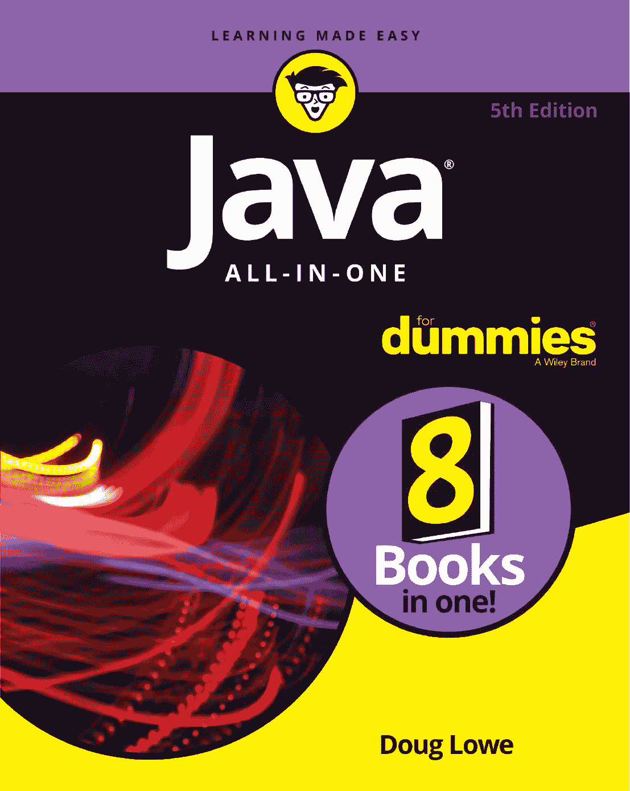


# 第 1 卷：Java 基础 (5)

## 第 1 章：欢迎 Java (7)

### 什么是 Java，它为什么如此优秀？ (8)

#### 平台无关性 (8)

#### 面向对象 (30)

#### Java API (32)

#### 互联网 (33)

#### Java 与其他语言对比 (34)

#### 语言的重要特性 (35)

#### 自动内存管理 (35)

#### 异常处理 (37)

#### 缺点：Java 的不足之处 (38)

#### 名字的含义 (39)

## 第 2 章：安装与使用 Java 工具 (21)

### 下载并安装 Java 开发包 (22)

#### 下载 JDK (22)

#### 安装 JDK (23)

#### 浏览 JDK 文件夹 (23)

#### 设置路径 (24)

### 使用 Java 命令行工具 (26)

#### 编译程序 (26)

- 编译多个文件 (27)
- 使用 Java 编译器选项 (28)
- 运行 Java 程序 (29)
- 使用 `javap` 命令 (31)
- 使用 Java 文档 (32)
  - Java SE API 文档 (32)
  - Java 语言规范 (33)

# 目录

## 第 3 章：使用 TextPad

- 下载与安装 TextPad (35)
- 编辑源文件 (36)
- 编译程序 (39)
- 运行 Java 程序 (40)

# 第二部分：编程基础

## 第 1 章：Java 编程基础 (45)

- 查看臭名的“Hello, World!”程序 (46)
- 处理关键字 (49)
- 处理语句 (51)
  - 语句的类型 (51)
  - 空格 (52)
  - 处理块 (53)
  - 创建标识符 (55)
  - 编写注释 (55)
    - 行尾注释 (56)
    - 传统注释 (56)
    - JavaDoc 注释 (57)
- 介绍面向对象编程 (79)
  - 理解类和对象 (79)
  - 理解静态方法 (80)
  - 从类创建对象 (81)
  - 查看使用对象的程序 (82)
  - 那么区别是什么？(84)
- 导入 API 类 (85)

## 第 2 章：处理数据类型 (87)

- 声明变量 (88)
  - 在一条语句中声明两个多个变量 (89)
  - 声明类变量 (89)
  - 声明实例变量 (90)
  - 声明局部变量 (91)
- 初始化变量 (92)
  - 使用赋值语句初始化变量 (93)
  - 使用初始化器初始化变量 (94)
  - 使用 final 变量（常量） (94)
- 处理基本数据类型 (95)
  - 整数类型 (97)
  - 浮点类型 (98)
  - char 类型 (100)
  - Boolean 类型 (101)
  - 包装类 (101)
- 使用引用类型 (102)

## Java 傻瓜教程

- 处理字符串 (82)
  - 声明和初始化字符串 (82)
  - 合并字符串 (83)
  - 将基本类型转换为字符串 (83)
  - 将字符串转换为基本类型 (84)
  - 转换和强制转换数值数据 (85)
    - 自动转换 (85)
    - 类型转换 (86)
- 框内思维 (87)
  - 理解作用域 (87)
  - 变量遮蔽 (89)
  - 使用 `System.out` 打印数据 (90)

### 使用标准输入和输出流 (90)

### 使用 System.out 和 System.err (92)

#### 使用 Scanner 类获取输入 (92)

#### 导入 Scanner 类 (93)

#### 声明并创建 Scanner 对象 (94)

#### 获取输入 (94)

#### 使用 JOptionPane 类获取输入 (96)

#### 使用 enum 创建自定义数据类型 (97)

## 第 3 章：处理数字与表达式 (99)

### 使用算术运算符 (99)

#### 整数除法 (102)

#### 组合运算符 (104)

#### 使用一元正号和负号运算符 (105)

#### 使用递增递减运算符 (106)

#### 使用赋值运算符 (108)

#### 使用复合赋值运算符 (110)

### 使用 Math 类 (111)

#### 使用 Math 类的常量 (112)

#### 使用数学函数 (113)

#### 创建随机数 (116)

#### 四舍五入函数 (119)

### 格式化数字 (121)

### 识别 Java 数学中的异常 (124)

#### 整数溢出 (125)

#### 浮点数的怪异 (125)

#### 除以零 (126)

## 第 4 章：做出选择 (29)

### 使用简单表达式 (30)

#### 使用 if 语句 (32)

#### 简单的 if 语句 (32)

#### if-else 语句 (34)

#### 嵌套 if 语句 (35)

#### else-if 语句 (39)

### 使用斯波克先生最喜欢的运算符（当然是逻辑运算符） (41)

#### 使用 `!` 运算符 (42)

#### 使用 `&` 和 `&&` 运算符 (43)

#### 使用 `|` 和 `||` 运算符 (44)

#### 使用 `^` 运算符 (45)

#### 组合逻辑运算符 (46)

#### 使用条件运算符 (48)

#### 比较字符串 (49)

## 第 5 章：循环往复（或者说，使用循环） (151)

### 使用基础 while 循环 (152)

#### `while` 语句 (152)

#### 计数循环 (152)

#### 跳出循环 (154)

#### 死循环/无限循环 (156)

#### 让用户退出 (176)

#### 以另一种方式让用户决定 (177)

#### 使用 `continue` 语句 (177)

### 运行 do-while 循环 (179)

### 验证用户输入 (181)

### 使用著名的 `for` 循环 (183)

#### 理解 `for` 循环的格式 (184)

#### `counter` 变量的作用域 (186)

#### 统计偶数 (187)

#### 倒数 (188)

#### 使用没有循环体的 `for` 循环 (189)

#### 并你的表达式 (190)

#### 省略表达式 (191)

### 在 `for` 循环中使用 break 和 continue (192)

### 嵌套循环 (193)

#### 简单的嵌套 `for` 循环 (193)

## 第 6 章：大变身（Pulling a Switcheroo）

### 与 else-if 怪物作斗争

#### 查看 else-if 示例程序

#### 创建示例程序的改进版本

### 使用 switch 语句

#### 查看一个乏味的 switch 示例，附带流程图

#### 在 switch 语句中嵌套 if 语句

### 创建字符分支（Character Cases）

### 刻意遗漏 break 语句

### 使用字符串进行 switch

# 第 7 章：为你的疯狂添加一些方法

### 方法的乐趣

### 创建方法的基础知识

#### 示例

#### 另一个示例

## 有返回值的方法

### 声明方法的返回类型

#### 使用 return 语句返回值

### 使用返回特定类型的方法

### 你必须有一个正确的 return 语句

### 尝试另一个版本的猜数字游戏

### 带有参数的方法

### 声明参数

### 参数的作用域

### 理解值传递（pass-by-value）

### 尝试另一个版本的猜数字游戏

## 第 8 章：处理异常

### 理解异常

### 目睹异常的发生

### 寻找罪魁祸首

### 捕获异常

### 一个简单的示例

#### 另一个示例

### 使用先发制人的处理异常

### 同时捕获所有异常

### 显示异常信息

### 使用 `finally` 块

### 检查异常（Checked Exceptions）

### 查看 `catch-or-throw` 编译器

### 捕获 `FileNotFound`

### 抛出 `FileNotFound`

### 从 `main` 方法抛出异常

### 吞掉异常（Swallowing exceptions）

### 抛出你的异常

### 捕获多个异常

# 第 3 卷：面向对象

## 第 1 章：理解面向对象编程

### 什么是面向对象编程？

### 理解对象

### 对象具有身份（identity）

### 对象具有类型（type）

### 对象具有状态（state）

### 对象具有行为（behavior）

### 理解对象的生命周期

### 类类

### 继承

### 接口

### 使用对象设计程序

### UML 绘制类图

### 绘制类

### 绘制箭头

## 第 2 章：创建自己的类

### 声明类

## 选择类名

### 了解类体中的内容

## 了解类的位置

### 成员操作

### 理解字段 (fields)

### 理解方法 (methods)

### 理解可见性

## 使用 Getter (Getters) 和 Setter (Setters)

### 方法重载

### 创建构造函数

### 创建基础构造函数

### 创建默认构造函数

#### 调用其他构造函数

### 寻找 this 关键字的更多用途

### 使用初始化器

# 第 3 章：静态（Static）的使用

### 理解静态字段和方法

#### 使用静态字段

#### 使用静态方法

### 统计实例

### 防止实例化

使用静态初始化器

## 第 4 章：使用子类和继承

### 介绍继承

### 循环、列车与汽车

### 游戏玩法

### 业务化示例

### 继承层次结构

#### 创建子类

#### 重写方法

## Java 入门教程

### 保护你的成员变量

在子类中使用 `this` 和 `super`

### 理解继承和构造函数

使用 `final`

### final 方法

### final 类

### 向上转型与向下转型

#### 确定对象的类型

### 什么是多态 (Poly)?

### 创建自定义异常

追踪 `Throwable` 层次结构

创建一个类

抛出异常

## 第 5 章：使用抽象类和接口

### 抽象类

#### 使用接口

创建基础接口

实现接口

将接口作为类型使用

接口可以可以的更多事情

为接口添加字段

扩展接口

使用接口进行回调

使用默认方法 (Default Methods)

## 第 6 章：使用 Object 和 Class 类

## 万类之母：Object

每个对象都是 Object

Object 作为一种类型

Object 类的方法

# 基本类型不是对象 (319)

# toString 方法 (319)

### 使用 toString (320)

### 重写 toString (321)

# equals 方法 (322)

### 使用 equals (323)

### 重写 equals 方法 (324)

# clone 方法 (328)

### 实现 clone 方法 (329)

### 使用 clone 创建浅拷贝 (332)

### 创建深拷贝 (333)

# Class 类 (338)

# 第 7 章：使用内部类、匿名类和 Lambda 表达式 (341)

## 声明内部类 (342)

### 理解内部类 (342)

### 查看示例 (343)

### 使用静态内部类 (345)

### 使用匿名内部类 (347)

### 创建匿名类 (347)

### 创建一个带有匿名类的程序 (349)

### 使用 Lambda 表达式 (351)

# 第 8 章：处理包和新的 Java 模块系统 (375)

## 处理包 (354)

### 导入类和包 (354)

### 创建你自己的包 (355)

### 示例 (357)

### 将你的类放入 JAR 文件 (358)

### `jar` 命令行选项 (359)

### 归档一个包 (360)

### 将 jar 添加到类路径 (361)

### 直接从存档文件运行程序 (362)

## 使用 JavaDoc 为你的类编写 (363)

### 添加 JavaDoc 注释 (363)

### 使用 `javadoc` 命令 (366)

### 查看 JavaDoc 页面 (367)

## 使用 Java 模块系统 (368)

### 理解模块 (369)

### `module-info.java` 文件 (369)

### 为模块设置文件夹 (371)

### 编译模块 (371)

### 创建模块化 JAR 文件 (372)

# 第 4 卷：字符串、数组和集合 (373)

## 第 1 章：处理字符串 (375)

### 复习字符串 (377)

### 使用 `String` 类 (378)

### 获取字符串的长度 (380)

### 进行简单的字符串修改 (380)

### 从字符串中提取字符 (381)

### 从字符串中提取子字符串 (382)

### 分割字符串 (384)

### 替换字符串的部分内容 (386)

# Java 全能指南 Dummies

### 使用 `StringBuilder` 和 `StringBuffer` 类 (387)

### 创建 `StringBuilder` 对象 (388)

### 使用 `StringBuilder` 方法 (388)

### 查看 `StringBuilder` 示例 (390)

### 使用 `CharSequence` 接口 (391)

## 第 2 章：使用数组 (393)

### 理解数组 (393)

### 创建数组 (394)

### 初始化数组 (395)

# 在数组中使用循环 (396)

# 使用数组解决作业题 (397)

# 使用增强型 for 循环 (400)

# 使用方法使用数组 (401)

# 使用二维数组 (401)

## 创建二维数组 (402)

## 访问二维数组元素 (403)

## 初始化二维数组 (405)

## 使用锯齿数组 (405)

## 跨越二维的限制 (407)

## 处理一个有趣但复杂的示例：棋盘 (408)

# 使用 Arrays 类 (416)

## 填充数组 (417)

## 复制数组 (417)

## 排序数组 (419)

## 搜索数组 (419)

## 比较数组 (420)

## 将数组转换为字符串 (420)

# 第 3 章：使用 ArrayList 类 (423)

## 理解 ArrayList 类 (224)

## 创建 ArrayList 对象 (427)

## 添加元素 (428)

## 访问元素 (429)

## 打印 ArrayList (430)

## 使用迭代器 (430)

## 更新元素 (432)

## 删除元素 (434)

# 第 4 章：使用 LinkedList (437)

## 理解 LinkedList 类 (438)

## 创建 LinkedList (442)

## 向 LinkedList 中添加项目 (443)

## 从 LinkedList 中检索项目 (445)

## 更新 LinkedList 项目 (446)

## LinkedList 项目 (447)

# 第 5 章：创建泛型集合类 (449)

## 为什么使用泛型？ (450)

## 创建泛型类 (451)

## 泛型栈类 (453)

## 使用通配符类型参数 (457)

## 泛型队列类 (458)

## 使用钻石运算符 (462)

# 第 6 章：使用集合批量数据操作 (463)

## 查看基础批量数据操作 (465)

## 深入研究接口 (467)

## 使用并行流 (470)

# 第 5 本：编程 (473)

## 第 1 章：线程 (475)

## 线程 (477)

## 创建线程 (477)

## 理解 Thread 类 (499)

## 继承 Thread 类 (500)

## 创建并启动线程 (502)

## 实现 Runnable 接口 (502)

## 使用 Runnable 接口 (503)

## 创建实现 Runnable 的类 (503)

## 使用 CountDown 类 (505)

## 创建协作工作的线程 (507)

## 使用 Executor (489)

## 同步方法 (491)

## 创建锁 (496)

## 处理线程中断 (497)

## 检查是否被中断 (498)

# 第 2 章：使用正则表达式

## 创建用于测试正则表达式的程序

#### 执行基础字符匹配

#### 匹配单个字符

#### 使用预定义字符类

#### 使用自定义字符类

#### 使用范围

### 使用否定匹配

#### 匹配多个字符

### 使用转义字符

### 使用括号对字符分组

#### 使用管道符号

Java 快速入门 (Java All-in-One For Dummies)

#### 在 Java 程序中使用正则表达式

#### 理解字符串问题

#### 在 `String` 类中使用正则表达式


# 第 3 章：使用递归

## 计算经典的阶乘示例

### 非递归解决方案

### 递归解决方案

## 显示目录

## 编写你自己的排序程序

### 理解 `quicksort` 的工作原理

### 使用 `sort` 方法

### `partition` 方法

### 整合一切

# 第 4 章：处理日期和时间

## 时间是如何表示的

### 为你的应用程序选择合适的 `Date` 和 `Time` 类

### 使用 `now()` 方法创建 `DateTime` 对象

### 使用 `parse()` 方法创建 `DateTime` 对象

### 使用 `of()` 方法创建 `DateTime` 对象

### 使用 `Month` 枚举

### 使用 `ZoneId` 类

### 使用 `ZoneOffset` 类

### 深入研究 `LocalDate` 类

### 提取日期信息

### 比较日期

### 日期数值计算

### 日期格式化

### 查看一个有趣的生日计算器

# 第 6 册：JAVAFX

## 第 1 章：Hello, JavaFX!

### 探索 JavaFX 的可能性

#### 查看一个简单的 JavaFX 示例

#### 导入 JavaFX 包

#### 扩展 `Application` 类

#### 启动 `Application`

#### 重写 `start` 方法

#### 创建 `Button`

#### 处理 `Action` 事件

#### 创建布局面板

#### 创建 `Scene`

#### 设置舞台

#### 检查点击计数器

## 第 2 章：处理事件

### 检查事件

#### 处理事件

#### 实现 `EventHandler` 接口

#### 使用内部类处理事件

### 使用匿名内部类处理事件

# 使用 Lambda 表达式处理事件

## 第 3 章：设置舞台与场景布局

### 检查 `Stage` 类

### 检查 `Scene` 类

### 切换场景

### 创建警告框

### 退出，舞台右侧

### 创建关闭按钮

### 处理 `CloseRequest` 事件

### 整合一切

## 第 4 章：使用布局窗安排你的场景

#### 布局窗的操作

#### 介绍五种 JavaFX 布局窗

#### 创建布局窗

#### 组合布局窗

#### 使用 `HBox` 布局

##### 撑开元素

##### 使用外边距添加空间

##### 通过节点增长添加空间

#### 使用 `VBox` 布局

#### 在布局窗中对齐节点

##### 使节点具有相同的宽度

#### 使用 `Flow` 布局

#### 使用 `Border` 布局

#### 使用 `GridPane` 布局

##### 规划方案

##### 创建窗格

##### 处理网格约束

##### 检查网格窗示例

## 第 5 章：获取用户输入

### 使用文本字段

### 验证数值数据

### 使用复选框

### 使用单选按钮

### 查看披萨订单应用程序

## 第 6 章：从列表中

### 使用 `ChoiceBox`

#### 创建选择框

#### 设置默认值

#### 获取选中项

#### 使用可观察列表（`Observable` `Lists`）

##### 监听选择变化

#### 使用 `ComboBox`

#### 创建组合框

#### 获取选中项

#### 处理组合事件

#### 使用列表

#### 创建列表

#### 获取多个选中项

#### 使用树视图（`Tree` `Views`）

#### 构建树

#### 创建 `TreeView` 控件

#### 获取选中节点

# 第 7 卷：Web

## 第 1 章：使用 Java Web Start

### 查看一个简单的 JavaFX 程序

### 理解 Java Web Start

### 创建 JNLP 文件

### 创建启动 Java 程序的 HTML 文件

### 将 Java Web Start 文件上传到你的 Web 服务器

# 使用 Java Web Start `ClickMe` 应用

# 创建异常以允许 Java Web

# 启动运行应用程序

## 第 2 章：创建 Servlet

### 理解 Servlet

### 使用 Tomcat

#### 安装和配置 Tomcat

#### 启动和停止 Tomcat

#### 测试 Tomcat

### 创建简单的 Servlet

#### 导入 servlet 包

#### 继承 `HttpServlet` 类

#### 打印到网页

#### 使用 HTML 响应

#### 运行 Servlet

#### 改进 `HelloWorld` Servlet

#### 从用户处获取输入

#### 处理表单

#### 使用 `InputServlet` Servlet

#### 在 Servlet 中使用类

# 第 3 章：使用 JavaServer Pages

## 理解 JavaServer Pages

### 使用页面指令

### 使用表达式

### 使用脚本段

### 使用声明

### 使用类

# 第 4 章：使用 JavaBeans

### 了解 JavaBeans

### 检查示例 Bean

### 在 JSP 页面中使用 Beans

### 创建实例

### 获取值

### 设置属性值

### 查看使用 bean 的 JSP 页面

### 设置 Beans 的作用域

### 购物应用程序

### 购物页面

### JavaBean

# 第 8 本：文件与数据库

## 第 1 章：处理文件

### 使用 `File` 类

### 了解类构造函数和方法

### 创建 `File` 对象

### 创建文件

### 获取文件信息

### 获取目录内容

### 重命名文件

### 删除文件

### 使用命令行参数

### 在 Swing 应用中选择文件

### 创建打开对话框

### 获取所选文件

### 使用文件过滤器

### 使用 `Path` 对象

### 使用 `Paths` 类创建文件

### 获取目录内容

### 使用 `FileVisitor` 遍历文件树

## 第 2 章：处理文件流

### 理解流

### 读取字符流

#### 创建一个 `BufferedReader`

#### 从字符流中读取

#### 读取 `movies.txt` 文件

#### 写入字符流

#### 将 `PrintWriter` 连接到文本文件

#### 写入字符流

#### 写入 `movies.txt` 文件

#### 读取二进制流

#### 创建一个 `DataInputStream`

#### 从数据输入流中读取

#### 读取 `movies.dat` 文件

#### 写入二进制流

#### 创建一个 `DataOutputStream`

#### 写入二进制流

#### 写入 `movies.dat` 文件

## 第 3 章：只需 100 美元的数据库

### 定义关系型数据库

### 理解（并发音）SQL

### 引入 SQL 语句

### 创建 SQL 数据库

### 查询数据库

#### 使用基础 `select` 语句

#### 缩小查询范围

#### 排除行

#### 使用单例查询

#### 查找听相似的内容

#### 使用列函数

#### 从多个表选择数据

#### 去除重复项

### 目录：更新和删除行

#### 使用 `delete` 语句

#### 使用 `update` 语句

## 第 4 章：使用 JDBC 连接数据库

### 设置驱动程序

### 连接到数据库

### 查询数据库

### 执行 `select` 语句

### 遍历结果集

### 从结果集中获取数据

### 综合运用：一个从数据库读取数据的程序

### 更新 SQL 数据

#### 使用可更新的 `RowSet` 对象

#### 删除行

#### 更新列的值

#### 插入行

## 第 5 章：处理 XML

### 定义 XML

### 标签

### 属性

### XML 声明

### `movies.xml` 文件

### 使用 DTD

### 用两种方式处理 XML：DOM 和 SAX

#### 读取 DOM 文档

#### 创建 `DocumentFactory`

#### 配置 `DocumentFactory`

#### 创建构建器和文档

#### 使用 `getDocument` 方法

#### 读取 DOM 节点

#### 处理元素

#### 获取属性值

# Java 傻瓜指南

## 目录

- 获取子元素值
- 汇总整合：一个列出电影的程序
- 索引

## 引言

欢迎阅读 *Java 傻瓜指南*（Java All-in-One For Dummies）第 5 版——这本旨在替代你可能需要购买的一整架枯燥、乏味书籍的 Java 教科。这本书包含了你上手 Java 编程所需的所有基础信息，从编写语句、使用变量开始，到编写使用动画和游戏的技巧结束。在此过程中，你还会发现许多关于用户界面编程、类与对象、创建 Web 应用程序以及处理文件和数据库的非基础信息。

你可以（可能最终也应该）为这些主题中的每一个主题单独购买书籍。不了多久，你的书架就会挤满 10,000 页或更多关于 Java 编程中可以想象的每一个细微差别的详细信息。在你准备好深入研究每一个主题之前，你需要先获得一个全局观。这正是本书的所在。

如果你已经拥有了 10,000 页或更多的 Java 信息，你可能会被大量的细节和奇点所困扰，并想：“我真的需要为了创建一个简单的网页就读 1,200 页关于 JSP 的内容吗？我真的需要一本六磅重的 JavaFX 书吗？”事实是，大多数 1,200 页的编程书中只有大约 200 页是非常实用的信息——你每天都会用的那种——以及大约 1,000 页极其痛苦的细节，这些细节主要在你编写核导弹引导控制程序或纽约证券交易所交易系统时才有用。

这里的核心思想是，我尝试从这些不同的 Java 编程主题中提炼出大约一百页最有用的信息：设置与配置、基础编程、面向对象编程、编程技巧、JavaFX、文件和数据库编程、Web 编程以及动画和游戏编程。因此，你得到了一本精简。

所以，无论你是刚开始学习 Java 编程还是资深专家，你都找到了正确的书。

## 关于本书

*Java 傻瓜指南*第 5 版是你编写 Java 程序时可能需要知道的所有妙事（可能也包括一些不那么妙的事）的参考书。当然，你可以为本书涵盖的每个编程主题都买一本巨大的 1,200 页书籍。但那样的话谁来帮你从书店把它们带回家呢？你在哪里找书架来存放它们？你什么时候会有时间读它们呢？

在本书中，你需要的所有信息都方便地封装在同一个封面之间。而且所有的信息都适用于最新的 Java 版本，即 `JDK 9`。本书并没有自称是关于 Java 编程每个可能领域的每个细节的全面参考书。相反，它向你展示如何快速上手，让你有更多时间去做你真正想做的事情。本书采用易读的*傻瓜系列*格式设计，帮助你获取所需信息，而无需费力寻找。

*Java 傻瓜指南*第 5 版是一本由九本较小的书组成的大书——你可以称它们为“微型书”。每本微型书都涵盖编程中一个关键要素的基础，例如安装 Java 以及编译和运行程序、使用基础 Java 语句，或使用 JavaFX 编写 GUI 应用程序。


每当一个大整体由几个小部分组成时，总是存在混乱的可能性。这就是为什么这本书有多个访问点。开头是涵盖全书的详细目录。然后每本微型书都以一个微型目录开始，让你一眼看出该微型书包含哪些章节。每页顶部都有实用的运行页眉，指出该页讨论的主题。页面侧边有方便的标签（thumbtabs），帮助你快速找到每本微型书。最后，全面的索引让你能在全书的任何地方找到信息。

## 愚的假设

你我从未见过面，所以我很难对你为什么对这本书感兴趣做出任何假设。然而，让我们从几个基本假设开始：

- **你拥有一台或可以使用相当现代的计算机。**示例是在 Windows 电脑上创建的，但你可以在 Mac 或 Linux 电脑上同样轻松学习 Java 编程。

- **你是一个经验丰富的计算机。**换句话说，我假设你了解电脑的基本知识，例如启动程序和处理文件系统。

- **你对学习如何用 Java 语言编写程序感兴趣。**既然这是本书教的内容，那么这是一个合理的假设。

我不对你之前在 Java 或任何其他编程语言方面的经验做任何假设。我也没有对你为什么想学习 Java 编程做任何假设。学习 Java 有各种合理的理由。有些人出于职业原因学习 Java；也许你想成为一名专业的 Java 程序员，或者你可能是一个偶尔需要用 Java 工作的`C#`或`C++`程序员。另一方面，也许你认为用 Java 编程会是一个有趣的爱好。

无论你的动机是什么，我确实假设你是一个相当理智的人。要掌握 Java，你不需要高等物理学位，或者说不需要任何领域的学位。你只需要是一个想要学习且不怕尝试的人即可。

## 本书中使用的图标

与任何*傻瓜系列*书籍一样，这本书充满了实用的图标，用以引起你对重要事项的。你会在书中看到以下图标：

- 危险，罗宾逊！这个图标突显了可能帮助你避免灾难的信息。

- 有新发现了！我会用这个图标指出它。

- 我告诉过你吗？请特别注意这个图标；它让你知道有些非常有用的窍门就在手边。

引言 3

等一下——技术性极强的内容就在眼前。显然，因为这是一本编程书，接下来的 900 多页中几乎每一段都可以获得这个图标。因此，我将其保留留给那些更深入、解释内部工作原理的段落——通常比你使用某个功能所需的深度要深，但往往具有启发性。

## 本书之外

除了你现在阅读的纸质或电子书中的材料外，该产品还提供了网络上随处访问的福利。查看免费的 Cheat Sheet 以获取更多关于 Java 的信息。要获取此表，只需访问`www.dummies.com`get 搜索框中输入 **Java All-in-One For Dummies Cheat Sheet**。

你还可以在`www.dummies.com/go/javaaiofd5e`下载书中使用的代码。

## 从这里开始

这不是那种你拿起就从头到尾读完的书，就像读一本廉价小说一样。如果我在海滩上看到你在读它，我会往你脸上扔沙子。海滩是用来读浪漫小说或谋杀案小说的，不是编程。

书籍。尽管你可以从头到尾通读，但这是一本参考书，你可以随手拿起，翻到几乎任何一页并开始阅读。你不需要记住书中的任何内容。它是一本“按需知”的书：当你需要了解某些东西时，就拿起它。需要`ArrayList`类的构造函数提醒吗？拿起书。记不住匿名内部类的奇葩语法了？拿起书。找到你需要的后，把书放下，继续过你的生活吧。

# 4 傻瓜学 Java（全能合集）


# 1 Java 基础

## 内容概览

- **第 1 章：欢迎来到 Java** . . . . . . . . . . . . . . . . . . . . . . . . . . . . . . . . . . . . . . . 7

- **第 2 章：安装和使用 Java 工具** . . . . . . . . . . . . . . . . . . . . 21

- **第 3 章：使用 TextPad 工作** . . . . . . . . . . . . . . . . . . . . . . . . . . . . . . 35


### 本章内容

- » 了解编程

- » 熟悉 Java

- » 将 Java 与与其他语言进行比较

- » 理解 Java 那些难以理解的版本号

# 第 1 章 欢迎来到 Java

本章是对 Java 世界的入门介绍。在接下来的几页中，你将了解到什么是 Java、它从哪里来以及它将走向何方。你还将发现 Java 的一些独特优势以及缺点。此外，你还将看到 Java 与其他流行编程语言的对比，包括 C、C++、C# 和 Visual Basic。

顺便说，我在在本章假设你至少有足够的背景了解什么是计算机编程。这并不意味着假设你是一个专家或专业程序员。这意味着我不需要花时间去解释什么是计算机程序、什么是编程语言等基础知识。如果你完全没有编程经验，我建议你买一本《傻瓜学 Java》第 5 版或《傻瓜学 Java 编程》第 3 版，这两本书都是 Barry Burd 编写（Wiley 出版）。

在本章中，你会看到一些 Java 程序代码片段，以及一些用其他语言（包括 C、C++ 和 Basic）编写的代码片段。如果你完全不知道这些代码的意思或作用，不要慌。我只是想让你感受一下 Java 编程是什么样的，以及它与其他语言的编程相比如何。

书中使用的所有代码列表均可在`[www.dummies.com/go/javaaiofd5e]`下载。

## 第 1 章 欢迎来到 Java 7

### 什么是 Java？它为什么这么棒？

Java 是一种遵循 C 和 C++传统的传统的语言。因此，如果你有 C 或 C++ 的经验，在发现 Java 的各种特性时，通常会发现自己处于熟悉的领域。（有关 Java 与 C 或 C++ 之间相似之处的更多信息，请参见本章后面的“Java 与其他语言”部分。）

然而，Java 与其他编程语言有几个显著的不同之处。我在后续章节中指出最重要的区别。

#### 平台无关性

Java 如此受欢迎的原因之一是它的平台无关性，这简单意味着 Java 程序可以在许多类型的计算机上运行。Java 程序可以在任何安装了`Java Runtime Environment`（也称为`JRE`）的计算机上运行。`JRE`几乎适用于你能想到的每种计算机：运行任何版本 Windows 的 PC、Macintosh 计算机、Unix 和 Linux 计算机、巨大的主机计算机，甚至是手机。

在 Java 出现之前，其他编程语言通过为不同平台提供兼容的编译器来承诺平台无关性。（`compiler`是将用编程语言编写的程序翻译成一种可以在计算机上实际运行的形式的程序。）这种想法是，你可以为每个平台编译不同版本的程序。遗憾的是，这个想法从未真正奏效。每个平台上的编译器从不是完全相同的；每个编译器都有它们自己的细微差别。结果，你必须为你想要支持的每个平台维护一个不同版本的程序。

Java 的平台无关性并不是基于为不同平台提供兼容的编译器。相反，Java 是基于虚拟机的概念。你可以将 Java 虚拟机（有时称为`JVM`）想象成一个假设的计算机平台——一个以实际硬件形式不存在的计算机设计。相反，`JRE`是一个`emulator`（仿真器）——该程序留出你硬盘的一部分来充当计算机（即`JVM`），该计算机可以执行 Java 程序。

Java 编译器不会将 Java 翻译成程序运行所在计算机的机器语言。相反，编译器将 Java 翻译成 JVM 的机器语言，这被称为`bytecode`。然后`JRE`运行这些`bytecode`。

# 8 书 1 Java 基础

### 欢迎来到 Java

- » `JRE`与 Java 编译器是分开的。因此，你不需要安装编译器就可以运行编译后的 Java。你只需要`JRE`。

- » 当有人问你的电脑“有有 Java”时，他或她通常是想问：“你安装了运行环境吗？”（你需要`JRE`才能运行程序。）

- » 平台无关性是有局限的。如果你有一台冷门的计算机系统——例如古董的 Olivetti 101——并且没有为它提供`JRE`，那么你就无法在它上运行 Java 程序。

我不是编造 Olivetti 101 的。它是 20 世纪 60 年代的一种台式电脑，恰好是我编程的启蒙。（我的初中老师在教室后面有一台，他在午餐时间让我玩它。）在 Google 上搜索 **Olivetti 101**，你就能找到几个关于它的有趣网站。

- » Java 的平台无关性并非完美。虽然`bytecode`在每个拥有`JRE`的计算机上运行方式完全相同，但 Java 的某些部分使用了底层操作系统提供的服务。结果，有时会出现细微的差异，特别是在使用图形界面的应用程序中。

- » 因为模拟`JVM`的运行时系统执行 Java 字节码，有些人误错误地将 Java 与 Basic 或 Perl 等解释型语言进行比较。然而，这些语言完全没有编译。相反，解释器在执行每条语句时读取并解释它。Java 是一种真正的编译型语言；它只是被编译成 JVM 的机器语言，而不是实际计算机平台的机器语言。

- » 如果你感兴趣，`JVM`是完全基于栈的；* 它没有用于存储本地数据的寄存器。（我不会解释那个术语的意思，所以如果你不理解，请跳过它。这并不重要。这只是对了解栈、寄存器之类的事的极客来说很有趣。）

#### 面向对象

Java 本质上是面向对象的，这意味着 Java 程序由对象组成

由被称为“对象”的编程元素组成。简单来说（当你在计算机书籍中读到*这种话*难道你不喜欢吗？），

# 第 1 章 **欢迎来到 Java** 9

`object`（对象）是一个代表现实世界对象或抽象概念的编程实体。

所有对象都有两个基本特征：

- » 对象拥有数据，也称为`state`（状态）。例如，一个代表书籍的对象拥有如书名、作者和出版商等等的数据。

- » 对象还具有`behavior`（行为），这意味着它们可以执行某些任务。

在 Java 中，这些任务被称为`methods`（方法）。一个代表汽车的对象可能有`start`、`stop`、`drive`和`crash`等方法。某些方法仅允许你访问对象的数据。书籍对象可能有一个`getTitle`方法，可以告诉你书名。

类（Classes）与对象紧密相关。`class`（类）是你编写的、用于创建对象的程序代码。类描述了定义对象状态和行为的数据和方法。当程序执行时，类被用来创建对象。

假设你正在编写一个工资结算程序。这个程序可能需要对象来代表公司的员工。因此，程序包含一个类（可能命名为`Employee`），它定义了每个`Employee`节点的数据和方法。当你的程序运行时，它使用该类为公司的每位员工创建一个对象。

**Java API**

Java 语言本身非常简单，但 Java 随带了一个类库，提供了许多常用的工具函数，大多数 Java 程序没有这些函数无法运行。这个类库被称为`Java API`（*application programming interface* 应用编程接口的缩写），它与语言本身一样是 Java Java。事实上，发现如何使用 Java 的真正挑战并不是精通语言，而是精通 API。Java 语言只有大约 50 个关键字，但`Java API`拥有数千个类，以及数以万计的你可以在程序中使用的方法。

`Java API`拥有的类可以让你进行三角函数计算、将数据写入文件、在屏幕上创建窗口以及从数据库中检索信息等。API 中的许多类是通用的且常用的。例如，有一整系列类用于存储数据集合。但也有许多类非常晦懂，仅在特殊情况下使用。

10 书 1 **Java 基础**

幸运的是，你不需要学习几乎所有的`Java API`。大多数程序员只精通它的一小部分：即直接与他们编写的程序类型最相关的部分。如果你发现需要使用 API 中某个你尚不熟悉的类，可以[在 Java API 文档 `http://download.java.net/jdk9/docs/api/`] 中查找该类的作用。

**互联网**

**欢迎来到 Java**

Java 经常与互联网联系在一起，这是理所当然的，因为阿尔尔·戈尔（Al Gore）在发明互联网后几天就发明了 Java。好吧，Java 并不是真的由阿尔尔·戈尔发明的。它是在万维网成为一种现象的时期开发的，Java 专为为利用网络而设计的。特别是，`JVM`背后的整个概念是让任何连接到互联网的计算机都能运行 Java 程序，无论计算机的类型或运行的操作系统如何。

你可以在互联网上找到三种不同的 Java 程序：

- » **Servlets：** `Servlets`是基于 Web 的 Java 程序，运行在互联网服务器计算机上，而不是互联网用户的网页浏览器中。Servlets 是许多（如果不是大多数）商业网站运行的真实方式。Servlet 生成一个 HTML 页面并发送到用户的计算机，以便在用户的网页浏览器中显示。如果你从在线商店请求产品信息，商店的 Web 服务器会运行 Servlet 来生成包含你请求的产品信息的 HTML 页面。

- » **Applets：** `Applets`是直接在网页浏览器中运行的 Java 程序。要运行 applet，浏览器会启动一个`JVM`，该虚拟机会被分配网页的一部分来工作。然后，虚拟机会运行 applet 的字节码。

- » **Web Start 应用：** `Web Start`是一种 Java 应用，设计为从网页启动但直接运行在用户的计算机上，而不是在网页浏览器中运行。

Applets 最近已不受宠，因为它们经常与不同版本的浏览器产生兼容性问题。结果，Web Start 应用在很大程度上取代了 Applets。你将在第 7 章了解到如何创建 servlet 和 Web Start 应用。

第 1 章 **欢迎来到 Java** 11

**Java 与其他语言**

从表面上看，Java 看起来非常像它之前的许多语言，最著名的 C 和 C++。例如，这里是用 C 编程语言编写的经典 Hello, World! 程序：

```c
main()
{
    printf("Hello, World!");
}
```

这个程序只是在计算机的控制台上显示 "Hello, World!" 文本。这里是用 Java 编写的经典 Hello, World! 程序：

```java
public class HelloApp
{
    public static void main(String[] args)
    {
        System.out.println("Hello, World!");
    }
}
```

虽然 Java 版本稍微冗长一些，但两者之间有几个相似之处：

- » 两者都要求每个可执行语句以分号（`;`）结束。

- » 两者都使用大括号（`}`）来标记代码块。

- » 两者都使用名为`main`的例作为主入口点。

许多其他相似之处在这些简单的示例中并不显而易见，但它们引出了 C 和 Java 之间的主要区别：面向对象即使在简单的示例中也露了头。考虑以下几点：

- » 在 Java 中，即使简单的程序也是类，所以你必须提供一行类的声明。在这个示例中，类名为`HelloApp`。`HelloApp`有一个名为`main`的方法，`JVM`在运行时会自动调用它。

- » 在 C 示例中，`printf`是你用来向控制台打印信息的库函数。在 Java 中，你使用`PrintStream`类来写入信息。

12 书 1 **Java 基础**

PrintStream? 程序里没有 PrintStream！等一下——有的。每个 Java 程序都有一个写入控制台的`PrintStream`对象。你可以通过调用另一个类`System`的`out`方法来获取这个`PrintStream`对象。因此`System.out`获取了写入控制台的`PrintStream`对象。`PrintStream`类转而有一个名为`println`的方法可以写入控制台。

所以`System.out.println`实际上做了两件事，顺序如下：

**欢迎来到 Java**

如果你相信 Oracle 等其他人的营销宣传，你会认为 Java 是自内存发明以来计算机领域发生的最好事。Java 可能并没有*那么*具有革命性，但它确实具有许多内置特性，与其他语言区分开来。接下来的章节描述了让 Java 如此受欢迎的众多特性中的三个。

**类型检查**

所有编程语言都必须以某种方式处理`type checking`（类型检查）——即语言处理存储不同类型数据的变量的方式。

例如，数字、字符串和日期是大多数编程语言中通用的`data types`（数据类型）。大多数编程语言还有多种数字，例如整数和实数。

所有语言都必须检查数据类型，以确保你不会尝试做没有意义的事情（例如，将国内生产总值乘以你的姓氏）。问题在于，这门语言是要求你声明每个变量的类型，以便在编译程序时进行类型检查，还是在语言在运行程序后才进行类型检查？

# 第 1 章 欢迎来到 Java

某些语言（如 Perl）在类型检查方面没有 Java 那么严谨。例如，Perl 并不要求你指定变量将包含整数、浮点数还是字符串。因此，对于名为`$a`的单个变量，以下语句都是允许的：

```
$a = 5
$a = "Strategery"
$a = 3.14159
```

在这里，三种不同类型的数据——整数、字符串和双精度浮点数被赋值给了同一个变量。

相反，Java 在运行时会完成类型检查。因此，你必须将所有变量为特定类型，以便编译器能够确保你正确地使用变量。例如，下面这段 Java 代码将无法编译：

```java
int a = 5;
String b = "Strategery";
String c = a * b;
```

如果你尝试编译这些行，你会收到一条错误信息，显示 Java 无法将整数和字符串相乘。

在 Java 中，你定义的每个类都会为语言创建一种新的数据类型。因此，你在 Java 中可用的数据类型不仅仅是简单的预定义类型（如数字和字符串）。你可以创建自己的类型。


如果你正在编写一个工资单系统，可能会创建一个 `Employee` 类型。然后你可以声明类型为 `Employee` 的变量，它们只能持有 `Employee` 对象。这种能力可以防止许多编程错误。考虑这段代码片段：

```
Employee newHire;
newHire = 21;
```

这段代码创建了一个只能持有 `Employee` 对象的变量（`newHire`）。然后它尝试给它赋值数字 `21`。Java 编译器不会让你运行这个程序，因为 `21` 是数字，而不是一个员工。

Java 的一个名为 `inheritance`（继承）的重要面向对象特性为类型检查增加了一个有趣的——极其实用的——转折。继承太复杂了，现在还无法深入探讨，所以我在这里简要说明一下：在 Java 中，你可以创建派自其他数据类型的自定义数据类型。例如，员工是人，客户也是人，所以你可能会创建一个 `Person` 类，然后创建 `Employee` 和 `Customer` 类，它们都继承自 `Person` 类。然后你就可以写出这样的代码：

```
Person p;
Employee e;
Customer c;

p = e; // 这是允许的，因为 Employee 也是 Person。
c = e; // 这是不允许的，因为 Employee 不是 Customer。
```

感到困惑了吗？如果是的话，那是我的错。对于一本 Java 手的书的第一章来说，继承是一个相当烧脑的话题。如果现在还看不懂，不要惊慌。等当你读完第 3 本的第 4 章时，一切都会豁然开，那一章涵盖了使用继承的所有细微差别。

## 自动内存管理

内存管理是所有编程语言都必须处理的另一个细节。所有编程语言都允许你创建变量。当你创建一个变量时，语言会分配计算机内存的一部分来存储由该变量所引用的数据。内存具体是如何分配的，是你通常可以安全忽略的细节，无论你在使用哪种语言。

但许多语言不允许你安全忽略的一个细节是：当你不再需要存储其中的数据时，那部分内存会发生什么。

在 C++ 和类似的语言中，你必须编写代码显式释放这些内存，以便其他程序可以访问它们。如果不这样做，或者做错了，你的程序可能会出现内存泄漏。在 `memory leak`（内存泄漏）中，你的程序会缓慢但持续地从其他程序夺取内存，直到操作系统耗尽内存，计算机停止运行。

在 Java 中，当你用完内存时不需要显式释放；相反，当内存不再被需要时，会自动释放。`JVM` 包含一个名为 `garbage collector`（垃圾回收器）的特殊进程，它会在虚拟机内存中搜索；确定数据何时不再被使用；并自动删除这些数据，释放它们占用的内存。

与垃圾回收相关的特性是 `bounds checking`（边界检查），它保证程序无法访问不属于它们的内存。C 和 C++ 等语言没有这种安全网。因此，C 或 C++ 中的编程错误可能会导致一个程序践踏另一个程序正在使用的内存，反之可能会导致你的电脑崩溃。

## 异常处理

正如罗伯特·伯斯（Robert Burns）所说：“鼠和人类最周密的计划往往会事与，留给我们的只有痛苦！”当你钻研计算机编程时，很快就会理解他的意思了。无论你如何仔细地规划和测试你的程序，错误总会发生，当它们发生时，它们会威胁导致你的整个程序崩溃。

Java 有一种独特的错误处理方法，优于任何其他语言（C# 除外，它复制了 Java 方法）。在 Java 中，JRE 将所有类型的错误拦截并转换为特殊类型的对象，即 `exception object`。毕竟 Java 是完全面向对象的，它的异常处理功能难道不应该是面向对象的吗？Java 要求可能引发异常的语句封装在可以处理异常的代码中。换句话说，作为程序员，你必须预测运行时可能发生的错误，并确保这些错误得到妥善处理。

## 缺点：Java 的弱点

到为止，我一直在大肆赞扬 Java。为了防止你认为学习它轻而易举，以下段落指出了 Java 的某些缺点（其中许多与 API 有关，而非语言本身）：

- **体积太大**：它包含了太多的类和方法，你可能永远用不到其中一半。此外，Java API 的庞大规模让你无法独自在其中漫游，并发现那个完美适合你正在解决问题的类。

- **过度设计**：在某些情况下，Java 的设计者似乎刻意让本该简单使用的事情变得复杂。例如，定义多行文本区域的 API 类没有滚动条。相反，另一个单独的类定义了带有滚动条的面板。为了创建一个带有滚动条的多行文本区域，你必须同时使用这两个类。

从那时起，API 的许多部分已经经过了更周全的重构，但 API 仍然充满了 Java 早期版本的痕迹。

» 在看来，Java 最大的弱点是它不直接支持真正的小数数据。这个问题有点太复杂，无法在此深入探讨。

# 欢迎来到 Java

现在如此，但其含义是：如果没有特殊的编码（很少有 Java 书会解释这一点，也很少 Java 程序员意识到），Java 并不知道如何相加。考虑这段代码：

```java
double x = 5.02;
double y = 0.01;
double z = x + y;
System.out.println(z);
```

这个小程序应该打印出 `5.03`，对吧？它并没有。相反，它打印出 `5.02999999999999999`。这个小错误看起来可能微不足道，但它们会积少多。如果你在网上商店购物并发现销售税少了一分钱，这就是原因。关于这些错误发生的原因以及如何防止它们，解释非常有技术性，但这是每个 Java 程序员都需要理解的内容。

## Java 版本的疯狂

与大多数产品一样，Java 会定期进行升级和增强。自 1996 年首次发布以来，Java 经历了以下版本更新：

» **Java 1.0:** 该版本是 Java 的原始版本，于 1996 年发布。该语言的大部分仍然与版本 1.0 基本相同，但自发布以来，API 已经发生了很大变化。

» **Java 1.1:** 该版本是 Java 的首次升级，于 1997 年发布。这次发布很重要，因为大多数浏览器都内置了对基于 Java 1.1 的 applet 支持。要运行基于更高版本的 Java 的 applet，大多数情况下你必须下载并安装当前的 `JRE`。

» **Java 1.2:** 该版本于 1998 年后期发布，相比之前的版本有了巨大的改进——事实上，Sun 公司将其称为 Java 2。它包含了一个名为 `Swing` 的完全全新的 API，用于创建图形用户界面，以及其他主要新功能。

» **Java 1.3:** 该版本于 2000 年发布，主要关于通过更改运行时系统的工作方式来提高性能。奇怪的是，尽管这个版本在技术上是 Java 1.3，它也被称为 Java 2 版本 1.3。随你怎么吧。

» **Java 1.4:** 该版本于 2001 年发布，提供了一系列改进。正如你猜到的那样，它被称为 Java 2 版本 1.4。继续猜吧 . . .

» **Java 1.5:** 该版本于 2004 年发布，包含了比任何其他版本更多的变化和改进。为了增加 Sun 在版本命名上显而易见的不可预测性，这个版本正式拥有*两个版本号*。Sun 的官方 Java 网站这样解释：

版本号 `1.5.0` 和 `5.0` 都用于识别此 Java 2 平台标准版的发布版本。版本 `5.0` 是产品版本，而 `1.5.0` 是开发者版本。

这让一切都清楚了，不是吗？

» **Java 1.6:** 于 2006 年 12 月发布（赶在假期期间！），这个版本的 Java 提供了微小的改进和更高的效率。对于 Java 1.6，产品版本是 `6`（不是 `6.0`）。还记得 1998 年神奇出现的额外 `2` 吗？嗯，`2` 在 Java 1.6 中消失了。所以与 1998 年到 2006 年之间的版本不同，Java 1.6 的正式名称是 Java Platform（而不是 Java 2 Platform）。个人认为，Sun 的某人一直在和乔治·卢斯聊天。我完全预计 Java 的下一个版本将是一个名为 Java 0 Episode 1 的前传。

» **Java 1.7:** 于 2011 年年中发布，这是一个相对较小的升级，为 API 增加了一些增强，对语言本身进行了一些微调。

» **Java 1.8:** 于 2014 年 2 月发布，Java 8（如其名称所示）为 Java 增加了一些重大且长期期待的新功能。其中最重要的之一是*lambda 表达式*，这是一种简化了面向对象编程某些方面的语言特性。其他新功能包括一个完全重构的用于日期和时间的 API，以及一个处理大型数据集的新框架，该框架可以轻松利用多核处理器。

» **Java 1.9:** 于 2017 年发布，Java 9 增加了一个重大且长期期待的功能——*Java 模块系统*，它提供了一种新的改进方法来管理组成完整 Java 程序的 Java 代码集合。你将在第 3 章第 8 章中学习这个新功能。

如果你正在编写希望在较早版本的 Java 上运行的应用程序，你可能需要注意版本差异。但记住，Java 的主要优势之一是运行时系统是免费的，终端用户可以轻松下载和安装。因此，当你需要 Java 9 的特性时，不要犹豫使用它们。

# Java 基础

## 名字的含义？

我想在本章中涵盖的最后一个主题是每当你阅读或谈论 Java 时经常遇到的各种缩写词，例如 `JVM`、`JRE`、`JDK` 和 `JEE`。

提供了编辑 Java 程序的特性（如自动缩进）以及编译和运行程序的快捷键。然而，它并不会为你生成任何代码，也不会提供任何形式的视觉设计辅助。`TextPad` 是我开发书中所示所有示例时使用的工具。有关下载和使用 `TextPad` 的信息，请参阅第 1 本第 3 章。

# 第 2 章 安装和使用 Java 工具

## 下载与安装

### Java 开发工具包

在开始编写 Java 程序之前，你必须为你正在使用的计算机系统下载并安装正确版本的 Java 开发工具包（`JDK`）。Oracle Java 网站提供了适用于 Windows、Solaris 和 Unix 的版本。以下章节将向你展示如何下载和安装 `JDK`。

#### 下载 JDK

要进入下载页面，请将浏览器指向[`http://java.oracle.com/technetwork/java`。然后按照相应的链接下载适用于你操作系统的 `JDK 9`。

当你到达 Java 下载页面时，你会发现下载 `JDK` 或 `JRE` 的链接。点击 `JDK` 链接；`JRE` 链接只会获取 Java 运行环境，而不是完整的 Java 开发工具包。

`JDK` 下载提供两个版本：一个需要活动 Internet 连接来安装 `JDK` 的在线版本，另一个允许你将 `JDK` 安装文件下载到计算机并在以后安装的离线版本。

我建议你使用离线版本。它的安装速度更快，如果你以后需要，可以重新安装 `JDK` 而无需再次下载。

##### 法律术语

在下载 `JDK` 之前，你必须同意 Java 许可协议——全部 1,919 个单词，包括 Oracle 法律部门精细构思的所有 *thereupon*（此后）s *、*whereas*（由于）es * 以及 *hitherto*（到今为止）s so。我不是律师（我也没有在电视上演过律师），但我将尝试为你总结该许可协议：

*   第一方（即 Oracle）授予你按原样使用 Java 的权利，并且不保证 Java 会产生任何作用。

*   第二方（即你）反过来承诺仅使用 Java 编写程序。你不允许尝试弄清楚 Java 的工作原理并将你的秘密卖给微软。

*   你不能使用 Java 制造核弹或导弹弹射系统。（这不是我编造的。它确实在许可协议中。）

离线版本的具体大小取决于平台，但大多数版本在 50MB 到 60MB 之间。因此，如果你没有高速 Internet 连接，下载将需要几个小时。使用电缆、DSL 或 T1 连接，下载时间少于五分钟。

#### 安装 JDK

下载 `JDK` 文件后，你可以通过运行下载的可执行文件来安装它。该过程根据你操作系统的不同而略有差异，但基本上，你只需要在下载后运行 `JDK` 安装程序文件即可，具体如下所示：

*   在 Windows 系统上，打开你保存安装程序的文件夹，并双击安装程序的图标。

*   在 Linux 或 Solaris 系统上，使用控制台命令切换到下载文件的目录，然后运行该程序。

启动安装程序后，它会提示你提供恰当安装 `JDK` 所需的任何信息，例如你想安装哪些功能，以及你想将 `JDK` 安装在哪个文件夹中。你可以安全地为每个选项选择默认答案。

#### 浏览 JDK 文件夹

当 `JDK` 自行安装时，它会在你的硬盘上创建几个文件夹。这些文件夹的位置取决于你的系统，但在所有 32 位的 Windows 版本中，`JDK` 根文件夹位于启动驱动器上的路径 `Program Files\Java`。在 64 位的 Windows 版本中，根文件夹将 `Program Files\Java` 或 `Program Files (x86)\Java`。`JDK` 根文件夹的名称取决于你安装的 Java 版本。对于 1.9 版本，根文件夹命名为 `jdk-9`。

表 2-1 列出了 `JDK` 根文件夹中创建的子文件夹。在你操作 Java 时，你会频繁引用这些文件夹。除了这些文件夹，`JDK` 還在 `JDK` 根文件夹中安装了几个文件。我在表 2-2 中列出了这些文件。

**表 2-1：JDK 根文件夹的子文件夹**

| 文件夹 | 说明 |
| :--- | :--- |
| `bin` | 编译器和其他 Java 开发工具 |
| `conf` | 配置文件 |
| `include` | 此库包含将 Java 与其他语言编写的程序集成的文件 |
| `jmods` | Java 模块系统的模块（Java 1.9 新增） |
| `jre` | Java 运行环境 |
| `lib` | 库文件，包括 Java API 类库 |

**表 2-2：JDK 根文件夹中的文件**

| 文件 | 说明 |
| :--- | :--- |
| `README.html` | HTML 格式的 Java 自文件。 |
| `README.txt` | 同样是自文件，这次是文本格式。 |
| `LICENSE` | 你在下载时同意的 Java 许可协议 |

#### 设置路径

安装 `JDK` 后，你需要配置你的操作系统使其能够找到 `JDK` 命令行工具。为了实现这一点，你必须设置 `Path` 环境变量——操作系统用于查找可执行程序的文件夹列表。要在 Windows 7 或之前的版本上执行，请遵循以下步骤：

1.  点击开始菜单，然后右键点击**计算机**。
2.  点击**高级系统设置**。
3.  点击**环境变量**按钮。
4.  在系统变量列表中滚动到 `Path` 变量，选择它，然后点击**编辑**按钮。
5.  将 `JDK bin` 文件夹添加到 `Path` 值的开头。使用分号将 bin 文件夹与路径中可能存在的其他信息隔开。
    ***注意：*** bin 文件夹的名称在你的系统上可能不同，如示例所示：`c:\Program Files\Java\jdk-9\bin; *其他目录...*`
6.  连续点击确定退出。第一次确定返回到环境变量对话框；第二次确定返回到系统属性对话框；第三个确定关闭系统属性对话框。

对于 Linux 或 Solaris，该过程取决于你正在使用的 shell。如需更多信息，请查阅你所使用的 shell 的文档。

Java 自带几个命令行工具，你可以直接从命令提示符运行它们。最重要的两个工具是 `javac`（用于编译程序的 Java 编译器）和 `java`（用于运行 Java 程序的运行时命令）。无论你使用什么种操作系统，这些工具的工作方式基本上都是相同的。

### 编译程序

你可以使用 `javac` 命令从命令提示符编译程序。然而，在在此之前，你需要一个需要编译的程序。请按照以下步骤操作：

1. **使用任何文本编辑器，在文件中输入以下文本，并将其保存为 HelloApp.java：**

```java
public class HelloApp
{
    public static void main(String[] args)
    {
        System.out.println("Hello, World!");
    }
}
```

请特别注意大小写。例如，如果你输入的是 `Public` 而不是 `public`，程序将无法运行。（如果你不想费力输入，可以从本书的网站在 `www.dummies.com` 下载示例程序。）

2. **将文件保存到你喜欢的任何目录中。**

3. **打开命令提示符，使用 `cd` 命令切换到保存程序文件的目录，然后输入命令 `javac HelloApp.java`。**

此命令会编译程序（`javac`）并创建一个名为 `HelloApp.class` 的类文件。假设你输入的程序完全正确，`javac` 命令将不会显示任何信息。然而，如果程序包含任何错误，你会在屏幕上看到一个或多个错误消息。尽管我在本节前面已经发出了警告，如果你输入的是 `Public` 而不是 `public`，编译器将显示以下错误消息：

```
C:\java\samples> javac HelloApp.java
HelloApp.java:1: error: class, interface, or enum expected
Public class HelloApp
^
1 error
C:\java\samples>
```

编译器错误消息表明 `HelloApp.java` 文件的第 1 行存在错误。如果编译器报告了类似这样的错误消息，说明你的程序包含代码错误。你需要找到错误、纠正它，并重新编译程序。

### 编译多个文件

通常情况下，`javac` 命令仅编译你在命令行中指定的文件，但你可以通过我在后续段落中描述的任何技术来诱使 `javac` 一时编译多个文件：

#### 安装和使用 Java 工具


- 如果你在命令行中指定的 Java 文件引用了同一文件夹中由 `java` 文件定义的另一个 Java 类，则 Java 编译器会自动编译该类。假设你有一个名为 `TestProgram` 的 Java 程序，它引用了一个名为 `TestClass` 的类，且 `TestClass.java` 文件与 `TestProgram.java` 文件位于同一文件夹。当你使用 `javac` 命令编译 `TestProgram.java` 文件时，编译器会自动编译 `TestClass.java` 文件。

- 你可以在 `javac` 命令中列出多个文件名。以下命令编译了三个文件：

```bash
javac TestProgram1.java TestProgram2.java TestProgram3.java
```

- 你可以使用通配符来编译文件夹中的所有文件，如下：

```bash
javac *.java
```

- 如果你需要同时编译很多文件，但不想使用通配符（可能你想编译大量文件但而不是文件夹中的所有文件），你可以创建一个参数文件，其中列出要编译的文件。在参数文件中，你可以输入任意数量的文件名，使用空格或换行符分隔它们。这是一个名为 `TestPrograms` 的参数文件，列出了三个要编译的文件：

```text
TestProgram1.java
TestProgram2.java
TestProgram3.java
```

你可以通过在 `javac` 命令行中使用 `@` 字符后跟参数文件的名称来编译该文件中的所有程序，如下：

```bash
javac @TestPrograms
```

## 使用 Java 编译器选项

`javac` 命令有一系列选项，可以使用它们来影响它编译程序的方式。为了方便参考，我在表 2-3 中列出了这些选项。

**表 2-3：Java 编译器选项**

| 选项 | 说明 |
| :--- | :--- |
| `-g` | 生成所有的调试信息。 |
| `-g:none` | 不生成调试信息。 |
| `-g:{lines,vars,source}` | 生成部分调试信息。 |
| `-nowarn` | 不生成警告。 |
| `-verbose` | 输出关于编译器正在做什么的消息。 |
| `-deprecation` | 输出使用已弃 API 的源码位置。 |
| `-classpath <path>` | 指定查找用户类文件的路径。 |
| `-cp <path>` | 指定查找用户类文件的路径。 |
| `-sourcepath <path>` | 指定查找输入源文件的路径。 |
| `-bootclasspath <path>` | 覆盖启动类文件的位置。 |
| `-extdirs <dirs>` | 覆盖已安装扩展的路径。 |
| `-endorseddirs <dirs>` | 覆盖受认可的标准路径位置。 |
| `-d <directory>` | 指定生成的类文件的存放位置。 |
| `-encoding <encoding>` | 指定源文件使用的字符编码。 |
| `-source <release>` | 提供与指定版本的兼容性。 |
| `-target <release>` | 为指定的虚拟机版本生成类文件。 |
| `-version` | 提供版本信息。 |
| `-help` | 打印标准选项的摘要。 |
| `-X` | 打印非标准选项的摘要。 |
| `-J<flag>` | 将 `<flag>` 直接传递给运行时系统。 |

要使用这些选项中的一个或多个，可以在文件名之前或之后输入。例如，以下命令在启用 `-verbose` 和 `-deprecation` 的情况下编译 `HelloWorld.java`：

```bash
javac -verbose -deprecation HelloWorld.java
javac HelloWorld.java -verbose -deprecation
```

如果你不理解所有选项的作用，不要感到困惑。它们大多数在特殊情况下才有用。你常用的选项有：

- `-classpath` 或 `-cp`：如果你的程序使用了存储在单独文件夹中的类文件，请使用此选项。

- `-deprecation`：如果你在使用已弃用的方法，使用此选项可以让编译器警告你。（已弃方法是曾经属于 Java API 但正走向淘汰的方法。它们仍然可以使用，但在未来的 Java 版本中可能会失效。）

- `-source`：使用此选项将编译器限制为之前的 Java 版本。但注意，此选项仅适用于 Java 语言特性，不适用于类库。例如，如果你指定 `-source 1.4`，编译器将不允许你使用在该版本之后引入的新语言特性，如泛型、增强 `for` 循环或 Lambda 表达式。但你仍然可以使用 1.5 添加的新 API 特性，例如 `Scanner` 类。

- `-help`：使用此选项列出 `javac` 命令可用的选项。

## 运行 Java 程序

当你成功编译 Java 程序后，可以通过输入 `java` 命令后跟包含程序主方法的类名来运行该程序。JRE 会加载你指定的类，然后运行该类中的 `main` 方法。例如，运行 `HelloApp` 程序，输入此命令：

```text
C:\java\samples> java HelloApp
```

程序的响应是显示消息“Hello, World!”

类必须包含在与类同名的文件中，且文件名必须具有 `.class` 扩展名。你通常不需要担心类文件的命名，因为它在你使用 `javac` 命令编译程序时会自动创建。因此，如果你编译一个名为 `HelloApp.java` 的文件，编译器会创建一个名为 `HelloApp` 的类，并将其保存为名为 `HelloApp.class` 的文件。

# 理解错误消息

如果 Java 找不到与类相对应的文件名，你将收到一个简单的错误消息，指示找不到该类。如果你输入 `JelloApp` 而不是 `HelloApp`，你会得到以下内容：

```text
C:\java\samples> java JelloApp
Exception in thread "main"
java.lang.NoClassDefFoundError: JelloApp
```

这条错误消息仅意味着 Java 找不到名为 `JelloApp` 的类。

# 指定选项

与 Java 编译器一样，Java 运行时命令 `java` 允许你指定指定可以影响其行为的选项。表 2-4 列出了最常用的选项。

## 表 2-4：常用 Java 命令选项

| 选项 | 描述 |
| :--- | :--- |
| `-client` | 运行客户端虚拟机。 |
| `-server` | 运行服务器虚拟机，该虚拟机针对服务器系统进行了优化。 |
| `-classpath` *directories and archives* | 列出用于搜索类文件的目录或 JAR 或 Zip 归档文件。 |
| `-cp <search path>` | 作用与 `-classpath` 相同。 |
| `-D name=value` | 设置系统属性。 |
| `-verbose` | 启用详细输出。 |
| `-version` | 显示 JRE 版本号后停止。 |
| `-showversion` | 显示 JRE 版本号后继续。 |
| `-?` 或 `-help` | 列出标准选项。 |
| `-X` | 列出非标准选项。 |
| `-ea` 或 `-enableassertions` | 启用 `assert` 命令。 |
| `-ea classes or packages` | 为指定的类或包启用断言。 |
| `-esa` 或 `-enablesystemassertions` | 启用系统断言。 |
| `-dsa` 或 `-disablesystemassertions` | 禁用系统断言。 |

# 使用 `javap` 命令

`javap` 命令被称为 Java 反汇编器，因为它会拆解类文件并告诉你是内部的内容。你可能不会经常使用这个命令，但有时使用它来查找特定 Java 语句的工作原理是很有趣的。如果你没有用于创建该类的源码，也可以用它来查找某个类可以使用哪些方法。

# 安装和使用 Java 工具

以下是你运行 `javap HelloApp` 命令时获得的信息：

```text
C:\java\samples> javap HelloApp
Compiled from "HelloApp.java"
public class HelloApp{
    public HelloApp();
    public static void main(java.lang.String[]);
}
```

如你所示，`javap` 命令表明 `HelloApp` 类是从 `HelloApp.java` 文件编译的，它由一个 `HelloApp` 公共类和一个 `main` 公共方法组成。

你可能想在 `javap` 命令中使用两个选项。如果你使用 `-c` 选项，`javap` 命令将显示编译器为类创建的实际 Java 字节码。如果你使用 `-verbose` 选项，则会显示字节码（以及关于类内部结构的大量其他有趣信息）。

如果你成为了一位 Java 大师，可以使用这类信息来确切找出某些 Java 特性是如何工作的。在此之前，除非在你想用对 Java 的深入知识给朋友留印象的少数情况下，否则你可能应该不要管 `javap` 命令。（只希望在你这样做时，他们不会问你 `aload` 或 `invokevirtual` 指令是做什么的。）

# 使用其他命令行工具

Java 有许多其他命令行工具经常会派上用场。你可以在以下网站找到命令行工具的完整列表：

`http://download.java.net/jdk9/docs/technotes/tools/index.html#basic_html`

我在本书的其他部分描述了这三个额外工具：

- `applet viewer`：运行 Web applet 应用程序。更多信息请参阅第 7 卷第 1 章。

- `javadoc`：自动为你的 Java 类创建 HTML 文档。更多信息请参阅第 3 卷第 7 章。

- `jar`：创建 Java 归档 (JAR) 文件，将类存储在类似于 Zip 文件的压缩文件中。我在第 3 卷第 7 章介绍了该命令。

# 使用 Java 文档

在深入研究 Java 之前，如果你发现自己在好奇某些类是否具有我在书中未描述的其他方法——或者某个其他类对于你正在开发的应用程序更合适，请不要惊讶。当那个时候到来时，你需要查询 Java 帮助页面。

Java 的完整文档可以在 Oracle Java 网站上的 `http://download.java.net/jdk9/docs` 获取。尽管该页面包含许多指向文档页面的链接，但你最常使用的两个是 Java SE API 文档页面和开发者指南页面。以下章节描述了这两个链接。

## Java SE API 文档

`http://download.java.net/java/jdk98/docs/api/index.html`get API 和文档链接将带你进入所有当前支持的 Java API 完整文档，包括英文和日语。图 2-2 显示了 Java SE API 文档页面。

## Java 语言规范

如果你对 Java 语言本身的某些元素感兴趣（而不是 API 中类的信息），请访问 Java 语言参考页面 `http://docs.oracle.com/javase/specs/index.html`。该链接将带你进入一组页面，以有时是极端且晦涩的细节描述 Java 语言每个元素具体是如何工作的。

`TextPad` 是一款廉价（27 美元）文本编辑器，你可以与 Java 开发工具包 (`JDK`) 集成，以简化编码、编译和运行 Java 程序的任务。它并不是一个真正的集成开发环境 (IDE)，因为它缺乏集成调试、代码生成器以及用于创建图形用户界面的拖放工具等功能。

由于其简单且快速，`TextPad` 是开发 Java 程序的流行工具。对于学习 Java 来说，它是理想的，因为它不会为你生成任何代码。自己编写每一行代码似乎很麻烦，但从长远来看，这种练习是值得的，因为你对 Java 的工作原理会有更好的理解。

## 下载和安装 TextPad

你可以从 Helios Software Systems 的 `www.textpad.com` 下载 TextPad 的免费评估版。你可以免费使用该评估版，但如果你决定保留该程序，必须付费。（Helios 接受在线信用卡付款）。

如果你在安装 TextPad 时电脑上已经安装了 Java `JDK`，TextPad 会自动配置以编译和运行 Java 程序。如果你在安装 TextPad 之后才安装 `JDK`，则需要按照以下步骤为 TextPad 配置 Java：

1. 选择 `Configure` ➪ `Preferences` 打开偏好对话框。
2. 点击对话框左侧出现的树结构中的 `Tools`。
3. 点击 `Add` 按钮显示选项下拉列表，然后点击 `Java SDK Commands`。

图 3-1 显示了安装 Java 工具后偏好对话框的样子。如你所见，对话框左侧树结构中的 `Tools` 项目包含三个 Java 工具：`Compile Java`、`Run Java Application` 和 `Run Java Applet`。

**图 3-1：** 在 TextPad 中配置工具。

4. 点击 `OK`。

编译和运行 Java 程序所需的命令已添加到 TextPad 的 `Tools` 菜单中。

## 编辑源文件

图 3-2 显示了在 TextPad 中编辑 Java 源文件。如果你以前用过 Windows 文本编辑器，你将轻松掌握 TextPad 的基础知识。我不会介绍打开和保存文件等基础操作，因为它们是标准化的；相反，我会描述一些对编辑程序程序文件的 TextPad 特性。

当你第一次创建文件（通过点击工具栏上的 `New` 按钮或选择 `File` ➪ `New`）时，TextPad 将文件视为普通文本文件，而不是 Java 程序文件。当你保存文件（点击 `Save` 按钮或选择 `File` ➪ `Save`）并将 `.java` 指定为文件扩展后，TextPad 的 Java 编辑功能就会生效。

**图 3-2：** 在 TextPad 中编辑 Java 文件。

以下段落描述了 TextPad 在处理 Java 文件时最值得关注的一些特性：

- 你从图 3-2 中看不出来，但 TextPad 使用不同的颜色来指示程序中每个单词或符号的功能。括号是红色的，你可以快速发现它们并确保它们正确配对。关键字是蓝色的。注释和字符串字面量是绿色的。其他文本（如变量和方法名）是黑色。

- 当你输入左括号时，TextPad 会自动缩进，当你输入右括号时，它会恢复到之前的缩进。此功能让保持代码对齐变得简单。

- 行号显示在编辑窗口的左边缘。你可以通过选择 `View` ➪ `Line Numbers` 来开启或关闭这些行号。

- 要跳转到特定行，按 `Ctrl+G` 调出“转到”对话框。确保在“Go to What”框中选择了 `Line`，在文本框中输入行号，并点击 `OK`。

- 如果打开了多个文件，可以使用 `Document Selector` —— 即 TextPad 窗口左侧的面板（参考图 3-2）在文件之间切换。如果 `Document Selector` 不可见，选择 `View` ➪ `Document Selector` 来调出它。

- 切换两个（或多个）文件的另一种方法是选择 `View` ➪ `Document Tabs`。标签出现在文档窗口的底部，你可以点击这些标签来切换文档。

- 一个实用的 `Match Bracket` 功能可以让你配对括号、大括号和小圆括号。要使用此功能，将插入点移动到括号、大括号或圆括号上，然后按 `Ctrl+M`。TextPad 会找到匹配元素。

- 搜索文本，按 `F5`。在 `Find` 对话框中输入你要查找的文本，并点击 `OK`。要重复搜索，按 `Ctrl+F`。

- 要替换文本，按 `F8`。

## 使用工作区

在 TextPad 中，`workspace`（工作区）是你一起处理的文件集合。工作区对于涉及多个文件的项目非常有用。当你打开一个工作区时，TextPad 会打开所有文件。

创建一个工作区，首先打开所有你想包含的文件。然后选择 `File` ➪ `Workspace` ➪ `Save As`，在 `Save As` 对话框中为工作区命名。（组成工作区的文件保存在扩展名为 `.tws` 的单个文件中。）

要打开工作区，选择 `File` ➪ `Workspace` ➪ `Open` 显示打开对话框，选择你之前保存的工作区文件并点击 `Open`。或者，你可以从 `File` 子菜单底部的最近使用的工作区列表中选择工作区。

要配置 TextPad 在启动时自动打开最近使用的工作区，请选择 `Configure` ➪ `Preferences`，点击对话框左侧树结构中的 `General`，选择 `Reload Last Workspace at Startup` 复选框，并点击 `OK` 关闭对话框。

## 编译程序

要在 TextPad 中编译 Java 程序，选择 `Tools` ➪ `Compile Java` 或使用键盘快捷键 `Ctrl+1`。`javac` 命令编译程序，编译器输出显示在 TextPad 窗口的 Tool 面板中。如果程序编译成功，Tool 面板会出现 `Tool completed successfully` 消息。如果编译器发现你的程序有错，将显示一条或多个错误消息，如图 3-3 所示。

**图 3-3：** Java 编译器显示的错误消息。

在此示例中，显示了八条错误消息：


```
javac 1.8.0
C:\Users\Doug\Documents\Java4E\Manuscript\Apps\Book1\Chapter3\HelloApp.java
java:5: error: unclosed string literal
"Hello World
             ^
java:5: error: ';' expected
"Hello World
             ^
java:8: error: illegal start of expression
public static void printHello(String greetee)
^
java:8: error: ';' expected
public static void printHello(String greetee)
^
java:8: error: illegal start of expression
public static void printHello(String greetee)
^
java:8: error: ';' expected
public static void printHello(String greetee)
^
java:8: error: ';' expected
public static void printHello(String greetee)
^
java:12: error: reached end of file while parsing
}
^
8 errors
```

工具执行完毕，退出代码为 1。

如果你双击每条错误消息的第一行，`TextPad` 将带你到错误发生的地方。例如，如果你双击带有“未关闭的字符串字面量”消息的行，你将被带到第 5 行，且插入点将位于编译器发现错误的地方。然后你可以纠正错误并重新编译程序。

通常，一个错误可能会导致显示多条错误消息，如图 3-3 所示。错误是我在第 5 行的 `Hello` 单词后面漏了一个结束引号。这一个错误导致了整 8 条错误消息！

# 运行 Java 程序

在编译无错误的 Java 程序后，你可以通过选择 `Tools ➪ Run Java Application` 或按下 `Ctrl+2` 来运行它。会打开一个命令行窗口，程序其中运行。图 3-4 显示了 `HelloApp` 程序在 `TextPad` 窗口上方的独立窗口中运行。

**图 3-4：** 运行程序。

当程序结束，命令行窗口会显示 `Press any key to continue`（按任意键继续）的消息。当你按下任意键时，窗口关闭，`TextPad` 恢复活动状态。

# 使用 TextPad

如果你感到好奇的话，`TextPad` 实际上是通过创建并运行一个*批处理文件*来运行你的程序的——这是一个包含运行你的程序所需命令的短文本文件。该批处理文件有一个加密的名字，例如 `tp02a11c.BAT`。以下为 `HelloApp` 程序生成的批处理文件：

```batch
@ECHO OFF
C:
CD "\Users\Doug\Documents\Java 5E\Applications\Book 1\Chapter 3"
"C:\Program Files\Java\jdk-9\bin\java.exe" HelloApp
PAUSE
```

以下是这些命令的详细说明：

* 第一条命令告诉 `MS-DOS` 在执行批处理文件时不要在命令行窗口中显示命令。
* 接下来的两个命令切换到包含 java 程序的驱动器和目录。
* 接下来，调用 `java.exe` 程序来运行 `HelloApp` 类。
* 最后，执行 `PAUSE` 命令。该命令即在程序结束时显示 `Press any key to continue` 消息。

# 编程基础

## 内容概览

* **第 1 章：Java 编程基础** .… 45
* **第 2 章：使用变量与数据类型** .… 65
* **第 3 章：使用数字与表达式** .… 99
* **第 4 章：做出选择** .… 129
* **第 5 章：循环执行（或使用循环）** .… 151
* **第 6 章：切换控制** .… 179
* **第 7 章：为你的疯狂添加一些方法** .… 193
* **第 8 章：处理异常** .… 213

## 第 1 章：Java 编程基础

### 本章内容介绍

* 介绍著名的 Hello, World! 程序
* 识别 Java 程序的基本元素，如关键字、语句和块
* 寻找为程序添加注释的不同方法
* 获取有关面向对象编程的基础信息
* 识别导入类的方法

在本章中，你将找到编写简单 Java 程序的知识。你在本章中看到的程序非常简单：它们只是在*控制台*（在 Windows 中就是命令行提示窗口）上显示简单信息。在开始编写任何有价值的程序之前，你还需要学习几章。在本章中看到的简单程序足以说明 Java 程序的基本结构。

请注意，在本章中，我为你介绍了几个 Java 编程特性，这些特性在后面的章节中有更详细的解释。例如，你会看到一些变量声明、一个方法，甚至一个 `if` 语句和一个 `for` 循环。本章的目标并不是让你立即精通这些编程元素，而是为了向你介绍它们。

你可以在书中使用的所有代码列表可以在 `[www.dummies.com/go/javaaiofd5e](http://www.dummies.com/go/javaaiofd5e)` 找到。

# 列表 1-1：HelloApp 程序

```java
public class HelloApp {
    public static void main(String[] args) {
        System.out.println("Hello, World!");
    }
}
```

### 查看 Hello, World! 程序

许多书籍从一个在控制台上显示“Hello, World!”的简单程序开始。在第 1 章中，我将逐字地带你学习它。

第 1 行和第 2 行标记了 `public class` 的声明。

* **public**: Java 语言的关键字，表示后面的元素应该是公开可用的。这意味着除了 `HelloApp` 类之外的类都可以使用它。在这种情况下，紧随其后的是名为 `HelloApp` 的类。
* **class**: 另一个 Java 关键字，表示此处定义的元素是一个类。所有的 Java 程序都由一个或多个*类*组成。虽然大多数真实世界中的程序由多个类组成，但你在书中看到的简单程序只有一个类。
* **HelloApp**: 标识符，为此处定义的类提供名称。相反，像 `public` 和 `class` 这样的关键字是 Java 语言定义的单词，而标识符是你创建的单词，用于为你使用的各种元素命名。在这种情况下，标识符 `HelloApp` 为该公共类提供了名称。
* **{**: 第 2 行的左括号标记了类*体*的开始。类体的结束由第 7 行的右括号标记。这些括号内的所有内容都属于该类。在学习 Java 时，你会发现它经常使用大括号。

第 3 行到第 6 行定义了 `HelloApp` 类的一个名为 `main` 方法：

* **public**: 再次使用了 `public` 关键字，这次表示此处声明的方法应该具有公共访问权限。这意味着除了 `HelloApp` 类之外的类都可以使用它。所有的 Java 程序必须有一个声明了名为 `main` 的公共方法的类。`main` 方法包含运行程序时执行的语句。
* **static**: 你可以在第 3 章找到关于 `static` 关键字的所有内容。现在只需听我的，Java 语言要求在声明 `main` 方法时指定 `static`。
* **void**: 在 Java 中，*方法*是一个可以计算并返回值的代码单元。例如，你可以创建一个计算销售总额的方法。销售总额就是该方法的返回值。如果方法不需要返回值，则必须使用 `void` 关键字来表示不返回值。由于 Java 要求 `main` 方法不返回一个值，你必须声明主方法时必须指定 `void`。
* **main**: 最后，这里是为该方法提供名称的标识符。正如我已经提到的，Java 要求此方法必须命名为 `main`。除了 `main` 方法外，你可以使用任何你喜欢的名称创建额外的方法。你将在 `Book2` 的 `Chapter 7` 中发现如何创建额外方法。在此之前，程序仅包含一个名为 `main` 的方法。
* **(String[] args)**: 噢，老兄。这个 Java 元素太高级了，现在还无法进行彻底解释。它被称为*参数列表*（parameter list），用于向方法传递数据。Java 要求 `main` 方法必须接收一个 `String` 对象数组作为单一参数。按照惯例，此参数命名为 `args`。如果你不知道什么是参数、`String` 或数组，不用担心。你可以在下一章中了解什么是 `String`，参数在 `Book2` 的 `Chapter 7` 中；数组在 `Book4` 中。在此期间，请记住在在你所有程序的 `main` 方法声明中，都必须编写 `(String[] args)`。

### 4 另一个 {

另一组括号从第 4 行开始，到第 6 行结束。这些括号标记了 `main` 方法的主体。注意第 6 行的右括号与第 4 行的左括号匹配，而第 7 行的右括号与第 2 行的左括号匹配。这种配对在 Java 中很常见。简而言之，每当你遇到右括号时，它都会与最近的一个尚未关闭的左括号匹配——即尚未与右括号配对的左括号。

### 5 System.out.println("Hello, World!")

这是整个程序中唯一的语句。它调用了属于 `System.out` 对象的名为 `println` 的方法。`println` 方法在控制台上显示一行文本。要显示的文本作为参数传递给 `println` 方法，位于单词 `println` 随后的括号中。在这种情况下，文本是封装在双引号中的字符串字面量 `Hello, World!`。因此，该语句在控制台上显示文本 `Hello, World!`。注意，在 Java 中，大多数（但不是所有）语句必须以分号结束。由于该语句是程序中唯一的语句，所以这一行是唯一需要分号的行。

### 6 }

第 6 行包含右括号，标记了由第 4 行左括号开始的 `main` 方法主体的结束。

### 7 另一个 }

第 7 行包含右括号，标记了由第 2 行左括号开始的 `HelloApp` 类主体的结束。由于此程序只包含一个类，这一行也标记了程序的结束。

要运行此程序，你必须首先使用如 `Notepad` 或 `TextPad` 等文本编辑器输入它——完全按照列表 1-1 所示的内容——保存到名为 `HelloApp.java` 的文本文件中。然后你可以在命令行提示符中运行以下命令来编译它：

```bash
javac HelloApp.java
```

此命令创建了一个名为 `HelloApp.class` 的类文件，其中包含了为 `HelloApp` 类编译的 Java 字节码。

你可以通过输入此命令来运行程序：

```bash
java HelloApp
```

现在你已经看到了 Java 程序实际的模样，你就能更好地理解此命令的具体作用了。首先，它将 Java 虚拟机 (`JVM`) 加载到内存中。然后它找到位于名为 `HelloApp.class` 文件中的 `HelloApp` 类。最后，它运行 `HelloApp` 类的 `main` 方法。`main` 方法反而在控制台上显示消息“Hello, World!”。

本章的其余部分将更详细地描述 Java 编程语言的一些基本元素。

## 处理关键字

*关键字*（keyword）是由 Java 编程语言定义的具有特殊含义的单词。之前列表 1-1 中所示程序使用了四个关键字：`public`、`class`、`static` 和 `void`。Java 一共有 53 个关键字。它们按字母顺序列在表 1-1 中。

**表 1-1：Java 关键字**

`abstract`, `default`, `goto`, `package`, `synchronized`, `assert`, `do`, `if`, `private`, `this`, `boolean`, `double`, `implements`, `protected`, `throw`, `break`, `else`, `import`, `public`, `throws`, `byte`, `enum`, `instanceof`, `return`, `transient`, `case`, `extends`, `int`, `short`, `true`, `catch`, `false`, `interface`, `static`, `try`, `char`, `final`, `long`, `strictfp`, `void`, `class`, `finally`, `native`, `super`, `volatile`, `const`, `float`, `new`, `switch`, `while`, `continue`, `for`, `null`.

奇怪的是，表 1-1 中列出的三个关键字——`true`、`false` 和 `null` 在技术上并不被视为关键字。相反，它们被称为*字面量*（literals）。尽管如此，它们以非常相似的方式被 Java 语言保留。


`abstract`, `default`, `goto`, `package`, `synchronized`, `assert`, `do`, `if`, `private`, `this`, `boolean`, `double`, `implements`, `protected`, `throw`, `break`, `else`, `import`, `public`, `throws`, `byte`, `enum`, `instanceof`, `return`, `transient`, `case`, `extends`, `int`, `short`, `true`, `catch`, `false`, `interface`, `static`, `try`, `char`, `final`, `long`, `strictfp`, `void`, `class`, `finally`, `native`, `super`, `volatile`, `const`, `float`, `new`, `switch`, `while`, `continue`, `for`, `null`.

奇怪的是，表 1-1 中列出的三个关键字——`true`、`false` 和 `null` 在技术上并不被视为关键字。相反，它们被称为*字面量*。尽管如此，它们以非常相似的方式被 Java 语言保留。

# Java 编程基础 (47)

（注意：提供的文本包含来自源的重复和格式残留，为了提高可读性已清理，同时保持了核心逻辑。）

```java
public class HelloApp {
    public static void main(String[] args) {
        System.out.println("Hello, World!");
    }
}
```

# Java 编程基础 (48)

返回一个值，你必须声明主方法时必须指定 `void`。

`main:`：最后，这里是为该方法提供名称的标识符。

正如我已经提到的，Java 要求此方法必须命名为 `main`。

除了 `main` 方法外，你可以使用任何你喜欢的名称创建额外的方法。你将在 `Book2` 的 `Chapter 7` 中发现如何创建额外方法。在此之前，程序仅包含一个名为 `main` 的方法。

`(String[] args)`：噢，老兄。这个 Java 元素太高级了，现在还无法进行彻底解释。它被称为*参数列表*，用于向方法传递数据。Java 要求 `main` 方法必须接收一个 `String` 对象数组作为单一参数。按照惯例，此参数命名为 `args`。如果你不知道什么是参数、`String` 或数组，不用担心。你可以在下一章中了解什么是 `String`，参数在 `Book2` 的 `Chapter 7` 中；数组在 `Book4` 中。在此期间，请记住在在你所有程序的 `main` 方法声明中，都必须编写 `(String[] args)`。

## 4 另一个 {

另一组括号从第 4 行开始，到第 6 行结束。这些括号标记了 `main` 方法的主体。注意第 6 行的右括号与第 4 行的左括号匹配，而第 7 行的右括号与第 2 行的左括号匹配。这种配对在 Java 中很常见。简而言之，每当你遇到右括号时，它都会与最近的一个尚未关闭的左括号匹配——即尚未与右括号配对的左括号。

## 5 System.out.println("Hello, World!")

这是整个程序中唯一的语句。它调用了属于 `System.out` 对象的名为 `println` 的方法。`println` 方法在控制台上显示一行文本。要显示的文本作为参数传递给 `println` 方法，位于单词 `println` 随后的括号中。在这种情况下，文本是封装在双引号中的字符串字面量 `Hello, World!`。因此，该语句在控制台上显示文本 `Hello, World!`。注意，在 Java 中，大多数（但不是所有）语句必须以分号结束。由于该语句是程序中唯一的语句，所以这一行是唯一需要分号的行。

## 6 }

第 6 行包含右括号，标记了由第 4 行左括号开始的 `main` 方法主体的结束。

## 7 另一个 }

第 7 行包含右括号，标记了由第 2 行左括号开始的 `HelloApp` 类主体的结束。由于此程序只包含一个类，这一行也标记了程序的结束。

要运行此程序，你必须首先使用如 `Notepad` 或 `TextPad` 等文本编辑器输入它——完全按照列表 1-1 所示的内容——保存到名为 `HelloApp.java` 的文本文件中。然后你可以在命令行提示符中运行以下命令来编译它：

```bash
javac HelloApp.java
```

此命令创建了一个名为 `HelloApp.class` 的类文件，其中包含了为 `HelloApp` 类编译的 Java 字节码。

你可以通过输入此命令来运行程序：

```bash
java HelloApp
```

现在你已经看到了 Java 程序实际的模样，你就能更好地理解此命令的具体作用了。首先，它将 Java 虚拟机 (`JVM`) 加载到内存中。然后它找到位于名为 `HelloApp.class` 文件中的 `HelloApp` 类。最后，它运行 `HelloApp` 类的 `main` 方法。`main` 方法反而在控制台上显示消息“Hello, World!”。

语句。接下来的章节将介绍使用 Java 语句的各种细节。

# 语句的类型

Java 有许多类型的语句。某些语句仅仅创建变量，你可以使用它们来存储数据。这些语句通常被称为*声明语句*，其形式通常如下：

```java
int i;
String s = "This is a string";
Customer c = new Customer();
```

另一种常见的语句类型是*表达式语句*，它执行计算。以下是表达式语句的一些示例：

```java
i = a + b;
salesTax = invoiceTotal * taxRate;
System.out.println("Hello, World!");
```

# Java 编程基础

请注意，这一组中的最后一个语句与列表 1-1 中的第 5 行相同。因此，`HelloApp` 程序中的单个语句是一个表达式语句。

第 1 章 **Java 编程基础** 51

除了这两种之外，还有许多类型的语句。例如，`if-then` 语句仅在满足特定条件时执行其他语句，而 `for`、`while` 和 `do` 等语句则会一次或多次执行一组语句。

人们常说每个 Java 语句都必须以分号结束。实际上，这并不完全正确。*某些*类型的 Java 语句必须以分号结束——但其他语句则不需要。基本规则是声明语句和表达式语句必须以分号结束，但大多数其他语句类型不需要。然而，这条规则变得复杂的地方在于，大多数其他类型的语句包含一个或多个使用分号的声明语句或表达式语句。这里是一个典型的 `if` 语句：

```java
if (total > 100)
    discountPercent = 10;
```

在这里，如果 `total` 变量的值大于 100，则给名为 `discountPercent` 的变量赋值为 10。表达式语句以分号结束，但 `if` 语句本身没有。（如果你在不该使用分号的地方，Java 编译器会提示你。）

# 空白字符

在 Java 中，*空白字符*一词指的是一个或多个连续的空格字符、制表符或换行符。所有的空白字符都被视为相同的。换句话说，单个空格的处理方式与制表符、换行符或空格、制表符和换行符的任何组合相同。

如果你用过 Visual Basic，空白字符与你习惯的有所不同。在 Visual Basic 中，换行符标记语句的结束，除非使用了特殊的延续字符。在 Java 中，你不需要执行任何特殊操作即可将语句延续到第二行。因此，语句

```java
x = (y + 5) / z;
```

与此语句等同：

```java
x = (y + 5) / z;
```

52 第 2 卷 **编程基础**

事实上，如果你想的话，可以这样写前面的语句：

```java
x = ( y + 5 ) / z ;
```

我不建议这样做，但该语句确实可以正确编译和执行。不过，请注意，你不能在关键字或标识符的中间放置空白字符。下面的示例将无法工作：

```java
p u b l i c static v o i d main(String[] args)
```

在这里，单词 *public* 和 *void* 字母之间的额外空格会混淆编译器。

在程序中适量使用空白字符是一个好主意。特别是，你应该像这样例性地使用空白字符：

- **» 换行：** 将每个语句放在单独的一行上。
- **» 制表符：** 属于在一起的元素。

编译器会忽略额外的空白字符，因此它们不会影响为你的程序创建的字节码。结果，在程序中使用额外的空白字符不会以任何方式影响程序的性能，但它确实会让程序的源代码更易于阅读。

# 使用块

*块*是一个被大括号括起来的一个或多个语句的组。块以左括号（`{`）开始，以右括号（`}`）结束。在左括号和右括号之间，你可以编写一个或多个语句。这里有一个由三个语句组成的块：

```java
{
    int i, j;
    i = 100;
    j = 200;
}
```

块本身也是语句的一种。因此，每当 Java 语言需要语句时，你都可以用一个块来执行多个语句。在第 2 卷第 4 章中，你将发现 `if` 语句的基本语法如下：

`if ( *expression* ) *statement*`

在这里，语句可以是一个单独语句，也可以是一个块。如果你觉得这个想法很困惑，不要担心；当你读到第 2 卷第 4 章时，它会更有意义。你可以用两种流行的方法编写标记块的大括号。一种方法是将两个括号都放在单独的行上，然后缩进组成块的语句。例如：

```java
if (i > 0)
{
    String s = "The value of i is " + i;
    System.out.print(s);
}
```

另一种风格是将块的左括号放在与该块关联的语句同一行，如下所示：

```java
if (i > 0) {
    String s = "The value of i is " + i;
    System.out.print(s);
}
```

使用哪种风格取决于个人喜好。注意，尽管块可以被视为单个语句，但你不*应该*用分号结束块。

53 第 1 章 **Java 编程基础**

# 创建标识符

*标识符*是你用来指代 Java 元素的单词。虽然你可以将标识符分配许多许多 元素，但它们最常用于：

- **类：** 如列表 1-1 中的 `HelloApp`
- **方法：** 如列表 1-1 中的 `main`
- **变量和字段：** 程序使用的数据
- **参数：** 向方法传递数据

标识符有时也称为*名称*。严格来说，名称与标识符并不相同；名称通常由两个或多个通过点（称为*点*）连接的标识符组成。在 1-1 的第 5 行，`System` 和 `out` 都是标识符，但 `System.out` 是名称。实践中，*名称*和*标识符*这两个词互换使用。

创建标识符时你必须遵循一些简单的规则：

- **» 标识符区分大小写。** 因此，`SalesTax` 和 `salesTax` 是不同的标识符。
- **» 标识符由大小写字母、数字、下划线字符 (_) 和美元符号 ($) 组成。** 因此，`Port1`、`SalesTax$` 和 `Total_Sales`。
- **» 所有标识符必须以字母开头。** 因此，`a15` 是有效的标识符，但 `13Unlucky` 则不是（因为它以数字开头）。
- **» 标识符不能与表 1-1 中列出的任何关键字相同。** 因此，你不能创建一个名为 `for` 的变量或名为 `public` 的类。
- **» Java 语言规范建议你在创建名称时避免使用美元符号**，因为代码生成器使用美元符号来创建标识符。因此，避免美元符号可以帮助你避免创建与生成名称冲突名称。

54 第 2 卷 **编程基础**

# 编写注释

注释是提供代码说明的文本。编译器忽略注释，因此你可以在注释中放置任何想要的文本。在程序中使用大量的注释是解释程序功能及其工作原理的好方法。Java 有三种基本的注释类型：*行尾注释*、*传统注释*和 *JavaDoc 注释*。关于这些的内容稍后介绍。

## 行尾注释

*行尾注释*以序列 `//`（一对连续的斜杠）开始，并在行尾结束。你可以在任何行的末尾放置行尾注释。你在 `//` 之后输入的所有内容都会被编译器忽略。例如：

```
total = total * discountPercent; // 计算折扣后的总额
```

如果你愿意，也可以将行尾注释单独放在一行中，如下所示：

```
// 计算折扣后的总额
total = total * discountPercent;
```

你还可以在跨越两或多行的语句中间放置行尾注释。例如：

```java
total = (total * discountPercent) // 先应用折扣
+ salesTax; // 然后加上销售税
```

## 传统注释

`传统注释`（traditional comment）以序列 `/*` 开始，以序列 `*/` 结束，并可以跨多行。这里有一个示例：

```
/* HelloApp 示例程序。

此程序演示了所有 Java 程序 
必须遵循的基本结构。 */
```

传统注释可以在行的任何地方开始和结束。如果你愿意，甚至可以将注释夹杂在其他 Java 编程元素之间，如下所示：

```
x = (y + /* 放置注释的奇怪地方 */ 5) / z;
```

通常情况下，传统注释单独成行。传统注释的一个常见用途是在类的开头放置一个块注释块，用以指示关于该类的信息 —— 例如该类的功能、谁编写的等。然而，那种类型的注释通常最好编写为下一节介绍的 JavaDoc 注释。

你可能会想通过在范围内的第一行之前放置 `/*`，在范围内的最后行之后放置 `*/` 来临时注释掉一段行代码。然而，这种做法可能会给你带来麻烦，如果你尝试注释的行范围包含了传统注释，因为传统注释是不能*嵌套*的。

例如，以下代码将无法编译：

```
/*
int x, y, z;
y = 10;
z = 5;
x = (y + /* 放置注释的奇怪地方 */ 5) / z;
*/
```

在这里，我尝试注释掉一段已经包含传统注释的行范围。遗憾的是，第五行末尾的 `*/` 序列被解释为从第一行开始的传统注释的结束，因此当编译器遇到第 6 行中的 `*/` 序列时，它会生成错误信息。

## JavaDoc 注释

`JavaDoc 注释`实际上是传统注释的一种特殊类型，你可以用它自动为你的程序创建基于 Web 的文档。

因为当你了解更多对象对象编程知识时，会对 JavaDoc 注释有更好的理解，所以我在第 3 本第 8 章专门安排了一个章节来创建和使用 JavaDoc 注释。

# 介绍面向对象编程

在介绍了 Java 编程语言的一些最基本元素后，大多数 Java 书接下来会转向变量和数据类型这两个重要主题。然而，由于 Java 本身是一种面向对象的编程语言，而且类是面向对象编程的核心，我接下来将查看类以探索它们在创建对象方面所起的重要作用。我将在下一章首先介绍变量和数据类型。

## Java 编程基础

### 理解类和对象

正如我已经提到的，`class`（类）是定义一种称为 Java 编程元素的 `object`（对象）行为的代码。`object`是一个同时具有状态和行为的实体。对象的`state`由对象可能跟踪的任何数据组成，而`behavior`由对象可以执行的`actions`组成。这些行为在类中由一个或多个方法表示，这些方法可以被调用以执行操作。

类和对象的区别类似于蓝图和房屋之间的区别。蓝图是房子的计划。房子是蓝图的实现。一组蓝图可以用来建造许多房子。同样，类是对象的计划，而对象 —— 在 Java 术语中 是类的 `instance`（实例）。你可以使用单个类来创建多个对象。

当一个对象被创建时，Java 会留出一块计算机内存区域，足以容纳对象存储的所有数据。因此，类的每个实例都有自己的数据，与该同一类其他实例使用的数据相互独立。

### 理解静态方法

你不一定需要创建类的实例来使用类的方法。如果你用 `static` 关键字声明一个方法，你可以在不先创建类实例的情况下调用该方法，因为静态方法是从类调用的，而不是从对象调用的。

Java 应用程序的 `main` 方法必须用 `static` 关键字声明，因为当你通过命令行 `java` 命令启动 Java 程序时，Java 并会创建应用程序类的实例。相反，它只是调用程序的静态 `main` 方法。

静态方法和非静态方法的区别会在你在第 3 本中深入研究面向对象编程时变得更加明显。但现在，请考虑这个类比。房子的蓝图包含了完工房屋中实际运行系统的细节，例如电气和水水系统。要使用这些系统，你必须实际建造一座房屋。换句话说，你不能仅凭蓝图就打开热水；你必须有一座带有实际加热设备的实际房屋。

然而，蓝图确实包含了房屋尺寸的详细测量值。因此，你*可以*使用蓝图来确定客厅的平方英尺。

许多 Java 程序 —— 实际上，第 2 本中的许多程序 —— 完全由静态方法组成。然而，大多数真实的程序都要求你创建程序所使用的一个或多个对象。因此，知道如何创建简单的类以及如何从这些类中创建对象是 Java 的基本技能。

### 从类创建对象

在 Java 中，你可以通过几种方法从类创建对象。最直接的方法是创建一个变量，为它提供一个你可以用于引用该对象的名称，使用 `new` 关键字创建类的实例，然后将生成的对象赋值给该变量。执行这一“魔法”的语句的一般形式如下：

```
ClassName variableName = new ClassName();
```

要创建一个名为 `Class1` 的类的对象实例，并将其赋值给名为 `myClass1Object` 的变量，你会写如下所示语句：

```
Class1 myClass1Object = new Class1();
```


为什么你必须列两次类名？第一次，你是在为变量提供`type`（类型）。换句话说，你是在说在这里创建的变量可以用来持有从`Class1`类创建的对象。当你第二次列出类名时，你正在从该类创建一个对象。`new`关键字告诉 Java 创建一个对象，而类名提供了创建该对象的类名。

等号（`=`）是一个*assignment operator*（运算符）。它只是说将`new`关键字创建的对象赋值给变量。因此，这条语句实际上执行了*三*件事：

1. 它创建了一个名为`myClass1Object`的变量，该变量可以用来持有从`Class1`类创建的对象。此时，还没有创建对象 —— 只是一个可以存储对象的变量。

2. 从`Class1`类在内存中创建一个新对象。

3. 将这个新创建的对象赋值给`myClass1Object`变量。

你可以使用`myClassObject`变量来引用创建的对象。

# Java 编程基础

第 1 章 Java 编程基础 59

## 查看使用对象的程序

为了让你尽早了解面向对象编程的概要，列表 1-2 和列表 1-3 展示了`HelloApp`程序的另一个版本——这次使用了两个类，其中一个类在程序运行时实际上被创建了一个对象。第一个类名为`HelloApp2`，如列表 1-2 所示。

该类与列表 1-1 中的`HelloApp`类类似，但它使用从名为`Greeter`的第二个类创建的对象来实际上在控制台上显示“Hello, World!” 消息。`Greeter`类如列表 1-3 所示。它定义了一个名为`sayHello`的方法来显示该消息。

`HelloApp`类和`Greeter`类都是公共类（public）。Java 要求每个公共类必须存储在与类名同名的单独文件中；文件名以`.java`结尾。因此，`HelloApp2`类存储在名为`HelloApp2.java`的文件中，而`Greeter`类存储在名为`Greeter.java`的文件中。

### HelloApp2 类

`HelloApp2`类如列表 1-2 所示。

#### 列表 1-2：HelloApp2 类

```java
// 此应用程序通过创建 Greeter
// 类的实例并调用 Greeter
// 对象的 sayHello 方法，在控制//
// 上显示 hello 消息。
public class HelloApp2
{
    public static void main(String[] args)
    {
        Greeter myGreeterObject = new Greeter();
        myGreeterObject.sayHello();
    }
}
```

接下来的段落描述了关键点：

* **1**: 该类起始于一系列注释行，用于标识程序的功能。对于这些注释，我使用了简单的行尾注释，而不是传统的块注释。（有关关于注释的更多信息，请参阅本章节前面的“编写注释”部分。）

* **6**: `HelloApp2`类从第 6 行开始，使用了`public class`声明。由于使用了`public`关键字，名为`HelloApp2.java`的文件必须包含该类。

* **8**: 声明了`main`方法，使用的形式与此程序的第一个版本（列表 1-1）中的`main`方法相同。请习惯这种形式，因为所有 Java 都包含包含以此方式声明的`main`方法。

* **10**: `main`方法体的第一行创建了一个名为`myGreeterObject`的变量，它可以持有从`Greeter`类创建的对象。然后，它使用`Greeter`类创建了一个新对象，并将该对象赋值给`myGreeterObject`变量。

* **11**: `main`方法体的第二行调用了`myGreeterObject`对象的`sayHello`方法。正如你很快将看到的，该方法简单地在控制台上显示“Hello, World!”消息。

### Greeter 类

`Greeter`类如列表 1-3 所示。

#### 列表 1-3：Greeter 类

```java
// 此类创建一个 Greeter 对象
// 在控制台上显示一个 
// hello 消息。
public class Greeter
{
    public void sayHello()
    {
        System.out.println("Hello, World!");
    }
}
```

接下来的段落描述了关键点：

* **1**: 该类也起始于一系列注释行，用于标识程序的功能。

* **5**: 类声明从这一行开始。该类被声明为`public`，以便其他类可以使用它。此声明是必要的，以便`HelloApp2`类可以访问`Greeter`类。

* **7**: 使用`public`关键字声明了`sayHello`方法，以便使用`Greeter`类的其他类可以使用它。`void`关键字表示该方法不会向调用它的类返回任何数据，而`sayHello`仅提供方法的名称。

* **9**: 该方法的体由仅一行代码组成，该代码在控制台上显示“Hello, World!”消息。

### 那么区别是什么？

你可能注意到，在`HelloApp2`程序中，唯一一行执行了实际工作的代码是`Greeter`类中的第 9 行（列表 1-3），而这一行恰好与原始`HelloApp`类（列表 1-1）中的第 5 行相同。除了第二个版本需要两倍的代码之外，这两个者之间真正的区别是什么呢？

简单来说，第一个版本是过程化的，而第二个版本是面向对象的。为了说明这一点，请考虑如果你使用 1-4 所示的`Greeter`类而不是 1-3 所示的类会发生什么。我将不再解释它是如何工作的，但你可以在下一章中找到更多信息。

这里需要意识到的重要点是，`HelloApp2`类不需要更改来使用这个新版本的`Greeter`类。相反，你所做的只是将旧的`Greeter`类替换为新的，重新编译`Greeter`类，`HelloApp2`类就不会感知到区别。这是面向对象编程的好处之一。

## 导入 Java API 类

你可能注意到列表 1-4 中的`Greeter`类包含了语句：

`import javax.swing.JOptionPane`

`import`语句的目的是让编译器知道程序正在使用由`JOptionPane`的 Java API 定义类。由于 Java API 包含数以千计的类，需要某种形式的组织以便访问。Java 通过将类分成名为包（packages）的可管理组来实现。在之前的示例中，包含`JOptionPane`类的包名为`javax.swing`。

严格来说，`import`语句永远不是必须的。但如果你不使用`import`语句来导入程序使用的 API 类，那么在使用它们时必须通过在类名前列列包名来“完全限定”（fully-qualify）类名。因此，如果列表 1-4 中的类没有包含第 5 行的`import`语句，你必须这样编写第 11 行：

```java
javax.swing.JOptionPane.showMessageDialog(null, "Hello, World!", "Greeter", javax.swing.JOptionPane.INFORMATION_MESSAGE);
```

也就是说，每当你引用该类时，都要指定`javax.swing.JOptionPane`而不仅仅是`JOptionPane`。

关于使用`import`语句的一些额外规则：

* `import`语句必须出现在类文件的开头，在任何类声明之前。

- 你可以包含任意数量的`import`语句，以导入程序中使用的所有类。

- 你可以通过列出包名后跟星号通配符`*`来导入特定包中的所有类，例如：

```java
import javax.swing.*;
```

- 由于许多程序都使用了`java.lang`包中的类，所以你不需要导入该包。相反，这些类对所有程序都是自动可用的。`System`类定义在`java.lang`包中。因此，使用该类时不需要提供`import`语句。

- Java 的最新版本 JDK 9 引入了一个用于管理包的新功能，称为`Java Platform Module System`。我将在第 3 本第 8 章介绍这个新功能。

# 第 2 章：使用变量和数据类型

## 本章内容

- 创建正确的变量声明

- 发现基本类型和引用类型之间的区别

- 查看 Java 的内置数据类型

- 介绍字符串

- 从控制台获取输入

- 如果你使用的是旧版本的 Java，如何获取输入

在本章中，你将学习在 Java 中操作变量的基础知识。变量是使 Java 程序具有通用性的关键。例如，上一章中的`Hello, World!`程序是非常具体的：它们唯一说的话就是“Hello, World!”但有了变量，你就可以让这类程序更具通用性。你可以更改问候语，让它有时说“Hello, World!”，有时说“Greetings, Foolish Mortals。”或者你可以对问候语进行个性化处理，让它说“Hello, Bob!”或“Hello, Amanda!”变量也是创建能够执行计算的程序的关键。假设你想创建一个程序，根据圆的半径计算圆的面积。这样的程序使用两个变量：一个表示圆的半径，另一个表示圆的面积。程序要求用户为第一个变量输入值，然后计算第二个变量的值。

## 声明变量

在 Java 中，你必须在使用变量之前显式地声明所有变量。这条规则与某些语言形成对比——最著名的是 Basic 和早期版本的 Visual Basic，它们允许你使用尚未自动声明的变量。允许使用未显式声明的变量初看起来似乎是个好主意，但它是由于变量名拼写错误导致错误的常见根源。Java 要求显式地声明变量，这样如果你拼写错了变量名，编译器就能检测到你的错误并显示编译器错误。

变量声明的基本形式如下：

```
type name;
```

以下是一些示例：

```java
int x;
String lastName;
double radius;
```

在这些示例中，声明了名为`x`、`lastName`和`radius`的变量。`x`变量存储整数值，`lastName`变量存储`String`值，而`radius`变量存储`double`值。关于这些类型含义的更多信息，请参阅本章稍后的“使用基本数据类型”部分。在此之前，你只需要知道`int`变量可以存储整数（如`5`、`1340`或`-34`），`double`变量可以存储带有小数部分的数字（如`0.5`、`99.97`或`3.1415`），而`String`变量可以存储文本值（如`"Hello, World!"`或`"Jason P. Finch"`）。注意变量声明以分号结尾。这是因为变量声明本身就是一种类型的语句。变量名遵循与其它 Java 标识符相同的规则，正如我在第 2 本第 1 章中描述的那样，详情请参阅该章节。简之，变量名可以是字母、数字或下划线和美元符号的任意组合，但必须以字母开头。大多数程序员倾向于用小写字母开始变量名，并将名称中每个单词的首字母大写。例如，`firstName`和`salesTaxRate`就是典型的变量名。

### 在一条语句中声明两个或多个变量

你可以通过逗号分隔变量名，在一条语句中声明同种类型的多个变量。例如：

```java
int x, y, z;
```

在这里声明了三个`int`类型的变量，名称分别为`x`、`y`和`z`。作为一个原则，我建议你避免在一条语句中声明多个变量。如果你为每个变量提供单独的声明，你的代码将更容易阅读和维护。

### 声明类变量

`类变量`是类中任何方法都可以访问的变量，包括像`main`这样的静态方法。在声明类变量时，遵循两个基本规则：

- 你必须将声明放在类体内部，但不能放在任何类方法内部。

- 你必须在声明中包含`static`单词。`static`单词位于变量类型之前。

以下程序展示了声明名为`helloMessage`的类变量正确方法：

```java
public class HelloApp
{
    static String helloMessage;
    public static void main(String[] args)
    {
        helloMessage = "Hello, World!";
        System.out.println(helloMessage);
    }
}
```

你可以看到，声明包含了`static`单词，并放置在`HelloApp`类中，但在`main`方法之外。你不需要将类声明放在类的开头。有些程序员倾向于将其放在类的末尾，如示例所示：

```java
public class HelloApp
{
    public static void main(String[] args)
    {
        helloMessage = "Hello, World!";
        System.out.println(helloMessage);
    }
    static String helloMessage;
}
```

在这里，`helloMessage`变量声明在`main`方法*之后*。我认为先声明变量更容易阅读，所以你在那里看到它们。

### 声明实例变量

`实例变量`与类变量相似，但在声明中没有指定`static`单词。正如其名所示，实例变量与类的实例相关。因此，你只有在创建类的实例时才能使用它们。由于静态方法与类的实例无关，所以你不能在静态方法中使用实例变量——这包括`main`方法。下面的示例程序无法编译：

```java
public class HelloApp
{
    String helloMessage; // 错误——应该使用 static 关键字
    public static void main(String[] args)
    {
        helloMessage = "Hello, World!";
        System.out.println(helloMessage); // 编译
    }
}
```

如果你尝试编译此程序，会得到以下错误信息：

```
C:\Java\HelloApp.java:7: error: non-static variable helloMessage cannot be referenced from a static context
helloMessage = "Hello, World!";
^
C:\Java\HelloApp.java:8: error: non-static variable helloMessage cannot be referenced from a static context
System.out.println(helloMessage);
^
```

这两个错误都发生是因为`main`方法是静态的，因此它无法访问实例变量。

### 声明局部变量

`局部变量`是在方法体内部声明的变量。那么你只能在该方法内部该变量。类中的其他方法甚至无法感知到该变量的存在。

这是一个`HelloApp`类的版本，其中`helloMessage`变量被声明为局部变量：

```java
public class HelloApp
{
    public static void main(String[] args)
    {
        String helloMessage;
        helloMessage = "Hello, World!";
        System.out.println(helloMessage);
    }
}
```

注意，在声明局部变量时不需要指定`static`。如果你这样做，编译器会生成错误信息并拒绝编译你的程序。局部变量始终存在于方法环境中，并且只在方法方法执行期间存在。因此，是否创建了类的实例无关。

与类变量和实例变量不同，局部变量对声明的位置非常挑剔。特别是你必须将声明放在第一个使用该变量的语句之前。因此以下程序无法编译：

```java
public class HelloApp
{
    public static void main(String[] args)
    {
        helloMessage = "Hello, World!"; // error -- helloMessage
        System.out.println(helloMessage); // is not yet declared
        String helloMessage;
    }
}
```

当运行到`main`方法的第一行时，编译器会生成两条错误信息，抱怨找不到符号`"helloMessage"`。这是因为该符号尚未声明。

尽管大多数局部变量都在方法体的开头附近声明，但你也可以在花括号标记的较小代码块中声明局部变量。当你学习使用代码块的语句（如`if`和`for`语句）时，这会对你更有意义。这里有一个例子：

```java
if (taxRate > 0)
{
    double taxAmount;
    taxAmount = subTotal * taxRate;
    total = subTotal + total;
}
```

在这里，变量`taxAmount`只存在于`if`语句的大括号范围内。（变量`taxRate`、`subtotal`和`total`定义在大括号定义的代码块之外。）

### 初始化变量

在 Java 中，局部变量不会赋予初始默认值。编译器会检查你在在使用局部变量之前是否已经为其赋了值。以下示例程序无法编译：


```java
public class testApp
{
    public static void main(String[] args)
    {
        int i;
        System.out.println("The value of i is " + i);
    }
}
```

如果你尝试编译此程序，你会得到以下错误信息：

```
C:\Java\testApp.java:6: error: variable i might not have been initialized
System.out.println("The value of i is " + i);
^
```

为了避免此错误信息，你必须在使用局部变量之前对其进行初始化。你可以通过赋值语句或初始化器来实现，正如我在后续章节中描述的那样。

与局部变量不同，类变量和实例变量会被赋予默认值。数值类型会自动初始化为零，`String` 变量被初始化为空字符串。因此，你不需要初始化类变量或实例变量，尽管如果你希望它们具有除默认值以外的初始值也可以这样做。

## 使用赋值语句初始化变量

初始化变量的一种方法是在变量声明后编写一个赋值语句。赋值语句具有如下通用形式：

`variable = expression;`

在这里，表达式可以是任何产生与变量相同类型值的 Java 表达式。这里是上一个示例中 `main` 方法的版本，它在运行变量 `i` 之前正确地对其进行了初始化：

```java
public static void main(String[] args)
{
    int i;
    i = 0;
    System.out.println("i is " + i);
}
```

在这个示例中，在调用 `println` 方法打印变量值之前，变量被初始化为零。你可以在第 2 本第 3 章中了解到更多关于表达式的内容。目前，你只需要使用简单的字面量，例如本示例中的 `0`。

## 使用初始化器初始化变量

Java 还允许你在声明变量的同一语句中对其进行初始化。要做到这一点，你使用初始化器，它具有如下通用形式：`type name = expression;`

实际上，初始化器让你将声明和赋值语句合并为一个简洁的语句。以下是一些示例：

```java
int x = 0;
String lastName = "Lowe";
double radius = 15.4;
```

在每情况下，变量都在同一个语句中完成了声明和初始化。当在一个语句中声明多个变量时，每个变量都可以有自己的初始化器。以下代码声明了名为 `x` 和 `y` 的变量，并将 `x` 初始化为 `5`，将 `y` 初始化为 `10`：

`int x = 5, y = 10;`

当你在一个语句中声明两个类变量或实例变量但只使用一个初始化器时，你可能会误认为初始化器适用于两个变量。考虑这条语句：

`static int x, y = 5;`

你可能认为 `x` 和 `y` 都会初始化为 `5`。但初始化器只适用于 `y`，因此 `x` 被初始化为它的默认值 `0`。（如果你在局部变量上犯了这个错误，编译器会对第一个使用变量 `x` 的语句显示错误信息。）

## 使用 final 变量（常量）

`final` 变量（称为常量）是在初始化后无法更改值的变量。要声明 final 变量，你在声明中添加 `final` 关键字，如下：

`final int WEEKDAYS = 5;`

虽然你可以创建 final 局部变量，但大多数 final 变量都是类变量或实例变量。要创建 final 类（类常量），在声明中添加 `static final`（而不是 `final static`）：

`static final WEEKDAYS = 5;`

虽然不是强制的，但 final 变量使用全大写字母是常见的。这样做可以让你一眼识别程序中 final 变量的使用。常量对于在程序多处使用且在运行过程中不改变的值非常有用。假设你正在编写一个带有弹球的游戏，你希望球的半径始终为 6 像素。程序可能在多个地方需要直径——在屏幕上画球、判断球是否撞击墙、判断球是否撞击球等。与其在需要半径的地方指定 `6`，不如设置名为 `BALL_RADIUS` 的类常量：

`static final BALL_RADIUS = 6;`

使用类常量有两个优点：

- 如果你以后决定球半径应该是 `7`，你只需要在一个地方进行更改：`BALL_RADIUS` 常量的初始化器。

- 常量有助于说明程序的原理。如果使用半径的复杂计算指定 `BALL_RADIUS` 而不是 `6` 将更容易理解。

## 处理原始数据类型

*数据类型*指的是存储在变量中的数据类型。Java 有时被称为强类型语言，因为当你声明变量时必须指定变量的类型。然后编译器会确保你不会尝试将错误类型的数据赋值变量。以下示例代码会产生编译错误：

```java
int x;
x = 3.1415;
```

因为 `x` 被声明为 `int` 类型变量（存储整数），所以你不能将 `3.1415` 赋值给它。

# 基本类型

`Primitive types`（基本类型）是由语言本身定义的数据类型。

`Reference types`（引用类型）是由 Java 应用程序接口（API）中的类或你创建的类定义的，而不是由语言本身。

基本类型与引用类型之间的区别在于：基本类型变量关联的内存位置包含变量的值。因此，基本类型有时被称为 `value types`（值类型）。相比之下，与引用类型变量关联的内存位置包含一个地址（称为 `pointer` 指针），它指向实际对象的内存位置。

我在本章稍后的“使用引用类型”节中更详细地解释引用类型，所以如果这个解释现在还不理解，请不要担心。

引用类型是由 Java API 定义而非 Java 语言规范定义的，这种说法并不完全正确。少数引用类型（如 `Object` 和 `String`）是由 API 中的类定义的，但这些类在 Java 语言 API 中有规定。此外，一种名为 `array`（数组）的特殊类型变量（它可以包含多个基本类型或引用类型的变量）被视为引用类型。

Java 共定义了八种基本类型，如表 2-1 所示。在八种基本类型中，六种用于数字，一种用于字符，一种用于真/假尔值。

## 表 2-1：Java 的基本类型

| 类型 | 解释 |
| :--- | :--- |
| `int` | 32 位（4 字节）整数值 |
| `short` | 16 位（2 字节）整数值 |
| `long` | 64 位（8 字节）整数值 |
| `byte` | 8 位（1 字节）整数值 |
| `float` | 32 位（4 字节）浮点值 |
| `double` | 64 位（8 字节）浮点值 |
| `char` | 使用 Unicode 编码方案的 16 位字符 |
| `boolean` | 真（true）或假（false）值 |

# 整数类型

`integer`（整数）是一个整数——即没有分数或小数部分的数字。Java 有四种整数类型，你可以用它们来存储不同大小的数字。最常用的整数类型是 `int`。该类型使用 4 字节存储一个整数值，范围大约从负 20 亿到正 20 亿。

## 变量与数据类型操作

如果你正在编写一个计算麦当劳卖出了多少汉堡的应用，`int` 变量可能不够大。在这种情况下，你可以使用 `long` 整数。`long` 是一个 64 位整数，可以容纳大约从负 9000 万亿到正 9000 万亿之间的数字。（即使按照联邦赤字标准这也是一个巨大的数字。）

在某些情况下，你可能不需要标准 `int` 类型那么大的整数。对于这些情况，Java 提供了两种较小的整数类型。`short` 类型表示两位整数，可以存放从 –32,768 到 +32,767 的数字，而 `byte` 类型定义了一个 8 位整数，范围从 –128 到 +127。

尽管 `short` 和 `byte` 类型所需的内存比 `int` 和 `long` 类型少，但在内存通常充足的桌面应用程序中，通常没有理由使用它们。程序中多出几个字节对大多数程序的性能不会产生任何影响——所以大多数大多数时候你应该坚持使用 `int` 和 `long`。此外，只有在你知道处理的数字太大超出 `int` 范围时才使用 `long`。

在 Java 中，整数数据类型的大小由语言规定，无论程序运行在什么计算机上都是相同的。这是相对于 `C` 和 `C++` 语言的巨大改进，后者允许不同平台的编译器来决定整数数据类型的最佳大小。结果是在在一种计算机上编写和测试的 `C` 或 `C++` 程序在另一种计算机上的执行结果可能完全不同。

Java 允许将整数类型 `promote`（提升）为更大的整数类型。例如，Java 允许如下：

```java
int xInt;
long yLong;
xInt = 32;
yLong = xInt;
```

在这里，你可以将 `xInt` 变量的值赋值给 `yLong` 变量，因为 `yLong` 比 `xInt` 大。但 Java 不允许相反操作：

```java
int xInt;
long yLong;
yLong = 32;
xInt = yLong;
```

`yLong` 变量的值不能赋值给 `xInt`，因为 `xInt` 比 `yLong` 小。由于这种赋值可能会导致数据丢失，Java 不允许这样做。（如果你需要将 `long` 赋值给 `int` 变量，必须使用本章稍后“类型转换”节中描述的显式强制转换。）

Java 7 引入的一项特性允许包含下划线以使长数字更易读。因此，以下语句为变量 `xLong1` 和 `xLong2` 分配了相同的值：

```java
long xLong1 = 58473882;
long xLong2 = 58_473_882;
```

# 浮点类型

`Floating-point`（浮点）数字是带有小数部分的数字。当你需要带有小数点的数字时，应使用浮点数。

Java 有两种浮点基本类型：`float` 使用 4 字节，`double` 使用 8 字节。在几乎所有情况下，当你需要带小数点的数字时应使用 `double`。

浮点值的 `precision`（精度）表示该值可以拥有的有效位。`float` 类型的精度只有六或七位，这对于大多数类型是不够的。相比之下，`double` 变量的精度约为 15 位，对于大多数用途都是足够的。

浮点数实际上使用 `exponential notation`（指数符号，也称为科学计数法）来存储其值。这意味着浮点数实际上记录两个数字：基数（称为 `mantissa` 尾数）和 `exponent`（指数）。浮点的实际值通过尾数乘以 2 的指数幂计算得出。对于 `float` 类型，指数范围从 –127 到 +128。对于 `double` 类型，指数范围从 –1023 到 +1024。因此 `float` 和 `double` 变量都能表示非常大或非常小的数字。

关于处理浮点值的一些细节，可以参考第 2 卷第 3 章。当你使用浮点字面量时，应该始终包含小数点，如下所示：

```java
double period = 99.0;
```

## 使用科学计数法 float 和 double

如果你具有科学头，在编写浮点字面量时可能想使用科学计数法。以下语句

```java
double e = 5.10e+6;
```

等同于

```java
double e = 5100000D;
```

如果指数为正，符号是可选的，所以你也可以写成

```java
double e = 5.10e6;
```

注意，指数可以为负以表示小于 1 的值。以下语句

```java
double impulse = 23e-7;
```

等同于

```java
double impulse = 0.0000023;
```

如果省略后缀，默认为 `D`。因此，你通常可以省略双字面量的 `D` 后缀。

有趣的是，浮点数有两个不同的零值：负零和正零。你不需要过于担心这些，因为 Java 将它们视为相等。尽管如此，它们仍然可以作为智力节目《飞问妙答》（*Jeopardy!*）中的一个很好的问题（“我要 200 美元的奇数字题，亚历克斯。”）。

# char 类型

`char` 类型表示 Unicode 字符集中的单个字符。需要注意的是，字符与字符串是不同的；你将在本章晚些后的“处理字符串”章节中学习字符串的内容。现在，只需要意识到 `char` 变量只能存储一个字符，而不能像字符串那样存储字符序列。

要给 `char` 变量赋值，你需要使用字符字面量，它始终被包含在单引号（apostrophes）而不是双引号中。这里有一个示例：

```java
char code = 'X';
```

在这里，字符 `X` 被赋值给名为 `code` 的变量。

以下语句将无法编译：

```java
char code = "X"; // error -- 应该使用单引号，而不是双引号
```

这是因为引号用于标记字符串，而不是字符常量。*Unicode* 是一种 2 字节字符代码，可以表示世界上大多数语言中使用的字符。目前，Unicode 字符集中定义了约 35,000 个代码，还有 29,000 个代码未定义。Unicode 字符集前 256 个字符与 ASCII 字符集的字符相同，ASCII 是带有西方语言的计算机最常用的字符集。

有关 Unicode 字符集的更多信息，请参阅 Unicode 官方[网站：www.unicode.org]。

字符字面量还可以使用特殊的*转义序列*（escape sequences）来表示特殊字符。表 2-2 列出了允许的转义序列。这些转义序列允许你为无法在字符常量输入的字符创建字面量。

## 表 2-2：字符常量的转义序列

| 转义序列 | 解释 |
| :--- | :--- |
| `\b` | 退格 |
| `\t` | 水平表符 |
| `\n` | 换行符 |
| `\f` | 分页符 |
| `\r` | 回车符 |
| `\"` | 双引号 |
| `\'` | 单引号 |
| `\\` | 反斜杠 |

# Boolean 类型

`Boolean` 类型可以取两个值之一：`true` 或 `false`。布尔值用于执行逻辑操作，最常见的是判断某个条件是否为真。例如：

```java
boolean enrolled = true;
boolean credited = false;
```

在这里，声明并初始化了一个类型为 `boolean` 的变量 `enrolled`，值为 `true`；并声明并初始化另一个名为 `credited` 的布尔变量，值为 `false`。

在某些语言（如 `C` 或 `C++`）中，整数值可以被布尔值，0 等于 `false`，任何其他值等于 `true`。Java 则不然。在 Java 中，你不能在整数类型和 `boolean` 类型之间进行转换。

# 包装类

每个基本类型在 Java API 类库中都有一个对应的类。这个类有时被称为*包装类*（wrapper class），因为它用面向对象等效的精美包装纸和蝴蝶结将基本值包装起来，使得基本类型在看起来和行为上都像一个对象。表 2-3 列出了八种基本类型的包装类。

正如你在本章晚些时候会的，你可以使用这些包装类将基本值转换为字符串，反之亦然。

## 表 2-3：基本类型的包装类

| 基本类型 | 包装类 |
| :--- | :--- |
| `int` | `Integer` |
| `short` | `Short` |
| `long` | `Long` |
| `byte` | `Byte` |
| `float` | `Float` |
| `double` | `Double` |
| `char` | `Character` |
| `boolean` | `Boolean` |

# 使用引用类型

在第 3 卷第 1 章中，你将接触面向对象编程的基本概念。特别是，你会看到所有 Java 程序是如何由一个或多个类组成的，以及如何使用类来创建对象。在本节中，我将展示如何创建可以与类创建的对象协作的变量。

首先，*引用类型*（reference type）是一种基于类的类型，而不是基于 Java 语言内置的基本类型之一。引用类型可以基于 Java API 类库提供的类，也可以基于你自己编写的类。无论何种，当你从类创建对象时， Java 会分配存储该对象所需的任何内存。然后，如果你将对象赋值给变量，该变量实际上赋值的是对象的*引用*，而不是对象本身。该引用是存储对象的内存位置的地址。

假设你正在编写一个涉及球的程序程序，你创建了一个名为 `Ball` 的类来定义球的行为。要声明一个可以引用 `Ball` 对象的变量，你使用如下语句：

```java
Ball b;
```

在这里，变量 `b` 是类型为 `Ball` 的变量。

要从类创建对象的新实例，你使用 `new` 关键字加上类名。对类名的第二次引用实际上是对该类中一个特殊例程的调用，称为*构造函数*（constructor）。构造函数负责初始化新对象。

# 字符串的声明与初始化

字符串的声明和初始化与基本类型非常。事实上，你最初可能注意到的唯一区别是 `String` 的首字母大写，这与像 `int` 和 `double` 这样的基本类型关键字不同。这是因为 `String` 并不是关键字。相反，它是 Java API 类名，用于提供字符串对象。

以下语句定义并初始化了一个字符串变量：

```java
String s;
s = "Hello, World!";
```

这里声明了一个类型为 `String` 的名为 `s` 的变量，并用字符串字面量（string literal） `"Hello, World!"` 进行初始化。注意，字符串字面量包含在双内，而不是单引号。单引号用于字符字面量（character literals），它们与字符串字面量不同。

与变量声明一样，字符串声明也可以包含初始化器。因此，你可以在一个语句中声明并初始化字符串变量，如下：

```java
String s = "Hello, World!";
```


类变量和实例变量会自动初始化为空字符串，但局部变量不会。要将局部字符串变量初始化为空字符串，可以使用如下语句：

```java
String s = "";
```

# 组合字符串

使用加号（`+`）作为连接运算符（concatenation operator）组合两个字符串。（在 Java 术语中，组合字符串被称为连接 concatenation.）以下语句将两个字符串变量的值组合创建一个第三个字符串：

```java
String hello = "Hello, ";
String world = "World!";
```

# 使用变量与数据类型

```java
String greeting = hello + world;
```

`greeting` 变量的最终值为 `"Hello, World!"`。

当 Java 连接字符串时，不会在字符串之间插入任何空格。因此，如果你想组合两个字符串并在它们之间显示空格，请确保第一个字符串以空格结尾，或者第二个字符串以空格开头。（在上例中，第一个字符串以空格结尾。）

或者，你可以将字符串字面量与字符串变量连接。例如：

```java
String hello = "Hello";
String world = "World!";
String greeting = hello + ", " + world;
```

在这里，出现在 Hello 和 World 之间的逗号和空格作为字符串字面量被插入。

连接是最常用的字符串处理技术之一，因此你在书中可以看到很多例子。事实上，我在这章中已经使用过一次连接了。早些，我向你展示了一个包含以下行的程序：

```java
System.out.println("The value of i is " + i);
```

在这里，`System.out` 对象的 `println` 方法打印当字面量 `"The value of i is "` 与变量 `i` 的值连接时生成的字符串。

# 将基本类型转换为字符串

由于字符串连接允许你组合两个或多个字符串值，而且由于 `int` 和 `double` 等基本类型**不是**字符串类型，你可能在好奇上一节中的最后一个示例是如何工作的。换句话说，Java 如何在这一语句中将字符串字面量 `"The value of i is "` 与整数值 `i` 连接起来呢？

```java
System.out.println("The value of i is " + i);
```

答案是，当你在连接中使用基本值时，Java 会自动将基本值转换为字符串值。

你可以通过基本类型包装类的 `toString` 方法显式地将基本值转换为字符串。例如，要将 `int` 变量 `x` 转换为字符串，你可以使用此语句：

```java
String s = Integer.toString(x);
```

在下一章中，你将发现如何使用名为 `NumberFormat` 的特殊类将基本类型转换为字符串，同时对值应用各种类型的格式化，例如添加逗号、美元符号或百分比标记。

# 将字符串转换为基本类型

将基本值转换为字符串值非常简单。反过来——将字符串值转换为基本类型——则稍微复杂一些，因为并不总是有效。例如，如果字符串包含值 `10`，你可以轻松地将其转换为整数。但如果字符串包含的是三十二，你却做不到。

要将字符串转换为基本类型，你使用表 2-4 所示的相应包装类的 `parse` 方法。要将字符串值转换为整数，你使用如下的语句：

```java
String s = "10";
int x = Integer.parseInt(s);
```

### 表 2-4：将字符串转换为数值型基本类型的方法

| 包装类 | parse 方法 | 示例 |

| :--- | :--- | :--- |

| `Integer` | `parseInt(String)` | `int x = Integer.parseInt("100");` |

| `Short` | `parseShort(String)` | `short x = Short.parseShort("100");` |

| `Long` | `parseLong(String)` | `long x = Long.parseLong("100");` |

| `Byte` | `parseByte(String)` | `byte x = Byte.parseByte("100");` |

| `Float` | `parseFloat(String)` | `float x = Float.parseFloat("19.95");` |

| `Double` | `parseDouble(String)` | `double x = Double.parseDouble("19.95");` |

| `Character` | (无) | |

| `Boolean` | `parseBoolean` | `boolean x = Boolean.parseBoolean("true");` |

当然，你并没有真正的理由这样做，但正如你稍后看到的，你可以使用 `parse` 方法将用户输入的值转换为基本类型。这样你就可以通过控制台输入数值数据。注意，将 `String` 转换为 `Character` 不需要 `parse` 方法。如果你需要这样做，你可以在第 4 章中找到。

# 转换与强制转换数值数据

有时，你需要将一种类型的数值数据转换为另一种类型。你可能需要将 `double` 值转换为整数，反之亦然。某些转换可以自动完成；其他则通过称为强制转换的技术完成。我在后续章节中描述自动转换和强制转换。

## 自动转换

Java 在需要时会自动将某些基本类型转换为其他类型。图 2-1 显示了允许哪些转换。注意图中用虚线表示的转换可能会丢失值的精度。例如，`int` 可以转换为 `float`，但较大的 `int` 值可能无法被 `float` 类型精确表示。

每当你对两个类型不相同的值进行数学运算时，Java 会自动将其中一个转换为另一种。以下是 Java 在此时遵循的规则：

- 如果其中一个值是 `double`，则另一个值转换为 `double`。

- 如果两者都不是 `double` 但其中一个是 `float`，则另一个转换为 `float`。

- 如果两者都不是 `double` 也不是 `float` 但其中一个是 `long`，则另一个转换为 `long`。

- 如果所有尝试都失败，则两个值都转换为 `int`。

## 类型强制转换

强制转换* 与转换相似，但不是自动的。你使用强制转换来执行图 2-1 中未显示的转换。例如，如果你想将 `double` 转换为 `int`，你必须使用 `casting`。

当你使用强制转换时，面临着丢失信息的风险。例如，`double` 可以存储比 `int` 更大的数字。此外，`int` 无法存储 `double` 的小数部分。因此，如果你将 `double` 强制转换为 `int`，你面临着丢失数据或准确性的风险，例如 `3.1415` 会变成 `3`。

要将基本值从一种类型强制转换为另一种类型，你使用强制转换运算符，它简单就是放在要转换值之前的括号基本类型名称。例如：

```java
double pi = 3.1314;
int iPi;
iPi = (int) pi;
```

注意，当 `double` 转换为 `integer` 时，其小数部分会被直接丢弃，而不是四舍五入。例如：

```java
double price = 9.99;
int iPrice = (int) price;
```

在这里 `iPrice` 被赋值为 `9`。如果你想在转换 `double` 值时进行四舍五入，可以使用 `Math` 类的 `round` 方法，正如我在下一章展示的那样。

## 框内思考

## 变量与数据类型

从 1.5 版本开始，Java 语言支持装箱（boxing）和拆箱（unboxing）。当 Java 将原始值转换为其对应的包装对象时，就会发生 `Boxing`；当 Java 执行反向操作（从包装对象转换为对应的原始值）时，就会发生 `unboxing`。这里是一个示例：

```java
Integer wrap = 10;
System.out.println(wrap);
int prim = wrap;
System.out.println(prim);
```

这段代码的输出是 `10` 紧接着是另一个 `10`。在第一行中，你将一个原始值 `10` 赋值给名为 `wrap` 的包装对象。信不信，Java 做了大量工作才把这个小数字 `10` 放入一个漂亮的 `Integer` 包装器中。在第三行代码中，Java 将大的包装对象 `wrap` 转回原始值 `10`（因为变量 `prim` 的类型是 `int`）。同样，Java 在后台完成了一些工作。

将 `boxing` 和 `unboxing` 视为 `wrapping` 和 `unwrapping` 的外号即可。核心点是，Java 可以自动包装和拆箱值。这非常方便。

## 理解作用域

变量的 `scope`（作用域）指的是变量在类的哪些部分存在。简单来说，每个变量只存在于声明它的块中，以及包含该块的任何块中。这就是为什么在类体中定义的 `class` 变量和实例变量可以被该类定义的任何方法访问，但在方法内部定义的局部变量只能由定义它的方法访问。

在 Java 中，一个 `block`（块）由一对匹配的大括号标记。Java 有许多种块，包括类体、方法体以及属于 `if` 或 `for` 语句的块语句。但在每情况下，块都标记了在其内部声明的变量的作用域边界。

列表 2-1 中的程序可以帮助理类变量和局部变量的作用域。

### 列表 2-1：演示类变量和局部变量作用域的程序

```java
public class ScopeApp {
    static int x;
    public static void main(String[] args) {
        x = 5;
        System.out.println("main: x = " + x);
        myMethod();
    }
    public static void myMethod() {
        int y;
        y = 10;
        if (y == x + 5) {
            int z;
            z = 15;
            System.out.println("myMethod: z = " + z);
        }
        System.out.println("myMethod: x = " + x);
        System.out.println("myMethod: y = " + y);
    }
}
```

接下来的章节解释了此类中使用的每个变量的作用域：

- `2`：变量 `x` 是一个类变量。它的作用域从第 2 行开始，到第 27 行结束。因此，`main` 方法和 `myMethod` 方法都可以访问它。

- `16`：变量 `y` 是局部变量，在第 16 行初始化。因此，它的作用域从第 16 行开始，到第 25 行结束（即 `myMethod` 方法体的结束处）。

- `17`：变量 `z` 是一个局部变量，在第 17 行属于 `if` 语句的语句块中声明并初始化。

- `22`：变量 `z` 的作用域从第 20 行变量初始化时开始，到第 22 行语句块结束结束。

当你运行此程序时，将得到以下输出：

```
main: x = 5
myMethod: z = 15
myMethod: x = 5
myMethod: y = 10
```

严格来说，局部变量的作用域从变量初始化时开始，到包含该变量声明的块结束结束。相比之下，类变量或实例变量的作用域是声明该的整个类。这意味着你可以在物理上出现在变量声明之前的方法中使用类变量或实例变量，但你不能在声明局部变量之前使用。

## 变量遮蔽

`shadowed variable`（遮蔽变量）是指原本可以访问，但因为在更直接的作用域中声明了同名变量而导致其暂时不可用的变量。这听起来很绕，但列表 2-2 中的示例一目了然。

### 列表 2-2：演示遮蔽的类

```java
public class ShadowApp {
    static int x;
    public static void main(String[] args) {
        x = 5;
        System.out.println("x = " + x);
        int x;
        x = 10;
        System.out.println("x = " + x);
        System.out.println("ShadowApp.x = " + ShadowApp.x);
    }
}
```

以下段落解释了程序中的作用域问题：

- `2`：变量 `x` 是类变量。它的作用域是整个类，从第 2 行到第 17 行。

- `8–9`：类变量 `x` 在第 8 行被赋值为 5。然后该值在第 9 行打印到控制台。

- `10`：在第 10 行声明了一个局部变量 `x`。该变量遮蔽了类变量 `x`。

- `11`：局部变量 `x` 在第 11 行初始化。从那时起，它进入作用域，直到方法结束。

- `12`：第 12 行的 `System.out.println` 语句打印局部变量 `x`。注意此语句与第 9 行打印类变量的语句相同。

- `14`：当类变量被遮蔽时，你可以通过指定类名来访问它，如第 14 行所示。在这里 `ShadowApp.x` 指类变量。

- `15`：当 `main` 方法在第 15 行结束时，类变量不再被遮蔽。

你从此程序获得的输出如下：

```
x = 5
x = 10
ShadowApp.x = 5
```

## 使用 System.out 打印数据

你已经见过几个使用 `System.out.println` 在控制台上显示输出的程序。在接下来的章节中，我将正式向你展示该方法的工作原理，以及一个名为 `print` 的相关方法。

## 使用标准输入输出流

Java 程序设计用于在终端输入输出（I/O）环境中运行。每个 Java 程序都可以使用三个 *I/O streams*，这些流是为基于终端的输入输出而设计的，每次发送或接收一个字符。这三个流是：

**标准输入：** 用于接收输入数据的流。该流通常连接到运行程序的计算机的键盘。这样，用户就可以将字符输入到标准输入流中。

在本章稍后的“使用 Scanner 类获取输入”节中，你将此输入流连接到名为 `Scanner` 的类，这使得从标准输入流读取原始数据类型变得简单。

### » 标准输出

一种用于在屏幕上显示文本输出的流。

## 变量与数据类型

当你在 Windows 下运行 Java 程序时，会打开一个特殊的控制窗口，标准输出流会连接到那里。然后，你发送到标准输出的任何文本都会显示在该窗口中。

### » 标准错误

另一个用于输出的流。该流也连接到控制窗口。因此，写入标准输出流的文本往往与写入错误流的文本交织在一起。

Windows 和其他操作系统允许你将标准输出重定向（`redirect`）到其他目标——通常是一个文件。当你这样做时，只有标准输出数据会被重定向。写入标准错误的的文本仍然显示在控制窗口中。

要重定向标准输出，你需要在运行 Java 类的命令中使用一个大于号（`>`）符号，其后跟上你想要保存标准输出文本的文件名。这是一个示例：

```cmd
C:\Java> java TestApp >output.txt
```

在这里，由 `TestApp` 类创建的标准输出被保存在一个名为 `output.txt` 的文件中。然而，发送到标准错误流的任何文本仍然出现在控制窗口中。因此，标准错误流对于那些使用输出重定向来显示状态消息、错误消息或其他程序的有用。

当你使用单个 `>` 符号进行重定向时，如果重定向的文件已存在，Windows 将覆盖该文件。如果你喜欢向现有文件的末尾添加内容，请使用两个大于号，如下：

```cmd
C:\Java> java TestApp >>output.txt
```

那么，如果 `output.txt` 文件已存在，`TestApp` 类写入标准输出的任何内容都将添加到现有 `output.txt` 文件的末尾。

所有三个标准流都可以通过 `System` 类的字段供每个 Java 程序使用，见表 2-5。

**表 2-5：System 对象的静态字段**

| 字段 |  |

| :--- | :--- |

| `System.in` | 标准输入 |

| `System.out` | 标准输出 |

| `System.err` | 标准错误 |

### 使用 System.out 和 System.err

`System.out` 和 `System.err` 都代表名为 `PrintWriter` 的类的实例，该类定义了用于向控制台写入数据的 `print` 和 `println` 方法。你可以使用这两种方法分别配合 `String` 参数或任何原始数据类型的参数。

`print` 方法和 `println` 方法之间的唯一区别是，`println` 方法在输出末尾添加了一个换行符，因此下一次调用 `print` 或 `println` 的输出将从新行开始。

由于 `print` 方法不会开始新行，所以当你想在同一行打印两个或多个项目时，`print` 方法是非常实用的。这是一个示例：

```java
int i = 64;
int j = 23;
System.out.print(i);
System.out.print(" and ");
System.out.println(j);
```

这些行产生的控制台输出是：

```
64 and 23
```

注意，你可以通过使用字符串拼接使用单个 `println` 调用来实现相同的操作，如下：

```java
int i = 64;
int j = 23;
System.out.println(i + " and " + j);
```

### 使用 Scanner 类获取输入


在 Java 1.5 之前，在基于控制的 Java 程序中获取用户的文本输入并不简单。但 Java 1.5 引入了一个新类——名为`Scanner`——来简化从用户获取输入的任务。在接下来的章节中，你将使用`Scanner`类从用户获取简单的输入值。我在这里介绍的技术将用于书中后面显示的许多程序中。

如果你在使用旧版本的 Java，你仍然应该阅读这一节，因为书中的许多程序都使用了`Scanner`类。然而，你也应该阅读下一节“使用 JOptionPane 类获取输入”，因为该节描述了另一种适用于早期版本 Java 的获取用户输入的方法。

## 变量与数据类型

在接下来的整个章节中，我引用了列表 2-3 显示的程序。这个简单的程序使用`Scanner`类从用户处读取一个整数值，然后将该值显示回控制台，以验证程序接收到了用户输入的值。以下是该程序的控制窗口示例：

```
Enter an integer: 5
You entered 5.
```

程序首先在第一行显示消息`Enter an integer:`。然后它等待你输入一个数字。当你输入一个数字（例如 5）并按下回车键时，它会在第二行显示确认消息（`You entered 5.`）。

**列表 2-3：使用 Scanner 类的程序**

```java
import java.util.Scanner;

public class ScannerApp {
    static Scanner sc = new Scanner(System.in);

    public static void main(String[] args) {
        System.out.print("Enter an integer: ");
        int x = sc.nextInt();
        System.out.println("You entered " + x + ".");
    }
}
```

## 导入 Scanner 类

在使用`Scanner`类之前，你必须导入它。为了做到这一点，在程序开头编写一个导入语句，如列表 2-3 第 1 行所示：

```java
import java.util.Scanner;
```

注意`java`和`util`没有大写，但`Scanner`有。如果你使用`java.util`包中的其他类，可以通过如下导入语句导入整个包：

```java
import java.util.*;
```

### 声明并创建 Scanner 对象

在使用`Scanner`类从控制台读取输入之前，你必须声明一个`Scanner`变量并创建`Scanner`实例。我建议将`Scanner`变量创建为类变量，并在初始化器中创建，如 2-3 第 6 行所示：

```java
static Scanner sc = new Scanner(System.in);
```

这样你就可以类的任何方法中使用`sc`变量。要创建一个`Scanner`对象，你需要使用`new`关键字后调用`Scanner`构造函数。注意`Scanner`需要一个参数指示输入来源。在这里可以使用`System.in`指定标准输入。

### 获取输入

要从用户处读取输入值，可以使用表 2-6 列出的`Scanner`类的方法。如你所示，原始数据类型都有对应的方法。

**表 2-6：获取输入的 Scanner 类方法**

| 方法 | 说明 |
| :--- | :--- |
| `nextBoolean()` | 从用户处读取布尔值。 |
| `nextByte()` | 从用户处读取字节值。 |
| `nextDouble()` | 从用户处读取双浮点值。 |
| `nextFloat()` | 从用户处读取浮点值。 |
| `nextInt()` | 从用户处读取整数值。 |
| `nextLine()` | 从用户处读取字符串值。 |
| `nextLong()` | 从用户处读取长整数值。 |
| `nextShort()` | 从用户处读取短整数值。 |

注意表格的第一列，每个方法列表都以该方法返回的值类型开头。例如，`nextInt`方法返回`int`值。此外，注意每个方法都以一对空括号结束。这意味着这些方法不需要参数。如果某个方法确实需要参数，参数将在这些括号内。

由于这些方法从用户处读取值并返回该值，你通常将它们用于将值赋值给变量的语句。例如，列表 2-3 第 11 行读取一个整数并赋值给名为`x`的变量。当执行`nextInt`方法时，程序会等待用户输入一个控制台窗口中的值。为了让用户知道程序期望什么类型的输入，通常你应该在调用获取输入的`Scanner`方法之前，先调用`System.out.print`方法。列表 2-3 中的第 10 行调用了`System.out.print`在控制台上显示`Enter an integer:`消息。这样，用户就知道程序正在等待输入。

如果用户输入了无法转换为正确类型的值，程序就会`crashes`崩溃，这意味着程序会意外终止。当程序崩溃时，它会显示一条晦涩的错误信息，指示失败的原因。例如，如果你输入`three`而不是实际数字，控制台窗口看起来如下：

```
En r an integer: three Exception in thread "main" java.util.
InputMismatchException
at java.util.Scanner.throwFor(Scanner.java:819)
at java.util.Scanner.next(Scanner.java:1431)
at java.util.Scanner.nextInt(Scanner.java:2040)
at java.util.Scanner.nextInt(Scanner.java:2000)
at ScannerApp.main(ScannerApp.java:11)
```

此消息表示发生了一个名为`InputMismatchException`的`exception`，这意味着程序期望看到一个整数，但实际得到了其他内容。在第 2 卷第 8 章中，你将学会处理此类异常，以便程序能够显示更友好的消息并让用户再次尝试输入正确的值。在此之前，你必须接受这样一个事实：如果用户输入了错误数据，你的程序就会不优雅地崩溃。

你可以通过先使用表 2-7 中列出的方法之一来测试下一个输入以确保其有效，从而防止`nextInt`和类似方法因错误的输入数据而崩溃。我还没有介绍执行此测试测试所需的 Java 语句，但别担心；在第 2 卷第 8 章，我会向你展示解决方案。

第 2 章 **变量与数据类型操作** 95

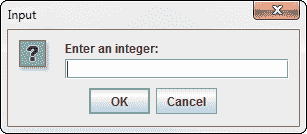

**表 2-7**

**检查有效输入值的 Scanner 类方法**

| 方法 | 说明 |
| :--- | :--- |
| `boolean hasNextBoolean()` | 如果用户输入的下一个值是有效的布尔值，则返回 true。 |
| `boolean hasNextByte()` | 如果用户输入的下一个值是有效的字节值，则返回 true。 |
| `boolean hasNextDouble()` | 如果用户输入的下一个值是有效的双点数值，则返回 true。 |
| `boolean hasNextFloat()` | 如果用户输入的下一个值是有效的浮点数值，则返回 true。 |
| `boolean hasNextInt()` | 如果用户输入的下一个值是有效的整数值，则返回 true。 |
| `boolean hasNextLong()` | 如果用户输入的下一个值是有效的长整数值，则返回 true。 |
| `boolean hasNextShort()` | 如果用户输入的下一个值是有效的短整数值，则返回 true。 |

## 使用 JOptionPane 类获取输入

如果你使用的是 Java 1.5 之前的 Java 版本，那么你无法使用`Scanner`类直接从控制台窗口从用户处输入。然而，你可以使用`JOptionPane`类来显示如图 2-2 所示的简单对话框，以获取用户的文本输入。然后，你可以使用原始类型包装类的`parse`方法将用户输入的文本转换为适当的原始类型。

**图 2-2:**

由`JOptionPane`类显示的对话框。

尽管`JOptionPane`类有许多方法，但你只需要使用`showInputDialog`方法即可获取简单的文本输入。该方法使用单个参数，用于指定显示在对话框中的提示消息。它返回一个字符串值，然后你可以将其解析为相应的类型。`JOptionPane`类是`javax.swing`包的一部分，因此你需要在任何使用该类的程序开头添加`import javax.swing.JOptionPane`语句。

列表 2-4 显示了一个使用`JOptionPane`类获取整数值并将其显示在控制台上的简单程序。

**列表 2-4:**

**一个使用 JOptionPane 类获取用户输入的程序**

```java
import javax.swing.JOptionPane;

public class DialogApp {
    public static void main(String[] args) {
        String s;
        s = JOptionPane.showInputDialog("Enter an integer:");
        int x = Integer.parseInt(s);
        System.out.println("You entered " + x + ".");
    }
}
```

接下来的段落描述了该程序中的重要行：

- `1`: 这一行导入了`JOptionPane`类。
- `7–8`: 该语句显示一个带有提示信息`Enter an integer:`的输入对话框，并将用户输入的字符串赋值给名为`s`的变量。
- `9`: 该语句使用`Integer`类的`parseInt`方法将用户输入的字符串转换为整数。
- `10`: 该语句显示了用户输入的整数。

**变量与数据类型操作** 97

## 使用 enum 创建你自己的数据类型

你经常会发现自己在使用`String`或`int`变量，但你想将其限制在少数几个值中。例如，假设你正在编写一个玩牌游戏的程序，你想一种方法来表示每张牌的花色。你可以通过`String`变量来实现，其值应该是 Hearts、Spades、Clubs 或 Diamonds。或者你可能使用`int`，并用 1 代表红心，2 代表黑桃，3 代表梅桃，4 代表方片。但这种方案很容易出错。如果你给`int`变量赋值为 5 会怎样？

更好的方法是创建一个`enum`（枚举），它本质上是一种具有限制值集的自定义变量类型。要定义枚举，你使用`enum`关键字（通常带有`public`修饰符），后面跟着括号内的可能值列表：

```java
public enum CardSuit {HEARTS, SPADES, CLUBS, DIAMONDS}
```

你可以使用枚举名称作为数据类型声明变量：

```java
CardSuit suit;
```

然后，你可以通过使用枚举名称后跟点和任何枚举值来赋值，如下例所示：

```java
suit = CardSuit.HEARTS;
```

这是一个完整的程序，它定义了一个枚举，创建了该枚举类型的变量，赋值并打印结果：

```java
public class EnumTest {
    public enum CardSuit {HEARTS, SPADES, CLUBS, DIAMONDS}

    public static void main(String[] args) {
        CardSuit suit;
        suit = CardSuit.HEARTS;
        System.out.println("The suit is " + suit);
    }
}
```

该程序在控制台上显示以下行内容：

`The suit is HEARTS`

为什么 Java 的数学运算有时产生你可能预期的结果。

## 使用算术运算符

*运算符*（operator）是一个特殊的符号或关键字，用于指定数学操作或其他可以在一个或多个值（称为*操作数*，operand）上执行的其他类型操作。Java 总共约有 40 个运算符。本章重点介绍执行算术的运算符。这些*算术运算符*（arithmetic operators）——共七种，如表 3-1 所示——执行基本的算术运算，如加、减、乘、除。

### 表 3-1：Java 的算术运算符

| 运算符 | 说明 |
| :--- | :--- |
| `+` | 加法 |
| `-` | 减法 |
| `*` | 乘法 |
| `/` | 除法 |
| `%` | 模数 |
| `++` | 递增 |
| `--` | 递减 |

以下代码有助于明确这些运算符在`int`类型上如何工作：

```java
int a = 32, b = 5;
int c = a + b; // c 是 37
int d = a - b; // d 是 27
int e = a * b; // e 是 160
int f = a / b; // f 是 5 (32 / 5 等于 6 余 2)
int g = a % b; // g 是 2 (32 / 5 等于 6 余 2)
a++; // a 现在是 33
b--; // b 现在是 4
```

注意，对于除法，结果会被截断。因此`32 / 5`返回的是`6`，而不是`6.4`。关于整数除法的更多信息，请参阅本章后面的“整数除法”部分。

以下是运算符对`double`值的工作方式：

```java
double x = 5.5, y = 2.0;
double m = x + y; // m 是 7.5
double n = x - y; // n 是 3.5
double o = x * y; // o 是 11.0
double p = x / y; // p 是 2.75
double q = x % y; // q 是 1.5
x++; // x 现在是 6.5
y--; // y 现在是 1.0
```

## 按操作数数量对运算符分类

分类 Java 运算符的常用方法是根据运算符作用的操作数数量。当按这种方式分类运算符时，你会发现三种类型：

- **一元运算符**（Unary operators）：仅作用于一个操作数的运算符。一元运算符的示例包括取反（`-x`，返回`x`的负值）和递增（`x++`，将`x`加 1）。

  一元运算符可以是前缀运算符也可以是后缀运算符。*前缀运算符*（prefix operator）写在操作数之前，如下：

  ```
  operator operand
  ```

  *后缀运算符*（postfix operator）写在操作数之后，如下：

  ```
  operand operator
  ```

- **二元运算符**（Binary operators）：作用于两个操作数的运算符。二元运算符的示例包括加法（`x + y`）、乘法（`invoiceTotal * taxRate`）和比较运算符（`x < leftEdge`）。在 Java 中，所有二元运算符都是*中缀运算符*（infix operators），这意味着它们出现在操作数之间，如下：

  ```
  operand1 operator operand2
  ```

- **三元运算符**（Ternary operators）：作用于三个操作数的运算符。Java 只有一个三元运算符，称为*条件运算符*（conditional operator）`?:`。*条件运算符也是中缀的：

  ```
  operand1 ? operand2 : operand3
  ```

当你除法两个`int`值时，结果是一个整数值，即使你将其赋值给一个`double`变量也是。例如：

```java
int a = 21, b = 6;
double answer = a / b; // answer = 3.0
```

如果这不是你想要的，你可以在执行除法之前将其中一个操作数*转换*（cast）为`double`。（*转换操作数*意味着将它的值从一种数据类型转换为另一种数据类型。）转换方法如下：

```java
int a = 21, b = 6;
double answer = (double)a / b; // answer = 3.5
```

这个故事的教训是，如果你想除法`int`值并获得准确的`double`结果，你必须将至少一个`int`值转换为`double`。

当你今晚躺在床上思考 Java 算术运算符的奇妙时，这里有几点额外可以你考虑的内容：

- 在代数中，你可以将一个数字直接写在变量旁边来表示乘法。在这种情况下，*4x*意味着“4 倍*x*”。Java 中并非如此。以下语句无法编译：

  ```java
  int x;
  y = 4x; // 错误，此行无法编译
  ```

- 余数运算符（`%`）也称为*模数*（modulus）运算符。它返回第一个操作数除以第二个操作数时的余数。余数运算符通常用于判断一个数是否能被另一个数整除，在这种情况下结果为零。有关更多信息，请参阅下一节“整数除法”。

- 所有运算符（包括算术运算符）在 Java 中都被视为分隔符。因此，表达式中任何空格的使用都是可选的。因此，以下两个语句是等价的：

  ```java
  a = ( (x + 4) * 7 ) / (y * x);
  a=((x+4)*7)/(y*x);
  ```

只需记住，空格无大处，有时还能增加可读性。

## 整数除法


当你用一个整数除另一个整数时，结果是一个整数。任何部分都会被丢弃。例如，`5 / 4` 是 `1`。如果你希望 `5 / 4` 的结果为 `1.25`，你必须在表达式中使用至少一个 `double`：

```java
double result = 5.0 / 4; // 结果为 1.25
double result = 5 / 4.0; // 结果为 1.25
double result = (double)5 / 4; // 结果为 1.25
```

或者，你可以在执行除法之前将整数转换为 `double`：

```java
int a = 5;
int b = 4;
double result = (double)a / b; // result 为 1.25
```

## 分分糖的程序

以下程序演示了如何使用除法和余数运算符：

```java
import java.util.Scanner;

public class MarblesApp {
    static Scanner sc = new Scanner(System.in);

    public static void main(String[] args) {
        int numberOfbles;
        int numberOfChildren;
        int marblesPerChild;
        int marblesLeftOver;

        System.out.println("Welcome to the marble divvyer.");
        System.out.print("Number of marbles: ");
        numberOfbles = sc.nextInt();
        System.out.print("Number of children: ");
        numberOfChildren = sc.nextInt();

        marblesPerChild = numberOfbles / numberOfChildren;
        marblesLeftOver = numberOfbles % numberOfChildren;

        System.out.println("Give each child " + marblesPerChild + " marbles.");
        System.out.println("You will have " + marblesLeftOver + " marbles left over.");
    }
}
```

该程序的示例输出：

```
Welcome to the marble divvyer.
Number of marbles: 93
Number of children: 5
Give each child 18 marbles.
You will have 3 marbles left over.
```

## 组合运算符

你可以组合运算符来形成复杂的表达式。当你这样做时，操作执行的顺序由表达式中每个运算符的优先级决定。算术运算符的优先级顺序如下：

- 首先评估自增（`++`）和自减（`--`）运算符。
- 然后应用符号运算符（`+` 或 `-`）。
- 然后评估乘法（`*`）、除法（`/`）和取模（`%`）运算符。
- 最后应用加法（`+`）和减法（`-`）运算符。

例如，在表达式 `a + b * c` 中，乘法的优先级高于加法。因此先将 `b` 乘以 `c`。然后将该乘法的结果加到 `a` 上。

如果一个表达式包含两个或多个相同优先级的运算符，则从左到右评估这些运算符。因此，在表达式 `a * b / c` 中，先将 `a` 乘以 `b`，然后将结果除以 `c`。

如果你愿意，可以使用括号来改变操作的执行顺序。括号内的操作始终在括号外操作之前执行。因此，在表达式 `(a + b) * c` 中，先将 `a` 加到 `b` 上。然后将结果乘以 `c`。

如果一个表达式包含两组以上的括号，则先执行最内层括号的操作。在表达式 `(a * (b + c)) / d` 中，先将 `b` 加到 `c` 上。然后将该结果乘以 `a`。最后，将该结果除以 `d`。

除了自增和自减运算符外，这些优先级规则和括号的使用与基础代数相同。所以，如果你在八年级时留过心，那么优先级规则应该是容易理解的。

对于 `double` 或 `float` 值，改变相同优先级运算符的从左到右顺序不会影响结果。然而，对于整数类型，如果涉及除法，可能会产生巨大的差异。考虑这些语句：

```
int a = 5, b = 6, c = 7;
int d1 = a * b / c; // d1 是 4
int d2 = a * (b / c); // d2 是 0
```

这种差异发生是因为整数除法总是返回整数结果，即它是实际结果的截断版本。因此，在第一个表达式中，先将 `a` 乘以 `b`，得到结果 30。然后将此结果除以 `c`。截断答案得到结果 4。但在第二个表达式中，先将 `b` 除以 `c`，得到截断后的结果 0。然后将此结果乘以 `a`，得到最终答案 0。

### 使用一元加和一元减运算符

一元加和一元减运算符允许你更改操作数的符号。请注意，这些操作中实际使用的运算符与二元加减运算符是相同的。编译器通过检查表达式来确定你是想使用这些运算符的二元版本还是一元版本。

一元减运算符并不一定会操作数变为负值。相反，它会改变操作数原本的符号。因此，如果操作数初始值为正值，一元减运算符会将其变为负值。但如果操作数初始值为负值，一元减运算符会将其变为正值。以下示例说明了这一点：

```
int a = 5; // a 是 5
int b = -a; // b 是 -5
int c = -b; // c 是 +5
```

有趣的是，一元加运算符实际上什么都不做。例如：

```
int a = -5; // a 是 -5
int b = +a; // b 是 -5
a = 5; // a 现在是 5
int c = +a; // c 是 5
```

注意，如果 `a` 初始为正，`+a` 也是正的。但如果 `a` 初始为负，`+a` 仍然是负的。因此，一元加运算符没有影响。我猜 Java 提供一元加运算符是为了平衡的需求。

你还可以在更复杂的表达式中使用这些运算符，例如：

```
int a = 3, b = 4, c = 5;
int d = a * -(b + c); // d 是 -27
```

在这里，将 `b` 加到 `c` 上得到结果 9。然后应用一元减运算符得到结果 -9。最后，将 -9 乘以 `a`，得到结果 -27。

### 使用自增和自减运算符

计算机编程中最常见的操作之一是对变量加或减 1。给变量加 1 称为变量的*自增*（incrementing）。减 1 称为*自减*（decrementing）。自增变量的传统方法是：

```
a = a + 1;
```

在这里，计算表达式 `a + 1`，并将结果赋值给变量 `a`。

Java 提供了一种更简单的方法来执行此类计算：自增（`++`）和自减（`--`）运算符。这些一元运算符适用于单个变量。因此，要自增变量 `a`，你只需要编写：

```
a++;
```

注意，使用自增或自减运算符的表达式本身就是一个语句。这是因为自增或自减运算符也是赋值运算符的一种，因为它改变了所作用变量的值。

你只能对变量使用自增和自减运算符——不能用于数字字面量或其他表达式。例如，Java 不允许以下表达式：

```
a = b * 5++; // 不能自增数字 5
a = (b * 5)++; // 不能自增表达式 (b * 5)
```

注意，你可以在赋值语句中使用自增或自减运算符。这里有一个例子：

```
int a = 5;
int b = a--; // a 和 b 都被设置为 4
```

当执行第二个语句时，首先评估表达式 `a--`，因此 `a` 被设置为 4。然后将 `a` 的新值赋值给 `b`。因此 `a` 和 `b` 都被设置为 4。

自增和自减运算符之所以特殊，是因为它们是一元运算符，可以放在所作用变量之前（*前置 prefix*）之后（*后置 postfix*）。将运算符放在变量之前还是之后会对表达式的评估方式产生重大影响。如果你将自增或自减运算符放在变量之前，则该运算符会在表达式其余部分评估之前应用。结果是变量自增后的值将用于表达式。相比之下，如果你将运算符放在变量之后，则运算符会在表达式评估之后应用。因此，变量的原始值将用于表达式。

感到困惑了吗？一个简单的例子可以消除云义。首先，考虑这些使用后置自增表达式的语句：

```
int a = 5;
int b = 3;
int c = a * b++; // c 被设置为 15
```

当评估第三条语句中的表达式时，`b` 的原始值——3 被用于乘法。因此 `c` 被设置为 15。然后 `b` 自增到 4。

现在考虑这个使用前置自增的版本：

```
int a = 5;
int b = 3;
int c = a * ++b; // c 被设置为 20
```

这一次，`b` 在执行乘法之前就先自增了，因此 `c` 被设置为 20。无论如何，`b` 最终都被设置为 4。

同样，考虑这个例子：

```
int a = 5;
int b = --a; // b 被设置为 5, a 被设置为 4.
```

这个例子与之前的示例相似，但这次使用了前置自增运算符。当执行第二个语句时，`a` 的值被赋值给 `b`。然后 `a` 自减。结果是，`b` 被设置为 5，`a` 被设置为 4。

由于自增和自减运算符在表达式中与其他运算符一起使用时可能会引起困义，我建议你单独使用它们。每当你想将自增或自减运算符整合到更大的表达式中，请将自增或自减从表达式中提取出来，并使其成为表达式之前或之后的独立语句。也就是说，编写：

```
b++;
c = a * b;
```

而不是：

```
c = a * ++b;
```

在第一种情况下，显而易见的是 `b` 在执行乘法之前已经自增了。

标准赋值运算符（`=`）用于将表达式的结果赋值给变量。在最简单的形式下，你的代码这样写：

```
variable = expression;
```

第 2 册 编程基础

这里有一个示例：

```java
int a = (b * c) / 4;
```

你已经见过很多像这样的赋值语句示例了，所以我不再对这一点进行多余的阐述。我确实指出一点——仅仅为了留存在案——你*不能*在等号的左侧编写算术表达式。因此，以下语句无法编译：

```
int a;
a + 3 = (b * c);
```

在本节的剩余部分中，我将指出一些使用赋值运算符的不寻常方法。我不建议你实际使用这些任何技术，因为它们很少需要，而且几乎总是会让人困惑，但了解它们可以帮助理解 Java 表达式的工作原理，并且有时可以帮助你发现代码中隐蔽的问题。

## 与数字和表达式的操作

理解本节其余内容的关键在于意识到，在 Java 中，赋值是表达式，而不是语句。换句话说，`a = 5` 是一个赋值表达式，而不是一个赋值语句。只有当你在末尾添加分号时，它才变成一个赋值语句。

赋值表达式的结果是赋值变量的值。例如，表达式 `a = 5` 的结果是 `5`。同样，表达式 `a = (b + c) * d` 的结果是表达式 `(b + c) * d` 的结果。

这意味着你可以在其他表达式中间使用赋值表达式。下面的示例是合法的：

```java
int a;
int b;
a = (b = 3) * 2; // a 是 6, b 是 3
```

与任何表达式一样，括号内的表达式部分首先求值。因此，`b` 被赋值为值 `3`。然后执行乘法，并将结果 `(6)` 赋值给变量 `a`。

现在考虑一个更复杂的情况：

```java
int a;
int b = 2;
a = (b = 3) * b; // a 是 9, b 是 3
```

这里发生的情况是括号内的表达式首先求值，这意味着在执行乘法之前，`b` 被设为 `3`。

第 3 章 与数字和表达式的操作

在上示例中，括号是重要的，因为如果没有括号，赋值运算符是 Java 优先级顺序中最后一个被求值的运算符。再考虑一个示例：

```java
int a;
int b = 2;
a = b = 3 * b; // a 是 6, b 是 6
```

这次，首先执行乘法 `3 * b`，得到结果 `6`。然后将此结果赋值给 `b`。最后，将该赋值表达式的结果 `(6)` 赋值给 `a`。

顺便提一下，下面的表达式也是合法的：

```
a = b = c = 3;
```

该表达式将值 `3` 赋值给三个变量。虽然这段代码看起来相当无害，但你还是直接写三个赋值语句更好。（你可能猜到将赋值合并比写三行更有效率，但你是错的。这三个赋值无论以何种方式所需的字节码指令数量都是相同的。）

## 使用复合赋值运算符

*复合赋值运算符*是一种同时执行计算和赋值的运算符。Java 的所有二元算术运算符（即对两个操作数起作用的）都有等效的复合赋值运算符，表 3-2 列出了它们。

### 表 3-2：复合算术运算符

| 运算符 | 描述 |
| :--- | :--- |
| `+=` | 加法并赋值 |
| `-=` | 减法并赋值 |
| `*=` | 乘法并赋值 |
| `/=` | 除法并赋值 |
| `%=` | 取模并赋值 |

---

理解本节其余内容的关键在于意识到，在 Java 中，赋值是表达式，而不是语句。换句话说，`a = 5` 是一个赋值表达式，而不是一个赋值语句。只有当你在末尾添加分号时，它才变成一个赋值语句。

赋值表达式的结果是赋值变量的值。例如，表达式 `a = 5` 的结果是 `5`。同样，表达式 `a = (b + c) * d` 的结果是 `(b + c) * d` 的结果。

这意味着你可以在其他表达式中间使用赋值表达式。下面的示例是合法的：

```java
int a;
int b;
a = (b = 3) * 2; // a 是 6, b 是 3
```

与任何表达式一样，括号内的表达式部分首先求值。因此，`b` 被赋值为值 `3`。然后执行乘法，并将结果 `(6)` 赋值给变量 `a`。

现在考虑一个更复杂的情况：

```java
int a;
int b = 2;
a = (b = 3) * b; // a 是 9, b 是 3
```

这里发生的情况是括号内的表达式首先求值，这意味着在执行乘法之前，`b` 被设为 `3`。

第 3 章 与数字和表达式的操作

在上示例中，括号是重要的，因为如果没有括号，赋值运算符是 Java 优先级顺序中最后一个被求值的运算符。再考虑一个示例：

```java
int a;
int b = 2;
a = b = 3 * b; // a 是 6, b 是 6
```

这次，首先执行乘法 `3 * b`，得到结果 `6`。然后将此结果赋值给 `b`。最后，将该赋值表达式的结果 `(6)` 赋值给 `a`。

顺便提一下，下面的表达式也是合法的：

```
a = b = c = 3;
```

该表达式将值 `3` 赋值给三个变量。虽然这段代码看起来相当无害，但你还是直接写三个赋值语句更好。（你可能猜到将赋值合并比写三行更有效率，但你是错的。这三个赋值无论以何种方式所需的字节码指令数量都是相同的。）

## 使用复合赋值运算符

*复合赋值运算符*是一种同时执行计算和赋值的运算符。Java 的所有二元算术运算符（即对两个操作数起作用的）都有等效的复合赋值运算符，表 3-2 列出了它们。

根、幂和对数。

# 第 3 章 **处理数字与表达式** 113

## 表 3-4：Math 类提供的数学函数

| 方法 | 解释 |
| :--- | :--- |
| `abs(argument)` | 返回参数的绝对值。参数可以是 `int`、`long`、`float` 或 `double`。返回值与参数的类型相同。 |
| `cbrt(argument)` | 返回参数的立方根。参数和返回值都是 `double`。 |
| `exp(argument)` | 返回 *e* 的参数次幂次方。参数和返回值都是 `double`。 |
| `hypot(arg1, arg2)` | 根据勾股拉斯定理计算直角三角形的斜边 — $\sqrt{x2 + y2}$。参数和返回值都是 `double`。 |
| `log(argument)` | 返回参数的自然对数（底为 *e*）。参数和返回值都是 `double`。 |
| `log10(argument)` | 返回参数的以 10 为底的对数。参数和返回值都是 `double`。 |
| `max(arg1, arg2)` | 返回两个参数中的较大值。参数可以是 `int`、`long`、`float` 或 `double`，但两者类型必须相同。返回类型与参数类型相同。 |
| `min(arg1, arg2)` | 返回两个参数中的较小值。参数可以是 `int`、`long`、`float` 或 `double`，但两者类型必须相同。返回类型与参数类型相同。 |
| `pow(arg1, arg2)` | 返回第一个参数的第二个参数次幂的值。两个参数和返回值都是 `double`。 |
| `random()` | 返回一个大于等于 0.0 且小于 1.0 的随机数。此方法不接受参数，但返回值为 `double`。 |
| `signum(argument)` | 返回表示参数符号的数字：如果参数为负则返回 –1.0，如果为零则返回 0.0，如果为正则返回 1.0。参数可以是 `double` 或 `float`。返回值与参数的类型相同。 |
| `sqrt(argument)` | 返回参数的平方根。参数和返回值都是 `double`。 |

列表 3-3 中的程序演示了除 `random` 之外的每个方法。运行时，它会产生类似下方的输出：


`abs(b) = 50`
`cbrt(x) = 2.924017738212866`
`exp(y) = 54.598150033144236`
`hypot(y,z)= 5.0`
`log(y) = 1.0986122886681096`
`log10(y) = 0.47712125471966244`
`max(a, b) = 100`
`min(a, b) = -50`
`pow(a, c) = 1000000.0`
`random() = 0.8536014557793756`
`signum(b) = -1.0`
`sqrt(x) = 1.7320508075688772`

你可以使用此输出来了解这些 `Math` 类方法返回的值。例如，你可以看到当 `y` 为 25.0 时，表达式 `Math.sqrt(y)` 返回值为 5.0。

接下来的段落指出了关于这些方法的几个有趣细节：

- 你可以使用 `abs` 和 `signum` 方法强制使一个变量的符号匹配另一个变量的符号，如下所示：

```java
int a = 27;
int b = -32;
a = Math.abs(a) * Math.signum(b); // a 现在是 -27;
```

- 你可以使用 `pow` 方法来计算数字的平方，如下所示：

```java
double x = 4.0;
double y = Math.pow(x, 2); // y 现在是 16;
```

然而，直接将数字乘以自己通常同样简单且更具可读性：

```java
double x = 4.0;
double y = x * x; // y 现在是 16;
```

- 在经典电影《奥兹仙踪》中，当魔法师终于赋予稻草人大脑时，稻草人突然变得聪明并引用了勾股拉斯定理，而这个定理（巧合）被 `Math` 类的 `hypot` 方法使用。遗憾的是，他引用错了。稻草人在电影中实际说的是：“任何等腰三角形任意两边的平方根之和等于另一边的平方根。”愚蠢的稻草人。当然，他本应该说的是：“任何直角三角形斜边的平方等于另外两条边的平方和。”

- 每每次你运行列表 3-3 中的程序时，你都会为 `random` 方法调用得到一个不同的结果。`random` 方法非常有趣，以至于我在下一节“创建随机数”中对其进行了专门描述。

## 列表 3-3：一个使用 Math 类数学方法的程序

```java
public class MathFunctions {
    public static void main(String[] args) {
        int a = 27;
        int b = -32;
        System.out.println("abs(b) = " + Math.abs(b));

        double x = 25.0;
        System.out.println("cbrt(x) = " + Math.cbrt(x));

        double y = 5.0;
        System.out.println("exp(y) = " + Math.exp(y));

        double z = 3.0;
        System.out.println("hypot(y,z)= " + Math.hypot(y,z));

        System.out.println("log(y) = " + Math.log(y));
        System.out.println("log10(y) = " + Math.log10(y));

        int a2 = 100;
        int b2 = -50;
        System.out.println("max(a, b) = " + Math.max(a2, b2));
        System.out.println("min(a, b) = " + Math.min(a2, b2));

        double c = 6.0;
        System.out.println("pow(a, c) = " + Math.pow(a2, c));
        System.out.println("random() = " + Math.random());
        System.out.println("signum(b) = " + Math.signum(b));
        System.out.println("sqrt(x) = " + Math.sqrt(x));
    }
}
```

## 创建随机数

早晚，你都会想要创建每次运行结果都不相同的程序。几乎所有的游戏都内置了偶然元素，因此你需要一种方法来实现它。

严格来说，计算机并不具备生成真正随机数的能力，但多年来，聪明的计算机科学家开发了在所有目的上都看起来随机的方法。这些数字被称为*伪随机数*。

Java 有许多生成随机数的方法和类。例如，`java.util.Random` 类提供了约十种专门生成随机值的方法。生成生成 0.0 到 1.0 之间的 `double`，你可以执行 `new Random().nextDouble()`。此外，`java.security.SecureRandom` 类为加密敏感文档提供随机值。如果大小对你很重要，`java.math.BigInteger` 类允许你生成任意大的随机数（如果你需要 1000 位的数字）。

然而，大多数需要随机值的计算机应用程序需要的是任意低值（通常是 1，但并不总是）和任意高值之间的随机整数。玩骰子的程序需要 1 到 6 之间的随机数，而发牌程序需要 1 到 52 之间的随机数（如果使用王牌则为 53）。

因此，你需要一个 Java 表达式将随机函数返回的 `double` 值转换为程序所需的范围内的 `int` 值。以下代码展示了如何操作，并将针对骰子的游戏设置为 1 和 6：

```java
int low = 1; // 范围内的最低值
int high = 6; // 范围内的最高值
int rnd = (int)(Math.random() * (high - low + 1)) + low;
```

2. 将随机值乘以范围上限减去下限再加 1。在这个示例中，上限是 6，下限是 1，因此你现在得到了一个大于或等于 0.0 但小于 6.0 的随机数。（它可能是 5.99999999999999，但永远不会是 6.0。）

3. 该值通过 `(int)` 强制类型转换转换为整数。现在你有了一个值为 0、1、2、3、4 或 5 的整数。（记住，当你将 `double` 转换为 `int` 时，该值的任何小数部分都会被丢弃。因为该数字小于 6.0，所以当它被转换为 `int` 时，永远不会被截断为 6.0。）

4. 将范围内的最小值加到随机数。假设 `low` 是 1，那么随机数现在就是 1、2、3、4、5 或 6。这正是你所所愿的：一个介于 1 和 6 之间的随机数。

# 第 3 章：处理数字和表达式

为了让你了解这种随机数计算的工作原理，列表 3-4 显示了一个程序，它将此计算放在一个名为 `randomInt` 的方法中，然后调用它来模拟 100 次骰子投掷。`randomInt` 方法接受两个参数，代表范围的下限和上限，并返回一个范围内的随机整数。在该程序的 `main` 方法中，`randomInt` 方法被调用了 100 次，每个随机数都通过调用 `System.out.print` 打印。

该程序的控制台输出类似于：

```
Here are 100 random rolls of the dice:
4 1 1 6 1 2 6 6 6 6 5 5 5 4 5 4 4 1 3 6 1 3 1 4 4 3 3 3 5 6 5 6 6 3 5 2 2 6 3 3
4 1 2 2 4 2 2 4 1 4 3 6 5 5 4 4 2 4 1 3 5 2 1 3 3 5 4 1 6 3 1 6 5 2 6 6 3 5 4 5
2 5 4 5 3 1 4 2 5 2 1 4 4 4 6 6 4 6 3 3
```

然而，每当你运行这个程序时，你看到的都是不同的 100 个数字序列。列表 3-4 中的程序使用了你尚未见过的几个 Java 特性。

**列表 3-4：掷骰子**

```java
public class DiceApp {
    public static void main(String[] args) {
        int roll;
        String msg = "Here are 100 random rolls of the dice:";
        System.out.println(msg);
        for (int i=0; i<100; i++) {
            roll = randomInt(1, 6);
            System.out.print(roll + " ");
        }
        System.out.println();
    }

    public static int randomInt(int low, int high) {
        int result = (int)(Math.random() * (high - low + 1)) + low;
        return result;
    }
}
```

接下来的段落解释了程序的工作原理，但如果你没有完全理解程序中的所有元素，也不要担心。要关注的是将 `Math.random` 方法返回的随机双值转换为整数的表达式。

- `for` 语句导致其体内的语句（第 10 行和第 11 行）执行 100 次。现在不用担心该语句是如何工作的；你将在第二本书第 5 章中了解到它。

- 该语句调用 `randomInt` 方法，指定 1 和 6 为生成随机整数的范围。生成的随机数被赋值给变量 `roll`。

- `System.out.print` 方法用于打印随机数并在后跟一个空格。因为该语句调用的是 `print` 方法而不是 `println` 方法，所以随机数打印在同一行，而不是分行打印。

- `randomInt` 方法的声明表明该方法返回一个 `int` 值并接受两个 `int` 参数：一个命名为 `low`，另一个命名为 `high`。

- 该表达式将随机双值转换为 `low` 和 `high` 之间的整数。

- `return` 语句将随机数传回调用 `randomInt` 方法的语句。

## 舍入函数

`Math` 类有四个方法可以舍入或截断 `float` 或 `double` 值。表 3-5 列出了这些方法。正如你所看到的，这些方法每个都使用不同的技术来计算靠近作为参数的 `double` 或 `float` 值的整数。注意，尽管这四个方法都将浮点值舍入为整数值，但只有 `round` 方法实际上返回整数类型（`int` 或 `long`，取决于参数是 `float` 还是 `double`）。其他方法返回的是恰好为整数值的 `double`。

**表 3-5：Math 类提供的舍入函数**

| 方法 | 解释 |
| :--- | :--- |
| `ceil(argument)` | 返回一个整数且大于或等于参数值的最小 `double` 值。 |
| `floor(argument)` | 返回一个整数且小于或等于参数值的最大 `double` 值。 |
| `rint(argument)` | 返回一个整数且最接近参数值的 `double` 值。如果两个整数值一样近，则返回偶数值。 |
| `round(argument)` | 返回最接近参数的整数。如果参数是 `double`，则返回 `long`。如果参数是 `float`，则返回 `int`。 |

**列表 3-5：使用 Math 类舍入方法的程序**

```java
public class RoundingApp {
    public static void main(String[] args) {
        double x = 29.4;
        double y = 93.5;
        double z = -19.3;
        System.out.println("round(x) = " + Math.round(x));
        System.out.println("round(y) = " + Math.round(y));
        System.out.println("round(z) = " + Math.round(z));
        System.out.println();
        System.out.println("ceil(x) = " + Math.ceil(x));
        System.out.println("ceil(y) = " + Math.ceil(y));
        System.out.println("ceil(z) = " + Math.ceil(z));
        System.out.println();
        System.out.println("floor(x) = " + Math.floor(x));
        System.out.println("floor(y) = " + Math.floor(y));
        System.out.println("floor(z) = " + Math.floor(z));
        System.out.println();
        System.out.println("rint(x) = " + Math.rint(x));
        System.out.println("rint(y) = " + Math.rint(y));
        System.out.println("rint(z) = " + Math.rint(z));
    }
}
```

## 数字格式化

到目前为止你看到的大部分程序使用 `System.out.println` 或 `System.out.print` 方法打印包含数字变量的值。当你将数字变量传递给这些方法之一时，变量的值在打印之前会被转换为字符串。用于表示该值的确切格式并不好看：大值在打印时没有任何逗号，而且 `double` 或 `float` 值的所有小数位无论你是否想要都会打印出来。在许多情况下，你希望在打印之前对数字进行格式化——例如为大值添加逗号并限制打印的小数位数。或者，如果一个数字代表货币金额，你可能想添加美元符号（或适用于你所在区域的货币符号）。为了做到，你可以使用 `NumberFormat` 类。表 3-6 列出了 `NumberFormat` 类的方法。

# 第 3 章 处理数字和表达式

## 表 3-6：NumberFormat 类的方法

| 方法 | 解释 |
| :--- | :--- |
| `getCurrencyInstance()` | 静态方法，返回一个用于格式化货币数值的 `NumberFormat` 对象 |
| `getPercentInstance()` | 静态方法，返回一个格式化百分比的 `NumberFormat` 对象 |
| `getNumberInstance()` | 静态方法，返回一个格式化基础数字的 `NumberFormat` 对象 |
| `format(number)` | 返回一个包含格式化后数字的字符串 |
| `setMinimumFractionDigits(int)` | 设置小数点后显示的最小数字位数 |
| `setMaximumFractionDigits(int)` | 设置小数点后显示的最大数字位数 |

与 Java 的许多方面一样，使用 `NumberFormat` 类的步骤有点笨拙。它的设计目的是为了需要格式化大量数字的应用程序提供效率，但对于大多数应用程序来说，它大材小用了。

使用 `NumberFormat` 类格式化数字的步骤需要一点时间来适应。首先，你必须调用其中一个静态 `getXxxInstance` 方法来创建一个可以以特定方式格式化数字的 `NumberFormat` 对象。然后，如果你需要，可以调用 `setMinimumFractionDigits` 或 `setMaximumFractionDigits` 方法来设置要显示的位数。最后，你调用该对象的 `format` 方法来实际格式化数字。

请注意，`NumberFormat` 类位于 `java.text` 包中，因此在任何使用 `NumberFormat` 的类开头，必须包含以下导入语句：

```java
import java.text.NumberFormat;
```

这是一个使用 `NumberFormat` 类将 `double` 值格式化为货币的示例：

```java
double salesTax = 2.425;
NumberFormat cf = NumberFormat.getCurrencyInstance();
System.out.println(cf.format(salesTax));
```

运行此代码时，控制台将打印出以下行：

```
$2.43
```

注意，货币格式将数值从 `2.425` 四舍五入到了 `2.43`。

这是一个使用通用数字格式格式化数字并精确保留三位小数的示例：

```java
double x = 19923.3288;
NumberFormat nf = NumberFormat.getNumberInstance();
nf.setMinimumFractionDigits(3);
nf.setMaximumFractionDigits(3);
System.out.println(nf.format(x));
```

运行此代码时，将打印：

```
19,923.329
```

在这里，数字使用了逗号格式化，且数值四舍五入到了三小数。

这是一个使用百分比格式的示例：


```java
double grade = .92;
NumberFormat pf = NumberFormat.getPercentInstance();
System.out.println(pf.format(grade));
```

运行此代码时，将打印：

```
92%
```

如果你的程序格式化多个数字，考虑将`NumberFormat`对象创建为类变量。这样，`NumberFormat`对象会在程序启动时创建。然后你可以从程序类的任何方法中使用该对象。列表 3-6 是展示此过程如何工作的简单示例。运行此程序时，产生以下输出：

```
My allowance: $5.00
Cost of Paint Ball Gun: $69.95
```

在这里，变量`cf`被创建为类变量。然后`printMyAllowance`和`printCostOfPaintBallGun`方法都可以在第 19 行和第 27 行可以使用。

### 列表 3-6：使用 NumberFormat 类变量的程序

```java
import java.text.NumberFormat;

public class NumberFormatClassApp
{
    static NumberFormat cf = NumberFormat.getCurrencyInstance();

    public static void main(String[] args)
    {
        printMyAllowance();
        printCostOfPaintBallGun();
    }

    public static void printMyAllowance()
    {
        double myAllowance = 5.00;
        cf = NumberFormat.getCurrencyInstance();
        System.out.println("My allowance: " + cf.format(myAllowance));
    }

    public static void printCostOfPaintBallGun()
    {
        double costOfPaintBallGun = 69.95;
        cf = NumberFormat.getCurrencyInstance();
        System.out.println("Cost of Paint Ball Gun: " + cf.format(costOfPaintBallGun));
    }
}
```

# 识别 Java 数学中的怪现象

信不信由你，计算机——即使是最强大的计算机——在进行数学计算时也有局限性。这些局限性通常微不足道，但有时它们会悄悄出现并让你出错。以下章节描述了在 Java 中进行数学运算时需要注意的事。

## 整数溢出

整数类型的基本问题是它们的大小是固定的。因此，`short`、`int`或`long`类型变量可以存储的数字有一个限制。虽然`long`变量可以存放巨大的数字，但早晚你会遇到一个即使是`long`变量无法容下的巨大数字。

好了，考虑这个（诚然是人为的）示例：

```java
int a = 2147483647;
System.out.println(a);
a++;
System.out.println(a);
```

故事的教训是，如果你在处理大整数，应该使用`long`而不是`int`。如果你的程序处理的数字足以产生问题，考虑使用浮点类型。

## 浮点数的怪异

浮点数有自己的问题。首先，浮点数是使用二进制（2 进制）系统存储的，但人类使用十进制（10 进制）处理数字。遗憾的是，在这些系统之间准确转换数字有时是不可能的。在任何数制中，某些分数都无法精确表示。一个例子：十进制无法精确表示分数 1/3。你可以将其近似为 0.333333，但最终你会遇到存储数字位数的限制，因此必须停止。在二进制中，一个无法精确表示的分数之一就是小数值 1/10。换句话说，`float`或`double`变量无法精确表示 0.1。

相信吗？尝试运行这段代码：

```java
float x = 0.1f;
NumberFormat nf = NumberFormat.getNumberInstance();
nf.setMinimumFractionDigits(10);
System.out.println(nf.format(x));
```

结果输出为：

```
0.1000000015
```

尽管 0.1000000015 接近 0.1，但它并不精确。在大多数情况下，Java 的浮点数学足够精确到不会产生影响。误差范围极小。如果你用 Java 测量房子的大小，你可能需要电子显微镜才能注意到这个误差。然而，如果你正在编写处理金融交易的应用程序，正常的四舍五入有时会放大误差，使其变得显著。你可能会多收或少收一分钱的销售税。在极端情况下，你的发票金额实际上可能会出现明显的加法错误。

整数类型当然也以二进制形式存储。但整数不会遇到浮点类型会遇到的错误——因为整数根本不表示分数——所以你不需要担心整数类型出现这类错误。

## 除以零

根据数学的基本规则，你不能将一个数字除以零。原因很简单：除法是乘法的逆运算——这意味着如果`a * b = c`，那么`a = c / b`也是成立的。如果你允许`b`为零，那么除法将失去意义，因为任何数乘以零等于零。因此，`a`和`c`也必须都是零。简而言之，数学家们在几个世纪前就解决了这个困境，规定不允许除以零。

那么如果你在 Java 程序中*真的*尝试将一个数字除以零会发生什么？答案取决于你除的是整数还是浮点数。如果你除的是整数，尝试除以零的语句会触发所谓的`exception`（异常），这是程序崩溃的一种不礼貌方式。在第 2 卷第 8 章中，你将学会如何拦截这个异常以便让程序继续运行。在此期间，你编写的任何尝试整数除以零的程序都会崩溃。

如果你尝试将浮点类型除以零，结果就不那么突然了。相反，Java 会为浮点结果分配表 3-7 列出的特殊值之一。接下来的段落解释了如何确定这些特殊值：

* 如果你将一个数字除以零，且两个数字的符号相同，结果为正无穷。`0.0`除以`0.0`是正无穷，`-34.0`除以`-0.0`也是如此。

* 如果你将一个数字除以零，且数字的符号不同，结果为负无穷。`-40.0`除以`0.0`是负无穷，`34.0`除以`0.0`也是如此。

* 如果你将零除以零，无论符号如何，结果都不是数字（`NaN`）。

浮点零可以是正的或负的。Java 在数值上认为正零和负零是相等。

如果你尝试打印具有这些特殊值之一的浮点值，Java 会将该值转换为相应的字符串。假设你执行了以下语句：

```java
double i = 50.0;
double j = 0.0;
double k = i / j;
System.out.println(k);
```

得到的控制台输出是

```
Infinity
```

如果`i`为`-50.0`，控制台将显示`-Infinity`；如果`i`为零，控制台将显示`NaN`。

### 表 3-7：float 和 double 类的特殊常量

| 常量 | 含义 |
| :--- | :--- |
| POSITIVE_INFINITY | 正无穷 |
| NEGATIVE_INFINITY | 负无穷 |
| NaN | 不是数字 |

下面的段落描述了在结束本章之前，我想溜进去的一些奇异现象：

* `NaN`不等于它自己，这可能会导致一些奇怪的后果。例如：

```java
double x = Math.sqrt(-50); // 不是数字
double y = x;
if (x == y)
    System.out.println("x equals y");
```

好了，我知道我在`if`语句上操之过急，因为我直到第 2 卷第 4 章才会讲解`if`语句。所以为了 sake 起见，假设这个`if`语句是在测试变量`x`是否等于变量`y`。由于这个测试紧接着一个将`x`的值赋值给`y`的语句，你可以安全地假设`x`等于`y`，对吧？错了。因为`x`是`NaN`，`y`也是`NaN`。`NaN`永远不等于任何其他值，包括另一个`NaN`。因此，`if`语句中的比较失败了。

* 另一个奇怪的后果：你不能假设数字减去它总是零。考虑这条语句：

```java
double z = x - x; // 不一定是零
```

这条语句不应该总是将`z`设置为零吗？如果`x`是`NaN`就不是。在这种情况下，不是数字减不是数字还是不是数字。

* 最后还有一个奇异我就收了：任何涉及无穷的数学运算的结果都是另一个无穷或`NaN`。例如，`Infinity + 5`仍然无穷，所以巴斯光光的那句“飞向无限远！”是不可能实现的。但无穷减无穷会得到 . . . `NaN`。

## 本章内容

* 深入研究布尔表达式
* 为了乐趣和利润
* 关注你基础的、普通的`if`语句
* 查看`else`子句和`else-if`语句
* 理解嵌套`if`语句
* 考虑逻辑运算符
* 查看奇怪的`?:`运算符
* 了解字符串比较的正确方法

## 第 4 章：做出选择

到本书为止，所有的程序都是从头运行到尾，途中没有做任何决策。在本章中，你将发现两种语句，让你的程序产生一些多样性。`if`语句让你只有在条件测试为真时才执行语句或语句块。而`switch`语句允许你根据整数变量的值执行多个语句块中的一个。

`if`语句严重依赖于布尔表达式的使用，布尔表达式通常是产生真或假的表达式。正如你在本章后面发现的，布尔表达式可以非常复杂。但在大多数情况下，你使用的是简单的表达式，比较变量的值与另一个变量、字面量或简单的算术表达式的值。

### 使用简单的布尔表达式

所有的`if`语句以及我在第 2 卷第 5 章描述的其他几个控制语句（`while`、`do`、`for`）都使用布尔表达式来决定执行还是跳过某个语句。*布尔表达式*是一个求值时返回*布尔值:*真或假的 Java 表达式。

基础 Java 布尔表达式的形式如下：

```
expression relational-operator expression
```

Java 通过首先评估左侧表达式来评估布尔表达式...

### 表 4-1：关系运算符

| 运算符 | 描述 |
| :--- | :--- |
| == | 如果左侧表达式的值与右侧的值相等，则返回真。 |
| != | 如果左侧表达式的值与右侧的值不等，则返回真。 |
| < | 如果左侧表达式的值小于右侧的值，则返回真。 |
| <= | 如果左侧表达式的值小于或等于右侧的值，则返回真。 |
| > | 如果左侧表达式的值大于右侧的值，则返回真。 |
| >= | 如果左侧表达式的值大于或等于右侧的值，则返回真。 |

然后求值右侧表达式，最后应用关系运算符来确定整个表达式的求值结果是真还是假。

以下是关系表达式的一些简单示例。对于每个示例，假设使用以下语句来声明和初始化变量：

130 第 2 本 **编程基础**

```java
int i = 5;
int j = 10;
int k = 15;
double x = 5.0;
double y = 7.5;
double z = 12.3;
```

以下是示例表达式及其对应的结果（基于提供的值）：

| 表达式 | 值 | 解释 |
| :--- | :--- | :--- |
| `i == 5` | true | `i`的值为 5。 |
| `i == 10` | false | `i`的值不是 10。 |
| `i == j` | false | `i`是 5，`j`是 10，所以它们不相等。 |
| `i == j - 5` | true | `i`是 5，而`j` – 5 是 5。 |
| `i > 1` | true | `i`是 5，大于 1。 |
| `j == i * 2` | true | `j`是 10，`i`是 5，所以`i * 2`也是 10。 |
| `x = i` | true | 强制转换允许这种比较，5.0 等于 5。 |
| `k < z` | false | 强制转换允许这种比较，15 大于 12.3。 |
| `i * 2 < y` | false | `i * 2`是 10，并不小于 7.5。 |

请注意，测试相等性的关系运算符是连续两个等号（`==`）。单个等号是赋值运算符。当你初学 Java 时，你可能会发现自己在想输入等运算符时却输入了赋值运算符，如下：

```java
if (i = 5)
```

哎呀。但 Java 不会让你逃过这一次，所以你必须纠正错误并重新编译程序。起初，这样做似乎很麻烦。但随着你接触的 Java 越来越多，你会发现这*确实是*一个麻烦，但一个你可以习惯的麻烦。另一个重要的警告：*不要*使用表 4-1 中列出的任何关系运算符（包括等号运算符）来测试字符串。你可能很想像这样去测试字符串：

```java
inputString == "Yes"
```

第 4 章 **做出选择** 131

然而，请注意，这并不是 Java 中比较字符串的正确方法。你将在本章稍后的“比较字符串”部分找到正确的方法。

## 使用 if 语句

`if`语句是任何编程语言中最重要的语句之一，Java 也不例外。接下来的章节将介绍 Java 强大的`if`语句的各种形式的细节。

### 简单 if 语句

在最基本的形式中，`if`语句允许你只在布尔表达式求值为真时才执行单个语句或语句块。`if`语句的基本形式如下：

```
if (*boolean-expression*)
    statement
```

请注意，布尔表达式必须包含在括号中。此外，如果你只使用单个语句，它必须以分号结束。但语句也可以是用大括号括起来的语句块。在这种情况下，块内的每个语句都需要一个分号，但块本身不需要。

这是一个典型的`if`语句示例：

```java
double commissionRate = 0.0;
if (salesTotal > 10000.0)
    commissionRate = 0.05;
```

在这个示例中，一个名为`commissionRate`的变量初始化为`0.0`，如果`salesTotal`大于`10000.0`，则将其设置为`0.05`。一些程序员发现，将`if`语句的操作可视化为流程图是有帮助的，如图 4-1 所示。在这个流程图中，菱形符号表示条件测试：如果销售总额超过 $10,000，则执行矩形中的语句。如果不是，则跳过该语句。

在`if`语句下缩进语句是惯做法，因为这使得你的代码结构更加明显。这并不是必须的，但总是一个好主意。

132 第 2 本 **编程基础**

图 4-1:

if 语句的流程图。这是一个使用语句块而非单个语句的示例：

```java
double commissionRate = 0.0;
if (salesTotal > 10000.0) {
    commissionRate = 0.05;
}
```

在这个示例中，一个名为`commissionRate`的变量初始化为`0.0`，如果`salesTotal`大于`10000.0`，则将其设置为`0.05`。关于简单`if`语句还有以下几点：

- 一些程序员偏于将将语句的左大括号与`if`语句放在同一行，如下：

```java
if (salesTotal > 10000.0) { commissionRate = 0.05; }
```

- 缩进让代码更明显，尽管这并非必须。

- 如果只有一个语句需要条件执行，一些程序员将其放在与`if`语句同一行，如下：

```java
if (salesTotal > 10000.0) commissionRate = 0.05;
```

- 以后添加更多语句很容易忘记包含大括号，这会导致 Bug。

### if-else 语句

`if-else`语句为基础`if`语句增加了一个额外的元素：当表达式为假时执行的语句。

```
if (*boolean-expression*)
    statement
else
    statement
```

示例：

```java
double commissionRate;
if (salesTotal <= 10000.0)
    commissionRate = 0.02;
else
    commissionRate = 0.05;
```

在这个示例中，如果销售总额小于等于 $10,000，则佣金设置为 2%。如果销售总额超过 $10,000，则佣金设置为 5%。图 4-2 显示此`if-else`语句的流程图。

134 第 2 本 **编程基础**

图 4-2:

if-else 语句。

在某些情况下，通过巧妙地调整代码，你可以避免使用`if-else`语句的`else`部分。这段代码与之前的`if-else`语句效果相同：

```java
double commissionRate = 0.05;
if (salesTotal <= 10000.0)
    commissionRate = 0.02;
```

你可以为`if-else`语句中的一个或两个语句使用块。这里有两个语句均为块的`if-else`语句：

```java
double commissionRate;
if (salesTotal <= 10000.0) {
    commissionRate = 0.02;
    level1Count++;
} else {
    commissionRate = 0.05;
    level2Count++;
}
```

### 嵌套 if 语句


在`if-else`语句的`if`或`else`部分的语句可以是任何类型的 Java 语句，包括另一个`if`或`if-else`语句。这种安排被称为*嵌套*，包含另一个`if`或`if-else`语句的`if`或`if-else`语句被称为*嵌套 if 语句*。

嵌套`if`语句的通用形式如下：

```
if (*expression-1*)
    if (*expression-2*)
        statement-1
    else
        statement-2
else
    if (*expression-3*)
        statement-3
    else
        statement-4
```

在这个示例中，*expression-1* 首先被求值。如果它求值为真，则求值 *expression-2*。如果该表达式为真，则执行 *statement-1*；否则执行 *statement-2*。但如果 *expression-1* 为假，则求值 *expression-3* 进行评估。如果`expression-3`为真，则执行`statement-3`；否则执行`statement-4`。

嵌套在另一个 if 语句中的 if 语句被称为`inner if statement`（内部 if 语句），而包含另一个 if 语句的 if 语句被称为`outer if statement`（外部 if 语句）。因此，在前面的示例中，测试`expression-1`的 if 语句是外部 if 语句，测试`expression-2`和`expression-3`的 if 语句是内部 if 语句。

嵌套的复杂度可以根据你的需要变得复杂，但请尽量保持简单。

此外，请务必使用缩进来表示嵌套语句的结构。

假设你的公司有两类销售代表（`Class 1`和`Class 2`），根据下表，这些代表对于销售额低于 $10,000 和超过 $10,000 的销售额将获得不同的佣金：

| 销售额 | Class 1 | Class 2 |
| :--- | :--- | :--- |
| $0 到 $9,999 | 2% | 2.5% |
| $10,000 及以上 | 4% | 5% |

你可以使用嵌套的 if 语句来实现这种佣金结构：

```
if (salesClass == 1)
    if (salesTotal < 10000.0)
        commissionRate = 0.02;
    else
        commissionRate = 0.04;
else
    if (salesTotal < 10000.0)
        commissionRate = 0.025;
    else
        commissionRate = 0.05;
```

此示例假设如果`salesClass`变量不是 1，它必须是 2。如果不是如此，你必须为`Class 2`销售代表使用额外的 if 语句：

```
if (salesClass == 1)
    if (salesTotal < 10000.0)
        commissionRate = 0.02;
    else
        commissionRate = 0.04;
else if (salesClass == 2)
    if (salesTotal < 10000.0)
        commissionRate = 0.025;
    else
        commissionRate = 0.05;
```

注意，我将这个额外的 if 语句与`else`关键字放在同一行。这是这种特殊形式嵌套 if 语句——`else-if statements`的常用做法。你将在下一节找到更多关于这种嵌套的知识。

你当然可以使用一对独立的 if 语句，如下：

```
if (salesClass == 1)
    if (salesTotal < 10000.0)
        commissionRate = 0.02;
    else
        commissionRate = 0.04;

if (salesClass == 2)
    if (salesTotal < 10000.0)
        commissionRate = 0.025;
    else
        commissionRate = 0.05;
```

结果是相同的。然而，这种特定技术仅在 if 语句本身不改变测试的变量时才有效。如果第一个 if 语句改变了`salesClass`变量的值，则该语句将不起作用。

注意，你也可以通过在外部 if 语句中测试销售额级并在内部语句中测试销售代表的类别来实现佣金结构：

```
if (salesTotal < 10000)
    if (salesClass == 1)
        commissionRate = 0.02;
    else
        commissionRate = 0.04;
else
    if (salesClass == 1)
        commissionRate = 0.025;
    else
        commissionRate = 0.05;
```

在使用嵌套的 if 和 else 语句时要小心，因为很容易导致语句运行方式不符合你的预期。关键在于了解 Java 如何将`else`关键字与 if 语句配对。规则实际上非常简单：每个`else`关键字都与上一个尚未与`else`关键字配对的`if`语句匹配。

抱歉——你无法通过缩进来让 Java 以不同的方式配对`if`和`else`关键字。假设`Class 2`销售代表不获得任何佣金，因此前面的示例中的内部 if 语句不需要 else 语句。你可能会尝试使用以下代码来计算佣金率：

```
if (salesTotal < 10000)
    if (salesClass == 1)
        commissionRate = 0.02;
    else
        if (salesClass == 1)
            commissionRate = 0.025;
```

抱歉——这不起作用。缩进产生了`else`关键字与第一个 if 语句配对的错象，但实际上，它与第二个 if 语句配对。结果是，对于销售额 $10,000 或以上的销售，没有设置佣金率。

这个问题有两个解决方案。第一个也是首选的解决方案，是使用大括号来明确结构：

```
if (salesTotal < 10000)
{
    if (salesClass == 1)
        commissionRate = 0.02;
}
else
{
    if (salesClass == 1)
        commissionRate = 0.025;
}
```

另一个解决方案是添加一个`else`语句，为第一个内部 if 语句指定一个“空语句”（单独一个分号）：

```
if (salesTotal < 10000)
    if (salesClass == 1)
        commissionRate = 0.02;
    else ;
else
    if (salesClass == 1)
        commissionRate = 0.025;
```

空的`else`语句与内部 if 语句配对，因此第二个`else`关键字正确地与外部 if 语句配对。

## else-if 语句

嵌套 if 语句的常见模式是有一系列 if-else 语句，在每个`else`部分都包含另一个 if-else 语句：

```
if (expression-1)
    statement-1
else if (expression-2)
    statement-2
else if (expression-3)
    statement-3
```

这些语句有时被称为`else-if statements`，尽管该术语是非正式的。正式上说，发生的是`else`部分的语句恰好是另一个 if 语句——所以这种语句仅仅是嵌套的一种形式。然而，如果你想根据销售总额分配佣金率，根据下表：

| 销售额 | 佣金 |
| :--- | :--- |
| $10,000 及以上 | 5% |
| $5,000 到 $9,999 | 3.5% |
| $1,000 到 $4,999 | 2% |
| $1,000 以下 | 0% |

你可以轻松地实现一系列 else-if 语句：

```
if (salesTotal >= 10000.0)
    commissionRate = 0.05;
else if (salesTotal >= 5000.0)
    commissionRate = 0.035;
else if (salesTotal >= 1000.0)
    commissionRate = 0.02;
else
    commissionRate = 0;
```

你必须仔细考虑如何设置这些 else-if 语句。例如，这个序列似乎有效：

```
if (salesTotal > 0.0)
    commissionRate = 0;
else if (salesTotal >= 1000.0)
    commissionRate = 0.02;
else if (salesTotal >= 5000.0)
    commissionRate = 0.035;
else if (salesTotal >= 10000.0)
    commissionRate = 0.05;
```

尝试不错，但这种方案不起作用。这些 if 语句始终会将佣金率设为 0%，因为第一个 if 语句中的布尔表达式始终为真（假设`salesTotal`不是零或负数——如果是的话，其他 if 语句就不重要了）。

## 逻辑运算符

`逻辑运算符`（有时称为布尔运算符）是一种根据一个或两个其他表达式的布尔结果返回布尔结果的运算符。使用逻辑运算符的表达式被称为复合表达式，因为逻辑运算符的作用允许你两个或多个条件测试组合到一个表达式中。表 4-2 列出了逻辑运算符。

| 运算符 | 名称 | 类型 | 描述 |
| :--- | :--- | :--- | :--- |
| `!` | 非 | 一元 | 当右侧的操作数为假时返回真。当右侧的操作数为真时返回假。 |
| `&` | 与 | 二元 | 当两个操作数都为真时返回真。在应用与运算符之前会求值两个操作数。 |
| `\|` | 或 | 二元 | 当至少有一个操作数为真时返回真。在应用或运算符之前会求值两个操作数。 |
| `^` | 异或 | 二元 | 当有且仅有一个操作数为真时返回真。如果两个操作数都为真或两个操作数都为假，则返回假。 |
| `&&` | 短路与 | 二元 | 与`&`相同，但如果左侧的操作数返回假，则返回假且不再评估右侧的操作数。 |

### `||` - 条件或（二元）

与`|`相同，但如果左侧的操作数返回真，则返回真且不再评估右侧的操作数。

接下来的章节将详尽地描述这些操作符。

#### 使用 `!` 运算符

逻辑运算符中最简单的是`非` (`!`)。从技术上讲，它是一个`一元`前缀运算符，这意味着你对一个操作数使用它，并将其直接写在该操作数的前面。（技术上讲，这个运算符被称为`补码运算符`，而不是`非逻辑运算符`。但在现实生活中，大多数人称它为`非`。许多程序员也称它为 `bang`。）

`非`运算符反转布尔表达式的值。因此，如果表达式为真，`非`会将其更改为假；如果表达式为假，`非`会将其更改为真。

这里有一个例子：

```
!(i = 4)
```

如果`i`是除 4 以外的任何值，该表达式的结果为真。如果`i`是 4，则它的结果为假。它的工作原理是先评估表达式`(i = 4)`，然后反转该评估的结果。

不要混淆逻辑运算符`非` (`!`) 和关系运算符`不等于` (`!=`)。虽然这些运算符的用法有时相似，但`非`运算符更具通用性。我本可以像这样写前面的例子：

```
i != 4
```

结果是相同的。然而，`非`运算符可以应用于任何返回真/假结果的表达式，而不仅仅是等值性测试。

你几乎总是必须将应用于`!`运算符的表达式括在括号中。考虑这个表达式：

```
! i == 4
```

假设`i`是一个整型变量，编译器不允许这个表达式，因为看起来你正试图将`!`运算符应用于变量本身，而不是比较的结果。快速加上一组括号就能解决问题：

```
!(i == 4)
```

#### 使用 `&` 和 `&&` 运算符

`&`和`&&`运算符组合两个布尔表达式，并且只有当两个表达式都为真时才返回真。这种操作被称为`与运算`，因为只有当第一个表达式和第二个表达式都为真时，`与`运算符才会返回真。

假设如果销售类别为 1 且销售总额达到 $10,000 或更多，则佣金比例为 2.5%。你可以使用两个独立的`if`语句进行此测试（正如在本章前面的部分所做），也可以将测试合并为一个`if`语句：

```java
if ((salesClass == 1) & (salesTotal >= 10000.0))
    commissionRate = 0.025;
```

在这里，表达式`(salesClass == 1)`和`(salesTotal >= 10000.0)`是分别评估的。然后`&`运算符比较结果。如果它们都为真，`&`运算符返回真。如果其中一个为假或两者均为假，`&`运算符返回假。

注意我大量使用了括号来明确一个表达式的结束和另一个表达式的开始。使用括号并不总是必要的，但当你使用逻辑运算符时，我建议始终使用括号来清晰地识别正在比较的表达式。

`&&`运算符与`&`运算符类似，但它更利用了你的逻辑知识。因为`&`运算符比较的两个表达式都为真，整个表达式才为真，所以如果第一个表达式返回假，没有理由继续评估第二个表达式。`&`运算符并不知道这一事实，因此它在确定结果之前盲目地评估两个表达式。`&&`运算符足够智能，在它知道结果时就会停止。

因此，几乎总是使用`&&`代替`&`。这里是之前的例子，这次它使用`&&`进行了智能地编码：

```java
if ((salesClass == 1) && (salesTotal >= 10000.0))
    commissionRate = 0.025;
```

我为什么说你应该*几乎*使用`&&`呢？因为有时表达式本身具有重要的副作用。例如，第二个表达式可能涉及一个更新数据库的方法调用，而你希望无论第一个表达式评估为真还是假，数据库都得到更新。在这种情况下，你希望使用`&`代替`&&`，以确保两个表达式都得到评估。

依赖表达式的副作用是有风险的——你几乎总可以找到更好的代码编写方式来避免副作用。换句话说，在埋在`if`语句中的复合表达式内部放置对数据库更新方法的显式调用，可能不是一个好主意。

#### 使用 `|` 和 `||` 运算符

`|`和`||`运算符被称为`或运算符`，因为如果第一个表达式为真或第二个表达式为真，它们就会返回真。当两个表达式都为真时，它们也返回真。（你可以在键盘 Enter 键正上方找到`|`符号。）

假设如果销售总额小于 $1,000 或销售类别为 3，则销售代表将没有佣金。你可以通过两个独立的`if`语句来实现：

```java
if (salesTotal < 1000.0)
    commissionRate = 0.0;

if (salesClass == 3)
    commissionRate = 0.0;
```

然而，使用或运算符，你可以通过组合条件来实现：

```java
if ((salesTotal < 1000.0) | (salesClass == 3))
    commissionRate = 0.0;
```

为了评估这个`if`语句，Java 首先评估`|`运算符两边的表达式。如果这些表达式中至少有一个为真，整个表达式就为真。否则表达式为假。

在大多数情况下，你应该使用条件或运算符 (`||`) 代替或运算符 (`|`)，例如：

```java
if ((salesTotal < 1000.0) || (salesClass == 3))
    commissionRate = 0.0;
```

与与运算符 (`&&`) 一样，条件或运算符在知道结果后就会停止评估。假设销售总额为 $500。那么没有需要评估第二个表达式。因为第一个表达式为真且只需要一个表达式为真，Java 可以跳过第二个表达式。当然，如果销售总额是 $5,000，必须评估第二个表达式。

与运算符相同，只有当你的程序依赖第二个表达式的副作用（例如方法调用产生）时，你才使用或运算符。

#### 使用 `^` 运算符

`^`运算符执行逻辑世界中被称为`异或`（通常简称为 Xor）的操作。当两个表达式中只有一个为真时，它返回真。如果两个表达式都为真，或者两个表达式均为假，`^`运算符返回假。

大多数程序员都不会理会`^`运算符，因为非常困惑。如果你跳过这一节，我的感情不会受到伤害。

换句话说，`^`运算符在两个子表达式的结果不同时返回真。如果它们的结果相同，则返回假。

假设你正在编写一种控制你模型铁路设置的软件，并且你想弄清楚两个开关是否被设置在了可能导致碰撞的危险位置。如果开关由名为`switch1`和`switch2`的简单整型变量表示，1 表示轨道向左切换，2 表示轨道向右切换，你可以轻松地这样测试它们：

```java
if ( switch1 == switch2 )
    System.out.println("麻烦了！开关相同");
else
    System.out.println("没问题，开关不同。");
```

现在，假设（由于某种原因）其中一个开关由一个整型变量表示，其中 1 表示开关向左切换而*任何*其他值都表示开关向右切换——但另一个开关是由一个整型变量


其中`-1`表示开关向左拨，任何其他值都表示开关向右拨。（谁知道呢——也许开关是由不同的制造商制造的。）你可以使用如下这样的复合条件：

```java
if (((switch1==1)&&(switch2==-1)) ||
((switch1!=1)&&(switch2!=-1)))
    System.out.println("Trouble! The switches are the same");
else
    System.out.println("OK, the switches are different.");
```

但使用异或运算符（XOR）可以用更简单的表达式完成任务：

```java
if ((switch1==1)^(switch2==-1))
    System.out.println("OK, the switches are different.");
else
    System.out.println("Trouble! The switches are the same")
```

坦率地说，`^`运算符可能是你考虑避免使用的运算符之一。事实上，我书架上的大多数 Java 书（相信我，我有很多本）甚至没有提到这个运算符，除非是在作为位运算符的另一种更有用的应用中才提到它。这可能是因为许多应用并没有将其作为逻辑运算符，而适用于它的应用也可以用更传统的与（And）和或（Or）运算符来解决。

### 组合逻辑运算符

你可以组合简单的布尔表达式来创建更复杂的表达式。例如：

```java
if ((salesTotal<1000.0)||((salesTotal<5000.0)&&
(salesClass==1))||((salestotal < 10000.0)&&
(salesClass == 2)))
    CommissionRate = 0.0;
```

你能说出这个`if`语句中表达式的作用吗？如果以下三个条件中的任一个为真，它就会将佣金设置为零：

* 销售总额小于 $1,000。

* 销售总额小于 $5,000，且销售类别为 1。

* 销售总额小于 $10,000，且销售类别为 2。

在很多情况下，只需对表达式的各个部分进行不同的缩进并调整子表达式之间的空格，就可以清楚表达式是如何工作的。上述`if`语句的这个版本更容易理解：

```java
if ((salesTotal < 1000.0)
|| ( (salesTotal < 5000.0) && (salesClass == 1))
|| ( (salestotal < 10000.0) && (salesClass == 2))
)
    commissionRate = 0.0;
```

然而，要准确看出这个`if`语句的具体作用仍然很难。在很多情况下，更好的做法是跳过复杂的表达式，并编写单独`if`语句：

```java
if (salesTotal < 1000.0)
    commissionRate = 0.0;
if ((salesTotal < 5000.0) && (salesClass == 1))
    commissionRate = 0.0;
if ((salestotal < 10000.0) && (salesClass == 2))
    commissionRate = 0.0;
```

在 Java 中，当你使用多个逻辑运算符时，布尔表达式可能会变得有点复杂，特别是当你混合使用与（And）和或（Or）运算符时。考虑这个表达式：

```java
if ( a==1 && b==2 || c==3 )
    System.out.println("It's true!");
else
    System.out.println("No it isn't!");
```

### 选择

假设`a`是 5，`b`是 7，`c = 3`，你认为这个`if`语句会做什么？答案是表达式为真，并打印 "It's true!"。这是因为 Java 从左到右应用运算符。因此，`&&`运算符应用于`a==1`（为假）和`b==2`（为假）。然后`||`运算符应用于该假结果和`c==3`的结果（为真）。因此，整个表达式返回真。

如果你使用括号来明确表达式的作用，这个表达式不是更清晰吗？考虑这个例子：

```java
if ((a==1 && b==2) || c==3)
    System.out.println("It's true!");
else
    System.out.println("No it isn't!");
```

在这里你可以清楚地看到先计算`&&`运算符。

### 使用条件运算符

Java 有一种特殊的运算符称为条件运算符，它旨在在某些情况下消除对`if`语句的需求。它是一个三元运算符，这意味着它处理三个操作数。使用条件运算符的通用形式如下：

`boolean-expression ? expression-1 : expression-2`

首先计算布尔表达式。如果它为真，则计算`expression-1`，该表达式的结果就成为整个表达式的结果。如果为假，则计算`expression-2`并使用其结果。

假设你想在销售总额小于 $10,000 时为名为`salesTier`的整数变量赋值 0，当销售额达到 $10,000 或更多时赋值为 1。你可以用这个语句来实现：

```java
int tier = salesTotal > 10000.0 ? 1 : 0;
```

虽然不是必须，但一组括号可以让该语句更容易理解：

```java
int tier = (salesTotal > 10000.0) ? 1 : 0;
```

条件运算符的一个常见用途是在当你使用拼接构建字符串时，需要根据`appleCount`的值确定复数形式。

```java
String msg = "You have " + (appleCount > 1 ? "apples" : "") + "apple";
```

## do 循环的魅力

## 验证输入的喜悦

## for 循环的奇妙

## 嵌套循环的狂喜

## 第 5 章：转圈圈（或者说，使用循环）

到目前为止，书中的所有程序都是启动、快速运行完它们的`main`方法，然后结束。如果《奥兹魔法仙师》中的多萝丝在使用这些程序，她可能会说：“天哪，这儿程序来去得真快！”

在本章中，你将发现如何编写不会来去得那么快的程序。它们通过使用`loops`来留下来，这让它们能够多次执行相同的语句。

循环是编写最常见程序类型的关键：从用户处获取输入，对其进行处理，从用户处获取更多输入并进行处理，一直持续下去直到用户觉得够了。

换句话说，循环就像你洗发水瓶上的说明：揉搓。冲洗。重复。*

和`if`语句一样，循环依赖条件表达式来告诉它们何时停止循环。没有条件表达式，循环将永远持续下去，你的用户会在看着它们运行时变老。所以，如果你还没有读过第 2 本书的第 4 章，我建议你在继续之前先读一下。

## 使用你的基础 while 循环

Java 中所有循环语句中最基础的是`while`。`while`语句创建了一种被称为`while 循环`的循环，它简单来说只要某个条件表达式求值为真，就会持续执行的循环。

`while`循环在各种编程情况下都很有用，所以你会经常使用`while`循环。（我会在本章后面的部分向你介绍其他类型的循环。）

### while 语句

`while`语句的基本格式如下：

```java
while (expression)
    statement
```

`while`语句首先评估`expression`。如果表达式为真，则执行`statement`。然后再次评估`expression`，并重复整个过程。如果表达式为假，则不执行`statement`，`while`循环结束。

注意，`while`循环的`statement`部分可以是一个单独的语句，也可以是一个在一对括号中的语句块。只有一个语句的循环并不好用，所以你编写的代码中几乎所有的`while`循环都会使用语句块。（嗯，好吧，有时单语句循环也是有用的。这并不是没见过——只是不那么常见。）

### 计数循环

这里有一个使用`while`循环在控制台上打印从 2 到 20 的偶数的简单程序：

```java
public class EvenCounter {
    public static void main(String[] args) {
        int number = 2;
        while (number <= 20) {
            System.out.print(number + " ");
            number += 2;
        }
        System.out.println();
    }
}
```

如果你运行这个程序，控制台窗口将显示以下输出：`2 4 6 8 10 12 14 16 18 20`

该程序`while`语句中的条件表达式是`number <= 20`。这意味着只要`number`的值小于等于 20，循环就会重复。循环体由两个语句组成。第一条打印`number`的值，后面跟一个空格以将该数字与下一个数字隔开。然后第二条语句给`number`加 2。

图 5-1 显示了该程序的流程图。这个流程图可以帮助你直观理解循环的基本决策过程。

**图 5-1：** while 循环的流程图。

### 跳出循环

在许多程序中，你需要设置一个带有某种逃逸机制的循环。Java 的逃逸机制是`break`语句。当在 while 循环中执行`break`语句时，循环会立即结束。循环中任何剩余的语句都会被忽略，执行的下一条语句是循环之后的语句。

假设你害怕数字 12。（我不是医生，也没有在电视上扮演过医生角色，但我认为这种状态的科学名称应该是 *十二恐惧症* (*dodecaphobia*）。）你可以修改上一节所示的计数程序，让它在达到数字 12 时恐慌并终止循环：

```java
public class Dodecaphobia {
    public static void main(String[] args) {
        int number = 2;
        while (number <= 20) {
            if (number == 12)
                break;
            System.out.print(number + " ");
            number += 2;
        }
        System.out.println();
    }
}
```

当你运行这个程序时，控制台上将显示以下行：`2 4 6 8 10`

呼！好险。差就到 12 了。

### 无限循环

循环的一种常见形式被称为*无限循环* (*infinite loop*)。它是永远持续的循环。在 Java 中你有有很多方法创建无限循环（并不是所有都是故意的），但简单的方法是为`while`表达式指定`true`。

这是一个示例：

```java
public class CountForever {
    public static void main(String[] args) {
        int number = 2;
        while (true) {
            System.out.print(number + " ");
            number += 2;
        }
    }
}
```

如果你运行这个程序，控制台会填满数字并一直持续。如果你*真的*喜欢数字，但你最终想要停止它。你可以通过三种方式停止无限循环：

- 关闭电脑。

- 关掉程序。

- 关闭控制台窗口。

显然，无限循环是你可能想要避免的。所以每当你使用始终为真的`while`表达式时，务必提供一个`break`语句来终止它。你可以使用带有`break`语句的无限循环，如下所示：

```java
public class Dodecaphobia {
    public static void main(String[] args) {
        int number = 2;
        while (true) {
            if (number == 12)
                break;
            System.out.print(number + " ");
            number += 2;
        }
        System.out.println();
    }
}
```

### 让用户决定退出

事实证明，当你想让用户决定何时停止循环时，无限循环也是用的。假设你不知道用户害怕哪些数字，所以你想一直数到用户说停止为止。这里有一个这样的程序：

```java
import java.util.Scanner;

public class NumberPhobia {
    static Scanner sc = new Scanner(System.in);
    public static void main(String[] args) {
        int number = 2;
        String input;
        while (true) {
            System.out.println(number + " ");
            System.out.print("Do you want to keep counting? (Y or N)");
            input = sc.next();
            if (input.equalsIgnoreCase("N"))
                break;
            number += 2;
        }
        System.out.println("\nWhew! That was close.\n");
    }
}
```

对于一个有八恐惧症的用户，该程序的典型控制台输出如下：

```
2
Do you want to keep counting? (Y or N)y
4
Do you want to keep counting? (Y or N)y
6
Do you want to keep counting? (Y or N)n

Whew! That was close.
```

### 另一种让用户决定的方法

另一种编写可以让退出循环的方法是在`while`条件中测试输入字符串。这里的唯一技巧是，你必须先将字符串初始化为继续循环的值。否则，循环根本不会执行！

这里是`NumberPhobia`程序的另一个变体，名为`NumberPhobia2`，它使用了这种技术：

```java
import java.util.Scanner;

public class NumberPhobia2 {
    static Scanner sc = new Scanner(System.in);
    public static void main(String[] args) {
        int number = 2;
        String input = "Y";
        while (input.equalsIgnoreCase("Y")) {
            System.out.println(number + " ");
            System.out.print("Do you want to keep counting?" + " (Y or N)");
            input = sc.next();
            number += 2;
        }
        System.out.println("\nWhew! That was close.");
    }
}
```

这个程序的工作方式与之前的版本几乎相同，但有一个细微的差别。在第一个版本中，如果程序在显示 6 后用户输入 N，那么循环结束后`number`变量的值将是 6，因为`break`语句在给`number`加上 2 之前就跳出了循环。但在这个版本中，`number`的值是 8。

## 使用 continue 语句

### 循环往圈（或者说，使用循环）

`break`语句相当强硬：它会完全跳出循环。有时候你确实需要这样做——但很多时候，你并不真的需要退出循环；你只需要跳过循环的某一次迭代。本章之前介绍的`Dodecaphobia`程序在达到 12 时停止循环。如果你只想跳过数字 12，直接从 10 跳到 14 呢？

为了做到，你可以使用`break`语句更友善、更温柔的亲戚`continue`语句。`continue`语句会将控制直接送回循环顶部，在那里表达式会被再次求值。如果表达式仍然为真，则再次执行循环的语句或块。

这里是`Dodecaphobia`程序的一个版本，它使用`continue`语句跳过数字 12，而不是在达到 12 时完全停止计数：

```java
public class Dodecaphobia3
{
    public static void main(String[] args)
    {
        int number = 0;
        while (number < 20)
        {
            number += 2;
            if (number == 12)
                continue;
            System.out.print(number + " ");
        }
        System.out.println();
    }
}
```

运行这个程序，你会在控制窗口中看到以下输出：

`2 4 6 8 10 14 16 18 20`


注意，我必须对这个程序进行几处修改，才能使其配合 `continue` 语句而不是 `break` 语句工作。如果我只是将单词 `break` 替换为 `continue`，程序将无法运行，因为在原始版本中，给数字加上 2 的语句是在 `break` 语句之后的。结果，如果你只是将 `break` 语句替换为 `continue` 语句，当你达到 12 时就会导致死循环，因为给 `number` 加上 2 的语句永远不会执行。

为了让这个程序配合 `continue` 语句工作，我重新排列了循环体中的语句，使得给 `number` 加上 2 的语句位于 `continue` 语句之前。这样，`continue` 语句跳过的唯一语句就是向控制台打印 `number` 的那一条。

遗憾的是，这个更改影响了程序中的其他语句。因为在打印 `number` 之前已经给它加了 2，所以我不得不将 `number` 的初始值从 2 改为 0，并且将 `while` 表达式从 `number <= 20` 改为 `number < 20`。

## 运行 `do-while` 循环

`do-while loop`（有时也称为 `do loop`）与 `while` 循环相似，但有一个关键区别：在 `do-while loop` 中，停止循环的条件在循环体内的语句执行之后才会进行测试。`do-while loop` 的基本形式是这样的：

```java
do
    statement
while (expression);
```

注意，`while` 关键字和表达式是在循环体*之后*才编写的。与 `while` 循环一样，`do-while loop` 的体可以是一个单独的语句，也可以是用大括号括起来的语句块。此外，注意表达式后面跟着分号。`do-while` 是唯一以分号结尾的循环语句。

这里是 `EvenCounter` 程序的一个版本，它使用 `do-while loop` 代替了 `while` 循环：

```java
public class EvenCounter2
{
    public static void main(String[] args)
    {
        int number = 2;
        do
        {
            System.out.print(number + " ");
            number += 2;
        } while (number <= 20);
        System.out.println();
    }
}
```

记住关于 `do-while loops` 最重要的一点：`do-while loop` 实体中的语句或多个语句*总是*至少执行一次。相比之下，如果 `while` 表达式在第一次求值时为假，则 `while` 循环体的语句完全不会执行。

### 循环往圈（或者说，使用循环）

查看图 5-2 中的流程图来理解我的意思。你可以看到执行从循环顶部开始并在循环体执行一次后流向决策测试。然后，如果决策测试为真，控制就会飞回循环顶部。否则，它将从流程图的底部溢出。

**图 5-2：**

`do-while loop` 的流程图。

关于 `do-while loops` 还有一些需要注意的事项：

- 你通常将循环体的大括号放在 `do` 语句之后，并将结束循环的 `while` 语句放在后面。
- 你可以在 `do-while loop` 中使用 `break` 和 `continue` 语句，就像在 `while` 循环中一样。
- 只要你开心。

## 验证用户输入

`do-while loops` 对于验证用户输入特别有用。假设你正在编写一个赌注程序，并想要从用户那里获取投注金额。用户可以投注任何金额（尽管必须是整数），但不能超过他的银行存款，也不能是负数或零。这里有一个使用 `do-while loop` 从用户获取输入的程序：

```java
import java.util.Scanner;

public class GetABet
{
    static Scanner sc = new Scanner(System.in);
    public static void main(String[] args)
    {
        int bank = 1000; // 假设用户有 1000 美元
        int bet; // 用户输入的投注金额
        System.out.println("你可以在 1 到" + bank + "之间进行投注");
        do
        {
            System.out.print("输入你的投注金额： ");
            bet = sc.nextInt();
        } while ((bet <= 0) || (bet > bank));
        System.out.println("钱没问题。");
    }
}
```

```java
public class GetABet2
{
    static Scanner sc = new Scanner(System.in);

    public static void main(String[] args)
    {
        int bank = 1000; // assume the user has $1,000
        int bet; // the bet entered by the user
        System.out.println("You can bet between 1 and " + bank);
        do
        {
            System.out.print("Enter your bet: ");
            bet = sc.nextInt();
            if ((bet <= 0) || (bet > bank))
                System.out.println("What, are you crazy?");
        } while ((bet <= 0) || (bet > bank));
        System.out.println("Your money's good here.");
    }
}
```

在这里，如果用户尝试输入不当的赌额，`if` 语句会显示“什么，你疯了吗？”。你可以通过在 `do-while` 循环体内添加一个在数据无效时设置的 `boolean` 变量来避免重复编写数据验证的表达式，例如所示：

```java
import java.util.Scanner;

public class GetABet3
{
    static Scanner sc = new Scanner(System.in);

    public static void main(String[] args)
    {
        int bank = 1000; // 假设用户有 $1,000
        int bet; // 用户输入的赌额
        boolean validBet; // 用于表示赌额是否有效
        System.out.println("You can bet between 1 and " + bank);
        do
        {
            System.out.print("Enter your bet: ");
            bet = sc.nextInt();
            validBet = true;
            if ((bet <= 0) || (bet > bank))
            {
                validBet = false;
                System.out.println("什么，你疯了吗?");
            }
        } while (!validBet);
        System.out.println("Your money's good here.");
    }
}
```

在这个示例中，我使用了一个名为 `validBet` 的 `boolean` 变量来指示用户输入的赌额是否有效。在用户输入赌额后，在 `if` 语句测试验证标准之前，该变量被设置为 `true`。然后，如果 `if` 语句发现赌额无效，`validBet` 将被设置为 `false`。

## 使用著名的 `for` 循环

除了 `while` 和 `do-while` 循环外，Java 还提供了 `for` 循环。你可能注意到，到目前为止本小书中介绍的许多循环都涉及计数。事实证明计数循环在计算机程序中非常常见，因此计算机编程语言的设计者（他们被称为计算机编程语言设计者）很久以前就发明了一种专门为计数设计的特殊循环机制。

## 兜圈子（或者说，使用循环）

`for` 循环的基本原理是循环本身维护一个`计数器变量`——即一个在每次执行循环体时其值都会增加的变量。如果你想要一个从 1 计数到 10 的循环，你需要使用一个初始值为 1 且每次循环时增加 1 的计数器变量。然后，你将使用一个测试在计数器变量达到 10 时结束循环。`for` 循环让你能够在一个方便的语句中完成所有设置。

主修计算机科学的人将计数器变量称为 `迭代器（iterator）`。他们这样做是因为他们认为我们不知道它的含义。但我们完全清楚，迭代器是你放置啤酒以保持冰凉的地方。

### 理解 `for` 循环的正式格式

现在我想向你介绍 `for` 循环的正式格式，以便你今以后知道如何构造它。`for` 循环遵循以下基本格式：

```java
for (initialization-expression; test-expression; count-expression)
    statement;
```

在关键字 `for` 之后括号内的三个表达式控制着 `for` 循环的工作。接下来的段落解释了这三个表达式的作用：

- `初始化表达式（initialization expression）` 在循环开始之前执行。通常，你使用这个表达式来初始化计数器变量。如果你在 `for` 语句之前没有声明计数器变量，你也可以在这里声明它。
- `测试表达式（test expression）` 在每次执行循环时都会求值，以确定循环是否应该继续。通常，这个表达式会测试计数器变量，以确保它仍然小于等于你想计数的数值。只要该表达式求值为 `true`，循环就会继续执行。当测试表达式求值为 `false` 时，循环结束。
- `计数表达式（count expression）` 在每次执行循环时都会求值。它的工作通常是增加计数器变量。

图 5-3 显示了一个流程图，帮助你可视化 `for` 循环如何工作。这是一个简单的 `for` 循环，用于在控制台上显示从 1 到 10 的数字：

```java
public class CountToTen
{
    public static void main(String[] args)
    {
        for (int i = 1; i <= 10; i++)
            System.out.println(i);
    }
}
```

**图 5-3：** `for` 循环的流程图。

运行此程序，你在控制台上看到：

```text
1
2
3
4
5
6
7
8
9
10
```

## 兜圈子（或者说，使用循环）

这个 `for` 循环包含以下部分：

- 初始化表达式（initialization expression）是 `int i = 1`。它声明了一个变量 `i` 并赋予了一个初始值 1。
- 测试表达式（test expression）是 `i <= 10`。结果是，只要 `i` 小于等于 10，循环就会继续。
- 计数表达式（count expression）是 `i++`。结果是，每次执行循环时，`i` 都会增加。
- 循环体是单个语句 `System.out.println(i)`。

我发明了这些术语来描述 `for` 循环中的三个表达式：`ForInit expression`、`expression` 和 `ForUpdate expression`。你不觉得我的术语更具描述性吗？

### 计数器变量的作用域

如果你在 `for` 语句中声明计数器变量，该变量的作用域限于 `for` 语句本身。因此，无法在循环之外使用它。以下代码会导致编译错误：

```java
public class CountToError
{
    public static void main(String[] args)
    {
        for (int i = 1; i <= 10; i++)
            System.out.println(i);
        System.out.println("The final value of i is " + i);
    }
}
```

由于 `main` 方法的最后一条引用了 `i`，而 `i` 已经离开了作用域，因为它是在 `for` 循环内部声明的。然而，你并不非要在 `for` 语句中声明它。以下程序可以工作：

```java
public class CountToErrorFixed
{
    public static void main(String[] args)
    {
        int i;
        for (i = 1; i <= 10; i++)
            System.out.println(i);
        System.out.println("The final value of i is " + i);
    }
}
```

注意，由于 `i` 变量在 `for` 语句之前声明，初始化表达式没有指定变量的数据类型。当你运行此程序时，控制窗口出现以下内容：

```text
1
2
3
4
5
6
7
8
9
10
The final value of i is 11
```

### 计数偶数

在本章前面，你看到过一个计数到 20 的偶数的程序。你也可以用 `for` 循环实现。你只需要调整计数表达式即可。这是一个使用 `for` 循环的 `CountEven` 程序版本：

```java
public class ForEvenCounter
{
    public static void main(String[] args)
    {
        for (int number = 2; number <= 20; number += 2)
            System.out.print(number + " ");
        System.out.println();
    }
}
```

运行此程序，不出所料，控制窗口显示：

```text
2 4 6 8 10 12 14 16 18 20
```

### 倒序计数

没有规则规定 `for` 循环只能向前计数。要倒序计数，你只需要调整三个 `for` 循环表达式。按照惯，初始化表达式指定计数器变量的起始值。测试表达式使用

这是一个大于测试而不是小于测试，并且计数表达式是从计数器变量中减去值，而不是加加到其上。

例如：

```java
public class CountDown
{
    public static void main(String[] args)
    {
        for (int count = 10; count >= 1; count--)
        {
            System.out.println(count);
        }
    }
}
```

运行此程序，你会在控制窗口看到此结果：

```text
10
9
8
7
6
5
4
3
2
1
```

如果你是在 20 世纪 60 年代成长，并虔诚地观看 NASA 的发射发射（就像我一样），那么你会喜欢这个倒计时程序的变体：

```java
public class LaunchControl
{
    public static void main(String[] args)
    {
        System.out.print("We are go for launch in T minus ");
        for (int count = 10; count >= 0; count--)
        {
            if (count == 8)
                System.out.println("Ignition sequence start!");
            else
                System.out.println(count + "...");
        }
        System.out.println("All engines running!");
        System.out.println("Liftoff! We have a liftoff!");
    }
}
```

当你运行它时，显示的输出如下：

```text
We are go for launch in T minus 10...
9...
Ignition sequence start!
7...
6...
5...
4...
3...
2...
1...
0...
All engines running!
Liftoff! We have a liftoff!
```

你难道听不见 60 年代 NASA 著名的“任务任务控制中心之声”保罗·汉尼（Paul Haney）的声音吗？如果你听不见，说明你没我那么宅（或者没我那么老）。

## 使用不带主体的 `for` 循环

有些程序员喜欢编写尽可能简洁的代码。我想记得《西恩菲尔德》（*Seinfeld*）有一集关于这个主题的剧。杰里有一个女朋友是个“极简代码师”，他因为看不懂她的代码而不得不和她分手。


总之，极简代码师有时喜欢玩弄`for`语句，试图完全抛弃`for`循环的主体。为了做到这一点，他们利用了这样一个事实：你可以在`for`语句的计数表达式部分编写任何表达式，包括方法调用。这里有一个使用没有主体的`for`语句在控制台打印从 1 到 10 数字的程序：

```java
public class TerseCoder
{
    public static void main(String[] args)
    {
        for (int i = 1; i <=10; System.out.println(i++));
    }
}
```

在这里，计数表达式是对`System.out.println`的调用。`println`方法的参数巧妙地使用了递增运算符，因此变量在同一个表达式中既被打印又被递增。

远离极简代码师吧！西恩菲尔德和她分手是正确的。

## 组合你的表达式

`for`循环的一个不为人知的方面是，初始化表达式和计数表达式实际上可以是一个由逗号分隔的表达式列表。如果你需要同时跟踪两个计数器变量，这将非常有用。这里有一个程序，使用两个计数器变量同时从 1 到 10 和从 10 到 1 进行计数：

```java
public class CountBothWays
{
    public static void main(String[] args)
    {
        int a, b;
        for (a = 1, b = 10; a <= 10; a++, b--)
            System.out.println(a + " " + b);
    }
}
```

如果你运行这个程序，你会在控制窗口看到：

```
1 10
2 9
3 8
4 7
5 6
6 5
7 4
8 3
9 2
10 1
```

在对初始化和计数表达式使用多个表达式时，请记住这些规则：

- 在初始化表达式中，如果你使用多个表达式，就不能声明变量。这就是为什么在`CountBothWays`示例中，我在`for`语句之前声明了`a`和`b`变量。

- 表达式列表中的表达式可以是赋值语句、递增或递减语句（如`a++`）、方法调用，或使用`new`关键字从类创建对象的对象创建语句。不允许其他类型的语句，如`if`语句或循环。

- 你不能在测试表达式中列出多个表达式。不过，你可以使用布尔运算符创建的复合条件，所以你不需要使用表达式列表。

这里，为了证明我可以这样做，这是一个使用无主体`for`循环的`LaunchController`程序版本：

```java
public class ExpressionGanging
{
    public static void main(String[] args)
    {
        System.out.print("We are go for launch in T minus ");
        for (int count = 10; count >= 0;
            System.out.println((count == 8) ?
            "Ignition sequence start!" :
            count + "..."),
            count-- );
        System.out.println("All engines running!");
        System.out.println("Liftoff! We have a liftoff!");
    }
}
```

实际上，技术术语是`nested loop`（嵌套循环），简单来说就是一个完全包含另一个循环内部的循环。内部的循环被称为`inner loop`（内层循环），外部的循环被称为`outer loop`（外层循环）。

## 一个简单的嵌套 for 循环

为了演示嵌套的基础知识，这里有一个使用对嵌套`for`循环的简单程序：

```java
public class NestedLoop
{
    public static void main(String[] args)
    {
        for(int x = 1; x < 10; x++)
        {
            for (int y = 1; y < 10; y++)
                System.out.print(x + "-" + y + " ");
            System.out.println();
        }
    }
}
```

这个程序由两个`for`循环组成。外层循环使用`x`作为计数变量，内层循环使用`y`。外层循环每执行一次，内层循环就会执行 10 次，并打印一行显示内层循环每次通过时`x`和`y`的值。当内层循环结束后，调用无参数的`System.out.println`会强制换行，从而开始新行。然后外层循环循环，打印下一行。

当你运行这个程序时，控制台显示以下文本：

```
1-1 1-2 1-3 1-4 1-5 1-6 1-7 1-8 1-9
2-1 2-2 2-3 2-4 2-5 2-6 2-7 2-8 2-9
3-1 3-2 3-3 3-4 3-5 3-6 3-7 3-8 3-9
4-1 4-2 4-3 4-4 4-5 4-6 4-7 4-8 4-9
5-1 5-2 5-3 5-4 5-5 5-6 5-7 5-8 5-9
6-1 6-2 6-3 6-4 6-5 6-6 6-7 6-8 6-9
7-1 7-2 7-3 7-4 7-5 7-6 7-7 7-8 7-9
8-1 8-2 8-3 8-4 8-5 8-6 8-7 8-8 8-9
9-1 9-2 9-3 9-4 9-5 9-6 9-7 9-8 9-9
```

## 一个猜数字游戏

列表 5-1 显示了一个更复杂但真实的嵌套示例。这个程序实现了一个简单的猜数字游戏，计算机在 1 到 10 之间随机一个数字，你必须猜出这个数字。在你猜完之后，机会会告诉你对还是错，然后询问你是否想再玩一次。如果你输入`Y`或`y`，游戏将重新开始。

嵌套之所以出现，是因为整个游戏都写在一个`while`循环中，只要你说你想再玩一个游戏，循环就会重复。然后——在该循环内部——每当游戏向用户请求输入时，它都会使用一个`do-while`循环来验证用户的输入。因此，当游戏要求用户猜一个 1 到 10 之间的数字时，它会一直循环，直到用户输入的数字在那个范围内。当游戏询问用户是否想再次玩时，它会一直循环直到用户输入`Y`、`y`、`N`或`n`。

以下是该程序输出的控制台输出示例：

```
Let's play a guessing game!
I'm thinking of a number between 1 and 10.
What do you think it is? 5
You're wrong! The number was 8
Play again? (Y or N) y
I'm thinking of a number between 1 and 10.
What do you think it is? 32
I said, between 1 and 10. Try again: 5
You're wrong! The number was 6
Play again? (Y or N) maybe
Play again? (Y or N) ok
Play again? (Y or N) y
I'm thinking of a number between 1 and 10.
What do you think it is? 5
You're right!
Play again? (Y or N) n
Thank you for playing.
```

### 列表 5-1: 猜数字游戏

```java
import java.util.Scanner;

public class GuessingGame
{
    static Scanner sc = new Scanner(System.in);

    public static void main(String[] args)
    {
        boolean keepPlaying = true;
        System.out.println("Let's play a guessing game!");
        while (keepPlaying)
        {
            boolean validInput;
            int number, guess;
            String answer;
            // Pick a random number
            number = (int)(Math.random() * 10) + 1;
            // Get the guess
            System.out.println("\nI'm thinking of a number between 1 and 10.");
            System.out.print("What do you think it is ");
            do
            {
                guess = sc.nextInt();
                validInput = true;
                if (guess < 1 || guess > 10)
                {
                    System.out.print("I said, between 1 and 10. Try again: ");
                    validInput = false;
                }
            } while (!validInput);
            // Check the guess
            if (guess == number)
                System.out.println("You're right!");
            else
                System.out.println("You're wrong! The number was " + number);
            // Play again?
            do
            {
                System.out.print("\nPlay again? (Y or N) ");
                answer = sc.next();
                validInput = true;
                if (answer.equalsIgnoreCase("N"))
                    keepPlaying = false;
                else
                    validInput = false;
            } while (!validInput);
        }
        System.out.println("\nThank you for playing!");
    }
}
```

接下来的段落描述了该程序的一些关键行：

- `keepPlaying`: 定义了一个布尔变量，初始化为`true`，当用户表示不想再玩游戏时将其设置为`false`。

- `while (keepPlaying)`: 开始主`while`循环，只要你说你想再玩一个游戏，循环就会继续。

- `validInput`: 定义了一个布尔变量，用于指示用户的输入是否有效。

- `number = (int)(Math.random() * 10) + 1`: 在 1 到 10 之间随机选取数字。

- `do {...} while (!validInput)`: 开始`do-while`循环以获取用户的有效猜测。该循环在第 36 行结束。循环体内的语句读取用户的猜测，并测试其是否在 1 到 10 之间。如果是，将`validInput`设置为`true`；否则，将`validInput`设置为`false`，显示错误消息并让循环重复。

- `if (guess == number)`: `if`语句比较用户的猜测和计算机的`number`。打印出猜对了的消息。

- `do {...} while (!validInput)`: 开始`do-while`循环，询问用户是否想再次玩。该循环在第 57 行结束。循环体内的语句读取用户的字符串。如果用户输入`Y`或`y`，将`validInput`设置为`true`（`keepPlaying`已经是`true`，所以保持不变）。如果用户输入`N`或`n`，将`validInput`设置为`true`并将`keepPlaying`设置为`false`。如果用户输入其他任何内容，则将`validInput`设置为`false`。循环在`validInput`为`false`时继续。

- `System.out.println("\nThank you for playing!")`: 该语句在主`while`循环结束后执行；感谢用户玩游戏。

## 第 6 章：使用 switch

许多应用程序需要根据某个控制值进行简单的逻辑选择。正如我在第 2 章第 4 章中描述的，这种情况通常使用长链的`else-if`语句来处理。

不幸的是，这些东西会很快变得难以控制。`else-if`链看起来可能像 DNA 双螺旋结构或那些顺着流下的

在*黑客矩阵*的电脑屏幕上方，成百上千行的代码接一个接一个`else-if`。`switch`语句提供了一个更简洁的替代方案。

# 第 6 章 大变身

## 查看 else-if 程序示例

列表 6-1 显示了一个简单的程序，可能用于解码佛罗里达州或俄亥州投票机中的错误代码。

**列表 6-1：else-if 版本的投票机错误解码器**

```java
import java.util.Scanner;

public class VoterApp
{
    static Scanner sc = new Scanner(System.in);

    public static void main(String[] args)
    {
        System.out.println
        ("Welcome to the voting machine "
        + "error code decoder.\n\n"
        + "If your voting machine generates "
        + "an error code,\n"
        + "you can use this program to determine "
        + "the exact\ncause of the error.\n");
        System.out.print("Enter the error code: ");
        int err = sc.nextInt();
        String msg;
        if (err==1)
            msg = "Voter marked more than one candidate.\n"
            + "Ballot rejected.";
        else if (err==2)
            msg = "Box checked and write-in candidate "
            + "entered.\nBallot rejected.";
        else if (err==3)
            msg = "Entire ballot was blank.\n"
            + "Ballot filled in according to "
            + "secret plan.";
        else if (err==4)
            msg = "Nothing unusual about the ballot.\n"
            + "Voter randomly selected for tax audit.";
        else if (err==5)
            msg = "Voter filled in every box.\n"
            + "Ballot counted twice.";
        else if (err==6)
            msg = "Voter drooled in voting machine.\n"
            + "Beginning spin cycle.";
        else if (err==7)
            msg = "Voter lied to pollster after voting.\n"
            + "Voter's ballot changed "
            + "to match polling data.";
        else
            msg = "Voter filled out ballot correctly.\n"
            + "Ballot discarded anyway.";
        System.out.println(msg);
    }
}
```

哇！这个程序仅仅需要解码 7 个错误代码。如果机器有 500 个代码怎么办？


## 创建示例程序的改进版本

幸运的是，Java 有一种特殊的语句，专为像投票机错误解码器程序所代表的任务而设计：`switch` 语句。具体来说，当你需要根据整数或字符类型变量的值来选择几个替代方案之一时，`switch` 语句非常有用。

列表 6-2 显示了使用 `switch` 语句代替大型 `else-if` 结构的投票机错误解码器版本。我认为你也会同意，这个版本的程序稍微更容易跟读。`switch` 语句使得所有消息都是根据 `err` 变量的值选择的的一目了然。

**列表 6-2：switch 版本的投票机错误解码器**

```java
import java.util.Scanner;

public class VoterApp2
{
    static Scanner sc = new Scanner(System.in);

    public static void main(String[] args)
    {
        System.out.println
        ("Welcome to the voting machine "
        + "error code decoder.\n\n"
        + "If your voting machine generates "
        + "an error code,\n"
        + "you can use this program to determine "
        + "the exact\ncause of the error.\n");
        System.out.print("Enter the error code: ");
        int err = sc.nextInt();
        String msg;
        switch (err)
        {
            case 1:
                msg = "Voter marked more than one "
                + "candidate.\nBallot rejected.";
                break;
            case 2:
                msg = "Box checked and write-in candidate "
                + "entered.\nBallot rejected.";
                break;
            case 3:
                msg = "Entire ballot was blank.\n"
                + "Ballot filled in according to "
                + "secret plan.";
                break;
            case 4:
                msg = "Nothing unusual about the ballot.\n"
                + "Voter randomly selected for tax audit.";
                break;
            case 5:
                msg = "Voter filled in every box.\n"
                + "Ballot counted twice.";
                break;
            case 6:
                msg = "Voter drooled in voting machine.\n"
                + "Beginning spin cycle.";
                break;
            case 7:
                msg = "Voter lied to pollster after voting.\n"
                + "Voter's ballot changed "
                + "to match polling data.";
                break;
            default:
                msg = "Voter filled out ballot correctly.\n"
                + "Ballot discarded anyway.";
                break;
        }
        System.out.println(msg);
    }
}
```

### 使用 `switch` 语句

`switch` 语句的基本形式如下：

```java
switch (expression)
{
    case constant:
        statements;
        break;
    case constant-2:
        statements;
        break;
    ...
    default:
        statements;
        break;
}
```

`expression` 必须求值为 `int`、`short`、`byte` 或 `char`。你可以编写任意数量的 `case` 组。每个组以 `case` 关键字开始，后面跟着常量（通常是数字字面量）和一个冒号。每个 `case` 组的最后一个语句通常是 `break`，它控制跳转到 `switch` 语句的结束。如果你省略了 `break` 语句，控制将进入下一个 `case` 组。`switch` 语句的 `default` 组是可选的，类似于一个 catch 组。

## 查看一个无聊的 `switch` 示例

好了，投票机错误解码器挺有趣的。这里有一个更无聊的例子。假设你需要根据销售额以及销售等级来设置佣金，如下表：

| 等级 | 小于 $10,000 | $10,000 及以上 |
| :--- | :--- | :--- |
| 1 | 1% | 2% |
| 2 | 2.5% | 3.5% |
| 3 | 4% | 5% |
| 其他任何值 | 0% | 0% |

你可以使用以下 `switch` 语句来实现此功能：

```java
double commissionRate;
switch (salesClass)
{
    case 1:
        if (salesTotal < 10000.0)
            commissionRate = 0.01;
        else
            commissionRate = 0.02;
        break;
    case 2:
        if (salesTotal < 10000.0)
            commissionRate = 0.025;
        else
            commissionRate = 0.035;
        break;
    case 3:
        if (salesTotal < 10000.0)
            commissionRate = 0.04;
        else
            commissionRate = 0.05;
        break;
    default:
        commissionRate = 0.0;
        break;
}
```

图 6-1 显示了一个描述此 `switch` 语句操作的流程图。正如你所见，这个流程图与 4-3（第二册，第 4 章）中的流程图相似，因为 `switch` 语句的操作与一系列 `else-if` 语句的操作相似。流程图让我想起了过去美好的时光，那时许多 COBOL 编程公司要求程序员为他们编写的每个程序绘制流程图。

## `switch` 语句中的 `if` 语句

这里每个 `case` 组都包含一个 `if` 语句。如有必要，这些 `if` 语句可能是复杂的嵌套 `if` 语句。

除了 `case` 组中的 `if` 语句外，这里没什么好说的，各位。请继续往下看。

## 创建字符 `case`

除了标题很好听且押韵外，本节还展示了你如何在 `switch` 语句中使用 `char` 变量而不是整数。当你使用 `char` 类型时，通常会为每个 `case` 组提供两个连续的 `case` 常量，以便同时处理小写字母和大写字母。假设你根据根据下表，根据字符代码而不是整数值来为 `salesClass` 类设置佣金率：

186 页 第 2 册 **编程基础**

| 类 | 佣金率 |
| :--- | :--- |
| A 或 a | 2% |
| B 或 b | 3.5% |
| C 或 c | 5% |
| 其他任何值 | 0% |

## 玩转 `switch` 花招

这里有一个可以实现目的的 `switch` 语句：

```java
double commissionRate;

switch (salesClass)
{
case 'A':
case 'a':
commissionRate = 0.02;
break;
case 'B':
case 'b':
commissionRate = 0.035;
break;
case 'C':
case 'c':
commissionRate = 0.05;
break;
default:
commissionRate = 0.0;
break;
}
```

理解这个示例的关键在于意识到，你不需要为某个 `case` 组编写任何语句——而且如果你在 `case` 组中省略了 `break` 语句，控制就会贯穿到下一个 `case` 组。因此，`case 'A'` 组不包含任何语句，但控制会贯穿到 `case 'a'` 组。

你使用单引号而不是双引号来创建字符字面量。

第 6 章 **玩转 switch 花招** 187 页

## 故意遗漏 `break` 语句

虽然 `switch` 语句问题最常见的原因是不小心在 `case` 组的末尾漏掉了 `break` 语句，但有时你需要刻意这么做。许多应用程序的功能是根据控制变量逐步添加的。例如，你当地的洗车店可能会几个包含不同服务的套餐，如下表所示：

| 套餐 | 服务 |
| :--- | :--- |
| A | 洗车、真空和手干 |
| B | 套餐 A + 打蜡 |
| C | 套餐 B + 皮革/乙烯处理 |
| D | 套餐 C + 轮胎处理 |
| E | 套餐 D + 新车香气 |

列表 6-3 显示了一个在你订购特定套餐时显示所有产品的应用程序。它的工作原理是在 `switch` 语句中反序测试套餐代码（从套餐 `E` 开始），并将每个套餐包含的产品添加到 `details` 变量中。除了最后一个组外，没有任何一个 `case` 组包含 `break` 语句。结果是控制会贯穿每个 `case` 组到下一个组。因此，一旦某个 `case` 组测试为真，`switch` 语句中剩余的 `case` 组都会被执行。

**列表 6-3：洗车应用程序**

```java
import java.util.Scanner;

public class CarWashApp
{
static Scanner sc = new Scanner(System.in);

public static void main(String[] args)
{
System.out.println
("The car wash application!\n\n");

System.out.print("Enter the package code: ");
String s = sc.next();
char p = s.charAt(0);
String details = "";

switch (p)
{
case 'E':
case 'e':
details += "\tNew Car Scent, plus ... \n";
case 'D':
case 'd':
details += "\tTire Treatment, plus ... \n";
case 'C':
case 'c':
details +=
"\tLeather/Vinyl Treatment, plus ... \n";
case 'B':
case 'b':
details += "\tWax, plus ... \n";
case 'A':
case 'a':
details += "\tWash, vacuum, and hand dry.\n";
break;
default:
details = "That's not one of the codes.";
break;
}

System.out.println("\nThat package includes:\n");
System.out.println(details);
}
}
```

私下里说，编写依赖 `switch` 语句贯穿漏洞（如本例所示）的程序并不是一个好主意。相反，考虑将每个 `case` 组的语句放在单独的方法中，然后为每个 `case` 组调用所有需要的的方法。这样你可以在每个组的末尾使用 `break` 语句来防止贯穿。列表 6-4 显示了洗车程序的版本，它使用了这种技术来防止 `switch` 语句中的贯穿。（使用简单的贯穿来处理相同的大写和小写字母并不会令人困惑，所以这个程序仍然使用了那种技术。）

**列表 6-4：防止糟糕贯穿的洗车程序版本**

```java
import java.util.Scanner;

public class CarWashApp2
{
static Scanner sc = new Scanner(System.in);

public static void main(String[] args)
*(continued)*
{
System.out.println
("The car wash application!\n\n");

System.out.print("Enter the package code: ");
String s = sc.next();
char p = s.charAt(0);
String details = "";

switch (p)
{
case 'E':
case 'e':
details += "\tNew Car Scent, plus ... \n";
case 'D':
case 'd':
details += "\tTire Treatment, plus ... \n";
case 'C':
case 'c':
details +=
"\tLeather/Vinyl Treatment, plus ... \n";
case 'B':
case 'b':
details += "\tWax, plus ... \n";
case 'A':
case 'a':
details += "\tWash, vacuum, and hand dry.\n";
break;
default:
details = "That's not one of the codes.";
break;
}

System.out.println("\nThat package includes:\n");
System.out.println(details);
}
}

public static String packageA()
{
return "\tWash, vacuum, and hand dry.\n";
}

public static String packageB()
{
return "\tWax, plus ... \n";
}

public static String packageC()
{
return "\tLeather/Vinyl Treatment, plus ... \n";
}

public static String packageD()
{
return "\tTire Treatment, plus ... \n";
}

public static String packageE()
{
return "\tNew Car Scent, plus ... \n";
}
```

## 使用字符串进行 `switch`

从 Java 1.7 开始，`switch` 语句中的表达式可以求值为 `String` 值。列表 6-5 显示了洗车程序的版本，它使用 `PRESIDENTIAL`、`ELITE`、`DELUXE`、`SUPER` 和 `STANDARD` 作为洗车类型，而不是字母 `A` 到 `E`。注意，为了允许用户对这些代码的大小写变化，用户的输入在与 `switch` 语句中的字符串常量进行测试之前会被转换为全大写字母。

**列表 6-5：使用字符串的洗车程序版本**


```java
import java.util.Scanner;

public class CarWashStringApp
{
static Scanner sc = new Scanner(System.in);

public static void main(String[] args)
{
System.out.println("The car wash application!\n\n");

System.out.print("Enter the package code: ");
String s = sc.next();
String details = "";

switch (s.toUpperCase())
{
case "PRESIDENTIAL":
details += "\tNew Car Scent, plus ... \n";
case "ELITE":
details += "\tTire Treatment, plus ... \n";
case "DELUXE":
details += "\tLeather/Vinyl Treatment, plus ... \n";
case "SUPER":
details += "\tWax, plus ... \n";
case "STANDARD":
details += "\tWash, vacuum, and hand dry.\n";
break;
default:
details = "That's not one of the codes.";
break;
}

System.out.println("\nThat package includes:\n");
System.out.println(details);
}
}
```

## 第 7 章：为你的疯狂添加一些方法

在 Java 中，*方法*是一个具有名称的语句块，可以通过从程序的其他地方调用（也称为备用）它来执行执行。你可能没有意识到，但你已经非常擅长使用方法了。例如，为了在控制台上打印文本，你使用了`println`或`print`方法。

要从用户处获取整数，你需要使用`nextInt`方法。要比较字符串值，你需要使用`equals`或`equalsIgnoreCase`方法。最后，所有方法之祖宗 — `main` — 包含了在你运行程序时执行的语句。

到目前为止你使用的所有方法（`main`方法除外）都是由 Java API 定义的并属于特定的 Java 类。例如，`nextInt`方法属于`Scanner`类，而`equalsIgnoreCase`方法属于`String`类。相比之下，`main`方法属于由你的应用程序所定义的类。

在本章中，你将了解到如何创建作为应用程序类一部分的额外方法。然后你就可以从`main`方法中调用这些方法。正如你将看到的，这种技术对于除了最短的 Java 程序以外的所有程序来说都被证明是非常实用的。

## 第 7 章：为你的疯狂代码增添一些方法

### 方法的乐趣

使用方法可以极大地提高你编程生活的质量。假设你的程序要解决的问题非常复杂，你至少需要 1,000 条 Java 语句才能完成任务。你可以把这 1,000 条语句全部放在`main`方法中，但那样会写好几页纸。更好的做法是将你的程序拆分成几个定义良好的代码段，并将每个代码段放置在独立的方法中。这样，你的`main`方法只需要按照正确的顺序调用其他方法即可。

或者假设你的程序需要执行某些计算，例如主火箭需要燃烧多久才能对月球飞行进行中途校正，而程序需要在多个地方执行这种计算。如果没有方法，你就必须重复编写执行这些计算的语句。那种方法不仅容易出错，而且让你的程序更难测试和调试。但如果你将计算放在一个方法中，你可以在需要执行计算时简单地调用该方法。因此，方法可以帮助你减少重复代码。

方法的另一个良好用处是简化使用长循环的代码结构。假设你有一个循环体内有 500 条语句的`while`循环。这种结构让你很难找到标记循环体结束的大括号。等你找到它时，你可能已经忘记这个`while`循环是干什么用的。你可以通过将循环体中的代码放在独立的方法中来简化这个`while`循环。这样，`while`循环只需要调用这个新方法即可。

此时，观众中的面向对象编程狂热者开始开始嘘声。他们中的一些人已经离开了听厅。他们感到不快，是因为我用传统的过程编程术语来描述方法，而不是现代的面向对象编程术语。

好吧，随他们吧。他们是对的，但又怎样？我在第三书中介绍方法的面向对象用法。在那里，你会发现方法的意义比简单地将一个长的`main`方法拆分成小部分要大得多。尽管如此，我认识的一些最面向对象的程序使用方法也仅仅是为了防止重复代码或将一个大方法切分成几个较小的方法。就这样吧。

### 创建方法的基础

所有方法（包括`main`方法）必须以方法声明开始。这里是方法声明的基本形式，至少对于本章中我提到的方法类型：

```java
public static return-type method-name (parameter-list)
{
    statements...
}
```

接下来的段落逐条描述方法声明：

- **public**: 这个关键字表示该方法的存在应该向世界公开，任何了解你程序的 Java 程序（或者更准确地说，是为你的 Java 程序定义的类）都应该能够使用你的方法。对于你目前在书中这个阶段所处理的程序类型来说，这意义不大，但在第三书中它变得更有意义：在那里你会了解到更多关于`public`的含义，并看到一些在各种情况下都有用的`public`备替代方案。

- **static**: 这个关键字声明该方法是一个静态方法，这意味着你可以在不先创建定义它的类的实例的情况下调用它。`main`方法必须始终是静态的，包含`main`方法的类中的任何其他方法通常也应该是静态的。

- **return-type**: 单词`static`之后是返回类型，它表示该方法在被调用时是否返回结果，如果是，该值是什么什么类型。如果方法不返回结果，请指定`void`。（我将在本章稍后的“返回结果的方法”部分中详细讨论讨论返回结果的方法。）

- **method-name**: 现在是你的方法名称。创建方法名称的规则与创建变量名称的规则相同：可以使用字母和数字的任意组合，但名称必须以字母开头。此外，它可以包含美元符号（`$`）和下划线字符（`_`）。不允许使用其他特殊字符。

  为你的方法命名时，尝试选择一个相对短但具有描述性的名称。像`calculateTheTotalAmountOfThe`这样的方法名有点长，但仅用`calc`就很模糊。像`calculateInvoiceTotal`这样的名称对我来说似乎更合理。

- **parameter list**: 你可以通过在方法名后的括号中列出值向方法传递一个或多个值。方法声明中的参数列表让 Java 知道方法应该期望什么类型的参数，并为方法体中的语句提供了可以访问的参数名称。你将在本章稍后的“接收参数的方法”部分发现更多关于参数的知识。

  如果方法不接受参数，你仍然必须编写参数列表的括号。只需留空。

- **Method body**: 方法体由一组大括号包含的一个或多个 Java 语句组成。与`if`、`while`和`for`等 Java 语句不同，即使方法体只有一个语句，也要求使用大括号。

#### 示例

好了，刚才的内容有点抽象。现在，为了给出一个例子，我提供一个 Hello, World! 程序的版本，信息不是由`main`方法显示的，而是由一个名为`sayHello`的方法显示的，该方法由`main`方法调用：

```java
public class HelloWorldMethod {
    public static void main(String[] args) {
        sayHello();
    }

    public static void sayHello() {
        System.out.println("Hello, World!");
    }
}
```

这个程序诚然微不足道，但它说明了 Java 中创建和使用方法的基础。在这里，`main`方法中的语句调用了`sayHello`方法，该方法反而在控制台上显示了消息。

方法在你的 Java 源文件中出现的顺序并不重要。唯一的规则是所有方法必须在类体内声明——即在第一个左括号和最后一个右括号之间。这里是`HelloWorldMethod`程序的版本，我反转了方法的顺序：

```java
public class HelloWorldMethod {
    public static void sayHello() {
        System.out.println("Hello, World!");
    }

    public static void main(String[] args) {
        sayHello();
    }
}
```

这个版本的运行方式与上一个版本完全一样。

#### 另一个示例

好了，上一个例子有点笨。没有正常的人会创建一个只有一行代码的方法并从另一个方法中调用它。

那`also`只有一行代码。Hello, World! 程序太简单了，无法说明任何稍微具有现实意义的内容。

第 2 卷第 5 章中的一个程序玩了一个猜数字游戏。该程序的`main`方法大部分是一个巨大的`while`循环，只要用户想继续玩，循环就会一直进行。这个循环的体部有 41 条语句。这并不糟糕，但如果游戏变得复杂了 100 倍，导致`while`循环需要 4,100 条语句才能完成一个游戏周期又该如何？你真的想要一个体部包含 4,100 条语句的`while`循环吗？我想你不应该。

列表 7-1 显示了你如何通过将主`while`循环的体部放在一个单独的方法中来稍微简化这个游戏。我将这个方法命名为`playARound`，因为它的工作是玩一轮猜数字游戏。现在，程序的`main`方法不再是实际玩一轮游戏，而是将该任务委托给`playARound`方法。

**列表 7-1：使用 playARound 方法版本的猜数字游戏程序**

```java
import java.util.Scanner;

public class GuessingGameMethod
{
    static Scanner sc = new Scanner(System.in);
    static boolean keepPlaying = true;

    public static void main(String[] args)
    {
        // (continued)
        System.out.println("Let's play a guessing game!");
        while (keepPlaying)
        {
            playARound();
        }
        System.out.println("\nThank you for playing!");
    }

    public static void playARound()
    {
        boolean validInput;
        int number, guess;
        String answer;
        // Pick a random number
        number = (int)(Math.random() * 10) + 1;
        System.out.println("\nI'm thinking of a number " + "between 1 and 10.");
        // Get the guess
        System.out.print("What do you think it is? ");
        do
        {
            guess = sc.nextInt();
            validInput = true;
            if ((guess < 1) || (guess > 10))
            {
                System.out.print("I said, between 1 " + "and 10. Try again: ");
                validInput = false;
            }
        } while (!validInput);
        // Check the guess
        if (guess == number)
            System.out.println("You're right!");
        else
            System.out.println("You're wrong!" + " The number was " + number);
        // Play again?
        do
        {
            System.out.print("\nPlay again? (Y or N)");
            answer = sc.next();
            validInput = true;
            if (answer.equalsIgnoreCase("Y"));
            else if (answer.equalsIgnoreCase("N"))
                keepPlaying = false;
            else
                validInput = false;
        } while (!validInput);
    }
}
```

关于这个方法有几个重要的细节需要注意：

- 因为`main`方法（第 12 行）和`playARound`方法（第 60 行）都必须访问`keepPlaying`变量，我将它声明为类变量，而不是`main`方法中的局部变量。如果你打算从`static`方法访问类变量，类变量必须是`static`的。

- `main`方法中`while`循环的体部只有一行：对`playARound`方法的调用。因此，每次循环重复时，程序都会与用户玩一轮游戏。

- `playARound`方法的声明将该方法标记为`static`，这样静态的`main`方法就可以调用它。

`playARound`方法的体部与第 2 卷第 5 章所示的程序单方法版本中使用的`while`循环体部完全相同。如果你想复习这段代码是如何工作的，我礼貌地建议你参考章节末尾的列表 5-1。

### 返回值的方法

只执行工作而不返回任何数据的方法仅在有限的情况下才有用。方法的真正用途在于它们可以执行某些平凡的任务（例如计算），并然后将该计算的结果返回给调用方法，以便调用方法能够对该值进行处理。你将在接下来的章节中学习如何做到这一点。

### 声明方法的返回类型

要创建一个返回值的方法，你只需要在方法声明中使用方法返回的值的类型来替换`void`关键字。这里有一个创建一个返回`int`值方法的的声明：

```java
public static int getRandomNumber()
```

在这里，`getRandomNumber`方法计算一个随机数，并将该数返回给调用者。方法的返回类型可以是 Java 的任何原始返回类型之一（在第 2 卷第 2 章中描述）：

- `int`

- `long`

- `float`

- `char`

- `short`

- `byte`

- `double`

- `boolean`

或者，返回类型可以是*引用类型*，包括由 API 定义的类（如`String`）或你自己创建的类。

#### 使用 return 语句返回值

当你在方法声明中指定`void`以外的返回类型时，你必须使用`return`语句来返回值。

如果你在方法声明中指定`void`以外的返回类型时，方法的体部必须包含一个要返回值的`return`语句。`return`语句的形式如下：

`return expression;`

`expression`评估的值必须与方法声明中指定的类型相同。也就是说，如果方法返回一个`int`，那么`return`语句评估的结果必须是`int`。这里有一个使用方法确定 1 到 10 之间随机数的程序：

```java
public class RandomNumber
{
    public static void main(String[] args)
    {
        int number = getRandomNumber();
        System.out.println("The number is " + number);
    }
    public static int getRandomNumber()
    {
        int num = (int)(Math.random() * 10) + 1;
        return num;
    }
}
```

在这个程序中，`getRandomNumber`方法使用`Math.random`方法计算一个 1 到 10 的随机数。`return`语句返回计算出的数字。由于`return`语句也可以指定表达式而不是简单的变量，我完全可以这样写`getRandomNumber`方法：

```java
public static int getRandomNumber()
{
    return (int)(Math.random() * 10) + 1;
}
```

## 为你的疯狂添加一些方法

### 返回类型的方法

你可以在赋值语句中使用返回一个类型的方法，例如：

```java
int number = getRandomNumber();
```


在这里，`getRandomNumber()`方法被调用，它返回的值赋值给变量`number`。你还可以在表达式中使用返回值的方法，例如：

```java
number = getRandomNumber() * 10;
```

在这里，`getRandomNumber()`方法返回的值乘以 10，结果赋值给`number`。

### 你必须有一个正确的`return`语句

如果方法声明了`void`以外的返回类型，它必须使用`return`语句来返回值。编译器不允许没有正确`return`语句的方法通过。

如果你的`return`语句位于`if`语句内部，情况就会变得复杂。有时编译器会被欺骗并拒绝编译你的程序。为了解释这种情况，我提供了以下关于尝试解决看似简单的编程问题的多次尝试。

假设你想创建一个随机数方法，它返回 1 到 20 之间的随机数，但从不返回 12（因为你有被称为“十二恐惧症”的情况——正如《花生漫画》中的 Lucy 会告诉的那样——那是对数字 12 的恐惧）。你的第一个想法是直接忽略 12，如下所示：

```java
public static int getRandomNumber()
{
    int num = (int)(Math.random() * 20) + 1;
    if (num != 12)
        return num;
}
```

然而，编译器在这里并没有被你的花招欺骗。它知道如果数字是 12，`return`语句就不会执行，因此它会发出信息`missing return statement`并拒绝编译你的程序。

你的下一个想法是每当出现`12`时简单地将其替换为`11`：

```java
public static int getRandomNumber()
{
    int num = (int)(Math.random() * 20) + 1;
    if (num != 12)
        return num;
    else
        return 11;
}
```

当天晚些时候，你意识到这个解决方案并不是好的办法，因为数字已经不再是真正的随机数。良好的随机数生成器的一个要求是：任何数字出现的概率应该与其他任何数字相等。但由于你把所有的`12`都改成了`11`，你让`11`出现的概率变成了其他数字的两倍。

为了修复这个错误，你决定将随机数生成器放在一个循环中，该循环只有在随机数不是`12`时才会结束：

```java
public static int getRandomNumber()
{
    int num;
    do
    {
        num = (int)(Math.random() * 20) + 1;
        if (num != 12)
            return num;
    } while (num == 12);
}
```

但编译器拒绝再次编译该方法。事实证明编译器很聪明，但并不十分聪明。它没有发现`do-while`循环中的条件与`if`语句中的条件是相反的，这意味着离开循环的唯一方法就是通过`if`语句中的`return`语句。因此，编译器又抱怨缺少返回语句。

在思考了一会儿后，你想出了这个解决方案：

```java
public static int getRandomNumber()
{
    int num;
    while (true)
    {
        num = (int)(Math.random() * 20) + 1;
        if (num != 12)
            return num;
    }
}
```

现在大家都很开心了。编译器知道离开循环的唯一方法是执行`return`语句，你那个有“十二恐惧症”的用户不需要担心看到数字`12`，而且你知道随机数变成`11`的概率并不是其他数字的两倍。生活很美好，你可以继续学习下一个话题了。

### 尝试猜数字程序的另一个版本

为了说明使用带返回值方法的用处，列表 7-2 展示了猜数字程序的另一个版本，除了`main`之外还使用了四个方法：

- `playARound()`：该方法玩一轮猜数字游戏。它没有返回值。
- `getRandomNumber()`：该方法返回一个 1 到 10 之间的随机数。
- `getGuess()`：该方法获取用户的猜测，确保它在 1 到 10 之间，如果在这个接受范围内则返回该猜测。
- `askForAnotherRound()`：该方法询问用户是否再玩一轮，并返回一个布尔值表示用户是否想继续玩。

#### 列表 7-2：猜数字程序的另一个版本

```java
import java.util.Scanner;

public class GuessingGameMethod2
{
    static Scanner sc = new Scanner(System.in);

    public static void main(String[] args)
    {
        System.out.println("Let's play a guessing game!");
        do
        {
            playARound();
        } while (askForAnotherRound());
        System.out.println("\nThank you for playing!");
    }

    public static void playARound()
    {
        boolean validInput;
        int number, guess;
        String answer;
        // Pick a random number
        number = getRandomNumber();
        // Get the guess
        System.out.println("\nI'm thinking of a number " + "between 1 and 10.");
        System.out.print("What do you think it is? ");
        guess = getGuess();
        // Check the guess
        if (guess == number)
            System.out.println("You're right!");
        else
            System.out.println("You're wrong!" + " The number was " + number);
    }

    public static int getRandomNumber()
    {
        return (int)(Math.random() * 10) + 1;
    }

    public static int getGuess()
    {
        while (true)
        {
            int guess = sc.nextInt();
            if ((guess < 1) || (guess > 10))
            {
                System.out.print("I said, between 1 and 10\. " + "Try again: ");
            }
            else
                return guess;
        }
    }

    public static boolean askForAnotherRound()
    {
        while (true)
        {
            String answer;
            System.out.print("\nPlay again? (Y or N) ");
            answer = sc.next();
            if (answer.equalsIgnoreCase("Y"))
                return true;
            else if (answer.equalsIgnoreCase("N"))
                return false;
        }
    }
}
```

接下来的段落指该程序的关键行：

- **11**：`main`方法中`do`循环的开始。该`do`循环的每个周期都会玩一轮游戏。在用户表示想停止玩之前，`do`循环会一直持续。
- **13**：调用`playARound()`方法玩一轮游戏。
- **14**：调用`askForAnotherRound()`方法确定用户是否想再玩一轮。该方法返回的布尔值被用作`do`循环的表达式。因此，如果`askForAnotherRound()`方法返回`true`，则`do`循环重复。
- **18**：`playARound()`方法的开始。
- **25**：调用`getRandomNumber()`方法获取一个 1 到 10 之间的随机数。该方法返回的值存储在`number`中。
- **31**：调用`getGuess()`方法获取用户的猜测。该方法返回的值存储在`guess`变量中。
- **41**：`getRandomNumber()`方法的开始。
- **43**：`getRandomNumber()`方法的返回语句。
- **46**：`getGuess()`方法的开始。
- **48**：`getGuess()`方法使用`while`循环，只有当用户输入 1 到 10 之间的数字时才会退出。注意如果数字超出范围，返回语句就不会执行。相反，程序会显示错误消息，`while`循环会重复。
- **61**：`askForAnotherRound()`方法的开始，该方法返回一个布尔值。
- **63**：`askForAnotherRound()`方法使用`while`循环，当用户输入有效的 Y 或 N 时退出。
- **69**：`askForAnotherRound()`方法在用户输入 Y 或 y 时返回`true`。
- **71**：`askForAnotherRound()`方法在用户输入 N 或 n 时返回`false`。

### 带有参数的方法

*参数*（parameter）是你传递给方法的值。然后方法可以像使用局部变量一样使用参数，其值是由调用方法传递的。

列表 7-2 显示的猜数字应用程序有一个名为`getRandomNumber()`的方法，它返回一个 1 到 10 之间的随机数：

```java
public static int getRandomNumber()
{
    return (int)(Math.random() * 10) + 1;
}
```

这个方法很有用，但如果你能告诉它你想要的随机数范围，它会变得更有用。如果这样调用方法来获取 1 到 10 之间的随机数将会很棒：

```java
int number = getRandomNumber(1, 10);
```

如果你的程序需要掷骰子，你可以调用同一个方法：

```java
int number = getRandomNumber(1, 6);
```

或者，为了从一副 52 张的牌中随机抽取一张牌，你可以这样调用它：

```java
int number = getRandomNumber(1, 52);
```

你也不必从 1 开始。为了获取一个 50 到 100 之间的随机数，你可以这样调用该方法：

```java
int number = getRandomNumber(50, 100);
```

#### 为你的疯狂程序添加一些方法

**声明参数**

接受参数的方法必须在方法声明中列出参数。

声明。参数放置在方法名后括号内的`parameter list`中。对于方法使用的每个参数，你都需要列出参数类型，紧接着是参数名称。如果你需要多个参数，请用逗号分隔这些参数。

这里是一个接受参数的`getRandomNumber()`方法版本：

```java
public static int getRandomNumber(int min, int max)
{
    return (int)(Math.random() * (max - min + 1)) + min;
}
```

# 第 7 章 为你的疯狂程序添加一些方法

在这里，该方法使用了两个参数，类型均为`int`，分别名为`min`和`max`。然后，在方法体内，这些参数可以像局部变量一样使用。

你为参数使用的名称可以与调用方法时传递给方法的变量名称相同，但并不一定相同。你可以这样调用`getRandomNumber()`方法：

```java
int min = 1;
int max = 10;
int number = getRandomNumber(min, max);
```

或者你也可以这样调用它：

```java
int low = 1;
int high = 10;
int number = getRandomNumber(low, high);
```

或者你完全可以省去变量，直接将字面量传递给方法：

```java
int number = getRandomNumber(1, 10);
```

你还可以指定表达式作为参数值：

```java
int min = 1;
int max = 10;
int number = getRandomNumber(min * 10, max * 10);
```

在这里，`number`被赋值为 10 到 100 之间的某个值。

## 参数的作用域

参数的作用域是声明该参数的方法。因此，参数的名称可以与其他方法中局部变量名称相同，而不会引起任何冲突。考虑这个程序：

```java
public class ParameterScope
{
    public static void main(String[] args)
    {
        int min = 1;
        int max = 10;
        int number = getRandomNumber(min, max);
        System.out.println(number);
    }

    public static int getRandomNumber(int min, int max)
    {
        return (int)(Math.random() * (max - min + 1)) + min;
    }
}
```

在这里，`main`方法声明了名为`min`和`max`的变量，而`getRandomNumber()`方法使用`min`和`max`作为其参数名称。这没有导致任何冲突，因为在每个情况下，作用域都限于单个方法。

## 理解值传递（pass-by-value）

当 Java 通过参数将变量传递给方法时，方法本身接收的是变量值的副本，而不是变量本身。这种副本被称为`pass-by-value`，它有一个重要的结果：如果方法更改了它作为参数接收到的值，该更改将不会反映在传递给方法的原始变量上。以下程序可以帮助理解这一点：

```java
public class ChangeParameters
{
    public static void main(String[] args)
    {
        int number = 1;
        tryToChangeNumber(number);
        System.out.println(number);
    }

    public static void tryToChangeNumber(int i)
    {
        i = 2;
    }
}
```

在这里，名为`number`的变量被设置为 1，然后传递给名为`tryToChangeNumber()`的方法。该方法接收名为`i`的变量作为参数，并将`i`的值设置为 2。与此同时，在`main`方法中，在`tryToChangeNumber()`方法返回后使用`println()`打印`number`的值。因为`tryToChangeNumber()`只得到了`number`的副本而不是`number`变量本身，所以此程序在控制台上显示以下内容（请鼓掌 . . .）：1。

关键点在于：尽管`tryToChangeNumber()`方法更改了其参数的值，但该更改对传递给方法的原始变量没有影响。

## 尝试另一个版本的猜数字游戏程序

为了展示接受参数的方法的好处，列表 7-3 显示了猜数字游戏的另一个版本。该版本除了`main`之外，还使用了以下方法：

- `playARound()`：该方法玩一轮猜数字游戏。它不返回值，但接受两个参数`min`和`max`，它们表示要猜数字的最小值和最大值。
- `getRandomNumber()`：该方法返回一个在作为参数传递的`min`和`max`值之间的随机数。
- `getGuess()`：该方法也接受两个参数`min`和`max`，用于限制用户猜测的范围。
- `askForAnotherRound()`：该方法询问用户再玩一轮，并返回一个`boolean`值表示用户是否想继续玩。它接受一个`String`值作为参数；此字符串显示在控制台上，以提示用户回复。

### 列表 7-3：另一个版本的猜数字游戏程序


```java
import java.util.Scanner;

public class GuessingGameMethod3
{
    static Scanner sc = new Scanner(System.in);

    public static void main(String[] args)
    {
        System.out.println("Let's play a guessing game!");
        do
        {
            playARound(1, getRandomNumber(7, 12));
        } while (askForAnotherRound("Try again?"));
        System.out.println("Thank you for playing!");
    }

    public static void playARound(int min, int max)
    {
        boolean validInput;
        int number, guess;
        number = getRandomNumber(min, max);
        System.out.println("I'm thinking of a number between " + min + " and " + max + ".");
        guess = getGuess(min, max);
        if (guess == number)
        {
            System.out.println("You're right!");
        }
        else
        {
            System.out.println("You're wrong! The number was " + number);
        }
    }

    public static int getRandomNumber(int min, int max)
    {
        return (int)(Math.random() * (max - min + 1)) + min;
    }

    public static int getGuess(int min, int max)
    {
        while (true)
        {
            System.out.print("between " + min + " and " + max + ". What do you think it is? ");
            guess = sc.nextInt();
            if ((guess < min) || (guess > max))
            {
                System.out.print("Try again: ");
            }
            else
            {
                return guess;
            }
        }
    }

    public static boolean askForAnotherRound(String prompt)
    {
        while (true)
        {
            String answer;
            System.out.print("\n" + prompt + " (Y or N) ");
            answer = sc.next();
            if (answer.equalsIgnoreCase("Y"))
            {
                return true;
            }
            else if (answer.equalsIgnoreCase("N"))
            {
                return false;
            }
        }
    }
}
```

相反，程序会显示一条错误消息，然后重复`while`循环。

→ 63 `askForAnotherRound`方法接受一个字符串变量作为提示符。

# 第 8 章：处理异常

## 本章内容

- 当良好的程序出现问题时该怎么办
- 深入了解异常的所有信息
- 使用`try`、`catch`和`finally`
- 从源头上防止异常的发生

本章介绍了当 Java 遇到无法处理的错误情况时会发生什么。多年来，计算机编程语言设计了许多方法来处理这类错误。早期的编程语言处理这些错误非常粗暴：直接终止程序并以十六进制格式打印出计算机内存的所有内容。这种输出被称为`dump.*`。

后来的编程语言尝试了各种方法，在发生严重错误时保持程序运行。在某些语言中，可能导致错误的语句被添加了某些元素，以提供关于错误的反馈。例如，一个从磁盘文件读取数据的语句在发生 I/O 错误时可能会返回一个错误代码。另一些语言允许你为程序创建一个特殊的错误处理部分，如果发生错误，控制权就会转移到该部分。

作为一种面向对象的编程语言，Java 通过在使用错误发生时创建特殊的`exception objects`来处理错误。此外，Java 还有一种名为`try`的特殊语句，你必须使用它来处理异常对象。在本章中，你将找到处理异常对象和`try`语句的所有细节。

## 理解异常

`exception`（异常）是在 Java 程序发生错误且 Java 无法自动修复该错误时创建的对象。异常对象包含了有关所发生错误类型的信息。最重要的信息——错误原因——是通过创建异常的异常类名称指定的。你通常不需要对异常对象做任何事情，只需搞清楚你拥有哪一个即可。

可能发生的每种异常都由不同的异常类表示。以下是一些异常：

- `IllegalArgumentException`：你向方法传递了错误的参数。
- `InputMismatchException`：控制台输入与`Scanner`类方法预期的数据类型不匹配。
- `ArithmeticException`：你尝试了非法的算术操作，例如整数除以零。
- `IOException`：执行 I/O 的方法遇到了无法恢复的 I/O 错误。
- `ClassNotFoundException`：找不到必要的类。

还有许多其他类型的异常，你将在本书的后续章节中了解到其中许多。

你还需要了解关于异常的其他几点：

- 当错误发生并创建异常对象时，可以说 Java "抛出了异常"（`thrown an exception.*`）。Java 的抛掷手臂相当有力，所以异常总是会被抛回给导致其创建的语句。
- 导致异常的语句如果想要，就可以`catch`（捕获）该异常，但如果不需要，也不必捕获。相反，它可以躲避并让其他人捕获异常。那另一个人是调用当前执行方法的语句。
- 如果每个人都躲避，且异常从未被程序捕获，程序将突然结束并在控制台上显示一条难看的的异常消息（在下一节中将详细介绍）。
- Java 中的两种基本类型异常是检查异常（checked exceptions）和未检查异常（unchecked exceptions）：
  - `checked exception`（检查异常）是编译器要求你以某种方式提供的异常。如果你不提供，你的程序将无法编译。
  - `unchecked exception`（未检查异常）是你可以提供但不必提供的异常。
- 到目前为止，在书中我避免了使用任何抛出检查异常的 Java API 方法，但我使用了可能抛出未检查异常的方法。例如，`Scanner`类的`nextInt`方法在用户输入有效整数值以外的内容时会抛出未检查异常。更多信息，请继续阅读。

## 见证异常

呈请你审批的是一个仓忙编写的 Java 程序故事，它是为了说明某些 Java 编程细节而快速组合的，同时忽略了其他细节。正如俗说，"眼不见为净"。该程序与用户玩猜数字游戏，通过一个名为`Scanner`的类接受数字输入。然而，同一个程序忽略了用户可能输入奇怪且意料之外数据的真实可能性——这些数据几乎不能被认为是数字，至少在传统意义上不是如此。时间：现在。地点：这里。这个程序即将跨入 . . . 异常区域（Exception Zone）。

我在这里说的程序当然是在最近几章中以几种形式出现的猜数字游戏程序。（你可以在第 2 卷第 7 章最后找到最新版本。）该程序包含一个验证例程，防止用户做出不在 1 到 10 之间的猜测。然而，该验证例程假设用户输入了一个有效的整数`num`。如果用户输入了整数以外的值，`Scanner`类的`nextInt`方法就会严重失败。

图 8-1 显示了当用户输入文本（如"five"）而不是数字时，控制台看起来的示例。用户输入错误数据后的第一行显示程序遇到了一个名为`InputMismatchException`的异常。简而言之，此异常意味着用户输入的数据无法与`Scanner`类预期的数据类型匹配。`nextInt`方法期望找到一个整数，结果却找到了单词"five（五）"。

## 寻找罪凶手

你可以通过检查显示在异常发生行之后的行，找到你程序中导致异常发生的精确语句。这些行被称为堆栈跟踪（`stack trace,*`），列出了异常在程序中止之前经过的方法。通常，列出的第一个方法位于 Java API 的深处，最后一个列出的方法是你的应用程序的主方法。在中间某个，你会发现从 Java API 方法到你程序方法的切换。那通常就是你程序中导致错误的语句所在的位置。

```
at java.util.Scanner.throwFor(Scanner.java:909)
at java.util.Scanner.next(Scanner.java:1530)
at java.util.Scanner.nextInt(Scanner.java:2160)
at java.util.Scanner.nextInt(Scanner.java:2119)
at GuessingGameMethod3.getGuess(GuessingGameMethod3.java:51)
at GuessingGameMethod3.playARound(GuessingGameMethod3.java:31)
at GuessingGameMethod3.main(GuessingGameMethod3.java:13)
```

每行不仅列出了类和方法名，还列出了包含类的文件名以及异常发生的行号。因此，此堆栈跟踪中的第一行指示异常在`Scanner.java`文件的 909 行`Scanner`类的`throwFor`方法中被处理。

异常发生在`GuessingGameMethod3.java`文件的第 51 行。

果其然，那一行调用了`Scanner`类的`nextInt`方法来获取用户输入的输入。

## 捕获异常

每当你使用可能会抛出异常的语句时，都应该编写特殊的代码来预测并捕获异常。这样，如果发生异常，你的程序就不会像图 8-1 所示那样崩溃。

你通过`try`语句来捕获异常，它的通用形式如下：

```java
try {
    // 可能抛出异常的语句
}
catch (exception-type identifier)
{
    // 抛出异常时执行的语句
}
```

在这里，你将可能抛出异常的语句放在`try 块`中。然后你用`catch 块`捕获异常。

关于`try`语句，有几点需要注意：

- 你可以编写多个`catch`块。这样，如果`try 块`中的语句可能抛出不止一种类型的异常，你可以在单独的`catch 块`中捕获每种异常。
- 从作用域的角度考虑，`try 块`是一个自包含的块，与`catch 块`离。因此，你在`try 块`中声明的任何变量在`catch 块`中都是不可见的。如果你希望它们可见，请在`try`语句之前立即声明它们。
- 你还可以在所有`catch`块之后编写一个特殊块（称为`finally 块`）。有关编写`finally 块`的更多信息，请参阅本章后半部分的"使用 finally 块"节。
- Java API 中的各种异常类定义在不同的包中。如果你使用的异常类没有定义在始终可用的标准`java.lang`包中，你需要为定义该异常类的包提供`import`语句。

### 处理异常

#### 简单示例

为了说明如何处理异常，这里有一个程序，它对两个数字进行除法，并使用`try/catch`语句在第二个数字为零时捕获异常：

```java
public class DivideByZero
{
    public static void main(String[] args)
    {
        int a = 5;
        int b = 0; // 你知道这行行不通
        try
        {
            int c = a / b; // 但你还是试了试
        }
        catch (ArithmeticException e)
        {
            System.out.println("Oops, you can't " + "divide by zero.");
        }
    }
}
```

在这里，除法发生在`try 块`中，并由`catch 块`处理`ArithmeticException`。`ArithmeticException`由`java.lang`定义，因此不需要它的它的`import`语句。

当你运行此程序时，控制台会显示以下内容：

`Oops, you can't divide by zero.`

这里没有其他内容了。不过，下一节将展示更复杂的示例。

#### 另一个示例

列表 8-1 显示了一个程序的简单示例，该程序使用方法从用户处获取有效的整数。如果用户输入的不是有效的整数，`catch 块`会捕获错误并强制循环重复。

**列表 8-1：获取有效整数**

```java
import java.util.*;

public class GetInteger
{
    static Scanner sc = new Scanner(System.in);
    public static void main(String[] args)
    {
        System.out.print("Enter an integer: ");
        int i = GetAnInteger();
        System.out.println("You entered " + i);
    }

    public static int GetAnInteger()
    {
        while (true)
        {
            try
            {
                return sc.nextInt();
            }
            catch (InputMismatchException e)
            {
                sc.next();
                System.out.print("That's not " + "an integer. Try again: ");
            }
        }
    }
}
```

在这里，从用户处获取输入并返回给调用方法的语句被编写在`try 块`中。如果用户输入了有效的整数，该语句是该方法中执行的唯一语句。

然而，如果用户输入无法转换为整数的数据，`nextInt`方法会抛出`InputMismatchException`。然后，此异常会被`catch 块`拦截——该块通过调用`next`方法处理用户的错误输入，并显示错误消息。然后`while 循环`重复。

以下是该程序典型执行时，控制台可能的内容如下：

`Enter an integer: three`

`That's not an integer. Try again: 3.001`

`That's not an integer. Try again: 3`

`You entered 3`

关于此程序还有其他几点需要注意：

- `import`语句指定了`java.util.*`以导入`java.util`包中的所有类。这样，`InputMismatchException`类就被导入了。
- 必须在`catch 块`中调用`next`方法来处理用户的无效输入，因为如果抛出了`InputMismatchException`，`nextInt`方法会将输入值留在`Scanner`的输入流中。如果你省略了调用`next`的语句，`while 循环`将继续读取它，抛出异常并在无限循环中显示错误消息。见图 8-2。

#### 先发制人的处理异常

`try`语句是程序员工具箱中一个有用且必要的工具。然而，处理异常的最佳方法是防止它们的发生。这并非总是可能的，但在很多情况下是可以的。通过检查数据，你通常可以避免除零导致的`ArithmeticException`：

```java
if (b != 0)
    c = a / b;
```

这消除了将除法封装在`try 块`中的必要。你可以通过使用`Scanner`的`hasNextInt`方法将这种技术同样应用于输入验证。（Scanner 类将下一个输入值称为标记，但这并不重要。）你可以用多种方法实现这种技术，我从第二卷第 2 章一直在鼓励你思考这个问题。现在大大期待的答案：列表 8-2。

**列表 8-2：GetInteger 方法的版本**


```java
import java.util.*;

public class GetInteger2
{
    static Scanner sc = new Scanner(System.in);
    public static void main(String[] args)
    {
        System.out.print("Enter an integer: ");
        int i = GetAnInteger();
        System.out.println("You entered " + i);
    }

    public static int GetAnInteger()
    {
        while (!sc.hasNextInt())
        {
            sc.nextLine();
            System.out.print("That's not " + "an integer. Try again: ");
        }
        return sc.nextInt();
    }
}
```

这是一个巧妙的编程技巧，你觉得呢？`while` 语句中的条件表达式调用了 `Scanner` 的 `hasNextInt` 方法来检查下一个值是否为整数。只要该调用返回 `false`（表示下一个值不是有效整数），`while` 循环就会重复。循环体调用 `nextLine` 丢弃坏数据并显示错误消息。只有当你确定输入流中有良好数据时，循环才会结束，因此 `return` 语句调用 `nextInt` 将数据解析为整数并返回结果。

## 一次捕获所有异常

Java 提供了一个名为 `Exception` 的全能异常类，所有其他类型的异常都基于它。（不用担心我所指的细节。）

（当你阅读第三本书第 4 章时，这就会变得更有意义了。）

如果你不想在 `catch` 块中写得太具体，可以指定 `Exception` 而不是更具体的异常类。例如：

```java
try
{
    int c = a / b;
}
catch (Exception e)
{
    System.out.println("Oops, you can't " + "divide by zero.");
}
```

在这个示例中，`catch` 块指定的是 `Exception` 而不是 `ArithmeticException`。

如果你有某些代码可能会抛出几种类型的异常，并且你想对其中某些类型提供特定的处理，而对所有其他类型提供通用处理，可以按如下方式编写 `try` 语句：

```java
try
{
    // 可能会抛出几种类型异常的语句
}
catch (InputMismatchException e)
{
    // 处理 InputMismatchException 的语句
}
catch (IOException e)
{
    // 处理 IOException 的语句
}
catch (Exception e)
{
    // 处理所有其他异常类型的语句
}
```

在这个示例中，假设 `try` 块中的代码可能会抛出 `InputMismatchException`、`IOException` 以及可能的其他某种未预料的异常。这里的三个 `catch` 块为这些每种可能性提供了支持。

在 `try` 语句上编写多个 `catch` 块时，务必先列出更具体的异常。如果你包含了一个捕捉 `Exception` 的 `catch` 块，请将其放在最后。

## 显示异常消息

在大多数情况下，`try` 语句的 `catch` 块对传递给它的异常对象不做任何操作。然而，你可能偶尔想显示错误消息；异常对象有一些有趣的方法，可以经常派上用场。这些方法列在表 8-1 中。

**表 8-1：`Exception` 类的方法**

| 方法 | 说明 |
| :--- | :--- |
| `String getMessage()` | 用文本消息描述错误。 |
| `void printStackTrace()` | 将堆栈跟踪打印到标准错误流。 |
| `String toString()` | 返回异常的描述。该描述包括异常类的名称，后跟一个冒号和 `getMessage` 消息。 |

下面的示例显示了你如何在 `catch` 块中为异常打印消息：

```java
try
{
    int c = a / b;
}
catch (Exception e)
{
    System.out.println(e.getMessage());
}
```

如果 `b` 的值为 0，这段代码会在控制台上显示文本 `/ by zero`。你可以通过在 `catch` 子句中使用这一行代码：`e.printStackTrace(System.out);` 来获取更有趣的输出。

## 使用 `finally` 块

`finally` 块是一个出现在语句中所有 `catch` 块之后的块。无论 `try` 块是否抛出了异常，无论异常是否被任何 `catch` 块捕获，它都会执行。它的目的是让你清理异常可能留下的任何烂摊子，例如打开的文件或数据库连接。

带有 `finally` 块的 `try` 语句的基本框架如下：

```java
try
{
    *可能会抛出异常的语句*
}
catch (*exception-type identifier*)
{
    *抛出异常时执行的语句*
}
finally
{
    *无论是否发生异常都会执行的语句*
}
```

列表 8-3 显示了一个人为构造但很有用的示例，演示了如何使用 `finally` 子句。在这个示例中，一个名为 `divideTheseNumbers` 的方法尝试两次除法。如果第一次除法失败（由于 `divide-by-zero` 异常），它会再次尝试除。我知道这完全不合理。但很执着，像青少年一样。

**列表 8-3：使用 `finally` 子句的程序**

```java
public class CrazyWithZeros
{
    public static void main(String[] args)
    {
        try
        {
            int answer = divideTheseNumbers(5, 0); // 7
        }
        catch (Exception e) // 9
        {
            System.out.println("Tried twice, " + "still didn't work!");
        }
    }
    public static int divideTheseNumbers(int a, int b) // 16
    throws Exception
    {
        int c;
        try
        {
            c = a / b; // 22
            System.out.println("worked!"); // 23
        }
        catch (Exception e) // 27
        {
            System.out.println("didn't work first time."); // 28
        }
        finally // 29
        {
            System.out.println("clean up my mess."); // 33
        }
        return c; // 36
    }
}
```

这是该程序的控制台输出：

```
Tried twice, still didn't work!
clean up my mess.
didn't work first time.
clean up my mess.
worked!
clean up my mess.
```

接下来的段落逐步解释发生了什么：

`main` 方法调用 `divideTheseNumbers`，并将 `5` 和 `0` 作为参数传递。`divideTheseNumbers` 声明它会抛出 `Exception`。`try` 块是第一次尝试。如果第一次尝试成功，将执行这一行，你会在控制台上看到 `worked!`。不幸的是，除法抛出了异常，所以这一行永远不会执行。相反，`catch` 子句捕获了异常，并显示了 `didn't work first time.`。`finally` 块无论如何都会执行。这就是控制台输出中第二行的来源。在 `finally` 块执行后，`ArithmeticException` 被向上抛出到调用方法，并在第 `9` 行被捕获。这就是控制台输出最后一行的来源。

`divideTheseNumbers` 方法固执地再次尝试除以相同的数字。这一次，没有 `try` 语句来捕捉错误。然而，由于第二次除法又抛出了异常，这一行仍然不会执行。因此，你没有看到 `second time!`。（如果你看到了，那你就在《阴影区》的剧集里。）

## 处理检查异常

检查异常是 Java 的设计者认为你的程序必须以某种方式对其提供的异常。每当你编写一个可能抛出检查异常的语句时，你的程序必须做以下两件事之一：

- 通过将语句放在带有该异常 `catch` 块的 `try` 语句中捕获异常。
- 在包含该语句的方法上指定 `throws` 子句，表示你的方法不想处理该异常，因此它正在将其向上传递。

这被称为**捕获或抛出**规则。简单来说，任何包含可能抛出检查异常的语句的方法都必须承认它知道可能会抛出异常。方法通过直接处理异常或将其向上传递给其调用者来这样做。

为了说明检查异常的使用，我必须使用一些抛出这些异常的方法。到目前为止，我一直避免引入抛出检查异常的类，因此下面的插图使用了一些你不熟悉的类。不要担心这些类是做什么的或如何工作的。重点是看如何处理它们抛出的检查异常。

## 查看捕获或抛出的编译器错误

这里有一个使用 `FileInputStream` 类的程序。要从该类创建对象，你必须向构造函数传递一个包含路径的字符串以及计算机上存在的一个文件名。如果找不到该文件，`FileInputStream` 将抛出一个 `FileNotFoundException`，你必须捕获它或抛出它。该类位于 `java.io` 包，因此任何使用它的程序都必须包含 `import java.io` 语句。

考虑以下程序：

```java
import java.io.*;

public class FileException1
{
    public static void main(String[] args)
    {
        openFile("C:\test.txt");
    }

    public static void openFile(String name)
    {
        FileInputStream f = new FileInputStream(name);
    }
}
```

这个程序无法编译。编译器发出以下错误信息：

`unreported exception java.io.FileNotFoundException; must be caught or declared to be thrown`

这条信息意味着你必须处理 `FileNotFoundException`。

### 捕获 `FileNotFoundException`

#### 处理异常

处理 `FileNotFoundException` 的一种方法是通过普通的 `try` 语句捕获它：

```java
import java.io.*;

public class FileException2
{
    public static void main(String[] args)
    {
        openFile("C:\test.txt");
    }

    public static void openFile(String name)
    {
        try
        {
            FileInputStream f = new FileInputStream(name);
        }
        catch (FileNotFoundException e)
        {
            System.out.println("File not found.");
        }
    }
}
```

在这个示例中，如果 `C:\test.txt` 文件不存在，则会显示消息“File not found.”。

### 抛出 `FileNotFoundException`

假设你不想在 `openFile` 方法中处理这种错误情况，而是倾向于将异常传递给调用 `openFile` 的方法。

要做到这一点，你省略 `try` 语句。相反，你在 `openFile` 方法的声明中添加 `throws` 子句。该子句表示 `openFile` 方法知道它包含一个可能抛出 `FileNotFoundException` 的语句，但不想在此处理该异常。相反，异常将被传递给调用者。

下面是添加了 `throws` 子句的 `openFile` 方法：

```java
public static void openFile(String name)
throws FileNotFoundException
{
    FileInputStream f = new FileInputStream(name);
}
```

如你所见，`throws` 子句只是列出方法可能抛出的异常或多个异常。如果列表中多个异常，请用逗号分隔异常：

```java
public static void readFile(String name)
throws FileNotFoundException, IOException
```

在 `openFile` 方法中添加 `throws` 子句意味着当发生 `FileNotFoundException` 时，它将简单地传递给调用 `openFile` 的方法。这意味着调用方法（在示例中为 `main`）必须捕获或抛出该异常。为了捕获异常，`main` 方法的代码应编写如下：

```java
public static void main(String[] args)
{
    try
    {
        openFile("C:\test.txt");
    }
    catch (FileNotFoundException e)
    {
        System.out.println("File not found.");
    }
}
```

然后，如果文件不存在，`catch` 块会捕获异常，并显示错误信息。

### 从 `main` 方法抛出异常

如果你不想让程序处理 `FileNotFoundException` 异常，你可以在 `main` 方法中添加 `throws` 子句，如下所示：

```java
public static void main(String[] args)
throws FileNotFoundException
{
    openFile("C:\test.txt");
}
```

那么，如果发生异常，程序将带有异常消息和堆栈轨迹异常终止。

#### 处理异常

### 吞没异常 (Swallowing exceptions)

如果发生了检查异常，你不想什么都不做怎么办？换句话说，你想简单地忽略异常。你可以通过在 `try` 语句的 `catch` 块中捕获异常但保持 `catch` 块体为空。这是一个示例：

```java
public static void openFile(String name)
{
    try
    {
        FileInputStream f = new FileInputStream(name);
    }
    catch (FileNotFoundException e)
    {
    }
}
```

在这里，`FileNotFoundException` 被捕获并忽略了。这种技术被称为*吞没异常 (swallowing the exception)*。

吞没异常被认为是不良的实践。在编写复杂的程序时，简单地吞没你明知应该处理的异常是有诱惑力的。因为你计划在解决程序的基本功能后回来处理该异常，稍微吞没一下异常似乎并不是一个那么坏的主意。问题在于，你不可避免地永远不会回到异常处理程序，所以你的程序在带有吞没的异常的情况下匆忙投入生产。

如果你必须吞没异常，至少向控制台写一条消息，表示发生了异常。这样，你就有一个不断的提醒，程序还有一些你必须处理的未完成细节。

注意，并不是所有的吞异常都是坏的。假设你希望 `openFile` 方法返回一个布尔值来指示文件是否存在，而不是抛出异常。你可以这样编写该方法：

```java
public static boolean openFile(String name)
{
    boolean fileOpened = false;
    try
    {
        FileInputStream f = new FileInputStream(name);
        fileOpened = true;
    }
    catch (FileNotFoundException e)
    {
    }
    return fileOpened;
}
```

在这里，异常没有被吞没。相反，它被转换为从方法返回的 own。

### 抛出自定义异常

虽然这种方法并不常见，但你可能想编写抛出自己的异常的方法。要这样做，你使用 `throw` 语句。`throw` 语句具有以下基本格式：

`throw new exception-class()`


`exception-class` 可以是 `Exception` 或派自 `Exception` 的类。现在，我只关注编写抛出通用 `Exception` 的方法。这里有一个程序演示了抛出异常的基本结构：

```java
public class MyException
{
    public static void main(String[] args)
    {
        try
        {
            doSomething(true);
        }
        catch (Exception e)
        {
            System.out.println("Exception!");
        }
    }

    public static void doSomething(boolean t)
    throws Exception
    {
        if (t)
            throw new Exception();
    }
}
```

在这里，`doSomething` 方法接受一个布尔值作为参数。如果值为真，它会抛出一个异常；否则什么都不做。从这个平凡的示例中可以得出以下要点：

- 你通过执行 `throw` 语句来抛出异常。`throw` 语句指定要抛出的异常对象。
- 如果方法包含 `throw` 语句，它必须在声明中包含 `throws` 子句。
- 调用抛出异常方法的方法必须捕获或抛出该异常。

## 捕获多个异常

Java 7 中的新功能允许你用单个 `catch` 语句捕获两个或多个异常类型。假设你的代码可能会抛两个不同的异常——例如 `FileNotFoundException` 和 `IOException`——并且你想以相同的方式处理它们。这样做的一种方法是编写两个 `catch` 语句（每个捕获一个），如下：

```java
try
{
    // 可能会抛出 FileNotFoundException // 或 IOException
}
catch (FileNotFoundException e)
{
    System.out.println(e.getMessage());
}
catch (IOException e)
{
    System.out.println(e.getMessage());
}
```

这种方法可行，但很笨拙。Java 允许你在 `catch` 语句中指定两个或多个异常类型。你用竖线分隔异常类型，如下：

```java
// statements that might throw FileNotFoundException // or IOException
catch (FileNotFoundException | IOException e) {
    System.out.println(e.getMessage());
}
```

通过这种方式，你只需要一个代码块就可以处理两种异常类型。

# 编程基础

232 第 2 册


# 3 面向对象编程

## 目录

- **第一章：理解面向对象编程** . . . . 235
- **第 2 章：创建你自己的类** . . . . . . 249
- **第 3 章：使用静态成员** . . . . . . . 267
- **第 4 章：使用子类和继承** . . . . . 277
- **第 5 章：使用抽象类和接口** . . . . . . 299
- **第 6 章：使用 Object 和 Class 类** . . . . . 315
- **第 7 章：使用内部类、匿名类和 Lambda 表达式** . . . 341
- **第 8 章：使用包和新的 Java 模块系统** . . . . 353


### 本章内容

- 了解什么是面向对象编程
- 理解对象和类
- 研究继承和接口
- 使用对象设计程序
- 使用 UML 画图

## 第一章：理解面向对象编程

本章是对面向对象编程的入门介绍。它介绍了你在掌握 `Java` 中面向对象编程运作的具体细节时，需要了解的一些基本概念和术语。

如果你是一个更倾向于实践型的人，可能想跳过这一章，直接看第 3 册第 2 章，在那里你将了解到如何在 Java 中创建你自己的类。你随时可以回来查看这一章，回顾驱动面向对象编程的基本概念。哪种方式对我来说。无论你是现在读这一章，还是跳过它以后回来，我的薪水都是那样的。

### 什么是面向对象编程？

*面向对象编程*这个术语意味着许多不同的含义。但其核心在于，面向对象编程是一种计算机编程，其前提是：所有程序本质上都是现实世界对象或抽象概念的计算机模拟。例如：

- **飞行模拟程序**试图模仿真实飞机的行为。有些程序做得惊人的好；军事和商业飞行员就在它们上进行训练。在 20 世纪 60 年代，阿波罗宇航员使用计算机控制的模拟器为月球登陆进行练习。
- **许多电脑游戏**是人类玩的实际游戏的模拟，例如棒球、NASCAR 赛和象棋。但即使是像《吃鼠》和《最终幻想 4》这样的抽象游戏，也试图模拟*可能*存在某处的生物和对象的行为。这些程序模拟了一个概念性游戏——一种在现实世界的任何地方都无法实际，但*可以*被计算机模拟的游戏。
- **业务程序**可以被视为业务流程的模拟——例如接单、客户服务、发货和计费。例如，一张发票不仅仅是一张纸；它代表了公司与其其中一个客户之间发生的一笔交易。因此，计算机生成的发票实际上只是那次交易的模拟。

编程语言具有此类前提的想法并不新。传统的编程语言如 `C`（以及它的前身，甚至包括 `COBOL`）是基于这样一个前提的：计算机程序是实际过程的计算机化实现——电子版的“步骤 1：将 A 卡片插入 B 槽”。`LISP` 编程语言基于一种观点：所有的编程问题都可以看作操作列表的不同方式。而广受欢迎的数据库操作语言 `SQL` 则将编程问题视为操作数学集合的方法。

关于计算机程序是现实世界对象或抽象概念模拟的观点，这里还有一些额外的想法：

- 有时模拟比真实的东西还要好。文字处理程序最初是打字机的模拟，但现代的文字处理程序远优于任何打字机。
- 所有计算机程序都是某种模拟的想法并不新奇。事实上，第一种面向对象编程语言（`Simula`）开发于 20 世纪 60 年代。到 1967 年，这种语言已经具有许多我们现在认为面向对象编程基础的特性：类、对象和虚方法。
- 仔细想想，手动记录系统也是模拟。一个装满发票的文件柜并不持有实际订单；它持有的是那些订单的*表示*。236 第 3 册 面向对象编程

### 理解对象

这些关于模拟的讨论让我觉得有点哲学化了，所以现在转向构成程序的对象的本质。接下来的章节描述了一些最重要的特征：标识性、状态和行为。

#### 对象具有标识性

面向对象程序中的每个对象都具有一个*标识性*。换句话说，特定类型的每一次出现——称为*实例*——都可以与相同类型的其他每一次出现区分开来。在现实世界中，对象标识性是一个相当直观且显而易见的概念。拿起两个苹果，你就知道虽然它们都是苹果（这是对象类型，在下一节描述），但你知道它们不是同一个苹果。每个苹果都有独特的标识性。打开一个装满发票的文件柜，你会发现一页接一页的看起来几乎一模一样的纸，但每张纸的顶部附近都印有一个发票号码。这个号码并不是真正赋予这些发票唯一标识身份的因素，但它为你提供了一个易于识别每份单独发票的方法。

在面向对象编程中，每个对象在计算机内存中都有自己的位置。因此，两个对象即使属于相同类型，也有它们各自不同的内存位置。对象起始位置的地址提供了区分不同对象的方法，因为没有两个对象可以占据相同的内存。

关于 Java 中的对象标识性，这里其他重要的想法：

- Java 将每个对象的标识性基本保密。换句话说，没有简单的方法获取对象的内存地址；Java 认为这与你无关，而且也确实如此。如果 Java 将这些信息轻易地提供给你，你就会受到诱惑去碰它，这可能会引起各种问题，正如任何 `C` 或 `C++` 程序员所说的那样。Java 对象拥有某些被称为*哈希码*的东西，这是一个 `int` 值。它是为每个对象自动生成的，并且几乎代表了对象的标识。在大多数情况下，对象的哈希值（hash code）基于对象的内存地址，但并不总是如此。Java 不保证两个不同的对象不会具有相同的哈希值。
- 当与对象一起使用，相等运算符 `(==)` 实际上是在测试两个变量或表达式的对象标识（object-identity）。如果它们指向同一个对象实例，则这两个变量或表达式被认为是相等的。

#### 对象具有类型

我记得在大学读英语专业时，读过亨利·里德（Henry Reed）在 1942 年写的一首美诗《部件的命名》（Naming of Parts）：

今天我们有部件命名。昨天，

我们有大扫除。而明天早上，

我们要去做射击之后的事。但今天，

今天我们有部件命名。映球花

在所有相邻的花园里像珊瑚一样闪发光，

而今天我们有部件命名。

诚然，这是一首优秀的反战诗之类的，但它对面向对象编程也有一点点启发意义。在第一节之后，诗歌继续命名步枪的各个部分：

这是下背带环。而这

是上背带环，你将会看到它的用途，

当你被发了背带时。这个是插销环，

在你们的情况下，你们还没有这个。

想象一整个房间的新兵正在拆解他们的步枪，而士练官告诉他们：“这是下背带环。而这是上背带环……” 每个士兵的步枪都有其中一个这些部分 —— 用面向对象的术语来说，这就是一个特定类型的对象。士兵步枪上的下背带环是不同的对象，但它们都属于 `LowerSlingSwivel` 类型。

就像这首诗中的士练官一样，面向对象编程允许你为程序中不同类型的对象命名。在 Java 中，类型是由类定义的。因此，当你从一个类型创建一个对象时，你是在说该对象是该类指定的类型。接下来的示例语句创建了一个类型为 `Invoice` 的对象：

```
Invoice i = new Invoice();
```

在这种情况下，该对象的标识（即它在内存中的地址）被赋值给变量 `i`，编译器知道该变量可以持有指向 `Invoice` 类型对象的引用。

#### 对象具有状态

现在切换到另一位文学天才：

一条鱼，两条鱼，

红鱼，蓝鱼

在面向对象的术语中，苏斯博士在这里列举了一对类型为 `Fish` 的对象。`Fish` 类型显然有两个属性；我们称它们为 `Number` 和 `Color`。这两个对象在这些属性上具有不同的值：

| 属性 | 对象 1 | 对象 2 |
| :--- | :--- | :--- |
| Number | One | Two |
| Color | Red | Blue |

对象的类型决定了对象拥有哪些属性。因此，所有特定类型的对象都具有相同的属性。然而，它们在这些属性上的值并不一定相同。在这个例中中，所有的 `Fish` 都具有名为 `Number` 和 `Color` 的属性，但两个 `Fish` 对象在这些属性上的值不同。

一个对象的所有属性值的组合被称为对象的*状态*（state）。与它的标识不同，对象的状态在其生命周期内可以——而且通常会发生改变。例如，某些鱼可以改变颜色。特定客户的总销售额在客户每次购买另一个产品时改变。学生的平均分在每次记录新的课程成绩时改变。如果员工搬家，员工的地址和电话号码就会改变。

关于对象状态，这里还有一些有趣的细节：

- 对象的某些属性是公开的，但另一些可以是私有的。私有属性可能对对象的内部运行至关重要，但对象外部没人知道它们的存在。它们就像你的私密想法：它们影响着你的言行，但除了你，没人知道。
- 在 Java 中，对象的状态由类变量表示，这些变量被称为*字段*（fields）。*公共字段*（public field）是用 `public` 关键字声明的字段，以便该变量对外部世界可见。

#### 对象具有行为

对象的另一个特征是它们具有*行为*（behavior），这意味着它们可以做事情。和状态一样，对象的特定行为取决于它的类型。但与状态不同，类型的每个实例的行为是相同的。假设教室里所有的学生都有相同类型的计算器。让他们都拿出计算器并加两个数字 —— 他们任意选择的两个数字。所有的计算器显示不同的数字，但它们都以相同的方式相加——也就是说，它们有不同的状态但相同的行为。

说对象具有行为的另一种说法是它们提供了可以被其他对象使用的服务。你已经见过许多为其他对象提供服务的对象示例。例如，从 `NumberFormat` 类创建的对象提供了格式化服务，将数值转换为格式化良好的字符串，如 `$32.95`。

在 Java 中，对象的行为由它的方法提供。因此，`NumberFormat` 类的 `format` 方法为 `NumberFormat` 对象提供了格式化行为。

关于对象行为，这里还有其他值得注意的点：

- 类的*接口*（interface）是该类公开的方法和字段集合，以便其他对象可以访问它们。
- 对象具体如何执行功能可以隐藏在对象内部。使用对象的人只需要知道它能做什么，而不需要知道它是如何工作的。如果你以后发现了让对象工作的更好方法，你可以在不被任何人发现的情况下更换新版本。

#### 理解对象的生命周期

在 Java 中处理对象时，理解对象如何出生、生存和死亡是非常重要的。这个主题被称为对象的生命周期，它的过程如下：

1. 在从类创建对象之前，该类必须被*加载*。为了这一点，Java 在磁盘上定位该类（在 `.class` 文件中）并将其读入内存。然后 Java 会寻找任何*静态初始化*（static initializers）来初始化静态字段 —— 这些字段不属于类的任何实例，而是属于类本身，并由从该类创建的所有共享。当你第一次从类创建对象或第一次访问类的静态字段或方法时，类会被加载。例如，当你运行类的 `main` 方法时，类就会被初始化。
2. 当你使用 `new` 关键字时，从类创建一个对象。为了初始化类，Java 为对象分配内存并设置指向对象的引用，以便 Java 运行时可以跟踪它。然后 Java 调用类的*构造方法*（constructor），它像方法，但只在创建对象时调用一次。构造方法负责执行初始化对象所需的任何处理 —— 初始化变量、打开文件或数据库等。
3. 对象度过它的生命，为任何想要和需要的人提供公共方法和字段。
4. 当对象死去时，对象从内存中移除，Java 丢弃对它的内部引用。你不需要自己销毁对象。Java 运行时一个名为*垃圾回收器*（garbage collector）的特殊部分会在对象不再使用时销毁所有对象。

到目前为止，你在书中看到的大多数类所创建的对象都是独立的，每个对象都像是一个自足的小岛屿。然而，面向对象编程的真正威力在于它能够创建描述密切相关对象的类。

例如，棒球（Baseballs）和垒垒球（softballs）非常相似。它们都是特定类型的球。每种球都有直径和重量；两种球都可以被投掷、接住或击中。然而，棒球和垒垒球具有不同的特征，导致它们在投掷、接住或击中时表现不同。

如果你正在编写一个模拟棒球和垒垒球工作方式的程序，你需要一种方法来表示这两种球。一种方案是创建独立的类来表示每种类型的球。这些类非常相似，所以你可以直接从一个类中复制大部分代码到另一个类中。

另一种方案是使用单个类来表示这两种球。这时，你向构造函数传递一个参数，以指示该类的实例是像棒球还是垒垒球。

Java 有两个面向对象编程特性特性专门用于处理此类关联的类：继承（inheritance）和接口（interfaces）。我将在后面的章节中简要描述这些特性。

### 继承

`Inheritance` 是一种面向对象编程技术，让你使用一个类作为另一个类的基础。现有的类被称为 `base class`基类、`superclass`超类或 `parent class`父类；而派生自它的新类被称为 `derived class`派生类、`subclass`子类或 `child class`子类类。

当你创建一个子类时，子类会自动获得其父类定义的所有方法和字段。你可以直接使用这些方法和字段，也可以重写（override）它们以改变它们的行为。此外，你还可以添加定义子类特有数据和行为的方法和字段。

你可以利用继承解决上一节中的棒球/垒垒球问题：创建一个名为 `Ball` 的类提供所有类型球的基本特征，然后将其作为名为 `BaseBall` 和 `SoftBall` 的独立类的基类。然后，这些类可以重写对于每种球需要不同行为的方法。

理解继承的一种方式是将其视为实现“是一种……的关系”（is-a-type-of relationships）的方法。垒垒球是球的一种类型，棒球也是。因此，继承是实现这些相关类的合适方法。（有关继承的更多信息，请参见第 3 本第 4 章。）

### 接口

`interface` 是一组方法和字段，类必须提供这些内容来 `implement` 实现该接口。接口本身仅仅一组赋予了名的公共方法和字段声明。注意，接口本身不提供实现这些方法的代码。相反，它只提供声明。然后，实现（implements）该接口的类将为接口定义的每个方法提供代码。

你可以使用接口来解决棒球/垒垒球问题：创建一个名为 `Ball` 的接口，指定球应该拥的所有方法和字段。然后，你可以创建 `SoftBall` 和 `BaseBall` 类，让它们都实现 `Ball` 接口。接口与继承紧密相关，但有两个关键区别：

- 接口本身不提供实现其任何方法的代码。接口仅仅是一组方法和字段签名（signatures）。相比之下，基类可以提供其部分或所有方法的实现。
- 一个类只能有一个基类，但一个类可以实现任意数量的接口。

你可以在第 3 本第 5 章中找到更多关于接口的信息。

### 使用对象设计程序

一个面向对象的程序通常不是单一对象。相反，它是一组共同工作以完成任务的对象。开发面向对象程序最重要的部分是设计用于创建程序对象的类。基本思想是将一个大问题拆分为一组类，每个类在规模和复杂度上都是可控的。然后，你编写实现这些类的 Java 代码。

因此，设计面向对象应用程序的任务归结为决定应用程序需要哪些类——以及这些每个类的公共接口（public interface）应该是怎样的。如果你良好地规划了类，实现应用程序就会很容易。如果你规划类得很糟糕，让你的应用程序运行起来将很困难。


设计面向对象应用程序的一种常用方法是将应用程序分为几个不同的`layers`（层）或`tiers`（层），这些层提供不同类型的功能。最常见的是三层方法，如图 1-1 所示。在这里，应用程序的对象被分为三个基本层：

- **表现层（Presentation）：** 这一层的对象处理与用户的所有直接交互。网络应用程序中的 HTML 页面位于这一层，基于 GUI 的应用程序中的 Swing 页面类和框架类也是如此。（我在第 6 本中介绍了 Swing。）

- **逻辑层（Logic）：** 这一层的对象代表应用程序的核心对象。对于典型的业务型应用程序，这一层包含了代表业务实体的对象，如客户、产品、订单、供应商等。这一层有时被称为`business rules layer`（业务规则层），因为这一层中的对象负责执行管理应用程序的规则。

- **数据库层（Database）：** 这一层的对象处理与应用程序所使用的任何数据存储形式交互的所有细节。例如，如果数据存储在 SQL 数据库中，这一层的对象将处理所有的 SQL。

# 使用 UML 绘制类

从计算机编程之初，程序员就喜欢为程序创建图表。最初，他们绘制流程图，以图形化的方式表示程序的过程逻辑。流程图擅长绘制过程，但它们太详细了。

当 20 世纪 70 年代结构化编程风靡一时，程序员开始考虑程序的整体结构时，他们从流程图切换到`structure charts`（结构图），用于说明程序模块之间的组织关系。

现在面向对象编程成为主流，程序员绘制`class diagrams`（类图）来说明组成应用程序的类之间的关系。图 1-2 显示了一个具有四个类的简单系统的类图。矩形表示类本身，箭头表示类之间的关系。

类图中的基本元素是类。在 UML 中，每个类都被画成一个矩形。至少，矩形必须包含类名。你可以将矩形分为两个或三个区域，这些区域可以包含关于类的额外信息，如图 1-3 所示。

**图 1-3：**

类。

类的中间区域列出类变量，而底部区域列出类方法。每个变量或方法的名称之前可以跟一个`可见性指示符`，它可以可以是表 1-1 中列出的符号之一。（在实际操作中，通常会省略可见性指示符，仅列出具有公共可见性的字段或方法。）

### 表 1-1：类变量和方法的可见性指示符

| 指示符 | 说明 |
| :--- | :--- |
| `+` | 公共 (Public) |
| `-` | 私有 (Private) |
| `#` | 保护 (Protected) |

如果你需要，可以包含变量以及方法和参数的类型信息。变量的类型通过在变量名加上冒号和类型来指示：

`connectionString: String`

方法的返回类型以相同的方式指示：

`getCustomer(): Customer`

参数列在括号内，并列出名称和类型。例如：

`getCustomer(custno: int): Customer`

**注意：** 在 UML 图中省略类型和参数信息是常见的。

接口的绘制方式与类非常相同，但类名之前会有`interface`单词：

`<<interface>>`

ProductDB

**注意：** 单词`interface`被包含在一组双左箭头和双右箭头之间。这些箭头并不仅仅是连续输入的两个小于号或大于号；它们是符号的特殊组合。坦率地说，双箭头符号是 ASCII 字符集的标准部分。你可以在 Microsoft Word 中通过“插入符号”命令来访问它。

### 绘制箭头

除了使用矩形表示类之外，类图还包含箭头来表示类之间的关系。UML 使用多种类型的箭头，正如我在后续段落中描述的。


一端带有空心闭合箭头的实线表示继承：

箭头指向基类。一端带有空心闭合箭头的虚线表示一个类实现了一个接口：

箭头指向接口。一端带有开启箭头的实线表示`关联` (association)：

关联简单地表示两个类一起工作。可能是其中一个类创建了另一个类的对象，或者其中一个类需要另一个类的对象来执行其工作。又或者，一个类的实例包含了另一个类的实例。

你可以为关联箭头添加一个名称以指示其用途。如果关联箭头表示一个类的实例创建了另一个类中的对象，你可以在箭头旁边放置`Creates`（创建）单词。

### 本章内容

* 创建你自己的类
* 查看类的各个部分
* **声明** (declaration)
* 了解类字段
* 构建构造函数
* 在你的类中添加方法
* 使用`this`关键字

# 第 2 章：创建你自己的类

好了，同学们，是时候学习如何创建你自己的类了。在本章中，你将发现在 Java 中创建类的基础知识。所有的 Java 程序都是类，所以你已经见过很多类的例子了。你已经见过类头，例如`public class GuessingGame`以及静态方法，例如`public static void main`。现在，在本章中，我将向你展示如何创建包含多个程序的。

### 声明类

所有类都必须由`class declaration`（类声明）定义——即提供类名和类体的代码行。这里是类声明最基本的形式：

```
[public] class ClassName { class-body
```

`public`关键字表示此类可供其他类使用。虽然它是可选的，但你通常会在类声明中包含它。毕竟，你写类声明的主要目的是为了让其他类能够从你所定义的类中创建对象。（在本章稍后的“查看类去向何方”章节中了解更多关于使用`public`关键字的知识。）

在本书的后续章节中，你将了解到一些可以放在类声明中的额外元素。我在这里描述的格式只是用于创建基本类的基础格式。

### 选取类名

`ClassName`是一个为你的类提供名称的标识符。你可以使用任何想要的标识符来为类命名，但遵循以下三条指南可以简化你的生活：

* **类名以大写字母开头。** 如果类名由多个单词组成，请每个单词的首字母都大写：例如`Ball`、`RetailCustomer`和`GuessingGame`。

* **尽可能使用名词作为你的类名。** 类创建对象，而名词是你用来标识对象的单词。因此，大多数类名应该是名词。

* **避免使用 API 类的名称。** 没有规则规定你绝对必须这样做，但如果你创建的类与 API 类同名，你就必须使用完全限定名（例如`java.util.Scanner`）来将你的类与 API 类区分开来。

有成千上万个 API 类，所以完全避开它们是非常困难的。但至少，你应该避免使用常用的类名，以及你的应用程序可能使用的任何 API 类。例如，创建一个名为`String`或`Math`的类纯粹是自找麻烦。

### 了解类体中的内容

类的`class body`（类体）是类声明结尾大括号内的所有内容。类声明的`public class ClassName`部分只需要一行，但类体可能需要几百行（如果你写得太尽兴的话）。

类体可以包含以下元素：

* **字段 (Fields)**：变量声明定义了类的公共或私有字段。

* **方法 (Methods)**：方法声明定义了类的方法。

* **构造函数 (Constructors)**：构造函数是一个类似于方法的代码块，但在创建实例时用于初始化对象。构造函数的名称与类名相同，尽管它看起来像方法，但它没有返回类型。

* **初始化器 (Initializers)**：这些独立的代码块仅在类初始化时运行一次。实际上它们有两种类型，称为`静态初始化器`和`实例化初始化器`。虽然你不会经常使用它们，我将在章稍后的“使用初始化器”章节中会提到实例化器。（有关静态初始化器的信息，请参阅第 3 本第 3 章。）

* **其他类和接口**：一个类可以包含另一个类，这种类类被称为`内部类`或`嵌套类`。类也可以包含接口。（有关内部类的更多信息，请参阅第 3 本第 7 章。有关接口的信息，请参阅第 3 本第 5 章。）

我通常在类的开头将所有字段写在一起，之后是构造函数，然后是方法。如果类包含初始化器，我会将它们放置在它们初始化的字段附近。如果类包含内部类，我通常会将它们放在使用这些内部类的方法之后。有些程序员喜欢将字段放在类的末尾而不是开头。只要能带给你快乐，对我来说都可以。

一个类中包含的字段、方法、类和接口被称为类的`members`（成员）。构造函数和初始化器不被视为成员，原因由于技术性太强，目前不便解释。（你可以在第 3 本第 3 章中找到解释。）

## 了解类的位置

公共类（public class）必须写在一个与类名相同的源文件中，扩展名为`java`。例如，一个名为`Greeter`的公共类必须存放在名为`Greeter.java`的文件中。

因此，你不能在同一个放置两个公共类。以下源文件（命名为`DiceGame.java`）将无法编译：

```java
public class DiceGame
{
    public static void main(String[] args)
    {
        Dice d = new Dice();
        d.roll();
    }
}

public class Dice
{
    public void roll()
    {
        // code that rolls the dice goes here
    }
}
```

编译器会抛出一个消息，指示`Dice`是一个公共类，必须在名为`Dice.java`的文件中声明。

这个问题有两个解决方案。第一个方案是移除`Dice`类中的`public`关键字：

```java
public class DiceGame
{
    public static void main(String[] args)
    {
        Dice d = new Dice();
        d.roll();
    }
}

class Dice
{
    public void roll()
    {
        // code that rolls the dice goes here
    }
}
```

编译器乐意地接受了这个程序。

`inner class`（内部类）是定义在另一个类体内的类，并且仅从该类内部可用。（更多关于内部类的信息，请参见第 3 本第 7 章。）

当你在单个源文件中编写多个类时，Java 仍然会为每个类创建一个单独类文件。因此，当你编译`DiceGame.java`文件时，Java 编译器会创建两个类文件：`DiceGame.class`和`Dice.class`。

对于较小的程序，移除类中的`public`关键字是可以接受的，但其局限性是`Dice`类仅对定义在`DiceGame.java`文件中的类可用。如果你希望`Dice`类更广泛可用，请选择第二个方案：将其带有`public`关键字放置在名为`Dice.java`的独立文件中。

如果你打算创建一个包含多个公共类的应用程序，请为该创建一个创建单独文件夹。然后将应用程序的所有类文件保存到此文件夹中。如果你将类文件保存在同一个文件夹中，Java 编译器就能找到它们。如果你将它们放在不同的文件夹中，你可能需要调整`ClassPath`环境变量来帮助编译器找到这些类。

## 操作成员

类的`members`是定义在类体中的字段和方法。（从技术上讲，定义在类中的类和接口也是成员。不过，我在在本章中不讨论它们，所以你现在可以忽略它们。）下面的章节描述了在类中使用字段和方法的基础知识。

### 理解字段

`field`（字段）是定义在类体中、任何类方法之外的变量。字段（也称为`class variables`）对类的所有方法可用。此外，如果字段指定了`public`关键字，则该字段在类外可见。如果你不希望字段在类外可见，请改用`private`关键字。

字段的定义与任何其他 Java 变量相同，但它可以有一个修饰符，用于指定字段是公有的还是私有的。以下是一些公共字段声明的示例：

```java
public int trajectory = 0;
public String name;
public Player player;
```

要创建一个私有字段，请用`private`代替`public`：

```java
private int x_position = 0;
private int y_position = 0;
private String error-message = "";
```

字段也可以声明为`final`：

```java
public final int MAX_SCORE = 1000;
```

`final`字段的值在初始化后无法更改。**注意：** 使用全大写字母命名 final 字段是惯例（但不是要求的）。

### 理解方法

你通过我在第 2 本第 7 章中描述的相同技术为类定义方法。要声明一个对类用户可用的方法，在方法声明中添加`public`关键字：

```java
public boolean isActive()
{
    return this.isActive;
}
```

要创建一个可以在类内部但在类外外可见的私有方法，请使用`private`关键字：

```java
private void calculateLunarTrajectory()
{
    // code to get the calculated lunar trajectory
}
```

### 理解可见性

在前面的章节中，我提到字段和方法都可以使用`public`或`private`关键字来指示字段或方法是否可以从类外访问。这被称为字段或方法的`visibility`（可见性）。所有具有公共访问权限的成员组合有时被称为类的`public interface`（公共接口）。这些成员是其他对象与从你的类创建的对象进行通信的唯一手段。因此，请仔细考虑你的类声明了哪些公共字段和方法。

`expose`（暴露）一词有时指创建公共字段和方法。例如，如果一个类有一个名为`isActive`的公共方法，你可以说该类暴露了`isActive`方法。这仅仅意味着该方法对其他类可用。

你可以在类内部使用私有字段和方法——但不能从其他类使用。私有字段和方法提供了可能对你的类运行至关重要但不应暴露给外部世界的实现细节。私有字段和方法有时被称为`internal members`（内部成员），因为它们仅从类内部可用。

## 使用 Getter 和 Setter

面向对象编程的基本目标之一是将类的实现细节隐藏在类内部，同时仔细控制类的哪些方面被暴露给外部世界。作为一个一般规则，你应该避免创建公共字段。相反，你可以将所有字段都设为私有。然后你可以通过向类中添加特殊的`accessors`（访问器）方法来选择性地授予对字段所包含数据的访问权限。

访问器有两种类型。`get accessor`（也称为`getter`）是获取字段值的方法，而`set accessor (setter)`是设置字段值的方法。这些方法通常命名为`get *FieldName`和`set *FieldName`。例如，如果字段名为`count`，那么 getter 和 setter 方法分别为`getCount`和`setCount`。

这是一个使用名为`Health`的私有字段来指示游戏程序中玩家健康值的类：

```java
public class Player
{
    private int health;

    public int getHealth()
    {
        return health;
    }

    public void setHealth(int h)
    {
        health = h;
    }
}
```

在这里`health`字段本身被声明为私有，因此无法直接访问。相反，它只能通过`getHealth`和`setHealth`方法访问。使用访问器而不是简单的公共字段来创建类有几个好处：

- 通过提供 get accessor 但不提供 set accessor，你可以创建一个只读属性。这样其他类就可以检索属性值——但不能更改它。

- 与其将属性值存储在私有字段中，你可以在每次调用访问器方法（get accessor method）时计算它。假设你有一个名为`Order`的类，它包含了名为`unitPrice`和`quantityOrdered`的字段。该类可能包含一个如下所示的`getOrderTotal`方法

```java
public double getOrderTotal()
{
    return unitPrice * quantityOrdered;
}
```

在这里，get 访问器不是返回类字段的值，而是计算要返回的值。

- 你可以通过在属性设置访问器（set accessor）中验证数据来保护类免受不良数据的影响，如果向方法传递了无效数据，可以忽略它或抛出异常。假设你有一个名为`Health`的`int`属性设置访问器，其值范围从 0 到 100。以下是一个防止`Health`属性被设置为错误值的设置访问器：

```java
public void setHealth(int h)
{
    if (h < 0)
    health = 0;
    else if (h > 100)
    health = 100;
    else
    health = h;
}
```

在这里，如果调用`setHealth`方法时的值小于 0，则`health`被设置为 0。同样，如果值大于 100，则`health`被设置为 100。关于访问器使用的更多见解，请参阅旁边的侧边栏“访问器模式”。

# 访问器模式

访问器的使用（如本章“使用 Getters 和 Setters”节所述）是 Java 程序员常用设计模式的一个示例。`访问器模式`（`Accessor pattern`）的设计目的是为了提供一种一致的方法来设置或检索类字段的值，而无需将字段本身暴露给外部世界。


## 创建你自己的类

大多数 Java 程序员很快就会学会面向对象编程的基本准则之一是避免使用公共字段。遗憾的是，他们通常对这一准则的反应是将所有字段设为私有，然后为每个字段提供 `get` 和 `set` 访问器，无论他们是否需要。因此，他们写了像这样的类：

```java
public class MyClass
{
    private int fieldX;
    private int fieldY;
    public int getX() { return x; }
    public void setX(int xValue) { this.x = xValue; }
    public int getY() { return y; }
    public void setY(int yValue) { this.y = yValue; }
}
```

为什么不直接让 `fieldX` 和 `fieldY` 成为公共字段并跳过访问器呢？如果你所有的访问器只是设置和返回值，而不进行任何数据验证或其他处理，你大可以跳过它们。将字段设为私有的意义是为了仔细控制对它们的访问。如果你打算对所有字段都使用访问器，你还不如将字段设为公共的。相反，要仔细考虑哪些字段确实应该被外部世界访问——并仅为那些确实需要它的字段提供访问器。

### 方法重载

Java 类可以包含两个或多个同名的方法，前提是这些方法接受不同的参数。这种技术被称为`重载`（`overloading`），是为你的类构建灵活性的关键之一。通过重载，你可以预见到某人想要调用对象函数的不同方式，并为每种替代方案提供重载方法。

`重载`这个词是准确的，但有点不幸。通常当你说某物被过载时，会出问题。我曾见过一张载了 3,000 磅木材的大众 Jetta 的照片。（你可以从 Snopes.com，即城市传说参考页网站`www.snopes.com/photos/automobiles/lumber.asp`找到这张照片）。那是普通意义上“过载”的经典例子。幸运的是，你不需要担心 Java 会因为重载方法的重量而崩溃。

你已经熟悉了几个具有重载方法的类了，尽管你可能没有意识到这一点。例如，`PrintWriter`类（你通过`System.out`访问它）定义了 10 个版本的`println`方法，允许你打印不同类型的数据。以下行显示了这些重载方法的每一个声明：

```java
void println()
void println(boolean x)
void println(char x)
void println(char[] x)
void println(double x)
void println(float x)
void println(int x)
void println(long x)
void println(Object x)
void println(String x)
```

创建重载方法的基本规则是每个方法必须具有唯一的签名（`signature`）。方法的`签名`是其名称以及它接受的参数的数量和类型的组合。因此，每个`println`方法都具有不同的签名，因为尽管所有方法的名称都相同，但每个方法接受的参数类型不同。

有两点*不是*方法签名的一部分：

- 方法的返回类型：你不能编写两个名称和参数相同但返回类型不同的方法。

- 参数的名称：方法签名关心的只有参数的类型以及它们出现的顺序。因此，以下两个方法具有相同的签名：

```java
double someMethodOfMine(double x, boolean y)
double someMethodOfMine(double param1, boolean param2)
```

### 创建构造函数

`构造函数`（`constructor`）是在创建对象实例时被调用的代码块。在许多方面，构造函数与方法相似，但存在一些差异：

- 它没有返回类型。

- 构造函数的名称必须与类相同。

- 与方法不同，构造函数不被视为类的成员。

- 它在创建新实例时被调用。事实上，是`new`关键字调用了构造函数。创建对象后，你不能再次调用构造函数。

以下是编写构造函数的基本格式：

```java
public ClassName(parameter-list*) [throws exception... ]
{
    *statements...*
}
```

`public`关键字表示其他类可以访问构造函数。这通常是你想要的，但在下一章中，你会看到为什么可能需要创建一个私有构造函数。`ClassName`必须与包含构造函数的类相同。编写参数列表的方法与编写方法相同。注意，构造函数在遇到无法恢复的情况时可以抛出异常。

### 创建基本构造函数

编写构造函数可能的原因是在创建对象时为类字段提供初始值。假设你有一个名为`Actor`的类，拥有字段`firstName`和`lastName`。你可以为`Actor`类创建一个构造函数：

```java
public Actor(String first, String last)
{
    firstName = first;
    lastName = last;
}
```

然后通过调用此构造函数创建`Actor`类的实例：

```java
Actor a = new Actor("Arnold", "Schwarzenegger");
```

创建了一个`Actor`对象。就像方法一样，构造函数也可以重载。也就是说，你可以为一个类提供多个构造函数，前提是每个构造函数都有唯一的签名。这里是为`Actor`类提供的另一个构造函数：

```java
public Actor(String first, String last, boolean good)
{
    firstName = first;
    lastName = last;
    goodActor = good;
}
```

这个构造函数允许你创建一个包含演员名称之外其他信息的`Actor`对象：

```java
Actor a = new Actor("Arnold", "Schwarzenegger", false);
```

我是看着《警匪风》（*Dragnet.*）长大的。我仍然听到乔·弗莱迪（Joe Friday）告知某些暴者的权利：

“在审讯期间，你有权获得律师。如果你需要律师但付不起，将为你免费指定一名律师。”

Java 构造函数也是如此。每个类都拥有拥有构造函数的权利。如果你不提供构造函数，Java 就会免费为你指定一个。这个免费的构造函数被称为`default constructor`（默认构造函数）。它不接受任何参数，也不执行任何操作，但它确实允许你的类被实例化。

因此，以下两个类是相同的：

```java
public class Class1
{
    public Class1() { }
}

public Class1 { }
```

在第一个示例中，该类显式声明了一个不接受任何参数且体内没有任何语句的构造函数。在第二个示例中，Java 创建了一个默认构造函数，其工作方式与第一个示例中的构造函数相同。如果你为类声明了任何构造函数，就不会创建默认构造函数。因此，如果你声明了一个接受参数的构造函数，但仍然想要空的构造函数（无参数且无体体），你必须显式地为类声明一个空的构造函数。

一个例子可能会说明这一点。以下代码**无法**编译：

```java
public class BadActorApp
{
    public static void main(String[] args)
    {
        Actor a = new Actor(); // error：无法编译
    }
}

class Actor
{
    private String lastName;
    private String firstName;
    private boolean goodActor;

    public Actor(String last, String first)
    {
        lastName = last;
        firstName = first;
    }

    public Actor(String last, String first, boolean good)
    {
        lastName = last;
        firstName = first;
        goodActor = good;
    }
}
```

这个程序无法编译，是因为它没有为`Actor`类显式提供默认构造函数；因为它提供了其他构造函数，所以系统不会自动生成默认构造函数。

#### 调用其他构造函数

构造函数可以使用特殊关键字`this`作为方法调用，来调用同类的另一个构造函数。当你有多个相互构建基础的构造函数时，这种技术非常常用。

考虑这个类：

```java
public class Actor
{
    private String lastName;
    private String firstName;
    private boolean goodActor;

    public Actor(String last, String first)
    {
        lastName = last;
        firstName = first;
    }

    public Actor(String last, String first, boolean good)
    {
        this(last, first);
        goodActor = good;
    }
}
```

在这里，第二个构造函数调用第一个构造函数来设置`lastName`和`firstName`字段。然后它设置了`goodActor`字段。

在使用`this`关键字作为构造函数调用时，有一些限制：

- 你只能在构造函数的第一语句中调用另一个构造函数。因此，以下代码无法编译：

```java
public Actor(String last, String first, boolean good)
{
    goodActor = good;
    this(last, first); // error：无法编译
}
```

如果你尝试编译带有此构造函数的类，你会收到一条消息，说`call to this must be first statement in constructor`。

- 每个构造函数只能调用另一个一个构造函数，但你可以建立构造函数链。如果一个类有三个构造函数，第一个构造函数可以调用第二个，而第二个反过来调用第三个。

- 你不能创建构造函数相互调用的循环。这里有一个无法编译的类：

```java
class CrazyClass
{
    private String firstString;
    private String secondString;

    public CrazyClass(String first, String second)
    {
        this(first);
        secondString = second;
    }

    public CrazyClass(String first)
    {
        this(first, "DEFAULT"); // error：无法编译
    }
}
```

第一个构造函数从调用第二个构造函数开始，第二个又调用了第一个。编译器抱怨说这个错误是递归构造函数调用，并礼貌地拒绝编译该类。

如果你没有在构造函数的第一行显式调用构造函数，Java 会插入代码自动调用基类的默认构造函数——即`this`类所继承的类。（这个小细节在你开始学习继承之前不会变得太重要，继承将在第 3 第 4 章中介绍，所以现在可以方便地忽略它。）

#### 寻找`this`关键字的更多用途

正如我在上一节中描述的那样，你可以在构造函数中使用`this`关键字来调用当前类的另一个构造函数。你还可以在类构造函数体或方法体中使用`this`来引用当前对象——即调用该构造函数或方法的类实例。

`this`关键字通常用于限定当前对象的实例变量的引用。例如：

```java
public Actor(String last, String first)
{
    this.lastName = last;
    this.firstName = first;
}
```

在这里，`this`并不是必要的，因为编译器可以判断`lastName`和`firstName`指的是类变量。然而，假设你使用`lastName`和`firstName`作为构造函数的参数名：

```java
public Actor(String lastName, String firstName)
{
    this.lastName = lastName;
    this.firstName = firstName;
}
```

在这里，需要`this`关键字来区分名为`lastName`和`firstName`的参数与实例变量。

你还可以在方法体中使用`this`。例如：

```java
public String getFullName()
{
    return this.firstName + " " + this.lastName;
}
```

由于这个例子没有歧义，`this`并不真正需要。然而，许多程序员即使在不需要时也喜欢使用，因为这明确了他们引用的是实例变量。

有时你会单独使用`this`关键字作为方法参数。可以使用以下语句将当前对象打印到控制台：

```java
System.out.println(this);
```

`println`方法调用对象的`toString()`方法来获取对象的字符串表示并打印。默认情况下，`toString()`打印创建对象的类以及对象的哈希码。如果你想让`println`方法打印更有意义的内容，请为类提供自己的`toString()`方法。

#### 使用初始化器

初始化器（有时称为初始化块）是一个放置在任何方法、构造函数或其他代码块之外的独立代码块。每当创建类的实例时，初始化器都会执行，无论使用哪个构造函数。

初始化块类似于用于初始化变量的变量初始化器。区别在于，在初始化块中，你可以编写多个语句。这里有一个在初始化时从用户那里获取类字段值的类：

```java
class PrimeClass
{
    private Scanner sc = new Scanner(System.in);
    public int x;

    {
        System.out.print("Enter the starting value for x: ");
        x = sc.nextInt();
    }
}
```

你几乎可以使用其他编码技术来实现相同的效果，这些技术通常更直接。例如，你可以在构造函数中提示用户输入值，或者可以在字段初始化器中调用方法，如下所示：

```java
class PrimeClass
{
    private Scanner sc = new Scanner(System.in);
    public int x = getX();

    private int getX()
    {
        System.out.print("Enter the starting value for x: ");
        return sc.nextInt();
    }
}
```

无论哪种方式，效果都是相同的。关于初始化器还有一些小知识：

- 如果一个类包含多个初始化器，这些初始化器将按照它们在程序中出现的顺序执行。

- 初始化器在任何类构造函数执行之前执行。

- 一种特殊的初始化器块被称为`static initializer`（静态初始化器），允许你初始化静态字段。（更多信息，请参见下一章。）

- 初始化器有时用于匿名类，正如我在第 3 卷第 6 章中描述的那样。

# 第 3 章：使用静态成员

## 本章内容

- 向类中添加静态字段

- 创建静态方法

- 创建可以实例化的类

- 使用静态初始化器

`static method`（静态方法）是一种与类的实例不关联的方法。（除非你直接跳到了这一章，否则你已经知道了这一点。）相反，该方法属于类本身。因此，你可以在不先创建类实例的情况下调用该方法。在本章中，你将了解到关于创建和使用静态字段及静态方法所需的所有知识。

### 理解静态字段和方法

根据我那本好记的`Webster’s`字典，`static`这个词有多种含义，其中大多数与静止或不变的概念有关。`static display`（静态显示）是不移动的。`static electricity`（静电）是不流动的电荷。`static design`（静态设计）是不改变的设计。

然而，在 Java 中，`static`一词并不意味着不变。例如，你可以创建一个静态字段，并在程序执行时对其赋值。因此，静态字段的值是可以改变的。为了让情况更复杂化，`static`一词也可以意味着干扰，例如无线电中的静音（防止你在收音机上清晰地听音乐）。但在 Java 中，`static`一词与干扰或信号接收不良无关。

那么`static`在 Java 中什么意思？它被用于描述一种与类的特定实例不关联的特殊字段或方法。相反，静态字段和方法与类本身关联，这意味着你不需要创建实例即可访问静态字段或方法。相反，你通过指定类名（而不是引用对象的变量）来访问静态字段或方法。

静态字段的值在类的所有实例中都是相同的。换句话说，如果一个类有一个名为`CompanyName`的静态字段，那么从该类创建的所有对象其`CompanyName`都具有相同的值。

静态字段和方法有许多共同用途。以下是其中几个：

- **提供与类实例无关的常量或其他值：** 一个`Billing`类可能有一个名为`SALES_TAX_RATE`的常量，提供州销售税率。


- **统计创建了多少个类实例：** 游戏中使用的`Ball`类可能有一个静态字段，用于计算创建了多少实例。
- **在业务中，跟踪分配给对象的引用：** 一个`Invoice`类可能有这样一个静态字段。
- **提供创建实例的替代方式：** 你可能使用它的一个原因是由于`NumberFormat`类，它拥有静态方法。
- **提供与对象不关联的实用函数：** Java API 中一个极好的例子是`Math`类，它提供了静态方法。

## 使用静态字段

`static field`（静态字段）是用`static`关键字声明的字段。与实例变量一样，静态字段与类本身关联，而不是与任何实例。因此，静态字段的值在类的所有实例中都是相同的。

静态字段在类首次加载时被创建并初始化。另一种初始化静态字段的方法是使用`static initializer`。这是一个示例：

```java
private String district = "Northwest";
```

## 使用静态方法

`static method`（静态方法）是用`static`关键字声明的方法。与静态字段一样，静态方法与类本身关联，而不是与任何实例。因此，在使用静态方法之前，你不需要从类中创建对象。

使用静态方法的基本规则之一是，你不能从静态方法访问非静态方法或字段，因为静态方法没有可用的类实例。

```java
public class TestClass {
    private int x = 5; // an instance field
    public static void main(String[] args) {
        int y = x; // error:无法编译
    }
}
```

**注意：** 然而，你*可以*从实例方法访问静态方法和字段。

## 统计实例

静态变量的一个常见用途是跟踪创建了多少个类实例。为了说明如何做到这一点，请考虑列表 3-1 中的程序。该程序包含两个类。`CountTest`类是一个简单的类，用于跟踪构造函数被调用了多少次。然后`CountTestApp`类使用`for`循环创建该类的 10 个实例，并在创建每个实例后显示已创建的实例数量。

请注意，此应用程序中的实例计数在每次运行运行时都会重置为零。因此，它不会跟踪共创建过多少个`CountTest`类实例——只跟踪在程序*特定执行期间*创建了多少个。

**列表 3-1：**

```java
public class CountTestApp {
    public static void main(String[] args) {
        printCount();
        for (int i = 0; i < 10; i++) {
            // Working with Statics
            CountTest c1 = new CountTest();
            printCount();
        }
    }

    private static void printCount() {
        System.out.println("There are now "
            + CountTest.getInstanceCount()
            + " instances of the CountTest class.");
    }
}

class CountTest {
    private static int instanceCount = 0;

    public CountTest() {
        instanceCount++;
    }

    public static int getInstanceCount() {
        return instanceCount;
    }
}
```

接下来的段落描述了该程序的一些亮点：

- **1** 这一行是`CountTestApp`类的开始，该测试了`CountTest`类。
- **8** 这一行创建了`CountTest`类的实例。因为这段代码位于`for`循环中，所以创建了 10 个实例。
- **9** 这一行调用`printCount`方法，该方法打印到为止创建的`CountTest`对象数量。
- **15** 这一行打印一条消息，指示到为止创建了多少个`CountTest`对象。它调用`CountTest`类的静态方法`getInstanceCount()`来获取实例计数。
- **21** 这一行是`CountTest`类的开始。
- **23** 静态变量`instanceCount`存储实例计数。
- **25** 这一行是`CountTest`类的构造函数。注意`instanceCount`变量在构造函数内部被增加。这样，每当创建该类的新实例时，实例计数就会加 1。
- **29** 静态方法`getInstanceCount()`简单地返回静态字段`instanceCount`的值。

## 单例模式

`singleton`（单例）是一种你可以使用它来只创建一个实例的类。当你尝试创建一个实例时，类会首先检查是否已经存在实例。如果是，则使用已有的实例；如果不是，则创建一个新实例。

你无法通过 Java 构造函数来实现这种效果，因为在构造函数执行时，类实例已经创建好了。（这就是为什么你可以在构造函数内部使用`this`关键字。）因此，实现单例类的标准方法是将类的所有构造函数都声明为`private`。这样，其他类无法使用这些构造函数。然后你提供一个返回实例的静态方法。该方法要么创建一个新实例，要么返回一个已有的实例。

这是一个单例类的简单示例：

```java
class SingletonClass {
    private static SingletonClass instance;

    private SingletonClass() {
    }

    public static SingletonClass getInstance() {
        if (instance == null)
            instance = new SingletonClass();
        return instance;
    }
}
```

在这里，`SingletonClass`包含一个私有实例变量，维持对类实例的引用。声明了一个具有`private`可见性的默认构造函数，以防止在类外部使用构造函数。最后，静态方法`getInstance()`在实例变量为`null`时调用构造函数来创建一个实例。然后它将实例返回给调用者。

下面是调用两次`getInstance`方法并比较结果对象的代码：

```java
SingletonClass s1 = SingletonClass.getInstance();
SingletonClass s2 = SingletonClass.getInstance();
if (s1 == s2)
    System.out.println("The objects are the same");
else
    System.out.println("The objects are not the same");
```

当运行这段代码时，第一次调用`getInstance()`创建了`SingletonClass`类的一个新实例。第二次调用`getInstance()`仅仅返回第一次调用时创建的实例的引用。因此，`if`语句中的比较为真，控制台会打印第一条消息。

## 防止实例化

有时你可能想要创建一个完全无法实例化的类。这种类完全由静态字段和方法组成。Java API 中一个很好的例子是`Math`类。它的方法提供了工具类型的函数，这些函数并不与某个特定的对象关联。你可能也需要自己创建类似的类。例如，你可能会创建一个带有静态方法的类来验证输入数据，或者创建一个具有静态方法用于从数据库检索数据的数据库访问类。你不需要创建任何一个这些类的实例。

你可以使用一个简单的技巧来防止任何人实例化类。要创建类实例，你必须至少有一个`public`构造函数。如果你在类中没有提供构造函数，Java 会自动插入一个默认构造函数，而它恰好是`public`的。

那么，防止创建类实例只需要提供一个单独的`private`构造函数，如下：

```java
public class Validation {
    private Validation() {} // 防止实例化
    // 静态方法和字段在这里
}
```

现在，因为构造函数是私有的，该类无法被实例化。顺便提一下，`Math`类使用了这种技术来防止你创建实例。这里是`Math`类中的一段实际代码片段：

```java
public final class Math {
    /**
    * 不要让此类实例化。
    */
    private Math() {}
}
```

## 使用静态初始化器

在在前一章中，你发现了用于初始化实例变量的*初始化块*（initializer blocks）。初始化块在类的实例被创建时才会执行，所以你不能依靠它们来初始化静态字段。Java 提供了一种名为静态初始化器（static initializer）的功能，专门设计用于让你初始化静态字段。静态初始化器的通用形式如下：

```java
static {
    *statements...
}
```

正如你所看到的，静态初始化器与初始化块相似，但以`static`关键字开头。与初始化块一样，你在类体中编写静态初始化器，但在任何其他块（如方法或构造函数的体）之外。

当你第一次访问静态成员（如静态字段或静态方法），类中的任何静态初始化器都会执行——前提是你还没有创建实例。这是因为静态初始化器在第一次创建实例时也会执行。在这种情况下，静态初始化器会在构造函数执行*之前*执行。

如果一个类有多个静态初始化器，它们将按照它们在程序中出现的顺序执行。

这是一个包含静态初始化器的类示例：

```java
class StaticInit {
    public static int x;

    static {
        x = 32;
    }
    // 其他类成员，如构造函数和
    //方法写在这里...
}
```

这个例子非常平淡。事实上，你只需要在声明变量时赋值为 32 就可以实现相同的效果。然而，如果你必须通过一个复杂的计算来确定`x`的值——或者它的值来自数据库——那么静态初始化器可能会非常有用。

于是子类就像是父类的孩子一样：它继承了父类的所有特征，包括优点和缺点。父类的所有的字段和方法都会传递给子类。子类可以原样地使用这些字段或方法，也可以对它们进行重写（override），以提供自己的版本。此外，子类还可以添加自己的字段或方法。

在本章中，你将发现这种魔法是如何运作的，并学习创建和使用继承其他类的`Java`类的基础知识。你还会发现一些可以帮助你充分利用继承的奇妙技巧。

## 介绍继承

`inheritance`（继承）这个词会让人联想到几种非计算机的含义：

- 孩子从父母那里继承某些特征。例如，我的三个孩子中有两个是红发。（理想情况下，他们 30 岁时不会掉光半头头发。）
- 孩子也可以从父母那里继承行为。正如俗语所说，“果实不离树”。
- 当某人去世时，他的继承人获得他的财产。其中一些是好东西，但有些可能不是。我的孩子们在翻找我的车库、决定谁得到什么时，一定会会过得很快的。
- 你也可以继承权利而不仅仅是财产。你可能因为父母是某个国家的公民而而成为了该国家的公民。

在`Java`中，`inheritance`指面向对象编程的一种特性，它允许你创建派自其他类的类。基于另一个类的类被称为继承（inherit）另一个类。被继承的类被称为`parent class`（父类）、`base class`（基类）或`superclass`（超类）。继承的类被称为`child class`（子类）、`derived class`（派生类）或`subclass`。

`subclass`和`superclass`这两个术语似乎是`Java`大师们首选的术语。所以，如果你想让自己看起来很专业，请使用这些术语。此外，注意`subclass`一词也可以用作动词。例如，当你创建一个继承基类的`subclass`时，你正在对基类进行`subclassing`操作。

你需要了解关于继承的几点重要事项：

- 派生类会自动获得其基类的所有行为和属性。因此，如果你需要创建几个类来描述并不相同但具有许多共同特征的类型，你可以创建一个定义所有共同特征的基类。然后你可以创建几个继承这些共同特征的派生类。
- 派生类可以通过定义自己的方法和字段，向其继承的基类添加特征。这是派生类区分于其基类的一种方式。
- 派生类还可以改变由基类提供的行为。例如，基类可以规定所有派生自它的类都必须有一个名为`play`的方法，但每个类都可以自由地提供`play`方法的自己的实现。在这种情况下，所有扩展基类的类都提供了它们自己的`play`方法的实现。
- 继承最适合实现`is-a-type-of`（是一种……的类型）关系。这里有几个例子：纸牌游戏是一种游戏类型；卡车是一种车辆类型；发票是一种交易类型。在每种情况下，特定类型的对象都是更广泛类别中对象的特定类型。

接下来的章节提供了更多示例，帮助说明这些观点。

## 摩托车、火车和汽车

继承通常用现实世界中的对象（如汽车、摩托车或鸟类和爬虫）来解释。考虑各种类型的车辆。汽车和摩托车是两种不同的车辆类型。如果你正在编写代表车辆的软件，可以从创建一个名为`Vehicle`的类开始，该类将描述所有类型车辆共有的特征，例如轮子；司机；载客的能力以及执行驾驶、停止、转弯和碰撞等操作的能力。

摩托车是一种进一步细化`Vehicle`类的车辆。`Motorcycle`类将继承`Vehicle`类，因此它将拥有轮子；司机；可能的乘客以及驾驶、停止、转弯和碰撞的能力。此外，它还将具有区别于其他类型车辆的特征，例如两个轮子和用于转向控制的车手。

汽车也是一种车辆。`Car`类将继承`Vehicle`类，因此它也将拥有轮子；司机；可能的一些乘客以及驾驶、停止、转弯和碰撞的能力。此外，它还将具有自己的特征，例如四个轮子、方向盘、安全带和气囊以及可选的自动变速箱。

## 游戏玩法

由于你不太可能编写一个模拟汽车、摩托车和其他车辆的程序，让我们来看一个更常见的例子：游戏。假设你想开发一系列桌游游戏，如`Life`（人生）、`Sorry!`（不起！）和`Monopoly`（富大翁）。大多数桌游游戏都有某些共同特征：

- 它们有一个游戏板，上面有玩家可以占据的位置。
- 它们有由对象表示的玩家。
- 游戏由每个玩家轮流进行。当游戏开始时，它会一直持续直到有人获胜。（如果你不信我，去问问那些在有人获胜之前试图停止《忌忌环》游戏的孩子吧。）

每种特定类型的游戏都有这些基本特征，但添加了自己的特征。`Life`游戏增加了金钱、保险单据、配偶、孩子以及游戏板中间一个华丽的转盘等特征。`Sorry!`有你抽取的牌牌来决定每次移动，以及其他玩家无法攻击你的安全区域。`Monopoly`有`Chance`（机会）牌和`Community Chest`（公共基金）牌、房产、酒店和金钱。

如果你为这些游戏设计类，可能会创建一个通用的`Board Game`类来定义所有桌游的基本特征，并将其作为特定桌游类的基类，例如`LifeGame`、`SorryGame`和`MonopolyGame`。

## 业务示例

如果车辆或游戏还不能说明这一点，这里有一个来自商业世界的例子。假设你正在设计一个工资系统，并且正在编写代表员工的类。你意识到工资单包含两种类型的员工：薪资员工和小时制员工。因此你决定创建两个类，合理地命名为`SalariedEmployee`和`HourlyEmployee`。

你很快发现这两个类执行的大部分工作是相同的。两种类型的员工都有姓名、地址、社会安全号码、年度支付总额、预扣税额等。

员工类型之间也有重要的区别。最明显的是薪资员工有年薪，而小时制员工有时薪。此外，小时制员工有每周变化的时间表，而薪资员工可能拥有一种不面向小时制员工的福利计划。

因此你决定创建三个类而不是两个。一个名为`Employee`的类处理两种类型员工的所有特征；然后这个类就是`SalariedEmployee`和`HourlyEmployee`类的基类。这些类提供了区分薪资员工和小时制员工的额外特征。

你已经看到了如何使用`Employee`类作为基类来创建两种类型的子类：用于薪制员工的`SalariedEmployee`类和用于小时薪制员工的`HourlyEmployee`类。假设薪制员工分为两类：管理层和销售层。那么可以使用`SalariedEmployee`类作为另外两个类的基类：`Manager`和`SalesPerson`。

因此，`Manager`是`SalariedEmployee`的一种类型。因为`SalariedEmployee`是`Employee`的一种类型，所以`Manager`也是`Employee`的一种类型。

所有类最终都继承自名为`Object`的 Java 类。任何没有明确说明其派生自哪个类的类都被认为继承自`Object`类。该类提供了所有 Java 类共有的一些基本特性，例如`toString`方法。更多信息，请参阅第 3 册第 6 章。

### 创建子类

创建子类的基本步骤非常简单：你只需要在子类的声明中使用`extends`关键字即可。继承基类的类声明的基本格式如下：

```java
public class ClassName extends BaseClass
{
    // class body goes here
}
```


假设你有一个名为 `Ball` 的类，它定义了一个基础球，而你想创建一个名为 `BouncingBall` 的子类来增加跳跃的能力：

```java
public class BouncingBall extends Ball
{
    // 为基础 Ball 对象添加跳跃能力的
    // 方法和字段：
    public void bounce()
    {
        // The bounce 方法
    }
}
```

在这里我创建了一个名为 `BouncingBall` 的类，它继承了 `Ball` 类。（`Extends` 是 Java 中“继承”的单词。）

子类自动拥有它所继承类的所有方法和字段。因此，如果 `Ball` 类拥有名为 `size` 和 `weight` 的字段，那么 `BouncingBall` 类也拥有这些字段。同样，如果 `Ball` 类有一个名为 `throw` 的方法，`BouncingBall` 类也会获得该方法。

## 使用子类和继承

继承是 Java 等面向对象编程语言的伟大特性之一，但并不是所有编程问题的答案。而且，坦率，很多 Java 程序员过度使用了它。在很多情况下，简单地在另一个类中包含一个类的实例比使用继承更简单。这种技术有时被称为 `Delegation pattern`（委托模式）。

假设你需要创建一个名为 `EmployeeCollection` 的类来表示一组员工。创建该类的方法之一是扩展 Java API 提供的集合类之一，例如 `ArrayList` 类。那么你的 `EmployeeCollection` 类将是 `ArrayList` 类的特殊版本，并拥有 `ArrayList` 类可用的所有方法。

然而，更简单的替代方案是在你的 `EmployeeCollection` 类中声明一个类型为 `ArrayList` 的类字段。然后你可以提供方法使用这个 `ArrayList` 对象来从集合中添加或检索员工。

为什么这种技术被称为 `delegation`（委托）呢？你并没有编写实现集合功能的代码，而是将该任务*委托*给一个 `ArrayList` 对象，因为 `ArrayList` 对象已经知道如何执行这些功能。（有关 `ArrayList` 类的更多信息，请参阅第 4 册第 3 章。）

要正确使用继承，你需要了解一些重要的细节：

- 子类继承其基类的所有成员。然而，构造函数*不*被视为成员。因此，子类*不会*继承自其基类的构造函数。
- 继承自基类的任何成员的可见性（`public` 或 `private`）在子类中是相同的。这意味着你不能从子类方法或字段访问基类中声明为 `private` 的成员。
- 你可以通过在子类中声明具有相同签名的新成员来*override*（重写）方法。更多信息请参阅下一节。
- 一种名为 `protected` 的特殊可见性会隐藏其他类的字段和方法，但会让它们对子类可用。更多信息，请参阅本章稍后的“保护你的成员”部分。
- 你可以向子类添加更多私有或受保护的方法或字段。例如，本节之前显示的 `BouncingBall` 类添加了一个名为 `bounce` 的公共方法。

### 重写方法

如果子类声明了一个与基类公共方法具有相同签名的方法，则子类版本的方法将*overrides*（重写）基类版本的方法。这种技术允许你修改基类的行为以适应子类的需求。

假设你有一个名为 `Game` 的基类，它有一个名为 `play` 的方法。基类不代表任何特定的游戏，它实现了该方法：

```java
public class Game
{
    public void play()
    {
    }
}
```

然后你声明了一个名为 `Chess` 的类，它继承了 `Game` 类，但也为 `play` 方法提供了实现：

```java
public class Chess extends Game
{
    public void play()
    {
        System.out.println("I give up. You win.");
    }
}
```

在这里，当你调用 `Chess` 对象的 `play` 方法时，游戏宣布它放弃了。（我是想为这个示例提供一个完整的象棋程序实现，但这会让这一章变得 600 页长。所以我在这里选择了更简单的版本。）

注意，要重写方法必须满足三个条件：

- 该类必须继承定义你想重写的方法类。
- 该方法必须在基类中以 `public` 权限声明。你不能重写私有方法。
- 子类中的方法必须与基类方法具有相同的签名。也就是说，方法的名称和参数类型必须相同。

## 保护你的成员

你已经熟悉 `public` 和 `private` 关键字，它们用于指示类成员在类外部是否可见。当你继承一个类时，父类的所有公共成员对子类都是可用的，但私有成员不是。它们确实变成了派生类的一部分，但你不能在派生类中直接访问它们。

Java 提供了第三种可见性选项，在创建子类时很有用：`protected`。具有 `protected` 可见性的成员对子类可用，但对其他类无效。考虑这个例子：

```java
public class Ball
{
    private double weight;
    protected double getWeight()
    {
        return this.weight;
    }
    protected void setWeight(double weight)
    {
        this.weight = weight;
    }
}

public class BaseBall extends Ball
{
    public BaseBall()
    {
        setWeight(5.125);
    }
}
```

在这里，`getWeight` 和 `setWeight` 方法以 `protected` 权限声明，这意味着它们在子类 `BaseBall` 中可见。然而，这些方法对于没有继承 `Ball` 的类不可见的。

## 在子类中使用 `this` 和 `super`

你已经知道了 `this` 关键字：它提供了一种引用当前对象实例的方法。它通常用于区分局部变量或参数与具有同名的类字段。例如：

```java
public class Ball
{
    private int velocity;
    public void setVelocity(int velocity)
    {
        this.velocity = velocity;
    }
}
```

在这里，`this` 关键字指示赋值语句左侧引用的 `velocity` 变量是名为 `velocity` 的类字段，而不是同名的参数。

但如果你需要引用属于基类的字段或方法呢？为了做到这一点，你需要使用 `super` 关键字。它的工作原理类似，但它指向的是基类的实例，而不是当前类的实例。

考虑这两个类：

```java
public class Ball
{
    public void hit() {
        System.out.println("You hit it a mile!");
    }
}

class BaseBall extends Ball
{
    public void hit() {
        System.out.println("You tore the cover off!");
        super.hit();
    }
}
```

在这里，`BaseBall` 类中的 `hit` 方法调用了其基类对象的 `hit` 方法。因此，如果你调用 `BaseBall` 对象的 `hit` 方法，控制台上将显示以下两行：

```text
You tore the cover off!

You hit it a mile!
```

你还可以在子类的构造函数中使用 `super` 关键字来显式地调用父类的构造函数。欲更多信息，请参阅下一节。

# 使用子类与继承

## 理解继承与构造函数

当你创建一个子类的实例时，Java 在执行子类构造函数之前会自动调用基类的默认构造函数。考虑以下类：

```java
public class Ball
{
    public Ball() {
        System.out.println("Hello from the Ball constructor");
    }
}

public class BaseBall extends Ball
{
    public BaseBall() {
        System.out.println("Hello from the BaseBall constructor");
    }
}
```

如果你创建一个 `BaseBall` 类的实例，控制台上将显示以下两行：

```text
Hello from the Ball constructor

Hello from the BaseBall constructor
```

如果你愿意，可以使用 `super` 关键字从子类显式地调用基类构造函数。由于 Java 会自动为你调用默认构造函数，你唯一的唯一理由是为了调用带有参数的基类构造函数。这里有一个 `Ball` 和 `BaseBall` 类的版本，其中 `BaseBall` 构造函数调用了使用参数的 `Ball` 构造函数：

```java
public class Ball
{
    private double weight;
    public Ball(double weight) {
        this.weight = weight;
    }
}

public class BaseBall extends Ball
{
    public BaseBall() {
        super(5.125);
    }
}
```

在这里，`BaseBall` 构造函数调用 `Ball` 构造函数为球提供了一个默认的 `weight`。

在处理父类构造函数时，你需要遵守一些规则和规定：

- 如果你使用 `super` 来调用父类构造函数，你必须在构造函数的第一语句中这样做。
- 如果你没有显式地调用 `super`，编译器会插入一个对基类默认构造函数的调用。在这种情况下，基类必须有一个默认构造函数。如果基类没有默认构造函数，编译器将拒绝编译该程序。
- 如果父类本身也是一个子类，则其父类的构造函数将以相同的方式被调用。这会持续到继承层次的最顶端，直到到达 `Object` 类，它没有父类。

## 使用 `final`

Java 有一个 `final` 关键字，具有三个用途。当你对变量使用 `final` 时，它会创建一个常量，其值在初始化后无法更改。常量将在第 2 卷第 2 章介绍，因此我在这里不再详细描述 `final` 关键字的这种用法。`final` 关键字的另外用途是创建 final 方法和 final 类。我将在接下来的章节中描述 `final` 的这两种用法。

### Final 方法

一个 `final method` 是一个不能被子类重写的方法。要创建一个 final 方法，你只需要在方法声明中添加 `final` 关键字即可。例如：

```java
public class SpaceShip
{
    public final int getVelocity() {
        return this.velocity;
    }
}
```

在这里，方法 `getVelocity` 被声明为 `final`。因此，任何使用 `SpaceShip` 类作为基类的类都不能重写 `getVelocity` 方法。如果它尝试重写，编译器会发出错误信息（"Overridden method final"）。

这里是关于 final 方法的一些额外细节：

- 你可能认为子类不需要重写某个方法，但并没有理由能确定这一点。预测他人可能如何使用你的类是困难的。因此，除非你有极佳的理由，否则通常你应该避免使用 `final` 方法。
- final 方法的执行效率比非 final 方法更高，因为编译器在编译时就知道对 final 方法的调用不会被其他方法重写。性能提升并不巨大，但对于对性能至关重要的应用程序，这种提升是可以感知到的。
- 私有方法被自动视为 final，因为你无法重写一个看不见的方法。

### Final 类

一个 `final class` 是一个不能作为基类的类。要声明一个类为 final，只需在类声明中添加 `final` 关键字即可：

```java
public final class BaseBall
{
    // BaseBall 类的成员存放在这里
}
```

那么，没有人再可以使用 `BaseBall` 类作为另一个类的基类。当你声明一个类为 final 时，它所有的方法也都被视为 final 方法。从逻辑上讲，这是合理的。因为你不能将 final 类作为另一个类的基类，所以任何类都不可能重写它的方法。

## 向上转型与向下转型

派生类型的对象可以被视为其基类型对象。例如，如果 `BaseBall` 继承自 `Ball`，一个 `BaseBall` 对象可以被视为 `Ball` 对象。这种安排被称为向上转型，Java 会自动完成，因此你不需要编写转换代码。以下代码是合法的：

```java
Ball b = new BaseBall();
```

在这里创建了一个 `BaseBall` 类型的对象。然后将该对象赋值给类型为 `Ball` 的变量 `b`。现在假设你在一个名为 `hit` 的球类中有一个如下声明的方法：

```java
public void hit(Ball b)
```

换句话说，该方法接受 `Ball` 类型作为参数。当你调用此方法时，你可以传递一个 `Ball` 对象或 `BaseBall` 对象，因为 `BaseBall` 是 `Ball` 的子类。所以以下代码有效：

```java
BaseBall b1 = new BaseBall();
hit(b1);

Ball b2 = b1;
hit(b2);
```

然而，自动转型不能反过来。因此，你不能在需要 `BaseBall` 对象的地方使用 `Ball` 对象。假设你的程序有一个如下声明的方法：

```java
public void toss(BaseBall b)
```

以下代码无法编译：

```java
Ball b = new BaseBall();
toss(b); // 错误：无法编译
```

但你可以显式地将变量 `b` 强制转换为 `BaseBall` 对象：

```java
Ball b = new BaseBall();
toss((BaseBall) b);
```

注意，如果 `b` 变量引用的对象不是 `BaseBall` 对象，则第二个语句会抛出 `ClassCastException` 异常。所以以下代码不起：

```java
Ball b = new SoftBall();
toss((BaseBall) b); // 错误：b 不是 Softball
```

如果你想从一个由父类变量引用的对象调用由子类定义的方法呢？假设 `SoftBall` 类有一个名为 `riseBall` 的方法，该方法在 `Ball` 类中没有定义。你如何从 `Ball` 变量调用它？一种方法是创建一个子类的变量，然后使用赋值语句来转换对象：

```java
Ball b = new SoftBall();
SoftBall s = (SoftBall)b; // 将 Ball 转换为 SoftBall
s.riseBall();
```

但有一种更好的方法：Java 允许你在同一语句中将 `Ball` 对象转换为 `SoftBall` 并调用 `riseBall` 方法。你只需要额外的一对括号。

这些断言，如下所示：

```java
Ball b = new SoftBall();
((SoftBall) b).riseBall();
```

在这里，表达式 `((SoftBall) b)` 返回由变量 `b` 引用的对象，并将其强制转换为 `SoftBall`。然后你就可以使用点运算符调用 `SoftBall` 类的任何方法。（如果 `b` 不是 `SoftBall` 对象，则该操作符会抛出 `ClassCastException`。）

作为一条通用规则，你应该尽可能在类层级结构中的高处声明带有类型的方法参数。例如，与其创建分别接受 `Ball` 和 `SoftBall` 对象的独立 `toss` 方法，不如创建一个接受 `Ball` 对象的单一 `toss` 方法。如果有必要，`toss` 方法可以使用 `instanceof` 运算符（在下一节中将描述）来确定它正在抛出哪种类型的球。

### 确定对象的类型

如前节所述，一种类型的变量可能持有指向另一种类型对象的引用。如果 `SalariedEmployee` 是 `Employee` 类的子类，那么以下语句是完全合法的：

```java
Employee emp = new SalariedEmployee();
```

在这里，变量 `emp` 的类型是 `Employee`，但它引用的对象是 `SalariedEmployee`。

假设你有一个名为 `getEmployee` 的方法，其返回类型为 `Employee`，但实际上返回 `SalariedEmployee` 或 `HourlyEmployee` 对象：

```java
Employee emp = getEmployee();
```

在很多情况下，你不需要担心这个方法返回哪种类型的员工，但有时确实需要。假设 `SalariedEmployee` 类通过添加一个名为 `getFormattedSalary` 的方法扩展了 `Employee` 类，该方法返回以货币格式化的员工工资。同样，`HourlyEmployee` 类通过 `getFormattedRate` 方法扩展了 `Employee` 类，该方法返回以货币格式化的员工时薪资率。那么，你需要知道特定对象是哪种类型的员工，以便知道是应该调用 `getFormattedSalary` 方法还是 `getFormattedRate` 方法来获取员工的工资。


要判断赋值给变量`emp`的是什么种类型的对象，你可以使用`instanceof`运算符，它是专门为此目的设计的。以下是使用`instanceof`运算符重写的之前的代码：

```
Employee emp = getEmployee();
String msg;
if (emp instanceof SalariedEmployee)
{
    msg = "The employee's salary is ";
    msg += ((SalariedEmployee) emp).getFormattedSalary();
}
else
{
    msg = "The employee's hourly rate is ";
    msg += ((HourlyEmployee) emp).getFormattedRate();
}
System.out.println(msg);
```

在这里，`instanceof`运算符用于`if`语句，以确定`getEmployee`方法返回的对象类型。这样就可以对`emp`进行强制转换，而无需担心出现`CastClassException`。

## 使用子类和继承

### 多态什么？

*多态*（polymorphism）一术是指 Java 使用基类变量引用子类对象的能力；跟踪对象属于哪个子类；以及即使在程序编译时不知道子类，也可以使用子类的被重写的方法。

这听起来很绕口，但当你看到示例时并不难理解。假设你正在开发一个可以玩井井棋（Tic-Tac-Toe）的应用程序。你首先创建一个名为`Player`的类来代表其中一个玩家。该类有一个名为`move`的公共方法，返回一个`int`来表示玩家想要标记棋盘上的哪个格子：

```
class Player
{
    public int move()
    {
        for (int i = 0; i < 9; i++)
        {
            System.out.println("\nThe basic player says:");
            System.out.println("I'll take the first open square!");
            return firstOpenSquare();
        }
        return -1;
    }
    private int firstOpenSquare()
    {
        int square = 0;
        // 寻找第一个空格的代码在这里
        return square;
    }
}
```

这个`Player`类的基础版本使用简单的策略来确定它的下一步移动是什么：它选择棋盘上的第一个空格。这种策略满足了你的自尊心，让你觉得每次都能赢电脑。（为了保持示例简单，我省略了实际选择移动的代码。）

现在，你需要创建一个`Player`类的子类，使用更智能的方法来选择下一步移动：

```java
class BetterPlayer extends Player
{
    public int move()
    {
        System.out.println("\nThe better player says:");
        System.out.println("I'm looking for a good move...");
        return findBestMove();
    }
    private int findBestMove()
    {
        int square = 0;
        // 寻找最佳移动的代码在这里
        return square;
    }
}
```

如你所示，这个版本的`Player`类重写了`move`方法，并使用更好的算法来选择移动。（再次，为了保持示例简单，我没有显示实际选择移动的代码。）

接下来要做的事情是写一个短类，使用这两个`Player`类来玩游戏。该类包含一个名为`playTheGame`的方法，接受两个`Player`对象。它调用这两个对象的`move`方法：

```java
public class TicTacToeApp
{
    public static void main(String[] args)
    {
        Player p1 = new Player();
        Player p2 = new BetterPlayer();
        playTheGame(p1, p2);
    }
    public static void playTheGame(Player p1, Player p2)
    {
        p1.move();
        p2.move();
    }
}
```

注意，`playTheGame`方法不知道哪一个玩家是基础玩家，哪一个是更好的玩家。它只是调用每个对象的`move`方法。当你运行这个程序时，控制台会显示以下输出：

```Basic player says:
I'll take the first open square!
Better player says:
I'm looking for a good move...
```

当调用`p1`的`move`方法时，执行的是`Player`类的`move`方法。但当调用`p2`的`move`方法时，执行的是`BetterPlayer`类的方法。Java 知道要调用`BetterPlayer`类的方法，因为它使用了一种被称为延迟绑定的技术。*延迟绑定*简单来说意味着当编译器无法确定变量引用的具体类型时，它不会在程序编译时硬编码方法调用。

## 自定义异常

在本章中我想涵盖的最后一个主题是如何使用继承来创建你自己的自定义异常。我在第二本书第 8 章中涵盖了处理异常的大部分细节，但那时还没有探索继承，因此无法在该章中讨论自定义异常类。我承诺过会在本书里提到这一点。接下来的章节将履行这个期待已久的承诺。

### 追踪 Throwable 层次结构

如你所知，你使用`try/catch`语句来捕获异常，使用`throw`语句来抛出异常。每个可以捕获或抛出的异常类型由不同的异常类表示。你可能没有意识到这些异常类使用了相当复杂的继承链，如图 4-1 所示。

以下段落描述了该层次结构中的类：

- `Throwable`：异常层次结构的根是`Throwable`类。该类代表可以使用`throw`语句抛出并被`catch`子句捕获的任何对象。

- `Error`：`Throwable`的子类表示程序无法恢复的严重错误情况。该类的子类表示发生的特定错误类型。例如，如果 Java 虚拟机内存不足，将抛出`VirtualMachineError`。

必须担心在程序中捕获这些错误。

**» Exception（异常）：** 这是`Throwable`的一个子类，表示大多数程序应该尝试恢复的错误状况。因此，`Exception`实际上是你通过`try/catch`语句捕获的异常类型层次结构的顶端。

除了`RuntimeException`（抱歉）之外，`Exception`的子类表示特定类型的检查异常（checked exceptions），这些异常必须被捕获或抛出。注意，这些某些子类还有自己的子类。例如，名为`IOException`的异常类有 25 个多个子类，代表可能发生的各种 I/O 异常。

**» RuntimeException：** 这是`Exception`的子类，表示未检查异常（unchecked exceptions）。你不需要捕获或抛出未检查异常，但如果你愿意也可以这样做。`RuntimeException`的子类包括`NullPointerException`和`ArithmeticException`。

如果你的应用程序需要抛出自定义异常，可以创建一个继承自此层次结构中任何类的异常类。通常情况下，你会从`Exception`类开始创建一个自定义的检查异常。下一节将解释如何这样做。

## 创建异常类

要创建一个自定义异常类，你只需要定义一个扩展 Java 异常层次结构中某个类的类即可。通常，你会扩展`Exception`来创建一个自定义的检查异常。

假设你正在开发一个从文件或数据库检索产品数据的类，并且你希望在遇到 I/O 错误的方法抛出自定义异常，而不是 Java API 提供的通用`IOException`。你可以通过创建一个扩展`Exception`类的类来实现：

```java
public class ProductDataException extends Exception
{
}
```

遗憾的是，构造函数不被视为类成员，因此当你扩展一个类时，它们不会被继承。结果是`ProductDataException`只有一个默认构造函数。`Exception`类本身以及大多数其他异常类都有一个构造函数，允许你传递一个字符串消息，该消息会随异常存储，并可以通过`getMessage`方法检索。因此，你需要在你的类中添加这个构造函数，这意味着你也想添加一个显式的默认构造函数。现在`ProductDataException`类看起来如下所示：

```java
public class ProductDataException extends Exception
{
    public ProductDataException()
    {
    }

    public ProductDataException(String message)
    {
        super(message);
    }
}
```

虽然这是可能的，但向自定义异常类中添加字段或方法是不常见的。

## 抛出自定义异常

对于任何异常，你都使用`throw`语句来抛出自定义异常。你通常会在捕获某些其他更通用异常的`catch`语句中间编写此`throw`语句。这里有一个方法从文件检索产品数据，并在发生`IOException`时抛出`ProductDataException`：

```java
public class ProductDDB
{
    public static Product getProduct(String code)
    throws ProductDataException
    {
        try
        {
            Product p;
            // 从文件中获取产品的代码
            // 并且可能会抛出 IOException
            p = new Product();
            return p;
        }
        catch (IOException e)
        {
            throw new ProductDataException("发生了一个 IO 错误.");
        }
    }
}
```

以下是调用`getProduct`方法并捕获异常的代码：

```java
try
{
    Product p = ProductDB.getProduct(productCode);
}
catch (ProductDataException e)
{
    System.out.println(e.getMessage());
}
```

在这里，如果抛出了`ProductDataException`，消息将直接显示在控制台上。在实际程序中，你希望记录错误、通知用户，并弄清楚即使发生此异常如何优雅地继续运行程序。

### 本章内容

- **理解抽象方法和类**

- **使用基本接口**

- **将接口作为类型使用**

- **在接口中添加常量**

- **继承接口**

- **处理回调函数**

- **使用默认方法**

# 使用抽象类和接口

在本章中，你将了解到如何使用两个相似但细微区别的特性：抽象类和接口。这两者都允许你将类实现的方法和字段签名与类本身分开声明。抽象类通过继承来实现这一点。接口在不使用继承的情况下实现这一点，但效果相似。本章还涵盖了名为`default methods`（默认方法）的特性，该特性旨在使接口更易使用。

## 使用抽象类

Java 允许你声明一个方法或整个类是`abstract`（抽象的），这意味着该方法没有方法体。`abstract method`只是方法的原型：一个返回类型、名称、参数列表以及（可选的）`throws`子句。

要创建一个抽象方法，你需要指定修饰符`abstract`并用分号替换方法体：

```java
public abstract int hit(int batSpeed);
```

在这里，名为`hit`的方法被声明为抽象方法，它返回一个`int`值并接受一个`int`参数。

一个包含至少一个抽象方法的类被称为`abstract class`（抽象类），并且必须在类声明中使用`abstract`修饰符进行声明。例如：

```java
public abstract class Ball
{
    public abstract int hit(int batSpeed);
}
```

如果你在类声明中省略了`abstract`修饰符，Java 编译器会抛出错误信息，提醒你该类必须声明为`abstract`。

抽象类不能被实例化。因此，给定前面的声明，下行代码无法编译：

```java
Ball b = new Ball(); // 错误：Ball 是抽象的
```

问题不在于将变量`b`声明为`Ball`，而在于尝试使用`new`关键字配合`Ball`类来创建`Ball`对象。因为`Ball`是抽象类，你不能用它来创建实例。

你可以这样从抽象类创建一个子类：

```java
public class BaseBall extends Ball
{
    public int hit(int batSpeed)
    {
        // 在这里实现 方法
    }
}
```

当你扩展抽象类时，子类必须为抽象类中的每个抽象方法提供实现。换句话说，它必须用非抽象方法覆盖每个抽象方法。（如果不是，子类也是抽象的）。

## 抽象工厂模式

抽象类的一个常见用途是在预先不知道需要哪个子类的情况下提供一种获取多个子类实例的方法。为了实现这一点，你可以创建一个`Abstract Factory class`（抽象工厂类），它拥有一个或多个返回子类的方法。

假设你想创建一个`Ball`对象，但你想让用户选择创建`SoftBall`还是`BaseBall`。使用抽象工厂模式，你需要创建一个类（我称之为`BallFactory`），它有一个名为`getBallInstance`的方法。该方法接受一个`String`参数，如果你想要`BaseBall`对象，则设置为`"BaseBall"`；如果你想要`SoftBall`对象，则设置为`"SoftBall"`。

这里是工厂类：

```java
class BallFactoryInstance
{
    public static Ball getBall(String t)
    {
        if (s.equalsIgnoreCase("BaseBall"))
            return new BaseBall();
        if (s.equalsIgnoreCase("SoftBall"))
            return new SoftBall();
        return null;
    }
}
```

那么，假设字符串变量`userChoice`已根据用户的选择进行了设置，你可以这样创建所选类型的`Ball`对象：

```java
Ball b = BallFactory.getBallInstance(userChoice);
```

在实际应用中，使用枚举（enum）变量比使用字符串（String）变量来指示返回对象的类型更好。

当你想要创建一个通用类型作为两个或多个子类的父类，但父类本身不代表任何实际对象时，抽象类非常有用。例如，如果所有员工要么领月薪要么按小时计费，那么创建一个抽象的`Employee`类并将其作为`SalariedEmployee`（薪资员工）和`HourlyEmployee`（小时员工）子类的基类是有意义的。

关于抽象类，这里有几点需要考虑：

- 抽象类中的并非所有方法都必须是抽象的。类可以为某些方法提供实现，但对其他方法不是。事实上，即使一个类没有任何抽象方法，你仍然可以将其声明为抽象。（在这种情况下，该类无法被实例化。）

- 私有方法不能是抽象的。这很合理，因为子类无法重写私有方法，而抽象方法必须被重写。

- 尽管你不能创建抽象类的实例，但可以使用抽象类作为其类型来声明变量。然后使用该变量来引用该抽象类的任何子类的实例。

- 类不能同时指定为抽象（abstract）和最终（final）。这会导致某种逻辑悖论，导致宇宙毁灭。嗯，理想情况下，影响应该是局部的。但重点是，因为抽象类只有在被继承时才能使用，而 final 类不能被继承，因此让同一个类同时指定 abstract 和 final 是没有意义的。

抽象类在 Java API 中被广泛使用。许多抽象类的名称以 Abstract 开头——例如`AbstractBorder`、`AbstractCollection`和`AbstractMap`——但大多数抽象类并不是。例如，`InputStream`类（由`System.in`使用）就是抽象的。

# 接口

接口（interface）与抽象类相似，但接口可以只包含抽象方法和 final 字段（常量），且接口不能作为基类。类通过为接口声明的每个方法提供代码来“实现（implements）”一个接口。

与继承相比，接口有两个优势：

- 接口比抽象类更容易处理，因为你不需要担心在接口中提供任何实现细节。


一个类只能扩展另一个类，但它可以实现你需要的数量的接口。

接下来的章节描述了创建和使用接口的细节。

## 创建基本接口

这是一个基本接口，定义了一个名为 `Playable` 的方法，它包含一个名为 `play` 的单方法：

```java
public interface Playable
{
    void play();
}
```

此接口声明，任何实现 `Playable` 接口的类必须为名为 `play` 的方法提供实现，该方法不接受参数且没有返回值。

此接口有一些有趣的细节：

- 接口本身被声明为 `public`，以便其他类可以使用。像公有类一样，公有接口必须在同同名的文件中声明。因此，此接口必须位于名为 `Playable.java` 的文件中。

- 接口的名称（`Playable`）是一个形容词。大多数接口用形容词 own 名词命名，因为它们描述了实现接口的类的某些额外能力或属性。因此，实现 `Playable` 接口的类代表可以被玩的对象。

- 如果你很久没上英语课了，*形容词（adjective）*是修饰名词的词。你可以通过在单词末尾添加 *-able* 将许多动词转换为形容词——例如 `playable`、`readable`、`drivable` 和 `stoppable`。这种形容词通常用于接口名称。

- 另一种命名接口的常用方法是将形容词与名词结合，以指示接口为特定类型的对象增加了某些功能。你可以将提供扑牌游戏唯一方法的接口命名为 `CardGame`，这个接口可能拥有 `deal`、`shuffle` 和 `getHand` 等方法。

- 接口中的所有方法都被假设是 public  abstract 的。如果你愿意，可以在接口方法上编写 `public` 和 `abstract` 关键字。然而，这种编码被认为是不良习惯，因为可能表明你认为默认值是私有的而不是抽象的。

# 实现接口

要实现一个接口，类必须做两件事：

- 它必须在类声明中指定一个 `implements` 子句。

- 它必须为接口声明的每个方法提供实现。

这是一个实现 `Playable` 接口的类：

```java
public class TicTacToe implements Playable
{
    // 额外的字段和方法放在这里
    public void play()
    {
        // 运行游戏的代码在这里
    }
    // 额外的字段和方法放在这里
}
```

这里 `TicTacToe` 类的声明指定了 `implements Playable`。然后类的主体包含了 `play` 方法的实现。

一个类可以实现多个接口：

```java
public class Hearts implements Playable, CardGame
{
    // 必须实现 Playable
    // 和 CardGame 接口的方法
}
```

在这里，`Hearts` 类实现了两个接口：`Playable` 和 `CardGame`。

类可以继承一个父类并实现一个或多个接口。这是一个示例：

```java
public class Poker extends Game implements Playable, CardGame
{
    // 继承 Game 类的所有成员
    // 必须实现 Playable
    // 和 CardGame 接口
}
```

## 将接口作为类型

在 Java 中，接口是一种类型，就像类一样。因此，可以使用接口作为变量、参数或方法的返回值类型。

考虑这段代码片段：

```java
Playable game = getGame();
game.play();
```

在这里我假设 `getGame()` 返回一个实现了 `Playable` 接口的对象。在第一个语句中，它被赋值给一个 `Playable` 类型的变量。第二个语句调用该对象的 `play` 方法。

对于另一个（稍微复杂一点的）示例，假设你有一个名为 `Dealable` 的接口，它定义了一个接受纸牌数量作为参数的 `deal` 方法：

```java
public interface Dealable
{
    void deal(int cards);
}
```

现在假设有一个名为 `startGame` 的方法，它接受两个参数：一个 `Dealable` 对象和一个指示什么游戏的 `String`。这个方法可能像这样：

```java
private void startGame(Dealable deck, String game)
{
    if (game.equals("Poker"))
        deck.deal(5);
    else if (game.equals("Hearts"))
        deck.deal(13);
    else if (game.equals("Gin"))
        deck.deal(10);
}
```

假设你还有一个名为 `CardDeck` 的类实现了 `Dealable` 接口，你可能会像示例语句这样开始玩游戏：

```java
Dealable d = new CardDeck();
startGame(d, "Hearts");
```

注意变量 `d` 被声明为 `Dealable`。你完全可以将其声明为 `CardDeck`：

```java
CardDeck d = new CardDeck();
startGame(d, "Hearts");
```

因为 `CardDeck` 类实现了 `Dealable` 接口，因此它可以作为参数传递给 `startGame` 方法。

# 接口可以做的更多事情

接口不仅仅是创建抽象方法。接下来的章节描述了你可以对接口进行的一些其他有趣操作。

继续阅读. . . .

### 向接口中添加字段

除了抽象方法外，接口还可以包含最终字段（final fields）——即常量。接口字段用于提供与接口相关的常量值。例如：

```java
public interface GolfClub
{
    int DRIVER = 1;
    int SPOON = 2;
    int NIBLICK = 3;
    int MASHIE = 4;
}
```

在这里，任何实现 `GolfClub` 接口的类都可以这四个字段（即常量）。

注意，接口字段被自动假设为 `static`、`final` 和 `public`。在创建接口常量时，你可以包含这些关键字，但没有必要。

### 扩展接口

你可以使用 `extends` 关键字来扩展接口。扩展现有接口的接口称为`子接口`（subinterface），而被扩展的接口称为`超接口`（superinterface）。

306 第 3 册 **面向对象编程**

当你在对接口使用 `extends` 关键字时，`超接口`的所有字段和方法都会被有效地复制到`子接口`中。因此，子接口由`超接口`中的字段和方法加上`子接口`定义的字段和方法组合而成。

这是一个示例：

```java
public interface ThrowableBall
{
    void throwBall();
    void catchBall();
}

public interface KickableBall
{
    void kickBall();
    void catchBall();
}

public interface PlayableBall
extends ThrowableBall, KickableBall
{
    void dropBall();
}
```

在这里声明了三个接口。第一个名为 `ThrowableBall`，定义了两个方法：`throwBall` 和 `catchBall`。第二个名为 `KickableBall`，也定义了两个方法：`kickBall` 和 `catchBall`。第三个名为 `PlayableBall`扩展了 `ThrowableBall` 和 `KickableBall`，并添加了自己的名为 `dropBall` 的方法。

因此，任何实现 `PlayableBall` 接口的类必须为四个方法提供实现：`throwBall`、`catchBall`、`kickBall` 和 `dropBall`。注意，由于 `ThrowableBall` 和 `KickableBall` 接口定义的 `catchBall` 方法具有相同的签名，因此 `PlayableBall` 接口中只包含一个 `catchBall` 方法。

### 使用接口进行回调

在剧院里，回调（callback）是你参加初次试镜，他们喜欢你的表现，并告诉他们希望你再回来，以便他们再看一遍。

在 Java 中，`callback` 就像那样。这是一种编程技术，一个对象让另一个对象知道每当发生特定事件时，第二个对象就应该调用第一个对象的方法之一。第一个对象被称为`事件监听器`（event listener），因为它会耐心地等待另一个对象调用它。第二个对象被称为`事件源`（event source），因为它是导致调用监听器的事件的源头。第 5 章节 **使用抽象类和接口** 307

好了，我的剧院类比有点牵强。Java 中的回调并不真的那么像你试镜大角色时的那种回调（回访）。回调更像是你需要通过电话联系某人，当你知道他不在那里时给他打电话，并在他的语音信箱中留下你的电话号码，以便他回给你电话。

Java 中的回调通过一组专为此目的设计的接口来处理。回调最常见的用法是在使用 `Swing` 构建的图形应用程序中，在其中你创建事件监听器来处理用户界面事件，例如鼠标点击。你将在第 6 册中了解到 `Swing` 的所有信息。现在，我通过使用 `javax.Swing` 包中的 `Timer` 类来研究回调。该类实现了一个基础定时器，按间隔生成事件——并允许你设置一个`listener object`来处理这些事件。监听器对象必须实现 `ActionListener` 接口，该接口定义了一个名为 `actionPerformed`的方法，该方法在每次定时器事件时被调用。

`标记接口`（marker interface）是不包含任何成员的接口。它在生命中唯一的目的是标识一个类属于具有某些能力或具有共同特征的类集合。

标记接口最著名的例子是 Java API 中的 `Cloneable` 接口，它标记了可以被隆的类。所有类最终都继承的 `Object` 类提供了一个名为 `clone` 的方法，可以创建对象的副本。然而，只有当对象实现了 `Cloneable` 接口时，你才允许调用 `clone` 方法。如果你尝试对没有实现 `Cloneable` 的对象调用 `clone`，将抛出 `CloneNotSupportedException`。（有关 `clone` 方法的更多信息，请参考第 3 册第 6 章。）

以下是 `Cloneable` 接口的实际代码：

```java
public interface Cloneable {
}
```

在某些情况下，你可能会在自己的应用程序中发现标记接口的用途。如果你正在编写一组用于创建游戏的类，你可能会创建一个名为 `Winnable` 的标记接口，以区分有胜者的游戏和仅为了消遣玩的游戏。

308 第 3 册 **面向对象编程**

`Timer` 类构造函数接受两个参数：

- 第一个参数是一个 `int` 值，代表定时器事件发生的频率。

- 第二个参数是一个实现 `ActionListener` 接口的对象。该对象的 `actionPerformed` 方法将被调用。

`Timer` 类是 `javax.swing` 包的一部分，因此需要此条导入语句。

→10 这条语句创建了一个新的 `Timer` 对象。定时器的间隔设置为 1,000 毫秒——等同于 1 秒。将 `Ticker` 类的新实例作为第二个参数传递。。定时器在每次滴答（tick）时调用该对象的 `actionPerformed` 方法——换句话说，每秒调用一次。

→11 这条语句调用 `start` 方法来启动定时器。

→15 `JOptionPane` 类用于显示一个对话框，告诉用户点击 OK 按钮停止应用程序。你可能认为我包含这个对话框是为了给用户提供一种结束程序的方法。实际上，我使用它是为了给定时器留出运行时间。如果我在启动定时器后直接结束 `main` 方法，应用程序就会结束，从而杀死定时器。由于我在这里使用了 `JOptionPane`，只要对话框一直显示，应用程序就会继续运行。（关于 `JOptionPane` 的更多信息，请参见第 2 第 2 章。）

→20 这一行是 `Ticker` 类的声明，它实现了 `ActionListener` 接口。

→22 这一行是一个私有布尔类字段，用于跟踪 `Ticker` 显示的是 Tick... 还是 Tock...。每次调用 `actionPerformed` 方法时，该字段都会切换一次状态。

→24 这一行是 `actionPerformed` 方法，它在每个定时器间隔时被调用。

→28 如果 `tick` 为 true，这一行会在控制台上打印 Tick...。

→32 如果 `tick` 为 false，这一行会在控制台上打印 Tock...。

→34 这一行切换 `tick` 变量的值。换句话说，如果 `tick` 为 true，则将其设置为 false；如果 `tick` 为 false，则将其设置为 true。

# 使用抽象类和接口

## 使用默认方法（Default Methods）

虽然接口是 Java 中一个功能极其有用的特性，但它们有一个固有的局限性：在你定义了一个接口并构建实现该接口的类之后，没有简单的方法可以通过向其添加额外方法来修改接口。例如，假设你创建了以下接口：

```java
public interface Playable
{
    void play();
}
```

然后你构建了几个实现此接口的类。这里是一个简单的例子：

```java
class Game implements Playable
{
    public void play()
    {
        System.out.println("Good luck!");
    }
}
```

当然，这是一个非常毫无意义的游戏；每当调用 `play` 方法时，它只是简单地打印消息“Good luck!”

现在，假设你决定 `Playable` 接口应该有一个额外的功能——具体来说，你想要添加一种通过调用名为 `quit` 的方法来结束游戏的能力。你可能想直接将新方法添加到现有的接口中，如下所示：

```java
public interface Playable
{
    void play();
    void quit();
}
```

遗憾的是，这样做会破坏 `Game` 类，因为它没有提供 `quit` 方法的实现。

当然，你可以通过添加 `quit` 方法的实现来修改 `Game` 类。但如果你已经写了数十甚至上百个实现 `Playable` 的类呢？正如你想象的，一旦一个接口变得流行，修改它就几乎是不可能的。

为了缓解这个问题，Java 1.8 引入了一种新类型的接口方法，称为**默认方法（default method）**，它提供了代码，并将作为任何实现接口但自身未为默认方法提供实现的类的该方法实现。

因此，Java 8 允许你通过将 `quit` 方法指定为默认方法来安全地将其添加到 `Playable` 接口中，如下：

```java
interface Playable
{
    void play();
    default void quit()
    {
        System.out.println("Sorry, quitting is not allowed.");
    }
}
```

在这里，`Playable` 接口规定，如果实现类没有提供 `quit` 方法的实现，将使用默认方法。在这种情况下，默认方法只需打印消息“Sorry, quitting is not allowed.”

注意，上述示例在 1.8 之前的 Java 版本上无法编译。当你尝试编译使用 `default` 关键字的接口时遇到错误信息，请检查你的 Java 版本，以确保你运行的是 1.8 或更高版本。

这是一个使用 `Playable` 接口及其 `default` 方法的完整示例：

```java
public class TestLambdaCollection
{
    public static void main(String[] args)
    {
        Game g = new Game();
        g.play();
        g.quit();
    }
}

interface Playable
{
    void play();
    default void quit()
    {
        System.out.println("Sorry, quitting is not allowed.");
    }
}

class Game implements Playable
{
    public void play()
    {
        System.out.println("Good luck!");
    }
}
```

当你运行此程序时，控制台上将显示如下：

```
Good luck!
Sorry, quitting is not allowed.
```

# 本章内容

- 使用 `toString` 方法

- 实现 `equals` 方法

- 尝试 `clone` 方法

- 理解 `Class` 类

## 第 6 章：使用 Object 和 Class 类

### 类之母：Object

`Object` 是所有类的祖类。在 Java 中，每个类都继承 `Object` 类。该类提供了一组供每个 Java 对象使用的方法。

## 每个对象都是 Object

任何没有 `extends` 子句的类都会隐式继承 `Object`。因此，你不需要编写这样的类：

```java
public class Product extends Object
```


如果子类有一个`extends`子句指定了`Object`以外的父类，该类仍然继承`Object`。这是因为继承链最终会到达一个没有`extends`子句的父类，而该父类继承了`Object`并将其传递给所有子类。

假设你有这些类：

```java
public class Manager extends SalariedEmployee...
public class SalariedEmployee extends Employee...
public class Employee extends Person...
public class Person...
```

在这里，`Manager`类间接继承`Object`类，因为它继承`SalariedEmployee`，后者继承`Employee`，以此类推，直到最终继承`Object`。在 Java 中，创建一个不继承`Object`的类是不可能的。

## 作为类型的 Object

如果你不知道或不在乎引用的对象的类型，可以将其类型指定为`Object`。以下示例完全合法：

```java
Object emp = new Employee();
```

然而，你无法对`emp`变量进行任何有用操作，因为编译器不知道它是一个`Employee`。如果`Employee`类有一个名为`setLastName`的方法，以下代码无法工作：

```java
Object emp = new Employee();
emp.setLastName("Smith"); // 错误：无法编译
```

由于`emp`是一个`Object`而不是`Employee`，编译器并不知道`setLastName`方法。

注意，你仍然可以将该对象强制转换为`Employee`：

```java
Object emp = new Employee();
((Employee)emp).setLastName("Smith"); // 这样可以运行
```

## 使用 Object 和 Class 类

但这样做有什么意义呢？你不如一开始就让`emp`是一个`Employee`。

然而，在某些情况下，将变量、参数或返回类型声明为`Object`是完全有意义的。Java API 提供了一组用于维护对象集合的类。这些类中，常用之一是`ArrayList`类，它有一个名为`add`的方法，接受一个`Object`作为参数。该方法将指定的对象添加到集合中。由于参数类型是`Object`，你可以使用`ArrayList`类创建任何类型对象的集合。（有关`ArrayList`类和其他集合类的更多信息，请参阅第 4 册。）

## Object 类的方法

表 6-1 列出了`Object`类的所有方法。通常情况下，我不会列出类的所有方法；我只会列出我认为最有用的那些。然而，由于`Object`在面向对象编程中如此重要的角色，我认为向你展示它所有的能力是最好的，尽管某些方法有些晦涩。

我警告过你了——这整章应该有一个“技术细节（Technical Stuff）”图标。

### 表 6-1：Object 类的方法

| 方法 | 功能 |
| :--- | :--- |
| `protected Object clone()` | 返回此对象的副本。 |
| `boolean equals(Object obj)` | 表明此对象是否等于`obj`对象。 |
| `protected void finalize()` | 在对象被销毁时由垃圾回收器调用。 |
| `Class getClass()` | 返回表示此对象运行时类的`Class`对象。 |
| `int hashCode()` | 返回此对象的哈希码。 |

#### 表 6-1（续）

| 方法 | 功能 |
| :--- | :--- |
| `void notify()` | 用于多线程应用程序，唤醒正在等待此对象的线程。 |
| `void notifyAll()` | 用于多线程应用程序，唤醒所有等待此对象的线程。 |
| `String toString()` | 返回此对象的字符串表示。 |
| `void wait()` | 使此对象的线程等待，直到另一个线程调用`notify`或`notifyAll`。 |
| `void wait(Long timeout)` | 基础`wait`方法的变体。 |
| `void wait(Long timeout, int nanos)` | `wait`方法的另一个变体。 |

**注意：** 这些方法中几乎一半（`notify`、`notifyAll`以及三个`wait`方法）与线程有关。你在第 5 册第 1 章中找到这五个方法的完整信息。以下是其余六个方法的简述：

- **clone**：该方法通常用于创建对象的副本，在你自己的类中重写它并不罕见。我将在本章稍后的“The clone Method”部分中详细解释此方法。

- **equals**：该方法通常用于比较对象。任何表示可以与另一个对象比较的对象的类都应该重写此方法。请参阅本章稍后的“The equals Method”部分以获取更多信息。

- **finalize**：当垃圾回收器意识到一个对象不再被使用并可以丢弃时，就会调用此方法。该方法的意图是让你创建的对象在被丢弃之前通过关闭打开的文件和执行其他清理任务来自己清理。但由于 Java 垃圾回收器的工作方式，无法保证`finalize`方法是否真的被调用过。因此，此方法并不常用。

- **getClass**：该方法有时与`Class`类结合使用，我将在本章稍后的“The Class Class”部分中描述它。

- **hashCode**：每个 Java 对象都有一个哈希码，它是该类的`int`类型表示，对某些操作有用。在开始处理哈希表之前，此方法并不极端重要——这是一种非常高级的技术，最好留给那些带口袋笔并用胶带粘住眼镜的人们。

- **toString**：该方法是 Java 中最常用的方法之一。我将在本章稍后的“The toString Method”部分中描述它。

### 基本类型不是对象

我需要指出，基本数据类型（如`int`和`double`）不是对象。因此，它们不继承`Object`类，无法访问上一节列出的方法。

因此，以下代码将无法工作：

```java
int x = 50;
String s = x.toString(); // 错误：无法编译
```

如果你真的想以这种方式将`int`转换为字符串，你可以使用包装类（如`Integer`）从该值创建一个对象，然后调用它的`toString`方法：

```java
String s = new Integer(x).toString(); // OK
```

每个包装类还定义了一个静态的`toString`方法，你可以像这样使用它：

```java
String s = Integer.toString(x);
```

有时，使用允许在字符串拼接表达式中使用基本数据类型的编译器快捷方式更简单：

```java
String s = "" + x;
```

在这里，`int`变量`x`与空字符串拼接。

### toString 方法

`toString`方法返回此对象的字符串表示。默认情况下，`toString`方法返回类名加上其哈希码。在接下来的章节中，我将向你展示如何使用`toString`方法以及如何在你自己的类中重写它。

#### 使用 toString

这是一个让`toString`方法发挥作用的简单程序：

```java
public class TestToString {
    public static void main(String[] args) {
        Employee emp = new Employee("Martinez", "Anthony");
        System.out.println(emp.toString());
    }
}

class Employee {
    private String lastName;
    private String firstName;

    public Employee(String lastName, String firstName) {
        this.lastName = lastName;
        this.firstName = firstName;
    }
}
```

此代码创建了一个新的`Employee`对象；然后将其`toString`方法的结果打印到控制台上。当你运行该程序时，控制台会打印出以下行：

`Employee@82ba41`

**注意：** 哈希码——在本例中为`82ba41`——在你的系统中无疑会不同。

事实证明，在这个例子中显式调用`toString`并不是必要的。我完全可以这样写`main`方法的第二行：

```java
System.out.println(emp);
```

这是因为`println`方法会自动调用传递它的任何对象的`toString`方法。

#### 重写 toString

`toString`的默认实现在大多数情况下并不好用。例如，通过查看哈希码，你并不能学到关于`Employee`对象的任何信息。如果`toString`方法能返回对象的某些实际数据（例如员工姓名），不是更好吗？

为了实现这一点，你必须在你的类中重写`toString`方法。事实上，Java 面向对象编程的基本准则之一是*始终*重写`toString`。这是一个重写了`toString`的`Employee`类的简单程序：

```java
public class TestToString {
    public static void main(String[] args) {
        Employee emp = new Employee("Martinez", "Anthony");
        System.out.println(emp.toString());
    }
}

class Employee {
    private String lastName;
    private String firstName;

    public Employee(String lastName, String firstName) {
        this.lastName = lastName;
        this.firstName = firstName;
    }

    @Override
    public String toString() {
        return lastName + ", " + firstName;
    }
}
```

```java
this.lastName = lastName;
this.firstName = firstName;
}

public String toString()
{
    return "Employee["
    + this.firstName + " "
    + this.lastName + "]";
}
}
```

当你运行此程序时，控制台上会显示以下行内容：

`Employee[Anthony Martinez]`

注意，输出由类名以及括号中对象的某些数据组成。这种约定在 Java 编程中非常常见。

# 第 6 章 使用对象和类

上一个示例的唯一问题是类名被硬编码在`toString`方法中。你可以使用`getClass`方法在运行时获取实际的类名：

```java
public String toString()
{
    return this.getClass().getName() + "["
    + this.firstName + " "
    + this.lastName + "]";
}
```

在这里，`getClass`方法返回一个表示当前对象的`Class`对象。然后使用`Class`对象的`getName`方法来获取实际的类名。（你将在本章稍后的部分了解到更多关于`Class`对象的信息。）

### equals 方法

测试对象以判断它们是否相等是任何面向对象编程语言的基本任务之一。遗憾的是，Java 在这方面并不出色。

考虑这个程序：

```java
public class TestEquality1
{
    public static void main(String[] args)
    {
        Employee emp1 = new Employee(
        "Martinez", "Anthony");
        Employee emp2 = new Employee(
        "Martinez", "Anthony");
        if (emp1 == emp2)
            System.out.println(
            "These employees are the same.");
        else
            System.out.println(
            "These are different employees.");
    }
}
class Employee
{
    private String lastName;
    private String firstName;

    public Employee(String lastName, String firstName)
    {
        this.lastName = lastName;
        this.firstName = firstName;
    }
}
```

在这里，`main`方法创建了具有相同数据的`Employee`对象并对它们进行了比较。遗憾的是，比较返回了`false`。尽管`Employee`对象具有相同的数据，但它们并不被认为是相等的，因为相等运算符（`==`）比较的是对象的引用，而不是对象包含的数据。因此，只有当`emp1`和`emp2`都指向`Employee`类的同一个实例时，比较才会返回`true`。

如果你想创建包含相同数据时被认为是相等的对象，你需要做两件事：

- 使用`equals`方法而不是相等运算符来比较它们。
- 在你的类中重写`equals`方法，以根据数据比较对象。

接下来的章节描述了这两个步骤。

#### 使用 equals

要使用`equals`方法而不是相等运算符测试对象，你只需要这样重写比较表达式：

```java
if (emp1.equals(emp2))
    System.out.println("These employees are the same.");
else
    System.out.println("These are different employees.");
```

在这里，使用`emp1`的`equals`方法来比较`emp1`和`emp2`。默认情况下，`equals`方法返回的结果与相等运算符相同。所以，除非像下一节所说明的那样重写了`equals`方法，否则仅仅将`==`替换为`equals`方法没有任何影响。

使用哪个对象的`equals`方法并不重要。这里显示的`if`语句返回相同的结果：

```java
if (emp2.equals(emp1))
    System.out.println("These employees are the same.");
else
    System.out.println("These are different employees.");
```

注意，我说过这*不*重要。每当你重写`equals`方法时，你都应该确保比较在两个方向上都是有效的。然而，粗糙的编程有时会导致`equals`方法出现`a`等于`b`但`b`不等于`a`的情况。请保持警惕。

## 重写 equals 方法

你可以重写`equals`方法，以便根据值对对象进行比较。从表面上看，你可能认为这很容易。你可能想为`Employee`类编写如下`equals`方法：

```java
// 警告 -- 这段代码中有几个错误！
public boolean equals(Employee emp)
{
    if (this.getLastName().equals(emp.getLastName())
    && this.getFirstName().equals(emp.getFirstName()))
        return true;
    else
        return false;
}
```

这段代码的基本问题——以及编写良好的`equals`方法的挑战——在于传递给`equals`方法的参数必须是一个`Object`，而不是`Employee`。这意味着`equals`方法必须准备好处理遇到的任何对象。例如，有人可能会尝试将一个`Employee`对象与一个`Banana`对象或`null`比较。`equals`方法必须准备好处理所有可能性。

具体来说，Java API 文档说明，每当你重写`equals`方法时，必须确保`equals`方法满足五个特定条件。以下直接引自 API 文档的内容：

- **它是自反的（reflexive）。** 对于任何非空引用值`x`，`x.equals(x)`应该返回`true`。

- **它是对称的（symmetric）。** 对于任何非空引用值`x`和`y`，如果`x.equals(y)`为真，则`y.equals(x)`也必须为真。


它是传递的（transitive）。对于任何非空引用值 `x`、`y` 和 `z`，如果 `x.equals(y)` 为真且 `y.equals(z)` 为真，则 `x.equals(z)` 必须为真。

它是一致的（consistent）。只要不修改用于比较的对象的信息，多次调用 `x.equals(y)` 将返回相同的结果。

它是不为 null 的（non-null）。对于任何非空值 `x`，`x.equals(null)` 应该返回 `false`。

听起来很复杂吗？幸运的是，它并没有看起来那么复杂。只要你处理好了其他规则，传递规则就会自动发生。只要你不在比较中引入 `Math.random()` 等调用，就不会有问题。

这里是创建一个良好的 `equals` 方法的通用公式（假设参数名为 `obj`）：

1. **测试自反规则。**

使用这样的语句：

```java
if (this == obj)
    return true;
```

换句话说，如果有人傻到检查对象是否自己相等，它会返回 `true`。

2. **测试非空规则。**

使用这样的语句：

```java
if (this == null)
    return false;
```

Null 不等于任何东西。

3. **测试 obj 是否与此具有相同类型。**

你可以使用 `getClass` 方法来实现，如下：

```java
if (this.getClass() != obj.getClass())
    return false;
```

如果两个对象的类型不同，它们就不可能是相同的。（初看起来这并不明显，但这个测试是为了满足对称规则——即如果 `x` 等于 `y`，则 `y` 也必须等于 `x`。）

4. **将 obj 强制转换为你的类变量；然后比较你想要作为返回依据的字段，并返回结果。**

这是一个示例：

```java
Employee emp = (Employee) obj;
return this.lastName.equals(emp.getLastName())
&& this.firstName.equals(emp.getFirstName());
```

注意，对 String 值的字段比较使用了 `equals` 方法而不是 `==`。这是因为你不能信任 `==` 来比较字符串。如果你需要比较基本类型，可以使用 `==`。但你应该使用 `equals` 来比较字符串和任何其他引用类型。

将这一切整合在一起，列表 6-1 显示了一个通过正确构造的 `equals` 方法比较两个 `Employee` 对象的程序。

**列表 6-1:** **比较对象**

```java
public class TestEquality2
{
    public static void main(String[] args)
    {
        Employee emp1 = new Employee(
        "Martinez", "Anthony");
        Employee emp2 = new Employee(
        "Martinez", "Anthony");
        if (emp1.equals(emp2))
            System.out.println(
```

```java
        "These employees are the same.");

else

    System.out.println(
        "These are different employees.");
    }
}

class Employee
{
    private String lastName;
    private String firstName;

    public Employee(String lastName, String firstName)
    {
        this.lastName = lastName;
        this.firstName = firstName;
    }

    public String getLastName()
    {
        return this.lastName;
    }

    public String getFirstName()
    {
        return this.firstName;
    }

    public boolean equals(Object obj)
    {
        // an object must equal itself
        if (this == obj)
            return true;
        // no object equals null
        if (this == null)
            return false;
        // objects of different types are never equal
        if (this.getClass() != obj.getClass())
            return false;
        // cast to an Employee, then compare the fields
        Employee emp = (Employee) obj;
        return this.lastName.equals(emp.getLastName())
            && this.firstName.equals(emp.getFirstName());
    }
}
```

以下是此列表中的一些值得注意的点：

- 创建了一个名为 `Anthony Martinez` 的 `Employee` 对象。

- 创建了另一个名为 `Anthony Martinez` 的 `Employee` 对象。

- 使用 `equals` 方法比较这两个 `Employee` 对象。

- **18** `Employee` 类。

- **39** 重写的 `equals` 方法。

- **42** 如果比较的是相同的对象实例，则返回 `true`。这满足第一个等价性测试：对象必须始终等于它自己。

- **46** 如果被比较的对象为 `null`，则返回 `false`。这满足最后一个等价性测试：没有任何东西等于 `null`。

- **50** 如果被比较的对象类型不正确，则返回 `false`。这有助于确保对称性测试：如果 `x` 等于 `y`，则 `y` 必须等于 `x`。

- **54** 在跳过其他测试后，你可以假设你正在比较两个不同的 `Employee` 对象，因此下一步是将另一个对象转换为 `Employee`。

- **55** 将另一个对象转换为 `Employee` 后，将比较两个字段（`lastName` 和 `firstName`），并返回复合比较的结果。

### `clone` 方法

克隆（cloning）指的是创建对象完全相同副本的过程。遗憾的是，在像 `Java` 这样面向对象的语言中，这个过程被证明是一项相当困难的任务。你可能认为克隆像这字节简单：

```java
Employee emp1 = new Employee("Stewart", "Martha");
Employee emp2 = emp1;
```

然而，这段代码并没有创建 `Employee` 对象的拷贝。相反，你现在有两个引用同一个对象的变量，这通常不是你想要的。假设你执行了这些语句：

```java
emp1.setLastName("Washington");
emp2.setLastName("Graham");
String lastName = emp1.getLastName();
```

在执行这些语句后，`lastName` 返回 `Washington` 还是 `Graham`？正确答案是 `Graham`，因为 `emp1` 和 `emp2` 都指向同一个 `Employee` 对象。

相比之下，`clone` 是一个完全全新的对象，具有与原始对象相同的值。通常你可以使用像下面的代码手动创建一个克隆：

```java
Employee emp1 = new Employee("Stewart", "Martha");
Employee emp2 = new Employee();
emp2.setLastName(emp1.getLastName());
emp2.setFirstName(emp1.getFirstName());
emp2.setSalary(emp1.getSalary());
```

这里创建了一个新的 `Employee` 对象，它的字段被设置为与原始对象相同的值。

Java 提供了一种更优雅的方式来创建对象拷贝：`clone` 方法，它对所有类都可用，因为它继承自 `Object` 类。然而，正如你在接下来的章节中发现的，`clone` 方法可能很难创建和使用。出于这个原因，你只想对那些你认为能从克隆中真正受益的类实现它。

### 实现 `clone` 方法

`clone` 方法由 `Object` 类定义，因此对所有 `Java` 类都可用，但 `clone` 在 `Object` 类中被声明为 `protected` 访问权限。因此，给定类的 `clone` 方法仅在类类内部可用。如果你想让其他对象能够克隆你的对象，你必须重写 `clone` 方法并赋予它 `public` 访问权限。

注意，`Object` 类定义的 `clone` 方法返回 `Object` 类型。这完全合理，因为 `Object` 类并不知道你将在哪个类中重写 `clone` 方法类型。返回 `Object` 的一个不便副作用是，每当你调用重写了 `clone` 的类的 `clone` 方法时，你必须将结果转换为所需的对象类型。

列表 6-2 提供了一个克隆 `Employee` 对象的简单示例。简而言之，该程序重写了 `Employee` 类的 `clone` 方法：它创建了一个 `Employee` 对象，克隆它，更改原始 `Employee` 对象的名称，并将两个对象打印到控制台。

**列表 6-2：克隆示例**

```java
public class CloneTest
{
    public static void main(String[] args)
    {
        Employee emp1 = new Employee("Martinez", "Anthony");
        emp1.setSalary(40000.0);
        Employee emp2 = (Employee)emp1.clone();
        emp1.setLastName("Smith");
        System.out.println(emp1);
        System.out.println(emp2);
    }
}

class Employee
{
    private String lastName;
    private String firstName;
    private Double salary;

    public Employee(String lastName, String firstName)
    {
        this.lastName = lastName;
        this.firstName = firstName;
    }

    public String getLastName()
    {
        return this.lastName;
    }

    public void setLastName(String lastName)
    {
        this.lastName = lastName;
    }

    public String getFirstName()
    {
        return this.firstName;
    }

    public void setFirstName(String firstName)
    {
        this.firstName = firstName;
    }

    public Double getSalary()
    {
        return this.salary;
    }

    public void setSalary(Double salary)
    {
        this.salary = salary;
    }

    public Object clone()
    {
        Employee emp;
        emp = new Employee(this.lastName, this.firstName);
        emp.setSalary(this.salary);
        return emp;
    }

    public String toString()
    {
        return this.getClass().getName() + "["
            + this.firstName + " "
            + this.lastName + ", "
            + this.salary + "]";
    }
}
```

当你运行此程序时，控制台会显示以下内容：

`Employee[Anthony Smith, 40000.0]`

`Employee[Anthony Martinez, 40000.0]`

可以看出，第二个 `Employee` 对象的名称被成功更改，而没有影响第一个 `Employee` 对象的名称。

以下段落引导你注意该程序的一些亮点：

- **5** 创建了名为 Anthony Martinez 的第一个 `Employee` 对象。

- **7** 设置 Martinez 先生的工资。

- **8** 为 Martinez 先生创建一个 `Employee` 副本。注意返回值必须转换为 `Employee`，因为 `clone` 方法的返回值是 `Object`。

- **9** 更改第二个 `Employee` 对象的姓。

- **10** 打印第一个 `Employee` 对象。

- **11** 打印第二个 `Employee` 对象。

在在上的示例中，`clone` 方法手动创建了原始对象的副本并返回它。在许多情况下，这是创建克隆最简单的方法。但如果你的类有数百个或更多需要复制的字段怎么办？遗忘复制其中一个字段的概率很高，而且如果你以后向类中添加了字段，你可能会忘记修改 `clone` 方法以包含该新字段。

幸运的是，你可以通过在自己的 `clone` 方法中直接使用 `Object` 类的 `clone` 方法来解决这个问题。`Object` 类的 `clone` 方法可以自动创建你的对象的副本，该副本包含所有原始类型字段（如 `int` 和 `double`）的副本，以及不可变引用类型的拷贝——最显著的是字符串（strings）。因此，如果你的类中的所有字段都是原始类型或字符串，你就可以使用 `Object` 类提供的 `clone` 方法来克隆你的类。

这种类型的克隆被称为浅拷贝（shallow copy），原因我将在下一节中解释。

要在你自己的 `clone` 方法中调用 `clone` 方法，只需指定 `super.clone()` 即可。但在此之前，你必须做两件事：

- 声明该类支持 `Cloneable` 接口。`Cloneable` 接口是一个标记接口（tagging interface），它不提供任何方法。它只是标记一个类适用于克隆。

- 将对 `super.clone()` 的调用封装在一个捕获 `CloneNotSupportedException` 异常的 `try/catch` 语句中。如果你尝试对没有实现 `Cloneable` 接口的类调用 `clone`，就会抛出此异常。只要你实现了 `Cloneable`，这个异常就不会发生，但由于 `CloneNotSupportedException` 是受检异常，你必须捕获它。

这是一个这是一个类的示例，它使用 `super.clone()` 来克隆自己：

```java
class Employee implements Cloneable
{
    // 省略了字段和方法...
    public Object clone()
    {
        Employee emp;
        try
        {
            emp = (Employee) super.clone();
        }
        catch (CloneNotSupportedException e)
        {
            return null; // 永远发生
        }
        return emp;
    }
}
```

注意，此方法不需要感知 `Employee` 类中声明的任何字段。然而，此 `clone` 方法仅适用于所有字段均为原始类型或不可变对象（如字符串）的类。

#### 创建深拷贝

类中的某些字段实际上是其他对象的情况并不罕见。例如，`Employee` 类可能有一个类型为 `Address` 的字段，用于存储每个员工的地址：

```java
class Employee
{
    public Address address;
    // 省略了其他字段和方法
}
```

如果是如此，`super.clone()` 方法将不会创建对象的完整拷贝。克隆对象不会获得 `address` 字段的克隆。相反，它拥有与原始对象相同的地址对象的引用。


为了解决这个问题，你必须对`Employee`对象进行深拷贝。深拷贝是指主对象中的任何子对象也被克隆的克隆。为了实现这一目标，`clone`方法首先调用`super.clone()`来创建对象的浅拷贝。然后，它调用主对象包含的每个子对象的`clone`方法，以创建这些对象的克隆。（当然，为了使深拷贝生效，这些对象也必须支持`clone`方法。）

列表 6-3 显示了一个示例。在这里，`Employee`类包含一个名为`address`的公共字段，该字段持有`Address`类的实例。如你所示，`Employee`类的`clone`方法创建`Employee`对象的浅拷贝，然后将拷贝的`address`字段设置为原始对象`address`字段的克隆。为了使这个示例生效，`Address`类也重写了`clone`方法。它的`clone`方法调用`super.clone()`来创建`Address`对象的浅拷贝。

#### 列表 6-3：创建深拷贝

```java
public class CloneTest2
{
    public static void main(String[] args)
    {
        Employee emp1 = new Employee("Martinez", "Anthony");
        emp1.setSalary(40000.0);
        emp1.address = new Address("1300 N. First Street", "Fresno", "CA", "93702");
        Employee emp2 = (Employee)emp1.clone();
        System.out.println("**** after cloning ****\n");
        printEmployee(emp1);
        printEmployee(emp2);
        emp2.setLastName("Smith");
        emp2.address = new Address("2503 N. 6th Street", "Fresno", "CA", "93722");
        System.out.println("**** after changing emp2 ****\n");
        printEmployee(emp1);
        printEmployee(emp2);
    }

    private static void printEmployee(Employee e)
    {
        System.out.println(e.getFirstName() + " " + e.getLastName());
        System.out.println(e.address.getAddress());
        System.out.println("Salary: " + e.getSalary());
    }
}

class Employee implements Cloneable
{
    private String lastName;
    private String firstName;
    private Double salary;
    public Address address;

    public Employee(String lastName, String firstName)
    {
        this.lastName = lastName;
        this.firstName = firstName;
    }

    public String getFirstName()
    {
        return firstName;
    }

    public void setFirstName(String firstName)
    {
        this.firstName = firstName;
    }

    public String getLastName()
    {
        return lastName;
    }

    public void setLastName(String lastName)
    {
        this.lastName = lastName;
    }

    public Double getSalary()
    {
        return salary;
    }

    public void setSalary(Double salary)
    {
        this.salary = salary;
    }

    public Object clone()
    {
        Employee emp;
        try
        {
            emp = (Employee) super.clone();
        }
        catch (CloneNotSupportedException e)
        {
            return null;
        }
        emp.address = (Address) address.clone();
        return emp;
    }
}

class Address implements Cloneable
{
    private String street;
    private String city;
    private String state;
    private String zipCode;

    public Address() {}

    public Address(String street, String city, String state, String zipCode)
    {
        this.street = street;
        this.city = city;
        this.state = state;
        this.zipCode = zipCode;
    }

    public String getAddress()
    {
        return street + "\n" + city + ", " + state + " " + zipCode;
    }

    public Object clone()
    {
        try
        {
            return super.clone();
        }
        catch (CloneNotSupportedException e)
        {
            return null;
        }
    }
}
```

`CloneTest2`类中的`main`方法创建了一个`Employee`对象并设置了姓名、薪水和地址。然后它创建了该对象的克隆并打印了包含的数据。接下来，它更改了第二个员工的姓和地址，并再次打印数据。以下是运行该程序时产生的输出：

```
**** after cloning ****

Anthony Martinez
1300 N. First Street
Fresno, CA 93702
Salary: 40000.0
Anthony Martinez
1300 N. First Street
Fresno, CA 93702
Salary: 40000.0
**** after changing emp2 ****

Anthony Martinez
1300 N. First Street
Fresno, CA 93702
Salary: 40000.0
Anthony Smith
2503 N. 6th Street
Fresno, CA 93722
Salary: 40000.0
```

正如你看到的，两个`Employee`对象在克隆后数据是相同的，但在更改了第二个对象的字段后，它们的数据就不同了。因此，你可以安全地更改一个对象的数据而不会影响另一个影响另一个对象。

以下段落描述了此程序的一些亮点：

- **5**：创建一个名为 Anthony Martinez 的员工。
- **8**：设置员工的地址。
- **11**：克隆该员工（行吧，只是克隆对象，不是克隆同事）。
- **13**：在克隆后打印两个`Employee`对象。它们应该具有相同的数据。
- **18**：修改第二个员工的名字。
- **19**：修改第二个员工的地址。
- **23**：在修改第二个员工的数据后，打印两个`Employee`对象。现在这两个对象应该具有不同的数据。

# 第 6 章 使用对象类和`Class`类

- **30**：一个实用方法，用于打印`Employee`对象的数据。
- **40**：`Employee`类。注意该类实现了`Cloneable`接口。
- **46**：`address`字段，它持有一个类型为`Address`的对象。
- **85**：`Employee`类中的`clone`方法。
- **90**：创建`Employee`对象的浅拷贝。
- **91**：创建`Address`对象的浅拷贝，并将其赋值给克隆的`Employee`对象的`address`字段。
- **93**：捕获`CloneNotSupportedException`，这永远不会发生，因为类实现了`Cloneable`。编译器在此处要求`try/catch`语句，因为`CloneNotSupportedException`是一个检查异常。
- **97**：返回克隆的`Employee`对象。
- **109**：`Address`类，它也实现了`Cloneable`。
- **133**：`Address`类的`clone`方法。
- **137**：返回`Address`对象的浅拷贝。

## `Class`类

好了，同学们，是时候学习本章的最后一门类了：`Class`类。这个措辞可能会让人困惑，所以请动动你们脑筋。

Java程序所使用的每个类在内存中都由一个`Class`类型的对象表示。例如，如果你的程序使用了`Employee`对象，那么也会有一个对应`Employee`类的`Class`对象。这个`Class`对象包含的信息不是关于特定员工的，而是关于`Employee`类本身的信息。

你已经看到如何通过使用`getClass`方法来获取`Class`对象。该方法是由`Object`类定义的，因此每个对象都可以使用。这里有一个例子：

```java
Employee emp = new Employee();
Class c = emp.getClass();
```

注意，在调用`getClass`方法之前，你必须用一个对象实例初始化变量。这是因为`getClass`方法返回的是与变量所引的对象类型相对应的`Class`对象，而不是变量声明时指定的类型。

假设有一个`HourlyEmployee`类继承了`Employee`类。现在考虑以下语句：

```java
HourlyEmployee emp = new Employee();
Class c = emp.getClass();
```

在这里，`c`指向的是`HourlyEmployee`类的`Class`对象，而不是`Employee`类。

`Class`类有 50 多个方法，但只有其中 2 个值得你关注：

- `getName()`：返回一个表示类名的`String`。
- `getSuperclass()`：返回另一个表示该`Class`对象父类的`Class`对象。

如果你对`Class`类的其他功能感兴趣，可以随时在 Java API 文档中查看。

`getClass`方法最常用的用途之一是通过比较它们的`Class`对象来判断两个对象是否为同一类型。这之所以有效，是因为 Java 保证对于应用程序使用的每个不同类，`Class`对象只有一个实例。因此，即使你的应用程序实例化了 1,000 个`Employee`对象，对于`Employee`类也只有一个`Class`对象。

结果是，以下代码可以判断两个对象是否为相同类型的对象：

```java
Object o1 = new Employee();
Object o2 = new Employee();
if (o1.getClass() == o2.getClass())
    System.out.println("They're the same.");
else
    System.out.println("They are not the same.");
```

在这种情况下，两个对象的类型都是`Employee`，所以比较结果为真。

要判断一个对象是否是特定类型，使用对象的`getClass`方法获取对应的`Class`对象。然后使用`getName`方法获取类名，并使用字符串比较来检查类名。这是一个示例：

```java
if (emp.getClass().getName().equals("Employee"))
    System.out.println("This is an employee object.");
```

如果这一连串的方法调用让你头疼，你可以将代码拆分：

```java
Class c = emp.getClass();
String s = c.getName();
if (s.equals("Employee"))
    System.out.println("This is an employee object.");
```

结果是相同的。

## 本章内容

- 使用内部类
- 创建静态内部类
- 实现匿名类
- 添加 Lambda 表达式

# 第 7 章 使用内部类、匿名类和 Lambda 表达式

在本章中，你将了解到如何使用三种高级类类型：内部类、静态内部类和匿名内部类。这三种类型在某些情况下都是很有用的。特别是内部类和匿名内部类常与 Swing 使用。关于 Swing 的更多信息，请参考第 6 章。在本章中，我将重点介绍这些类型类的机制。你还将学习 Java 8 引入的一个特性，即 lambda 表达式，它简化了创建匿名类的任务。

偶尔，内部类中的代码需要引用其外部类的实例。要实现这一点，你需要列出外部类的名称，后面紧跟点运算符和`this`。例如，如果外部类命名为`MyOuterClass`，你将使用`MyOuterClass.this`来引用外部类的实例。

#### 查看示例

第 3 卷第 5 章介绍了一个使用`Swing`包中`Timer`类（`javax.swing.Timer`）的应用程序，该程序每隔一秒在控制台上显示`Tick...`和`Tock...`。它使用了一个名为`Ticker`的类，该类实现了`ActionListener`接口以处理`Timer`对象的计时事件。

在本章中，你会看到该应用程序三个版本。如果你不清楚该应用程序如何使用`Timer`类显示`Tick...`和`Tock...`消息，或者为什么需要`JOptionPane`对话框，你可能想快速回顾第 3 卷第 5 章。

列表 7-1 显示了该应用程序的版本，它将`Ticker`类实现为内部类。

### 列表 7-1：使用内部类的 Tick Tock

```java
import java.awt.event.*;
import javax.swing.*;

public class TickTockInner
{
    private String tickMessage = "Tick...";
    private String tockMessage = "Tock...";

    public static void main(String[] args)
    {
        TickTockInner t = new TickTockInner();
        t.go();
    }

    private void go()
    {
        // 创建一个定时器，每隔一秒
        // 调用一次 Ticker 类
        Timer t = new Timer(1000, new Ticker());
        t.start();
        // 显示消息框以防止程序
        // 立即结束
        JOptionPane.showMessageDialog(null,
        "Click OK to exit program");
        System.exit(0);
    }
}

// (续)
class Ticker implements ActionListener
{
    private boolean tick = true;
    public void actionPerformed(ActionEvent event)
    {
        if (tick)
        {
            System.out.println(tickMessage);
        }
        else
        {
            System.out.println(tockMessage);
        }
        tick = !tick;
    }
}
```

接下来的段落描述了程序的的一些亮点：


名为 `tickMessage` 和 `tockMessage` 的 `String` 变量（第 7 行）包含要在控制台上打印的消息。请注意，这些变量被定义为外部类的字段。正如你将看到的，内部类 `Ticker` 能够直接访问这些字段。

## 观察者模式

Java 中的事件监听器是 Java 一个名为“委托事件模型”（Delegation Event Model）的模型的一部分，它是更通用的设计模式——“观察者模式”（Observer pattern）的实现。当其中一个对象的状态发生变化，并且你需要创建相互交互的对象时，这种模式非常有用。被监控变化的对象称为“可观察对象”（observable object），而监控这些变化的对象称为“观察者对象”（observer object）。观察者对象向可观察对象注册自己，后者在状态改变时就会通知观察者对象。

你将在第 6 卷中发现更多关于 Java 如何实现这种模式来处理事件。但如果你感兴趣，可能想研究 Java API 部分的 `Observer` 和 `Observable` 接口。它们提供了创建观察者模式简单实现的标准方法。

由于内部类只能由实例对象使用，因此你不能直接从静态 `main` 方法中使用它。结果，程序中的 `main` 方法简单地创建了应用程序类（`TickTockInner`）的实例。这一行执行了 `TickTockInner` 类新实例的 `go` 方法。第 11 行和第 12 行使用的技术是一种常见的编程技术，它允许应用程序快速离开静态上下文并进入面向对象的模式。

这一行是从第 12 行调用的 `go` 方法。此行创建了一个 `Timer` 类的实例，并将定时器间隔设置为 1,000 毫秒（1 秒），并将 `ActionListener` 设置为名为 `Ticker` 的内部类的新实例。在这里，使用 `JOptionPane` 类来显示对话框。这个对话框对于给定时器运行的机会是必要的。当用户点击 OK 时应用程序结束。

此行调用了 `System` 类的 `exit` 方法，它会立即关闭 Java 虚拟机。在这里此方法调用并不是严格要求的，但如果你漏掉它，在你点击 OK 后，定时器会继续运行几秒，然后 JVM 才会意识到应该杀死定时器。

这一行是名为 `Ticker` 的内部类的声明。注意，该类实现了 `ActionListener` 接口。`Timer` 对象每 1,000 毫秒调用一次 `actionPerformed` 方法。在这一行和第 41 行，内部类直接访问了外部类的字段。

### 使用静态内部类

`static inner class`（静态内部类）与内部类类似，但它不需要外部类的实例。它的基本形式如下：

```java
class outerClassName
{
    private static class innerClassName
    {
        // 内部类体
    }
}
```

与静态方法一样，静态内部类无法访问外部类中的任何非静态字段或方法。然而，它可以访问静态字段或方法。列表 7-2 显示了应用程序的版本，它使用了静态内部类而不是普通的内部类。

#### 列表 7-2：使用静态内部类的 Tick Tock

```java
import java.awt.event.*;
import javax.swing.*;

public class TickTockStatic
{
    private static String tickMessage = "Tick...";
    private static String tockMessage = "Tock...";

    public static void main(String[] args)
    {
        TickTockStatic t = new TickTockStatic();
        t.go();
    }

    private void go()
    {
        // 创建一个定时器，每隔一秒
        // 调用一次 Ticker 类
        Timer t = new Timer(1000, new Ticker());
        t.start();
        // 显示消息框以防止程序
        // 立即结束
        JOptionPane.showMessageDialog(null,
        "Click OK to exit program");
        System.exit(0);
    }

    static class Ticker implements ActionListener
    {
        private boolean tick = true;
        public void actionPerformed(ActionEvent event)
        {
            if (tick)
            {
                System.out.println(tickMessage);
            }
            else
            {
                System.out.println(tockMessage);
            }
            tick = !tick;
        }
    }
}
```

此版本的应用程序与列表 7-1 版本只有三个区别：

- `tickMessage` 字段被声明为 `static`。这是为了让静态类能够访问它的必要的。
- `tockMessage` 字段也被声明为 `static`。
- `Ticker` 类被声明为 `static`。

## 使用匿名内部类

*Anonymous inner classes*（通常直接称为 *anonymous classes*）可能是 Java 语言中最奇怪的特性之一。当你第一次看到匿名类时，你几乎会认为有人犯了错误，代码根本无法编译。但它确实可以编译，而且运行良好。当你学会了如何使用匿名类后，你会怀疑自己以前是如何没有它们的情况下过来的。

匿名类是在你想要实例化的地方就地定义的类。因为你是在需要的地方直接编写类体，所以你不需要给它起名字。（这就是为什么它被称为*匿名*类。）

### 创建匿名内部类

声明和实例化匿名类的基本形式如下：

```java
new ClassOrInterface() { *class-body* }
```

如你所见，你指定 `new` 关键字，后面跟着类或接口的名称，该名称指定了从匿名类创建的对象的类型。该类或接口名称后面跟着括号，括号可能包含传递给匿名类构造函数的参数列表。然后你编写一个用大括号括起来的类体。这个类体可以包含普通类体可以包含的内容：字段、方法，甚至是其他的类或接口。

这里有一个简单的匿名类示例：

```java
public class AnonClass
{
    public static void main(String[] args)
    {
        Ball b = new Ball()
        {
            public void hit()
            {
                System.out.println("You hit it!");
            }
        };
        b.hit();
    }
    interface Ball
    {
        void hit();
    }
}
```

在这个示例中，我创建了一个名为 `Ball` 的接口，它有一个名为 `hit` 的方法。然后，在 `main` 方法中，我声明了一个类型为 `Ball` 的变量，并使用匿名类来创建一个对象。匿名类的体包含 `hit` 方法的实现，该方法只是在控制台上显示消息 `You hit it!`。在匿名类实例化并赋值给变量 `b` 之后，下一条语句调用了 `hit` 方法。

当你运行此程序时，控制台上会显示单行 `You hit it!`。

在使用匿名类时，有几点需要思考：

- 你不能为匿名类创建构造函数，因为匿名类没有名称。无论如何，你给构造函数起什么名字呢？
- 如果匿名类是基于接口，你就无法传递参数。这是合理的；接口没有构造函数，所以 Java 没有地方可以传递这些参数。
- 赋值语句可以像本示例所示使用匿名类。在这种情况下，匿名类体后面跟着一个分号，标记赋值语句的结束。注意，这个分号是赋值语句的一部分，而不是匿名类的一部分。（在下一节中，你将看到一个作为方法参数传递的匿名类示例。在那个示例中，类体后面没有分号。）
- 匿名类是类特殊的内部类；像任何内部类一样，它自动可以访问其外部类的字段和方法。
- 匿名类不能是静态的。

## 使用匿名类创建程序

列表 7-3 显示了一个更复杂的匿名类示例：`Tick Tock` 应用程序的一个版本，它使用匿名类作为定时器的动作监听器。

#### 列表 7-3：带有匿名类的 Tick Tock

```java
import java.awt.event.*;
import javax.swing.*;

public class TickTockAnonymous
{
    private String tickMessage = "Tick...";
    private String tockMessage = "Tock...";

    public static void main(String[] args)
    {
        TickTockAnonymous t = new TickTockAnonymous();
        t.go();
    }

    private void go()
    {
        // 创建一个定时器，每隔一秒
        // 调用 Ticker 类
        Timer t = new Timer(1000,
            new ActionListener()
            {
                private boolean tick = true;

                public void actionPerformed(ActionEvent event)
                {
                    if (tick)
                    {
                        System.out.println(tickMessage);
                    }
                    else
                    {
                        System.out.println(tockMessage);
                    }
                    tick = !tick;
                }
            } );
        t.start();
        // 显示一个消息框以防止
        // 程序立即结束
        JOptionPane.showMessageDialog(null,
                "Click OK to exit program");
        System.exit(0);
    }
}
```

到目前，你已经看到了足够版本的程序，应该理解它是如何工作的。接下来的段落解释了该版本如何使用匿名类作为提供给 `Timer` 构造函数的 `ActionListener` 参数：

- 匿名类无法在静态上下文，因此 `main` 方法创建了 `TickTockAnonymous` 类的实例并执行了 `go` 方法。
- 在 `go` 方法中，创建了 `Timer` 类的实例。
- `Timer` 构造函数的第二个参数是一个实现了 `ActionListener` 接口的对象。该对象在这里通过匿名类创建。`ActionListener` 被指定为该类的类型。
- 这个左括号标记了匿名类体的开始。
- 定时器每 1,000 毫秒调用一次 `actionPerformed` 方法。注意，此方法可以自由访问在外部类中定义的字段。
- 这一行的右括号标记了匿名类体的结束。然后右括号标记了 `Timer` 构造函数参数列表的结束。与此右括号对应的左括号在第 19 行。最后，分号标记了赋值语句的结束。

## Lambda 表达式

Java 8 引入了一个新功能，它在某些方面与匿名类相似，但语法更简洁。更具体地说，Lambda 表达式允许你创建一个实现特定类型接口的匿名类，这种接口被称为“函数式接口”（functional interface）——它有且抽象方法。上一节介绍的 `Ball` 接口符合该定义：

```java
interface Ball
{
    void hit();
}
```

这里的抽象方法是 `hit` 方法。

在 Java 8 之前，这是不可能的，因为接口只能包含抽象方法。然而在 Java 8 中你可以创建默认方法来提供默认实现。因此，函数式接口可以包含一个或多个默认方法，但只能包含一个抽象方法。（关于默认方法的更多信息，请参考本书的第 5 章。）

Lambda 表达式是创建实现函数式接口的匿名类的简洁方式。你不需要提供包含返回类型、方法名、参数类型和方法体的正式方法声明，你只需要定义参数类型和方法体。Java 编译器会根据你使用 Lambda 表达式的上下文推断其余部分。

参数类型通过一个新运算符与方法体分离，该运算符被称为箭头，由一个连字符和一个大于号组成。这里有一个实现 `Ball` 接口的示例：

```java
() -> { System.out.println("You hit it!"); }
```

这里的 Lambda 表达式实现了一个不接受参数的单一方法。当调用该方法时，会打印文本 `You hit it!`。

你可以在可以使用普通 Java 表达式的地方使用 Lambda 表达式。你会在赋值语句或作为参数中使用它们。唯一的限制是，你只能在需要函数式接口实例的上下文中使用 Lambda 表达式。例如，这里有一个使用 Lambda 表达式实现 `Ball` 接口的完整程序：

```java
public class LambdaBall
{
    public static void main(String[] args)
    {
        Ball b = () -> { System.out.println("You hit it!"); };
        b.hit();
    }
    interface Ball
    {
        void hit();
    }
}
```

Lambda 表达式通用语法如下：

```
(parameters) -> expression
```

或者：

```
(parameters) -> { statement;...}
```

如果你使用表达式，则不需要分号。如果你使用一个或多个语句，则语句必须在大括号括起来，并且每个语句末尾都需要分号。

不要忘记，使用 lambda 表达式的语句本身必须以分号结尾。因此，在上一个示例中，lambda 表达式有两个靠得很近的分号：

```
Ball b = () -> { System.out.println("You hit it!"); };
```

第一个分号标记了调用 `System.out.println` 语句的结束；第二个分号标记了将 lambda 表达式赋值给变量 `b` 的赋值语句的结束。

# 第 8 章：包与新的 Java 模块系统

本章将向你展示如何处理创建的类。具体来说，我将展示如何将类组织成整洁的包。包允许你将类与 Java API 中的类分开，允许你在其他应用程序中重用你的类，甚至可以将你的类分给他人。如果其他人对你的类感兴趣，你可能不想给他们发送所有的类文件，而是将它们打包到一个名为 `JAR` 的文件中。本章也将介绍了这一点。然后，我将展示如何使用一个名为 `JavaDocs` 的功能为你的类添加注释。通过 `JavaDocs`，你可以自动构建看起来专业的文档。当你把这些页面发布到网站时，你的朋友会认为你是一个 Java 大师。最后，我将向你展示如何使用 Java 9 的新功能 `Java Module System`，它提供了一种改进的包处理方式，避免了旧包系统的某些陷。

## 本章

- 为你的类创建包
- 将包存为 `JAR` 文件
- 使用 `JavaDocs` 为你的类建模
- 使用模块系统

## 使用包

`package` 是一组在一起的类。如果没有包，整个 Java 类的世界将是一个巨大的混乱。想象一下，全世界程序员创建的数百万个 Java 类全部丢在一个大池子里。包允许你将这些内容组织成较小的、可管理的类集合。

### 导入类和包

在 Java 源文件的开头使用 `import` 语句时，你可以在整个文件中可以使用这些包。（我在第 1 章介绍过 `import` 语句，但在这里重复一下也没有处。）

`import` 语句可以使用通配符导入包中的所有类。在这里，`java.util` 包中的所有类都被导入了：

```
import java.util.*;
```

或者，你可以一个一个导入类。在这里，只有 `ArrayList` 类被导入了：

```
import java.util.ArrayList;
```

注意：不需要使用 `import` 语句也可以使用包中的类。但如果不使用 `import` 语句，你必须对类的引用进行*完全限定*。例如，你可以在不导入 `java.util` 的情况下使用 `ArrayList` 类：

```
java.util.ArrayList = new java.util.ArrayList();
```

由于完全限定名非常麻烦，你应该始终使用 `import` 语句来导入应用程序使用的包或类。


你永远不需要显式导入两个包：

- **`java.lang`**：此包包含了极其常用的类，Java 编译器让每个程序都可以。该包中的类示例有`String`、`Exception`以及各种包装类，如`Integer`和`Boolean`。
- **默认包**：此包包含了没有专门放在某个包中的类。书中到为止的所有程序都依赖于默认包。

对于简单的程序开发和实验，使用默认包是可以的。但如果你开始编写严肃的 Java 应用程序，请创建一个单独包并将类放在那里。你将在下一节学习如何操作。

即使你想，也无法导入默认包。假设你有两个包——默认包和`com.lowewriter.util`包。默认包的代码包含语句`import com.lowewriter.util.*`。这没关系。但默认包没有名字——至少没有你在程序内部使用的名字。`com.lowewriter.util`包的代码不能包含这样的语句：

```
import that_default_package.you_know.the_one_with_name
```

## 创建自己的包

创建自己的包来存放类是简单的。嗯，至少相对来说。你必须经过以下步骤：

1. **为你的包选择一个名字。**

你可以使用任何想要的名字，但我建议你遵循将互联网域名（如果有的话）反过来使用的既定惯例。我拥有名为`LoweWriter.com`的域名，所以我所有的包都使用`com.lowewriter`这个名字。（反过来域名可以确保你的包名是唯一的。）

注意包名全小小写。这不是绝对要求，但它是你应该遵守的 Java 惯例。如果你在包名中使用大写字母，你绝对是个反叛者。而且由于 Java 是大小敏感的，名为`com.lowewriter`的包与名为`com.LoweWriter`的包是不同的包。

如果你愿意，可以在域名之外添加额外的层级。例如，我将工具类放在名为`com.lowewriter.util`的包中。如果你没有自己的域名，尝试反过来使用你的电子邮件地址。例如，如果你的电子邮件地址是`SomeBody@SomeCompany.com`，请使用`com.somecompany.somebody`作为包名。

2. **在硬盘上选择一个目录作为你类库的根目录。**

你需要在硬盘上有一个地方存储你的类。我建议创建一个类似`c:\javaclasses`的目录。这个文件夹将成为 Java 包的*根目录*。

3. **在根目录下为你的包创建子目录。**

例如，对于包`com.lowewriter.util`，在`c:\javaclasses`目录下创建一个名为`com`的目录。然后，在`com`目录下创建一个名为`lowewriter`的目录。接着，在`lowewriter`中创建一个名为`util`的目录。因此，包含`com.lowewriter.util`包类的目录完整路径是`c:\javaclasses\com\lowewriter\util`。

4. **将包的根目录添加到`ClassPath`环境变量中。**

具体操作取决于你的操作系统。你可以通过双击控制面板中的“系统”设置`ClassPath`。点击“高级”选项卡，然后点击“环境变量”。不要干扰`ClassPath`中已列出的任何目录。

将你的根目录添加到`ClassPath`中，在`ClassPath`值的末尾添加一个分号并跟上你的根目录路径。例如，假设你的`ClassPath`已经设置如下内容：

`;c:\util\classes`

然后将其修改为如下形式：

`;c:\util\classes;c:\javaclasses`

在这里，我在`ClassPath`值的末尾添加了`;c:\javaclasses`。

5. **将任何想要放入特定包（package）的类文件保存到该包对应的目录下。**

例如，将属于`com.lowewriter.util`包的类文件保存到`c:\javaclasses\com\lowewriter\util`中。

6. **在每个属于包的源文件开头添加包声明语句（package statement）。**

包声明语句仅用于提供文件中任何类所所属的包名称。例如：

`package com.lowewriter.util;`

包声明语句必须是文件中的第一个非注释的语句。

### 示例示例

假设你开发了一个名为`Console`的工具类，它包含了一系列方便的静态方法，用于从控制台获取用户输入。例如，该类有一个名为`askYorN`的静态方法，可以从用户处获取`Y`或`N`并返回一个`boolean`值以表示用户输入的值。你决定将此类放在名为`com.lowewriter.util`的包中，以便你和其他志同道合的程序员可以在自己的程序中使用它。

以下是`Console`类的源文件：

```java
package com.lowewriter.util;

import java.util.Scanner;

public class Console
{
    static Scanner sc = new Scanner(System.in);

    public static boolean askYorN(String prompt)
    {
        while (true)
        {
            String answer;
            System.out.print("\n" + prompt + " (Y or N) ");
            answer = sc.next();
            if (answer.equalsIgnoreCase("Y"))
                return true;
            else if (answer.equalsIgnoreCase("N"))
                return false;
        }
    }
}
```

好了，目前这个类只有一个方法（`askYorN`），但以后某天你还会向它添加许多其他有用方法。在此期间，你想要将其设置在包中，以便立即开始使用它。

因此，你创建一个名为`c:\javaclasses\com\lowewriter\util`的目录（如上一节所述），并将源文件保存到该目录。然后编译程序，使`Console.class`文件也存储在该目录中。最后，将`c:\javaclasses`添加到你的`ClassPath`环境变量中。

现在你可以使用以下程序来测试你的包是否运行正常：

```java
import com.lowewriter.util.*;

public class PackageTest
{
    public static void main(String[] args)
    {
        while (Console.askYorN("Keep going?"))
        {
            System.out.println("D'oh!");
        }
    }
}
```

在这里，`import`语句导入了`com.lowewriter.util`包中的所有类。然后，`main`方法中的`while`循环会反复询问用户是否想继续。

## 将你的类放入 JAR 文件

`JAR 文件`是一个单文件，可以包含多个压缩格式的类，Java 运行时环境可以快速访问这些类。（`JAR`代表`Java archive`。）一个`JAR`文件可以只包含几个类，也可以包含成千上万类。事实上，整个 Java API 都存储在一个名为`rt.java`的单个`JAR`文件中。（`rt`代表`runtime`）。这是一个相当大的文件——超过 35MB——但考虑到它包含了 12,000 多个类，这并不糟糕。

JAR 文件是由`jar`工具创建的，你可以在 Java bin 目录中找到它，以及其他 Java 命令行工具，如`java`和`javac`。JAR 文件的格式与`Zip`文件相似，Zip 是一种由`PKZIP`程序普及的压缩格式。主要的区别在于 JAR 文件包含一个名为“清单文件（manifest file）”的特殊文件，该文件包含了有关归档文件中文件的信息。此清单由`jar`工具自动创建，但你也可以提供自己的清单，以提供有关归档文件的额外信息。

JAR 文件是分发完成的 Java 应用程序的标准方式。完成应用程序后，从命令提示符运行`jar`命令来准备 JAR 文件。然后，另一个用户就可以将 JAR 文件拷贝到他的计算机上。该用户随后可以直接从 JAR 文件运行应用程序。

JAR 文件也用于分发类库。你可以将 JAR 文件添加到`ClassPath`环境变量中。然后，JAR 文件中的类对于任何导入包含这些类的包的 Java 程序都是自动可选。

### jar 命令行选项

`jar`命令是一个老式的类 Unix 命令，带有一系列晦涩的命令行选项，如果你希望让`jar`能够执行某些有用的操作，就必须正确设置这些选项。

`jar`命令的基本格式如下：

`jar options jar-file [manifest-file] class-files...`

这些选项指定了你想让`jar`执行的基本操作，并提供了有关你希望命令如何运行的额外信息。表 8-1 列出了这些选项。

#### 表 8-1：jar 命令选项

| 选项 | 描述 |
| :--- | :--- |
| `c` | 创建新的 jar 文件。 |
| `u` | 更新现有的 jar 文件。 |
| `x` | 从现有的 jar 文件提取文件。 |
| `t` | 列出 jar 文件的内容。 |
| `f` | 表明指定了 jar 文件。 |
| `v` | 详细输出。 |
| `0` | 在将文件添加到归档时不进行压缩。 |
| `m` | 表明提供了清单文件。 |
| `M` | 表明不将清单文件添加到归档。 |

### 归档包

`jar`工具最常用的用途是创建整个包的归档。具体操作取决于你所使用的系统。但是，无论使用哪种系统，`jar`命令都是相同的。以下是在运行任意版本的 Windows 上归档包步骤：

1. **打开命令行窗口。**

简单的方法是选择开始➪运行，在打开框中输入`cmd`并点击确定。在 Windows 8 上，右键点击开始按钮，然后从菜单选择命令提示符。如果你在第 3 步运行`jar`命令遇到困难，可能需要以管理员身份运行命令提示符。这样做只需点击开始菜单，输入`cmd`，右键点击顶部的`cmd.exe`，然后选择以管理员身份运行。

2. **使用`cd`命令导航到包根目录。**

例如，如果你的包存储在`c:\javaclasses`中，使用此命令：

`cd \javaclasses`

3. **使用指定了`cf`选项、文件名以及要归档的类文件路径的`jar`命令。**

例如，创建一个名为`utils.jar`包含`com.lowewriter.util`包中所有类文件的存档，使用此命令：

`jar cf utils.jar com\lowewriter\util\*.class`

4. **要验证 jar 文件是否创建正确，使用指定了`tf`选项和文件名的`jar`命令。**

例如，如果文件名为`utils.jar`，使用此命令：

`jar tf utils.jar`

这会列出 jar 文件的内容，让你看到添加了哪些类。以下是该命令的典型输出：

```
META-INF/
META-INF/MANIFEST.MF
com/lowewriter/util/Console.class
```

如你所见，`utils.jar`文件包含了`Console`类，它位于我的`com.lowewriter.util`包中。

5. **全部完成！**

你已经完成了。你可以将 jar 文件留在原处，也可以把它给你的朋友，让他们能够使用其中包含的类。

### 将 jar 文件添加到你的类路径（classpath）

要使用归档包中的类，你必须将 jar 文件添加到`ClassPath`环境变量中。我在在本章前面的部分“创建你自己的包”中，已经描述了在 Windows XP 中修改`ClassPath`变量的过程。因此，我不再在此重复这些细节。

要将归档包添加到`ClassPath`变量中，只需添加该归档包的完整路径，并确保使用分号将其与`ClassPath`中已存在的任何其他路径隔开。这里有一个示例：

```
.;c:\javaclasses\utils.jar;c:\javaclasses
```

在这里我将路径`c:\javaclasses\utils.jar`添加到了我的`ClassPath`变量中。

从 Java 1.6 开始，你可以一次性将特定目录下的所有 jar 文件添加到`ClassPath`中。例如，假设你的`c:\javaclasses`目录包含两个 jar 文件——`utils.jar`和`extras.jar`。要将这两个 jar 文件都添加到`ClassPath`，请使用正斜杠（`/`）后跟星号：

```
.;c:\javaclasses/*
```

### 与包和模块一起

正斜杠看起来很奇怪，特别是当它与`c:\javaclasses`中的反斜杠结合时。但这就是使用`ClassPath`通配符的方法。

`ClassPath`变量中的第一个路径始终是一个点（`.`），这允许 Java 在当前目录中查找类。

此外，注意 Java 会按照你列出的顺序搜索`ClassPath`变量中的各种路径和归档文件。因此，对于`ClassPath.;c:\javaclasses\utils.jar;c:\javaclasses`，Java 首先在当前目录中搜索，然后在`utils`归档中搜索，最后在`c:\javaclasses`目录中。

### 直接从归档运行程序

只需少量操作，你就可以设置归档包，使得 Java 程序可以直接从中运行。你只需要在创建归档包之前创建一个*清单文件（manifest file）*。然后，当你运行`jar`工具创建归档包时，在`jar`命令行包含该清单文件。

*清单文件*是一个简单的文本文件，其中包含了有关归档包中文件的信息。虽然它可以包含许多行信息，但它只需要一行即可创建一个可执行的 jar 文件：

```
Main-Class: ClassName
```

类名是包含用于启动应用程序的执行的`main`方法的类的全限定名。这不是强制要求的，但通常为清单文件使用`.mf`扩展。

例如，假设你有一个应用程序，其主类是`GuessingGame`，且该应用程序的所有类文件都在`com.lowewriter.game`包中。

首先，在`com\lowewriter\game`目录下创建一个名为`game.mf`的清单文件。该文件包含以下行：

```
Main-Class: com.lowewriter.game.GuessingGame
```

然后运行`jar`命令，使用选项`cfm`、要创建的归档名称、清单文件的名称以及类文件的路径。这里有一个示例：

```
jar cfm game.jar com\lowewriter\game\game.mf com\lowewriter\game\*.class
```

现在，你可以通过命令行提示符使用`java`命令配合`-jar`切换以及归档文件名直接运行应用程序。这里有一个示例：

```
java -jar game.jar
```

此命令启动 JRE 并执行`game.jar`归档包中由清单文件指定的类的`main`方法。如果你的操作系统配置得当，你也可以通过双击 jar 文件的图标来运行应用程序。

### 使用 JavaDoc 为你的类编写文档

在你发布你火热的新类库或应用程序之前，还剩下最后一步：为它的类准备文档。幸运的是，Java 提供了一个名为*JavaDoc*的工具，它可以根据你的源文件中的注释自动创建精美的基于 HTML 的文档。你只需要为每个公共类、字段和方法添加注释；然后通过`javadoc`命令运行源文件；*搞定！（voilá!）*你的类拥有了专业的、基于网络的文档。

后续章节将向你展示如何向源文件添加 JavaDoc 注释、如何通过`javadoc`命令运行源文件，以及如何查看生成的文档页面。

#### 添加 JavaDoc 注释

创建 JavaDoc 注释的基本规则是它们以`/**`开始并以`*/`结束。你可以将 JavaDoc 注释放在源文件中的三个位置之一：

- 紧跟公共类声明之前
- 紧跟公共字段声明之前
- 紧跟公共方法或构造函数声明之前

JavaDoc 注释可以包含描述类、字段或方法的文本。多行 JavaDoc 注释的后续每行通常以星号开头。JavaDoc 会忽略这个星号以及它与行内第一个单词之间的任何空格。

如果你想应用精美的格式，JavaDoc 注释中的文本可以包含 HTML 标记。你应该避免使用标题标签（`<h1>`等），因为 JavaDoc 会创建那些，并且会引起混乱。你可以使用加粗（`<b>`）和斜体（`<i>`）或格式化代码示例（`<pre>`）。此外，你可以使用标签来格式文档页面。表 8-2 总结了常用的 JavaDoc 标签。

| 标签 | 解释 |
| :--- | :--- |
| `@author` | 提供作者的信息，通常是姓名、电子邮件地址、网站信息等。 |
| `@version` | 表示版本号。 |
| `@since` | 指明添加此类、字段或方法的版本。 |
| `@param` | 提供方法或构造函数的名称和描述。 |
| `@return` | 提供方法返回值的描述。 |
| `@throws` | 表示方法或构造函数抛出的异常。 |
| `@deprecated` | 表示该类、字段或方法已过时，不应使用。 |


为了让你了解 JavaDoc 注释的用法，列表 8-1 显示了一个带有注释的类。（该 Java 文件还包含一个名为 `Address` 的类，它是 `Employee` 类所需的。为了简洁起见，我没有为 `Address` 类提供 JavaDoc 注释。）

#### 列表 8-1: 带有 JavaDoc 注释的 Employee 类

```java
package com.lowewriter.payroll;

/**
 * 代表员工。
 * @author Doug Lowe
 * @author www.LoweWriter.com
 * @version 1.5
 * @since 1.0
 */
public class Employee
{
    private String lastName;
    private String firstName;
    private Double salary;

    /**
     * 代表员工的地址。
     */
    public Address address;

    /**
     * 创建一个指定名称员工。
     * @param lastName 员工的姓。
     * @param firstName 员工的名。
     */
    public Employee(String lastName, String firstName)
    {
        this.lastName = lastName;
        this.firstName = firstName;
        this.address = new Address();
    }

    /**
     * 获取员工的姓。
     * @return 代表员工姓的字符串。
     */
    public String getLastName()
    {
        return this.lastName;
    }

    /**
     * 设置员工的姓。
     * @param lastName 包含员工姓的字符串。
     */
    public void setLastName(String lastName)
    {
        this.lastName = lastName;
    }
}
```

```java
/**
 * @return A string representing the employee's first name.
 */
public String getFirstName()
{
    return this.firstName;
}

/**
 * Sets the employee's first name.
 * @param firstName A String containing the employee's first name.
 */
public void setFirstName(String firstName)
{
    this.firstName = firstName;
}

/**
 * Gets the employee's salary.
 * @return A double representing the employee's salary.
 */
public double getSalary()
{
    return this.salary;
}

/**
 * Sets the employee's salary.
 * @param salary A double containing the employee's salary.
 */
public void setSalary(double salary)
{
    this.salary = salary;
}

public class Address implements Cloneable
{
    public String street;
    public String city;
    public String state;
    public String zipCode;
}
```

# 第 8 章：与包和新的 Java 模块系统工作

## 列表 8-1：（续）

## 使用 javadoc 命令

`javadoc` 命令有几十个选项可以设置，这使其成为一个非常复杂的命令。然而，你可以忽略所有这些选项来创建一个基础的文档页面。只需指定你想要创建文档的所有 Java 文件的完整路径即可，如下：

`javadoc com\lowewriter\payroll\*.java`

`javadoc` 命令会在当前目录中创建文档页面，因此你可能需要先切换到你希望这些页面所在的目录。

有关使用此命令的更完整信息，请参阅 Oracle 网站上的 `javadoc` 文档。你可以在这里找到：[`www.oracle.com/technetwork/articles/java/index-jsp-135444.html`](http://www.oracle.com/technetwork/articles/java/index-jsp-135444.html)

#### 查看 JavaDoc 页面

运行 `javadoc` 命令后，你可以从 `index.html` 页面开始访问文档页面。要快速显示此页面，只需在运行 `javadoc` 命令后在命令行提示符中输入 `index.html` 即可。或者你可以启动浏览器，导航到创建文档页面的目录，并打开 `index.html` 页面。无论哪种方式，图 8-1 显示了一个列出两个类的索引页。

**图 8-1:** JavaDocs 索引页。

如果你觉得这个页面看起来熟悉，那是因为 Java API 的文档是使用 JavaDocs 创建的。因此你应该已经知道如何在这些页面之间跳转。

要查看某个类的文档，点击类名的链接。会弹出一个包含该类完整文档的页面。例如，图 8-2 显示了 `Employee` 类文档页的一部分。JavaDocs 是根据列表 8-1 所示的源文件生成此页面的。

**图 8-2:** `Employee` 类的文档。

### 使用 Java 模块系统

本章到目前为止的 Java 包自 1995 年引入 Java 的第一个版本以来，一直为 Java 程序员提供了很好的支持。在 Java 首次发布时，包是非常先进的，但多年来它们已经显现出过时的之感。例如，开发者在管理使用大量包的大型应用程序的包时，经常会遇到问题，特别是当这些包需要不同版本的 Java 时。

包的另一个问题是它们没有提供一种简单的方法来创建轻量级应用程序，其运行时仅包含实际需要的 Java 部分。这可能会限制 Java 在资源有限的设备（如嵌入式控制器或智能手机）上运行的能力。

Java 9 新引入的 Java 模块系统旨在解决这两个问题，以及旧包系统中的其他一些更更微妙的问题。Java 模块系统也被称为 Project Jigsaw（拼图项目），已经开发了六多年。它最初计划在 2011 年随 Java 7 一起发布，但未能按时完成，因此被推迟到了 Java 8。当 Java 8 在 2014 年推出时，Project Jigsaw 仍然没有完成，因此它被推迟到了 Java 9。Java 9 的发布被延迟了多次，以便完成 Project Jigsaw，好消息是，Java 模块系统终于面了！

Project Jigsaw 花费如此长时间进行开发，这证明了该项目的重要性。Project Jigsaw 的开发者想要确保他们的工作是正确的，并且要确保 Java 模块系统不会以任何方式破坏任何依赖久经考验的 Java 包系统的现有应用程序。事实上，Java 模块系统设计为与现有的 Java 包并排工作，因此在你准备好并愿意这样做之前，你不需要将任何现有的 Java 代码转换为 Project Jigsaw。

#### 理解模块

*模块* 是一种分组类的新方法，它显式地列出它依赖于哪些模块，以及模块中的哪些包可以提供给其他模块。具体来说：

- 模块必须显式列出它的*依赖项*——即模块编译和运行需要哪些其他模块。例如，如果模块中的一个或多个类需要数据库访问，它将需要标准的 `java.SQL` 模块。

- 模块还必须显式列出其包含的任何包的*可见性*。正如你所知，你可以在传统的包中创建公共类型，这些公共类在整个包中都是可用的。有了模块，包中的公共类型只有在该包被显式列为导出（exported）类型时才能在模块外部可用。

## 与包和模块工作

如果这听起来很复杂，不要担心——其实并不是。像传统的包一样，模块存储在 JAR 文件中。包含模块的 JAR 文件称为模块 JAR 文件。模块 JAR 文件与普通 JAR 文件的唯一区别在于模块 JAR 文件包含一个名为 `module-info.class` 的特殊类。`module-info.class` 类文件标识了模块的依赖关系以及其他模块可见的包。这一切都是通过名为 `module-info.java` 的源文件实现的。

## module-info.java 文件

`module-info.java` 文件是定义模块的 Java 源文件。模块通过使用 Java 9 引入的多种 Java 语言元素的组合定义。

这是一个创建模块但没有定义任何依赖或导出包的简单 `module-info.java` 文件：

```java
module com.lowewriter.payroll {}
```

在这个示例中，模块名称是 `com.lowewriter.payroll`。注意，模块的命名与包一样，通常使用反向域名法。换句话说，对于这个示例，我使用了自己的个人域名（`lowewriter.com`）的反向，后面跟着模块名称。

要指定模块依赖于另一个模块，你需要添加 `requires` 语句来指定该模块名称。例如，如果该模块将需要数据库访问，它需要标准的 `java.SQL` 模块：

```java
module com.lowewriter.payroll
{
    requires java.SQL;
}
```

如果该模块还依赖于你创建的名为 `com.lowewriter.util` 的另一个模块，你还需要为该模块添加一个 `requires` 语句：

```java
module com.lowewriter.payroll
{
    requires java.SQL;
    requires com.lowewriter.util;
}
```

你还可以添加 `exports` 语句来导出模块中包含的包。当你导出一个包时，该包内的任何公共类或接口对其他模块都是可见的。例如：

```java
module com.lowewriter.payroll
{
    requires java.SQL;
    requires com.lowewriter.util;
    exports com.lowewriter.payrolldb;
}
```

在这个示例中，`com.lowewriter.payrolldb` 包定义的任何公共类或接口对其他模块都是可见的。

370 第 3 **面向对象编程**

**为模块设置文件夹**

为模块设置源文件夹与为包设置文件夹类似，但有一个额外要求：`module-info.java` 文件必须位于模块的根目录中。通常，模块的根目录命名与模块名称相同，并使用点分隔。例如，`com.lowewriter.payroll` 模块的根目录是 `com.lowewriter.payroll`。

`module-info.java` 文件位于根目录内。此外，作为模块一部分的包路径通常遵循与普通包相同的约定。因此，在模块根目录下有一个名为 `com` 的文件夹，`com` 文件夹内有一个名为 `lowewriter` 的文件夹，而 `lowewriter` 文件夹内有一个名为 `payroll` 的文件夹。`payroll` 包的 java 文件位于 `payroll` 文件夹中。

假设 `payroll` 包有两个源文件（名为 `Address.java` 和 `Employee.java`），则包含 `payroll` 示例源文件的完整文件夹结构如下所示：

```
com.lowewriter.payroll
  module-info.java
  com
    lowewriter
      payroll
        Address.java
        Employee.java
```

也许 `module-info.java` 文件中的 `exports` 命令现在更有意义了：

**处理包与模块**

```java
exports com.lowewriter.payroll;
```

注意，从模块根目录到包源文件的路径对应于包名。

**编译模块**

要编译一个模块，你可以从命令提示符使用 `javac` 命令，并指定想要编译的所有源文件的名称。首先，导航到模块的根目录（在此例中为 `C:\java9\com.lowewriter.payroll`）。然后使用如下 `javac` 命令：

```
javac module-info.java com\lowewriter\payroll\*.java
```

该命令将在模块的根目录中创建一个 `module-info.class` 文件，并为 `com\lowewriter\payroll` 中所有的 Java 源文件创建 `.class` 文件。对于此示例，`com\lowewriter\payroll` 文件夹将创建两个类文件：`Address.class` 和 `Employee.class`。

**创建模块化 JAR 文件**

创建 Java 模块的最后一步是将编译后的类文件（包括 `module-info.class`）汇成一个模块 JAR 文件。你可以使用 `jar` 命令来实现这一点，如下所示：

```
jar cf com.lowewriter.payroll.jar *.class com\lowewriter\payroll\*.class
```

在这个示例中，`cf` 表示创建一个 Jar 文件。`cf` 后面跟着要包含的类文件。为了保持命令简单，我使用了通配符来包含模块根目录下的所有类文件以及 `com\lowewriter\payroll` 文件夹下的所有类文件。

你可以通过运行带有 `tf` 选项并跟 Jar 文件名的命令来验证 Jar 文件是否包含正确的内容。例如：

```
C:\Java9\com.lowewriter.payroll>jar tf com.lowewriter.payroll.jar
META-INF/
META-INF/MANIFEST.MF
module-info.class
com/lowewriter/payroll/Address.class
com/lowewriter/payroll/Employee.class
```

如你所见，`jar tf` 命令表明 Jar 文件包含了预期的三个类：`module-info.class` 以及两个 `com.lowewriter.payroll` 类。

关于 Java 模块系统还有很多内容超出了本书的范围，但这些应该足够让你开始学习。欲需更多信息，请在网上搜索 *Java Module System*（Java 模块系统）。你会在来自 Oracle 以及其他来源的关于处理大型应用程序模块的高级细节中找到大量优质信息。

372 第 3 **面向对象编程**


**字符串、数组与集合**

**内容摘要**

**第 1 章：处理字符串** . . . . . . . . . . . . . . . . . . . . . . . . . . . . . . . . . 375

**第 2 章：使用数组** . . . . . . . . . . . . . . . . . . . . . . . . . . . . . . . . . . . . . . . . . . . 393

**第 3 章：使用 ArrayList 类** . . . . . . . . . . . . . . . . . . . . . . . . . . . . . . . . . . . 423

**第 4 章：使用 LinkedList 类** . . . . . . . . . . . . . . . . . . . . . . . . . . . . . . . . 437

**第 5 章：创建泛型集合类** . . . . . . . . . . . . . . . . . . . . . . . . . . . . . . . . 449

**第 6 章：使用集合进行批量操作** . . . . . . . . . . . . . . . . . . . . . . . . . . . . . . . . 463


**本章内容**

»快速回顾你已了解的字符串

» 检查字符串方法

» 分割字符串

» 使用 StringBuilder 和 StringBuffer 类

» 使用 CharSequence 接口

第 1 章 **处理字符串**

字符串是 Java 中常见的对象类型之一。在本书中，有很多处理字符串的技巧。在本章中，我将深入探讨 Java 处理字符串的能力。我会对之前涵盖的内容进行简要回顾，这样你就不需要翻回书中。然后我将查看 `String` 类本身及其提供的字符串方法。最后，我将检查两个名为 `StringBuilder` 和 `StringBuffer` 的极其相似类，它们提供了基础 `String` 类不具备的功能，以及一个由 `String`、`StringBuilder` 和 `StringBuffer` 实现的 `CharSequence` 接口。

375

**回顾字符串**

376

第 4 **字符串、数组与集合**

**不可变模式**

许多应用程序都可以从描述不可变对象的类中获益。一个不可变对象（`immutable object`）是一个一旦创建就永远无法更改的对象。`String` 类是不可变对象最常见的例子。在你创建一个 `String` 对象后，你就无法改变它了。


假设你正在设计一个游戏，其中游戏面上有固定的障碍，例如树木。你可以使用不可变模式（Immutable pattern）来创建 `Tree` 类。`Tree` 类的构造函数可以接受定义树的大小、类型和位置的参数。但在你创建树之后，你就无法移动它了。

遵循以下这三个简单的规则来创建不可变对象：

- 提供一个或多个接受参数的构造函数，以设置对象的初始状态。
- 不要允许任何方法修改对象中的任何实例变量。通过构造函数设置实例变量，然后对其置不再理。
- 任何修改对象的方法都应该通过创建一个带有修改后的值的新对象来实现。然后该方法将该新对象作为返回值返回。

你可以使用 `+` 运算符来组合或拼接字符串，例如：`String line2 = line1 + "\nOh what a beautiful day!";`

你也可以对字符串使用 `+=` 运算符，例如：`line2 += "\nI’ve got a beautiful feeling";`

当基本类型在拼接表达式中使用时，Java 会自动将基本类型转换为字符串。因此 Java 允许以下操作：

```java
int empCount = 50;
String msg = "Number of employees: " + empCount;
```

各种基本类型包装类（如 `integer` 和 `double`）拥有 `parse` 方法，可以将字符串值转换为数值类型。这是一个示例：

### 处理字符串

```java
String s = "50";
int i = Integer.parseInt(s);
```

你不能使用相等运算符 `==` 来比较字符串。相反，你应该使用 `equals` 方法。这是一个示例：

```java
if (lastName.equals("Lowe"))
    System.out.println("This is me!");
```

`String` 类还有一个 `equalsIgnoreCase` 方法，可以在不考虑大小写的情况下比较字符串。这是一个示例：

```java
if (lastName.equalsIgnoreCase("lowe"))
    System.out.println("This is me again!");
```

### 使用 String 类

`String` 类是你用于创建字符串对象的类。它拥有一系列方法，旨在让你获取有关 `String` 类表示字符串的信息。表 1-1 列出了这些方法中最实用的。

#### 表 1-1：String 类方法

| 方法 | 说明 |
| :--- | :--- |
| `charAt(int)` | 返回字符串中指定位置的字符。 |
| `compareTo(String)` | 使用字母顺序将此字符串与另一个字符串比较。如果此字符串在另一个字符串之前，返回 -1；如果两个字符串相同，返回 0；如果此字符串在另一个字符串之后，则返回 1。 |
| `compareToIgnoreCase(String)` | 与 `compareTo` 类似，但忽略大小写。 |
| `contains(CharSequence)` | 如果此字符串包含参数值，则返回 true。参数可以是 `String`、`StringBuilder` 或 `StringBuffer`。 |
| `endsWith(String)` | 如果此字符串以参数字符串结尾，则返回 true。 |
| `equals(String)` | 如果此字符串与参数字符串的值相同，则返回 true。 |
| `equalsIgnoreCase(String)` | 与 `equals` 类似，但忽略大小写。 |
| `indexOf(char)` | 返回 `char` 参数在此字符串中首次出现的索引。如果字符不在字符串中，则返回 -1。 |
| `indexOf(String)` | 返回 `String` 参数在此字符串中首次出现的索引。如果字符串不在此字符串中，则返回 -1。 |
| `indexOf(String, int start)` | 与 `indexOf` 类似，但从字符串中指定的位置开始搜索。 |
| `lastIndexOf(char)` | 返回 `char` 参数在此字符串中最后一次索引。如果字符不在字符串中，则返回 -1。 |
| `lastIndexOf(String)` | 返回 `String` 参数在此字符串中最后出现的索引。如果字符串不在此字符串中，则返回 -1。 |
| `lastIndexOf(String, int)` | 与 `lastIndexOf` 类似，但从字符串中指定的位置开始搜索。 |
| `length()` | 返回此字符串的长度。 |
| `replace(char, char)` | 返回一个基于原始字符串的新字符串，但将第一个参数的所有出现处都替换为第二个参数。 |
| `replaceAll(String old, String new)` | 返回一个基于原始字符串的新字符串，但将第一个字符串的所有出现处都替换为第二个参数。注意第一个参数可以是正则表达式。 |
| `replaceFirst(String old, String new)` | 返回一个基于原始字符串的新字符串，但将第一个字符串的首次出现处替换为第二个参数。注意第一个参数可以是正则表达式。 |
| `split(String)` | 使用字符串参数作为模式来确定拆分位置，将字符串拆分为字符串数组。 |
| `startsWith(String)` | 如果此字符串以参数字符串开头，则返回 true。 |
| `startsWith(String, int)` | 如果此字符串在 `int` 参数指定的范围内包含参数字符串，则返回 true。 |
| `substring(int)` | 从此字符串中提取子串，从 `int` 参数指定的的位置开始到字符串末尾。 |
| `substring(int, int)` | 从此字符串中提取子串，从第一个参数指定的的位置开始，到第二个参数值之前的字符结束。 |
| `toCharArray()` | 将字符串转换为字符数组。 |
| `toLowerCase()` | 将字符串转换为小写。 |
| `toString()` | 返回字符串 `String`（如果你问我的话，这没意义，但所有类都有 `toString` 方法）。 |
| `toUpperCase()` | 将字符串转换为大写。 |
| `trim()` | 返回一个去除了首尾空格的字符串副本。 |
| `valueOf(primitiveType)` | 返回任何基本类型的字符串表示。 |

#### 获取字符串的长度

最基本的字符串操作之一是确定字符串的长度。你通过 `length` 方法来实现。例如：

```java
String s = "A wonderful day for a neighbor.";
int len = s.length();
```

在这里 `len` 被赋值为 31，因为字符串 `s` 包含 30 个字符。获取字符串长度本身通常没用，但 `length` 方法在后续章节的其他字符串操作中经常起着重要作用。

### 简单的字符串修改

`String` 类的几个方法返回原始字符串的修改版本。例如，`toLowerCase` 将字符串转换为全小写字母：

```java
String s1 = "Oompa Loompa";
String s2 = s1.toLowerCase();
```

在这里 `s2` 被设置为字符串 oompa loompa。`toUpperCase` 方法的工作原理相同，将字符串转换为全大写字母。

`trim` 方法移除单词开头和结尾的空白字符（空格、制表符、换行等）。这是一个示例：

```java
String s = " Oompa Loompa ";
```

`s = s.trim();`

在这里，`Oompa Loompa` 前后的空格被删除了。因此，生成的字符串长度为十个字符。

请记住，由于字符串是不可变的，这些方法并不会真正改变 `String` 对象。相反，它们会创建一个带有修改后值的新 `String`。一个常见的错误——特别是对于那些初学 Java 但在其他语言上有经验的程序员来说——是忘记将这些方法之一的返回值赋值给变量。以下语句对 `s` 没有影响：

```java
s.trim();
```

在这里，`trim` 方法修剪了字符串，但随后程序丢弃了结果。解决办法是将该表达式的结果赋值回 `s`，如下所示：

```java
s = s.trim();
```

#### 从字符串中提取字符

你可以使用 `charAt` 方法从字符串的特定位置提取字符。当你执行此操作时，请记住字符串中第一个字符的索引数字为 0，而不是 1。此外，在提取字符之前，你应该检查字符串的长度。如果你指定的索引值超了字符串末尾，将抛出异常 `StringIndexOutOfBoundsException`。（幸运的是，这是一个未检查异常，所以你不需要将 `charAt` 方法封装在 `try/catch` 语句中。）

这是一个使用 `charAt` 方法统计用户输入字符串中元音数量的程序示例：

```java
import java.util.Scanner;

public class CountVowels
{
    static Scanner sc = new Scanner(System.in);

    public static void main(String[] args)
    {
        System.out.print("Enter a string: ");
        String s = sc.nextLine();
        int vowelCount = 0;
        for (int i = 0; i < s.length(); i++)
        {
            char c = s.charAt(i);
            if ( (c == 'A') || (c == 'a')
                || (c == 'E') || (c == 'e')
                || (c == 'I') || (c == 'i')
                || (c == 'O') || (c == 'o')
                || (c == 'U') || (c == 'u') )
            {
                vowelCount++;
            }
        }
        System.out.println("That string contains " + vowelCount + " vowels.");
    }
}
```

在这里，for 循环检查字符串的长度，以确保索引变量 `i` 不超过字符串长度。然后，每个字符都会被提取并使用 `if` 语句进行检查，以判断它是否为元音。这个 `if` 语句中的条件表达式有点复杂，因为它必须检查五种不同的元音，包括大写和小小写。

接后的示例显示了如果你输入一个包含字母表中所有字母的字符串，该程序产生的输出：

```text
Enter a string: abcdefghijklmnopqrstuvwxyz

That string contains 5 vowels.
```

#### 从字符串中提取子字符串

`substring` 方法允许你提取字符串的某部分。该方法有两种形式。第一种形式接受一个整数参数。它返回从该参数所示的位置开始并一直延伸到字符串剩余部分的子字符串。（记住字符串位置从 0 开始，而不是 1。）这是一个示例：

```java
String s = "Baseball";
String b = s.substring(4); // "ball"
```

在这里，`b` 被赋值为字符串 `ball`。

`substring` 方法的第二版本接受两个参数，用于指示你想提取的子字符串的起始和结束位置。注意，子字符串实际上结束于第二个参数所示位置的前一个字符。因此，要提取位置从 2 到 5 的字符，请指定 1 为起始位置，6 为结束位置。例如：

```java
String s = "Baseball";
String b = s.substring(2, 6); // "seba"
```

在这里，`b` 被赋值为字符串 `seba`。

接下来的程序使用子字符串将用户输入字符串中的所有元音替换为星号：

```java
import java.util.Scanner;

public class MarkVowels
{
    static Scanner sc = new Scanner(System.in);

    public static void main(String[] args)
    {
        System.out.print("Enter a string: ");
        String s = sc.nextLine();
        String originalString = s;
        int vowelCount = 0;
        for (int i = 0; i < s.length(); i++)
        {
            char c = s.charAt(i);
            if ( (c == 'A') || (c == 'a')
                || (c == 'E') || (c == 'e')
                || (c == 'I') || (c == 'i')
                || (c == 'O') || (c == 'o')
                || (c == 'U') || (c == 'u') )
            {
                String front = s.substring(0, i);
                String back = s.substring(i+1);
                s = front + "*" + back;
            }
        }
        System.out.println();
        System.out.println(originalString);
        System.out.println(s);
    }
}
```

该程序使用 for 循环和 `charAt` 方法从字符串中提取每个字符。然后，如果该字符是元音，就会创建一个名为 `front` 的字符串。接下来，创建一个名为 `back` 的字符串，包含元音之后的所有字符。最后，将 `s` 替换为由 `front`、星号和 `back` 字符串组成的新字符串。

你可以使用 `replaceFirst` 或 `replaceAll` 方法将字符串中匹配你提供的模式的部分替换为其他文本。这里是一个程序的主方法，它从用户处获取一行文本，然后将字符串 `cat` 的所有出现替换为 `dog`：

```java
public static void main(String[] args)
{
    Scanner sc = new Scanner(System.in);
    System.out.print("Enter a string: ");
    String s = sc.nextLine();
    s = s.replaceAll("cat", "dog");
    System.out.println(s);
}
```

这是该程序典型执行时的控制台输出：

```text
Enter a string: I love cats.
I love dogs.
```

与 `split` 方法一样，`replace` 方法的第一个参数可以是正则表达式，提供复杂的匹配字符串。（更多信息，请参阅第 5 卷第 3 章。）

再次提醒，不要忘记字符串是不可变的。因此，`replace` 方法并不会实际修改 `String` 对象本身。相反，它们会返回一个带有修改值的新 `String` 对象。

### 使用 StringBuilder 和 StringBuffer 类

`String` 类非常强大，但对于需要大量字符串操作的程序来说，它的效率并不高。由于 `String` 对象是不可变的，`String` 类中任何某种方式修改字符串的方法必须创建一个新的 `String` 对象，并将原始字符串对象的修改后内容复制到新字符串中。如果这种情况偶尔发生还好，但在频繁执行此类操作的程序中效率会很低。

即使是字符串拼接本质上也是低效的。考虑以下语句：

```java
int count = 5;
String msg = "There are ";
String msg += count;
String msg += " apples in the basket.";
```

这四个语句实际上创建了五个 `String` 对象：

- `"There are "`：为第二个语句中的字面量创建。变量 `msg` 被赋值了指向该字符串的引用。
- `"5"`：为了存储 `count.toString()` 的结果而创建。第三条语句隐式地调用了 `toString()` 方法，因此 `count` 与 `msg` 拼接。
- `"There are 5"`：作为第三条语句拼接的结果创建。该对象的引用被赋值给 `msg`。
- `"apples in the basket."`：为了存储第四条语句中的字面量而创建。
- `"There are 5 apples in the basket."`：为了存储第四条语句拼接的结果而创建。该对象的引用被赋值给 `msg`。

### 字符串操作

对于仅偶尔进行字符串拼接和简单字符串操作的程序，这些效率问题并不大。然而，对于需要大量字符串操作的程序，Java 提供了 `String` 类的两种替代方案：`StringBuilder` 和 `StringBuffer` 类。


`StringBuilder` 和 `StringBuffer` 类是镜像关系。它们具有相同的方法并执行相同的字符串操作。唯一的区别在于，`StringBuffer` 类在多线程应用程序中使用是安全的，而`StringBuilder`对于线程应用程序是不安全的，但它比`StringBuffer`更高效。因此，除非你的应用程序使用线程，否则你应该使用`StringBuilder`类。（在第 5 卷中了解如何处理线程。）

## 创建 StringBuilder 对象

注意：`StringBuilder`类是在 Java 1.5 中引入的。要创建一个`StringBuilder`对象，可以使用如下构造函数：

```java
StringBuilder sb = new StringBuilder("Today is the day!");
```

在内部，`StringBuilder`维护着一个固定的内存区域用于存储字符串值。`capacity`代表缓冲区的大小。`length`代表字符串的长度。`StringBuilder`在需要时会自动增加其容量。

## 使用 StringBuilder 方法

下面列出了`StringBuilder`最有用的方法。如果你必须使用`StringBuffer`，只需更改类名即可。

| 方法 | 说明 |
| :--- | :--- |
| `append(primitiveType)` | 将原始类型的字符串表示附加到字符串末尾。 |
| `append(Object)` | 对象的对象的`toString()`方法并将结果附加到字符串末尾。 |
| `append(CharSequence)` | 将字符串附加到字符串末尾。参数可以是`String`、`StringBuilder`或`StringBuffer`。 |
| `charAt(int)` | 返回指定位置的字符。 |
| `delete(int, int)` | 删除从第一个 int 开始到第二个 int 之前结束的字符。 |
| `deleteCharAt(int)` | 删除指定位置的字符。 |
| `ensureCapacity(int)` | 确保`StringBuilder`的容量至少等于 int 值；如有必要则增加容量。 |
| `capacity()` | 返回此`StringBuilder`的容量。 |
| `indexOf(String)` | 返回指定字符串首次出现的索引。如果字符串未出现，返回 -1。 |
| `indexOf(String, int)` | 从指定的索引位置开始，返回指定字符串首次出现的索引。如果字符串未出现，返回 -1。 |
| `lastIndexOf(String)` | 返回指定字符串最后一次出现的索引。如果字符串未出现，返回 -1。 |
| `lastIndexOf(String, int)` | 从指定的索引位置开始，返回指定字符串最后一次出现的索引。如果字符串未出现，返回 -1。 |
| `length()` | 返回此字符串的长度。 |
| `replace(int, int, String)` | 用第三参数提供的字符串替换前两个参数指定的子字符串。 |
| `reverse()` | 反转字符顺序。 |
| `setCharAt(int, char)` | 将指定位置的字符设置为指定的字符。 |
| `setLength(int)` | 设置字符串的长度。如果该长度小于当前长度，则字符串被截断；如果大于当前长度，则添加新字符（十六进制零）。 |
| `substring(int)` | 取从 int 参数指定的位置开始到字符串末尾的子字符串。 |
| `substring(int, int)` | 取从第一个参数指定的位置开始到第二个参数值之前一个字符结束的子字符串。 |
| `toString()` | 返回当前值的`String`表示。 |
| `trimToSize()` | 将`StringBuilder`的容量缩小到字符串的长度。 |

减少`StringBuffer`的容量以与字符串的大小匹配。

## 查看 StringBuilder 示例

为了说明`StringBuilder`类的工作原理，这里是本章之前`MarkVowels`程序的`StringBuilder`版本：

```java
import java.util.Scanner;

public class StringBuilderApp
{
    static Scanner sc = new Scanner(System.in);

    public static void main(String[] args)
    {
        System.out.print("Enter a string: ");
        String s = sc.nextLine();
        StringBuilder sb = new StringBuilder(s);
        int vowelCount = 0;
        for (int i = 0; i < s.length(); i++)
        {
            char c = s.charAt(i);
            if ( (c == 'A') || (c == 'a')
            || (c == 'E') || (c == 'e')
            || (c == 'I') || (c == 'i')
            || (c == 'O') || (c == 'o')
            || (c == 'U') || (c == 'u') )
            {
                sb.setCharAt(i, '*');
            }
        }
        System.out.println();
        System.out.println(s);
        System.out.println(sb.toString());
    }
}
```

该程序使用`setCharAt`方法直接将找到的任何元音替换为星号。这比拼接子字符串（这是该程序的`String`版本的工作方式）要高效得多。

## 使用 CharSequence 接口

Java API 包含一个非常有用的接口叫做`CharSequence`。在本章讨论的三个类——`String`、`StringBuilder`和`StringBuffer`——都实现了这个接口。该方法的存在主要是为了让你交替使用`String`、`StringBuilder`和`StringBuffer`。

为了这一目的，`String`、`StringBuilder`和`StringBuffer`类的几个方法使用`CharSequence`作为参数类型。对于这些方法，你可以传递`String`、`StringBuilder`或`StringBuffer`对象。请注意，字符串字面量被处理为`String`对象，因此你可以在任何调用`CharSequence`的地方使用字符串字面量。

如果你感兴趣，`CharSequence`接口定义了四个方法：

- `char charAt(int)`：返回指定位置的字符。
- `int length()`：返回序列的长度。
- `int subSequence(int start, int end)`：返回由`start`和`end`参数指定的子序列。
- `toString()`：返回序列的`String`表示。

## 字符串操作

如果你倾向于将`CharSequence`作为方法的参数类型，以便该方法处理`String`、`StringBuilder`或`StringBuffer`对象，请注意你只能使用这四个方法。

## 本章内容

- 基础一维数组的操作
- 使用数组初始化器设置数组的初始值
- 在数组上使用 for 循环
- 二维数组的操作
- 使用`Arrays`类

## 第 2 章：使用数组

我本该用 raise（举手）的……哦，`arrays`（数组）。抱歉。`arrays`是 Java 的一个重要方面。在本章中，你将了解一维数组、多维数组以及`Arrays`类。

### 理解数组

数组是相同类型元素的集合。要创建一个数组，你必须声明一个变量来指示它可以包含的元素类型。数组变量通过名称进行引用，而数组本身用方括号创建。例如：

```java
int[] array1;
int array2[];
```

这两条语句的效果相同。大多数 Java 程序员更倾向于将括号放在类型上而不是变量名上。单从该语句本身并没有创建一个数组；它只是声明了一个可以引用数组的变量。

#### 创建数组

你可以通过两种方式创建数组：

1. 使用`new`关键字跟随数组类型，这次在方括号中填充数字以指示数组可以容纳多少元素。例如：

```java
String[] names;
names = new String[10];
```

在这里，创建了一个可以容纳 10 个`String`对象的数组。数组中的每个字符串都被初始化为空字符串。

2. 像任何其他变量一样，你可以将声明和创建合并到一条语句中：

```java
String[] names = new String[10];
```

在这里，在一条语句中既声明了数组变量，又创建了数组。

如果你在编译时不知道数组需要多少个元素，可以使用变量或表达式作为数组长度。这里有一个方法中的例程，它在字符串数组中存储玩家名称。它首先询问用户团队中有多少名玩家。然后创建一个正确大小的数组：

```java
System.out.print("How many players? ");
int count = sc.nextInt(); // sc 是一个 Scanner
String[] players = new String[count];
```

#### 初始化数组

初始化数组值的一种方法是简单地一个一个地赋值：

```java
String[] days = new String[7];
days[0] = "Sunday";
days[1] = "Monday";
days[2] = "Tuesday";
days[3] = "Wednesday";
days[4] = "Thursday";
days[5] = "Friday";
days[6] = "Saturday";
```

Java 有一种简便的方法创建数组并用常量值初始化：

```java
String[] days = { "Sunday", "Monday", "Tuesday", "Wednesday", "Thursday", "Friday", "Saturday" };
```

在这里，每个分配给数组的元素都列在`array initializer`（数组初始化器）中。这里是一个`int`数组的初始化器示例：

```java
int[] primes = { 2, 3, 5, 7, 11, 13, 17 };
```

**`Note:`** 用初始化器创建的数组的长度由初始化器中列出的值数量决定。

编写初始化器的另一种方式是这样的：

```java
int[] primes = new int[] { 2, 3, 5, 7, 11, 13, 17 };
```

要使用这种类型的初始化器，你使用`new`关键字，后面跟上数组类型和一组空括号。然后编写初始化器代码。

#### 在数组中使用 for 循环

处理数组最常用的方法之一是使用 for 循环。事实上，for 循环的发明就是为了处理数组。这里有一个 for 循环，创建一个包含 100 个随机数的数组，数值范围从 1 到 100：

```java
int[] numbers = new int[100];
for (int i = 0; i < 100; i++)
    numbers[i] = (int)(Math.random() * 100) + 1;
```

这里有一个循环，用用户输入的字符串填充玩家名称数组：

```java
String[] players = new String[count];
for (int i = 0; i < count; i++)
{
    System.out.print("Enter player name: ");
    players[i] = sc.nextLine(); // sc 是一个 Scanner
}
```

对于这个示例，假设`count`是一个`int`变量，存储了要输入的玩家数量。

你也可以使用 for 循环打印数组的内容。例如：

```java
for (int i = 0; i < count; i++)
    System.out.println(players[i]);
```

#### 使用数组

这里将名为`players`的 String 数组的元素被打印到控制台。

上一个示例假设数组的长度在循环执行之前存储在一个变量中。如果你手头没有数组长度，可以从数组的`length`属性中获取：

```java
for (int i = 0; i < players.length; i++)
    System.out.println(players[i]);
```

#### 使用数组解决作业题

每隔一段时间，数组和一个或两个 for 循环就可以帮助你解决孩子的作业问题。我曾帮助女儿解决过一道七年级数学课的难题作业。这道题的描述大致如下：

Bobo（这些题里总有一个叫 Bobo 的角色）在周六访问了当地的高中，发现学校所有的 1,000 个储物柜都整齐地关着。于是，他从学校的一端开始打开所有的柜子。然后他回到起点，每隔一个关闭一个储物柜（第 2、4、6 等柜子）。然后他回到起点，每隔三个碰一个储物柜：如果它是打开的，他就把它关上；如果它是关闭的，他就把它打开。然后他碰每隔第四个储物柜、第五个储物柜，以此类推。他整个周末都在这么做，在走廊里打开和关闭储物柜 1,000 次。最后他觉得无聊并回家了。学校的 1,000 个储物柜中剩下多少个是打开的，是哪几个？

天哪！

这道题提出了一个挑战，作为一个电脑极客父亲，我认为现在是教我女儿 for 循环和数组的时机了。于是，我写了一个小程序，设置了一个包含 1,000 个布尔值的数组。每个值代表一个储物柜：`true`表示打开，`false`表示关闭。然后我写了一对嵌套的 for 循环来进行计算。

我的第一次尝试告诉我，1,000 个储物柜中打开了 10,000 个，所以我认为我在某处犯错了。当我查看代码时，我意识到储物柜的编号是从 1 到 1,000，但我数组中的元素编号是从 0 到 999，这正是导致我第一个答案变得荒谬的原因之一。

因此，我决定创建一个包含 1,001 个元素的数组并忽略第一个。这样索引就能很好地对应储物柜编号了。工作几个小时后，我写出了列表 2-1 中的程序。

### 列表 2-1：经典储物柜问题的解决办法

```java
public class BoboAndTheLockers {
    public static void main(String[] args) {
        // true = open; false = closed
        boolean[] lockers = new boolean[1001];

        // 关闭所有储物柜
        for (int i = 1; i <= 1000; i++)
            lockers[i] = false;

        for (int skip = 1; skip <= 1000; skip++) {
            for (int locker = skip; locker <= 1000; locker += skip) {
                lockers[locker] = !lockers[locker];
            }
        }

        String list = "";
        int openCount = 0;
        for (int i = 1; i <= 1000; i++) {
            if (lockers[i]) {
                openCount++;
                list += i + " ";
            }
        }
        System.out.println("Bobo is bored now.");
        System.out.println("Bobo left " + openCount + " lockers.");
        System.out.println("The open lockers are: " + list);
    }
}
```

以下是该工作的亮点：

- `boolean[] lockers = new boolean[1001];`设置了一个包含 1001 个元素的数组。我多了一个是为了忽略 0。
- `for (int i = 1; i <= 1000; i++) lockers[i] = false;`关闭所有储物柜。
- `for (int skip = 1; skip <= 1000; skip++)`代表跳跃变量。
- `for (int locker = skip; locker <= 1000; locker += skip)`遍历储物柜。
- `lockers[locker] = !lockers[locker];`使用非运算符反转每个储物柜的状态。
- `String list = ""; int openCount = 0;`初始化变量。
- `for (int i = 1; i <= 1000; i++)`遍历所有的储物柜。


`if (lockers[i]) { openCount++; list += i + " "; }` 计数打开的，并将数字添加到字符串中。

#### 使用增强 for 循环

Java 1.5 引入了一种新的 `for` 循环类型，称为增强 `for` 循环，旨在简化处理数组和集合（我将在下一章中介绍）的循环。当它用于数组时，增强 `for` 循环具有以下格式：

```java
for (type identifier : array)
{
    Statements ...
}
```

`type` 标识数组元素的类型，`identifier` 为局部变量提供名称以便访问每个元素。`array` 是要处理的数组名称。

这里有一个示例：

```java
String[] days = { "Sunday", "Monday", "Tuesday", "Wednesday", "Thursday", "Friday", "Saturday" };
for (String day : days) {
    System.out.println(day);
}
```

此循环在控制台打印出以下行：

```
Sunday
Monday
Tuesday
Wednesday
Thursday
Friday
Saturday
```

换句话说，它将数组中的每个字符串单独打印在一行。

# 字符串、数组和集合

## 在方法中使用数组

你可以编写接受数组作为参数并返回数组作为返回值的方法。你只需要使用一组空括号来表示参数类型或返回类型是一个数组。

这里是一个静态方法，用于创建并返回一个包含星期几名称的 `String` 数组：

```java
public static String[] getDaysOfWeek()
{
    String[] days = { "Sunday", "Monday", "Tuesday",
    "Wednesday", "Thursday",
    "Friday", "Saturday" };
    return days;
}
```

这是一个静态方法，用于将任何 `String` 数组的内容打印到控制台，每行一个字符串：

```java
public static void printStringArray(String[] strings)
{
    for (String s : strings)
        System.out.println(s);
}
```

最后，这里有行调用这些方法的代码：

```java
String[] days = getDaysOfWeek();
printStringArray(days);
```

第一条语句声明了一个 `String` 数组，然后调用 `getDaysOfWeek` 创建该数组。第二条语句将数组作为参数传递给 `printStringArray` 方法。

## 使用二维数组

数组的元素可以是你想要的任何类型的对象，包括另一个数组。在后的情况下，你拥有一个*二维数组*，它有时被称为*数组的数组*。

二维数组通常用于以列行格式跟踪数据，就像电子表格的工作方式一样。假设你正在编写一个程序，用于跟踪公司五年的销售额（2004 年到 2008 年），数据按划分为四个销售区域（北、南、东、西）。你可以创建 20 个独立的变量，名称如 `sales2001North`、`sales2001South`、`sales2001East` 等。但那样会有点很乏味。

或者，你可以创建一个包含 20 个元素的数组，如下：

```java
double[] sales = new double[20];
```

但随后你该如何组织这个数组中的数据，以便知道每个元素的年份和销售区域呢？

使用二维数组，你可以创建一个数组，每个每年对应一个元素。这些元素反过来又是另一个数组，其中每个地区对应一个元素。

将二维数组看作表格或电子表格是很常见的做法，如下：

| 年份 | 北 | 南 | 东 | 西 |
| :--- | :--- | :--- | :--- | :--- |
| 2004 | 23,853 | 22,838 | 36,483 | 31,352 |
| 2005 | 25,483 | 22,943 | 38,274 | 33,294 |
| 2006 | 24,872 | 23,049 | 39,002 | 36,888 |
| 2007 | 28,492 | 23,784 | 42,374 | 39,573 |
| 2008 | 31,932 | 23,732 | 42,943 | 41,734 |

在这里，电子表格的每一行代表一年的销售额，每一列代表四个销售区域之一。

### 创建二维数组

为了为这些销售数据声明二维数组，你只需要列出两组空括号，如下：

```java
double sales[][];
```

在这里，`sales` 是一个 `double` 二维数组。换句话说，`sales` 是一个 `double` 数组的数组。

要创建该数组，你使用 `new` 关键字并为每组括号提供长度，例如所示：

```java
sales = new double[5][4];
```

在这里，第一个维度指定 `sales` 数组有五个元素。该数组代表表格中的行。第二个维度指定这些元素中的每一个都是一个具有四个元素的 `double` 类型数组。该数组代表表格中的列。

这里需要掌握的一个关键点是：第一个数组是一个实例，但对于第一个数组中的每个元素，都有一个第二个数组的独立实例。因此，这条语句实际上创建了五个各包含四个元素的 `double` 数组。然后，这五个数组被用作第一个数组的元素。

注意，和一维数组一样，你可以在一条语句中声明并创建二维数组，如下：

```java
double[][] sales = new double[5][4];
```

在这里，`sales` 数组在一条语句中完成了声明和创建。

### 访问二维数组元素

要访问二维数组的元素，你需要使用两个索引。这条语句设置了 2004 年北地区的销售额：

```java
sales[0][0] = 23853.0;
```

正如你想象的，通过硬编码每个索引值来访问二维数组中的数据可能会很乏味。难怪通常使用 `for` 循环。下面的代码使用 `for` 循环将 `sales` 数组的内容打印到控制台，用制表符分隔。每每年打印一行，年份位于行开头。此外，在销售数据之前打印一行销售区域的标题。这里是代码：

```java
NumberFormat cf = NumberFormat.getCurrencyInstance();
System.out.println("\North\tSouth\tEast\tWest");
int year = 2004;
for (int y = 0; y < 5; y++) {
    System.out.print(year + "\t");
    for (int region = 0; region < 4; region++) {
        System.out.print(cf.format(sales[y][region]) + "\t");
    }
    System.out.println();
}
```

假设 `sales` 数组已经初始化，这段代码将在控制台上产生输出：

```
North   South   East    West
2004   $23,853.00 $22,838.00 $36,483.00 $31,352.00
2005   $25,483.00 $22,943.00 $38,274.00 $33,294.00
2006   $24,872.00 $23,049.00 $39,002.00 $36,888.00
2007   $28,492.00 $23,784.00 $42,374.00 $39,573.00
2008   $31,932.00 $23,732.00 $42,943.00 $41,734.00
```

嵌套 `for` 循环访问二维数组中每个索引的顺序至关重要！前面的示例是将每年的销售额单独列一行，区域按列排列。你可以通过反转 `for` 循环索引数组的顺序，将每个地区的销售额单独列一行，年份按列排列：

```java
for (int region = 0; region < 4; region++) {
    for (int y = 0; y < 5; y++) {
        System.out.print(cf.format(sales[y][region]) + " ");
    }
    System.out.println();
}
```

在这里，外层循环索引地区，内层循环索引年份：

```
$23,853.00 $25,483.00 $24,872.00 $28,492.00 $31,932.00
$22,838.00 $22,943.00 $23,049.00 $23,784.00 $23,732.00
$36,483.00 $38,274.00 $39,002.00 $42,374.00 $42,943.00
$31,352.00 $33,294.00 $36,888.00 $39,573.00 $41,734.00
```

### 初始化二维数组

通过在大括号中编码元素值来初始化数组的技术适用于二维数组。你只需要记住主数组的每个元素也是数组。所以你必须嵌套初始化器。

这是一个初始化 `sales` 数组的示例：

```java
double[][] sales = {
    {23853.0, 22838.0, 36483.0, 31352.0}, // 2004
    {25483.0, 22943.0, 38274.0, 33294.0}, // 2005
    {24872.0, 23049.0, 39002.0, 36888.0}, // 2006
    {28492.0, 23784.0, 42374.0, 39573.0}, // 2007
    {31932.0, 23732.0, 42943.0, 41734.0} // 2008
};
```

在这里我在每行的末尾添加了注释，以显示该行初始化的年份。注意，整个初始化器的左括号位于第二行的开头，关闭整个初始化器的右括号位于最后一行的结尾。然后，每年的初始化器都包含在自己的大括号中。

### 使用不规则数组

当你使用诸如 `new int[5][3]` 的表达式创建数组时，你是在指定主数组的每个元素实际上都是具有三个元素的 `int` 类型数组。然而，Java 允许你创建二维数组，其中主数组每个元素的长度可以不同的。这有时被称为*不规则数组*（jagged array），因为数组并没有形成整齐的矩形。相反，它的边缘是锯齿状的。假设你需要跟踪四个团队，每个团队由两个或三个成员组成人员。团队划分如下：

| 团队 | 成员 |
| :--- | :--- |
| A | Henry Blake, Johnny Mulcahy |
| B | Benjamin Pierce, John McIntyre, Jonathan Tuttle |
| C | Margaret Houlihan, Frank Burns |
| D | Max Klinger, Radar O’Reilly, Igor Straminsky |

## 第 2 章：使用数组

以下代码为这些团队创建了一个锯齿数组（jagged array）：

```java
String[][] teams = {
    {"Henry Blake", "Johnny Mulcahy"},
    {"Benjamin Pierce", "John McIntyre", "Jonathan Tuttle"},
    {"Margaret Houlihan", "Frank Burns"},
    {"Max Klinger", "Radar O'Reilly", "Igor Straminsky"}
};
```

在这里，每个嵌套的数组初始化器表示每个子数组中字符串的数量。第一个子数组有两个字符串，第二个有三个字符串，依此类推。你可以使用嵌套的 `for` 循环来访问锯齿数组中的单个元素。

对于主数组的每个元素，你可以使用 `length` 属性来确定该元素子数组中有多少条目。例如：

```java
for (int i = 0; i < teams.length; i++) {
    for (int j = 0; j < teams[i].length; j++) {
        System.out.println(teams[i][j]);
    }
    System.out.println();
}
```

注意，每个子数组的长度是通过表达式 `teams[i].length` 决定的。这个 `for` 循环每行打印一个名字，并在团队之间留一个空行，如下：

```
Margaret Houlihan
Frank Burns
Max Klinger
Radar O'Reilly
Igor Straminsky
Henry Blake
Johnny Mulcahy
Benjamin Pierce
John McIntyre
Jonathan Tuttle
```

如果你不想自己费力跟踪索引，可以使用增强型 `for` 循环，并让 Java 来处理索引。例如：

```java
for (String[] team : teams) {
    for (String player : team) {
        System.out.println(player);
    }
    System.out.println();
}
```

在这里，第一个增强型 `for` 语句指定变量 `team` 的类型为 `String[]`。结果是，循环的每个周期都会将 `team` 设置为主 `teams` 数组中的一个子数组。然后，第二个增强型 `for` 循环访问每个子数组中的各个字符串。

## 突破二维限制

Java 并不限制你仅使用二维数组。数组可以嵌套在数组中，深度可以根据程序需要任意。要声明一个超过两个维度的数组，你只需要指定所需数量的空括号即可。例如：

```java
int[][][] threeD = new int[3][3][3];
```

这里创建了一个三维数组，每个维度都有三个元素。你可以将此数组想象成立方体。每个元素都需要三个索引来访问。

你可以通过指定数组所需的数量索引来访问多维数组中的元素。例如：

```java
threeD[0][1][2] = 100;
```

该语句将第 0 行第 1 列的第 2 个元素设置为 100。你也可以根据需要嵌套初始化器。例如：

```java
int[][][] threeD = {
    { {1, 2, 3}, {4, 5, 6}, {7, 8, 9} },
    { {10, 11, 12}, {13, 14, 15}, {16, 17, 18} },
    { {19, 20, 21}, {22, 23, 24}, {25, 26, 27} }
};
```

这里用数字 1 到 27 初始化了一个三维数组。你还可以使用多个嵌套的 `if` 语句来处理具有具有三个或更多维的数组。这里是使用数字 1 到 27 初始化三维数组的另一种方法：

```java
int[][][] threeD2 = new int[3][3][3];
int value = 1;
for (int i = 0; i < 3; i++)
    for (int j = 0; j < 3; j++)
        for (int k = 0; k < 3; k++)
            threeD2[i][j][k] = value++;
```

## 处理一个有趣但复杂的示例：国际象棋盘

好了，业务相关的示例就到此为止。这里有一个趣的例子——假设你认为国际象棋很有趣。列表 2-2 中的程序使用二维数组来表示国际象棋盘。它的唯一目的是根据给定的起始位置计算马（对于我们中不玩象棋的人来说，那只小马）可能的移动方式。用户被要求输入起始位置（例如 `f1`），程序通过显示可能的方格做出响应。然后，程序打印出一个粗略但易于识别的棋盘表示，用 `X` 表示马的位置，用问号（?）表示每种可能的移动。

```java
if (rank == '5') y = 4;
if (rank == '6') y = 5;
if (rank == '7') y = 6;
```

*(续)*

# 第 2 章 **使用数组** 411

**代码列表 2-2:**

*(续)*


```java
if (rank == '8') y = 7;

if (x == -1 || y == -1)
{
    return null;
}
else
return new Pos(x, y);
}

// 此方法将 x, y 坐标（如
// [0][0] 或 [3][4]）转换为类似 a1 或 d5 的格子
public static String convertPosToSquare(Pos p)
{
    String file = "";
    if (p.x == 0) file = "a";
    if (p.x == 1) file = "b";
    if (p.x == 2) file = "c";
    if (p.x == 3) file = "d";
    if (p.x == 4) file = "e";
    if (p.x == 5) file = "f";
    if (p.x == 6) file = "g";
    if (p.x == 7) file = "h";
    return file + (p.y + 1);
}

// 此方法根据起始 Pos、
// x 轴移动和 y 轴移动计算一个新的 Pos
// 如果移动后的结果位置超出
// 棋盘范围，则返回 null
public static Pos calculateNewPos(Pos p, int x, int y)
{
    // 排除不法的移动
    if (p.x + x < 0)
        return null;
    if (p.x + x > 7)
        return null;
    if (p.y + y < 0)
        return null;
    if (p.y + y > 7)
        return null;

    // 返回新位置
    return new Pos(p.x + x, p.y + y);
}

public static void printBoard(int[][] b)
{
    for (int y = 7; y >= 0; y--)
    {
        // **Using Arrays**
        for (int x = 0; x < 8; x++)
        {
            if (b[x][y] == 1)
                System.out.print(" X ");
            else if (b[x][y] == 2)
                System.out.print(" ? ");
            else
                System.out.print(" - ");
        }
        System.out.println();
    }
}

public static boolean getYorN(String prompt)
{
    while (true)
    {
        String answer;
        System.out.print("\n" + prompt + " (Y or N) ");
        answer = sc.nextLine();
        if (answer.equalsIgnoreCase("Y"))
            return true;
        else if (answer.equalsIgnoreCase("N"))
            return false;
    }
}
}

// 此类表示棋盘上的 x, y 坐标
class Pos
{
    public int x;
    public int y;
    public Pos(int x, int y)
    {
        this.x = x;
        this.y = y;
    }
}
```

# 第 2 章 使用数组 413

你必须动动脑筋才能理解这个程序，它稍微有点复杂。以下段落可以帮助解释那些更复杂的行：

- **10**：这一行声明了一个二维数组，用于存储骑士在 x 轴和 y 轴上的可能移动。例如，骑士向左移动两格并向上移动一格的移动表示为 `{–2, 1}`。总共有八种可能的移动，每种移动都有两个值（x 和 y）。因此，这个二维数组有 8 行 2 列。

- **26**：获取用户指定的骑士起始位置并进行所有计算的代码足够复杂，我不想将其包含在主方法中，因此我把它放在了一个名为 `showNightMoves` 的独立方法中。这样，主方法中的 `do` 循环就能保持简单。它会持续运行，直到在调用 `getYorN` 时用户输入 N 为止。

- **31**：`showNightMoves` 方法从这里开始。

- **39**：`board` 数组将棋盘表示为一个二维数组，其中 8 行代表排名行（ranks），8 列代表文件列（files）。该数组持有 `int` 值。值 0 表示该格子是空的。骑士所在的格子被标记为 1，骑士可以移动到的任何格子标记为 2。

- **45**：这个 `do` 循环提示用户输入一个有效的格子来放置骑士。该循环包含了对 `convertSquareToPos` 方法的调用，该方法将用户的输入（例如 e4）转换为 `Pos` 对象（`Pos` 类在稍后定义）。

- **52**：`do` 循环重复执行，直到用户输入一个格子。

- **59**：`do` 循环用于测试各种移动情况。

- **72**：`printBoard` 方法使用嵌套循环来打印棋盘。外层循环打印每一行。注意，它是反向索引数组，从 7 开始一直到 0。这样做是为了让第一行打印在输出的底部。

- **78**：`convertSquareToPos` 方法的功能与 `convertPosToSquare` 相。它接受一个 `Pos` 参数并返回一个与文件对应的字符串。

- **114**：`convertPosToSquare` 方法使用一系列 `if` 语句来确定对应的字母。（数组索引从 0 开始，因此将 y 位置加 1 以获取排名。）

- **134**：`calculateNewPos` 方法接受一个起始位置、一个 x 偏移和一个 y 偏移。如果移动是合，则返回新位置；否则返回 `null`。为了找到不法的移动，它将 x 和 y 偏移加上起始位置，并检查结果是否小于 0 或大于 7。

- **150**：（已在 72 处描述）。

- **167**：`getYorN` 方法简单在屏幕上显示提示并要求用户输入 Y 或 N。如果用户输入 Y 则返回 true，输入 N 则返回 false。

- **183**：`Pos` 类简单定义了两个公共字段 `x` 和 `y` 来跟踪棋盘位置。它还定义了一个接受 x 和 y 位置作为参数的构造函数。

412 书 4 字符串、数组和集合

# 使用 Arrays 类

本章的最后一个主题是 `Arrays` 类，它提供了一系列对处理数组非常有用的静态方法。`Arrays` 类位于 `java.util` 包中，因此你必须使用 import 语句来导入 `java.util.Arrays` 类或整个 `java.util.*` 包才能使用该类。表 2-1 列出了 `Arrays` 类中最常用的方法。

**表 2-1** Arrays 类的实用方法

| 方法 | 描述 |
| :--- | :--- |
| `static int binarySearch(array, key)` | 在数组中搜索指定的 `key` 值。返回与 `key` 匹配元素的索引。如果未找到 `key`，则返回 –1。数组和 `key` 必须是相同的类型，并且可以是任何基本类型或对象。 |
| `static array copyOf(arrayOriginal, newLength)` | 返回 `arrayOriginal` 的副本数组。`newLength` 参数不一定等于原数组的长度。如果 `newLength` 较大，该方法将用 0 填充新数组；如果 `newLength` 较小，该方法将不会复制原数组的所有值。 |
| `static array copyOfRange(arrayOriginal, from, to)` | 基本上执行与 `copyOf` 方法相同的操作，但它只复制原数组中选定的切片值（从一个索引到另一个索引）。 |
| `boolean deepEquals(array1, array2)` | 如果两个数组具有相同的元素值，则返回 true。此方法适用于两个或更多维的数组。 |
| `boolean equals(array1, array2)` | 如果两个数组具有相同的元素值，则返回 true。此方法仅检查一维数组的相等性。 |
| `static void fill(array, value)` | 用指定的值填充数组。值和数组必须是相同的类型，并且可以是任何基本类型或对象。 |
| `static void fill(array, from, to, value)` | 用指定的值填充由 `from` 和 `to` 整数参数指示的元素。值和数组必须是相同的类型，并且可以是任何基本类型或对象。 |
| `static void sort(array)` | 按升序对数组进行排序。 |
| `static void sort(array, from, to)` | 按升序排序数组中的指定元素。 |
| `static String toString(array)` | 将数组值格式化为字符串。每个元素值都被括在括号中，元素值之间用逗号分隔。 |

#### 使用数组

### 填充数组

如果你想预先填充数组除数组类型默认值以外的值，`fill` 方法会非常有用。这里有一个例程，创建一个整数数组并将每个元素初始化为 100：

```java
int[] startValues = new int[10];
Arrays.fill(startValues, 100);
```

虽然你可以将一个复杂的表达式作为第二个参数，但 `fill` 方法只会求值一次表达式。然后它会将该表达式的结果赋值给数组中的每个元素。

你可能会认为可以使用 1 到 100 的随机数填充一个长度为 1000 的整数数组，如下所示：

```java
int[] ran = new int[1000];
Arrays.fill(ran, (int)(Math.random() * 100) + 1);
```

遗憾的是，这段代码不起。发生的情况是表达式被求值一次以得到一个随机数；然后数组中的所有 1000 个元素都被设置为该随机数。

### 复制数组

在 Java 1.6 中，`Arrays` 类增加了一些实用的新方法。使用新的 `copyOf` 和 `copyOfRange` 方法，你可以从现有数组复制一组元素到一个全新的数组中。例如，如果你从一个名为 `arrayOriginal` 的变量开始，你可以将 `arrayOriginal` 元素复制到名为 `arrayNew` 的变量中，如列表 2-3 所示。

**列表 2-3：复刻者**

```java
import java.util.Arrays;

class CopyDemo {
    public static void main(String args[]) {
        int arrayOriginal[] = {1, 2, 3, 4, 5};
        int arrayNew[] = Arrays.copyOf(arrayOriginal, 3);
        System.out.println(Arrays.toString(arrayNew));
    }
}
```

```
[4, 90, 65, 84, 99, 81]
```

请注意，`toString` 方法仅适用于一维数组。要使用 `toString` 方法打印二维数组的内容，请使用 `for` 循环来为每个子数组调用 `toString` 方法。

## 第 2 章：使用数组


## 本章内容

* 使用 `ArrayList` 类
* 创建数组列表（array list）
* 介绍泛型
* 向数组列表添加元素
* 从数组列表中删除元素或修改数组列表中的元素

# 第 3 章：使用 ArrayList 类

有些人喜欢收集东西：小摆件、棒球卡、邮票、娃娃——只要是你想到的，就一定有人在收集。

如果我是某种随机物品的收集者——比如，旧的锡制广告牌——那么数组将是存储数据的糟糕选择。因为在任何一天，我可能都会在跳蚤市场上发现另一个锡制广告牌。所以，如果我之前有 87 块锡制广告牌，并且创建了一个足够容纳所有 87 块的数组，我就必须更改数组声明以容纳 88 块。

Java 的集合类（collection classes）设计用于简化必须跟踪对象组的应用程序的编程。这些类非常强大，用起来又异常简单——至少基础用法如此。集合类的高级功能需要一些认真的编程才能正确实现，但对于大多数应用程序，几个简单的方法就足够你使用集合类了。遗憾的是，Java 的集合类是根据相当复杂的继承层次组织的，这对于初学者来说非常困惑。我书架上的大多数 Java 书都从解释这种继承方案开始，展示各种集合类是如何融入该方案的，以及为什么。

我不打算这样做。我认为，对于集合的新手来说，在了解基本类如何工作的细节之前，让他们去涉足一个毫无意义的类层次结构是非常困惑的。相反，我直接向你展示如何使用这些类最好的两个。

在本章中，你将了解到如何使用 `ArrayList` 类。在下一章中，你将了解到如何使用它的表兄弟 `LinkedList`。当你学会了如何使用这两个类后，就不应该在尝试通过 API 文档了解如何使用其他集合类时遇到任何困难。

Java 1.5 引入了一项重大的新语言特性泛型（generics），旨在让集合更加易用。具体来说，泛型特性允许你创建列表对象（例如 `ArrayList` 或 `LinkedList`），绑定到特定的数据类型，如字符串或整数。

由于泛型是 Java 1.5 及后续版本中集合工作方式不可或缺的一部分，我从一开始就将泛型特性整合到了本章中。在过程中，我会指出不使用泛型使用 `ArrayList` 的区别，以防你正在使用旧版本的 Java，或者正在处理在 Java 1.5 出现之前编写的程序。（关于泛型特性如何工作的完整解释，你可以跳转到第 4 册的第 5 章。）


关于新功能我还有更多好消息：Java 8 引入的重大新功能`lambda 表达式`（lambda expressions）提供了一种处理集合的全新方式，这对于高效处理包含大量项的集合特别有用。关于使用这些新集合功能的更多信息，请参阅本微型书籍的第 6 章。关于`lambda 表达式`的更多信息，请参阅第 3 册的第 7 章。

## 理解 ArrayList 类

`array list`（数组列表）是 Java 集合中最基本的类型。你可以将`array list`想象成“加强版的数组”。它与数组类似，但规避了处理数组时常见的许多常见问题，特别是以下这些：

* **数组列表会在需要时自动调整自身的大小。** 如果你创建一个包含 100 个元素的数组，然后填满它并需要添加第 101 个元素，你就倒霉了。你能做的最好就是创建一个包含 101 个元素的新数组，将旧数组中的 100 个元素复制到新数组中，然后将新数据放在第 101 个元素中。使用`array list`，你可以创建元素数量永远没有限制。你可以随所欲地继续添加元素。

* **数组列表允许你在集合的中间插入元素。** 在数组中，插入元素相当困难。假设你有一个可以容纳 100 个元素的数组，但只有前 50 个有数据。如果你需要在第 25 个项目之后插入一个新元素，你必须先复制第 26 到 50 个元素以为新元素腾出空间。使用`array list`，你只需要告诉`array list`你想在第 25 个项目之后插入新元素；`array list`会负责处理这些元素的移动。

* **数组列表允许你删除项目。** 如果你从数组中删除一个项目，被删除的元素变为`null`，但该项目占据的空位仍留在数组中。当你从`array list`中删除一个项目时，数组中的任何后续项目都会向前移动一个位置以填充被删除项目占据的位置。

* **ArrayList 类实际上实际上使用一个数组来存储你添加到 array list 中的数据。** `ArrayList`类负责管理此数组的大小。当你向`array list`中添加一个项目时，如果底层数组已满，`ArrayList`会自动创建一个更大的数组。

`ArrayList`类有多个构造函数和大量方法。为了参考，表 3-1 列出了`ArrayList`类的构造函数和方法。

### 使用 ArrayList 类

本章剩余部分将展示如何使用这些构造函数和方法来操作`ArrayList`对象。

### 表 3-1 ArrayList 类

| 构造函数 | 解释 |
| :--- | :--- |
| `ArrayList()` | 创建一个初始容量为十的数组列表。 |
| `ArrayList(int capacity*)` | 创建一个指定初始容量的数组列表。 |
| `ArrayList(Collection c)` | 创建一个数组列表并将指定集合中的所有元素复制其中。 |

| 方法 | 解释 |
| :--- | :--- |
| `add(Object element)` | 将指定对象添加到数组列表。如果你在创建数组列表时指定了类型，则对象必须是正确的类型。 |
| `add(int index, Object element)` | 在指定位置将指定对象添加到数组列表。如果你在创建数组列表时指定了类型，则对象必须是正确的类型。 |
| `addAll(Collection c)` | 将指定集合的所有元素添加到此数组列表。 |
| `addAll(int index, Collection c)` | 在指定位置将指定集合的所有元素添加到此数组列表。 |
| `clear()` | 删除数组列表中的所有元素。 |
| `clone()` | 返回数组列表的浅拷贝。拷贝中包含的元素与原始元素是相同的对象实例。 |
| `contains(Object elem)` | 返回布尔值，表示指定对象是否在数组列表中。 |
| `containsAll(Collection c)` | 返回布尔值，表示此数组列表是否包含指定集合中的所有对象。 |
| `ensureCapacity(int minCapacity)` | 将数组列表的容量增加到指定的值。（如果容量`minCapacity`已大于指定值，则此方法不执行任何操作。） |
| `get(int index*)` | 返回列表中指定位置的对象。 |
| `indexOf(Object elem)` | 返回指定对象在数组列表中首次出现的索引位置。如果该对象不在列表中，则返回 -1。 |
| `isEmpty()` | 返回一个布尔值，表示该数组列表是否为空。 |
| `iterator()` | 返回数组列表的迭代器。 |
| `lastIndexOf(Object elem)` | 返回指定对象在数组列表中最后一次出现的索引位置。如果该对象不在列表中，则返回 -1。 |
| `remove(int index)` | 删除指定索引处的对象，并返回被删除的元素。 |
| `remove(Object elem)` | 从列表中删除一个对象。注意，可能有多个元素引用该对象；此方法只删除其中其中一个。它返回一个布尔值，表示该对象是否在列表中。 |
| `remove(int fromIndex, int toIndex)` | 删除所有索引值在`fromIndex`到`toIndex`之间的对象。注意，`fromIndex`和`toIndex`位置的元素本身不会被删除。 |
| `removeAll(Collection c)` | 从此数组列表中移除指定集合中的所有对象。 |
| `retainAll(Collection c)` | 从此数组列表中移除所有不在指定集合中的对象。 |
| `set(int index, Object elem)` | 将指定的元素设置为指定的对象。之前在该位置的元素将作为方法的返回值返回。 |
| `size()` | 返回列表中元素的数量。 |
| `toArray()` | 将数组列表的元素作为对象数组（`Object[]`）返回。 |
| `toArray(type[] array)` | 将数组列表的元素作为数组返回，其类型与参数传递的数组相同。 |

# 字符串、数组和集合

## 创建 ArrayList 对象

要创建一个数组列表，你首先声明一个`ArrayList`变量，然后调用`ArrayList`构造函数来实例化`ArrayList`对象并将其赋值给该变量。你可以分行进行操作：

```
ArrayList signs;
signs = new ArrayList();
```

或者，你可以在一行内完成：

```java
ArrayList signs = new ArrayList();
```

关于创建数组列表，有以下几点需要注意：

- `ArrayList`类位于`java.util`包中，因此你的程序必须导入`java.util.ArrayList`或`java.util.*`。
- 与数组不同，数组列表不需要你指定容量——尽管如果你愿意，也可以指定。这里是一个创建一个初始容量为 100 的数组列表语句：

```java
ArrayList signs = new ArrayList(100);
```

如果你没有为数组列表指定容量，初始容量将设置为 10。在创建数组列表时，至少提供每个数组列表能容纳多少元素的粗略估计是一个好主意。

- 数组列表的容量不是固定限制。`ArrayList`类会在需要时自动增加列表的容量。
- 如果你使用的是 Java 1.5 或更高版本，你还可以指定数组列表允许包含的元素类型。此语句创建一个持有`String`对象的数组列表：

```java
ArrayList<String> signs = new ArrayList<String>();
```

在声明数组列表时指定类型的用处是，如果你随后尝试向列表添加类型错误的对象，编译器会报错。（这一特性被称为*泛型*，因为它允许 Java API 设计师创建通用的集合类，用以存储任何类型的对象。如需更多信息 tin，请参阅书籍第 4 卷第 5 章。）

- `ArrayList`类还有一个构造函数，允许你指定另一个集合对象（通常是另一个数组列表），其条目会被复制到新的数组列表中。这提供了一种创建数组列表副本的简单方法，你也可以用它将任何其他类型的集合转换为数组列表。

### 使用 ArrayList 类

#### 添加元素

在创建数组列表后，你可以使用`add`方法向数组列表添加对象。以下是向数组列表添加字符串的代码：

```java
signs.add("Drink Pepsi");
signs.add("No minors allowed");
signs.add("Say Pepsi, Please");
signs.add("7-Up: You Like It, It Likes You");
signs.add("Dr. Pepper 10, 2, 4");
```

如果你在创建数组列表时指定了类型，则通过`add`方法添加的对象必须是正确的类型。

你可以通过在`add`方法列出位置在列表的特定位置插入对象。考虑这些语句：

```java
ArrayList<String> nums = new ArrayList<String>();
nums.add("One");
nums.add("Two");
nums.add("Three");
nums.add("Four");
nums.add(2, "Two and a half");
```

执行这些语句后，`nums`数组列表包含以下字符串：

- One
- Two
- Two and a half
- Three
- Four

在向数组列表添加元素时，请记住一些重要点：

- 如果在添加元素时数组列表已达到容量，数组列表会自动扩展其容量。虽然这种容量是灵活的，但效率也不高。只要可能，你应该预估你将向数组列表添加多少个元素，并据此设置列表的初始容量。（你也可以通过调用`ensureCapacity`方法随时更改容量。）
- 与数组一样，数组列表的索引从零开始。当你使用接受索引的`add`方法时请记住这一点。
- 如果对象不在你指定的索引位置，接受索引的`add`方法将抛出未检查异常`IndexOutOfBoundsException`。

## 访问元素

要访问列表中的特定元素，你可以使用`get`方法，它指定要检索的元素的索引值。这里有一个打印数组列表中所有字符串的 for 循环：

```java
for (int i = 0; i < nums.size(); i++)
    System.out.println(nums.get(i));
```

这里使用`size`方法设置循环变量的限制。

访问数组列表中所有元素最简单的方法是使用增强 for 语句，它让你无需担心索引或`get`方法。例如：

```java
for (String s : nums)
    System.out.println(s);
```

这里`nums`列表中的每个`String`元素打印到控制台。

如果你需要数组列表中特定对象的索引号，并且拥有该对象的引用，可以使用`indexOf`方法。这里有一个增强 for 循环，打印每个字符串及其索引号：

```java
for (String s : nums) {
    int i = nums.indexOf(s);
    System.out.println("Item " + i + ": " + s);
}
```

根据数组列表的内容，此循环的输出可能如下：

- Item 0: One
- Item 1: Two
- Item 2: Three
- Item 3: Four

## 打印 ArrayList

`ArrayList`类（以及其他集合类）的`toString`方法旨在方便快速打印列表的内容。它返回括号的内容，元素之间用逗号分隔。调用每个元素的`toString`方法以获取元素值。

考虑这些语句：

```java
ArrayList<String> nums = new ArrayList<String>();
nums.add("One");
nums.add("Two");
nums.add("Three");
nums.add("Four");
System.out.println(nums);
```

当你运行这些语句时，控制台上会显示：

`[One, Two, Three, Four]`

虽然这种输出对实际应用程序没有太大用，但对于测试目的或调试使用数组列表的程序非常方便。

## 使用迭代器

另一种访问数组列表（或任何其他集合）所有元素的方法是使用一个迭代器（iterator）。一个`iterator`是一种特殊的对象，其唯一生命目的就是让你逐步遍历集合中的元素。

Java 1.5 引入的增强`for`语句旨在简化使用迭代器的程序。因此，如果你正在使用 Java 1.5 或更高版本，可以使用增强`for`语句来代替迭代器。尽管如此，你可能仍遇到使用迭代器的现有程序，因此你需要了解它们是如何运作的。

迭代器对象实现了`Iterator`接口，该接口定义在`java.util`包中。因此，要使用迭代器，你必须导入`java.util.Iterator`或`java.util.*`。`Iterator`接口恰恰定义了三个方法，如表 3-2 所示。这些方法是你访问集合中每个元素所需的所有方法。（实际上，你只需要`hasNext`和`next`方法。`remove`方法是额外的锦添花。）

**表 3-2：Iterator 接口**

| 方法 | 说明 |
| :--- | :--- |
| `hasNext()` | 如果集合中至少有一个尚未检索的元素，则返回`true` |
| `next()` | 返回集合中的下一个元素 |
| `remove()` | 移除最近检索到的元素 |

要使用迭代器，你首先调用数组列表的`iterator`方法来获取迭代器。然后你使用迭代器的`hasNext`和`next`方法来检索集合中的每个项。通常的做法是使用`while`循环。这里有一个示例：

```java
ArrayList<String> nums = new ArrayList<String>();
nums.add("One");
nums.add("Two");
nums.add("Three");
nums.add("Four");

String s;
Iterator e = nums.iterator();
while (e.hasNext()) {
    s = (String)e.next();
    System.out.println(s);
}
```

在这里，前五条语句创建一个数组列表并向其中添加了四个字符串。接下来，调用`iterator`方法获取`nums`数组列表的迭代器。在`while`语句中调用`hasNext`方法，并调用`next`方法获取要打印的元素。

注意，`next`方法返回的对象必须强制转换为`String`。这是因为`Iterator`接口并不知道集合中存储的对象的类型。因此，它简单地返回一个`Object`。在使用它之前，你必须将其强制转换为正确的类型。

### 更新元素

你可以使用`set`方法用另一个对象替换现有对象。考虑这个示例：

```java
ArrayList<String> nums = new ArrayList<String>();
nums.clear();
nums.add("One");
nums.add("Two");
nums.add("Three");
System.out.println(nums);
nums.set(0, "Uno");
nums.set(1, "Dos");
nums.set(2, "Tres");
System.out.println(nums);
```

在这里，创建了一个包含三个字符串的数组列表，并将列表的内容打印到控制台。然后，三个字符串中的每一个都被另一个字符串替换，内容再次打印到控制台。当你运行这段代码时，会在控制台上看到以下输出：

```
[One, Two, Three]
[Uno, Dos, Tres]
```

由于数组列表包含的是对象的引用而非对象本身，因此你对列表中的对象所任何更改都会自动反映在列表中。因此，你并不经常使用`set`方法。例如：

```java
ArrayList<Employee> emps = new ArrayList<Employee>();
// 将员工添加到数组列表
emps.add(new Employee("Addams", "Gomez"));
emps.add(new Employee("Taylor", "Andy"));
emps.add(new Employee("Kirk", "James"));
// 打印数组列表
System.out.println(emps);

// 修改其中一个员工的名字
Employee e = emps.get(1);
e.changeName("Petrie", "Robert");
// 再次打印数组列表
System.out.println(emps);
```

这个示例使用了`Employee`类，该类的构造函数接受员工的姓和名来创建一个新的员工对象，还有一个`changeName`方法。`main`方法从创建一个 ArrayList 并添加三个员工开始。然后，它打印数组列表的内容。接下来，它获取索引为 1 的员工并更改该员工的名字。最后，它再次打印数组列表的内容。以下是该代码在控制台上的输出：

```
[Gomez Addams, Andy Taylor, James Kirk]
[Gomez Addams, Robert, James Kirk]
```

### 迭代器模式

Java 的迭代器遵循一种常见的设计模式，称为迭代器模式（Iterator pattern），当你需要为对象集合提供顺序访问时，这种模式非常有用。迭代器模式依赖于接口，使得使用迭代器的代码不需要知道正在迭代的是哪个具体的类。只要该类实现了迭代器接口，就可以被迭代。

`Iterator`接口本身定义了用于顺序访问的方法。通常模式是该接口至少提供两个方法：


- `hasNext`：返回一个布尔值，指示是否有另一个可用项。
- `next`：返回下一个项。

Java 还为其 `Iterator` 接口定义了第三个方法：`remove`，用于移除最近检索的对象。

除了 `Iterator` 接口外，集合本身还需要一种获取迭代器的方法。它通过 `iterator` 方法实现，该方法返回集合的迭代器。`iterator` 方法是由 `Iterable` 接口定义的。因此，任何实现 `Iterable` 的对象都有一个 `iterator` 方法。

## 删除元素

`ArrayList` 类提供了几种方法从集合中移除元素。要移除所有元素，请使用 `clear` 方法，如下：

```java
emps.clear();
```

要移除特定元素，请使用 `remove` 方法。它允许根据索引移除元素，如下：

```java
emps.remove(0);
```

或者，你可以传递想要删除的实际对象。如果你不知道想要删除对象的索引，但恰好拥有该对象的引用，这种方法非常有用，如下例：

```java
ArrayList<Employee> emps = new ArrayList<Employee>();
// 创建员工对象
Employee emp1 = new Employee("Addams", "Gomez");
Employee emp2 = new Employee("Taylor", "Andy");
Employee emp3 = new Employee("Kirk", "James");
// 将员工对象添加到数组列表
emps.add(emp1);
emps.add(emp2);
emps.add(emp3);
// 打印数组列表
System.out.println(emps);

// 移除其中一个员工
emps.remove(emp2);
// 再次打印数组列表
System.out.println(emps);
```

这是该代码在控制台上的输出：

```
[Gomez Addams, Andy Taylor, James Kirk]
[Gomez Addams, James Kirk]
```

这里有几个需要注意的重要细节：

`clear` 和 `remove` 方法并没有真正删除对象，它们只是从数组列表中移除了对对象的引用。与任何其他对象一样，集合中的对象由垃圾回收器自动删除——并且仅当这些对象不再被程序引用时。

你可以通过使用 `removeRange` 方法一次性移除多个元素。在该方法上，你可以指定起始和结束索引。

`numbers`（注意：此方法会移除你指定的元素之间的所有元素，但你指定的元素本身不会被移除。例如，`removeRange(5, 8)` 会移除元素 6 和 7，但元素 5 和 8 不会被移除。）

你也可以使用 `removeAll` 方法从一个集合中移除另一个集合中的所有对象。一个类似的方法 `retainAll` 则会移除所有*不在*另一个集合中的对象。

# 第 3 章 使用 ArrayList 类 435


## 本章内容

- 介绍（链表）
- 将链表与数组列表（array lists）进行比较
- 创建链表
- 向链表中添加项
- 从链表中检索项
- 在链表中更新和删除项

# 第 4 章 使用 LinkedList 类

我在前一节中介绍的 `ArrayList` 类是一个基于数组的集合类。数组既有其优点也有其缺点。数组的优点是它非常高效——至少在你填满它，或者尝试通过插入或删除元素来重新组织它之前是这样。之后，它就会突然变得非常低效。

多年来，计算机科学家开发了各种数组的替代方案，这些方案对于某些类型的访问更加高效。这些替代方案中最老老的之一就是链表（linked list）。对于根据索引号直接访问元素等任务，链表的效率低于数组，但当你需要在列表中间插入或删除项时，链表的表现就远超数组了。

在本章中，你将了解到如何使用 Java 的 `LinkedList` 类，该类提供了一个基于链表而非数组的集合。你会发现，尽管 `LinkedList` 类提供了与 `ArrayList` 类许多相同的功能，但它也有自己的一些小窍门。

Java 1.5 引入了一个重大的新语言特性，称为*泛型*（generics），它专门旨在让集合变得更易用。具体来说，泛型使得你能够创建绑定到特定数据类型（如字符串或整数）的列表对象，例如 `ArrayList` 或 `LinkedList`。

# 第 4 章 使用 LinkedList 类 437

由于泛型是 Java 1.5 及以上版本集合工作方式不可或缺的一部分，我从这一章开始就将泛型功能包含在内。在此过程中，我会指出不使用泛型使用 `ArrayList` 的区别，以防你正在使用旧版本的 Java，或者正在处理在 Java 1.5 发布之前编写的程序。（关于泛型功能如何工作的完整解释，你可以阅读第 4 本第 5 章。）

此外，请注意，Java 8 引入的 lambda 表达式为处理集合提供了一种替代方法，包括 `LinkedList` 类。更多关于使用这些新集合功能的信息，请参阅本迷你书籍的第 6 章。关于 lambda 表达式的更多信息，请参阅第 3 本第 7 章。

## 理解 LinkedList 类

*链表*（linked list）是一种集合，其中中的每个对象都维护一个指向列表中后一个对象的指针，以及另一个指向列表中前一个对象的指针。链表中完全不涉及任何数组。相反，列表完全由这些指针进行管理。别担心——你不需要自己进行任何这些指针管理。这一切都由 `LinkedList` 类为你处理好了。

这种安排相比数组具有某些引入胜的优势：

- 由于 `ArrayList` 类使用数组来存储列表数据，当你向列表中添加项时，`ArrayList` 类经常需要重新分配其数组。`LinkedList` 类则不然。链表没有任何尺寸问题。你可以不断向链表中添加项，直到你的计算机内存耗尽。
- 与 `ArrayList` 类一样，`LinkedList` 类允许你向列表中间插入项。然而，对于 `ArrayList` 类，这种操作非常低效。它必须将插入点之后的所有项都向前移动一个位置，以便为你要插入的项腾出一个位置。`LinkedList` 类则不然。要在链表的中间插入一个项，你只需要更改前一个对象和后一个对象的指针即可。
- 对于数组列表，从列表中移除项是非常低效的。`ArrayList` 类必须将被删除项之后的每一个项都向数组的前部移动一个位置，以填补被删除项留下的空白。`LinkedList` 类则不然。要从链表中移除一个项，只需要更新被删除项之前和之后的项中的指针即可。

438 第 4 本 字符串、数组和集合

例如，如果你想从拥有 10,000 个项的列表中删除第三个项，`ArrayList` 类必须复制 9,997 个项。相比之下，`LinkedList` 类只需更新两个项即可完成。等 `ArrayList` 类处理完时，`LinkedList` 类已经有时间去割草坪、读书并去迪士尼乐园了。

- 链表特别适用于创建两种常见的列表：
  - *栈*（Stacks）：*栈*是一种只能从列表头部添加项和检索项的列表。
  - *队列*（Queues）：*队列*是一种项始终从末尾添加并始终从头部检索的列表。对于栈和队列所需的处理类型，数组的效率极低。（你可以在第 4 本第 5 章中看到如何使用链表创建栈和队列的示例。）
- `ArrayList` 类实际上内部使用数组来存储你添加的数据。`ArrayList` 类负责管理该数组的大小。当你向列表添加项时，如果底层数组已满，`ArrayList` 类会自动创建一个更大的数组并将现有项复制过去。然而，世界上没有免费的午餐。链表的灵活性是有代价的：链表比数组需要更多内存，并且在顺序访问方面比数组慢。

与 `ArrayList` 类一样，`LinkedList` 类有许多构造函数和方法。为了方便参考，表 4-1 列出了 `LinkedList` 类的构造函数和方法。

### 使用 LinkedList 类

当你查看这些方法时，你会发现几个似乎相同的方法。这些相似的方法通常有细微的区别。例如，`getFirst` 和 `peek` 方法都从列表中获取第一个元素而不将其移除。唯一的区别在于列表为空时。在这种情况下，`getFirst` 会抛出异常，而 `peek` 返回 null。

在某些情况下，方法是完全相同的，例如 `remove` 和 `removeFirst` 方法。事实上，如果你疯狂地查看 `LinkedList` 类的源代码，你会发现 `remove` 方法只包含一行代码：对 `removeFirst` 方法的调用。

第 4 章 使用 LinkedList 类 439

## 表 4-1

**LinkedList 类**

| 构造函数 | 解释 |
| :--- | :--- |
| `LinkedList()` | 创建空链表。 |
| `LinkedList(Collection c)` | 创建链表并将指定集合中的所有元素复制到新的链表中。 |

| 方法 | 解释 |
| :--- | :--- |
| `add(Object element)` | 将指定的对象添加到链表的尾。如果在创建链表时指定了类型，则对象必须是正确的类型。 |
| `add(int index, Object element)` | 将指定的对象添加到指定索引位置的链表中。如果在创建链表时指定了类型，则对象必须是正确的类型。 |

# LinkedList 方法

链表，该对象必须是正确的类型。

`addAll(Collection c)`

将指定集合中的所有元素添加到此链表中。

`addAll(int index, Collection c)`

将指定集合中的所有元素添加到此链表指定的索引位置处。

`addFirst(Object element)`

将指定的对象插入到列表的开头。如果你在创建链表时指定了类型，则该对象必须是正确的类型。

`addLast(Object element)`

将指定的对象添加到列表的末尾。此方法的功能与 `add` 方法相同。如果你在创建链表时指定了类型，则该对象必须是正确的类型。

`clear()`

删除链表中的所有元素。

`clone()`

返回链表的一个副本。副本中包含的元素与原始链表中的元素是相同的对象实例。

`contains(Object elem)`

返回一个布尔值，表示指定的对象是否在链表中。

`containsAll(Collection c)`

返回一个布尔值，表示此链表是否包含指定集合中的所有对象。

`descendingIterator()`

返回一个迭代器，可以从链表的末尾向开头反向遍历。

`element()`

从列表中获取第一个元素。（该元素不会被移除。）

`get(int index)`

返回列表指定位置处的对象。

`getFirst()`

返回列表中的第一个元素。如果列表为空，则抛出 `NoSuchElementException`。

`getLast()`

返回列表中的最后一个元素。如果列表为空，则抛出 `NoSuchElementException`。

`indexOf(Object elem)`

返回指定的对象在列表中第一次出现的索引位置。如果对象不在列表中，则返回 -1。

`isEmpty()`

返回一个布尔值，表示链表是否为空。

`iterator()`

返回一个用于该链表的迭代器。

`lastIndexOf(Object elem)`

返回指定的对象在链表中最后一次出现的索引位置。如果对象不在列表中，则返回 -1。

`offer(Object elem)`

将指定的对象添加到列表的末尾。此方法返回一个布尔值，该值始终为 true。

`offerFirst(Object elem)`

将指定的对象添加到列表的开头。此方法返回一个布尔值，该值始终为 true。

`offerLast(Object elem)`

将指定的对象添加到列表的末尾。此方法返回一个布尔值，该值始终为 true。

`peek()`

返回（但不移除）列表中的第一个元素。如果列表为空，则返回 null。

`peekFirst()`

返回（但不移除）列表中的第一个元素。如果列表为空，则返回 null。

`peekLast()`

返回（但不移除）列表中的最后一个元素。如果列表为空，则返回 null。

`poll()`

获取第一个元素并将其从列表中移除。它返回获取的元素，或者如果列表为空，则返回 null。

`pollFirst()`

获取第一个元素并将其从列表中移除。它返回获取的元素，或者如果列表为空，则返回 null。

`pollLast()`

获取最后一个元素并将其从列表中移除。它返回获取的元素，或者如果列表为空，则返回 null。

`pop()`

从由此列表表示的栈弹出一个元素。

`push(Object elem)`

向由此列表表示的栈推入一个元素。

`remove()`

获取第一个元素并从列表中移除。它返回获取的元素。如果列表为空，则抛出 `NoSuchElementException`。

`remove(int index)`

移除指定索引处的对象并返回被移除的元素。

`remove(Object elem)`

从列表中移除一个对象。注意，如果有多个元素指向该对象，此方法仅移除其中一个。它返回一个布尔值，表示该对象是否在列表中。

`removeAll(Collection c)`

从此链表中移除指定集合中的所有对象。

`removeFirst()`

获取第一个元素并将其从列表中移除。它返回获取的元素。如果列表为空，则抛出 `NoSuchElementException`。

`removeFirstOccurrence(Object elem)`

在列表中找到 `elem` 的第一次出现并并从列表中移除该次出现。如果列表中没有此类出现项，则返回 false。

`removeLast()`

获取最后一个元素并将其从列表中移除。它返回获取的元素。如果列表为空，则抛出 `NoSuchElementException`。

`removeLastOccurrence(Object elem)`

在列表中找到 `elem` 的最后一次出现并从列表中移除该次出现。如果列表中没有此类出现项，则返回 false。

`retainAll(Collection c)`

从此链表中移除所有不在指定集合中的对象。

`set(int index, Object elem)`

将指定的元素设置为指定的对象。之前该位置的元素将作为方法的返回值返回。

`size()`

返回列表中的元素数量。

`toArray()`

将链表的元素作为对象数组（`Object[]`）返回。

`toArray(type[] array)`

将链表的元素作为通过参数传递的数组类型相同的数组返回。

## 创建 LinkedList

与其他任何类型的对象一样，创建链表是一个两步过程。首先，你声明一个 `LinkedList` 变量；然后调用 `LinkedList` 的构造函数来创建对象，如下所示：

```java
LinkedList officers = new LinkedList();
```

这里创建了一个链表并赋值给变量 `officers`。如果你使用的是 Java 1.5 或更高版本，可以在声明链表时使用泛型来指定类型。这里有一个创建字符串链表的语句：

```java
LinkedList<String> officers = new LinkedList<>();
```

这样你只能添加 String 对象。

## 向 LinkedList 添加项

`LinkedList` 类提供了多种向列表添加项的方法。最基本的是 `add` 方法，它的工作方式与 `ArrayList` 类非常相似。这是一个示例：

```java
LinkedList<String> officers = new LinkedList<String>();
officers.add("Blake");
officers.add("Burns");
officers.add("Houlihan");
officers.add("Pierce");
officers.add("McIntyre");
for (String s : officers)
    System.out.println(s);
```

`add` 方法将这些项添加到列表的末尾。因此生成的输出为：

```
Blake
Burns
Houlihan
Pierce
McIntyre
```

`addLast` 方法的工作方式相同，但 `addFirst` 方法将项添加到列表的开头。考虑这些语句：

```java
LinkedList<String> officers = new LinkedList<String>();
officers.addFirst("Blake");
officers.addFirst("Burns");
officers.addFirst("Houlihan");
officers.addFirst("Pierce");
officers.addFirst("McIntyre");
for (String s : officers)
    System.out.println(s);
```

这里生成的输出显示人员顺序反相反：

```
McIntyre
Pierce
Houlihan
Burns
Blake
```

要向列表的特定位置插入对象，请在 `add` 方法中指定索引，如下：

```java
LinkedList<String> officers = new LinkedList<String>();
officers.add("Blake");
officers.add("Burns");
officers.add("Houlihan");
officers.add("Pierce");
officers.add("McIntyre");
officers.add(2, "Tuttle");
for (String s : officers)
    System.out.println(s);
```

这些语句的控制台输出为：


```text
Blake
Burns
Tuttle
Houlihan
Pierce
McIntyre
```

Burns, Tuttle, Houlihan, Pierce, McIntyre

（如果你不是《M*A*S*H》的粉丝：Tuttle 是 Hawkeye 和 Trapper 在其中一集剧中虚构的一个军官，目的是为了领取他的薪水并捐给当地的孤儿院。不幸的是，这个计策失控了。当 Tuttle 赢得勋章时，一位将军想亲自颁发，于是他们安排“Tuttle”在一场不幸的直升机事故中“死去”。）

在思考如何向链表添加元素时，还有一些需要考虑的想法：

- 如果你在创建列表时为列表指定了类型，那么你添加的项必须是正确的类型。如果不符合，编译器就会抱怨。
- 与数组以及 Java 中的其他一切一样，链表的索引从零开始。
- 如果你指定了一个不存在的索引，`add` 方法会抛出 `IndexOutOfBoundsException`。这是一个运行时异常，所以你不需要处理它。
- `LinkedList` 还有一些名为 `offer`、`offerFirst` 和 `offerLast` 的奇怪方法。`offer` 方法将项添加到列表末尾，返回类型为 `boolean`，但它始终返回 `true`。`offer` 方法是由 `Queue` 接口定义的，而 `LinkedList` 实现该接口。某些实现 `Queue` 的类可能会拒绝接受通过 `offer` 添加到列表的对象。在这种情况下，`offer` 方法返回 `false`。但由于链表永远不会耗尽空间，`offer` 方法始终返回 `true`，表示提议给列表的对象已被接受。

### 从 `LinkedList` 中检索项

与 `ArrayList` 类一样，你可以使用 `get` 方法根据索引检索项。如果你传递了一个无效的索引数字，`get` 方法会抛出未检查的 `IndexOutOfBoundsException`。

你还可以使用增强型 `for` 循环来检索链表中的所有项。上一节中的示例使用了这种增强型 `for` 循环来打印军官链表的内容：

```java
for (String s : officers)
    System.out.println(s);
```

### 使用 `LinkedList` 类

如果你愿意，还可以使用 `iterator` 方法获取一个可以访问列表的迭代器。（有关迭代器的更多信息，请参阅第 4 册第 3 章。）

`LinkedList` 类还有许多其他从列表中检索项的方法。其中一些方法会在检索项时将其删除；另一些在列表为空时抛出异常；还有的返回 `null`。

有九个方法检索列表中的第一个项：

- `getFirst`：检索列表中的第一个项。该方法不会删除该项。如果列表为空，将抛出 `NoSuchElementException`。
- `element`：与 `getFirst` 方法相同。这个命名奇怪的方法之所以是因为是由 `Queue` 接口定义的，而 `LinkedList` 类实现了 `Queue`。
- `peek`：与 `getFirst` 相似，但如果列表为空不会抛出异常。相反，它只返回 `null`。（`Queue` 接口也定义了这个方法。）
- `peekFirst`：与 `peek` 相同。只是更改了方法名以保护无辜。
- `remove`：与 `getFirst` 相似，但也会从列表中删除该项。如果列表为空，会抛出 `NoSuchElementException`。
- `removeFirst`：与 `remove` 相同。如果列表为空，会抛出 `NoSuchElementException`。
- `poll`：与 `removeFirst` 相似，但如果列表为空则返回 `null`。（该方法是 `Queue` 接口定义的另一个方法。）
- `pollFirst`：与 `poll` 相同（好吧，除了方法名外相同）。
- `pop`：与 `removeFirst` 相同（但名字更响亮）。

还有四个方法检索列表中的最后一个项：

- `getLast`：检索列表中的最后一个项。该方法不会删除该项。如果列表为空，将抛出 `NoSuchElementException`。
- `peekLast`：与 `getLast` 相似，但如果列表为空不会抛出异常。相反，它只返回 `null`。
- `removeLast`：与 `getLast` 相似，但也会删除项。如果列表为空，会抛出 `NoSuchElementException`。
- `pollLast`：与 `removeLast` 相似，但如果列表为空则返回 `null`。

### 更新 `LinkedList` 项

与 `ArrayList` 类一样，你可以使用 `set` 方法用另一个对象替换链表中的对象。在 Hawkeye 和 Trapper 虚构 Tuttle 上尉的那个《M*A*S*H》剧中，当他在那场不幸的直升机事故中去世后，他们迅速找到了他的替补。以下是 Java 如何实现这一情节的：

```java
LinkedList<String> officers = new LinkedList<String>();
// 添加原始军官
officers.add("Blake");
officers.add("Burns");
officers.add("Tuttle");
officers.add("Houlihan");
officers.add("Pierce");
officers.add("McIntyre");
System.out.println(officers);

// 用 Murdock 替换 Tuttle
officers.set(2, "Murdock");
System.out.println("\nTuttle is replaced:");
System.out.println(officers);
```

该代码的输出如下：

```text
[Blake, Burns, Tuttle, Houlihan, Pierce, McIntyre]
Tuttle is replaced:
[Blake, Burns, Murdock, Houlihan, Pierce, McIntyre]
```

与 `ArrayList` 一样，对列表中获取的对象进行的任何更改都会反映在列表中。这是因为列表包含对象的引用，而不是对象本身。

### 删除项

你已经看到，几个从列表检索项的方法也会删除这些项。特别是 `remove`、`removeFirst` 和 `poll` 方法会删除列表中的第一个项，而 `removeLast` 方法会删除最后一个项。

你也可以通过指定其索引或要删除的对象的引用来删除任意项。例如，要删除第 3 个项，可以使用如下语句：

```java
officers.remove(3);
```

如果你有要删除的项的引用，使用 `remove` 方法，例如：

```java
officers.remove(tuttle);
```

要删除列表中的所有项，请使用 `clear` 方法：

```java
officers.clear(); // 再见，永别，感谢。
```

你会发现总有一天你想要创建自己的泛型类。你的朋友一定会认为你是个天才。

# 第 5 章：创建泛型集合类

坦率地说，我不会涵盖泛型编程的所有细节。如果你的下份工作恰好是为 Oracle 编写 Java 类库，那么你需要了解比本章涵盖的得多的泛型知识。我只专注于编写简单泛型类的基础知识。

## 为什么要用泛型？

在 Java 1.5 之前，集合类可以持有任何类型的对象。例如，`ArrayList` 类的 `add` 方法有如下声明：

```java
public boolean add(Object o)
{
    // 实现 add 方法的代码
}
```

因此，你可以将任何类型的对象传递给 `add` 方法——数组列表会乐意地接受它。

当你从集合中检索一个项时，在对其进行任何操作之前，必须将其强制转换为正确的对象类型。例如，如果你有一个名为 `empList`、包含 `Employee` 对象的数组列表，你会使用像下面的语句从列表中获取第一个 `Employee`：

```java
Employee e = (Employee)empList.get(0);
```

问题是，如果列表中的第一个项不是 `Employee` 怎么办？因为 `add` 方法接受任何类型的对象，所以没有办法保证只有特定类型的对象可以被添加到集合中。

这就是发明泛型的原因。现在你可以像这样声明 `ArrayList`：

```java
ArrayList<Employee> empList = new ArrayList<Employee>();
```

在这里，`empList` 被声明为只能持有 `Employee` 类型的 `ArrayList`。现在，`add` 方法的声明等同于以下内容：

```java
public boolean add(Employee o)
{
    // 实现 add 方法的代码
}
```

因此，你只能向列表添加 `Employee` 对象。而 `get` 方法的声明等同于以下内容：

```java
public Employee get(int index)
{
    // 实现 get 方法的代码
}
```

因此，`get` 方法返回 `Employee` 对象。你不需要将结果强制转换为 `Employee`，因为编译器已经知道该对象是 `Employee`。

## 创建泛型类

泛型允许你创建可以用于程序员在编译时指定的任何类型的类。为了实现这一点，Java 设计者在语言中引入了一个新特性，称为 `形式类型参数`（formal type parameters）。要创建一个使用形式类型参数的类，你需要在类名的角括号后列出类型参数。类型参数有一个名称——Oracle 建议你使用单个大写字母作为类型参数名称——你可以在类中任何本该使用类型的地方使用它。

例如，这里是 `ArrayList` 类声明的简单化版本：

```java
public class ArrayList<E>
```

我去掉了 `extends` 和 `implements` 子句，以便重点关注形式类型参数：`<E>`。`E` 参数指定了存储在列表中元素的类型。Oracle 建议对于任何指定集合元素类型的参数使用类型参数名 `E`（代表 Element）。

所以，考虑一下这条语句：

```java
ArrayList<Employee> empList;
```

在这里，`E` 参数是 `Employee`，这仅意味着该 `ArrayList` 类实例的元素类型是 `Employee`。

## 创建泛型集合类

现在看看 `ArrayList` 类 `add` 方法的声明：

```java
public boolean add(E o)
{
    // 省略方法体（致谢）
}
```

在通常期望看到参数类型的地方，你看到了字母 `E`。因此，此方法声明指定参数 `o` 的类型为形式类型参数 `E` 所指定的类型。如果 `E` 是 `Employee`，则意味着 `add` 方法只接受 `Employee` 对象。

到目前为止，一切顺利。现在看看你如何将形式类型参数作为返回类型。这里是 `get` 方法的声明：

```java
public E get(int index)
{
    // 省略方法体（不客气）
}
```

在这里，`E` 被指定为返回类型。这意味着如果 `E` 是 `Employee`，此方法将返回 `Employee` 对象。

在继续之前，你需要了解的最后一个技术是：你可以在类中使用形式类型参数来创建任何其他接受形式类型参数的类的对象。例如，`ArrayList` 类的 `clone` 方法写法如下：

```java
public Object clone()
{
    try
    {
        ArrayList<E> v = (ArrayList<E>) super.clone();
        v.elementData = (E[])new Object[size];
        System.arraycopy(elementData, 0, v.elementData, 0, size);
        v.modCount = 0;
        return v;
    }
    catch (CloneNotSupportedException e)
    {
        // 这不应该发生，因为我们实现了 Cloneable
        throw new InternalError();
    }
}
```

你不需要过多关注此方法的细节；只需注意 `try` 块中的第一语句声明了一个类型为 `<E>` 的 `ArrayList`。换句话说，`ArrayList` 类使用它自己的形式类型参数来创建另一个相同类型的数组列表对象。如果你仔细考虑，这完全合逻辑。毕竟，这就是 `clone` 方法所做的。泛型的关键优势在于，这种类型是在编译时发生的。

## 栈类

现在已经了解了创建泛型类的基础，在本节中我们将查看实现栈的简单泛型类。栈（stack）是一种允许你向顶部添加对象并从顶部移除对象的集合类型。我在本节中将该类命名为 `Stack`，它具有以下方法：

- `push`：向顶部添加对象。
- `pop`：从栈顶部检索项。该项会被移除。如果栈为空，它返回 `null`。
- `peek`：让你查看栈顶部的项。换句话说，它返回该项但不将其移除。如果栈为空，它返回 `null`。
- `hasItems`：如果栈至少有一个项，该方法返回 `boolean` 值 `true`。
- `size`：该方法返回指示栈中数量的 `int` 值。

`Stack` 类使用 `LinkedList` 实现栈。在大多数情况下，此类使用更适合栈的名称暴露 `LinkedList` 类的各种方法。

### 5-1：Stack 类

```java
import java.util.*;

public class Stack<E> {
    private LinkedList<E> list = new LinkedList<E>();

    public void push(E item)
    {
        list.addFirst(item);
    }

    public E pop()
    {
        return list.poll();
    }

    public E peek()
    {
        return list.peek();
    }

    public boolean hasItems()
    {
        return !list.isEmpty();
    }

    public int size()
    {
        return list.size();
    }
}
```

下文段落强调了此类中的重要细节：

- 类声明指定了形式类型参数 `<E>`。因此，此类的用户可以指定栈元素的类型。
- 此类使用一个私有的 `LinkedList` 对象 `list` 来存储在栈中的项。`LinkedList` 的声明类型与 `Stack` 类本身相同。因此，如果 `E` 类型参数是 `Employee`，则该 `LinkedList` 的类型就是 `Employee`。
- `pop` 方法返回一个类型为 `E` 的值。它使用了链表的 `poll` 方法，该方法会移除并返回链表中的第一个元素。如果列表为空，`poll` 方法——因此 `pop` 方法——将返回 `null`。
- `peek` 方法同样返回一个类型为 `E` 的值。它简单地返回了链表的 `peek` 方法的结果。
- `hasItems` 方法返回链表的 `isEmpty` 方法的反结果。
- `size` 方法简单地返回了链表的 `size` 方法的结果。

就是这些。接下来的程序对 `GenStack` 类进行了一次小测试，以确保其功能正常：

```java
public class GenStackTest
{
    public static void main(String[] args)
    {
        GenStack<String> gs = new GenStack<String>();
        System.out.println("Pushing four items onto the stack.");
        gs.push("One");
        gs.push("Two");
        gs.push("Three");
        gs.push("Four");
        System.out.println("There are " + gs.size() + " items in the stack.\n");
        System.out.println("The top item is: " + gs.peek() + "\n");
        System.out.println("There are still " + gs.size() + " items in the stack.\n");

        // Creating Generic Collection Classes
        System.out.println("Popping everything:");
        while (gs.hasItems())
            System.out.println(gs.pop());
        System.out.println("There are now " + gs.size() + " items in the stack.\n");
        System.out.println("The top item is: " + gs.peek() + "\n");
    }
}
```


该程序创建了一个可以存放 `String` 对象的 `GenStack` 对象。然后它将四个字符串推入栈中，并打印栈中的元素数量。接下来，它使用 `peek` 方法打印栈顶元素，并再次打印栈中的元素数量，以确保 `peek` 方法不会意外移除该元素。接着，它使用一个 `while` 循环从栈中弹出每个元素并将其打印出来。最后，它再次打印元素数量（现在应该是 0），并查看栈顶元素（结果应该是 `null`）。

运行此程序后得到的输出如下：

```
Pushing four items onto the stack.
There are 4 items in the stack.
The top item is: Four
There are still 4 items in the stack.
Popping everything:
Four
Three
Two
One
There are now 0 items in the stack.
The top item is: null
```

注意，当程序从栈中弹出元素时，它们的输出顺序与入栈的顺序相反。这是栈的正常行为。事实上，由于这个原因，栈有时被称为*后进先出*（Last-In, First-Out）列表或 *LIFO* 列表。

## 使用通配符类型参数

假设你有一个如下声明的方法：

```java
public void addItems(ArrayList<Object> list)
{
    // 方法体未显示
}
```

思考题：以下语句可以编译通过吗？

`addItems(new ArrayList<String>());`

答案：不能。

这很令人惊讶，因为 `String` 是 `Object` 的子类型。所以你可能会认为，一个声明接受对象 `ArrayList` 的参数也接受字符串的 `ArrayList`。遗憾的是，在涉及形式类型参数时，继承机制并不是这样工作的。相反，你必须使用泛型的另一个特性，称为*通配符*。

简而言之，如果你想创建一个接受任何类型 `ArrayList` 的方法，你必须这样编写该方法：

```java
public void addItems(ArrayList<?> list)
```

在这种情况下，问号表示你可以在这里编写任何类型。这几乎和继承一样好用，但如果你想将参数实际上限制为某个特定父类的集合呢？例如，假设你正在开发一个工资系统，该系统有一个名为 `Employee` 的父类，以及两个名为 `HourlyEmployee` 和 `SalariedEmployee` 的子类，而你希望此方法能接受 `Employee` 对象、`HourlyEmployee` 对象或 `SalariedEmployee` 对象的 `ArrayList`？

在这种情况下，你可以为通配符添加一个 `extends` 子句，如下所示：

```java
public void addItems(ArrayList<? extends Employee> list)
```

然后就可以用类型为 `Employee`、`HourlyEmployee` 或 `SalariedEmployee` 的 `ArrayList` 来调用 `addItems` 方法了。

现在，在结束工作之前，再将这个例子更进一步：假设此 `addItems` 方法出现在一个泛型类中，它使用形式类型参数 `<E>` 来指定类接受的元素类型，而你希望 `addItems` 方法接受 `E` 类型或其子类的 `ArrayList`。为了实现这一点，你需要这样声明 `addItems` 方法：

```java
public void addItems(ArrayList<? extends E> list)
```

这里的通配符类型 `<? extends E>` 意味着 `ArrayList` 类型可以是 `E`。

既然你已经学会了如何在泛型类中使用通配符，本节将介绍队列。队列是另一种集合类型，允许你从末尾添加对象并从头部移除对象。队列广泛应用于各种，从数据处理到网络系统。该队列命名为 `GenQueue`，并包含以下方法：

### 5-2：GenQueue 类

```java
import java.util.*;

public class GenQueue<E>
{
    private LinkedList<E> list = new LinkedList<E>();

    public void enqueue(E item)
    {
        list.addLast(item);
    }

    public E dequeue()
    {
        return list.poll();
    }

    public boolean hasItems()
    {
        return !list.isEmpty();
    }

    public int size()
    {
        return list.size();
    }

    public void addItems(GenQueue<? extends E> q)
    {
        while (q.hasItems())
            list.addLast(q.dequeue());
    }
}
```

以下段落指出了重点：

- 类声明指定了形式类型参数 `<E>`。因此，类的用户可以指定元素的类型。

- 与 `GenStack` 类一样，该类使用私有的 `LinkedList` 对象 `list` 来存储元素。

- `enqueue` 方法接受一个类型为 `E` 的参数。它使用链表的 `addLast` 方法将元素添加到队尾。

- `dequeue` 方法返回一个类型为 `E` 的值。类似于 `GenStack` 类的 `pop` 方法，该方法使用链表的 `poll` 方法返回列表中的第一个元素。

- `hasItems` 方法返回链表的 `isEmpty` 方法的反结果。

- `size` 方法返回链表的 `size` 方法的结果。

- `addItems` 方法接受的参数必须是另一个 `GenQueue` 对象，其元素类型与此 `GenQueue` 对象的元素类型相同，或者是此 `GenQueue` 对象的元素类型的子类型。该方法使用 `while` 循环从参数 `q` 中移除所有元素并添加到此队列中。

接下来的程序将测试 `GenQueue` 类：

```java
public class GenQueueTest
{
    public static void main(String[] args)
    {
        GenQueue<Employee> empList;
        empList = new GenQueue<Employee>();
        GenQueue<HourlyEmployee> hList;
        hList = new GenQueue<HourlyEmployee>();
        hList.enqueue(new HourlyEmployee("Trump", "Donald"));
        hList.enqueue(new HourlyEmployee("Gates", "Bill"));
        hList.enqueue(new HourlyEmployee("Forbes", "Steve"));
        empList.addItems(hList);
        while (empList.hasItems())
        {
            Employee emp = empList.dequeue();
            System.out.println(emp.firstName + " " + emp.lastName);
        }
    }
}

class Employee
{
    // 460 BOOK 4 Strings, Arrays, and Collections
    public String lastName;
    public String firstName;
    public Employee() {}
    public Employee(String last, String first)
    {
        this.lastName = last;
        this.firstName = first;
    }
    public String toString()
    {
        return firstName + " " + lastName;
    }
}

class HourlyEmployee extends Employee
{
    public double hourlyRate;
    public HourlyEmployee(String last, String first)
    {
        super(last, first);
    }
}
```

该程序首先创建了一个可以存放 `Employee` 对象的 `GenQueue` 对象。该队列被赋值给名为 `empList` 的变量。接下来，程序创建了另一个 `GenQueue` 对象。这个对象可以存放 `HourlyEmployee` 对象（`HourlyEmployee` 是 `Employee` 的子类），并被赋值给名为 `hList` 的变量。

然后，创建了三名新员工并将他们添加到 `hList` 队列中。接着调用 `empList` 队列的 `addItems` 方法将这些员工从 `hList` 队列转移到 `empList` 队列。由于 `HourlyEmployee` 是 `Employee` 的子类，`empList` 队列的 `addItems` 方法接受 `hList` 作为参数。最后，使用 `while` 循环打印现在位于 `empList` 队列中的员工。

## 创建泛型集合类

### 第 5 章 创建泛型集合类 461

当该程序运行时，控制台将打印以下内容：

```
Donald Trump
Bill Gates
Steve Forbes
```

因此，`addItems` 方法成功地将员工从持有 `HourlyEmployee` 对象的 `hlist` 队列转移到了持有 `Employee` 对象的 `empList` 队列。

## 使用菱形运算符

在使用泛型时，令人恼的问题之一是，当你创建一个泛型类型的变量时，必须指定两次类型，然后使用构造函数实例化对象。例如，要创建一个 `String` 类型的 `ArrayList`，你必须编写如下代码：

```java
ArrayList<String> nums = new ArrayList<String>();
```

在这里，类型 `String` 必须指定两次：一次在变量的类型声明中，另一次调用构造函数时。Java 7 引入了一个名为“菱形运算符”的新特性，允许你在调用构造函数时跳过类型，如下：

```java
ArrayList<String> nums = new ArrayList<>();
```

这是另一个例子：

```java
ArrayList<String> nums;
nums = new ArrayList<>();
```

菱形运算符简单地根据变量的类型推导出正确的类型。

### 462 BOOK 4 Strings, Arrays, and Collections


## 本章内容

- » 理解基础流操作

- » 检查流接口

- » 过滤和排序流

- » 计算总和、平均值和其他其他数值

## 第 6 章使用集合进行批量数据操作

对集合最常见的操作之一是对其进行迭代，对其所有元素执行某种操作。例如，你可能会使用 `foreach` 循环来打印所有元素。`foreach` 循环体中可能包含一个 `if` 语句来选择打印哪些元素。或者它可能会执行某些计算，例如累加总数或统计符合给定条件的数量。

在 Java 中，`foreach` 循环很容易创建且非常强大。然而，它们有一个明显的缺点：它们逐个遍历集合的元素，从第一个元素开始顺序进行到最后一个元素。因此，`foreach` 循环必须在单线程内顺序执行。

这很遗憾，因为现代计算机拥有多核处理器，能够同时处理几件事。如果你能将一个 `foreach` 循环分成几部分，每个部分都能在其中一个处理器核心上独立运行，那不是太棒了？对于小型集合，用户可能察觉不到差异。但如果集合非常大（例如，几百万元素），释放多核处理器的力量可以让程序运行快得多。

### 第 6 章使用集合进行批量数据操作 463

虽然你可以在早期的 Java 版本中做到这一点，但编程起来非常复杂。你必须掌握 Java 编程中较困难的方面之一：处理线程，线程就像是程序中可以同时执行的独立分部分。你将在第 5 卷第 1 章学习处理线程的基础知识。现在，请听我一句：编写处理大量数据集合并利用多个线程的程序是一项艰巨的任务。至少在 Java 8 之前是如此。

使用 Java 8 或更高版本，你可以使用名为“批量数据操作”的特性，它是专门为解决这个问题设计的。当你使用批量数据操作时，不需要直接使用 `foreach` 循环遍历集合。相反，你只需提供对每个元素执行的操作，让 Java 将工作分配到多个线程上。批量数据操作的核心是一个名为 `stream` 的新类型，由 `stream` 接口定义。`stream` 简单来说是任何数据类型的序列，可以顺序或并行处理。`stream` 接口提供了各种方法，例如过滤元素或对每个元素执行操作。流依赖于 lambda 表达式来传递执行的操作。事实上，Java 开发者引入 lambda 表达式的主要原因就是为了流。如果你还没有读过第 3 卷第 7 章，建议你现在去读，然后再继续阅读本章。否则你会对书中使用的 lambda 表达式语法感到非常困惑。

在本章中，你将学习使用流进行简单批量数据操作的基础。

## 查看基础批量数据操作

假设你有一个巫师使用的咒列表，出于版权考虑，我们将其简称为 HP。咒由名为 `Spell` 的类表示，其定义如下：

### 464 BOOK 4 Strings, Arrays, and Collections

```java
public class Spell
{
    public String name;
    public SpellType type;
    public String description;
    public enum SpellType {SPELL, CHARM, CURSE}

    public Spell(String spellName, SpellType spellType, String spellDescription)
    {
        name = spellName;
        type = spellType;
        description = spellDescription;
    }

    public String toString()
    {
        return name;
    }
}
```

如你所示，`Spell` 类有三个公共字段，分别代表咒语的名称、类型和描述，以及一个可以指定咒语名称、类型和描述的构造函数。此外，`toString()` 方法被重写为简单地返回咒语名称。

让我们将 HP 的一些咒语加载到 `ArrayList` 中：

```java
ArrayList<Spell> spells = new ArrayList<>();
```

```java
spells.add(new Spell("Aparecium", Spell.SpellType.SPELL, "让隐形水显形。"));
spells.add(new Spell("Avis", Spell.SpellType.SPELL, "从魔杖上发射鸟类。"));
spells.add(new Spell("Engorgio", Spell.SpellType.CHARM, "放大某个物体。"));
spells.add(new Spell("Fidelius", Spell.SpellType.CHARM, "在某人身上隐藏秘密。"));
spells.add(new Spell("Finite Incatatum", Spell.SpellType.SPELL, "停止所有当前咒语。"));
spells.add(new Spell("Locomotor Mortis", Spell.SpellType.CURSE, "锁定对手的腿部。"));
```

# 第 6 章 在集合上使用批量数据数据操作

现在，假设你想在控制台上列出每个咒语的名称。你可以使用如下的 `foreach` 循环来实现：

```java
for (Spell spell : spells)
    System.out.println(spell.name);
```

使用流（streams）的等效代码如下：

```java
spells.stream().forEach(s -> System.out.println(s));
```

在这里，我首先使用 `ArrayList` 类的 `stream` 方法将 `ArrayList` 转换为一个流。所有继承自 `java.Collection` 的类都实现了 `stream` 方法，该方法返回一个 `Stream` 对象。这不仅包括 `ArrayList`，还包括 `LinkedList` 和 `Stack`。

接下来，我使用流的 `forEach` 方法来迭代流，传递一个 lambda 表达式，该表达式会为流中的每个项调用 `System.out.println`。`forEach` 方法处理整个流，将每个元素写入控制台。

假设你只想列出咒语，而不列出护身咒或诅咒。使用传统的 `foreach` 循环，你可以这样操作：


```java
for (Spell spell : spells)
{
    if (spell.type == Spell.SpellType.SPELL)
        System.out.println(spell.name);
}
```

这里通过一个`if`语句只选择了咒语，这样就不会列出护身咒和诅咒了。

以下是使用流实现的相同操作：

```java
spells.stream()
  .filter(s -> s.type == Spell.SpellType.SPELL)
  .forEach(s -> System.out.println(s));
```

在这个示例中，`stream`方法将`ArrayList`转换为流。然后，使用流的`filter`方法仅选择`SPELL`项。最后，通过`forEach`方法将选定的项发送到控制台。注意，`forEach`方法和`filter`方法中都使用了`lambda`表达式。

`Stream`类的`filter`方法返回一个`Stream`对象。因此，可以在第一个`filter`的结果上应用第二个`filter`，如下所示：

```java
spells.parallelStream()
  .filter(s -> s.type == Spell.SpellType.SPELL)
  .filter(s -> s.name.toLowerCase().startsWith("a"))
  .forEach(s -> System.out.println(s));
```

## 在集合上使用批量数据操作

在这个示例中，仅列出了以字母 A 开头的咒语。`pipeline`（流水线）一词通常用于描述一系列方法调用，这些调用始于创建一个流，然后通过调用`filter`等方法以各种方式对流进行处理，最后以调用一个不返回另一个流对象的方法（如`forEach`）结束。

## 深入观察 Stream 接口

`Stream`接口定义了约 40 个方法。此外，三个相关的接口——`DoubleStream`、`IntStream`和`LongStream`扩展了`Stream`接口，以定义针对特定数据类型的操作：`double`、`int`和`long`。表 6-1 列出了这些接口中最常用的方法。

表 6-1 中的第一组方法定义了返回其他`Stream`对象的方法。这些方法中的每一个都会以某种方式对流进行处理，然后将修改后的流传递给流水线，由另一个操作进行处理。

`filter`方法是最常用的流方法之一。它的参数被称为`predicate`（谓词），它是一个返回布尔值的函数。该函数会为流中的每个元素被调用一次，并接收一个包含所讨论元素的单个参数。如果方法返回`true`，则该元素被传递到结果流。如果返回`false`，则该元素不会被传递。

实现`filter`谓词最简单的方法是使用指定条件表达式的`lambda`表达式。例如，以下`lambda`表达式检查流元素的`name`字段，如果它以字母`a`（大写或小写）开头，则返回`true`：

```java
s -> s.name.toLowerCase().startsWith("a")
```

第一组中的其他方法允许你限制流中的元素数量或对流元素进行排序。要对流进行排序，可以使用元素的自然顺序，或者提供你自己的比较器函数。

表 6-1 中的第二组方法被称为`mapping methods`（映射方法），因为它们将元素类型为一种类型的流元素类型为另一种类型的流。你必须作为参数传递的映射函数负责将数据从第一种类型转换为第二类型。

### 表 6-1：Stream 及相关接口

| 返回流的方法 | 解释 |
| :--- | :--- |
| `Stream distinct()` | 返回由去重元素组成的流。换句话说，去除了重复项。 |
| `Stream limit(long maxSize)` | 返回输入流中最多`maxSize`个元素的流。 |
| `Stream filter(Predicate super T predicate)` | 返回输入流中符合`predicate`条件的元素。 |
| `Stream sorted()` | 使用自然顺序对流元素排序。 |
| `Stream sorted(Comparator super T comparator)` | 使用指定的`Comparator`对流元素排序。该`Comparator`接受两个参数，如果第一个小于第二个则返回负值，相等则返回零，第一个大于第二个则返回正值。 |
| 映射方法 | 解释 |
| :--- | :--- |
| `<R> Stream<R> map(Function<? super T, ? extends R> mapper)` | 将`mapper`应用于每个元素生成的流。 |
| `DoubleStream mapToDouble(ToDoubleFunction<? super T> mapper)` | 将`mapper`应用于每个元素生成的`DoubleStream`。 |
| `IntStream mapToInt(ToIntFunction<? super T> mapper)` | 将`mapper`应用于每个元素生成的`IntStream`。 |
| `LongStream mapToLong(ToLongFunction<? super T> mapper)` | 将`mapper`应用于每个元素生成的`LongStream`。 |
| 终端操作与聚合方法 | 解释 |
| :--- | :--- |
| `void forEach(Consumer super T action)` | 对流中的每个元素执行`action`。 |
| `void forEachOrdered(Consumer super T action)` | 对流中的每个元素执行`action`，确保按输入元素的顺序处理。 |
| `long count()` | 返回流中元素的数量。 |
| `Optional<T> max(Comparator super T comparator)` | 返回流中的最大元素。 |
| `Optional<T> min(Comparator super T comparator)` | 返回流中的最小元素。 |
| `OptionalDouble average()` | 返回元素的平均值。仅适用于`DoubleStream`、`IntStream`和`LongStream`。 |
| `double sum()` | 返回元素的总和。结果类型对于`DoubleStream`为`double`，`IntStream`为`int`，`LongStream`为`long`。 |
| `Statistics summaryStatistics()` | 返回一个汇总统计对象，包含流元素的`getCount`、`getSum`、`getAverage`、`getMax`和`getMin`属性方法。结果类型对于`IntStream`为`IntSummaryStatistics`，对于`DoubleStream`为`DoubleSummaryStatistics`，对于`LongStream`为`LongSummaryStatistics`。 |

映射方法的一个常见用途是将复杂类型的流转换为`double`、`int`或`long`类型的简单数值流，然后你可以使用这些流来执行求和或平均值等聚合计算。例如，假设哈利波的法咒是可以出售的，并且`Spell`类包含一个名为`price`的公共字段。为了计算所有法咒的平均价格，你必须先将`Spell`对象的流转换为`double`流。为了实现这一点，你需使用`mapToDouble`方法。映射函数只需返回`price`字段即可：

```java
.mapToDouble(s -> s.price)
```

表 6-1 中最后一组中的方法被称为终端方法（terminal methods），因为它们不会返回另一个流。因此，它们始终是流流水线中最后被调用的方法。

你已经看到过`forEach`方法的作用了；它提供了一个为流中的每个元素调用一次的函数。请注意，在之前的示例中，在每个元素上执行的函数仅包含一个单一的方法调用，因此我直接将其包含在`lambda`表达式中。如果函数更复杂，可以将其隔离在自己的方法中。然后`lambda`表达式应该调用定义该函数的方法。

聚合方法对流中的所有元素执行计算，然后返回结果。在聚合方法中，`count`是直观的：它简单地返回流中的元素数量。其他聚合方法需要稍微解释，因为它们返回的是可选数据类型（optional data type）。可选数据类型是一个可能包含值的对象，也可能不包含。

例如，`average`方法计算整数、长或双精度流的平均值，并将结果作为`OptionalDouble`返回。如果流为空，则平均值是未定义的，因此`OptionalDouble`不包含值。你可以通过调用其`isPresent`方法来判断`OptionalDouble`是否包含值，如果存在值，则返回`true`。如果有值，你可以通过调用`getAsDouble`方法获取它。

请注意，如果没有值，`getAsDouble`将抛出异常，因此你应该在调用`getAsDouble`之前始终调用`isPresent`。

这里有一个计算法咒平均价格的示例：

```java
OptionalDouble avg = spells.stream()
.mapToDouble(s -> s.price)
.average();
```

以下是将平均价格打印到控制台的方法：

```java
if (avg.isPresent())
{
    System.out.println("Average = "
    + avg.getAsDouble());
}
```

#### 使用并行流

流有两种基本类型：`sequential`（顺序）和`parallel`（并行）。顺序流中的元素由`stream`方法产生，并创建出逐接处理每个元素的流。相比之下，并行流可以通过将其元素拆分为两个或多个更小的流，对它们执行操作，然后重新组合这些流以创建最终的结果流，从而充分利用多核处理器。每个中间流都可以由单独的线程处理，这可以提高大型流的性能。

默认情况下，流是顺序的。但创建并行流很容易：只需在流水线的开始使用`parallelStream`方法代替`stream`方法即可。

例如，要使用并行流打印哈利·波的所有法咒，请使用以下代码：

```java
spells.parallelStream()
.forEach(s -> System.out.println(s));
```

注意，当你使用并行流时，无法预测流中每个元素被处理的顺序。因为当流被拆分并在两个或多个线程上运行时，处理器执行线程的顺序是不可预测的。

为了演示这一点，请考虑这个简单的示例：

```java
System.out.println("First Parallel stream: ");
spells.parallelStream()
.forEach(s -> System.out.println(s));

System.out.println("\nSecond Parallel stream: ");
spells.parallelStream()
.forEach(s -> System.out.println(s));
```

当你执行这段代码时，结果看起来如下：

```text
First parallel stream:
Fidelius
Finite Incatatum
Engorgio
Locomotor Mortis
Aparecium
Avis

Second parallel stream:
Fidelius
Engorgio
Finite Incatatum
Locomotor Mortis
Avis
Aparecium
```

注意，尽管每个流打印的是相同的法咒，但它们的打印顺序是不同的。

继续工作。这些程序启动一个单独的线程来处理打印任务。

- 文字处理器还你输入时时检查拼写。取决于文字处理器的实现，它可能会在单独的线程中运行拼写检查。
- 游戏程序通常使用多个线程来处理游戏的不同部分，以提高游戏的整体响应能力。
- 所有基于 GUI 的程序至少使用两个线程——一个线程运行应用程序的主逻辑，另一个线程用于监控鼠标和键盘事件。你将在第 6 章中学习如何用 Java 创建 GUI 程序。
- 事实上，Java 虚拟机本身也使用线程来处理一些内部管理工作。例如，垃圾回收器作为一个单独的线程运行，这样它就可以不断监控虚拟机内存的状态，并决定何时需要通过移除不再使用的对象来创建一些可用内存。

# 创建线程

假设你正在为美国国家航空航天局（NASA）开发软件，你负责控制载人航天器倒计时最后 31 秒的程序。你的软件必须协调计时到达特定点时发生的几个关键事件：

- **T 减 16 秒：** 淹没发射平台。此事件向发射平台释放 35 万加仑水，这有助于在发射期间保护航天器系统。
- **T 减 6 秒：** 启动主引擎。当引擎建立推力时，巨大的夹具会将航天器固定住。
- **T 减 0：** 起飞！夹具释放，航天器飞向太空。

对于这个程序，我并没有实际启动任何火箭引擎或释放大量水。相反，我只是在控制台上显示消息来模拟这些事件。但我确实创建了四个独立的线程来让一切正常运行。一个线程管理倒计时钟。另外三个线程在 T 减 16 秒（淹没平台）、T 减 6 秒（点引擎）和 T 减 0（发射）时触发各自的事件。

对于该程序的第一次尝试，我只是让倒计时钟运行起来。倒计时钟由名为`CountDownClock`的类表示。该类所做的只是每隔 1 秒钟从 20 倒数到 0，并在计数的过程中在控制台上显示诸如 T 减 20 等消息。这个版本的程序并没有做什么，但它演示了如何让一个线程运行起来。我们将从查看`Thread`类开始。

## 理解 Thread 类

`Thread`类允许你创建一个对象，该对象可以在多线程 Java 应用程序中作为线程运行。`Thread`类有很多构造函数和方法，但对于大多数应用程序，你只需要使用表 1-1 中列出的那些。（注意，此表是为了向你提供`Thread`类的概述并作为参考。先不要担心每个构造函数和方法的细节。在本章结束时，我将解释每一个构造函数和方法。）

### 表 1-1 Thread 类的构造函数和方法

| 构造函数 | 解释 |
| :--- | :--- |
| `Thread()` | 创建`Thread`类的实例。该构造函数是不带参数的基础`Thread`构造函数。 |
| `Thread(String name)` | 创建一个`Thread`对象并将指定的名称分配给该线程。 |
| `Thread(Runnable target)` | 将任何实现`Runnable`接口的对象转换为线程。你将在本章稍后看到如何使用这个更高级的构造函数。 |
| `Thread(Runnable target, String name)` | 从任何实现`Runnable`的对象创建线程，并将指定的名称分配给该线程。 |
| `static int activeCount()` | 返回活动线程的数量。 |
| `static int enumerate(Thread[] t)` | 用每个活动线程的副本填充指定的数组。返回值为添加到数组中的线程数。 |
| `String getName()` | 返回线程的名称。 |
| `int getPriority()` | 返回线程的优先级。 |
| `void interrupt()` | 中断此线程。 |
| `boolean isInterrupted()` | 检查线程是否被中断。 |
| `void setPriority(int priority)` | 设置线程的优先级。 |
| `void setName(String name)` | 设置线程的名字。 |
| `static void sleep(int milliseconds)` | 使当前执行的线程睡眠指定的毫秒数。 |
| `void run()` | 在线程启动时被调用。在此方法内部放置你想要让线程执行的代码。 |
| `void start()` | 启动线程。 |
| `static void yield()` | 使当前执行的线程让给等待执行的其他线程。 |

## 扩展 Thread 类

创建线程最简单的方法是编写一个扩展`Thread`类的类。然后你启动线程要做的就是创建你的线程类的实例并调用它的`start`方法。

代码列表 1-1：CountDownClock 类（版本 1）

```java
public class CountDownClock extends Thread {
    public void run() {
        for (int t = 20; t >= 0; t--) {
            System.out.println("T minus " + t);
            try {
                Thread.sleep(1000);
            } catch (InterruptedException e) {
            }
        }
    }
}
```

**列表 1-1 中的要点：**

- `CountDownClock`类扩展了`Thread`类。`Thread`定义在`java.lang`包中，所以不需要导入。
- `CountDownClock`类有一个方法`run`，该方法在线程启动时被调用。由线程执行的所有处理必须在`run`方法中或在`run`方法调用的其他方法中。
- `run`方法包含一个从 20 到 0 的`for`循环。


- 它使用`sleep`方法暂停 1 秒。由于`sleep`方法抛出`InterruptedException`，因此使用`try/catch`语句处理该异常。如果捕获到异常，则将其忽略。
- 在执行的某些时刻，`run`方法必须调用`sleep`或`yield`，以给予其他线程执行的机会。

## 创建并启动线程

在定义了定义线程对象的类后，你可以创建并启动线程。这里是倒计时应用程序的主类：

```java
public class CountDownApp {
    public static void main(String[] args) {
        Thread clock = new CountDownClock();
        clock.start();
    }
}
```

在这里声明了一个`Thread`类型的变量，并创建了`CountDownClock`的实例赋值给它。这创建了一个`Thread`对象，但在调用其`start`方法之前，线程不会开始执行。当你运行此程序时，线程开始每 1 秒递减一次倒计时，并在控制台上显示如下消息：

T 减 20

T 减 19

T 减 18

依此类推，直到零。

## 实现 Runnable 接口

对于触发特定倒计时事件（如淹没发射平台、启动事件和起飞）的线程，我创建了另一个名为`LaunchEvent`的类。该类使用了另一种创建和启动线程的技术——这种技术需要多几行代码，但更灵活。

创建扩展`Thread`类的类的问题是，类只能有一个父类。如果你希望你的线程对象扩展其他某个类呢？在这种情况下，你可以创建一个实现`Runnable`接口的类，而不是扩展`Thread`类。`Runnable`接口标记了一个可以作为线程运行的对象。它只有一个方法`run`，该方法包含了由线程执行的代码。

在线程中执行的代码。（`Thread`类本身实现了`Runnable`，这也就是为什么`Thread`类拥有一个`run`方法。）

480 第 5 本**编程技巧**

## 使用 Runnable 接口

要使用`Runnable`接口创建并启动线程，你必须执行以下操作：

1. 创建一个实现`Runnable`的类。
2. 在第 1 步创建的类中提供一个`run`方法。
3. 创建一个`Thread`类的实例，并将你的`Runnable`对象作为参数传递给它的构造函数。这将创建一个可以运行你的`Runnable`类的`Thread`对象。
4. 调用`Thread`对象的`start`方法。

你的`Runnable`对象的`run`方法将被调用并在单独的线程中执行。

这前两个步骤很容易完成。巧妙之处在于第三和第四步，因为你可以通过多种方式来完成它们。这里是一种方法，假设你的`Runnable`类名为`RunnableClass`：

### 编程线程

```java
RunnableClass rc = new RunnableClass();
Thread t = new Thread(rc);
t.start();
```

Java 程序员喜欢尽可能简洁，所以你经常看到这段代码被压缩成类似下面的样子：

```java
Thread t = new Thread(new RunnableClass());
t.start();
```

甚至只是这样：

```java
new Thread(new RunnableClass()).start();
```

这种单行版本是可行的——只要你不需要在程序的后续部分访问该线程对象。

## 创建实现 Runnable 的类

为了顺序启动 NASA 应用程序的事件，我创建了一个名为`LaunchEvent`的`Runnable`对象。该类的构造函数接受两个参数：触发事件的倒计时时间，以及时间到达时显示的消息。该类的`run`方法使用`Thread.sleep`等待到指定的时间到达。然后它显示该消息。

第 1 章**编程线程**481

代码列表 1-2 显示了该类的代码。

**代码列表 1-2：**

**LaunchEvent 类（版本 1）**

```java
public class LaunchEvent implements Runnable
{
    private int start;
    private String message;

    public LaunchEvent(int start, String message)
    {
        this.start = start;
        this.message = message;
    }

    public void run()
    {
        try
        {
            Thread.sleep(20000 - (start * 1000));
        }
        catch (InterruptedException e)
        {}
        System.out.println(message);
    }
}
```

接下来的段落将你引起列表中的关键行：

- **1**：此类实现了`Runnable`接口。
- **6**：构造函数接受两个参数：一个表示开始时间（秒为单位）的整数和一个时间到达时显示的字符串消息。构造函数简单地将这些参数值存储在`private`字段中。
- **16**：在`run`方法中，调用了`Thread.sleep`方法让线程休眠，直到指定的倒计时时间到达。线程应该睡眠的时间通过表达式`20000 - (start * 1000)`计算。倒计时钟从 20 秒开始，即 20,000 毫秒。该表达式简单地从 20,000 中减去对应目标开始时间的毫秒数。因此，如果目标开始时间是 6 秒，`sleep`方法将睡眠 14,000 毫秒——即 14 秒。
- **20**：当线程唤醒时，它将通过构造函数传递的消息显示在控制台上。

482 第 5 本**编程技巧**

## 使用 CountDownApp 类

现在你已经已经了`LaunchEvent`和`CountDownClock`类的代码，代码列表 1-3 显示了`CountDownApp`类的代码，它使用这些类来发射飞天器。

**代码列表 1-3：**

**CountDownApp 类（版本 2）**

```java
public class CountDownApp
{
    public static void main(String[] args)
    {
        Thread clock = new CountDownClock();
        Runnable flood, ignition, liftoff;
        flood = new LaunchEvent(16, "Flood the pad!");
        ignition = new LaunchEvent(6, "Start engines!");
        liftoff = new LaunchEvent(0, "Liftoff!");
        clock.start();
        new Thread(flood).start();
        new Thread(ignition).start();
        new Thread(liftoff).start();
    }
}
```

接下来的段落总结了该程序的工作原理：

- **5**：`main`方法通过创建一个`CountDownClock`类的实例并将其保存在`clock`变量中开始。
- **7**：接下来，它创建了三个`LaunchEvent`对象，分别在 16 秒填充发射场、6 秒启动发动机以及 0 秒起飞。这些对象被赋值给类型为`Runnable`的变量，分别为`flood`、`ignition`和`liftoff`。
- **12**：启动`clock`线程。倒计时开始计数。
- **14**：最后，程序将三个`LaunchEvent`对象作为线程启动。这是通过创建`Thread`的新实例，将`LaunchEvent`对象传递给`Thread`构造函数，然后调用`start`方法启动线程来实现。（注意：提供的文本包含一些来源行号，已清理。）

运行该程序时显示以下输出：

483

T minus 20

T minus 19

T minus 18

T minus 17

T minus 16

Flood the pad!

T minus 15

T minus 14

T minus 13

T minus 12

T minus 11

T minus 10

T minus 9

T minus 8

T minus 7

Start engines!

T minus 6

T minus 5

T minus 4

T minus 3

T minus 2

T minus 1

Liftoff!

T minus 0

正如你所见，`LaunchEvent`消息与`CountDownClock`消息交错出现。注意由于计时差异，某些消息出现的精确顺序可能会不同。

这种技术的优势在于你不需要为每个`LaunchEvent`创建单独的变量。（不要忘记添加`java.util.*`导入语句以访问`ArrayList`类。）

484 第 5 本**编程技巧**

```java
public static void main(String[] args)
{
    Thread clock = new CountDownClock();
    ArrayList<Runnable> events = new ArrayList<Runnable>();
    events.add(new LaunchEvent(16, "Flood the pad!"));
    events.add(new LaunchEvent(6, "Start engines!"));
    events.add(new LaunchEvent(0, "Liftoff!"));
    clock.start();
    for (Runnable e : events)
        new Thread(e).start();
}
```

## 编程线程

### 创建协作工作的线程

遗憾的是，上一节介绍的倒计时应用程序有一个主要的缺陷：`CountDownClock`和`LaunchEvent`线程严格依赖计时来协调它们的活动。这些线程启动后是相互独立运行的。结果，计时的随机波动会导致线程行为发生变化。如果你连续运行程序几次，你会发现有时`Start engines!`消息出现在`T minus 6`消息之后，而有时它出现在`T minus 6`消息**之前**。这对你来说可能不是什么大事，但对飞天器上的航天员来说可能是灾难性的。这些类真正需要一种通信方式。代码列表 1-4 显示了倒计时应用程序的改进版本，它包含了几项增强。此版本的`CountDownClock`类增加了一个名为`getTime`的新方法，用于获取倒计时中的当前时间。然后`LaunchEvent`类每 10 毫秒检查一次倒计时时间，并仅当倒计时器实际显示时间到达时才触发事件。这个版本的应用程序运行非常稳定。

此外，你希望启用`LaunchEvent`类来监控`CountDownClock`的状态，但你不想让`LaunchEvent`和`CountDownClock`类之间的耦合过于紧密。假设以后你开发了一个更好的倒计时器。如果`LaunchEvent`类知道是哪个类在进行计数，那么当你使用不同的倒计时类时，就必须重新编译它。

解决方案是使用接口作为类之间的缓冲区。该接口定义了一个获取时钟当前状态的方法。然后，`CountDownClock`类可以实现该接口，而`LaunchEvent`类可以使用任何实现该接口的对象来获取时间。

### 列表 1-4：协调倒计时应用程序

```java
import java.util.ArrayList;

// 倒计时应用程序 2.0 版本

public class CountDownApp
{
    public static void main(String[] args)
    {
        CountDownClock clock = new CountDownClock(20);
        ArrayList<Runnable> events = new ArrayList<Runnable>();
        events.add(new LaunchEvent(16, "Flood the pad!", clock));
        events.add(new LaunchEvent(6, "Start engines!", clock));
        events.add(new LaunchEvent(0, "Liftoff!", clock));
        clock.start();
        for (Runnable e : events)
        {
            new Thread(e).start();
        }
    }
}

interface TimeMonitor
{
    int getTime();
}

class CountDownClock extends Thread implements TimeMonitor
{
    private int t;
    public CountDownClock(int start)
    {
        this.t = start;
    }
    public void run()
    {
        for (; t >= 0; t--)
        {
            System.out.println("T minus " + t);
            try
            {
                Thread.sleep(1000);
            }
            catch (InterruptedException e)
            {}
        }
    }
    public int getTime()
    {
        return t;
    }
}

class LaunchEvent implements Runnable
{
    private int start;
    private String message;
    TimeMonitor tm;
    public LaunchEvent(int start, String message, TimeMonitor monitor)
    {
        this.start = start;
        this.message = message;
        this.tm = monitor;
    }
    public void run()
    {
        boolean eventDone = false;
        while (!eventDone)
        {
            try
            {
                Thread.sleep(10);
            }
            catch (InterruptedException e)
            {}
            if (tm.getTime() <= start)
            {
                System.out.println(this.message);
                eventDone = true;
            }
        }
    }
}
```

（486 书 5 编程技术）

接下来的段落描述该版本的亮点：

- 正如你在第 35 行所示，`CountDownClock`类的构造函数现在接受一个参数来指定倒计数的起始时间。因此，该行指定 20 为`CountDownClock`对象的起始时间。
- 使用一个`LaunchEvent`对象的`ArrayList`来存储每个发射事件。
- 创建`LaunchEvent`对象的行将`CountDownClock`对象作为参数传递给`LaunchEvent`构造函数。这样，`LaunchEvent`对象就可以根据需要调用时钟的中止方法。
- 时钟启动了！
- 一个增强型`for`循环启动线程来运行`LaunchEvent`对象。
- `TimeMonitor`接口只定义了一个方法，命名为`getTime`。该方法返回一个表示倒计时器上剩余秒数的整数。
- `CountDownClock`类实现了`TimeMonitor`接口。
- 使用一个名为`t`的私有字段来存储倒计时时器的当前值。这样，构造函数、`run`方法和`getTime`方法就可以访问当前时钟值。
- `CountDownClock`类的构造函数接受倒计数的起始时间作为参数。因此，这个倒计时器不需要从 20 秒开始。通过此参数传递的值被保存在`t`字段中。
- `run`方法中的`for`循环测试并递减变量`t`。但由于该变量已经过初始化，所以它没有初始化表达式。
- `getTime()`方法简单地返回`t`变量的值。
- 这一行是`LaunchEvent`类的开始。
- 使用类型为`TimeMonitor`的私有字段来访问倒计时时器。该对象的引用被传递给构造函数。
- `while`循环包含了对`Thread.sleep(10)`的调用。


- 如果`tm.getTime() <= start`，则显示并将`eventDone`设置为`true`。

# 使用 Executor

线程编程

（第 1 章 线程编程 487）

### 列表 1-5：新的 CountDownClock

```java
class CountDownClock extends Thread implements TimeMonitor
{
    int t;
    public CountDownClock(int start)
    {
        this.t = start;
    }
    public void run()
    {
        System.out.println("T minus " + t);
    }
}
```

### 列表 1-6：新的 Event Launcher

```java
class LaunchEvent implements Runnable
{
    private String message;
    public LaunchEvent(String message)
    {
        this.message = message;
    }
    public void run()
    {
        System.out.println(message);
    }
}
```

### 列表 1-7：新的倒计时应用程序

```java
import java.util.concurrent.ScheduledThreadPoolExecutor;
import java.util.concurrent.TimeUnit;

class CountDownAppNew
{
    public static void main(String[] args)
    {
        ScheduledThreadPoolExecutor pool = new ScheduledThreadPoolExecutor(25);
        Runnable flood, ignition, liftoff;
        flood = new LaunchEventNew("Flood the pad!");
        ignition = new LaunchEventNew("Start engines!");
        liftoff = new LaunchEventNew("Liftoff!");
        for (int t = 20; t >= 0; t--)
            pool.schedule(new CountDownClockNew(t), (long) (20 - t), TimeUnit.SECONDS);
        pool.schedule(flood, 3L, TimeUnit.SECONDS);
        pool.schedule(ignition, 13L, TimeUnit.SECONDS);
        pool.schedule(liftoff, 19L, TimeUnit.SECONDS);
        pool.shutdown();
    }
}
```

在新倒计时应用程序版本中，列表 1-7 完成了所有的繁琐工作。列表使用了`ScheduledThreadPoolExecutor`类。该类的长名称说明了大部分信息：

- **Scheduled（调度）**：使用该类，你可以安排在未来的某个运行代码。

- **ThreadPool（线程池）**：该类通常同时创建多个线程（线程池）。当你想要运行某些代码时，从池中获取一个可用线程并使用该线程运行你的代码。

- **Executor（执行器）**：Executor 执行某些操作。没什么意外！

列表 1-7 中的循环生成了 20 个线程，每个线程都有自己的初始延迟。例如，第五次循环迭代调用了

`pool.schedule(new CountDownClockNew(16), (long) (20 - 16), TimeUnit.SECONDS);`

在`pool.schedule`方法调用中，数字`(long)` `(20 - 16)`告诉 Java 在运行 T minus 16 线程之前等待 4 秒。每个 T minus 都有不同的延迟，因此每个线程都会在适当的时间运行。洪流（flood）、点火（ignition）和起飞（liftoff）事件也是如此。

## 线程编程

### 同步方法

每当你编写使用线程的程序时，都必须考虑一个棘手的并发`*.*`问题。特别是，如果两个线程尝试在同一时刻访问对象的同一个方法会怎样？除非你的编程非常严谨，否则结果可能是灾难性的。执行简单计算的方法可能会返回不准确的结果。在在线银行应用程序中，你可能会发现某些存款被记了两次，而某些取款完全没有入账。在在线订单系统中，一个客户的订单可能会记录在另一个客户的账户下。

处理并发问题的关键在于识别出更新数据并可能被多个线程调用的方法。识别出这些方法后，解决方案非常简单。你只需要在方法声明中添加`synchronized`关键字，如下：

```java
public synchronized void someMethod()...
```

这段代码告诉 Java 在对象上放置一个锁（`lock`），在该方法完成之前，其他任何方法无法调用该对象的任何其他同步方法。换句话说，它临时禁用了该对象的多线程。（我将在本章后面的“创建锁”部分中讨论锁的内容。）

接下来的几个列表展示了一些具体的示例。列表 1-8 创建了`CountDownClock`类的实例（见列表 1-1 中的类）。

**列表 1-8：创建两个 CountDownClock 线程**

```java
import java.util.concurrent.ScheduledThreadPoolExecutor;

public class DoTwoThings
{
    ScheduledThreadPoolExecutor pool =
    new ScheduledThreadPoolExecutor(2);

    CountDownClock clock = new CountDownClock(20);

    public static void main(String[] args)
    {
        new DoTwoThings();
    }

    DoTwoThings()
    {
        pool.execute(clock);
        pool.execute(clock);
        pool.shutdown();
    }
}
```

最终输出是两个线程输出的不可预测的混合，其中某些计数重复了，另一些则完全跳过了，如下：

```text
T minus 20
T minus 20
T minus 19
T minus 19
T minus 18
T minus 17
T minus 16
T minus 15
T minus 13
T minus 13
T minus 12
T minus 12
T minus 11
T minus 11
T minus 10
T minus 9
T minus 7
T minus 7
T minus 6
T minus 5
T minus 4
T minus 3
T minus 2
T minus 2
T minus 1
T minus 0
```

两个线程同时执行它们的循环，因此当一个线程显示其 T minus 20 后，另一个线程也会显示它自己的 T minus 20。T minus 19、T minus 18 等情况也是如此。

然后，列表 1-9 产生了两个线程，每个线程都运行`CountDownClock`实例代码的副本。

**列表 1-9：再创建两个 CountDownClock 线程**

```java
import java.util.concurrent.ScheduledThreadPoolExecutor;

public class DoTwoThingsSync
{
    ScheduledThreadPoolExecutor pool =
    new ScheduledThreadPoolExecutor(2);

    CountDownClockSync clock =
    new CountDownClockSync(20);

    public static void main(String[] args)
    {
        new DoTwoThingsSync();
    }

    DoTwoThingsSync()
    {
        pool.execute(clock);
        pool.execute(clock);
        pool.shutdown();
    }
}
```

在列表 1-10 中，Java 的`synchronized`关键字确保同一时间只有一个线程调用`run`方法。最终输出显示了一次完整的`run`方法执行，随后是另一次执行。

**列表 1-10：使用 synchronized 关键字**

```java
class CountDownClockSync extends Thread
{
    private int start;

    public CountDownClockSync(int start)
    {
        this.start = start;
    }

    synchronized public void run()
    {
        for (int t = start; t >= 0; t--)
        {
            System.out.println("T minus " + t);
            try
            {
                Thread.sleep(1000);
            }
            catch (InterruptedException e)
            {}
        }
    }
}
```

两个线程对`run`方法的调用不是交错的，因此输出从 20 递减到 0，然后再次从 20 递减到 0：

```text
T minus 20
T minus 19
T minus 18
... 等此类推，直到
T minus 2
T minus 1
T minus 0
T minus 20
T minus 19
T minus 18
... 等此类推，直到
T minus 2
T minus 1
T minus 0
```

最困难的部分在于知道哪些方法需要进行同步。当我说任何更新数据的方法都可以同步时，我指的不仅仅是更新数据库的方法。任何更新实例变量的方法都有风险。即使是只有一行代码的方法也存在风险。考虑这种情况：

```java
int sequenceNumber = 0;

public int getNextNumber()
{
    return sequenceNumber++;
}
```

你可能会认为，因为这个方法只有一条语句，其他线程无法中断它。遗憾的是，事实并非如此。该方法编译后产生 11 条字节码指令。如果线程在这些字节码之间的任何位置被另一个调用相同方法的线程抢占执行，序列号就会混乱。为了安全起见，为什么不直接将方法设置为同步的呢？有两个理由不这样做：

1. 同步方法需要时间。Java 必须在对象上获取锁（见下一节），运行该方法，然后释放锁。但在此之前，它必须检查是否有其他线程已经获取了该对象的锁。

2. 更重要的是，同步所有方法会违背多线程的初衷，因此你应该只同步那些需要的方法。

`synchronized`关键字并没有阻止对对象的所有访问。在对象被锁定时，其他线程仍然运行该对象的非同步方法。

### 创建锁

几年前，Java 1.5 版本引入了许多新的线程特性。其中一个特性就是引入了锁。锁可以取代 Java 的`synchronized`关键字，但锁要通用得多。1-11 和 1-12 展示了锁的使用。

**列表 1-11：再次创建 CountDownClock 线程**

```java
import java.util.concurrent.ScheduledThreadPoolExecutor;

public class DoTwoThingsLocked
{
    ScheduledThreadPoolExecutor pool =
    new ScheduledThreadPoolExecutor(2);

    CountDownClock clock = new CountDownClock(20);

    public static void main(String[] args)
    {
        new DoTwoThingsLocked();
    }

    DoTwoThingsLocked()
    {
        pool.execute(clock);
        pool.execute(clock);
        pool.shutdown();
    }
}
```

**列表 1-12：使用锁**

```java
import java.util.concurrent.locks.ReentrantLock;

public class CountDownClockLocked extends Thread
{
```

```java
ReentrantLock lock = new ReentrantLock();

public void run()
{
    lock.lock();
    for (int t = 20; t >= 0; t--)
    {
        System.out.println("T minus " + t);
        try
        {
            Thread.sleep(1000);
        }
        catch (InterruptedException e)
        {}
    }
    lock.unlock();
}
```

`Listing 1-12`与`Listing 1-10`非常相似。唯一的显著区别是用对`ReentrantLock`方法的调用替换了`synchronized`关键字。

在`Listing 1-12`的开始处，代码声明了变量`lock` —— 它是`ReentrantLock`类的一个实例。这个`lock`对象就像加油站的洗手间钥匙：一次只能有一个线程拥有`lock`对象。当一个线程获取了`lock`对象时（通过在`run`方法开始处调用`lock.lock()`），其他其他线程都无法通过`lock.lock()`调用。第二个线程必须在`lock.lock()`调用处等待，直到“洗手间钥匙”可用。在`Listing 1-12`中，只有当第一个线程到达`lock.unlock()`语句时，钥匙才可用。在第一个线程调用`lock.unlock()`之后，第二个线程将进入该方法的`for`循环。

最终结果与`Listings 1-9`和`1-10`的输出相同。在这个例子中，使用`lock`并不比使用 Java 的`synchronized`关键字更好。但 Java `1.5`拥有多种锁，每种锁都有其独有的有用特性。

## 处理线程中断

你可以通过调用另一个线程的`interrupt`方法来中断它，前提是你拥有该线程的引用，例所示：

```java
t.interrupt();
```

在这里，变量`t`所引用的线程被中断了。现在，所有被中断的线程需要做的就是发现自己被中断了，并做出相应的响应。这就是后续章节的主题。

### 确定你是否被中断

正如你所看到的，`Thread`类的几个方法（包括`sleep`和`yield`）会抛出`InterruptedException`。到目前为止，我一直告诉你只需忽略这个异常 —— 在很多情况下，这样做是恰当的。然而，许多（如果不是大多数的话）线程都应该以某种方式响应`InterruptedException`。在大多数情况下，线程在被中断时应该终止。

遗憾的是，确定一个线程是否被中断并没有听起来那么简单。当线程没有执行代码时，如果另一个线程调用该线程的`interrupt`方法，就会抛出`InterruptedException`。这就是为什么那些可能导致线程将控制权交给另一个线程的方法抛出这个异常。这样，当线程恢复执行时，你就知道它被中断了。

然而，`yield`和`sleep`方法并不是夺取线程控制权的唯一方式。有时线程调度器会直接介入并说：“你的时间够了；现在轮到别人玩了。”如果发生这种情况，随后另一个线程调用了你线程的`interrupt`方法，并没有抛出`InterruptedException`。相反，一个名为*中断标记*（interrupted flag）的特殊标记会被设置，以指示该线程被中断。你可以通过调用静态方法`interrupted`来测试此标记的状态。

遗憾的是，这意味着你的线程必须检查两次以确定它们是否被中断。

通常的做法是遵循以下这种形式：


```java
public void run()
{
    boolean done = false;
    boolean abort = false;
    while(!done)
    {
        // 在此处执行线程的工作
        // 完成后将 done 设置为 true
        try
        {
            sleep(100); // 休一会
        }
        catch(InterruptedException e)
        {
            abort = true;
        }
        if (Thread.interrupted())
            abort = true;
        if (abort)
            break;
    }
}
```

在这里，如果抛出了`InterruptedException`或设置了中断标记，布尔变量`abort`将被设置为`true`。然后，如果`abort`被设置为`true`，将执行`break`语句退出`while`循环。当然，这种方案有无数种变体，但这种在大多数情况下都是有效的。

## 中止倒计时

为了说明你如何中断线程，`Listing 1-13`展示了倒计时应用程序的另一个版本。如果任何发射事件出现问题，该版本将中止倒计时。

为了稍微简化代码，我假设 NASA 的情况并不顺利，因此每个发射事件都会导致失败，并指示需要中止倒计时。因此，每当`LaunchEvent`的启动时间到达时，`LaunchEvent`类都会尝试中止倒计时。不言而喻，在真实的发射控制程序中，除非真的*发生*了错误，否则你不想中止发射。

### 列表 1-13: 带有中止功能的倒计时应用程序

```java
import java.util.ArrayList;

public class CountDownApp
{
    public static void main(String[] args)
    {
        CountDownClock clock = new CountDownClock(20);
        ArrayList<Runnable> events = new ArrayList<Runnable>();
        events.add(new LaunchEvent(16, "Flood the pad", clock));
        events.add(new LaunchEvent(10, "Start engines", clock));
        events.add(new LaunchEvent(0, "Liftoff!", clock));

        for (Runnable e : events)
        {
            new Thread(e).start();
        }
    }
}

interface TimeMonitor
{
    int getTime();
    void abortCountDown();
}

class CountDownClock extends Thread implements TimeMonitor
{
    private int t;

    public CountDownClock(int start)
    {
        this.t = start;
    }

    public void run()
    {
        boolean done = false;
        boolean abort = false;
        while (!done)
        {
            System.out.println("T minus " + t--);
            try
            {
                sleep(1000);
            }
            catch (InterruptedException e)
            {
                abort = true;
            }
            if (Thread.interrupted())
                abort = true;
            if (abort)
            {
                System.out.println("Stopping the clock!");
                break;
            }
        }
    }

    public synchronized int getTime()
    {
        return t;
    }

    public synchronized void abortCountDown()
    {
        Thread[] threads = new Thread[Thread.activeCount()];
        Thread.enumerateStackThreads(threads);
        for (Thread t : threads)
        {
            t.interrupt();
        }
    }
}

class LaunchEvent implements Runnable
{
    private int start;
    private String message;
    private TimeMonitor tm;

    public LaunchEvent(int start, String message, TimeMonitor monitor)
    {
        this.start = start;
        this.message = message;
        this.tm = monitor;
    }

    public void run()
    {
        boolean eventDone = false;
        boolean abort = false;
        while (!eventDone)
        {
            try
            {
                sleep(100);
            }
            catch (InterruptedException e)
            {
                abort = true;
            }
            if (tm.getTime() <= start)
            {
                System.out.println(message);
                eventDone = true;
                System.out.println("ABORT!!!!");
            }
            if (Thread.interrupted())
                abort = true;
            if (abort)
            {
                System.out.println("Aborting " + message);
                break;
            }
        }
    }
}
```

→54: 如果`aborted`字段被设置为`true`，则意味着线程已被中断，此时会显示消息`Stopping the clock!`，并通过`break`语句退出循环。从而终止线程。

→67: `abortCountDown`方法是同步的（synchronized）。这是因为任何一个`LaunchEvent`对象都可以调用它，而且无法保证它们不会同时尝试调用它。

→69: `abortCountDown`方法开始时会创建一个`Thread`对象的数组，数组的大小足够容纳所有活跃的线程。活跃线程的数量由`Thread`类的`activeCount`方法提供。

→70: `abortCountDown`方法调用`Thread`类的`enumerate`方法将所有活跃线程复制到该数组中。注意，该方法是`static`（静态的），因此你不需要任何特定线程的引用即可使用它。（第 69 行使用的`activeCount`方法也是`static`的。）

→71: 使用增强型 for 循环调用所有活跃线程的`interrupt`方法。该方法会关闭所有内容。

→92: 像`CountDownClock`类一样，`LaunchEvent`类使用一个布尔变量来指示线程是否已被中断。如果在第 101 行捕获到`InterruptedException`，或者在第 111 行`Thread.interrupted()`返回`true`，则该变量会被设置为真；随后在第 112 行对其进行测试。如果`aborted`变量被设置为`true`，线程会打印一条指示启动事件已中止的消息，并使用`break`语句退出循环（从而）终止线程。

→101: 当启动事件的开始时间到达时，`LaunchEvent`类会显示消息`ABORT!`并调用`abortCountDown`方法。因此，当任何启动事件发生时，倒计时就会中止。

# 线程编程

当你运行这个版本的倒计时应用程序时，控制台输出将类似于所示（由于线程同步性，可能会出现细微差异）：

```
T minus 20
T minus 19
T minus 18
T minus 17
T minus 16
Flood the pad!
ABORT!!!!
Stopping the clock!
Aborting Flood the pad!
Aborting Start engines!
Aborting Liftoff!
```

# 第 2 章：使用正则表达式

## 本章内容

- 介绍正则表达式
- 通过一个实用的程序尝试正则表达式
- 创建匹配字符模式的简单表达式
- 使用正则表达式的特性，如自定义类、量词和分组
- 在`String`类中使用正则表达式
- 使用`Pattern`和`Matcher`类处理更广泛的正则表达式

正则表达式并不是那种饮食中含有大量“纤维”的表达式。相反，*正则表达式*（regular expression）是一种特殊的模式匹配字符串，对于进行字符串操作的程序非常有用。正则表达式字符串包含特殊的模式匹配字符，这些字符可以与另一个字符串进行匹配，以检查另一个字符串是否符合该模式。你会发现正则表达式对于执行复杂的数据验证非常方便——例如，确保用户输入的是格式正确的电话号码、电子邮件地址或社会安全码。

正则表达式对于许多其他用途也有用，包括搜索文本文件以查看其是否包含某些模式（你能直说 Google 吗？）、根据内容过滤电子邮件，或执行复杂的搜索和替换功能。

在本章中，你将了解到使用正则表达式的基础知识。我强调了验证，并关注于将用户输入的字符串与正则表达式指定的模式进行比较，以查看它们是否匹配。对于更复杂的正则表达式用法，你必须转向更广泛的正则表达式参考资料。你可以使用 Google 等搜索引擎找到几个深度教程；搜索`regular expression tutorial`即可。

正则表达式是用一种简单但强大的微语言构建的，因此它们本身就像小程序。遗憾的是，这种微语言非常精简——极其简洁——以至于有时完全晦涩。它大部分取决于包含大量意义的单个字符，而这些意义往往很模糊。所以请注意——正则表达式的语法需要一点时间适应。不过，一旦你掌握了基础知识，就会发现创建简单的正则表达式并不困难，而且非常有用。

此外请注意，本章仅涵盖了正则表达式能做的部分内容。如果你发现自己需要使用更复杂的模式，可以在互联网上找到大量有用信息。只需在任何搜索引擎中搜索 *regular expression.* 即可。

正则表达式通常被称为 *regex*。大多数人读这个词时 *g* 是软音的，就像拼写成 *rejex* 一样，有些人的读音则像拼写成 *rejects*。

## 创建用于实验正则表达式的程序

在我详细介绍组合正则表达式的细节之前，请大家关注列表 2-1，它展示了一个在学习如何创建正则表达式时非常有用的短程序。首先，这个程序让你输入正则表达式。接下来，你输入一个字符串，程序会针对正则表达式进行测试并告诉你是否匹配。当你完成时，只需按回车键而不输入字符串。

### 列表 2-1：正则表达式测试程序

```java
import java.util.regex.*;
import java.util.Scanner;

public final class Reg {
    static String r, s;
    static Pattern pattern;
    static Matcher matcher;
    static boolean match, validRegex, doneMatching;
    private static Scanner sc = new Scanner(System.in);

    public static void main(String[] args) {
        System.out.println("Welcome to the Regex Tester\n");
        do {
            do {
                System.out.print("\nEnter regex: ");
                r = sc.nextLine();
                validRegex = true;
                try {
                    pattern = Pattern.compile(r);
                } catch (Exception e) {
                    System.out.println(e.getMessage());
                    validRegex = false;
                }
            } while (!validRegex);
            doneMatching = false;
            while (!doneMatching) {
                System.out.print("Enter string: ");
                s = sc.nextLine();
                if (s.length() == 0) {
                    doneMatching = true;
                } else {
                    matcher = pattern.matcher(s);
                    if (matcher.matches()) {
                        System.out.println("Match.");
                    } else {
                        System.out.println("Does not match.");
                    }
                }
            }
        } while (askAgain());
    }

    private static boolean askAgain() {
        System.out.print("Another? (Y or N) ");
        String reply = sc.nextLine();
        if (reply.equalsIgnoreCase("Y")) {
            return true;
        }
        return false;
    }
}
```

这是该程序的示例运行结果。现在，不要担心正则表达式字符串的细节。只需注意它应该匹配任何以 *f* 开头、以 *r* 结尾，且中间有 *a, i,* 或 *o* 的三字母单词。

```
Welcome to the Regex Tester

Enter regex: f[aio]r
Enter string: for
Match.
Enter string: fir
Match.
Enter string: fur
Does not match.
Enter string: fod
Does not match.
Enter string: 
Another? (Y or N) n
```

在此测试中，我输入了正则表达式`f[aio]r`。然后我输入了字符串`for`。程序指示该字符串匹配表达式并要求输入另一个字符串。于是我输入了`fir`，它也匹配了。接着我输入了`fur`和`fod`，它们并不匹配。然后，我输入了一个空字符串，程序询问我是否想要测试另一个正则表达式。我输入了`n`，程序结束结束。

这个程序使用了`Pattern`和`Matcher`类，我会在本章最后再解释它们。不过，我建议你结合本章内容使用这个程序。如果你实际尝试一下并观察它们的运行情况，正则表达式会变得意义得多。此外，你也可以在过程中通过尝试简单的变体来学到很多东西。（如果你不想自己输入，可以从本书的网站`http://www.dummies.com/go/javaaiofd5e`下载该程序的源代码。）


事实上，在本书章的其余部分，我使用了该程序的控制台输出来说明正则表达式。要观察正则表达式如何工作，没有比这更好的方法：查看一个表达式以及一些匹配和不匹配该表达式的字符串示例。

## 执行基础字符匹配

大多数正则表达式仅仅通过匹配字符来检查字符串是否符合简单的模式。你可以检查一个字符串，看它是否符合社会安全号码（`xxx-xx-xxxx`）、电话号码 `[(xxx) xxx-xxxx]` 或更复杂的模式，如电子邮件地址。（实际上，社会安全号码和电话号码比你想象的要复杂——关于这一点，请见本章稍后的“使用预定义字符类”部分。）在接下来的章节中，你将了解到如何创建基础字符匹配的正则模式。

### 匹配单个字符

最简单的正则模式精确匹配字符串字面量，如下例所示：

**使用正则表达式**

```
Enter regex: abc
Enter string: abc
Match.
```

```
Enter string: abcd
Does not match.
```

在这里，模式`abc`匹配字符串`abc`，但不匹配`abcd`。

### 使用预定义字符类

*字符类*（character class）代表特定类型的字符，而不是某个特定的字符。正则表达式允许你使用两种类型的字符类：预定义类和自定义类。预定义字符类如表 2-1 所示。

**表 2-1：字符类**

| 正则表达式 | 匹配 |
| :--- | :--- |
| `.` | 任意字符 |
| `\d` | 任意数字 (0–9) |
| `\D` | 任意非数字（0–9 以外的任何字符） |
| `\s` | 任意空白字符（空格、制表符、换行、返回或退格） |
| `\S` | 空白字符以外的任意字符 |
| `\w` | 任意单词字符（a–z, A–Z, 0–9 或下划线） |
| `\W` | 单词字符以外的任意字符 |

点号类似于通配符，匹配任意字符，如下例：

```
Enter regex: c.t
Enter string: cat
Match.
```

```
Enter string: cot
Match.
```

```
Enter string: cart
Does not match.
```

在这里，`c.t`匹配任何以`c`开头并以`t`结尾的三字母字符串。在这个例子中，前两个字符串（`cat`和`cot`）匹配，但第三个字符串（`cart`）不匹配，因为它超过了三个字符。

`\d`类表示数字，通常用于正则模式中验证输入数据。这里有一个验证美国社会安全号码的简单正则模式，它必须以`xxx-xx-xxxx`的格式输入：

```
Enter regex: \d\d\d-\d\d-\d\d\d\d
Enter string: 779-54-3994
Match.
```

```
Enter string: 550-40-004
Does not match.
```

在这里，正则模式规定了字符串必须包含三个数字、一个连字符、两个数字、另一个连字符和四个数字。

注意，这个正则模式不足以验证真实的社会安全号码，因为政府对这些号码的限制比简单的`xxx-xx-xxxx`模式要多。例如，任何社会安全号码不能以`779`开头。因此，上一个示例中输入的数字`779-54-3994`并不是有效的社会安全号码。

注意`\d`类有一个对应项：`\D`。`\D`类匹配任何*不是*数字的字符。这里是验证机器人名称的正则首次尝试：

```
Enter regex: \D\d-\D\d
Enter string: R2-D2
Match.
```

```
Enter string: C2-D0
Match.
```

```
Enter string: C-3PO
Does not match.
```

在这里，该模式匹配以非数字字符开头的字符串，后面跟着一个数字字符，接着是一个连字符，然后是另一个非数字字符，最后以一个数字结尾。因此，`R2-D2`和`C3-P0`匹配。遗憾的是，这个正则远非完美，任何《星球大战》粉丝都能告诉你，因为那个闪闪发金色协议机器人的名字正确拼写是`C-3PO`，而不是`C3-P0`。

`\s`类匹配空白字符，包括空格、制表符、换行、返回和退格。当你想要允许实际空格时，这个类非常有用，例如：

```
Enter regex: ...
Enter string: abc def
Match.
```

```
Enter string: abc def
Match.
```

`\s`类也有对应项：`\S`。`\S`匹配任何不是空白字符的字符。如果你想将空白字符限制为实际空格，可以在正则中使用空格：

```
Enter regex: ...
Enter string: abc
Match.
```

```
Enter string: abc
Does not match.
```

最后的预定义类是`\w`和`\W`。`\w`类识别任何用于单词的字符，包括大小写字母、数字和下划线。示例展示了它的样子：

```
Enter regex: \w\w\w\W\w\w
Enter string: abc def
Match.
```

```
Enter string: 123 456
Match.
```

```
Enter string: 123_456
Does not match.
```

在这里，模式要求两个单词字符组之间由一个非字符分隔。

### 使用自定义字符类

要创建自定义字符类，只需将所有字符列在括号内。示例如下：

```
Enter regex: b[aeiou]t
Enter string: bat
Match.
```

```
Enter string: bet
Match.
```

```
Enter string: bit
Match.
```

```
Enter string: bot
Match.
```

```
Enter string: but
Match.
```

```
Enter string: bmt
Does not match.
```

在这里，模式规定字符串必须以字母`b`开头，后面跟着一个包含 a、e、i、o 或 u 的类，最后是`t`。换句话说，它接受以 *b,* 开头以 *t,* 结尾且中间有元音的三字母单词。如果你想让模式包含大写字母和小写字母，必须把它们都列出来：

```
Enter regex: b[aAeEiIoOuU]t
Enter string: bat
Match.
```

```
Enter string: BAT
Does not match.
```

```
Enter string: bAt
Match.
```

你可以在同一行使用任意数量的自定义组。这里的示例展示了为第一个和最后一个字符定义类，以便它们也可以是大写或小写的：

```
Enter regex: [bB][aAeEiIoOuU][tT]
Enter string: bat
Match.
```

```
Enter string: BAT
Match.
```

此模式指定了三个字符类。第一个可以是`b`或`B`，第二个可以是任何大写或小写元音，第三个可以是`t`或`T`。

### 使用范围

自定义字符类也可以指定字母和数字的*范围*，如下：

```
Enter regex: [a-z][0-5]
Enter string: r2
Match.
```

```
Enter string: b9
Does not match.
```

在这里，字符串长度可以是两个字符。第一个必须是`a–z`中的一个字符，第二个必须是`0–5`。

你还可以在一个类中使用多个范围，如下：

```
Enter regex: [a-zA-Z][0-5]
Enter string: r2
Match.
```

```
Enter string: R2
Match.
```

在这里，第一个字符可以是小写`a–z`或大写`A–Z`。

你可以使用范围来构建一个只接受真实单词中字符的类（与允许下划线的`\w`类相反）：

```
Enter regex: [a-zA-Z0-9]
Enter string: a
Match.
```

```
Enter string: N
Match.
```

```
Enter string: 9
Match.
```

### 使用否定

正则表达式可以包含匹配任何字符*但*不是类中列出的字符的类。要实现这一点，你需要在类的开头使用脱字符符号，如下：

```
Enter regex: [^cf]at
Enter string: bat
Match.
```

```
Enter string: cat
Does not match.
```

```
Enter string: fat
Does not match.
```

在这里，字符串必须是一个以`at`结尾的三字母单词，但不是`fat`或`cat`。

### 匹配多个字符

本章目前为止的正则表达式模式要求输入字符串中的每个位置都匹配特定的字符类。例如，模式`\d\W[a-z]`要求第一个位置是数字，第二个位置是空白字符，第三个位置是字母`a–z`之一。这些要求是非常严格的。

为了创建更灵活的模式，你可以使用表 2-2 中列出的任何量词。*量词*允许你创建匹配字符串某处变动数量字符的模式。

**表 2-2 量词**

| 正则表达式 | 匹配前一个元素 |
| :--- | :--- |
| `?` | 零次或一次 |
| `*` | 零次或多次 |
| `+` | 一次或多次 |
| `{n}` | 恰好 *n* 次 |
| `{n,}` | 至少 *n* 次 |
| `{n,m}` | 至少 *n* 次但不超过 *m* 次 |

要使用量词，紧跟在你想要它应用的元素之后。这里有一个使用量词的社会安全号码模式版本：

```
Enter regex: \d{3}-\d{2}-\d{4}
Enter string: 779-48-9955
Match.
```

```
Enter string: 483-488-9944
Does not match.
```

该模式匹配三个数字，后面跟着一个连字符，然后是两个数字，再次是一个连字符，最后是四个数字。

简单复制元素而不是使用量词同样简单，甚至更简单。`\d\d`和`\d{2}`一样简单。

`?`量词允许你创建一个可选元素，该元素在字符串中可能存在也可能不存在。假设你想允许用户输入没有连字符的社会安全号码。你可以使用此模式：

```
Enter regex: \d{3}-?\d{2}-?\d{4}
Enter string: 779-48-9955
Match.
```

```
Enter string: 779489955
Match.
```

```
Enter string: 779-489955
Match.
```

```
Enter string: 77948995
Does not match.
```

问号表示连字符是可选的。注意，此模式允许你包含或省略任何连字符。最后输入的字符串不匹配，因为它只有八位数字，而模式要求九位。

### 使用转义

在正则表达式中，某些字符具有特殊含义。如果你想搜索这些特殊字符之一呢？在这种情况下，你通过在字符前面加上反斜杠来对其进行*转义*。这是一个示例：

```
Enter regex: \(\d{3}\) \d{3}-\d{4}
Enter string: (559) 555-1234
Match.
```

```
Enter string: 559 555-1234
Does not match.
```

在这里，`\(`代表左括号，`\)`代表右括号。如果没有反斜杠，正则表达式会将括号视为分组元素。

这里有关于转义的几点额外需要考虑的内容：

- 严格来说，你需要使用反斜杠。
- 这里`\(`代表左括号，`\)`代表右括号。
- 这里`\1`指向第一个捕获组。因此，字符串的最后一个字符必须与第二个字符相同，后者必须是数字。

### 使用括号分组

当你用括号标记一组字符时，匹配的文本会被*捕获*，以便你可以在模式的后续使用它。被捕获的组被称为*捕获组*，并从 1 开始编号。然后你可以使用反斜杠加上组号，指示该文本必须匹配捕获的文本。

假设遵循模式`\w\d-\w\d`的机器人在第二个和第五个字符具有相同的数字。也就是说，`r2-d2`和`b9-k9`是有效的机器人名称，但`r2-d4`和`d3-r4`不是。

这里有一个可以匹配此类名称的示例：

```
Enter regex: \w(\d)-\w\1
Enter string: r2-d2
Match.
```

```
Enter string: d3-r4
Does not match.
```

```
Enter string: b9-k9
Match.
```

在这里`\1`指向第一个捕获组。因此，字符串的最后一个字符必须与第二个字符相同，后者必须是数字。

### 使用管道符号

竖线（`|`）符号定义了“或”操作，允许你创建接受两种或更多变体的模式。这里是验证机器人名称的改进模式：

```
Enter regex: (\w\d-\w\d)|(\w-\d\w\w)
Enter string: r2-d2
Match.
```

```
Enter string: c-3po
Match.
```

`|`字符表示左侧组或右侧组中的任意一个可用于匹配字符串。左侧组匹配一个单词字符、一个数字、一个连字符、一个字符以及另一个数字。右侧的组匹配一个字符、一个连字符、一个数字和两个字符。

你可能想在`|`起作用的整个模式部分周围再使用一组括号。这样你就可以在`|`组之前或之后添加模式元素。如果你想让用户输入带或不带括号的电话区号怎么办？这里有一个可以实现该功能的正则表达式模式：

```
Enter regex: ((\d{3} )|(\(\d{3}\) ))?\d{3}-\d{4}
Enter string: (559) 555-1234
Match.
```

```
Enter string: 559 555-1234
Match.
```

```
Enter string: 555-1234
Match.
```

该模式的第一部分是一个组，由两个用`|`字符分隔的较小组组成。这些组中的第一个匹配不带括号且后跟空格的区号，第二个匹配带括号且后跟空格的区号。因此，外层组匹配带或不带括号的区号。这整个组后面跟着一个问号，标记为可选；然后模式继续是三个数字、一个连字符和四个数字。

# 在 Java 程序中使用正则表达式

到目前为止，本章节向你展示了创建正则表达式的基础知识。接下来的章节将向你展示如何在 Java 程序中使用它们。

## 理解字符串问题

在介绍用于处理正则表达式的类之前，我想向你介绍一下 Java 在处理包含正则表达式的字符串时面临的一个问题。正如你在整个章节中所看到的，正则表达式模式依赖于反斜杠字符来标记模式的不同元素。坏消息是，Java 将字符串字面量中的反斜杠字符视为转义字符。因此，你不能直接在字符串字面量中引用正则表达式，因为 Java 在反斜杠到达正则表达式类之前就已经将其“偷走”了。

在大多数情况下，编译器会直接抱怨字符串字面量不正确。以下行无法编译：

```java
String regex = "\w\d-\w\d"; // 无法编译
```

编译器看到字符串中的反斜杠，并期望找到一个有效的 Java 转义序列，而不是正则表达式。

遗憾的是，这个问题的解决办法很丑：你必须在任何出现反斜杠的地方都将其双倍。Java 将两个连续的反斜杠视为转义后的反斜杠，并在字符串中放置单个反斜杠。因此，你必须这样编写前一个示例中的语句：

```java
String regex = "\\w\\d-\\w\\d"; // 现在可以编译了
```

在这里，我在正则表达式中需要的每个反斜杠在字符串字面量中都编码为一对反斜杠。

如果你不确定字符串字面量编写得是否正确，只需使用`System.out.println`打印生成的字符串。然后你可以检查控制台输出，以确保你写对了字符串字面量。如果我在前面的语句后跟随`System.out.println(regex)`，控制台将出现输出：

```
\w\d-\w\d
```

因此，我知道我正确编码了用于正则表达式的字符串字面量。

## 与 String 类使用正则表达式

如果你对正则表达式的需求仅是检查字符串是否匹配某种模式，可以使用`String`类的`matches`方法。该方法接受一个正则表达式作为参数，并返回一个布尔值，指示字符串是否匹配该模式。

这里有一个验证机器人（droid）名称的静态方法：

```java
private static boolean validDroidName(String droid)
{
    String regex = "(\\w\\d-\\w\\d)|(\\w-\\d\\w\\w)";
    return droid.matches(regex);
}
```

在这里，机器人名称通过参数传递，方法返回一个布尔值，指示机器人名称是否有效。该方法简单地从字符串字面量创建一个正则表达式，然后使用机器人字符串的`matches`方法来匹配模式。

你还可以使用`split`方法根据匹配正则表达式的分隔符将字符串拆分为`String`对象的数组。实现此点的一种常用方法是直接创建一个可以作分隔符的自定义字符类，例如：

```java
String s = "One:Two;Three|Four\tFive";
String regex = "[:;|\\t]";
String strings[] = s.split(regex);
for (String word : strings)
    System.out.println(word);
```


在这里，一个字符串被拆分为由冒号、分号、竖线或制表符标记的单词。当你运行此程序时，控制台将显示以下文本：

```
One
Two
Three
Four
Five
```

520 页 第 5 **编程技巧**

#### 使用 `Pattern` 和 `Matcher` 类

`matches` 方法对于偶尔使用正则表达式很好，但如果你想让你的程序执行大量的模式匹配，你应该改用 `Pattern` 和 `Matcher` 类。`Pattern` 类表示一个已编译为可执行形式的正则表达式。（记住，正则表达式就像小程序。）然后，你可以使用编译后的 `Pattern` 对象来创建 `Matcher` 对象，并用它来匹配字符串。

`Pattern` 类本身非常简单。尽管它有大约十个方法，但你通常只需要使用两个：

- `static Pattern compile(String pattern)`：编译指定的模式。该静态方法返回一个 `Pattern` 对象。如果模式包含错误，它会抛出 `PatternSyntaxException`。

- `Matcher matcher(String input)`：创建一个匹配此模式的 `Matcher` 对象。

首先，你使用 `compile` 方法创建一个 `Pattern` 实例。（`Pattern` 是那些没有构造函数的奇怪类之一。它依赖于静态 `compile` 方法来创建实例。）获取 `Pattern` 实例后，你使用 `matcher` 方法创建一个 `Matcher` 类的实例。

就本书而言，我只关心 `matches` 方法：`static boolean matches()`。

为了说明如何使用这些方法，这里是 `validDroidName` 方法的增强版本，它为机器人验证正则创建一个模式并将其保存在静态类字段中：

```java
private static Pattern droidPattern;
private static boolean validDroidName(String droid)
{
    if (droidPattern == null)
    {
        String regex = "(\\w\\d-\\w\\d)|"
        + "(\\w-\\d\\w\\w)";
        droidPattern = Pattern.compile(regex);
    }
    Matcher m = droidPattern.matcher(droid);
    return m.matches();
}
```

在这里，私有类字段 `droidPattern` 保存了编译后的模式。`validDroidName` 方法中的 `if` 检查模式是否已经创建。如果没有，则通过调用 `Pattern` 类的静态 `compile` 方法创建模式。然后使用 `matcher` 方法为传入的字符串创建一个 `Matcher` 对象，并通过调用 `Matcher` 对象的 `matches` 方法来验证字符串。

递归是一种基础的编程技术，方法通过调用自己来解决某些问题。使用这种技术的方法被称为递归方法。

许多编程问题只有通过递归才能解决，而某些可以通过其他技术解决的问题，用递归解决效果更好。

我不确定，但我认为“递归（recursion）”一词源于拉丁语 *recurse,*、*recurset,*、*recursum,*，意思是“反复地诅咒”。我确定的是，当许多程序员在挣扎复杂的递归编程问题时，他们的感觉确实很想诅咒。

确实，递归的概念可能有点复杂。许多程序员都会避开它，寻找其他技术来解决眼下的问题，在很多情况下，非递归解决方案是最好的。然而，许多问题确实需要递归。

## 计算经典的阶乘示例

引入递归的经典问题之一是计算整数的阶乘。任何给定整数的阶乘——我称其为 `n` 以便我听起来更有数学味——都是从 1 到 `n` 的所有整数的乘积。因此，5 的阶乘是 120：5 × 4 × 3 × 2 × 1。

### 非递归解决方案

你不需要使用递归来计算阶乘。相反，你可以使用一个简单的 `for` 循环。这里有一个接受 `int number` 并返回该数字阶乘的 `long` 类型的方法：

```java
private static long factorial(int n) {
    long f = 1;
    for (int i = 1; i <= n; i++)
        f = f * i;
    return f;
}
```

该方法使用 `for` 循环从 1 计数到该数字，在此过程中跟踪乘积。这里是调用该方法并显示结果的代码片段：

```java
int n = 5;
long fact;
fact = factorial(n);
System.out.println("The factorial of "+ n + " is " + fact + ".");
```

如果你运行这段代码，控制台上将显示以下行：

`The factorial of 5 is 120.`

阶乘增长非常快。你应该使用 `long` 而不是 `int` 来计算结果。此外，你应该使用 `NumberFormat` 类来格式化结果。如果 `int` 是 20 而不是 5，前面的代码会在控制台上打印此内容：

`The factorial of 20 is 2432902008176640000.`

如果你使用 `NumberFormat` 类格式化结果，控制台输出更具可读性：

`The factorial of 20 is 2,432,902,008,176,640,000.`

### 递归解决方案

阶乘问题的非递归解决方案有效，但并无趣。递归解决方案基于这样一个概念：只要 `n` 大于 1，任何数字 `n` 的阶乘等于 `n` 乘以 `n – 1` 的阶乘。如果 `n` 是 1，阶乘就是 1。

这种阶乘的定义是递归的，因为定义包含了阶乘方法本身。它还包含了任何递归方法最重要的部分：终止条件。终止条件指示递归方法何时应该停止调用自己。在这种情况下，当 `n` 为 1 时，我直接返回 1。如果没有终止条件，递归方法将无限地调用自己。

这里是阶乘方法的递归版本：

```java
private static long factorial(int n) {
    if (n == 1)
        return 1;
    else
        return n * factorial(n-1);
}
```

该方法返回的结果与上一节中的版本完全相同，但它使用递归来计算阶乘。

可视化递归工作原理的一种方法是想象你有五个朋友：Jordan, Jeremy, Jacob, Justin 和 Bob。你的朋友并不聪明，但他们非常相似。事实上，他们是彼此的克隆。克隆还不是完美的过程，所以这些克隆有局限性。每个人只能做一个乘法题，并可以向其中一个克隆问一个问题。

现在假设你走到 Jordan 面前问：“Jordan，5 的阶乘是多少？” Jordan 说：“我不知道，但我知道它是 5 乘以 4 的阶乘。Jeremy，4 的阶乘是多少？”

Jeremy 说：“我不知道，但我知道它是 4 乘以 3 的阶乘。Jacob，3 的阶乘是多少？”

Jacob 说：“我不知道，但我知道它是 3 乘以 2 的阶乘。Justin，2 的阶乘是多少？”

Justin 说：“我不知道，但我知道它是 2 乘以 1 的阶乘。嘿，Bob！1 的阶乘是多少？”

Bob 因为没有以 J 开头的名字是这群人中最聪明的，回答道：“当然是 1。”他把答案告诉了 Justin。

Justin 说：“啊 —— 2 × 1 是 2。”他把答案告诉了 Jacob。

Jacob 说：“谢谢—— 3 × 2 是 6。”Jacob 把答案告诉了 Jeremy。

## 显示目录

递归适用于需要遍历结构的应用程序，例如 Windows 或 Unix 文件系统。在文件系统中，目录是文件和目录的列表。目录可以嵌套在其他目录中，且数量没有限制。

目录列表应用程序非常简单。但在解释其细节之前，我想指出该程序使用了 `File` 类，它是 `java.io` 包的一部分。`File` 类表示单个文件或目录。现在，你只需要知道这五点细节：

- 该类的构造函数接受一个目录路径作为参数，并创建一个表示该目录的对象。

- 你可以使用 `exists()` 方法来查找指定路径的目录是否存在。

- `listFiles()` 方法返回一个 `File` 对象数组，代表当前 `File` 对象中的所有文件和目录。

- `isDirectory()` 方法返回一个布尔值，指示当前 `File` 对象是否为目录。如果此方法返回 `false`，你可以假设 `File` 对象是一个文件。

- `getName()` 方法返回文件的名称。

```java
private static void listDirectories(File dir, String indent)
{
    File[] dirs = dir.listFiles();
    for (File f : dirs)
    {
        if (f.isDirectory())
        {
            System.out.println(indent + f.getName());
            listDirectories(f, indent + " ");
        }
    }
}

private static boolean askAgain()
{
    System.out.print("Another? (Y or N) ");
    String reply = sc.nextLine();
    if (reply.equalsIgnoreCase("Y"))
        return true;
    return false;
}
```

接下来的段落指出了该程序运行的亮点：

1. 使用 `File` 类需要此导入语句。

15. 使用一个 `Scanner` 对象从用户处获取 `pathname`。

17. 将 `pathname` 传递给 `File` 类的构造函数，以便为用户输入的目录创建一个新的 `File` 对象。

18. 调用 `exists` 和 `isDirectory` 方法，以确保用户输入的路径存在，并且指向的是目录而不是文件。

25. 如果用户输入了正确的路径，则调用 `getPath` 方法来显示 `File` 对象所代表的路径名称。（我也可以同样容易在这里显示 `path` 变量。）

26. 调用 `listDirectories` 方法来列出用户指定目录下的所有子目录。

28. 询问用户是否想列出另一个目录，如果用户回答 `Y`，循环将重复。

31. 这一行是 `listDirectories` 方法的开始。该方法接受两个参数：一个表示要列出的目录的 `File` 对象，以及一个提供用于列表每行缩进空格的 `String` 对象。当首次从 `main` 方法中调用此方法时，缩进通过一个字符串字面量设置为两个空格。

34. 调用 `listFiles` 方法来获取该目录下所有 `File` 对象的数组。

35. 使用增强型 `for` 循环处理数组中所有的 `File` 对象。

37. 此 `if` 语句检查某个文件是否是目录而不是文件。

40. 如果 `File` 对象是一个目录，则打印缩进字符串，随后打印由 `getName` 方法返回的目录名称。

41. 接下来，递归地调用 `listDirectories` 方法来列出 `f` 目录的内容。然而，缩进字符串增加了两个空格，以便 `f` 目录中的任何目录都比当前目录右缩进两个空格。

如果你很难理解此程序中的递归是如何工作的，可以这样想：`listDirectory` 方法列出单个目录下所有的子目录。对于每个目录，该方法做了两件事：(1) 打印目录名称 (2) 调用自己来打印该目录的任何子目录。在本章前面，我提到所有递归方法都必须具有某种条件测试，导致方法停止调用自己。在这个程序中，该条件测试可能并不明显。但最终，`listDirectories` 方法将接收到一个没有任何子目录的目录。当这种情况发生时，递归结束——至少对于目录树的该分支是如此。

# 使用递归

## 编写你自己的排序程序

世界上充满了计算机专业的学生，他们对计算机的了解并不比你多，但他们曾经上过一门老师解释排序算法工作原理的课。他们可能在那门课上只拿了一个 `C`，但这足够毕业了。

现在你有机会发现自己由于没有主修计算机专业而错过了什么。我将向你展示最常用的排序技术之一实际上是如何运作的。这种技术被称为 `Quicksort`（快速排序），它是递归的一种非常巧妙的使用。我甚至向你展示它的简单 Java 实现。

快速排序无疑是整书中技术性最强的部分。如果你从未想主修计算机科学（如果你甚至不想和学计算机的人聊天），你可能想跳过本章剩余的内容。

对于我们大多数人来说，理解像 `Quicksort` 这样的排序算法仅仅是一种智力练习。Java `API` 已经内置了排序。（例如查看 `Arrays.sort` 方法。）

# 理解快速排序的工作原理

`Quicksort` 算法通过递归进行排序。其基本步骤如下：

1. 在数组范围内选择一个任意值。这个值就是基准点（`pivot point`）。选择基准值的常用方法是简单选择数组的第一个元素。

2. 重新排列数组，使得所有小于基准值的都在左侧，所有大于它的值都在右侧。

3. 现在将这两个部分视为独立的数组并重新开始。

## 使用 `sort` 方法

驱动快速排序程序的实际代码简单得惊人：

```java
public static void sort(int low, int high)
{
    if (low >= high)
        return;

    int p = partition(low, high);
    sort (low, p);
    sort (p+1, high);
}
```

该方法排序传递给它的 `low` 和 `high` 索引值所指示的数组部分。忽略 `if` 语句，`sort` 方法通过调用 `partition` 方法工作。该方法将数组重新排列为两个分区，使得左分区的所有值都小于右侧分区的所有值。`partition` 方法返回左分区结束的索引。

为了启动 `sort` 方法，你用 `0` 作为 `low` 值，并将数组长度减 `1` 作为 `high` 值来调用它。因此，`sort` 方法从排序整个数组开始。

array。每当执行 `sort` 方法时，它都会自己调用自己来对数组的较小分区进行排序。

`sort` 方法开头的 `if` 语句比较 `low` 值与 `high` 值。如果 `low` 值等于或大于 `high` 值，则说明该分区只剩元素（或者可能没有元素），因此已经排序完毕了。在这种情况下，`sort` 方法将直接返回，不再再次调用自己。这就是结束递归的条件。

## 使用 `partition` 方法

`sort` 方法本身是快速排序技术中比较简单的部分。难点在于在于 `partition` 方法。该方法接受两个参数：`low` 和 `high` 索引，它们标记了需要排序的数组部分。`partition` 方法的基本轮廓如下：

1. **选取一个基准点（pivot point）。**

2. **将所有小于基准点的元素移动到分区的左侧。**

3. **将所有大于基准点的元素移动到分区的右侧。**

4. **返回基准点的索引。**

划分数组最常用的技术是维护两个名为 `i` 和 `j` 的索引变量，它们从数组的两端向中心移动。首先，`i` 从数组开始开始并向前移动，直到遇到一个大于基准值的值。然后，`j` 从数组的对端开始并向后移动，直到找到一个小于基准点的值。此时，`partition` 方法在数组左侧拥有一个大于基准点的值，在数组右侧拥有一个小于基准点的值。因此将它们进行交换。

接下来，循环重复此过程：`i` 递增，直到找到另一个大于基准值的值；`j` 递减，直到找到另一个小于基准值的值，然后交换这些元素。这个过程一直持续，直到 `j` 小于 `i`，这意味着索引已经交叉，划分完成。

以下是这些代码整合了上述逻辑的代码：

```java
public static int partition(int low, int high)
{
    int pivot = a[low];
    int i = low - 1;
    int j = high + 1;
    while (i < j)
    {
        for (i++; a[i] < pivot; i++);
        for (j--; a[j] > pivot; j--);
        if (i < j)
            swap(i, j);
    }
    return j;
}
```

注意在此代码中，被排序的数组是一个名为 `a` 的静态 `int` 数组。待划分的分区的 `low` 和 `high` 端作为参数传递进来，方法开始选择分区中的第一个元素作为基准点的值。接着，它根据参数初始化索引变量 `i` 和 `j`。注意在 `low` 值上减去了 1，在 `high` 值上加上了 1。在循环开始之前，索引变量从数组回退了一步，以便它们有一个良好的起点。

`while` 循环用于指示划分何时完成。只要 `i` 小于 `j`，循环就会重复。当这些索引变量停止后，划分完成，返回 `j` 的值以指示划分左分区和右分区的索引点。

在 `while` 循环体内有两个奇怪的空体 `for` 循环。这些 `for` 循环没有循环体是因为它们唯一的目的是移动其索引值，直到找到一个一个小于或大于基准值的值。

## 使用递归

第一个 `for` 循环递增 `i` 索引变量，直到找到一个大于基准点的值。这个 `for` 循环找到了第一个可能需要移动到数组另一侧的值。

接下来，第二个 `for` 循环递减 `j` 索引变量，直到找到一个小于基准点的值。因此这个循环找到了一个可能需要与第一个 `for` 循环找到的值进行交换的值。

最后，`if` 语句检查索引是否交叉。假设它们还没有交叉，则调用 `swap` 方法来交换元素。`swap` 方法幸运地非常简单：


```java
public static void swap(int i, int j)
{
    int temp = a[i];
    a[i] = a[j];
    a[j] = temp;
}
```

该方法将`i`元素移动到一个临时变量，将`j`元素移动到`i`元素的位置，然后将临时变量移动到`j`元素的位置。

## 汇总

现在你已经了解了创建快速排序程序所需的这些步骤，列表 3-2 显示了一个运行这些方法的程序。该程序创建了一个包含 100 个随机选择数字的数组，数值范围为 1–100。它打印数组，使用之前节所示的排序方法对数组，然后打印排序后的数组。以下是示例运行：

### 未排序的数组

```text
65 51 38 47 93 87 50 36 77 58 22 92 46 60 49 90 28 39 27 8

66 76 40 99 90 35 34 30 7 41 45 34 41 17 36 63 52 50 77

2 93 48 6 91 67 34 69 33 47 50 12 88 15 65 40 29 74 34 55

37 28 25 98 66 69 88 66 27 29 29 29 29 9 29 77 32 4

11 68 40 17 61 50 90 24 1 59 91 5 82 69 51 45 29 38 61
```

### 排序后的数组

```text
1 2 4 5 6 7 8 9 11 12 14 15 17 22 24 25 27 28 29 29 29 29 29 29 32 33 34 34 34 36 37 38 39 40 40 41 41 45 45 46 47 48 49 50 50 50 51 51 52 55 55 58 59 60 61 61 61 63 65 65 66 66 66 67 68 69 69 69 73 74 76 77 77 77 82 87 88 88 88 90 90 91 92 93 93 98 99
```

如果它们恰好是 100，行将不会完全对齐。

- **29**      使用了一个名为`a`的静态变量来在排序期间持有数组。

536 第 5 卷 **编程技巧**

- **31**      `sort`方法有两个版本。第一个版本接受一个`int`数组作为参数，并返回一个包含已排序后数值的`int`数组。该方法将静态变量`a`设置为通过参数传递的数组，调用`sort`方法的第二个版本对整个数组进行排序，然后返回排序后的数组。

- **38**      这一行是第二个`sort`方法。它对参数指示的分区进行排序。（该方法的操作在本章前面的“使用`sort`方法”章节中进行了详细解释。）

- **47**      `partition`方法在前面的节中进行了详细解释。

- **64**      `swap`方法简单地交换了两个指示的值。还记得那个不需要临时变量即可交换两个整数值的酷炫 XOR 技巧吗？你可以通过用代码替换`swap`方法来略微提高排序的性能：

```java
public static void swap(int i, int j)
{
    a[i] ^= a[j];
    a[j] ^= a[i];
    a[i] ^= a[j];
}
```

# 使用递归

第 3 章 **使用递归** 537


## 本章内容

- » 理解人类和计算机的日期时间
- » 使用`java.time`类来表示日期和时间
- » 比较日期和时间
- » 对日期和时间进行计算
- » 格式化日期和时间

# 第 4 章：处理日期和时间

真的有人知道现在几点吗？真的有人人在乎时间吗？*芝加哥交通局*（后来简称为*芝加哥*）的罗伯特·拉姆在 1969 年曾这样思考过。

我不确定在 1969 年谁很在乎时间，但我知道 1995 年设计 Java 初版版本的人并不怎么在乎它，至少从他们在`java.util`包中提供的用于处理时间和日期的弱势类可以证明这一点。Java 程序员长期以来一直在与涉及日期和时间的简单计算作斗争，例如确定今天 45 天后是哪一天，或者计算两个给定日期之间的天数。

随着 Java 8 的发布，Java 终于跟上了时代，它引入了一个用于处理日期和时间的全新框架，通常被称为 Date-Time API（日期时间 API）。这个新 API 非常复杂，涉及大约 50 个新类和接口以及数百个新方法。在本章中，我将向你介绍新 Date-Time API 中最重要且实用的几个类。然后你可以通过 Oracle 的文档`http://download.java.net/jdk9/docs/api/index.html/`在线探索其余。

## 思考时间是如何表示的

在开始介绍新 Date-Time API 类的细节之前，让我们回顾几个关于时间的几个概念。关于时间，可能最重要的基本概念（至少从编程的角度来看）是计算机和人类使用两种完全不同的方法来记录时间。

人类使用一套逐渐变长的单位系统来测量时间，从秒开始，增加到分钟、小时、天、周、月、年、十年和世纪。我们的人类时间单位在直觉上很熟悉，但它们的精确定义比你想象的要复杂得多。各种因素都会弄乱我们表示时间的方式：闰日、时区和夏令时。你知道吗，大约每 18 个月，科学家就会挑选一天（他们通常选择 6 月 30 日或 12 月 31 日），在那一天增加一秒？这是必要的，因为地球自转速度会有细微变化，导致我们的时钟偏差。

相比之下，计算机记录时间的方式要简单得多：计算机只需计算从给定开始时间以来经过的单位数（通常是毫秒或纳秒）。因此，对于计算机来说，时间就是一个数字。在 Java 中，机器时间被设置为自 1970 年 1 月 1 日午夜以来所经过的纳秒数。为什么是 1970 年 1 月 1 日？除了历史原因外没有特别的理由：Java 从 Unix 操作系统那里继承了那个日期，而 Unix 是在 20 世纪 70 年代开发的。（更多信息，请参见侧边栏“你还以为世纪 K 问题已经糟糕了！”）

微软 Windows 的设计者决定使用 1601 年 1 月 1 日作为他们时钟的起始日。我想那对威廉·莎士来说是一个意义非凡的年份；1601 年他可以使用第一版本的 Word 来编写他的戏剧。

### 你还以为世纪 K 问题已经糟糕了！

原始的 Unix 使用带符号的 32 位数字来计算时间，并以秒而非纳秒计数。因此，在 Unix 中，时间表示为自 1970 年 1 月 1 日以来经过的秒数。因为带符号 32 位数字能表示的最大数字较小，Unix 时间将在 2038 年 1 月 19 日结束。今天，大多数 Unix 和 Linux 系统已经升级为使用 64 位数字来计数，因此这些系统的世界不会在 2038 年结束。但仍使用旧式 32 位时间的系统将在 2038 年崩溃。我已经开始期待世界末日派了。

人类和计算机记录时间的差异使得任何处理日期的计算机程序都变得有些棘手。例如，假设你想在两个人之间安排通话，一个在洛杉矶，另一个在纽约。显然，你们约定的时间必须考虑到每个参与者的时区。或者假设你想计算发票日期 45 天后的截止日期。计算截止日的算法必须意识到 1 月有 31 天，2015 年的 2 月有 28 天。幸运的是，新的 Date-Time API 设计旨在为你处理所有细节。

## 为你的应用程序选择正确的日期时间类

开发处理日期或时间（或两者）的应用程序时，首要任务是选择表示日期时间值的日期时间类。`java.time`包定义了十个不同的类来表示不同类型的时间日期，如表 4-1 所示。

**表 4-1：java.time 中的十个日期时间类**

| 类 | 表示的内容 |
| :--- | :--- |
| `LocalTime` | 不关联时区的时间（小时、分钟和秒，精确到纳秒）。 |
| `LocalDate` | 不关联时区的日期（年、月、日）。 |
| `LocalDateTime` | 不关联时区的日期和时间。 |
| `OffsetTime` | 时间以及相对于 UTC（协调世界时，也称为格林治时间）的偏移。 |
| `OffsetDateTime` | 具有 UTC 偏移量的日期和时间。 |
| `ZonedDateTime` | 具有关联时区的日期和时间，例如`America/Los_Angeles`。 |
| `MonthDay` | 不关联年份的月份和日期。你可以使用`MonthDay`对象来表示生日、周年纪念或节日的日期。 |
| `YearMonth` | 年份和月份，例如 2015 年 12 月。年份和月份没有关联日期、时间或时区值。 |
| `Year` | 年份，例如 2038 年。年份没有关联月份、日期、时间或时区值。 |
| `Instant` | 单一的时间点，内部表示为自 1970 年 1 月 1 日午夜以来经过的纳秒数。该值假设 UTC/GMT 时间偏移量为 0。 |

这些类中的都有许多不同的方法，允许你创建日期和时间对象、对它们进行计算、比较它们，并将它们转换为可以供人类显示和读取的字符串。你可以在线找到这些类方法的完整文档，[位于`http://download.java.net/jdk9/docs/api/index.html`]。

## 使用 now 方法创建日期-时间对象

所有日期-时间类都有一个静态的`now`方法，该方法创建一个表示当前日期和/或时间的对象。例如，要获取当前日期，你可以使用下面的代码：

```java
LocalDate date = LocalDate.now();
```

要获取带时区的当前日期时间，请使用此代码：

```java
ZonedDateTime datetime = ZonedDateTime.now();
```

以下程序使用所有十个类显示当前时间，使用`now()`创建每个类的对象并使用`toString()`将其打印出来：

```java
import java.util.*;
import java.time.*;

public class TimeTester
{
    public static void main(String[] args)
    {
        System.out.println("\nLocalTime: "
        + LocalTime.now().toString());
        System.out.println("\nLocalDateTime: "
        + LocalDateTime.now().toString());
        System.out.println("\nZonedDateTime: "
        + ZonedDateTime.now().toString());
        System.out.println("\nOffsetTime: "
        + OffsetTime.now().toString());
        System.out.println("\nOffsetDateTime: "
        + OffsetDateTime.now().toString());
        System.out.println("\nMonthDay: "
        + MonthDay.now().toString());
        System.out.println("\nYearMonth: "
        + YearMonth.now().toString());
        System.out.println("\nInstant: "
        + Instant.now().toString());
    }
}
```

如果你编译并运行此程序，输出将类似于所示所示：

```text
LocalTime: 20:56:26.325
LocalDateTime: 2013-10-07T20:56:26.388
ZonedDateTime: 2013-10-07T20:56:26.388-07:00[America/Los_Angeles]
OffsetTime: 20:56:26.388-07:00
OffsetDateTime: 2013-10-07T20:56:26.388-07:00
MonthDay: --10-07
YearMonth: 2013-10
Instant: 2013-10-08T03:56:26.388Z
```

从此输出中，你可以了解各种日期-时间类所表示的信息。

## 使用 parse 方法创建日期-时间对象

创建日期-时间对象的另一种方法是使用静态的`parse`方法，它可以从表示特定日期或时间的字符串创建日期-时间对象。例如，以下代码创建一个表示 2014 年 12 月 15 日的`LocalDate`对象：

```java
LocalDate d = LocalDate.parse("2014-12-15");
```

要创建一个表示特定日期特定时间的`LocalDateTime`对象，请使用`parse`方法。这里是一个示例，将时间设置为 2014 年 12 月 15 日下午 3:45：

```java
LocalDateTime dt;
dt = LocalDateTime.parse("2014-12-15T15:45");
```

注意字母`T`分隔了日期和时间，时间以 24 小时制格式表示。如果你需要更精确，还可以指定秒，如此示例所示：

```java
dt = LocalDateTime.parse("2014-12-15T15:45:13.5");
```

这里的时间设置为下午 2:45 之后的 13.5 秒。

如果字符串格式不正确，`parse`方法将抛出`DateTimeParseException`。每当你使用`parse`方法时，都应该将其封装在`try-catch`块中，如此示例所示：

```java
LocalDateTime dt;
try {
    dt = LocalDateTime.parse("2014-12-15T15:45");
} catch (DateTimeParseException ex) {
    System.out.println(ex.toString());
}
```

`parse`方法对于将用户输入转换为日期-时间特别有用。例如，你可能会结合`Scanner`类使用它从控制台读取日期，或者你可以在 Swing 应用程序中使用它，以便在用户输入格式错误时读取日期。

因此，你可以这样创建一个日期：

```java
LocalDate date = LocalDate.of(2014,Month.DECEMBER,15);
```

有趣的是，`Month`枚举有一些有趣的方法，你可能会偶尔发现它们很有用。例如，你可以这样打印 12 月的天数：

```java
System.out.println("December hath " + Month.DECEMBER.length(false) + " days.");
```

`length`方法中的布尔值参数表示计算是否针对闰年进行。

要创建一个`ZonedDateTime`，你必须首先使用`ZoneId`类创建一个时区对象。要创建一个时区，你必须知道想要创建的时区的标准名称。遗憾的是，有 500 多个不同的时区 ID，而且它们会定期发生变化。因此，在这里列出它们是不行的，但你可以使用下面这段方便的代码轻松地列出它们：

```java
for (String id : ZoneId.getAvailableZoneIds())
    System.out.println(id);
```

这个`for`循环会将每个`ZoneId`的名称写入控制台。一旦你知道了想要使用的`ZoneId`名称，就可以使用`ZoneId.of()`创建它，然后像这个示例所示使用它来创建一个`ZonedDateTime`：

```java
ZoneId z = ZoneId.of("America/Los_Angeles");
ZonedDateTime zdate;
zdate = ZonedDateTime.of(2014, 12, 15, 0, 0, 0, 0, z);
```

或者，如果你愿意，可以在创建`ZonedDateTime`的时候直接创建`ZoneId`：

```java
zdate = ZonedDateTime.of(2014, 12, 15, 0, 0, 0, 0,
    ZoneId.of("America/Los_Angeles"));
```

# 第 4 章 日期与时间处理

## 使用 ZoneOffset 类

`OffsetTime`和`OffsetDateTime`类的`of`方法使用一个名为`ZoneOffset`的额外类来表示相对于 UTC 的偏移量。你可以使用`ZoneOffset`类的任何方法来创建`ZoneOffset`：

- `of(String offsetId)`
- `ofHours(int hours)`
- `ofHoursMinutes(int hours, int minutes)`
- `ofHoursMinutesSeconds(int hours, int minutes, int seconds)`
- `ofTotalSeconds(int totalSeconds)`

例如，你可以像这样创建一个偏移为 -8 小时的`ZoneOffset`：

```java
ZoneOffset z = ZoneOffset.ofHours(-8);
```

或者，你也可以像这个示例那样用字符串指定偏移量：

```java
ZoneOffset z = ZoneOffset.of("-08:00");
```

注意，当你使用字符串偏移量时，必须为小时、分钟和（可选的）秒提供两位。

一旦你有了`ZoneOffset`对象，就可以用它来创建`OffsetTime`，如这个示例所示：

```java
OffsetTime time = OffsetTime.of(10, 30, 0, 0, z);
```


或者，如果你愿意，可以在调用`OffsetTime`的`of`方法时直接创建`ZoneOffset`：

```java
OffsetTime time = OffsetTime.of(10, 30, 0, 0,
    ZoneOffset.ofHours(-8));
```

## 深入观察 LocalDate 类

基础的`java.time`类非常相似，一旦学会了如何使用其中一个，你就会发现学习其他的也很容易。因此，在本章的剩余部分，我将只关注一个：`LocalDate`类。该类表示一个日期（年、月、日），而不关联的时间。在本节以及随后的章节中，你将学习如何使用该类的许多方法来提取有关日期的信息、比较两个日期以及对日期进行计算。

表 4-3 显示了`LocalDate`类最常用的方法。为了方便起见，该表包含了创建`LocalDate`对象所需的方法，尽管这些方法在本章较早之前已经介绍。

### 表 4-3：LocalDate 类的方法

| 方法 | 说明 |
| :--- | :--- |
| **创建 LocalDate 对象的方法** | |
| `LocalDate now()` | 创建一个表示当前日期的`LocalDate`对象。 |
| `LocalDate of(int year, int month, int dayOfMonth)` | 创建具有给定年、月、日的`LocalDate`对象。 |
| `LocalDate of(int year, Month month, int dayOfMonth)` | 创建具有给定年、月、日的`LocalDate`对象。 |
| `LocalDate parse(String text)` | 通过解析文本字符串创建`LocalDate`对象。 |
| **提取日期信息的方法** | |
| `int getYear()` | 返回年份。 |
| `Month getMonth()` | 返回作为`Month`对象的月份。 |
| `int getMonthValue()` | 返回 1 到 12 之间的月份。 |
| `int getDayOfMonth()` | 返回月份中的某一天。 |
| `DayOfWeek getDayOfWeek()` | 返回作为`DayOfWeek`对象的星期几。 |
| `int getDayOfYear()` | 返回一年中的第几天。 |
| `int lengthOfMonth()` | 返回本月的天数。 |
| `int lengthOfYear()` | 返回这一年的天数。 |
| **比较日期的方法** | |
| `boolean isAfter(LocalDate other)` | 如果`other`发生在此日期之后，则返回 true。 |
| `boolean isBefore(LocalDate other)` | 如果`other`发生在此日期之前，则返回 true。 |
| `boolean isEqual(LocalDate other)` | 如果此日期和`other`表示同一日期，则返回 true。 |
| **执行日期计算的方法** | |
| `LocalDate plusDays(long days)` | 返回增加指定天数后的日期。 |
| `LocalDate plusMonths(long months)` | 返回增加指定月份后的日期。 |
| `LocalDate plusWeeks(long weeks)` | 返回增加指定周数后的日期。 |
| `LocalDate plusYears(long years)` | 返回增加指定年份后的日期。 |
| `LocalDate minusDays(long days)` | 返回减去指定天数后的日期。 |
| `LocalDate minusMonths(long months)` | 返回减去指定月份后的日期。 |
| `LocalDate minusWeeks(long weeks)` | 返回减去指定周数后的日期。 |
| `LocalDate minusYears(long years)` | 返回减去指定年份后的日期。 |
| `long until(LocalDate endDate, ChronoUnit unit)` | 返回此日期与`endDate`之间的差值，单位为指定的。 |

## 获取日期信息

`LocalDate`类的几个方法可以让你提取有关日期的有用信息。例如，以下示例展示了如何提取年、月、日：

```java
LocalDate date = LocalDate.now();
int year = date.getYear();
int month = date.getMonthValue();
int day = date.getDayOfMonth();
```

如果你需要知道日期是一年中的第几天，可以使用此代码：

```java
LocalDate date = LocalDate.parse("2016-04-09");
System.out.println(date.getDayOfYear());
```

这个示例将打印 100，因为 4 月 9 日是 2016 年的第 100 天。`getDayOfWeek`方法返回`DayOfWeek`类型，这是一个包含以下值的枚举：SUNDAY、THURSDAY、MONDAY、FRIDAY、TUESDAY、SATURDAY、WEDNESDAY。

这是一个使用方法的示例：

```java
LocalDate date = LocalDate.parse("2016-04-09");
System.out.println(date.getDayOfWeek());
```

在这个示例中，将打印 SATURDAY，因为在 2016 年，4 月 9 日是星期六。

`lengthOfMonth`和`lengthOfYear`对于想要知道`LocalDate`所代表月份或年份的天数非常有用。

## 比较日期

你不能使用 Java 的标准运算符来比较日期和时间对象。考虑以下示例：

```java
if (LocalDate.now() == LocalDate.now())
    System.out.println("All is right in the universe.");
else
    System.out.println("There must be a disturbance in the space-time continuum!");
```

如果你运行这段代码，将打印“There must be a disturbance in the space-time continuum!”这是因为当运算符用于对象时，测试的是两个表达式是否引用同一个对象，而不是具有相同值的对象。要测试两个日期的相等性，你必须使用`isEqual`方法，如这个示例所示：

```java
if (LocalDate.now().isEqual(LocalDate.now()))
    System.out.println("All is right in the universe.");
```

同样，你必须使用`isBefore`或`isAfter`方法来确定一个日期是否在另一个日期之前或之后。注意，你可以对返回整数结果的方法内置运算符。因此，以下代码将如你预期的那样工作：

```java
if (LocalDate.now().getDayOfMonth() < 15)
```

```java
System.out.println("It is not yet the 15th.");
```

由于`getDayOfMonth`方法返回一个整数，你可以使用`<`运算符来判断本月的 15 号是否已经到来。

## 日期计算

就像你不能对日期使用 Java 内置的比较运算符一样，你可能也无法使用内置的数学运算符。相反，你可以使用各种`plus`和`minus`方法对日期进行加减操作，并使用`until`方法确定两个日期之间的差值。

在进行日期时间计算时，需要考虑的一个重要事实是 Date-Time 对象是**不可变的**（`immutable`）。这意味着一旦你创建了一个 Date-Time 对象，就无法更改它的值。当你对 Date-Time 对象执行计算时，结果是一个具有新值的新 Date-Time 对象。

`plus`和`minus`方法允许你向 Date-Time 对象添加各种日期和时间单位。表 4-3 列出了`LocalDate`类中每种方法的四种变体，允许你对`LocalDate`对象增加或减少年、月、周和天。以下代码打印了当前日期、明天的日期，以及现在一周、一月和一年后的日期：

```java
System.out.println("Today: " + LocalDate.now());
System.out.println("Tomorrow: " + LocalDate.now().plusDays(1));
System.out.println("Next week: " + LocalDate.now().plusWeeks(1));
System.out.println("Next month: " + LocalDate.now().plusMonths(1));
System.out.println("Next year: " + LocalDate.now().plusYears(1));
```

要确定两个日期之间的差值，请使用`until`方法。它计算日期与作为第一个参数的日期之间的差值，以第二个参数指定的单位为测量。例如，以下代码确定了 2014 年 5 月 16 日和 2014 年 12 月 15 日之间的天数：

```java
LocalDate date1 = LocalDate.parse("2014-05-16");
LocalDate date2 = LocalDate.parse("2014-12-15");
```

## 处理日期和时间

```java
System.out.println(date1.until(date2, ChronoUnit.DAYS));
```

某些日期计算可能会稍微复杂一些。例如，考虑一家在每月 15 号准备发票的企业。以下代码段显示了从当前日期到下一次开票日的天数：

```java
LocalDate today = LocalDate.now();
LocalDate invDate = LocalDate.of(today.getYear(), today.getMonthValue(), 15);
if (today.getDayOfMonth() > 15)
    invDate = invDate.plusMonths(1);
long daysToInvoice = today.until(invDate, ChronoUnit.DAYS);
System.out.println(daysToInvoice + " until next invoice date.");
```

此示例的工作原理是：首先获取当前日期，然后创建一个代表本月 15 号的新`LocalDate`对象。然后，如果本月的当前日期大于 15，它会在开票日期上增加一个月。换句话说，如果今天是 16 号或更晚，开票将发生在*下个月*的 15 号，而不是本月。然后它使用`until`方法来确定当前日期与下一次开票日之间的天数。

`ChronoUnit`是一个枚举，定义了在日期时间计算中可以使用的各种时间单位。可能的值有：

- `CENTURIES`
- `DAYS`
- `DECADES`
- `ERAS`
- `FOREVER`
- `HALF-DAYS`
- `HOURS`
- `MICROS`
- `MILLENNIA`
- `MILLIS`
- `MINUTES`
- `MONTHS`
- `NANOS`
- `SECONDS`
- `WEEKS`
- `YEARS`

其中大部分内容都是自言自明的，但其中两个有点特殊：

- `ERA`指明日期指的是公元（CE，也称为 AD）还是公元前（BCE，也称为 BC）。
- `FOREVER`代表可以表示为持续时间的最大值。遗憾的是，Java 不会让你永生。以下代码会抛出异常：

```java
LocalDate birthday = LocalDate.parse("1959-05-16");
birthday = birthday.plus(1, ChronoUnit.FOREVER);
```

注意`ChronoUnit`位于`java.time.temporal`包中，因此在使用`ChronoUnit`的任何程序顶部，请务必包含以下述语句：

```java
import java.time.temporal.*;
```

## 日期格式化

如果你使用`toString()`方法将`LocalDate`转换为字符串，你会得到类似`2014-10-31`的字符串。但如果你想以不同的格式显示日期，例如`10-31-2014`或`October 31, 2014`怎么办？为了实现这一点，可以使用`LocalDate`类的`format`方法结合你使用`DateTimeFormatter`类创建的自定义格式器。要指定你想使用的格式，可以向`DateTimeFormatter`类传递一个模式字符串，使用表 4-4 中列出的格式化符号。

创建`DateTimeFormatter`对象的最简单方法是使用静态`ofPattern`方法配合模式字符串。例如：

```java
DateTimeFormatter formatter;
formatter = DateTimeFormatter.ofPattern("yyyy-MM-dd");
```

### 表 4-4：DateTimeFormatter 类的格式符号

| 符号 | 描述 |
| :--- | :--- |
| `y` | 年份（四位数字） |
| `M` | 月份（一位或两位） |
| `d` | 日期（一位或两位） |
| `H` | 小时（0-23） |
| `h` | 小时（1-12） |
| `m` | 分钟（0-59） |
| `s` | 秒（0-59） |
| `a` | AM 或 PM |
| `V` | 时区 ID（例如 America/Los_Angeles） |
| `z` | 时区名称（例如 Daylight Time） |
| `X` | 时区偏移量（例如 -08） |
| `Z` | 时区偏移量（ISO 8601） |

你的半生日是 6 月 15 日。

另一个吗？（Y 或 N）`N`

**列表 4-1：**

**BirthdayFun**


```java
import java.util.*;
import java.time.*;
import java.time.format.*;
import java.time.temporal.*;

public class BirthdayFun
{
    static Scanner sc = new Scanner(System.in);

    public static void main(String[] args)
    {
        do
        {
            LocalDate birthDate;
            DateTimeFormatter fullFormat =
            DateTimeFormatter.ofPattern("MMMM d, YYYY");
            DateTimeFormatter monthDayFormat =
            DateTimeFormatter.ofPattern("MMMM d");
            System.out.println("Today is "
            + LocalDate.now().format(fullFormat) + ".");
            System.out.println();
            System.out.print("Please enter your birthdate "
            + "(yyyy-mm-dd): ");
            String input = sc.nextLine();

            try
            {
                birthDate = LocalDate.parse(input);
                if (birthDate.isAfter(LocalDate.now()))
                {
                    System.out.println("You haven't been born yet!");
                    continue;
                }
                System.out.println();
                System.out.println(birthDate.format(fullFormat)
                + " was a very good day!");
                DayOfWeek birthDayOfWeek = birthDate.getDayOfWeek();
                System.out.println("You were born on a "
                + birthDayOfWeek + ".");
                long years = birthDate.until(LocalDate.now(),
                ChronoUnit.YEARS);
                System.out.println("You are " + years + " years young.");
                LocalDate nextBDay = birthDate.plusYears(years + 1);
                System.out.println("Your next birthday is "
                + nextBDay.format(fullFormat) + ".");
                long wait = LocalDate.now().until(nextBDay,
                ChronoUnit.DAYS);
                System.out.println("That's just " + wait
                + " days from now!");
                LocalDate halfBirthday = birthDate.plusMonths(6);
                System.out.println("Your half-birthday is "
                + halfBirthday.format(monthDayFormat) + ".");
            }
            catch (DateTimeParseException ex)
            {
                System.out.println("Sorry, that is not a valid date.");
            }
        } while(askAgain());
    }

    private static boolean askAgain()
    {
        System.out.println();
        System.out.print("Another? (Y or N) ");
        String reply = sc.nextLine();
        if (reply.equalsIgnoreCase("Y"))
        {
            return true;
        }
        return false;
    }
}
```

## 处理日期与时间

以下段落解释了该程序中最重要的代码行：

- **第 2 行**：程序使用了三个包中的类：`java.time`、`java.time.format` 和 `java.time.temporal`。
- **第 8 行**：使用 `Scanner` 来获取用户输入。`Scanner` 被定义为类变量，以便 `main` 和 `askAgain` 方法都可以访问它。
- **第 14 行**：`birthDate` 变量用于存储用户输入的生日。
- **第 16 行**：程序使用了两个格式化器：`fullFormat` 将日期格式化为全文本格式（例如 1959 年 12 月 15 日），而 `monthDayFormat` 将日期格式化为仅月份和日期。
- **第 21 行**：这一行显示当前日期。
- **第 31 行**：解析用户输入的字符串。
- **第 32 行**：`if` 语句确保用户没有输入未来的日期。
- **第 40 行**：显示用户输入的日期。
- **第 42 行**：计算并显示星期几。
- **第 46 行**：通过确定当前日期与生日之间的年份差来计算此人的年龄。
- **第 50 行**：通过在原始生日基础上加上年龄加 1 年来计算此下次生日的日期。
- **第 54 行**：计算距离下次生日的天数。
- **第 59 行**：通过在生日基础上增加六个月来计算个人的半生日。


## 你好，JavaFX！

使用 CSS 进行格式化。此表单简单的 CSS 文件添加了背景图像，增强了文本格式，并修改了按钮的外。

**图 1-2：** JavaFX 允许你使用 CSS 为用户界面元素指定格式。

除了 CSS，JavaFX 还提供了许多其他功能。例如：

- **视觉效果：** 你可以为用户界面元素添加各种视觉效果，包括阴影、反射、模糊、光照和透视效果。
- **动画：** 你可以指定随时间逐渐应用过渡的动画效果。
- **3D 对象：** 你可以绘制三维对象，如立方体、圆柱体、球体以及复杂的形状。
- **触摸界面：** JavaFX 可以轻松处理触摸屏设备，如智能手机和平板电脑。

你将在本微型书籍的后续章节中发现这些以及更多功能。但现在，是时候来看一个简单的 JavaFX 程序了，让你对 JavaFX 程序的外观有一个初步感受。


## 查看一个简单的 JavaFX 程序

图 1-3 显示了一个非常简单的 JavaFX 程序的用户界面，它只包含一个按钮。最初，此按钮的文本显示为 Click me please!（请点击我）。当你点击它时，按钮的文本会变为 You clicked me!（你点击了我）。如果你再次点击按钮，文本会变回 Click me please!。之后，每次点击按钮，文本会在 Click me please! 和 You clicked me! 之间循环。要退出程序，只需点击 Close 按钮（右上角的 X）。

**图 1-3：** Click Me 程序。

列表 1-1 显示了该程序的完整代码列表。

**列表 1-1：Click Me 程序**

```java
import javafx.application.*;
import javafx.stage.*;
import javafx.scene.*;
import javafx.scene.layout.*;
import javafx.scene.control.*;

public class ClickMe extends Application
{
    public static void main(String[] args)
    {
        launch(args);
    }

    Button btn;

    @Override 
    public void start(Stage primaryStage)
    {
        // Create the button
        btn = new Button();
        btn.setText("Click me please!");
        btn.setOnAction(e -> buttonClick());

        // Add the button to a layout pane
        BorderPane pane = new BorderPane();
        pane.setCenter(btn);

        // Add the layout pane to a scene
        Scene scene = new Scene(pane, 300, 250);

        // Finalize and show the stage
        primaryStage.setScene(scene);
        primaryStage.setTitle("The Click Me App");
        primaryStage.show();
    }

    public void buttonClick()
    {
        if (btn.getText() == "Click me please!")
        {
            btn.setText("You clicked me!");
        }
        else
        {
            btn.setText("Click me please!");
        }
    }
}
```

接下来的部分描述了此基础 JavaFX 程序的关键方面。

### 导入 JavaFX 包

与任何 Java 程序一样，JavaFX 程序以一系列 `import` 语句开头，引用程序将使用的各种 JavaFX 包。Click Me 程序包含了以下五个 `import` 语句：

```java
import javafx.application.*;
import javafx.stage.*;
import javafx.scene.*;
import javafx.scene.layout.*;
import javafx.scene.control.*;
```

如你所见，所有的 JavaFX 包都以 `javafx` 开头。Click Me 程序使用了来自不同 JavaFX 包的类：

- `javafx.application`：此包定义了所有 JavaFX 应用程序依赖的核心类：`Application`。你将在本章稍后的“扩展 Application 类”部分中阅读更多关于 `Application` 类的信息。
- `javafx.stage`：此包中最重要的类是 `Stage` 类，它定义了所有用户界面对象的顶层容器。`Stage` 是 JavaFX 应用程序最高级别的窗口，应用程序的所有用户界面元素都显示在其中。
- `javafx.scene`：此包中最重要的类是 `Scene` 类，它是一个容纳程序显示的所有用户界面元素的容器。
- `javafx.scene.layout`：此包定义了一种特殊类型的用户界面元素，称为 `layout manager`（布局管理器）。布局管理器的工作是确定在用户界面中显示的每个控件的位置。
- `java.scene.control`：此包包含了定义单个用户界面控件的类，如按钮、文本框和标签。Click Me 程序仅使用了此包中的一个类 `Button`，它代表一个用户可以点击的按钮。

### 扩展 Application 类

JavaFX 应用程序是一个继承自 `javafx.application.Application` 类的 Java 类。因此，Click Me 应用程序的主类声明如下：

```java
public class ClickMe extends Application
```

在这里，ClickMe 应用程序由名为 `ClickMe` 的类定义，该类继承了 `Application` 类。

由于 Click Me 程序第 1 行导入了整个 `javafx.application` 包，因此 `Application` 类不需要全限定名。如果你省略了 `javafx.application` 包的 `import` 语句，`ClickMe` 类的声明将必须像这样：

```java
public class ClickMe extends javafx.application.Application
```

`Application` 类负责管理所谓的 JavaFX *生命周期*（life cycle）。该生命周期包括以下步骤：

1. **创建 Application 实例。**
2. **调用 init 方法。** `init` 方法的默认实现什么都不做，但你可以重写它以在显示用户界面之前执行任何处理。
3. **调用 start 方法。** `start` 方法是一个抽象方法，这意味着 `Application` 类没有提供默认实现。因此，你必须提供自己的 `start` 方法版本。`start` 方法负责构建和显示用户界面。（更多信息请参见本章稍后的“重写 start 方法”）。
4. **等待应用程序结束，这通常在用户关闭主窗口或选择退出程序时发生。** 在期间，应用程序并不是闲的，而是忙于响应用户事件，例如点击按钮或从下拉列表中选择项目。
5. **调用 stop 方法。** 与 `init` 方法一样，`stop` 方法的默认实现没有任何，但你可以重写它并在程序终止时执行必要的处理，例如关闭数据库资源或保存文件。

## 启动应用程序

如你所知，Java 程序的标准入口是 `main` 方法。以下是 Click Me 程序的 `main` 方法：

```java
public static void main(String[] args)
{
    launch(args);
}
```

如你所见，`main` 方法只包含一条语句，调用 `Application` 类的 `launch` 方法。`launch` 方法实际上启动了 JavaFX 应用程序。`launch` 方法是一个静态方法，因此可以在 `main` 方法的静态环境中调用。它创建 `Application` 类的实例，然后启动 JavaFX 生命周期，调用 `init` 和 `start` 方法，等待应用程序结束，最后调用 `stop` 方法。

`launch` 方法在 JavaFX 应用程序结束之前返回。假设你这样编写 Click Me 程序的 `main` 方法：

```java
public static void main(String[] args)
{
    System.out.println("Launching JavaFX");
    launch(args);
    System.out.println("Finished");
}
```

那么，当 JavaFX 窗口打开时，你会在控制窗口看到 Launching JavaFX。当你关闭 JavaFX 应用程序窗口，随后你将在控制台窗口看到 Finished。

### 重写 start 方法

每个 JavaFX 应用程序都包含一个 `start` 方法。你在 `start` 方法中编写创建程序用户将要交互的用户界面元素的代码。例如，列表 1-1 中的 `start` 方法包含了显示带有 “Click Me!” 文本的按钮的代码。

当一个 JavaFX 应用程序启动时，JavaFX 框架会在 `Application` 类初始化后调用 `start` 方法。

Click Me 程序的 `start` 方法如下所示：


```java
@Override public void start(Stage primaryStage)
{
// 创建按钮
btn = new Button();
btn.setText("Click me please!");
btn.setOnAction(e -> buttonClick());

// 将按钮添加到布局窗格
BorderPane pane = new BorderPane();
pane.setCenter(btn);

// 将布局窗格添加到场景
Scene scene = new Scene(pane, 300, 250);

// 完成阶段设置并显示阶段
primaryStage.setScene(scene);
primaryStage.setTitle("The Click Me App");
primaryStage.show();
}
```

为了为 Click Me 程序创建用户界面，`start` 方法执行了以下四个基本步骤：

1. **创建一个名为 `btn` 的按钮控件。** 按钮的文本设置为 `Click me please!`，当用户点击按钮时，将调用一个名为 `buttonClick` 的方法。

关于此代码的更详细解释，请参阅本章节后面的“创建按钮”和“处理动作事件”部分。

2. **创建一个名为 `pane` 的布局窗格并将按钮添加到其中。**

欲了解更多细节，请参阅本章节后面的“创建布局窗格”部分。

3. **创建一个名为 `scene` 的场景并将布局窗格添加到其中。**

欲了解更多细节，请参阅本章节后面的“制作场景”部分。

4. **通过设置场景、设置标题以及显示阶段来完成阶段设置。**

更多细节请参阅本章节后面的“设置阶段”部分。

你将在本章节的后半部分找到这些代码块的相关详细信息。在我继续之前，我想指出关于 `start` 方法的几处额外的显著细节：

- `start` 方法在 `Application` 类中被定义为抽象方法，因此当你在 JavaFX 程序中包含 `start` 方法时，你实际上是在重写抽象的 `start` 方法。

- 虽然不是强制要求的，但包含 `@Override` 注解始终是一个好习惯，可以显式声明你正在重写 `start` 方法。如果你省略此注解，然后在方法名的拼写上出现错误（例如，使用 `Start` 而不是 `start`）或列出的参数不正确，Java 会认为你正在定义一个新方法而不是重写 `start` 方法。

- 与 `main` 方法不同，`start` 方法不是静态方法。当你从静态的 `main` 方法调用 `launch` 方法时，`launch` 方法会创建你的 `Application` 类的实例，然后调用 `start` 方法。

- `start` 方法接受一个参数：用于显示应用程序用户界面的 `Stage` 对象。当应用程序调用你的 `start` 方法时，应用程序会通过 `primaryStage` 参数传递主阶段（称为 primary stage，即主阶段）。因此，你可以在 `start` 方法的后续部分使用 `primaryStage` 参数来引用应用程序的阶段。

### 创建按钮

Click Me 程序显示的按钮是使用名为 `Button` 的类创建的。该类是你用于创建用户界面控件的许多类之一。`Button` 类以及大多数其他控件类都位于 `javafx.scene.control` 包中。

要创建一个按钮，只需定义一个 `Button` 类型的变量，然后像这样调用 `Button` 构造函数：

```java
Button btn;
btn = new Button();
```

在列表 1-1 代码中，`btn` 变量被声明为 `start` 方法之外的类变量，但 `Button` 对象实际上是在 `start` 方法内部创建的。控件通常被声明为类变量，以便你从类中定义的任何方法中访问它们。正如你在接下来的章节（“处理动作事件”）中发现的，当用户点击按钮时，会调用一个名为 `buttonClicked` 的独立方法。通过将 `btn` 变量定义为类变量，`start` 方法和 `buttonClicked` 方法都可以访问该按钮。

要设置按钮显示的文本值，请调用 `setText` 方法，并将要显示的文本作为字符串传递进去：

```java
btn.setText("Click me please!");
```

这里有关于按钮的几个额外小知识：

- `Button` 构造函数允许你将要在按钮上显示的文本作为参数传递，例如此例：`Btn = new Button("Click me please!");`。如果你通过这种方式设置按钮文本，则不需要调用 `setTitle` 方法。

- `Button` 类是许多派自名为 `javafx.scene.control.Control` 的父类的类之一。许多其他类也派自此类，包括 `Label`、`TextField`、`ComboBox`、`CheckBox` 和 `RadioButton`。

- `Control` 类是派自更高级父类 `javafx.scene.Node` 的几个不同类之一。`Node` 是所有可以显示在场景中的用户界面元素的基类。控件是一种特定类型的节点，但还有其他类型的节点。

### 处理动作事件

当用户点击按钮时，会触发一个动作事件（action event）。你的程序可以通过提供事件处理器来响应该事件，事件处理器仅仅是当事件发生时执行的一段代码。

在 JavaFX 中有几种处理事件的方法。最直接的方法是指定在事件发生时调用某个方法，然后提供该方法的实现。要指定要调用的方法，你调用按钮的 `setOnAction` 方法。以下是列表 1-1 中的实现方式：

```java
btn.setOnAction(e -> buttonClick());
```

如果这里使用的语法看起来有点陌生，那是因为它使用了 Lambda 表达式（lambda expression），这是 Java 1.8 引入的特性。在此所示，这种新语法包含三个元素：

- 参数 `e` 代表 `ActionEvent` 类型的对象，程序可以使用它获取有关事件的详细信息。Click Me 程序忽略了这个参数，所以你也可以忽略它，至少目前如此。

- 箭头 `->` 是 Java 8 引入的用于 Lambda 表达式的新运算符。

- 方法调用 `buttonClick()` 只是调用名为 `buttonClick` 的方法。

在确定 `buttonClick` 为用户点击按钮时调用的方法后，下一步是编写 `buttonClick` 方法。你在列表 1-1 的底部找到它：

```java
public void buttonClick()
{
    if (btn.getText() == "Click me please!")
    {
        btn.setText("You clicked me!");
    }
    else
    {
        btn.setText("Click me please!");
    }
}
```

该方法使用 `if` 语句交替更改按钮显示的文本为 “You clicked me!”或 “Click me please!”换句话说，当用户点击按钮时，如果按钮的文本是 “Click me please!”,则 `buttonClicked` 方法将文本更改为 “You clicked me!”；否则，`if` 语句将按钮文本改回 “Click me please!”。

`buttonClicked` 方法使用了 `Button` 类的两个方法来执行其工作：

- `getText`: 返回按钮显示的文本（字符串）

- `setText`: 设置按钮显示的文本

有关处理事件的更多信息，请参阅本迷你书籍的第 2 章。

## 创建布局窗格 (Layout Pane)

按钮本身并没有什么用处。你必须实际上将其显示在屏幕上，用户才能点击它。而且，任何真实的 JavaFX 程序都会包含一个以上的控件。当你向用户界面中添加第二个控件时，你就需要一种方法来指定控件之间的相对位置。

例如，如果你的应用程序有两个按钮，你是希望它们垂直堆叠（一个在另一个正上方），还是并排显示？这就是布局窗格（layout panes）大显身场。`layout pane`是一个容器类，你可以向其中添加一个或多个用户界面元素。然后，布局窗格会决定这些元素之间具体的显示方式。

要使用布局窗格，你首先创建一个窗格的实例。然后，向窗格中添加一个或多个控件。在这样做时，你可以指定窗格显示时控件的排列细节。当你将所有控件添加到窗格并安排妥当后，将该窗格添加到场景（scene）中。

JavaFX 提供了共八种不同类型的布局窗格，它们都由 `javafx.scene.layout` 包中的类定义。“Click Me”程序使用了一种名为 `border pane`（边框窗格）的布局类型，它将窗格的内容分为五个区域：顶部、左侧、右侧、底部和中间。`BorderPane` 类非常适合此类布局：即顶部有菜单和工具栏等元素，底部有状态栏，左侧或右侧可选的任务窗格或工具栏，屏幕中心是主工作区域。

“Click Me”程序中创建边框窗格的代码行如下：

```java
BorderPane pane = new BorderPane();
pane.setCenter(btn);
```

在这里，声明了一个类型为 `BorderPane` 名为 `pane` 的变量，并调用 `BorderPane` 构造函数来创建一个新的 `BorderPane` 对象。然后，使用 `setCenter` 方法在窗格的中心区域显示按钮 (`btn`)。

以下是关于布局窗格的其他有趣细节：

- 布局窗格会根据其所包含元素的大小以及布局窗格显示空间的大小，自动调整其包含元素的精确位置。

- 我之前说过控件是节点（node）的一种，你将在的后续部分读到其他类型的节点。很好，你刚刚读到了其中一种：布局窗格也是节点的一种。

- 边框窗格的每个区域都可以包含一个节点。因为布局窗格本身也是节点，所以边框窗格的每个区域都可以包含另一个布局窗格。例如，假设你想在边框窗格的中心区域显示三个控件。为了实现这一点，你需要创建第二个布局窗格并将三个控件添加到其中。然后，你把第二个布局窗格设置为要在第一个布局窗格中心区域显示的节点。

- 你可以在本迷你书籍的第 4 章中读到更多关于 `BorderPane` 类以及一些常用布局窗格的知识。

## 创建场景 (Scene)

在你创建了包含想要显示的控件的布局窗格后，下一步是创建一个将显示该布局窗格的场景。你可以通过一行代码来实现：声明一个类型为 `Scene` 的变量并调用 `Scene` 类的构造函数。这就是我在“Click Me”程序中的做法：

```java
Scene scene = new Scene(pane, 300, 250);
```

`Scene` 构造函数接受三个参数：

- 一个代表场景显示的 `root node`（根节点）的节点对象。场景只能有一个根节点，因此根节点通常是一个布局窗格，它又包含了要显示的其他控件。在“Click Me”程序中，根节点是包含按钮的边框布局窗格。

- 场景的像素宽度。

注意：如果你省略宽度和高度，场景将根据根节点中包含元素的大小自动调整尺寸。

你可以在本迷你书籍的第 3 章了解 `Scene` 类的其他功能。

## 设置舞台 (Stage)

如果说 `scene`（场景）代表应用程序显示的节点（控件和布局窗格），那么 `stage`（舞台）就代表显示场景的窗口。当 JavaFX 框架调用应用程序的 `start` 方法时，它会传递给你一个 `Stage` 类的实例，代表应用程序的主舞台——即代表应用程序主窗口的舞台。该引用通过 `primaryStage` 参数传递。

创建好场景后，你现在准备好完成主舞台，以便显示场景。要做到这一点，你必须至少做两件事：

- 调用主舞台的 `setScene` 方法来设置要显示的场景。

- 调用主舞台的 `show` 方法来显示场景。

调用 `show` 方法后，你的应用程序窗口将变得对用户可见，用户随后就可以开始与其控件进行交互。通常的惯例还会设置应用程序标题栏中显示的标题。你通过调用主舞台的 `setTitle` 方法来实现。“Click Me”程序 `start` 方法的最后三行执行了这些功能：

```java
primaryStage.setScene(scene);
primaryStage.setTitle("The Me");
primaryStage.show();
```

当最后一行调用 `show` 方法时，你的应用程序窗口将显示如图 2-1 所示。你可以在第 3 章了解 `Stage` 类的其他功能。

## 检查计数器程序 (Click Counter Program)

在解释了“Click Me”程序的每一行细节后，我们来看“Click Me”程序的一个稍微增强版，即计数器程序。在本章之前显示的原始“Click Me”程序（列表 1-1）中，当用户点击按钮时，按钮上的文本会发生变化。在计数器程序中，一种名为 `label`（标签）的额外控件会显示用户点击按钮的次数。

图 1-4 显示了计数器程序的运行情况。图中顶部的窗口显示了计数器程序启动时的样子。你可以看到，窗口顶部的文本标签显示“你还没有点击过按钮”。第二个窗口显示了第一次点击按钮后程序的状态。在这里，标签显示“你已点击按钮一次”。当按钮再次被点击时，标签会再次变化，如第三个窗口所示。在这里，标签显示“你已点击按钮 2 次”。之后，每当你点击一次按钮，标签显示的数字就会更新，以指示按钮被点击的次数。

列表 1-2 显示了计数器程序的源代码，后续段落描述了其工作原理的关键点：

```java
import javafx.application.*;
import javafx.stage.*;
import javafx.scene.*;
import javafx.scene.layout.*;
import javafx.scene.control.*;

public class ClickCounter extends Application
{
    public static void main(String[] args)
    {
        launch(args);
    }

    Button btn;
    Label lbl;
    int iClickCount = 0;

    @Override public void start(Stage primaryStage)
    {

    }
}
```

```java
// 创建按钮

btn = new Button();

→21

btn.setText("Click me please!");

→22

btn.setOnAction(e -> buttonClick());

→23

// 创建标签

lbl = new Label();

→26

lbl.setText("You have not clicked the button.");

→27

// 将标签和按钮添加到布局窗格

BorderPane pane = new BorderPane();

→30

pane.setTop(lbl);

→31

pane.setCenter(btn);

→32

// 将布局窗格添加到场景中

Scene scene = new Scene(pane, 250, 150);

→35

// 将场景添加到舞台，设置标题
// 并显示舞台

primaryStage.setScene(scene);

→39

**Hello, JavaFX!**

primaryStage.setTitle("Click Counter");

→40

primaryStage.show();

→41
}

public void buttonClick()

→44

{

iClickCount++;

→46

if (iClickCount == 1)

→47

{

lbl.setText("You have clicked once.");

→49

}

else

{

lbl.setText("You have clicked "

→53

+ iClickCount + " times." );

}

}

}
```

接下来的段落解释了 Click Me 程序的关键点：

- **1** 导入语句引用了 Click Me 程序将要使用的 `javafx` 包。

- **7** `ClickMe` 类继承自 `javafx.application.Application`，因此指定了 `ClickMe` 类是一个 JavaFX 应用程序。

第 1 章 **Hello, JavaFX!** 579

- **9** 与任何 Java 程序一样，`main` 方法是所有 JavaFX 程序的程序入口入点。

- **11** `main` 方法调用了 `launch` 方法，该方法由 `Application` 类定义。`launch` 方法反过来创建一个 `ClickMe` 类的实例，然后调用 `start` 方法。

- **14** 声明了一个类型为 `javafx.scene.control.Button` 的名为 `btn` 的变量为类变量。表示 JavaFX 控件的变量通常定义为类变量，以便类中的任何方法都可以访问它们。

- **15** 一个名为 `lbl` 且类型为 `javafx.scene.control.Label` 的类变量代表 `Label` 控件，以便从类中的任何方法中访问它。

- **16** 一个名为 `iClickCount` 的类变量将用于跟踪用户点击按钮的次数。

- **18** `start` 方法的声明使用了 `@override` 注解，表示该方法重写了 `Application` 类提供的默认 `start` 方法。`start` 方法接受一个名为 `primaryStage` 的参数，该参数代表 Click Me 应用程序显示用户界面的窗口。

- **21** `start` 方法通过创建一个 `Button` 对象并将其赋值给名为 `btn` 的变量开始。


**22** 调用按钮的`setText`方法，将按钮显示的文本设置为`Click Me Please!`。

**23** 调用`setOnAction`为按钮创建一个事件处理器。在这里，使用 Lambda 表达式来每每当用户点击按钮时都简单地调用`buttonClick`方法。

**26** 调用`Label`类的构造函数创建一个新标签。

**27** 调用标签的`setText`方法，将标签的初始文本值设置为`You have not clicked the button.`。

**30** 通过调用`BorderPane`类的构造函数创建一个边界布局对象，通过名为`pane`的变量引用该边界布局。该边界布局将用于控制显示在屏幕上的控件的布局。

**31** 调用边界布局的`setTop`方法将标签添加到边界布局的顶部。

**32** 调用边界布局的`setCenter`方法将按钮添加到边界布局的中心。

580 书 第 6 章 **JavaFX**

**35** 通过调用`Scene`类的构造函数创建一个`scene`对象，将第 30 行创建的边界布局传递给构造函数，以建立其作为场景的根节点。此外，场景的尺寸设置为 250 和 150。

**39** 使用`primaryStage.setScene(scene)`将场景添加到舞台。

**40** `primaryStage.setTitle("Click Counter")`设置标题。

**41** 调用`primaryStage.show()`显示舞台。

**44** 每当用户点击按钮时，都会调用`buttonClick`方法。

**46** `iClickCount++`增加点击次数。

**47** `if (iClickCount == 1)`语句检查按钮是否点击过一次。

**49** `lbl.setText("You have clicked once.")`设置标签文本。

**53** 否则，`lbl.setText("You have clicked " + iClickCount + " times.")`设置带有当前次数的标签文本。

例如，编写当用户从组合框中进行选择、将鼠标移动到标签上或在键盘上按下按键时会执行的代码。本章中介绍的事件处理技术也适用于这些事件。

# 第 2 章 处理事件

## 检查事件

*事件*（event）是在用户对你的用户界面组件执行某些值得关注的操作时生成的对象。然后，该事件对象会被传递到你创建的一个特殊方法，该方法被称为事件处理器（event handler）。*事件处理器*可以检查事件对象，确定确切发生了什么种类型的事件，并据此做出响应。如果用户点击了按钮，事件处理器可能会将用户通过文本字段输入的任何数据写入文件。如果用户将鼠标光标悬停在标签上，事件处理器可能会更改标签显示的文本。如果用户从组合框中选择一个项，事件处理器可能会使用所选的值在数据库中查找信息。可能性是无限的！

事件由`javafx.event.Event`类的实例或其许多子类之一表示。表 2-1 列出了最常用的事件类。

### 表 2-1 常用事件类

| 事件类 | 包 | 描述 |
| :--- | :--- | :--- |
| `ActionEvent` | `javafx.event` | 当用户对按钮或其他组件执行操作时创建。通常这意味着用户点击了按钮，但用户也可以通过 Tab 键切换到按钮并按 Enter 键来触发按钮操作。这是最常用的事件类，因为它代表了最常见的用户界面事件。 |
| `InputEvent` | `javafx.scene.input` | 当发生由于用户输入的事件（如鼠标点击或按键点击）时创建。 |
| `KeyEvent` | `javafx.scene.input` | 当用户按下键盘上的按键时创建。此事件可用于监控用户输入的特定按键。（`KeyEvent`是`InputEvent`的子类。） |
| `MouseEvent` | `javafx.scene.input` | 当用户使用鼠标进行有趣操作时创建，例如点击其中一个按钮、拖动鼠标或简单地将鼠标光标移动到另一个对象上。（`MouseEvent`是`InputEvent`的子类。） |
| `TouchEvent` | `javafx.scene.input` | 当用户在允许触摸输入的设备上启动触摸事件时创建。 |
| `WindowEvent` | `javafx.stage` | 当窗口（阶段）状态发生变化时创建。 |

以下是你需要的四个重要术语：

- **事件 (Event):** 当用户对组件执行值得关注的操作（如点击它）时创建的对象。
- **事件源 (Event source):** 初始发生事件的对象。
- **事件目标 (Event target):** 事件指向的节点。这通常是用户点击或其他以此方式操作的按钮或其他控件。（在大多数情况下，事件源和事件目标是同一个。）
- **事件处理器 (Event handler):** 监听事件并在事件发生时对其进行处理的对象。

事件监听器对象必须实现`EventHandler`接口，该接口定义了一个名为`handle`的单方法（参见表 2-2）。`EventHandler`接口定义在`javafx.event`包中。

### 表 2-2 EventHandler 接口

| 方法 | 描述 |
| :--- | :--- |
| `void handle<T event>` | 当事件发生时调用 |

## 处理事件

现在你已经了解了用于事件处理的基本类和接口，你可以准备好研究如何将它们连接起来，创建一个响应事件的程序了。在本节中，我将讨论如何通过编写程序的`Application`代码来实现事件处理器，使其在扩展`Application`类的同时，也实现`EventHandler`接口。在本章的后续章节中，我将讨论实现事件处理器的替代技术，这些技术更简洁，在许多情况下更容易使用。

请注意，本微型书籍第 1 章中显示的程序使用了简洁的 lambda 表达式技术，本书其余部分的大部分程序也使用了 lambda 表达式。但了解其他技术是非常关重要的，这样你对事件处理的实际工作原理有一个完整的理解。

处理 JavaFX 事件你必须采取以下三个步骤：

### 1. 创建事件源

*事件源*简单来说就是一个可以生成事件的控件，例如按钮。通常，你将引用事件源的变量声明为私有类字段，位于`start`方法或任何其他类方法之外：

```java
private Button btn;
```

然后，在`start`方法中，你可以这样创建按钮：

```java
btn = new Button();
btn.setText("Click me please!");
```

### 2. 创建事件处理器

要创建一个事件处理器，你必须创建一个实现名为`EventHandler`接口的对象。该对象必须提供`handle`方法的实现。

这里有四种创建事件处理器的方法：

- 在程序的`Application`类中添加`implements EventHandler`并提供`handle`方法的实现。你可以在“实现 EventHandler 接口”节中了解如何使用这种技术。
- 在`Application`类内部创建一个实现`EventHandler`的内部类。你可以在“使用内部类处理事件”节中了解如何使用这种技术。
- 创建一个实现`EventHandler`的匿名内部类。我将在“使用匿名内部类处理事件”节中为你展示如何使用这种技术。
- 使用 lambda 表达式来实现`handle`方法。你可以在“使用 Lambda 表达式处理事件”节中阅读如何使用这种技术。

### 3. 将事件处理器注册到事件源

最后一步是将事件处理器注册到事件源，以便事件发生时调用`handle`方法。每个作为事件源的组件都提供了一个注册事件监听器的方法。例如，`Button`控件提供了`setOnAction`方法来注册动作事件处理器。在`setOnAction`方法中，你将事件处理器对象作为参数。具体方法取决于你使用哪种技术创建事件处理器。

## 实现 EventHandler 接口

为了看到这些元素如何在完整程序中协作工作，图 2-1 显示了一个名为 AddSubtract 的程序的输出。该程序显示了一个标签和两个按钮，标题分别为 Add 和 Subtract。标签最初显示数字 0。每当用户点击 Add 按钮，标签显示的数值就会增加 1；每当用户点击 Subtract 按钮，数值就会减少 1。

**图 2-1:** AddSubtract 程序。

列表 2-1 显示此程序的完整代码。

### 列表 2-1：AddSubtract 程序

```java
import javafx.application.*;
import javafx.stage.*;
import javafx.scene.*;
import javafx.scene.layout.*;
import javafx.scene.control.*;
import javafx.event.*;

public class AddSubtract extends Application implements EventHandler<ActionEvent> {

    public static void main(String[] args) {
        launch(args);
    }

    Button btnAdd;
    Button btnSubtract;
    Label lbl;
    int iCounter = 0;

    @Override
    public void start(Stage primaryStage) {
        // 创建 Add 按钮
        btnAdd = new Button();
        btnAdd.setText("Add");
        btnAdd.setOnAction(this);

        // 创建 Subtract 按钮
        btnSubtract = new Button();
        btnSubtract.setText("Subtract");
        btnSubtract.setOnAction(this);

        // 创建 Label
        lbl = new Label();
    }
}
```

```java
lbl.setText(Integer.toString(iCounter));

// Add the buttons and label to an HBox pane
HBox pane = new HBox(10);

pane.getChildren().addAll(lbl, btnAdd, btnSubtract);

// Add the layout pane to a scene
Scene scene = new Scene(pane, 200, 75);

// Add the scene to the stage, set the title
// and show the stage
primaryStage.setScene(scene);
primaryStage.setTitle("Add/Sub");
primaryStage.show();

}

@Override public void handle(ActionEvent e)
{
    if (e.getSource()==btnAdd) {
        iCounter++;
    }
    else {
        if (e.getSource()==btnSubtract) {
            iCounter--;
        }
    }
    lbl.setText(Integer.toString(iCounter));
}
}
```

接下来的段落指出了程序中的一些关键行：

- **→6**: 程序必须导入`javafx.event`包，该包定义了`ActionEvent`类和`EventHandler`接口。
- **→9**: 与任何 JavaFX 程序一样，`AddSubtract1`类继承了`Application`类。然而，`AddSubtract1`类还实现了`EventHandler`接口，以便它可以定义一个`handle`方法来处理由按钮生成的`ActionEvent`事件。`EventHandler`接口是一个泛型接口，这意味着你必须指定接口将实现的特定事件类型。在这种情况下，该类将处理`ActionEvent`事件。
- **→11**: 像常一样需要`main`方法。该方法简单地调用`launch`方法来创建`AddSubtract`类的实例，而该实例反过来调用`start`方法。
- **→16**: 定义了两个按钮（`btnAdd`和`btnSubtract`）和一个标签（`lbl`）为类字段，以便在整个类中访问它们。
- **→19**: `iCounter`变量用于跟踪标签显示的值。

## 处理事件

当用户点击`btnAdd`按钮时，值会增加；当用户点击`btnSubtract`按钮时，值会减小。

- **→21**: 当应用程序启动时会调用`start`方法。
- **→24**: 这一行和下一行创建了 Add 按钮，并将其文本设置为单词`Add.`。
- **→26**: 这一行将当前对象设置为`btnAdd`按钮的事件处理器。在这里使用`this`关键字是因为`AddSubtract`类实现了`EventHandler`。实际上，`AddSubtract`类本身处理了由其自身控件创建的任何事件。
- **→29**: 这几行创建了 Subtract 按钮，将其文本设置为单词`Subtract,`，并将当前对象（`this`）设置为该按钮的事件处理器。
- **→33**: 这两行创建了标签，并将初始文本值设置为变量`iCounter`的等效字符串。
- **→38**: 对于此程序，边框布局（border pane）不是合适的布局类型。相反，对于此程序，使用一种名为`HBox`的新类型布局面板。`HBox`布局将你添加的任何控件按水平行排列。参数`10`表示控件之间应该用十像素宽的间隔隔开。
- **→39**: 这一行将标签和两个按钮添加到水平框中。诚然，实现此操作所需的代码有点复杂。首先，你必须调用`getChildren`方法来获取`HBox`中所有子节点的列表。然后，你调用`addAll`方法来添加一个或多个控件。在这种情况下，添加了三个控件：标签（`lbl`）、Add 按钮（`btnAdd`）和 Subtract 按钮（`btnSubtract`）。
- **→42**: 这一行创建一个新场景，使用`HBox`布局作为其根节点。
- **→46**: 这一行将第 42 行创建的场景设置为舞台的主场景，设置舞台标题，然后显示舞台。
- **→51**: 必须编写`handle`方法，因为`AddSubtract`类实现了`EventHandler`接口。每当用户点击其中任一个按钮时，按钮对象都会调用此方法。`ActionEvent`参数是点击按钮时生成的事件，并传递给`handle`方法。
- **→53**: `getSource`方法确定事件源。如果事件源是`btnAdd`，则`iCounter`变量加 1。
- **→59**: 反之，如果事件源是`btnSubtract`，则`iCounter`变量减 1。
- **→64**: 标签的文本设置为`iCounter`的等效字符串。

## 使用内部类处理事件

内部类是嵌套在另一个类中的类。内部类通常用于事件处理器。

### 列表 2-2: 带有内部类的 Subtract2 程序


```java
import javafx.application.*;
import javafx.stage.*;
import javafx.scene.*;
import javafx.scene.layout.*;
import javafx.scene.control.*;
import javafx.event.*;

public class AddSubtract2 extends Application {

    Button btnAdd;
    Button btnSubtract;
    Label lbl;
    int iCounter = 0;

    public static void main(String[] args) {
        launch(args);
    }

    @Override
    public void start(Stage primaryStage) {
        // 创建一个 ClickHandler 实例
        ClickHandler ch = new ClickHandler();

        // 创建 Add 按钮
        btnAdd = new Button();
        btnAdd.setText("Add");
        btnAdd.setOnAction(ch);

        // 创建 Subtract 按钮
        btnSubtract = new Button();
        btnSubtract.setText("Subtract");
        btnSubtract.setOnAction(ch);

        // 创建 Label
        lbl = new Label();
        lbl.setText(Integer.toString(iCounter));

        // 将按钮和标签添加到 HBox 布局面板
        HBox pane = new HBox(10);
        pane.getChildren().addAll(lbl, btnAdd, btnSubtract);

        // 将布局面板添加到场景
        Scene scene = new Scene(pane, 200, 75);

        // 将场景添加到舞台，设置标题
        // 并显示舞台
        primaryStage.setScene(scene);
        primaryStage.setTitle("Add/Sub");
        primaryStage.show();
    }

    private class ClickHandler implements EventHandler<ActionEvent> {
        @Override
        public void handle(ActionEvent e) {
            if (e.getSource() == btnAdd) {
                iCounter++;
            } else {
                if (e.getSource() == btnSubtract) {
                    iCounter--;
                }
            }
            lbl.setText(Integer.toString(iCounter));
        }
    }
}
```

此程序的工作方式与列表 2-1 中的程序基本相同，因此我不再回顾每一个细节。相反，我只强调不同之处：

- **→8**：`AddSubtract2` 类仍然继承 `Application`，但没有实现 `EventHandler`。

- **→23**：该语句创建了 `ClickHandler` 类（内部类）的实例，并将其赋值给变量 `ch`。

- **→28**：该语句将 `ch` 设置为 Add 按钮的监听器。

- **→33**：该语句将 `ch` 设置为 Subtract 按钮的监听器。

- **→53**：通过将声明完全放在 `AddSubtract2` 类内部，`ClickHandler` 类被定义为内部类。`ClickHandler` 类实现了 `EventHandler` 接口，以便它可以处理事件。

- **→38**：此处的 `handle` 方法与列表 2-1 程序中的 `handle` 方法相同，但它位于内部类中，而不是外部类中。

## 使用匿名内部类处理事件

*匿名内部类*（通常称为*匿名类*）是在需要它的地方即时定义的类。由于你直接编写类的主体，直接位于你需要的地方，因此不需要为它命名；这就是它被称为匿名类的原因。

匿名类通常用于事件处理器，以避免为了需要创建一个显式实现 `EventHandler` 接口的独立类。

### 处理事件

使用匿名类作为事件处理器的一个优势是，你可以为每个产生事件的控件轻松地创建一个独立的事件处理器。然后，在这些事件处理器的 `handle` 方法中，你可以省去检查事件源的 `if` 语句。

考虑列表 2-2 所示的 `AddSubtract2` 程序的事件处理器：它必须检查事件源，以确定是增加还是减少 `iCounter` 变量。通过使用匿名类，你可以为 `Add` 和 `Subtract` 按钮创建独立的事件处理器。`Add` 按钮的事件处理器增加 `iCounter`，而 `Subtract` 按钮的事件处理器则减少它。这两个事件处理器都不需要检查事件源，因为只有当与处理器关联的按钮触发事件时，该处理器的 `handle` 方法才会被调用。

列表 2-3 显示了 `AddSubtract3` 程序，它以这种方式使用了匿名内部类。

**列表 2-3：使用匿名内部类的 AddSubtract3 程序**

```java
import javafx.application.*;
import javafx.stage.*;
import javafx.scene.*;
import javafx.scene.layout.*;
import javafx.scene.control.*;
import javafx.event.*;

public class AddSubtract3 extends Application
{
    public static void main(String[] args)
    {
        launch(args);
    }

    Button btnAdd;
    Button btnSubtract;
    Label lbl;
    int iCounter = 0;

    @Override
    public void start(Stage primaryStage)
    {
        // 创建 Add 按钮
        btnAdd = new Button();
        btnAdd.setText("Add");
        btnAdd.setOnAction(
            new EventHandler<ActionEvent>()
            {
                public void handle(ActionEvent e)
                {
                    iCounter++;
                    lbl.setText(Integer.toString(iCounter));
                }
            }
        );

        // 创建 Subtract 按钮
        btnSubtract = new Button();
        btnSubtract.setText("Subtract");
        btnSubtract.setOnAction(
            new EventHandler<ActionEvent>()
            {
                public void handle(ActionEvent e)
                {
                    iCounter--;
                    lbl.setText(Integer.toString(iCounter));
                }
            }
        );

        // 创建 Label
        lbl = new Label();
        lbl.setText(Integer.toString(iCounter));

        // 将按钮和标签添加到 HBox 面板
        HBox pane = new HBox(10);
        pane.getChildren().addAll(lbl, btnAdd, btnSubtract);

        // 将布局面板添加到场景中
        Scene scene = new Scene(pane, 200, 75);

        // 将场景添加到舞台，设置标题并显示舞台
        primaryStage.setScene(scene);
        primaryStage.setTitle("Add/Sub");
        primaryStage.show();
    }
}
```

接下来的段落强调了该程序如何使用匿名内部类处理按钮事件的关键点：

- **→26**：此行调用了 `Add` 按钮的 `setOnAction` 方法，并创建 `EventHandler` 类的匿名实例，指定 `ActionEvent` 为类型。

- **→28**：`handle` 方法必须在匿名类的体内部定义。

- **→30**：由于此 `handle` 方法只有在点击 `Add` 按钮时才会被调用（而不是点击 `Subtract` 按钮时），因此它不需要确定事件源。相反，方法简单地增加计数器变量，并设置标签文本以显示计数器新值。

- **→39**：此行调用了 `Subtract` 按钮的 `setOnAction` 方法，并创建另一个 `EventHandler` 类的匿名实例。

- **→41**：这一次，`handle` 方法减少计数器变量并更新标签文本以显示新的计数值。

## 使用 Lambda 表达式处理事件

Java 8 引入了一项新功能，它在某些方面与匿名类相似，但语法更简洁。具体来说，Lambda 表达式允许你创建一个实现特定类型接口的匿名类——*函数式接口*（functional interface），该接口只有一个且只有一个抽象方法。

用于处理 JavaFX 事件的 `EventHandler` 接口符合该定义：它只有一个抽象方法 `handle`。因此，`EventHandler` 是一个函数式接口，可以与 Lambda 表达式配合使用。

Lambda 表达式是创建实现函数式接口匿名类的简洁方式。你不需要提供包含返回类型、方法名、参数类型和方法体的正式方法声明，只需要定义参数类型和方法体即可。Java 编译器会根据你使用 Lambda 表达式的上下文推断其余部分。

参数类型与方法体之间由一个新的运算符分隔——*箭头运算符*（arrow operator），它由一个连字符后跟一个大于号组成。

这是一个实现 `EventHandler` 接口的 Lambda 表达式示例：

```java
e ->
{
    iCounter++;
    lbl.setText(Integer.toString(iCounter));
}
```

在这种情况下，`iCounter` 增加，标签文本得到更新以显示新的计数值。以下是如何将此 Lambda 表达式注册为按钮的事件处理器：

```java
btnAdd.setOnAction(e -> {
    iCounter++;
    lbl.setText(Integer.toString(iCounter));
});
```

```java
btnSubtract.setOnAction(e -> {
    iCounter--;
    lbl.setText(Integer.toString(iCounter));
});

// 创建标签
lbl = new Label();
lbl.setText(Integer.toString(iCounter));

// 将按钮和标签添加到 HBox 面板中
HBox pane = new HBox(10);
pane.getChildren().addAll(lbl, btnAdd, btnSubtract);

// 将布局面板添加到场景（Scene）
Scene scene = new Scene(pane, 200, 75);

// 将场景添加到舞台（Stage），设置标题
// 并显示舞台
primaryStage.setScene(scene);
primaryStage.setTitle("Add/Sub");
primaryStage.show();
}
```

598 第 6 章 **JavaFX**

此程序的工作原理与列表 2-3 所示的程序基本相同，因此我直接指出与 lambda 表达式使用相关的特征：

- **→25**：该语句使用 lambda 表达式为 Add（相加）按钮添加了一个事件处理器。该 lambda 表达式的方法体增加了计数器变量，然后设置标签文本以反映更新后的值。

- **→34**：该语句使用类似的 lambda 表达式为 Subtract（减法）按钮创建事件处理器。此 lambda 表达式与 Add 按钮对应的唯一区别在于，这里计数器变量是减少的而不是增加。

请注意，在这个示例中，两个事件处理器的 lambda 表达式非常简单，因为当点击此程序中的任何按钮时，需要处理的操作非常少。然而，如果一个或多个按钮点击所需的处理需要数百行 Java 代码来实现，该程序会变成什么样呢？lambda 表达式将变得臃肿。因此，我经常倾向于将事件处理器要执行的实际操作隔离在一个单独的方法中。这样，lambda 表达式本身只包含一行简单的调用方法代码。

列表 2-5 显示了使用该技术实现的 `AddSubtract5` 程序的另一种变体。请注意，列表 2-5 中使用的技术是书中其余大部分程序所使用的技术。

**列表 2-5：带有 Lambda 表达式的 AddSubtract5 程序**

```java
import javafx.application.*;
// 处理事件
import javafx.stage.*;
import javafx.scene.*;
import javafx.scene.layout.*;
import javafx.scene.control.*;
import javafx.event.*;

public class AddSubtract5 extends Application {
    public static void main(String[] args) {
        launch(args);
    }

    Button btnAdd;
    // (续)
```

第 2 章 **处理事件** 599

**列表 2-5：**（续）


```java
Button btnSubtract;
Label lbl;
int iCounter = 0;

@Override 
public void start(Stage primaryStage) {
    // 创建 Add 按钮
    btnAdd = new Button();
    btnAdd.setText("Add");
    btnAdd.setOnAction( e -> btnAdd_Click() );
    // →25
    // 创建 Subtract 按钮
    btnSubtract = new Button();
    btnSubtract.setText("Subtract");
    btnSubtract.setOnAction( e -> btnSubtract_Click() );
    // →30
    // 创建标签
    lbl = new Label();
    lbl.setText(Integer.toString(iCounter));
    // 将按钮和标签添加到 HBox 面板中
    HBox pane = new HBox(10);
    pane.getChildren().addAll(lbl, btnAdd, btnSubtract);
    // 将布局面板添加到场景
    Scene scene = new Scene(pane, 200, 75);
    // 将场景添加到舞台，设置标题
    // 并显示舞台
    primaryStage.setScene(scene);
    primaryStage.setTitle("Add/Sub");
    primaryStage.show();
}

private void btnAdd_Click() {
    // →50
    iCounter++;
    lbl.setText(Integer.toString(iCounter));
}

private void btnSubtract_Click() {
    // →56
    iCounter--;
    lbl.setText(Integer.toString(iCounter));
}
```

600 第 6 **JavaFX**

接下来的段落突出了该版本程序的要重点：

- **→25**: Add 按钮的 `setOnAction` 方法使用 lambda 表达式来指定：当用户点击按钮时，应调用名为 `btnAdd_Click` 的方法。
- **→30**: Subtract 按钮的 `setOnAction` 方法使用 lambda 表达式来指定：当用户点击按钮时，应调用名为 `btnSubtract_Click` 的方法。
- **→50**: `btnAdd_Click` 方法增加计数器并更新标签文本以反映更新后的计数器值。
- **→56**: 同样，`btnSubtract_Click` 方法减少计数器并相应地更新标签文本。

## 处理事件

第 2 章 **处理事件** 601


**本章内容**

- » 学习 `Stage` 和 `Scene` 类的一些实用用方法
- » 在单个舞台内交替场景（scenes）
- » 显示警报框（alert boxes）
- » 探发现退出 JavaFX 程序的正确方法

# 第 3 章 设置舞台和场景布局 603

## 检查 Stage 类

舞台（stage）由 `Stage` 类表示，它是 JavaFX 用户界面出现的顶层容器。在 Windows、Mac 或 Linux 中，舞台通常是一个窗口。在其他类型的设备上（如智能手机或平板电脑），舞台可能是全屏或平铺区域。

当 JavaFX 启动时，会自动创建一个名为*主舞台*（primary stage）的舞台。该舞台通过 `primaryStage` 参数传递给应用程序的 `start` 方法：

```java
@Override
public void start(Stage primaryStage) {
    // primaryStage 指向主舞台
}
```

然后你可以通过添加场景（`Scene`）来创建应用程序的界面，场景包含一个或多个控件或其他界面节点。在许多情况下，你需要在 `start` 方法的作用范围内访问主舞台。你可以通过定义类字段并使用它引用主舞台来轻松实现这一点。你将在本章后面的“切换场景”部分看到如何操作的示例。

主舞台最初具有普通窗口应用程序的默认特性，这取决于运行程序的操作系统。如果你需要，可以更改这些默认设置以适应应用程序的需求。至少你应该始终设置窗口标题。你可能还想更改舞台是否可调整以及舞台外观的各个方面。

`Stage` 类配备了许多方法，让你操作舞台的外观和行为。表 3-1 列出了你最可能使用的方法。

604 第 6 **JavaFX**

**表 3-1：Stage 类的常用方法**

| 方法 | 描述 |
| :--- | :--- |
| `close()` | 关闭舞台。 |
| `initModality(Modality modality)` | 设置舞台的模态。此方法必须在 `show` 方法之前调用。模态可以是以下之一：`Modality.NONE`、`Modality.APPLICATION_MODAL`、`Modality.WINDOW_MODAL`。 |
| `initStyle(StageStyle style)` | 设置舞台的样式。此方法必须在 `show` 方法之前调用。样式可以是以下之一：`StageStyle.DECORATED`、`StageStyle.UNDECORATED`、`StageStyle.TRANSPARENT`、`StageStyle.UNIFIED`、`StageStyle.UTILITY`。 |
| `void getMaxHeight(double maxheight)` | 获取阶段的最大高度。 |
| `void getMaxWidth(double maxwidth)` | 获取阶段的最大宽度。 |
| `void getMinHeight(double maxheight)` | 获取阶段的最小高度。 |
| `void getMinWidth(double maxwidth)` | 获取阶段的最小宽度。 |
| `void setFullScreen(boolean fullscreen)` | 设置阶段的全屏状态。 |
| `void setIconified(boolean iconified)` | 设置阶段的最小化状态。 |
| `void setMaximized(boolean maximized)` | 设置阶段的最大化状态。 |
| `void setMaxHeight(double maxheight)` | 设置阶段的最大高度。 |
| `void setMaxWidth(double maxwidth)` | 设置阶段的最大宽度。 |
| `void setMinHeight(double maxheight)` | 设置阶段的最小高度。 |
| `void setMinWidth(double maxwidth)` | 设置阶段的最小宽度。 |
| `void setResizable(boolean resizable)` | 设置阶段的可调整大小状态。 |
| `void setScene(Scene scene)` | 设置要在舞台上显示的场景。 |

（上上）

第 3 章 设置舞台与场景布局 605

### 表 3-1（续）

| 方法 | 说明 |
| :--- | :--- |
| `void setTitle(String title)` | 设置在舞台标题栏中显示的标题（如果标题栏可见）。 |
| `void show()` | 使舞台可见。 |
| `void showAndWait()` | 使舞台可见，然后等待舞台关闭后继续执行程序。 |
| `void toFront()` | 强制将舞台置于顶层。 |
| `void toBack()` | 强制将舞台置于底层。 |

接下来的段落指出了使用表 3-1 中列出的 `Stage` 类方法的一些细节：

**» 对于许多（如果不是大多数）应用程序来说，你只需要使用表 3-1 中的三个方法：`setScene`、`setTitle` 和 `show`。**

- 每一个舞台*必须*有一个场景。
- 每一个舞台*理上应该*有一个标题。
- 如果你不打算向用户显示舞台，那么创建一个舞台就没有太大意义。

表中的其他方法允许你更改舞台的外观或行为，但在大多数情况下，默认设置是可以接受的。

**» 如果你想防止用户调整舞台的大小，可以像这样使用 `setResizable` 方法：**

```java
primaryStage.setResizable(false);
```

然后，用户就无法更改窗口的大小。（默认情况下，舞台是可调整大小的。因此，除非你想让舞台不可调整，否则不需要调用 `setResizable` 方法。）

**» 如果舞台是可调整大小的，你可以设置窗口的最小和最大尺寸。** 例如：

```java
primaryStage.setResizable(true);
primaryStage.setMinWidth(200);
primaryStage.setMinHeight(200);
primaryStage.setMaxWidth(600);
primaryStage.setMaxHeight(600);
```

在这个示例中，用户可以调整窗口大小，但最小允许尺寸是 200x200 像素，最大允许尺寸是 600x600 像素。

606 第 6 本 JavaFX

**» 如果你想在最大化窗口中显示舞台，请调用 `setMaximized`：**

```java
primaryStage.setMaximized(true);
```

最大化窗口仍然具有通常的装饰（标题栏、窗口边框以及最小化、还原和关闭按钮）。如果你想让舞台完全占据屏幕且没有任何此类装饰，请使用 `setFullScreen` 方法：

```java
primaryStage.setFullScreen(true);
```

当你的舞台进入全屏模式时，JavaFX 会显示一条消息，告知用户如何退出全屏模式。

**» 如果出于某种原因，你想让程序最小化为图标启动，请使用 `setIconified` 方法：**

```java
primaryStage.setIconified(true);
```

**» 有关 `close` 方法的更多信息，请参见本章后面的“退出，谢幕”部分。**

**» `initModality` 和 `initStyle` 方法很有趣，因为它们只能在调用 `show` 方法*之前*被调用。** `initModality` 方法允许你创建一个模态对话框——即在用户继续使用程序内其他功能之前必须关闭的窗口。而 `initStyle` 方法则允许你创建没有通常装饰（如标题栏或最小化、还原和关闭按钮）的窗口。你通常在需要为主舞台之外的应用程序创建额外的舞台时使用这些方法。你可以在本章稍后的“创建对话框”部分阅读更多关于其工作原理的内容。

## 查看 Scene 类

与 `Stage` 类一样，`Scene` 类也是 JavaFX 程序的基础。在每个 JavaFX 程序中，你都会至少使用一个 `Scene` 类的实例来持有用户在运行程序时与之交互的用户界面控件。

设置舞台与场景布局

表 3-2 列出了 `Scene` 类中更常用的构造函数和方法。

第 3 章 设置舞台与场景布局 607

### 表 3-2：Scene 类的常用构造函数和方法

| 构造函数 | 说明 |
| :--- | :--- |
| `Scene(Parent root)` | 创建具有指定根节点的新场景 |
| `Scene(Parent root, double width, double height)` | 创建具有指定根节点、宽度和高度的新场景 |

| 方法 | 说明 |
| :--- | :--- |
| `double getHeight()` | 获取场景的高度 |
| `double getWidth()` | 获取场景的宽度 |
| `double getX()` | 获取场景的水平位置 |
| `double getY()` | 获取场景的垂直位置 |
| `void setRoot(Parent root)` | 设置根节点 |

接下来的段落解释了 `Scene` 类构造函数和方法的一些有趣细节：

**» 所有的 `Scene` 构造函数都要求指定根节点。** 你可以通过调用 `setRoot` 方法更改根节点，但无法没有根节点创建场景。

**» 你可能奇怪为什么根节点是 `Parent` 的实例而不是 `Node` 的实例。** `Parent` 类实际上是 `Node` 的子类，代表一个具有子节点的节点。还有其他 `Node` 的子类代表没有子节点的节点；这些节点不能作为场景的根节点。

**» 你可以在创建场景时通过指定 `Width` 和 `Height` 参数设置场景的尺寸。** 如果你不设置大小，场景将根据内容确定自己的大小。

**» 你可以通过 `getHeight` 和 `getWidth` 方法获取场景的大小。** 没有对应的设置方法让你设置高度或宽度。

**» 通常情况下，场景的大小决定舞台的大小，只要该场景不小于舞台指定的最小尺寸或大于最大尺寸。**

**» 如果用户调整舞台大小，场景的大小也会随之调整。**

608 第 6 本 JavaFX

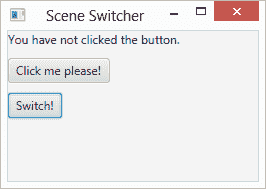

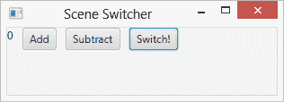

## 切换场景

JavaFX 程序的主舞台（或任何其他舞台）在任何时候内部只能显示一个场景。然而，这并不意味着你的程序不能创建多个场景并在需要时切换。例如，假设你正在开发一个文字处理程序，并让让可以在编辑视图和页面预览视图之间切换。你可以通过创建两个不同的场景（每个视图一个）来实现。然后，为了在视图之间切换，你只需调用舞台的 `setScene` 方法即可切换场景。

在本书的第 1 章中，你阅读了一个 `ClickCounter` 程序，它的场景显示一个标签和一个按钮，然后更新标签以指示用户点击按钮的次数。然后，在本书的第 2 章中，你看到了 `AddSubtract` 程序的几种变体，它的场景显示一个标签和两个按钮：一个按钮点击时会将计数器加 1，另一个则从计数器中减 1。

列表 3-1 显示了一个名为 `SceneSwitcher` 的程序，它将 `ClickCounter` 和 `AddSubtract` 程序的场景合并到一个程序中。图 3-1 显示了该程序的运行情况：

- » 当首次运行 `SceneSwitcher` 程序时，它会像图中左侧所示显示 `ClickCounter` 场景。
- » 当用户点击 `Switch Scene`（切换场景）按钮时，场景将切换到 `AddSubtract` 场景，如图右侧所示。

**图 3-1：** SceneSwitcher 程序。

**列表 3-1：** SceneSwitcher 程序

### 设置舞台与场景布局

```java
import javafx.application.*;
import javafx.stage.*;
import javafx.scene.*;
import javafx.scene.layout.*;
import javafx.scene.control.*;
```

*(接上)*

第 3 章 **设置舞台与场景布局** 609

**列表 3-1：** *(接上)*


```java
import javafx.event.*;
public class SceneSwitcher extends Application
{
    public static void main(String[] args)
    {
        launch(args);
    }

    // Click-Counter 场景的类字段
    int iClickCount = 0;
    Label lblClicks;
    Button btnClickMe;
    Button btnSwitchToScene2;
    Scene scene1;

    // Add-Subtract 场景的类字段
    int iCounter = 0;
    Label lblCounter;
    Button btnAdd;
    Button btnSubtract;
    Button btnSwitchToScene1;
    Scene scene2;

    // stage 的类字段
    Stage stage;

    @Override
    public void start(Stage primaryStage)
    {
        stage = primaryStage;
        // 构建 Click-Counter 场景
        lblClicks = new Label();
        lblClicks.setText("You have not clicked the button.");
        btnClickMe = new Button();
        btnClickMe.setText("Click me please!");
        btnClickMe.setOnAction(e -> btnClickMe_Click());
        btnSwitchToScene2 = new Button();
        btnSwitchToScene2.setText("Switch!");
        btnSwitchToScene2.setOnAction(e -> btnSwitchToScene2_Click());

        VBox pane1 = new VBox(10);
        pane1.getChildren().addAll(lblClicks, btnClickMe, btnSwitchToScene2);
        scene1 = new Scene(pane1, 250, 150);

        // 构建 Add-Subtract 场景
        lblCounter = new Label();
        lblCounter.setText(Integer.toString(iCounter));
        btnAdd = new Button();
        btnAdd.setText("Add");
        btnAdd.setOnAction(e -> btnAdd_Click());
        btnSubtract = new Button();
        btnSubtract.setText("Subtract");
        btnSubtract.setOnAction(e -> btnSubtract_Click());
        btnSwitchToScene2 = new Button();
        btnSwitchToScene2.setText("Switch!");
        btnSwitchToScene2.setOnAction(e -> btnSwitchToScene1_Click());

        HBox pane2 = new HBox(10);
        pane2.getChildren().addAll(lblCounter, btnAdd, btnSubtract, btnSwitchToScene2);
        scene2 = new Scene(pane2, 300, 75);

        // 设置场景 1 设置舞台并显示舞台
        primaryStage.setScene(scene1);
        primaryStage.setTitle("Scene Switcher");
        primaryStage.show();
    }

    // 场景 1 的事件处理器
    public void btnClickMe_Click()
    {
        iClickCount++;
        if (iClickCount == 1)
        {
            lblClicks.setText("You have clicked once.");
        }
        else
        {
            lblClicks.setText("You have clicked " + iClickCount + " times.");
        }
    }

    private void btnSwitchToScene2_Click()
    {
        stage.setScene(scene2);
    }

    // 场景 2 的事件处理器
    private void btnAdd_Click()
    {
        iCounter++;
        lblCounter.setText(Integer.toString(iCounter));
    }

    private void btnSubtract_Click()
    {
        iCounter--;
        lblCounter.setText(Integer.toString(iCounter));
    }

    private void btnSwitchToScene1_Click()
    {
        stage.setScene(scene1);
    }
}
```

接下来的段落指出了程序的某些关键部分：

- **15:** 程序这部分定义了将用于程序 Click-Counter 部分的类字段。这些字段包括 `iClickCount`，用于计算用户点击 `Click Me!` 按钮的次数；用于显示 `Click Me!` 按钮被点击次数的标签；`Click Me!` 按钮本身；以及用于切换到 Add-Subtract 场景的按钮。还一个名为 `scene1` 的 `Scene` 字段，将用于引用 Click Counter 场景。

- **22:** 这些行定义了程序 Add-Subtract 部分使用的类变量，包括计数器（`iCounter`）、用于显示计数器的标签、两个用于递增和递减计数器的按钮、用于切换回 Click-Counter 场景的按钮，以及一个名为 `scene2` 的 `Scene` 字段，它将用于引用该场景。

- **31:** 名为 `stage` 的类字段用于持有对 `primaryStage` 的引用。

- **35:** 该行将 `stage` 设置为 `primaryStage`。

- **37:** 程序的这部分构建了 Click-Counter 场景。它首先创建了 `Label`、按钮和 `VBox` 窗格。

- **59:** 程序的这部分构建了 Add-Subtract 场景，通过创建 `Label`、按钮并将它们排列在 `HBox` 窗格中。

- **84:** 这些行将 `scene1` 设置为根节点，设置 `stage` 标题，然后显示 `stage`。

- **91:** 程序的这部分提供了按钮的事件处理器。`btnClickMe_Click` 处理器增加计数并设置标签显示消息。

- **112:** 程序的这部分提供了按钮的事件处理器。`btnAdd` 和 `btnSubtract` 处理器递增或递减计数器并更新标签。`btnSwitchToScene1` 将场景切换到 `scene1`。

## 创建 Alert 框

JavaFX 通过使用 `Alert` 类提供了一种简单的方法来显示基础消息框，该类类似于你在第二本书的第 2 章中学到的 `JOptionPane` 类。

**表格 3-3：Alert 类的常用构造函数和方法**

| 构造函数 | 说明 |
| :--- | :--- |
| `Alert(Alert.AlertType)` | 创建指定类型的类型 alert |
| `Alert(Alert.AlertType, String text)` | 创建指定类型的新 alert 并设置消息文本 |
| `Alert(Alert.AlertType, String text, ButtonType type...)` | 创建新 alert 并设置要显示的按钮 |

| 方法 | 说明 |
| :--- | :--- |
| `void setTitle(String text)` | 设置标题 |
| `Optional<ButtonType> showAndWait()` | 显示 alert 并等待用户响应，响应以 `ButtonType` 对象的形式返回 |

下面是使用 `Alert` 类显示简单信息消息的代码片段：

```java
Alert a = new Alert(Alert.AlertType.INFORMATION, "You have clicked once.");
a.showAndWait();
```

图 3-2 显示了生成的警框框。

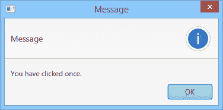

**图 3-2:** 一个 Alert 对话框。

你可以通过使用可选的 `ButtonType` 参数来控制 Alert 框上显示哪些按钮。你可以从以下类型的按钮中选择：

- `ButtonType.APPLY`
- `ButtonType.CANCEL`
- `ButtonType.CLOSE`
- `ButtonType.FINISH`
- `ButtonType.NEXT`
- `ButtonType.NO`
- `ButtonType.OK`
- `ButtonType.PREVIOUS`
- `ButtonType.YES`

你只需要在构造函数中指定多个 `ButtonType` 参数，就可以在 Alert 框中包含多个按钮。例如：

```java
Alert a = new Alert(Alert.AlertType.INFORMATION, "Are you certain?",
ButtonType.YES, ButtonType.NO);
```

在这个示例中，Alert 框将同时包含 YES 和 NO 按钮。

要确定用户点击了哪个按钮，你必须测试 `showAndWait` 方法返回的值。该值是一个 `Optional` 类型的对象，因为用户可以在不点击任何显示的按钮的情况下关闭对话框。你应该首先通过调用 `isPresent` 方法来测试用户是否点击了按钮。然后，你可以调用 `get` 方法来获取实际结果。

## 设置舞台和场景布局

这里是一个判断用户是否点击了 YES 按钮的示例：

```java
Alert a = new Alert(Alert.AlertType.INFORMATION, "Are you certain?",
ButtonType.YES, ButtonType.NO);
Optional<ButtonType> r = a.showAndWait();
if (r.isPresent() && r.get() == ButtonType.YES)
{
    // 用户点击了 OK！
}
```

为了演示如何使用 `Alert` 类，列表 3-2 所示的程序是第 2 章中最初讨论过的 `ClickCounter` 程序的变体。该程序的原始版本显示了一个标签（label）和一个按钮，使用标签显示用户点击按钮的次数。而版本的程序省弃了标签，而是使用 `Alert` 类来显示一条消息，指示用户点击按钮的次数。

### 列表 3-2：ClickCounterAlert 程序

```java
import javafx.application.*;
import javafx.stage.*;
import javafx.scene.*;
import javafx.scene.layout.*;
import javafx.scene.control.*;

public class ClickCounterAlert extends Application
{
    public static void main(String[] args)
    {
        launch(args);
    }

    Button btn;
    Label lbl;
    int iClickCount = 0;

    @Override public void start(Stage primaryStage)
    {
        // 创建按钮
        btn = new Button();
        btn.setText("Click me please!");
        btn.setOnAction(e -> buttonClick());

        // 将按钮添加到布局窗格
        BorderPane pane = new BorderPane();
        pane.setCenter(btn);

        // 将布局窗格添加到场景
        Scene scene = new Scene(pane, 250, 150);

        // 将场景添加到阶段，设置标题
        // 并显示阶段
        primaryStage.setScene(scene);
        primaryStage.setTitle("Click Counter");
        primaryStage.show();
    }

    public void buttonClick()
    {
        iClickCount++;
        if (iClickCount == 1)
        {
            Alert a = new Alert(Alert.AlertType.INFORMATION, "You have clicked once.");
            a.showAndWait();
        }
        else
        {
            Alert a = new Alert(Alert.AlertType.INFORMATION, "You have clicked " + iClickCount + " times.");
            a.showAndWait();
        }
    }
}
```

该程序与第 2 章中介绍的版本（列表 2-2）几乎完全相同。事实上，这里只有两处不同：

- 此程序中没有定义标签，因为使用了消息框而不是标签来显示按钮被点击的次数。
- 在第 2 章版本的 `buttonClick` 方法中，调用了标签的 `setText` 方法来显示按钮被点击的次数。而在这一版本中，使用的是一个 Alert 框。

图 3-2 显示了 ClickCounter 程序新版本的运行情况。在这里，你可以看到用户第一次点击按钮时显示的警框框。（在这个示例中，我将消息框向侧移动了一点，以便你可以看到它下方的主阶段。当你实际运行程序时，消息框将居于主阶段正上方。）

## 退出，舞台右侧

由于我在本章的开头引用了莎士比亚，我想通过引用 Snagglepuss（老版 Hanna-Barbera 动画片中著名的粉红山狮）来结束本章会很不错。他经常通过说“从舞台左侧退出”（Exit, stage left）或“从舞台右侧退出”（Exit, stage right）来离开场景。

天哪 Mergatroyd！

甚至退出舞台也有正确的方法和错误的方法。到目前为止，此书中介绍的所有程序没有一个是以正确的方式退出的。在大多数情况下，退出程序的正确方法涉及以下内容：

- 添加一个按钮、菜单命令或其他方式让用户发出想要关闭程序的信号。
- 可选地显示一个确认框，验证用户是否真的想关闭程序。
- 如果用户确实想关闭程序，程序应该执行必要的清理工作，例如：
  - 保存文档、数据库的更改。
  - 正确关闭数据库和其他资源。
- 在完成所有必要的清理工作后，调用主阶段的 `close` 方法关闭应用程序。
- 无论用户是使用你提供的用户界面中的按钮或菜单命令，还是点击内置的窗口关闭按钮尝试关闭程序，都应该采取验证和清理步骤。

### 创建按钮

要添加一个允许用户关闭的按钮或其他用户界面元素，你只需要提供一个调用阶段 `close` 方法的动作事件处理器即可。

例如，假设你使用以下代码创建一个关闭按钮：

```java
Button btnClose = new Button();
btnClose.setText("Close");
btnClose.setOnAction(e -> primaryStage.close());
```

在这种情况下，事件处理器只需调用 `primaryStage.close()` 来关闭应用程序。

如果你想在事件处理器中执行的操作不仅仅是调用 `close` 方法，你可能希望将事件处理器隔离在单独的方法中，如下例所示：

```java
btnClose.setOnAction(e -> btnClose_Clicked());
```


因为`btnClose_Clicked`方法需要访问主阶段来关闭它，你定义定义一个`Stage`类型的类字段并使用它来引用主阶段。这样，你的`btnClose_Clicked`方法就可以轻松地执行额外的任务。例如：

```java
private void btnClose_Click()
{
    boolean reallyQuit = false;
    reallyQuit = ConfirmationBox.show(
        "Are you sure you want to quit?",
        "Confirmation",
        "Yes", "No");
    if (reallyQuit)
    {
```

```java
// 在此处执行清理任务

// 例如保存文件或释放资源

stage.close();

}

}
```

# 莎士比亚最伟大的舞台指示

到本章为止，我引用了一次威廉·莎士比亚和了一次斯纳格·普斯（`Snagglepuss`）。

这两处引用都适用于本章的主题：来自《亨利五世》的莎士比亚式引用指的是舞台和场景，而斯纳格·普斯的引用指的是离开舞台的正确方式。尽管如此，引用斯纳格普斯的频率如果和莎士比亚一样高，似乎有些失衡。因此，我认为最好再加入一段莎士比亚的引用，以挽回我的大学英语教授们对我可能仍存的一丝尊重。

莎士比亚的剧剧中大量分布着舞台指示。其中大多数非常简短，例如《罗密欧与朱丽叶》中的`Enter Tybalt`（泰巴特上场）或`Exit Romeo`（罗密欧退出）。有些则详细一些，例如同样来自《罗密欧与朱丽叶》的`Enter several of both houses, who join the fray,`（双方若干人上场，加入混战）。有时它们也有些模糊，例如来自《提图斯·安德洛尼》的`Enter a messenger with two heads and a hand`（一个两个头和一个手的信使上场）。

但我看来，莎士比亚所有舞台指示中最有趣的发现于《冬日传说》中，当安提戈尼斯在船难后被阻止救援佩尔迪塔时：`Exit, pursued by a bear.`（退出，身后被一只熊追逐）。

当你离开舞台时，因为被一只熊追逐，你没法收拾物品，无法完成你设定的任何其他重要任务，例如拯救公主或保存用户对文档所做的重要更改。相反，你只能转身逃跑，这正是用户点击窗口关闭按钮时（除非你正确处理了`CloseRequest`事件）会发生的情况。

在这个示例中，将显示一个确认框以确保用户确实想退出程序。

## 处理 CloseRequest 事件

提供一个“关闭”按钮是允许用户干净退出程序的极佳方法。然而，用户可以通过简单的关闭窗口来绕过你的退出处理——即点击窗口关闭按钮（通常表示为窗口框右上角的 X）。除非你另有说明，否则点击此按钮将不礼貌地终止应用程序，绕过你所有用于确认用户是否想保存工作、关闭任何已打开资源以及提供优雅退出的优美代码。

幸运的是，你可以轻松地避免这种不优雅的退出。每当用户尝试关闭显示 JavaFX stage 的窗口时，JavaFX 都会生成一个`CloseRequest`事件并发送到 stage。你可以通过调用`Stage`类的`setOnCloseRequest`方法为该事件提供一个事件处理程序。然后，每当用户尝试关闭窗口时，该事件处理器就会被调用。

你可能想创建一个单一方法，同时作为“关闭”按钮的`Action`事件和`CloseRequest`事件的事件处理器，如下所示：

```java
btnClose.setText("Close");
btnClose.setOnAction( e -> btnClose_Click () );
primaryStage.setOnCloseRequest( e -> btnClose_Click () );
```

在这里，意图是处理`CloseRequest`事件的方式完全就像用户点击了`btnClose`按钮一样。

这是一个好主意，但如果`btnClose_Click`事件显示确认框，并且仅在用户确认其确实想退出程序时才关闭 stage，那么它就不起作用。这是因为当`CloseRequest`事件的事件处理器结束时，如果处理器没有显式关闭 stage，JavaFX 会自动关闭它。

为了防止这种情况发生，你必须调用`CloseRequest`事件对象的`consume`方法。消费（`Consume`）事件会导致它在事件处理器内部停止，从而防止 JavaFX 在处理器结束时自动关闭 stage。

## 设置舞台和场景布局

在传递给`setOnCloseRequest`方法的 Lambda 表达式中，`CloseRequest`事件对象由参数`e`表示。因此，你可以通过`e.consume()`来消费`CloseRequest`事件。

提供一个同时处理“关闭”按钮的`Action`事件和 stage 的`CloseRequest`事件方法的简单方法，是为`setOnCloseRequest`方法构建一个 Lambda 表达式，使其在调用处理事件的方法之前先消费该事件：

```java
btnClose.setText("Close");
btnClose.setOnAction( e -> btnClose_Click () );
primaryStage.setOnCloseRequest(
e -> {
    e.consume();
    btnClose_Click ();
} );
```

在这里，`CloseRequest`事件的事件处理器首先消费事件，然后调用`btnClose_Click`。随后，`btnClose_Click`方法会显示确认框，并在用户确认这确实是他们想做的事后关闭 stage。

## 整合一切

现在你已经了解了如何向场景添加“关闭”按钮，以及如何处理`CloseRequest`事件，我将查看一个结合了这两个元素的程序，以演示退出 JavaFX 程序的正确方法。

本节介绍了`ClickCounter`程序的一个变体，除了“点击我！”按钮外还包含一个“关闭”按钮。当用户点击“点击我！”按钮时，会显示消息框以指示按钮被点击的次数。但当用户尝试退出程序时（无论是点击“关闭”按钮还是直接关闭窗口），将使用列表 3-3 显示的`ConfirmationBox`类询问用户是否真的想退出程序。然后，只有当用户点击确认框中的“是”按钮时，stage 才会关闭。

该程序的源码见列表 3-3。

### 列表 3-3:

**ClickCounter 程序**

```java
import javafx.application.*;
import javafx.stage.*;
import javafx.scene.*;
import javafx.scene.layout.*;
import javafx.scene.control.*;
import javafx.geometry.*;
import java.util.*;

public class ClickCounter extends Application
{
    public static void main(String[] args)
    {
        launch(args);
    }

    Stage stage;
    int iClickCount = 0;

    @Override public void start(Stage primaryStage)
    {
        stage = primaryStage;
        // 创建点击我按钮
        Button btnClickMe = new Button();
        btnClickMe.setText("Click me!");
        btnClickMe.setOnAction(e -> btnClickMe_Click());

        // 创建关闭按钮
        Button btnClose = new Button();
        btnClose.setText("Close");
        btnClose.setOnAction(e -> btnClose_Click());

        // 将按钮添加到布局面板
        VBox pane = new VBox(10);
        pane.getChildren().addAll(btnClickMe, btnClose);
        pane.setAlignment(Pos.CENTER);

        // 将布局面板添加到场景
        Scene scene = new Scene(pane, 250, 150);
        // 完成并显示阶段
        primaryStage.setScene(scene);
        primaryStage.setTitle("Click Counter");
        primaryStage.setOnCloseRequest( e -> {
            e.consume();
            // 设置舞台和场景布局
            btnClose_Click();
        } );
        primaryStage.show();
    }

    // (继续)
    public void btnClickMe_Click()
    {
        iClickCount++;
        if (iClickCount == 1)
        {
            Alert a = new Alert(Alert.AlertType.INFORMATION, "You have clicked once." );
            a.showAndWait();
        }
        else
        {
            Alert a = new Alert(Alert.AlertType.INFORMATION, "You have clicked "
            + iClickCount + " times.");
            a.showAndWait();
        }
    }

    public void btnClose_Click()
    {
        Alert a = new Alert(Alert.AlertType.CONFIRMATION,
        "Are you sure you want to quit?",
        ButtonType.YES, ButtonType.NO);
        Optional<ButtonType> confirm = a.showAndWait();
        if (confirm.isPresent() && confirm.get() == ButtonType.YES)
        {
            stage.close();
        }
    }
}
```

# 尝试调整布局面板中节点间距的各种选项

## 第 4 章：使用布局面板排列场景

调整场景中组件的布局通常是 JavaFX 开发中最困难的方面之一。事实上，有时这甚至让人感到非常抓狂。很多时候，这些组件似乎有自己的想法。它们变得非常固执，拒绝移动。当你想要让它们并排排列时，它们却会堆叠在一起。当你对标签或文本字段进行微小的更改时，整个场景似乎又重新排列了。有时，你真想一拳砸穿显示器。

我不建议你拳穿显示器。那样你会弄得一团糟，割伤手，还要花钱买一个新显示器——而且当你修好电脑后，那些组件*仍然*不会按照你想要的方式对齐。

问题不在于组件，而在于布局面板，它们决定了每个组件在它的框架或面板中出现的位置。布局面板是特殊的类，其人生的唯一目的就是控制场景中出现节点的布局。JavaFX 提供了几种不同类型的布局面板；每种类型都使用不同的方法来控制节点的布局。成功布局场景的秘诀在于正确组合使用布局面板，来实现你想要的排列方式。

## 使用布局面板

理解布局面板是创建美观且实用的 JavaFX 框架的关键。

### 介绍 JavaFX 布局面板

JavaFX 提供了许多不同的布局面板供你使用。在本章中我介绍了以下五种：

- **HBox**: 这种布局面板水平排列节点，一个接一个。你用它来创建整齐行排列的控件。

- **VBox**: 这种布局面板垂直排列节点，一个在上在上。你用它来创建整齐列排列的控件。

- **FlowPane**: 这种布局面板相邻排列节点，直到空间用尽；然后它会换行继续布局节点。你可以配置`FlowPane`以水平行或垂直列的形式排列节点。

- **Border**: 这种布局面板将面板分为五个区域：顶部（`Top`）、左侧（`Left`）、中间（`Center`）、右侧（`Right`）和底部（`Bottom`）。添加节点时，你可以指定你想将节点放置在哪个区域。

- **GridPane**: 这种布局面板将面板划分为网格，让你对行和列中的元素排列拥有完全控制。

为了让你对前四种布局类型可以实现的结果有一个大致的概念，图 4-1 显示了四个各使用一种布局面板的示例窗口。你将在本章稍后的部分看到`GridPane`布局如何工作的详细示例。

#### 创建布局面板

使用布局面板的基本过程非常简单。以下是创建布局节点的通用步骤：

1. **创建你想添加到面板的控件或其他节点。**

   例如，如果布局面板将包含两个按钮，那么你应该使用类似下面的代码创建这两个按钮：

```
Button btnOK = new Button();
btnOK.setText("OK");
btnOK.setOnAction( e -> btnOK_Click() );

Button btnCancel = new Button();
btnCancel.setText("Cancel");
btnCancel.setOnAction( e -> btnCancel_Click() );
```

2. **通过调用构造函数创建布局面板。**

   例如：

```
HBox pane = new HBox();
```

3. **对布局面板使用的可选设置进行微调。**

   每种类型的布局面板都有一组独特的可选参数，控制节点在面板内布局的细节。例如，`HBox`面板允许你设置分离面板中每个节点的像素数。你可以按照如下方式设置此值：

```
HBox.setSpacing(10);
```

4. **添加将出现在布局面板中的每个节点。**

   每种类型的布局面板都提供向面板添加节点的方法。对于`HBox`面板，你必须先调用`getChildren()`方法获取已添加到面板的所有节点列表。然后，你调用`addAll()`方法向面板添加一个或多个节点。例如：

```
pane.getChildren().addAll(btnOK, btnCancel);
```

5. **创建场景，并将布局面板指定为场景的根节点。**

   例如：

```
Scene scene = new Scene(pane, 300, 400);
```

在此示例中，`pane`被添加`scene`的根节点。

### 组合布局面板

你可以组合多个布局面板来创建比单个布局面板提供的更复杂的布局。例如，假设你想创建一个底部有一行水平按钮、右侧有一列垂直按钮的布局。要做到这一点，你可以为底部的按钮创建一个`HBox`，并为右侧的按钮创建一个`VBox`。然后，你可以创建一个`BorderPane`，并将`HBox`添加到底部，将`VBox`添加到右侧。这种组合是可能的，因为布局面板继承了类`javafx.scene.layout.Pane`。换句话说，所有的面板都是节点。你可以根据需要深度嵌套布局面板，以实现应用程序所需的精确布局。

### 使用 HBox 布局

`HBox`类提供了 JavaFX 所有布局管理器中最简单的一种：它将一个或多个节点排列成水平行。表 4-1 展示了`HBox`类最常用的构造函数和方法。

`HBox`类定义在`javafx.scene.layout`包中，因此在任何使用`HBox`的程序中应包含以下导入语句：

```
import javafx.scene.layout.*;
```

创建`HBox`最简单的方法是先创建你想放在`HBox`中的节点，然后调用`HBox`构造函数并将节点作为参数传递。例如：

```
Button btn1 = new Button("Button One");
Button btn2 = new Button("Button Two");
Button btn3 = new Button("Button Three");
HBox hbox = new HBox(btn1, btn2, btn3);
```

### `setPadding`

设置`Hbox`内部边缘的内边距。

`(Insets value)`

请参见表 4-2 获取`Insets`类的构造函数。

更多信息，请参阅本章节后面的“留间距”（`Spacing Things Out`）节。

### `setSpacing`

设置`HBox`内部显示节点之间的间距。

`(double value)`

更多信息，请参阅本章节后面的“留间距”（`Spacing Things Out`）节。

# 第 4 章：使用布局面板排列你的场景

如果你希望在空状态下创建`HBox`控件，稍后再添加控件，可以这样做：

```java
HBox hbox = new HBox();
hbox.getChildren().addAll(btn1, btn2, btn3);
```

在这里，调用了`getChildren`方法，它返回一个包含添加到`HBox`面板的所有子节点的集合。该集合由`ObservableList`类定义，它包含一个名为`addAll`的方法，你可以用它向列表添加一个或多个节点。

## 留间距


默认情况下，布局面板中的子节点紧挨排列，之间没有任何空隙。如果你想在面板节点之间留出空间，可以通过四种方式：

- 在面板内的元素之间添加间距。
- 在面板的内部边缘添加内边距。
- 为面板中的单个节点添加外边距。
- 创建可以增长以填充可用空间的占位符节点（spacer nodes）。

在本节中，我将向你展示如何向面板添加间距和内边距。接下来的三节将向你展示如何使用另外两种技术。

注意，尽管我在这些节中使用 `HBox` 布局面板来演示这些技术，但这些技术也适用于其他类型的面板。

要设置 `HBox` 面板的间距，可以使用 `HBox` 构造函数上的 `spacing` 参数，或者调用 `setSpacing` 方法。例如，此语句创建一个默认间距为 10 像素的 `HBox` 面板：

```java
HBox hbox = new HBox(10);
```

此示例创建了一个具有 10 像素间距的 `HBox` 面板并添加了三个按钮：

```java
HBox hbox = new HBox(10, btn1, btn2, btn3);
```

而此示例使用默认构造函数创建一个 `HBox` 面板，然后调用 `setSpacing` 方法将间距设为 10 像素：

```java
HBox hbox = new HBox();
hbox.setSpacing(10);
```

虽然间距会在 `HBox` 面板的节点之间添加空间，但它并不会在节点与面板边缘之间提供任何空间。例如，如果你将间距设置为 10 像素并向面板添加三个按钮，那么这三个按钮之间将会有 10 像素的间隙。然而，在第一个按钮的左边缘与面板本身的左边缘之间将没有任何空间。按钮顶部与面板顶部之间也不会有任何空间。换句话说，这三个按钮将紧密地挤在面板中。

要向布局面板的周边缘添加空间，请使用 `setPadding` 方法。该方法接受一个 `Insets` 类型的对象作为参数，该对象代表对象顶、右、底和左边缘的内边距大小（像素为单位）。你可以使用表 4-2 中列出的两个构造函数之一来创建 `Insets` 对象。第一个为对象的四个边缘提供均匀的内边距；第二个允许为每个边缘设置不同的内边距值。

要将内边距设置为均匀的 10 像素，可以这样调用 `setPadding` 方法：

```java
hbox.setPadding(new Insets(10));
```

要为每个边缘设置不同的内边距值，可以这样调用：

```java
hbox.setPadding(new Insets(20, 10, 20, 10));
```

在此示例中，顶部和底部内边距设置为 20，右侧和左侧内边距设置为 10。

### 表 4-2：Insets 构造函数

| 构造函数 | 描述 |
| :--- | :--- |
| `Insets(double value)` | 创建 `Insets` 对象，顶、右、底、左边边距使用相同的值。 |
| `Insets(double top, double right, double bottom, double left)` | 创建 `Insets` 对象，使用指定的顶、右、底、左边边距。 |

`Insets` 枚举定义在 `javafx.geometry` 包中，因此在任何使用 `Insets` 的程序中，你都应该包含以下导入语句：

```java
import javafx.geometry.*;
```

## 使用外边距添加空间

在布局面板的节点周围添加空间的另一种方法是在单个节点周围创建外边距。这种技术允许你为布局面板中的每个节点设置不同的外边距大小，让你对每个节点的间距拥有完全控制。

要创建外边距，请为你每个想要添加外边距的节点调用 `setMargin` 方法。你可能认为，因为每个节点都可以有自己的外边距，所以 `setMargin` 方法属于 `Node` 类。相反，`setMargin` 方法是由 `HBox` 类定义的。`setMargin` 方法接受两个参数：

- 你想要为其添加外边距的节点。
- 定义你想要添加的外边距的 `Insets` 对象。

这是一个为名为 `btn1` 的按钮的所有边设置 10 像素外边距的示例：

```java
HBox hbox = new HBox();
hbox.setMargin(btn1, new Insets(10));
```

`setMargin` 是 `HBox` 的静态方法，所以当你调用它时，可以引用 `HBox` 类本身而不是 `HBox` 实例。因此，以下代码同样有效：

```java
HBox.setMargin(btn1, new Insets(10));
```

（是的，有一个细微的区别：在第一个示例中，`hbox` 指向 `HBox` 的实例；在第二个示例中，`HBox` 指向类本身。）

这是一个为面板每个侧设置不同外边距的示例：

```java
HBox.setMargin(btn1, new Insets(10, 15, 20, 10));
```

在此示例中，顶部外边距为 10 像素，右侧为 15 像素，底部为 20 像素，左侧为 10 像素。

注意，外边距、间距和内边距可以共同工作。因此，如果你为两个按钮的四个边都设置 5 像素的外边距，并将这两个按钮添加到一个间距设置为 10 像素且内边距设置为 10 像素的面板中，它们之间将相隔 20 像素，与边缘将相隔 15 像素。

## 通过节点增长添加空间

在 `HBox` 中节点之间添加空间的第三种方法是创建一个专门用于两个节点之间空间的节点。然后，你可以配置该占位符节点以增长并填充可用空间。通过只配置占位符节点而不配置其他节点，只有占位符会增长。这样做的效果是将占位符两侧的节点推开。

例如，假设你想创建一个包含三个按钮的 `HBox` 布局面板。与其均匀地排列这三个按钮，你希望前两个按钮出现在面板左侧，第三个按钮出现在面板右侧。第二个和第三个按钮之间的空间完全取决于面板的大小。因此，如果用户拖动窗口扩大舞台，第二个和第三个按钮之间的空间应该相应增加。

创建占位符节点简单的方法是使用 `Region` 类。`Region` 类是 `Control` 类的基类，`Button` 和 `Label` 等控件派生于它。它也是 `Pane` 类的基类，本章描述的所有布局面板都派生于它。

对于我这里的用途，我只需使用 `Region` 类的默认构造函数创建一个在布局面板中作为简单占位符的节点。我没有为区域提供特定的大小。相反，我配置它在水平方向上增长以填充其容器内的任何可用空间。

要做到这一点，你使用 `HBox` 类的静态方法 `setHgrow`，指定其中之一。由名为 `Priority` 的枚举类型定义了三个常量值。表 4-3 列出了这些常量并解释了每个常量的作用。

### 表 4-3：Priority 枚举

| 常量 | 描述 |
| :--- | :--- |
| `Priority.NEVER` | 表示不应调整节点的宽度以填充窗格中的可用空间。这是默认设置。因此，在默认情况下，节点不会根据包含它们的布局窗格的大小进行调整大小。 |
| `Priority.ALWAYS` | 表示如果有必要，节点的宽度应该始终调整以填充窗格中的可用空间。如果你将两个或多个节点设置为 `ALWAYS`，则调整间隙将平均分配给每个节点。 |
| `Priority.SOMETIMES` | 表示如果有必要，节点的宽度可能会调整以填充窗格。然而，只有在没有其他指定为 `ALWAYS` 的节点时，才会进行调整。 |

## 第 4 章：使用布局窗格安排你的场景

`Priority` 枚举定义在 `javafx.scene.layout` 包中；该包也定义了需要它的布局管理器。因此，在使用 `Priority` 枚举时，你不需要包含额外的导入语句。

以下示例创建了三个按钮和一个间距器，将三个按钮的边距设置为 10 像素，然后将这三个按钮和间距器添加到 `HBox` 中，使得前两个按钮显示在 `HBox` 的左侧，第三个按钮显示在右侧：

```java
// 创建按钮
Button btn1 = new Button("One");
Button btn2 = new Button("Two");
Button btn3 = new Button("Three");

// 创建间距器
Region spacer = new Region();

// 设置边距
hBox.setMargin(btn1, new Insets(10));
hBox.setMargin(btn2, new Insets(10));
hBox.setMargin(btn3, new Insets(10));

// 为间距器设置 Hgrow
hBox.setHgrow(spacer, Priority.ALWAYS);

// 创建 HBox 布局窗格
HBox hbox = new HBox(10, btn1, btn2, spacer, btn3);
```

图 4-2 显示了该窗格在添加到阶段（stage）时的外观。为了让你看到间距器是如何工作的，第一幅图显示了窗格的三种形态，每个窗口都被拖动到了不同的大小。注意第二个和第三个按钮之间的间距是如何自动调整的，使得前两个按钮位于窗格左侧，第三个位于右侧。

与 `setMargin` 方法一样，`setHgrow` 方法是 `HBox` 类的静态方法。因此，你可以从 `HBox` 实例调用它（如前面的示例所示），也可以从 `HBox` 类本身调用它。换句话说，以下代码段中的后两行是多余的：

```java
HBox pane = new HBox();
pane.setHgrow(spacer, Priority.ALWAYS);
HBOX.setHgrow(spacer, Priority.ALWAYS);
```

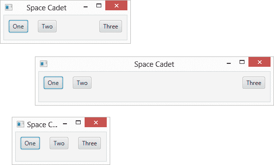

**图 4-2：** 使用间距器节点在 HBox 窗格中分隔按钮。

## 使用 VBox 布局

`VBox` 类与 `HBox` 类类似，但它不是在行中水平排列节点，而是在列中垂直排列节点。表 4-4 显示了 `VBox` 类最常用的构造函数和方法。

`VBox` 类定义在 `javafx.scene.layout` 包中，因此在任何使用 `VBox` 的程序中，都应该包含以下导入语句：

```java
import javafx.scene.layout.*;
```

这是一个创建三个按钮并使用 `VBox` 将它们排列成一列的示例：

```java
Button btn1 = new Button("Button One");
Button btn2 = new Button("Button Two");
Button btn3 = new Button("Button Three");
VBox vbox = new VBox(btn1, btn2, btn3);
```

你可以通过使用默认构造函数并调用 `getChildren` 方法来实现相同的功能，此示例所示：

```java
VBox vbox = new VBox();
Vbox.getChildren().addAll(btn1, btn2, btn3);
```

### 表 4-4：VBox 构造函数和方法

| 构造函数 | 描述 |
| :--- | :--- |
| `VBox()` | 创建一个空的 `VBox`。 |
| `VBox(double spacing)` | 创建一个具有指定间距的空 `VBox`。 |
| `VBox(Node... children)` | 创建一个带有指定子节点的 `VBox`。此构造函数允许你同时创建一个 `VBox` 并向其添加子节点。 |
| `VBox(double spacing, Node... children)` | 创建一个具有指定间距和子节点的 `VBox`。 |
| 方法 | 描述 |
| :--- | :--- |
| `ObservableList<Node>` | 返回已添加到 `VBox` 的 `getChildren()` 中的所有子节点集合。该集合以 `ObservableList` 类型返回，该类型包含 `addAll` 方法，允许你向列表添加一个或多个节点。 |
| `static void setAlignment(Pos alignment)` | 设置 `HBox` 内部子节点的对齐方式。请参见表 4-5 对 `Pos` 枚举的解释。更多信息请参阅本章节后面的“在布局窗格中排列节点”部分。 |
| `static void setMargin(Node child, Insets value)` | 设置指定节点的边距。 |
| `void setPadding(Insets value)` | 设置 `VBox` 内部的内边距。 |
| `static void setVgrow(Node child, Priority priority)` | 设置指定节点的增长行为。 |

与 `HBox` 类一样，你可以使用间距、内边距、边距和间距器来控制 `VBox` 内部的间距。这是一个示例：

```java
Button btn1 = new Button("One");
Button btn2 = new Button("Two");
Button btn3 = new Button("Three");

// 创建间距器
Region spacer = new Region();

// 为间距器设置 Vgrow
VBox.setVgrow(spacer, Priority.ALWAYS);

// 创建 VBox 布局窗格
VBox vbox = new VBox(10, btn1, btn2, spacer, btn3);
vbox.setPadding(new Insets(10));
```

## 在布局窗格中排列节点

`HBox` 和 `VBox` 布局窗格都有 `setAlignment` 方法，用于控制窗格内节点相互对齐。`setAlignment` 方法接受单个参数，即 `Pos` 枚举定义的常量，见表 4-5。

`Pos` 枚举定义在 `javafx.geometry` 包中，因此在任何使用 `Insets` 的程序中，都应该包含以下导入语句：

```java
import javafx.geometry.*;
```

以下示例展示了如何创建一个在窗格内居中的三个按钮垂直列：

```java
Button btn1 = new Button("Number One");
Button btn2 = new Button("Two");
Button btn3 = new Button("The Third Button");
VBox vbox = new VBox(10, btn1, btn2, btn3);
vbox.setPadding(new Insets(10));
vbox.setAlignment(Pos.CENTERED);
```

### 表 4-5：Pos 枚举

| 常量 | 垂直对齐 | 水平对齐 |
| :--- | :--- | :--- |
| `Pos.TOP_LEFT` | Top | Left |
| `Pos.TOP_CENTER` | Top | Center |
| `Pos.TOP_RIGHT` | Top | Right |
| `Pos.CENTER_LEFT` | Center | Left |
| `Pos.CENTER` | Center | Center |
| `Pos.CENTER_RIGHT` | Center | Right |
| `Pos.BOTTOM_LEFT` | Bottom | Left |
| `Pos.BOTTOM_CENTER` | Bottom | Center |
| `Pos.BOTTOM_RIGHT` | Bottom | Right |
| `Pos.BASELINE_LEFT` | Baseline | Left |
| `Pos.BASELINE_CENTER` | 基线居中 |  |
| `Pos.BASELINE_RIGHT` | 基线右对 |  |

当此窗格被添加到场景并在舞台中显示时，结果类似于图 4-3 所示的窗口。

**图 4-3：**

在 `VBox` 布局窗格中居中的三个按钮。

## 使节点具有相同的宽度

当你在布局窗格中放置一组按钮或其他控件时，你可能希望所有按钮具有相同的宽度，以创建整洁、均匀的外观。当你将它们放置在 `VBox` 窗格的垂直列中时，这一点尤为重要，因为垂直列会突出按钮宽度之间的任何差异。

638 第 6 册 **JavaFX**

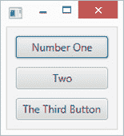

你可以通过将每个按钮的最大宽度设置为 `Double.MAX_VALUE` 来轻松指定所有按钮具有相同的宽度。以下是前面示例的修订版本，其中三个按钮被设置为相同的宽度：

```java
Button btn1 = new Button("Number One");
Button btn2 = new Button("Two");
Button btn3 = new Button("The Third Button");
btn1.setMaxWidth(Double.MAX_VALUE);
```

## 使用布局窗格来安排你的场景

```java
btn2.setMaxWidth(Double.MAX_VALUE);
btn3.setMaxWidth(Double.MAX_VALUE);
VBox vbox = new VBox(10, btn1, btn2, btn3);
vbox.setPadding(new Insets(10));
vbox.setAlignment(Pos.CENTERED);
```

图 4-4 显示了当窗格被添加到场景并在舞台中显示时，这些按钮的外观。注意所有三个按钮都采用了最宽按钮（`btn3`）的宽度。

**图 4-4：**

三个宽度相同的按钮。

## 使用流式布局

流式布局有两种：水平和垂直。水平流式布局将子节点按行排列，直到窗格的宽度达到你指定的特定尺寸。当达到该尺寸时，布局会在第一行下方开始的一行子节点。这种流动持续进行，每当达到尺寸限制时就会开始新行，直到所有子节点都放置完毕。

垂直流式布局的工作方式相同，但子节点按列排列，直到达到尺寸限制。当达到尺寸限制时，会在第一列右侧立即开始新列。


你使用`FlowPane`类来创建流式布局。表 4-6 显示了`FlowPane`类的构造函数和最常用的方法。

第 4 章 **使用布局窗格来安排你的场景** 639

### 表 4-6：FlowPane 构造函数和方法

| 构造函数 | 说明 |
| :--- | :--- |
| `FlowPane()` | 创建一个空的水平流式布局，水平和垂直间隙均设置为零。 |
| `FlowPane(double hgap, double vgap)` | 创建一个具有指定水平和垂直间隙的空水平流式布局。 |
| `FlowPane(double hgap, double vgap, Node... children)` | 创建一个具有指定水平和垂直间隙并填充了指定子节点的水平流式布局。 |
| `FlowPane(Node... children)` | 创建一个水平和垂直间隙均设置为零并填充了指定子节点的水平流式布局。 |
| *注：* 在下列的每个构造函数中，`Orientation` 可以是 `Orientation.HORIZONTAL` 或 `Orientation.VERTICAL`。 | |
| `FlowPane(Orientation orientation)` | 创建一个具有指定方向且水平和垂直间隙均设置为零的空流式布局。 |
| `FlowPane(Orientation orientation, double hgap, double vgap)` | 创建一个具有指定方向和指定水平、垂直间隙的空流式布局。 |
| `FlowPane(Orientation orientation, double hgap, double vgap, Node... children)` | 创建一个具有指定方向、水平和垂直间隙并填充了指定子节点的流式布局。 |
| `FlowPane(Orientation orientation, Node... children)` | 创建一个具有指定方向且水平和垂直间隙均设置为零并填充了指定子节点的流式布局。 |

| 方法 | 说明 |
| :--- | :--- |
| `ObservableList<Node> getChildren()` | 返回所有子节点的集合。集合以`ObservableList`类型返回，包含`addAll`方法，允许向列表添加一个或多个节点。 |
| `void setAlignment(Pos alignment)` | 设置行和列内节点的对齐方式。`Pos`枚举的解释请参见表 4-5。 |
| `void setColumnAlignment(Pos alignment)` | 设置列内节点的对齐方式。`Pos`枚举的解释请参见表 4-5。 |
| `void setHgap(double value)` | 设置水平间隙。对于水平流式布局，这是节点之间的空间。对于垂直流式布局，这是列之间的空间。 |
| `static void setMargin(Node child, Insets value)` | 设置给定子节点的内边距。`Insets`类的构造函数请参见表 4-2。 |
| `void setOrientation(Orientation orientation)` | 设置流式布局的方向，可以是`Orientation.HORIZONTAL`或`Orientation.VERTICAL`。 |
| `void setPadding(Insets value)` | 设置流式布局内部边缘的内边距。 |
| `void setPrefWrapLength(double value)` | 设置流式布局的首选换行长度。对于水平流式布局，这代表窗格的选宽度；对于垂直流式布局，它代表高度。 |
| `void setRowAlignment(Pos alignment)` | 设置行内节点的对齐方式。 |
| `void setSpacing(double value)` | 设置流式布局内显示节点之间的间距。 |
| `void setVgap(double value)` | 设置垂直间隙。对于垂直流式布局，这是节点之间的空间。对于水平流式布局，这是行之间的空间。 |

640 第 6 册 **JavaFX**

`FlowPane`类定义在`javafx.scene.layout`包中，因此在任何使用流式布局的程序中都应该包含以下导入语句：

```
import javafx.scene.layout.*;
```

该类的构造函数允许你指定水平和垂直间隙（提供布局水平和垂直元素之间的间距）、方向（水平或垂直）以及填充布局的子节点。

要设置流式布局换行的限制，使用`setPrefWrapLength`方法。换行长度应用于窗格流内容的维度。因此，对于水平流式布局，换行长度指定窗格的首选宽度；对于垂直流式布局，它指定首选高度。

注意，无论首选换行长度如何，如果不调用此方法，换行长度默认为 400 像素。

以下示例创建一个具有 10 像素水平和垂直间隙的水平布局，填充了五个按钮，并将首选换行长度设置为 300 像素：

```java
Button btn1 = new Button("Button One");
Button btn2 = new Button("Button Two");
Button btn3 = new Button("Button Three");
Button btn4 = new Button("Button Four");
Button btn5 = new Button("Button Five");
FlowPane pane = new FlowPane(Orientation.HORIZONTAL, 10, 10, btn1, btn2, btn3, btn4, btn5);
```

641 第 4 章 **使用布局窗格来安排你的场景**

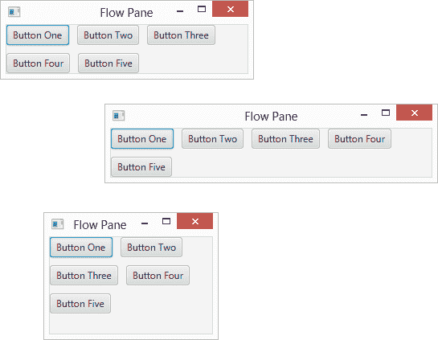

```java
pane.setPrefWrapLength(300);
```

图 4-5 显示了当将布局添加到场景并在舞台中显示场景时，这些按钮外观。此图还显示了当用户调整窗口大小时，流式布局（flow layout）中的按钮是如何重新排列的。注意，最初，前三个按钮出现在第一行，接下来的两个出现在第二行。当窗口被向外拖宽一点时，按钮会重新流式，使得第一行可以容纳四个按钮，而只有一个按钮溢到第二行。然后，当窗口被向内缩小时，前两行中各只出现两个按钮，并为第五个按钮创建了第三行。

**图 4-5：**

带有五个按钮的流式布局面板。

642 第 6 卷 **JavaFX**

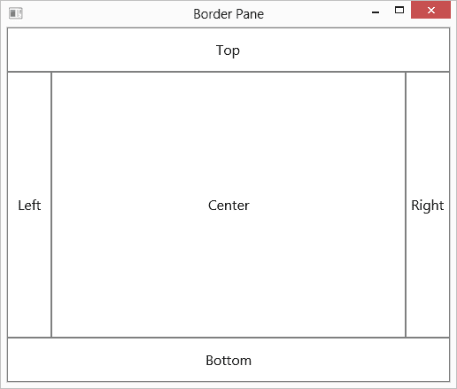

## 使用边界布局 (Border Layout)

边框布局是一种划分为五个区域的面板：顶部、左侧、中间、右侧和底部，如图 4-6 所示。当你向布局中添加组件时，可以指定该组件放入这些区域中的哪一个。

### 使用布局面板安排你的场景

**图 4-6：**

边界布局如何划分区域。

边界布局是具有传统窗口布局应用程序的理想布局管理器，在这种布局中，菜单和工具栏显示在窗口顶部，状态栏或 OK 和取消按钮显示在底部，导航面板显示在左侧，各种任务面板显示在右侧，内容显示在中间。

使用`BorderPane`类来创建边界布局。表 4-7 列出了`BorderPane`类的构造函数和最常用的方法。

`BorderPane`类定义在`javafx.scene.layout`包中，因此在任何使用边界布局的程序中，都应该包含以下导入语句：

```java
import javafx.scene.layout.*;
```

第 4 章 **使用布局面板安排你的场景** 643

**表 4-7**

**BorderPane 构造函数与方法**

| 构造函数 | 描述 |
| :--- | :--- |
| `BorderPane()` | 创建一个空的边界布局。 |
| `BorderPane(Node center)` | 创建具有指定中间节点的边界布局。 |
| `BorderPane(Node center, Node top, Node right, Node bottom, Node left)` | 创建具有指定的中间、顶部、右侧、底部和左侧节点的边界布局。 |

| 方法 | 描述 |
| :--- | :--- |
| `void setCenter(Node node)` | 设置中间节点。 |
| `void setTop(Node node)` | 设置顶部节点。 |
| `void setRight(Node node)` | 设置右侧节点。 |
| `void setBottom(Node node)` | 设置底部节点。 |
| `void setLeft(Node node)` | 设置左侧节点。 |
| `void setAlignment(Pos alignment)` | 设置边界面板内节点的对齐方式。参见表 4-5 关于`Pos`枚举的解释。更多信息请参阅本章前面的“在布局面板中对齐节点”部分。 |
| `static void setMargin(Node child, Insets value)` | 为指定的子节点设置边距。参见表 4-2 关于`Insets`类的构造函数。更多信息请参阅本章前面的“使用边距添加空间”部分。 |

该类的默认构造函数会创建一个空的边界布局，你可以稍后为其添加节点，如示例所示：

```java
Button btn1 = new Button("Button One");
Button btn2 = new Button("Button Two");
Button btn3 = new Button("Button Three");
VBox vbox = new VBox(btn1, btn2, btn3);
BorderPane pane = new BorderPane();
pane.setCenter(vbox);
```

在这里，创建了三个按钮并将其到`VBox`中。然后，创建一个边界布局，并将`VBox`添加到它的中间区域。

644 第 6 卷 **JavaFX**

或者，你可以通过`BorderPane`构造函数向中间区域添加节点，如下：

```java
BorderPane pane = new BorderPane(vbox);
```

表 4-7 列出的第三个构造函数允许你一次性向所有五个区域添加节点。以下示例假设你已经创建了五个名为`centerPane`、`topPane`、`rightPane`、`bottomPane`和`leftPane`的面板：

**使用布局面板安排你的场景**

```java
BorderPane pane = new BorderPane(centerPane, topPane, rightPane, bottomPane, leftPane);
```

这里有关于`BorderPane`类需要了解的额外要点：

- 如果你没有向其中一个区域添加节点，则该区域将不会渲染。
- 边界布局区域的大小根据其内容确定。因此，如果你向右侧区域添加一个`VBox`面板，则`VBox`面板的宽度将决定右侧区域的宽度。
- 如果用户调整窗口大小使其变宽，顶部、中间和底部的区域宽度将扩展——而左侧和右侧区域的宽度保持不变。

同样，如果用户拖动窗口使其更高，左侧、中间和右侧区域的高度将扩展；顶部和底部区域的高度保持不变。

- 你添加到边界面板区域中的节点，其本身几乎总是其他的其他布局面板。

## 使用网格面板布局 (GridPane Layout)

网格面板布局管理器允许你在行和列的网格中安排 GUI 元素。与平铺面板不同，网格面板的行和列不需要相同的大小。相反，网格面板根据你添加的组件自动调整列的宽度和行的高度。

第 4 章 **使用布局面板安排你的场景** 645


这里是网格布局的一些额外重要点：

- 你可以指定组件放入哪个单元格，并控制组件在面板中的位置。
- 你可以创建跨越多行或多列的组件，例如跨两列或四行。
- 你可以告诉`GridPane`伸展组件以填充区域（如果它不够大），可以是水平、垂直或两者。
- 如果组件没有填充其分配的区域，你可以告诉网格布局如何对其对齐——例如左对齐或右对齐。

以下章节将介绍使用网格面板的内部和细节。

### 规划草图

在创建网格面板之前，先画一张草图，显示你希望组件在面板中的外观。然后将面板划分为行和列，并从左上开始为行列编号。图 4-7 显示了一个用于订购披萨应用程序的草图。

**图 4-7：**

面板草图。

646 第 6 卷 **JavaFX**

| 组件 | x | y | 对齐方式 | 跨度 |
| :--- | :--- | :--- | :--- | :--- |
| “姓名”标签 | 0 | 0 | 右 | |
| “电话”标签 | 0 | 1 | 右 | |
| “地址”标签 | 0 | 2 | 右 | |
| 姓名文本框 | 1 | 0 | 左 | 2 |
| 电话文本框 | 1 | 1 | 左 | 2 |
| 地址文本框 | 1 | 2 | 左 | 2 |
| 尺寸单选按钮 | 0 | 3 | 左 | |
| 样式单选按钮 | 1 | 3 | 左 | |
| 披萨配料复选框 | 2 | 3 | 左 | |
| OK 和关闭按钮 | 2 | 4 | 右 | |

在布局好网格后，你就可以编写代码将每个组件放在正确的位置。

### 创建网格面板

表 4-8 显示了`GridPane`类最常用的构造函数和方法，你使用它们来创建网格面板。

要创建一个基础网格面板，首先调用`GridPane`构造函数。然后，使用`add`方法将节点添加到网格面板的单元格中。`add`方法的参数指定了要添加的节点、节点的列索引和行索引。例如，以下代码段创建了一个标签，然后创建一个网格面板并将标签添加到列 0、行 0 的单元格中：

```java
Label lblName = new Label("Name");
GridPane grid = new GridPane();
grid.add(lblName, 0, 0);
```

# 第 4 章：使用布局面板安排你的场景

## 表 4-8：GridPane 构造函数和方法

| 构造函数 | 描述 |
| :--- | :--- |
| `GridPane()` | 创建一个空的网格面板。 |

| 方法 | 描述 |
| :--- | :--- |
| `void add(Node node, int col, int row)` | 在指定的列和行索引处添加节点。 |
| `void add(Node node, int col, int row, int colspan, int rowspan)` | 在指定的列和行索引处添加节点，并指定列跨度和行跨度。 |
| `void addColumn(int col, Node... nodes)` | 添加一整列节点。 |
| `void addRow(int row, Node... nodes)` | 添加一整行节点。 |
| `<ObservableList> getColumnConstraints()` | 返回列约束。更多信息请参见表 11-6。 |
| `<ObservableList> getRowConstraints()` | 返回行约束。更多信息请参见表 11-7。 |
| `void setColumnSpan(Node node, int colspan)` | 设置指定节点的列跨度。 |
| `void setRowSpan(Node node, int colspan)` | 设置指定节点的行跨度。 |
| `void setHalignment(Node node, HPos value)` | 设置节点的水平对齐方式。允许的 HPos 值有`HPos.LEFT`、`HPos.CENTER`和`HPos.RIGHT`。 |
| `void setValignment(Node node, VPos value)` | 设置节点的垂直对齐方式。允许的 VPos 值有`VPos.BOTTOM`、`VPos.CENTER`和`VPos.TOP`。 |
| `void setHgap(double value)` | 设置列与列之间间隙的大小。 |
| `void setVgap(double value)` | 设置行与行之间间隙的大小。 |
| `static void setMargin(Node node, Insets value)` | 设置特定节点的边距。关于`Insets`类的解释参见第 5 章表 5-2。 |
| `void setPadding(Insets value)` | 设置网格面板内部边缘的内边距。关于`Insets`解释参见第 5 章表 5-2。 |
| `void setMinHeight(double value)` | 设置网格面板的最小高度。 |
| `void setMaxHeight(double value)` | 设置网格面板的最大高度。 |
| `void setPrefHeight(double value)` | 设置网格面板的优先高度。 |
| `void setMinWidth(double value)` | 设置网格面板的最小宽度。 |
| `void setMaxWidth(double value)` | 设置网格面板的最大宽度。 |
| `void setPrefWidth(double value)` | 设置网格面板的优先宽度。 |

## 使用布局面板安排你的场景

在网格面板中填充节点的典型方法是为每个节点调用`add`方法。然而，如果你愿意，，可以通过一次调用`addColumn`或`addRow`来一次添加一整列或一整行的节点。例如，此示例创建了一个标签和一个文本字段，然后创建一个网格面板并将标签和文本字段添加到第一行：


```java
Label lblName = new Label("Name");
TextField txtName = new TextField();
GridPane grid = new GridPane();
grid.addRow(0, lblName, txtName);
```

如果一个节点应该跨越多个列，你可以调用`setColumnSpan`方法来指定节点应跨越的列数。例如：

```java
grid.setColumnSpan(txtName, 2);
```

在这里，`txtName`节点将跨越两列。如果你需要配置节点跨越多行，可以以类似的方式使用`setRowSpan`。

要控制节点的水平对齐方式，可以使用本例所示的`setHalignment`方法：

```java
grid.setHalignment(lblName, HPos.RIGHT);
```

在这里，`lblName`在其所在的列中右对齐。`setValignment`方法的作用原理也类似。

与其他布局面板一样，`GridPane`类拥有许多用于设置间距和对齐细节的方法。你可以使用`setHgap`和`setVgap`方法来设置行与列之间的间距，这样你的布局看起来就不会那么拥挤了。你可以使用`setPadding`和`setMargins`方法来设置内边距和边距，它们的工作方式与其他布局面板完全相同。你还可以为网格面板设置最小、最大和优先的宽度和高度。

## 使用网格面板约束工作

你可以使用`GridPane`类的方法控制网格面板布局的大多数方面，但遗憾的是，你无法控制单个列或行的大小。要实现这一点，你必须使用`ColumnConstraints`或`RowConstraints`类，如表 4-9 和 4-10 所示。

### 表 4-9：`ColumnConstraints`类

| 构造函数 | 描述 |
| :--- | :--- |
| `ColumnConstraints()` | 创建一个空的列约束对象。 |
| `ColumnConstraints(double width)` | 创建具有固定宽度的列约束。 |
| `ColumnConstraints(double min, double pref, double max)` | 创建具有指定最小、优先和最大宽度的列约束。 |

| 方法 | 描述 |
| :--- | :--- |
| `void setMinWidth(double value)` | 设置列的最小宽度。 |
| `void setMaxWidth(double value)` | 设置列的最大宽度。 |
| `void setPrefWidth(double value)` | 设置列的优先宽度。 |
| `void setPercentWidth(double value)` | 设置总宽度的百分比设置宽度。 |
| `void setHgrow(Priority value)` | Determine 当网格面板宽度增加时，列宽度是否伸缩。允许值为`Priority.ALWAYS`、`Priority.NEVER`和`Priority.SOMETES`。 |
| `void setWidth(boolean value)` | 如果为 true，网格面板将扩展节点以填充空间。 |
| `void setHalignment(HPos value)` | 设置整个列的水平对齐方式。允许值为`HPos.LEFT`、`HPos.CENTER`和`HPos.RIGHT`。 |

要使用列约束设置网格面板每列的固定宽度，首先为每一列创建一个约束。然后将这些约束添加到网格面板。这是一个示例：

```java
ColumnConstraints col1 = new ColumnConstraints(200);
ColumnConstraints col2 = new ColumnConstraints(200);
ColumnConstraints col3 = new ColumnConstraints(200);
GridPane grid = new GridPane();
grid.getColumnConstraints().addAll(col1, col2, col3);
```

### 表 4-10：`RowConstraints`类

| 构造函数 | 描述 |
| :--- | :--- |
| `RowConstraints()` | 创建一个空的行约束对象。 |
| `RowConstraints(double height)` | 创建具有固定高度的行约束。 |
| `RowConstraints(double min, double pref, double max)` | 创建具有指定的最小、优先和最大高度的行约束。 |

| 方法 | 描述 |
| :--- | :--- |
| `void setMinHeight(double value)` | 设置行的最小高度。 |
| `void setMaxHeight(double value)` | 设置行的最大高度。 |
| `void setPrefHeight(double value)` | 设置行的优先高度。 |
| `void setPercentHeight(double value)` | 设置总高度的百分比高度。 |
| `void setVgrow(Priority value)` | Determine 当网格面板高度增加时，行高度是否伸缩。允许值为`Priority.ALWAYS`、`Priority.NEVER`和`Priority.SOMETES`。 |
| `void setHeight(boolean value)` | 如果为 true，网格面板将扩展节点以填充空间。 |
| `void setValignment(VPos value)` | 设置整个行的垂直对齐方式。允许值为`VPos.TOP`、`VPos.CENTER`和`VPos.BOTTOM`。 |

列约束最有用的功能之一是能够将网格面板列的宽度作为网格面板总宽度的百分比。例如，假设网格面板将由三列组成，你希望无论网格面板宽度如何，它们的宽度都相同。以下代码实现了这一点：

```java
ColumnConstraints col1 = new ColumnConstraints();
col1.setPercentWidth(33);
ColumnConstraints col2 = new ColumnConstraints();
col2.setPercentWidth(33);
ColumnConstraints col3 = new ColumnConstraints();
col3.setPercentWidth(33);
GridPane grid = new GridPane();
grid.getColumnConstraints().addAll(col1, col2, col3);
```

在这个示例中，每列将填充网格的 33%。

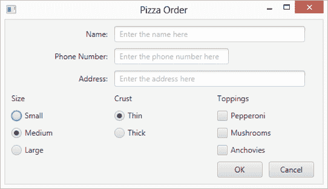

可以通过列约束或行约束设置的属性中，有几个与你可以通过`GridPane`类为单个节点设置的属性相似。例如，你可以通过调用`grid pane`上的`setHalignment`方法设置单个节点的水平对齐方式。或者，你也可以通过创建一个列约束，设置其水平对齐方式，然后将该列约束应用于`grid pane`中的某一列，从而设置整列的水平对齐方式。

### 检查`grid pane`示例

列表 4-1 显示了显示图 4-8 中我绘制场景的程序代码，而图 4-8 显示了当程序运行时该场景的样子。图 4-8 显示，该场景的最终外观与我的草图非常接近。

**图 4-8：**

正在运行中的披萨订单应用程序。

**列表 4-1：披萨订单应用程序**


```java
import javafx.application.*;
import javafx.stage.*;
import javafx.scene.*;
import javafx.scene.layout.*;
import javafx.scene.control.*;
import javafx.geometry.*;

public class PizzaOrder extends Application {

    public static void main(String[] args) {
        launch(args);
    }

    Stage stage;
    TextField txtName;
    TextField txtPhone;
    TextField txtAddress;
    RadioButton rdoSmall;
    RadioButton rdoMedium;
    RadioButton rdoLarge;
    RadioButton rdoThin;
    RadioButton rdoThick;
    CheckBox chkPepperoni;
    CheckBox chkMushrooms;
    CheckBox chkAnchovies;

    @Override
    public void start(Stage primaryStage) {
        stage = primaryStage;
        // 创建姓名标签和文本框
        Label lblName = new Label("Name:");
        txtName = new TextField();
        txtName.setMinWidth(100);
        txtName.setPrefWidth(200);
        txtName.setMaxWidth(300);
        txtName.setPromptText("Enter the name here");

        // 创建电话号码标签和文本框
        Label lblPhone = new Label("Phone Number:");
        txtPhone = new TextField();
        txtPhone.setMinWidth(60);
        txtPhone.setPrefWidth(120);
        txtPhone.setMaxWidth(180);
        txtPhone.setPromptText("Enter the phone number here");

        // 创建地址标签和文本框
        Label lblAddress = new Label("Address:");
        txtAddress = new TextField();
        txtAddress.setMinWidth(100);
        txtAddress.setPrefWidth(200);
        txtAddress.setMaxWidth(300);
        txtAddress.setPromptText("Enter the address here");

        // 创建尺寸面板
        Label lblSize = new Label("Size");
        rdoSmall = new RadioButton("Small");
        rdoMedium = new RadioButton("Medium");
        rdoLarge = new RadioButton("Large");
        rdoMedium.setSelected(true);
        ToggleGroup groupSize = new ToggleGroup();

        rdoSmall.setToggleGroup(groupSize);
        rdoMedium.setToggleGroup(groupSize);
        rdoLarge.setToggleGroup(groupSize);
        VBox paneSize = new VBox(lblSize, rdoSmall, rdoMedium, rdoLarge);
        paneSize.setSpacing(10);

        // 创建饼底面板
        Label lblCrust = new Label("Crust");
        rdoThin = new RadioButton("Thin");
        rdoThick = new RadioButton("Thick");
        rdoThin.setSelected(true);
        ToggleGroup groupCrust = new ToggleGroup();
        rdoThin.setToggleGroup(groupCrust);
        rdoThick.setToggleGroup(groupCrust);
        VBox paneCrust = new VBox(lblCrust, rdoThin, rdoThick);
        paneCrust.setSpacing(10);

        // 创建配料面板
        Label lblToppings = new Label("Toppings");
        chkPepperoni = new CheckBox("Pepperoni");
        chkMushrooms = new CheckBox("Mushrooms");
        chkAnchovies = new CheckBox("Anchovies");
        VBox paneToppings = new VBox(lblToppings, chkPepperoni, chkMushrooms, chkAnchovies);
        paneToppings.setSpacing(10);

        // 创建按钮
        Button btnOK = new Button("OK");
        btnOK.setPrefWidth(80);
        btnOK.setOnAction(e -> btnOK_Click());
        Button btnCancel = new Button("Cancel");
        btnCancel.setPrefWidth(80);
        btnCancel.setOnAction(e -> btnCancel_Click());
        HBox paneButtons = new HBox(10, btnOK, btnCancel);

        // 创建 GridPane 布局
        GridPane grid = new GridPane();
        grid.setPadding(new Insets(10));
        grid.setHgap(10);
        grid.setVgap(10);
        grid.setMinWidth(500);
        grid.setPrefWidth(500);
        grid.setMaxWidth(800);

        // 将节点添加到面板
        grid.addRow(0, lblName, txtName);
        grid.addRow(1, lblPhone, txtPhone);
        grid.addRow(2, lblAddress, txtAddress);
        grid.addRow(3, paneSize, paneCrust);

        // 添加配料面板
        grid.add(paneToppings, 0, 4);
        grid.add(paneToppings, 1, 4);

        // 设置对齐方式
        grid.setHalignment(lblName, Pos.LEFT);
        grid.setHalignment(lblPhone, Pos.LEFT);
        grid.setHalignment(lblAddress, Pos.LEFT);
        grid.setHalignment(paneSize, Pos.LEFT);
        grid.setHalignment(paneCrust, Pos.LEFT);
        grid.setHalignment(paneToppings, Pos.LEFT);

        // 设置列宽
        ColumnConstraints col1 = new ColumnConstraints();
        col1.setMinWidth(100);
        grid.getColumnConstraints().add(col1);

        ColumnConstraints col2 = new ColumnConstraints();
        col2.setPrefWidth(200);
        grid.getColumnConstraints().add(col2);

        ColumnConstraints col3 = new ColumnConstraints();
        col3.setMaxWidth(300);
        grid.getColumnConstraints().add(col3);

        // 设置列宽
        ColumnConstraints col4 = new ColumnConstraints();
        col4.setMinWidth(60);
        grid.getColumnConstraints().add(col4);

        ColumnConstraints col5 = new ColumnConstraints();
        col5.setPrefWidth(120);
        grid.getColumnConstraints().add(col5);

        ColumnConstraints col6 = new ColumnConstraints();
        col6.setMaxWidth(180);
        grid.getColumnConstraints().add(col6);

        // 设置列宽
        ColumnConstraints col7 = new ColumnConstraints();
        col7.setMinWidth(100);
        grid.getColumnConstraints().add(col7);

        ColumnConstraints col8 = new ColumnConstraints();
        col8.setPrefWidth(200);
        grid.getColumnConstraints().add(col8);

        ColumnConstraints col9 = new ColumnConstraints();
        col9.setMaxWidth(300);
        grid.getColumnConstraints().add(col9);

        // 设置跨度
        grid.setColumnSpan(paneSize, 2);
        grid.setColumnSpan(paneCrust, 2);
        grid.setColumnSpan(paneToppings, 2);

        // 创建场景和阶段
        Scene scene = new Scene(grid);
        primaryStage.setScene(scene);
        primaryStage.setTitle("Pizza Order");
        primaryStage.show();
    }

    public void btnOK_Click() {
        String msg = "Customer:\n";
        msg += txtName.getText() + "\n";
        msg += txtPhone.getText() + "\n";
        msg += txtAddress.getText() + "\n";
        msg += "You ordered a ";
        if (rdoSmall.isSelected()) {
            msg += "small ";
        } else if (rdoMedium.isSelected()) {
            msg += "medium ";
        } else if (rdoLarge.isSelected()) {
            msg += "large ";
        }
        msg += "crust with ";
        if (rdoThin.isSelected()) {
            msg += "thin ";
        } else if (rdoThick.isSelected()) {
            msg += "thick ";
        }
        msg += "toppings:\n";
        String toppings = "";
        if (chkPepperoni.isSelected()) {
            if (!toppings.isEmpty()) toppings += ", ";
            toppings += chkPepperoni.getText();
        }
        if (chkMushrooms.isSelected()) {
            if (!toppings.isEmpty()) toppings += ", ";
            toppings += chkMushrooms.getText();
        }
        if (chkAnchovies.isSelected()) {
            if (!toppings.isEmpty()) toppings += ", ";
            toppings += chkAnchovies.getText();
        }
        if (toppings.isEmpty()) {
            msg += "no toppings.";
        } else {
            msg += toppings;
        }
        Alert a = new Alert(Alert.INFORMATION, msg);
        a.setTitle("Order Details");
        a.showAndWait();
    }

    public void btnCancel_Click() {
        stage.close();
    }
}
```

以下段落指出了程序的亮点：

- 创建姓名标签和文本框。
- 创建电话号码标签和文本框。
- 创建地址标签和文本框。
- 创建尺寸面板，包含三个单选按钮，并将它们添加到`VBox`中。
- 创建饼底面板，包含两个单选按钮，并将它们添加到`VBox`中。
- 创建配料面板，包含三个复选框，并将它们添加到`VBox`中。
- 创建 OK 和取消按钮，并将它们添加到`HBox`中。
- 创建`GridPane`布局，设置内边距、水平和垂直间距以及宽度范围。
- 将节点添加到面板：将姓名、电话和地址的标签及文本框分别添加到第 0、1、2 行；将尺寸、饼底和配料的`VBox`面板添加到第 3 行。
- 包含按钮的`HBox`被添加到第 4 行的第 2 列。
- （记住：行和列索引从 0 开始计数，而不是从 1。）

- **127：** 创建了列约束以均匀分布列宽。
- **136：** 创建了场景并显示舞台。
- **146：** 当用户点击 OK 时，调用`btnOK_Click`方法。该方法创建客户订单的摘要并使用`Alert`类将其显示出来。
- **187：** `buildToppings`仅仅是一个辅助方法，用于协助消息字符串的构建。
- **201：** 当用户点击关闭按钮时，舞台关闭。

# 第 4 章 使用布局面板排列你的场景

657


## 本章内容

- 文本字段和文本区域的操作
- 验证数值数据和创建复选框
- 设置单选按钮
- 在完整程序中使用这些组件

# 第 5 章 从用户获取输入


在本微型书籍的前四章中，我讨论了如何仅使用两个基本的 JavaFX 输入控件：标签和按钮来创建 JavaFX 程序。如果你只想编写在用户点击按钮时显示文本的程序，那么你现在可以把书了。但如果你想编写一些真正有价值的程序，你需要使用其他的 JavaFX 输入控件。

在本章中，你将了解到如何使用一些常用的 JavaFX 控件。首先，你将读到标签以及从用户获取信息的控件。你将了解到更多关于文本字段控件（获取一行文本）和文本区域控件（获取多行文本）的细节。然后我将转向两个从用户获取“二选一”信息的输入控件：单选按钮和复选框。在此过程中，你将发现任何从用户收集输入数据的 JavaFX 程序的一个重要方面：数据验证。数据验证程序对于确保用户不输入虚假数据至关重要。例如，你可以使用数据验证来确保用户向必填字段输入数据，或者确保用户输入到数值字段的数据确实是有效数字。

# 第 5 章 从用户获取输入

## 使用文本字段

*文本字段*（text field）是一个用户可以在其中输入单行文本的框。你通过使用 `TextField` 类来创建文本字段。表 5-1 显示了该类一些有趣且实用的构造函数和方法。

### 表 5-1：实用的 TextField 构造函数和方法

| 构造函数 | 描述 |
| :--- | :--- |
| `TextField()` | 创建一个新的文本字段。 |
| `TextField(String text, int cols)` | 创建带有初始文本值的新文本字段。 |
| 方法 | 描述 |
| `String getText()` | 获取字段中输入的文本值。 |
| `void requestFocus()` | 请求将焦点移动到此文本字段。注意，该字段必须存在于场景中，焦点请求才会生效。 |
| `void setEditable(boolean value)` | 如果为 `false`，则使字段设为只读。 |
| `void setMaxWidth(double width)` | 设置字段的最大宽度。 |
| `void setMinWidth(double width)` | 设置字段的最小宽度。 |
| `void setPrefColumnCount(int cols)` | 设置文本字段以列为单位的选大小（即平均宽度文本字符的数量）。 |
| `void setPrefWidth(double width)` | 设置字段的优选宽度。 |
| `void setPromptText(String prompt)` | 设置字段的提示值。如果字段已有文本值或字段拥有焦点，则提示值将不会显示。 |
| `void setText(String text)` | 设置字段的文本值。 |

`TextField` 类定义在 `javafx.scene.control` 包中，因此在任何使用文本字段的程序中都应该包含以下导入语句：

```java
imports javafx.scene.control.*;
```

创建文本字段最常见的方法是调用不带参数的构造函数，如下：

```java
TextField text1 = new TextField();
```

你可以这样设置显示的初始值：

```java
TextField text1 = new TextField("Initial value");
```

或者，如果你以后需要设置值，可以调用 `setText` 方法：

```java
text1.setText("Text value");
```

要检索用户在文本字段中输入的值，像这样调用 `getText` 方法：

```java
String value = text1.getText();
```

## 从用户获取输入

与任何 JavaFX 控件一样，管理文本字段的宽度可能有点棘手。最终，JavaFX 将根据多个因素确定文本字段的宽度，包括包含舞台和场景的窗口的大小，以及在包含文本字段的面板上设置的任何尺寸限制。你可以通过调用 `setMinWidth` 和 `setMaxWidth` 方法为文本字段尺寸设置最小和最大限制，并通过 `setPrefWidth` 方法指定优选宽度，例如所示：

```java
TextField text1 = new TextField();
text1.setMinWidth(150);
text1.setMaxWidth(250);
text1.setPrefWidth(200);
```

设置优选宽度的另一种方法是使用 `setPrefColumnCount` 方法，它以平均字符数来设置宽度。例如，以下代码将字段宽度设置为 50 个字符：

```java
text1.setPrefColumnCount(50);
```

注意 `setPrefColumnCount` 方法并不限制用户输入字段的字符数。它限制的是字段一次可以显示的字符数。

每当你使用文本字段时，提供一个提示让用户知道应该输入什么。这样做的一种常用方法是将标签放置在文本字段的左侧。例如：

```java
Label lblName = new Label("Name:");
lblName.setMinWidth(75);
TextField txtName = new TextField();
txtName.setMinWidth(200);
HBox pane = new HBox(10, lblName, txtName);
```

在这里，标签和文本字段被创建并并排显示。

JavaFX 还允许在文本字段内部显示提示。提示以较浅的颜色显示并在字段获得焦点时消失。你使用 `setPromptText` 方法来创建这样的提示：

```java
TextField txtName = new TextField();
txtName.setPromptText("Enter the customer's name");
```

在这里，`Enter the customer's name` 将出现在文本字段内部。

要检索用户在文本字段中输入的值，像这样调用 `getText` 方法：

```java
String lastName = textLastName.getText();
```

这里在 `textLastName` 字段中输入的值赋值给 `String` 变量 `lastName`。

一个简单的程序，允许用户输入角色名称和扮演该角色的演员名称。假设用户在两个字段中都输入了文本，程序随后显示一个警框谁将扮演该角色。如果用户漏掉一个或两个字段，则会显示警框来指示错误。

图 5-1 显示了该程序的主舞台外观，以及当用户输入两个名称或漏掉名称时显示的消息框窗口。该程序的 JavaFX 代码如列表 5-1 所示。

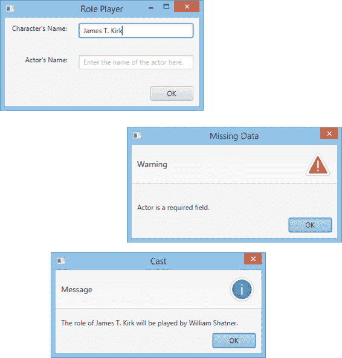

**从用户获取输入**

**FIGURE 5-1:**

运行中的 `RolePlayer`。

**LISTING 5-1:**

**Role Player Program**

```java
import javafx.application.*;
import javafx.stage.*;
import javafx.scene.*;
import javafx.scene.layout.*;
import javafx.scene.control.*;
import javafx.geometry.*;

public class RolePlayer extends Application
{
    public static void main(String[] args)
    {
        launch(args);
    }

    TextField txtCharacter;

    TextField txtActor;

    @Override public void start(Stage primaryStage)
    {
        // 创建角色
        // (继续)
    }
}
```

## LISTING 5-1:（继续）

```java
Label lblCharacter = new Label("Character's Name:");
lblCharacter.setMinWidth(100);
lblCharacter.setAlignment(Pos.BOTTOM_RIGHT);

// 创建角色文本字段
→25
txtCharacter = new TextField();
txtCharacter.setMinWidth(200);
txtCharacter.setMaxWidth(200);
txtCharacter.setPromptText("在此处输入角色的名字.");

// 创建演员标签
→32
Label lblActor = new Label("Actor's Name:");
lblActor.setMinWidth(100);
lblActor.setAlignment(Pos.BOTTOM_RIGHT);

// 创建演员文本字段
→37
txtActor = new TextField();
txtActor.setMinWidth(200);
txtActor.setMaxWidth(200);
txtActor.setPromptText("在此处输入演员的名字.");

// 创建 OK 按钮
→43
Button btnOK = new Button("OK");
btnOK.setMinWidth(75);
btnOK.setOnAction(e -> btnOK_Click() );

// 创建角色面板
→48
HBox paneCharacter = new HBox(20, lblCharacter, txtCharacter);
paneCharacter.setPadding(new Insets(10));

// 创建演员面板
→52
HBox paneActor = new HBox(20, lblActor, txtActor);
paneActor.setPadding(new Insets(10));

// 创建按钮面板
→56
HBox paneButton = new HBox(20, btnOK);
paneButton.setPadding(new Insets(10));
paneButton.setAlignment(Pos.BOTTOM_RIGHT);

// 将角色、演员和按钮面板添加到 VBox
→61
VBox pane = new VBox(10, paneCharacter, paneActor, paneButton);

// 设置舞台
→64
Scene scene = new Scene(pane);
primaryStage.setScene(scene);
primaryStage.setTitle("Role Player");
primaryStage.show();
}

public void btnOK_Click()
→71
{
    String errorMessage = "";
→73
    if (txtCharacter.getText().length() == 0)
→75
    {
        errorMessage += "\n 角色是必填项.";
    }
    if (txtActor.getText().length() == 0)
→80
    {
        errorMessage += "\n 演员是必填项.";
    }
    if (errorMessage.length() == 0)
→85
    {
        String message = "角色 "
        + txtCharacter.getText()
        // 从用户处获取输入
        + 将由演员 "
        + txtActor.getText()
        + " 饰.";
        Alert a = new Alert(Alert.AlertType.INFORMATION, message);
        a.setTitle("Cast");
        a.showAndWait();
    }
    else
    {
        Alert a = new Alert(Alert.AlertType.WARNING, errorMessage);
→98
        a.setTitle("Missing Data");
        a.showAndWait();
    }
}
}
```

这个程序并不复杂，因此以下章节介绍了重点：

- **4**：程序主类的名称是 `RolePlayer`。
- **15**：这些类变量允许 `RolePlayer` 类的任何方法访问这两个文本字段。
- **20**：这些行创建了一个标签来标识角色文本框。该字段的最小宽度被设置为 100 像素，并向右对齐，以便标识两个文本字段的标签能够正确对齐。
- **25**：这些行创建了角色文本字段，最小和最大宽度均为 200 像素。提示文本被设置为“在此处输入角色的名字.”。当文本字段没有焦点时，此文本将显示在文本字段中。在图 5-1 中，角色文本字段拥有焦点，因此提示文本不可见。
- **32**：这些行创建了一个标签来标识演员文本字段。与角色标签一样，演员标签的宽度被设置为 100 像素并向右对齐。
- **37**：这些行创建了演员文本字段，将其宽度设置为 200 像素并分配了提示文本。你可以在图 5-1 中看到提示文本，因为演员文本字段没有焦点。
- **43**：这些行创建了 OK 按钮。当用户点击按钮时，会调用 `btnOK_Click` 方法。
- **48**：这些行创建了一个 `HBox` 面板并将角色标签和文本框添加到其中。
- **52**：这些行创建了另一个 `HBox` 面板并将演员标签和文本框添加到其中。
- **56**：这些行创建了第三个 `HBox` 面板来放置按钮。
- **61**：现在所有控件都已创建并添加到 `HBox` 面板，三个 `HBox` 面板被添加到 `VBox` 面板，以便带有关联标签的文本框和按钮垂直堆叠。
- **64**：这些行创建一个场景来显示 `VBox` 面板，然后将场景添加到主舞台并显示舞台。
- **71**：每当用户点击 OK 时就会调用 `btnOK_Click` 方法。
- **73**：`errorMessage` 变量存储了可能出现的错误信息。
- **75**：`if` 语句确保了角色是必填项。
- **80**：`if` 语句确保了演员是必填项。
- **85**：`if` 语句判断是否发生了错误。
- **98**：此行在用户忘记输入数据时显示错误。

## 验证数字数据

如果你在使用文本字段获取数字数据，需要特别小心。使用包装类的解析方法。*注意：*这些这些方法在字符串无法转换时都会抛出 `NumberFormatException`。因此，你需要在 `try/catch` 块中调用它们以捕获此异常。

### 表 5-2：将字符串转换为数字的方法

| 包装类 | 方法 |
| :--- | :--- |
| `Integer` | `parseInt(String)` |
| `Short` | `parseShort(String)` |
| `Long` | `parseLong(String)` |
| `Byte` | `parseByte(String)` |
| `Float` | `parseFloat(String)` |
| `Double` | `parseDouble(String)` |

如果你的程序使用一个多个数字输入文本字段，考虑创建独立的方法来验证用户的输入。以下代码片段显示了一个接受文本字段和错误信息字符串（在数据无法转换时显示）的方法。该方法返回一个 `boolean` 值，指示字段是否包含整数：

```java
private boolean isInt(TextField f, String msg) {
    try {
        Integer.parseInt(f.getText());
        return true;
    } catch (NumberFormatException e) {
        Alert a = new Alert(Alert.AlertType.WARNING, msg);
        a.setTitle("Invalid Data");
        a.showAndWait();
        return false;
    }
}
```

当你需要检查文本字段是否为有效整数时，可以调用此方法。这里有一个获取 `txtCount` 文本字段输入的值并在该值是有效整数时在消息框中显示的方法：

```java
public void buttonOKClick() {
    if (isInt(textCount, "你必须输入一个整数.")) {
        Alert a = new Alert(Alert.AlertType.INFORMATION, "你输入了 " + Integer.parseInt(textCount.getText()), "你的数字");
        a.showAndWait();
    }
    textCount.requestFocus();
}
```

## 使用复选框

*复选框*是一种用户可以点击勾选或清除控件。复选框允许用户为选项指定“是”或“否”。图 5-2 显示了一个带有三个复选框的窗口。


严格来说，复选框（check box）有三种状态：已选中、未选中和未定义。未定义状态通常与树形视图（TreeView）控件配合使用。

**图 5-2：**

三个复选框。

要创建一个复选框，你可以使用 `CheckBox` 类。其常用的构造函数和方法如表 5-3 所示。


### 从用户获取输入

**表 5-3 常用的 `CheckBox` 构造函数和方法**

| 构造函数 | 描述 |
| :--- | :--- |
| `CheckBox()` | 创建一个初始未选中的新复选框 |
| `CheckBox(String text)` | 创建一个显示指定文本的新复选框 |
| **方法** | 描述 |
| `String getText()` | 获取复选框显示的文本 |
| `boolean isSelected()` | 如果复选框已选中返回 `true`，未选中则返回 `false` |
| `void setOnAction(EventHandler<ActionEvent> value)` | 设置 `ActionEvent` 监听器以处理动作事件 |
| `void setSelected(boolean value)` | 如果参数为 `true` 则选中复选框；如果参数为 `false` 则取消选中 |
| `void setText(String text)` | 设置复选框文本 |

与任何 JavaFX 控件一样，如果你想在程序中的任何方法中引用复选框，请声明一个类变量来引用该控件：

`CheckBox chkPepperoni, chkMushrooms, chkAnchovies;`

然后你可以在 `start` 方法中使用如下语句来创建复选框并将它们添加到布局面板中（在本例中为 `pane1`）：

```java
chkPepperoni = new CheckBox("Pepperoni");
pane1.add(chkPepperoni);
chkMushrooms = new CheckBox("Mushrooms");
pane1.add(chkMushrooms);
chkAnchovies = new CheckBox("Anchovies");
pane1.add(chkAnchovies);
```

注意，我没有在构造函数中指定这些复选框的初始状态。结果是它们初始是未选中的。如果你想创建一个初始为选中的复选框，可以调用 `setSelected` 方法，如下：

```java
chkPepperoni.setSelected(true);
```

在事件监听器中，你可以使用 `isSelected` 方法测试复选框的状态，并可以通过调用 `setSelected` 方法来设置复选框的状态。这里有一个方法，当用户点击 OK 时会显示消息框并清空三个复选框：

```java
public void btnOK_Click()
{
    String msg = "";
    if (chkPepperoni.isSelected())
        msg += "Pepperoni\n";
    if (chkMushrooms.isSelected())
        msg += "Mushrooms\n";
    if (chkAnchovies.isSelected())
        msg += "Anchovies\n";
    if (msg.equals(""))
        msg = "You didn't order any toppings.";
    else
        msg = "You ordered these toppings:\n" + msg;

    Alert a = new Alert(Alert.AlertType.INFORMATION, msg);
    a.setTitle("Your Order");
    a.showAndWait();

    chkPepperoni.setSelected(false);
    chkMushrooms.setSelected(false);
    chkAnchovies.setSelected(false);
}
```

在这里，用户选择的每个披萨配料名称都被添加到文本字符串中。例如，如果你选择了意大利腊肠和安士鱼，将显示以下消息：

```
You ordered these toppings:
Pepperoni
Anchovies
```

如果你愿意，可以为复选框添加事件监听器，以响应用户点击这些复选框时生成的事件。假设你的餐厅菜单上有安士鱼，但你拒绝实际上制作带有安士鱼的披萨。这里有一个可以在事件监听器中调用的方法，当用户尝试勾选安士鱼复选框时显示消息；显示消息后，该方法将清空该复选框：

```java
public void btnOK_Click()
{
    String msg = "";
    if (chkPepperoni.isSelected())
        msg += "Pepperoni\n";
    if (chkMushrooms.isSelected())
        msg += "Mushrooms\n";
    if (chkAnchovies.isSelected())
        msg += "Anchovies\n";
    if (msg.equals(""))
        msg = "You didn't order any toppings.";
    else
        msg = "You ordered these toppings:\n" + msg;

    Alert a = new Alert(Alert.AlertType.INFORMATION, msg);
    a.setTitle("Your Order");
    a.showAndWait();

    chkPepperoni.setSelected(false);
    chkMushrooms.setSelected(false);
    chkAnchovies.setSelected(false);
}
```

### 单选按钮（Radio Buttons）

单选按钮与复选框相似，但有一个关键区别：它们成组出现，且一组内只能选择一个。当你点击一个单选按钮时，组内之前选中的按钮会自动取消选中。图 5-3 显示了带有三个单选按钮的窗口。

![Image 784)

**图 5-3：** 三个单选按钮的窗口。

要操作单选按钮，你需要使用两个类。首先使用 `RadioButton` 类创建单选按钮，其构造函数和方法如 5-4 所示。然后使用 `ToggleGroup` 类为协同工作的单选按钮创建一个分组。`ToggleGroup` 对象本身不是控件，也不会显示。要显示单选按钮，必须将它们添加到布局面板。

**表 5-4 各种 `RadioButton` 构造函数和方法**

| 构造函数 | 描述 |
| :--- | :--- |
| `RadioButton()` | 创建一个没有文本的新单选按钮 |
| `RadioButton(String text)` | 创建一个带有指定文本的新单选按钮 |
| **方法** | 描述 |
| `String getText()` | 获取单选按钮显示的文本 |
| `boolean isSelected()` | 如果单选按钮已选中返回 `true`，未选中则返回 `false` |
| `void setOnAction(EventHandler<ActionEvent> value)` | 设置 `ActionEvent` 监听器以处理动作事件 |
| `void setSelected(boolean value)` | 如果参数为 `true` 则选中单选按钮；如果参数为 `false` 则取消选中 |
| `void setText(String text)` | 设置复选框文本 |

创建单选按钮的通常方法是声明一个变量将其作为类变量，以便在类的任何地方访问，如下所示：

`RadioButton rdoSmall, rdoMedium, rdoLarge;`

然后，在 `start` 方法中，你调用 `RadioButton` 构造函数来创建单选按钮：

```java
rdoSmall = new RadioButton("Small");
```

之后，你可以按照通常方式将单选按钮添加到布局面板。为了为协同工作的单选按钮创建一个切换组，调用 `ToggleGroup` 类构造函数：

```java
ToggleGroup sizeGroup = new ToggleGroup();
```

然后调用每个单选按钮的 `setToggleGroup` 方法：

```java
rdoSmall.setToggleGroup(sizeGroup);
rdoMedium.setToggleGroup(sizeGroup);
rdoLarge.setToggleGroup(sizeGroup);
```

### 查看披萨订单应用程序

本节介绍了一个允许用户订购披萨的相当复杂的应用程序。用户在文本字段中输入姓名、地址和电话号码，使用单选按钮选择披萨的大小和饼底风格，并通过复选框选择配料。图 5-4 显示了披萨订单应用程序的主窗口。

当用户输入披萨订单数据并点击 OK 时，此程序将显示一个汇总订单的消息框，如图 5-5 所示。

# 第 5 章 从用户获取输入

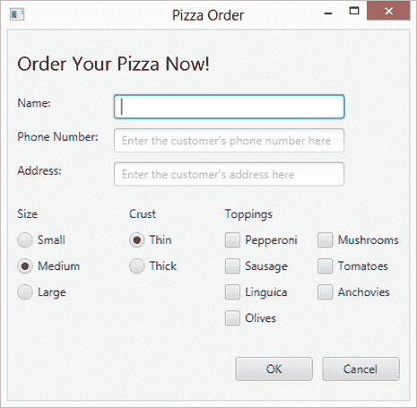

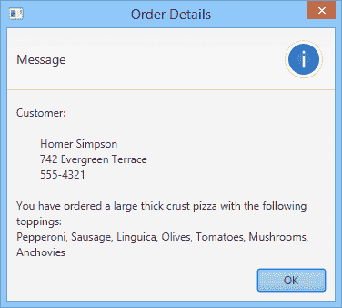

**图 5-4：** Pizza Order 应用的主窗口。

**图 5-5：** Pizza Order 应用确认用户的订单。

一眼看去可能并不明显，但 Pizza Order 应用显示的场景总共使用了 12 个布局窗格来控制控件的排列。整个场景由一个边界窗格（`BorderPane`）组织，其顶部区域显示标题（立即订购您的披萨！）。中间区域显示文本字段、单选按钮和复选框，允许用户配置其披萨订单。底部区域包含 OK 和 Cancel 按钮。

供你参考，表 5-5 列出了用于组织这些内容的 12 个布局窗格。

### 表 5-5：Pizza Order 应用使用的布局窗格

| 名称 | 类 | 描述 |
| :--- | :--- | :--- |
| `paneMain` | `BorderPane` | 场景的主根窗格。 |
| `paneTop` | `HBox` | 包含在边界窗格顶部显示的标题文本。 |
| `paneName` | `HBox` | 包含客户名称的标签和文本框，并排放置。 |
| `panePhone` | `HBox` | 包含电话的标签和文本框，并排放置。 |
| `paneAddress` | `HBox` | 包含地址的标签和文本框，并排放置。 |
| `paneCustomer` | `VBox` | 包含名称、电话和地址窗格，垂直堆叠。 |
| `paneSize` | `VBox` | 包含“Size”标签和一个允许用户选择披萨尺寸的三个单选按钮，垂直堆叠。 |
| `paneCrust` | `VBox` | 包含“Crust”标签和一个允许用户选择饼底风格的两个单选按钮，垂直堆叠。 |
| `paneToppings` | `FlowPane` | 包含配料复选框的流布局窗格。 |
| `paneTopping` | `VBox` | 包含“Toppings”标签和一个列出配料的流布局窗格，垂直堆叠。 |
| `paneOrder` | `HBox` | 包含并排排列列出尺寸、饼底风格和配料的三个 `VBox` 窗格。此窗格显示在边界窗格的中间区域。 |
| `paneBottom` | `HBox` | 包含并排排列的 OK 和 Cancel 按钮。使用间隔区强制按钮对齐右边距。此窗格显示在边界窗格的底部区域。 |

Pizza Order 应用的源代码如列表 5-2 所示。

**列表 5-2：Pizza Order 应用**


```java
import javafx.application.*;
import javafx.stage.*;
import javafx.scene.*;
import javafx.scene.layout.*;
import javafx.scene.control.*;
import javafx.geometry.*;
import javafx.scene.text.*;

public class PizzaOrder extends Application
{
    *(continued)*

    public static void main(String[] args)
    {
        launch(args);
    }

    Stage stage;
    // Customer name, phone and address fields
    TextField txtName;
    TextField txtPhone;
    TextField txtAddress;

    // Size radio buttons
    RadioButton rdoSmall;
    RadioButton rdoMedium;
    RadioButton rdoLarge;

    // Crust style radio buttons
    RadioButton rdoThin;
    RadioButton rdoThick;

    // Topping radio buttons
    CheckBox chkPepperoni;
    CheckBox chkSausage;
    CheckBox chkLinguica;
    CheckBox chkOlives;
    CheckBox chkMushrooms;
    CheckBox chkTomatoes;
    CheckBox chkAnchovies;

    @Override
    public void start(Stage primaryStage)
    {
        stage = primaryStage;
        // ----- 创建顶部窗格 -----
        Text textHeading = new Text("Order Your Pizza Now!");
        textHeading.setFont(new Font(20));
        HBox paneTop = new HBox(textHeading);
        paneTop.setPadding(new Insets(20, 10, 20, 10));

        // ---------- 创建客户窗格 ----------
        // 创建名称标签和文本字段
        Label lblName = new Label("Name:");
        lblName.setPrefWidth(100);
        txtName = new TextField();
        txtName.setPrefColumnCount(20);
        txtName.setPromptText("Enter the customer's name here");
        txtName.setMaxWidth(Double.MAX_VALUE);
        HBox paneName = new HBox(lblName, txtName);

        // 创建电话号码标签和文本字段
        Label lblPhone = new Label("Phone Number:");
        lblPhone.setPrefWidth(100);
        txtPhone = new TextField();
        txtPhone.setPrefColumnCount(20);
        txtPhone.setPromptText("Enter the customer's phone number here");
        HBox panePhone = new HBox(lblPhone, txtPhone);

        // 创建地址标签和文本字段
        Label lblAddress = new Label("Address:");
        lblAddress.setPrefWidth(100);
        txtAddress = new TextField();
        txtAddress.setPrefColumnCount(20);
        txtAddress.setPromptText("Enter the customer's address here");
        HBox paneAddress = new HBox(lblAddress, txtAddress);

        // 创建名称、电话和地址窗格
        VBox paneCustomer = new VBox(paneName, panePhone, paneAddress);

        // 创建尺寸单选按钮
        Label lblSize = new Label("Size:");
        rdoSmall = new RadioButton("Small");
        rdoMedium = new RadioButton("Medium");
        rdoLarge = new RadioButton("Large");
        VBox paneSize = new VBox(lblSize, rdoSmall, rdoMedium, rdoLarge);

        // 创建饼底风格单选按钮
        Label lblCrust = new Label("Crust:");
        rdoThin = new RadioButton("Thin");
        rdoThick = new RadioButton("Thick");
        VBox paneCrust = new VBox(lblCrust, rdoThin, rdoThick);

        // 创建配料复选框
        Label lblToppings = new Label("Toppings:");
        chkPepperoni = new CheckBox("Pepperoni");
        chkSausage = new CheckBox("Sausage");
        chkLinguica = new CheckBox("Linguica");
        chkOlives = new CheckBox("Olives");
        chkMushrooms = new CheckBox("Mushrooms");
        chkTomatoes = new CheckBox("Tomatoes");
        chkAnchovies = new CheckBox("Anchovies");
        FlowPane flowToppings = new FlowPane(chkPepperoni, chkSausage, chkLinguica, chkOlives, chkMushrooms, chkTomatoes, chkAnchovies);
        VBox paneTopping = new VBox(lblToppings, flowToppings);

        // 创建订单布局窗格
        HBox paneOrder = new HBox(paneSize, paneCrust, paneTopping);

        // 创建底部窗格
        Button btnOK = new Button("OK");
        Button btnCancel = new Button("Cancel");
        Region spacer = new Region();
        HBox paneBottom = new HBox(10, spacer, btnOK, btnCancel);
        paneBottom.setHgrow(spacer, Priority.ALWAYS);

        // 设置边界窗格
        BorderPane root = new BorderPane();
        root.setTop(paneTop);
        root.setCenter(paneOrder);
        root.setBottom(paneBottom);

        // 设置场景和舞台
        Scene scene = new Scene(root, 400, 400);
        primaryStage.setScene(scene);
        primaryStage.setTitle("Pizza Order");
        primaryStage.show();
    }

    public void btnOK_Click()
    {
        // 处理确认逻辑
    }

    public void btnCancel_Click()
    {
        // 处理取消逻辑
    }
}
```

```java
msg += "You have ordered a ";

// 添加披萨尺寸
if (rdoSmall.isSelected())
    msg += "small ";

if (rdoMedium.isSelected())
    msg += "medium ";

if (rdoLarge.isSelected())
    msg += "large ";

// 添加饼底样式
if (rdoThin.isSelected())
    msg += "thin crust pizza with ";

// (续)
if (rdoThick.isSelected())
    msg += "thick crust pizza with ";

// 添加配料
String toppings = "";
toppings = buildToppings(chkPepperoni, toppings);
toppings = buildToppings(chkSausage, toppings);
toppings = buildToppings(chkLinguica, toppings);
toppings = buildToppings(chkOlives, toppings);
toppings = buildToppings(chkTomatoes, toppings);
toppings = buildToppings(chkMushrooms, toppings);
toppings = buildToppings(chkAnchovies, toppings);

if (toppings.equals(""))
    msg += "no toppings.";
else
    msg += "the following toppings:\n" + toppings;

// 显示消息
Alert a = new Alert(Alert.AlertType.INFORMATION, msg);
a.setTitle("Order Details");
a.showAndWait();
}

public String buildToppings(CheckBox chk, String msg) {
    // 用于显示配料列表的辅助方法
    if (chk.isSelected()) {
        if (!msg.equals("")) {
            msg += ", ";
        }
        msg += chk.getText();
    }
    return msg;
}

public void btnCancel_Click() {
    stage.close();
}
```

# 第 6 章：从列表中选择

有一整类 JavaFX 控件设计用于让用户从列表中选择一个或多个项目。本章介绍了三个此类控件：选择框（choice boxes）、组合框（combo boxes）和列表（lists）。在此过程中，你将发现如何使用 `ObservableList` 接口，它被用于管理由选择框、组合框或列表视图（list view）控件显示的项目列表。

实际上，如果你一直读到这里，已经简要接触过 `ObservableList` 接口，因为它也用于管理在布局面板中显示的控件列表。在第 5 章中，你学习了如何使用该接口的 `addAll` 方法。在本章中，你将学习该接口的其他功能。你还将发现如何添加事件监听器，以便在用户更改当前选择时做出响应。

## 使用选择框

*选择框*（choice box）是一种允许用户从下拉列表中选择项目的控件。初始状态，选择框仅显示当前选中的项目。当用户点击选择框时，选项列表就会显示。用户可以通过点击列表中的任何项目来更改选择。图 6-1 显示了一个带有简单选择框的场景。

你使用 `ChoiceBox` 类来创建选择框。表 6-1 列出了该类常用的构造函数和方法。

### 表 6-1：常用的 ChoiceBox 构造函数和方法

| 构造函数 | 描述 |
| :--- | :--- |
| `ChoiceBox<T>()()` | 创建一个指定类型的空选择列表 |
| `ChoiceBox<T>(ObservableList<T> items)` | 创建选择列表并用指定列表中的值填充 |

| 方法 | 描述 |
| :--- | :--- |
| `ObservableList<T> getItems()` | 获取项目列表 |
| `void setItems(ObservableList<T> items)` | 设置项目列表 |
| `T getValue()` | 返回当前选中的项目 |
| `void setValue(T value)` | 设置当前选中的项目 |
| `void show()` | 显示项目列表 |
| `void hide()` | 隐藏项目列表 |
| `boolean isShowing()` | 表示项目列表当前可见 |

### 创建选择框

创建选择框非常简单。`ChoiceBox` 类是泛型的，因此需要为与选择框关联的列表指定类型。例如：

```java
ChoiceBox<String> choice = new ChoiceBox<String>();
```

在这里，创建了一个显示字符串的选择框。下一步是向选择框添加项目。你可以通过调用 `getItems` 方法来访问项目列表，然后调用 `add` 方法添加项目：

```java
choice.getItems().add("Bashful");
choice.getItems().add("Doc");
choice.getItems().add("Dopey");
choice.getItems().add("Grumpy");
choice.getItems().add("Happy");
choice.getItems().add("Sleepy");
choice.getItems().add("Sneezy");
```

或者，你可以调用 `addAll` 方法一次性添加所有字符串，如下：

```java
choice.getItems().addAll("Bashful", "Doc", "Dopey", "Grumpy", "Happy", "Sleepy", "Sneezy");
```

`getItems` 方法返回一个 `ObservableList` 类型的对象，它提供了许多让你操作列表的方法。更多信息，请参阅本章稍后的“使用 Observable 列表”部分。`ChoiceBox` 类还包含一个构造函数，允许你在创建选择框时添加一个 `ObservableList` 对象。这允许你将在创建选择框之前创建列表。

你可以向选择框添加任何种类的对象。选择框会调用每个项目的 `toString` 方法来确定显示的文本。假设你有一个名为 `Astronaut` 的类，代表太空任务中的航天员：

```java
class Astronaut {
    private String firstName;
    private String lastName;

    public Astronaut(String FirstName, String LastName) {
        firstName = FirstName;
        lastName = LastName;
    }

    public String toString() {
        return firstName + " " + lastName;
    }
}
```

然后，你可以创建一个列出阿波罗 13 号宇天员的选择框：

```java
ChoiceBox<Astronaut> apollo13 = new ChoiceBox<Astronaut>();
apollo13.getItems().add(new Astronaut("Jim", "Lovell"));
apollo13.getItems().add(new Astronaut("John", "Swigert"));
apollo13.getItems().add(new Astronaut("Fred", "Haise"));
```

如果你愿意，可以在用户点击之前显示选择框的内容。要这样做，调用 `show` 方法：

```java
apollo13.show();
```


要隐藏列表，调用`hide`方法：

```java
apollo13.hide();
```

### 设置默认值

默认情况下，选择框首次显示时没有初始选择。要设置初始值，调用`setValue`方法并传递你想作为初始选择的对象。

如果选择框包含字符串，可以通过将所需的字符串值传递给`setValue`方法来设置初始值：

```java
choice.setValue("Dopey");
```

如果指定的字符串不存在，初始值将保持未指定。

如果选择框包含对象（例如前节所示的`Astronaut`对象），你必须传递你想作为默认选择的对象引用。例如：

```java
Astronaut lovell = new Astronaut("Jim", "Lovell");
Astronaut swigert = new Astronaut("John", "Swigert");
Astronaut haise = new Astronaut("Fred", "Haise");

ChoiceBox<Astronaut> apollo13 = new ChoiceBox<Astronaut>();
apollo13.getItems().addAll(lovell, swigert, haise);
apollo13.setValue(lovell);
```

在这里，Jim Lovell 被设置为默认航天员。

### 获取选中的项目

你可以调用`getValue`方法来获取用户选中的项目。返回值的类型取决于你在创建选择框时指定的类型。例如，如果你指定了`String`类型，`getValue`方法返回字符串。如果你为选择框指定了`Astronaut`类型，该方法则返回航天员对象。

`getValue`方法通常用于按钮的动作事件处理器中。例如：

```java
public void btnOK_Click() {
    String message = "You chose ";
}
```

```java
message += apollo13.getValue();
```

## 从列表中选择

```java
Alert a = new Alert(Alert.AlertType.INFORMATION, message);
a.setTitle("Your Favorite Astronaut");
a.showAndWait();
```

## 使用可观测列表 (Observable Lists)

正如你在上一节中看到的，`ChoiceBox`类并不包含允许你直接从选择框显示的列表中添加或删除项的方法。相反，它包含一个命名为`getItems`的方法，该方法返回一个类型为`ObservableList`的对象。该方法返回的对象是一个可观测列表；它代表了选择框显示的列表。

要对选择框显示的项进行操作，你必须先访问可观测列表，然后使用`ObservableList`类的方法来访问列表中的各个项目。

可观测列表不仅被`ChoiceBox`类使用，还被其他显示列表项的控件类使用，例如`ComboBox`和`List`，你可以在本章的稍后部分阅读关于它们的内容。这两个类都有一个返回`ObservableList`的`getItems`方法。

可观测列表还被布局窗格（如`HBox`和`VBox`）使用，你可以在第 5 章中读到它们。所有布局类共有的`getChildren`方法返回一个`ObservableList`。

到目前为止，我只讨论了`ObservableList`接口的两个方法：`add`和`addAll`，它们允许向可观测列表添加项。这里是本章较之前`add`方法的一个示例：

```java
cbox.getItems().add("Bashful");
```

这里是来自第 5 章的一个示例，它使用`addAll`方法将按钮添加到布局窗格：

```java
pane.getChildren().addAll(btnOK, btnCancel);
```

`ObservableList`接口除了`add`和`addAll`之外还有许多其他方法。表 6-2 显示了你最可能使用的方法。

### 表 6-2：常用的 ObservableList 方法

| 方法 | 描述 |

| :--- | :--- |

| `void add(E element)` | 将指定的元素添加到列表末尾。 |

| `void add(int index, E element)` | 在指定的索引位置将指定的对象添加到列表。 |

| `void addAll(E...elements)` | 将所有指定的元素添加到列表末尾。 |

| `void addAll(Collection<E> c)` | 将指定集合的所有元素添加到列表末尾。 |

| `E set(int index, E elem)` | 将指定的元素设置为指定的对象。之前在该位置的元素作为方法的返回值返回。 |

| `void clear()` | 删除列表中的所有元素。 |

| `void remove(int fromIndex, int toIndex)` | 移除所有索引值在指定值范围之间的对象。 |

| `void removeAll(E...elements)` | 移除所有索引值在指定范围之间的对象。 |

| `boolean contains(Object elem)` | 返回一个布尔值，指示指定的对象是否在列表中。 |

| `E get(int index)` | 返回列表中指定位置的对象。 |

| `int indexOf(Object elem)` | 返回指定对象在列表中第一次出现的索引位置。如果该对象不在列表中，则返回 –1。 |

| `boolean isEmpty()` | 返回一个布尔值，指示列表是否为空。 |

| `E remove(int index)` | 移除指定索引处的对象并返回被移除的元素。 |

| `boolean remove(Object elem)` | 从列表中移除一个对象。**注意：** 可能有多个元素引用该对象；此方法仅移除其中一个。返回一个布尔值，指示该对象是否在列表中。 |

| `int size()` | 返回列表中元素的数量。 |

| `void addListener(ListChangeListener listener)` | 添加一个`ListChangeListener`，每当列表发生变化时就会被调用。 |

如果你熟悉 Java 集合类（如`ArrayList`），你可能注意到表 6-2 中列出的许多方法都很熟悉。这是因为`ObservableList`类继承了`List`类，而`List`正是由`ArrayList`和`Vector`等类实现的。因此，任何适用于`ArrayList`的方法也可以用于`ObservableList`。

例如，你可以像清除数组列表的内容一样清除选择框的内容：

```java
cbox.getItems().clear();
```

如果你需要知道选择框中有多少项，请调用`size`方法：

```java
int count = cbox.getItems().size();
```

要从列表中删除特定项，请使用`remove`方法：

```java
cbox.getItems().remove("Grumpy");
```

无论列表中是否出现字符串 "Grumpy"，此方法都会成功。你可以通过在`addAll`方法中指定集合，轻松地从现有的 Java 集合（如数组列表）向选择框插入项。例如，假设你有一个名为`list`的数组列表，其中包含你想在选择框中显示的项。你可以这样添加项：

```java
cbox.getItems().addAll(list);
```

你可能会疑惑，为什么基于列表的 JavaFX 控件显示的项需要可观测列表。为什么不直接使用现有的集合类呢？因为为了让基于列表的控件高效工作，控件本身需要监控你对列表进行的任何更改。表 6-2 中列出的最后一个方法（`addListener`）通过允许在列表内容变化时添加监听器提供了这种功能。**注意：** 你并不使用`addListener`方法来响应用户在选择框中的选择。相反，你使用一种名为选择模型的构造结构来响应变化。

## 监听选择变化

希望程序在用户更改选择框或其他列表控件的选择时立即做出响应是非常常见的，而无需等待用户点击按钮提交数据。例如，你可能有一个标签，希望在用户更改选择时立即更新其值。你甚至可能根据选择显示或隐藏不同的控件。

遗憾的是，选择框和其他列表控件在用户更改选择时不会产生动作事件。因此，`ChoiceBox`类没有`setOnAction`方法。相反，你必须使用一系列方法调用来设置一种不同类型的事件监听器，称为更改监听器。

以下是调用序列：

1. 通过调用选择框的`getSelectionModel`方法获取选择模型。

2. 通过调用选择模型的`selectedItemProperty`方法获取`selectedItem`属性。

3. 在`selectedItem`属性上调用`addListener`方法添加更改监听器。

当`selectedItem`属性的值发生变化时，监听器就会被调用。更改监听器实现了一个自然称为`ChangeListener`的函数式接口。由于`ChangeListener`是一个函数式接口（即它只有一个方法），你可以使用 lambda 表达式来实现更改监听器。

你通常会在一个语句中完成这三个步骤，如下例所示：

```java
choice.getSelectionModel().selectedItemProperty()
.addListener( (v, oldValue, newValue) ->
lbl.setText(newValue); );
```

在上一个示例中，更改监听器将标签控件显示的值设置为用户选中的新值。

## 从列表中选择

作为一个函数式接口，`ChangeListener`定义了一个名为`changed`的单函数，每当属性值发生变化时，该方法就会被调用。`changed`方法接收三个参数：

- **observable（可观测对象）：** 值发生变化的属性

- **oldValue（旧值）：** 属性属性值

- **newValue：** 属性的新值

这三个参数在 Lambda 表达式开头的括号中指定。在 Lambda 表达式的体内，`newValue`参数被赋值给标签的文本。因此，用户选择的值将由标签显示，每当用户更改选择框的选择时，标签都会自动更新。

## 使用组合框

*组合框*（combo box）是选择框控件更高级的兄弟控件。你通过组合框获得的主要改进有：

- **组合框包含了限制显示列表时显示项目数量的能力。** 如果列表中的项目数量超过限制，将自动添加滚动条，允许用户滚动整个列表。

- **组合框包含一个文本字段，允许用户直接输入值，而不是从列表中选择值。** 该文本字段是可选的，且默认不显示，但你可以通过单个方法调用添加它。图 6-2 显示了带有文本字段的组合框。

- **每当用户更改选择时，组合框都会触发一个动作事件。** 因此，与选择框相比，设置事件处理器来响应用户的选择变化要简单得多。

**图 6-2：**

组合框。

你使用`ComboBox`类来创建组合框。表 6-3 列出了该类最常用的构造函数和方法。

### 表 6-3：常用的 ComboBox 构造函数和方法

| 构造函数 | 描述 |

| :--- | :--- |

| `ComboBox<T>()` | 创建一个指定类型的空组合框。 |

| `ComboBox<T>(ObservableList<T> items)` | 创建一个组合框并用指定列表中的值填充它。 |

| **方法** | **描述** |

| `void setEditable(boolean value)` | 如果为 true，则显示文本字段以允许用户直接编辑选择。 |

| `void setVisibleRowCount(int value)` | 设置显示的项目数量。 |

| `void setPromptText(String text)` | 设置最初在文本字段中显示的提示文本。 |

| `ObservableList<T> getItems()` | 获取项目列表。 |

| `void setItems(ObservableList<T> items)` | 设置项目列表。 |

| `T getValue()` | 返回当前选中的项目。 |

| `void setValue(T value)` | 设置当前选中的项目。 |

| `void show()` | 显示项目列表。 |

| `void hide()` | 隐藏项目列表。 |

| `void setOnAction(EventHandler<ActionEvent> handler)` | 设置在每次选择变化时调用的事件处理器。 |

| `boolean isShowing()` | 表示项目列表当前是否可见。 |

## 创建组合框

创建组合框与创建选择框非常相似。由于`ComboBox`是泛型的，请为它将包含的项目指定一个类型，如下例：

```java
ComboBox<String> cbox = new ComboBox<String>();
```

然后，你可以使用`getItems`方法来访问包含组合框显示的列表内容的`ObservableList`对象。例如，你可以这样向列表添加项目：

```java
cbox.getItems().addAll("Bashful", "Doc", "Dopey", "Grumpy", "Happy", "Sleepy", "Sneezy");
```

有关关于与`ObservableList`接口操作的更多信息，请翻阅本章前面的“与 Observable Lists 交互”部分。

默认情况下，不允许用户编辑组合框文本字段部分的数据。如果你想允许用户编辑文本字段，请使用`setEditable`方法，如下：

```java
cbo.setEditable(true);
```

然后用户就可以输入一个组合框中不存在的值。

如果你需要，可以通过调用`setVisibleRows`方法来限制列表显示的项目数量：

```java
cbo.setVisibleRows(10);
```

在这里，列表最多显示十个项目。如果列表包含超过十个项目，则会自动添加滚动条，使用户可以滚动整个列表。

你还可以通过`setPromptText`方法在组合框的文本字段组件中指定提示文本：

```java
cbo.setPromptText("Make a choice");
```

在这里，文本`Make a choice`显示在文本字段中。

### 获取选中的项目

要获取用户选择的项目，请使用`getValue`方法，就像对选择框这样做一样。你通常在响应用户选择的事件处理器中这样做。例如：

```java
public void getValue_Click() {
    String message = "You chose ";
    message += cbo.getValue();
    Alert a = new Alert(AlertType.INFORMATION, message);
    a.setTitle("Your Choice");
    a.showAndWait();
}
```

请注意，`getValue`返回可能不在组合框的列表中。这是因为用户可以在文本字段中输入任何内容。如果你想知道用户是从列表中选择了一个项目还是通过文本框输入了不同的项目，请使用`ObservableList`类的`contains`方法，如下：

```java
if (!cbo.getItems().contains(cbo.getValue())) {
    Alert a = new Alert(AlertType.INFORMATION, "You chose outside the box");
    a.setTitle("Good Thinking!");
}
```

在这里，如果用户输入了列表之外的项目，就会显示警告。

### 处理组合框事件

当用户从组合框选择项目时，会生成一个动作事件。在大多数应用程序中，你只需忽略此事件，因为你通常不需要在用户选择项目时立即执行操作。相反，会在点击按钮时处理选择的项目。

如果你想在用户选择项目时提供立即反馈，可以通过调用组合框的`setOnAction`方法设置事件处理器。大多数情况下，这样做最简单的方法是创建一个包含用户选择项目时要执行的代码的方法，然后通过 lambda 表达式将此方法传递给`setOnAction`。

例如，以下方法在用户选择 Dopey 时会显示“My favorite too!”的对话框：

```java
public void cbo_Changed() {
    if (cbo.getValue().equals("Dopey")) {
        Alert a = new Alert(AlertType.INFORMATION, "He's my favorite too!");
        a.setTitle("Good Choice");
        a.showAndWait();
    }
}
```

这里是每当用户更改组合框选择时调用该方法的代码：

```java
cbo.setOnAction(e -> cbo_Changed());
```

## 使用列表视图

*列表视图*（list view）是一种强大的 JavaFX 控件，在框内显示对象列表。根据列表的配置，用户可以选择列表中的一个项目或多个项目。此外，你对列表项目的显示方式拥有惊人的控制。图 6-3 显示了一个带有列表视图的示例场景。

列表视图和组合框有几个重要的区别：

- 列表视图（ListView）没有允许用户编辑所选项目的文本字段。相反，用户必须直接从列表视图选择项目。

- 列表视图不会展开。相反，列表项显示在一个框中，你可以指定该框的大小。


列表视图中的项目可以垂直排列（默认设置）或水平排列。图 6-4 显示了一个水平列表框。

列表视图允许用户选择多个项目。默认情况下，列表视图允许用户只选择一个项目，但你可以轻松地配置它以允许多项选择。

要在列表中选择多个项目，请按住 `Ctrl` 键并点击想要选择的项。要选择一个范围内的项目，点击第一个项目，按住 `Shift` 键，然后点击最后一个项目。

694 第 6 册 **JavaFX**

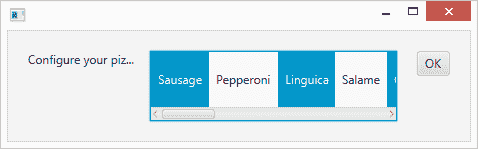

**图 6-4:** 水平列表视图控件。

你使用 `ListView` 类来创建列表视图控件。表 6-4 列出了该类最常用的构造函数和方法。

**表 6-4** 常用的 `ListView` 构造函数和方法

| 构造函数 | 说明 |
| :--- | :--- |
| `ListView<T>()` | 创建指定类型的空列表视图。 |
| `ListView<T>(ObservableList<T> items)` | 创建列表视图并用指定列表中的值填充它。 |

| 方法 | 说明 |
| :--- | :--- |
| `ObservableList<T> getItems()` | 获取项目列表。 |
| `void setItems(ObservableList<T> items)` | 设置项目列表。 |
| `void setOrientation(Orientation o)` | 设置列表的方向。该方向可以是 `Orientation.HORIZONTAL` 或 `Orientation.VERTICAL`。 |
| `MultipleSelectionModel<T> getSelectionModel()` | 返回列表视图控件的选择模型。 |

你可以使用选择模型通过调用其 `getSelectedItems()` 方法来获取已选择项的可观测列表。你也可以通过调用 `getSelectedItem()` 来获取最近选择的项。

### 从列表中选择

#### 创建列表视图

创建列表视图控件与创建组合框（combo box）类似。以下是一个创建了图 6-3 所示列表视图的示例：

```java
ListView list = new ListView();
list.getItems().addAll("Sausage", "Pepperoni", "Linguica", "Salame", "Olives", "Mushrooms", "Onions", "Peppers", "Pineapple", "Spinach", "Canadian Bacon", "Tomatoes", "Kiwi", "Anchovies", "Gummy Bears");
```

注意图 6-3 显示的列表视图仅显示列表中的前八项。与组合框一样，如果项目集合中的项目总数无法显示，则会自动向列表视图添加滚动条。

默认情况下，列表视图控件仅允许单项选择。要允许多项选择，请添加此行：

```java
list.getSelectionModel().setSelectionMode(SelectionMode.MULTIPLE);
```

要让列表视图水平排列而不是垂直排列，请添加此行：

```java
list.setOrientation(Orientation.HORIZONTAL);
```

#### 获取所选项

从列表视图控件获取所选项有点复杂。首先，你必须通过调用 `getSelectionModel()` 获取选择模型对象。然后，调用选择模型的 `getSelectedItems()` 方法。这返回一个只读的可观测列表，其中仅包含被选中的项。

以下示例构建了一个字符串，列出了用户为图 6-3 所示披萨配料列表视图选择的所有项目：

```java
String tops = "";
ObservableList<String> toppings;
toppings = list.getSelectionModel().getSelectedItems();
for(String topping : toppings)
{
    tops += topping + "\n";
}
```

在前面的示例中，字符串 `tops` 将包含用户选择的所有配料，并用换行符分隔。

### 使用树视图

*树视图*（tree view）是一种高级的 JavaFX 控件，它以大纲形式显示分级数据，我们这些电脑痴将其称之为树。树形结构在计算机世界非常常见。你磁盘驱动器的文件夹结构是一棵树，JavaFX 场景图也是如此。

696 第 6 册 **JavaFX**


图 6-5 显示了一个包含树视图控件的 JavaFX 场景。在这个示例中，我使用树控件来表示我喜欢的几部电视剧，以及从它们衍生出来的剧集。

**图 6-5:** 树视图控件。

在我介绍如何创建树控件的机制之前，你需要了解一些描述树中元素的术语：

- **节点 (Node):** 树中的每个元素都是一个*节点*。树中的每个节点都是由 `TreeItem` 类创建的。`TreeItem` 类是一个泛型类，你可以为它关联一个类型。因此，你可以使用任何类型的对象来创建树，包括你自己创建的类型。
- **根节点 (Root node):** *根节点*是树的起始节点。每棵树必须有一个且仅有一个根节点。当你创建一个树组件时，将根节点传递给 `TreeView` 构造函数。
- **子节点 (Child node):** 出现在给定节点下方的节点是该节点的子节点。
- **父节点 (Parent node):** 紧邻节点上方的节点是该节点的父节点。
- **兄弟节点 (Sibling node):** 具有相同父节点的节点。
- **叶子节点 (Leaf node):** 不具有任何子节点的节点。
- **路径 (Path):** 路径包含该节点及其所有祖先——即它的父节点、父节点的父节点等等——直到根节点。
- **展开节点 (Expanded node):** 子节点可见的展开节点。
- **折叠节点 (Collapsed node):** 子节点隐藏的折叠节点。

#### 构建树

在实际创建树视图之前，你必须先构建它显示的树。为此，请使用 `TreeItem` 类，详情见表 6-5。

**表 6-5** `TreeItem` 类

| 构造函数 | 说明 |
| :--- | :--- |
| `TreeItem<T>()` | 创建一个空树节点。 |
| `TreeItem<T>(T value)` | 创建指定值的树节点。 |

| 方法 | 说明 |
| :--- | :--- |
| `T getValue()` | 返回树项的值。 |
| `void setValue(T value)` | 设置树项的值。 |
| `ObservableList getChildren()` | 返回表示此树项子项的可观测列表。 |
| `TreeItem getParent()` | 获取父节点。 |
| `void setExpanded(boolean expanded)` | 指定展开节点。 |
| `boolean isExpanded()` | 返回树项是否展开。 |
| `boolean isLeaf()` | 返回树项是否为叶子节点（即没有子节点）。 |
| `TreeItem nextSibling()` | 返回树项的下一个兄弟节点。如果没有下一个兄弟节点，则返回 `null`。 |
| `TreeItem prevSibling()` | 返回树项的上一个兄弟节点。如果没有上一个兄弟节点，则返回 `null`。 |

`TreeItem` 类为每个节点提供了三个基本特征：

- **值 (value)**，包含了节点表示的数据。在我的示例中，我使用字符串作为用户对象，但你可以使用任何类型的对象作为用户对象。树控件调用用户对象的 `toString()` 方法来确定为每个节点显示的文本。
- **父节点 (parent)**，除非节点恰好是根节点。
- **子项 (children)**，用 `ObservableList` 表示。如果节点恰好是叶子节点，则列表将为空。

在本节中，我构建了一棵树，列出了过去三部热门电视剧的衍生剧：

- *《安迪·格里菲斯秀》（The Andy Griffith Show）* 产生有两个衍生剧：*《戈纳·派尔，美国海军陆战队》* 和 *《梅伯瑞 R.F.D.》*。
- *《家庭一切》（All in the Family）* 直接衍生了四部剧集：*《杰斐森一家》*、*《莫德》*、*《格洛丽亚》* 和 *《阿奇·邦克的地方》*。

此外，其中两部衍生剧又各自衍生了涉及女佣的剧集：杰斐森一家的女佣成为了一部名为《入住登记》（Checking In）的短剧的主角，而莫德的女佣则成为了《欢乐时光》（Good Times）的主角。

- *《欢乐时光》（Happy Days）* 衍生了 *《莫克与米迪》（Mork and Mindy）*、*《莱恩与莎莉》（Laverne and Shirley）* 以及 *《乔妮爱查奇》（Joanie Loves Chachi）*。

## 从列表中选择

你可以采取许多方法来构建树结构，其中大多数都涉及某种递归编程。为了保持简单，我将在本节中避免递归编程，但这种规避意味着你必须将树的一些细节硬编码到程序中。大多数处理树的实际程序都需要某种形式的递归编程来构建树。

创建树的第一步是为每个非叶子节点声明一个 `TreeItem` 变量。对于我的电视剧示例，我从以下代码开始：

```java
TreeItem andy, archie, happy, george, maude;
```

这些变量可以作为 `start` 方法中的局部变量，因为一旦设置好树，你就不再需要这些变量了。稍后你就会明白为什么不需要叶子节点的变量了。

接下来，我创建根节点并将其展开状态设置为 `true`，这样在树初始显示时它就会展开：

```java
TreeItem root = new TreeItem("Spin Offs ");
root.setExpanded(true);
```

为了简化创建其他节点，我使用了以下辅助方法 `makeShow`：

```java
public TreeItem<String> makeShow(String title, TreeItem<String> parent)
{
    TreeItem<String> show = new TreeItem<String>(title);
    show.setExpanded(true);
    parent.getChildren().add(show);
    return show;
}
```

此方法接受一个字符串和另一个节点作为参数，并返回一个用户对象被设置为 `String` 参数的节点。返回的节点也会作为子节点添加到父节点，并且该节点会被展开。因此，你可以调用此方法来同时创建新节点并将节点放置在树中。

下一步是创建一些节点。继续我的示例，我首先创建了《安迪·格里菲斯秀》及其衍生剧的节点：

```java
andy = makeShow("The Andy Griffith Show", root);
makeShow("Gomer Pyle, U.S.M.C.", andy);
makeShow("Mayberry R.F.D.", andy);
```

在这里，调用 `makeShow` 来为《安迪·格里菲斯秀》创建一个节点，并将根节点指定为其父节点。该方法返回的节点保存在 `andy` 变量中。然后调用两次 `makeShow` 来创建衍生剧，这次指定 `andy` 为父节点。

由于《戈纳·派尔，美国海军陆战队》和《梅伯瑞 R.F.D.》都没有衍生剧，我不需要将这些节点作为父参数传递给 `makeShow` 方法。这就是为什么我没有费心创建一个变量来引用这些节点。

接着在我的示例中，我创建了《家庭一切》及其衍生剧的节点：

```java
archie = makeShow("All in the Family", root);
george = makeShow("The Jeffersons", archie);
makeShow("Checking In", george);
maude = makeShow("Maude", archie);
makeShow("Good Times", maude);
makeShow("Gloria", archie);
makeShow("Archie Bunker's Place", archie);
```

在这种情况下，《杰斐森一家》和《莫德》有自己的子节点。因此，这两部剧需要变量，以便在我创建《入住登记》和《欢乐时光》的节点时，将它们作为父参数传递给 `makeShow`。

最后，这里是创建《欢乐时光》及其衍生剧节点的代码：

```java
happy = makeShow("Happy Days", root);
makeShow("Mork and Mindy", happy);
makeShow("Laverne and Shirley", happy);
makeShow("Joanie Loves Chachi", happy);
```

完整的树已在内存中成功创建，所以我可以开始创建一个 `TreeView` 控件来展示这棵树。

## 创建 `TreeView` 控件

你使用 `TreeView` 类来创建一个显示树节点的树组件。表 6-6 显示了该类的关键构造函数和方法。

**表 6-6：** `TreeView` 类

| 构造函数 | 描述 |
| :--- | :--- |
| `TreeView<T>()` | 创建一个空树（如果你问我的话，这没什么用）。 |
| `TreeView<T>(TreeItem root)` | 创建显示从指定节点开始的树。 |

| 方法 | 描述 |
| :--- | :--- |
| `TreeItem getRoot()` | 获取根节点。 |
| `void setRoot(TreeItem root)` | 设置根节点。 |
| `MultipleSelectionModel<T> getSelectionModel()` | 返回列表视图控件的选择模型。你可以调用 `getSelectedItem()` 来获取选中项的可观察列表。 |
| `void setShowRoot(boolean visible)` | 决定根节点是否可见。 |

创建 `TreeView` 控件的第一步是声明一个 `TreeView` 变量，以便可以在任何方法中访问它，如下：

```java
TreeView tree;
```

然后，在应用程序的 `start` 方法中，调用 `TreeView` 构造函数来创建树，传递你希望它显示的根节点：

```java
tree = new TreeView(root);
```

默认情况下，用户只能从树中选择一个节点。要允许选择多个节点，请使用此代码：

```java
tree.getSelectionModel().setSelectionMode(SelectionModel.MULTIPLE);
```

就这些了！你现在有了一个 `TreeView` 控件，可以将其添加到布局面板并在场景中显示。

虽然树控件显示的树必须从根节点开始，但在许多情况下，根节点是多余的。例如，在你看过的示例中，显示根节点有什么意义呢？如果你不想显示根节点，`TreeView` 控件允许你抑制。要隐藏根节点，只需调用此方法：

```java
tree.setShowRoot(false);
```

图 6-6 显示了隐藏根节点的树外观。

## 获取选中节点

有多种方法可以确定树视图中当前选择了哪些节点。一种方法是通过调用 `getSelectionModel()` 访问树的选择模型。然后，你可以调用选择模型的 `getSelectedItems()` 方法来返回一个包含已选中项的只读可观察列表。

例如：

```java
String msg = "";
ObservableList<TreeItem<String>> shows = tree.getSelectionModel().getSelectedItems();
for(TreeItem show : shows) {
    msg += show.getValue() + "\n";
}
```

前面的示例中，`msg` 字符串将包含用户从树中选择的所有节目，用换行符分隔。

另一种方法是添加一个事件处理器，每当选择发生变化时调用它。你可以这样做：

```java
tree.getSelectionModel().selectedItemProperty()
.addListener( (v, oldValue, newValue) -> tree_SelectionChanged(newValue) );
```

它调用了一个名为 `tree_SelectionChanged` 的方法。新选择的值将作为参数传递。

# 第 6 章 **从列表中选择** 703

以下是 `tree_SelectionChanged` 方法的内容：

```java
public void tree_SelectionChanged(TreeItem<String> item)
{
    if (item != null)
    {
        lblShowName.setText(item.getValue());
    }
}
```

在这里，一个名为 `lblShowName` 的标签被更新，以显示新选中项目的值。**注意：** 使用了 `if` 语句来确保该项目不为空。这是必要的，因为如果用户取消选择某个项目，则 `tree_SelectionChanged` 方法将以 `null` 值作为其 `item` 参数被调用。

## 查看使用树视图的完整程序

呼！有很多信息需要消化。在这一节中，我将它们整合在了一起。列表 6-1 显示了创建图 6-6 所示场景的完整程序。该程序允许用户从树中选择一个节目，并在树下方的标签中显示选中节目的标题。

**列表 6-1:** **衍生剧程序**


```java
import javafx.application.*;
import javafx.stage.*;
import javafx.scene.*;
import javafx.scene.layout.*;
import javafx.scene.control.*;
import javafx.geometry.*;

public class SpinOffs extends Application
{
    public static void main(String[] args)
    {
        launch(args);
    }

    TreeView<String> tree;
    Label lblShowName;

    @Override public void start(Stage primaryStage)
    {
        TreeItem<String> root, andy, archie, happy, george, maude;
        root = new TreeItem<String>("Spin Offs");
        root.setExpanded(true);
        andy = makeShow("The Andy Griffith Show", root);
        makeShow("Gomer Pyle, U.S.M.C.", andy);
        makeShow("Mayberry R.F.D", andy);
        archie = makeShow("All in the Family", root);
        george = makeShow("The Jeffersons", archie);
        makeShow("Checking In", george);
        maude = makeShow("Maude", archie);
        makeShow("Good Times", maude);
        makeShow("Gloria", archie);
        makeShow("Archie Bunker's Place", archie);
        happy = makeShow("Happy Days", root);
        makeShow("Mork and Mindy", happy);
        makeShow("Laverne and Shirley", happy);
        makeShow("Joanie Loves Chachi", happy);
        tree = new TreeView<String>(root);
        tree.setShowRoot(false);
        tree.getSelectionModel().selectedItemProperty()
            .addListener( (v, oldValue, newValue) ->
                tree_SelectionChanged(newValue) );
        lblShowName = new Label();
        VBox pane = new VBox(10);
        pane.setPadding(new Insets(20,20,20,20));
        pane.getChildren().addAll(tree, lblShowName);

        // 从列表中选择
        Scene scene = new Scene(pane);
        primaryStage.setScene(scene);
        primaryStage.setTitle("My Favorite Spin Offs");
        primaryStage.show();
    }

    public TreeItem<String> makeShow(String title, TreeItem<String> parent)
    {
        TreeItem<String> show = new TreeItem<String>(title);
        show.setExpanded(true);
        parent.getChildren().add(show);
        return show;
    }

    public void tree_SelectionChanged(TreeItem<String> item)
    {
        if (item != null)
        {
            lblShowName.setText(item.getValue());
        }
    }
}
```

此程序中的所有代码已在本章中展示过，因此我在这里只需指出重点：

- **→15:** 树模型和列表模型被定义为类实例变量。
- **→20:** 为根节点和每个带有衍生剧的节目定义了`TreeItem`变量。
- **→23:** 创建了文本为 "Spin-Offs" 的根节点。
- **→26:** 这些行代码为 *The Andy Griffith Show* 及其衍生剧创建了节点。
- **→31:** 这些行代码为 *All in the Family* 及其衍生剧创建了节点。
- **→39:** 这些行代码为 *Happy Days* 及其衍生剧创建了节点。
- **→44:** 该行代码创建了`TreeView`控件，并将根节点指定为树根。下一行隐藏了根节点。
- **→46:** 该行代码为被选中项目的属性创建了事件监听器。Lambda 表达式导致名为`tree_SelectionChanged`方法被调用。
- **→54:** `TreeView`控件和标签被添加到`VBox`中，然后添加到`scene`中。
- **→64:** `makeShow`方法根据字符串创建一个节点并将其添加到`parent`中。
- **→73:** 每当`lblShowName`变化时，就会调用`tree_SelectionChanged`方法。

704 书 6 **JavaFX**

```java
// 将场景添加到舞台上，设置标题
// 并显示舞台

primaryStage.setScene(scene);
primaryStage.setTitle("The Click Me App");
primaryStage.show();

}

public void buttonClick()
{
    if (btn.getText() == "Click me please!")
    {
        btn.setText("You clicked me!");
    }
    else
    {
        btn.setText("Click me please!");
    }
}
```

可以使用命令行提示符通过以下命令将`ClickMe.java`源文件编译为 Java 类文件：

```bash
javac ClickMe.java
```

然后，可以使用此命令使用类文件创建一个可执行的 JAR 文件：

```bash
jar cf ClickMe.jar *.class
```

创建 JAR 文件后，你就可以准备配置 Java Web Start 以从网页上启动`ClickMe`程序了。

# 使用 Java Web Start

## 了解 Java Web Start

Java Web Start 的工作原理是提供一个指向特殊文件`JNLP`的链接。该文件包含了在用户计算机上下载和启动 Java 应用程序所需的所有信息。当用户点击`JNLP`文件的链接时，Web 服务器会读取`JNLP`文件的内容，下载 Java 程序，并在用户的计算机上运行它。

通过 Java Web Start，Java 程序不会在用户的 Web 浏览器环境中运行。相反，Java Web Start 在用户的计算机上本地运行 Java 虚拟机（`JVM`），然后在`JVM`内部运行应用程序。

一种名为`applets`的旧技术允许 Java 程序直接在 Web 浏览器中运行。这需要浏览器插件的帮助，而这可能会导致不同插件版本之间的兼容性问题。浏览器制造商最近宣布他们将不再包含支持 applets 的插件，且 Oracle 已在 Java 9 中正式弃用了 applets。

如果用户的计算机上没有安装 Java 运行时（或安装的版本不正确），Java Web Start 将提供自动下载并安装 Java 运行时的服务。因此，即使用户没有安装 Java，只需点击几次鼠标即可安装 Java 并运行 Java 应用程序。

通常情况下，通过 Java Web Start 运行的应用程序会被阻止执行某些可能会给用户带来安全风险的操作，例如在用户文件系统上进行读写操作或访问用户的本地网络。你可以配置 Java Web Start 安全功能以允许此类类型的活动，但这样做超出了本书的范围。有关更多信息，请在网上搜索`Java Web Start`。

设置通过 Java Web Start 运行应用程序的通用流程如下：

### 1. 创建包含你想通过 Java Web Start 运行的 Java 应用程序的 JAR 文件。

有关如何创建 JAR 文件的信息，请参考第 3 第 8 章。在本章中，假设你已经为`ClickMe`应用程序创建名为`ClickMe.jar`的 JAR 文件。

### 2. 创建 JNLP 文件，指定启用程序从 Java Web Start 运行的必要信息。

此外，`JNLP`文件必须包含应用程序 JAR 文件的位置。对于本章所示的应用程序，我们将 JNLP 文件命名为`clickme.jnlp`。

有关创建`JNLP`文件的更多信息，请参见下一节。

### 3. 创建一个包含指向 JNLP 文件链接的 HTML 文件。

HTML 文件将显示在用户的浏览器中。当用户点击`JNLP`文件的链接时，`JNLP`文件中定义的应用程序就会运行。在本章中，HTML 文件将命名为`clickme.html`。

有关创建 HTML 文件的更多信息，请参见本章后后部分的“创建一个启动 Java 应用程序的 HTML 文件”章节。

### 4. 将 JAR、JNLP 和 HTML 文件拷贝到 Web 服务器相应的文件夹中。

可以使用任何 FTP 客户端（如`FileZilla`）将文件上传到你的 Web 服务器，或者使用你的 Web 主机的文件管理工具来上传文件。在大多数情况下，JAR、`JNLP`和 HTML 文件将位于 Web 服务器上的同一个文件夹中。不过，也可以将每个文件保存到不同的文件夹。

## 创建 JNLP 文件

要通过 Java Web Start 部署 Java 应用程序，你必须创建一个`JNLP`文件，其中包含定位和运行应用程序所需的详细信息。`JNLP`文件是一个小型 XML 文件，包含诸如应用程序名称、指向应用程序 JAR 文件的 URL、创建应用程序的供应商、应用程序所需的 Java 版本，以及在用户计算机上尚未安装 Java 运行时时用于下载 Java 运行时的 URL。

`JNLP`代表`Java Network Launch Protocol`（Java 网络启动协议），但这不会出现在考试中。如果你还不熟悉 XML 的基础知识，可以在第 8 卷第 5 章中学习 XML 的语法要求。

## 使用 Java Web Start

列表 1-2 显示了一个名为`ClickMe.jnlp`的`JNLP`文件，可以用于从网站`www.lowewriter.com`运行`ClickMe`应用程序。

```xml
<?xml version="1.0" encoding="UTF-8"?>
<jnlp codebase="http://www.lowewriter.com/ClickMe/" version="1.0">
  <information>
    <title>ClickMe</title>
    <vendor>LoweWriter</vendor>
  </information>
  <resources>
    <jar href="ClickMe.jar" main="true" />
  </resources>
  <application-desc main-class="ClickMe"/>
</jnlp>
```

此 JNLP 文件中的大多数行对于所有 Java 应用程序都是相同的。特定的 Java 应用程序需要更改的行如下：

- **codebase**: 应更改为应用程序所在的根位置。在这种情况下，应用程序的文件存储在`http://www.lowewriter.com/ClickMe/`。虽然`codebase`属性不是绝对要求的，但使用它可以简化 JNLP 文件的其他部分，因为 JNLP 文件中出现的其他 URL 都是相对于`codebase`的。
- **href (in jnlp)**: 指向 JNLP 文件的路径。注意，在示例中我只指定了文件名而不是完整路径。因为 jnlp 文件位于`http://www.lowewriter.com/ClickMe/`文件夹中，此处只需指定文件名。
- **title**: 提供应用程序的名称——在本例中，“ClickMe”。
- **vendor**: 提供应用程序供应商的名称——在本例中，“LoweWriter”。
- **href (in jar)**: 提供应用程序 JAR 文件的位置。同样，由于此文件位于`codebase`指定的文件夹中，我在这里只需指定文件名。
- **main-class**: 指向应用程序主类的名称，该类包含了启动应用程序时调用的`main`方法。在这种情况下，主类是`ClickMe`。

# 启动 Java

一旦你创建了描述 Java Web Start 应用程序的 JNLP 文件，就可以创建一个 HTML 文件，用户可以通过查看该文件来启动应用程序。该 HTML 文件应该包含指向 JNPL 文件的链接。提供该链接最简单的方法是在 HTML 文件中使用`a`元素，如列表 1-3 所示的`ClickMe.html`文件。

### 列表 1-3：一个链接到 JNPL 文件的 HTML 文件

```html
<html>
<head>
<title>ClickMe (Java Web Start)</title>
</head>
<body>
<h1>ClickMe!</h1>
<a href=ClickMe.jnlp>Run the ClickMe application</a>
</body>
</html>
```

在列表 1-3 中，`a`元素提供了必要的链接：

**使用 Java Web Start**

```html
<a href-clickme.jnlp>Run the ClickMe application</a>
```

图 1-2 显示了`ClickMe.html`文件在浏览器窗口中显示时的外观。

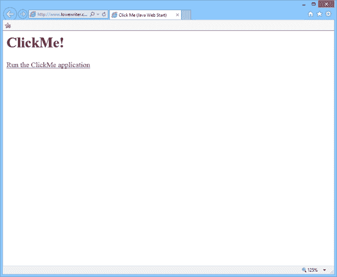

**图 1-2：** ClickMe HTML 页面。

# 将 Java Web Start 文件上传到 Web 服务器

对于这个简单的 Java Web Start 应用程序，我一共创建了五个文件：

*   `ClickMe.java`：`ClickMe`应用程序的源代码，如列表 1-1 所示。
*   `ClickMe.class`：`ClickMe`应用程序的编译类文件，由 Java 编译器创建。
*   `ClickMe.jar`：包含`ClickMe`类的 JAR 文件。该文件将上传到 Web 服务器，当用户从网页启动应用程序时，它会被下载到用户的计算机。
*   `ClickMe.jnlp`：引用`ClickMe.jar`文件的 JNLP 文件。该文件也将上传到 Web 服务器。
*   `ClickMe.html`：提供`ClickMe.jnlp`文件链接的 HTML 文件。该文件也将上传到 Web 服务器。

JAR、JNLP 和 HTML 文件都需要上传到你的 Web 服务器，以便用户能够通过浏览器访问它们。你可以使用任何你喜欢的方法上传文件。如果你倾向于使用 FTP，可以使用`FileZilla`等 FTP 客户端来上传文件。如果你的 Web 托管主机提供上传工具，你可以使用它。或者，如果你的 Web 服务器位于自己的网络中（例如，如果是内网服务器），你可以简单地使用操作系统拷贝文件。

无论你如何实现，目标是将 JAR、JNLP 和 HTML 文件放在 Web 服务器上的一个文件夹中。对于`ClickMe`应用程序，我将文件上传到了 Web 根目录下的`ClickMe`文件夹中，因此可以通过 URL `http://www.lowewriter.com/ClickMe/ClickMe.html`访问 HTML 文件。

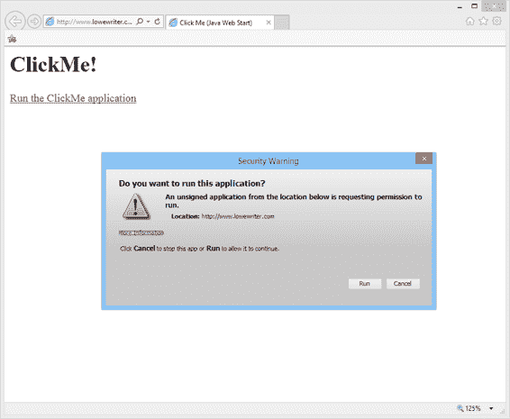

# 使用 Java Web Start 启动 ClickMe 应用程序

当所有文件就绪后，Web 用户可以通过打开 Web 浏览器并导航到 HTML 页面的 URL（在示例中为`http://www.lowewriter.com/ClickMe/ClickMe.html`）来访问`ClickMe`应用程序。参考图 1-2 查看页面在浏览器窗口中的显示。

当用户点击`Run the ClickMe application`链接时，会显示图 1-3 所示的对话框，询问用户是否想要运行该应用程序。

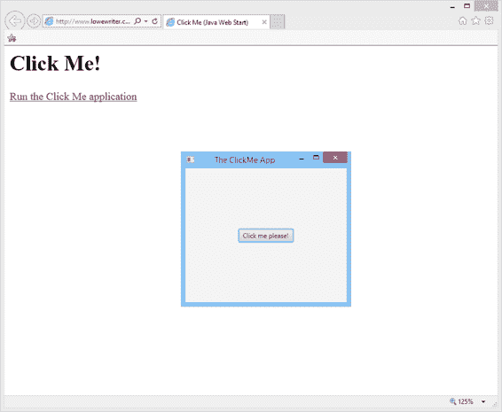

**图 1-3：** 用户点击 Java Web Start 链接时显示的安全提示。


假设用户点击运行（Run），随后运行`ClickMe`应用程序，如图 1-4 所示。

**图 1-4：**运行中的`ClickMe`应用程序。

# 创建异常以允许 Java 应用程序运行

某些情况下，Java 的安全设置可能会阻止 Java 应用程序运行。如果发生这种情况，用户可以通过将应用程序的 URL 添加到 Java 异常列表（Exception List）来解决问题。以下是在 Windows 计算机执行此操作的步骤：

1. **打开 Java 控制面板。**最简单的方法是按下开始按钮，输入`java`，按回车，然后点击配置 Java。

2. **点击“Web”选项卡。**由于你正在更改安全设置，你可能认为需要点击“安全”（Security）选项卡。但异常列表位于“Web”选项卡上，如图 6 所示。

3. **点击“添加”（Add）。**这会弹出一个文本输入框，你可以在其中输入 URL。

4. **输入你想添加的网站 URL 并按回车。**在此示例中，输入`http://www.lowewriter.com`。该 URL 将添加到异常列表中。

5. **点击“确定”关闭 Java 控制面板。**现在你应该能够通过 Java 运行应用程序了。

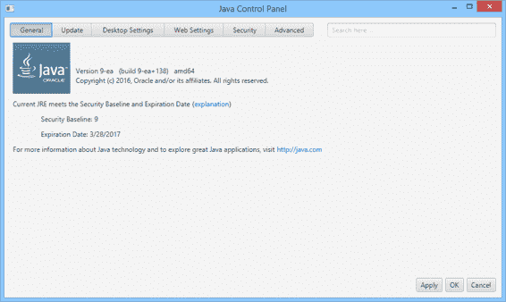 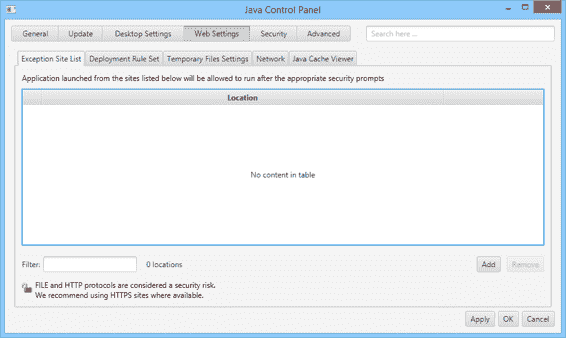

**图 5：**Java 控制面板。

**图 6：**“Web”选项卡。

# 创建 Servlet

Servlet 是今天开发 Web 应用程序最流行的方式之一。许多知名网站都由 Servlet 驱动，包括 Gmail、Amazon、LinkedIn 和 eBay。在本章中，我将向你介绍基础知识：什么是 Servlet、如何设置你的计算机以编写和测试 Servlet，以及如何创建一个简单的 Servlet。接下来的两章将在此基础上扩展该主题。

## 理解 Servlet

在理解什么是 Servlet 以及它如何工作之前，你需要了解 Web 服务器的工作原理。Web 服务器使用一种称为`HTTP`的网络协议向用户发送网页。（`HTTP`代表超文本传输协议，但测试中不会涉及它。）通过`HTTP`，客户端计算机使用统一资源定位符（即`URL`）请求位于服务器上的文档。`HTTP`采用`请求/响应模型`，这意味着客户端（Web 用户）向`HTTP`服务器发送请求，服务器反向客户端发送响应。

基础的`HTTP`交互工作如下：

1. 使用运行在客户端计算机上的 Web 浏览器程序指定要访问的文件的`URL`。在某些情况下，你实际上输入地址的`URL`，但大多数情况下点击指定`URL`的链接。

2. 你的 Web 浏览器向`URL`指定服务器计算机发送`HTTP`请求消息。请求包含了你想检索的文件名。

3. 服务器计算机接收文件请求，检索所需的文件，并以`HTTP`响应消息的形式将文件传给你。

4. 浏览器接收文件，解释其中包含的`HTML`，并在屏幕上显示结果。

关于普通交互最重要的点是它们是静态的。静态静态意味着发送给用户的文件内容始终相同。如果用户连续请求同一个文件 20 次，同一个页面就会显示 20 次。

相比之下，Servlet 提供了一种动态内容的方式。`servlet`是扩展`javax.servlet.Servlet`类的 Java 程序。`Servlet`类使程序能够在 Web 服务器上响应用户请求并运行，Servlet 的输出作为 HTML 页面发送回 Web 用户。

关键的第三步是 servlet 与众不同的之处。如果用户指定的 URL 指向的是 servlet 而不是文件，那么第 3 步的操作如下：

**3.**服务器计算机接收 servlet 请求，找到请求所指示的 Java 程序，运行它，并以 HTTP 响应消息的形式返回程序的输出。

换句话说，服务器不是发送文件的内容，而是发送由 servlet 程序生成的输出。通常情况下，servlet 程序会生成一些由浏览器显示的 HTML。

Servlet 的设计初衷是快速完成工作并结束。每当 servlet 运行时，它都会处理来自浏览器的一个请求，生成一个发送回浏览器的页面，然后结束。下一次当该用户或任何其他用户再次请求同一个 servlet 时，servlet 将再次运行。

722 页 第 7 卷 **Web 编程**

## 使用 Tomcat

遗憾的是，你不能在任何旧的电脑上运行 servlet 程序。首先，你必须安装一个名为`servlet engine`（servlet 引擎）的特殊程序，将你的计算机变成能够运行 servlet 的服务器。最著名的 servlet 引擎是 Apache Tomcat，你可以从 Apache 软件基金会在[`tomcat.apache.org/default.htm`](http://tomcat.apache.org/default.htm)免费获取。在本章中，我使用的是 Tomcat 8 版本。

## 创建 Servlet

Tomcat 也可以作为一个基础 Web 服务器。在实际生产环境中，Tomcat 通常与专门的 Web 服务器（如 Apache 的 HTTP Server）结合使用。

### 安装和配置 Tomcat

安装 Tomcat 并不是什么复杂的科学，但也不像做吐司那样简单。你可以按照以下步骤来设置 Tomcat 8：

#### 1. 从 Apache 网站下载 Tomcat Zip 文件（`http://tomcat.apache.org/default.htm`）。

尽管 Apache 也提供了一个用于安装 Tomcat 的可执行设置文件，但我建议你下载 Zip 文件。

#### 2. 通过右键点击文件并选择“解压所有”来解压 Zip 文件的内容；然后指定`c:\`为文件的解压位置。

我知道你不想让你的根目录堆满一堆文件，但 Tomcat Zip 文件包含一个名为`apache-tomcat-8_0_0`的文件夹（版本号可能会有所不同），所以只会创建一个这个文件夹。在解压所有文件后，给这个文件夹重命名一个更容易输入的名称。我建议使用`c:\tomcat`

#### 3. 创建一个名为`JAVA_HOME`的环境变量，指向你的 Java 开发工具包（JDK）位置。

要创建环境变量，打开控制面板，双击“系统”图标，然后点击“高级系统设置➪环境变量➪新建”，并创建一个名为`JAVA_HOME`的变量。该变量的值需要是你 JDK 安装文件夹的完整路径，例如`c:\Program Files\Java\jdk-9`。

一个常见的错误是将此变量设置为`bin`目录或 Java 运行环境（JRE）目录，而不是 JDK。如果以后 Tomcat 没有启动，请双检查`JAVA_HOME`目录。

723 页 第 2 章节 **创建 Servlet**

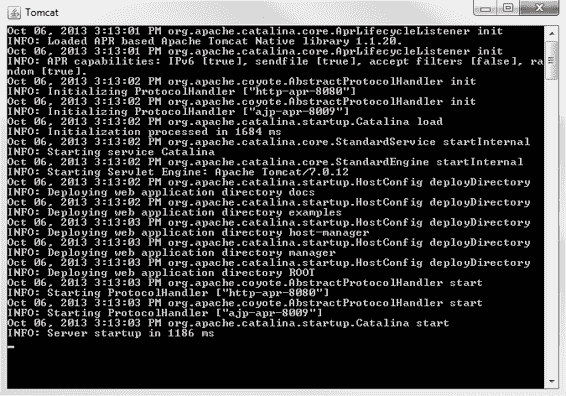

#### 4. 将`servlet-api.jar`文件复制到 JDK 根目录下的`jre\lib\ext`文件夹。

如果你的 JDK 安装在`c:\Program Files\Java\jdk-9`，请将此文件复制到`c:\Program Files\Java\jdk-9\jre\lib\ext`。假设你已将 Tomcat 文件解压到`c:\tomcat`，你可以在`c:\tomcat\lib`中找到`servlet-api.jar`文件。

如果你跳过这一步或将`servlet-api.jar`文件复制到错误的位置，将无法编译你的 servlet 程序。如果你收到编译器信息抱怨`javax.servlet`包不存在，请双检查此步骤以确保你操作正确。

### 启动和停止 Tomcat

安装并配置 Tomcat 后，你可以通过打开命令窗口、切换到`c:\tomcat\bin`目录并输入`startup`来启动它。批处理文件运行并启动 Tomcat。当 Tomcat 启动时，它会打开第二个命令窗口，显示各种状态消息。图 2-1 显示了状态窗口运行。

**图 2-1：**

正在启动 Tomcat。

当你看到类似下面的行时，说明 Tomcat 已经启动，它指示了启动所需的时间：

```text
INFO: Server startup in 1186 ms
```

如果 Tomcat 窗口出现几秒钟，然后一条异常消息飞闪而过且窗口关闭，最可能的问题是你系统中已经运行了一个 Web 服务器，而该服务器已经占用了 Tomcat 想用于 HTTP 通信的端口。该问题的解决方法是编辑`c:\tomcat\conf`中的`server.xml`文件，并查找此标签：

```xml
<Connector port="8080"... />
```

724 页 第 7 卷 **Web 编程**

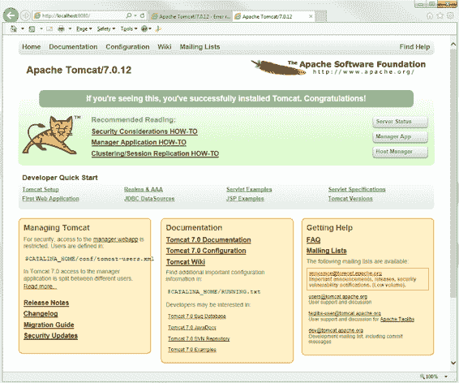

将端口号从 8080 改为其他数字，例如 18080。稍后当你在浏览器窗口中显示 servlet 时，必须将此数字指定为 HTTP 端口号，而不是 8080。

在修改其中一个配置文件后，你不需要关闭 Tomcat。你可以通过运行`shutdown`批文件来停止 Tomcat。`c:\tomcat\bin`目录下运行`startup`批文件可以再次启动。

## 创建 Servlet

### 测试 Tomcat

要确定 Tomcat 是否安装正确，打开 Web 浏览器，并输入以下地址：`http://localhost:8080`（如果你通过编辑`server.xml`修改了端口号，请使用你指定的端口号代替 8080）。

会出现如图 2-2 所示页面。如果没有出现，请参考本章前面的“安装和配置 Tomcat”部分，并双检查每个步骤以确保操作正确。

**图 2-2：**

测试 Tomcat。

725 页 第 2 章节 **创建 Servlet**

## 创建简单的 Servlet

好了，配置部分结束；现在你可以开始编写代码。接下来的章节将介绍创建简单的 HelloWorld 类型 servlet 的基础。

### 导入包

大多数 servlet 需要访问三个包：`javax.servlet`、`javax.servlet.http`和`java.io`。因此，通常从以下导入语句开始：

```java
import java.io.*;
import javax.servlet.*;
import javax.servlet.http.*;
```

根据你的 servlet 执行的其他处理，可能需要额外的导入语句。

### 扩展 HttpServlet 类

要创建一个 servlet，你需要编写一个扩展`HttpServlet`类。表 2-1 列出了可以在 servlet 类中重写的六个方法。

**表 2-1**

**HttpServlet 类**

| 方法 | 调用时机 | 签名 |
| :--- | :--- | :--- |
| `doDelete` | HTTP DELETE 请求 | `public void doDelete(HttpServletRequest request, HttpServletResponse response) throws IOException, ServletException` |
| `doGet` | HTTP GET 请求 | `public void doGet(HttpServletRequest request, HttpServletResponse response) throws IOException, ServletException` |
| `doPost` | HTTP POST 请求 | `public void doPost(HttpServletRequest request, HttpServletResponse response) throws IOException, ServletException` |
| `doPut` | HTTP PUT 请求 | `public void doPut(HttpServletRequest request, HttpServletResponse response) throws IOException, ServletException` |
| `init()` | servlet 首次运行时 | `public void init() throws ServletException` |
| `destroy()` | servlet 被销毁时 | `public void destroy()` |

726 页 第 7 卷 **Web 编程**

大多数 servlet 至少重写了`doGet`方法。当用户通过浏览器地址栏输入地址或点击指向该 servlet 的链接请求该 servlet 时，servlet 引擎会调用该方法。

有两个参数被传递给`doGet`方法：

- 一个`HttpServletRequest`对象，代表来自用户的入站请求。你主要使用`request`参数来获取用户在表单字段中输入的数据。你将在本章稍后的“从用户处获取输入”部分中了解如何进行操作。

- 一个`HttpServletResponse`对象，代表发送给用户的响应。你使用`response`参数来构建返回给用户的输出内容。你将在下一节中了解如何操作。

## 打印到网页上

大多数 Servlet 的主要工作之一是编写 HTML 输出，并将其发送回用户的浏览器。要实现这一点，你首先需要调用`HttpServletResponse`类的`getWriter()`方法，该方法返回一个与响应对象连接的`PrintWriter`对象。因此，你可以使用熟悉的`print`和`println`方法来写入 HTML 文本。

下面是一个简单的`HelloWorld`Servlet 的`doGet`方法示例：

```java
public void doGet(HttpServletRequest request, HttpServletResponse response)
throws IOException, ServletException
{
    PrintWriter out = response.getWriter();
    out.println("Hello, World!");
}
```

这里，通过`response.getWriter()`返回的`PrintWriter`对象被用于向浏览器发送一个简单的文本字符串。如果你运行这个 Servlet，浏览器将显示文本`Hello, World!`。

## 使用 HTML 响应

在大多数情况下，你并不想向浏览器发送简单的文本。相反，你想要发送格式化的 HTML。要做到这一点，你必须首先告诉响应对象输出是 HTML 格式的。你可以通过调用`setContentType()`方法并将字符串`"text/html"`作为参数传递来实现。然后你就可以使用`PrintWriter`对象来发送 HTML。

列表 2-1 显示了一个发送 HTML 响应的基础`HelloWorld`Servlet。

### 列表 2-1：HelloWorld Servlet

```java
import java.io.*;
import javax.servlet.*;
import javax.servlet.http.*;
import java.util.*;

public class HelloWorld extends HttpServlet
{
    public void doGet(HttpServletRequest request, HttpServletResponse response)
    throws IOException, ServletException
    {
        response.setContentType("text/html");
        PrintWriter out = response.getWriter();
        out.println("<html>>");
        out.println("<head>");
        out.println("<title>HelloWorld</title>");
        out.println("</head>");
        out.println("<body>");
        out.println("<h1>Hello, World!</h1>");
        out.println("</body>");
        out.println("</html>");
    }
}
```

在这里，以下 HTML 将被发送到浏览器（我添加了缩进以显示 HTML 的结构）：

```html
<html>
<head>
    <title>HelloWorld</title>
</head>
<body>
    <h1>Hello, World!</h1>
</body>
</html>
```

运行时，`HelloWorld`Servlet 会产生图 2-3 所示的页面。显然，你对 HTML 有深入的理解才能编写 Servlet。如果 HTML 像是一门外语语言，那么在继续学习之前，你需要找一本好的 HTML 书，例如由 Ed Tittel 和 Jeff Noble（Wiley）编写的*HTML, XHTML, & CSS For Dummies*第 7 版。

为了方便你参考，表 2-2 总结了我在书中使用的所有 HTML 标签。

### 表格 2-2：足够使用的的 HTML

| HTML 标签 | 描述 |
| :--- | :--- |
| `<html>`、`</html>` | 标记 HTML 文档的开始和结束。 |
| `<head>`、`</head>` | 标记 HTML 文档 head 部分的开始和结束。 |


| `<title>`、`</title>` | 标记标题元素。开始和结束标签之间的文本显示在浏览器窗口的标题栏中。 |
| `<body>`、`</body>` | 标记 HTML 文档 body 部分的开始和结束。文档的内容位于这些标签之间。 |
| `<h1>`、`</h1>` | 将这些标签之间的文本格式化为 1 级标题。 |
| `<h2>`、`</h2>` | 将这些标签之间的文本格式化为 2 级标题。 |
| `<h3>`、`</h3>` | 将这些标签之间的文本格式化为 3 级标题。 |
| `<form action=` | 标记表单的开始。`action` 属性指定表单提交到的页面名称 `""url"`、Servlet 或 JavaServer 页面 (JSP)。`method` 属性可以是 `"GET"` 或 `"POST"`；它指示发送到服务器的 HTTP 请求类型。 |
| `</form>` | 标记表单的结束。 |
| `<input type=` | 创建一个输入字段。指定 `type="text"` 创建文本字段，或指定 `type="submit"` 创建提交按钮。`name` 属性提供了你在程序中使用的 `"name"`，用于检索用户输入的数据。 |
| `&nbsp;` | 代表不换行空格。 |

## 运行 Servlet

到底如何运行 Servlet 呢？首先，你必须编译 `.java` 文件以创建 `.class` 文件；然后你必须将 `.class` 文件移动到 Tomcat 可以运行该 Servlet 的目录中。为了测试，你可以将 Servlet 的类文件移动到 `c:\tomcat\webapps\Examples\WEB-INF\classes`，然后输入如下的地址：

`http://localhost:8080/servlet/HelloWorld`

你可能还想要重写 `doPost` 方法，以处理 POST 请求，因为许多 Servlet 与表单相关，用户可以在其中输入数据。如果你想让 Servlet 响应 POST 请求，可以重写 `doPost` 方法，而不是（或额外的）`doGet` 方法。除了方法名外，`doPost` 的签名与 `doGet` 相同。事实上，经常看到 `doPost` 方法直接调用 `doGet`：

```java
public void doPost(HttpServletRequest request, HttpServletResponse response)
throws IOException, ServletException
{
    doGet(request, response);
}
```

为了这样做，你可以这样编写 `doPost` 方法：

## 改进 HelloWorld Servlet

在本章前面所示 `HelloWorld` Servlet 并不有趣，因为它总是发送相同的文本。本质上，它是一个静态 Servlet —— 这很大程度上失去了使用 Servlet 的意义。你可以轻松提供一个静态 HTML 页面。

列表 2-2 展示了更动态的 `HelloWorld` Servlet。这个版本随机显示六种问候语之一。它使用 Math 类的 `random` 方法在 1 到 6 之间选取一个随机数，然后根据这个数字决定显示哪种问候语。它还重写了 `doPost` 方法以及 `doGet` 方法，因此 POST 和 GET 的方式相同。

### 列表 2-2：HelloServlet Servlet

```java
import java.io.*;
import javax.servlet.*;
import javax.servlet.http.*;
import java.util.*;

public class HelloServlet extends HttpServlet
{
    public void doGet(HttpServletRequest request, HttpServletResponse response)
    throws IOException, ServletException
    {
        response.setContentType("text/html");
        PrintWriter out = response.getWriter();
        String msg = getGreeting();
        out.println("<html>");
        out.println("<head>");
        out.println("<title>HelloWorld Servlet</title>");
        out.println("</head>");
        out.println("<body>");
        out.println("<h1>");
        out.println(msg);
        out.println("</h1>");
        out.println("</body>");
        out.println("</html>");
    }

    public void doPost(HttpServletRequest request, HttpServletResponse response)
    throws IOException, ServletException
    {
        doGet(request, response);
    }

    private String getGreeting()
    {
        String msg = "";
        int rand = (int)(Math.random() * (6)) + 1;
        // ... 设置问候语的逻辑 ...
        return msg;
    }
}
```

*(续上)*

# 第 2 章 创建 Servlet 731

**代码列表 2-2：**

```java
switch (rand)
{
case 1:
return "Hello, World!";
case 2:
return "Greetings!";
case 3:
return "Felicitations!";
case 4:
return "Yo, Dude!";
case 5:
return "Whasssuuuup?";
case 6:
return "Hark!";
}

return null;
}

```

## 从用户获取输入

如果 Servlet 被来自表单的 HTTP GET 或 POST 请求调用，你可以调用 `request` 对象的 `getParameter` 方法来获取用户在每个表单字段中输入的值。这里有一个示例：

`String name = request.getParameter("name")`

这里获取了名为 `name` 的表单输入字段中输入的值，并将其赋值给 `String` 变量 `name`。

## 表单操作

如你所见，在 Servlet 中获取用户输入的数据是非常简单的。困难的部分是创建一个允许用户输入数据的表单。为了实现这一点，你需要使用单独的 HTML 文件来创建表单。代码列表 2-3 显示了一个名为 `InputServlet.html` 的 HTML 文件，它显示了图 2-4 所示的表单。

732 第 7 本书 **Web Programming**

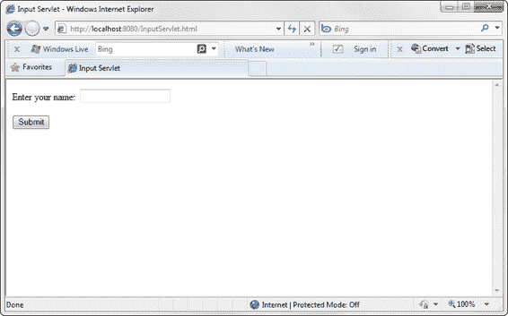

## 创建 Servlet

**图 2-4：** 一个简单的输入表单。

**代码列表 2-3：**

**InputServlet.html 文件**

```html
<<html>
<head>
<title>Input Servlet</title>
</head>
<body>
<form action="/servlet/InputServlet" method="post">
Enter your name:&nbsp;
<input type="text" name="Name">
<br><br>
<input type="submit" value="Submit">
</form>
</body>
</html>
```

该表单 `form` 标签中的 `action` 属性指定了在提交表单时调用 `/servlet/InputServlet`，而 `method` 属性表示表单是通过 POST 请求而非 GET 请求提交的。表单本身由一个名为 `name` 的输入文本字段和一个 提交（Submit）按钮组成。它并没有什么复杂的——足以从用户那里获取一些文本并发送到 Servlet。

## 使用 InputServlet Servlet

代码列表 2-4 显示了一个可以从代码列表 2-3 所示的表单中检索数据的 Servlet。

**代码列表 2-4：**

**InputServlet Servlet**

```java
import java.io.*;
import javax.servlet.*;
import javax.servlet.http.*;
public class InputServlet extends HttpServlet
{
public void doGet(HttpServletRequest request, HttpServletResponse response)
    throws IOException, ServletException
{
    String name = request.getParameter("Name");
    response.setContentType("text/html");
    PrintWriter out = response.getWriter();
    out.println("<html>");
    out.println("<head>");
    out.println("<title>Input Servlet</title>");
    out.println("</head>");
    out.println("<body>");
    out.println("<h1>");
    out.println("Hello " + name);
    out.println("</h1>");
    out.println("</body>");
    out.println("</html>");
}
public void doPost(HttpServletRequest request, HttpServletResponse response)
    throws IOException, ServletException
{
    doGet(request, response);
}
}
```

如你所见，这个 Servlet 与代码列表 2-1 中的第一个 HelloWorld Servlet 并没有太大区别。最大的区别在于它检索了用户在 `name` 字段中输入的值，并将其用于发送到响应 `PrintWriter` 对象的 HTML 中。例如，如果用户在 `name` 输入字段中输入了 Calvin Coolidge，则会生成以下 HTML：

734 第 7 本书 **Web Programming**

```html
<<html><head><title>HelloWorld</title></head><body><h1>Hello Calvin Coolidge</h1></body></html>
```

因此，页面上将显示消息 Hello Calvin Coolidge。虽然现实生活中的 Servlet 做的比简单地重复用户输入的信息多得多，但大多数它们都遵循这种惊地简单的结构——当然，会有一些变化。真实世界中的 Servlet 会验证输入数据，并在用户输入错误数据或遗漏重要数据时显示错误信息，大多数真实的 Servlet 会在文件或数据库中检索或更新数据。尽管如此，基本结构也几乎是相同的。

## 在 Servlet 中使用类

在开发 Servlet 时，你通常想要访问你创建的其他类，例如从文件或数据库检索数据的输入/输出（I/O）类、提供常用功能（如数据验证）的工具或辅助类，甚至可能代表业务对象（如客户或产品）的类。为了实现这一点，你只需要将类文件保存在 Servlet 根目录下的 `classes` 目录——对于本章而言，它是 `c:\tomcat\webapps\ROOT\WEB-INF\classes`。

为了说明使用多个类的 Servlet，图 2-5 显示了一个列出从文本读取的电影的 Servlet 输出。此 Servlet 使用了三个类：

- **Movie**：代表单个电影的类。

- **MovieIO**：一个具有 `static public` 方法 `getMovies` 的类。它返回从文件中读取的电影的 `ArrayList`。

- **listFiles**：主 Servlet。它调用 `Movie`。

735


**图 2-5：** ListMovie Servlet。此 Servlet 使用了三个类：

- **Movie**：代表单个电影的类。

- **MovieIO**：一个具有 `static public` 方法 `getMovies` 的类。它返回从文件中读取的电影的 `ArrayList`。

- **listFiles**：主 Servlet。它调用 `Movie`。

736

**Web Programming**

这里代表文件中的制表符。我并不是要介绍 `Movie` 类的细节，而是指出 `getMovies` 是静态的（static），所以你不需要创建 `MovieIO` 的实例。

代码列表 2-6：

**MovieIO 类**

```java
import java.io.*;
import java.util.*;
public class MovieIO {
    public static ArrayList<Movie> getMovies() {
        ArrayList<Movie> movies = new ArrayList<Movie>();
        BufferedReader in = getReader("data\\movies.txt");
        Movie movie = readMovie(in);
        while (movie != null) {
            movies.add(movie);
            movie = readMovie(in);
        }
        return movies;
    }
    private static BufferedReader getReader(String name) {
        BufferedReader in = null;
        try {
            File file = new File(name);
            in = new BufferedReader(new FileReader(file));
        } catch (FileNotFoundException e) {
            System.out.println("The file doesn't exist.");
            System.exit(0);
        }
        return in;
    }
    private static Movie readMovie(BufferedReader in) {
        String title;
        int year;
        double price;
        String line = "";
        try {
            line = in.readLine();
        } catch (IOException e) {
            System.out.println("I/O Error");
            System.exit(0);
        }
        if (line == null) return null;
        else {
            String[] data = line.split("\t");
            title = data[0];
            year = Integer.parseInt(data[1]);
            price = Double.parseDouble(data[2]);
            return new Movie(title, year, price);
        }
    }
}
```

737

*(续上)*


```java
catch (FileNotFoundException e) {
    System.out.println("The file doesn't exist.");
    System.exit(0);
}
return in;
}

private static Movie readMovie(BufferedReader in) {
    String title;
    int year;
    double price;
    String line = "";
    try {
        line = in.readLine();
    } catch (IOException e) {
        System.out.println("I/O Error");
        System.exit(0);
    }
    if (line == null) return null;
    else {
        String[] data = line.split("\t");
        title = data[0];
        year = Integer.parseInt(data[1]);
        price = Double.parseDouble(data[2]);
        return new Movie(title, year, price);
    }
}
}
```

738 第 7 本书 **Web Programming**

代码列表 2-7 显示了 `ListMovie` Servlet 类的代码。

## 代码列表 2-7: ListMovie Servlet 类

```java
import java.io.*;
import javax.servlet.*;
import javax.servlet.http.*;
import java.util.*;

public class ListMovies extends HttpServlet
{
    public void doGet(HttpServletRequest request, HttpServletResponse response)
    throws IOException, ServletException
    {
        response.setContentType("text/html");
        PrintWriter out = response.getWriter();
        String msg = getMovieList();
        out.println("<html>");
        out.println("<head>");
        out.println("<title>List Movies Servlet</title>");
        out.println("</head>");
        out.println("<body>");
        out.println("<h1>Some of My Favorites</h1>");
        out.println("<h3>");
        out.println(msg);
        out.println("</h3>");
        out.println("</body>");
        out.println("</html>");
    }

    public void doPost(HttpServletRequest request, HttpServletResponse response)
    throws IOException, ServletException
    {
        doGet(request, response);
    }

    private String getMovieList()
    {
        String msg = "";
        ArrayList<Movie> movies = MovieIO.getMovies();
        for (Movie m : movies)
        {
            msg += m.year + ": ";
            msg += m.title + "<br>";
        }
        return msg;
    }
}
```

### 方法描述

以下段落描述了这些方法的功能：

- `doGet` 方法调用 `getMovieList` 方法来获取包含所有电影列表的字符串，这些电影之间用换行（`<br>`）标签分隔。然后它使用一系列 `out.println` 语句来编写显示此列表的 HTML。

- `doPost` 方法简单地调用 `doGet` 方法。这样，无论是由 `GET` 还是 `POST` 请求调用的，该 servlet 都能正常工作。

- `getMovieList` 方法调用 `MovieIO.getMovies` 方法获取包含从文件中读取的所有电影的 `ArrayList`。然后它使用增强型 for 循环获取每个 `Movie` 对象。每部电影的年份和标题被添加到 `msg` 字符串中并用 `<br>` 标签分隔。

### 本章内容

- 了解 servlet 的工作原理

- 处理页面指令（page directives）

- 尝试表达式（expressions）

- 使用脚本段（scriptlets）

- 设计声明（declarations）

- 理解类

## 第 3 章：使用 JavaServer Pages

在第 7 本的第 2 章中，你发现了如何通过 `response.out` 访问 `PrintWriter` 对象来创建直接将 HTML 数据写入页面的 servlet。虽然这种技术可行，但它有一个主要的缺点：你必须手动编写一组字符串字面量来构建 HTML。如果 HTML 有错误，在你运行 servlet 查看其效果之前，你并不知道它的存在。此外，在 `out.println` 语句中手工制作 HTML 并不是创建美观网页最高效的方法。

这就是 JavaServer Pages（通常简称为 `JSP`）大显用场的地方。*JavaServer Page*（Java 器页面）是一个 HTML 文件，其中通过特殊标签嵌入了 Java servlet 代码。当你运行一个 `JSP` 时，所有的 HTML 都会作为响应的一部分自动发送，连同你嵌入 JSP 文件的 Java 代码创建的任何 HTML。因此，`JSP` 免去了你编写所有那些 `out.println` 语句的苦差。

在本章中，你将学习如何创建基本的 JavaServer Pages。在 `www.dummies.com/extras/javaaio`，我将向你如何将名为 *JavaBeans* 的特殊 Java 类整合到你的 JSP 页面中。

**注意：** 要使用 JavaServer Pages，你必须先设置好有效的 Tomcat 环境。有关如何操作的信息，请参考第 7 本的第 2 章。

## 理解 JavaServer Pages

`JSP` 是扩展名为 `.jsp` 而不是 `.htm` 或 `.html` 的 HTML 文档。与 servlet 类文件不同，JSP 文件可以存储在 Web 服务器可用的任何目录下。

当用户第一次请求 JSP 文件时，该文件会通过一个翻译程序，该程序将文件转换为 Java servlet 程序并进行编译。原始 JSP 文件中的所有 HTML 都会转换为 `out.print` 语句以将 HTML 发送到响应，而 JSP 文件中的 Java 语句被整合到 servlet 程序中。然后执行 servlet 程序并将结果返回给浏览器。

注意，这种转换只发生一次：即第一次有人请求 JSP 时。之后，每当用户请求 JSP 时，servlet 都会直接运行。概念介绍到此为止——现在来看代码。当你创建一个 JSP 时，你会将特殊的 JSP 元素混合到你的普通 HTML 中。你可以包含四种 JSP 元素：

- **指令（Directives）：** *指令*（directive）是一种选项设置，影响如何从 JSP 页面构建 servlet。

- **表达式（Expressions）：** *表达式*（expression）可以是任何 Java 表达式。结果会被求值并插入文档中。

- **脚本段（Scriptlets）：** *脚本段*（scriptlet）是直接插入 servlet 的 Java 语句序列。

- **声明（Declarations）：** *声明*（declaration）是位于 servlet 类方法之外的 Java 代码。

### 使用页面指令（Page Directives）

*页面指令*（page directive）是一种 JSP 元素，用于设置决定 JSP 如何转换为 servlet 的选项。页面指令的基本格式为：

```jsp
<%@ page attribute=value %>
```

### 使用 JavaServer Pages

*attribute* 可以是表 3-1 中列出的任何属性。

**表 3-1：常用的页面指令属性**

| 名称 | 描述 |

| :--- | :--- |

| `import="package.class"` | 向 servlet 添加 import 语句，以便在其他 JSP 元素中使用类无需完全限定。 |

| `content-Type="MIME-type"` | 允许你指定 servlet 创建的文档类型。默认为 `text/html`。你很少需要更改此设置。 |

| `isThreadSafe="boolean"` | 如果为 true，假设 servlet 是线程安全的。如果为 false，servlet 声明中会实现 SingleThreadModel，使线程在单线程模型中运行。默认为 true。 |

| `session="boolean"` | 如果为，servlet 使用会话管理。默认为 `true`。 |

| `buffer="size"` | 指定 `out` 变量使用的缓冲区大小。默认取决于服务器，但绝小于 8KB。 |

| `errorPage="URL"` | 指定当此 servlet 抛出未捕获的异常时显示的错误页面名称。 |

| `isErrorPage="boolean"` | 如果为，此页面是其他 JSP 页面的错误页面。默认为 `false`。 |

你最常用的页面指令是 `import`，因为它允许导入 API 类的包，以便在表达式、脚本段和声明元素中使用它们。这里有一个导入 `java.util` 包的页面指令：

```jsp
<%@ page import="java.util.*" %>
```

你将它们放置在顶部或顶部附近以便于查找。

### 使用表达式

JSP `expression`（表达式）是任何求值为字符串的 Java 表达式。实际上，该表达式并不需要直接求值。以下是你可以如何使用 `java.util.Date` 类来显示当前日期和时间：

```jsp
<%=new java.util.Date()%>
```

此表达式创建了 `java.util.Date()` 类的一个新实例，该实例代表当前的日期和时间。系统会隐式调用 `toString()` 方法将此对象转换为字符串。

如果你包含了页面导入指令（page import directive），你就可以省略此表达式中的限定符，如下例所示：

```jsp
<%@ page import="java.util" %>
```

```jsp
<%=new Date()%>
```

为了使用表达式执行更多有趣的操作，你可以使用预定义变量，也称为隐式对象（implicit objects）——即在整个 JSP 页面中供表达式、脚本段或声明可使用的 Java 变量。表 3-2 列出了你最常用的 JSP 隐式对象。

隐式对象的工作方式与其在 servlet 中对应的对象相同。例如，`response` 对象就是传递给 `doGet` 或 `doPost` 方法的响应参数。

你在表达式中使用得最多的隐式对象是 `request`。特别是，你使用它的 `getParameter` 方法来获取用户在表单中输入的值。以下是一个显示在标题为 "Name" 的输入字段中输入值的表达式：

```jsp
<%= request.getParameter("Name")%>
```

#### 表 3-2：隐式对象

| 名字 | 描述 |

| :--- | :--- |

| `out` | 用于向响应写入数据；等同于 servlet 中的 `response.getWriter()`。 |

| `request` | 作为请求对象；等同于 servlet 中 `doGet` 或 `doPost` 方法的 `request` 参数。 |

| `response` | 作为响应对象；等同于 servlet 中 `doGet` 或 `doPost` 方法的 `response` 参数。 |

| `session` | 用于管理会话；等同于 servlet 中的 `request.getSession()`。 |

`Name` 字段的值会被插入在该表达式出现在 JSP 文件中的任何地方。这里有一个名为 `InputJSP.jsp` 的简单 JSP 文件，它显示了一个输入文本框和一个按钮。当用户点击按钮时，他在输入字段中输入的任何文本都将显示在按钮下方，如下所示：

```html
<html>
<head>
<title>Input JSP</title>
</head>
<body>
<form action="InputJSP.jsp" method="post">
Enter some text:&nbsp;
<input type="text" name="Text">
<br><br>
<input type="submit" value="Submit">
</form><br>
<h3>You entered:&nbsp;
<%= request.getParameter("Text")%></h3>
</body>
</html>
```

此 JSP 的 HTML 定义了一个表单，其中包含一个名为 `Text` 的输入文本字段和一个 `Submit` 按钮。当用户点击 `Submit` 按钮时，会向服务器发送一个 HTTP POST 请求以请求 `InputJSP.jsp`。用户输入的任何文本都会随请求一起发送。当运行 servlet 运行时，文本将通过表达式 `request.getParameter("Text")` 获取并显示在按钮下方。

图 3-1 显示了此 servlet 的运行情况。

**注意：** 表达式还可以调用你通过声明元素（declaration elements）添加到 JSP 中的方法。你可以在本章稍后的“使用声明”部分看到如何这样做的示例。

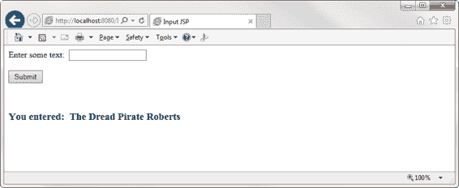

**图 3-1：** Input-JSP.jsp 的运行。

### 使用脚本段

正如本章前面提到的，`scriptlet`（脚本段）是直接插入到 servlet 中的语句或语句组，插入的位置就在生成周围 HTML 的 `out.print` 语句处。简而言之，脚本段允许你在渲染页面的代码中添加自己的代码。

脚本段遵循以下基本形式：

```jsp
<% *statements... %>
```

这是一个名为 `DateJSP.jsp` 的 JSP，它使用 `DateFormat` 类来格式化日期并将其显示在页面上：

```jsp
<html>
<%@ page import="java.text.*" %>
<%@ page import="java.util.*" %>
<head>
<title>Date JSP</title>
</head>
<body>
<h1>
Today is
<%
DateFormat df = DateFormat.getDateInstance(DateFormat.FULL);
Date today = new Date();
String msg = df.format(today);
out.println(msg);
%>
</h1>
<h1>Have a nice day!</h1>
</body>
</html>
```

此 JSP 以一对页面导入指令开始，用于导入 `java.text` 和 `java.util` 包。然后，接下来的 Java 语句被直接插入在生成文本 `Today is` 和 `Have a nice day!` 的行之间，如下所示：

```java
DateFormat df = DateFormat.getDateInstance(DateFormat.FULL);
Date today = new Date();
String msg = df.format(today);
out.println(msg);
```

这些行创建了一个名为 `msg` 的字符串变量，然后使用 `out.println` 将字符串写入响应输出。结果是，格式化的日期被插入到 `<h1>Today is </h1>` 和 `<h1>Have a nice day!</h1>` 之间。

此 JSP 以一对页面导入指令开始，用于导入 `java.text` 和 `java.util` 包。然后，接 Java Java 语句被在生成文本 `Today is` is `` a ` day a nice 行之间 的行所示：

```java
DateFormat df = DateFormat.getDateInstance(DateFormat.FULL);
Date today = new Date();
String msg = df.format(today);
out.println(msg);
```


这些行创建了一个名为`msg`的字符串变量，然后使用`out.println`将字符串写入响应输出。结果是，格式化的日期被插入到`<h1>Today is </h1>`和`<h1>Have a nice day!</h1>`之间。

此 JSP 以一对页面导入指令开始，用于导入`java.text`和`java.util`包。然后，接 Java Java 语句被直接插入在生成文本`Today is`和`Have a nice day!`的行之间，如下所示：

```java
DateFormat df = DateFormat.getDateInstance(DateFormat.FULL);
Date today = new Date();
String msg = df.format(today);
out.println(msg);
```

这些行创建了一个名为`msg`的字符串变量，然后使用`out.println`将字符串写入响应输出。结果是，格式化的日期被插入到`<h1>Today is </h1>`和`<h1>Have a nice day!</h1>`之间。

此 JSP 以一对页面导入指令开始，用于导入`java.text`和`java.util`包。然后，接 Java Java 语句被直接插入在生成文本`Today is`和`Have a nice day!`的行之间，如下所示：

```java
DateFormat df = DateFormat.getDateInstance(DateFormat.FULL);
Date today = new Date();
String msg = df.format(today);
out.println(msg);
```

这些行创建了一个名为`msg`的字符串变量，然后使用`out.println`将字符串写入响应输出。结果是，格式化的日期被插入到`<h1>Today is </h1>`和`<h1>Have a nice day!</h1>`之间。

此 JSP 以一对页面导入指令开始，用于导入`java.text`和`java.util`包。然后，接 Java Java 语句被直接插入在生成文本`Today is`和`Have a nice day!`的行之间，如下所示：

```java
DateFormat df = DateFormat.getDateInstance(DateFormat.FULL);
Date today = new Date();
String msg = df.format(today);
out.println(msg);
```

这些行创建了一个名为`msg`的字符串变量，然后使用`out.println`将字符串写入响应输出。结果是，格式化的日期被插入到`<h1>Today is </h1>`和`<h1>Have a nice day!</h1>`之间。

此 JSP 以一对页面导入指令开始，用于导入`java.text`和`java.util`包。然后，接 Java Java 语句被直接插入在生成文本`Today is`和`Have a nice day!`的行之间，如下所示：

```java
DateFormat df = DateFormat.getDateInstance(DateFormat.FULL);
Date today = new Date();
String msg = df.format(today);
out.println(msg);
```

这些行创建了一个名为`msg`的字符串变量，然后使用`out.println`将字符串写入响应输出。结果是，格式化的日期被插入到`<h1>Today is </h1>`和`<h1>Have a nice day!</h1>`之间。

此 JSP 以一对页面导入指令开始，用于导入`java.text`和`java.util`包。然后，接 Java Java 语句被直接插入在生成文本`Today is`和`Have a nice day!`的行之间，如下所示：

```java
DateFormat df = DateFormat.getDateInstance(DateFormat.FULL);
Date today = new Date();
String msg = df.format(today);
out.println(msg);
```

这些行创建了一个名为`msg`的字符串变量，然后使用`out.println`将字符串写入响应输出。结果是，格式化的日期被插入到`<h1>Today is </h1>`和`<h1>Have a nice day!</h1>`之间。

此 JSP 以一对页面导入指令开始，用于导入`java.text`和`java.util`包。然后，接 Java Java 语句被直接插入在生成文本`Today is`和`Have a nice day!`的行之间，如下所示：

```java
DateFormat df = DateFormat.getDateInstance(DateFormat.FULL);
Date today = new Date();
String msg = df.format(today);
out.println(msg);
```

这些行创建了一个名为`msg`的字符串变量，然后使用`out.println`将字符串写入响应输出。结果是，格式化的日期被插入到`<h1>Today is </h1>`和`<h1>Have a nice day!</h1>`之间。

此 JSP 以一对页面导入指令开始，用于导入`java.text`和`java.util`包。然后，接 Java Java 语句被直接插入在生成文本`Today is`和`Have a nice day!`的行之间，如下所示：

```java
DateFormat df = DateFormat.getDateInstance(DateFormat.FULL);
Date today = new Date();
String msg = df.format(today);
out.println(msg);
```

这些行创建了一个名为`msg`的字符串变量，然后使用`out.println`将字符串写入响应输出。结果是，格式化的日期被插入到`<h1>Today is </h1>`和`<h1>Have a nice day!</h1>`之间。

此 JSP 以一对页面导入指令开始，用于导入`java.text`和`java.util`包。然后，接 Java Java 语句被直接插入在生成文本`Today is`和`Have a nice day!`的行之间，如下所示：

```java
DateFormat df = DateFormat.getDateInstance(DateFormat.FULL);
Date today = new Date();
String msg = df.format(today);
out.println(msg);
```

这些行创建了一个名为`msg`的字符串变量，然后使用`out.println`将字符串写入响应输出。结果是，格式化的日期被插入到`<h1>Today is </h1>`和`<h1>Have a nice day!</h1>`之间。

此 JSP 以一对页面导入指令开始，用于导入`java.text`和`java.util`包。然后，接 Java Java 语句被直接插入在生成文本`Today is`和`Have a nice day!`的行之间，如下所示：

```java
DateFormat df = DateFormat.getDateInstance(DateFormat.FULL);
Date today = new Date();
String msg = df.format(today);
out.println(msg);
```

这些行创建了一个名为`msg`的字符串变量，然后使用`out.println`将字符串写入响应输出。结果是，格式化的日期被插入到`<h1>Today is </h1>`和`<h1>Have a nice day!</h1>`之间。

此 JSP 以一对页面导入指令开始，用于导入`java.text`和`java.util`包。然后，接 Java Java 语句被直接插入在生成文本`Today is`和`Have a nice day!`的行之间，如下所示：

```java
DateFormat df = DateFormat.getDateInstance(DateFormat.FULL);
Date today = new Date();
String msg = df.format(today);
out.println(msg);
```

这些行创建了一个名为`msg`的字符串变量，然后使用`out.println`将字符串写入响应输出。结果是，格式化的日期被插入到`<h1>Today is </h1>`和`<h1>Have a nice day!</h1>`之间。

此 JSP 以一对页面导入指令开始，用于导入`java.text`和`java.util`包。然后，接 Java Java 语句被直接插入在生成文本`Today is`和`Have a nice day!`的行之间，如下所示：

```java
DateFormat df = DateFormat.getDateInstance(DateFormat.FULL);
Date today = new Date();
String msg = df.format(today);
out.println(msg);
```

这些行创建了一个名为`msg`的字符串变量，然后使用`out.println`将字符串写入响应输出。结果是，格式化的日期被插入到`<h1>Today is </h1>`和`<h1>Have a nice day!</h1>`之间。

此 JSP 以一对页面导入指令开始，用于导入`java.text`和`java.util`包。然后，接 Java Java 语句被直接插入在生成文本`Today is`和`Have a nice day!`的行之间，如下所示：

```java
DateFormat df = DateFormat.getDateInstance(DateFormat.FULL);
Date today = new Date();
String msg = df.format(today);
out.println(msg);
```

这些行创建了一个名为`msg`的字符串变量，然后使用`out.println`将字符串写入响应输出。结果是，格式化的日期被插入到`<h1>Today is </h1>`和`<h1>Have a nice day!</h1>`之间。

此 JSP 以一对页面导入指令开始，用于导入`java.text`和`java.util`包。然后，接 Java Java 语句被直接插入在生成文本`Today is`和`Have a nice day!`的行之间，如下所示：

```java
DateFormat df = DateFormat.getDateInstance(DateFormat.FULL);
Date today = new Date();
String msg = df.format(today);
out.println(msg);
```

这些行创建了一个名为`msg`的字符串变量，然后使用`out.println`将字符串写入响应输出。结果是，格式化的日期被插入到`<h1>Today is </h1>`和`<h1>Have a nice day!</h1>`之间。

此 JSP 以一对页面导入指令开始，用于导入`java.text`和`java.util`包。然后，接 Java Java 语句被直接插入在生成文本`Today is`和`Have a nice day!`的行之间，如下所示：

```java
DateFormat df = DateFormat.getDateInstance(DateFormat.FULL);
Date today = new Date();
String msg = df.format(today);
out.println(msg);
```

这些行创建了一个名为`msg`的字符串变量，然后使用`out.println`将字符串写入响应输出。结果是，格式化的日期被插入到`<h1>Today is </h1>`和`<h1>Have a nice day!</h1>`之间。

此 JSP 以一对页面导入指令开始，用于导入`java.text`和`java.util`包。然后，接 Java Java 语句被直接插入在生成文本`Today is`和`Have a nice day!`的行之间，如下所示：

```java
DateFormat df = DateFormat.getDateInstance(DateFormat.FULL);
Date today = new Date();
String msg = df.format(today);
out.println(msg);
```

这些行创建了一个名为`msg`的字符串变量，然后使用`out.println`将字符串写入响应输出。结果是，格式化的日期被插入到`<h1>Today is </h1>`和`<h1>Have a nice day!</h1>`之间。

此 JSP 以一对页面导入指令开始，用于导入`java.text`和`java.util`包。然后，接 Java Java 语句被直接插入在生成文本`Today is`和`Have a nice day!`的行之间，如下所示：

```java
DateFormat df = DateFormat.getDateInstance(DateFormat.FULL);
Date today = new Date();
String msg = df.format(today);
out.println(msg);
```

这些行创建了一个名为`msg`的字符串变量，然后使用`out.println`将字符串写入响应输出。结果是，格式化的日期被插入到`<h1>Today is </h1>`和`<h1>Have a nice day!</h1>`之间。

此 JSP 以一对页面导入指令开始，用于导入`java.text`和`java.util`包。然后，接 Java Java 语句被直接插入在生成文本`Today is`和`Have a nice day!`的行之间，如下所示：

```java
DateFormat df = DateFormat.getDateInstance(DateFormat.FULL);
Date today = new Date();
String msg = df.format(today);
out.println(msg);
```

这些行创建了一个名为`msg`的字符串变量，然后使用`out.println`将字符串写入响应输出。结果是，格式化的日期被插入到`<h1>Today is </h1>`和`<h1>Have a nice day!</h1>`之间。

此 JSP 以一对页面导入指令开始，用于导入`java.text`和`java.util`包。然后，接 Java Java 语句被直接插入在生成文本`Today is`和`Have a nice day!`的行之间，如下所示：

```java
DateFormat df = DateFormat.getDateInstance(DateFormat.FULL);
Date today = new Date();
String msg = df.format(today);
out.println(msg);
```

这些行创建了一个名为`msg`的字符串变量，然后使用`out.println`将字符串写入响应输出。结果是，格式化的日期被插入到`<h1>Today is </h1>`和`<h1>Have a nice day!</h1>`之间。

此 JSP 以一对页面导入指令开始，用于导入`java.text`和`java.util`包。然后，接 Java Java 语句被直接插入在生成文本`Today is`和`Have a nice day!`的行之间，如下所示：

```java
DateFormat df = DateFormat.getDateInstance(DateFormat.FULL);
Date today = new Date();
String msg = df.format(today);
out.println(msg);
```

这些行创建了一个名为`msg`的字符串变量，然后使用`out.println`将字符串写入响应输出。结果是，格式化的日期被插入到`<h1>Today is </h1>`和`<h1>Have a nice day!</h1>`之间。

此 JSP 以一对页面导入指令开始，用于导入`java.text`和`java.util`包。然后，接 Java Java 语句被直接插入在生成文本`Today is`和`Have a nice day!`的行之间，如下所示：

```java
DateFormat df = DateFormat.getDateInstance(DateFormat.FULL);
Date today = new Date();
String msg = df.format(today);
out.println(msg);
```

这些行创建了一个名为`msg`的字符串变量，然后使用`out.println`将字符串写入响应输出。结果是，格式化的日期被插入到`<h1>Today is </h1>`和`<h1>Have a nice day!</h1>`之间。

此 JSP 以一对页面导入指令开始，用于导入`java.text`和`java.util`包。然后，接 Java Java 语句被直接插入在生成文本`Today is`和`Have a nice day!`的行之间，如下所示：

```java
DateFormat df = DateFormat.getDateInstance(DateFormat.FULL);
Date today = new Date();
String msg = df.format(today);
out.println(msg);
```

这些行创建了一个名为`msg`的字符串变量，然后使用`out.println`将字符串写入响应输出。结果是，格式化的日期被插入到`<h1>Today is </h1>`和`<h1>Have a nice day!</h1>`之间。

此 JSP 以一对页面导入指令开始，用于导入`java.text`和`java.util`包。然后，接 Java Java 语句被直接插入在生成文本`Today is`和`Have a nice day!`的行之间，如下所示：

```java
DateFormat df = DateFormat.getDateInstance(DateFormat.FULL);
Date today = new Date();
String msg = df.format(today);
out.println(msg);
```

这些行创建了一个名为`msg`的字符串变量，然后使用`out.println`将字符串写入响应输出。结果是，格式化的日期被插入到`<h1>Today is </h1>`和`<h1>Have a nice day!</h1>`之间。

此 JSP 以一对页面导入指令开始，用于导入`java.text`和`java.util`包。然后，接 Java Java 语句被直接插入在生成文本`Today is`和`Have a nice day!`的行之间，如下所示：

```java
DateFormat df = DateFormat.getDateInstance(DateFormat.FULL);
Date today = new Date();
String msg = df.format(today);
out.println(msg);
```

这些行创建了一个名为`msg`的字符串变量，然后使用`out.println`将字符串写入响应输出。结果是，格式化的日期被插入到`<h1>Today is </h1>`和`<h1>Have a nice day!</h1>`之间。

此 JSP 以一对页面导入指令开始，用于导入`java.text`和`java.util`包。然后，接 Java Java 语句被直接插入在生成文本`Today is`和`Have a nice day!`的行之间，如下所示：

```java
DateFormat df = DateFormat.getDateInstance(DateFormat.FULL);
Date today = new Date();
String msg = df.format(today);
out.println(msg);
```


这些行创建了一个名为`msg`的字符串变量，然后使用`out.println`将字符串写入响应输出。结果是，格式化的日期被插入到`<h1>Today is </h1>`和`<h1>Have a nice day!</h1>`之间。

此 JSP 以一对页面导入指令开始，用于导入`java.text`和`java.util`包。然后，接 Java Java 语句被直接插入在生成文本`Today is`和`Have a nice day!`的行之间，如下所示：

```java
DateFormat df = DateFormat.getDateInstance(DateFormat.FULL);
Date today = new Date();
String msg = df.format(today);
out.println(msg);
```

这些行创建了一个名为`msg`的字符串变量，然后使用`out.println`将字符串写入响应输出。结果是，格式化的日期被插入到`<h1>Today is </h1>`和`<h1>Have a nice day!</h1>`之间。

此 JSP 以一对页面导入指令开始，用于导入`java.text`和`java.util`包。然后，接 Java Java 语句被直接插入在生成文本`Today is`和`Have a nice day!`的行之间，如下所示：

```java
DateFormat df = DateFormat.getDateInstance(DateFormat.FULL);
Date today = new Date();
String msg = df.format(today);
out.println(msg);
```

这些行创建了一个名为`msg`的字符串变量，然后使用`out.println`将字符串写入响应输出。结果是，格式化的日期被插入到`<h1>Today is </h1>`和`<h1>Have a nice day!</h1>`之间。

这里是另一个例子，这次声明了一个在表达式中调用的方法：

```html
<<html>
<%@ page import="java.text.*" %>
<%@ page import="java.util.*" %>
<head>
<title>Date JSP</title>
</head>
<body>
<h1>今天是 <%= getDate() %></h1>
<h1>祝你有愉快的一天！</h1>
</body>
</html>
```

```jsp
<%!
private String getDate()
{
    DateFormat df = DateFormat.getDateInstance(DateFormat.FULL);
    Date today = new Date();
    return df.format(today);
}
%>
```

文档末尾的声明声明了一个返回当前日期字符串字符串格式的方法。然后，使用表达式`<%= getDate() %>`将日期插入到文档中。

---

750 第 7 卷 **Web 编程**

## 使用类

大多数 JSP 应用都复杂到需要额外的类来保持代码的可维护性。你可能想要创建处理文件或数据库 I/O 的类，并想要创建诸如`Products`和`Customers`这样的业务对象。

让 Tomcat 与类一起工作可能有点棘手，但如果你遵循以下指南，就会很容易：

- **»将所有类包含包中。** 为你的应用程序选择一个好的包名，然后在类文件的开头添加包语句。
- **»将类文件（不一定是源文件）存储在 JSP 页面所在目录的`WEB-INF\classes\`目录下。** 如果包名是`movie`，而你将 JSP 页面存储在`c:\tomcat\webapps\ROOT`，请将类文件保存在`c:\tomcat\webapps\ROOT\WEB-INF\classes\movie`
- **»在任何使用该类的 JSP 中包含导入包的页面指令。** 如下：

```jsp
<%@ page import="movie.*" %>
```

- **»将你保存包的目录添加到 ClassPath 变量中。** 你需要添加包含包的目录，而不是类所在的目录，因为 Java 编译器使用包名来查找。如果你将类放在`webapps\ROOT\WEB-INF\classes`目录，你需要将`c:\tomcat\webapps\ROOT\WEB-INF\classes`添加到你的`ClassPath`。

为了说明 JSP 如何使用类，图 3-4 显示了一个列出`movies.txt`文件中电影的 JSP。显示此页面的 JSP 见示例 3-1。该 JSP 文件存储在`c:\tomcat\webapps\ROOT`。

第 3 章 **使用 JavaServer Pages** 751

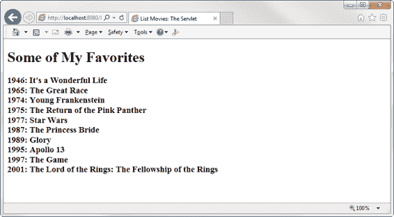

**图 3-4：**

ListMovies JSP 的运行。

**示例 3-1：**

**ListMovies.jsp**

```html
<!doctype html "-//W3C//DTD HTML 4.0 Transitional//EN">
<%@ page import="movie.*" %>
<%@ page import="java.util.*" %>
<html>
<head>
<title>列出电影</title>
</head>
<body>
<h1>我的喜好</h1>
<h3>
<%= getMovieList() %>
</h3>
</body>
</html>
```

```jsp
<%!
private String getMovieList()
{
    String msg = "";
    ArrayList<Movie> movies = MovieIO.getMovies();
    for (Movie m : movies)
    {
        msg += m.year + ": ";
        msg += m.title + "<br>";
    }
    return msg;
}
%>
```

752 第 7 卷 **Web 编程**

以下是该 JSP 中关键行的解释：

- JSP 包含了两个导入`movie`和`java.util`包的页面指令。
- 使用表达式调用了`getMovieList()`方法，该方法以字符串形式返回电影列表。
- `getMovieList()`方法定义在声明中。
- 调用`MovieIO`类的`getMovies()`方法来获取包含`movies.txt`文件中所有电影的`ArrayList`。
- 从`ArrayList`中提取`Movie`对象，并将年份和标题添加到`msg`字符串中。
- 返回完成的`msg`字符串。

示例 3-2 显示了`Movie`类。除了将`Movie`类放在`movie`包中的包语句外，没有特别需要的。从此`.java`文件编译的类文件保存在`c:\tomcat\webapps\ROOT\WEB-INF\classes\com\movie`。

**示例 3-2：**

**Movie.java**

```java
package movie;
public class Movie
{
    public String title;
    public int year;
    public double price;
    public Movie(String title, int year, double price)
    {
        this.title = title;
        this.year = year;
        this.price = price;
    }
}
```

## 使用 JavaServer Pages

最后，在 3-3 中显示了`MovieIO`类。该类从文本文件中读取电影。（关于该类如何工作的详细说明，请跳转到第 8 卷第 2 章。）

```java
package movie;
import java.io.*;
import java.util.*;

public class MovieIO
{
    public static ArrayList<Movie> getMovies()
    {
        ArrayList<Movie> movies = new ArrayList<>();
        BufferedReader in = getReader("data\\movies.txt");
        Movie movie = readMovie(in);
        while (movie != null)
        {
            movies.add(movie);
            movie = readMovie(in);
        }
        return movies;
    }

    private static BufferedReader getReader(String name)
    {
        BufferedReader in = null;
        try
        {
            File file = new File(name);
            in = new BufferedReader(new FileReader(file));
        }
        catch (FileNotFoundException e)
        {
            System.out.println("文件不存在.");
            System.exit(0);
        }
        return in;
    }

    private static Movie readMovie(BufferedReader in)
    {
        String title;
        int year;
        double price;
        String line = "";
        try
        {
            line = in.readLine();
        }
        catch (IOException e)
        {
            System.out.println("I/O Error");
            System.exit(0);
        }
        if (line == null)
            return null;
        else
        {
            String[] data = line.split("\t");
            title = data[0];
            year = Integer.parseInt(data[1]);
            price = Double.parseDouble(data[2]);
            return new Movie(title, year, price);
        }
    }
}
```

第 3 章 **使用 JavaServer Pages** 754

# 第 4 章

## 使用 JavaBean

*JavaBean* 是一种特殊的 Java 类，你可以通过几种有趣的方式使用它来简化开发。某些 Bean 被设计为视觉组件，可以在图形用户界面（GUI）编辑器中使用来快速构建界面。其他 Bean（称为企业 JavaBeans，EJB）设计在特殊的 EJB 服务器上运行，可以处理大型应用程序的数据访问和业务逻辑。

在本章中，我将介绍一种更简单的 JavaBean，它设计用于简化构建 JavaServer Pages 的任务。简单来说，你可以使用简单的 JavaBean 来构建 JavaServer Pages，而无需在 JSP 本身中编写任何 Java 代码。

## 了解 JavaBean

简单来说，JavaBean 是任何符合以下规则的 Java 类：

- **它必须有一个空构造函数** —— 即不接受任何参数的构造函数。如果该类没有任何构造函数，它也符合条件，因为默认构造函数没有参数。但如果该类至少有一个接受一个或多个参数的构造函数，它还必须包含一个无参数的构造函数，以符合 JavaBean 的定义。
- 它不能有公共的`instance variables`。类定义的所有实例变量必须是私有的（private）或保护的（protected）。
- 它必须提供名为`getProperty`和`setProperty`的方法来获取和设置类提供的任何`properties`的值，但使用`isProperty`获取属性值的`boolean`属性除外。`property`这个词并不是正式的 Java 术语。简而言之（或者应该说是*在 beanpod 里面*？），一个`property`是对象的任何值，该值可以通过`get`方法（如果属性是布尔类型，则通过`is`方法）获取，或通过`set`方法设置。例如，如果一个类有一个名为`lastName`的属性，它应该使用名为`getLastName`的方法来获取姓氏，使用`setLastName`来设置姓氏。或者，如果该类有一个名为`taxable`的布尔属性，那么设置它的方法称为`setTaxable`，获取它的方法称为`isTaxable`。

请注意，一个类不需要拥有任何属性就可以成为 JavaBean，但如果它确实拥有属性，这些属性必须按照此命名模式进行访问。

此外，并不是所有属性都必须具有`get`和`set`访问器。`read-only property`（只读属性）可以只有`get`访问器，而`write-only property`（只写属性）可以只有`set`访问器。在访问属性的方法中，属性名大写，但属性名本身不是。因此`setAddress`设置的是名为`address`的属性，而不是`Address`。

就是这些。更高级的 bean 还可以具有其他特性，为它们提供视觉界面，以便在集成开发环境 (IDE) 中以拖放样式使用。此外，某些 bean 实现了一个接口，允许将其状态写入输出流，以便以后重新创建。但这些功能是可选的；任何符合此处三个标准的类都是 bean，并可以在 JSP 页面中作为 bean 使用。你已经见过很多具有类似`getCount`和`setStatus`方法方法的类。这些名称是一种称为`Accessor pattern`（访问器模式）的设计模式的一部分，我将在第三本书第 2 章中介绍。因此，你在整本书中看到了很多 bean 的示例，你可能已经自己写过很多 bean 类了。

任何符合此模式的类都是 bean。没有你必须继承的`JavaBean`类；也没有你必须实现以创建 bean 的`Bean`接口。一个类要成为 bean，所做的只需遵循该模式。

758 第 7 本 **Web 编程**

## 查看示例 Bean

列表 4-1 显示了一个名为`Triangle`的示例 JavaBean 类，它用于计算勾股定理，在知道直角三角形两条短边长度的情况下，它可以计算出长边（斜边）。该类定义了三个属性：`sideA`和`sideB`代表三角形的两条短边，`sideC`代表长边。使用此 bean 的正常方法是首先使用`setSideA`和`setSideB`方法将`sideA`和`sideB`属性设置为短边的长度，然后使用`getSideC`方法获取长边的长度。如果你想不起初中高时的知识了，长边等于第一个短边平方加上第二个短边平方的平方根。

**列表 4-1：**

**Triangle Bean**

```java
package com.lowewriter.calculators;

public class Triangle
{
    private double sideA;
    private double sideB;

    public Triangle()
    {
        this.sideA = 0.0;
        this.sideB = 0.0;
    }

    public String getSideA()
    {
        return Double.toString(this.sideA);
    }

    // Using JavaBeans
    public void setSideA(String value)
    {
        try
        {
            this.sideA = Double.parseDouble(value);
        }
        catch (Exception e)
        {
            this.sideA = 0.0;
        }
    }

    public String getSideB()
    {
        return Double.toString(this.sideB);
    }
}
```

*(接上)*

第 4 章 **使用 JavaBeans** 759

**列表 4-1：**

***（续）***


```java
public void setSideB(String value)
{
    try
    {
        this.sideB = Double.parseDouble(value);
    }
    catch (Exception e)
    {
        this.sideB = 0.0;
    }
}

public String getSideC()
{
    if (sideA == 0.0 || sideB == 0.0)
        return "Please enter both sides.";
    else
    {
        Double sideC;
        sideC = Math.sqrt(
        (sideA * sideA) + (sideB * sideB));
        return Double.toString(sideC);
    }
}
```

接下来的段落指出了 bean 类的亮点：

大多数 servlet 类一样，这个 bean 是一个包的一部分。在这种情况下，包名为`com.lowewriter.calculators`。（我假设如果你需要一个 bean 来计算勾股定理，你可能还需要其他 bean 来计算导数、质数等。）

- 该包（名为`com.lowewriter.calculators`）使用了一对实例变量来跟踪边。
- 根据 JavaBean 的规则，这些实例变量声明为`private`。
- 声明了一个无参数的构造函数。（严格来说，这个构造函数不需要显式初始化它们到默认值。）
- `getSideA`方法返回`sideA`属性值的字符串。
- `setSideA`方法通过字符串设置`sideA`属性值。再次，`try/catch`语句捕捉无法解析字符串的异常。
- `getSideB`方法返回`sideB`属性值的字符串。
- `setSideB`方法通过字符串设置`sideB`属性值。
- `getSideC`方法计算长边长度并返回结果。如果任一值为 0，方法假设用户没有输入任何数据，因此返回错误消息。（因为三角形的边不能为零。）
- 注意没有`setSideC`方法。因此`sideC`是只读属性。

## 在 JSP 页面中使用 Bean

要在 JSP 页面中使用 bean，需要在页面中添加特殊标签来创建 bean、设置属性并检索属性。表格 4-1 列出了这些标签，后续章节将介绍每个标签的详细信息。

### 使用 JavaBeans

#### 创建 bean 实例

要在 JSP 页面中包含 bean，需要在页面添加特殊的`jsp:useBean`标签。其简单形式如下：

`<jsp:useBean id="name*" class="package.class*" />` `id`属性提供了你在 JSP 其他地方引用该 bean 的名称，`class`属性提供了类的限定类名。这里是使用`Triangle`bean 的`jsp:useBean`标签：

```jsp
<jsp:useBean id="triangle" class="com.lowewriter.calculators.Triangle" />
```

第 4 章 **使用 JavaBeans** 761

**表格 4-1**

用于 Bean 的 JSP 标签

| 标签 | 说明 |
| :--- | :--- |
| `<jsp:useBean id="name*" class="package.class*" />` | 建立 bean 的引用并在必要时创建实例。`id`属性指定的名称被其他标签用于引用该 bean。 |
| `<jsp:getProperty name="name*" property="property*" />` | 从`name`属性指定的 bean 获取指定的属性。 |
| `<jsp:setProperty name="name*" property="property*" value="value*" />` | 将指定的属性设置为`property*` `value*`属性中的值。 |
| `<jsp:setProperty name="name*" property="property*" param="parameter*" />` | 将指定的属性设置为`param`属性中指定的参数`property*`的值。参数通常是`param="parameter*"`。 |

表单字段的名称。

```jsp
<jsp:setProperty name="name" property="*" />
```

将 bean 定义的所有属性设置为相应的参数值，前提是存在名称名称的参数。

`jsp:useBean`标签在实例不存在时，通过调用空构造函数来创建一个 bean 实例。如果 bean 已经存在，则将使用现有实例。

以下是关于`jsp:useBean`标签你应该了解的另外几点：

- `jsp:useBean`标签可以出现在 JSP 文档的任何位置，但它必须出现在任何引用该 bean 的标签之前。
- 此标签以及所有 bean 标签都是区分大小写的，因此请务必按照所示内容精确编写代码。`<jsp:usebean.../>`将无法工作。
- 如果在运行 JSP 时 Tomcat 报错找不到你的 bean，请双击包名和类名——它们也是区分大小写的——并确保该 bean 存储在`WEB-INF\classes`下一个与包名同名的目录中。例如，你可能将`Triangle`bean 的类文件存储在`WEB-INF\classes\calculators`中。（有关 Tomcat 的更多信息，请翻阅第 7 章第 2 章。）
- `jsp:useBean`元素可以有一个包含`jsp:setProperty`标签体，用于初始化属性值。此时该元素的形式更像普通的 HTML，具有正确的开始和结束标签，例如所示：

```jsp
<jsp:useBean id="t1" class="com.lowewriter.calculators.Triangle" >
  <jsp:setProperty name="t1" property="sideA" value="3.0" >
  <jsp:setProperty name="t1" property="sideB" value="3.0" >
</jsp:useBean>
```

先不要担心`jsp:setProperty`标签的细节。只需记住只有当`jsp:useBean`标签实际上创建了 bean 的新实例时，这些标签才会执行。如果 bean 实例已经存在，则不会执行`jsp:setProperty`标签。

- `jsp:useBean`标签还有一个`scope`属性，我将在本章后面的“设置 bean 的作用域”部分中进行解释。

### 获取属性值

要获取 bean 属性的值，你使用`jsp:getProperty`标签。该标签的形式非常直观：

```jsp
<jsp:getProperty name="name" property="property" />
```

这是一个从前一节创建的`Triangle`bean 中获取`sideC`属性的标签：

```jsp
<jsp:getProperty name="triangle" property="sideC" />
```

`name`属性必须与创建该 bean 的`jsp:useBean`标签中`id`属性所指定的值一致。此外，`property`属性用于确定 getter 方法的名字——在这种情况下，是`getSideC`。

属性名始终以小写字母开头。如果你指定`property="SideC"`，在运行页面时你会收到来自服务器的错误消息。

### 使用 JavaBeans

在大多数情况下，你使用`jsp:getProperty`将属性值插入页面中，但你也可以用它来指定 JSP 文档中其他标签的属性值，例如所示：

```jsp
<input type="text" name="sideA" value="<jsp:getProperty name="triangle" property="sideA" />" >
```

在这里，`sideA`属性的值被检索并用于名为`sideA`的输入框的`value`属性。结果是当此输入框发送到浏览器时，它的初始值是来自`Triangle`bean 的值。

特别注意匹配标签的引号以及开启和关闭括号。在这个示例中，整个`jsp:getProperty`标签都包含在引号内，这些引号指示输入框`value`属性的值。出现在最最后的右括号闭合了输入元素本身。

### 设置属性值

要设置属性值，你可以使用`jsp:setProperty`标签的多种变体之一。如果你想将属性设置为一个字面量字符串，可以这样写标签：

```jsp
<jsp:setProperty name="triangle" property="sideA" value="4.0" />
```

在这里，`name`属性必须与创建该 bean 的`jsp:useBean`标签的`id`属性匹配；`property`属性用于确定 setter 方法的名字（在这种情况下，是`setSideA`）；`value`属性提供了要设置的值。

我将这个标签分在三行写是因为它太长了，无法在一行内放入本面的页边范围内。在实际操作中，大多数 JSP 开发人员会将这些标签写在同一行，除非它们真的非常长，而这种情况并不常见。

虽然这种形式的`jsp:setProperty`标签很有用，但`param`更有用。它允许将属性设置为用户在表单字段中输入的值或通过查询字符串传递给 JSP 的值。如果你的 JSP 一个带有`FirstSide`输入字段的表单，你可以这样将该字段的值赋值给`sideA`属性：

```jsp
<input type="text" name="FirstSide" >
<jsp:setProperty name="triangle" property="sideA" param="FirstSide" />
```

在这里，如果用户在`FirstSide`中输入一个值，该值将被赋值给 bean 的`sideA`属性。

在前面的示例中，我故意为输入框使用了非`sideA`的名称，以免你对属性和`param`属性指定相同值的事感到困惑。在实际操作中，你通常会让输入字段与其关联的属性同名，如下所示：

```jsp
<input type="text" name="sideA" >
<jsp:setProperty name="triangle" property="sideA" />
```

如果输入字段的名称与属性名相同，你可以用一个标签将它们都赋值给相应的属性，如下：

```jsp
<jsp:setProperty name="triangle" property="*" />
```

这里`property`属性中的星号`*`表示所有与字段（或查询参数）同名的属性都会自动赋值。对于字段很多的表单，这种形式的`jsp:setProperty`可以为你节省大量的代码工作。

### 使用 bean 的页面

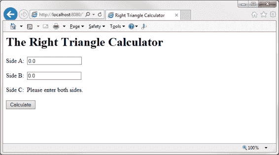

**图 4-1:** 在浏览器中显示的 Triangle.jsp。

### 使用 JavaBeans

**列表 4-2：Triangle.jsp 页面**

```jsp
<html>
<head>
  <title>三角形计算器</title>
</head>
<body>
  <h1>三角形计算器</h1>
  <form action="Triangle.jsp" method="post">
    <jsp:useBean id="triangle" class="com.lowewriter.calculators.Triangle" />
    <jsp:setProperty name="triangle" property="*" />
    Side A: <input type="text" name="sideA" value="<jsp:getProperty name="triangle" property="sideA" />" >
    Side B: <input type="text" name="sideB" value="<jsp:getProperty name="triangle" property="sideB" />" >
    Side C: <jsp:getProperty name="triangle" property="sideC" />
    <input type="submit" value="Calculate" >
  </form>
</body>
</html>
```

以下段落解释了此 JSP 中的关键行：

- `jsp:useBean`标签创建`calculators.Triangle`bean 的实例并将其命名为`triangle`。
- `jsp:setProperty`标签将`sideA`和`sideB`属性设置为对应名为`sideA`和`sideB`的输入字段。
- `form`标签创建一个表单，使用 HTTP`POST`方法回传到同一个 JSP 文件。

`sideA`，且其初始值被设置为 bean 的`sideA`属性的值。

→**18** 第二个输入文本字段名为`sideB`。它的初始值被设置为 bean 的`sideB`属性的值。

→**24** 这一行是获取`sideC`属性的地方，从而根据边`A`和`B`的长度计算三角形边 C 的长度。结果直接插入到文档中。

→**27** `Submit`按钮提交表单，以便`Triangle`bean 执行其功能。

766 第 7 册 **Web 编程**

## Bean 的作用域

JavaBean 的 *scope*（作用域）决定了 bean 的生命周期长短。你通过使用`jsp:useBean`标签的`scope`属性来指定作用域。`scope`属性可以是表 4-2 列出的四个值之一

### 表 4-2: 作用域设置

| 作用域 | 说明 |
| :--- | :--- |
| page | 此设置将 bean 与当前页面关联。因此，每当用户请求页面时，都会创建一个新的 bean。当页面发送回浏览器时，bean 就会被销毁。因此，每次往返服务器都会创建一个 bean 的新实例。 |
| request | 此设置与 page 类似，但 bean 对同一请求处理的其他页面也可用。这种作用域对于单个请求使用多个 servlet 或 JSP 的应用程序非常有用。 |
| session | 此设置将 bean 与用户的会话关联。当用户第一次请求应用程序的页面时，会创建一个 bean 并与用户关联。然后，同一个用户的后续请求将使用同一个相同的 bean。 |
| application | 此设置意味着应用程序的所有用户都使用一个 bean 的单一副本。 |

默认作用域是`page`，这意味着每当用户请求新页面时，bean 都会被创建和销毁。然而，`session`作用域对于需要从一个页面到另一个页面跟踪用户信息的 Web 应用程序非常有帮助。为人知的例子是购物车，用户可以在其中选择他想要购买的物品。购物车的内容可以保存在 session bean 中。

### 使用 JavaBeans

#### 购物车应用程序

图 4-2 显示了一个简单的购物车应用程序，其中用户可以选择点击三个按钮之一来购买我最近出版的三本书之一。当用户点击按钮时，一个物品会被添加到购物车中。如果用户已将书籍添加到购物车，则数量会增加 1。在图中，用户点击了一次 *Electronics All-in-One For Dummies* 按钮，点击了两次 *Networking All-in-One For Dummies* 按钮。

第 4 章 **使用 JavaBeans** 767

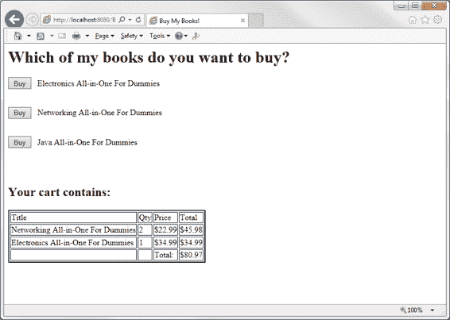

**图 4-2:** 一个超简单的购物车应用程序。

接下来的段落描述了使此购物车运行的关键技术：

- 购物车本身是一个 JavaBean，它只有两个公共方法：`setBook`（将书籍添加到购物车）和`getList`（返回一个字符串，以 HTML 表格的形式整齐地显示购物车物品）。
- 购物车类包含一个表示`Book`对象的内部类。为了保持应用程序的简单，`Book`类将三个标题硬编码在内部。在真实的购物车程序中，你使用文件或数据库而不是硬编码这些值。
- 出现在页面顶部的产品列表实际上是三个独立的表单，每个表单对应一个产品。这些表单中的每一个都指定了一个通过查询字符串传递到服务器端 JSP 的参数。该参数名为`book`，其值是用户订购书籍的代码。该参数绑定到购物车 bean 的`book`属性上，因此当用户点击三个按钮之一时，将使用通过`book`参数传递的值调用`setBook`方法。这就是购物车知道用户订购了哪本书的原因。
- 在书籍列表下方，JSP 使用`jsp:getProperty`标签获取`list`属性，从而显示购物车。

#### 购物车页面

列表 4-3 显示了购物车页面的 JSP。

768 第 7 册 **Web 编程**

**列表 4-3: BuyMyBook.jsp**


```html
<html>
<jsp:useBean id="cart" class="com.lowewriter.books.BookCart" scope="session"/>
<jsp:setProperty name="cart" property="*" />
<head>
<title>Buy My Books!</title>
</head>
<body>
<h1>Which of my books do you want to buy?</h1>
<form action="BuyMyBook.jsp?book=elecaio" method="post">
<input type="submit" value="Buy" >&nbsp;&nbsp;
Electronics All-in-One For Dummies<br><br>
</form>
<form action="BuyMyBook.jsp?book=netaio" method="post">
<input type="submit" value="Buy" >&nbsp;&nbsp;
Networking All-in-One Desk Reference For Dummies<br><br>
</form>
<form action="BuyMyBook.jsp?book=wordaio" method="post">
<input type="submit" value="Buy" >&nbsp;&nbsp;
Java All-in-One Desk Reference Dummies<br><br>
</form>
<h2>Your cart contains:</h2>
<jsp:getProperty name="cart" property="list" />
</body>
</html>
```

接下来的段落描述了 JSP 最重要的行：

- **2** `jsp:useBean` 标签加载了 `com.lowewriter.books.BookCart`，指定它具有 `session` 作用域。因此，bean 在每次请求页面后不会删除。相反，用户操作的是整个会话。
- **4** 设置了属性。当用户第一次请求页面时，没有参数，但当用户点击三个按钮之一时，`book` 参数被添加到 URL 中，导致调用 `setBook` 方法。
- **10** 这一行是第一本书的表单。它的属性指定 `book` 参数设置为 `elecaio`。
- **15** 这一行是第二本书的表单。它指定了 `netaio` 为 `book` 参数。
- **21** 这一行是第三本书的表单。它指定了 `wordaio` 为 `book` 参数的值。
- **28** 在书籍列表之后，`jsp:getProperty` 调用 bean 的 `getList` 方法。该方法返回一个包含当前内容的字符串。

# BookCart JavaBean

现在你已经看了购物车应用程序的 JSP，请查看列表 4-4 中 `BookCart` bean 的 Java 代码。列表 4-4 包含两个类：`BookCart` 类和一个名为 `Book` 的内部类。因此，当你编译列表 4-4 中的代码时，会生成两个类文件：`BookCart.class` 和 `BookCart$Book.class`。要运行此应用程序，你必须将两个类文件复制到 Tomcat 目录（`WEB-INF\classes\`）。

**列表 4-4：BookCart JavaBean**

```java
package com.lowewriter.books;

import java.util.ArrayList;
import java.text.NumberFormat;

public class BookCart {
    private ArrayList<Book> cart;
    private NumberFormat cf = NumberFormat.getCurrencyInstance();

    public BookCart() {
        cart = new ArrayList<Book>();
    }

    public void setBook(String code) {
        boolean found = false;
        for (Book b : cart) {
            if (b.getCode().equals(code)) {
                b.addQuantity(1);
                found = true;
            }
        }
        if (!found) {
            cart.add(new Book(code));
        }
    }

    public String getList() {
        String list = "<table border=2>";
        list += "<tr><td>Title</td><td>Qty</td><td>Price</td><td>Total</td></tr>";
        double total = 0.0;
        for (Book b : cart) {
            list += "<tr><td>" + b.getTitle() + "</td>"
            + "<td>" + b.getQuantity() + "</td>"
            + "<td>" + cf.format(b.getPrice())
            + "</td></tr>";
        }
        return list;
    }
}
```

```java
+ "<td>" + cf.format(b.getTotal())
+ "</td>"
+ "</tr>";

total += b.getTotal();

}

list +="<tr><td></td><td></td><td>Total:</td>"
+ "<td>" + cf.format(total)
+ "</td></tr>";

list += "</table>";

return list;
```

# 使用 JavaBeans

```java
private class Book {
    private String code;
    private int quantity;

    public Book(String code) {
        this.code = code;
        this.quantity = 1;
    }

    public String getCode() {
        return this.code;
    }

    public String getTitle() {
        // (continued)
        if (code.equals("elecaio"))
            return "Electronics All-in-One For Dummies";
        else if (code.equals("netaio"))
            return "Networking All-in-One For Dummies";
        else if (code.equals("javaaio"))
            return "Java All-in-One For Dummies";
        else
            return "Unknown book";
    }

    public double getPrice() {
        if (code.equals("elecaio"))
            return 34.99;
        else if (code.equals("netaio"))
            return 22.99;
        else if (code.equals("javaaio"))
            return 29.99;
        else
            return 0.0;
    }

    public int getQuantity() {
        return this.quantity;
    }

    public void addQuantity(int qty) {
        this.quantity += qty;
    }

    public double getTotal() {
        return this.quantity * this.getPrice();
    }
}
```

接下来的段落描述了 bean 的要点：

1. `BookCart` 类存在于 `books` 包中。
2. 购物车本身保存在 `BookCart` bean 内部，是一个存储 `Book` 项的私有 `ArrayList`。
3. 要成为一个 `JavaBean`，你需要一个无参数构造函数。这个构造函数只是初始化了购物车 `ArrayList`。
4. 调用 `setBook` 方法是为了将书籍添加到购物车中。书籍的代码作为参数传递。该方法首先查看 `ArrayList` 中所有的 `books`，以检查用户是否已经添加了具有该代码的书籍。如果是，则调用该书籍的 `addQuantity` 方法将该书籍的订单数量增加 1。如果不是，则创建一个带有指定代码的新书籍并将其添加到购物车。
5. 此方法构建了一个字符串，其中购物车中的所有书籍都以 HTML 表格的形式呈现。如果你不熟悉 HTML 表格，你只需要知道 `<tr>` 和 `</</tr>` 标签标记了每一行的开始和结束，而 `<td>` 和 `</dd>` 标签标记了行内每个单元格的开始和结束。表格为购物车中的每本书都包含一行。每行都包含标题、数量、价格和总计的单元格。如果你将此方法中的代码与图 4-2 所示的实际表格进行比较，就可以了解该方法实际创建的 HTML 内容。
6. 还要注意，构建每个表格行的循环会维护整个购物车的运行总计，该总计显示在表格底部单独的一行中。此外，表格开头会显示一行标题行。
7. `Book` 类被定义为内部类，以便它可以表示 `ArrayList` 中的书籍。
8. `Book` 类对每本书只存储了两项信息：书籍代码和数量。后者代表用户订购的书籍数量。其他值是由返回它们的方法计算的。
9. 构造函数接受书籍代码并初始化实例字段。注意 `quantity` 被初始化为 1。
10. `getCode` 方法简单地返回 `code` 变量。
11. `getTitle` 方法根据 `code` 返回三个书籍标题之一。如果 `code` 不属于三个预定义代码之一，则返回 `Unknown book`。
12. 同样，`getPrice` 方法根据 `code` 返回三个价格之一。如果 `code` 不属于三个允许的代码之一，那么这本书就是免费的！
13. `getQuantity` 方法直接返回 `quantity` 变量。
14. `addQuantity` 方法为 `quantity` 变量增加一个值。
15. `getTotal` 方法通过将价格乘以数量来计算总额。

# 8 个文件与数据库

## 目录摘要

- **第一章：处理文件** ... 777
- **第二章：处理文件流** ... 799
- **第三章：使用 JDBC 连接数据库** ... 827
- **第四章：使用 JavaBeans** ... 845
- **第五章：处理 XML** ... 861

# 第一章：处理文件

## 本章内容

在本章中，你将发现处理文件的各种门道。我不会向你展示如何读取或写入文件，但你将发现如何创建、删除、重命名文件以及处理目录。从 Java 1.7 开始，处理文件你有种选择：你可以使用原始的 `File` 类，也可以使用新的 `Path` 类。

## 使用 File 类

`File` 类是处理文件和目录的关键。一个 `File` 对象代表一个文件或一个目录。请注意，它并不一定在硬盘上存在。相反，`File` 对象表示的是一个可能存在也可能不存在的文件。Java 使用同一个类来表示文件和目录，因为目录实际上只是一种特殊的文件。我想 Java 的设计者本可以创建一个 `Directory` 类来表示目录，但那样你就需要学习如何使用两个类而不是一个。`File` 类位于 `java.io` 包中，因此任何使用它的程序都应该导入 `java.io.File` 或 `java.io.*`。Java 1.7 引入了一个新的 `Path` 类，旨在取代 `File` 类。

### 类的构造函数和方法

表 1-1 列出了 `File` 类的主要构造函数和方法。

#### 表 1-1：File 类

| 构造函数/字段 | 描述 |
| --- | --- |
| `File(String pathname)` | 创建指定路径的文件。 |
| `separator` | 系统中路径组件的分隔符；通常为 `\` 或 `/`。 |
| `canRead()` | 判断文件是否可以读取。 |
| `canWrite()` | 判断文件是否可以写入。 |
| `createNewFile()` | 如果文件不存在则在硬盘上创建它。如果创建了文件则返回 `true`，如果文件已存在则返回 `false`。 |
| `delete()` | 删除文件或目录。如果文件删除成功则返回 `true`。 |
| `exists()` | 如果文件在硬盘上存在则返回 `true`，如果不存在则返回 `false`。 |
| `getCanonicalPath()` | 返回文件的完整路径，在 Windows 系统上运行时包含驱动器号；抛出 `IOException`。 |
| `getName()` | 获取此文件名。 |
| `getParent()` | 获取此文件或目录的父目录名称。 |
| `getParentFile()` | 获取表示该文件或目录的父目录的 `File` 对象。 |

`boolean isDirectory()`

如果此 `File` 对象是目录，则返回 `true`；如果它是文件，则返回 `false`。

`boolean isFile()`

如果此 `File` 对象是文件，则返回 `true`；如果它是目录，则返回 `false`。

`boolean isHidden()`

如果此文件或目录被操作系统标记为隐藏，则返回 `true`。

`long lastModified()`

返回文件最后修改的时间，用自 1970 年 1 月 1 日凌晨 0:00:00 以来的毫秒数表示。

`long length()`

返回以字节为单位的文件大小。

`String[] list()`

返回一个 `String` 对象的数组，包含该目录中每个文件和目录的名称。每个字符串都是简单的文件名，而不是完整路径。如果此 `File` 对象不是目录，该方法返回 `null`。

`File[] listFiles()`

返回一个 `File` 对象的数组，代表该目录中的每个文件和目录。如果此 `File` 对象不是目录，该方法返回 `null`。

`static File[] listRoots()`

返回一个包含 `File` 对象的数组，每个对象代表 Java 运行时上每个可用文件系统的根目录。Unix 系统通常只有一个根目录，但 Windows 系统为每个驱动器都有一个根目录。

`boolean mkdir()`

从此 `File` 对象在硬盘上创建一个目录。如果目录创建成功，则返回 `true`。

`boolean mkdirs()`

从此 `File` 对象在硬盘上创建一个目录，包括目录路径中列出但不存在的任何父目录。如果目录创建成功，则返回 `true`。

`boolean renameTo(File dest)`

将 `File` 对象重命名为指定的目录 `File` 对象。如果重命名成功，该方法返回 `true`。

`boolean setLastModified(long time)`

设置 `File` 对象的最后修改时间。如果 `time` 设置成功，则返回 `true`。

`boolean setReadOnly()`

将文件标记为只读。如果文件标记成功，则返回 `true`。

# 使用文件

`String toString()`

以字符串形式返回此文件或目录的路径名。

## 创建 File 对象

要创建一个 `File` 对象，你只需调用 `File` 构造函数，并传递一个代表文件名的字符串作为参数。这是一个示例：

```java
File f = new File("hits.log");
```

这里文件的名称是 `hits.log`，它位于当前目录，该目录通常是启动 Java 虚拟机（JVM）的目录。如果你不想让文件存在于当前目录，可以在参数字符串中提供完整的路径名。然而，你现在正在进入 Java 中少数依赖于系统的区域之一，因为你编写路径名的方式取决于你使用的操作系统。例如，路径名 `c:\logs\hits.log` 在 Windows 系统上有效，但在 Unix 或 Macintosh 系统上则无效，因为这些系统不使用驱动器号，而是使用斜杠而不是反斜杠来分隔目录。

如果你将路径名硬编码为字符串字面量，反斜杠字符是 Java 字符串的转义字符。因此，你必须编写两个反斜杠才能在路径中获得一个反斜杠。你必须这样编写路径 `c:\logs\hits.log`：

```java
String path = "c:\\logs\\hits.log";
```

## 创建文件

创建一个 `File` 对象并不会在硬盘上创建文件。相反，它会创建一个内存中的对象，代表一个可能存在也可能不存在于硬盘上的文件或目录。要检查文件或目录是否存在，你可以像这个示例一样使用 `exists` 方法：


```java
File f = new File(path);
if (!f.exists())
    System.out.println("输入文件不存在!");
```

在这里，如果文件不存在，控制台上会显示错误消息。要在硬盘上创建一个新文件，可以使用你想要使用的文件名创建一个`File`对象，然后使用`createNewFile`方法，如下：

```java
File f = new File(path);
if (f.createNewFile())
    System.out.println("文件已创建.");
else
    System.out.println("无法创建文件。");
```

注意`createNewFile`方法返回一个`boolean`值，表示文件是否创建成功。如果文件已经存在，`createNewFile`将返回`false`，因此你不需要在调用`createNewFile`之前使用`exists`方法。当你使用`createNewFile`方法创建文件时，文件中没有任何内容。如果你想让文件包含数据，可以使用我在第 8 卷第 2 章中描述的类向文件写入信息。

## 获取有关文件的信息

`File`类的几个方法简单地返回有关文件或目录的信息。例如，你可以通过调用其`isDirectory`或`isFile`方法来确定`File`对象代表的是文件还是目录。其他方法让你发现文件是否是只读的或隐藏的，或者检索文件的年龄以及最后修改的时间。

你可以通过几种流行的方法获取`File`对象代表的文件名：

*   要仅获取文件名，使用`getName`方法。该方法返回一个仅包含文件名的字符串，不包含完整路径。

*   要获取创建`File`对象时指定的路径（例如`\logs\hit.log`），使用`toString`方法。

*   要获取文件的完整路径——即包含驱动器号（对于 Windows 系统）并消除任何相对路径的路径——使用`canonicalPath`方法。

## 获取目录的内容

目录是一个包含其他文件的文件。目录由`File`类表示。你可以通过调用`isDirectory`方法判断特定的`File`对象是否为目录。如果该方法返回 true，则它是目录。然后你可以通过调用`listFiles`方法获取目录包含的所有文件的数组。

以下代码片段列出了存储在字符串`path`中的目录中的每个文件的名称：

```java
File dir = new File(path);
if (dir.isDirectory()) {
    File[] files = dir.listFiles();
    for (File f : files)
        System.out.println(f.getName());
}
```

下面的片段更具选择性，因为它只列出文件而不是目录，并且不列出隐藏文件：

```java
File dir = new File(path);
if (dir.isDirectory()) {
    File[] files = dir.listFiles();
    for (File f : files) {
        if (f.isFile() && !f.isHidden())
            System.out.println(f.getName());
    }
}
```

目录列表特别适用于递归编程，因为`listFiles`方法返回的每个`File`对象都可能是另一个目录。

## 重命名文件

你可以使用`renameTo`方法重命名文件。该方法使用另一个`File`对象作为参数，指定你要将当前文件重命名为什么的文件。它返回一个`boolean`值，指示重命名是否成功。

以下语句将名为`hits.log`的文件重命名为`savedhits.log`：

```java
File f = new File("hits.log");
if (f.renameTo(new File("savedhits.log")))
    System.out.println("文件已重命名.");
else
    System.out.println("文件重命名失败.");
```

根据操作系统的功能，`renameTo`方法还可以将文件从一个目录移动到另一个目录。这段代码将`hits.log`文件从`logs`文件夹移动到`savedlogs`文件夹：

```java
File f = new File("logs\\hits.log");
```

```java
if (f.renameTo(new File("savedlogs\\hits.log"))) {
    System.out.println("File moved.");
} else {
    System.out.println("File not moved.");
}
```

始终测试`renameTo`方法的返回值，以确保文件已成功重命名。

## 删除文件

要删除文件，请为文件创建一个`File`对象，然后调用`delete`方法，如下例所示：

```java
File f = new File("hits.log");
if (f.delete()) {
    System.out.println("File deleted.");
} else {
    System.out.println("File not deleted.");
}
```

如果文件是一个目录，则该目录必须为空才能删除。通过某些递归编程，你可以创建一个删除非空目录的方法——但请务必注意接下来的警告。该方法看起来如下：

```java
private static void deleteFile(File dir) {
    File[] files = dir.listFiles();
    for (File f : files) {
        if (f.isDirectory()) {
            deleteFile(f);
        } else {
            f.delete();
        }
    }
    dir.delete();
}
```

然后，要删除名为`folder1`的文件夹及其所有的文件和子目录，调用`deleteFile`方法：

```java
deleteFile(new File("folder1"));
```

将此功能添加到程序中是极其危险的。在没有经过仔细测试之前，不要使用它。如果你不小心删除了硬盘上的所有文件，请不要怪我！

## 使用命令行参数

从第一卷第一章开始，我在目前为止的每个 Java 程序中都使用了这种结构：

```java
public static void main(String[] args)
```

现在是时候让你去搞清楚`main`方法的`args`参数是用来用的了。`args`参数是一个字符串数组，允许你访问用户在运行你的程序时指定的任何命令行参数。

假设你从类似下面的命令行程序运行一个名为`Test`的 Java 程序：

`C:\>java Test the quick brown fox`

在这种情况下，Java 程序接收了四个参数：`the`、`quick`、`brown`和`fox`。你可以通过`args`数组访问这些参数。

假设`Test`类的`main`方法编写如下：

```java
public static void main(String[] args) {
    for (String s : args) {
        System.out.println(s);
    }
}
```

那么当使用几段落前显示的命令运行时，该程序会在控制台上显示以下输出：

```
the
quick
brown
fox
```

命令行参数在处理文件的 Java 程序中非常有用，可以作为一种向程序传递路径名的方法。这里有一个程序，列出作为参数传递给程序的目录中的所有文件：

```java
import java.io.*;

public class ListDirectory {
    public static void main(String[] args) {
        if (args.length > 0) {
            String path = args[0];
            File dir = new File(path);
            if (dir.isDirectory()) {
                File[] files = dir.listFiles();
                for (File f : files) {
                    System.out.println(f.getName());
                }
            } else {
                System.out.println("Not a directory.");
            }
        }
    }
}
```

## 在 Swing 应用中选择文件

在大多数情况下，你不想在 Swing 应用中折腾命令行参数。相反，你希望使用`JFileChooser`类让用户选择他们想要处理的文件。该类允许你只需几行代码即可显示与你在其他图形用户界面 (GUI)应用程序中看到的相似的打开和保存对话框。

图 1-1 显示了仅用这两行代码创建的打开对话框：

```java
JFileChooser fc = new JFileChooser();
int result = fc.showOpenDialog(this);
```

**图 1-1：** 由`JFileChooser`类显示的打开对话框。

这段代码出现在一个自`JFrame`类的框架类中，因此`showOpenDialog`调用中的`this`关键字指向父框架。

`showOpenDialog`方法返回的结果表示用户是选择打开文件还是点击了取消，而`JFileChooser`类提供了一个方便的`getSelectedFile`方法，你可以用它来获取用户选择的文件的`File`对象。

关于`JFileChooser`类需要了解的重要点是，它实际上并没有打开或保存用户选择的文件；相反，它返回一个用户所选文件的`File`对象。你的程序负责打开或保存该文件。`JFileChooser`类有许多额外方法，你可以用几乎任何想象的任何方式来定制它的外观和行为。表 1-2 列出了这个强大类常用的构造函数和方法。

### 表 1-2 JFileChooser 类

| 构造函数 | 描述 |
| :--- | :--- |
| `JFileChooser()` | 创建从用户默认目录开始的文件选择器。在 Windows 系统上，此目录通常是“我的文档”。 |
| `JFileChooser(File file)` | 创建从`file`参数指定的位置开始的文件选择器。 |
| `JFileChooser(String path)` | 创建从`path`指定的位置开始的文件选择器。 |

| 方法 | 描述 |
| :--- | :--- |
| `void addFileFilter(Filter)` | 为选择器添加过滤器。 |
| `File getSelectedFile()` | 返回用户选择的`File`对象。 |
| `File[] getSelectedFiles()` | 返回用户选择的`File`对象数组。 |
| `void setAllVisible(boolean value)` | 如果为 false，则从选择器中移除“所有文件”过滤器。 |
| `void setApproveButtonText(String text)` | 设置批准按钮的文本。 |
| `void setDialogTitle(String title)` | 设置对话框显示的标题。 |
| `void setFileHidingEnabled(boolean value)` | 如果为 true，则显示隐藏文件。 |
| `void setMultiSelectionEnabled(boolean value)` | 如果为 true，允许用户选择多个文件。 |
| `int showDialog(Component parent, String text)` | 显示带有指定文本的对话框。返回`JFileChooser.CANCEL_OPTION`、`JFileChooser.APPROVE_OPTION`和`JFileChooser.ERROR_OPTION`。 |
| `int showOpenDialog(Component parent)` | 显示打开对话框。返回值与`showDialog`相同。 |
| `int showSaveDialog(Component parent)` | 显示保存对话框。返回值与`showDialog`相同。 |

## 创建打开对话框

正如你看到的，只需几行代码即可创建一个打开对话框。首先，你调用`JFileChooser`构造函数创建一个`JFileChooser`实例；然后调用`showOpenDialog`方法显示打开对话框。

如果你不向构造函数传递参数，文件选择器将从用户的默认目录开始，在大多数系统上是操作系统的当前目录。如果你想从其他目录开始，你有两个选择：

- 为目录创建一个`File`对象，然后将该`File`对象传递给构造函数。

- 将你想开始的目录路径名传递给构造函数。

`JFileChooser`类还包含许多方法，允许你控制对话框的外观。你可以使用`setDialogTitle`方法设置标题（默认是 Open），可以使用`setFileHidingEnabled`方法控制是否显示隐藏文件。`setFileSelectionMode(int mode)`允许你指定用户可以选择文件、目录还是两者。该方法的选项需要稍微解释：

- `JFileChooser.FILES_ONLY`：使用此选项（默认值），用户只能在文件选择器对话框中选择文件。用户可以导航在文件选择对话框中显示目录，但无法实际选择目录。

- `JFileChooser.DIRECTORIES_ONLY`：使用此选项时，用户只能选择目录，而不能选择文件。此选项的一个常见用途是让用户为应用程序使用的文件选择一个默认位置，而无需实际打开文件。

- `JFileChooser.FILES_AND_DIRECTORIES`：此选项允许用户选择文件或目录。对于大多数应用程序，你可能希望用户只选择一个文件或一个目录，而不是两者兼选，因此你可能不会使用此选项。

除了“打开（Open）”对话框外，你还可以通过调用`showSaveDialog`方法显示“保存（Save）”对话框。保存对话框与打开对话框相似，但在标题和确认（Approve）按钮上显示的文本具有不同的默认值。除此之外，这些对话框的工作方式基本相同。

# 文件与数据库

## 获取选定的文件

文件选择对话框是一个*模态*（modal）对话框，这意味着调用`showOpenDialog`方法后，你的应用程序将处于阻塞状态，直到用户点击“打开”或“取消”按钮关闭文件选择对话框。

你可以通过检查`showOpenDialog`方法的返回值来确定用户点击了哪个按钮：

- 如果用户点击了“打开”，返回值为`JFileChooser.APPROVE_OPTION`。

- 如果用户点击了“取消”，返回值为`JFileChooser.CANCEL_OPTION`。

- 如果发生 I/O（输入/输出）或其他错误，返回值为`JFileChooser.ERROR_OPTION`。

假设`showOpenDialog`方法返回`APPROVE_OPTION`，你可以使用`getSelectedFile`方法来获取用户所选文件对应的`File`对象。然后，你可以在程序的其他地方使用该`File`对象来读取或写入数据。

将以上内容整合在一起，这里有一个方法，它会显示一个文件选择对话框，并返回一个代表用户选定文件的`File`对象。如果用户取消或发生错误，该方法将返回`null`。

```java
private File getFile()
{
    JFileChooser fc = new JFileChooser();
    int result = fc.showOpenDialog(null);
    File file = null;
    if (result == JFileChooser.APPROVE_OPTION)
        file = fc.getSelectedFile();
    return file;
}
```

你可以在用户点击按钮、选择菜单命令或以其他方式表示想要打开文件时，在事件处理程序中调用此方法。

## 使用文件过滤器

文件选择对话框包含一个“文件类型（Files of Type）”下拉列表过滤器，用户可以使用该过滤器来控制选择器显示的文件类型。默认情况下，该下拉列表中唯一的可用项是“所有文件（All Files）”，它不会对文件进行任何过滤。如果你想向此列表添加另一个过滤器，必须创建一个继承自`FileFilter`抽象类的类，然后将该类的实例传递给`addChoosableFileFilter`方法。

表 1-3 列出了`FileFilter`类的方法。幸运的是，你只需要实现其中的两个方法。该类位于`javax.swing.filechooser`包中。

出于某种原因，Java 设计者给这个类取了一个名字与`java.io`包中一个接口相同的名称，而该接口在处理文件的应用程序中频繁使用。因此，当你扩展该类时，需要使用全限定名，如下所示：

```java
class JavaFilter
extends javax.swing.filechooser.FileFilter
```


### 表 1-3：`FileFilter` 类

| 方法 | 说明 |
| :--- | :--- |
| `public boolean abstract accept(File f)` | 你必须实现此方法。如果你希望该文件显示在选择器中，则返回 `true`；如果你不想显示该文件，则返回 `false`。 |
| `public String abstract getDescription()` | 你必须实现此方法，以返回在选择器对话框“文件类型”下拉列表中显示的描述字符串。 |

`getDescription` 方法简单地返回显示在“文件类型”下拉列表中的文本。你通常用一个单一的 `return` 语句来实现它，返回描述信息。这里是一个示例：

```java
public String getDescription()
{
    return "Java files (*.java)";
}
```

在这里，字符串 `Java files (*.java)` 将显示在“文件类型”列表中。

`accept` 方法负责文件过滤的工作。文件选择器会对其显示的每个文件调用此方法。文件是作为参数传递的。`accept` 方法返回一个布尔值，指示该文件是否被显示。

`accept` 方法可以使用任何所需的标准来决定接受哪些文件以及拒绝哪些文件。大多数过滤器根据文件名的扩展名部分来实现此功能。遗憾的是，`File` 类没有直接返回文件扩展名的方法，但你可以使用 `getName` 方法获取名称，然后使用 `matches` 方法配合正则表达式来确定文件是否是你正在寻找的类型。以下是一个 `if` 语句，用于判断 `name` 变量中的文件名是否为 `.java` 文件：

```java
if (name.matches(".*\\.java"))
```

在这里，正则表达式匹配以任何字符序列开头并以 `.java` 结尾的字符串。（有关正则表达式的更多信息，请参阅第 5 本第 3 章。）

这是一个显示 `.java` 扩展名文件的 `FileFilter` 类：

```java
private class javaFilter
extends javax.swing.filechooser.FileFilter
{
    public boolean accept(File f)
    {
        if (f.isDirectory())
            return true;
        else
            return false;
    }

    public String getDescription()
    {
        return "Java files (*.java)";
    }
}
```

创建实现过滤器的类后，你可以通过调用 `addChoosableFileFilter` 将过滤器添加到选择器，如下所示：

```java
fc.addChoosableFileFilter(new JavaFilter());
```

如果你想，可以通过调用 `setAllFilterUsed` 移除“所有文件”过滤器：

```java
fc.setAllFilterUsed(false);
```

这样只有你添加的过滤器才会出现在“文件类型”列表中。

## `Path` 对象

Java 1.7 引入了名为 `Path` 的新类型，以解决自 1.0 以来 `File` 类的某些缺陷。`Path` 对象解决的 `File` 类最严重的缺陷是：许多操作在发生问题时不会提供详细的错误信息。例如`File` 类的 `delete` 方法返回一个布尔值指示文件是否被删除，但如果无法删除，则找不到原因。`Path` 对象通过抛出包含详细信息的异常修正了这一缺陷。

注意 `Path` 并不是一个类，而是一个接口。这意味着你不能通过调用构造函数直接创建 `Path` 对象。相反，你使用新类 `Paths` 的方法来创建 `Path` 对象。这种命名很令人困惑——`Path` 与 `Paths`、接口与类——但在使用 `Paths` 类创建 `Path` 对象后，你就会习惯这种区别。

`Path` 接口和 `Paths` 类都位于 `java.nio.file` 包中，因此任何使用它们的程序都应该导入 `java.nio.file.*`。

### 表 1-4：`Path` 方法

| 方法 | 说明 |
| :--- | :--- |
| `Path copyTo(Path target)` | 将文件复制到指定的目标文件。 |
| `Path moveTo(Path target)` | 将文件移动到目标路径并删除原始文件。 |
| `Path createDirectory()` | 如果目录不存在，则在硬盘上创建它。 |
| `Path createFile()` | 如果文件不存在，则在硬盘上创建它。 |
| `void delete()` | 删除文件或目录。如果文件或目录不存在或无法删除，该方法将抛出异常。 |
| `void deleteIfExists()` | 如果文件或目录存在则将其删除。如果文件或目录不存在，该方法不会抛出异常。 |
| `boolean exists()` | 如果文件存在于硬盘上返回 `true`，如果文件不在硬盘上则返回 `false`。 |
| `boolean notExists()` | 如果文件不在硬盘上则返回 `true`，如果文件存在于硬盘上则返回 `false`。 |
| `String toAbsolutePath()` | 返回文件的完整绝对路径，如果在 Windows 系统上运行，则包含驱动器盘号。 |

### 文件与数据库

| 方法 | 说明 |
| :--- | :--- |
| `DirectoryStream newDirectoryStream()` | 获取一个 `DirectoryStream` 对象，可以使用它读取目录的内容。 |
| `DirectoryStream newDirectoryStream(String filter)` | 获取一个由 `filter` 字符串过滤的 `DirectoryStream` 对象，该字符串可以包含通配符（如 `*.txt`），以仅检索 `.txt` 文件。 |
| `boolean isFile()` | 如果此 `File` 对象是文件则返回 `true`，如果是目录则返回 `false`。 |
| `String toString()` | 以字符串形式返回此文件或目录的路径。 |

#### 使用 `Paths` 类创建文件

你一开始可能会感到困惑的一点是 `Path` 对象是通过调用 `Paths` 类的静态方法创建的。`Path` 和 `Paths` 是两个不同的东西：`Path` 是一个接口，而 `Paths` 是一个类。要创建一个 `Path` 对象，请使用静态类 `Paths` 的 `get` 方法，如下：

```java
Path p = Paths.get("c:\\test.txt");
```

这里的文件名是 `test.txt`，它位于 C: 盘的根目录下。

与 `File` 对象一样，`Path` 对象代表一个可能存在也可能不存在于硬盘上的文件。你可以像这样测试文件是否存在：

```java
Path p = Paths.get(path);
if (!p.exists())
    System.out.println("The input file does not exist!");
```

要创建一个新文件，使用 `createFile` 方法，如下：

```java
Path p = Paths.get("c:\\test.txt");
try {
    p.createFile();
    System.out.println("File created!");
} catch (Exception e) {
    System.out.println ("Error: " + e.getMessage());
}
```

注意，如果无法创建文件，`createFile` 方法将抛出异常。该异常的 `getMessage` 方法会返回一个解释为何无法创建文件的消息。

#### 获取目录内容

`File` 类的弱点之一是它不能很好地处理大型目录。特别是像 `listFiles` 这样允许你访问目录内容的方法返回的是 `File` 对象的数组。如果目录包含几十甚至几百个文件，这没问题，但如果目录包含成千上万甚至几万个文件呢？简而言之，`File` 类是不可扩展的。

`Path` 类通过允许通过 `DirectoryStream` 定义的流对象访问目录内容，弥补了这一缺陷。我将在第 8 卷第 2 章中详细介绍关于处理流的操作，但目前只需说明，流提供了一种逐个访问大量数据项的简单方法。你可以使用增强型 `for` 语句轻松地检索目录流中的项，如示例所示：

```java
Path c = Paths.get("C:\\");
try {
    DirectoryStream<Path> stream = c.newDirectoryStream();
    for (Path entry: stream)
        System.out.println(entry.toString());
} catch (Exception e) {
    System.out.println("Error: " + e.getMessage());
}
```

此示例显示了 `C:\` 目录的内容列表，就像在命令提示符输入 `DIR C:\` 一样。

你可以通过更改 `try` 语句后的第一个语句，将前面的示例修改为仅列出文本文件（扩展名为 `.txt` 的文件）：

```java
DirectoryStream<Path> stream = c.newDirectoryStream("*.txt");
```

#### 使用文件访问者（File Visitor）遍历文件树

在本章前面的“获取目录内容”节中，我提到使用 `File` 类处理主目录的子目录需要复杂的递归编程。在 Java 1.7（及更高版本）中，你可以使用一项新功能，该功能可以为你完成编程中复杂的递归部分。它是通过*遍历*文件树来实现的——访问树中的每个文件，并调用你创建的特殊类（称为文件访问者）中定义的一个或多个方法。以下是这种魔法运作的基本细节：

**1. 创建一个文件访问者类，它继承自 `FileVisitor` 或更常见的 `SimpleFileVisitor`。**

`SimpleFileVisitor` 类定义了几个方法，这些方法会在文件树的每个文件处被调用，如表 1-5 所示。

**表 1-5：`SimpleFileVisitor` 类**

| 方法 | 说明 |
| :--- | :--- |
| `FileVisitResult visitFile(T file, BasicFileAttributes attr)` | 文件树中的每个文件调用一次。 |
| `FileVisitResult visitFileFailed(T file, IOException e)` | 当文件无法访问时调用。 |
| `FileVisitResult preVisitDirectory(T dir)` | 为文件树中的每个目录调用一次。在访问目录内文件之前调用。 |
| `FileVisitResult preVisitDirectoryFailed(T dir, IOException e)` | 当目录无法访问时调用。 |
| `FileVisitResult postVisitDirectory(T dir)` | 为文件树中的每个目录调用一次。在访问目录内所有文件后调用。 |

**2. 在文件访问者中，重写 `SimpleFileVisitor` 类定义的一个或多个方法。**

这些方法是你想要在遍历文件树时执行代码的地方。你至少需要重写表 1-5 中列出的三种方法：

- `visitFile`：用于文件树中的每个文件
- `visitFileFailed`：用于文件无法访问时（通常由于权限问题）
- `preVisitDirectoryFailed`：用于目录无法访问时

**3. 创建一个指示你想要遍历的文件树起点（即根目录）的 `Path` 对象。**

例如，如果你想访问 C 盘上的所有文件，此路径应指向 `C:\`。

**4. 调用静态 `Files` 类的 `walkFileTree` 方法来处理文件。**

该方法接受两个参数：`Path` 对象（标识文件树的根目录）和一个文件访问者类的实例。还是模糊吗？一个示例可以解释清楚。列表 1-1 显示了我能想出的简单的文件访问者示例。该程序列出了 `C:\Windows\System32` 中的所有文件。

**列表 1-1：简单文件访问者**

```java
import java.nio.file.*;
import java.io.*;
import java.nio.file.attribute.*;

public class FileVisitorDemo
{
    public static void main(String[] args)
    {
        Path start = Paths.get("c:\\Windows\\System32");
        MyFileVisitor visitor = new MyFileVisitor();
        try {
            Files.walkFileTree(start, visitor);
        } catch (Exception e) {
            System.out.println(e.getMessage());
        }
    }

    private static class MyFileVisitor extends SimpleFileVisitor<Path>
    {
        public FileVisitResult visitFile(Path file, BasicFileAttributes attr)
        {
            System.out.println(file.toString());
            return FileVisitResult.CONTINUE;
        }

        public FileVisitResult visitFileFailed(Path file, BasicFileAttributes attr)
        {
            System.out.println(file.toString() + " COULD NOT ACCESS!");
            return FileVisitResult.CONTINUE;
        }

        public FileVisitResult preVisitDirectoryFailed(Path dir, IOException e)
        {
            System.out.println(dir.toString() + " COULD NOT ACCESS!");
            return FileVisitResult.CONTINUE;
        }
    }
}
```

```java
return FileVisitResult.CONTINUE;
}

}
```

以下是该程序工作原理的亮点：

→ **9** 创建一个 `Path` 类的实例，从 `C:\Windows\System32\` 开始遍历文件树。你可以用任何需要的目录来替换此路径。

→ **10** 创建一个 `MyFileVisitor` 类的实例，该类在程序的稍后部分定义（第 21 行）。

→ **13** 使用第 10 行创建的 `MyFileVisitor` 对象，从 `start` 指定的目录开始遍历文件树。

→ **21** 定义 `MyFileVisitor` 类，该类继承自 `SimpleFileVisitor` 类。`SimpleFileVisitor` 是一个泛型类，因此你必须指定一个类型。通常你指定指定 `Path` 类型，以便让 `SimpleFileVisitor` 处理 `Path` 对象。

→ **23** 重写 `visitFile` 方法，该方法在遍历文件树时，每访问一个文件就会被调用一次。此方法简单地将文件名打印到控制台。在更实际的程序中，你会对文件执行一些更有意义的操作，例如复制文件或打开文件并读取其内容。

→ **27** 生成 `visitFile` 方法的返回值，其类型为 `FileVisitResult`。最常用的返回值是 `CONTINUE`，表示文件树遍历器应该继续处理文件。其他选项包括 `TERMINATE`、`SKIP_SIBLINGS` 和 `SKIP_SUBTREE`。

→ **30** 重写 `visitFileFailed` 方法，每当无法访问文件时，该方法就会被调用。在本程序中，`visitFileFailed` 方法简单地打印错误信息。

→ **36** 重写 `preVisitDirectoryFailed` 方法，每当无法访问目录时，该方法就会被调用。与 `visitFileFailed` 方法一样，`preVisitDirectoryFailed` 方法只是打印错误信息。

# 文件操作

第 1 章 797


## 本章内容

- 了解 Java 流（Streams）
- 读取和写入文本流
- 读取和写入二进制流

# 文件流操作

第 2 章

I/O，I/O，我要去工作了。这首经典歌曲是这么唱的，它基本上概括了计算机的所有目的。没有 I/O（输入/输出），计算机以及运行在上面的程序都将毫无用处。

要想象任何不进行某种形式 I/O 的有用计算机程序是很困难的。即使是书中介绍的第一个程序——经典的 `Hello, World!` 程序——也包含了 I/O；它在屏幕上显示了一条简单的消息。


在本章中，你将了解到 Java 用于在程序中输入和输出数据的最基本的技术：流。在整本书中，你一直都在使用流。当你使用`System.out.print`或`System.out.println`方法在控制台上显示文本时，你实际上是在将数据发送到输出流；而当你使用`Scanner`对象从`System.in`获取数据时，你正在从输入流读取数据。

在本章中，你将基于已掌握的流 I/O 知识，学习如何使用它来读取和写入硬盘文件中的数据。

## 理解流

*流*（stream）简单来说就是程序与程序之间的字符流。流的另一端可以是任何可以接收或生成字符流的实体，包括控制台窗口、打印机、磁盘驱动器上的文件甚至是另一个程序。流并不知道你数据的结构或意义；流仅仅是一序列字符。在第 8 册的后续章节中，你将了解到如何使用数据库和 XML 在更高层次上处理数据。

你可以将 Java 流 I/O 世界大致分为两营：

- **字符流（Character streams）：** *字符流*用于读取和写入表示字符串的文本字符。你可以将字符流连接到文本文件，以便在硬盘上存储文本数据。通常，文本文件使用称为*分隔符*（delimiters）的特殊字符来分隔文件元素。例如：

  - *逗号分隔文件*（comma-delimited file）使用逗号分隔各个数据字段。
  - *制表符分隔文件*（tab-delimited file）使用制表符分隔字段。

  通常，你可以在文本编辑器中显示文本文件并理解其内容。

- **二进制流（Binary streams）：** *二进制流*用于读取和写入表示原始数据类型的单个字节。你可以将二进制流连接到*二进制文件*（binary file），以便在硬盘上存储二进制数据。二进制文件的内容对于读写它的程序来说完全有意义，但如果你尝试用文本编辑器打开二进制文件，其内容看起来就像是一堆乱码。

从概念上说，理解流如何工作最困难的部分是让你的大脑适应所有不同的类。Java 几乎有 100 个用于处理流的类。幸运的是，对于大多数文件 I/O 应用，你只需要了解其中少数几个。在本章的剩余部分中，我将为你介绍处理字符流和二进制流最重要的类。（如需查看文件 I/O 类的完整列表，请访问`http://download.java.net/jdk9/docs/api`并点击左上角包列表中的`java.io`。）

## 读取字符流

要通过字符流读取文本文件，你通常会用到以下类：

- **File：** `File`类（我将在第 8 册中介绍）代表硬盘上的一个文件。在 I/O 应用中，`File`类的主要目的是标识要读取或写入的文件。

- **FileReader：** `FileReader`类提供了从源自文件的字符流中读取数据的基本方法。它让你逐一个字符读取数据。通常，你不会直接使用这个类。相反，你会创建一个`FileReader`对象来连接文件，然后将其传递给`BufferedReader`的构造函数，以提供更高效的访问。

- **BufferedReader：** 该类封装了`FileReader`以提供更高效的输入。它为输入流添加了*缓冲区*（buffer），允许分块地从硬盘读取数据而不是逐字节读取，这可以极大提高性能。`BufferedReader`类允许你逐字符或逐行读取数据。在大多数程序中，你会逐行读取数据，然后使用 Java 的字符串处理功能将该行拆分为各个字段。

表 2-1 列出了这些类最重要的构造函数和方法。

**表 2-1**

**BufferedReader 和 FileReader 类**

| 构造函数 | 描述 |
| :--- | :--- |
| `BufferedReader(Reader in)` | 从任何扩展`Reader`类的对象创建缓冲器。通常你向此构造函数传递一个`FileReader`对象。 |
| `FileReader(File file)` | 从指定的`File`对象创建文件读取器。如果文件不存在或目录而非文件，则抛出`FileNotFoundException`。 |
| `FileReader(String path)` | 从指定的路径名创建文件读取器。如果文件不存在或目录而非文件，则抛出`FileNotFoundException`。 |

| 方法 | 描述 |
| :--- | :--- |
| `String readLine()` | 读取整行并将其作为字符串返回。如果到达文件末尾，该方法返回`null`。它会抛出`IOException`。 |
| `void skip(long num)` | 跳过指定数量的字符。 |

在接下来的章节中，你将了解到如何读取一个名为`movies.txt`的文件，该文件包含十行，每行代表我喜部电影。文件的每行都包含电影标题、一个制表符、电影上映年份、另一个制表符以及我为该电影支付的价格。以下是文件的内容：

```
It's a Wonderful Life→1946→14.95
Young Frankenstein→1974→16.95
Star Wars→1977→17.95
The Princess Bride→1987→16.95
Glory→1989→14.95
The Game→1997→14.95
Shakespeare in Love→1998→19.95
Zombieland→2009→18.95
The King's Speech→2010→17.85
Star Trek: Into Darkness→2013→19.95
```

（在此列表中，箭头代表制表符字符。）在本章稍后的部分，我将向你展示一个向此文件写入数据的程序。

如果你用文本编辑器创建此文件，请确保你的文本编辑器能够正确保留制表符。

## 创建 BufferedReader

将字符流连接到文件的标准方法是为该文件创建一个`File`对象，并使用第 8 卷第 1 章中介绍的技巧之一。然后，你可以调用`FileReader`构造函数来创建一个`FileReader`对象，并将此对象传递给`BufferedReader`构造函数以创建一个`BufferedReader`对象，例如所示：

```java
File f = new File("movies.txt");
BufferedReader in = new BufferedReader(
    new FileReader(f));
```

这里创建了一个`BufferedReader`对象来读取`movies.txt`文件。

## 从字符流中读取

### 使用文件流的操作

要从文件中读取一行，你将使用`BufferedReader`类的`readLine`方法。当到达文件末尾时，该方法返回`null`。因此，在`while`循环中测试`readLine`方法返回的字符串以处理文件中的所有行是常见的做法。

这段代码段从文件中读取每一行并将其打印到控制台：

```java
String line = in.readLine();
while (line != null)
{
    System.out.println(line);
    line = in.readLine();
}
```

从文件中读取一行数据后，你可以使用 Java 的字符串处理功能从该行中提取出各个数据位。特别是，你可以使用`split`方法将该行分割为由制表符分隔的各个字符串。然后，你可以使用相应的解析方法（如`parseInt`和`parseDouble`）将每个字符串转换为其正确的数据类型。

这是一个例程，将从`movies.txt`文件中读取的行转换为标题（字符串）、年份（int）和价格（double）：

```java
String[] data = line.split("\t");
String title = data[0];
int year = Integer.parseInt(data[1]);
double price = Double.parseDouble(data[2]);
```

读取完整个文件后，你可以调用`close`方法关闭流，如下所示：

```java
in.close();
```

## 读取 movies.txt 文件

列表 2-1 显示了一个完整的、尽管是简单的程序，该程序读取`movies.txt`文件并将文件内容打印到控制台。

**列表 2-1：** **从文本文件中读取**

```java
import java.io.*;
import java.text.NumberFormat;

public class ReadFile
{
    public static void main(String[] args)
    {
        NumberFormat cf = NumberFormat.getCurrencyInstance();
        BufferedReader in = getReader("movies.txt");

        Movie movie = readMovie(in);
        while (movie != null)
        {
            String msg = Integer.toString(movie.year);
            msg += ": " + movie.title;
            msg += " (" + cf.format(movie.price) + ")";
            System.out.println(msg);
            movie = readMovie(in);
        }
    }

    private static BufferedReader getReader(String name)
    {
        BufferedReader in = null;
        try
        {
            File file = new File(name);
            in = new BufferedReader(
                new FileReader(file) );
        }
        catch (FileNotFoundException e)
        {
            System.out.println("The file doesn't exist.");
            System.exit(0);
        }
        return in;
    }

    private static Movie readMovie(BufferedReader in)
    {
        String title;
        int year;
        double price;
        String line = "";
        String[] data;
        try
        {
            line = in.readLine();
        }
        catch (IOException e)
        {
            System.out.println("I/O Error");
            System.exit(0);
        }
        if (line == null)
            return null;
        else
        {
            data = line.split("\t");
            title = data[0];
            year = Integer.parseInt(data[1]);
            price = Double.parseDouble(data[2]);
            return new Movie(title, year, price);
        }
    }

    private static class Movie
    {
        public String title;
        public int year;
        public double price;

        public Movie(String title, int year, double price)
        {
            this.title = title;
            this.year = year;
            this.price = price;
        }
    }
}
```

如果你运行此程序，控制台将显示以下输出：

```
1946: It's a Wonderful Life ($14.95)
1974: Young Frankenstein ($16.95)
1977: Star Wars ($17.95)
1987: The Princess Bride ($16.95)
1989: Glory ($14.95)
1997: The Game ($14.95)
1998: Shakespeare in Love ($19.95)
2009: Zombieland ($18.95)
2010: The King's Speech ($17.85)
2013: Star Trek: Into Darkness ($19.95)
```

## 写入字符流

要将字符流写入文本文件，你通常会用到以下类：

- **FileWriter：** `FileWriter`类提供了将字符写入文件的基本方法。它让你逐一个字符写入数据。通常，你不会直接使用这个类。相反，你会创建一个`FileWriter`对象来连接文件，然后将其传递给`BufferedWriter`的构造函数，以提供更高效的访问。

- **BufferedWriter：** 此类连接到`FileWriter`并提供输出缓冲。如果没有缓冲区，数据将以一个字符为单位写入硬盘。此类允许程序在缓冲区中累积数据，并仅在缓冲区满或程序请求写入数据时才将数据写入。

- **PrintWriter：** 此类连接到一个`Writer`，该`Writer`可以是`BufferedWriter`、`FileWriter`或任何扩展了抽象`Writer`类的对象。大多数情况下，你会将此类连接到`BufferedWriter`。在向文件写入数据时，`PrintWriter`类是这些类中你通常会使用的类。表 2-2 列出了该类最重要的构造函数和方法。

**表 2-2：** **PrintWriter、BufferedWriter 和 FileWriter 类**

| 构造函数 | 说明 |
| :--- | :--- |
| `PrintWriter(Writer out)` | 为指定的输出写入器创建一个打印写入器。 |
| `PrintWriter(Writer out, boolean flush)` | 为指定的输出写入器创建一个打印写入器。如果第二个`boolean`参数为真，则每当调用`println`方法时，缓冲区都会自动刷新。 |
| `BufferedWriter(Writer out)` | 从指定的写入器创建一个缓冲写入器。通常，你会向此构造函数传递一个`FileWriter`对象。 |
| `FileWriter(File file)` | 从指定的`File`对象创建一个文件写入器，如果发生错误，则抛出`IOException`。 |
| `FileWriter(File file, boolean append)` | 从指定的`File`对象创建一个文件写入器，如果发生错误，则抛出`IOException`。如果第二个参数为真，如果文件已存在，则数据将添加到文件末尾。 |
| `FileWriter(String path)` | 从指定的路径创建一个文件写入器，如果发生错误，则抛出`IOException`。 |
| `FileWriter(String path, boolean append)` | 从指定的路径创建一个文件写入器，如果发生错误，则抛出`IOException`。如果第二个参数为真，如果文件已存在，则数据将添加到文件末尾。 |

**PrintWriter 方法**

| 方法 | 说明 |
| :--- | :--- |
| `void close()` | 关闭文件。 |
| `void flush()` | 将缓冲区的内容写入硬盘。 |
| `int read()` | 从文件中读取单个字符并作为整数返回。如果到达文件末尾，则返回 –1。它抛出`IOException`。 |
| `void print(value)` | 写入值，值可以是任何基本类型或任何对象。如果值是一个对象，则调用该对象的`toString()`方法。 |
| `void println(value)` | 写入值，值可以是任何基本类型或任何对象。如果值是一个对象，则调用该对象的`toString()`方法。在值之后写入一个换行符。 |

### 将 PrintWriter 连接到文本文件

要将字符流连接到输出文件，你首先需要为该文件创建一个`File`对象，正如我在第 8 卷第 1 章中所描述的那样。然后你调用`PrintWriter`构造函数创建一个`PrintWriter`对象，你可以用它来写入文件。此构造函数包装了一个`BufferedWriter`对象，而`BufferedWriter`又包装了一个`FileWriter`对象，如下：

```java
File file = new File("movies.txt");
PrintWriter out = new PrintWriter(
    new BufferedWriter(
        new FileWriter(file)
    ) );
```

如果你觉得这种安排有点困惑，那很好！这让我感觉好受一点，因为我也觉得有点困惑。这里的基本思想是，每个类都为它包装的类增加了一种功能。最底层是`FileWriter`类，它具有向文件写入字符的能力。`BufferedWriter`类在其中引入了缓冲，将数据保存在缓冲区中，直到认为一次性大批量写入文件是有意义的为止。`PrintWriter`类增加了基本的格式化能力，例如在每行的末尾添加行结束符，并将基本类型转换为字符串。


`FileWriter` 和 `PrintWriter` 类都带有一个可选的 `boolean` 参数，你可以用它为文件流添加额外功能。如果你在 `FileWriter` 构造函数中指定为 `true`，如果文件已存在，则追加该文件。*追加*简单意味着文件中的任何数据都会被保留；你在程序中写入文件的数据只需被添加到文件的末尾。这里有一个向其文件追加数据的 `PrintWriter` 构造函数：

```java
File file = new File("movies.txt");
PrintWriter out = new PrintWriter(
    new BufferedWriter(
        new FileWriter(file, true)
    )); // append mode
```

如果你用 `false` 代替 `true`，或者漏掉此参数，现有的文件将被删除，其数据也会丢失。

`PrintWriter` 类中的 `boolean` 参数的后果没有那么严重。它只是告诉 `PrintWriter` 类，每当你使用 `println` 方法写入一行数据时，它应该告诉 `BufferedWriter` 类刷新其缓冲区。虽然这个选项可能会略微降低你程序的效率，但它也让程序更可靠一点，因为如果程序或整个计算机在未写入的数据仍在缓冲区中时崩溃，它减少了丢失数据的概率。

遗憾的是，指定此选项的代码看起来有点笨拙，因为 `BufferedWriter` 和 `FileWriter` 类的构造函数是嵌套的：

```java
File file = new File("movies.txt");
PrintWriter out = new PrintWriter(
    new BufferedWriter(
        new FileWriter(file)
    ), true); //// mode flush
```

如果这些嵌套的构造函数让你头晕，你完全单独构造每个对象并使用变量来跟踪它们。这里有一个这样做的示例，并且开启了 `FileWriter` 的追加模式和 `PrintWriter` 的刷新模式：

```java
FileWriter fw = new FileWriter(file, true);
BufferedWriter bw = new BufferedWriter(fw);
PrintWriter out = new PrintWriter(bw, true);
```

如果你觉得这种编码技术更容易理解，请尽管使用。

### 写入字符流

在你成功将字符流连接到文件后，向其写入数据就像向控制台写入一样简单。你只需使用 `print` 和 `println` 方法，就像向控制台写入一样。一个微小的复杂之处在于，如果你以分隔符格式写入数据，你必须包含写入分隔符的语句。假设（例如）要写入文本文件的电影标题和年份存储在名为 `title` 和 `year` 的 `String` 变量中。这段代码使用制表符写入这些字段：

```java
System.out.print(title);
System.out.print("\t");
System.out.println(year);
```

这里最后一个写入的项目是用 `println` 方法而不是 `print` 方法写入的。这结束了当前行。

如果你喜欢更高效一点，可以构建一个代表整行的字符串，然后一次写入该行，如下：

```java
String line = title + "\t" + year;
System.out.println(line);
```

这种方法比之前的版本高效一点，但并没有你想的那么大。在大多数情况下，`BufferedWriter` 仍然会在调用 `println` 方法时将你的文本留在缓冲区中。

如果你在创建 `PrintWriter` 对象时没有指定刷新选项，你仍然可以通过调用 `flush` 方法定期将缓冲区中的任何数据写入硬盘，如下：

```java
out.flush();
```

此外，当你完成向文件写入数据后，可以调用 `close` 方法来关闭文件，如下：

```java
out.close();
```

### 写入 movies.txt 文件

列表 2-2 显示了一个向文本文件写入行的完整程序。写入的数据来自一个硬编码在文件中的数组，但你可以轻松地...

想象如何通过提示控制台输入或在 Swing 应用中使用文本字段从用户处获取数据。（有关 Swing 的完整内容，请参阅第 6 章。）

### 列表 2-2：写入文本文件

```java
import java.io.*;

public class WriteFile {

    // Working with File Streams
    public static void main(String[] args)
    {
        Movie[] movies = getMovies();
        PrintWriter out = openWriter("movies2.txt");
        for (Movie m : movies)
            writeMovie(m, out);
        out.close();
    }

    private static Movie[] getMovies()
    {
        Movie[] movies = new Movie[10];
        movies[0] = new Movie("It's a Wonderful Life", 1946, 14.95);
        movies[1] = new Movie("Young Frankenstein", 1974, 16.95);
        movies[2] = new Movie("Star Wars", 1977, 17.95);
        movies[3] = new Movie("The Princess Bride", 1987, 16.95);
        movies[4] = new Movie("Glory", 1989, 14.95);
        movies[5] = new Movie("The Game", 1997, 14.95);
        movies[6] = new Movie("Shakespeare in Love", 1998, 19.95);
        movies[7] = new Movie("Zombieland", 1997, 18.95);
        movies[8] = new Movie("The King's Speech", 1997, 19.95);
        movies[9] = new Movie("Star Trek Into Darkness", 1997, 19.95);
        return movies;
    }

    private static PrintWriter openWriter(String name)
    {
        try {
            File file = new File(name);
            PrintWriter out = new PrintWriter(
                new BufferedWriter(
                    new FileWriter(file) ), true );
            return out;
        } catch (IOException e) {
            System.out.println("I/O Error");
            System.exit(0);
        }
        return null;
    }

    private static void writeMovie(Movie m, PrintWriter out)
    {
        String line = m.title;
        line += "\t" + Integer.toString(m.year);
        line += "\t" + Double.toString(m.price);
        out.println(line);
    }

    private static class Movie {
        public String title;
        public int year;
        public double price;
        public Movie(String title, int year, double price) {
            this.title = title;
            this.year = year;
            this.price = price;
        }
    }
}
```

因为此程序中的所有编码元素已经在本章中解释过，接下来的段落仅为程序的主要部分提供路线图：

- `main` 方法开始时调用一个名为 `getMovies()` 的方法，该方法返回一个 `Movie` 对象的数组，用于写入文件。（`Movie` 类在程序稍后被定义为内部类。）然后它调用 `openWriter()`，该方法创建了一个 `PrintWriter` 对象，程序可以使用它向文件写入数据。接下来，它使用增强型 for 循环对数组中的每部电影调用 `writeMovie` 方法。该方法接受一个包含要写入电影的 `Movie` 对象和一个用于将电影写入到目标位置的 `PrintWriter` 对象。最后，关闭了 `PrintWriter`。

- `getMovies()` 方法返回一个 `Movie` 对象的数组，这些对象会被写入文件。在实际程序中，你可能会在该方法中执行除硬编码电影信息以外的某些操作。例如，你可能会提示用户输入数据，或者使用 Swing 框架来获取数据。

- `openWriter()` 方法为作为参数传递给它的文件名创建一个 `PrintWriter` 对象。`PrintWriter` 使用缓冲区，该缓冲区在每次调用 `println()` 时都会刷新。

- `writeMovie()` 方法接受两个参数：一个要写入的 `Movie` 对象和一个应该将电影写入到其位置的 `PrintWriter` 对象。它创建一个包含标题、制表符、年份、另一个制表符和价格的字符串；然后将该字符串写入文件。

- `Movie` 类是一个定义电影对象的内部类。该类简单地由三个公共字段（`title`、`year` 和 `price`）以及一个初始化这些字段的构造函数组成。

### 读取二进制流

二进制流用于以原始二进制格式而非文本格式存储数据，它们读取起来比字符流要困难一点。读取二进制流时需要越过的最大障碍是，你需要确切知道写入文件的每个项目的具体类型。如果文件中包含任何错误数据，程序将无法工作，因此你需要确保文件包含你的程序预期的数据。

要读取二进制文件，你通常与以下类一起工作：

- **File**: 再次，你使用 `File` 类来表示文件本身。

- **FileInputStream**: `FileInputStream` 是连接输入流与文件的媒介。

- **BufferedInputStream**: `BufferedInputStream` 为流添加了缓冲区，从而提高了流的效率。

- **DataInputStream**: `DataInputStream` 是你实际用于从流中读取数据的类。其他类一次只读取一个字节。而此类知道如何读取基本类型，包括原始数据类型。

#### 使用文件流

如果你不熟悉 UTF，它是在文本文件中编码字符的标准化方法。最常用的 UTF 形式是 UTF-8（它将每个字符编码为单字节）和 UTF-16（它将每个字符编码为 2 字节序列）。要获取更多信息，请使用你喜爱的搜索引擎搜索 UTF。

#### 创建 DataInputStream

要从二进制文件读取数据，你希望将 `DataInputStream` 对象连接到一个输入文件。为了做到这一点，你使用一个 `File` 对象来表示文件，使用一个 `FileInputStream` 对象将文件作为输入流，使用一个 `BufferedInputStream` 对象在其中添加缓冲功能，最后使用一个 `DataInputStream` 对象来提供读取各种数据类型的方法。这个“大怪兽”的构造函数看起来如下：

```java
File file = new File("movies.dat");
DataInputStream in = new DataInputStream(
    new BufferedInputStream(
        new FileInputStream(file) ) );
```

如果这种嵌套让你感到恶心，你可以使用下面的格式：

```java
File file = new File("movies.dat");
FileInputStream fs = new FileInputStream(file);
BufferedInputStream bs = new BufferedInputStream(fs);
DataInputStream in = new DataInputStream(bs);
```

无论采用哪种方式，效果都是相同的。

### 从数据输入流中读取

对于二进制文件，你不需要将整行内容读入程序并将其解析为各个字段。相反，你使用 `DataInputStream` 类中的各种 `read` 方法来逐个读取字段。为了做到这一点，你必须知道数据值在文件中出现的确切顺序。

下面是一段读取单个电影信息并将数据存储在变量中的代码：

```java
String title = in.readUTF();
int year = in.readInt();
double price = in.readDouble();
```

所有的 `read` 方法在到达文件末尾时都会抛出 `EOFException`，在发生 I/O 错误时抛出 `IOException`，因此你需要在捕获这些异常的 `try/catch` 块中调用这些方法。`readUTF` 方法还会抛出 `UTFDataFormatException`，但该异常是 `IOException` 的一种类型，所以你可能不需要单独捕获它。

`read` 方法通常用于 `while` 循环中以读取文件的所有数据。当到达文件末尾时，会抛出 `EOFException`。然后你可以捕获此异常并停止循环。做到这一点的一种方法是使用布尔变量来控制循环，如下：

```java
boolean eof = false;
while (!eof) {
    try {
        String title = in.readUTF();
        int year = in.readInt();
        double price = in.readDouble();
        // 在这里对数据进行操作
    } catch (EOFException e) {
        eof = true;
    } catch (IOException e) {
        System.out.println("An I/O error " + "has occurred!");
        System.exit(0);
    }
}
```

在这里，当抛出 `EOFException` 时，布尔变量 `eof` 被设置为 `true`，只要 `eof` 为 `false`，循环就会继续执行。

从文件中读取一行数据后，你可以使用 Java 的字符串处理功能从行中提取各个数据位。特别是，你可以使用 `split` 方法将行分离为制表符分隔的各个字符串。然后，你可以使用相应的 `parse` 方法将每个字符串解析为其正确的数据类型。

下面是将从 `movies.txt` 文件读取的一行数据转换为标题（字符串）、年份（int）和价格（double）的例程：

```java
String[] data = line.split("\t");
String title = data[0];
int year = Integer.parseInt(data[1]);
double price = Double.parseDouble(data[2]);
```

在读取完整个文件后，你可以调用 `close` 方法关闭流，如下：

```java
in.close();
```

此方法也会抛出 `IOException`，因此你想要将其放在 `try/catch` 块中。

### 读取 movies.dat 文件

现在你已经了解了从二进制文件中读取数据各个各个独立元素，列表 2-3 演示了一个使用这些技术的完整程序。该程序读取 `movies.dat` 文件；为每个标题、年份和价格值创建一个 `Movie` 对象；并为每部电影在控制台上打印一行。如果你运行此程序，输出结果与本章稍之前“读取 movies.txt 文件”部分中介绍的文本版本的输出完全相同。（注意，在运行此程序之前，你必须先创建 `movies.dat` 文件。创建 `movies.dat` 文件的程序在本章稍后的列表 2-4 中。）

#### 列表 2-3：从二进制文件读取


```java
import java.io.*;
import java.text.NumberFormat;

public class ReadBinaryFile {
    public static void main(String[] args) {
        NumberFormat cf = NumberFormat.getCurrencyInstance();
        // (续)
        DataInputStream in = getStream("movies.dat");
        boolean eof = false;
        while (!eof) {
            Movie movie = readMovie(in);
            if (movie == null)
                eof = true;
            else {
                String msg = Integer.toString(movie.year);
                msg += ": " + movie.title;
                msg += " (" + cf.format(movie.price) + ")";
                System.out.println(msg);
            }
        }
        closeFile(in);
    }

    private static DataInputStream getStream(String name) {
        DataInputStream in = null;
        try {
            File file = new File(name);
            in = new DataInputStream(
                new BufferedInputStream(
                    new FileInputStream(file) ) );
        } catch (FileNotFoundException e) {
            System.out.println("The file doesn't exist.");
            System.exit(0);
        }
        return in;
    }

    private static Movie readMovie(DataInputStream in) {
        String title = "";
        int year = 0;
        double price = 0.0;
        try {
            title = in.readUTF();
            year = in.readInt();
            price = in.readDouble();
        } catch (EOFException e) {
            return null;
        } catch (IOException e) {
            System.out.println("I/O Error");
            System.exit(0);
        }
        return new Movie(title, year, price);
    }

    private static void closeFile(DataInputStream in) {
        try {
            in.close();
        } catch (IOException e) {
            System.out.println("I/O Error file.");
        }
    }

    private static class Movie {
        public String title;
        public int year;
        public double price;

        public Movie(String title, int year, double price) {
            this.title = title;
            this.year = year;
            this.price = price;
        }
    }
}
```

接下来的段落描述了程序中每个方法的作用：

- `main` 方法被刻意保持简单，以便它能够专注于控制程序的流，而不是执行访问文件的细节工作。因此，它调用 `getStream` 方法来获取一个用于读取文件的数据流对象。然后它使用 `while` 循环调用 `readMovie` 方法来获取一个电影对象。如果 `Movie` 对象不空，则将电影数据打印到控制台上。最后，当循环结束时，会调用 `closeFile` 方法关闭文件。

- `getStream` 方法为作为参数传递的文件名创建一个 `DataInputStream` 对象。如果抛出任何异常，程序将退出。

- `readMovie` 方法读取单部电影的数据并创建一个 `Movie` 对象。如果到达文件末尾，该方法将返回 `null`。

- `closeFile` 方法关闭输入流。

- 像本章中的其他程序一样，`Movie` 类被定义为 `private` 内部类。

## 写入二进制流

要向二进制文件写入数据，你使用以下类：

- `FileOutputStream`：`FileOutputStream` 类连接到 `File` 对象并创建一个可以写入文件的输出流。然而，它的能力是有限的，因为它只能向文件写入原始字节。也就是说，它不知道如何写入如 `int`、`double` 或字符串。

- `BufferedOutputStream`：该类连接到 `FileOutputStream` 并添加输出缓冲。

- `DataOutputStream`：该类为流添加了写入原始数据类型和字符串的能力。

表格 2-4 列出了这些类的本质构造函数和方法。

`BufferedIOutputStream(OutputStream out)`

为指定的流创建一个缓冲输出流。

通常，你会向此构造函数传递一个 `FileOutputStream` 对象。

## 操作文件流

`FileOutputStream(File file)`

从文件创建一个文件写入器。如果发生错误，将抛出 `FileNotFoundException`。

`FileOutputStream(File file, boolean append)`

从文件创建一个文件写入器。如果发生错误，将抛出 `FileNotFoundException`。如果第二个参数为 `true`，且文件已存在，则数据将添加到文件末尾。

`FileOutputStream(String path)`

从指定的路径创建一个文件写入器。如果发生错误，将抛出 `FileNotFoundException`。

`FileOutputStream(String path, boolean append)`

从指定的路径创建一个文件写入器。如果发生错误，将抛出 `FileNotFoundException`。如果第二个参数为 `true`，且文件已存在，则数据将添加到文件末尾。

### DataInputStream 方法

#### 描述

| 方法 | 描述 |
| :--- | :--- |
| `void close()` | 关闭文件。 |
| `void flush()` | 将缓冲区的内容写入硬盘。 |
| `int size()` | 返回写入文件的字节数。 |
| `void writeBoolean(boolean value)` | 向输出流写入一个布尔值。会抛出 `IOException`。 |
| `void writeByte(byte value)` | 向输出流写入一个字节值。会抛出 `IOException`。 |
| `void writeChar(char value)` | 向输出流写入一个字符。会抛出 `IOException`。 |
| `void writeDouble(double value)` | 向输出流写入一个双精度浮值。会抛出 `IOException`。 |
| `void writeFloat(float value)` | 向输出流写入一个浮点型值。会抛出 `IOException`。 |
| `void writeInt(int value)` | 向输出流写入一个整数值。会抛出 `IOException`。 |
| `void writeLong(long value)` | 向输出流写入一个长型值。会抛出 `IOException`。 |
| `void writeShort(short value)` | 向输出流写入一个短型值。会抛出 `IOException`。 |
| `void writeUTF(String value)` | 向输出流写入以 UTF 格式存储的字符串。会抛出 `EOFException`、`IOException` 和 `UTFDataFormatException` |

## 创建一个 DataOutputStream

创建一个 `DataOutputStream` 对象需要另一个那种疯狂的嵌套构造函数：

```java
File file = new File(name);
DataOutputStream out = new DataOutputStream(
  new BufferedOutputStream(
    new FileOutputStream(file) ) );
```

如果你愿意，可以像这样解开构造函数：

```java
File file = new File(name);
FileOutputStream fos = new FileOutputStream(file);
BufferedOutputStream bos = new BufferedOutputStream(fos);
DataOutputStream out = new DataOutputStream(bos);
```

`FileOutputStream` 类有一个可选的 `boolean` 参数，你可以用它来指示如果文件存在则进行追加。要使用此功能，可以按如下方式调用构造函数：

```java
File file = new File(name);
DataOutputStream out = new DataOutputStream(
  new BufferedOutputStream(
    new FileOutputStream(file, true) ) );
```

如果你指定 `false` 而不是 `true` 或省略该参数，则现有文件将被删除，其数据也会丢失。

## 写入二进制流

在成功将 `DataOutputStream` 连接到文件后，向其写入数据只需调用各种 `write` 方法将不同类型的数据写入文件即可。以下代码将一个 `Movie` 对象的数据写入文件：

```java
out.writeUTF(movie.title);
out.writeInt(movie.year);
out.writeDouble(movie.price);
```

这些方法理然会抛出 `IOException`。因此，你必须将它们封装在 `try/catch` 块中。

如果你在流中包含了 `BufferedOutputStream` 类，它会在缓冲区中累积数据，直到它决定将数据写入硬盘为止。如果你需要，可以通过调用 `flush` 方法强制将缓冲区写入硬盘，如下所示：

```java
out.flush();
```

此外，当你完成向文件写入数据时，调用 `close` 方法关闭文件，如下所示：

```java
out.close();
```

`flush` 和 `close` 方法也会抛出 `IOException`，因此你需要一个 `try/catch` 块来捕获异常。

## 写入 movies.dat 文件

列表 2-4 展示了一个程序，该程序从一个 `Movie` 对象数组写入 `movies.dat` 文件，这些对象的值是硬编码在程序中的。

**列表 2-4: 写入二进制文件**

```java
import java.io.*;

public class WriteBinaryFile
{
    public static void main(String[] args) {
        Movie[] movies = getMovies();
        DataOutputStream out = openOutputStream("movies.dat");
        for (Movie m : movies)
            writeMovie(m, out);
        closeFile(out);
    }

    private static Movie[] getMovies() {
        Movie[] movies = new Movie[10];
        movies[0] = new Movie("It's a Wonderful Life", 1946, 14.95);
        movies[1] = new Movie("Young Frankenstein", 1974, 16.95);
        movies[2] = new Movie("Star Wars", 1977, 17.95);
        movies[3] = new Movie("The Princess Bride", 1987, 16.95);
        movies[4] = new Movie("Glory", 1989, 14.95);
        movies[5] = new Movie("The Game", 1997, 14.95);
        movies[6] = new Movie("Shakespeare in Love", 1998, 14.95);
        movies[7] = new Movie("Zombieland", 2009, 17.95);
        movies[8] = new Movie("The King's Speech", 2010, 17.95);
        movies[9] = new Movie("Star Trek Into Darkness", 2013, 17.95);
        return movies;
    }

    private static DataOutputStream openOutputStream(String name) {
        DataOutputStream out = null;
        try {
            File file = new File(name);
            out = new DataOutputStream(
              new BufferedOutputStream(
                    new FileOutputStream(file) ) );
            return out;
        } catch (IOException e) {
            System.out.println("I/O opening file.");
            System.exit(0);
        }
    }

    private static void writeMovie(Movie m, DataOutputStream out) {
        try {
            out.writeUTF(m.title);
            out.writeInt(m.year);
            out.writeDouble(m.price);
        } catch (IOException e) {
            System.out.println("I/O writing data.");
            System.exit(0);
        }
    }

    private static void closeFile(DataOutputStream out) {
        try {
            out.close();
        } catch (IOException e) {
            System.out.println("I/O closing file.");
            System.exit(0);
        }
    }

    private static class Movie {
        public String title;
        public int year;
        public double price;

        public Movie(String title, int year, double price) {
            this.title = title;
            this.year = year;
            this.price = price;
        }
    }
}
```

由于本章解释了程序中所有的代码元素，以下段落仅提供了程序主要部分的路线图：


`main` 方法调用 `getMovies` 获取 `Movie` 对象数组。接下来，它调用 `openOutputStream` 获取一个用于向文件写入数据的流。

然后，使用增强 for 循环调用 `writeMovie` 将电影写入文件。

最后，该方法调用 `closeFile` 关闭文件。

`getMovies` 方法创建一个要写入文件的电影数组。

`openOutputStream` 方法创建一个 `DataOutputStream` 对象，以便程序可以向文件写入数据。

`writeMovie` 方法接受两个参数：要写入的电影和用于写入数据的输出流。

`closeFile` 方法关闭文件。

再次，`Movie` 类被作为内部类包含。

SQL 代表 `Structured Query Language`（结构化查询语言）。`SQL` 是关系型数据库的通用语言（这不是一种面条，而是一种语言）。它是用于创建和访问关系型数据库的标准语言，也是 Java 数据库处理的基础。

Java `Java Database Connectivity (JDBC)`（Java 连接），它可以让你编写 SQL 语句，将其发送到数据库服务器并处理结果。然而，要使用 `JDBC`，你需要了解 SQL 数据库的一些基本概念，并至少掌握足够编写合理 SQL 语句的 SQL 知识。

本章不会让你成为数据库大师或 SQL 专家——SQL 是一种复杂的语言，是许多整本书的主题，包括 Allen G. Taylor (Wiley) 编写的第 8 版《SQL For Dummies》（SQL 傻瓜指南）。本章涵盖的 SQL 知识足以让你开始使用 `JDBC`。

此外，本章没有涵盖 `JDBC`。我决定将这个主题留到第 8 本第 4 章，所以如果你已经熟悉 SQL，可以跳过本章。

# 第 3 章 100 美元的数据库 827

## 定义关系型数据库

`relational database`（关系型数据库）一词是整个计算机领域最常用且最被滥用的术语之一。关系型数据库可以是：

- 一个数据存储在表中的数据库：可以根据共同信息在表之间建立关系。例如，客户表和发票表可能都包含 `customer-number`（客户编号）列。该列可以作为表之间关系的基础。

- 通过 SQL 访问的数据库：IBM 发明 `SQL` 是为了提供一种访问存储在关系型数据库中的实用方法。

从 Java 程序员的角度来看，第二个定义是唯一重要的。如果你可以使用 SQL 访问数据库，那么该数据库就是关系型的。

## 理解（并发音）SQL

`SQL` 是一种 `query language`（查询语言），这意味着它设计用于提取、组织和更新关系型数据库中的信息。在很久早的 1970 年代，当它被发明时（`SQL` 的年纪足以可以当 Java 的爷爷父了），`SQL` 应该是一种类似于英语的查询语言，让未经训练的用户可以使用它来访问和更新关系型数据库数据，而无需编程。当然，事实并没有发生。`SQL` 一点也不像英语。对于未经训练的用户来说，它太复杂且晦奥了。但它已经成为程序员中无可压倒的宠爱。

从你第一次看到 `SQL` 这个缩写开始，你可能一直在想怎么发音它。（如果没有，也请听听我的。）关于这个主题有两种观点：

- 逐字母拼读出来：`Ess-Queue-El`。

- 像单词 `sequel` 一样发音。

两种方法都能达到目的，但请注意：有些人坚决认为必须以其中一种方式发音。这些人往往倾向于认为，任何以“错误”方式（在他们看来）发音的人都是不识字的书呆子。

828 第 8 本 文件与数据库

## 介绍 SQL 语句

与 Java 不同，`SQL` 不是面向对象的。记住，`SQL` 是在尼克松政府期间发明的。然而，与 Java 类似，`SQL` 使用语句来完成工作。表 3-1 列出了你最常用的 SQL 语句。

### 表 3-1 常用 SQL 语句

| SQL 语句 | 描述 |
| :--- | :--- |
| **数据操作** | |
| `select` | 从一个或多个表中检索数据。这是你最频繁使用的语句。 |
| `insert` | 向表中插入一行或多行。 |
| `delete` | 从表中删除一行或多行。 |
| `update` | 更新表中已有的行。 |
| **数据定义** | |
| `create` | 创建表和其他数据库对象。 |
| `alter` | 更改表或其他数据库对象的定义。 |
| `drop` | 删除表或其他数据库对象。 |
| `use` | 在脚本中，指明后续语句适用于哪个数据库。 |

与 Java 语句不同，`SQL` 语句是不区分大小写的，这意味着你可以写 `select`、`Select` 或 `SELECT`。如果你想的话，甚至可以写成 `sElEcT` 来增加趣味。

## 创建 SQL 数据库

在向关系型数据库存储数据之前，你必须先创建数据库。通常你不会在 Java 程序中这样做。相反，你通过编写一个脚本文件来实现，其中包含创建表所需的 `Create` 语句，然后通过数据库服务器的管理程序运行该脚本。（某些数据库服务器也允许你交互式地定义数据库，但脚本方法更受青睐，因为你在测试应用程序时经常需要删除并重建数据库。）

第 3 章 100 美元的数据库 829

本节（以及本章其他部分）中显示的脚本适用于 `MySQL` 5.5 版本。`MySQL` 是一个免费的 SQL 数据库服务器，你可以从 `dev.mysql.com/downloads/mysql` 下载。完整的 `MySQL` 下载包包含了服务器和一个名为 `MySQL Command Line Client`（MySQL 命令行客户端）的实用程序，它可以让你从提示符输入 SQL 命令并立即查看结果。（要安装 `MySQL`，请访问本段落开头提到的网站，点击适用于你 Windows 版本的安装程序链接，然后按照屏幕指示操作。）

脚本语句以分号结尾，这是 `SQL` 脚本与 Java 脚本之间唯一的共同点之一。然而，请注意，在 Java 程序中使用 SQL 语句时并不需要分号。只有在脚本或交互式使用 SQL 语句时才需要分号。

我没有足够的空间在书中提供关于编写脚本的完整教程。相反，我展示了列表 3-1 —— 一个名为 `movies` 数据库的脚本，我在本章和后续章节都会用到它。

### 列表 3-1：数据库创建脚本

```sql
drop database if exists movies;
create database movies;
use movies;
create table movie (
  id int not null auto_increment,
  title varchar(50),
  year int,
  price decimal(8,2),
  primary key(id)
);
insert into movie (title, year, price)
values ("It's a Wonderful Life", 1946, 14.95);
insert into movie (title, year, price)
values ("Young Frankenstein", 1974, 16.95);
insert into movie (title, year, price)
values ("Star Wars", 1977, 17.95);
insert into movie (title, year, price)
values ("The Princess Bride", 1987, 16.95);
insert into movie (title, year, price)
values ("Glory", 1989, 14.95);
insert into movie (title, year, price)
values ("The Game", 1997, 14.95);
insert into movie (title, year, price)
values ("Shakespeare in Love", 1998, 19.95);
insert into movie (title, year, price)
values ("Zombieland", 2009, 18.95);
insert into movie (title, year, price)
values ("The King's Speech", 2010, 17.85);
insert into movie (title, year, price)
values ("Star Trek Into Darkness", 2013, 19.95);
```

接下来的段落描述了该脚本的关键行：

**1**：创建数据库的脚本通常以 `drop database` 语句开头，删除任何同名的数据库。在测试期间，经常需要删除并重建数据库，因此你需要在脚本中包含此语句。

**2**：该语句创建一个名为 `movies` 的新数据库。

**3**：`use` 语句指明后续语句适用于新创建的 `movies` 数据库。

**4**：此 `create table` 语句创建一个名为 `movie` 的表，包含 `id`、`title`、`year` 和 `price` 列。该语句还指定表的主键为 `id` 列。

**5**：`id` 列的数据类型为 `int`，它对应 Java 的 `int` 类型。该列还指定了 `not null`，这意味着它必须有值。

每一行，并且它指定了自动增长，这意味着数据库服务器本身会为该列提供值。每当向表中添加新行时，`id` 列的值就会自动增加。

**6**：`title` 列的数据类型是 `varchar`，它类似于 Java 的 `String`。

**7**：`year` 列的数据类型是 `int`。

**8**：`price` 列的数据类型是 `decimal`。Java 并没有 `decimal` 类型，因此该列的值会被转换为 `double`。

**9**：`create table` 语句指定 `id` 列是该表的主键。`primary key`（主键）是一个列（或多个列的组合），它为表中的每一行都包含一个唯一的值。每个表都应该有一个主键。

**11**：`insert` 语句向数据库中添加数据。这十条语句中的每一条都向 `movie` 表中添加了一行。`insert` 语句的语法很奇怪，因为你首先要列出所有想要插入数据的列，然后才列出实际的数据。例如，每个 `insert` 语句都会为三列插入数据：`title`、`year` 和 `price`。第一个 `insert` 语句（第 12 行）插入了值 "It's a Wonderful Life"、1946 和 14.95。

要在 MySQL 中运行此脚本，请从开始菜单启动 MySQL 命令行客户端，然后使用 `source` 命令并指定脚本名称，例如所示：

```
mysql> source c:\data\create.sql
```

注意，第一次运行此脚本时，你会看到一条错误消息，指示 `movies` 数据库无法删除，因为它不存在。你可以安全地忽略此错误。

## 查询数据库

正如 `Structured Query Language`（结构化查询语言）的名称所示，查询是 SQL 的核心。`query`（查询）是对一个或多个 SQL 表执行的一种操作；它从表中提取数据并创建一个 `result set`（结果集），该结果集包含了选定的行和列。

需要理解的关键点是，结果集本身是一个由行和列组成的表。当你从 Java 程序查询数据库时，结果集会以从 `ResultSet` 类创建的对象的形式返回给程序。该类的方法可以让你从结果集中每行的每列中提取数据。

### 使用基础 select 语句

要查询数据库，你可以使用 `select` 语句。在该语句中，你列出想要从中检索数据的表或多个表；你想要检索的特定表列（你可能对表中的所有内容都不感兴趣）；以及指示要检索哪些行、以什么顺序呈现行的其他子句。这里有一个简单的 `select` 语句，列出了 `movie` 表中的所有电影：

```sql
select title, year
from movie
order by year;
```

在接下来的列表中，我将这条语句拆解为各个部分：

- `select title, year` 命名了你想要包含在查询结果中的列。

- `from movie` 命名了你想要从中检索行的表。

- `order by year` 表示结果按 `year` 列排序，以便最旧的电影最先出现。

换句话说，这条 `select` 语句检索了 `movie` 表中所有行的 `title` 和 `year`，并按年份顺序进行排序。你可以直接在命令行客户端中输入它来运行此查询。你将得到：

```mysql
mysql> select title, year from movie order by year;
+-------------------------+------+
| title                   | year |
+-------------------------+------+
| It's a Wonderful Life   | 1946 |
| Young Frankenstein      | 1974 |
| Star Wars               | 1977 |
| The Princess Bride      | 1987 |
| Glory                   | 1989 |
| The Game                | 1997 |
| Shakespeare in Love     | 1998 |
| Zombieland              | 2009 |
| The King's Speech       | 2010 |
| Star Trek Into Darkness | 2013 |
+-------------------------+------+
10 rows in set (0.00 sec)
```

你可以看到，命令行客户端显示了由 `select` 语句返回的行。当你规划程序所需的 `select` 语句，或者当你在测试一个更新表的程序并想确保更新正确执行时，这个功能会非常有用。

如果你想让查询检索每行中的所有列，可以使用星号 `*` 代替指定具体的列名，如下所示：

```sql
select * from movie order by year;
```

然而，这样使用星号并不是一个好主意，因为构成表的列可能会发生变化。如果你使用星号，你的程序无法处理表结构的变化。

到目前为止的两个示例都包含 `order by` 子句。在 SQL 数据库中，存储在表中的行并不被认为具有特定的顺序。因此，如果你想按顺序显示查询结果，必须在 `select` 语句中包含 `order by`。

### 缩小查询范围

假设你想找到关于某一个特定视频的信息。要从表中选择某些行，请在 `select` 语句中使用 `where` 子句，例如所示：

```mysql
mysql> select title, year from movie where year <= 1980 order by year;
+-----------------------+------+
| title                 | year |
+-----------------------+------+
| It's a Wonderful Life | 1946 |
| Young Frankenstein    | 1974 |
| Star Wars             | 1977 |
+-----------------------+------+
3 rows in set (0.00 sec)
```

在这里，`select` 语句选择了所有 `year` 列小于或等于 1980 的行。结果按 `year` 列排序。

### 排除行

也许你想要检索所有行，但符合某些标准的行。这里有一个忽略了 70 年代制作电影的查询（这可能是一个好主意）：

```mysql
mysql> select title, year from movie where year < 1970 or year > 1979 order by year;
+-------------------------+------+
| title                   | year |
+-------------------------+------+
| It's a Wonderful Life   | 1946 |
| The Princess Bride      | 1987 |
| Glory                   | 1989 |
| The Game                | 1997 |
| Shakespeare in Love     | 1998 |
| Zombieland              | 2009 |
| The King's Speech       | 2010 |
| Star Trek Into Darkness | 2013 |
+-------------------------+------+
8 rows in set (0.01 sec)
```

### 使用单行查询

当你想要检索特定行的信息时，在 `where` 子句中提及主键列，如下：

```mysql
mysql> select title, year from movie where id = 7;
+---------------------+------+
| title               | year |
+---------------------+------+
| Shakespeare in Love | 1998 |
+---------------------+------+
1 row in set (0.49 sec)
```

在这里，`where` 子句选择了 `id` 列等于 7 的行。这种 `select` 语句被称为 `singleton select`（单行查询），因为它只检索一行。单行查询通常用于 Java 程序，允许用户访问或更新特定的数据库行。

### 模糊匹配

假设你想检索某部电影的信息，但不完全记得它的名字，但你知道它包含 `princess` 这个词。`where` 子句最有趣的变体之一是引入了 `like`，它允许使用通配符搜索行。这里是一个示例，其中百分号（`%`）是一个通配符：


```mysql
mysql> select title, year from movie where title like "%princess%";
+--------------------+------+
| title              | year |
+--------------------+------+
| The Princess Bride | 1987 |
+--------------------+------+
1 row in set (0.01 sec)
```

### 使用列函数

如果你想统计`movie`表中电影的总数，或者想统计 1970 年之前制作的电影数量呢？要做到这一点，你需要使用列函数。SQL 的列函数允许你对列进行计算。

你可以计算整列的总和、平均值、最大值或最小值，或者统计整列值的个数。

表 3-2 汇总了这些函数。注意：函数作用于结果集中返回的值，而结果集并不一定是整个表。

### 表 3-2：列函数

| 函数 | 描述 |
| :--- | :--- |
| `sum(column-name)` | 相加列中的所有值。 |
| `avg(column-name)` | 计算该列的平均值。计算中不包含空值。 |
| `min(column-name)` | 确定列中的最低值。 |
| `max(column-name)` | 确定列中的最高值。 |
| `count(column-name)` | 统计该列具有数据值的行数。 |
| `countDistinct(column-name)` | 统计该列中不同值的个数。 |
| `count(*)` | 统计结果集的行数。 |

要使用这些函数之一，请在`select`语句中指定函数而不是列名。以下`select`语句计算了表中的行数以及最老电影的年份：

```mysql
select count(*), min(year) from movie;
```

```
+----------+-----------+
| count(*) | min(year) |
+----------+-----------+
| 10       | 1946      |
+----------+-----------+
1 row in set (0.00 sec)
```

如你所见，表中有十部电影，最老的一部是 1946 年制作的。

如果`select`语句包含`where`子句，则只有符合条件的行会被包含在计算中。此语句查找表中有多少部电影是在 1970 年之前制作的：

```mysql
select count(*) from movie where year < 1970;
```

```
+----------+
| count(*) |
+----------+
| 2        |
+----------+
1 row in set (0.00 sec)
```

结果是 2。

#### 从多个表中选择数据

在现实世界中，大多数`select`语句从两个或多个表里检索数据。假设你想获取一份你目前借给朋友的所有电影列表。为了实现这一点，你必须在数据库中创建另一个表，列出朋友的名字和他们借过的任何电影的 ID。以下是一个用于创建此类表的`create table`语句：

```sql
create table friend (
  lastname varchar(50),
  firstname varchar(50),
  movieid int
);
```

现在向其加载一些数据，如下：

```sql
insert into friend (lastname, firstname, movieid)
values ("Haskell", "Eddie", 3);
insert into friend (lastname, firstname, movieid)
values ("Haskell", "Eddie", 5);
insert into friend (lastname, firstname, movieid)
values ("Cleaver", "Wally", 9);
insert into friend (lastname, firstname, movieid)
values ("Mondello", "Lumpy", 2);
insert into friend (lastname, firstname, movieid)
values ("Cleaver", "Wally", 3);
```

处理好这些后，你就可以在单个`select`语句中使用结合`friend`表和`movie`表了。你只需要在`from`子句中列出两个表，然后在`where`子句中提供一个关联这些表的条件，如下：

```mysql
select lastname, firstname, title
from movie, friend
where movie.id = friend.movieid;
```

```
+----------+-----------+--------------------+
| lastname | firstname | title              |
+----------+-----------+--------------------+
| Haskell  | Eddie     | Star Wars          |
| Haskell  | Eddie     | Glory              |
| Cleaver  | Wally     | The King's Speech  |
| Mondello | Lumpy     | Young Frankenstein |
| Cleaver  | Wally     | Star Wars          |
+----------+-----------+--------------------+
5 rows in set (0.00 sec)
```

在这里你可以看到哪些电影被借出去了，以及被谁借了。注意`where`子句中的`id`和`movieid`列使用了其所属的表名进行限定。

以下是一个列出 Eddie Haskell 借过的所有电影的`select`语句：

```mysql
select title from movie, friend
where movie.id = friend.movieid
and lastname = "Haskell";
```

```
+----------+
| title    |
+----------+
| Star Wars|
| Glory    |
+----------+
2 rows in set (0.00 sec)
```

那家伙拿走了你两部最棒电影！

注意在这个例子中，即使你实际上没有检索它的任何列，你仍然可以在`where`子句中引用`friend`表。然而，你仍然必须在`from`子句中列出两个表。

#### 去除重复项

如果你只想知道所有借了电影的朋友的名字，可以对`friend`表执行一个简单的`select`，如下：

```mysql
select lastname, firstname from friend;
```

```
+----------+-----------+
| lastname | firstname |
+----------+-----------+
| Haskell  | Eddie     |
| Haskell  | Eddie     |
| Cleaver  | Wally     |
| Mondello | Lumpy     |
| Cleaver  | Wally     |
+----------+-----------+
5 rows in set (0.00 sec)
```

结果中出现了重复项。你可以通过在`select`中添加`distinct`关键字来消除重复行，如下：

```mysql
select distinct lastname, firstname from friend;
```

```
+----------+-----------+
| lastname | firstname |
+----------+-----------+
| Haskell  | Eddie     |
| Cleaver  | Wally     |
| Mondello | Lumpy     |
| Cleaver  | Wally     |
+----------+-----------+
4 rows in set (0.00 sec)
```

现在每个名字只出现一次。

#### 更新和删除行

如果你想更新某些数据，可以使用`update`语句。例如，更新年份：

```mysql
update movie set year = 2015 where id = 10;
```

```
Query OK, 1 row affected (0.00 sec)
```

更新后，可以使用`select`语句确认，如下：

```mysql
select * from movie where id = 10;
```

```
+----+----------------------+-------+
| id | title                | year  |
+----+----------------------+-------+
| 10 | It's a Wonderful Life| 2015  |
+----+----------------------+-------+
1 row in set (0.00 sec)
```

如果你想删除行，可以使用`delete`语句。例如，删除 ID 为 10 的电影：

```mysql
delete from movie where id = 10;
```

```
Query OK, 1 row affected (0.00 sec)
```

删除后，可以使用`select`语句确认它已被删除，如下：

```mysql
select * from movie where id = 10;
```

```
Empty set (0.00 sec)
```

### 使用 update 语句

`update`语句选择表中的一行或一行，然后修改所选行中一个或多个列的值。它的语法如下：

```sql
update *table-name*
set *expressions*...
where *condition*;
```

`set`表达式类似于 Java 的赋值语句。这里有一个将 ID 为 8 的电影价格改为 18.95 的语句：

```sql
mysql> update movie set price = 18.95 where id = 8;
```

```
Query OK, 1 row affected (0.44 sec)
Rows matched: 1  Changed: 1  Warnings: 0
```

你可以使用一个快速的`select`语句来验证价格是否已更改，如下：

```sql
mysql> select id, price from movie;
```

```
+----+-------+
| id | price |
+----+-------+
| 1  | 14.95 |
| 2  | 16.95 |
| 3  | 17.95 |
| 4  | 16.95 |
| 5  | 14.95 |
| 6  | 14.95 |
| 7  | 19.95 |
| 8  | 18.95 |
| 9  | 17.85 |
+----+-------+
9 rows in set (0.00 sec)
```

要更新多个列，请使用逗号分隔表达式。这里有一个更改`friend`表中 Eddie Haskell 名字语句：

```sql
mysql> update friend set lastname = "Bully",
    -> firstname = "Big"
    -> where lastname = "Haskell";
```

```
Query OK, 2 rows affected (0.46 sec)
Rows matched: 2  Changed: 2  Warnings: 0
```

再次，通过快速的`select`显示行已正确更新，如下：

```sql
mysql> select firstname, lastname from friend;
```

```
+-----------+----------+
| firstname | lastname |
+-----------+----------+
| Big       | Bully    |
| Big       | Bully    |
| Wally     | Cleaver  |
| Lumpy     | Mondello |
| Wally     | Cleaver  |
+-----------+----------+
5 rows in set (0.00 sec)
```

关于`update`语句，你应该知道的最后一个技巧是，`set`表达式可以包含计算。以下语句将所有电影的价格提高了 10%：

```sql
mysql> update movie set price = price * 1.1;
```

```
Query OK, 10 rows affected (0.46 sec)
Rows matched: 10  Changed: 10  Warnings: 0
```

这里有一个`select`语句来验证此更新有效：

```sql
mysql> select id, price from movie;
```

```
+----+-------+
| id | price |
+----+-------+
| 1  | 16.45 |
| 2  | 18.65 |
| 3  | 19.75 |
| 4  | 18.65 |
| 5  | 16.45 |
| 6  | 16.45 |
| 7  | 21.95 |
| 8  | 20.85 |
| 9  | 19.64 |
| 10 | 21.95 |
+----+-------+
10 rows in set (0.01 sec)
```

# 第 4 章：使用 JDBC 连接数据库

`JDBC` — *Java Database Connectivity* — 是一种 Java 特性，允许你连接到几乎任何关系型数据库系统，执行 SQL 命令并处理结果，这一切都可以在 Java 程序内部完成。在本章中，你将设置 JDBC 并使用它访问 MySQL 数据库中的数据。

如果你不熟悉 SQL 的基础知识，请在处理本章之前阅读上一章。

## 设置驱动程序

在编写通过 JDBC 数据库的 Java 程序之前，你必须首先安装将 Java 数据库 API 类链接到实际数据库的驱动程序。正确设置驱动程序可能很复杂，但一旦运行成功，访问数据库就很简单。

要安装 MySQL 的 JDBC 驱动程序，请访问`www.mysql.com/products/connector`并点击`JDBC Driver for MySQL (Connector/J)`链接。然后按照提供的说明下载并安装安装程序的二进制版本。

## 连接数据库

在使用 JDBC 访问 SQL 数据库之前，你必须首先与数据库建立连接。建立连接的第一步涉及*注册*驱动类，以便该类可用。要做到这一点，请使用`Class`类的`forName`方法，并指定驱动程序的包和类名。

注册 MySQL 连接器，请使用此语句：

```java
Class.forName("com.mysql.jdbc.Driver");
```

注册 ODBC 驱动程序，请使用此语句：

```java
Class.forName("sun.jdbc.odbc.JdbcOdbc");
```

注意`forName`会抛出`ClassNotFoundException`，因此必须将其封装在 try/catch 块中。注册驱动类后，你可以调用`DriverManager`类的`getConnection`方法来打开连接。该方法接受三个参数：URL、用户名和密码。这是一个示例：

```java
String url = "jdbc:mysql://localhost/Movies";
String user = "root";
String pw = "pw";
con = DriverManager.getConnection(url, user, pw);
```

URL 参数具有以下语法：`jdbc:subprotocol://subname`，其中`subprotocol`对于 MySQL 为`mysql`，对于 ODBC 为`odbc`。`subname`是数据库名称。例如：

```java
String url = "jdbc:mysql://localhost/Movies";
```

注意`getConnection`会抛出`SQLException`，因此你需要将其封装在 try/catch 语句中。将所有内容整合，这里有一个返回连接电影数据库的`Connection`对象的方法：

```java
private static Connection getConnection() {
    Connection con = null;
    try {
        Class.forName("com.mysql.jdbc.Driver");
        String url = "jdbc:mysql://localhost/Movies";
        String user = "root";
        String pw = "pw";
        con = DriverManager.getConnection(url, user, pw);
    } catch (ClassNotFoundException e) {
        System.out.println(e.getMessage());
        System.exit(0);
    } catch (SQLException e) {
        System.out.println(e.getMessage());
        System.exit(0);
    }
    return con;
}
```

你可以在`java.sql`包中找到这些类以及其他用于 SQL 的类。因此，在任何使用 JDBC 的程序中都需要导入该包。


## 查询数据库

在与数据库建立连接后，你可以执行 `select` 语句来检索数据。要这样做，你必须使用几个类和接口：

- **Connection**：`Connection` 类有两个你可能会使用的方法。`close` 方法关闭连接，`createStatement` 方法返回一个 `Statement` 对象，你随后使用它执行语句。
- **Statement**：`Statement` 接口包含了将语句发送到数据库执行并返回结果的方法。特别是，你使用 `executeQuery` 方法执行 `select` 语句，或者使用 `executeUpdate` 方法执行 `insert`、`update` 或 `delete` 语句。
- **ResultSet**：`ResultSet` 接口表示查询返回的行。它提供了你可以用于行与行之间移动以及获取列数据的方法。

表 4-1 列出了你执行查询时使用的 `Connection` 类和 `Statement` 接口的方法。（你将在本章稍晚部分的“遍历结果集”节中了解 `ResultSet` 接口的许多方法。）

**表 4-1**：`Connection` 和 `Statement` 方法

### `Connection` 类方法

| 方法 | 描述 |
| :--- | :--- |
| `void close()` | 关闭连接。 |
| `Statement createStatement()` | 创建一个 `Statement` 对象，可以在由连接的数据库上执行 SQL 语句。 |
| `Statement createStatement(int type, int concur)` | 创建一个 `Statement` 对象，可以在由连接的数据库上执行指定类型的 SQL 语句。 |

### `Statement` 接口方法

| 方法 | 描述 |
| :--- | :--- |
| `ResultSet executeQuery(String sql)` | 执行 `sql` 参数中的 `select` 语句，并将结果数据作为 `ResultSet` 对象返回。 |
| `int executeUpdate(String sql)` | 执行字符串参数包含的 `insert`、`update` 或 `delete` 语句，并返回受影响的行数。 |

## `createStatement` 详情

`createStatement` 方法的第一个参数指定要创建的结果集类型，可以是以下之一：

- `ResultSet.TYPE_FORWARD_ONLY`
- `ResultSet.TYPE_SCROLL_INSENSITIVE`
- `ResultSet.TYPE_SCROLL_SENSITIVE`

第二个参数指示结果集是只读还是可更新，可以是以下之一：

- `ResultSet.CONCUR_READ_ONLY`
- `ResultSet.CONCUR_UPDATABLE`

## 执行 `select` 语句

以下代码段执行了一个 `select` 语句并获取结果：

```java
Statement s = con.createStatement();
String select = "Select title, year, price " + "from movie order by year";
ResultSet rows = s.executeQuery(select);
```

这里结果集存储在 `rows` 变量中。

## 遍历结果

`executeQuery` 语句返回的 `ResultSet` 对象包含了 `select` 语句检索的所有行。你一次只能访问这些行中的一个。结果集维护了一个名为 `cursor` 的指针来跟踪当前行。你可以使用表 4-2 所示的方法在结果集中移动光标。

### 表 4-2：`ResultSet` 接口的导航方法

| 方法 | 描述 |
| :--- | :--- |
| `void close()` | 关闭结果集。 |
| `void last()` | 将光标移动到最后一行。 |
| `int getRow()` | 获取当前行号。 |
| `boolean next()` | 移动到下一行。 |

以下代码段展示了如何构建处理结果集中每一行的代码：

```java
while(rows.next()) {
    // 处理当前行
}
```

你所做的是将注释替换为从结果集中检索数据并处理这些数据的语句，如下一节所述。

## 从结果集中获取数据

表 4-3 列出了你可以用于从当前行检索数据的 `ResultSet` 接口方法。如你所见，这些方法中的每种都有两个版本：一个通过列名指定列，另一个通过索引号指定列。如果你知道索引号，使用它来访问列值比使用列名更高效。

### 表 4-3：`ResultSet` 接口的 Get 方法

| 方法 | 描述 |
| :--- | :--- |
| `BigDecimal getBigDecimal(String columnName)` | 作为 `BigDecimal` 获取指定列的值。 |
| `BigDecimal getBigDecimal(int columnIndex)` | 作为 `BigDecimal` 获取指定列的值。 |
| `boolean getBoolean(String columnName)` | 作为 `boolean` 获取指定列的值。 |
| `boolean getBoolean(int columnIndex)` | 作为 `boolean` 获取指定列的值。 |
| `Date getDate(String columnName)` | 作为 `Date` 获取指定列的值。 |
| `Date getDate(int columnIndex)` | 作为 `Date` 获取指定列的值。 |
| `double getDouble(String columnName)` | 作为 `double` 获取指定列的值。 |
| `double getDouble(int columnIndex)` | 作为 `double` 获取指定列的值。 |
| `float getFloat(String columnName)` | 作为 `float` 获取指定列的值。 |
| `float getFloat(int columnIndex)` | 作为 `float` 获取指定列的值。 |
| `int getInt(String columnName)` | 作为 `int` 获取指定列的值。 |
| `int getInt(int columnIndex)` | 作为 `int` 获取指定列的值。 |
| `long getLong(String columnName)` | 作为 `long` 获取指定列的值。 |
| `long getLong(int columnIndex)` | 作为 `long` 获取指定列的值。 |
| `short getShort(String columnName)` | 作为 `short` 获取指定列的值。 |
| `short getShort(int columnIndex)` | 作为 `short` 获取指定列的值。 |
| `String getString(String columnName)` | 作为 `String` 获取指定列的值。 |
| `String getString(int columnIndex)` | 作为 `String` 获取指定列的值。 |

以下是获取当前行标题、年份和价格的代码：

```java
String title = row.getString("title");
int year = row.getInt("year");
double price = row.getDouble("price");
```

假设列按顺序出现，以下代码执行了相同的操作：

```java
String title = row.getString(1);
int year = row.getInt(2);
double price = row.getDouble(3);
```

注意，与 Java 中几乎所有其他索引不同，列索引从 1 开始，而不是从 0。

## 整合在一起：一个从数据库读取的程序

现在你已经看到了构成使用 JDBC 查询数据库的程序的各种元素，列表 4-1 显示了一个从数据库读取数据并在控制台上列出这些内容的程序。当你运行此程序时，控制台上会显示以下内容：

### 列表 4-1：电影列表程序

```java
import java.sql.*;
import java.text.NumberFormat;

public class ListMovies {
    public static void main(String[] args) {
        NumberFormat cf = NumberFormat.getCurrencyInstance();
        ResultSet rows = getMovies();
        try {
            while (rows.next()) {
                Movie m = getMovie(rows);
                String msg = Integer.toString(m.year);
                msg += ": " + m.title;
                msg += " (" + cf.format(m.price) + ")";
                System.out.println(msg);
            }
        } catch (SQLException e) {
            System.out.println(e.getMessage());
        }
    }

    private static ResultSet getMovies() {
        Connection con = getConnection();
        try {
            Statement s = con.createStatement();
            String select = "Select title, year, price " + "from movie order by year";
            ResultSet rows;
            rows = s.executeQuery(select);
            return rows;
        } catch (SQLException e) {
            System.out.println(e.getMessage());
        }
        return null;
    }

    private static Connection getConnection() {
        Connection con = null;
        try {
            Class.forName("com.mysql.jdbc.Driver");
            String url = "jdbc:mysql://localhost/Movies";
            String user = "root";
            String pw = "PassWord";
            con = DriverManager.getConnection(url, user, pw);
        } catch (ClassNotFoundException e) {
            System.out.println(e.getMessage());
            System.exit(0);
        } catch (SQLException e) {
            System.out.println(e.getMessage());
            System.exit(0);
        }
        return con;
    }

    private static Movie getMovie(ResultSet movies) {
        try {
            String title = movies.getString("Title");
            int year = movies.getInt("Year");
            double price = movies.getDouble("Price");
            return new Movie(title, year, price);
        } catch (SQLException e) {
            // handle exception
        }
    }
}
```

注意，你可能还会收到建议安装 SSL 证书以提供安全访问 MySQL 数据库的消息。为了测试 JDBC 的目的，你可以忽略此消息。

### 列表 4-1：（续）

```java
{
    System.out.println(e.getMessage());
}
return null;
}

private static class Movie
{
    public String title;
    public int year;
    public double price;

    public Movie(String title, int year, double price)
    {
        this.title = title;
        this.year = year;
        this.price = price;
    }
}
```

接下来的段落描述了该程序的工作原理：

- **6**：`main` 方法通过调用 `getMovies` 方法开始，获取一个包含要列出电影的 `ResultSet` 对象。然后，通过 `while` 循环读取结果集的每一行。调用 `getMovie` 方法根据当前行中的数据创建一个 `Movie` 对象。然后创建一个输出字符串并将其发送到控制台。该循环被包含在 `try/catch` 语句中，因为下一个方法可能会抛出 `SQLException`。
- **28**：`getMovies` 方法负责获取数据库连接，然后查询数据库获取电影。第一个任务被委托给 `getConnection` 方法。然后创建一个 `Statement` 并使用以下选择语句进行执行：

`select title, year, price from movie order by year`

然后将结果集返回给 `main` 方法。

- **46**：`getConnection` 方法创建一个指向数据库的 `Connection` 对象。请注意，用户 ID 和密码被硬编码在此方法中。在实际应用程序中，你从用户或配置文件中获取这些信息。
- **70**：`getMovie` 方法从当前行中提取 `title`、`year` 和 `price`，并使用这些值来创建一个 `Movie` 对象。
- **86**：`Movie` 类被作为一个内部类创建。为了保持此应用程序的简单，该类使用了公共字段和单个构造函数，该构造函数使用传递参数的值初始化字段。

## 更新 SQL 数据

除了执行 `select` 语句外，你还可以使用 `Statement` 对象执行 `insert`、`update` 或 `delete` 语句。要执行这些操作，请调用 `executeUpdate` 方法而不是 `executeQuery` 方法。该方法返回一个 `int` 值，表示更新了多少行。你可以通过测试返回值来确定数据是否已正确更新。

这里有一个接受电影 ID、姓和名的方法，然后在 `friend` 表中插入一行：

```java
private static void loanMovie(int id, String lastName, String firstName)
{
    Connection con = getConnection();
    try
    {
        Statement stmt = con.createStatement();
        String insert = "insert into friend "
        + "(lastname, firstname, movieid) "
        + "values ("
        + "\"" + lastName + "\", \""
        + firstName + "\", " +
        + id + ")";
        int i = stmt.executeUpdate(insert);
        if (i == 1)
            System.out.println("Loan recorded.");
        else
            System.out.println("Loan not recorded.");
    }
    catch (SQLException e)
    {
        System.out.println(e.getMessage());
        System.exit(0);
    }
}
```


在此方法开始处调用的`getConnection`方法与列表 4-1 中的`getConnection`方法相同。创建连接后，会创建一个`Statement`对象，并使用通过参数传递的值构建插入语句。例如，如果你传递了`id` 3，姓`Haskell`，名`Eddie`，则构建了如下插入语句：

```
Insert into friend (lastname, firstname, movieid) Values ("Haskell", "Eddie", 3)
```

然后调用`executeUpdate`方法执行插入语句。使用`if`语句来判断行是否已插入。你可以以相同的方式执行更新或删除语句。当你测试执行由此类字符串构建的 SQL 语句的数据库代码时，添加一个`System.out.println`调用将语句打印到控制台。这样，你就可以验证语句是否被正确创建。

## 使用可更新的 RowSet 对象

如果你正在使用较新的 JDBC 驱动程序（支持 JDBC 2.0 或更高版本的驱动程序），你还有另一种更新数据的选择方法：使用可更新的结果集。通过可更新的结果集，你可以更改结果集行中的数据、向结果集中添加行，或从结果集中删除行。当你执行这些操作时，更新将自动写回底层数据库。

要创建一个可更新的结果集，你必须在创建`Statement`对象时，在`createStatement`方法上指定`ResultSet.CONCUR_UPDATABLE`字段，如下：

```java
Statement stmt = con.createStatement(
    ResultSet.TYPE_SCROLL_SENSITIVE,
    ResultSet.TYPE_CONCUR_UPDATABLE);
```

第一个参数表示结果集是可滚动的，这意味着你可以通过结果集向前向后移动光标。你可以使用表 4-4 中列出的方法来滚动结果集。该参数还表示结果集可以与数据库同步，以便其他用户所的更改都能反映在结果集中。

### 表 4-4: 可滚动结果集的方法

| 方法 | 描述 |
| :--- | :--- |
| `boolean absolute(int row)` | 将光标移动到此`ResultSet`对象中指定的行号。 |
| `void afterLast()` | 将光标移动到此`ResultSet`的末尾。 |
| `void beforeFirst()` | 将光标移动到此`ResultSet`的开头。 |
| `boolean first()` | 将光标移动到此`ResultSet`的第一行。 |
| `boolean last()` | 将光标移动到此`ResultSet`的最后一行。 |
| `boolean next()` | 将光标从当前位置向下移动一行。 |
| `boolean previous()` | 将光标移动到此`ResultSet`的上一行。 |
| `boolean relative(int rows)` | 将光标移动相对行数，正数或负数。 |

### 表 4-5: 可更新结果集的方法

| 方法 | 描述 |
| :--- | :--- |
| `void cancelUpdates()` | 取消对此`ResultSet`中当前行所做的更新。 |
| `void deleteRow()` | 从`ResultSet`和底层数据库中删除当前行。 |
| `void insertRow()` | 将插入行的内容插入到`ResultSet`和数据库中。 |
| `void moveToCurrentRow()` | 将光标移动到记录的光标位置，通常是当前行。 |
| `void moveToInsertRow()` | 将光标移动到插入行。 |
| `void refreshRow()` | 使用数据库中最新的值刷新当前行。 |
| `void updateRow()` | 使用此`ResultSet`当前行的新内容更新底层数据库。 |

```java
void updateBigDecimal(String columnName, BigDecimal value)
void updateBigDecimal(int columnIndex, BigDecimal value)
void updateBoolean(String columnName, boolean value)
void updateBoolean(int columnIndex, boolean value)
void updateDate(String columnName, Date value)
void updateDate(int columnIndex, Date value)
void updateDouble(String columnName, double value)
void updateDouble(int columnIndex, double value)
void updateFloat(String columnName, float value)
void updateFloat(int columnIndex, float value)
void updateInt(String columnName, int value)
void updateInt(int columnIndex, int value)
void updateLong(String columnName, long value)
void updateLong(int columnIndex, long value)
void updateShort(String columnName, short value)
void updateShort(int columnIndex, short value)
void updateString(String columnName, String value)
void updateString(int columnIndex, String value)
```

## 插入行

要插入一行，你会在结果集中可以使用一个名为`insert row`（插入行）的特殊行。首先，使用 JDBC 连接到数据库，调用`moveToInsertRow()`方法将光标移动到插入行。然后使用更新方法设置插入行中每一列的值。接着，你调用`insertRow()`方法将插入行复制到结果集中，这会向数据库写入新行。最后，调用`moveToCurrentRow()`将光标移回结果集中之前的位置。

这是一个示例：

```java
try
{
    rs.moveToInsertRow();
    rs.updateString("title", "Monty Python and the Holy Grail");
    rs.updateInt("year", 1975);
    rs.updateDouble("price", 13.95);
    rs.insertRow();
    rs.moveToCurrentRow();
}
catch (SQLException e)
{
    System.out.println(e.getMessage());
    System.exit(0);
}
```

## 第 5 章：使用 XML

在本章中，你将了解到如何处理可扩展标记语言（`XML`）——这是自真空管发明以来计算领域发生的最棒事件（至少根据某些过度热情的预言者所说）。

本章侧重于将 XML 文档读取到内存并从中提取数据的基础知识。凭借本章的背景知识，你不应该在自己学习 API 文档遇到太大困难，从而发现更多关于 XML 编程的内容。

### 定义 XML

大多数计算机行业的专家都认为，XML 将完全改变你与计算机交互的方式。以下 XML 变革计算机世界的一些方式：

* 解锁存储在公司大型机计算机机库中的海量数据仓库。
* 让地球上的每台电子设备（从最复杂的超级计算机到台式电脑、手机和手表）都能够相互通信。
* 允许每一个编写过的计算机程序与其他每一个编写过的计算机程序交换数据。
* 可能还会治愈癌症并解决预算赤字。

（哈欠。）

那么 XML 到底是什么？简单来说，XML 是一种标准化的存储和交换信息的方法，它易于在不同类型的计算机系统或程序之间创建、检索和传输。当 XML 存储在文件中时，文件通常带有`.xml`扩展名。

### 标签

像超文本标记语言（`HTML`）一样，XML 使用标签来标记数据。这里有一段描述书籍的 XML：

```xml
<Book>
    <Title>Java All-In-One For Dummies</Title>
    <Author>Lowe</Author>
</Book>
```

这段 XML 定义了一个名为`Book`的`element`（元素），它包含单本书的信息。`Book`元素又包含两个子元素：`Title`和`Author`。

注意，每个元素都以一个列出元素名称的标签开始。这个标签被称为`start tag`（起始标签）。元素以一个重复元素名称且前面带有一个斜杠的元素结束——即`end tag`（结束标签）。在起始标签和结束标签之间出现的所有内容都是该`element`的`content`（内容），它可能由文本数据或一个或多个额外的元素组成。在后一种情况下，嵌套在元素中的额外元素被称为`child elements`（子元素），而包含它们的元素被称为`parent element`（父元素）。

XML 文档中最高级别的元素被称为`root element`（根元素）。一个格式正确的 XML 文档由单个根元素组成，该元素可以包含嵌套在其中的元素。假设你想创建一个包含两部电影信息的 XML 文档。该 XML 文档可能像这样：

```xml
<Movies>
    <Movie>
        <Title>It's a Wonderful Life</Title>
        <Year>1946</Year>
        <Price>14.95</Price>
    </Movie>
    <Movie>
        <Title>Young Frankenstein</Title>
        <Year>1974</Year>
        <Price>16.95</Price>
    </Movie>
</Movies>
```

### 属性

你可以使用属性（attributes）而不是子元素来为元素提供数据。`attribute`（属性）是写在元素起始标签内部的键值对。

```xml
<Movie year="1946">
    <Title>It's a Wonderful Life</Title>
    <Price>14.95</Price>
</Movie>
```

使用属性还是子元素在很大程度上取决于个人喜好。许多 XML 纯主义者说你应该避免使用属性，或仅将它们用于标识数据（如识别码或代码）；另一些人建议自由使用。根据我的经验，偶尔使用几个属性并无害，但在大多数情况下我避免它们。

### XML 声明

每个 XML 文件都应该以 XML 声明开头，以标识所使用的 XML 版本。对于大多数 XML 文档，声明应该如下：

```xml
<?xml version="1.0"?>
```

注意，XML 声明不需要结束标签。XML 声明应该是文件的第一行。

### movies.xml 文件

供参考，列表 5-1 显示了 movies.xml 文件，本章后面出现的程序将使用它。

```xml
<?xml version="1.0"?>
<Movies>
    <Movie year="1946">
        <Title>It's a Wonderful Life</Title>
        <Price>14.95</Price>
    </Movie>
    <Movie year="1974">
        <Title>Young Frankenstein</Title>
        <Price>16.95</Price>
    </Movie>
    <Movie year="1977">
        <Title>Star Wars</Title>
        <Price>17.95</Price>
    </Movie>
    <Movie year="1987">
        <Title>The Princess Bride</Title>
        <Price>16.95</Price>
    </Movie>
    <Movie year="1989">
        <Title>Glory</Title>
        <Price>14.95</Price>
    </Movie>
    <Movie year="1997">
        <Title>The Game</Title>
        <Price>14.95</Price>
    </Movie>
</Movies>
```

```xml
<Movie year="1998">
  <Title>Shakespeare in Love</Title>
  <Price>19.95</Price>
</Movie>
<Movie year="2009">
  <Title>Zombieland</Title>
  <Price>18.95</Price>
</Movie>
<Movie year="2010">
  <Title>The King's Speech</Title>
  <Price>17.95</Price>
</Movie>
<Movie year="2013">
  <Title>Star Trek Into Darkness</Title>
  <Price>19.95</Price>
</Movie>
</Movies>
```

## 使用 DTD

XML 文档可以包含一个`DTD`，它精确规定了哪些元素可以出现在 XML 文档中以及这些元素的出现顺序。`DTD`是`Document Type Definition`（文档类型定义）的缩写，但这在考试中不会出现。

例如，一个关于电影的 XML 文档的`DTD`可以规定每个`Movie`元素必须包含`Title`和`Price`子元素，以及一个名为`year`的属性。它还可以规定根元素必须命名为`Movies`并由任意数量的`Movie`元素组成。

`DTD`的主要目的是规定 XML 文档的结构，以便文档用户知道如何解释它。`DTD`的另一个同样重要的用途是`validate`（验证）文档，以确保它没有结构性错误。例如，如果你创建一个为一个电影两个标题的`Movies` XML 文档，你可以使用`DTD`来检测该错误。

你可以将 XML 文档的`DTD`存储与 XML 数据相同的文件中，但更多情况下，你会将`DTD`存储在单独的文件。这样，你可以使用一个`DTD`管理多个相同类型 XML 文档的格式。要指定包含`DTD`的文件名，可以在 XML 文档中添加`<!DOCTYPE>`声明。例如：

```
<!DOCTYPE Movies SYSTEM "movies.dtd">
```

在这里，XML 文件被识别为`Movies`文档，其`DTD`可以在`movies.dtd`文件中找到。将此标签添加到`movies.xml`文件的开头，紧跟`<?xml>`标签之后。

列表 5-2 显示了列表 5-1 所示`movies.xml`文件的`DTD`文件。

### 用于 movies.xml 文件的 DTD 文件

```xml
<?xml version="1.0" encoding="UTF-8"?>
<!ELEMENT Movies (Movie*)>
<!ELEMENT Movie (Title, Price)>
<!ATTLIST Movie year CDATA #REQUIRED>
<!ELEMENT Title (#PCDATA)>
<!ELEMENT Price (#PCDATA)>
```

`DTD`中的每个`ELEMENT`标签都定义了可以出现在文档中的元素类型，并指示了该元素类型的内容可以包含什么。`ELEMENT`标签的通用形式如下：

```
<!ELEMENT *element* (*content*)>
```

使用表 5-1 中列出的规则来表示内容。

例如，我在列表 5-2 中展示的`DTD`中的第一个`ELEMENT`标签说明`Movies`元素由零或多个`Movie`元素组成。第二个`ELEMENT`标签说明`Movie`元素由一个`Title`元素后跟一个`Price`元素组成。第三和第四`ELEMENT`标签说明`Title`和`Price`元素由文本数据组成。

如果这种表示法看起来似眼熟悉，那是因为源于正则表达式。

`ATTLIST`标签提供了每个属性的名称。它的通用形式如下：

```
<!ATTLIST *element attribute type default-value*>
```

### 表 5-1：指定元素内容

| 内容 | 描述 |
| :--- | :--- |
| `element*` | 指定的元素可以出现 0 次或多次。 |
| `element+` | 指定的元素可以出现 1 次或多次。 |
| `element?` | 指定的元素可以出现 0 次或 1 次。 |
| `element1|element2` | 可以出现`element1`或`element2`。 |
| `element1, element2` | 出现`element1`，随后出现`element2`。 |
| `#PCDATA` | 允许文本数据。 |
| `ANY` | 允许任何子元素。 |
| `EMPTY` | 不允许任何类型的子元素。 |

以下是该标签的拆解：

- `element`指定属性可以出现的元素名称。
- `attribute`提供了属性的名称。


`type` 指定了可以作为属性值的内容。该类型可以是表 5-2 中列出的任何项。

`default` 提供了默认值并指示该属性是必选的可选的。`default` 可以是表 5-3 中列出的任何项。

### 表 5-2：属性类型

| 元素 | 属性值 . . . |
| :--- | :--- |
| `CDATA` | 可以是任意字符串。 |
| `(string1\|string2...)` | 可以列出的字符串之一。 |
| `NMTOKEN` | 必须是一个`name token`（名称令牌），由字母和数字组成的字符串。 |
| `NMTOKENS` | 必须是一个或多个由空格分隔的名称令牌。 |
| `ID` | 是一个必须是唯一的名称令牌。也就是说，文档中没有其他元素可以对此属性具有相同的值。 |
| `IDREF` | 必须与文档其他地方使用的 `ID` 值相同。 |
| `IDREFS` | 是由空格分隔的 `IDREF` 值列表。 |

### 表 5-3：属性默认值

| 默认 | 必选？ |
| :--- | :--- |
| `#REQUIRED` | 必选。 |
| `#IMPLIED` | 可选。 |
| `#FIXED` | 可选 |

## 与 XML 操作

### 以两种方式处理 XML

通常，你可以使用两种方法之一来处理 XML 文档：

- **DOM**: 代表 Document Object Model（文档对象模型）。DOM 的基本思想是从文件中读取整个 XML 文档到内存中，文档以树的形式存储在其中。然后，你可以以任何想要的方式处理元素（称为 `nodes` 节点）。如果你更改了任何节点，可以将文档写回文件。

- **SAX**: 代表 Simple API for XML（XML 简单接口）。SAX 是一种处理 XML 的只读技术，允许你从文件读取 XML 文档的元素并对其做出反应。由于 SAX 不需要一次性存储整个 XML 文档，因此它经常用于大型 XML 文档。

在本节中，我将介绍使用 DOM 从 XML 文档提取信息的基础。DOM 在内存中将 XML 文档表示为 `Node` 对象的树。图 5-1 显示具有两个 `Movie` 元素的 XML 文档的简化 DOM 树。注意根元素（`Movies`）是一个节点，每个 `Movie` 元素是一个节点，每个 `Title` 和 `Price` 元素也是节点。此外，文本值存储在其所属元素的子节点。因此，`Title` 和 `Price` 元素各有一个包含文本子节点。

### 读取 DOM 文档

在处理 DOM 文档之前，你必须从 XML 文件将文档读入内存。你可能会认为这是一个相当直接的问题，但遗憾的是它涉及到一些复杂的指令。与其遍历必须使用的所有类和方法，我直接查看完整方法的代码，该方法接受包含文件名的 `String` 作为参数，并返回 `Document` 对象作为返回值。在此过程中，你会发现每个类和方法的作用。

```java
private static Document getDocument(String name)
{
  try
  {
    DocumentBuilderFactory factory =
    DocumentBuilderFactory.newInstance();
    factory.setIgnoringComments(true);
    factory.setIgnoringElementContentWhitespace(true);
    factory.setValidating(true);
    DocumentBuilder builder =
    factory.newDocumentBuilder();
```

```java
return builder.parse(new InputSource(name));

} catch (Exception e) {
    System.out.println(e.getMessage());
}

return null;
}
```

## 创建 DocumentBuilderFactory

上一个示例的第一语句调用了 `DocumentBuilderFactory` 类的 `newInstance` 方法来创建一个新的 `DocumentBuilderFactory` 对象。`DocumentBuilderFactory` 的工作是创建 `DocumentBuilder` 对象，这些对象可以读取 XML 输入并在内存中创建 DOM 文档。

为什么不调用 `DocumentBuilderFactory` 的构造函数呢？事实证明 `DocumentBuilderFactory` 是一个抽象类，因此它没有构造函数。`newInstance` 是一个静态方法，它根据你的系统配置来决定创建哪个类的实例。

## 配置 DocumentBuilderFactory

在获取 `DocumentBuilderFactory` 之后，你可以配置它以你想要的方式读取文档。接下来的三语句配置了三个应用于由此工厂对象创建的文档构建器的选项：

```java
factory.setIgnoringComments(true);
factory.setIgnoringElementContentWhitespace(true);
factory.setValidating(true);
```

这里让我们更详细地查看这些语句：

- `setIgnoringComments` 方法告诉文档构建器不要为 XML 文件中的注释创建节点。大多数 XML 文件不包含注释，但如果包含，它们也不是文档所表示的数据的一部分，因此可以安全地忽略。设置此选项会导致它们被自动忽略。（如果你不设置此选项，将为文档中的每条注释创建一个节点，由于你无法预测注释会在何时或何地出现，你的程序必须检查它所处理的每个节点，以确保该节点不是注释。）

- `setIgnoringElementContentWhitespace` 方法导致文档构建器忽略任何不是文本值部分的空白字符。如果你不包含此选项，DOM 文档将包含表示空白字符的节点。这些空白节点唯一的用处就是让 DOM 文档变得更难处理，因此你应该始终设置此选项。

- `setValidating` 方法告诉文档构建器，如果输入 XML 指定了 DTD，则对输入进行验证。验证输入也可以极大地简化你的程序，因为你确信了 DOM 文档符合 DTD 的要求。如果你正在处理本章之前列表 5-1 所示的 `movies.xml` 文件，你确切知道 `Movie` 元素的第一个子元素是 `Title` 元素，第二个子元素是 `Price` 元素。如果没有验证，你只知道 `Movie` 元素的第一个子元素*应该*是一个 `Title` 元素，但你必须对其进行检查以确保。

## 创建文档构建器和文档

设置好选项后，你可以调用 `newDocumentBuilder` 方法创建一个文档构建器，如下所示：

```java
DocumentBuilder builder = factory.newDocumentBuilder();
```

在这里，文档构建器由名为 `builder` 的变量引用。最后，你可以通过调用文档构建器的 `parse` 方法来创建 DOM 文档。该方法接受一个 `InputSource` 对象作为参数。幸运的是，`InputSource` 类有一个接受 `filename` 参数的构造函数，并返回与文件关联的输入源。因此你可以在一个语句中创建输入源、解析 XML 文件、创建 DOM 文档并将 DOM 文档返回给调用者：

```java
return builder.parse(new InputSource(name));
```

注意这些方法中的几个会抛出异常。特别是 `newDocumentBuilder` 会抛出 `ParserConfigurationException`，而 `parse` 会抛出 `IOException` 和 `SAXException`。为了保持此示例简单，我在一个 catch 句中捕获了所有异常并将异常消息打印到控制台。

## 使用 getDocument 方法

通过添加 `getDocument` 方法，你可以通过一个语句从文件创建 DOM 文档，例如：

```java
Document doc = getDocument("movies.xml");
```

在这里，通过 `getDocument` 方法获取 DOM 文档：

```java
import javax.xml.parsers.*;
import org.w3c.dom.*;
import org.xml.sax
```

`DocumentBuilderFactory` 用于创建文档。

## 读取 DOM 节点

当你有了 DOM 文档后，可以轻松从文档中检索数据。DOM 的 API 是基于接口而不是类：

- **Document** 接口表示文档。`Node` 接口提供了所有节点的方法。表 5-4 列出了这些常用的方法。

### 表 5-4：Node 接口

| 方法 | 描述 |
| :--- | :--- |
| `NodeList getChildNodes()` | 获取子节点的 `NodeList` 对象。 |
| `Node getFirstChild()` | 获取第一个子节点。 |
| `Node getLastChild()` | 获取最后一个子节点。 |
| `int getNodeType()` | 获取指示节点类型的 `int`。该值可以是下表列出的字段之一。 |
| `String getNodeValue()` | 获取节点的值（如果该节点有值）。 |
| `Node getNextSibling()` | 获取下一个兄弟节点。 |
| `Node getPrevSibling()` | 获取上一个兄弟节点。 |
| `boolean hasChildNodes()` | 判断节点是否有任何子节点。 |

| 字段 | 描述 |
| :--- | :--- |
| `ATTRIBUTE_NODE` | 节点是属性节点。 |
| `CDATA_SECTION_NODE` | 节点具有内容数据。 |
| `COMMENT_NODE` | 节点是注释。 |
| `DOCUMENT_NODE` | 节点是文档节点。 |
| `ELEMENT_NODE` | 节点是元素节点。 |
| `TEXT_NODE` | 节点是文本节点。 |

- **Element** 接口表示 XML 文档中的元素。`Element` 继承自 `Node`，因此实现 `Element` 的对象也是 `Node`。表 5-5 列出了该接口的一些常用方法。

### 表 5-5：Element 接口

| 方法 | 描述 |
| :--- | :--- |
| `String getAttribute(String name)` | 获取指定属性的值。 |
| `NodeList getElementsByTagName(String name)` | 获取包含此元素内部且具有指定名称的所有元素节点的 `NodeList` 对象。 |
| `boolean hasAttribute(String name)` | 判断元素是否具有指定属性。 |

- **Text**：元素的文本内容并不包含在元素本身，而是存储作为元素子节点的 `Text` 节点中。`Text` 接口有一些有趣方法你可能想要查找，但对于大多数应用程序，你只需要使用继承自 `Node` 接口的 `getNodeValue` 方法来检索文本节点存储的文本。

与 Java 中几乎所有其他索引一样，第一个节点的索引是 0，而不是 1。

## 处理元素

假设你在构建文档时使用 DTD 来验证 XML 文件，那么你通常可以通过遍历文档来获取所需的信息，而无需诉助于 `NodeList` 对象。这里有一个例程，它在将 `movies.xml` 文件解析为名为 `doc` 的 `Document` 对象后（本章前面的的列表 5-1 所示），简单地统计文件中所有 `Movie` 元素的数量：

```
int count = 0;
Element root = doc.getDocumentElement();
Node movie = root.getFirstChild();
while (movie != null)
{
    count++;
    movie = movie.getNextSibling();
}
System.out.println("There are " + count + " movies.");
```

该方法首先调用 `getFirstChild` 方法获取根元素的第一个子节点。然后，它使用每个子元素的 `getNextSibling` 方法获取下一个也是根元素子节点的元素。

如果你运行一个包含这些行的程序，控制台将会显示以下内容：

There are 10 movies.

此程序对 `Movie` 元素除了计数之外没有进行任何操作，但在下一节（“获取属性值”）中，你将看到如何从 `Movie` 元素中提取数据。

处理 `movies.xml` 文件所有元素的另一种方法是使用 `getChildNodes` 方法返回一个包含所有元素的 `NodeList` 对象。然后，你可以使用 `for` 循环逐个访问每个元素。这是一个列出每个元素名称的代码片段：

```
Element root = doc.getDocumentElement();
NodeList movies = root.getChildNodes();
for (int i = 0; i < movies.getLength(); i++)
{
    Node movie = movies.item(i);
    System.out.println(movie.getNodeName());
}
```

在这里，`item` 方法被用于 `for` 循环中以检索每个 `Movie` 元素。如果你运行一个包含这些行的程序，控制台将显示十行带有 `Movie` 单词的输出。

## 获取属性值

要获取元素属性的值，请调用 `getAttribute` 方法并将属性名称作为参数传递。此代码返回属性的字符串值。然后，如果有必要，你可以将此值转换为其他类型。注意，该值可能包含某些空格，因此你应该通过 `trim` 方法处理该值以去除多余的空格。

这是一个示例，它获取 `movies.xml` 文件中每个电影的 `year` 属性，并确定集合中最旧电影的年份：

```
Element root = doc.getDocumentElement();
Element movie = (Element)root.getFirstChild();
int oldest = 9999;
while (movie != null)
{
    String s = movie.getAttribute("year");
    int year = Integer.parseInt(s);
    if (year < oldest)
        oldest = year;
    movie = (Element)movie.getNextSibling();
}
System.out.println("The oldest movie in the file " + "is from " + oldest + ".");
```

通过这两行代码提取了 `year` 属性：

```
String s = movie.getAttribute("year");
int year = Integer.parseInt(s);
```

第一行获取 `year` 属性的字符串值，第二行将其转换为 `int`。

注意此方法中进行的额外类型转换。这是必要的，因为 `movie` 变量必须是 `Element` 类型，你才能调用 `getAttribute` 方法。然而，`getNextSibling` 方法返回的是 `Node` 而不是 `Element`。因此，除非你先将其强制转换为 `Element`，否则编译器不允许将节点赋值给 `movie` 变量。

## 获取子元素值

你可能会惊讶地发现元素的文本内容并不是存储在元素中的。相反，它存储在类型为 `Text` 的子节点中。考虑以下 XML：

```xml
<Title>The Princess Bride</Title>
```

该元素在 XML 文档中产生两个节点：一个名为 `Title` 的 `Element` 节点和一个包含文本 `The Princess Bride` 的 `Text` 节点。

因此，如果你有一个 `Title` 元素，你必须在获取文本内容之前获取 `Text` 元素，例如所示：

```
Node textElement = titleElement.getFirstChild();
String title = textElement.getNodeValue();
```

如果你喜欢把代码写得简洁一些，可以使用这样的单语句：

```
String title = titleElement.getFirstChild().getNodeValue();
```

如果你觉得这个咒语有点冗长，并且在程序中大量使用它，可以为自己写一个简单的辅助方法，像下面这样：

```java
private static String getTextValue(Node n)
{
    return n.getFirstChild().getNodeValue();
}
```

然后你就可以通过调用 `getTextValue` 方法获取元素的文本内容，如下：

```
String title = getTextValue(titleElement);
```

在获取文本内容后，如果需要，你可以将其解析为数值类型。

## 汇总：一个程序

### 列出电影

现在你已经看到了用于从 XML 文件中获取数据的各种接口和类，列表 5-3 显示了一个完整的程序，它读取 `movies.xml` 文件（本章前面的 5-1 所示）并在控制台上列出每个电影的标题、年份和价格。当你运行此程序时，控制台将显示如下：

**列表 5-3:**


```java
import javax.xml.parsers.*;
import org.xml.sax.*;
import org.w3c.dom.*;
import java.text.*;

public class ListMovies
{
    private static NumberFormat cf = NumberFormat.getCurrencyInstance();

    public static void main(String[] args)
    {
        Document doc = getDocument("movies.xml");
        Element root = doc.getDocumentElement();
        Element movieElement = (Element)root.getFirstChild();
        Movie m;
        while (movieElement != null)
        {
            m = getMovie(movieElement);
            String msg = Integer.toString(m.year);
            msg += ": " + m.title;
            msg += " (" + cf.format(m.price) + ")";
            System.out.println(msg);
            movieElement = (Element)movieElement.getNextSibling();
        }
    }

    private static Document getDocument(String name)
    {
        try
        {
            DocumentBuilderFactory factory = DocumentBuilderFactory.newInstance();
            factory.setIgnoringComments(true);
            factory.setIgnoringElementWhitespace(true);
            factory.setValidating(true);
            DocumentBuilder builder = factory.newDocumentBuilder();
            return builder.parse(new InputSource(name));
        }
        catch (Exception e)
        {
            System.out.println(e.getMessage());
        }
        return null;
    }

    private static Movie getMovie(Element e)
    {
        // get the year attribute
        String yearString = e.getAttribute("year");
        int year = Integer.parseInt(yearString);
        // get the Title element
        Element tElement = (Element)e.getFirstChild();
        String title = getTextValue(tElement).trim();
        // get the Price element
        Element pElement = (Element)tElement.getNextSibling();
        String pString = getTextValue(pElement).trim();
        double price = Double.parseDouble(pString);
        return new Movie(title, year, price);
    }

    private static String getTextValue(Node n)
    {
        return n.getFirstChild().getNodeValue();
    }

    private static class Movie
    {
        public String title;
        public int year;
        public double price;

        public Movie(String title, int year, double price)
        {
            this.title = title;
            this.year = year;
            this.price = price;
        }
    }
}
```

由于该程序的所有代码在本章的其他地方已经出现过，下面的段落仅简单描述该程序中每个方法的功能：

## 处理 XML

1. 哇，需要导入这么多包。真遗憾 Java 的设计者无法将所有 XML 类都放在一个`big`包中。

→**11**

`main`方法首先通过调用`getDocument`方法从文件`movies.xml`中获取一个`Document`对象。然后，它获取根元素`CHAPTER`，并使用`while`循环遍历所有的子元素。你已经知道这些子元素是`Movie`元素，因为文档在解析时已经通过了验证。在处理每个`Movie`元素时，它会被传递给`getMovie`方法，该方法会提取`year`属性以及`title`和`price`元素，并返回一个`Movie`对象。最后，在控制台上打印该电影信息。

→**29**

`getDocument`方法接受文件名作为参数并返回一个`Document`对象。在创建`DocumentBuilder`对象之前，它会设置配置选项，以忽略注释和空白字符，并对 XML 文件进行验证。由于 XML 文件经过了验证，因此你必须创建一个 DTD 文件（如本章前面列表列表 5-2 中的文件）。此外，你必须用`DOCTYPE`声明开始 XML 文件（例如`<!DOCTYPE Movies SYSTEM "movies.dtd">`）。

→**49**

`getMovie`方法接收一个代表`Movie`元素的`Element`对象。它提取`year`属性，获取`title`元素的文本值，并将`price`元素的文本值解析为`double`。然后，它使用这些值创建一个新的`Movie`对象并返回给调用者。

→**65**

`getTextValue`方法只是一个简单的辅助方法，用于从节点中获取文本内容。该方法假设节点拥有一个包含文本值的子节点，因此除非你确定情况如此，否则不应调用此方法。（由于 XML 文档经过了验证，所以你是的。）

→**70**

`Movie`类是一个私有内部类，表示单部电影。它使用公共字段来存储`title`、`year`和`price`数据，并提供了一个简单的构造函数来初始化这些字段。

## 索引

### 特殊字符与

### A

### 数字

格式模式，555

`abortCountDown`方法，502–503

−（减号），99

`aborted`字段，502

− −（递减运算符），100

`abs`方法，114

`!`（非）逻辑运算符，141, 142–143

`absolute`方法，857

`!=`（不等于）关系运算符，130, 142

#### `abstract class`

定义，301

`$`（美元符号），55

`%`（百分号），99

Java API，301

`=`运算符，111

概览，299–302

`&`（与）逻辑运算符，141, 143–144

变量声明，301

`&&`（逻辑与）逻辑运算符，142, 143–144

`*`（星号），64, 99, 765

`abstract method`，300–301, 569

`Abstract Factory class`，301

`AbstractBorder class`，301

`AbstractCollection class`，301

`AbstractMap class`，301

`accept`方法，790

`accessors`

`getter`，255–256

`action`属性，733

`Action event`，620

`ActionEvent`类，584

`action events`，573–574

`activeCount`方法，478

`actionPerformed`方法，308, 309, 311

`*`运算符，111

`.`（点），361

`/`（正斜杠），99, 361

`/=`运算符，111

`;`（分号），12, 51, 301, 352, 830

`\`（反斜杠），79, 376

`^`（或）逻辑运算符，142

`{}`（大括号），12, 47–48, 54, 352, 257, 758

`|`（或）逻辑运算符，141, 144–145

`|`（管道符号），518–519

`||`（逻辑或）逻辑运算符，142, 144–145

`+`（加号），100, 377

`++`（自增运算符），100

`+=`运算符，111

`<`（尖括号），130

`>`（大于）运算符，462

`<=`运算符，130

`=`（等号），59, 108, 131

`−=`运算符，111

`==`（相等）运算符，131, 238, 377, 420

`>`（大于）符号，91

`>=`运算符，130

`‘`（单引号），376

`"`（双引号），79, 376

`′`（单引号），79

### B

`abs`方法，114

`absolute`方法，857

#### `abstract class`

定义，301

`abstract method`，300–301, 569

`Abstract Factory class`，301

`AbstractBorder class`，301

`AbstractCollection class`，301

`AbstractMap class`，301

`accept`方法，790

`accessors`

`getter`，255–256

`action`属性，733

`Action event`，620

`ActionEvent`类，584

`action events`，573–574

`activeCount`方法，478

`actionPerformed`方法，308, 309, 311

`*`运算符，111

`.`（点），361

`/`（正斜杠），99, 361

`/=`运算符，111

`;`（分号），12, 51, 301, 352, 830

`\`（反斜杠），79, 376

`^`（或）逻辑运算符，142

`{}`（大括号），12, 47, 54

`|`（或）逻辑运算符，141, 144–145

`|`（管道符号），518–519

`||`（逻辑或）逻辑运算符，142, 144–145

`+`（加号），100, 377

`++`（自增运算符），100

`+=`运算符，111

`<`（尖括号），130

`>`（大于）运算符，462

`<=`运算符，130

`=`（等号），59, 108, 131

`−=`运算符，111

`==`（相等）运算符，131, 238, 377, 420

`>`（大于）符号，91

`>=`运算符，130

`‘`（单引号），376

`"`（双引号），79, 376

`′`（单引号），79

- `bin`文件夹，`JDK`，24, 25
- `btnAdd_Click`方法，601
- 二进制文件，800
- `btnClose`按钮，620
- 二进制运算符，101, 141–142
- `btnClose_Click`事件，621
- 二进制流
- `btnClose_Clicked`方法，618–619
- 读取的类，814
- `btnOK_Click`方法，657, 666
- 定义，800
- `btnSubtract`按钮，589
- 读取，813–820
- `switch`语句，183
- 从数据输入流读取，815–817
- 缓冲区，388
- 从文件读取，817–820
- 写入，820–826
- `BufferedInputStream`类，813
- `BufferedOutputStream`
- 写入文件，823–827
- 描述，821
- `binarySearch`方法，416, 419–420
- 概述，820
- `BirthdayFun`程序，557–559
- `BufferedReader`类
- 块
- 构造函数，801–802
- 定义，53, 87
- 创建对象，802–803
- 构造器，265–266
- 方法，801–802
- 概述，53–54
- 概述，801
- `Book`类，773
- `BufferedWriter`类
- 构造函数，809
- `BookCart`类，770–773
- 描述，807
- `Boolean`表达式，130–131
- 批量数据操作
- 布尔类型
- 定义，464
- 概述，79
- 示例，464–467
- 原始数据类型，74
- 概述，464
- 包装类，80
- 流，464
- `-bootclasspath`编译器选项，28
- Burns, Robert，16
- 边界布局（Border layout）
- 业务程序，236
- 定义，626
- 业务规则层，243
- 概述，643
- `Button`类，572–573
- 边界面板，575
- `buttonClick`方法，573–574
- `BorderPane`类
- `buttonClicked`方法，572, 574
- 构造函数，644–645
- 按钮
- 创建对象，575–576
- 创建，572–573
- 方法，644–645
- 单选按钮
- 概述，643
- 创建，672, 673
- 比萨订单应用程序，674
- 定义，671
- `BouncingBall`类，281
- 切换组，673
- 边界检查，15
- `ButtonType`参数，614–615
- 装箱（boxing），87
- `BuyMyBook.jsp`，769–770
- 大括号（`}`），12, 47, 54
- `byte`类型
- `break`语句
- `parse`方法，667
- `for`循环，154, 155
- 原始数据类型，74
- `switch`语句，183
- 尺寸，75
- `switch`语句中的省略，188–191
- 包装类，80
- `btnAdd`按钮，589
- 字节码，定义，8

884 **Java All-in-One For Dummies**

## C

- `ChangeParameters`程序，209
- `c jar`命令选项，359
- `char`类型
- `calculateNewPos`方法，414
- 概述，78
- 回调，307–309
- 调用，193
- 在`switch`语句中，185–186
- `cancelRowUpdates`方法，857
- 包装类，80
- `canRead`方法，778
- `character`类
- `canWrite`方法，778
- 自定义，512–513
- 捕获组，517
- 定义，509
- `CardDeck`类，305–306
- 范围，513–514
- `CardGame`接口，304
- 字符流
- 回车（`\r`）转义序列，79
- 定义，800
- `CarWashApp`程序，188–190
- 读取，801–806
- `CarWashStringApp`程序，191–192
- 从文件读取，803–806
- 级联样式表（CSS），564–565
- 写入，807–813
- `Case`常量，185–186
- 字符文本框，665–666
- `case`关键字，183
- 字符
- 转换运算符，86
- 提取，380–381
- 转换（casting）
- 使用圆括号分组，516–518
- 操作数，101
- 多重匹配，514–516
- 概述，86
- 单个匹配，509
- `catch`块，217, 219, 222, 223。*另见* `try`
- 与字符串对比，376
- 语句
- `charAt`方法，381, 389, 391
- `catchBall`方法，307


- `CharSequence` 接口, 391
- 捕获或抛出编译器错误, 227–228
- 框
- 捕获或抛出规则, 227
- 已检查状态, 669
- `cbrt` 方法, 114
- 创建, 669–670
- C/C++
- 定义, 668
- 整数值, 79
- 未定义状态, 669
- Java 背景, 7
- `CheckBox` 类
- 与 Java, 12–13
- 构造函数, 669
- 内存泄漏, 15
- 示例, 670–671
- 整数类型尺寸, 75
- 方法, 669
- CDATA 属性类型, 867
- 概述, 573
- `CDATA_NODE` 字段, 873
- 已检查异常
- `ceil` 方法, 120
- 捕获或抛出编译器错误, 227–228
- CENTURIES, 553
- 定义, 214
- 监听器
- `FileNotFoundException`
- 添加, 689
- 捕获, 227–228
- 抛出, 228–229
- 选择项, 689
- `Chess` 类, 283
- 序列方法, 688–689
- 国际象棋示例, 408–415
- 改变方法, 689
- 子类, 242
- `ChangeListener`, 689
- 子元素, XML, 862, 877
- `Index`, 885
- 子节点, 697, 699
- 折叠节点, 698
- 选择框
- 创建控制, 699, 702
- 清空内容, 687
- 创建, 683–684
- 元素, 697
- 默认值, 684–685
- 展开节点, 698
- 获取选中节点, 702–704
- 叶子节点, 697
- `ChoiceBox` 类
- 节点, 697
- 构造函数, 682
- 父节点, 697, 699
- 方法, 682
- 路径, 697
- 从列表选择
- 兄弟节点, 697
- 添加, 689
- Spinoff 程序, 704–706
- 值, 699
- `ChronoUnit`, 553
- 序列方法, 688–689
- 类
- 选择框
- 抽象类
- 创建, 883–884
- 定义, 301
- 默认值, 684–885
- Java API, 概述, 299–302
- 选中项, 885
- 组合框
- `ArrayList` 类
- 添加项, 691
- 类声明, 451–452
- 创建, 691–692
- 构造函数, 425–426
- 定义, 690
- 创建对象, 427
- 委托模式, 282
- 获取选中项, 692–693
- 方法, 317, 425–426
- 处理事件, 693–694
- 改进, 690
- 打印, 430
- 列表视图
- 存储数据, 425
- 组合框, 694
- `BigDecimal` 类, 58–59
- 构造函数, 695
- 主体, 47, 250–251
- 创建, 695–696
- 字符类
- 定义, 694
- 自定义, 512–513
- 获取选中项, 696
- 定义, 509
- 方法, 695
- 范围, 513–514
- 选择项, 694
- `CheckBox` 类
- 视图, 694–995
- 构造函数, 669
- 可观察列表
- 示例, 670–671
- 访问项, 686
- 方法, 669
- 定义, 685
- 概述, 573
- 插入, 688
- 集合, 423
- `ComboBox` 类, 573
- 树视图
- 构造函数, 691
- 构建树, 698–701
- 方法, 691
- 子节点, 697, 699
- 概述, 690

886 **Java All-in-One For Dummies**

- 构造函数
- 内部
- 基础, 259–260
- 匿名, 347–351
- 编码基础格式, 259
- 创建, 342
- 调用, 261–262
- 定义, 252, 342, 591
- 创建, 259–262
- 示例, 343–347
- 默认, 260–262
- 处理事件, 591–593
- 定义, 81, 241, 251, 259
- 概述, 342
- 继承, 286–287
- 静态, 342
- 超类, 287
- 实例, 58
- 从...创建对象, 59
- 接口, 240, 242–243, 246
- 声明, 249–253
- JAR 文件, 358–362
- 定义, 57
- JavaDoc 注释, 363–366
- UML 绘图, 243–247
- JavaServer Pages, 751–755
- 图表
- `JFileChooser` 类
- 箭头, 246–247
- 构造函数, 787
- 绘制, 245–246
- 创建对话框, 788
- 概述, 244
- 文件过滤器, 789–791
- 分解, 31
- 获取选中文件, 788
- 绘制, 245–246
- 方法, 787
- `File` 类
- 概述, 785–786
- 构造函数, 778–779
- `LinkedList` 类
- 创建对象, 780
- 添加项, 781–784
- 目录, 781–782
- 优势, 738
- 文件, 780–784
- 插入项, 781
- 方法, 778–779
- 方法, 778–772
- 概述, 777–778
- 概述, 738–739
- Swing 文件选择器, 785–786
- 选中项, 788–791
- 移除项, 738–739
- 最终, 288
- 获取选中项, 745–746
- `HttpServlet` 类, 726–727
- 存储数据, 739
- , 354–355
- 更新项, 746–747
- 继承, 242
- 成员
- 转换类型, 289–290
- 定义, 251, 253
- 构造函数, 286–287
- 字段, 253–254
- 定义, 242
- 内部, 255
- 可见性, 254–255
- 最终关键字, 287–288
- 方法
- 游戏类比, 279–280
- 抽象, 300–301
- 层次结构, 280–281
- 访问器, 254–255
- 接口对比, 302
- 主体, 196
- 概述, 14–15, 277–278
- 声明, 195–196
- 使用, 266
- 字段, 254
- 车辆类比, 279
- 最终, 287–288

`Index`, 887

类（继续）

- `String` 类
- 猜数字示例, 203–206, 210–212
- 文档页, 34
- 命名, 195
- 在 Hello World! 程序中, 47
- 重载, 257–258
- 方法, 378–380
- 覆盖, 283
- 正则表达式, 520–521
- 概述, 194
- `StringBuilder` 类
- 参数列表, 196
- 容量, 388
- 参数, 206–210
- 创建对象, 388
- 按值传递, 209–210
- 示例, 390–391
- 私有, 254
- 长度, 388
- 随机, 114, 117
- 方法, 388–390
- 返回语句, 201–203

#### 概述

387–388

# 返回类型

195, 199–200, 201, 258

# 子类

### 签名, 258

### 创建, 281–282

### 静态, 58–59, 267, 267–268, 268, 269

### 定义, 242, 278

### 使用数组, 401

### 继承, 266

### 命名, 250

### `super` 关键字, 284–285

# `Object` 类

### `this` 关键字, 284–285

### `clone()` 方法

318, 328–338

# `TreeItem` 类

### 定义, 315

### 构造函数

698

### `equals()` 方法

318, 322–326

### 方法

698

### 方法的, 317–319

#### 概述

697

### 概述, 315, 316

# `TreeView` 类

### `toString()` 方法

319, 320, 321–322

### 构造函数

701

### 作为类型, 316–317

### 方法

701

### 与对象, 10, 57–58

#### 概述

701

### 概述, 57–58

### `Class` 类

338–340, 846

# `Path` 类

### 常量, 73

### 创建文件, 793–794

### 关键字, `Hello World!` 程序, 46

### 获取目录, 794

# `Class` 对象, 定义, 315

### 方法

792

### 变量, 声明, 67–68

### 概述, 778, 792

# `ClassName`, 250

# 遍历树, 795–797

# `ClassNotFoundException`

214, 846

### 公, 251–253

### `-classpath` 选项, 28, 29

### 公接口, 255

### `-classpath` 选项, 30

# `Scanner` 类

### `ClassPath` 变量

### 异常, 215–216

### jar 文件, 361

### 获取输入, 94–95

### 根目录, 356

### `hasNext()` 方法, 220

### 通配符, 361

### 导入, 92–93

### `clear()` 方法

### 方法, 94, 96

# `ArrayList` 类

425, 435

### 概述, 92–93

# `LinkedList` 类

440

# `Scene` 类

607–608

# `ObservableList` 类

686

### 在 servlet 中, 735–740

# Click Me! 按钮, 612–613

# `Stage` 类

### ClickCounter 程序, 577–582

### 方法, 605–606

### Click-Counter, 612–613

### 概述, 604

# 888 **Java 傻傻指南**

# ClickCounter 程序, 615–617

### 获取项目, 692–693

# ClickCounterExit 程序, 622–624

### 处理事件, 693–694

# `ClickHandler` 类, 593

### 改进, 690

# ClickMe 程序

### 列表视图, 694

### 链接 JNLP 文件, 715–716

# `ComboBox` 类

### JNLP 文件, 713–715

### 构造函数, 691

### 启动, 717–718

### 方法, 691

### 源代码, 566–567, 710–711

### 概述, 573, 690

### `start()` 方法, 570–572

# `com.lowewriter.calculators` 包, 760

### `-client` 选项, 30

# `com.lowewriter.util` 包, 355

# `clone()` 方法

### 逗号分隔文件, 800

### `ArrayList` 类, 426, 452

### 命令行参数, 784–785

### 深度拷贝, 333–338

# 命令行工具

### 定义, 318

### applet 查看器, 32

### 实现, 329

### 编译多个文件, 27–28

### `LinkedList` 类, 440

### 编译程序, 26–27

### 原因, 328–329

### 创建 jar 归档, 32

### 浅拷贝, 332–333

### 反编译类, 31

# `Cloneable` 接口, 308, 332

### 文类类, 32

# `CloneNotSupportedException`, 332–333

### jar, 32

### CloneTest 程序, 329–331, 334–338

# Java 编译器选项, 28–29

### 拷贝, 328

### javadoc, 32

# 关闭按钮, 618–619

### 运行程序, 29–30

# `close()` 方法

### `COMMENT_NODE` 字段, 873

### `BufferedReader` 类, 802

### 注释
### `Connection` 类, 848
### 定义, 55–56
### `DataOutputStream` 类, 821, 823
### 换结束, 56
### `FileReader` 类, 802
### JavaDoc, 57
### JavaFX, 618
### 传统的, 56–57
### `PrintWriter` 类, 808
### 比较
### `ResultSet` 接口, 849
### 数组, 420
### `Stage` 类, 605
### 日期, 551–552
### `closeFile()` 方法, 820, 825–826
### 对象, 326–328
### 字符串, 149–150, 378

# `CloseRequest` 事件, 620, 621

# COBOL, 236

# 编译 Java 工具, Text Pad, 36

### 属性, 714

### `compile()` 方法, 521

### 折叠节点, 698

# 编译程序

### 集合类, 423

### catch-or-error, 227–228

### 列函数, 835–837

# 编译器

### `ColumnConstraints` 类, 650

### 定义, 8

### 组合

### 选项, 28–29

### 添加项目, 691

### 在 TextPad, 40–42

### 使用 `javac`, 26–27

### 定义, 690

### 补码运算符（`~`）, 142

### 显示项目, 692

### 复合赋值运算符, 110–111

### 模拟, 236

### 拼接, 377

# CountDown 程序, 168–169

### 逻辑与（`&&`）运算符, 142, 143–144

### 中止, 499–503

### 逻辑运算符, 101, 148

### 逻辑或（`||`）运算符, 142, 145

### 源代码, 483–484

# CountDown 文件夹, JDK, 24

# CountDownNew 程序, 490

# CountDown 类, 488

# CountDown 程序, 478–479, 496

# CountDownLocked 程序, 496–497, 503

# CountDownSync 程序, 494

# `Console` 类, 357–358

### 控制台, 45

### 计数变量, 166–167

### 优势, 73

# CounterForever 程序, 155

### `float` 和 `double` 类, 128

# CountTest 程序, 271–272

### 概述, 72–73

### `-cp` 选项, 28, 29

### 构造函数, 30

### 基础, 259–260

### 基础格式, 259

# `CrazyClass`, 263

### 调用, 261–262

# Crazy 程序, 223–226

### 创建, 259–262

### SQL 语句, 829, 831

### 默认, 81, 241, 259

### 继承和, 286–287

### `createFile` 方法, 792, 793–794

### 缩进, 631

### `createNewFile` 方法, 778, 781

### 超类, 287

### `consume` 方法, 621

### 花括号（`{}`）, 47–48, 352

### 自定义字符, 512–513

### 自定义异常, 426

# `LinkedList` 类, 440

### 创建, 294–297

### 可抛出的, 294

### `containsAll()` 方法, 440

### 抛出, 296–297

# `continue` 语句, 157–158

# `Control` 类, 633

# `convertToToSquare()` 方法, 415

# d 模式, 555

# `copyOf()` 方法, 416, 417–419

# `-D` 选项, 30

# `copyOfRange()` 方法, 416, 417–419

# `d` 正则表达式, 510

# 版权, 24

# `D` 正则表达式, 510, 511

# `copyTo()` 方法, 792

# 数据类型

### 列计数函数, 836

### 布尔类型, 164

### 计数表达式, 79

### 计数方法, 469

### 唯一计数列函数, 836

### 包装类, 80

# `byte` 类型

### 类型
### 基本数据类型, 74
### 定义, 74
### 大小, 75
### 概述, 80–81
### 包装类, 80

# 返回类型, 200

# 强制转换

# `short` 类型

### 自动数值转换, 85–86

### 概述, 75

# `char` 类型

### 86–87

### 概述, 78

### 包装类, 80

# 类型检查, 13

### 基本数据类型, 74

### 包装类, 79–80


# 在 `switch` 语句中, 185–186

# `database`. *另参* `database`

### 列函数, 835–837

### 字符串转换/从字符串, 83–85

### 连接, 846–847

### 定义, 73, 74

### 创建, 829–832

# `double` 类型

### 删除行, 840–841

### 指数, 76

### 去除重复, 838–839

### 基本数据类型, 74

### 排除行, 834

### 包装类, 80

# 层, 243–244

# 枚 类型, 97–98

# 缩小, 834

# `float` 类型

### 查询, 832–839

### 指数, 76

### 关系, 228

### 精度, 76

### 选择数据, 837–838

# `DataInputStream` 类, 813, 815

### 包装类, 80

# `DataOutputStream` 类, 820, 821

# 浮点数据类型

### 日期和时间

### 二进制系统复杂的, 556–559

### 125–126

### 计算, 552–554

### 概述, 76–78

### 比较, 551–552

### 数字舍入, 119–120

### 创建对象, 542–547

### 科学计数法, 76–77

# `Date-Time API`

### 零值, 78

### 类列表, 542

# `int` 类型

### Java 8, 539

### 基本数据类型, 74

### `LocalDate` 类, 548–550

### 大小, 75

### `of()` 方法, 545–546

### 包装类, 80

### 方法, 546

# 整数类型

### 月枚举, 545–547

### 概述, 75–76

### `now()` 方法, 542–544

### 提升, 75

### `parse()` 方法, 544–545

# `long` 类型

### `ZoneID` 类, 547, 548

### 基本数据类型, 74

### 获取信息, 550–551

### 包装类, 80

### 格式化, 554–555

### 对象对比, 319

### 可选, 470

### 不变对象, 552

### 概述, 73–74

### 机器计算, 540–541

### 基本数据类型, 73–74

### 表示, 540–541

# `Date-Time API`

### 删除 SQL 语句, 829, 840–841, 856

### 类列表, 542

### `deleteCharAt()` 方法, 389

### Java 8, 539

# `deleteFile` 方法, 784

# `LocalDate` 类, 548–550

# `deleteRow` 方法, 857, 858

# `of` 方法, 545–546

# `delimiters`, 800

# `methods`, 546

# `dependencies`, 369

# `Month` 枚举, 545–547

# `@deprecated` JavaDoc 标签, 364

# `now` 方法, 542–544

# `-deprecation` 编译器选项, 28, 29

# `parse` 方法, 544–545

# `dequeue` 方法, 458

# `ZoneID` 类, 547, 548

# `derived` 类, 242, 278

# `DateTimeFormatter` 类, 554–555

# `descendingIterator` 方法, 440

# `DateTimeParseException`, 544–545

# `destroy` 方法, 726

# `DAYS`, 553

# `developer version`, 18

# `Dealable` 对象, 305–306

## 图表

- `DECADES`, 553

- `arrows`, 246–247

## 声明

- `drawing`, 245–246

- `JSP`, 743, 749–750

- `overview`, 244

- `statements`, 51

- `diamond` (< >) 运算符, 462

## 声明

- `DiceApp` 类示例, 118

- `class`, 249–253

- `DiceGame` 程序, 252–253

- `class variables`, 67–68

- `directives`, 742, 781

- `local variables`, 69–70

## 目录

- `methods`, 195–196

- `displaying`, 526–527

- `parameters`, 207–208

- `getting contents of`, 794

- `strings`, 82

- `Directory` 类, 778

## 变量

- `DirList` 程序, 527–529

- `class variables`, 67–68

- `-disablesystemassertions` 选项, 31

- `final variables`, 72–73

- `disassembler`, 31

- `instance variables`, 68–69

- `DividedByZero` 程序, 217–218

- `local variables`, 69–70

- `do` 语句, 51

- `multiple variables in one statement`, 67

- `doc tags`, 363–364

- `overview`, 66

- `<!DOCTYPE>` 声明, 865–868, 879

- `decrement operator` (- -), 100, 106–108

- `Document` 接口, 872–873

- `deep copies`, 333–338

## 文档对象模型 (DOM)

- `deepEquals` 方法, 416, 420

- `creating document`, 871–872

- `default constructors`, 260–262

- `defined`, 868

- `default group`, 183

- `document tree`, 869–870

- `default methods`, 299, 311–314

- `reading document`, 869–872

- `default package`, 355

- `reading DOM nodes`, 872–877

- `delegation event model`, 344

- `Document Type Definition (DTD)`, 865–868

- `delegation pattern`, 282

- `DOCUMENT_NODE` 字段, 873

- `delete` 方法

## 文档

- `File` 类, 778, 783

- `for classes`, 32

- `Path` 类, 792

- `Java SE API`, 32–33

- `StringBuilder` 类, 389

- `on Oracle Java website`, 32

- 892 **Java All-in-One For Dummies**

## `DocumentBuilderFactory` 类

- `EJB` (Enterprise JavaBeans), 757

- `configuring`, 870–871

- `Element` 接口, 873–874

- `creating document builder and document`,

- `element` 方法, 440, 445

- 871–872

- `ELEMENT_NODE` 字段, 873

- `creating object`, 869

- `else-if` 语句

- `getDocument` 方法, 872

- `defined`, 139–141

- `setIgnoringComments` 方法, 871

- `switch statement versus`, 179–182

- `setIgnoringElementContentWhitespace`

- `email programs`, 476

- `method`, 871

- `empList` 变量, 461

- `setValidating` 方法, 871

## `Employee` 类

- `Dodecaphobia` 程序, 154–155, 158

- `JavaDoc` 注释, 364–366

- `doDelete` 方法, 726

- `setLastName` 方法, 316–317

- `doGet` 方法, 726–727, 730, 739–740

- `EmployeeCollection` 类, 282

- `dollar sign` ($), 55

- `emulator`, 8

## DOM (文档对象模型). *另需阅* XML (可扩展标记语言)

- `-enableassertions` 选项, 31

- `creating document`, 871–872

- `-enablesystemassertions` 选项, 31

- `defined`, 868

- `-encoding` 编译器选项, 28

- `document tree`, 869–870

- `end condition`, 525

- `reading document`, 869–872

- `end tag`, XML, 862

- `reading DOM nodes`, 872–877

- `end-of-line comments`, 56

- `doPost` 方法, 726, 730, 739–740

- `-endors` 编译器选项, 28

- `doPut` 方法, 726

- `enhanced for loop`, 400, 503

- `dot` (.), 361

- `enqueue` 方法, 458

- `ensureCapacity` 方法, 389, 428

- `DoTwoThings` 程序, 492–493

- `Enterprise JavaBeans (EJB)`, 757

- `DoTwoThingsLocked` 程序, 496

- `DoTwoThingsSync` 程序, 493

- `enum` 类型, 97–98

- `double data type`, 14

- `enumerate` 方法, 478

- `double quote` ("), 79, 376

- `DoubleStream` 接口, 467, 468

- `equal sign` (=), 59, 108, 131

- `equality operator` (==), 238, 377, 420

- `do-while` 循环, 159–160

- `downloading`

- `equals` 方法, JDK, 22–23

- `ArrayList` 类, 416

- `Arrays` 类, 420

- `DriverManager` 类, 846

- `drop SQL 语句`, 829

- `overriding`, 324–326

- `dropBall` 方法, 307

- `DTD (Document Type Definition)`, 865–868

- `rules`, 325–326

- `using`, 323–324

- `equalsIgnoreCase` 方法, 378

- `ERAS`, 553, 554

- `E` 常量, 112

- `Error` 类, 295

- `<E>` formal 参数, 457–458

- `eBay`, 721

- `e.consume` 方法, 621

- `error streams`, 91

- `DateTimeParseException`, 544–545

- `errorMessage` 变量, 666

- `defined`, 127, 214

- `escape sequences`, 78–79, 357

- `escapes`, 516

- `Exception` 类, 222–223

- `FileNotFoundException`, 227–229

- `EvenCounter` 程序, 152, 159

- `finally` 块, 223–226

- `event handlers`

- `guessing game`, 215

- `creating`, 586

- `handling`, 16, 220–221

- `IndexOutOfBoundsException`, 445

- `IllegalArgumentException`, 214

- `registering`, 586–587

- `event listener`, 308

- `event source`, 308

- `InputMismatchException`, 95, 214, 215, 219, 222

- `InterruptedException`, 498–499

- `EventHandler` 接口, 585–590

- `IOException`, 214, 222, 295, 296, 823

- `events`

- `Java Web Start`, 718–719

- `classes`, 584

- `messages, displaying`, 223

- `defined`, 585

- `NullPointerException`, 295

- `examining`, 584

- `NumberFormatException`, 97, 667

- `handling`

- `objects`, 16

- `with anonymous inner classes`, 593–594

- `combo box`, 693–694

- `ProductDataException`, 296

- `with inner classes`, 591–593

- `RuntimeException`, 295

- `JavaFX`, 585–587

- `SAXException`, 872

- `using lambda expressions`, 596–601

- `SQLException`, 847

- `source`, 585, 586

- `stack trace`, 215–216

- `target`, 585

- `StringIndexOutOfBoundsException`, 381

## `Exception` 类

- `swallowing`, 229–230

- `creating`, 231, 296

- `throwing`, 231–232

- `description`, 295

- `throwing from main method`, 229

- `methods for`, 223

- `types of`, 214–215

- `overview`, 221–222

- `unchecked`, 215

- `exceptions`, 213

- `executeQuery` 方法, 848

- `ArithmeticException`, 214, 218, 220, 295

- `executeUpdate` 方法, 848, 856

## `catching`

- `executor`, 489–491

- `examples`, 217–219

- `Executor` 类, 491

- `multiple`, 221–222, 232

## `exists` 方法

- `try statement`, 216–217

- `File` 类, 778

## `checked`

- `Path` 类, 792

- `catch-or-throw` 编译器错误

- `exp` 方法, 114

- `defined`, 214

- `expanded node`, 698

- `FileNotFoundException`, 227–229

- `exponential notation`, 76

- `ClassNotFoundException`, 214, 846

- `expression`, 51

- `custom`, 163

- `count`, 16

- `creating`, 294–295

- `throwable hierarchy`, 296–297

- `initialization`, 164

# 文件

### 文档树, 869–870

- 创建, 780–781

- 读取文档, 869–872

- 删除, 783–784

- 读取 DOM 节点, 872–877

- 获取信息, 781

- DTD, 865–868

- 重命名, 782–783

- 元素内容, 867

## 索引 895

## `File` 类（续）

### 浮点数据类型

- 方法, 778–779

- 与二进制数系统的复杂性, 125–126

- 概述, 777–778

- 概述, 76–78

- 读取二进制流, 813

- 数字四舍五入, 119–120

- 读取字符流, 801

- 科学计数法, 76–77

### Swing 文件选择器

- 零值, 78

- 创建对话框, 788

- `floor` 方法, 120

- 文件过滤器, 789–791

### `FlowPane` 布局

- 获取选中文件, 788

- 构造函数, 640


# 概述, 785–786

# 定义, 626

# 文件过滤器, 789–791

# 方法, 640–642

# 文件访问者, 795–797

# 概述, 639

## `FileFilter` 类, 790–791

## `Pizza` 订单应用程序, 674

## `FileInputStream` 类, 226–227, 813

- `flush` 方法

## `FileNotFoundException`

## `DataOutputStream` 类, 821, 823

- 捕获, 227–228

## `PrintWriter` 类, 808

- 抛出, 228–229

## `for` 循环

- `break` 和 `continue`, 172–173
- 计数器变量范围, 166–167
- 倒数, 168
- 使用偶数计数, 167
- 增强型, 400
- 格式化格式, 164–166
- 多重表达式, 170–171
- 在其中省略表达式, 171–172
- 附加模式, 809
- 与数组一起, 396–397
- 无正体, 169–170
- `for` 语句, 51

## `FileReader` 类

- 构造函数, 801–802
- 方法, 801–802
- 概述, 801

## `FileWriter` 类, 807–808

- 概述, 161–163
- 构造函数, 809

## `FileZilla`, 713, 717

- `fill` 方法, 416, 417
- `filter` 方法, 466–467

## `ForDodecaphobia` 程序, 172–173

- 最终类, 288

## `Final Fantasy IV`, 236

- `final` 关键字, 49
- `final` 方法, 287–288
- `final` 变量, 72–73. *另参见* 常量
- `finalize` 方法, 318
- 换页符 (`\f`) 转义序列, 79, 376
- `finally` 块, 217, 223–226
- `form` 标签, 733, 766
- `first` 方法, 857
- 形式类型参数, 451
- 飞行模拟器程序, 236
- `format` 方法, 122
- 表单, 732–733

## `float` 类型

- 指数, 76
- `forName` 方法, 846
- `parse` 方法, 667
- 正斜杠 (`/`), 361
- 精度, 76
- `FTP` 客户端, 713, 717
- 原生数据类型, 74
- 功能式接口, 351–352
- 包装类, 80
- `-g` 编译器选项, 28

# G

- `getFloat` 方法, 850
- `Game` 类, 283, 312
- `getFormattedRate` 方法, 291
- 游戏程序, 476
- `getFormattedSalary` 方法, 291
- 垃圾回收器, 15, 241
- `getGuess` 方法, 204, 210
- 泛型
  - `getHeight` 方法, 608
  - 创建列表, 427
  - `getInt` 方法, 851
  - 创建类, 451–452
  - `GetInteger` 程序, 218–219, 220
  - 菱形运算符, 462
  - `Java 1.5` 泛型, 424, 437–438
  - `ChoiceBox` 类, 682, 683
  - `queue` 类, 458–462
  - `ComboBox` 类, 691
  - 属性, 450–451
  - `ListView` 类, 695
  - `stack` 类, 453–456
  - `getLast` 方法, 441, 446
  - `getLastChild` 方法, 873
  - 通配符参数, 457–458
  - `GenQueue` 类, 458–462
  - `getLong` 方法, 851
  - `GenStack` 类, 454–456
  - `getMaxHeight` 方法, 605
  - 访问器, 255–256
  - `getWidth` 方法, 605
  - `get` 方法, 440, 687
  - `getMessage` 方法, 794
  - `GetAB` 程序, 161–163
  - `getMinHeight` 方法, 605
  - `getDouble` 方法, 470
  - `getMinWidth` 方法, 605
  - `getAttribute` 方法, 874
  - `getMonth` 方法, 549
  - `getBigDecimal` 方法, 850
  - `getMonthValue` 方法, 549
  - `getBoolean` 方法, 850
  - `getMovie` 方法, 880
  - `getCanonicalPath` 方法, 778, 781
  - `getList` 方法, 739–740
  - `getChildNodes` 方法, 873
  - `getMovies` 方法, 812–813, 825–854
  - `getChildren` 方法
    - `FlowPane` 布局, 640
    - `File` 类, 778, 781
    - `HBox` 布局, 627, 630
    - `FileFilter` 类, 791
    - `TreeItem` 类, 698
    - `Thread` 类, 478
    - `VBox` 布局, 636, 637
  - `getNextSibling` 方法, 873, 775
  - `getClass` 方法, 318, 339
  - `getNodeType` 方法, 773
  - `getCode` 方法, 773
  - `getValue` 方法, 773
  - `getColumn` 方法, 648
  - `getParameter` 方法, 744, 854
  - `getCount` 方法, 758, 856
  - `getParent` 方法, 698, 779
  - `getFile` 方法, 79
  - `getCurrencyInstance` 方法, 122
  - `getDate` 方法, 850
  - `getPreviousSibling` 方法, 873
  - `getDayOfMonth` 方法, 549
  - `getPrice` 方法, 773
  - `getDayOfWeek` 方法, 549
  - `getDayOfYear` 方法, 549
  - `getPriority` 方法, 478
  - `getProperty` 方法, 758
  - `getDocument` 方法, 872, 779–880
  - `getQuantity` 方法, 773
  - `getDouble` 方法, 850
  - `getRandomNumber` 方法, 210
  - `getElementsByTagName` 方法, 874
  - `getEmployee` 方法, 291
  - `getFirst` 方法, 440, 445
  - 返回类型, 200–203
  - `getFirstChild` 方法, 873, 775
  - `getReader` 方法, 806
  - 方法, 648–649
  - `getRoot` 方法, 701
  - `getRow` 方法, 651
  - `GridPane` 布局, 648
  - 绘制计划, 646–647
  - `ResultSet` 接口, 849
  - `GuessGame` 程序, 175–177, 362
  - `GuessingGame` 程序, 197–199, 210–212
  - `getSelectedFile` 方法, 787, 789
  - `getSelectedItems` 方法, 702
  - `getSelectionModel` 方法, 695, 696
  - `GUI` 的程序, 476
  - `ObservableList` 类, 688–689
  - `TreeView` 类, 702
  - `h` 格式, 555
  - `HALF-DAYS`, 553
  - `getShort` 方法, 851
  - `getStream` 方法, 820
  - `hasAttribute` 方法, 874
  - `hasChildNodes` 方法, 873
  - `getters`, 255–256
  - `hashCode`, 238, 318
  - `hasItems` 方法
    - `CheckBox` 类, 669
    - `RadioButton` 类, 672
    - `GenQueue` 类, 458, 460
    - `TextField` 类, 660, 662, 667
    - `Stack` 类, 453
  - `getText` 方法
  - `getTextValue` 方法, 877, 880
  - `hasNext` 方法, 431
  - `getTime` 方法, 488–489
  - `getTitle` 方法, 773
  - `getTotal` 方法, 773
  - `getValue` 方法
    - 构造函数, 629
    - `ChoiceBox` 类, 682, 685
    - 创建, 628
    - `ComboBox` 类, 691, 692–693
    - 定义, 626
    - 方法, 629
  - `getWidth` 方法, 608
  - `get Pizza` 订单应用程序, 674
  - `getWriter` 方法, 727
  - 间距, 630–631
  - `getYear` 方法, 549
  - `getYearN` 方法, 415
  - `Hearts` 类, 304
  - `Gmail`, 721
  - `Hello World!` 程序
    - `class` 关键字, 46
    - `GolfClub` 接口, 306
    - 标识符, 46–47
    - `goto` 关键字, 49
    - `Java` 与其他语言, 12
    - 大于 (`>`) 符号, 91
    - `main` 方法中, 47, 196–197
    - `Greeter` 类, 61–63
    - 概述, 46–48
    - `public` 关键字, 46, 47
    - 列约束, 650
    - 运行, 48
    - 约束, 650–652
    - `servlets`, 727–729, 730–732
    - 构造函数, 648–649
    - `static` 关键字, 47
    - 创建网格, 647–649
    - `String` 类, 47
    - 定义, 626
    - `void` 关键字, 47
    - 特性, 646

## `HelloApp` 类, 48, 60–63

- 在 `switch` 语句中, 185–186
- `helloMessage` 变量, 69–70
- 嵌套, 135–139
- `HelloServlet` Servlet, 730–732
- 外部, 136
- `HelloWorld` 程序, 196–197
- 概述, 132–134
- `-help` 编译器选项, 28, 29
- `if-else` 语句, 134–135
- `-help` 选项, 30
- `if-then` 语句, 52

## `hide` 方法

- `IllegalArgumentException`, 214
- `ChoiceBox` 类, 682, 683
- 不可变对象, 377, 552
- `ComboBox` 类, 691
- 隐式对象, 744–745

## 层级结构

- 继承, 280–281
- `throwable`, 294–295
- `hit` 方法, 285, 301
- `HBox` 布局, 628
- 水平流布局, 639
- `Java API`, 63–64
- 水平制表符 (`\t`) 转义序列, 79
- `JavaFX`, 567
- `HOURS`, 553
- 文件夹, `JDK`, 24
- `href` 属性, 714–715
- 递增运算符 (`++`), 100, 106–108
- `HTML` (超标记语言)
  - 文件, 713
  - 从 `servlet` 发送 `HTML` 内容, 727–729
  - 标签, 729, 863
- `HttpServlet` 类, 726–727
- `HttpServletResponse` 对象, 727
- `HTTP` (超文本传输协议), 721–722
- 无限循环. *另参见* 循环

## 超文本传输协议 (`HTTP`), 721–722

- 允许用户退出, 156–157
- `hypot` 方法, 114
- 定义, 154
- 停止, 155

# I

- 中元操作符, 101
- 继承
  - 类型转换, 289–290
  - `iClickCount` 变量, 580, 612
  - 构造函数, 286–287
  - `iCounter` 变量, 589, 612
  - 定义, 242
  - `ID` 属性类型, 867
  - 委托模式, 282
  - `IDE` (集成开发环境), 定义, 21
  - `final` 关键字, 287–288
  - 标识符
    - 创建, 55
    - 游戏类比, 279–280
    - 定义, 55
    - 层级结构, 280–281
    - 在 `Hello World!` 程序中, 46–47
    - 概述, 14–15, 277–278
    - 规则, 55
    - 薪资发放系统类比, 280
    - 身份, 237–238
    - 多态性, 291–294
    - `IDREF` 属性类型, 867
    - 使用, 266
    - `IDREFS` 属性类型, 867
    - 车辆类比, 279
- `if` 语句
  - `else-if` 语句, 139–141
  - `if-else` 语句, 134–135
  - `HttpServlet` 类, 726
  - `JavaFX`, 569–570
  - 内部, 136
- `init` 方法
- 初始化表达式, 164
- 获取值, 662
- 初始化块, 265
- `RolePlayer` 程序, 663–666
- 初始化器
  - 验证数值数据, 667
  - 定义, 251, 265
  - 验证数值数据, 667–668
  - 使用初始化器变量, 72
- 输入流, 90–91, 94
- 实例, 251
- `InputEvent` 类, 584
- 概述, 265–266
- `InputJSP.jsp`, 745–746
- 静态, 251, 266, 269, 274–275
- `InputMismatchException`, 95, 214, 215, 219, 222
- 类型, 251
- `initModality` 方法, 605, 607
- `initStyle` 方法, 605, 607
- 输入/输出流. *参见* I/O streams
- `InputServlet` servlet, 734–735
- `InputServlet.html`, 732–733
- 内部类
  - 匿名, 347–351
  - 创建, 342
  - 定义, 252, 342, 591
  - `insert` 方法, 389
  - `insert` SQL 语句, 829, 831
  - `insertRow` 方法, 857, 859
  - `Insets` 枚举, 631
  - 用其处理事件, 591–593
  - 循环内部, 173
  - 概述, 342
- 安装
  - 静态, 342
  - `TextPad`, 35–36
  - 内部 `if` 语句, 136
  - `Tomcat`, 723–724
- 输入
  - 复选框
    - 带有 `JSP` 页面的 `beans`, 761–763
    - 选中状态, 669
    - 创建, 669–670
    - 使用静态字段计数实例, 270–271
    - 定义, 668
    - 未定义状态, 669
    - 初始化器, 251
    - 防止, 273–274
    - 表单, 732–733
    - `InputServlet` servlet, 733–734
    - 变量, 68–69
    - 概述, 659
    - `Instant` 类, 542
    - `Pizza Order` 应用
      - 布局面板, 674
      - 主窗口, 674
      - 大小, 75
      - 概述, 673
      - 源代码, 675–680
      - 用户订单确认, 674
- `int` 类型
  - 基本数据类型, 74
  - 整数数据类型
    - 除法, 102–104
    - 溢出, 125
    - 创建, 672, 673
    - 定义, 671
    - 概述, 14, 75–76
    - `parse` 方法, 667
    - 提升, 75
    - 大小, 75
    - 文本字段
    - 单选按钮, 671–674
    - `servlets`, 732–735
    - 包装类, 80
    - 切换组, 673
- 接口
  - 创建, 660–663
  - 定义, 660
  - `ActionListener` 接口, 308, 309, 311
  - `CardGame` 接口, 304
  - `CharSequence` 接口, 391
  - `Cloneable` 接口, 312
  - `Document`, 87, 873
  - `DoubleStream` 接口, 667
  - `Element` 接口, 873
  - `EventHandler` 接口, 585–590
  - `IOException`, 214, 222, 295, 296, 823
  - `Iterator` 接口, 430, 426, 430, 432
  - `IntStream` 接口, 667
  - `LongStream` 接口, 66, 68
  - `LinkedList` 类, 441
  - `Node`, 873
  - `NodeList` 接口, 874
  - `ObservableList` 类, 687
  - `Playable` 接口, 304, 313
  - `Runnable` 接口, 314–315
  - `Stream` 接口, 464, 470
  - `Text` 接口, 874
  - `Throwable` 接口, 307
  - `TimeMonitor` 接口, 488
  - `subinterface`, 306
  - `superinterface`, 306
  - `creating`, 660–663
  - `displaying prompt`, 662
  - `extending`, 306
  - `implementing`, 351–352


- functional, 315–316

## I/O streams

- binary streams, 303
- character streams, 306
- reading from data, 815–817
- reading from file, 803–806
- reading from file, 779–820
- writing to file, 779

# J

- 命令行选项, 28
- `J`
- `J2SE` (Java 2 Edition), defined, 19
- applets, 11
- `Java Control Panel`, 718–719
- `Java Database Connectivity (JDBC)`
  - automatic memory management, 15
  - connecting to database, 746–747
  - disadvantages, 17
  - executing select statement, 849–850
  - querying database, 848–849
- `Java Development Kit (JDK)`, defined, 19
- `Java EE` (Java Enterprise Edition), 19
- `JavaDoc` comments, 57
- `Java Network Launch (JNLP)`
- `Java Module System`, 64
- `Java Platform Module System`, 64
- `Java SE` (Standard Edition), defined, 19
- `Java Virtual Machine (JVM)`
  - bytecode, 8
- `javadoc` command, 366
- defined, 8, 19
- `JavaFX`
  - stack-oriented, 9
  - 3-D objects, 565
  - threading, 476
  - action events, 573–574
- `Java Web Start`
  - advantages of, 563–564

# 索引 901

## JAR (Java archive) files

- adding to classpath, 361
- creating class, 372, 712–713
- `ArrayList` 类, 426
- `CheckBox` class, 669–670
- 定义, 358
- in classes, 358–362
- `jar` command, 359–360
- `jar tf` command, 372

## `Java archive (JAR)` files

- 创建, 372, 712–713
- adding to classpath, 361
- 定义, 358
- in classes, 358–362
- `jar` command, 359–360
- `Java Web Start`, 712–713
- defined, 358
- modular, 372
- `jar` command, 359–360
- overview, 358–359
- `Java Web Start`, 712–713
- running program from, 362
- modular, 372
- `jar` command, 359–360
- overview, 358–359
- `jar tf` command, 372
- running program from, 362

- jagged arrays, 405–406
- `invokevirtual` instruction, 31
- `invoking`, 193
- `InterruptedException`, 498–499
- `interrupted flag`, 498
- `Invoice` 程序, 270

# 索引 903

## JavaFX (继续)

- 构造函数, 757–758
- CloseRequest 事件, 620
- 定义, 757
- 构造函数, 613
- 实例变量, 758
- 创建按钮, 570–572
- 在 JSP 中
- 创建关闭按钮, 618–619
- 创建实例, 761–763
- 创建布局面板, 574–576
- 获取属性值, 763
- 退出程序, 618
- `jsp:setProperty` 标签, 764
- 继承 `Application` 类, 568–569
- `jsp:useBean` 标签, 762–763
- 特性, 565
- 设置属性值, 764–765

### FlowPane 布局

- 查看页面, 765–766
- 构造函数, 640
- 方法, 758
- 定义, 626
- 概述, 757–758
- 方法, 640–642
- 属性, 758
- 概述, 639
- 范围用于, 767

### GridPane 布局

- 购物车应用, 767–773
- 列约束, 650
- `Triangle` 类示例, 759–761
- 约束, 650–652

### `javac` 命令行工具

- 构造函数, 648–649
- 编译模块, 371–372
- 创建网格面板, 647–649
- 编译多个文件, 27–28
- 定义, 626
- 编译程序, 26–27
- 特性, 646
- 选项, 28–29
- 方法, 648–649
- 概述, 26
- 概述, 645–646

### JavaDoc

- 添加注释, 363–366
- 制定计划, 646–647
- `javadoc` 命令, 366

# JavaServer Pages (JSP)

- 处理事件, 585–587
- 优势, 741

### HBox 布局

- 属性, 743
- 通过节点增长添加空间, 633–635
- 类, 751–755
- 使用外边距添加空间, 632
- 声明, 743, 749–750
- 构造函数, 629
- 定义, 741
- 创建, 628
- 指令, 742
- 定义, 626
- 表达式, 742, 744–746
- 方法, 629

### JavaBeans 中的

- 间距, 630–631
- 创建实例, 761–763
- 导入包, 567–568
- 获取属性值, 763
- lambda 表达式, 573–574, 582
- `jsp:setProperty` 标签, 764
- 启动方法, 569–570
- `jsp:useBean` 标签, 762–763
- 布局管理器, 568
- 设置属性值, 764–765

### 布局面板

- 查看页面, 765–766
- 合并, 628
- 概述, 741
- 创建, 626–628
- 页面指令, 743–744
- 生命周期, 568–569
- 脚本段, 742, 746–749
- 创建场景, 576
- 标签, 762
- 方法, 613
- 覆盖 `start` 方法, 570–572

### `java` 包

- `java.sql` 包, 847
- `java.text` 包, 747
- `java.time` 包, 559
- `java.time.format` 包, 559
- `java.time.temporal` 包, 559
- `java.util` 包, 354, 747
- `java.util.Date`, 744
- `javax.servlet` 包, 726
- `javax.servlet.http` 包, 726
- `javax.swing` 包, 63–64

### Scene 类

- `Scene` 类, 607–608
- `setOnCloseRequest` 方法, 620
- 设置 `stage`, 576–577
- `stage`, 576–577, 604–607
- 切换场景, 608–613
- 触摸接口, 565

# JDBC (Java Database Connectivity)

*另阅* SQL

### VBox 布局

- 构造函数, 636
- 连接到数据库, 846–847
- 定义, 626
- 定义, 827, 845
- 使节点具有等宽, 638–639
- 执行 `select` 语句, 849
- 方法, 636
- `ListMovies` 程序, 852–855
- 概述, 635–637
- 查询数据库, 848–849
- 视觉效果, 565

### result set

- `javafx.application` 包, 568
- 从中获取数据, 850–851
- `javafx.geometry` 包, 637
- 导航, 849–850
- `javafx.scene` 包, 568
- `javafx.scene.control` 包, 568, 572–773
- `javafx.scene.layout` 包, 568, 627, 628, 634, 635, 641
- `javafx.stage` 包, 568
- `java.io` 包, 726, 778, 790, 800
- `java.lang` 包, 354, 355
- `javap` 命令, 31

### JDK (Java Development Kit)

- 下载, 22–23
- 中的文件夹, 24
- 位置, 723
- `servlet-api.jar`, 724
- 设置路径, 24–25
- 线程, 476

### JFileChooser 类

- 构造函数, 787
- 创建对话框, 788
- 过滤器, 789–791
- 获取选择的文件, 788
- `KeyEvent` 类, 584
- 方法, 787
- 大写敏感性, 49–51
- 错误消息, 50–51
- `JFrame` 类, 786
- `jmods` 文件夹, 24
- 概述, 49–51
- 文件, 715

### JNLP (Java Network Protocol)

- `KickBall` 接口, 307
- `kickBall` 方法, 307
- HTML 文件, 713
- `KnightMoves` 程序, 410–413
- 网络链接, 712, 713
- `JOptionPane` 类, 63–64, 96–97
- `Label` 类, 573
- 标签, 577

### lambda 表达式

- 属性, 743
- 类, 751–755
- 声明, 743, 749–750
- 定义, 341
- 功能式接口, 351
- 指令, 742
- 处理事件, 596–601
- 表达式, 742, 744–746
- 介绍, 18

### JavaBeans 中的

- JavaFX, 573–574, 582
- 创建实例, 761–763
- 概述, 351–352
- 语言值
- `jsp:setProperty` 标签, 764
- `last` 方法, 849, 857
- `jsp:useBean` 标签, 762–763
- 设置属性值, 764–765

### List

- `ArrayList` 类, 426
- `LinkedList` 类, 441
- 概述, 741
- `StringBuilder` 类, 389
- 页面指令, 743–744
- `lastModified` 方法, 779
- 脚本段, 742, 746–749
- 启动方法, 569–570
- 标签, 762
- `LaunchEvent` 程序, 482, 502
- `jsp:getProperty` 标签, 763
- `LaunchEventNew` 程序, 490
- `jsp:setProperty` 标签, 764, 766
- 布局管理器, JavaFX, 568

### 布局面板

- 换行符 (`\n`) 转义序列, 79
- 通过节点增长添加空间, 633–635
- 使用外边距添加空间, 632
- 定义, 438
- 在其中对齐节点, 637–638
- 队列, 439
- 边界面板, 643–645
- 栈, 439
- 合并, 628
- `LinkedIn`, 721
- 创建, 574–776, 626–628

### LinkedList 类

- 流式布局, 638–642
- 添加项, 443–444
- 网格, 646–657
- 优势, 438
- 插入项, 438

### GridPane 布局

- 列约束, 650
- 方法, 650
- 约束, 650–652
- 概述, 638–639
- 构造函数, 648–649
- 创建网格面板, 647–649
- 定义, 626
- 编译程序, 26–27
- 特性, 646
- 选项, 28–29
- 方法, 648–649
- 概述, 26
- 概述, 645–646
- 行约束, 651
- 添加注释, 363–366
- 制定计划, 646–647
- `javadoc` 命令, 366

# 索引 903

## JavaFX (继续)

## JavaServer Pages (JSP)

- 处理事件, 585–587
- 优势, 741

### HBox 布局

- 属性, 743
- 通过节点增长添加空间, 633–635
- 类, 751–755
- 使用外边距添加空间, 632
- 声明, 743, 749–750
- 构造函数, 629
- 定义, 741
- 创建, 628
- 指令, 742
- 定义, 626
- 表达式, 742, 744–746
- 方法, 629

### JavaBeans 中的

- 间距, 630–631
- 创建实例, 761–763
- 导入包, 567–568
- 获取属性值, 763
- lambda 表达式, 573–574, 582
- `jsp:setProperty` 标签, 764
- 启动方法, 569–570
- `jsp:useBean` 标签, 762–763
- 布局管理器, 568
- 设置属性值, 764–765

### 布局面板

- 查看页面, 765–766
- 合并, 628
- 概述, 741
- 创建, 626–628
- 页面指令, 743–744
- 生命周期周期, 568–569
- 脚本段, 742, 746–749
- 创建场景, 576
- 标签, 762
- 方法, 613
- 覆盖 `start` 方法, 570–572

### `java` 包

- `java.sql` 包, 847
- `java.text` 包, 747
- `java.time` 包, 559
- `java.time.format` 包, 559
- `java.time.temporal` 包, 559
- `java.util` 包, 354, 747
- `java.util.Date`, 744
- `javax.servlet` 包, 726
- `javax.servlet.http` 包, 726
- `javax.swing` 包, 63–64

### Scene 类

- `Scene` 类, 607–608
- `setOnCloseRequest` 方法, 620
- 设置 `stage`, 576–577
- `stage`, 576–577, 604–607
- 切换场景, 608–613
- 触摸接口, 565

# JDBC (Java Database Connectivity)

*另阅* SQL

### VBox 布局

- 构造函数, 636
- 连接到数据库, 846–847
- 定义, 626
- 定义, 827, 845
- 使节点具有等宽, 638–639
- 执行 `select` 语句, 849
- 方法, 636
- `ListMovies` 程序, 852–855
- 概述, 635–637
- 查询数据库, 848–849
- 视觉效果, 565

### result set

- `javafx.application` 包, 568
- 从中获取数据, 850–851
- `javafx.geometry` 包, 637
- 导航, 849–850
- `javafx.scene` 包, 568
- `javafx.scene.control` 包, 568, 572–773
- `javafx.scene.layout` 包, 568, 627, 628, 634, 635, 641
- `javafx.stage` 包, 568
- `java.io` 包, 726, 778, 790, 800
- `java.lang` 包, 354, 355
- `javap` 命令, 31

### JDK (Java Development Kit)

- 下载, 22–23
- 中的文件夹, 24
- 位置, 723
- `servlet-api.jar`, 724
- 设置路径, 24–25
- 线程, 476

### JFileChooser 类

- 构造函数, 787
- 创建对话框, 788
- 过滤器, 789–791
- 获取选择的文件, 788
- `KeyEvent` 类, 584
- 方法, 787
- 大写敏感性, 49–51
- 错误消息, 50–51
- `JFrame` 类, 786
- `jmods` 文件夹, 24
- 概述, 49–51
- 文件, 715

### JNLP (Java Network Protocol)

- `KickBall` 接口, 307
- `kickBall` 方法, 307
- HTML 文件, 713
- `KnightMoves` 程序, 410–413
- 网络链接, 712, 713
- `JOptionPane` 类, 63–64, 96–97
- `Label` 类, 573
- 标签, 577

### lambda 表达式

- 属性, 743
- 类, 751–755
- 声明, 743, 749–750
- 定义, 341
- 功能式接口, 351
- 指令, 742
- 处理事件, 596–601
- 表达式, 742, 744–746
- 介绍, 18


- 处理事件, 596–601
- 表达式, 742, 744–746
- 介绍, 18

## JavaBeans 中的

- JavaFX, 573–574, 582
- 创建实例, 761–763
- 概述, 351–352
- 语言值
- `jsp:setProperty` 标签, 764
- `last` 方法, 849, 857
- `jsp:useBean` 标签, 762–763
- `lastIndexOf` 方法
- 设置属性值, 764–765

## List

- `ArrayList` 类, 426
- `LinkedList` 类, 441
- 概述, 741
- `StringBuilder` 类, 389
- 页面指令, 743–744
- `lastModified` 方法, 779
- 脚本段, 742, 746–749
- 启动方法, 569–570
- 标签, 762
- `LaunchEvent` 程序, 482, 502
- `jsp:getProperty` 标签, 763
- `LaunchEventNew` 程序, 490
- `jsp:setProperty` 标签, 764, 766
- 布局管理器, JavaFX, 568

## 布局面板

- 换行符 (`\n`) 转义序列, 79
- 通过节点增长添加空间, 633–635

## 链表

- 使用外边距添加空间, 632
- 定义, 438
- 在其中对齐节点, 637–638
- 队列, 439
- 边界面板, 643–645
- 栈, 439
- 合并, 628
- LinkedIn, 721
- 创建, 574–776, 626–628

## LinkedList 类

- 流式布局, 638–642
- 添加项, 443–444
- 网格, 646–657
- 优势, 438

## GridPane 布局

- 插入项, 438
- 列约束, 650
- 方法, 650
- 约束, 650–652
- 概述, 638–639
- 构造函数, 648–649
- 创建网格面板, 647–649
- 定义, 626
- 编译程序, 26–27
- 特性, 646
- 选项, 28–29
- 方法, 648–649
- 概述, 26
- 概述, 645–646
- 行约束, 651
- 添加注释, 363–366
- 制定计划, 646–647
- `javadoc` 命令, 366

# 二进制

- `binary`, 141–142

# 方法

- `methods`, 695
- `combining`, 146–147
- `selecting items`, 694
- `defined`, 141
- `view control`, 694–695
- `unary`, 141

# 可观察列表

- `observable list`

# Long 类型

- `accessing items`, 686
- `parse method`, 667
- `defined`, 685
- `primitive data types`, 74
- `inserting items`, 688
- `wrapper class`, 80
- `removing items`, 687
- `LongStream interface`, 467, 468

# 树形视图

- `tree views`

# 循环

- `building tree`, 698–701
- `breaking out of`, 154
- `child node`, 697, 699
- `continue statement`, 157–158
- `collapsed node`, 698
- `defined`, 151
- `creating control`, 699, 702
- `do-while loop`, 159–160
- `defined`, 697
- `infinite`
- `elements`, 697
- `allowing user to quit`, 156–157
- `expanded node`, 698
- `defined`, 154
- `getting selected node`, 702–704
- `stopping`, 155
- `leaf node`, 698
- `inside`, 173
- `nodes`, 697
- `for loops`
- `parent node`, 697, 699
- `breaking and continuing`, 172–173
- `path`, 698
- `counter variable scope`, 166–167
- `root node`, 697
- `counting backward with`, 168
- `sibling node`, 697
- `counting even numbers using`, 167
- `Spinoff program`, 704–706
- `enhanced`, 400
- `value`, 699
- `formal format`, 164–166

# 字面量

- `multiple expressions`, 170–171
- `defined`, 49
- `omitting expressions in`, 171–172
- `string`, 82
- `overview`, 161–163

# 局部变量

- `using with arrays`, 396–397
- `declaring`, 69–70
- `initializing`, 70–71

# 索引 907

# 循环（续）

- `MarkVowels program`, 390
- `nesting`
- `Match Bracket feature, Text Pad`, 38
- `guessing game example`, 174–177
- `Matcher class`, 521–522
- `overview`, 173–174
- `matches method`, 521, 791
- `outside`, 173

# Math 类

- `validating user input using`, 161–163
- `constants of`, 112–113
- `while loop`, 152–153, 461
- `mathematical functions`, 114
- `overview`, 111

# M

- `preventing instances`, 274
- `rounding methods`, 119–120
- `m format pattern`, 555
- `MathFunctionsApp class example`, 115
- `M format pattern`, 555
- `max column function`, 836
- `m jar command option`, 359
- `max method`, 114, 469
- `M jar command option`, 359

# 成员

- `machine time`, 540–541
- `defined`, 251, 253

# Main 方法

- `fields`, 253–254
- `AddSubtract class`, 589
- `internal`, 255
- `C/C++`, 12
- `protecting`, 284
- `in Hello World! program`, 47, 196–197
- `visibility of`, 254–255
- `pass-by-value`, 209
- `memory leak`, 15
- `memory management`, 15
- `static`, 270
- `throwing exception`, 229

# 方法

- `main threads`, 476
- `abstract`, 300–301
- `main-class attribute`, 715
- `accessor`, 254–255
- `manifest file`, 358, 362
- `add`, 443–444, 886
- `mantissa`, 76
- `addAll`, 425, 440, 627, 683, 886
- `margins, adding space with`, 632
- `addChoableFilter`, 787, 790, 791
- `market interface`, 308
- `addColumn`, 648
- `markup languages`
- `addFirst`, 440
- `HTML (Hypertext Markup Language)`
- `addItems`, 458, 461
- `sending HTML content from servlet`, 727–729
- `addLast`, 440, 443
- `tags`, 729, 863
- `addListener`, 688, 689
- `XML (Extensible Markup Language)`
- `addQuantity`, 773
- `attributes`, 863–864, 867, 886, 875–878
- `addRow`, 648
- `child elements`, 876–877
- `afterLast`, 857
- `declaration`, 864
- `askForRound`, 204, 210
- `DOM`, 868, 869–870, 871–872, 872–877
- `DTD`, 865–868
- `beforeFirst`, 857
- `element content`, 867
- `binarySearch`, 416, 419–420
- `List program`, 877–880
- `body`, 196
- `movie.xml file`, 864–865
- `overview`, 861–862
- `btnAdd_Click`, 601
- `btnClose_Clicked`, 618–619
- `processing elements`, 874–875
- `btnOK_Click`, 657, 666
- `SAX`, 868
- `btnSubtract_Click`, 601
- `buttonClick`, 573–574
- `buttonClicked`, 572, 574
- `Java All-in-One Dummies`, 908
- `class`
- `ArrayList class`, 317, 425–426
- `CheckBox class`, 669
- `RadioButton class`, 672
- `RowConstraints class`, 651
- `Scanner class`, 94, 96
- `String class`, 378–380
- `final`, 287–288
- `finalize`
- `StringBuilder class`, 388–390
- `TreeItem class`, 698
- `first`, 857
- `TreeView class`, 701
- `floor`, 121
- `FlowPane layout`, 640–642
- `closeFile`, 820, 825–826
- `flush`, 808, 821, 823
- `ComboBox class`, 691
- `forEach`, 466, 468
- `compile`, 521
- `forEachOrdered`, 468
- `consume`, 621
- `format`, 122
- `contains`, 426, 440, 687
- `forName`, 846
- `containsAll`, 440
- `get`, 440, 687
- `convertPosToSquare`, 415
- `getAsDouble`, 470
- `convertSquareToPos`, 415
- `getAttribute`, 874
- `copyOf`, 416, 417–419
- `getBigDecimal`, 850
- `copyOfRange`, 416, 417–419
- `getBoolean`, 850
- `copyTo`, 792
- `getCanonicalPath`, 778, 781
- `count`, 469
- `ensureCapacity`, 388
- `enumerate`, 478
- `PrintWriter class`, 808
- `fields`, 254
- `fill`, 416, 417
- `filter`, 466–467
- `clear`, 425, 435, 440, 686
- `getChildNodes`, 873
- `createDirectory`, 792
- `getChildren`, 627, 630, 637, 640, 698
- `createFile`, 792, 793–794
- `getClass`, 318, 339–340
- `createNewFile`, 778, 781
- `getCode`, 773
- `createStatement`, 848–849, 856
- `getColumn`, 648
- `Date-Time API`, 546
- `getConnection`, 846–847, 854, 856
- `declaring`, 195–196
- `getCount`, 758
- `deepEquals`, 416, 420
- `getCurrencyInstance`, 122
- `default`, 299, 311–314
- `getDate`, 850
- `defined`, 10, 47, 251
- `getDayOfMonth`, 549

# 方法（续）

- `getRoot`, 701
- `getDayOfWeek`, 549
- `getRow`, 648, 849
- `getDayOfYear`, 549
- `getDocument`, 872, 779–880
- `getSelectedFile`, 787, 789
- `getDouble`, 850
- `getSelectedItems`, 702
- `getElementsByTagName`, 874
- `getSelectionModel`, 688, 869, 695, 696, 702
- `getShort`, 851
- `firstChild`, 445
- `getStream`, 820
- `getString`, 660, 662, 669, 672
- `getFormattedRate`, 291
- `getTextValue`, 877, 880
- `getFormattedSalary`, 291
- `getTime`, 488–489
- `getTitle`, 773
- `getHeight`, 608
- `getTotal`, 773
- `getInt`, 851
- `getValue`, 682, 685, 691, 692, 698
- `getItems`, 682, 683, 691
- `getWidth`, 608
- `last`, 441
- `getWriter`, 727
- `lastChild`, 873
- `getYear`, 549
- `getLong`, 851
- `getMaxHeight`, 605
- `GridPane layout`, 648–649
- `getMaxWidth`, 605
- `guessing game example`, 203–206, 210–212
- `getMessage`, 794
- `getMinHeight`, 605
- `getMinWidth`, 605
- `hasAttribute`, 874
- `getMonth`, 549
- `hasChildNodes`, 873
- `getMonthValue`, 549
- `hashCode`, 318
- `getMovie`, 880
- `hasItems`, 453, 458, 460
- `hasNext`, 431
- `getMovies`, 812–813, 825–826, 854
- `HBox layout`, 629
- `getName`, 478, 778, 781, 791
- `hide`, 682, 683, 691
- `getNextSibling`, 873, 875
- `hit`, 285, 301
- `getNodeType`, 873
- `hypot`, 114
- `getNodeValue`, 873
- `indexOf`, 389, 426, 429, 441, 687
- `getNumberInstance`, 122
- `init`, 569–570, 726
- `getParameter`, 744
- `initModality`, 605, 607
- `getParent`, 698, 779
- `initStyle`, 605, 607
- `getParentFile`, 779


## 索引

- `insert`, 389
- `getPercentInstance`, 122
- `insertRow`, 857, 859
- `getPreviousSibling`, 873
- `integer types`, 667
- `getPrice`, 773
- `interrupt`, 478
- `getPriority`, 478
- `isAfter`, 549
- `getProperty`, 758
- `isBefore`, 549
- `getQuantity`, 773
- `isDirectory`, 579, 779, 781–782
- `getRandomNumber`, 200–203, 206, 207–208, 210
- `isEmpty`, 426, 441, 687
- `getReader`, 804
- `isEqual`, 549
- `isExpanded`, 698
- `offerFirst`, 441, 445
- `isFile`, 779, 793
- `offerLast`, 441, 445
- `isHidden`, 779
- `openFile`, 230
- `isInterrupted`, 478
- `openOutputStream`, 825–826
- `isLeaf`, 698
- `openWriter`, 812–813
- `isSelected`, 669–670, 702
- `OptionalDouble`, 470
- `isShowing`, 682
- `overloading`, 257–258
- `overriding`, 283
- `kickBall`, 307
- `overview`, 194
- `last`, 849, 857
- `parameter list`, 196
- `lastIndexOf`, 389, 426, 429, 441, 687
- `parameters`, 206–210
- `lastModified`, 779
- `parse`, 377, 544–545, 549, 667
- `length`, 389, 391, 779
- `parseByte`, 667
- `lengthOfMonth`, 549
- `parseDouble`, 667
- `lengthOfYear`, 549
- `parseFloat`, 667
- `minusMonths`, 549
- `play`, 312
- `minusWeeks`, 549
- `Playable`, 303
- `minusYears`, 549
- `playARound`, 197–199, 203, 210
- `mkdir`, 779
- `plusDays`, 549
- `mkdirs`, 779
- `plusMonths`, 549
- `move`, 294
- `plusWeeks`, 549
- `moveTo`, 792
- `plusYears`, 549
- `moveToCurrent`, 857, 859
- `poll`, 441, 446
- `moveToInsert`, 857, 859
- `pollFirst`, 441, 446
- `MultipleSelectionModel`, 701, 702
- `pollLast`, 441, 446
- `naming`, 195
- `pop`, 441, 446, 453
- `newDirectoryStream`, 793
- `postVisitDirectoryFailred`, 795
- `newDocumentBuilder`, 872
- `pow`, 114
- `newInstance`, 870
- `previous`, 857
- `next`, 431, 849, 857
- `preVisitDirectory`, 795, 797
- `nextInt`, 95, 215
- `prevSibling`, 698
- `nextSibling`, 698
- `print`, 92, 727, 808
- `notExists`, 792
- `printArray`, 536
- `now`, 542–544, 549
- `println`, 13, 92, 264, 727, 808
- `ObservableList`, 629
- `private`, 254
- `of`, 545–546
- `push`, 441, 453
- `offer`, 441, 445
- `quit`, 313

### 方法（续）

- `trimToSize`, 390
- `random`, 114, 117
- `tryToChangeNumber`, 209–210
- `randomInt`, 118
- `until`, 549
- `read`, 802, 808
- `updateBigDecimal`, 859
- `readBoolean`, 814
- `updateBoolean`, 859
- `readByte`, 814
- `updateDate`, 859
- `readChar`, 814
- `updateDouble`, 859
- `readDouble`, 814
- `updateFloat`, 859
- `readFloat`, 814
- `updateInt`, 859
- `readInt`, 814
- `updateLong`, 859
- `readLine`, 802
- `updateRow`, 857
- `readLong`, 814
- `updateShort`, 859
- `readMovie`, 820
- `updateString`, 859
- `readShort`, 814
- `using arrays`, 401
- `readUTF`, 814
- `visitFile`, 795, 797
- `retainAll`, 435, 442
- `visitFileFailed`, 795, 797
- `return statement`, 201–203
- `write`, 822
- `return type for`, 195, 199–200, 201, 258
- `writeBoolean`, 821
- `reverse`, 389
- `writeByte`, 821
- `rint`, 121
- `writeChar`, 821
- `round`, 119–120, 121
- `writeDouble`, 821
- `run`, 478, 502
- `writeFloat`, 821
- `selectedItem`, 689
- `writeInt`, 821
- `set`, 426, 686
- `writeLong`, 821
- `setAllFileUsed`, 787, 791
- `writeMovie`, 812–813, 825–826
- `setAlignment`, 629, 637, 640, 644
- `writeShort`, 822
- `setApproveText`, 787
- `writeUTF`, 822
- `setBook`, 773
- `yield`, 478, 498
- `setBottom`, 644
- `MILLENIA`, 553
- `setCenter`, 575, 580–581, 644
- `MILLIS`, 554
- `setCharAt`, 390
- `min function`, 836
- `setColumnAlignment`, 640
- `min method`, 114, 469
- `setColumnSpan`, 648
- `minus sign (-)`, 100
- `setContentType`, 727
- `minusDays method`, 549
- `setDialogTitle`, 787, 788
- `minusMonths method`, 549
- `setEditable`, 660, 691, 692
- `signature of`, 258
- `minusWeeks method`, 549
- `minusYears method`, 549
- `static`
- `MINUTES`, 554
- `defined`, 267, 269
- `missing return statement`, 202
- `overview`, 58–59, 267–268
- `mkdir method`, 779
- `uses of`, 268
- `mkdirs method`, 779
- `subSequence`, 391
- `module-info.java file`, 369–370
- `compiling`, 371–372
- `dependencies`, 369
- `synchronizing`, 491–496
- `Java All-in-One Forummies`
- `NodeList interface`, 874
- `visibility`, 369
- `modulus operator`, 102
- `aligning in layout pane`, 637–638
- `Month enumeration`, 545–547
- `child`, 697, 699
- `MonthDay class`, 542, 546
- `collapsed`, 698
- `expanded`, 698
- `MONTHS`, 554
- `MouseEvent class`, 584
- `leaf`, 698
- `parent`, 697, 699
- `move method`, 294
- `root`, 697
- `moveToCurrent method`, 857, 859
- `sibling`, 697
- `moveToInsert method`, 857, 859
- `tree views`, 697
- `Movie class`, 735–737, 753, 826, 855, 880
- `width`, 638–639
- `non-null rule`, 325
- `multi-dimensional arrays`, 407–408
- `nonrecursive method`, 524
- `MultipleSelection method`, 701, 702
- `numbers-next method`
- `nums array`, 429
- `ResultSet class`, 857
- `ResultSet interface`, 849
- `nextInt method`, 95, 215
- `nextSibling method`, 698
- `Object class`
- `clone method`
- `deep copies`, 333–338
- `Node class`, 608
- `Node interface`, 873
- `implementing`, 329

### `Object class`（续）

- `primitive data types versus`, 319
- `overview`, 328–329
- `state`, 14
- `reasons for`, 328–329
- `synchronizing`, 495
- `shallow copies`, 332–333
- `type`, 239
- `observable list`
- `equals method`
- `inserting items`, 688
- `defined`, 317, 318
- `overriding`, 324–326
- `removing items`, 687
- `using`, 323–324
- `observable object`, 344
- `methods of`, 317–319
- `observable parameter`, 689
- `Observable class`
- `toString method`
- `constructors`, 683
- `overriding`, 324–326
- `methods`, 629, 686–687
- `observable object`
- `Date-Time API`, 542
- `LocalDate class`, 549
- `escape sequence`, 376
- `regular expression`, 385
- `null`, 49
- `names`, 55
- `NullPointerException`, 97
- `number variable`, 58
- `NumberFormat class`
- `negation`, 514
- `NEGATIVE_INFINITY constant`, 128
- `overview`, 121–123
- `nested if statements`, 135–139
- `NumberClass example`, 124
- `nested loops`, 173–174
- `NumberFormatException`, 97
- `new keyword`, 59, 259
- `NumberPhobia program`, 156
- `newDirectoryStream method`, 793
- `newDocumentBuilder method`, 872
- `converting strings to`, 667–668
- `newInstance method`, 870
- `creating random numbers`, 116–119
- `newline (\n) escape sequence`, 376
- `division by zero`, 126–128
- `newValue parameter`, 689
- `formatting`, 121–124
- `validating numeric data`, 667–668

#### 算术运算符

- `minus sign (-)`, 100
- `plusDays`, 549
- `plusMonths`, 549
- `plusWeeks`, 549
- `plusYears`, 549
- `pow`, 114
- `rint`, 121
- `round`, 119–120, 121
- `min function`, 836
- `min method`, 114, 469
- `modulus operator`, 102
- `sum`, 469
- `swap`, 534

#### 逻辑运算符

- `& (and)`, 143–144
- `&& (conditional and)`, 143–144
- `^ (Xor)`, 145–146
- `| (or)`, 144–145
- `|| (conditional or)`, 144–145

#### 赋值运算符

- `+=`, 111
- `*=`, 111
- `%=`, 111
- `+=`, 111
- `-=`, 111

#### 比较运算符

- `==`, 142
- `!=`, 142
- `>`, 141
- `<`, 141

#### 一元运算符

- `+`
- `-`
- `!`
- `++`
- `--`

## P

- 创建文件, 793–794
- 获取目录内容, 794
- 包
  - 方法, 792
  - 归档, 360–361
  - 概述, 778, 792
  - 创建, 355–357
  - 遍历文件树, 795–797
- `Path` 变量, 24–25
- `pop` 方法
- `Pattern` 类, 521–522
- `LinkedList` 类, 441, 446
- 模式匹配。*See* 正表达式
- `Stack` 类, 453
- `PAUSE` 命令, 42
- `Pos` 枚举, 637–638
- `peek` 方法
- `POSITIVE_INFINITY` 常量, 128
- `LinkedList` 类, 441, 446
- 后缀运算符, 101
- `Stack` 类, 453
- `postVisitDirectoryFailred` 方法, 795
- `peekFirst` 方法, 441, 446
- `pow` 方法, 114
- `peekLast` 方法, 441, 446
- `predicate`, 467
- 百分号 (`%`), 100
- 表示层, 243–244
- Perl
- `previous method`, 857
- Java 对比 C++, 9
- `preVisitDirectory` 方法, 795, 797
- `prevSibling` 方法, 698
- `PI` 常量, 112
- 主键, 831
- 管道符号 (`|`), 518–519
- 初始阶段, 604
- 流水线, 467
- `primaryStage` 参数, 580
- 枢轴点, 530
- `primaryStage` 变量, 581


- 枢轴值, 530
- `PrimeClass` 程序, 265
- Pizza Order 应用程序
- 基本数据类型
  - 布局面板, 674
  - 布尔类型
  - 主窗口, 674
  - 概述, 79
  - 概述, 673
  - 包装类, 80
  - 源代码, 652–657, 675–680
  - 字节类型
  - 用户订单确认, 674
  - 大小, 75
- `PKZIP` 程序, 358
  - 包装类, 80
- 平台独立性, 8–9
- 字符类型
  - `play` 方法, 312
  - 概述, 78
  - `Playable` 接口, 304, 313–314
  - 在 `switch` 语句中, 185–186
  - `Playable` 方法, 303
  - 包装类, 80
  - `PlayableBall` 接口, 307
  - 与字符串相互转换, 83–85
  - `playARound` 方法, 197–199, 203, 210
  - 定义, 74
  - `Player` 类, 292–294
- `double` 类型
  - `Player` 程序, 255–256
  - 指数, 76
  - 加号（`+`）, 100, 377
  - `parse` 方法, 667
  - `plusDays` 方法, 549
  - 包装类, 80
  - `plusMonths` 方法, 549
  - `plusWeeks` 方法, 549
  - 指数, 76
  - 精度, 76
  - 指针, 74
  - 包装类, 80
  - `poll` 方法, 441, 446
  - `pollFirst` 方法, 441, 446
  - 基本数据类型, 74
  - `pollLast` 方法, 441, 446
  - 大小, 75
  - 多态
  - 包装类, 80
  - 定义, 292
- `long` 类型
  - Tic-Tac-Toe 示例, 292–294
- 916 `Java All-in-One For Dummies`
  - `parse` 方法, 667
  - 包装类, 80
- Java
  - applets, 11
  - 对象对比过程, 319
  - 自动内存管理, 15
  - 概述, 73–74
  - 与 C++ 的经验, 7
  - 与 C++ 对比, 12–13
  - 概述, 75
  - 命令行工具, 26–32
  - `parse` 方法, 667
  - 缺点, 16–17
  - 包装类, 80
  - 异常处理, 16
  - `print` 方法
  - 与 Internet, 12
  - HTML, 727
  - 语言规范, 33–34
  - 概述, 92
  - 机器时间, 540–541
  - `PrintWriter` 类, 808
  - 面对象, 9–10
  - `printArray` 方法, 536
  - 平台独立性, 8–9
  - `printf`, 12
  - servlets, 11
  - `println` 方法
  - 类型检查, 13–15
  - HTML, 727
  - 版本历史, 17–18
  - 概述, 13, 92
  - LISP 编程语言, 236
  - 与 Java 对比, 9
  - `PrintWriter` 类, 808
  - `toString` 方法和, 264
  - `PrintStream` 类, 12–13
  - Simula 语言, 236
  - 连接文件, 808–809
- SQL（结构化查询语言）
  - 描述, 807
  - 列函数, 835–837
  - 模式, 809, 810
  - 方法, 808
  - 创建数据库, 829–832
  - `System.err`, 92
  - `System.out`, 92
  - `PrintWriter` 方法, 727
  - 优先级枚举, 633–634
  - 数据库查询, 829
  - 私有构造函数, 259
  - 私有字段, 254
  - 私有实例变量, 760
  - 私有关键字, 254
  - 产品版本, 18
  - `select` 语句, 832
  - 从多个表选择数据, 837–838
  - 单例, 835
  - 更新数据, 855–856
  - 更新行, 841–843
- UML（统一建模语言）
  - 概述, 57–58
  - 定义, 244
  - 静态方法, 58–59
  - 类绘图, 243–247
  - 绘制箭头, 246–247
  - 绘制类, 245–246
  - , 9
  - `DividedByZero` 程序, 217–218
  - 协调, 485–489
  - Dodecapobia 程序, 154–155, 158
  - 创建, 476–480
  - `DoTwoThingsLocked` 程序, 496
  - 定义, 476
  - EvenCounter 程序, 152, 159
  - 示例, 476
  - ForDodecapobia 程序, 172–173
  - 中断, 497–503
  - ForEvenCounter 程序, 167
  - 锁, 496–497
  - `GenQueue`, 458–462
  - main, 476
  - `GetABet` 程序, 161–163
  - `GetInteger` 程序, 218–219, 220
  - 开始, 480
  - `GuessingGame` 程序, 175–177, 362
  - `GuessingGameMethod` 程序, 197–199, 204–206, 210–212
  - `AddSubtract` 程序, 587–590

- Hello World! 程序
  - 类关键字, 46
  - `EventHandler` 接口, 587–590
  - 标识符, 46–47
  - 内部类, 591–593
  - `main` 方法, 47, 196–197
  - lambda 表达式, 597–601
  - 概述, 46–48
  - `BadActorApp` 程序, 262
  - `public` 关键字, 46, 47
  - `BirthdayFun` 程序, 557–559
  - 运行, 48
  - `CarWashApp` 程序, 188–190
  - servlets, 727–729
  - `CarWashStringApp` 程序, 191–192
  - `static` 关键字, 47
  - `ChangeParameters` 程序, 209
  - `String` 类, 47
  - `ClickCounter` 程序, 55
  - `void` 关键字, 47
  - `ClickCounter` 方法, 55
  - `ClickCounter` 方法, 55
  - `ClickCounter` 程序, 55

#### 排序

- `partition` 方法, 532–534
- `quantifiers`, 515
- `program`, 535–537
- `queue`, 439, 458–462
- `Quicksort`, 530–531
- `Queue` 接口, 445
- `sort` 方法, 531–532
- `recursive` 方法, 524–526
- `quit` 方法, 313

# 引用类型

- `defined`, 74

## R

- `overview`, 80–81
- `\r` 转义序列, 79
- `return type`, 200

# 单选框

- `reflexive rule`, 325
- `creating`, 672, 673
- `refreshRow` 方法, 857
- `defined`, 671
- `Region` 类, 633
- `toggle groups`, 673

# 则表达式

- `RadioButton` 类
- `capture groups`, 517
- `constructors`, 672
- `character class`
- `description`, 672
- `custom`, 512–513
- `methods`, 672
- `defined`, 509
- `overview`, 573
- `ranges`, 513–514
- `Index` 919

## 正则表达式（续）

- `navigation methods`, 849
- `defined`, 385, 505
- `update methods`, 859
- `escapes`, 516
- `retainAll` 方法, 435, 441–442
- `grouping characters`, 516–518
- `@return` JavaDoc 标签, 364
- `in Java programs`, 519–522
- `return statement`, 201–203
- `Matcher` 类, 521–522
- `return type`, 195, 201, 258
- `matching multiple characters`, 514–516
- `reverse` 方法, 389
- `matching single characters`, 509
- `rint` 方法, 120
- `negation`, 514
- `RolePlayer` 程序, 663–666
- `overview`, 505–506
- `root directory`, 356
- `Pattern` 类, 521–522
- `root element`, XML, 862
- `pipe symbol`, 518–519
- `root node`, 608, 697
- `quantifiers`, 515
- `round` 方法, 119–120
- `String` 类, 520–521
- `RoundingApp` 程序, 121
- `String problem`, 519–520
- `RowConstraints` 类
  - `constructors`, 651
  - `description`, 651
  - `example`, 652–657
  - `methods`, 651
- `relational database`, 828. *另参见* database
- `relational operators`
  - `!=`（不等于）, 142
  - `overview`, 130

# 行

- `relative` 方法, 857
- `deleting`, 840–841
- `remove` 方法
- `updating`, 841–843
- `ArrayList` 类, 426, 435
- `rt.java` JAR 文件, 358
- `Iterator` 接口, 431
- `Run Java Applet tool`, `Text Pad`, 36
- `LinkedList` 类, 441–442, 446
- `Run Java Application tool`, `Text Pad`, 36
- `ObservableList` 类, 687
- `run` 方法, 478, 502
- `removeAll` 方法
  - `ArrayList` 类, 426, 435
  - `LinkedList` 类, 441–442
  - `ObservableList` 类, 687
  - `using`, 418
- `Runnable` 接口。*另参见* Thread 类
- `removeFirst` 方法, 441–442, 446

# 运行程序

- `removeFirstOccurrence` 方法, 441–442
- `error messages`, 30
- `removeLast` 方法, 441–442, 446
- `java` 命令选项, 30
- `removeLastOccurrence` 方法, 441–442
- `using javac`, 29–30
- `removeRange` 方法, 435
- `RuntimeException` 类, 295
- `renameTo` 方法, 779, 782–783
- `replace` 方法, 389

# S

- `representations`, 236
- `request object`, 744–745
- `s` 格式, 555
- `request scope setting`, 767
- `\s` 正则表达式, 385
- `requestFocus` 方法, 660
- `\S` 正则表达式, 510
- `request/response model`, 721
- `\s` 正则表达式, 510–511
- `response object`, 745
- `\s+` 正则表达式, 385–386
- `ResultSet` 接口
  - `description`, 848
  - `get` 方法, 850–851
- `SalariedEmployee` 类, 290–291
- `SAX`（Simple API for XML）, 868
- `SAXException`, 872
- `Scanner` 类
  - `defined`, 559
  - `exceptions`, 215–216
  - `getting input`, 94–95
  - `hasNext` 方法, 220
  - `importing`, 92–93
  - `methods`, 94, 96
  - `overview`, 92–93
- `Scene` 类, 607–608
- `Scene` 构造函数, 576

# Scenes

- `JavaFX`, 607–608
- `size of`, 608
- `switching`, 608–613
- `SceneSwitcher` 程序, 609–613
- `Scheduled` 类, 491
- `set accessor`, 255–256
- `ScheduledThreadPoolExecutor` 类, 490
- `scientific notation`, 76–77
- `scope, for variables`, 87–89
- `ArrayList` 类, 426
- `ObservableList` 类, 687
- `scriptlets`, 742, 749
- `SDK`（Software Development Kit）, 19
- `SECONDS`, 554
- `Security Warning`, 717
- `select SQL statement`, 829, 832–833
- `BorderPane` 类, 644, 842–843
- `FlowPane` 布局, 640, 849–859
- `VBox` 布局, 629, 637
- `SelectionModel` 类, 689
- `ComboBox` 类, 691
- `RowConstraints` 类, 651
- `ColumnConstraints` 类, 650
- `Stage` 类, 605
- `TextField` 类, 660
- `HttpServlet` 类, 722–727
- `HTTP interaction`, 722
- `InputServlet`, 734–735
- `importing packages`, 726–729
- `JavaFX`, 580–581
- `Hello World!` 程序, 727–729
- `Index` 921
- `Java All-in-One For Dummies`, 920, 922
- `HidingEnabled`, 787–788
- `Halignment` 方法, 640
- `Hgap` 方法, 650
- `Height` 方法, 651
- `Height` 方法, 555
- `Height` 方法, 656
- `Height` 方法, 658
- `Height` 方法, 659
- `Height` 方法, 660
- `Height` 方法, 661
- `Height` 方法, 662
- `Height` 方法, 663
- `Height` 方法, 664
- `Height` 方法, 665
- `Height` 方法, 666
- `ResultSet` 接口
  - `overview`, 721–722
  - `printing to web page`, 727
  - `responding with HTML`, 727
  - `running`, 730
- Tomcat
  - `configuring`, 723–724
  - `installing`, 723–724
  - `starting`, 724–725
  - `stopping`, 724–725
  - `testing`, 725
  - `website`, 723
  - `Zip` 文件, 723
- `session object`, 745
- `session scope setting`, 767


- `Height` 方法, 667
- `Height` 方法, 668
- `Height` 方法, 669
- `Height` 方法, 670
- `Height` 方法, 671
- `Height` 方法, 672
- `Height` 方法, 673
- `Height` 方法, 674
- `Height` 方法, 675
- `Height` 方法, 676
- `Height` 方法, 677
- `Height` 方法, 678
- `Height` 方法, 679
- `Height` 方法, 680
- `Height` 方法, 681
- `Height` 方法, 682
- `Height` 方法, 683
- `Height` 方法, 684
- `Height` 方法, 685
- `Height` 方法, 686
- `setAccessor` 方法, 255–256
- `setExpressions` 方法, 841
- `setAll` 方法, 742–746
- `setAlignment` 方法, 660
- `setAlignment` 方法, 640
- `setBottom` 方法, 644
- `setCenter` 方法, 644
- `CharAt` 方法, 390
- `setColumnAlignment` 方法, 640
- `setColumnSpan` 方法, 648
- `setContentType` 方法, 726–727
- `setEditable` 方法, 660
- `setExpanded` 方法, 698
- `setFullScreen` 方法, 605
- `setHidingEnabled` 方法, 787–788
- `Halignment` 方法, 640
- `Hgap` 方法, 650
- `setHeight` 方法, 651
- `setHeight` 方法, 555
- `setHeight` 方法, 656
- `setHeight` 方法, 658
- `setHeight` 方法, 659
- `setHeight` 方法, 660
- `setHeight` 方法, 661
- `setHeight` 方法, 662
- `setHeight` 方法, 663
- `setHeight` 方法, 664
- `setHeight` 方法, 665
- `setHeight` 方法, 666
- `setHeight` 方法, 667
- `setHeight` 方法, 668
- `setHeight` 方法, 669
- `setHeight` 方法, 670
- `setHeight` 方法, 671
- `setHeight` 方法, 672
- `setHeight` 方法, 673
- `setHeight` 方法, 674
- `setHeight` 方法, 675
- `setHeight` 方法, 676
- `setHeight` 方法, 677
- `setHeight` 方法, 678
- `setHeight` 方法, 679
- `setHeight` 方法, 680
- `setHeight` 方法, 681
- `setHeight` 方法, 682
- `setHeight` 方法, 683
- `setIcon` 方法, 65
- `setItems` 方法, 691
- `setLeft` 方法, 644
- `setTop` 方法, 644
- `ObservableList` 类, 687
- `setValidating` 方法, 871
- `Stack` 类, 453
- `setValignment` 方法, 648, 651
- `skip` 方法, 802
- `setValue` 方法
- `sleep` 方法, 498
- `ChoiceBox` 类, 684
- `Softball` 类, 290
- `TreeItem` 类, 698
- `sort` 方法
- `setVgap` 方法, 641, 648
- `Arrays` 类, 416–417
- `setVgrow` 方法, 651
- `Quicksort`, 531–532
- `setVisibleRowCount` 方法, 691
- `versions`, 537
- `shadowed variables`, 89–90

#### 排序

- `shallow copies`, 332–333
- `partition` 方法, 532–534
- `shopping cart application`, 767–773
- `program`, 535–537
- `short` 类型
- `Quicksort`, 530–531
- `overview`, 75
- `sort` 方法, 531–532
- `parse` 方法, 667
- `source code`, 24
- `primitive data types`, 74
- `-source` 编译器选项, 28, 29
- `wrapper class`, 80
- `source files`
- `show` 方法
- `defined`, 21
- `ChoiceBox` 类, 682, 683
- `editing in TextPad`, 36–38
- `ComboBox` 类, 691
- `-sourcepath` 编译器选项, 28
- `setting stage`, 577
- `Spinoff program`, 704–706
- `Stage` 类, 606
- `SQL (结构化查询语言)`. *另参见* `JDBC` (Java 数据库连接)
- `showAndWait` 方法, 606
- `showDialog` 方法, 787
- `column functions`, 835–837
- `showNightMoves` 方法, 414
- `common statements`, 829
- `showOpenDialog` 方法, 786, 787, 789
- `creating database`, 829–832
- `showSaveDialog` 方法, 787, 788
- `data definition`, 829
- `-showversion` 选项, 30
- `data manipulation`, 829
- `sibling node`, 697
- `defined`, 827
- **索引** 923

### SQL (结构化查询语言) *(续)*

- `if-then` 语句, 52
- `deleting rows`, 840–841
- `inner`, 136
- `eliminating duplicates`, 838–839
- `nested`, 135–139
- `outer`, 136
- `excluding rows`, 834
- `narrowing query`, 834
- `overview`, 132–134
- `overview`, 828
- `return` 语句, 201–203
- `pronouncing`, 828
- `switch` 语句
- `querying database`, 832–839
- `char` 类型案例, 185–186
- `select` 语句, 832–833
- `commission rate example`, 184–185
- `selecting data from multiple tables`, 837–838
- `default group`, 183
- `singleton selects`, 835
- `else-if` 语句对比, 179–182
- `if` 语句 inside of`, 185–186
- `updating data`, 855–856
- `updating rows`, 841–843
- `omitting break statements`, 188–191
- `SQLException`, 847
- `overview`, 183
- `sqrt` 方法, 114
- `string` 类型案例, 191–192
- `stack trace`, 215–216
- `voting machine error decoder program`, 179–182
- `stacks`, 439, 453–456
- `try` 语句

### stage

- `JavaFX`, 576–577
- `catching exceptions`, 217, 222
- `catching FileNotFoundException`, 227–228
- `primary`, 604
- `types of`, 51–52
- `while`, 51, 152
- `methods`, 605–606
- `white space`, 52–53
- `overview`, 604
- `static design`, 267
- `static display`, 267
- `CheckBox` 类, 670
- `static fields`
  - `JavaFX`, 569–572, 580, 604
  - `defined`, 269
- `Thread` 类, 478
  - `overview`, 267–268
  - `uses of`, 268
- `start tag, XML`, 862
- `startGame` 方法, 305
- `static initializer`
  - `state`, 10, 58
  - `defined`, 251, 266
- `Statement` 接口, 848
  - `uses of`, 240, 269, 274–275
- `statements`
  - `static inner class`, 342, 345–347
  - `assigned`, 71
  - `static` 关键字, 47, 58, 195
  - `break` 语句
  - `static methods`
    - `for` loops, 154, 155
    - `defined`, 267, 269
    - `switch` 语句, 183
  - `overview`, 58–59, 267–268
  - `switch` 语句 omitting in, 188–191
  - `uses of`, 268
  - `declaration`, 51
  - `stop` 方法, 569
- `Stream` 类, 467
  - `else-if` 语句
  - `Stream` 接口, 464, 470
  - `defined`, 139–141
  - `stream` 方法, 467
  - `switch` 语句对比, 179–182
- `streams`
  - `aggregate methods`, 468–469
  - `if` 语句
  - `else-if` statements, 139–141
    - `if-else` statements, 134–135
  - `binary` streams
    - `classes for`, 814
    - `defined`, 800
    - `initializing`, 82
    - `reading from data stream`, 815–817
    - `reading from file`, 817–820
    - `modifying`, 380–381
    - `writing`, 820–826
    - `writing to file`, 823–827
    - `replacing parts of`, 386–387
    - `splitting`, 384–386
  - `character` streams
    - `defined`, 244
    - `substrings`, 382–384
    - `reading`, 801–806
    - `reading from file`, 803–806
    - `extracting characters`, 381–382
    - `structure` 图
    - `defined`, 464, 800
    - `mapping methods`, 468
    - `parallel`, 470–471
    - `sequential`, 470
    - `terminal methods`, 468–469

- `Structured Query Language (SQL)`
  - `column functions`, 835–837
  - `common statements`, 829
  - `creating database`, 829–832
  - `data definition`, 829
  - `data manipulation`, 829
  - `deleting rows`, 840–841
  - `eliminating duplicates`, 838–839
  - `excluding rows`, 834
  - `narrowing query`, 834
  - `overview`, 828
  - `pronouncing`, 828
  - `querying database`, 832–839
  - `select` 语句, 832–833
  - `selecting data from multiple tables`, 837–838
  - `singleton selects`, 835
  - `updating data`, 855–856
  - `updating rows`, 841–843
  - `SQLException`, 847

- `String` 类
  - `defined`, 827
  - `documentation page`, 34
  - `in Hello World! program`, 47
  - `methods`, 378–380
  - `overview`, 828
  - `string` 数据类型, 14
  - `string` 字面量, 82

- `StringBuffer` 类, 388

- `StringBuilder` 类
  - `capacity`, 388
  - `example`, 390–391
  - `length`, 388
  - `methods`, 388–390
  - `style sheets`, 564–665
  - `overview`, 387–388

- `subclass`
  - `StringBuilderApp` program, 390–391
  - `creating`, 281–282
  - `defined`, 24
  - `inheritance`, 266
  - `characters`, 376
  - `super` 关键字, 284–285
  - `this` 关键字, 284–285
  - `comparing`, 149–150
  - `subinterface`, 306
  - `concatenating`, 377
  - `subsequence` 方法, 391
  - `converting arrays`, 420–421
  - `substrings`, 382–384
  - `converting to numbers`, 367–368
  - `converting to primitive data types`, 85
  - `converting`, 36
- `converting`, 35
- `catching exceptions`, 217, 222
- `catching FileNotFoundException`, 227–228
- `JavaFX`, 576–577
- `catching exceptions`, 217, 222
- `catching FileNotFoundException`, 227–228
- `primary`, 604
- `types of`, 51–52
- `while`, 51, 152
- `methods`, 605–606
- `white space`, 52–53
- `overview`, 604
- `static design`, 267
- `static display`, 267
- `CheckBox` 类, 670
- `static fields`
  - `JavaFX`, 569–572, 580, 604
  - `defined`, 269
- `Thread` 类, 478
  - `overview`, 267–268
  - `uses of`, 268
- `start tag, XML`, 862
- `startGame` 方法, 305
- `static initializer`
  - `state`, 10, 58
  - `defined`, 251, 266
- `Statement` 接口, 848
  - `uses of`, 240, 269, 274–275
- `statements`
  - `static inner class`, 342, 345–347
  - `assigned`, 71


- `static` 关键字, 47, 58, 195
- `break` 语句
- `static methods`
  - `for` loops, 154, 155
  - `defined`, 267, 269
  - `switch` 语句, 183
  - `overview`, 58–59, 267–268
  - `switch` 语句 omitting in, 188–191
  - `uses of`, 268
  - `declaration`, 51
  - `stop` 方法, 569
- `Stream` 类, 467
  - `else-if` 语句
  - `Stream` 接口, 464, 470
  - `defined`, 139–141
  - `stream` 方法, 467
  - `switch` 语句对比, 179–182
- `streams`
  - `aggregate methods`, 468–469
  - `if` 语句
    - `else-if` statements, 139–141
    - `if-else` statements, 134–135
  - `binary` streams
    - `classes for`, 814
    - `defined`, 800
    - `initializing`, 82
    - `reading from data stream`, 815–817
    - `reading from file`, 817–820
    - `modifying`, 380–381
    - `writing`, 820–826
    - `writing to file`, 823–827
    - `replacing parts of`, 386–387
    - `splitting`, 384–386
  - `character` streams
    - `defined`, 244
    - `substrings`, 382–384
    - `reading`, 801–806
    - `reading from file`, 803–806
    - `extracting characters`, 381–382
    - `structure` 图
    - `defined`, 464, 800
    - `mapping methods`, 468
    - `parallel`, 470–471
    - `sequential`, 470
    - `terminal methods`, 468–469

- `setTop` 方法, 644
- `ObservableList` 类, 687
- `setValidating` 方法, 871
- `Stack` 类, 453
- `setValignment` 方法, 648, 651
- `skip` 方法, 802
- `setValue` 方法
- `sleep` 方法, 498
- `ChoiceBox` 类, 684
- `Softball` 类, 290
- `TreeItem` 类, 698
- `sort` 方法
- `setVgap` 方法, 641, 648
- `Arrays` 类, 416–417
- `setVgrow` 方法, 651
- `Quicksort`, 531–532
- `setVisibleRowCount` 方法, 691
- `versions`, 537
- `shadowed variables`, 89–90

#### 排序

- `partition` 方法, 532–534
- `shopping cart application`, 767–773
- `program`, 535–537
- `shallow copies`, 332–333
- `short` 类型
- `Quicksort`, 530–531
- `overview`, 75
- `sort` 方法, 531–532
- `parse` 方法, 667
- `source code`, 24
- `primitive data types`, 74
- `-source` 编译器选项, 28, 29
- `wrapper class`, 80
- `source files`
- `show` 方法
  - `defined`, 21
  - `ChoiceBox` 类, 682, 683
  - `editing in TextPad`, 36–38
  - `ComboBox` 类, 691
  - `-sourcepath` 编译器选项, 28
  - `setting stage`, 577
  - `Spinoff program`, 704–706
  - `Stage` 类, 606
  - `SQL (结构化查询语言)`. *另参见* `JDBC` (Java 数据库连接)
  - `showAndWait` 方法, 606
  - `showDialog` 方法, 787
  - `column functions`, 835–837
  - `showNightMoves` 方法, 414
  - `common statements`, 829
  - `showOpenDialog` 方法, 786, 787, 789
  - `creating database`, 829–832
  - `showSaveDialog` 方法, 787, 788
  - `data definition`, 829
  - `-showversion` 选项, 30
  - `data manipulation`, 829
  - `sibling node`, 697
  - `defined`, 827
  - **索引** 923

### SQL (结构化查询语言) *(续)*

- `if-then` 语句, 52
- `deleting rows`, 840–841
- `inner`, 136
- `eliminating duplicates`, 838–839
- `nested`, 135–139
- `outer`, 136
- `excluding rows`, 834
- `narrowing query`, 834
- `overview`, 132–134
- `overview`, 828
- `return` 语句, 201–203
- `pronouncing`, 828
- `switch` 语句
- `querying database`, 832–839
  - `char` 类型案例, 185–186
  - `select` 语句, 832–833
  - `commission rate example`, 184–185
  - `selecting data from multiple tables`, 837–838
  - `default group`, 183
  - `singleton selects`, 835
  - `else-if` 语句对比, 179–182
  - `if` 语句 inside of`, 185–186
  - `updating data`, 855–856
  - `updating rows`, 841–843
  - `omitting break statements`, 188–191
  - `SQLException`, 847
  - `overview`, 183
  - `sqrt` 方法, 114
  - `string` 类型案例, 191–192
  - `stack trace`, 215–216
  - `voting machine error decoder program`, 179–182
  - `stacks`, 439, 453–456
  - `try` 语句

### stage

- `JavaFX`, 576–577
- `catching exceptions`, 217, 222
- `catching FileNotFoundException`, 227–228
- `primary`, 604
- `types of`, 51–52
- `while`, 51, 152
- `methods`, 605–606
- `white space`, 52–53
- `overview`, 604
- `static design`, 267
- `static display`, 267
- `CheckBox` 类, 670
- `static fields`
  - `JavaFX`, 569–572, 580, 604
  - `defined`, 269
- `Thread` 类, 478
  - `overview`, 267–268
  - `uses of`, 268
- `start tag, XML`, 862
- `startGame` 方法, 305
- `static initializer`
  - `state`, 10, 58
  - `defined`, 251, 266
- `Statement` 接口, 848
  - `uses of`, 240, 269, 274–275
- `statements`
  - `static inner class`, 342, 345–347
  - `assigned`, 71
  - `static` 关键字, 47, 58, 195
  - `break` 语句
  - `static methods`
    - `for` loops, 154, 155
    - `defined`, 267, 269
    - `switch` 语句, 183
    - `overview`, 58–59, 267–268
    - `switch` 语句 omitting in, 188–191
    - `uses of`, 268
    - `declaration`, 51
    - `stop` 方法, 569
- `Stream` 类, 467
  - `else-if` 语句
  - `Stream` 接口, 464, 470
  - `defined`, 139–141
  - `stream` 方法, 467
  - `switch` 语句对比, 179–182
- `streams`
  - `aggregate methods`, 468–469
  - `if` 语句
    - `else-if` statements, 139–141
    - `if-else` statements, 134–135
  - `binary` streams
    - `classes for`, 814
    - `defined`, 800
    - `initializing`, 82
    - `reading from data stream`, 815–817
    - `reading from file`, 817–820
    - `modifying`, 380–381
    - `writing`, 820–826
    - `writing to file`, 823–827
    - `replacing parts of`, 386–387
    - `splitting`, 384–386
  - `character` streams
    - `defined`, 244
    - `substrings`, 382–384
    - `reading`, 801–806
    - `reading from file`, 803–806
    - `extracting characters`, 381–382
    - `structure` 图
    - `defined`, 464, 800
    - `mapping methods`, 468
    - `parallel`, 470–471
    - `sequential`, 470
    - `terminal methods`, 468–469

- `String` 类
  - `defined`, 827
  - `documentation page`, 34
  - `in Hello World! program`, 47
  - `methods`, 378–380
  - `overview`, 828
  - `string` 数据类型, 14
  - `string` 字面量, 82
- `StringBuffer` 类, 388
- `StringBuilder` 类
  - `capacity`, 388
  - `example`, 390–391
  - `length`, 388
  - `methods`, 388–390
  - `style sheets`, 564–665
  - `overview`, 387–388
- `subclass`
  - `StringBuilderApp` program, 390–391
  - `creating`, 281–282
  - `defined`, 24
  - `inheritance`, 266
  - `characters`, 376
  - `super` 关键字, 284–285
  - `this` 关键字, 284–285
  - `comparing`, 149–150
  - `subinterface`, 306
  - `concatenating`, 377
  - `subsequence` 方法, 391
  - `converting arrays`, 420–421
  - `substrings`, 382–384
  - `converting to numbers`, 367–368
  - `converting to primitive data types`, 85
  - `converting`, 36

- `time`
  - `File` 类, 779
  - `birthday calculator`, 556–559
  - `JSP` 表达式, 744
  - `calculating`, 552–554
  - `LocalDate` 类, 548–550
  - `creating objects`, 542–547
  - `overriding`, 321–322

### Date-Time API

- `overview`, 319
- `class listing`, 542
- `Path` 类, 793
- `Java 8`, 539
- `StringBuilder` 类, 390
- `LocalDate` 类, 554
- `using`, 320
- `of` 方法, 545–546
- `touch` 接口, `JavaFX`, 565
- `methods`, 546
- `TouchEvent` 类, 584
- `Month` 枚举, 545–547
- `traditional comments`, 56–57
- `now` 方法, 542–544

# 树视图

- `parse` 方法, 544–545
- `构建树`, 698–701
- `ZoneID` 类, 547, 548
- `子节点`, 697, 699
- `提取信息`, 550–551
- `折叠节点`, 698
- `人类 时间`, 540
- `创建控制`, 699, 702
- `不可变对象`, 552
- `定义`, 697
- `机器计算的`, 540–541
- `元素`, 697
- `表示`, 540–541
- `展开节点`, 698
- `TimeMonitor` 接口, 488
- `获取选定节点`, 702–704
- `Timer` 类, 309, 311
- `叶子节点`, 698
- `toAbsolutePath` 方法, 792
- `节点`, 697
- `toArray` 方法
- `父节点`, 697, 699
- `ArrayList` 类, 426
- `路径`, 698
- `LinkedList` 类, 441–442
- `根节点`, 697
- `toBack` 方法, 606
- `兄弟节点`, 697
- `toFront` 方法, 606
- `Spinoff` 程序, 704–706
- `ToggleGroup` 对象, 672
- `值`, 699
- `令牌`, 220
- `tree_SelectionChanged` 方法, 703–704

# Tomcat

## `TreeItem` 类

- `配置`, 723–724
- `构造函数`, 698
- `安装`, 723–724
- `方法`, 698
- `启动`, 724–725
- `概述`, 697
- `停止`, 724–725

## `TreeView` 类

- `测试`, 725
- `构造函数`, 701
- `网站`, 723
- `方法`, 701

## `Zip 文件`, 723

- `概述`, 701

# Tool 结果面板, Text Pad, 39

## `Triangle JavaBean` 类, 759–761

- `toString` 方法
- `trimToSize` 方法, 390

## `ArrayList` 类, 430, 465


- `true`, 49

## `CharSequence` 接口, 391

- `try` 块, 222
- `try` 语句

## `ChoiceBox` 类, 683

- 将数组转换为字符串, 421–422
- 捕获异常, 217, 222
- 定义, 417
- 捕获 `FileNotFoundException`, 227–228
- `Index`, 927
- `tryToChangeNumber` 方法, 209–210
- 用户输入

## 二维数组

## 复选框

- 访问元素, 403–404
- 选中状态, 669
- 创建, 402–403
- 创建, 669–670
- 初始化, 405
- 定义, 668
- 概述, 401–402
- 未定义状态, 669
- `txtCount` 文本字段, 667
- 概述, 659
- 类型检查, 13–15

# 萨订单应用程序

- 类型转换，概述, 86
- 布局面板, 674
- 主窗口, 674

# U

- 概述, 673
- 源代码, 675–680
- `u jar` 命令选项, 359
- 用户订单确认, 674

# UML（统一建模语言）

## 单选按钮

- 定义, 244
- 创建, 672, 673
- 使用……绘制类图, 243–247
- 定义, 671
- 绘制箭头, 246–247
- 切换组, 673
- 绘制类, 245–246
- `servlets`, 732–735

## 一元运算符

## 文本字段

- 定义, 101
- 创建, 660–663
- 逻辑运算符, 141
- 定义, 660
- 加和减号, 105–106
- 在内部显示提示, 662
- 自动拆箱, 87
- 获取值, 662
- 未检查的异常, 215
- `RolePlayer` 程序, 663–666
- `Unicode`, 78
- 验证数字数据, 667
- `Unicode (UTF)` 字符串, 78
- 验证数字数据, 667
- `Unicode (UTF)` 字符串, 15
- `UTF-8`, 15
- `UTF`, 15
- 使用……绘制类图, 243–247
- 绘制箭头, 246–247
- 绘制类, 245–246
- 工具, 361
- `Unix` 操作系统, 540–541
- 直到, 549
- 拆箱, 87

# V

- 格式, 555
- `update` 语句, 829, 841
- `v jar` 命令选项, 359
- `验证` 程序, 274
- 值, 74
- `updateBoolean` 方法, 859
- `updateDate` 方法, 859
- `updateDouble` 方法, 859
- `updateFloat` 方法, 859
- `updateLong` 方法, 859
- `updateString` 方法, 859
- `update` 语句, 829, 841
- 概述, 66
- 变量, 67
- 变量, 68
- 变量, 69
- 变量, 70
- 变量, 71
- 变量, 72
- 变量, 73
- 变量, 74
- 变量, 75
- 变量, 76
- 变量, 77
- 变量, 78
- 变量, 79
- 变量, 80
- 变量, 81
- 变量, 82
- 变量, 83
- 变量, 84
- 变量, 85
- 变量, 86
- 变量, 87
- 变量, 88
- 变量, 89
- 变量, 90
- 垂直, 639
- `VBox` 布局, 534
- 构造函数, 636
- `where` 语句, 838, 840
- `while` 循环, 152, 153
- 空白, 52–53
- 处理的, 476
- 包装类, 79–80
- 通配符, 64
- 通配符, 457–458
- `Vector` 类, 687
- `WindowEvent` 类, 584
- 内容, 285
- 属性, 715
- 视觉效果, JavaFX, 565
- `void` 关键字, 47
- `Voter` 程序, 179

# X

- 投票错误, 179–182
- `x jar` 命令选项, 359
- `Xor` 运算符, 142

# W

- `-X` 选项, 31
- XML（扩展标记语言）
- `\w` 正表达式, 510–512
- `\W` 正表达式, 510–512
- 默认值, 868
- Web 服务器, 716–717
- 定义, 863–864
- Web 设置标签页, Java 控制面板, 718–719
- 类型, 867
- Web 启动, 值, 875–878
- 创建 HTML 文件, 715–716
- 子元素, 876–877
- 创建 JNLP 文件, 713–715
- 声明, 864

# Y

- `DOM`
- `y` 格式, 555
- 创建文档, 871–872
- `Year` 类, 542, 546
- 定义, 868
- `YearMonth` 类, 542, 546
- 文档树, 869–870
- `YEARS`, 554
- 读取文档, 869–872
- `yield` 方法, 478, 498
- 读取 DOM 节点, 872–877
- `DTD`, 865–868
- 元素内容, 867

# Z

- `ListMovies` 程序, 877–880
- `z` 格式, 555
- `movie.xml` 文件, 864–865
- `zero`
- 概述, 861–862
- 除以, 126–128
- 处理元素, 874–875
- 浮点数值用于, 78
- `SAX`, 868
- `Zip` 文件, 358
- 标签, 862–863
- `ZonedDateTime` 类, 542, 547
- `ZoneID` 类, 547, 548
- `Index`, 927–929

**Java All-in-One Dummies**


**WILEY 用户许可协议**

访问 `www.wiley.com/go/eula` 以访问 Wiley 电子书 EULA。

# 文档大纲

- 标题页
- 版权页
- 目录
- 引言
  - 关于本书
  - 愚错误的假设
  - 本书中使用的图标
  - 本书之外
  - 去哪里
- 第 1 卷基础
  - 第 1 章 Java 基础
    - 什么是 Java，为什么这样
    - 平台独立性
    - 面向对象
    - Java API
    - Java 的重要特性
    - 类型检查
    - 内存管理
    - 异常处理
    - Java 的缺点
    - 什么是
  - 第 2 章 安装并使用 Java
    - 下载开发包
    - 安装 JDK
    - 设置路径


- 使用 Java 命令行工具
  - 编译程序
  - 编译多个文件
  - 使用编译器选项
  - 运行 Java 程序
  - 使用 `javap` 命令
- 使用 Java 文档
  - Java SE 文档
  - Java
- 第 3 章 使用 TextPad
  - 下载和安装 TextPad
  - 编辑源文件
  - 编译程序
  - 运行 Java 程序

# 第 2 卷 编程基础

## 第 1 章 Java 编程基础

- 查看著名的 Hello, World! 程序
- 处理关键字
- 处理语句
  - 语句类型
  - 空白
- 处理块
- 创建标识符
- 编写注释
  - 行注释
  - 传统注释
  - JavaDoc 注释

# 介绍面向对象编程

## 理解类和对象

### 理解静态方法

### 从类创建对象

### 查看使用对象的程序

### 那么区别到底是什么？

## 导入 Java API 类

# 第 2 章 变量与数据类型操作

## 变量声明

### 在一条语句中声明两个或多个变量

### 声明类变量

### 声明实例变量

### 声明局部变量

## 变量初始化

### 使用赋值语句初始化变量

### 使用初始化器初始化变量

## 使用 `final` 变量（常量）

## 原始数据类型操作

### 整数类型

### 浮点类型

### `char` 类型

### `Boolean` 类型

### 包装类

### 使用引用类型

## 字符串操作

### 声明和初始化字符串

### 组合字符串

### 将原始类型转换为字符串

### 将字符串转换为原始类型

## 转换和强制转换数值数据

### 自动转换

### 类型转换

## 框内思维

### 理解作用域

### 变量遮蔽

## 使用 `System.out` 打印数据

### 使用标准输入输出流

### 使用 `System.out` 和 `System.err`

## 使用 `Scanner` 类获取输入

### 导入 `Scanner` 类

### 声明并创建 `Scanner` 对象

#### 获取输入

#### 使用 `JOptionPane` 类获取输入

## 使用 `enum` 创建你自己的数据类型

# 第 3 章 数字与表达式操作

## 算术运算符操作

## 整数除法

## 组合运算符

## 使用一元加减运算符

## 使用递增递减运算符

## 使用赋值运算符

## 使用复合运算符

## 使用 `Math` 类

### 使用 `Math` 类常量

### 使用数学函数

### 创建随机数

### 舍五入函数

## 数字格式化

## 识别 `Math` 的奇怪现象

### 整数溢出

### 浮点异常

### 除以零

# 第 4 章 选择

## 使用简单的布尔表达式

## 使用 `if` 语句

### 简单的 `if` 语句

### `if-else` 语句

### 嵌套 `if` 语句

### `else-if` 语句

## 使用史波克喜欢的运算符（当然是逻辑运算符）

### 使用 `!` 运算符

### 使用 `&` 和 `&&` 运算符

### 使用 `|` 和 `||` 运算符

### 使用 `^` 运算符

### 组合逻辑运算符

## 使用条件运算符

## 比较字符串

# 第 5 章 转圈子（或者说，使用循环）

## 使用基础 `while` 循环

### `while` 语句

### 计数循环

## 跳出循环

## 无限循环

### 让用户决定何时退出

### 以另一种方式让用户决定

## 使用 `continue` 语句

## 运行 `do-while` 循环

## 验证用户输入

## 使用著名的 `for` 循环

### 理解 `for` 循环的正式格式

### 限制计数变量的作用域

### 统计偶数

### 倒数

### 使用不带主体的 `for` 循环

### 组合你的表达式

### 省略表达式

### 在 `for` 循环中使用 `break` 和 `continue`

## 嵌套循环

### 简单的嵌套 `for` 循环

### 猜数字游戏

# 第 6 章 玩个花样

### 与 `else-if` 怪物作斗争

### 查看 `else-if` 程序示例

#### 创建示例程序的改进版本

## 使用 `switch` 语句

### 查看一个枯味的 `switch` 示例，并附带流程图

#### 在 `switch` 语句中嵌套 `if` 语句

#### 创建字符分支

- 刻意遗漏 `break` 语句
- 使用字符串进行 `switch`

# 第 7 章 为你的疯狂增添一些方法

### 方法的乐趣

### 编写方法的基础知识

#### 一个示例

#### 另一个示例

### 有返回值的方法

#### 声明方法的返回类型

#### 使用 `return` 语句返回数值

#### 使用返回类型的方法

#### 必须有一个适当的 `return` 语句

#### 尝试另一个版本的猜数字游戏

### 带参数的方法

#### 声明参数

#### 参数的作用域

#### 理解值传递

#### 再次尝试另一个版本的猜数字游戏

# 第 8 章 处理异常

### 理解异常

#### 见证异常

#### 找到罪魁祸首

### 捕获异常

#### 一个简单的示例

#### 另一个示例

### 通过发制制处理异常

### 一次性捕获所有异常

### 显示异常消息

### 使用 `finally` 块

### 处理受检异常

#### 查看 catch-or-throw 编译错误

#### 捕获 `FileNotFoundException`

#### 抛出 `FileNotFoundException`

#### 在 `main` 中抛出异常

#### 吞吞异常

### 抛出你自己的异常

### 捕获多个异常

# 第 3 卷 面向对象编程

# 第 1 章 理解面向对象编程

### 什么是面向对象编程？

### 理解对象

#### 对象具有身份标识

#### 对象具有类型

#### 对象具有状态

#### 对象具有行为

### 理解对象的生命周期

### 与相关类工作

### 继承

#### 接口

### 用对象设计程序

### 使用 UML 绘制类图

#### 绘制类

#### 绘制箭头

# 第 2 章 编写你自己的类

### 声明类

#### 选择类名

#### 知道类中应该放什么

#### 了解类放在哪里

### 与成员工作

#### 理解字段

#### 理解方法

#### 理解可见性

### 使用 Getter 和 Setter

### 方法重载

### 创建构造函数

### 创建构造函数

#### 创建默认构造函数

#### 调用构造函数

#### 使用 `this` 关键字

### 初始化块

# 第 3 章 静态成员

### 理解静态成员

#### 静态字段

#### 静态方法

#### 静态实例

#### 静态块

#### 静态初始化块

# 第 4 章 子类与继承

### 引入继承

#### 基础类

#### 继承示例

#### 继承层级

#### 创建子类

#### 重写方法

### 保护你的成员

### 在子类中使用 `this` 和 `super`

### 理解继承中的构造函数

### 使用 `final`

#### `final` 方法

#### `final` 类

### 向上转换和向下转换

#### 确定对象的类型

#### 多态？

### 创建自定义异常

#### 追踪 `Throwable` 层次结构

#### 创建一个异常类

#### 抛出自定义异常

# 第 5 章 使用抽象类与接口

### 使用抽象类

#### 使用接口

#### 创建一个基础接口

#### 实现接口

#### 将接口作为类型使用

### 接口可以做的更多

#### 在接口中添加字段

#### 扩展接口

#### 使用接口进行回调

### 使用默认方法

# 每一个对象都是 `Object` 实例

## 作为类型的 `Object`

## `Object` 类的方法

## 原始类型不是对象

## `toString` 方法

### 使用 `toString`

### 重写 `toString`

## `equals` 方法

### 使用 `equals`

### 重写 `equals` 方法

## `clone` 方法

### 实现 `clone` 方法

### 使用 `clone` 创建浅拷贝

### 创建深拷贝

## `Class` 类

# 第 7 章 使用内部类、匿名类和 Lambda 表达式

## 声明内部类

### 理解内部类

### 查看示例

## 使用静态内部类

## 使用匿名内部类

### 创建匿名类

### 使用匿名类编写程序

## 使用 Lambda 表达式

# 第 8 章 处理包和新的 Java 模块系统

## 处理包

### 导入类和包

### 创建你自己的包

### 示例

## 将你的类放入 JAR 文件

### `jar` 命令行选项

### 归档一个包

### 将 `jar` 添加到类路径

### 直接从归文件运行程序

## 使用 JavaDoc 文档化类

### 添加 JavaDoc 注释

### 使用 `javadoc` 命令

### 查看 JavaDoc 页面

## 使用 Java 模块系统

### 理解模块

### `module-info.java` 文件

### 为模块设置文件夹

### 编译模块

### 创建模块化 JAR 文件

# 第 4 卷 字符串、数组和集合

## 第 1 章处理字符串

## 复习字符串

## 使用 `String` 类

### 查找字符串长度

### 进行简单的修改

### 从字符串中提取字符

### 从字符串中提取子字符串

### 拆分字符串

### 替换字符串部分

## 使用 `StringBuilder` 和 `StringBuffer` 类

### 创建 `StringBuilder` 对象

### 使用 `StringBuilder` 方法

### 查看 `StringBuilder` 示例

## 使用 `CharSequence` 接口

## 第 2 章处理数组

## 理解数组

## 创建数组

## 初始化数组

## 使用数组

## 处理数组

## 使用增强 `for` 循环

## 使用数组方法

## 多维数组

### 创建多维数组

### 访问多维数组

### 初始化多维数组

### 使用多维数组

## 进阶维度

## 复杂的 `Arrays` 示例

## 使用 `Arrays` 类

### 填充数组

### 复制数组

### 排序数组

### 搜索数组

### 将数组转换为字符串

## 第 3 章使用 `ArrayList` 类

## 理解 `ArrayList`

## 创建 `ArrayList` 对象

## 添加元素

## 访问元素

## 打印 `ArrayList`

## 使用 `Iterator`


## 更新元素（`#index_split_007.html_p454`）

## 删除元素（`#index_split_007.html_p456`）

# 第 4 章 使用 `LinkedList` 类（`#index_split_007.html_p459`）

## 理解 `LinkedList`（`#index_split_007.html_p460`）

## 创建 `LinkedList`（`#index_split_007.html_p464`）

## 向 `LinkedList` 添加项（`#index_split_007.html_p465`）

## 从 `LinkedList` 检索项（`#index_split_007.html_p467`）

## 更新 `LinkedList` 项（`#index_split_007.html_p468`）

## 删除 `LinkedList` 项（`#index_split_007.html_p469`）

# 第 5 章 创建泛型类（`#index_split_008.html_p471`）

## 为什么用泛型？（`#index_split_008.html_p472`）

## 创建泛型类（`#index_split_008.html_p473`）

## 泛型栈类（`#index_split_008.html_p475`）

## 使用通配符类型参数（`#index_split_008.html_p479`）

## 泛型队列类（`#index_split_008.html_p480`）

## 使用菱形运算符（`#index_split_008.html_p484`）

# 第 6 章 使用集合进行批量操作（`#index_split_008.html_p485`）

## 查看基础批量数据操作（`#index_split_008.html_p486`）

## 深入研究 `Stream` 接口（`#index_split_008.html_p489`）

## 使用并行流（`#index_split_008.html_p492`）

# 第 5 卷 编程技巧（`#index_split_008.html_p495`）

## 第 1 章 线程线程（`#index_split_008.html_p497`）

## 理解线程

### 创建线程

#### 了解 `Thread` 类

#### 继承 `Thread` 类

#### 创建并启动线程

### 实现 `Runnable` 接口

#### 使用 `Runnable` 接口

#### 创建实现 `Runnable` 的类

#### 使用 `CountDownApp` 类

### 创建协作线程

### 使用 `Executor`

### 同步方法

### 创建锁

### 处理线程中断

#### 检查是否被中断

#### 终止倒计时

## 第 2 章 使用正则表达式

### 创建一个用于测试正则表达式的程序

#### 执行基础字符匹配

#### 匹配单个字符

### 使用预定义的字符类

#### 使用自定义字符类

#### 使用范围

#### 使用否定

#### 匹配多个字符

### 使用转义字符

### 使用括号对字符进行分组

#### 使用管道符号

#### 在 Java 程序中使用正则表达式

### 理解 `String` 问题

### 结合 `String` 类使用正则表达式

#### 使用 `Pattern` 和 `Matcher` 类

## 第 3 章 使用递归

### 计算经典的阶乘示例

#### 非递归解决方案

#### 递归解决方案

### 显示目录

### 编写自己的排序程序

#### 理解快速排序的工作原理

#### 使用 `sort` 方法

#### 使用 `partition` 方法

#### 整合一切

## 第 4 章 处理日期和时间

### 思考时间是如何表示的

### 为你的应用程序选择合适的日期和时间类

### 使用 `now` 方法创建日期时间对象

### 使用 `parse` 方法创建日期时间对象

### 使用 `of` 方法创建日期时间对象

#### 使用 `Month` 枚举

#### 使用 `ZoneId` 类

#### 使用 `ZoneOffset` 类

### 深入研究 `LocalDate` 类

### 提取关于日期的信息

### 比较日期

### 日日期进行计算

### 格式化日期

### 查看一个有趣的生日计算器

# 第 6 本 JavaFX

## 第 1 章 Hello, JavaFX!

### 探索 JavaFX 的可能性

### 查看一个简单的 JavaFX 程序

#### 导入 JavaFX 包

### 继承 `Application` 类

#### 启动 `Application`

#### 重写 `start` 方法

#### 创建 `Button`

### 处理 `Action`

### 创建 `Layout`

#### 创建 `Scene`

### 设置 `Stage`

### 查看一个 `Stage` 程序

## 第 2 章 事件处理

### 检查事件

#### 处理事件

#### 实现 `EventHandler` 接口

#### 使用内部类处理事件

#### 使用匿名类处理事件

#### 使用 Lambda 表达式

## 第 3 章 设置 `Stage` 和 `Scene`

### 检查 `Stage` 类

### 检查 `Scene` 类

### 切换场景

### 创建 `Alert` 框

### 退出 `Stage`

### 创建 `Close` 按钮

### 处理 `CloseRequest`

### 整合一切

## 第 4 章 使用布局面板安排场景

### 使用布局面板

### 介绍 JavaFX 布局面板

#### 创建布局面板

### 组合布局面板

### 使用 `HBox` 布局

### 间开元素

### 使用边距添加空间

### 通过扩展节点添加空间

### 使用 `VBox` 布局

### 在布局面板中对齐节点

### 使节点宽度相同

### 使用 `Flow` 布局

### 使用 `Border` 布局

### 使用 `GridPane` 布局

### 制定计划

### 创建 `gridPane`

### 处理 `gridPane` 约束

### 检查 `gridPane` 示例

## 第 5 章 从用户获取输入

### 使用 `TextField`

### 验证数值数据

### 使用复选框

### 使用单选按钮

### 查看披萨订单应用程序

## 第 6 章 从列表中选择

### 使用选择框

#### 创建选择框

#### 设置默认值

#### 获取选中的项目

### 操作可观察列表

### 监听选择变化

### 使用组合框

#### 创建组合框

#### 获取选中的项目

#### 处理组合框事件

### 使用列表视图

#### 创建列表视图

#### 获取选中的项目

### 使用树形视图

#### 构建树状结构

#### 创建 `TreeView` 控件

#### 获取选中的节点

#### 查看使用树形视图的完整程序

# 书籍 7 Web 编程

## 第 1 章 使用 Java Web Start

### 查看简单的 JavaFX 程序

### 理解 Java Web Start

### 创建一个 JNLP 文件

### 创建一个启动 Java 程序的 HTML 文件

### 将 Java Web Start 文件上传到你的 Web 服务器

### 使用 Java Web Start 启动 ClickMe

### 创建异常允许 Java Web Start 应用程序运行

## 第 2 章 创建 Servlets

### 理解 Servlets

### 使用 Tomcat

### 安装和配置 Tomcat

### 启动和停止 Tomcat

### 测试 Tomcat

### 创建一个简单的 Servlet

### 导入 servlet 包

### 继承 `HttpServlet` 类

### 向网页页打印内容

### 使用 HTML 响应

### 运行 Servlet

### 改进 HelloWorld Servlet

### 从用户获取输入

### 处理表单

### 使用 InputServlet servlet

### 在 Servlet 中使用类

## 第 3 章 使用 JavaServer Pages

### 理解 JavaServer Pages

### 使用页面指令（Directives）

### 使用表达式（Expressions）

### 使用脚本段（Scriptlets）

### 使用声明（Declarations）

### 使用类

## 第 4 章 JavaBeans

### 了解 JavaBeans

### 查看示例 Bean

### 在 JSP 中使用 Beans

### 创建 bean 实例

### 获取属性值

### 设置属性值

### 查看 bean 的 JSP

### 作用域化你的 Beans

### 购物车

### 购物车页面

### JavaBean

# 书籍 8 文件

## 第 1 章 操作文件

### 使用 `File` 类

### 了解构造函数

### 创建 `File`

### 创建一个文件

### 获取 `File` 信息

### 获取目录内容

### 重命名文件

### 删除文件

### 使用命令行参数

### 在 Swing 中选择文件

### 创建一个打开对话框

### 获取选中的文件

### 使用 `Paths`

### 创建 `Paths`

### 获取目录内容

### 使用 `File Visitor`

## 第 2 章 操作文件流

### 理解流

### 读取流

### 创建 `BufferedReader`

### 从字符流读取

### 读取 `movies.txt` 文件

### 写入流

### 将 `PrintWriter` 连接到文本文件

### 向字符流写入

### 写入 `movies.txt` 文件

### 读取二进制流

### 创建 `DataInputStream`

### 从数据输入流读取

### 读取 `movies.dat` 文件

### 写入二进制流

### 创建 `DataOutputStream`

### 向二进制流写入

### 写入 `movies.dat` 文件

## 第 3 章 请给我 100 美元的数据库

### 定义关系型数据库

### 理解（并发音）SQL

### 介绍 SQL 语句

### 创建 SQL 数据库

### 查询数据库

#### 使用基础 `select` 语句

### 缩小查询范围

- 排除行
- 使用单例选择
- 查找发音相似的内容
- 使用列函数
- 从多个表中选择数据
- 去除重复

### 更新和删除行

- 使用 `delete` 语句
- 使用 `update` 语句

## 第 4 章 使用 JDBC 连接数据库

### 设置驱动

### 连接数据库

### 查询数据库

- 执行 `select` 语句
- 遍历结果集
- 从结果集中获取数据
- 综合运用：一个从数据库读取数据的程序

### 更新 SQL 数据

### 使用可更新的 `RowSet` 对象

- 删除行
- 更新行列的值
- 插入行

## 第 5 章 与 XML 交互

### 定义 XML

- 标签
- 属性
- XML 声明
- `movies.xml` 文件

### 使用 DTD

### 用两种方式处理 XML：DOM 和 SAX

### 读取 DOM 文档

- 创建 `DocumentBuilderFactory`
- 配置 `DocumentBuilderFactory`
- 创建文档构建器和文档
- 使用 `getDocument` 方法

### 读取 DOM 节点

- 处理元素
- 获取属性值
- 获取子元素值

### 综合运用：一个列出电影的程序

#### 索引

## EULA
