# Java 初学者指南（第 7 版）

# Java® All-in-One For Dummies®

### 要查看本书的快速上手表（Cheat Sheet），请访问 [www.dummies.com](http://www.dummies.com) 搜索框中搜索“Java All-in-One For Dummies Cheat Sheet”。

1. 表格 1-1 `Thread` 类的构造函数和方法

 注意，局部变量的作用域从声明时开始，遮蔽效应也从局部变量声明时开始。因此，如果你尝试在声明和初始化之间访问该变量，Java 编译器会报错说该变量尚未初始化。

 由于遮蔽是错误的常见源头，我建议你尽可能避免它。相反，为你的所有变量使用不同的名称会更好。

## 使用 System.out 打印数据

你已经见过好几个使用 `System.out.println` 在控制台上显示输出的程序。在接下来的章节中，我将正式向你展示该方法是如何工作的的，以及一个名为 `print` 的相关方法。

### 使用标准输入和输出流

Java 应用程序是为了在终端输入/输出（I/O）环境中运行。每个 Java 程序都拥有三个用于终端式输入输出的 `I/O 流`，这些流只是一次一个字符地发送或接收数据。

这三个流是：

*   标准输入：用于接收输入数据的流。该流通常连接到运行程序的计算机的键盘。这样，用户可以直接将字符输入到标准输入流中。在本章稍后的“使用 Scanner 类获取输入”部分，你会将此输入流连接到一个名为 `Scanner` 的类，这使得从标准输入流读取原始数据类型变得简单。

*   标准输出：用于在屏幕上显示文本输出的流。在 Windows 下运行 Java 程序时，会打开一个特殊的控制台窗口，标准输出流连接到那里。然后你发送到标准输出的任何文本都会显示。

*   标准错误：另一个用于输出的流。该流也连接到控制台。

 Windows 允许将标准输出重定向到某些目标——通常是文件。当你使用单个 `>` 符号重定向时，Windows 会覆盖文件。

```bash
java >output.txt
```

如果你希望在现有文件末尾添加，请使用两个大于号，例如：

```bash
java >>output.txt
```

所有三个标准流都可以通过 `System` 类的字段供 Java 程序使用，见表 2-5 (#c05.xhtml_c05-0003)。

| 字段 | 描述 |
| --- | --- |
| `System.in` | 标准输入 |
| `System.out` | 标准输出 |
| `System.err` | 标准错误 |

表 2-5 对象的静态字段

### 使用 System.out 和 System.err

`System.out` 和 `System.err` 都代表 `PrintStream` 类的实例，该类定义了向控制台写入数据的 `print` 和 `println` 方法。这两种方法都可以带有 `String` 参数或任何原始数据类型的参数。

`print` 和 `println` 方法之间的唯一区别是 `println` 方法会在输出末尾添加一个换行符，因此下一次调用 `print` 或 `println` 的输出将新行开始。

因为它不会开启新行，所以 `print` 方法在需要在同一行打印两个或多个项目时非常有用。这里有一个例子：

```java
int i = 64;
int j = 23;
System.out.print(i);
System.out.print(" and ");
System.out.println(j);
```

这些行产生的控制台输出是 `64 and 23`。

注意，你可以通过使用字符串拼接的单个 `println` 调用来实现相同的操作，如下：

```java
int i = 64;
int j = 23;
System.out.println(i + " and " + j);
```

## 使用 Scanner 类获取输入

`Scanner` 类用于从控制台应用程序获取简单的输入值。我在这里介绍的技巧在本书其余部分的许多程序中都会用到。

在接下来的章节中，我将引用 Listing 2-3 所示的程序。这个简单的程序使用 `Scanner` 类从用户处读取一个整数值，然后将该值显示在控制台上，以验证程序是否接收了用户输入的值。以下是该程序的控制窗口示例：

`Enter an integer:` `5`

`You entered 5.`

程序开始在第一行显示消息 `Enter an integer:`。然后，它会等待你输入一个数字。当你输入一个数字（如 5）并按下回车键时，它会在第二行显示确认消息（在此例中为 `You entered 5.`）。

LISTING 2-3 使用 Scanner 类的程序

```java
import java.util.Scanner;

public class ScannerApp
{
    static Scanner sc = new Scanner(System.in);
    public static void main(String[] args)
    {
        System.out.print("Enter an integer: ");
        int x = sc.nextInt();
        System.out.println("You entered " + x + ".");
    }
}
```

### 导入 Scanner 类

在程序中使用 `Scanner` 类之前，你必须先导入它。要做到这一点，你需要在程序的开头、类声明之前编写一个 `import` 语句，如 Listing 2-3 中的第 1 行所示：

```java
import java.util.Scanner;
```

注意 `java` 和 `util` 没有大写，但 `Scanner` 是大大写的。

 如果你正在使用 `java.util` 包中的其他类，可以通过编写如下所示的 `import` 语句来导入整个包：

```java
import java.util.*;
```

### 声明和创建 Scanner 对象

在可以使用 `Scanner` 类从控制台读取输入之前，你必须先声明一个 `Scanner` 变量并创建一个 `Scanner` 类的实例。我建议你将 `Scanner` 变量创建为类变量，并在类变量初始化器中创建 `Scanner` 对象，如 Listing 2-3 中的第 4 行所示：

```java
static Scanner sc = new Scanner(System.in);
```

这样，你就可以在类的任何方法中使用 `sc` 变量。

要创建一个 `Scanner` 对象，你使用 `new` 关键字后调用 `Scanner` 类的构造函数。注意，`Scanner` 类需要一个参数来指示输入来源流。你在这里可以使用 `System.in` 来指定标准键盘控制台输入。

### 获取输入

要从用户处读取输入值，你可以使用 `Scanner` 类中 Table 2-6 列出的方法之一。如你所见，基本数据类型有对应的方法。

| 方法 | 解释 |
| --- | --- |
| `nextBoolean()` | 从用户处读取一个 `boolean` 值 |
| `nextByte()` | 从用户处读取一个 `byte` 值 |
| `nextDouble()` | 从用户处读取一个 `double` 值 |
| `nextFloat()` | 从用户处读取一个 `float` 值 |
| `nextInt()` | 从用户处读取一个 `int` 值 |
| `nextLine()` | 从用户处读取一个 `String` 值 |
| `nextLong()` | 从用户处读取一个 `long` 值 |
| `nextShort()` | 从用户处读取一个 `short` 值 |

TABLE 2-6 获取输入值的 Scanner 类方法

注意表格的第一列，每个方法的列出都以该方法返回的值类型开头。例如，`nextInt` 方法返回一个 `int` 值。此外，注意每个方法都以一对空括号结束。这意味着这些方法不需要参数。如果某个方法确实需要参数，参数将列在这些括号内。

由于这些方法从用户处读取值并返回该值，因此你通常将它们用在值赋值给变量的语句中。例如，Listing 2-3 中的第 8 行读取一个 `int` 并将其赋值给名为 `x` 的变量。

当执行 `nextInt` 方法时，程序会等待用户在控制台窗口输入一个值。为了让用户知道程序期望的输入类型，通常在调用获取输入的 `Scanner` 方法之前，你应该先调用 `System.out.print` 方法。Listing 2-3 中的第 7 行调用 `System.out.print` 在控制台上显示消息 `Enter an integer:`。这样，用户就知道程序正在等待输入。

 如果用户输入了无法转换的值，程序将会崩溃。为了让用户知道程序期望的输入类型，通常在调用获取输入的 `Scanner` 方法之前，你应该先调用 `System.out.print` 方法。Listing 2-3 中的第 7 行调用 `System.out.print` 在控制台上显示消息 `Enter an integer:`。这样，用户就知道程序正在等待输入。

```
Enter an integer:
5
You entered 5.
```

如果用户输入了无法转换的值，程序将会崩溃。为了让用户知道程序期望的输入类型，通常在调用获取输入的 `Scanner` 方法之前，你应该先调用 `System.out.print` 方法。Listing 2-3 中的第 7 行调用 `System.out.print` 在控制台上显示消息 `Enter an integer:`。这样，用户就知道程序正在等待输入。

```
Exception in thread "main" java.util.InputMismatchException
	at java.util.Scanner.next()(Scanner.java:1572)
	at java.util.Scanner.nextInt(Scanner.java:1485)
	at java.util.Scanner.nextInt(Scanner.java:1464)
	at ScannerApp.main(ScannerApp.java:8)
```

`JOptionPane` 类是 `javax.swing` 包的一部分，因此在任何使用该类的程序开头，你都需要添加一条 `import javax.swing.JOptionPane` 语句。

Listing 2-4 显示了一个简单的程序，该程序使用 `JOptionPane` 类获取一个整数值并将其显示在控制台上。

列表 2-4 一个使用 `JOptionPane` 类获取用户输入的程序

```java
import javax.swing.JOptionPane;

public class DialogApp
{
    public static void main(String[] args)
    {
        String s;
        s = JOptionPane.showInputDialog("Enter an integer:");
        int x = Integer.parseInt(s);
        System.out.println("You entered " + x + ".");
    }
}
```

接下来的段落描述了该程序中的重要行：

* →1: 这一行导入了 `JOptionPane` 类。

* →7–8: 这一语句显示了一个输入对话框，提示信息为 `Enter an integer:`，并将用户输入的字符串赋值给名为 `s` 的变量。

* →9: 这一语句使用 `Integer` 类的 `parseInt` 方法将用户输入的字符串转换为整数。

* →10: 这一语句显示该整数值，以确认用户输入的数据已正确转换为整数。

 如果用户在输入对话框中输入了整数以外的任何内容，该程序将异常终止。例如，如果用户输入了 `ten`，程序将终止，并显示一条表示发生 `NumberFormatException` 的晦涩信息。在第 2 本的第 8 章 中，你将学习如何在在这种情况下提供更易于理解的消息。在此之前，在使用 `JOptionPane` 类时，请务必输入正确的数字。

## 使用 enum 创建你自己的数据类型

你经常会发现自己在使用 `String` 或 `int` 变量，但你希望将其限制在少数几个不同的值中。例如，假设你正在编写一个玩扑牌游戏的程序，你想一种方法来表示每张牌的花色。你可以使用一个 `String` 变量来实现，其值应该是 `Hearts`（红心）、`Spades`（黑桃）、`Clubs`（梅花）或 `Diamonds`（方片）。或者你可以使用 `int`，并用值 1 代表红心，2 代表黑桃，3 代表梅花或 4 代表方片。但这种方案很容易出错。如果你给 `int` 变量赋值为 5 会怎样？

更好的方法是创建一个 `enum`（枚举），它基本上是一种自定义的变量类型，拥有一组有限的可能值。要定义一个枚举，你将使用 `enum` 关键字（通常由 `public` 修饰），后跟一个用括号括的可能值列表：

```java
public enum CardSuit {HEARTS, SPADES, CLUBS, DIAMONDS}
```

你可以使用 enum 的名称作为数据类型声明变量：

```java
CardSuit suit;
```

然后，你可以通过使用 enum 名称后跟点号和任何一个 enum 值来赋值，如本例所示：

```java
suit = CardSuit.HEARTS;
```

这是一个完整的程序，它定义了一个枚举，创建了该枚举类型的变量，分配了一个值并打印了结果：

```java
public class EnumTest
{
    public enum CardSuit {HEARTS, SPADES, CLUBS, DIAMONDS}
    public static void main(String[] args)
    {
        CardSuit suit;
        suit = CardSuit.HEARTS;
        System.out.println("The suit is " + suit);
    }
}
```

该程序在控制台上显示以下行：

`The suit is HEARTS`

第 3 章

# 数字与表达式的操作

本章内容

 处理运算符，例如 `+`、`–`、`*` 和 `/`

 创建精细的表达式

 自增与自减

 接受赋值

 使用 `Math` 类

 格式化你的数字

 查看数字可能发生的奇怪现象

在第 2 本的第 2 章 中，你发现了 Java 支持的各种原始数值类型。在本章中，你将通过对数字进行基础操作来扩展这些知识。本章大部分内容集中在表达式这一复杂主题，它将数字与运算符结合以执行计算。本章还涵盖了使用 `Math` 类执行高级计算，以及在显示数字时格式化数字的技术。此外，你还将发现为什么 Java 的数学运算有时会产生你意料之外的结果。

## 使用算术运算符

`operator`（运算符）是一个特殊的符号或关键字，用于指定数学运算或其他可以在一个或多个值（称为 `operands` 操作数）上执行的其他类型的操作。Java 约有 40 种运算符。本章重点关注执行算术的运算符。这些`算术运算符`——共七种——执行基本操作，如加法、减法、乘法和除法。

| 运算符 | 说明 |
| :--- | :--- |
| `+` | 加法；也用于表示正数 |
| `-` | 减法；也用于表示负数 |
| `*` | 乘法 |
| `/` | 除法 |
| `%` | 取余（模运算） |
| `++` | 自增 |
| `--` | 自减 |

在第 2 本的第 2 章 中，你发现了 Java 支持的各种原始数值类型。在本章中，你通过对数字进行基础操作来扩展这些知识。本章大部分内容集中在表达式这一复杂主题，它将数字与运算符结合以执行计算。本章还涵盖了……数字的技术。此外，你还将发现为什么 Java 的数学运算有时会产生你意料之外的结果。

接下来的代码可以帮助理解运算符对于 `int` 类型是如何工作的：

```java
int a = 32, b = 5;
int c = a + b;
int d = a - b;
int e = a * b;
int f = a / b;
int g = a % b;
a++;
b--;
```

注意对于除法，结果是截断的。因此 `32 / 5` 返回 `6`。更多信息，请见下一节。

以下是运算符对于 `double` 值是如何工作的：

```java
double x = 5.5, y = 2.0;
double m = x + y;
double n = x - y;
double o = x * y;
double p = x / y;
double q = x % y;
x++;
y--;
```

 当你除 `int` 值时，结果是一个整数值，即使你将其赋值给 `double` 变量。例如：


```java
int a = 21, b = 6;
double answer = a / b; // 3.0
```

如果这不是你想要的，你可以将操作数之一转换为`double`。（*转换操作数*意味着将其值从一种数据类型转换为另一种。）方法如下：

```java
int a = 21, b = 6;
double answer = (double)a / b; // 3.5
```

故事的目的是，如果你想除`int`值并获得准确的`double`结果，你必须将至少一个`int`值转换为`double`。

 当你今晚躺在床上思考 Java 算术运算符的奥妙之处时，这里有几点额外可以思考的内容：

- 在代数中，你可以将数字紧挨变量来表示乘法。在这种情况下，*4x* 意味着“4 乘以 *x*”。Java 则不然。以下语句无法编译：

  ```java
  int x;
  int y = 4x; // 错误，此行无法编译
  ```

- 余数运算符（`%`）也称为*模运算*运算符。它返回第一个操作数除以第二个操作数的余数。余数运算符通常用于判断一个数是否能被另一个数整除，如果是，则结果为零。更多信息，请见下一节“整数除法”。

- 所有的运算符（包括算术运算符）在 Java 中都被视为分隔符。因此，表达式中任何空白的使用都是可选的。因此，以下两个语句是等价的：

```
`a = ( (x + 4) * 7 ) / (y * x);`

`a=((x+4)*7)/(y*x);`
```

记住，稍微留一点空格不会损害任何人，有时它能让 Java 代码更具可读性。

## 整数除法

当你用一个整数除以另一个整数时，结果始终是另一个整数。任何余数都会被丢弃，答案*不会*四舍五入。例如，`5 / 4` 的结果是 `1`，`3 / 4` 的结果是 `0`。如果你想知道 `5 / 4` 实际上是 `1.25` 或 `3 / 4` 实际上是 `0.75`，你需要使用浮点数或`double`而不是整数。

如果你需要知道两个整数相除后的余数，请使用取余运算符（`%`）。假设你有若干数量的弹珠要分，以及若干数量的孩子要分。列表 3-1 中的程序允许你输入弹珠的数量和儿童的数量。然后，它会计算每个孩子分到的弹珠数量以及剩余的弹珠数量。

 取余运算符也称为`modulus`（模）运算符。

以下是该程序的控制台输出示例，输入的弹珠数量为 `93`，儿童数量为 `5`：

`Welcome to the marble divvy-upper.`

`Number of marbles: 93`

`Number of children: 5`

`Give each child 18 marbles.`

`You will have 3 marbles left over.`

列表 3-1 分配弹珠的程序

```java
import java.util.Scanner;

public class MarblesApp
{
    static Scanner sc = new Scanner(System.in);
    public static void main(String[] args)
    {
        // 声明
        int numberOfMarbles;
        int numberOfChildren;
        int marblesPerChild;
        int marblesLeftOver;
        // 获取输入数据
        System.out.println("Welcome to the marble divvy-upper.");
        System.out.print("Number of marbles: ");
        numberOfMarbles = sc.nextInt();
        System.out.print("Number of children: ");
        numberOfChildren = sc.nextInt();
        // 计算结果
        marblesPerChild = numberOfMarbles / numberOfChildren;
        marblesLeftOver = numberOfMarbles % numberOfChildren;
        // 打印结果
        System.out.println("Give each child " + marblesPerChild + " marbles.");
        System.out.println("You will have " + marblesLeftOver + " marbles left over.");
    }
}
```

以下段落描述了程序中的关键行：

- 导入`java.util.Scanner`类，以便程序可以使用它从用户获取输入。

- 创建`Scanner`对象并将其赋值给类变量，以便在类的任何方法中使用。

- 声明程序使用的局部变量。

- 从用户获取输入。

- 使用整数除法计算每个孩子分到的弹珠数量（丢弃余数）。

- 计算剩余的弹珠数量。

- 打印结果。

 如果仔细考虑，这可能显而易见，但你应该意识到，如果你使用整数除法将`a`除以`b`，结果乘以`b`加上余数就等于`a`。换句话说：

```java
int a = 29; // 任何值均可
int b = 3; // 任何值均可
int c = a / b;
int d = a % b;
int e = (c * b) + d; // e 始终等于 a
```

## 运算符

你可以组合运算符形成复杂的表达式。当你这样做时，操作的顺序由表达式中每个运算符的`优先级`决定。算术运算符的优先级顺序为：

- 先评估递增（`++`）和递减（`--`）运算符。

- 接下来应用符号运算符（`+` 或 `-`）。

- 然后评估乘法（`*`）、除法（`/`）和取余（`%`）运算符。

- 最后应用加法（`+`）和减法（`-`）。

在表达式`a + b * c`中，乘法的优先级高于加法。因此先将`b`乘以`c`。然后将该乘法的结果加到`a`上。

如果一个表达式包含两个或多个相同优先级的运算符，则从左到右评估运算符。因此，在表达式`a * b / c`中，先将`a`乘以`b`，然后将结果除以`c`。

如果你愿意，可以使用括号来改变操作的执行顺序。括号内的操作始终在括号外的操作之前执行。因此，在表达式`(a + b) * c`中，先将`a`加到`b`上。然后将结果乘以`c`。

如果一个表达式有两组或多组括号，则先执行最内层括号的操作。在表达式`(a * (b + c)) / d`中，先将`b`加到`c`。然后将结果乘以`a`。最后，将该结果除以`d`。

在这里，计算了表达式`a + 1`，并将结果赋值给变量`a`。

Java 提供了一种更简单的方法来执行此类计算：递增（`++`）和递减（`--`）运算符。这些一元运算符作用于单个变量。因此，要增加变量`a`，你只需要编写以下代码：

```java
a++;
```

注意，使用递增或递减运算符的表达式本身就是一个语句。这是因为递增或递减运算符也是赋值运算符的一种，因为它会改变其所作用变量的值。

 你只能对变量使用递增和递减运算符，而不能用于数字字面量或其他表达式。例如，Java 不允许以下表达式：

```java
a = b * 5++; // 不能对数字 5 进行递增
```

```java
a = (b * 5)++; // 不能对表达式 (b * 5) 进行递增
```

注意，你可以在赋值语句中使用递增或递减运算符。这里有一个示例：

```java
int a = 5;
```

```java
int b = a--; // b 被设置为 4，a 被设置为 5
```

当执行第二个语句时，先执行赋值，因此`b`被设置为`5`。然后，`a`递减为`4`。

 递增和递减运算符之所以特殊，是因为它们是一元运算符，可以放在所作用变量的*前置*之前或*后置*之后。将运算符放在变量之前还是之后会对表达式的求值产生重大影响。如果你将递增或递减运算符放在变量之前，运算符将在读取变量值之前应用。结果是变量递增后的值将在表达式中使用。相反，如果你将运算符放在变量之后，运算符将在读取值后应用。因此，变量的原始值将在表达式的直接上下文中使用。

感到困惑？一个简单的例子可以拨疑解惑。首先，考虑这些带有后置递增表达式的语句：

```java
int a = 5;
```

```java
int b = 3;
```

```java
int c = a * b++; // c 被设置为 15
```

当评估第三条语句中的表达式时，`b`的原始值（`3`）被用于乘法。因此`c`被设置为`15`。然后，`b`递增为`4`。

现在考虑这个版本，使用前置递增：

```java
int a = 5;
```

```java
int b = 3;
```

```java
int c = a * ++b; // c 被设置为 20
```

这一次，`b`在执行乘法之前递增了，因此`c`被设置为`20`。无论哪种，`b`最终都被设置为`4`。

同样，考虑这个示例：

```java
int a = 5;
```

```java
int b = a--; // b 被设置为 5，a 被设置为 4。
```

这个示例与之前的示例相似，但这次使用了后置递减运算符。当执行第二个语句时，`a`的值被赋值给`b`。然后`a`递减。结果是`b`被设置为`5`，`a`被设置为`4`。

 因为递增和递减运算符在表达式中与其他运算符一起使用时可能会令人困惑，我建议你单独使用它们。每当你忍不住将递增或递减整合进更大的表达式时，请将递增或递减从表达式中提取出来，使其成为表达式之前或之后的独立语句。换句话说，编写

```java
b++;
```

```java
c = a * b;
```

而不是

```java
c = a * ++b;
```

在第一个版本中，`b`在乘法之前递增这一点是一目了然的。

## 赋值运算符

标准赋值运算符（`=`）用于将表达式的结果赋值给变量。在最形式的形式，你这样编写：`变量` `=` `表达式`；

这里有一个示例：

```java
int a = (b * c) / 4;
```

你已经见过许多此类这样的赋值语句示例了，所以我不再详细阐述这一点。我确实想指出一点——仅供记录——你*不能*在等号左侧编写算术表达式。因此，以下语句无法编译：

```java
int a + b = c;
```

 在本节的其余部分，我将指出你可以使用赋值运算符的一些不寻常方式。我不建议你实际使用任何这些技术，因为它们很少必要，且几乎总是令人困惑的，但了解它们有助于理解 Java 表达式是如何运作的，有时可以帮助你发现代码中隐蔽的问题。

理解本节其余部分的关键在于意识到，在 Java 中，赋值是表达式，而不是语句。换句话说，`a = 5` 是赋值表达式，只有在末尾添加分号时，它才变成赋值语句。赋值表达式的结果是赋值给变量的值。例如，`a = 5` 的结果是 `5`。同样，表达式`a = (b + c) * d`的结果是`(b + c) * d`。这意味着你可以在表达式中间使用赋值运算符。以下示例是合法的

```java
int a;
int b = 3;
a = b * 2 // a 是 6，b 是 3
```

在任何表达式中，括号内的部分首先评估。因此`b`被赋值为`3`。

现在考虑一个更复杂的情况：

```java
int a;
int b = 2;
a = b = 3; // a 是 9，b 是 3
```

这里发生的是，括号内的部分首先评估，这意味着`b`被赋值为`3`。然后这个结果赋值给`a`。此外，该表达式将值`3`赋值给所有变量。

## 复合赋值运算符

*复合赋值运算符*是一种同时执行计算和赋值的运算符。Java 的所有二元算术运算符（即作用于两个操作数的运算符）都有相应的复合赋值运算符，如表 3-2 所示。

| 运算符 | 说明 |
| --- | --- |
| `+=` | 加法赋值 |
| `-=` | 减法赋值 |
| `*=` | 乘法赋值 |
| `/=` | 除法赋值 |
| `%=` | 取模赋值 |

表 3-2 复合运算符

语句

```java
a += 10;
```

同于

```java
a = a + 10;
```

同样，语句

```java
z *= 2;
```

同于

```java
z = z * 2;
```

 为了防止困惑，请单独使用复合赋值表达式，不要与其他表达式结合。考虑这些语句：

```java
int a = 2;
int b = 3;
a *= b + 1;
```

`a`被设置为`7`还是`8`？

换句话说，第三条语句等同于

```java
a = a * b + 1; // 这得到的结果是 7
```

还是

```java
a = a * (b + 1); // 这得到的结果是 8
```

乍看之下，你可能认为答案是`7`，因为乘法的优先级高于加法。但赋值的优先级最低，而这里的乘法是作为赋值的一部分执行的。结果是加法在乘法之前执行——答案是`8`。（抓到你了吧！）

## Math 类

Java 的内置操作符非常有用，但它们远不能满足大多数 Java 程序员的所有数学需求。这正是`Math`类派上用场的地方。它包含了大量的内置方法，可以执行各种数学计算，从计算绝对值或平方根等基础函数，到`sin`和`cos`（正弦和余弦）等三角函数，再到数字四舍五入或生成随机数等实用函数。

我本想在这里开个玩笑，说你必须得上一门数学课才能充分理解`Math`类；或者说，如果你数学课没学好，最好远离`Math`类；又或者，如果你在足球队里，也许可以找人帮你把`Math`类修了。但这些笑话似乎太老套了，所以我决定不说了。

 `Math`类的所有方法都被声明为静态（static）方法，这意味着你可以通过指定类名`Math`后跟一个点和方法名来使用它们。这里这条语句计算存储在变量`y`中的数字的平方根：

```
double x = Math.sqrt(y);
```

`Math`类包含在`java.lang`包中，该包对所有 Java 程序都是自动可用的。因此，你不需要提供`import`语句就可以使用`Math`类。

接下来的章节介绍了`Math`类中最常用的方法。

### 使用 Math 类的常量

`Math`类定义了两个对许多数学计算非常有用的常量。表 3-3 列出了这些常量。

| 常量 | 含义 | 值 |
| --- | --- | --- |
| `PI` | 圆周率 π (π)，圆的半径与直径之比 | 3.141592653589793 |
| `E` | 自然对数的底数 | 2.718281828459045 |

表 3-3 Math 类的常量

请注意，这些常量仅是近似值，因为 π 和`e`都是无理数。

列表 3-2 所示程序演示了常量`PI`的典型用法。在这里，用户被要求输入圆的半径。然后程序在第 11 行计算圆面积。（在该语句的表达式中，括号并不是必须的，但它们有助于明确该表达式是圆面积公式 πr² 的 Java 等效写法。）

这是该程序典型执行的控制台输出，用户输入`5`作为圆半径：

```
Welcome to the circle area calculator.
Enter the radius of your circle: 5
The area is 78.53981633974483
```

列表 3-2 圆面积计算器

```
import java.util.Scanner;

public class CircleAreaApp
{
    static Scanner sc = new Scanner(System.in);
    public static void main(String[] args)
    {
        System.out.println("Welcome to the circle area calculator.");
        System.out.print("Enter the radius of your circle: ");
        double r = sc.nextDouble();
        double area = Math.PI * (r * r); //→11
        System.out.println("The area is " + area);
    }
}
```

 在我写这句话时，π 的实际值精度已经超过了 31 万亿位。遗憾的是，`Math`类的`PI`常量的精度只有 15 位。幸运的是，15 位精度对于大多数现实世界应用来说绰绰有余。根据数学家 James Grime 的说法，你只需要 39 位精度就可以计算出整个已知宇宙的周长，且误差小于单个氢原子的大小。

### 数学函数的使用

表 3-4 列出了`Math`类提供的基础数学函数。如你所见，你可以使用这些函数来计算如数字的绝对值、两个值的最小值和最大值、平方根、幂和对数。

| 方法 | 解释 |
| --- | --- |
| `abs(argument)` | 返回参数的绝对值。参数可以是`int`、`long`、`float`或`double`。返回值与参数的类型相同。 |


| `cbrt(argument)` | 返回参数的立方根。参数和返回值均为 `double`。 |
| `exp(argument)` | 返回 `e` 的参数次方幂。参数和返回值均为 `double`。 |
| `hypot(arg1, arg2)` | 返回根据勾股定理计算的直角三角形斜边 — √ x² + y²。 |
| `log(argument)` | 返回参数的自然对数（以 e 为底）。 |
| `log10(argument)` | 返回参数以 10 为底的数。 |
| `max(arg1, arg2)` | 返回两个参数中较大的。 |
| `min(arg1, arg2)` | 返回两个参数中较小的。 |
| `pow(arg1, arg2)` | 返回第一个参数的第二个次方。 |
| `random()` | 返回一个大于等于 0.0 但小于 1.0 的随机数。 |
| `signum(argument)` | 返回参数的符号。 |
| `sqrt(argument)` | 返回参数的平方根。 |

*(注：表格根据提供的文本简化)*

Listing 3-3 所示程序演示了所有这些方法：

```
abs(b) = 50
cbrt(x) = 2.92401773821286
exp(y) = 54.59815033144236
hypot(y,z) = 5.0
log(y) = 1.09861228868109
log10(y) = 0.477121254719662
max(a, b) = 100
min(a, b) = -50
pow(a, c) = 1000000.0
random() = 0.8536014557793756
signum(b) = -1.0
sqrt(x) = 1.732050807568872
```

接下来的段落指出了关于这些方法的一些趣味：

* 你可以使用 `abs` 和 `signum` 方法强制一个变量的符号匹配另一个变量的符号，例如：

  `double a = 27.0;`

  `double b = -32.0;`

  `a = Math.abs(a) * Math.signum(b); // a 现在是 -27;`

* 你可以使用 `pow` 方法对数字取平方，例如：

  `double x = 4.0;`

  `double y = Math.pow(x, 2); // y 现在是 16;`

  然而，直接将数字相乘通常同样简单且易读：

  `double x = 4.0;`

  `double y = x * x; // y 现在是 16;`

*  在经典电影《绿野仙踪》中，当巫师最终赋予稻草大脑时，稻草人突然变得聪明了并引用了勾股定理，而这个定理（巧合地）被 `Math` 类的 `hypot` 方法使用。（当然，他引用错了。稻草人在电影中实际说的是这个：“等腰三角形任意两边的平方根之和等于另一边的平方根。”愚蠢的稻草人。他不需要知道这个也能聪明。）

每当你运行 Listing 3-3 中的程序时，对 `random` 方法的调用都会得到不同的结果。`random` 方法非常有趣，因此我在下一节中单独对其进行描述，即“创建随机数”。

LISTING 3-3 一个使用 Math 类数学方法的程序

```java
public class MathFunctionsApp
{
    public static void main(String[] args)
    {
        int a = 100;
        int b = -50;
        int c = 3;
        double x = 25.0;
        double y = 3.0;
        double z = 4.0;
        System.out.println("abs(b) = " + Math.abs(b));
        System.out.println("cbrt(x) = " + Math.cbrt(x));
        System.out.println("exp(y) = " + Math.exp(z));
        System.out.println("hypot(y,z) = " + Math.hypot(y,z));
        System.out.println("log(y) = " + Math.log(y));
        System.out.println("log10(y) = " + Math.log10(y));
        System.out.println("max(a, b) = " + Math.max(a, b));
        System.out.println("min(a, b) = " + Math.min(a, b));
        System.out.println("pow(a, c) = " + Math.pow(a, c));
        System.out.println("random() = " + Math.random());
        System.out.println("signum(b) = " + Math.signum(b));
        System.out.println("sqrt(x) = " + Math.sqrt(y));
    }
}
```

### 创建随机数

迟早，你都会想要编写玩简单游戏的程序。几乎所有游戏都内置了某种概率元素，因此你需要一种方法来创建计算机程序，使其在每次运行时结果都不完全相同。实现这一点最简单的方法是使用 `Math` 类的 `random` 方法，该方法在本节后的表 3-4 中与其他 Math 类的基本数学函数一起列出。

`random` 方法返回一个 `double`，其值大于等于 0.0 但小于 1.0。在这个范围内，`random` 方法返回的值每次调用时都是不同的，并且本质上是随机的。

 严格来说，计算机并不能生成真正的随机数，但多年来，聪明的计算机科学家已经开发出了方法，生成在所有实际用途中都是随机的数字。这些数字被称为伪随机数，因为尽管它们不是完全随机，但在大多数人看来它们是随机的。

 Java 有许多用于生成随机数的方法和类。例如，`java.util.Random` 类提供了大约十个生成随机值的专门化方法。要生成一个值在 0.0 到 1.0 之间的 `double`，你可以执行 `new Random().nextDouble()`。此外，`java.security.SecureRandom` 类为加密敏感文档提供随机值。如果你对大小敏感，`java.math.BigInteger` 类允许你生成任意大的随机数（如果你需要，可以是具有 1000 位的数字）。

`random` 方法生成一个 0.0（包含，意味着它可以是 0.0）到 1.0（不包含，意味着它不能是 1.0）之间的随机 `double` 值。然而，大多数需要随机值的计算机程序都需要某个任意低值（通常是 1，但并不总是）和一个任意高值之间的随机整数。玩骰子的程序需要 1 到 6 之间的随机数，而处理牌的程序需要 1 到 52 之间的随机数（如果使用王牌则为 53）。

因此，你需要一个 Java 表达式，将 `random` 函数返回的 `double` 值转换为程序所请求范围内的 `int` 值。以下代码展示了如何这样做，并为掷骰子游戏将值设置为 `1` 和 `6`：

```java
int low = 1; // 范围中的最低值
int high = 6; // 范围中的最高值
int rnd = (int)(Math.random() * (high - low + 1)) + low;
```

这个表达式有点复杂，所以我向你展示它是如何逐步求值的：

1. 调用 `Math.Random` 方法来获取一个随机 `double` 值。该值大于 0.0 但小于 1.0。

2. 将随机值乘以范围的高端减去低端再加 1。在这个例子中，高端是 6，低端是 1，所以你现在有一个大于 0.0 但小于 6.0 的数字。

3. 该值通过 `(int)` 转换为 `int`。记住当你将 `double` 转换为 `int` 时，小数部分会被丢弃。

4. 将 `low` 值添加到随机数上。假设 `low` 为 1，你现在得到了 1 到 6 之间的整数。这就是想要的。

### 掷骰子

```java
public class DiceApp
{
    public static void main(String[] args)
    {
        int roll;
        String msg = "这里是 100 次掷骰子的结果：";
        System.out.println(msg);
        for (int i=0; i<100; i++)
        {
            roll = randomInt(1, 6);
            System.out.print(roll + " ");
        }
        System.out.println();
    }

    public static int randomInt(int low, int high)
    {
        int result = (int)(Math.random() * (high - low + 1)) + low;
        return result;
    }
}
```

该程序的输出如下：

每次运行此程序，你都会看到一组不同的 100 个数字。Listing 3-4 中的程序使用了你尚未看到的特性。

下面的段落解释了程序是如何工作的，但如果你还没有理解程序中的所有元素也不要担心。主要的目的是将 `Math.random` 方法返回的 `double` 值转换为整数的表达式。

- 8：`for` 语句导致循环体（第 10 行和第 11 行）执行 100 次。现在不用担心该语句如何工作；你将在第 2 册第 5 章学习它。

- 10：该语句调用 `randomInt` 方法，指定 1 和 6 为生成随机整数的范围。生成的随机数被赋值给变量 `roll`。

- 11：使用 `System.out.print` 方法打印随机数并在后跟一个空格。因为该语句调用的是 `print` 方法而不是 `println` 方法，所以随机数打印在同一行而不是每行一个。

- 16：`randomInt` 方法的声明表明该方法返回一个 `int` 值并接受两个 `int` 参数：一个名为 `low`，另一个名为 `high`。

- 18：该表达式将随机 `double` 值转换为 `low` 和 `high` 之间的整数。

- 20：`return` 语句将随机数传给调用 `randomInt` 方法的语句。

`Math` 类包含四个方法，用于舍入或截断 `float` 或 `double` 值。表 3-5 列出了这些方法。正如你看到的，这些方法中的每一个都使用了不同的技术来计算与作为参数传递的 `double` 或 `float` 值接近的 `integer` 值。请注意，尽管这四个方法都能将浮点值舍入为 `integer` 值，但只有 `round` 方法实际上返回 `integer` 类型（`int` 或 `long`，取决于参数是 `float` 还是 `double`）。其他方法返回的是恰好为 `integer` 值的 `double`。

列表 3-5 显示了一个程序，该程序使用了这四个方法分别对三个 `double` 值进行舍入：`29.4`、`93.5` 和 `-19.3`。以下是该程序的输出结果：

```
round(x) = 29
round(y) = 94
round(z) = -19
ceil(x) = 30.0
ceil(y) = 94.0
ceil(z) = -19.0
floor(x) = 29.0
floor(y) = 93.0
floor(z) = -20.0
rint(x) = 29.0
rint(y) = 94.0
rint(z) = -19.0
```

| 方法 | 说明 |
| --- | --- |
| `ceil(argument)` | 返回大于或等于参数值的最小整数 `double` 值。 |
| `floor(argument)` | 返回小于或等于参数值的最大整数 `double` 值。 |
| `rint(argument)` | 返回与参数值最接近的整数 `double` 值。如果两个整数值距离相等，则返回偶数那一个。如果参数已经是整数，则返回参数值。 |
| `round(argument)` | 返回与参数最接近的整数。如果参数是 `double`，则返回 `long`；如果参数是 `float`，则返回 `int`。 |

表 3-5 Math 类提供的舍入函数

请注意，这四个方法在至少一个值上会产生不同的结果：

* 对于值 `29.4`，除 `ceil` 之外的所有方法都返回 `29.0`（或 `29`）。`ceil` 返回 `30.0`，它是大于 `29.4` 的最小整数。

* 对于值 `93.5`，除 `floor` 之外的所有方法都返回 `94.0`（或 `94`）。`floor` 返回 `93.0`，因为它是小于 `93.5` 的最大整数。`rint` 返回 `94.0` 是因为它是一个偶数，且 93.5 正好位于 93.0 和 94.0 的正中间。

* 对于值 `-19.3`，除 `floor` 之外的所有方法都返回 `-19.0`（或 `-19`）。`floor` 返回 `-20`，因为 -20 是小于 -19.3 的最大整数。

列表 3-5 使用 Math 类舍入方法的程序

```java
public class RoundingApp
{
    public static void main(String[] args)
    {
        double x = 29.4;
        double y = 93.5;
        double z = -19.3;
        System.out.println("round(x) = " + Math.round(x));
        System.out.println("round(y) = " + Math.round(y));
        System.out.println("round(z) = " + Math.round(z));
        System.out.println();
        System.out.println("ceil(x) = " + Math.ceil(x));
        System.out.println("ceil(y) = " + Math.ceil(y));
        System.out.println("ceil(z) = " + Math.ceil(z));
        System.out.println();
        System.out.println("floor(x) = " + Math.floor(x));
        System.out.println("floor(y) = " + Math.floor(y));
        System.out.println("floor(z) = " + Math.floor(z));
        System.out.println();
        System.out.println("rint(x) = " + Math.rint(x));
        System.out.println("rint(y) = " + Math.rint(y));
        System.out.println("rint(z) = " + Math.rint(z));
    }
}
```

## 数字格式化

到目前为止的大多数程序都使用了 `double` 或 `float` 来计算与作为参数传递的 `double` 或 `float` 值接近的 `integer` 值。请注意，尽管这四个方法都能将浮点值舍入为 `integer` 值，但只有 `round` 方法实际上返回 `integer` 类型（`int` 或 `long`，取决于参数是 `float` 还是 `double`）。其他方法返回的是恰好为 `integer` 值的 `double`。

要格式化数字，你可以使用 `java.text` 包中的 `NumberFormat` 类。要创建一个 `NumberFormat` 对象，请调用类似于 `getCurrencyInstance()`、`getPercentInstance()` 或 `getInstance()` 的静态方法。一旦拥有了 `NumberFormat` 对象，就可以使用它的 `format()` 方法将数字转换为字符串。你还可以使用 `setMinimumDigits(int)` 和 `setMaximumDigits(int)` 方法来控制小数。

例如：

```java
import java.text.NumberFormat;
double value = 1234.567;
NumberFormat nf = NumberFormat.getNumberInstance();
System.out.println(nf.format(value)); // 输出: 1,234.57
```

好的，请考虑这个（承认是人为构造的）例子：

```java
int a = 1000000000;
System.out.println(a);
a += 1000000000;
System.out.println(a);
a += 1000000000;
System.out.println(a);
a += 1000000000;
System.out.println(a);
```


在这里，你期望 `a` 的值在每次相加后都会变大。但显示的输出如下：

```text
1000000000
2000000000
-1294967296
-294967296
```

第一次加法似乎起作用了，但之后数字就变成了负数！这是因为该值已经达到了 `int` 数据类型的尺寸限制。遗憾的是，Java 并不会告诉你发生了这个错误。它只是尽可能地向 `int` 变量填满位，丢弃任何无法容纳的位，并希望你不要注意到。由于 `int` 存储负值的方式，大的正值突然变成了大的负值。这种现象被称为 `wrap around`（溢回回）。

这个故事的教训是，如果你正在处理大整数，应该使用 `long` 而不是 `int`，因为 `long` 可以存储比 `int` 大得多的数字。如果你的程序处理的数字大到让 `long` 也产生问题，请考虑使用浮点类型。正如你在下一节看到的，浮点类型可以处理比 `long` 更大的值，并且会在超过其容量时通知你。

## 浮点数的怪异

 浮点数也有自己的问题。首先，浮点数使用二进制系统（2 进制）存储，但人类使用十进制系统（10 进制）处理数字。遗憾的是，在这些系统之间之间精确地转换数字有时是不可能的。这是因为在任何数字基数中，某些分数都无法精确表示。一个例子：十进制没有办法精确表示 1/3 这个分数。你可以将其近似为 0.3333333，但你最终会达到能够存储的数字位数限制，所以你必须停止。在二进制中，你无法精确表示的分数之一正好是十进制值 1/10。换句话说，`float` 或 `double` 变量无法精确表示 `0.1`。

不信？尝试运行这段代码：

```java
float x = 0.1f;
NumberFormat nf = NumberFormat.getNumberInstance();
nf.setMinimumFractionDigits(10);
System.out.println(nf.format(x));
```

产生的输出是：

```text
0.1000000015
```

尽管 `0.1000000015` 接近 `0.1`，但它并不精确。

 在大多数情况下，Java 的浮点数学运算足够接近，不会产生影响。误差范围极小。如果你用 Java 来测量你房子的大小，你需要电子显微镜才能注意到这个误差。然而，如果你正在编写处理金融交易的应用程序，普通的舍入有时会放大误差，使其变得显著。你可能会多收或少收一分钱销售税。在极端情况下，你的发票实际上可能有明显的加法错误。

 当然，整数类型也是以二进制存储的。但整数不会遇到浮点类型所遇到的相同错误——因为整数根本不表示分数——所以你不需要担心 `integer` 类型的这类错误。

## 除以零

根据数学的基本规则，你不能将一个数字除以零。原因很简单：除法是乘法的逆运算——这意味着如果 `a * b = c`，那么 `a = c / b` 也也是的。如果你允许 `b` 为零，除法将失去意义，因为任何数乘以零等于零。因此，`a` 和 `c` 也必须为零。简而言之，数学家们在几个世纪前就通过说不允许除以零解决了这一困境。

那么如果你在 Java 程序中真的尝试将一个数字除以零会发生什么？答案取决于你除的是整数还是浮点数。如果你除的是整数，尝试除以零的语句会抛出一个所谓的 `exception`（异常），这是一种让程序崩溃的不礼貌的方式。在第二本书的第 8 章中，你将了解到如何拦截此异常以允许程序继续。在此期间，你编写的任何尝试整数除零的程序都会崩溃。

如果你尝试将浮点类型除以零，结果就不会那么突然。相反，Java 会为浮点结果分配表 3-7 列出的特殊值之一。接下来的段落解释了如何确定这些特殊值：

- 如果你将一个数字除以零，且两个数字的符号相同，结果为正无穷大。
- 如果你将一个数字除以零，且符号不同，结果为负无穷大。
- 如果你将零除以零，结果为 `NaN`。

| 常量 | 含义 |
| :--- | :--- |
| `Float.POSITIVE_INFINITY` | 正无穷 |
| `Float.NEGATIVE_INFINITY` | 负无穷 |
| `Float.NaN` | 不是数字 |

 浮点数的零可以是正的也可以负的。Java 认为正零和负零是等的。

```java
double i = 50.0;
double j = 0.0;
double k = i / j;
System.out.println(k);
```

产生的输出是：

```text
Infinity
```


- `NaN` 不等于它自己，这会导致一些奇怪的后果。例如：

  ```java
  double x = Math.sqrt(-50); // 不是数字
  double y = x;
  if (x == y)
      System.out.println("x equals y");
  ```

  好的，我知道在这里抢先介绍了 `if` 语句，因为我直到第二本书第 4 章才会介绍 `if` 语句。所以请假设 `if` 语句测试 `x` 是否等于 `y`。由于 `x` 是 `NaN`，`y` 也是 `NaN`。`NaN` 永远不等于任何值，包括另一个 `NaN`。因此，`if` 语句中的比较失败了。

- 另一个奇怪的：你不能假设一个数字减去它总是零。考虑这条语句：

  ```java
  double z = x - x; // 不一定为零
  ```

  这条语句难道不总是将 `z` 设置为零吗？如果 `x` 是 `NaN` 就不是。在这种情况下，不是数字减去不是数字仍然不是数字。

- 再一个怪异现象我就停止了：任何涉及无穷大的数学运算结果都是另一个无穷大或 `NaN`。例如，无穷大加 5 仍然无穷大，所以巴斯光光的口号“飞向无限之外”是不可能的。但无穷大减去无穷大会给你…… `NaN`。

 **理解嵌套 `if` 语句**

 **考虑逻辑运算符**

 **查看奇特的 `?:` 运算符**

 **了解进行字符串比较的正确方法**

到目前为止，书中的所有程序都是从开始一直运行到结束，在过程中没有做出任何决策。在这一章中，你将发现两个 Java 语句，它们可以让你的程序产生多样性。`if` 语句允许仅在某些条件测试结果为 `true` 时才执行某条语句或语句块。而 `switch` 语句则允许你根据整数变量的值，在多个语句块中执行其中一个。

`if` 语句严重依赖于布尔表达式（Boolean expressions）的使用，通常情况下，表达式是指产生简单 `true` 或 `false` 结果的表达式。因为没有布尔表达式，你甚至最简单的 `if` 语句都无法编写，本章首先向你展示如何编写简单的 Java 布尔表达式来测试变量的值。稍后，在查看了 `if` 语句如何工作的细节后，我将重新回到布尔表达式，展示如何组合这些表达式来做出复杂的逻辑决策。然后我将介绍 `switch` 语句。

 在本章的大部分内容中你需要动动脑筋，因为大部分内容都在玩逻辑谜题。在家里一个安静的地方给自己找把舒服的椅子，关掉电视，给自己泡杯咖啡。

## 使用简单的布尔表达式

所有的 `if` 语句，以及我在第二本书中描述的几种其他控制语句第 5 章（`while`、`do` 和 `for`），都使用布尔表达式来决定执行或跳过某条语句（或语句块）。布尔表达式是一个 Java 表达式，在求值时返回一个布尔值：`true` 或 `false`。

正如你在本章稍后发现的，布尔表达式可以非常复杂。然而在大多数情况下，你使用的是简单的表达式，将变量的值与另一个变量的值、字面量或可能是简单的算术表达式进行比较。这种比较使用了表 4-1 列出的关系运算符之一。所有这些运算符都是二元运算符，这意味着它们作用于两个操作数。

| 运算符 | 描述 |
| :--- | :--- |
| `==` | 如果左侧表达式的求值与右侧表达式的值相同，则返回 `true` |
| `!=` | 如果左侧表达式的求值与右侧表达式的值不同，则返回 `true` |
| `<` | 如果左侧表达式的求值小于右侧表达式的值，则返回 `true` |
| `<=` | 如果左侧表达式的求值小于或等于右侧表达式，则返回 `true` |
| `>` | 如果左侧表达式的求值大于右侧表达式的值，则返回 `true` |
| `>=` | 如果左侧表达式的求值大于或等于右侧表达式，则返回 `true` |

表 4-1 关系运算符

基础的 Java 布尔表达式具有如下形式：

`expression relational-operator expression`

Java 计算布尔表达式的方式是：首先求值左侧的表达式，然后求值右侧的表达式，最后应用关系运算符来确定整个表达式的求值为 `true` 还是 `false`。

这里是一些关系表达式的简单示例。对于每个示例，假设使用了以下语句来声明和初始化变量：

```java
int i = 5;
int j = 10;
int k = 15;
double x = 5.0;
double y = 7.5;
double z = 12.3;
```

以下是示例表达式及其结果（基于提供的值）：

| 表达式 | 值 | 解释 |
| :--- | :--- | :--- |
| `i == 5` | `true` | `i` 的值为 `5`。 |
| `i == 10` | `false` | `i` 的值不是 `10`。 |
| `i == j` | `false` | `i` 是 `5`，`j` 是 `10`，所以它们不相等。 |
| `i == j - 5` | `true` | `i` 是 `5`，`j – 5` 是 `5`。 |
| `i > 1` | `true` | `i` 是 `5`，大于 `1`。 |
| `j == i * 2` | `true` | `j` 是 `10`，`i` 是 `5`，所以 `i * 2` 也是 `10`。 |
| `x == i` | `true` | 强制转换允许这种比较，且 `5.0` 等于 `5`。 |
| `k < z` | `false` | 强制转换允许这种比较，且 `15` 大于 `12.3`。 |
| `i * 2 < y` | `false` | `i * 2` 是 `10`，并不小于 `7.5`。 |

基础的 Java 布尔表达式形式如下：

`expression relational-operator expression`

Java 通过布尔表达式首先求值左侧的表达式，然后求值右侧的表达式，最后应用关系运算符来确定整个表达式的求值为 `true` 还是 `false`。

 在本章的大部分内容中你需要动动脑筋，因为大部分内容都在玩逻辑谜题。在家里一个安静的地方给自己找把舒服的椅子，关掉电视，给自己泡杯咖啡。

## 使用 `if` 语句

所有的 `if` 语句以及我在第二本书中描述的几种其他控制语句第 5 章（`while`、`do` 和 `for`），都使用布尔表达式来决定执行或跳过某条语句（或语句块）。布尔表达式是一个 Java 表达式，在求值时返回一个布尔值：`true` 或 `false`。

正如你在本章稍后发现的，布尔表达式可以非常复杂。然而在大多数情况下，你使用的是简单的表达式，将变量的值与另一个变量的值、字面量或可能是简单的算术表达式进行比较。这种比较使用了表 4-1 列出的关系运算符之一。所有这些运算符都是二元运算符，这意味着它们作用于两个操作数。

### 简单的 `if` 语句

在最基本的形式下，`if` 语句允许仅在布尔表达式求值为 `true` 时才执行单条语句或一个语句块。`if` 语句的基本形式如下：

```java
if (boolean-expression)
```

注意布尔表达式必须包含在括号内。此外，如果你只使用单条语句，它必须以分号结尾。但语句也可以是由花大括号括起来块。在这种情况下，块内的每条语句都需要分号，但块本身不需要。

这里有一个典型的 `if` 语句示例：

```java
double commissionRate = 0.0;
if (salesTotal > 10000.0)
    commissionRate = 0.05;
```

在这个示例中，一个名为 `commissionRate` 的变量被初始化为 `0.0`，如果 `salesTotal` 大于 `10000.0`，则将其设置为 `0.05`。

在本示例中，如果 `salesTotal` 大于 $10,000.0，则执行大括号内的两个语句。否则，两个语句都不会被执行。

以下是关于简单 `if` 语句的额外几点：

- 某些程序员倾向于将语句块的左括号与 `if` 语句本身放在同一行，如下：

  ```java
  if (salesTotal > 10000.0) {
      commissionRate = 0.05;
      commission = salesTotal * commissionRate;
  }
  ```

  这种方法仅仅是风格问题，因此任何技术都是可以的。

-  仅凭缩进不会创建一个块。考虑这段代码：

  ```java
  if (salesTotal > 10000.0)
      commissionRate = 0.05;
      commission = salesTotal * commissionRate;
  ```

  在这里我没有使用大括号来标记块，而是对最后一个语句进行了缩进，看起来就像它是 `if` 语句的一部分。不要被骗了；无论 `if` 语句中的表达式是否评估为 `true`，最后一个语句都会执行。

   某些程序员即使对于条件执行单个语句的 `if` 语句，也喜欢编写语句块。这是一个示例：

  ```java
  if (salesTotal > 10000.0)
  {
      commissionRate = 0.05;
  }
  ```

  这不是一个坏主意，因为通过在语句周围添加额外的空格，可以让你的代码结构变得更加清晰。此外，如果你以后决定向块中添加几个语句，大括号已经那里了。（人们很容易在日之后向条件语句中添加额外的行，却忘记包含大括号，这会导致难以追踪的错误。）

- 如果只需要根据条件执行一个语句，某些程序员会用一整行代码完成整个操作，如下所示：

  ```java
  if (salesTotal > 10000.0) commissionRate = 0.05;
  ```

  这种方法可行，但我会避免使用它。如果你使用换行和缩进来突出类的结构，你的类会变得更容易跟读。

### `if-else` 语句

`if-else` 语句为基础 `if` 语句增加了一个元素：当布尔表达式不为 `true` 时执行的语句或块。它的基本格式是：

```text
if (boolean-expression)
statement
else
statement
```

这是一个示例：

```java
double commissionRate;
if (salesTotal > 10000.0)
    commissionRate = 0.05;
else
    commissionRate = 0.02;
```

在本示例中，如果销售总额大于 $10,000.0，则佣金率设置为 5%。如果销售总额小于或等于 $10,000.0，则佣金率设置为 2%。图 4-2 显示此 `if-else` 语句的流程图。

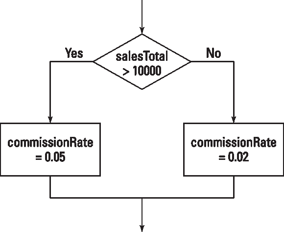

图 4-2: `if-else` 语句的流程图。

 在某些情况下，你可以通过巧妙地重新排列代码来避免使用 `if-else` 语句的 `else` 部分。这段代码与前面的 `if-else` 语句效果相同：

```java
double commissionRate = 0.02;
if (salesTotal > 10000.0)
    commissionRate = 0.05;
```

你可以在 `if-else` 语句中的一个或两个语句中使用块。这里是一个两个语句都是块的 `if-else` 语句（的 `if-else` 语句）：

```java
double commissionRate;
if (salesTotal > 10000.0)
{
    commissionRate = 0.05;
    level2Count++;
}
else
{
    commissionRate = 0.02;
    level1Count++;
}
```

### 嵌套 `if` 语句

位于 `if-else` 语句的 `if` 或 `else` 部分的语句可以是任何类型的 Java 语句，包括另一个 `if` 或 `if-else` 语句。这种安排被称为嵌套（nesting），而包含另一个 `if` 或 `if-else` 语句的 `if` 或 `if-else` 语句被称为嵌套 `if` 语句。

嵌套 `if` 语句的通用形式如下：


```java
if (expression-1)
    if (expression-2)
        statement-1
    else
        statement-2
else
    if (expression-3)
        statement-3
    else
        statement-4
```

在本示例中，首先评估`expression-1`。如果它评估为`true`，则评估`expression-2`。如果它评估为`true`，则执行`statement-1`；否则执行`statement-2`。如果`expression-1`评估为`false`，则评估`expression-3`。如果它评估为`true`，则执行`statement-3`；否则执行`statement-4`。

但记住，Java 并不关心你的缩进。你无法通过缩进来诱导 Java 以不同的方式将`if`和`else`关键字配对。

假设 2 类销售人员不获得任何佣金，因此前一个示例中的内部`if`语句不需要`else`语句。你可能会尝试使用以下代码来计算佣金率：

```java
if (salesTotal < 10000)
if (salesClass == 1)
commissionRate = 0.02;
else
if (salesClass == 1)
commissionRate = 0.025;
```

这是行行的。缩进会产生一种印象，认为`else`关键字与第一个`if`语句配对，但实际上，它与第二个`if`语句配对。结果是，10,000 美元以上的销售额没有设置销售佣金率。

这个问题有两个解决方案。第一个（也是推荐的）解决方案是使用大括号来明确结构：

```java
if (salesTotal < 10000)
{
if (salesClass == 1)
commissionRate = 0.02;
}
else
{
if (salesClass == 1)
commissionRate = 0.025;
}
```

另一个解决方案是向第一个内部`if`语句添加一个指定了*空语句*（一个的分的分号）的`else`语句：

```java
if (salesTotal < 10000)
if (salesClass == 1)
commissionRate = 0.02;
else ;
else
if (salesClass == 1)
commissionRate = 0.025;
```

空的`else`语句与内部`if`语句配对，因此第二个`else`关键字正确地与外部`if`语句配对。

## else-if 语句

嵌套`if`语句的一种常见模式是有一系列`if-else`语句，并且在每个`else`部分都包含另一个`if-else`语句：

```java
if (expression-1)
    statement-1
else if (expression-2)
    statement-2
else if (expression-3)
    statement-3
```

这些语句有时被称为*else-if 语句*，尽管该术语是非正式的。从官方来说，发生这一切只是`else`部分的语句恰好是另一个`if`语句——所以这种语句只是嵌套`if`语句的一种类型。然而，这是一种非常有用的嵌套形式。

假设你想根据销售总额分配四种佣金率，如下表所示：

| 销售额 | 佣金 |
| --- | --- |
| $10,000 及以上 | 5% |
| $5,000 到 $9,999 | 3.5% |
| $1,000 到 $4,999 | 2% |
| $1,000 以下 | 0% |

你可以很容易地实现一系列`else-if`语句：

```java
if (salesTotal >= 10000.0)
commissionRate = 0.05;
else if (salesTotal >= 5000.0)
commissionRate = 0.035;
else if (salesTotal >= 1000.0)
commissionRate = 0.02;
else
commissionRate = 0.0;
```

图 4-3 显示了这个序列`else-if`语句的流程图。

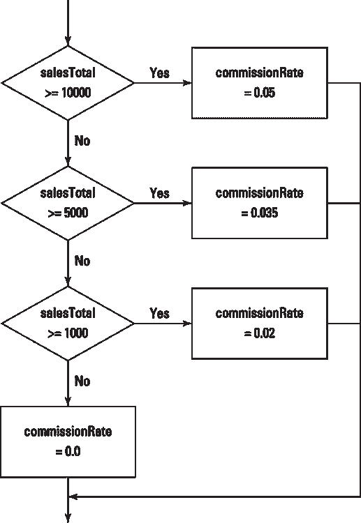

图 4-3： 序列 else-if 语句的流程图。

 你必须仔细考虑如何设置这些`else-if`语句。例如，乍看之下，这个序列似乎可能有效：

```java
if (salesTotal > 0.0)
commissionRate = 0.0;
else if (salesTotal >= 1000.0)
commissionRate = 0.02;
else if (salesTotal >= 5000.0)
commissionRate = 0.035;
else if (salesTotal >= 10000.0)
commissionRate = 0.05;
```

尝试得不错，但这种情况不起作用。这些`if`语句始终会将佣金率设置为 0%，因为第一个`if`语句中的布尔表达式始终测试结果为`true`（假设`salesTotal`不为零或负数——如果是的话，其他任何`if`语句都无关紧要）。结果是，其他`if`语句永远不会被评估。

## 使用斯波克先生最喜欢的运算符（当然是逻辑运算符）

**逻辑运算符**（有时称为*布尔运算符*）是返回布尔结果的运算符。这种操作被称为*与操作 (And operation)*，因为只有当第一个表达式和第二个表达式都为`true`时，与运算符才会返回`true`。表 4-2 列出了逻辑运算符。

| 运算符 | 名称 | 类型 | 描述 |
| --- | --- | --- | --- |
| `!` | 非 | 一元 | 反转布尔表达式的值。 |
| `&` | 与 | 二元 | 只有当两个表达式都为`true`时才返回`true`。 |
| `\|` | 或 | 二元 | 当至少有一个操作数为`true`时返回`true`。 |
| `^` | 异或 | 二元 | 当仅当有一个操作数为`true`时返回`true`。 |
| `&&` | 条件与 | 二元 | 与`&`相同但使用短路评估。 |
| `\|\|` | 条件或 | 二元 | 与`\|`相同但使用短路评估。 |

下面的章节详细介绍了这些运算符。

### 使用 ! 运算符

逻辑逻辑运算符是*非* (`!`)。从技术上说，它是一个前缀一元运算符，这意味着你紧接操作数使用它。（技术上讲，这个运算符被称为逻辑运算符，但在现实生活中，许多程序员称之为 bang。）

非运算符反转布尔表达式的值。因此，如果表达式为`true`，它将其变为`false`。如果表达式为`false`，它将其变为`true`。

这里有一个例子：

```java
!(i == 4)
```

当`i`为 4 除的任何值时，此表达式求值为`true`。如果`i`为 4，它求值为`false`。它通过首先评估表达式`(i == 4)`然后结果结果。

 不要混淆非逻辑运算符 (`!`) 和不等于关系运算符 (`!=`)。虽然这些运算符的用法相似，但非运算符更通用。我可以这样写前面的示例：

```java
i != 4
```

结果是相同的。然而，非运算符可以应用于任何返回`true-false`结果的表达式，而不只是相等测试。

 你几乎总是将非运算符应用的表达式放在括号中。考虑这个表达式：

```java
! i == 4
```

假设`i`是整数变量，编译器不允许这样做，因为看起来你正试图将`!`运算符应用于变量，而不是比较的结果。快速加一组括号解决了问题：

```java
!(i == 4)
```

### 使用 & 和 && 运算符

`&`和`&&`运算符组合两个布尔表达式，并且只有当两个表达式都为`true`时才返回`true`。

假设如果销售类别为 1 且销售总额达到 10,000 美元，则销售佣金率应为 2.5%。可以使用两个独立的`if`语句（正如在本章稍早时候所做的那样）执行此测试，或者可以将测试合并到一个`if`语句中：

```java
if ((salesClass == 1) & (salesTotal >= 10000.0))
commissionRate = 0.025;
```

在这里，表达式`(salesClass == 1)`和`(salesTotal >= 10000.0)`是分别求值的。然后，`&`运算符比较这些结果。如果它们都为`true`，`&`运算符返回`true`。如果其中一个为`false`或两者都为`false`，`&`运算符返回`false`。

 注意我大量使用了括号来明确一个表达式的结束和另一个表达式的开始。使用括号并不是总是必要的，但当你使用逻辑运算符时，我建议你始终使用括号来清晰地标识正在比较的表达式。

`&&`运算符与`&`运算符类似，但它更多地利用了你对逻辑的知识。因为`&`运算符比较的两个表达式都为`true`，整个表达式才为`true`，所以如果第一个表达式返回`false`，没有理由评估第二个表达式。`&`运算符并不知道这一事实，因此它在确定结果之前盲目地评估两个表达式。`&&`运算符足够智能，在知道结果时就会停止。

因此，几乎总是使用`&&`而不是`&`。这里是前面的例子，这次使用`&&`智能地编码：

```java
if ((salesClass == 1) && (salesTotal >= 10000.0))
    commissionRate = 0.025;
```

 为什么我说你*几乎*总是使用`&&`呢？因为有时表达式本身具有重要的副作用。例如，第二个表达式可能涉及一个更新数据库的方法调用，而你希望无论第一个表达式求值是`true`还是`false`，数据库都能得到更新。在这种情况下，你想要使用`&`而不是`&&`以确保两个表达式都得到评估。

 依赖表达式的副作用是有风险的——你几乎总是可以找到更好的代码编写方式来避免副作用。换句话说，在埋在`if`语句中的复合表达式中放置对数据库更新方法的的重要调用，可能不是一个好主意。

### 使用 `|` 和 `||` 运算符

`|`和`||`运算符被称为*或运算符*（Or operators），因为如果第一个表达式为`true`或第二个表达式为`true`，它们就会返回`true`。如果两个表达式都为`true`，它们也会返回`true`。（你在键盘的 Enter 键上方可以找到`|`符号。）

假设如果销售额小于 $1,000 或销售类别为 3，销售代表将无法获得佣金。你可以通过两个独立的`if`语句来实现：

```java
if (salesTotal < 1000.0)
    commissionRate = 0.0;

if (salesClass == 3)
    commissionRate = 0.0;
```

然而，使用或运算符，你可以通过复合条件完成相同的事情：

```java
if ((salesTotal < 1000.0) | (salesClass == 3))
    commissionRate = 0.0;
```

为了评估此`if`语句的表达式，Java 首先评估`|`运算符两侧的表达式。然后，如果这些表达式中至少有一个为`true`，整个表达式就为`true`。否则，表达式为`false`。

 在大多数情况下，你应该使用条件或运算符（`||`）而不是普通的或运算符（`|`），如下：

```java
if ((salesTotal < 1000.0) || (salesClass == 3))
    commissionRate = 0.0;
```

与条件与运算符（`&&`）一样，条件或运算符在知道结果后就会停止评估。假设销售总额为 $500。那么没有必要评估第二个表达式。因为第一个表达式求值为`true`且只需要其中一个表达式为`true`，Java 可以跳过第二个表达式。如果销售总额为 $5,000，当然，必须评估第二个表达式。

与与运算符一样，只有当你的程序依赖第二个表达式的某些副作用（例如方法调用执行的工作）时，才使用普通的或运算符。

### 使用 `^` 运算符

`^`运算符执行逻辑世界中被称为*异或*（Exclusive Or，通常缩写为 *Xor*）的操作。如果子表达式中仅有一个为`true`，它返回`true`。如果两个表达式都为`true`，或者两个表达式都为`false`，`^`运算符返回`false`。

换句话说，如果两个子表达式的结果不同，`^`运算符返回`true`。如果它们的结果相同，它返回`false`。

 大多数程序员并不去理会`^`运算符，因为它非常困惑。如果你跳过这一节，我的感情不会受到伤害。

假设你正在编写控制模型铁路套装的软件，你想找出两个开关是否处于可能导致碰撞的危险位置。如果开关由名为`switch1`和`switch2`的简单`integer`变量表示，且`1`表示轨道切换到左，`2`表示轨道切换到右，你可以这样轻松测试它们：

```java
if ( switch1 == switch2 )
    System.out.println("Trouble! The switches are the same");
else
```

如果`a`为`5`，`b`为`7`，且`c = 3`，你认为这个`if`语句会做什么？答案是该表达式求值为`true`，并打印出`"It's true!"`。这是因为 Java 从左到右应用运算符。因此，`&&`运算符应用于`a==1`（结果为`false`）和`b==2`（结果也是`false`，但并不重要，因为这次评估被跳过了）。因此，`&&`运算符返回`false`。然后，`||`运算符应用于该`false`结果和`c==3`的结果（结果为`true`）。因此，整个表达式返回`true`。

 如果你使用一组括号来明确表达式的作用，这个表达式不是更清晰吗？考虑这个例子：

```java
if ( ( a==1 && b==2 ) || c==3 )
```

```java
System.out.println("It's true!");
else
System.out.println("No it isn't!");
```

在这里你可以清楚地看到`&&`运算符首先被评估。

## 使用条件运算符

Java 有一种特殊的运算符称为`条件运算符`（conditional operator），它设计用于在某些情况下消除对`if`语句的需求。它是一个*三元运算符*（ternary operator），这意味着它可以处理三个操作数。使用条件运算符的通用格式如下：

`boolean-expression` `?` `expression-1` `:` `expression-2`

首先评估布尔表达式。如果它的求值为`true`，则评估`expression-1`，该表达式的结果将成为整个表达式的结果。如果表达式为`false`，则评估`expression-2`，并使用其结果。

假设你想在总销售额小于 $10,000 时为名为`salesTier`的整数变量赋值`0`，而如果销售额达到 $10,000 或更多，则赋值`1`。你可以通过此语句来实现：

```java
int salesTier = salesTotal < 10000.0 ? 0 : 1;
```

虽然不是强制的，但使用括号可以帮助使语句更容易理解：

```java
int salesTier = (salesTotal < 10000.0) ? 0 : 1;
```

 条件运算符的一个常见用途是当你使用拼接来构建文本字符串时，并且你有一个根据整数变量的值可能需要复数形式的单词。假设你想创建一个显示为`"You have` x `apples"`的字符串，并用名为`appleCount`的变量值替换 x。但如果`apples`为`1`，字符串应该是`"You have 1 apple"`，而不是`"You have 1 apples"`。

接下来的语句可以实现这个效果：

```java
String msg = "You have " + appleCount + " apple"
+ ((appleCount != 1) ? "s." : ".");
```

当 Java 遇到`?`运算符时，它会评估表达式 (`appleCount != 1`)。如果为`true`，它使用第一个字符串（`s.`）。如果为`false`，它使用第二个字符串（`.`）。

## 比较字符串

在 Java 中比较字符串需要额外的小心，因为`==`运算符的作用并不如你预期的那样。假设你想知道名为`answer`的 String 变量是否包含值`"Yes"`。你可能会倾向于编写如下的`if`语句：

```java
if (answer == "Yes")
System.out.println("The answer is Yes.");
```


 遗憾的是，这是错误的。问题在于在 Java 中，字符串是引用类型，而不是基本类型；当你对引用类型使用 `==` 运算符时，Java 比较的是对象的引用，而不是对象本身。因此，表达式 `answer == "Yes"` 测试 `answer` 变量引用的字符串的值是否为 `"Yes"`。相反，它测试的是答案字符串和字面量字符串 `"Yes"` 是否指向内存中的同一个字符串对象。在很多情况下，它们是相同的——但有时并不是，且结果难以预测。

测试字符串是否等于给定值的正确方法是使用 `String` 类的 `equals` 方法：

```java
if (answer.equals("Yes"))
System.out.println("The answer is Yes.");
```

该方法实际上比较了变量引用的字符串对象的值与你作为参数传递的字符串，并返回一个布尔结果，指示字符串是否具有相同的值。

`String` 类另一个非常有用的方法是 `equalsIgnoreCase`，它也用于比较字符串。它比较字符串但忽略大小写，这在你测试用户输入的字符串值时特别有用。假设你正在编写一个程序，只有当用户输入单词 `end` 时程序才结束。你可以使用 `equals` 方法来测试字符串：

```java
if (input.equals("end"))
// end the program
```

但在这种情况下，用户必须精确输入 `end`。如果用户输入 `End` 或 `END`，程序不会结束。最好是这样编写 `if` 语句：

```java
if (input.equalsIgnoreCase("end"))
// end the program
```

这样，用户就可以通过输入小写的单词 `end` 来结束程序。

请注意，`while` 循环的语句部分可以是单个语句，也可以是包含在一对括号中的语句块。只有一个语句的循环并没有什么用处，因此你编写的几乎所有的 `while` 循环都会使用语句块。（嗯，好吧，有时候带有单个语句的循环也是有用的。这并非罕见——只是没那么常见。）

### 计数循环

这里是一个简单的程序，它使用 `while` 循环在控制台上打印从 2 到 20 的所有偶数：

```java
public class EvenCounter
{
    public static void main(String[] args)
    {
        int number = 2;
        while (number <= 20)
        {
            System.out.print(number + " ");
            number += 2;
        }
        System.out.println();
    }
}
```

如果你运行这个程序，控制台窗口将显示以下输出：

`2 4 6 8 10 12 14 16 18 20`

此程序 `while` 语句中的条件表达式是 `number <= 20`。这意味着只要 `number` 的值小于或等于 20，循环就会重复。循环体由两个语句组成。第一个语句打印 `number` 的值，后面跟着一个空格，将该数字与下一个数字隔开。然后第二个语句将 `number` 加上 2。

图 5-1 显示了该程序的流程图。这个流程图可以帮助你可视化循环的基本决策过程。

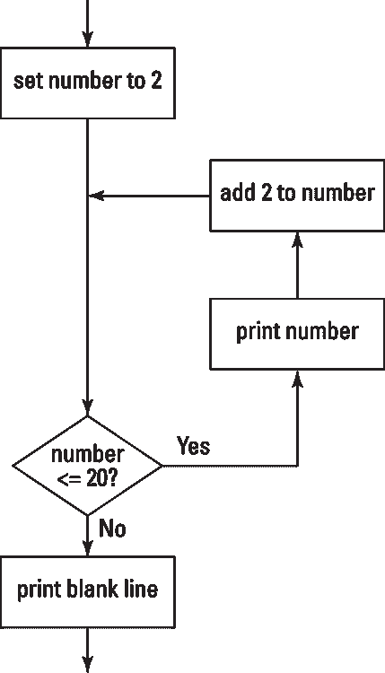

图 5-1：`while` 循环的流程图。

## 跳循环

在许多程序中，你需要设置一个带有某种退出机制的循环。Java 的退出机制是 `break` 语句。当 `while` 循环中执行 `break` 语句时，循环会立即结束。循环中任何剩余的语句都会被忽略，执行的下一个语句是循环之后的语句。

假设你害怕数字 12。（我不是医生，也没有在电视上扮演医生，但我认为这种状态的科学名称应该是十二恐惧症 [dodecaphobia]。）你可以修改上一节中的计数程序，使得当它遇到数字 12 时，它会恐慌并终止循环：

```java
public class Dodecaphobia
{
    public static void main(String[] args)
    {
        int number = 2;
        while (number <= 20)
        {
            if (number == 12)
                break;
            System.out.print(number + " ");
            number += 2;
        }
        System.out.println();
    }
}
```

运行此程序时，控制台上会显示以下行：

`2 4 6 8 10`

呼！好险。差点打印出数字 12。

## 无限循环

循环的一种常见形式被称为无限循环。也就是一个永远持续的循环。在 Java 中你可以通过许多方式创建无限循环（并非所有都是故意的），但最简单的方法是为 `while` 表达式指定 `true`。

```java
public class CountForever
{
    public static void main(String[] args)
    {
        int number = 2;
        while (true)
        {
            System.out.print(number + " ");
            number += 2;
        }
    }
}
```

如果你运行这个程序，你的控制台窗口会迅速填满数字并持续下去。如果你真的很喜欢数字，那很棒，但最终你会厌倦这个循环并希望它停止。你可以通过三种方式停止无限循环：

- 关闭电脑。
- 用重物斧砸你的电脑。
- 关闭控制台窗口。

最后一种可能是你想选择的方法。

 显然，无限循环是你在程序中想要避免的。因此，每当你使用一个始终为 `true` 的 `while` 表达式时，务必加入一个 `break` 语句，给你的循环提供某种终止方式。你可以在 `Dodecaphobia` 程序中使用带有 `break` 语句的无限循环：

```java
public class Dodecaphobia
{
    public static void main(String[] args)
    {
        int number = 2;
        while (true)
        {
            if (number == 12)
                break;
            System.out.print(number + " ");
            number += 2;
        }
        System.out.println();
    }
}
```

在这里，循环看起来可能会永远持续下去，但 `break` 语句在遇到 12 时会恐慌地跳出循环。

### 让用户决定何时退出

事实证明，当你让用户控制何时停止循环时，无限循环也是用的。假设你不知道用户害怕哪些数字，所以你想一直数到用户说停止为止。这里有一个实现该功能的程序：

```java
import java.util.Scanner;
public class NumberPhobia
{
    static Scanner sc = new Scanner(System.in);
    public static void main(String[] args)
    {
        int number = 2;
        String input;
        while (true)
        {
            System.out.println(number);
            System.out.print("Do you want to keep counting? (Y or N) ");
            input = sc.next();
            if (input.equalsIgnoreCase("N"))
                break;
            number += 2;
        }
        System.out.println("\nWhew! That was close.\n");
    }
}
```

以下是一个患恐蜘蛛症（octophobia）的用户运行程序的典型控制台输出：

`2`

`Do you want to keep counting? (Y or N)y`

`4`

`Do you want to keep counting? (Y or N)y`

`6`

`Do you want to keep counting? (Y or N)n`

`Whew! That was close.`

### 另一种让用户决定的方法

另一种让用户可以退出循环的方法是在 `while` 条件中测试输入字符串。这里的技巧在于你必须首先初始化输入字符串。否则循环根本不会执行！

这是 `NumberPhobia` 程序的一个变体 `NumberPhobia2`，使用了这种技术：

```java
import java.util.Scanner;
public class NumberPhobia
{
    static Scanner sc = new Scanner(System.in);
    public static void main(String[] args)
    {
        int number = 2;
        String input = "Y";
        while (input.equalsIgnoreCase("Y"))
        {
            System.out.println(number);
            System.out.print("Do you want to keep counting? (Y or N) ");
            input = sc.next();
        number += 2;
        }
        System.out.println("\nWhew! That was close.");
    }
}
```

这个程序的工作方式与之前的版本几乎相同，但有一个细微的区别。在前一个版本中，如果用户在显示 6 后说 N，变量 `number` 的值为 6，因为 `break` 语句在加 2 之前退出循环。但在这个版本中，`number` 的值为 8。

## 使用 `continue` 语句

`break` 语句相当强硬：它会完全退出循环。有时你需要它——但很多时候你并不需要退出循环；你只需要跳过循环的某一次迭代。本章之前提到的 `Dodecaphobia` 程序在遇到 12 时停止。如果你只想跳过数字 12，让它从 10 跳到 14 呢？

为了实现这一点，你可以使用 `break` 语句更亲和、更温柔的——`continue` 语句。`continue` 语句会将控制权直接传回循环顶部，再次评估表达式。如果表达式仍然为 `true`，循环的语句或块将再次执行。

这里有一个 `Dodecaphobia` 程序版本，它使用 `continue` 语句跳过数字 12，而不是在达到 12 时停止计数：

```java
public class Dodecaphobia3
{
    public static void main(String[] args)
    {
        int number = 0;
        while (number < 20)
        {
            number += 2;
            if (number == 12)
                continue;
            System.out.print(number + " ");
        }
        System.out.println();
    }
}
```

运行此程序，你在控制台窗口获得以下输出：

`2 4 6 8 10 14 16 18 20`

注意，为了让这个程序能够使用 `continue` 语句而不是 `break` 语句，我不得不几处修改。如果我只是将单词 `break` 替换为 `continue`，程序将无法运行，因为在原始版本中，给数字加 2 的语句位于 `break` 语句之后。结果是，如果你只是将 `break` 语句替换为 `continue` 语句，当你运行到 12 时就会导致死循环，因为给 `number` 加 2 的语句永远不会被执行。

为了让这个程序在使用 `continue` 语句的情况下工作，我重新排列了循环体中的语句，使得给 `number` 加 2 的语句位于 `continue` 语句之前。这样一来，`continue` 语句跳过的唯一语句就是向控制台打印 `number` 的那条语句。

遗憾的是，这一更改影响了程序中的其他语句。因为在打印 `number` 之前已经给它加了 2，我不得不将 `number` 的初始值从 `2` 改为 `0`，并且将 `while` 表达式从 `number <= 20` 改为 `number < 20`。

## `do-while` 循环

`do-while` 循环（有时称为 `do` 循环）与 `while` 循环相似，但有一个关键区别：在 `do-while` 循环中，循环体语句执行至少一次之后，才会测试停止循环的条件。`do-while` 循环的基本形式如下：

```
do
    statement
} while (expression);
```

注意，`while` 关键字和表达式是在循环体之后才编写的。与 `while` 循环一样，`do-while` 循环的体可以是一条语句，也可以是一个用大括号括起来语句块。

此外，注意表达式后面跟着一个分号。`do-while` 是唯一以分号结尾的循环语句。

这里是 `EvenCounter` 程序的一个版本，它使用 `do-while` 循环代替了 `while` 循环：

```java
public class EvenCounter2
{
    public static void main(String[] args)
    {
        int number = 2;
        do
        {
            System.out.print(number + " ");
            number += 2;
        } while (number <= 20);
        System.out.println();
    }
}
```

 关于 `do-while` 循环最重要的记忆点是：`do-while` 循环体中的语句或语句始终至少执行一次。相比之下，如果 `while` 表达式在第一次求值时为 `false`，则 `while` 循环体中的语句或语句将完全不执行。

查看图 5-2 中的流程图。你可以看到执行从循环开始，在循环体执行一次后流向判断测试。然后，如果判断测试为 `true`，控制权就会回到循环顶部。否则，它就会从流程图底部退出。

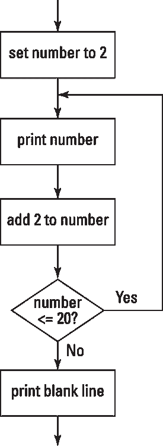

图 5-2：`do-while` 循环的流程图。

关于 `do-while` 循环，还需要注意以下几点：

- 你通常可以跳过循环前表达式中变量初始化，因为表达式在循环体语句执行至少一次之前不会求值。但请记住，`while` 表达式中提到的任何变量必须在 `do` 语句本身的作用范围内；在 `do` 循环内部声明的变量不能用于 `while` 表达式，因为它们出了作用范围。
- 你可以在 `do-while` 循环中使用 `break` 和 `continue` 语句，就像在 `while` 循环中一样。
- 有些程序员喜欢将开始循环体的大括号与 `do` 语句放在同一行，并将结束 `do-while` 循环的 `while` 语句与标记循环结束的大括号放在同一行。只要你觉得方便，怎样都可以。只需记住，编译器对缩进和空格问题是不关切的。

## 验证用户输入

`do-while` 循环特别适用于验证用户输入。假设你正在编写一个玩赌注游戏的程序，你想从控制台获取用户的下注金额。用户可以下注任何他们美元金额（尽管只能是整数美元），但下注不能超过其银行存款，且不能下注负数或零。这里是一个使用 `do-while` 循环从用户处获取输入的程序：


```java
import java.util.Scanner;

public class GetABet
{
    static Scanner sc = new Scanner(System.in);
    public static void main(String[] args)
    {
        int bank = 1000; // 假设用户有 $1,000
        int bet; // 用户输入的注额
        System.out.println("You can bet between 1 and " + bank);
        do
        {
            System.out.print("Enter your bet: ");
            bet = sc.nextInt();
        } while (bet <= 0) || (bet > bank);
        System.out.println("Your money's good here.");
    }
}
```

如果你想在用户输入错误内容时显示错误信息，必须在循环内部使用 `if` 语句，并且这个 `if` 语句必须复制验证输入的表达式。例如：

```java
import java.util.Scanner;

public class GetABet2
{
    static Scanner sc = new Scanner(System.in);
    public static void main(String[] args)
    {
        int bank = 1000; // 假设用户有 $1,000
        int bet; // 用户输入的注额
        System.out.println("You can bet between 1 and " + bank);
        do
        {
            System.out.print("Enter your bet: ");
            bet = sc.nextInt();
            if ( (bet <= 0) || (bet > bank) )
                System.out.println ("What, are you crazy?");
        } while ( (bet <= 0) || (bet > bank) );
        System.out.println("Your money's good here.");
    }
}
```

在这里，如果用户尝试输入不当的注额，`if` 语句会显示消息 `"What, are you crazy?"`。

 你可以通过添加一个 `boolean` 变量来避免重复编写数据验证的表达式。如果数据无效，则在 `do-while` 循环体中设置该变量，如下例所示：

```java
import java.util.Scanner;

public class GetABet3
{
    static Scanner sc = new Scanner(System.in);
    public static void main(String[] args)
    {
        int bank = 1000; // 假设用户有 $1,000
        int bet; // 用户输入的注额
        boolean validBet; // 表示注额是否有效
        System.out.println("You can bet between 1 and " + bank);
        do
{
```

```java
System.out.print("Enter your bet: ");
bet = sc.nextInt();
validBet = true;
if ( (bet <= 0) || (bet > bank) )
{
    validBet = false;
    System.out.println("What, are you crazy?");
}
} while (!validBet);
System.out.println("Your money's good here.");
}
}
```

在这个示例中，我使用了一个名为 `validBet` 的 `boolean` 变量来指示用户是否输入了有效的投注。在用户输入投注金额后，在 `if` 语句测试准则之前，该变量被设置为 `true`。然后，如果 `if` 语句发现投注无效，`validBet` 就会被设置为 `false`。

## 使用著名的 for 循环

除了 `while` 和 `do-while` 循环外，Java 还提供了 `for` 循环。你可能已经注意到，在本书中介绍的许多循环都涉及计数。事实证明，计数循环在计算机程序中非常常见，因此设计计算机编程语言的人（他们被称为计算机编程语言设计者）很久以前就发明了一种专门为计数设计的特殊循环机制。

典型的 `for` 循环的基本原理是循环本身维护一个`计数器变量`——即一个每次执行循环体时值都会增加的变量。如果你想要一个从 1 计数到 10 的循环，你会使用一个初始值为 `1` 的计数器变量，并在每次循环时增加 1。然后，你使用一个测试在计数器变量超过 `10` 时结束循环。`for` 循环让你能够在一个方便的语句中完成所有设置。

### 理解 for 循环的正式格式

现在我想向你介绍 `for` 循环的正式格式，这样你以后就知道了如何构造它。`for` 循环遵循以下基本格式：

`for (initialization-expression; test-expression; count-expression)`

`statement;`

关键字 `for` 后面括号内的三个表达式控制着 `for` 循环的工作。接下来的段落解释了这三个表达式的作用：

*   `初始化表达式` 在循环开始之前执行。通常情况下，你使用此表达式来初始化计数器变量。如果你在 `for` 语句之前没有声明计数器变量，也可以在这里声明。

*   `测试表达式` 在每次循环执行时求值，以确定循环是否应该继续运行。通常，此表达式测试计数器变量，以确保它仍然小于或等于你想计数的数值。只要该表达式的值为 `true`，循环就会继续执行。当测试表达式的值为 `false` 时，循环结束。

*   `计数表达式` 在每次循环执行时求值。它的工作通常是增加计数器变量。

[图 5-3] 显示了一个帮助你直观理解 `for` 循环如何工作的流程图。

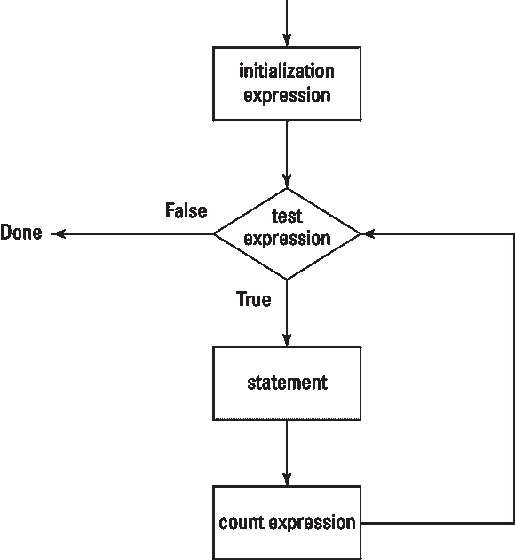

[图 5-3：] `for` 循环的流程图。

这是一个在控制台上显示数字 1 到 10 的简单 `for` 循环：

```java
public class CountToTen {
    public static void main(String[] args) {
        for (int i = 1; i <= 10; i++)
            System.out.println(i);
    }
}
```

运行此程序，你会在控制台上看到的内容：

```
1
2
3
4
5
6
7
8
9
10
```

这个 `for` 循环包含以下部分：

*   初始化表达式是 `int i = 1`。此表达式声明了一个名为 `i` 的类型为 `int` 的变量，并为其分配了初始值 `1`。

*   测试表达式是 `i <= 10`。结果是，只要 `i` 小于或等于 `10`，循环就会执行。

*   计数表达式是 `i++`。结果是，每次循环执行时，变量 `i` 都会加 1。

*   循环体是单个语句 `System.out.println(i)`。结果是，每次循环执行时，变量 `i` 的值都会打印到控制台上。

 我自己用来描述 `for` 循环中三个表达式的术语。正式来说，Java 将它们称为 `ForInit` 表达式、`表达式,` 和 `ForUpdate` 表达式。你不觉得我的术语更具描述性吗？

### 计数器变量的作用域

如果你在初始化语句中声明计数器变量，则计数器变量的作用域仅限于 `for` 语句本身。因此，你可以在括号内的其他表达式以及循环体中使用该变量，但不能在外部使用。

```java
public class CountToTen {
    public static void main(String[] args) {
        for (int i = 1; i <= 10; i++)
            System.out.println(i);
    }
    // 在这里无法访问 i
}
```

如果你想在循环外部使用该变量，应该在 `for` 语句之前声明它：

```java
public class CountToTen {
    public static void main(String[] args) {
        int i;
        for (i = 1; i <= 10; i++)
            System.out.println(i);
        System.out.println("Final value: " + i);
    }
}
```

### 统计偶数

在本章稍早之前，你看到了一个统计偶数的程序。你可以使用 `for` 循环实现这一点。你只需要调整计数表达式即可。这里是 `CountEven` 的版本：

```java
public class ForEven {
    public static void main(String[] args) {
        for (int number = 2; number <= 20; number += 2)
            System.out.print(number + " ");
    }
}
```

运行此程序，不出所料，控制台显示：

`2 4 6 8 10 12 14 16 18 20`

### 倒数

没有规则规定 `for` 循环只能正向计数。要倒数，你只需要调整三个 `for` 循环表达式。按照惯例，初始化表达式指定计数器变量的起始值。测试表达式使用大于测试而不是小于测试，而计数表达式则从计数器变量中减去。

例如：

```java
public class CountDown {
    public static void main(String[] args) {
        for (int count = 10; count >= 1; count--)
            System.out.println(count);
    }
}
```

运行此程序，你会在控制台上看到这个结果：

```
10
9
8
7
6
5
4
3
2
1
```

 如果你像我一样在 20 世纪 60 年代虔地观看 NASA 的发射，你会喜欢这个倒计时程序的变体：

```java
public class LaunchControl {
    public static void main(String[] args) {
        System.out.print("We are go for launch in T minus ");
        for (int count = 10; count >= 0; count--) {
            if (count == 8)
                System.out.println("Ignition sequence start!");
            else
                System.out.println(count + "…");
        }
        System.out.println("All engines running!");
        System.out.println("Liftoff! We have a liftoff!");
    }
}
```

当你运行它时，显示的输出如下：

```
We are go for launch in T minus 10…
9…
Ignition sequence start!
7…
6…
5…
4…
3…
2…
1…
0…
All engines running!
Liftoff! We have a liftoff!
```

难道你听不见 20 世纪 60 年代 NASA“控制中心声音”保罗·汉尼（Paul Haney）的声音吗？如果你听不见，那你可没我那么极客（或者没我那么老）。

## 使用没有主体的 循环

有些程序员非常喜欢编写尽可能简洁的代码。我觉得《老友记》（*Seinfeld*）拍过一个关于这个主题的剧。杰里有一个女友是个“简洁代码程序员”，他因为看不懂她的代码而不得不和她分手。

总之，简洁代码程序员有时喜欢玩弄 `for` 语句，试图完全消除 `for` 循环的主体。为了做到这一点，他们利用了事实：在 `for` 语句的计数表达式部分，你可以编写任何想要的表达式，包括方法调用。这里有一个程序使用没有主体的 `for` 语句在控制台上打印从 1 到 10 的数字：

```java
public class TerseCoder
{
    public static void main(String[] args)
    {
        for (int i = 1; i <= 10; System.out.println(i++));
    }
}
```

在这里，计数表达式是对 `System.out.println` 的调用。`println` 方法的参数巧妙地使用了自增运算符，因此变量在同一个表达式中既被打印又被增加。

 远离那些简洁代码程序员！杰里在剧里和她分手是正确的。

## 合并你的表达式

`for` 循环的一个不为人知的方面是，初始化表达式和计数表达式实际上可以是一个由逗号分隔的表达式列表。如果你需要同时跟踪两个计数变量，这就会非常有用。这里有一个程序使用两个计数变量同时从 1 到 10 和从 10 到 1 计数计数：

```java
public class CountBothWays
{
    public static void main(String[] args)
    {
        int a, b;
        for (a = 1, b = 10; a <= 10; a++, b--)
            System.out.println(a + " " + b);
    }
}
```

如果你运行这个程序，你会在控制台窗口看到：

`1 10`

`2 9`

`3 8`

`4 7`

`5 6`

`6 5`

`7 4`

`8 3`

`9 2`

`10 1`

在使用多个表达式作为初始化表达式和计数表达式时，请记住这些规则：

- 在初始化表达式中，如果你使用多个表达式，就不能声明变量。这就是为什么我在 `CountBothWays` 示例的 `for` 语句之前声明了 `a` 和 `b` 变量。

- 表达式列表中的表达式可以是赋值语句、自增或自减语句（如 `a++`）、方法调用，或使用 `new` 关键字从类创建对象的对象创建语句。其他类型的语句，例如 `if` 语句或变量声明是不允许的。

- 测试表达式中不能列出多个表达式。不过，你可以使用通过布尔运算符创建的复合条件，所以你不需要使用表达式列表。或者，你可以编写一个返回布尔值的方法，并调用该方法作为你的测试表达式。

 这里，仅仅为了证明我可以这样做，是一个使用无主体 `for` 循环的 `LaunchController` 程序版本：

```java
public class ExpressionGanging
{
    public static void main(String[] args)
    {
        System.out.print ("We are go for launch in T minus ");
        for (int count = 10; count >= 0;
            System.out.println((count == 8) ?
            "Ignition sequence start!" :
            count + "…"),
            count-- );
        System.out.println("All engines running!");
        System.out.println("Liftoff! We have a liftoff!");
    }
}
```

这个程序看起来比实际上要复杂。`count` 表达式是两个表达式的列表。第一个是对 `System.out.println` 的调用，它使用三元运算符 `?:` 来决定打印什么。`?:` 运算符首先评估 `count` 变量以判断是否等于 8。如果是，字符串 `"Ignition sequence start!"` 被发送给 `println` 方法。否则，发送 `count + "…"`。第二个表达式仅仅是增加 `count` 变量的值。

我想你会同意，像这个示例这样编写 `for` 语句是完全离谱的。最好保持表达式简单，并在循环的主体中执行实际工作。

## 忽略表达式

`for` 循环的另一个奇怪之处是，三个表达式都是可选的。如果你省略了一个或多个表达式，你只需要编写分号作为占位符，这样编译器就知道发生了什么。


省略测试表达式或迭代表达式并不常见，但省略初始化表达式很常见。例如，你在`for`循环中增加的变量可能在进入循环之前已经声明并初始化了。在这种情况下，你可以省略初始化表达式，如下所示：

```java
Scanner sc = new Scanner(System.in);
int a = 0;
for (; a < 10; a++)
    System.out.println(a);
```

## 跳出和继续你的循环

你可以使用`break`和`continue`来控制循环流。`break`会完全退出循环，而`continue`会跳过当前迭代的剩余部分并移动到下一次。

## 嵌套你的循环

循环可以包含循环。这的专业术语是*loop-de-loop*。开玩笑的。实际上，专业术语是*嵌套循环*（nested loop），它仅仅是指完全位于另一个循环内部的循环。内部的循环被称为*内循环*（inner loop），外部的循环被称为*外循环*（outer loop）。

### 简单的嵌套 for 循环

为了演示嵌套的基础，这里有一个使用一对嵌套`for`循环的简单小程序：

```java
public class NestedLoop
{
    public static void main(String[] args)
    {
        for(int x = 1; x < 10; x++)
        {
            for (int y = 1; y < 10; y++)
                System.out.print(x + "-" + y + " ");
            System.out.println();
        }
    }
}
```

这个程序由两个`for`循环组成。外层循环使用`x`作为其计数变量，内循环使用`y`。外层循环每次执行时，内循环执行 10 次，并打印每次通过内循环时`x`和`y`的值。当内循环结束时，调用无的`System.out.println`会强制换行，从而开始新的一行。然后外层循环循环，打印下一行。

当你运行这个程序时，控制台显示以下文本：

`1-1 1-2 1-3 1-4 1-5 1-6 1-7 1-8 1-9`

`2-1 2-2 2-3 2-4 2-5 2-6 2-7 2-8 2-9`

`3-1 3-2 3-3 3-4 3-5 3-6 3-7 3-8 3-9`

`4-1 4-2 4-3 4-4 4-5 4-6 4-7 4-8 4-9`

`5-1 5-2 5-3 5-4 5-5 5-6 5-7 5-8 5-9`

`6-1 6-2 6-3 6-4 6-5 6-6 6-7 6-8 6-9`

`7-1 7-2 7-3 7-4 7-5 7-6 7-7 7-8 7-9`

`8-1 8-2 8-3 8-4 8-5 8-6 8-7 8-8 8-9`

`9-1 9-2 9-3 9-4 9-5 9-6 9-7 9-8 9-9`

## 猜数字游戏

Listing 5-1 展示了一个更复杂但更真实的嵌套示例。此程序实现了一个简单的猜数字游戏，计算机在 1 到 10 之间随机出一个数字，你必须猜中这个数字。在你猜完后，计算机会告诉你是对是错，然后询问你是否想再玩一次。如果你输入`Y`或`y`，游戏将重新开始。

嵌套之所以出现，是因为整个游戏都写在一个`while`循环中，只要你说你想再玩一次，循环就会一直重复。然后——在该循环内部——每当游戏要求用户输入时，它都会使用一个`do-while`循环来验证用户的输入。因此，当游戏要求用户猜一个 1 到 10 之间的数字时，它会一直循环，直到用户输入的数字在该范围内。当游戏询问用户是否想再玩一次时，它会循环，直到用户输入`Y`、`y`、`N`或`n`。

以下是该程序显示的控制台输出示例：

```
让我们玩个猜数字游戏吧！
我正在想一个 1 到 10 之间的数字。
你觉得是几？ 5
你猜错了！数字是 8
再玩一次？(Y 或 N) y
我正在想一个 1 到 10 之间的数字。
你觉得是几？ 32
我说过是 1 到 10 之间。再试一次：5
你猜错了！数字是 6
再玩一次？(Y 或 N) maybe
再玩一次？(Y 或 N) ok
再玩一次？(Y 或 N) y
我正在想一个 1 到 10 之间的数字。
你觉得是几？ 5
你猜对了！
再玩一次？(Y 或 N) n
感谢参与游戏。
```

LISTING 5-1 猜数字游戏

```java
import java.util.Scanner;

public class GuessingGame
{
    static Scanner sc = new Scanner(System.in);
    public static void main(String[] args)
    {
        boolean keepPlaying = true;
        System.out.println("Let's play a guessing game!");
        while (keepPlaying)
        {
            boolean validInput;
            int number, guess;
            String answer;
            // 取一个随机数
            number = (int)(Math.random() * 10) + 1;
            // 获取猜数字
            System.out.println("\nI'm thinking of a number "
                + "between 1 and 10.");
            System.out.print("What do you think it is? ");
            do
            {
                guess = sc.nextInt();
                validInput = true;
                if ( (guess < 1) || (guess > 10) )
                {
                    System.out.print
                    ("I said, between 1 and 10. ")
                    + "Try again: ");
                    validInput = false;
                }
            } while (!validInput);
            // 检查猜的结果
            if (guess == number)
                System.out.println("You're right!");
            else
                System.out.println("You're wrong! "
                + "The number was " + number);
            // 再玩一次？
            do
            {
                System.out.print("\nPlay again? (Y or N)");
                answer = sc.next();
                validInput = true;
                if (answer.equalsIgnoreCase("Y"));
                else if (answer.equalsIgnoreCase("N"))
                    keepPlaying = false;
                else
                    validInput = false;
            } while (!validInput);
        }
        System.out.println("\nThank you for playing!");
    }
}
```

接下来的段落描述了程序中的一些关键行：

- 7: 定义了一个名为`keepPlaying`的`boolean`变量，初始化为`true`，当用户表示玩够了这个游戏时，它会被改为`false`。

- 9–54: 游戏的主`while`循环。只要`keepPlaying`为`true`，循环就会继续。该循环在第 54 行结束。

- 11: 定义了一个名为`validInput`的`boolean`变量，用于指示用户的输入是否有效。该变量被同时用于用户猜数字的输入以及每轮结束时的时的`Y`或`N`字符串。

- 16: 在 1 到 10 之间选取一个随机数。关于随机数的更多信息，请参阅第 2 本第 3 章。

- 22–33: 获取用户有效猜数字的`do-while`循环。该循环在第 33 行结束。循环中的语句从控制台读取用户的猜数字，然后测试其是否在 1 到 10 之间。如果是，将`validInput`设置为`true`。否则，将`validInput`设置为`false`，显示错误消息并重复循环，强制用户再次猜测。只要`validInput`为`false`，循环就会继续。

- 36: `if`语句将用户的猜测与计算机的数字进行比较。显示消息以指示用户猜对还是猜错。

- 43–53: 询问用户是否想再玩一次的`do-while`循环。该循环在第 53 行结束。循环中的语句从用户处读取字符串。如果用户输入`Y`或`y`，`validInput`被设置为`true`（`keepPlaying`已经是`true`了，所以保持不变）。如果用户输入`N`或`n`，`validInput`被设置为`true`，且`keepPlaying`被设置为`false`。如果用户输入其他任何内容，`validInput`被设置为`false`。只要`validInput`为`false`，循环就会继续。

- 55: 该语句在程序主`while`循环结束后执行；它感谢用户的参与。

# 第 6 章：切换操作

## 本章内容

在第 2 本第 4 章中，你了解了 Java 决策机制的主力军：布尔表达式和强大的`if`语句。在本章中，你将发现另一个 Java 决策工具：`switch`语句。`switch`语句是一个相当局限的野兽，但它擅长处理一种特定类型的决策：根据存储在整数变量中的值选择多个动作之一。事实证明，这种需求经常出现。当出现这种需求时，你需要准备`switch`语句备用。

### 对抗 else-if 特性

许多应用程序需要根据某个控制值进行简单的逻辑选择。正如我在第 2 本第 4 章中描述的，这些情况可以通过一串联结的`else-if`语句来处理。

不幸的是，这些东西很容易失控。`else if`链看起来可能像 DNA 双螺旋结构，或者像《黑客帝国》中从屏幕顶部落下的那些代码——有成百上千行连续的`else if`。`switch`语句提供了一个更简洁的替代方案。

### 查看 else-if 程序

Listing 6-1 展示了一个可能用于自动驾驶汽车（也称为自动车辆，简称 AV）错误代码的程序片段。

LISTING 6-1 else-if 自动车辆错误解码器

```java
import java.util.Scanner;

public class AVErrorDecoder1
{
    static Scanner sc = new Scanner(System.in);
    public static void main(String[] args)
    {
        System.out.println
        ("欢迎使用自动车辆 "
        + "错误解码器。\n\n"
        + "如果您的自动车辆生成了 "
        + "错误代码，\n"
        + "可以使用此程序确定 "
        + "错误的确切原因。\n");
        System.out.print("输入错误代码： ");
        int err = sc.nextInt();
        String msg = "";
        if (err==1)
            msg = "通用错误。\n"
            + "正在将控制权交还给司机";
        else if (err==2)
            msg = "系统需要更新。\n"
            + "正在靠边并建议乘客 "
            + "不要启动车辆";
        else if (err==3)
            msg = "车辆对目的地感到厌倦。\n"
            + "正在更换到一个更奇的地方。";
        else if (err==4)
            msg = "快车窗口太多了。\n"
            + "Taking occupant to nearest health clinic.";
        else if (err==5)
            msg = "Dodgers game detected on audio system.\n"
            + "Switching to Giants.";
        else if (err==6)
            msg = "Left turn signal stuck on for more than 10 miles.\n"
            + "Vehicle may be too old to drive self.";
        else if (err==7)
            msg = "Vehicle has had enough and cannot take it anymore.\n"
            + "Heading for nearest bridge.";
        else
            msg = "I'm sorry, Dave. I'm afraid I can't do that.\n";
        System.out.println(msg);
    }
}
```

哇！这个程序仅仅需要解码 7 个错误代码。如果自动驾驶汽车有 500 个代码该怎么办？

### 创建一个更好版本的示例程序

幸运的是，Java 有一种特殊的语句，专门为像自动车辆错误解码器程序所代表的任务而设计的：`switch`语句。具体来说，当你需要根据`int`、`char`、`String`或`enum`类型变量的值从多个备选方案中选择一个时，`switch`语句就非常有用。

 `enum`是一种特殊的 Java 类型，其值是几个预定义常量之一。例如，你可能有一个名为`TemperatureScale`的枚举，其常量值为`CELCIUS`、`FAHRENHEIT`和`KELVIN`。用`TemperatureScale`类型定义的变量可以是这三个值之一。有关更多信息，请参阅第 2 本，第 2 章。

Listing 6-2 显示了使用`switch`语句代替大型`else-if`结构的自动驾驶汽车错误解码器程序版本。我认为你会同意这个版本的程序更容易跟上。`switch`语句使得清楚地看出，所有消息都是根据`err`变量的值选择的。

Listing 6-2 自动车辆错误解码器的 switch 版本


```java
import java.util.Scanner;
public class AVErrorDecoder2
{
    static Scanner sc = new Scanner(System.in);
    public static void main(String[] args)
    {
        System.out.println
        ("Welcome to the Autonomous Vehicle "
        + "error code decoder.\n\n"
        + "If your Autonomous Vehicle generates "
        + "an error code,\n"
        + "you can use this program to determine "
        + "the exact\ncause of the error.\n");
        System.out.print("Enter the error code: ");
        int err = sc.nextInt();
        String msg = "";
        switch (err)
        {
            case 1:
                msg = "General error.\n"
                + "Returning control to driver.";
                break;
            case 2:
                msg = "System Update Required.\n"
                + "Pulling over and advising occupant "
                + "to not restart vehicle.";
                break;
            case 3:
                msg = "Vehicle bored with destination.\n"
                + "Changing to something more exotic.";
                break;
            case 4:
                msg = "Too many Drive Thru Windows.\n"
                + "Taking occupant to nearest health clinic.";
                break;
            case 5:
                msg = "Dodgers game detected on audio system.\n"
                + "Switching to Giants.";
                break;
            case 6:
                msg = "Left turn signal stuck on for more than 10 miles.\n"
                + "Vehicle may be too old to drive self.";
                break;
            case 7:
                msg = "Vehicle has had enough and cannot take it anymore.\n"
                + "Heading for nearest bridge.";
                break;
            default:
                msg = "I'm sorry, Dave. I'm afraid I can't do that.\n";
        }
        System.out.println(msg);
    }
}
```

## 使用 switch 语句

`switch` 语句的基本形式如下：

```java
switch (expression)
{
    case constant:
        statements;
        break;
    case constant-2:
        statements;
        break;
    default:
        statements;
        break;
}
```

该表达式必须求值一个 `int`、`short`、`byte`、`char`、`String` 或 `enum`。它不能是 `long` 或浮点类型。

你可以编写任意数量的 `case` 组。每个组都以 `case` 单词开头，后跟一个常量（通常是简单的数字或 `String` 字面量）和一个冒号。然后你编写一个或多个语句，当 `switch` 表达式的值等于该常量时执行这些语句。每个 `case` 组的最后一行是可选的 `break` 语句，它会导致整个 `switch` 语句结束。

`default` 组是可选的，类似于一个全能捕获。如果之前的没有任何 `case` 都不匹配，则执行它的语句。

 注意，`case` 组不是用大括号定义的。相反，每个 `case` 都以 `break` 语句结束。如果你漏掉了 `break` 语句，控制将渗透到下一个 `case`。

 无意遗漏 `break` 语句是 `switch` 语句问题的常见原因。

### 在 switch 内部使用 if 语句

你可以在 `case` 组中包含任何类型的语句，包括 `if` 语句。假设佣金取决于总销售额以及销售等级，如下表所示：

| **等级** | **销售额 < $10,000** | **销售额 $10,000 及** |
| --- | --- | --- |
| 1 | 1% | 2% |
| 2 | 2.5% | 3.5% |
| 3 | 4% | 5% |
| 其他值 | 0% | 0% |

你可以使用以下 `switch` 语句：

```java
double commissionRate;
switch (salesClass)
{
    case 1:
        if (salesTotal < 10000.0)
            commissionRate = 0.01;
        else
            commissionRate = 0.02;
        break;
    case 2:
        if (salesTotal < 10000.0)
            commissionRate = 0.025;
        else
            commissionRate = 0.035;
        break;
    case 3:
        if (salesTotal < 10000.0)
            commissionRate = 0.04;
        else
            commissionRate = 0.05;
        break;
    default:
        commissionRate = 0.0;
        break;
}
```

Figure 6-1 显示了 `switch` 语句的流程图。


这里每个 `case` 组都包含一个 `if` 语句。除了 `case` 组内部 `if` 语句，这里没有什么特殊的，各位。请继续。

## 创建字符 case

除了标题使用了有趣的全字母韵外，本节还展示了你如何在 `switch` 语句中使用 `char` 变量而不是整数（`integer`）。当你使用 `char` 类型时，通常会为每个 `case` 分组提供两个连续的 `case` 常量，以便同时处理小写和大写写字母。假设你需要根据下表，根据字符代码而不是整数值为销售类别设置佣金率：

| 类别 | 佣金率 |
| --- | --- |
| A 或 a | 2% |
| B 或 b | 3.5% |
| C 或 c | 5% |
| 其他任何值 | 0% |

这是一个可以实现该功能的 `switch` 语句：

```java
double commissionRate;
switch (salesClass)
{
    case 'A':
    case 'a':
        commissionRate = 0.02;
        break;
    case 'B':
    case 'b':
        commissionRate = 0.035;
        break;
    case 'C':
    case 'c':
        commissionRate = 0.05;
        break;
    default:
        commissionRate = 0.0;
        break;
}
```

理解此示例的关键在于意识到，你不需要为 `case` 分组编写任何语句——而且如果你在 `case` 分组中省略了 `break` 语句，控制流就会贯穿（`fall through`）到下一个 `case` 分组。因此，`case 'A'` 组不包含任何语句，但控制流进入了 `case 'a'` 组。

 使用单引号而不是双引号创建字符字面量。

## 在单个 case 分组中匹配两个或多个值

从 Java 13 开始，你可以在单个 `case` 子句中提供两个或多个值。值必须用逗号分隔，如示例所示：

```java
case '1', '2', '3', '4', '5':
```

在这个示例中，`1`、`2`、`3`、`4` 或 `5` 中的任何一个值将匹配该 `case`。

使用此功能，你可以这样简化分配佣金率的 `switch` 语句：

```java
double commissionRate;
switch (salesClass)
{
    case 'A', 'a':
        commissionRate = 0.02;
        break;
    case 'B', 'b':
        commissionRate = 0.035;
        break;
    case 'C', 'c':
        commissionRate = 0.05;
        break;
    default:
        commissionRate = 0.0;
        break;
}
```

## 故意遗漏 break 语句

虽然 `switch` 语句问题最常见的原因是无意中漏掉了 `case` 分组末尾的 `break` 语句，但有时你可能故意这样做。许多应用程序具有根据控制变量逐步添加功能的功能。例如，你当地的洗车店可能会出售几种带有不同服务的套餐，如下表所示：

| 套餐 | 服务 |
| --- | --- |
| A | 洗车、吸尘和手干 |
| B | 套餐 A + 喷蜡 |
| C | 套餐 B + 皮革/乙烯处理 |
| D | 套餐 C + 轮胎处理 |
| E | 套餐 D + 新香味 |

`Listing 6-3` (`c09.xhtml_c0--003`) 显示了一个在订单特定套餐时显示所有产品的应用程序。它的工作原理是在 `switch` 语句中反序（从 `E` 开始）测试套餐代码，并将每个套餐包含的产品添加到 `details` 变量中。除了最后一个外，没有任何 `case` 分组组包含 `break` 语句。结果是，控制流会贯穿每个 `case` 分组到达下一个。因此，一旦匹配了 `case` 分组，`switch` 语句中的其余 `case` 分组都会被执行。

```java
import java.util.Scanner;
public class CarWashApp
{
    static Scanner sc = new Scanner(System.in);
    public static void main(String[] args)
    {
        System.out.println("The car wash application!\n");
        System.out.print("Enter the package code: ");
        String s = sc.next();
        char p = s.charAt(0);
        String details = "";
        switch (p)
        {
            case 'E':
            case 'e':
                details += "\tNew Scent, plus \n";
            case 'D':
            case 'd':
                details += "\tire Treatment, plus \n";
            case 'C':
            case 'c':
                details += "\tLeather/Vinyl Treatment, plus \n";
            case 'B':
            case 'b':
                details += "\tWax, plus \n";
            case 'A':
            case 'a':
                details += "\tWash, vacuum, and hand dry.\n";
                break;
            default:
                details = "That's not one of the codes.";
                break;
        }
        System.out.println("\nThat package includes:\n");
        System.out.println(details);
    }

    public static String packageA()
    {
        return "\tWash, vacuum, and hand dry.\n";
    }
    public static String packageB()
    {
        return "\tWax, plus … \n";
    }
    public static String packageC()
    {
        return "\tLeather/Vinyl Treatment, plus \n";
    }
    public static String packageD()
    {
        return "\tTire Treatment, plus \n";
    }
    public static String packageE()
    {
        return "\tNew Scent, plus \n";
    }
}
```

 编写依赖于 `switch` 语句贯穿（`fall-through`）程序并不是好主意。考虑将每个 `case` 的语句放在独立的方法中。为了以相同的方式处理大小写字符，这个程序仍然使用了这种技术。

## 使用字符串进行切换

`Listing 6-5` (`c09.xhtml_c0--005`) 显示了一个洗车程序的版本，它使用字符串代码 `PRESIDENTIAL`、`ELITE`、`DELUXE`、`SUPER` 和 `STANDARD` 作为洗车类型，而不是字母 A 到 E。注意，为了允许用户输入这些代码的不同大小写方式，在与 `switch` 语句中的字符串常量比较之前，会将用户的输入转换为全大写。

`switch` 语句的另一个主要新增特性是 `switch` 语句现在可以返回一个值。因此，你可以在赋值语句的右侧使用 `switch` 语句，如下：

```java
String msg = switch (p)
```

在这个示例中，`switch` 语句返回的值被赋值给变量 `msg`。

你有两种方法可以为 `switch` 语句提供返回值。第一种是使用 `yield` 语句，它的功能与 `break` 语句相似，但它提供一个返回值。这是一个示例：

```java
String msg = switch (p)
{
    case 'A', 'a':
        yield "Wash, vacuum, and hand dry."; …
}
```

在这里，“`Wash, vacuum, and hand dry.`”的值作为 `switch` 语句的返回值提供。

请注意，当 `switch` 语句返回一个值并用于赋值语句时，你必须在语句末尾添加分号。严格来说，并不是 `switch` 语句需要分号；而是赋值语句需要分号。

在 `switch` 语句中返回值的第二种方法是直接在 `case` 子句中使用箭头运算符，如下：

```java
case 'A', 'a' -> "Wash, vacuum, and hand dry.";
```

箭头运算符比 `yield` 语句更简洁，但其使用时还有几点额外的考虑：

*   当你使用箭头运算符提供返回值时，你不能简单地列出多个语句作为 `case` 子句的一部分。

*   当你使用箭头运算符时，`case` 子句本身变成了一个语句，必须以分号结束。


如果你确实需要在`case`子句中使用多个一个语句，你必须将这些语句封装在一个块中，并且该块必须包含一个`yield`语句来提供产出的值。例如：

```
case 'A', 'a' -> {
    System.out.println("Package A");
    yield "Wash, vacuum, and hand dry.";
}
```

你还可以在`default`子句中使用箭头运算符来提供默认返回值。

请注意，你不能在单个`switch`语句中混合使用这两种返回值方法。换句话说，如果你在`case`子句中使用箭头运算符，那么你必须对所有的`case`子句都使用它。

列表 6-6 显示了使用`switch`特性的值赋值功能的版本的洗车程序。

#### 列表 6-6：使用 Java 13 switch 语句特性的洗车程序版本

```java
import java.util.Scanner;

public class CarWashApp3
{
    static Scanner sc = new Scanner(System.in);
    public static void main(String[] args)
    {
        System.out.println("The car wash application!\n\n");
        System.out.print("Enter the package code: ");
        String s = sc.next();
        char p = s.charAt(0);
        String details = switch (p)
        {
            case 'E','e' -> packageE() + packageD() + packageC()
                + packageB() + packageA();
            case 'D','d' -> packageD() + packageC()
                + packageB() + packageA();
            case 'C','c' -> packageC() + packageB() + packageA();
            case 'B','b' -> packageB() + packageA();
            case 'A','a' -> packageA();
            default -> "That's not one of the codes.";
        };
        System.out.println("\nThat package includes:\n");
        System.out.println(details);
    }

    public static String packageA()
    {
        return "\tWash, vacuum, and hand dry.\n";
    }

    public static String packageB()
    {
        return "\tWax, plus … \n";
    }

    public static String packageC()
    {
        return "\tLeather/Vinyl Treatment, plus … \n";
    }

    public static String packageD()
    {
        return "\tTire Treatment, plus … \n";
    }

    public static String packageE()
    {
        return "\tNew Car Scent, plus … \n";
    }
}
```

# 第 7 章：为你的疯狂代码添加一些方法

本章内容：

*   介绍静态方法
*   了解在程序中使用方法的某些极佳理由
*   创建返回值的方法
*   创建接受参数的方法

在 Java 中，*方法*（method）是一个带有名称的语句块，可以通过从程序中的其他地方*调用*（也称为*引用*）它来执行。你可能没有意识到，但你已经在使用方法方面非常有经验了。为了向控制台打印文本，你使用`println`或`print`。为了从用户处获取整数，你使用`nextInt`。为了比较字符串值，你使用`equals`。最后，所有方法之祖宗——`main`——包含了这些语句。

## 方法的乐趣

使用方法可以极大提高编程质量。假设你的程序要解决的问题是复杂的，你至少需要 1,000 条语句才能完成。你可以将所有 1,000 条语句都放在`main`方法中，但它会持续好几页纸。更好的做法是将你的程序分成几个定义良好的部分，并将每个部分放在单独的方法中。这样，你的`main`方法就可以简单地调用其他方法了。

或者假设你的程序需要执行某些计算，例如让火箭燃烧多长时间以便对月球飞行进行中途校正，并且程序需要在多个地方执行此计算。如果没有方法，你就必须重复这些语句。

## 创建方法的基础

所有方法——包括`main`方法——都必须以*方法声明*（method declaration）开始。

```
public static return-type method-name (parameter-list)
{
    // statements...
}
```

接下来的段落逐条描述了方法声明：

*   `public`：此关键字表示该方法的存在应该向世界公开，并且任何了解你的程序（或更准确地说，了解为你的 Java 程序定义的类）的 Java 程序都应该能够使用你的方法。对于你目前在书中阶段所处理的程序类型来说，这意义不大，但在第 3 本中它将变得更有意义：在那里你将了解到更多关于`public`的含义，并看到在各种情况下实用的`public`替代方案。

*   `static`：此关键字声明该方法为静态方法，这意味着你可以在不先创建定义该类的实例的情况下直接调用它。`main`方法必须是静态的。

*   `return-type`：`static`单词之后是返回类型，它指示方法在被调用时是否返回一个值，如果是的话，该取值的类型是什么。如果方法不返回任何值，请指定`void`。（我将在本章稍后的部分详细讨论返回值的的方法，即在“返回值的方法的（Methods That Return Values）”章节中。）

*   `method-name`：接下来是你的方法名称。命名方法名称的规则与创建变量名的规则相同：你可以使用字母和数字的任意组合，但名称不能以数字开头。此外，它可以包含美元符号（`$`）和下划线字符（`_`）。不允许包含其他特殊字符。

    为方法选择名称时，尽量选择一个较短但具有描述性的名称。像`calculateTheTotalAmountOfTheInvoice`这样的方法名有点长，但仅用`calc`又很模糊。对我来说，`calculateInvoiceTotal`这样的名称似乎更合理。

    此外，记住你不能使用任何 Java 的保留关键字作为方法名。因此，你不能为你创建的方法命名为`abstract`、`float`或`super`，因为这些词是被保留的。

*   `parameter-list`：你可以通过在方法名后的括号中列出值来向方法传递一个或多个值。方法声明中的参数列表让 Java 知道方法应该期望接收什么类型的参数，并提供名称，以便方法体内的语句可以作为局部变量访问这些参数。你将在本章稍后的“带参数的方法（Methods That Take Parameters）”章节中了解更多关于参数的知识。

    如果方法不接受参数，你仍然必须编写围绕参数列表的括号。只需留空括号即可。

*   **Method body（方法体）：** 方法体由一组括号内的一个或多个 Java 语句组成。与`if`、`while`和`for`等 Java 语句不同，即使方法体只包含一条语句，方法体也要求使用大括号。

### 一个示例

好了，以上内容有点抽象。现在，为了给出一个具体的例子，我提供了一个`Hello, World!`程序版本，其中消息不是由`main`方法显示的，而是由`main`方法调用的名为`sayHello`方法显示的：

```java
public class HelloWorldMethod
{
    public static void main(String[] args)
    {
        sayHello();
    }
    public static void sayHello()
    {
        System.out.println("Hello, World!");
    }
}
```

诚然这个程序非常简单，但它说明了 Java 中创建和使用方法的原理。在这里，`main`方法中的语句调用了`sayHello`方法，该方法反过来在控制台上显示了一条消息。

方法在你的 Java 源文件中出现的顺序并不重要。所有方法必须声明在类体内部——即在第一个左括号和最后一个右括号之间，且方法不能包含在其他方法内部。这是一个`HelloWorldMethod`程序的版本，我调换了方法的顺序：

```java
public class HelloWorldMethod
{
    public static void sayHello()
    {
        System.out.println("Hello, World!");
    }
    public static void main(String[] args)
    {
        sayHello();
    }
}
```

这个版本的程序工作原理与之前的版本完全相同。

### 另一个示例

好了，上一个例子有点笨。没有哪个正常的人会创建一个只有一行代码的方法，然后在另一个*也*只有一行代码的方法中调用它。`Hello, World!`程序太简单了，无法说明任何接近现实的内容。

书 2 中的一个程序（第 5 章）展示了你如何通过将主`while`循环的体放在一个单独的方法中来简化这个游戏。我将这个方法命名为`playARound`，因为它的工作是玩一轮猜数字游戏。现在，程序的`main`方法不再亲自玩一轮游戏，而是将任务委托给`playARound`方法。

LISTING 7-1 使用 playARound 方法的猜数字程序版本

```java
import java.util.Scanner;

public class GuessingGameMethod
{
    static Scanner sc = new Scanner(System.in);
    static boolean keepPlaying = true;

    public static void main(String[] args)
    {
        System.out.println("Let's play a guessing game!");
        while (keepPlaying)
        {
            playARound();
        }
        System.out.println("Thank you for playing!");
    }

    public static void playARound()
    {
        boolean validInput;
        int number, guess;
        String answer;

        // 随机选一个数字
        number = (int)(Math.random() * 10) + 1;
        System.out.println("I'm thinking of a number between 1 and 10.");

        // 获取猜测
        do
        {
            System.out.print("What do you think it is? ");
            guess = sc.nextInt();
            validInput = true;
            if ((guess < 1) || (guess > 10))
            {
                System.out.print("I said, between 1 and 10. Try again: ");
                validInput = false;
            }
        } while (!validInput);

        // 检查猜测
        if (guess == number)
            System.out.println("You're right!");
        else
            System.out.println("You're wrong! The number was " + number);

        // 再玩吗？
        do
        {
            System.out.print("\nPlay again? (Y or N)");
            answer = sc.next();
            validInput = true;
            if (answer.equalsIgnoreCase("Y"))
            else if (answer.equalsIgnoreCase("N"))
                keepPlaying = false;
            else
                validInput = false;
        } while (!validInput);
    }
}
```

关于这个方法有几点重要的细节：

*   →6：由于`main`方法（在 11）和`playARound`方法（在 58）都必须访问`keepPlaying`变量，我将其声明为类变量，而不是`main`方法中的局部变量。

*   →13：`main`方法中`while`循环的体只有一行：调用`playARound`。因此，每次循环，程序都会玩一轮游戏。

*   →18：`playARound`方法的声明将方法标记为`static`，这样静态的`main`方法就可以调用它。

要创建一个返回值的方法，你只需要在方法声明中用方法返回的值的类型替换`void`关键字即可。这里有一个创建一个返回`int`值的方法的方法声明：

```java
public static int getRandomNumber()
```

在这里，`getRandomNumber`方法计算一个随机数，然后将该数字返回给调用者。

方法的返回类型可以是 Java 的任何原始返回类型之一（在第 2 册第 2 章中有所描述）：

- `int`
- `long`
- `float`
- `char`
- `short`
- `byte`
- `double`
- `boolean`

或者，返回类型也可以是**引用类型**，包括由 API 定义的类（如`String`）或你自行创建的类。

### 使用 return 语句返回值

当你在方法声明中指定了`void`以外的返回类型时，方法体必须包含一个`return`语句，用于指定要返回的值。`return`语句的格式如下：

```java
return expression;
```

该表达式必须求出一个与方法声明中列出的类型相同的值。换句话说，如果方法返回一个`int`，那么`return`语句中的表达式必须求出一个`int`类型。

下面是一个使用方法来确定 1 到 10 之间随机数的程序：

```java
public class RandomNumber
{
    public static void main(String[] args)
    {
        int number = getRandomNumber();
        System.out.println("The number is " + number);
    }
    public static int getRandomNumber()
    {
        int num = (int)(Math.random() * 10) + 1;
        return num;
    }
}
```

在这个程序中，`getRandomNumber`方法使用`Math.random`方法计算一个 1 到 10 之间的随机数。（有关`Math.random`方法的更多信息，请参阅第 2 册第 3 章）。`return`语句返回了计算出的随机数。

由于`return`语句既可以指定表达式，也可以指定简单的变量，我完全可以同样写这样写`getRandomNumber`方法：


```java
public static int getRandomNumber()
{
    return (int)(Math.random() * 10) + 1;
}
```

在这里，`return` 语句包含了计算随机数的表达式。

## 使用返回特定类型的方法

你可以像这样在赋值语句中使用返回某个值的方法：

```java
int number = getRandomNumber();
```

调用了 `getRandomNumber()` 方法，并将它返回的值赋值给变量 `number`。

你也可以在表达式中使用返回值为值的方法，例如：

```java
int number = getRandomNumber() * 10;
```

在这里，`getRandomNumber()` 方法返回的值乘以 10，结果被赋值给 `number`。

## 你必须有一个正确的 `return` 语句

如果一个方法声明了除 `void` 以外的返回类型，它必须使用 `return` 语句来返回一个值。编译器不会让你通过一个没有正确 `return` 语句的方法来过关。

如果你的 `return` 语句位于 `if` 语句内部，情况可能会变得复杂。有时编译器会被欺骗，并拒绝编译你的程序。为了解释这一点，我提供了一个关于多次尝试解决一个本该简单问题的传说。

假设你想创建一个随机数方法，它返回 1 到 20 之间的随机数，但永远不返回 12（因为你有一种被称为“恐数症”的症状——正如《史努》中的露西会告诉你的那样——那是对数字 12 的恐惧）。你的第一个想法是直接忽略 12，如下所示：

```java
public static int getRandomNumber()
{
    int num = (int)(Math.random() * 20) + 1;
    if (num != 12)
        return num;
}
```

编译器并没有被你的花招欺骗。它知道如果数字是 12，`return` 语句就不会执行，因此它发出 `missing return statement` 的信息并拒绝编译你的程序。

你的下一个想法是每当出现 12 时就将其替换为 11：

```java
public static int getRandomNumber()
{
    int num = (int)(Math.random() * 20) + 1;
    if (num != 12)
        return num;
    else
        return 11;
}
```

当天晚些时候，你意识到这个解决方案并不是好的，因为这个数字并不是随机的。随机数生成器的要求之一是，任何数字出现的概率应该与其他任何数字相等。但由于你把所有的 12 都变成了 11，你让 11 出现的概率变成了其他任何数字的两倍。为了修复这个错误，你决定将随机数生成器放在一个循环中，只有当随机数是 12 时循环才结束：

```java
public static int getRandomNumber()
{
    int num;
    do
    {
        num = (int)(Math.random() * 20) + 1;
        if (num != 12)
            return num;
    } while (num == 12);
}
```

但是编译器拒绝编译这个方法。它发现如果数字是 12，`return` 语句就不会执行，所以它发出 `missing return statement` 的信息。

由于 `return` 语句既可以指定表达式，也可以指定简单的变量，我完全可以同样这样写 `getRandomNumber()` 方法：

```java
public static int getRandomNumber()
{
    return (int)(Math.random() * 10) + 1;
}
```

在这里，`return` 语句包含了计算随机数的表达式。

## 创建返回值的方法

要创建一个返回值的方法，你只需要在方法声明中用方法返回值的类型替换 `void` 关键字。下面是一个创建返回 `int` 值的方法的声明：

```java
public static int getRandomNumber()
```

在这里，`getRandomNumber()` 方法计算一个随机数，然后将该数字返回给调用者。

 方法的返回类型可以是 Java 的任何原始返回类型之一（在第 2 册第 2 章中有所描述）：

- `int`
- `long`
- `float`
- `char`
- `short`
- `byte`
- `double`
- `boolean`

或者，返回类型也可以是引用类型，包括由 API 定义的类（如 `String`）或你自行创建的类。

### 使用 `return` 语句返回值

当你在方法声明中指定了 `void` 以外的返回类型时，方法体必须包含一个 `return` 语句，用于指定要返回的值。`return` 语句的格式如下：

```java
return expression;
```

该表达式必须求出一个与方法声明中列出的类型相同的值。换句话说，如果方法返回一个 `int`，那么 `return` 语句中的表达式必须求出一个 `int` 类型。

下面是一个使用方法来确定 1 到 10 之间随机数的程序：

```java
public class RandomNumber
{
    public static void main(String[] args)
    {
        int number = getRandomNumber();
        System.out.println("The number is " + number);
    }

    public static int getRandomNumber()
    {
        int num = (int)(Math.random() * 10) + 1;
        return num;
    }
}
```

在这个程序中，`getRandomNumber()` 方法使用 `Math.random()` 方法计算一个 1 到 10 之间的随机数。（有关 `Math.random()` 方法的更多信息，请参阅第 2 册第 3 章。）`return` 语句返回了计算出的随机数。

```java
answer = sc.next();
if (answer.equalsIgnoreCase("Y"))
    return true; //→68
else if (answer.equalsIgnoreCase("N"))
    return false; //→70
}
```

以下段落指出了程序的关键行：

- →10：`main` 方法中 `do` 循环的开始。每个 `do` 循环周期都会运行一轮游戏。`do` 循环一直持续到用户表示他们想停止游戏为止。
- →12：调用 `playARound()` 方法玩一轮游戏。
- →13：调用 `askForAnotherRound()` 方法确定用户是否想再玩一轮。该方法返回的 `boolean` 值用作 `do` 循环的表达式。因此，如果 `askForAnotherRound()` 方法返回 `true`，`do` 循环将重复。
- →17：`playARound()` 方法的开始。
- →24：调用 `getRandomNumber()` 方法获取 1 到 10 之间的随机数。该方法返回的值存储在 `number` 变量中。
- →30：调用 `getGuess()` 方法获取用户的猜想。该方法返回一个 1 到 10 之间的数字，存储在 `guess` 变量中。
- →40：`getRandomNumber()` 方法的开始，表示该方法返回一个 `int` 类型的值。
- →42：`getRandomNumber()` 方法的 `return` 语句。使用 `Math.random()` 方法计算随机数，并将计算结果作为 `getRandomNumber()` 方法的值返回。
- →45：`getGuess()` 方法的开始，表示该方法返回一个 `int` 类型的值。
- →47：`getGuess()` 方法使用 `while` 循环，只有当用户输入 1 到 10 之间的数字时，循环才会退出。
- →56：`getGuess()` 方法的 `return` 语句。注意此 `return` 语句位于 `if` 语句的 `else` 部分，该语句检查数字是否小于 1 或大于 10。如果数字不在接受范围内，则不会执行 `return` 语句。相反，程序会显示错误消息并重复 `while` 循环。
- →60：`askForAnotherRound()` 方法的开始，该方法返回一个 `boolean` 值。
- →62：`askForAnotherRound()` 方法使用 `while` 循环，只有当用户输入有效的 `Y` 或 `N` 响应时，循环才会退出。
- →68：如果用户输入 `Y` 或 `y`，`askForAnotherRound()` 方法返回 `true`。
- →70：如果用户输入 `N` 或 `n`，`askForAnotherRound()` 方法返回 `false`。

## 带参数的方法

参数是可以传递给方法的值。然后方法可以使用该参数，就像它是一个用调用方法传递的变量值初始化的局部变量一样。

列表 7-2 所示的猜数字游戏应用有一个名为 `getRandomNumber()` 的方法，它返回 1 到 10 之间的随机数：

```java
public static int getRandomNumber()
{
    return (int)(Math.random() * 10) + 1;
}
```

这个方法很有用，但如果你能告诉它你希望随机数落的范围，它会更有用。像这样调用方法来获取一个 1 到 10 之间的随机数将很不错：

```java
int number = getRandomNumber(1, 10);
```

那么，如果你的程序需要掷骰子，你可以调用同一个方法：

```java
int number = getRandomNumber(1, 6);
```

或者，为了从 52 张牌的牌中随机抽取一张牌，你可以这样调用它：

```java
int number = getRandomNumber(1, 52);
```

你也不一定从 1 开始。要获取一个 50 到 100 之间的随机数，你可以这样调用方法：

```java
int number = getRandomNumber(50, 100);
```

在接下来的章节中，你将编写接受参数的方法。

### 声明参数


接受参数的方法必须在方法声明中列出参数。参数位于方法名后面的括号内的参数列表中。对于方法使用的每个参数，你都要列出参数类型，然后是参数名称。如果你需要多个参数，用逗号分隔这些参数。

这是一个接受参数的 `getRandomNumber` 方法版本：

```java
public static int getRandomNumber(int min, int max)
{
    return (int)(Math.random() * (max - min + 1)) + min;
}
```

这里方法使用了两个参数，类型都是 `int`，名称分别为 `min` 和 `max`。然后，在方法体内，这些参数可以像它们是局部变量一样使用。

 你为参数使用的名称可以与你在传递给方法时传递给方法的变量名称相同。

你为参数使用的名称可以与你在传递给方法时传递给方法的变量名称相同。

### 参数的作用域

参数的作用域是定义它的方法。参数仅在该方法内可用。为了说明这一点，请考虑以下程序：

```java
public class ParameterScope
{
    public static void main(String[] args)
    {
        int min = 1;
        int max = 10;
        getRandomNumber(min, max);
    }

    public static int getRandomNumber(int min, int max)
    {
        return (int)(Math.random() * (max - min + 1)) + min;
    }
}
```

这里 `main` 方法声明了变量 `min` 和 `max`，而 `getRandomNumber` 方法使用它们作为参数。

### 理解值传递

当 Java 通过参数将变量传递给方法时，方法接收的是变量的副本而不是变量本身。这被称为值传递，它有一个重要的后果：如果方法更改了它接收的值，该更改不会反映在原始变量中。考虑这个程序：

```java
public class ChangeParameters
{
    public static void main(String[] args)
    {
        int number = 1;
        tryToChange(number);
        System.out.println(number);
    }

    public static void tryToChange(int i)
    {
        i = 2;
    }
}
```

这里一个名为 `number` 的变量被设置为 1，然后传递给 `tryToChange` 方法。该方法作为名为 `i` 的参数接收变量，并将 `i` 的值设置为 2。与此同时，在 `main` 方法中，在 `tryToChange` 方法返回后，使用 `println` 打印 `number` 的值。

由于 `tryToChange` 只获取 `number` 的副本而不是 `number` 变量，此程序在控制台上显示以下内容（请鼓掌）：`1`。

### 尝试猜数字游戏的另一个版本

为了展示接受参数方法的优点，列表 7-3 展示了猜数字游戏的另一个版本。除了 `main` 之外，该版本使用了以下方法：

- `playARound`：该方法玩一轮猜数字游戏。它不返回值，但接受两个参数 `min` 和 `max`，指示要猜数字的最小值和最大值。

- `getRandomNumber`：该方法返回一个位于参数 `min` 和 `max` 之间的随机数。

- `getGuess`：此方法也接受两个参数 `min` 和 `max`，用于限制用户必须猜数字的范围。

- `askForAnotherRound`：此方法询问用户再玩一轮，并返回一个布尔值表示用户是否想继续游戏。它接受一个 `String` 类型的值作为参数；该字符串显示在控制台上以提示用户回复。

### 另一个版本的猜数字游戏程序

```java
import java.util.Scanner;

public class GuessingGameMethod3
{
    static Scanner sc = new Scanner(System.in);
    public static void main(String[] args)
    {
        System.out.println("Let's play a guessing game!");
        do
        {
            playARound(1, getRandomNumber(7, 12));
        } while (askForAnotherRound("Try again?"));
        System.out.println("\nThank you for playing!");
    }
    public static void playARound(int min, int max)
    {
        boolean validInput;
        int number, guess;
        String answer;
        // Pick a random number
        number = getRandomNumber(min, max);
        // Get the guess
        System.out.println("\nI'm thinking of a number "
        + "between " + min + " and " + max + ".");
        System.out.print("What do you think it is? ");
        guess = getGuess(min, max);
        // Check the guess
        if (guess == number)
            System.out.println("You're right!");
        else
            System.out.println("You're wrong!"
            + " The number was " + number);
    }
    public static int getRandomNumber(int min, int max)
    {
        return (int)(Math.random()
        * (max - min + 1)) + min;
    }
    public static int getGuess(int min, int max)
    {
        while (true)
        {
            int guess = sc.nextInt();
            if ( (guess < min) || (guess > max) )
            {
                System.out.print("I said, between "
                + min + " and " + max
                + ". Try again: ");
            }
            else
            return guess;
        }
    }
    public static boolean askForAnotherRound(String prompt)
    {
        while (true)
        {
            String answer;
            System.out.print("\n" + prompt + " (Y or N) ");
            answer = sc.next();
            if (answer.equalsIgnoreCase("Y"))
                return true;
            else if (answer.equalsIgnoreCase("N"))
                return false;
        }
    }
}
```

以下段落指出了程序的关键行：

- →12：此行调用 `playARound` 方法来玩一轮游戏。`min` 和 `max` 的值以字面量形式传递。为了给游戏增加一点变化性，这里调用了 `getRandomNumber` 方法将 `max` 的值设置为 7 到 12 之间的随机数。

- →24：调用 `getRandomNumber` 方法将 `min` 和 `max` 的值作为参数传递，以设置随机数的范围。

- →28：向用户宣布计算机已选择一个随机数的消息使用了 `min` 和 `max` 参数来指示范围。

- →30：调用 `getGuess` 方法现在将可接受的范围传递给 `getGuess` 方法。

- →40：`getRandomNumber` 方法的声明指定了 `min` 和 `max` 参数。

- →42：随机数的计算由于 `min` 可能不为 `1` 而变得稍微复杂。

- →46：`getGuess` 方法的声明接受 `min` 和 `max` 参数。

- →51：`getGuess` 方法中的 `if` 语句使用 `min` 和 `max` 值来验证用户的输入。

- →58：此行是 `getGuess` 方法的 `return` 语句。注意此 `return` 语句位于 `if` 语句的 `else` 部分，该语句检查数字是否小于 1 或大于 10。如果数字在接受范围之外，则不执行 `return` 语句。相反，程序显示错误消息并循环 `while`。

- →62：`askForAnotherRound` 方法接受一个字符串变量作为提示。

# 第 8 章：异常处理

- 了解当良好的程序出现糟糕情况时该怎么办。
- 寻找关于异常的所有信息。
- 使用 `try`、`catch` 和 `finally`。
- 防止异常的发生。

## 理解异常

*异常*（exception）是在 Java 程序中发生错误且 Java 无法修复该错误时创建的对象。异常对象包含有关所发生错误类型的信息。最重要的信息——错误原因——由异常类的名称指示。每种可能发生的异常类型都由不同的异常表示。以下是一些典型的异常：

- `IllegalArgumentException`：你向方法传递了错误的参数。
- `InputMismatchException`：控制台输入与 `Scanner` 类方法预期的数据类型不匹配。
- `ArithmeticException`：你尝试进行非法的算术操作，例如将整数除以 0。
- `IOException`：执行 I/O 操作的方法遇到了不可恢复的 I/O 错误。
- `ClassNotFoundException`：找不到必要的类。

还有许多其他类型的异常，你将在本书后面的部分了解到其中很多。关于异常你需要了解以下几点：

- 当错误发生并创建异常对象时，Java 被认为*抛出了异常*（thrown an exception）。Java 拥有非常好的抛掷手臂，因此异常总是会被抛回给创建它的语句。

- 当异常发生时，你的程序可以捕获它想要的异常，但如果不想捕获，就不需要捕获。相反，它可以躲避并让其他人捕获异常。那个另一个人是调用正在执行方法的语句。

- 如果每个人都躲避且异常从未被程序捕获，程序将突然终止并在控制台上显示一个难看的异常消息（将在下一节中详细介绍）。

Java 中的两种基本异常类型是已检查异常和未检查异常：

- *已检查异常*（checked exception）是编译器要求你以某种方式处理的异常。如果不处理，程序将无法编译。

- *未检查异常*（unchecked exception）是你可以处理但不必处理的异常。

到本书为止，我避免了使用任何抛出受检异常的 Java API 方法，但我使用了可能会抛出未检查异常的方法。例如，`Scanner` 类的 `nextInt` 方法在用户输入有效整数值以外的内容时，会抛出一个未检查异常。欲了解更多信息，请阅读后文。

## 见证异常

向你展示一个匆忙编写的 Java 程序的故事，它快速编写完成后是为了说明某些 Java 编程细节，同时忽略了其他细节。正如俗说，“眼不见为净”。该程序与用户玩了一个猜数字游戏，通过名为 `Scanner` 的类接收数字输入。然而，这个程序忽略了用户可能输入奇怪且意想不到数据的真实可能性——这些数据几乎不能被视为数字，至少在传统意义上不是。时间：现在。地点：这里。这个程序即将跨越到……异常区域。

我在这里谈到的程序当然是最近几个章节中以多种形式出现的猜数字游戏程序。（你可以在第二本书末尾的第 7 章中找到最新版本。）该程序包含一个验证例程，防止用户进行不在 1 到 10 之间的猜测。然而，该验证例程假设用户输入了有效的整数。如果用户输入整数值以外的内容，`Scanner` 类的 `nextInt` 方法就会严重失败。

图 8-1 显示了当用户输入文本（如 `five`）而不是数字时，控制台的示例。用户输入错误数据后的第一行显示程序遇到了一个名为 `InputMismatchException` 的异常。简而言之，此异常意味着用户输入的数据无法匹配 `Scanner` 类预期的数据类型。`nextInt` 方法期望找到一个整数，结果却找到了单词 `five`。

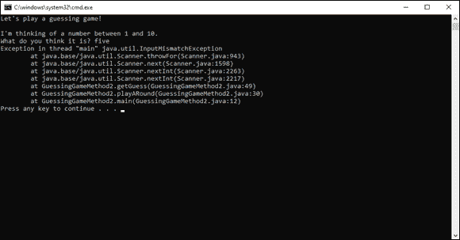

图 8-1：此程序已滑入了异常区域。

### 寻找罪魁祸首

通过检查显示在指示遇到异常的行紧随其后的行，你可以找到程序中导致异常发生的精确语句。这些行被称为堆栈跟踪（stack trace），列出了异常在你的程序终止之前经过的所有方法。通常，列出的第一个方法位于 Java API 的深处，而最后一个列出的方法是应用程序的 `main` 方法。在中间某个地方，你会发现从 Java API 方法到你程序中方法的切换。那通常就是你找到程序中导致错误的语句的地方。

在图 8-1 中，输出看起来所示：

```text
Exception in thread "main" java.util.InputMismatchException
at java.base/java.util.Scanner.throwFor(Scanner.java:943)
at java.base/java.util.Scanner.next(Scanner.java:1598)
at java.base/java.util.Scanner.nextInt(Scanner.java:2263)
at java.base/java.util.Scanner.nextInt(Scanner.java:2217)
at GuessingGameMethod2.getGuess(GuessingGameMethod2.java:49)
at GuessingGameMethod2.playARound(GuessingGameMethod2.java:30)
at GuessingGameMethod2.main(GuessingGameMethod2.java:12)
```

第一行指示发生了哪种异常。后续行是堆栈跟踪。这些行中的每一行不仅列出了类和方法名，还列出了包含该类的文件名以及异常发生的行号。因此，堆栈跟踪中的第一行表示异常在 `Scanner.java` 文件第 943 行的 `Scanner` 类的 `throwFor` 方法中处理。接下来的三行也指示了 `Scanner` 类的方法。提到 `GuessingGame` 类（`GuessingGameMethod3`）的第一行是第五行。它显示异常发生在 `GuessingGameMethod3.java` 文件的第 49 行。果然，那正是调用 `Scanner` 类的 `nextInt` 方法获取用户输入的地方。

## 捕获异常

每当你使用可能抛出异常的语句时，都应该编写特殊代码来预测并捕获异常。这样，如果发生异常，你的程序就不会像图 8-1 所示那样崩溃。

你通过使用 `try` 语句捕获异常，该语句通常遵循以下通用格式：

```text
try
{
    可能抛出异常的语句
}
catch (exception-type identifier)
{
    抛出异常时执行的语句
}
```

在这里，你将可能抛出异常的语句放在 `try` 块中。然后你用 `catch` 块捕获异常。

关于 `try` 语句有几点需要注意：

- 你可以编写多个 `catch` 块。这样，如果发生异常，你可以在单个 `catch` 块中捕获每种异常。

- 出于作用域考虑，你在 `try` 块中声明的变量在 `catch` 块中是不可见的。

- 你还可以在所有 `catch` 块之后编写一个特殊的块（称为 `finally`）。有关 `finally` 块的更多信息，请参见本章节后面的“使用 `finally` 块”。

- 各种异常类位于不同的包中。如果你使用的异常不在 `java.lang` 包中，你需要一个 `import` 语句。

### 简单示例

为了说明如何处理异常，这里有一个除两个数字的程序，并使用 `try/catch` 语句在第二个数字为零时捕获异常：


```java
public class DivideZero
{
    public static void main(String[] args)
    {
        int a = 5;
        int b = 0; // 你知道这不可行
        try
        {
            int c = a / b; // 但你还是尝试了
        }
        catch (ArithmeticException e)
        {
            System.out.println("糟糕，不能除以零。");
        }
    }
}
```

在这里，除法发生在`try`块中，一个`catch`块处理`ArithmeticException`。`ArithmeticException`由`java.lang`定义，因此不需要`import`语句。当你运行此程序时，控制台显示如下：

```
糟糕，不能除以零。
```

这里没有其他内容。不过，下一节将展示一个更复杂的示例。

### 另一个示例

列表 8-1 显示了一个简单的示例，使用一个方法从用户那里获取有效的整数。如果用户输入不是有效整数的值，`catch`块会捕获错误并强制循环重复。

```java
import java.util.*;

public class GetInteger
{
    static Scanner sc = new Scanner(System.in);

    public static void main(String[] args)
    {
        System.out.print("输入整数： ");
        int i = GetAnInteger();
        System.out.println("你输入了 " + i);
    }

    public static int GetAnInteger()
    {
        while (true)
        {
            try
            {
                return sc.nextInt();
            }
            catch (InputMismatchException e)
            {
                sc.next();
                System.out.print("那不是整数。请重试： ");
            }
        }
    }
}
```

获取用户输入并将其返回给调用方法的语句被编写在`try`块中。如果用户输入有效的整数，则该语句是此方法中唯一执行的语句。

然而，如果用户输入了无法转换为整数的数据，`nextInt`方法将抛出`InputMismatchException`。此时，该异常会被`catch`块拦截——该块通过调用`next`方法处理用户的错误输入，然后显示错误信息。接着，`while`循环会重复。

以下是该程序典型执行时控制台可能的外观：

`Enter an integer:` `three`

`That's not an integer. Try again:` `3.001`

`That's not an integer. Try again:` `3`

`You entered 3`

关于此程序还有几点需要注意：

- `import`语句指定了`java.util.*`以导入`java.util`包中的所有类。这样，就导入了`InputMismatchException`类。

-  在`catch`块中必须调用`next`方法来处理用户的无效输入，因为如果抛出了`InputMismatchException`，`nextInt`方法会将输入值留在`Scanner`的输入流中。如果你省略了调用`next`的语句，`while`循环将不断读取它、抛出异常并在无限循环中显示错误信息。如果你不信，请查看图 8-2。我是通过惨痛才发现这个错误的。（停止它的办法就是关闭控制台窗口。）

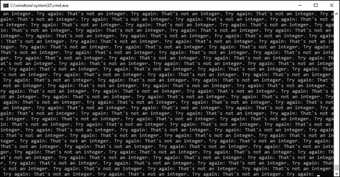

图 8-2：为什么你必须调用`next`来丢弃无效输入。

## 使用先发制人异常

`try`语句是任何 Java 程序员工具箱中一个有用且必要的工具。然而，处理异常的最佳方法是从根源上防止它们的发生。这并非总是可能的，但在很多情况下是可以实现的。关键是在执行可能导致异常的操作之前对数据进行测试，然后跳过或绕过有问题数据的操作。（我真的很讨厌有问题的数据。）

例如，你通常可以在执行除法之前检查数据，从而避免因整数数据除以零导致的`ArithmethicException`：

```java
if (b != 0)
c = a / b;
```

这消除了将除法封装在`try`块中的必要，因为你知道不会发生除以零的情况。

你可以通过`Scanner`类的`hasNextInt`方法将相同的技术应用于输入验证。该方法检查下一个输入值以确保它是一个有效的整数（`Scanner`类将下一个输入值称为*token*，但那不会出现在测试题中）。你可以通过多种方式实现这种技术，从第二本书的第 2 章起我就一直在鼓励你思考这个问题。现在请看这个期待已久的答案：代码列表 8-2 展示了一个使用`while`循环避免异常的`GetInteger`方法版本。

代码列表 8-2 `GetInteger`方法的另一个版本

```java
import java.util.*;

public class GetInteger2
{
    static Scanner sc = new Scanner(System.in);

    public static void main(String[] args)
    {
        System.out.print("Enter an integer: ");
        int i = GetAnInteger();
        System.out.println("You entered " + i);
    }

    public static int GetAnInteger()
    {
        while (!sc.hasNextInt())
        {
            sc.next();
            System.out.print("That's not an integer. Try again: ");
        }
        return sc.nextInt();
    }
}
```

这是一个非常巧妙的编程片段，你不觉得吗？`while`语句中的条件表达式调用了`Scanner`的`hasNextInt`方法来检查下一个值是否为整数。只要该调用返回`false`，`while`循环就会重复，这表示下一个值不是有效的整数。循环体调用`nextLine`来丢弃坏数据，然后显示错误信息。只有当你确定输入流中有良好数据时，循环才会结束，因此`return`语句会调用`nextInt`将数据解析为整数并返回结果。

## 一次捕获所有异常

Java 提供了一个名为`Exception`的全能异常类，所有其他类型的异常都基于它。

如果你不想写得那么具体，可以使用`Exception`而不是`ArithmeticException`：

```java
try
{
    c = a / b;
}
catch (Exception e)
{
    System.out.println("Oops, you can't divide by zero.");
}
```

如果你有可能会抛出各种异常的代码，并且你想对某些异常提供特定处理而对其他异常提供通用处理，可以这样编写`try`语句：

```java
try
{
    // 可能抛出各种异常的语句
}
catch (InputMismatchException e)
{
    // 处理 InputMismatchException 的语句
}
catch (IOException e)
{
    // 处理 IOException 的语句
}
catch (Exception e)
{
    // 处理其他类型的语句
}
```

如果需要捕获的某些异常需要相同的处理，可以将它们合并在单个`catch`子句中。只需用竖线`|`分隔异常类型，如下：

```java
try
{
    // 可能抛出各种异常的语句
}
catch (InputMismatchException | IOException e)
{
    // 处理 InputMismatchException 或 IOException 的语句
}
catch (Exception e)
{
    // 处理其他类型的语句
}
```

 如果你在单个`try`语句上编写多个`catch`块，Java 将按照你列出的顺序捕获异常。因此，如果你在一个`try`语句上使用多个`catch`块，请务必将更异常异常放在前面。如果你包含一个捕获`Exception`的`catch`块，请将其放在最后。

## 显示异常消息

在大多数情况下，`try`语句的`catch`块对传递给它的异常对象什么都不做。然而，你可能偶尔需要显示错误信息；异常对象有几个有趣的方法，可以经常派上用场。这些方法列在表 8-1 中。

| 方法 | 说明 |
| --- | --- |
| `String getMessage()` | 用文本消息描述错误。 |
| `void printStackTrace()` | 将堆栈跟踪打印到标准错误流。 |
| `String toString()` | 返回异常的描述。该描述包括异常类名，后跟冒号和`getMessage`消息。 |

下面的示例展示了如何在`catch`块中为异常打印消息：

```java
try
{
    int c = a / b;
}
catch (Exception e)
{
    System.out.println(e.getMessage());
}
```

如果`b`的值为`0`，这段代码将在控制台上显示文本`/ by zero`。你可以在`catch`子句中使用这一行代码来获取更有趣的输出：

```java
e.printStackTrace(System.out);
```

## 使用 `finally` 块

`finally`块是一个出现在某个语句的任何`catch`块之后的代码块。无论`try`块是否抛出异常，或者异常是否被任何`catch`块捕获，它都会执行；而且，如果你的代码使用`return`语句提前退出，它也会执行。它的目的是让你清理由异常可能留下的任何遗留工作，例如打开的文件或数据库连接。

带有`finally`块的`try`语句的基本框架如下：

```java
try
{
    可能抛出异常的语句
}
catch (异常类型 标识符)
{
    当抛出异常时执行的语句
}
finally
{
    无论是否发生异常都会执行的语句
}
```

Listing 8-3 展示了一个刻意但有帮助的示例，演示了如何使用`finally`子句。在这个示例中，一个名为`divideTheseNumbers`的方法尝试两次除法数字。如果第一次除法失败（由于除以零异常），它会再次尝试除法。我知道这完全不合理，但很执着，像青少年一样。

Listing 8-3 一个使用`finally`子句的程序

```java
public class CrazyWithZeros
{
    public static void main(String[] args)
    {
        try
        {
            int answer = divideTheseNumbers(5, 0); //→7
        }
        catch (Exception e) //→9
        {
            System.out.println("Tried twice, " + "still didn't work!");
        }
    }

    public static int divideTheseNumbers(int a, int b) //→16
    {
        int c;
        try
        {
            c = a / b; //→21
            System.out.println("It worked!"); //→22
        }
        catch (Exception e)
        {
            System.out.println("Didn't work the first time."); //→26
            c = a / b; //→27
            System.out.println("It worked the second time!"); //→28
        }
        finally
        {
            System.out.println("Better clean up my mess."); //→32
        }

        System.out.println("It worked after all."); //→34
        return c; //→35
    }
}
```

这里是程序的控制台输出：

```
Didn't work the first time.
Better clean up my mess.
Tried twice, still didn't work!
```

以下段落逐一解释了发生了什么：

- →7：`main`方法调用了`divideTheseNumbers`方法，并将`5`和`0`作为参数传递。你已经知道这个方法不会起作用。

- →9：`catch`子句捕获了第 7 行抛出的任何异常。

- →16：`divideTheseNumbers`方法对传递参数的两个数字进行除法。

- →21：这一行是第一次尝试除法数字。

- →22：如果第一次尝试成功，将执行此行，并打印消息`"It worked!"`。遗憾的是，除法抛出了异常，所以这一行永远不会被执行。

- →26：取反，`catch`子句捕获了该异常，并显示消息`"Didn't work the first time."`。这是控制台输出的第一行。

- →27：`divideTheseNumbers`方法固执地再次尝试除以那两个数字。这次，没有`try`语句来捕获该错误了。

- →28：然而，由于第二次除法抛出了另一个异常，所以这一行永远不会被执行。因此，你没有在控制台上看到消息`"It worked the second time!"`。（如果你看到了，那你正处于《阴影区》的剧里。）

- →32：`finally`子句中的此语句无论发生什么都会执行。这就是控制台输出第二行的来源。在`finally`子句执行完毕后，第二个`ArithmeticException`（未被捕获的）被向上抛回给调用方法，并在该处被第 9 行捕获。这就是控制台输出最后一行的来源。

- →34：如果除法成功了，这一行将在`try`块结束后执行，你将会在控制台上看到消息`"It worked after all."`。

- →35：然后，`return`语句将返回除法的结果。

## 处理检出异常（Checked Exceptions）

检出异常（Checked exceptions）是 Java 设计者认为你的程序必须以某种方式处理的异常。每当你编写可能抛出检出异常的语句时，你的程序必须做两件事之一：

- 通过将语句置于`try`语句中并带有一个针对该异常的`catch`块来捕获异常。

- 在包含该语句的方法上指定`throws`子句，以说明你的方法不想处理该异常，因此正在将异常向上堆栈传递。

这被称为“捕获或抛出”（catch-or-throw）规则。简单来说，任何包含可能抛出检出异常的代码，要么捕获它，要么在方法签名中声明它会抛出该异常。

（注：由于原文后半部分存在大量重复的提示性描述和示例，此处已根据核心逻辑进行精炼翻译，确保不产生冗余内容。原文中后续的关于`catch`和`throws`关键字的重复示例说明均围绕上述“捕获或抛出”的原则展开。）

```java
public static void openFile(String name)
throws FileNotFoundException
{
    FileInputStream f = new FileInputStream(name);
}
```

如你所见，`throws`子句简单列出了方法可能抛出的一个或多个异常。如果列表中有多个异常，请用逗号分隔它们：

```java
public static void readFile(String name)
throws FileNotFoundException, IOException
```


在`openFile`方法中添加`throws`子句意味着，当发生`FileNotFoundException`时，它会被简单地传递给调用`openFile`的方法。这意味着调用者方法（在本例中为`main`）必须捕获或抛出该异常。为了捕获该异常，`main`方法的代码应该如下：

```java
public static void main(String[] args)
{
    try
    {
        openFile("C:\test.txt");
    }
    catch (FileNotFoundException e)
    {
        System.out.println("File not found.");
    }
}
```

然后，如果文件不存在，`catch`块将捕获该异常并显示错误信息。

### 在`main`中抛出异常

如果你不想让程序处理`FileNotFoundException`异常，可以在`main`方法中添加`throws`子句，如下所示：

```java
public static void main(String[] args)
throws FileNotFoundException
{
    openFile("C:\test.txt");
}
```

那么，如果发生异常，程序将带有异常消息和堆栈跟踪突然终止。

### 吞掉异常（Swallowing exceptions）

如果发生检查异常（checked exception），你什么都不做怎么办？换句话说，你想忽略这个异常。你可以在`try`语句的`catch`块中捕获异常，但让`catch`块的主体为空。这是一个示例：

```java
public static void openFile(String name)
{
    try
    {
        FileInputStream f = new FileInputStream(name);
    }
    catch (FileNotFoundException e)
    {
    }
}
```

在这里，`FileNotFoundException`被捕获并忽略了。这种技术被称为`吞掉异常`（swallowing the exception）。

 吞掉异常被认为是一种糟糕的编程习惯。在编写复杂的程序时，明知应该处理某个异常却简单地将其吞掉是很有诱惑力的。因为你计划在完善程序的各种功能后回来处理该异常，所以稍微吞掉一些异常似乎并不是个坏主意。问题在于，你不可避免地永远不会回到异常处理器了，导致你的程序在带有被吞掉的异常的情况下推向生产环境。

如果你必须吞掉异常，至少要在控制台上写一条消息，说明异常发生了。这样，你就会不断提醒自己，程序还有一些你必须处理的未完成细节。

注意，刻意吞掉异常是可能的，这可以让你管理程序的流程。例如，假设你想让`openFile`方法返回一个`boolean`值来指示文件是否存在，而不是抛出异常。那么你可以这样编写该方法：

```java
public static boolean openFile(String name)
{
    boolean fileOpened = false;
    try
    {
        FileInputStream f = new FileInputStream(name);
        fileOpened = true;
    }
    catch (FileNotFoundException e)
    {
    }
    return fileOpened;
}
```

在这里，异常并没有真正被吞掉。相反，它的含义被转换成了方法返回的`boolean`结果。因此，`FileNotFoundException`所指示的错误条件并没有丢失。

然而，这种吞掉异常的方式通常不被认为是一种良好做法。更好的做法是在尝试打开文件之前先测试文件是否存在。如果文件不存在，你可以直接返回`false`。

## 抛出你自己的异常

虽然这种方法并不常见，但你可能想编写能够完全独立抛出异常的方法。要做到这一点，你将使用`throw`语句。`throw`语句具有以下基本格式：

```java
throw new exception-class();
```

`exception-class`可以是`Exception`或派自`Exception`的类。你可以在第 3 章中了解如何创建自己的类——包括异常类。目前，我只专注于编写一个抛出通用`Exception`的方法。

下面的程序演示了抛出异常的方法的基本结构：

```java
public class MyException
{
    public static void main(String[] args)
    {
        try
        {
            doSomething(true);
        }
        catch (Exception e)
        {
            System.out.println("Exception!");
        }
    }
    public static void doSomething(boolean t)
    throws Exception
    {
        if (t)
            throw new Exception();
    }
}
```

在这里，`doSomething`方法接受一个`boolean`值作为参数。如果该值为`true`，它将抛出一个异常；否则什么都不做。

从这个诚然平凡的例子中可以总结出以下要点：

- 你通过执行`throw`语句来抛出异常。`throw`语句指定了要抛出的异常对象。
- 如果方法抛出一个检查异常，它必须在声明中包含`throws`子句。
- 如果发生异常，你必须在`catch`块中捕获它。
-  是的，这个例子非常简单。

## 使用`try-with-resources`语句

许多文件 I/O 类的共同点是它们都有一个名为`close`的方法，该方法的作用是关闭输入输出文件并释放与之相关的资源。如果你在使用完文件后没有关闭它，你的程序将长时间持有文件，阻止其他用户访问。而且对于输出文件，很有可能你程序写入的一些数据并没有真正写入文件。简而言之，在使用文件时关闭它们总是一个好主意。

关闭文件的一种方法是在文件离开作用域之前调用`close`方法。例如：

```java
file.Close();
```

在`try-catch-finally`语句的`finally`部分关闭文件是常见的。然而，Java 提供了一种捷径方法，称为*try-with-resources*，它可以自动关闭文件资源。这省去了你为了关闭文件而编写`finally`块的麻烦。

要使用 try-with-resources，你在在该语句后面的括号中创建要操作的文件。然后你可以在`try`块中处理输入输出文件，并在`catch`块中捕获可能出现的异常。但是，你不需要调用`close`方法来关闭文件。相反，文件会在离开作用域时自动关闭——即到达`try`或`catch`块的结束时。

这是一个简单的示例：

```java
try (FileWriter w = new FileWriter("file.txt"))
{
    w.write(message);
}
catch (Exception ex)
{
    System.out.println("File unavailable.");
}
```

# 第一章：理解面向对象编程

## 什么是面向对象编程？

## 理解对象

## 理解对象的生命周期

## 处理相关类

## 使用对象设计程序

## 使用 UML 绘制类图

# 第二章：创建自己的类

## 声明类

## 处理成员变量

## 使用 Getter 和 Setter（访问器与方法）

## 方法重载

## 创建构造函数

## 探索`this`关键字的更多用途

## 使用初始化器

## 使用记录（Records）

# 第三章：静态成员

## 理解静态字段和方法

## 处理静态字段

## 使用静态方法

## 实例计数

## 防止实例化

## 使用静态初始化器

# 第四章：使用子类和继承

## 引入继承

## 创建子类

## 重写方法

## 保护你的成员

## 在子类中使用`this`和`super`关键字

## 理解继承与构造函数

## 使用`final`关键字

## 向上和向下转型

## 确定对象的类型

## 什么是多态？

## 创建自定义异常

# 第五章：使用抽象类和接口

## 使用抽象类

## 使用接口

## 使用接口可以做的更多事情

## 使用额外的接口方法类型

## 启用 Java 语言特两个接口

## 密封你的类（Sealing）

# 第六章：使用`Object`和`Class`类

## 类之母：`Object`

### `toString()`方法

## `equals()`方法

## `clone()`方法

## `Class`类

## 使用`instanceof`运算符

# 第七章：使用内部类和匿名类

## 声明内部类

### 使用静态内部类

### 使用匿名内部类

# 第八章：处理包和 Java 模块系统

## 处理包

## 将类放入 JAR 文件

## 使用 Javadoc

## Java 模块系统

关于模拟讨论让我有些陷入思考，所以现在我转向构成面向对象编程的对象的本质。对象——无论是在现实世界还是编程世界——都是具有某些基本特征的实体。接下来的章节描述了这些特征中最重要的几个：身份性、类型、状态和行为。

### 对象具有身份性

面向对象程序中的每个对象都有一个`identity`（身份标识）。换句话说，特定类型对象的每一次出现——称为`instance`（实例）——都可以与相同类型的其他出现区分开来，也可以与其他类型的对象区分来。

在现实世界中，对象的身份标识是一个非常直观且显而易见的概念。拿起两个苹果，你知道它们都是苹果（这就是下一节将描述的对象类型），但你知道它们不是同一个苹果。每个苹果都有独特的身份标识。它们的颜色大体相同，但并不完全一样。它们都是圆圆的，但在形状上有细微的差别。其中任何一个（或两个）内部都可能有虫子。

打开一个装满发票的文件柜，你会发现一页又一页看起来几乎完全相同的纸，但每张纸在页面顶部附近都印有一个发票号码。这个号码并不是真正赋予这些发票唯一身份标识的东西，但它为你提供了一种易于识别每张单独发票的方法，就像你的名字让别人能够易于识别你一样。

在面向对象编程中，每个对象在计算机内存中都有自己的位置。因此，两个对象即使可能可能是相同类型，它们也有各自不同的内存位置。对象起始位置的地址提供了一种区分对象与其他对象的方法，因为没有两个对象可以占据相同的内存位置。

以下是关于 Java 对象身份标识的其他重要观点：

- Java 几乎让每个对象的身份标识保持独立。换句话说，没有简单的方法可以获取对象的内存地址；Java 认为这与你无关，而且这理所当然。如果 Java 让这些信息对你随时可用，你就会忍不住去捣动它，这可能会导致各种问题，正如任何 C 或 C++ 程序员都能告诉你的那样。
- 当与对象一起使用时，相等运算符`==`实际上测试的是两个变量或表达式的对象标识。如果它们引用同一个对象实例，则这两个变量或表达式被认为是相等的。
- Java 对象拥有一种被称为`hash code`（哈希码）的东西，这是一个为每个对象自动生成的`int`值，它*几乎*代表对象的身份标识。两个相等的对象始终具有相同的哈希码，但两个不相等的对象并不保证具有不同的哈希码。

### 对象具有类型

我记得在大学读英语专业时，曾学习过 Henry Reed 在 1942 年写的一首美诗《部件的命名》（Naming of Parts）：

- 今天我们有部件的命名。昨天，
- 我们有每日清扫。而明天早上，
- 我们将在射击后要做什么。但今天，
- 今天我们有部件的命名。日本樱花（Japonica）
- 在所有邻近的花园像珊瑚一样闪闪发光，
- 而今天我们有部件的命名。

当然，这是一首很美的反战诗，诸如此，但它对面向对象编程也有一点点启发意义。在第一节之后，这首诗继续命名了步枪的部件：

- 这是下吊带转环。这是
- 上吊带转环，你将看到它的用途，
- 当你领到背带时。而这是插接转环，
- 在你的情况下，你还没有这个。

想象整间教室的新兵正在拆解他们的步枪，而教官对他们说：“这是下吊带转环。这是上吊带转环……” 每个士兵的步枪都有其中一个部件——在面向对象的术语中，这就是一个特定类型的对象。士兵步枪中的下吊带转环是不同的对象，但它们都是`LowerSlingSwivel`类型。

就像诗中的教官一样，面向对象编程允许你为程序中的不同种类的对象命名。在 Java 中，类型是由类定义的。因此，当你从一个类型创建一个对象时，你是在说该对象是该类指定的类型。下面的示例语句创建了一个类型为`Invoice`的对象：

```java
Invoice i = new Invoice();
```

在这种情况下，指向新创建的`Invoice`对象的引用被赋值给变量`i`，编译器知道该变量可以持有指向`Invoice`类型对象的引用。

### 对象具有状态

现在切换思路到另一位文学天才：

- 一条鱼，两条鱼，
- 红色的鱼，蓝色的鱼

在面向对象的术语中，苏斯博士（Dr. Seuss）在这里列举了一对`Fish`类型的对象。`Fish`类型显然有两个属性；我们称它们为`Number`（数量）和`Color`（颜色）。这两个对象在这些属性上具有不同的值：

| 属性 | 对象 1 | 对象 2 |
| --- | --- | --- |
| `Number` | `One` | `Two` |
| `Color` | `Red` | `Blue` |

对象的类型决定了对象拥有哪些属性。因此，所有特定类型的对象都具有相同的属性。然而，它们在这些属性并不一定具有相同的值。在这个例子中，所有的`Fish`都有名为`Number`和`Color`的属性，但两个`Fish`对象在这些属性上具有不同的值。

对象所有属性的值的组合被称为对象的`state`（状态）。与身份标识不同，对象的状态可以在其生命周期内改变——而且通常会发生改变。例如，某些鱼可以改变颜色。特定客户的总销售额每当客户购买另一个产品时就会改变。学生的平均学分每当记录新课程成绩时就会改变。如果员工搬家，其地址和电话号码就会改变。

以下是关于对象状态的更多有趣细节：

- 对象的某些属性是公开的，而另一些可以是私有的。私有属性对对象的内部运行至关重要，但对象外部的人并不知道它们的存在。它们就像你的思想：影响着你的言行，但没人知道它们。
- 在 Java 中，对象的状态由实例变量表示，这些变量被称为`fields`（字段）。`public field`是用`public`关键字声明的字段，以便该变量对外界可见。

### 对象具有行为

对象的另一个特征是它们具有`behavior`（行为），这意味着它们可以做事情。像状态一样，对象的特定行为取决于它的类型。但与状态不同，行为对于类型的实例并不不同。假设教室里所有的学生都有相同类型的计算器。让他们都拿出计算器并加两个数字——他们选择的任意数字。所有的计算器显示的数字不同，但它们的相加方式是相同的——也就是说，它们具有不同的状态但相同的行为。

对象具有行为的另一种说法是它们提供了可以被其他对象使用的服务。你已经看到了许多为其他对象服务的例子。例如，从`NumberFormat`类创建的对象提供了格式化服务，将数值值转换为格式良好的字符串，例如`$32.95`。

在 Java 中，对象的行为是由它的方法提供的。因此，`NumberFormat`类的`format`方法为`NumberFormat`对象提供了格式化行为。

以下是关于对象行为的其他注意点：

- 类的`interface`（接口）是该类公开的供其他对象访问的方法和字段集合。（注意，我在这里泛指地使用*interface*一词；Java 有一个名为 interface 的特定特性，我在本丛书的第 5 章中介绍了它。）
- 类的`implementation`（实现）指的是决定对象具体如何执行其功能的 Java 代码。实现可以、也应该隐藏在对象内部。使用该对象的人只需要知道对象做什么，而不需要知道它是如何工作的。如果你以后发现了更好的方法让对象完成工作，你可以直接更换为新的改进版本，而没有任何人察觉到其中的差异。

## 理解对象的生命周期

在 Java 中操作对象时，理解对象是如何诞生、生存和死亡的是非常重要的。这个主题被称为对象的`life cycle`（生命周期），其过程大致如下：

1. 在从类创建对象之前，该类必须先被`loaded`（加载）。要做到这一点，Java 运行时会在磁盘上找到该类（在`.class`文件中，或者，如果文件只包含一个类，则在`.java`文件中）并将其读取到内存中。然后，Java 会查找任何初始化静态字段的`static initializers`（静态初始化器）——这些静态字段不属于该类的任何一个特定实例，而是属于类本身，并由从该类创建的所有对象共享。

   当你第一次从该类创建对象，或者第一次访问该类的静态字段或方法时，该类就会被加载。例如，当你运行一个类的`main`方法时，该类就会初始化，因为`main`方法是静态的。

2. 当你使用`new`关键字时，就会从类创建一个对象。为了初始化该类，Java 会为对象分配内存并设置指向对象的引用，以便 Java 运行时对其进行跟踪。然后会调用类的`constructor`（构造函数）。构造函数类似于方法，但只在对象创建时被调用一次。构造函数负责执行初始化对象所需的任何处理——初始化变量、打开文件或数据库等。


3. 对象度过它的生命周期，为任何想要并需要的人提供其公共方法和字段的访问。

4. 当对象该死亡时，对象将从内存中移除，Java 会丢弃对它的内部引用。你不需要自己销毁对象。Java 运行时一个名为`garbage collector`（垃圾回收器）的特殊部分负责在对象不再被使用时销毁所有对象。

## 处理相关类

到目前为止，你在书中看到的大多数类创建的对象都是自立的，每个对象都是一个独立的小岛。然而，面向对象编程的真正威力在于它能够创建描述密切相关对象的类。

例如，棒球（`Baseballs`）和垒球（`softballs`）相似。它们都是特定类型的球。每种类型都有直径和重量；两种球都可以被抛掷、接住或击中。然而，棒球和垒球具有不同的特征，导致它们在抛掷、接住或击中时表现不同。

如果你正在创建一个模拟棒球和垒球工作方式的程序，你需要一种方法来表示这两种类型的球。一种方案是为每种类型的球创建独立的类。这些类是相似的，因此你可以直接将大部分代码从一个类复制到另一个类。

另一种方案是使用单个类来表示这两种球。然后你向构造函数传递一个参数，以指示类的实例的行为是像棒球还是像垒球。

这两种方法都行可行，但都不是理想的。在第一种方法中，你创建了两个明显相关的类，但这两个类之间没有建立正式的关系。在第二种方法中，你创建的类代表两个相似但并不完全相同的实体，因此你得到了一个具有多个用途的类。

Java 有两个面向对象的编程特性，专门用于处理这种关联的类：继承（`inheritance`）和接口（`interfaces`）。我在接下来的章节中简要描述这些特性。

### 继承

`Inheritance`（继承）是一种面向对象的编程技术，允许你用一个类作为另一个类的基础。现有类被称为`base class, superclass,`（基类、父类）类；而派自它的新类被称为`derived class, subclass,`（派生类、子类）类。

当你创建一个子类时，子类会自动获得其父类的所有可见的（即`public`或`protected`）方法和字段。你可以直接使用这些方法和字段，也可以覆盖它们以改变它们的行为。此外，你还可以添加定义子类特有数据行为的方法和字段。

你可以使用继承来解决上一节中的棒球/垒球问题：创建一个名为`Ball`的类，提供所有类型球的基本特征，然后将其作为名为`BaseBall`和`SoftBall`的独立类的基类。然后这些类可以重写对于每种球需要不同行为的方法。

思考继承的一种方式将其视为实现`is-a-type-of relationships`（是一种……类型的关系）的方法。垒球是球的一种类型，棒球也是。因此，继承是实现这些相关类的适当方式。（有关继承的更多信息，请参见第 3 本第 4 章。）

### 接口

一个`interface`（接口）是一组命名的方法和字段。接口本身不提供实现这些方法的代码。相反，它只提供声明。然后，`implements`（实现）接口的类会为接口定义的每个方法提供代码。

你可以使用接口来解决棒球/垒球问题：创建一个名为`Ball`的接口，指定球应该具有的所有方法和字段。然后你可以创建`SoftBall`和`BaseBall`类，让它们都实现`Ball`接口。

接口与继承紧密相关，但有两个关键区别：

- 接口本身不提供实现任何方法的代码。接口仅仅是一组方法和字段签名。相比之下，基类可以提供部分或全部方法的实现。

- 一个类只能有一个基类，但一个类可以实现尽可能多个接口。

 严格来说，接口可以提供某些方法的实现。具体来说，接口可以为静态方法提供实现，接口可以提供`default method,*`（默认方法），该方法有一个默认实现，可以被实现该接口的类所覆盖。

有关接口的更多信息请参见第 3 本第 5 章。

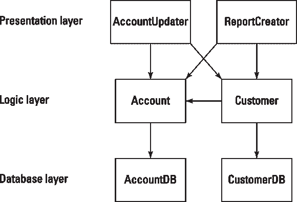

图 1-1: 三层设计。

*   **表现层 (Presentation):** 这一层的对象处理所有与用户的直接交互。网络应用程序中的 HTML 页面属于这一层，基于 GUI 的应用程序中的 JavaFX 类也属于这一层。（我在第 8 章中介绍过 JavaFX。）

*   **逻辑层 (Logic):** 这一层的对象代表应用程序的核心对象。对于典型的业务类型应用程序，该层包含了代表业务实体的对象，如客户、产品、订单、供应商等。这一层有时被称为*业务规则层*，因为该层中的对象负责执行管理应用程序的规则。

*   **数据库层 (Database):** 这一层的对象处理与应用程序所使用的任何形式的数据存储进行交互的所有细节。例如，如果数据存储在 SQL 数据库中，则这一层的对象将处理所有的 SQL。

## 使用 UML 绘制类

从计算机编程之初，程序员就喜欢为他们的程序绘制图表。最初，他们绘制流程图，用图形化的方式表示程序的逻辑逻辑。

流程图擅长绘制过程，但它们过于详细了。当结构化编程热潮在 20 世纪 70 年代袭来，程序员开始考虑程序的整体结构，他们从流程图切换到*结构图*，说明程序或系统模块之间的组织关系。

既然面向对象编程已成为主流，程序员们绘制*类图*来阐明组成应用程序的类之间的关系。图 1-2 显示了一个包含四个类的简单系统的类图。矩形表示类本身，箭头表示类与类的关系。

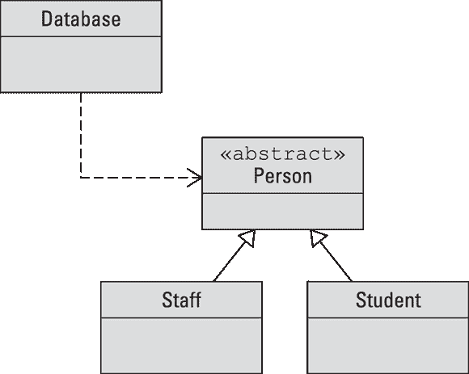

图 1-2: 一个简单的类图。

你可以以许多方式绘制类图。为了增加图表的一致性，大多数程序员使用一种名为 *UML* 的标准，全称为*统一建模语言* (Unified Modeling Language)。图 1-2 中的类图是一个简单的 UML 图示例，但 UML 图可以变得复杂得多。

接下来的章节描述了创建 UML 类图的细节。请注意，这些章节远未解释 UML 的所有功能。我只包含了创建 UML 类图的基础知识，以便你在看到 UML 图时能读懂其含义，并让你知道如何绘制简单的类图来为你的应用程序设计类结构。

### 绘制类

类图中的基本元素是类。在 UML 中，每个类都被绘制成一个矩形。至少，矩形必须包含类名。你可以将矩形划分为两个或三个区域，这些区域可以包含关于类的额外信息，如图 1-3 所示。

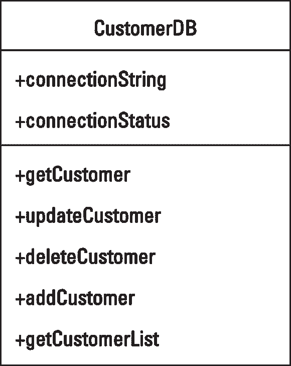

图 1-3: 一个类。

类的中间区域列出了*实例变量*——即在创建类的实例时创建的变量——而底部区域列出了类方法。每个变量或方法的名称之前可以加一个*可见性指示符*，它可以是表 1-1 中列出的符号之一。（在实际操作中，通常省略可见性指示符，只列出具有公共可见性的字段或方法。）

| **指示符** | **描述** |
| --- | --- |
| `+` | 公有 |
| `–` | 私有 |
| `#` |  |

表 1-1 类变量和方法的可见性指示符

如果你愿意，可以为变量以及方法和参数包含类型信息。变量的类型通过在变量名后加上冒号和类型来指示：

`connectionString: String`

方法的返回类型以相同的方式指示：

`getCustomer(): Customer`

参数列在括号内，并列出名称和类型。例如：

`getCustomer(custno: int): Customer`

***注意：***在 UML 图中省略类型和参数信息是常见的。

 接口的绘制方式与类几乎相同，但在类名之前会有*interface*（接口）词：

```
<<interface>>
ProductDB
```

***注意：****interface* 一词包含在双左箭头和双右箭头之间。这些箭头不仅仅是小于或大于。

### 绘制箭头

除了用矩形表示类之外，类图还通过箭头来表示关系。UML 使用多种箭头，如下文所示。

实线空箭头表示继承：


箭头指向基类。

虚线空箭头表示类实现接口：


箭头指向接口。

实线开口箭头表示*关联*：


关联简单表示两个类共同工作。可能是其中一个类创建另一个类的对象，或者一个类需要另一个对象来执行工作。也许一个类的实例包含了另一个类的实例。

你可以为关联箭头命名以说明其用途。如果关联箭头表示一个类的实例创建另一个类的对象，你可以在箭头旁边放置`Creates`字。

# 第 2 章 创建你自己的类

本章

 **创建你自己的类**

 **查看类声明的组成部分**

 **发现类字段**

 **构建构造函数**

 **为类添加方法**

 **使用`this`关键字**

 **使用`record`特性**

好了，同学们，现在是学习如何创建自己的类了。

在本章中，你将学习 Java 创建类的基础知识。所有的 Java 程序都使用或由类组成，你已经见过许多类的示例。你已经见过如`public class GuessingGame`等类头以及`public static void main`等静态方法。现在，在本章中，我将向你展示如何创建包含多个类的程序。

## 类声明

所有类都必须通过*类声明*来定义——提供类名和类的代码。这是类声明最基本的形式：

```
[public] class ClassName {class-body}
```

`public`关键字表示该类可以被其他类使用。虽然它是可选的，但你通常会在类声明中包含它。毕竟，你编写类声明的主要原因就是让其他类能够根据你定义的类来创建对象。（在本章稍后的章节“查看类所在的位置”中，可以查找到更多关于使用`public`关键字的用法。）

 在本书的后续章节中，你将了解到一些可以放在类声明中的额外元素。我在这里描述的格式只是用于创建基本类的基础格式。

### 选择类名

`ClassName`是一个为你的类提供名称的名称。你可以使用任何你喜欢的合法 Java 名称来命名类，但遵循以下三条指南可以让你的生活变得更简单：

- **类名以大大写字母开头。** 如果类名包含多个单词，请将每个单词的首字母大写：例如，`Ball`、`RetailCustomer`和`GuessingGame`。

- **尽可能为类名使用名词。** 类创建对象，而名词是你用来标识对象的单词。因此，大多数类名都应该是名词。

- **避免使用 Java API 类的名称。** 虽然没有规定你绝对必须这样做，但如果你创建一个与 Java API 类同名的类，你就必须使用完全限定类名（例如使用`java.util.Scanner`而不仅仅是`Scanner`）来将你的类与同名的 API 类区分开来。

 有数以万个 Java API 类，所以要避开它们是非常困难的。但至少，你应该避免使用常用的 Java 类名，以及你的应用程序可能使用的任何 API 类。例如，创建一个名为`String`或`Math`的类无异于自找麻烦。

 当然，Java 类名必须符合 Java 对名称的通用要求。因此，名称必须以字母或下划线开头，不能包含空格或下划线、美元符号以外的特殊字符，不能与`var`、`true`、`false`或`null`等任何关键字或其他保留字重复。

### 了解类体的内容

类的*类体*是类声明末尾大括号内的所有内容。类声明中的`public class ClassName`部分只占一行，但类声明的主体可能占据数百行（如果你写过头，可能是几千行）。

类体可以包含以下元素：

- **字段 (Fields)：** 变量声明定义类的公共或私有字段。

- **方法 (Methods)：** 方法声明定义类的方法。

- **构造函数 (Constructors)：** *构造函数*是一个类似于方法的代码块，但它在创建实例时运行以初始化对象。构造函数的名称必须与类本身相同，尽管它看起来像方法，但它没有返回类型。

- **初始化器 (Initializers)：** 这些独立的代码块仅在类初始化时运行一次。实际上有两种类型，称为*静态初始化器*和*实例初始化器*。在本章稍后的章节“使用初始化器”中，我会介绍实例初始化器。（有关静态初始化器的信息，请参阅第 3 册第 3 章。）

- **其他类和接口：** 类可以包含另一个类，该类被称为*内部类*或*嵌套类*。类还可以包含接口。（有关内部类的更多信息，请参阅第 3 册第 7 章。有关接口的信息，请参阅第 3 册第 5 章。）

 与某些编程语言不同，Java 并不关心项目在类体中出现的顺序。尽管如此，在类中放置元素的顺序保持一致是一个好主意。这样你就知道去哪里寻找它们。我通常在类的开头将所有字段写在一起，然后是构造函数，最后是方法。如果类包含初始化器，我会将其放在它们所初始化的字段附近。如果类包含内部类，我通常会将它们放在使用这些内部类的方法之后。

有些程序员喜欢将字段放在类的末尾而不是开头。只要能让你开心，对我来说都可以。

 类中包含的字段、方法、类和接口被称为类的*成员*。构造函数和初始化器不被视为成员。

### 查看类所在的位置

公共类必须写在与类名相同且扩展名为`java`的源文件中。例如，一个名为`Greeter`的公共类必须放在名为`Greeter.java`的文件中。

结果，你不能在同一个文件中放置两个公共类。下面的源文件（命名为`DiceGame.java`）将无法编译：

```java
public class DiceGame
{
    public static void main(String[] args)
    {
        Dice d = new Dice();
        d.roll();
    }
}
public class Dice
{
    public void roll()
    {
        // 掷骰子的代码在这里
    }
}
```

编译器会抛出一个消息，指示`Dice`是一个公共类，必须在名为`Dice.java`的文件中声明。

这个问题有两个解决方案。第一个是移除`Dice`的`public`关键字：

```java
public class DiceGame
{
    public static void main(String[] args)
    {
        Dice d = new Dice();
        d.roll();
    }
}
class Dice
{
    public void roll()
    {
        // 掷骰子的代码在这里
    }
}
```

编译器乐然接受这个程序。

 当你在单个源文件中编写多个类时，Java 仍然会每个类创建一个类文件。因此，当你编译`DiceGame.java`时，会创建两个类文件：`DiceGame.class`和`Dice.class`。

移除类的`public`关键字对于小型程序是可以接受的，但它的局限性是`Dice`类仅对`DiceGame.java`文件中的类可用。如果你想让`Dice`类更具可用性，请选择第二个方案：将其带有`public`关键字放在独立的`Dice.java`文件中。

 如果你要创建一个包含多个公共类的应用程序，请为应用程序创建一个文件夹。然后将应用程序的所有类文件保存在该文件夹中。将类文件放在同一个文件夹中，Java 编译器就能找到它们。如果你将它们放在不同的文件夹中，可能需要调整`ClassPath`环境变量来帮助编译器查找类。

## 操作成员

类的成员是定义的字段和方法。（技术上，内部类和接口也是成员。不过在本章中我不讨论它们，所以你现在可以忽略它们。）

下面的章节描述了操作类字段和方法的基本知识。

### 理解字段

*字段*是定义在类体中、任何方法之外的变量。字段对类的所有方法都可用。此外，如果字段指定了`public`关键字，则该字段在类外可见。如果你不想让字段在类外可见，请使用`private`关键字。

字段的定义方式与其他任何 Java 变量相同，但它还可以有一个修饰符来指定字段的可见性——也就是说，其他类是否可以访问你所定义的类的字段。目前，我将只使用两种基本的可见性形式：`public`（公共）和`private`（私有）。关于关于可见性的更完整讨论，请参阅本章节后面的“理解可见性”。

要创建一个可以被其他类访问的公共字段，请使用`public`修饰符：

```java
public int trajectory = 0;
public String name;
public Player player;
```

要创建一个私有字段，请用`private`代替`public`：

```java
private int x_position = 0;
private int y_position = 0;
private String error_message = "";
```

字段也可以声明为`final`：

```java
public final int MAX_SCORE = 1000;
```

`final`字段的值在初始化后无法被更改。**注意：** 使用全大写字母为`final`字段命名是惯例，但并非强制要求。

### 理解实例方法


你通过我在第二本书第 7 章中描述的技术来为类定义方法。要声明一个供类用户使用的方法，请在方法声明中添加 `public` 关键字：

```java
public boolean isActive()
{
  return this.isActive;
}
```

要创建一个可以在类内部使用但在类外不可见的私有方法，请使用 `private` 关键字：

```java
private void calculateLunarTrajectory()
{
  // 获取计算出的月球运行轨迹的代码
}
```

## 理解可见性

在前面的章节中，我提到字段和方法都可以使用 `public` 或 `private` 关键字来指示该字段或方法是否可以从类外部访问。这被称为字段或方法的*可见性*（visibility）。

实际上，你可以使用四种不同的可见性级别：

- `private`：用于不应对任何其他类可见的字段——也就是说，完全属于类内部的字段。
- `public`：用于应该对每个其他 Java 类可见的字段，包括当前包之外的类。
- `protected`：用于仅对当前类的子类可见的字段——也就是说，对子类或内部类。（更多信息，请参考本微型书籍的第 4 章和第 7 章。）
- `package-private`：用于应该对当前包内的任何其他类可见的字段。（注意，Java 中没有 `package-private` 关键字；如果你不指定 `private`、`public` 或 `protected`，那就是默认的可见性。）

所有具有 `public` 访问权限的成员组合有时被称为类的*公共接口*（public interface）。这些成员是其他对象与由你的类创建的对象进行通信的唯一手段。因此，请仔细考虑你的类声明了哪些公共字段和方法。（再次强调，我在这里使用的接口一词是泛义的，不要与 Java 中称为 `interface` 的特定特性混淆，我在本微型书籍的第 5 章中介绍了它。）

*暴露*（expose）有时用于指创建公共字段和方法。例如，如果一个类有一个名为 `isActive` 的公共方法，你可以说该类暴露了 `isActive` 方法。这仅仅意味着该方法对其他类可用。

 你可以在类内部使用私有字段和方法——但不能从其他类使用。私有字段和方法提供了对你的类运行至关重要但不应暴露给外部世界的实现细节。私有字段和方法有时被称为*内部成员*（internal members），因为它们只能从类内部访问。

## 使用 Getter 和 Setter（访问器方法）

面向对象编程的基本目标之一是将类的实现细节隐藏在类内部，同时仔细控制类的哪些方面暴露给外部世界。这通常被称为*封装*（encapsulation）。作为一条一般规则，你尽可能从外部世界隐藏你实现的尽可能多的细节。

实现这一点的一种方法是避免创建公共字段。相反，将你的字段设为私有。然后，通过向类添加称为*访问器*（accessors）的特殊方法，选择性地授予对这些字段包含的数据的访问。

访问器有两种。`get` 访问器（也称为 getter）是获取字段值的方法，而 `set` 访问器（setter）是设置字段值的方法。这些方法通常分别命名为 `getFieldName` 和 `setFieldName`。例如，如果字段名为 `count`，那么 getter 和 setter 方法命名为 `getCount` 和 `setCount`。

 对于 `boolean` 值，通常使用 `isFieldName` 作为 getter 方法的名字。例如，如果字段名为 `Enabled`，则对应的 getter 方法将命名为 `isEnabled`。

这是一个使用名为 `Health` 的私有字段来指示游戏程序中玩家健康值的类：

```java
public class Player
{
  private int health;
  public int getHealth()
  {
    return health;
  }
  public void setHealth(int h)
  {
    health = h;
  }
}
```

在这里，`health` 字段被声明为 `private`，因此它不能被直接访问。相反，它可以通过 `getHealth` 和 `setHealth` 方法访问。使用访问器而不是简单的字段来创建类有许多好处：

- 通过提供 `get` 访问器而不提供 `set` 访问器可以创建一个只读属性。这样其他类可以获取值——但不能更改它。
- 与其将属性值存储在字段中，不如每次调用 `get` 访问器时计算它。假设你有一个类 `Order`，它包含 `unitPrice` 和 `quantityOrdered`。该类可能还包含一个这样的 `getOrderTotal` 方法：

  ```java
  public double getOrderTotal()
  {
    return unitPrice * quantityOrdered;
  }
  ```

  在这里，`get` 访问器不是返回类字段，而是计算要返回的值。
- 通过在 `set` 访问器中验证数据来保护类不受坏数据的影响，如果传递了无效数据，则忽略它或抛出异常。假设你有一个名为 `Health` 的整型属性的 `set` 访问器，其范围从 `0` 到 `100`。这里有一个 `set` 访问器防止 `Health` 属性被设置为错误值：

  ```java
  public void setHealth(int h)
  {
    if (h < 0)
      health = 0;
    else if (h > 100)
      health = 100;
    else
      health = h;
  }
  ```

  在这里，如果调用的 `setHealth` 方法参数小于 `0`，则 `health` 被设置为 `0`。同样，如果值大于 `100`，则 `health` 被设置为 `100`。

有关使用访问器的更多见解，请参阅旁边的侧边栏“访问器模式”。

## 方法重载

一个 Java 类可以包含多个同名的方法，只要这些方法接受不同的参数。这种技术被称为*重载*（overloading），它是为你的类构建灵活性的关键之一。通过重载，你可以预判人们想要调用对象函数的不同方式，并为每种替代方案提供重载方法。

 `overloading`（重载）这个词很准确，但有点不太吉利。通常，当你说某物被重载时，意味着出了问题。我曾见过一张载了 3,000 磅木材的大众捷达的照片。（你可以从 Snopes.com，即城市传说参考网站找到这张图片：[`www.snopes.com/photos/automobiles/lumber.asp`](http://www.snopes.com/photos/automobiles/lumber.asp)）。这是普通意义上“过载”的经典例子。幸运的是，你不需要担心 Java 会因为重载方法的重量而崩溃。

你可能已经熟悉几个具有重载方法的类，尽管你可能并没有意识到。例如，`PrintWriter` 类（你通过 `System.out` 访问它）定义了 10 个版本的 `println` 方法，允许你打印不同类型的数据。以下几行显示了这些重载方法的声明：

```
void println()
void println(boolean x)
void println(char x)
void println(char[] x)
void println(double x)
void println(float x)
void println(int x)
void println(long x)
void println(Object x)
void println(String x)
```

创建重载方法的基本规则是，每个方法必须具有唯一的签名（signature）。方法的 `signature` 是其方法名以及它所接受的参数的数量和类型的组合。因此，每个 `println` 方法都有不同的签名，因为尽管所有方法的名称都相同，但每个方法接受的参数类型都不同。

有两点*不属于*方法签名的一部分：

- **方法的返回值类型：** 你不能编写两个名称和参数相同但返回值不同的方法。
- **参数名称：** 对方法签名来说，重要的只有参数的类型以及它们出现的顺序。因此，以下两个方法具有相同的签名：

```
double someMethodOfMine(double x, boolean y)
double someMethodOfMine(double param1, boolean param2)
```

## 创建构造函数

`constructor`（构造函数）是一段在创建对象实例时被调用的代码块。在许多方面，构造函数与方法相似，但存在一些区别：

- 构造函数没有返回值。
- 构造函数的名称必须与类的名称相同。
- 与方法不同，构造函数不被视为类的成员。（这只在涉及继承时很重要，继承将在第 3 卷第 4 章](#c15.xhtml) 中介绍。）
- 在创建对象的新实例时会调用构造函数。事实上，是 `new` 关键字调用了构造函数。创建对象后，你不能再次调用该构造函数。

以下是编写构造函数的基本格式：

```
public ClassName(parameter-list) [throws exception...]
{
    statements...
}
```

`public` 关键字表示其他类可以访问该构造函数。这通常是你所想要的，但在下一章中，你会看到为什么你可能想要创建一个 `private` 构造函数。`ClassName` 必须与包含构造函数的类名相同。编写参数列表的方法与编写方法的方法相同。

还要注意，如果构造函数遇到它无法恢复的情况，它可以抛出异常。（有关抛出异常的更多信息，请参阅第 2 卷第 8 章](#c11.xhtml)。）

### 创建基本构造函数

编写构造函数最常见的原因是在创建对象时为类字段提供初始值。假设你有一个名为 `Actor` 的类，拥有名为 `firstName` 和 `lastName` 的字段。你可以为 `Actor` 类创建一个构造函数：

```
public Actor(String first, String last)
{
    firstName = first;
    lastName = last;
}
```

然后通过调用此构造函数来创建 `Actor` 类的实例：

```
Actor a = new Actor("Arnold", "Schwarzenegger");
```

为 Arnold Schwarzenegger 创建了一个新的 `Actor` 对象。

像方法一样，构造函数也可以被重载。换句话说，你可以为类提供多个构造函数，只要每个构造函数都有唯一的签名。这里是 `Actor` 类的另一个构造函数：

```
public Actor(String first, String last, boolean good)
{
    firstName = first;
    lastName = last;
    goodActor = good;
}
```

这个构造函数允许你创建一个包含演员名称之外信息的 `Actor` 对象：

```
Actor a = new Actor("Arnold", "Schwarzenegger", false);
```

### 创建默认构造函数

我是看着《警匪风云》（*Dragnet.*）长大的。我仍然能听到 Joe Friday 读某个歹犯的权利：“在审讯期间，你有权获得律师。如果你需要律师但付不起费用，将为你免费指定一名律师。”

Java 构造函数就是这样。每个类都有权拥有一个构造函数。如果你不提供构造函数，Java 就会免费为你指定一个。这个免费的构造函数被称为 `default constructor`（默认构造函数）。它不接受任何参数，也不做任何事情，但它允许你的类被实例化。

因此，以下两个类是相同的：

```
public class Class1
{
    public Class1() { }
}

public class Class1 { }
```

在第一个例子中，该类显式地声明了一个不接受任何参数且体空的构造函数。在第二个例子中，Java 创建了一个像第一个那样的构造函数。 如果声明了任何构造函数，默认构造函数*就不会*被创建。因此，如果你声明了一个接受参数的构造函数，但仍想要空构造函数（无参数），你必须显式地声明一个空构造函数。

一个例子可以说明这一点。以下代码无法编译：

```
public class BadActorApp
{
    public static void main(String[] args)
    {
        Actor a = new Actor(); // 错误：无法编译
    }
}

class Actor
{
    private String lastName;
    private String firstName;
    private boolean goodActor;

    public Actor(String last, String first)
    {
        lastName = last;
        firstName = first;
    }

    public Actor(String last, String first, boolean good)
    {
        lastName = last;
        firstName = first;
        goodActor = good;
    }
}
```

该程序无法编译，因为它没有为 `Actor` 类显式提供默认构造函数；因为它提供了其他构造函数，所以不会生成默认构造函数。

### 调用其他构造函数

构造函数可以通过作为方法调用特殊关键字 `this` 来调用同类的另一个构造函数。这种技术通常用于你有多个相互构建的构造函数的情况。

考虑这个类：

```
public class Actor
{
    private String lastName;
    private String firstName;
    private boolean goodActor;

    public Actor(String last, String first)
    {
        lastName = last;
        firstName = first;
    }

    public Actor(String last, String first, boolean good)
    {
        this(last, first);
        goodActor = good;
    }
}
```

在这里，第二个构造函数调用第一个构造函数来设置 `lastName` 和 `firstName` 字段。然后设置 `goodActor` 字段。这样编写构造函数非常有帮助，因为它避免了重复代码的需求。

在使用 `this` 关键字作为构造函数调用时，你有一些限制：

- 你只能在构造函数的第一条语句调用另一个构造函数。因此，以下代码无法编译：

  ```
  public Actor(String last, String first, boolean good)
  {
      goodActor = good;
      this(last, first); // 错误：无法编译
  }
  ```

如果你尝试编译带有此构造函数的类，你会收到一条消息说 `call to this must be first statement in constructor`。

- 每个构造函数只能调用另一个构造函数，但你可以进行构造函数链。如果一个类有三个构造函数，第一个构造函数可以调用第二个，而第二个又可以调用第三个。
- 你不能创建构造函数之间相互调用的循环。这里有一个无法编译的类：

```java
class CrazyClass
{
    private String firstString;
    private String secondString;
    public CrazyClass(String first, String second)
    {
        this(first);
        secondString = second;
    }
    public CrazyClass(String first)
    {
        this(first, "DEFAULT"); // error: won't compile
    }
}
```

第一个构造函数首先调用第二个构造函数，第二个又调用第一个构造函数。编译器抱怨这个错误是 `recursive constructor invocation`（递归构造函数调用），并拒绝编译该类。

 如果你没有在构造函数的第一行显式地调用构造函数，Java 会插入代码自动调用基类的默认构造函数——即该类所继承的类。（这个小细节直到你学习继承时才会变得重要，继承将在第 3 本的第 4 章]中介绍，所以你现在可以方便地忽略它。）

## 寻找 `this` 关键字的更多用途

正如我在前面的节中描述的那样，你可以在构造函数中使用 `this` 关键字来调用当前类的另一个构造函数。你也可以在类构造函数或方法的主体中使用 `this` 来引用当前对象——即调用该构造函数或方法的类实例。

`this` 关键字通常用于限定对当前对象实例变量的引用。例如：


```java
public Actor(String last, String first)
{
    this.lastName = last;
    this.firstName = first;
}
```

在这里，`this` 并不是必要的，因为编译器可以判断出 `lastName` 和 `firstName` 指的是类变量。然而，假设你将 `lastName` 和 `firstName` 作为构造函数的参数名：

```java
public Actor(String lastName, String firstName)
{
    this.lastName = lastName;
    this.firstName = firstName;
}
```

在这里，必须使用 `this` 关键字来区分命名为 `lastName` 和 `firstName` 的参数与同名的实例变量。

你还可以在方法体中使用 `this`。例如：

```java
public String getFullName()
{
    return this.firstName + " " + this.lastName;
}
```

由于这个示例没有歧义，`this` 并不是真正需要的。然而，许多程序员即使在没有必要时也喜欢使用 `this`，因为这明确了他们正在引用一个类变量。

有时你会单独使用 `this` 关键字，将当前对象的引用作为方法参数传递。你可以使用以下语句将当前对象打印到控制台：

```java
System.out.println(this);
```

 `println` 方法调用对象的 `toString` 方法获取对象的字符串表示，然后将其打印到控制台。默认情况下，`toString` 返回创建对象的类名，加上对象的哈希码（hash code），这是一个唯一标识符，用于区分此特定对象与同一类创建的其他对象。

如果你想让 `println` 方法打印更有意义的内容，请为该类提供你自己的 `toString` 方法。

## 使用初始化器

*初始化器*（有时称为*初始化器块*）是一个放置在任何方法、构造函数或其他代码块之外的独立代码块。每当创建实例时，初始化器都会执行，无论使用哪个构造函数来创建该实例。

初始化器块类似于用于初始化变量的变量初始化器。区别在于，使用初始化器块时你可以编写多条语句。这里有一个类，在初始化时从用户那里获取类字段的值：

```java
import java.util.Scanner;
class PrimeClass
{
    private Scanner sc = new Scanner(System.in);
    public int x;
    {
        System.out.print("Enter the starting value for x: ");
        x = sc.nextInt();
    }
}
```

 你几乎可以通过其他编码技术实现相同的效果，这些技术通常更直接。例如，你可以在构造函数中提示用户输入值，或者可以在字段初始化器中调用方法，如下所示：

```java
class PrimeClass
{
    private Scanner sc = new Scanner(System.in);
    public int x = getX();
    private int getX()
    {
        System.out.print("Enter the starting value " + "for x: ");
        return sc.nextInt();
    }
}
```

无论哪种方式，效果都是相同的。

这里有关于初始化器的其他信息：

- 如果一个类包含多个初始化器，初始化器将按照它们在程序中出现的顺序执行。
- 初始化器在任何类构造函数之前执行。
- 一种称为*静态初始化器*（static initializer）的特殊初始化器允许你初始化静态字段。（更多信息请参阅下一章。）

## 使用记录（Records）

*record*（记录）是一种特殊的类类型，它仅由数据字段的集合组成——重点是——在记录创建后无法更改。（Java 中描述创建后不可更改对象的术语是*不可变的*/immutable。）

你可以如下所示使用传统的类来实现这种行为：

```java
public final class Person
{
    private final String firstName;
    private final String lastName;
    public Person(String f, String l)
    {
        firstName = f;
        lastName = l;
    }
    public String firstName()
    {
        return firstName;
    }
    public String lastName()
    {
        return lastName;
    }
}
```

在这里，`Person` 类有两个私有字段 `firstName` 和 `lastName`，一个接受 `String` 参数来初始化私有字段的构造函数，以及获取值的 getter 方法。当从该类创建 `Person` 对象后，该类没有提供更改名或姓值的机制。

这里是创建该类实例并将全名打印到控制台的代码：

```java
Person p = new Person("William", "Shakespeare");
System.out.println(p.firstName() + " " + p.lastName());
```

使用新的 record 功能，你可以用单行代码替换整个 `Person` 类：

```java
public record Person(String firstName, String lastName){}
```

创建记录时需要记忆的重要细节：

- 在记录名称后的括号中指定记录的数据组件。在示例中，有两个数据组件 `firstName` 和 `lastName`。
- Java 自动为每个数据组件创建一个私有类字段。
- Java 自动为每个数据组件创建一个公共 getter 方法，使用你提供的名称。（如果你愿意，可以提供额外的方法。）
- Java 自动创建一个接受数据组件值作为参数的构造函数，其顺序与你在定义记录时列出的顺序一致。（如果你愿意，可以创建额外的构造函数或覆盖默认构造函数以提供数据验证等功能。）

 **向类添加静态字段**

 **创建静态方法**

 **创建可以实例化的类**

 **使用静态初始化器**

`static method`（静态方法）是不与类的实例关联的方法。（除非你直接跳到了这一章，否则你已经猜到了。）相反，该方法属于类本身。因此，你可以在不创建类实例的情况下调用该方法。在本章中，你将了解到关于创建和使用静态字段与方法所需的所有知识。

## 理解静态字段和方法

根据我手头的 *Webster’s* 词典，`static` 这个词有几个含义，其中大多数与“静止”或“不变”的概念有关。`static display`（静态显示）是不移动的显示。`static electricity`（静电）是不流动的电荷。`static design`（静态设计）是不改变的设计。

然而，在 Java 的用法中，`static` 一词并不意味着“不变”。例如，你可以创建一个静态字段，并在程序执行过程中为其赋值。因此，静态字段的值是可以改变的。

为了让事情更复杂，`static` 也可以意味着“干扰”，例如无线电中防止你清晰从收音机上听音乐的杂音。但在 Java 中，`static` 一词与干扰或信号接收不良没有任何关系。

那么 `static` 在 Java 中什么意思呢？它被用来描述一种特殊的字段或方法，这种成员不与类的某个特定实例关联。相反，静态字段和方法与类本身关联，这意味着你不需要创建类的实例即可访问静态字段或方法。相反，你通过指定类名来访问静态字段或方法，而不是引用对象的变量。

 静态字段的值在类的所有实例中都是相同的。换句话说，如果一个类有一个名为 `CompanyName` 的静态字段，那么从该类创建的所有对象都具有相同的 `CompanyName` 值。

静态字段和方法有许多共同用途。以下是其中几点：

- **提供与类实例无关的常量或其他值：** `Billing` 类可能有一个名为 `SALES_TAX_RATE` 的常量，用于提供销售税率。
- **统计创建了多少个类实例：** 游戏中的 `Ball` 类可能有一个静态字段，用于计算当前存在多少个球。此计数器不属于 `Ball` 类的任何特定实例。
- **在业务应用中，跟踪分配给每个新对象实例的引用或序列号：** `Invoice` 类可能维护一个静态字段，存储分配给从该类创建的下一个 `Invoice` 对象的发票号。
- **提供创建类实例的替代方法：** 一个极好的例子是 `NumberFormat` 类，它拥有如 `getCurrencyInstance` 和 `getNumberInstance` 等静态方法，这些方法返回对象实例以特定方式格式化数字。你可能想使用这种技术的原因之一是创建一个只能有一个实例的类。这种类被称为 `singleton class`（单例类），在本文章稍后的侧边栏“单例模式”中进行了描述。
- **提供完全与对象无关的实用函数：** Java API 库中的一个例子是 `Math` 类，它提供了一系列静态方法来执行数学计算。你可能会编写的代码示例包括：带有静态方法验证输入数据的数据校验类，以及带有执行数据库操作的静态方法的数据库类。

## 使用静态字段

`static field`（静态字段）是使用 `static` 关键字声明的字段，如下：

```java
private static int ballCount;
```

注意，`static` 关键字的位置与可见性关键字（`private`、`protected` 和 `public`）的位置互换。因此，以下语句同样有效：

```java
static private int ballCount;
```

按照习惯，大多数程序员倾向于将可见性关键字放在前面。

 注意，你不能在类方法内部使用 `static` 关键字。因此以下代码无法编译：

```java
private void someMethod()
{
    static int x;
}
```

换句话说，字段可以是静态的，但局部变量不能是。

你可以为静态字段提供初始值。这里有一个示例：

```java
private static String district = "Northwest";
```

如果你不为静态字段提供初始值，系统将自动分配一个适用于该类型的默认值（数值类型为 0，字符串为空字符串等）。

静态字段在类首次被加载时被创建并初始化。这发生在类的静态成员被引用时或类的实例被创建时（先到者优先）。

初始化静态字段的另一种方法是使用 `static initializer`（静态初始化器），我将在本文章后面的部分“使用静态初始化器”中介绍。

## 使用静态方法

`static method`（静态方法）是用 `static` 关键字声明的方法。与静态字段一样，静态方法与类本身关联，而不是与从类创建的任何特定对象关联。因此，在使用静态方法之前不需要从类中创建对象。

最著名的静态方法是 `main`，它由 Java 运行时调用以启动应用程序。`main` 方法必须是静态的——这意味着应用程序默认在静态环境中运行。

使用静态方法的基本规则之一是，你不能从静态方法访问非静态方法或字段，因为静态方法没有类的实例。以下代码无法编译：

```java
public class TestClass
{
    private int x = 5; // 实例字段
    public static void main(String[] args)
    {
        int y = x; // ：无法编译
    }
}
```

在这里，`main` 方法是静态的，所以它无法访问实例变量 `x`。

注意：然而，你*可以*从实例方法访问静态方法和字段。以下代码运行正常：

```java
public class Invoice
{
    private static double taxRate = 0.75;
    private double salesTotal;
    public double getTax()
    {
        return salesTotal * taxRate;
    }
}
```

在这里，名为 `salesTotal` 的实例方法访问静态字段 `taxRate` 没有问题。

## 统计实例

静态变量的一个常见用途是跟踪创建了多少个类实例。为了说明如何这样做，请考虑 Listing 3-1 中的程序。该程序包含两个类。`CountTest` 类是一个简单的类，用于跟踪其构造函数被调用的次数。然后 `CountTestApp` 类使用 `for` 循环创建该类的 10 个实例，并在创建每个实例后显示已创建的实例数量。

注意，此应用程序中的实例计数在每次程序运行时都会重置为零。因此，它不会跟踪总共创建了多少个 `CountTest` 类实例——只跟踪在程序的*某次执行期间*创建了多少个。

### LISTING 3-1 CountTest 应用程序

```java
public class CountTestApp
{
    public static void main(String[] args)
    {
        printCount();
        for (int i = 0; i < 10; i++)
        {
            CountTest c1 = new CountTest();
            printCount();
        }
    }

    private static void printCount()
    {
        System.out.println("There are now " + CountTest.getInstanceCount());
    }
}
```

```java
+ " instances of the CountTest class.");
}

}

class CountTest
{
  private static int instanceCount = 0;
  public CountTest()
  {
    instanceCount++;
  }
  public static int getInstanceCount()
  {
    return instanceCount;
  }
}
```

以下章节描述了该程序的某些亮点：

- →1：这一行是 `CountTestApp` 类的开始，它测试了 `CountTest` 类。
- →8：这一行创建了 `CountTest` 类的实例。由于这段代码位于 `for` 循环中，创建了 10 个实例。
- →9：这一行调用了 `printCount` 方法，该方法打印到目前为止创建了多少个 `CountTest` 对象。
- →15：这一行打印一条消息，显示到目前创建了多少个 `CountTest` 对象。它调用 `CountTest` 类的静态方法 `getInstanceCount` 来获取计数。
- →21：这一行是 `CountTest` 类的开始。
- →23：静态变量 `instanceCount` 存储实例计数。
- →25：这一行是 `CountTest` 类的构造函数。注意 `instanceCount` 变量在构造函数内部被增加。这样，每当创建该类的新实例时，实例计数就会递增。
- →30：静态方法 `getInstanceCount` 简单返回静态字段 `instanceCount` 的值。

## 防止实例化

有时，你想要创建一个完全无法被实例化的类。这种类完全由静态字段和方法组成。Java API 中一个很好的例子是 `Math` 类。它的方法提供了工具类型的函数，这些函数实际上与特定对象没有关联。你可能偶尔需要自己创建类似的类。例如，你可能会创建一个带有静态方法用于验证输入数据的类，或者创建一个具有静态方法从数据库检索数据的数据库访问类。你不需要为其中任何一个类创建实例。

你可以使用一个简单的技巧来防止任何人实例化某个类。要创建一个类实例，你至少需要有一个公有的构造函数。如果你在类中没有提供构造函数，Java 会自动插入一个默认构造函数，而该函数恰恰是公共的。

因此，要防止创建类实例，你只需要提供一个私有的构造函数即可，如下所示：

```java
public final class Validation
{
  private Validation() {} // 防止实例化
  // 静态方法和字段在这里
}
```

现在，因为构造函数是私有的，该类无法被实例化。这里的 `final` 关键字意味着该类不能被扩展，阻止了任何试图通过简单继承你的类然后对其实例化来破坏你计划的人。

 另外，`Math` 类使用了这种技术来防止你从中创建实例。这里是 `Math` 类中的一个真实代码片段：

```java
public final class Math {
  /**
   * 不要让任何人实例化这个类。
   */
  private Math() {}
}
```

我觉得如果这个技巧对编写 `Math` 类的那些足够足够，那么对我也足够了。

## 使用静态初始化器


在前面的章节中，你发现了可以用于初始化实例变量的*初始化块*。初始化块在类的实例创建之前是不执行的，因此你不能依靠它们来初始化静态字段。毕竟，你可能在创建类的实例之前就访问了静态字段。

Java 提供了一种名为静态初始化器的功能，专门设计用于让你初始化静态字段。静态初始化器的通用形式如下：

```java
static
{
  statements…
}
```

如你所示，静态初始化器类似于初始化块，但它以`static`关键字开头。与初始化块一样，你在类体中编写静态初始化器的代码，但在任何其他块（例如方法体或构造函数体）之外。

当你第一次访问静态成员（如静态字段或静态方法）时，类中的任何静态初始化器都会被执行——前提是你还没有创建该类的实例。这是因为静态初始化器在第一次创建实例时也会被执行。在这种情况下，静态初始化器会在构造函数执行*之前*执行。

 如果一个类有多个静态初始化器，这些初始化器将按照它们在程序中出现的顺序进行执行。

这里有一个一个包含静态初始化器的类示例：

```java
class StaticInit
{
  public static int x;
  static
  {
    x = 32;
  }
  // 其他类成员，如构造函数和方法放在这里……
}
```

这个例子非常简单。事实上，你只需要在声明变量时赋值`32`就能达到相同的效果。然而，如果你必须执行复杂的计算来确定`x`的值，那么静态初始化器将非常有用。

# 第 4 章 使用子类和继承

## 本章内容

*  解释继承
*  创建子类
*  使用受保护的访问
*  创建 final 类
*  揭秘多态的本质
*  创建自定义异常类

正如你在第 3 章](#12) 中发现的，Java 类可以基于另一个类。这时该类就变成了父类的类：它继承了父类的所有特征，无论好坏。父类的所有可见字段和方法都会传递给子类。子类可以直接使用这些字段或方法，也可以重写它们以提供自己的版本。此外，子类还可以添加自己的字段或方法。

在本章中，你将了解这种魔法是如何运作的，以及创建继承其他类的基础。

## 引入继承

“继承”一词会引起多种联想：

* 孩子继承父母的某些特征。例如，我的两个孩子红发。（理想情况下，他们 40 岁时不会秃顶。）
* 孩子也可以继承父母的行为。正如人们所说，苹果不离树。
* 当人去世时，继承人会得到他们的财产。有些是好东西，有些可能不是。我的孩子们在翻我的车库并决定谁得到什么时会玩得很开心。
* 你还可以继承权利。由于父母是某个国家的公民，你可能是该国家的公民。

在 Java 中，继承指的是面向对象编程的一项功能，它允许你创建派生自其他类的类。基于另一个类的类被认为继承了另一个类。被继承的类被称为*父类*、*基类*或*超类*。执行继承的类被称为*子类*、*派生类*或*子类*。

* 派生类会自动继承其基类的所有行为和属性。因此，如果你需要创建几个类来描述并非完全相同但具有许多共同特征的类型，你可以创建一个定义所有共同特征的基类。然后，你可以创建几个继承这些共同特征的派生类。
* 派生类可以通过定义自己的方法和字段来为它所继承的基类添加功能。这是派生类区别于其基类的一种方式。
* 派生类还可以更改由基类提供的行为。例如，基类可以规定所有派生自它的类都必须有一个名为`play`的方法，但每个类都可以自由地提供`play`方法的自己的实现。在这种情况下，任何扩展了基类的类都可以提供`play`方法的自己的实现。
*  继承最好的用法是实现“是一种……”（is-a-type-of）的关系。这里有几个例子：纸牌牌是一种游戏；卡车是一种车辆类型；发票是一种交易类型。在每种情况下，特定类型的对象都是更广泛对象类的特定类型。

接下来的章节提供了更多示例，以帮助说明这些观点。

### 摩托车、火车和汽车

继承通常根据汽车、摩托车或鸟类和爬虫类等现实世界对象来解释。考虑各种类型的车辆。汽车和摩托车是两种不同的车辆类型。如果你正在编写代表车辆的软件，可以从创建一个名为`Vehicle`的类开始，描述所有类型车辆共有的特征，例如轮子；驾驶员；载载乘客的能力以及执行驾驶、停止、转弯和碰撞等操作的能力。

摩托车是一种车辆，它进一步细化了`Vehicle`类。`Motorcycle`类将继承`Vehicle`类，因此它将拥有轮子；驾驶员；可能还有乘客以及驾驶、停止、转弯和碰撞的能力。此外，它还具有区别于其他类型车辆的特征，例如两个轮子和用于转向控制的手车手。

汽车也是一种车辆。`Car`类将继承`Vehicle`类，因此它也拥有轮子；驾驶员（通常情况下）；可能有一些乘客以及驾驶、停止、转弯和碰撞的能力。此外，它还会有一些自己的特征，例如四个轮子、方向盘、安全带和气囊，以及可选的自动变速箱。

### 游戏玩法

由于你不太可能编写一个模拟汽车、摩托车和其他车辆的程序，让我们来看一个更常见的例子：游戏。假设你想开发一系列桌游游戏，如《人生》(Life)、《道歉》(Sorry!) 和《大富翁》(Monopoly)。大多数桌游都有某些共同特征：

* 它们有一个玩家可以占据位置的游戏板。
* 它们有由标记代表的玩家。
* 游戏是由每个玩家轮流进行的。游戏开始后，它会一直持续直到有人获。（如果你不相信，可以问问那些在有人胜之前尝试停止《人人世界》游戏的孩子。）

每种特定类型的游戏都有这些基本特征，但增加了自己的特征。《人生》游戏增加了金钱、保险单单、配偶、孩子以及游戏板中间一个华丽的转盘等特征。《道歉》有可以抽取的以决定每次移动的卡牌，以及其他玩家不能攻击你的安全区域。《大富翁》有决定移动的骰子、机会卡和社区基金卡、房产、房屋、酒店和钱。

如果你为这些游戏设计类，你可能会创建一个通用的`BoardGame`类，定义所有桌游游戏共有的基本特征，然后将其用作表示特定桌游的类的基类，例如`LifeGame`、`SorryGame`和`MonopolyGame`。

### 业务示例

如果车辆或游戏不能清楚地说明这一点，这里有一个来自商业世界的例子。假设你正在设计一个工资单系统，并且正在编写代表员工的类。你意识到工资单包含两类员工：薪制员工和计时制员工。因此，你决定创建两个类，合理地命名为`SalariedEmployee`（薪制员工）和`HourlyEmployee`（计时制员工）。

你很快发现这两个类所做的大部分工作是相同的。两种类型的员工都有姓名、地址、社会安全号码、年度支付总额、预扣税额等。

员工类型之间也有一些重要的区别。最明显的一点是薪制员工有年薪，而计时制员工有时薪。此外，计时制员工有每周变化的日程表，而薪制员工可能拥有不向计时制员工提供的福利计划。

因此，你决定创建三个类而不是两个类。名为`Employee`的类处理两种类型员工共同的所有特征；然后该类就成为`SalariedEmployee`和`HourlyEmployee`类的基类。这些类提供了区分薪制员工和计时制员工的额外特征。

### 继承层次结构

继承最重要的方面之一是派生自基类的类反过来可以用作另一个派生类的基类。因此，你可以使用继承来形成类的层次结构。

你已经看到`Employee`类如何被用作基类来创建两种类型的子类：用于薪制员工的`SalariedEmployee`类和用于计时制员工的`HourlyEmployee`类。假设薪制员工分为两类：管理层和销售部。你可以可以使用`SalariedEmployee`类作为另外两个类的基类：`Manager`（经理）和`SalesPerson`（销售人员）。

因此，`Manager`是`SalariedEmployee`的一种。因为`SalariedEmployee`是`Employee`的一种，`Manager`也是`Employee`的一种。

 所有类最终都派自一个名为`Object`的类。任何没有明确说明派自哪个类的类都被假设为派自`Object`类。该类提供了所有类的一些基本特征，例如`toString`方法。更多信息请参阅第 3 本第 6 章。

## 创建子类

创建子类的基本步骤非常简单：你只需要在类声明中使用`extends`关键字。继承基类的类声明的基本格式如下：

```java
public class ClassName extends BaseClass
{
    // 类体放在这里
}
```

假设你有一个名为`Ball`的类定义了一个基础球，你想创建一个名为`BouncingBall`的子类来增加跳跃的能力：

```java
 class BouncingBall extends Ball
{
    // 为基础球添加跳跃能力的方法和字段：
    public void bounce()
    {
        // bounce 方法
    }
}
```

在这里我创建一个名为`BouncingBall`的类，它扩展了`Ball`类。（`extends`是 Java 中 *inherits* 的词。）

*  子类继承其基类中的所有可见成员。然而，构造函数**不**被视为成员。因此，子类**不**继承其基类中的构造函数。此外，子类不会继承对它不可见的成员（即`private`成员）。
* 你可以通过在子类中声明一个具有具有相同签名的新成员来`override`（重写）一个方法。更多信息，请参阅下一节。
* 一种名为`protected`的特殊可见性会隐藏来自当前包之外的类的字段和方法，但允许子类以及当前包内的其他类使用它们。更多信息，请参见本章后后的“保护你的成员”章节。
* 你可以向子类添加具有任意可见性的更多方法或字段。例如，本节早些时候显示的`BouncingBall`类添加了一个名为`bounce`的公共方法。

## 重写方法 (Overriding Methods)

如果子类声明了一个与基类公共方法具有相同签名的方法，则子类版本的方法将`override`（重写）基类版本的方法。这种技术允许你修改基类的行为以适应子类的需求。

假设你有一个名为`Game`的基类，它有一个名为`play`的方法。基类不代表任何特定的游戏，它实现了这个方法：

```java
public class Game
{
public void play()
{
}
}
```

然后你声明了一个名为`Chess`的类，它继承自`Game`类，但为`play`方法提供了实现：

```java
public class Chess extends Game
{
public void play()
{
System.out.println("I give up. You win.");
}
}
```

在这里，当你调用`Chess`对象的`play`方法时，游戏会宣布它放弃了。（我本打算为这个示例提供一个实际象棋程序的完整实现，但那会让这一章变成 600 页。因此我在这里选择了更简单的版本。）

请注意，要重写一个方法必须满足几个条件：

* 该类必须继承定义你想要重写的方法类。
* 该方法对子类必须是可见的——你不能重写`private`方法。
* 子类中的方法必须与基类中的方法签名相同。换句话说，方法名、参数类型和返回类型必须相同。（实际上，返回类型可以是父方法返回类型的更具体的变体。例如，你可以用一个返回`Circle`的方法重写一个返回`Shape`的方法，因为`Circle`是`Shape`的子类型。这种类型的重写被称为协变返回类型 covariant return type。）
* 被重写的方法不能降低其所重写方法的可见性。你可以增加可见性，但不能降低。

## 保护你的成员 (Protecting Your Members)

你已经熟悉`public`和`private`关键字，它们用于指示类成员是否对类外可见。当你继承一个类时，超类的所有公共成员对子类都可用，但私有成员不可用。

Java 提供了第三种可见性选项，在创建子类时非常有用：`protected`。具有`protected`可见性的成员对子类和相同包中的类可用，但对包之外的类不可用。考虑这个示例：

```java
public class Ball
{
private double weight;
protected double getWeight()
{
return this.weight;
}
protected void setWeight(double weight)
{
this.weight = weight;
}
}
public class BaseballBall extends Ball
{
public BaseballBall()
{
setWeight(5.125);
}
}
```

在这里，`getWeight`和`setWeight`方法被声明为`protected`访问，这意味着它们在子类`BaseballBall`中是的。然而，这些方法对于没有继承`Ball`的类是不可见的。

## 在子类中使用 this 和 super 关键字

你已经知道`this`关键字：它提供了一种引用当前对象实例的方法。它通常用于区分局部变量或参数与具有同名的类字段。例如：

```java
public class Ball
{
private int velocity;
public void setVelocity(int velocity)
{
this.velocity = velocity;
}
}
```

在这里，`this`关键字表示赋值语句左侧引用的`velocity`变量是名为`velocity`的类字段，而不是同名的参数。

但如果你需要引用属于基类的字段或方法该 way？要做到这一点，你使用`super`关键字。它的工作原理与`this`类似，但引用的是基类的实例而不是当前类的实例。

考虑这两个类：

```java
public class Ball
{
public void hit()
{
System.out.println("You hit it a mile!");
}
}
class BaseballBall extends Ball
{
public void hit()
{
System.out.println("You tore the cover off!");
super.hit();
}
}
```

在这里，`BaseballBall`类中的`hit`方法调用了其基类对象的`hit`方法。因此，如果你调用`BaseballBall`对象的`hit`方法，控制台将显示以下两行：

```
You tore the cover off!
You hit it a mile!
```

你也可以在子类的构造函数中使用`super`关键字来显式调用类类的构造函数。更多信息，请参见下一节。

## 理解继承与构造函数 (Understanding Inheritance and Constructors)

当你创建一个类的实例时，Java 在执行子类构造函数之前会自动调用基类的默认构造函数。考虑以下类：

```java
public class Ball
{
public Ball()
{
System.out.println(
"Hello from the Ball constructor");
}
}
public class BaseballBall extends Ball
{
public BaseballBall()
{
System.out.println(
"Hello from the BaseballBall constructor");
}
}
```

如果你创建一个`BaseballBall`实例，控制台将显示以下两行：

```
Hello from the Ball constructor
Hello from the BaseballBall constructor
```

如果你愿意，可以使用`super`关键字从子类显式调用基类构造函数。由于 Java 会自动调用无参数构造函数，唯一的目的是调用使用参数的基类构造函数。这里`Ball`和`BaseballBall`类的一个版本，其中`BaseballBall`构造函数调用了使用参数的`Ball`构造函数：

```java
public class Ball
{
private double weight;
public Ball(double weight)
{
this.weight = weight;
}
}
public class BaseballBall extends Ball
{
public BaseballBall()
{
super(5.125);
}
}
```

在这里，`BaseballBall`构造函数调用`Ball`构造函数为球提供默认重量。

 在处理超类构造函数时，你需要遵守一些规则和规定：

* 如果你使用`super`调用超类构造函数，你必须将其放在构造函数的第一条语句中。
*  如果没有显式调用`super`，编译器会插入基类无参数构造函数的调用。在这种情况下，基类必须有一个无参数构造函数。如果基类没有无参数构造函数，编译器将拒绝编译程序。
* 如果超类本身也是子类，则以此方式调用其超类的构造函数。这一直持续到继承层次结构的顶端`Object`类，它没有超类。

## 使用 final 关键字


Java 有一个 `final` 关键字，它有三个用途。当你将 `final` 用于变量时，它会创建一个常量，该常量的值在初始化后无法被更改。常量内容将在第二本书的第 2 章中进行介绍，因此我在这里不再详细描述 `final` 关键字的这种用法。`final` 关键字的另外两种用法是创建 `final` 方法和 `final` 类。我将在接下来的章节中描述这两种 `final` 的用法。

### Final 方法

`final method` 是不能被子类重写的方法。要创建一个 `final` 方法，你只需在方法声明中添加 `final` 关键字即可。例如：

```java
public class SpaceShip
{
    int velocity = 0;
    public final int getVelocity()
    {
        return this.velocity;
    }
}
```

在这里，`getVelocity` 方法被声明为 `final`。因此，任何使用 `SpaceShip` 类作为基类的类都不能重写 `getVelocity` 方法。如果尝试重写，编译器将抛出错误信息 `overridden method is final`。

以下是关于 `final` 方法的一些额外细节：

-  `final` 方法的执行效率比非 `final` 方法更高，因为编译器在编译时就知道对 `final` 方法的调用不会被其他方法重写。性能提升并不巨大，但对于性能至关重要的应用程序，这种提升是可见的。
- 私有方法（Private methods）被自动认为是 `final`，因为你无法重写一个你看不到的方法。

### Final 类

`final class` 是不能用作基类的类。要将一个类声明为 `final`，只需在类声明中添加 `final` 关键字即可：

```java
public final class BaseballBall extends Ball
{
    // BaseballBall 类的成员放在这里
}
```

那么，没有人能将 `BaseballBall` 类作为另一个类的基类。

当你声明一个类为 `final` 时，它所有的方法也都被视为 `final` 方法。从逻辑上讲来说，这是合理的。因为你不能将 `final` 类作为另一个类的基类，所以任何类都不可能处于重写 `final` 类中任何方法的位置。因此，一个 `final` 类的所有方法都是 `final` 方法。

## 向上和向下类型转换（Casting Up and Down）

派生类型的对象可以被视为其基类类型的对象。例如，如果 `BaseBall` 类继承了 `Ball` 类，那么一个 `BaseBall` 对象就可以被视为一个 `Ball` 对象。这种安排被称为 `upcasting`（向上转换），Java 会自动完成操作，所以你不需要编写类型转换符。因此，以下代码是合法的：

```java
Ball b = new BaseBall();
```

在这里创建了一个类型为 `BaseBall` 的对象。然后将该对象的引用赋值给变量 `b`，它的类型是 `Ball`，而不是 `BaseBall`。

现在，假设你在球类游戏应用中有一个名为 `hit` 的方法，声明如下：

```java
public void hit(Ball b)
```

换句话说，该方法接受一个 `Ball` 类型作为参数。当你调用此方法时，你可以传递一个 `Ball` 对象或一个 `BaseBall` 对象，因为 `BaseBall` 是 `Ball` 的子类。所以以下代码可以正常工作：

```java
BaseBall b1 = new BaseBall();
hit(b1);
Ball b2 = b1;
hit(b2);
```

 然而，自动类型转换反向是不起的。因此，你不能在需要 `BaseBall` 对象的地方使用 `Ball` 对象。假设你的程序有一个声明如下的方法：

```java
public void toss(BaseBall b)
```

那么，以下代码无法编译：

```java
Ball b = new BaseBall();
toss(b); // 错误：无法编译
```

但是，你可以显式地将变量 `b` 强制转换为 `BaseBall` 对象，如下所示：

```java
Ball b = new BaseBall();
toss((BaseBall) b);
```

注意，如果变量 `b` 引用的对象不是 `BaseBall` 对象，则第二个语句会抛出类型为 `ClassCastException` 的异常。因此，以下代码将无法工作：

```java
Ball b = new SoftBall();
toss((BaseBall) b); // 错误：b 不是 Softball
```

 如果你想从一个由父类变量引用的对象调用子类定义的方法怎么办？假设 `SoftBall` 类有一个名为 `riseBall` 的方法，但该方法并没有由 `Ball` 类定义。你如何从 `Ball` 变量调用它呢？一种方法是创建一个子类的变量，然后使用赋值语句来转换对象：

```java
Ball b = new SoftBall();
SoftBall s = (SoftBall)b; // 将 Ball 转换为 SoftBall
s.riseBall();
```

但有一种更好的方法：Java 允许在同一语句中将 `Ball` 对象强制转换为 `SoftBall` 并调用 `riseBall` 方法。你只需要额外的一组括号，如下：

```java
Ball b = new SoftBall();
((SoftBall) b).riseBall();
```

在这里，表达式 `((SoftBall) b)` 返回由 `b` 引用的对象，并将其转换为 `SoftBall`。然后你可以通过点运算符调用 `SoftBall` 类的任何方法。（如果 `b` 不是 `SoftBall` 对象，该操作符会抛出异常。）

 作为一条通用规则，你应该在类层次结构尽可能向上声明方法参数。与其创建接受 `BaseBall` 和 `SoftBall` 对象的多个 `toss` 方法，例如你可以创建一个接受 `Ball` 对象的单一 `toss` 方法。如果有必要，可以使用 `instanceof` 运算符确定它接收的是哪种类型，该运算符将在下一节介绍。

## 确定对象的类型

如前节所述，一个类型的变量可能持有另一个类型对象的引用。如果 `SalariedEmployee` 是 `Employee` 类的子类，那么以下语句是完全合法的：

```java
Employee emp = new SalariedEmployee();
```

在这里，变量 `emp` 的类型是 `Employee`，但它引用的对象是 `SalariedEmployee`。

假设你有一个方法 `getEmployee`，其返回类型为 `Employee`，但实际上返回的是 `SalariedEmployee` 或 `HourlyEmployee` 对象：

```java
Employee emp = getEmployee();
```

很多情况下，你不需要担心它返回什么类型，但有时需要。假设 `SalariedEmployee` 类扩展 `Employee` 类并添加名为 `getFormattedSalary` 的方法，该方法返回格式化后的工资。同样，`HourlyEmployee` 类扩展 `Employee` 类并带有 `getFormattedRate` 方法，该方法返回格式化后的时薪。那么你需要知道特定的对象是哪种类型的员工，以便判断调用 `getFormattedSalary` 方法还是 `getFormattedRate` 方法来获取员工的薪酬。

为了判断赋值给 `emp` 变量的是什么类型的对象，你可以使用 `instanceof` 运算符，它是专门为此设计的。以下是使用 `instanceof` 运算符重写的代码：

```java
Employee emp = getEmployee();
String msg;
if (emp instanceof SalariedEmployee)
{
    msg = "员工的工资为：";
    msg += ((SalariedEmployee) emp).getFormattedSalary();
}
else
{
    msg = "员工的时薪为：";
    msg += ((HourlyEmployee) emp).getFormattedRate();
}
System.out.println(msg);
```

在这里，`instanceof` 运算符用于 `if` 语句中确定 `getEmployee` 方法返回的对象类型。这样转换 `emp` 时就不必担心 `ClassCastException`。

`instanceof` 运算符返回一个布尔值，指示左侧的对象是否可以成功转换为右侧的类型。`getEmployee` 方法返回 `SalariedEmployee` 类型或 `HourlyEmployee` 类型的对象。可以使用 `instanceof` 运算符来确定是哪一种。

`polymorphism`（多态）一词指的是 Java 使用基类变量引用子类对象的能力；跟踪对象属于哪个子类的能力；以及使用子类的重写方法，即使在程序编译时并不知道该子类。

这听起来很复杂，但当你看到示例时，它并不难理解。假设你正在开发一个可以玩经典井字游戏（Tic-Tac-Toe）的应用程序。你首先创建一个名为 `Player` 的类来代表其中一个玩家。该类有一个名为 `move` 的公共方法，它返回一个 `int` 来表示玩家想要标记棋盘上的哪个格子：

```java
class Player
{
    public int move()
    {
        for (int i = 0; i < 9; i++)
        {
            System.out.println(
                "\nThe basic player says:");
            System.out.println(
                "I'll take the first open square!");
            return firstOpenSquare();
        }
        return -1;
    }
    private int firstOpenSquare()
    {
        int square = 0;
        // code to find the first open square goes here
        return square;
    }
}
```

这个 `Player` 类的基础版本使用一个简单的策略来决定下一步该走哪：它选择棋盘上的第一个空格子。这个策略通过满足你的自尊心，让你觉得你每次都能击败计算机。（为了保持示例简单，我省略了实际选择走法的代码。）

现在，你需要创建一个 `Player` 类的子类，它使用一种更智能的方法来选择下一步：

```java
class BetterPlayer extends Player
{
    public int move()
    {
        System.out.println("\nThe better player says:");
        System.out.println(
            "I'm looking for a good move…");
        return findBestMove();
    }
    private int findBestMove()
    {
        int square = 0;
        // code to find the best move goes here
        return square;
    }
}
```

你可以看到，这个版本的 `Player` 类重写了 `move` 方法，并使用更好的算法来选择走法。（再次，为了保持示例简单，我没有显示实际选择走法的代码。）

下一步要做的是写一个短类，使用这两个 `Player` 类来玩游戏。该类包含一个名为 `playTheGame` 的方法，接受两个 `Player` 对象。它调用第一个玩家的 `move` 方法，然后调用第二个玩家的 `move` 方法：

```java
public class TicTacToeApp
{
    public static void main(String[] args)
    {
        Player p1 = new Player();
        Player p2 = new BetterPlayer();
        playTheGame(p1, p2);
    }
    public static void playTheGame(Player p1, Player p2)
    {
        p1.move();
        p2.move();
    }
}
```

注意，`playTheGame` 方法并不知道两个玩家中哪一个是基础玩家，哪一个是更好的玩家。它只是简单地为每个 `Player` 对象调用 `move` 方法。

当你运行这个程序时，控制台上会显示以下输出：

```text
The basic player says:
I'll take the first open square!
The better player says:
I'm looking for a good move…
```

当调用 `p1` 的 `move` 方法时，执行的是 `Player` 类的 `move` 方法。但调用 `p2` 的 `move` 方法时，调用的是 `BetterPlayer` 类的 `move` 方法。

 Java 知道调用 `BetterPlayer` 子类的 `move` 方法，是因为它使用了一种名为“晚绑定”（late binding）的技术。`晚绑定` 简单意味着当编译器无法确定一个变量引用的是什么类型的对象时，它不会在程序编译时硬编码方法调用。相反，它会等到程序执行时再确定具体要调用哪个方法。

## 创建自定义异常

在本章中我想涵盖的最后一个主题是如何使用继承来创建你自己的自定义异常。我在第二本书的第 8 章中涵盖了处理异常的大部分细节，但我还没有探讨过继承，因此无法在那个章节中讨论自定义异常类。我承诺过在本微书中介绍这一点。接下来的章节将履行这一久违的承诺。

### 追踪 Throwable 层次结构

如你所知，你使用 `try-catch` 语句来捕获异常，使用 `throw` 语句来抛出异常。每种可以被捕获或抛出的异常类型都由不同的异常类表示。你可能没有意识到，这些异常类使用了一个相当继承层次结构，如图 4-1 所示。

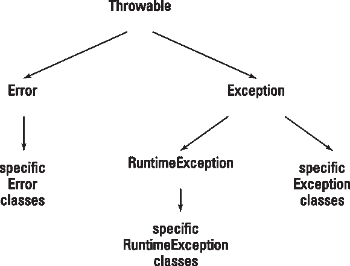

图 4-1：以下段落描述了该层次结构中的类：

- `Throwable`：异常层次结构的根是 `Throwable` 类。该类表示任何可以被 `throw` 抛出并被 `catch` 捕获的对象。
- `Error`：`Throwable` 的子类，代表合理的程序无法恢复的严重错误。例如，如果 Java 虚拟机内存不足，就会抛出 `VirtualMachineError`。
- `Exception`：`Throwable` 的子类，代表程序应该尝试恢复的错误状况。因此，`Exception` 实际上是你通过 `try/catch` 语句捕获的异常类型的顶端。

  > **提示**：“捕获或抛出”规则（参见第二本书第 8 章）规定检查异常必须在 `try-catch` 语句中被捕获，或者通过在方法声明中指定 `throws` 向上抛出。

- `RuntimeException`：`Exception` 的子类，表示未检查异常。你不需要捕获或抛出未检查异常，但如果你需要也可以。`RuntimeException` 的子类包括 `NullPointerException` 和 `ArithmeticException`。

### 创建异常类

要创建一个自定义异常类，只需定义一个扩展 Java 异常层次中某个类的类。通常从 `Exception` 类开始创建一个自定义检查异常。

假设你正在开发一个从文件或数据库检索产品数据的类，并且你希望遇到 I/O 错误的方法抛出自定义异常，而不是 Java API 提供的通用 `IOException`。你可以通过创建一个扩展 `Exception` 的类来实现：

```java
public class ProductDataException extends Exception
{
}
```

遗憾的是，构造函数不被视为类成员，因此当你扩展一个类时，它们不会被继承。结果是 `ProductDataException` 只有一个默认构造函数。`Exception` 类本身以及大多数其他异常类都有允许你传递一个字符串消息的构造函数，该消息存储在异常中并可以通过 `getMessage` 方法检索。因此，你想在类中添加这个构造函数，这意味着你也想添加一个显式的无参数构造函数。现在 `ProductDataException` 类如下：

```java
public class ProductDataException extends Exception
{
    public ProductDataException()
    {
    }
    public ProductDataException(String message)
    {
        super(message);
    }
}
```


虽然这样做可行，但在自定义异常类中添加字段或方法是不常见的做法。

### 抛出自定义异常

对于任何异常，你都使用`throw`语句来抛出自定义异常。你通常会将此`throw`语句写在`catch`句中间，该句负责捕获另一个更通用的异常。以下是一个从文件中检索产品数据并在发生`IOException`时抛出`ProductDataException`的方法：

```java
import java.io.*;
public class ProductDDB
{
    public static ProductDB getProduct(String code)
    throws ProductDataException
    {
        try
        {
            Product p;
            // 从文件中获取产品的代码，并可能 // 抛出 IOException
            p = new Product();
            return p;
        }
        catch (IOException e)
        {
            throw new ProductDataException(
            "An IO error occurred.");
        }
    }
}
```

以下是调用`getProduct`方法并捕获异常的代码：

```java
try
{
    Product p = ProductDB.getProduct(productCode);
}
catch (ProductDataException e)
{
    System.out.println(e.getMessage());
}
```

在这里，如果抛出了`ProductDataException`，消息将简单地显示在控制台上。在实际程序中，你可能希望记录错误、通知用户，并设法如何在发生此类数据异常的情况下优雅地继续运行程序。

# 第 5 章：使用抽象类和接口

## 本章内容

- 理解抽象方法和抽象类
- 使用基础接口
- 将接口用作类型
- 在接口中添加常量
- 继承接口
- 使用回调函数
- 使用默认方法
- 密封你的类（Sealing your classes）

在本章中，你将了解到如何使用两个相似但细微区别的特性：抽象类和接口。它们都允许你单独声明类所实现的方法和字段签名，而将类本身分开。抽象类通过继承来实现这一点。接口在不使用继承的情况下实现这一点，但效果是类似的。本章还涵盖了名为`default methods`（默认方法）的特性，它旨在让接口更容易使用。

## 使用抽象类

Java 允许你声明一个方法或整个类为`abstract`（抽象）。当一个类被声明为抽象时，该类无法被实例化。抽象类等待被扩展；它作为一个或多个*可以*被实例化的子类的父类。可以被实例化的类有时被称为`concrete classes`（具体类），以区别于抽象类。

大多数抽象类包含一个或多个`abstract methods`（抽象方法），这些是实际方法的原型。抽象方法定义了返回类型、名称、参数列表以及（可选的）`throws`子句，但没有方法体。

要创建一个抽象方法，你需要指定修饰符`abstract`并将方法体替换为分号：

```java
public abstract int hit(int batSpeed);
```

在这里，名为`hit`的方法被声明为抽象方法，它返回一个`int`值并接受一个`int`参数。

要声明一个抽象类，你可以在类定义上使用`abstract`修饰符。请注意，任何包含一个或多个抽象方法的类*必须*被声明为抽象类。以下是一个示例：

```java
public abstract class Ball
{
    public abstract int hit(int batSpeed);
}
```

如果你在类声明中省略了`abstract`修饰符，Java 编译器会产生错误信息，提醒你该类必须声明为`abstract`。

再次，你不能创建抽象类的实例。因此，以下代码无法编译：

```java
Ball b = new Ball();
```

这里的问题不在于将变量`b`声明为`Ball`；而在于尝试使用`new`关键字配合`Ball`类来创建一个`Ball`对象。由于`Ball`是一个抽象类，你不能用它来创建对象实例。

你可以像这样从抽象类创建一个子类：

```java
public class BaseBall extends Ball
{
    public int hit(int batSpeed)
    {
        // 实现 hit 方法的代码写在这里
    }
}
```

当你对抽象类进行子类时，子类必须为抽象类中的每个抽象方法提供实现。换句话说，它必须用非抽象方法来重写每个抽象方法。（如果不这样做，子类也必须声明为抽象，因此它也无法被实例化。）

当你想要创建一个通用类型作为两个或多个子类的父类，但父类本身不代表实际对象时，抽象类非常有用。例如，如果所有员工要么领月薪，要么按小时计薪，那么创建一个抽象的`Employee`类并将其作为`SalariedEmployee`和`HourlyEmployee`子类的基类是有意义的。关于抽象类，还有几点额外值得思考的内容：

- 抽象类中的并非所有方法都必须是抽象的。类可以为某些方法提供实现，但对其他方法不是。事实上，即使一个类没有任何抽象方法，你仍然可以将其声明为抽象的。（在这种情况下，该类无法被实例化。）

- 私有方法不能是抽象的。这很合理，因为子类无法重写私有方法，而抽象方法必须被重写。

- 虽然你不能创建抽象类的实例，但你可以使用抽象类作为其类型来声明变量。然后使用该变量来引用任何子类的实例。

- 类或方法不能同时指定为`abstract`和`final`。这会导致逻辑悖论。嗯，理想情况下这种影响应该是局部的。但点在于，因为抽象类只有在子类化后才能使用，而`final`类不能被子类化，所以让同一个类同时指定`abstract`和`final`没有意义。

抽象类在 Java API 中被广泛使用。许多抽象类的名称以`Abstract`开头——例如，`AbstractBorder`、`AbstractCollection`和`AbstractMap`——但大多数抽象类并不是。例如，`InputStream`类（`System.in`使用）就是抽象的。

## 使用接口

*接口*与抽象类相似，但有一个关键区别：一个类只能继承另一个类，但一个类可以*实现*它需要的多个接口。类通过在类定义中使用`implements`关键字来实现接口，并为接口定义的任何抽象方法提供实现。

相比继承，接口有两个优势：

- 接口比抽象类更易处理，因为你不需要担心在接口中提供任何实现细节。
- 类只能继承另外一个类，但可以实现任意数量的接口。

接下来的章节描述了创建和使用接口的细节。

### 创建基础接口

这里是一个基础接口，它定义了一个名为`Playable`的接口，其中包含一个名为`play`的单方法：

```java
public interface Playable
{
void play();
}
```

该接口声明，任何实现`Playable`接口的类必须为名为`play`的方法提供实现，该方法不接受参数且没有返回值。

该接口有几个有趣的细节：

- 接口本身被声明为`public`，以便其他类可以使用它。和公有类一样，公有接口必须声明在同同名的文件中。因此，此接口必须位于名为`Playable.java`的文件中。

- 接口的名称（`Playable`）是一个形容词。大多数接口使用形容词而不是名词命名，因为它们描述了实现接口的类的某些额外能力或特性。因此，实现`Playable`接口的类代表可以被播放的对象。

   如果你有一段时间没上英语课了，*形容词*是修饰名词的词。你可以通过在单词末尾加上`-able`将许多动词转换为形容词——例如：*playable, readable, drivable,*和*stoppable*。这种类型的形容词通常用于接口名称。

- 命名接口的另一种常见方法是将形容词与名词结合，以指示该接口为特定类型的对象增加了某些功能。你可以将一个提供卡牌游戏唯一方法的接口命名为`CardGame`，这个接口可能包含`deal`、`shuffle`和`getHand`等方法。

-  接口中的所有方法都被假设是公共的（public）且抽象的（abstract）。如果你愿意，可以在接口方法上写出`public`和`abstract`关键字。然而，这种写法被认为是不规范的，因为它可能意味着你认为默认是私有的（private）而不是抽象的。

### 实现接口

要实现一个接口，类必须做两件事：

- 它必须在类声明中指定一个`implements`子句。
- 它必须为接口声明的每一个抽象方法提供实现。

这里有一个实现`Playable`接口的类：

```java
public class TicTacToe implements Playable
{
// 额外的字段和方法在这里
public void play()
{
// 游戏代码在这里
}
// 额外的字段和方法在这里
}
```

在这里，`TicTacToe`类声明指定了`implements Playable`。然后类体包含了`play`方法的实现。

 一个类可以实现多个接口：

```java
public class Hearts implements Playable, CardGame
{
// 必须实现 Playable
// 和 CardGame 接口的方法
}
```

在这里，`Hearts`类实现了两个接口：`Playable`和`CardGame`。

 类可以继承一个父类并实现一个或多个接口。这是一个示例：

```java
public class Poker extends Game
implements Playable, CardGame
{
// 继承 Game 类的所有成员
// 必须实现 Playable
// 和 CardGame 接口的方法
}
```

### 将接口作为类型

在 Java 中，接口是一种类型，就像类一样。因此，你可以将接口作为变量、参数或方法返回值的类型。

考虑这段代码片段：

```java
Playable game = getGame();
game.play();
```

在这里，我假设`getGame`方法返回一个实现了`Playable`接口的对象。该对象在第一条语句中赋值给一个类型为`Playable`的变量。然后第二条语句调用该对象的`play`方法。

另一个（稍微复杂一点的）示例假设你有一个名为`Dealable`的接口，它定义了一个名为`deal`的方法，该方法接受发牌数量作为参数：

```java
public interface Dealable
{
void deal(int cards);
}
```

现在假设你有一个名为`startGame`的方法，它接受两个参数：一个`Dealable`对象和一个指示要玩什么游戏的`String`。这个方法看起来可能像：

```java
private void startGame(Dealable deck, String game)
{
if (game.equals("Poker"))
deck.deal(5);
else if (game.equals("Hearts"))
deck.deal(13);
else if (game.equals("Gin"))
deck.deal(10);
}
```

假设你还有一个名为`CardDeck`的类实现了`Dealable`接口，你可以使用像示例这样的语句来开始一局接接牌：

```java
Dealable d = new CardDeck();
startGame(d, "Hearts");
```

注意变量`d`被声明为`Dealable`。你也可以同样容易地将其声明为`CardDeck`：

```java
CardDeck d = new CardDeck();
startGame(d, "Hearts");
```

因为`CardDeck`类实现了`Dealable`接口，所以它可以作为参数传递给`startGame`。

## 使用接口可以做的更多事情

接口不仅仅是创建抽象方法。接下来的章节描述了你可以使用接口做的的一些额外事情。请继续阅读。

### 为接口添加字段

除了抽象方法外，接口还可以包含最终字段（fields）——即常量。接口字段用于提供与接口相关的常量值。例如：

```java
public interface GolfClub
{
int DRIVER = 1;
int SPOON = 2;
int NIBICK = 3;
int MASHIE = 4;
}
```

在这里，任何实现`GolfClub`接口的类都可以使用这些字段（即常量）。

 注意，接口字段自动假设为`static`、`final`和`public`。在创建接口常量时可以这些关键字，但不需要。

### 扩展接口

你可以通过`extends`关键字来扩展接口。扩展现有接口的接口被称为*子接口*（subinterface），被扩展的接口被称为*父接口*（superinterface）。当你对接口使用`extends`关键字时，父接口的所有字段和方法实际上被复制到了子接口中。因此，子接口由父接口的字段和方法加上子接口定义的字段和方法组成。

这是一个示例：

```java
public interface ThrowableBall
{
void throwBall();
void catchBall();
}

public interface KickableBall
{
void kickBall();
void catchBall();
}

public interface PlayableBall
extends ThrowableBall, KickableBall
{
void dropBall();
}
```

在这里声明了三个接口。第一个名为`ThrowableBall`，定义了两个方法：`throwBall`和`catchBall`。第二个名为`KickableBall`，也定义了两个方法：`kickBall`和`catchBall`。第三个名为`PlayableBall`，扩展了`ThrowableBall`和`KickableBall`，并添加了自己的方法`dropBall`。

因此，任何实现`PlayableBall`接口的类必须为四个方法提供实现：`throwBall`、`catchBall`、`kickBall`和`dropBall`。注意，由于`ThrowableBall`和`KickableBall`接口定义的`catchBall`方法签名相同，`PlayableBall`接口中仅包含一个版本的`catchBall`方法。

### 使用接口实现回调

在剧院中，回调（callback）是指你参加了初次试镜，他们喜欢你的表现，并告诉你回来以便他们再看一遍。

在 Java 中，`callback`（回调）类似于这样。这是一种编程技术，其中一个对象允许另一个对象在发生特定事件时调用该对象的某个方法。第一个对象被称为`event listener`（事件监听器），因为它在等待另一个对象的调用。第二个对象被称为`event source`（事件源），因为它是触发事件的来源。

好了，我之前的剧场类比有点牵强。Java 中的回调更像是：你需要给某人打电话，但发现对方不在，于是给他的语音信箱留言，以便他之后给你回电。

回调在 Java 中通过一组专门为此设计的接口来处理。一种方便用法是`Timer`类，它是`javax.swing`包的一部分。该类实现了一个按固定间隔产生事件的定时器，并让你设置一个`listener`对象来处理这些事件。监听器必须实现`ActionListener`接口，该接口定义了一个在每次定时事件发生时被调用的`actionPerformed`方法。

`Timer`类的构造函数接受两个参数：

- 第参数是一个`int`值，代表定时事件发生的频率。
- 第二个参数是一个实现了`ActionListener`接口的对象。当每次定时事件发生时，都会调用该对象的`actionPerformed`方法。

`ActionListener`接口定义在`java.awt.event`包中。它包含以下代码：

```java
public interface ActionListener {
/**
* 当发生动作时调用
 */
void actionPerformed(ActionEvent e);
}
```

可以看到，`ActionListener`接口包含一个名为`actionPerformed`的方法。它接收一个`ActionEvent`参数，但你在这里并没有使用这个参数。

`Timer`类大约有 20 个方法，但我只介绍其中一个：`start`，它让定时器运行起来。该方法不需要任何参数，也没有返回值。

列表 5-1 使用`Timer`类每隔一秒在控制台上交替显示`Tick…`和`Tock…`信息的程序。`JOptionPane`类用于显示对话框；程序一直运行直到用户点击该框中的 OK 按钮。图 5-1 显示程序的运行情况。（实际上，`JOptionPane`类关闭定时器需要一段时间，所以你在点击 OK 后会看到几次额外的 tick-t。）


图 5-1： Tick Tock 应用的应用。

列表 5-1 Tick Tock 程序

```java
import java.awt.event.*;
import javax.swing.*;
public class TickTock
{
    public static void main(String[] args)
    {
        // 创建每秒调用一次 Ticker 类的定时器
        Timer t = new Timer(1000, new Ticker());
        t.start();
        // 显示消息框防止程序立即结束
        JOptionPane.showMessageDialog(null,
        "Click OK to exit program");
    }
}
class Ticker implements ActionListener
{
    private boolean tick = true;
    public void actionPerformed(ActionEvent event)
    {
        if (tick)
        {
            System.out.println("Tick…");
        }
        else
        {
            System.out.println("Tock…");
        }
        tick = !tick;
    }
}
```

以下段落描述了该程序运行的重要细节：

* 1：`ActionListener` 接口是 `java.awt.event` 包的一部分，因此需要此 `import` 语句。

* 2：`Timer` 类是 `javax.swing` 包的一部分，因此需要此 `import` 语句。

* 10：该语句创建一个新的 `Timer` 对象。定时器的间隔被设置为 1000 毫秒——等同于 1 秒。`Ticker` 类的类的实例作为第二个参数传递。定时器在每次定时跳动时调用该对象的 `actionPerformed` 方法——也就是说，每秒调用一次。

* 11：该语句调用 `start` 方法让定时器运行起来。

* 15：该语句调用 `start` 方法让定时器运行起来。

* 20：该语句调用 `start` 方法让定时器运行起来。

* 22：该语句调用 `start` 方法让定时器运行起来。

* 24：该语句调用 `start` 方法让定时器运行起来。

* 28：该语句调用 `start` 方法让定时器运行起来。

* 32：该语句调用 `start` 方法让定时器运行起来。

* 34：该语句调用 `start` 方法让定时器运行起来。

## 使用额外的接口类型

虽然接口是 Java 中一个非常有用的特性，但它们有一个固有的局限性：在你定义了一个接口并构建了实现它的类之后，没有简单的方法可以修改它。

例如，假设你创建了以下接口：

```java
public interface Playable
{
    void play();
}
```

你随后构建了几个实现该接口的类。这里有一个简单的示例：

```java
class Game implements Playable
{
    public void play()
    {
        System.out.println("Good luck!");
    }
}
```

当然，这是一个毫无意义的游戏；每当 `play` 方法被调用时，它只是打印“你好运！”

现在，假设你决定 `Playable` 接口应该有一个额外的功能——具体来说，你想通过调用一个名为 `quit` 的方法来结束游戏。

你可能想直接将新方法添加到现有接口中，如下所示：

```java
public interface Playable
{
    void play();
    void quit();
}
```

遗憾的是，这样做会破坏 `Game` 类，因为它没有提供 `quit` 方法的实现。

- `private` 方法：提供仅能被 `default` 方法或其他 `private` 接口方法调用的方法。实现类无法重写或访问 `private` 方法。

- `private static` 方法：与 `private` 方法类似，但它们是 `static` 的，且只能被 `static` 接口方法调用。`private static` 方法无法被实现类重写或访问。

你可以通过将一个方法指定为默认方法来向 `Playable` 接口添加一个 `quit` 方法，如所示将其指定为 `default` 方法：

```java
interface Playable
{
  void play();
  default void quit()
  {
    System.out.println("Sorry, quitting is not allowed.");
  }
}
```

在这里，`Playable` 接口规定，如果实现类没有提供 `quit` 方法的实现，将使用默认方法。在这种情况下，默认方法简单地打印消息 `Sorry, quitting is not allowed.`。

以下是一个使用 `Playable` 接口及其默认方法的完整示例：

```java
public class TestPlayable
{
  public static void main(String[] args)
  {
    Game g = new Game();
    g.play();
    g.quit();
  }
}

interface Playable
{
  void play();
  default void quit()
  {
    System.out.println("Sorry, quitting is not allowed.");
  }
}

class Game implements Playable
{
  public void play()
  {
    System.out.println("Good luck!");
  }
}
```

当你运行此程序时，控制台将显示以下内容：

```
Good luck!
Sorry, quitting is not allowed.
```

## 启用 Java 语言特性的接口

某些接口对于 Java 编程语言某些特性的运行至关重要。换句话说，Java 语言的某些特性需要实现特定的接口。所有这些接口都定义在 `java.lang` 包中（`java.lang` 还定义了 Java 语言特性所需的各种类、枚举和异常）。

例如，在第 2 卷 第 8 章 中，我讲解了 try-with-resources 语句。try-with-resources 语句允许你使用仅存在于 `try` 语句作用范围内的资源，如下例所示：

```java
try (FileWriter w = new FileWriter("file.txt"))
{
  w.write(message)
}
catch (Exception ex)
{
  System.out.println("File unavailable.");
}
```

在这个示例中，资源是 `FileWriter` 类的一个实例。

为了在 try-with-resources 语句中作为资源使用，类必须实现名为 `AutoCloseable` 的接口。该接口声明了一个名为 `close` 的方法，其定义如下：

```java
void close() throws Exception;
```

当 try-with-resources 语句超出作用范围时，资源的 `close` 方法会被自动调用。

另一个 Java 语言特性所需的接口是 `Iterable`。Java 的增强 `for` 语句需要 `Iterable` 接口，我在第 5 卷 第 2 章 中讲解了它。`Iterable` 接口定义了包含多个数据值的对象，这些数据值可以一次一次地检索和处理。Java 提供了许多实现 `Iterable` 接口的类。你可以在 第 5 卷 中了解它们的信息。

## 密封你的类

你可能会发现自己处于这样的情况：需要允许特定类作为有限数量的子类的基类。例如，假设你创建了一个 `Ball` 类，它适用于棒球、垒垒球和板球等等球拍类游戏。因此，`Ball` 类可以被名为 `BaseballBall`、`SoftballBall` 和 `CricketBall` 的类继承。通过密封 `Ball` 类并仅允许这三个类继承 `Ball` 类，你可以防止该类被用作其他类型球（如足球或网球）的基类。

 密封类（Sealed classes）特性在 Java 15 中作为预览特性引入，并已从 Java 17 开始被采用标准特性。

密封类为 Java 引入了三个新关键字：`sealed`、`permits` 和 `non-sealed`。正如你所猜的，`sealed` 关键字用于标记一个类为密封的（sealed），而 `permits` 关键字引入了一个可能继承该密封类的类列表。`non-sealed` 关键字用于指示派自 `sealed` 类的类本身不是密封的。

要定义一个密封类，你使用 `sealed` 关键字将该类指定为密封。然后使用 `permits` 关键字列出可以扩展该密封类的类。例如：

```java
public sealed class Ball permits BaseballBall, SoftballBall, CricketBall
```

在这个示例中，`Ball` 类只能被名为 `BaseballBall`、`SoftballBall` 和 `CricketBall` 的三个类扩展。

继承密封类的类必须显式地说明它本身是否可以被扩展。你通过将子类指定为 `final`、`sealed` 或 `non-sealed` 来做到。按如下方式使用这些关键字：

- `final`：如果你希望子类不允许任何额外的子类，请使用 `final`。假设你在扩展 `Ball` 类的 `BaseballBall` 类中使用 `final`，则将没有类可以继承它。

- `sealed`：如果你允许子类被扩展但想限制哪些类可以扩展它，请使用 `sealed`。假设你在扩展 `Ball` 类的 `SoftballBall` 类中使用 `sealed`，那么只有 `FastPitchBall` 和 `SlowPitchBall` 可以扩展 `SoftballBall`。

- `non-sealed`：如果你想允许子类被自由扩展，请使用 `non-sealed`。假设你在扩展 `Ball` 类的 `CricketBall` 类中使用 `non-sealed`，任何类都可以扩展 `CricketBall`。

让我通过 `Ball` 类层次结构详细说明这一点。在接下来的段落，我展示了遵循此继承关系的类：

- `Ball`

- `BaseballBall`

- `SoftballBall`

- `FastPitchBall`

- `SlowPitchBall`

- `CricketBall`

这些类使用了 `abstract`、`final`、`sealed` 和 `non-sealed` 的各种组合来展示它们的工作原理。首先是位于顶部的 `Ball` 类：

```java
public sealed class Ball permits BaseballBall, SoftballBall, CricketBall
{
  public String BallType;
  public double Circumference;
  public double Weight;
  public String Color;
}
```

你可以看到，`Ball` 类是密封的，`BaseballBall`、`SoftballBall` 和 `CricketBall` 这三个类可以继承它。

`BaseballBall` 类如下：

```java
public final class BaseballBall extends Ball
{
  public BaseballBall()
  {
    this.BallType = "Baseball Ball";
    this.Circumference = 9.0;
    this.Weight = 5.0;
    this.Color = "White";
  }
}
```

它继承 `Ball` 类并使用 `final` 关键字确保没有类可以继承它。在它的构造函数中，它为继承自 `Ball` 的每个变量提供了值。

接下来是 `SoftballBall` 类：

```java
public abstract sealed class SoftballBall
extends Ball
permits FastPitchBall, SlowPitchBall
{
}
```

`SoftballBall` 类是一个继承 `Ball` 类的抽象类。作为这样，`SoftballBall` 类不能被实例化。它继承 `Ball` 类并定义为密封，允许 `FastPitchBall` 和 `SlowPitchBall` 扩展它。

接下来的两个类继承 `SoftballBall` 类，扩展它并为继承自 `Ball` 的变量提供值。这两个类定义了两种垒垒球：快速球和慢速球。这两个类都标记为 `final`，以便其他类无法扩展它们。

```java
public final class FastPitchBall extends SoftballBall
{
    public FastPitchBall()
    {
        this.BallType = "Fast Pitch Softball Ball";
        this.Circumference = 12.0;
        this.Weight = 6.75;
        this.Color = "Yellow";
    }
}

public final class SlowPitchBall extends SoftballBall
{
    public SlowPitchBall()
    {
        this.BallType = "Slow Pitch Softball Ball";
        this.Circumference = 16.0;
        this.Weight = 9.0;
        this.Color = "White";
    }
}
```

最后是 `CricketBall` 类：

```java
public non-sealed class CricketBall extends Ball
{
    public CricketBall()
    {
        this.BallType = "Cricket Ball";
        this.Circumference = 9.0;
        this.Weight = 5.5;
        this.Color = "Red";
    }
}
```

它也继承自 `Ball`，但这个类是非密封的（non-sealed）。因此，任何类都可以继承它。

现在，让我们来看一个简单的程序，它实例化了四种类型的球并打印它们的特征。该程序依赖于名为 `PrintBallInfo` 的本地方法，该方法在控制台上打印球的类型、周长、重量和颜色。以下是代码：

```java
public class BallTester
{
    public static void main(String[] args)
    {
        PrintBallInfo(new BaseballBall());
        PrintBallInfo(new FastPitchBall());
        PrintBallInfo(new SlowPitchBall());
        PrintBallInfo(new CricketBall());
    }

    static void PrintBallInfo(Ball b)
    {
        System.out.println("The ball is a " + b.BallType);
        System.out.println("Circumference: " + b.Circumference);
        System.out.println("Weight: " + b.Weight);
        System.out.println("Color: " + b.Color);
        System.out.println("");
    }
}
```

当你运行这个程序时，你将在控制台上看到以下输出：

```
The ball is a Baseball Ball
Circumference: 9.0
Weight: 5.0
Color: White
The ball is a Fast Pitch Softball Ball
Circumference: 12.0
Weight: 6.75
Color: Yellow
The ball is a Slow Pitch Softball Ball
Circumference: 16.0
Weight: 9.0
Color: White
The ball is a Cricket Ball
Circumference: 9.0
Weight: 5.5
Color: Red
```

关于密封类（sealed classes），还有几点需要注意：

- 除非该类所继承的类是密封的，否则你不能将一个类指定为非密封。

- 记录类（record class，见第 3 本第 2 章 使用 `toString` 方法


-  实现 `equals` 方法
-  尝试 `clone` 方法
-  理解 `Class` 类
-  查看 `instanceof` 运算符

在本章中，你将发现 Java API 中两个对面向对象编程非常重要的类：

- `Object` 类，每个其他类都继承自它——包括 Java API 中的所有类以及你自己创建的任何类
- `Class` 类，用于获取有关对象类型的信息

 如果可以，我会在整个章节上贴上一个巨大的“技术要点”（Technical Stuff）图标。这些内容都偏向技术层面，许多 Java 程序员在几年内不理解或不使用它们也能过下去。尽管如此，我仍然建议你仔细阅读这一章。即使这些内容没有完全吸收，它们也可能帮助解释为什么 Java 中的某些东西工作原理不像你预想的那样，而且本章中的信息某一天可能会帮助你通过编程走出困境。

## 类之之母：`Object`

`Object` 是所有类的母类。在 Java 中，每个类最终都会继承 `Object` 类。这个类提供了一组每个 Java 对象都可以使用的方法。

### 每一个对象都是 `Object`

任何没有 `extends` 子句的类都隐式地继承 `Object`。因此，你永远不需要编写这样的类：

```java
public class Product extends Object
```

如果子类的 `extends` 子句指定了除 `Object` 以外的父类，该类仍然继承 `Object`。这是因为继承层次结构最终会到达一个没有 `extends` 子句的父类，而该父类继承了 `Object` 并将其传递给所有的子类。

假设你有这些类：

```java
public class Manager extends SalariedEmployee
public class SalariedEmployee extends Person
public class Person extends Object
```

 在 Java 中，除非该类所继承的类是密封的，否则不能将一个类指定为非密封。

记录类（见第 3 本第 2 章；

但这样做有什么意义？你也可以让 `b` 是 `Employee`。Java API 提供了一组用于维护对象的类。最常用的类之一是 `ArrayList`，它有一个接受 `Object` 作为参数的 `add` 方法。该方法将指定的对象添加到集合。由于参数类型是 `Object`，你可以使用 `ArrayList` 创建任何集合。（关于 `ArrayList` 类和其他类的更多信息，请参见第 5 本列出了 `Object` 类的所有方法。通常我不会列出一个类的所有方法，只会列出我认为有用的。然而，由于 `Object` 在面向对象编程的游戏中如此重要，我认为最好向你展示它的所有功能，尽管其中有些晦涩。

| 方法 | 功能 |
| --- | --- |
| `protected Object clone()` | 返回对象的副本。 |
| `boolean equals(Object obj)` | 判断此对象是否与 `obj` 对象相等。 |
| `protected void finalize()` | 在垃圾回收器销毁对象时调用。 |
| `Class getClass()` | 返回一个表示此对象运行时类的 `Class` 对象。 |
| `int hashCode()` | 返回此对象的哈希值。 |
| `void notify()` | 用于多线程应用程序，唤醒等待此对象的线程。 |
| `void notifyAll()` | 用于多线程应用程序，唤醒所有等待此对象的线程。 |
| `String toString()` | 返回此对象的字符串表示。 |
| `void wait()` | 使此对象的线程进入等待，直到另一个线程调用 `notify` 或 `notifyAll`。 |
| `void wait(Long timeout)` | 基础 `wait` 方法的一种变体。 |
| `void wait(Long timeout, int nanos)` | `wait` 方法的另一种变体。 |

 我警告过你——这整章都应该有一个“技术细节”图标。

**注意：** 这些方法中几乎有一半（`notify`、`notifyAll` 以及三个 `wait` 方法）与线程有关。你可以在第 7 本书的第 1 章中找到关于这五个方法的完整信息。以下是其余六方法的概述：

- `clone`：此方法通常用于创建对象的副本，在你自己的类中重写它并不少见。我将在本章稍后的章节“`clone` 方法”中详细解释该方法。
- `equals`：此方法通常用于比较对象。任何表示可以与其他对象进行比较的对象类都应该重写此方法。更多信息请参见本章稍后的章节“`equals` 方法”。
- `finalize`：当垃圾回收器意识到对象不再被使用并可以丢弃时，就会调用此方法。该方法的意图是让你创建对象时，在被丢弃之前通过关闭打开的文件并执行其他清理任务来完成清理。但由于 Java 垃圾回收器的工作机制，无法保证 `finalize` 方法真的会被实际调用。因此，此方法并不常用。
- `getClass`：此方法有时与 `Class` 类结合使用，我将在本章稍后的章节“`Class` 类”中描述该类。
- `hashCode`：每个 Java 对象都有一个哈希码（hash code），它是该类的 `int` 类型的表示，对某些操作很有用。
- `toString`：此方法是 Java 中最常用的方法之一。我将在本章稍后的章节“`toString` 方法”中描述它。

### 基本类型不是对象

我需要说明的是，基本类型（如 `int` 和 `double`）不是对象。因此，它们不继承 `Object` 类，也无法访问上一节列出的方法。

因此，以下代码无法工作：

```java
int x = 50;
String s = x.toString(); // 错误：编译
```

如果你真的想以这种方式将 `int` 转换为字符串，可以使用包装类（如 `Integer`）从该值创建对象，然后调用它的 `toString` 方法：

```java
Integer x = 50;
String s = x.toString(); // 正确
```

每个包装类还定义了一个静态的 `toString` 方法，你可以这样使用它：

```java
String s = Integer.toString(x);
```

 有时，使用编译器的快捷方式（允许在字符串拼接表达式中使用基本类型）更简单：

```java
String s = "" + x;
```

这里 `int` 变量 `x` 与一个空字符串拼接。

 这一切的重点在于基本类型不是对象，所以它们不继承 `Object` 的任何内容。如果你想把基本类型值视为对象，可以使用该基本类型的包装类（正如我在第 2 本书第 2 章中描述的那样）。

## `toString` 方法

`toString` 方法返回对象的 `String` 表示。默认情况下，`toString` 方法返回对象的类名加上它的哈希码。在后面的章节中，我将向你如何使用 `toString` 方法以及如何在自己的类中重写它以创建更有用的字符串。

### 使用 `toString`

这是一个简单的程序，让 `toString` 方法发挥了作用：

```java
public class TestToString {
    public static void main(String[] args) {
        Employee emp = new Employee("Martinez", "Anthony");
        System.out.println(emp.toString());
    }
}

class Employee {
    private String lastName;
    private String firstName;
    public Employee(String lastName, String firstName) {
        this.lastName = lastName;
        this.firstName = firstName;
    }
}
```

这段代码创建了一个新的 `Employee` 对象；然后将其 `toString` 方法的结果打印到控制台上。当你运行此程序时，控制台会打印出以下行：

`Employee@82ba41`

**注意：** 哈希码——在此例中为 `82ba41`——在你的系统上无疑会不同。

事实证明，在这个例子中显式调用 `toString` 并不是真的必要的。我完全可以这样写 `main` 方法的第二行：

```java
System.out.println(emp);
```

这是因为 `println` 方法会自动调用你传递给它的任何对象的 `toString` 方法。

### 重写 `toString`

在大多数情况下，`toString` 的默认实现并不好用。例如，通过查看它的哈希码，你并不能对 `Employee` 对象了解很多信息。如果 `toString` 方法返回对象的某些实际数据（例如员工的名字），不是更好吗？

要做到这一点，你必须在你的类中重写 `toString` 方法。事实上，面向对象编程的基本准则之一就是始终重写 `toString`。这里有一个重写了 `toString` 的 `Employee` 类简单程序：

```java
public class TestToString {
    public static void main(String[] args) {
        Employee emp = new Employee("Martinez", "Anthony");
        System.out.println(emp.toString());
    }
}

class Employee {
    private String lastName;
    private String firstName;
    public Employee(String lastName, String firstName) {
        this.lastName = lastName;
        this.firstName = firstName;
    }
    public String toString() {
        return "Employee[" + this.firstName + " " + this.lastName + "]";
    }
}
```

当你运行此程序时，控制台上会显示以下行：

`Employee[Anthony Martinez]`

注意输出由类名和数据组成。

 上一个例子的问题是类名被硬编码在 `toString` 方法中了。你可以使用 `getClass` 方法来获取实际类名：

```java
public String toString() {
    return this.getClass().getName() + "[" + this.firstName + " " + this.lastName + "]";
}
```

这里 `getClass` 方法返回一个表示当前对象的 `Class` 对象。（你将在本章稍后了解更多 `Class` 对象。）

## `equals` 方法

测试对象是否相等是任何面向对象语言的基本任务之一。遗憾的是，Java 在这方面并不擅长。考虑这个程序：

```java
public class TestEquality1 {
    public static void main(String[] args) {
        Employee emp1 = new Employee("Martinez", "Anthony");
        Employee emp2 = new Employee("Martinez", "Anthony");
        if (emp1 == emp2)
            System.out.println("These employees are the same.");
        else
            System.out.println("These are different employees.");
    }
}

class Employee {
    private String lastName;
    private String firstName;
    public Employee(String lastName, String firstName) {
        this.lastName = lastName;
        this.firstName = firstName;
    }
}
```

这里 `main` 方法创建了两个具有相同数据的 `Employee` 对象并对它们进行了比较。可哀，比较结果为 `false`。即使 `Employee` 对象的数据相同，它们并没有被认为是相等的，因为相等运算符 (`==`) 比较的是对象引用，而不是对象包含的数据。因此，只有当 `emp1` 和 `emp2` 指向 `Employee` 类的同一个实例时，比较才会返回 `true`。

如果你想创建包含相同数据时被认为是相等的对象，你必须做两件事：

- 使用 `equals` 方法而不是相等运算符进行比较。
- 在你的类中重写 `equals` 方法，以便根据数据对对象进行比较。

以下章节描述了这两个步骤。

### 使用 `equals`

要使用 `equals` 方法而不是等价运算符来测试对象，你只需这样重写比较表达式：

```java
if (emp1.equals(emp2))
    System.out.println("These employees are equivalent.");
else
    System.out.println("These are different employees.");
```

在这里，使用了 `emp1` 的 `equals` 方法来比较 `emp1` 和 `emp2`。

默认情况下，`equals` 方法（继承自 `Object` 类）返回的结果与等价运算符 (`==`) 相同。因此，除非你像下一节解释的那样重写了 `equals` 方法，否则仅仅将 `==` 替换为 `equals` 方法不会产生任何影响。

 使用哪个对象的 `equals` 方法并不重要。因此，这里所示的 `if` 语句返回相同的结果：

```java
if (emp2.equals(emp1))
    System.out.println("These employees are the same.");
else
    System.out.println("These are different employees.");
```

 注意，我说过*不应该*重要。每当你重写 `equals` 方法时，都应该确保比较在两个方向上都是有效的。然而，粗糙的编程有时会导致 `equals` 方法出现 `a` 等于 `b` 但 `b` 不等于 `a` 的情况。请保持警惕。

### 重写 `equals` 方法

你可以重写 `equals` 方法，以便根据值对对象进行比较。从表面上看，你可能认为这很容易。你可能想为 `Employee` 类编写这样的 `equals` 方法：

```java
// warning -- 这段代码中有几个错误！
public boolean equals(Employee emp) {
    if (this.getLastName().equals(emp.getLastName())
        && this.getFirstName().equals(emp.getFirstName()))
        return true;
    else
        return false;
}
```

这段代码的基本问题——以及编写良好的 `equals` 方法的挑战在于——传递给 `equals` 方法的参数必须是 `Object`，而不是 `Employee`。这意味着 `equals` 方法必须准备好处理遇到的任何对象。例如，有人可能会尝试将一个 `Employee` 对象与 `Banana` 对象比较，或者与 `null` 比较。`equals` 方法必须准备好处理所有可能性。具体来说，Java API 文档规定，每当你重写 `equals` 方法时，必须确保 `equals` 方法符合四个特定条件。以下直接摘自 API 文档的内容：

- 它是**自反的**（reflexive）。对于任何非空引用值 `x`，`x.equals(x)` 应该返回 `true`。
- 它是**对称的**（symmetric）。对于任何两个非空引用值 `x` 和 `y`，当且仅当 `y.equals(x)` 返回 `true` 时，`x.equals(y)` 应返回 `true`。
- 它是**传递的**（transitive）。对于任何三个非空引用值 `x`、`y` 和 `z`，如果 `x.equals(y)` 返回 `true` 且 `y.equals(z)` 返回 `true`，则 `x.equals(z)` 应该返回 `true`。


它是**一致的**（consistent）。对于任何两个非空引用值`x`和`y`，只要用于对象等值比较的信息没有被修改，多次调用`x.equals(y)`一致返回`true`或一致返回`false`。

对于任何非空引用值`x`，`x.equals(null)`应该返回`false`。

听起来很困惑？幸运的是，它并没有初看起来那么复杂。你可以安全地忽略传递规则，因为如果你正确实现了其他规则，这条规则会自动生效。一致性规则基本上意味着你返回的结果是一致的。只要你不在比较中引入`Math.random`，这就不应该是问题。

这里是创建一个良好的`equals`方法的通用公式（假设参数名称为`obj`）：

1. **测试自反规则。**

   使用如下语句：

   ```java
   if (this == obj) return true;
   ```

   换句话说，如果有人傻到去检查一个对象是否等于它自己，它将返回`true`。

2. **测试非空规则。**

   使用如下语句：

   ```java
   if (obj == null) return false;
   ```

   `null`不等于任何东西。

3. **测试`obj`是否与当前对象是相同类型。**

   你可以使用`getClass`方法来实现：

   ```java
   if (this.getClass() != obj.getClass()) return false;
   ```

   如果两个对象的类型不同，它们就不可能是同一个。（这起初可能并不明显，但这个测试是满足对称规则所需的——即如果`x`等于`y`，`y`也必须等于`x`。）

4. **将`obj`强制转换为你的类变量；然后比较你想要作为返回值依据的字段，并返回结果。**

   这是一个示例：

   ```java
   Employee emp = (Employee) obj;
   return this.getLastName().equals(emp.getLastName())
          && this.getFirstName().equals(emp.getFirstName());
   ```

`Cloning`（克隆）指的是创建一个对象的完全副本的过程。遗憾的是，在像`Java`这样面向对象的语言中，这个过程证明是一项相当困难的任务。你可能认为克隆像这样简单：

```java
Employee emp1 = new Employee("Stewart", "Martha");
Employee emp2 = emp1;
```

然而，这段代码并没有为`Employee`对象创建任何副本。相反，你现在有两个变量指向同一个对象，这通常不是你想要的。假设你执行了这些语句：

```java
emp1.setLastName("Washington");
emp2.setLastName("Graham");
String lastName = emp1.getLastName();
```

在执行这些语句后，`lastName`返回的是`Washington`还是`Graham`？正确答案是`Graham`，因为`emp1`和`emp2`都指向同一个`Employee`对象。

相比之下，一个`clone`是完全全新的对象，与原始对象具有相同的值。通常你可以使用下面的代码手动创建一个克隆：

```java
Employee emp1 = new Employee("Stewart", "Martha");
Employee emp2 = new Employee();
emp2.setLastName(emp1.getLastName());
emp2.setFirstName(emp1.getFirstName());
emp2.setSalary(emp1.getSalary());
```

这里创建了一个新的`Employee`对象，它的字段被设置为与原始对象相同的值。

 `Java`提供了一种更优雅的方法来创建对象副本：`clone`方法，它对所有类都可用，因为它继承自`Object`类。然而，正如你在接下来的章节中发现的，`clone`方法可能很难创建和使用。因此，你只想为那些你认为确实能从克隆中获益的类实现它。

## 实现 clone 方法

`clone`方法由`Object`类定义，因此它对所有`Java`类都可用，但`clone`在`Object`类中被声明为`protected`访问权限。结果是，给定类的`clone`方法仅在该类内部可用。如果你想让其他对象能够克隆你的对象，你必须重写`clone`方法并赋予它`public`权限。

 注意，由`Object`类定义的`clone`方法返回`Object`类型。这完全合理，因为`Object`类并不知道你将在哪个类中重写`clone`方法。返回`Object`的一个不便的副作用是，每当你调用一个重写了`clone`的类的`clone`方法时，都必须将结果强制转换为所需的对象类型。

Listing 6-2提供了一个克隆`Employee`对象的程序示例。简而言之，这个程序重写了`Employee`类的`clone`方法：它创建了一个`Employee`对象，克隆它，更改了原始`Employee`对象的名称，并将两个对象都打印到控制台。

**LISTING 6-2 克隆示例**

```java
public class CloneTest
{
    public static void main(String[] args)
    {
        Employee emp1 = new Employee("Martinez", "Anthony");
        emp1.setSalary(40000.0);
        Employee emp2 = (Employee)emp1.clone();
        emp1.setLastName("Smith");
        System.out.println(emp1);
        System.out.println(emp2);
    }
}

class Employee
{
    private String lastName;
    private String firstName;
    private Double salary;

    public Employee(String lastName, String firstName)
    {
        this.lastName = lastName;
        this.firstName = firstName;
    }

    public String getLastName()
    {
        return this.lastName;
    }

    public void setLastName(String lastName)
    {
        this.lastName = lastName;
    }

    public String getFirstName()
    {
        return this.firstName;
    }

    public void setFirstName(String firstName)
    {
        this.firstName = firstName;
    }

    public Double getSalary()
    {
        return this.salary;
    }

    public void setSalary(Double salary)
    {
        this.salary = salary;
    }

    public Object clone()
    {
        Employee emp;
        emp = new Employee(this.lastName, this.firstName);
        emp.setSalary(this.salary);
        return emp;
    }

    public String toString()
    {
        return this.getClass().getName() + "["
        + this.firstName + " "
        + this.lastName + ", "
        + this.salary + "]";
    }
}
```

当你运行这个程序时，控制台上会显示以下几行：

```
Employee[Anthony Smith, 40000.0]
Employee[Anthony Martinez, 40000.0]
```

你可以看到，第二个`Employee`对象的名称被成功更改，而没有影响第一个`Employee`对象的名称。

以下段落引起你注意该程序的某些亮点：

- →5: 为名为 Anthony Martinez 的员工创建第一个`Employee`对象。
- →7: 设置 Martinez 先生的薪水。
- →8: 创建 Martinez 先生的克隆。注意`clone`方法的返回值是`Object`。
- →9: 更改`Employee`对象的姓。
- →10: 打印`Employee`对象。
- →11: 打印`Employee`对象。
- →15: `Employee`类。该类定义了私有字段来存储姓、名和薪水，以及每个字段的 getter 和 setter 方法。
- →56: 重写`clone`方法。注意它的返回类型不是`Employee`。
- →59: 使用当前对象的姓和名创建`Employee`对象。
- →61: 设置新员工的薪水。
- →62: 返回克隆的`Employee`对象。

## 使用 clone 创建浅拷贝

在前面的示例中，`clone`方法手动创建副本并返回。但如果你的类有成百上千个需要复制的字段呢？忘记复制某个字段的概率很高，而且以后向类添加字段时，可能会忘记修改`clone`方法。

幸运的是，你可以通过直接在`clone`方法中使用`Object`类的方法来解决这个问题。`Object`的`clone`方法可以自动创建对象的副本，其中包含了基本类型（如`int`和`double`）以及不可变引用类型的副本——最著名的就是`strings`。因此，如果你类中的所有字段都是基本类型或字符串，你可以使用`Object`类提供的`clone`方法来克隆你的类。

 这种类型的克隆被称为浅拷贝，原因我在下一节中解释。

要在你的`clone`方法调用`clone`方法，只需指定`super.clone()`。然而，在此之前，你必须做两件事：

- 声明类实现了`Cloneable`接口。`Cloneable`接口是一个标记接口，不提供任何方法。它只需标记类适用于克隆。
- 将对`super.clone()`的调用封装在`try/catch`语句中以异常`CloneNotSupportedException`。当你尝试对没有实现`Cloneable`接口的类调用`clone`时，会抛此异常。如果你实现了`Cloneable`，此异常永远不会发生，但由于`CloneNotSupportedException`是一个检查异常，你必须捕获它。

这是一个`Employee`类示例，它使用`super.clone()`克隆自身：

```java
class Employee implements Cloneable
{
    // 字段和方法省略…

    public Object clone()
    {
        Employee emp;
        try
        {
            emp = (Employee) super.clone();
        }
        catch (CloneNotSupportedException e)
        {
            return null; // 永远不会发生
        }
        return emp;
    }
}
```

注意，此方法不需要感知`Employee`类中声明的任何字段。然而，此`clone`方法仅适用于所有字段均为原始类型或不可变对象（如字符串）的类。

## 创建深拷贝

 类中的某些字段实际上是其他对象，这并不罕见。例如，`Employee`类可能有一个类型为`Address`的字段，用于存储每个员工的地址：

```java
class Employee
{
    public Address address;
    // 省略其他字段和方法
}
```

如果是那样的话，`super.clone()`方法不会对对象创建完整的拷贝。`clone`不会获得`address`字段的克隆。相反，它拥有一个与原始对象相同的地址对象的引用。

为了解决这个问题，你必须对`Employee`对象进行深拷贝。*深拷贝*是一种克隆，其中主对象中的任何子对象也被克隆或复制。为了实现这一目标，`clone`方法的重写将首先调用`super.clone()`创建对象的浅拷贝。然后，它调用主对象所包含的每个子对象的`clone`方法，以创建这些对象的克隆。（当然，为了使深拷贝生效，这些对象也必须支持`clone`方法或包含复制其值的代码。）

列表 6-3显示了一个示例。在这里，`Employee`类包含一个名为`address`的公共字段，它持有`Address`类的实例。如你所见，`Employee`类的`clone`方法创建`Employee`对象的浅拷贝，然后将拷贝对象的`address`字段设置为原始对象`address`字段的克隆。为了使这个示例生效，`Address`类也重写了`clone`方法。它的`clone`方法调用`super.clone()`来创建`Address`对象的浅拷贝。

**列表 6-3 创建深拷贝**


```java
public class CloneTest2
{
    public static void main(String[] args)
    {
        Employee emp1 = new Employee("Martinez", "Anthony");
        emp1.setSalary(40000.0);
        emp1.address = new Address("1300 N. First Street", "Fresno", "CA", "93702");
        Employee emp2 = (Employee)emp1.clone();
        System.out.println("**** after cloning ****\n");
        printEmployee(emp1);
        printEmployee(emp2);
        emp2.setLastName("Smith");
        emp2.address = new Address("2503 N. 6th Street", "Fresno", "CA", "93722");
        System.out.println("**** after changing emp2 ****\n");
        printEmployee(emp1);
        printEmployee(emp2);
    }

    private static void printEmployee(Employee e)
    {
        System.out.println(e.getFirstName() + " " + e.getLastName());
        System.out.println(e.address.getAddress());
        System.out.println("Salary: " + e.getSalary());
        System.out.println();
    }
}

class Employee implements Cloneable
{
    private String lastName;
    private String firstName;
    private Double salary;
    public Address address;

    public Employee(String lastName, String firstName)
    {
        this.lastName = lastName;
        this.firstName = firstName;
        this.address = new Address();
    }

    public String getLastName()
    {
        return this.lastName;
    }

    public void setLastName(String lastName)
    {
        this.lastName = lastName;
    }

    public String getFirstName()
    {
        return this.firstName;
    }

    public void setFirstName(String firstName)
    {
        this.firstName = firstName;
    }

    public Double getSalary()
    {
        return this.salary;
    }

    public void setSalary(Double salary)
    {
        this.salary = salary;
    }

    public Object clone()
    {
        Employee emp;
        try
        {
            emp = (Employee) super.clone();
            emp.address = (Address)address.clone();
        }
        catch (CloneNotSupportedException e)
        {
            return null; // 永远不会发生
        }
        return emp;
    }

    public String toString()
    {
        return this.getClass().getName() + "["
        + this.firstName + " "
        + this.lastName + ", "
        + this.salary + "]";
    }
}

class Address implements Cloneable
{
    private String street;
    private String city;
    private String state;
    private String zipCode;

    public Address()
    {
        this.street = "";
        this.city = "";
        this.state = "";
        this.zipCode = "";
    }

    public Address(String street, String city, String state, String zipCode)
    {
        this.street = street;
        this.city = city;
        this.state = state;
        this.zipCode = zipCode;
    }

    public Object clone()
    {
        try
        {
            return super.clone();
        }
        catch (CloneNotSupportedException e)
        {
            return null; // 永远不会发生
        }
    }

    public String getAddress()
    {
        return this.street + ", " + this.city + ", " + this.state + " " + this.zipCode;
    }
}
```

以下是程序的输出：

```
**** after cloning ****
Anthony Martinez, 1300 N. First Street, Fresno, CA 93702
Salary: 40000.0
Anthony Martinez, 1300 N. First Street, Fresno, CA 93702
Salary: 40000.0

**** after changing emp2 ****
Anthony Martinez, 1300 N. First Street, Fresno, CA 93702
Salary: 40000.0
Anthony Smith, 2503 N. 6th Street, Fresno, CA 93722
Salary: 40000.0
```

```java
Employee emp = new Employee();
Class c = emp.getClass();
```

 **注意**，在调用`getClass`方法之前，你必须用一个对象实例初始化变量。这是因为`getClass`方法返回的是与变量所引的对象类型对应的`Class`对象，而不是变量声明的类型。

假设有一个`HourlyEmployee`类继承了`Employee`类。现在考虑以下语句：

```java
Employee emp = new HourlyEmployee();
Class c = emp.getClass();
```

在这里，`c`指向`HourlyEmployee`类的`Class`对象，而不是`Employee`类。

 `Class`类有 50 多个方法，但其中只有 2 个值得你关注：

* `getName()`：返回一个表示类名的`String`。

* `getSuperclass()`：返回另一个`Class`对象，表示该`Class`对象的父类。

如果你对`Class`类的其他功能感兴趣，可以随时 Java API 文档中。

 **提示**，`getClass`方法最常用的用途之一是通过比较它们的`Class`对象来判断两个对象是否属于相同类型。这之所以有效，是因为 Java 保证对于应用程序中使用的每个不同类，其`Class`对象只有一个实例。因此，即使你的应用程序实例化了 1,000 个`Employee`对象，`Employee`类也只有一个`Class`对象。

因此，以下代码可以判断两个对象是否都是同类型的对象：

```java
Object o1 = new Employee();
Object o2 = new Employee();

if (o1.getClass() == o2.getClass())
    System.out.println("They're the same.");
else
    System.out.println("They are not the same.");
```

在这种情况下，两个对象的类型都是`Employee`，所以比较结果为真。

要判断一个对象是否属于特定类型，请使用对象的`getClass`方法获取相应的`Class`对象。然后使用`getName`方法获取类名，并使用字符串比较来检查类名。这是一个示例：

```java
if (emp.getClass().getName().equals("Employee"))
    System.out.println("This is an employee object.");
```

如果这一连串的方法调用让你感到头疼，你可以将代码拆分：

```java
Class c = emp.getClass();
String s = c.getName();

if (s.equals("Employee"))
    System.out.println("This is an employee object.");
```

结果是相同的。

或者，你可以使用`instanceof`运算符，它将在下一节中描述。

## 使用 instanceof 运算符

Java 的四个基本关系运算符 —— `<`、`>`、`<=`和`>=`比较两个表达式并返回一个布尔值表示这两个表达式之间比较的结果。

 你可能也将`==`和`!=`视为关系运算符，但从技术角度来说，Java 将它们称为*相等运算符*。

Java 有第五种关系运算符：`instanceof`。`instanceof`运算符与 Java 语言中其他运算符的区别在于，它由关键字`instanceof`表示，而不是符号。但它的操作方式与其他关系运算符完全一样：它确定`instanceof`运算符左侧表达式的结果是否为运算符右侧列出的引用类型的实例，并将结果作为布尔值返回。

这是一个简单的示例：

```java
Object o;
String s = "Hello, World!";
o = s;

if (o instanceof String)
    System.out.println("o is a String");
else
    System.out.println("o is not a String");
```

如果你运行这段代码，控制台上将出现`o is a String`信息。尽管变量`o`被声明为`Object`类型变量，但`instanceof`运算符发现`o`实际上引用了一个`String`类型的对象，因此它返回`true`。这是因为只要对象可以成功转换为指定的类型，`instanceof`就会返回`true`。

从 Java 16 版本开始，你可以配合`instanceof`运算符使用名为*模式匹配*（pattern matching）的功能。此功能基本上允许你在`instanceof`运算符右侧的引用类型之后提供一个变量名。然后你就可以将该变量（其类型为你正在测试的引用类型）在`if`语句中的剩余条件表达式中，或者在`if`语句求值为真时执行的语句块中使用。

这是一个示例：

```java
Object obj;
obj = "Hello, World!";

if (obj instanceof String s && s.contains("Hello"))
    System.out.println("o is a String and it contains the word Hello");
else
    System.out.println("o is not a String or doesn't contain the word Hello");
```

关于这个示例有几点需要注意：

* 如果`instanceof`运算符确定`Object`变量`obj`确实引用了一个`String`，则变量`s`将被创建。

* 假设`instanceof`运算符确定`obj`引用一个`String`，则使用`contains`方法判断字符串是否包含`"Hello"`。

* 这里需要使用双逻辑与（`&&`）而不是单逻辑与版本，因为如果`instanceof`确定`obj`不引用`String`，则`s`将不存在。

* 内部类带有一个对外部类当前实例的引用，使其能够访问外部类的实例数据。

* 由于外部类实例引的存在，你不能从外部类的静态（`static`）方法中创建或引用内部类。然而，你可以创建一个`static inner class`（静态内部类），正如我在本章稍后的部分“使用静态内部类”节中所描述的那样。

*  创建内部类的主要原因之一是创建一个仅对外部类感兴趣的类。因此，你通常将内部类声明为私有（`private`），以确保其他类无法访问它们。

* 偶尔，内部类中的代码需要引用其外部类的实例。要做到这一点，列出外部类的名称，后跟点运算符`.`和`this`。例如，如果外部类名为`MyOuterClass`，你将使用`MyOuterClass.this`来引用外部类的实例。

### 查看示例

第 3 本 第 5 章 介绍了一个应用程序，该程序使用 Swing 包中的`Timer`类（`javax.swing.Timer`）以每秒一次的间隔在控制台上显示`Tick…`和`Tock…`行。它使用一个名为`Ticker`的类来实现`ActionListener`接口，以处理`Timer`对象的时事件。

 在本章中你将看到此程序的三个版本。如果你不清楚此程序如何使用`Timer`类显示`Tick…`和`Tock…`消息，或者为什么需要`JOptionPane`对话框，你可能想快速复习第 3 本 第 5 章。

Listing 7-1 显示了该程序的一个版本，它将`Ticker`类实现为内部类。

LISTING 7-1 使用内部类的 Tick Tock


```java
import java.awt.event.*;
import javax.swing.*;

public class TickTockInner
{
    private String tickMessage = "Tick…";
    private String tockMessage = "Tock…";
    public static void main(String[] args)
    {
        TickTockInner t = new TickTockInner();
        t.go();
    }
    private void go()
    {
        // create a timer that calls the Ticker class
        // at one second intervals
        Timer t = new Timer(1000, new Ticker());
        t.start();
        // display a message box to prevent the
        // program from ending immediately
        JOptionPane.showMessageDialog(null,
        "Click OK to exit program");
        System.exit(0);
    }
}
class Ticker implements ActionListener
{
    private boolean tick = true;
    public void actionPerformed(ActionEvent event)
    {
        if (tick)
        {
            System.out.println(tickMessage);
        }
        else
        {
            System.out.println(tockMessage);
        }
        tick = !tick;
    }
}
}
```

接下来的段落描述了该程序的一些亮点：

- →6：名为`tickMessage`和`tockMessage`的`String`变量（第 7 行）包含要在控制台上打印的消息。请注意，这些变量被定义为外部类的字段。正如你将看到的，内部类`Ticker`能够直接访问这些字段。

- →11：由于内部类只能被实例化的对象使用，因此你不能直接从静态`main`方法中使用它。因此，该程序中的`main`方法简单地创建了应用程序类（`TickTockInner`）的实例。

- →12：此行执行了`TickTockInner`类新实例的`go`方法。

-  第 11 行和第 12 行使用的技术是一种常见的编程技术，允许应用程序快速离开静态上下文并进入面向对象的模式。

- →15：此行是`go`方法，从第 12 行调用。

- →19：此行创建了`Timer`类的实例，并将定时器间隔设置为 1,000 毫秒（1 秒），并将`ActionListener`设置为名为`Ticker`的内部类的新实例。

- →24：这里，使用`JOptionPane`类来显示对话框。此对话框对于给定时器运行的机会是必要的。当用户点击 OK 时，应用程序结束。

- →26：此行调用了`System`类的`exit`方法，它会立即关闭 Java 虚拟机。在这里此方法调用并不是严格要求的，但如果你漏掉它，定时器会在你点击 OK 后继续运行几秒钟。

- →29：此行是`Ticker`的声明。

- →33：`actionPerformed`方法被`Timer`对象每调用。

- →37：在此行和第 41 行中，内部类访问了一个字段。

## 使用静态内部类

`static inner class`（静态内部类）类似于内部类，但它不需要外部类的实例。和静态方法一样，`static inner class`无法访问其外部类的非静态字段或方法。

Listing 7-2 显示了该应用程序的一个版本，它使用静态内部类而不是内部类。

```java
import java.awt.event.*;
import javax.swing.*;

public class TickTockStatic
{
    private static String tickMessage = "Tick…";
    private static String tockMessage = "Tock…";
    public static void main(String[] args)
    {
        TickTockStatic t = new TickTockStatic();
        t.go();
    }
    private void go()
    {
        // create a timer that calls the Ticker class
        // at one second intervals
        Timer t = new Timer(1000, new Ticker());
        t.start();
        // display a message box to prevent the
        // program from ending immediately
        JOptionPane.showMessageDialog(null,
        "Click OK to exit program");
        System.exit(0);
    }
}
static class Ticker implements ActionListener
{
    private boolean tick = true;
    public void actionPerformed(ActionEvent event)
    {
        if (tick)
        {
            System.out.println(tickMessage);
        }
        else
        {
            System.out.println(tockMessage);
        }
        tick = !tick;
    }
}
}
```

该应用程序的版本和 Listing 7-1 版本之间只有三个区别：

- →6：`tickMessage`字段被声明为静态（static）。这是必要的，以便静态类可以访问它。

- →7：`tockMessage`字段也被声明为静态。

- →29：`Ticker`类被声明为静态。

## 使用匿名内部类

*Anonymous inner classes*（通常简称为 *anonymous classes*，匿名类）可能是 Java 编程语言中最奇怪的特性。当你第一次看到匿名类时，你几乎会认为有人犯了错误，而且代码不可能编译。但它确实可以编译，而且运行良好良好。当你习惯了使用匿名类后，你会好奇自己以前如何在没有它们的情况下生存。

匿名类是在你想要实例化它的地方就地定义的类。因为你是在需要它的地方编写类的主体，所以你不需要给它命名。（这就是为什么它被称为*匿名*类。）

### 创建匿名内部类

声明和实例化匿名类的基本形式如下：

```java
new *ClassOrInterface*() { *class-body* }
```

如你所见，你指定了`new`关键字，后面跟着类或接口名称，该名称指定了从匿名类创建的对象类型。该类或接口名称后面跟着括号，括号中可能包含传递给匿名类构造函数的参数列表。然后，你编写一个用大括号括起来的类体。这个类体可以包含普通类体可以包含的内容：字段、方法，甚至是其他类或接口。

这里是一个简单的匿名类示例：

```java
public class AnonClass
{
    interface Ball
    {
        void hit();
    }
    public static void main(String[] args)
    {
        Ball b = new Ball()
        {
            public void hit()
            {
                System.out.println("You hit it!");
            }
        };
        b.hit();
    }
}
```

在这个示例中，我创建了一个名为`Ball`的接口，它有一个名为`hit`的单方法。然后，在`main`方法中，我声明了一个类型为`Ball`的变量，并使用匿名类创建一个对象。匿名类的体包含`hit`方法的实现，该方法只是在控制台上显示消息`You hit it!`。在匿名类实例化并赋值给变量`b`后，下一条语句调用了`hit`方法。

当你运行此程序时，控制台上会显示单行`You hit it!`。

在使用匿名类时，这里有一些需要考虑的问题：

- 你不能为匿名类创建构造函数，因为匿名类没有名称。无论如何，你要给构造函数起什么名字呢？

- 如果匿名类是基于接口的，你就无法传递参数。这是很合理的；接口没有构造函数，所以 Java 没有地方可以接收这些参数。

- 赋值语句可以像这个示例一样使用匿名类。在这种情况下，匿名类体后面跟着一个分号，它标记了赋值语句的结束。请注意，这个分号是赋值语句的一部分，而不是匿名类的一部分。（在下一节中，你将看到一个作为方法参数传递的匿名类示例。在那个示例中，体后面没有分号。）

- 匿名类是一种特殊的内部类；与任何内部类一样，它自动可以访问其外层类的字段和方法。

- 匿名类不能是静态的（static）。

### 使用匿名类创建程序

[Listing 7-3] 显示了一个更复杂的匿名类示例：`Tick Tock`的一个版本，它使用匿名类作为定时器的动作监听器。

#### 使用匿名类的 Tick Tock

```java
import java.awt.event.*;
import javax.swing.*;

public class TickTockAnonymous
{
    private String tickMessage = "Tick…";
    private String tockMessage = "Tock…";
    public static void main(String[] args)
    {
        TickTockAnonymous t = new TickTockAnonymous();
        t.go();
    }
    private void go()
    {
        // 创建一个定时器，每隔一秒
        // 调用一次 Ticker 类
        Timer t = new Timer(1000,
            new ActionListener()
            {
                private boolean tick = true;
                public void actionPerformed(ActionEvent event)
                {
                    if (tick)
                    {
                        System.out.println(tickMessage);
                    }
                    else
                    {
                        System.out.println(tockMessage);
                    }
                    tick = !tick;
                }
            } );
        t.start();
        // 显示消息框以防止
        // 程序立即结束
        JOptionPane.showMessageDialog(null,
            "Click OK to exit program");
        System.exit(0);
    }
}
```

到目前，你已经看到了足够多版本的程序，应该理解它是如何工作的。以下段落解释了该版本如何使用匿名类作为传递给`Timer`构造函数的`ActionListener`参数：

- `main`方法创建`TickTockAnonymous`类的实例并执行`go`方法。

- 在`go`方法中，创建`Timer`类的实例。

- `Timer`构造函数的第二个参数是一个实现了`ActionListener`接口的对象。该对象通过匿名类创建。`ActionListener`被指定为该类的类型。

- 这个左大括号标记了匿名类体的开始。

- 定时器每隔 1000 毫秒调用一次`actionPerformed`方法。注意，此方法可以自由访问外层类定义的字段。

- 这一行的右大括号标记了匿名类的结束。随后，右括号标记了`Timer`构造函数参数列表的结束。

- `java.lang`：该包包含了一些极其常用的类，Java 编译器使这些类对每个程序都可用。该包中的类示例有`String`、`Exception`以及各种包装类，如`Integer`和`Boolean`。（有关此包以及书中描述的所有 Java 包的完整文档，请参考[`https://docs.oracle.com/en/java/javase/19/docs/api/index.html`](https://docs.oracle.com/en/java/javase/14/docs/api/index.html)。）

- **默认包（The default package）**：该包包含没有被专门放在其他包中的类。到目前为止，书中展示的所有程序都在`default`包中。

对于简单的程序开发和实验，使用`default`包是可以接受的。但是，如果你开始开发严肃的 Java 应用程序，请它创建一个单独的包并将应用程序所有的类都放在那里。你将在下一节中了解到如何操作。

 即使你想这样做，也无法导入默认包。假设你有两个包——默认包和`com.lowewriter.util`包。默认包中的代码包含语句`import com.lowewriter.util.*`。这是没问题的。但默认包没有名字——至少它没有一个可以在程序内部使用的名字。`com.lowewriter.util`包的代码不能包含像这样的语句：

`import that_default_package.you_know.the_one_with_no_name`

### 创建你自己的包

创建自己的包来存放类是非常简单的。嗯，至少是相对简单。你必须经过几个步骤：

1. **为你的包选择一个名称。**

   你可以使用任何喜欢的名称，但我建议你遵循既定的惯例，反向使用你的互联网域名（如果有的话）。我拥有`LoweWriter.com`域名，所以我对我所有的包都使用`com.lowewriter`这个名字。（反向使用你的域名可以确保你的包名是唯一的。）

   注意包名全采用小写字母。这不是绝对要求，但它是你应该遵守的 Java 惯例。如果你开始在包名中使用大写字母，你会被标记为反叛者。由于 Java 是区分大小大小的，名为`com.lowewriter`的包与名为`com.LoweWriter`的包是不同的包。

    如果你需要，可以在域名之外添加额外的层级。例如，我将我的工具类放在一个名为`com.lowewriter.util`的包中。

   如果你没有专有的域名，尝试反向使用你的邮箱地址。例如，如果你的邮箱地址是`SomeBody@SomeCompany.com`，请使用`com.somecompany.somebody`作为包名。这样它们仍然是唯一的。

2. **在你的硬盘上选择一个目录作为类库的根目录。**

   你需要在硬盘上找一个地方来存储你的类。我建议你创建一个如`c:\javaclasses`的目录。

   该文件夹成为你 Java 包的*根目录*。

3. **在根目录内为你的包名创建子目录。**

   例如，对于名为`com.lowewriter.util`的包，在`c:\javaclasses`目录（假设这是你的根目录）创建一个名为`com`的目录。然后，在`com`目录下创建一个名为`lowewriter`的目录。接着，在`lowewriter`中创建一个名为`util`的目录。因此，包含`com.lowewriter.util`包类的目录完整路径就是`c:\javaclasses\com\lowewriter\util`。

4. **将你包的根目录添加到`ClassPath`环境变量中。**

   执行此操作的具体步骤取决于你的操作系统。在 Windows 中，你可以通过双击控制面板中的“系统”来设置`ClassPath`。点击“高级”选项卡，然后点击“环境变量”。

   如果`ClassPath`变量已存在，小心不要干扰其中已列出的任何目录。要将你的根目录添加到`ClassPath`，请在`ClassPath`值的结尾添加一个分号，加上你的根目录路径。例如，假设你的`ClassPath`已经设置为：


`.;c:\util\classes`

那么将其修改为如下：

`.;c:\util\classes;c:\javaclasses`

在这里我在 `ClassPath` 值的末尾添加了 `;c:\javaclasses`。

如果 `ClassPath` 变量不存在，你可以通过点击“新建”按钮创建它。变量名输入 `ClassPath`，值输入你的根目录路径。

## 将类文件保存到包目录

**将任何属于特定包的类文件保存到该包对应的目录。**

例如，将属于 `com.lowewriter.util` 包的类文件保存到 `c:\javaclasses\com\lowewriter\util`。

**在每个属于包的源文件开头添加 `package` 语句。**

`package` 语句仅用于为文件中任何类所属的包提供名称。例如：

`package com.lowewriter.util`

 `package` 语句必须是文件中第一个非注释语句。

### 示例

假设你开发了一个名为 `Console` 的工具类，它拥有一系列用于获取输入的方便方法。例如，该类有一个静态方法 `askorN`，可以从用户处获取 Y 或 N。

以下是 `Console` 类的源代码：

```java
package com.lowewriter.util;

import java.util.Scanner;

public class Console
{
    static Scanner sc = new Scanner(System.in);
    public static boolean askorN(String prompt)
    {
        while (true)
        {
            String answer;
            System.out.print("\n" + prompt + " (Y or N) ");
            answer = sc.next();
            if (answer.equalsIgnoreCase("Y"))
                return true;
            else if (answer.equalsIgnoreCase("N"))
                return false;
        }
    }
}
```

好了，到目前这个类只有一个方法（`askorN`），但将来某天你会向它添加许多其他方法。在此期间，你想将其设置在一个包中，以便立即开始使用它。

因此，你创建一个名为 `c:\javaclasses\com\lowewriter\util` 的目录（如前节所述），并将源文件保存到该目录。然后编译程序，使 `Console.class` 文件也存储在该目录中。最后将 `c:\javaclasses` 添加到你的 `ClassPath` 变量中。

现在，你可以使用以下程序来测试你的包是否运行正常：

```java
import com.lowewriter.util.*;

public class PackageTest
{
    public static void main(String[] args)
    {
        while (Console.askorN("Keep going?"))
        {
            System.out.println("D'oh!");
        }
    }
}
```

这里的 `import` 语句导入了 `com.lowewriter.util` 包中的所有类。然后 `main` 方法中的 `while` 循环反复询问用户是否继续。

注意，这个程序不需要位于 `util` 目录。只要你正确设置了 `ClassPath` 变量，Java 就能找到该包。

## 将你的类放入 JAR 文件

*JAR 文件*是一个单一文件，可以以压缩格式包含多个类，Java 运行时环境可以快速访问它。（*JAR* 代表 *Java archive*。）JAR 文件可以只包含几个类，也可以包含数千个类。

JAR 文件是由 `jar` 工具创建的，你可以在 JDK 的 `bin` 目录下找到它，它与其他 `java` 和 `javac` 等 Java 命令行工具在一起。JAR 文件的格式与 Zip 文件相似，Zip 是一种由 PKZIP 程序普及的压缩格式。主要的区别在于，JAR 文件包含一个名为 `manifest file`（清单文件）的特殊文件，该文件包含了归档中文件的信息。此清单文件由 `jar` 工具自动创建，但你也可以提供自己的清单文件，以提供关于归档文件的额外信息。

JAR 文件是发布完成 Java 应用程序的常用方式。完成应用程序后，你在命令提示符中运行 `jar` 命令来准备 JAR 文件。然后，另一个用户就可以将 JAR 文件复制到他的计算机上。该用户随后可以直接从 JAR 文件中运行应用程序。

## jar 命令命令行选项

`jar` 命令是一个老式的 Unix 风格命令，配备了一系列晦涩的命令行选项，如果你想让 `jar` 执行某些有用的操作，就必须正确设置这些选项。

`jar` 命令的基本句格式如下：

`jar options jar-file [manifest-file] class-files…`

选项指定了你想要 `jar` 执行的基本操作，并提供了关于你希望命令如何运行的额外信息。表 8-1

| 选项 | 说明 |
| --- | --- |
| `c` | 创建一个新的 `jar` 文件。 |
| `u` | 更新现有的 `jar` 文件。 |
| `x` | 从现有的 `jar` 文件中提取文件。 |
| `t` | 列出 `jar` 文件的内容。 |
| `f` | 表明指定的参数为 JAR 文件。你几乎总是需要使用此选项。 |
| `v` | 详细输出。此选项告诉 `jar` 命令在工作时显示额外信息。 |
| `0` | 在将文件添加到归档时不对其进行压缩。此选项并不常用。 |
| `m` | 指定提供了一个清单文件。它被列在 `jar` 文件之后的下一个参数中。 |
| `M` | 指定不将清单文件添加到归档中。此选项很少使用。 |

表 8-1 jar 命令选项

注意，你必须至少指定 `c`、`u`、`x` 或 `t` 选项，以告诉 `jar` 你想要执行的操作。

## 归档包

`jar` 工具最常用的用途是创建整个包的归档。该过程根据你使用的操作系统而略有不同。然而，无论你的操作系统是什么，`jar` 命令本身都是相同的。以下是在运行任何版本的 Windows 的 PC 上归档包的步骤：

1. **打开命令窗口。**

   最简单的方法是选择“开始”、“运行”，在“打开”文本框中输入 `cmd` 并点击确定。在 Windows 10 或 11 上，点击“开始”，输入 `cmd` 并按回车键。

    如果你在第 3 步运行 `jar` 命令时遇到困难，可能需要以管理员模式打开命令提示符。要此操作，点击开始菜单，输入 `cmd`，在开始菜单顶部右键点击 `cmd.exe`（或命令提示符，取决于 Windows 版本），并选择“以管理员身份运行”。

2. **使用 `cd` 命令导航到你的包根目录。**

   例如，如果你的包存储在 `c:\javaclasses`，请使用此命令：

   `cd \javaclasses`

3. **使用指定了选项 `cf`、jar 文件名以及要归档的类文件路径的 `jar` 命令。**

   例如，创建一个名为 `utils.jar` 的包含 `com.lowewriter.util` 包中所有类文件的归档，请使用此命令：

   `jar cf utils.jar com\lowewriter\util\*.class`

4. **要验证 jar 文件是否创建正确，使用指定了选项 `tf` 和 jar 文件名的 `jar` 命令。**

   例如，如果 jar 文件名为 `utils.jar`，请使用此命令：

   `jar tf utils.jar`

   这将列出 jar 文件的内容，让你看到添加了哪些类。以下是此命令的一些典型输出：

   ```
   META-INF/
   META-INF/MANIFEST.MF
   com/lowewriter/util/Console.class
   ```

   如你所见，`utils.jar` 文件包含 `Console` 类，它位于我的 `com.lowewriter.util` 包中。

   就这些了！你完成了。你可以让 `jar` 文件留在原处，也可以把它给你的朋友，让他们使用其中包含的类。

## 将 jar 添加到你的类路径中

要使用归档中的类，你必须将 `jar` 文件添加到 `ClassPath` 环境变量中。我在之前的创建你自己的 中描述过这一点。要将归档添加到 `ClassPath`，只需使用分号添加路径。这里是一个例子：

`.;c:\javaclasses\utils.jar`

`java -cp ..;c:\javaclasses\utils.jar MyClass`

```bash
java -jar game.jar
```

此命令启动 JRE 并执行 `game.jar` 归档文件中 manifest 文件所指定的类的 `main` 方法。

 **提示**：如果你的操作系统配置恰当，你也可以通过双击 `jar` 文件的图标来运行应用程序。

# 使用 Javadoc 为类编写文档

在发布你热门的新类库或应用程序之前，还有最后一步要完成：为它的各个类准备文档。幸运的是，Java 提供了一个名为 `Javadoc` 的工具，它可以根据源文件中的注释自动创建精美的基于 HTML 的文档。你只需要为每个公共类、字段和方法添加一条注释；然后通过 `javadoc` 命令运行源文件即可。*搞定！* 你就为你的类拥有了看起来非常专业的、基于 Web 的文档。

接下来的章节将向你展示如何向源文件添加 Javadoc 注释、如何通过 `javadoc` 命令运行源文件，以及如何查看生成的文档页面。

## 添加 Javadoc 注释

创建 Javadoc 注释的基本规则是它们以 `/**` 开头并以 `*/` 结束。你可以在源文件的三个不同位置之一放置 Javadoc 注释：

* 紧邻公共类的声明之前
* 紧邻公共字段的声明之前
* 紧邻公共方法或构造函数的声明之前

Javadoc 注释可以包含描述类、字段或方法的文本。多行 Javadoc 注释的后续每行通常以一个星号开头。Javadoc 会忽略这个星号以及它与行首第一个单词之间的任何空白字符。

如果你想应用精美的格式化，Javadoc 注释中的文本可以包含 HTML 标记。你应该避免使用标题标签（`<h1>` 等），因为 Javadoc 会创建这些标签，而你的标题标签只会让情况变得混乱。但你可以使用粗体和斜体标签（`<b>` 和 `<i>`）或格式化代码示例的标签（使用 `<pre>` 标签，它可以保留换行符和缩进）。

此外，你还可以包含特殊的 *doc 标签*，这些标签提供了 Javadoc 用于格式化文档页面所需的特定信息。表 8-2 常用 Javadoc 标签

为了让你直观了解 Javadoc 注释是如何使用的，列表 8-1 显示了一个名为 `Employee` 的类，其中包含了 Javadoc 注释。（该 Java 文件还包含一个名为 `Address` 的类，它是 `Employee` 类运行所必需的。为了简洁起见，我不为 `Address` 类提供 Javadoc 注释。）

列表 8-1 带有 Javadoc 注释的 Employee 类

```java
package com.lowewriter.payroll;

/** 代表一个员工。
* @author Doug Lowe
* @author www.LoweWriter.com
* @version 1.5
* @since 1.0
 */
public class Employee
{
    private String lastName;
    private String firstName;
    private Double salary;
    /** 代表员工的地址。
    */
    public Address address;

    /** 创建一个指定名称的员工。
     * @param lastName 员工的姓。
     * @param firstName 员工名。
     */
    public Employee(String lastName, String firstName)
    {
        this.lastName = lastName;
        this.firstName = firstName;
        this.address = new Address();
    }

    /** 获取员工的姓。
     * @return 一个表示员工姓的
     * 字符串。
     */
    public String getLastName()
    {
        return this.lastName;
    }

    /** 设置员工的姓。
     * @param lastName 一个包含员工
     * 姓的字符串。
     */
    public void setLastName(String lastName)
    {
        this.lastName = lastName;
    }

    /** 获取员工的名字。
     * @return 一个表示员工
     * 名字的字符串。
     */
    public String getFirstName()
    {
        return this.firstName;
    }

    /** 设置员工的名字。
     * @param firstName 一个包含员工
     * 名字的字符串。
     */
    public void setFirstName(String firstName)
    {
        this.firstName = firstName;
    }

    /** 获取员工的工资。
     * @return 一个表示员工工资的 double 类型。
     */
    public double getSalary()
    {
        return this.salary;
    }

    /** 设置员工的工资。
     * @param salary 一个表示员工
     * 工资的 double 类型。
     */
    public void setSalary(double salary)
    {
        this.salary = salary;
    }
}
```

```java
class Address implements Cloneable
{
    public String street;
    public String city;
    public String state;
    public String zipCode;
}
```

## 使用 javadoc 命令

`javadoc` 命令有一些你可以设置的选项，使其使用变得复杂。然而，你可以忽略所有这些选项来创建基础文档页面。只需从命令行提示符运行 `javadoc` 并指定要创建文档的 Java 文件完整路径，如下：

```bash
javadoc com.lowewriter*.java
```

有关此命令的更多完整信息，请参考在线 `javadoc` 文档。

## 查看 Javadoc 页面

运行 `javadoc` 命令后，你可以通过 `index.html` 页面访问文档页面。要快速显示此页面，只需在运行 `javadoc` 后在命令行输入 `index.html`。或者你可以启动浏览器，导航到创建文档的目录并打开 `index.html`。无论哪种方式，图 8-1](#c19.xhtml_c19-fea-0001）显示了一个包含两个类的索引页。


图 8-1 Javadoc 索引页

如果你觉得这个页面看起来熟悉，那是因为 Java API 文档是使用 Javadoc 创建的。所以你应该已经如何在这些页面中穿行。

要查看某个类的文档，点击该类名的链接。完整文档页面就会出现。例如，图 8-2](#c19.xhtml_c19-fig-0002）显示了 `Employee` 类文档页的一部分。Javadoc 是从列表 8-1 所示的源文件生成此页面的。


图 8-2 Employee 类的文档

Java 17 新引入了一项名为 `snippets` 的功能，它让你能够轻松地在 Javadoc 文档中包含示例代码。要创建一个代码片段，你可以使用 `@snippet` 标签。该标签与你的代码片段必须被封装在一组大括号中（这是 Javadoc 借此判断你的片段从何时开始和结束的方式），并且 `@snippet` 标签本身必须独占一行，并在后面跟着一个空格和一个冒号。这里是一个示例：

```java
/**
* 代表一个员工。<br/>
* 下面的代码展示了如何创建一个名为 William Shakespeare 的 Employee：
* {@snippet :
* Employee emp = new Employee("William", "Shakespeare"):
* }
*/
```


图 8-3 显示了该片段在通过 `Javadoc` 命令编译后的显示方式。注意，代码片段包含一个复制按钮（显示在页边距），点击它可以将代码片段复制到剪贴板。


图 8-3： 一个 Javadoc 代码片段。

## 使用 Java 模块系统

本章到目前为止描述的 Java 包自 1995 年推出的 Java 第一个版本以来，一直为 Java 程序员提供了很好的帮助。在 Java 最初发布时，包是非常先进的特性，但过去几年来，它们已经显示出有些陈旧了。例如，开发者在管理使用大量包的大型应用程序的包时，经常会遇到问题，特别是当这些包需要不同 Java 版本时。

包的另一个问题是它们没有提供一种简单的方法来创建轻量级应用程序，其运行时仅包含实际所需的 Java 部分。这可能会限制 Java 在资源有限的设备（如嵌入式控制器或智能手机）上运行的能力。

Java 9 新引入的 Java 模块系统旨在解决这两个问题以及旧包系统的其他一些更微妙的问题。Java 模块系统（也称为 Project Jigsaw）已经开发了六多年。它最初计划在 2011 年随 Java 7 一起发布，但未能按时完成，因此推到了 Java 8。当 Java 8 在 2014 年推出时，Project Jigsaw 尚未完成，因此又被推到了 Java 9。Java 9 的发布被延迟了多次，以便完成 Project Jigsaw，而好消息是，Java 模块系统终于面了！

Project Jigsaw 耗费如此长时间开发，证明了该项目的重要性。Project Jigsaw 的开发者想要确保他们的工作是正确的，并且确保 Java 模块系统不会以任何方式破坏依赖于经过时间检验的 Java 包系统的现有应用程序。事实上，Java 模块系统设计为与现有的 Java 包并排工作，因此在你准备好并乐意这样做之前，不需要将任何现有的 Java 代码转换为 Project Jigsaw。然而，你应该使用模块来开发所有新的生产代码。

考虑到这些，接下来的章节将为你介绍 Java 模块系统的基础知识。

### 理解模块

`module` 是一种分组类的新方法，它能够显式列出该模块依赖的其他模块，以及模块内包含的类中哪些特定的公共类型（即类和接口）提供给其他模块使用。具体来说：

*   模块必须显式列出其 `dependencies`（依赖项）——即它依赖的模块。
*   `module-info.java` 文件是定义模块的源文件，它是 Java 9 引入的。`module-info.java` 文件位于模块的根目录。`module-info.java` 显式列出编译和运行所引用的模块。例如，如果模块需要数据库访问，它将需要 `java.sql` 模块：

```java
module com.lowewriter.payroll {

    requires java.sql;

}
```

*   模块还可以显式列出导出的包。例如，如果模块对 `com.lowewriter.payroll` 包是可见的，那么：

```java
module com.lowewriter.payroll {}
```

模块的命名方式与包类似，通常使用反向域名表示法。在示例中，对于该模块，使用了 `com.lowewriter.payroll`。如果这听起来很复杂，请不要担心，它和普通包一样。`module-info.java` 文件定义了模块，它位于模块的根目录。如果模块还依赖另一个模块 `com.lowewriter.util`，你也会为它添加语句：

```java
module com.lowewriter.payroll {

    requires java.sql;

    requires com.lowewriter.util;

}
```

你还可以添加 `exports` 语句来导出模块中包含的包。当你导出一个包时，该包中的任何公共类或接口对模块路径上的模块都是可见的。例如：

```java
module com.lowewriter.payroll {

    requires java.sql;

    requires com.lowewriter.util;

    exports com.lowewriter.payrolldb;

}
```

在这种所示，`com.lowewriter.payrolldb` 包中的任何公共类或接口对其他模块都是可见的。

### 设置模块文件夹

为模块设置文件夹与为包设置文件夹类似，但额外的要求是 `module-info.java` 文件必须位于模块的根目录。

清单文件（manifest file）如果需要，也可以存放在项目的根目录中。或者，你可以在根目录下创建一个单独的文件夹——通常命名为 `meta-inf`——并将清单文件放在那里。由于清单文件只包含一个文件，我认为将其放在根目录中是足够简单的。

假设 `payroll` 包有两个源文件（命名为 `Address.java` 和 `Employee.java`）以及一个名为 `payroll.mf` 的清单文件，包含 `payroll` 示例源文件的完整文件夹结构如下所示：

`com.lowewriter.payroll`
`module-info.java`
`payroll.mf`
`com`
`lowewriter`
`payroll`
`Address.java`
`Employee.java`

也许现在 `module-info.java` 文件中的 `exports` 命令就更有意义了：

```
exports com.lowewriter.payroll;
```

注意，从模块根目录到包源文件的路径与包名相对应。

### 编译模块

要编译一个模块，你可以从命令提示符使用 `javac` 命令，指定你想要编译的所有源文件的名称。首先，导航到模块的根目录（在这种情况下为 `C:\java14\com.lowewriter.payroll`）。然后使用类似下面的 `javac` 命令：

```
javac module-info.java com\lowewriter\payroll\*.java
```

此命令将在模块的根目录中创建一个 `module-info.class` 文件，并为 `com\lowewriter\payroll` 中所有的 Java 源文件创建 `.class` 文件。对于此示例，`com\lowewriter\payroll` 文件夹将创建两个类文件：`Address.class` 和 `Employee.class`。

如果 `module.info.class` 文件调用了任何不在标准 Java 库文件夹中的模块，你需要使用命令行开关提供模块的位置和模块名称。你使用 `--module-path` 开关来提供所需模块的路径，并使用 `--add-modules` 开关来命名这些模块。例如，如果 payroll 程序需要 `javafx.controls` 模块（JavaFX 程序的需要，如第 8 章 所示），请使用此行：

```
javac module-info.java com\lowewriter\payroll\*.java --module-path "c:\javafx14.0.1\lib" --add-modules javafx.controls
```

再次，有关编译使用 JavaFX 程序的更多信息，请参考第 8 章。

### 创建模块化 JAR 文件

创建 Java 模块的最后一步是将编译后的类文件（包括 `module-info.class`）组造成模块化 JAR 文件。你可以使用 `jar` 命令来实现，如下所示：

```
jar cf com.lowewriter.payroll.jar *.class com\lowewriter\payroll\*.class
```

在这个示例中，`cf` 意味着创建一个 Jar 文件。`cf` 之后是要包含的类文件。为了保持命令简单，我使用了通配符来包含模块根目录下的所有类文件以及 `com\lowewriter\payroll` 文件夹下的所有类文件。

你可以通过运行带有 `tf` 选项的 `jar` 命令来验证 Jar 文件是否包含正确的内容。例如：

```
C:\java14\com.lowewriter.payroll>jar tf com.lowewriter.payroll.jar
```

`META-INF/`
`META-INF/MANIFEST.MF`
`module-info.class`
`com/lowewriter/payroll/Address.class`
`com/lowewriter/payroll/Employee.class`

如你所示，`jar tf` 命令表明 Jar 文件包含了如预期的三个类：`module-info.class` 和两个 `com.lowewriter.payroll` 类。

关于 Java 模块系统还有很多要学习的内容，超出了本书的范围，但这些足够让你开始使用了。要获取更多信息，请在网上搜索 `Java Module System`。你会在来自 Oracle 和其他来源的关于大型应用程序中使用模块的详细信息。

### 运行模块化 JAR 文件

在你创建一个指定了主类（通过清单文件）的模块化 JAR 文件后，你可以像运行标准 JAR 文件一样使用 java 命令运行它：

```
java -jar com.lowewriter.payroll.jar
```

然而，如果 JAR 文件包含了不在标准 Java 库中的模块，你将像在 `javac` 命令中那样使用 `--module-path` 和 `--add-modules` 开关。例如，如果 Payroll 需要 JavaFX，你将使用如下命令运行它：

```
java -jar com.lowewriter.payroll.jar --module-path "c:\javafx14.0.1\lib" --add-modules javafx.controls
```

再次，关于处理 JavaFX 的更多信息，请参考第 8 章。

第 4 本

# 字符串和其他数据类型

## 概览

1. 第 1 章：处理字符串
    1. 回顾字符串
    2. 使用 String 类
    3. 判断字符串是否为空
    4. 使用 StringBuilder 和 StringBuffer 类
    5. 使用 CharSequence 接口
    6. 使用文本块 Text Blocks
2. 第 2 章：使用正则表达式
    1. 创建一个用于实验正则表达式的程序
    2. 执行基础字符匹配
    3. 在 Java 程序中使用正则表达式
3. 第 3 章：处理日期和时间
    1. 思考时间是如何表示的
    2. 为应用程序选择正确的日期时间类
    3. 使用 now 获取当前时间
    4. 使用 parse 解析日期时间
    5. 使用 CharSequence 接口
    6. 深入了解 LocalDate
    7. 提取日期信息
    8. 比较日期
    9. 对日期进行计算
    10. 格式化日期
    11. 查看生日计算器
4. 第 4 章：使用 BigDecimal 类
    1. 为什么 Java 无法相加
    2. BigDecimal 救援
    3. 创建 BigDecimal 对象
    4. 进行 BigDecimal 术运算
    5. 舍入 BigDecimal 值
    6. 比较 BigDecimal 值
    7. 将 BigDecimal 转换为字符串
    8. 回顾销售税

第 1 章

# 处理字符串

本章内容

-  **快速回顾你已了解的字符串**
-  **检查类方法**
-  **处理子字符串**
-  **分割字符串**
-  **使用 StringBuilder 和 StringBuffer 类**
-  **使用 CharSequence 接口**

字符串是 Java 中常见的对象类型之一。在本书中有很多处理字符串的技术。你已经学习了如何创建字符串变量、如何连接字符串以及如何比较字符串。但到目前为止，我只触及了处理字符串的表面。在本章中，我将深入探讨 Java 处理字符串的能力。

我将首先对目前为止介绍的字符串内容进行简要回顾，这样你就不需要翻回书来寻找基础信息。然后我将查看 `String` 类本身以及它提供的处理字符串的一些方法。接着，我将检查两个几乎相同的类——`StringBuilder` 和 `StringBuffer`，它们提供了基本 `String` 类不具备的功能，以及由 `String`、`StringBuilder` 和 `StringBuffer` 实现的 `CharSequence` 接口。最后，我将介绍文本块，这是一种创建包含多行字符串的简单方法。

## 复习字符串

为了省去你反复翻阅本书的麻烦，以下段落总结了我在前面的章节中关于字符串介绍的内容：

- 字符串是引用类型，而不是值类型（例如 `int` 或 `boolean`）。因此，字符串变量持有的是对 `String` 类创建的对象的引用，而不是字符串本身的值。
- 尽管字符串不是基本类型，但 Java 编译器设计了一些功能，让你处理字符串时几乎可以像认为它们是基本类型一样。Java 允许将字符串字面量赋值给字符串变量，例如：

```java
String line1 = "Oh what a beautiful morning!";
```

- 字符串可以包含`escape sequences`，它们由一个斜杠后跟另一个字符组成。最常见的转义序列是用于换行的 `\n` 和用于制表符的 `\t`。如果你想在字符串中包含一个反斜杠，必须使用转义序列 `\\`。以下是你可以使用的所有转义序列完整列表：

| **转义序列** | **说明** |
| --- | --- |
| `\n` | 换行 |
| `\t` | 制表符 |
| `\b` | 退格 |
| `\r` | 回车 |
| `\f` | 换页 |
| `\"` | 引号 |
| `\\` | 反斜杠 |

- 字符串和字符是不同的。字符串字面量用引号标记；字符字面量用单引号标记。因此，`"a"` 是长度正好为一个字符的字符串字面量。相比之下，`'a'` 是字符字面量。
- 你可以使用 `+` 运算符组合或拼接字符串，例如：

```java
String line2 = line1 + "\nOh what a beautiful day!";
```

- 你也可以对字符串使用 `+=` 运算符，例如：

```java
line2 += "\nI've got a beautiful feeling";
```

- 在拼接表达式中使用基本类型时，Java 会自动将基本类型转换为字符串。因此，Java 允许以下操作：

```java
int empCount = 50;
String msg = "Number of employees: " + empCount;
```

- 各种基本类型包装类（如 `Integer` 和 `double`）拥有 `parse` 方法，可以将字符串值转换为数值类型。这里有一个示例：

```java
String s = "50";
int i = Integer.parseInt(s);
```

- 你不应该使用相等性运算符 (`==`) 来比较字符串。相反，你应该使用 `equals` 方法。这里有一个示例：

```java
if (lastName.equals("Lowe"))
    System.out.println("This is me!");
```

- `String` 类还有一个 `equalsIgnoreCase` 方法，可以在不考虑大小写的情况下比较字符串。这里有一个示例：

```java
if (lastName.equalsIgnoreCase("lowe"))
    System.out.println("This is me again!");
```


## 使用 String 类

`String` 类是你用来创建字符串对象的类。它有一系列方法，旨在让你获取有关 `String` 类表示的字符串的信息。表 1-1 列出了这些方法中最实用的。

| **方法** | **描述** |
| --- | --- |
| `charAt(int)` | 返回字符串中指定位置的字符。 |
| `compareTo(String)` | 使用字母数字顺序将此字符串与另一个字符串比较。如果此字符串在另一个字符串之前，返回 `-1`；如果字符串相同，返回 `0`；如果此字符串在另一个字符串之后，返回 `1`。（注意，所有大写字母都被认为小于任何小写字母，例如，`Merry` 在 `examine` 之前。） |
| `compareToIgnoreCase(String)` | 与 `compareTo` 类似，但忽略大小写。 |
| `contains(CharSequence)` | 如果此字符串包含参数值，返回 `true`。参数可以是 `String`、`StringBuilder` 或 `StringBuffer`。 |
| `endsWith(String)` | 如果此字符串以参数字符串结尾，返回 `true`。 |
| `equals(String)` | 如果此字符串与参数字符串具有相同的值，返回 `true`。 |
| `equalsIgnoreCase(String)` | 与 `equals` 类似，但忽略大小写。 |
| `indent(int)` | 增加或减少原始字符串每行的缩进。（Java 12 引入。） |
| `indexOf(char)` | 返回 `char` 参数在此字符串中首次出现的位置索引。如果字符不在字符串中，则返回 `-1`。 |
| `indexOf(String)` | 返回 `String` 参数在此字符串中首次出现的位置索引。如果参数不在此字符串中，则返回 `-1`。 |
| `indexOf(String, int)` | 与 `indexOf` 类似，但从字符串中的指定位置开始搜索。 |
| `isBlank()` | 如果字符串为空或仅包含空格或其他空白字符，返回 `true`。（Java 11 引入。） |
| `isEmpty()` | 如果字符串长度为 0，返回 `true`。 |
| `lastIndexOf(char)` | 返回 `char` 参数在此字符串中最后一次出现的位置索引。如果字符不在字符串中，则返回 `-1`。 |
| `lastIndexOf(String)` | 返回 `String` 参数在此字符串中最后一次出现的位置索引。如果参数不在此字符串中，则返回 `-1`。 |
| `lastIndexOf(String, int)` | 与 `lastIndexOf` 类似，但从字符串中的指定位置开始搜索。 |
| `length()` | 返回字符串的长度。 |
| `repeat(int)` | 返回重复原始字符串指定次数。（Java 11 引入。） |
| `replace(char, char)` | 返回一个新的字符串，基于原始字符串，并将所有第一个参数替换为第二个参数。 |
| `replaceAll(String, String)` | 返回一个新的字符串，基于原始字符串，并将所有匹配第一个参数的项替换为第二个参数。第一个参数可以是正则表达式。 |
| `replaceFirst(String, String)` | 返回一个新的字符串，基于原始字符串，并将第一个匹配第一个参数的项替换为第二个参数。第一个参数可以是正则表达式。 |
| `split(String)` | 使用字符串参数作为模式，将字符串拆分为字符串数组。 |
| `startsWith(String)` | 如果此字符串以参数字符串开头，返回 `true`。 |
| `startsWith(String, int)` | 如果此字符串在 `int` 指定的位置包含参数字符串，返回 `true`。 |
| `strip()` | 返回一个去除了所有开头和结尾空白字符的字符串副本。（Java 11 引入。） |
| `stripLeading()` | 返回一个去除了所有开头空白字符的字符串副本。（Java 11 引入。） |
| `stripTrailing()` | 返回一个去除了所有结尾空白字符的字符串副本。（Java 11 引入。） |
| `substring(int)` | 从此字符串中提取子字符串，从 `int` 指定的位置开始一直到字符串末尾。 |
| `substring(int, int)` | 从此字符串中提取子字符串，从第一个参数指定的位置开始，到第二个参数值前一个字符的位置结束。 |
| `toCharArray()` | 将字符串转换为单个字符的数组。 |
| `toLowerCase()` | 将字符串转换为小写。 |
| `toString()` | 返回作为 `String` 的字符串（如果你问我，这很没意义，但所有类都必须有一个 `toString` 方法）。 |
| `toUpperCase()` | 将字符串转换为大写。 |
| `trim()` | 返回一个去除了所有开头和结尾空白字符的字符串副本。 |
| `valueOf(primitiveType)` | 静态方法，返回任何基本类型的字符串表示。 |

# 表 1-1 String 类方法

 关于 `String` 类最重要的一点是，尽管它有无数个方法，但其中没有一个方法可以让你以任何方式修改字符串。`String` 对象是**不可变的**（immutable），这意味着它是不能更改的。

虽然你不能在创建字符串后更改它，但可以使用 `String` 类的方法创建原始字符串变体的新字符串。以下章节描述了你可以使用这些方法进行的一些有趣操作。

## 获取字符串的长度

最基本的字符串操作之一是确定字符串的长度。你可以通过 `length` 方法来实现这一点。例如：

```java
String s = "A wonderful day for a neighbor.";
int len = s.length();
```

在这里，`len` 被赋值为 `31`，因为字符串 `s` 包含 31 个字符。

获取字符串的长度本身通常并不有用，但正如你在接下来的章节中看到的，`length` 方法在其他字符串处理中经常起着重要作用。

## 进行简单的字符串修改

`String` 类的几个方法会返回原始字符串的修改版本。例如，`toLowerCase` 将字符串转换为所有小写字母：

```java
String s1 = "Oompa Loompa";
String s2 = s1.toLowerCase();
```

在这里，`s2` 被设置为字符串 `oompa loompa`。`toUpperCase` 方法的工作原理相同，但它将字符串转换为所有大写字母。

`trim` 方法会移除单词开头和结尾的空白字符（空格、制表符、换行符等）。这里有一个例子：

```java
String s = " Oompa Loompa ";
s = s.trim();
```

在这里，`Oompa Loompa` 前后的空格被删除了。因此，生成的字符串长度为 12 个字符。

 请记住，由于字符串是不可变的，这些方法并不会真正改变 `String` 对象。相反，它们会创建一个带有修改值的新 `String`。一个常见的错误——特别是对于那些初学 Java 但对其他语言有经验的程序员来说——是忘记赋值其中一个方法的返回值。下述语句对 `s` 没有影响：

```java
s.trim();
```

在这里，`trim` 方法修剪了字符串——但随后程序丢弃了结果。解决方法是将该表达式的结果重新赋值给 `s`，如下：

```java
s = s.trim();
```

## 从字符串中提取字符

你可以使用 `charAt` 方法从字符串的特定位置提取字符。当你执行此操作时，请记住字符串第一个字符的索引数是 `0` 而不是 `1`。此外，在提取字符之前，你应该检查字符串的长度。如果你指定的索引值超过了字符串末尾，将抛出 `StringIndexOutOfBoundsException` 异常。（这是一个未检查异常，所以如果你确定异常不会发生，就不需要将 `charAt` 方法封装在 `try/catch` 语句中。）

这里是一个使用 `charAt` 方法统计用户输入字符串中元音数量的程序示例：

```java
import java.util.Scanner;

public class CountVowels
{
    static Scanner sc = new Scanner(System.in);

    public static void main(String[] args)
    {
        System.out.print("Enter a string: ");
        String s = sc.nextLine();

        int vowelCount = 0;
        for (int i = 0; i < s.length(); i++)
        {
            char c = s.charAt(i);
            if ( (c == 'A') || (c == 'a')
            || (c == 'E') || (c == 'e')
            || (c == 'I') || (c == 'I')
            || (c == 'O') || (c == 'o')
            || (c == 'U') || (c == 'u') )
            vowelCount++;
        }
        System.out.println("That string contains "
        + vowelCount + " vowels.");
    }
}
```

在这里，`for` 循环检查字符串长度，以确保索引变量 `i` 不超过字符串长度。然后每个字符都会被提取并使用 `if` 语句检查它是否为元音。这个 `if` 语句中的条件表达式有点复杂，因为它必须检查五个不同的元音，包括大写和小写。

接下来的示例展示了如果你输入一个包含字母表所有字母的字符串，该程序产生的输出：

```
Enter a string: abcdefghijklmnopqrstuvwxyz
That string contains 5 vowels.
```

## 从字符串中提取子字符串

`substring` 方法允许你提取字符串的一部分。该方法有两种形式。第一种形式接受单个整数参数。它返回从该参数指定的位置开始并延伸到字符串剩余部分的子字符串。（记住，字符串位置从 `0` 开始，而不是从 `1`。）这里有一个例子：

```java
String s = "Baseball";
String b = s.substring(4);
```

在这里，`b` 被赋值为字符串 `ball`。`substring` 方法的第二个版本接受两个参数，指示你想要的子字符串的起始和结束。例如，要提取从 `2` 到 `5` 的字符，指定 `2` 为起始位置，`6` 为结束位置。

```java
String s = "Baseball";
String b = s.substring(2, 6);
```

在这里，`b` 被赋值为字符串 `aseb`。下面的程序使用子字符串将用户输入字符串中的所有元音替换为星号：

```java
import java.util.Scanner;

public class MarkVowels
{
    Scanner sc = new Scanner(System.in);

    public static void main(String[] args)
    {
        System.out.print("Enter a string: ");
        String s = sc.nextLine();

        String originalString = s;

        int vowelCount = 0;
        for (int i = 0; i < s.length(); i++)
        {
            char c = s.charAt(i);
            if ( (c == 'A') || (c == 'a')
            || (c == 'E') || (c == 'e')
            || (c == 'I') || (c == 'I')
            || (c == 'O') || (c == 'o')
            || (c == 'U') || (c == 'u') )
            {
                String front = s.substring(0, i);
                String back = s.substring(i + 1);
                s = front + "*" + back;
            }
        }

        System.out.println(originalString);
        System.out.println(s);
    }
}
```

这里是该程序示例输出，你可以看到它是如何工作的：

```
Enter a string: Where have all the vowels?
Where have all the vowels?
Wh*r* h*v* *ll th* v*w*ls g*n*?
```

## 分割字符串

`split` 命令特别适用于根据分隔符字符将字符串拆分为单独的字符串。假设你有一个由冒号分隔地址部分的字符串，如下：

`1500 N. Third Street:Fresno:CA:93722`

使用 `split` 方法，你可以轻松地将此字符串分成四个字符串。在此过程中，冒号被丢弃了。

遗憾的是，使用 `split` 方法需要数组，而数组将在下一章中介绍。尽管如此，由于我直认为你已经了解数组的一些基础知识，我将继续进行这一节。（如果没有，你可以在阅读下一章后回来查看这一节。）

`split` 方法通过字符串参数传递的分隔符字符将字符串切割成字符串数组。这里有一段将地址分成单独字符串并打印所有字符串的片段：

```java
String address = "1500 N. Third Street:Fresno:CA:93722";
String[] parts = address.split(":");
```

```java
for (int i = 0; i < parts.length; i++) {
    System.out.println(parts[i]);
}
```

如果你运行这段代码，控制台将显示以下行：

`1500 N. Third Street`
`Fresno`
`CA`
`93722`

传递给 `split` 方法的字符串实际上是一种用于模式识别的特殊字符串类型。在 ways 使用 `split` 方法时，以下几种模式可能会很有用：

| 模式 | 解释 |
| --- | --- |
| `\\t` | 制表符 |
| `\\n` | 换行符 |
| `\\&#124;` | 竖线 |
| `\\s` | 任意空白字符 |
| `\\s+` | 任意空白字符的一个次或多次出现 |

此表中的最后一个模式 `\\s+` 对于将字符串拆分成独立的单词特别有用。接下来的程序接受用户输入的字符串，将其拆分为独立的单词，然后在单独的行显示这些单词：

```java
import java.util.Scanner;

public class ListWords {
    static Scanner sc = new Scanner(System.in);

    public static void main(String[] args) {
        System.out.print("Enter a string: ");
        String s = sc.nextLine();

        String[] word = s.split("\\s+");
        for (String w : word)
            System.out.println(w);
    }
}
```

这里是该程序典型执行时的控制台输出示例：

`Enter a string: This string has several words`
`This`
`string`
`has`
`several`
`words`

注意用户输入的字符串中的某些单词前面有多个空格字符。`split` 方法使用的 `\\s+` 模式在拆分单词时，会将任何连续的空白字符视为单个分隔符。

### 替换字符串的局部

你可以使用 `replaceFirst` 或 `replaceAll` 方法将字符串中匹配你提供的模式的局部替换为其他文本。这里是一个程序的 `main` 方法，它从用户处获取一行文本，然后将所有字符串 `cat` 替换为 `dog`：

```java
public static void main(String[] args) {
    Scanner sc = new Scanner(System.in);
    System.out.print("Enter a string: ");
    String s = sc.nextLine();
    s = s.replaceAll("cat", "dog");
    System.out.println(s);
}
```


这里是该程序典型执行时的控制台：

```
Enter a string: I love cats.
I love dogs.
```

与`split`方法一样，`replace`方法的第一个参数可以是正则表达式，提供复杂的匹配字符串。（更多信息，请参见第 5 卷 第 3 章。）

 再次提醒，不要忘记字符串是不可变的。因此，`replace`方法并没有实际修改`String`对象本身。相反，它们返回一个带有修改值的新`String`对象。

### 去除字符串

有时，你想从字符串的开头或结尾移除不需要的空格（或两者）。`strip`、`stripLeading`和`stripTrailing`方法正是如此。

这三个方法的操作非常直观。考虑以下短程序：

```java
public class Strip {

    public static void main(String[] args) {

        String testString = " This is a test string ";

        System.out.println("[" + testString + "]");

        System.out.println("[" + testString.strip() + "]");

        System.out.println("[" + testString.stripLeading() + "]");

        System.out.println("[" + testString.stripTrailing() + "]");

    }

}
```

该程序从创建一个开头有三个空格、结尾有三个空格的字符串开始。然后它将字符串打印到控制台，使用括号表示字符串的开始和结束。最后，它使用`strip`、`stripLeading`和`stripTrailing`方法打印字符串，以显示这三种去除字符串方式的效果。

当程序运行时，控制台窗口将显示以下输出：

```
[ This is a test string ]
[This is a test string]
[ This is a test string ]
[This is a test string]
```

在输出中，你可以看到同时移除开头和结尾空格、仅移除开头空格以及仅移除结尾空格的效果。

 字符串是不可变的，这意味着在你创建一个字符串之后，就无法更改它。`strip`、`stripLeading`和`stripTrailing`方法不会改变底层的字符串。相反，它们返回一个删除了空白区域的新字符串。你可以始终将结果重新赋值给字符串变量，如示例所示：

`testString = testString.stripLeading();`

## 判断字符串是否为空

判断一个字符串是否为空通常很有用。例如，当你提示用户输入时，你可能想知道用户是否真的输入了任何内容。

你可能认为简单地通过将输入与空字符串比较就可以这样做：

```java
if (someString == "") {

    // 处理空字符串

}
```

遗憾的是，这并不那么简单。因为对于“空”，有三种可能的解释：

- 字符串不包含内容（即长度为零）。
- 字符串包含内容，但所有字符都是空白字符（如空格、换行符或制表符）。
- 字符串没有被赋值（即`null`）。

`String`类有两个方法可以让你测试第一种情况。使用`isEmpty`测试字符串是否长度为零：

```java
if (someString.isEmpty()) {

    // 处理空字符串

}
```

这个测试等同于检查字符串字面量（例如`someString == ""`）。它也等同于检查长度为零（例如`someString.length() == 0`）。

你可以使用`isBlank`测试字符串是否只包含空白字符，这对应第二种情况：

```java
if (someString.isBlank()) {

    // 处理只有空白字符的字符串

}
```

幸运的是，`isBlank`在字符串为空时返回`true`。所以，如果你测试了`isBlank`，就不需要再测试`isEmpty`了。

然而，`isEmpty`和`isBlank`在字符串为`null`时都会抛出异常。除非你绝对确定字符串不会为`null`，否则你应该始终测试`null`，如下：

```java
if (someString == null) {

    // 处理 null 字符串

}
```

注意，你可以像示例这样将空或空白字符串的测试与`null`测试结合起来：

```java
if (someString == null || someString.isBlank()) {

    // 处理字符串为空或为 null

}
```

## 使用 StringBuilder 和 StringBuffer 类

`String`类非常强大，但对于需要大量字符串处理的程序来说，它并不高效。由于`String`对象是不可变的，`String`类中以任何方式修改字符串的方法必须创建一个新的`String`对象，并将原始字符串对象的修改内容复制到新字符串中。如果偶尔发生这种情况，问题不大，但在频繁操作的程序中，效率会很低。

甚至字符串拼接本身也是低的。考虑这些语句：

```java
int count = 5;

String msg = "There are ";

msg += count;

msg += " apples in the basket.";
```

这四条语句实际上可能会创建五个`String`对象：

- `"There are "`: 为第二个语句中的字面量而创建。变量`msg`被赋值为指向该字符串的引用。
- `"5"`: 为了存储`count.toString()`的结果而创建。第三条语句隐式地调用了`toString`方法，因此`count`与`msg`拼接在一起。
- `"There are 5"`: 作为第三条语句拼接的结果而创建。该对象的引用被赋值给`msg`。
- `"apples in the basket."`: 为了存储第四条语句中的字面量而创建。
- `"There are 5 apples in the basket."`: 为了存储第四条语句拼接的结果而创建。该对象的引用被赋值给`msg`。

对于仅偶尔进行字符串拼接和简单字符串操作的程序来说，这些低效操作并不是问题。事实上，编译器可能会优化它们以消除这种低效性。但对于进行大量字符串操作的程序，Java 提供了`String`类的两种替代方案：`StringBuilder`和`StringBuffer`类。

### 创建 StringBuilder 对象

你不能像对待`String`对象那样直接将字符串字面量赋值给`StringBuilder`对象。然而，`StringBuilder`类有一个构造函数可以接受一个`String`作为参数。因此，要创建一个`StringBuilder`对象，你可以使用如下的语句：

```java
StringBuilder sb = new StringBuilder("Today is the day!");
```

在内部，`StringBuilder`对象维护一个固定的内存区域，在其中存储字符串值。该区域内存被称为`buffer`（缓冲区）。此缓冲区中持有的字符串不需要使用整个缓冲区。因此，`StringBuilder`对象既有`length`（长度）也有`capacity`（容量）。`length`表示由`StringBuilder`维护的字符串的当前长度，而`capacity`表示缓冲区本身的大小。请注意，长度不能超过容量。

当你创建一个`StringBuilder`对象时，初始容量被设置为字符串的长度加 16。`StringBuilder`类会在需要时自动增加其容量，因此你不需要担心超过容量的问题。

### 使用 StringBuilder 方法

表 1-2 列出了`StringBuilder`类最实用的方法。注意，`StringBuffer`类使用了相同的方法。如果你必须使用`StringBuffer`代替`StringBuilder`，只需更改类名并使用相同的方法即可。

| **方法** | **描述** |
| --- | --- |
| `append(primitiveType)` | 将原始类型的字符串表示追加到字符串末尾。 |
| `append(Object)` | 调用对象的`toString`方法并将结果追加到字符串末尾。 |
| `append(CharSequence)` | 将参数追加到`StringBuilder`字符串值的末尾。该参数可以是`String`、`StringBuilder`或`StringBuffer`。 |
| `char charAt(int)` | 返回字符串中指定位置的字符。 |
| `delete(int, int)` | 删除从第一个`int`开始到第二个`int`之前一个字符的字符。 |
| `deleteCharAt(int)` | 删除指定位置的字符。 |
| `ensureCapacity(int)` | 确保`StringBuilder`的容量至少等于`int`值；如有必要则增加容量。 |
| `int capacity()` | 返回此`StringBuilder`的容量。 |
| `int indexOf(String)` | 返回指定字符串首次出现的索引。如果字符串未出现，则返回`-1`。 |
| `int indexOf(String, int)` | 返回指定字符串首次出现的索引，并从指定的索引位置开始搜索。如果字符串未出现，则返回`-1`。 |
| `insert(int, primitiveType)` | 将原始类型的字符串表示插入到`int`参数指定的位置。 |
| `insert(int, Object)` | 调用参数`Object`的`toString`方法，然后将生成的字符串插入到`int`参数指定的位置。 |
| `insert(int, CharSequence)` | 将字符串插入到`int`参数指定的位置。第二个参数可以是`String`、`StringBuilder`或`StringBuffer`。 |
| `int lastIndexOf(String)` | 返回指定字符串最后一次出现的索引。如果字符串未出现，则返回`-1`。 |
| `int lastIndexOf(String, int)` | 返回指定字符串最后一次出现的索引，从从指定的索引位置开始搜索。如果字符串未出现，则返回`-1`。 |
| `int length()` | 返回此字符串的长度。 |
| `replace(int, int, String)` | 用前两个参数指定的子字符串替换为第三个参数提供的字符串。 |
| `reverse()` | 反转字符顺序。 |
| `setCharAt(int, char)` | 将指定位置的字符设置为指定的字符。 |
| `setLength(int)` | 设置字符串的长度。如果该长度小于当前长度，则截断字符串；如果大于当前长度，则会添加新字符（以二进制零的形式）。 |
| `String substring(int)` | 提取子字符串，从`int`参数指定的位置开始一直到末尾。 |
| `String substring(int, int)` | 提取子字符串，从第一个参数指定的位置开始到第二个参数指定的位置结束。 |
| `String toString()` | 将当前值转换为`String`。 |
| `String trimToSize()` | 将容量调整为与当前大小一致。 |

### 查看 StringBuilder 示例

为了演示`StringBuilder`类的工作原理，这里是本章之前`MarkVowels`程序的`StringBuilder`版本：

```java
import java.util.Scanner;

public class StringBuilderApp {

    static Scanner sc = new Scanner(System.in);

    public static void main(String[] args) {

        System.out.print("Enter a string: ");

        String s = sc.nextLine();

        StringBuilder sb = new StringBuilder(s);

        int vowelCount = 0;

        for (int i = 0; i < s.length(); i++) {

            char c = s.charAt(i);

            if ((c == 'A') || (c == 'a')

                || (c == 'E') || (c == 'e')

                || (c == 'I') || (c == 'i')

                || (c == 'O') || (c == 'o')

                || (c == 'U') || (c == 'u')) {

                sb.setCharAt(i, '*');

            }

        }

        System.out.println();

        System.out.println(s);

        System.out.println(sb.toString());

    }

}
```

该程序使用`setCharAt`方法直接替换发现的元音。这比拼接子字符串（之前`String`版本的方法）要高效得多。

如果你倾向于使用`CharSequence`作为方法的参数类型，以便该方法能够处理`String`、`StringBuilder`或`StringBuffer`对象，请注意你只能使用这四个方法。

## 使用文本块 (Text Blocks)

在本章的前面，在“回顾字符串”部分中，我展示了一个在字符串中常用的用于表示特殊字符的转义序列表。其中最常用的是`\n`，它在字符串中引入一个换行符。

使用字符串拼接结合换行符来创建多行字符串并不罕见。例如：

```java
String midSummer;

midSummer = "Love looks not with the eyes, but with the mind;\n";

midSummer += "And therefore is winged Cupid painted blind.\n";

System.out.println(midSummer);
```

运行这段短代码段，控制台将显示以下内容：

```
Love looks not with the eyes, but with the mind;

And therefore is winged Cupid painted blind.
```

从 Java 15 开始，有了一种更简单的方法来创建多行字符串，这种特性被称为“文本块（text blocks）”。文本块以三个连续的双引号（`"""`）开始和结束。以下是使用文本块实现上一个示例的方法：

```java
String midSummer = """

Love looks not with the eyes, but with the mind;

And therefore is winged Cupid painted blind.

""";
```

注意，字符串的内容没有任何部分是跟在起始的三引号双引号之后的。这组起始的双引号后面必须紧跟一个换行符，而初始的换行符*并不是*生成字符串的一部分。

同样，结束的三个引号双引号也单独成一行。这并不是强制要求，但它会在字符串末尾添加一个最后的换行符。

如果你不需要最后的换行符，只需将三个双引号直接放在最后一行的末即可。

文本块最棒的地方在于，你不需要使用转义序列来创建换行符、制表符或引号等。这里有一个包含这三者的示例：

```java
String helloWorld = """

public class HelloApp

{

public static void main(String[] args)

{

System.out.println("Hello, World!");

}

}

""";

System.out.println(helloWorld);
```

正如你所看到的，这段代码段创建了一个名为`helloWorld`的字符串，其中包含了 Java 中经典的 Hello World! 程序，包含了引号、斜杠、换行符和空白缩进。如果你运行这段代码，控制台窗口将出现以下内容：

```
public class HelloApp

{

public static void main(String[] args)

{

System.out.println("Hello, World!");

}

}
```


在使用文本块时，还有几点需要考虑的小细节：

- 文本块可以用在任何可以使用字符串字面量的地方。
- 尽管在使用文本块时不需要大多数转义序列，但仍需要少几个。例如，如果你想在文本块中包含一个斜杠，必须像通常一样转义斜杠，使用两个斜杠来表示一个斜杠。
- 如果（上天保佑）你需要在文本块中包含三个连续的双引号，你必须转义第一个，如下所示：`\"""`。
- Java 编译器尝试尊重你在文本块内部使用的任何缩进，而不需要你将缩进一直写到源代码的最左侧。它是通过根据缩进量最少的行（包括标记块结束的最后三个引号）来推断文本块的左边距来实现的。这里有一个简单的示例，我使用最后三个引号的位置来建立左边距。

```java
String indent = """

Line One

Line Two

Line Three

""";
```

在这个示例中，左边距被建立在第一行左侧四个空格处。因此，第一行缩进了 4 个空格；第二行缩进了 8 个空格；第三行缩进了 12 个空格。

# 第 2 章 使用正则表达式

## 本章内容

-  **介绍正则表达式**
-  **通过辅助程序尝试正则表达式**
-  **创建匹配字符模式的简单表达式**
-  **使用正则表达式特性，如自定义类、量词和组**
-  **在 `String` 类中使用正则表达式**
-  **使用 `Pattern` 和 `Matcher` 类处理更广泛的正则表达式**

正则表达式并不是那种饮食中纤维很多的表达式。相反，*正则表达式（regular expression）*是一种特殊的模式匹配字符串，对于进行字符串操作的程序非常有用。正则表达式字符串包含特殊的模式匹配字符，这些字符可以与另一个字符串进行匹配，以查看该字符串是否符合该模式。你会发现，正则表达式对于执行复杂的数据验证非常方便——例如，确保用户输入了格式正确的电话号码、电子邮件地址或社会安全号码。

正则表达式对于许多其他用途也有用，包括搜索文本文件以查看其是否包含某些模式（你能说 Google 吗？）、根据内容过滤电子邮件，或者执行复杂的搜索和替换功能。

在本章中，你将学习使用正则表达式的基础知识。我强调验证，并侧重于将用户输入的字符串与正则表达式指定的模式进行比较，以查看它们是否匹配。

```java
public final class Reg {

    static String r, s;

    static Pattern pattern;

    static Matcher matcher;

    static boolean match, validRegex, doneMatching;

    private static Scanner sc =

    new Scanner(System.in);

    public static void main(String[] args)

    {

        System.out.println("Welcome to the "

        + "Regex Tester\n");

        do

        {

            do

            {

                System.out.print("\nEnter regex: ");

                r = sc.nextLine();

                validRegex = true;

                try

                {

                    pattern = Pattern.compile(r);

                }

                catch (Exception e)

                {

                    System.out.println(e.getMessage());

                    validRegex = false;

                }

            } while (!validRegex);

            doneMatching = false;

            while (!doneMatching)

            {

                System.out.print("Enter string: ");

                s = sc.nextLine();

                if (s.length() == 0)

                doneMatching = true;

                else

                {

                    matcher = pattern.matcher(s);

                    if (matcher.matches())

                    System.out.println("Match.");

                    else

                    System.out.println(

                    "Does not match.");

                }

            }

        } while (askAgain());

    }

    private static boolean askAgain()

    {

        System.out.print("Another? (Y or N) ");

        String reply = sc.nextLine();

        if (reply.equalsIgnoreCase("Y"))

        return true;

        return false;

    }

}
```


这里是该程序的运行示例。目前，请不要关注正则表达式字符串的细节。只需记住它应该匹配任何以 `f` 开头、以 `r` 结尾，且中间包含 `a`、`i` 或 `o` 的三字母单词。

```
Welcome to the Regex Tester
Enter regex: f[aio]r
Enter string: for
Match.
Enter string: fir
Match.
Enter string: fur
Does not match.
Enter string: fod
Does not match.
Enter string:
Another? (Y or N) n
```

在此测试中，我输入了正则表达式`f[aio]r`。然后我输入了字符串`for`。程序指示该字符串匹配该表达式，并询问另一个字符串。于是我输入了`fir`，它也匹配。接着我输入了`fur`和`fod`，它们并不匹配。接下来，我输入了一个空字符串，因此程序询问我是否想测试另一个正则表达式。我输入了`n`，程序结束。

此程序使用了`Pattern`和`Matcher`类，我会在章节结束时再解释它们。不过，我建议你结合本章节一起使用此程序。如果你实际尝试运行并观察它们的实际效果，正则表达式会变得有意义得多。此外，你还可以在过程中尝试简单的变体来学到很多知识。（如果你不想手动输入，可以随时从本书的网站[`www.dummies.com/go/javaaiofd7e`](https://www.dummies.com/go/javaaiofd7e)下载此程序的源代码。）

事实上，我在本章的剩余部分使用了该程序的控制台输出片段来说明正则表达式。观察正则表达式如何工作的最好方法，莫过于看到一个表达式以及一些匹配该表达式和不匹配该表达式的字符串示例。

## 执行基础字符匹配

大多数正则表达式只是通过匹配字符来检查字符串是否符合简单的模式。你可以检查一个字符串，看它是否符合社会安全号码（`xxx-xx-xxxx`）、电话号码（`xxx-xxx-xxxx`）或更复杂的模式，如电子邮件。（实际上，社会安全号码和电话号码比你想的要复杂得多——关于这一点见本章后面的“使用预定义字符类”部分。）在接下来的章节中，你将学习如何创建用于基础字符匹配的正则表达式。

### 匹配单个字符

最简单的正则表达式模式精确匹配字符串字面量，例如所示：

```
Enter regex: abc
Enter string: abc
Match.
Enter string: abcd
Does not match.
```

在这里，模式`abc`匹配字符串`abc`但不是`abcd`。

### 使用预定义字符类

*字符类*（character class）代表特定类型的字符，而不是特定的字符。正则表达式允许你使用两种类型的字符类：预定义类和自定义类。预定义字符类如表 2-1 所示。

点像一个通配符，匹配任意字符，例如所示：

```
Enter regex: c.t
Enter string: cat
Match.
Enter string: cot
Match.
Enter string: cart
Does not match.
```

| **Regex** | **Matches** |
| --- | --- |
| `.` | 任意字符 |
| `\d` | 任意数字 (0–9) |
| `\D` | 任意非数字（0–9 以外的任何） |
| `\s` | 任意空白字符（空格、制表符、换行、回车或退格） |
| `\S` | 空白字符以外的任意字符 |
| `\w` | 任意单词字符（a–z, A–Z, 0–9 或下划线） |
| `\W` | 单词字符以外的任何字符 |

表 2-1 字符类

在这里，`c.t`匹配任何以`c`开头并以`t`结尾的三字母字符串。在这个示例中，前两个字符串（`cat`和`cot`）匹配，但第三个字符串（`cart`）不匹配，因为它超过了三个字符。

`\d`类代表数字，通常用于正则表达式中验证输入数据。这是一个验证美国社会安全号码的简单正则表达式，它必须以`xxx-xx-xxxx`的格式输入：

```
Enter regex: \d\d\d-\d\d-\d\d\d\d
Enter string: 779-54-3994
Match.
Enter string: 550-403-004
Does not match.
```

在这里，正则表达式指定了字符串必须包含三个数字、一个连字符、两个数字、另一个连字符和四个数字。

 注意，这个正则表达式不足以完美验证真实的社会安全号码，因为政府对这些数字的限制比简单的`xxx-xx-xxxx`模式更多。例如，任何社会安全号码不能以 779 开头。因此，示例中输入的`779-54-3994`并不是有效的社会安全号码。

注意`\d`类有一个对应项：`\D`。`\D`类匹配任何*非*数字的字符。这里是验证机器人名称正则表达式的第一次尝试：

```
Enter regex: \D\d-\D\d
Enter string: R2-D2
Match.
Enter string: C2-D0
Match.
Enter string: C-3PO
Does not match.
```

在这里，模式匹配以非数字字符开头的字符串，后面是一个数字字符，然后是一个连字符，紧接着是另一个非数字字符，并以数字结尾。因此，`R2-D2`和`C3-P0`匹配。遗憾的是，这个正则表达式远非完美，正如任何《星球大战》粉丝都能告诉你的那样，因为那个闪金色协议机器人名字的正确拼写是 C-3PO，而不是 C3-P0。典型。

`\s`类匹配空白字符，包括空格、制表符、换行、回车和退格。当你允许用户以各种方式分隔字符串部分时，这个类非常有用，例如所示。（注意在第四行中，我使用 Tab 键将`abc`与`def`分隔。）

```
Enter regex: …\s…
Enter string: abc def
Match.
Enter string: abc def
Match.
```

在这里，模式指定字符串可以是两个任意字符组，由一个空白字符分隔。在输入的第一个字符串中，组之间是用空格分隔的；在第二个组中，它们是由制表符分隔的。`\s`类还有一个对应项：`\S`。它匹配任何空白字符以外的字符。

 如果你想将空白字符限制为实际空格，请在正则表达式中使用空格，如下：

```
Enter regex: … …
Enter string: abc def
Match.
Enter string: abc def
Does not match.
```

在这里，正则表达式指定了由空格分隔的两个任意字符组。第一个输入字符串匹配此模式，但第二个不匹配，因为组之间是用制表符分隔的。

最后一组预定义类是`\w`和`\W`。`\w`类识别任何通常用于单词的字符，包括大写和小写字母、数字和下划线。一个示例展示了这些字符的效果：

```
Enter regex: \w\w\w\W\w\w\w
Enter string: abc def
Match.
Enter string: 123 456
Match.
Enter string: 123_456
Does not match.
```

在这里，模式要求两组由非单词字符分隔的单词字符。

 下划线被视为单词字符，这不觉得奇怪吗？我不知道英语（或者任何其他语言）中到底有多少单词是包含下划线的。我猜这可能是极客文化的起源在正则表达式中的体现。

### 使用自定义字符类

要创建一个自定义字符类，你只需要在一组括号内列出你想包含在类中的所有字符即可。这是一个示例：

```
Enter regex: b[aeiou]t
Enter string: bat
Match.
Enter string: bet
Match.
Enter string: bit
Match.
Enter string: bot
Match.
Enter string: but
Match.
Enter string: bmt
Does not match.
```

在这里，模式规定字符串必须以字母`b`开头，后面跟着一个包含`a`、`e`、`i`、`o`或`u`的类，最后是`t`。换句话说，它接受以`b`开头、`t`结尾且中间有元音的三字母单词。

如果你想让模式同时包含大写字母和小写字母，你必须将它们都列出来：

```
Enter regex: b[aAeEiIoOuU]t
Enter string: bat
Match.
Enter string: BAT
Does not match.
Enter string: bAt
Match.
```

你可以在一行中使用任意数量的自定义组。这里的示例定义了第一个和最后一个字符的类，以便它们也可以是大写或小写：

```
Enter regex: [bB][aAeEiIoOuU][tT]
Enter string: bat
Match.
Enter string: BAT
Match.
```

该模式指定了三个字符类。第一个可以是`b`或`B`，第二个可以是任何大写或小写元音，第三个可以是`t`或`T`。

### 使用范围

自定义字符类还可以指定字母和数字的`范围`，如下所示：

```
Enter regex: [a-z][0-5]
Enter string: r2
Match.
Enter string: b9
Does not match.
```

在这里，字符串长度为两个字符。第一个必须是`a`–`z`之间的字符，第二个必须是`0`–`5`之间的字符。

你可以在类中使用多个范围，如下：

```
Enter regex: [a-zA-Z][0-5]
Enter string: r2
Match.
Enter string: R2
Match.
```

在这里，第一个字符可以是小写的`a`–`z`或大写的`A`–`Z`。

 你可以使用范围来构建一个只接受真实单词中字符的类（与允许下划线的`\w`类相反）：

```
Enter regex: [a-zA-Z]
Enter string: a
Match.
Enter string: N
Match.
Enter string: _
Does not match.
Enter string: 9
Does not match.
```

### 使用否定

正则表达式可以包含匹配任何*除*类中列出的字符以外的类。要做到这一点，你需要在类的开头使用脱字符符号`^`，如下：

```
Enter regex: [^cf]at
Enter string: bat
Match.
Enter string: cat
Does not match.
Enter string: fat
Does not match.
```

在这里，字符串必须是以`at`结尾但不是`fat`或`cat`的三字母单词。

### 匹配多个字符

本章目前为止描述的正则模式要求输入字符串中的每个位置都匹配特定的字符或字符类。例如，模式`\d\W[a-z]`要求在第一个位置是一个数字，第二个位置是一个空白字符，第三个位置是`a`–`z`字母之一。这些要求是非常严格的。

为了创建更灵活的模式，你可以使用表 2-2 中列出的任何量词。`量词`允许你创建匹配字符串中特定位置变数量字符的模式。

| **Regex** | **匹配前面的内容** |
| :--- | :--- |
| `?` | 零或一个 |
| `*` | 0 或多个 |
| `+` | 一个或多个 |
| `{n}` | 刚好`n`次 |
| `{n,}` | `n`次或更多 |
| `{n,m}` | 在`n`到`m`次之间 |

| **Regex** | **匹配前面的内容** |
| :--- | :--- |
| `^` | 字符串开始 |
| `$` | 字符串结束 |
| `\|` | 逻辑或 |
| `.` | 任意字符（换行符除外） |
| `\d` | 任意数字 |
| `\D` | 任意非数字 |
| `\w` | 任意单词字符 |
| `\W` | 任意非单词字符 |
| `\s` | 任意空白字符 |
| `\S` | 任意非空白字符 |
| `\b` | 单词边界 |

这个正则表达式模式有点复杂，但如果你逐个元素地检查它，你应该能弄懂它。它从一个指示可选区域代码的组开始：`(\(\d{3}\)\s?)`。该组以左括号开始，标记了组的开始。该组中的字符由一个转义的左括号、三个数字、一个转义的右括号以及一个可选的空白字符组成。然后一个右括号关闭该组，问号表示整个组是可选的。正则表达式模式的其余部分寻找三个数字，后面跟着一个连字符和另外四个数字。

当你用括号标记一组字符时，匹配该组的文本就会被**捕获**（`captured`），这样你就可以在后面的模式中使用它。被捕获的组被称为“捕获组”（`capture groups`），并从`1`开始编号。然后你可以使用反斜杠后跟捕获组编号，表示该文本必须匹配指定捕获组已捕获的文本。

假设遵循`\w\d-\w\d`模式命名的机器人其第二个和第五个字符必须是数字。换句话说，`r2-d2`和`b9-k9`是有效的机器人名称，但`r2-d4`和`d3-r4`不是。

这里有一个可以验证此类类型名称的示例：

```
Enter regex: \w(\d)-\w\1
Enter string: r2-d2
Match.
Enter string: d3-r4
Does not match.
Enter string: b9-k9
Match.
```

在这里`\1`指向第一个捕获组。因此，字符串中的最后一个字符必须与第二个字符相同，而第二个字符必须是一个数字。

### 使用管道符号

竖线（`|`）符号定义了一个“或”（`or`）操作，它允许你创建接受两种或更多变体的模式。这里是验证机器人名称模式的改进版本：

```
Enter regex: (\w\d-\w\d)|(\w-\d\w\w)
Enter string: r2-d2
Match.
Enter string: c-3po
Match.
```

`|`字符表示左侧的组或右侧的组都可以用于匹配字符串。左侧的组匹配一个单词字符、一个数字、一个连字符、一个单词字符和另一个数字。右侧的组匹配一个单词字符、一个连字符、一个数字和两个单词字符。

你可能想在`|`应用的模式整个部分周围使用一组额外的括号。这样你就可以在`|`组之前或之后添加模式元素。如果你想让用户输入带或不带括号的电话区域代码怎么办？这里有一个解决此问题的正则表达式模式：

```
Enter regex: (\d{3} |\(\d{3}\) )?\d{3}-\d{4}
Enter string: (559) 555-1234
Match.
Enter string: 559 555-1234
Match.
Enter string: 555-1234
Match.
```

此模式的第一部分是一个组，由两个由`|`字符分隔的较小组组成。第一个组匹配不带括号且后跟空格的区域代码，第二个组匹配带括号且后跟空格的区域代码。因此，外层组匹配带或不带括号的区域代码。整个组被用问号标记为可选的；然后模式继续是三个数字、一个连字符和四个数字。

## 在 Java 程序中使用正则表达式

到目前为止，本章已经向你展示了创建正则表达式的基础。接下来的章节将向你展示如何在 Java 程序中使用它们。

### 理解字符串问题

在深入研究处理正则表达式的类之前，我想向你介绍 Java 在处理包含正则表达式的字符串时存在的一个问题。正如你在整个本章中看到的，正则模式依赖于反斜杠字符来标记模式的不同元素。坏消息是，Java 将字符串字面量中的反斜杠字符视为转义字符。因此，你不能直接在字符串字面量中引用正则表达式，因为 Java 在反斜杠到达正则表达式类之前就“偷走”了反斜杠字符。

在大多数情况下，编译器简单地抱怨字符串字面量是不正确的。以下行将无法编译：

```java
String regex = "\w\d-\w\d"; // error：无法编译
```

编译器看到字符串中的反斜杠，并期望找到有效的 Java 转义序列，而不是正则表达式。

遗憾的是，这个问题的解决办法很丑：你必须在反斜杠出现的任何地方将其双倍。Java 将连续两个反斜杠视为转义的反斜杠，并在字符串中放置单个反斜杠。因此，你必须这样编写前面示例中的语句：

```java
String regex = "\\w\\d-\\w\\d"; // 现在可以编译了
```

在这里，我在正则表达式需要的每个反斜杠在字符串字面量中都编码为一对反斜杠。

 如果你不确定自己编写的字符串字面量是否正确，只需使用`System.out.println`来打印生成的字符串。然后你可以检查控制台输出，以确保你写的字符串字面量正确。如果我在前面的语句后面加上`System.out.println(regex)`，控制台将出现以下输出：

```
\w\d-\w\d
```

因此我知道我写对了字符串字面量。

### 与 String 类配合正则表达式

如果你对正则表达式要做的仅仅是检查字符串是否匹配模式，可以使用`String`类的`matches`方法。该方法接受正则表达式作为参数，并返回一个指示匹配的布尔值。

这里有一个验证机器人名称的静态方法：

```java


`private static boolean validName(String droid) {

    String regex = "(\\w\\d-\\w\\d)|(\\w-\\d\\w\\w)";

    return droid.matches(regex);

}`

在这里，机器人名称通过参数传递，方法返回一个指示名称有效的布尔值。该方法从字符串字面量创建正则表达式，然后使用`matches`进行匹配。

你还可以使用`split`方法根据匹配正则表达式的分隔符将字符串拆分为`String`对象数组。这样做的一种常用方法是简单创建一个自定义字符类，如下例所示：

```java
String s = "One:Two;Three|Four\tFive";

String regex = "[:;|t]";

String strings[] = s.split(regex);

for (String word : strings) {

    System.out.println(word);

}
```

在这里，字符串根据冒号、分号、竖线或制表符被拆分。运行此程序时，控制台上将显示以下文本：

`One`
`Two`
`Three`
`Four`
`Five`

## 使用 Pattern 和 Matcher 类

`matches`方法对于偶尔使用正则表达式是可以的，但如果你想让程序进行大量的模式匹配，你应该使用`Pattern`和`Matcher`类。`Pattern`类表示一个已编译为执行形式的正则表达式。（记住，正则表达式就像小程序。）然后你可以使用编译后的`Pattern`对象创建一个`Matcher`对象，用它来匹配字符串。

`Pattern`类本身非常简单。尽管它有十几个方法，但你通常只使用这两个：

- `static Pattern compile(String pattern)`：编译指定的模式。此静态方法返回一个`Pattern`对象。如果模式包含错误，它会抛出`PatternSyntaxException`。
- `Matcher matcher(String input)`：创建一个`Matcher`对象，用于此模式匹配指定的字符串。

首先，你使用`compile`方法来创建一个`Pattern`对象。（`Pattern`是那些没有构造函数的奇特类之一。相反，它依赖于静态`compile`方法来创建实例。）由于`compile`方法会抛出`PatternSyntaxException`，所以当你编译模式时，必须使用`try/catch`语句来捕获此异常。

在你获得一个`Pattern`实例后，你使用`matcher`方法来创建一个`Matcher`类的实例。该类拥有 30 多个方法，可以让你对正则表达式进行各种本章未涵盖的操作，例如在输入字符串中查找模式的多次出现处，或将匹配模式的文本替换为替换字符串。对于本书而言，我只关注`matches`方法：`static boolean matches()`返回一个布尔值，表示整个字符串是否匹配该模式。

为了阐明如何使用这些方法，这里是`validDroidName`方法的增强版本，它为机器人校验正则表达式创建了一个模式，并将其保存在一个静态类字段中：

```java
private static Pattern droidPattern;

private static boolean validDroidName(String droid)

{

    if (droidPattern == null)

    {

        String regex = "(\\w\\d-\\w\\d)|"

        + "(\\w-\\d\\w\\w)";

        droidPattern = Pattern.compile(regex);

    }

    Matcher m = droidPattern.matcher(droid);

    return m.matches();

}
```

在这里，私有类字段`droidPattern`保存了用于校验机器人的编译模式。`validDroidName`方法中的`if`语句检查该模式是否已经创建。如果没有，则通过调用`Pattern`类的静态`compile`方法来创建模式。然后使用`matcher`方法为作为参数传递的字符串创建一个`Matcher`对象，并通过调用`Matcher`对象的`matches`方法对字符串进行校验。

# 第 3 章

# 处理日期和时间

## 本章内容

-  理解人类和计算机的时间
-  使用`java.time`类表示日期和时间
-  比较日期和时间
-  对日期和时间进行计算
-  格式化日期和时间

“真的有人知道现在几点吗？真的有人在乎时间吗？”罗伯特·拉姆（Robert Lamm）来自*芝加哥交通管理局》（后来简称芝加哥*）在 1969 年这样思考道。

我不确定 1969 年谁很在意时间，但我知道 1995 年设计原始版本 Java 的人们并不怎么在意，这至少从他们在`Java.util`包中提供的用于处理时间和日期的弱效类中可以证明出来。Java 程序员长期以来一直在与涉及日期和时间的简单计算作斗争，例如确定今天 45 天后是什么日期，或计算两个给定日期之间的天数。

随着 Java 8 的发布，Java 终于跟上了时代，它引入了一个用于处理日期和时间的全新框架，通常被称为日期时间 API（Date-Time API）。这个新 API 相当复杂，涉及到大约 50 多个新类和接口以及数百个新方法。在本章中，我将向你介绍新日期时间 API 中最重要且实用的几个类。然后你可以通过 Oracle 的文档`https://docs.oracle.com/en/java/javase/19/docs/api/java.base/java/time/package-summary.html`在线探索其余。

## 思考时间是如何表示的

在我进入新日期时间 API 类的细节之前，让我们回顾几个关于时间的几个概念。关于时间，可能最重要的基本概念（至少从编程角度来看）是计算机和人类使用两种完全不同的方法来跟踪时间。人类使用逐渐增长的单位来测量时间，从秒开始，增加到分钟、小时、天、周、月、年、年代和世纪。

我们人类的时间单位在直觉上很熟悉，但它们的精确定义比你想象的要复杂得多。各种因素都会干扰我们表示时间的方式：闰日、时区和夏令时。你知道吗，大约每隔 18 个月，科学家就会挑选一天（他们通常选择 6 月 30 日或 12 月 31 日）增加一秒？这是必要的，因为地球自转速度会有细微变化，导致我们的时钟偏差。

相比之下，计算机跟踪时间的方法要简单得多：计算机只需计算从给定开始时间以来流过的单位数（通常是毫秒或纳秒）。因此，对计算机来说，时间只是一个数字。

在 Java 中，机器时间被设置为自 1970 年 1 月 1 日午夜以来流过的纳秒数。为什么是 1970 年 1 月 1 日？除了历史原因外没有特别的：Java 从 Unix 操作系统继承了那个日期，Unix 是在 20 世纪 70 年开发的。（更多信息请参见侧栏“你还以为 Y2K 很糟糕！”）

 微软的设计者决定使用 1601 年 1 月 1 日作为他们时钟的起点。人类和计算机跟踪时间的方式差异使得任何处理日期的计算机程序变得有些棘手。例如，假设你想为一个在洛杉矶、另一个在纽约的人安排电话。显然，你约定的时间必须考虑每个参与者的时区。因此，你可能约定在西海岸当地时间下午 1 点、东海岸当地时间下午 4 点打电话。那么，你如何在数据库中表示那个预约时间呢？

或者假设你想为日期为 2024 年 1 月 27 日的发票计算付款截止日期，截止日期是发票日期之后的 45 天。计算截止日的算法必须意识到 1 月有 31 天，且 2024 年 2 月有 29 天。

幸运的是，新的日期时间 API 设计用于为你处理所有细节。日期时间 API 包含了你所需的所有类，可以在任何可能的语境下表示日期和时间，对日期时间对象进行计算和比较，并将日期时间转换为任何可能的格式的字符串表示。

## 为你的应用程序选择正确的日期时间类

开发必须处理日期或时间（或两者）的应用时，要任务是选择日期时间类来表示你的日期时间值。`java.time`包定义了十个不同的类来表示不同类型的日期时间，如表 3-1 所示。

| **类** | 表示 |
| --- | --- |
| `LocalTime` | 不关联时区的时间（时、分、秒，精确到纳秒）。 |
| `LocalDate` | 不关联时区的日期（年、月、日）。 |
| `LocalDateTime` | 不关联时区的日期和时间。 |
| `OffsetTime` | 时间以及相对于 UTC（协调世界时，也称为格林治标准时间）的偏移，例如`12:30:00-8.00`，意味着时间是 UTC 偏移 8 小时的 12:30。 |
| `OffsetDateTime` | 具有 UTC 偏移值的日期和时间。 |
| `ZonedDateTime` | 关联时区的日期和时间，例如`America/Los_Angeles`。 |
| `MonthDay` | 不包含年份的月份和日期。你可以使用`MonthDay`对象来表示如生日、周年纪念或节日的日期。 |
| `YearMonth` | 年份和月份，例如 2015 年 12 月。年份和月份没有关联日期、时间或时区值。 |
| `Year` | 年份，例如 2038 年。年份没有关联月份、日期、时间或时区值。 |
| `Instant` | 单个时间点，在内部表示为自 1970 年 1 月 1 日午夜以来经过的纳秒数。该值假设 UTC/GMT 时间偏移量为 0。 |

## 表 3-1 java.time 中的十个日期时间类

这些类中的每一个类都有许多不同的方法，允许你创建日期和时间对象、对它们进行计算、比较，并将它们转换为人类可以显示和读取的字符串。你可以在线找到这些类所有方法的完整文档：[`https://docs.oracle.com/en/java/javase/19/docs/api/java.base/java/time/package-summary.html`](https://docs.oracle.com/en/java/javase/19/docs/api/java.base/java/time/package-summary.html)。

## 使用 now 方法创建日期时间对象

所有日期-时间类都有一个静态的`now`方法，该方法创建一个表示当前日期和/或时间的对象。例如，要获取当前日期，你会使用类似下面的代码：

```java
LocalDate date = LocalDate.now();
```

要获取带有时区的当前日期和时间，请使用此代码：

```java
ZonedDateTime datetime = ZonedDateTime.now();
```

下面的程序使用所有十个类显示当前时间，使用`now()`创建每个类的对象并使用`toString()`将其打印：

```java
import java.util.*;

import java.time.*;

public class TimeTester

{

    public static void main(String[] args)

    {

        System.out.println("LocalTime: " + LocalTime.now());

        System.out.println("LocalDateTime: " + LocalDateTime.now());

        System.out.println("ZonedDateTime: " + ZonedDateTime.now());

        System.out.println("OffsetTime: " + OffsetTime.now());

        System.out.println("OffsetDateTime: " + OffsetDateTime.now());

        System.out.println("MonthDay: " + MonthDay.now());

        System.out.println("YearMonth: " + YearMonth.now());

        System.out.println("Instant: " + Instant.now());

    }

}
```

如果你编译并运行此程序，输出将类似于所示：

```
LocalTime: 19:52:21.8567479000

LocalDateTime: 2022-11-06T19:52:21.858814700

ZonedDateTime: 2022-11-06T19:52:21.858814700-08:00[America/Los_Angeles]

OffsetTime: 19:52:21.863363400-08:00

OffsetDateTime: 2022-11-06T19:52:21.863363400-08:00

MonthDay: --11-06

YearMonth: 2022-11

Instant: 2022-11-07T03:52:21.866930100Z
```

通过此输出，你可以了解各种日期-时间类所表示的信息。

## 使用 parse 方法创建日期时间对象

创建日期-时间对象的另一种方法是使用静态的`parse`方法，它从表示特定日期或时间的字符串创建日期-时间对象。例如，以下代码创建了一个表示 2024 年 12 月 15 日的`LocalDate`对象：

```java
LocalDate d = LocalDate.parse("2024-12-15");
```

要创建一个表示特定日期特定时间的`LocalDateTime`对象，请使用`parse`方法。这里有一个将时间设为 2024 年 12 月 15 日下午 3:45 的示例：

```java
LocalDateTime dt;

dt = LocalDateTime.parse("2024-12-15T15:45");
```

注意字母`T`分隔了日期和时间，时间以 24 小时制表示。如果你需要更精确，还可以指定秒，如此例所示：

```java
dt = LocalDateTime.parse("2024-12-15T15:45:13.5");
```

这里的时间被设为下午 3:45 之后的 13.5 秒。

如果字符串格式不正确，`parse`方法将抛出`DateTimeParseException`。每当你使用`parse`方法时，都应该将其包含在`try`块中并捕获此异常，如下例所示：

```java
LocalDateTime dt;

try {

    dt = LocalDateTime.parse("2024-12-15T03:45");

} catch (DateTimeParseException ex) {

    System.out.println(ex);

}
```

`parse`方法对于将用户输入转换为日期-时间对象特别有用。例如，你可能会将其与`Scanner`类一起使用以从控制台读取日期，或者你可以在 Swing 应用中使用`parse`从文本框中读取日期。当你这样做时，应该提示用户预期的日期格式，并捕获`DateTimeParseException`以防用户以错误的格式输入日期。

## 使用 of 方法创建日期时间对象

创建日期-时间对象的第三种方法是使用静态的`of`方法，从其组成部分创建日期-时间对象。例如，你可以通过提供代表年、月、日的整数来创建一个`LocalDate`对象，如下：

```java
LocalDate date = LocalDate.of(2014,12,15);
```


每个日期-时间类都有一个或多个 `of` 方法的变体，如表 3-2 所示。

| **类** | **方法** |
| --- | --- |
| `LocalTime` | `of(int hour, int minute)` |
| | `of(int hour, int minute, int second)` |
| | `of(int hour, int minute, int second, int nanoSecond)` |
| `LocalDate` | `of(int year, int month, int dayOfMonth)` |
| | `of(int year, Month month, int dayOfMonth)` |
| `LocalDateTime` | `of(int year, int month, int dayOfMonth, int hour, int minute)` |
| | `of(int year, int month, int dayOfMonth, int hour, int minute, int second)` |
| | `of(int year, int month, int dayOfMonth, int hour, int minute, int second, int nanoSecond)` |
| `OffsetTime` | `of(int hour, int minute, int second, ZoneOffset offset)` |
| | `of(int hour, int minute, int second, int nanoSecond, ZoneOffset offset)` |
| `OffsetDateTime` | `of(int year, int month, int dayOfMonth, int hour, int minute, int second, ZoneOffset offset)` |
| | `of(int year, int month, int dayOfMonth, int hour, int minute, int second, int nanoSecond, ZoneOffset offset)` |
| `MonthDay` | `of(int month, int dayOfMonth)` |
| | `of(Month month, int dayOfMonth)` |
| `YearMonth` | `of(int year, int month)` |
| | `of(int year, Month month)` |
| `Year` | `of(int year)` |

## 表 3-2 日期时间的 of 方法

注意表 3-2 中的某些方法使用了额外的类型 `Month`、`ZoneOffset` 和 `ZoneId`。这些类型将在后续章节中描述。

### 使用 Month 枚举

表 3-2 列出的某些方法允许你使用 `Month` 对象来指定月份。`Month` 是代表一年 12 个月的枚举，如下：

`Month.JANUARY` `Month.MAY` `Month.SEPTEMBER`
`Month.FEBRUARY` `Month.JUNE` `Month.OCTOBER`
`Month.MARCH` `Month.JULY` `Month.NOVEMBER`
`Month.APRIL` `Month.AUGUST` `Month.DECEMBER`

因此你可以这样创建一个日期：

```java
LocalDate date = LocalDate.of(2014, Month.DECEMBER, 15);
```

`Month` 枚举有一些有趣的方法，你可能会偶尔发现它们有用。例如，你可以像这样打印 12 月的天数：

```java
System.out.println("December hath "
        + Month.DECEMBER.length(false) + " days.");
```

`length` 方法中的 `boolean` 参数表示计算是否针对闰年进行。请参阅在线文档以获取 `Month` 枚举的其他有用方法。

### 使用 ZoneId 类

要创建一个 `ZonedDateTime`，你必须首先使用 `ZoneId` 类创建一个时区对象。要创建一个时区，你必须知道想要创建的时区的标准名称。遗憾的是，存在着 500 多个不同的区域 ID，而且它们会定期发生变化。因此，在这里列出它们是不切实际的，但你可以使用这段方便的代码轻松地列出所有它们：

```java
for (String id : ZoneId.getAvailableZoneIds()) {
    System.out.println(id);
}
```

这个 `for` 循环会将每个 `ZoneId` 的名称写入控制台。

一旦你知道了想要使用的 `ZoneId` 名称，就可以使用 `ZoneId.of` 创建它，然后像下面的示例所示使用它来创建一个 `ZonedDateTime`：

```java
ZoneId z = ZoneId.of("America/Los_Angeles");
ZonedDateTime zdate;
zdate = ZonedDateTime.of(2014, 12, 15, 0, 0, 0, 0, z);
```

或者，如果你愿意，可以在创建 `ZonedDateTime` 的时候直接创建 `ZoneId`：

```java
zdate = ZonedDateTime.of(2014, 12, 15, 0, 0, 0, 0,
    ZoneId.of("America/Los_Angeles"));
```

### 使用 ZoneOffset 类

`OffsetTime` 和 `OffsetDateTime` 类提供的 `of` 方法使用一个名为 `ZoneOffset` 的额外类来表示相对于 UTC 的偏移量。你可以通过使用 `ZoneOffset` 类的任何方法来创建 `ZoneOffset`：

* `of(String offsetId)`
* `ofHours(int hours)`
* `ofHoursMinutes(int hours, int minutes)`
* `ofHoursMinutesSeconds(int hours, int minutes, int seconds)`
* `ofTotalSeconds(int totalSeconds)`

例如，你可以像这样创建一个 -8 小时的 `ZoneOffset`：

```java
ZoneOffset z = ZoneOffset.ofHours(-8);
```

或者，你也可以用字符串指定偏移量，如下面的示例所示：

```java
ZoneOffset z = ZoneOffset.of("-08:00");
```

注意，当你使用字符串偏移量时，必须为小时、分钟和（可选的）秒提供两位数字。

一旦你有了 `ZoneOffset` 对象，就可以使用它来创建一个 `OffsetTime`，如下面的示例所示：

```java
OffsetTime time = OffsetTime.of(10, 30, 0, 0, z);
```

或者如果你愿意，可以在调用 `OffsetTime` 的 `of` 方法时直接创建 `ZoneOffset`：

```java
OffsetTime time = OffsetTime.of(10, 30, 0, 0,
    ZoneOffset.ofHours(-8));
```

## 深入观察 LocalDate 类

基础的 `java.time` 类非常相似，一旦你学会了如何使用其中一个，就会发现学习如何使用其他的就很简单。因此，在本章的剩余部分中，我将专注于其中一个：`LocalDate` 类。该类表示一个日期（年、月、日），而不包含关联的时间。在本节以及随后的章节中，你将学习如何使用该类的许多方法来提取有关日期的信息、比较两个日期以及对日期进行计算。

表 3-3 显示了 `LocalDate` 类最常用的方法。为了方便起见，此表包含了用于创建 `LocalDate` 实例的方法，尽管这些方法在本章的前面部分已经介绍过了。

| 方法 | 说明 |
| :--- | :--- |
| **创建 `LocalDate` 对象的方法** | |
| `LocalDate now()` | 创建一个表示当前日期的 `LocalDate` 对象。 |
| `LocalDate of(int year, int month, int dayOfMonth)` | 创建一个给定年、月、日的 `LocalDate` 对象。 |
| `LocalDate of(int year, Month month, int dayOfMonth)` | 创建一个给定年、月、日的 `LocalDate` 对象。 |
| `LocalDate parse(String text)` | 通过解析文本字符串创建一个 `LocalDate` 对象。 |
| **提取日期信息的方法** | |
| `int getYear()` | 返回年份。 |
| `Month getMonth()` | 返回 `Month` 对象的月份。 |
| `int getMonthValue()` | 返回 1 到 12 之间的整数月份。 |
| `int getDayOfMonth()` | 返回月份中的某一天。 |
| `DayOfWeek getDayOfWeek()` | 返回 `DayOfWeek` 对象的星期。 |
| `int getDayOfYear()` | 返回一年的第几天。 |
| `int lengthOfMonth()` | 返回本月的天数。 |
| `int lengthOfYear()` | 返回一年的天数。 |
| **比较日期的方法** | |
| `boolean isAfter(LocalDate other)` | 如果此日期在另一个日期之后，则返回 `true`。 |
| `boolean isBefore(LocalDate other)` | 如果此日期在另一个日期之前，则返回 `true`。 |
| `boolean isEqual(LocalDate other)` | 如果此日期和 `other` 表示同一日期，则返回 `true`。 |
| **执行计算的方法** | |
| `LocalDate plusDays(long days)` | 返回增加天数后的 `LocalDate`。 |
| `LocalDate plusMonths(long months)` | 返回增加月份后的 `LocalDate`。 |
| `LocalDate plusWeeks(long weeks)` | 返回增加周后的 `LocalDate`。 |
| `LocalDate plusYears(long years)` | 返回增加年份后的 `LocalDate`。 |
| `LocalDate minusDays(long days)` | 返回减少天数后的 `LocalDate`。 |
| `LocalDate minusMonths(long months)` | 返回减少月份后的 `LocalDate`。 |
| `LocalDate minusWeeks(long weeks)` | 返回减少周后的 `LocalDate`。 |
| `LocalDate minusYears(long years)` | 返回减少年份后的 `LocalDate`。 |
| `long until(LocalDate endDate, ChronoUnit unit)` | 返回此日期与指定日期之间的指定单位差值。 |

### 提取日期信息

`LocalDate` 类的几个方法可以提取有关日期的有用信息。例如，下面的示例展示了如何提取当前的年、月、日：

```java
LocalDate date = LocalDate.now();
int year = date.getYear();
int month = date.getMonthValue();
int day = date.getDayOfMonth();
```

如果你需要知道某个日期是一年中的第几天，可以使用以下代码：

```java
LocalDate date = LocalDate.parse("2016-04-09");
System.out.println(date.getDayOfYear());
```

`getDayOfWeek` 方法返回 `DayOfWeek` 类型的值，这是一个枚举，其值为：`SUNDAY`、`THURSDAY`、`MONDAY`、`FRIDAY`、`TUESDAY`、`SATURDAY`、`WEDNESDAY`。

这是一个如何使用该方法的示例：

```java
LocalDate date = LocalDate.parse("2016-04-09");
System.out.println(date.getDayOfWeek());
```

在这个示例中，将打印字符串 `SATURDAY`，因为 2016 年 4 月 9 日是周六。

`lengthOfMonth` 和 `lengthOfYear` 在你想知道 `LocalDate` 所代表月份或年份的天数时非常有用。这两个方法都考虑了闰年。

### 比较日期

你不能使用 Java 的标准比较运算符来比较日期时间对象。考虑下面的示例：

```java
if (LocalDate.now() == LocalDate.now())
    System.out.println("宇宙一切正常。");
else
    System.out.println("时空连续体中出现了扰动！");
```

如果你运行这段代码，将打印 `时空连续体中出现了扰动！`。这是因为当用于对象时，相等运算符测试的是两个表达式是否引用同一个对象，而不是值相同的对象。

要测试两个日期的相等性，你必须使用 `isEqual` 方法，如下面的示例所示：

```java
if (LocalDate.now().isEqual(LocalDate.now()))
    System.out.println("All is right in the universe.");
```

同样，你必须使用 `isBefore` 或 `isAfter` 方法来确定一个日期是否在另一个日期之前或之后。

注意，你*可以*对返回整数结果的方法使用内置运算符。因此，以下代码的运行将如你预期的一样：

```java
if (LocalDate.now().getDayOfMonth() < 15)
    System.out.println("It is not yet the 15th.");
```

由于 `getDayOfMonth` 方法返回一个整数，你可以使用 `<` 运算符来判断该月的 15 号是否到来。

## 使用日期进行计算

就像你不能对日期使用 Java 的内置比较运算符一样，你也不能使用内置的数学运算符。相反，你可以使用各种 `plus` 和 `minus` 方法对日期进行加法和减法，并可以使用 `until` 方法来确定两个日期之间的差。

 在进行日期时间计算时需要考虑的一个重要事实是，日期时间对象是*不可变的*。这意味着一旦你创建了日期时间对象，就无法更改它的值。当你对日期时间对象执行计算时，结果是一个具有新值的日期时间对象。

`plus` 和 `minus` 方法允许你向日期时间对象添加各种日期和时间单位。表 3-3 列出了 `LocalDate` 类中每种方法的四种变体，允许你对 `LocalDate` 对象增加或减少年、月、周和天。以下代码打印当前日期、明天日期以及现在一周、一个月和一年后的日期：

```java
System.out.println("Today: " + LocalDate.now());
System.out.println("Tomorrow: " + LocalDate.now().plusDays(1));
System.out.println("Next week: " + LocalDate.now().plusWeeks(1));
System.out.println("Next month: " + LocalDate.now().plusMonths(1));
System.out.println("Next year: " + LocalDate.now().plusYears(1));
```

 要确定两个日期之间的差值，请使用 `until` 方法。它计算一个日期与作为第一个参数传入的日期之间的差，以第二个参数指定的单位为单位。例如，以下代码确定了 2014 年 5 月 16 日到 2014 年 12 月 15 日之间的天数：

```java
LocalDate date1 = LocalDate.parse("2014-05-16");
LocalDate date2 = LocalDate.parse("2014-12-15");
System.out.println(date1.until(date2, ChronoUnit.DAYS));
```

某些日期计算可能会复杂一些。例如，考虑一家每月 15 号准备发票的企业。这段代码片段显示了从今天到下一次开票日的天数：

```java
LocalDate today = LocalDate.now();
LocalDate invDate = LocalDate.of(today.getYear(), today.getMonthValue(), 15);
if (today.getDayOfMonth() > 15)
    invDate = invDate.plusMonths(1);
long daysToInvoice = today.until(invDate, ChronoUnit.DAYS);
System.out.println(daysToInvoice + " until next invoice date.");
```


此示例的原理是：首先获取当前日期，然后创建一个代表当月 15 号的新的 `LocalDate` 对象。然后，如果当前是几号大于 15，它就会向开票日期增加一个月。换句话说，如果是 16 号或之后，则开票将发生在*下个月*的 15 号，而不是本月。然后它使用 `until` 方法确定当前日期与下一次开票日之间的天数。

 `ChronoUnit` 是一个枚举，定义了日期时间计算中可以各种时间单位。可能的值有：

- `CENTURIES`
- `DAYS`
- `DECADES`
- `ERAS`
- `FOREVER`
- `HALF-DAYS`
- `HOURS`
- `MICROS`
- `MILLENNIA`
- `MILLIS`
- `MINUTES`
- `MONTHS`
- `NANOS`
- `SECONDS`
- `WEEKS`
- `YEARS`

这些内容中的大部分是不言自明的，但其中两个有些奇特：

- `ERA` 表示该日期指的是公元（CE，也称为 AD）还是公元前（BCE，也称为 BC）。
- `FOREVER` 代表可以表示为持续时间的最大值。遗憾的是，Java 不让你长生永老。以下代码将抛出异常：

```
LocalDate birthday = LocalDate.parse("1959-05-16");

birthday = birthday.plus(1, ChronoUnit.FOREVER);
```

注意 `ChronoUnit` 位于 `java.time.temporal` 包中，因此请确保在任何使用 `ChronoUnit` 的程序顶部包含以下语句：

```
import java.time.temporal.*;
```

## 格式化日期

如果你使用 `toString()` 方法将 `LocalDate` 转换为字符串，你将得到一个如 `2014-10-31` 的字符串。如果你想以不同的格式显示日期，例如 `10-31-2014` 或 `October 31, 2014` 怎么办？为了实现这一点，你可以使用 `LocalDate` 类的 `format` 方法，配合你使用 `DateTimeFormatter` 类创建的自定义格式器。要指定你想使用的格式，你需要向 `DateTimeFormatter` 类传递一个模式字符串，并使用 表 3-4 中列出的格式符号。

创建 `DateTimeFormatter` 对象最简单的方法是使用静态的 `ofPattern` 方法配合模式字符串。例如：

```
DateTimeFormatter formatter;
formatter = DateTimeFormatter.ofPattern("dd MMM YYYY");
```

此格式化器产生的格式类似于 `04 Sep 2024`。然后你可以使用该格式化器生成如下字符串：这是一个打印多种格式日期的简单程序：

```java
import java.util.*;
import java.time.*;
import java.time.format.*;

public class FormatDateTime {
    public static void main(String[] args) {
        DateTimeFormatter formatter;
        formatter = DateTimeFormatter.ofPattern("dd MMM YYYY");
        LocalDate now = LocalDate.now();
        printDate(now, "YYYY-MM-dd");
        printDate(now, "MM-dd-YYYY");
        printDate(now, "dd MMM YYYY");
        printDate(now, "MMMM d, YYYY");
        printDate(now, "HH:mm");
        printDate(now, "h:mm a");
    }

    public static void printDate(LocalDateTime date, String pattern) {
        DateTimeFormatter f;
        f = DateTimeFormatter.ofPattern(pattern);
        pattern = (pattern + " ").substring(0, 14);
        System.out.println(pattern + " " + date.format(f));
    }
}
```

当你运行此程序时，你将得到类似下面的控制输出：

`YYYY-MM-dd 2023-10-09`

`MM-dd-YYYY 10-09-2023`

`dd MMM YYYY 09 Oct 2023`

`MMMM d, YYYY October 9, 2023`

`HH:mm 20:29`

`h:mm a 8:29 PM`

| **格式模式** | **解释** |
| --- | --- |
| `y` | 年（两位或四位） |
| `M` | 月（一位或两位数字，或三个或更多字母） |
| `d` | 日（如 `1`, `28`） |
| `H` | 小时 |
| `m` | 分 |
| `s` | 秒（0 到 59） |
| `h` | 十钟制小时（1 到 12） |
| `a` | `AM` 或 `PM` |
| `V` | 时区 ID（如 `America/Los_Angeles`） |
| `z` | 时区名称（如 `Pacific Daylight Time`） |

TABLE 3-4 DateTimeFormatter 类的格式字符

## 查看一个有趣的生日计算器

现在你已经学习了处理 Date-Time 对象的技巧，是时候看一个完整的编程示例了。Listing 3-1 展示了一个程序，该程序提示用户输入生日，然后从该日期推断出各种有趣的信息，包括：

*   用户出生时的星期
*   用户的年龄（岁）
*   用户下次生日的日期
*   距离用户下次生日的天数
*   用户的半生日（生日的六个月后）

以下是 `BirthdayFun` 运行的示例：

`Today is October 9, 2013.`
`Please enter your birthdate (yyyy-mm-dd): 1959-12-15`
`December 15, 1959 was a very good day!`
`You were born on a TUESDAY.`
`You are 53 years young.`
`Your next birthday is December 15, 2013.`
`That's just 67 days from now!`
`Your half-birthday is June 15.`
`Another? (Y or N) N`

LISTING 3-1 BirthdayFun 应用程序

```java
import java.util.*;
import java.time.*;
import java.time.format.*;
import java.time.temporal.*;

public class BirthdayFun
{
    static Scanner sc = new Scanner(System.in);

    public static void main(String[] args)
    {
        do
        {
            LocalDate birthDate;
            DateTimeFormatter fullFormat =
                    DateTimeFormatter.ofPattern("MMMM d, YYYY");
            DateTimeFormatter monthDayFormat =
                    DateTimeFormatter.ofPattern("MMMM d");

            System.out.println("Today is "
                    + LocalDate.now().format(fullFormat) + ".");
            System.out.println();
            System.out.print("Please enter your birthdate "
                    + "(yyyy-mm-dd): ");
            String input = sc.nextLine();

            try
            {
                birthDate = LocalDate.parse(input);
                if (birthDate.isAfter(LocalDate.now()))
                {
                    System.out.println("You haven't been born yet!");
                    continue;
                }

                System.out.println();
                System.out.println(birthDate.format(fullFormat)
                        + " was a very good day!");

                DayOfWeek birthDayOfWeek = birthDate.getDayOfWeek();
                System.out.println("You were born on a "
                        + birthDayOfWeek + ".");

                long years = birthDate.until(LocalDate.now(),
                        ChronoUnit.YEARS);
                System.out.println("You are " + years + " years young.");

                LocalDate nextBDay = birthDate.plusYears(years + 1);
                System.out.println("Your next birthday is "
                        + nextBDay.format(fullFormat) + ".");

                long wait = LocalDate.now().until(nextBDay,
                        ChronoUnit.DAYS);
                System.out.println("That's just " + wait
                        + " days from now!");

                LocalDate halfBirthday = birthDate.plusMonths(6);
                System.out.println("Your half-birthday is "
                        + halfBirthday.format(monthDayFormat) + ".");
            }
            catch (DateTimeParseException ex)
            {
                System.out.println("Sorry, that is not a valid date.");
            }
        } while(askAgain());
    }

    private static boolean askAgain()
    {
        System.out.println();
        System.out.print("Another? (Y or N) ");
        String reply = sc.nextLine();
        if (reply.equalsIgnoreCase("Y"))
        {
            return true;
        }
        return false;
    }
}
```

接下来的段落解释了程序中最重要的行：

*   程序使用了来自四个包的类：`java.util`、`java.time`、`java.time.format` 和 `java.time.temporal`。
*   使用 `Scanner` 获取用户输入。`Scanner` 被定义为类变量，以便 `main` 和 `askAgain` 方法都可以访问。
*   `birthDate` 变量用于存储用户输入的生日。
*   程序使用了两个格式化器：`fullFormat` 将日期格式化为全文本格式（例如 1959 年 12 月 15 日），而 `monthDayFormat` 将日期格式化为仅月份和。
*   此行显示当前日期。
*   `birthDate = LocalDate.parse(input);`
*   `if (birthDate.isAfter(LocalDate.now()))`
*   `System.out.println(birthDate.format(fullFormat)`
*   `DayOfWeek birthDayOfWeek = birthDate.getDayOfWeek();`
*   `long years = birthDate.until(LocalDate.now(), ChronoUnit.YEARS);`
*   `LocalDate nextBDay = birthDate.plusYears(years + 1);`
*   `long wait = LocalDate.now().until(nextBDay, ChronoUnit.DAYS);`
*   `LocalDate halfBirthday = birthDate.plusMonths(6);`

# 看看为什么 Java 无法加法

现在下注吧：0.01 加十次等于 0.10 吗？以下是程序的控制台输出：

```
Welcome to the New Math…Or, Java Can't Add

A dime is 0.1

Ten pennies are 0.0999999999999999

Ten pennies are NOT equal to a dime!
```

显然不是。不知怎么，Java 竟然得出了 0.0999999999999999 而不是 0.10，尽管 0.0999999999999999 *接近* 0.10，但这两个值并不相等。

## Double 的双重麻烦

这里的根源在于 Java 的 `double` 类型以二进制（2 进制）存储值，而不是十进制（10 进制）。我们中的数学家知道，在任何计数系统中，某些分数值是无法精确表示的。在十进制中，这些值中最已知的是⅓。拿出一个计算器，用 1 除以 3；然后将结果乘以 3。你本应该得到 1，但你得到了 0.999 …（取决于你的计算器能显示多少个 9）。

事实证明每个计数系统都有不同的无法精确表示的分数组合。在二进制中，其中一个问题分数是 。因此，`double` 和 `float` 类型无法准确表示 0.1。

在大多数情况下，你不会注意到这些错误，因为它们微不足道，并且通常被舍入处理隐藏了。尝试这段代码：

```
float val = 0.1f;
System.out.println(val);
```

在这里，Java 的默认行为是对数字进行格式化以隐藏不准确性。因此，该程序的输出仅为 `0.1`。然而，如果你使用 `NumberFormat` 类用十个有效数字对数字进行格式化，就能看到这种不准确性：

```java
float val = 0.1f;
NumberFormat nf = NumberFormat.getNumberInstance();
nf.setMinimumFractionDigits(10);
System.out.println(nf.format(val));
```

如果你运行这段代码，控制台上显示的值为 `0.1000000015`。

注意，在这个示例中，我使用了 `float` 而不是 `double` 来说明这个问题。使用 `double` 时，`0.1` 的值比使用 `float` 时接近 `0.1`，因为 `double` 有双倍的位数可以处理。但请相信我：不准确性仍然存在——只是更小了。

### 另一个示例

double 算术的不准确性在进行财务计算的程序中格外糟糕。想象一下，如果在平衡支票簿时，计算器在进行简单的加减法时偶尔会产生 1 分的误差。（实际上，我想这可能正发生在我家里。也许我的计算器使用了一个嵌入的 Java 程序。）

[Listing 4-2] 显示了一个简单的程序，允许你输入一个数字，计算 5% 的销售税，然后显示总额并询问你是否想输入另一个数字。以下是它的控制台示例：


Welcome to the sales tax calculator.

Enter subtotal: 19.95

Subtotal: $19.95

Sales tax: $1.00

Total: $20.95

Again? (Y or N) y

Enter subtotal: 3.49

Subtotal: $3.49

Sales tax: $0.17

Total: $3.66

Again? (Y or N) y

Enter subtotal: 0.30

Subtotal: $0.30

Sales tax: $0.01

Total: $0.32

Again? (Y or N) n

前两次输入都是正常的，但第三次出现了一个令人尴尬的算术错误：`0.30` 加上 `0.01` *并不是* `0.32`。Java 显然不知道如何加法，至少在处理小数时如此。

[LISTING 4-2] 错误的税务！

```java
import java.text.*;
import java.util.*;

public class BadTax
{
    static Scanner sc = new Scanner(System.in);
    static NumberFormat cf = NumberFormat.getCurrencyInstance();

    public static void main (String[] args)
    {
        double subTotal, salesTax, invoiceTotal;
        double taxRate = 0.05;
        System.out.println("Welcome to the sales tax calculator.");
        do
        {
            System.out.print("Enter subtotal: ");
            subTotal = sc.nextDouble();
            sc.nextLine();
            salesTax = subTotal * taxRate;
            invoiceTotal = subTotal + salesTax;
            System.out.println("Subtotal: " + cf.format(subTotal));
            System.out.println("Sales tax: " + cf.format(salesTax));
            System.out.println("Total: " + cf.format(invoiceTotal));
        } while (getAnother());
    }

    static boolean getAnother()
    {
        System.out.print("Again? (Y or N) ");
        if (sc.nextLine().equalsIgnoreCase("Y"))
            return true;
        else
            return false;
    }
}
```

这个故事的道理是，在任何需要小数算术的应用程序中，你*永远不要*使用 `double` 来表示小数值。这包括任何与钱相关的应用程序。你不想给客户发送一份不准确的发票，对吧？

## BigDecimal 救星

当你需要准确的结果而无法使用 `double` 表示小数值时，你可以用什么呢？幸运的是，Java 设计者提供了一个为你解决问题的类。`BigDecimal` 类可以准确地表示小数，并提供了你可以用于执行算术运算和进行比较的方法。在内部，`BigDecimal` 类通过整数来表示小数值。因为整数算术不会产生浮点算术那样的转换错误，所以 `BigDecimal` 类可以提供准确的结果。此外，`BigDecimal` 类使用一些复杂的技巧来存储几乎任意大小的数字。事实上，`BigDecimal` 类完全能够表示精确到分的金额。

像字符串一样，`BigDecimal` 对象是不可变的。一旦创建了它，你就无法更改它的值。然而，许多 `BigDecimal` 方法会对该值执行某些操作（如加法或减法）并返回结果。因此，当你使用 `BigDecimal` 类时，你经常发现自己在编写类似这样的语句：

`totalSales = totalSales.add(quarterlySales);`

在这里，调用了 `totalSales` 的 `add` 方法，并将返回值（一个新的 `BigDecimal` 对象）重新赋值给 `totalSales`。

## 创建 BigDecimal 对象

要创建一个 `BigDecimal` 对象，你需要调用 [Table 4-1] 中列出的构造函数之一。这些构造函数都接收一个值并将其转换为 `BigDecimal` 对象。

虽然你可以从 `double` 或 `float` 值创建 `BigDecimal`，但我不建议这样做。使用 `BigDecimal` 的初衷是为了避免 `double` 和 `float` 值中固有的不准确性，而做到这一点的方法是完全避免使用 `double` 和 `float`。正如老话所说：“垃圾进垃圾出。”

| 构造函数 | 解释 |
| :--- | --- |
| `BigDecimal(double val)` | 根据 `double` 值创建 `BigDecimal` |
| `BigDecimal(float val)` | 根据 `float` 值创建 `BigDecimal` |
| `BigDecimal(int val)` | 根据 `int` 值创建 `BigDecimal` |
| `BigDecimal(long val)` | 根据 `long` 值创建 `BigDecimal` |
| `BigDecimal(String val)` | 根据 `String` 值创建 `BigDecimal`。字符串必须是小数的有效表示。 |

[TABLE 4-1] BigDecimal 类构造函数

例如这些语句：

```java
BigDecimal value = new BigDecimal(0.01);
System.out.println(value);
```

控制台上打印的内容如下：

`0.0100000000000000020816681711721685132943093776702880859375`

这种不准确的原因是 `0.01` 是一个 `double` 字面量，它无法准确表示小数 `0.1`。当用于 `BigDecimal` 构造函数时，`double` 字面量 `0.01` 被转换为精确的小数值。

带有初始小数值的 `BigDecimal` 对象的最佳方法是通过字符串，如下：

```java
BigDecimal value = new BigDecimal("0.01");
```

在这里，变量 `value` 被赋值为真正的 `0.01`。

如果初始值是整数，你可以安全地将其传递给构造函数。记住，整数没有 `double` 和 `float` 那样的精度问题。

***注意：`BigDecimal` 类没有默认构造函数，因为不存在没有值的 `BigDecimal` 对象。

## 进行 BigDecimal 算术

使用 `BigDecimal` 类最糟糕的部分是你不能对 `BigDecimal` 对象使用标准的算术运算符。例如，以下代码无法编译：

```java
BigDecimal subTotal, taxRate, tax, total;
subTotal = new BigDecimal("32.50");
taxRate = new BigDecimal("0.05");
tax = subTotal * taxRate; // 错误：无法编译
total = subTotal + tax; // 这也无法编译
```

相反，你必须调用 `BigDecimal` 类的方法来执行基础算术运算。所有这些方法都将计算结果作为 `BigDecimal` 对象返回。以下是执行上述税费计算的方法：

```java
BigDecimal subTotal, taxRate, tax, total;
subTotal = new BigDecimal("32.50");
taxRate = new BigDecimal("0.05");
tax = subTotal.multiply(taxRate);
total = subTotal.add(tax);
```

表 4-2 列出了 `BigDecimal` 类的所有的算术方法。如你所见，该类提供了基本操作的方法，如 `add`、`subtract`、`multiply` 和 `divide`，以及一些额外的操作，如 `abs`（计算绝对值）、`pow`（计算数字的幂）和 `negative`（改变数字的符号）。

| 方法 | 解释 |
| --- | --- |
| `BigDecimal abs()` | 返回此 `BigDecimal` 的绝对值。 |
| `BigDecimal add(BigDecimal value)` | 将指定的 `BigDecimal` 加到此 `BigDecimal` 上并返回结果。 |
| `BigDecimal divide(BigDecimal val)` | 将此 `BigDecimal` 除以指定的 `BigDecimal` 并返回结果。该方法可能会抛出 `ArithmeticException`，这在除以零或除法产生无法在小数中精确表示的循环结果（例如 ⅓）时发生。 |
| `BigDecimal[] divideAndRemainder(BigDecimal val)` | 将此 `BigDecimal` 除以指定的 `BigDecimal`。整数结果和余数作为包含两个元素的 `BigDecimal` 数组返回。 |
| `BigDecimal[] divideToIntegralValue(BigDecimal val)` | 执行此 `BigDecimal` 除指定的 `BigDecimal` 的整数除法并返回余数。 |
| `BigDecimal max(BigDecimal val)` | 返回此 `BigDecimal` 和指定的 `BigDecimal` 中的较大者。 |
| `BigDecimal min(BigDecimal val)` | 返回此 `BigDecimal` 和指定的 `BigDecimal` 中的较小者。 |
| `BigDecimal multiply(BigDecimal val)` | 将此 `BigDecimal` 与指定的 `BigDecimal` 相乘并返回结果。 |
| `BigDecimal negate()` | 对此 `BigDecimal` 取反并返回结果。 |
| `BigDecimal pow(int power)` | 将此 `BigDecimal` 提升到 `int` 值指定的幂并返回结果。 |
| `BigDecimal remainder(BigDecimal val)` | 将此 `BigDecimal` 除以指定的 `BigDecimal` 并返回余数。 |
| `BigDecimal subtract(BigDecimal val)` | 从此 `BigDecimal` 中减去指定的 `BigDecimal` 并返回结果。 |

表 4-2 `BigDecimal` 类的算术方法

注意，除了普通除法外，你还可以使用 `divideToIntegralValue` 方法返回结果的整数部分。这是一个示例：

```java
BigDecimal a = new BigDecimal("23.5");
BigDecimal b = new BigDecimal("7.0");
BigDecimal c;
c = a.divideToIntegralValue(b);
```

在执行这些语句后，`c` 的值为 `3`。

你还可以使用 `remainder` 方法来获取除法产生的余数：

```java
c = a.remainder(b);
```

在这里，`c` 的值为 `2.5`。

 `BigDecimal` 类新用户的一个常见错误是忘记为算术运算的结果赋值。你可能会盯着这段代码循环看几个小时，疑惑为什么它看起来不起作用：

```java
BigDecimal totalWinnings = new BigDecimal("1000.00");
BigDecimal winningsThisGame = new BigDecimal("200.00");
totalWinnings.add(winningsThisGame);
System.out.println(totalWinnings);
```

第三条语句将 `winningsThisGame` 加到 `totalWinnings` 上但丢弃了结果。你可能想表达的是：

```java
totalWinnings = totalWinnings.add(winningsThisGame);
```

## 舍入 BigDecimal 值

乘法和除法引入了对舍入的需求。假设你的销售税率为 5%。对 $32.55 的销售额计算税费的结果为 $1.6275，但并没有多少人知道如何找 3/4 分钱的零钱。因此，这项销售税计算应该四舍五入到 $1.63。

 `NumberFormat` 类在将数字转换为字符串时会自动对结果进行舍入。然而，这并不是真正的舍入，因为它没有改变计算中使用的底层值。换句话说，你不应该将销售税留为 $1.6275 并仅将其打印为 $1.63。相反，你实际上应该*更改*销售税为 $1.63。这是避免后续可能出现额外计算误差的唯一方法。

### 精度（Scale）的基础知识

要对 `BigDecimal` 类使用舍入，你需要理解精度（scale）的概念。`BigDecimal` 数字的*精度*是小数点右侧出现的数字个数。`BigDecimal` 类提供了几种允许你处理精度的方法；它们如表 33 所示。

| 方法 | 解释 |
| --- | --- |
| `scale()` | 返回此 `BigDecimal` 的精度。 |
| `setScale(int scale)` | 返回具有指定精度的 `BigDecimal`。 |
| `setScale(int scale, RoundMode mode)` | 返回具有指定精度和舍入模式的 `BigDecimal`。 |
| `divide(BigDecimal val, int scale)` | 将此 `BigDecimal` 除以指定的 `BigDecimal` 并返回具有指定精度的结果。 |
| `divide(BigDecimal val, int scale, RoundMode mode)` | 将此 `BigDecimal` 除以指定的 `BigDecimal` 并返回具有指定精度和舍入模式的结果。 |

表 4-3 `BigDecimal` 的精度方法

当你创建一个 `BigDecimal` 对象时，初始值决定了对象的精度。看这段代码：

```java
BigDecimal num0 = new BigDecimal("1");
BigDecimal num1 = new BigDecimal("1.0");
BigDecimal num2 = new BigDecimal("1.00");
BigDecimal num3 = new BigDecimal("1.000");
int scale0 = num0.scale();
int scale1 = num1.scale();
int scale2 = num2.scale();
int scale3 = num3.scale();
System.out.println("Scale of " + num0 + " is " + scale0);
System.out.println("Scale of " + num1 + " is " + scale1);
System.out.println("Scale of " + num2 + " is " + scale2);
System.out.println("Scale of " + num3 + " is " + scale3);
```

当你运行这段代码时，控制台会出现以下行：

`Scale of 1 is 0`

`Scale of 1.0 is 1`

`Scale of 1.00 is 2`

`Scale of 1.000 is 3`

在使用加法和减法时，结果的精度是两个值中的较大精度。如果你将 25.0 加 1.625，结果是 26.625，精度为 3，因为结果的小数点右侧三个数字。

对于乘法，结果精度是两个数字精度的和。因此，1.00 乘以 2.50 的结果是 2.5000，精度为 4。注意，即使数字以零结尾，精度也会相加。

对于除法，精度恰好能够容纳结果。25 除以 5 的结果是 5，精度为 0，但 25 除以 8 的结果是 3.125，精度为 3。

### 如何舍入

现在你了解精度，就可以看到它在舍入中起着重要作用。当你说你想将一个数字保留两位小数时，你的意思是你想要结果的精度为 2 —— 任何超过第二个小数位的数字都将用于决定是向上舍入还是舍去。

`BigDecimal` 类通过使用 `setScale` 方法来完成此任务。这个方法的名称有点误导性，所以不要被误导。请记住，`BigDecimal` 对象是不可变的，因此调用 `setScale` 方法不会改变现有 `BigDecimal` 对象的精度（scale）；相反，它创建一个新的 `BigDecimal` 对象，其精度与原始对象不同。这里是一个示例：

```java
BigDecimal value1 = new BigDecimal("1.0000");
```


```java
BigDecimal value2 = value1.setScale(2);
```

在这里，`value2` 被赋值为值 `1.00`，且精度被设置为 2。

使用此版本的 `setScale` 方法缩小精度始终存在着截断重要数字的风险。如果将 `value1` 设置为 `1.6125`，最后两个数字就会被截掉。`BigDecimal` 类不希望发生这种情况，因此在这种情况下它会抛出一个 `ArithmeticException`。

然而，你可以使用 `setScale` 的另一个版本将结果四舍五入到指定的精度。这时，你必须指定表 4-4 中列出的 `RoundingMode` 枚举之一。在几乎所有情况下，你使用 `RoundingMode.HALF_UP`。其他的舍入模式很奇怪。我把它们包含在这里主要是为了让你乐一下，这样你可以看到当我们努力如何付账单时，数学家、计算机科学家和银行家们又想出了什么样的东西。

| 舍入模式 | 说明 |
| --- | --- |
| `RoundingMode.HALF_UP` | 这种模式是普通的舍入方式。大于等于 5 的额外值向上舍入；4 或以下的值向下舍入。因此，5.2459 舍入到精度 2 得到 5.25。 |
| `RoundingMode.HALF_DOWN` | 大于等于 6 的额外值向上舍入；5 或以下的值向下舍入。 |
| `RoundingMode.HALF_EVEN` | 这种模式很奇怪。正好为 5 的额外值向最近的偶数舍入。因此，5.5 向上舍入到 6，但 4.5 向下舍入到 4。 |
| `RoundingMode.CEILING` | 无论额外数字的值如何，数字始终向上舍入。 |
| `RoundingMode.FLOOR` | 无论额外数字的值如何，数字始终向下舍入。 |
| `RoundingMode.DOWN` | 无论额外数字的值如何，数字始终向零舍入。这意味着正数向下舍入，负数向上舍入。 |
| `RoundingMode.UP` | 无论额外数字的值如何，数字始终远离零舍入。这意味着正数向上舍入，负数向下舍入。 |
| `RoundingMode.UNNECESSARY` | 数字永远不进行舍入。如果精度调整导致数字丢失，操作将抛出 `ArithmeticException`。 |

表 4-4 `RoundingMode` 枚举的成员

回到销售税计算，这里是你可以如何避免在 $32.55 的订单中向某人收取 $1.6275：

```java
salesTax = subTotal.multiply(taxRate);

salesTax = salesTax.setScale(2, RoundingMode.HALF_UP);

invoiceTotal = subTotal.add(salesTax);
```

首先，你将小总额乘以税率。假设这两个 `BigDecimal` 对象的精度都是 2，则结果的精度为 4。然后你使用 `setScale` 方法将 `salesTax` 的精度改回 2，并指定 `HALF_UP` 为舍入模式。完成后，你就可以继续其他计算了。

 如果你正在处理一个大量进行舍入的应用，你可能想要编写一个小的辅助方法来节省一些枯燥的代码。你可以创建一个像这样的 `round` 方法：

```java
static BigDecimal round(BigDecimal d)
{
    return d.setScale(2, RoundingMode.HALF_UP);
}
```

然后你可以将示例中的第二行更改为如下：

```java
salesTax = round(salesTax);
```

## 比较 `BigDecimal` 值

使用 `BigDecimal` 类的另一个烦恼是，你不能使用等 Equality 运算符（`==`）来比较值。以下代码不起作用：

```java
BigDecimal big1 = new BigDecimal("1.0");

BigDecimal big2 = new BigDecimal("1.0");

if (big1 == big2)
    System.out.println("One equals one");
```

它不起作用的原因与你不能用这样比较字符串的原因相同：相等运算符检查的是引用相等性，而不是值相等性。因此，除非两个变量都指向 `BigDecimal` 类的同一个实例，否则它始终返回 `false`。

要测试值相等性，你应该使用 `equals` 方法或 `compareTo` 方法（参见表 4-5）。如果两个 `BigDecimal` 对象具有相同的值和相同的精度，则 `equals` 方法返回 `true`。`compareTo` 方法返回一个整数，指示一个 `BigDecimal` 是小于（返回 `–1`）、等于（返回 `0`）还是大于（返回 `1`）另一个。

表 4-5 `BigDecimal` 的比较方法

考虑以下代码：

```java
BigDecimal big1 = new BigDecimal("1.0");

BigDecimal big2 = new BigDecimal("1.00");

if (big1.equals(big2))
    System.out.println("Scale matters");
```

这里 `big1` 和 `big2` 的值都是 `1`，但精度不同。当你使用 `equals` 方法时，会考虑精度。当你使用 `compareTo` 时，则不考虑。运行此代码，将显示：

```text
Scale matters
```

 这里使用 `compareTo` 方法的小技巧：你可以通过比较 `compareTo` 的结果与 `0` 来执行提供的关系运算符（`<`、`<=`、`==`、`>=`、`>`）。要检查 `value1` 是否大于或等于 `value2`，使用如下的 `if` 语句：

```java
if (value1.compareTo(value2) >= 0)
```

以下是这些表达式对应的列表：

| 你想要进行的比较 | 等效 `compareTo` 表达式 |
| --- | --- |
| `value1 == value2` | `value1.compareTo(value2) == 0` |
| `value1 != value2` | `value1.compareTo(value2) != 0` |
| `value1 > value2` | `value1.compareTo(value2) > 0` |
| `value1 >= value2` | `value1.compareTo(value2) >= 0` |
| `value1 < value2` | `value1.compareTo(value2) < 0` |
| `value1 <= value2` | `value1.compareTo(value2) <= 0` |

## 将 `BigDecimal` 转换为字符串

`BigDecimal` 类有几个方法可以将 `BigDecimal` 值转换为字符串、`double` 或整数（参见表 4-6）。

| 方法 | 说明 |
| --- | --- |
| `doubleValue()` | 返回 `BigDecimal` 的值作为 `double`。 |
| `intValue()` | 返回 `BigDecimal` 的值作为 `int`。 |
| `longValue()` | 返回 `BigDecimal` 的值作为 `long`。 |
| `toPlainString()` | 返回 `BigDecimal` 不使用科学计数法的字符串表示形式。 |
| `toString()` | 返回 `BigDecimal` 的字符串表示形式，必要时使用科学计数法。 |

表 4-6 `BigDecimal` 的转换方法

请注意，你可以直接使用 `NumberFormat` 类对 `BigDecimal` 值进行格式化，如下：

```java
NumberFormat cf = NumberFormat.getCurrencyInstance();

BigDecimal salesTax = new BigDouble("10.00");

System.out.println(cf.format(salesTax));
```

你也可以使用 `toString` 方法将 `BigDecimal` 格式化为字符串，但该方法不会添加逗号或任何其他的格式化效果。还要注意，当数字很大时，该方法有时会切换到科学计数法。为了避免这种情况，你可以改用 `toPlainString` 方法。

## 重新回顾销售税

现在你已经了解了 `BigDecimal` 类能做什么，而列表 4-3 展示了来自列表 4-2 的销售税程序的 `BigDecimal` 版本。为了证明 `BigDecimal` 已经解决了第一个版本中的加法问题，这里是这个改进版本的控制台输出示例：

```text
Welcome to the sales tax calculator.

Enter subtotal: 19.95

Subtotal: $19.95

Sales tax: $1.00

Total: $20.95

Again? (Y or N) y

Enter subtotal: 3.49

Subtotal: $3.49

Sales tax: $0.17

Total: $3.66

Again? (Y or N) y

Enter subtotal: 0.30

Subtotal: $0.30

Sales tax: $0.02

Total: $0.32

Again? (Y or N) n
```

如你所见，这个版本的程序正确计算了 $0.32 购买金额的 2 分税金，并正确地加了小计和税额。

列表 4-3 良好的税收！

```java
import java.text.*;
import java.math.*;
import java.util.*;

public class GoodTax
{
    static Scanner sc = new Scanner(System.in);
    static NumberFormat cf = NumberFormat.getCurrencyInstance();

    public static void main (String[] args)
    {
        BigDecimal subTotal, salesTax, invoiceTotal;
        BigDecimal taxRate = new BigDecimal("0.05");

        System.out.println("Welcome to the sales tax calculator.");

        do
        {
            System.out.print("\nEnter subtotal: ");
            subTotal = new BigDecimal(sc.nextLine());

            salesTax = subTotal.multiply(taxRate);
            salesTax = round(salesTax);
            invoiceTotal = subTotal.add(salesTax);

            System.out.println("Subtotal: " + cf.format(subTotal));
            System.out.println("Sales tax: " + cf.format(salesTax));
            System.out.println("Total: " + cf.format(invoiceTotal));
        } while (getAnother());
    }

    static BigDecimal round(BigDecimal d)
    {
        return d.setScale(2, RoundingMode.HALF_UP);
    }

    static boolean getAnother()
    {
        System.out.print("\nAgain? (Y or N) ");

        if (sc.nextLine().equalsIgnoreCase("Y"))
            return true;
        else
            return false;
    }
}
```


接下来的段落描述了该程序的一些亮点：

- `BigDecimal` 类位于`java.math`包中，因此使用它时需要该`import`语句。
- 这一行声明了程序使用的三个`BigDecimal`变量。
- 这一行声明了第四个`BigDecimal`变量并对其进行了初始化。（另外三个是在`do`循环内部设置的。）
- 小计直接从`Scanner`对象的`nextLine`方法获取。注意，如果你输入了无效数据，该程序会抛出异常。在实际程序中，你需要在这里进行一些数据校验。
- 将小计乘以税率，以计算订单的销售税金额。
- 销售税通过名为`round`的辅助方法进行四舍五入。
- 将销售税加到小计中，得到发票的总额。
- `round`方法使用`setScale`方法将任何`BigDecimal`值四舍五入到两位。

呼！为了区区一分钱做了这么多工作，不是吗？

第 5 本

# 数据结构

## 目录概览

1. 第 1 章：数据结构简介
   - 想象计算模型
   - 定义数据结构
   - 量化性能
   - 分析数组
   - 观察链表
   - 使用双向链表实现翻倍
   - 推测栈、队列和双端队列
   - 思考 Map
   - 检查哈希表
   - 处理树
   - 检查二叉树
2. 第 2 章：数组
   - 理解数组
   - 创建数组
   - 初始化数组
   - 在数组中使用 for 循环
   - 使用数组解决作业
   - 使用增强 for 循环
   - 在方法中使用数组
   - 使用可变参数
   - 使用二维数组
   - 处理一个有点复杂的示例：棋盘
3. 第 3 章：ArrayList
   - 理解 ArrayList
   - 创建 ArrayList
   - 向 ArrayList 添加元素
   - 访问 ArrayList 元素
   - 打印 ArrayList
   - 使用迭代器
   - 更新元素
   - 删除元素
4. 第 4 章：LinkedList
   - 理解 LinkedList
   - 创建 LinkedList
   - 向 LinkedList 添加元素
   - 从 LinkedList 检索元素
   - 遍历 LinkedList
   - 更新 LinkedList
   - 删除 LinkedList
5. 第 5 章：创建泛型类
   - 泛型
   - 创建泛型类
   - 泛型栈
   - 使用通配符类型参数
   - 泛型队列
6. 第 6 章：使用 Map 和树
   - 精通 Map
   - 使用 HashMap
   - 从哈希表中移除条目
   - 使用 TreeMap

# 第一章 数据结构简介

## 本章

- 审视一种计算机科学课程中常见的计算模型
- 理解什么是数据结构
- 审视几种线性数据结构，包括数组、链表、栈和队列
- 深入研究树和二叉树，这是最常见的层次数据结构

计算模型是一种高层抽象。它就像是从 10,000 英尺的高空俯瞰森林——你看到大片的绿色区域。当你漫步在林中时，你会注意到地上的许多树木、叶子和石头；到处跑动的松鼠；以及歌唱的鸟。但在 10,000 英尺高空，这些细节都是不可见的。

计算模型也是如此：它关注计算机的高层组件。在这些高层组件中，最重要的两个是内存（存储数据的地方）和中央处理器，或`CPU`（它对内存中的数据执行操作）。

尽管有多种类型的计算模型，但最常用的是字长随机访问存储器（`RAM`）。在字长 RAM 模型中，内存以`RAM`的形式存在，并组织成可单独寻址的“字”（words）。图 1-1

图 1-1: 字长 RAM 计算模型。

### 关于字长 RAM 内存的思考

在字长 RAM 计算模型中，内存排列成一系列字，可以使用地址单独访问。一个`word`（字）是一个固定长度的二进制位序列。它是存储在内存中或从内存检索的基本数据单元。字长（`word length`）定义了每个字的大小——即字中的位数。

在大多数现代计算机中，字长是 64 位。然而，支持 64 位字的计算机是相对较新的。最早的计算机通常具有 8 位字，但有些计算机的字更小，例如 4 位或 6 位。随着计算机技术的发展，字增长了——首先是到 16 位，然后是 32 位，最终变成了像如今常见的 64 位。

但请记住，字长 RAM 模型是一个抽象概念，而不是一台实际的计算机。在字长 RAM 模型中，字长可以是你想要的任何值。它可以非常短，比如 2 位或 4 位；也可以非常长，比如 256 位或 1,024 位。而且它并不非要是 2 的幂。它可以是一个奇数，比如 7 位或 133 位。或者也可以是我个人喜欢的数字之一，比如 42 位、1,138 位或 24,601 位。

 为了方便起见，字长通常用字母`w`表示。因此，在字长 RAM 模型中，每个字包含`w`位。这通常表述为“`w`-长度字”。

除了内存被组织成字之外，字长 RAM 内存的关键点是每个字都可以使用唯一的`address`（地址）访问。正如你在[图 1-1](#c24.xhtml_c24-fig-0001）所示，地址从 0 开始。

`RAM`中的每个字都可以直接使用该字的地址进行访问。重要的是，无论地址如何，访问内存中任何字所需的时间是完全相同的。内存起始处的字访问速度并不比内存中间或末尾的字快。

地址本身就是一个字，其长度与存储在内存中的字长度相同。因此，如果字长为`w`，则地址长度也是`w`。

关于字长 RAM 内存，还有几点额外值得思考的内容：

- **字长影响每个字中可以存储的值的范围。** 字长越大，单个字中可以存储的不同值就越多。这里有一个有趣的小表，显示了不同字大小下可以存储的不同值数量：

  | **字大小（Word Size）** | **不同值（Distinct Values）** |
  | --- | --- |
  | 4 | 16 |
  | 6 | 64 |
  | 8 | 256 |
  | 16 | 65,536 |
  | 32 | 4,294,967,296 |
  | 64 | 18,446,744,073,709,600,000 |

  你可能在这些数字中发现了熟悉的 2 的幂模式。事实上，单个字中可以表示的不同值数量是`2^w`，其中`w`是每个字的位数。

- **字长影响内存中可以存储的字的数量。** 因为地址是存储在字中的。因此，字长 RAM 模型中的内存最大尺寸为`2^w`字。

- **在字长 RAM 模型中，内存中的所有字长度都相同。** 事实证明某些计算机设计——尤其是早期的设计（包括我大学期间工作过的一台计算机）具有变长长度。

### 考虑字长 RAM 模型中的 CPU

在字长 RAM 模型中，`CPU`可以执行一组有限的操作，包括：

- **内存访问**：读取或写入单个字。
- **算术**：加、减、乘、除。算术操作通常需要两个字作为输入，一个字作为输出。例如，乘法操作处理两个字并将结果返回第三个字中。
- **比较**：比较两个字的值以判断它们是否相等，或者如果不相等，哪个字的值更大。
- **位运算**：以各种方式操纵字的位。（更多信息请参见第 7 本第 3 章。）

为了完成这些操作，`CPU`拥有少量的`registers`（寄存器），每个寄存器都是`CPU`内部的一个内存字。这些寄存器对于`CPU`的运行至关重要。单个字可以从`RAM`读取到寄存器，或从寄存器写入`RAM`。读取或写入 RAM 的内存地址存储在寄存器中。

某些操作需要三个寄存器才能运行。为了演示寄存器和操作是如何工作的，以下是`CPU`相乘`RAM`中的两个数字并将结果存回`RAM`的步骤。在这个示例中，假设`CPU`有从 A 到 F 的寄存器：

1. 将第一个相乘数的地址加载到寄存器 A。
2. 将第二个相乘数的地址加载到寄存器 B。
3. 将存储结果的内存地址加载到寄存器 C。
4. 将寄存器 A 地址处的`RAM`字读取到寄存器 D。
5. 将寄存器 B 地址处的`RAM`字读取到寄存器 E。
6. 将寄存器 D 中的值与寄存器 E 中的值相乘并将结果存储在寄存器 F 中。
7. 将寄存器 F 中的值写入寄存器 C 地址处的`RAM`字。

在考虑字长 RAM 模型中的 CPU 时，还有几点额外值得思考的内容：

- **CPU 操作实现的具体细节与字长 RAM 模型无关。** 字长 RAM 模型是抽象的，并不代表一台真实的计算机。
- 在现实世界中，CPU 比字 RAM 模型中的理想化 CPU 要复杂得多。字 RAM CPU 中四种基本操作的变体仅相当于十来条不同的指令。而现代 CPU 拥有超过 300 种不同的指令。
- 字 RAM 模型假设 CPU 可以执行程序，而无需过多陷入其工作原理的细节。
- CPU 的速度并不重要。所有数据结构和算法都有计算成本，但衡量成本的不是实际时间，而是所需的步数（steps）。你可以使用这个数字来衡量和比较数据结构与算法的效率。

## 定义数据结构

让我们从正式定义开始。`data structure`是以有意义且有用的方式组织数据的特定方法，并配有一个编程接口，允许你能够以各种方式检索和更新结构的内容。

你已经了解了最基础的数据结构类型之一：记录（records）。`record`是一个属于在一起的特定数据字段的有意义的集合。例如，假设你正在设计一种数据结构来存储客户数据。很好的起点是将每个客户的信息收集到一个记录中。每个记录将拥有若干字段，存储客户的姓名、地址、电话号码、电子邮件地址、客户编号等。（有关记录的更多信息，请参考第 3 本第 2 章）。

`class`（类）是记录的升级版本，它为数据增加了行为。然而，为了研究数据结构，我们将类和记录视为是可以互换的。任何一种都代表一个被视为单个实体的数据值集合。

类和记录非常适合收集与单个实体（如人员、发票、库存物品或几乎任何其他事物）相关的数据。但当你需要一种方法来组织多个实体——也许是成千、上百万甚至数十亿个时——会发生什么呢？

这就是数据结构真正大放异彩的地方。许多不同类型的数据结构旨在分组存储和组织数据。在接下来的章节中，我将介绍最实用的数据结构类型。在迷你书的剩余章节中，我将为你提供这些数据结构如何在`Java`中实现的细节。

在此之前，我需要建立一些额外的术语。这里有三个常用的描述数据结构基本特征的术语：

- **Collection（集合）：** 一组可以单独或集体访问的项。有很多不同类型的集合可以选择，每种集合在特定情况下都有其优缺点。

   计算机科学中最常用的术语是`set`，但由于`Java`使用`collection`术语，这是我在本章及整本书中使用的术语。

- **Item（项）：** 存储在集合中的数据实体。项可以是一个单一原始数据类型（如字符串、整数或双精度浮点数），也可以是聚集在记录中或从`class`实例化的值。再次，我使用这个术语是因为这是`Java`使用的术语。但还有其他术语，如`element`、`value`、`record`或`tuple`（元组）。

   `tuple`是你将在计算机科学中遇到的术语。这是一个奇特的词，在计算机科学或数学之外很少被使用。它源于一个常用于描述组组的后缀，例如`quintuplet`（五胞胎）。它指的是作为单个实体一起存储在一起的一个或多个值。值的数量有时会被标示出来。例如，一个`3-tuple`（三元组）有三个值，一个`n-tuple`（n 元组）有`n`个值。

  数据结构中的特定项通常与一个`index`（索引）相关，索引是一个指示该项在集合中序列号的值；或者是一个`key`（键），它是一个与项关联的标识值（通常是字符串）。有时数据结构类型同时允许索引和键。

- **Interface（接口）：** 定义了针对特定类型数据结构可以执行的操作。通常，这些操作包括：
  - **Get（获取）：** 从数据结构中检索项。
  - **Add（添加）：** 向数据结构中添加新项。
  - **Delete（删除）：** 从数据结构中移除特定项。
  - **Update（更新）：** 更新数据结构中的特定项。
  - **Traverse（遍历）：** 按顺序逐个地检索数据结构中的所有项。
  - **Grow（增长）：** 增加数据结构的容量。

  不同类型的数据结构在允许的操作类型、操作的灵活性以及效率方面提供了不同的变体。在下一节中，我将为你简要概述如何比较不同类型操作的性能。

## 量化性能

数据结构之间的关键区别之一是每个数据结构提供的特定操作的效率。例如，某种类型的数据结构在通过键值检索特定项时可能非常快，但在根据键顺序检索其所有项时可能非常慢。但另一种类型的数据结构可能相反：按键顺序检索项非常快，但根据键值向数据结构中间插入项时却非常慢。

为了量化每种数据结构类型在执行特定操作时的相对性能，计算机科学家们会查看执行该操作所需的底层算法。你可以在第 6 本中找到更多关于算法的信息，但为了考虑数据结构，对不同算法的相对性能对比有一个基本的概述是有益的。

通常，大多数算法属于五种性能特征之一：常数级、对数级、线性级、多项级和指数级。这五类提供了对算法性能相对于其输入大小的粗略衡量。

- **Constant time（常数时间）：** 具有`constant time`性能的算法无论输入大小如何，都有固定的步数。换句话说，无论输入是 10 项还是 1000 万项，算法所需的时间都是相同的。常数时间算法是这五类中效率最高的。
- **Logarithmic time（对数时间）：** 如果完成算法所需的步数与输入大小的对数相关，则算法执行时间为`logarithmic time`。对数算法被认为是高效的，因为它们的性能相对于输入大小增长得缓慢。事实上，对数时间的性能增长速度比输入大小*慢得多*。

   如果你自从高中代数课以后就没学过对数，并且对它们什么都不记得了，不要害怕。对数的概念其实非常简单。回想`exponent`（指数）是一个反映给定数字要自相乘多少次数的数字。例如，在表达式`2³`中，`3`就是指数。`2³`等于 8，因为 2 自相乘三次结果为 8。（在`Java`中，幂运算由`^`运算符表示，因此 2³ 写作`2³`。）

  对数是上述相反的操作。给定一个数字，该数字的对数是另一个数字（称为*底*）必须自相乘多少次以等于给定数字。在讨论对数时间性能时，底数通常是 2。因此，8 的对数是 3，因为 2 必须自相乘 3 次才能得到 8。

- **线性时间（Linear time）：** 当输入规模与算法所需的步骤数之间存在直接关系时，算法以`linear time`运行。因此，如果输入规模增加一倍，执行时间也会增加一倍。

- **多项式时间（Polynomial time）：** 除了对数之外，你可能在高中代数中也学习过`polynomials`（多项式）。简单来说，多项式是一个仅涉及加、减、乘、除和整数幂运算的数学表达式。多项式可能包含一个或多个变量，但重要的是——变量不被用作指数。

  多项式表达式最著名的例子是经典的二次表达式，形式为`ax² + bx + c`。该表达式中的变量是`x`，因为二次表达式中的`a, b,`和`c`代表已知的常数。

  如果在数据结构上执行操作所需的时间由多项式表达式决定，且其中`x`代表输入规模，则该性能被称为多项式级。多项式中的指数不必是 2 —— 它可以是 3、4 或更大的数字。但指数是一个固定值。

- **指数时间（Exponential time）：** 当性能与输入规模呈指数级关系时，算法以`exponential time`运行。例如，如果每向输入中添加一个项目，性能就翻一倍，则该算法以指数时间运行。指数时间是五种性能特征中最差的，应该不惜一切地避免。

图 1-2 展示了这五种性能特征类型的算法执行时间是如何随输入规模而增长的。

如果图 1-2 中的图表不能充分说明问题，下表显示了五种性能在输入规模从 10 到 70（以 10 为增量）时是如何扩展的。（表格只到 70，是因为 80 的指数级性能数值太大，无法放入页面宽度内。）

| **输入规模** | **常数** | **对数** | **线性** | **多项式** | **指数** |
| --- | --- | --- | --- | --- | --- |
| 10 | 1 | 3.32 | 10 | 100 | 1,024 |
| 20 | 1 | 4.32 | 20 | 400 | 1,048,576 |
| 30 | 1 | 4.91 | 30 | 900 | 1,073,741,824 |
| 40 | 1 | 5.32 | 40 | 1,600 | 1,099,511,627,776 |
| 50 | 1 | 5.64 | 50 | 2,500 | 1,125,899,906,842,620 |
| 60 | 1 | 5.91 | 60 | 3,600 | 1,152,921,504,606,850,000 |
| 70 | 1 | 6.13 | 70 | 4,900 | 1,180,591,620,717,410,000,000 |

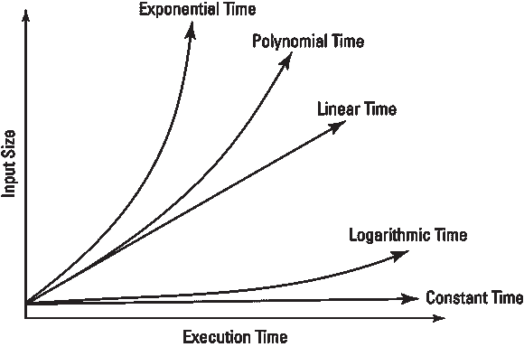

图 1-2： 常数、对数、线性、多项式和指数级性能。

你可以在第 6 卷第 1 章中找到更多关于算法性能的知识。目前，只需要知道这五种性能特征的存在，并且不同类型的数据结构为数据结构支持的各种操作提供了不同的性能特征。决定为特定任务使用哪种数据结构的关键因素取决于任务需要哪些操作以及这些任务的性能特征。

接下来的几节将介绍 Java 中最常用的数据结构类型。

## 分析数组

最基础的数据结构类型是`array`（数组），它是一组命名的`items`（通常称为`elements`元素）的集合，数组中的任何项目都可以通过`index`（索引）直接访问。

数组本身有一个名称。因此，在程序中只需使用名称即可引用整个数组。但要访问数组中的单个项目，必须使用与该项目对应的索引值。索引通常使用名为`i`的变量来引用。通常使用下标表示法来引用特定元素，例如用`MyArray[i]`引用数组中的第`i`个项目。在 Java 代码中，你使用方括号，例如`MyArray[i]`。

索引从 0 开始，而不是从 1 开始。因此，数组第一个元素的索引为 0，例如`MyArray[0]`或在 Java 代码中的`MyArray[0]`。数组的`size`（大小）是数组包含的元素数量。因为第一个元素的索引是 0 而不是 1，所以数组最后一个元素的索引始终是大小减 1。因此，如果一个数组有五个值，数组的索引值为 0, 1, 2, 3 和 4。

最简单的数组类型是`one-dimensional`（一维的），这意味着数组是一个简单的连续值序列。但数组可以具有多个一个维度。你可以将二维数组想象成一个网格。在二维数组中，需要两个不同的索引来访问给定的项目。惯例上将这些索引称为`i`和`j`。要引用二维数组中的项目，你在方括号内使用两个索引。因此，`A[(0,0)]`或`A[0, 0]`指的是数组左上角的项目。

图 1-3 显示了一维和二维数组的示例。


图 1-3： 一维和二维数组。

数组可以超过两个维度。三维数组像一个立方体，索引通常表示为`i, j,`和`k`。你可以用`A[(i, j, k)]`或`A[i,j,k]`引用特定的元素。

超过三个维度也是可能的。理论上，数组的维度数没有上限。在实践中，很少有数组超过三四维。（Java 限制数组维度数为 255。）


**提示：** 考虑二维数组的一种有趣方式是将其视为一个一维数组，其中数组中的每个项目本身也是一维数组。索引为`i`的数组中的每个项目都是索引为`j`的数组。你可以将三维数组视为数组的数组的数组，索引为`i, j,`和`k`。额外的维度以相同工作：四维数组是数组的数组的数组的数组，依此类推。

**技术细节：** 在计算的字 RAM 模型中，内存是一个字数组。内存数组的元素是字，内存数组的索引是地址。因此，内存的任何字都可以通过其地址访问。

**警告：** 数组维度过多可能会导致你的大脑爆炸。

另一种数据结构被称为`dynamic array`（动态数组），它是一种大小可以增加或减小的数组。在动态数组中，你可以直接向底层数组添加元素，而无必担心数组是否已满。如果你在添加新元素时数组已经满额，动态数组将通过创建一个更大的数组来自动扩展数组。此操作是在线性时间内完成的——换句话说，增加数组大小所需的代价与数组的大小成正比。

动态数组也被称为`resizable arrays`（可调整大小数组）、`array lists`（数组列表）和`vectors`（向量）。

表 1-1 展示了数组的性能特征。

| 操作 | 性能 | 说明 |
| --- | --- | --- |
| 通过索引获取 | 常数级 | 通过其索引访问数组中的任何元素所需的步骤数都是相同的，无论该元素在数组中的位置或数组中的元素数量。 |
| 添加（在末尾） | 常数级 | 只要数组末尾有可用空间，在末尾插入元素只需要一次操作。 |
| 添加（在中间） | 线性级 | 在中间（或开头）插入元素取决于数组中的元素数量，因为元素必须向前移动一个索引位置，以便为新元素腾出空间。平均而言，插入操作必须移动数组中一半的元素。 |
| 删除 | 线性级 | 从数组中删除元素取决于数组中的元素数量，因为被删除元素之后的所有元素必须向后移动一个索引位置。平均而言，删除操作必须移动数组中一半的元素。 |
| 更新 | 常数级 | 更新数组中的任何元素都可以在常数时间内完成，因为不需要移动任何元素。 |
| 迭代 | 线性级 | 按索引顺序访问数组中的所有元素直接取决于数组中的元素数量。 |
| 扩容（仅限动态数组） | 线性级 | 对于动态数组，增加容量通常意味着分配一个更大的新数组并将现有数组的所有内容复制到新数组中。此操作是在线性时间内完成的。 |

表 1-1 数组的性能特征

你可以在本迷你书籍的第 3 章中了解 Java 数组工作原理细节。

## 查看链表

数组非常有用，但它们处理某些重要操作的性能非常糟糕：

* **在数组的开头或中间插入项是一个繁琐且耗时的过程。** 要向数组的开头插入项，你必须先将数组中的所有元素向上移动一个索引位置。这里有一个简单的 Java 方法，可以在数组的指定位置插入新元素：

```java
private static void AddElement(String[] a, int at, String NewElement, int size)
{
    for (int i = size - 1; i > at; i--)
    {
        a[i] = a[i - 1];
    }
    a[at] = NewElement;
}
```

在这个示例中，`for`循环反向遍历数组中的元素，从数组的最后一个元素开始。在这一过程中，它将每个元素在数组中向上移动一个位置。然后于索引`0`处添加新元素。注意，数组中的最后一个元素在这个过程中被直接丢失了。

* **从数组中删除项同样繁琐。** 下面是移除索引`j`处元素的代码片段：

```java
private static void RemoveElement(String[] a, int at, int size)
{
    for (int i = at; i < size - 1; i++)
    {
        a[i] = a[i + 1];
    }
    a[size - 1] = "";
}
```

在这里，`for`循环从`at`参数指示的元素开始，进行到数组中的倒数第二个元素。对于每个`i`的值，索引`i`处的元素都被索引`i + 1`处的元素替换。最后，数组的最后一个元素被设置为空字符串。

`linked list`（链表）是一种按顺序存储多个项的方法，它解决了解与数组插入和删除元素相关的性能问题。在链表中，项的实际顺序并不取决于它们在内存中的物理位置。换句话说，链表中的项并不一定像数组中那样按照顺序索引相互接继。相反，每个项都包含一个指向列表中下一个项的`link`（链接）。

你可以在本迷你书籍的第 4 章中了解如何在 Java 中使用链表。

图 1-4 显示了链表的简单示例。列表中的每个项都包含两个组件：数据组件（持有数据）和一个链接组件（指向下一个项）。列表中的每个项都包含两个组件：数据组件（持有数据）和一个链接组件（指向下一个项）。

```java
public static void main(String[] args)
{
    array = new String[][]{ {"Curry","3"}, {"Wiggins",""}, {"Thompson","1"},
    {"Green","4"}, {"Porter Jr.","2"} };
    PrintList();
}
```

当运行上述代码时，控制台上会显示以下内容：

```
Curry
Green
Porter Jr.
Thompson
Wiggins
```

如你所见，尽管这些球员在数组中的存储顺序并不是字母顺序，但链表保持了按字母顺序排列。

顺便提一下，不要担心用于初始化这些数组值的所有所有嵌套大括号——你将在下一章节中了解到这段代码是如何工作的。

表 1-2 总结了链表各种操作的性能特征。

| 操作 | 性能 | 说明 |
| --- | --- | --- |
| 通过索引获取 | 线性 | 链表没有办法直接访问特定项目，因此必须从第一个项目开始访问每个项目以到达特定项目。 |
| 添加（头部） | 常数级 | 在头部插入项目只需要调整几个链接。 |
| 添加（其他任何位置） | 线性 | 在中间插入项目需要你先导航到列表中的正确位置，这需要线性时间。然后通过调整几个链接在常数时间内完成实际插入。 |
| 删除（头部） | 常数级 | 从列表头部删除项目只需要调整几个链接。 |
| 删除（其他任何位置） | 线性 | 从中间删除项目需要你先导航到列表中的正确位置，这需要线性时间。然后通过调整几个链接在常数时间内完成实际删除。 |
| 更新（头部） | 常数级 | 更新头部的项目只需要重写列表第一个或最后一个项目的数据。不需要遍历任何链接。 |
| 更新（其他任何位置） | 线性 | 更新中间的项目需要你先导航到正确的项目，这需要线性时间。 |
| 迭代（正向） | 线性 | 访问列表中的所有项目只需要从第一个项目开始，遵循每个项目中的链接。 |
| 迭代（反向） | 指数级 | 反向访问列表中的所有项目需要你每次访问时都从从头开始。 |

链表 1-2 链表的性能特征

对于许多操作，链表的性能与数组的性能相似。链表的优势在于当你需要添加或删除列表头部的值时——这是一个出乎意料的需求。要在链表的头部插入项目，你只需要调整几个指针。

例如，假设你想在列表头部插入一个值为`Anderson`的新项目。要实现这一点，你遵循一个类似的程序：

1. **记录当前列表头部的索引。**
2. **记录数组中第一个不包含项目的空槽的索引。**
   数组必须留有空空间以便在头部添加元素。因此，链表通常存储在一个分配了比列表初始需要更多元素的数组中。如果你必须扩展一个已经增长到没有额外空空槽的列表，你将不得不扩展数组。在这种情况下，`Add`操作将在线性时间内执行。
3. **在第 2 步中记录的索引位置将项目添加到数组中。**
   该项目的链接值应该是你在第 1 步中记录的值。
4. **更新链表对头部项目索引的记录，以反映你在第 2 步中记录的值。**

下表显示了添加新元素后的列表情况。为了方便起见，我突出了新的头部项目，它现在位于索引 4：

| 数组索引 | 数据 | 链接 |
| --- | --- | --- |
| 0 | Curry | 3 |
| 1 | Wiggins | (null) |
| 2 | Thompson | 1 |
| 3 | Green | 2 |
| 4 | Anderson | 0 |

你可能已在表 1-2 中注意到，反向迭代链表——即从尾部到头部——需要指数级的时间。这是因为反向到达列表中的每个项目需要每次都从头开始。以下是通用程序：

1. **从头部开始并遵循链接，在此过程中计算项目数量。**
   当你遇到空链接时，你就找到了列表的部。将计数器保存为`Counter1`。
2. **重复以下操作直到计数器为零：**
   1. 将`Counter1`减 1。
   2. 再次从列表头部开始并遵循链接，在名为`Counter2`的计数器中计算项目数量。
   3. 当`Counter2`等于`Counter1`时，你就找到了反向顺序中的下一个项目。

反向迭代链表需要嵌套循环。内层循环的每次执行迭代次数都会比上一次少一次。

双向链表与普通链表有许多共同点。以下是一些主要区别：

* 双向链表可以反向遍历列表，从它的尾部到头部。这种操作可以在线性时间内完成，而不会像单向链表那样需要指数级时间。
* 为了实现列表的反向遍历，双向链表必须维护列表尾部的索引。一旦找到尾部，就可以使用每个项目的`previous`（前一个）链接字段而不是`next`（后一个）链接字段来反向遍历列表。
* 在遍历双向链表时，你可以随时切换方向。例如，你可以从头部开始获取列表中的前五个项，然后返回第四个项，再次移动到第五个项，依此类推。
* 在普通的单向链表中，获取、更新或删除列表的最后一个项需要线性时间，因为你必须从头部开始，逐个读取每个项目，直到到达最后一个项。在双向链表中，获取、更新或删除最后一个项可以在常数时间内完成。

与普通链表一样，你一次只能遍历列表的一个项。没有办法直接访问列表中的特定项，除非你从头部开始并访问目标项之前的每一个项，或者从尾部开始并访问目标项之后的所有项。

你可能会认为，可以通过从列表的头部或尾部开始来优化对双向链表中特定项的搜索，这取决于你要查找的项是在列表的前半部分还是后半部分。如果有一种方法可以做出判断，那么这种想法是真的。遗憾的是，并没有这种方法。因此，双向链表在搜索特定项方面并不比普通链表更好。

表 1-3 总结了双向链表支持的操作的性能特征。

| 操作 | 性能 | 说明 |
| --- | --- | --- |
| 按索引获取 | 线性 | 双向链表没有办法直接访问特定项，因此它必须从第一个项目开始顺序访问每个项目，以到达特定项。 |
| 添加（头部或尾部） | 常数 | 在头部或尾部插入项目只需要调整几个链接。 |
| 添加（其他位置） | 线性 | 在头部或尾部以外的任何地方插入项目都需要首先导航到列表中的正确位置，这需要线性时间。实际插入通过调整几个链接在常数时间内完成。 |
| 删除（头部或尾部） | 常数 | 从列表头部或尾部删除项目只需要调整几个链接。 |
| 删除（其他位置） | 线性 | 从头部或尾部以外的任何地方删除项目都需要首先导航到列表中的正确位置，这需要线性时间。实际删除通过调整几个链接在常数时间内完成。 |
| 更新（头部或尾部） | 常数 | 更新头部或尾部的项目只需要重写列表第一个或最后一个项目的数据。不需要遍历任何链接。 |
| 更新（其他位置） | 线性 | 更新头部或尾部以外的任何位置的项目需要首先导航到正确的项目，这需要线性时间。 |
| 迭代（正向或反向） | 线性 | 访问列表中的所有项只需要从第一个项目开始遵循每个项目中的链接。 |

表 1-3 双向链表的性能特性

有关在 Java 中使用双向链表的详情，请参考本微型教程书的第 4 章。

## 推测栈、队列和双端队列

两种在许多情况下非常有用的密切相关的数据结构类型是`栈`和`队列`。这两种数据结构都严重限制了你添加或检索元素的方式：

* **栈 (Stack):** 在栈中，你只能向集合的顶部添加项目，且只能从顶部检索项目。检索是破坏性的，这意味着当你检索一个项目时，该项目会从栈中移除。向栈添加项目的操作称为`Push`，从栈中移除项目的操作称为`Pop`。栈还可能提供`Peek`操作，让你在不移除项目的情况下检查栈顶部的值。
* **队列 (Queue):** 在队列中，你只能向集合的尾部添加元素，且只能从头部检索项目。与栈一样，从队列检索项目也会将该项目从队列中移除。向队列尾部添加项目的操作称为`enqueue`。从队列头部检索并移除项目的操作称为`dequeue`。（与栈一样，队列也可能提供`peek`操作，让你看到但不移除队列头部的项目。）

图 1-6 展示了栈和队列的工作原理。

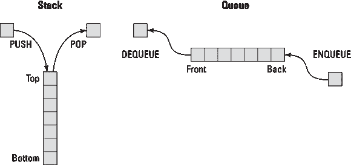

图 1-6: 栈和队列。

第三种数据结构类型是可以在许多情况下非常有用的与栈和队列密切相关的类型：`双端队列 (double-ended queue)`，通常称为`deque`。如图 1-7 所示，双端队列是栈和队列的组合，允许你从头部或尾部添加和检索项目。双端队列与双向链表类似，但没有访问头部尾部以外任何位置的能力。


图 1-7: 双端队列。

 单词`deque`的发音与`deck`相同。该词本身是`double-ended queue`的缩写，意味着双端队列的两端都可以作为队列的头部和尾部。

双端队列提供了栈和队列提供的操作：push、pop、enqueue 和 dequeue，以及 peek 的变体 peek first 和 peek last。注意，在双端队列中，pop 和 dequeue 是同一个操作，因为这两个操作都会检索并移除集合头部的项目。双端队列提供的另一种栈或队列都不具备的额外操作是检索并移除队列尾部的项目。此操作通常称为`eject`。

双端操作通常使用其他术语。例如，在 Java 中，push 和 enqueue 操作被称为`offerFirst`和`offerLast`，而 dequeue/pop 和 eject 操作被称为`pollFirst`和`pollLast`。

双端队列通常使用动态数组作为底层数据存储，并带有当前头部和尾部项目的链接。通过这种实现，针对双端队列的操作通常在常时间内执行，因为它们只需要调整头部和尾部链接。然而，如果由于已满而需要扩展动态，Push 或 Enqueue 将需要线性时间。

你可以在本微型教程书的第 5 章](#c28.xhtml)找到更多关于栈和队列的知识。双端队列在第 6 章](#c29.xhtml)中介绍。

## 关于映射的思考

`映射`是项目列表，其中每个项目都与一个`键`关联。当你向映射中添加项目时，你必须添加相应的键值，以便稍后检索该项目。虽然键可以是任何数据类型，但字符串值作为键的情况更为常见。

现实生活中最常见的例子之一是字典，它允许你使用单词本身作为键来查找单词的含义。事实上，`dictionary`是另一个常用的`map`词。其他与`map`含义相同的常用词还有`associative array`（关联数组）和`symbol table`（符号表）。

map 中的每个键在 map 内部必须是唯一的。因此，一个键值——如果它存在于 map 中——就能唯一地标识 map 中的单个项。除了其他类型数组或列表允许的标准操作外，map 还提供了根据其键值处理项的额外操作：

* `AddWithKey`: 使用指定的键值将项插入 map 中
* `ContainsKey`: 确定 map 是否包含具有指定键的项
* `GetByKey`: 获取与指定键对应的项
* `UpdateByKey`: 更新与指定键对应的项的数据
* `DeleteByKey`: 删除与指定键对应的项
* `IterateByKey`: 按键值顺序逐个获取 map 中的项

map 中的项可以使用一种简单的、类似记录的数据结构来定义，称为`key-value-pair`（键值对）或`dictionary-entry`（字典条目）。这种简单的结构是一个只有两个字段的记录：一个键和一个值。

实现 map 有许多不同的方法，但所有方法都需要一种机制将每个键值与对应的数据关联起来。良好的 map 实现的目标是确保涉及键查找的操作运行高效，这通常意味着它以对数时间运行，而不是线性时间。换句话说，map 应该提供某种方法来查找特定的键值，而不是通过遍历 map 中的所有值直到找到所需的键值。这就是`tree`（树）结构大显用场的地方，我在“处理树”节中会介绍它们。

## 查看哈希表

`hash map`（哈希映射）是一种特殊的 map，它对每个键值应用数学函数，以确定每个项应该存储在底层数组的什么位置。

最简单的哈希函数使用模运算（参见第 2 卷，第 3 章）来确定一个与键值对应的索引值。例如，假设你想使用 hash map 来存储代表发票的项，并将发票号作为键。如果你想将发票存储在一个包含 1,000 个元素的数组中，你将使用模除法获取发票号除以 1,000 的余数。这将产生一个 0 到 999 之间的整数，它非常适合作为索引。

这是一个简单的 Java 代码段，它提供了一个哈希函数，从随机生成的`double`值计算索引号：

```java
int InvoiceNumber = (int)(Math.random() * 1000000);
int Index = InvoiceNumber % 1000;
```

这是一个简短的示例，展示了使用上述代码生成的十个随机发票号及其对应的索引：

```
Invoice # Index
836137 137
086494 494
660872 872
012901 901
704864 864
324094 094
```


你可能已经注意到，在每个情况下，索引值仅仅是发票号的最后三位。当您对 10 的幂进行模除时就会发生这种情况。如果你使用 2 的幂（例如 1,048），数字会更有趣：

```
Invoice # Index
98745 233
54011 563
48883 675
55472 976
22407 399
21245 285
26426 226
80293 645
74937 529
82718 974
```

但效果是一样的：每个发票号都被转换为一个落在存储发票的数组范围内的索引号。

`hash map` 必须的一个棘手细节是，当两个不同的键值产生相同的索引值时该怎么办。这不仅可能的，而且不可避免的，特别是当允许键的值范围大于数组容量时。例如，对于五位发票号，总共有 100,000 个可能的发票号值。但如果发票数组只能支持 1,000 个元素，这意味着平均每个不同的索引值可以对应多达十个不同的发票号。

为了处理这种情况，`hash map` 底层的数组可以构建为链表数组。换句话说，数组中的每个元素不代表单个发票，而是代表一个发票链表，这些发票的发票号产生相同的索引值。

因此，根据发票号从 `hash map` 中检索发票需要以下步骤：

1. 运行发票号通过哈希函数。
2. 确定该索引处的数组是否包含链表。
3. 如果是，在链表中搜索发票号。
4. 如果找到匹配项，则检索发票。如果到达链表末尾，则发票不在 map 中。

你可以在第 6 章中找到更多关于 `hash map` 的知识。

## 处理树

最常用的数据结构之一是树。树是一种层次结构，其中项（称为 `nodes` 节点）以父子关系连接。你在计算机中遇到的最常见的树的类型是文件系统。

图 1-8 显示了树的示例，使用的基本术语如下：

- **节点 (Node):** 树中的项。
- **边 (Edge):** 两个节点之间的父子关系。每条边可以通过它包含的节点唯一标识。例如，从节点 `A` 到节点 `B` 的边可以标识为 `AB`。
- **根节点 (Root node):** 最高层级的节点。树只能有一个根节点。在图 1-8 中，根节点是 `A`。
- **父节点 (Parent node):** 有一个或多个相关子节点的节点。根节点外的每个节点恰好有一个父节点。在图 1-8 中，以下节点是父节点：`A`, `B`, `D`, `G`, `H`, `K` 和 `M`。
- **子节点 (Child node):** 拥有父节点的节点。父节点可以有多个子节点，但每个子只能有一个父节点。树中除根节点的所有节点都是子节点。
- **叶节点节点 (Leaf node):** 没有子节点的节点。在图 1-8 中，叶节点是 `C`, `E`, `F`, `I`, `J`, `L`, `N` 和 `O`。
- **路径 (Path):** 从一个节点到另一个节点所需的边序列。在图 1-8 中，从根节点 `A` 到节点 `E` 的路径被高亮了。路径可以使用连接必须访问的节点的箭头来描述。例如，图 1-8 中从根节点到节点 `E` 的路径是 `A→B→D→E`。这种表示法中的每个箭头代表一条边，因此从根节点到达节点 `E` 必须遍历三条边。

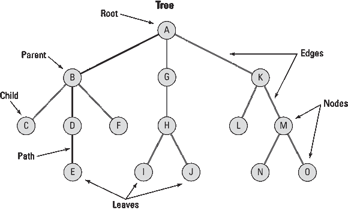

图 1-8: 树。

**注意：** 路径也可以通过识别到达目标节点必须经过的边来表示。因此，从 `A` 到 `E` 的路径是 `(AB, BD, DE)`。

有时，路径必须向上树树移动才能到达目标节点。例如，在图 1-8 中，从节点 `G` 到节点 `N` 的路径是 `G→A→K→M→N`（或 `GA, AK, KM, MN`）。

在学习学习更多关于树的知识时，你会遇到一些额外的术语：

- **大小（Size）：** 树的大小是树中节点的总数。图 1-8 中树的大小为 15。
- **层（Level）：** 因为树是分级结构，它们由一个或多个层组成。根节点层为第 0 层。第 1 层由根节点的所有子节点组成。后续每一层由上一层所有节点的所有节点组成。图 1-8 中的树有四层，可以识别为第 0、1、2 和 3 层。
- **路径长度（Length of path）：** 路径的*长度*是路径所经过的边数。对于图 1-8 中从根节点 `A` 到节点 `E` 的路径，路径长度为 3。对于从节点 `F` 到节点 `O` 的路径，路径长度为 5。（两个节点之间的路径长度也称为节点之间的*距离*/distance。）
- **高度（Height）：** 节点的*高度*是该节点与其下方叶子节点之间的最远距离。例如，图 1-8 中节点 `K` 的高度为 2。虽然有一条到高度为 1 的叶子节点 `L` 的路径，但还有两条长度为 2 的路径指向其他叶子节点（`N` 和 `O`）。因此，节点 `K` 的高度为 2。整个树的高度是根的高度。图 1-8 中，树的高度为 3。
- **祖先（Ancestor）：** 从给定节点沿通根节点的直接向上路径到达的任何节点。因此，图 1-8 中节点 `I` 的祖先是 `H`、`G` 和 `A`。
- **后代（Descendent）：** 从给定节点沿任何向下路径到达的任何节点。因此，节点 `K` 的后代是 `L`、`M`、`N` 和 `O`。根节点以外的所有节点都是根节点的后代。
- **度（Degree）：** 给定节点的子节点数量。图 1-8 中，节点 `B` 的度为 3，节点 `H` 的度为 2，节点 `D` 的度为 1。整棵树的度是其任何节点度度的最大值。因此，图 1-8 中树的度为 3。在下一节中，你会发现将树的度限制为 2 通常是很有用的。这种树被称为*二叉树*（binary tree）。

## 查看二叉树

如图 1-9 所示，*二叉树*是一种特殊的树，其中每个父节点最多可以有两个子节点，称为*左子节点*和*右子节点*。二叉树中的节点不需要有两个子节点——它可能只有一个有一个子节点，或者完全没有子节点。但它的子节点不能超过两个。（如果二叉树按排序维护其节点，则它被称为*二叉搜索树*（binary search tree），因为它的结构有利于高效搜索。）

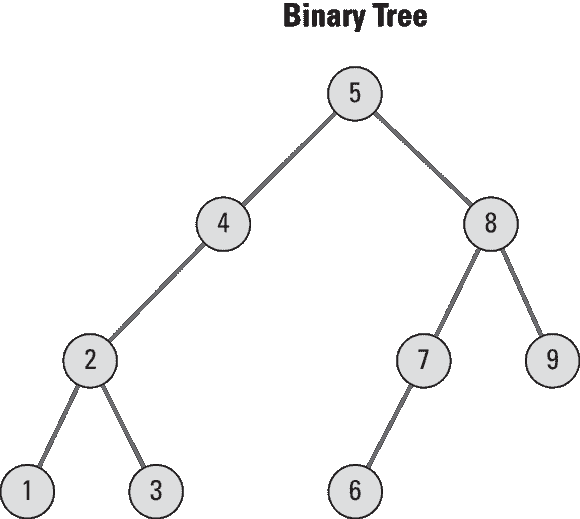

图 1-9： 二叉搜索树。

二叉搜索树中的每个节点包含以下信息：

- 一个*键*（key），用于保持树的有序并方便搜索。
- *数据*（Data），代表与键关联的信息。
- 一个*父节点*（parent），链接父节点。（对于根节点，此字段为空。）
- 可选的*左子节点*（left child），如果存在，则指向左子节点。
- 可选的*右子节点*（right child），如果存在，则指向右子节点。

 二叉搜索树必须遵循的一个重要规则，以维护树的搜索顺序：每个节点的左子节点的键必须小于或等于节点的键，且每个节点的右子节点的键必须大于等于节点的键。

一个例子将有助于解释这个规则。图 1-9 显示了一棵键为整数的二叉树。从根开始，你可以看到树的：遍历整棵树的排序方式是容易的。在图 1-9 中，你只需要从根开始向下工作直到到达叶子节点。这种安排也使得查找给定值的节点非常高效。假设你在寻找键为 `7` 的节点。从根开始问：“`7` 小于还是等于 `5`？”它大于 `5`，所以走向右节点，键为 `8`。然后问：“`7` 小于还是等于 `8`？”它小于 `8`，所以走向左节点，键为 `7`。最后，问问：“`7` 小于还是等于 `7`？”它相等，所以你三步就找到了节点。

 你可能认为 `x[5]` 指的是数组中的第五个元素。但索引号是从零开始的（第一个元素），所以 `x[5]` 实际上指的是第六个元素。这个小细节是处理数组时产生问题的主要原因之一——特别是如果你在一种从 1 而不是 0 开始索引的语言中学习数组编程的话。因此，在 Java 中，请习惯从 0 开始计数而不是从 1 开始。

数组的真正威力来自于一个简单的事实：你可以使用变量甚至一个完整的表达式作为数组索引。因此（例如），你不需要编写 `x[5]` 来指向特定的数组元素，而是编写 `x[i]` 来指向由索引变量 `i` 指定的元素。在这一章中，你会看到许多索引变量的例子。

在进入创建和使用数组的细节之前，这里有几个关于数组的额外信息供你思考：

- 尽管数组没有对应的类文件，但数组仍然是一个对象。你可以通过不带索引的数组变量名来引用整个数组对象，而不是数组的特定元素。因此，如果 `x[5]` 指向数组的某个元素，那么 `x` 则指向数组本身。

- 数组具有固定长度，该长度在数组创建时设置。这个长度决定了数组中可以存储的元素数量。任何数组可以使用的最大索引值都是数组长度减 1。因此，如果你创建一个包含十个元素的数组，你可以使用从 `0` 到 `9` 的索引值。

- 在创建数组后，你无法更改数组的长度。

- 你可以通过数组变量的 `length` 字段访问数组的长度。例如 `x.length` 返回数组 `x` 的长度。

## 创建数组

在创建数组之前，你必须声明一个指向该数组的变量。这个`变量声明`应该指示数组所存储的元素类型，后面跟着一组空括号，如下所示：

`String[] names;`

这里声明了一个名为 `names` 的变量。它的类型是一个包含 `String` 对象的数组。

 为了确保你尽可能感到困惑，Java 还允许你将括号放在变量名后面而不是类型后面。以下两个语句都创建了 `int` 类型元素的数组：

`int[] array1; // 一个 int 元素的数组`

`int array2[]; // 另一个 int 元素的数组`

 这两个语句的效果完全相同。大多数 Java 程序员更喜欢将括号放在类型后面，而不是变量名后面。

该语句本身并没有创建数组；它只是声明了一个可以指向数组的变量。你实际上可以通过两种方式创建数组：

- 使用 `new` 关键字后跟数组类型，这次要填充括号内以指示数组可以容纳多少元素。例如：

  `String[] names;`

  `names = new String[10];`

  在这里，创建了一个可以容纳十个字符串的 `String` 对象数组。数组中的每个字符串都被初始化为空字符串。

- 像任何其他变量一样，你可以将声明和创建合并为一条语句：

  `String[] names = new String[10];`

  在这里，一条语句就声明了数组变量并创建了数组。

- 使用一种特殊的快捷方式，让你一次性创建数组并向其填充值：

  `String[] names = {"One", "Two", "Three"};`

 如果你在编译时不知道数组需要多少个元素，可以使用变量或表达式作为数组长度。这里有一个方法的常规程序，它将玩家名称存储在字符串数组中。它首先询问用户团队中有多少玩家。然后创建一个正确大小的数组：

`System.out.print("How many players? ");`

`int count = sc.nextInt(); // sc 是一个 Scanner`

`String[] players = new String[count];`

## 初始化数组

初始化数组值的一种方法是简单地逐个赋值：

`String[] days = new String[7];`

`days[0] = "Sunday";`

`days[1] = "Monday";`

`days[2] = "Tuesday";`

`days[3] = "Wednesday";`

`days[4] = "Thursday";`

`days[5] = "Friday";`

`days[6] = "Saturday";`

Java 有一种简便的方法来创建数组并初始化值：

`String[] days = { "Sunday", "Monday", "Tuesday",`

`"Wednesday", "Thursday",`

`"Friday", "Saturday" };`

在这里，每个分配给数组的元素都列在`数组初始化器`中。这里是一个 `int` 数组的初始化器示例：

`int[] primes = { 2, 3, 5, 7, 11, 13, 17 };`

**注意：** 用初始化器创建的数组长度由初始化器中列出的值数量决定。

初始化器的另一种代码方式是：

`int[] primes = new int[] { 2, 3, 5, 7, 11, 13, 17 };`

要使用这种初始化器，使用 `new` 后跟数组类型和一组空括号。

## 在循环中使用数组

处理数组的最常用方法之一是 `for` 循环。事实上，`for` 循环是为了处理数组而发明的。这里有一个创建一个 1 到 100 随机数的 `for` 循环：

`int[] numbers = new int[100];`

`for (int i = 0; i < 100; i++)`

`numbers[i] = (int)(Math.random() * 100) + 1;`

这是一个用用户输入的字符串填充数组的 `for` 循环：

`Scanner sc = new Scanner();`

`int count = 5;`

`String[] players = new String[count];`

`for (int i = 0; i < count; i++)`

`{`

`System.out.print("Enter player name: ");`

`players[i] = sc.nextLine(); // sc 是一个 Scanner`

`}`

在这个例子中假设 `count` 是一个 `int` 变量。你也可以使用 `for` 循环打印数组的内容。例如：

`for (int i = 0; i < count; i++)`

`System.println(players[i]);`

这里打印了名为 `players` 的 `String` 数组的元素。之前的示例假设在执行循环之前数组长度已存储在变量中。如果你没有数组的长度，可以从数组的 `length` 属性获取：

`for (int i = 0; i < players.length; i++)`

每偶尔，数组可以帮助你解决孩子的作业问题。我曾帮助我的女儿解决过一道很困难的数学作业。题目表述如下：

> Bobo（这些题目里总有一个叫 Bobo 的角色）在周六访问当地的高中，发现学校所有的 1000 个储物柜都整齐地关着。于是他从学校的一端开始把它们打开。然后他回到起点，每隔一个关闭（第 2、4、6 个等）。然后他回到起点，每隔三个击中一个：如果是开启的，就把它关上；如果是关闭的，就把它打开。然后他每隔第四个、第五个柜，以此类推。他整个周末都在这样做，在走廊里开关门柜了 1000 次。然后他感到无聊回家了。学校的 1000 个储物柜中还有多少是开启的，哪些是？

天哪！

这个问题提出了挑战，作为一个痴迷计算机的父亲，我觉得这是一个教女儿学习 `for` 循环和数组的好机会。于是我写了一个小程序，设置了一个包含 1000 个布尔值的数组。每个值代表一个储物柜：`true` 表示开启，`false` 表示关闭。然后我写了一对嵌套的 `for` 循环来完成计算。

我的第一次尝试告诉我，在 1,000 个储物柜中有 10,000 个被打开了，因此我认为我在某个地方出了错。在查看代码时，我意识到储物柜的编号是从 1 到 1,000，而我的数组中的元素编号是从 `0` 到 `999`，这正是导致混乱的原因之一，也让我的第一个答案变得荒唐。

因此，我决定创建一个包含 1,001 个元素的数组，并忽略第一个。这样，索引就能与储物柜编号完美对应。

工作几个小时后，我写出了列表 2-1 中的程序。

### 列表 2-1：经典储物柜问题的解决方案

```java
public class BoboAndTheLockers {

    public static void main(String[] args) {

        // true = 打开; false = 关闭

        boolean[] lockers = new boolean[1001];

        // 关闭所有储物柜

        for (int i = 1; i <= 1000; i++) {

            lockers[i] = false;

        }

        for (int skip = 1; skip <= 1000; skip++) {

            System.out.println("Bobo 正在改变每 " + skip + " 个储物柜.");

            for (int locker = skip; locker <= 1000; locker += skip) {

                lockers[locker] = !lockers[locker];

            }

            System.out.println("Bobo 现在无聊了，他要回家了.");

        }

        // 统计并列出打开的储物柜

        String list = "";

        int openCount = 0;

        for (int i = 1; i <= 1000; i++) {

            if (lockers[i]) {
```


`openCount++;`

`list += i + " ";`

`}`

`}`

`System.out.println("Bobo 留下了 " + openCount + " 个打开储物柜.");`

`System.out.println("打开的储物柜是: " + list);`

`}`

`}`

以下是该程序工作原理的要点：

- →6: 这一行创建包含 1,001 个元素的 `Boolean` 数组。我创建了一个比需要多一个元素，这样就可以忽略元素 `0`。
- →9: 这个 `for` 循环关闭了所有储物柜。这一步并不是真的必要的，因为 `Boolean` 初始化为 `false`，但显式初始化是个好习惯。
- →11: 该循环的每次迭代代表一次穿过走廊并打开或关闭储物柜的过程。`skip` 变量代表 Bobo 每次行程跳过多少个储物柜。他首先处理每一个，然后是每隔第二个，然后是每隔三个。所以这个循环简单地从 1 计数到 1,000。
- →15: 该循环的每次迭代代表在穿过走廊时停在一个储物柜前。`for` 语句中的第三个表达式（下一行）将 `skip` 变量加上索引变量，这样 Bobo 就可以每次穿过走廊时访问每个 *n* 个储物柜。
- →16: 该语句使用非运算符 (`!`) 来反转每个储物柜的设置。因此，如果储物柜是打开的 (`true`)，它会被设置为关闭 (`false`)，反之亦然。
- →23: 另一个 `for` 循环遍历所有储物柜并统计打开的个数。它还将每个打开储物柜的编号添加到字符串的末尾，以便可以打印所有打开的储物柜。

此程序产生了超过 1,000 行输出，但只有最后几行是重要的。它们在这里：

`Bobo 现在无聊了，他要回家了.`
`Bobo 留下了 31 个打开储物柜.`
`打开的储物柜是: 1 4 9 16 25 36 49 64 81 100 121 144 169 196 225 256 289 324 361 400 441 484 529 576 625 676 729 784 841 900 961`

所以，答案是：留下了 31 个打开储物柜。我得了一个 A。（我的意思是，我女儿得了一个 A。）

 顺便说一下，你注意到被留下的打开的储物柜编号都是完全平方数吗？或者 31 是平方小于 1,000 的最大数字？我也没有发现——直到第二天下午放学后我女儿告诉我。

## 使用增强型 for 循环

你通常可以使用一种称为增强型 `for` 循环的特殊 `for` 循环来消除在 `for` 循环中处理索引的繁琐。增强型 `for` 循环通常被称为 `for-each` 循环，因为它们会自动检索可迭代对象中的每个元素。使用 `for-each` 循环消除了创建和初始化索引、递增索引、测试最后一个最后一个以及使用索引访问每个数组项的需求。

当它与数组配合使用时，增强型 `for` 循环具有以下格式：

```java
for (type identifier : array) {
    Statements...
}
```

`type` 是类型，`identifier` 是标识符，`array` 是数组。`type` 指定元素的类型，`identifier` 是变量的名称，冒号（读作“in”）后面是数组的名称。例如：

```java
for (String day : {"Monday", "Tuesday", "Wednesday", "Thursday", "Friday", "Saturday"}) {
    System.out.println(day);
}
```

输出如下：
`Monday`
`Tuesday`
`Wednesday`
`Thursday`
`Friday`
`Saturday`

```java
public static void PrintSomeWords(String head, String… words, string tail)
{
}
```
你会收到一个警告，提示为：“变长参数必须是最后一个参数。”

## 使用二维数组

数组的元素可以是你想要的任何类型的对象，包括另一个数组。在后一种情况下，你拥有一个`二维数组`，有时也被称为`数组的数组`。

二维数组通常用于以行列格式跟踪数据，就像电子表格的工作方式一样。假设你正在编写一个程序，用于跟踪公司五年的（2022 年到 2026 年）销售额，且每个数据划分为四个销售区域（北、南、东、西）。你可以创建 20 个独立的变量，命名为如 `sales2022North`、`sales2022South`、`sales2022East` 等。但这样做会有点繁琐。

或者，你可以创建一个包含 20 个元素的数组，如下所示：

```java
double[] sales = new sales[20];
```

但你该如何组织此数组中的数据，以便知道每个元素对应的年份和销售区域呢？

使用二维数组，你可以创建一个数组，其中每个年份都有一个元素。其中的每个元素反过来又是另一个数组，每个区域都有一个元素。

将二维数组视为表格或电子表格是常见的做法，如下所示：

| **年份** | **北部** | **南部** | **东部** | **西部** |
| --- | --- | --- | --- | --- |
| 2022 | 23,853 | 22,838 | 36,483 | 31,352 |
| 2023 | 25,483 | 22,943 | 38,274 | 33,294 |
| 2024 | 24,872 | 23,049 | 39,002 | 36,888 |
| 2025 | 28,492 | 23,784 | 42,374 | 39,573 |
| 2026 | 31,932 | 23,732 | 42,943 | 41,734 |

### 创建二维数组

要为这些销售数据声明二维数组，你只需要列出两组空括号，如下：

```java
double sales[][];
```

这里 `sales` 是一个 `double` 二维数组。换句话说，`sales` 是一个 `double` 数组的数组。

要创建该数组，使用 `new` 关键字并为每组括号提供长度，如示例所示：

```java
sales = new double[5][4];
```

这里，第一个维度指定 `sales` 数组有五个元素。该数组代表表格中的行。第二个维度指定每个元素都是一个具有四个元素的 `double` 类型数组。该数组代表表格中的列。

 这里需要掌握的关键点是：第一个数组是一个实例，而第一个数组中的每个元素都对应第二个数组的另一个独立实例。因此，此条语句实际上创建了五个各包含四个元素的 `double` 数组。然后这五个数组被用作第一个数组的元素。

注意，与一维数组一样，你可以在一条语句中声明并创建二维数组，如下：

```java
double[][] sales = new double[5][4];
```

这里 `sales` 数组在一条语句中完成了声明和创建。

### 访问二维数组元素

要访问二维数组的元素，你需要使用两个索引。该语句设置了 2022 年北部销售额：

```java
sales[0][0] = 23853;
```

正如你想象的，通过硬编码每个值来访问二维数组中的数据会很繁琐。通常使用 `for` 循环。以下代码使用 `for` 循环打印 `sales` 数组的内容，并用制表符分隔。每年打印一行，年份位于行开头。代码如下：

```java
NumberFormat cf = NumberFormat.getCurrency();
System.out.println("North\tSouth\tEast\tWest");
for (int year = 0; year < 5; year++)
{
    System.out.print(year + "\t");
    for (int region = 0; region < 4; region++)
    {
        System.out.print(cf.format(sales[year][region]) + "\t");
    }
    System.out.println();
}
```

假设 `sales` 已经初始化，此代码将产生以下输出：

```text
North   South   East    West
2022	$23,853.00	$22,838.00	$36,483.00	$31,352.00
2023	$25,483.00	$22,943.00	$38,274.00	$33,294.00
2024	$24,872.00	$23,049.00	$39,002.00	$36,888.00
2025	$28,492.00	$23,784.00	$42,374.00	$39,573.00
2026	$31,932.00	$23,732.00	$42,943.00	$41,734.00
```

注意每个子数组的长度是用表达式 `teams[i].length` 决定。此 `for` 循环每行打印一个名称，团队之间有一个空行，如下：

`Margaret Houlihan`
`Frank Burns`
`Max Klinger`
`Radar O'Reilly`
`Igor Straminsky`
`Henry Blake`
`Johnny Mulcahy`
`Benjamin Pierce`
`John McIntyre`
`Jonathan Tuttle`

如果你不想自己费力跟踪索引，可以使用增强型 `for` 循环并让 Java 来处理索引。例如：

```java
for (String[] team : teams)
{
  for (String player : team)
    System.out.println(player);
    System.out.println();
}
```

这里第一个增强型 `for` 语句指定了变量 `team` 的类型为 `String[]`。因此，该循环的每次迭代都会将 `team` 设置为主数组 `teams` 中的其中一个子数组。然后，第二个增强型 `for` 循环访问每个子数组中的单独字符串。

### 跨两个维度

 Java 并不限制你使用二维数组。数组可以嵌套在数组中，深度可以根据程序的需要任意增加。要声明一个超过两个维度的数组，你只需要指定所需数量的空括号即可。例如：

```java
int[][][] threeD = new int[3][3][3];
```

这里创建了一个三维数组，每个维度都有三个元素。你可以将此数组想象成立方体。每个元素都需要三个索引来访问。

你可以通过指定数组所需的索引来访问多维数组中的元素。例如：

```java
threeD[0][1][2] = 100;
```

该语句将第 0 行第 1 列的第 2 个元素设置为 `100`。

你也可以根据需要深度嵌套初始化器。例如：

```java
int[][][] threeD =
  { { {1, 2, 3}, { 4, 5, 6}, { 7, 8, 9} },
  { {10, 11, 12}, {13, 14, 15}, {16, 17, 18} },
  { {19, 20, 21}, {22, 23, 24}, {25, 26, 27} } };
```

这里用数字 `1` 到 `27` 初始化了一个三维数组。

你还可以使用多个嵌套的 `if` 语句来处理三个或更多维度的数组。这里是另一种用数字 `1` 到 `27` 初始化三维数组的方法：

```java
int[][][] threeD2 = new int[3][3][3];
int value = 1;
for (int i = 0; i < 3; i++)
  for (int j = 0; j < 3; j++)
    for (int k = 0; k < 3; k++)
      threeD2[i][j][k] = value++;
```

### 处理有趣但复杂的示例：棋盘

好了，业务示例就到此。这里有一个更有趣的例子——假设你觉得象棋很有趣。列表 2-2 中的程序使用二维数组来表示棋盘。它的唯一目的是根据给定的起始位置计算马（对于我们中不玩象棋的人来说，就是那只小马）的可能移动。用户被要求输入一个起始位置（例如 `f1`），程序通过显示可能的格子作为响应。然后，程序打印出一个粗略但易于的棋盘表示，用 `X` 标出马的位置，用问号（`?`）标出每个可能的移动。

 如果你不熟悉象棋，它是在一个 8x 8 格子的棋盘上下棋的，格子呈浅色和深色交替。识别每个格子的标准方法是使用字母和数字，其中字母代表列（称为 `file`），数字代表行（称为 `rank`），如图 2-1 所示。马移动模式很有趣：它向一个方向移动两个格，然后转 90 度并向左或向右移动一个格。在起始位置为 `e4` 的情况下，马可能的移动在图 2-1 中被深色标记。如你所示，这个马有八个可能的移动：`c3`、`c5`、`d6`、`f6`、`g5`、`g3`、`f2` 和 `d2`。

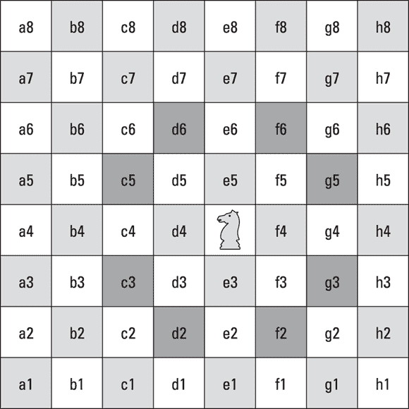

图 2-1： 经典棋盘。

如果你输入马的位置 `e4`，控制台的内容如下：

```text
Welcome to the Knight Move.
Enter knight's position: e4
The knight is at square e4
From here the knight can move to:
c5
d6
f6
g5
g3
f2
c3
- - - - -
- - - - -
- - ? - -
- - - - -
- - - - -
Do it again? (Y or N)
```

如你所见，程序指示马从 `e4` 的合法移动是 `c5`、`d6`、`f6`、`g5`、`g3`、`f2` 和 `c3`。此外，棋盘的图形表示显示了马在哪里以及它可以去哪里。列表 2-2

```java
import java.util.Scanner;

public class KnightMoves
{
  static Scanner sc = new Scanner(System.in);

// 以下数组表示马可以进行的移动
  // 这是一个 8x2 数组
  static int[][] moves = {-2, 1},
    {-1, 2},
    {1, 2},
    {2, 1},
    {2, -1},
    {-1, -2},
    {-2, -1} };

  public static void main(String[] args)
  {
    System.out.println("Welcome to the "
      + "Knight calculator.\n");
    do
    {
      showKnightMoves();
    }
    while (getInput("Do it again?"));
  }

  public static void showKnightMoves()
  {
    // 第一维度是列 (a, b, c, 等)
    // 第二维度是行 (1, 2, 3, 等)
    // 因此，board[3][4] 是 d5。
    // 值为 0 表示格子是空的
    // 1 表示马在格子上
    // 2 表示马可以移动到该格子
    int[][] board = new int[8][8];
    String kSquare; // 马的位置字符串
    Pos kPos; // 马的位置 Pos

    // 马的初始位置
    do
    {
      System.out.print("Enter knight's position: ");
      kSquare = sc.nextLine();
      kPos = convertSquareToPos(kSquare);
    } while (kPos == null);

    board[kPos.x][kPos.y] = 1;
    System.out.println("\nThe knight is at square "
      + convertPosToSquare(kPos));
    System.out.println("From here the knight can move to:");

    for (int move = 0; move < moves.length; move++)
    {
      int x, y;
      x = moves[move][0]; // 此移动的 x
      y = moves[move][1]; // 此移动的 y
      Pos p = calculateNewPos(kPos, x, y);
      if (p != null)
      {
        System.out.println(convertPosToSquare(p));
        board[p.x][p.y] = 2;
      }
    }
    printBoard(board);
  }

  // 此方法将 a1 或 d5 等格子转换为
  // [0][0] 或 [3][4] 等 x, y 坐标
  public static Pos convertSquareToPos(String square)
  {
    int x = -1;
    int y = -1;
    char rank, file;


以下代码片段展示了如何将棋盘上的方格（如 `a1`、`e4`）转换为对应的 `x`、`y` 坐标：

```java
file = square.charAt(0);

if (file == 'a') x = 0;
if (file == 'b') x = 1;
if (file == 'c') x = 2;
if (file == 'd') x = 3;
if (file == 'e') x = 4;
if (file == 'f') x = 5;
if (file == 'g') x = 6;
if (file == 'h') x = 7;

rank = square.charAt(1);

if (rank == '1') y = 0;
if (rank == '2') y = 1;
if (rank == '3') y = 2;
if (rank == '4') y = 3;
if (rank == '5') y = 4;
if (rank == '6') y = 5;
if (rank == '7') y = 6;
if (rank == '8') y = 7;

if (x == -1 || y == -1) {
    return null;
} else {
    return new Pos(x, y);
}
```

此方法将 `[0][0]` 或 `[3][4]` 等 `x`、`y` 坐标转换为 `a1` 或 `d5` 等格子：

```java
public static String convertPosToSquare(Pos p) {
    String file = "";

    if (p.x == 0) file = "a";
    if (p.x == 1) file = "b";
    if (p.x == 2) file = "c";
    if (p.x == 3) file = "d";
    if (p.x == 4) file = "e";
    if (p.x == 5) file = "f";
    if (p.x == 6) file = "g";
    if (p.x == 7) file = "h";

    return file + (p.y + 1);
}
```

以下方法用于计算骑士移动后的新位置，并判断移动是否合法（即是否超出棋盘边界）：

```java
public static Pos calculateNewPos(Pos p, int x, int y) {
    // 排除非法移动
    if (p.x + x < 0) return null;
    if (p.x + x > 7) return null;
    if (p.y + y < 0) return null;
    if (p.y + y > 7) return null;

    // 返回新位置
    return new Pos(p.x + x, p.y + y);
}
```

`printBoard` 方法用于打印棋盘状态，其中 `1` 表示骑士所在位置，`2` 表示骑士可以移动到的位置，`-` 表示空格：

```java
public static void printBoard(int[][] b) {
    for (int y = 7; y >= 0; y--) {
        for (int x = 0; x < 8; x++) {
            if (b[x][y] == 1)
                System.out.print(" X ");
            else if (b[x][y] == 2)
                System.out.print(" ? ");
            else
                System.out.print(" - ");
        }
        System.out.println();
    }
}
```

`getYorN` 方法用于获取用户的 `Y` 或 `N` 输入，并返回对应的布尔值：

```java
public static boolean getYorN(String prompt) {
    while (true) {
        String answer;
        System.out.print("\n" + prompt + " (Y or N) ");
        answer = sc.nextLine();

        if (answer.equalsIgnoreCase("Y"))
            return true;
        else if (answer.equalsIgnoreCase("N"))
            return false;
    }
}
```

`Pos` 类表示棋盘上的 `x`、`y` 坐标：

```java
class Pos {
    public int x;
    public int y;

    public Pos(int x, int y) {
        this.x = x;
        this.y = y;
    }
}
```

 你必须开动脑筋才能运行这个程序，它稍微有点复杂。以下段落可以帮助解释那些复杂的行：

- **→10**: 这一行声明了一个二维数组，用于根据 `x` 和 `y` 存储骑士马可能的移动。例如，骑士向左移动两格并向上一格的移动表示为 `{–2, 1}`。总共有八种可能的移动，每个移动都有两个值（`x` 和 `y`）。因此，这个二维数组有八行两列。
- **→25**: 获取用户骑士起始位置并进行所有计算的代码足够复杂，我不将其包含在主方法中，因此我将其放在一个名为 `showKnightMoves` 的独立方法中。这样，主方法中的 `do` 循环就可以保持简单。它会在调用 `getYorN` 时一直运行，直到用户输入 `N`。
- **→29**: `showKnightMoves` 方法在此开始。
- **→37**: `board` 数组用二维数组表示棋盘，其中八行代表横排（ranks）和八列文件（files）。该数组存储 `int` 值。值 `0` 表示该格为空。骑士所在的方格被标记为 `1`，骑士可以移动到的任何方格被标记为 `2`。
- **→43**: 这个 `do` 循环提示用户输入一个有效的方格来放置骑士。循环包含了对方法 `convertSquareToPos` 的调用，该方法将用户的输入（如 `e4`）转换为 `Pos` 对象。（`Pos` 类在程序后面定义；它将棋盘位置表示为 `x`, `y` 值对。）如果用户输入了错误的方格（如 `a9` 或 `x4`），该方法将返回 `null`。因此，为了让用户输入有效的方格，如果 `convertSquareToPos` 返回 `null`，循环就会重复。
- **→50**: 用户输入的棋盘位置被设置为 `1`，以指示骑士的位置。
- **→55**: 使用 `for` 循环来测试骑士所有可能的移动，以检查它们从骑士当前位置是否有效，使用了早在在第 10 行创建的 `moves` 数组。在循环体内，调用了 `calculateNewPos` 方法。该方法接受棋盘位置以及 `x` 和 `y` 值来指示骑士可以移动到。如果结果移动是合法的，它将返回一个新的 `Pos` 对象，指示移动所导致的位置。如果移动不合法（即它将骑士移出棋盘），`calculateNewPos` 方法将返回 `null`。
- 假设 `calculateNewPos` 返回非空值，循环体将打印该方格（它调用 `convertPosTosquare` 将 `Pos` 对象转换为字符串，例如 `c3`）。然后它将该移动表示的棋盘位置标记为 `2`，以指示骑士可以移动到这个格。
- **→68**: 在计算完所有移动后，调用 `printBoard` 方法打印 `board` 数组。
- **→73**: 这是 `convertSquareToPos` 方法。它使用一对暴力破解的 `if` 语句将如 `a1` 或 `e4` 的字符串转换为表示相同位置的 `Pos` 对象。我本可以通过将字符串中的第一个字母转换为 `Char`，然后减去字母 `a` 的偏移量将值转换为正确的整数，从而使这个方法更优雅一点。但我认为暴力方法更清晰，而且只需要多几行代码。
- 注意，如果用户输入了错误的方格（如 `a9` 或 `x2`），则会返回 `null`。
- **→109**: 这是 `convertPosToSquare` 方法，它的功能与 `convertSquareToPos` 方法相反。它接受一个 `Pos` 参数并返回对应于位置的字符串。它使用一系列暴力破解的 `if` 语句来确定对应文件的字母，但通过简单的加法来计算排名数。（`Pos` 对象的 `y` 成员是 `y` 位置的索引。数组索引从 0 开始编号，但象棋排名数字从 1 开始。这就是为什么要加 1 的原因。）

| `static` `array copyOfRange(arrayOriginal, from, to)` | 基本上功能与 `copyOf` 方法相似，但仅复制原始数组中选定的部分值（从 `from` 索引到 `to` -1）。 |
| `boolean deepEquals(array1, array2)` | 如果两个数组的元素值相同，则返回 `true`。该方法适用于二维或多维的数组。 |
| `boolean equals(array1, array2)` | 如果两个数组的元素值相同，则返回 `true`。该方法仅对一维数组进行相等检查。 |
| `static void fill(array, value)` | 用指定的值填充数组。值和数组必须是相同类型，可以是任何基本类型或对象。 |
| `static void fill(array, from, to, value)` | 用指定的值填充由 `from` 和 `to` `int` 参数指定的元素。值和数组必须是相同类型，可以是任何基本类型或对象。 |
| `static void setAll(array, generatorfunction)` | 使用 `generator` 提供的函数设置数组的元素，通常使用 lambda 表达式编写。 |
| `static void sort(array)` | 按升序排序数组。 |
| `static void sort(array, from, to)` | 按升序排序数组中的指定元素。 |
| `static String toString(array)` | 将数组值格式化为字符串。每个元素值都被括在括号中，且元素值之间用逗号分隔。 |

#### 表 2-1：`Arrays` 类的实用方法

### 填充数组

如果你想为数组预填充除数组类型默认值以外的值，那么 `fill` 方法会非常有用。这里有一个创建一个整数数组并将每个元素初始化为 `100` 的例程：

```java
int[] startValues = new int[10];
Arrays.fill(startValues, 100);
```

 尽管你可以将一个复杂的表达式作为第二个参数，但 `fill` 方法只会求值一次表达式。然后，它会将该表达式的结果赋值给数组中的每个元素。

你可能认为可以像这样为一个包含 1000 个整数的数组填充 1 到 100 之间的随机数：

```java
int[] ran = new int[1000];
Arrays.fill(ran, (int)(Math.random() * 100) + 1);
```

遗憾的是，这段代码不会如你预期那样工作。发生的是表达式被求值一次以得到随机数；然后数组中的所有 1000 个元素都被设置为该随机数。

 你可以通过使用 `setAll` 方法结合 lambda 表达式来轻松完成此任务，如下：

```java
int[] ran = new int[10];
Arrays.setAll(a, i -> (int)(Math.random() * 100) + 1);
```

### 复制数组

从 Java 1.6 开始，`Arrays` 类有一些有用的新方法。使用 `copyOf` 和 `copyOfRange` 方法，你可以从现有数组中复制一组元素到一个全新的数组中。如果你从一个名为 `arrayOriginal` 的变量开始，你可以将 `arrayOriginal` 元素复制到名为 `arrayNew` 的变量中，如列表 2-3 所示。

#### 列表 2-3：复制者

```java
import java.util.Arrays;

class CopyDemo {
    public static void main(String args[]) {
        int arrayOriginal[] = {42, 55, 21};
        int arrayNew[] = Arrays.copyOf(arrayOriginal, 3);
        printIntArray(arrayNew);
    }

    static void printIntArray(int arrayNew[]) {
        for (int i : arrayNew) {
            System.out.print(i);
            System.out.print(' ');
        }
        System.out.println();
    }
}
```

`CopyDemo` 程序的输出如下：

```
42 55 21
```

第 9 行是实际复制数组的地方。在这里，数字 3 指定了要复制多少个数组元素。

如果你愿意，可以复制少于完整数组。例如：

```java
int arrayNew[] = Arrays.copyOf(arrayOriginal, 2);
```

那么，`arrayNew` 只有两个元素：

```
42 55
```

你也可以复制多于完整数组，在这种情况下，额外的元素将用默认值填充。例如：

```java
int arrayNew[] = Arrays.copyOf(arrayOriginal, 8);
```

那么，`arrayNew` 有八个元素。

#### `copyOfRange`

`copyOfRange` 方法更加通用。它可以复制数组的特定范围：

```java
int arrayOriginal[] = {42, 55, 21, 33, 10};
int arrayNew[] = Arrays.copyOfRange(arrayOriginal, 1, 4);
```

那么 `arrayNew` 将包含从索引 1 到（但不包含） 4 的元素。

### 排序数组

`sort` 方法是按升序排列数组的快速方法。

```java
int[] lotto = {42, 55, 21, 39, 10};
Arrays.sort(lotto);
```

### 搜索数组

`binarySearch` 方法是在已排序数组中定位项的有效方法。如果未找到该项，它将返回一个负值，表示建议的插入点。

```java
int[] lotto = {42, 55, 21, 39, 10};
Arrays.sort(lotto);
int index = Arrays.binarySearch(lotto, 21);
```

### 比较数组

如果你使用相等运算符 (`==`) 来比较数组变量，只有当两个变量指向同一个数组实例时，这两个变量才被认为是相等。要逐个元素比较两个数组，你应该使用 `Arrays.equals` 方法。

```java
int[] array1 = {42, 55, 21};
int[] array2 = {42, 55, 21};

if (Arrays.equals(array1, array2)) {
    System.out.println("The arrays are equal!");
}
```

### 将数组转换为字符串

如果你想快速将数组的内容打印到控制台查看，`Arrays` 类的 `toString` 方法非常有用。该方法返回一个字符串，显示数组元素括在括号内，元素之间用逗号分隔。

```java
int[] lotto = new int[6];
for (int i = 0; i < 6; i++) {
    lotto[i] = (int)(Math.random() * 100) + 1;
}
System.out.println(Arrays.toString(lotto));
```

以下是此代码生成的控制台输出：

```
[4, 90, 65, 84, 99, 81]
```


 注意，`toString` 方法仅适用于一维数组。若要使用 `toString` 方法打印二维数组的内容，请使用 `for` 循环为每个子数组调用 `toString` 方法。

# 第 3 章

## 使用 ArrayList 类

本章内容

*  使用 `ArrayList` 类进行操作
*  创建数组列表
*  引入泛型
*  向数组列表添加元素
*  从数组列表中删除元素或修改数组列表中的元素

有些人喜欢收集东西：小摆件、棒球卡、邮票、洋娃娃——只要是你能想到的，就有人有人在收集。

如果我是某些随机物品的收藏者——例如，旧的锡制广告牌——那么数组将是存储数据的糟糕选择。因为在任何一天，我都可能在跳蚤拍卖会上发现另一块锡牌。如果我之前有 87 块锡牌，并且我创建了一个足够容纳这 87 块锡牌的数组，我就必须更改数组声明以容纳第 88 块。

Java 的集合类设计用于简化那些必须跟踪一组对象的应用程序的编程。这些类非常强大，而且用起来异常地简单——至少基础操作如此。集合类的更高级功能需要一些认真的编程才能正确实现，但对于大多数应用程序来说，几个简单的方法就足够使用集合类了。

遗憾的是，Java 的集合类是根据相当复杂的继承层次结构组织的，这对初学者来说可能非常困惑。我书架上的大多数 Java 书都从解释这种继承方案开始，展示各种集合类是如何融入该方案及其原因。

我不打算这样做。我认为对于集合的新手来说，在了解基本类如何工作的细节之前，让他们去读一个毫无意义类层次是非常困惑的。相反，我只需展示如何使用这些类中最好的两个。

在本章中，你将了解到如何使用 `ArrayList` 类。在下一章中，你将了解到如何使用它的表兄弟 `LinkedList`。当你学会了使用这两个类后，在通过 API 文档研究如何使用其他集合类时就不会遇到困难。

 本章还向你介绍了 Java 中一个名为泛型（generics）的重要功能。简单来说，泛型功能提供了一种让 `ArrayList` 和 `LinkedList` 等集合类类型安全的方法。换句话说，通过泛型你可以指定存储在集合中的数据类型，并确保错误类型的数据不会意外放入集合中。

由于泛型是集合工作方式的不可或缺的一部分，我从一开始就将泛型功能引入了本章。在此过程中，我会指出不使用泛型使用 `ArrayList` 的区别，以防你正在使用旧版本的 Java，或者正在处理在 Java 1.5 发布之前编写的程序。（关于泛型功能如何工作的完整解释，你可以阅读第 5 本的第 5 章。）

## 理解 ArrayList 类

数组列表（array list）是 Java 集合中最基本的类型。你可以将数组列表想象成“加强版”的数组。它与数组相似，但避免了处理数组时许多最常见的问题，特别是以下这些：

* **数组列表会在需要时自动调整大小。** 如果你创建一个包含 100 个元素的数组，然后填满它并需要添加第 101 个元素，那么你就倒霉了。你能做的最好的办法是创建一个包含 101 个元素的新数组，将旧数组中的 100 个元素复制到新数组中，然后将新数据放入第 101 个元素中。对于数组列表，你可以创建的元素数量没有限制。你可以根据意愿一直添加元素。
* **数组列表允许你向集合的中间插入元素。** 在数组中，插入元素是非常困难的。假设你有一个可以容纳 100 个元素的数组，但只有前 50 个有数据。如果你需要在第 25 个元素之后插入一个新元素，你必须先复制第 26 到 50 个元素以为新元素留位置。使用数组列表，你只需要告诉数组列表你想在第 25 个元素之后插入新元素；数组列表会自动处理这些元素的移动。
* **数组列表允许你删除项目。** 如果你从数组中删除一个项目，被删除的元素将变为 `null`，但该项目原本占据的空位仍留在数组中。当你从数组列表中删除一个项目时，数组中的任何后续项目都会自动向前移动一位，以填补被删除项目占据的位置。
*  `ArrayList` 类实际上在内部使用数组来存储你添加到数组列表的数据。`ArrayList` 类负责管理此数组的大小。当你向数组列表添加项目时，如果底层数组已满，`ArrayList` 类会自动创建一个容量更大的新数组，并在添加新项目之前将现有项目复制到新数组中。
*  `ArrayList` 类与其他集合类一样，不能存储基本数据类型。集合可以存储对象。如果你想在集合中存储基本类型，必须先将它们封装在包装类中。例如，为了存储 `int` 值可以使用 `Integer` 类。关于包装类的更多信息，请参阅第 2 本的第 2 章。

`ArrayList` 类有多个构造函数和大量的方法。作为参考，表 3-1 列出了 `ArrayList` 类最实用的构造函数和方法。

| 构造函数 | 解释 |
| --- | --- |
| `ArrayList()` | 创建初始容量为十元素的数组列表。 |
| `ArrayList(int capacity)` | 创建指定初始容量的数组列表。 |
| `ArrayList(Collection c)` | 创建数组列表并将指定集合的所有元素复制到新数组列表中。 |

| 方法 | 解释 |
| --- | --- |
| `add(Object element)` | 将对象添加到数组列表。如果你在创建数组列表时指定了类型，则对象必须是正确的类型。 |
| `add(int index, Object element)` | 在指定的索引位置将对象添加到数组列表。如果你在创建数组列表时指定了类型，则对象必须是正确的类型。 |
| `addAll(Collection c)` | 将集合的所有元素添加到此数组列表。 |
| `addAll(int index, Collection c)` | 将集合的所有元素添加到此数组列表指定的索引位置。 |
| `clear()` | 删除数组列表中的所有元素。 |
| `clone()` | 返回数组列表的浅拷贝。拷贝中包含的元素与原始列表中的元素是相同的对象实例。 |
| `contains(Object elem)` | 返回一个布尔值，指示指定的对象是否在数组列表中。 |
| `containsAll(Collection c)` | 返回一个布尔值，指示此数组列表是否包含指定集合中的所有对象。 |
| `ensureCapacity(int minCapacity)` | 将数组列表的容量增加到指定值。（如果容量已经大于指定值，则此方法不执行任何操作。） |
| `get(int index)` | 返回列表中指定位置的对象。 |
| `indexOf(Object elem)` | 返回指定对象在数组列表中首次出现的索引位置。如果该对象不在列表中，则返回 `-1`。 |
| `isEmpty()` | 返回一个 `boolean` 值，表示数组列表是否为空。 |
| `iterator()` | 返回数组列表的迭代器。 |
| `lastIndexOf(Object elem)` | 返回指定对象在数组列表中最后一次出现的索引位置。如果该对象不在列表中，则返回 `-1`。 |
| `remove(int index)` | 指定索引处的对象并返回被删除的元素。 |
| `remove(Object elem)` | 从列表中移除一个对象。注意，如果有多个元素引用了该对象，此方法仅移除其中一个。它返回一个 `boolean` 值，表示该对象之前是否在列表中。 |
| `removeAll(Collection c)` | 从此数组列表中移除指定集合中的所有对象。 |
| `retainAll(Collection c)` | 从数组列表中移除所有不在指定集合中的对象。 |
| `set(int index, Object elem)` | 将指定元素设置为指定对象。之前在该位置的元素将作为方法的返回值。 |
| `size()` | 返回列表中元素的数量。 |
| `toArray()` | 将数组列表的元素作为对象数组（`Object[]`）返回。 |
| `toArray(type[] array)` | 将数组列表的元素作为与通过参数传递的数组类型相同的数组返回。 |

### 表 3-1 ArrayList 类

本章的其余部分将向你如何使用这些构造函数和方法来处理 `ArrayList` 对象。

## 创建 ArrayList 对象

要创建一个数组列表，你首先声明一个 `ArrayList` 变量，然后调用 `ArrayList` 构造函数实例化 `ArrayList` 对象并将其赋值给变量。你可以分行执行：

```
ArrayList signs;

signs = new ArrayList();
```

或者，你可以在单行内完成：

```
ArrayList signs = new ArrayList();
```

关于创建数组列表，有以下几点注意：

*  `ArrayList` 类位于 `java.util` 包中，因此你的程序必须导入 `java.util.ArrayList` 或 `java.util.*`。
* 与数组不同，数组列表不需要你指定容量——尽管如果你想这样做也可以这样做。这里是句一个创建一个初始容量为 100 的数组列表的语句：

  ```
  ArrayList signs = new ArrayList(100);
  ```

  如果你没有为数组列表指定容量，初始容量将设置为 10。在创建数组列表时，至少提供一个每个数组列表可以容纳多少元素的粗估计是一个好主意。
*  数组列表的容量不是固定限制。`ArrayList` 类会在需要时自动增加列表的容量。
*  你也可以（并且应该）指定数组列表允许包含的元素类型。此语句创建了一个持有 `String` 对象的数组列表：

  ```
  ArrayList<String> signs = new ArrayList<String>();
  ```

  在声明数组列表时指定类型的用处是，如果你随后尝试向列表添加错误类型的对象，编译器会报错。（这种特征被称为泛型，因为它让 Java API 设计者能够创建可以存储任何类型对象的泛型集合类。更多信息请参阅本微型书籍的第 4 章](#c27.xhtml）。）
*  作为快捷方式，如果类型相同，你可以省略等号右侧的显式类型指定。你只需要一起使用 `<` 和 `>` 符号（这被称为钻石运算符），如下：

  ```
  ArrayList<String> signs = new ArrayList<>();
  ```

* `ArrayList` 类还有一个允许你指定另一个集合对象（通常是另一个数组列表），其项目将被复制新的数组列表中列表中这提供了一种创建数组列表副本的简单方法，你也可以用它将任何其他类型的集合转换为数组列表。

## 添加元素

创建数组列表后，你可以使用 `add` 方法向数组列表添加对象。以下是向数组列表添加字符串的代码：

```
signs.add("Drink Pepsi");

signs.add("No minors allowed");

signs.add("Say Pepsi, Please");

signs.add("7-Up: You Like It, It Likes You");

signs.add("Dr. Pepper 10, 2, 4");
```

如果你在创建数组列表时指定了类型，则对象必须是正确的类型。考虑这些语句：

```java
ArrayList<String> nums = new ArrayList<String>();

nums.add("One");

nums.add("Two");

nums.add("Three");

nums.add("Four");

nums.add(2, "Two and half");
```

执行这些语句后，`nums` 列表包含：
One
Two
Two and half
Three
Four

在向数组列表添加元素时，有一些重要的要点：

*  如果数组列表已达到容量，它会自动扩展。虽然这种容量是灵活的，但你应该预测要添加多少元素并相应地设置初始容量。（你可以随时通过 `ensureCapacity` 方法更改容量。）
* 像数组一样，数组列表从零开始索引。在使用接受索引数字作为参数的方法时请记住这一点。
*  如果索引超出范围，在特定索引插入元素的 `add` 方法将抛出运行时异常 `IndexOutOfBoundsException`。

## 访问元素

要访问列表中的特定元素，你可以使用 `get` 方法指定要检索的元素的索引值。这里有一个打印数组列表中所有字符串的 `for` 循环：

```java
for (int i = 0; i < nums.size(); i++) {

    System.out.println(nums.get(i));

}
```

这里使用 `size` 方法设置 `for` 循环索引变量的限制。

访问数组列表中所有元素的简单方法是使用增强 `for` 语句，它可以让你无需处理索引或 `get` 方法。例如：

```java
for (String s : nums) {

    System.out.println(s);

}
```

这里 `nums` 数组中的每个 `String` 元素都被打印到控制台。

如果你需要数组列表中特定对象的索引数字，并且你有该对象的引用，可以使用 `indexOf` 方法。这里有一个增强 `for` 循环，打印每个字符串的索引数字以及字符串：

```java
for (String s : nums) {

    int i = nums.indexOf(s);

    System.out.println("Item " + i + ": " + s);

}
```

在这个示例中，该循环的输出如下：
Item 0: One
Item 1: Two
Item 2: Two and half
Item 3: Three
Item 4: Four

`ArrayList` 类（以及其他集合类）的 `toString` 方法设计用于方便快速打印列表的内容。它返回用方括号括起来数组列表内容，每个元素值之间用逗号分隔。该方法会调用每个元素的 `toString` 方法来获取该元素的值。

考虑这些语句：

```
ArrayList<String> nums = new ArrayList<String>();

nums.add("One");

nums.add("Two");

nums.add("Three");

nums.add("Four");

System.out.println(nums.toString());
```

当你运行这些语句时，控制台将显示以下内容：

```
[One, Two, Three, Four]
```

虽然这个输出对于实际应用来说并不有用，但对于测试目的或调试使用数组列表的程序问题非常方便。

## 使用迭代器 (Iterator)

访问数组列表（或任何其他集合类型）中所有元素的另一种方法是使用迭代器。`iterator` 是一种特殊的对象类型，其唯一目的就是让你遍历集合中的元素。

 增强型 `for` 语句可以简化使用迭代器的程序。但请记住，当你使用 `for-each` 语句时，无法修改 `ArrayList` 的内容。因此你仍然需要知道如何使用迭代器。

迭代器对象实现了 `Iterator` 接口，它定义为 `java.util` 包的一部分。因此，要使用迭代器，必须导入 `java.util.Iterator` 或 `java.util.*`。`Iterator` 接口仅定义了三个方法，如表 3-2 所示。这些方法是你访问集合中每个元素所需的全部。（实际上，你通常只需要 `hasNext` 和 `next` 方法。`remove` 方法是额外赠送。）

| 方法 | 说明 |
| :--- | --- |
| `hasNext()` | 如果集合中至少有一个尚未获取的元素，则返回 `true` |
| `next()` | 返回集合中的下一个元素 |
| `remove()` | 移除最近获取的元素 |

TABLE 3-2 Iterator 接口

要使用迭代器，你首先调用数组列表的 `iterator` 方法来获取迭代器。然后你使用迭代器的 `hasNext` 和 `next` 方法来检索集合中的每个项。通常的做法是使用 `while` 循环。这是一个示例：

```
ArrayList<String> nums = new ArrayList<String>();

nums.add("One");

nums.add("Two");

nums.add("Three");

nums.add("Four");

String s;

Iterator<String> e = nums.iterator();

while (e.hasNext()) {

    s = e.next();

    System.out.println(s);

}
```


这里，前五个语句创建了一个数组列表并向其添加四个字符串。接下来，调用`iterator`方法来获取`nums`数组列表的迭代器。在`while`语句中调用`hasNext`方法，调用`next`方法获取要打印的元素。

 注意`Iterator`接口是泛型的，因此在声明它时可以提供类型。在前面的示例中，我将类型声明为`String`，这样`Iterator`就能处理从`ArrayList`返回的`String`值。如果我在声明`Iterator`时省略了类型，我就必须将`next`方法的结果强制转换为`String`。

## 更新元素

你可以使用`set`方法用另一个对象替换现有对象。考虑这个示例：

```java
ArrayList<String> nums = new ArrayList<String>();

nums.clear();

nums.add("One");

nums.add("Two");

nums.add("Three");

System.out.println(nums);

nums.set(0, "Uno");

nums.set(1, "Dos");

nums.set(2, "Tres");

System.out.println(nums);
```

这里创建了一个包含三个字符串的数组列表，并将该数组列表的内容打印到控制台。然后，三个字符串中的每个都被另一个字符串替换，内容再次打印到控制台。当你运行这段代码时，你会在控制台上看到打印输出：

```text
[One, Two, Three]

[Uno, Dos, Tres]
```

 因为数组列表包含的是对象的引用而不是对象本身，你对数组列表中的对象做的任何更改都会自动反映在列表中。因此，你并不经常需要使用`set`方法。

例如：

```java
ArrayList<Employee> emps = new ArrayList<Employee>();

// 向数组列表添加员工

emps.add(new Employee("Addams", "Gomez"));

emps.add(new Employee("Taylor", "Andy"));

emps.add(new Employee("Kirk", "James"));

// 打印数组列表

System.out.println(emps);

// 修改其中一个员工

Employee e = emps.get(1);

e.setName("Petrie", "Robert");

// 打印数组列表

System.out.println(emps);
```

（注：原文的示例代码块与描述之间存在一些逻辑漏洞，我已对提供的文本片段进行了格式化处理。）

## 删除元素

`ArrayList`类提供了几种方法可以让你从集合中移除元素。要删除所有元素，可以使用`clear`方法，如下：

```java
emps.clear()
```

要移除特定元素，使用`remove`方法。它可以让你根据索引移除元素，如下：

```java
emps.remove(0)
```

或者，你可以传递你想要的实际对象。如果你不知道要删除的对象的索引，但恰好有该对象的引用，那么这种方法就很有用，如例所示：

```java
ArrayList<Employee> emps = new ArrayList<Employee>();

// 创建员工对象

Employee emp1 = new Employee("Addams", "Gomez");

Employee emp2 = new Employee("Taylor", "Andy");

Employee emp3 = new Employee("Kirk", "James");

// 向数组列表添加员工对象

emps.add(emp1);

emps.add(emp2);

emps.add(emp3);

// 打印数组列表

System.out.println(emps);

// 移除其中一个员工

emps.remove(emp2);

// 再次打印数组列表

System.out.println(emps);
```

你可以看到，程序能够在不知道索引位置的情况下从列表中移除`Andy Taylor`。

有几点需要注意的细节：

- `clear`和`remove`方法并没有删除对象；它们只是移除了数组列表对对象的引用。与其他任何对象一样，集合中的对象由垃圾回收器自动删除——并且仅当对象不再被程序引用时。
-  你还可以使用`removeAll`方法从一个集合中移除另一个集合的所有对象。一个类似的方法`retainAll`会移除不在另一个集合中的所有对象。

 创建链表  
 向链表添加元素  
 从链表中检索元素  
 更新和删除链表中的元素

我在上一节中介绍的`ArrayList`类是一个基于数组的集合类。数组既有其优点，也有其局限。数组的优点是效率非常高——至少在你没有填满它或者尝试通过插入或删除元素来重新组织它之前是这样。否则它就会突然变得非常低。

多年年来，计算机科学家开发了各种数组的替代方案，这些方案在某些类型的访问上效率更高。这些替代方案中最老老的之一就是链表。对于根据索引号直接访问元素等任务，链表的效率低于数组；但当你需要在列表中间插入或删除项时，链表的表现就远超数组。

在本章中，你将学习如何使用 Java 的`LinkedList`类，它提供了一个基于链表而不是数组的集合。你会发现，尽管`LinkedList`类提供了许多与`ArrayList`类相同的功能，但它也有自己的一些“门道”。

关于链表工作原理背后的理论更多信息，请参阅本微型书籍的第一章。

## 理解 LinkedList 类

`LinkedList`是双向链表集合的实现，其中列表中的每个对象都维护着一个指向列表中下一个对象的指针，以及另一个指向列表中上一个对象的指针。链表中完全不涉及任何数组。相反，列表完全通过这些指针进行管理。

 不要担心——你不需要自己进行任何这些指针管理。这一切都由`LinkedList`类为你处理好了。

这种安排与数组相比具有一些引人入胜的优势：

- 因为`ArrayList`类使用数组来存储列表数据，所以当你向列表中添加项时，`ArrayList`类经常需要重新分配其数组。`LinkedList`类则不然。链表没有大小限制。你可以不断向链表中添加项，直到你的计算机内存耗尽。
- 像`ArrayList`类一样，`LinkedList`类允许你将项插入到列表中间。然而，对于`ArrayList`类来说，这种操作非常低效。它必须将插入点之后的所有项向前移动一个位置，为你要插入的项腾出空间。`LinkedList`类则不然。要在链表的中间插入一个项，你只需要更改前一个对象和后一个对象的指针即可。
- 对于数组列表，从列表中删除项是非常低效的。`ArrayList`类必须将被删除项之后的每个项向数组前端靠拢一个位置，以填补被删除项留下的空白。`LinkedList`类则不然。要从链表中删除一个项，只需要更新被删除项之前之后项的指针即可。

  例如，如果你想从一个包含 10,000 个元素的列表中删除第三个元素，`ArrayList`类必须复制 9,997 个元素。相比之下，`LinkedList`类只需更新两个项即可完成任务。等`ArrayList`类完成工作时，`LinkedList`类已经有时间去修草坪、看书并去迪士尼乐场了。
-  `ArrayList`类实际上在内部使用数组来存储你添加到数组列表的数据。`ArrayList`类负责管理此数组的大小。当你向数组列表添加项且底层数组已满时，`ArrayList`类会自动创建一个容量更大的数组，并在添加新项之前将现有项复制到新数组中。

  使用`LinkedList`类，扩展列表不需要移动数组条目。链表只需向列表添加额外的元素，并根据需要调整其指针。

然而，世界上没有免费的午餐。链表的灵活性是有代价的：链表比数组需要更多内存，在索引访问方面比数组慢。

和`ArrayList`类一样，`LinkedList`类有几个构造函数和大量的方法。供你参考，表 4-1 列出了`LinkedList`类最有构造函数和方法。

| 构造函数 | 解释 |
| --- | --- |
| `LinkedList()` | 创建空链表。 |
| `LinkedList(Collection c)` | 创建链表并将指定集合中的所有元素复制到新链表中。 |

| 方法 | 解释 |
| --- | --- |
| `add(Object element)` | 将指定的对象添加到链表的末尾。如果你在创建链表时指定了类型，则对象必须是正确的类型。 |
| `add(int index, Object element)` | 在指定的索引位置向链表添加指定的对象。如果你在创建链表时指定了类型，则对象必须是正确的类型。 |
| `addAll(Collection c)` | 将指定集合的所有元素添加到链表中。 |
| `addAll(int index, Collection c)` | 将指定集合的所有元素在指定的索引位置添加到此列表。 |
| `addFirst(Object element)` | 将指定的对象插入到列表开头。如果你在创建链表时指定了类型，则对象必须是正确的类型。 |
| `addLast(Object element)` | 将指定的对象添加到链表的末尾。此方法与`add`方法相同。如果你在创建链表时指定了类型，则对象必须是正确的类型。 |
| `clear()` | 删除链表中的元素。 |
| `clone()` | 返回链表的浅拷贝。拷贝中的元素与原始元素是相同的实例。 |
| `contains(Object elem)` | 返回指定对象是否在链表中的布尔值。 |
| `containsAll(Collection c)` | 返回链表是否包含指定集合中的所有对象的布尔值。 |
| `descendingIterator()` | 返回一个从链表末尾到开头反向遍历的迭代器。 |
| `element()` | 从列表中获取第一个元素。（元素不会移除。） |
| `get(int index)` | 返回列表中指定位置的对象。 |
| `getFirst()` | 返回列表的第一个元素。如果列表为空，则抛出`NoSuchElementException`。 |
| `getLast()` | 返回列表的最后一个元素。如果列表为空，则抛出`NoSuchElementException`。 |
| `indexOf(Object elem)` | 返回指定对象在列表中第一次出现的索引位置。如果对象不在列表中，则返回`-1`。 |
| `isEmpty()` | 返回指示链表是否空的布尔值。 |
| `iterator()` | 返回链表的迭代器。 |
| `lastIndexOf(Object elem)` | 返回指定对象在链表中最后一次出现的索引位置。如果对象不在列表中，则返回`-1`。 |
| `offer(Object elem)` | 将指定的对象添加到列表末尾。此方法返回一个布尔值，始终为`true`。 |
| `offerFirst(Object elem)` | 将指定的对象添加到列表开头。此方法返回一个布尔值，始终为`true`。 |
| `offerLast(Object elem)` | 将指定的对象添加到列表的末尾。此方法返回一个`boolean`值，该值始终为`true`。 |
| `peek()` | 返回（但不移除）列表中的第一个元素。如果列表为空，则返回`null`。 |
| `peekFirst()` | 返回（但不移除）列表中的第一个元素。如果列表为空，则返回`null`。 |
| `peekLast()` | 返回（但不移除）列表中的最后一个元素。如果列表为空，则返回`null`。 |
| `poll()` | 获取第一个元素并将其从列表中移除。它返回获取到的元素，或者如果列表为空，则返回`null`。 |
| `pollFirst()` | 获取第一个元素并将其从列表中移除。它返回获取到的元素，或者如果列表为空，则返回`null`。 |
| `pollLast()` | 获取最后一个元素并将其从列表中移除。它返回获取到的元素，或者如果列表为空，则返回`null`。 |
| `pop()` | 获取并移除此列表表示的栈的第一个元素。 |
| `push(Object elem)` | 将元素添加到列表的开头。 |
| `remove()` | 获取第一个元素并将其从列表中移除。它返回获取到的元素。如果列表为空，则抛出`NoSuchElementException`。 |
| `remove(int index)` | 移除指定索引处的对象并返回被移除的元素。 |
| `remove(Object elem)` | 从列表中移除一个对象。注意，如果多个元素引用该对象，则此方法仅移除其中一个。它返回一个`boolean`值，表示该对象是否在列表中。 |
| `removeAll(Collection c)` | 从此链链列表中移除指定集合中的所有对象。 |
| `removeFirst()` | 获取第一个元素并将其从列表中移除。它返回获取到的元素。如果列表为空，则抛出`NoSuchElementException`。 |
| `removeFirstOccurrence(Object elem)` | 在列表中找到`elem`首次出现的位置并从列表中移除该项。如果列表中没有此类出现项，则返回`false`。 |
| `removeLast()` | 获取最后一个元素并将其从列表中移除。它返回获取到的元素。如果列表为空，则抛出`NoSuchElementException`。 |
| `removeLastOccurrence(Object elem)` | 在列表中找到`elem`最后一次出现的位置并从列表中移除该项。如果列表中没有此类出现项，则返回`false`。 |
| `retainAll(Collection c)` | 从此链列表中移除所有不在指定集合中的对象。 |
| `set(int index, Object elem)` | 将指定的元素设置为指定的对象。该位置原先的元素作为方法的返回值返回。 |
| `size()` | 返回列表中元素的数量。 |
| `toArray()` | 将链表的元素作为对象数组（`Object[]`）返回。 |
| `toArray(type[] array)` | 将链表的元素作为数组返回，其类型与通过参数的数组类型相同。 |

### LinkedList 类

 当你查看这些方法时，会发现有几个似乎在做相同的事情。这些相似的方法通常有细微的差别。例如，`getFirst`和`peek`方法都会返回列表的第一个元素而不移除该元素。唯一的区别在于列表为空时会发生什么。在这种情况下，`getFirst`会抛出异常，而`peek`返回`null`。

在某些情况下，方法是相同的，例如`remove`和`removeFirst`方法。事实上，如果你足够疯狂去查看`LinkedList`类的源码，你会发现`remove`方法只包含了一行代码：对`removeFirst`方法的调用。

## 创建 LinkedList

与其他任何类型的对象一样，创建链表是一个两步操作。首先，你声明一个`LinkedList`变量；然后你调用`LinkedList`构造函数之一来创建对象，如下例所示：

```java
LinkedList officers = new LinkedList();
```

这里创建了一个链表并将其赋值给变量`officers`。

 你可以（也应该）在声明链表时使用泛型功能来指定类型。这里有一条语句，创建了一个持有字符串的链表：

```java
LinkedList<String> officers = new LinkedList<String>();
```

然后，你只能向此列表添加`String`对象。如果你尝试添加任何其他类型的对象，编译器就会拒绝。（基础级运行者继续前进。）

## 向 LinkedList 中添加项

`LinkedList`类提供了许多向列表添加项的方法。最基本的是`add`方法，它的工作方式与在`ArrayList`类几乎相同。这里是一个示例：

```java
LinkedList<String> officers = new LinkedList<String>();

officers.add("Blake");

officers.add("Burns");

officers.add("Houlihan");

officers.add("Pierce");

officers.add("McIntyre");

for (String s : officers)

  System.out.println(s);
```

`add`方法将这些项添加到列表的末尾。因此，产生的输出如下：

```text
Blake

Burns

Houlihan

Pierce

McIntyre
```

`addLast`方法的工作方式相同，但`addFirst`方法将项添加到列表的开头。考虑这些语句：

```java
LinkedList<String> officers = new LinkedList<String>();

officers.addFirst("Blake");

officers.addFirst("Burns");

officers.addFirst("Houlihan");
```


`officers.addFirst("Pierce");`

`officers.addFirst("McIntyre");`

```
for (String s : officers)
  System.out.println(s);
```

这里的输出显示了官兵们的倒序顺序：

```
McIntyre
Pierce
Houlihan
Burns
Blake
```

要向列表的特定位置插入对象，请在`add`方法中指定索引，如下例所示：

```
LinkedList<String> officers = new LinkedList<String>();
officers.add("Blake");
officers.add("Burns");
officers.add("Houlihan");
officers.add("Pierce");
officers.add("McIntyre");
officers.add(2, "Tuttle");
for (String s : officers)
  System.out.println(s);
```

这些语句的控制台输出为：

```
Blake
Burns
Tuttle
Houlihan
Pierce
McIntyre
```

（如果你不是 *M\*A\*S\*H* 的粉丝，Tuttle 是 Hawkeye 和 Trapper 在一集中虚构的角色，目的是骗取薪水并捐给当地孤儿院。不幸的是，这个谎言败露。当 Tuttle 获得勋章，将军想亲自颁发时，他们安排 Tuttle 死于一起事故。）

当你思考如何向链表添加元素时，这里有一些需要考虑的想法：

* 如果你在创建时为列表指定了类型，那么你添加的项必须是正确的类型。如果不是，编译器会抱怨。
*  与数组以及 Java 中的其他一切一样，链表的索引从零开始。
* 如果指定了一个不存在的索引，`add`方法会抛出`IndexOutOfBoundsException`。这是一个运行时异常，所以你不需要处理它。
*  `LinkedList`还有一些奇怪的方法，名为`offer`、`offerFirst`和`offerLast`。`offer`方法将项添加到列表末尾并返回`boolean`类型，但它始终返回`true`。`offer`方法由`Queue`接口定义，`LinkedList`实现该接口。实现`Queue`的某些类可以拒绝通过`offer`添加到列表的对象。在这种情况下，`offer`方法返回`false`。但由于链表永远没有空间，`offer`方法始终返回`true`，表示提议给列表的对象已被接受。

与`ArrayList`类一样，你可以使用`get`方法根据索引来检索项。如果你传递了一个无效的索引数字，`get`方法将抛出未检查的异常`IndexOutOfBoundsException`。

你还可以使用增强型`for`循环来检索链表中的所有项。前节中的示例使用了这种增强型`for`循环来打印`officers`链表的内容：

```java
for (String s : officers)
{
    System.out.println(s);
}
```

如果你需要，还可以使用`iterator`方法获取一个可以访问列表的迭代器。（有关迭代器的更多信息，请参阅第 5 卷，第 3 章。）

`LinkedList`类还有许多其他可以从列表中检索项的方法。其中某些方法会在检索项时将其删除；某些方法在列表为空时抛出异常；另一些方法则返回`null`。

有九个方法可以检索列表中的第一个项：

* `getFirst`：获取列表的第一个项。该方法不会删除该项。如果列表为空，则抛出`NoSuchElementException`。
* `element`：与`getFirst`方法相同。这个命名奇怪的方法之所以存在，是由`Queue`接口定义的，而`LinkedList`类实现了`Queue`接口。
* `peek`：与`getFirst`相似，但列表为空时不抛出异常。相反，它只返回`null`。（`Queue`接口也定义了这个方法。）
* `peekFirst`：与`peek`相同。只是更改了方法名以示区别。
* `remove`：与`getFirst`相似，但也会从列表中删除该项。如果列表为空，则抛出`NoSuchElementException`。
* `removeFirst`：与`remove`相同。如果列表为空，则抛出`NoSuchElementException`。
* `poll`：与`removeFirst`相似，但列表为空时返回`null`。（该方法是`Queue`接口定义的另一个方法。）
* `pollFirst`：与`poll`相同（嗯，除了方法名外完全相同）。
* `pop`：与`removeFirst`相同（但名字更响亮）。

还有四个方法可以检索列表中的最后一个项：

* `getLast`：获取列表的最后一个项。该方法不会删除该项。如果列表为空，则抛出`NoSuchElementException`。
* `peekLast`：与`getLast`相似，但列表为空时不抛出异常。相反，它只返回`null`。
* `removeLast`：与`getLast`相似，但也会删除该项。如果列表为空，则抛出`NoSuchElementException`。
* `pollLast`：与`removeLast`相似，但列表为空时返回`null`。

## 更新 LinkedList 项

与`ArrayList`类一样，你可以使用`set`方法将链表中的对象替换为另一个对象。在 *M\*A\*S\*H* 那集 Hawkeye 和 Trapper 模仿 Tuttle 队的剧中，当他在不幸的直升机事故中去世时，他们很快找到了他的替代者。以下是 Java 实现该情节的方式：

```java
LinkedList<String> officers = new LinkedList<String>();
// 添加原始官员
officers.add("Blake");
officers.add("Burns");
officers.add("Tuttle");
officers.add("Houlihan");
officers.add("Pierce");
officers.add("McIntyre");
System.out.println(officers);
// 将 Tuttle 替换为 Murdock
officers.set(2, "Murdock");
System.out.println("\nTuttle is replaced:");
System.out.println(officers);
```

这段代码的输出如下：

```
[Blake, Burns, Tuttle, Houlihan, Pierce, McIntyre]
Tuttle is replaced:
[Blake, Burns, Murdock, Houlihan, Pierce, McIntyre]
```

 与`ArrayList`一样，你对从链表中检索的对象所做的任何更改都会自动在列表中。这是因为列表包含的是对象的引用，而不是对象本身。

## 移除 LinkedList 项

你已经看到，从链表中检索项的几个方法同时也会删除这些项。特别是`remove`、`removeFirst`、`poll`和`pollFirst`方法会移除列表的第一个项，而`removeLast`和`pollLast`方法会移除最后一个项。

你还可以通过`remove`方法指定索引数字或要删除的对象的引用来移除任意项。例如，要移除索引为`3`的项，可以使用如下语句：

```java
officers.remove(3);
```

如果你有要删除的项的引用，可以使用`remove`方法，如下：

```java
officers.remove(tuttle);
```

要移除列表中的所有项，使用`clear`方法：

```java
officers.clear(); // 再见，告别，阿门。
```

第 5 章

# 创建泛型集合类

## 本章内容

*  发现为什么发明泛型功能
*  在你自己的类中使用泛型
*  在泛型类中使用通配符
*  检查泛型是如何运作的

## 为什么使用泛型？

如果不指定类型，集合类可以持有任何对象。例如，`ArrayList`的`add`方法如下：

```java
public boolean add(Object o)
{
    // 实现 add 方法
}
```

因此，你可以向`add`方法传递任何类型的对象。

当你从集合中检索项时，必须先将其转换为正确的对象类型才能对其进行操作。例如，如果你有一个名为`empList`的包含`Employee`对象的列表，使用如下语句获取列表的第一个`Employee`：

```java
Employee e = (Employee)empList.get(0);
```

问题是，如果列表中的第一个项不是`Employee`呢？因为`add`方法接受任何类型，无法保证某些类型的对象可以添加到集合中。

这就是泛型的用武之地。通过泛型，你可以这样声明`ArrayList`：

```java
ArrayList<Employee> empList = new ArrayList<Employee>();
```

在这里，`empList`被声明为只能持有`Employee`类型的`ArrayList`。现在`add`方法的声明等同于：

```java
public boolean add(Employee o)
{
    // 实现 add 方法
}
```

因此你只能向列表添加`Employee`对象。而`get`方法的声明等同于：

```java
public Employee get(int index)
{
    // 实现 get 方法
}
```

因此`get`方法返回`Employee`对象。你不需要将结果转换为`Employee`，因为编译器已经知道该对象是`Employee`。

## 创建泛型类

泛型允许你创建可以使用程序员在编译时指定的任何类型的类。为了实现这一点，Java 设计者在语言中引入了一项新特性，称为形式类型参数。要创建一个使用形式类型参数的类，你需要在类名后的尖括号中列出该类型参数。类型参数有一个名称——Oracle 建议使用单个大写字母作为类型参数名——你可以在类中任何原本使用类型的地方使用该名称。

例如，这里是`ArrayList`类声明的简化版本：

```java
public class ArrayList<E>
```

我省略了`extends`和`implements`子句，以便关注于形式类型参数：`<E>`。`E`参数指定了存储在列表中元素的类型。Oracle 建议对于任何指定元素类型的参数，使用类型参数名称`E`（代表 Element，元素）。

现在考虑这样这条语句：

```java
ArrayList<Employee> empList;
```

在这里，`E`参数是`Employee`，这意味着该`ArrayList`类实例的元素类型为`Employee`。

现在来看一眼`ArrayList`类中`add`方法的声明：

```java
public boolean add(E o)
{
// 省略了方法体（感谢）
}
```

在通常你期望看到参数类型的地方，你看到的是字母`E`。因此，此方法声明指定了参数`o`的类型为形式类型参数`E`所指定的类型。如果`E`是`Employee`，则意味着`add`方法只接受`Employee`对象。

到目前为止一切正常。现在来看看你可以如何将形式类型参数作为返回类型。这里是`get`方法的声明：

```java
public E get(int index)
{
// 省略了方法体（不客气）
}
```

在这里，`E`被指定为返回类型。这意味着如果`E`是`Employee`，此方法将返回`Employee`对象。

在继续之前，你还需要了解的最后一种技术：你可以在类中使用形式类型参数来创建任何接受形式类型参数的其它类的对象。例如，`ArrayList`类的`clone`方法是这样写的：

```java
public Object clone()
{
    try
    {
        ArrayList<E> v = (ArrayList<E>) super.clone();
        v.elementData = (E[])new Object[size];
        System.arraycopy(elementData, 0,
        v.elementData, 0, size);
        v.modCount = 0;
        return v;
    }
    catch (CloneNotSupportedException e)
    {
        // 这不应该发生，因为我们实现了 Cloneable
        throw new InternalError();
    }
}
```

你不需要过多关注此方法中的细节；只需注意`try`块中的第一个语句声明了一个类型为`<E>`的`ArrayList`。换句话说，`ArrayList`类使用它自己的形式类型参数来创建另一个相同类型的 array list 对象。如果你仔细考虑，这完全合逻辑。毕竟，这正是`clone`方法的作用：它创建另一个与当前类似的 array list。

泛型的关键优势在于这种类型检查发生在编译时。因此，在你指定了形式类型参数的值后，编译器就知道了如何执行该参数所隐含的类型检查。这就是它知道不让你向`Employee`集合添加`String`对象的原因。

## 通型栈类

现在你已经学习了创建泛型类的基础，在本节中你将查看一个实现栈的简单泛型类*栈*（stack）是一种简单的集合类型，允许你将对象添加到集合顶部并从顶部移除。在本节中，我将展示一个名为`GenStack`的类，它实现了一个简单的栈。`GenStack`类有五个方法：

* `push`：此方法将对象添加到栈顶。
* `pop`：此方法从栈中获取顶部的项。在此过程中，该项会从栈中移除。如果栈为空，此方法返回`null`。
* `peek`：此方法让你查看栈顶部的项。换句话说，它返回顶部项但不将其移除。如果栈为空，它返回`null`。
* `hasItems`：如果栈中至少有一个项，此方法返回`boolean`类型的值`true`。
* `size`：此方法返回一个`int`值，表示栈中有多少个项。

`GenStack`类使用`LinkedList`来实现栈。在大多数情况下，该类只是使用更适合栈的名称来暴露`LinkedList`类的各种方法。`GenStack`类的完整代码如列表 5-1 所示。

### 列表 5-1 GenStack 类

```java
import java.util.*;

public class GenStack<E>
{
    private LinkedList<E> list = new LinkedList<E>();

    public void push(E item)
    {
        list.addFirst(item);
    }

    public E pop()
    {
        return list.poll();
    }

    public E peek()
    {
        return list.peek();
    }

    public boolean hasItems()
    {
        return !list.isEmpty();
    }

    public int size()
    {
        return list.size();
    }
}
```

## 使用通配符类型参数

假设你有一个声明如下的方法：

```java
public void addItems(ArrayList<Object> list)
{
// body of method not shown
}
```

思考题：以下语句可以编译吗？

```java
addItems(new ArrayList<String>());
```

答案：不能。

这很令人惊讶，因为`String`是`Object`的子类型。所以你可能会认为，一个声明接受对象`ArrayList`的参数也应该接受`String`的`ArrayList`。

遗憾的是，在涉及形式类型参数时，继承并不是这样工作的。相反，你必须使用泛型的另一个特性，称为“通配符”（`wildcards`）。

简而言之，如果你想创建一个接受任何类型`ArrayList`的方法，你必须这样编写方法：

```java
public void addItems(ArrayList<?> list)
```


在这种情况下，问号表示你可以在这里编写任何类型的类型。

这几乎和继承一样好，但如果你实际上想将参数限制为特定父类的集合，该呢？例如，假设你正在开发一个工资系统，该系统有一个名为`Employee`的父类，以及两个名为`HourlyEmployee`（小时制员工）和`SalariedEmployee`（月薪员工）的子类，你希望这个方法能够接受`Employee`对象、`HourlyEmployee`对象或`SalariedEmployee`对象的`ArrayList`？

在这种情况下，你可以为通配符添加一个`extends`子句，如下：

```java
public void addItems(ArrayList<? extends Employee> list)
```

然后，你就可以使用类型为`Employee`、`HourlyEmployee`或`SalariedEmployee`的`ArrayList`来调用`addItems`方法了。

或者，假设你想允许参数接受`HourlyEmployee`或其父类`Employee`。你可以这样编写代码：

```java
public void addItems(ArrayList<? super HourlyEmployee> list)
```

在这里，参数可以是`HourlyEmployee`或`Employee`。但它不能是`SalariedEmployee`，因为`SalariedEmployee`并不是`HourlyEmployee`的父类。

现在，在你结束今天的工作之前，再把这个例子更进一步一步：假设这个`addItems`方法出现在一个泛型类中，该类使用形式类型参数`<E>`来指定类接受的元素类型，而你希望`addItems`方法接受类型为`E`或其任何子类的`ArrayList`。为了做到这一点，你需要这样声明`addItems`方法：

```java
public void addItems(ArrayList<? extends E> list)
```

这里的通配符类型参数`<? extends E>`仅仅意味着`ArrayList`的类型可以是`E`或任何扩展自`E`的类型。

## 泛型队列类

现在你已经了解了如何在泛型类中使用通配符，本节介绍了一个实现队列的泛型类。队列（`queue`）是一种集合类型，允许你将对象添加到集合的末尾并从顶部移除。队列广泛用于各种应用程序，从数据处理应用到复杂的网络系统。

这个队列类命名为`GenQueue`，具有以下方法：

* `enqueue`：此方法将对象添加到队列的末尾。
* `dequeue`：此方法从队列中获取第一个项。在此过程中，该项从队列中移除。如果队列为空，此方法返回`null`。
* `hasItems`：如果队列中至少有一个项，此方法返回`boolean`类型值`true`。
* `size`：此方法返回一个`int`值，表示队列中有多少项。
* `addItems`：此方法接受另一个`GenQueue`对象作为参数。该队列中的所有项都被添加到此队列中。在此过程中，传递给方法的队列中的所有项都被移除。`GenQueue`参数必须与此队列具有相同类型，或者是此队列类型的子类型。

`GenQueue`类使用`LinkedList`来实现其队列。`GenQueue`类的完整代码如列表 5-2 所示。

### 列表 5-2 GenQueue 类

```java
import java.util.*;

public class GenQueue<E>
{
    private LinkedList<E> list = new LinkedList<E>();

    public void enqueue(E item)
    {
        list.addLast(item);
    }

    public E dequeue()
    {
        return list.poll();
    }

    public boolean hasItems()
    {
        return !list.isEmpty();
    }

    public int size()
    {
        return list.size();
    }

    public void addItems(GenQueue<? extends E> q)
    {
        while (q.hasItems())
            list.addLast(q.dequeue());
    }
}
```

接下来的段落指出了该类的重点：

* 类声明指定了形式类型参数`<E>`。因此，该类的用户可以指定队列元素的类型。
* 像`GenStack`类一样，此类使用一个私有的`LinkedList`对象`list`来保存其项。
* `enqueue`方法接受一个类型为`E`的参数。它使用链表的`addLast`方法将项添加到队列的末尾。
* `dequeue`方法返回类型为`E`的值。与`GenStack`类中的`pop`方法一样，此方法使用链表的`poll`方法返回列表中的第一个项。
* `hasItems`方法返回链表`isEmpty`方法的反的结果。
* `size`方法返回链表`size`方法的结果。
* `addItems`方法接受一个参数，该参数必须是另一个`GenQueue`对象，且其元素类型要么与此`GenQueue`对象的元素类型相同，要么是此`GenQueue`对象元素类型的子类型。此方法使用`while`循环从`q`参数中移除所有项并将它们添加到此队列中。

以下程序测试了`GenQueue`类：

```java
public class GenQueueTest
{
    public static void main(String[] args)
    {
        GenQueue<Employee> empList;
        empList = new GenQueue<Employee>();
        GenQueue<HourlyEmployee> hList;
        hList = new GenQueue<HourlyEmployee>();

        hList.enqueue(new HourlyEmployee("Martin", "Steve"));
        hList.enqueue(new HourlyEmployee("Short", "Martin"));
        hList.enqueue(new HourlyEmployee("Gomez", "Selena"));

        empList.addItems(hList);

        while (empList.hasItems())
        {
            Employee emp = empList.dequeue();
            System.out.println(emp.firstName + " " + emp.lastName);
        }
    }
}

class Employee
{
    public String lastName;
    public String firstName;

    public Employee() {}

    public Employee(String last, String first)
    {
        this.lastName = last;
        this.firstName = first;
    }

    public String toString()
    {
        return firstName + " " + lastName;
    }
}

class HourlyEmployee extends Employee
{
    public double hourlyRate;

    public HourlyEmployee(String last, String first)
    {
        super(last, first);
    }
}
```

此程序首先创建一个可以持有`Employee`对象的`GenQueue`对象。该队列被赋值给变量`empList`。

接下来，程序创建另一个`GenQueue`对象。这一个可以持有`HourlyEmployee`对象（`HourlyEmployee`是`Employee`的子类），并赋值给变量`hList`。

然后，创建三个新员工并将它们添加到`hList`队列。随后调用`empList`队列的`addItems`方法将这些员工从`hList`队列转移到`empList`队列。因为`HourlyEmployee`是`Employee`的子类，`empList`队列的`addItems`方法接受`hList`作为参数。

最后，使用`while`循环打印现在`empList`队列中的员工。

当此程序运行时，控制台将打印以下内容：

```
Steve Martin
Martin Short
Selena Gomez
```


本章涵盖了 Java 编程中常用的两种数据结构：映射（maps）和树（trees）。本微型书籍的第 1 章介绍了这两者。在本章中，我将为你介绍实现这两种数据结构的 Java 接口和类的细节。

## 精通 Map

正如我在本微型书籍的第 1 章中所解释的，`map` 是一种存储与键（keys）关联的数据值的数据对象。以下是关于 map 最重要的细节：

- **键（keys）和值（values）可以是任何类型的对象。** 在某些情况下，键是字符串，值可以是字符串或数字。例如，你可以使用 map 来存储价格列表，其中每个项目由一个字符串值表示，每个项目的价格是一个数字。但使用自定义类来定义 map 中的值也很常见。例如，你可以创建一个名为 `InventoryItem` 的类来表示库存中每个项目的数据。那么，一个库存物品的 map 可以使用字符串值作为键，并将 `InventoryItem` 类的实例作为值。
- **map 中的每个元素必须有一个唯一的键，但值不需要是唯一的。** 例如，考虑一个用于存储价格列表的 map。你可能有多个项目的价格相同（例如，$9.99）。因此，9.99 可能会作为值出现多次。但每个项目必须有一个唯一的键。
- **你不能对 map 进行迭代。** 因此，map 不能用在 `for-each` 语句中。
- **从技术上讲，map 并不是集合（collection）。** 这是因为 map 类派自于与 `ArrayList` 和 `LinkedList` 等集合类完全不同的接口层次结构。然而，你可以轻松地将 map 转换为集合。这允许你像操作集合一样对 map 中的条目（entries）进行操作。

在 Java 中，map 由一组四个接口定义，这些接口定义了用于操作 map 的方法。这四个接口如下：

- `Map`：最高层接口，称为 `Map`，定义了你可以在 map 上执行的最基本操作。
- `SortedMap`：`SortedMap` 接口继承自 `Map` 接口，提供了 map 的所有基本操作，但增加了一个特征：map 中的条目根据键的值按排序顺序维护。
- `NavigableMap`：`NavigableMap` 接口继承自 `SortedMap` 接口，为遍历 map 提供了额外的功能。
- `Map.Entry`：一个名为 `Map.Entry` 的接口提供了一种方便的方法，可以将单个实体同时访问 map 的键和值。

Java 还提供了几个实现 map 接口的类。我在本章中涵盖了其中两个：

- `HashMap`：`HashMap` 类实现了一个基本的哈希映射。
- `HashTree`：`HashTree` 类实现了一个二叉树。

本章的其余部分将涵盖这两个类。

## 使用 HashMap 类

`HashMap` 类是 Java 中实现哈希映射的最常用方式。该类实现了 `Map` 接口，该接口列出了提供哈希映射所需的所有方法。

关于 `HashMap` 如何工作的一个有趣细节是它管理分配给哈希映射空间的方式。每个 `HashMap` 都有一个 `capacity`（容量）和一个 `load factor`（负载因子）。以下是容量和负载因子如何协同工作管理哈希表的大小：

- **容量简单来说就是哈希表能够容纳的元素数量。** 哈希映射的默认容量为 16，但你可以指定任何想要的大小。
- **负载因子表示在哈希映射容量自动增加之前，可以填充总容量的百分比。** 默认负载因子是 0.75，这意味着如果容量为 16，当添加了 13 个元素时，容量将增加——换句话说，当哈希映射填充了 75% 时。
- **当容量自动增加时，容量会翻倍。** 增加哈希映射容量的过程相对慢，因此在创建哈希映射时分配足够的容量最好。

表 6-1 显示了 `HashMap` 类的构造函数和方法。注意表中，我将信息分为三个部分：构造函数（Constructors）部分列出了构造函数，基本方法（Basic Methods）部分列出了你直接操作哈希映射中条目的方法，Lambda 方法（Lambda Methods）部分列出了依赖 lambda 表达式来操作 map 条目的方法。

| 构造函数 | 解释 |
| --- | --- |
| `HashMap<K, V>()` | 创建一个容量为 16 个元素且负载因子为 0.75 的空哈希映射。键的类型为 `K`，值的类型为 `V`。 |
| `HashMap<K, V>(int capacity)` | 创建一个具有指定初始容量的空哈希映射。键的类型为 `K`，值的类型为 `V`。 |
| `HashMap<K, V>(int capacity, float loadFactor)` | 创建一个具有指定初始容量和负载因子的空哈希映射。键的类型为 `K`，值的类型为 `V`。 |

| 基本方法 | 解释 |
| --- | --- |
| `clear()` | 从此 map 中移除所有元素。 |
| `clone()` | 返回此 map 的副本。 |
| `boolean containsKey(K key)` | 如果此 map 包含指定键的条目，返回 true。 |
| `boolean containsValue(V value)` | 如果此 map 包含指定值的条目，返回 true。 |
| `Set<Map.Entry<K, V>> entrySet()` | 返回包含 map 中所有键值对的 Set。（键值对作为实现 `Map.Entry` 接口的对象返回。） |
| `V get(K key)` | 返回映射到指定键的值。如果键在 map 中不存在，则返回 `null`。 |
| `V getOrDefault(K key, V defaultValue)` | 返回映射到指定键的值。如果键在 map 中不存在，则返回指定的默认值。 |
| `boolean isEmpty()` | 如果此 map 没有条目，返回 `true`。 |
| `Set<K> keySet()` | 返回包含 map 中所有键的 Set。 |
| `V put(K key, V value)` | 向此 map 中添加或更新指定的键和值。 |
| `void putAll(Map<? extends K, ? extends V> map)` | 将指定 map 中的所有元素复制到此 map 中。 |
| `V putIfAbsent(K key, V value)` | 将键和值添加到此 map 中，如果键不存在则返回 `null`。如果键已存在，则返回与键关联的值。 |
| `V remove(K key)` | 如果键在 map 中，则移除条目并返回条目的值。如果键不存在，则返回 `null`。 |
| `boolean remove(K key, V value)` | 如果指定的键与指定的值关联，则移除条目。如果条目被移除，返回 true；如果条目未移除，则返回 false。 |
| `V replace(K key, V value)` | 如果键在 map 中，则用提供的值参数替换值。 |
| `boolean replace(K key, V oldvalue, V newValue)` | 如果指定的键与指定的旧值关联，则替换值。如果条目被替换，返回 true，否则返回 false。 |
| `int size()` | 返回 map 中元素的数量。 |
| `Collection<V> values()` | 返回 map 中所有值的集合。 |

| Lambda 方法 | 解释 |
| --- | --- |
| `V compute(K key, BiFunction<? super K, ? super V, ? extends V> function)` | 调用函数计算映射到键的新值。 |
| `V computeIfAbsent(K key, Function<? super K, ? extends V> function)` | 如果键不在此 map 中，则调用函数计算映射到键的值。 |
| `V computeIfPresent(K key, BiFunction<? super K, ? super V, ? extends V> function)` | 如果键已于此 map 中，则调用该函数计算新值并映射到该键。 |
| `void forEach(BiConsumer<? super K, ? super V> function)` | 为 map 中的每个条目调用该函数。 |
| `V merge(K key, V value, BiFunction<? super V, ? super V, ? extends V> function)` | 如果键不在于此 map 中，则将指定的键和值添加到 map 中。如果键已存在于 map 中，则调用该函数为该条目计算新值。 |
| `void replaceAll(BiFunction<? super K, ? super V, ? extends V> function)` | 用函数计算出的值替换 map 中每个条目的值。 |

### 表 6-1 `HashMap` 类

### 创建哈希映射（hash map）

通过声明一个类型为 `HashMap` 的变量，然后调用表 6-1 中列出的 `HashMap` 构造函数之一来创建一个哈希映射。由于 `HashMap` 是一个泛型类，你需要为键和值指定类型。这里有一个简单的示例：

```java
HashMap<String, Double> PriceList = new HashMap<String, Double>();
```

在这里，我声明了一个类型为 `HashMap` 的变量名为 `PriceList`，并使用默认构造函数初始化了一个新的 `HashMap`。此 map 的键将是字符串，值将是双精度数字。

请注意，你不能对键或值使用原始数据类型。相反，你需要使用引用类型。这就是为什么我将值类型指定为 `Double` 而不是 `double`。

如果你想将容量或负载因子（load factor）设置为默认值以外，可以像示例这样在构造函数中指定：

```java
HashMap<String, Double> PriceList;
PriceList = new HashMap<String, Double>(1000); // 初始容量为 1000
```

使用接口而不是类来声明变量也是很常见的，如下：

```java
Map<String, Double> PriceList = new HashMap<String, Double>();
```

在这个示例中，变量的类型是 `Map`（一个接口），但创建的实际对象指定了类 `HashMap`（它是 `Map` 接口的实现）。

### 向哈希映射中添加元素

要向哈希映射中添加元素，你可以使用 `put` 方法。这里有一段创建价格列表哈希映射并向其添加若干项的代码片段：

```java
Map<String, Double> PriceList = new HashMap<String, Double>();
PriceList.put("Wrench", 9.99);
PriceList.put("Hammer", 10.99);
PriceList.put("Crowbar", 16.99);
PriceList.put("Tape Measure", 9.99);
System.out.println(PriceList);
```

在此片段中，添加了四个项目。每个项目都有唯一的键（`Wrench`、`Hammer`、`Crowbar` 和 `Tape Measure`），但其中两个具有相同的值（`9.99`）。代码的最后一行简单地在控制台上打印该 map。结果输出如下：

```
{Hammer=10.99, Crowbar=16.99, Wrench=9.99, Tape Measure=9.99}
```

关于此输出的一个重要细节是，map 中的元素是以无明显顺序列出的。它们并不是按照添加到 map 的顺序列出的，也不是按照字母顺序列出的。简而言之，`HashMap` 类不保证 map 的元素将以任何特定顺序进行维护或呈现。

请记住，哈希映射不能具有重复键的条目。如果你尝试使用已存在的键向哈希映射添加元素，则与该键关联之前的值会被简单替换。例如，考虑这段代码：

```java
Map<String, Double> PriceList = new HashMap<String, Double>();
PriceList.put("Hammer", 10.99);
System.out.println(PriceList);
PriceList.put("Hammer", 6.99);
System.out.println(PriceList);
```

在这里，我创建了一个哈希映射，使用 `put` 方法添加了一个键为 `Hammer` 值为 `10.99` 的项，并将 map 打印到控制台。然后我再次使用 `put` 方法尝试使用相同的键（`Hammer`）但不同的值（`6.99`）添加项，并再次将 map 打印到控制台。结果输出证实了第二个 `put` 方法已经更改了与键关联的值：

```
{Hammer=10.99}
{Hammer=6.99}
```

如果你愿意，可以使用 `putIfAbsent` 方法仅在键尚不存在于 map 中时才添加元素，如下：

```java
Map<String, Double> PriceList = new HashMap<String, Double>();
PriceList.putIfAbsent("Hammer", 10.99);
```

### 从哈希映射中检索元素

正如你使用 `put` 方法向 map 添加元素一样，你使用 `get` 方法检索它们。`get` 方法接受一个键并返回找到的值。如果键不存在，它返回 `null`。这里有一个示例：

```java
Map<String, Double> PriceList = new HashMap<String, Double>();
PriceList.put("Hammer", 10.99);
Double price = PriceList.get("Hammer");
if (price != null) {
    System.out.println("Hammer costs " + price);
} else {
    System.out.println("We don't sell hammers");
}
```

如果你不想处理表示键不存在的 `null` 值，可以使用 `getOrDefault` 方法。该方法接受键和默认值作为参数。

```java
Double price = PriceList.getOrDefault("Hammer", -1.0);
```

### 替换哈希映射中的值

你已经了解到 `put` 方法会在键已存在时替换与键关联的值。你还可以使用 `replace` 方法的两个版本在值存在时进行替换。`put` 和 `replace` 方法之间的区别在于 `replace` 方法只有在键存在时才会添加你指定的值。

这里是最简单情况的示例：

```java
Map<String, Double> PriceList = new HashMap<String, Double>();
PriceList.put("Hammer", 10.99);
System.out.println(PriceList);
PriceList.replace("Hammer", 9.99);
System.out.println(PriceList);
```

此代码在控制台上打印如下：

```
{Hammer=10.99}
{Hammer=9.99}
```

第一行表示 `Hammer` 已添加到哈希映射中值为 `10.99`。第二行表示与 `Hammer` 关联的值已被替换为 `9.99`。

`replace` 方法的第二个版本允许你指定旧值。只有当与键关联的当前值与传递的旧值匹配时，才会替换新值。返回一个 `boolean` 值以指示值是否已更新。这里有一个示例：

```java
Map<String, Double> PriceList = new HashMap<String, Double>();
PriceList.put("Hammer", 10.99);
if (PriceList.replace("Hammer", 10.99, 8.99)) {
    System.out.println("The price of the hammer was updated");
} else {
    System.out.println("The price was not updated");
}
```


当你运行这段代码时，控制台将显示消息 `The price of the hammer was updated`，因为当调用 `replace` 方法时，`10.99` 与键 `Hammer` 关联的当前值匹配。

注意，还有一个名为 `replaceAll` 的 `replace` 方法，允许你使用 lambda 表达式来替换哈希映射中的部分或全部值。我将在“在 map 中使用 lambda 表达式”部分中解释该方法的工作原理。

## 从 Hash Map 中移除条目

你可能需要对哈希 map 执行的最后一个操作是移除条目。你可以使用 `remove` 方法的两个版本来实现。第一个版本移除给定键的条目，如下所示：

```java
Map<String, Double> PriceList = new HashMap<String, Double>();
PriceList.put("Hammer", 10.99);
PriceList.put("Wrench", 9.99);
System.out.println(PriceList);
PriceList.remove("Hammer");
System.out.println(PriceList);
```

这段代码段向哈希 map 添加了两个条目：一个对应键 `Hammer`，另一个对应键 `Wrench`。然后它打印哈希 map 的内容。接着它移除 `Hammer` 并再次打印哈希 map 的内容。输出结果如下：

```
{Hammer=10.99, Wrench=9.99}
{Wrench=9.99}
```

`remove` 方法的返回值是：如果该元素存在，则 `remove` 方法的返回值是被移除元素的值。如果元素不存在，`remove` 方法返回 `null`。

 严格来说，哈希 map 中条目的值可以是 `null`。如果你在 `remove` 方法中指定的键恰好关联到 `null`，`remove` 方法将返回 `null`，就像该键不存在一样。在大多数情况下，这并不重要：关联 `null` 值的键在你的应用程序中可能与不存在的键具有相同的意义。如果这种区别很重要，你应该先使用 `containsKey` 方法来确定键是否存在。

`remove` 方法的第二种形式允许你仅当键关联到特定值时才移除该键。你将该值作为 `remove` 方法的第二个参数指定，可以通过检查布尔返回值来确定键和值是否匹配，从而确定条目是否真的被移除。这是一个示例：

```java
Map<String, Double> PriceList = new HashMap<String, Double>();
PriceList.put("Hammer", 10.99);
PriceList.put("Wrench", 9.99);
if (PriceList.remove("Hammer", 9.99))
{
    System.out.println("Hammer was removed");
}
else
{
    System.out.println("Hammer was not removed");
}
```

当你运行这段代码时，控制台将显示消息 `Hammer was not removed`，因为与 `Hammer` 关联的值是 `10.99`，而不是第四行指定的 `9.99`。

 从哈希 map 中移除项目的另一种方法是使用 `clear` 方法清除整个 map。`clear` 方法会不分区别地移除整个 map 中的所有项。

### 将 hash map 视为集合

`Map` 接口的几个方法允许你将 map 视为集合。这些方法返回一个 `Set` 或 `Collection` 对象，然后可以通过 `Set` 或 `Collection` 接口的方法进行操作。你会特别赞赏这一点：尽管 map 不是可迭代的，因此不能用于 `for-each` 语句，但集合*是*可迭代的，因此它们*可以*被用于 `for-each` 语句。

以下是为 map 返回集合类型的方法：

- `entrySet()`：将 map 中的所有条目作为一个 `Set` 返回，其项的类型为 `Map.Entry<K, V>`，其中 `K` 和 `V` 是 map 的键和值类型。
- `keySet()`：返回一个类型为 `K` 的 `Set`，包含 map 中所有的键。
- `values()`：返回类型为 `V` 的集合，包含 map 中所有的值。

这是一个使用 `entrySet` 方法获取 `Set` 的简单示例，然后可以使用 `for-each` 语句进行迭代。`for-each` 语句的体在控制台上打印 map 中每个条目的键和值：

```java
Map<String, Double> PriceList = new HashMap<String, Double>();
PriceList.put("Wrench", 9.99);
PriceList.put("Hammer", 9.99);
PriceList.put("Pliers", 10.99);
PriceList.put("Tape Measure", 9.99);
for (Map.Entry<String, Double> e : PriceList.entrySet() )
{
    System.out.println(e.getKey() + ": " + e.getValue());
}
```

`entrySet` 方法用于获取一个 `Set`，然后可以使用 `for-each` 语句进行迭代。`for-each` 语句的体在控制台上打印 map 中每个条目的键和值。为了理解这一点，你需要了解 `Map.Entry`。

| 方法 | 解释 |
| :--- | :--- |
| `getKey()` | 返回此条目的键 |
| `getValue()` | 返回此条目的值 |
| `hashCode()` | 返回此条目的哈希码 |
| `setValue(V value)` | 用指定的值替换此条目的值并返回旧值 |

上述示例的输出将：

```
Wrench: 9.99
Hammer: 9.99
Pliers: 10.99
Tape Measure: 9.99
```

假设你将循环改为：

```java
for (Map.Entry<String, Double> e : PriceList.entrySet() )
{
    System.out.println(e.getKey() + ": " + e.getValue());
}
```

 严格来说，哈希 map 中条目的值可以是 `null`。如果你在 `remove` 方法中指定的键恰好关联到 `null`，`remove` 方法将返回 `null`，就像该键不存在一样。在大多数情况下，这并不重要：关联 `null` 值的键在你的应用程序中可能与不存在的键具有相同的意义。如果这种区别很重要，你应该先使用 `containsKey` 方法来确定键是否存在。

### 在 map 中使用 lambda 表达式

如果你参考表 6-1，你可以看到 `HashMap` 类的几个方法允许你高效地使用 lambda 表达式。我无法在这里回顾所有方法，但我将向你展示如何使用最实用的之一：`forEach` 方法。该方法允许你对哈希 map 中的每个元素调用 lambda 表达式。因此，它提供了与 `for-each` 语句基本相同的功能。

`forEach` 方法中调用的 lambda 表达式可以根据需要变得复杂。这里有一个非常简单的示例，它只需打印键和值，为 map 中的每个元素产生一行输出：

```java
PriceList.forEach( (key, val) -> System.out.println(key + ": " + val));
```

运行时，该语句将产生类似于下面的输出，取决于 `PriceList` map 的内容：

```
Hammer: 9.99
Wrench: 9.99
Pliers: 10.99
Tape Measure: 9.99
```

## 使用 TreeMap 类

`TreeMap` 类与 `HashMap` 类相似，但有一些重要的区别。特别是 `TreeMap` 类按顺序维护元素。当你添加元素时，新元素将根据新元素的键被放置在 map 中的正确位置。此外，`TreeMap` 允许重复键。

本微型书籍的第章 (#c24.xhtml) 解释了树是一种层次化数据结构，由节点（包含数据）和边（建立节点之间的关系）组成。除了树顶部的节点（称为`根节点`）外，每个节点都恰好有一个父节点。每个节点可以有零或多个子节点。

你还学习了一种特殊的树，它将任何节点拥有的子节点数量限制为两个，这被称为`二叉树`。`TreeMap` 类使用二叉树来组织 `TreeMap` 中包含的所有键。`TreeMap` 类向你隐藏了这种树形组织结构，负责管理底层树数据结构所需的所有细节。

### 介绍红黑树

`TreeMap` 类使用了一种特定类型的二叉树，称为`红黑树`。红黑树是一种二叉树，其中每个节点都获得了一个额外的位信息：颜色，可以是红色或黑色。

 红色和黑色的选择完全是任意的。颜色由单个二进制位表示，红色和黑色只是引用该位设置的方便方式。

红黑树与简单二叉树之间的一个重要区别是，在红黑树中，叶节点不能包含数据。这些空叶节点被称为`NIL 节点`。

红黑树必须遵循关于每个节点颜色设置的一组精确规则。这些规则是：

- 每个节点都有一种颜色，可能是红色或黑色。
- 根节点总是黑色的。
- 所有 `NIL` 叶节点都是黑色的。
- 如果一个节点是红色的，则它的所有子节点必须是黑色的。（反之不然：黑色节点可以拥有红色或黑色的子节点。）
- 从根节点到任何 `NIL` 叶节点的路径必须包含相同数量的黑色节点。（路径上的红色节点数量不需要相同。）

插图应该有助于理清这些规则。图 6-1 显示了一个包含 12 个数据节点和 13 个叶节点的红黑树示例。（`NIL` 叶节点用小矩形表示。）

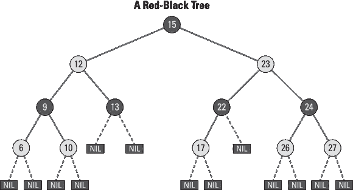

图 6-1: 红黑树。

让我们将这个示例与五条规则进行比较：

- **每个节点都有一种颜色，可能是红色或黑色。** 在图 6-1 中，黑色节点显示为黑色，红色节点显示为白色。
- **根节点总是黑色的。** 图 6-1 中的根节点确实是黑色的。
- **所有 NIL 叶节点都是黑色的。** 图 6-1 中的所有 `NIL` 叶节点都是黑色的。
- **如果一个节点是红色的，则它的所有子节点必须是黑色的。** 图 6-1 中的节点中有七个是红色的：6、10、12、17、23、26 和 27。在每情况下，这七个红色节点的所有子节点都是黑色的。
  你还可以看到几个具有黑色子节点的黑色节点插图。例如，节点 13 有两个黑色子节点，它们都是 `NIL` 叶节点。节点 22 有一个红色子节点（节点 17）和一个黑色子节点（一个 `NIL` 叶节点）。
- **从根节点到任何 NIL 叶节点的路径必须包含相同数量的黑色节点。** 如果你计算从根节点到任何 `NIL` 叶节点路径上的黑色节点数量，你会发现所有路径都恰包含三个黑色节点。在每情况下，根节点和 `NIL` 叶节点都是黑色的，根节点和叶节点之间有一个黑色节点。
  例如，从根节点到节点 10 的任一 `NIL` 叶节点的路径包含以下节点：15（黑色）、12（红色）、9（黑色）、10（红色）和 `NIL` 叶节点（黑色），总共三个黑色节点。

使用红黑树组织 `TreeMap` 类中的键的主要优势是性能。所有必须根据键值搜索树以检索、更新、添加或删除特定节点的操作将以对数时间执行。这是因为红黑树的规则确保了树的分支高度都大致相同，而这恰好大约是整个树中节点数量的对数。因此，从根节点向下搜索到任何叶节点大约需要`log(n)` 步。相对于其他 map 或集合这是一个巨大的改进，后者执行此类操作时通常以较慢的线性时间运行。

### 查看 TreeMap 方法

由于 `TreeMap` 实现了 `NavigableMap` 接口（该接口扩展了 `Map` 接口），`HashMap` 类提供的所有方法在 `TreeMap` 中也可用。因此，你可以使用以下方法对 `TreeMap` 进行基本操作：

- `put`: 添加到树
- `get`: 获取节点
- `remove`: 删除节点
- `replace`: 替换值
- `size`: 获取数量
- `clear`: 清空树

`TreeMap` 类还提供了一些 `HashMap` 没有的特性，用于管理树的大小：

- `ceilingEntry(key)`: 返回大于或等于指定键的键值对
- `ceilingKey(key)`: 返回大于或等于指定键的键
- `floorEntry(key)`: 返回小于或等于指定键的键值对
- `floorKey(key)`: 返回小于或等于指定键的键
- `firstEntry()`: 返回树中第一个元素的键值对
- `firstKey()`: 返回树中的第一个键
- `lastEntry()`: 返回树中最后一个元素的键值对
- `lastKey()`: 返回树中的最后一个键
- `higherEntry(key)`: 返回大于指定键的最小键值对
- `higherKey(key)`: 返回大于指定键的键
- `lowerEntry(key)`: 返回小于指定键的最大键值对
- `lowerKey(key)`: 返回小于指定键的键

此外，`TreeMap` 还允许你获取降序的视图：

- `descendingSet()`: 返回按降序排列的键集
- `descendingMap()`: 返回按降序排列的键值对映射
- `navigableKey(fromKey, toKey, inclusive)`: 返回一个从 `fromKey` 到 `toKey` 的导航集
- `navigableKeyMap(fromKey, toKey, inclusive)`: 返回一个从 `fromKey` 到 `toKey` 的导航键值对映射

| `NavigableSet<K> navigableKeySet()` | 返回一个包含此映射中所有键的 `NavigableSet`。 |
| `Map.Entry<K,V> pollFirstEntry()` | 移除并返回映射中的第一个元素。如果映射为空，则返回 `null`。 |

| 方法 | 解释 |
| `Map.Entry<K,V> pollLastEntry()` | 移除并返回映射中的最后一个元素。如果映射为空，则返回 `null`。 |
| `NavigableMap<K,V> submap(K fromKey, boolean fromIncl, K toKey, boolean toIncl)` | 返回由键范围从 `fromKey` 到 `toKey` 的条目组成的 `NavigableMap`。 |
| `SortedMap<K,V> submap(K fromKey, K toKey)` | 返回由键范围从 `fromKey` 到 `toKey` 的条目组成的 `SortedMap`。 |
| `NavigableMap<K,V> tailmap(K fromKey, boolean fromIncl)` | 返回由键大于 `fromKey` 的条目组成的 `NavigableMap`。如果 `fromIncl` 为 `true`，也包含等于 `fromKey` 的键。 |
| `SortedMap<K,V> tailmap(K fromKey)` | 返回由键大于或等于 `fromKey` 的条目组成的 `SortedMap`。 |

# 表 6-3 TreeMap 类

### 创建和使用 TreeMap

这里是一个短代码片段，它创建了一个 `TreeMap`，向其填充了几个节点，然后在控制台上打印 `TreeMap` 的内容：

```java
TreeMap<String, Double> PriceList = new TreeMap<String, Double>();
PriceList.put("Hammer", 10.99);
PriceList.put("Wrench", 10.99);
PriceList.put("Pliers", 10.99);
PriceList.put("Crowbar", 10.99);
System.out.println(PriceList);
```

上述代码与你向 `HashMap` 添加条项目的代码几乎完全相同。事实上，唯一的区别是构造函数创建的是 `TreeMap` 而不是 `HashMap`。但当你运行程序时，你会注意到控制台输出中有一个重要的区别：

```
{Crowbar=10.99, Hammer=10.99, Pliers=10.99, Wrench=10.99}
```

你可以看到，树节点按字母顺序列出，尽管它们并不是按顺序添加到树中的。这是因为在每次执行 `put` 操作时，`TreeMap` 类都调整了红黑树的结构以保持排序顺序。

### 更多玩 TreeMap 的方法

`TreeMap` 类包含了几个方法，允许你根据元素在树中的位置或相对于特定键值来检索元素。例如，`firstElement` 方法检索树中的第一个节点，`lastElement` 方法检索最后一个节点。这里有一个使用这些方法的简单示例：

```java
TreeMap<String, Double> PriceList = new TreeMap<String, Double>();
PriceList.put("Hammer", 10.99);
PriceList.put("Wrench", 10.99);
PriceList.put("Pliers", 10.99);
```


```java
PriceList.put("Crowbar", 10.99);

Map.Entry<String, Double> node;

node = PriceList.firstEntry();

System.out.println("The first node is " + node.getKey());

node = PriceList.lastEntry();

System.out.println("The last node is " + node.getKey());
```

在这个示例中，前五行创建了树 map 并填充了四个节点。然后，示例创建了一个名为 `node` 的 `Map.Entry` 类型变量。接着，示例检索了树中的第一个节点并将其打印；然后

现在，让我们在 Java 中实现`division by subtraction`算法。我们将使用`while`循环继续从余数中减去除数，直到无法再进行减法。

```java
public static DivisionResult divide(int numerator, int denominator) {
    int quotient = 0;
    int remainder = numerator;

    while (remainder >= denominator) {
        remainder -= denominator;
        quotient++;
    }

    return new DivisionResult(quotient, remainder);
}
```

你可以使用以下代码测试此方法：

```java
public static void main(String[] args) {
    DivisionResult result = divide(22, 6);

    System.out.println("Quotient: " + result.quotient());
    System.out.println("Remainder: " + result.remainder());
}
```

输出结果为：

```text
Quotient: 3
Remainder: 4
```

```java
public static DivisionResult EuclideanDivide(int Numerator, int Denominator) {
    int Quotient = 0;
    int Remainder = Numerator;

    while (Remainder >= Denominator) {
        Remainder = Remainder - Denominator;
        Quotient++;
    }

    return new DivisionResult(Quotient, Remainder);
}
```

注意，由于通过重复减法计算需要返回两个数字作为结果，我首先定义了一个名为 `DivisionResult` 的记录类型，它包含两个值：`Quotient`（商）和 `Remainder`（余数）。然后，我定义了一个静态方法，接受 `Numerator` 和 `Denominator` 作为参数并使用 `while` 循环执行重复减法。（如果你需要复习 Java record 类型，请查看第 3 本的第 2 章。）

在重复减法除的情况下，所解决的问题（除法）被分解为另一个不同问题（减法）的多次迭代。但通常情况下，分治法是将一个问题分解为相同问题的简单情况。例如，如果你需要对一组 80 个项目进行排序，你可以先将该集合分为两个各 40 个元素的组，对每个组进行排序，然后合并这两个排序后的集合。为了对这两个 40 个元素的组进行排序，你可以将每组拆分为两个 20 个元素的集合，对它们进行排序并合并；然后将每个组 20 个元素的集合拆分为两个 10 个元素的集合；将每组 10 个元素的集合拆分为两个 5 个元素的集合；以此此类推。

这种类型的分治算法被称为 `recursion`（递归）。你可以在本迷你书籍的第 2 章中了解如何使用递归。

### 回溯算法

`backtracking`（回溯）在某些方面与暴力破解法相似，但它并不列举当前问题的所有可能解决方案。相反，每当它发现某个解决方案被证明是错误的，它就会根据这些类似的解决方案也是错误的原理将它们排除掉。

最常用于描述回溯方法的问题被称为`八皇后问题`。简而言之，该问题是：在标准的 8 x 8 棋盘上摆放八个皇后，使得任何一个皇后都不会攻击另一个皇后。在国际象棋中，皇后可以攻击同一行、同一列或同一对角线的任何棋子。因此，该问题的所有有效解在任何行、列或对角线上都不能多于一个皇后。图 1-1 展示了八皇后问题的一种解决方案。


图 1-1：八皇后问题的一种解决方案。

事实证明，有 92 种不同的八皇后排列方式，使得没有任何皇后攻击另一个皇后。然而，其中大多数只是其他解决方案的旋转或镜像。排除镜像和旋转后，实际上只有 12 个`fundamental`（基本）解决方案。

解决此问题的一种方法是暴力破解：只需设计一个算法，生成 8 个皇后在 8 x 8 棋盘上的所有可能的排列；然后统计不违反“任何皇后不能攻击其他皇后”这一限制的解决方案数量。

遗憾的是，在 8 x 8 棋盘上摆放八个皇子的可能方式超过四十亿种。纯暴力破解法需要一段时间才能计算出来。

回溯方法让你能够快速排除大范围可能的解决方案。例如，因为皇后会攻击同一列的任何棋子，你可以排除任何在同一列中有多个一个皇子的潜在解决方案。根据类似的逻辑，你也可以排除任何在棋盘八行中每行都没有皇子的解决方案。

通过这些简单的排除，潜在解决方案的数量突然变得小得多：大约是 40,000 个，而不是四十亿个。这是一个要考虑的合理的解决方案数量。现在，问题被限制为开发一种算法，生成 8 x 8 棋盘的所有可能的布局，其中八个皇子的排列使得每行和每列都恰好包含一个皇后。对于每种布局，你必须检查对角线，以确保每条对角线也只有一个一个皇后。

### 动态算法

算法的`dynamic`（动态）方法与分治法相似，不同在于它考虑了在许多问题中相同的子问题会出现多次这一事实。通过动态方法，你编写的算法只解决一次每个唯一的子问题。然后，每当算法遇到子问题时，它都会检查是否已经解决过该子问题。如果是，它将使用之前计算出的答案，而不是再次计算该子问题。

动态算法的一个很好的例子是长除法，你可能在小学学过。在长除法中，你通过将被除数左侧的数字除以除数来解决除法问题。例如，图 1-2 展示了 350 除以 15 的长除法简单示例。


图 1-2：长除法。

要执行长除法，你首先通过写出除数、括号和被除数来设定问题；然后遵循以下步骤：

1. **检查被除数的第一个数字，判断它是否大于或等于除数。**  
   在本例中，被除数（3）并不大于或等于除数（15）。所以，取前两个数字（30）进行相同的比较。
2. **确定除数乘以几次得到小于或等于被除数前两位的最大数字。**  
   在本例中，数字是 2。所以你在第二个数字上方写下 2。
3. **将被除数上方的数字乘以除数，并将结果写在被除数下方，注意与被除数对齐。**  
   在本例中，你写下 30。
4. **在刚才数字的剩余位数处写一个零，使其与被除数的位数相同。**  
   在本例中，你多写一个零，使 30 变成 300。
5. **从被除数减去结果，并将差写在下方。**  
   在本例中，从 350 减去 300，得到 50。
6. **确定除数乘以几次得到小于或等于上一步写出的差的最大数字。**  
   在本例中，数字是 3，因为 15 乘以 3 是 45，小于 50。所以你在被除数上方写下 3。
7. **将被除数上方的数字乘以除数，并将结果写在被除数下方，注意与被除数对齐。**  
   在本例中，你将 45 写在 50 下方。
8. **从被除数减去结果，并将差写在下方。**  
   在本例中，从 50 减去 45，得到 5 作为差。

你现在已经得到了答案：350 除以 15 等于 23，余 5。

长除法是一种比重复减法更复杂的算法，但它需要的步骤更少。使用重复减法，你需要 23 步才能得到答案。长除法版本所需的步骤不到其的一半。

但你可能注意到，其中几个步骤需要你将两个数字相乘并写下结果。在小学时期，你学习了基本的乘法表，这样当你遇到像“15 乘以 3 等于几？”的问题，你几乎可以自动地回答“45”，而不需要手动计算结果。乘法表是动态算法如何工作的一个极佳的例子。在动态算法中，你不想对你已经知道答案的计算进行任何计算。因此，你并不是真的去计算 `15 × 3`，而是首先查找这个问题，以判断你是否已经知道了答案。如果是，你就跳过计算并直接使用答案。如果不是，你就进行计算，使用该答案，然后将该问题和答案添加到你已经解决的问题索引中。

## 一些有趣的算法挑战

现在你已经接触了你作为 Java 程序员可能会遇到的一些基础算法类型，让我们来看看一些有趣且有趣的算法挑战。在接下来的章节中，我将介绍一些算法挑战，但不会提供完整的解决方案。我可能会讨论一种通用方法，但将充分探索这些挑战的机会留给你自己，如果你愿意的话，还可以设计出完整的解决方案。

### Fizz buzz

`Fizz buzz` 是一种流行的儿童计数游戏，可以帮助孩子们在过程中学习一些数学知识。此外，它也是工作面试中常见的编程挑战。它的规则非常简单：

1. 聚集一群孩子，让他们坐在地板上围成一圈。
2. 选一个孩子开始游戏；那个孩子说：“一”。
3. 左边的人说序列中的下一个数字（“二”）。
4. 继续绕圆圈移动，每个孩子都说序列中的下一个数字，除非该数字能被 3 或 5 整除。  
   如果数字能被 3 整除，说“Fizz”而不是数字。如果数字能被 5 整除，说“Buzz”而不是数字。如果数字同时能被 3 和 5 整除，就说 `Fizz buzz`。
5. 如果玩家忘记说“Fizz”、“Buzz”或 `Fizz buzz`，该玩家必须离开圆圈。  
   如果玩家由于犹豫不决而打乱了游戏的节奏，该玩家也算出局。  
   圆圈中最后一个玩家获得游戏。

作为一个编程挑战，任务是设计一种算法，它在控制台上打印出正确的计数序列，并包含所有的“Fizz”、“Buzz”和`Fizz buzz`替换。以下是前 20 个数字的正确序列：

```text
1
2
Fizz
4
Buzz
Fizz
7
8
Fizz
Buzz
11
Fizz
13
14
Fizz buzz
16
17
Fizz
19
Buzz
```

该算法需要简单的迭代以及整除测试，还需要一种正确构建输出内容“Fizz”、“Buzz”和`Fizz buzz`的方法。

为了增加额外挑战，请设计一种算法，在不实际运行游戏的情况下，计算在给定的上限内“Fizz”、“Buzz”和“Fizz buzz”被说出的次数。换句话说，用常数时间内计算计数，而不是在线性时间内。

### 罗马数字

这是一个有趣的挑战：给定一个在 1 到 3,999 之间的整数值，创建一个使用罗马数字表示该值的 `String`。作为一个限制条件，假设该整数值必须小于 4,000。该算法应该拒绝任何大于 3,999 的输入值。

罗马数字是一种不依赖于位值的计数系统，其中单个数字代表 10 的幂。相反，罗马数字使用大写字母形式的符号，这些符号通过相加或在某些情况下相减来确定一个数字的值。

罗马数字使用的符号如下：

| 符号 | 数值 |
| --- | ---: |
| I | 1 |
| V | 5 |
| X | 10 |
| L | 50 |
| C | 100 |
| D | 500 |
| M | 1,000 |

这些符号以各种组合使用，通过相加来表示数值。以下是一些例子：

| 数值 | 罗马数字 | 解释 |
| ---: | --- | --- |
| 3 | III | 1 + 1 + 1 |
| 7 | VII | 5 + 1 + 1 |
| 13 | XIII | 10 + 1 + 1 + 1 |
| 15 | XV | 10 + 5 |
| 36 | XXXVI | 10 + 10 + 10 + 5 + 1 + 1 |
| 166 | CLXVI | 100 + 50 + 10 + 5 + 1 |
| 1,873 | MDCCCLXXIII | 1,000 + 500 + 100 + 100 + 100 + 50 + 10 + 10 + 1 + 1 + 1 |

某些数字使用`减法表示`（subtractive notation），在这种情况下，一个符号位于另一个符号之前，表示前缀值应该相减而不是相加。减法表示用于数值 4 (`IV`)、9 (`IX`)、40 (`XL`)、90 (`XC`)、400 (`CD`) 和 900 (`CM`)。

以下是一些使用减法表示的数字示例：

| 数值 | 罗马数字 | 解释 |
| ---: | --- | --- |
| 4 | IV | 5 - 1 |
| 9 | IX | 10 - 1 |
| 40 | XL | 50 - 10 |
| 90 | XC | 100 - 10 |
| 400 | CD | 500 - 100 |
| 900 | CM | 1000 - 100 |

当我的孩子还小的时候，他们参加各种运动项目（主要是垒球、足球和排球），这些项目偶尔会举办为期周末的锦赛。通常，会有八支球队受邀参加比赛，比赛按照两种格式之一组织：单淘汰淘汰或双淘汰淘汰。在单淘汰赛中，球队一旦输掉一场比赛就会被淘汰。正如名称所示，在双淘汰赛中，球队必须输掉`two`场比赛才会被淘汰。

我总是负责为这些比赛制定赛程。决定赛程的主要因素如下：

- 参赛比赛的球队数量。
- 比赛的格式（单淘汰或双淘汰）。
- 比赛可用的场地或球场数量。
- 每个场地每天可以进行的比赛总数。这取决于运动项目和比赛规则（例如，比赛是否有时间限制）以及比赛进行的时间段。

图 1-3 显示了一个八支球队单淘汰赛的示例对阵图。如你所示，比赛从初始的四场比赛开始。在这四场比赛中，四个胜者将参加第二轮的两场比赛。在这两场比赛中，两个胜者将参加决赛，以决定谁是锦赛冠军。八支球队的单淘汰赛始终需要进行七场比赛。

图 1-4 显示了一个典型的双淘汰赛对阵图。双淘汰赛要复杂得多。八支球队中的每支都从四场比赛的轮次开始。四个胜者进入两场比赛的轮次，那两场比赛的两个胜者进入第三轮，以决定哪支球队将晋级决赛决赛。这些比赛的失败者都会进入所谓的“败者组”或“淘汰组”。在这些比赛中输掉任何一场比赛的球队现在都输了两场比赛并被淘汰。每支获胜的球队继续向上爬，直到有一支球队进入决赛。如果从淘汰组晋级决赛的球队输了，那么该球队就会被淘汰，锦赛冠军随之产生。但如果从淘汰组晋级的球队赢了，那么决赛组中的两支球队现在都输了一场比赛。因此，这两支球队必须再次比赛以决定锦赛冠军。八支球队的双淘汰赛总共需要 14 场或 15 场比赛，具体取决于哪支球队赢了决赛的第一场比赛。


图 1-3：单淘汰赛对阵图。


图 1-4：双淘汰赛对阵图。

你的任务是创建一个算法，为只有八支球队的单淘汰或双淘汰赛安排赛程，给定条件包括可用的场地数量、每个场地每天可以进行的比赛数以及比赛格式。祝你好运！

如果你掌握了这种算法，可以通过允许参赛超过八支球队的比赛来给自己设定一个更具挑战性的任务。

# 第 2 章：使用递归

## 本章内容

-  **介绍递归**
-  **用递归计算阶乘**
-  **用递归列出目录**
-  **玩著名的汉诺河塔游戏**

`recursion` 是一种基础编程技术，方法通过调用自身来解决某些问题。使用这种技术的方法被称为 `recursive`（递归的）。许多编程问题可以通过递归完美解决，而某些可以通过其他技术解决的问题用递归解决效果更好。

我不确定，但我认为 `recursion` 这个词可能源于拉丁语 `recurse, recurset, recursum`，意思是“反复地诅咒”。我确实知道，当许多程序员在挣扎复杂的递归编程问题时，他们的感觉确实是这样。

诚然，递归的概念可能有点棘手。许多程序员避开它，寻找其他技术来解决当前问题，在很多情况下，非递归方案是最好的。然而，许多问题直切需要递归。

## 计算经典的阶乘示例

引入递归的经典问题之一是计算整数的阶乘。任何给定整数的 `factorial`——为了听起来更有数学味，我称之为 `n`——都是从 1 到 `n` 所有整数的乘积。因此，5 的阶乘是 120：5 × 4 × 3 × 2 × 1。

### 非递归方案

你不需要递归来计算阶乘。相反，你可以使用简单的 `for` 循环。这里有一个接收 `int` 数字并返回该数字阶乘作为 `long` 类型的方法：

```java
private static long factorial(int n) {
    long f = 1;

    for (int i = 1; i <= n; i++) {
        f = f * i;
    }

    return f;
}
```

该方法使用 `for` 循环进行计数。这里是调用该方法并显示结果的代码片段：

```java
int n = 5;
long fact;

fact = factorial(n);
```


`System.out.println("The factorial of "+ n + " is " + fact + ".");`

如果你运行这段代码，将显示以下内容：

```
The factorial of 5 is 120.
```

阶乘增长得很快。你应该使用 `long` 而不是 `int` 来计算结果。此外，你应该使用 `NumberFormat` 类来格式化结果。如果 `int` 是 20 而不是 5，前面的代码会打印：

```
The factorial of 20 is 243290200817664000.
```

如果你使用 `NumberFormat` 类格式化结果，控制台输出更具可读性：

```
The factorial of 20 is 2,432,902,008,176,640,000.
```

## 递归方案

阶乘问题的非递归方案可行，但毫无趣味。递归方案基于算法设计的分治模式。具体来说，任何数字 `n` 的阶乘等于 `n` 乘以 `n-1` 的阶乘，只要 `n` 大于 1。如果 `n` 是 1，则 `n` 的阶乘为 1。

这个阶乘定义是递归的，因为定义包含了阶乘方法本身。它包含了任何递归方法最重要的部分：结束条件。结束条件指示了递归方法何时停止调用自身。在这种情况下，当 `n` 为 1 时，我们直接返回 1。如果没有结束条件，递归方法将无限调用下去。

这里是阶乘方法的递归版本：

```java
private static long factorial(int n)
{
  if (n == 1)
    return 1;
  else
    return n * factorial(n-1);
}
```

该方法返回与前一节版本完全一致的结果，但它使用递归来计算阶乘。

可视化递归如何工作的一种方法是想象你有五个朋友：Jordan、Jeremy、Jacob、Justin 和 Bob。你的朋友并不聪明，但他们非常相似。事实上，他们是彼此的克隆体。克隆过程还不完美，所以这些克隆体有局限。每个人只能做一次乘法，并向其中一个克隆体提一个问题。

现在假设你走到 Jordan 面前问：“嘿，Jordan，5 的阶乘是多少？”

Jordan 说：“不知道，但我知道它是 5 × 4 的阶乘。嘿，Jeremy，4 的阶乘是多少？”

Jeremy 说：“我不知道，但我知道它是 4 乘以 3 的阶乘。嘿，Jacob，3 的阶乘是多少？”

Jacob 说：“我不知道，但我知道它是 3 乘以 2 的阶乘。嘿，Justin，2 的阶乘是多少？”

Justin 说：“我不知道，但我知道它是 2 乘以 1 的阶乘。嘿，Bob，1 的阶乘是多少？”

Bob 因为名字不是以 J 开头的，是这群人中最聪明的，他回答道：“当然是 1。”他告诉了 Justin 答案。

Justin 说：“啊 — 2 × 1 是 2。”他告诉了 Jacob 答案。

Jacob 说：“谢谢 — 3 × 2 是 6。”Jacob 告诉了 Jeremy 答案。

Jeremy 说：“伙计 — 4 × 6 是 24。”Jeremy 告诉了 Jordan 答案。

Jordan 说：“很好 — 5 × 24 是 120。”他告诉了你答案。

递归基本上就是这样。

## 显示目录

递归非常适用于需要遍历目录结构的应用程序，例如 Windows 或 Unix 文件系统。在文件系统中，目录是文件和其他目录的列表。其中的每个目录本身也是文件和其他目录的列表，以此类推。目录可以紧密地嵌套在其他目录内部，数量没有限制。

列表 2-1 显示在本节末尾，它使用递归方法列出从给定路径开始找到的所有目录。我使用缩进来显示目录结构。

以下是我用来组织本书文档目录的控制台输出：

```
Welcome to the Directory Lister

Enter a path: C:\Java AIO

Listing directory tree of:
C:\Java AIO
Apps
  Book 1
  Book 2
  Book 3
  Book 4
  Book 5
Manuscript
  Book 1
  Book 2
  Book 3
  Book 4
  Book 5
  Front
  Plans
Another? (Y or N) n
```

如你所见，我还没有做 Books 6–8。当你读到这一章时，会有更多的目录要列出！

 除非你准备好等待很长时间让程序列出你硬盘上的所有目录，否则不要输入 `c:\`。（当然，你随时可以按 Ctrl+C 停止程序，或直接关闭控制台窗口。）

目录列出应用程序非常简单。不过，在解释细节之前，我想指出该程序使用了 `File` 类，它是 `java.io` 包的一部分。`File` 类表示单个文件或目录。你可以在在线加赠内容中找到更多关于该类的信息。现在，你只需要知道这五个细节：

- 该类的构造函数接受一个目录路径作为参数，并创建一个表示指定目录的对象。
- 你可以使用 `exists` 方法来查找由路径参数指定的目录是否存在。
- `listFiles` 方法返回一个 `File` 对象的数组，这些对象代表当前 `File` 对象中的每个文件和目录。
- `isDirectory` 方法返回一个布尔值，指示当前 `File` 对象是否为目录。如果该方法返回 `false`，你可以假设该 `File` 对象是一个文件。
- `getName` 方法返回文件名。

请注意，加赠内容中的第 1 章显示了如何使用 `Path` 类以及一个名为 `FileVisitor` 的接口来自动遍历目录树中的所有文件，包括任何子目录中的文件。当你使用 `Path` 类和 `FileVisitor` 接口时，你不需要自己编写递归代码。

**列表 2-1 目录列出应用程序**

```java
import java.io.File;
import java.util.Scanner;

public class DirList
{
    static Scanner sc = new Scanner(System.in);

    public static void main(String[] args)
    {
        System.out.print("Welcome to the Directory Lister");
        do
        {
            System.out.print("\nEnter a path: ");
            String path = sc.nextLine();
            File dir = new File(path);
            if (!dir.exists() || !dir.isDirectory())
                System.out.println("\nThat directory doesn't exist.");
            else
            {
                System.out.println("\nListing directory tree of:");
                System.out.println(dir.getPath());
                listDirectories(dir, " ");
            }
        } while(askAgain());
    }

    private static void listDirectories(File dir, String indent)
    {
        File[] dirs = dir.listFiles();
        for (File f : dirs)
        {
            if (f.isDirectory())
            {
                System.out.println(indent + f.getName());
                listDirectories(f, indent + " ");
            }
        }
    }

    private static boolean askAgain()
    {
        System.out.print("Another? (Y or N) ");
        String reply = sc.nextLine();
        if (reply.equalsIgnoreCase("Y"))
            return true;
        return false;
    }
}
```

接下来的段落指出了其工作原理的亮点：

- 1: 使用 `File` 类需要此 `import` 语句。
- 15: 使用 `Scanner` 对象从用户处获取路径名。
- 17: 将路径名传递给 `File` 构造函数以创建一个新的 `File` 对象。
- 18: 调用 `exists` 和 `isDirectory` 方法以确保用户输入的路径指向的是目录而不是文件。
- 25: 如果用户输入了正确的路径，则调用 `getPath` 方法显示路径名称。
- 26: 调用 `listDirectories` 方法列出所有子目录。
- 28: 询问用户是否列出另一个，如果用户回答了，循环将重复。
- 31: 这一行是 `listDirectories` 方法的开始。该方法接受两个参数：表示目录的 `File` 对象和一个提供用于缩进每行的空格的 `String` 对象。当第一次调用此方法时，缩进设置为空格。
- 34: 调用 `listFiles` 方法获取此目录中的所有 `File` 对象数组。
- 35: 使用增强型 `for` 循环处理数组中的所有 `File` 对象。
- 37: `if` 语句检查文件是否为目录。
- 40: 如果 `File` 对象是目录，则打印缩进字符串，随后是 `getName` 方法返回的。
- 41: 接下来递归调用 `listDirectories` 以列出 `f` 的内容。然而，缩进字符串添加了空格，以便 `f` 中的目录相对于当前目录向右缩进。

如果你很难理解此程序的递归是如何工作的，可以这样想：`listDirectories` 方法列出单个目录中的所有子目录。对于每个目录，该方法做两件事：（1）打印目录名称（2）调用自己来打印该目录的任何子目录。

在本章前面，我提到所有递归方法必须有某种条件测试，导致方法停止调用自己。在这个程序中，条件测试可能并不明显。然而，`listDirectories` 方法最终会被传递没有子目录的目录。当这种情况发生时，递归结束了——至少在该目录树的分支上是。

## 玩汉诺塔

汉诺塔是一种受欢迎的游戏，不同直径的盘放在三个柱之一上。挑战是按照以下简单规则将所有的盘从一个柱移动到另一个柱：

- 每次移动时，你必须从一个栈的顶部移除一个盘，并将其放在另一个栈顶部。
- 你每次只能移动一个盘。
- 你不能将一个盘放在另一个直径较小的盘之上。

图 2-1 显示了汉诺塔游戏的一个示例，左侧柱上堆叠了四个盘。

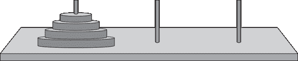

图 2-1： 汉诺塔游戏。

这个谜题的解相对简单，但随着游戏中盘数量的增加，解决过程会变得单调。3 个盘时可以通过 7 步解决该谜题。4 个盘需要 15 步。5 个盘需要 31 步。每增加一个盘，所需的步数就会翻一倍并再加一。因此，6 个盘需要 63 步，7 个盘需要 127 步，8 个盘需要 255 步。

计算解决 `n` 个盘谜题所需步数的公式为 `2^n – 1`。

传说有一对僧侣自世界之初起一直在操作一个 64 个盘的塔，当他们完成时，世界将会结束。不过，你不必担心——一个 64 个盘的谜题需要超过 1800 万亿步。假设他们以每秒移动一次的快速速度且从不休息，他们目前大约需要 580 亿年才能完成游戏。

那么，如何解决这个谜题呢？汉诺塔非常适合递归。想想我说的，每增加一个盘，解决谜题所需的步数就会翻一倍并再加一。反过来想，从谜题中移除一个盘，步数就会减半。你可以通过先解决 `n – 1` 个盘的谜题，然后再解决最后一个盘，来解决 `n` 个盘的谜题。你可以重复这个过程，直到谜题变得轻而易举。

图 2-2 显示了将两个盘的堆从一根柱移动到另一根柱所需的步骤。

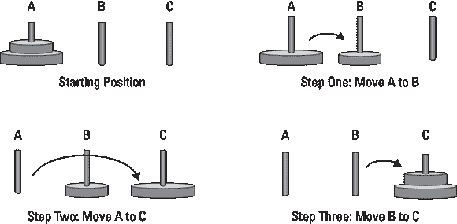

图 2-2： 用两个盘解决汉诺塔。

要解决汉诺塔问题，首先为柱子分配一个字母：A、B 和 C。将 A 柱指定为*源*柱（即初始堆叠盘的柱子）。将 C 柱指定为*目标*柱（你想将盘移动到的柱子）。将 B 柱指定为*备用*柱，它在你将盘从源柱移动到目标柱时作为盘的临时存放处。

现在，按大小顺序从 1 到 `n` 对盘进行编号，盘 1 是最小的盘，盘 `n` 是最大的盘。在游戏的起始位置，所有盘将堆叠在 A 柱上，编号最大的盘在底部，编号为 1 的盘在顶部。

现在你只需要三步就能解决这个谜题：

1. **使用 C 柱（右侧）作为中间停留点，将 `n – 1` 个盘从 A 柱（左侧）移动到 B 柱（中间）。**
   当你完成这一步时，C 柱（右侧）将为空，A 柱（左侧）只有一个盘，剩下的盘在 B 柱（中间）。
2. **将盘 `n` 直接从 A 柱（左侧）移动到 C 柱（右侧）。**
   现在 A 柱（左侧）将为空，你在 C 柱（右侧）上增加了一个盘。
3. **使用 A 柱作为中间停留点，将 `n – 1` 个盘从 B 柱移动到 C 柱。**
4. **重复步骤 1 到 3，直到所有盘都移动完毕。**

列表 2-2 显示了一个实现此算法的 Java 程序。

**列表 2-2 汉诺塔应用**

```java
import java.util.*;

public class Towers
{
    static int count = 5;
    static int moves = 0;

    public static void main(String[] args)
    {
        SolveTowers(count, "A", "B", "C");
        System.out.println("The solution required " + moves + " moves.");
    }

    public static void SolveTowers(int count, String from, String temp, String to)
    {
        if (count == 1)
        {
            System.out.println("Disk 1 from " + from + " to " + to);
            moves++;
        }
        else
        {
            SolveTowers(count - 1, from, to, temp);
            System.out.println("Disk " + count + " from " + from + " to " + to);
            SolveTowers(count - 1, temp, from, to);
            moves++;
        }
    }
}
```

如果你运行此程序，解决谜题所需的所有 31 个步骤将显示在控制台上，随后是解决所需步数的计数：

```
Disk 1 from A to C
Disk 2 from A to B
Disk 1 from C to B
Disk 3 from A to C
Disk 1 from B to A
Disk 2 from B to C
Disk 1 from A to C
Disk 4 from A to B
Disk 1 from C to B
Disk 2 from C to A
Disk 1 from B to A
Disk 3 from C to B
Disk 1 from A to C
Disk 2 from A to B
Disk 1 from C to B
Disk 5 from A to C
Disk 1 from B to A
Disk 2 from B to C
Disk 1 from A to C
Disk 3 from B to A
Disk 1 from C to B
Disk 2 from C to A
Disk 1 from B to A
Disk 4 from B to C
Disk 1 from A to C
Disk 2 from A to B
Disk 1 from C to B
```

在前面的示例中，`SortArray` 方法接收一个整数数组并返回该数组排序后的副本。该方法由两个 `for` 循环组成，一个嵌套在另一个内部。外层循环访问数组中的所有元素；内层循环访问前 `j` 个元素，其中 `j` 是数组长度减去 `i`。

在最内层循环中，会对比数组中的一对值——当前值和下一个值——进行比较。如果它们的顺序不对（即第一个元素大于第二个元素），则交换这两个元素的位置。在交换元素时，会使用一个临时变量来存储这对值中第一个元素的值。

下面是一段代码片段，它调用 `SortArray` 方法对一个仅包含 10 个元素的小数组进行排序：

```
int[]array = {23, 5, 94, 74, 10, 31, 58, 66, 42, 81};
PrintArray(array);
int[] sorted = SortArray(array);
PrintArray(sorted);
```


在这里，数组被初始化为十个无序的整数值。通过调用名为`PrintArray`的方法来打印数组。然后，调用`SortArray`方法对数组进行排序，并将结果保存在名为`sorted`的新数组中。最后再次调用`PrintArray`打印数组。

这里是用于打印数组的`PrintArray`方法：

```java
public static void PrintArray(int[] a)
{
    for (int i = 0; i < a.length; i++)
    {
        System.out.print(a[i]);
        if (i < a.length - 1)
        {
            System.out.print(", ");
        }
    }
    System.out.println();
}
```

`PrintArray`方法将数组的值用逗号分隔打印在同一行中。当运行之前的代码片段时，控制台会显示以下内容：

```text
23, 5, 94, 74, 10, 31, 58, 66, 42, 81

5, 10, 23, 31, 42, 58, 66, 74, 81, 94
```

第一行显示了排序前的数组内容；第二行显示了排序后的数组。

在本节较早之前，我提到冒泡排序算法效率并不高。为了演示这一点，这里是`SortArray`方法的修订版本，它记录了对传递给它的数组排序所需的步数。在返回排序后的数组之前，该版本会在控制台上打印数组的大小以及排序它所需的步数：

```java
public static int[] SortArray(int[] a)
{
    int steps = 0;
    int count = a.length;
    int n = a.length;

    for (int i = 0; i < n - 1; i++)
    {
        for (int j = 0; j < n - i - 1; j++)
        {
            if (a[j] > a[j + 1])
            {
                int temp = a[j];
                a[j] = a[j + 1];
                a[j + 1] = temp;
            }
            steps++;
        }
    }

    System.out.println("Sorted " + count + " integers in " + steps + " steps.");
    return a;
}
```

在向你们展示带有这些改进测试`SortArray`方法的代码之前，我想向你们展示另一个添加的方法，用于初始化一个任意大小且范围在 0 到 999 之间的随机整数的数组：

```java
public static int[] RandomizeArray(int size)
{
    int[] array = new int[size];

    for (int i = 0; i < size; i++)
    {
        array[i] = (int) (Math.random() * 999 + 1);
    }

    return array;
}
```

最后，这是一段代码片段，调用这些方法来创建并排序包含 1、10、100、1,000 和 10,000 个元素的数组，以查看排序它们需要多少步数：

```java
SortArray(RandomizeArray(1));
SortArray(RandomizeArray(10));
SortArray(RandomizeArray(100));
SortArray(RandomizeArray(1000));
SortArray(RandomizeArray(10000));
```

当运行这段代码时，控制台上会显示以下输出：

```text
Sorted 1 integers in 0 steps.

Sorted 10 integers in 45 steps.

Sorted 100 integers in 4950 steps.

Sorted 1000 integers in 499500 steps.

Sorted 10000 integers in 49995000 steps.
```

在这种格式下很难直观地观察这些数字，因此将它们进行了正确的对齐：

| 元素数量 | 排序所需的步数 |
| --- | --- |
| 1 | 0 |
| 10 | 45 |
| 100 | 4,950 |
| 1,000 | 499,500 |
| 10,000 | 49,995,000 |

粗略来说，当数组规模增加 10 倍时，步数会增加 100 倍。

通常情况下，冒泡排序算法的复杂度与输入规模的平方成正比。

## 快速排序算法

快速排序是冒泡排序的改进，速度快得多。快速排序技术通过递归对值进行排序。其基本步骤如下：

1. **在数组的数值范围内选取一个任意值。**

   这个值被称为“基点”（pivot point）。选择基点的常用方法是简单地选择数组中的第一个值。人们已经为更复杂的基点选择方法写过博士论文。

2. **重新排列数组，使得所有小于基点的值都在左侧，所有大于基点的值都在右侧。**

   这一步被称为“分区”（partitioning）。`pivotIndex`指示两侧之间的边界。

3. **对这两个部分重复该过程。**

   现在你将每个部分视为独立的数组并重新开始。

### 使用`sort`方法

在本章的剩余部分，我将展示一个实现快速排序算法的类，用于对 100 个随机整数值进行排序。数组存储在一个名为`a`的`static`类变量中，因此在整个类中都是可见的。

驱动快速排序程序的实际代码异常地简单：

```java
public static void sort(int startIndex, int endIndex)
{
    if (startIndex >= endIndex)
        return;

    int pivotIndex = partition(startIndex, endIndex);

    sort(startIndex, pivotIndex);
    sort(pivotIndex + 1, endIndex);
}
```

要启动`sort`方法，你调用它时需要传入`0`作为起始索引值，并将数组长度减`1`作为结束索引值——换句话说，就是数组中第一个和最后一个元素的索引。因此，`sort`方法从对整个数组进行排序开始。

每当`sort`方法执行时，它都会调用自己两次来对数组的较小分区进行排序。这是算法的递归部分。

`sort`方法开头的`if`语句提供了退出条件，指示递归何时应该停止。它比较了起始索引（`startIndex`）和结束索引（`endIndex`）。如果`startIndex`等于或大于`endIndex`，则说明该分区只有一个元素（或者可能没有元素），因此它已经是排序状态了。在这种情况下，`sort`方法将直接返回，不再再次调用自己。至此，递归结束。

### 使用`partition`方法

`sort`方法本身是快速排序技术中简单的部分。难点部分是`partition`方法。该方法接受两个参数——起始索引和结束索引——用于指定需要排序的数组部分。`partition`方法的基本轮概述如下：

1. **选取一个基准值（pivot value）。**

   为了简单起见，使用分区中第一个元素的值。

2. **将所有小于基准值的元素移动到分区的左侧。**

3. **将所有大于基准值的元素移动到分区的右侧。**

4. **返回基准点的索引。**

划分数组最常用的技术是维护两个命名为`i`和`j`的索引变量，它们从数组的两端向中间移动。首先，`i`从数组开头开始并向后移动，直到遇到一个大于基准值的值。然后，`j`从数组的对端开始并向回移动，直到找到一个小于基准值的值。在此时，`partition`方法在数组左侧拥有一个大于基准点的值，在数组右侧拥有一个小于基准点的值。因此，它会交换这两个数组元素。

注意，这两个`for`语句并不是嵌套的。第一个`for`语句会运行完成，在数组左侧找到一个需要交换的元素。然后，第二个`for`语句运行完成，在数组右侧找到一个需要交换的元素。接着交换这两个元素。

接下来，循环重复：`i`递增直到找到另一个大于基准值的值，`j`递减直到找到另一个小于基准值的值，并交换元素。这个过程一直重复，直到`j`小于`i`，这意味着索引已经交叉，划分完成。

这里是把所有内容整合的代码：

```java
public static int partition(int startIndex, int endIndex)
{
    int pivotValue = a[startIndex];
    int i = startIndex - 1;
    int j = endIndex + 1;

    while (i < j)
    {
        for (i++; a[i] < pivotValue; i++);
        for (j--; a[j] > pivotValue; j--);

        if (i < j)
            swap(i, j);
    }

    return j;
}
```

记住，正在排序的数组是一个名为`a`的静态`int`数组，在整个类中可见，因此它不是作为参数传递给此方法的。

要进一步划分的分区的起始和结束索引作为参数传入，方法开始选择分区中的第一个元素作为基准值。例如，如果第一个元素的值是 42，`partition`方法将洗牌数组，使得所有 42 或更小的值出现在数组的左侧，而所有大于 42 的值都在数组的右侧。

在选取基准值后，我们根据参数初始化索引变量`i`和`j`。注意，起始索引减了 1，结束索引加了 1。索引变量在循环开始前向数组回退了一步，以便它们有一个良好的起点。

`while`循环用于指示划分何时完成。只要`i`小于`j`，它就会重复执行。这些索引变量交叉之后，划分完成，并返回`j`的值以指示划分左分区和右分区的索引点。

在`while`循环体中有两个奇怪的空体`for`循环。这些`for`循环没有循环体是因为它们唯一的目的是为了移动它们的索引值，直到找到一个小于或大于基准值的值。

第一个`for`循环递增索引变量`i`，直到它找到一个大于或等于基准点的值。这个`for`循环找到了第一个可能需要移动到数组另一侧的值。

接下来，第二个`for`循环递减索引变量`j`，直到它找到一个小于或等于基准点的值。因此，这个循环找到了一个可能与第一个`for`循环找到的值进行交换的值。

最后，`if`语句检查索引是否交叉。假设它们还没有交叉，则调用`swap`方法来交换元素。`swap`方法非常简单：

```java
public static void swap(int i, int j)
{
    int temp = a[i];
    a[i] = a[j];
    a[j] = temp;
}
```

该方法将`i`元素移动到临时变量，将`j`元素移动到`i`元素的位置，然后将临时变量移动到`j`元素的位置。

### 总结

现在你已经了解了创建快速排序程序的基本步骤，列表 3-1](#c32.xhtml_c32-fea-0001)展示了一个让这些方法练手的程序。该程序创建一个包含 90 个 1 到 100 之间随机数字的数组。它打印数组，使用之前节中的排序方法对数组进行排序，然后打印排序后的数组。这里是一个示例运行：

```text
未排序数组：

43 74 59 87 40 70 39 ...

排序后的数组：

1 2 3 4 5 6 7 8 9 10 ...
```

如你看到的，第一个数组是随机顺序的，但第二个数组已经良好地排序。（当然，你的结果会有所不同，因为每次运行程序时数字都是随机生成的，未排序数组的顺序都会不同。）

```java
int i = startIndex - 1;
int j = endIndex + 1;

while (i < j)
{
    for (i++; a[i] < pivotValue; i++);
    for (j--; a[j] > pivotValue; j--);

    if (i < j)
        swap(i, j);
}

return j;
}

public static void swap(int i, int j)
{
    int temp = a[i];
    a[i] = a[j];
    a[j] = temp;
}
```


此程序中的大部分代码已经过过了，但这里有几个亮点：

- →4：数组被创建为一个名为 `a` 的静态类变量。
- →8：这个 `for` 循环为数组分配了 100 个随机值。
- →12：调用了 `printArray` 方法来打印未排序的数组。
- →14：调用了 `sort` 方法对数组进行排序。
- →17：再次调用了 `printArray` 方法来打印排序后的数组。
- →20：`printArray` 方法使用 `for` 循环打印数组元素。每个元素之间用一个空格分隔。然而，如果元素的值小于 `100`，则会在每个元素之前额外打印一个空格；如果值小于 `10`，则再打印一个空格。这样，无论值是位数、两位还是三位数，都能列对齐。此外，还使用取模运算符 `%` 每 20 个元素调用一次 `println` 方法。因此，该方法会打印五行，每行 20 个值。
- →38：这一行声明了 `sort` 方法，该方法根据参数对分区进行排序。（该方法的操作在本章早前的“使用 `sort` 方法”节中进行了详细解释。）
- →49：前一节详细解释了 `partition` 方法。
- →66：`swap` 方法简单地交换了两个指定的值。

# 第 4 章：搜索

## 本章主要内容

-  查找特定年份使用的所有婴儿名字官方列表，并利用它学习各种搜索方法
-  简单但低效的搜索方法
-  学习更好的搜索方法——二分搜索
-  使用递归编程实现二分搜索算法

1986 年，一位名叫 David Bennett 的优秀年轻插画师受邀创作一本包含极其详细人群场景的书。当他创作这本书时，一位同事建议在每个场景中隐藏一个角色，让读者在寻找这个角色时获得乐趣。于是，Wally（沃利）诞生了。

从那时起，全球范围内售出了数千万本书，几乎每个人都知道“沃利在哪里？（Where’s Wally?）”。当然，除非你住在北美，那里 Wally 的名字被改为 Waldo。在这种情况下，你就知道“沃尔多在哪里？”了。我住在北美，所以我在这里将使用 Waldo。

在本章中，你将学习寻找 Waldo 的各种技术——不是当他躲在拥挤的海滩、游乐园、丛林或雪道上，而是当他迷失在一个巨大的数组、列表或双端队列（deque）中。

在集合中搜索特定项是一项常见的编程任务。在本章中，我将介绍两种常用方法：*线性搜索*，即从头开始检查集合中的每个项，直到找到你寻找的项；以及*二分搜索*，一种更高效的方法，可以快速找到你想要的内容。

 顺便提一下，1986 年美国共有 15 个婴儿被命名为 Waldo。在 Waldo 问世后的 20 年里，这个平均数增加到了 15.25。看来尽管 Waldo 广受欢迎，但父母们还没有准备好用他的名字来命名孩子，这引出了我的下一节。

## 创建值得搜索的数据结构

在深入研究搜索技术之前，如果你手头确实有一些值得你付诸搜索的数据，那将会很有趣。因此，在本节中，我将向你如何下载并利用自 1880 年以来任何年份在美国出生的婴儿的所有名字列表。然后你将编写一个非常快速的程序，将这些数据读入一个你可以搜索的数组中。

以下是下载文件的步骤：

1. **打开你喜欢的网络浏览器并访问** [`www.ssa.gov/oact/babynames/limits.html`](https://www.ssa.gov/oact/babynames/limits.html)。出现图 4-1 所示的网页。
2. **点击“National Data”（国家数据）链接。**

   

   图 4-1 社会安全局的热门婴儿名字页面。

3. **将文件保存到 `C:\Names` 路径并命名为 `names.2021.txt`。**

   等一下，让我们更仔细地遵循文本流程：

   1. **将文件保存到 `C:\Names` 路径并命名为 `names`。**
   2. **解压所有文件。**

在处理婴儿名字列表之前的最后一步是将其中一个文件按名称字母顺序排序。处理哪一个都无所谓，但你需要处理该文件以运行本章介绍的程序，因为它们都依赖于文件的字母顺序排序。打开命令提示符，输入命令 `CD C:\Names\names` 切换到存储解压文件的文件夹。然后输入以下命令：

```cmd
sort yob2021.txt /o yob2021.txt
```

现在双击用记事本打开该文件。你应该看到按字母顺序排列的名字，从 Aabha 开始。

让我们从创建一个简单的 Java `record`（记录）来表示每个名字开始：

```java
public record BabyName(String Name, String Gender, int Count){}
```

这允许你创建一个简单的数组来存放 `yob2021.txt` 文件中的婴儿名字：

```java
BabyName[] names;
```

现在你只需要一个方法，从 `yob2021.txt` 文件中读取每一行并向该数组添加一个条目。我还没有向你展示如何从文本文件中读取数据，但这些技术并不复杂。你可以在在线提供的额外章节中阅读关于文件处理的内容，网址为 [`www.dummies.com/go/javaaiofd7e`](https://www.dummies.com/go/javaaiofd7e)。现在，Listing 4-1 显示了一个短程序，它将 `yob2021.txt` 的内容读取到数组中，然后打印数组的大小。

### Listing 4-1 读取文件创建婴儿名字列表

```java
import java.io.*;
import java.util.*;

public class BabyNames
{
    public static void main(String[] args)
    {
        BabyName[] names = ReadBabyNames("C:\\Names\\names\\yob2021.txt");
        System.out.println("Read " + names.length + " names.");
    }

    public record BabyName(String Name, String Gender, int Count){}

    public static BabyName[] ReadBabyNames(String path)
    {
        String line = "";
        String[] data;
        String name;
        String gender;
        int count;
        ArrayList<BabyName> nameList = new ArrayList<BabyName>(30000);

        try
        {
            File f = new File(path);
            BufferedReader rdr = new BufferedReader(new FileReader(f));

            while (line != null)
            {
                line = rdr.readLine();

                if (line != null)
                {
                    data = line.split(",");
                    name = data[0];
                    gender = data[1];
                    count = Integer.parseInt(data[2]);
                    BabyName bn = new BabyName(name, gender, count);
                    nameList.add(bn);
                }
            }

            rdr.close();
        }
        catch (Exception ex)
        {
            System.out.println("Error reading file.");
            System.exit(0);
        }

        BabyName[] returnArray = new BabyName[nameList.size()];
        return nameList.toArray(returnArray);
    }
}
```

以下段落解释了 Listing 4-1 中的相关点：

- →1：该程序要求同时导入 `java.io.*` 和 `java.util.*`。
- →8：创建了一个 `BabyName` 类型的数组。该数组的值通过调用 `ReadBabyNames` 方法提供，该方法接受一个 `String` 参数，提供婴儿名字文件的路径。在示例中，路径为 `C:\Names\names\yob2021.txt`。
- →9：在 `names` 数组填充完成后，此行打印了从文件中读取的名字数量。
- →12：这一行定义了 `BabyName` 记录（record），由三个名为 `Name`、`Gender` 和 `Count` 的字段组成。
- →14：这一行是 `ReadBabyName` 方法的声明。它接受一个提供文件路径的 `String` 参数，并返回 `BabyName` 对象的数组。
- →16：这一行以及后续四行声明将在 `ReadBabyName` 方法使用的变量。第一个 `line` 是一个 `String` 变量，将存储从文本文件中读取的每一行。下一个名为 `data` 的字符串数组，将存储每行包含的三个数据项。其余三个是一对用于存储 `name` 和 `gender` 的 `String` 变量，以及一个存储 `count` 的 `int`。
- →22：这一行设置了一个存储 `BabyName` 条目的 `ArrayList`。分配了 30,000 的初始容量，是因为正在读取的文件大约有 30,000 行。
- →24：所有的文件处理都包含在 `try-catch` 块中，以捕获可能发生的任何错误。
- →26：使用通过参数提供的 `path` 创建 `File` 对象。
- →27：使用 `File` 对象获取一个名为 `FileReader` 的对象，它可以读取输入文件。然后使用 `FileReader` 对象获取一个名为 `BufferedReader` 的对象，它可以一次一行地读取文本文件。`BufferedReader` 被命名为 `rdr`。
- →29：设置了一个 `while` 语句，重复执行直到 `line` 变量为 `null`。该变量之前初始化为空字符串（`""`），因此循环至少执行一次。
- →31：从 `BufferedReader` 读取一行 `line` 并赋值给 `line`。
- →32：如果 `line` 不为 `null`，则执行 `if` 语句。
- →34：在 `line` 上调用 `split` 方法创建 `data`。
- →35：将 `data[0]` 赋值给 `name`。
- →38：使用 `name`、`gender` 和 `count` 创建 `BabyName` 实例，并将其添加到 `nameList` 中。
- →42：调用 `rdr.close()`。
- →46：如果抛出 `Exception`，则打印错误信息并调用 `System.exit(0)`。
- →49：创建一个大小为 `nameList` Size 的 `BabyName` 数组 `returnArray`，并返回 `nameList.toArray(returnArray)`。

现在你只需要一个方法，从 `yob2021.txt` 文件中读取每一行并向该数组添加一个条目。我还没有向你展示如何从文本文件中读取数据，但这些技术并不复杂。你可以在在线提供的额外章节中阅读关于文件处理的内容，网址为 [`www.dummies.com/go/javaaiofd7e`](https://www.dummies.com/go/javaaiofd7e)。现在，Listing 4-1 显示了一个短程序，它将 `yob2021.txt` 的内容读取到数组中，然后打印数组的大小。

### 查看线性查找

在你设置好一个包含 30,000 个名字的数组后，就可以准备好编写搜索代码了。在本节中，我向你展示最简单的搜索类型，被称为*线性查找*或*顺序搜索*。通过线性查找，你只需遍历列表，检查每个项目直到找到你寻找的项目。

这是一个简单的方法，它接受一个代表要搜索名字的 `String` 值和一个 `BabyName` 数组。该方法返回一个代表所搜索名字的 `BabyName` 对象，如果没有找到该名字，则返回 `null`：

```java
public static BabyName FindName(String searchName, BabyName[] nameList)
{
    BabyName bn;
    searchName = searchName.toLowerCase();

    for (int i = 0; i < nameList.length; i++)
    {
        bn = nameList[i];

        if (bn.Name.toLowerCase().equals(searchName))
        {
            return bn;
        }
    }

    return null;
}
```

Listing 4-2 是包含 `FindName` 方法的完整程序。该程序的 `main` 方法使用 `Scanner` 类（参见书 2，第 2 章）接受来自读取器的输入并在数据库中查找名字，报告该名字在 2021 年被使用的次数。我还在 `FindName` 方法中添加了一行，打印找到名字所需的步数。正如预期的，名字在文本文件中出现得越后，找到它所需的步数就越多。

这里是程序的示例运行，显示了对三个不同名字的搜索：

```text
Read 31537 names.
Enter END at any time to exit.
Enter a name: Brandy
Found in 5032 steps.
Brandy was used 43 times.
Enter a name: Ruman
Found in 25606 steps.
Ruman was used 8 times.
Enter a name: Zaydian
Found in 31000 steps.
Zaydian was used 5 times.
Enter a name: END
```

如你所见，名字 Brandy 在 5,032 步后找到，Ruman 需要了 25,606 步，而 Zaydian 需要了 31,000 步。

### 列表 4-2 使用线性查找查找名字

```java
import java.io.*;
import java.util.*;

public class BabyNames
{
    public static void main(String[] args)
    {
        BabyName[] names = ReadBabyNames("C:\\Names\\names\\yob2021.txt");
        System.out.println("Read " + names.length + " names.");

        Scanner sc = new Scanner(System.in);
        System.out.println("Enter END at any time to exit.");

        String searchName = "";
        String searchGender = "";
        String endToken = "END";

        while (!searchName.equals(endToken))
        {
            System.out.print("Enter a name: ");
            searchName = sc.nextLine();

            if (!searchName.equals(endToken))
            {
                BabyName bn = FindName(searchName, names);

                if (bn != null)
                {
                    System.out.println(searchName + " was used " + bn.Count + " times.");
                }
                else
                {


```java
System.out.println(searchName + " is not in the database.");
}
}
}
}

public record BabyName(String Name, String Gender, int Count) {}

public static BabyName FindName(String searchName, BabyName[] nameList) {
    BabyName bn;
    searchName = searchName.toLowerCase();

    for (int i = 0; i < nameList.length; i++) {
        bn = nameList[i];

        if (bn.Name.toLowerCase().equals(searchName)) {
            System.out.println("Found in " + i + " steps.");
            return bn;
        }
    }

    return null;
}

public static BabyName[] ReadBabyNames(String path) {
    String line = "";
    String[] data;
    String name;
    String gender;
    int count;
    ArrayList<BabyName> nameList = new ArrayList<BabyName>(30000);

    try {
        File f = new File(path);
        BufferedReader rdr = new BufferedReader(new FileReader(f));

        while (line != null) {
            line = rdr.readLine();

            if (line != null) {
                data = line.split(",");
                name = data[0];
                gender = data[1];
                count = Integer.parseInt(data[2]);

                BabyName bn = new BabyName(name, gender, count);
                nameList.add(bn);
            }
        }

        rdr.close();
    } catch (Exception ex) {
        System.out.println("Error reading file.");
        System.exit(0);
    }

    BabyName[] returnArray = new BabyName[nameList.size()];
    return nameList.toArray(returnArray);
}
```

## 使用二分查找

`二分查找` 是一种在处理大型数据集时，比线性查找所需的步数更少的数据搜索方法。要执行二分查找，你不需要从数据的第一个项开始。相反，你选择集合中间的项。如果你足够好，只需一次猜测就能找到要找的项。但如果你没中，你可以在一次猜测中排除集合中一半的项，因为集合中心的那个项要么大于你要找的项，要么小于你要找的项。

丢弃了一半项后，你现在拥有一个比起始集合减小一半的集合。现在重复这个过程：选择集合中间的项，并根据新的中间点大于还是小于你要找的项，丢弃你选择之前的半部分或之后的半部分。继续进行下去，直到你找到要找的项，或者意识到它不在集合中。

创建二分查找有两种方法：迭代和递归。让我们先看迭代方法，它稍微更容易理解。基本思想是连续将数组划分成越来越小的数组，直到数组只包含一个元素，而该元素要么是你要找的，要么不是。为了实现这一点，创建三个表示不同索引的 `int` 变量：

- `low`：表示你所搜索部分中的第一个项
- `high`：表示你所搜索部分中的最后一个项
- `mid`：表示你所搜索部分中的中间点

以下是步骤：

1. 首先将 `low` 初始化为零，并将 `high` 设置为数组的边界。
2. 将 `mid` 设置为当前正在搜索的数组部分的中间点。通过将 `low` 和 `high` 相加然后除以 2 来计算。
3. 检查 `mid` 处的项是否是你要找的；如果是，退出循环并返回该项。
4. 如果 `mid` 处的项大于你要找的项，将 `high` 设置为 `mid` 减 1。
5. 如果 `mid` 处的项小于你要找的项，将 `low` 设置为 `mid` 加 1。
6. 直到你找到要找的项，或者意识到它不在集合中。

这里是完成此项搜索的 Java 方法：

```java
public static BabyName FindName(String searchName, BabyName[] nameList) {
    BabyName bn;
    searchName = searchName.toLowerCase();

    int low = 0;
    int high = nameList.length;
    int mid;
    int compare = 0;

    do {
        mid = (low + high) / 2;
        bn = nameList[mid];
        compare = bn.Name.toLowerCase().compareTo(searchName);

        if (compare == 0) {
            return bn;
        } else {
            if (compare < 0) {
                low = mid + 1;
            } else {
                high = mid - 1;
            }
        }
    } while (low <= high);

    return null;
}
```

列表 4-3 显示了与 4-2 类似的程序，只是这次在 `FindName` 方法中替换了二分查找。此外，对于这个版本，我在 `FindName` 方法中添加了一些代码来打印查找名字所需的步数。

### 列表 4-3 使用二分查找的程序

```java
import java.io.*;
import java.util.*;

public class BabyNames {
    public static void main(String[] args) {
        BabyName[] names = ReadBabyNames("C:\\Names\\names\\yob2021.txt");
        System.out.println("Read " + names.length + " names.");

        Scanner sc = new Scanner(System.in);
        System.out.println("Enter END at any time to exit.");

        String searchName = "";
        String searchGender = "";
        String endToken = "END";

        while (!searchName.equals(endToken)) {
            System.out.print("Enter a name: ");
            searchName = sc.nextLine();

            if (!searchName.equals(endToken)) {
                BabyName bn = FindName(searchName, names);

                if (bn != null) {
                    System.out.println(
                        searchName + " was used " + bn.Count + " times."
                    );
                } else {
                    System.out.println(
                        searchName + " is not in the database."
                    );
                }
            }
        }
    }

    public record BabyName(String Name, String Gender, int Count) {}

    public static BabyName FindName(String searchName, BabyName[] nameList) {
        BabyName bn;
        searchName = searchName.toLowerCase();

        int low = 0;
        int high = nameList.length;
        int mid;
        int compare = 0;
        int steps = 0;

        do {
            steps++;
            mid = (low + high) / 2;
            bn = nameList[mid];
            compare = bn.Name.toLowerCase().compareTo(searchName);

            if (compare == 0) {
                System.out.println("Found in " + steps + " steps.");
                return bn;
            } else {
                if (compare < 0) {
                    low = mid + 1;
                } else {
                    high = mid - 1;
                }
            }
        } while (low <= high);

        System.out.println(
            steps + " required to eliminate the search name."
        );

        return null;
    }

    public static BabyName[] ReadBabyNames(String path) {
        String line = "";
        String[] data;
        String name;
        String gender;
        int count;
        ArrayList<BabyName> nameList = new ArrayList<BabyName>(30000);

        try {
            File f = new File(path);
            BufferedReader rdr = new BufferedReader(new FileReader(f));

            while (line != null) {
                line = rdr.readLine();

                if (line != null) {
                    data = line.split(",");
                    name = data[0];
                    gender = data[1];
                    count = Integer.parseInt(data[2]);

                    BabyName bn = new BabyName(name, gender, count);
                    nameList.add(bn);
                }
            }

            rdr.close();
        } catch (Exception ex) {
            System.out.println("Error reading file.");
            System.exit(0);
        }

        BabyName[] returnArray = new BabyName[nameList.size()];
        return nameList.toArray(returnArray);
    }
}
```

```java
gender = data[1];
count = Integer.parseInt(data[2]);
BabyName bn = new BabyName(name, gender, count);
nameList.add(bn);
}
}
rdr.close();
}
catch (Exception ex)
{
    System.out.println("Error reading file.");
    System.exit(0);
}
BabyName[] returnArray = new BabyName[nameList.size()];
return nameList.toArray(returnArray);
}
}
```

以下是该程序的输出示例，搜索的名称与 Listing 4-2 中显示的版本相同：

- `读取 31537 个名字。`
- `随时输入 END 退出。`
- `输入名字: Brandy`
- `在 15 步内找到。`
- `Brandy 使用 43 次。`
- `输入名字: Ruman`
- `在 13 步内找到。`
- `Ruman 使用 8 次。`
- `输入名字: Zaydian`
- `在 14 步内找到。`
- `Zaydian 使用 5 次。`
- `输入名字: Spock`
- `数据库中没有 Spock。`
- `输入名字: END`

以下是使用两种方法查找名字所需步数的对比。你可以很容易地看到二分查找法比线性查找效率高得多。

| 名字 | 步数（线性查找） | 步数（二分查找） |
| --- | --- | --- |
| Brandy | 5,023 | 15 |
| Ruman | 25,606 | 13 |
| Zaydian | 31,000 | 14 |

如果你愿意，可以使用递归算法来实现二分查找。当你使用递归算法时，可以将正在搜索的数组部分的下界和上界作为参数传递。递归方法确定传递给它的数组部分的中点，将其与搜索项进行比较，然后返回找到的元素，或者使用较小的数组部分进行调用自身。

以下是递归方法：

```java
public static int DoBinarySearch(
    BabyName[] array,
    String searchName,
    int low,
    int high
) {
    if (high < low)
        return -1;

    int mid = (low + high) / 2;
    int compare = searchName.compareTo(
        array[mid].Name.toLowerCase()
    );

    if (compare == 0)
        return mid;

    if (compare < 0)
```


```java
return DoBinarySearch(array, searchName, low, mid - 1);

else

return DoBinarySearch(array, searchName, mid + 1, high);

}
```

通常，我在整本书中的编码风格是在所有的 `if` 语句中包含大括号（`{` 和 `}`），即使它们并不是必要的。但对于这个例子，我认为没有大括号的代码会更清晰。如你所示，此方法（命名为 `DoBinarySearch`）带有四个参数调用：要搜索的数组、要搜索的字符串以及要搜索的数组段的低界和界。该方法还返回一个整数值，该值将始终是我们正在搜索的条目的索引，如果数组中不存在该条目则返回 `-1`。

`DoBinarySearch` 方法首先确定你是否搜索了整个数组但没有找到搜索项，这通过上界小于下界来指示。如果是这样，你只需返回 `-1`。否则，你计算中点，并将搜索字符串与中点项的 `Name` 进行比较。如果值相等，你返回中点索引，表示你已经找到了要找的项。

递归算法的魔之处在于比较返回正数或负数时发生的情况。在任何情况下，你都会递归地调用 `DoBinarySearch` 方法，但切换要搜索的数组段的新低界和上界。因为中点的项不是你要找的，所以你对当前数组的前半部分（以中点之前的项项结束）或数组的后半部分（从中点之后的项开始）重复搜索。

剩余的唯一代码是启动递归搜索的代码。它看起来像这样：

```java
public static BabyName FindName(String searchName, BabyName[] nameList)
{
    searchName = searchName.toLowerCase();

    int x = DoBinarySearch(nameList, searchName, 0, nameList.length - 1);

    if (x >= 0)
    {
        return nameList[x];
    }
    else
    {
        return null;
    }
}
```

这段代码仅仅是 Listings 4-2 和 4-3 中使用的 `FindName` 方法的版本。它使用 `0` 作为低界，数组长度减 `1` 作为上界调用 `DoBinarySearch`。当 `DoBinarySearch` 完成时，它返回一个整数，要么是你正在查找的名字的索引，要么如果没有找到则返回 `-1`。然后 `FindName` 方法返回该索引处的 `BabyName` 对象，如果返回了 `-1` 则返回 `null`。

## 2. 引入函数式接口

## 3. 使用 Lambda 表达式

## 4. 通过 Lambda 表达式传递参数

## 5. 使用块 Lambda 表达式

## 6. 使用 java.util.function 包

## 第 3 章：使用 HttpClient 使用 Web 服务

### 1. 引入 Web 服务

### 2. 理解 HTTP

### 3. 入门 Java HTTP 客户端库

### 4. 整合应用

### 5. HTTP 测试程序

# 第 1 章：线程编程

## 在本章中

- 检查线程
- 从 `Thread` 类创建线程
- 使用 `Runnable` 接口进行工作
- 创建协作的线程
- 执行线程
- 让方法协作
- 使用锁（lock）
- 中断线程

你是否见过转盘顶的表演？表演者在杆子顶部旋转盘子或碗，让多个盘子同时旋转，并在各个杆子之间跑动，给每个盘子轻轻推一下——恰好让它们继续转下去。世界纪录是同时保持 108 个盘子旋转。

在 Java 中，`threads`（线程）等同于转盘表演。线程允许你将应用程序的工作划分为独立部分，所有部分随后同时运行。结果通常是一个运行更快、更高效的程序，但随着速度的提升，带来了更复杂的编程和调试。

坦率地说，线程编程的细微之处是计算机科学专业学生的话题，但处理线程的基础知识并不难理解。在本章中，我将关注这些基础知识，并将高级技术留给研究生们。

在本章中，用于说明线程的主程序模拟了航天器的倒计时钟。处理线程并不是真正的“火箭科学”，但线程被用于解决困难的编程问题。你总是发现自己正试图让两个或多个独立代码段协调它们的活动，这并不如你最初直觉的那么简单。因此，如果不涉及一些具有挑战性的思维练习，我就无法谈论线程，所以请准备好投入一些精力来研究它是如何运作的。

本章以及全书中的列表可以在 `www.dummies.com/go/javaaiofd7e` 获取。

## 理解线程

`thread`（线程）是大型程序中的单个可执行代码序列。书中到目前为止的所有程序都只使用一个线程——运行程序时自动启动的 `main thread`（主线程）——但 Java 允许你创建启动额外线程来执行特定任务的任务。

你可能熟悉使用线程同时执行多个任务的程序。这里是一些常见的示例：

- 网页浏览器可以在下载文件的同时让你查看网页。当你在网页浏览器中下载文件时，浏览器会启动一个单独线程来处理下载。
- 邮件程序不会让你等待所有消息下载完成后才能阅读第一条消息。相反，这些程序使用单独线程来显示和下载消息。
- 文字处理器可以在你继续工作的同时在后台打印长文档。这些程序启动一个单独线程来处理打印作业。
- 文字处理器还可以在你打字时检查拼写。根据文字处理器的编写方式，可能会在单独线程中运行拼写检查。
- 游戏程序通常使用多个线程来处理游戏的不同部分，以提高整体响应能力。
- 所有基于 GUI 的程序至少使用两个线程——一个线程运行应用程序的主逻辑，另一个线程监控鼠标和键盘事件。你将在[第 6 本]中学习如何在 Java 中 GUI 程序。
- 事实上，Java 虚拟机本身也使用线程来执行一些家务工作。例如，垃圾回收器作为一个单独线程运行，以便它可以不断监控 VM 内存的状态，并决定何时需要通过移除不再使用的对象来创建一些可用内存。

## 创建线程

假设你正在为 NASA 开发软件，并负责控制载人航天器最后 20 秒倒计数的程序。你的软件必须协调时钟到达特定点时发生的几个关键事件：

- **T 减 16 秒：** 淹没发射场。此事件向发射场释放 35 万加仑的水，有助于在发射期间保护航天器系统。
- **T 减 6 秒：** 启动主引擎。当引擎产生推力时，巨大的夹具固定航天器。
- **T 减 0：** 起飞！

### 理解 `Thread` 类

`Thread` 类允许你创建一个可以在多线程 Java 应用程序中作为线程运行的对象。`Thread` 类有很多构造函数和方法，但对于大多数应用程序，你只需要使用表 1-1 中列出的那些。

| 构造函数 | 说明 |
| --- | --- |
| `Thread()` | 创建 `Thread` 类的实例。该构造函数是不带参数的基础型 `Thread` 构造函数。 |
| `Thread(String name)` | 创建一个 `Thread` 对象并为线程分配指定的名称。 |
| `Thread(Runnable target)` | 将任何实现 `Runnable` 接口的对象转换为线程。 |
| `Thread(Runnable target, String name)` | 从任何实现 `Runnable` 的对象创建线程，并为线程分配指定的名称。 |
| `static int activeCount()` | 返回活动线程的数量。 |
| `static int enumerate(Thread[] t)` | 用每个活动线程的副本填充指定的数组。返回值为添加到数组中的线程数。 |
| `String getName()` | 返回线程的名称。 |
| `int getPriority()` | 返回线程的优先级。 |
| `void interrupt()` | 中断此线程。 |
| `boolean isInterrupted()` | 检查该线程是否被中断。 |
| `void setPriority(int priority)` | 设置线程的优先级。 |

# `Thread` 类的构造函数和方法

| 方法 | 描述 |
| :--- | :--- |
| `void setName(String name)` | 设置线程名称。 |
| `static void sleep(int milliseconds)` | 使当前执行的线程睡眠指定的毫秒数。 |
| `void run()` | 在线程启动时调用。在此方法中放置你想要让线程执行的代码。 |
| `void start()` | 启动线程。 |
| `static void yield()` | 使当前执行的线程让给等待执行的其他线程。 |

## 扩展 `Thread` 类

创建线程最简单的方法是编写一个继承 `Thread` 类的类。然后，要启动线程，你只需要创建你的线程类的实例并调用它的 `start` 方法。

[Listing 1-1] 是继承 `Thread` 类的 `CountDownClock` 类的版本。

```java
public class CountDownClock extends Thread
{
    public void run()
    {
        for (int t = 20; t >= 0; t--)
        {
            System.out.println("T minus " + t);

            try
            {
                Thread.sleep(1000);
            }
            catch (InterruptedException e)
            {
            }
        }
    }
}
```

### `CountDownClock` 类的关键点

- `CountDownClock` 类继承了 `Thread` 类。`Thread` 定义在 `java.lang` 包中，该包是自动导入的，因此你不需要为它提供 `import` 语句。
- `CountDownClock` 类只有一个名为 `run` 的方法。当计时线程启动时，Java 会调用此方法。线程执行的所有处理必须在 `run` 方法中，或者在由 `run` 方法调用的其他方法中。
- `run` 方法包含一个 `for` 循环，从 20 计数到 0。
- `CountDownClock` 类使用 `sleep` 方法暂停 1 秒。由于 `sleep` 方法会抛出 `InterruptedException`，因此 `try-catch` 语句处理该异常。如果捕获了异常，它将被简单忽略。

在执行过程的某处，`run` 方法应该调用 `sleep` 或 `yield` 以给其他线程提供执行的机会。

### 创建并启动线程

在你定义了一个定义 `Thread` 对象的类后，就可以创建并启动线程。这里是倒计时应用程序第一个版本的的主类：

```java
public class CountDownApp
{
    public static void main(String[] args)
    {
        Thread clock = new CountDownClock();

        clock.start();
    }
}
```

在这里声明了一个类型为 `Thread` 的变量，创建了 `CountDownClock` 的实例并赋值给它。这创建了一个 `Thread` 对象，但在调用它的 `start` 方法之前，线程不会开始执行。

当你运行此程序时，线程开始以 1 秒为间隔进行倒计时，在控制台上显示如下消息：

```text
T minus 20
T minus 19
T minus 18
```

依此类推，直到零。

## 实现 `Runnable` 接口

对于触发特定倒计时事件（如填充发射架、启动事件和起飞）的线程，我创建了另一个名为 `LaunchEvent` 的类。该类使用了另一种创建和启动的技术——这种技术需要多几行代码，但更灵活。

创建一个继承 `Thread` 的类的问题是，一个类只能有一个父类。如果你希望你的线程对象继承其他类怎么办？在这种情况下，你可以创建一个实现 `Runnable` 接口的类，而不是继承 `Thread` 类。`Runnable` 接口标记了一个可以作为线程运行的对象。它仅有一个方法 `run`，该方法包含在线程中执行的代码。（`Thread` 类本身实现了 `Runnable`，这就是为什么 `Thread` 类有一个 `run` 方法的原因。）

### 使用 `Runnable` 接口

要使用 `Runnable` 接口创建并启动线程，你必须执行以下操作：

1. 创建实现 `Runnable` 的类。
2. 在第 1 步创建的类中提供一个 `run` 方法。
3. 创建 `Thread` 类的实例，并将你的 `Runnable` 对象作为参数传递给它的构造函数。
   - 创建一个可以运行你的 `Runnable` 类的 `Thread` 对象。
4. 调用 `Thread` 对象的 `start` 方法。
   - 调用 `Runnable` 对象的 `run` 方法并在单独线程中执行。

前两个步骤是简单的。技巧在于第三和第四步，因为你可以通过多种方式完成它们。这里是 `LaunchEvent` 的示例：

```java
public class LaunchEvent implements Runnable
{
    private int start;
    private String message;

    public LaunchEvent(int start, String message)
    {
        this.start = start;
        this.message = message;
    }

    public void run()
    {
        try
        {
            Thread.sleep(20000 - (start * 1000));
        }
        catch (InterruptedException e)
        {
        }

        System.out.println(message);
    }
}
```

Java 程序员喜欢尽可能简洁，所以你经常看到这种：

```java
Runnable rc = new Runnable();

Thread t = new Thread(rc);

t.start();
```

甚至：

```java
new Thread(new Runnable()).start();
```

### 使用 `CountDownApp` 类

现在你已经看了 `LaunchEvent` 和 `CountClock` 类的代码，[Listing 1-3] 显示了使用这些类发射航天器的 `CountDownApp` 类的代码。

```java
public class CountDownApp
{
    public static void main(String[] args)
    {
        Thread clock = new CountDownClock();

        Runnable flood, ignition, liftoff;

        flood = new LaunchEvent(16, "Flood the pad!");
        ignition = new LaunchEvent(6, "Start engines!");
        liftoff = new LaunchEvent(0, "Liftoff!");

        clock.start();

        new Thread(flood).start();
        new Thread(ignition).start();
        new Thread(liftoff).start();
    }
}
```

以下段落总结了该程序的工作原理：

- →5：`main` 方法首先创建一个 `CountDownClock` 类的实例，并将其保存在 `clock` 变量中。
- →7：接下来，它创建了三个 `LaunchEvent` 对象，分别用于在 16 秒时淹没发射台、6 秒时启动引擎，以及在 0 秒时起飞。这些对象被赋值给类型为 `Runnable` 的变量，分别为 `flood`、`ignition` 和 `liftoff`。
- →12：启动 `clock` 线程。倒计时开始计数。
- →14：最后，程序将三个 `LaunchEvent` 对象作为线程启动。实现方法是创建一个 `Thread` 类的新实例，将 `LaunchEvent` 对象作为参数传递给 `Thread` 构造函数，然后调用 `start` 方法来启动线程。注意，由于该程序在线程启动后不需要对这些线程进行任何操作，因此没有特意为它们创建变量。

当你运行此程序时，控制台会显示类似以下的内容：

```text
T minus 20
T minus 19
T minus 18
T minus 17
T minus 16
Flood the pad!
T minus 15
T minus 14
T minus 13
T minus 12
T minus 11
T minus 10
T minus 9
T minus 8
T minus 7
T minus 6
Start engines!
T minus 5
T minus 4
T minus 3
T minus 2
T minus 1
Liftoff!
T minus 0
```


如你所示，`LaunchEvent` 的消息与 `CountDownClock` 的消息交替出现。因此，发射事件会在正确的时间被触发。

请注意，某些消息出现的精确顺序可能会略有不同。例如，由于这些独立运行的线程在计时上存在细微差异，`"Flood the pad!"` 有时会在 `"T minus 16"` 之前出现。在本章稍后的“创建协同工作的线程”一节将向你展示如何避免这种不一致性。

 你可以通过使用 `ArrayList` 来存储 `Runnable` 对象来改进该类的 `main` 方法。然后你可以使用增强型 `for` 循环启动所有 `LaunchEvent` 线程。改进后的代码如下所示：

```java
public static void main(String[] args) {
    Thread clock = new CountDownClock();
    ArrayList<Runnable> events = new ArrayList<Runnable>();

    events.add(new LaunchEvent(16, "Flood the pad!"));
    events.add(new LaunchEvent(6, "Start engines!"));
    events.add(new LaunchEvent(0, "Liftoff!"));

    clock.start();

    for (Runnable e : events)
        new Thread(e).start();
}
```

这种技术的优势在于，你不需要为每个 `LaunchEvent` 创建单独的变量。（不要忘记为 `java.util.*` 添加 `import` 语句，以便访问 `ArrayList` 类。）

## 创建协同工作的线程

遗憾的是，前一节介绍的倒计时应用程序有一个主要的缺陷：`CountDownClock` 和 `LaunchEvent` 线程严格依赖计时来协调它们的活动。在这些线程启动后，它们独立运行。结果，它们计时中的随机变化可能会导致线程行为发生变化。

如果你连续运行程序几次，你会发现 `Start engines!` 消息有时出现在 `T minus 6` 消息之后，有时又出现在 `T minus 6` 消息之前。这对你来说可能不是什么大问题，但对于航天器上的宇航员来说可能是灾难性的。这些类真正需要一种通信方式。

Listing 1-4 显示了一个改进版本的倒计时应用程序，它包含了若干项增强。此版本的 `CountDownClock` 类增加了新方法 `getTime()` 来获取当前时间。`LaunchEvent` 类每 100 毫秒检查一次 `getTime()`，并且仅在时钟显示到达时触发倒计时。

此外，你希望 `LaunchEvent` 类监控 `CountDownClock`，但你不想将 `LaunchEvent` 和 `CountDownClock` 类耦合得太紧。解决方案是使用接口作为类之间的缓冲区。

### Listing 1-4 协调的倒计时应用程序

```java
import java.util.ArrayList;

public class CountDownApp {
    public static void main(String[] args) {
        Thread clock = new CountDownClock();

        ArrayList<Runnable> events = new ArrayList<Runnable>();
        events.add(new LaunchEvent(16, "Flood the pad!"));
        events.add(new LaunchEvent(6, "Start engines!"));
        events.add(new LaunchEvent(0, "Liftoff!"));

        clock.start();

        for (Runnable e : events)
            new Thread(e).start();
    }
}

interface TimeMonitor {
    int getTime();
}

class CountDownClock extends Thread implements TimeMonitor {
    private int t;

    public CountDownClock(int start) {
        this.t = start;
    }

    public void run() {
        for (; t >= 0; t--) {
            System.out.println("T minus " + t);

            try {
                Thread.sleep(1000);
            } catch (InterruptedException e) {
            }
        }
    }

    public int getTime() {
        return t;
    }
}

class LaunchEvent implements Runnable {
    private int start;
    private String message;
    private TimeMonitor tm;

    public LaunchEvent(int start, String message, TimeMonitor monitor) {
        this.start = start;
        this.message = message;
        this.tm = monitor;
    }

    public void run() {
        boolean eventDone = false;

        while (!eventDone) {
            try {
                Thread.sleep(100);
            } catch (InterruptedException e) {
            }

            if (tm.getTime() <= start) {
                System.out.println(this.message);
                eventDone = true;
            }
        }
    }
}
```

以下段落描述了该版本的亮点：

- →8：如第 35 行所示，`CountDownClock` 类的构造函数现在接受一个参数来指定倒计时的时间。结果是该行指定 `20` 为 `CountDownClock` 对象的起始时间。
- →10：使用 `LaunchEvent` 对象的 `ArrayList` 来存储每个发射事件。
- →12：创建 `LaunchEvent` 对象的行将 `CountDownClock` 对象作为参数传递给 `LaunchEvent` 构造函数。这样 `LaunchEvent` 对象就可以根据需要调用时钟的 `getTime()` 方法。
- →19：时钟启动了！
- →21：增强型 `for` 循环启动线程来运行 `LaunchEvent` 对象。
- →26：`TimeMonitor` 接口仅定义了一个方法，名为 `getTime()`。该方法返回一个表示倒计时器剩余秒数的整数。
- →32：`CountDownClock` 类实现了 `TimeMonitor` 接口。
- →34：使用一个名为 `t` 的私有字段来存储倒计时钟的当前值。这样，构造函数、`run` 方法和 `getTime` 方法就可以访问当前时钟值。
- →36：`CountDownClock` 类的构造函数接受倒计时的起始时间作为参数。因此，这个倒计时钟不需要从 20 秒开始。
- →43：`run` 方法中的 `for` 循环测试并递减变量 `t`。但由于该变量已经初始化，因此它没有初始化表达式。
- →55：`getTime()` 方法简单地返回了 `t` 变量的值。
- →61：这一行是 `LaunchEvent` 类的开始。
- →65：使用类型为 `TimeMonitor` 的私有字段来访问倒计时器。该对象的引用通过构造函数传递给 `LaunchEvent` 类。构造函数仅将该引用存储在该字段中。
- →82：`while` 循环包含了对 `Thread.sleep` 的调用，睡眠时间仅为 100 毫秒。因此，该循环每 100 毫秒检查一次倒计时器，看时间是否已到达。
- →86：该语句调用倒计时器的 `getTime` 方法来判断是否是时候启动事件。如果是，则显示消息，并将 `eventDone` 设置为 `true` 以终止线程。

## 使用 Executor

从 Listing 1-1 到 1-4 中的倒计时应用使用了 Java 原有的线程机制——这些工具在 20 世纪 90 年代中期就已经可用，那时 Java 还在襁褓中。

从那时起，Java 程序员一直渴望更现代、更复杂的线程技术。巨大的突破出现在 2004 年 Java 1.5 的发布中。Java API 获得了大量类，用于细粒度控制线程的运行。从那时以后，后续发布添加了更多类，让你能够更好地控制线程的执行方式。

全面讨论 Java 线程还需要另外 850 页。（要不《受虐者的 Java 线程全书》怎么样呢？）本章仅展示了这些 Java 线程特性的一小部分。

Listing 1-5 到 1-7 重复了 Listing 1-1 到 1-4 所做的工作，但 Listing 1-5 到 1-7 使用了 Java 1.5 的线程类。

### Listing 1-5 一个新的倒计时器

```java
public class CountDownClockNew implements Runnable {
    int t;

    public CountDownClockNew(int t) {
        this.t = t;
    }

    public void run() {
        System.out.println("T minus " + t);
    }
}
```

### Listing 1-6 一个新的事件启动器

```java
public class LaunchEventNew implements Runnable {
    private String message;

    public LaunchEventNew(String message) {
        this.message = message;
    }

    public void run() {
        System.out.println(message);
    }
}
```

### Listing 1-7 一个新的倒计时应用

```java
import java.util.concurrent.ScheduledThreadPoolExecutor;
import java.util.concurrent.TimeUnit;

class CountDownAppNew {
    public static void main(String[] args) {
        ScheduledThreadPoolExecutor pool =
            new ScheduledThreadPoolExecutor(25);

        Runnable flood, ignition, liftoff;

        flood = new LaunchEventNew("Flood the pad!");
        ignition = new LaunchEventNew("Start engines!");
        liftoff = new LaunchEventNew("Liftoff!");

        for (int t = 20; t >= 0; t--)
            pool.schedule(
                new CountDownClockNew(t),
                (long) (20 - t),
                TimeUnit.SECONDS
            );

        pool.schedule(flood, 4L, TimeUnit.SECONDS);
        pool.schedule(ignition, 14L, TimeUnit.SECONDS);
        pool.schedule(liftoff, 20L, TimeUnit.SECONDS);

        pool.shutdown();
    }
}
```

在倒计时应用的新版本中（如 Listing 1-7 所示）完成了所有的繁琐工作。这个版本使用了 `ScheduledThreadPoolExecutor` 类。该类的长名称说明了很多问题：

- `Scheduled`：使用该类，你可以为未来的某个时间安排代码运行。
- `ThreadPool`：该类通常同时创建多个线程（一个线程池）。当你想要运行某些代码时，从池中获取一个可用线程并使用该线程运行你的代码。
- `Executor`：`Executor` 执行某些操作。这并没什么意外的！


```java
ScheduledThreadPoolExecutor pool =
    new ScheduledThreadPoolExecutor(25);

Runnable flood, ignition, liftoff;

flood = new LaunchEventNew("Flood the pad!");

ignition = new LaunchEventNew("Start engines!");

liftoff = new LaunchEventNew("Liftoff!");

for (int t = 20; t >= 0; t--)
    pool.schedule(new CountDownClockNew(t),
        (long) (20 - t), TimeUnit.SECONDS);

pool.schedule(flood, 4L, TimeUnit.SECONDS);

pool.schedule(ignition, 14L, TimeUnit.SECONDS);

pool.schedule(liftoff, 20L, TimeUnit.SECONDS);

pool.shutdown();
```

在倒计时应用的新版本中（如 Listing 1-7 所示）完成了所有的繁琐工作。这个版本使用了 `ScheduledThreadPoolExecutor` 类。该类的长名称说明了很多问题：

- `Scheduled`：使用该类，你可以为未来的某个时间安排代码运行。
- `ThreadPool`：该类通常同时创建多个线程（一个线程池）。当你想要运行某些代码时，从池中获取一个可用线程并使用该线程运行你的代码。
- `Executor`：`Executor` 执行某些操作。这并没什么意外的！

```java
class CountDownClockSync extends Thread {

  synchronized public void run() {
    for (int t = 5; t >= 0; t--) {
      System.out.println("T minus " + t);
      try {
        Thread.sleep(1000);
      } catch (InterruptedException e) {}
    }
  }

}
```

这两个线程对 `run()` 方法的调用不是交错的，因此输出从 `5` 递减到 `0`，然后再次从 `5` 递减到 `0`：

`T minus 5`

`T minus 4`

`T minus 3`

`T minus 2`

`T minus 1`

`T minus 0`

`T minus 5`

`T minus 4`

`T minus 3`

`T minus 2`

`T minus 1`

`T minus 0`

 困难之处在于知道哪些方法应该被同步。当我说任何更新数据的方法都可以同步时，我指的不仅仅是任何更新数据库的方法。任何更新实例变量的方法都存在风险 —— 并需要被同步。这是因为当两个或多个线程同时运行一个方法时，线程拥有该方法实例变量的公共副本。

 即使是只包含一行代码的方法也存在风险。考虑这个方法：

```java
int sequenceNumber = 0;

public int getNextSequenceNumber() {
  return sequenceNumber++;
}
```

你可能会认为，因为这个方法只有一条语句，其他线程无法在中间中断它。遗憾的是，事实并非如此。这个方法必须获取 `sequenceNumber` 字段的值，对其加 `1`，将更新后的值保存回 `sequenceNumber` 字段，并返回该值。事实上，这一个 Java 语句会被编译为 11 条字节码指令。如果线程在这些字节码之间的任何位置被另一个使用 `sequenceNumber` 变量的线程抢占，序列号就会被搞乱。为了安全起见，为什么不直接把所有方法都变成同步的呢？有两个理由不这样做：

- 同步方法需要时间。Java 必须在被同步的对象上获取锁（参见下节），运行该方法，然后释放锁。但在此之前，它必须进行检查以确保没有其他线程已经拥有该对象的锁。所有这些工作都需要时间。
- 更重要的是，同步你所有的方法会违背多线程的意义，而多线程的目的是为了利用你计算机的多核能力。因此，你应该只同步那些需要的方法。

 `synchronized` 关键字并没有阻塞对对象的所有访问。当对象被锁定，其他线程仍然可以运行该对象的未同步方法。

 `Object` 类提供了三个方法，可以让同步对象协调它们的活动。`wait()` 方法将线程置于等待状态，直到某个其他线程调用该对象的 `notify()` 或（更常见的）`notifyAll()` 方法。当一个线程在继续之前必须等待另一个线程完成某些操作时，这些方法非常有用。经典的例子是银行系统，其中一个线程进行取款，另一个线程进行存款。如果客户的账户余额降为零，取款的线程可以调用 `wait()`；然后存款的线程可以调用 `notifyAll()`。这样，每当进行存款时，取款线程都可以重新检查客户的账户余额，查看现在是否有足够的资金让客户取款。

## 创建锁

几年前，Java 1.5 版本引入了许多新的线程特性。其中一个特性就是引入了锁（locks）。锁可以取代 Java 的 `synchronized` 关键字，但锁的用途多得多。列表 1-10 展示了锁的使用。

### 列表 1-10：使用锁

```java
import java.util.concurrent.ScheduledThreadPoolExecutor;
import java.util.concurrent.locks.ReentrantLock;

public class DoTwoThingsLocked {

  ScheduledThreadPoolExecutor pool =
      new ScheduledThreadPoolExecutor(2);

  CountDownClockLocked clock = new CountDownClockLocked();

  public static void main(String[] args) {
    new DoTwoThingsLocked();
  }

  DoTwoThingsLocked() {
    pool.execute(clock);
    pool.execute(clock);
    pool.shutdown();
  }

}

class CountDownClockLocked extends Thread {

  ReentrantLock lock = new ReentrantLock();

  public void run() {
    lock.lock();

    for (int t = 5; t >= 0; t--) {
      System.out.println("T minus " + t);

      try {
        Thread.sleep(1000);
      } catch (InterruptedException e) {}
    }

    lock.unlock();
  }

}
```

`CountDownClockLocked` 类与 `CountDownClockSync` 非常相似。唯一的显著区别是用 `ReentrantLock` 代替了 `synchronized` 关键字。在 `CountDownClockLocked` 的开头，我声明了 `lock` —— `ReentrantLock` 的实例。在 `run()` 方法中，我调用了 `lock.lock()` 和 `lock.unlock()`。

## 处理中断

你可以通过调用 `interrupt()` 方法来中断另一个线程，前提是你拥有该线程的引用，如例所示：

```java
t.interrupt();
```

在这里，被引用的线程被中断了。现在被中断的线程只需要发现自己被中断了并做出相应响应。这就是后续章节的主题。

### 发现是否被中断

正如你已经看到的，`Thread` 类的几个方法包括 `sleep()` 和 `yield()` 都会抛出 `InterruptedException`。直到为止，我一直告诉你直接忽略这个异常 —— 在很多情况下这是合适的。然而，许多（如果不是大多数）线程应该响应 `InterruptedException`。在大多数情况下，线程在被中断时应该终止。

遗憾的是，发现线程是否被中断并没有听起来那么简单。当另一个线程在当前线程未执行时调用其 `interrupt` 方法，就会抛出 `InterruptedException`。这就是为什么那些会导致线程放弃控制权的方法抛出此异常。这样，当线程恢复执行时，你就知道它被中断了。

然而，`yield()` 和 `sleep()` 方法并不是夺取线程控制唯一的方式。有时线程调度程序会直接介入说：“你的时间到了，现在轮到其他人了。”如果这种情况发生，然后另一个线程调用你线程的 `interrupt` 方法，并没有抛出 `InterruptedException`。相反，一个被称为 *interrupted flag* 的特殊标志会被设置，以指示该线程被中断了。你可以通过调用静态方法 `interrupted()` 来测试此标志的状态。

遗憾的是，这意味着你的线程必须检查两次自己是否被中断了。通常的做法是遵循这种形式：

```java
public void run() {
  boolean done = false;
  boolean abort = false;

  while (!done) {
    // 在此处执行线程的工作
    // 完成后将 done 设置为 true
  }
}
```

```java
try {
  sleep(100); // sleep a bit
} catch (InterruptedException e) {
  abort = true;
}

if (Thread.interrupted()) {
  abort = true;
}

if (abort) {
  break;
}
```

在这里，如果抛出了 `InterruptedException` 或 `interrupted` 标志被设置，`boolean` 变量 `abort` 将被设置为 `true`。然后，如果 `abort` 被设置为 `true`，将执行 `break` 语句以退出 `while` 循环。当然，这种方案有无数种变体，但这种在大多数情况下都是有效的。

### 中止倒计时

为了说明如何中断线程，插录 1-11 显示了倒计时程序的另一个版本。如果任何启动事件发生错误，该版本将中止倒计时。

为了稍微简化代码，我假设 NASA 的工作进展不太顺利，因此每个启动事件都会导致失败，并指示需要中止倒计时。因此，每当 `LaunchEvent` 的开始时间到达时，`LaunchEvent` 类都会尝试中止倒计时。不言而喻，在真实的发射控制程序中，除非真的 *发生* 了错误，否则你不想中止发射的。

### LISTING 1-11 带中止功能的倒计时程序

```java
import java.util.ArrayList;

public class CountDownAbortApp {

  public static void main(String[] args) {
    CountDownClock clock = new CountDownClock(20);

    ArrayList<Runnable> events = new ArrayList<Runnable>();

    events.add(new LaunchEvent(16, "Flood the pad!", clock));
    events.add(new LaunchEvent(6, "Start engines!", clock));
    events.add(new LaunchEvent(0, "Liftoff!", clock));

    clock.start();

    for (Runnable e : events)
      new Thread(e).start();
  }

}

interface TimeMonitor {

  int getTime();

  void abortCountDown();

}

class CountDownClock extends Thread implements TimeMonitor {

  private int t;

  public CountDownClock(int start) {
    this.t = start;
  }

  public void run() {
    boolean aborted = false;

    for (; t >= 0; t--) {
      System.out.println("T minus " + t);

      try {
        Thread.sleep(1000);
      } catch (InterruptedException e) {
        aborted = true;
      }

      if (Thread.interrupted())
        aborted = true;

      if (aborted) {
        System.out.println("Stopping the clock!");
        break;
      }
    }
  }

  public int getTime() {
    return t;
  }

  public synchronized void abortCountDown() {
    Thread[] threads = new Thread[Thread.activeCount()];
    Thread.enumerate(threads);

    for (Thread t : threads)
      t.interrupt();
  }

}

class LaunchEvent implements Runnable {

  private int start;
  private String message;
  TimeMonitor tm;

  public LaunchEvent(int start, String message, TimeMonitor monitor) {
    this.start = start;
    this.message = message;
    this.tm = monitor;
  }

  public void run() {
    boolean eventDone = false;
    boolean aborted = false;

    while (!eventDone) {
      try {
        Thread.sleep(10);
      } catch (InterruptedException e) {
        aborted = true;
      }

      if (tm.getTime() <= start) {
        System.out.println(this.message);
        eventDone = true;
        System.out.println("ABORT!!!!");
        tm.abortCountDown();
      }

      if (Thread.interrupted())
        aborted = true;

      if (aborted) {
        System.out.println("Aborting " + message);
        break;
      }
    }
  }

}
```


接下来的段落指出了程序的亮点：

- `CountDownApp` 类本身没有改变。这就是面向对象编程的魅力之处。尽管我改变了 `CountDownClock` 和 `LaunchEvent` 类的实现。
- `TimeMonitor` 接口需要 `abortCountDown` 方法。
- 与 `CountDownClock` 类一样，`LaunchEvent` 类使用一个 `boolean` 变量来指示线程是否已被中断。当捕获到 `InterruptedException` 或 `Thread.interrupted()` 返回 `true` 时，该变量会被设置。
- 如果 `aborted` 变量被设置为 `true`，线程将打印一条指示发射已中止的消息，并使用 `break` 语句退出循环。
- `abortCountDown` 方法是同步的（`synchronized`）。
- 活跃线程的数量由 `Thread.activeCount()` 提供。使用 `enumerate` 方法将所有活跃线程复制到此数组中。
- 使用增强型 `for` 循环调用所有线程的 `interrupt` 方法。

我在这里提到艾兰·图灵是因为在 1936 年，图灵的博士导师阿隆索·丘发明了一种解决计算问题的重要方法，该方法今天仍在在使用。这种计算方法被称为 `lambda calculus`（λ 演算），它是现代编程技术 `functional programming` 的基础，也是 Java 中一个名为 `lambda expressions` 特性的基础（该特性自 2014 年发布的 Java 8 版本以来一直存在）。

在本章中，我将为你简要概述什么是函数式编程。然后，我将向你展示 `lambda expressions` 是如何工作的，以及它们如何为你的程序带来收益。

请注意，函数式编程是一种完全不同的编程思维方式，因此可能很难学习。本章的目的并不是教授函数式编程，而是向你介绍一些最基础的概念，然后展示函数式编程是如何通过 `lambda expressions` 渗透 Java 编程的。

# 介绍函数式编程

让我们从基础开始：从最纯粹的意义上说，`function` 是返回值的方法。`functional programming` 是一种编程范式，程序由相互关联且相互依赖的复杂函数网络创建。

以下是纯形式函数式编程范式的一些关键方面：

- 所有函数必须返回一个值。
- 函数可以返回另一个函数作为它的返回值，并可以接受其他函数作为参数。
- 函数可以赋值给变量。对变量的任何引用都会调用该函数。
- 不允许函数外部的副作用。因此，函数不能修改其局部作用之外之外变量。
- 事实上，在纯函数式程序中，没有任何变量在定义并赋予初始值后是可以被修改的。换句话说，所有变量都是不可变的。纯函数式编程语言没有赋值语句。
- 迭代通过递归而不是循环完成。（有关递归的更多信息，请参阅第 6 本第 2 章。）

使用 `LISP`、`Elixir` 和 `F#` 等纯函数式语言编写的程序对于我们这些沉浸在 `Java` 等面向对象语言的人来说几乎是无法识别的。例如，这里有一段 `F#` 实现阶乘函数的代码片段：

```fsharp
let rec factorial = function | 0 -> 1 | n -> n * factorial (n - 1)
```

如果你觉得这段 `F#` 代码并不困惑，那么你可能在大学学过函数式编程。

 我想在这里重申，函数式编程需要一种完全不同的编写计算机程序的思维方式。掌握它需要大量的学习，因为你必须放弃许多已经习惯的基础级编程概念。

这就是为什么本章并不打算对函数式编程进行全面的论述。相反，我在这里关注 `Java` 中可用的函数式编程的两个方面：函数式接口和 `lambda expressions`。

# 介绍函数式接口

在 `Java` 中，`functional interface` 是一个有一个且只有一个抽象方法的接口。函数式接口中的抽象方法可以被称为 `function`。任何具有多个抽象方法或没有一个抽象方法的接口都不符合函数式接口的定义。

这是一个函数式接口的简单示例：

```java
interface Ball
{
    void hit();
}
```

在这里，抽象方法命名为 `hit`。该方法是抽象的，这意味着没有定义调用该方法时会发生什么的的方法体。任何实现 `Ball` 类的类必须提供 `hit` 方法的定义。

请注意，在这种情况下，`hit` 方法返回 `void`。在纯函数式编程中，这将导致该方法无法成为函数。但在 `Java` 的函数式编程实现中，函数可以返回 `void`。

请注意，函数方法可以定义其他方法，只要它为每个方法都提供默认实现。例如，以下仍然被视为抽象方法：

```java
interface Ball
{
    void hit();

    default String bounce()
    {
        return "Boing!";
    }
}
```

由于 `bounce` 方法提供了默认实现，它不是抽象的。因此，接口中唯一的抽象方法是 `hit`。

`Java` 编译器会将任何有一个且只有一个抽象方法的接口视为函数式接口。然而，如果你错误地省略了抽象方法或创建了多个抽象方法，在你尝试像函数一样使用它之前，你不会发现该方法不是函数式的。

为了避免这种情况，你可以在接口之前立即添加 `@FunctionalInterface` 注解来给编译器提示，说明你打算创建一个函数式接口，如下：

```java
@FunctionalInterface
interface Ball
{
    void hit();
}
```

那么，如果接口不符合函数式接口定义，编译器将生成错误消息。

例如，考虑以下代码：

```java
@FunctionalInterface
interface Ball
{
    void hit();
    void toss();
}
```

如果你尝试编译这段代码，将得到以下编译器错误：

```text
@FunctionalInterface
^

Ball is not a functional interface
multiple non-overriding abstract methods found in interface Ball
```

移除第二个抽象方法（`toss`）将解决问题。

# 使用 Lambda Expressions

除了函数式接口，另一个关键的函数式编程功能是 `lambda expressions`。`lambda expressions` 在某些方面类似于匿名类，但语法更简洁。而且它们要求使用函数式接口。

简而言之，lambda 表达式是以简洁的方式创建实现函数式接口的匿名类。与其提供包含返回类型、方法名、参数类型和方法体的正式方法声明，你只需要定义参数类型和方法体。`Java` 编译器根据你使用它的上下文推断其余部分。

参数类型通过一个新运算符与方法体隔开，该运算符被称为箭头运算符，由连字符跟随一个一个大于符号组成。这里有一个实现 `Ball` 接口的 lambda 表达式：

```java
() -> { System.out.println("You hit!"); }
```

在这里，lambda 表达式实现了一个不接受参数的函数式接口。当调用该方法时，会打印文本 `"You hit!"`。

你可以在任何可以使用普通 Java 表达式的地方使用 lambda 表达式。你会在赋值语句或作为传递参数使用它。唯一的限制是，你只能在需要函数式接口实例的环境中使用 lambda 表达式。例如，这里有一个使用 lambda 表达式实现 `Ball` 接口的完整程序：

```java
public class LambdaBall
{
    public static void main(String[] args)
    {
        Ball b = () -> { System.out.println("You hit!"); };
        b.hit();
    }
}

@FunctionalInterface
interface Ball
{
    void hit();
}
```

lambda 表达式的语法为：

```text
(parameters) -> expression
```

或者：

```text
(parameters) -> { statement; }
```

 如果使用表达式，不需要分号。如果你使用一个或多个语句，语句必须在大括号内，并且每个语句的末尾都需要分号。

还要注意，如果 lambda 基于的函数式接口返回值（非 void），则第一种语法中 `expression` 的值将作为返回值。在第二种语法中（即一个或多个语句被包含在大块中），你必须使用 `return` 语句来返回适当的值。

不要忘记，使用 lambda 表达式的语句本身必须以分号结尾。因此，上一个示例中的 lambda 表达式有两个紧邻的分号：

`Ball b = () -> { System.out.println("You hit it!"); };;`

第一个分号标记调用 `System.out.println` 语句的结束，第二个分号标记将 lambda 表达式赋值给变量 `b` 的赋值语句的结束。

## 通过 Lambda 表达式传递参数

如果函数接口中的抽象方法需要一个或多个参数，你必须在箭头运算符之前的括号内列出这些参数。

例如，考虑以下接口：

```java
@FunctionalInterface
interface OneArgFunction
{
    double getResult(double n);
}
```

在这里，接口定义了一个名为 `getResult` 的方法，它需要一个 `double` 类型参数并返回一个 `double`。

下面是一个示例，它将数字作为 `double` 值传递，返回该数字的平方，然后在控制台上打印结果：

```java
OneArgFunction oaf;
oaf = (n) -> n * n;

double result = oaf.getResult(3.0);

System.out.println(result);
```

如你所见，第二行的 lambda 表达式创建了一个名为 `n` 的参数变量并将其传递给函数体，函数体仅将参数与自身相乘。当执行这段代码时，控制台将显示值 `9.0`。

注意，你不能在 lambda 表达式的作用范围内的其他地方定义该参数变量。如果你这样做，将得到一个编译器错误，指示该变量已经定义。

现在来看一个接受两个参数的示例。这是一个合适的接口：

```java
@FunctionalInterface
interface TwoArgFunction
{
    double getResult(double i, double j);
}
```

这是一段使用 lambda 表达式将第一个参数（`i`）提升到第二个参数（`j`）方的方的代码：

```java
TwoArgFunction taf;
taf = (i, j) -> Math.pow(i, j);

double result = taf.getResult(5.0, 3.0);

System.out.println(result);
```

当执行这段代码时，控制台将显示值 `125.0`。

值得注意的是，你可以在程序运行过程中更改通过 lambda 表达式分配的函数。例如，考虑这段代码，它对 `TwoArgFunction` 接口进行了多次测试：

```java
double result;
TwoArgFunction arithmetic;

arithmetic = (i, j) -> i + j;
result = arithmetic.getResult(5.0, 2.0);
System.out.println(result);

arithmetic = (i, j) -> i - j;
result = arithmetic.getResult(5.0, 2.0);
System.out.println(result);

arithmetic = (i, j) -> i * j;
result = arithmetic.getResult(5.0, 2.0);
System.out.println(result);

arithmetic = (i, j) -> i / j;
result = arithmetic.getResult(5.0, 2.0);
System.out.println(result);
```

在这个示例中，lambda 表达式将对两个参数执行的操作设置为首先相加、然后相减、然后相乘，最后相除。在每情况下，都使用参数值 `5.0` 和 `2.0` 调用 `getResult` 方法。当你运行上述代码段时，控制台将显示以下内容：

```text
7.0
3.0
10.0
2.5
```

关于 lambda 表达式和函数接口的最后一点是：通常，当你使用 lambda 表达式时，不需要手动构建函数接口。这是因为 Java 的许多库类都实现了函数接口。例如，在上一章（第 7 卷，第 1 章）中，我向展示了如何使用 `Runnable` 接口编写利用线程的程序。`Runnable` 接口的声明如下（我删除了注释以使代码简洁）：

```java
package java.lang;

public interface Runnable
{
    void run();
}
```

注意，该接口只有一个名为 `run` 的抽象方法。因此，该接口符合函数接口的定义。虽然我在本教程的第 1 章中没有对 `Runnable` 接口使用任何 lambda 表达式，但我可以。

## 使用块 lambda 表达式

到为止，本章所有的 lambda 表达式都是简单的表达式风格 lambda 表达式。如果 lambda 函数需要的复杂度比单个表达式管理的更复杂，你可以使用块 lambda 表达式（block lambda expression），它等同于方法体。块 lambda 由包含在大括号内的一个或多个语句组成。与任何方法体一样，如果表达式需要返回值，则块 lambda 表达式必须使用 `return` 语句退出。

这是一个使用块 lambda 表达式计算数字阶的程序示例：

```java
public class LambdaFactorial
{
    public static void main(String[] args)
    {
        IntUnaryOp factorial = (i) -> {
            int f = 1;

            for (; i > 1; i--) {
                f *= i;
            }

            return f;
        };

        int i = 5;
        int answer = factorial.compute(i);

        System.out.println("The factorial of " + i + " is " + answer);
    }
}

@FunctionalInterface
interface IntUnaryOp
{
    int compute(int i);
}
```

运行时，程序将显示以下内容：

```text
The factorial of 5 is 120
```


| 接口 | 说明 | 抽象方法 |
|---|---|---|
| `DoubleToLongFunction` | 接受一个 `double` 输入并返回一个 `long` 结果 | `applyAsLong` |
| `ToDoubleFunction<T>` | 接受一个类型为 `T` 的输入并返回一个 `double` 结果 | `applyAsDouble` |
| `ToDoubleBiFunction<T, U>` | 接受两个类型为 `T` 和 `U` 的输入并返回一个 `double` 结果 | `applyAsDouble` |
| `IntFunction<R>` | 接受一个 `int` 输入并返回类型为 `R` 的结果 | `apply` |
| `IntToDoubleFunction` | 接受一个 `int` 输入并返回一个 `double` 结果 | `applyAsDouble` |
| `IntToLongFunction` | 接受一个 `int` 输入并返回一个 `long` 结果 | `applyAsLong` |
| `ToIntFunction<T>` | 接受一个类型为 `T` 的输入并返回一个 `int` 结果 | `applyAsInt` |
| `ToIntBiFunction<T, U>` | 接受两个类型为 `T` 和 `U` 的输入并返回一个 `int` 结果 | `applyAsInt` |
| `LongFunction<R>` | 接受一个 `long` 输入并返回类型为 `R` 的结果 | `apply` |
| `LongToDoubleFunction` | 接受一个 `long` 输入并返回一个 `double` 结果 | `applyAsDouble` |
| `LongToIntFunction` | 接受一个 `long` 输入并返回一个 `int` 结果 | `applyAsInt` |
| `ToLongFunction<T>` | 接受一个类型为 `T` 的输入并返回一个 `long` 结果 | `applyAsLong` |
| `ToLongBiFunction<T, U>` | 接受两个类型为 `T` 和 `U` 的输入并返回一个 `long` 结果 | `applyAsLong` |
| **运算符（Operators）** | | |
| `UnaryOperator<T>` | 接受一个类型为 `T` 的输入并返回类型为 `T` 的结果 | `apply` |
| `BinaryOperator<T>` | 接受两个类型为 `T` 的输入并返回类型为 `T` 的结果 | `apply` |
| `DoubleUnaryOperator` | 接受一个 `double` 输入并返回一个 `double` 结果 | `applyAsDouble` |
| `DoubleBinaryOperator` | 接受两个 `double` 输入并返回一个 `double` 输出 | `applyAsDouble` |
| `IntUnaryOperator` | 接受一个 `int` 输入并返回一个 `int` 结果 | `applyAsInt` |
| `IntBinaryOperator` | 接受两个 `int` 输入并返回一个 `int` 结果 | `applyAsInt` |
| `LongUnaryOperator` | 接受一个 `long` 输入并返回一个 `long` 结果 | `applyAsLong` |
| `LongBinaryOperator` | 接受两个 `long` 输入并返回一个 `long` 结果 | `applyAsLong` |
| **谓词（Predicates）** | | |
| `Predicate<T>` | 接受一个类型为 `T` 的输入并返回一个 `boolean` 结果 | `test` |
| `BiPredicate<T, U>` | 接受两个类型为 `T` 和 `U` 的输入并返回一个 `boolean` 值 | `test` |
| `DoublePredicate` | 接受一个 `double` 输入并返回一个 `boolean` 结果 | `test` |
| `IntPredicate` | 接受一个 `int` 输入并返回一个 `int` 结果 | `test` |
| `LongPredicate` | 接受一个 `long` 输入并返回一个 `int` 结果 | `test` |
| **消费者（Consumers）** | | |
| `Consumer<T>` | 接受一个类型为 `T` 的输入且无任何输出 | `accept` |
| `BiConsumer<T, U>` | 接受两个类型为 `T` 和 `U` 的输入且无任何输出 | `accept` |
| `DoubleConsumer` | 接受一个 `double` 输入且无任何输出 | `accept` |
| `IntConsumer` | 接受一个 `int` 输入且无任何输出 | `accept` |
| `LongConsumer` | 接受一个 `long` 输入且无任何输出 | `accept` |
| `ObjDoubleConsumer<T>` | 接受两个参数（一个类型为 `T`，另一个为 `double`）且无任何输出 | `accept` |
| `ObjIntConsumer<T>` | 接受两个参数（一个类型为 `T`，另一个为 `int`）且无任何输出 | `accept` |
| `OjbLongConsumer<T>` | 接受两个参数（一个类型为 `T`，另一个为 `long`）且无任何输出 | `accept` |
| **供给者（Suppliers）** | | |
| `Supplier<T>` | 不接受输入并返回类型为 `T` 的输出 | `get` |
| `BooleanSupplier` | 不接受输入并返回一个 `boolean` 输出 | `getAsBoolean` |
| `DoubleSupplier` | 不接受输入并返回一个 `double` 输出 | `getAsDouble` |
| `IntSupplier` | 不接受输入并返回一个 `int` 输出 | `getAsInt` |
| `LongSupplier` | 不接受输入并返回一个 `long` 输出 | `getAsLong` |

### 表 2-1：`java.util.function` 中常用的接口

在每个类别中，你都会找到各种接口组合，它们接受一个或两个参数，并接受或返回泛型或 `boolean`、`int`、`double` 或 `long` 值。此外，你可以看到每个函数式接口类别都使用不同的名称（带有变体）来表示其抽象方法。

`java.util.function` 包含了以下类别：

- **函数（Functions）**：函数接受一个或两个参数，并返回泛型或基本类型。例如，函数接口名称（如 `DoubleToFunction`）使用 `apply` 来表示抽象方法。
- **运算符（Operators）**：运算符与函数相似，区别在于它们总是接受一个或两个参数并返回相同类型。有两种基本类型：一元和二元。一元运算符接受一个参数，二元运算符接受两个。它们都使用 `apply` 来表示抽象方法。
- **谓词（Predicates）**：谓词接受一个或两个参数并执行测试，返回 `boolean` 结果。“谓词”一词在此语境下可能很奇怪，但它源于表示某些操作基于某种条件的用法，例如“我是否吃早餐的决定取决于培根的供应量”。谓词接口使用 `test` 来表示抽象方法。
- **消费者（Consumers）**：消费者接受参数但不返回任何值。它们之所以被命名是因为它们有效地消耗了输入而不产生输出。实际上，大多数消费者都会对其输入执行有用工作，但它们通常具有副作用，例如在控制台上显示消息或更新文件。消费者接口使用 `accept` 来表示抽象方法。
- **供给者（Suppliers）**：供给者基本上是消费者的相反。它不接受任何输入，但会产生一个输出值。供给者的经典示例是随机数生成器，它不需要输入但可以产生随机数。另一个例子是获取当前日期或时间。供给者接口使用 `get` 或特定类型的变体（如 `getAsDouble`）来表示抽象方法。

```java
int i = 5;

int answer = factorial.apply(i);

System.out.println("The factorial of " + i + " is " + answer);

}

}
```


以下是关于此程序的几个相关细节：

- 程序从一个`import`语句开始，该语句导入了整个`java.util.function`包。
- 程序没有使用自定义函数式接口，而是使用了`java.util.function`包中定义的`UnaryOperator`接口。`UnaryOperator`是一个泛型接口，因此你必须指定类型。在这个示例中，我使用了`Integer`类而不是基本类型`int`，因为类型参数不能是基本数据类型。
- `UnaryOperator`定义的单个抽象方法名为`apply`。此程序调用了`apply`方法，并传递了一个整数值`i`，该值已初始化为 5。
- `apply`方法返回的值是`i`的阶乘，结果为 120。
- 执行时，该程序会在控制台上显示以下消息：

  `The factorial of 5 is 120`

# 第 3 章：使用 HttpClient Web 服务

## 本章内容

- 快速浏览 Web 服务
- 熟悉 HTTP
- 初探 Java 的`HttpClient`库
- 了解所有这些是如何整合在一起的
- 查看一个使用`HttpClient`的简单 Java 程序

Web 服务代表了过去十年最热门的编程技术。许多网站和基于 Web 的应用程序广泛使用 Web 服务来获取在网页上展示用户的数据，或执行 Web 用户提出的请求，例如查看教育视频、将商品添加到购物车或预订酒店。

在本章中，我将向你展示如何使用专门为处理 Web 服务设计的 Java 包：`HttpClient`。该包允许你编写一个像浏览器一样的 Java 程序，使用无处不在的`HTTP`协议从 Web 服务发送或检索信息。

## 介绍 Web 服务

当你想到万维网（通常称为“Web”）时，你通常会想到使用 Microsoft Edge、Google Chrome 或 Apple Safari 等浏览器来查看由 YouTube、Amazon 或 Wikipedia 等 Web 提供者提供的页面。浏览器旨在显示从由 Web 提供者运行的 Web 服务器获取的精美渲染信息。用户通过发送请求与网页进行交互，请求由 Web 服务器处理，服务器随后通过更新数据库中的数据并刷新用户看到的页面来做出响应。

但这只是 Web 的公开端。在幕后，运行在 Web 服务器上的程序经常与运行在其他 Web 服务器上的其他程序进行通信。这种通信可以使用许多不同的协议和框架进行。

简而言之，Web 服务是由服务器（有时称为提供者 provider）提供的一个函数或相关函数集，客户端程序（有时称为消费者 consumers）可以使用互联网作为通信机制对其进行远程访问。

万维网符合这一定义。但并不是所有的 Web 服务都设计为以视觉化的方式与人类交互。Web 服务的消费者可以是任何实现了必要的协议以请求服务、接收结果并处理接收到的数据的计算机程序。`HttpClient`包允许你将任何 Java 程序变成 Web 服务的消费者。

以下是 Web 服务的几个通用特征：

- Web 服务实现了连接互联网的两个设备上的运行程序之间的通信。两台设备都必须有 IP 地址。服务的提供者几乎都有关联的 URL。客户端可能有关联的 URL，但不是必须的。
- 提供者使用 Apache 或 Microsoft Internet Information Services (IIS) 等 Web 服务器交付其 Web 服务。通常，Web 服务器由 Amazon Web Services、SiteGround 或其他托管服务等 Web 托管服务托管。
- Web 服务消费者通过向提供者发送请求来启动 Web 服务。提供者处理请求并将响应发送给消费者。
- 服务器与提供者之间的通信利用 HTTP，这是万维网的标准通信协议。这与 Web 浏览器使用的协议相同。
- 消费者并不关心提供者端使用什么技术来实现 Web 服务。Web 服务可以用 Java、Python、C#、C++ 甚至像 Fortran 或 COBOL 这样古旧的语言实现。消费者也不在乎提供者使用的是哪种类型的 Web 服务器，或者提供者使用什么操作系统。只要消费者可以向服务器发送 HTTP 请求，且服务器可以返回 HTTP 响应，消费者就可以使用服务器的 Web 服务。
- 同样，服务器也不在乎消费者端在使用什么技术。操作系统可以是 Windows、macOS、Linux、Android 或 iOS，发送 HTTP 请求的程序可以是 Web 浏览器或 Java 程序。只要消费者和服务器都支持 HTTP，一切就正常。
- Web 服务有几种不同的设计范式。最流行的被称为 REST。

在经典电影《公主新娘》（*The Princess Bride*）中，汉珀丁克王子（Prince Humperdink）向他的朋友泰隆（Tyron）抱怨他要做太多了。“我得策划我国家的五百周年庆、安排我的婚礼、杀掉我的妻子，并让盖尔德（Guilder）背锅。我忙不可开了。”

泰隆回答道：“休息一下吧。如果你没有了健康，你就什么都没有了。”

在 Web 服务领域，REST 是一种被广泛应用于处理大量任务的应用的设计范式。REST 代表表述状态转移（REpresentational State Transfer）。一个 REST 应用通常被称为 RESTful 的。

REST 主要关注如何在客户端（消费者）和服务器（提供者）之间管理 Web 服务应用的状态。它提供了六个基本约束，如果仔细遵循这些约束，就能产生性能良好、可扩展、可靠且适应性强的 Web 服务。

请注意，REST 与 HTTP 紧密相关。大多数 RESTful 应用都是使用 HTTP 作为传输协议构建的。你可以在下一节“理解 HTTP”了解更多关于 HTTP 的信息。

要被正统称为 RESTful，应用程序的设计必须遵循六个关键约束：

- **客户端-服务器架构（Client–server architecture）：** 用户界面的关注与数据存储关注分离。服务器负责数据；客户端负责数据的呈现。因此，服务器的响应不应包含此类呈现元素，如 HTML 标签。
- **无状态性（Statelessness）：** 客户端的每个请求都包含满足请求所需的所有信息。换句话说，服务器在请求之间不保留关于客户端的任何上下文信息。
- **可缓存性（Cachability）：** 当服务器响应请求时，它告知客户端响应是否可以缓存。如果响应可以缓存，客户端可以保存信息供以后使用。如果响应不可缓存，客户端每次需要信息时必须重新请求。
- **统一接口（Uniform interface）：** RESTful 系统的编程接口具有四个关键子约束：
  - 应用程序暴露的每个资源必须由一个称为统一资源标识符（URI）的唯一标识符来标识。你可以在本章稍后的“URIs 和 URLs”部分找到更多关于 URI 的信息。
  - 资源不是直接操作的；而是通过表示形式进行操作。最常见的表示形式是 XML 和 JSON，但还有许多其他类型的表示。数据的底层格式（例如文件结构或数据库模式）由服务器管理，不会直接暴露给客户端。
  - 消息是自描述的。消息包含了足够的信息，让接收者能够完全理解该消息。
  - 超媒体是应用状态的引擎。这是一种形象的说法，意味着应用程序使用超链接而不是固定路径来访问资源。因此，客户端不需要提前了解服务器对资源的组织的任何信息。
- **分层系统：** 一个应用程序可能由许多层组成，包括代理、负载均衡器和安全层等。实际执行请求消息的服务器可能会寻求其他服务器的帮助。客户端必须对这些额外的层一无所知。
- **按需代码：** 这是 REST 范式中唯一的可选约束。它允许服务器向客户端发送可执行的代码，然后由客户端执行这些代码。通常情况下，这些代码是嵌入在 HTML 响应中的 JavaScript。

# 理解 HTTP

在我深入研究`HttpClient`的细节之前，我需要解释什么是 HTTP 以及它是如何工作的。为了让`HttpClient`运行，你至少需要对 HTTP 有基本的了解。

`HTTP`代表`HyperText Transfer Protocol`（超文本传输协议）。它创建于 1997 年，并迅速成为我们现在所知的万维网的基石。

HTTP 的初目的是允许用户从 Web 服务器访问 HTML 文件。它的发展范围很快超出了这一范畴，支持多种数据类型，例如图像、声音、视频等。今天，HTTP 支持数百种不同类型的数据传输。

注意，HTTP 并不参与在屏幕上渲染 HTML 文件——那是浏览器的工作。HTTP 负责客户端和服务器之间的数据交换，而不负责客户端或服务器对交换的数据进行什么处理。

 HTTP 是开发使用现代在线设计架构（即 REST）的应用程序的核心协议。欲需更多信息，请参阅旁边的边栏“获取一些 REST”。

## 深入研究 HTTP

以下章节涵盖了 HTTP 的一些关键元素。

### HTTP 客户端和服务器

`HTTP clients`向`HTTP server`发送请求，服务器解释请求、处理请求并返回响应。在某些情况下，客户端的请求是为了获取数据，此时服务器会返回客户端请求的数据（如果可能的话）。在其他情况下，客户端将数据发送到服务器并请求服务器存储这些数据。在这些情况下，服务器存储数据（如果可能的话）并返回一个响应，说明采取了什么操作。

### 资源

`resource`是客户端可以请求的内容条目。最简单的资源类型是存储在 Web 服务器上的简单文件。例如，一个包含你公司信息的 HTML 文件在放置于服务器上时就变成了一个资源。HTTP 客户端可以从服务器请求此资源。服务器随后找到该文件并将其交付给客户端，然后客户端在屏幕上渲染 HTML，让用户看到他们想看的内容（或你想让他们看到的内容）。

不过，并不是所有的资源都是简单文件。某些资源实际上是程序，用于动态生成返回给客户端的内容。

### MIME

`MIME`代表`Multipurpose Internet Mail Extensions`（多用途互联网邮件扩展），是一种互联网标准，允许 HTTP 不仅可以发送文本数据，还可以发送二进制格式的数据（如图像文件、音频文件、视频文件以及许多其他数据格式）。正如其名称所示，MIME 最初设计用于允许人们通过电子邮件发送和接收内容。当 HTTP 创建时，MIME 被整合到协议中，以便传输各种内容。

### URI 和 URL

`URI`代表`Uniform Resource Identifier`（统一资源标识符），`URL`代表`Uniform Resource Locator`（统一资源定位符）。URL 是一种特殊的 URI。区别在于，URI 标识资源，而 URL 指明可以在哪里找到资源。这两个术语通常互换，特别是在 HTTP 语境下。

关于 URL 语法的信息，请参阅边栏“URL 中包含什么？”

### 会话（Sessions）

一个 HTTP`session`是一个完整的循环，开始于客户端向服务器发送请求，结束于客户端接收服务器的响应。有时会用`transaction`（事务）代替 session，含义相同。

### 消息

一个 HTTP`message`是从客户端发送到服务器或从服务器发送到客户端的信息包——这两种类型的消息被称为`request`（请求）消息和`response`（响应）消息。消息以文本行的形式发送，便于人类阅读。（好吧，有时并非如此。如果数据被加密，消息响应将是一堆看似随机的字符，看起来像乱码。）

两种消息具有相似的格式，由三部分组成：

- **起始行：** 起始行是单行，采用两种格式之一，取决于消息是请求还是响应。

  对于请求消息，第一行包含请求方法（`GET`、`POST`等；更多信息请参阅“方法”部分），随后是 HTTP 版本。在大多数情况下，版本指定为`HTTP/1.1`。这是一个典型的请求起始行：

  ```
  GET http://mysite.com/files/hello.txt HTTP/1.1
  ```

  对于响应消息，第一行包含 HTTP 版本、状态码以及状态码的解释。例如：

  ```
  HTTP/1.0 200 OK
  ```

  状态码 200 表示请求处理成功，响应包含了你寻找的资源。

  如果无法向客户端返回资源，服务器返回不同的状态码来识别错误。最熟悉的错误状态是著名的`404 Not Found`，但还有几十种其他状态码代表各种错误或其他状况。（还有一个不为人知的`418 I'm a teapot`响应码，它是超文本咖啡壶控制协议 [HTCPCT] 的一部分，该协议是 1998 年作为一个愚人节玩笑创建的，并在 2014 年进行了修订。）

- **一个或多个头部（headers）：** 提供附加信息的一或多行。每个头部行都是一个键值对，指定一个名称后跟一个值，并用冒号分隔。一个空行用于标记头部的结束。

  这里有一些常见的头部：

  - `Accept`：客户端期望的 MIME 类型。
  - `Accept-Language`：客户端期望的语言。
  - `Content-type`：服务器返回的 MIME 类型。
  - `Content-length`：服务器返回内容的字节长度。

- **正文（Body）：** 消息的一部分的一或多行。

#### 方法

HTTP 请求消息的第一行指定一个方法，这是一种指示客户端要求服务器做什么的命令。总共有九种不同的方法，但对于大多数用途四种就足够了：

- `GET`：请求服务器返回指定资源的内容。
- `POST`：请求服务器接受来自客户端的数据并将其存储。`POST`请求提供了一个 URL，但该 URL 并不一定标识数据将存储的位置。相反，服务器会根据提供的 URL 确定数据存储的确切位置。例如，服务器可以将数据存储在由 URL 指定的文件夹中的一个文件中。或者，服务器可以将数据添加到由 URL 指定的数据库中。`POST`方法通常用于向运行在服务器上的程序提供输入数据（例如当用户填写表单时）。
- `PUT`：与`POST`类似，但`PUT`请求指定了数据必须存储的确切位置。
- `DELETE`：删除由 URL 指定的资源。

## 来看一个简单的 HTTP 交互

让我们来看一个典型的 HTTP 会话，它从请求消息开始，并以生成的响应消息结束。

在这个示例中，我们正在请求一个名为`hello.txt`的文件，该文件位于名为[`www.myserver.com`](http://www.myserver.com)的 Web 服务器上的`files`文件夹中。

请求消息看起来大致如下：

```http
GET http://www.myserver.com/files/hello.txt HTTP/1.0

Accept: text/*

Accept-Language: en
```

消息将发送到[`www.myserver.com`](http://www.myserver.com)，它将查找指定的资源（`/files/hello.txt`）。请求头告诉服务器，客户端期望返回一个文本文件，并且期望该文件是英语的。

如果服务器找到了文件，它将返回一个大致如下的响应消息：

```http
HTTP/1.0 200 OK

Content-Type: text/plain

Content-Length: 13

Hello, world!
```

在这个响应消息中，服务器表示文件已成功找到（状态码 200），并且内容由 13 字节的文本数据组成（具体来说，就是文本`Hello, world!`）。

如果服务器找不到文件，它会返回像这样的错误消息：

```http
HTTP/1.0 404 Not Found
```

## 开始使用 Java 的 HTTP 客户端库

Java 的 HTTP 客户端库`HttpClient`是 Java 11 中引入的，作为标准化与 HTTP 服务器通信任务的一种。在 Java 11 之前，大量独立开发的 HTTP 客户端库导致了处理 HTTP 方式的不一致。`HttpClient`为 Java 提供了通过 HTTP 进行通信的标准化方法。

本章的剩余部分将向你展示如何使用`HttpClient`的基本功能，创建一个程序，你可以向任何你 URI 发送`GET`请求，并显示响应消息体返回的文本。

`HttpClient`定义了两个类和两个接口：

- `HttpClient`：用于发送 HTTP 请求和接收 HTTP 响应的类。
- `HttpRequest`：表示 HTTP 请求消息的类。
- `HttpResponse`：表示 HTTP 响应消息的接口。
- `WebSocket`：提供一种与 HTTP 服务器通信的更高级方法的接口，本章未涵盖其内容。

你需要提供适当的导入语句来使用`HttpClient`：

```java
import java.net.http.*;
import java.net.http.HttpResponse.*;
import java.net.http.HttpRequest.*;
```

你还需要使用`URI`类来表示`HttpResponse`所需的 URI，因此你需要以下导入语句：

```java
import java.net.URI;
```


在接下来的章节中，我将逐一查看这些接口。

### HttpClient

发送和接收 HTTP 消息需要一个 `HttpClient`。表 3-1 列出了该类最常用的方法。

| 方法 | 说明 |
| --- | --- |
| `HttpClient newHttpClient()` | 返回一个新的 `HttpClient` 实例。 |
| `HttpResponse<T> send(HttpRequest request, HttpResponse.BodyHandler<T> responseBodyHandler)` | 发送请求消息并将响应作为新的 `HttpResponse` 实例返回。注意，该接口是泛型的，因此你必须提供一个类型。`responseBodyHandler` 参数指定了如何处理消息体；它指定了消息体类型，该类型对应你必须为 `HttpResponse` 结果指定的类型。 |

表 3-1 HttpClient 类

创建一个 `HttpClient` 非常简单；只需调用 `newHttpClient` 方法即可，如下：

```java
HttpClient client = HttpClient.newHttpClient();
```

就这些了。你现在创建了一个 `HttpClient` 实例。

你将使用 `send` 方法向服务器发送 HTTP 请求并接收响应。我将在本章稍后部分介绍更多关于 `send` 方法的内容（参见“使用 send 方法”）。

### HttpRequest

`HttpRequest` 是一个表示可以发送到 HTTP 服务器的 HTTP 请求的接口。表 3-2 显示了该接口常用的方法。

| HttpRequest 方法 | 说明 |
| --- | --- |
| `HttpResponse<T> send(HttpRequest request, BodyHandler<T> responseBodyHandler)` | 发送请求消息并将响应作为新的 `HttpResponse` 实例返回。`responseBodyHandler` 参数指定了你如何处理响应体。 |

| 静态构建器方法 | 说明 |
| --- | --- |
| `static HttpRequest.Builder newBuilder()` | 返回 `HttpRequest` 的 `Builder` 接口实例。 |
| `static HttpRequest.Builder GET()` | 将方法设置为 `GET`。 |
| `static HttpRequest.Builder POST()` | 将方法设置为 `POST`。 |
| `static HttpRequest.Builder uri(URI uri)` | 设置指定的 URI。 |
| `static HttpRequest.Builder header(String name, String value)` | 添加请求头。 |
| `static HttpRequest build()` | 构建并返回 `HttpRequest`。 |

表 3-2 HttpRequest 及其接口

`HttpRequest` 对象不是通过构造函数创建的。相反，它们遵循一种在 Java 中常用的设计模式。关于这种模式的更多信息，请参见旁边的边：“构建器模式](#c36.xhtml_c36-fea-0003).”

要创建一个 `HttpRequest`，你使用方法链，从静态 `newBuilder` 方法开始获取 `Builder` 实例，随后是设置 `HttpRequest` 属性的方法调用，并以 `build` 方法结束。这里有一个示例：

```java
HttpRequest request = HttpRequest.newBuilder()
    .uri(new URI("http://postman-echo.com/time/now"))
    .GET()
    .build();
```

注意 `send` 方法可能会抛出多种运行时异常，因此你需要将其封装在 `try` 块中。

让我们逐条审查：

- 第一行声明了一个类型为 `HttpRequest` 的变量 `request`，然后调用 `newBuilder` 方法获取一个 `Builder` 实例。接下来的三行调用的是 `Builder` 的方法，而不是 `HttpRequest` 的方法。
- 第二行调用 `uri` 方法设置请求的 URI。该方法调用传递了一个通过 `URI` 类构造函数创建的 `URI` 实例。这个特定的 URI 指向一个实用的 HTTP 服务器资源，返回返回当前的时间和日期。
  - 关于此 URI 的更多信息，请参见边栏：“嘿，邮差先生！](#c36.xhtml_c36-fea-0004)”
- 第三行调用 `GET` 方法将请求方法设置为 `GET`。
- 最后的方法完成请求并将其作为 `HttpRequest` 实例返回，赋值给变量 `request`。

你现在有了一个完整的 `HttpRequest` 实例，准备好发送到 HTTP 服务器。

### HttpResponse

`HttpResponse` 接口表示来自 HTTP 服务器的响应消息。它提供了许多有用的消息来分解响应的各种元素，详见表 3-3。

关于 `HttpResponse`，你有两个需要了解的关键点：

- `HttpResponse` 没有公共构造函数。创建 `HttpResponse` 对象的唯一方法是调用 `HttpClient` 的 `send` 方法，该方法返回一个 `HttpResponse` 作为结果。
- `HttpResponse` 是一个泛型。当你声明一个变量来引用 `HttpResponse` 时，必须指定一个类型。你指定的类型必须与 `send` 方法中 `responseBodyHandler` 参数所指示的类型一致；该参数指示了用于表示消息体的类型。例如，如果 `send` 方法指定消息体为 `String`，则你必须将 `HttpResponse` 实例保存在 `String` 类型的变量中。我将在下一节解释其工作原理，即“使用 send 方法”。

| 方法 | 描述 |
| --- | --- |
| `T body()` | 返回消息体。`T` 表示消息体数据的类型，该类型由 `HttpClient.send()` 方法的 `responseBodyHandler` 参数指定。 |
| `HttpHeaders headers()` | 返回消息响应中的 HTTP 头部。 |
| `HttpRequest request()` | 返回与此响应关联的 `HttpRequest`。注意，如果请求被服务器重定向，响应将代表重定向后的请求，而不是原始请求。 |
| `int statusCode()` | 返回与此响应关联的状态码。 |
| `URI uri()` | 返回此响应的 URI。注意，如果请求被服务器重定向，`uri` 将返回重定向后的 URI。 |
| `HttpClient.Version version()` | 与此响应关联的 HTTP 版本。 |

表 3-3 HttpResponse 类

 `body` 方法返回的类型与你为 `HttpResponse` 实例指定的以及在 `send` 方法的 `responseBodyHandler` 参数指定的类型匹配。更多信息请见下一节。

### 使用 send 方法

只剩下最后一个拼图了：如何使用 `send` 方法发送请求消息并接收结果消息。

`send` 方法的签名在表 3-1 中列出。它很复杂，所以我在这里重复一遍：

```java
HttpResponse<T> send(HttpRequest request, HttpResponse.BodyHandler<T> responseBodyHandler)
```

第一个参数提供了一个将发送到服务器的 `HttpRequest` 实例。当服务器返回响应消息时，`send` 方法将响应消息封装在一个 `HttpResponse` 实例中，作为 `send` 方法的返回值。

这里变得复杂了：响应消息的主要目的是返回客户端请求的数据。它通过消息体来实现。数据可以是许多不同的 MIME 类型之一，且数据可能只有几个字节，也可能是大量数据。我们需要某种方法来处理通过消息体返回的许多不同类型的数据。

为了实现这一点，`HttpResponse` 使用了被称为`体处理器（body handlers）`的特殊对象。体处理器设计的设计是为了以程序可以轻松消耗的形式返回数据。每个体处理器都以不同的类型返回消息体数据。最简单的体处理器将整个体作为字符串返回。但其他体处理器会返回更复杂的类型，例如允许你逐行消耗消息体的输入流（input streams），或者将返回的数据视为数组的字节数组。甚至有一个体处理器简单地丢弃消息体。

根据你预期的数据类型和大小，你可以选择适合你需求的体处理器。要选择你想要的体处理器，你可以使用 `BodyHandlers` 类。表 3-4 显示了获取一些常用体处理器的方法。

| 方法 | 描述 |
| --- | --- |
| `String ofString()` | 将消息体作为字符串返回 |
| `Stream<String> ofLines()` | 将消息作为字符串流返回，每个字符串对应于消息体的一行 |
| `byte[] ofByteArray()` | 将消息体作为字节数组返回 |
| `InputStream ofInputstream()` | 将消息体作为字节流返回 |

表 3-4 BodyHandlers 类

在本章中，我们将消息体作为字符串返回。因此，假设我们已经创建了一个由名为 `request` 的变量引用的 `HttpRequest`，我们可以发送请求并在名为 `response` 的变量中接收响应，如下：

```java
HttpResponse<String> response = client.send(request, BodyHandlers.ofString());
```

## 整合在一起

让我们总结一下为止 `HttpClient` 包的要点：

- 你使用 `HttpClient` 类通过 HTTP 发送和接收消息。
- 你使用 `HttpRequest` 消息来表示发送到服务器的请求消息。
- `HttpRequest` 实例是通过 `Builder` 模式创建的，而不是使用传统的构造函数。
- 你使用 `HttpResponse` 对象来表示响应消息。
- `HttpResponse` 实例由 `HttpClient` 的 `send` 方法返回。
- `send` 方法指定了请求对象以及用于处理消息体的体处理器。
- 要将消息体作为字符串返回，请使用 `BodyHandlers.ofString()`。
- `HttpResponse` 声明必须指定类型。

考虑到这些点，这里有一段发送请求并打印消息体的代码：

```java
HttpClient client = HttpClient.newHttpClient();

String url = "http://postman-echo.com/time/now";

HttpRequest request = HttpRequest.newBuilder()
    .uri(new URI(url))
    .GET()
    .build();

HttpResponse<String> response = client.send(request, BodyHandlers.ofString());

System.out.println(response.body());
```

### HTTP 测试程序

是时候把所有这些整合在一起了。列表 3-1 展示了一个名为 `HttpTester` 的控制程序，它接受 URL，发送请求并显示消息体，直到用户输入 `exit`。

这是程序在控制台运行时时的示例，用户输入的部分已加粗显示：

```text
Welcome to the URI tester.
Enter exit to quit.
Enter a URI: http://postman-echo.com/time/now
Mon, 1 Apr 2024 21:48:53 GMT
Enter a URI: http://postman-echo.com/time.now
Error: status = 404
Enter a URI: postman-echo.com/time/now
That is not a valid URI.
Enter a URI: exit
```

```java
import java.net.http.*;
import java.net.http.HttpResponse.*;
import java.net.http.HttpRequest.*;
import java.net.URI;
import java.util.Scanner;

public class HttpTester
{
    public static void main(String[] args) throws Exception
    {
        Scanner sc = new Scanner(System.in);
        HttpClient client = HttpClient.newHttpClient();

        System.out.println("Welcome to the URI tester.\n");
        System.out.println("Enter exit to quit.\n");

        while (true)
        {
            System.out.print("Enter a URI: ");
            String url = sc.nextLine();

            if (url.equalsIgnoreCase("exit"))
            {
                break;
            }

            try
            {
                HttpRequest request = HttpRequest.newBuilder()
                    .uri(new URI(url))
                    .GET()
                    .build();

                HttpResponse<String> response = client.send(request, BodyHandlers.ofString());

                System.out.println(response.body());
            }
            catch (Exception e)
            {
                System.out.println("Error: " + e.getMessage());
            }
        }
    }
}
```

```java
while (true) 
{
    System.out.print("Enter a URI: ");

    String input = sc.nextLine();

    if (input.toLowerCase().startsWith("exit")) 
        System.exit(0);

    try 
    {
        HttpRequest request = HttpRequest.newBuilder()
            .uri(new URI(input))
            .GET()
            .build();

        HttpResponse<String> response = 
            client.send(request, BodyHandlers.ofString());

        if (response.statusCode() == 200) 
        {
            System.out.println(response.body() + "\n");
        }
        else 
        {
            System.out.println("Error: status = " 
                + response.statusCode()
                + "\n");
        }
    }
    catch (IllegalArgumentException ex) 
    {
        System.out.println("That is not a valid URI.\n");
    }
}
```


- 第 1 行：程序从为了引用 `HttpClient` 类所需的 `import` 语句开始。此外，还导入了 `java.util.Scanner`，以便程序可以从控制台用户读取输入。
- 第 9 行：`main` 方法抛出 `Exception`，以允许程序出现任何未处理的异常。
- 第 12 行：此行创建了一个新的 `Scanner` 实例并将其赋值给变量 `sc`。
- 第 14 行：创建了一个 `HttpClient` 实例并将其赋值给 `client`。
- 第 16 行：打印了一条欢迎消息。
- 第 19 行：`while(true)` 循环导致程序无限运行，至少持续用户输入 `exit` 为止。
- 第 21 行：提示用户输入 URI。然后扫描等待用户输入并将其存储在名为 `input` 的 `String` 变量中。
- 第 24 行：如果用户输入 `exit` 或任何混合大小写的变体（例如 `EXIT`、`Exit` 甚至是 `ExIt`），程序将通过调用 `System.exit(0)` 终止。
- 第 27 行：处理 `HttpClient` 的程序部分被封装在一个 `try` 块中，以捕获可能抛出的任何异常。
- 第 29 行：创建一个 `HttpRequest` 实例，使用用户输入的 `input` 字符串作为 URI。
- 第 34 行：调用 `HttpClient.send` 方法发送请求消息，并将带有 `String` 消息体的结果返回到名为 `response` 的 `HttpResponse` 变量中。
- 第 37 行：评估响应返回的状态码。如果是 200，表示请求成功，则将消息体的内容打印到控制台。
- 第 43 行：如果结果不是 200，则将状态码打印到控制台。
- 第 49 行：如果用户输入无效的 URL，第 38 行中 `URI` 构造函数的调用将抛出 `IllegalArgumentException`。此行捕获该异常并显示适当的错误。

# 第 8 册：JavaFX

## 概览

1. 第 1 章：Hello, JavaFX!
   1. 探索 JavaFX 的可能性
   2. 准备好运行 JavaFX
   3. 查看一个简单的 JavaFX 程序
   4. 导入 JavaFX 包
   5. 扩展 `Application` 类
   6. 启动应用程序
   7. 重写 `start` 方法
   8. 创建按钮
   9. 处理动作事件
   10. 创建一个布局面板（Layout Pane）
   11. 创建一个场景（Scene）
   12. 设置舞台（Stage）
   13. 检查点击计数器程序
2. 第 2 章：处理事件
   1. 检查事件
   2. 处理事件
   3. 实现 `EventHandler` 接口
   4. 使用内部类处理事件
   5. 使用匿名内部类处理事件
   6. 使用 Lambda 表达式处理事件
3. 第 3 章：设置舞台和场景布局
   1. 检查 `Stage` 类
   2. 检查 `Scene` 类
   3. 切换场景
   4. 创建对话框
   5. 退出应用程序
4. 第 4 章：使用布局面板安排场景
   1. 熟悉布局面板
   2. 使用 `HBox`
   3. 使用间距布局
   4. 通过外边距添加空间
   5. 通过增长添加空间
   6. 使用 `VBox`
   7. 在布局中对齐节点
   8. 使用 `FlowLayout`
   9. 使用 `BorderPane`
   10. 使用 `GridPane`
5. 第 5 章：从用户处获取输入
   1. 使用文本字段
   2. 验证数值数据
   3. 使用复选框
   4. 使用单选框
6. 第 6 章：从列表中选择
   1. 使用选择框
   2. 处理可观察列表
   3. 监听选择变化
   4. 使用组合框
   5. 使用列表视图
   6. 使用树形视图

# 第 1 章：Hello, JavaFX!

## 本章内容

- 快速了解 JavaFX 是什么以及它能做什么
- 查看一个简单的 JavaFX 程序
- 导入创建 JavaFX 程序所需的类
- 创建一个扩展 `Application` 类的类
- 使用 `Button`、`BorderPane` 和 `Scene` 等类创建用户界面
- 创建一个在点击按钮时调用的事件处理程序
- 检查增强版的 Click Me 程序

在本书在此之前，所有的程序都是基于控制台的，就像 80 年代的产物。控制台程序有其价值，特别是当你刚开始 Java 时。但最终你想要创建带有图形用户界面（GUI）的程序。

本章将使用名为 JavaFX 的 Java GUI 包带进入这一方向，创建显示简单按钮和标签的 GUI 程序。

 在 JavaFX 出现之前，创建 GUI 的主要方法是通过 Swing API。JavaFX 在很多方面与 Swing 相似，如果你曾用 Swing 为 Java 程序创建过界面，那么学习 JavaFX 就有了基础。

从 Java 11 开始，JavaFX 进行了模块化并与 Java 其他部分解耦。它现在是一个独立的特性，在创建自己的 JavaFX 程序之前，必须下载并安装它。这增加了编译即使是 JavaFX 程序的复杂度。但是，一旦你搞定了，学习这个强大的工具将不会有任何困难。别担心——我将教你如何在计算机上设置 JavaFX，以及你需要如何组织你的 JavaFX 应用程序。

JavaFX 的基本优势之一是它能够让你轻松地创建复杂的 GUI，且其中包含了每个人都熟悉并喜爱的所有经典 UI 组件。因此，JavaFX 提供了全范围的控件——实际上有几十个，包括按钮、标签、文本框、复选框、下拉列表和菜单等经典控件，以及像标签页面板和手风琴面板等更奇特的控件。图 1-1 展示了一个典型的 JavaFX UI，该界面使用了其中几种类型的控件来创建一个数据输入表单。

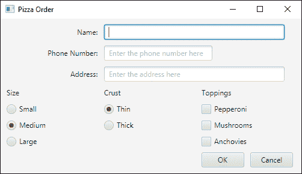

图 1-1：一个典型的 JavaFX 程序。

除了图 1-1 所示的基础数据输入表单外，JavaFX 许多许多用于创建高级 UI 的强大功能。特别是：

- **层级样式表（CSS）：** 样式表允许你控制 UI 的外观。当你使用 CSS 时，应用程序的所有格式细节都存放在一个名为 `style sheet`（样式表）的独立文件中。样式表是一个简单的文本文件，为 UI 各种元素的格式化提供一组规则。你可以使用 CSS 控制成上百个格式属性。例如，你可以轻松地更改字体、大小、颜色和粗细等文本属性，还可以添加背景图像、渐变填充、边框以及阴影、模糊和光源等特殊效果。
- **视觉效果：** 你可以为 UI 元素添加各种视觉效果，包括阴影、反射、模糊、光照和透视效果。
- **动画：** 你可以指定动画效果，随时间逐渐应用过渡效果。
- **图表：** 你可以使用 `javafx.scene.chart` 包中的许多类创建柱状图、饼图和许多其他图表类型。
- **3D 对象：** 你可以绘制三维对象，如立方体、圆柱体、球和其他复杂的形状。
- **触摸界面：** JavaFX 可以轻松处理触摸屏设备，如智能手机和平板电脑。
- **属性绑定：** JavaFX 允许你创建 `properties`（属性），这些是可以绑定到 UI 控件的特殊数据类型。例如，你可以创建一个代表购买商品价格的属性，然后将标签绑定到它上。每当价格的值发生变化时，标签显示的值就会更新。

 当你第一次遇到 JavaFX 中的属性时，可能会感到困惑，因为 JavaFX 对 `property` 一词的使用与你习惯的用法不同。在口语用法中，`property` 指的是类的属性。在 Java 语言中，与此意义上的属性最接近的是 getter 和 setter 方法，它们用于暴露类内部的字段；例如，一个 `Customer` 类可能有一个名为 `Address` 的“属性”，通过命名为 `getAddress` 和 `setAddress` 方法来访问。

在 JavaFX 中，属性比这要强大得多。正如你在本微型书籍的第 6 章中所发现的，JavaFX 属性不仅管理类的属性（例如复选框是否被勾选），还允许你将 `observer`（观察者）绑定到该属性，这样每当属性值变化时，观察者就会被触发。

本微型书籍的第 6 章涵盖了属性，但本章其余部分以及后续的四章将重点关注使用 JavaFX 创建简单 UI 的基础。

 如果你想深入研究 JavaFX，请买一本我的书 *JavaFX For Dummies*（Wiley 出版）。

## 准备运行 JavaFX

从 Java 11 版本开始，JavaFX 系统已完全模块化并从标准 Java 分发中移除。这意味着，如果你在没有先设置 JavaFX 的情况下尝试编译和运行本微型书籍中的 JavaFX 程序，将会遇到大量的错误信息。

要正确编译和测试 JavaFX 程序，你首先需要安装 JavaFX。要这样做，请访问 [`http://openjfx.io`](http://openjfx.io/)，点击 Download 链接，然后下载适用于你平台的 JavaFX 软件开发包（SDK）。将下载的内容解压到硬盘上的任意位置（我建议使用 `c:\javafx18.0.2`，或者你下载文件时的当前版本号），以便 Java 模块可以随时使用。如果你查看此文件夹，关键子文件夹是 `lib`，它包含了构成各种 JavaFX 模块的 `.jar` 文件。

下载 JavaFX 并将其放置在易于访问的位置后，在创建和运行 JavaFX 程序时你将面临一些复杂问题。这是因为 JavaFX 程序必须使用 Java 模块系统来将程序的类与所需的 JavaFX 模块正确打包。如果你不熟悉 Java 模块系统，这可能是回顾第三本书第 8 章的一个好时机。

以下是设置 JavaFX 项目需要执行的操作简要概述：

- 每个程序都必须是命名包的一部分。对于本微型书籍中的程序，包名以 `com` 开头。

 记住包名应该由小写字母组成。

- JavaFX 程序的文件夹结构应包含根目录和子文件夹。例如，`ClickMe.java` 文件位于 `com\lowewriter`。
- 根目录应包含一个 `module-info.java` 文件，内容如下：

```java
module lowewriter.clickme

{

    requires javafx.controls;

    exports lowewriter.clickme;

}
```

- 根目录还应包含一个指定主类的清单文件。例如，`ClickMe` 应用有一个名为 `clickme.mf` 的清单文件，包含以下行：

```text
Main-Class: com.lowewriter.clickme.ClickMe
```

完成后，JavaFX 项目的文件夹和文件结构应该所示（文件夹用加粗表示）：

```text
**C:\**

**com.lowewriter.clickme**

clickme.mf

module-info.class

**com**

**lowewriter**

**clickme**

ClickMe.java
```

许多集成开发环境（IDE），如 Eclipse 或 Netbeans，会自动设置此项目结构。如果你没有使用开发环境，则需要手动设置这些文件夹和文件。

当你根据这些指南设置好项目后，就可以编译 java 文件、创建 jar 文件，然后运行 jar 文件来测试程序。再次，像 Eclipse 或 Netbeans 这样的 IDE 会为你处理正确命令选项的细节。但如果你从命令行操作，你需要了解以下几点：

- 要编译 JavaFX 程序，必须在 `javac` 命令中添加两个开关：`--module-path` 和 `--add-modules`。`--module-path` 开关提供 JavaFX lib 文件夹的路径，而 `--add-modules` 开关指定必须添加的 JavaFX 模块（通常只是 `javafx.controls`）。

```bash
javac module-info.java com\lowewriter\ClickMe\*.java
```

```bash
--module-path "c:\javafx-sdk-18.0.2\lib"

--add-modules javafx.controls
```

- 要创建 jar 文件，你需要使用 `cmvf` 选项，并指定清单文件（manifest）名称、要创建的 jar 文件名以及要添加的类。这里是一个示例：

```bash
jar cmvf clickme.mf com.lowewriter.clickme.jar *.class com\lowewriter\ClickMe\*.class
```

- 最后，要运行 jar 文件，你必须再次提供 `--module-path` 和 `--add-modules` 选项。这里是一个示例：

```bash
java --module-path c:\javafx-sdk-18.0.2\lib

--add-modules javafx.controls com.lowewriter.clickme.ClickMe
```

呼！为了让 JavaFX 程序运行起来，似乎要做大量工作。但当你掌握了这些细节后，就可以专注于学习如何使用 JavaFX 编写精美的 GUI 了。（如果你愿意，可以将这些命令放在一个简单的批处理文件中，这样就可以轻松地重新编译程序。）继续往下看，开始有趣的内容。

## 观察一个简单的 JavaFX 程序

图 1-2 显示了一个非常简单的 JavaFX 程序的界面，它只包含一个按钮。最初，该按钮的文本显示为 `Click me please!`。当你点击它时，按钮文本会变为 `You clicked me!`。再次点击按钮，文本会变回 `Click me please!`。之后，每次点击按钮，文本都会会在 `Click me please!` 和 `You clicked me!` 之间循环切换。要退出程序，只需点击关闭按钮（右上角的 X）。

列表 1-1 显示了该程序的完整代码列表。


图 1-2：Click Me 程序。

列表 1-1 ClickMe 程序

```java
package com.lowewriter.clickme;

import javafx.application.*;

import javafx.stage.*;

import javafx.scene.*;

import javafx.scene.layout.*;

import javafx.scene.control.*;

public class ClickMe extends Application

{

    public static void main(String[] args)

    {

        launch(args);

    }

    Button btn;

    @Override public void start(Stage primaryStage)

    {

        // 创建按钮

        btn = new Button();

        btn.setText("Click me please!");

        btn.setOnAction(e -> buttonClick());

        // 将按钮添加到布局面板中

        BorderPane pane = new BorderPane();

        pane.setCenter(btn);

        // 将布局面板添加到场景

        Scene scene = new Scene(pane, 300, 250);

        // 完成设置并显示阶段

        primaryStage.setScene(scene);

        primaryStage.setTitle("The Click Me App");

        primaryStage.show();

    }

    public void buttonClick()

    {

        if (btn.getText() == "Click me please!")

        {

            btn.setText("You clicked me!");

        }

        else

        {

            btn.setText("Click me please!");

        }

    }

}
```

后续章节描述了此基础 JavaFX 程序的其余关键方面。

## 导入 JavaFX 包

在必需的 `package` 语句之后，JavaFX 程序以一系列 `import` 语句开头，这些语句引用了程序将使用的各种 JavaFX 包。Click Me 程序包含了以下五个 `import` 语句：

```java
import javafx.application.*;

import javafx.stage.*;

import javafx.scene.*;

import javafx.scene.layout.*;

import javafx.scene.control.*;
```


如你所见，所有的 JavaFX 包都以 `javafx` 开头。Click Me 程序使用了五个不同 JavaFX 包中的类：

- `javafx.application`：此包定义了所有 JavaFX 应用程序都依赖的核心类：`Application`。你可以在本章稍后的“扩展 Application 类”部分阅读更多关于 `Application` 类的信息。
- `javafx.stage`：此包中最重要的类是 `Stage` 类，它定义了所有 UI 对象的顶级容器。`Stage` 是 JavaFX 应用程序最高级别的窗口，应用程序的所有用户界面元素都显示在其中。
- `javafx.scene`：此包中最重要的类是 `Scene` 类，它是一个包含程序显示的所有 UI 元素的容器。
- `javafx.scene.layout`：此包定义了一种特殊的用户界面元素，称为布局管理器（layout manager）。布局管理器的工作是确定控件的位置。
- `javafx.scene.control`：此包包含了 UI 控件，如按钮、文本字段和标签。

## 扩展 Application 类

每个 JavaFX 应用程序必须扩展 `Application` 类。该类提供了程序的入口点并管理其生命周期。生命周期包括以下步骤：

1. 创建 `Application` 类的实例。
2. 调用 `init` 方法。`init` 方法的默认实现什么都不做，但你可以重写它，以便在 UI 显示之前执行任何你想要执行的处理。
3. 调用 `start` 方法。`start` 方法是一个抽象方法，这意味着 `Application` 类没有提供默认实现。因此，你必须提供你自己的 `start` 方法版本。`start` 方法负责构建和显示 UI。（有关更多信息，请参阅本章稍后的“重写 start 方法”部分。）
4. 等待应用程序结束，这通常发生在用户通过关闭主窗口或选择程序退出命令来信号程序结束时。在此期间，应用程序并不是真的空闲的。相反，它正忙于响应用户事件执行操作，例如点击按钮或从下拉列表中选择项目。
5. 调用 `stop` 方法。像 `init` 方法一样，`stop` 方法的默认实现什么都不做，但你可以重写它在程序终止时执行任何必要的处理。


## 启动应用程序

众所周知，Java 程序的标准入口是 `main` 方法。以下是 Click Me 程序的 `main` 方法：

```java
public static void main(String[] args)
{
    launch(args);
}
```

如你所见，`main` 方法只包含一条语句，即调用 `Application` 类的 `launch` 方法。

`launch` 方法实际上启动了 JavaFX 应用程序。`launch` 方法是一个 `static` 方法，因此可以在 `main` 方法的静态上下文中调用。它创建 `Application` 类的实例，然后启动 JavaFX 生命周期周期，调用 `init` 和 `start` 方法，等待应用程序结束，最后调用 `stop` 方法。

`launch` 方法在 JavaFX 应用程序结束之前不会返回。假设你是这样写 Click Me 程序的 `main` 方法的：

```java
public static void main(String[] args)
{
    System.out.println("Launching JavaFX");
    launch(args);
    System.out.println("Finished");
}
```

此时，你会在控制窗口中看到 `Launching JavaFX`，同时 JavaFX 应用程序窗口会打开。当你关闭 JavaFX 应用程序窗口时，你会在控制窗口中看到 `Finished`。

## 重写 start 方法

每个 JavaFX 应用程序必须包含一个 `start` 方法。你在 `start` 方法中编写创建程序用户将交互的 UI 元素的代码。例如，Listing 1-1 中的 `start` 方法包含了显示一个文本为 `Click Me!` 按钮的代码。

当启动 JavaFX 应用程序时，在 `Application` 类初始化后，JavaFX 框架会调用 `start` 方法。

Click Me 程序的 `start` 方法看起来如下所示：

```java
@Override
public void start(Stage primaryStage)
{
    // 创建按钮
    btn = new Button();
    btn.setText("Click me please!");
    btn.setOnAction(e -> buttonClick());

    // 将按钮添加到布局面板
    BorderPane pane = new BorderPane();
    pane.setCenter(btn);

    // 将布局面板添加到场景
    Scene scene = new Scene(pane, 300, 250);

    // 完成阶段并显示阶段
    primaryStage.setScene(scene);
    primaryStage.setTitle("The Click Me App");
    primaryStage.show();
}
```

为了为 Click Me 程序创建 UI，`start` 方法执行了以下四个基本步骤：

1. 创建名为 `btn` 的按钮控件。按钮的文本设置为 `Click me please!`，当用户点击按钮时，将调用名为 `buttonClick` 的方法。  
   关于此代码的更详细解释，请参阅本章后续的章节“创建按钮”和“处理动作事件”。
2. 创建名为 `pane` 的布局面板并将按钮添加到其中。  
   欲了解更多信息，请参阅本章后续的章节“创建布局面板”。
3. 创建名为 `scene` 的场景并将布局面板添加到其中。  
   欲了解更多信息，请参阅本章后续的章节“创建场景”。
4. 通过设置场景、设置阶段标题和显示阶段来完成阶段。  
   欲了解更多信息，请参阅本章后续的章节“设置阶段”。

你将在本章的后续部分找到这些代码块的相关详细信息。在我继续之前，我想指出关于 `start` 方法的几个额外显著细节：

- `start` 方法在 `Application` 类中被定义为抽象方法，因此当你在 JavaFX 程序中包含一个 `start` 方法时，你实际上是在重写抽象的 `start` 方法。  
   虽然不是必须，但包含 `@Override` 注解始终是一个好习惯，可以显式声明你正在重写 `start` 方法。如果你省略了此注解并在命名方法名时出现错误（例如，使用 `Start` 而不是 `start`）或列出参数错误，Java 会认为你正在定义一个新方法，而不是重写 `start` 方法。
- 与 `main` 方法不同，`start` 方法不是静态方法。当你从静态 `main` 方法中调用 `launch` 方法时，`launch` 方法会创建你的 `Application` 类的实例，然后调用 `start` 方法。
- `start` 方法接受一个参数：用于显示应用程序 UI 的 `Stage` 对象。当应用程序调用你的 `start` 方法时，应用程序会通过 `primaryStage` 参数传递主阶段（称为原始阶段）。因此，你可以在 `start` 方法的后续部分使用 `primaryStage` 参数来引用应用程序的阶段。

## 创建按钮

Click Me 程序显示的按钮是使用名为 `Button` 的类创建的。该类是你可以用于创建 UI 控件的许多类之一。`Button` 类以及大多数其他控件类都位于 `javafx.scene.control` 包中。

要创建一个按钮，只需定义一个 `Button` 类型的变量，然后如下所示调用 `Button` 构造函数：

```java
Button btn;
btn = new Button();
```

在 Listing 1-1 的代码中，`btn` 变量声明为 `start` 方法之外的类变量，但 `Button` 对象实际上是在 `start` 方法内部创建的。控件通常被声明为类变量，以便你从类中定义的任何方法访问它们。正如你在接下来的章节（“处理动作事件”）中发现的，当用户点击按钮时，会调用一个名为 `buttonClick` 的独立方法。通过将 `btn` 变量定义为类变量，`start` 方法和 `buttonClick` 方法都可以访问它。

## 创建按钮

Click Me 程序显示的按钮是使用名为 `Button` 的类创建的。该类是你可以用于创建 UI 控件的许多类之一。`Button` 类以及大多数其他控件类都位于 `javafx.scene.control` 包中。

要创建一个按钮，只需定义一个 `Button` 类型的变量，然后如下所示调用 `Button` 构造函数：

```java
Button btn;
btn = new Button();
```

要设置按钮显示的文本，请调用 `setText` 方法：

```java
btn.setText("Click me!");
```

以下是关于按钮的几点提示：

- `Button` 类是派自 `javafx.scene.control.Control` 的许多类之一。许多其他类也派自它，包括 `Label`、`TextField`、`ComboBox` 和 `RadioButton`。
- `Control` 类派自 `javafx.scene.Node`。`Node` 是所有可以在场景中显示的界面元素的基类。也就是说，所有控件都是节点，但所有节点都是控件。你可以在本书后续部分了解更多类型的节点。

## 处理动作事件

当用户点击按钮时，会触发一个*动作事件*。你的程序可以通过提供*事件处理器*来响应事件，处理器就是当事件发生时执行的代码。Click Me 程序通过为按钮设置事件处理器来工作；处理器的代码会更改按钮上的文本。

在 JavaFX 中有几种处理事件的方法。最直接的方法指定事件发生时调用某个方法，然后提供该方法的实现。

要指定要调用的方法，你调用按钮的 `setOnAction` 方法。在 Listing 1-1 中是这样的：

```java
btn.setOnAction(e -> buttonClick());
```

如果此处使用的语法看起来有些陌生，是因为它使用了 *lambda 表达式*，这是 Java 8 版本中引入的特性。在此示例中，该语法有三个元素：

- 参数 `e` 代表一个 `ActionEvent` 的对象，程序可以使用它来获取事件的详细信息。  
   Click Me 程序忽略了这个参数，所以你也可以忽略它，至少目前是。
- 箭头运算符（`->`）是 Java 8 引入的用于 lambda 表达式的运算符。
- 方法调用 `buttonClick()` 只是调用名为 `buttonClick` 的方法。

你将在本版的第 2 章中看到更多使用 lambda 表达式处理事件的示例，可以在第 7 卷第 2 章中找到对 lambda 表达式更完整的讨论。

```java
public void buttonClick()
{
    if (btn.getText() == "Click me please!")
    {
        btn.setText("You clicked me!");
    }
    else
    {
        btn.setText("Click me please!");
    }
}
```

此方法使用 `if` 语句交替更改按钮显示的文本，在 `You clicked me!` 或 `Click me please!` 之间。换句话说，如果用户点击按钮时按钮的文本是 `Click me please!`，则 `buttonClicked` 方法会将文本更改为 `You clicked me!`。否则，`if` 语句会将按钮的文本改回 `Click me please!`。

`buttonClicked` 方法使用了 `Button` 类的两个方法来执行其工作：

- `getText`：返回按钮显示的文本，格式为字符串。
- `setText`：设置按钮显示的文本。

有关处理事件的更多信息，请参阅本微型教程读书的第 2 章。

## 创建布局窗（Layout Pane）

按钮本身并没有什么用。你必须实际上将其显示在屏幕上，用户才能点击它。任何真实的 JavaFX 程序都将包含多个控件。每当你向 UI 中添加第二个控件时，你需要一种方法来指定控件彼此之间的相对位置。例如，如果你的应用程序有两个按钮，你是希望它们垂直堆叠（一个在另一个上面），还是并排排列？

这就是布局窗（layout panes）大显用场的地方。`layout pane` 容器类，你可以向其添加一个或多个用户界面元素。然后，布局窗确定这些元素彼此之间的具体显示方式。

要使用布局窗，你首先创建一个布局窗的实例。然后，你向布局窗中添加一个或多个控件。这样做时，你可以指定当布局窗显示时控件的安排细节。当你将所有控件添加到布局窗并安排妥当后，就将布局窗添加到场景（scene）中。

JavaFX 提供了共八种不同类型的布局窗，均由 `javafx.scene.layout` 包中的类定义。“Click Me”程序使用了一种名为 `border pane`（边界布局窗）的布局窗，它将布局窗的内容分为五个普通区域：顶、左、右、底和中心。`BorderPane` 类非常适用于此类布局：即在顶部有菜单和工具栏等元素，底部有状态栏，左侧或右侧可选任务面板或工具栏，而屏幕中心是主要工作区域。

“Click Me”程序中创建边界布局窗的代码行如下：

```java
BorderPane pane = new BorderPane();
pane.setCenter(btn);
```

在这里，声明了一个类型为 `BorderPane` 的变量名为 `pane`，并调用 `BorderPane` 构造函数创建一个新的 `BorderPane` 对象。然后，使用 `setCenter` 方法将按钮（`btn`）显示在布局窗的中心区域。

以下是关于布局窗的其他有趣细节：

- 布局窗会根据布局中所包含元素的大小以及布局窗显示空间的大小，自动调整其所包含的元素的精确位置。
-  我之前提到过控件是节点（node）的一种类型，你将在本书的后部分读到其他类型的节点。很好，你刚刚读到了其中一种：布局窗也是节点的一种。
- 边界布局窗的每个区域都可以包含一个节点。因为布局窗本身是一种节点，所以边界布局窗的每个区域都可以包含另一个布局窗。例如，假设你想在边界布局窗的中心区域显示三个控件。为了实现这一点，你需要创建第二个布局窗并将这三个控件添加到其中。然后，你将第二个布局窗设置为要在第一个布局窗中心区域显示的节点。
- 你可以在本微型教程读书第 4 章中阅读更多关于 `BorderPane` 类以及其他一些常用布局窗的知识。

## 创建场景（Scene）

在你创建了包含想要显示的控件的布局窗之后，下一步是创建一个显示该布局窗的场景。你可以通过一行代码来实现，即声明一个类型为 `Scene` 的变量并调用 `Scene` 类的构造函数。这就是我在“Click Me”程序中做的：

```java
Scene scene = new Scene(pane, 300, 250);
```

`Scene` 构造函数接受三个参数：

- 一个 `node` 对象，代表场景要显示的 `root node`（根节点）。场景只能有一个根节点，因此根节点通常是一个布局窗，它反过来包含要显示的其它控件。在“Click Me”程序中，根节点是包含按钮的边界布局窗。
- 场景的宽度（像素为单位）。
- 场景的高度（像素为单位）。

***注意：*** 如果省略宽度和高度，场景将根据根节点内包含的元素的大小自动调整尺寸。

你可以在本微型教程读书第 3 章中了解 `Scene` 类的一些额外功能。

## 设置舞台（Stage）

如果说 `scene` 代表应用程序显示的节点（控件和布局窗），那么 `stage`（舞台）代表显示场景的窗口。当 JavaFX 框架调用你应用程序的 `start` 方法时，它会传递给你 `Stage` 类的实例，代表应用程序的主舞台。这个引用是通过 `primaryStage` 参数传递的。

创建场景后，你现在准备好完成舞台以便显示场景。要这样做，你至少需要做两件事：

- 调用舞台的 `setScene` 方法来设置场景。
- 调用舞台的 `show` 方法来显示场景。在你调用 `show` 方法后，你的应用程序将变得可见，用户就可以开始与其控件交互。

通常还会设置应用程序标题栏中显示的标题。你通过调用舞台的 `setTitle` 方法来实现。“Click Me”应用程序的 `start` 方法的最后三行执行了这些功能：

```java
primaryStage.setScene(scene);
primaryStage.setTitle("The Click Me App");
primaryStage.show();
```


当最后一行调用`show`方法时，`Stage`显示。

你可以在本微型教程第 3 章中了解`Stage`的附加功能。

## 检查计数器程序

在解释了“Click Me”程序每一行的细节后，现在我们来看“Click Me”程序的稍微增强版本，即“计数器程序”。在本章之前所示的原始“Click Me”程序（列表 1-1）中，当用户点击按钮时按钮显示的文本会更改。在计数器程序中，一种名为`label`的额外控件显示用户点击按钮的次数。

图 1-3 显示了计数器程序的运行情况。图中顶部的窗口显示了计数器程序启动时的样子。你可以看到窗口顶部的文本标签显示`You have not clicked the button.`（你还没有点击按钮）。第二个窗口显示了你第一次点击按钮后程序的状态。在这里，标签显示`You have clicked the button once.`（你已经点击了按钮一次）。当按钮第二次点击时，标签再次更改，如第三个窗口所示。在这里，标签显示`You have clicked the button 2 times.`（你已经点击了按钮 2 次）。此后，每当你点击按钮，标签显示的数字就会更新，以指示按钮被点击的次数。

Listing 1-2 显示了点击计数器（Click Counter）程序的源代码，后续段落描述了其工作原理的关键点：

### Listing 1-2 点击计数器程序

```java
package com.lowewriter.clickcounter;

import javafx.application.*;
import javafx.stage.*;
import javafx.scene.*;
import javafx.scene.layout.*;
import javafx.scene.control.*;

public class ClickCounter extends Application
{
    public static void main(String[] args)
    {
        launch(args);
    }

    Button btn;
    Label lbl;
    int iClickCount = 0;

    @Override public void start(Stage primaryStage)
    {
        // Create the button
        btn = new Button();
        btn.setText("Click me please!");
        btn.setOnAction(e -> buttonClick());

        // Create the Label
        lbl = new Label();
        lbl.setText("You have not clicked the button.");

        // Add the label and the button to a layout pane
        BorderPane pane = new BorderPane();
        pane.setTop(lbl);
        pane.setCenter(btn);

        // Add the layout pane to a scene
        Scene scene = new Scene(pane, 250, 150);

        // Add the scene to the stage, set the title
        // and show the stage
        primaryStage.setScene(scene);
        primaryStage.setTitle("Click Counter");
        primaryStage.show();
    }

    public void buttonClick()
    {
        iClickCount++;

        if (iClickCount == 1)
        {
            lbl.setText("You have clicked once.");
        }
        else
        {
            lbl.setText("You have clicked "
            + iClickCount + " times." );
        }
    }
}
```

以下段落解释了`ClickCounter`程序的关键点：

* →1：`package`语句命名了包：`com.lowewriter.clickcounter`。
* →3：`import`语句引用了`ClickCounter`程序将要使用的`javafx`包。
* →9：`ClickCounter`类继承自`javafx.application.Application`，因此指定了`ClickMe`类是一个 JavaFX 应用程序。
* →11：与任何 Java 程序一样，`main`方法是所有 JavaFX 程序的主入口点。
* →13：`main`方法调用了`launch`方法，该方法由`Application`类定义。`launch`方法反过来创建一个`ClickMe`类的实例，然后调用`start`方法。
* →16：声明了一个类型为`javafx.scene.control.Button`的名为`btn`的类变量。代表 JavaFX 控件的变量通常定义为类变量，以便类中的任何方法都可以访问它们。
* →17：声明了一个名为`lbl`的类型为`javafx.scene.control.Label`的类变量，代表`Label`控件，以便从类中的任何方法访问它。
* →18：一个名为`iClickCount`的类变量将用于跟踪用户点击按钮的次数。
* →20：`start`方法的声明使用了`@Override`注解，表示该方法覆盖了由`Application`类提供的默认`start`方法。`start`方法接受一个名为`primaryStage`的参数，它代表`ClickCounter`应用程序显示 UI 的窗口。
* →23：`start`方法从创建一个`Button`对象开始并将其赋值给名为`btn`的变量。
* →24：调用按钮的`setText`方法将按钮显示的文本设置为`Click me please!`。
* →25：调用`setOnAction`方法为按钮创建一个事件处理程序。在这里，使用了 lambda 表达式，以便每当用户点击按钮时简单地调用`buttonClick`方法。
* →28：调用`Label`类的构造函数来创建一个新标签。
* →29：调用标签的`setText`方法将标签的初始文本值设置为`You have not clicked the button`。
* →32：通过调用`BorderPane`类的构造函数创建一个边框布局对象，并通过名为`pane`的变量引用该边框布局。该边框布局将用于控制屏幕上显示的控件的布局。
* →33：调用边框布局的`setTop`方法将标签添加到边框布局的顶部区域。
* →34：调用边框布局的`setCenter`方法将按钮添加到边框布局的中心区域。
* →37：通过调用`Scene`类的构造函数创建一个`scene`对象，将第 32 行创建的边框布局传递给构造函数，以将边框布局建立为场景的根节点。此外，场景的尺寸设置为宽度 300 像素，高度 250 像素。
* →41：使用`primaryStage`的`setScene`方法将场景添加到主阶段（primary stage）。
* →42：使用`setTitle`方法设置在主阶段标题栏中显示的文本。
* →43：调用`show`方法显示主阶段。当此行代码执行时，用户就可以开始与程序进行交互。
* →46：每当用户点击按钮时，都会调用`buttonClick`方法。
* →48：`iClickCount`变量递增，表示用户点击了按钮。
* →49：使用`if`语句判断按钮是否被点击过一次或多次。
* →51：如果按钮被点击过一次，标签文本设置为`You have clicked once`。
* →55：否则，标签文本设置为一个指示按钮点击次数的字符串。

在本微书的第 1 章中，你检查了两个显示简单场景的程序，这些场景包含按钮并在用户点击按钮时做出响应。这些程序通过提供一个在事件发生时执行的`event handler`（事件处理器）来响应用户点击按钮触发的事件。

在本章中，你将阅读关于 JavaFX 中事件处理如何工作的更多细节。我讨论了事件是如何生成的，以及 JavaFX 是如何分发它们的，以便你的程序能够对它们做出响应。你发现了 JavaFX 程序可以处理的许多种事件，并且你掌握了几种处理 JavaFX 事件的编程技术。


尽管事件处理主要用于响应按钮点击，但它也可以用于响应其他类型的用户交互。例如，你可以使用事件处理来编写代码，当用户从组合框中选择、将鼠标移动到标签上方或在键盘上按下键时执行这些代码。本章中的事件处理技术同样适用于这些事件。

## 查看事件

`event`（事件）是用户对你的用户界面组件执行某些值得注意的操作时生成的对象。然后，该事件对象会被传递到你创建的一个特殊方法，称为事件处理器（event handler）。`event handler`可以检查事件对象，确定具体发生了什么种类型的事件，并做出相应的响应。如果用户点击按钮，事件处理器可能会将用户通过文本字段输入的任何数据写入文件。如果用户将鼠标光标悬在标签上，事件处理器可能会更改标签显示的文本。如果用户从组合框中选择一个项目，事件处理器可能会使用所选的值在数据库中查找信息。可能性是无限的！

事件由`javafx.event.Event`类的实例或其许多子类之一表示。表 2-1 列出了最常用的事件类。

| 事件类（Event Class） | 包（Package） | 描述（Description） |
| --- | --- | --- |
| `ActionEvent` | `javafx.event` | 当用户在按钮或其他组件上执行操作时创建。通常意味着用户点击了按钮，但用户也可以通过 Tab 键切换到按钮并按 Enter 键来调用按钮操作。这是最常用的事件类，因为它代表了最常见的用户界面事件类型。 |
| `InputEvent` | `javafx.scene.input` | 当发生由用户输入引起的事件（如鼠标或键盘点击）时创建。 |
| `KeyEvent` | `javafx.scene.input` | 当用户在键盘上按下按键时创建。此事件可用于监控用户输入的特定按键。（`KeyEvent`是`InputEvent`的子类。） |
| `MouseEvent` | `javafx.scene.input` | 当用户使用鼠标执行某些有趣操作时创建，例如点击按钮之一、拖动鼠标或简单地将鼠标光标移动到另一个对象上。（`MouseEvent`是`InputEvent`的子类。） |
| `TouchEvent` | `javafx.scene.input` | 当用户在允许触摸输入的设备上启动触摸事件时创建。 |
| `WindowEvent` | `javafx.stage` | 当窗口（`stage`）状态发生时创建。 |

表 2-1 常用事件类


这里有四个你需要了解的重要术语：

* **事件（Event）：** 当用户对组件执行某些值得注意的操作（如点击它）时创建的对象。
* **事件源（Event source）：** 事件最初发生的对象。
* **事件目标（Event target）：** 事件指向的节点。这通常是用户点击或以其他方式操作的按钮或其他控件。（在大多数情况下，事件源和事件目标是同一个。）
* **事件处理器（Event handler）：** 监听事件并在事件发生时处理它们的对象。事件监听器对象必须实现`EventHandler`函数式接口，该接口定义了一个名为`handle`的单方法（参见表 2-2）。`EventHandler`接口定义在`javafx.event`包中。

| 方法（Method） | 描述（Description） |
| --- | --- |
| `void handle<T event>` | 在事件发生时被调用 |

表 2-2 `EventHandler`接口

## 处理事件

现在你已经了解了用于事件处理的基础类和接口，你准备好研究如何连接它们来创建一个响应事件的程序了。

在本节中，我讨论了如何通过对程序的`Application`进行编码来实现事件处理器，使其在扩展`Application`类之外，也实现`EventHandler`接口。在本章的后续章节中，我讨论了实现事件处理器的替代技术，这些技术更简洁，在许多情况下更容易操作。

请注意，在本微书的第 1 章中显示的程序使用了简洁的 lambda 表达式技术，本微书其余部分的大部分程序也使用了 lambda 表达式。但了解其他技术是非常重要的，这样你才能对事件处理的实际原理有完整的理解。

处理 JavaFX 事件你必须采取的三个步骤：

1. **创建事件源。**

   `event source`仅仅是一个控件，例如按钮，它可以生成事件。通常，你将引用事件源的变量声明为私有类字段，位于`start`方法之外：

   ```java
   private Button btn;
   ```

   然后，在`start`方法中，你可以这样创建按钮：

   ```java
   btn = new Button();
   btn.setText("Click me!");
   ```

2. **创建事件处理器。**

   要创建事件处理器，你必须创建一个实现相应`EventHandler`接口的对象。该对象必须提供`handle`方法的实现。

   这里是创建事件处理器的四种方法：

   * 在`Application`类中添加`implements EventHandler`并提供`handle`方法的实现。你可以在“实现 EventHandler 接口”节中了解如何使用这种技术。
   * 在`Application`类内部创建一个实现`EventHandler`的内部类。你可以在“使用内部类处理事件”节中了解如何使用这种技术。
   * 创建一个实现`EventHandler`的匿名类。我将在“使用匿名内部类处理事件”节向你展示如何使用这种技术。
   * 使用 lambda 表达式来实现`handle`方法。你可以在“使用 Lambda 表达式处理事件”节中阅读如何使用这种技术。

3. **将事件处理器注册到事件源。**

   最后一步是将事件处理器注册到事件源，以便每当事件发生时都会调用`handle`方法。

   每个作为事件源的组件都提供了一个方法，让你注册事件处理器以监听事件。例如，`Button`控件提供`setOnAction`方法，允许你为动作事件注册事件处理器。在`setOnAction`方法中，你指定事件处理器对象作为参数。具体方法取决于你使用了哪种技术来创建事件处理器。

为了了解所有这些元素如何在完整程序中协同工作，图 2-1 显示了名为`AddSubtract1`的简单程序的输出。该程序显示了一个标签和两个按钮，一个标题为 Add，另一个标题为 Subtract。标签初始显示数字 0。用户每点击一次`Add`按钮，标签显示的值就会增加 1；用户每点击一次`Subtract`按钮，该值就会减少 1。

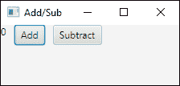

图 2-1：`AddSubtract1`程序。

代码列表 2-1 显示该程序的完整代码。

### 代码列表 2-1 `AddSubtract1`程序

```java
package com.lowewriter.addsubtract1;

import javafx.application.*;
import javafx.stage.*;
import javafx.scene.*;
import javafx.scene.layout.*;
import javafx.scene.control.*;
import javafx.event.*;

public class AddSubtract extends Application
implements EventHandler<ActionEvent>
{
    public static void main(String[] args)
    {
        launch(args);
    }

    Button btnAdd;
    Button btnSubtract;
    Label lbl;
    int iCounter = 0;

    @Override public void start(Stage primaryStage)
    {
        // Create the Add button
        btnAdd = new Button();
        btnAdd.setText("Add");
```


```java
btnAdd.setOnAction(this);

// Create the Subtract button

btnSubtract = new Button();

btnSubtract.setText("Subtract");

btnSubtract.setOnAction(this);

// Create the Label

lbl = new Label();

lbl.setText(Integer.toString(iCounter));

// Add the buttons and label to an HBox pane

HBox pane = new HBox(10);

pane.getChildren().addAll(lbl, btnAdd, btnSubtract);

// Add the layout pane to a scene

Scene scene = new Scene(pane, 200, 75);

// Add the scene to the stage, set the title

// and show the stage

primaryStage.setScene(scene);

primaryStage.setTitle("Add/Sub");

primaryStage.show();

}

@Override public void handle(ActionEvent e)

{

    if (e.getSource()==btnAdd)

    {

        iCounter++;

    }

    else

    {

        if (e.getSource()==btnSubtract)

        {

            iCounter--;

        }

    }

    lbl.setText(Integer.toString(iCounter));

}

}
```

接下来的段落指出了程序的一些关键行：

- →8：程序必须导入`javafx.event`包，该包定义了`ActionEvent`类和`EventHandler`接口。
- →11：与任何 JavaFX 程序一样，`AddSubtract1`类继承自`Application`类。然而，`AddSubtract1`类还实现了`EventHandler`接口，以便它可以定义一个`handle`方法来处理由按钮生成的`ActionEvent`事件。`EventHandler`接口是一个泛型接口，这意味着你必须指定接口将实现的特定事件类型。在这种情况下，该类将处理`ActionEvent`事件。
- →13：按照常例需要`main`方法。该方法简单地调用`launch`方法来创建`AddSubtract`类的实例，而该实例反过来调用`start`方法。
- →18：定义了两个按钮（`btnAdd`和`btnSubtract`）和一个标签（`lbl`）作为类字段，以便在整个类中访问它们。
- →21：`iCounter`变量跟踪标签显示的值。当用户点击`btnAdd`按钮时，值会增加；当用户点击`btnSubtract`按钮时，值会减少。
- →23：当应用程序启动时会调用`start`方法。
- →26：这一行和下一行创建了 Add 按钮，并将其文本设置为单词`Add`。
- →28：这一行将当前对象设置为`btnAdd`按钮的事件处理器。这里使用`this`关键字是因为`AddSubtract`类实现了`EventHandler`。实际上，`AddSubtract`类本身处理由其控件创建的任何事件。
- →31：这些行创建了 Subtract 按钮，并将其文本设置为单词`Subtract`。
- →35：创建`Label`。
- →40：将按钮和标签添加到`HBox`窗格。
- →41：`pane.getChildren().addAll(lbl, btnAdd, btnSubtract);`
- →44：将布局窗格添加到场景（scene）。
- →48：将场景添加到舞台（stage），设置标题并显示舞台。
- →53：`handle`方法。
- →55：`if (e.getSource()==btnAdd)`。
- →61：`if (e.getSource()==btnSubtract)`。
- →66：`lbl.setText(Integer.toString(iCounter));`

```java
private class ClickHandler

implements EventHandler <ActionEvent>

{

    @Override public void handle(ActionEvent e)

    {

        if (e.getSource()==btnAdd)

        {

            iCounter++;

        }

        else

        {

            if (e.getSource()==btnSubtract)

            {

                iCounter--;

            }

        }

        lbl.setText(Integer.toString(iCounter));

    }

}

}
```

此程序的工作原理与 Listing 2-1 中所示的程序基本相同，因此我没有检查每一个细节。相反，我只需强调差异：

- →10：`AddSubtract2`类仍然继承自`Application`，但没有实现`EventHandler`。
- →25：该语句创建了`ClickHandler`类（内部类）的实例，并将其赋值给变量`ch`。
- →30：该语句将`ch`设置为 Add 按钮的动作监听器。
- →35：该语句将`ch`设置为 Subtract 按钮的动作监听器。
- →55：`ClickHandler`类通过将其声明完全放置在`AddSubtract2`类内部，被声明为一个内部类。`ClickHandler`类实现了`EventHandler`接口，以便它可以处理事件。
- →58：这里的`handle`方法与 AddSubtract1 程序中的`handle`方法相同（参见 Listing 2-1），但它位于内部类`ClickHandler`中，而不是位于外部类中。

## 使用匿名内部类处理事件

*匿名内部类*（anonymous inner class，通常简称为*匿名类*，anonymous class）是在需要的地方现场定义的类。因为你直接在需要的地方编写类体，所以你不需要给它命名；这就是为什么它被称为*匿名*类。

匿名类通常用于事件处理器，以避免创建一个显式实现`EventHandler`接口的独立类。

使用匿名类作为事件处理器（以及 lambda 表达式）的一个优势是，你可以轻松为每个产生事件的控件创建一个独立的事件处理器。然后，在这些事件处理器的`handle`方法中，你可以省去检查事件源的`if`语句。

考虑之前在 Listing 2-2 中所示的 AddSubtract2 程序的事件处理器：它必须检查事件源以确定增加还是减少变量`iCounter`。通过使用匿名类，你可以为 Add 和 Subtract 按钮创建单独的事件处理器。Add 按钮的事件处理器增加`iCounter`，而 Subtract 按钮的事件处理器减少它。这两个事件处理器都不需要检查事件源，因为只有当与关联的按钮触发事件时，该事件处理器的`handle`方法会被调用。

Listing 2-3 显示了 AddSubtract3 程序，它以这种方式使用了匿名内部类。

### LISTING 2-3 使用匿名内部类的 AddSubtract3 程序

```java
package com.lowewriter.addsubtract3;

import javafx.application.*;

import javafx.stage.*;

import javafx.scene.*;

import javafx.scene.layout.*;

import javafx.scene.control.*;

import javafx.event.*;

public class AddSubtract3 extends Application

{

    public static void main(String[] args)

    {

        launch(args);

    }

    Button btnAdd;

    Button btnSubtract;

    Label lbl;

    int iCounter = 0;

    @Override public void start(Stage primaryStage)

    {

        // Create the Add button

        btnAdd = new Button();

        btnAdd.setText("Add");

        btnAdd.setOnAction(

            new EventHandler<ActionEvent>()

            {

                public void handle(ActionEvent e)

                {

                    iCounter++;

                    lbl.setText(Integer.toString(iCounter));

                }

            } );

        // Create the Subtract button

        btnSubtract = new Button();

        btnSubtract.setText("Subtract");

        btnSubtract.setOnAction(

            new EventHandler<ActionEvent>()

            {

                public void handle(ActionEvent e)

                {

                    iCounter--;

                    lbl.setText(Integer.toString(iCounter));

                }

            } );

        // Create the Label

        lbl = new Label();

        lbl.setText(Integer.toString(iCounter));

        // Add the buttons and label to an HBox pane

        HBox pane = new HBox(10);

        pane.getChildren().addAll(lbl, btnAdd, btnSubtract);

        // Add the layout pane to a scene

        Scene scene = new Scene(pane, 200, 75);

        // Add the scene to the stage, set the title

        // and show the

        primaryStage.setScene(scene);

        primaryStage.setTitle("Add/Sub");

        primaryStage.show();

    }

}
```

以下几段强调了该程序使用匿名内部类的关键点：

你也不需要知道正在实现的接口名称。这是可以实现的，因为接口是由上下文决定的。`setOnAction`方法接受一个类型为`EventHandler`的参数。因此，当你在调用`setOnAction`时使用 lambda 表达式，Java 编译器可以推断出该 lambda 表达式将实现`EventHandler`接口。由于`EventHandler`唯一的抽象方法是`handle`方法，编译器可以推断出你提供的方法体就是`handle`方法的实现。

从某种意义上说，lambda 表达式将匿名类的概念进一步推了一步。当你使用匿名类设置事件处理器时，你必须知道并指定类的名称（`EventHandler`）以及要调用的方法名称（`handle`），因此该类之所以被称为“匿名”，的唯一意义在于你不需要为引用该类的变量提供名称。但当你使用 lambda 表达式时，你不需要知道或指定类名、方法名或引用它的变量名。本质上，你只需要提供`handle`方法的方法体即可。

`Listing 2-4`显示了 AddSubtract4 程序，该程序使用 lambda 表达式来处理按钮点击。

### Listing 2-4 使用 lambda 表达式的 AddSubtract4 程序

```java
package com.lowewriter.addsubtract4;

import javafx.application.*;

import javafx.stage.*;

import javafx.scene.*;

import javafx.scene.layout.*;

import javafx.scene.control.*;

import javafx.event.*;

public class AddSubtract4 extends Application

{

    public static void main(String[] args)

    {

        launch(args);

    }

    Button btnAdd;

    Button btnSubtract;

    Label lbl;

    int iCounter = 0;

    @Override public void start(Stage primaryStage)

    {

        // Create the Add button

        btnAdd = new Button();

        btnAdd.setText("Add");

        btnAdd.setOnAction( e -> {

            iCounter++;

            lbl.setText(Integer.toString(iCounter));

        } );

        // Create the Subtract button

        btnSubtract = new Button();

        btnSubtract.setText("Subtract");

        btnSubtract.setOnAction( e -> {

            iCounter--;

            lbl.setText(Integer.toString(iCounter));

        } );

        // Create the Label

        lbl = new Label();

        lbl.setText(Integer.toString(iCounter));

        // Add the buttons and label to an HBox pane

        HBox pane = new HBox(10);

        pane.getChildren().addAll(lbl, btnAdd, btnSubtract);

        // Add the layout pane to a scene

        Scene scene = new Scene(pane, 200, 75);

        // Add the scene to the stage, set the title

        // and show the stage

        primaryStage.setScene(scene);

        primaryStage.setTitle("Add/Sub");

        primaryStage.show();

    }

}
```


该程序的运行方式与 Listing 2-3 所示的程序基本相同，因此我直接指出与使用 lambda 表达式直接相关的特性：

* `→27`：这条语句使用 lambda 表达式为 Add 按钮添加了事件处理器。该 lambda 表达式的方法体增加了计数器变量，然后设置标签文本以反映更新的值。
* `→36`：这条语句使用类似的 lambda 表达式为 Subtract 按钮创建事件处理器。该 lambda 表达式与 Add 按钮的表达式唯一的区别在于，这里计数器变量是减少的而不是增加的。

请注意，在这个示例中，两个事件处理器的 lambda 表达式非常简单，因为当此程序中的任何按钮被点击时，需要处理的操作非常少。然而，如果一个或多个按钮点击的处理需要数百行 Java 代码来实现，该程序会变成什么样？lambda 表达式将变得难以处理。出于这个原因，我倾向于将事件处理器实际执行的操作隔离在一个单独的方法中。然后，lambda 表达式本身只包含一行简单调用该方法的代码。

`Listing 2-5` 显示了使用该技术实现的 AddSubtract5 程序的另一种变。请注意，`Listing 2-5` 中使用的技术是书中其余大部分程序所使用的技术。

### Listing 2-5 使用 lambda 表达式的 AddSubtract5 程序

```java
package com.lowewriter.addsubtract5;

import javafx.application.*;
import javafx.stage.*;
import javafx.scene.*;
import javafx.scene.layout.*;
import javafx.scene.control.*;
import javafx.event.*;

public class AddSubtract5 extends Application
{
    public static void main(String[] args)
    {
        launch(args);
    }

    Button btnAdd;
    Button btnSubtract;
    Label lbl;
    int iCounter = 0;

    @Override public void start(Stage primaryStage)
    {
        // Create the Add button
        btnAdd = new Button();
        btnAdd.setText("Add");

        btnAdd.setOnAction(e -> {
            iCounter++;
            lbl.setText(Integer.toString(iCounter));
        });

        // Create the Subtract button
        btnSubtract = new Button();
        btnSubtract.setText("Subtract");

        btnSubtract.setOnAction(e -> {
            iCounter--;
            lbl.setText(Integer.toString(iCounter));
        });

        // Create the Label
        lbl = new Label();
        lbl.setText(Integer.toString(iCounter));

        // Add the buttons and label to an HBox pane
        HBox pane = new HBox(10);
        pane.getChildren().addAll(lbl, btnAdd, btnSubtract);

        // Add the layout pane to a scene
        Scene scene = new Scene(pane, 200, 75);

        // Add the scene to the stage, set the title
        // and show the stage
        primaryStage.setScene(scene);
        primaryStage.setTitle("Add/Sub");
        primaryStage.show();
    }
}
```

阶段（Stage）由 `Stage` 类表示，它是 JavaFX 用户界面的最顶层容器。在 Windows、Mac 或 Linux 上，阶段通常是一个窗口。在移动设备上，阶段可以是全屏或屏幕上的某个平分区域。

当启动 JavaFX 应用程序时，系统会自动创建一个名为*主阶段*（primary stage）的阶段。该阶段的引用将通过 `primaryStage` 参数传递给应用程序的 `start` 方法：

```java
@Override public void start(Stage primaryStage)
{
    // primaryStage 指向
    // 应用程序的主阶段。
}
```

然后，你可以通过添加一个场景（scene）来使用主阶段以创建应用程序的用户界面，该场景包含一个或多个控件（controls）或其他用户界面节点（nodes）。

 在很多情况下，你可能需要在 `start` 方法的作用范围之外访问主阶段。你可以通过定义一个实例变量（在整个类可见）并使用它来引用主阶段，轻松地实现这一点。你将在本章稍后的“切换场景”节中看到相关的示例。

主阶段最初具有普通窗口化应用程序的默认特征，这取决于程序运行的操作系统。如果你选择，可以更改这些默认值以适应你应用程序的需求。至少，你应该始终设置窗口标题。你可能还想更改阶段是否可以调整大小以及阶段外观的各个方面。

`Stage` 类配备了许多方法，允许你操作阶段的外观和行为。表 3-1 列出了你最可能使用的方法。

接下来的几个段落指出了使用表 3-1 中列出的 `Stage` 类方法的一些细节：

* 对于许多（如果不是大多数）应用程序，你只需要使用表 3-1 中的三个方法：`setScene`、`setTitle` 和 `show`。

  * 每个阶段都需要一个场景。否则，阶段中什么都不会出现。没有什么比一个空空如也的阶段更令人伤感的了。

    | 方法 | 说明 |
    | --- | --- |
    | `void close()` | 关闭阶段。 |
    | `void initModality(Modality modality)` | 设置阶段的模态性。此方法必须在调用 `show` 方法之前调用。模态可以是以下之一：`Modality.NONE`、`Modality.APPLICATION_MODAL`、`Modality.WINDOW_MODAL` |
    | `void initStyle(StageStyle style)` | 设置阶段的样式。此方法必须在调用 `show` 方法之前调用。样式可以是以下之一：`StageStyle.DECORATED`、`StageStyle.UNDECORATED`、`StageStyle.TRANSPARENT`、`StageStyle.UTILITY` |
    | `void getMaxHeight(double maxheight)` | 获取阶段的最大高度。 |
    | `void getMaxWidth(double maxwidth)` | 获取阶段的最大宽度。 |
    | `void getMinHeight(double maxheight)` | 获取阶段的最小高度。 |
    | `void getMinWidth(double maxwidth)` | 获取阶段的最小宽度。 |
    | `void setFullScreen(boolean fullscreen)` | 设置阶段的全屏状态。 |
    | `void setIconified(boolean iconified)` | 设置阶段的最小化状态。 |
    | `void setMaximized(boolean maximized)` | 设置阶段的最大化状态。 |
    | `void setMaxHeight(double maxheight)` | 设置阶段的最大高度。 |
    | `void setMaxWidth(double maxwidth)` | 设置阶段的最大宽度。 |
    | `void setMinHeight(double maxheight)` | 设置阶段的最小高度。 |
    | `void setMinWidth(double maxwidth)` | 设置阶段的最小宽度。 |
    | `void setResizable(boolean resizable)` | 控制用户是否可以调整阶段的大小。 |
    | `void setScene(Scene scene)` | 设置要在阶段上显示的场景。 |
    | `void setTitle(String title)` | 设置在阶段标题栏中显示的标题（如果标题栏可见）。 |
    | `void show()` | 让阶段可见。 |
    | `void showAndWait()` | 让阶段可见，然后等待直到阶段关闭后继续执行。 |
    | `void toFront()` | 强制将阶段置于顶层。 |
    | `void toBack()` | 强制将阶段置于底层。 |

    表 3-1 Stage 类的常用方法

  * 每个阶段也应该有一个标题。
  * 最后，如果你不打算向用户显示阶段，那么创建一个阶段就没有意义了。

表中的其他方法允许你更改阶段的外观或行为，但在大多数情况下默认值是可以接受的。

* 如果你想防止用户调整阶段的大小，请使用 `resizable` 方法：

  `primaryStage.setResizable(false)`（默认情况下，阶段是可以调整大小的。因此，除非你想让阶段不可调整大小，否则不需要调用 `resizable`。）

* 如果你想以最大化窗口显示阶段，请调用 `setMaximized`：

  `primaryStage.setMaximized(true)`

  最大化窗口仍然具有标准的装饰（标题栏、边界以及还原和关闭按钮）。如果你想让阶段完全占据屏幕且没有任何装饰，请使用 `setFullScreen` 方法：

  `primaryStage.setFullScreen(true)`

   当你的阶段进入全屏模式时，JavaFX 会显示一条消息告知用户如何退出全屏模式。

* 如果出于某种原因，你想让程序以最小化启动，请使用 `setIconified` 方法：

  `primaryStage.setIconified(true)`

* 关于 `close` 方法的更多信息，请参阅本章稍后的“退出阶段”节。

* `initModality` 和 `initStyle` 方法非常有趣，因为它们只能在调用 `show` 方法之前调用。`initModality` 方法允许你创建一个模态对话框——即用户必须关闭它才能继续使用程序的其他功能。而 `initStyle` 方法则允许你创建没有标题栏或最小化、还原和关闭按钮等标准装饰的窗口。你通常需要在为应用程序创建主阶段之外的其他阶段时使用这些方法。你可以在本章后的“创建框”节中详细了解其工作原理。

## 查看 Scene 类

与 `Stage` 类一样，`Scene` 类是 JavaFX 程序的基础。在每个 JavaFX 程序中，你至少会使用一个 `Scene` 类实例来存放用户在使用程序时会与之交互的用户界面控件。

表 3-2 列出了 `Scene` 类更常用的构造函数和方法。

接下来的段落解释了 `Scene` 类构造函数和方法的一些有趣的细节：

* 所有的 `Scene` 类构造函数都要求指定根节点。

  | 构造函数 | 说明 |
  | --- | --- |
  | `Scene(Parent root)` | 创建一个指定根节点的新场景 |
  | `Scene(Parent root, double width, double height)` | 创建一个指定根节点、宽度和高度的新场景 |
  | **方法** | **描述** |
  | `double getHeight()` | 获取场景的高度 |
  | `double getWidth()` | 获取场景的宽度 |
  | `double getX()` | 获取场景的水平位置 |
  | `double getY()` | 获取屏幕的垂直位置 |
  | `void setRoot(Parent root)` | 设置根节点 |

  ### Scene 类常用的构造函数和方法

  你可以通过调用 `setRoot` 方法以后更改根节点，但无法创建一个不带根节点的场景。

* 你可能会奇怪，为什么根节点是 `Parent` 类的实例，而不是 `Node` 类的实例。`Parent` 类实际上是 `Node` 类的子类，它代表一个可以拥有子节点的节点。`Node` 还有其他几个子类，它们代表不能拥有子节点的节点；这些节点不能作为场景的根节点。
* 你可以在创建场景时，通过指定 `Width` 和 `Height` 参数来设置场景的初始大小。

  如果你不设置大小，场景将根据其内容确定自己的大小。

* 你可以通过 `getHeight` 和 `getWidth` 方法获取场景的大小。

  没有对应的 `set` 方法来允许你设置高度或宽度。

* 通常情况下，场景的大小决定了舞台（stage）的大小，只要该场景不小于舞台指定的最小尺寸，且不大于最大尺寸即可。
* 如果用户调整了舞台的大小，场景的大小也会随之调整。

## 切换场景

JavaFX 程序的主舞台（或任何其他舞台）在任何给定的时间内只能显示一个场景。然而，这并不意味着你的程序不能创建几个场景并在需要时对它们进行切换。例如，假设你正在开发一个文字处理程序，并希望让用户在编辑视图和页面预览视图之间切换。你可以通过为每个视图创建两个不同的场景（每个视图一个）来实现这一点。然后，为了让用户在不同视图之间切换，你只管调用舞台的 `setScene` 方法来切换场景。

在微型书籍的第 1 章中，你阅读了一个名为 `ClickCounter` 的程序，其场景显示了一个标签和一个按钮，然后更新标签以指示用户点击按钮的次数。然后，在微型书籍的第 2 章中，你看到了 `AddSubtract` 程序的几种变体，其场景显示了一个标签和两个按钮：其中一个按钮在点击时向计数器加 1，另一个在点击时从计数器中减去 1。

列表 3-1 显示了一个名为 `SceneSwitcher` 的程序，它将 `ClickCounter` 和 `AddSubtract` 程序的场景合并到了一个程序中。图 3-1 显示了该程序的运行情况：

* 当首次运行 `SceneSwitcher` 程序时，它显示图中左侧所示的 `ClickCounter` 场景。
* 当用户点击“切换场景（Switch Scene）”按钮时，场景切换到 `AddSubtract` 场景，如图中右侧所示。

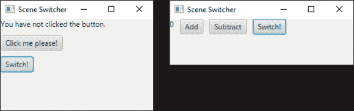

图 3-1：SceneSwitcher 程序。

列表 3-1 SceneSwitcher 程序

```java
package com.lowewriter.sceneswitcher;

import javafx.application.*;
import javafx.stage.*;
import javafx.scene.*;
import javafx.scene.layout.*;
import javafx.scene.control.*;
import javafx.event.*;

public class SceneSwitcher extends Application
{
    public static void main(String[] args)
    {
        launch(args);
    }

    // 用于 Click-Counter 场景的类字段
    int iClickCount = 0;
    Label lblClicks;
    Button btnClickMe;
    Button btnSwitchToScene2;
    Scene scene1;

    // 用于 Add-Subtract 场景的类字段
    int iCounter = 0;
    Label lblCounter;
    Button btnAdd;
    Button btnSubtract;
    Button btnSwitchToScene1;
    Scene scene2;

    // 用于舞台的类字段
    Stage stage;

    @Override public void start(Stage primaryStage)
    {
        stage = primaryStage;


```java
// 构建 Click-Counter 场景

lblClicks = new Label();

lblClicks.setText("You have not clicked the button.");

btnClickMe = new Button();

btnClickMe.setText("Click me please!");

btnClickMe.setOnAction(
    e -> btnClickMe_Click());

btnSwitchToScene2 = new Button();

btnSwitchToScene2.setText("Switch!");

btnSwitchToScene2.setOnAction(
    e -> btnSwitchToScene2_Click());

VBox pane1 = new VBox();

pane1.getChildren().addAll(lblClicks, btnClickMe, btnSwitchToScene2);

scene1 = new Scene(pane1, 250, 150);

// 构建 Add-Subtract 场景

lblCounter = new Label();

lblCounter.setText("0");

btnAdd = new Button();

btnAdd.setText("Add");

btnAdd.setOnAction(
    e -> btnAdd_Click());

btnSubtract = new Button();

btnSubtract.setText("Subtract");

btnSubtract.setOnAction(
    e -> btnSubtract_Click());

btnSwitchToScene1 = new Button();

btnSwitchToScene1.setText("Switch!");

btnSwitchToScene1.setOnAction(
    e -> btnSwitchToScene1_Click());

HBox pane2 = new HBox();

pane2.getChildren().addAll(lblCounter, btnAdd, btnSubtract, btnSwitchToScene1);

scene2 = new Scene(pane2, 300, 75);

// 设置舞台并显示舞台

primaryStage.setScene(scene1);

primaryStage.setTitle("SceneSwitcher");

primaryStage.show();
}

// 场景 1 的事件处理器

public void btnClickMe_Click()
{
    iClickCount++;

    if (iClickCount == 1)
    {
        lblClicks.setText("You have clicked once.");
    }
    else
    {
        lblClicks.setText("You have clicked "
            + iClickCount + " times.");
    }
}

public void btnSwitchToScene2_Click()
{
    stage.setScene(scene2);
}

// 场景 2 的事件处理器

public void btnAdd_Click()
{
    iCounter++;
    lblCounter.setText(Integer.toString(iCounter));
}

public void btnSubtract_Click()
{
    iCounter--;
    lblCounter.setText(Integer.toString(iCounter));
}

public void btnSwitchToScene1_Click()
{
    stage.setScene(scene1);
}
```

以下段落指出了程序的关键部分：

- →17：这一部分定义了供 Click-Counter 部分使用的类字段。这些字段包括 `iClickCount`（用于计算用户点击 Click Me 按钮的次数）、用于显示用户 Click Me 按钮点击次数的标签、Click Me 按钮本身，以及用于切换到 Add-Subtract 场景的按钮。还包括一个名为 `scene1` 的 `Scene` 字段，用于引用计数器场景。
- →24：这些行定义了供 Add-Subtract 部分使用的类变量，包括计数器 `iCounter`、用于显示计数器的标签、用于增加和减少计数器的两个按钮、用于切换回 Click-Counter 场景的按钮，以及一个名为 `scene2` 的 `Scene` 字段，用于引用 Add-Subtract 场景。
- →33：名为 `stage` 的类字段用于持有主舞台的引用，以便在整个程序中访问。
- →37：这一行将 `stage` 类字段设置为引用主舞台。
- →39：程序的这部分构建了点击计数器（Click-Counter）场景。首先，它创建了场景显示的标签和按钮。然后，它创建一个 `VBox` 布局面板（其在垂直堆栈中排列控件），并将标签和按钮添加到面板中。最后，它使用 `VBox` 面板作为根节点创建场景。
- →61：程序的这部分通过创建场景显示的标签和按钮，构建了加减法（Add-Subtract）场景，将它们排列在一个 `HBox` 布局面板中，并使用 `HBox` 面板作为根节点创建场景。
- →87：这些行将点击计数器场景设置为主阶段（primary stage）的根场景，设置阶段标题，然后显示该阶段。
- →94：程序的这部分为点击计数器场景中的按钮提供了事件处理器。“点击我！”（Click Me!）按钮的事件处理器会增加点击计数器，然后设置标签显示适当的消息。`btnSwitchToScene2` 的处理器简单地将主阶段的场景切换到 `scene2`，这将立即将显示切换到“加减法”场景，如图 3-1 右侧所示。
- →116：程序的这部分为加减法场景中的按钮提供了事件处理器。“加”和“减”按钮的处理器会增加或减少计数器，并更新标签显示的文本。`btnSwitchToScene1` 的处理器将场景切换回 `scene1`，这将把显示切换回点击计数器场景，如图 3-1 所示。

## 创建警报框

JavaFX 通过使用 `Alert` 类提供了显示基本消息框的简单方法，这与你在第二本书第 2 章中学过的 `JOptionPane` 类相似。表 3-3 显示了该类常用的构造函数和方法。

| 构造函数或方法 | 说明 |
| --- | --- |
| `Alert(Alert.AlertType)` | 创建一个指定类型的新警报 |
| `Alert(Alert.AlertType, String text, ButtonType type…)` | 创建一个新的警报，并可选地设置一个或多个要显示的按钮 |
| `void setTitle(String text)` | 设置标题 |
| `Optional<ButtonType> showAndWait()` | 显示警报并等待用户的响应，响应以 `ButtonType` 对象的形式返回 |

表 3-3：`Alert` 类常用的构造函数和方法。

`AlertType` 参数允许你指定几种类型的 Alert 对话框类型之一：

- `AlertType.CONFIRMATION`，提示用户确认某项操作。
- `AlertType.ERROR`，显示错误消息。
- `AlertType.INFORMATION`，显示信息对话框。
- `AlertType.WARNING`，显示警告消息。
- `AlertType.NONE`，显示一个通用的警报对话框。

以下是一个使用 `Alert` 类显示简单信息消息的代码片段：

```java
Alert a = new Alert(
    Alert.AlertType.INFORMATION,
    "You have clicked once.");

a.showAndWait();
```

图 3-2 显示了生成的警报框。

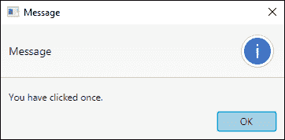

图 3-2：一个 Alert 对话框。

你可以通过使用可选的 `ButtonType` 参数来控制警报框上出现的按钮。你可以从以下类型的按钮中选择：

- `ButtonType.APPLY`
- `ButtonType.CANCEL`
- `ButtonType.CLOSE`
- `ButtonType.FINISH`
- `ButtonType.NEXT`
- `ButtonType.NO`
- `ButtonType.OK`
- `ButtonType.PREVIOUS`
- `ButtonType.YES`

你只需要在构造函数中指定多个 `ButtonType` 参数，就可以在警报框上包含多个按钮。例如：

```java
Alert a = new Alert(
    Alert.AlertType.INFORMATION,
    "Are you certain?",
    ButtonType.YES,
    ButtonType.NO);
```

在这个示例中，警报框将包含一个 YES 按钮和一个 NO 按钮。

要确定用户点击了哪个按钮，你必须测试 `showAndWait` 方法返回的值。此值是一个 `Optional` 类型的对象，因为用户可以在不点击任何显示的按钮的情况下关闭对话框。你应该先调用 `isPresent` 方法来测试用户是否点击了按钮。然后，你可以调用 `get` 方法来获取实际结果。

这是一个判断用户是否点击了 YES 按钮的示例：

```java
Alert a = new Alert(
    Alert.AlertType.INFORMATION,
    "Are you certain?",
    ButtonType.YES,
    ButtonType.NO);

Optional<ButtonType> r = a.showAndWait();

if (r.isPresent() && r.get() == ButtonType.YES)
{
    // 用户点击了 OK！
}
```

为了演示如何使用 `ALERT` 类，代码列表 3-2 中所示程序是本微型书第 2 章中讨论过的点击计数器程序的变体。该程序的原始版本显示一个标签和一个按钮，使用标签显示用户点击按钮的次数。这个版本的程序放弃了标签，而是使用 `Alert` 类显示一条消息，指示用户点击按钮的次数。

### 代码列表 3-2：ClickCounterAlert 程序

```java
package com.lowewriter.clickcounter;

import javafx.application.*;
import javafx.stage.*;
import javafx.scene.*;
import javafx.scene.layout.*;
import javafx.scene.control.*;

public class ClickCounterAlert extends Application
{
    public static void main(String[] args)
    {
        launch(args);
    }

    Button btn;
    Label lbl;
    int iClickCount = 0;

    @Override
    public void start(Stage primaryStage)
    {
        // 创建按钮
        btn = new Button();
        btn.setText("Click me!");
        btn.setOnAction(e -> buttonClick());

        // 将按钮添加到布局面板
        BorderPane pane = new BorderPane();
        pane.setCenter(btn);

        // 将布局面板添加到场景
        Scene scene = new Scene(pane, 250, 150);

        // 将场景添加到阶段，设置标题
        // 并显示阶段
        primaryStage.setScene(scene);
        primaryStage.setTitle("Click Counter");
        primaryStage.show();
    }

    public void buttonClick()
    {
        iClickCount++;

        if (iClickCount == 1)
        {
            Alert a = new Alert(
                Alert.AlertType.INFORMATION,
                "You have clicked once.");

            a.showAndWait();
        }
        else
        {
            Alert a = new Alert(
                Alert.AlertType.INFORMATION,
                "You have clicked "
                + iClickCount
                + " times.");

            a.showAndWait();
        }
    }
}
```

该程序与我们在微型书第 2 章中介绍的版本（在代码列表 2-2 中）几乎相同。事实上，这里只有两个区别：

- 此程序中没有定义标签，因为使用消息框而不是标签来显示点击按钮的次数。
- 在第 2 章版本的 `buttonClick` 方法中，调用了标签的 `setText` 方法来显示点击按钮的次数。在这个版本中，使用了 Alert 框。

图 3-2 显示了点击计数器程序版本的运行情况。在这里，你可以看到用户第一次点击按钮时显示的警报框。

## 出场，右侧

由于我用引用莎士开始了这一章，我想通过引用旧哈纳-巴拉动画片中著名的粉红山狮（Snagglepuss）来结束它。他经常在离开场景时说：“出场，左侧”或“出场，右侧”。

天哪，我的老天！

退出阶段也有正确的方法和错误的方法之分。到目前为止，书中介绍的所有程序没有一个是采用正确方法退出的。你目前为止看到的程序所提供的退出唯一机制，就是让用户点击标准的窗口关闭按钮（该按钮通常由窗口标题栏右上角的“X”表示）。这几乎总是退出程序的错误方式。

在大多数情况下，退出程序的正确方法涉及以下细节：

- **添加一个按钮、菜单命令或其他方式，让用户信号他们想要关闭程序。**许多程序包含一个标记为 `Exit`（退出）或 `Close`（关闭）的按钮，而使用菜单的程序通常有一个 `Exit`（退出）命令。
- **可选地显示一个确认框，以验证用户是否真的想关闭程序。**你可以通过使用 `ConfirmationBox` 类或类似的类来实现这一点。根据程序的不同，你可能只想在用户对文档、数据库或其他尚未保存的文件进行更改时才显示此对话框。
- **如果用户确实想关闭程序，程序应该执行任何必要的清理工作，**例如：
  - 保存文档、数据库或其他文件的更改。
  - 正确地关闭数据库和其他资源。
- **在你完成任何必要的清理工作后，可以通过调用主阶段的 `close` 方法来关闭应用程序。**
- **无论用户是尝试通过你在用户界面中提供的按钮或菜单命令来关闭程序，还是通过点击内置的窗口关闭按钮，都应该采取验证和清理步骤。**

在接下来的章节中，你将学习如何为你的应用程序添加一个 `Close` 按钮，如何防止窗口关闭按钮无礼貌地终止你的应用程序，以及如何将这两个元素整合成一个完整的程序。

### 创建关闭按钮

要添加一个允许用户关闭窗口的按钮或其他用户界面元素，你只需要提供一个调用阶段的 `close` 方法的动作事件处理程序即可。

例如，假设你使用以下代码创建了一个 `Close` 按钮：

```java
Button btnClose = new Button();

btnClose.setText("Close");

btnClose.setOnAction(e -> primaryStage.close());
```

在这种情况下，动作事件处理程序简单地调用 `primaryStage.close()` 来关闭应用程序。

如果你想在动作事件处理程序中执行不仅仅是简单调用 `close` 方法的操作，你可能希望将事件处理程序隔离在一个单独的方法中，如本例所示：

```java
btnClose.setOnAction(e -> btnClose_Clicked());
```


因为 `btnClose_Clicked` 方法需要访问主阶段以关闭它，因此你需要定义一个类型为 `Stage` 的类字段并使用它来引用主阶段。然后，你的 `btnClose_Clicked` 方法就可以轻松地执行额外的任务。例如：

```java
private void btnClose_Click()
{
    boolean reallyQuit = false;

    reallyQuit = ConfirmationBox.show(
        "Are you sure you want to quit?",
        "Confirmation",
        "Yes", "No");

    if (reallyQuit)
    {
        // 在此处执行清理任务
        // 如保存文件或释放资源
        stage.close();
    }
}
```

在这个示例中，显示了一个确认框以确保用户真的想退出程序。

### 处理 `CloseRequest` 事件

提供 `Close` 按钮是允许用户干净退出程序的极佳方法。然而，用户可以通过简单的关闭窗口来绕过你的退出处理——即点击窗口关闭按钮（通常表示为窗口边界右上角的“X”）。除非你另有说明，否则点击此按钮将无礼貌地终止应用程序，绕过你所有用于确认用户是否想保存工作、关闭任何打开的资源以及提供优雅退出的良好代码。

幸运的是，你可以轻松地避免这种不优雅的退出。每当用户尝试关闭显示 JavaFX 阶段的窗口时，JavaFX 都会生成一个 `CloseRequest` 事件并将其发送到该阶段。你可以通过调用 `Stage` 类的 `setOnCloseRequest` 方法为该事件提供一个事件处理程序。然后，当用户尝试关闭窗口时，该事件处理程序就会被调用。

你可能想创建一个方法，同时作为你的 `Close` 按钮的 `Action` 事件和 `CloseRequest` 事件的事件处理程序，如下所示：

```java
btnClose.setText("Close");

btnClose.setOnAction(e -> btnClose_Click());

primaryStage.setOnCloseRequest(e -> btnClose_Click());
```

在这里，意图是处理 `CloseRequest` 事件的方式完全就像用户点击了 `btnClose` 按钮一样。

这是一个好主意，但如果 `btnClose_Click` 事件显示确认框，并且仅在用户确认他们真的想退出程序时才关闭阶段，那么它就不起作用了。这是因为当 `CloseRequest` 事件的事件处理程序结束时，如果事件处理程序没有显式关闭阶段，JavaFX 会自动关闭阶段。

为了防止这种情况发生，你调用了 `CloseRequest` 事件对象的 `consume` 方法。消费事件会导致其在事件处理程序内部被停止，从而防止 JavaFX 在事件处理程序结束时自动关闭阶段。

在传递给 `setOnCloseRequest` 方法的 lambda 表达式中，`CloseRequest` 事件对象由 `e` 表示。

提供一个同时处理 `Close` 按钮的 `Action` 事件和 `CloseRequest` 事件方法的简单方法是为 `setOnCloseRequest` 构造 lambda 表达式，使其在调用方法之前消费事件：

```java
btnClose.setText("Close");

btnClose.setOnAction(e -> btnClose_Click());

primaryStage.setOnCloseRequest(e -> {
    e.consume();
    btnClose_Click();
});
```

在这里，`CloseRequest` 事件的事件处理程序首先消费事件，然后调用 `btnClose_Click`。

### 整合在一起

现在你已经知道如何为场景添加 `Close` 按钮以及如何处理 `CloseRequest` 事件，我将查看一个整合了这些元素的程序，以演示退出 JavaFX 程序的正确方法。

本节介绍了 `ClickCounter` 程序的变体，它除了 `Click Me!` 按钮外包含一个 `Close` 按钮。当用户点击 `Click Me!` 按钮时，会显示消息框以指示按钮被点击的次数。但当用户尝试退出程序时，无论是点击 `Close` 按钮还是直接关闭窗口，都会使用列表 3-3 显示的 `ConfirmationBox` 类来询问用户是否真的想退出程序。只有当用户点击确认框中的 `Yes` 按钮时，阶段才会关闭。

该程序的源代码如列表 3-3。

#### LISTING 3-3 ClickCounterExit Program

```java
package com.lowewriter.clickcounterexit;

import javafx.application.*;
import javafx.stage.*;
import javafx.scene.*;
import javafx.scene.layout.*;
import javafx.scene.control.*;
import javafx.geometry.*;
import java.util.*;

public class ClickCounterExit extends Application
{
    public static void main(String[] args)
    {
        launch(args);
    }

    Stage stage;
    int iClickCount = 0;

    @Override public void start(Stage primaryStage)
    {
        stage = primaryStage;

        // Create the Click Me button
        Button btnClickMe = new Button();
        btnClickMe.setText("Click me please!");

        btnClickMe.setOnAction(e -> btnClickMe_Click());

        // Create the Close button
        Button btnClose = new Button();
        btnClose.setText("Close");
        btnClose.setOnAction(e -> btnClose_Click());

        // Add the buttons to a layout pane
        VBox pane = new VBox(10);
        pane.getChildren().addAll(btnClickMe, btnClose);
        pane.setAlignment(Pos.CENTER);

        // Add the layout pane to a scene
        Scene scene = new Scene(pane, 250, 150);

        // Finish and show the stage
        primaryStage.setScene(scene);
        primaryStage.setTitle("Click Counter");
        primaryStage.setOnCloseRequest(e -> {
            e.consume();
            btnClose_Click();
        });
        primaryStage.show();
    }

    public void btnClickMe_Click()
    {
        iClickCount++;

        if (iClickCount == 1)
        {
            Alert a = new Alert(
                Alert.AlertType.INFORMATION,
                "You have clicked once.");
            a.showAndWait();
        }
        else
        {
            Alert a = new Alert(
                Alert.AlertType.INFORMATION,
                "You have clicked "
                + iClickCount + " times.");
            a.showAndWait();
        }
    }

    public void btnClose_Click()
    {
        Alert a = new Alert(
            Alert.AlertType.CONFIRMATION,
            "Are you sure you want to quit?",
            ButtonType.YES,
            ButtonType.NO);

        Optional<ButtonType> confirm = a.showAndWait();

        if (confirm.isPresent()
            && confirm.get() == ButtonType.YES)
        {
            stage.close();
        }
    }
}
```

# 第 4 章：使用布局面板安排你的场景

## 本章内容

- 使用五种流行的布局面板类：`HBox`、`VBox`、`FlowPane`、`BorderPane` 和 `GridPane`
- 调整布局面板及其包含的节点的大小
- 调整布局面板中节点间距的各种选项

控制场景中组件的布局通常是 JavaFX 开发中最困难的部分之一。事实上，有时这甚至让人感到非常抓狂。很多时候，这些组件似乎有自己的主意。它们变得非常固执，拒绝移动。当你想要它们并排排列时，它们却会堆叠在一起。当你对标签或文本字段进行微小的更改时，整个场景似乎又重新排列了。有时，你真想用拳头穿穿显示器。

我不建议用拳头穿穿显示器。你会弄得一团糟，割伤手，还要花钱买新显示器——而且当你的电脑修好后，这些组件仍然不会按照你想要的方式对齐。

问题不在于组件本身，而在于布局面板（layout panes），它们决定了每个组件出现在框架或面板中的位置。布局面板是特殊的类，它们存在的唯一目的就是控制场景中出现节点的布局。JavaFX 提供了几种不同类型的布局面板；每种类型使用不同的方法来控制节点的布局。成功布局场景的秘诀在于正确组合布局面板，来实现你想要的排列。

## 使用布局面板

理解布局面板是创建美观且实用的 JavaFX 框架的关键。

### 介绍五种 JavaFX 布局面板

JavaFX 提供了许多不同的布局面板供你使用。本章介绍了以下五种：

- `HBox`：这种布局面板水平排列节点，一个接一个。你用它来创建整齐排列在行的控件。
- `VBox`：这种布局面板垂直排列节点，一个在上在上。你用它来创建整齐排列在列的控件。
- `FlowPane`：这种布局面板将节点相邻排列，直到空间耗尽；然后它会换行继续布局节点。你可以配置 `FlowPane` 使节点水平按行排列或垂直按列排列。
- `Border`：这种布局面板将面板划分为五个区域：顶部（Top）、左侧（Left）、中间（Center）、右侧（Right）和底部（Bottom）。当你添加节点时，可以指定将节点放置在哪个区域。
- `GridPane`：这种布局面板将面板划分为网格，让你对行和列中的元素排列拥有完全控制。

为了让你对前四种布局类型可以实现的结果有一个整体，图 4-1 显示了四个示例窗口，每个窗口都使用一种布局面板。你将在本章后面的部分看到 `GridPane` 布局工作的详细示例。

### 创建布局面板

使用布局面板的基本流程非常简单。以下是创建布局节点的通用步骤：

1. **创建你想添加到面板的控件或其他节点。**  
   例如，如果布局面板包含两个按钮，你应该使用类似下面的代码创建这两个按钮：

2. **通过调用构造函数创建布局面板。**  
   例如：`HBox pane = new HBox();`

3. **微调面板使用的可选设置。**  
   每种类型的布局面板都有一套独特的参数，用于控制节点布局的细节。例如，`HBox` 允许你设置每个节点之间的像素间隔。你可以按照如下方式设置此值：`pane.setSpacing(10);`

4. **将面板中显示的每个节点添加到面板。**  
   每种类型的布局面板都提供了一个向面板添加节点的方法。对于 `HBox`，你必须首先调用 `getChildren` 方法来获取已添加到面板的所有节点列表。然后，你调用 `addAll` 方法向面板添加一个或多个节点。例如：`pane.getChildren().addAll(btnClickMe, btnClose);`

5. **创建场景，指定布局面板作为根节点。**  
   例如：`Scene scene = new Scene(pane, 250, 150);`。在这个示例中，`pane` 被作为根节点添加。

### 组合布局面板

你可以组合多个布局面板来创建比单个布局面板提供的更复杂的布局。例如，假设你想创建一个在底部有一行水平按钮、在右侧有一列垂直按钮的布局。为了实现这一点，你可以为底部的按钮创建一个 `HBox`，为右侧的按钮创建一个 `VBox`。然后，你可以创建一个 `BorderPane`，并将 `HBox` 添加到底部区域，将 `VBox` 添加到右侧区域。

这种组合之所以可行，是因为所有的布局面板都继承自基类 `javafx.scene.layout.Pane`，而该基类又继承自 `javafx.scene.node` 类。换句话说，所有面板都是节点。你添加到布局面板的每个节点都可以是另一个布局面板。你可以根据需要深度嵌套布局面板，以实现你所需的精确布局。

### HBox 构造函数与方法

| 构造函数 | 说明 |
| :--- | :--- |
| `HBox(Node… children)` | 创建一个带有指定子节点的 `HBox`。该构造函数允许您创建 `HBox` 的同时为其添加子节点。 |
| `HBox(double spacing, Node… children)` | 创建一个带有指定间距和子节点的 `HBox`。 |

| 方法 | 说明 |
| :--- | :--- |
| `ObservableList<Node> getChildren()` | 返回所有已添加到 `HBox` 的子节点集合。该集合以 `ObservableList` 类型返回，该类型包含 `addAll` 方法，允许您向列表添加一个或多个节点。 |
| `static void setAlignment(Pos alignment)` | 设置 `HBox` 内部子节点的对齐方式。有关 `Pos` 举枚举的说明，请参阅表 4-5。有关更多信息，请参阅本章节后的“在布局窗中对齐节点”节。 |
| `static void setHgrow(Node child, Priority priority)` | 设置给定子节点的增长行为。有关 `Priority` 枚举的说明，请参阅表 4-3。有关更多信息，请参阅本章节后的“通过增长节点添加空间](#c40.xhtml_c40-sec-0009)”节。 |
| `static void setMargin(Node child, Insets value)` | 设置给定子节点的外边距。有关 `Insets` 类的构造函数，请参阅表 4-2。有关更多信息，请参阅本章节后的“使用外边距添加空间](#c40.xhtml_c40-sec-0008)”节。 |
| `void setPadding(Insets value)` | 设置 `HBox` 内部边缘的内边距。有关 `Insets` 类的构造函数，请参阅表 4-2。有关更多信息，请参阅本章节后的“拉开元素](#c40.xhtml_c40-sec-0007)”节。 |
| `void setSpacing(double value)` | 设置 `HBox` 内部显示节点之间的间距。有关更多信息，请参阅本章节后的“拉开元素](#c40.xhtml_c40-sec-0007)”节。 |

创建 `HBox` 最简单的方法是先创建您想要放置在 `HBox` 中的节点，然后调用 `HBox` 构造函数并将节点作为参数传递。例如：

```java
Button btn1 = new Button("Button One");
Button btn2 = new Button("Button Two");
Button btn3 = new Button("Button Three");

HBox pane = new HBox(btn1, btn2, btn3);
```

如果您希望先创建一个初始为空状态的 `HBox` 控件，稍后再添加控件，可以这样做：

```java
HBox pane = new HBox();

pane.getChildren().addAll(btn1, btn2, btn3);
```

在这里，调用了 `getChildren` 方法，它返回所有添加到 `HBox` 窗格的子节点集合。该集合由类 `ObservableList` 定义，包含一个名为 `addAll` 的方法，您可以使用它向列表添加一个或多个节点。

### 拉开元素

默认情况下，布局窗格中的子节点紧挨排列，之间没有任何空隙。如果您想在窗格的节点之间提供空间，可以通过四种方式实现：

- 在窗格内的元素之间添加间距
- 在窗格的内部边缘周围添加内边距
- 为窗格中的单个节点添加外边距
- 创建可以扩展以填充可用空间的占位符节点

在本节中，我将向您展示如何向窗格添加间距和内边距。接下来的三个章节将向您展示如何使用另外两种技术。

请注意，虽然我在这些节中使用 `HBox` 布局窗格来演示这些技术，但这些技术也适用于其他类型的窗格。

要设置 `HBox` 窗格的间距，可以使用 `HBox` 构造函数上的间距参数，或者调用 `setSpacing` 方法。例如，此语句创建了一个默认间距为 10 像素的 `HBox` 窗格：

```java
HBox pane = new HBox(10);
```

此示例创建了一个具有 10 像素间距的 `HBox` 窗格并添加了三个按钮：

```java


```java
HBox pane = new HBox(10, btn1, btn2, btn3);
```

此示例使用默认构造函数创建一个 `HBox` 窗格，然后调用 `setSpacing` 方法将间距设置为 10 像素：

```java
HBox pane = new HBox();

pane.setSpacing(10);
```

虽然间距增加了 `HBox` 窗格中节点之间的空间，但它并没有提供节点与窗格本身边缘之间的空间。例如，如果您将间距设置为 10 像素并向窗格添加三个按钮，这三个按钮之间将会有 10 像素的间隙。

#### 表 4-2](#c40.xhtml_rc40-tbl-0002) Insets 构造函数

| 构造函数 | 说明 |
| :--- | :--- |
| `Insets(double value)` | 创建一个所有边缘都使用相同值的 `Insets` 对象 |
| `Insets(double top, double right, double bottom, double left)` | 创建一个每个边缘使用不同值的 `Insets` 对象 |

要将内边距设置为统一的 10 像素，可以这样调用 `setPadding` 方法：

```java
pane.setPadding(new Insets(10));
```

要为每个边缘设置不同的内边距值，可以这样调用：

```java
pane.setPadding(new Insets(20, 10, 20, 10));
```

在此示例中，上下内边距设置为 20，左右内边距设置为 10。`Insets` 类定义在 `javafx.geometry` 包中，因此在任何使用 `Insets` 的程序中应包含以下 `import` 语句：

```java
import javafx.geometry.*;
```

### 使用外边距添加空间

在布局窗格节点周围添加空间的另一种方法是为单个节点创建外边距。这种技术允许为窗格中的每个节点设置不同的外边距大小，从而对每个节点的间距进行完全控制。

要创建外边距，为要添加外边距的每个节点调用 `setMargin` 方法。您可能认为因为每个节点都有自己的外边距，所以 `setMargin` 方法应该属于 `Node` 类。相反，`setMargin` 是由 `HBox` 类定义的静态方法。`setMargin` 方法接受两个参数：

- 您想要添加外边距的节点
- 定义您想要添加的外边距的 `Insets` 对象

此示例为名为 `btn1` 的按钮的所有侧设置了 10 像素的外边距：

```java
HBox.setMargin(btn1, new Insets(10));
```

此示例为窗格的每个侧设置了不同的外边距：

```java
HBox.setMargin(btn1, new Insets(10, 15, 20, 10));
```

在 `HBox` 中在节点之间添加空间的第三种方法是创建一个节点，其唯一目的是在两个 `HBox` 节点之间添加空间。然后，你可以配置该占位节点（spacer node），它将自动增长以填充窗格内的任何额外空间。通过这种方式仅配置占位节点而不配置其他节点，则只有占位节点会增长。这将产生占位节点两侧的节点相互推开的效果。

例如，假设你想创建一个包含三个按钮的 `HBox` 布局窗格。与其在窗格内均匀地排列这三个按钮，你希望前两个按钮出现在窗格的左侧，而第三个按钮出现在窗格的右侧。第二个和第三个按钮之间的空间完全取决于窗格的大小。因此，如果用户拖动窗口扩大舞台，第二个和第三个按钮之间的空间应该相应地增加。

创建占位节点简单的方法是使用 `Region` 类。`Region` 类是 `Control` 类的基类，`Button` 和 `Label` 等控件都派生于此。它也是 `Pane` 类的基类，本章描述的所有布局窗格都派生于此类。

在我的用途中，我仅使用 `Region` 类的简单默认构造函数创建一个在布局窗格中作为简单占位符的节点。我没有为区域指定特定的大小。相反，我配置使其在水平方向上增长以填充容器内任何未使用的空间。

要做到这一点，你需要使用 `HBox` 类的静态方法 `setHgrow`，指定名为 `Priority` 的枚举定义的三个常量值之一。表 4-3 列出了这些常量并解释了每个常量的作用。

`Priority` 枚举定义在 `javafx.scene.layout` 包中，该包与定义它的布局管理器包是同一个包。

| 常量 | 说明 |
| --- | --- |
| `Priority.NEVER` | 表示永远不应调整节点的宽度以填充窗格中的可用空间。这是默认设置。因此，默认情况下，节点不会根据包含它们的布局窗格的大小进行调整大小。 |
| `Priority.ALWAYS` | 表示如果必要，应始终调整节点的宽度以填充窗格中的可用空间。如果你将两个或更多节点设置为 `ALWAYS`，则调整将平均分配给每个节点。 |
| `Priority.SOMETIMES` | 表示如果必要为了填充窗格，可以调整节点的宽度。然而，只有在没有其他指定 `ALWAYS` 的节点时才会进行该调整。 |

表 4-3 Priority 枚举

下面的示例创建了三个按钮和一个占位符，将所有三个按钮的边距都设置为 10 像素，然后将这三个按钮和占位符添加到 `HBox` 中，使得前两个按钮出现在 `HBox` 的左侧，第三个按钮出现在右侧：

```java
// 创建按钮

Button btn1 = new Button("One");

Button btn2 = new Button("Two");

Button btn3 = new Button("Three");

// 创建占位符

Region spacer = new Region();

// 设置边距

HBox.setMargin(btn1, new Insets(10));

HBox.setMargin(btn2, new Insets(10));

HBox.setMargin(btn3, new Insets(10));

// 为占位符设置 Hgrow

HBox.setHgrow(spacer, Priority.ALWAYS);

// 创建 HBox 布局窗格

HBox pane = new HBox(10, btn1, btn2, spacer, btn3);
```

图 4-2 显示了此窗格添加到舞台时的外观。为了让你看到占位符是如何工作的，第一张图片显示了窗格的三种形态，每个窗口都被拖动到不同的大小。注意第二个和第三个按钮之间的间距是如何自动调整的，使得前两个按钮位于窗格左侧，第三个按钮位于右侧。

与 `setMargin` 方法一样，`setHgrow` 是静态方法，因此它应该从类调用，而不是类的实例。

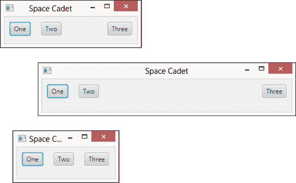

图 4-2：使用占位节点在 `HBox` 窗格中隔开按钮。

## 使用 VBox 布局

`VBox` 类类似于 `HBox` 类，但它不是在水平行中排列节点，而是垂直在列中排列节点。表 4-4 显示了 `VBox` 类常用的构造函数和方法。

| 构造函数 | 说明 |
| --- | --- |
| `VBox()` | 创建一个空的 `VBox`。 |
| `VBox(double spacing)` | 创建一个空的 `VBox`。 |
| `VBox(Node… children)` | 创建带有指定节点的 `VBox`。 |
| `VBox(double spacing, Node… children)` | 创建带有指定间距和节点的 `VBox`。 |
| `ObservableList<Node> getChildren()` | 返回添加到 `VBox` 中的所有节点集合。 |
| `static void setAlignment(Pos alignment)` | 设置子节点的对齐方式。 |
| `static void setMargin(Node child, Insets value)` | 为给定节点设置边距。 |
| `void setPadding(Insets value)` | 设置 `VBox` 内部边缘的内边距。 |
| `static void setVgrow(Node child, Priority priority)` | 设置给定节点的增长行为。 |

表 4-4 VBox 构造函数和方法

`VBox` 类定义在 `javafx.scene.layout` 包中，因此在任何使用 `VBox` 的程序中都应该包含以下 `import` 语句：

```java
import javafx.scene.layout.*;
```

这是一个示例，创建三个按钮并使用 `VBox` 将它们排列成列：

```java
Button btn1 = new Button("Button One");

Button btn2 = new Button("Button Two");

Button btn3 = new Button("Button Three");

VBox pane = new VBox(btn1, btn2, btn3);
```

你可以通过使用默认构造函数并调用 `getChildren` 方法来实现相同的功能，如此示例所示：

```java
VBox pane = new VBox();

pane.getChildren().addAll(btn1, btn2, btn3);
```

与 `HBox` 类一样，你可以使用间距、内边距、边距和占位节点来控制 `VBox` 内节点之间的间距。下面的示例在节点之间设置了 10 像素的垂直空间，并在窗格的每个边缘设置了 10 像素的内边距：

```java
Button btn1 = new Button("One");

Button btn2 = new Button("Two");

Button btn3 = new Button("Three");

VBox pane = new VBox(10, btn1, btn2, btn3);

pane.setPadding(new Insets(10));
```

这是一个创建三按钮列的示例，列顶部有一个按钮，底部有两个，并带有 10 像素的间距和内边距：

```java
// 创建按钮
```

```java
Button btn1 = new Button("One");

Button btn2 = new Button("Two");

Button btn3 = new Button("Three");

// 创建间距区域

Region spacer = new Region();

// 设置间距区域垂直增长

VBox.setVgrow(spacer, Priority.ALWAYS);

// 创建 VBox 布局面板

VBox pane = new VBox(10, btn1, spacer, btn2, btn3);

pane.setPadding(new Insets(10));
```

## 在布局面板中对齐节点

`HBox` 和 `VBox` 布局面板都具有 `setAlignment` 方法，它允许你控制面板内包含的节点之间的对齐方式。`setAlignment` 方法接受单个参数，该参数是 `Pos` 枚举类定义的常量之一，详细描述见表 4-5。

`Pos` 枚举类定义在 `javafx.geometry` 包中，因此在任何使用 `Pos` 的程序中，你都应该包含以下 `import` 语句：

```java
import javafx.geometry.*;
```

下面的示例展示了如何创建一个在面板中居中的三个按钮的垂直列：

```java
Button btn1 = new Button("Number One");

Button btn2 = new Button("Two");

Button btn3 = new Button("The Third Button");

VBox pane = new VBox(10, btn1, btn2, btn3);

pane.setPadding(new Insets(10));

pane.setAlignment(Pos.CENTER);
```


| 常量 | 垂直对齐 | 水平对齐 |
| --- | --- | --- |
| `Pos.TOP_LEFT` | 上 | 左 |
| `Pos.TOP_CENTER` | 上 | 中 |
| `Pos.TOP_RIGHT` | 上 | 右 |
| `Pos.CENTER_LEFT` | 中 | 左 |
| `Pos.CENTER` | 中 | 中 |
| `Pos.CENTER_RIGHT` | 中 | 右 |
| `Pos.BOTTOM_LEFT` | 下 | 左 |
| `Pos.BOTTOM_CENTER` | 下 | 中 |
| `Pos.BOTTOM_RIGHT` | 下 | 右 |
| `Pos.BASELINE_LEFT` | 基准线 | 左 |
| `Pos.BASELINE_CENTER` | 基准线 | 中 |
| `Pos.BASELINE_RIGHT` | 基准线 | 右 |

表 4-5 `Pos` 枚举类。

当此面板添加到场景中并在舞台（stage）中显示时，结果类似于图 4-3 所示的窗口。

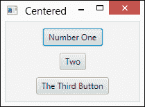

图 4-3：在 `VBox` 布局面板中居中的三个按钮。

## 使用流布局

流式布局有两种形式：水平和垂直。水平流式布局将其子节点按行排列，直到面板的宽度达到你可以指定的特定大小。当达到该尺寸时，布局会在第一行下方开始新的一行子节点。这种流式布局持续进行，每次达到尺寸限制时都会开始新的一行，直到所有子节点都被放置。

垂直流式布局的工作方式相同，不同之处在于节点按列排列，直到达到尺寸限制。当达到尺寸限制时，会在第一列的右侧立即开始新列。

你使用 `FlowPane` 类来创建流式布局。表 4-6 显示了 `FlowPane` 类的构造函数和最常用的方法。

| 构造函数 | 描述 |
| --- | --- |
| `FlowPane()` | 创建一个空的水平流布局，水平和垂直间隙都设置为零。 |
| `FlowPane(double hgap, double vgap)` | 创建具有指定水平和垂直间隙的空水平流布局。 |
| `FlowPane(double hgap, double vgap, Node… children)` | 创建具有指定水平和垂直间隙的水平流布局，并填充了指定的子节点。 |
| `FlowPane(Node… children)` | 创建水平和垂直间隙都设置为零的水平流布局，并填充了指定的子节点。 |
| 注意：在接下来的每个构造函数中，`Orientation` 可以是 `Orientation.HORIZONTAL` 或 `Orientation.VERTICAL`。 |
| `FlowPane(Orientation orientation)` | 创建具有指定方向的空流布局，水平和垂直间隙都设置为零。 |
| `FlowPane(Orientation orientation, double hgap, double vgap)` | 创建具有指定方向和指定水平、垂直间隙的空流布局。 |
| `FlowPane(Orientation orientation, double hgap, double vgap, Node… children)` | 创建具有指定方向和指定水平、垂直间隙的流布局。 |
| `FlowPane(Orientation orientation, Node… children)` | 创建具有指定方向且水平和垂直间隙都设置为零的流布局。 |

| 方法 | 描述 |
| --- | --- |
| `ObservableList<Node> getChildren()` | 返回所有节点的集合。 |
| `setAlignment(Pos alignment)` | 设置行内节点的对齐方式。见表 4-5。 |
| `setColumnAlignment(Pos alignment)` | 设置列内节点的对齐方式。见表 4-5 对 `Pos` 枚举的说明。 |
| `setHgap(double value)` | 设置水平间隙。对于水平流布局，这是节点之间的间距；对于垂直流布局，这是列之间的间距。 |
| `static void setMargin(Node child, Insets value)` | 设置指定节点的边距。见表 4-2 中 `Insets` 类的构造函数。 |
| `setOrientation(Orientation orientation)` | 设置流布局的方向，可以是 `Orientation.HORIZONTAL` 或 `Orientation.VERTICAL`。 |
| `setPadding(Insets value)` | 设置流布局内边缘周围的内边距。见表 4-2 中 `Insets` 类的构造函数。 |
| `setPrefWrapLength(double value)` | 设置面板的首选换行长度。对于水平流布局，这代表面板的首选宽度；对于垂直流布局，它代表首选高度。 |
| `setRowAlignment(Pos alignment)` | 设置行内节点的对齐方式。见表 4-5 对 `Pos` 枚举的说明。 |
| `setVgap(double value)` | 设置垂直间隙。对于垂直流布局，这是节点之间的间距；对于水平流布局，这是行之间的间距。 |

`FlowPane` 类的构造函数允许你指定水平和垂直间隙（提供布局中水平和垂直元素之间的间距）、方向（水平或垂直）以及用于填充布局的子节点。

要设置流式布局换行的限制，您可以使用 `setPrefWrapLength` 方法。换行长度应用于窗格流内容的维度。因此，对于水平流式布局，换行长度指定了窗格的首选宽度；对于垂直流式布局，换行长度指定了窗格的首选高度。

请注意，无论首选换行长度是多少，如果不调用此方法，换行长度默认认为 400 像素。

下面的示例创建了一个水平布局，水平和垂直间隙均为 10 像素，由五个按钮填充，首选换行长度为 300 像素：

```java
Button btn1 = new Button("Button One");
Button btn2 = new Button("Button Two");
Button btn3 = new Button("Button Three");
Button btn4 = new Button("Button Four");
Button btn5 = new Button("Button Five");

FlowPane pane = new FlowPane(
    Orientation.HORIZONTAL,
    10,
    10,
    btn1,
    btn2,
    btn3,
    btn4,
    btn5
);

pane.setPrefWrapLength(300);
```

图 4-4 显示了当布局被添加到场景并在舞台中显示场景时，这些按钮的外观。此图还显示了当用户调整窗口大小时，流式布局中的按钮是如何重新排列的。注意，最初前三个按钮出现在第一行，接下来的两个出现在第二行。当窗口向外拖宽时，按钮会重新流式，使得四个按钮适应第一行，只有一个按钮溢到第二行。然后，当窗口向内拖小时，只有两个按钮出现在前两行，并为第五个按钮创建了第三行。

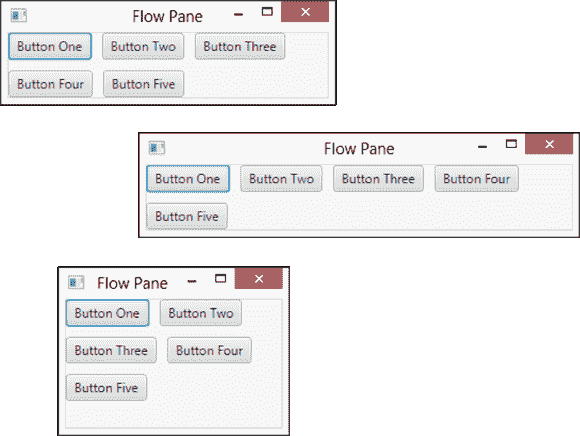

图 4-4：带有五个按钮的流式布局窗格。

## 使用边界布局（Border Layout）

边界布局是一种分为五个区域的窗格：顶部（Top）、左侧（Left）、中间（Center）、右侧（Right）和底部（Bottom），如图 4-5 所示。当您将组件添加到布局时，可以指定组件位于这些区域中的哪一个。

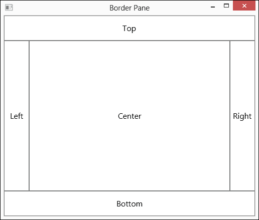

图 4-5：边界布局是如何划分的。

 边界布局是具有传统窗口布局应用程序的理想布局管理器，在那种布局中，菜单和工具栏显示在窗口顶部，状态栏或确定和取消按钮显示在底部，左侧显示导航面板，右侧显示各种任务窗格，内容显示在中间。

您使用 `BorderPane` 类来创建边界布局。表 4-7 列出了 `BorderPane` 类的构造函数和最常用的方法。

| 构造函数 | 描述 |
| --- | --- |
| `BorderPane()` | 创建一个空的边界布局。 |
| `BorderPane(Node center)` | 创建具有指定中间节点的边界布局。 |
| `BorderPane(Node center, Node top, Node right, Node bottom, Node left)` | 创建具有指定的中间、顶部、右侧、底部和左侧节点的边界布局。 |
| 方法 | 描述 |
| `void setCenter(Node node)` | 设置中间节点。 |
| `void setTop(Node node)` | 设置顶部节点。 |
| `void setRight(Node node)` | 设置右侧节点。 |
| `void setBottom(Node node)` | 设置底部节点。 |
| `void setLeft(Node node)` | 设置左侧节点。 |
| `void setAlignment(Pos alignment)` | 设置边界窗格内节点的对齐方式。参见表 4-5 关于 `Pos` 枚举的解释。更多信息请参见本章前面的“在布局窗格中对齐节点”部分。 |
| `static void setMargin(Node child, Insets value)` | 设置给定子节点的边距。参见表 4-2 关于 `Insets` 类的构造函数。更多信息请参见本章前面的“使用边距添加空间”部分。 |

表 4-7 `BorderPane` 构造函数和方法。

`BorderPane` 类定义在 `javafx.scene.layout` 包中，因此在任何使用边界布局的程序中，都应该包含以下 `import` 语句：

```java
import javafx.scene.layout.*;
```

（注：原文后续部分包含大量重复片段，此处已按要求仅翻译核心内容。）

## 绘制面板布局

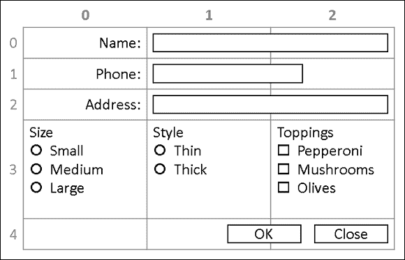

在绘制出面板布局后，列出组件、它们在网格上的 `x` 和 `y` 坐标、对齐方式，以及每个组件是否跨越了一行或一列。这是一个示例：

| 组件 | `X` | `Y` | 对齐 | 跨越 |
| --- | --- | --- | --- | --- |
| 标签：`"Name"` | 0 | 0 | 右 |  |
| 标签：`"Phone"` | 0 | 1 | 右 |  |
| 标签：`"Address"` | 0 | 2 | 右 |  |
| Name 文本字段 | 1 | 0 | 左 | 2 |
| Phone 文本字段 | 1 | 1 | 左 | 2 |
| Address 文本字段 | 1 | 2 | 左 | 2 |
| 尺寸单选按钮 | 0 | 3 | 左 |  |
| 样式单选按钮 | 1 | 3 | 左 |  |
| 配料复选框 | 2 | 3 | 左 |  |
| OK 和关闭按钮 | 2 | 4 | 右 |  |

在你布局好网格后，就可以编写代码将每个组件放置在适当的位置了。

### 创建网格面板（GridPane）

表 4-8 显示了 `GridPane` 类最常用的构造函数和方法，你用它们来创建一个网格面板。

要创建一个基本的网格面板，首先调用 `GridPane` 构造函数。然后，你使用 `add` 方法将节点添加到网格面板的单元格中。`add` 方法的参数指定了要添加的节点、该节点的列索引以及节点的行索引。例如，以下代码段创建了一个标签，然后创建一个网格面板并将该标签添加到第 0 列第 0 行的单元格中：

```java
Label lblName = new Label("Name");

GridPane grid = new GridPane();

grid.add(lblName, 0, 0);
```

| 构造函数 | 描述 |
| --- | --- |
| `GridPane()` | 创建一个空的网格面板。 |

| 方法 | 描述 |
| --- | --- |
| `void add(Node node, int col, int row)` | 在指定的列和行索引处添加节点。 |
| `void add(Node node, int col, int row, int colspan, int rowspan)` | 在指定的列和行索引处添加节点，并设置指定的列跨度和行跨度。 |
| `void addColumn(int col, Node… nodes)` | 添加整列节点。 |
| `void addRow(int row, Node… nodes)` | 添加整行节点。 |
| `<ObservableList> getColumnConstraints()` | 返回列约束。更多信息请参阅下表 4-9。 |
| `<ObservableList> getRowConstraints()` | 返回行约束。更多信息请参阅表 4-10。 |
| `void setColumnSpan(Node node, int colspan)` | 设置指定节点的列跨度。 |
| `void setRowSpan(Node node, int colspan)` | 设置指定节点的行跨度。 |
| `void setHalignment(Node node, HPos value)` | 设置节点的水平对齐。允许的值有 `HPos.LEFT`、`HPos.CENTER` 和 `HPos.RIGHT`。 |
| `void setValignment(Node node, VPos value)` | 设置节点的垂直对齐。允许的值有 `VPos.BOTTOM`、`VPos.CENTER`、`VPos.TOP` 和 `VPos.BASELINE`。 |
| `void setHgap(double value)` | 设置列与列之间间隙的大小。 |
| `void setVgap(double value)` | 设置行与行之间间隙的大小。 |
| `static void setMargin(Node node, Insets value)` | 设置特定节点的边距。关于 `Insets` 类的解释，请参考本章前面的表 4-2。 |
| `void setPadding(Insets value)` | 设置网格面板内部边缘的内边距。关于 `Insets` 类的解释，请参考本章前面的表 4-2。 |
| `void setMinHeight(double value)` | 设置网格面板的高度。 |
| `void setMaxHeight(double value)` | 设置网格面板的最大高度。 |
| `void setPrefHeight(double value)` | 设置网格面板的首选高度。 |
| `void setMinWidth(double value)` | 设置网格宽度（即网格面板）的最小宽度。 |
| `void setMaxWidth(double value)` | 设置网格面板的最大宽度。 |
| `void setPrefWidth(double value)` | 设置网格面板的首选宽度。 |

表 4-8 `GridPane` 构造函数和方法。

填充网格面板的典型方法是使用表 4-8。填充网格面板的典型方法是使用表 4-8。填充网格面板的典型方法是使用表 4-8。

#### 使用网格面板约束

你可以使用 `GridPane` 类的方法来控制网格面板的大多数方面，但遗憾的是，你无法单独控制。要实现这一点，你必须使用 `ColumnConstraints` 或 `RowConstraints` 类，如表 4-9 和表 4-10 所示。

| 构造函数 | 描述 |
| --- | --- |
| `ColumnConstraints()` | 创建一个空的列约束。 |
| `ColumnConstraints(double width)` | 创建一个具有固定宽度的列约束。 |
| `ColumnConstraints(double min, double pref, double max)` | 创建具有指定最小、首选和最大宽度的列约束。 |

| 方法 | 描述 |
| --- | --- |
| `void setMinWidth(double value)` | 设置列的最小宽度。 |
| `void setMaxWidth(double value)` | 设置列的最大宽度。 |
| `void setPrefWidth(double value)` | 设置列的首选宽度。 |
| `void setPercentWidth(double value)` | 设置为网格面板总宽度的百分比。 |
| `void setHgrow(Priority value)` | 决定当网格面板整体宽度增加时，列宽是否增长。允许的值有 `Priority.ALWAYS`、`Priority.NEVER` 和 `Priority.SOMETIMES`。 |
| `void setFillWidth(boolean value)` | 如果为 `true`，网格面板将扩展此列内的节点以填充空白空间。 |
| `void setHalignment(HPos value)` | 设置整列的水平对齐。允许的值有 `HPos.LEFT`、`HPos.CENTER` 和 `HPos.RIGHT`。 |

表 4-9 `ColumnConstraints` 类。

要为网格面板每列设置固定宽度，首先为每列创建一个约束。然后，将约束添加到网格面板的约束集合中。这是一个示例：

```java
ColumnConstraints col1 = new ColumnConstraints(200);

ColumnConstraints col2 = new ColumnConstraints(200);
```


```java
ColumnConstraints col3 = new ColumnConstraints(200);

GridPane grid = new GridPane();

grid.getColumnConstraints().addAll(col1, col2, col3);
```

| 构造函数 | 描述 |
| --- | --- |
| `RowConstraints()` | 创建一个空的行约束。 |
| `RowConstraints(double height)` | 创建具有固定高度的行约束。 |
| `RowConstraints(double min, double pref, double max)` | 创建具有指定的最小、首选和最大高度的行约束。 |

| 方法 | 描述 |
| --- | --- |
| `void setMinHeight(double value)` | 设置最小高度。 |
| `void setMaxHeight(double value)` | 设置最大高度。 |
| `void setPrefHeight(double value)` | 设置行的首选高度。 |
| `void setPercentHeight(double value)` | 设置高度为网格面板总高的百分比。 |
| `void setVgrow(Priority value)` | 决定当网格面板整体高度增加时，行是否应该增长。允许值为 `Priority.ALWAYS`、`Priority.NEVER` 和 `Priority.SOMETIMES`。 |
| `void setFillHeight(boolean value)` | 如果为 `true`，网格面板将扩展行内的节点以填充空白区域。 |
| `void setValignment(VPos value)` | 设置整行的垂直对齐方式。允许值为 `VPos.TOP`、`Pos.CENTER`、`VPos.BOTTOM` 和 `VPos.BASELINE`。 |

### RowConstraints 类

列约束根据添加到 `GridPane` 中的约束集合来与其对应的列进行匹配。因此，在前面的示例中，`col1` 约束将应用于第一列，`col2` 将应用于第二列，`col3` 将应用于第三列。

列约束最实用的功能之一是它们能够将网格面板列的宽度设置为占网格面板总宽度的百分比。例如，假设网格面板由三列组成，并且你希望无论网格面板的宽度如何，它们的宽度都保持相同。以下代码实现了这一目标：

```java
ColumnConstraints col1 = new ColumnConstraints();

col1.setPercentWidth(33);

ColumnConstraints col2 = new ColumnConstraints();

col2.setPercentWidth(33);

ColumnConstraints col3 = new ColumnConstraints();

col3.setPercentWidth(33);

GridPane grid = new GridPane();

grid.getColumnConstraints().addAll(col1, col2, col3);
```

在此示例中，每一列将占据网格的 33%。

 某些可以通过列或行约束设置的属性与你通过 `GridPane` 类为单个节点设置的属性相镜像。例如，你可以通过调用网格面板上的 `setHalignment` 方法来设置单个节点的水平对齐方式。或者，你可以通过创建一个列约束，设置其水平对齐方式，然后将该约束应用于网格面板中的列，来设置整列的水平对齐方式。

### 检查网格面板示例

[Listing 4-1] 显示了显示[图 4-6]中我绘制的场景的程序代码，而[图 4-7] 显示了程序运行时该场景的样子。[图 4-7] 显示该场景的最终外观与我的草图非常接近。

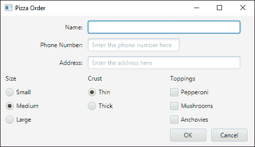

**图 4-7：** 运行中的披萨订单应用程序。

**列表 4-1** 披萨订单应用程序

```java
package com.lowewriter.pizzaorder;

import javafx.application.*;

import javafx.stage.*;

import javafx.scene.*;

import javafx.scene.layout.*;

import javafx.scene.control.*;

import javafx.geometry.*;

public class PizzaOrder extends Application
{
    public static void main(String[] args)
    {
        launch(args);
    }

    Stage stage;

    TextField txtName;

    TextField txtPhone;

    TextField txtAddress;

    RadioButton rdoSmall;

    RadioButton rdoMedium;

    RadioButton rdoLarge;

    RadioButton rdoThin;

    RadioButton rdoThick;

    CheckBox chkPepperoni;

    CheckBox chkMushrooms;

    CheckBox chkAnchovies;

    @Override public void start(Stage primaryStage)
    {
        stage = primaryStage;

        // 创建姓名标签和文本框

        Label lblName = new Label("Name:");

        txtName = new TextField();

        txtName.setMinWidth(100);

        txtName.setPrefWidth(200);

        txtName.setMaxWidth(300);

        txtName.setPromptText("Enter the name here");

        // 创建电话号码标签和文本框

        Label lblPhone = new Label("Phone:");

        txtPhone = new TextField();

        txtPhone.setMinWidth(60);

        txtPhone.setPrefWidth(120);

        txtPhone.setMaxWidth(180);

        txtPhone.setPromptText("Enter the phone number");

        // 创建地址标签和文本框

        Label lblAddress = new Label("Address:");

        txtAddress = new TextField();

        txtAddress.setMinWidth(100);

        txtAddress.setPrefWidth(200);

        txtAddress.setMaxWidth(300);

        txtAddress.setPromptText("Enter the address");

        // 创建尺寸标签

        Label lblSize = new Label("Size:");

        rdoSmall = new RadioButton("Small");

        rdoMedium = new RadioButton("Medium");

        rdoLarge = new RadioButton("Large"); // 注意：此处原代码中单选框名与逻辑一致，保持原样

        // 创建配料

        chkPepperoni = new CheckBox("Pepperoni");

        chkMushrooms = new CheckBox("Mushrooms");

        chkAnchovies = new CheckBox("Anchovies");

        // 设置网格

        GridPane grid = new GridPane();

        grid.setPadding(new Insets(10));

        grid.setHgap(10);

        grid.setVgap(10);

        // 将节点添加到面板

        grid.add(lblName, 0, 0);

        grid.add(txtName, 1, 0);

        grid.add(lblPhone, 0, 1);

        grid.add(txtPhone, 1, 1);

        grid.add(lblAddress, 0, 2);

        grid.add(txtAddress, 1, 2);

        grid.add(lblSize, 0, 3);

        // ... (后续代码根据示例逻辑保持结构不翻译内容)
    }
}
```

```java
// Create a message string with the customer information

String msg = "Customer:\n\n";

msg += "\t" + txtName.getText() + "\n";

msg += "\t" + txtPhone.getText() + "\n";

msg += "\t" + txtAddress.getText() + "\n";

msg += "You have ordered a ";

// Add the pizza size

if (rdoSmall.isSelected())
    msg += "small ";

if (rdoMedium.isSelected())
    msg += "medium ";

if (rdoLarge.isSelected())
    msg += "large ";

// Add the crust style

if (rdoThin.isSelected())
    msg += "thin crust pizza with ";

if (rdoThick.isSelected())
    msg += "thick crust pizza with ";

// Add the toppings

String toppings = "";

toppings = buildToppings(chkPepperoni, toppings);

toppings = buildToppings(chkMushrooms, toppings);

toppings = buildToppings(chkAnchovies, toppings);

if (toppings.equals(""))
    msg += "no toppings.";
else
    msg += "the following toppings:\n"
    + toppings;

// Display the message

Alert a = new Alert(Alert.AlertType.INFORMATION, msg);

a.setTitle("Order Details");

a.showAndWait();

}

public String buildToppings(CheckBox chk, String msg)→189
{
    // Helper method for displaying the list of toppings

    if (chk.isSelected()) {

        if (!msg.equals("")) {

            msg += ", ";

        }

        msg += chk.getText();
    }

    return msg;
}

public void btnCancel_Click()→203
{
    stage.close();
}

}
```

以下几点突出了程序的重点：

- →34：为客户姓名创建了一个标签和一个文本字段。
- →42：为客户电话号码创建了一个标签和一个文本字段。
- →50：为客户的地址创建了一个标签和一个文本字段。
- →58：为披萨尺寸创建了一个标签和三个单选按钮。标签和单选按钮被添加到名为 `paneSize` 的 `VBox` 中。调用 `setToggleGroup` 方法将三个单选按钮关联在一起，使用使用户只能选择其中一个。
- →72：为披萨的饼底样式创建了一个标签和两个单选按钮。标签和单选按钮被添加到名为 `paneCrust` 的 `VBox` 中。
- →84：为披萨配料创建了一个标签和三个复选框。标签和复选框被添加到名为 `paneToppings` 的 `VBox` 中。
- →94：创建了确定和取消按钮并将其添加到名为 `paneButtons` 的 `HBox` 中。
- →105：创建了网格布局。内边距（padding）、水平和垂直间隙设置为 10，宽度范围在 500 到 800 之间。
- →114：将节点添加到窗格中。姓名、电话和地址标签及文本字段被添加到第 0、1 和 2 行。然后，将尺寸、饼底和配料的 `VBox` 窗格添加到第 3 行。最后，将包含按钮的 `HBox` 添加到第 4 行的第 2 列。（记住：行和列的索引是从 0 开始，而不是从 1 开始。）
- →121：设置了水平对齐和列跨选项。
- →129：创建了列约束以均匀分布列宽。
- →138：创建了场景并显示了阶段。
- →148：当用户点击确定时，调用 `btnOK_Click` 方法。→189 `buildToppings` 是用于显示配料列表的辅助方法。→203 关闭阶段。

# 第 5 章：从用户获取输入

- **使用文本字段的工作**
- **验证数据**
- **创建复选框**
- **设置单选按钮**

## 使用文本字段

文本字段是一个可以输入单行文本框。`TextField` 类显示了常用的构造函数。

| 构造函数 | 描述 |
| --- | --- |
| `TextField()` | 创建一个文本字段。 |
| `TextField(String text)` | 创建具有初始值的文本字段。 |

| 方法 | 描述 |
| --- | --- |
| `String getText()` | 获取输入文本字段的内容。 |
| `void requestFocus()` | 请求获取字段焦点。 |
| `void setEditable(boolean value)` | 如果为 `false`，则字段为只读。 |
| `void setMaxWidth(double width)` | 设置字段的最大宽度。 |
| `void setMinWidth(double width)` | 设置字段的最小宽度。 |
| `void setColumnCount(int cols)` | 根据平均字符数设置首选宽度。 |
| `void setPrefWidth(double width)` | 设置字段的首选宽度。 |
| `void setPromptText(String prompt)` | 设置字段的提示文本。 |
| `void setText(String text)` | 设置字段的文本。 |

### 常用的构造函数和方法

`TextField` 类位于 `javafx.scene.control` 包中，因此在任何使用它的程序中都需要包含以下 `import` 语句：

```java
import javafx.scene.control.*;
```

创建文本字段常用的方法是调用无参数的构造函数：

```java
TextField text1 = new TextField();
```

可以通过这种方式设置初始值：

```java
TextField text1 = new TextField("Initial value");
```

或者，如果你以后需要设置值，可以调用 `setText` 方法：

请注意，`setPrefColumnCount` 方法并没有限制用户在字段中输入的字符数。相反，它限制了字段一次可以显示的字符数。

每当你使用文本字段时，请提供一个提示，让用户知道他们应该在字段中输入什么数据。实现此点的常用方法是在文本字段的左侧放置一个标签控件。例如：

```java
Label lblName = new Label("Name:");

lblName.setMinWidth(75);

TextField txtName = new TextField();

txtName.setMinWidth(200);

HBox pane = new HBox(10, lblName, txtName);
```

在这里，创建了一个标签和一个文本字段，并将它们添加到 `HBox` 窗格中，以便它们并排显示。

JavaFX 还允许你在文本字段内部显示提示。该提示以较浅的文本颜色显示，并在字段获得焦点时消失。你使用 `setPromptText` 方法来创建此类这样的提示：

```java
TextField txtName = new TextField();
```


`txtName.setPromptText("Enter the customer's name");`

在这里，文本`Enter the customer's name`将出现在文本字段内部。

要检索用户输入到文本字段中的值，你使用`getText`方法，如下例所示：

```java
String lastName = textLastName.getText();
```

在这里，用户在`textLastName`字段中输入的值被赋值给`String`变量`lastName`。

图 5-1 显示了一个简单程序的运行，该程序使用文本字段允许用户输入剧角色名称以及扮演该角色的演员名称，如第一个对话框所示。假设用户在两个字段中都输入了文本，程序将显示一个警告框，指示谁将扮演该角色，如第二个对话框所示。如果用户漏掉一个或两个字段，将显示一个警告框以指示错误，如第三个对话框所示。

图 5-1 显示了该程序的主舞台外观，以及当用户输入两个名称或遗漏一个名称时显示的消息框窗口。该程序的 JavaFX 代码如列表 5-1 所示。

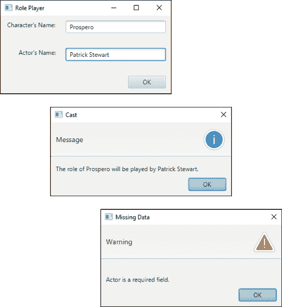

图 5-1：运行中的 Role Player 应用程序。

### 列表 5-1 RolePlayer 程序

```java
package com.lowewriter.roleplayer;

import javafx.application.*;
import javafx.stage.*;
import javafx.scene.*;
import javafx.scene.layout.*;
import javafx.scene.control.*;
import javafx.geometry.*;

public class RolePlayer extends Application
{
    public static void main(String[] args)
    {
        launch(args);
    }

    TextField txtCharacter;
    TextField txtActor;

    @Override public void start(Stage primaryStage)
    {
        // Create the Character
        Label lblCharacter = new Label("Character's Name:");
        lblCharacter.setMinWidth(100);
        lblCharacter.setAlignment(Pos.BOTTOM_RIGHT);

        // Create the Character text field
        txtCharacter = new TextField();
        txtCharacter.setMinWidth(200);
        txtCharacter.setMaxWidth(200);
        txtCharacter.setPromptText("Enter the name of the character here.");

        // Create the Actor label
        Label lblActor = new Label("Actor's Name:");
        lblActor.setMinWidth(100);
        lblActor.setAlignment(Pos.BOTTOM_RIGHT);

        // Create the Actor text field
        txtActor = new TextField();
        txtActor.setMinWidth(200);
        txtActor.setMaxWidth(200);
        txtActor.setPromptText("Enter the name of the actor here.");

        // Create the OK button
        Button btnOK = new Button("OK");
        btnOK.setMinWidth(75);
        btnOK.setOnAction(e -> btnOK_Click());

        // Create the Character pane
        HBox paneCharacter = new HBox(20, lblCharacter, txtCharacter);
        paneCharacter.setPadding(new Insets(10));

        // Create the Actor pane
        HBox paneActor = new HBox(20, lblActor, txtActor);
        paneActor.setPadding(new Insets(10));

        // Create the Button pane
        HBox paneButton = new HBox(20, btnOK);
        paneButton.setPadding(new Insets(10));

        // Add the Character, Actor, and Button panes to a VBox
        VBox pane = new VBox(10, paneCharacter, paneActor, paneButton);
        pane.setPadding(new Insets(10));

        // Set the stage
        Scene scene = new Scene(pane);
        primaryStage.setScene(scene);
        primaryStage.setTitle("Role Player");
        primaryStage.show();
    }

    void btnOK_Click()
    {
        String errorMessage = "";

        if (txtCharacter.getText().isEmpty())
        {
            errorMessage += "Character is required.\n";
        }

        if (txtActor.getText().isEmpty())
        {
            errorMessage += "Actor is required.\n";
        }

        if (errorMessage.isEmpty())
        {
            String message = "The role of " + txtCharacter.getText()
                + " will be played by " + txtActor.getText() + ".";

            Alert a = new Alert(Alert.INFORMATION, message);
            a.setTitle("Cast");
            a.showAndWait();
        }
        else
        {
            Alert a = new Alert(Alert.WARNING, errorMessage);
            a.setTitle("Missing Data");
            a.showAndWait();
        }
    }
}
```

→101：如果用户忘记在“角色”（Character）或“演员”（Actor）文本字段中输入数据，此行将显示错误消息。

## 验证数值数据

如果你使用文本字段从用户获取数值数据，需要特别小心。`getText`方法返回一个字符串值。你可以将此值传递给原始数值类型包装类的其中一个`parse`方法。要将文本框中输入的值转换为`int`，请使用`parseInt`方法：

```java
int count = Integer.parseInt(txtCount.getText());
```

这里，`getText`方法的结果被用作`parseInt`方法的参数。

表 5-2 列出了各种包装类的`parse`方法。**注意：**如果字符串无法转换，这些方法中的每一个都会抛出`NumberFormatException`。因此，你需要在`try`/`catch`块中调用`parseInt`方法来捕获此异常。

| 包装类 | parse 方法 |
| --- | --- |
| `Integer` | `parseInt(String)` |
| `Short` | `parseShort(String)` |
| `Long` | `parseLong(String)` |
| `Byte` | `parseByte(String)` |
| `Float` | `parseFloat(String)` |
| `Double` | `parseDouble(String)` |

表 5-2 将字符串转换为数字的方法

 如果你的程序使用了一个或两个数值输入文本字段，请考虑创建独立的方法来验证用户的输入。以下代码段显示了一个方法，该方法接受文本字段和一个字符串（如果字段中输入的数据无法转换为`int`，则提供该错误消息）。该方法返回一个布尔值，指示该字段是否包含有效的整数：

```java
private boolean isInt(TextField f, String msg)
{
    try {
        Integer.parseInt(f.getText());
        return true;
    }
    catch (NumberFormatException e) {
        Alert a = new Alert(Alert.AlertType.WARNING, msg);
        a.setTitle("Invalid Data");
        a.showAndWait();
        return false;
    }
}
```

每当你需要检查文本字段是否包含有效整数时，都可以调用此方法。这里有一个方法可以获取`txtCount`文本字段输入的值，如果输入的值是有效整数，则在消息框中显示它：

```java
public void btnOK_Click()
{
    if (isInt(textCount, "You must enter an integer.")) {
        Alert a = new Alert(
            Alert.AlertType.INFORMATION,
            "You entered " + Integer.parseInt(textCount.getText()),
            ButtonType.OK
        );

        a.showAndWait();
    }

    textCount.requestFocus();
}
```

这里调用了`isInt`方法以确保用户输入的文本可以转换为`int`。如果是，则将文本转换为`int`并显示在警告框中。

## 使用复选框

*复选框*（check box）是一种用户可以点击进行勾选或取消选择的控件。复选框允许用户为选项指定“是”或“否”设置。图 5-2 显示了一个带有三个复选框的窗口。

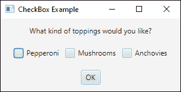

图 5-2：三个复选框。

 严格来说，复选框有三种状态：已选中、未选中和未定义。未定义状态通常与`TreeView`控件配合使用。

要创建复选框，你需要使用`CheckBox`类。常用的构造函数和方法所示于表 5-3。

| 构造函数 | 描述 |
| --- | --- |
| `CheckBox()` | 创建一个初始为未选的新复选框 |
| `CheckBox(String text)` | 创建一个显示指定文本的新复选框 |
| **方法** | **描述** |
| `String getText()` | 获取复选框显示的文本 |
| `boolean isSelected()` | 如果复选框被勾选则返回`true`，如果未勾选则返回`false` |
| `void setOnAction(EventHandler<ActionEvent> value)` | 设置`ActionEvent`监听器以处理动作事件 |
| `void setSelected(boolean value)` | 如果参数为`true`则勾选复选框；如果参数为`false`则取消勾选 |
| `void setText(String text)` | 设置复选框文本 |

表 5-3 Note CheckBox 构造函数和方法

与任何 JavaFX 控件一样，如果你想在程序的任何方法中引用复选框，请声明一个类变量来引用该控件：

```java
CheckBox chkPepperoni, chkPepperoni;
```

要使用单选按钮（radio buttons），你需要使用两个类。首先，你使用`RadioButton`类创建单选按钮本身，其构造函数和方法如表 5-4 所示。然后，你使用`ToggleGroup`类为按钮创建一个组，并将单选按钮添加到该切换组中。

| 构造函数 | 描述 |
| --- | --- |
| `RadioButton()` | 创建一个无文本的新单选按钮 |
| `RadioButton(String text)` | 创建一个带有指定文本的新单选按钮 |
| **方法** | **描述** |
| `String getText()` | 获取单选按钮显示的文本 |
| `boolean isSelected()` | 如果单选按钮被选中则返回`true`，未选中则返回`false` |
| `void setOnAction(EventHandler<ActionEvent> value)` | 设置`ActionEvent`监听器来处理动作事件 |
| `void setSelected(boolean value)` | 如果参数为`true`则选中单选按钮；如果参数为`false`则取消选中 |
| `void setText(String text)` | 设置单选按钮文本 |

表 5-4 各种 RadioButton 构造函数和方法

 `ToggleGroup`对象是一种关联一组单选按钮的方法，使得在给定时刻只能选中其中一个按钮。切换组对象本身不是一个控件，且不会显示。要显示单选按钮，你需要将单个单选按钮（而不是切换组）添加到布局面板中。

创建单选按钮通常的方法是声明一个变量作为类变量引用该按钮，以便在类中的任何地方访问它，例如所示：

```java
RadioButton rdoSmall, rdoMedium, rdoLarge;
```

然后，在`start`方法中，你调用`RadioButton`构造函数来创建单选按钮：

```java
rdoSmall = new RadioButton("Small");
```

之后，你可以按照通常的方法将单选按钮添加到布局面板中。

要创建一个切换组来组合协同工作的单选按钮，请调用`ToggleGroup`类的构造函数：

```java
ToggleGroup sizeGroup = new ToggleGroup();
```

然后调用每个单选按钮的`setToggleGroup`方法：

```java
rdoSmall.setToggleGroup(sizeGroup);
rdoMedium.setToggleGroup(sizeGroup);
rdoLarge.setToggleGroup(sizeGroup);
```


 切换组与单选按钮的显示方式无关。要显示单选按钮，你仍然必须将它们添加到布局面板中。而且并没有规定切换组内的所有单选按钮都必须添加到同一个布局面板。然而，习惯上的做法是将同一个切换组中的所有单选按钮一起显示在场景（scene）中，这样用户就能很直观地看出这些单选按钮属于同一组。

 如果你在 Swing 中用过单选按钮，你可能需要注意 JavaFX 切换组的工作方式与 Swing 按钮组的工作方式之间的重要区别。在 JavaFX 中，位于切换组外的单选按钮之间是相互独立的。在 Swing 中，位于按钮组外的单选按钮都属于默认组的一部分。因此，在 JavaFX 中，请始终将单选按钮添加到切换组中，即使场景中只有一个切换组。

# 第 6 章：从列表中选择

## 本章内容

 **使用** `ChoiceBox` **控件**  
 **使用** `ObservableList` **接口**  
 **监听用户选择的变化**  
 **使用** `ComboBox` **和** `ListView` **控件**  
 **使用** `TreeView` **控件**

整个 JavaFX 控件旨在允许用户从列表中选择一个或多个项目。本章介绍了三个此类控件：选择框（choice boxes）、组合框和列表。在此过程中，你将发现如何使用 `ObservableList` 接口，它被用于管理由选择框、组合框或列表视图控件显示的项目列表。

实际上，如果你一直读到了这里，你已经简要地接触了 `ObservableList` 接口，因为它也被用于管理在布局面板中显示的控件列表。在本部微型书籍的第 5 章中，你读到了关于如何使用该接口的 `addAll` 方法。在本章中，你将了解到该接口的额外功能。

你还将发现如何添加一个事件监听器，以便在用户更改当前选择时做出响应。

## 使用选择框

*选择框*（choice box）是一种允许用户从下拉列表中选择单个项目的控件。初始时，选择框仅显示当前选中的项目。当用户点击选择框时，选项列表就会显示。用户可以通过点击列表中的任何项目来更改选择。图 6-1 显示了一个带有简单选择框的场景。

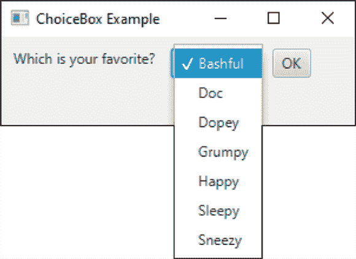

图 6-1 带有简单选择框的场景。你使用 `ChoiceBox` 类来创建选择框。表 6-1 常用的 `ChoiceBox` 构造函数和方法。

| 构造函数 | 描述 |
| --- | --- |
| `ChoiceBox()` | 创建一个指定类型的空列表 |
| `ChoiceBox(ObservableList<T> items)` | 创建列表并用指定的值填充 |
| 方法 | 描述 |
| `ObservableList<T> getItems()` | 获取列表 |
| `void setItems(ObservableList<T> items)` | 设置列表 |
| `T getValue()` | 返回当前选择的项目 |
| `void setValue(T value)` | 设置当前选择的项目 |
| `void show()` | 显示列表 |
| `void hide()` | 隐藏列表 |
| `boolean isShowing()` | 表示列表是否可见 |

表 6-1 `ChoiceBox` 常用构造函数和方法。

### 创建选择框

创建选择框很容易。`ChoiceBox` 类是泛型的，因此为关联的列表指定类型。例如：

```java
ChoiceBox<String> choice = new ChoiceBox();
```

在这里，创建一个显示字符串的选择框。

下一步是向选择框中添加项目。你可以通过调用 `getItems` 方法获取列表，然后调用 `add` 方法来添加项目：

```java
choice.getItems().add("Bashful");
choice.getItems().add("Doc");
choice.getItems().add("Dopey");
choice.getItems().add("Grumpy");
choice.getItems().add("Happy");
choice.getItems().add("Sleepy");
choice.getItems().add("Sneezy");
```

或者，你可以调用 `addAll` 方法一次性添加所有字符串，如下：

```java
choice.getItems().addAll("Bashful", "Doc", "Dopey", "Grumpy", "Happy", "Sleepy", "Sneezy");
```

 `getItems` 方法返回一个 `ObservableList` 对象，它提供了许多操作列表的方法。更多信息，请参见本章后面的“使用观测列表”。

`ChoiceBox` 类还包含一个构造函数，允许你在创建选择框时添加 `ObservableList` 对象。这允许你在创建选择框之前创建列表。在本文章的“使用观测列表”节中可以看到该构造函数的实际示例。

 你可以将任何种类型的对象添加到选择框中。选择框调用每个项目的 `toString` 方法来确定在选择列表中显示的文本。假设你有一个名为 `Astronaut` 的类，代表执行执行太空任务的航天员：

```java
class Astronaut
{
  private String firstName;
  private String lastName;
}
```

```java
public Astronaut(String FirstName, String LastName) {
    firstName = FirstName;
    lastName = LastName;
}

public String toString() {
    return firstName + " " + lastName;
}

}
```

然后，你可以像这样创建一个列出阿波罗 13 号宇组成员的选择框：

```java
ChoiceBox<Astronaut> apollo13;

apollo13 = new ChoiceBox<>();

apollo13.getItems().add(new Astronaut("Jim", "Lovell"));

apollo13.getItems().add(new Astronaut("John", "Swigert"));

apollo13.getItems().add(new Astronaut("Fred", "Haise"));
```

如果你需要，可以在无需用户点击选择框的情况下显示选择框的内容。要这样做，请调用 `show` 方法，如下：

```java
apollo13.show();
```

要隐藏列表，请调用 `hide` 方法：

```java
apollo13.hide();
```

### 设置默认值

默认情况下，选择框在第一次显示时没有初始选择。要设置初始值，调用 `setValue` 方法，并传递你想要作为初始选择的列表对象。

如果选择框包含字符串，你可以通过向 `setValue` 方法传递所需的字符串值值来设置初始值：

```java
choice.setValue("Dopey");
```

如果指定的字符串不在列表中，则初始值将保持未指定。

如果选择框包含对象（如上一节所示的 `Astronaut` 对象），你必须传递一个想要作为默认选择的对象的引用。例如：

```java
Astronaut lovell = new Astronaut("Jim", "Lovell");

Astronaut swigert = new Astronaut("John", "Swigert");

Astronaut haise = new Astronaut("Fred", "Haise");

ChoiceBox apollo13 = new ChoiceBox<Astronaut>();

apollo13.getItems().addAll(lovell, swigert, haise);

apollo13.setValue(lovell);
```

在这里，吉姆·洛威尔（Jim Lovell）被设置为默认宇天员。

### 获取选定项目

你可以调用 `getValue` 方法获取用户选择的项目。返回值的类型取决于你创建选择框时指定的类型。例如，如果你指定了类型 `String`，则 `getValue` 方法返回字符串。如果你为选择框指定了类型 `Astronaut`，则 `getValue` 方法返回宇天员。

`getValue` 方法通常用于按钮的动作事件处理器中。例如：

```java
public void btnOK_Click() {
    String message = "You chose ";

    message += apollo13.getValue();

    Alert a = new Alert(Alert.AlertType.INFORMATION, message);

    a.setTitle("Your Favorite Astronaut");

    a.showAndWait();
}
```

### 使用可观察列表（Observable Lists）

正如你在上一节中看到的，`ChoiceBox` 类并不包含直接从选择框显示的列表中添加或删除项目的方法。相反，它包含一个名为 `getItems` 的方法，该方法返回一个类型为 `ObservableList` 的对象。该方法返回的对象是一个观察列表；它代表由选择框显示的列表。

要操作选择框显示的项目，你必须先访问可观察列表，然后使用 `ObservableList` 类的方法来访问列表中的各个项目。

可观察列表不仅被 `ChoiceBox` 类使用，还用于其他显示列表项目的控件类，例如 `ComboBox` 和 `List`，你可以在本章的稍后部分阅读关于它们的内容。这两个类也都有一个返回 `ObservableList` 的 `getItems` 方法。

可观察列表还用于布局窗格，例如 `HBox` 和 `VBox`，你可以在本微型书籍的第 4 章中阅读它们的内容。所有布局类共有的 `getChildren` 方法返回一个 `ObservableList`。

到目前为止，我只讨论了 `ObservableList` 接口的两个方法：`add` 和 `addAll`，它们允许你向观察列表添加项目。这里是本章早些时候 `add` 方法的示例：

```java
cbox.getItems().add("Bashful");
```

这里是第 4 章中的一个示例，它使用 `addAll` 方法将按钮添加到布局窗格：

```java
pane.getChildren().addAll(btnOK, btnCancel);
```

`ObservableList` 接口除了 `add` 和 `addAll` 之外还有许多其他方法。表 6-2 显示了你最可能使用的方法。

| 方法 | 描述 |
| --- | --- |
| `void add(E element)` | 将类型为 E 的元素添加到列表末尾。 |
| `void add(int index, E element)` | 在指定的索引位置将指定对象添加到列表。 |
| `void addAll(E…elements)` | 将所有指定的元素添加到列表末尾。 |
| `void addAll(Collection<E> c)` | 将指定集合的所有元素添加到列表末尾。 |
| `E set(int index, E elem)` | 将指定的元素设置为该对象。该位置原本的元素作为方法的返回值返回。 |
| `void clear()` | 删除所有元素。 |
| `void remove(int fromIndex, int toIndex)` | 删除从 `fromIndex` 到 `toIndex` 之间的元素。 |
| `void removeAll(E…elements)` | 删除指定的元素。 |
| `boolean contains(Object elem)` | 列表是否包含指定的元素。 |
| `E get(int index)` | 返回列表中指定位置的元素。 |
| `int indexOf(Object elem)` | 返回对象在列表中第一次出现的索引位置。如果对象不在列表中，则返回 -1。 |
| `boolean isEmpty()` | 返回列表是否为空。 |
| `E remove(int index)` | 删除指定索引的元素并返回被删除的元素。 |
| `boolean remove(Object elem)` | 从列表中删除对象。注意：如果多个元素引用该对象，此方法只删除一个。它返回对象是否在列表中。 |
| `int size()` | 返回列表中元素的数量。 |
| `void addListener(ListChangeListener listener)` | 添加当列表变化时调用的 `ListChangeListener`。 |

表 6-2

```java
clear();
```

如果你需要知道选择框中有多少个项目，调用 `size` 方法：

```java
int count = cbox.getItems().size();
```

要从列表中删除特定项目，使用 `remove` 方法：

```java
cbox.getItems().remove("Grumpy");
```

 此方法返回一个布尔值，指示字符串是否被删除；如果 `remove` 返回 `false`，简单意味着 `"Grumpy"` 不在列表中。

你可以通过向 `addAll` 方法指定集合，轻松地将现有 Java 集合（如数组列表）插入选择框。例如，假设你已经有一个名为 `list` 的数组列表，其中包含了你想在选择框中显示的项目。你可以这样添加项目：

```java
cbox.getItems().addAll(list);
```

 你可能在奇怪，为什么基于列表的 JavaFX 控制显示的项需要一个可观察列表（observable list）。为什么不直接使用现有的集合类呢？原因是为了让基于列表的控件高效运行，控件本身需要监控你对项目列表进行的任何更改，以便控件能够自动更新显示的项目。表 6-2 中列出的最后一个方法（`addListener`）提供了这种能力，它允许你添加一个监听器，该监听器会在列表内容变化时被调用。你很少直接调用此方法。但使用可观察列表的控件确实会调用此方法来创建事件监听器，每当列表内容发生变化时自动更新控件。

**注意：** 你不需要使用 `addListener` 方法来响应用户在选择框或其他类型列表控件中选择项目。相反，你将使用一种名为选择模型（selection model）的有趣结构来响应所选项目的变化，正如下一节所述。

## 监听选择变化

希望你的程序在用户更改选择框或其他列表控件的选择时立即做出响应，而无需等待用户点击按钮提交数据，这并不起见。例如，你可能有一个标签，每当用户更改选择时，你想要立即更新它的值。你甚至可能想根据选择显示或隐藏不同的控件。

遗憾的是，选择框和其他列表控件在用户更改选择时不会产生动作事件（action event）。因此，`ChoiceBox` 类没有 `setOnAction` 方法。相反，你必须使用一系列复杂的方法调用来设置另一种类型的事件监听器，称为变化监听器（change listener）。

序列如下：

1. **通过调用选择框上的** `getSelectionModel` **方法获取选择模型**。

   `getSelectionModel` 方法返回控件的选择模型，它是一个管理用户如何从列表中选择项目的对象。选择模型是一个实现抽象 `SelectionModel` 类的多个子类之一的对象。对于选择框，选择模型始终是 `SingleSelectionMode` 类型，它实现了一个允许用户一次从列表中仅选择一个项目的选择模型。

2. **通过调用选择模型上的** `selectedItemProperty` **方法获取** `selectedItem` **属性**。

   `SelectionModel` 类有一个命名为 `selectedItemProperty` 的方法，该方法访问名为 `selectedItem` 的属性，该属性代表当前选中的项目。（属性是一种特殊的 JavaFX 对象，其值可以被监听器监控，每当属性值变化时，监听器就会被调用。）

3. **通过调用** `selectedItem` **属性上的** `addListener` **方法添加变化监听器**。

   每当 `selectedItem` 属性的值变化时，监听器就会被调用。变化监听器实现了一个名而易见的名为 `ChangeListener` 的函数接口。因为 `ChangeListener` 是一个函数接口（即它只有一个抽象方法），你可以使用 lambda 表达式来实现变化监听器。

你通常在一个语句中完成这三个步骤，如例例所示：

```java
choice.getSelectionModel().selectedItemProperty()
  .addListener((v, oldValue, newValue) -> {
      lbl.setText(newValue.toString());
  });
```


在上一个示例中，变化监听器将标签控件显示的值设置为用户选中的新值。作为一个函数接口，`ChangeListener` 定义了一个命名为`changed`的单函数，该方法每当属性值变化时都会被调用。`changed`方法接收三个参数：

- `observable`：值发生变化的属性
- `oldValue`：属性的上一个值
- `newValue`：属性的新值

这三个参数在`lambda`表达式开头的括号中指定。在`lambda`表达式的主体中，`newValue`参数被赋值给标签的文本。因此，用户选中的值将由标签显示，每当用户更改选择框选择时，标签就会自动更新。

## 使用组合框（Combo Boxes）

*组合框*（combo box）是选择框控件的一个更高级的兄弟控件。通过组合框你获得的主要改进是：

- **组合框包含了在显示列表时限制显示项目数量的能力。**

  如果列表中的项目数量超过限制，将自动添加滚动条以允许用户滚动整个列表。

- **组合框包含一个文本字段，允许用户直接输入值，而不是从列表中选择值。**

  文本字段是可选的，且默认不显示，但你可以通过单次方法调用添加它。图 6-2 显示了一个显示了文本字段的组合框。

- **组合框在用户更改选择时都会触发动作事件。**

  因此，与选择框相比，使用组合框设置响应用户选择变化的事件处理器要简单得多。

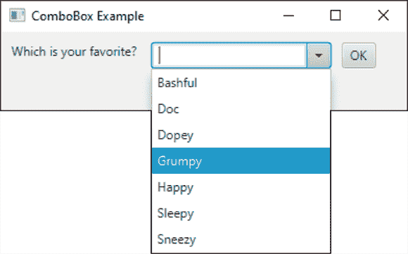

图 6-2：组合框。

你使用`ComboBox`类来创建组合框。表 6-3 列出了该类最常用的构造函数和方法。

| 构造函数 | 描述 |
| :--- | :--- |
| `ComboBox<T>()` | 创建指定类型的空组合框。 |
| `ComboBox<T>(ObservableList<T> items)` | 创建组合框并用指定列表中的值填充它。 |

| 方法 | 描述 |
| :--- | :--- |
| `void setEditable(boolean value)` | 如果为`true`，则显示文本字段允许用户直接编辑选择。 |
| `void setVisibleRowCount(int value)` | 设置显示的项目数量。 |
| `void setPromptText(String text)` | 设置最初在文本字段中显示的提示文本。 |
| `ObservableList<T> getItems()` | 获取项目列表。 |
| `void setItems(ObservableList<T> items)` | 设置项目列表。 |
| `T getValue()` | 返回当前选中的项目。 |
| `void setValue(T value)` | 设置当前选中的项目。 |
| `void show()` | 显示项目列表。 |
| `void hide()` | 隐藏项目列表。 |
| `void setOnAction(EventHandler<ActionEvent> handler)` | 设置在选择变化时被调用的事件处理器。 |
| `boolean isShowing()` | 表示项目列表当前可见。 |

表 6-3：`ComboBox`构造函数和方法。

### 创建组合框

创建组合框与创建选择框非常相似。因为`ComboBox`是泛型的，为它将包含的项目指定类型，如例所示：

```java
ComboBox<String> cbox = new ComboBox<String>();
```

然后你可以使用`getItems`方法访问包含组合框显示的列表内容的`ObservableList`对象。例如，你可以这样向列表添加项目：

```java
cbox.getItems().addAll("Bashful", "Doc", "Dopey",
                      "Grumpy", "Happy", "Sleepy",
                      "Sneezy");
```

有关关于操作`ObservableList`接口的更多信息，请翻到本章前面的“操作可观察列表”部分。


默认情况下，不允许编辑组合框文本字段部分的数据。如果你想允许用户编辑文本字段，请使用`setEditable`方法，如下：

```java
cbox.setEditable(true);
```

然后用户就可以输入组合框中不存在的值。

如果你需要，可以通过调用`setVisibleRowCount`方法来限制列表显示的项数：

```java
cbox.setVisibleRowCount(10);
```

在这里，列表最多显示十个项。如果列表包含超过十个项，则会自动添加滚动条，以便使用户可以滚动查看整个列表。

你还可以通过调用`setPromptText`方法为组合框的文本字段组件指定一个提示文本：

```java
cbox.setPromptText("Make a choice");
```

在这里，文本`Make a choice`将显示在文本字段中。

### 获取选中的项目

要获取用户选中的项目，请使用`getValue`方法，这与处理选择框（choice box）时一样。你通常会在响应按钮点击的动作事件处理器中这样做。例如：

```java
public void btnOK_Click()
{
    String message = "You chose ";
    message += cbox.getValue();
    Alert a = new Alert(Alert.AlertType.INFORMATION, message);
    a.setTitle("Your Choice");
    a.showAndWait();
}
```


请记住，`getValue`方法返回的值可能不是组合框列表中的值之一。这是因为用户可以在可编辑组合框的文本字段中输入他们想要的任何内容。如果你想知道用户是从列表中选择了一个项目，还是通过文本字段输入了不同的项目，请使用`ObservableList`类的`contains`方法，如下所示：

```java
if (!cbox.getItems().contains(cbox.getValue()))
{
    Alert a = new Alert(Alert.AlertType.INFORMATION, "You chose outside the box");
    a.setTitle("Good Thinking!");
    a.showAndWait();
}
```

在这里，如果用户输入的项目不在列表列表中，则会显示警报框。

### 处理组合框事件

当用户从组合框中选择一个项目时，会生成一个动作事件。在大多数应用程序中，你只需要忽略这个事件，因为通常在用户选择项目时，你并不需要立即执行任何操作。相反，选中的项目会在用户点击按钮时被处理。

如果你想在用户选择项目时提供即时反馈，可以通过调用组合框的`setOnAction`方法来设置事件处理器。在大多数情况下，实现此目的最简单的方法是创建一个方法，其中包含你在用户选择项目时想要执行的代码，然后通过`lambda`表达式将此方法传递给`setOnAction`方法。

例如，下面的方法在用户选择 Dopey 时会显示一个显示`My favorite too!`的对话框：

```java
public void cbox_Changed()
{
    if (cbox.getValue().equals("Dopey"))
    {
        Alert a = new Alert(Alert.AlertType.INFORMATION, "My favorite too!");
        a.setTitle("Good Choice");
        a.showAndWait();
    }
}
```

以下是每当用户更改组合框选择时调用此方法的代码：

```java
cbox.setOnAction(e -> cbox_Changed());
```

## 使用列表视图

*列表视图*（list view）是一个强大的 JavaFX 控件，用于在框内显示项目对象列表。根据列表的配置方式，用户可以选择列表中的一个项目或多个项目。此外，你对列表项的显示方式具有惊人的控制力。图 6-3 显示了一个带有列表视图的示例场景。

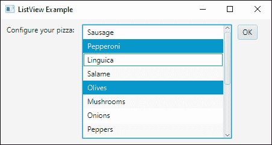

图 6-3：列表视图控件。

列表视图和组合框之间有几个重要的区别：

- **列表视图没有允许用户编辑所选项目的文本字段。** 相反，用户必须直接从列表视图选择项目。
- **列表视图不会下拉。** 相反，列表项显示在一个框中，你可以指定该框的大小。
- **列表视图中的项目可以垂直排列（默认值）或水平排列。** 图 6-4 显示了一个水平列表框。

  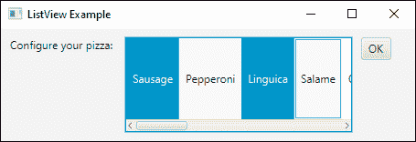

  图 6-4：水平排列的列表视图控件。
- **列表视图允许用户选择多个项目。** 默认情况下，列表视图允许用户只选择一个项目，但你可以轻松地配置它以允许多次选择。

  

  要在列表中选择多个项目，按住`Ctrl`键并点击你想选择的项。要选择一个范围内的项目，点击第一个项目，按住`Shift`键并点击最后一个项目。

你使用`ListView`类来创建列表视图控件。表 6-4 列出了该类最常用的构造函数和方法。

| 构造函数 | 描述 |
| :--- | :--- |
| `ListView()` | 创建一个空列表。 |
| `ListView(ObservableList<T> items)` | 创建列表并使用指定值填充它。 |

| 方法 | 描述 |
| :--- | :--- |
| `ObservableList<T> getItems()` | 获取列表。 |
| `void setItems(ObservableList<T> items)` | 设置列表。 |
| `void setOrientation(Orientation o)` | 设置列表的方向。方向可以是`Orientation.HORIZONTAL`或`Orientation.VERTICAL`。 |
| `SelectionModel<T> getSelectionModel()` | 返回列表的选择模型。 |

表 6-4：创建列表视图。

创建列表视图与创建组合框类似。以下是一个示例，创建了图 6-3（c42.xhtml_c42-fig-0003）所示的列表视图：

```java
ListView<String> list = new ListView<String>();
list.getItems().addAll("Sausage", "Pepperoni", "Linguica", "Salame", "Olives", "Mushrooms", "Onions", "Peppers", "Pineapple", "Spinach", "Canadian Bacon", "Tomatoes", "Kiwi", "Anchovies", "Gummy Bears");
```

注意，图 6-3（c42.xhtml_c42-fig-0003）所示的列表视图只显示列表中的前面的项。与组合框一样，如果无法显示所有项，则会自动添加滚动条。

默认情况下，列表视图仅允许单次选择。要允许多次选择，请添加此行：

```java
list.getSelectionModel().setSelectionMode(SelectionMode.MULTIPLE);
```

要将列表水平而不是垂直排列，请添加此行：

```java
list.setOrientation(Orientation.HORIZONTAL);
```

图 6-4 显示了水平排列的列表视图控件。

### 获取选中的项目

从列表视图获取选中的项目有点复杂。首先，你必须通过调用`getSelectionModel`获取选择模型对象。然后，调用模型的`getSelectedItems`方法。它返回一个包含所选项目的只读观察列表。

以下是一个示例，它构建了一个字符串，列出用户在图 6-3（c42.xhtml_c42-fig-0003）所示的披萨配料列表视图中选择的所有项目：

```java
String tops = "";
ObservableList<String> toppings;
toppings = list.getSelectionModel().getSelectedItems();
for(String topping : toppings)
{
    tops += topping + "\n";
}
```

在前面的示例中，`tops`字符串将包含用户选择的所有配料，并用换行符分隔。此外，请注意，你需要导入`javafx.collections.*`来使用`ObservableList`类。

`tree view`（树视图）是一种高级 JavaFX 控件，用于以大纲形式显示层级数据，我们这些电脑痴称之为“树”。树形结构在计算机世界非常常见。你硬盘驱动器的文件夹结构是一个树，JavaFX 的场景图也是如此。

[图 6-5] 显示了一个包含树视图控件的 JavaFX 场景。在这个示例中，我使用一个树形控件来表示我喜欢的几部电视剧，以及从这些剧衍生出的剧。


图 6-5：树视图控件。

## 描述树元素的术语

在介绍如何创建树形控件的方法之前，你需要了解一些描述树本身元素的术语：

- **Node（节点）：** 树中的每个元素都是一个`node`。树中的每个节点都是通过`TreeItem`类创建的。`TreeItem`类是一个泛型类，因此你可以为其关联某种类型。因此，你可以使用任何你类型的对象来创建树，包括你自己创建的类型。
- **Root node（根节点）：** `root node`是树的起始节点。每棵树必须有且仅有一个根节点。当你创建一个树组件时，将根节点传递给`TreeView`构造函数。
- **Child node（子节点）：** 紧接位于给定节点下方的节点是该节点的`child nodes`。一个节点可以有多个子节点。
- **Parent node（父节点）：** 紧接位于给定节点方的节点是该节点的`parent node`。除根节点外，每个节点必须有且只有一个父节点。
- **Sibling nodes（兄弟节点）：** `Sibling nodes`是具有相同父节点的节点。
- **Leaf node（叶子节点）：** `leaf node`是没有任何子节点的节点。
- **Path（路径）：** `path`包含该节点及其所有的祖先——即它的父节点、父节点的父节点，以此类推，一直回到根节点。
- **Expanded node（已展开节点）：** `expanded node`指子节点可见的节点。
- **Collapsed node（已折叠节点）：** `collapsed node`指子节点隐藏的节点。

## 构建树

在实际创建树视图之前，你必须先构建它要显示的树。要做到这一点，请使用`TreeItem`类，我在表 6-5 中讨论了它的细节。

| 构造函数 | 描述 |
| :--- | :--- |
| `TreeItem<T>()` | 创建空的树节点。 |
| `TreeItem<T>(T value)` | 创建具有指定值的树节点。 |

| 方法 | 描述 |
| :--- | :--- |
| `T getValue()` | 返回树项的值。 |
| `void setValue(T value)` | 设置树项的值。 |
| `ObservableList getChildren()` | 返回表示此树项子节点的`ObservableList`。 |
| `TreeItem getParent()` | 获取此节点的父节点。 |
| `void setExpanded(boolean expanded)` | 指定`true`以展开节点。 |
| `boolean isExpanded()` | 返回一个指示树项是否已展开的`boolean`值。 |
| `boolean isLeaf()` | 返回一个指示树项是否为叶子节点（即没有子节点）的`boolean`值。叶子节点无法展开。 |
| `TreeItem nextSibling()` | 返回此树项的下一个兄弟节点。如果没有下一个兄弟节点，则返回`null`。 |
| `TreeItem prevSibling()` | 返回此树项的上一个兄弟节点。如果没有上一个兄弟节点，则返回`null`。 |

表 6-5：`TreeItem`类。

`TreeItem`类为每个节点提供了三个基本特征：

- **值（The value），** 包含节点表示的数据。在我的示例中，我使用字符串作为用户对象，但你可以使用任何你类型的对象作为用户对象。树形控件调用用户对象的`toString`方法来确定每个节点显示什么文本。设置用户对象最简单的方法是通过`TreeItem`构造函数传递它。
- **此节点的父节点（The parent of this node），** 除非节点恰好是根节点。


**此节点的子节点（The children of this node）**表示为`ObservableList`。如果节点恰好是叶子节点，则列表将为空。你可以使用`ObservableList`接口熟悉的方法来创建或检索子节点。更多信息请参阅本章前面的“使用 Observable 列表”部分。

在本节中，我构建了一棵树，列出了过去三部热门电视剧的一些衍生剧：

- *The Andy Griffith Show*（安迪·格里菲斯秀），它有两个衍生剧：*Gomer Pyle, U.S.M.C.,* 和 *Mayberry R.F.D.*。
- *All in the Family*（家庭的一切），它直接产生了四部衍生剧：*The Jeffersons*、*Maude*、*Gloria* 和 *Archie Bunker’s Place*。

```java
public TreeItem<String> makeShow(String title, TreeItem<String> parent) {
    TreeItem<String> show = new TreeItem<String>(title);
    show.setExpanded(true);
    parent.getChildren().add(show);
    return show;
}
```

此方法接受一个字符串和另一个节点作为参数，并返回一个其用户对象设置为`String`参数的节点。返回的节点还作为子节点添加到父节点中，并且节点被展开。因此，你可以调用此方法来创建新节点并将节点放入树中。

下一步是创建一些节点。继续我的示例，我从创建 *The Andy Griffith Show* 及其衍生剧的节点开始：

```java
andy = makeShow("The Andy Griffith Show", root);
makeShow("Gomer Pyle, U.S.M.C.", andy);
makeShow("Mayberry R.F.D.", andy);
```

在这里调用`makeShow`为 *The Andy Griffith Show* 创建节点，并指定根节点为其父节点。该方法返回的节点保存在变量`andy`中。然后调用两次`makeShow`来创建衍生剧，这次指定`andy`为父节点。

由于 *Gomer Pyle, U.S.M.C.,* 和 *Mayberry R.F.D.* 都没有衍生剧，因此我不需要将这些节点作为父参数传递给`makeShow`方法。这就是为什么我没有费心去创建一个变量来引用这些节点。

接下来在我的示例中，我为 *All in the Family* 及其衍生剧创建节点：

```java
archie = makeShow("All in the Family", root);
george = makeShow("The Jeffersons", archie);
makeShow("Checking In", george);
maude = makeShow("Maude", archie);
makeShow("Good Times", maude);
makeShow("Gloria", archie);
makeShow("Archie Bunker's Place", archie);
```

在这种例中，*The Jeffersons* 和 *Maude* 有它们自己的子节点。因此，对于这两个节目需要定义变量，以便当我为 *Checking In* 和 *Good Times* 创建节点时，可以将它们作为父参数传递给`makeShow`。

最后，这里是创建 *Happy Days* 及其衍生剧节点的代码：

```java
happy = makeShow("Happy Days", root);
makeShow("Mork and Mindy", happy);
makeShow("Laverne and Shirley", happy);
makeShow("Joanie Loves Chachi", happy);
```

完整的树已成功创建在内存中，因此我可以继续执行创建一个`TreeView`控件来展示这棵树的任务。

### 创建一个`TreeView`控件

你使用`TreeView`类来创建一个显示树节点的树形组件。表 6-6 显示了该类的关键构造函数和方法。

创建`TreeView`控件的第一步是将`TreeView`变量声明为类的实例成员变量，这样你就可以在程序中的任何方法中访问它，如下所示：

```java
TreeView<String> tree;
```

| 构造函数 | 描述 |
| --- | --- |
| `TreeView<T>()` | 创建一个空树（如果你问我的话，这没什么用）。 |
| `TreeView<T>(TreeItem root)` | 创建一个显示从指定节点开始的树的`TreeView`。 |

| 方法 | 描述 |
| --- | --- |
| `TreeItem getRoot()` | 获取根节点。 |
| `void setRoot(TreeItem root)` | 设置根节点。 |
| `MultipleSelectionModel<T> getSelectionModel()` | 返回列表视图控件的选择模型。你可以使用该模型通过调用`getSelectedItems`方法来获取选中项的可观测列表。你也可以通过调用`getSelectedItem`获取最近选中的项目。 |
| `void setRootVisible(boolean visible)` | 决定根节点是否可见。 |

表 6-6 `TreeView`类

然后，在应用程序的`start`方法中，你调用`TreeView`构造函数来创建树视图控件，并将你想显示的树的根节点作为参数传递：

```java
tree = new TreeView<String>(root);
```

默认情况下，用户只能从树中选择一个节点。要允许用户选择多个节点，请使用这个奇怪的“咒”：

```java
tree.getSelectionModel().setSelectionMode(SelectionMode.MULTIPLE);
```

这里调用了`getSelectionModel`方法来获取管理树内节点选择的模型。该方法返回一个`MultipleSelectionModel`类型的对象，它包含一个名为`setSelectionMode`的方法，让你设置选择模式。要允许选择多个项目，你必须向此方法传递值`SelectionMode.MULTIPLE`。

就这些了！你现在有了一个`TreeView`控件，可以将其添加到布局面板中并在场景中显示它。


尽管由树视图控件显示的树必须从根节点开始，但在许多情况下，根节点是多余的。例如，在你一直看到的示例中，显示根节点有什么意义呢？如果你不想显示根节点，`TreeView`控件允许你抑制根节点的显示。要隐藏根节点，只需调用此方法：

```java
tree.setShowRoot(false);
```

图 6-6 显示了隐藏根节点后树的样子。


图 6-6：隐藏根节点的树视图控件。

### 获取选中的节点

有几种方法可以确定树视图当前选了哪个节点或哪些节点。一种方法是通过调用`getSelectionModel`访问树的选择模型。然后，你可以调用选择模型的`getSelectedItems`方法，返回一个只读的可观测列表，其中包含所有被选中的项目。

例如：

```java
String msg = "";
ObservableList<TreeItem<String>> shows = tree.getSelectionModel().getSelectedItems();
for (TreeItem show : shows) {
    msg += show.getValue() + "\n";
}
```

在前面的示例中，`msg`字符串将包含用户从树中选中的所有节目，并用换行符分隔。

另一种方法是添加一个事件处理程序，每选择发生变化时就会调用该程序。你可以这样做：

```java
tree.getSelectionModel().selectedItemProperty()
    .addListener( (v, oldValue, newValue) -> tree_SelectionChanged(newValue) );
```

在这里，调用`getSelectionModel`方法来获取选择模型。然后，调用`selectedItemProperty`获取选中的项目属性。最后，使用 Lambda 表达式为该属性创建一个事件监听器，调用一个名为`tree_SelectionChanged`的方法。新选择的值作为参数传递。

这里是`tree_SelectionChanged`方法的样子：

```java
public void tree_SelectionChanged(TreeItem<String> item) {
    if (item != null) {
        lblShowName.setText(item.getValue());
    }
}
```

在这里，名为`lblShowName`的标签被更新以显示新选中项目的值。**注意：**使用了`if`语句来确保项目不为空。这是必要的，因为如果用户取消选择某个项目，`tree_SelectionChanged`方法将带有`null`值作为其`item`参数被调用。

### 查看一个使用树视图的完整程序

呼！这里有很多信息需要消化。在这一节中，我将它们整合在了一起。

列表 6-1 显示了图 6-6 所示的完整程序。该程序允许用户从树中选择节目，并在树下的标签中显示选中节目的标题。

此程序中的所有代码在本章中已经展示过，因此我在这里只需指出亮点：

- →17：树（tree）控件和标签（label）控件被定义为类实例变量。
- →22：为根节点和每个有衍生剧的项目定义了`TreeItem`变量。
- →25：创建根节点，文本为`Spin-Offs`（衍生剧）。
- →28：这些行代码为《安迪·格里菲斯秀》（The Andy Griffith Show）及其衍生剧创建了节点。
- →33：这些行代码为《全一家》（All in the Family）及其衍生剧创建了节点。
- →41：这些行代码为《快乐时光》（Happy Days）及其衍生剧创建了节点。
- →46：这行代码创建了`TreeView`控件，并将`root`指定为树的根节点。下一行隐藏了根节点。
- →48：这行代码为`selectedItem`属性创建了事件监听器。Lambda 表达式每当`TreeView`控件的选择状态发生时，都会调用名为`tree_SelectionChanged`的方法。
- →56：`TreeView`控件和标签被添加到`VBox`布局面板中，然后在舞台（stage）显示之前将其添加到场景（scene）中。
- →66：`makeShow`方法从字符串创建一个节点，并将节点添加到作为`parent`参数传递的节点中。
- →75：每当选择节点发生变化时，就会调用`tree_SelectionChanged`方法。只要传递的`TreeItem`不为`null`，它就会在`lblShowName`标签中显示所选剧目的标题。

# 索引

***

## 符号

- `)`字符，422
- `(`字符，422
- `==`运算符，128–129
- `!=`运算符，128, 141
- `<`运算符，128
- `<=`运算符，128
- `>`运算符，128
- `>=`运算符，128
- `-?`选项，28
- `?`量词，421
- `//`序列，50
- `/*`序列，51
- `*/`序列，51
- `+`（加法）运算符，98
- `+=`（加法并赋值）运算符，109
- `&`（与）运算符，140–142
- `->`（箭头）运算符，692, 741, 763
- `{}`（大括号），48–49
- `&&`（逻辑与），141–142
- `||`（逻辑或）运算符，140, 143, 160
- `--`（递减）运算符，98, 104–106
- `/`（除法）运算符，98
- `/=`（除法并赋值）运算符，108
- `$`（美元符号），60
- `=`（等号），53
- `==`（相等）运算符，334, 391
- `/`（正斜杠），373
- `>`（大于号），88, 692
- `-`（连字符），693
- `++`（自增）运算符，98, 104
- `*`（乘法）运算符，98
- `*=`（乘法并赋值）运算符，108
- `!`（非）运算符，140–141
- `|`（或）运算符，140, 143
- `||`（逻辑或）运算符，404
- `|`（管道符号），424–425
- `+`（加号），79
- `+`（量词），421
- `%`（取模）运算符，98, 100
- `%=`（取模并赋值）运算符，108
- `;`（分号），47, 60
- `-`（减法）运算符，98
- `-=`（减法并赋值）运算符，108
- `^`（异或）运算符，140, 144

## A

- `abortCountDown`方法，686
- `abs()`函数，112
- 抽象类，305–308
- 抽象方法，306
- `AbstractBorder`类，308
- `AbstractCollection`类，308
- `AbstractMap`类，308
- `Accept`头部，712
- `Accept-Language`头部，712
- 访问器模式，262
- 访问器，260
- 事件处理，741–743
- `ActionEvent`类，752
- `ActionListener`接口，315, 317
- `actionPerformed`方法，315
- `add()`方法，551
- `addAll()`方法，537, 551, 844
- `addFirst()`方法，551

### 添加

- 数组列表元素，541–542
- 哈希映射中的元素，580–582
- 接口字段，312–313
- 链列表中的项，555–557
- jar 到类路径，373
- Javadoc 注释，375–378

- `addItems`方法，569, 571, 573
- 加法（`+`）运算符，98
- 加法并赋值（`+=`）运算符，109
- `addLast()`方法，551
- Add1 程序，755
- Add2 程序，内部类，758
- Add3 程序，匿名类，761
- Add4 程序，Lambda 表达式，764
- Add5 程序，Lambda 表达式，767
- `AddWithKey`，496
- 警框创建，780
- `AlertType`参数，780

### 算法

- 关于，597
- 回溯，602
- 暴力法，599
- 特性，598
- 分类，599
- 正确结果，598
- 分治法，601
- 动态，604
- 有限执行，599
- 输入，598
- 输出，598

- 亚马逊云服务（AWS），706
- 祖先，500
- 与（`&`）运算符，140
- 动画，731
- 匿名类，361–364, 761

  - 创建，361
  - 创建程序，363

- 匿名内部类，761
- `AnotherRound`方法，207
- Apache 服务器，706
- 添加方法，406
- Apple Safari 浏览器，705
- `Application`类，737–738
- 编程接口（API），10
- 归档包，372–373
- 参数文件，25
- `ArithmeticException`，216, 220, 463
- 数组初始化，506
- 数组列表，484
- 数组数组。参见二维数组

### `ArrayList`类

- 关于，535–537
- 添加元素，541–542
- 构造函数，537
- 创建对象，539–540
- 删除元素，546–547
- 删除项目，537
- 插入元素，536
- 实例化，创建，718–719
- 方法，537
- 打印数组列表，542
- 调整数组列表大小，536
- 存储要添加到数组列表的数据，537
- 更新元素，545–546
- 使用迭代器，542–544
- 与`LinkedList`类比较，550–551

### 数组（arrays）

- 关于，503–504
- 分析，482–485
- 关联数组，496
- 国际盘程序，520–527
- 比较，532
- 转换为字符串，532–533
- 拷贝，529–531
- 创建，504–505
- 定义，68, 482, 503
- 删除项目，486
- 动态，484
- 填充，529
- 初始化，506
- 插入项目，485–486
- 锯齿数组，517–518
- 长度，484
- 一维，483
- 性能特征，484–485
- 搜索，531–532
- 使用数组解决家庭作业，507–510
- 排序，531
- 三维，483, 519
- 二维，483, 513–518
- 使用增强型`for`循环，510–511


* 使用 `for` 循环，506–507
* 使用方法，511–512
* 可变参数，512

### `Arrays` 类

* 比较数组，532
* 将数组转换为字符串，532–533
* 拷贝数组，529–531
* 填充数组，529
* 方法，528
* 搜索数组，531–532
* 排序数组，531
* 使用，527–533

* 箭头 `->` 运算符，693，742，763
* 绘制箭头，250–251
* `askAnother` 方法，207，212
* 赋值运算符（`=`），53，106
* 赋值语句，46，65–66
* 关联数组，496
* `@author` 标签，376
* `AutoCloseable.` 接口，321
* 自动转换，81–82
* 自主车辆解码器程序，178–181

## B

* `BabyNames` 程序，640–643，645–647，649–651，654–656
* 反斜杠，73，390
* 退格键，73，390
* 回溯算法，602–603
* `BadTax` 程序，454–455
* `BALL_RADIUS` 常量，67
* 感叹号（bang），141
* 基础，480
* 基础类，246，284
* 基础编程语言，7
* 批处理文件，36
* 《Java Programming For Dummies》（Burd），7
* 行为，10，244–245
* `BiConsumer` 接口，700
* `BiFunction` 接口，699
* `BigDecimal abs()` 方法，459
* `BigDecimal add()` 方法，459

### `BigDecimal` 类

* 关于，456
* 算术方法，459–460
* 与 COBOL 比较，461
* 比较值，465–466
* 比较方法，465
* 转换方法，467
* 创建 `BigDecimal` 对象，456
* 数值舍入，461–465
* `RoundingMode` 枚举，464
* 缩放方法，462
* `divide()` 方法，459，462
* `divideAndRemainder()` 方法，459
* `divideValue()` 方法，459，462
* `max()` 方法，459
* `min()` 方法，459
* `multiply()` 方法，459
* `negate()` 方法，459
* `pow()` 方法，459
* `remainder()` 方法，459

* `bin` 文件夹，19
* 二进制运算符，99，128
* 二进制搜索，501
* 二进制树，140，588
* `BinaryOperator` 接口，700
* `BiPredicate` 接口，700
* `birthDate` 变量，449
* 生日计算器，446–449
* `BirthdayFun` 程序，446–449
* Lambda 表达式，697–698
* 块，48–49，84
* 主体，41，255
* 主体处理器，720
* `BodyHandlers` 类，721
* `contains()` 方法，392，847
* `containsKey()` 方法，577
* `containsValue()` 方法，578
* `deepEquals()` 方法，528
* `endsWith()` 方法，392
* `equals()` 方法，329，392，465，528
* `equalsIgnoreCase()` 方法，392
* 布尔值表达式，127–130
* `hasNextBoolean()` 方法，92
* `hasNextByte()` 方法，92
* `boolean hasNextDouble()` 方法，92
* `boolean hasNextFloat()` 方法，92
* `boolean hasNextInt()` 方法，92
* `boolean hasNextLong()` 方法，92
* `boolean hasNextShort()` 方法，92
* `boolean isAfter()` 方法，439
* `boolean isBefore()` 方法，439
* `boolean isBlank()` 方法，393
* `boolean isEmpty()` 方法，393，578，847
* `boolean isEqual()` 方法，439
* `boolean isExpanded()` 方法，859
* `boolean isInterrupted()` 方法，662
* `boolean isLeaf()` 方法，859
* `boolean isSelected()` 方法，835，838
* `boolean isShowing()` 方法，842，851
* `boolean nextBoolean()` 方法，91
* 布尔运算符。参阅逻辑运算符
* `boolean remove()` 方法，578，847
* `boolean replace()` 方法，578
* `boolean startsWith()` 方法，393–394
* `boolean` 类型，68，73–74
* `BooleanSupplier` 接口，701
* `-bootclasspath` 选项，25
* `Border` 布局面板，792
* 边界面板，743–744
* `BorderPane` 类，809–810
* 装箱，83
* 大括号（`{}`），48–49
* `break` 语句，152
* 浏览器，705–706
* 暴力破解算法，599–600
* `btnClose_Clicked` 方法，785，787
* 泡泡排序，625–629
* 缓冲区，405
* `build` 方法，718
* 构建器，718
* `Builder` 类，718

* Burd, Barry
  * *Beginning Programming with Java For Dummies*，7
  * *Java For Dummies*，7

* Burns, Robert，12
* 业务程序，240
* 业务规则层，248–249
* `Button` 类，740–741
* `buttonClick()` 方法，742
* `buttonClicked()` 方法，741，743
* 按钮，创建，740–741
* `ButtonType` 参数，781
* `byte nextByte()` 方法，91
* `byte toArray()` 方法，721
* `byte` 类型，68，74

## C

* C 语言，7，240
* C# 语言，457
* C++ 语言，7
* 缓存性，708
* `calculateNewPos` 方法，526
* 回调，314–318
* 调用，195
* 驼峰命名，53
* 容量，哈希映射，577
* 回车符，73，390
* `Cache`，187–188
* `Cache2`，189–190
* `Cache3`，193–194
* `CacheString`，190–191
* 级联样式表（CSS），730–731
* 转换，82–83
* `catch` 块，219–220
* `catch-throw` 编译器错误，229–230
* `catch-throw` 规则，229，302
* `cbrt()` 函数，112
* `ceil()` 函数，118
* 中央处理器（CPU），474–478
* 监听器，848
* `ChangeListener` 接口，849
* `ChangeParameters` 程序，211
* `char charAt()` 方法，392，406，408
* `char toCharArray()` 方法，394
* `char` 类型，68，71–74
* 字符 case，创建，185–186
* 字符类，自定义，415–419

### 字符匹配

* 关于，415
* 使用括号分组字符，422–424
* 匹配多个字符，420–422
* 匹配单个字符，415
* 使用自定义字符类，418–419
* 使用转义字符，422
* 使用否定，420
* 使用管道线符号，424–425
* 使用预定义字符类，415–417
* 使用范围，419–420

* 字符，从字符串中提取，396–397
* `charAt` 方法，396
* `CharSequence` 接口，389，408
* 图表，731
* 备忘表，4
* 检查，835–837
* 已检查的异常，219，229
* 棋盘，520–527
* 子类，246，284
* 子节点，499

### 选择

* 构造函数和方法，841–845
* 创建，842–844
* 从列表中选择，841–845
* 设置默认值，844–845

* `ChronoUnit` 枚举，442
* 教堂，701
* 区域，111
* 缓存 App，111
* `Class` 类，327，350–352
* `Class getClass()` 方法，329
* 类变量，声明，68–69
* `ClassCastException`，296

### 类

* 关于，246，253
* `Application`，737–738
* 抽象，305–308
* `ActionEvent`，752
* 匿名，361–364，761–763
* `Application`，737–738
* `ArrayList`，288，329，535–547
* 基类，246，284
* `BigDecimal`，456–470
* 体，41，255
* `BodyHandlers`，721
* `Builder`，718
* `Button`，740–741
* 子类，284
* `Class`，327，350–352
* 集合，535

* 构造函数，75，264–268
* `Control`，741
* `CountDownApp`，667–669，686
* `CountDownClock`，669
* 创建对象，53–54
* 自定义字符，415–419
* `DateTimeFormatter`，444–445
* 声明，253–257
* 定义，10，40，478
* 派类，284
* 使用 UML 画图，249–252
* 绘制，250–251
* `Error`，301
* 事件，752
* `Exception`，224，226，302–303
* `Executor`，675
* 的，293–294
* `GenQueue`，570–573
* `GenStack`，565–568
* `Greeter`，56
* getter，260–261
* `Greeter` 类，56
* `HashMap`，576–587
* `HelloApp`，63–64
* `HelloApp2`，54–55
* `HttpClient`，714–715，721
* `HttpRequest`，714，716–717
* 实现，245
* 导入，366–367
* 继承，246–247
* 初始化器，269–270
* 内部，255，356–359
* `InputEvent`，752
* `Insets`，797–798
* `Instant`，432
* 接口，244，247
* Java API，57–58
* `JOptionPane`，57–58，93–94，317
* `KeyEvent`，752
* `LaunchEvent`，666，669，686
* `LinkedList`，549–559
* `ListView`，855
* `LocalDate`，432，438–440
* `LocalDateTime`，432
* `LocalTime`，432
* `Matcher`，414，427–428
* `Math`，109–118
* 成员，257–259
* `MonthDay`，432
* `MouseEvent`，752
* 名字，254–255
* 嵌套，255
* `NumberFormat`，80，120–121，453，614
* 面向对象编程，51–52
* `Object`，327–350
* `OffsetDateTime`，432
* `OffsetTime`，432
* 方法重载，262–263
* 父类，284
* `Pattern`，414，427–428
* `ProductDataException`，302–303
* `public`，40，256
* 放入 JAR 文件，370–375
* 记录，271–272
* `RowConstraints`，816
* `Scanner`，89–92，449
* `Scene`，769，773
* `Scheduled`，674
* 密封，321–326
* `SecureRandom`，115
* `SelectionModel`，849
* setter，260–261
* 单例，274，278
* `Stage`，736，769，771
* 静态内部，359–361
* `String`，148，392–394，426
* `StringBuffer`，389，404
* `StringBuilder`，389，404
* 子类，246，284，287
* 超类，246，284，293
* `System`，58
* `Textfield`，826–833
* `this` 关键字，268–270
* `Thread`，661–664
* `ThreadPool`，675
* `Throwable`，301
* `Timer`，315，317
* `TouchEvent`，752
* `TreeItem`，858–859
* `TreeMap`，587–594
* `TreeView`，862
* `WindowEvent`，752
* 包装，74
* `Year`，432
* `YearMonth`，432
* `ZoneDateTime`，432，437
* `ZoneId`，437
* `ZoneOffset`，437–438

* 经典储柜程序，508–510
* `ClassName`，254
* `ClassNotFoundException`，216
* `-classpath` 选项，25–26，28
* `ClassPath` 变量，368，373
* `clear()` 方法，538，546，551，577
* Click Me 程序，732
* ClickCounter 程序，746–750，782
* ClickCounterExit 程序，788
* `-client` 选项，28
* 客户端，709
* 客户端-服务器架构，707

### `clone()` 方法

* 关于，330，340
* `ArrayList` 类，538
* `CloneTest` 程序，341–343
* `CloneTest2` 程序，345–350
* 创建深拷贝，345–350
* 创建浅拷贝，343–345
* `HashMap` 类，577
* 实现，340–341
* `LinkedList` 类，552

* `Cloneable` 接口，314
* `CloneNotSupportedException`，314
* `CloneTest` 程序，341–343
* `CloneTest2` 程序，345–350
* 关闭按钮，创建的，782–783
* `close()` 方法，235
* `CloseRequest` 事件，787–788
* 代码列表。参见程序和代码列表
* 集合类（collection classes），535
* `Collection values()` 方法，578

### 集合（collections）

* 关于，479
* 作为哈希映射，585–587
* 与 map 的对比，576

### 组合框（combo boxes）

* 关于，850
* 构造函数和方法，851
* 创建，851–852
* 获取选中项，852–853
* 处理组合框事件，853–854
* 使用列表从列表中选择，850–854

* `com.lowewriter.payroll` 模块，383
* 命令行工具（command-line tools）


- 编译多个文件，24–25
- 编译程序，23–24

## 注释（comments）

- 编写，50–52
- 定义，50
- 行尾，50
- JavaDoc，51
- 传统的，51
- 类型，50

## `compareTo` 方法，465–466

## Java 编译工具，32

## 编译器（compilers）

- 捕获或抛出编译器错误，229–230
- 编译多个文件，24–25
- 编译程序，23–24
- 选项，25–26
- TextPad，34–35

## 补码运算符（complement operator），141

## 复合赋值运算符（compound assignment operators），108–109

## 压缩的 `.zip` 文件，18

## `computeIfAbsent()` 方法，579

## 电脑游戏（computer games），240

## 字符串拼接（concatenation），79

## 拼接运算符，79，390

## 抽象类（concrete classes），306

## 逻辑与（`&&`），140–142

## 三元运算符（conditional operator），99，146–147

## 逻辑或（`||`）运算符，140，143，160

## `conf` 文件夹，19

## 控制台（console），39

## `Console` 类，369–370

## `const` 关键字，44

## 常数时间（constant time），480–481

## 常量（constants）

- 关于，66–67
- 使用优势，67
- `Math` 类的，110–111

## 构造函数（constructors）

- `ArrayList` 类，537
- 基础，264
- 调用其他，267–268
- 创建，264–268
- 默认，265–266
- 定义，75，245，255，264
- `HashMap` 类，577
- 继承，292–293
- `LinkedList` 类，551
- `Scene` 类，773–774
- 父类，293
- `Thread` 类，662
- `Timer` 类，315
- `TreeMap` 类，590
- 与方法，264

## `consume` 方法，787

## `Consumer` 接口，700

## 消费者（consumers），702，706

## `contains()` 方法，538，552

## `containsAll()` 方法，538，552

## `ContainsKey`，496

## `Content-length` 头，712

## `Content-type` 头，712

## 上下文关键字，44

## `continue` 语句，171

## `Control` 类，741

## `convertSquareToPos` 方法，526–527

## `CopyDemo` 程序，529–530

## 复制数组，529–531

## 计数表达式，162–164

## 倒计时程序，166–167

## `CountDownAbortApp` 程序，683–887

## `CountDownApp` 类，686

## `CountDownApp` 程序，670–673

## `CountDownAppNew` 程序，674

## `CountDownClock` 类，669

## `CountDownClock` 程序，663，675–676

## `CountDownClockNew` 程序，673

## 计数变量，162，164–165

## 计数（counting）

- 倒序，166–167
- 偶数，165
- 循环，150–151

## `CountTestApp` 程序，277–278

## `CountVowels` 程序，396–397

## 协变返回类型，290

## `-cp` 选项，25–26，28

## 崩溃（crashes），92

## `CrazyWithZeroes` 程序，227

## 创建（creating）

- 警告框，780–783
- 匿名类，361–363
- 数组，504
- 按钮，740
- 例，185–186
- 选择，842–844
- 组合框，851–852
- 构造函数，264
- 数据类型，75
- 浅拷贝，345–350
- 事件处理器，754
- 字段，258
- 泛型类，563–564
- 标识符，49
- 接口，309–310
- JAR 文件，385–386
- 布局，743，792–793
- 链列表，554–556
- 列表视图，856
- 锁，680–681
- 方法，196–201
- 包，367–369
- 编程线程，664
- 场景，744
- 浅拷贝，343–345
- 子类，287–288
- 子目录，368
- 线程，660，669–673
- 二维数组，514–515

## 自定义异常，300–304

# D

## `-D name=value` 选项，28

## `-d` 选项，26

## 悬悬 `else` 问题，136

## 数据（data），501

## 数据结构（data structures）

- 关于，473
- 分析数组，482–485
- 二叉树，501–502
- 特性，479
- 定义，478
- 双端队列，494–495
- 哈希映射，496–498
- `Map`，495–496
- 计算模型和，474–478
- 操作，479
- 量化性能，480–482

- `队列`，494
- `搜索`，638–643
- `栈`，494
- `树`，498–500

## 数据类型

- 创建，12–13
- 使用枚举创建，94–95
- 定义，67
- 原始类型，67–77
- 引用类型，68

## 数据库层，249

## 日期

- 计算，442–444
- 比较，441–442
- 提取信息，440–441
- 格式化，444–446

## 日期时间 API

- 关于，429–431
- 计算日期，442–444
- 比较日期，441–442
- 使用 `now()` 方法创建对象，432–433
- 使用 `of()` 方法创建对象，435–438
- 使用 `parse()` 方法创建对象，434–435
- 提取日期信息，440–441
- 格式化日期，444–446
- `LocalDate` 类，438–440
- `Month` 枚举，436–437
- 为应用程序选择类，431–432
- `ZoneOffset` 类，437–438

## `DateTimeFormatter` 类，444–445

## `DateTimeParseException`，434–435

## `DayOfWeek getDayOfWeek()` 方法，439

## 声明

- 类变量，61–62
- 内部类，356–359
- 实例变量，62–63
- 多变量，61
- 参数，209–210
- 字符串，78
- 变量，60–64

## `decrement (--)` 运算符，98，104–106

## 深拷贝，创建，345–350

## `default` 方法，247，319

## 默认包，367

## 角度，500

## 委托事件模型，358

## 委托模式，288

## `delete()` 方法，406

## `DeleteByKey`，496

## `deleteCharAt()` 方法，406

## 分母，601

## 依赖关系，382

## `@deprecated` 标签，376

## `-deprecation` 选项，25

## 队列，494

## 派生类，246，284

## 后代，500

## `descending()` 方法，552

## `descendingMap` 方法，594

## 开发者版本，14

## `diamond` 运算符，540

## `DiceApp`，116

## 字典，496

## 字典条目，496

## 目录，显示，616–620

## `Directory Listing`，617–619

## `-disablesystem` 选项，28

## 反汇编器，28–29

## 分治算法，601–602

## `dividing`

- 整数，100–102
- 除零，123–125

## 除法（`/`）运算符，98

## 除法赋值（`/=`）运算符，108

## 重复减法除，601

## `do while` 循环，488

## `DoBinarySearch`，654

## 文档

- Java，29–30
- `javadoc` 命令，379

## `Dodecapobia` 程序，152，156，170–171

## 金额，读出，609

## 美元符号（`$`），60

## `DoTwoThingsLocked` 程序，680–681

## `double doubleValue()` 方法，467

## `double getHeight()` 方法，774

## `double getWidth()` 方法，774

## `double getX()` 方法，774

## `double getY()` 方法，774

## `double nextDouble()` 方法，91

## `double quote`，73

## `double` 类型，68，70，74，82，453

## `double` 变量，451

## `DoubleBinaryOperator` 接口，700

## `DoubleConsumer` 接口，700

## 双端队列（dequeue），494–495

## `DoubleFunction` 接口，699

## `DoublePredicate` 接口，700

## `doubles`，11，72

## `DoubleSupplier` 接口，701

## `DoubleToFunction` 接口，699

## `DoubleLong` 接口，699

## `DoubleUnary` 接口，700

## 双向链表，492

## `do-while` 循环，156

## 画图

- 箭头，251–252
- 类，250

## `droidPattern` 字段，428

## `-ds` 选项，28

## 转储，215

## 动态算法，604–605

## 动态数组，484

# E

- `get()` 方法，847
- `remove()` 方法，847
- `set()` 方法，846
- `-ea` 选项，28

## `Eclipse`，17，733

## 边缘，499

## 八皇后问题，602

## `element()` 方法，552，557

## 元素

- 访问，541–542
- 向哈希表添加，580–582
- 定义，503
- 删除，546–547
- 更新，545–546

## `else` 关键字，136

## `else-if` 语句

- 关于，138–140，177
- 示例程序，178–181
- 流程图用于，139

## 电子邮件程序，660

## 空语句，137

## `-enableassertions`，28

## `--enable-preview` 选项，26

## `-enablesystemassertions` 选项，28

## `-encoding` 选项，26

## 结束条件，615

## 结束索引，631

## 行尾注释，50

## `-endorseddirs` 选项，25

## 增强 `for` 循环，510–511

## `enum`，94–95，179

## 等号（`=`），53

## 等于（`==`）运算符，334，391

## `equals` 方法

- 关于，330，334–335
- 重写，335–339
- 值等性测试，465
- 使用，335

## `equalsIgnoreCase` 方法，148，389

## `Error` 类，301

## 错误消息，27

## `-esa` 选项，28

## 转义序列，73，390

## 转义字符，422

## 欧几里得，601

## 偶数，计数，165

## 事件处理器

- 关于，751
- 创建，754
- 定义，753
- 在处理动作事件中，741

## 事件处理

- 关于，751，753–754
- 使用匿名内部类，761–763
- 事件，762–763
- 实现 `EventHandler` 接口，755–758
- 使用内部类，758–760
- 使用 `lambda` 表达式，742，763–768

## 事件监听器，314，358

## 事件源，314，753–754

## 事件目标，753

## `EventHandler` 接口，753，763

## 事件

- 关于，752–753
- 类，752
- `CloseRequest` 事件，787–788
- 定义，752

## `Exception` 类，224，226，302–303

## 异常处理

- 关于，215
- 一次捕获所有异常，224–225
- 捕获异常，219–222
- 检查异常，229–233
- 显示异常消息，225–226
- 作为 Java 的特性，12–13
- `finally` 块，226–229
- 抢占式的，222–224
- 吞并异常，232–234
- 抛出异常，234–235
- `try-with-resources` 语句，235–236
- 异常对象，13，215
- 异常类，234
- 异常

  - 关于，124
  - 捕获，216
  - 检查的，216，229–233
  - 自定义的，300–304
  - 定义，216
  - 堆栈跟踪，219
  - 吞并，232–234
  - 抛出，216，232，234–235
  - 类型，216
  - 未检查的，216
  - 观察，217

## 可执行文件安装程序（`exe`），18

## `Executor` 类，675

## 执行器，673–675

## `exp()` 函数，112

## 展开的节点，858

## 指数计数法，70

## 指数时间，481–482

## 指数，480

## 表达式语句，46

## 表达式组合程序，169

## 表达式。另参见数字

- 布尔型，127–130
- 计数，162–164
- `ForInit`，164
- `ForUpdate`，164
- 增加，168–169
- 初始化，162–164，168
- `lambda`，355
- 省略，170–171
- 测试，162–164

## `-extdirs` 选项，25

## `extends` 子句，328，569

# F

## 阶乘，613–616

## 工厂模式，306

## 字段

- 添加到接口，312–313


- 创建, 258
- 定义, 244, 255, 257–258
- 私有, 258
- 公有, 244, 258
- 静态, 273–275, 277–280
- 可见性, 259

- `File` 对象, 642
- `FileInputStream`, 230
- `FileNotFoundException`
  - 捕获, 230–231
  - 抛出, 231–232
- 文件
  - 参数文件, 25
  - 批量文件, 36
  - 编译文件, 24
- `FileWriter` 对象, 236
- `fill` 方法, 529
- `final` 类, 293–294
- `final` 关键字, 293–295, 322
- `final` 方法, 296
- `finalize` 方法, 330
- `finally` 块, 219
- `FindName` 方法, 654
- `firstElement` 方法, 593
- 兔子, 606
- 飞行器程序, 240
- `nextFloat()` 方法, 91
- `float` 类型, 68
- 浮点数, 122–123
- 浮点类型, 70
- 浮点零, 124
- `floor()` 函数, 118
- `FlowPane` 布局, 792, 804–808
- `for` 循环
  - 跳出和继续, 170–171
  - `continue` 语句, 171
  - 计数变量, 164–165
  - 倒数, 166–167
  - 偶数, 165
  - 增强的, 510–511
  - 表达式, 168–169
  - 流程图 for, 163
  - 格式的, 162–164
  - 嵌套, 171–172
  - 省略表达式, 169–170
  - 数组使用, 506–507
  - 无主体的, 167–168
- `for` 循环，关于, 161–162
- `ForInit` 表达式, 164
- `ForUpdate` 表达式, 164
- 正斜杠 (`/`), 373
- 片段, 710–711
- `fullFormat` 格式化, 449
- 趣味挑战
  - 判断井井棋游戏是否结束, 609
  - fizz buzz, 606–607
  - 罗马数字, 607–608
  - 金额拼写, 609
  - 锦赛日程, 610–612
- `Function` 接口, 699
- 函数式接口, 691–693, 763
- 函式编程, 690–691
- 函数
  - `abs()`, 112
  - `cbrt()`, 112
  - 定义, 690, 702
  - `exp()`, 112
  - `floor()`, 112
  - `hypot()`, 112
  - `java.util.function`, 698–704
  - `log()`, 112
  - `log10()`, 112
  - 数学的, 111–114
  - `max()`, 112
  - `min()`, 112
  - `pow()`, 112
  - `random()`, 112, 115
  - `rint()`, 118
  - `round()`, 118
  - 四舍五入, 117–118
  - `signum()`, 112
  - `sqrt()`, 112

## G

- `-g` 选项, 25
- 游戏播放, 285–286
- 游戏程序, 660
- 垃圾回收器, 245
- 泛型, 539
- 泛型集合类
  - 关于, 561
  - 创建, 563–564
  - 泛型队列类, 570–573
  - 泛型栈类, 565–568
  - 通配符类型参数, 568–569
- 泛型队列类, 570–573
- 泛型栈类, 565–568
- 泛型, 536, 561–562
- `GenQueue` 类, 570–573
- `GenStack` 类, 565–568
- `get` 访问器, 260–261
- `get()`, 538, 552
- `getAddress()`, 731
- `GetByKey`, 496
- `getChildren()`, 796
- `getClass()`, 330, 351
- `getCurrencyInstance()`, 120
- `getDayOfWeek()`, 441
- `getDaysOfWeek`, 512
- `getFirst()`, 552, 557
- `getGuess()`, 207, 212
- `GetInteger` 程序, 221, 223
- `getLast()`, 552, 558
- `getNumberInstance()`, 120
- `getOrDefault()`, 582
- `getPath()`, 619
- `getPercentInstance()`, 120
- `getProduct()`, 304
- `getRandomNumber()`, 201, 204, 207, 212
- `getResult()`, 696
- `getSelectionModel()`, 849, 862, 864
- getter 方法, 260
- `getTime()`, 662, 672
- `-g:none` 选项, 25
- `GoodTax` 程序, 468–469
- Google Chrome 浏览器, 705
- Gore, Al, 597
- `goto` 关键字, 44
- 图形用户界面 (GUI), 729–730
- 大于符号 (`>`), 88, 692
- `Greeter` 类, 56
- `GridPane` 布局面板
  - 关于, 792, 810–811
  - 约束, 815–16
  - 构造函数, 813–14
  - 创建网格面板, 812–14
  - 示例程序, 817–823
  - 规划计划, 811–812
- Grime, James, 111
- `GuessingGame` 程序, 173–174
- `GuessingGameMethod`, 199, 201, 205, 212
- 基于 GUI 的程序, 660

## H

- 哈希表, 498–500
- `hashCode()`, 330
- `HashMap` 类
  - 关于, 576–577
  - 向哈希表添加元素, 580–582
  - 容量, 577
  - 构造函数, 577
  - 创建哈希表, 580
  - 负载因子, 577
  - 方法, 577–579
  - 从哈希表中移除项, 584–587
  - 从哈希表中替换项, 583–584
  - 从哈希表中检索元素, 582
  - 将哈希表视为集合, 585–587
  - 在映射上使用 lambda 表达式, 587
- `hasItems()`, 566, 571
- `hasNext()`, 543
- `HBox` 布局面板, 792, 794
- 头部, 486
- 标头, HTTP, 712
- 节点高度, 500
- Helios 软件, 31
- `Hello, World!` 程序, 40
- `HelloApp` 类, 63
- `HelloApp2` 类, 54
- `helloMessage` 变量, 61
- `-help` 选项, 26
- 层级
  - 继承, 286–287
  - 异常, 301
- 高性能计算法案 1991, 597
- 水平制符, 73
- 主机, 710–711
- HTTP (超文本传输协议)
  - 关于, 708–709
  - 客户端, 709
  - 交换, 713–714
  - 标头, 712
  - `HttpClient` 库, 714–721
  - 等等性, 713
  - 消息, 711–712
  - 方法, 712
  - MIME, 709–710
  - 资源, 709
  - 服务器, 709
  - 会话, 710
  - URI, 711
  - URL, 710–711
- `HttpClient.Version version()` 方法, 719
- `HttpClient` 包, 705
- `HttpHeaders headers()` 方法, 719
- `HttpRequest` 类
  - 定义, 714
  - 实例, 创建, 716–717
  - 方法, 716
- `HttpRequest request()` 方法, 719
- `HttpResponse` 接口, 714, 717–718
- `HttpResponse send()` 方法, 716
- `HttpTester` 程序, 723–726
- 连字符 (`-`), 693
- `hypot()` 函数, 112

## I

- 等等性, 713
- 标识符
  - 关于, 41
  - 创建, 49–50
  - 定义, 49
  - 增强型 `for` 循环, 510–511
  - 创建时的规则, 50
  - 与名称的区别, 50
- 身份, 241–242
- `if` 语句
  - 关于, 127
  - `else-if` 语句, 138–140
  - 流程图, 131
  - `if-else` 语句, 132–133
  - 在语句下进行缩进, 131
  - 内部, 134
  - 嵌套, 134–138
  - 外部, 134
  - 放入 `switch` 语句中, 184–185
  - 简单, 130–132
  - 提示, 132–133
  - 使用代码块, 131–132
- `if-else` 语句, 132–133
- `IllegalArgumentException`, 216
- 不变对象, 271, 391–392
- 实现, 245, 247
- 导入
  - 类, 366–367
  - 包, 366–367
  - `Scanner` 类, 90
- `include` 文件夹, 19
- 增增 (`++`) 运算符, 98, 103–104
- 缩进, 137
- 索引, 479, 482
- `indexOf()` 方法, 538, 552
- 推断变量类型, 76–77
- 死循环, 152–155
- 中缀运算符, 99
- 继承
  - 关于, 12, 275
  - 业务示例, 286
  - 构造函数与, 292
  - 定义, 246–247
  - 委托模式, 288
  - 游戏玩法, 285–286
  - 层次结构, 286–287
  - 从现实世界对象的角度, 285
  - 与接口的区别, 309
- `init` 方法, 737
- 初始化表达式, 162, 168
- 初始化块. 见 initializers
- 初始化器
  - 关于, 269–270
  - 数组, 506
  - 使用变量初始化, 66
  - 实例, 255
  - 静态, 255, 270, 275, 281
  - 类型, 255
- 初始化
  - 数组, 506
  - 字符串, 78
  - 二维数组, 516–517
  - 变量, 64
- 内部类
  - 关于, 255, 356
  - 匿名, 361–364
  - 声明, 356–359
  - 定义, 356
  - 事件处理, 758–760
  - 静态, 358–360
  - `TickInnerClass` 程序, 357–359
- 内部 `if` 语句, 134
- `InputEvent` 类, 752
- `InputMismatchException`, 92, 216–217, 221–222
- 输入/输出 (I/O) 流, 87
- 输入
  - 算法, 598
  - 标准, 87
  - 用户 (见 user input)
- `InputStream ofInput()` 方法, 721
- `insert()` 方法, 406
- `Insets` 类, 797–798
- 实例初始化器, 255
- 实例方法, 258
- 实例变量, 62–63, 250
- `instanceof` 运算符, 297–298, 352
- 实例
  - 计数, 277–279
  - 定义, 241
  - 防止, 280
- `Instant` 类, 432
- `int capacity` 方法, 406
- `intTo()` 方法, 392, 465
- `intToIgnoreCase()` 方法, 392
- `int getOfMonth()` 方法, 439
- `int getOfYear()` 方法, 439
- `int getMonthValue()` 方法, 439
- `int getPriority()` 方法, 662
- `int getYear()` 方法, 439
- `int hashCode()` 方法, 329, 586
- `int indexOf()` 方法, 393, 406, 847
- `int intValue()` 方法, 467
- `int lastIndexOf()` 方法, 393, 406
- `int length()` 方法, 393, 406, 408
- `int lengthOfMonth()` 方法, 439
- `int lengthOfYear()` 方法, 439
- `int nextInt()` 方法, 91
- `int scale()` 方法, 462
- `int size()` 方法, 578, 847
- `int statusCode()` 方法, 719
- `int` 类型, 61, 68, 74
- `int` 变量, 507, 647
- `IntBinaryOperator` 接口, 700
- `IntConsumer` 接口, 701
- 整数类型, 69–70
- 整数
  - 关于, 12
  - 除法, 100–102
  - 溢出, 122
- 集成开发环境 (IDEs), 17, 733
- 接口
  - 关于, 244, 247
  - 向接口添加字段, 312–313
  - 基本, 309–310
  - 创建, 309–310
  - 定义, 479
  - 启用 Java 语言特性, 320–321
  - 扩展, 313–314
  - 功能性, 691–693
  - 实现, 310–311
  - 映射, 576
- `marker`, 314
- `method types`, 318–320
- `public`, 259
- `subinterface`, 313–314
- `superinterface`, 313–314
- `using as types`, 311–312
- `using for callbacks`, 314–318
- `vs. abstract classes`, 308–309
- `vs. inheritance`, 309
- `internal members`, 259
- `interrupt` method, 681–687
- `interrupted flag`, 682
- `InterruptedException`, 682
- `IntFunction` interface, 699
- `IntPredicate` interface, 700
- `IntSupplier` interface, 701
- `IntToDoubleFunction` interface, 699
- `IntToLongFunction` interface, 699
- `IntUnaryOperator` interface, 700
- invoking, 195
- `IOException`, 216, 302–303
- `isBlank` method, 403
- `isEmpty()` method, 403, 538, 552
- `isSelected` method, 836
- `items`
  - `about`, 479
  - `adding to linked lists`, 555–557
  - `removing from linked lists`, 559
  - `retrieving from linked lists`, 557–558
  - `updating in linked lists`, 558–559
- `Iterable` interface, 321
- `IterateByKey`, 496
- `Iterator` interface, 543–544
- `iterator()` method, 538, 552


* `iterator pattern`, 543–544

* `iterators`, 543

# J

* `-J` option, 26

* J2SE (Java 2 Standard Edition), 16

* `jagged arrays`, 517–518

* `jar` command, 29, 371

* JAR files
  * `about`, 365, 370
  * `adding jar to classpath`, 373
  * `archiving package`, 372–373
  * `creating`, 385–386
  * `jar` command-line options, 371
  * `modular`, 382, 385
  * `putting classes in`, 370
  * `running`, 386
  * `running program directly from archive`, 374

* Java
  * `about`, 8
  * `documentation`, 29
  * `exception handling`, 12
  * `features of`, 8
  * `object-oriented`, 9
  * `platform independence`, 8
  * `type checking`, 11
  * `versions`, 13, 22
  * `vs. other languages`, 10

* Java API
  * `about`, 10
  * `API page`, 29
  * `importing classes`, 57
  * `sorting, built-in`, 625

* Java Development Kit (JDK)
  * `defined`, 16
  * `downloading`, 18
  * `folders and subfolders`, 19
  * `installing`, 19

* Java EE (Java Edition), 16

* Java For Dummies (Burd), 7

* Java Module System
  * `about`, 14, 365, 381
  * `compiling modules`, 385
  * `creating modular JAR file`, 385
  * `module-info.java file`, 383
  * `modules`, 382
  * `running modular JAR file`, 386
  * `setting up folders for module`, 384

* Java Platform Module System, 58

* Java Runtime Environment (JRE), 13, 16

* Java Virtual Machine (JVM), 16, 42, 660

* `JAVA_HOME` variable, setting, 20

* `javac` command, 23

* Javadoc
  * `about`, 365, 375
  * `adding comments`, 375
  * `javadoc` command, 378
  * `tags`, 376
  * `viewing pages`, 379
  * `javadoc` command, 29

* JavaDoc comments, 51

* JavaFX
  * `about`, 729–730
  * `class files`, 732
  * `Click Counter program`, 746–750
  * `Click Me program`, 735
  * `creating buttons`, 740–741
  * `creating layout panes`, 743–744
  * `creating scenes`, 744–745
  * `extending Application class`, 737–738
  * `folder structure`, 732
  * `handling action events`, 741–743
  * `importing packages`, 736
  * `launching applications`, 738
  * `layout panes`, 792
  * `overriding start()` method, 739
  * `name`, 732
  * `packages`, 736
  * `possibilities of`, 730
  * `preparing to run`, 732
  * `root folder`, 732
  * `setting stage`, 745
  * `simple program in`, 734
  * `website`, 732

* JavaFX for Dummies (Lowe), 7

* `application` package, 736, 748

* `javafx.controls`, 385

* `javafx.event` package, 752

* `javafx.scene` package, 736

* `javafx.scene.control` package, 736, 748

* `javafx.scene.input` package, 752

* `javafx.scene.layout` package, 736, 743

* `javafx.stage` package, 736, 752

* `java.lang` package, 366

* `javap` command, 28

* `java.sql` module, 383

* `java.time` package, 431

* `java.util.function`, 698–704

* `javax.swing`, 57

* JDoodle website, 18

* `jmods` folder, 19

* `JOptionPane` class, 57–58, 93–94, 317

# K

* `ceilingEntry()` method, 590

* `firstKey()` method, 591

* `floorEntry()` method, 591

* `getKey()` method, 586

* `higherKey()` method, 591

* `lastKey()` method, 591

* `K lowerKey()` 方法, 591

* `KeyEvent` 类, 752

* keys, 479, 501–502, 575

* `keySet` 方法, 585

* 键值对, 496

* 关键字
  * 区分大小, 44–45
  * 上下文, 44
  * 列表, 43–45
  * 同步, 677–678

# L

* 标签, 746

* lambda 演算, 690

* lambda 表达式
  * 关于, 355, 690
  * 块, 697–698
  * 在事件处理中, 742, 763–768
  * 通过传递参数, 694–696
  * 使用, 693–694
  * `maps` 使用, 587

* Lamm, Robert, 429

* 后进先出 (LIFO) 集合, 568

* `lastIndex()()` 方法, 538

* `lastIndexOf()` 方法, 552

* 晚绑定, 300

* `launch` 方法, 738, 748

* `LaunchControl` 程序, 166–167

* `LaunchEvent` 类, 666, 669, 686

* `LaunchEvent` 对象, 667

* `LaunchEventNew` 程序, 674

* 分层系统, 708

* 布局面板
  * 关于, 791
  * 通过增长节点增加空间, 799–801
  * 通过外边距增加空间, 798–799
  * 在...中对齐节点, 803–804
  * 组合, 794
  * 创建, 743–744, 792–793
  * `FlowPane` 布局, 804–808
  * JavaFX, 792
  * 在...中的空间, 796–798
  * 使用 `Border` 布局, 808–810
  * 使用 `GridPane` 布局, 801–823
  * 使用 `HBox` 类, 794–796
  * 使用 `VBox` 类, 801–803

* 叶子节点, 499

* 左子节点, 501–502

* `legal` 文件夹, 19

* 路径长度, 500

* `lengthOfMonth()` 方法, 441

* `lengthOfYear()` 方法, 441

* `lib` 文件夹, 19

* 生命周期, 245

* 换行, 48

* 换行符, 73

* 线性搜索, 638, 643–647

* 线性时间, 481–482

* 链表列表
  * 关于, 485–486
  * 添加到列表, 555–557
  * 创建, 554–556
  * 定义, 486
  * 删除项, 491
  * 双向, 492–493
  * 头部, 486
  * 在列表头部插入项, 489–490
  * 反向迭代, 490–491
  * 性能特性, 489
  * 打印...的元素, 487–488
  * 删除项, 559
  * 从...获取项, 557–558
  * 存储, 491
  * 尾部, 486
  * 遍历, 491
  * 更新, 558–559

* `LinkedList` 类
  * 添加到链表, 555–557
  * 构造函数, 551
  * 创建链表, 554–556
  * 方法, 551–554
  * 删除链表项, 559
  * 从链表获取项, 557–558
  * 更新链表项, 558–559
  * 与 `ArrayList` 类, 550–551

* LISP 编程语言, 240

* 列表视图
  * 关于, 854–855
  * 构造函数和方法, 855
  * 创建, 856
  * 获取选中的项, 856–857
  * 使用树视图选择, 857–867

* `listDirectories()` 方法, 619

* 监听器对象, 315

* `listFiles()` 方法, 619

* 列表
  * 列表视图, 854–857
  * 监听选择变化, 848–850
  * 可观察, 845–848
  * 从组合框选择, 850–854
  * 从选择框选择, 841–845

* `ListView` 类, 855

* 字面量, 44

* 负载因子, 577

* 局部类型, 14

* 局部变量, 76

* 变量, 63

* `LocalDate` 类, 432, 438–447

* `LocalDate` `plus()` 方法, 441

* `minusDays()` 方法, 441

* `minusMonths()` 方法, 441

* `minusWeeks()` 方法, 441

* `minusYears()` 方法, 441

* `LocalDate` 对象, 434

* `of()` 方法, 439

* `parse()` 方法, 439

* `plusDays()` 方法, 441

* `plusMonths()` 方法, 441

* `plusWeeks()` 方法, 441

* `plusYears()` 方法, 441

* `LocalDateTime` 类, 432

* `LocalDateTime` 方法, 435

* `LocalTime` 类, 432

* `LocalTime` 方法, 435

* 锁, 创建, 680–681

* `log()` 函数, 112

* `log10()` 函数, 112

* 对数时间, 480–481

* 逻辑层, 248–249

* 逻辑运算符
  * 与 (`&`), 140–142
  * 组合, 146–147
  * 逻辑与 (`&&`), 140–142
  * 逻辑或 (`||`), 140, 143
  * 非 (`!`), 140–141
  * 位或 (`|`), 140, 143
  * 异或 (`^`), 140, 144

* 长除法, 604–605

* `longValue()` 方法, 467

* `nextLong()` 方法, 91

* `long` 类型, 68–69, 74

* `until()` 方法, 440

* `LongBinaryOperator` 接口, 700

* `LongConsumer` 接口, 700

* `LongFunction` 接口, 699

* `LongPredicate` 接口, 700

* `LongSupplier` 接口, 701

* 长期支持 (LTS) 版本, 14

* `LongToDoubleFunction` 接口, 699

* `LongToIntFunction` 接口, 699

* `LongUnaryOperator` 接口, 700

* 循环
  * 关于, 149
  * `break` 语句, 152
  * 计数, 150–151
  * `do-while`, 156–159
  * `for`, 161–171
  * 无限, 152–155
  * 内层, 171
  * 嵌套, 171–175
  * 外层, 171
  * `while`, 150–151

# M

* `main` 方法, 41, 198, 207, 276, 748

* 清清单文件, 370, 374

* 尾数, 70

* `Map` 接口, 576

* `Map.Entry ceilingEntry()` 方法, 590

* `Map.Entry firstEntry()` 方法, 591

* `Map.Entry floorEntry()` 方法, 591

* `Map.Entry higherKey()` 方法, 591

* `Map.Entry` 接口, 576, 586

* `Map.Entry lastEntry()` 方法, 591

* `Map.Entry lowerEntry()` 方法, 591

* `Map.Entry pollFirstEntry()` 方法, 591

* `Map.Entry pollLastEntry()` 方法, 592

* 映射
  * 关于, 495–496, 575–576
  * 定义, 495, 575
  * `descendingMap`, 594
  * 元素, 575–576
  * `HashMap` 类, 576–587
  * 接口, 576
  * lambda 表达式, 587
  * `TreeMap` 类, 587–594
  * 与集合对比, 576

* 标记接口, 314

* `Matcher` 类, 414, 427–428

* `Matcher matcher` 方法, 427

* 匹配
  * 多个字符, 420–422
  * 单字符, 415

* `Math` 类
  * 关于, 109–110
  * 常量, 110–111
  * 创建随机数, 114–117
  * 数学函数, 111–114
  * 四舍五入函数, 118
  * 数学函数, 111–114

* `max()` 函数, 112

* 成员
  * 关于, 257
  * 定义, 256
  * 字段, 257–258
  * 实例方法, 258
  * 内部, 259
  * 保护, 290–291
  * 可见性, 259

* 内存, 474

* 消息, HTTP, 711–712

* 方法名, 197

* 方法
  * `abortCount`, 686
  * 关于, 196
  * 抽象, 306
  * `actionPerformed`, 315
  * `addItems`, 569, 571, 573
  * `AnotherRound`, 207
  * `ArrayList` 类, 537–538
  * `Arrays` 类, 528
  * `askAnotherRound`, 207, 212
  * `BigDecimal` 类, 459–460, 462
  * 体, 197
  * `boolean containsKey()`, 577
  * `boolean containsValue()`, 578


- `boolean equals()`, 329, 465
- `boolean hasNextBoolean()`, 92
- `boolean hasNextByte()`, 92
- `boolean hasNextDouble()`, 92
- `boolean hasNextFloat()`, 92
- `boolean hasNextInt()`, 92
- `boolean hasNextLong()`, 92
- `boolean hasNextShort()`, 92
- `BorderPane` 类, 809
- `btnClose_Clicked`, 785, 787
- `build`, 718
- `buttonClick()`, 742
- `buttonClicked()`, 741, 743
- `byte nextByte()`, 91
- `calculateNewPos`, 526
- `char charAt()`, 408
- `charAt`, 396
- `Class getClass()`, 329
- `clear()`, 546, 577
- `clone()`, 330, 340, 577
- `close`, 235
- `compareTo`, 465
- `consume`, 787
- `convertSquare`, 526
- 创建, 196
- 默认, 10, 41, 255
- 定义, 495, 575
- 默认, 319
- `hasItems()`, 566, 571
- HTTP, 712
- `HttpClient. Version version()`, 719
- `HttpHeaders headers()`, 719
- `HttpRequest` 类, 716
- `HttpRequest request()`, 719
- `init`, 737
- `int compareTo()`, 465
- `int hashCode()`, 329
- `int length()`, 408
- `int nextInt()`, 91
- `int statusCode()`, 719
- `interface`, 318–320
- `interrupt`, 681–687
- `isBlank`, 403
- `isEmpty()`, 403
- `K ceilingEntry()`, 590
- `keySet`, 585
- `launch`, 738, 748
- `lengthOfMonth`, 441
- `lengthOfYear`, 441
- `LinkedList` 类, 551–554, 557–558
- `listDirectories`, 619
- `listFiles`, 619
- `LocalDate`, 435, 439
- `LocalDateTime`, 435–436
- `LocalTime`, 435
- `long nextLong()`, 91
- `main`, 41, 198, 207, 276, 748
- `Map.Entry ceilingEntry()`, 590
- `Map.Entry` interface, 586
- `Matcher matcher`, 427
- `MonthDay`, 436
- `names`, 197
- `newBuilder`, 718
- `newHttpClient`, 715
- `next`, 222
- `now()`, 432–433
- `Object` 类, 329–330
- `ObservableList getChildren()`, 801, 805
- `offer()`, 557
- `offerFirst()`, 557
- `offerLast()`, 557
- `OffsetDateTime`, 436
- `OffsetTime`, 436
- `openFile`, 231
- `showAndWait()`, 780
- `overloading`, 262
- `overriding`, 289–290
- `parameters and`, 208–214
- `parse()`, 434
- `partition`, 631–634
- `peek()`, 557, 566
- `playARound`, 199–201, 207, 211
- `pop()`, 566
- `PrintArray`, 627, 636
- `printBoard`, 526
- `PrintList`, 488
- `println`, 269
- `PrintSomeWords`, 512
- `private`, 258, 319
- `private static`, 319
- `protected Object clone()`, 329
- `protected void finalize()`, 329
- `push()`, 566
- `put`, 581
- `ReadBabyNames`, 642
- `recursive`, 613
- `remove()`, 547
- `removeAll()`, 547
- `replaceAll`, 400–401
- `replaceFirst`, 400–401
- `retainAll()`, 547
- `return statement`, 203–205
- `return type`, 203, 263
- `returning values with`, 201–208
- `send`, 720–721
- `setAddress`, 731
- `setAlignment`, 803
- `setCenter`, 749
- `setColumnSpan`, 814
- `setIconified`, 773
- `setMargin`, 798
- `setMaximumFractionDigits()`, 120
- `setMinimumFractionDigits()`, 120
- `setOnAction`, 749, 764
- `setOnCloseRequest`, 787
- `setResizable`, 772
- `setScene`, 745
- `setSpacing`, 796
- `setText`, 741, 749
- `setTitle`, 741, 745
- `setTop`, 749
- `setVal`, 814
- `short next()`, 91
- `showAndWait()`, 780
- `signature`, 263
- `size()`, 566
- `sleep`, 666
- `sort`, 631
- `swap`, 633
- `synchronizing`, 675–679
- `stop`, 738
- `T body()`, 719
- `Thread` 类, 662
- `toArray()`, 643
- `toLowerCase`, 395
- `toString()`, 329
- `StringBuilder` 类, 405–407
- `strip`, 395, 401–402
- `stripLeading`, 401–402
- `stripTrailing`, 401–402
- `subSequence`, 408
- `swap`, 633
- `void notify()`, 329
- `void notifyAll()`, 329
- `void setPadding()`, 795
- `void setRoot()`, 774
- `void setSpacing()`, 795
- `void setTitle()`, 780
- `void show()`, 772
- `void showAndWait()`, 772
- `void toBack()`, 772
- `void toFront()`, 772
- `void wait()`, 329
- *对比* 构造函数, 264
- `Year`, 436
- `YearMonth`, 436
- Microsoft Edge 浏览器, 705
- Microsoft Internet Information Services (IIS) 服务器, 706
- MIME (多用途互联网邮件扩展), 709–710
- `min()` 函数, 112
- `minus` 方法, 442
- 计算模型, 474
- 模块 JAR 文件, 382
- `module-info.class` 文件, 382, 385–386
- `module-info.java` 文件, 383–384
- 模块
  - 编译, 385
  - 定义, 382
  - 为其设置文件夹, 384–385
- 取模 (`%`) 运算符, 98, 100
- `Month` 枚举, 436–437
- `Month getMonth()` 方法, 439
- `MonthDay` 类, 432
- `MonthDay` 方法, 436
- `MouseEvent` 类, 752
- 多维数组, 519
- 多个字符，匹配, 420–422
- 多个变量，声明, 61
- `MultipleSelectionModel getSelectionMode()` 方法, 855, 862
- 乘法 (`*`) 运算符, 98
- 乘法赋值赋值 (`*=`) 运算符, 108

## N

- `{n,}` 量词, 421
- `{n,m}` 量词, 421
- `{n}` 量词, 421
- 命名
  - 关于, 40–41, 50
  - 类命名, 254–255
  - 包的命名, 367–368
  - 参数的命名, 263
- 窄转换, 70
- `NavigableMap headMap()` 方法, 591
- `NavigableMap` 接口, 576
- `NavigableMap submap()` 方法, 592
- `NavigableMap tailmap()` 方法, 592
- `NavigableSet descendingKeySet()` 方法, 591
- `NavigableSet navigableKeySet()` 方法, 591
- 否定, 420
- 嵌套类, 255
- 嵌套 `if` 语句, 134–138
- 嵌套循环, 171–175
- NetBeans, 17, 733
- `newBuilder` 方法, 718
- `newHttpClient` 方法, 715
- 换行符, 390, 399
- `next()` 方法, 222, 543
- NIL 节点, 588
- 节点
  - 祖节点, 500
  - 子节点, 499, 858
  - 折叠的, 858
  - 定义的, 498–499, 857
  - 后代节点, 500
  - 展开的, 858
  - 高, 500
  - 叶子节点, 499, 858
  - 父节点, 499, 858
  - 根节点, 858
  - 兄弟节点, 858
- `non-sealed` 关键字, 322
- 非 (`!`) 运算符, 140–141
- 不等于 (`!=`) 运算符, 128, 141
- Notepad++, 18
- `now()` 方法, 432–433
- `-nowarn`, 25
- `NumberFormat` 类, 80, 120–121, 453, 614
- `NumberFormatException`, 93–94, 833–834
- 数字
  - 算术运算符, 97–100
  - 赋值运算符, 53, 106–108
  - 递减运算符, 98, 104–106
  - 整数除法, 100–102
  - 除以零, 123–125
  - 偶数, 165
  - 浮点数, 122–123
  - 格式化, 119–121
  - 递增运算符, 98, 103
  - 整数溢出, 122
  - `Math` 类, 109
  - 伪随机, 115
  - 随机, 114, 202
  - 分子, 601
  - 数值数据
    - 转换, 81
    - 转换, 81

## O

- `Double` 接口, 701
- `Object` 类
  - 关于, 327
  - `clone()` 方法, 314, 340
  - `equals()` 方法, 334
  - `extends` 子句, 328
  - 的方法, 329
  - 作为对象类型, 328
  - 原生类型, 330
  - `toString()` 方法, 331
- 对象面向, 9
  - 关于, 240
  - 类, 51
  - 从类创建, 53
  - 对象, 51
  - 静态方法, 52
- 对象
  - 关于, 241
  - `ArrayList`, 539
  - 行为, 10, 244
  - `BigDecimal`, 456
  - 特性, 9
  - 比较, 338
  - 从类创建, 53
  - `Date-Time`, 432
  - 定义, 9
  - 使用设计程序, 248
  - 确定类型, 297
  - 异常, 13, 215
  - 标识性, 241
  - 不变, 271, 391, 442
  - 生命周期, 245
  - 监听器, 315
  - 在面向对象编程中, 51
  - 可观察, 358
  - 观察者, 358
- `state`, 9, 243–244
- `StringBuilder`, 405
- `as type`, 328–329
- `type of`, 242–243
- `ObjIntConsumer` 接口, 701
- 可观察列表, 845–848
- 可观察对象, 358
- `ObservableList getChildren()` 方法, 796, 801, 805, 858
- `ObservableList getItems()` 方法, 842, 851, 855
- 观察者对象, 358
- 观察者模式, 358
- `of()` 方法, 435–436
- `offer()` 方法, 552, 557
- `offerFirst()` 方法, 552, 557
- `offerFirst` 操作, 495
- `offerLast()` 方法, 552, 557
- `offerLast` 操作, 495
- `OffsetDateTime` 类, 432
- `OffsetDateTime` 方法, 436
- `OffsetTime` 类, 432
- `OffsetTime` 方法, 436
- `openFile` 方法, 231
- 操作数, 99
- 操作系统, 18
- 运算符
  - 算术, 97–100
  - 赋值, 53, 106–108
  - 组合, 102–103
  - 复合赋值, 108–109
  - 条件, 99, 146–147
  - 递减, 104–106
  - 定义, 97, 702
  - 递增, 104–106
  - 逻辑运算符, 140–144, 146–147
  - 一元负号, 103–104
  - 一元加, 103–104
- `Optional showAndWait()` 方法, 780
- 指定选项, 27
- 或 (`|`) 运算符, 140, 143
- Oracle, 17
- 逻辑或 (`||`) 运算符, 404
- 外层 `if` 语句, 134
- 输出, 598
- 方法重载, 262–263
- 重写
  - `equals` 方法, 336–339
  - 方法, 289–290
  - `toString` 方法, 332–333

## P

- `package-private` 可见性, 259
- 包
  - 关于, 365
  - 归档, 372–373
  - 创建, 367–369
  - 默认, 367
  - 定义, 57, 366
  - 导入, 366
  - `java.lang`, 366
  - 名称, 367–368
  - `@param` 标签, 376
  - `parameter-list`, 41, 197
  - 参数
  - 关于, 208–209
  - 声明, 209–210
  - 定义, 208
  - 列表, 209
  - 名称, 263
  - 按值传递, 210–211
  - 通过 lambda 表达式传递, 694–696
  - 范围, 210


* `ParameterScope` 程序, 210

* 父, 501

* 父类, 246, 284

* 父节点, 499, 858

* 括号, 422–424

* `parse()` 方法, 80–81, 434–435

* `partition` 方法, 631–634

* 分区, 630

* 分区, 630

* 按值传递, 210–211

* 路径, 710–711, 858

* 路径分析, 499–500

* `Path` 变量, 20–22

* `Pattern` 类, 414, 427–428

* 模式匹配, 352–353

* `peek()` 方法, 552, 557, 566

* `peekFirst()` 方法, 552, 558

* `peekLast()` 方法, 553, 558

* Perl, 11

* `permits` 关键字, 322

* 管道符号（`|`）, 424–425

* 枢点, 629

* 枢点值, 630

* Pizza Order 应用, 817–823

* Java 的平台独立性, 8–9

* `playARound` 方法, 199–201, 207, 211

* `plus` 方法, 442

* 加号（`+`）, 78–79

* 指针, 68

* `poll()` 方法, 553

* `poll()` 方法, 558

* `pollFirst()` 方法, 495, 553, 558

* `pollLast()` 方法, 553, 558

* `pollLast` 操作, 495

* 多态, 298–300

* 多项式时间, 481

* 多项式, 481

* 后缀运算符, 99

* Postman Echo, 112

* `pow()` 函数, 102

* 优先级, 102

* 精度, 70

* `Predicate` 接口, 702

* 前缀运算符, 99

* 表示层, 248

* `PrintArray` 方法, 627, 636

* `printBoard` 方法, 526

* 打印
  * 数组列表, 542
  * 使用 `System.out` 输出数据, 87–89
  * 链表元素, 487–488

* `private static` 方法, 319

* `private` 可见性, 259

* 产品版本, 14

* `ProductDataException` 类, 302–303

* Programiz 网站, 18

## 编程线程

* 关于, 659–660
* 创建, 664
* 创建锁, 680–681
* 实现 `Runnable` 接口, 664–669
* `interrupt` 方法, 681–687
* 启动, 664
* 同步方法, 675–679
* 使用执行器, 673–675

## 程序与代码列表

* AddSubtract1 程序, 755–758
* 带有内部类的 AddSubtract2 程序, 758–760
* 带有匿名内部类的 AddSubtract3 程序, 761–763
* 带有 lambda 表达式的 AddSubtract4 程序, 764–766
* 带有 lambda 表达式的 AddSubtract5 程序, 767–768
* `Autonomous Vehicle Error Decoder`, 178–179
* `BabyNames`, 640–643, 645–647, 649–651, 654–656
* `BabyNames` 程序, 640–643, 645–647, 649–651, 654–656
* `BadTax` 程序, 454–455
* 二分搜索, 649–651
* `BirthdayFun` 程序, 446–449
* `break` 语句, 152
* `CarWashApp`, 187–188
* `CarWashApp2`, 189–190
* `CarWashApp3`, 193–194
* `CarWashStringApp`, 190–191
* `ChangeParameters`, 211
* 国际盘程序, 521–527
* 圆形面积计算器, 111
* `CircleAreaApp`, 111
* `Classic Locker Problem` 程序, 508–510
* Click Me 程序, 732–733, 735
* `ClickCounter` 程序, 746–750, 782–783
* `ClickCounterExit` 程序, 788–790
* `CloneTest` 程序, 341–343
* `Clone2` 程序, 345–350
* 比较对象, 338–339
* 编译, 23–24
* 在 TextPad 中编译, 35–36
* `continue` 语句, 156
* `Copy` 程序, 529–530
* `CountDownAbort`, 683–687
* `CountDownApp`, 670–673
* `CountDownAppNew`, 674
* `CountDownClock` 程序, 663, 675–676
* `CountDownClockNew`, 673
* `CountTestApp`, 277–278
* `CountVowels`, 396–397
* 崩溃, 92
* `CrazyWithZero`, 227–229
* 创建深拷贝, 345–350
* 演示类和局部变量的作用域, 84
* 演示隐藏, 86
* 使用对象设计, 248–249
* `DiceApp`, 116
* 目录列表, 617–619
* 整除整数, 101
* `Dodecapobia`, 152, 156, 170–171
* `else-if` 版本的 Autonomous Vehicle Decoder, 178–179
* `ExpressionG`, 169
* 使用线性搜索查找名称, 645–647
* `GenQueue` 类, 570–573
* `GenStack` 类, 565–568
* `GetInteger`, 221, 223
* `GoodTax`, 468–469
* `Greeter` 类, 56
* `GuessingGame`, 173–174
* `GuessingGameMethod`, 199–201, 205–208, 212–214
* `Hello, World!`, 40–43
* `HelloApp`, 40
* `HelloApp2`, 54–55
* `HttpTester` 程序, 723–726
* Java 13 `switch` 语句, 193–194
* Javadoc 注释, 376–378
* `JOptionPane` 类, 93
* `LaunchControl`, 166–167
* `LaunchEventNew`, 674
* 锁, 680–681
* `Marbles`, 101
* `Math` 方法, 664–669
* `Math` 函数, 114
* 忽略, 187–188
* `Parameter`, 211
* `Pizza` 应用, 617–619
* `Quick` 程序, 663–664
* `regular` 表达式, 761–763
* `Role` 程序, 341–343
* 销售, 101
* `Scene` 切换器, 755–758
* `Scope`, 84
* `ShadowApp`, 86
* `switch` 版本的 Autonomous Vehicle Decoder, 178–179
* 切换字符串, 190–191
* `synchronized` 关键字, 675–679
* `public` 关键字, 196–197, 256–257
* `public` 可见性, 259
* `push()` 方法, 553, 566
* `put` 方法, 581
* Python, 60

## Q

* 量词, 421
* 查询, 710–711
* 队列, 494, 570
* 快速排序
  * 关于, 629
  * 基础步骤, 629–630
  * 局部变量, 63–64
  * `partition` 方法, 631–634
  * `sort` 方法, 631
* `QuickSortApp` 程序, 634–636
* 五元组, 479
* 引号, 390
* 商, 601

## R

* 使用单选按钮获取用户输入, 837–839
* 随机存储器（RAM）, 474–478
* `random()` 函数, 112, 115
* `random` 方法, 115
* 随机数
  * 创建, 114–117
  * 确定, 202–203
* 范围, 419–420
* `ReadBabyNames` 方法, 642
* 记录
  * 创建, 272
  * 定义, 271, 478
  * 使用, 271–272
* 递归
  * 关于, 613
  * 计算经典阶乘示例, 613–615
  * 定义, 602
  * 显示目录, 616–620
  * 汉诺塔谜题, 620–623
* 递归方法, 613, 652–653
* 红黑树, 588–590
* 引用类型, 68, 74–76, 202
* regex。参见正则表达式
* 寄存器, 477
* 正则表达式
  * 关于, 411–412
  * 字符匹配, 415–425
  * 用于实验的程序创建, 412–414
  * 定义, 411
  * 量词, 421
  * 理解 `String`, 425–426
  * 在 Java 中使用, 425–428
  * 使用 `Pattern` 和 `Matcher` 类, 427–428
  * 使用 `String` 类, 426–427
* 关系运算符, 128, 352
* 余数, 601
* 取模运算符（`%`）, 98, 100
* 取模赋值（`%=`）, 108
* `remove()` 方法, 538, 543, 547, 553
* `removeAll()` 方法, 538, 547, 554
* `removeFirst()` 方法, 553, 558
* `removeOccurrence()` 方法, 553
* `removeLast()` 方法, 553, 558
* `removeLastOccurrence()` 方法, 553
* `replace()` 方法, 406
* `replaceAll` 方法, 400–401
* `replaceFirst` 方法, 400–401
* 表示法, 241
* 留关键字。参见关键字
* 可调整大小数组, 484
* 资源, 709
* REST（表现层传输）, 707
* RESTful 应用
  * 可缓存性, 708
  * 客户端-服务器架构, 707
  * 按需代码, 708
  * 定义, 707
  * 键约束, 707–708
  * 分层系统, 708
  * 无状态性, 707
  * 统一接口, 708
* `retainAll()` 方法, 538, 547, 554
* 检索
  * 从哈希表获取元素, 582
  * 从链表中获取项, 557–558
* `return` 语句, 202–205
* `@return` 标签, 376
* 返回类型, 197, 203, 263
* `reverse()` 方法, 406
* 右孩子, 501–502
* `rint()` 函数, 118
* 角色扮演程序, 826–832
* 掷骰子, 116–117
* 罗马数字, 607–708
* 根目录, 368
* 根节点, 588, 858
* `round()` 函数, 118
* 舍入函数, 117
* `RoundingMode.UNARY`, 464
* `RoundingMode.CEILING`, 464
* `RoundingMode.DOWN`, 464
* `RoundingMode.FLOOR`, 464
* `RoundingMode.HALF_DOWN`, 464
* `RoundingMode.HALF_EVEN`, 464
* `RoundingMode.HALF_UP`, 464
* `RoundingMode.UP`, 464
* `RowConstraints` 类, 816
* Run Applet, 32
* `run` 方法, 686
* `Runnable` 接口
  * 关于, 664
  * `CountDown` 类, 667–669
  * 实现该类的, 665
  * `LaunchEvent` 类, 666
  * 使用, 664
* `RuntimeException`, 302

## S

* 销售税计算器, 453–455, 467
* `Scanner` 类
  * 关于, 87
  * 声明并创建 `Scanner` 对象, 90–91
  * 使用获取输入, 89–90, 449
  * 导入, 90
  * 检查有效值的方法, 92
  * 获取值的方法, 91
* `Scene` 类, 769, 773
* 场景
  * 创建, 744–745
  * 切换, 775–779
* `SceneSwitcher` 程序, 775–779
* `Scheduled` 类, 674
* 调度, 610–612
* 方案, 710–711
* 科学计数法, 70, 72
* 范围, 83
* `ScopeApp`, 84
* 密封的类, 321–326
* `sealed` 关键字, 322
* 搜索
  * 关于, 637
  * 二分搜索, 638, 647–656
  * 数据结构, 638–643
  * 线性搜索, 638, 643–647
* `searchName` 参数, 644
* `SecureRandom` 类, 115
* `selectedItemProperty` 方法, 864
* 选择模型, 849
* `SelectionModel` 类, 849
* 分号（`;`）, 47, 60
* `send` 方法, 720–721
* 顺序搜索。参见线性搜索
* `-server` 选项, 28
* 会话, 710
* 访问器设置, 260–261
* `Set entrySet()` 方法, 578
* `Set keySet()` 方法, 578
* `set()` 方法, 538, 554
* `setAddress` 方法, 731
* `setAlignment` 方法, 803
* `setCenter` 方法, 745
* `setCharAt()` 方法, 406
* `setColumnSpan` 方法, 814
* `setIconified` 方法, 773
* `setLength()` 方法, 406
* `setMargin` 方法, 798
* `setMaximumFractionDigits()` 方法, 120
* `setMinimumFractionDigits()` 方法, 120
* `setOnAction` 方法, 749, 764, 837
* `setOnCloseRequest` 方法, 787
* `setResizable` 方法, 772
* 集合, 479
* `setScale()` 方法, 462–463
* `setScene` 方法, 745
* `setSelected` 方法, 836
* `setSpacing` 方法, 796–797
* `set` 方法, 260–261
* `setText` 方法, 741, 749
* `setTitle` 方法, 741, 745
* `setToggleGroup` 方法, 839
* `setTop` 方法, 745
* `setValignment` 方法, 814
* `ShadowApp`, 86
* 阴影变量, 85–87
* 创建浅拷贝, 343–345
* `short nextShort()` 方法, 91
* `short` 类型, 68–69, 74
* `showAndWait` 方法, 781
* `-showversion` 选项, 28
* 兄弟节点, 858
* 方法签名, 263
* `signum()` 函数, 112
* Simula, 240
* `@since` 标签, 376
* 单引号, 73


- 单例类, 274, 278
- `SiteGround`, 706
- `size()` 方法, 538, 554, 566, 571
- `sleep` 方法, 666
- 代码段, 380
- 软件工具包 (SDF), 16
- `sort` 方法, 631, 636
- `SortArray` 方法, 626–628
- `SortedMap headMap()` 方法, 591
- `SortedMap` 接口, 576
- `SortedMap submap()` 方法, 592
- `SortedMap tailmap()` 方法, 592
- 排序
  - 关于, 625
  - 冒泡排序算法, 625–629
  - 快速排序算法, 629–636
  - `QuickSort` 程序, 634–636
- 源文件, 17
- `-source` 选项, 25–27, 33
- 空格, 48
- `Spin-Off` 程序, 865–867
- `split` 命令, 399
- `split` 方法, 399–400, 643
- `sqrt()` 函数, 112
- 堆栈轨迹, 219
- 堆栈, 494
- `Stage` 类, 736, 769, 771
- 阶段, 745–746
- 标准错误, 87
- 标准输入, 87
- 标准输出, 87
- `start` 方法, 737, 739–740
- `startIndex`, 631
- 无状态性, 707
- 语句
  - 关于, 45
  - 赋值, 46, 65–66
  - 表达式, 46
  - 类型, 46
  - 空格, 47–48
  - `static copyOf()` 方法, 528
  - `static copyOfRange()` 方法, 528
  - 静态字段
    - 关于, 273–274
    - 常见用法, 274
    - 实例化计数, 277–279
    - 防止实例化, 280
    - 单例模式, 278–279
    - 使用, 275
  - `static HttpRequest build()` 方法, 716
  - `static HttpRequest.Builder GET()` 方法, 716
  - `static HttpRequest.Builder header()` 方法, 716
  - `static HttpRequest.Builder newBuilder()` 方法, 716
  - `static HttpRequest.Builder POST()` 方法, 716
  - `static HttpRequest.Builder uri()` 方法, 716
  - 静态初始化器, 245, 255, 270, 275, 281
  - 静态内部类, 358–360
  - `static int activeCount()` 方法, 662
  - `static int binary()` 方法, 528
  - `static int enumerate()` 方法, 662
  - `static` 关键字, 41, 196, 275
  - `static` 方法, 319, 738
  - 静态方法
    - 关于, 52–53, 197, 273–274
    - 常见用法, 274
    - 实例化计数, 277–279
    - 防止实例化, 280
    - 单例模式, 278–279
    - 使用, 276
  - `static Pattern compile` 方法, 427
  - `static setHgrow` 方法, 799
  - `static String toString()` 方法, 528
  - 静态变量, 61
  - `static void fill()` 方法, 528
  - `static void setAlignment()` 方法, 795, 801
  - `static void setAll()` 方法, 528
  - `static void setHgrow()` 方法, 795
  - `static void setMargin()` 方法, 795, 802, 806, 809
  - `static void setVgrow()` 方法, 802
  - `static void sleep()` 方法, 662
  - `static void sort()` 方法, 528
  - `static void yield()` 方法, 662
- `stop()` 方法, 738
- `StreamOfLines()` 方法, 721
- `String` 类
  - `equalsIgnoreCase` 方法, 148
  - 方法, 392–394
  - 使用正则表达式, 426–427
- `String getName()` 方法, 662
- `String getText()` 方法, 826, 835, 838
- `String indent()` 方法, 393
- 字符串字面量, 78
- `String nextLine()` 方法, 91
- `String ofString()` 方法, 721
- `String repeat()` 方法, 393
- `String replace()` 方法, 393
- `String replaceAll()` 方法, 393
- `String replaceFirst()` 方法, 393
- `String split()` 方法, 393
- `String strip()` 方法, 394
- `String stripLeading()` 方法, 394
- `String stripTrailing()` 方法, 394
- `String substring()` 方法, 394, 407
- `String toLowerCase()` 方法, 394
- `String toPlainString()` 方法, 467
- `String toString()` 方法, 329, 394, 407, 467
- `String toUpperCase()` 方法, 393
- `String trim()` 方法, 394
- `String trimToSize()` 方法, 407
- `String valueOf()` 方法, 394
- `StringBuffer` 类, 389, 404–408
- `StringBuilder` 类, 389, 404–408
- `StringBuilder` 方法, 405–407
- `StringBuilderApp` 程序, 407–408
- `StringIndexOutOfBoundsException`, 396
- 字符串
  - 概述, 11, 77–78, 389–391
  - `CharSequence` 接口, 408
  - 组合, 78–79
  - 比较, 147–148
  - 将数组转换为, 532–533
  - 将 `BigDecimals` 转换为, 467
  - 将基本类型转换为, 79–80
  - 转换为基本类型, 80
  - 声明, 77
  - 判断是否为空, 402–404
  - 空字符串, 402–404
  - 转义序列, 390
  - 从中提取字符, 396–397
  - 从字符串中提取子字符串, 397–398
  - 获取长度, 395
  - 初始化, 78
  - 修改, 395–396
  - 替换部分, 400–401
  - 分割, 399–400
  - `StringBuffer` 类, 404–408
  - `StringBuilder` 类, 404–408
  - 去除空白, 401–402
  - 切换, 190–191
  - 文本块, 408–410
  - `strip` 方法, 395, 401–402
  - `stripLeading` 方法, 401–402
  - `stripTrailing` 方法, 401–402
  - 强类型语言, 67
  - 结构图, 249–252
  - 样式表, 730–731
  - 子类
    - 概述, 246, 284
    - 创建, 287–288
    - 使用 `super` 关键字, 291–292
    - 使用 `this` 关键字, 291–292
  - 子目录, 创建, 368
  - 子接口, 313–314
  - `subSequence` 方法, 408
  - 减法和赋值运算符 (`=`), 108
  - 从字符串中提取子字符串, 397–398
  - 减法运算符 (`-`), 98
  - 减法符号, 608
  - `super` 关键字, 291–292
  - 父类, 246, 284, 293
  - 超接口, 313–314
  - `Supplier` 接口, 701
  - 供应商, 702
  - 异常捕获, 232–234
  - `swap` 方法, 633
  - `Swing` API, 729
  - `switch` 语句
    - 概述, 177
    - 使用赋值值, 190–194
    - 基础形式, 181
    - 创建字符分支, 185–186
    - `else-if` 语句, 177–181
    - 示例程序, 182
    - 流程图, 183
    - 单个分支中的匹配值, 186–187
    - 省略语句, 186
    - 在 `if` 语句内部, 184
    - 使用, 181
    - 符号, 396
  - `synchronized` 关键字, 679
  - `System` 类, 58
  - `System.err`, 88
  - `System.in`, 88
  - 使用 `System.out` 打印, 87
  - `System.out.println()`, 445
- T
  - `body()` 方法, 19
  - `getValue()` 方法, 842, 851, 858
  - 制表符, 48, 390, 399
  - `-target`, 26
  - 三元运算符, 99
  - 测试表达式, 162
  - `Test` 程序, 338
  - 文本块, 408–410
  - 获取文本字段, 826
  - `TextField` 类, 826–833
  - TextPad
    - 概述, 17, 31
    - 编译程序, 34
    - 配置, 32
    - 下载, 31
    - 编辑源文件, 33
    - 功能, 33
    - 安装, 31
    - 运行程序, 35
    - 网站, 31
- `this` 关键字, 268–270, 291–292
- `Thread` 类, 661–663
- `ThreadPool` 类, 675
- 线程。另见编程线程
  - 概述, 659–660
  - 创建, 660–664, 669–673
  - 启动, 664
- 抛出异常, 234–235
- `throws` 子句, 231–232
- `throws` 关键字, 229
- `@throws` 标签, 376
- `TickTock` 程序, 316–318
- `TickTockAnonymous` 程序, 363–364
- 井字游戏, 609
- 时间, 430–431。另请参考 Date-Time API
- `TimeMonitor` 接口, 672
- `Timer` 类, 315, 317
- `Timer` 类构造函数, 315
- `toArray()` 方法, 538, 554, 643
- `ToBiFunction` 接口, 700
- `ToDoubleBiFunction` 接口, 699, 701
- `ToDoubleFunction` 接口, 699
- `ToggleGroup` 对象, 838
- `ToIntBiFunction` 接口, 699
- `ToIntFunction` 接口, 699
- `ToLongFunction` 接口, 700
- `toLowerCase` 方法, 395
- 工具
  - 关于, 17
  - 安装, 17–31
- `toString` 方法, 80, 330–333, 408, 433, 532–533
- 触摸接口, 731
- `TouchEvent` 类, 752
- `toUpperCase` 方法, 395
- 锦赛调度, 610–612
- 汉诺威塔问题, 620–623
- 传统注释, 51
- 事务, 711
- 树视图
  - 构建树, 858–861
  - 创建控制, 861–863
  - 定义, 857
  - 元素, 857–858
  - 获取选取节点, 863–864
  - `TreeItem` 类, 858–859
  - `TreeItem getParent()` 方法, 858
  - `TreeItem getRoot()` 方法, 862
  - `TreeItem nextSibling()` 方法, 859
  - `TreeItem prevSibling()` 方法, 859
- `TreeMap` 类
  - 关于, 587–588
  - 构造函数, 590–592
  - 创建与使用, 592–593
  - 方法, 590–592
  - 红黑树, 588–590
  - 树
    - 二叉树, 501–502, 588
    - 定义, 498
    - 度, 500
    - 层, 500
    - 部分, 499
    - 红黑, 588–590
    - 大小, 500
    - 术语, 499
- `TreeView` 类, 862
- `trim` 方法, 395–396
- `try` 块, 219–220
- `try-catch-finally` 语句, 235
- `try-with-resources` 语句, 235–236, 321
- 元组, 479
- 图灵，艾兰, 689–690
- 图灵机, 689
- `TwoArgFunction` 接口, 696
- 二维数组
  - 关于, 483, 513–514
  - 访问元素, 515–516
  - 创建, 514–515
  - 定义, 513
  - 初始化, 516–517
  - 锯形数组, 517–518
- 类型转换, 82–83
- 类型检查, 11–12

## U

- 一元负法运算符, 103–104
- 一元运算符, 99, 140
- 一元加法运算符, 103–104
- `UnaryOperator` 接口, 700, 702–703
- 拆箱, 83
- 未检查异常, 216
- 下划线, 44, 60
- 统一标记语言 (UML) 类图, 249–252
- `until` 方法, 442
- 封箱, 83
- 向上类型转换, 295–297
- `UpdateByKey`, 496
- `uri()` 方法, 719
- URI (统一资源标识符), 710
- URL (统一资源定位符), 710–711
- 用户输入
  - 使用复选框, 835–837
  - 使用单选按钮, 837–839
  - 使用文本字段, 826–833
  - 验证数值数据, 833–834
  - 验证, 159–161
- UTF-16, 72

## V

- `V compute()` 方法, 579
- `V computeIfPresent()` 方法, 579
- `V get()` 方法, 578
- `V getOrDefault()` 方法, 578
- `V getValue()` 方法, 586
- `V merge()` 方法, 579
- `V put()` 方法, 578


- `V putIfAbsent()` 方法，578
- `V remove()` 方法，578
- `V replace()` 方法，578
- `V setValue()` 方法，586
- 验证
  - 数值数据，833
  - 用户输入，159
- `validDroidName` 方法，428
- 值类型，68
- 值
  - 使用 `switch` 语句赋值，190–194
  - 映射，575
  - 通过方法返回，201–208
- `values` 方法，585
- `varargs`，512–513
- 变量
  - 关于，59
  - 类，61–62
  - 计数变量，162，164–165
  - 声明，60–64
  - `final`，66–67
  - 初始化，64–66
  - 实例，62–63，250
  - 局部，63–64
  - 多个，61
  - 名称，60
  - 作用域，83
  - 隐藏，85–87
  - 静态，61
  - 可见性针对，251
- `VBox` 布局面板，792，801–803
- 向量，484
- `-verbose` 选项，25，28
- `-version` 选项，26，28
- `@version` 标签，376
- 版本
  - 关于，13–15
  - 确认已安装，22
- 垂直线，399
- `VirtualMachineError`，301
- 的包，382
- Visual Basic，44，47
- 视觉效果，731
- `void`，41
- `void add()` 方法，846
- `void addListener()` 方法，847
- `void clear()` 方法，846
- `void close()` 方法，771
- `void forEach()` 方法，579
- `void getMaxHeight()` 方法，771
- `void getMaxWidth()` 方法，771
- `void getMinHeight()` 方法，771
- `void getMinWidth()` 方法，771
- `void hide()` 方法，842，851
- `void initModality()` 方法，771
- `void initStyle()` 方法，771
- `void interrupt()` 方法，662
- `void notify()` 方法，329
- `void notifyAll()` 方法，329
- `void putAll()` 方法，578
- `void remove()` 方法，846
- `void removeAll()` 方法，846
- `void replaceAll()` 方法，579
- `void requestFocus()` 方法，826
- `void run()` 方法，662
- `void setAlignment()` 方法，806，809
- `void setBottom()` 方法，809
- `void setCenter()` 方法，809
- `void setColumnHAlignment()` 方法，806
- `void setEditable()` 方法，826，851
- `void setExpanded()` 方法，858
- `void setFillHeight()` 方法，816
- `void setFullScreen()` 方法，771
- `void setHalignment()` 方法，815
- `void setHgap()` 方法，806
- `void setHgrow()` 方法，815
- `void setIconified()` 方法，771
- `void setItemsItems` 方法，842，851，855
- `void setLeft()` 方法，809
- `void setMaxHeight()` 方法，771，816
- `void setMaximized()` 方法，771
- `void setMaxWidth()` 方法，771，815，826
- `void setMinHeight()` 方法，771，816
- `void setMinWidth()` 方法，771，815，826
- `void setName()` 方法，662
- `void setOnAction()` 方法，835，838，851
- `void setOrientation()` 方法，806
- `void setPadding()` 方法，795，806
- `void setPercentHeight()` 方法，816
- `void setPercentWidth()` 方法，815
- `void setPrefHeight()` 方法，816
- `void setPrefWidth()` 方法，815，826
- `void setWrapLength()` 方法，806
- `void setPromptText()` 方法，826，851
- `void setResizable()` 方法，771
- `void setRight()` 方法，809
- `void setRoot()` 方法，774，862
- `void setRootVisible()` 方法，862
- `void setRowHAlignment()` 方法，806
- `void setScene()` 方法，771
- `void setSelected()` 方法，835，838
- `void setSpacing()` 方法，795
- `void setText()` 方法，826，835，838
- `void setTitle()` 方法，771，780
- `void setTop()` 方法，809
- `void setValignment()` 方法，816
- `void setValue()` 方法，842，851，858
- `void setVgap()` 方法，806
- `void setVgrow()` 方法，816
- `void setVisibleRowCount()` 方法，851
- `void show()` 方法，772，842，851
- `void showAndWait()` 方法，772
- `void start()` 方法，662
- `void toBack()` 方法，772
- `void toFront()` 方法，772
- `void wait()` 方法，329
- von Neumann，John，689

## W

- 网页浏览器，660，705
- Web 服务器，706
- Web 服务，705–706
- 网站
  - API 文档，29
  - 网站，64
  - 备查集，4
  - 本书内容，4
  - Java API，10，29
  - Java 文档，29
  - Java 语言，30
  - `javadoc` 文档，37
  - JavaFX，732
  - `java.lang` 包，366
  - Joodle，18
  - Notepad++，18
  - Oracle 的 Java 网站，17
  - Postman，722
  - Programiz，18
  - 社交安全页面，638
  - TextPad，31
  - `WebSocket` 接口，715
  - `while` 循环，150，571，672
  - `while` 语句，150
  - 空格，47，400
  - 宽度转换，70
  - 通配符，24，569
  - 通配符类型参数，568
  - `WindowEvent` 类，752
  - Windows 安装包（`.msi`），18
  - 文字处理器，660
  - word 内存模型，474–478
  - 世界范围网，705–706，708
  - 包装类，74
  - 封装，83

## X

- `-X` 参数，26，28
- 异或（`^`）运算符，140，144

## Y

- `Year` 类，432
- `Year` 方法，436
- `YearMonth` 类，432
- `YearMonth` 方法，436

## Z

- 零除零，123–125
- `ZoneDateTime` 类，432，437
- `ZoneId` 类，437
- `ZoneOffset` 类，437–438

`Doug Lowe` 自 Java 发明者们读高中时起就开始编写计算机编程书籍了。他写过关于 COBOL、FORTRAN、ASP.NET、Visual Basic、IBM 主机、中型系统、PC、Web 编程的书籍，可能还有几本是他早已遗忘的。他编写了 40 多本《傻傻指南》（For Dummies）系列书籍，包括第 12 版《傻傻指南：网络》、第 8 版《傻傻指南：网络合集》、Office 2021 版《傻傻指南：PowerPoint》以及第 3 版《傻傻指南：电子学合集》（均由 Wiley 出版公司出版）。他居住在加利福尼亚州那个阳光明媚的典型美国城市——弗雷斯诺，那里的座右铭是“求你了，下雨吧！”。

## 献辞

献给我美丽的妻子 Kristen Gearhart。

## 作者致谢

很高兴能再次更新这本书，以跟上最新的 Java 技术。我想向所有参与本书创作的 Wiley 同事表示由衷的谢意，特别是我的项目编辑 Elizabeth Kuball，她的工作做得非常出色。还要感谢 Rod Stephens 提供了极其详尽的技术审查。正因为 Elizabeth 和 Rod 的努力，以及 Wiley 幕后所有在此付出的同事，这本书才变得优秀许多。

## 出版商致谢

- **助理收购编辑：** Kelsey Baird
- **内容开发编辑：** Elizabeth Kuball
- **文字编辑：** Elizabeth Kuball
- **技术编辑：** Rod Stephens
- **校对员：** Debbye Butler
- **制作编辑：** Mohammed Zafar Ali
- **封面图片：** © Ash Pollard/Shutterstock

无论去哪里，都带上“傻傻指南”系列吧！


访问我们的[网站](http://www.dummies.com)。


在 [Facebook](http://www.facebook.com/fordummies) 上关注我们。


在 [Twitter](http://www.twitter.com/fordummies) 上关注我们。


在 [YouTube](http://www.youtube.com/user/fordummies) 上观看我们。


在 [LinkedIn](http://www.linkedin.com/groups?home=&gid=3229946&trk=anet_ug_hm) 上加入我们。


在 [Pinterest](http://pinterest.com/fordummies/) 上收藏我们。


订阅我们的[时事通讯](http://www.dummies.com/go/newsletter)。


创建你自己的[傻傻指南封面](http://covers.dummies.com/)。


# WILEY 终端用户许可协议

访问 `www.wiley.com/go/eula`（http://www.wiley.com/go/eula）获取 Wiley 电子书用户许可协议（EULA）。
