# Java 与算法思维：初学者指南 - 第三版

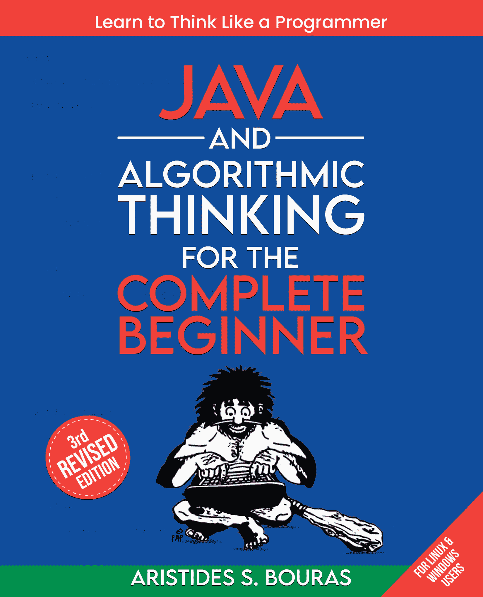

为了获得最佳阅读体验，请将设备旋转至横向模式。

| 3 | `a = b` | 将变量`b`的值赋值给变量`a`。值 5 丢失了！ | 7 | 7 |
| --- | --- | --- | --- | --- |
| 4 | `b = a` | 将变量`a`的值赋值给变量`b` | 7 | 7 |
| 5 | `.println(a)` | 显示：7 | | |
| 6 | `.println(b)` | 显示：7 | | |

哎呀！值 5 在哪里？

解决方案终究并不那么明显！那么，到底如何交换值呢？

考虑两个杯子：一杯橙子汁（称为 A 杯）和一杯柠檬汁（称为 B 杯）。如果你想交换它们的内容，你只需要找到并使用一个额外的空杯子（称为 C 杯）。

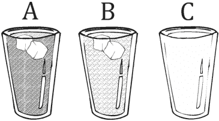

必须遵循的步骤是：

1) 将 A 杯的内容（橙子汁）倒到 C 杯中。

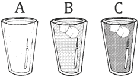

2) 将 B 杯的内容（柠檬汁）倒到 A 杯中。

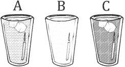

3) 将 C 杯的内容（橙子汁）倒到 B 杯中。

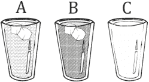

交换成功！

你可以按照相同的步骤在 Java 中交换两个变量的内容。

```java
public static void main(String[] args) throws Exception {
    int a, b, c;
    a = Integer.parseInt(cin.nextLine());
    b = Integer.parseInt(cin.nextLine());
    c = a;   //将 A 杯的内容（橙子汁）倒到 C 杯中
    a = b;   //将 B 杯的内容（柠檬汁）倒到 A 杯中
    b = c;   //将 C 杯的内容（橙子汁）倒到 B 杯
    System.out.println(a);
    System.out.println(b);
}
```

双斜杠（`//`）之后的文本被视为注释，永远不会执行。

## 练习题 8.1-4 交换变量的值 – 另一种方法

编写一个 Java 程序，让用户输入两个整数值并存储在变量`a`和`b`中。最后，这两个变量必须交换它们的值。然后，使用输入值为`5`和`7`的追踪表（trace table）来确认代码的正确性。

### 解决方案

由于变量包含数值，你可以使用以下 Java 程序（另一种方法）。

```java
public static void main(String[] args) throws Exception {
    int a, b;
    a = Integer.parseInt(cin.nextLine());
    b = Integer.parseInt(cin.nextLine());
    a = a + b;
    b = a - b;
    a = a - b;
    System.out.println(a + " " + b);
}
```

现在，让我们使用输入值为`5`和`7`的追踪表来确认变量`a`和`b`是否正确地交换了内容。

| 步骤 | 语句 | 注释 | a | b |
| --- | --- | --- | --- | --- |
| 1 | `a = Integer.parseI…` | 用户输入值 5 | 5 | ? |
| 2 | `b = Integer.parseI…` | 用户输入值 7 | 5 | 7 |
| 3 | `a = a + b` | | 12 | 7 |
| 4 | `b = a ‑ b` | | 12 | 5 |
| 5 | `a = a ‑ b` | | 7 | 5 |
| 6 | `.println(a + " " + b)` | 显示为：7 5 | | |

这种方法的缺点是它不能交换字母数字型变量（字符串）的内容。

## 8.2 复习思考题：判断对错

对以下每个陈述判断对或错。

1) 追踪表是一种测试计算机的技巧。

2) 追踪表帮助程序员在计算机程序中找到错误。

3) 在没有先创建对应的追踪表的情况下，你无法执行计算机程序。

4) 为了交换两个整数变量的值，你总是需要一个额外的变量。

## 8.3 复习练习

完成以下练习。

1) 创建一个追踪表，确定当输入值为`3`时，Java 程序中每一步中变量的值。

```java
public static void main(String[] args) throws Exception {
    double a, b, c, d;
    a = Double.parseDouble(cin.nextLine());
    b = a + 10;
    a = b * (a - 3);
    c = 3 * b / 6;
    d = c * c;
    d--;
    System.out.println(d);
}
```

2) 创建一个追踪表，确定在三次不同执行情况下，Java 程序中每一步中变量的值。

三次执行的输入值为：(i)`3`，(ii)`4`和 (iii)`1`。

```java
public static void main(String[] args) throws Exception {
    int a, b, c, d;
    a = Integer.parseInt(cin.nextLine());
    a = (a + 1) * (a + 1) + 6 / 3 * 2 + 20;
    b = a % 13;
    c = b % 7;
    d = a * b * c;
    System.out.println(a + ", " + b + ", " + c + ", " + d);
}
```

3) 创建一个追踪表，确定在两种不同执行情况下，Java 程序中每一步中变量的值。

两次执行的输入值为：(i)`8, 4`；(ii)`4, 4`。

```java
public static void main(String[] args) throws Exception {
    int a, b, c, d, e;
    a = Integer.parseInt(cin.nextLine());
    b = Integer.parseInt(cin.nextLine());
    c = a + b;
    d = 1 + a / b * c + 2;
    e = c + d;
    c += d + e;
    e--;
    d -= c + d % c;
    System.out.println(c + ", " + d + ", " + e);
}
```

# 第 9 章：使用 Visual Studio Code

## 9.1 编写、执行和调试 Java 程序

到目前，你已经学习了 Java 编程的一些坚实基础。现在是时候探索将程序输入计算机、执行它们、观察其性能、检查其如何显示结果以及学习调试它们的技巧了。

调试是发现并减少计算机程序中缺陷（bug）数量的过程，使其按照预期运行。

正如第 2.6 节所述，集成开发环境（IDE）是一种允许程序员编写、执行和调试源代码的软件。Visual Studio Code 就是其中一个例子。

关于如何在 Windows 或 Linux 上编写、执行和调试 Java 程序的所需指令都维护在我的网站以下地址上。这使我能够灵活地频繁审查它们并保持最新更新。

- [`tinyurl.com/mvsa5mzn`](https://tinyurl.com/mvsa5mzn)
- [`www.bouraspage.com/java-setup-write-execute-debug`](https://www.bouraspage.com/java-setup-write-execute-debug)


如果你发现任何不一致之处，请告诉我，我会尽快更新指令。要报告问题，请访问以下地址之一：

- [`tinyurl.com/mvsa5mzn`](https://tinyurl.com/mvsa5mzn)
- [`www.bouraspage.com/java-setup-write-execute-debug`](https://www.bouraspage.com/java-setup-write-execute-debug)


# “入门 Java”复习

## 填字游戏

1) 完成以下谜题。


**横向**

2) 这种错误很难发现。

3) 一种控制结构。

6) 它显示执行流。

8) 算法的图形表示方法。

10) ____________ 编程是一种方法。

14) 问题的解决方案。

15) 它不能无限运行。

17) 这种流程图有一个入口和一个出口。

18) 逻辑错误通常被称为 ______。

19) 它必须有一个终点。

**纵向**

2) 在算法或程序执行时发生的错误。

3) 括号内的算术先执行。

4) 流程图中的箭头被称为赋值运算符。

5) 变量名允许使用的字符。

6) 计算机主内存（RAM）中程序可以存储值的地方。

8) 在主内存（RAM）中为存储变量内容而留出的。

9) 语言中具有定义含义的单词。

11) 语句。

12) 使用程序的人。

13) 一种控制结构。

15) 实数。

## 填字游戏谜

2) 完成以下谜题。


**横向**

1) 字母数字值。

7) 拼写错误的是 _________ 错误。

9) 没有小数部分的正负数。

12) 包含在程序中以便于阅读的额外信息。

13) 这种变量只能持有两个值中的一个。

16) 程序执行期间发生的错误。

17) 这种控制结构称为选择控制结构。

18) 消耗 CPU 时间的算术运算。

19) 程序运行时不能改变的值。

20) 用户型的程序是指新手容易使用的程序。

**纵向**

1) 定义友好设计的原则。

4) 流程图中的数学计算。

5) ____________ 是创建算法的三个阶段之一。

7) 一种编程语言。

9) 一种编程语言。

11)

16) 算法必须满足的属性。

## 复习问题

1. 什么是算法？

2. 给出制作一杯咖啡的算法。

3. 算法必须满足的五个属性是什么？

4. 算法可以永远执行吗？

5. 什么是计算机程序？

6. 算法涉及的三个部分是什么？

7. 组成计算机程序的三个阶段是什么？

8. 计算机程序可以由两个阶段组成吗？

9. 什么是流程图？

10. 流程图使用的基本符号有哪些？

11. “保留字”一词是什么意思？

12. 什么是结构化编程？

13. 结构化编程的三种基本控制结构是什么？

14. 使用流程图给出每个控制结构的示例。

15. 程序员可以在文本编辑器中编写 Java 程序吗？

16. 什么是语法错误？给出一个例子。

17. 什么是逻辑错误？给出一个例子。

18. 什么是运行时错误？给出一个例子。

19. 拼错关键词会导致什么类型的错误？

20. “调试”一词是什么意思？

21. 为什么程序员应该在代码中添加注释？

22. 为什么程序员应该编写用户友好的程序？

23. 缩写 POLA 代表什么？

24. 什么是变量？

25. 流程图中左箭头左侧可以存在多少变量？

26. 变量的值存储在计算机的哪个部分？

27. 什么是常量？

28. 如何利用常量来帮助程序员？

29. 为什么程序员应该尽可能避免除法和乘法运算？

30. 列出 Java 中至少三种变量的基本数据类型。

31. “声明变量”短语是什么意思？

32. 如何在 Java 中声明变量？给出一个例子。

33. 如何在 Java 中声明常量？给出一个例子。

34. 流程图中用什么符号显示消息？

35. Java 中“换行符”和“制表符”的特殊字符序列是什么？

36. 流程图中用哪个符号让用户输入数据？

37. Java 中使用哪个字符作为赋值运算符？它在流程图中如何表示？

38. Java 支持哪些算术运算符？

39. 什么是取模运算符？

40. 总结算术运算符优先级的规则。

41. Java 支持哪些复合赋值运算符？

42. Java 支持哪些递增/递减运算符？

43. Java 支持哪些字符串运算符？

44. 什么是跟踪表（trace table）？

45. 使用跟踪表的好处是什么？

46. 描述交换两个变量内容（数字或字母数字）的步骤。

47. 本书中两种交换两个变量值的方法。哪种更好，为什么？

48. 描述 Visual Studio Code 如何帮助你发现语法错误。

49. 描述 Visual Studio Code 如何帮助你发现逻辑错误。

# 第三部分：顺序控制结构

## 第 10 章：顺序控制结构绪论

### 10.1 什么是顺序控制结构？

顺序控制结构指的是语句的逐行执行，即语句按照它们在程序中出现的顺序逐一执行，而不跳过任何一个语句。例如，它们可以执行一系列读取或写入操作、算术运算或对变量进行赋值。

下面的程序展示了顺序执行的 Java 语句示例。

 `Project_10.1`

```java
public static void main(String[] args) throws Exception {
    double num, result;
    //提示用户输入 num 的值
    System.out.print("Enter a number: ");
    num = Double.parseDouble(cin.nextLine());
    //计算 num 的平方
    result = num * num;
    //在用户屏幕上显示结果
    System.out.println("The square of " + num + " is " + result);
}
```

顺序控制结构是你在 4.1 节中学习的三个基本控制结构中最简单的一种。另外两种结构是“决策结构”和“循环结构”。计算机编程中的所有问题都可以仅用这三种结构来解决！

在 Java 中，你可以使用双斜杠（`//`）来添加注释。注释是给人类阅读的。编译器和解释器会忽略它们。

#### 练习 10.1-1 计算矩形的面积

编写一个 Java 程序，提示用户输入矩形的底边和高度，然后计算并显示其面积。

##### 解决方案

你可能在学校学过，可以使用以下公式计算矩形的面积：

`Area = Base × Height`

在 4.6 节中，你学习了创建算法的三个主要阶段：数据输入、数据处理和结果输出。

在练习中，这三个主要阶段如下：

* 数据输入 – 用户必须输入`Base`和`Height`的值
* 数据处理 – 程序必须计算矩形的面积
* 结果输出 – 程序必须显示上一个阶段计算出的矩形面积。

该问题的解决方案所示。

 `Project_10.1-1`

```java
public static void main(String[] args) throws Exception {
    double area, b, h;
    //数据输入 - 提示用户输入底高
    System.out.print("Enter the length of base: ");
    b = Double.parseDouble(cin.nextLine());
    System.out.print("Enter the length of height: ");
    h = Double.parseDouble(cin.nextLine());
    //数据处理 - 计算矩形面积
    area = b * h;
    //结果输出 - 在用户屏幕上显示结果
    System.out.println("The area of the rectangle is " + area);
}
```

#### 练习 10.1-2 计算圆的面积

编写一个 Java 程序计算并显示圆的面积。

##### 解决方案

你可以使用以下公式计算圆的面积：

`Area = π · Radius²`

`π`的值是一个常量，约为`3.14159`。因此，用户只需要输入`Radius`。

在练习中，你在 4.6 节学习的三个主要阶段如下：

* 数据输入 – 用户必须输入`Radius`的值
* 数据处理 – 程序必须计算圆的面积
* 结果输出 – 程序必须显示上一个阶段计算出的圆的面积。

该问题的解决方案所示。

 `Project_10.1-2a`

```java
public static void main(String[] args) throws Exception {
    double area, radius;
    //数据输入 - 提示用户输入半径
    System.out.print("Enter the length of radius: ");
    radius = Double.parseDouble(cin.nextLine());
    //数据处理 - 计算圆的面积
    area = 3.14159 * radius * radius;
    //结果输出 - 在用户屏幕上显示结果
    System.out.println("The area of the circle is " + area);
}
```

更好的方法是使用常量`PI`。

 `Project_10.1-2b`


```java
static final double PI = 3.14159;
public static void main(String[] args) throws Exception {
    double area, radius;
    //数据输入 - 提示用户输入半径
    System.out.print("Enter the length of radius: ");
    radius = Double.parseDouble(cin.nextLine());
    //数据处理 - 计算圆的面积
    area = PI * radius * radius;
    //结果输出 - 在用户屏幕上显示结果
    System.out.println("The area of the circle is " + area);
}
```

注意常量`PI`是在`main`方法之外定义的。

#### 练习 10.1-3 汽车在哪里？计算距离

一辆汽车从静止开始，沿着直道路以恒定加速度运动一段时间。编写一个 Java 程序，提示用户输入加速度和汽车行驶的时间，然后计算并显示行驶的距离。所需的公式为

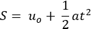

其中

- `S`是汽车行驶的距离，单位为米 (m)
- `u[0]`是汽车的初速度（速率），单位为米/秒 (m/sec)
- `t`是汽车行驶的时间，单位为秒 (sec)
- `a`是加速度，单位为米/秒² (m/sec²)

##### 解决方案

由于汽车从静止开始，因此初速度（速率）`u[0]`为零。因此，公式变为

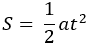

对应的 Java 程序如下：

```java

Project_10.1-3
public static void main(String[] args) throws Exception {
    double S, a, t;
    System.out.print("Enter acceleration: ");
    a = Double.parseDouble(cin.nextLine());
    System.out.print("Enter time traveled: ");
    t = Double.parseDouble(cin.nextLine());
    S = 0.5 * a * t * t;
    System.out.println("Your car traveled " + S + " meters");
}
```

## 练习 10.1-4 开尔文转华氏度

编写一个 Java 程序，将温度值从华氏度转换为等值的开尔度。所需的公式为：

`1.8 × Kelvin = Fahrenheit + 459.67`

##### 解决方案

给出的公式不能直接在你的程序中使用。在 Java 等计算机语言中，不允许直接写成：

`1.8 * kelvin = fahrenheit + 459.67;`


在（`=`）符号的左侧位置，只能存在一个变量。该变量实际上是 RAM 中的一个区域，可以在其中存储值。

根据本练习题的表述，程序必须将华氏度转换为开尔度。华氏度值是已知值并由用户提供的，而开尔度值是 Java 程序必须计算的。因此，你需要解出`Kelvin`的值。经过一番计算，公式变为：

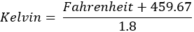

Java 程序所示所示。

```java

Project_10.1-4
public static main(String[] args) throws Exception {
    double fahrenheit, kelvin;
    System.out.print("Enter a temperature in Fahrenheit: ");
    fahrenheit = Double.parseDouble(cin.nextLine());
    kelvin = (fahrenheit + 459.67) / 1.8;
    System.out.println("The temperature in Kelvin is " + kelvin);
}
```

## 练习 10.1-5 计算销售税

员工需要一个程序来输入产品的税前价格并计算其最终价格。假设增值税（VAT）率为 19%。

##### 解决方案

销售税可以很容易计算。你必须将产品的税前价格乘以增值税率。注意——销售税不是最终价格，而仅仅是税额。

税后价格可以通过初始税前价格加上你之前计算出的销售税来获得。

在此程序中，你可以使用名为`VAT`的常量作为销售税率（VAT 税率）。

```java

Project_10.1-5
static final double VAT = 0.19;
public static void main(String[] args) throws Exception {
    double priceAfterTax, priceBeforeTax, salesTax;
    System.out.print("Enter the before-tax price: ");
    priceBeforeTax = Double.parseDouble(cin.nextLine());
    salesTax = priceBeforeTax * VAT;
    priceAfterTax = priceBeforeTax + salesTax;
    System.out.println("The after-tax price is: " + priceAfterTax);
}
```

注意常量`VAT`声明在`main`方法之外。

## 练习 10.1-6 计算销售折扣

编写一个 Java 程序，提示用户输入商品的价格和提供的折扣率（范围为 0 到 100）。程序随后必须计算并显示新价格。

##### 解决方案

折扣金额可以很容易计算。你必须将产品的折前价格乘以折扣值，然后将结果除以 100。进行除法是必要的，因为用户输入的是 0 到 100 范围内的折扣值。注意——结果不是最终价格，而仅仅是折扣金额。

最终折扣后价格可以通过从初始折前价格中减去你之前计算出的折扣金额来获得。

```java

Project_10.1-6
public static void main(String[] args) throws Exception {
    int discount;
    double discountAmount, priceAfterDiscount, priceBeforeDiscount;
    System.out.print("Enter the price of a product: ");
    priceBeforeDiscount = Double.parseDouble(cin.nextLine());
    System.out.print("Enter the discount offered (0 - 100): ");
    discount = Integer.parseInt(cin.nextLine());
    discountAmount = priceBeforeDiscount * discount / 100;
    priceAfterDiscount = priceBeforeDiscount - discountAmount;
    System.out.println("The price after discount is: " + priceAfterDiscount);
}
```

## 练习 10.1-7 计算折扣和税

编写一个 Java 程序，提示用户输入商品的税前价格和提供的折扣（范围为 0 到 100）。程序随后必须计算并显示新价格。假设税率为 19%。

##### 解决方案

本题是前两个题的结合！

```java

Project_10.1-7
static final double VAT = 0.19;
public static void main(String[] args) throws Exception {
    int discount;
    double discountAmount, priceAfterDiscount, priceAfterTax, priceBeforeTax, salesTax;
    System.out.print("Enter the before-tax price: ");
    priceBeforeTax = Double.parseDouble(cin.nextLine());
    System.out.print("Enter the discount: ");
    discount = Integer.parseInt(cin.nextLine());
    discountAmount = priceBeforeDiscount * discount / 100;
    priceAfterDiscount = priceBeforeDiscount - discountAmount;
    salesTax = priceAfterDiscount * VAT;
    priceAfterTax = priceAfterDiscount + salesTax;
}
```

## 10.2 练习

完成以下练习。

1) 在美国，燃油效率用每英加升（MPG）衡量。可以使用以下公式计算 MPG：

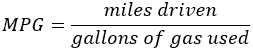

编写一个 Java 程序，提示用户输入行驶的总里程数和使用的燃油量。然后程序必须计算并显示汽车的 MPG。

2) 编写一个 Java 程序，提示用户输入底和高，然后计算并显示三角形的面积。所需的公式为：

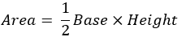

3) 编写一个 Java 程序，提示用户输入三角形的角，然后计算并显示第三个角。提示：任何三角形的内角和为 180 度

4) 编写一个 Java 程序，让学生输入四次成绩，然后计算并显示平均分。

5) 编写一个 Java 程序，提示用户输入半径，然后计算并显示圆周长。所需的公式为：

`Perimeter = 2π`

6) 编写一个 Java 程序，提示用户输入直径米，然后计算并显示球的体积。所需的公式为：

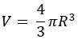

其中`R`是球的半径。

7) 关于上练习，哪些输出语句是正确的？你会选择哪一个在用户屏幕上显示球的体积？为什么？

a) `System.out.println(V)`

b) `System.out.println(V cubic meters)`

c) `System.out.println(V + "cubic meters")`

d) `System.out.println("The volume of the sphere is: " V)`

e) `System.out.println("The volume of the sphere is: " + V)`

f) `System.out.println("The volume of the sphere is: " + V + "cubic meters")`

g) `System.out.println("The volume of the sphere is: " + V + " cubic meters")`

8) 编写一个 Java 程序，提示用户输入名、中间名、姓以及他们首的头衔（Mr., Mrs., Ms., Dr. 等），并按以下所有格式显示：

```
Title FirstName MiddleName LastName
FirstName MiddleName LastName
LastName, FirstName
LastName, FirstName MiddleName
LastName, FirstName MiddleName, Title
FirstName LastName
```

例如，假设用户输入以下内容：

名：Aphrodite

中间名：Maria

姓：Boura

头衔：Ms.

该程序必须以以下所有格式显示用户的姓名：

- Ms. Aphrodite Maria Boura
- Aphrodite Maria Boura
- Boura, Aphrodite
- Boura, Aphrodite Maria
- Boura, Aphrodite Maria, Ms.
- Aphrodite Boura

9) 编写一个 Java 程序，提示用户输入`diameter`（直径）的值，然后计算并显示圆的`radius`（半径）、`perimeter`（周长）和`area`（面积）。对于相同的直径，还必须显示球的`volume`（体积）。

10) 编写一个 Java 程序，提示用户输入餐厅就餐的费用，然后计算并显示 10% 的小费、7% 的销售税以及这三个金额的总和。

11) 一辆汽车从静止开始，沿直线水平道路以恒定加速度行驶一段时间。编写一个 Java 程序，提示用户输入行驶距离以及行驶的分钟和秒数，然后计算加速度。所需的公式为：


其中

- `S`是汽车行驶的距离，单位为米 (m)
- `u[o]`是汽车的初速度，单位为米/秒 (m/sec)
- `t`是汽车行驶的时间，单位为秒 (sec)
- `a`是加速度，单位为米/秒² (m/sec²)

12) 编写一个 Java 程序，提示用户输入一个华氏度为单位的温度，然后将其转换为对应的摄氏度值。所需的公式为：

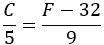

13) 体质指数 (BMI) 通常用于判断一个人的体重相对于是否超重或过轻。计算 BMI 的公式为：

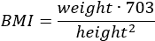

编写一个 Java 程序，提示用户输入他们的体重（磅）和身高（英寸），然后计算并显示用户的`BMI`。

14) 编写一个 Java 程序，提示用户输入`subtotal`（小计）和`gratuity rate`（小费率，范围 0 到 100），然后计算小费和总额。例如，如果用户输入 30 和 10，Java 程序必须显示“Tip is $3.00 and total is $33.00”。

15) 员工需要一个程序输入三个产品的税前价格，然后计算每个产品的最终税后价格以及它们的平均值。假设增值税 (VAT) 率为 20%。

16) 员工需要一个程序输入一个产品的税后价格，然后计算其税前价格。假设增值税 (VAT) 率为 20%。

17) 编写一个 Java 程序，提示用户输入物品的初始价格和提供的折扣率（范围 0 到 100），然后计算并显示最终价格和节省的金额。

18) 编写一个 Java 程序，提示用户输入月初和月底的千度 (kWh) 电表读数。程序必须计算并显示消耗的`kWh`数量，以及在每`kWh`成本为 $0.06 且增值税 (VAT) 率为 20% 的情况下必须支付的金额。

19) 游艇工厂经理需要一个程序来计算工厂一年内的利润或亏损。以下是一些信息：

- 工厂建造一艘游艇花费 $1,000,000。
- 每艘游艇售价为 $1,500,000。
- 工厂每月支付 $250,000 的保险。

编写一个 Java 程序，提示用户输入出售的游艇数量，然后计算并以相应的正或负值显示总盈亏。

20) 编写一个 Java 程序，提示用户输入两个数字分别对应当前月份和日期，然后计算并显示从年初开始已过去的天数。假设每个月有 30 天。

21) 编写一个 Java 程序，提示用户输入两个数字分别对应当前月份和日期，然后计算并显示距离年底剩余的天数。假设每个月有 30 天。

## 第 11 章：数字处理

## 11.1 引言

就像每种高级编程语言一样，Java 提供了许多随取随用的子程序（称为`methods`，方法），你可以在任何时候、任何地方使用它们。

“子程序”简单来说封装成单个单元的语句组。每个子程序都有一个描述性名称并执行特定任务。

为了更好地理解 Java 的`methods`，让我们来看看计算正数平方根的海伦迭代公式。

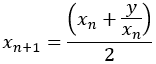

其中

- `y`是你想要求其平方根的数字
- `x[n]`是`y`的平方根的第 n 次迭代值

你现在可能感到有些沮丧。你可能认为应该写一个程序来通过海伦公式计算数字的平方根，但事实并非如此！目前，没有人用这种方法计算数字的平方根。幸运的是，Java 包含了为此的方法！`Math.sqrt`可以给你正确的结果。虽然 Java 支持许多`methods`，本章仅涵盖

## 11.2 有用的数学方法（子程序）及

### 绝对值

`Math.abs(number)`

该方法返回`number`的绝对值。

示例

```java
public static void main(String[] args) {
    int a = -5;
    System.out.println(Math.abs(a)); // 输出: 5
    double b = -5.2;
    System.out.println(Math.abs(b)); // 输出: 5.2
}
```

### 圆周率

`Math.PI`

包含 π 值。

包含 π 值。注意`Math.PI`是一个常量，而不是方法。这就是为什么没有使用括号。

示例

```java


```java
public static void main(String[] args) {
    System.out.println(Math.PI); // 输出: 3.141592653589793
}
```

### 正弦

`Math.sin(number)`

该方法返回`number`的正弦。`number`必须以弧度表示。你可以乘以`Math.PI / 180`将角度转换为弧度。

示例

```java
public static void main(String[] args) {
    double a, b;
    a = Math.sin(3 * Math.PI / 2); // 3π/2 弧度的正弦
    b = Math.sin(270 * Math.PI / 180); // 270 度的正弦
    System.out.println(a + " " + b); // 输出: -1.0 -1.0
}
```

### 余弦

`Math.cos(number)`

由于该方法返回`number`的余弦。`number`必须以弧度表示。你可以乘以`Math.PI / 180`将角度转换为弧度。

示例

```java
public static void main(String[] args) {
    double a, b;
    a = Math.cos(2 * Math.PI); // 2π 弧度的余弦
    b = Math.cos(360 * Math.PI / 180); // 360 度的余弦
    System.out.println(a + " " + b); // 输出: 1.0 1.0
}
```

### 正切

`Math.tan(number)`

该方法返回`number`的正切值。`number`的值必须以弧度表示。你可以乘以`Math.PI / 180`将角度转换为弧度。

### 示例

 Project_11.2

```java
public static void main(String[] args) throws Exception {
    double a;
    a = Math.tan(10 * Math.PI / 180);  //10 度的正切值
    System.out.println(a);             //显示为: 0.17632698070846498
}
```

### 字符串转整数

`Integer.parseInt(value)`

该方法将整数的字符串表示转换为数值等效值。

### 示例

 Project_11.2

```java
public static void main(String[] args) throws Exception {
    String s1 = "5";
    String s2 = "3";
    int k;
    k = Integer.parseInt(s1);
    System.out.println(k);                         //显示为: 5
    System.out.println(Integer.parseInt(s2));     //显示为: 3
    System.out.println(s1 + s2);                   //显示为: 53
    System.out.println(Integer.parseInt(s1) + Integer.parseInt(s2)); //显示为: 8
}
```

### 字符串转实数

`Double.parseDouble(value)`

该方法将实数的字符串表示转换为其数值等效值。

### 示例

 Project_11.2

```java
public static void main(String[] args) throws Exception {
    String s1 = "6.5";
    String s2 = "3.4";
    double x;
    x = Double.parseDouble(s1);
    System.out.println(x);                          //显示为: 6.5
    System.out.println(Double.parseDouble(s2));     //显示为: 3.4
    System.out.println(s1 + s2);                   //显示为: 6.53.4
    System.out.println(Double.parseDouble(s1) + Double.parseDouble(s2)); //显示为: 9.9
}
```

### 整数值（类型转换）

`(int)number`

这返回`number`的整数部分。如果`number`包含小数部分，该部分在转换过程中会丢失。

### 示例

 Project_11.2

```java
public static void main(String[] args) throws Exception {
    double a = 5.4;
    System.out.println((int)a);          //显示为: 5
    System.out.println((int)34);         //显示为: 34
    System.out.println((int)34.9);       //显示为: 34
    System.out.println((int)-34.999);    //显示为: -34
}
```

在计算机科学中，类型转换是将一种数据类型的变量转换为另一种类型的方法。注意`(int)`不是一个方法。它只是 Java 中将实数转换为整数的方法。同样注意，如果实数包含小数部分，该部分在转换过程中会丢失。

### 实值（类型转换）

`(double)number`

这以实数形式返回该数字。

### 示例

 Project_11.2

```java
public static void main(String[] args) throws Exception {
    int a = 5;
    System.out.println((double)a);      //显示为: 5.0
    System.out.println((double)34);     //显示为: 34.0
    System.out.println((double)-34);    //显示为: -34.0
    System.out.println(a / 2);           //显示为: 2
    System.out.println((double)a / 2);         //显示为: 2.5
    System.out.println((double)a / 2);         //显示为: 2.5
    System.out.println(a / (double)2);         //显示为: 2.5
    System.out.println((double)a / (double)2); //显示为: 2.5
    System.out.println(a / 2.0);               //显示为: 2.5
}
```

在计算机科学中，类型转换是将一种数据类型的变量转换为另一种类型的方法。注意`(double)`不是一个方法。它只是 Java 中将整数转换为实数（浮点）的方法。

在 Java 中，两个整数相除的结果总是整数。因此，在表达式`a / 2`中，`a`和`2`都是整数，结果也是整数。如果你希望结果为`double`类型，除操作数中至少有一个必须是`double`类型。

# 

`Math.pow(number, exp)`

该方法返回`number`的`exp`次幂的结果。

### 示例

 Project_11.2

```java
public static void main(String[] args) throws Exception {
    double a, b, c;
    a = 2;
    b = 3;
    c = Math.pow(a, b);
    System.out.println(c); //显示为: 8.0
}
```

### 随机

`Math.random()`

该方法返回一个`0.0`到`1.0`之间的随机`double`值（包含 0.0 但不包含 1.0）。如果要特定范围内的整数，可以使用`(int)(Math.random() * (max - min) + min)`。

### 示例

 Project_11.2

```java
public static void main(String[] args) throws Exception {
    double a;
    a = Math.random();
    System.out.println(a); //显示 0.0 到 1.0 之间的随机数
}
```

### 四舍五入

`Math.round(number)`

该方法返回`number`最近的整数。

### 示例

 Project_11.2

```java
public static void main(String[] args) throws Exception {
    double a = 5.5;
    System.out.println(Math.round(a)); //显示为: 6
    double b = 5.4;
    System.out.println(Math.round(b)); //显示为: 5
    double c = -5.5;
    System.out.println(Math.round(c)); //显示为: -5
}
```

### 平方

`Math.sqrt(number)`

该方法返回`number`的平方根，其中`number`可以是正值或零。

### 示例

 Project_11.2

```java
public static void main(String[] args) throws Exception {
    double x, y;
    System.out.println(Math.sqrt(9)); //显示为: 3.0
    System.out.println(Math.sqrt(2)); //显示为: 1.4142135623730951
    x = Math.sqrt(8);
    System.out.println(x); //显示为: 2.8284271247461903
    y = Math.round(Math.sqrt(8));
    System.out.println(y); //显示为: 3
}
```

 Project_11.2-1

```java
public static void main(String[] args) throws Exception {
    double d, x1, x2, xTemp, y1, y2, yTemp;
    System.out.println("Enter coordinates for point A:");
    x1 = Double.parseDouble(cin.nextLine());
    y1 = Double.parseDouble(cin.nextLine());
    System.out.println("Enter coordinates for point B:");
    x2 = Double.parseDouble(cin.nextLine());
    y2 = Double.parseDouble(cin.nextLine());
    xTemp = Math.pow(x1 - x2, 2);
    yTemp = Math.pow(y1 - y2, 2);
    d = Math.sqrt(xTemp + yTemp);
    System.out.println("Distance between points: " + d);
}
```

现在，让我们来看另一种方法。实际上，可以在方法调用中执行所有操作。这样做，操作的结果将作为方法的参数使用。这是大多数程序员倾向于遵循的编写风格，因为可以节省大量的变量和代码行。这里的 Java 程序所示。

 Project_11.2-1b

```java
public static void main(String[] args) throws Exception {
    double d, x1, x2, y1, y2;
    System.out.println("Enter coordinates for point A:");
    x1 = Double.parseDouble(cin.nextLine());
    y1 = Double.parseDouble(cin.nextLine());
    System.out.println("Enter coordinates for point B:");
    x2 = Double.parseDouble(cin.nextLine());
    y2 = Double.parseDouble(cin.nextLine());
    d = Math.sqrt(Math.pow(x1 - x2, 2) + Math.pow(y1 - y2, 2));
    System.out.println("Distance between points: " + d);
}
```

 你可以将一个子程序嵌套在另一个程序内部。注意`Math.pow()`方法是如何嵌套在`Math.sqrt()`方法中的。内部（嵌套）方法的结果被作为外部方法的参数。

#### 练习 11.2-2 汽车行驶了多远？

汽车从静止状态开始，沿直线水平路以恒定加速度行驶指定的距离。编写一个 Java 程序，提示用户输入加速度和汽车行驶的距离，然后计算行驶的时间。所需的公式为

.

其中

- ► `S`是汽车行驶的距离，单位为米 (m)
- ► `u[o]`是汽车的初速度（速率），单位为米/秒 (m/sec)
- ► `t`是汽车行驶的时间，单位为秒 (sec)
- ► `a`是加速度，单位为米/秒² (m/sec²)

##### 解答

由于汽车从静止开始，初速度（速率）`u[0]`为零。因此，公式变为

.

现在，如果你求解时间，最终的公式变为

.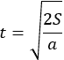

在 Java 中，你可以使用`Math.sqrt()`方法，它返回一个数的平方根。

 Project_11.2-2

```java
public static void main(String[] args) throws Exception {
    double S, a, t;
    System.out.print("Enter acceleration: ");
    a = Double.parseDouble(cin.nextLine());
    System.out.print("Enter distance traveled: ");
    S = Double.parseDouble(cin.nextLine());
    t = Math.sqrt(2 * S / a);
    System.out.println("Your car traveled for " + t + " seconds");
}
```


### 11.3 复习题：判断对错

对下列每个陈述选择对或错。

1) Java 方法是解决小问题的小型子程序。
2) 每位程序员都必须使用海伦迭代公式来计算正数的平方根。
3) `Math.abs()` 方法返回项的绝对位置。
4) 语句 `(int)3.59` 返回结果为 `3.6`。
5) 语句 `y = (int)"two"` 是一个有效的 Java 语句。
6) 语句 `y = Integer.parseInt("2")` 是一个有效的 Java 语句。
7) 语句 `(int)3` 返回结果为 `3.0`。
8) 语句 `(double)3` 返回结果为 `3.0`。
9) 语句 `y = Double.parseDouble("3.14")` 不是一个有效的 Java 语句。
10) `Math.PI` 常数等于 `3.14`。
11) 语句 `Math.pow(2, 3)` 返回结果为 `6`。
12) 语句 `Math.pow(2, 3)` 返回结果为 `9`。
13) `Math.random()` 方法返回一个随机实数（浮点数）。
14) 语句 `y = (int)(Math.random() * 2)` 有 50% 的概率给变量 `y` 赋值为 1。
15) 语句 `Math.round(3.59)` 返回结果为 `4`。
16) 计算 90 度的正弦，你需要写 `y = Math.PI / 2`。
17) `sqrt(-2)` 是有效的。
18) 以下代码片段满足定义性：

```java
double a, b, x;
a = Double.parseDouble(cin.nextLine());
b = Double.parseDouble(cin.nextLine());
x = a * Math.sqrt(b);
```

### 11.4 复习题：单选题

为每个选择答案。

1) 下列一项计算 `a` 的 2 次方？
a) `a * a`
b) `Math.pow(a, 2)`
c) `a / a`
d) 以上都是

2) 执行语句 `Math.abs(-5)` 后，`y` 的值？
a) `-5`
b) `5`
c) `0`
d) `5`

3) 下列一项计算 180 的正弦？
a) `Math.sin(180)`
b) `Math.PI`
c) 以上都是
d) 以上

4) 执行语句 `(int)(5.0 / 2)` 后，`y` 的值是多少？
a) `2.5`
b) `3`
c) `2`
d) `0.5`

5) 下列一项计算 `sqrt(4), 2`？
a) `4`
b) `2`
c) `8`
d) `16`

6) 执行语句 `Math.round(5.2) / 2` 后，`y` 的值？
a) `2`
b) `2.5`
c) `2`
d) 以上都不是

### 11.5 复习练习

完成下列练习。

1) 创建追踪表，确定程序在每次执行过程中的变量值。输入值为：(i) `9` 和 (ii) `4`。

```java
double a, b, c;
a = Double.parseDouble(cin.nextLine());
a += Math.sqrt(a) * 4;
b = Math.round(a) % 4;
c = b % 3;
```

2) 创建追踪表，确定程序在每次执行过程中的变量值。输入值为：(i) `-2` 和 (ii) `-3`。

```java
int a, b, c;
a = Integer.parseInt(cin.nextLine());
b = Math.abs(a) % 4 + (int)Math.pow(a, 4);
c = b % 5;
```

3) 编写一个 Java 程序，提示用户输入弧度角 `θ`，然后计算对应的角度角。已知 `2π = 360°`。

4) 编写一个 Java 程序，提示用户输入直角三角形的两个直角边 `A` 和 `B`，然后计算其斜边。根据勾股定理可知

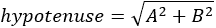

## 第 12 章

复杂的数学表达式

### 12.1 编写数学表达式

在第 7.2 节中你学习了所有关于算术运算符的知识，但对于如何使用它们以及如何编写自己的很少表达式在本章中，你将学习将表达式转换为 Java 语句是多么简单。

以下 Java 语句中哪个正确表示了数学表达式？

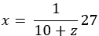

i) `x = 1 * 27 / 10 + z;`
ii) `x = 1 · 27 / (10 + z);`
iii) `x = 27 / 10 + z;`
iv) `x = 27 / (10 + z);`
v) `x = (1 / 10 + z) * 27;`
vi) `x = 1 / ((10 + z) * 27);`
vii) `x = 1 / (10 + z) * 27;`
viii) `x = 1 / (10 + z) / 27;`

##### 答案

i) 错误。由于乘法除法在加法之前执行，这等同于 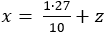。
ii) 错误。乘法必须使用星号 `*`。
iii) 错误。由于除法在加法之前执行，这等同于 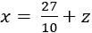。
iv) 正确。这等同于 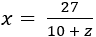。
v) 错误。括号内部除法在加法之前执行。这等同于 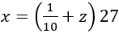。
vi) 错误。括号先执行，这等同于 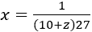。
vii) 正确。除法在乘法之前执行（从左到右）。项 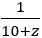 先计算，然后将结果乘以 27。
viii) 错误。这等同于 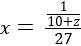。

### 练习 12.1-2 在 Java 中编写数学表达式

编写一个 Java 程序来计算数学表达式：

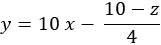

##### 答案

首先，你必须区分数据输入和输出结果。显然，输出结果被赋值给 `y`，且用户必须为 `x` 和 `z` 输入值。该练习的解答所示。

 `Project_12.1-2`

```java
public static void main(String[] args) throws Exception {
    double x, y, z;
    x = Double.parseDouble(cin.nextLine());
    z = Double.parseDouble(cin.nextLine());
    y = 10 * x - (10 - z) / 4;
    System.out.println("The result is: " + y);
}
```

### 练习 12.1-3 在 Java 中编写复杂的数学表达式

编写一个 Java 程序来计算数学表达式：

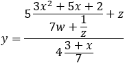

假设用户仅为 `x`、`w` 和 `z` 输入正值。

##### 答案

哎！现在表达式更复杂了！事实上，它复杂得多！所以，让我们来看一种完全不同的方法。核心思想是将复杂的表达式分解为更小、更简单的表达式，并将每个子结果赋值给临时变量。最后，你可以用所有的临时变量构建出原始表达式！这种方法将在给出。

 `Project_12.1-3`

```java
public static void main(String[] args) throws Exception {
    double denominator, nominator, temp1, temp2, temp3, w, x, y, z;
    x = Double.parseDouble(cin.nextLine());
    w = Double.parseDouble(cin.nextLine());
    z = Double.parseDouble(cin.nextLine());
    temp1 = 3 * x * x + 5 * x + 2;
    temp2 = 7 * w + 1 / z;
    temp3 = (3 + x) / 7;
    nominator = 5 * temp1 / temp2 + z;
    denominator = 4 * temp3;
    y = nominator / denominator;
    System.out.println("The result is: " + y);
}
```

你可能会说：“好吧，但我浪费了这么多变量，而且大家都知道，每个变量都占用主内存的一部分。我如何用一行代码写出原始表达式并节省内存呢？”

这项工作对于高级程序员来说可能轻而易举，但对你呢？对新手程序员呢？

下一个方法将帮助你编写即使是最复杂的数学表达式而不会出现任何语法或逻辑错误！规则非常简单：“在将复杂表达式分解为更小、更简单的表达式并将每个子结果赋值给临时变量之后，从后往前开始将每个变量替换为其赋值的表达式。但要注意！当你将变量替换为其赋值的表达式时，必须始终将表达式括在括号内！”

困惑了吗？别担心！操作起来更容易。让我们尝试重写之前的 Java 程序。从后开始，将变量 `nominator` 和 `denominator` 替换为它们赋值的表达式。结果是

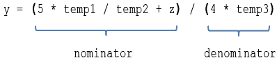

 注意添加的额外括号。

现在你必须将变量 `temp1`、`temp2` 和 `temp3` 替换为它们赋值的表达式，单行表达式完成了！

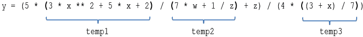

最后看起来可能很吓，但其实并没有那么，不是吗？

Java 程序现在可以重写为：

 `Project_12.1-3b`

```java
public static void main(String[] args) throws Exception {
    double w, x, y, z;
    x = Double.parseDouble(cin.nextLine());
    w = Double.parseDouble(cin.nextLine());
    z = Double.parseDouble(cin.nextLine());
    y = (5 * (x * x + 5 * x + 2) / (7 * w + 1 / z) + z) / (4 * ((3 + x) / 7));
    System.out.println(y);
}
```

### 12.2 复习

将第一个表格中的每个元素与第二个表格中的一个或多个元素匹配。

| 表达式 | |
| :--- | :--- |
| i) `x = 1 * 27 / 10 + z;` | a) `5 * (3 * x * x + 5 * x + 2) / (7 * w + 1 / z) + z) / (4 * ((3 + x) / 7))` |
| ii) `x = 1 · 27 / (10 + z);` | b) `5 * (3 * x * x + 5 * x + 2) / (7 * w + 1 / z) + z) / (4 * ((3 + x) / 7))` |
| iii) `x = 27 / 10 + z;` | c) `5 * (3 * x * x + 5 * x + 2) / (7 * w + 1 / z) + z) / (4 * ((3 + x) / 7))` |
| iv) `x = 27 / (10 + z);` | d) `5 * (3 * x * x + 5 * x + 2) / (7 * w + 1 / z) + z) / (4 * ((3 + x) / 7))` |
| v) `x = (1 / 10 + z) * 27;` | e) `5 * (3 * x * x + 5 * x + 2) / (7 * w + 1 / z) + z) / (4 * ((3 + x) / 7))` |
| vi) `x = 1 / ((10 + z) * 27);` | f) `5 * (3 * x * x + 5 * x + 2) / (7 * w + 1 / z) + z) / (4 * ((3 + x) / 7))` |
| vii) `x = 1 / (10 + z) * 27;` | g) `5 * (3 * x * x + 5 * x + 2) / (7 * w + 1 / z) + z) / (4 * ((3 + x) / 7))` |
| viii) `x = 1 / (10 + z) / 27;` | h) `5 * (3 * x * x + 5 * x + 2) / (7 * w + 1 / z) + z) / (4 * ((3 + x) / 7))` |

使用每行代码在 Java 中编写以下数学表达式：

i) 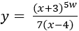
ii) 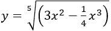
iii) 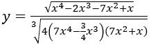
iv) 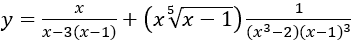
v) 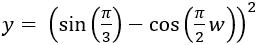
vi) 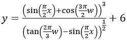

3) 编写一个 Java 程序，提示用户输入 `x` 的值，然后计算并显示数学表达式的结果：

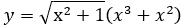

4) 编写一个 Java 程序，提示用户输入 `x` 的值，然后计算并显示数学表达式的结果：

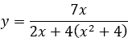

5) 编写一个 Java 程序，提示用户输入 `x` 和 `w` 的正值，然后计算并显示数学表达式的结果：

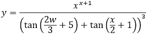

6) 编写一个 Java 程序，提示用户输入 `x` 和 `w` 的正值，然后计算并显示数学表达式的结果：

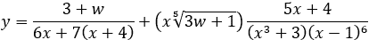

7) 编写一个 Java 程序，提示用户输入 `x` 和 `w` 的正值，然后计算并显示数学表达式的结果：

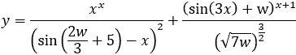

8) 编写一个 Java 程序，提示用户输入三角形三边 `A`、`B` 和 `C` 的长度，然后计算并显示三角形的面积。你可以使用海伦公式，这个公式已经使用了近 2000 年！

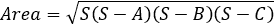

其中 `S` 是半周 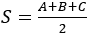

## 第 13 章

商与余数的练习

### 13.1 引言

哪些类型的问题可能需要使用整数除法的商和余数？虽然这个问题可能没有简单的答案，但商和余数可以用于：

► 将数字拆分为单个数字
► 检查整数是否为奇数或偶数
► 检查一个数是否是另一个数的倍数
► 将经过的时间（秒）转换为小时、分钟和秒
► 将金额金额（美元）转换为 100 元钞票、50 元钞票、20 元钞票等
► 计算最大公约数
► 判断一个数字是否是回文数
► 统计数字中的位数
► 确定特定数字在数字中出现的次数

当然，这些只是一些用途，你肯定可以发现更多。接下来，你将看到一些使用整数除法商和余数的练习。

## 练习 13.1-1 计算整数除法的商和余数

编写一个 Java 程序，提示用户输入两个整数，然后计算这两个整数进行整数除法的商和余数。

##### 解决方案

模运算符（`%`）执行整数除法并返回整数余数。由于 Java 实际上并没有包含用于计算整数商的算术运算符，你可以使用 `(int)` 强制转换运算符来实现相同的的结果。这里给出解决方案。


### `Project_13.1-1`

```java
public static void main(String[] args) throws Exception {
    int number1, number2, q, r;
    System.out.print("Enter first number: ");
    number1 = Integer.parseInt(cin.nextLine());
    System.out.print("Enter second number: ");
    number2 = Integer.parseInt(cin.nextLine());
    q = (int)(number1 / number2);
    r = number1 % number2;
    System.out.println("Integer Quotient: " + q + "\nInteger Remainder: " + r);
}
```

 在流程图中，为了计算整数除法的商和余数，可以使用常用的 `DIV` 和 `MOD` 运算符。这里是一个示例。

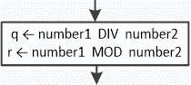

 在 Java 中，两个整数相除的结果始终是一个整数。因此，在语句 `q = (int)(number1 / number2)` 中，由于变量 `number1` 和 `number2` 已经是整数，`(int)` 强制转换运算符是多余的。然而，为了提高代码的可读性，保留它也是一个良好的习惯。

## 练习 13.1-2 求数字数字之和

编写一个 Java 程序，提示用户输入一个四位整数，然后计算其各位数字之和。

##### 解决方案

你在这里需要记住，像这样的语句：

```java
number = Integer.parseInt(cin.nextLine());
```


是将用户提供的四位整数赋值给单个变量`number`，而不是四个独立的变量。因此，在用户输入四位整数后，程序必须将该整数拆分为四个数字，并将每个数字赋值给单独的变量。然后，就可以计算这四个变量之和并得到所需的结果。有两种方法可用。

### 方法一

让我们尝试通过一个算术示例来理解第一种方法。以数字`6753`为。

| 第一位数字 = 6 | 如果你使用`/`运算符将用户提供的数字除以 1000，并使用`(int)`类型转换运算符，就可以分离出商`digit1 = (int)(6753 / 1000)` |
| 剩余数字 = 753 | 如果你再次将用户提供的数字除以 1000，这次使用`%`运算符获取整数余数`r = 6753 % 1000` |
| 第二位数字 = 7 | 如果你使用`/`运算符将剩余数字除以 100，并使用`(int)`类型转换运算符，就可以分离出商`digit2 = (int)(753 / 100)` |
| 剩余数字 = 53 | 此时剩余数字为`r = 753 % 100` |
| 第三位数字 = 5 | 如果你使用`/`运算符将剩余数字除以 10，并使用`(int)`类型转换运算符，就可以分离出商`digit3 = (int)(53 / 10)` |
| 第四位数字 = 3 | 最后剩下的数字（恰好是第四位数字）是`digit4 = 53 % 10` |

这里是解决该算法的 Java 程序。


### Project_13.1-2

```java
public static void main(String[] args) throws Exception {
    int digit1, digit2, digit3, digit4, number, r, total;
    System.out.print("Enter a four-digit integer: ");
    number = Integer.parseInt(cin.nextLine());
    digit1 = (int)(number / 1000);
    r = number % 1000;
    digit2 = (int)(r / 100);
    r = r % 100;
    digit3 = (int)(r / 10);
    digit4 = r % 10;
    total = digit1 + digit2 + digit3 + digit4;
    System.out.println(total);
}
```

这里是你刚刚看到的程序的跟踪表。

| 步骤 | 语句 | 注释 | number | digit1 | digit2 | digit3 | digit4 | r | total |
| --- | --- | --- | --- | --- | --- | --- | --- | --- | --- |
| 1 | `.print("Enter…` | 显示：Enter a four-digit integer: | | | | | | | | |
| 2 | `number = Integer.parseInt(…)` | 用户输入 6753 | 6753 | ? | ? | ? | ? | ? | ? |
| 3 | `digit1 = (int)(number / 1000)` | | 6753 | 6 | ? | ? | ? | ? | ? |
| 4 | `r = number % 1000` | | 6753 | | | | | | | |
| 5 | `digit2 = (int)(r / 100)` | | 6753 | | 7 | ? | ? | ? | ? |
| 6 | `r = r % 100` | | 6753 | | | | | 53 | ? |
| 7 | `digit3 = (int)(r / 10)` | | 6753 | | | 5 | ? | ? | ? |
| 8 | `digit4 = r % 10` | | 6753 | | | | | 3 | 50 |
| 9 | `total = digit1 + digit2 + digit3 + digit4` | | 6753 | 6 | 7 | 5 | 3 | | 21 |
| 10 | `System.out.println(total)` | 显示：21 | | | | | | | |

为了进一步帮助你，请看下方一个通用的 Java 程序，它可以用于拆分任何给整数。该程序使用了第二种方法。再次强调，由于你的程序长度取决于位数`N`，你只需要编写`N−1`组语句即可。

`System.out.print("Enter a N-digit integer: ");number = Integer.parseInt(cin.nextLine());digit(N) = number % 10;r = (int)(number / 10);digit(N-1) = r % 10;r = (int)(r / 10);...digit3 = r % 10;r = (int)(r / 10);digit2 = r % 10;digit1 = (int)(r / 10);`

例如，如果你想拆分一个五位数整数，必须像下面的程序所示使用四对语句。

 Project_13.1-2d

```java
public static void main(String[] args) throws Exception {
    int digit1, digit2, digit3, digit4, digit5, number, r;
    System.out.print("Enter a five-digit integer: ");
    number = Integer.parseInt(cin.nextLine());
    digit5 = number % 10;
    r = (int)(number / 10);
    digit4 = r % 10;
    r = (int)(r / 10);
    digit3 = r % 10;
    r = (int)(r / 10);
    digit2 = r % 10;
    digit1 = (int)(r / 10);
    System.out.println(digit1 + "  " + digit2 + "  " + digit3 + "  " + digit4 + "  " + digit5);
}
```

### 练习 13.1-3 显示流时间

编写一个 Java 程序，提示用户输入一个表示秒流时间的整数，然后以“DD day(s) HH hour(s) MM minute(s) and SS second(s)”的格式显示它。例如，如果用户输入数字 700005，必须显示消息“8 day(s) 2 hour(s) 26 minute(s) and 45 second(s)”。

##### 解 Solution

如你所知，一分钟有 60 秒，一小时有 3600 秒（60 × 60），一天有 86400 秒（3600 × 24）。让我们尝试使用上一个练习中学会的第一种方法来分析数字 700005。

| 天数 = 8 | 如果使用`(/ )`运算符和`(int)`类型转换运算符将用户提供的整数除以 86400，就可以分离出整数商`days = (int)(700005 / 86400)`。 |
| 剩余秒数 = 8805 | 如果再次将用户提供的整数除以 86400，这次使用`( % )`运算符获取整数余数`r = 700005 % 86400`。 |
| 小时 = 2 | 如果使用`( / )`运算符和`(int)`类型转换运算符将剩余秒数除以 3600，就可以分离出整数商`hours = (int)(8805 / 3600)`。 |
| 剩余秒数 = 1605 | 现在剩余秒数是`r = 8805 % 3600`。 |
| 分钟 = 26 | 如果使用`( / )`运算符和`(int)`类型转换运算符将剩余秒数除以 60，就可以分离出整数商`minutes = (int)(1605 / 60)`。 |
| 秒 = 45 | 最后一个余数恰好是剩余的秒数，`seconds = 1605 % 60`。 |

该算法的 Java 程序如下。

 Project_13.1-3a

```java
public static void main(String[] args) throws Exception {
    int days, hours, minutes, number, r, seconds;
    System.out.print("Enter a period of time in seconds: ");
    number = Integer.parseInt(cin.nextLine());
    days = (int)(number / 86400);    // 60 * 60 * 24 = 86400
    r = number % 86400;
    hours = (int)(r / 3600);         // 60 * 60 = 3600
    r = r % 3600;
    minutes = (int)(r / 60);
    seconds = r % 60;
    System.out.println(days + " day(s) " + hours + " hour(s) ");
    System.out.println(minutes + " minute(s) and " + seconds + " second(s)");
}
```

你也可以使用上一个练习中的第二种方法解决这个练习。你只需要先除以 60，再次除以 60，最后除以 24，如下所示。

 Project_13.1-3b

```java
public static void main(String[] args) throws Exception {
    int days, hours, minutes, number, r, seconds;
    System.out.print("Enter a period of time in seconds: ");
    number = Integer.parseInt(cin.nextLine());
    days = (int)(number / 86400);    // 60 * 60 * 24 = 86400
    r = number % 86400;
    hours = (int)(r / 3600);         // 60 * 60 = 3600
    r = r % 3600;
    minutes = (int)(r / 60);
    seconds = r % 60;
    System.out.println(days + " day(s) " + hours + " hour(s) ");
    System.out.println(minutes + " minute(s) and " + seconds + " second(s)");
}
```

### 练习 13.1-4 反转数字

编写一个 Java 程序，提示用户输入一个三位数整数并显示其反转数字。例如，如果用户输入 875，程序

##### 解 Solution

为了进一步帮助你，请看下方一个可拆分任何给定整数的通用 Java 程序。该程序使用了第二种方法。再次强调，由于你的程序长度取决于位数`N`，你只需要编写`N−1`组语句。

`System.out.print("Enter a N-digit integer: ");number = Integer.parseInt(cin.nextLine());digit(N) = number % 10;r = (int)(number / 10);digit(N-1) = r % 10;r = (int)(r / 10);...digit3 = r % 10;r = (int)(r / 10);digit2 = r % 10;digit1 = (int)(r / 10);`

例如，如果你想拆分一个五位数整数，必须像下面的程序所示使用四对语句。

 Project_13.1-2d

```java
public static void main(String[] args) throws Exception {
    int digit1, digit2, digit3, digit4, digit5, number, r;
    System.out.print("Enter a five-digit integer: ");
    number = Integer.parseInt(cin.nextLine());
    digit5 = number % 10;
    r = (int)(number / 10);
    digit4 = r % 10;
    r = (int)(r / 10);
    digit3 = r % 10;
    r = (int)(r / 10);
    digit2 = r % 10;
    digit1 = (int)(r / 10);
    System.out.println(digit1 + "  " + digit2 + "  " + digit3 + "  " + digit4 + "  " + digit5);
}
```

### 练习 13.1-3 显示流时间

编写一个 Java 程序，提示用户输入一个表示秒流时间的整数，然后以“DD day(s) HH hour(s) MM minute(s) and SS second(s)”的格式显示它。例如，如果用户输入数字 700005，必须显示消息“8 day(s) 2 hour(s) 26 minute(s) and 45 second(s)””。

##### 解 Solution

如你所知，一分钟有 60 秒，一小时有 3600 秒（60 × 60），一天有 86400 秒（3600 × 24）。让我们尝试使用上一个练习中学会的第一种方法来分析数字 700005。

| 天数 = 8 | 如果使用`(/ )`运算符和`(int)`类型转换运算符将用户提供的整数除以 86400，就可以分离出整数商`days = (int)(700005 / 86400)`。 |
| 剩余秒数 = 8805 | 如果再次将用户提供的整数除以 86400，这次使用`( % )`运算符获取整数余数`r = 700005 % 86400`。 |
| 小时 = 2 | 如果使用`( / )`运算符和`(int)`类型转换运算符将剩余秒数除以 3600，就可以分离出整数商`hours = (int)(8805 / 3600)`。 |
| 剩余秒数 = 1605 | 现在剩余秒数是`r = 8805 % 3600`。 |
| 分钟 = 26 | 如果使用`( / )`运算符和`(int)`类型转换运算符将剩余秒数除以 60，就可以分离出整数商`minutes = (int)(1605 / 60)`。 |
| 秒 = 45 | 最后一个余数恰好是剩余的秒数，`seconds = 1605 % 60`。 |

该算法的 Java 程序如下。

 Project_13.1-3a

```java
public static void main(String[] args) throws Exception {
    int days, hours, minutes, number, r, seconds;
    System.out.print("Enter a period of time in seconds: ");
    number = Integer.parseInt(cin.nextLine());
    days = (int)(number / 86400);    // 60 * 60 * 24 = 86400
    r = number % 86400;
    hours = (int)(r / 3600);         // 60 * 60 = 3600
    r = r % 3600;
    minutes = (int)(r / 60);
    seconds = r % 60;
    System.out.println(days + " day(s) " + hours + " hour(s) ");
    System.out.println(minutes + " minute(s) and " + seconds + " second(s)");
}
```

你也可以使用上一个练习中的第二种方法解决这个练习。你只需要先除以 60，再次除以 60，最后除以 24，如下所示。

 Project_13.1-3b

```java
public static void main(String[] args) throws Exception {
    int days, hours, minutes, number, r, seconds;
    System.out.print("Enter a period of time in seconds: ");
    number = Integer.parseInt(cin.nextLine());
```


```java
days = (int)(number / 86400);    // 60 * 60 * 24 = 86400

r = number % 86400;

hours = (int)(r / 3600);         // 60 * 60 = 3600

r = r % 3600;

minutes = (int)(r / 60);

seconds = r % 60;

System.out.println(days + " day(s) " + hours + " hour(s) ");

System.out.println(minutes + " minute(s) and " + seconds + " second(s)");

}
```

### 练习 13.1-4 反转数字

编写一个 Java 程序，提示用户输入一个三位数整数并显示其反转数字。例如，如果用户输入 875，程序

##### 解 Solution

为了进一步帮助你，请看下方一个可拆分任何给定整数的通用 Java 程序。该程序使用了第二种方法。再次强调，由于你的程序长度取决于位数`N`，你只需要编写`N−1`组语句。

`System.out.print("Enter a N-digit integer: ");number = Integer.parseInt(cin.nextLine());digit(N) = number % 10;r = (int)(number / 10);digit(N-1) = r % 10;r = (int)(r / 10);...digit3 = r % 10;r = (int)(r / 10);digit2 = r % 10;digit1 = (int)(r / 10);`

例如，如果你想拆分一个五位数整数，必须像下面的程序所示使用四对语句。

 `Project_13.1-2d`

```java
public static void main(String[] args) throws Exception {

    int digit1, digit2, digit3, digit4, digit5, number, r;

    System.out.print("Enter a five-digit integer: ");

    number = Integer.parseInt(cin.nextLine());

    digit5 = number % 10;

    r = (int)(number / 10);

    digit4 = r % 10;

    r = (int)(r / 10);

    digit3 = r % 10;

    r = (int)(r / 10);

    digit2 = r % 10;

    digit1 = (int)(r / 10);

    System.out.println(digit1 + "  " + digit2 + "  " + digit3 + "  " + digit4 + "  " + digit5);

}
```

### 13.2 复习练习

完成以下练习。

1) 编写一个 Java 程序，提示用户输入任何整数，然后将其最后一位乘以 8。提示：不需要知道位数。你可以使用模 10 操作来分离出最后一位。

2) 编写一个 Java 程序，提示用户输入一个五位数整数，然后找到原数与其反转数字之和。例如，如果用户输入 32675，程序必须显示 90298。

3) 编写一个 Java 程序，提示用户输入一个整数，如果数字是奇数则显示 1；否则显示 0。尽量不要使用任何判断结构，因为你还还没有学习过它们的任何知识！

4) 编写一个 Java 程序，提示用户输入一个整数，如果数字是偶数则显示 1；否则显示 0。尽量不要使用任何判断结构，因为你还还没有学习过它们的任何知识！

5) 编写一个 Java 程序，提示用户输入一个表示秒流时间的整数，然后以“WW week(s) DD day(s) HH hour(s) MM minute(s) and SS second(s)”的格式显示它。例如，如果用户输入数字 2000000，必须显示消息“3 week(s) 2 day(s) 3 hour(s) 33 minute(s) and 20 second(s)”

6) 编写一个 Java 程序，提示用户输入想要从 ATM 取出的金额，然后显示 ATM 必须提供的少量钞票数量。ATM 有 $20、$10、$5 和 $1 的钞票。例如，如果用户输入 $76，程序必须显示消息“3 note(s) of $20, 1 note(s) of $10, 1 note(s) of $5, and 1 note(s) of $1”。

通常情况下，字符串是指任何你可以使用键盘输入的内容，包括字母、符号符号（如`&`、`*`和`@`）以及数字。在 Java 中，字符串始终包含在双引号内。

下面是一个使用字符串的 Java 程序。

```java
a = "Everything enclosed in double quotes is a string, even the numbers: ";

b = "3, 54, 731";

System.out.println(a + b);

System.out.println("You can even mix letters, symbols and digits like this: ");

System.out.println("3 + 4 equals 7");
```

许多程序经常处理以字符串（文本）形式出现的数据。字符串无处不在——从文字处理器到网络浏览器，再到短信程序。本书中的许多练习实际上都大量使用了字符串。尽管 Java 支持许多处理字符串的有用方法，但本章仅涵盖了对于本书目的目的必需的方法。然而，如果你需要更多信息，可以访问以下地址之一：

- [`tinyurl.com/3575wcb8`](https://tinyurl.com/3575wcb8)
- [`docs.oracle.com/en/java/javase/21/docs/api/java.base/java/lang/String.xhtml#method.summary`](https://docs.oracle.com/en/java/javase/21/docs/api/java.base/java/lang/String.xhtml#method.summary)


 Java 字符串方法（子程序）可以在需要操作字符串时使用，例如从字符串中提取某些字符、移除字符串开头可能存在的空格，或者将其所有字符转换为大写。

 方法无非是解决小问题的小型子程序。

### 14.2 字符在字符串中的位置

让我们在下面的示例中使用文本“Hello World”。该字符串由 11 个字符组成（包括两个单词之间的空格字符）。Java 对字符进行编号时，假设第一个字符位于位置 0，第二个位于位置 1，以此此类推。每个字符的位置在此所示。

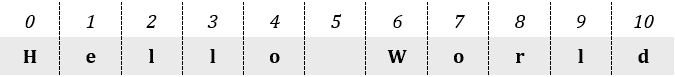

 空格和任何其他字符一样都是字符。仅仅因为没有人能看到它，并不意味着它不存在！

### 14.3 有用的字符串方法（子程序）及其他

#### 修剪 (Trimming)

修剪是从字符串的开头或结尾移除空白字符的过程。

在修剪过程中移除的某些空白字符包括：

- 普通空格
- 制表符 (tab)
- 换行符 (line feed)
- 回车

例如，你可以修剪用户误输入的位于字符串开头或结尾的任何空格。

用于修剪字符串的方法是

`subject.trim()`

该方法返回`subject`的副本，其中`subject`字符串开头和结尾的所有空白字符都已移除。

**示例**

 `Project_14.3a`

```java
public static void main(String[] args) throws Exception {

    String a, b;

    a = " Hello";

    b = a.trim();

    System.out.println(b + " Poseidon!"); //它显示：Hello Poseidon!

    System.out.println(a + " Poseidon!"); //它显示：   Hello      Poseidon!

}
```

 注意变量`a`的内容没有改变。如果你确实需要更改其内容，可以使用语句`a = a.trim();`。

#### 字符串替换 (String replacement)

`subject.replace(search, replace)`

该方法在`subject`中搜索并返回其副本，其中所有出现`search`字符串的地方都被替换为`replace`字符串。

**示例**

 `Project_14.3b`

```java
public static void main(String[] args) throws Exception {

    String a, b;

    a = "I am newbie in C++. C++ rocks!";

    b = a.replace("C++", "Java");

    System.out.println(b);    //它显示：I am newbie in Java. Java rocks

    System.out.println(a);    //它显示：I am newbie in C++. C++ rocks

}
```

 注意变量`a`的内容没有改变。如果你确实需要更改其内容，可以使用语句`a = a.replace("C++", "Java");`。

#### 统计字符数 (Counting the number of characters)

`subject.length()`

该方法返回`subject`的长度，换句话说，就是`subject`包含字符的数量。

**示例**

 `Project_14.3c`

```java
public static void main(String[] args) throws Exception {

    String a;

    int k;

    a = "Hello Olympians!";

    System.out.println(a.length());                      //它显示：16

    k = a.length();

    System.out.println(k);                               //它显示：16

    System.out.println("I am newbie in Java".length());  //它显示：19

}
```

#### 查找字符串位置 (Finding string position)

`subject.indexOf(search)`

该方法在`subject`中返回`search`首次出现的数字位置，如果未找到则返回 -1。

**示例**

 `Project_14.3d`

```java
public static void main(String[] args) throws Exception {

    int i;

    String a;

    a = "I am newbie in Java. rocks!";

    i = a.indexOf("newbie");

    System.out.println(i); //它显示：5

    System.out.println(a.indexOf("Java")); //它显示：15

    System.out.println(a.indexOf("C++")); //它显示：-1

}
```

#### 转换为小写 (Converting to lowercase)

`subject.toLowerCase()`

该方法返回`subject`的副本，其中字符串中的所有字母都转换为小写。

**示例**

 `Project_14.3e`

```java
public static void main(String[] args) throws Exception {

    String a, b;

    a = "MyMe is JohN";

    b = a.toLowerCase();

    System.out.println(b); //它显示：my name is john

    System.out.println(a); //它显示：MyMe is JohN

}
```

#### 转换为大写 (Converting to uppercase)

`subject.toUpperCase()`

该方法返回`subject`的副本，其中字符串中的所有字母都转换为大写。

**示例**

 `Project_14.3f`

```java
public static void main(String[] args) throws Exception {

    String a, b;

    a = "MyMe is JohN";

    b = a.toUpperCase();

    System.out.println(b); //它显示：MY NAME IS JOHN

    System.out.println(a); //它显示：MyMe is JohN

}
```

#### 从字符串检索单个字符 (Retrieving an individual character from a string)

`subject.charAt(index)`

该方法返回位于`subject`指定`index`位置的字符。如前，字符串索引从零开始。你可以使用索引 0 访问第一个字符，索引 1 访问第二个字符，以此此类推。最后一个字符的索引比字符串长度少 1。

**示例**

 `Project_14.3g`

```java
public static void main(String[] args) throws Exception {

    String a;

    a = "Hello World";

    System.out.println(a.charAt(0)); //它显示第一个字母：H

    System.out.println(a.charAt(6)); //它显示：W

    System.out.println(a.charAt(10)); //它显示：d

}
```

#### 获取字符串部分 (Getting part of a string)

`subject.substring(beginIndex [, endIndex])`

该方法返回`subject`的部分。具体来说，它返回从位置`beginIndex`开始到但不包含`endIndex`位置的子字符串。`endIndex`参数是可选的。如果省略它，则返回从位置`beginIndex`开始到`subject`尾的子字符串。

 项目 `_14.3h`

```java
public static void main(String[] args) throws Exception {

    String a;

    a = "Hello Athena";

    System.out.println(a.substring(6, 9));  //显示为: Ath

    System.out.println(a.substring(7));     //显示为: then

}
```

## 字符串比较

`subject.compareTo(string)`

该方法当`subject`在字典序上与`string`相等时返回值`0`；如果`subject`在字典序上小于`string`，返回一个小于`0`的值；如果`subject`在字典序上大于`string`，则返回一个大于`0`的值。

“字典序”（lexicographically）一词意味着字母“A”被认为“小于”字母“B”，“字母“B”被认为“小于”字母“C”，以此此类推。当然，如果两个字符串的首字母相同，Java 会继续比较它们的第二个字母，可能还会比较第三个字母（如果有必要）。例如，“backspace”一词被认为“小于”“backwards”一词，因为第五个字母“s”“小于”第五个字母“w”。

检查两个字符串是否相另一种方便方法是：

`subject.equals(string)`

该方法检查`subject`在字典序上是否与`string`相等，并相应返回`true`或`false`。

### 示例

 项目 `_14.3i`

```java
public static void main(String[] args) throws Exception {

    String a = "backspace";

    String b = "backwards";

    String c = "Backspace";
```


```java
String d = "winter";
String e = "winter";
System.out.println(a.compareTo(b));    //显示: -4
System.out.println(a.compareTo(c));    //显示: 32
System.out.println(a.compareTo(d));    //显示: -21
System.out.println(d.compareTo(e));    //显示: 0
System.out.println(a.equals(d));       //显示: false
System.out.println(a.equals(c));       //显示: false
System.out.println(d.equals(e));       //显示: true
}
```

注意字母“b”和“B”被认为是两个不同的字母。

考虑在英语字典中单词组织的语境下的“字典序”一词。

## 将数字或字符转换为字符串

`String.valueOf(subject)`

该方法返回`subject`的字符串版本，或者换句话说，它将数字（实点数或整数）或字符转换为字符串。

### 示例

 项目 _14.3j

```java
public static void main(String[] args) throws Exception {
    String a;
    char b;
    int c, d;
    b = 'W';
    a = String.valueOf(b);   //将字母 W 赋值给字符串变量 a
    System.out.println(a);   //显示: W
    c = 12;
    d = 34;
    System.out.println(c + d); //显示: 46
    System.out.println(String.valueOf(c) + String.valueOf(d)); //显示: 1234
}
```

在 Java 中，如果只是以一个字符串开始序列（即使是空字符串），也可以实现相同的结果，如下例所示。

 项目 _14.3k

```java
public static void main(String[] args) throws Exception {
    String a;
    char b;
    int c, d;
    b = 'W';
    a = "" + b;   //将字母 W 赋值给字符串变量 a
    System.out.println(a);   //显示: W
    c = 12;
    d = 34;
    System.out.println(c + d); //显示: 46
    System.out.println("" + c + d); //显示: 1234
    System.out.println("Result - " + c + d); //显示: Result - 1234
}
```

### 练习 14.3-1 反向显示字符串

编写一个 Java 程序，提示用户输入任何带有四个字母的字符串，然后反向显示其内容。例如，如果输入的字符串是“Zeus”，程序必须显示“sueZ”。

##### 解决方案

假设用户的输入被赋值给变量`s`。你可以使用`s.charAt(3)`获取第四个字符，使用`s.charAt(2)`获取第三个字符，以此此类推。

Java 程序如所示。这里使用拼接运算符（`+`）来重新组合最终的反转后的字符串。

 项目 _14.3-1

```java
public static void main(String[] args) throws Exception {
    String s, sReversed;
    System.out.print("Enter a word with four letters: ");
    s = cin.nextLine();
    sReversed = "" + s.charAt(3) + s.charAt(2) + s.charAt(1) + s.charAt(0);
    System.out.println(sReversed);
}
```

 项目 _14.3-3

```java
public static void main(String[] args) throws Exception {
    int randomInt;
    String lastName, loginID;
    System.out.print("Enter last name: ");
    lastName = cin.nextLine();
    //Get random integer between 100 and 999
    randomInt = 100 + (int)(Math.random() * 900);
    loginID = lastName.substring(0, 4).toLowerCase() + randomInt;
    System.out.println(loginID);
}
```

注意方法`substring(0, 4)`返回从位置 0 开始到但不包含位置 4 的子字符串。

注意`substring()`方法是如何链接到`toLowerCase()`方法上的。第一个方法的结果被用作第二个方法的的操作数。这是大多数程序员倾向于遵循的编写风格，因为可以帮助节省大量的代码行。当然，你可以根据意愿链任意数量的方法，但如果你链了太多方法，没有人能看懂你的代码。

#### 练习 14.3-4 创建随机单词

编写一个 Java 程序，显示一个由三个字母组成的随机单词。

##### 答案

要创建一个随机单词，你需要一个包含英语字母表中所有 26 个字母的字符串。然后你可以使用`Math.random()`方法在位置 0 到 25 之间选择一个随机字母。

该算法的 Java 程序所示。

 项目 _14.3-4

```java
public static void main(String[] args) throws Exception {
    String alphabet, randomWord;
    alphabet = "abcdefghijklmnopqrstuvwxyz";
    randomWord = "" + alphabet.charAt((int)(Math.random() * 26)) +
                 alphabet.charAt((int)(Math.random() * 26)) +
                 alphabet.charAt((int)(Math.random() * 26));
    System.out.println(randomWord);
}
```

你可以将一个子程序嵌套在另一个程序内部。注意`random()`方法是如何嵌套在`charAt()`方法中的。内部（嵌套）方法的的结果被用作外部方法的参数。

注意方法`Math.random()`被调用了三次，每次它都可能返回不同的随机数。

在 Java 中，有时有必要强制编译器执行拼接而不是普通的加法，这通过以字符串开始序列，即使是一个空字符串。

你也可以使用`length()`方法来获取字符串`alphabet`的长度，如下所示。

 项目 _14.3-4b

```java
public static void main(String[] args) throws Exception {
    String alphabet, randomWord;
    alphabet = "abcdefghijklmnopqrstuvwxyz";
    randomWord = "" + alphabet.charAt((int)(Math.random() * alphabet.length())) +
                 alphabet.charAt((int)(Math.random() * alphabet.length())) +
                 alphabet.charAt((int)(Math.random() * alphabet.length()));
    System.out.println(randomWord);
}
```

#### 练习 14.3-5 求各位数字之和

编写一个 Java 程序，提示用户输入一个三位整数，然后计算其数字之和。在不使用整数取余（`%`）运算符的情况下解决此练习。

##### 答案

现在你可能疑惑为什么这个练习被放在这一章，因为这一章主要关注字符串处理。你可能会辩说，你已经知道如何将一个三位整数拆分为三个数字，并将每个数字分配给单独的变量，就像你在第 13 章中使用除法（`/`）和整数取余（`%`）运算符学到的那样。那么，为什么在这里再次讨论这个练习呢？

原因为 Java 是一种非常强大的语言，你可以使用它的魔法力量以完全不同的方式解决这个练习。主要思想是将用户提供的整数转换为`String`类型，并将每个数字（每个字符）分配到各个变量中

 项目 _14.3-5

```java
public static void main(String[] args) throws Exception {
    int number, total;
    String sNumber, digit1, digit2, digit3;
    System.out.print("Enter an three-digit integer: ");
    number = Integer.parseInt(cin.nextLine());
    sNumber = "" + number;  //将数字转换为字符串
    digit1 = "" + sNumber.charAt(0);  //将位置 0 的字符转换为字符串
    digit2 = "" + sNumber.charAt(1);  //将位置 1 的字符转换为字符串
    digit3 = "" + sNumber.charAt(2);  //将位置 2 的字符转换为字符串
    total = Integer.parseInt(digit1) + Integer.parseInt(digit2) + Integer.parseInt(digit3);
    System.out.println(total);
}
```

由于变量`digit1`、`digit2`和`digit3`是`String`类型，你需要使用`parseInt()`方法将它们转换为整数，然后在变量`total`中求出它们的和。

### 14.4 复习题：判断对错

对以下每个陈述选择“对或“错”。

1) 字符串是任何你可以使用键盘输入的字符。
2) 字符串必须包含在括号中。
3) 字符串必须包含 8 个字符。
4) 在短语“Hi there!”中，字母“t”位于位置 3。
5) `trim()`方法是移除字符串开头和结尾空白字符的过程。
6) `a = "Hello";`赋值给`a`的语句是`charAt(5)`。
7) `trim()`将“Aphrodite”赋值给变量`y`。
8) `replace("Hi", "Hello")`显示“Hello there!”。
9) `index = ("Hi there").indexOf("the")`将值 4 赋值给变量`index`。
10) `toUpperCase()`显示“HI THERE!”。
11) `substring(0))`显示“Hi there!”。
12) `substring(0, a.length())`显示了变量`a`的某些字母。
13) 以下语句等同于`charAt(a.length() - 1)`：
14) `substring(0, 5)`显示单词“HELLO”：
15) 如果变量`a`包含一个 100 个字符的字符串，则以下语句等同于`charAt(99)`。
16) `a = 2023; System.out.println(String.valueOf(a).substring(2, 4));`显示

### 14.5 复习题：单选题

为以下每个陈述选择正确答案。

1) 以下哪一个不是字符串？
a) “Hello there!”
b) “13”
c) “13.5”
d) 以上都是字符串。

2) 字符串“Hello Zeus!”中的空格位于哪个位置？
a) 6
b) 5
c) 空格不是字符。
d) 以上都不是。

3) 语句`System.out.println(a.substring(a.length() - 2, a.length() - 1));`显示
a) 变量 a 的最后一个字符。
b) 变量 a 的倒数第二个字符。
c) 该语句无效。

4) 语句`y = a.trim().replace("a", "b").replace("w", "y");`等同于语句：
a) `y = a.replace("a", "b").replace("w", "y").trim();`
b) `y = a.replace("a", "b").trim().replace("w", "y");`
c) `y = a.trim().replace("w", "y").replace("a", "b");`
d) 以上均是。

5) `a.replace(" ", "")`
a) 在变量 a 的每个字母之间添加空格。
b) 从变量 a 中移除所有空格。
c) 清空变量 a。

6) `(" Hello ").replace(" ", "")`等同于语句：
a) `(" Hello ").replace("", " ")`
b) `(" Hello ").trim()`
c) 以上均是。
d) 以上都不是。

7) 以下代码片段`a = ""; System.out.println(a.length());`显示

a)无。b)1.c)0.d)该陈述无效。e)以上均不是 8) 哪一个值将以下代码段赋值给变量`Shakespeare`？

```java
toBeOrNotToBe = "2b or not 2b";
Shakespeare = toBeOrNotToBe.indexOf("b");
```

a)1b)2c)11d)以上都不是 9) 以下代码段的作用是什么？

```java
a = "Hi there";
b = a.substring(a.indexOf("  ") + 1);
```

a) 它将单词“Hi”赋值给变量`b`。
b) 它将一个空格字符赋值给变量`b`。
c) 把它将单词“there”赋值给变量`b`。
d)以上都不是 10) 以下代码段

```java
a = 15;
b = 5;
System.out.println(String.valueOf(a) + String.valueOf(b));
```


```

显示

a) 15. b) 10. c) 15 + 5 d) 以上都不是

### 14.6 复习练习

完成以下练习。

1) 编写一个 Java 程序，创建并显示一个五个字母的随机单词。第一个字母必须是大写字母。
2) 编写一个 Java 程序，提示用户输入他们的姓名，然后创建一个秘密密码，该密码由从他们的姓名中随机取的三个字母（小写）以及一个随机四位数字组成。例如，如果用户输入“Vassilis Bouras”，秘密密码可能是“sar1359”、“vbs7281”或“bor1459”之一。秘密密码中不允许空格字符。
3) 编写一个 Java 程序，提示用户输入一个三位整数并将其反转。例如，如果用户输入数字 375，则必须显示数字 573。在不使用整数取模运算符（`%`）的情况下解决此练习。
4) 编写一个 Java 程序，提示用户输入名、中间名和姓，并以以下所有格式显示它们。

`FirstName MiddleName LastName`（名 中间名 姓）

`FirstName M. LastName`（其中 `M` 是中间名的第一个字母）

`LastName F.`（其中 `F` 是名字的第一个字母）

此外，程序必须确保无论用户如何输入姓名，其始终显示为首字母大写，其余部分小写。

例如，假设用户输入以下内容：

First name（名）：Aphrodite

Middle name（中间名）：MARIA

Last name（姓）：boura

程序必须以以下所有格式显示用户的姓名：

```
Aphrodite Maria Boura

Aphrodite M. Boura

Boura A.
```

5) 如“revolutionary”和“internationalization”之类的单词非常长，反复编写它们会非常厌味。在这种情况下，这些单词可以用特殊的缩写来代替，其方法如下：你保留单词的首字母和最后一个字母，并在它们之间插入字母的数量。例如，“revolutionary”变成“r11y”，“internationalization”变成“i18n”。

编写一个 Java 程序，让用户输入一个长单词并显示其缩写。

## 在“顺序控制结构”中复习

### 复习填字游戏

1) 解决以下填字游戏。

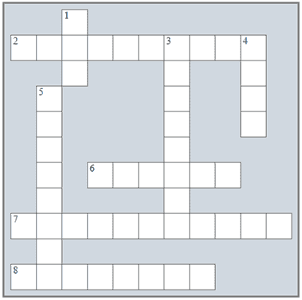

横向

2) `length()` 方法返回字符串中 ______ 的数量。

6) 任何你可以使用键盘输入的内容。

7) Java 提供了许多现成的 ___________。

8) 这种控制结构指的是逐行执行，即语句按顺序顺序执行。

竖向

1) 空白字符。

3) 从字符串开头或结尾移除空白字符的过程。

4) `Math.sin()` 方法返回数字的 _____。

5) `Math.abs()` 方法返回数字的 __________ 值。

### 复习题

回答以下问题。

1) 什么是顺序控制结构？
2) 顺序控制结构可以执行哪些操作？
3) 计算机科学中“类型转换”（type casting）是什么意思？
4) 给一些使用整数除法的商和余数的例子。
5) 什么是方法？
6) “链方法”（chain a method）是什么意思？
7) “嵌套方法”（nest a method）是什么意思？

# 第四部分

选择控制结构

## 第 15 章 选择问题

### 15.1 引言

你到目前所学的所有都是顺序控制结构，语句按照程序中出现的相同顺序顺序执行。然而，在实际的 Java 编程中，你很少希望语句按顺序执行。很多时候，你希望在一种情况下执行一组语句，而在另一种情况下执行完全不同的一组语句。

### 15.2 什么是布尔表达式？

假设变量 `x` 包含值 5。这意味着如果你问问题“`x` 大于 2 吗？”答案显然是“是”。对于计算机来说，这些问题被称为布尔表达式。例如，如果你写下 `x > 2`，这是一个布尔表达式，计算机必须检查表达式 `x > 2` 是否为真或假。

布尔表达式是一个产生布尔值的表达式，即结果为真（`true`）或假（`false`）二一。

布尔表达式是问题，它们应该被读作“某物是吗？”。选择控制结构可以评估布尔表达式并决定执行哪块语句。

### 15.3 如何编写简单表达式

简单的布尔表达式写为 `Operand1 Comparison_Operator Operand2`

其中 `Operand1` 和 `Operand2` 可以是值、变量或数学表达式，如表 15-1 所示。

| 比较运算符 | 描述 |
| --- | --- |
| `==` | 等于（不是赋值） |
| `!=` | 不等于 |
| `>` | 大于 |
| `<` | 小于 |
| `>=` | 大于等于 |
| `<=` | 小于等于 |

一些布尔表达式的示例：

`x > y`。这个布尔表达式是对计算机的问题，可以读作“`x` 大于 `y` 吗？”

`x <= y`。这个布尔表达式也是对计算机的问题，可以读作“`x` 小于等于 `y` 吗？”

`x != 3 * y + 4`。这个布尔表达式是对计算机的问题，可以读作“`x` 不等于 `3 * y + 4` 吗？”

`s.equals("Hello")`。在 Java 中，为了测试两个字符串是否相等，你需要使用 `equals()` 方法。这个问题可以读作“`s` 包含 'Hello' 吗？”

`x == 5`。这可以读作“`x` 等于 5 吗？”

#### 练习 15.3-1 填充表格

根据 `a`、`b` 和 `c` 的值，在下表中填充“true”或“false”。

| a | b | c | a == 10 | b <= a | c > 3 * a - b |
| --- | --- | --- | --- | --- | --- |
| 3 | -5 | 7 | | | |
| 10 | 10 | 21 | | | |
| -4 | -2 | -9 | | | |

答案前两个布尔表达式非常直观，不需要进一步解释。

关于布尔表达式 `c > 3 * a - b`，注意 `b` 为负数的情况。例如，在第一行中，`a` 等于 3，`b` 等于 5。表达式 `3 * a - b` 的结果是 `3 * 3 - (−5) = 3 * 3 + 5 = 14`。由于变量 `c` 的内容（第一行）不大于 14，布尔表达式 `c > 3 * a - b` 的结果为假。

经过一些工作，表格变为：

| a | b | c | a == 10 | b <= a | c > 3 * a - b |
| --- | --- | --- | --- | --- | --- |
| 3 | -5 | 7 | false | true | false |
| 10 | 10 | 21 | true | true | true |
| -4 | -2 | -9 | false | false | true |

### 15.4 逻辑运算符和复杂的布尔表达式

复杂的布尔表达式可以由简单的布尔表达式构建，并可以写为

`BE1 Logical_Operator BE2`

其中 `BE1` 和 `BE2` 可以是任何布尔表达式。`Logical_Operator` 可以是表 15-2 所示的运算符之一。

| 逻辑运算符 | 说明 |
| --- | --- |
| `&&` | 与（AND，也称为逻辑合与） |
| `||` | 或（OR，也称为逻辑取或） |
| `!` | 非（NOT，也称为否定或逻辑非） |

表 15-2 Java 中的逻辑运算符

当我们将多个简单的布尔表达式与逻辑运算符结合起来时，整个布尔表达式就被称为“复杂的布尔表达式”。例如，表达式 `x == 3 && y > 5` 就是一个复杂的布尔表达式。

在流程图中，本书使用了通用的 `AND`、`OR` 和 `NOT` 运算符！

### AND (`&&`) 运算符

当你在两个布尔表达式之间使用 `AND` (`&&`) 运算符时（`BE1 && BE2`），它的意思是：只有当两个布尔表达式 (`BE1` 和 `BE2`) 都为 `true` 时，整个复杂布尔表达式的结果才为 `true`。

你可以将这些信息组织在所谓的真表（truth table）中。真表显示了两个或多个布尔表达式在所有可能的取组合下的逻辑操作结果。这里是 `AND` (`&&`) 运算符的真表。

| `BE1` (布尔表达式 1) | `BE2` (布尔表达式 2) | `BE1 && BE2` |
| --- | --- | --- |
| false | false | false |
| false | true | false |
| true | false | false |
| true | true | true |

你仍然感到困惑吗？你不应该困惑！这非常简单！让我们来看一个例子。复杂的布尔表达式

```
name.equals("John") == true && age > 5
```

只有当变量 `name` 包含单词“John”（不带双引号）且变量 `age` 包含大于 5 的值时，该表达式才为 `true`。两个布尔表达式都必须为 `true`。如果其中至少有一个为 `false`（例如变量 `age` 的值为 3），那么整个复杂的布尔表达式就为 `false`。

### OR (`||`) 运算符

当你在两个布尔表达式之间使用 `OR` (`||`) 运算符时（`BE1 || BE2`），它的意思是：当第一个布尔表达式 (`BE1`) 或第二个布尔表达式 (`BE2`) 为 `true` 时（至少有一个），整个复杂布尔表达式的结果就为 `true`。

这里是 `OR` (`||`) 运算符的真表。

| `BE1` (布尔表达式 1) | `BE2` (布尔表达式 2) | `BE1 || BE2` |
| --- | --- | --- |
| false | false | false |
| false | true | true |
| true | false | true |
| true | true | true |

让我们来看一个例子。复杂的布尔表达式

```
name.equals("John") == true || name.equals("George") == true
```

当变量 `name` 包含单词“John”或“George”（不带双引号）时，该表达式为 `true`。至少有一个布尔表达式必须为 `true`。如果两个布尔表达式都为 `false`（例如变量 `name` 包含单词“Maria”），那么整个复杂的布尔表达式为 `false`。

### NOT (`!`) 运算符

当你在布尔表达式前面使用 `NOT` (`!`) 运算符时（`!(BE)`），它的意思是：当布尔表达式 `BE` 为 `false` 时，整个复杂布尔表达式的结果为 `true`，反之亦然。

这里是 `NOT` (`!`) 运算符的真表。

| `BE` (布尔表达式) | `!(BE)` |
| --- | --- |
| false | true |
| true | false |

例如，复杂的布尔表达式

```
!(age > 5)
```

当变量 `age` 的值小于或等于 5 时，该表达式为 `true`。例如，如果变量 `age` 的值为 6，那么整个复杂的布尔表达式为 `false`。

逻辑运算符 `NOT` (`!`) 反转布尔表达式的结果。在 Java 中，布尔表达式必须包含在括号内。

#### 练习 15.4-1 计算复杂布尔表达式的结果

当变量 `a`、`b`、`c` 和 `d` 分别包含 5、2、7 和 −3 时，计算以下复杂布尔表达式的结果。

i) `(3 * a + b / 47 - c * b / a > 23) && (b != 2)`

ii) `(a * b - c / 2 + 21 * c / 3) || (a >= 5)`

##### 解 Solution

不要害怕！结果可以很容易找到。你只需要记住适用于 `AND` (`&&`) 和 `OR` (`||`) 运算符的规则即可。

i) 当两个布尔表达式都为 `true` 时，`AND` (`&&`) 运算符的结果为 `true`。如果你仔细观察，右侧布尔表达式 (`b != 2`) 的结果为 `false`。所以，你不需要浪费时间计算左侧布尔表达式的结果。最终结果一定是 `false`。

ii) 当至少有一个布尔表达式为 `true` 时，`OR` (`||`) 运算符的结果为 `true`。如果你仔细观察，右侧布尔表达式 (`a >= 5`) 的结果为 `true`（因为 `a = 5`）。因此，结果为 `true`。

### 15.5 将布尔表达式的结果赋值给变量

布尔表达式返回一个 `true` 或 `false` 的值，这个值可以直接赋值给变量。例如，语句

```
a = x > y;
```

将结果赋值给变量 `a`。下面的示例显示了该值。

```java
public class Main {
    public static void main(String[] args) {
        int x = 8;
        int y = 5;
        boolean a = x > y;
        System.out.println(a);
    }
}
```

### 15.6 逻辑运算符的优先级是什么？

一个复杂的布尔表达式可能会使用多个逻辑运算符，如下：

```
x > 5 || z == 2
```

所以，一个合理的问题是“哪个逻辑操作先执行？”Java 中的逻辑运算符优先级与大多数编程语言相同。

| 优先级 | 逻辑运算符 |
| --- | --- |
| 高 | `!` |
| | `&&` |
| 低 | `||` |

表 15-3 优先级顺序

你可以始终使用括号来改变默认优先级。

#### 练习 15.6-1 填充真表

根据 `a`、`b` 和 `c` 的值，在下表中填充“true”或“false”。

| `a` | `b` | `c` | `a > 2 || b && c > 2` | `!(a > 2 || b && c > 2)` |
| --- | --- | --- | --- | --- |
| 1 | −5 | 7 | | |
| 10 | 10 | 3 | | |
| −4 | −2 | −9 | | |

##### 解 Solution

你可以使用下的图形化方法来计算复杂布尔表达式的结果。

对于 `a = 1, b = −5, c = 7`，最终结果如所示为 `true`。

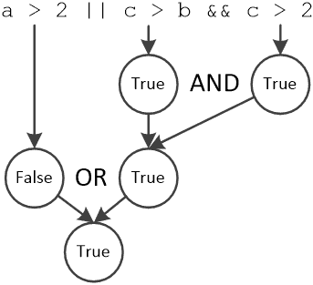

`AND` (`&&`) 操作的优先级更高，在 `OR` (`||`) 运算符之前执行。

对于 `a = 10, b = 10, c = 3`，最终结果如所示为 `true`。

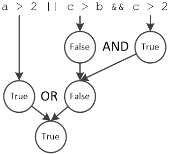

对于 `a = −4, b = −2, c = −9`，最终结果如所示为 `false`。

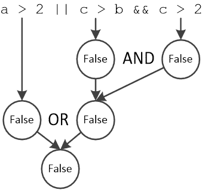

表格第五列的值可以很容易地计算，因为其列标题中的布尔表达式与第四列的表达式几乎相同。唯一的区别是表达式前面的 `NOT` (`!`) 运算符。所以，第五列的值可以通过简单反转第四列的结果来计算！

#### 练习 15.6-2 将英语句子转换为布尔表达式

一位校长要求学生们根据年龄举手。他想找到那些

i) 在 9 到 12 岁之间。

ii) 8 岁以下且 11 岁以上。

iii) 8、10 和 12 岁。

iv) 6 到 8 岁之间，以及 10 到 12 岁之间。

v) 既不是 10 岁也不是 12 岁。

##### 解 Solution

为了组合所需的布尔表达式，使用了变量 `age`。

i) 句子“在 9 到 12 岁之间”可以像这里这样图形化表示。

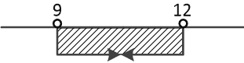

但要小心！在数学中写 `9 ≤ age ≤ 12` 是合法的，但在 Java 中这种写法是不可能的：

```
9 <= age <= 12
```

你可以做的是将表达式分为两个部分，如下所示：

```
age >= 9 && age <= 12
```

为了确认，你可以对“感兴趣区域”（你指定的数据范围）内部和外部的几个值测试此布尔表达式。例如，对于年龄值 `7`、`8`、`13` 和 `17`，表达式的结果为 `false`。相反，对于年龄值 `9`、`10`、`11` 和 `12`，结果为 `true`。

ii) 句子“8 岁以下且 11 岁以上”可以像这里这样图形化表示。

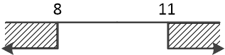

注意缺少了你在解 (i) 中看到的两个圆。这意味着值 `8` 和 `11` 不包含在两个感兴趣的区域内。

小心“8 岁以下且 11 岁以上”这个句子。这是一个陷阱！不要犯写这样的错误：

```
age < 8 && age > 11
```

地球上不存在任何人可以同时既小于 8 岁又大于 11 岁！

陷阱在于“和”（and）这个词上。尝试重新表述句子，使其变为“孩子们！如果你们小于 8 岁或大于 11 岁，请举起手。”现在这样好多了，正确的布尔表达式变为：

```
age < 8 || age > 11
```

为了确认，你可以对感兴趣区域内部和外部的几个值测试此表达式。例如，对于年龄值 `8`、`9`、`10` 和 `11`，表达式的结果为 `false`。相反，对于年龄值 `6`、`7`、`12` 和 `15`，结果为 `true`。

iii) 哎！句子“8、10 和 12 岁”中另一个陷阱，再次使用了“和”（and）字！显然，下一个布尔表达式是错误的。

```
age == 8 && age == 10 && age == 12
```


和之前一样，没有任何学生可以同时是 8 岁、10 岁且 12 岁！再次，正确的布尔表达式必须使用 OR (`||`) 运算符。

```
age == 8 || age == 10 || age == 12
```

为了确认，你可以对几个值测试此表达式。例如，对于年龄值 `7`、`9`、`11` 和 `13`，表达式的结果为 false。对于年龄值 `8`、`10` 和 `12`，结果为 true。

### iv) 句子“在 6 到 8 岁之间，以及 10 到 12 岁之间”可以像这里这样图形化表示。

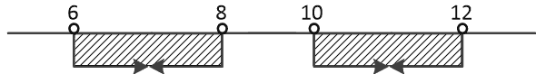

对应的布尔表达式为：

```
age >= 6 && age <= 8 || age >= 10 && age <= 12
```

为了确认，对于年龄值 `5`、`9`、`13` 和 `16`，表达式的结果为 false。对于年龄值 `6`、`7`、`8`、`10`、`11` 和 `12`，结果为 true。

### v) 句子“既不是 10 岁也不是 12 岁”的布尔表达式可以写成：

```
age != 10 && age != 12
```

或者

```
!(age == 10 || age == 12)
```

当感兴趣区域的箭头相互指向时，使用逻辑运算符 AND (`&&`)。否则，当箭头指向相反方向时，使用 OR (`||`)。


## 15.7 算术、比较运算符和逻辑运算符的优先级是什么？

在许多情况下，一个表达式可能包含不同类型的运算符，如下所示：

```
a * b + 2 > 21 || !(c == b / 2) && c > 13
```

在这种情况下，先执行算术运算，接着执行比较运算，最后执行逻辑运算，如下表所示。

| 高优先级  | 低优先级 |
| :--- | :--- |
| 算术运算符 | `*`, `/`, `%` |
| | `+`, `−` |
| 比较运算符 | `<`, `>`, `==`, `!=` |
| 逻辑运算符 | `!` |
| | `&&` |
| | `||` |

表 15-4 算术、比较和逻辑运算符的优先级。

### 15.8 如何反转布尔表达式

反转是改变布尔表达式含义的过程。有两种方法可以反转一个表达式。

#### 第一方法

第一方法是最简单的。在表达式前面加上 NOT (`!`) 运算符。例如，如果原始表达式是：

```
x > 5 && y == 3
```

反转后的表达式变为：

```
!(x > 5 && y == 3)
```

注意整个表达式必须用括号起来。

#### 第二方法

第二方法稍微复杂一点，但不困难。只需根据下表反转每个运算符：

| 原始运算符 | 反转运算符 |
| :--- | :--- |
| `==` | `!=` |
| `!=` | `==` |
| `>` | `<=` |
| `<` | `>=` |
| `&&` | `||` |
| `||` | `&&` |

例如，如果原始表达式是：

```
x > 5 && y == 3
```

反转后的表达式变为：

```
x <= 5 || y != 3
```

如果你忘记将 `x < 5 || x > 10` 表达式用括号起来，由于 `&&` 运算符的优先级高于 `||` 运算符，将先执行 `x > 10 && y != 3`，这显然是错误的！

### 练习 15.8-1 反转表达式

使用两种方法反转以下布尔表达式：

i) `b != 4`
ii) `a * 3 + 2 > 0`
iii) `!(a == 5 && b >= 7)`
iv) `a == true`
v) `b > 7 && !(x > 4)`
vi) `a == 4 || b != 2`

##### 解 Solution

第一方法

i) `!(b != 4)`
ii) `!(a * 3 + 2 > 0)`
iii) `!(!(a == 5 && b >= 7))`，或者等价的 `a == 5 && b >= 7`

两个反反的结果为肯定。也就是说，连续两个 NOT (`!`) 运算符会相互抵消。

iv) `!(a == true)`
v) `!(b > 7 && !(x > 4))`
vi) `!(a == 4 || b != 2)`

第二方法

i) `b == 4`
ii) `a * 3 + 2 <= 0`

注意算术运算符并不是被“反转”。永远不要把加号（`+`）替换为减号（`−`）！

iii) `!(a != 5 || b < 7)`

iv) `a != true`
v) `b <= 7 || !(x <= 4)`
vi) `a != 4 && b == 2`

## 15.9 复习题：对或错

对以下每个陈述判断对或错。

1) 布尔表达式是一个始终产生两个值之一结果的表达式。
2) 布尔表达式至少包含一个逻辑运算符。
3) 在 Java 中，表达式 `x = 5` 测试变量 `x` 是否等于 `5`。
4) 下述语句不是有效的 Java 语句：`a = b == c;`
5) 布尔表达式 `b < 5` 测试变量 `b` 是否小于或等于 `5`。
6) AND ( `&&` ) 运算符也称为逻辑析取运算符。
7) OR ( `||` ) 运算符也称为逻辑并集运算符。
8) 如果两个布尔表达式都为真，那么这两个布尔表达式的逻辑交集的结果等于它们逻辑析取的结果。
9) 如果两个布尔表达式的值不同，那么这两个布尔表达式的逻辑析取的结果一定为真。
10) 表达式 `c == 3 && d > 7` 被视为复杂的布尔表达式。
11) 当两个操作数（布尔表达式）都真时，逻辑运算符 OR ( `||` ) 的结果为真。
12) 当变量 `x` 包含 5 以外的任何值时，布尔表达式 `!(x == 5)` 的结果为真。
13) NOT ( `!` ) 运算符在逻辑运算符中优先级最高。
14) OR ( `||` ) 运算符在逻辑运算符中优先级最低。
15) 在布尔表达式 `(x > y || x == 5) && x <= z` 中，AND ( `&&` ) 操作在 OR ( `||` ) 操作之前执行。
16) 在布尔表达式 `a * b + c > 21 || c == b / 2` 中，程序首先测试 `c` 是否大于 `21`。
17) 当老师想要找到小于 8 岁且大于 11 岁的学生时，对应的布尔表达式是 `age < 8 && age > 11`。
18) 对于任何 `x` 的值，布尔表达式 `x < 0 && x > 100` 始终为假。
19) 对于任何 `x` 的值，布尔表达式 `x > 0 || x < 100` 始终为真。
20) 布尔表达式 `x > 5` 等价于 `!(x < 5)`。
21) 布尔表达式 `!(x > 5 && y == 5)` 等价于 `!(x > 5) && y == 5`。
22) 在威廉·莎士比亚的《哈姆雷特》（第 3 第 1 场）中，主角说：“生存还是毁灭，这是一个问题：……” 如果你将其写成布尔表达式 `toBe || !toBe`，那么这个“Shakesboolean”表达式的结果在以下代码段中为真：

```
toBe = 1 > 0;

thatIsTheQuestion = toBe || !toBe;
```

### 15.10 复习题：单选题

为以下每个陈述选择正确的答案。

1) 下列中哪一个不是比较运算符？
a) `a >= b`
b) `b <= c`
c) `c < d`
d) 以上都是比较运算符。

2) 下列中哪一个不是 Java 逻辑运算符？
a) `&&`
b) `||`
c) `!`
d) 以上都是逻辑运算符。
e) 以上没有是逻辑运算符。

3) 如果变量 `x` 包含值 5，语句 `y = x % 2 == 1` 给变量 `y` 赋值什么值？
a) true
b) false
c) 1
d) 以上都不是

4) 如果变量 `x` 包含值 5，语句 `y = x % 2 == 0 || (int)(x / 2.0) == 2` 给变量 `y` 赋值什么值？
a) true
b) false
c) 以上都不是

5) 实验室房间的温度必须在 50 到 80 华氏度之间。哪一个布尔表达式测试了这一条件？
a) `t >= 50 || t <= 80`
b) `50 >= t && t >= 80`
c) `t >= 50 && t <= 80`
d) `t > 50 || t < 80`
e) 以上都不是

6) 下列中哪一个等价于布尔表达式 `t == 3 || t > 30`？
a) `t == 3 && !(t <= 30)`
b) `t == 3 && !(t < 30)`
c) `!(t != 3) || !(t < 30)`
d) `!(t != 3 && t <= 30)`
e) 以上都不是

### 15.11 复习练习

完成以下练习。

1) 将第一列的每个元素与第二列的一个或多个元素进行匹配。

| 描述 | 运算符 |
| --- | --- |
| i) 逻辑运算符 | a) `%` |
| ii) 算术运算符 | b) `+=` |
| iii) 比较运算符 | c) `&&` |
| iv) 赋值运算符（一般） | d) `==` |
| | e) `||` |
| | f) `>=` |
| | g) `!` |
| | h) `=` |
| | i) `*` |
| | j) `/` |

2) 根据变量 `a`、`b` 和 `c` 的值，在下表中填写 "true" 或 "false"。

| a | b | c | a != 1 | b / 2 > 2 |
| --- | --- | --- | --- | --- |
| 3 | -5 | 8 | | |
| 1 | 10 | 20 | | |
| -4 | -2 | -9 | | |

3) 根据布尔表达式 `BE1` 和 `BE2` 的值，在下表中填写 "true" 或 "false"。

| BE1 (布尔表达式 1) | BE2 (布尔表达式 2) | BE1 && BE2 | !(BE2) |
| --- | --- | --- | --- |
| false | false | | |
| false | true | | |
| true | false | | |
| true | true | | |

4) 根据变量 `a`、`b` 和 `c` 的值，在下表中填写 "true" 或 "false"。

| a | b | c | a > 3 && b && c > 1 |
| --- | --- | --- | --- |
| 4 | -6 | 2 | | |
| -3 | 2 | -4 | | |
| 2 | 5 | 5 | | |

5) 对于 `x = 4`，`y = -2` 和 `flag = true`，在下表中填写对应的值。

| 表达式 | 值 |
| --- | --- |
| `Math.pow(x + y, 3)` | |
| `(x + y) / (Math.pow(x, 2))` | |
| `x - y == 5` | |
| `x > 2 && y == 1` | |
| `x == -2 && !(flag == false)` | |
| `!(x >= 3) && (x % 2 > 1)` | |

6) 当变量 `a`、`b` 和 `c` 分别包含 `6`、`-3` 和 `7` 时，计算每个布尔表达式的结果。

i) `(3 * a + b / 5 - c / a > 4) && (b != -3)`
ii) `(a * b - c / 2 + 2 * c / 3 != 8) || (a >= 5)`

7) 一位老师要求学生根据年龄举手。他想找到以下学生：
i) 小于 12 岁但不是 8 岁的。
ii) 6 到 9 岁之间以及 11 岁的。
iii) 大于 7 岁但不是 10 岁或 12 岁的。
iv) 6、9 和 11 岁的。
v) 6 到 12 岁之间但不是 8 岁的。
vi) 既不是 7 岁也不是 10 岁的。

使用名为 `age` 的变量来组合所需的布尔表达式。

8) 在在表达式前面添加 NOT ( `!` ) 运算符来否定以下布尔表达式。

i) `x == 4 && y != 3`
ii) `x + 4 <= 0`
iii) `!(x > 5) || y == 4`
iv) `x != false`
v) `!(x >= 4 || z > 4)`
vi) `x != 2 && x >= -5`

9) 如你所知，两次否定会得到肯定。通过否定两次（应用两种方法）写出以下布尔表达式等等表达式。

i) `x >= 4 && y != 10`
ii) `x - 2 >= 9`
iii) `!(x >= 2) || y != 4`
iv) `x != false || y == 3`
v) `!(x >= 2 && y >= 2)`
vi) `x != -2 && x <= 2`

## 第 16 章：单分支结构

### 16.1 单分支结构

这是简单的决策控制结构。它仅在“真”路径上包含一个语句或语句块，如下通用形式的流程图所示。


如果 `Boolean_Expression` 求值为真，则执行该结构的语句或语句块；否则，跳过这些语句。

Java 语句的通用形式为：

```java
if (Boolean_Expression) {语句或语句块}
```

注意语句或语句块额外缩进了 2 个空格。

在下一个例子中，只有当用户输入小于 18 的值时，才会显示消息“你未成年”。当用户输入大于或等于 18 的值时，什么都不显示。

```java
public static void main(String[] args) throws Exception {

    int age;

    System.out.print("Enter your age: ");

    age = Integer.parseInt(cin.nextLine());

    if (age < 18) {

        System.out.println("You are underage!");

    }

}
```

注意 `System.out.println()` 语句缩进了 2 + 2 = 4 个空格。

在下一个示例中，只有“你未成年！”和“你还需要再等几年”这两条消息只有在用户输入的值小于 18 时才会显示。与之前相同，当用户输入的值大于或等于 18 时，则不会显示任何消息。

 Project_16.1b

```java
public static void main(String[] args) throws Exception {

    int age;

    System.out.print("Enter your age: ");

    age = Integer.parseInt(cin.nextLine());

    if (age < 18) {

        System.out.println("You are underage!");

        System.out.println("You have to wait for a few more years.");

    }

}
```

出现在 `if` 语句内部的所有语句都应该向右缩进相同数量的空间。在上例中，两个 `System.out.println()` 语句都缩进了 2 个空格。

为了节省纸张，本书每缩进层使用 2 个空格。然而，Java 官方网站建议每缩进层使用 4 个空格。

为了移动文本光标，而不是输入空格键，你可以按一次“Tab ” 键！

要缩进现有的语句或语句语句，请选择它们并按下“Tab ” 键！

要取消缩进一个语句或一组语句，请选择它们并按下“Shift ↑ + Tab ”组合键！

在下一个示例中，只有当用户输入名字“Zeus”时，才会显示“你是众神之王！”这条消息。然而，无论用户输入什么名字，“你住在奥林匹斯山”这条消息都会被显示。

 Project_16.1c

```java
public static void main(String[] args) throws Exception {

    String name;

    System.out.print("Enter the name of an Olympian: ");

    name = cin.nextLine();

    if (name.equals("Zeus") == true) {

        System.out.println("You are the King of the Gods!");

    }

    System.out.println("You live on Mount Olympus.");

}
```


注意，最后一个 `System.out.println()` 语句不属于单分支决策结构的语句块。

初级程序员在编写 Java 程序时犯的一个非常常见的错误是混淆了赋值运算符与“等于”运算符。他们经常犯错写成 `if (name.equals("Zeus") = true)`，而他们实际上是想说 `if (name.equals("Zeus") == true)`。

当 `if` 语句中只包含一个单一语句时，你可以省略大括号 `{ }`。因此，`if` 语句可以写成：

`if (Boolean_Expression) One_Single_Statement;`

或者你甚至可以将整个决策结构写在一行中，如下：

`if (Boolean_Expression) One_Single_Statement;`

只有当 `if` 语句中包含多个一个语句时，才需要大括号。如果没有大括号，Java 假设紧接其后的语句才是决策控制结构的一部分。

然而，为了防止潜在的逻辑错误，许多程序员倾向于始终使用大括号，即使 `if` 语句仅包含一个单一语句。在以下两个示例中，`System.out.print(x)` 语句都不是 `if` 语句的一部分。

```java
if (x == y)x++;

System.out.print(x);

if (x == y) {x++;}

System.out.print(x);
```

#### Exercise 16.1-1 追踪表与单分支决策结构

设计相应的流程图并创建一个追踪表，以确定下一个 Java 程序在两种不同执行情况下每一步中变量的值。

两次执行的输入值为：(i) 10，和 (ii) 51。

 Project_16.1-1

```java
public static void main(String[] args) throws Exception {

    int a, y;

    a = Integer.parseInt(cin.nextLine());

    y = 5;

    if (a * 2 > 100) {

        a = a * 3;

        y = a * 4;

    }

    System.out.println(a + "  " + y);

}
```

##### Solution

流程图在此处。


每个输入的追踪表在此处。

i) 对于输入值 10，追踪表如下。

| Step | Statement | Notes | a | y |
| --- | --- | --- | --- | --- |
| 1 | `a = Integer.parseI…` | 用户输入值 10 | 10 | ? |
| 2 | `y = 5` | | 10 | 5 |
| 3 | `if (a * 2 > 100)` | 此项求值为为 false | | |
| 4 | `.println(a + " " + y)` | 显示为: 10 5 | | |

ii) 对于输入值 51，追踪表如下。

| Step | Statement | Notes | a | y |
| --- | --- | --- | --- | --- |
| 1 | `a = Integer.parseI…` | 用户输入值 51 | 51 | ? |
| 2 | `y = 5` | | 51 | 5 |
| 3 | `if (a * 2 > 100)` | 此项求值为 true | | |
| 4 | `a = a * 3` | | 153 | | |
| 5 | `y = a * 4` | | 153 | 612 |
| 6 | `.println(a + " " + y)` | 显示为: 153 612 | | |

#### Exercise 16.1-2 数字的绝对值

设计相应的流程图并编写一个 Java 程序，让用户输入一个数字并显示其绝对值。

##### Solution

实际上，有两种方法。第一种方法使用单分支结构，而第二种方法使用内置的 `abs()` 方法。

##### 第一种方法——使用单分支结构

如果输入负值，例如 -5，该值将变为 5。正数或零则保持不变。流程图所示。

 对应的 Java 程序如下。

 Project_16.2a

```java
public static void main(String[] args) throws Exception {

    double x;

    x = Double.parseDouble(cin.nextLine());

    if (x < 0) {

        x = -x;

    }

    System.out.println(x);

}
```

##### 第二种方法——使用 `Math.abs()`

在这种情况下，你只需要几行代码。

 Project_16.2b

```java
public static void main(String[] args) throws Exception {

    double x;

    x = Double.parseDouble(cin.nextLine());

    System.out.println(Math.abs(x));

}
```

### 16.2 Review Questions：判断题

对以下每个陈述判断对或错。

1) 单分支决策结构用于执行一组语句。
2) 你使用单分支结构是为了让其他程序员更容易理解你的程序。
3) 单分支结构结构中的的语句可能都不会执行。
4) 在流程图中，决策符号代表算法的开始和结束。
5) 以下代码是语法正确的：`static final int if = 5; public static void main(String[] args) throws Exception {int x;x = if + 5;System.out.println(x);}`
6) 单分支决策结构使用了保留关键字 `else`。
7) 以下代码片段具有确定性：`if (b != 3) {x = a / (b - 3);}`
8) 以下 Java 程序具有确定性：`public static void main(String[] args) throws Exception {double a, b, x;a = Double.parseDouble(cin.nextLine());b = Double.parseDouble(cin.nextLine()); if (b != 3) { x = a / (b - 3); }System.out.println(x);}`

### 16.3 Review Questions：多选题

为以下每个陈述选择正确答案。

1) 单分支决策结构用于
a) 语句顺序执行。
b) 在执行某些语句之前做出决策。
c) 以上都不是
d) 以上都是

2) 单分支决策结构包括语句或语句块
a) 仅假路径。
b) 路径。
c) 仅真路径。

3) 在以下代码片段 `if (x == 3)x = 5;y++;` 中，`y++` 语句执行
a) 仅当变量 `x` 包含 3 时。
b) 仅当变量 `x` 包含 5 时。
c) 仅当变量 `x` 包含不为 3 的值时。
d) 总是。

4) 在以下代码片段 `if (x % 2 == 0) y++;` 中，`y++` 执行执行
a) `x` 为奇数时。
b) `x` 为偶数时。
c) `x` 为零时。
d) `x` 为负数时。

a) 变量 `x` 能被 2 整除。
b) 变量 `x` 包含一个偶数。
c) 变量 `x` 不包含任何奇数。
d) 以上皆是。
e) 以上都不是。

5) 在以下代码段中，`x = 3 * y;if (x > y) y++;`

语句 `y++` 是：

a) 总是被执行。
b) 永远不执行。
c) 仅当变量 `y` 包含正值时被执行。
d) 以上都不是。

### 16.4 复习题

完成以下练习题。

1) 识别以下 Java 程序中的语法错误：

```java
public static void main(String[] args) throws Exception {

double x, y

x = Double.parseDouble(cin.nextLine();

y ← -5;

if (x * y / 2 > 20)

> y =* 2

> x += 4 * x²;

}

System.out.println(x y);}
```

2) 创建一个追踪表（trace table），以确定以下 Java 程序在两次不同执行中每一步变量的值。然后，设计对应的流程图。

两次执行的输入值为：(i) 10，和 (ii) −10。

```java
public static void main(String[] args) throws Exception {

double x, y;

x = Double.parseDouble(cin.nextLine());

y = -5;

if (x * y / 2 > 20) {

> y--;

> x -= 4;

}

if (x > 0) {

> y += 30;

> x = Math.pow(x, 2);

}

System.out.println(x + ", " + y);}
```

3) 创建一个追踪表，以确定以下 Java 程序在两次不同执行中每一步变量的值。然后，设计对应的流程图。

两次执行的输入值为：(i) −11，和 (ii) 11。

```java
public static void main(String[] args) throws Exception {

int x, y;

x = Integer.parseInt(cin.nextLine());

y = 8;

if (Math.abs(x) > 10) {

> y += x;

> x--;

}

if (Math.abs(x) > 10) {

> y *= 3;

}

System.out.println(x + ", " + y);}
```

4) 创建一个追踪表，以确定以下 Java 程序在两次不同执行中每一步变量的值。然后，设计对应的流程图。

两次执行的输入值为：(i) 1, 2, 3；和 (ii) 4, 2, 1。

```java
public static void main(String[] args) throws Exception {

int x, y, z;

x = Integer.parseInt(cin.nextLine());

y = Integer.parseInt(cin.nextLine());

z = Integer.parseInt(cin.nextLine());

if (x + y > z)

> x = y + z;

if (x > y + z)

> y = x + z;

if (x > y - z)

> z = x - z % 2;

System.out.println(x + ", " + y + ", " + z);}
```

5) 编写一个 Java 程序，提示用户输入一个数字，当用户提供的数字为正数时，显示消息“Positive”。

6) 编写一个 Java 程序，提示用户输入两个数字，当两个提供的数字均为正数时，显示消息“Both Positives”。

7) 编写一个 Java 程序，提示用户输入年龄，当用户提供的年龄大于 14 时，显示消息“You can drive a car in Kansas (USA)（你可以在堪萨斯州开车）”。

8) 编写一个 Java 程序，提示用户输入一个字符串，当提供的字符串仅包含大写字母时，显示消息“Uppercase”。

提示：使用 `equals()` 和 `toUpperCase()` 方法。

9) 编写一个 Java 程序，提示用户输入一个字符串，当用户提供的字符串超过 20 个字符时，显示消息“Many characters”。

提示：使用 `length()` 方法。

10) 编写一个 Java 程序，提示用户输入四个数字，如果其中至少有一个负数，则显示消息“Among the provided numbers, there is a negative one!（提供的数字中有一个负数！）”。

11) 编写一个 Java 程序，提示用户输入两个数字。如果第一个提供的数字大于第二个，程序必须交换它们的值。最后，程序必须以升序顺序显示这些数字。

12) 编写一个 Java 程序，提示用户输入在纽约三个不同点测量的三个温度值，如果平均值大于 60 华氏度，则显示消息“Heat Wave（热浪来）”。

## 第 17 章

双分支选择结构（Dual-Alternative Decision Structure）

### 17.1 双分支选择结构

与单分支选择结构相比，这种选择控制结构在两条路径上都包含一个语句或语句块。


如果 `Boolean_Expression`（布尔表达式）求值为真，则执行语句或语句块 1；否则，执行语句或语句块 2。

Java 语句的通用形式为：

```java
if (Boolean_Expression) {语句或语句块 1}

else {语句或语句块 2}
```

在下一个示例中，当用户输入的值大于或等于 18 时，显示消息“You are an adult（你成年了）”。否则，显示消息“You are underage!（你未成年！）”。

 Project_17.1

```java
public static void main(String[] args) throws Exception {

int age;

System.out.print("Enter your age: ");

age = Integer.parseInt(cin.nextLine());

if (age >= 18) {

    System.out.println("You are an adult!");

}else {

    System.out.println("You are underage!");

}
```

与单分支结构类似，`if-else` 语句可以不带大括号编写，如下所示：

```java
if (Boolean_Expression)

    单语句 _1

else

    单语句 _2
```

#### 练习题 17.1-1 寻找输出

对于以下流程图，确定三次执行的输出。

三次执行的输入值为：(i) 3，(ii) −3，和 (iii) 0。


解答：

i) 当用户输入 3 时，布尔表达式为真。执行右侧路径并显示消息“Positive”。
ii) 当用户输入 −3 时，布尔表达式为假。执行左侧路径并显示消息“Negative”。
iii) 你能预测用户输入 0 会发生什么吗？如果你认为什么都不会显示，你就错了！双分支结构必须遵循其中一条路径。0 是有效输入并应该被考虑。决策符号不能有第三种出口！

#### 练习题 17.1-2 追踪表与双分支选择结构

创建一个追踪表，确定以下 Java 程序在两次不同执行中每一步变量的值。

两次执行的输入值为：(i) 5，和 (ii) 10。

 Project_17.1-2

```java
public static void main(String[] args) throws Exception {

double a, z, w, y;

a = Double.parseDouble(cin.nextLine());

z = a * 10;

w = (z - 4) * (a - 3) / 7 + 36;

if (z >= w && a < z) {

    y = 2 * a;

}else {

    y = 4 * a;

}

System.out.println(y);

}
```


## 解答

### i) 对于输入值 5，追踪表如下：

| 步骤 | 语句 | 注释 | a | z | w | y |
| --- | --- | --- | --- | --- | --- | --- |
| 1 | `a = Double.parseDouble(…)` | 用户输入值 5 | 5.0 | ? | ? | ? |
| 2 | `z = a * 10` | | 5.0 | 50.0 | ? | ? |
| 3 | `w = (z - 4) * (a - 3) / 7 + 36` | | 5.0 | 50.0 | 49.142 | ? |
| 4 | `if (z >= w && a < z)` | 结果为真 | 5.0 | 50.0 | 49.142 | ? |
| 5 | `y = 2 * a` | | 5.0 | 50.0 | 49.142 | 10.0 |
| 6 | `.println(y)` | 显示: 10.0 | | | | |

### ii) 对于输入值 10，跟踪表所示。

| 步骤 | 语句 | 注释 | a | z | w | y |
| --- | --- | --- | --- | --- | --- | --- |
| 1 | `a = Double.parseDouble(…)` | 用户输入值 10 | 10.0 | ? | ? | ? |
| 2 | `z = a * 10` | | 10.0 | 100.0 | ? | ? |
| 3 | `w = (z ‑ 4) * (a ‑ 3) / 7 + 36` | | 10.0 | 100.0 | 132.0 | ? |
| 4 | `if (z >= w && a < z)` | 结果结果为 false | | | | |
| 5 | `y = 4 * a` | | 10.0 | 100.0 | 132.0 | 40.0 |
| 6 | `.println(y)` | 显示: 40.0 | | | | |

## 练习题 17.1-3 谁最大？

设计一个流程图并编写相应的 Java 程序，让用户输入两个数字 `A` 和 `B`，然后确定并显示这两个数中较大的。

### 答案

此练习可以使用双分支决策结构或单分支决策结构来解决。所以，让我们两个都用用！

#### 第一种方法 – 使用双分支决策结构

这种方法测试数字 `B` 的值是否大于数字 `A`。如果是，则数字 `B` 是最大的；否则数字 `A` 是最大的。使用这种方法解决此练习的相应流程图所示。


Java 程序如下。

 `Project_17.1-3`

```java
public static void main(String[] args) throws Exception {
    double a, b, maximum;
    a = Double.parseDouble(cin.nextLine());
    b = Double.parseDouble(cin.nextLine());
    if (b > a) {
        maximum = b;
    } else {
        maximum = a;
    }
    System.out.println("Greatest value: " + maximum);
}
```

 注意，此练习正尝试确定最大值，而不是该值实际上赋值给了哪个变量（变量 `A` 还是变量 `B`）。

#### 第二种方法 – 使用单分支决策结构

如后续流程图所示，这种方法最初假设数字 `A` 可能是最大值（这就是为什么它将变量 `a` 的值赋予变量 `maximum`）。然而，如果证明数字 `B` 大于数字 `A`，则更新最大值；变量 `maximum` 被赋予一个新值——变量 `b` 的值。因此，无论数字 `A` 和 `B` 的值是多少，最后变量 `maximum` 将始终包含最大值！


Java 程序所示。

 `Project_17.1-3b`

```java
public static void main(String[] args) throws Exception {
    double a, b, maximum;
    a = Double.parseDouble(cin.nextLine());
    b = Double.parseDouble(cin.nextLine());
    maximum = a;
    if (b > a) {
        maximum = b;
    }
    System.out.println("Greatest value: " + maximum);
}
```

## 练习题 17.1-4 寻找奇数和偶数

设计一个流程图并编写相应的 Java 程序，提示用户输入一个正整数，然后显示一条消息指示该数是否为偶数；否则必须显示“Odd”（奇数）。

### 答案

接下来你可以找到各种奇数和偶数：

►奇数：1, 3, 5, 7, 9, 11, …
►偶数：0, 2, 4, 6, 8, 10, 12, ….

 注意零被视为偶数。

在此练习中，你需要找到方法来判断一个数是奇数还是偶数。你需要找到所有偶数之间、或者所有奇数之间的一个共同属性。实际上，确实有一个！所有的偶数都能被 `2` 整除。因此，当操作 `x MOD 2` 的结果等于 `0` 时，`x` 是偶数；否则，`x` 是奇数。

流程图所示。


Java 程序所示。

 `Project_17.1-4`

```java
public static void main(String[] args) throws Exception {
    int x;
    System.out.print("Enter a positive integer: ");
    x = Integer.parseInt(cin.nextLine());
    if (x % 2 == 0) {
        System.out.println("Even");
    } else {
        System.out.println("Odd");
    }
}
```

## 练习题 17.1-5 周薪

总工资取决于费率和每周工作总小时。然而，如果有人工作超过 40 小时，他们将获得 1.5 倍的工资。设计一个流程图并编写相应的 Java 程序，让用户输入费率和工作时长，然后计算并显示总工资。

### 答案

总工资取决于费率和每周工作总小时。然而，如果某人工作超过 40 小时，他们将获得 1.5 倍的工资。设计一个流程图并编写相应的 Java 程序，让用户输入费率和工作时长，然后计算并显示总工资。

此练习可以使用双分支决策结构来解决。当工作时长超过 40 小时，总工资计算为：`40 + 1.5 × (工作时长)`

流程图所示。


Java 程序所示。

 `Project_17.5`

```java
public static void main(String[] args) throws Exception {
    int hoursWorked;
    double payRate, grossPay;
    payRate = Double.parseDouble(cin.nextLine());
    hoursWorked = Integer.parseInt(cin.nextLine());
    if (hoursWorked <= 40) {
        grossPay = payRate * hoursWorked;
    } else {
        grossPay = payRate * 40 + 1.5 * payRate * (hoursWorked - 40);
    }
}
```

## 17.2 复习题题

对以下陈述判断对错。

1) 双分支决策结构必须包含语句。
2) 双分支结构至少包含两个语句。
3) 双分支决策结构使用了 `else` 关键字。
4) 以下语句语法正确：`int else = 5;`
5) 在双分支结构中，布尔表达式可以返回多个值。
6) 以下代码片段符合：

```java
int x, y, z;
x = Integer.parseInt(cin.nextLine());
y = Integer.parseInt(cin.nextLine());
z = Integer.parseInt(cin.nextLine());
if (x > y && x > z) {
    System.out.println(x + " is the greatest");
} else {
    System.out.println(y + " is the greatest");
}
```

## 17.3 复习题

为以下陈述选择正确答案。

1) 双分支结构包含语句或语句块 a) 仅假路径 b) 是一条路径 c) 仅真路径。

```java
if (x % 2 == 0) {
    x = 0;
} else {
    y++;
}
```

语句 `y++` 在以下情况下执行
a) 变量 `x` 能被 2 整除
b) 变量 `x` 是偶数
c) 变量 `x` 是奇数
d) 以上均是

```java
if (x == 3)
    x = 5;
else
    x = 7;
y++;
```

语句 `y++` 执行
a) 当变量 `x` 值为 3 时 b) 以上

## 17.4 复习练习

完成以下练习。

1) 创建跟踪表以确定后续程序在每个步骤中的变量值。然后设计相应的流程图。

两次执行的输入值为：(i) 3 和 (ii) 0.5。

```java
public static void main(String[] args) throws Exception {
    double a, z, y;
    a = Double.parseDouble(cin.nextLine());
    z = a * 3 - 2;
    if (z >= 1) {
        y = 6 * a;
    } else {
        z++;
        y = 6 * a + z;
    }
    System.out.println(z + ", " + y);
}
```

2) 创建跟踪表以确定后续程序在每个步骤中的变量值。然后设计相应的流程图。

```java
public static void main(String[] args) throws Exception {
    double x, y, z;
    x = 3;
    y = Math.pow(x, 3) + 9;
    z = 2 * x + y - 4;
    if (x > y) {
        y = z % x;
        z = Math.sqrt(x);
    } else {
        x = z % y;
        z = Math.sqrt(y);
    }
    System.out.println(x + ", " + y + ", " + z);
}
```

3) 编写对应于流程图的 Java 程序，然后创建跟踪表以确定两次执行中每个步骤的变量值。

两次执行的输入值为：(i) 10 和 (ii) 2。


4) 使用双分支决策结构，编写一个 `Java` 程序，提示用户输入一个数字，然后显示一条消息指示用户提供的数字是否大于 100。如果不是，必须显示“Provided number is less than or equal to 100”。

5) 使用双分支决策结构，编写一个 `Java` 程序，提示用户输入一个数字，然后显示一条消息指示用户提供的数字是否在 0 到 100 之间。如果不是，必须显示“Provided number is not between 0 and 100”。

6) 两支球队在欧洲足球冠军联赛中对决。使用双分支决策结构，编写一个 `Java` 程序，提示用户输入两支球队的名称以及各自进球数，然后显示获胜者的名称。假设用户输入的值有效且没有平局。

7) 使用双分支决策结构，编写一个 `Java` 程序，让用户输入一个整数，然后显示一条消息指示用户提供的数字是否是 6 的倍数；如果不是，显示“NN is not a multiple of 6”（其中 `NN` 是用户提供的数字）。假设用户输入非负值。

8) 使用双分支决策结构，编写一个 `Java` 程序，让用户输入一个整数，然后显示两条可能的消息之一。一条消息指示用户提供的数字是 6 的倍数还是 7 的倍数；另一条消息指示用户提供的数字既不是 6 的倍数也不是 7 的倍数。假设用户输入非负值。

9) 使用双分支决策结构，编写一个 `Java` 程序，让用户输入一个整数。程序必须显示一条消息指示用户提供的数字是否是 4 的倍数；如果不是，显示“NN is not a multiple of 4”（其中 `NN` 是用户提供的数字）。此外，程序必须以“NN = QQ x 4 + RR”的形式展示用户提供的整数结构，其中 `QQ` 是整数商，`RR` 是 `NN` 除以 4 的整数余数。例如，如果用户提供的整数是 14，则必须显示消息“14 = 3 x 4 + 2”。假设用户输入非负值。

10) 使用双分支决策结构，设计流程图并编写相应的 `Java` 程序，让用户输入两个值，然后确定并显示这两个值中较小的一个。假设用户输入两个不同的值。

11) 使用双分支决策结构，编写一个 `Java` 程序，让用户输入三个数字，然后显示一条消息指示用户提供的数字是否可以构成三角形的三条边长；如果不是，显示“Provided numbers cannot be lengths of the three sides of a triangle”。假设用户输入的值有效。

**提示**：在任何三角形中，每条边的长度都小于另外两边长度之和。

12) 使用双分支决策结构，编写一个 `Java` 程序，让用户输入三个数字，然后显示一条消息指示用户提供的数字是否可以构成直角三角形（right-angled triangle）的三边长；如果不是，显示“Provided numbers cannot be lengths of the three sides of a right triangle”。假设用户输入的值有效。

**提示 1**：使用勾股定理。
**提示 2**：你可以使用长度为 3、4 和 5 的数字（可以构成直角三角形的三边）来测试你的程序。

13) 2004 年雅典奥运会的远跳运动员参加了三次不同的资格赛跳。运动员为了入围，平均跳远距离必须至少达到 8 米。使用双分支决策结构，编写一个 `Java` 程序，提示用户输入三次的成绩，当平均值大于或等于 8 米时，显示“Qualified”；否则显示“Disqualified”。假设用户输入的值有效。

14) 总工资取决于薪率和每周总工作小时数。然而，如果工作工作超过 40 小时，超过 40 小时的所有小时将获得双倍工资。使用双分支决策结构，设计流程图并编写相应的 `Java` 程序，让用户输入薪率和时长，然后计算并显示净薪。净薪是扣除任何费用后实际支付给员工的金额。扣除费用包括税、医疗保险、退休计划等。假设总扣除率为 30%。同时，假设用户输入的值有效。

15) 定期保养会使你的车辆更可靠，减少故障、不便和不必要的开支概率。通常情况下，你需要进行两种类型的保养：
a) 每 6000 英里进行一次小保养
b) 每 12000 英里进行一次大保养

使用双分支决策结构，编写一个 `Java` 程序，提示用户输入行驶里程数，然后计算并显示距离下一次保养还有多少英里，以及下一次保养的类型。假设用户输入的值有效。

16) 两辆车从静止开始，沿直线水平道路以恒定加速度运动指定的时间。使用双分支决策结构，编写一个 `Java` 程序，提示用户输入两辆车行驶的时间（两车相同）以及各自的加速度，然后计算并显示它们之间的距离，并根据情况显示“Car A first”或“Car B first”。所需的公式为

```
S = u*t + 0.5*a*t²
```

其中
`S` 是车辆的距离（米 m）
`u` 是车辆的初速度（米/秒 m/s）
`t` 是车辆行驶的时间（秒 sec）
`a` 是加速度（米/秒² m/s²）

假设提供的加速度值互不同。同时也假设用户输入的值有效。

# 第 18 章：多分支决策结构

## 18.1 多分支决策结构

多分支决策结构用于扩展备选项的数量，如下图所示。

[流程图占位]

当执行多分支决策结构时，会评估 `Boolean_Expression_1`。如果它为真，则执行紧随其后的相应语句或块；然后跳过结构的其余部分，继续执行该结构之后可能存在的任何语句。然而，如果 `Boolean_Expression_1` 为假，执行流将评估 `Boolean_Expression_2`。如果它为真，则执行紧随其后的相应语句或块并跳过结构的其余部分。这一过程持续直到某个布尔表达式为真或没有剩余表达式为止。

当之前的布尔表达式都不为真时，将执行最后一个语句或块 `N + 1`。此外，这个最后的语句或块 `N + 1` 是可选的，可以省略。这取决于你试图解决的算法。

Java 语句的通用形式为

```java
if (Boolean_Expression_1) {语句或块 1}
```


```java
else if (Boolean_Expression_2) {语句或块 2}
else if (Boolean_Expression_3) {语句或块 3}
...else if (Boolean_Expression_N) {语句或块 N}
else {语句或块 N + 1}
```

最后一条或最后一组语句`N + 1`是可选的，并且可以省略（你也需要省略`else`关键字）。

这里显示了一个简单的示例。

```java
Project_18.1
public static void main(String[] args) throws Exception {
    String name;
    System.out.print("What is your name? ");
    name = cin.nextLine();
    if (name.equals("John") == true) {
        System.out.println("You are my cousin!");
    } else if (name.equals("Aphrodite") == true) {
        System.out.println("You are my sister!");
    } else if (name.equals("Loukia") == true) {
        System.out.println("You are my mom!");
    } else {
        System.out.println("Sorry, I don't know you.");
    }
}
```

#### Exercise 18.1-1 追踪表与多分支决策结构

创建一个追踪表，以确定下一个 Java 程序在三次执行过程中每一步中变量的值。

三次执行的输入值分别为：(i)`5, 8`；(ii)`−13, 0`；以及(iii)`1, −1`。

```java
Project_18.1-1
public static void main(String[] args) throws Exception {
    int a, b;
    a = Integer.parseInt(cin.nextLine());
    b = Integer.parseInt(cin.nextLine());
    if (a > 3) {
        System.out.println("Message #1");
    } else if (a > 4 && b <= 10) {
        System.out.println("Message #2");
        System.out.println("Message #3");
    } else if (a * 2 == -26) {
        System.out.println("Message #4");
        System.out.println("Message #5");
        b++;
    } else if (b == 1) {
        System.out.println("Message #6");
    } else {
        System.out.println("Message #7");
        System.out.println("Message #8");
    }
    System.out.println("The end!");
}
```

注意，只有在必要时你才能使用大括号`{ }`。

##### 答案

i) 对于输入值`5`和`8`，追踪表所示。

| Step | Statement | Notes | a | b |
| --- | --- | --- | --- | --- |
| 1 | `a = Integer.parseI…` | 用户输入值`5` | `5` | ? |
| 2 | `b = Integer.parseI…` | 用户输入值`8` | `5` | `8` |
| 3 | `if (a > 3)` | 结果结果为 true | | |
| 4 | `.println("Message #1")` | 显示为：Message #1 | | |
| 5 | `.println("The end!")` | 显示为：The end! | | |

注意，尽管第二个布尔表达式`a > 4 && b <= 10`可能会求值为为真，但它从未被检查过。

ii) 对于输入值`−13`和`0`，追踪表所示。

| Step | Statement | Notes | a | b |
| --- | --- | --- | --- | --- |
| 1 | `a = Integer.parseI…` | 用户输入值`−13` | `−13` | ? |
| 2 | `b = Integer.parseI…` | 用户输入值`0` | `−13` | `0` |
| 3 | `if (a > 3)` | 结果结果为 false | | |
| 4 | `else if (a > 4 && b <= 10)` | 结果结果为 false | | |
| 5 | `else if (a * 2 == −26)` | 结果结果为 true | | |
| 6 | `.println("Message #4")` | 显示为：Message #4 | | |
| 7 | `.println("Message #5")` | 显示为：Message #5 | | |
| 8 | `b++` | | `−13` | `1` |
| 9 | `.println("The end!")` | 显示为：The end! | | |

注意，在步骤 8 之后，第四个布尔表达式`b == 1`可能会求值为真，但它从未被检查过。

iii) 对于输入值`1`和`−1`，追踪表所示。

| Step | Statement | Notes | a | b |
| --- | --- | --- | --- | --- |
| 1 | `a = Integer.parseI…` | 用户输入值`1` | `1` | ? |
| 2 | `b = Integer.parseI…` | 用户输入值`−1` | `1` | `−1` |
| 3 | `if (a > 3)` | 结果结果为 false | | |
| 4 | `else if (a > 4 && b <= 10)` | 结果结果为 false | | |
| 5 | `else if (a * 2 == −26)` | 结果结果为 false | | |
| 6 | `else if (b == 1)` | 结果结果为 false | | |
| 7 | `.println("Message #7")` | 显示为：Message #7 | | |
| 8 | `.println("Message #8")` | 显示为：Message #8 | | |
| 9 | `.println("The end!")` | 显示为：The end! | | |

1) 多分支决策结构用于扩展备选项的数量。
2) 多分支决策结构最多可以有三个备选项。
3) 在多分支决策结构中，一旦一个`Boolean`表达式的值为`true`，下一个`Boolean`表达式也会被求值。
4) 在多分支决策结构中，最后一个语句或语句块`N+1`（出现在`else`关键字下方）总是会被执行的。
5) 在多分支决策结构中，当之前的`Boolean`表达式中至少有一个求值为为`true`时，会执行最后一个语句或语句块`N+1`（出现在`else`关键字下方）。
6) 在多分支决策结构中，可以省略最后一个语句或语句块`N+1`，以及随之而的`else`关键字。
7) 在以下代码段中，只有当变量`a`包含除 1、2 或 3 以外的值时，才会执行语句`y++`。

```java
if (a == 1)x += 5;
else if (a == 2)x -= 2;
else if (a == 3)x -= 9;
elsex += 3;
y++;
```

8) 在上一个练习的代码段中，只有当变量`a`包含除 1、2 或 3 以外的值时，才会执行语句`x += 3`。

### 18.3 复习练习题

完成以下练习题。

1) 创建一个追踪表，以确定以下 Java 程序在四种不同执行情况下，每一步变量的值。

四次执行的输入值为：(i) 5，(ii) 150，(iii) 250 和 (iv) −1。

```java
public static void main(String[] args) throws Exception {
    int q, b;
    q = Integer.parseInt(cin.nextLine());
    if (q > 0 && q <= 50) {
        b = 1;
    } else if (q > 50 && q <= 100) {
        b = 2;
    } else if (q > 100 && q <= 200) {
        b = 3;
    } else {
        b = 4;
    }
    System.out.println(b);
}
```

2) 创建一个追踪表，以确定以下 Java 程序三种不同执行情况下，每一步变量的值。

三次执行的输入值为：(i) 5，(ii) 150 和 (iii) −1。

```java
public static void main(String[] args) throws Exception {
    double amount, discount, payment;
    amount = Double.parseDouble(cin.nextLine());
    discount = 0;
    if (amount < 20) {
        discount = 0;
    } else if (amount >= 20 && amount < 60) {
        discount = 5;
    } else if (amount >= 60 && amount < 100) {
        discount = 10;
    } else if (amount >= 100) {
        discount = 15;
    }
    payment = amount - amount * discount / 100;
    System.out.println(discount + ", " + payment);
}
```

3) 使用正确的缩进编写以下 Java 程序。

```java
public static void main(String[] args) throws Exception {
    double a, y;
    a = Double.parseDouble(cin.nextLine());
    if (a < 1) {
        y = 5 + a;
        System.out.println(y);
    } else if (a < 5) {
        y = 23 / a;
        System.out.println(y);
    } else if (a < 10) {
        y = 5 * a;
        System.out.println(y);
    } else {
        System.out.println("Error!");
    }
}
```

4) 编写一个 Java 程序，提示用户输入两个整数，然后显示消息指示这两个数是否都是奇数或都是偶数；否则必须显示消息“Nothing special”（无特殊）。

5) 两支足球球队在欧洲冠军联赛中对阵。编写一个 Java 程序，提示用户输入两支球队的名称以及各自的进球数，然后显示胜者的名称；当两支球队进球数相等时显示“It's a tie!”（平局！）。假设用户输入的是有效值。

6) 设计一个流程图并编写相应的 Java 程序，允许用户输入一个 −9999 到 9999 之间的整数，然后计算其总位数。最后，显示消息“You entered a N-digit number”（你输入了一个 N 位数），其中`N`是总位数。假设用户输入的是 −9999 到 9999 之间的有效整数。

7) 重写上一个练习的 Java 程序以验证数据输入。当用户输入无效值时，必须显示错误信息。

8) 编写一个 Java 程序显示以下菜单：
1) 美元 (USD) 兑欧元 (EUR)
2) 美元 (USD) 兑英镑 (GBP)
3) 美元 (USD) 兑日元 (JPY)
4) 美元 (USD) 兑加元 (CAD)

然后提示用户输入选择（1, 2, 3 或 4）和金额，并计算显示。假设用户输入的是有效值：
► 欧元 (€)
► 英镑 (£)
► 日元 (¥)
► 加元 ($)

9) 编写一个 Java 程序，提示用户输入 1 到 12 之间的月份，然后显示相应的季节。假设用户输入的是有效值：
► 冬季 (Winter) 包括 12, 1, 2
► 春季 (Spring) 包括 3, 4, 5
► 夏季 (Summer) 包括 6, 7, 8
► 秋季 (Fall) 包括 9, 10, 11

10) 重写上一个练习的 Java 程序以验证数据输入。当用户输入无效值时，必须显示错误信息。

11) 美国常用的评分系统使用离散字母。设计一个流程图并编写相应的 Java 程序，提示用户输入字母并根据下表显示相应的百分比：

| 等级 | 百分比 |
| --- | --- |
| A | 90–100 |
| B | 80–89 |
| C | 70–79 |
| D | 60–69 |
| E / F | 0–59 |

假设用户输入的是有效。

12) 编写一个 Java 程序，提示用户输入一个 0.0 到 9.9 之间的数字，然后用英文文本显示该数字。例如，如果用户输入`2.3`，程序必须显示“Two point”。避免检查每个数字！尝试更有效的方法！

## 第 19 章：case 结构

### 19.1 case 结构

case 结构是多分支决策结构的简化版本。对于需要复杂的算法，它可以帮助更快地编写代码并提高可读性。case 语句的通用形式如下：

```java
switch (变量或要求值的表达式) {
    case 值-1:
        语句或语句块 1
        break;
    case 值-2:
        语句或语句块 2
        break;
    case 值-3:
        语句或语句块 3
        break;
    ...
    case 值-N:
        语句或语句块 N
        break;
    default:
        语句或语句块 N + 1
}
```

最后一个语句或语句块`N+1`是可选的，可以省略（你也需要省略`default`关键字）。

为了避免意外的结果，记住在每个 case 结尾始终包含`break`关键字。如果你省略了它，实际上会执行两个语句：省略`break`的当前语句，以及下一个语句。

注意在 Java 中，`switch`语句只适用于某些数据类型，如`byte`、`short`、`int`、`char`或`String`。

你不能总是用 case 结构来代替多分支决策结构。在 case 结构中，求值的变量或表达式只写一次，这意味着该变量或表达式在所有 case 中都被求值。而在多分支决策结构中，求值的变量或表达式在每个 case 中可以是不同的。

这里使用了 case 结构的示例：

```java
public static void main(String[] args) throws Exception {
    String name;
    System.out.print("What is your name? ");
    name = cin.nextLine();
    switch (name) {
        case "John":
            System.out.println("You are my cousin!");
            break;
        case "Aphrodite":
            System.out.println("You are my sister!");
            break;
        case "Loukia":
            System.out.println("You are my mom!");
            break;
        default:
            System.out.println("Sorry, I don't know you.");
    }
}
```

#### 练习 19.1-1 星期几

编写一个 Java 程序，提示用户输入一个 1 到 5 之间的整数，然后显示对应的工作日（周一、周二、周三、周四或周五）。如果输入的值无效，必须显示错误消息。

##### 解决方案

解决此练习题的流程图所示。


相应的 Java 程序可以使用多重分支决策结构或 case 决策结构来编写。让我们尝试尝试吧！

###### 第一种 —— 使用多重分支决策结构

 Project_19.1-1a


```java
public static void main(String[] args) throws Exception {
    int day;
    System.out.print("Enter an integer between 1 and 5: ");
    day = Integer.parseInt(cin.nextLine());
    if (day == 1) {
        System.out.println("Monday");
    } else if (day == 2) {
        System.out.println("Tuesday");
    } else if (day == 3) {
        System.out.println("Wednesday");
    } else if (day == 4) {
        System.out.println("Thursday");
    } else if (day == 5) {
        System.out.println("Friday");
    } else {
        System.out.println("Invalid Number");
    }
}
```

## 第二种 —— 使用 `case` 决策结构

 `Project_19.1-1b`

```java
public static void main(String[] args) throws Exception {
    int day;
    System.out.print("Enter an integer between 1 and 5: ");
    day = Integer.parseInt(cin.nextLine());
    switch (day) {
        case 1:
            System.out.println("Monday");
            break;
        case 2:
            System.out.println("Tuesday");
            break;
        case 3:
            System.out.println("Wednesday");
            break;
        case 4:
            System.out.println("Thursday");
            break;
        case 5:
            System.out.println("Friday");
            break;
        default:
            System.out.println("Invalid Number");
    }
}
```

`case` 决策结构和多重分支决策结构具有相同的流程图。

## 19.2 复习题：判断对

对以下每个陈述选择对或错。

1) `case` 决策结构用于扩展选项的数量。

2) `case` 决策结构始终可以用来代替多重分支决策结构。

3) `case` 决策结构可以根据程序员意愿拥有任意数量的选择。

4) 在 `case` 决策结构中，最后一个语句或语句块 `N + 1`（出现在 `default` 关键字下方）总是会被执行。

5) 在 `case` 决策结构中，当之前的没有任何 `case` 结果为真时，最后一个语句或语句块 `N + 1`（出现在 `default` 关键字下方）才会被执行。

6) 最后一个语句或语句块 `N + 1` 以及 `default` 关键字均不能省略。

7) 在下面的 Java 程序中，只有当变量 `a` 包含除 1、2 或 3 的值时，语句 `y++` 才会执行。

```java
switch (a) {
    case 1:
        x = x + 5; break;
    case 2:
        x = x - 2; break;
    case 3:
        x = x - 9; break;
    default:
        x = x + 3; y++;
}
```

## 19.3 复习练习

完成以下练习。

1) 创建一个跟踪表，以确定下一个 Java 程序在三次不同执行过程中每一步变量的值。

三次执行的输入值分别为：(i) 1，(ii) 3，以及 (iii) 250。

```java
public static void main(String[] args) throws Exception {
    int a, x, y;
    a = Integer.parseInt(cin.nextLine());
    x = 0;
    y = 0;
    switch (a) {
        case 1:
            x = x + 5; y = y + 5; break;
        case 2:
            x = x - 2; y--; break;
        case 3:
            x = x - 9; y = y + 3; break;
        default:
            x = x + 3; y++;
    }
    System.out.println(x + ", " + y);
}
```

2) 创建一个跟踪表，以确定下一个 Java 程序在三次不同执行过程中每一步变量的值。

三次执行的输入值分别为：(i) 10, 2, 5；(ii) 5, 2, 3；以及 (iii) 4, 6, 2。

```java
public static void main(String[] args) throws Exception {
    int a, x;
    double y;
    a = Integer.parseInt(cin.nextLine());
    x = Integer.parseInt(cin.nextLine());
    y = Double.parseDouble(cin.nextLine());
    switch (a) {
        case 10:
            x = x % 2;
            y = Math.pow(y, 2);
            break;
        case 2:
            x = x - 2;
            y--;
            break;
        case 5:
            x += 4;
            y += 7;
            break;
        default:
            x -= 3;
            y++;
    }
    System.out.println(x + ", " + y);
}
```

3) 使用 `case` 决策结构，编写一个 Java 程序，提示用户输入月份名称，然后显示对应的数字（1 或 2）。如果无效，显示消息。

4) 使用 `case` 决策结构，编写一个 Java 程序，显示以下菜单：

1) 转换为码

2) 转换为英尺

3) 转换为英寸

提示用户输入选择（1、2 或 3）和距离。然后计算并显示。假设用户输入的是有效的。如果选择无效，显示错误消息。已知：

1 英里 = 1760 码

1 英里 = 5280 英尺

1 英里 = 63360 英寸

5) 罗马数字如下表所示：

| 数字 | 罗马数字 |
| --- | --- |
| 1 | I |
| 2 | II |
| 3 | III |
| 4 | IV |
| 5 | V |
| 6 | VI |
| 7 | VII |
| 8 | VIII |
| 9 | IX |
| 10 | X |

使用 `case` 决策结构，编写一个 Java 程序，提示用户输入 I 到 X 之间的罗马数字，然后显示对应的数字。如果数字无效，显示错误消息。

6) 一线超市根据每月购买葡萄酒的数量向客户积分。规则如下：

- 如果购买 1 瓶，奖励 3 分。
- 如果购买 2 瓶，奖励 10 分。
- 如果购买 3 瓶，奖励 20 分。
- 如果购买 4 瓶或更多，奖励 45 分。

使用 `case` 决策结构，编写一个 Java 程序，提示用户输入每月购买的葡萄酒总数，然后显示奖励积分。假设用户输入的是有效值。

7) 使用 `case` 决策结构，编写一个 Java 程序，提示用户输入他们的姓名，然后显示“Hello NN!”、“Hi NN!”或“What's up NN!”，其中 NN 是用户名。显示的消息必须随机选择。

8) 使用 `case` 决策结构，编写一个程序，让用户输入如“zero”、“one”或“two”之类的单词，将其转换为相应的数字，如 0、1 或 2。这必须对 0 到 9 完成。当用户输入未知数字时，显示“I don't know this number!”。

9) 福特等级是将风速与陆况相结合的经验标准。使用 `case` 决策结构，编写一个 Java 程序，提示用户输入福特级，然后显示下表中相应的描述。然而，如果输入的数字无效，则显示错误消息。

| 福特级 | 描述 |
| --- | --- |
| 0 | 无风 |
| 1 | 微风 |
| 2 | 轻风 |
| 3 | 和风 |
| 4 | 中等风 |
| 5 | 凉风 |
| 6 | 强风 |
| 7 | 中等风风 |
| 8 | 暴风 |
| 9 | 强暴风 |
| 10 | 风暴 |
| 11 | 烈风暴 |
| 12 | 飓风级 |

这里展示了一个嵌套决策控制结构的示例。


这可以重新排列为：


Java 代码如下所示。

```java
if (x < 30) {
    if (x < 15) {
        y = y + 2;
    } else {
        y--;
    }
} else {
    y++;
}
```

这种嵌套的深度在实践上没有限制。只要不违反语法规则，你就可以根据需要嵌套任意数量的决策控制结构。然而，出于实际考虑，当你进入三层或四层嵌套时，整个结构会变得非常复杂且难以理解。

复杂的代码可能会导致无效结果！尝试通过将大型嵌套决策控制结构拆分为多个较小的结构，或者使用其他类型的决策控制结构，来保持你的代码尽可能简单。

显然，只要保持语法和逻辑上的正确，你可以将任何决策控制结构嵌套在任何其他决策控制结构内部。在下一个示例中，情况决策结构嵌套在一个双重分支决策结构中。

 `Project_20.1`

```java
public static void main(String[] args) throws Exception {
    int x;
    System.out.print("Enter a choice: ");
    x = Integer.parseInt(cin.nextLine());
    if (x < 1 || x > 4) {
        System.out.println("Invalid choice");
    } else {
        System.out.println("Valid choice");
        switch (x) {
            case 1:
                System.out.println("1st choice selected");
                break;
            case 2:
                System.out.println("2nd choice selected");
                break;
            case 3:
                System.out.println("3rd choice selected");
                break;
            case 4:
                System.out.println("4th choice selected");
                break;
        }
    }
}
```

注意 `switch` 语句中缺少了关键字 `default`。如果你想包含它，考虑到所检查的选择只有 1, 2, 3 或 4，你可以用 `case 4` 替换 `default`。

### 练习 20.1-1 追踪表与嵌套决策控制结构

创建一个追踪表，以确定下一个 Java 程序在三次不同执行中每一步变量的值。

三次执行的输入值分别为：(i) 13，(ii) 18，以及 (iii) 30。

 `Project_20.1-1`

```java
public static void main(String[] args) throws Exception {
    int x, y;
    x = Integer.parseInt(cin.nextLine());
    y = 10;
    if (x < 30) {
        if (x < 15) {
            y = y + 2;
        } else {
            y--;
        }
    } else {
        y++;
    }
    System.out.println(y);
}
```

#### 答案

i) 对于输入值 13，追踪表如下。

| 步骤 | 语句 | 备注 | x | y |
| --- | --- | --- | --- | --- |
| 1 | `x = Integer.parseI…` | 用户输入值 13 | 13 | ? |
| 2 | `y = 10` | | 13 | 10 |
| 3 | `if (x < 30)` | 结果为 true | | |
| 4 | `if (x < 15)` | 结果为 true | | |
| 5 | `y = y + 2` | | 13 | 12 |
| 6 | `.println(y)` | 显示: 12 | | |

ii) 对于输入值 18，追踪表如下。

| 步骤 | 语句 | 备注 | x | y |
| --- | --- | --- | --- | --- |
| 1 | `x = Integer.parseI…` | 用户输入值 18 | 18 | ? |
| 2 | `y = 10` | | 18 | 10 |
| 3 | `if (x < 30)` | 结果为 true | | |
| 4 | `if (x < 15)` | 结果为 false | | |
| 5 | `y--` | | 18 | 9 |
| 6 | `.println(y)` | 显示: 9 | | |

iii) 对于输入值 30，追踪表如下。

| 步骤 | 语句 | 备注 | x | y |
| --- | --- | --- | --- | --- |
| 1 | `x = Integer.parseI…` | 用户输入值 30 | 30 | ? |
| 2 | `y = 10` | | 30 | 10 |
| 3 | `if (x < 30)` | 结果为 false | | |
| 4 | `y++` | | 30 | 11 |
| 5 | `.println(y)` | 显示: 11 | | |

### 练习 20.1-2 正、负或零

设计一个流程图并编写相应的 Java 程序，让用户输入一个数字，并根据该数字大于、小于或等于零来显示“正”、“负”或“零”。

解决方案

流程图所示。

该流程图可以使用决策控制或多分支结构来编写。让我们尝试两种！

第一种方法：使用决策控制

 `Project_20.1`

```java
public static void main(String[] args) throws Exception {
    double a;
    a = Double.parseDouble(cin.nextLine());
    if (a > 0) {
        System.out.println("Positive");
    } else {
        if (a < 0) {
            System.out.println("Negative");
        } else {
            System.out.println("Zero");
        }
    }
}
```

第二种方法：使用多分支结构

 `Project_20.1`

```java
public static void main(String[] args) throws Exception {
    double a;
    a = Double.parseDouble(cin.nextLine());
    if (a > 0) {
        System.out.println("Positive");
    } else if (a < 0) {
        System.out.println("Negative");
    } else {
        System.out.println("Zero");
    }
}
```

## 20.2 复习题

对下列每题判断对或错。


1. 决策嵌套描述了使用单一决策结构的情况。

2. 嵌套深度可以任意深。

3. 当问题可以使用决策结构或嵌套决策结构解决时，后者更有可读性。

4. 可以多分支结构嵌套在决策结构中，但反之不行。

### 20.3 复习练习

完成以下练习。

1) 创建一个追踪表，以确定下一个 Java 程序在三次执行中每一步变量的值。

三次执行的输入值分别为：(i) 20, 1；(ii) 20, 3；(iii) 12, 8；以及 (iv) 50, 0。

```java
public static void main(String[] args) throws Exception {
    int x, y;
    x = Integer.parseInt(cin.nextLine());
    y = Integer.parseInt(cin.nextLine());
    if (x < 30) {
        switch (y) {
            case 1:
                x = x % 3;
                y = 5;
                break;
            case 2:
                x = x * 2;
                y = 2;
                break;
            case 3:
                x = x + 5;
                y += 3;
                break;
            default:
                x = x - 2;
                y++;
        }
    } else {
        y++;
    }
    System.out.println(x + ", " + y);
}
```

2) 创建一个追踪表，以确定下一个 Java 程序在三次执行中每一步变量的值。

三次执行的输入值分别为：(i) 60, 25；(ii) 50, 8；(iii) 20, 15；以及 (iv) 10, 30。

```java
public static void main(String[] args) throws Exception {
    int x, y;
    x = Integer.parseInt(cin.nextLine());
    y = Integer.parseInt(cin.nextLine());
    if ((x + y) / 2 <= 20) {
        if (y < 10) {
            x = x % 3;
            y += 2;
        } else if (y < 20) {
            x = x * 5;
            y += 2;
        } else {
            x = x - 2;
            y += 3;
        }
    } else {
        if (y < 15) {
            x = x % 4;
            y = 2;
        } else if (y < 23) {
            x = x % 2;
            y -= 2;
        } else {
            x = 2 * x + 5;
            y += 1;
        }
    }
}
```

### 3) 使用正确的缩进编写以下 Java 程序。

```java
System.out.println(x + ", " + y);
public static void main(String[] args) throws Exception {
    int a;
    a = Integer.parseInt(cin.nextLine());
    if (a > 1000)
        System.out.println("Big Positive");
    else {
        if (a > 0)
            System.out.println("Positive");
        else {
            if (a < -1000)
                System.out.println("Big Negative");
            else {
                if (a < 0)
                    System.out.println("Negative");
                else
                    System.out.println("Zero");
            }
        }
    }
}
```

### 4) 希腊驾驶年龄程序

在希腊，你至少满 16 岁时就可以驾驶小滑板车，而至少满 18 岁时就可以开车。编写一个 Java 程序，提示用户输入其年龄，然后（根据用户的年龄）显示以下消息之一：

* 当用户小于 16 岁时，显示“你既不能开小滑板车也不能开车”。
* 当用户在 16 到 18 岁之间时，显示“你可以开小滑板车”。
* 当用户满 18 岁或以上时，显示“你可以开车也可以开小滑板车”。

当用户输入无效值时，必须显示错误消息。

### 5) 滑板车工厂利润计算器

滑板车工厂经理需要一个程序来计算工厂在一个月期间的利润或亏损。以下是一些信息：

* 工厂制造每个滑板车的成本为 150 美元。
* 每个滑板车的售价为 250 美元。
* 工厂每月为每个员工支付 1000 美元的保险。

编写一个 Java 程序，提示用户输入售出的滑板车数量和公司的人数。根据公司的财务状况，程序必须显示以下消息之一：

* 利润
* 亏损
* 持平

当用户输入的滑板车数量为负数或人数非正数时，必须显示错误消息。

### 6) 随机小时问候

编写一个 Java 程序，提示用户输入其姓名。该程序必须在 1 到 24 之间选择一个随机整数表示一个小时，然后必须显示消息“当前小时是 HH:00”，并根据该数字显示“早上好 NN!”、“晚上好 NN!”、“下午好 NN!”或“晚安 NN!”，其中 HH 是随机选择的小时，NN 是用户的姓名。用两次解决此练习，一次使用嵌套决策结构，另一次使用多分支决策结构。

### 7) 三角形边长验证器

编写一个 Java 程序，提示用户输入三角形三边的长度，然后判断用户提供的数字是否可以作为三角形三边的边。如果长度无效，必须显示相应的消息；否则，程序必须进一步判断三角形是：

a) 等边三角形

*提示：在等边三角形中，所有的边都相等。*

b) 直角三角形（直角）

*提示：使用勾股定理。*

c) 非特殊

*提示：在任何三角形中，每边的长度都小于另外两边的长度之和。*

### 8) ATM 机机模拟

自动取款机（ATM）内部有 10 美元、5 美元和 1 美元的钞票。编写一个 Java 程序模拟此 ATM 的工作方式。在开始，机器提示用户输入四位 PIN，然后检查 PIN 的有效性（假设“1234”为有效 PIN）。如果用户提供的 PIN 正确，程序必须提示用户输入他们想要提取的金额（整数值），最后显示 ATM 必须发放的最少钞票数量。例如，如果用户输入金额 36 美元，程序必须显示“3 张 10 美元钞票，1 张 5 美元钞票和 1 张 1 美元钞票”。此外，如果用户输入错误的 PIN，机器将允许他们重试两次。如果用户三次输入错误的 PIN，必须显示消息“PIN 已锁定”并结束程序。假设用户输入的金额为有效值。

### 9) 天和风力报告

编写一个 Java 程序，提示用户输入两个值，一个温度，一个一个风速。如果温度高于 75 华氏度，则该天被为热，否则为冷。如果风速超过 12 英里/小时，则该天为大风，否则无风。程序必须根据用户提供的值显示一条消息。例如，如果用户输入温度 60，风速 10，程序必须显示“今天天气冷且无风”。假设用户输入的是有效值。

## 第 21 章 更多关于决策控制结构的流程图

### 21.1 引言

通过学习前面的章节，你已经熟悉了所有的决策控制结构。由于流程图是学习“算法思维”并帮助你更好地特定控制结构的理想方式，本章专门用于教你如何将 Java 程序转换为流程图，或将流程图转换为 Java 程序。

### 21.2 将 Java 程序转换为流程图

要将 Java 程序转换为相应的流程图，你需要记住所有的决策结构及其对应的流程图片段。它们在这里总结：

#### 单分支决策结构


#### 双分支决策结构


#### 多分支决策结构


你可以使用相同的流程图来表示分支结构！

#### 练习 21.2-1 设计流程图

为以下程序设计流程图：

```java
public static void main(String[] args) throws Exception {
    double x, z, w, y;
    x = Double.parseDouble(cin.nextLine());
    z = Math.pow(x, 3);
    w = (z - 4) / 7;
    if (z >= w) {
        y = 2 * x;
        if (y > 0) { //这是一个嵌套的单分支结构
            y++;
        }
    } else {
        y = 4 * x;
    }
    System.out.println(y);
}
```

解决方案

在这个 Java 程序中有一个嵌套的单分支决策结构。其对应的流程图如下。


流程图是表示算法的一种非常灵活的方法。因此，允许编写 $x³$ 或使用 `Math.pow()` 方法。你可以按照任何方式，熟悉流程图的人都能清晰理解你想说什么。

在流程图中，本书使用了通用的 `AND`、`OR` 和 `NOT` 运算符！

#### 练习 21.2-2 设计流程图

为给定的通用形式代码片段设计流程图：

```java
if (Boolean_Expression_A) {
    // 语句或块 A1
    if (Boolean_Expression_B) {
        // 语句或块 B1
    }
    // 语句或块 A2
} else {
    // 语句或块 A3
    if (Boolean_Expression_C) {
        // 语句或块 C1
    } else {
        // 语句或块 C2
    }
}
```

解决方案

为了方便观察，再次展示初始代码片段并将所有的嵌套决策结构封装在框内：

```java
if (Boolean_Expression_A) {
    if (Boolean_Expression_B) {
        // B1
    }
} else {
    if (Boolean_Expression_C) {
        // C1
    } else {
        // C2
    }
}
```

通用形式的流程图如下所示。


#### 练习 21.2-3 设计流程图

为以下 Java 程序设计流程图：

```java
public static void main(String[] args) throws Exception {
    double a, y, b;
    a = Double.parseDouble(cin.nextLine());
    if (a < 0) {
        y = a * 2;
    } else if (a < 10) {
        y = a / 2;
    } else if (a < 100) {
        y = a + 2;
    } else {
        // 逻辑在此结束
    }
}
```

```java
b = Integer.parseInt(cin.nextLine());
y = a * b;
if (y > 0)  //这是一个嵌套的双重分支决策结构
    y--;      //
else
    y++;      //
}
System.out.println(y);
```

##### 答案

在这个 Java 程序中，一个双重分支决策结构嵌套在一个多重分支决策结构中。

流程图所示。


### 21.3 一个你可能会犯的错误！

在流程图中，初级程序员经常犯的一个非常常见的错误是让某些路径没有连接，如下方的流程图所示。


请记住，每条路径都试图到达算法的终点，因此你不能让任何路径处于未连接状态。

另一方面，尽量避免使用许多 `End` 符号的流程图，如下所示，因为这些算法难以阅读和理解。


假设你正在设计流程图的中间（参见下方的流程图），你想开始关闭所有的决策控制结构。


只需记住，最后一个打开的决策控制结构必须第一个关闭！在这个例子中，最后一个决策控制结构是评估表达式 `a < 30` 的那个。这是你需要第一个关闭的，如下所示。


接下来，你需要关闭倒数第二个决策控制结构，如下所示。


最后，你需要关闭倒数第三个决策控制结构，如下所示。


最后一个流程图可以重新排列成这里所示的样子。


### 21.4 将流程图转换为 Java 程序

这种转换并不总是很容易。在某些情况下，流程图设计者没有遵循特定的规则，因此初始流程图在转换为 Java 程序之前可能需要一些修改。其中一种情况的例子如下。


如你所示，此流程图片段包含的决策控制结构与你已经学习的任何决策控制结构都不匹配。因此，你只有一种选择，通过添加额外的语句或删除现有的语句来修改流程图，直到出现已知的决策控制结构。以下是一些初始流程图需要修改的练习。

#### 练习 21.4-1 编写 Java 程序

编写与以下流程图对应的 Java 程序。


##### 答案

这很简单。你需要克服的唯一障碍是真路径和假路径不在正确的位置。你需要使用真路径而不是假路径来实际将语句包含在单分支决策结构中。

交换这两个路径是可能的，但你还需要对相应的布尔表达式取反。以下两个流程图片段是等价的。


因此，流程图可以修改并看起来如下所示。


对应的 Java 程序如下所示。

```java
public static void main(String[] args) throws Exception {
    double x, y;
    x = Double.parseDouble(cin.nextLine());
    y = 50;
    if (x / 2 <= 10) {
        x = x / 3;
        y = x + 4;
    }
    System.out.println(y);
}
```

#### 练习 21.4-2 编写 Java 程序

编写与以下流程图对应的 Java 程序。


##### 答案

在这个练习中，一个双重分支决策结构嵌套在一个单分支结构中。你只需要对布尔表达式 `x == 100` 取反并交换真/假路径。Java 程序所示。

```java
public static void main(String[] args) throws Exception {
    double x, y;
    x = Double.parseDouble(cin.nextLine());
    y = 1;
    if (x != 100) {  //这是一个单分支决策结构
        y = Double.parseDouble(cin.nextLine());
        if (x < y) {   //这是一个嵌套的双重分支决策结构
            x = x - 3;
            y = x + 4;
        }
        else {
            x = x / 3 + 5;
            y = x + 20;
        }
    }
    System.out.println(x + "  " + y);
}
```


#### 练习 21.4-3 编写 Java 程序

编写与以下流程图对应的 Java 程序。


##### 答案

在这个流程图中，决策控制结构与你学习的任何决策控制结构都不匹配。因此，你必须通过添加额外的语句或删除现有的语句来修改流程图，直到出现已知的决策控制结构！

在这个练习中你必须克服的障碍是评估`y MOD x ≠ 1`布尔表达式的决策控制结构。注意，当执行流遵循假路径时，它执行`y = 20`。在到达算法终点之前，如果你简单地添加语句，流程图是等价的。


现在，流程图包含了嵌套的决策结构。对应的 Java 程序所示。

```java
public static void main(String[] args) throws Exception {
    double x, y;
    x = Double.parseDouble(cin.nextLine());
    y = 50;
    if (x / 2 <= 10) {
        x = x / 3;
        y = x + 4;
    }
    System.out.println(y);
}
```

然而，有更好的方法。如果你对所有表达式取反并交换它们的真/假路径，你可以拥有多重分支决策结构。修改后的流程图所示。


对应的 Java 程序所示。

```java
public static void main(String[] args) throws Exception {
    int x, y, a;
    x = Integer.parseInt(cin.nextLine());
    y = Integer.parseInt(cin.nextLine());
    if (x % y != 1) {
        a = 10;
    } else if (y == 1) {
        a = 20;
    } else {
        System.out.println("Invalid");
    }
    System.out.println(a);
}
```

### 21.5 练习

完成以下练习。

1) 为以下 Java 程序设计流程图。

```java
public static void main(String[] args) throws Exception {
    int a;
    a = Integer.parseInt(cin.nextLine());
    if (a % 10 == 0) {
        a++;
        System.out.println("Message #1");
    }
    if (a % 3 == 1) {
        a += 5;
        System.out.println("Message #2");
    }
    if (a % 3 == 2) {
        a += 10;
        System.out.println("Message #3");
    }
    System.out.println(a);
}
```

2) 为以下 Java 程序设计流程图。

```java
public static void main(String[] args) throws Exception {
    int a;
    a = Integer.parseInt(cin.nextLine());
    if (a % 10 == 0) {
        a++;
        System.out.println("Message #1");
    }
    if (a % 3 == 1) {
        a += 5;
        System.out.println("Message #2");
    } else {
        a += 7;
    }
    System.out.println(a);
}
```

3) 为以下 Java 程序设计流程图。

```java
public static void main(String[] args) throws Exception {
    double a, y, b;
    a = Double.parseDouble(cin.nextLine());
    if (a < 0) {
        y = a * 2;
        if (y > 0)
            y += 2;
        else if (y == 0)
            y *= 6;
        else
            y /= 7;
    } else if (a < 22) {
        y = a / 3;
    } else if (a < 32) {
        y = a - 7;
    } else {
        b = Double.parseDouble(cin.nextLine());
        y = a - b;
    }
    System.out.println(y);
}
```

4) 为给出的通用形式代码片段设计流程图。

```java
if (Boolean_Expression_A) {
    if (Boolean_Expression_B) {
        A statement or block of statements B1
    } else {
        A statement or block of statements B2
    }
    A statement or block of statements A1
} else {
    A statement or block of statements A2
    if (Boolean_Expression_C) {
        A statement or block of statements C1
    } else if (Boolean_Expression_D) {
        A statement or block of statements D1
    } else {
        A statement or block of statements E1
    }
    A statement or block of statements A3
}
```

5) 请为下面的 Java 程序设计一个对应的流程图。

```java
public static void main(String[] args) throws Exception {
    int a;
    double y, b;
    a = Integer.parseInt(cin.nextLine());
    y = 0;
    switch (a) {
        case 1:
            y = a * 2;
            break;
        case 2:
            y = a - 3;
            break;
        case 3:
            y = a + 3;
            if (y % 2 == 1)
                y += 2;
            else if (y == 0)
                y *= 6;
            else
                y /= 7;
            break;
        case 4:
            b = Double.parseDouble(cin.nextLine());
            y = a + b + 2;
            break;
    }
    System.out.println(y);
}
```

6) 编写与下面的流程图对应的 Java 程序。


7) 编写与下面的流程图对应的 Java 程序。


8) 编写与下面的流程图对应的 Java 程序。


9) 编写与下面的流程图对应的 Java 程序。


10) 编写与下面的流程图对应的 Java 程序。


11) 编写与下面的流程图对应的 Java 程序。


## 第 22 章 决策控制结构的技巧与窍门

### 22.1 引言

本章旨在向你介绍一些可以帮助写出“更好”代码的实用技巧。在设计自己的算法、甚至是编写自己的 Java 程序时，你应该始终记住这些技巧。

这些技巧可以帮助你提高代码的可读性，并让代码更短甚至运行得更快。当然，没有单一完美的方法论，因为在某些情况下使用特定技巧可能有帮助，但在另一些情况下同样的技巧可能会产生恰恰相反的结果。大多数时候，代码优化取决于编程经验。

较小的算法并不总是解决给定问题的最佳方案。为了解决特定问题，你可能会写一个非常短的算法，但的是它证明会消耗大量的 CPU 时间。另一方面，你也可以用另一个算法解决同一个问题，尽管它看起来更长，但计算结果要快得多。

### 22.2 选择决策控制结构

下面的图可以帮助你根据检查的变量数量，判断哪种决策控制结构是针对给定问题的更好选择。


此图推荐的是最佳选项，而非唯一选项。例如，当一个变量有超过两种情况时，使用嵌套的决策控制结构并不是错误的。不过，所提的多分支决策结构和提议的分类决策结构更加方便。

### 22.3 精简决策控制结构

仔细观察下面以一般形式给出的流程图片段。


如你所见，在双分支决策结构的两条路径开头都存在相同的语句或语句块，在末尾也存在另外两个相同的语句或语句块。这意味着无论`Boolean_Expression`的结果如何，这些语句都会执行。因此，你可以简单地将它们移动到外部，并分别放在双分支决策结构的正之前和正之后，如这个等效结构所示。


同样的技巧可以适用于任何决策控制结构，只要所有路径中都存在相同的语句或语句块。

在某些情况下无法应用此技巧。例如，如果一个语句（或语句块）影响了结构的布尔表达式，那么你就无法将其移动到决策控制结构正之前。

你仍然感到困惑吗？接下来，你将看到一些可以帮助你更好理解的练习。

#### 练习 22.3-1 “缩小”算法

使用更少的语句重新设计下面的流程图。


解答

如你所示，语句`y ← a * 2`存在于双分支决策结构的两条路径中。这意味着无论布尔表达式的结果如何，该语句都会执行。因此，你可以简单地将该语句移动到外部并在双分支决策结构的正之前，如下。


#### 练习 22.3-2 “缩小”Java 程序

使用更少的语句重写下面的 Java 程序。

```java
public static void main(String[] args) throws Exception {
    int a, y;
    a = Integer.parseInt(cin.nextLine());
    if (a > 0) {
        y = a * 4;
        System.out.println(y);
    } else {
        y = a * 3;
        System.out.println(y);
    }
}
```

解答

如你所见，语句`System.out.println(y)`存在于双分支决策结构的两条路径中。这意味着无论布尔表达式的结果如何，该语句都会执行。因此，你可以简单地将语句移动到外部并在双分支决策结构的正之后，如下所示。

```java
public static void main(String[] args) throws Exception {
    int a, y;
    a = Integer.parseInt(cin.nextLine());
    if (a > 0) {
        y = a * 4;
    } else {
        y = a * 3;
    }
    System.out.println(y);
}
```

#### 练习 22.3-3 “缩小”算法

使用更少的语句重新设计下面的流程图，然后编写 Java 程序。


解答

如果你尝试将输出语句移动到多分支结构外部，得到的流程图绝对与初始的等等。


这是因为右侧的最后一条路径在初始流程图中并没有包含输出语句。

同理。

你现在可能想知道是否有其他方法可以将输出语句移动到结构外部。答案是肯定的，但你需要稍微重新调整流程图。你需要完全移除右侧的最后路径，并在开头使用一个新的决策控制结构来检查用户提供的数字是否正确。一种可能的解决方案所示。


对应的 Java 程序为

```java
public static void main(String[] args) throws Exception {
    double a, y;
    a = Double.parseDouble(cin.nextLine());
    if (a >= 30) {
        System.out.println("Wrong Number");
    } else {
        if (a < 10) {
            y = a * 2;
        } else if (a < 20) {
            y = a / 2;
        } else {
            y = a + 2;
        }
        System.out.println(y);
    }
}
```

### 22.4 逻辑运算符——用还是不用：这是一个问题！

在某些情况下，你可以使用逻辑运算符代替嵌套的决策控制结构，这可以提高可读性。看看下面以一般形式给出的流程图片段。


如你所见，只有当两个布尔表达式都为真时，才会执行语句或语句块 1。在所有其他情况下都会执行语句或语句块 2。因此，这个流程图片段可以使用与逻辑运算符进行重新设计。


现在，让我们来看另一个以一般形式给流程图片段。


在这个流程图片段中，当`Boolean_Expression_1`结果真或`Boolean_Expression_2`结果真时，将执行语句或语句块`2`。因此，你可以使用`OR`逻辑运算符来重新设计这个流程图片段，如下所示。


显然，这些方法也可以适用于嵌套的决策控制结构。

#### 练习 22.4-1 重写代码

使用逻辑运算符重写以下 Java 程序。

```java
public static void main(String[] args) throws Exception {
    String today, name;
    today = cin.nextLine();
    name = cin.nextLine();
    if (today.equals("February 16") == true) {
        if (name.equals("Loukia") == true) {
            System.out.println("Happy Birthday!!!");
        } else {
            System.out.println("No match!");
        }
    } else {
        System.out.println("No match!");
    }
}
```

解

`System.out.println("Happy Birthday!!!")`语句仅在两个布尔表达式都为真时才执行。`System.out.println("No match!")`语句在所有其他情况下执行。因此，你可以使用`AND (&&)`逻辑运算符重写该 Java 程序。

```java
public static void main(String[] args) throws Exception {
    String today, name;
    today = cin.nextLine();
    name = cin.nextLine();
    if (today.equals("February 16") == true && name.equals("Loukia") == true) {
        System.out.println("Happy Birthday!!!");
    } else {
        System.out.println("No match!");
    }
}
```


#### 练习 22.4-2 重写代码

使用逻辑运算符重写以下 Java 程序。

```java
public static void main(String[] args) throws Exception {
    int a, b, y;
    a = Integer.parseInt(cin.nextLine());
    b = Integer.parseInt(cin.nextLine());
    y = 0;
    if (a > 10) {
        y++;
    } else if (b > 20) {
        y++;
    } else {
        y--;
    }
    System.out.println(y);
}
```

解

当变量`a`大于 10 或变量`b`大于 20 时，执行`y++`语句。因此，你可以使用`OR ( || )`逻辑运算符重写该 Java 程序。

```java
public static void main(String[] args) throws Exception {
    int a, b, y;
    a = Integer.parseInt(cin.nextLine());
    b = Integer.parseInt(cin.nextLine());
    y = 0;
    if (a > 10 || b > 20) {
        y++;
    } else {
        y--;
    }
    System.out.println(y);
}
```

### 22.5 合并两个多个单分支决策结构

有时，你可能会设计一个包含两个或多个连续单分支决策结构的算法，每个结构都评估相同的布尔表达式。这里显示了一个示例。


当出现这种情况时，你可以直接将所有的单分支决策结构合并为一个，如下所示。


单分支决策结构需要相互相邻。如果它们之间存在任何语句，除非你能够将该语句移动到代码的其他地方，否则你就无法合并它们。

#### 练习 22.5-1 合并决策控制结构

在以下 Java 程序中，合并单分支决策结构。

```java
public static void main(String[] args) throws Exception {
    int a;
    a = Integer.parseInt(cin.nextLine());
    if (a > 0) {
        System.out.println("Hello");
    }
    if (a > 0) {
        System.out.println("Hermes");
    }
}
```

解

第一个和第二个决策控制结构评估的是完全相同的布尔表达式，因此它们可以简单地合并为一个。

Java 程序变为：

```java
public static void main(String[] args) throws Exception {
    int a;
    a = Integer.parseInt(cin.nextLine());
    if (a > 0) {
        System.out.println("Hello");
        System.out.println("Hermes");
    }
}
```

#### 练习 22.5-2 合并决策控制结构

在以下 Java 程序中，尽可能合并多的单分支决策结构。

```java
public static void main(String[] args) throws Exception {
    int a, y, b;
    a = Integer.parseInt(cin.nextLine());
    y = 0;
    if (a > 0) {
        y += a + 1;
    }
    b = Integer.parseInt(cin.nextLine());
    if (!(a <= 0)) {
        System.out.println("Hello Hera");
    }
    a++;
    if (a > 0) {
        System.out.println("Hallo Welt");
    }
    System.out.println(y);
}
```

解

通过仔细检查，很明显地看出第一个和第二个决策控制结构评估的是完全相同的布尔表达式。具体来说，否定`a > 0`得到`a <= 0`，而对`a <= 0`进行再次否定（使用`NOT`运算符）则得到`a > 0`。

两次否定得肯定。

然而，在第一个和第二个决策控制结构之间存在语句`b = Integer.parseInt(cin.nextLine())`，这阻止了你将它们合并为一个。

另一方面，在第二个和第三个决策控制结构之间存在语句`a++`，这也阻止了你合并，因为它影响了后续的流程。

最终的 Java 程序如下。

```java
public static void main(String[] args) throws Exception {
    int a, b, y;
    a = Integer.parseInt(cin.nextLine());
    b = Integer.parseInt(cin.nextLine());
    y = 0;
    if (a > 0) {
        y += a;
    }
    System.out.println("Hello Hera");
    a++;
    if (a > 0) {
        System.out.println("Hallo Welt");
    }
    System.out.println(y);
}
```

### 22.6 用双分支决策结构替换两个单分支决策结构

看下一个例子。

```java
if (x > 40) {
    //Do something
}
if (x <= 40) {
    //Do else
}
```

第一个决策结构评估`x`以测试它是否大于 40，紧接着第二个决策结构再次评估该变量以测试它是否小于或等于 40。

这是初学者程序员犯的一个非常常见的“错误”。他们使用了两个单分支决策结构，尽管一个双分支决策结构就能完成相同的工作。

之前的示例可以使用一个双分支决策结构进行重写，如下所示。

```java
if (x > 40) {
    //Do something
} else {
    //Do else
}
```

尽管这两个例子都完全正确且运行良好，但第二种更好。CPU 只需要评估一个布尔表达式，从而产生更执行速度。

两个单分支决策结构必须相互相邻。如果它们之间存在任何语句，除非你能够将该语句移动到代码的其他地方，否则你就无法“合并”它们（即替换为双分支决策结构）。

#### 练习 22.6-1 “合并”决策控制结构

在以下 Java 程序中，尽可能合并多的单分支决策结构。

```java
public static void main(String[] args) throws Exception {
    int a, y, b;
    a = Integer.parseInt(cin.nextLine());
    y = 0;
    if (a > 0) {
        y += a;
    }
    b = Integer.parseInt(cin.nextLine());
    if (!(a > 0)) {
        System.out.println("Hello Zeus");
    }
    if (y > 0) {
        System.out.println(y + 5);
    }
    y += a;
    if (y <= 0) {
        System.out.println(y + 12);
    }
}
```

解

第一个决策控制结构评估变量`a`以测试它是否大于零，紧随其后的第二个决策控制结构再次评估变量`a`以测试它是否不大于零。尽管它们之间存在语句`b = Integer.parseInt(cin.nextLine())`，但该语句可以移动到其他地方，因为它并不会影响执行流的其余部分。因此，第一个和第二个决策控制结构可以合并！

另一方面，在第三和第四决策控制结构之间存在语句`y += a`，这阻止了你的合并。该语句无法移动到任何地方，因为它确实影响了执行流的其余部分（第三和第四决策控制结构依赖于此语句）。因此，第三和第四决策控制结构不能合并！

最终的 Java 程序变为：

```java
public static void main(String[] args) throws Exception {
    int a, b, y;
    a = Integer.parseInt(cin.nextLine());
    b = Integer.parseInt(cin.nextLine());
    y = 0;
    if (a > 0) {
        y += a;
    } else {
        System.out.println("Hello Zeus");
    }
    if (y > 0) {
        System.out.println(y + 5);
    }
    y += a;
    if (y <= 0) {
        System.out.println(y + 12);
    }
}
```

### 22.7 将最可能为布尔表达式放在最前面

多分支结构和 case 决策结构通常在决定执行哪个语句或语句块之前需要检查几个布尔表达式。在下一个决策控制结构中：

```java
if (Boolean_Expression_1) {
    A statement or block of statements 1
} else if (Boolean_Expression_2) {
    A statement or block of statements 2
} else if (Boolean_Expression_3) {
    A statement or block of statements 3
}
```

程序首先测试`Boolean_Expression_1`是否为真。如果不是，测试`Boolean_Expression_2`是否为真，如果不是，再测试`Boolean_Expression_3`。然而，如果`Boolean_Expression_1`大多数情况下为假而`Boolean_Expression_3`大多数情况下为真呢？这意味着在测试通常为真的`Boolean_Expression_3`之前，浪费时间去测试通常为假的`Boolean_Expression_1`。

为了让你的程序更高效，你可以将最可能为真的布尔表达式放在开头，最可能为假的布尔表达式放在结尾，如下：

```java
if (Boolean_Expression_3) {
    A statement or block of statements 3
} else if (Boolean_Expression_2) {
    A statement or block of statements 2
} else if (Boolean_Expression_1) {
    A statement or block of statements 1
}
```

 虽然这种更改看起来可能并不重要，但你节省的每一点时间都可以累积，让你的程序运行得更快、更高效。

#### 练习 22.7-1 重新排列布尔表达式

根据研究，美国最喜欢的宠物是狗，猫第二，豚鼠紧随，鹦鹉最后。在下面的 Java 程序中，重新排列布尔表达式以使程序在大多数情况下运行得更快、更高效。

```java
public static void main(String[] args) throws Exception {
    String kind;
    System.out.print("What is your favorite pet? ");
    kind = cin.nextLine();
    switch (kind) {
        case "Parrots":
            System.out.println("It screeches!");
            break;
        case "Guinea pig":
            System.out.println("It squeaks");
            break;
        case "Dog":
            System.out.println("It barks");
            break;
        case "Cat":
            System.out.println("It meows");
            break;
    }
}
```

##### 答案

对于这项研究，你可以重新排列 Java 程序，使其在大多数情况下运行得更快一点。

```java
public static void main(String[] args) throws Exception {
    String kind;
    System.out.print("What is your favorite pet? ");
    kind = cin.nextLine();
    switch (kind) {
        case "Dog":
            System.out.println("It barks");
            break;
        case "Cat":
            System.out.println("It meows");
            break;
        case "Guinea pig":
            System.out.println("It squeaks");
            break;
        case "Parrots":
            System.out.println("It screeches!");
            break;
    }
}
```

### 22.8 为什么代码缩进如此重要？

当你阅读此书时，你可能会疑惑为什么 Java 语句前面会出现空格字符，以及为什么这些语句没有像下面的示例写在段落的最左边缘。

```java
public static void main(String[] args) throws Exception {
    int x, y;
    System.out.print("Enter a number: ");
    x = Integer.parseInt(cin.nextLine());
    System.out.print("Enter a second number: ");
    y = Integer.parseInt(cin.nextLine());
    if (x > 5) {
        System.out.println("Variable x is greater than 5");
    } else {
        x = x + y;
        System.out.println("Hello Zeus!");
        if (x == 3) {
            System.out.println("Variable x contains a value of 3");
        } else {
            x = x - y;
            System.out.println("Hello Olympians!");
            if (x + y == 24) {
                System.out.println("The sum of x + y is equal to 24");
            }
        }
    }
}
```

答案是显而易见的！没有缩进的代码很难阅读。任何阅读这种代码的人都会对哪个`if else`属于哪个感到困惑。

代码缩进可以定义为组织源代码的方法。缩进使用空格或制表符格式化代码以提高可读性。缩进良好的代码非常有帮助，即使需要花费额外的精力，因为从长远来看它可以节省你的时间。遗憾的是，它有时会被忽视，问题会在以后出现。遵循特定的风格有助于你避免语法和逻辑错误。它还能帮助程序员更容易学习和理解他人的代码。

 代码缩进类似于作者安排书籍文本的方式。他们不是写长串句子，而是将文本分成章节和段落。这种行为不会改变文本的含义，但使其更容易阅读。

所有出现在大括号`{}`内部的语句都应该缩进。例如，通过缩进双决策结构内部的语句，你可以将它们区分开来。结果是任何人都可以一眼看出布尔表达式为真时执行哪些语句，以及为假时执行哪些语句。

 只有人类难以阅读和理解没有缩进的程序。计算机可以执行任何带有或不带缩进的 Java 代码，只要它不包含语法错误。

### 22.9 复习题：判断题

对以下每个陈述选择对或错。

1) 较小的算法总是给定问题的最佳解决方案。
2) 你始终可以将语句移动到双决策结构外部并放在之前，只要该语句位于决策结构两个路径的开头。
3) 你始终可以使用逻辑运算符代替嵌套的决策控制结构来提高可读性。
4) 两个单分支决策结构可以合并为一个单分支决策结构，仅当它们连续出现且评估等效布尔表达式时。
5) 从双决策结构转换为两个单分支决策结构总是可能的。
6) 两个单分支决策结构可以替换为一个双决策结构，仅当它们连续出现且评估相同的布尔表达式时。
7) 包含决策控制结构且不带代码缩进的 Java 程序无法由计算机执行。

### 22.10 复习题：单选题

为以下每个陈述选择正确答案。

## 1) 以下的两个程序：

```java


```java
public static void main(String[] args) throws Exception {
    int a;
    a = Integer.parseInt(cin.nextLine());
    if (a > 40) {
        System.out.println(a * 2);
        a++;
    } else {
        System.out.println(a * 2);
        a += 5;
    }
}
```

```java
public static void main(String[] args) throws Exception {
    int a;
    a = Integer.parseInt(cin.nextLine());
    System.out.println(a * 2);
    if (a > 40) {
        a++;
    } else {
        a += 5;
    }
}
```

a) 产生相同的结果。
b) 产生不同的结果。
c) 以上均不是。

## 2) 以下的两个程序：

```java
public static void main(String[] args) throws Exception {
    int a;
    a = Integer.parseInt(cin.nextLine());
    if (a > 40) {
        System.out.println(a * 2);
    }
    if (a > 40) {
        System.out.println(a * 3);
    }
}
```

```java
public static void main(String[] args) throws Exception {
    int a;
    a = Integer.parseInt(cin.nextLine());
    if (a > 40) {
        System.out.println(a * 2);
        System.out.println(a * 3);
    }
}
```

a) 产生相同的结果，但第一个程序更快。
b) 产生相同的结果，但第二个程序更快。
c) 产生不同的结果。
d) 以上均不是。

## 3) 以下的两个程序：

```java
public static void main(String[] args) throws Exception {
    int a;
    a = Integer.parseInt(cin.nextLine());
    if (a > 40) {
        System.out.println(a * 2);
    } else {
        System.out.println(a * 3);
    }
}
```

```java
public static void main(String[] args) throws Exception {
    int a;
    a = Integer.parseInt(cin.nextLine());
    if (a > 40) {
        System.out.println(a * 2);
    }
    if (a <= 40) {
        System.out.println(a * 3);
    }
}
```

a) 产生相同的结果，但第一个程序更快。
b) 产生相同的结果，但第二个程序更快。
c) 产生不同的结果。
d) 以上均不是。

## 4) 以下程序：

```java
public static void main(String[] args) throws Exception {
    int x;
    x = Integer.parseInt(cin.nextLine());
    if (x < 0) x = (-1) * x;
    System.out.println(x);
}
```

无法被计算机执行，因为：

a) 它没有使用代码缩进。
b) 它包含了逻辑错误。
c) 以上均不是。

### 22.11 复习习题

完成以下练习。

1) **使用更少的语句重写以下 Java 程序。**

```java
public static void main(String[] args) throws Exception {
    int a, x, y;
    y = Integer.parseInt(cin.nextLine());
    if (y > 0) {
        x = Integer.parseInt(cin.nextLine());
        a = x * 4 * y;
        System.out.println(y);
        a++;
    } else {
        x = Integer.parseInt(cin.nextLine());
        a = x * 2 * y + 7;
        System.out.println(y);
        a--;
    }
    System.out.println(a);
}
```

2) **使用更少的语句重新设计以下流程图。**


3) **使用更少的语句重写以下 Java 程序。**

```java
public static void main(String[] args) throws Exception {
    double a, y;
    a = Double.parseDouble(cin.nextLine());
    if (a < 1) {
        y = 5 + a;
        System.out.println(y);
    } else if (a < 5) {
        y = 23 / a;
        System.out.println(y);
    } else if (a < 10) {
        y = 5 * a;
        System.out.println(y);
    } else {
        System.out.println("Error!");
    }
}
```

4) **使用逻辑运算符重写以下 Java 程序。**

```java
public static void main(String[] args) throws Exception {
    int day, month;
    String name;
    day = Integer.parseInt(cin.nextLine());
    month = Integer.parseInt(cin.nextLine());
    name = cin.nextLine();
    if (day == 16) {
        if (month == 2) {
            if (name.equals("Loukia") == true) {
                System.out.println("Happy Birthday!!!");
            } else {
                System.out.println("No match!");
            }
        } else {
            System.out.println("No match!");
        }
    } else {
        System.out.println("No match!");
    }
}
```

5) **老师要求学生不使用逻辑运算符重写以下 Java 程序。**

```java
public static void main(String[] args) throws Exception {
    double a, b, c, d;
    a = Double.parseDouble(cin.nextLine());
    b = Double.parseDouble(cin.nextLine());
    c = Double.parseDouble(cin.nextLine());
    if (a > 10 && c < 2000) {
        d = (a + b + c) / 12;
        System.out.println("The result is: " + d);
    } else {
        // 原结构隐含逻辑
    }
}
```

一名学生写了以下 Java 代码：

```java
public static void main(String[] args) throws Exception {
    double a, b, c, d;
    a = Double.parseDouble(cin.nextLine());
    b = Double.parseDouble(cin.nextLine());
    c = Double.parseDouble(cin.nextLine());
    if (a > 10 && c < 2000) {
        d = (a + b + c) / 12;
        System.out.println("The result is: " + d);
    } else {
        // 原结构隐含逻辑
    }
}
```

**判断以下代码的操作方式与老师提供的相同。**

```java
public static void main(String[] args) throws Exception {
    double a, b, c, d;
    a = Double.parseDouble(cin.nextLine());
    b = Double.parseDouble(cin.nextLine());
    c = Double.parseDouble(cin.nextLine());
    if (a > 10 && c < 2000) {
        d = (a + b + c) / 12;
        System.out.println("The result is: " + d);
    } else {
        // 原结构隐含逻辑
    }
}
```

6) **使用单分支结构（single-alternative structures）重写以下 Java 程序。**

```java
public static void main(String[] args) throws Exception {
    double a, b, c, d;
    a = Double.parseDouble(cin.nextLine());
    b = Double.parseDouble(cin.nextLine());
    c = Double.parseDouble(cin.nextLine());
    if (a > 10 && c < 2000) {
        d = (a + b + c) / 12;
        System.out.println("The result is: " + d);
    } else {
        // 原结构隐含逻辑
    }
}
```

7) **在以下 Java 程序中，用两个单分支结构替换为双分支结构（dual-alternative structure）。**

```java
public static void main(String[] args) throws Exception {
    int a, y;
    a = Integer.parseInt(cin.nextLine());
    if (a > 40) {
        System.out.println(a * 2);
    }
    if (a > 40) {
        System.out.println(a * 3);
    }
}
```

8) **仅使用双分支结构（dual-alternative structure）重写以下 Java 程序。**

```java
public static void main(String[] args) throws Exception {
    double a, y;
    a = Double.parseDouble(cin.nextLine());
    y = 0;
    if (a > 0) {
        y = y + 7;
    }
}
```

9) **在以下 Java 程序中，重新排列布尔表达式以使程序在大多数情况下运行更高效。**

```java
public static void main(String[] args) throws Exception {
    String os;
    System.out.print("What is your tablet's OS? ");
    os = cin.nextLine();
    if (os.equals("Windows") == true) {
        System.out.println("Microsoft");
    } else if (os.equals("iOS") == true) {
        System.out.println("Apple");
    } else if (os.equals("Android") == true) {
        System.out.println("Google");
    }
}
```

# 第 23 章

## 选择结构的进阶用法

### 23.1 选择结构的简单练习

#### 练习题 23.1-1 是整数吗？

编写一个 Java 程序，提示用户输入一个数字，然后显示消息指示该数字的数据类型是整数还是实数。

##### 答案

众所周知，当数字不包含小数部分时，它被视为整数。在 Java 中，你可以使用`(int)`转换运算符来获取任何实数的整数部分。如果用户提供的数字与其整数部分相等，则该数字被视为整数。

例如，如果用户输入数字`7`，该数字与它的整数部分`(int)(7)`是相等的。另一方面，如果用户输入数字`7.3`，该数字与它的整数部分`(int)(7.3)`是不相等的。

Java 程序如下：

```java
Project_23.1-1public static void main(String[] args) throws Exception {
    double x;
    System.out.print("Enter a number: ");
    x = Double.parseDouble(cin.nextLine());
    if (x == (int)x) {
        System.out.println(x + " is integer");
    } else {
        System.out.println(x + " is real");
    }
}
```

变量`x`声明为`double`，并在数据输入阶段使用了`Double.parseDouble()`方法。这是为了允许用户输入整数或浮点数。

#### 练习题 23.1-2 数据输入验证与奇偶数查找

设计一个流程图并编写相应的 Java 程序，该程序提示用户输入一个非负整数，然后显示消息指示该数是否为偶数；否则，必须显示“Odd”（奇数）。此外，如果用户输入负值或浮点数，则必须显示错误信息。

（此练习将让你练习如何进行数据验证）。

##### 解决方案

数据验证是限制数据输入的过程，强制用户只输入有效值。

在本次练习中，你需要提示用户输入一个非负整数，并在当他们输入负值或浮点数时显示错误信息。解决此练习的通用形式流程图如下。


下面的选择控制结构取自练习 17.1-4。它测试变量`x`是偶数还是奇数。


在将两个流程图结合后，最终的流程图看起来所示。


Java 程序所示。

 Project_23.1-2

```java
public static void main(String[] args) throws Exception {
    double x;
    System.out.print("Enter an integer: ");
    x = Double.parseDouble(cin.nextLine());
    if (x < 0 || x != (int)x) {
        System.out.println("Invalid Number");
    } else {
        if (x % 2 == 0) {
            System.out.println("Even");
        } else {
            System.out.println("Odd");
        }
    }
}
```


与其使用嵌套选择结构，你也可以交替使用多重选择结构，所示。

 Project_23.1-2b

```java
public static void main(String[] args) throws Exception {
    double x;
    System.out.print("Enter an integer: ");
    x = Double.parseDouble(cin.nextLine());
    if (x < 0 || x != (int)x) {
        System.out.println("Invalid Number");
    } else if (x % 2 == 0) {
        System.out.println("Even");
    } else {
        System.out.println("Odd");
    }
}
```

## 练习 23.1-3 收费员在哪里？

在收费站口，有一个自动系统可以识别通过的车辆是摩托车、汽车还是卡车。编写一个 Java 程序，让用户输入车辆类型（M 代表摩托车，C 代表汽车，T 代表卡车），然后根据下表所示显示驾驶员必须支付的相应金额。

| 车辆类型 | 支付金额 |
| --- | --- |
| 摩托车 | $1 |
| 汽车 | $2 |
| 卡车 | $4 |

即使在输入小写字母时，程序也必须正常运行。例如，程序对于“M”或“m”都必须正常运行。然而，如果用户输入除 M、C 或 T 以外的字符（大写或小写），则必须显示错误信息。

（更多关于数据验证的练习！）

##### 解决方案

问题的解决方案非常简单。唯一需要注意的是，用户可能会输入大写字母 M、C 或 T，或者小写字母 m、c 或 t。程序需要接受这两种。为了处理这种情况，你可以使用`toUpperCase()`方法将用户的输入转换为大写。然后，你只需要检查大写的 M、C 或 T 字符即可。

Java 程序所示。

 Project_23.1-3a

```java
public static void main(String[] args) throws Exception {
    String v;
    v = cin.nextLine().toUpperCase();
    // 你只需要检查大写的 M, C, 和 T
    if (!v.equals("M") && !v.equals("C") && !v.equals("T")) {
        System.out.println("Invalid vehicle");
    } else if (v.equals("M")) {
        System.out.println("You need to pay $1");
    } else if (v.equals("C")) {
        System.out.println("You need to pay $2");
    } else if (v.equals("T")) {
        System.out.println("You need to pay $4");
    }
}
```

 注意 Java 如何将用户的输入转换为大写。

 表达式`!v.equals("M")`等于表达式`v.equals("M") == false`，表达式`v.equals("M")`等于表达式`v.equals("M") == true`。

然而，如果你将多重选择结构的第一种情况移动到末尾，这个练习可以稍微更高效地解决，所示。

 Project_23.1-3b

```java
public static void main(String[] args) throws Exception {
    String v;
    v = cin.nextLine().toUpperCase();
    if (v.equals("M")) {
        System.out.println("You need to pay $1");
    } else if (v.equals("C")) {
        System.out.println("You need to pay $2");
    } else if (v.equals("T")) {
        System.out.println("You need to pay $4");
    } else {
        System.out.println("Invalid vehicle");
    }
}
```

## 练习 23.1-4 最科学的计算器！

编写一个模拟电子计算器的 Java 程序。程序必须首先提示用户输入一个数字，然后是操作类型（+、**/），最后是第二个数字。随后，程序执行操作并显示结果。然而，如果用户输入不是 + 或 / 的运算符，必须显示错误消息。

##### 解决方案

在这个练习中唯一需要注意的是用户可能会输入零。从数学上讲，除零是不可能的。下面的 Java 程序使用 case 结构检查操作类型。

 Project_23.1-4

```java
public static void main(String[] args) throws Exception {
    double a, b;
    String op;
    System.out.print("Enter 1st number: ");
    a = Double.parseDouble(cin.nextLine());
    System.out.print("Enter type of operation: ");
    op = cin.nextLine();
    System.out.print("Enter 2nd number: ");
    b = Double.parseDouble(cin.nextLine());
    switch (op) {
        case "+":
            System.out.println(a + b);
            break;
        case "-":
            System.out.println(a - b);
            break;
        case "*":
            System.out.println(a * b);
            break;
        case "/":
            if (b == 0) {
                System.out.println("Error: Division by zero");
            } else {
                System.out.println(a / b);
            }
            break;
        default:
            System.out.println("Error: Invalid operand");
    }
}
```

## 练习 23.1-5 加仑转换为升

编写一个 Java 程序，显示以下菜单：

1)加仑转换为升
2)升转换为加仑

程序随后必须提示用户输入选择（1 或 2）和数量，并计算并显示所需的值。已知

1 加仑 = 3.785 升

##### 解决方案

Java 程序所示。

 Project_23.1-5

```java
static final double COEIENT = 3.785;

public static void main(String[] args) throws Exception {
    int choice;
    double quantity, result;
    System.out.println("1: Gallons to liters");
    System.out.println("2: Liters to gallons");
    System.out.print("Enter choice: ");
    choice = Integer.parseInt(cin.nextLine());
    System.out.print("Enter quantity: ");
    quantity = Double.parseDouble(cin.nextLine());
    if (choice == 1) {
        result = quantity * COEFFICIENT;
        System.out.println(quantity + " gallons = " + result + " liters");
    } else {
        result = quantity / COEFFICIENT;
        System.out.println(quantity + " liters = " + result + " gallons");
    }
}
```

## 练习 23.1-6 加仑转换为升（带数据验证）

重写上练习的 Java 程序以验证数据输入。当用户输入除 1 或 2 以外的选择或负数量时，必须为每种输入错误显示不同的错误消息。

##### 解决方案

下面的通用形式的 Java 程序解决了此练习。它提示用户输入选择。如果选择无效，则显示错误消息；否则，它提示用户输入数量。然而，如果输入的数量也是无效的，它将显示另一个错误消息；否则，根据用户的选择继续数据转换。

 # 主代码

```java
static final double COEFFICIENT = 3.785;

public static void main(String[] args) throws Exception {
    int choice;
    double quantity, result;
    System.out.println("1: Gallons to liters");
    System.out.println("2: Liters to gallons");
    System.out.print("Enter choice: ");
    choice = Integer.parseInt(cin.nextLine());
    if (choice != 1 && choice != 2) {
        System.out.println("Wrong choice!");
    } else {
        System.out.print("Enter quantity: ");
        quantity = Double.parseDouble(cin.nextLine());
        if (quantity < 0) {
            System.out.println("Invalid quantity!");
        } else {
            // 代码片段 1：根据用户的选择将加仑转换为升或将升转换为加仑。
        }
    }
}
```

下所示代码片段 1 取自之前的练习（(练习 23.1-5)）。它根据用户的选择将加仑转换为升或将升转换为加仑。

 # 代码片段 1

```java
if (choice == 1) {
    result = quantity * COEFFICIENT;
    System.out.println(quantity + " gallons = " + result + " liters");
} else {
    result = quantity / COEFFICIENT;
    System.out.println(quantity + " liters = " + result + " gallons");
}
```

将代码片段 1 嵌入主代码后，最终的 Java 程序将变为：

 # 项目 _23.1-6

```java
static final double COEFFICIENT = 3.785;

public static void main(String[] args) throws Exception {
    int choice;
    double quantity, result;
    System.out.println("1: Gallons to liters");
    System.out.println("2: Liters to gallons");
    System.out.print("Enter choice: ");
    choice = Integer.parseInt(cin.nextLine());
    if (choice != 1 && choice != 2) {
        System.out.println("Wrong choice!");
    } else {
        System.out.print("Enter quantity: ");
        quantity = Double.parseDouble(cin.nextLine());
        if (quantity < 0) {
            System.out.println("Invalid quantity!");
        } else {
            if (choice == 1) {
                result = quantity * COEFFICIENT;
                System.out.println(quantity + " gallons = " + result + " liters");
            } else {
                result = quantity / COEFFICIENT;
                System.out.println(quantity + " liters = " + result + " gallons");
            }
        }
    }
}
```

## 23.2 使用决策控制结构寻找最小值和最大值

假设有一些男人，你想找到其中最轻的一个。假设他们中的每一个一个过来并告诉你他的体重。你必须做的是：记住第一个来人的体重，对于每一个新来的人，你必须将他的体重与你记住的那个进行比较。如果他更重，你就忽略他的体重。然而，如果他更轻，你就需要忘记之前的体重并记住新的体重。同样的程序一直持续到所有男人都过来为止。

让我们请四个人按随机顺序过来。假设他们的体重按出现顺序依次是 165、170、160 和 180 磅。

| 步骤 | 你脑中变量`minimum`的值！ |
| --- | --- |
| 第一个人过来。他的体重是 165 磅。在脑海中记住他的体重（想象你脑中有一个名为`minimum`的变量）。 | `minimum = 165` |
| 第二个人过来。他的体重是 170 磅。他的体重并不小于你在变量`minimum`中保留的重量，所以你必须忽略他的体重。你脑中的变量`minimum`仍然包含值 165。 | `minimum = 165` |
| 第三人过来。他的体重是 160 磅，这小于你在变量`minimum`中保留的重量，所以你必须忘记之前的值并在变量`minimum`中保留值 160。 | `minimum = 160` |
| 第四个人过来。他的体重是 180 磅。他的体重并不小于你在变量`minimum`中保留的重量，所以你必须忽略他的体重。变量`minimum`仍然包含值 160。 | `minimum = 160` |

当程序结束时，你脑中的变量`minimum`包含了最轻男人的体重！

以下是流程图以及相应的 Java 程序，该程序提示用户输入四个男人的体重，然后找到并显示最轻的重量。


 # 项目 _23.2

```java
public static void main(String[] args) throws Exception {
    int w1, w2, w3, w4, minimum;
    System.out.print("Enter the weight of four men:");
    w1 = Integer.parseInt(cin.nextLine());
    w2 = Integer.parseInt(cin.nextLine());
    w3 = Integer.parseInt(cin.nextLine());
    w4 = Integer.parseInt(cin.nextLine());
    minimum = w1;
    if (w2 < minimum) {
        minimum = w2;
    }
```


```java
if (w3 < minimum) {
    minimum = w3;
}

if (w4 < minimum) {
    minimum = w4;
}

System.out.println("The lightest weight is " + minimum);
}
```

（注：提供的`Project_23.2`文本是碎片化的；我根据步骤中描述的寻找最小重量的上下文重构了逻辑流)。

请注意，此程序试图寻找最低值，而不是被赋值的变量。你可以通过简单地将“小于”替换为“大于”来找到最大值而不是最小值。

### 练习 23.2-1 寻找最重者的名字

编写一个 Java 程序，提示用户输入三个人的体重和名字，然后显示体重最重的人。

#### 解决方案

在本次练习中，除了最大重量外，你还需要在另一个变量中存储拥有该重量的人的名字。Java 程序所示：

 # 项目 _23.2-1

```java
public static void main(String[] args) throws Exception {
    int w1, w2, w3, maximum;
    String n1, n2, n3, mName;

    System.out.print("Enter the weight of 1st person:");
    w1 = Integer.parseInt(cin.nextLine());
    System.out.print("Enter the name of 1st person:");
    n1 = cin.nextLine();

    System.out.print("Enter the weight of 2nd person:");
    w2 = Integer.parseInt(cin.nextLine());
    System.out.print("Enter the name of 2nd person:");
    n2 = cin.nextLine();

    System.out.print("Enter the weight of 3rd person:");
    w3 = Integer.parseInt(cin.nextLine());
    System.out.print("Enter the name of 3rd person:");
    n3 = cin.nextLine();

    maximum = w1;
    mName = n1;

    if (w2 > maximum) {
        maximum = w2;
        mName = n2;
    }

    if (w3 > maximum) {
        maximum = w3;
        mName = n3;
    }

    System.out.println("The heaviest person is " + mName);
    System.out.println("Their weight is " + maximum);
}
```

如果两个最重者的体重恰好相同，则找到并显示顺序上的第一个。

## 23.3 用于解决数学问题的决策控制结构

### 练习 23.3-1 寻找 y 的值

设计流程图并编写相应的 Java 程序，在以下公式中找到并显示`y`的值（如果可能）。


#### 解决方案

在本次练习中，关键是要防止用户输入`0`或`4`，因为它们会导致分母为零。因此，程序需要考虑这些限制。流程图所示：


以及 Java 程序所示：

 # 项目 _23.3-1

```java
public static void main(String[] args) throws Exception {
    double x, y;

    x = Double.parseDouble(cin.nextLine());

    if (x == 0 || x == 4) {
        System.out.println("Error: Division by zero!");
    } else {
        y = (5 + x) / x + (x + 9) / (x - 4);
        System.out.println(y);
    }
}
```

### 练习 23.3-2 寻找 y 的值

设计一个流程图并编写相应的 Java 程序，找到并显示以下公式中`y`的值（如果可能）。


#### 解决方案

该公式有两个不同的结果。

- 当`x`大于或等于零时，中`y`的值可以按照上一个练习中所示的方法找到。
- 然而，对于小于零的`x`，一个微小的细节可以为你节省几行代码。仔细观察可以发现，分式没有任何限制，因为`x`永远不会等于`+5`；因此，分母永远不会为零。这是因为在给定的公式中`x`小于零！

流程图所示。


Java 程序所示。

```java
 Project_23.3-2

public static void main(String[] args) throws Exception {
    double x, y;

    x = Double.parseDouble(cin.nextLine());

    if (x >= 0 ) {
        if (x == 0 || x == 3) {
            System.out.println("Error: Division by zero!");
        } else {
            y = (7 + x) / (x - 3) + (3 - x) / x;
            System.out.println(y);
        }
    } else {
        y = 40 * x / (x - 5) + 3;
        System.out.println(y);
    }
}
```

### 练习 23.3-3 求解线性方程`ax + b = 0`

设计一个流程图并编写相应的 Java 程序，找到并显示线性方程`ax + b = 0`的根。

#### 解决方案

在方程`ax + b = 0`中，系数`a`和`b`是已知实数，`x`代表要找到的未知数。因为`x`是一次幂，该方程被归为一次方程，也称为线性方程。

方程的根是使该方程成立的`x`值；即等式左侧`ax + b`等于零。

在此练习中，用户必须输入系数`a`和`b`的值，程序必须找到使`ax + b`等于零的`x`。

方程`ax + b = 0`在求解`x`时变为`x = -b / a`。根据用户输入的数据，可能会出现三种情况：

1. 用户对系数`a`输入`0`，对系数`b`输入非零值。在这种情况下，`x = -b / a`的结果未定义。根据数学的，不能除以零。
2. 用户对系数`a`和`b`都输入`0`。在这种情况下，`x = -b / a`无解，被称为不定式。
3. 用户输入其他数值对。

这三种情况和相应的路径使用多分支决策结构表示如下。


Java 程序所示。

```java
 Project_23.3-3

public static void main(String[] args) throws Exception {
    double a, b, x;

    System.out.println("Enter values for a and b: ");
    a = Double.parseDouble(cin.nextLine());
    b = Double.parseDouble(cin.nextLine());

    if (a != 0) {
        x = -b / a;
        System.out.println(x);
    } else if (b != 0) {
        System.out.println("Undefined");
    } else {
        System.out.println("Indeterminate form");
    }
}
```

### 练习 23.3-4 求解二次方程`ax² + bx + c = 0`

设计一个流程图并编写相应的 Java 程序，找到并显示二次方程`ax² + bx + c = 0`的根。

#### 解决方案

在方程`ax² + bx + c = 0`中，系数`a`、`b`和`c`是已知实数，`x`代表要找到的未知数。因为`x`是二次幂，该方程被归为二次方程，也称为二次方程。

方程的根是使该方程成立的`x`值；即等式左侧`ax² + bx + c`等于零。

在此练习中，用户必须输入系数`a`、`b`和`c`的值，程序必须找到使`ax² + bx + c`等于零的`x`。

该问题可以根据系数`a`的值：

1. 如果系数`a`不等于零，可以使用判别式`D`找到方程的根。请注意，此处提供的解决方案在`D < 0`时没有找到复根；这出了本书的范围。
2. 如果系数`a`等于零，方程变为线性方程`bx + c = 0`，其解决方案在上一个练习（练习 23.3-3）中提供。

所有必要的路径所示。


 右侧路径 (`a = 0`) 是线性方程`bx + c = 0`的解。使用此图可以设计以下流程图。


Java 程序所示。

```java
 Project_23.3-4

public static void main(String[] args) throws Exception {
    double a, b, c, D, x1, x2, x;

    System.out.println("Enter values for a, b and c: ");
    a = Double.parseDouble(cin.nextLine());
    b = Double.parseDouble(cin.nextLine());
    c = Double.parseDouble(cin.nextLine());

    if (a != 0) {
        D = b * b - 4 * a * c;

        if (D > 0) {
            x1 = (-b + Math.sqrt(D)) / (2 * a);
            x2 = (-b - Math.sqrt(D)) / (2 * a);
            System.out.println("Roots: " + x1 + ", " + x2);
        } else {
            x = -b / (2 * a);
            System.out.println("One root: " + x);
        }
    } else if (b != 0) {
        x = -c / b;
        System.out.println("Root: " + x);
    } else {
        System.out.println("Indeterminate form");
    }
}
```

## 23.4 连续范围练习

正如你已经所所示的，在许多问题中，变量的值或表达式的结果可以定义必须执行哪条语句或语句块。在接下来的练习中，你将学习如何测试一个值或表达式的结果是否属于特定范围（由一系列连续范围组成的范围）。

假设你想显示一条消息，指明女性在不同温度下可能穿着的衣服类型。

| 室外温度（华度） | 女性可能穿着的衣服类型 |
| --- | --- |
| 温度 < 45 | 毛衣、外套、牛仔裤、衬衫 |
| 45 ≤ 温度 < 65 | 毛衣、牛仔裤、外套 |
| 65 ≤ 温度 < 75 | 七分裤、短裤、T 恤、背心、凉鞋 |
| 75 ≤ 温度 | 短裤、T 恤、背心、短裙、凉鞋 |

乍一看，单分支决策结构似乎是逻辑上的选择。虽然没有错误，但更深入的分析显示每个条件都是相互依赖，这意味着当其中一个条件为真时，不应评估其他条件。你需要从一组可能性中仅选择一个。

要解决这类练习，你可以使用多分支决策结构或嵌套决策结构。然而然而后者是最好的选择，因为它更方便并增加了可读性，正如后续代码段所示。

```java
if (temperature < 45) {
    System.out.println("Sweater, coat, jeans, shirt, shoes");
} else if (temperature >= 45 && temperature < 65) {
    System.out.println("Sweater, jeans, jacket, shoes");
} else if (temperature >= 65 && temperature < 75) {
    System.out.println("Capris, shorts, t-shirt, tank top, flip flops, athletic shoes");
} else if (temperature >= 75) {
    System.out.println("Shorts, t-shirt, tank top, skort, skirt, flip flops");
}
```

然而，仔细检查后发现，所有带有下划线的布尔表达式实际上都不是需要的。例如，如果第一个布尔表达式`(temperature < 45)`的求值结果为`false`，执行流将继续评估第二个布尔表达式。然而，在这一步，由于第一个布尔表达式已经求值为`false`，变量`temperature`一定大于或等于 45。因此，当布尔表达式`temperature >= 45`求值时，它一定为真，因此可以省略。同样的逻辑适用于所有情况；你可以省略所有带有下划线的布尔表达式。这里显示最终的代码片段，已移除了所有不必要的评估。

```java
if (temperature < 45)
    System.out.println("Sweater, coat, jeans, shirt, shoes");
else if (temperature < 65)
    System.out.println("Sweater, jeans, jacket, shoes");
else if (temperature < 75)
    System.out.println("Capris, shorts, t-shirt, tank top, flip flops, athletic shoes");
else
    System.out.println("Shorts, t-shirt, tank top, skort, skirt, flip flops");
```

### 练习 23.4-1 计算折扣

客户根据其订单的总金额获得折扣。如果订单总金额小于 $30，则不给予折扣。如果总金额大于等于 $30 且小于 $70，则应用 5% 的折扣。如果总金额大于等于 $70 且小于 $150，则应用 10% 的折扣。如果总金额为 $150 或更多，客户获得 20% 的折扣。编写一个 Java 程序，提示用户输入订单总金额，然后计算并显示的折扣率、折扣金额以及折扣后的最终金额。假设用户输入的金额为非负值。

#### 解决方案

下表总结了提供的各种折扣。

| 范围 | 折扣 |
| --- | --- |
| amount < $30 | 0% |
| $30 ≤ amount < $70 | 5% |
| $70 ≤ amount < $150 | 10% |
| $150 ≤ amount | 20% |

Java 程序如下。

 Project_23.4-1a

```java
public static void main(String[] args) throws Exception {
    double amount, discountAmount, finalAmount, discount = 0;

    System.out.print("Enter total amount: ");
    amount = Double.parseDouble(cin.nextLine());

    if (amount < 30) {
        discount = 0;
    } else if (amount >= 30 && amount < 70) {
        discount = 5;
    } else if (amount >= 70 && amount < 150) {
        discount = 10;
    } else if (amount >= 150) {
        discount = 20;
    }
```


```java
}
discountAmount = amount * discount / 100;
finalAmount = amount - discountAmount;
System.out.println("You got a discount of " + discount + "%");
System.out.println("You saved $" + discountAmount);
System.out.println("You must pay $" + finalAmount);
}
```

然而，由于已知用户输入的是有效值而非负值，所有带有下划线的布尔表达式实际上都不是需要的。这里显示最终的 Java 程序，已移除了所有不必要的评估。

 Project_23.4-1b

```java
public static void main(String[] args) throws Exception {
    double amount, discountAmount, finalAmount, discount;
    System.out.print("Enter total amount: ");
    amount = Double.parseDouble(cin.nextLine());
    if (amount < 30) {
        discount = 0;
    } else if (amount < 70) {
        discount = 5;
    } else if (amount < 150) {
        discount = 10;
    } else {
        discount = 20;
    }
    discountAmount = amount * discount / 100;
    finalAmount = amount - discountAmount;
    System.out.println("You got a discount of " + discount + "%");
    System.out.println("You saved $" + discountAmount);
    System.out.println("You must pay $" + finalAmount);
}
```

### 练习 23.4-2 验证数据输入并计算折扣

重写上一个练习的 Java 程序以验证数据输入。当用户输入负值时，必须显示错误消息。

##### 解决方案

解决此练习的 Java 程序（通用形式）如下。

 Main Code

```java
System.out.print("Enter total amount: ");
amount = Double.parseDouble(cin.nextLine());
if (amount < 0) {
    System.out.println("Entered value is negative");
} else {
    Code Fragment 1: 计算并显示应用的折扣率、折扣金额以及折扣后的最终金额.
}
```

接下来的代码片段 1 取自上一个练习 (练习 23.4-1)）。它计算并显示应用的折扣率、美元折扣金额以及折扣后的最终金额。

 Code Fragment 1

```java
if (amount < 30) {
    discount = 0;
} else if (amount < 70) {
    discount = 5;
} else if (amount < 150) {
    discount = 10;
} else {
    discount = 20;
}
discountAmount = amount * discount / 100;
finalAmount = amount - discountAmount;
System.out.println("You got a discount of " + discount + "%");
System.out.println("You saved $" + discountAmount);
System.out.println("You must pay $" + finalAmount);
}
```

将代码片段 1 嵌入 Main Code 后，最终的 Java 程序变为：

 Project_23.4-2

```java
public static void main(String[] args) throws Exception {
    double amount, discountAmount, finalAmount, discount;
    System.out.print("Enter total amount: ");
    amount = Double.parseDouble(cin.nextLine());
    if (amount < 0) {
        System.out.println("Entered value is negative");
    } else {
        if (amount < 30) {
            discount = 0;
        } else if (amount < 70) {
            discount = 5;
        } else if (amount < 150) {
            discount = 10;
        } else {
            discount = 20;
        }
        discountAmount = amount * discount / 100;
        finalAmount = amount - discountAmount;
        System.out.println("You got a discount of " + discount + "%");
        System.out.println("You saved $" + discountAmount);
        System.out.println("You must pay $" + finalAmount);
    }
}
```

#### 练习 23.4-3 寄包裹

在邮局，寄送包裹的费用取决于其重量以及目的地是国内还是国外。运费根据下表计算：

| 包裹重量 (磅) | 目的地国内 (美元) | 目的地国外 (美元) |
| --- | --- | --- |
| weight ≤ 1 | $0.010 | $10 |
| 1 < weight ≤ 2 | $0.013 | $20 |
| 2 < weight ≤ 4 | $0.015 | $50 |
| 4 < weight | $0.020 | $60 |

设计一个 Java 程序，提示用户输入包裹重量和目的地（I：国内，O：国外），然后计算并显示运费。

##### 解决方案

下面的流程图以通用形式解决了此练习。


现在你需要两个多分支结构来计算国内和国外的运费。它们分别显示在左侧和右侧的流程图中。


将这两个流程图与之前的一个合并后，最终流程图变为：


对应的 Java 程序所示：

 Project_23.4-3

```java
public static void main(String[] args) throws Exception {
    double weight, cost;
    String dest;
    System.out.print("Enter weight & destination: ");
    weight = Double.parseDouble(cin.nextLine());
    dest = cin.nextLine();
    if (dest.toUpperCase().equals("I")) {
        if (weight <= 1) {   [[More…]](#more.xhtml_more_23_4_3_1)
            cost = weight * 0.010;
        } else if (weight <= 2) {
            cost = weight * 0.013;
        } else if (weight <= 4) {
            cost = weight * 0.015;
        } else {
            cost = weight * 0.020;
        }
    } else {
        if (weight <= 1) {   [[[[More…]](#more.xhtml_more_23_4_3_2)
            cost = 10;
        } else if (weight <= 2) {
            cost = 20;
        } else if (weight <= 4) {
            cost = 50;
        } else {
            cost = 60;
        }
    }
    System.out.println("Shipping cost: " + cost);
}
```

用户可以输入小写或大写的字母 I（代表目的地）。`toUpperCase()` 这种方法确保了程序在这两种情况下都能正常执行。

语句 `if (dest.toUpperCase().equals("I"))` 等同于语句 `if (dest.toUpperCase().equals("I") == true)`。

#### 练习 23.4-4 寻找 y 的值

设计一个流程图并编写相应的 Java 程序，在以下公式中找到并显示 `y` 的值（如果可能的话）：


##### 答案

在此练习中，对分式有两个限制：

- 在分式  中，`x` 的值不能为 `-1`。
- 在分式  中，`x` 的值不能为 `+9`。

对于所有其他分式，由于 `x` 所在的范围，分母不可能被设置为零。

Java 程序所示所示。

```java
public static void main(String[] args) throws Exception {
    double x, y;
    System.out.print("Enter a value for x: ");
    x = Double.parseDouble(cin.nextLine());
    if (x > -5 && x <= 0) {
        if (x != -1) {
            y = x / (x - 3) + (8 + x) / (x + 1);
            System.out.println(y);
        } else {
            System.out.println("Invalid value");
        }
    } else if (x > 0 && x <= 6) {
        y = 40 * x / (x - 8);
        System.out.println(y);
    } else if (x > 6 && x <= 20) {
        if (x != 9) {
            y = 3 * x / (x - 9);
            System.out.println(y);
        } else {
            System.out.println("Invalid value");
        }
    } else {
        y = Math.abs(x);
        System.out.println(y);
    }
}
```

如果你想知道是否可以所有的 `System.out.println(y)` 语句并改为在程序末尾使用单一的 `System.out.println(y)` 语句，答案是“否”。因为存在不包含该语句的路径，你必须在每个要求的路径中包含它。但是通过对代码进行微调并在开头检查无效值，你可以有机会将 `System.out.println(y)` 语句移动到所有路径的末尾。修改后的 Java 程序所示。

```java
public static void main(String[] args) throws Exception {
    double x, y;
    System.out.print("Enter a value for x: ");
    x = Double.parseDouble(cin.nextLine());
    if (x == -1 || x == 9) {
        System.out.println("Invalid value");
    } else {
        if (x > -5 && x <= 0) {
            y = x / (x - 3) + (8 + x) / (x + 1);
        } else if (x > 0 && x <= 6) {
            y = 40 * x / (x - 8);
        } else if (x > 6 && x <= 20) {
            y = 3 * x / (x - 9);
        } else {
            y = Math.abs(x);
        }
        System.out.println(y);
    }
}
```

现在，你可能在想带下划线的布尔表达式是多余的，对吧？假设你确实删除了它们，并且用户为 `x` 输入了值 `-20`。执行流将到达布尔表达式 `x <= 0`，该表达式将求值为真。这意味着将计算分式 而不是 `x` 的绝对值。

为了能够删除带下划线的布尔表达式，你需要对代码进行微调。这里的关键是首先检查 `x` 的绝对值情况。随后，你可以在下面找到建议的解决方案。

```java
public static void main(String[] args) throws Exception {
    double x, y;
    System.out.print("Enter a value for x: ");
    x = Double.parseDouble(cin.nextLine());
    if (x == -1 || x == 9) {
        System.out.println("Invalid value");
    } else {
        if (x <= -5 || x > 20) {
            y = Math.abs(x);
        } else if (x <= 0) {
            y = x / (x - 3) + (8 + x) / (x + 1);
        } else if (x <= 6) {
            y = 40 * x / (x - 8);
        } else {
            y = 3 * x / (x - 9);
        }
        System.out.println(y);
    }
}
```

显而易见，可以有很多解决方案。找到最优的一个取决于你！

### 练习 23.4-5 阶梯费率与用电量

电力公司根据下表向订阅者收取用电费（家庭账户的月费）。假设包含了传输和分配费用。

| 千瓦时 (kWh) | 每千瓦时费用 |
| :--- | :--- |
| ≤ 500 | 0.10 |
| 501 ≤ kWh ≤ 2000 | 0.25 |
| 2001 ≤ kWh ≤ 4500 | 0.40 |
| 4501 ≤ kWh | 0.60 |

编写一个 Java 程序，提示用户输入千瓦时数，然后计算并显示总金额。请注意费率是阶梯式的。

##### 答案

阶梯费率意味着当客户消费了例如 `2200` `kWh` 时，前 `500` `kWh` 收费 `0.10`，接下来的 `1500` `kWh` 收费 `0.25`。

 下方的图可以帮助你理解在阶梯费率下如何计算总金额。

```java
public static void main(String[] args) throws Exception {
    int kwh;
    double t;
    System.out.print("Enter number of Kilawatt-hours: ");
    kwh = Integer.parseInt(cin.nextLine());
    if (kwh <= 500) {
        t = kwh * 0.10;
    } else if (kwh <= 2000) {
        t = 500 * 0.10 + (kwh - 500) * 0.25;
    } else if (kwh <= 4500) {
        t = 500 * 0.10 + 1500 * 0.25 + (kwh - 2000) * 0.40;
    } else {
        t = 500 * 0.10 + 1500 * 0.25 + 2500 * 0.40 + (kwh - 4500) * 0.60;
    }
    System.out.println("Total amount to pay: " + t);
}
```


### 练习 23.4-6 阶梯费率与短信服务

手机公司每月向客户收取 `$8` 的基础费用以发送短信。额外费用根据短信总数收取，如下表所示。

| 短信发送数量 | 每条短信费用 |
| :--- | :--- |
| 50 条以内 | 免费 |
| 51-150 条 | `$0.05` |
| 151 条及以上 | `$0.10` |

联邦、州和地方税为账单增加 `10%`。编写一个 Java 程序，提示用户输入短信数量，然后计算并显示总金额。请注意费率是阶梯式的。

##### 答案

Java 程序所示。

```java
public static void main(String[] args) throws Exception {
    int count;
    double extra, totalWithoutTaxes, taxes, total;
    System.out.print("Enter number of text messages sent: ");
    count = Integer.parseInt(cin.nextLine());
    if (count <= 50) {
        extra = 0;
    } else if (count <= 150) {
        extra = (count - 50) * 0.05;
    } else {
        extra = 100 * 0.05 + (count - 150) * 0.10;
    }
    totalWithoutTaxes = 8 + extra; // 加上基础费用 8
    taxes = totalWithoutTaxes * 10 / 100; // 计算总税额
    total = totalWithoutTaxes + taxes; // 计算总金额
    System.out.println("Total amount to pay: " + total);
}
```

### 23.5 决策控制结构的通用性练习

#### 练习 23.5-1 寻找闰年

编写一个 Java 程序，提示用户输入一个年份，然后显示一条消息指示该年份是否为闰年；否则必须显示消息“Not a leap year”（不是闰年）。此外，如果用户输入的年份小于 1582，则必须显示错误信息。

##### 解决方案

根据 1582 年首次引入的格列哥略历，当满足以下条件之一时，该年份即为闰年：

1. `第 1` 条件：该年份能被 4 整除，但不能被 100 整除。
2. `第 2` 条件：该年份能被 400 整除。

在下表中，某些年份不是闰年，因为这两个条件都不为真。

| 年份 | 是否为闰年 | 条件 |
| --- | --- | --- |
| 1600 | 是 | 第 2 个条件为真。它能被 400 整除 |
| 1900 | 否 | 两个条件均为假。 |
| 1904 | 是 | 第 1 个条件为真。它能被 4 整除，且不能被 100 整除 |
| 1905 | 否 | 两个条件均为假。 |
| 2000 | 是 | 第 2 个条件为真。它能被 400 整除 |
| 2002 | 否 | 两个条件均为假。 |
| 2004 | 是 | 第 1 个条件为真。它能被 4 整除，且不能被 100 整除 |
| 2024 | 是 | 第 1 个条件为真。它能被 4 整除，且不能被 100 整除 |

所示是该 Java 程序。

 `Project_23.5-1`

```java
public static void main(String[] args) throws Exception {
    int y;
    System.out.print("Enter a year: ");
    y = Integer.parseInt(cin.nextLine());
    if (y < 1582) {
        System.out.println("Error! The year cannot be less than 1582");
    } else {
        if (y % 4 == 0 && y % 100 != 0 || y % 400 == 0) {
            System.out.println("Leap year!");
        } else {
            System.out.println("Not a leap year");
        }
    }
}
```

 AND（运算符（ `&&` ））的优先级高于 OR（运算符（ `||` ））。

### 练习题 23.5-2 显示月份天数

编写一个 Java 程序，提示用户输入年份和月份，然后显示该月份有多少天。该程序需要考虑闰年的情况。在闰年情况下，二月有 29 天而不是 28 天。此外，如果用户输入的年份小于 1582，则必须显示错误信息。

##### 解决方案

以下以一般形式给出的 Java 程序解决了此练习题。

 主代码

```java
public static void main(String[] args) throws Exception {
    int m, y;
    System.out.print("Enter a year: ");
    y = Integer.parseInt(cin.nextLine());
    if (y < 1582) {
        System.out.println("Error! The year cannot be less than 1582");
    } else {
        System.out.print("Enter a month (1 – 12): ");
        m = Integer.parseInt(cin.nextLine());
        if (m == 2) {
            // 代码片段 1：检查年份（变量 y 中的年份）是否为闰年，并显示二月有多少天。
        } else if (m == 4 || m == 6 || m == 9 || m == 11) {
            System.out.println("This month has 30 days");
        } else {
            System.out.println("This month has 31 days");
        }
    }
}
```

此处所示的代码片段 1 检查年份（变量 `y` 中的年份）是否为闰年，并显示二月有多少天。

 代码片段 1

```java
if (y % 4 == 0 && y % 100 != 0 || y % 400 == 0) {
    System.out.println("This month has 29 days");
} else {
    System.out.println("This month has 28 days");
}
```

将代码片段 1 嵌入主代码后，最终的 Java 程序变为：

 `Project_23.5-2`

```java
public static void main(String[] args) throws Exception {
    int m, y;
    System.out.print("Enter a year: ");
    y = Integer.parseInt(cin.nextLine());
    if (y < 1582) {
        System.out.println("Error! The year cannot be less than 1582");
    } else {
        System.out.print("Enter a month (1 – 12): ");
        m = Integer.parseInt(cin.nextLine());
        if (m == 2) {
            if (y % 4 == 0 && y % 100 != 0 || y % 400 == 0) {
                System.out.println("This month has 29 days");
            } else {
                System.out.println("This month has 28 days");
            }
        } else if (m == 4 || m == 6 || m == 9 || m == 11) {
            System.out.println("This month has 30 days");
        } else {
            System.out.println("This month has 31 days");
        }
    }
}
```

下面再次解决了相同的问题，但对月份使用了 `switch` 结构。

 `Project_23.5-2b`

```java
public static void main(String[] args) throws Exception {
    int m, y;
    System.out.print("Enter a year: ");
    y = Integer.parseInt(cin.nextLine());
    if (y < 1582) {
        System.out.println("Error! The year cannot be less than 1582");
    } else {
        System.out.print("Enter a month (1 – 12): ");
        m = Integer.parseInt(cin.nextLine());
        switch (m) {
            case 2:
                if (y % 4 == 0 && y % 100 != 0 || y % 400 == 0) {
                    System.out.println("This month has 29 days");
                } else {
                    System.out.println("This month has 28 days");
                }
                break;
            case 4:
            case 6:
            case 9:
            case 11:
                System.out.println("This month has 30 days");
                break;
            default:
                System.out.println("This month has 31 days");
        }
    }
}
```

注意 `4`、`6` 和 `9` 的编写方式。由于没有 `break` 语句，它们都到达了 `11`。

### 23.5-3 检查大小写和标点

编写一个 Java 程序，提示用户输入一个句子，然后检查其大小写和标点符号。程序必须判断字符串是否以大写字母开头并以标点符号结尾（仅检查句号、问号和感叹号）。

##### 解决方案

在此练习中，你需要分离第一个字符和最后一个字符。如你所知，可以使用下标法访问字符串的任何字符。你可以使用索引 `0` 访问第一个，索引 `1` 访问第二个，依此类推。

因此，可以使用以下 Java 语句分离字符串的第一个字符：

`firstChar = sentence.charAt(0)`

另一方面，最后一个字符的索引比字符串长度少 1。你可以使用 `length()` 方法找到字符串的长度。使用以下语句，你可以分离句子的最后一个字符：

`length = sentence.length()`
`lastChar = sentence.charAt(length - 1)`

或者使用更简洁的语句：

`lastChar = sentence.charAt(sentence.length() - 1)`

所示是该程序。

 `Project_23.5-3`

```java
public static void main(String[] args) throws Exception {
    String sentence, firstChar, lastChar;
    boolean sentenceIsOkay;
    System.out.print("Enter a sentence: ");
    sentence = cin.nextLine();
    // 获取第一个字符并将其转换为字符串
    firstChar = "" + sentence.charAt(0);
    // 获取最后一个字符并将其转换为字符串
    lastChar = "" + sentence.charAt(sentence.length() - 1);
    sentenceIsOkay = true;
    if (!firstChar.equals(firstChar.toUpperCase())) {
        sentenceIsOkay = false;
    } else if (!lastChar.equals(".") && !lastChar.equals("?") && !lastChar.equals("!")) {
        sentenceIsOkay = false;
    }
    if (sentenceIsOkay) {
        System.out.println("Sentence is okay!");
    }
}
```

### 练习题 23.5-4 数字是回文吗？

回文是指在反转数字后保持不变的数字。例如，数字 13631 就是回文。编写一个 Java 程序，让用户输入一个五位整数并测试该数字是否为回文。此外，当用户输入浮点数或任何少于或大于五位的整数时，必须为每种输入错误显示不同的错误信息。

（注意这涉及到数据验证！）

解决方案

实际上有两种不同的方法！第一种是将数字的数位分为五个不同的变量，而第二种是将数字视为字符串处理。让我们分析一下这两种方法！

## 第一种方法

为了测试用户输入的是否回文数，你需要像在第 13 章](#chapter13.xhtml)中学习的那样，将它的数位分为五个不同的变量。然后，你可以检查 `1^(st)` 位是否等于 `5^(th)` 位，且 `2^(nd)` 位是否等于 `4^(th)` 位。如果该判断结果为真，则该数字是回文数。

为了验证数据输入，你需要检查用户是否输入了一个五位数。请记住，所有五位数都在 `10000` 到 `99999` 之间。因此，你只需要将数据输入限制在这个范围内即可。

为了显示许多不同的错误信息，最佳实践是使用多重分支决策结构，首先检查所有情况的数据输入有效性，然后尝试解决所需的问题。例如，如果你需要检查各种错误，可以像下面这样操作。


这里显示了的 Java 程序。


```java
public static void main(String[] args) throws Exception {
    int digit1, r, digit2, digit3, digit4, digit5;
    double x;
    x = Double.parseDouble(cin.nextLine());
    if (x != (int)x) {
        System.out.println("You entered a float");
    } else if (x < 10000) {
        System.out.println("You entered less than five digits");
    } else if (x > 99999) {
        System.out.println("You entered more than five digits");
    } else {
        //将 x 的数位分为 5 不同的变量
        digit1 = (int)(x / 10000);
        r = (int)x % 10000;
        digit2 = (int)(r / 1000);
        r = r % 1000;
        digit3 = (int)(r / 100);
        r = r % 100;
        digit4 = (int)(r / 10);
        digit5 = r % 10;
        if (digit1 == digit5 && digit2 == digit4) {
```


```
System.out.println("Palindrome");

} else {

    System.out.println("Not Palindrome");

}

}

}
```

## 第二种方法

这种方法将数字视为字符串处理。它比较第一个字符和最后一个字符，以及第二个字符和倒数第二个字符。如果它们相等，说明该数字是回文数。这里显示了的 Java 程序。


```java
public static void main(String[] args) throws Exception {

    String xStr;

    double x;

    x = Double.parseDouble(cin.nextLine());

    if (x != (int)x) {

        System.out.println("You entered a float");

    } else if (x < 10000) {

        System.out.println("You entered less than five digits");

    } else if (x > 99999) {

        System.out.println("You entered more than five digits");

    } else {

        xStr = "" + (int)x;

        if (xStr.charAt(0) == xStr.charAt(4) && xStr.charAt(1) == xStr.charAt(3)) {

            System.out.println("Palindrome");

        } else {

            System.out.println("Not palindrome");

        }

    }

}
```


### 23.6 布尔表达式参考与实用技巧

本节总结了你到为止在 Java 旅程中遇到的所有布尔表达式，以及额外的表达式和实用的技巧。无论你是初还是资深程序员，这些表达式和技巧都将成为你编程库中宝贵的工具。请将它们收藏好，因为你不知道它们何时会派上用场。对于某些表达式，提供了两种或两种以上方法来实现所需的结果。

1) 如何检查`x`中的数字是否在`A`和`B`之间 ► `x >= A && x <= B`
2) 如何检查`x`中的数字是否不在`A`和`B`之间 ► `!(x >= A && x <= B)` ► `x < A || x > B`
3) 如何检查`x`是否等于`A`、`B`或`C` ► `x == A || x == B || x == C`
4) 如何检查`x`既不等于`A`也不等于`B`且等于`C` ► `x != A && x != B && x != C` ► `!(x == A || x == B || x == C)`
5) 如何检查`x`是否包含一个整数。请注意变量`x`必须是`double`类型 ► `x == (int)x`
6) 如何检查`x`是否包含浮点数 ► `x != (int)x`
7) 如何检查`x`是否包含偶数 ► `x % 2 == 0` ► `x % 2 != 1` ► `!(x % 2 != 0)`
8) 如何检查`x`是否包含奇数 ► `x % 2 == 1` ► `x % 2 != 0`
9) 如何检查`x`是`y`的倍数 ► `x % y == 0`
10) 如何提取`x`的小数部分 ► `x - (int)x`
11) 如何提取`x`的第一位 ► `(int)(x / 10000)`
12) 如何提取`x`的第二位 ► `(int)(x / 1000) % 10`
13) 如何提取`x`的`N^(th)`位小数 ► `(int)(x * 10^N) % 10`
14) 如何提取整数的最后一位 ► `x % 10`
15) 如何提取整数的倒数第二位 ► `(int)(x / 10) % 10`
16) 如何提取整数的`N^(th)`位最后一位 ► `(int)(x / 10^N) % 10`
17) 如何检查句子是否以字母`B`开头 ► `x.charAt(0) == 'B'`
18) 如何检查句子是否以句号`.`结尾 ► `x.charAt(x.length() - 1) == '.'`
19) 如何在三个数字`x`, `y`, `z`中找到中间的数字 ► `x+y+z - 最大-最小`
20) 如何在三个数字`x`, `y`, `z`中找到最小的两个数字 ► `x+y+z - 最大`
21) 如何在三个数字`x`, `y`, `z`中找到最大的两个数字 ► `x+y+z - 最小`
22) 如何在五个数字`x`, `y`, `z`, `w`, `u`中找到三个中间的数字 ► `总和 - 最大 - 最小`
23) 如何检查两个数字之间的距离是否大于`NUMBER` ► `Math.abs(x - y) > NUMBER`
24) 如何检查正整数是三位数 ► `x >= 100 && x <= 999` ► `String.valueOf(x).length() == 3` ► `("" + x).length() == 3`
25) 如何检查整数是三位数 ► `Math.abs(x) >= 100 && Math.abs(x) <= 999` ► `String.valueOf(Math.abs(x)).length() == 3` ► `("" + Math.abs(x)).length() == 3`
26) 如何检查正整数是四位数且以`5`开头 ► `x >= 5000 && x <= 5999`
27) 如何检查两个数字符号是否相同`x > 0 && y > 0 || x < 0 && y < 0` ► `x * y > 0`
28) 如何检查两个数字都是偶数或奇数 ► `x % 2 == 0 && y % 2 == 0 || x % 2 == 1 && y % 2 == 1` ► `x % 2 == y % 2`
29) 如何检查两个条件`BE1`或`BE2`只有一个为真，但不同时（异或运算） ► `BE1 && !(BE2) || BE2 && !(BE1)`
30) 如何检查年份`y`是否为闰年`y % 4 == 0 && y % 100 != 0 || y % 400 == 0`

### 23.7 巩习题

完成以下练习。

1) 编写一个 Java 程序，提示用户输入数值，然后计算并显示其平方根。此外，当用户输入负数时，必须显示错误信息。

2) 设计一个流程图，允许用户输入整数，如果其最后一位等于 5，则显示“最后一位等于 5”；否则显示“无特殊”。此外，如果用户输入负数，必须显示错误信息。

提示：你可以使用模 10 运算来提取任意整数的最后一位。

3) 设计一个流程图并编写相应的 Java 程序，让用户输入两个整数，然后显示消息指示至少有一个整数是否为奇数；否则显示消息“Nothing special”（无特殊）。此外，如果用户输入负值，则必须显示错误信息。

4) 设计一个流程图并编写相应的 Java 程序，提示用户输入一个整数，然后显示消息指示该数是否为偶数；否则必须显示“Odd”（奇数）。此外，当用户输入负数或浮点数时，必须针对每种类型的输入错误显示不同的错误信息。

5) 设计一个流程图并编写相应的 Java 程序，提示用户输入一个整数，然后显示消息指示该数是否能同时被 3 和 4 整除；否则必须显示消息“NN is not what you are looking for!”（NN 不是你要的！）（其中`NN`是用户提供的数字）。例如，12 可以被 3 和 4 整除。此外，当用户输入负值或浮点数时，必须显示错误信息。

6) 设计一个流程图并编写相应的 Java 程序，让用户输入两个整数，然后显示消息指示这两个数是否都能被 3 和 4 整除；否则必须显示消息“X and Y are not what you are looking for!”（X 和 Y 不是你要的！）（其中`X`和`Y`是用户提供的数字）。此外，当用户输入负值或浮点数时，每个整数必须针对每种类型的输入错误显示不同的错误信息。

7) 编写一个 Java 程序显示以下菜单：
1) 开尔文转华氏
2) 华氏转开尔文
3) 华氏转摄氏度
4) 摄氏度转华氏

程序随后必须提示用户输入选择（1, 2, 3 或 4）和一个温度值，并随后计算并显示所需的值。此外，当用户输入的选择不是 1, 2, 3 或 4，或者输入的温度值低于绝对零度时，必须针对每种类型的输入错误显示不同的错误信息。

已知：
`1.8 × Kelvin = Fahrenheit + 459.67`


8) 编写一个 Java 程序来模拟电子计算器的功能。该程序首先提示用户输入一个整数，然后是操作类型（`+`, `−`, `*`, `/`, `DIV`, `MOD`, `POWER`），最后是第二个整数。随后，程序必须执行选择的操作并显示结果。例如，如果用户输入值 13、`+`和 2，程序必须显示以下消息：

`The result of 13 + 2 equals 15`

使程序接受所有可能形式的操作类型，例如“Div”、“DIV”、“div” 甚至“DiV”。在除以零的情况下，必须显示消息“Infinite”（无穷大）。

9) 重写上一个练习的 Java 程序以验证数据输入。如果用户输入除`+`, `−`, `*`, `/`, `DIV`, `MOD`, `POWER`以外的任何内容，则必须显示错误信息。

10) 编写一个 Java 程序，提示用户输入三个人的名字和年龄，然后显示最年轻和最长者的名字。

11) 在一场歌曲比赛中，每位艺术家的表现由五位评委进行评分。然而，根据比赛的规则，总分是在排除最高分和最低分后计算的。编写一个 Java 程序，提示用户输入艺术家的名字以及他们从每个评委得到的分数。程序随后显示艺术家的名字及其总分。

12) 编写一个 Java 程序，提示用户输入三个人的年龄，然后找到并显示中间年龄。

13) 编写一个 Java 程序，提示用户输入三个人的名字和年龄，然后显示最年轻或最长者的名字，取决于哪一个更接近中间的年龄。

14) 一家在线书店采用以下销售政策：买 3 本书只需付最贵的两本的钱。编写一个 Java 程序，让用户输入三本书的价格和标题。然后显示客户需要支付的金额，以及免费赠的书的书和价格。

15) 设计一个流程图并编写相应的 Java 程序，在以下公式中找到并显示`y`的值（如果可能）。


16) 设计一个流程图并编写相应的 Java 程序，在以下公式中找到并显示`y`的值（如果可能）。


17) 使用多重分支决策结构重写练习 23.3-2 的 Java 程序。

提示：在外部双重分支决策结构中取反布尔表达式`x >= 0`并交换它的两条路径。

18) 编写一个 Java 程序，在以下公式中找到并显示`y`的值（如果可能）。


19) 当一个正整数各位数字的立方之和等于数字本身时，该数字被称为阿姆斯特数。数字 371 就是这样的数字，因为`3³ + 7³ + 1³ = 371`。编写一个 Java 程序，让用户输入一个三位整数，然后显示用户提供的数字是否为阿姆斯特数。此外，当用户输入浮点数时，必须针对每种输入错误显示不同的错误信息。

20) 编写一个 Java 程序，提示用户输入一天（1-31）、一个月（1-12）和一年，然后找到并显示剩余多少天。程序必须考虑闰年。在闰年，二月有 29 天而不是 28 天。

21) 编写一个 Java 程序，让用户输入一个单词，然后显示每个第二个字母是否大写。

22) 一家在线商店每本电子书售价 $10。折扣根据下表给出：

| 数量 | 折扣 |
| :--- | :--- |
| 3-5 | 10% |
| 6-9 | 15% |
| 10-13 | 20% |
| 14-19 | 27% |
| 20 更多 | 30% |

编写一个 Java 程序，提示用户输入购买电子书的数量，然后显示折扣金额以及折扣后的总金额。假设用户输入有效值。

23) 在超市，客户根据订单税前金额获得的折扣如下：

| 范围 | 折扣 |
| :--- | :--- |
| 金额 < $50 | 0% |
| $50 ≤ 金额 < $100 | 1% |
| $100 ≤ 金额 < $250 | 2% |
| $250 ≤ 金额 | 3% |

编写一个 Java 程序，提示用户输入订单税前金额，然后计算并显示客户获得的折扣（如果有）。最后必须加上 19% 的增值税（VAT）。此外，当用户输入负值时，必须显示错误信息。

24) 体质指数（BMI）通常用于判断成年人的体重是否超重或偏瘦。计算成人 BMI 的公式为：


编写一个 Java 程序，提示用户输入年龄、体重（磅）和身高（英寸），然后根据下表显示描述。

| 体质指数 | 描述 |
| :--- | :--- |
| BMI < 15 | 极端偏瘦 |
| 15.0 ≤ BMI < 16.0 | 非常偏瘦 |
| 16.0 ≤ BMI < 18.5 | 偏瘦 |
| 18.5 ≤ BMI < 25 | 正常 |
| 25.0 ≤ BMI < 30.0 | 超重 |
| 30.0 ≤ BMI < 35.0 | 严重超重 |
| 35.0 ≤ BMI | 极端肥重 |

当用户输入的年龄小于 18 岁时，必须显示消息“Invalid age”（年龄无效）。

25) LAV 水公司根据下表对订阅者的用水量收费（家用账户每月费率）。

| 用水量（立方英尺） | 每立方英尺（美元） |
| --- | --- |
| 消耗 ≤ 10 | $3 |
| 11 ≤ 消耗 ≤ 20 | $5 |
| 21 ≤ 消耗 ≤ 35 | $7 |
| 36 ≤ 消耗 | $9 |

编写一个 Java 程序，提示用户输入总用水量（立方英尺），然后计算并显示应付总额。请注意，费率是累进的。联邦、州和地方税将每份账单的总额增加 10%。此外，当用户输入负值时，必须显示错误信息。

26) 编写一个 Java 程序，提示用户输入应纳税收入和孩子数量，然后根据下表计算应付总额。然而，如果用户至少有一个孩子，总税额将减少 2%。请注意，费率是累进的。

| 应纳税收入（美元） | 税率 |
| --- | --- |
| income ≤ 8000 | 10% |
| 8000 < income ≤ 30000 | 15% |
| 30000 < income ≤ 70000 | 25% |
| 70000 < income | 30% |

27) 波夫特风级是一种经验性标准，将风速与陆地或海上的观测情况联系起来。编写一个 Java 程序，提示用户输入风速，然后根据表显示相应的波夫特级和描述。当风速为 3 级波夫特或以下时，必须显示额外信息“钓鱼日!!!”。此外，当用户输入负值时，必须显示错误信息。

| 风速（英里/小时） | 波夫特级 | 描述 |
| --- | --- | --- |
| 风速 < 1 | 0 | 静 |
| 1 ≤ 风速 < 4 | 1 | 微风 |
| 4 ≤ 风速 < 8 | 2 | 轻风 |
| 8 ≤ 风速 < 13 | 3 | 和风 |
| 13 ≤ 风速 < 18 | 4 | 中风 |
| 18 ≤ 风速 < 25 | 5 | 强风 |
| 25 ≤ 风速 < 31 | 6 | 劲风 |
| 31 ≤ 风速 < 39 | 7 | 中等风风 |
| 39 ≤ 风速 < 47 | 8 | 大风 |
| 47 ≤ 风速 < 55 | 9 | 强风 |
| 55 ≤ 风速 < 64 | 10 | 暴风 |
| 64 ≤ 风速 < 74 | 11 | 狂风 |
| 74 ≤ 风速 | 12 | 飓风级 |

## “决策控制结构”回顾

### 回习填字游戏

1) 解决以下填字游戏。


**横向**
2) `AND` (`&&`) 运算符也被称为逻辑 ________。
6) 这个数字在反转数字后保持不变。
7) _______-备选决策结构在两条路径上都包含语句或语句块。
8) 这是一个结果为真或假的表达式。
10) 这个布尔表达式可以由更简单的布尔表达式组成。
11) 这种控制结构是嵌套在另一个结构内部的结构。
12) 一个正整数，其数字的立方之和等于该数字本身。

**竖向**
1) `OR` (`||`) 运算符也被称为逻辑 ________。
2) `NOT` (`!`) 运算符也被称为逻辑 ________。
3) (`>`) 是一个 _____________ 运算符。
4) 此表显示两个或多个布尔表达式之间所有可能的值组合的逻辑运算结果。
5) 这个数字被认为是偶数。
9) 今年刚好能被`4`整除且不能被`100`整除，或者刚好被`400`整除。

### 回习题

回答以下问题。

1) 什么是布尔表达式？
2) Java 支持哪些比较运算符？
3) 哪个逻辑运算符执行逻辑与（conjunction）运算？
4) 哪个逻辑运算符执行逻辑或（disjunction）运算？
5) 逻辑运算符`AND` (`&&`) 什么时候返回结果为真？
6) 逻辑运算符`OR` (`||`) 什么时候返回结果为真？
7) 写出逻辑运算符的优先级顺序。
8) 写出算术、比较、成员和逻辑运算符的优先级顺序。
9) 什么是代码缩进？
10) 设计单备选决策结构的流程图并编写对应的 Java 语句（通用形式）。描述该决策结构如何运行。
11) 设计双备选决策结构的流程图并编写对应的 Java 语句（通用形式）。描述该决策结构如何运行。
12) 设计多备选决策结构的流程图并编写对应的 Java 语句（通用形式）。描述该决策结构如何运行。
13) 编写 case 决策结构的 Java 语句（通用形式）。描述该决策结构如何运行。
14) “嵌套决策结构”术术是什么意思？
15) 决策控制结构的嵌套可以有多深？是否存在限制？
16) 创建一个显示线性方程的路径图。
17) 创建一个显示二次方程的路径图。
18) 哪一年被认为是闰年？
19) 什么是回文数？

# 第 V 部分：循环结构

## 第 24 章：循环结构简介

### 24.1 什么是循环结构？

循环结构是一种允许在满足条件下多次执行语句或语句块的控制结构。

### 24.2 从顺序控制到循环结构

下一个示例允许输入四个数字并计算它们的和。如你所示，还没有循环结构，只有顺序控制。

```java
double x, y, z, w, total;

x = Double.parseDouble(cin.nextLine());

y = Double.parseDouble(cin.nextLine());

z = Double.parseDouble(cin.nextLine());

w = Double.parseDouble(cin.nextLine());

total = x + y + z + w;

System.out.println(total);
```


虽然这段代码很短，但考虑让用户输入 1000 个数字的情况。你能想象写千次`Double.parseDouble(cin.nextLine())`吗？只需要写一次语句并让计算机执行千次将会方便得多。这就是循环结构大显用场的地方！

但在深入研究循环之前，先尝试解决这个谜题！在不使用循环结构的情况下，尝试重写之前的示例，只使用两个变量。是的，你听没错！这段代码必须计算四个数字的和，但必须使用两个变量。你能找到方法吗？

嗯……显然你现在正在想：“使用两个变量能做的唯一是在变量`x`中读取单个值，然后将该值赋予变量`total`”。你的想法完全正确，展示如下：

```java
x = Double.parseDouble(cin.nextLine());
total = x;
```

这可以等价于：

```java
total = 0;
x = Double.parseDouble(cin.nextLine());
total = total + x;
```

现在呢？现在实际上可以做三件事，这些是：思考、思考，当然还有思考！

第一个用户数字已经存储在变量`total`中，所以变量`x`现在可以自由使用了！因此，你可以重用变量`x`读取第二个值，它也会累加在变量`total`中，如下：

```java
total = 0;
x = Double.parseDouble(cin.nextLine());
total = total + x;
x = Double.parseDouble(cin.nextLine());
total = total + x;
```

语句`total = total + x`将`x`的值累加到`total`中，这意味着它将`x`的值与`total`中之前的任何值相。例如，如果变量`total`包含值`5`而变量`x`包含值`3`，语句`total = total + x`将值`8`赋值给变量`total`。

由于第二个用户提供的数字已经累加到变量`total`中，变量`x`可以重复使用！这个过程可以一直重复，直到四个数字都被读取并累加到变量`total`中。最终代码如下。请注意，它还没有使用任何循环控制结构！

```java
total = 0;
x = Double.parseDouble(cin.nextLine());
total = total + x;
x = Double.parseDouble(cin.nextLine());
total = total + x;
x = Double.parseDouble(cin.nextLine());
total = total + x;
x = Double.parseDouble(cin.nextLine());
total = total + x;
System.out.println(total);
```

这段代码与本节开始时的代码被认为是等价的。然而，它们的主要区别在于后者包含了四组相同的语句。

显然，你可以使用这个示例来读取并找到超过四个数字之和。然而，多次编写这些语句可能会变得非常繁琐，而且如果不小心漏掉任何一组，可能会导致错误。

你真正需要的是保留一组语句，但使用循环控制结构来执行四次（如果你愿意，甚至执行 1000 次）。你可以使用类似下面的代码片段。

```java
total = 0;
execute_these_statements_4_times {
    x = Double.parseDouble(cin.nextLine());
    total = total + x;
}
System.out.println(total);
```

显然，Java 中并没有任何`execute_these_statements_4_times`语句。这仅用于演示，但很快你就会学习到关于 Java 支持的所有循环控制结构的全部内容！

### 24.3 复习题：判断题

对下列每个陈述选择对或错。

1) 循环控制结构是一种允许多次执行语句或语句块的结构，直到满足指定的条件。

2) 可以使用顺序控制结构，提示用户输入 1000 个数字，然后计算它们的总和。

3) 下面的代码片段在变量`total`中累加了值 10。

```java
total = 10;
a = 0;
total = total + a;
```

4) 下面的 Java 程序满足有效性属性。

```java
public static void main(String[] args) throws Exception {
    int a, total;
    a = 5;
    total = total + a;
    System.out.println(total);
}
```

5) 下述两个代码片段都将值 5 赋值给变量`total`。

```java
a = 5;
total = a;
```

```java
total = 0;
a = 5;
total = total + a;
```

## 第 25 章 前测试、中测试和后测试循环结构

### 25.1 前测试循环结构

前测试循环结构如图所示。


让我们看看当执行流到达前测试循环结构时会发生什么。如果`Boolean_Expression`求值为真，则执行该结构的语句或语句块，然后执行流返回并再次检查`Boolean_Expression`。如果`Boolean_Expression`再次为真，则重复该过程。当`Boolean_Expression`在某一点求值为假时，迭代停止，执行流退出循环。

决策符号（菱形）既用于决策控制结构，也用于循环控制结构。然而，在循环控制结构中，菱形的出口之一总有一个向上的方向。

“前测试循环结构”之所以这样命名，是因为首先求值布尔表达式，然后执行该结构的语句或语句块。

因为布尔表达式在进入循环之前就会求值，所以前测试循环可能执行零到多次迭代。

每次执行循环控制结构的语句或语句块时，计算机科学中的术语是“循环正在迭代”或“循环执行一次迭代”。

Java 语句的通用形式是

```java
while (Boolean_Expression) {
    A statement or block of statements
}
```

下面的示例显示了从 1 到 10 的数字。

 项目 _25.1

```java
public static void main(String[] args) throws Exception {
    int i;
    i = 1;
    while (i <= 10) {
        System.out.println(i);
        i++;
    }
}
```

就像决策控制结构一样，循环控制结构内部的语句应该缩进。

与决策控制结构类似，当只需要一个语句作为`while`语句的一部分时，允许省略大括号`{ }`。因此，`while`语句可以如下所示。

```java
while (Boolean_Expression)
    One_Single_Statement;
```

为了防止潜在的逻辑错误，许多程序员倾向于始终使用大括号，即使`while`语句仅包含一个语句。

#### 练习 25.1-1 设计流程图并计算迭代总数

为以下代码片段设计相应的流程图。这段 Java 代码执行了多少次迭代？

```java
int i;
i = 4;
while (i > 0) {
    i--;
}
System.out.println("The end");
```

解决方案

相应的流程图片段如下。


接下来，跟踪表可以帮助你观察执行流。

| 步骤 | 语句 | 注释 | i |  |  |
|------|------|------|---|---|---|
| 1 | `i = 4` | | 4 |  |  |
| 2 | `while (i > 0)` | 结果为真 | 第 1 次 | 迭代 |  |
| 3 | `i--` | | 3 |  |  |
| 4 | `while (i > 0)` | 结果为真 | 第 2 次 | 迭代 |  |
| 5 | `i--` | | 2 |  |  |
| 6 | `while (i > 0)` | 结果为真 | 第 3 次 | 迭代 |  |
| 7 | `i--` | | 1 |  |  |
| 8 | `while (i > 0)` | 结果为真 | 第 4 次 | 迭代 |  |
| 9 | `i--` | | 0 |  |  |
| 10 | `while (i > 0)` | 结果为假 |  |  |  |
| 11 | `System.out.println("The end")` | 显示: The end |  |  |  |

从跟踪表中可以看出，迭代的总数为四次。

当前测试循环结构的语句或语句块执行 N 次时，布尔表达式求值 N+1 次。因此，要确定迭代次数，请计算语句或语句块执行的次数，而不是布尔表达式求值的次数。

#### 练习 25.1-2 计算迭代总数

这段代码执行了多少次迭代？

```java
int i;
i = 4;
while (i >= 0) {
    System.out.println(i);
    i--;
}
System.out.println("The end");
```

解决方案

这个练习与上一个几乎相同。不同在于这里的布尔表达式在`i = 0`时仍然为真。因此，它多执行了一次，即五次迭代。

#### 练习 25.1-3 计算迭代总数

这段代码执行了多少次迭代？

```java
int i;
i = 1;
while (i != 6) {
    i += 2;
}
System.out.println("The end");
```

解决方案

让我们创建一个跟踪表来观察执行流。

| 步骤 | 语句 | 注释 | i |  |  |
|------|------|------|---|---|---|
| 1 | `i = 1` | | 1 |  |  |
| 2 | `while (i != 6)` | 结果为真 | 第 1 次 | 迭代 |  |
| 3 | `i += 2` | | 3 |  |  |
| 4 | `while (i != 6)` | 结果为真 | 第 2 次 | 迭代 |  |
| 5 | `i += 2` | | 5 |  |  |
| 6 | `while (i != 6)` | 结果为真 | 第 3 次 | 迭代 |  |
| 7 | `i += 2` | | 7 |  |  |
| 8 | `while (i != 6)` | 结果为真 | ... | ... |  |
| 9 | … | … | |  |  |

从跟踪表中可以看出，由于值 6 从未被赋值给变量`i`，这段代码将无限迭代下去！显然，这段代码不满足有限性属性。

#### 练习 25.1-4 计算迭代总数

这段代码执行了多少次迭代？

```java
int i;
i = -10;
while (i > 0) {
    System.out.println(i);
    i--;
}
System.out.println("The end");
```

解决方案

最初，值 -10 被赋值给变量`i`。布尔表达式直接求值为假，执行流直接进入`System.out.println("The end")`语句。因此，这段代码执行了零次迭代。

#### 练习 25.1-5 寻找四个数字之和

使用前测试循环结构，编写一个 Java 程序，让用户输入四个数字，然后计算并显示它们的总和。

##### 解决方案

你还记得第 24.2 节中计算四个数字之数的示例吗？在最后，经过简单的处理后，提议的代码片段变成了：

```java
total = 0;
execute_these_statements_4_times {
    x = Double.parseDouble(cin.nextLine());
    total = total + x;
}
System.out.println(total);
```

现在，你需要一种方法用真实的 Java 语句来“呈现”`execute_these_statements_4_times`语句。`while`语句可以实现，但你需要额外的变量来计数迭代的总数。这样，当执行了所需的迭代次数后，执行流将退出循环。

下面是一个通用的代码片段，它按照`total_number_of_iterations`指定的次数进行迭代：

```java
i = 1;
while (i <= total_number_of_iterations) {
    A statement or block of statements
    i++;
}
```

其中`total_number_of_iterations`可以是一个常量值，甚至是一个变量或表达式。

将此代码片段与之前的结合后，最终程序变为：

 Project_25.1-5

```java
public static void main(String[] args) throws Exception {
    double total, x;
    int i;
    total = 0;
    i = 1;
    while (i <= 4) {
        x = Double.parseDouble(cin.nextLine());
        total = total + x;
        i++;
    }
    System.out.println(total);
}
```

变量`i`的名称并不是固定的。你可以使用任何你喜欢的变量名，例如`counter`、`count`、`k`等。

#### 练习 25.1-6 寻找奇数之和

设计一个流程图并编写相应的 Java 程序，让用户输入 20 个整数，然后计算并显示奇数的总和。

##### 解决方案

这非常简单。程序在循环内部必须做的是检查用户提供的数字是否为奇数，如果是奇数，则必须将该数字累加到变量`total`中；偶数则必须忽略。流程图如下。它包含一个嵌套在前测试循环结构中的单分支决策结构。


对应的 Java 程序如下：

 Project_25.1-6

```java
public static void main(String[] args) throws Exception {
    int total, i, x;
    total = 0;
    i = 1;
    while (i <= 20) {
        x = Integer.parseInt(cin.nextLine());
        if (x % 2 != 0) {
            total += x;    //这等同于 total = total + x
        }
        i++;
    }
    System.out.println(total);
}
```

可以将任何决策控制结构嵌套在任何循环控制结构中，只要保持它们在语法和逻辑上都是正确的。

#### 练习 25.1-7 寻找 N 个数之和

编写一个 Java 程序，让用户输入 N 个数字，然后计算并显示它们的总和。N 的值必须在程序开始时由用户提供。

##### 解决方案

在这个练习中，迭代的总次数取决于用户必须输入的值。下面是一个迭代 N 次的通用代码片段，其中 N 由用户提供。

```java
n = Integer.parseInt(cin.nextLine());
i = 1;
while (i <= n) {
    A statement or block of statements
    i++;
}
```

根据你目前为止学到的知识，最终程序变为：

 Project_25.1-7

```java
public static void main(String[] args) throws Exception {
    int n, i;
    double x, total;
    total = 0;
    n = Integer.parseInt(cin.nextLine());
    i = 1;
    while (i <= n) {
        x = Double.parseDouble(cin.nextLine());
        total += x;
        i++;
    }
    System.out.println(total);
}
```

#### 练习 25.1-8 寻找未知数量数字之和

编写一个 Java 程序，让用户重复输入整数值，直到输入值 -1 为止。数据输入完成后，必须显示所输入数字之和。（最终总和中不能包含 -1 的值）。接下来，创建一个跟踪表，检查使用 10、20、5 和 -1 作为输入值时你的程序是否正常运行。

##### 解决方案

在这个练习中，迭代的总次数是未知的。如果你使用决策控制结构，你的程序看起来像下面的代码片段：

```java
total = 0;
x = Integer.parseInt(cin.nextLine());
if (x != -1) {  //检查变量 x
    total += x;   //并执行此语句
    x = Integer.parseInt(cin.nextLine());  //再执行这个
    if (x != -1) {  //检查变量 x
        total += x;   //并执行此语句
        x = Integer.parseInt(cin.nextLine()); //再执行这个
        ...
```

现在，让我们用循环来重写这个程序。最终程序如下所示：

 Project_25.1-8

```java
public static void main(String[] args) throws Exception {
    int total, x;
    total = 0;
    x = Integer.parseInt(cin.nextLine());
    while (x != -1) {
        total += x;
    }
    System.out.println(total);
}
```


现在让我们使用 10、20、5 和 -1 作为输入创建一个跟踪表，以确定该程序是否正常运行。

| 步骤 | 语句 | 注意 | x | total |
| --- | --- | --- | --- | --- |
| 1 | `total = 0;` | | | 0 |
| 2 | `x = Integer.parseInt(cin.nextLine());` | | 10 | 0 |
| 3 | `if (x != -1) {` | 为真 | 10 | 0 |
| 4 | `total += x;` | | 10 | 10 |
| 5 | `x = Integer.parseInt(cin.nextLine());` | | 20 | 10 |
| 6 | `if (x != -1) {` | 为真 | 20 | 10 |
| 7 | `total += x;` | | 20 | 30 |
| 8 | `x = Integer.parseInt(cin.nextLine());` | | 5 | 30 |
| 9 | `if (x != -1) {` | 为真 | 5 | 30 |
| 10 | `total += x;` | | 5 | 35 |
| 11 | `x = Integer.parseInt(cin.nextLine());` | | -1 | 35 |
| 12 | `if (x != -1) {` | 为假 | -1 | 35 |
| 13 | `.println(total)` | | -1 | 35 |

如你所示，最后变量`total`包含值 35，这确实是 10 + 20 + 5 之和。此外，用户提供的最终值 -1 没有参与求和。

#### 练习 25.1-9 寻找 20 个数的乘积

编写一个 Java 程序，让用户输入 20 个数字，然后计算并显示它们的乘积。

##### 解决方案

如果你使用序列控制结构，它将像下面的代码片段：

```java
p = 1;
x = Double.parseDouble(cin.nextLine());
p = p * x;
x = Double.parseDouble(cin.nextLine());
p = p * x;
x = Double.parseDouble(cin.nextLine());
p = p * x;
```

注意变量`p`初始化为 1 而不是 0。为了让语句`p = p * x`正常运行，这是必要的；否则最终乘积将为零。

利用之前练习的知识，最终程序变为：

 `Project_25.1-9`

```java
public static void main(String[] args) throws Exception {
    double p, x;
    int i;
    p = 1;
    i = 1;
    while (i <= 20) {
        x = Double.parseDouble(cin.nextLine());
        p = p * x;
        i++;
    }
    System.out.println(p);
}
```

### 25.2 后测试循环结构

后测试循环结构在如下流程图中所示。


在循环控制结构中，菱形的出口之一总是向上的方向。

让我们看看执行流到达后测试循环结构时会发生什么。该结构中的语句或语句块被直接执行，如果`Boolean_Expression`求值为`true`，则执行流将回到该结构语句或语句块正上方的点。语句或语句块将再次执行一次，如果`Boolean_Expression`再次求值为`true`，则重复该过程。当`Boolean_Expression`在某处求值为`false`时，迭代停止，执行流退出循环。

后测试循环与预测试循环的区别在于，首先执行结构中的语句或语句块，然后才计算布尔表达式。因此，后测试循环至少执行一次迭代！

每当循环控制结构的语句或语句块执行一次时，计算机科学中的术语是“循环正在迭代（iterating）”或“循环执行了一次迭代（iteration）”。

Java 语句的通用形式为

```java
do {
    语句或块
} while (Boolean_Expression);
```

以下示例显示了从 1 到 10 的数字。

 `Project_25.2`

```java
public static void main(String[] args) throws Exception {
    int i;
    i = 1;
    do {
        System.out.println(i);
        i++;
    } while (i <= 10);
}
```

注意在`do-while`语句末尾有一个分号（`;`）字符。

当只需要一个单一语句作为`do-while`语句的一部分时，允许省略大括号`{ }`。因此，`do-while`语句可以如下所示所示。

```java
do
    One_Single_Statement;
while (Boolean_Expression);
```

为了防止潜在的逻辑错误，许多程序员即使在`do-while`语句仅包含一个语句也倾向于始终使用大括号。

### 练习 25.2-1 设计流程图并计算总迭代次数

为以下代码段设计相应的流程图。这段 Java 代码执行了多少次迭代？

```java
int i;
i = 3;
do {
    i--;
} while (i > 0);
System.out.println("The end");
```

##### 解答

相应的流程图片段如下。


现在，让我们创建一个追踪表来观察执行流。

| 步骤 | 语句 | 注释 | i | | |
| --- | --- | --- | --- | --- | --- |
| 1 | `i = 3` | | 3 | | |
| 2 | `i--` | | 2 | 第 1 次 | 迭代 |
| 3 | `while (i > 0)` | 结果为 true | | | |
| 4 | `i--` | | 1 | 第 2 次 | 迭代 |
| 5 | `while (i > 0)` | 结果为 true | | | |
| 6 | `i--` | | 0 | 第 3 次 | 迭代 |
| 7 | `while (i > 0)` | 结果为 false | | | |
| 8 | `.println("The end")` | 显示: The end | | | |

正如从追踪表中所示，总迭代次数为三次。

后测试循环结构中的语句或语句块都执行了 N 次，布尔表达式也计算了 N 次。因此，要确定总迭代次数，你可以计算语句或语句块执行的次数，也可以计算布尔表达式计算的次数。这两个计数相等相等！

### 练习 25.2-2 计算总迭代次数

这段代码段执行了多少次迭代？

```java
int i;
i = 3;
do {
    System.out.println(i);
    i--;
} while (i >= 0);
System.out.println("The end");
```

##### 解答

这个练习与上一个几乎相同。主要区别在于这里的布尔表达式即使在`i = 0`时也为`true`。因此，它多执行了一次迭代，即四次。

### 练习 25.2-3 设计流程图并计算总迭代次数

为以下代码段设计相应的流程图。这段代码执行了多少次迭代？

```java
int i;
i = -1;
do {
    System.out.println("Hello there!");
    i--;
} while (i > 0);
System.out.println("The end");
```

##### 解答

相应的流程图片段如下。


最初将值 -1 分给变量`i`。在循环内部，显示消息“Hello there!”并且变量`i`减一（导致变为 -2）。布尔表达式`i > 0`求值为`false`，执行流直接进入写入`("The end")`语句。因此，该算法执行了一次迭代！

### 练习 25.2-4 计算总迭代次数

这段代码段执行了多少次迭代？

```java
int i;
i = 1;
do {
    i = i + 2;
} while (i != 4);
System.out.println("The end");
```

##### 解答

让我们创建一个追踪表来观察执行流。

| 步骤 | 语句 | 注释 | i | | |
| --- | --- | --- | --- | --- | --- |
| 1 | `i = 1` | | 1 | | |
| 2 | `i = i + 2` | | 3 | 第 1 次 | 迭代 |
| 3 | `while (i != 4)` | 结果为 true | | | |
| 4 | `i = i + 2` | | 5 | 第 2 次 | 迭代 |
| 5 | `while (i != 4)` | 结果为 true | | | |
| 6 | `i = i + 2` | | 7 | 第 3 次 | 迭代 |
| 7 | `while (i != 4)` | 结果为 true | | | |
| 8 | … | | | | |
| 9 | … | | | | |

正如追踪表所示，由于`i`从未被赋值为 4，这段代码将无限迭代！

### 练习 25.2-5 数字的乘积

编写一个 Java 程序让用户输入 N 然后计算它们的乘积。N 的值必须在程序开始时提供。如果你将后测试循环切换为预测试循环会怎样？这两个程序对于可能的 N 值的操作是否完全相同？

##### 解答

下面的两个程序都让用户输入 N，计算并显示乘积。左边的使用预测试，右边的使用后测试。

 `Project_25.2-5a`

```java
public static void main(String[] args) throws Exception {
    int n, i;
    double p, x;
    n = Integer.parseInt(cin.nextLine());
    p = 1;
    i = 1;
    while (i <= n) {
        x = Double.parseDouble(cin.nextLine());
        p = p * x;
        i++;
    }
    System.out.println(p);
}
```

 `Project_25.2-5b`

```java
public static void main(String[] args) throws Exception {
    int n, i;
    double p, x;
    n = Integer.parseInt(cin.nextLine());
    p = 1;
    i = 1;
    do {
        x = Double.parseDouble(cin.nextLine());
        p = p * x;
        i++;
    } while (i <= n);
    System.out.println(p);
}
```

然而，当用户输入 N 非正值时，这两个 Java 程序的操作方式不同。例如，如果输入值 0，左程序执行零次迭代，而右程序执行一次迭代。显然，左程序是解决此练习的正确选择！

### 25.3 中测试循环结构

中测试循环结构如流程图所示。


让我们看看执行流到达中测试循环结构时会发生什么。该结构中的语句或块 1 被直接执行，如果`Boolean_Expression`求值为`false`，则执行语句或块 2 并且执行流将回到语句或块 1 正上方的点。语句或块 1 将再次执行一次，如果`Boolean_Expression`再次求值为`false`，则重复该过程。当`Boolean_Expression`在某处求值为`true`时，迭代停止，执行流退出循环。

虽然这种循环控制结构在某些计算机语言（如`Ada`）中被直接支持，但遗憾`Java`并非如此。然而，你仍然可以使用`while`语句结合`if`和`break`语句来编写测试中循环。其核心思想是创建一个无限循环，当结构中两个语句（或语句块）之间的`Boolean`表达式求值为`true`时，跳出该循环。该思想在下面给出的通用形式代码段所示。

```java
while (true) {
    A statement or block of statements 1
    if (Boolean_Expression) break;
    A statement or block of statements 2
}
```

你可以使用`break`语句在循环实际完成所有迭代之前跳出。

以下示例显示了数字 1 到 10。

 `Project_25.3`

```java
public static void main(String[] args) throws Exception {
    int i;
    i = 1;
    while (true) {
        System.out.println(i);
        if (i >= 10) break;
        i++;
    }
}
```

#### 练习 25.3-1 设计流程图并计算总迭代次数

为以下代码段设计相应的流程图，并创建一个跟踪表以确定每一步中变量`i`的值。

```java
int i;
i = 10;
while (true) {
    System.out.println(i);
    i += 5;
    if (i > 45) break;
    System.out.println(i * i);
    i += 10;
}
System.out.println("The end");
```

##### 解 Solution

相应的流程图片段如下。


现在，让我们创建一个跟踪表来观察执行流。

| 步骤 | 语句 | 注释 | i |
| --- | --- | --- | --- |
| 1 | `i = 10` | | 10 |
| 2 | `.println(i)` | 显示: 10 | |
| 3 | `i += 5` | | 15 |
| 4 | `if (i > 45)` | 求值为 false | |
| 5 | `.println(i * i)` | 显示: 225 | |
| 6 | `i += 10` | | 25 |
| 7 | `.println(i)` | 显示: 25 | |
| 8 | `i += 5` | | 30 |
| 9 | `if (i > 45)` | 求值为 false | |
| 10 | `.println(i * i)` | 显示: 900 | |
| 11 | `i += 10` | | 40 |
| 12 | `.println(i)` | 显示: 40 | |
| 13 | `i += 5` | | 45 |
| 14 | `if (i > 45)` | 求值为 false | |
| 15 | `.println(i * i)` | 显示: 2025 | |
| 16 | `i += 10` | | 55 |
| 17 | `.println(i)` | 显示: 55 | |
| 18 | `i += 5` | | 60 | |
| 19 | `if (i > 45)` | 求值为 true | |
| 20 | `.println("The end")` | 显示: The end | |

### 25.4 复习题：对/错

判断以下每个陈述的对错。

1) 预测试前循环可能会执行零次迭代。
2) 在流程图中，测试前循环结构中菱形符号的两个出口方向都是朝向上的。
3) 测试前循环结构中的语句或语句块至少执行一次。
4) 当`while`语句的`Boolean`表达式求值为`true`时，停止迭代。
5) 在测试前循环结构中，当结构的语句或语句块执行`N`次时，`Boolean`表达式求值`N - 1`次。
6) 测试后循环可能会执行零次迭代。
7) 在测试后循环结构中，当结构的语句或语句块执行`N`次时，其`Boolean`表达式也求值`N`次。
8) 你不能在测试后循环结构内部嵌套判定控制结构。
9) 在测试中循环结构中，语句或语句块 1 的执行次数与语句或语句块 2 相同。
10) 在以下代码段中，单词“Hello”显示了 10 次。

```java
int i = 1;
while (i <= 10)
    System.out.println("Hello");
    i++;
```

11) 以下 Java 程序不满足有限性。

```java
public static void main(String[] args) throws Exception {
    int i;
    i = 1;
    while (i != 10) {
        System.out.println("Hello");
        i += 2;
    }
}
```

12) 在以下代码段中，单词“Hello”显示了无限次。

```java
int i = 1;
do {
```


### 25.5 复习题：单选题

为每个选择正确的答案。

1) 在流程图中，菱形符号用于
a) 判定结构
b) 循环结构
c) 以上

2) 测试后循环
a) 比测试前循环多执行一次。
b) 与测试前循环执行的次数相同。
c) 取决于

3) 在测试后循环结构中，语句或语句块
a) 在循环表达式求值之前执行。
b) 在循环表达式求值之后执行。
c) 以上都是

4) 在以下代码段中，“Hello”显示了

```java
int i = 1;

while (i < 10)

    System.out.println("Hello");

    i++;
```

a) 10 次
b) 9 次
c) 1 次
d) 0 次
e) 以上

5) 在以下代码段中，“Hello Ares”显示

```java
int i = 1;

while (i < 10)

    i++;

    System.out.println("Hello Ares");
```

a) 10 次
b) 1 次
c) 1 次
d) 0 次
e) 以上

6) 在以下代码段中，“Hello Hermes”显示

```java
int i = 1;

while (i < 10)

    i++;

    System.out.println("Hello Aphrodite");
```

a) 10 次
b) 1 次
c) 0 次
d) 以上

7) 在以下代码段中，“Hello Apollo”显示

```java
int i = 1;

while (i >= 10) {

    System.out.println("Hello Apollo");

    i++;

}
```

a) 10 次
b) 1 次
c) 0 次
d) 以上

8) 以下代码段计算并显示和

```java
int i, n;

double s;

n = Integer.parseInt(cin.nextLine());

s = 0;

i = 1;

while (i < n) {

    a = Double.parseDouble(cin.nextLine());

    s = s + a;

    i++;

}

System.out.println(s);
```

a) `n` 个值的个数
b) `n - 1` 结果的个数
c) `i` 值的个数
d) 以上

9) 在以下代码段中，“Hello Poseidon”显示

```java
int i = 1;

do {

    System.out.println("Hello Poseidon");

    i++;

} while (i > 5);
```

a) 5 次
b) 1 次
c) 0 次
d) 以上

10) 在以下代码段中，“Hello Athena”显示

```java
int i = 1;

do {

    System.out.println("Hello Athena");

    i += 5;

} while (i != 50);
```

a) 至少一次
b) 至少 10 次
c) 无限次
d) 以上都是

11) 在以下代码段中，“Hello Apollo”显示

```java
int i = 0;

do {

    System.out.println("Hello Apollo");

} while (i > 10);
```

a) 至少一次
b) 无限次
c) 以上

12) 在以下代码段中，“Hello Aphrodite”显示

```java
int i = 10;

while (true) {

    i--;

    if (i > 0) break;

    System.out.println("Hello Aphrodite");

}
```

a) 至少一次
b) 无限次
c) 十次
d) 以上

### 25.6 复习练习题

完成以下练习。

1) 找出以下 Java 程序中的错误。它必须显示数字 3, 2, 1 和消息“The end”。

```java
int i;

i = 3;

do {

    System.out.println(i);

    i--;

}
```

```java
} while (i >= 0)

    System.out.println(The end);

}
```

2) 创建一个追踪表，以确定下一个代码片段中每一步的变量值。这个 Java 程序执行了多少次迭代？

```java
int i, x;

i = 3;

x = 0;

while (i >= 0) {

    i--;

    x += i;

}

System.out.println(x);
```

3) 设计相应的流程图并创建一个追踪表，以确定下一个 Java 程序中每一步的变量值。这个 Java 程序执行了多少次迭代？

```java
public static void main(String[] args) throws Exception {

    int i;

    i = -5;

    while (i < 10) {

        i--;

    }

    System.out.println(i);

}
```

4) 创建一个追踪表，以确定下一个代码片段中每一步的变量值。这个 Java 程序执行了多少次迭代？

```java
int a, b, c, d;

a = 2;

while (a <= 10) {

    b = a + 1;

    c = b * 2;

    d = c - b + 1;

    switch (d) {

        case 4:

            System.out.println(b + ", " + c);

            break;

        case 5:

            System.out.println(c);

            break;

        case 8:

            System.out.println(a + ", " + b);

            break;

        default:

            System.out.println(a + ", " + b + ", " + d);

    }

    a += 4;

}
```

5) 创建一个追踪表，以确定下一个代码片段中每一步的变量值。这个 Java 代码执行了多少次迭代？

```java
int a, b, c, d, x;

a = 1;

b = 1;

c = 0;

d = 0;

while (b < 2) {

    x = a + b;

    if (x % 2 != 0) {

        c = c + 1;

    } else {

        d = d + 1;

    }

    a = b;

    b = c;

    c = d;

}
```

6) 填充以下代码片段中的空白，使得所有循环恰执行四次迭代。
i) `int a = 3; while (a > …… ) { System.out.println(a); a--; }`
ii) `int a = 5; while (a < …… ) { System.out.println(a); a++; }`
iii) `double a = 9; while (a != 10 ) { System.out.println(a); a = a + …… ; }`
iv) `int a = 1; while (a != …… ) { System.out.println(a); a -= 2; }`
v) `int a = 2; while (a < …… ) { System.out.println(a); a = 2 * a; }`
vi) `double a = 1; while (a < …… ) { System.out.println(a); a = a + 0.1; }`

7) 创建一个追踪表，以确定下一个代码片段中每一步的变量值。这个代码执行了多少次迭代？

```java
int y, x;

y = 5;

x = 38;

do {

    y *= 2;

    x++;

    System.out.println(y);

} while (y < x);
```

8) 创建一个追踪表，以确定下一个代码片段中每一步的变量值。这个代码执行了多少次迭代？

```java
int x;

x = 1;

do {

    if (x % 2 == 0) {

        x++;

    } else {

        x += 3;

    }

    System.out.println(x);

} while (x < 12);
```

9) 创建一个追踪表，以确定下一个代码片段中每一步的变量值。这个代码执行了多少次迭代？

```java
double x, y;

y = 2;

x = 0;

do {

    y = Math.pow(y, 2);

    if (x < 256) {

        x = x + y;

    }

    System.out.println(x + ", " + y);

} while (y < 65535);
```

10) 创建一个追踪表，以确定下一个代码片段中每一步的变量值。这个代码执行了多少次迭代？

```java
int a, b, c, d, x;

a = 2;

b = 4;

c = 0;

d = 0;

do {

    x = a + b;

    if (x % 2 != 0) {

        c = c + 5;

    } else if (d % 2 == 0) {

        d = d + 5;

    } else {

        c = c + 3;

    }

    a = b;

    b = d;

} while (c < 11);
```

11) 填充以下代码片段中的空白，使得所有循环恰好执行六次迭代。
i) `int a = 5; do { System.out.println(a); a--; } while (a > …… );`
ii) `int a = 12; do { System.out.println(a); a++; } while (a < …… );`
iii) `double a = 20; do { System.out.println(a); a = a + …… ; } while (a != 23);`
iv) `int a = 100; do { System.out.println(a); a -= 20; } while (a > …… );`
v) `int a = 2; do { System.out.println(a); a = 2 * a; } while (a != …… );`
vi) `double a = 10; do { System.out.println(a); a = a + 0.25; } while (a <= …… );`

12) 填充以下代码中的空白，使其执行：
i) `int x = 0; int y = 0; do { x++; y += 2; } while (x <= …… );`
ii) `int x = 1; double y = 20; do { x--; y -= 2.5; } while (x >= …… );`
iii) `int x = 3; double y = 2.5; do { x--; y *= 2; } while (x >= …… );`
iv) `int x = 30; int y = 10152; do { x -= ……; y = (int)(y / 10); } while (x > 0);`

13) 使用前置循环，编写一个 Java 程序，让用户输入 N 个数字，然后计算它们的和和平均值。`N` 必须在程序开始时提供。

14) 使用前置循环，编写一个 Java 程序，让用户输入 N 个整数，然后计算并显示偶数的乘积。`N` 必须在程序开始时提供。此外，如果所有整数都是奇数，则显示“没有偶数”。

15) 使用前置循环，编写一个 Java 程序，让用户输入 100 个整数，然后计算并显示末位为 0 的数字的和。例如，10、210 和 500 就是这样的数字。

提示：你可以使用模 10 操作来提取任何整数的末位。

16) 使用前置循环，编写一个 Java 程序，让用户输入 20 个整数，然后计算并显示三位数之和。

提示：所有三位数整数位于 100 到 999 之间。

17) 使用前置循环，编写一个 Java 程序，让用户重复输入数值直到输入 0 为止。数据输入完成后，必须显示乘积（不包括输入的 0）。接下来，创建一个追踪表来检查你的程序是否使用了 3、2 和 9。

18) 小镇的人口目前为 30000，每年以 3% 的速度增长。使用前置循环编写一个 Java 程序，确定人口超过 100000 需要多少年。

尽管在 Java 中 `for` 语句可以用许多不同的方式编写，但本书仅涉及了它的基本形式。因此，当使用 `for` 语句来定义循环时，其更便于阅读的通用形式如下。

```java
for (counter = initial_value; counter OP1 final_value; counter = counter OP2 offset) {A statement or block of statements}
```

对应的流程图所示。


其中

► `initial_value`、`final_value` 和 `offset` 可以是常量值、变量或表达式。也允许使用负值。►►运算符 `OP1` 在 `counter` 增加时应为 `<=`，在 `counter` 递减时为 `>=`。
► 运算符 `OP2` 在 `counter` 增加时应为 `+`，在 `counter` 递减时为 `–`。

 `for` 循环实际上是一个预测试循环结构。

下面的示例显示了数字 1, 2, 3, 4 和 5。变量 `counter`（此处为 `i`）从 1 增加到 6，允许循环执行 5 次迭代。

 Project_26.1a

```java
public static void main(String[] args) throws Exception {

    int i;

    for (i = 1; i <= 5; i = i + 1) {

        System.out.println(i);

    }

}
```

当 `for` 循环执行最后一次迭代时，它显示变量 `i` 的内容（即 5），然后变量 `i` 增加 1（变为 6），执行流退出循环。

你刚刚看到的程序流程图如下所示。当执行流到达 `for` 循环时，初始值 1 被赋值给变量 `i`，布尔表达式 `i ≤ 5` 结果为真，执行语句 `Write i` 并在屏幕上显示值 1。变量 `i` 增加 1，执行流回到菱形符号上方的点。布尔表达式再次评估为真，显示值 2，过程重复。在第 5 次迭代中，显示值 5，变量 `i` 的值变为 6，布尔表达式评估为假，执行流退出循环。


当变量 `counter` 增加（或递减） 1 时，使用复合赋值运算符甚至递增（或递减）运算符更方便。下一个示例使用递增运算符 `++` 显示从 1 到 10 的数字。

 Project_26.1b

```java
public static void main(String[] args) throws Exception {

    int i;

    for (i = 1; i <= 10; i++) {

        System.out.println(i);

    }

}
```

下一个示例使用复合赋值运算符 `-=` 显示从 10 到 2 的偶数。

 Project_26.1c

```java
public static void main(String[] args) throws Exception {

    int i;

    for (i = 10; i >= 2; i -= 2) {

        System.out.println(i);

    }

}
```


注意，当`counter`（此处为`i`）递减时，比较运算符应为`>=`，当`counter`增加时为`<=`。

虽然不推荐，但由于`for`循环实际上是一个预测试循环结构，你可以用`while`语句替换`for`语句。上一个示例可以使用`while`语句写如下：

 Project_26.1d

```java
public static void main(String[] args) throws Exception {
    int i;
    i = 10;
    while (i >= 2) {
        System.out.println(i);
        i -= 2;
    }
}
```

下一个示例使用变量代替常量值`initial_value`、`final_value`和`offset`显示从 −2 到 −10 的偶数。

 Project_26.1e

```java
public static void main(String[] args) throws Exception {
    int i;
    int x1 = -2;
    int x2 = -10;
    int t = -2;
    for (i = x1; i >= x2; i += t) {
        System.out.println(i);
    }
}
```

千万不要在循环内部修改`counter`（此处为`i`）的值！同样适用于`initial_value`（此处为`x1`）、`final_value`（此处为`x2`）和`offset`（此处为`t`）。这会让你的代码变得不可读并可能导致错误结果。尽管如此，如果你坚持，请使用`while`语句。

下一个示例显示字母“H”、“e”、“l”、“l”和“o”（均不带双引号）。

 Project_26.1f

```java
public static void main(String[] args) throws Exception {
    int i;
    String message = "Hello";
    for (i = 0; i <= message.length() - 1; i++) {
        System.out.println(message.charAt(i));
    }
}
```

`length()`方法返回变量`message`的字符数量，而`charAt(i)`方法返回字符串`message`中由变量`i`指定位置的字符（参见第 14 节）。

#### 练习 26.1-1 创建追踪表

当输入值为 1 时，设计对应的流程图并创建一个追踪表，以确定后续代码每一步的变量值。

```java
int a, i;
a = Integer.parseInt(cin.nextLine());
for (i = -3; i <= 3; i += 2) {a = a * 3;}
```

##### 答案

对应的流程图如下所示。


你应该始终记住`for`循环实际上是一个预测试循环结构！如果你使用`while`语句重写代码，结果如下：

```java
int a, i;
a = Integer.parseInt(cin.nextLine());
i = -3;
while (i <= 3) {a = a * 3;i += 2;}
```

现在，为了为`for`语句创建追踪表，你有两个选择：可以使用对应的流程图，也可以使用`while`语句编写的等效程序。

| 步骤 | 语句 | 注释 | a | i |
| --- | --- | --- | --- | --- |
| 1 | a = Integer.parse… | | 1 | |
| 2 | i = -3 | | 1 | -3 |
| 3 | i <= 3 | 结果为真 | 第 1 次迭代 | |
| 4 | a = a * 3 | | 3 | -3 |
| 5 | i += 2 | | 3 | -1 |
| 6 | i <= 3 | 结果为真 | 第 2 次迭代 | |
| 7 | a = a * 3 | | 9 | -1 |
| 8 | i += 2 | | 9 | 1 |
| 9 | i <= 3 | 结果为真 | 第 3 次迭代 | |
| 10 | a = a * 3 | | 27 | 1 |
| 11 | i += 2 | | 27 | 3 |
| 12 | i <= 3 | 结果为真 | 第 4 次迭代 | |
| 13 | a = a * 3 | | 81 | 3 |
| 14 | i += 2 | | 81 | 5 |
| 15 | i <= 3 | 结果为假 | | |
| 16 | .println(i + " " + a) | 显示 5 81 | | |

注意当计数`i`的值超过`final_value`时执行流退出循环。在这个示例中，当执行流最终退出循环时，计数`i`不包含最终值，而是下一个，即 5。

#### 练习 26.1-2 创建追踪表

当输入值为 4 时，创建一个追踪表以确定后续代码每一步的变量值。

```java
int a, i;
a = Integer.parseInt(cin.nextLine());
for (i = 6; i >= a; i--) {System.out.println(i);}
```

##### 答案

与上一个练习一样，为了创建追踪表，代码在使用`while`语句重写。

```java
int a, i;
a = Integer.parseInt(cin.nextLine());
i = 6;
while (i >= a) {
    System.out.println(i);
    i--;
}
```

以下是用于确定每一步变量值的追踪表。

| 步骤 | 语句 | 注释 | a | i |
| --- | --- | --- | --- | --- |
| 1 | a = Integer.parseI… | | 4 | ? |
| 2 | i = 6 | | 4 | 6 |
| 3 | i >= a | 结果为真 | 第 1 次迭代 | |
| 4 | .println(i) | 显示 6 | 4 | 6 |
| 5 | i-- | | 4 | 5 |
| 6 | i >= a | 结果为真 | 第 2 次迭代 | |
| 7 | .println(i) | 显示 5 | 4 | 5 |
| 8 | i-- | | 4 | 4 |
| 9 | i >= a | 结果为真 | 第 3 次迭代 | |
| 10 | .println(i) | 显示 4 | 4 | 4 |
| 11 | i-- | | 4 | 3 |
| 12 | i >= a | 结果为假 | | |

#### 练习 26.1-3 统计总迭代次数

计算后续代码段在两次不同执行情况下执行的总迭代次数。

两次执行的输入值为：(i) 6，和 (ii) 5。

```java
n = Integer.parseInt(cin.nextLine());
for (i = 5; i <= n; i++) {System.out.println(i);}
```

为了更好地理解实际发生的情况，你不需要创建追踪表，只需要设计其对应的流程图片段。


从这个流程图片段中你可以看到：

i) 对于输入值`5`，布尔表达式的值为`true`，执行流进入循环。变量`i`增加到`6`，布尔表达式的值为`false`，执行流退出循环。因此，循环执行了一次迭代。ii) 对于输入值`6`，循环显然执行了两次迭代。

### 练习 26.1-4 求四个数的之和

编写一个 Java 程序，提示用户输入四个数，然后计算并显示它们的和。

##### 解决方案

在 练习 25.1-5 中，使用`while`语句提出的解决方案如下：

```java
public static void main(String[] args) throws Exception {double total, x;int i;total = 0;i = 1;while (i <= 4) {
> x = Double.parseDouble(cin.nextLine());
> total = total + x;
> i++;
}System.out.println(total);}
```

现在使用`for`语句重写它非常简单，并在每次数据输入前显示提示消息。

 Project_26.1-4

```java
public static void main(String[] args) throws Exception {int i;double total, x;total = 0;for (i = 1; i <= 4; i++) {
> System.out.print("Enter a number: ");
> x = Double.parseDouble(cin.nextLine());
> total += x;
}System.out.println(total);}
```

 注意到循环控制结构内部缺少`i++`语句。在`for`语句中，计数器（此处为变量`i`）会在每次循环迭代结束时自动更新（在此处增加）。

### 练习 26.1-5 求从 0 到 N 的平方根

编写一个 Java 程序，提示用户输入一个整数，然后计算并显示从 0 到该用户提供的整数的所有整数的平方根。

##### 解决方案

这个练习非常直观。用户输入一个整数，程序按照该整数指定的次数进行迭代。Java 程序如下。

 Project_26.1-5

```java
public static void main(String[] args) throws Exception {int num, i;System.out.print("Enter an integer: ");num = Integer.parseInt(cin.nextLine());for (i = 0; i <= num; i++) {
> System.out.println(Math.sqrt(i));
}}
```

### 练习 26.1-6 求 1 + 2 + 3 + … + 100 的和

编写一个 Java 程序，计算并显示以下之和：

$S = 1 + 2 + 3 + … + 100$

##### 解决方案

如果你使用序列控制结构来解决这个练习，它将像下面这段代码片段。

`s = 0;i = 1;s = s + i;i = i + 1;s = s + i;i = i + 1;……s = s + i;i = i + 1;`

让我们使用追踪表来更好地理解它。

|  | 语句 | 注意 | i | s |
| --- | --- | --- | --- | --- |
| 1 | s = 0 | 0 | ? | 0 |
| 2 | i = 1 | | 1 | 0 |
| 3 | s = s + i | 0 + 1 = 1 | 1 | 1 |
| 4 | i = i + 1 | | 2 | 1 |
| 5 | s = s + i | 0 + 1 + 2 = 3 | 2 | 3 |
| 6 | i = i + 1 | | 3 | 3 |
| 7 | s = s + i | 0 +1 + 2 + 3 = 6 | 3 | 6 |
| 8 | i = i + 1 | | 4 | 6 |
| ... | … | | … | … |
| ... | ... | | … | … |
| 199 | s = s + i | | 99 | 4950 |
| 200 | i = i + 1 | | 100 | 4950 |
| 201 | s = s + i | 0 + 1 + 2 + 3 + …+ 99 + 100 = 5050 | 100 | 5050 |
| 202 | i = i + 1 | | 101 | 5050 |

现在一切都清楚了，你可以做同样的事情，这次使用一个让变量`i`每次增加 1 的`for`循环

 Project_26.1-6

```java
public static void main(String[] args) throws Exception {int s, i;s = 0;for (i = 1; i <= 100; i++) {
> s = s + i;
}System.out.println(total);}
```

### 练习 26.1-7 求 2 × 4 × 6 × 8 × 10 的积

编写一个 Java 程序，计算并显示以下乘积：

$2 \times 4 \times 6 \times 8 \times 10$

##### 解决方案

正如在练习 26.1-6 中所示，序列控制结构可以用`for`循环替换。

 Project_26.1-7

```java
public static void main(String[] args) throws Exception {int p, i;p = 1;for (i = 2; i <= 10; i++) {
> p *= i;
}System.out.println(p);}
```

### 练习 26.1-8 求 2² + 4² + … + n² 的和

编写一个 Java 程序，让用户输入一个整数，然后计算并显示以下和：

$2² + 4² + … + n²$

##### 解决方案

在这个练习中，变量`i`在累加到`s`之前必须先平方。Java 程序如下。

 Project_26.1-8

```java
public static void main(String[] args) throws Exception {int n, i;n = Integer.parseInt(cin.nextLine());double s = 0;for (i = 2; i <= n; i += 2) {
> s += i * i;
}System.out.println(s);}
```

### 练习 26.1-9 求 1³ + 2³ + … + n³ 的和

编写一个 Java 程序，计算并显示以下和：

$1³ + 2³ + … + n³$

##### 解决方案

这与上一个练习非常相似。区别在于变量`i`必须被立方，并且从 1 开始。

 Project_26.1-9

```java
public static void main(String[] args) throws Exception {int n, i;n = Integer.parseInt(cin.nextLine());double s = 0;for (i = 1; i <= n; i++) {
> s += Math.pow(i, 3);
}System.out.println(s);}
```

### 练习 26.1-10 求正数的平均值

编写一个 Java 程序，让用户输入 100 个数，然后计算并显示正数的平均值。

##### 解决方案

由于你知道总迭代次数，可以使用`for`循环。但在循环内部，必须使用判断结构检查用户提供的数是否为正数；如果是，则将用户提供的数累加到`s`中。变量`count`计算正数的数量。当执行流退出循环时，就可以计算平均值。Java 程序如下。

 Project_26.1-10

```java
public static void main(String[] args) throws Exception {int count, i;double s, x;s = 0;count = 0;for (i = 1; i <= 100; i++) {
> x = Double.parseDouble(cin.nextLine());
> if (x > 0) {
> > s = s + x;
> > count++;
> }
}if (count != 0) {
> System.out.println(s / count);
}else {
> System.out.println("没有输入正数！");
}}
```

### 练习 26.1-11 统计元音个数

编写一个 Java 程序，提示用户输入一条消息，然后统计并显示消息中包含的元音数量。

##### 解决方案

下面的 Java 程序统计英语消息中的元音。`for`循环遍历消息包含的所有字符。单分支判断结构在每次迭代中检查一个字符，如果是元音，则变量`count`增加一。


# 项目 _26.1-11

```java
public static void main(String[] args) throws Exception {
    String message;
    char character;
    String vowels = "AEIOU";
    int i, count;
```


```java
System.out.print("Enter an English message: ");
message = cin.nextLine().toUpperCase();
count = 0;
for (i = 0; i <= message.length() - 1; i++) {
    character = message.charAt(i);
    if (vowels.indexOf(character) != -1) { //如果在 vowels 中找到了该字符
        count++;
    }
}
System.out.println("Vowels: " + count);
}
```

`length()`方法返回变量`message`所包含的字符数量，而`message.charAt(i)`方法返回字符串变量`message`中指定位置（由变量`i`指定）的字符（参见第 14.3 节）。

`indexOf()`方法如果在变量`vowels`中未找到`character`，则返回值`-1`（参见第 14.3 节）。

## 26.2 适用于 for 循环的规则

在编写 for 循环的程序时，必须始终遵循某些规则，因为这些规则可以避免产生意外的副作用。

- **规则 1**：计数变量可以出现在循环内部的语句中，但其值绝不能被修改（参见下文的练习 26.2-1](#chapter26.xhtml_toc_14)）。如果`final_value`和`offset`是变量而非常量值，该规则同样适用。
- **规则 2**：`offset`绝不能为零。如果将其设置为零，循环将执行无限次迭代（参见下文的练习 26.2-2](#chapter26.xhtml_toc_15)）。
- **规则 3**：如果`initial_value`小于`final_value`，则`offset`必须为正数。如果为负数，循环将执行零次迭代（参见下文的练习 26.2-3](#chapter26.xhtml_toc_16)）。然而，故意违反此条规则在某些情况下是有用的。
- **规则 4**：如果`initial_value`大于`final_value`，则`offset`必须为负数。如果为正数，循环将执行零次迭代（参见下文的练习 26.2-4](#chapter26.xhtml_toc_17)）。然而，故意违反此条规则在某些情况下是有用的。

### 练习 26.2-1 统计总迭代次数

以下代码片段执行了多少次迭代？

```java
for (i = 5; i <= 10; i++) {
    System.out.println(i);
    i--;
}
```

##### 解答

此代码片段违反了 for 循环的第一规则，该规则规定：计数变量可以出现在循环内部的语句中，但其值绝不能被修改。下面所示对应的流程图片段可以帮助你更好地理解实际情况。

.

如你所示，由于变量`i`的初始值`5`小于`10`，执行流进入循环。但在循环内部，语句`i ← i - 1`取消了语句`i ← i + 1`，导致变量`i`不递，，永远无法达到`final_value``10`。因此，循环执行无限次迭代。

与计数变量类似，如果`final_value`和`offset`是变量而非常量值，它们的值在循环内部绝不能改变。

### 练习 26.2-2 统计总迭代次数

以下代码片段执行了多少次迭代？

```java
for (i = 5; i <= 10; i += 0) {
    System.out.println(i);
}
```

##### 解答

此代码片段违反了 for 循环的第二规则，该规则规定：`offset`绝不能为零。后面对应的流程图片段可以帮助你更好地理解实际情况。

.

如你所示，由于变量`i`的初始值小于`10`，执行流进入循环。然而，语句`i ← i + 0`永远不会增加变量`i`，这意味着它永远无法达到`final_value``10`。因此，循环执行无限次迭代。

`offset`绝不能为零。

### 练习 26.2-3 统计总迭代次数

以下代码片段执行了多少次迭代？

```java
for (i = 5; i >= 10; i--) {
    System.out.println(i);
}
```

##### 解答

此代码片段违反了 for 循环的第三规则，该规则规定：如果`initial_value`小于`final_value`，则`offset`必须为正数。如果为负数，循环将执行零次迭代。后面对应的流程图片段可以帮助你更好地理解实际情况。

.

当计数器递减时，比较运算符应为`≥`，当计数器增加时应为`≤`。

当执行流到达循环控制结构时，值`5`被赋给变量`i`。然而，布尔表达式求值为假，执行流永远不会进入循环！因此，循环执行了零次迭代。

for 循环实际上是一种预测试循环结构。正因如此，它可能会执行从零次到多次迭代。

故意违反 for 循环的第三规则在某些情况下是有用的。

### 练习 26.2-4 统计总迭代次数

以下代码片段执行了多少次迭代？

```java
for (i = 10; i <= 5; i++) {
    System.out.println(i);
}
```

##### 解答

此代码片段违反了 for 循环的第四规则，该规则规定：如果`initial_value`大于`final_value`，则`offset`必须为负数。如果为正数，循环将执行零次迭代。后面对应的流程图片段可以帮助你更好地理解实际情况。

.

当计数器增加时，比较运算符应为`≤`，当计数器递减时应为`≥`。

当执行流到达循环控制结构时，值`10`被赋给变量`i`。然而，布尔表达式求值为假，执行流永远不会进入循环！因此，循环执行了零次迭代。

故意违反 for 循环的第四规则在某些情况下是有用的。

### 练习 26.2-5 N 个数字的和

编写一个 Java 程序，提示用户输入 N 个数字，然后计算并显示它们的和。`N`的值必须在程序开始时由用户提供。

##### 解答

解答在此。


# 项目 _26.2-5

```java
public static void main(String[] args) throws Exception {
    int n, i;
    double a, total;
    System.out.print("输入的数字数量: ");
    n = Integer.parseInt(cin.nextLine());
    total = 0;
    for (i = 1; i <= n; i++) {
        System.out.print("输入第 " + i + " 个数字: ");
        a = Double.parseDouble(cin.nextLine());
        total += a; //等同于 total = total + a
    }
    System.out.println("和: " + total);
}
```

尽管违反了 for 循环的第四规则，但在这个特定的练习中这种情况非常有用。如果用户为变量`n`输入非正值，for 语句将执行零次迭代。

## 26.3 复习习题：判断对错

对以下每个陈述判断对或错。

1) 在`for`语句中，`counter`的值在每次循环结束时会自动增加或递小。
2) 当迭代次数已知时，可以使用确定性循环（definite loop）。
3) 在确定性循环中，循环的语句或语句块至少执行一次。
4) 在`for-loop`中，`initial_value`不得大于`final_value`。
5) 当执行流退出`for-loop`时，`counter`的值等于`final_value`。
6) 在`for-loop`中，`initial_value`、`final_value`和`offset`的值可以是整数，也可以是浮点数。
7) 在`for-loop`中，当`offset`被设置为 0 时，循环将执行 0 次迭代。
8) 在`for-loop`中，`counter`变量可以出现在循环内部的语句中，但其值绝不能被修改。
9) 在`for-loop`中，在某些情况下`offset`可以为 0。
10) 在下面的代码段中，单词“Hello”会显示 10 次。

```java
for (i = 0; i <= 10; i++) {
    System.out.println("Hello");
}
```

11) 下的代码段满足有限性属性。

```java
b = Integer.parseInt(cin.nextLine());
for (i = 0; i <= 8; i += b) {
    System.out.println("Hello");
}
```

12) 下面的代码段满足确定性属性。

```java
int i;
for (i = -10; i <= 10; i++) {
    System.out.println(Math.sqrt(i));
}
```

### 26.4 复习题：单选题

为每个每个语句选择正确答案。

1) 使用`for`语句的确定性循环
   a) 比等效的预测试循环结构（使用`while`语句）多执行一次迭代。
   b) 比等效的预测试循环结构（使用`while`语句）少执行一次迭代。
   c) 以上都不是

2) 使用`for`语句的确定性循环可以用于以下问题：
   a) 用户重复输入数字，直到输入值`-1`为止。
   b) 用户重复输入数字，直到输入的值大于`final_value`。
   c) 以上都是。
   d) 以上都不是

3) 在`for-loop`中，`initial_value`、`final_value`和`offset`可以是：
   a) 常数值。
   b) 变量。
   c) 表达式。
   d) 以上都是

4) 在`for-loop`中，当`final_value`和`offset`是变量时，它们的值
   a) 不得在循环内部改变。
   b) 得在循环内改变。
   c) 以上都不是

5) 在`for-loop`中，当`counter`增加时，`offset`是
   a) 大于 0。
   b) 等于 0。
   c) 小于 0。
   d) 以上都不是

6) 在`for-loop`中，`counter`的初始值
   a) 必须是 0。
   b) 可以是 0。
   c) 不可以是负数。
   d) 以上都不是

7) 在`for-loop`中，变量`counter`自动更新
   a) 在每次迭代结束时。
   b) 在每次迭代开始时。
   c) 它不会自动更新。
   d) 以上都不是

8) 在下面的代码段中

```java
i = 1;
for (i = 5; i <= 5; i++) {
    System.out.println("Hello Hera");
}
```

消息“Hello Hera”显示了
   a) 5 次。
   b) 1 次。
   c) 0 次。
   d) 以上都不是

9) 在下面的代码段中

```java
for (i = 5; i <= 4; i++) {
    i = 1;
    System.out.println("Hello Artemis");
}
```

消息“Hello Artemis”显示了
   a) 1 次。
   b) 无限次。
   c) 0 次。
   d) 以上都不是

10) 在下面的代码段中

```java
for (i = 5; i <= 5; i++) {
    i = 1;
    System.out.println("Hello Ares");
}
```

消息“Hello Ares”显示了
   a) 1 次。
   b) 无限次。
   c) 0 次。
   d) 以上都不是

11) 在下面的代码段中

```java
for (i = 2; i <= 8; i++) {
    if (i % 2 == 0) {
        System.out.println("Hello Demeter");
    }
}
```

消息“Hello Demeter”显示了
   a) 8 次。
   b) 7 次。
   c) 5 次。
   d) 以上都不是

12) 在下面的代码段中

```java
double i;
for (i = 4; i <= 5; i += 0.1) {
    System.out.println("Dionysus");
}
```

“Dionysus”显示
   a) 1 次。
   b) 2 次。
   c) 10 次。
   d) 11 次。

13) 在下面的代码段中

```java
k = 0;
for (i = 1; i <= 5; i += 2) {
    k = k + i;
}
```

显示的值
   a) 3。
   b) 6。
   c) 9。
   d) 以上都不是

14) 在下面的代码段中

```java
k = 0;
for (i = 10; i >= -10; i -= 5) {
    k = k + i;
}
```

显示的值
   a) 0。
   b) 10。
   c) 15。
   d) 以上都不是

### 26.5 练习题

完成以下练习。

1) 追踪以下代码段变量的值。该代码执行了多少次迭代？

```java
int a, j;
a = 0;
b = 0;
for (j = 0; j <= 8; j++) {
    if (j < 5) {
        b++;
    } else {
        a += j;
    }
}
System.out.println(a + ", " + b);
```

2) 追踪以下代码段变量的值。执行次数分别为 (i) 10 次 (ii) 2 次。

```java
int a, b, j;
a = Integer.parseInt(cin.nextLine());
b = a;
for (j = 5; j <= a; j += 2) {
    if (j % 2 != 0) {
        b = 5;
    } else {
        b = a - j;
    }
}
```

3) 追踪以下代码段变量的值。输入值为 1 时：

```java
int a, j, x, y;
a = Integer.parseInt(cin.nextLine());
for (j = 2; j <= a - 1; j += 3) {
    x = j * 3;
    y = j + 10;
    if (y - x > 0) {
        y *= 2;
    }
    x += 4;
}
System.out.println(x + ", " + y);
```

4) 填写以下代码段的空白，使循环执行五次迭代。
   i) `int a, b; for (a = 5; a <= …… ; a++) { System.out.println(b); b += a; }`
   ii) `double a; for (a = 0; a <= …… ; a += 0.5) { System.out.println(b); b += a; }`
   iii) `int a; for (a = …… ; a >= -15; a -= 2) { System.out.println(b); b += a; }`
   iv) `int a; for (a = -11; a >= -15; a = ……) { System.out.println(b); b += a; }`

5) 在不使用追踪表的情况下，你可以看出这段代码显示什么吗？

```java
String word = "Zeus";
String s = "";
int i;
for (i = word.length() - 1; i >= 0; i--) {
    s = s + word.charAt(i);
}
System.out.println(s);
```


12) 设计一个流程图并编写相应的 Java 程序，让老师输入学生总数以及他们的成绩，然后计算并显示获得“A”（即 90 到 100 分）的学生的平均分。添加所有必要的检查以确保程序满足确定性（definiteness）。

13) 设计一个流程图并编写相应的 Java 程序，提示用户输入 30 个四位整数，然后计算并显示首位数字为 5 且末位为 3 的整数的和。例如，值`5003`、`5923`和`5553`都是这样的整数。

14) 设计一个流程图并编写相应的 Java 程序，提示用户输入`N`个整数，然后显示其中偶数的总数。`N`的值必须在程序开始时由用户提供。此外，如果用户提供的整数均为奇数，则必须显示消息“You entered no even integers”。

15) 设计一个流程图并编写相应的 Java 程序，提示用户输入 50 个整数，然后计算并显示奇数的平均值和偶数的平均值。

16) 设计一个流程图并编写相应的 Java 程序，提示用户将两个整数输入变量`start`和`finish`，然后显示从`start`到`finish`的所有整数。然而，在程序开始时必须检查变量`start`是否大于变量`finish`。如果发生这种情况，程序必须交换它们的值，以确保它们始终处于正确的顺序。

17) 设计一个流程图并编写相应的 Java 程序，提示用户将两个整数输入变量`start`和`finish`，然后显示从`start`到`finish`之间所有五的倍数的整数。然而，在程序开始时必须检查变量`start`是否大于变量`finish`。如果发生这种情况，程序必须交换它们的值，以确保它们始终处于正确的顺序。

18) 编写一个 Java 程序，提示用户输入一个实数和一个整数，然后显示第一个数字的第二个数字幂，且不使用`Math.pow()`方法。

19) 编写一个 Java 程序，提示用户输入一条消息，然后显示其中包含的单词数。例如，如果输入的字符串是“My name is Bill Bouras”，程序必须显示“The message entered contains 5 words”。假设单词由单个空格字符分隔。

提示：使用`length()`方法来获取用户提供的消息包含的字符数。

20) 编写一个 Java 程序，提示用户输入一条消息，然后显示每个单词的字母平均数。例如，如果输入的消息是“My name is Aphrodite Boura”，程序必须显示“The average number of letters in each word is 4.4”。不得计算空格字符。

21) 编写一个 Java 程序，提示用户输入一条消息，然后统计并显示消息中包含辅音的数量。

22) 编写一个 Java 程序，提示用户输入一条消息，然后统计并显示消息中元音、辅音和阿拉伯字符的数量。

## 第 27 章：嵌套循环控制结构

### 27.1 什么是嵌套循环？

嵌套循环是一个循环中的另一个循环，换句话说，外层循环中的内层循环。

外层循环控制内循环完整迭代的次数。这意味着外层循环的第一次迭代触发内循环迭代直到完成。然后，外层循环的第二次迭代再次触发内循环迭代直到完成。这个过程一直重复，直到外层循环执行所有的迭代。

以以下 Java 程序为例。

```java
public static void main(String[] args) throws Exception {
    int i, j;
    for (i = 1; i <= 2; i++) {
        for (j = 1; j <= 3; j++) {
            System.out.println(i + "  " + j);
        }
    }
}
```

在这个程序中，由变量`i`控制的外层循环决定了内循环执行的完整迭代次数。具体来说，当变量`i`为 1 时，内循环执行三次迭代（`j = 1`、`j = 2`和`j = 3`）。在完成内循环后，外层循环需要再执行一次迭代（`i = 2`）。因此，内循环重启，再次执行三次新的迭代（`j = 1`、`j = 2`和`j = 3`）。

上一个示例与下面的类似：

```java
i = 1; // 外层循环给变量 i 赋值 1
for (j = 1; j <= 3; j++) { // 内循环执行三次
    System.out.println(i + "  " + j);
}
i = 2; // 外层循环给变量 i 赋值 2
for (j = 1; j <= 3; j++) { // 内循环重新开始并执行三次新的迭代
    System.out.println(i + "  " + j);
}
```

输出结果如下：

```
1  1
1  2
1  3
2  1
2  2
2  3
```

只要不违反语法规则，你可以根据需要嵌套任意数量的循环控制结构。出于实际考虑，当你移动到四层或五层时，整个结构会变得复杂难以理解。经验表明，嵌套三层或四层是内循环和外层循环可能的最大类型。

#### 练习 27.1：统计总迭代次数

下面的代码片段确定`a`在结束时的值。

```java
int a, i, j;
a = 1;
i = 5;
while (i < 7) {
    for (j = 1; j <= 3; j++) {
        a = a * j;
    }
    i++;
}
System.out.println(a);
```

追踪表所示：

| 步骤 | 语句 | a | i | j | 注释 |
| --- | --- | --- | --- | --- | --- |
| 1 | `a = 1;` | 1 | | | 初始化 |
| 2 | `i = 5;` | 1 | 5 | | 初始化 |
| 3 | `while (i < 7)` | 1 | 5 | | 为真 |
| 4 | `j = 1;` | 1 | 5 | 1 | |
| 5 | `j <= 3` | 1 | 5 | 1 | 为真 |
| 6 | `a = a * j;` | 1 | 5 | 1 | 1 * 1 = 1 |
| 7 | `j++` | 1 | 5 | 2 | |
| 8 | `j <= 3` | 1 | 5 | 2 | 为真 |
| 9 | `a = a * j;` | 2 | 5 | 2 | 1 * 2 = 2 |
| 10 | `j++` | 2 | 5 | 3 | |
| 11 | `j <= 3` | 2 | 5 | 3 | 为真 |
| 12 | `a = a * j;` | 6 | 5 | 3 | 2 * 3 = 6 |
| 13 | `j++` | 6 | 5 | 4 | |
| 14 | `j <= 3` | 6 | 5 | 4 | 为假 |
| 15 | `i++` | 6 | 6 | | |
| 16 | `while (i < 7)` | 6 | 6 | | 为真 |
| 17 | `j = 1;` | 6 | 6 | 1 | |
| 18 | `j <= 3` | 6 | 6 | 1 | 为真 |
| 19 | `a = a * j;` | 6 | 6 | 1 | 6 * 1 = 6 |
| 20 | `j++` | 6 | 6 | 2 | |
| 21 | `j <= 3` | 6 | 6 | 2 | 为真 |
| 22 | `a = a * j;` | 12 | 6 | 2 | 6 * 2 = 12 |
| 23 | `j++` | 12 | 6 | 3 | |
| 24 | `j <= 3` | 12 | 6 | 3 | 为真 |
| 25 | `a = a * j;` | 36 | 6 | 3 | 12 * 3 = 36 |
| 26 | `j++` | 36 | 6 | 4 | |
| 27 | `j <= 3` | 36 | 6 | 4 | 为假 |
| 28 | `i++` | 36 | 7 | | |
| 29 | `while (i < 7)` | 36 | 7 | | 为假 |
| 30 | `System.out.println(a);` | 36 | | | 输出 36 |

程序结束时，变量`a`包含值 93。

### 27.2 适用于嵌套循环的规则

除了适用于 for 循环的四条规则（在第 26.2 节中介绍）之外，在编写嵌套循环程序时，你必须遵循两条额外的规则，因为这些规则可以避免产生意外的副作用。

- **规则 1**：内部循环必须完全在外部循环内部开始并结束，这意味着循环不能重叠。
- **规则 2**：外部循环和内层（嵌套）循环不能使用同一个计数器变量。

#### 练习 27.2-1 违反第一规则

设计一个违反嵌套循环第一规则的流程图片段，该规则规定：“内部循环必须完全在外部循环内部开始并结束”。

##### Solution

下面的流程图片段违反了嵌套循环的第一规则。


如果你尝试跟踪执行流，你会发现它顺利地执行了`5 × 10 = 50`次迭代。没有人能看出这个流程图是错误的。事实上，它在技术上是正确的。然而，问题在于它的可读性。极难辨别这个流程图意图实现什么。此外，这种结构与你学过的任何熟悉的循环控制结构都不匹配，因此无法将其直接转换为 Java 程序。尽量避免使用这种嵌套循环！

#### 练习 27.2-2 违反第二规则

找出消息“Hello”显示的次数。

```java
for (i = 1; i <= 3; i++) {
    for (i = 5; i >= 1; i--) {
        System.out.println("Hello");
    }
}
```

##### Solution

从表面上看，人们会认为“Hello”一词显示了`3 × 5 = 15`次。然而，仔细观察会发现情况并非如表面看起来那样。这个程序违反了嵌套循环的第二规则，该规则规定：“外部循环和内层（嵌套）循环不能使用同一个计数器变量”。让我们设计相应的流程图。


如果你尝试跟踪此流程图片段的执行流，你可以看到当内部循环完成所有五次迭代时，变量`i`包含值`0`。然后，变量`i`递增`1`，外部循环再次重复。这个过程可以永远持续，因为变量`i`永远无法超过外部循环布尔表达式要求的值`3`。因此，消息“Hello”显示了无限次。

### 27.3 复习题：判断对错

对下列每个陈述选择对或错。

1) 嵌套循环是外部循环内部的内部循环。

2) 可以将中测试循环结构嵌套在预测试循环结构中。

3) 循环控制结构的最大嵌套层数为四层。

4) 当两个循环控制结构相互嵌套时，后启动的循环必须先完成。

5) 当两个循环控制结构相互嵌套时，它们不能使用同一个计数器变量。

6) 在下面的代码片段中，“Hello”一词显示了六次。

```java
for (i = 1; i <= 3; i++) {
    for (j = 1; j <= 3; j++) {
        System.out.println("Hello");
    }
}
```

7) 在下面的代码片段中，“Hello”一词显示了 12 次。

```java
for (i = 0; i <= 1; i++) {
    for (j = 1; j <= 3; j++) {
        for (k = 1; k <= 4; k += 2) {
            System.out.println("Hello");
        }
    }
}
```

8) 在下面的代码片段中，“Hello”一词显示了无限次。

```java
for (i = 1; i <= 3; i++) {
    for (i = 3; i >= 1; i--) {
        System.out.println("Hello");
    }
}
```

9) 在下面的代码片段中，“Hello”一词显示了九次。

```java
for (i = 0; i <= 2; i++) {
    j = 1;
    do {
        System.out.println("Hello");
        j++;
    } while (j < 4);
}
```

10) 在下面的代码片段中，至少有一个中测试循环结构。

```java
int s, a;
s = 0;
while (!false) {
    while (!false) {
        a = Integer.parseInt(cin.nextLine());
        if (a >= -1) break;
    }
    if (a == -1) break;
    s += a;
}
System.out.println(s);
```

### 27.4 复习题：单选择

为下列每个陈述选择正确答案。

1) 在下面的代码片段中：

```java
for (i = 1; i <= 2; i++) {
    for (j = 1; j <= 2; j++) {
        System.out.println("Hello");
    }
}
```

变量`i`和`j`的值（出现顺序）为：

a) `j = 1, i = 1, j = 2, i = 2, j = 1, i = 2`

b) `i = 1, j = 1, j = 2, i = 2, j = 1, j = 2`

c) `i = 1, j = 1, i = 2, j = 2`

d) `j = 1, i = 1, i = 2, j = 2`

2) 在下面的代码片段中：

```java
x = 2;
while (x > -2) {
    do {
        x--;
        System.out.println("Hello");
    } while (x < -2);
}
```

“Hello”显示了：

a) 4 次。

b) 无限次。

c) 0 次。

d) 以上都不是

3) 在下面的代码片段中：

```java
x = 1;
while (x != 500) {
    for (i = x; i <= 3; i++) {
        System.out.println("Hello");
    }
    x++;
}
```

“Hello”显示了：

a) 无限次。

b) 500 次。

c) 6 次。

d) 以上都不是

4) 下面的代码片段：

```java
for (i = 1; i <= 3; i++) {
    for (j = 1; j <= i; j++) {
        System.out.print(i * j + ", ");
    }
}
System.out.print("End!");
```

显示：

a) `1, 2, 4, 6, 9, End!`

b) `1, 2, 3, 4, 6, 9, End!`

c) `1, 2, End!, 4, 3, End!, 6, 9, End!`

d) 以上都不是

5) 下面的代码片段：

```java
for (i = 1; i <= 10; i++) {
    for (i = 10; i >= 1; i--) {
        System.out.println("Dionysus");
    }
}
```

不满足：

a) 确定性 (definiteness)

b) 有限性 (finiteness)

c) 有性 (effectiveness)

d) 以上都不是

### 27.5 练习题

完成下列题目。

1) 填充代码片段中的空白，使所有代码片段恰好显示 100 次“Hephaus”。

i)

```java
int a, b;
for (a = 6; a < ……; a++) {
    for (b = 1; b <= 25; b++) {
        System.out.println("Hephaus");
    }
}
```

ii)

```java
double a, b;
for (a = 0; a <= ……; a += 0.5) {
    for (b = 10; b <= 19; b++) {
        System.out.println("Hephaus");
    }
}
```

iii)

```java
int a;
float b;
for (a = ……; a > -17; a -= 2) {
    for (b = 10; b > 0; b -= 0.5) {
        System.out.println("Hephaus");
    }
}
```

iv)

```java
int a, b;
for (a = -1; a >= -15; a -= 1) {
    for (b = 100; b <= ……; b += 2) {
        System.out.println("Hephaus");
    }
}
```

2) 设计相应的流程图并创建跟踪表，确定代码片段中每个步骤变量的值。

```java
a = 1;
for (j = 1; j <= 2; j += 0.5) {
    i = 10;
    while (i < 30) {
        a = a + j + i;
        i += 10;
    }
}
System.out.println(a);
```

3) 创建跟踪表，确定代码片段中每个步骤变量的值。语句`s = s + i * j`被执行了多少次？

```java
s = 0;
for (i = 1; i <= 4; i++) {
    for (j = 3; j >= i; j--) {
        s = s + i * j;
    }
}
System.out.println(s);
```


4) 创建跟踪表，确定三种不同执行情况下代码片段中每个步骤变量的值。该代码执行了多少次？三次执行的输入值为：(i) NO，(ii) YES, NO；以及 (iii) YES, YES, NO。

```java
int s, y, i;
String ans;
s = 1;
y = 25;
do {
    for (i = 1; i <= 3; i++) {
        s = s + y;
        y -= 5;
    }
    ans = cin.nextLine();
} while (ans.equals("YES"));
System.out.println(s);
```

### 9) 编写一个 Java 程序，提示用户输入 3 到 20 之间的整数 `N`，然后显示一个边长为 `N` 的正方形。例如，如果用户对 `N` 输入 `4`，程序必须显示以下正方形。

```
*  *  *  *
*  *  *  *  
*  *  *  *  *
*  *  *  *  *
```

### 10) 编写一个 Java 程序，提示用户输入 3 到 20 之间的整数 `N`，然后显示一个边长为 `N` 的空心正方形。例如，如果用户对 `N` 输入 `4`，程序必须显示以下空心正方形。

```
*  *  *  *
*       *
*       *
*  *  *  *  
```

### 11) 使用嵌套循环控制结构，编写一个 Java 程序显示以下三角形。

```
*
*  *
*  *  *
*  *  *  *
*  *  *  *  *
*  *  *  *  *
*  *  *
*
**  *
*
```

# 第 28 章 关于带循环控制结构的流程图更多内容

## 28.1 引言

通过对前面章节的学习，你已经熟悉了所有的循环控制结构。由于流程图是学习“算法思维”以及帮助你更好地理解特定控制结构的理想方式，本章将教你如何将一个 Java 程序转换为流程图，以及如何将流程图转换为 Java 程序。

## 28.2 将 Java 程序转换为流程图

要将 Java 程序转换为流程图，你需要回想起所有的循环控制结构及其对应的流程图。下面是它们的总结。

### 前测试循环结构

```java
while (Boolean_Expression) {一个语句或语句块}
```


### 后测试循环结构

```java
do {一个语句或语句块} while (Boolean_Expression);
```


### 中测试循环结构

```java
while (true) {一个语句或语句块 1if (Boolean_Expression) break;一个语句或语句块 2}
```


### For 循环

```java
for (counter = initial_value; counter OP1 final_value; counter = counter OP2 offset) {一个语句或语句块}
```


接下来，你将看到许多练习，可以澄清你可能仍然需要帮助理解的问题。

#### 练习 28.2-1 设计流程图片段

设计与以下代码片段对应的流程图。

```java
int i = 50;
while (i > 10) {
    if (i % 2 == 1) {
        System.out.println(i);
    }
    i -= 5;
}
```

##### 答案

该代码片段包含一个前测试循环结构，其中嵌套了一个单分支选择结构。接后的对应的流程图片段包含了你目前为止所学的内容。


#### 练习 28.2-2 设计流程图片段

设计与以下代码片段对应的流程图。

```java
int i = 30;
do {
    if (i % 8 == 0) {
        System.out.println(i + " is a multiple of 8");
    }
    if (i % 4 == 0) {
        System.out.println(i + " is a multiple of 4");
    }
    if (i % 2 == 0) {
        System.out.println(i + " is a multiple of 2");
    }
    i -= 2;
} while (i > 0);
```

##### 答案

该代码片段包含一个后测试循环结构，其中嵌套了三个单分支选择结构。对应的流程图如下。


#### 练习 28.2-3 设计流程图

设计与以下 Java 程序对应的流程图。

```java
public static void main(String[] args) throws Exception {
    int hour;
    for (hour = 1; hour <= 24; hour++) {
        System.out.println("Hour is " + hour + ":00.");
        if (hour >= 4 && hour < 12) {
            System.out.println("Good Morning");
        } else if (hour >= 12 && hour < 20) {
            System.out.println("Good Afternoon");
        } else if (hour >= 20 && hour < 24) {
            System.out.println("Good Evening");
        } else {
            System.out.println("Good Night");
        }
    }
}
```

##### 答案

该 Java 程序包含一个 `for` 循环，其中嵌套了一个多分支选择结构。对应的流程图如下。


#### 练习 28.2-4 设计流程图片段

设计与以下代码片段对应的流程图。

```java
int a, i;
a = Integer.parseInt(cin.nextLine());
switch (a) {
    case 1:
        for (i = 1; i <= 9; i += 2) {
            System.out.println(i);
        }
        break;
    case 2:
        for (i = 9; i >= 1; i -= 2) {
            System.out.println(i);
        }
        break;
    default:
        System.out.println("Nothing to do!");
}
```

##### 答案

该代码片段包含一个选择结构，其中嵌套了两个 `for` 循环。对应的流程图如下。


#### 练习 28.2-5 设计流程图

设计与以下 Java 程序对应的流程图。

```java
int n, m, total, i, j;
n = Integer.parseInt(cin.nextLine());
m = Integer.parseInt(cin.nextLine());
total = 0;
for (i = 0; i < n; i++) {
    for (j = 0; j <= m; j++) {
        total += j;
    }
}
System.out.println(total);
```

##### 答案

该 Java 程序包含一个嵌套在另一个 `for` 循环中的 `for` 循环。对应的流程图如下。


## 28.3 将流程图转换为 Java 程序

这种转换并不总是容易的。某些流程图没有遵循特定的规则，因此在转换为 Java 程序之前可能需要修改。


如你所见，片段中的循环控制结构都不符合你已经学习的结构，例如前测试、后测试、中测试甚至是 `for` 循环结构。下面是一些练习，在某些练习中，初始流程图需要修改。

#### 练习 28.3-1 编写 Java 程序

编写与以下流程图片段对应的 Java 代码。


##### 答案

这是一个简单的。你只需要克服的障碍是真假路径的位置不正确。你需要的是真路径而不是假路径。正如你所知，可以交换路径，但你需要取反布尔表达式。因此，对应的代码变为：

```java
i = 0;
while (i <= 90) {
    System.out.println(i);
    i = i + 2;
}
System.out.println("The End");
```

使用 `for` 循环，该代码片段可以等价地写为：

```java
for (i = 0; i <= 90; i += 2) {
    System.out.println(i);
}
System.out.println("The End");
```

#### 练习 28.3-2 编写 Java 程序

编写与以下流程图对应的 Java 程序。


##### 答案

该流程图包含一个后测试循环结构，其中嵌套了一个双分支选择结构。Java 程序如下。

```java
public static void main(String[] args) throws Exception {
    int i;
    i = 1;
    do {
        if (i < 45) {
            System.out.println(i);
        } else {
            System.out.println(-i);
        }
        i++;
    } while (i < 90);
    System.out.println("The End");
}
```

#### 练习 28.3-3 编写 Java 程序

编写与以下流程图对应的 Java 程序。


##### 答案

哎呀！真团糟！这里有这么多菱形！不过要小心，并不是所有的它们都是选择控制结构。事实上，其中两个是循环控制结构，而只有一个代表选择控制结构！你能发现后者吗？

到目前，你应该对循环控制结构非常熟悉了。如你所知，在循环控制结构中，菱形（菱形框）的一个出口总是向上的。因此，从初始图中提取的以下流程图片段显然是你正在寻找的决策控制结构。


当然，这是一个双路分支决策结构！

现在，让我们识别剩下的结构。在双路分支决策结构之前，是一个后测试循环结构。它的流程图片段如下。


最后，上述双路分支决策结构和后测试循环结构都嵌套在下一个流程图片段中，


这恰好是一个预测试循环结构，可以使用 Java 中的 `while` 或 `for` 语句来编写。相应的 Java 程序如下。

```java
public static void main(String[] args) throws Exception {
    int i;
    double s, n;
    s = 0;
    for (i = 0; i <= 99; i++) {
        do {
            n = Double.parseDouble(cin.nextLine());
        } while (n < 0);
        if (n < 100)
            s = s + Math.pow(n, 2);
        else
            s = s + Math.pow(n, 3);
    }
    System.out.println(s);
}
```

其实并没有那么困难，对吧？

#### 练习 28.3-4 编写 Java 程序

编写与以下流程图对应的 Java 程序。


##### 答案

这是一个中测试循环结构。由于该结构没有直接对应的 Java 语句，但你可以使用 `break` 语句——你甚至可以将流程图转换为更熟悉的形式，如接下来的两种方法所示

**第一种方法 – 使用 `break` 语句**

核心思想是创建一个无限循环 `while (true) { ... }`，当两个语句或语句块之间的布尔表达式求值为 `true` 时使用 `break` 退出（参见第 25.3 节）。

根据这种方法，初始流程图可以用 Java 编写如下。

```java
public static void main(String[] args) throws Exception {
    int i;
    double S, a;
    i = 1;
    S = 0;
    while (true) {
        a = Double.parseDouble(cin.nextLine());
        i++;
        if (i >= 90) break;
        S = S + a * i;
    }
    System.out.println(S);
}
```


请记住，尽管 `break` 语句有时很有用，但它也可能让你写出难以阅读和理解的代码，特别是当你大量使用它时。因此，请务必谨慎且节制地使用！

**第二种方法 – 转换流程图**

中测试循环结构及其等价预测试循环结构如下。


因此，初始流程图变为


现在，编写对应的 Java 程序就很简单了。

```java
public static void main(String[] args) throws Exception {
    int i;
    double S, a;
    i = 1;
    S = 0;
    a = Double.parseDouble(cin.nextLine());
    i++;
    while (i < 90) {
        S = S + a * i;
        a = Double.parseDouble(cin.nextLine());
        i++;
    }
    System.out.println(S);
}
```

## 28.4 复习习题

完成以下练习。

1) 设计一个与以下 Java 程序对应的流程图。

```java
public static void main(String[] args) throws Exception {
    int i, x;
    i = 35;
    while (i > -35) {
        if (i % 2 == 0)
            System.out.println(2 * i);
        else
            System.out.println(3 * i);
        i--;
    }
}
```

2) 设计一个与以下 Java 程序对应的流程图。

```java
public static void main(String[] args) throws Exception {
    int i, x;
    i = -20;
    do {
        x = Integer.parseInt(cin.nextLine());
        if (x == 0)
            System.out.println("Zero");
        else if (x % 2 == 0)
            System.out.println(2 * i);
        else
            System.out.println(3 * i);
        i++;
    } while (i <= 20);
}
```

3) 设计一个与以下 Java 程序对应的流程图。

```java
public static void main(String[] args) throws Exception {
    int a, i;
    a = Integer.parseInt(cin.nextLine());
    if (a > 0) {
        i = 0;
        while (i <= a) {
            System.out.println(i);
            i += 5;
        }
    } else {
        System.out.println("Non-Positive Entered!");
    }
}
```

4) 设计一个与以下 Java 程序对应的流程图。

```java
public static void main(String[] args) throws Exception {
    int a, i;
    a = Integer.parseInt(cin.nextLine());
    if (a > 0) {
        i = 0;
        while (i <= a) {
            System.out.println(3 * i);
            i++;
        }
    } else {
        i = 10;
        do {
```


```
System.out.println(2 * i);

i--;

} while (a);}
```

这些技巧和窍门可以帮你提高代码的可读性，帮助你在每个给定问题中选择使用哪种循环控制结构，并帮助使代码更短甚至运行更快。当然，没有单一的完美方法，因为在某些情况下，使用某个特定的技巧或窍门可能有帮助，但在另一些情况下，相同的技巧可能会产生完全相反的结果。大多数时候，代码优化取决于编程经验。


较小的算法并不总是解决给定问题的最佳方案。为了解决特定问题，你可能会编写一个简洁的算法，遗憾的是，它被证明会消耗大量的 CPU 时间和或占用大部分主内存（RAM）。另一方面，你也可以另一个算法解决同一个问题，虽然它看起来更长，但计算结果快得多，或占用的内存更少。

### 29.2 选择循环控制结构

下面的图可以帮助你根据迭代次数，为每个给定问题选择最合适的循环控制结构。


此图推荐的是最佳选项，而非唯一选项。例如，当迭代次数已知时，使用预测试循环或后测试循环结构并不是错误的。不过，建议的`for-loop`更加方便。

### 29.3 “终极”规则

在使用预测试或后测试循环结构时，经常困扰程序员的问题是：如何确定哪些语句应该写在循环控制结构的内部或外部，以及顺序如何。

有一个简单而强大的规则——“终极”规则！一旦你遵循了它，犯逻辑错误的可能性就会降为零！

“终极”规则规定：

* 参与循环布尔表达式的变量在进入循环之前必须进行初始化。
* 参与循环布尔表达式的变量的值必须在循环内部进行更新（更改）。更具体地说，执行此更新/更改的语句必须是循环的最后语句之一。

例如，如果变量`x`是参与循环布尔表达式的变量，则预测试循环结构的形式如下：

```
Initialize x

while ( Boolean_Expression(x) ) {

    A statement or block of statements

    Update/alter x

}
```

而后测试循环结构的形式如下：

```
Initialize x

do {

    A statement or block of statements

    Update/alter x

} while ( Boolean_Expression(x) );
```

其中

* `Initialize x`是任何为变量`x`分配初始值的语句。它可以是一个输入语句，如`cin.nextLine()`，也可以是使用赋值运算符（`=`）的赋值语句。但在后测试循环结构中，该语句有时是多余的，可以省略，因为`x`的初始化可以直接在循环内部发生。
* `Boolean_Expression(x)`可以是任何依赖变量`x`的布尔表达式，从简单到复杂不等。
* `Update/alter x`是任何更改`x`值的语句，例如另一个输入语句、使用赋值运算符（`=`）的赋值语句，甚至是复合赋值运算符。重要的一点是，该语句必须位于循环布尔表达式求值点正之前。这意味着它应该是循环内部的最后语句之一。

以下是使用“终极”规则的几个示例。

#### 示例 1

```
a = Integer.parseInt(cin.nextLine());  //Initialization of a

while (a > 0) {  //Boolean expression dependent on a

    System.out.println(a);

    a = a - 1;  //Update/alteration of a

}
```

#### 示例 2

```
a = Integer.parseInt(cin.nextLine());   //Initialization of a

b = Integer.parseInt(cin.nextLine());   //Initialization of b

while (a > b) {  //Boolean expression dependent on a and b

    System.out.println(a + " " + b);

    a = Integer.parseInt(cin.nextLine());   //Update/alteration of a

    b = Integer.parseInt(cin.nextLine());   //Update/alteration of b

}
```

#### 示例 3

```
s = 0;  //Initialization of s

do {

    y = Integer.parseInt(cin.nextLine());

    s = s + y;  //Update/alteration of s

} while (s < 1000);  //Boolean expression dependent on s
```

#### 示例 4

```
y = 0;  //Initialization of y

do {

    y = Integer.parseInt(cin.nextLine());  //Update/alteration of y

} while (y < 0);  //Boolean expression dependent on y
```

在这个示例中，在循环外部初始化变量`y`是多余的，可以省略，如下所示。

```
do {

    y = Integer.parseInt(cin.nextLine());  //Initialization and update/alteration of y

} while (y < 0);  //Boolean expression dependent on y
```

#### 示例 5

```
odd = 0;   //Initialization of odd

even = 0;  //Initialization of even

while (odd + even < 5) {  //Boolean expression dependent on odd and even

    x = Integer.parseInt(cin.nextLine());

    if (x % 2 == 0) {

        even++;  //Update/alteration of even

    } else {

        odd++;

    }

}
```

这些使用“终极”规则的示例将让你意识到为什么应该遵循它。让我们来看看以下代码片段：

```java
int positivesCount;

double x;

positivesCount = 0;

while (positivesCount != 3) {

    x = Double.parseDouble(cin.nextLine());

    if (x > 0) {

        positivesCount++;

    }

}
```

乍看，这段代码看起来是正确的。它允许用户输入正数，直到`positivesCount`达到 3。然而，当用户输入负数或零时，`positivesCount`将保持不变，这会导致无限循环。通过尝试不同的值来跟踪执行，这个追踪表可以帮助确定问题所在：

| Step | Statement | Notes | positivesCount | x |
| --- | --- | --- | --- | --- |
| 1 | `positivesCount = 0;` | | 0 | ? |
| 2 | `x = Double.parseDouble(cin.nextLine());` | | 0 | 5.0 |
| 3 | `while (positivesCount != 3)` | This evaluates to true | 0 | 5.0 |
| 4 | `if (x > 0)` | This evaluates to true | 0 | 5.0 |
| 5 | `positivesCount++;` | | 1 | 5.0 |
| 6 | `x = Double.parseDouble(cin.nextLine());` | | 1 | -10.0 |
| 7 | `while (positivesCount != 3)` | This evaluates to true | 1 | -10.0 |
| 8 | `if (x > 0)` | This evaluates to false | 1 | -10.0 |
| 9 | `x = Double.parseDouble(cin.nextLine());` | | 1 | -2.0 |
| 10 | `while (positivesCount != 3)` | This evaluates to true | 1 | -2.0 |
| 11 | `if (x > 0)` | This evaluates to false | 1 | -2.0 |
| 12 | `x = Double.parseDouble(cin.nextLine());` | | 1 | 4.0 |
| 13 | `while (positivesCount != 3)` | This evaluates to true | 1 | 4.0 |
| 14 | `if (x > 0)` | This evaluates to true | 1 | 4.0 |
| 15 | `positivesCount++;` | | 2 | 4.0 |
| 16 | `x = Double.parseDouble(cin.nextLine());` | | 2 | 20.0 |
| 17 | `while (positivesCount != 3)` | This evaluates to true | 2 | 20.0 |
| 18 | `if (x > 0)` | This evaluates to true | 2 | 20.0 |
| 19 | `positivesCount++;` | | 3 | 20.0 |
| 20 | `x = Double.parseDouble(cin.nextLine());` | | 3 | ??? |

这就是逻辑错误所在！在第 20 步，尽管用户提供的正数总数已经是三个，且你期望执行结束，但遗憾的是，用户被要求输入额外的数字！但是，你需要的是一个允许用户输入三个正数的代码片段，而不是四个，对吗？

这就是为什么你应该始终遵循规范写法！让我们来看看这段代码片段应该如何编写。

由于`while`循环的布尔表达式依赖于变量`positivesCount`，因此该变量必须在循环外初始化。该变量还必须在循环内部进行更新/修改。执行此更新/修改的语句必须是循环内的最后一条语句，如下代码片段（通用形式）所示。

```java
positivesCount = 0;            // positivesCount 的初始化

while (positivesCount != 3) {  // 这依赖于 positivesCount

    A statement or block of statements

    if (x > 0) {

        positivesCount += 1;     // positivesCount 的更新/修改

    }

}
```

现在你可以添加任何必要的语句来完成代码。你只需要在这里添加的语句是让用户输入数字的语句（这必须在循环内完成）以及显示最后消息的语句（这必须在循环完成所有迭代后完成）。因此，最终的代码片段变为：

```java
int positivesCount;

double x;

positivesCount = 0;

while (positivesCount != 3) {

    x = Double.parseDouble(cin.nextLine());

    if (x > 0) {

        positivesCount += 1;

    }

}

System.out.println("Three Positives provided!");
```

### 29.4 跳出循环

循环可能会消耗过多的 CPU 时间，因此在使用它们时必须非常小心。某些情况下，你需要在循环完成所有迭代之前跳出或结束循环，通常是在满足特定条件时。

假设有一个隐藏的密码，你通过某种方式知道它是三个字符长，且仅包含数字。以下`for`循环执行 900 次迭代，试图通过暴力破解找到那个隐藏密码。

```java
found = false;

for (i = 100; i <= 999; i++) {

    if (i == hiddenPassword) {

        password = i;

        found = true;

    }

}

if (found == true) {

    System.out.println("Hidden password is: " + password);

}
```

暴力破解是获取任何受密码保护内容的最简单方法。攻击者尝试字母、数字和符号的组合，希望能最终猜对。

现在，假设隐藏密码是`123`。正如你所知的，`for`循环迭代指定的次数，而在这种情况下，它并不关心是否真的找到了隐藏密码。即使在第 $24^{th}$ 次迭代中找到了密码，但遗憾的是，循环会继续迭代，直到变量`i`达到值`999`，从而浪费了 CPU 时间。

有人可能会认为 800 – 900 次迭代并不是什么大问题，他们可能是正确的。然而，在大规模数据处理中，每一次迭代都至关重要。因此，在使用循环控制结构时要非常小心，尤其是那些迭代次数过多的结构。如果隐藏密码是十位数的呢？这意味着`for`循环必须执行 9,000,000,000 次迭代！

有两种方法可以帮助你让之前那样的程序运行得更快。这两种方法的核心思想都是：在满足特定条件时跳出循环；在本例中就是找到隐藏密码时。

#### 第一种方法——使用`break`语句

你可以通过`break`语句在循环实际完成所有迭代之前跳出循环。

查看下面的 Java 程序。当找到隐藏密码时，执行流立即退出（跳出）`for`循环。

```java
found = false;

for (i = 100; i <= 999; i++) {

    if (i == hiddenPassword) {

        password = i;

        found = true;

        break;

    }

}

if (found) {

    System.out.println("Hidden password is: " + password);

}
```

语句`if (found)`等同于语句`if (found == true)`。

#### 第二种方法——使用标志位

`break`语句并不是在所有计算机语言中都存在；由于本书的意图是教你“算法思维”（而不仅仅是 Java 支持的特殊语句），让我们来看另一种方法。

在下面的 Java 程序中，当找到隐藏密码时，布尔表达式`found == false`强制执行流退出循环。

```java
found = false;

i = 100;

while (found == false && i <= 999) {

    if (i == hiddenPassword) {

        password = i;

        found = true;

    }

    i++;

}

if (found) {

    System.out.println("Hidden password is: " + password);

}
```

将变量`found`视为一个标志。初始时，标志未被“举起”（`found = false`）。执行流进入循环，只要标志保持向下状态，就会继续迭代（`while found == false …`）。当循环内部发生触发标志事件时（给变量`found`赋值为`true`），执行流退出循环。

`found == false && i <= 999`表达式可以写为`!found && i <= 999`。

在找到隐藏密码的情况下该表达式仍然是必要的。

### 29.5 优化循环

正如所述，循环会消耗 CPU 时间，因此你必须非常谨慎地使用它们。虽然某些迭代次数是不可避免的，但总有一些方法可以提高循环的性能。

下一个代码片段计算`1, 2, 3, 4, … 10000`的和。

```java
s = 0;

i = 100;

do {

    s += i;

    i++;

}
```

在使用循环时，尤其是迭代次数非常多的循环时，你应该始终记住，避免在循环内部放置没有任何意义的语句。在之前的示例中，`positivesCount = 10000`就是这样的语句。不幸的是，只要它位于循环内部，计算机就会执行 10000 次。

为了解决这个问题，你只需将该语句移到循环之外，如下：

```java
positivesCount = 10000;

s = 0;

i = 1;

do {

    s += i;

    i++;

} while (i <= positivesCount);
```

#### 练习 29.5-1 优化循环

以下代码片段计算`1, 2, 3, 4, … 10000`的平均值。尝试将可能的语句移到循环外以提高程序效率。

```java
s = 0;

for (i = 1; i <= 10000; i++) {

    s += i;
```


```
average = s / 10000;
```

新手程序员在计算平均值时一个非常常见的错误是将总和除以数字数量的语句（这里是`average = s / 10000`）放在循环内部。考虑一下！假设你想计算学校平均分。你的第一步是计算所修读的 10 门课程的总分。然后，在所有分数求和后，再除以 10。这意味着你执行了 10 次加法，但只有一次除法。

计算平均值是一个分步骤的过程。

因此，在循环内计算平均值是没有意义的。你可以将此语句移到循环之后，让循环负责求和，如下：

```
s = 0;
for (i = 1; i <= 10000; i++) {
    s += i;
}
average = s / 10000;
```

#### 练习 29.5-2 优化循环

下一个公式

 使用以下代码片段求解，其中`N`由用户提供。

```java
int n, i, j, denom;
double s;
System.out.print("Enter N: ");
n = Integer.parseInt(cin.nextLine());
s = 0;
for (i = 1; i <= n; i++) {
    denom = 0;
    for (j = 1; j <= n; j++) {
        denom += Math.pow(j, j);
    }
    s += i / (double)denom;
}
System.out.println(s);
```

正如你从公式所示，分母对于所有分数都是相同的。因此，对每个分数重复计算分母是没有意义的。你只需要计算一次分母，然后多次使用该结果，如下：

```java
int n, i, j, denom;
double s;
System.out.print("Enter N: ");
n = Integer.parseInt(cin.nextLine());
denom = 0;
for (j = 1; j <= n; j++) {
    denom += Math.pow(j, j);
}
s = 0;
for (i = 1; i <= n; i++) {
    s += i / (double)denom;
}
System.out.println(s);
```

### 29.6 死循环以及如何停止它们

所有的`while`循环内部必须包含某些最终能引导执行流退出循环的内容。但错误确实会发生！例如，以下代码片段包含一个死循环。遗憾的是，程序员忘记了在循环内部增加变量`i`；因此，变量`i`永远无法达到`10`这个值。

```java
i = 1;
while (i != 10) {
    System.out.println("Hello there!");
}
```

如果循环无法停止迭代，它被称为死循环或无限循环。

程序员可能犯的另一个错误如下所示：

```java
i = 1;
while (i != 10) {
    System.out.println("Hello there!");
    i += 2;
}
```

尽管这段代码片段确实包含一个在循环内部增加变量`i`的语句（`i += 2`），遗憾的是，执行流永远不会退出循环，因为值`10`永远没有赋值给变量`i`。

死循环会永远迭代，停止它迭代的唯一方法是使用魔法力量！例如，当 Windows 操作系统中的应用程序“卡住”（可能是因为执行流进入了死循环）时，必须必须组合键`ALT+CTRL+DEL`来强制结束应用程序。

在 Visual Studio Code 中，当你不小心编写并执行死循环时，只需点击“停止”  工具栏图标，执行就会停止。

在 Visual Studio Code 中，强制结束应用程序的另一种方法是在终端窗口中使用组合键`CTRL+C`。

### 29.7 “由内而外”方法

“由内而外”是本书提出的一个方法，旨在帮助你从内到外学习“算法思维”。该方法首先处理并设计内部（嵌套）控制结构，然后随着算法（或程序）的开发，添加越来越多的控制结构，并将之前的结构嵌套在其中。这种方法可以用于大型复杂的控制结构，因为它可以帮助你设计无错误的流程图，甚至是 Java 程序。本书在任何需要的地方、在任何时候都会使用这种方法。

让我们尝试下面的例子。

编写一个 Java 程序，显示如下所示的乘法法表。


根据“由内而外”的方法，你从编写内部控制结构开始，然后当所有内容都通过测试并运行良好后，你就可以添加外部控制结构（结构）。

所以，让我们尝试只显示乘法法表的第一行。如果你检查这一行，会发现在每次乘法中，被乘数始终是`1`。我们将被乘数视为值为`1`的变量`i`。仅显示乘法法表第一行的循环控制结构如下。

 代码片段 1

```java
for (j = 1; j <= 10; j++) {
    System.out.print(i + "x" + j + "=" + i * j + "\t");
}
```

如果你执行这段代码片段，结果是：


特殊字符序列`\t`在每次迭代后“显示”一个制表符。这确保了所有内容都能正确对齐。

内部（嵌套）循环控制结构已经就绪。你现在需要一种执行该控制结构九次的方法，但每次变量`i`必须包含一个从`1`到`9`的不同值。可以通过以下方式实现：

 主代码

```java
for (i = 1; i <= 9; i++) {
    // 代码片段 1：显示乘法法表的单行
    System.out.println();
}
```

`System.out.println()`语句用于在行与行之间“显示”换行。

将代码片段 1 嵌入主代码后，最终的 Java 程序变为：

 Project_29.7

```java
public static void main(String[] args) throws Exception {
    int i, j;
    for (i = 1; i <= 9; i++) {
        for (j = 1; j <= 10; j++) {
            System.out.print(i + "x" + j + "=" + i * j + "\t");
        }
        System.out.println();
    }
}
```

### 29.8 复习题：判断题

对以下每个陈述判断对错

1) 当迭代次数未知时，可以使用循环。

2) 当迭代次数已知时，不能使用后测试循环。

3) 根据“最终规则”，在预测试结构中，参与循环的变量的初始化必须在循环内部完成。

4) 根据“最终规则”，在后测试结构中，参与循环的变量的更新必须是最后一条语句。

5) 根据“最终规则”，在后测试结构中，参与循环的变量的初始化有时可以在循环内部完成。

6) 根据“最终规则”，在后测试结构中，参与循环的变量的更新必须是第一条语句。

7) 在 Java 中，你可以使用`exit`语句在循环完成前跳出。

8) 给变量赋值常量值放在循环结构内部更好。

9) 在以下代码片段中，至少有一条语句可以移动到循环外部：

```java
for (i = 1; i <= 30; i++) {
    a = "Hello";
    System.out.println(a);
}
```

10) 在以下代码片段中，至少有一条语句可以移动到循环外部：

```java
s = 0;
count = 1;
while (count < 100) {
    a = Integer.parseInt(cin.nextLine());
    s += a;
    average = s / (double)count;
    count++;
}
System.out.println(average);
```

11) 在以下代码片段中，至少有一条语句可以移动到循环外部：

```java
s = 0;
y = Integer.parseInt(cin.nextLine());
while (y != -99) {
    s = s + y;
    y = Integer.parseInt(cin.nextLine());
}
```

12) 以下代码片段具有有限性：

```java
i = 1;
while (i != 100) {
    System.out.println("Hello there!");
    i += 5;
}
```

13) 当在预测试结构的布尔表达式中使用不等于 (`!=`) 比较运算符时，循环总是会无限迭代。

14) 以下代码片段具有有限性：

```java
i = 0;
do {
    System.out.println("Hello there!");
    i += 5;
} while (i < 100);
```

### 29.9 复习题：单选题

为以下每个陈述选择正确答案。

1) 当迭代次数未知时，你可以使用：

a) 先测试循环结构。

b) 后测试循环结构。

c) 以上所有项。

2) 当迭代次数已知时，你可以使用：

a) 先测试循环结构。

b) 后测试循环结构。

c) `for-loop`循环。

d) 以上所有项。

3) 根据“终极规则”（Ultimate rule），在先测试循环结构中，参与循环布尔表达式的变量初始化必须在：

a) 循环内部。

b) 循环外部。

c) 以上所有项。

4) 根据“终极规则”（Ultimate rule），在先测试循环结构中，参与循环布尔表达式的变量更新/修改必须在：

a) 循环内部。

b) 循环外部。

c) 以上所有项。

5) 根据“终极规则”（Ultimate rule），在后测试循环结构中，参与循环布尔表达式的变量初始化可以在：

a) 循环内部。

b) 循环外部。

c) 以上所有项。

6) 在以下代码段中：

```
s = 0;
for (i = 1; i <= 100; i++) {
    s = s + i;
    x = 100.0;
    average = s / x;
}
```

可以移动到`for-loop`外部的语句数量是：

a) 0。

b) 1。

c) 2。

d) 3。

7) 当此比较运算符用于后测试结构的布尔表达式时，循环将无限迭代：

a) `==`

b) `!=`

c) 取决于具体情况

### 29.10 复习习题

完成以下练习。

1) 以下程序的作用是提示用户反复输入名称，直到输入“STOP”（用作名称）为止。在最后，程序必须显示输入的名称总数，以及这些名称中有多少个不是“John”。

```java
countNames = 0;
countNotJohns = 0;
name = "";
while (!name.equals("STOP")) {
    System.out.print("Enter a name: ");
    name = cin.nextLine();
    countNames++;
    if (!name.equals("John")) {
        countNotJohns++;
    }
}
System.out.println("Total names entered: " + countNames);
System.out.println("Names other than John entered: " + countNotJohns);
```

然而，程序显示了错误的结果！使用“终极规则”，尝试修改程序以显示正确的结果。

2) 编写一个 Java 程序，提示用户输入一些文本。文本可以是单个单词，也可以是整个句子。然后，程序必须显示一条消息，说明用户提供的文本是单个单词还是完整的句子。

提示：搜索空格字符！如果找到空格字符，意味着用户输入了一个句子。程序在发现至少一个空格字符时必须停止继续搜索。

3) 编写一个 Java 程序，提示用户输入一个句子。如果该句子包含至少一个数字，程序必须显示消息“该句子包含一个数字”。程序在发现至少一个数字时必须停止继续搜索。

4) 修正以下代码段，使其不会进行无限迭代。

```java
System.out.println("Printing all integers from 1 to 100");
i = 1;
while (i < 101) {
    System.out.println(i);
}
```

5) 修正以下循环控制结构的布尔表达式，使其不会进行无限迭代。

```java
System.out.println("Printing odd integers from 1 to 99");
i = 1;
while (i != 100) {
    System.out.println(i);
    i += 2;
}
```

6) 以下代码段计算用户输入的 100 个数字的平均值。尝试将尽可能多的语句移动到循环外部以提高效率。

```java
s = 0;
i = 1;
do {
    count = 100;
    number = Double.parseDouble(cin.nextLine());
    s = s + number;
    average = s / count;
    i++;
} while (i <= count);
System.out.println(average);
```

7) 下公式：


使用以下代码段求解：

```java
int i, j, denom;
double s;
s = 0;
for (i = 1; i <= 100; i++) {
    denom = 1;
    for (j = 1; j <= 100; j++) {
        denom *= j;
    }
    s += i / (double)denom;
}
System.out.println(s);
```

尝试将尽可能多的语句移动到循环外部以提高效率。

8) 编写一个 Java 程序，显示 1 到 4 之间整数的每两个组合以及它们得到的乘积。输出必须如下：

```
1 x 1 = 1
1 x 2 = 2
1 x 3 = 3
1 x 4 = 4
2 x 1 = 2
2 x 2 = 4
2 x 3 = 6
2 x 4 = 8
3 x 1 = 3
3 x 2 = 6
3 x 3 = 9
3 x 4 = 12
4 x 1 = 4
4 x 2 = 8
4 x 3 = 12
4 x 4 = 16
```

9) 编写一个 Java 程序，显示 1 到 4 之间整数的乘法表，如下所示：


10) 编写一个 Java 程序，提示用户输入一个整数，然后显示该整数与 1 之间的整数乘法表。例如，如果用户输入 5，输出如下所示。

## 第 30 章

## 循环结构

### 30.1 循环结构练习

#### 30.1-1 计数哪个数字更大

编写一个 Java 程序，提示用户输入 10 对数字，并统计第一个数字大于第二个数字的次数以及第二个数字大于第一个数字的次数。

解决方案

程序如下：

```java
int countA, countB, i, a, b;
countA = 0;
countB = 0;
for (i = 1; i <= 10; i++) {
    System.out.print("Enter A: ");
    a = Integer.parseInt(cin.nextLine());
    System.out.print("Enter B: ");
    b = Integer.parseInt(cin.nextLine());
    if (a > b) {
        countA++;
    } else if (b > a) {
        countB++;
    }
}
System.out.println(countA + "  " + countB);
```

人们可能会提出的合理问题是：“为什么要使用多分支结构？为什么不使用二元结构呢？”

假设确实使用了如下二元决策结构：

```java
if (a > b)
    countA++;
else
    countB++;
```

在这个决策结构中，当`b`大于`a`时`countB`会增加（这是符合要求的），但当`b`等于`a`时也会增加（这是不符合要求的）。相反用多分支结构可以确保`countB`仅在大于`a`时增加。

#### 30.1-2 根据位数计数数字

编写一个 Java 程序，提示用户输入 20 个整数，然后统计并显示一位数、两位和三位整数的总数。假设用户输入的是 1 到 999 之间的值。

解决方案

利用练习 1.1-2 的知识，Java 程序如下：


```java
int count1, count2, count3, i, a;
count1 = count2 = count3 = 0;
for (i = 1; i <= 20; i++) {
    System.out.print("Enter a number: ");
    a = Integer.parseInt(cin.nextLine());
    if (a <= 9) {
        count1++;
    } else if (a <= 99) {
        count2++;
    } else {
        count3++;
    }
}
System.out.println(count1 + "  " + count2 + "  " + count3);
```

### 练习 30.1-3 多少个数字能装进和

编写一个 Java 程序，让用户反复输入数值，直到它们的和超过 1000。在最后，程序必须显示输入的数字总数。

#### 解决方案

在这种情况下，由于不知道精确的迭代次数，无法使用确定性循环；需要一个不确定循环。让我们使用预测试循环来创建该循环。然而，为了确保程序没有逻辑错误，遵循第 29.3 节中讨论的“终极”（Ultimate）规则至关重要。根据该规则，预测试循环的结构如下般形式所示。

```
Initialize total
while (total <= 1000) {
    A statement or block of statements
    Update/alter total
}
```

由于循环的布尔表达式取决于变量`total`，因此该变量必须在循环开始前进行初始化，并在循环内部进行更新（修改）。具体来说，更新/修改变量`total`的语句必须是循环的最后一条语句。随后，Java 程序变为：

```java
 Project_30.1-3
public static void main(String[] args) throws Exception {
    int count;
    double total, x;
    count = 0;
    total = 0; // Initialization of total
    while (total <= 1000) { // Boolean expression dependent on total
        x = Double.parseDouble(cin.nextLine());
        count++;
        total += x; // Update/alteration of total
    }
    System.out.println(count);
}
```

### 练习 30.1-4 找出正整数的总数

编写一个 Java 程序，提示用户反复输入整数值，直到输入一个实数（浮点）。在结束时，程序必须显示输入的正整数总数。

#### 解决方案

同样，你不知道精确的迭代次数，因此无法使用`for`循环。

根据“终极”规则，预测试循环的结构如下形式所示。

```
System.out.print("Enter a number: ");
x = Double.parseDouble(cin.nextLine()); // Initialization of x
while ((int)(x) == x ) { // Boolean expression dependent on x
    A statement or block of statements
    System.out.print("Enter a number: ");
    x = Double.parseDouble(cin.nextLine()); // Update/alteration of x
}
```

最终的 Java 程序如下。

```java
 Project_30.1-4
public static void main(String[] args) throws Exception {
    double x;
    int count;
    count = 0;
    System.out.print("Enter a number: ");
    x = Double.parseDouble(cin.nextLine());
    while ((int)(x) == x) {
        if (x > 0) {
            count++;
        }
        System.out.print("Enter a number: ");
        x = Double.parseDouble(cin.nextLine());
    }
    System.out.println(count);
}
```

 注意，即使用户提供的第一个数字是实数（浮点数），程序也能正常运行；预测试循环结构确保执行流永远不会对实数进入循环！

### 练习 30.1-5 根据用户意愿多次迭代

编写一个 Java 程序，提示用户输入两个数字，然后计算并显示第一个数的第二个数的幂。程序必须根据用户的意愿进行任意迭代。在每次计算结束后，程序必须提示用户是否想再次计算。如果答案是“yes”，程序必须重复；否则必须结束。让你的程序接受所有可能的形式的答案，如“yes”、“YES”、“Yes”甚至“YeS”。

#### 解决方案

根据“终极”规则，预测试循环的结构如下形式所示。

```
answer = "YES"; // Initialization of answer
while (answer.toUpperCase().equals("YES")) {
    Prompt the user to enter two numbers and then calculate and display the first number raised to the power of the second one.
    System.out.print("Would you like to repeat? ");
    answer = cin.nextLine(); // Update/alteration of answer
}
```

`toUpperCase()`方法确保程序对任何用户提供的答案（如 yes, YES, Yes 或 yEs）都能正常运行！

然而，这次我们不使用预测试循环结构，而是采用后测试循环结构。这是一个更好的方法，因为可以省略循环外`answer`变量的初始化。与预测试循环结构不同，执行流无论如何都会进入循环，答案的初始化将在后测试循环内部完成，如下代码片段（通用形式）所示。

```
do {
    Prompt the user to enter two numbers and then calculate and display the first number raised to the power of the second one.
    System.out.print("Would you like to repeat? ");
    answer = cin.nextLine(); // Initialization and update/alteration of answer
} while (answer.toUpperCase().equals("YES"));
```

该练习的解决方案变为：

```java
 Project_30.1-5
public static void main(String[] args) throws Exception {
    int a, b;
    double result;
    String answer;
    do {
        System.out.println("Enter two numbers: ");
        a = Integer.parseInt(cin.nextLine());
        b = Integer.parseInt(cin.nextLine());
        result = Math.pow(a, b);
        System.out.println("The result is: " + result);
        System.out.print("Would you like to repeat? ");
        answer = cin.nextLine();
    } while (answer.toUpperCase().equals("YES"));
}
```

### 练习 30.1-6 求解各位数字之和

编写一个 Java 程序，允许用户输入整数，然后计算其各位数字之和。

#### 解决方案

在练习 13.1-2 中，你学习了当已知总位数时如何拆分整数数字。在这个练习中，允许用户输入任何值，因此总位数是未知的。为了解决这个练习，可以使用循环结构。例如，如果用户提供的数字是 4753，它在第一次迭代中应变为 475，第二次变为 47，最终变为 4。一旦达到 0，迭代停止。让我们尝试通过以下流程图来理解建议的解决方案。


整个概念依赖于最终使`x`值为零的语句。可以使用常用的 MOD 10 操作分离`x`的最后一位数字。相应，Java 程序变为：

```java
 Project_30.1-6
public static void main(String[] args) throws Exception {
    int x, s, digit;
    x = Integer.parseInt(cin.nextLine());
    s = 0;
    while (x != 0) {
        digit = x % 10; // This is the x MOD 10 operation
        s = s + digit;
        x = (int)(x / 10); // This is the x DIV 10 operation
    }
    System.out.println(s);
}
```

为了更好地理解发生发生了什么，为输入值 4753 创建一个追踪表。

| Step | Statement | Notes | x | digit | s |
| --- | --- | --- | --- | --- | --- |
| 1 | `x = Integer.parse…` | 用户输入值 4753 | 4753 | ? | ? |
| 2 | `s = 0` | | 4753 | ? | 0 |
| 3 | `while (x != 0)` | 结果为 true | | | |
| 4 | `digit = x % 10` | | 4753 | 3 | 0 |
| 5 | `s = s + digit` | | 4753 | 3 | 3 |
| 6 | `x = (int)(x / 10)` | | 475 | 3 | 3 |
| 7 | `while (x != 0)` | 结果为 true | | | |
| 8 | `digit = x % 10` | | 475 | 5 | 3 |
| 9 | `s = s + digit` | | 475 | 5 | 8 |
| 10 | `x = (int)(x / 10)` | | 47 | 5 | 8 |
| 11 | `while (x != 0)` | 结果为 true | | | |
| 12 | `digit = x % 10` | | 47 | 7 | 8 |
| 13 | `s = s + digit` | | 47 | 7 | 15 |
| 14 | `x = (int)(x / 10)` | | 4 | 7 | 15 |
| 15 | `while (x != 0)` | 此结果为 true | | | |
| 16 | `digit = x % 10` | | 4 | 4 | 15 |
| 17 | `s = s + digit` | | 4 | 4 | 19 |
| 18 | `x = (int)(x / 10)` | | 0 | 4 | 19 |
| 19 | `while (x != 0)` | 此结果为 false | | | |
| 20 | `.println(s)` | 显示为: 19 | | | |

 在 Java 中，两个整数相除的结果始终是一个整数。因此，在语句`x = (int)(x / 10)`中，由于变量`x`和常量值`10`都是整数，`(int)`强制转换运算符是冗余的。然而，为了提高代码的可读性，保留它也是一种良好的做法。

### 第二种方法

在这种方法中，核心思想是将用户提供的整数转换为字符串，然后使用`for`循环遍历所有的字符（数字）。然而，在`for`循环中，在将每个数字累加到变量`s`之前，你需要将它从`char`类型转换回`int`类型。Java 程序如下。

 项目 30.1-6b

```java
public static void main(String[] args) throws Exception {
    int i, x, s;
    String xStr, digit;
    x = Integer.parseInt(cin.nextLine());
    xStr = "" + x; // 将用户输入转换为字符串
    s = 0;
    for (i = 0; i <= xStr.length() - 1; i++) {
        digit = "" + xStr.charAt(i); // 获取字符串类型的“数字”
        s = s + Integer.parseInt(digit);
    }
    System.out.println(s);
}
```

## 30.2 使用嵌套循环控制结构的练习

### 练习 30.2-1 显示所有包含指定数字的三位整数

编写一个 Java 程序，提示用户输入一个数字（0 到 9），然后显示所有至少包含一次用户输入数字的三位整数。例如，如果用户输入数字 7，那么 357、771 和 700 都是符合条件的整数。

#### 解决方案

有三种不同的方法！第一种仅使用了一个`for`循环，第二种使用了三个相互嵌套的`for`循环，最后一种将所有三位整数转换为字符串。让我们来分析它们吧！

##### 第一种方法——使用`for`循环和决策控制结构

核心思想是使用一个`for`循环，变量`counter`的值从 100 变到 999。在循环内部，将`counter`变量拆分为各个单独数字（`digit[3]`、`digit[2]`、`digit[1]`），并使用决策控制结构检查是否至少有一个数字等于所提供的数字。Java 程序如下。

 项目 30.2-1a

```java
public static void main(String[] args) throws Exception {
    int x, i, digit3, r, digit2, digit1;
    System.out.print("输入一个 0 - 9 的数字: ");
    x = Integer.parseInt(cin.nextLine());
    for (i = 100; i <= 999; i++) {
        digit3 = (int)(i / 100);
        r = i % 100;
        digit2 = (int)(r / 10);
        digit1 = r % 10;
        if (digit3 == x || digit2 == x || digit1 == x) {
            System.out.println(i);
        }
    }
}
```

##### 第二种方法——使用嵌套循环控制结构和决策控制结构

这里的核心思想是使用三个嵌套的`for`循环。在这种情况下，有三个计数变量（`digit3`、`digit2`和`digit1`），每个变量对应三位整数的某一个数字。Java 程序如下。

 项目 30.2-1b

```java
public static void main(String[] args) throws Exception {
    int x, digit3, digit2, digit1;
    System.out.print("输入一个 0 - 9 的数字: ");
    x = Integer.parseInt(cin.nextLine());
    for (digit3 = 1; digit3 <= 9; digit3++) {
        for (digit2 = 0; digit2 <= 9; digit2++) {
            for (digit1 = 0; digit1 <= 9; digit1++) {
                if (digit3 == x || digit2 == x || digit1 == x) {
                    System.out.println(digit3 * 100 + digit2 * 10 + digit1);
                }
            }
        }
    }
}
```


这种解决方案是最高效的，因为它没有使用任何决策控制结构，而且迭代次数被保持在最低！

如你所见，一个问题可以有多种解决方案。找到最优解取决于你！

### 30.3 使用循环控制结构进行数据验证

如你所所到的，数据验证是限制数据输入的过程，它强制使用户只能输入有效值。你已经遇到过一种使用决策控制结构进行数据验证的方法。让我们回想一个例子。

```java
System.out.print("Enter a non-negative number: ");
x = Double.parseDouble(cin.nextLine());
if (x < 0) {
    System.out.print("Error: Negative number entered!");
}else {
    System.out.println(Math.sqrt(x));
}
```

然而，这种方法对用户可能并不是最方便的。如果他们输入无效数字，程序会显示错误信息，执行流不可避免地到达末尾。用户必须重新启动程序以输入有效数字。

接下来，你将看到三种通用形式的方法，用于使用循环控制结构验证数据输入。在用户输入无效值的情况下，主要目标是反复提示他们，直到他们最终提供有效值。当然，如果用户最初输入的是有效值，执行流直接进入程序的下一个部分。

你使用哪种方法取决于你是否希望显示错误信息，以及你是否希望显示不同的错误信息（每种输入错误对应一个），还是对任何类型的错误显示一个通用错误信息。

#### 第一种方法 – 不带错误信息的数据输入验证

要在不显示任何错误信息的情况下验证数据输入，可以使用以下通用形式的代码片段。

```java
do {
    System.out.print("Prompt message");
    input_data = cin.nextLine();
} while (input_data test 1 fails || input_data test 2 fails || …);
```

#### 第二种方法 – 使用通用错误信息的数据输入验证

验证数据输入并显示通用错误信息（即对任何类型的输入错误显示相同的错误信息），可以使用以下通用形式的代码片段。

```java
System.out.print("Prompt message");
input_data = cin.nextLine();
while (input_data test 1 fails || input_data test 2 fails || … ) {
    System.out.println("Error message");
    System.out.print("Prompt message");
    input_data = cin.nextLine();
}
```

#### 第三种方法 – 使用不同错误信息的数据输入验证

验证数据输入并为每种输入错误显示不同的错误信息，可以使用以下通用形式的代码片段。

```java
do {
    System.out.print("Prompt message");
    input_data = cin.nextLine();
    failure = false;
    if (input_data test 1 fails) {
        System.out.println("Error message 1");
        failure = true;
    }else if (input_data test 2 fails) {
        System.out.println("Error message 2");
        failure = true;
    }else if (……)
} while (failure);
```

语句`while (failure)`等同于语句`while (failure == true)`。

#### 练习 30.3-1 寻找奇数和偶数

编写一个 Java 程序，提示用户输入一个非负整数，然后显示消息指示该数是否为偶数；否则必须显示“Odd”。使用循环控制结构，程序还验证验证数据输入，允许用户仅输入非负整数。

解决方案

你从第 30.3 节中学习的验证数据输入的三方法将在这里给出。但首先，让我们在不进行数据验证的情况下解决这个练习。

```java
System.out.print("Enter a non-negative integer: ");
x = Integer.parseInt(cin.nextLine());
if (x % 2 == 0) {
    System.out.println("Even");
}else {
    System.out.println("Odd");
}
```

##### 不带错误信息的验证

要在不显示任何错误信息的情况下验证数据输入，请使用第 30.3 节中的第一方法。只需将虚线矩形标记的语句替换为以下代码片段。

```java
do {
    System.out.print("Enter a non-negative integer: ");
    x = Double.parseDouble(cin.nextLine());
} while (x < 0 || (int)x != x);
```

最终的 Java 程序变为

`Project_30.3-1`

```java
public static void main(String[] args) throws Exception {
    double x;
    do {
        System.out.print("Enter a non-negative integer: ");
        x = Double.parseDouble(cin.nextLine());
    } while (x < 0 || (int)x != x);
    if (x % 2 == 0) {
        System.out.println("Even");
    }else {
        System.out.println("Odd");
    }
}
```

变量`x`被声明为`double`。这是为了允许用户输入整数或浮点数。

#### 带错误信息的验证

验证数据输入并显示通用错误信息，请根据第 30.3 节中的第二方法替换虚线矩形标记的语句。Java 程序如下。

`Project_30.3-1b`

```java
public static void main(String[] args) throws Exception {
    double x;
    System.out.print("Enter a non-negative integer: ");
    x = Double.parseDouble(cin.nextLine());
    while (x < 0 || (int)x != x) {
        System.out.println("Error! Negative value or float.");
        System.out.print("Enter a non-negative integer: ");
        x = Double.parseDouble(cin.nextLine());
    }
    if (x % 2 == 0) {
        System.out.println("Even");
    }else {
        System.out.println("Odd");
    }
}
```

#### 带不同错误信息的验证

在这里，替换的代码片段基于第 30.3 节中的第三方法。验证数据输入并为每种输入错误显示不同的错误信息，Java 程序如下。

`Project_30.3-1c`

```java
public static void main(String[] args) throws Exception {
    double x;
    boolean failure;
    do {
        System.out.print("Enter a non-negative integer: ");
        x = Double.parseDouble(cin.nextLine());
        failure = false;
        if (x < 0) {
            System.out.println("Error! You entered a negative value");
            failure = true;
        } else if ((int)x != x) {
            System.out.println("Error! You entered a float");
            failure = true;
        }
    } while (failure);
    if (x % 2 == 0) {
        System.out.println("Even");
    }else {
        System.out.println("Odd");
    }
}
```

#### 练习 30.3-2 求四个数的

编写一个 Java 程序，提示用户输入四个正数，然后计算并显示它们的和。使用循环控制结构，程序还必须验证数据输入并在用户输入非正值时显示错误信息。

解决方案

此练习已在练习 26.1-4 中讨论过。这里的唯一区别是此程序必须在用户输入无效值时验证数据输入。为了方便起见，在该练习提出的解决方案在此处重现。

```java
total = 0;
for (i = 1; i <= 4; i++) {
    System.out.print("Enter a number: ");
    x = Double.parseDouble(cin.nextLine());
    total += x;
}
System.out.println(total);
```

此练习的主要目的是演示如何将验证数据输入的循环控制结构嵌套到现有的循环控制结构中。在此练习中，您应该将虚线矩形标记的语句替换为以下代码片段

```java
System.out.print("Enter a number: ");
x = Double.parseDouble(cin.nextLine());
while (x <= 0) {
    System.out.println("Please enter a positive value!");
    System.out.print("Enter a number: ");
    x = Double.parseDouble(cin.nextLine());
}
```

并最终的 Java 程序变为

`Project_30.3-2`

```java
public static void main(String[] args) throws Exception {
    int i;
    double total, x;
    total = 0;
    for (i = 1; i <= 4; i++) {
        System.out.print("Enter a number: ");
        x = Double.parseDouble(cin.nextLine());
        while (x <= 0) {
            System.out.println("Please enter a positive value!");
            System.out.print("Enter a number: ");
            x = Double.parseDouble(cin.nextLine());
        }
        total += x;
    }
    System.out.println(total);
}
```

注意，替换后的代码片段完全嵌套在这个外部的`for`循环中。

### 30.4 使用循环控制结构寻找最小值和最大值

在第 23.2 节中，你学习了如何使用单分支决策结构在四个值中找到最小值和最大值。现在，下面的代码片段实现了相同的结果，但仅使用了一个变量`w`用于用户提供的值。

```java
w = Integer.parseInt(cin.nextLine());    //用户输入第 1 个值
maximum = w;
w = Integer.parseInt(cin.nextLine());    //用户输入第 2 个值
if (w > maximum) {
    maximum = w;
}
w = Integer.parseInt(cin.nextLine());    //用户输入第 3 个值
if (w > maximum) {
    maximum = w;
}
w = Integer.parseInt(cin.nextLine());    //用户输入第 4 个值
if (w > maximum) {
    maximum = w;
}
```

除了第一对语句外，所有其他语句块都是相同的。因此，你只需要保留这些语句对中的一对，并将其封装在一个执行三次迭代的循环控制结构中，如下所示：

```java
w = Integer.parseInt(cin.nextLine());    //用户输入第 1 个值
maximum = w;
for (i = 1; i <= 3; i++) {
    w = Integer.parseInt(cin.nextLine());    //用户输入第 2、第 3 和第 4 个值
    if (w > maximum) {
        maximum = w;
    }
}
```

当然，如果你想允许用户输入更多值，只需增加`for-loop`的`final_value`即可。

因此接下来展示一个寻找并显示 10 个人中最重者的程序。

`Project_30.4a`

```java
public static void main(String[] args) throws Exception {
    int w, maximum, i;
    System.out.print("Enter a weight (in pounds): ");
    w = Integer.parseInt(cin.nextLine());
    maximum = w;
    for (i = 1; i <= 9; i++) {
        System.out.print("Enter a weight (in pounds): ");
        w = Integer.parseInt(cin.nextLine());
        if (w > maximum) {
            maximum = w;
        }
    }
    System.out.println(maximum);
}
```

注意，`for-loop`的迭代次数比用户提供的总值次数少一次。

尽管这个 Java 程序运行良好，但让我们尝试一些稍微不同的方法。与其在循环之前提示用户输入第一个值，然后在循环内输入剩余的九个值，不如让他们在循环内输入所有值。

然而，这里出现的问题是，无论如何，在循环开始迭代之前，必须为变量`maximum`分配一个初始值。但是，这个值不能任意选择；它取决于给定的问题。因此，选择一个“几乎任意”的初始值需要仔细考虑，因为错误的选择可能会导致不准确的结果。

在这次练习中，所有用户提供的值都与人的体重有关。由于没有找到体重为负数的人（至少在地球上如此），你可以安全地将初始值`-1`赋值给变量`maximum`，如下：

`Project_30.4b`

```java
public static void main(String[] args) throws Exception {
    int maximum, i, w;
    maximum = -1;
    for (i = 1; i <= 10; i++) {
        System.out.print("Enter a weight (in pounds): ");
        w = Integer.parseInt(cin.nextLine());
        if (w > maximum) {
            maximum = w;
        }
    }
    System.out.println(maximum);
}
```

一旦执行流进入循环，用户输入第一个值，决策控制结构即判断为真。变量`maximum`中的初始值`-1`随后被这个用户提供的第一个值覆盖，此后，执行流正常进行。

注意，这种方法可能并不所有情况。如果练习要求提示用户输入任何数字（不限于正数），则无法应用此方法，因为用户可能只输入负值。如果发生这种情况，初始值`-1`将永远不会被任何一个用户提供的值所替换。这种方法仅在已知用户提供值的下限时可用于寻找最大值，或仅在已知用户提供值的上限时用于寻找最小值。例如，如果练习要求寻找最小值，你可以将初始值`1500`赋值给`minimum`，因为没有人体重那么重。

#### 练习 30.4-1 验证并寻找最小值和最大值


### 练习 30.4-1 验证并寻找最小值和最大值

编写一个 Java 程序，提示用户输入 10 个体重并找到最小值和最大值。

#### 解决方案

使用之前的练习作为指南，你现在应该闭眼就能做到这一点。为了验证数据输入，你只需要将之前练习中的以下语句：

```java
System.out.print("Enter a weight (in pounds): ");
w = Integer.parseInt(cin.nextLine());
```

替换为以下代码：

```java
System.out.print("Enter a weight (in pounds): ");
w = Integer.parseInt(cin.nextLine());
while (w < 1 || w > 1500) {
    System.out.println("Invalid value! Enter a weight between 1 and 1500 (pounds):");
    w = Integer.parseInt(cin.nextLine());
}
```

接下来是寻找最小值和最大值的最终程序。

 `Project_30.4-1`

```java
public static void main(String[] args) throws Exception {
    int minimum, maximum, i, w;
    minimum = 1500;
    maximum = 0;
    for (i = 1; i <= 10; i++) {
        System.out.print("Enter a weight (in pounds): ");
        w = Integer.parseInt(cin.nextLine());
        while (w < 1 || w > 1500) {
            System.out.println("Invalid value! Enter a weight between 1 and 1500 (pounds):");
            w = Integer.parseInt(cin.nextLine());
        }
        if (w < minimum) {
            minimum = w;
        }
        if (w > maximum) {
            maximum = w;
        }
    }
    System.out.println(minimum + "  " + maximum);
}
```

### 练习 30.4-2 验证并寻找最热行星

编写一个 Java 程序，提示用户反复输入行星的名字和平均温度，直到输入“STOP”（作为名称）为止。最后，程序必须显示最热行星的名字。此外，由于`-459.67`（华氏度）是可能的最低温度（被称为绝对零度），程序还必须验证数据输入（使用循环控制结构），并在输入低于绝对零度的温度时显示错误消息。

#### 解决方案

首先，让我们在不使用数据验证的情况下编写 Java 程序。根据“终极”规则，预测试循环结构应该如下，给出通用形式：

```java
System.out.print("Enter the name of a planet: ");
name = cin.nextLine();
while (!name.toUpperCase().equals("STOP")) {
    一个语句或语句块
    System.out.print("Enter the name of a planet: ");
    name = cin.nextLine();
}
```

现在，让我们添加其余语句，仍然不进行数据输入验证。记住，由于值`-459.67`是温度表的下限，你可以使用比此低的值作为变量`maximum`的初始值。

```java
maximum = -460;
mName = "";
System.out.print("Enter the name of a planet: ");
name = cin.nextLine();    // name 的初始化
while (!name.toUpperCase().equals("STOP")) {
    System.out.print("Enter its average temperature: ");
    t = Double.parseDouble(cin.nextLine());
    if (t > maximum) {
        maximum = t;
        mName = name;
    }
    System.out.print("Enter the name of a planet: ");
    name = cin.nextLine();    // name 的更新/修改
}
if (maximum != -460) {
    System.out.println("The hottest planet is: " + mName);
} else {
    System.out.println("Nothing Entered!");
}
```

 需要`if (maximum != -460)`语句，是因为存在用户可能从一开始就输入“STOP”一词。

为了验证数据输入，你只需要替换以下两行代码：

```java
System.out.print("Enter its average temperature: ");
t = Double.parseDouble(cin.nextLine());
```

用以下代码片段替换：

```java
System.out.print("Enter its average temperature: ");
t = Double.parseDouble(cin.nextLine());
while (t < -459.67) {
    System.out.print("Invalid value! Enter its average temperature: ");
    t = Double.parseDouble(cin.nextLine());
}
```

最终程序如下。

 `Project_30.4-2`

```java
public static void main(String[] args) throws Exception {
    double maximum, t;
    String mName, name;
    maximum = -460;
    mName = "";
    System.out.print("Enter the name of a planet: ");
    name = cin.nextLine();
    while (!name.toUpperCase().equals("STOP")) {
        System.out.print("Enter its average temperature: ");
        t = Double.parseDouble(cin.nextLine());
        while (t < -459.67) {
            System.out.print("Invalid value! Enter its average temperature: ");
            t = Double.parseDouble(cin.nextLine());
        }
        if (t > maximum) {
            maximum = t;
            mName = name;
        }
        System.out.print("Enter the name of a planet: ");
        name = cin.nextLine();
    }
    if (maximum != -460) {
        System.out.println("The hottest planet is: " + mName);
    } else {
        System.out.println("Nothing Entered!");
    }
}
```

### 练习 30.4-3 “评分”

在一个教室里有 20 名学生。编写一个 Java 程序，提示老师输入学生在数学测试中获得的成绩（0 - 100），然后显示最高分以及获得“A”等（即 90 到 100 分）的人数。此外，程序必须验证数据输入。用户提供的值必须在 0 到 100 之间。

#### 解决方案

让我们先写一个不带数据验证的程序。由于学生人数是已知的，你可以使用`for`循环。对于变量`maximum`的初始值，可以使用值`-1`，因为没有比 0 更小的成绩。

```java
maximum = -1;
count = 0;
for (i = 1; i <= 20; i++) {
    System.out.print("Grade for student No " + i + ": ");
    grade = Integer.parseInt(cin.nextLine());
    if (grade > maximum) {
        maximum = grade;
    }
    if (grade >= 90) {
        count++;
    }
}
System.out.println(maximum + "  " + count);
```

现在，你可以处理数据验证。正如练习的描述所示，不需要显示任何错误信息。所以，你只需要替换以下两行代码：

```java
System.out.print("Enter a grade for student No " + i + ": ");
grade = Integer.parseInt(cin.nextLine());
```

用以下代码片段替换：

```java
do {
    System.out.print("Grade for student No " + i + ": ");
    grade = Integer.parseInt(cin.nextLine());
} while (grade < 0 || grade > 100);
```

最终程序变为

 `Project_30.4-3`

```java
public static void main(String[] args) throws Exception {
    int maximum, count, i, grade;
    maximum = -1;
    count = 0;
    for (i = 1; i <= 20; i++) {
        do {
            System.out.print("Grade for student No " + i + ": ");
            grade = Integer.parseInt(cin.nextLine());
        } while (grade < 0 || grade > 100);
        if (grade > maximum) {
            maximum = grade;
        }
        if (grade >= 90) {
            count++;
        }
    }
    System.out.println(maximum + "  " + count);
}
```

## 30.5 使用循环结构解决数学问题

### 练习 30.5-1 根据用户输入计算三角形面积

编写一个 Java 程序，提示用户输入三角形的三边长`A`、`B`和`C`，然后计算并显示其面积。你可以使用海伦公式，其中`S`是半周长。


程序必须根据用户的意愿进行计算。


每次计算结束后，程序必须询问用户是否再次计算。

#### 解决方案

根据`do-while`规则，程序应正常处理用户输入的任何正值。

```java
public static void main(String[] args) throws Exception {
    double a, b, c, s, area;
    String answer;
    do {
        System.out.print("Enter side A: ");
        a = Double.parseDouble(cin.nextLine());
    } while (a <= 0);
    do {
        System.out.print("Enter side B: ");
        b = Double.parseDouble(cin.nextLine());
    } while (b <= 0);
    // 此处逻辑应有 C 的输入，此处保持翻译逻辑
    do {
        System.out.print("Enter side C: ");
        c = Double.parseDouble(cin.nextLine());
    } while (c <= 0);
    s = (a + b + c) / 2;
    area = Math.sqrt(s * (s - a) * (s - b) * (s - c));
    System.out.println("The area is: " + area);
    System.out.print("Would you like to repeat? ");
    answer = cin.nextLine();
} while (answer.toUpperCase().equals("YES"));
}
```

### 练习 30.5-2 寻找 x 和 y

编写一个 Java 程序，显示 -20 到 +20 范围内满足以下公式的`x`和`y`整数值：

3x² − 6y² = 6

如果你只想显示变量`x`和`y`的所有组合，可以使用以下代码片段。

```java
int x, y;
for (x = -20; x <= 20; x++) {
    for (y = -20; y <= 20; y++) {
        System.out.println(x + "  " + y);
    }
}
```

然而，在所有组合中，你只需要那些满足表达式 3x² − 6y² = 6 的组合。决策控制结构非常适合这个目的！最终的 Java 程序如下。

 `Project_30.5-2`

```java
public static void main(String[] args) throws Exception {
    int x, y;
    for (x = -20; x <= 20; x++) {
        for (y = -20; y <= 20; y++) {
            if (3 * Math.pow(x, 2) - 6 * Math.pow(y, 2) == 6) {
                System.out.println(x + "  " + y);
            }
        }
    }
}
```

### 练习 30.5-3 俄罗斯乘法算法

你可以使用“俄罗斯乘法算法”来相乘两个正整数，该算法流程图所示。


编写相应的 Java 程序，并创建一个追踪表，以确定输入值为 5 和 13 时每一步变量的值。

#### 解决方案

在给定的流程图中，一个单分支决策结构嵌套在一个预测试循环结构中。相应的 Java 程序如下。

 `Project_30.5-3`

```java
public static void main(String[] args) throws Exception {
    int m1, m2, s;
    m1 = Integer.parseInt(cin.nextLine());
    m2 = Integer.parseInt(cin.nextLine());
    s = 0;
    while (m2 != 0) {
        if (m2 % 2 != 0) {
            s += m1;
        }
        m1 *= 2;
        m2 = (int)(m2 / 2);
    }
    System.out.println(s);
}
```

对于输入值 5 和 13，追踪表所示。

| 步骤 | 语句 | 备注 | m1 | m2 | s |
| --- | --- | --- | --- | --- | --- |
| 1 | `m1 = Integer.parseI…` | 用户输入值 5 | 5 | ? | ? |
| 2 | `m2 = Integer.parseI…` | 用户输入值 13 | 5 | 13 | ? |
| 3 | `s = 0` | | 5 | 13 | 0 |
| 4 | `while (m2 != 0)` | 结果为 true | | | |
| 5 | `if (m2 % 2 != 0)` | 结果为 true | | | |
| 6 | `s += m1` | | 5 | 13 | 5 |
| 7 | `m1 *= 2` | | 10 | 13 | 5 |


| 8 | `m2 = (int)(m2 / 2)` | | 10 | 6 | 5 |
| 9 | `while (m2 != 0)` | 结果结果为 true | | | |
| 10 | `if (m2 % 2 != 0)` | 结果结果为 false | | | |
| 11 | `m1 *= 2` | | 20 | 6 | 5 |
| 12 | `m2 = (int)(m2 / 2)` | | 20 | 3 | 5 |
| 13 | `while (m2 != 0)` | 结果结果为 true | | | |
| 14 | `if (m2 % 2 != 0)` | 结果结果为 true | | | |
| 15 | `s += m1` | | 20 | 3 | 25 |
| 16 | `m1 *= 2` | | 40 | 3 | 25 |
| 17 | `m2 = (int)(m2 / 2)` | | 40 | 1 | 25 |
| 18 | `while (m2 != 0)` | 结果结果为 true | | | |
| 19 | `if (m2 % 2 != 0)` | 结果结果为 true | | | |
| 20 | `s += m1` | | 40 | 1 | 65 |
| 21 | `m1 *= 2` | | 80 | 1 | 65 |
| 22 | `m2 = (int)(m2 / 2)` | | 80 | 0 | 65 |
| 23 | `while (m2 != 0)` | 结果结果为 false | | | |
| 24 | `.println(s)` | 显示值 65，这当然是乘法结果 5 × 13 的结果 | | | |

#### 练习 30.5-4 寻找约数个数

编写一个 Java 程序，让用户输入一个正整数，然后显示它的约数总数。

##### 解决方案

让我们来看一些例子。

- 值 12 的约数是数字 1, 2, 3, 4, 6, 12。
- 值 15 的约数是数字 1, 3, 5, 15。
- 值 20 的约数是数字 1, 2, 4, 5, 10, 20。
- 值 50 的约数是数字 1, 2, 5, 10, 25, 50。

如果变量`x`包含用户提供的整数，`x`的所有可能的约数都在 1 到`x`之间。因此，你只需要一个`for`循环，变量`counter`的值从 1 到`x`，在每次迭代中，用一个单分支决策结构检查`counter`的值是否是`x`的约数。Java 程序如下。

 项目 _30.5-4

```java
public static void main(String[] args) throws Exception {
    int x, numberOfDivisors, i;
    x = Integer.parseInt(cin.nextLine());
    numberOfDivisors = 0;
    for (i = 1; i <= x; i++) {
        if (x % i == 0) {
            numberOfDivisors++;
        }
    }
    System.out.println(numberOfDivisors);
}
```

该程序在输入值为 20 时执行 20 次迭代。但是，如果它能执行少于一半的迭代并获得相同的结果，不是更好吗？当然可以！所以，让它更高效！

你可能知道，对于任何用户提供的整数（在变量`x`中）：

- 值 1 总是约数。
- 用户提供的整数本身总是约数。
- 除了用户提供的整数外，在 1 到`x`的范围内没有其他约数。

因此，对于任何整数，显然有 2 个约数，即 1 和用户提供的整数。因此，程序必须检查从值 2 到`x`范围中间的其他约数。改进后的 Java 程序如下。

 项目 _30.5-4b

```java
public static void main(String[] args) throws Exception {
    int x, numberOfDivisors, i;
    x = Integer.parseInt(cin.nextLine());
    numberOfDivisors = 2;
    for (i = 2; i <= (int)(x / 2); i++) {
        if (x % i == 0) {
            numberOfDivisors++;
        }
    }
    System.out.println(numberOfDivisors);
}
```

该程序执行的迭代比之前的程序少了一半！例如，对于输入值 20，该 Java 程序只执行`(20-2)/2 = 9`次迭代！

#### 练习 30.5-5 是质数吗？

编写一个 Java 程序，提示用户输入一个大于 1 的整数，如果该数是质数则显示信息。质数是任何大于 1 且除了 1 和本身没有约数的整数。7、11 和 13 都是这样的数。

##### 解决方案

这个练习基于上一个。它非常简单！如果用户提供的整数只有两个约数（1 和本身），它就是质数。Java 程序如下。

 项目 _30.5-5a

```java
public static void main(String[] args) throws Exception {
    int x, numberOfDivisors, i;
    System.out.print("Enter an integer greater than 1:");
    x = Integer.parseInt(cin.nextLine());
    numberOfDivisors = 2;
    for (i = 2; i <= (int)(x / 2); i++) {
        if (x % i == 0) {
            numberOfDivisors++;
        }
    }
    if (numberOfDivisors == 2) {
        System.out.println("Number " + x + " is prime");
    }
}
```

现在让程序更高效。当发现第三个约数时，执行流可以跳出循环，因为这意味着用户提供的整数不是质数。Java 程序如下。

 项目 _30.5-5b

```java
public static void main(String[] args) throws Exception {
    int x, numberOfDivisors, i;
    System.out.print("Enter an integer greater than 1:");
    x = Integer.parseInt(cin.nextLine());
    numberOfDivisors = 2;
    for (i = 2; i <= (int)(x / 2); i++) {
        if (x % i == 0) {
            numberOfDivisors++;
            break;
        }
    }
    if (numberOfDivisors == 2) {
        System.out.println("Number " + x + " is prime");
    }
}
```

#### 练习 30.5-6 寻找 1 到 N 的所有质数

编写一个 Java 程序，提示用户输入一个大于 1 的整数，然后显示从 1 到该用户整数的所有质数。使用循环控制结构，程序在用户输入任何小于 1 的值时必须验证数据输入并显示错误消息。

##### 解决方案

以形式形式提供的 Java 程序解决了此练习。

 主代码

```java
System.out.print("Enter an integer greater than 1 ");
N = Integer.parseInt(cin.nextLine());
while (N <= 1) {
    System.out.print("Wrong number. Enter an integer greater than 1:");
    N = Integer.parseInt(cin.nextLine());
}
for (x = 1; x <= N; x++) {
    代码片段 1：检查变量 x 是否包含质数
}
```

所示的代码片段 1 取自上一个练习（练习 30.5-5）。它检查变量`x`是否包含质数。

 代码片段 1

```java
numberOfDivisors = 2;
for (i = 2; i <= (int)(x / 2); i++) {
    if (x % i == 0) {
        numberOfDivisors++;
        break;
    }
}
if (numberOfDivisors == 2) {
    System.out.println("Number " + x + " is prime");
}
```

将代码片段 1 嵌入主代码后，最终的 Java 程序变为

 项目 _30.5-6

```java
public static void main(String[] args) throws Exception {
    int N, x, numberOfDivisors, i;
    System.out.print("Enter an integer greater than 1:");
    N = Integer.parseInt(cin.nextLine());
    while (N <= 1) {
        System.out.print("Wrong number. Enter an integer greater than 1:");
        N = Integer.parseInt(cin.nextLine());
    }
    for (x = 1; x <= N; x++) {
        numberOfDivisors = 2;
        for (i = 2; i <= (int)(x / 2); i++) {
            if (x % i == 0) {
                numberOfDivisors++;
                break;
            }
        }
        if (numberOfDivisors == 2) {
            System.out.println("Number " + x + " is prime");
        }
    }
}
```

#### 练习 30.5-7 海伦平方根

编写一个 Java 程序，提示用户输入一个非负值，然后使用海伦公式计算其平方根，如下。

###### 

where

► `y`是你想要寻找平方根的数字

► `x[n]`是`y`的平方根第`n`次迭代值

此外，使用循环控制结构，程序必须验证输入的数据，并在用户输入任何负值时显示错误信息。

##### 解决方案

几乎可以肯定，你现在正感到有些困惑并抓腮。不要被这些数学内容吓着了！你可以尝试通过下面的流程来理解海伦公式（Heron's formula）！


还是很困惑吗？让我们来看一个例子。试着寻找 25 的平方根：

► 设定猜想。假设 8 是你的第一个猜想。

► 8 的平方是 64。

► 由于 64 距离 25 并不“足够近”，通过计算表达式设定新的猜想。


► 5.56 的平方大约是 30.91

► 由于 30.91 距离 25 并不“足够近”，通过计算表达式设定新的猜想。


► 5.02 的平方是 25.2

► 如果你认为 25.2 距离 25 “足够近”，那么你可以停止整个过程并得出 25 的近似平方根是 5.02。

 显然，如果需要更高的精度，你可以选择继续过程，直到找到一个被认为更接近 25 平方根的值。

现在，让我们对应的 Java 程序。


```java
Project_30.5-7
static final double ACCURACY = 0.0000000000001;
public static void main(String[] args) throws Exception {
    double y, guess;
    System.out.print("Enter a non-negative number: ");
    y = Double.parseDouble(cin.nextLine());
    while (y < 0) {
        System.out.print("Invalid value. Enter a non-negative number: ");
        y = Double.parseDouble(cin.nextLine());
    }
    // 在 1 和用户提供的值之间产生一个随机初始猜想
    guess = 1 + (Math.random() * y);
    while (Math.abs(guess * guess - y) > ACCURACY) { // 是否“足够近”？
        guess = (guess + y / guess) / 2;    // 不是，创建一个新的“猜想”！
    }
    System.out.println(guess);
}
```

 注意检查“是否足够近”的方式。当差的绝对值`|guess² - y|`小于`0.0000000000001`（其中`y`是用户提供的值）时，执行流将退出循环。

## 练习 30.5-8 计算 π

编写一个 Java 程序，使用 Madhava–Leibniz 级数计算`π`，精度为`0.00001`。


##### 解决方案

Madhava–Leibniz 级数可以求解出`π`，变为


分数越多，精度越高！因此，为了计算此公式，程序需要进行多次迭代，以便尽可能使用多的分数。当然，它不能无限迭代下去！当当前计算的`π`值与上一次迭代计算出的值“足够近”时，循环必须停止迭代，这意味着它们的差绝对值已经变得非常小。常量`ACCURACY`定义了这种差异必须有多小。这里是对应的 Java 程序。


```java
Project_30.5-8
static final double ACCURACY = 0.00001;
public static void main(String[] args) throws Exception {
    double pi, piPrevious;
    int sign, denom;
    pi = 0;
    sign = 1;    // 这是第一个分数的符号
    denom = 1;   // 这是第一个分数的分母
    do {
        piPrevious = pi;   // 保留上一次的 pi
        pi += sign * 4 / (double)denom;   通过加上分数（项）计算新的 pi
        sign = -sign;   // 为下一个分数准备符号
        denom += 2;     // 为下一个分数准备分母
    } while (Math.abs(pi - piPrevious) > ACCURACY); // 是否“足够近”？
    System.out.println("Pi ~= " + pi);
}
```

 注意变量`sign`在每次迭代中在`-1`和`+1`值之间切换的方式。

如果你减小常量`ACCURACY`的值，`π`将计算得精确。取决于你计算机的速度，你可以很快地计算出`π`的前五位。然而，计算后续每个`π`位的时间呈指数级增长。使用这种方法在现代计算机上计算 40 位`π`可能需要多年时间！

## 练习 30.5-9 用分数近似实数

编写一个 Java 程序，提示用户输入 0 到 100 之间的实数，并找到最佳`n/m`，其中`n`和`m`在 0 到 100 之间。

##### 解决方案

解决方案很简单：使用嵌套循环遍历`n`和`m`的所有可能值，并检查哪个`n/m`最接近输入值。


```java
Project_30.5-9
public static void main(String[] args) throws Exception {
    double x, y, minimum;
    int bestN, bestM, n, m;
    do {
        System.out.print("Enter a real between 0 and 100: ");
        x = Double.parseDouble(cin.nextLine());
    } while (x < 0 || x > 100);
    bestN = 1;
    bestM = 1;
    minimum = 100;
    for (n = 0; n <= 100; n++) {
        for (m = 1; m <= 100; m++) {
            y = Math.abs(n /(double)m - x);
            if (y < minimum) {
                minimum = y;
                bestN = n;
                bestM = m;
            }
        }
    }
    System.out.println("分数是: " + bestN + " / " + bestM);
}
```

 将变量`m`转换为`double`类型可以欺骗 Java 并执行普通除法（返回实数的除法）。如果你省略了`(double)`转换运算符，由于被除数除数都是`int`，Java 将执行整数除法并产生错误结果。

## 30.6 循环控制结构的一般练习

### 练习 30.6-1 华氏度转开氏度，从 0 到 100

编写一个 Java 程序，显示从 0 到 100 的华氏度及其对应的开氏度。使用 0.5 的增量。已知`1.8 · Kelvin = Fahrenheit + 459.67`

##### 解决方案

该公式求解得开氏度变为


你只需要一个`for`循环，以 0.5 的偏移量将变量`fahrenheit`的值从 0 增加到 100。解决方案如下。

 项目`_30.6-1`

```java
public static void main(String[] args) throws Exception {
    double fahrenheit, kelvin;
    for (fahrenheit = 0; fahrenheit <= 100; fahrenheit += 0.5) {
        kelvin = (fahrenheit + 459.67) / 1.8;
        System.out.println("Fahrenheit: " + fahrenheit + " Kelvin: " + kelvin);
    }
}
```

## 练习 30.6-2 棋盘上的米粒

有一个关于穷人发明象棋的传说。印度国王对这个新游戏非常满意，于是提议送给那个穷人他想要的任何东西。那个贫穷但聪明的人告诉国王，他想要棋盘上第一个格子上有一粒米，第二个格子上有两粒，第三个格子上有四粒，以此类推，棋盘上的 64 个格子每一个格子的米粒都翻倍。国王认为这是一个非常谦虚的要求，于是命令仆人去拿米。

编写一个 Java 程序，计算并显示棋盘上最后将有多少粒米，以及多少磅米。假设一磅米大约包含 30,000 粒米。

##### 解决方案

假设棋盘只有`2 × 2 = 4`个格子，且变量`grains`被赋予的初始值为`1`（这是第`1st`个格子的米粒数）。一个迭代三次的`for`循环可以在每次迭代中将变量`grains`的值翻倍，如下代码所示。

```java
grains = 1;
for (i = 2; i <= 4; i++) {
    grains = 2 * grains;
}
```

变量`grains`在每次迭代结束时的值如表所示。

| 迭代 | grains 的值 |
| --- | --- |
| 第 1 次 | 2 × 1 = 2 |
| 第 2 次 | 2 × 2 = 4 |
| 第 3 次 | 2 × 4 = 8 |

在第`3rd`次迭代结束，变量`grains`包含`8`。这个值并不是棋盘上的米粒总数，而仅仅是第`4th`个格子上的米粒。如果你需要找到棋盘上的米粒总数，可以汇总所有格子的米粒，即`1 + 2 + 4 + 8 = 15`。

在现实世界中，真正的棋盘包含`8 × 8 = 64`个格子，因此你需要迭代 63 次。该 Java 程序如下。

 项目`_30.6-2`

```java
public static void main(String[] args) throws Exception {
    int i;
    double grains, total, weight;
    grains = 1;
    total = 1;
    for (i = 2; i <= 64; i++) {
        grains = 2 * grains;
        total = total + grains;
    }
    weight = total / 30000;
    System.out.println(total + "  " + weight);
}
```

如果你好奇这些数字有多大，这里是你的答案：棋盘上将会有`18,446,744,073,709,551,615`粒米；即`614,891,469,123,651.8`磅！

## 练习 30.6-3 民意调查

一家民意调查公司询问 1000 名市民早上是否吃早餐。编写一个 Java 程序，提示市民输入性别（`M`代表男性，`F`代表女性，`O`代表其他）以及对问题的回答（`Y`代表是，`N`代表否，`S`代表有时），然后计算并显示回答“是”的市民人数，以及在回答“否”的市民中女性占的百分比。使用循环控制结构，程序还必须验证数据输入，并仅接受性别`M`、`F`或`O`以及回答`Y`、`N`或`S`。

##### 解决方案

该 Java 程序如下。

 项目`_30.6-3`

```java
static final int CITIZENS = 1000;
public static void main(String[] args) throws Exception {
    int totalYes, femaleNo, i;
    String gender, answer;
    totalYes = 0;
    femaleNo = 0;
    for (i = 1; i <= CITIZENS; i++) {
        do {
            System.out.print("Enter gender: ");
            gender = cin.nextLine().toLowerCase();
        } while (!gender.equals("m") && !gender.equals("f") && !gender.equals("o"));
        do {
            System.out.print("Do you eat breakfast in the morning? ");
            answer = cin.nextLine().toLowerCase();
        } while (!answer.equals("y") && !answer.equals("n") && !answer.equals("s"));
        if (answer.equals("y")) {
            totalYes++;
        }
        if (gender.equals("f") && answer.equals("n")) {
            femaleNo++;
        }
    }
    System.out.println(totalYes + "  " + femaleNo * 100 / (double)CITIZENS + "%");
}
```

 注意 Java 如何将用户的输入转换为小写。

## 练习 30.6-4 消息是回文吗？

回文是指正读和反读都相同的单词或句子。编写一个 Java 程序，提示用户输入一个单词或句子，然后显示是否为回文。以下是一些单词和消息：

- Anna
- Radar
- Madam
- A nut for a tuna
- Dennis and sinned
- Murder for red rum
- Borrow or?
- Are we not drawn onward, new era?

##### 解决方案

在开始之前，你应该注意几点。在一个给定的句子，有些字母可能是大写的，有些是小写的。例如，在`A nut for a tuna`句子中，尽管第一个和最后一个字母相同，但它们是不相等的。因此，程序在比较之前必须将所有字母转换为小写。移除空格、逗号、句号和问号至关重要。

```java
}

j--;

} // 如果变量 palindrome 仍然为 true
if (palindrome) {
    System.out.println("The message is palindrome");
}
```

## 第二种方法

之前的方法可以正常工作，但假设用户输入了一个非常长且不是回文句子；例如，它的第二个字母与最后一个字母不同。遗憾的是，在之前的方法中，尽管变量`palindrome`从第二次迭代开始就已经被设置为`false`，但最后一个`for`循环仍会继续迭代到句子的中间。因此，让我们尝试让这个程序变得更好。正如你所知道的，你可以使用`break`语句在循环完成所有迭代之前跳出循环。

此外，由于只有四种不同的字符需要被删除（空格、逗号、句号和问号），你只需要通过链式调用四个`replace()`方法就可以避免第一个循环，如下所示的 Java 程序所示。

`Project_30.6-4b`


```java
public static void main(String[] args) throws Exception {
    int i, middlePos, j;
    String message, messageClean;
    boolean palindrome;
    System.out.print("Enter a message: ");
    message = cin.nextLine().toLowerCase();
    // 创建一个新字符串，包含除空格、逗号、句号和问号以外的所有字符
    messageClean = message.replace("  ", "").replace(",", "").replace(".", "").replace("?", "");
    j = messageClean.length() - 1;
    middlePos = (int)(j / 2);
    palindrome = true;
    for (i = 0; i <= middlePos; i++) {
        if (messageClean.charAt(i) != messageClean.charAt(j)) {
            palindrome = false;
            break;
        }
        j--;
    }
    if (palindrome) {
        System.out.println("The message is palindrome");
    }
}
```

 显而易见，一个问题有很多解决方案。找到最优取决于你自己！

 如果你想删除所有不需要的字符（空格、逗号、句号、问号、和符号等），你可以使用下面的代码段。它只在变量`messageClean`中保留字母！

```java
// 创建一个只包含字母的新字符串
messageClean = "";
String validChars = "abcdefghijklmnopqrstuvwxyz";
for (i = 0; i < message.length(); i++) {
    if (validChars.indexOf(message.charAt(i)) != -1) {
        messageClean += message.charAt(i);   // 拼接
    }
}
```

### 30.7 复习题：判断对错

对以下每个陈述判断对错。

1) 数据验证是限制数据输入的过程，强制使用户只输入有效值。

2) 你可以使用定次数循环来验证数据输入。

3) 为了强制用户只输入正数而不显示任何错误信息，可以使用下面的代码段。

```java
do {
    System.out.print("Enter a positive number: ");
    x = Double.parseDouble(cin.nextLine());
} while (x <= 0);
```

4) 为了强制用户输入 1 到 10 之间的数字，可以使用下面的代码段。

```java
System.out.print("Enter a number between 1 and 10: ");
x = Double.parseDouble(cin.nextLine());
while (x >= 1 && x <= 10) {
    System.out.println("Wrong number");
    System.out.print("Enter a number between 1 and 10: ");
    x = Double.parseDouble(cin.nextLine());
}
```

5) 为了在 10 个用户提供的数字中找到最小数字，可以使用下面的代码段。

```java
minimum = 0;
for (i = 1; i <= 10; i++) {
    w = Double.parseDouble(cin.nextLine());
    if (w < minimum) {
        minimum = w;
    }
}
```

6) 为了在 10 个用户提供的数字中找到最大的数字，可以使用下面的代码段。

```java
maximum = 0;
for (i = 1; i <= 10; i++) {
    w = Double.parseDouble(cin.nextLine());
    if (w > maximum) {
        maximum = w;
    }
}
```

7) 为了在 10 个用户提供的正数中找到最大的数字，可以使用下面的代码段。

```java
maximum = 0;
for (i = 1; i <= 10; i++) {
    w = Double.parseDouble(cin.nextLine());
    if (w > maximum) {
        maximum = w;
    }
}
```

### 30.8 复习练习

完成以下练习。

1) 设计一个流程图并编写相应的 Java 程序，提示用户重复输入非负值，直到它们的平均值超过 3000。在结束时，程序必须显示输入的零的总数。

2) 编写一个 Java 程序，提示用户输入一个 1 到 20 之间的整数，然后显示所有数字位之和小于用户提供的整数的四位整数。例如，如果用户输入 15，则值 93 是符合条件的。

3) 编写一个 Java 程序，显示满足以下条件的四位整数：

    - 数字的第一个位大于第二位
    - 数字的第二位等于第三位
    - 数字的第三位小于第四位

    例如，7559、3112 和 9889 是数字。

4) 编写一个 Java 程序，提示用户输入一个整数并显示其数字和。

5) 一个学生写了下面的代码段，用于验证数据输入，请指出代码中的任何错误。

```java
while (x != 1 || x != 0) {
    System.out.println("Error");
    x = Integer.parseInt(cin.nextLine());
}
```

6) 使用循环结构编写代码段，验证数据输入，强制用户输入有效的性别（M 代表男性，F 代表女性，O 代表其他）。此外，它必须正确处理大小写。

7) 编写一个 Java 程序，提示用户输入一个非负数并计算其平方根。使用循环结构，当用户输入负数时程序必须显示错误消息。此外，用户最多两次机会。如果用户输入三个负数，必须显示“Dude, you are dumb!”并结束程序。

8) 圆的面积可以使用以下公式计算：`Area = πRadius²`

编写一个 Java 程序，提示用户输入圆的半径，然后计算并显示面积。程序根据需要重复多次。在每次计算面积后，程序询问用户是否要计算另一个圆。如果答案是“yes”，程序重复；否则结束。让你的程序接受所有可能的形式，如“yes”、“YES”、“Yes”甚至“YeS”。

提示：使用`Math.PI`常量获取 π 的值。

9) 编写一个 Java 程序，提示用户输入 8 月每天同一小时记录的温度（摄氏度），然后计算并显示平均值以及最高温度。由于 −459.67°（摄氏度）是可能的最低温度（称为绝对度），使用循环结构，当用户输入低于绝对度的值时，程序必须验证数据输入并显示错误消息。

10) 科学家需要一个应用程序根据特定时间记录水位。编写一个 Java 程序，让科学家重复输入水位以及小时和分钟，直到输入的水位为 9999。然后，程序显示记录的最高和最低水位，以及相应的小时和分钟。

11) 在某些国家，当有人打喷嚏时，别人会报出一个数字（整数）。打喷嚏的人会将这个数字的数字相加，直到得到一个 1 到 26 之间的数字。该数字对应的字母代表可能想他们的人的名字的首字母。

编写一个 Java 程序，提示用户输入打喷嚏后的数字。该程序必须将该数字的各个数字相加，直到得到一个 1 到 26 之间的数字，并显示英文字母表中对应的字母。

12) 编写一个 Java 程序，显示在`-100`到`+100`范围内满足以下公式的`x`和`y`的所有可能的整数值：

`5x + 3y² = 0`

13) 编写一个 Java 程序，显示在`-10`到`+10`范围内满足以下公式的`x`、`y`和`z`的所有可能的整数值：


14) 编写一个 Java 程序，让用户输入三个正整数，然后使用俄式乘法算法（Russian multiplication algorithm）找到它们的乘积。

15) 重写练习题 30.5-4 的 Java 程序，使用循环控制结构对数据输入进行验证。如果用户输入非正整数，必须显示错误信息。

16) 重写练习题 30.5-5 的 Java 程序，使用循环控制结构对数据输入进行验证。如果用户输入的整数小于或等于 1，必须显示错误信息。

17) 编写一个 Java 程序，提示用户输入两个正整数到变量`start`和`finish`中。该程序必须找到并显示所有勾股数`(x, y, z)`，其中`x`、`y`和`z`是`start`和`finish`之间的整数，且满足`x² + y² = z²`。

提示：为了确保程序正确运行，无论用户提供的哪个整数较小，你可以在有必要时交换它们的值，以确保它们始终处于正确的顺序。

18) 编写一个 Java 程序，提示用户输入两个正整数，然后显示它们之间所有的质数。使用循环控制结构，程序还必须对数据输入进行验证，并在用户输入小于`+2`的值时显示错误信息。

提示：为了确保程序正确运行，无论用户提供的哪个整数较小，你可以在有必要时交换它们的值，以确保它们始终处于正确的顺序。

19) 完全数是一个等于其所有正因子（不包括该数本身）之和的正整数。例如，`6`的因子有`1`、`2`和`3`（不包括`6`本身），且`1 + 2 + 3 = 6`，因此`6`是一个完全数。编写一个 Java 程序，提示用户输入一个正整数，并显示消息指示该数是否为完全数。使用循环控制结构，程序还必须对数据输入进行验证，并在用户输入非正整数时显示错误信息。

20) 编写一个 Java 程序，提示用户输入两个正整数，然后显示它们之间所有的完全数。使用循环控制结构，程序还必须对数据输入进行验证，并在用户输入非正整数时显示错误信息。

提示：为了确保程序正确运行，无论用户提供的哪个整数较小，你可以在有必要时交换它们的值，以确保它们始终处于正确的顺序。

21) 编写一个 Java 程序，提示用户输入两个四位整数，然后显示它们之间所有的回文整数。使用循环控制结构，程序还必须对数据输入进行验证，当用户输入除四位数以外的任何数字时，显示错误信息。

提示：为了确保你的 Java 程序正确运行，无论用户提供的哪个整数较小，你可以在有必要时交换它们的值，以确保它们始终处于正确的顺序。

22) 编写一个 Java 程序，显示`1 byte`到`1GByte`之间可能的 RAM 容量，例如`1`、`2`、`4`、`8`、`16`、`32`、`64`、`128`等。

提示：`1GByte`等于`2³⁰`字节，或`1073741824`字节。

23) 编写一个 Java 程序，显示以下数字序列：

`1, 11, 23, 37, 53, 71, 91, 113, 137, … 401`

24) 编写一个 Java 程序，显示以下数字序列：

`-1, 1, -2, 2, -3, 3, -4, 4, … -100, 100`

25) 编写一个 Java 程序，显示以下数字序列：

`1, 11, 111, 1111, 11111, … 11111111`

26) 斐波那契数列是以下序列中的数字：

`0, 1, 1, 2, 3, 5, 8, 13, 21, 34, 55, …`

根据定义，前两项是`0`和`1`，后续每一项都是前两项的和。编写一个 Java 程序，让用户输入一个正整数，然后根据用户提供的整数显示相应数量的斐波那契项。

27) 编写一个 Java 程序，让用户输入一个正整数，然后显示所有小于该整数的斐波那契项。

28) 编写一个 Java 程序，提示用户输入一个正整数`N`，然后计算以下公式的`y`值：


此外，使用循环控制结构，程序必须对数据输入进行验证，并在用户输入小于`1`的值时显示错误信息。

29) 编写一个 Java 程序，提示用户输入一个正整数`N`，然后计算以下公式的`y`值：


此外，使用循环控制结构，程序必须对数据输入进行验证，并在用户输入非正整数时显示错误信息。

30) 编写一个 Java 程序，提示用户输入一个大于`2`的整数`N`，然后计算以下公式的`y`值：


此外，使用循环控制结构，程序必须对数据输入进行验证，并在用户输入小于或等于`2`的值时显示错误信息。

31) 编写一个 Java 程序，提示用户输入一个正整数`N`，然后计算以下公式的`y`值：


此外，使用循环控制结构，程序必须对数据输入进行验证，并在用户输入非正整数时显示错误信息。

32) 在数学中，非负整数`N`的阶乘是小于或等于`N`的所有正整数的乘积，并记为`N!`。根据定义，`0`的阶乘等于`1`。在数学中，你可以


例如，`5`的阶乘写为`5!`并等于`1 × 2 × 3 × 4 × 5 = 120`。编写一个 Java 程序，提示用户输入一个非负整数`N`并计算它的阶乘。

33) 编写一个 Java 程序，让用户输入一个值`x`，使用泰勒级数计算并显示指数函数`e^x`，精度为`0.0001`。


提示：注意。

34) 编写一个 Java 程序，让用户输入一个值`x`，使用泰勒级数计算并显示正弦值，精度为`0.0001`。


提示：注意`x`是弧度，且。

35) 编写一个 Java 程序，让用户输入一个值`x`，使用泰勒级数计算并显示余弦值，精度为`0.0001`。


提示：注意`x`是弧度，且。

36) 假设字母`A`对应数字`1`，字母`B`对应数字`2`，以此此类推。编写一个 Java 程序，提示用户输入两个整数，然后显示它们之间所有的字母。例如，如果用户输入`3`和`6`，程序必须显示`C, D, E, F`。使用循环控制结构，程序还必须对数据输入进行验证，并在用户输入负数或大于`26`的值时，为每种输入错误显示不同的错误信息。

提示：为了让你的 Java 程序能够正确运行，无论用户提供的哪个整数是最小的，你都可以交换它们的值（如有必要），以便它们始终处于正确的顺序。

37) 编写一个 Java 程序，在 1 到 100 之间随机选择一个整数并将其赋值给变量。然后，程序必须提示用户猜数字。如果用户猜的数字比秘密数字小，必须显示消息“Your guess is smaller than my secret number. Try again!（你的猜测比我的数字小。请重试！）”。如果用户猜的数字比秘密数字大，必须显示消息“Your guess is bigger than my secret number. Try again!（你的猜测比我的数字大。请重试！）”。这个过程必须重复，直到用户正确猜出秘密数字。一旦用户猜对，必须显示消息“You found it!（你找到了！）”，以及用户尝试的总次数。

38) 扩展之前的练习/游戏，使其支持两个玩家运行。获胜者是用较少次数找到随机秘密数字的人。

39) 电视屏幕尺寸始终指的是其对角线长度。例如，40 英寸的电视屏幕对角线为 40 英寸，从顶部的一个角到底部的另一个角。旧电视屏幕的宽高比为 4:3，这意味着电视屏幕高度每 3 英寸，宽度就有 4 英寸。今天，大多数电视屏幕的宽高比为 16:9，这意味着电视屏幕高度每 9 英寸，宽度就有 16 英寸。使用这些宽高比例和勾股定理，你可以很容易地确定：

►对于所有 4:3 的电视屏幕：宽度 = 对角线 × 0.8

高度 = 对角线 × 0.6

►对于所有 16:9 的电视屏幕：宽度 = 对角线 × 0.87

高度 = 对角线 × 0.49

编写一个 Java 程序显示以下菜单：

1) 4/3 电视

2) 16/9 电视

3) 退出

并提示用户输入选择（1、2 或 3）以及以英寸为单位的对角线尺寸。然后，Java 程序必须显示电视屏幕的宽度和高度。此过程必须重复，直到用户从菜单中选择选项 3（退出）。

40) 编写一个 Java 程序，提示老师输入学生总数、他们的成绩和性别（M 代表男，F 代表女，O 代表其他），然后计算并显示所有以下内容：

a) 获得“A”（90 - 100）同学的平均分

b) 获得“B”（80 - 89）同学的平均分

c) 获得“A”（90 - 100）的男生的平均分

d) 成绩低于“B”的女孩总数

e) 最高和最低分

f) 全班的平均分

添加所有必要的检查以使程序满足确定性（definiteness）属性。此外，使用循环控制结构，当老师输入以下任何时，程序必须验证数据输入并显示错误消息：

►学生总数的非正值

►成绩为负数或大于 100 的值

►性别为 M、F 或 O 以外的值

41) 编写一个 Java 程序，根据下表计算并显示客户根据订单金额获得的折扣。

| 金额 | 折扣 |
| --- | --- |
| $0 < amount < $20 | 0% |


| $20 ≤ amount < $50 | 3% |
| --- | --- |
| $50 ≤ amount < $100 | 5% |
| $100 ≤ amount | 10% |

在每次折扣计算结束时，程序必须询问用户是否想计算另一个金额的折扣。如果答案是“yes”，程序必须重复；否则结束。让你的程序接受所有可能的形式的答案，如“yes”、“YES”、“Yes”甚至“YeS”。

此外，使用循环控制结构，当用户对金额输入任何非正值时，程序必须验证数据输入并显示错误消息。

42)LAV 电力公司根据下表向订阅者收取用电费（家庭账户月费率）。

| 千瓦时 (kWh) | 每 kWh (元) |
| --- | --- |
| 0 ≤ kWh ≤ 400 | $0.11 |
| 401 ≤ kWh ≤ 1500 | $0.22 |
| 1501 ≤ kWh ≤ 3500 | $0.25 |
| 3501 ≤ kWh | $0.50 |

编写一个 Java 程序，提示用户输入订阅者消耗的 kWh 总数，然后计算并显示要支付的总金额。此过程必须重复，直到输入的 kWh 为 -1。

此外，使用循环控制结构，当用户输入 kWh 的任何负值时，程序必须验证数据输入并显示错误消息。对于值 -1 必须创建一个异常。

传输服务和分配费用，以及联邦、州和地方税将每张账单共增加 25%。

请注意费率是累进的。

## 在“循环控制结构”中回顾

### 回顾填字游戏

1)解决以下填字谜游戏。


**横向**

4)这种控制结构允许执行语句。

6)无法停止的循环。

8)截止规则规定参与循环的变量必须进入循环。

9)嵌套循环。

10)在这种循环结构中，次数在开始前是未。

**竖向**

1)在 _____ 测试结构中，首先评估布尔表达式，之后执行语句。

2)至少执行一次循环。

3)在这种循环结构中，次数在开始前是已知的。

5)正反读都相同的单词或句子。

7)除了 1 以外没有因数的任何整数。

### 回顾习题

回答以下问题。

1)什么是循环结构？2)在流程图中如何区分选择结构和循环？

3)设计流程图并用通用形式编写预测试循环的 Java 语句，解释该循环控制结构如何工作。

4)为什么预测试循环这样命名？它最少执行多少次迭代？

5)如果预测试循环的语句或块执行 N 次，布尔表达式执行了多少？

6)设计流程图并用通用形式编写后测试循环的 Java 语句，解释该循环控制结构如何工作。

7)为什么后测试循环这样命名？它最少执行多少次迭代？

8)如果后测试循环的语句或块执行 N 次，布尔表达式执行了多少？

9)设计流程图并用通用形式编写中段测试循环的 Java 语句，解释该循环控制结构如何工作。

10)设计流程图并用通用形式编写 for 循环的 Java 语句，解释该循环控制结构如何工作。

11)说明适用于 for 循环的规则。

12)什么是嵌套循环？13)编写一个使用嵌套循环控制结构的示例程序，并解释它们的执行方式。14)说明适用于嵌套循环的规则。

15)设计一个图表，帮助人们根据给定的问题选择最合适的循环控制结构。

变量是存储中存储值的一种良好方法，但它们有一个局限性——它们一次只能存储一个值。然而，在许多情况下，程序需要在内存中保留大量数据，而变量并并不是最佳选择。

例如，考虑以下练习题：

编写一个 Java 程序，让用户输入三个数字。然后按升序顺序显示这些数字。

考虑以下代码片段。它让用户输入这三个数字。

```java
for (i = 0; i <= 2; i++) {number = Double.parseDouble(cin.nextLine());}
```

当循环最终完成迭代时，变量 `number` 只包含最后提供的那个数字。遗憾的是，之前的两个数字都丢失了！使用这段代码片段，可能无法按升序顺序显示这些数字。

一种可能的解决方案是使用三个独立的变量，如下所示。

```java
num1 = Double.parseDouble(cin.nextLine());num2 = Double.parseDouble(cin.nextLine());num3 = Double.parseDouble(cin.nextLine());if (num1 <= num2 && num2 <= num3)System.out.println(num1 + "  " + num2 + "  " + num3);else if (num1 <= num3 && num3 <= num2)System.out.println(num1 + "  " + num3 + "  " + num2);else if (num2 <= num1 && num1 <= num3)System.out.println(num2 + "  " + num1 + "  " + num3);else if (num2 <= num3 && num3 <= num1)System.out.println(num2 + "  " + num3 + "  " + num1);else if (num3 <= num1 && num1 <= num2)System.out.println(num3 + "  " + num1 + "  " + num2);elseSystem.out.println(num3 + "  " + num2 + "  " + num1);
```

这不是一个完美的解决方案，但它有效！然而，如果这道练习题的描述要求用户输入 1,000 个数字而不是三个呢？考虑一下！你能为所有这些数字编写一个类似的 Java 程序吗？当然不能了！幸运的是，有数据结构！

在计算机科学中，数据结构是数据的集合，通过组织这些数据，你可以以最有效的方式对其进行操作。

Java 中有几种可用的数据结构，如数组、链表、栈、队列、二叉树、堆、哈希表、`HashMap` 和字符串。是的，你听没错！由于字符串是字母数字字符的集合，因此它被认为数据结构。

除了字符串（你已经学习了足够的内容）之外，数组和 `HashMap` 是 Java 中常用的数据结构。接下来的章节将分析这两种结构。

### 31.2 什么是数组？

数组是一种数据结构，可以在一个公共名称下存储多个值。它可以被看是一个元素的集合，其中每个元素都被分配了一个唯一的数字，称为索引位置（index position），或简单称为索引。数组是可变的（mutable），这意味着一旦创建了数组，其元素的值是可以更改的。

计算机科学中的数组类似于数学中使用的矩阵。数学矩阵是数字或其他数学对象的集合，按行和列排列。

数组有一维数组和多维数组。多维数组可以是二维、三维、四维等。

#### 一维数组

下面的示例展示了一个存储六名学生成绩的一维数组。该数组的名称为 `grades`。为了方便起见，相应的索引写在每个元素上方。在 Java 中，索引编号始终从零开始。


由于索引编号从零开始，数组最后一个元素的索引比数组中元素的总数少 1。在 `grades` 数组中，最后一个元素的索引是 5，而元素总数为 6。

你可以将数组想象成六个独立的变量——`grades0`、`grades1`、`grades2` ... ... `grades5`——每个变量持有一个学生的成绩。然而，数组的优势在于它可以在一个公共名称下持有多个值。

#### 二维数组

通常情况下，多维数组对于处理多组数据非常有用。例如，假设你想存储加利福尼亚州在四月四周的每日最高气温。一种方法是使用四个一维数组，每周一个。此外，每个数组将有七个元素，对应每周的每一天，如下。


然而，这种方法有点笨拙，因为你必须单独处理每个数组。更好的方法是使用一个具有四行（每周一行）和七列（每周的一列）的二维数组，如下。


#### 三维数组

下一个示例展示了一个三维数组，存储了 2013 年和 2014 年加利福尼亚州四月四周的每日最高气温。


注意，存在四维、五维甚至百维数组。然而，经验表明，作为一名程序员，你生活中需要的最大数组维度可能是二维或三维。

#### 练习 31.2-1 设计

设计一个可以存储八个人年龄的数组，并添加一些典型值。

解答：设计一个具有八个元素的数组（索引 0 到 7）。这很简单。你只需要设计如下的一个数组：


#### 练习 31.2-2 设计

设计必要的数组来存储七个人的名字和它们的年龄，并添加一些典型值。

解答：这个练习可以使用数组来实现。第一个个人是 John Thompson，他 17 岁。“John Thompson”存储在名字数组的索引 0 处，他的年龄存储在年龄数组的相同索引处。下一个人人的名字（Ava Miller）和她的年龄（25 岁）分别存储在索引 1 处，并依此类推。


#### 练习 31.2-3 设计

设计必要的数组，以存储十个人的名字，以及他们在一月、二月和三月的平均体重（磅）。然后添加一些典型值。

解答：在这个练习中，你需要一个一维数组用于名字，一个二维数组用于体重，它们的元素之间存在一一对应关系。


### 31.3 在 Java 中创建一维数组

Java 有许多方法创建数组并向其添加元素。取决于给定的问题，由你决定使用哪种。让我们使用常用的方法创建以下数组。


#### 第一种方法

要创建一个数组并直接为其元素赋值，可以使用下面的 Java 语句，通用形式如下：

`type[] array_name = { value0, value1, value2, … , valueM };`

其中

`type` 可以是 `int`、`double`、`String` 等。

`array_name` 是数组的名称。

`value0`, `value1`, `value2`, ... , `valueM` 是数组元素的值。

对于这种方法，你可以使用以下语句创建 `ages` 数组：

```java
int[] ages = {12, 25, 9, 11};
```

在 第 5.4 节 中，你学习了为变量命名时必须遵循的规则。为数组命名遵循完全相同的规则！

#### 第二种方法

在 Java 中，你可以使用以下通用形式的语句创建一个指定大小空元素的数组：

```java
type[] array_name = new type[size];
```

其中 `size` 可以是任何正整数值，甚至可以是一个包含任何正整数值的变量。

下一个语句创建了一个包含 4 个空元素的数组 `ages`。

```java
int[] ages = new int[4];
```

`int[] ages = new int[4]` 语句在主内存（RAM）中预留了四个位置。

要给数组元素赋值，你可以使用以下通用形式的语句：

```java
array_name[index] = value;
```

其中 `index` 是元素在数组中的索引位置。

接下来的代码段创建了数组 `ages`（在主内存中预留了四个位置），然后为其元素赋值值。

```java
int[] ages = new int[4];
ages[0] = 12;
ages[1] = 25;
ages[2] = 9;
ages[3] = 11;
```

数组 `ages` 的大小为 4。

当然，与其使用常量值作为 `index`，你也可以使用变量或表达式，如下所示。

```java
int k;
int[] ages = new int[4];
k = 0;
ages[k] = 12;
ages[k + 1] = 25;
ages[k + 2] = 9;
ages[k + 3] = 11;
```

### 31.4 如何从一维数组中获取值

从数组中获取值只需指向特定的元素。一维数组的每个元素都可以使用 `index` 唯一标识。接下来的代码段创建了一个数组并在屏幕上显示“A+”（不带双引号）。

```java
String[] grades = {"B+", "A+", "A", "C-"};
System.out.println(grades[1]);
```

当然，与其使用常量值作为 `index`，你也可以使用变量或表达式。接下来的示例创建了一个数组并在屏幕上显示“Aphrodite and Hera”（不带双引号）。

```java
String[] gods = {"Zeus", "Ares", "Hera", "Aphrodite", "Hermes"};
k = 2;
System.out.println(gods[k + 1] + " and " + gods[k]);
```

#### 练习 31.4-1 创建追踪表

为下面的代码段创建追踪表。

```java
int x;
int[] a = new int[4];
a[3] = 9;
x = 0;
a[x] = a[3] + 4;
a[x + 1] = a[x] * 3;
x++;
a[x + 2] = a[x - 1];
a[2] = a[1] + 5;
a[3] = a[3] + 1;
```

##### 答案

不要忘记，你可以像操作变量一样操作数组的每个元素。因此，当你为使用数组的 Java 程序创建追踪表时，可以为每个元素设置一列，如下：

| 步骤 | 语句 | 注释 | x | a[0] | a[1] | a[2] | a[3] |
| --- | --- | --- | --- | --- | --- | --- | --- |
| 1 | `int[] a = new int[4]` | 这创建了一个没有值的数组 `a` | ? | ? | ? | ? | ? |
| 2 | `a[3] = 9` | | ? | ? | ? | ? | 9 |
| 3 | `x = 0` | | 0 | ? | ? | ? | 9 |
| 4 | `a[x] = a[3] + 4` | | 0 | 13 | ? | ? | 9 |
| 5 | `a[x + 1] = a[x] * 3` | | 0 | 13 | 39 | ? | 9 |
| 6 | `x++` | | 1 | 13 | 39 | ? | 9 |
| 7 | `a[x + 2] = a[x - 1]` | | 1 | 13 | 39 | ? | 13 |
| 8 | `a[2] = a[1] + 5` | | 1 | 13 | 39 | 44 | 13 |
| 9 | `a[3] = a[3] + 1` | | 1 | 13 | 39 | 44 | 14 |

#### 练习 31.4-2 使用不存在的索引

以下 Java 程序没有满足算法的哪种属性？

```java
public static void main(String[] args) throws Exception {
    String[] grades = {"B+", "A+", "A", "C-"};
    System.out.println(grades[10]);
}
```

##### 答案

该 Java 程序没有满足算法的确定性（Definiteness）属性，因为它会在运行时抛出异常（索引越界）。

### 31.5 如何修改数组的值

为使用数组的 Java 程序创建追踪表时，你可以像操作变量一样操作数组的每个元素。因此，你可以为每个元素设置一列，如下（注：此处原文逻辑有重复，已按语境整合）。

要给数组元素赋值，你可以使用以下通用形式的语句：

```java
array_name[index] = value;
```

其中 `index` 是元素在数组中的索引位置。

接下来的代码段创建了数组 `ages`（在主内存中预留了四个位置），然后为其元素赋值。

```java
int[] ages = new int[4];
ages[0] = 12;
ages[1] = 25;
ages[2] = 9;
ages[3] = 11;
```

数组 `ages` 的大小为 4。

当然，与其使用常量值作为 `index`，你也可以使用变量或表达式，如下所示。

```java
int k;
int[] ages = new int[4];
k = 0;
ages[k] = 12;
ages[k + 1] = 25;
ages[k + 2] = 9;
ages[k + 3] = 11;
```

*(注：由于提供的原文在 31.4 标题后出现了严重的段落重复和逻辑混乱，上述译文遵循文档工程师原则，对重复内容进行了清理，以保持可读性。)*


#### 练习 31.4-1 创建追踪表

为下面的代码段创建追踪表。

```java
int x;
int[] a = new int[4];
a[3] = 9;
x = 0;
a[x] = a[3] + 4;
a[x + 1] = a[x] * 3;
x++;
a[x + 2] = a[x - 1];
a[2] = a[1] + 5;
a[3] = a[3] + 1;
```

##### 答案

（见上文表格）

#### 练习 31.4-2 使用不存在的索引

（见上文答案）

### 31.5 如何修改数组的值

（见上文内容）

### 31.6 如何遍历一维数组

（见上文内容）

然后计算并显示它们的总和。

##### 解决方案

你学习了两种遍历数组元素的方法。让我们使用这两种方法并看看它们的区别。

### 第一种方法

解决方案如下。

 `Project_31.6-1a`

```java
public static void main(String[] args) throws Exception {
    int i, total;
    int[] values = {56, 12, 33, 8, 3, 2, 98};
    total = 0;
    for (i = 0; i <= 6; i++) {
        total += values[i];  //这等同于 total = total + values[i]
    }
    System.out.println(total);
}
```

### 第二种方法

解决方案如下。

 `Project_31.6-1b`

```java
public static void main(String[] args) throws Exception {
    int total;
    int[] values = {56, 12, 33, 8, 3, 2, 98};
    total = 0;
    for (int value : values) {
        total += value;
    }
    System.out.println(total);
}
```

### 31.7 如何将用户输入的值添加到一维数组中

这里没有新内容。你不需要从键盘读取一个值并赋值给变量，而是可以直接将该值赋值给特定的数组元素。下一个代码片段提示用户输入四个人的名字，并将它们赋值给数组`names`中索引位置为 0, 1, 2 和 3 的元素。

```java
public static void main(String[] args) throws Exception {
    String[] names = new String[4];  //在主内存 (RAM) 中预留 4 个位置
    System.out.print("Enter name No 1: ");
    names[0] = cin.nextLine();
    System.out.print("Enter name No 2: ");
    names[1] = cin.nextLine();
    System.out.print("Enter name No 3: ");
    names[2] = cin.nextLine();
    System.out.print("Enter name No 4: ");
    names[3] = cin.nextLine();
    …
```

使用`for`循环，此代码片段可以等价地写为

```java
static final int ELEMENTS = 4;
public static void main(String[] args) throws Exception {
    int i;
    String[] names = new String[ELEMENTS];  //在主内存 (RAM) 中预留 4 个位置
    for (i = 0; i <= ELEMENTS - 1; i++) {
        System.out.print("Enter name No " + (i + 1) + ": ");
        names[i] = cin.nextLine();
    }
    …
```

处理数组大小的一种非常好策略是使用常量。

#### 练习 31.7-1 倒序显示单词

编写一个 Java 程序，让用户输入 20 个单词。程序必须按照它们提供的顺序的完全反方向显示它们。

##### 解决方案

数组非常适合此类问题。以下是一个适当的解决方案。

 `Project_31.7-1`

```java
public static void main(String[] args) throws Exception {
    int i;
    String[] words = new String[20];
    for (i = 0; i <= 19; i++) {
        words[i] = cin.nextLine();
    }
    for (i = 19; i >= 0; i--) {
        System.out.println(words[i]);
    }
}
```

由于索引编号从零开始，最后一个数组元素的索引比数组中元素的总数少 1。

有时练习的措辞可能没有提到使用数据结构。然而，这并不意味着你不能使用它。每当你发现有必要时，请使用数据结构（数组、哈希表等）。

#### 练习 31.7-2 倒序显示正数

编写一个 Java 程序，让用户将 100 个数字输入到数组。然后只按照它们提供的顺序的完全反方向显示正数。

##### 解决方案

在此练习中，程序必须接受用户的所有值并将它们存储在数组中。然而，在显示数组元素的`for`循环中，必须使用嵌套的决策控制结构来检查并只显示正值。解决方案如下。

 `Project_31.7-2`

```java
static final int ELEMENTS = 100;
public static void main(String[] args) throws Exception {
    int i;
    double[] values = new double[ELEMENTS];
    for (i = 0; i <= ELEMENTS - 1; i++) {
        values[i] = Double.parseDouble(cin.nextLine());
    }
    for (i = ELEMENTS - 1; i >= 0; i--) {
        if (values[i] > 0) {
            System.out.println(values[i]);
        }
    }
}
```

#### 练习 31.7-3 计算平均值

编写一个 Java 程序，提示用户向数组输入 20 个数字。它按顺序显示它们的平均值。

##### 解决方案

为了找到用户提供的平均值，程序必须首先找到总和，然后将其除以 20。 `Project_31.7-3`

```java
static final int ELEMENTS = 20;
public static void main(String[] args) throws Exception {
    int i;
    double total = 0;
    double[] values = new double[ELEMENTS];
    for (i = 0; i <= ELEMENTS - 1; i++) {
        System.out.print("Enter number " + (i+1) + ": ");
        values[i] = Double.parseDouble(cin.nextLine());
        total += values[i];
    }
    double average = total / ELEMENTS;
    System.out.println("Average is: " + average);
}
```

然而，你知道只有奇数索引位置的值必须显示。因此，负责显示数组元素的`for`循环可以不从 0 开始计数并使用`+1`的偏移量，而是从 1 开始计数并使用`+2`的偏移量。这种修改将迭代次数减少了一半。修改后的 Java 程序如下。

 `Project_31.7-5`

```java
static final int ELEMENTS = 8;
public static void main(String[] args) throws Exception {
    int i;
    double[] a = new double[ELEMENTS];
    for (i = 0; i <= ELEMENTS - 1; i++) {
        System.out.print("Enter a value for element " + i + ": ");
        a[i] = Double.parseDouble(cin.nextLine());
    }
    //显示奇数索引元素
    for (i = 1; i <= ELEMENTS - 1; i += 2) { // 从 1 开始，每次增加 2
        System.out.print(a[i] + "  ");
    }
}
```

#### 练习 31.7-6 在奇数索引位置显示偶数

编写一个 Java 程序，让用户向数组输入 100 个整数，然后显示存储在奇数索引位置上的任何偶值。

##### 解决方案

以下是其中可能的解决方案。

 `Project_31.7-6`

```java
static final int ELEMENTS = 100;
public static void main(String[] args) throws Exception {
    int i;
    int[] values = new int[ELEMENTS];
    for (i = 0; i <= ELEMENTS - 1; i++) {
        values[i] = Integer.parseInt(cin.nextLine());
    }
    for (i = 1; i <= ELEMENTS - 1; i += 2) { // 从 1 开始，每次增加 2
        if (values[i] % 2 == 0) {
            System.out.println(values[i]);
        }
    }
}
```

### 31.8 什么是 HashMap？

在计算机科学中，hashmap 和数组之间的主要区别是 hashmap 元素可以使用键（key）唯一标识，而不一定非是整数值。hashmap 的每个键与一个元素关联（或者如果你愿意，称为映射）。hashmap 的键可以是`String`、`int`、`double`等类型。

接下来的示例展示了一个存储家族姓名的 hashmap。该 hashmap 的名为`family`，对应的键写在每个元素上方。


hashmap 元素的键在 hashmap 内部必须是唯一的。这意味着在`family`hashmap 中，例如，你不能有两个名为`father`的键。

hashmap 元素的值可以是任何类型。

### 31.9 在 Java 中创建 HashMaps

让我们尝试使用最常用的方法创建以下 hashmap。


##### 第一种方法

要创建一个 hashmap 并直接向其元素赋值，可以使用下面通用形式所示的 Java 语句：

`HashMap<key_type, value_type> hashmap_name = new HashMap<>(Map.of(key0, value0, key1, value1, key2, value2, … keyM, valueM));`

其中

- `key_type`是键的类型。它可以是`String`、`Integer`、`Double`等。

- `value_type`是元素的类型。它可以是`String`、`Integer`、`Double`等。

- `hashmap_name`是 hashmap 的名称。

- `key0`, `key1`, `key2`, … , `keyM`是 hashmap 元素的键。

- `value0`, `value1`, `value2`, … , `valueM`是 hashmap 元素的值。

使用这种方法，可以使用以下语句创建`pupil`hashmap：

`HashMap<String, String> pupil = new HashMap<>(Map.of("firstName", "Ann", "lastName", "Fox", "age", "8", "class", "2nd"));`

`Map.of()`方法是在 Java 9.0 中首次引入的。它支持最多 10 个键值对。

在 第 5.4 节 中，你学习了在为变量命名时必须遵循的规则。为 hashmap 命名也遵循完全相同的规则！

为了在项目中使用`HashMap`和`Map`类，你需要在项目开头使用`import java.util.HashMap`和`import java.util.Map`语句导入相应的库。你将在 第八部分 中学习更多关于类和对象的知识。

##### 第二种方法

在这种方法中，你可以可以使用通用形式所示的语句创建一个完全空的 hashmap：

`HashMap<key_type, value_type> hashmap_name = new HashMap<>();`

然后按照下面通用形式所示的 Java 语句添加一个元素（键值对）：

`hashmap_name.put(key, value);`

使用这种方法，可以使用以下语句创建`pupil`hashmap：

```java
HashMap<String, String> pupil = new HashMap<>();
pupil.put("firstName", "Ann");
pupil.put("lastName", "Fox");
pupil.put("age", "8");
pupil.put("class", "2nd");
```

### 31.10 从 HashMap 获取值

要从 hashmap 获取特定值，必须使用其键。下面的通用形式所示的 Java 语句显示了如何从 hashmap 获取值：

`hashmap_name.get(key);`

使用这种方法，可以使用以下代码片段创建`olymans`hashmap，并显示其值：

```java
HashMap<String, String> olympians = new HashMap<>();
olymans.put("Zeus", "King of the Gods");
olymans.put("Hera", "Marriage");
olymans.put("Ares", "War");
olymans.put("Poseidon", "Sea");
olymans.put("Demeter", "Harvest");
olymans.put("Artemis", "Hunt");
olymans.put("Apollo", "Music");
olymans.put("Aphrodite", "Love");
olymans.put("Hermes", "Messenger of the Gods");
olymans.put("Athena", "Wisdom");
olymans.put("Hephaistos", "Fire");
olymans.put("Dionysus", "Wine");
olymans.put("Hades", "Underworld");
System.put("Hestia", "Hearth");
System.out.println(olymans.get("Ares"));
```

#### 练习 31.10-1 罗马数字转数字

罗马数字显示在下表中：

| 数字 | 罗马数字 |
| --- | --- |
| 1 | I |
| 2 | II |
| 3 | III |
| 4 | IV |
| 5 | V |

编写一个 Java 程序，提示用户输入 I 到 V 之间的罗马数字，然后显示对应的数字。假设用户输入有效值。

##### 解决方案

明显的解决方案是使用类似于所示的多重选择结构：

```java
if (romanNumeral == "I")number = 1;
else if (romanNumeral == "II")number = 2;
else if (romanNumeral == "III")number = 3;
else if (romanNumeral == "IV")number = 4;
else if (romanNumeral == "V")number = 5;
```


然而，这种方法非常冗，如果你想扩展程序到更多的罗马数字，将会变得更加复杂。因此，掌握了`hashmap`的知识，你可以采用代码片段所示的更高效的方法：

```java
HashMap<String, Integer> roman2number = new HashMap<>(Map.of("I", 1, "II", 2, "III", 3, "IV", 4, "V", 5));
number = roman2number.get(romanNumeral);
```

该练习的解决方案如下：

 Project_31.10-1

```java
import java.util.Scanner;
import java.util.Map;
import java.util.HashMap;

public class App {
    static Scanner cin = new Scanner(System.in);
    public static void main(String[] args) throws Exception {
        String romanNumeral;
        int number;
        HashMap<String, Integer> roman2number = new HashMap<>(
            Map.of("I", 1, "II", 2, "III", 3, "IV", 4, "V", 5)
        );
        System.out.print("Enter a Roman numeral: ");
        romanNumeral = cin.nextLine();
        number = roman2number.get(romanNumeral);
        System.out.println(romanNumeral + ": " + number);
    }
}
```

为了在项目中使用`HashMap`和`Map`类，你需要在项目开头使用`import java.util.HashMap`和`import java.util.Map`语句导入相应的库。

#### 练习 31.10-2 在 HashMaps 中使用不存在的键

以下 Java 程序中哪里有错误？

```java
HashMap<String, String> family = new HashMap<>(Map.of("father", "John", "mother", "Maria", "son", "George"));
System.out.println(family.get("daughter"));
```

解决方案

与数组类似，这段代码不满足确定性属性。你绝对不能引用不存在的哈希表（HashMap）元素。由于不存在键`daughter`，最后一条语句显示`null`。


在计算机科学中，`null`意味着“无”。当一个变量或数据结构元素没有值时，它被视为`null`。值`0`与`null`值不同，因为`0`是一个实际的值。对于字符串来说，空字符串（`""`）也与`null`值不同。空字符串是一个不包含字符的字符串，而空字符串根本没有值！

### 31.11 如何修改 HashMap 元素的值

要修改现有`hashmap`元素的值，你需要使用适当的键并为该元素分配一个新值。接下来的示例正展示了这一点。

```java
HashMap<String, String> tribes = new HashMap<>(Map.of("Indian", "Navajo", "African", "Zulu"));
System.out.println(tribes); //它显示: {Indian=Navajo, African=Zulu}
// 修改现有元素的值
tribes.put("Indian", "Apache");
System.out.println(tribes); //它显示: {Indian=Apache, African=Zulu}
```

#### 练习 31.11-1 给不存在的键赋值

以下代码片段中是否存在任何错误？

```java
HashMap<Integer, String> tribes = new HashMap<>(Map.of(0, "Navajo", 1, "Cherokee", 2, "Sioux"));
tribes.put(3, "Apache");
```

**解法**

没有，这次这段代码片段完全没有错误。乍一看，你可能认为最后一条语句试图修改一个不存在的键的值并抛出错误。但对于 Java 的`hashmap`来说并非如此。由于`tribes`是一个`hashmap`且键`3`不存在，最后一条语句向`hashmap`添加了一个全新的第四个元素！


`hashmap`的键可以是`String`、`int`、`double`等类型。

但请记住，如果`tribes`实际上是一个数组，最后一条语句肯定会报错。请看以下代码片段：

```java
String[] tribes = {"Navajo", "Cherokee", "Sioux"};
tribes[3] = "Apache";
```

在这个示例中，由于`tribes`是一个数组且索引`3`不存在，最后一条语句试图修改一个不存在的元素的值，显然会引发错误！

### 31.12 如何遍历 HashMap

要遍历`hashmap`的元素，可以使用`for`循环。以下是通用形式的代码片段：

```java
for (key_type key : structure_name.keySet()) {
    process structure_name.get(key);
}
```

其中`process`是任何 Java 语句或语句块，用于每次迭代时处理`hashmap`结构`structure_name`中的一个元素。

接下来的 Java 程序显示字母 A、B、C、D 及其对应的摩尔斯密码。

```java
HashMap<String, String> morseCode = new HashMap<>(Map.of("A", ".-", "B", "-...", "C", "-.-.", "D", "-.."));
for (String letter : morseCode.keySet()) {
    System.out.println(letter + "  " + morseCode.get(letter));
}
```

下一个示例为电脑软件公司的每位员工提供 2000 美元的奖金！

```java
HashMap<String, Double> salaries = new HashMap<>(Map.of(
    "Project Manager", 83000.0,
    "Software Engineer", 81000.0,
    "Network Engineer", 64000.0,
    "Systems Administrator", 61000.0,
    "Software Developer", 70000.0
));
for (String title : salaries.keySet()) {
    salaries.put(title, salaries.get(title) + 2000);
}
```

### 31.13 复习题：判断对错

对以下每个陈述选择对或错。

1) 数组是能够容多个值的结构。

2) 数组元素位于主内存（RAM）中。

3) 数组只有一维数组和二维数组。

4) 不存在四维数组。

5) 数组被称为“多维”数组，是因为它可以持有不同类型的值。

6) 每个数组元素都有一个唯一的非负索引。

7)`hashmap`内部可以有两个相同的键。

8) 在数组中，索引编号默认始终从零开始。

9) 最后一个数组元素的索引等于其元素的总数。

10) 可以存在两百维的数组。

11) 下一条语句包含语法错误。`String[] studentNames = String[10];`

12) 在 Java 程序中，两个数组不能有相同的名称。

13) 下一条语句在语法上是正确的。`HashMap<String, String> student = new HashMap<>(Map.of("firstName": "Ann", "lastName": "Fox", "age": "8"));`

14) 在 Java 程序中，两个数组的元素个数不能相同。

15) 不能在数组中使用变量作为索引。

16) 你可以使用数学表达式作为数组索引。

17) 不能在`hashmap`中使用变量作为键。

18) 下代码片段没有抛出错误。`String a = "a"; HashMap<String, String> fruits = new HashMap<>(Map.of("o", "Orange", "a", "Apple", "w", "Watermelon")); System.out.println(fruits.get(a));`

19) 如果在数组中使用变量作为索引，它必须是整数。

20) 为了计算用户提供的数值和，必须使用数组。

21) 你可以使用以下语句向数组`b`输入值。

22) 下一条语句创建了一个一维数组。`String[] names = new String[3];`

23) 下一条语句在索引 5 处赋值了 10。`values[5] = 7;`

24) 下一个代码片段在索引 2 处赋值了 "Sally"。`String[] names = new String[3]; names[2] = "Sally";`

25) 数组可以只有两个元素。`{"John", "George", "Sally"};`

26) 下一条语句在屏幕上显示 "Sally"。`String[] names = new String[3]; k = 0; names[k] = "John"; k++; k[...println(.[k]);`

27) 下一条语句语法是正确的。`String[] names = {"John", "George", "Sally"};`

28) 下一个代码片段在屏幕上显示 "Maria"。`String[] names = new String[3];`

29) 下一条语句满足确定性属性。`String[] grades = {"B+", "A+", "A"}; System.out.println(grades[3]);`

30) 下一个代码片段满足确定性属性。`int[] v = {1, 3, 2, 9}; System.out.println(v[0]]]);`

31) 下一条语句在屏幕上显示 1。`int[] v = {1, 3, 2, 0}; System.out.println(v[0]]]);`

32) 下一个代码片段显示数组的所有元素。`String[] names = {"John", "George", "Sally", "Maria"}; i = 1; while (i < 4) {System.out.println(names[i++]);}`

33) 下一条语句满足确定性属性。`String[] names = {"John", "George", "Sally", "Maria"}; for (i = 2; i <= 4; i++) {System.out.println(names[i]);`

34) 下一个代码片段让用户向数组`b`输入 100 个值。`for (i = 0; i <= 99; i++) {b[i] = Integer.parseInt(cin.nextLine());`

35) 如果数组`b`包含 30 个元素（数值型），接一个代码片段将其所有元素的值翻倍。`for (i = 29; i >= 0; i--) {b[i] = b[i] * 2;}`

36) 可以使用`for`循环将数组某些元素的值翻倍。

37) 如果数组`b`包含 30 个元素，接一个代码片段显示所有元素。`for (i = 0; i < 29; i++) {System.out.println(b[i]);`

38) 如果`b`是一个`hashmap`，接一个代码片段显示其所有元素。`for (int id : b.keySet()) {System.out.println(b.get());`

39) 下一个代码片段抛出错误。`String a = "a"; HashMap<String, String> fruits = new HashMap<>(Map.of("o", "Orange", "a", "Apple", "w", "Watermelon")); System.out.println(fruits.get("a"));`

1) 下述语句`String() lastNames = new String[4];`

a) 包含逻辑错误。

b) 包含语法错误。

c) 是一个正确的语句。

d) 以上都不是

2) 下述代码段：

```java
double x = 5;
values[x / 2] = 10;
```

a) 不满足确定性（definiteness）。

b) 不满足有限性（finiteness）。

c) 不满足有效性（effectiveness）。

d) 以上都不是

3) 如果变量`x`包含值`4`，下述语句`values[x + 1] = 5;`

a) 将值`4`赋值给索引为`5`的元素。

b) 将值`5`赋值给索引为`4`的元素。

c) 将值`5`赋值给索引为`5`的元素。

d) 以上都不是

4) 下述语句`int[] values = {5, 6, 9, 1, 1, 1};`

a) 将值`5`赋值给索引为`1`的元素。

b) 将值`5`赋值给索引为`0`的元素。

c) 不满足确定性。

d) 以上都不是

5) 下述代码段：

```java
values[0] = 1;
values[values[0]] = 2;
values[values[1]] = 3;
values[values[2]] = 4;
```

a) 将值`4`赋值给索引为`3`的元素。

b) 将值`3`赋值给索引为`2`的元素。

c) 将值`2`赋值给索引为`1`的元素。

d) 以上都是

e) 以上都不是

6) 如果数组`values`包含数值，下述语句`System.out.println(values[values[1] - values[1 % 2]] - values[(int)(1 / 2)]);`

a) 不满足确定性。

b) 总是显示`0`。

c) 总是显示`1`。

d) 以上都不是

7) 你可以使用使用 ... 的`for`循环遍历一维数组：

a) 使用变量`i`作为计数器。

b) 使用变量`j`作为计数器。

c) 使用变量`k`作为计数器。

d) 使用任何变量作为计数器。

8) 下述代码段：

```java
String[] names = {"George", "John", "Maria", "Sally"};
for (i = 3; i >= 1; i--) {
    System.out.println(names[i]);
}
```

a) 按升序显示所有名字。

b) 按升序显示某些名字。

c) 按降序显示所有名字。

d) 按降序显示某些名字。

e) 以上都不是

9) 下述代码段：

```java
String[] fruits = {"apple", "orange", "onion", "watermelon"};
System.out.println(fruits[1]);
```

a) 显示: "orange"

b) 显示: apple

c) 显示: orange

d) 抛错误，因为 onion 不是水果！

e) 以上都不是

10) 如果数组`b`包含`30`个元素（算术值），下述代码段：

```java
for (i = 29; i >= 1; i--) {
    b[i] = b[i] * 2;
}
```

a) 将其某些元素的值倍。

b) 将其所有元素的值倍。

c) 以上都不是

11) 下述代码段：

```java
HashMap<String, String> struct = new HashMap<>(Map.of("firstName", "George", "lastName", "Miles", "age", "28"));
for (String a : struct.keySet()) {
    System.out.println(struct.get(a));
}
```

a) 显示`hashmap`元素所有的键。

b) 显示`hashmap`元素所有的值。

c) 显示`hashmap`元素所有的键值对。

d) 以上都不是

12) 下述代码段：

```java
HashMap<String, String> struct = new HashMap<>(Map.of("firstName", "George", "lastName", "Miles", "age", "28"));
for (String x : struct.keySet()) {
    System.out.println(x);
}
```

a) 显示`hashmap`元素所有的键。

b) 显示`hashmap`元素所有的值。

c) 显示`hashmap`元素所有的键值对。

d) 以上都不是

13) 下述代码段：


```java
HashMap<Integer, String> tribes = new HashMap<>(Map.of(0, "Navajo", 1, "Cherokee", 2, "Sioux", 3, "Apache"));
for (i = 0; i <= 3; i++) {
    System.out.println(tribes.get(i));
}
```

a) 显示`hashmap`元素所有的键。

b) 显示`hashmap`元素所有的值。

c) 显示`hashmap`元素所有的键值对。

d) 以上都不是

14) 下述代码段：

```java
HashMap<String, String> tribes = new HashMap<>(Map.of("tribeA", "Navajo", "tribeB", "Cherokee", "tribeC", "Sioux"));
for (String x : tribes.keySet()) {
    // 此处原文代码似乎不完整，根据逻辑推断翻译
}
```

*(注：原文第 14 题代码块存在截断或格式错误，已根据结构尽可能翻译)*

a) 将`hashmap`元素所有的键转换为大写。

b) 将`hashmap`元素所有的值转换为大写。

c) 将`hashmap`元素所有的键值对转换为大写。

d) 以上都不是

### 15 练习

完成以下练习。

1) 设计一个结构来存储某些人的重量（磅/pounds），并添加某些值。

2) 设计一个结构来存储名字和重量（磅/pounds），并添加某些值。

3) 设计一个结构来存储六月、七月、八月的面积（square miles）。

4) 设计一个结构来存储宽度、高度和深度（英寸）。

5) 设计一个结构来存储名字和深度（英/feet）。

6) 设计一个结构来存储六月、七月、八月的面积（square feet）。

7) 为下列代码创建跟踪表：

```java
int[] a = new int[3];
a[2] = 4;
```

8) 为下列代码创建跟踪表：

```java
int[] a = new int[5];
a[1] = 5;
```

9) 为下列代码创建跟踪表（执行三次）：

```java
int[] a = new int[4];
a[0] = a[x + 1];
```

10) 为下列代码创建跟踪表（执行三次）：

```java
int[] a = new int[4];
a[0] = 3;
if (a[3] > 5) {
    a[0] = 9;
    x++;
} else {
    a[2] = 3;
}
```

11) 填空下列跟踪表。在步骤 6 和 7 中填入变量名；在其他情况下填入常量、算术运算符或比较运算符。

| 步骤 | 语句 | x | y | a[0] | a[1] | a[2] |
| :--- | :--- | :--- | :--- | :--- | :--- | :--- |
| 1 | `int[] a = new int[3]` | | | | | |
| 2 | `x = 4` | | | | | |
| 3 | `y = x - ……` | | | | | |
| 4, 5 | `if (x …… y) a[0] = ……; else a[0] = y;` | | | | | |
| 6 | `a[1] = …… + 3` | | | | | |
| 7 | `y = …… - 1` | | | | | |
| 8 | `a[y] = (x + 5) …… 2` | | | | | |

12) 为下列代码创建跟踪表：

```java
int[] a = {17, 12, 45, 12, 12, 49};
for (i = 0; i <= 5; i++) {
    if (a[i] == 12)
        a[i]--;
    else
        a[i]++;
}
```

13) 为下列代码创建跟踪表：

```java
int[] a = {10, 15, 12, 23, 22, 19};
for (i = 1; i <= 4; i++) {
    a[i] = a[i + 1] + a[i - 1];
}
```

14) 尝试在不使用跟踪表的情况下执行以下代码时显示的值：

```java
HashMap<String, String> tribes = new HashMap<>(Map.of(
    "Indian-1", "Navajo",
    "Indian-2", "Cherokee",
    "Indian-3", "Sioux",
    "African-1", "Zulu",
    "African-2", "Maasai",
    "African-3", "Yoruba"
));
for (String x : tribes.keySet()) {
    if (x.substring(0, 6).equals("Indian")) {
        System.out.println(tribes.get(x));
    }
}
```

15) 编写一个 Java 程序，让用户向数组中输入 100 个数字，然后显示这些数值的三次幂。

16) 编写一个 Java 程序，让用户向数组中输入 80 个数字。然后，程序必须将数组中的值平方，并最后按照它们提供的顺序的完全相反的顺序显示这些值。

17) 编写一个 Java 程序，让用户向数组中输入 90 个整数，然后按照它们提供的顺序的完全相反的顺序，显示那些能被 5 正整除的数。

18) 编写一个 Java 程序，让用户向数组中输入 50 个整数，然后显示那些是偶数或大于 10 的数。

19) 编写一个 Java 程序，让用户向数组中输入 30 个数字，然后计算并显示所有正数的和。

20) 编写一个 Java 程序，让用户向数组中输入 50 个整数，然后计算并显示所有两位整数的和。

提示：所有两位整数均介于 10 到 99 之间。

21) 编写一个 Java 程序，让用户向数组中输入 40 个数字，然后计算并显示正数的和和负数的数的和。

22) 编写一个 Java 程序，让用户向数组中输入 20 个数字，然后计算并显示它们的平均值。

23) 编写一个 Java 程序，提示用户向数组中输入 50 个整数值。然后显示包含值小于 20 的元素的索引。

24) 编写一个 Java 程序，提示用户向数组中输入 60 个数值。然后显示索引为偶数数的元素（即索引 0, 2, 4, 6 等）。

25) 编写一个 Java 程序，提示用户向数组中输入 20 个数值。然后计算并显示具有偶数索引的元素的和。

26) 在 Java 中编写一个代码片段，创建一个包含所示 100 个元素的数组。


27) 在 Java 中编写一个代码片段，创建一个包含所示 100 个元素的数组。


28) 编写一个 Java 程序，提示用户输入一个整数 N，然后创建并显示所示的 N 个元素的数组。使用循环控制结构，程序还必须验证数据输入并在用户输入任何小于 1 的值时显示错误消息。


29) 编写一个 Java 程序，提示用户向数组中输入 10 个数值，然后显示包含整数的元素的索引。

30) 编写一个 Java 程序，提示用户向数组中输入 50 个数值，然后统计并显示负数元素的总数。

31) 编写一个 Java 程序，提示用户向数组中输入 50 个单词，然后显示那些至少包含 10 个字符的单词。

提示：使用`length()`方法。

32) 编写一个 Java 程序，让用户向数组中输入 30 个单词。然后显示少于 5 个字符的单词，然后显示少于 10 个字符的单词，最后显示少于 20 个字符的单词。

提示：尝试使用嵌套的`for`循环来显示这些单词。

33) 编写一个 Java 程序，提示用户向数组中输入 40 个单词，然后显示那些至少包含两次字母“w”的单词。

34) 罗马数字如下表所示。

| 数字 | 罗马数字（十位） | 罗马数字（个位） |
| --- | --- | --- |
| 1 | X | I |
| 2 | XX | I |
| 3 | XXX | III |
| 4 | XL | IV |
| 5 | L | V |
| 6 | LX | VI |
| 7 | LXX | VII |
| 8 | LXXX | VIII |
| 9 | XC | IX |

每个罗马数字都是十位和个位数的组合。例如，数字 45 的罗马数字表示为 XLV（4 个十由 XL 表示，5 个一由 V 表示）。编写一个 Java 程序，提示用户输入一个 1 到 99 之间的整数并显示相应的罗马数字。假设用户输入的是有效值。

提示：避免逐个检查每个整数，因为这将需要一个具有 99 种情况的多分支决策结构。尝试找到一种更高效、更聪明的方法！

## 第 32 章：二维数组

### 32.1 在 Java 中创建二维数组

二维数组是一种存储组织为行和列的值的数据结构。它允许你高效地表示和处理表格数据。例如，一个可以容三名学生四门课程成绩的数组如下。


二维数组有行和列。在这个特定的示例中，`grades`有 3 行 4 列。

与其他某些编程语言不同，Java 不直接支持二维数组。Java 主要只支持一维数组，但你可以使用技巧来绕过这一点并创建多维数组：你可以创建一个数组的数组！将`grades`数组想象成具有 3 个元素的单列数组（每个学生一个），每个元素又包含一个具有 4 个元素的全新数组（每个课程一个）。


在 Java 中，二维数组是数组的数组，三维数组是数组的数组的数组。

### 32.2 如何从二维数组获取值

二维数组由行和列组成。下面的示例显示了一个具有三行四列的二维数组。


二维数组的每个元素可以使用一对索引来唯一标识：行索引和列索引，如下所示。

`array_name[row_index][column_index]`

以下代码片段创建了一个三行四列的二维数组`grades`，然后显示了其中的部分元素。

```java
String[][] grades = {{"B+", "A+", "A", "C-"},{"B", "A", "C", "D"},{"B", "B", "B-", "B+"}};
System.out.println(grades[1][2]);    //显示为: C
System.out.println(grades[2][2]);    //显示为: B-
System.out.println(grades[0][0]);    //显示为: B+
```

### 练习 32.2-1 创建追踪表

为下一个代码片段创建追踪表。

```java
int[][] a = {{0, 0},{0, 0},{0, 0}};a[1][0] = 9;a[0][1] = 1;a[0][0] = a[0][1] + 6;x = 2;a[x][1] = a[0][0] + 4;a[x - 1][1] = a[0][1] * 3;a[x][0] = a[x - 1] - 3;
```

##### 答案

此代码片段使用 3 × 2 数组，即具有 3 行 2 列的数组。追踪表如下。

| 步骤 | 语句 | 注释 | x | a |
| :--- | :--- | :--- | :--- | :--- |
| 1 | `int[][] a = {{0, 0}, {0, 0}, {0, 0}}` | 创建全零数组`a`。 | ? | [[0, 0]<br>[0, 0]<br>[0, 0]] |
| 2 | `a[1][0] = 9` | | ? | [[0, 0]<br>[9, 0]<br>[0, 0]] |
| 3 | `a[0][1] = 1` | | ? | [[0, 1]<br>[9, 0]<br>[0, 0]] |
| 4 | `a[0][0] = a[0][1] + 6` | | ? | [[7, 1]<br>[9, 0]<br>[0, 0]] |
| 5 | `x = 2` | | 2 | [[7, 1]<br>[9, 0]<br>[0, 0]] |
| 6 | `a[x][1] = a[0][0] + 4` | | 2 | [[7, 1]<br>[9, 0]<br>[0, 11]] |
| 7 | `a[x - 1][1] = a[0][1] * 3` | | 2 | [[7, 1]<br>[9, 3]<br>[0, 11]] |
| 8 | `a[x][0] = a[x - 1][1] - 3` | | 2 | [[7, 1]<br>[9, 3]<br>[0, 11]] |

### 32.3 如何遍历二维数组

由于二维数组由行和列组成，程序可以按行遍历也可以按列遍历。

#### 按行遍历

按行遍历意味着首先处理第 0 行，接着处理第 1 行，然后是第 2 行，以此此类推。这里有一个 3 × 4 数组的示例。箭头显示了执行行遍历时遵循的“路径”，换说，它们显示了元素的处理顺序。


3 × 4 数组是一个 3 行 4 列的二维数组。在`Y × X`表示法中，第一个数字（`Y`）始终代表总行数，第二个数字（`X`）始终代表总列数。

按行遍历时，数组元素的处理如下：

- 第 0 行的元素按照以下顺序处理：`a[0][0]`→`a[0][1]`→`a[0][2]`→`a[0][3]`

- 第 1 行的元素按照以下顺序处理：`a[1][0]`→`a[1][1]`→`a[1][2]`→`a[1][3]`

- 第 2 行的元素按照以下顺序处理：`a[2][0]`→`a[2][1]`→`a[2][2]`→`a[2][3]`

**方法方法**

使用 Java 语句，尝试通过行遍历处理 3 × 4 数组（3 行 × 4 列）的所有元素。

```java
i = 0; // 变量 i 指向第 0 行
for (j = 0; j <= 3; j++) { // 此循环结构处理第 0 行的所有元素
    process a[i][j];
}
i = 1; // 变量 i 指向第 1 行
for (j = 0; j <= 3; j++) { // 此循环结构处理第 1 行的所有元素
    process a[i][j];
}
i = 2; // 变量 i 指向第 2 行
for (j = 0; j <= 3; j++) { // 此循环结构处理第 2 行的所有元素
    process a[i][j];
}
```

当然，可以使用下面的嵌套循环结构来实现相同的结果：

```java
for (i = 0; i <= 2; i++) {
    for (j = 0; j <= 3; j++) {
        process a[i][j];
    }
}
```

看一些例子。以下代码片段让用户向数组`b`输入 10×10 个值：

```java
for (i = 0; i <= 9; i++) {
    for (j = 0; j <= 9; j++) {
        b[i][j] = cin.nextLine();
    }
}
```

以下代码片段将数组`b`的所有值减 1：

```java
for (i = 0; i <= 9; i++) {
    for (j = 0; j <= 9; j++) {
        b[i][j]--; // 等于 b[i][j] = b[i][j] - 1
    }
}
```

以下代码片段显示数组`b`的所有元素：

```java
for (i = 0; i <= 9; i++) {
    for (j = 0; j <= 9; j++) {
        System.out.print(b[i][j] + "\t");
    }
    System.out.println();
}
```

`System.out.println()`语句用于在行之间换行。

**第二种方法**

还有另一种非常简单的方法，但没有之前的灵活。在某些情况下无法使用，如下。以下是以通用形式编写的代码：

```java
for (type[] row : array_name) {
    for (type element : row) {
        process element;
    }
}
```

其中`process`是任何 Java 语句或块，每次处理数组中的一个元素。以下 Java 程序每次显示数组`b`的一个元素：

```java
for (String[] row : b) {
    for (String element : row) {
        System.out.print(element + "\t");
    }
    System.out.println();
}
```

但记住，这种方法不能修改数组元素的值。例如，如果你想让数组`numbers`中所有元素的值翻倍，不能这样做：

```java
int[][] numbers = {{5, 10, 3, 2},{2, 4, 1, 6}};
for (int[] x : numbers) {
    for (int number : x) {
        number = number * 2;
    }
}
```

#### 按列遍历

按列意味着首先处理第 0 列，接着处理第 1 列，然后是第 2 列，以此此类推。这里有一个 3 × 4 数组的示例。箭头显示了元素的处理顺序。


按列遍历时，数组元素的处理如下：

- 第 0 列的元素按照以下顺序处理：`a[0][0]`→`a[1][0]`→`a[2][0]`


- 第 1 列的元素按照以下顺序处理：`a[0][1]` → `a[1][1]` → `a[2][1]`
- 第 2 列的元素按照以下顺序处理：`a[0][2]` → `a[1][2]` → `a[2][2]`
- 第 3 列的元素按照以下顺序处理：`a[0][3]` → `a[1][3]` → `a[2][3]`

使用 Java 语句，尝试通过列遍历处理 3 × 4 数组（3 行 × 4 列）的所有元素。

```java
j = 0; // 变量 j 指向第 0 列
for (i = 0; i <= 2; i++) { // 此循环结构处理第 0 列的所有元素
    process a[i][j];
}
j = 1; // 变量 j 指向第 1 列
for (i = 0; i <= 2; i++) { // 此循环结构处理第 1 列的所有元素
    process a[i][j];
}
j = 2; // 变量 j 指向第 2 列
for (i = 0; i <= 2; i++) { // 此循环结构处理第 2 列的所有元素
    process a[i][j];
}
j = 3; // 变量 j 指向第 3 列
for (i = 0; i <= 2; i++) { // 此循环结构处理第 3 列的所有元素
    process a[i][j];
}
```

当然，可以使用下面的嵌套循环结构来实现相同的结果：

```java
for (j = 0; j <= 3; j++) {
    for (i = 0; i <= 2; i++) {
        process a[i][j];
    }
}
```

如你所示，这段代码片段与按行遍历的代码只有一个不同点：两个 `for` 循环的位置交换了。但要小心。千万不要在语句 `process a[i][j]` 中交换两个索引变量 `i` 和 `j` 的位置。考虑下面的示例代码片段，它尝试在 3 × 4 数组（3 行 4 列）中进行列遍历，但并不符合确定性属性。你能发现为什么吗？

```java
for (j = 0; j <= 3; j++) {
    for (i = 0; i <= 2; i++) {
        process a[j][i];
    }
}
```

当变量 `j` 等于 `3` 时，问题出现了。语句 `process a[j][i]` 尝试处理行索引为 `3`（这是第四行）的元素，显然，该行并不存在！仍然困惑吗？别担心！在 `3 × 4` 数组中不存在索引为 `3` 的行！行索引从 `0` 开始，实际上只存在行 `0`、`1` 和 `2`！

## 32.4 如何向二维数组添加用户输入的值

与一维数组一样，与其从键盘读取一个值并赋值给变量，不如直接将该值赋值给特定的数组元素。以下代码段创建了二维数组 `names`，提示用户输入六个值，并将这些值赋值给数组元素。

```java
public static void main(String[] args) throws Exception {
    String[][] names = new String[3][2];
    System.out.print("Name for row 0, column 0: ");
    names[0][0] = cin.nextLine();
    System.out.print("Name for row 0, column 1: ");
    names[0][1] = cin.nextLine();
    System.out.print("Name for row 1, column 0: ");
    names[1][0] = cin.nextLine();
    System.out.print("Name for row 1, column 1: ");
    names[1][1] = cin.nextLine();
    System.out.print("Name for row 2, column 0: ");
    names[2][0] = cin.nextLine();
    System.out.print("Name for row 2, column 1: ");
    names[2][1] = cin.nextLine();
}
```

使用嵌套 `for` 循环，该代码段可以等价地写为：

```java
static final int ROWS = 3;
static final int COLUMNS = 2;
public static void main(String[] args) throws Exception {
    int i, j;
    String[][] names = new String[ROWS][COLUMNS];
    for (i = 0; i <= ROWS - 1; i++) {
        for (j = 0; j <= COLUMNS - 1; j++) {
            System.out.print("Name for row " + i + ", column " + j + ": ");
            names[i][j] = cin.nextLine();
        }
    }
}
```

### 练习 32.4-1 仅显示实数

编写一个 Java 程序，提示用户在 `5 × 7` 数组中输入数值，然后显示包含实数的元素索引。

**解**

遍历行是最常用的方法，所以让我们使用它吧。解决方案如下：

```java
static final int ROWS = 5;
static final int COLUMNS = 7;
public static void main(String[] args) throws Exception {
    int i, j;
    double[][] a = new double[ROWS][COLUMNS];
    for (i = 0; i <= ROWS - 1; i++) {
        for (j = 0; j <= COLUMNS - 1; j++) {
            System.out.print("Enter a value for element " + i + ", " + j + ": ");
            a[i][j] = Double.parseDouble(cin.nextLine());
        }
    }
    for (i = 0; i <= ROWS - 1; i++) {
        for (j = 0; j <= COLUMNS - 1; j++) {
            if (a[i][j] != (int)(a[i][j])) { // 检查是否为实数 (float)
                System.out.println("A real found at position: " + i + ", " + j);
            }
        }
    }
}
```

### 练习 32.4-2 仅显示奇数列

编写一个 Java 程序，提示用户在 `5 × 7` 数组中输入数值，然后显示索引为奇数的列元素（即索引为 `1`、`3` 和 `5` 的列）。

**解**

接下来是 Java 程序：

```java
static final int ROWS = 5;
static final int COLUMNS = 7;
public static void main(String[] args) throws Exception {
    int i, j;
    double[][] a = new double[ROWS][COLUMNS];
    for (i = 0; i <= ROWS - 1; i++) {
        for (j = 0; j <= COLUMNS - 1; j++) {
            System.out.print("Enter a value for element " + i + ", "+ j + ": ");
            a[i][j] = Double.parseDouble(cin.nextLine());
        }
    }
    // 遍历列
    for (j = 1; j <= COLUMNS - 1; j += 2) { // 从 1 开始，步增 2
        for (i = 0; i <= ROWS - 1; i++) {
            System.out.print(a[i][j] + "  ");
        }
    }
}
```

## 32.5 变量 i 和 j

这本书尝试尽可能使用变量 `i` 作为行索引，变量 `j` 作为列索引。当然，你也可以使用其他变量名，例如 `row`、`r` 表示行，`column`、`c` 表示列，但 `i` 和 `j` 被大多数程序员广泛使用。在使用它们一段时间后，你的大脑会将 `i` 与行、`j` 与列联系起来。因此，所有使用二维数组的算法都将变得容易理解。

## 32.6 方阵

行数和列数相同的矩阵称为方阵。

### 32.6-1 主对角线元素和

编写一个 Java 程序，让用户在 `10 × 10` 数组中输入数值，然后计算其主对角线的元素和。

**方法一：遍历所有**

在这种方法中，程序遍历行并检查行索引是否等于列索引。

```java
static final int ROWS = 10;
static final int COLUMNS = 10;
public static void main(String[] args) throws Exception {
    int i, j;
    double[][] a = new double[ROWS][COLUMNS];
    for (i = 0; i <= ROWS - 1; i++) {
        for (j = 0; j <= COLUMNS - 1; j++) {
            a[i][j] = Double.parseDouble(cin.nextLine());
        }
    }
    double total = 0;
    for (i = 0; i <= ROWS - 1; i++) {
        for (j = 0; j <= COLUMNS - 1; j++) {
            if (i == j) {
                total += a[i][j];
            }
        }
    }
    System.out.println("Sum = " + total);
}
```

注意嵌套循环结构执行了 `10 × 10 = 100` 次迭代。

**方法二：直接遍历主对角线**

在这种方法中，一个单一循环结构直接遍历主对角线。

```java
static final int ROWS = 10;
static final int COLUMNS = 10;
public static void main(String[] args) throws Exception {
    int i, j, k;
    double[][] a = new double[ROWS][COLUMNS];
    for (i = 0; i <= ROWS - 1; i++) {
        for (j = 0; j <= COLUMNS - 1; j++) {
            a[i][j] = Double.parseDouble(cin.nextLine());
        }
    }
    double total = 0;
    for (k = 0; k <= ROWS - 1; k++) {
        total += a[k][k];
    }
    System.out.println("Sum = " + total);
}
```

这种方法比第一种方法高效得多，因为负责计算和的 `for` 循环执行的迭代次数仅为 `10` 次。

### 练习 32.6-2 副对角线元素和

编写一个 Java 程序，让用户在 `5 × 5` 数组中输入数值，然后计算其副对角线的元素和。

#### 解决方案

在数学中，方矩阵的反对角线（antidiagonal）是指从数组右上角到左下角的元素集合。接下来，你可以看到一个 5 × 5 方矩阵的示例，其反对角线用深色背景高亮。


`N × N` 数组中反对角线上任意元素的索引满足以下方程：

`i + j = N - 1`

其中变量 `i` 和 `j` 分别对应行索引和列索引。

如果你解出 `j`，方程变为：

`j = N - i - 1`

使用这个公式，你可以计算反对角线上任意元素的索引；也就是说，对于变量 `i` 的任意值，你都可以找到变量 `j` 的对应值。例如，在之前的 5 × 5 平方数组中，`N` 等于 5，当 `i` 为 3 时，变量 `j` 的值为：

`j = N - i - 1 ⟺ j = 5 − 3 − 1 ⟺ j = 1`

利用所有这些知识，现在我们来编写对应的 Java 程序。


```java
Project_32.6
static final int N = 5;
public static void main(String[] args) throws Exception {
    int i, j;
    double total;
    double[][] a = new double[N][N];
    for (i = 0; i <= N - 1; i++) {
        for (j = 0; j <= N - 1; j++) {
            a[i][j] = Double.parseDouble(cin.nextLine());
        }
    }
    //计算和
    total = 0;
    for (i = 0; i <= N - 1; i++) {
        j = N - i - 1;       //等同于：
        total += a[i][j];    //total += a[i][N - i - 1];
    }
    System.out.println("Sum = " + total);
}
```

 注意，负责计算反对角线元素之和的 `for` 循环直接遍历反对角线。

## 练习 32.6-3 填充数组

编写一个 Java 程序，创建并显示以下数组。


#### 解决方案

如你所见，主对角线上存在值 −1。你已经知道，方阵主对角线元素的共同特征是它们的行索引等于它们的列索引。现在，你还需要找到所有包含值 10 的元素之间的一个共同特征，以及所有包含值 20 的元素之间的另一个类似的共同特征。实际上这些特征是存在的！任何包含值 10 的元素的行索引在任何情况下都大于其对应的列索引，同样，任何包含值 20 的元素的行索引在每种情况下都小于其对应的列索引。

因此，对应的 Java 程序如下。

```java
my_exercise_header.png 
Project_32.6-3
static final int N = 5;
public static void main(String[] args) throws Exception {
    int i, j;
    int[][] a = new int[N][N];
    for (i = 0; i <= N - 1; i++) {
        for (j = 0; j <= N - 1; j++) {
            if (i == j) {
                a[i][j] = -1;
            } else if (i > j) {
                a[i][j] = 10;
            } else {
                a[i][j] = 20;
            }
        }
    }
    for (i = 0; i <= N - 1; i++) {
        for (j = 0; j <= N - 1; j++) {
            System.out.print(a[i][j] + "\t");
        }
        System.out.println();
    }
}
```

### 32.7 复习习题：判断题

对下列每个陈述判断对或错。

1) 二维数组的所有元素必须包含不同的值。

2) 为了引用二维数组中的元素，你需要两个索引。

3) 二维数组的两个索引必须全都是变量，或者全都是常量值。

4) 一个 5 × 6 数组是一个有五列和六行的二维数组。

5) 要引用数组 `b` 中位于第二行第三列的元素，你将写成 `b[2][3]`。

6) 遍历行意味着二维数组的第一行首先被处理，接着是处理第二行，依此类推。

7) 你不能使用 `i` 和 `j` 之外的变量来遍历二维数组。

8) 下列 Java 语句创建了一个二维数组。`int[][] names = new int[3][7];`。

9) 下列代码片段创建了一个包含四个元素的二维数组并为它们赋值。`String[][] names = new String[2][2]; names[0][0] = "John"; names[0][1] = "George";`。

10) 下列代码片段为位于第 0 行的元素赋值值 10。

11) 下列语句为某个元素添加了“Sally”。

12) 下列代码片段满足该特征。

13) 12  元素在屏幕上显示了“Sally”。

14) 下列代码片段满足该特征。


15) 在 `a[i][j]` 处显示值 2。

16) 下列代码片段显示 3 × 4 数组的所有元素。

17) 下列代码片段让用户向数组 `b` 输入 100 个值。

18) 如果数组 `b` 包含 10 × 20，该代码片段将所有元素翻倍。

19) 如果数组 `b` 包含 10 × 20，该代码片段显示其中一部分。

20) 下列代码片段只显示偶数索引的列。

21) 5 × 5 数组是一个方阵。

22) N × N 数组的主对角线元素行索引均等于列索引。

23) 在数学中，方矩阵的反对角线是指从数组左上角到右下角的元素集合。

24) N × N 数组反对角线的任意元素满足方程 `i + j = N - 1`，其中变量 `i` 和 `j` 分别对应行索引和列索引。

25) 下列代码片段计算 N × N 数组主对角线元素的和。

26) 下列代码片段显示 N × N 数组反对角线的所有元素。

27) N × N 数组中主对角线下方元素的列索引始终大于其对应的行索引。

### 32.8 复习习题：单选题

为下列每个陈述选择正确答案。

1) 下述语句 `String lastNames = String[5][4];`

a) 包含逻辑错误。

b) 包含语法错误。

c) 是一个正确的语句。

d) 以上都不是。

2) 下述代码片段：

```java
int[][] values = {{1, 0} {2, 0}};
System.out.println(values[values[0][0], values[0][1]]);
```

a) 包含逻辑错误。

b) 包含语法错误。

c) 以上都不是。

3) 下述代码片段：

```java
x = Integer.parseInt(cin.nextLine());
y = Integer.parseInt(cin.nextLine());
names[x][y] = 10;
```

a) 不满足有限性。

b) 不满足有效性。

c) 不满足确定性。

d) 以上都不是。

4) 如果变量 `x` 包含值 `4`，下述语句 `names[x + 1][x] = 5;`

a) 将值 `5` 赋值给行索引为 `5` 且列索引为 `4` 的元素。

b) 将值 `5` 赋值给行索引为 `4` 且列索引为 `5` 的元素。

c) 将值 `5` 赋值给行索引为 `5` 且列索引为 `5` 的元素。

d) 以上都不是。

5) 下述语句 `int[][] names = {{3, 5, 2}};`

a) 将值 `5` 赋值给行索引为 `0` 且列索引为 `1` 的元素。

b) 将值 `3` 赋值给行索引为 `0` 且列索引为 `0` 的元素。

c) 将值 `2` 赋值给行索引为 `0` 且列索引为 `2` 的元素。

d) 以上都是。

e) 以上都不是。

6) 下述语句 `int[][] values = new int[1][2];`

a) 创建了一个 1 × 2 的数组。

b) 创建了一个 2 × 1 的数组。

c) 创建了一个一维数组。

d) 以上都不是。

7) 你可以使用两个嵌套的循环控制结构来遍历二维数组，这两个结构使用

a) 变量 `i` 和 `j` 作为计数器。

b) 变量 `k` 和 `l` 作为计数器。

c) 变量 `m` 和 `n` 作为计数器。

d) 任何变量作为计数器。

8) 下述代码片段：

```java
String[][] names = {{"John", "Sally"}, {"George", "Maria"}};
for (j = 0; j <= 1; j++) {
    for (i = 1; i >= 0; i--) {
        System.out.println(names[i][j]);
    }
}
```

a) 降序显示所有名字。

b) 降序显示部分名字。

c) 升序显示所有名字。

d) 升序显示部分名字。

e) 以上都不是。

9) 如果数组 `b` 包含 `30 × 40` 个元素，下述代码片段：

```java
for (i = 30; i >= 1; i--) {
    for (j = 40; j >= 1; j--) {
        b[i][j] *= 3;
    }
}
```

a) 将部分元素的值增加了三倍。

b) 将所有元素的值增加了三倍。

c) 不满足确定性。

d) 以上都不是。

10) 如果数组 `b` 包含 `30 × 40` 个元素，下述代码片段：

```java
total = 0;
for (i = 29; i >= 0; i--) {
    for (j = 39; j >= 0; j--) {
        total += b[i][j];
    }
}
average = total / 120;
```

a) 计算所有元素的之和。

b) 计算所有元素的平均值。

c) 以上都是。

11) 下述两个代码片段计算 `N × N` 数组主对角线元素之和：

```java
total = 0;
for (i = 0; i <= N - 1; i++) {
    for (j = 0; j <= N - 1; j++) {
        if (i == j) {
            total += a[i][j];
        }
    }
}
total = 0;
for (k = 0; k <= N - 1; k++) {
    total += a[k][k];
}
```

a) 但第一个效率更高。

b) 但第二个效率更高。

c) 以上都不是；两个两个代码片段的执行效果等同。

### 32.9 复习题

完成以下练习题。

1) 为如下代码片段创建追踪表（trace table）：

```java
int[][] a = new int[2][3];
a[0][2] = 1;
x = 0;
a[0][x] = 9;
a[0][x + a[0][2]] = 4;
a[a[0][2]][2] = 19;
a[a[0][2]][x + 1] = 13;
a[a[0][2]][x] = 15;
```

2) 为如下代码片段创建追踪表：

```java
int[][] a = new int[2][3];
for (i = 0; i <= 1; i++) {
    for (j = 0; j <= 2; j++) {
        a[i][j] = (i + 1) * 5;
    }
}
```

3) 为如下代码片段创建追踪表：

```java
int[][] a = new int[3][3];
for (j = 0; j <= 2; j++) {
    for (i = 0; i <= 2; i++) {
        a[i][j] = (i + 1) * 2 + j;
    }
}
```

4) 尝试不使用追踪表，确定如下代码片段执行后数组包含的值。执行三次。对应的输入值为：(i) 5, (ii) 9, (iii) 3。

```java
int[][] a = new int[2][3];
x = Integer.parseInt(cin.nextLine());
for (i = 0; i <= 1; i++) {
    for (j = 0; j <= 2; j++) {
        a[i][j] = (x + i) * j;
    }
}
```

5) 尝试不使用追踪表，确定如下代码片段执行后数组包含的值。执行三次。对应的输入值为：(i) 13, (ii) 10, (iii) 8。

```java
int[][] a = new int[2][3];
x = Integer.parseInt(cin.nextLine());
for (i = 0; i <= 1; i++) {
    for (j = 0; j <= 2; j++) {
        if (j < x % 4) {
            a[i][j] = (x + i) * j;
        } else {
            a[i][j] = (x + j) + 3;
        }
    }
}
```

6) 尝试不使用追踪表，确定如下代码片段执行后数组包含的值：

```java
double[][] a = {{18, 10, 35}, {32, 12, 19}};
for (j = 0; j <= 2; j++) {
    for (i = 0; i <= 1; i++) {
        if (a[i][j] < 13) {
            a[i][j] /= 2;
        } else if (a[i][j] < 20) {
            a[i][j]++;
        } else {
            a[i][j] -= 4;
        }
    }
}
```

7) 尝试不使用追踪表，确定如下代码片段执行后数组包含的值：

```java
int[][] a = {{11, 10}, {15, 19}, {22, 15}};
for (j = 0; j <= 1; j++) {
    for (i = 0; i <= 2; i++) {
        if (i == 2) {
            a[i][j] += a[i - 1][j];
        } else {
            a[i][j] += a[i + 1][j];
        }
    }
}
```

8) 假设数组 `a` 包含以下值：


执行每个代码片段后屏幕上显示什么？

i)

```java
for (i = 0; i <= 2; i++) {
    for (j = 0; j <= 2; j++) {
        System.out.print(a[i][j]);
        System.out.print("  ");
    }
}
```

ii)

```java
for (i = 2; i >= 0; i--) {
    for (j = 0; j <= 2; j++) {
        System.out.print(a[i][j]);
        System.out.print("  ");
    }
}
```

iii)

```java
for (i = 0; i <= 2; i++) {
    for (j = 2; j >= 0; j--) {
        System.out.print(a[i][j]);
        System.out.print("  ");
    }
}
```

iv)

```java
for (i = 2; i >= 0; i--) {
    for (j = 2; j >= 0; j--) {
        System.out.print(a[i][j]);
        System.out.print("  ");
    }
}
```

v)

```java
for (j = 0; j <= 2; j++) {
    for (i = 0; i <= 2; i++) {
        System.out.print(a[i][j]);
        System.out.print("  ");
    }
}
```

vi)

```java
for (j = 0; j <= 2; j++) {
    for (i = 2; i >= 0; i--) {
        System.out.print(a[i][j]);
        System.out.print("  ");
    }
}
```

vii)

```java
for (j = 0; j <= 2; j++) {
    for (i = 0; i <= 2; i++) {
        System.out.print(a[i][j]);
        System.out.print("  ");
    }
}
```

viii)

```java
for (j = 0; j <= 2; j++) {
    for (i = 2; i >= 0; i--) {
        System.out.print(a[i][j]);
        System.out.print("  ");
    }
}
```

9) 编写一个 Java 程序，让用户在一个 `10 × 15` 的数组中输入整数，然后显示奇数元素的索引。

10) 编写一个 Java 程序，让用户在一个 `10 × 6` 的数组输入数值，然后显示偶数索引列的元素（即列索引 0、2 和 4）。

11) 编写一个 Java 程序，让用户在一个 `12 × 8` 的数组输入数值，然后计算并显示具有偶数列索引和奇数行索引元素的和。

12) 编写一个 Java 程序，让用户在一个 `8 × 8` 方阵中输入数值，然后计算主对角线元素的平均值和反对角线元素的平均值。尝试在同一个循环控制结构中计算这两个平均值。

13) 编写一个 Java 程序创建并显示如下数组。


14) 编写一个 Java 程序创建并显示如下数组。


19) 编写一个 Java 程序，允许用户在一个 20 × 14 的数组中输入单词，并显示长度小于 5 个字符的单词，然后显示长度小于 10 个字符的单词，最后显示长度小于 20 个字符的单词。

提示：尝试使用三个嵌套的 for 循环来显示这些单词。

# 第 33 章

数据结构的技巧与技巧

### 33.1 引言

由于数组的处理使用了你在前面的章节中学习过的相同的序列、决策和循环控制结构，因此这里没有必要重复这些信息。然而，你将在本章中发现：如何单独处理二维数组的每一行或每一列，如何解决需要使用多个数组的问题，如何从一维数组创建二维数组（反之亦然），以及 Java 支持的一些实用的内置数组方法。

### 33.2 逐行处理每一行

逐行处理每一行意味着每一行都是分开处理的，并且每行的结果（可以是和、平均值等）都可以被单独用于后续处理。

假设你有如下的 4 × 5 数组。


让我们尝试单独计算每行的和。以下两种方法都遍历了行。

#### 第一种方法——创建一个辅助数组

在这种方法中，程序单独处理每一行，并创建一个辅助数组，数组中的每个元素存储一行的和。这种方法赋予了你很大的灵活性，因为你可以在程序的后续部分使用这个新数组进行进一步处理。辅助数组 `total` 如右所示。


现在，让我们编写相应的代码片段。为了更容易地理解这个过程，使用了“从内层到外”的方法。以下代码片段计算第一行（行索引为 0）的和，并将结果存储在辅助数组 `total` 位置为 0 的元素中。假设变量 `i` 的值为 0。

```
s = 0;
for (j = 0; j <= COLUMNS - 1; j++) {
    s += b[i][j];
}
total[i] = s;
```

该代码片段可以等价地写为：

```
total[i] = 0;
for (j = 0; j <= COLUMNS - 1; j++) {
    total[i] += b[i][j];
}
```

现在，将此代码片段嵌套在一个遍历所有行的 for 循环中，结果如下。

```
for (i = 0; i <= ROWS - 1; i++) {
    total[i] = 0;
    for (j = 0; j <= COLUMNS - 1; j++) {
        total[i] += b[i][j];
    }
}
```

#### 第二种方法——直接查找并处理。

这种方法不使用辅助数组；它只是计算并直接处理和。代码片段如下。

```
for (i = 0; i <= ROWS - 1; i++) {
    total = 0;
    for (j = 0; j <= COLUMNS - 1; j++) {
        total += b[i][j];
    }
    process total;
}
```

`process total` 是什么意思？这取决于给定的问题。它可能只是显示和，也可能计算并显示每一行的平均值，或者可能使用该和来计算更复杂的数学表达式。

例如，下面的示例计算并显示了数组 `b` 每一行的平均值。

```
for (i = 0; i <= ROWS - 1; i++) {
    total = 0;
    for (j = 0; j <= COLUMNS - 1; j++) {
        total += b[i][j];
    }
    average = total / COLUMNS;
    System.out.println(average);
}
```

#### 练习 33.2-1 寻找平均值

有 20 名学生，每一个人都收到了 10 节课的成绩。编写一个 Java 程序，提示用户输入每个学生所有课程的成绩，然后为每个学生计算并显示所有大于 89 的平均值。

##### 解决方案

由于你已经学习了逐行处理每一行的两种方法，让我们都用上吧。

###### 第一种方法——创建一个辅助数组

在这种方法中，程序单独处理每一行，并创建一个辅助数组，数组中的每个元素存储一行的平均值。所需的两个数组所示。


在创建数组 `average` 后，程序可以找到并显示所有大于 89 的平均值。Java 程序如下。


```
Project_33.2-1

static final int STUDENTS = 20;
static final int LESSONS = 10;

public static void main(String[] args) throws Exception {
    int i, j;
    int[][] grades = new int[STUDENTS][LESSONS];
    for (i = 0; i <= STUDENTS - 1; i++) {
```


```java
System.out.println("For student No. " + (i + 1) + "...");
for (j = 0; j <= LESSONS - 1; j++) {
    System.out.print("enter grade for lesson No. " + (j + 1) + ": ");
    grades[i][j] = Integer.parseInt(cin.nextLine());
}
// 创建数组 average. 遍历行
double[] average = new double[STUDENTS];
for (i = 0; i <= STUDENTS - 1; i++) {
    average[i] = 0;
    for (j = 0; j <= LESSONS - 1; j++) {
        average += grades[i][j];
    }
    average /= LESSONS;
}
// 显示所有大于 89 的值
for (i = 0; i <= STUDENTS - 1; i++) {
    if (average[i] > 89) {
        System.out.println(average[i]);
    }
}
```

###### 第二种方法——直接查找并显示

这种方法不使用辅助数组；它只是计算并显示所有大于 89 的值。Java 程序如下。

```java
Project_33.2-1
static final int STUDENTS = 20;
static final int LESSONS = 10;
public static void main(String[] args) throws Exception {
    int i, j;
    int[][] grades = new int[STUDENTS][LESSONS];
    for (i = 0; i <= STUDENTS - 1; i++) {
        System.out.println("For student No. " + (i + 1) + "...");
        for (j = 0; j <= LESSONS - 1; j++) {
            System.out.print("enter grade for lesson No. " + (j + 1) + ": ");
            grades[i][j] = Integer.parseInt(cin.nextLine());
        }
        double average = 0;
        for (j = 0; j <= LESSONS - 1; j++) {
            average += grades[i][j];
        }
        average /= LESSONS;
        if (average > 89) {
            System.out.println(average);
        }
    }
}
```

### 33.3 逐列处理每一列

逐列处理每一列意味着每一列都是分开处理的，并且每一列的结果（可以是和、平均值等）都可以被单独用于后续处理。假设你有如下的 4 × 5 数组。


与之前，让我们尝试单独计算每列的和。再次，有两种方法可以使用。这两种方法都遍历了列。

#### 第一种方法——创建一个辅助数组

在这种方法中，程序单独处理每一列，并创建一个辅助数组，数组中的每个元素存储一列的和。这种方法赋予了你很大的灵活性，因为你可以在程序的后续部分使用这个新数组进行进一步处理。辅助数组`total`在底部所示。


现在，让我们编写相应的代码片段。为了更容易地理解这个过程，使用了“从内层到外”的方法。以下代码片段计算第一列（列索引为 0）的和，并将结果存储在辅助数组`total`位置为 0 的元素中。假设变量`j`的值为 0。

```java
s = 0;
for (i = 0; i <= ROWS - 1; i++) {
    s += b[i][j];
}
total[j] = s;
```

该代码片段可以等价地写为：

```java
total[j] = 0;
for (i = 0; i <= ROWS - 1; i++) {
    total[j] += b[i][j];
}
```

现在，将此代码片段嵌套在一个遍历所有列的`for`循环中，结果如下。

```java
for (j = 0; j <= COLUMNS - 1; j++) {
    total[j] = 0;
    for (i = 0; i <= ROWS - 1; i++) {
        total[j] += b[i][j];
    }
}
```

#### 第二种方法——直接查找并处理。

这种方法不使用辅助数组；它只是计算并直接处理和。代码片段如下。

```java
for (j = 0; j <= COLUMNS - 1; j++) {
    total = 0;
    for (i = 0; i <= ROWS - 1; i++) {
        total += b[i][j];
    }
    process total;
}
```

因此，下面的代码段计算并显示了每列的平均值。

```java
for (j = 0; j <= COLUMNS - 1; j++) {
    total = 0;
    for (i = 0; i <= ROWS - 1; i++) {
        total += b[i][j];
    }
    System.out.println(total / ROWS);
}
```

### 练习 33.3-1 寻找平均值

有 10 个学生，他们每个人都收到了五门课程的成绩。编写一个 Java 程序，提示用户输入每个学生所有课程的成绩，然后计算并对于每门课程，显示所有所有大于 89 的平均值。

##### 解决方案

既然你已经学习了两种单独处理每一列的方法，让我们把这两种方法都用上。

#### 第一种方法 —— 创建辅助数组

在这种方法中，程序单独处理每一列，并创建一个辅助数组，该数组的每个元素存储一列的平均值。两个所需的数组如所示。


在创建数组平均值后，程序可以找到并显示所有大于 89 的平均值。Java 程序如下。

```java
 Project_33.3-1
static final int STUDENTS = 10;
static final int LESSONS = 5;
public static void main(String[] args) throws Exception {
    int i, j;
    int[][] grades = new int[STUDENTS][LESSONS];
    for (i = 0; i <= STUDENTS - 1; i++) {
        System.out.println("For student No. " + (i + 1) + "...");
        for (j = 0; j <= LESSONS - 1; j++) {
            System.out.print("enter grade for lesson No. " + (j + 1) + ": ");
            grades[i][j] = Integer.parseInt(cin.nextLine());
        }
    }
    // 创建数组平均值。遍历列
    double[] average = new double[LESSONS];
    for (j = 0; j <= LESSONS - 1; j++) {
        average[j] = 0;
        for (i = 0; i <= STUDENTS - 1; i++) {
            average[j] += grades[i][j];
        }
        average[j] /= STUDENTS;
    }
    // 显示所有大于 89 的平均值
    for (j = 0; j <= LESSONS - 1; j++) {
        if (average[j] > 89) {
            System.out.println(average[j]);
        }
    }
}
```

#### 第二种方法 —— 直接找到并显示即可！

这种方法不使用辅助数组；它只是计算并直接显示所有大于 89 的平均值。Java 程序如下。

```java
 Project_33.3-1b
static final int STUDENTS = 10;
static final int LESSONS = 5;
public static void main(String[] args) throws Exception {
    int i, j;
    double average;
    int[][] grades = new int[STUDENTS][LESSONS];
    for (i = 0; i <= STUDENTS - 1; i++) {
        System.out.println("For student No. " + (i + 1) + "...");
        for (j = 0; j <= LESSONS - 1; j++) {
            System.out.print("enter grade for lesson No. " + (j + 1) + ": ");
            grades[i][j] = Integer.parseInt(cin.nextLine());
        }
    }
    // 计算每列的平均值
    // 并直接显示大于 89 的值
    for (j = 0; j <= LESSONS - 1; j++) {
        average = 0;
        for (i = 0; i <= STUDENTS - 1; i++) {
            average += grades[i][j];
        }
        average /= STUDENTS;
        if (average > 89) {
            System.out.println(average);
        }
    }
}
```

### 33.4 如何在程序中使用多个数据结构

到目前为止，每个示例或练习都只使用了一个数组或一个哈希映射。但如果一个问题要求你使用两个数组，或者一个数组和一个哈希映射，或者一个数组和两个哈希映射呢？接下来你将发现一些练习，向你展示如何结合各种数据结构来应对各种独特的挑战。

#### 练习 33.4-1 使用三个一维数组

有 20 个学生，他们每个人都收到了两门课程的成绩。编写一个 Java 程序，提示用户输入每个学生两门课程的姓名和成绩。程序必须找到并显示所有两门课程成绩都大于 89 的学生的姓名。

##### 解决方案

下面是包含一些典型值的所需数组。


如你所示，数组`names`中的元素与数组`gradesLesson1`以及`gradesLesson2`中的元素之间存在一一对应的关系。 20 个学生中的第一个是 George，他在两门课程中收到了 95 和 92 分。名字“George”存储在`names`数组的索引`0`，他的两门课程成绩存储在`gradesLesson1`和`gradesLesson2`的索引`0`处。下一个学生是 Anna，她的两门课程成绩存储在索引`1`处。Java 程序如下。

```java
 Project_33.4-1
static final int STUDENTS = 20;
public static void main(String[] args) throws Exception {
    int i;
    String[] names = new String[STUDENTS];
    int[] gradesLesson1 = new int[STUDENTS];
    int[] gradesLesson2 = new int[STUDENTS];
    for (i = 0; i <= STUDENTS - 1; i++) {
        System.out.print("Enter student No." + (i + 1) + ": ");
        names[i] = cin.nextLine();
        System.out.print("Enter grade for lesson 1: ");
        gradesLesson1[i] = Integer.parseInt(cin.nextLine());
        System.out.print("Enter grade for lesson 2: ");
        gradesLesson2[i] = Integer.parseInt(cin.nextLine());
    }
    // 显示两门课程成绩都大于 89 的学生
    for (i = 0; i <= STUDENTS - 1; i++) {
        if (gradesLesson1[i] > 89 && gradesLesson2[i] > 89) {
            System.out.println(names[i]);
        }
    }
}
```

#### 练习 33.4-2 使用一个一维数组配合二维数组

有 10 个学生，他们每个人都收到了五门课程的成绩。编写一个 Java 程序，提示用户输入每个学生所有课程的姓名和成绩，然后计算并显示至少有一门成绩大于 89 的学生。

##### 解决方案

在这个练习中，你可以像上一个问题那样做。例如，使用一个一维数组来存储姓名，使用五个一维数组来存储每个学生的课程成绩。这并不方便，但可行。显然，最好的方法是使用一个一维数组存储姓名，使用一个二维数组存储每个学生所有课程的成绩。

实际上有两种方法。使用哪种完全取决于你！如果你决定在二维数组中，行代表学生，列代表课程，那么可以使用下面的第一种方法。如果你决定行代表课程，列代表学生，那么可以使用下面的第二种方法。

第一种方法 —— 行表示学生，列表示课程

在这种方法中，二维数组必须有 10 行（每个学生一行）和 5 列（每门课程一列）。其他数组相对于该数组的位置如下。


辅助数组`count`将由程序创建，并将存储每个学生大于 89 的成绩数量。

现在，让我们看看如何读取值并将它们存储在`names`和`grades`中。一种简单的解决方案是使用一个`for`循环读取姓名，然后使用嵌套的`for`循环读取成绩。然而，对于用户来说，先输入所有姓名再输入所有成绩可能并不实际。更友好的方法是提示用户输入一个姓名及其所有的成绩，然后处理下一个姓名及其相应的成绩，以此类推。解决方案如下。

```java
 Project_33.4-2
static final int STUDENTS = 10;
static final int LESSONS = 5;
public static void main(String[] args) throws Exception {
    int i, j;
    // 同时读取姓名和成绩。遍历 grades 数组中的行
    String[] names = new String[STUDENTS];
    int[][] grades = new int[STUDENTS][LESSONS];
    for (i = 0; i <= STUDENTS - 1; i++) {
        System.out.print("Enter student No." + (i + 1) + ": ");
        names[i] = cin.nextLine();
        for (j = 0; j <= LESSONS - 1; j++) {
            System.out.print("Enter grade for lesson " + (j + 1) + ": ");
            grades[i][j] = Integer.parseInt(cin.nextLine());
        }
    }
```


```java
System.out.print("Enter name for student No. " + (i + 1) + ": ");
names[i] = cin.nextLine();
for (j = 0; j <= LESSONS - 1; j++) {
    System.out.print("Enter grade No. " + (j + 1) + " for " + names[i] + ": ");
    grades[i][j] = Integer.parseInt(cin.nextLine());
}
// 创建数组 count。遍历行
int[] count = new int[STUDENTS];
for (i = 0; i <= STUDENTS - 1; i++) {
    count[i] = 0;
    for (j = 0; j <= LESSONS - 1; j++) {
        if (grades[i][j] > 89) {
            count[i]++;
        }
    }
}
// 显示有一个一个成绩大于 89 的学生名称
for (i = 0; i <= STUDENTS - 1; i++) {
    if (count[i] > 1) {
        System.out.println(names[i]);
    }
}
```

## 第二种方法——行表示课程，列表示学生

在这种方法中，二维数组必须有 5 行（每节课程一行）和 10 列（每个学生一列）。其他数组可以相对于此二维数组放置，如下所示。


辅助数组 `count` 由程序创建，并将存储每个学生大于 89 的成绩数量。

显然，为了创建数组 `count`，程序将遍历列。解决方案如下。

 `Project_33.4-2b`

```java
static final int STUDENTS = 10;
static final int LESSONS = 5;
public static void main(String[] args) throws Exception {
    int i, j;
    // 一次读取名称和成绩。遍历 grades 数组中的列
    String[] names = new String[STUDENTS];
    int[][] grades = new int[LESSONS][STUDENTS];
    for (j = 0; j <= STUDENTS - 1; j++) {
        System.out.print("Enter name for student No. " + (j + 1) + ": ");
        names[j] = cin.nextLine();
        for (i = 0; i <= LESSONS - 1; i++) {
            System.out.print("Enter grade No. " + (i + 1) + " for " + names[j] + ": ");
            grades[i][j] = Integer.parseInt(cin.nextLine());
        }
    }
    // 创建数组 count。遍历列
    int[] count = new int[STUDENTS];
    for (j = 0; j <= STUDENTS - 1; j++) {
        count[j] = 0;
        for (i = 0; i <= LESSONS - 1; i++) {
            if (grades[i][j] > 89) {
                count[j]++;
            }
        }
    }
    // 显示有一个一个成绩大于 89 的学生名称
    for (j = 0; j <= STUDENTS - 1; j++) {
        if (count[j] > 1) {
            System.out.println(names[j]);
        }
    }
}
```

### 练习 33.4-3 使用数组结合 HashMap

有 30 名学生，每位学生都收到了他们的测试成绩。编写一个 Java 程序，提示用户输入每个学生的成绩（字母形式）。然后根据下表为每个学生显示其对应的百分比形式的成绩。

| 等级 | 百分比 |
| :--- | :--- |
| A | 90 - 100 |
| B | 80 - 89 |
| C | 70 - 79 |
| D | 60 - 69 |
| E / F | 0 - 59 |

#### 解决方案

可以使用 `HashMap` 来存储给定的表格。解决方案非常直接，不需要进一步的解释。

 `Project_33.4-3`

```java
static final int STUDENTS = 30;
public static void main(String[] args) throws Exception {
    int i;
    String grade, gradeAsPercentage;
    HashMap<String, String> gradesTable = new HashMap<>(
        Map.of("A", "90-100", "B", "80-89", "C", "70-79", "D", "60-69", "E", "0-59", "F", "0-59")
    );
    String[] names = new String[STUDENTS];
    String[] grades = new String[STUDENTS];
    for (i = 0; i <= STUDENTS - 1; i++) {
        System.out.print("Enter student name No" + (i + 1) + ": ");
        names[i] = cin.nextLine();
        System.out.print("Enter their grade: ");
        grades[i] = cin.nextLine();
    }
    for (i = 0; i <= STUDENTS - 1; i++) {
        grade = grades[i];
        gradeAsPercentage = gradesTable.get(grade);
        System.out.println(names[i] + "  " + gradeAsPercentage);
    }
}
```

现在，如果你完全理解了最后一个 `for` 循环的工作原理，请看下面的代码。它等同于最后一个 `for` 循环，但效率更高，因为它使用的变量更少。

```java
for (i = 0; i <= STUDENTS - 1; i++) {
    System.out.println(names[i] + "  " + gradesTable.get(grades[i]));
}
```

### 33.5 从二维数组创建一维数组

为了更好地理解如何从二维数组创建一维数组，让我们来看示例。编写一个 Java 程序，从现有的 3×4 二维数组创建一个包含 12 个元素的一维数组，如下：二维数组的第一列元素放在一维数组的前三个位置，第二列元素放在后续三个位置，依此类推。

3×4 二维数组和新的一维数组所示。


接下来的 Java 程序遍历列创建新的一维数组，这样更方便。它使用了示例中的现有数组。

 `Project_33.5`

```java
static final int ROWS = 3;
static final int COLUMNS = 4;
static final int ELEMENTS = ROWS * COLUMNS;
public static void main(String[] args) throws Exception {
    int i, j, k;
    int[][] a = {
        {5, 9, 3, 2},
        {11, 12, 4, 1},
        {10, 25, 22, 18}
    };
    k = 0; // 这是新数组的索引
    int[] b = new int[ROWS * COLUMNS];
    for (j = 0; j <= COLUMNS - 1; j++) { // 遍历列
        for (i = 0; i <= ROWS - 1; i++) {
            b[k] = a[i][j];
            k++;
        }
    }
    for (k = 0; k <= ELEMENTS - 1; k++) {
        System.out.print(b[k] + "\t");
    }
}
```

### 33.6 从一维数组创建二维数组

为了更好地理解如何从一维数组创建二维数组，让我们来看示例。编写一个 Java 程序，从一个包含 12 个元素的一维数组创建一个 3×4 的二维数组，如下：一维数组的前三个元素元素放在二维数组的第一列，一维数组的下三个元素放在二维数组的下一列，依此类推。

12 个元素的一维数组和新的二维数组所示。


接下来的 Java 程序遍历列创建新的二维数组，这样更方便。它使用了示例中的现有数组。

 `Project_33.6`

```java
static final int ROWS = 3;
static final int COLUMNS = 4;
public static void main(String[] args) throws Exception {
    int k, j, i;
    int[] a = {5, 11, 10, 9, 12, 25, 3, 4, 22, 2, 1, 18};
    k = 0; // 这是数组 a 的索引
    int[][] b = new int[ROWS][COLUMNS];
    for (j = 0; j <= COLUMNS - 1; j++) { // 遍历列
        for (i = 0; i <= ROWS - 1; i++) {
            b[i][j] = a[k];
            k++;
        }
    }
    for (i = 0; i <= ROWS - 1; i++) { // 遍历行
        for (j = 0; j <= COLUMNS - 1; j++) {
            System.out.print(b[i][j] + "\t");
        }
        System.out.println();
    }
}
```

### 33.7 有用的数据结构方法（子程序）及更多

#### 计算元素数量

`array_name.length`

`length` 属性包含数组的元素数量。

示例

 `Project_33.7a`

```java
public static void main(String[] args) throws Exception {
    int i;
    int[] a = {3, 6, 10, 12, 4, 2, 1};
    System.out.println(a.length); // 显示: 7
    for (i = 0; i <= a.length - 1; i++) {
        System.out.print(a[i] + "  "); // 显示: 3 6 10 12 4 2 1
    }
    int[][] b = {
        {5, 9, 3, 2},
        {11, 12, 4, 1},
        {10, 25, 22, 18}
    };
    System.out.println(b.length); // 显示: 3
    System.out.println(b[0].length); // 显示: 4
}
```

与你在第 14.3 节中学习的 `length()` 方法不同，这里的 `length` 是一个属性。因此，你不能在末尾加上括号。你将在第八部分中学习更多关于属性的内容。

## 排序数组

```java
Arrays.sort(array_name)
```

该方法按升序排列数组 `array_name`。

排序是将数组元素按特定顺序排列的过程。

### 示例

 `Project_33.7b`

```java
public static void main(String[] args) throws Exception {
    int i;
    int[] a = {3, 6, 10, 2, 1, 10, 12, 4};
    Arrays.sort(a);
    for (i = 0; i <= a.length - 1; i++) {
        System.out.print(a[i] + "  "); //它显示: 1  2  3  4  6  10  10  12
    }
    String[] b = {"Hermes", "Apollo", "Dionysus"};
    Arrays.sort(b);
    for (i = 0; i <= b.length - 1; i++) {
        System.out.print(b[i] + "  "); //它显示: Apollo  Dionysus  Hermes
    }
}
```

为了在项目中使用 `Arrays` 类，你需要在项目开头使用 `import java.util.Arrays` 语句导入相应的库。

## 检查键是否存在

```java
struct.containsKey(key_name)
```

如果键 `key_name` 存在于哈希表 `struct` 中，该方法返回 `true`；否则返回 `false`。

### 示例

 `Project_33.7c`

```java
public static void main(String[] args) throws Exception {
    HashMap<String, String> family = new HashMap<>(
        Map.of("father", "John", "mother", "Maria", "son", "George", "daughter", "Helen")
    );
    if (family.containsKey("father")) {
        System.out.println(family.get("father")); //它显示: John
    }
    if (!family.containsKey("grandpa")) {
        System.out.println("No grandpa"); //它显示: No gradpa
    }
}
```

语句 `if (!family.containsKey("grandpa"))` 等于语句 `if (family.containsKey("grandpa") == false)`。

### 33.8 复习题：判断对错

请对下列每个陈述选择对或错。

1) 逐行处理每一行意味着每一行都是经过单独处理的，然后每一行的结果都可以单独用于进一步处理。

2) 下列代码段在每列元素之和小于 100 时，会显示单词“Okay”。

```java
for (i = 0; i <= ROWS - 1; i++) {
    total = 0;
    for (j = 0; j <= COLUMNS - 1; j++) {
        total += a[i][j];
    }
    if (total < 100) System.out.println("Okay");
}
```

3) 逐列处理每一列意味着每一列都是经过单独处理的，然后每一行的结果都可以单独用于进一步处理。

4) 下列代码段显示每列元素之和。

```java
total = 0;
for (j = 0; j <= COLUMNS - 1; j++) {
    for (i = 0; i <= ROWS - 1; i++) {
        total += a[i][j];
    }
    System.out.println(total);
}
```

5) 假设有 10 个学生，每个人都收到了五门课程的成绩。根据这些信息，可以设计一个数组使得行代表学生，列代表课程，但反之则不行，即行代表课程而列代表学生。

6) 可以从二维数组中创建一个一维数组，但反之则不行。

7) 可以从三维数组中创建一个一维数组。

8) 下列两个代码段显示相同的值。


```java
int[] a = {1, 6, 12, 2, 1};
System.out.print(a.length);
String a = "Hello";
System.out.print(a.length());
```

9) 下列代码段显示三个值。

```java
int[] a = {10, 20, 30, 40, 50};
for (i = 3; i <= a.length - 1; i++) {
    System.out.println(a[i]);
}
```

10) 下列代码段显示数组`b`中所有元素的值。

```java
int[] b = {10, 20, 30, 40, 50};
for (i = 0; i <= b.length - 1; i++) {
    System.out.println(i);
}
```

11) 下列代码段将数组`b`的所有元素翻倍。

```java
for (i = 0; i < b.length; i++) {
    b[i] *= 2;
}
```

12) 下列代码段显示数组`b`的最小值值。

```java
int[] b = {3, 6, 10, 2, 1, 12};
Arrays.sort(b);
System.out.println(b[0]);
```

13) 下列两个代码段显示数组的最大值。

```java
int[] b = {3, 6, 10, 2, 1, 12};
Arrays.sort(b);
System.out.println(b[length - 1]);
```

### 33.9 复习题：单选择

为下列每个题选择正确答案。

1) 下列代码段

```java
int[] total = new int[ROWS];
for (i = 0; i <= ROWS - 1; i++) {
    total[i] = 0;
    for (j = 0; j <= COLUMNS - 1; j++) {
        total[i] += a[i][j];
    }
}
```

a) 显示每行的元素的和

b) 显示每列元素的和

c) 显示所有元素的和

d) 以上都不是

2) 下列代码段

```java
for (j = 0; j <= COLUMNS - 1; j++) {
    total = 0;
    for (i = 0; i <= ROWS - 1; i++) {
        total += a[i][j];
    }
    System.out.println(total);
}
```

a) 显示每行的元素的和

b) 显示每列元素的和

c) 显示所有元素的和

d) 以上都不是

3) 下列代码段

```java
total = 0;
for (j = 0; j <= COLUMNS - 1; j++) {
    for (i = 0; i <= ROWS - 1; i++) {
        total += a[i][j];
    }
    System.out.println(total);
}
```

a) 显示每行的元素的和

b) 显示每列元素的和

c) 显示所有元素的和

d) 以上都不是

4) 下列代码段

```java
k = 0;
for (i = ROWS - 1; i >= 0; i--) {
    for (j = 0; j <= COLUMNS - 1; j++) {
        b[k++] = a[i][j];
    }
}
```

a) 从二维数组创建一个一维数组

b) 从一维数组创建一个二维数组

c) 不符合该属性

d) 以上都不是

5) 下列代码段

```java
k = 0;
for (i = 0; i <= ROWS - 1; i++) {
    for (j = COLUMNS - 1; j >= 0; j--) {
        b[i][j] = a[k++];
    }
}
```

a) 从二维数组创建一个一维数组

b) 从一维数组创建一个二维数组

c) 以上都不是

6) 下列两个代码段

```java
int[] a = {3, 6, 10, 2, 4, 12, 1};
for (i = 0; i < 7; i++) {
    System.out.println(a[i]);
}
```

```java
int[] a = {3, 6, 10, 2, 4, 12, 1};
for (i = 0; i <= a.length - 1; i++) {
    System.out.println(a[i]);
}
```

a) 产生相同的结果

b) 产生不同的结果

c) 以上都不是

7) 下列代码段

```java
int[] a = {3, 6, 10, 2, 4, 12, 1};
for (i = 0; i < a.length; i++) {
    System.out.println(a[i]);
}
```

```java
int[] a = {3, 6, 10, 2, 4, 12, 1};
for (int element : a) {
    System.out.println(element);
}
```

a) 产生相同的结果

b) 产生不同的结果

c) 以上都不是

8) 下列两个代码段

```java
int[] a = {6, 4, 3, 2, 1};
Arrays.sort(a);
for (i = 0; i <= a.length - 1; i++) {
    System.out.println(a[i]);
}
```

```java
int[] a = {1, 2, 3, 4, 6};
for (int x : a) {
    System.out.println(x);
}
```

a) 产生相同的结果

b) 产生不同的结果

c) 以上都不是

### 33.10 复习练习

完成下列练习。

1) 有 15 个学生，每个人都收到了五次考试的成绩。编写一个 Java 程序，让用户输入每个学生所有考试的成绩（百分比）。然后，计算每个学生的平均分，并根据下表将其显示为字母等级。

| 等级 | 百分比 |
|---|---|
| A | 90 ‐ 100 |
| B | 80 至 89 |
| C | 70 至 79 |
| D | 60 至 69 |
| E / F | 0 至 59 |

2) 在地球上，自由落体体的加速度为向下的 9.81 m/s²。该值用`g`表示。一个学生想通过实验来计算这个值。她让五个不同的物体从已知的高度掉落，并测量它们到达地面所需的时间。对于每个物体，她都重复了 10 次。然后，使用公式她计算出每个物体、每次掉落的`g`值。但由于她的计时器不够准确，她需要一个 Java 程序，让她能够在一个`5 × 10`的数组中输入所有计算出的`g`值，然后由程序计算并显示：

a) 对于每个物体，`g`的平均值

b) 对于每次掉落，`g`的平均值

c)`g`的总平均值

3) 一支有 15 名球员的篮球队参加了 12 场比赛。编写一个 Java 程序，让用户输入每位球员在每场比赛中的得分。该程序必须显示：

a) 对于每位球员，得分总数

b) 对于每场比赛，得分总数

4) 编写一个 Java 程序，让用户输入 20 个城市在一天内的每小时测量温度，然后显示所有城市平均温度低于 10 华氏度的小时。

5) 在一次足球比赛中，一支有 24 名球员的足球队参加了 10 场比赛。编写一个 Java 程序，让用户输入每位球员的姓名以及他们在每场比赛中的进球数。该程序必须显示：

a) 对于每位球员，他的姓名和平均进球数

b) 对于每场比赛，比赛的索引号（1, 2, 3 等）和进球总数

6) 有 12 名学生，他们每个人都收到了六门课程的成绩。编写一个 Java 程序，让用户输入学生的姓名以及所有课程的成绩，然后显示：

a) 对于每位学生，他们的姓名和平均分

b) 对于每门课程，平均分

c) 平均分低于 60 分的学生姓名

d) 平均分高于 89 分的学生姓名，并在旁边附上“Bravo!”信息。

假设用户输入的是 0 到 100 之间的有效值。

7) 在一场歌曲比赛中，每位艺术家都演唱一首他们喜欢的歌曲。有 5 位评委和 15 位艺术家，每个人的表演都会评分。编写一个 Java 程序，提示用户输入评委姓名、艺术家的姓名、每位艺术家演唱的歌曲标题以及他们在每个评委处得到的分。该程序必须显示：

a) 对于每位艺术家，他们的姓名、歌曲标题和总分

b) 对于每位评委，他们的姓名以及他们给出数的平均值

8) 体质指数 (BMI) 通常用于判断一个人的体重是否超重或过轻。计算 BMI 的公式为：


编写一个 Java 程序，让用户向两个数组输入 30 个人的体重（磅）和身高（英寸），每月测量一次，持续一年时间（1 月到 12 月）。该程序必须计算并显示：

a) 对于每个人，他们的平均体重、平均身高和平均 BMI

b) 对于每个人，他们在 5 月和 8 月的 BMI

请注意，所有人都都是成年人，但其中一些人的年龄在 18 到 25 岁之间。这意味着他们可能还会长高，因此他们的身高每个月可能会不同！

9) 编写一个 Java 程序，让用户输入 1000 名用户在月初和月底的电表读数（千瓦时 kWh）。该程序必须计算并显示：

a) 对于每个用户，消耗的`kWh`数量以及在每度`kWh`费用为 0.07 美元且增值税 (VAT) 率为 19% 的情况下应的金额

b) 总消耗量和必须支付的总金额。

10) 编写一个 Java 程序，提示用户输入一个美元金额，并计算并显示相应的欧元、英镑、澳元和加元的货币值。下表包含了每种货币在 5 个工作日内的兑换率（注：此处应为汇率）。该程序必须计算每种货币的平均值，并根据该平均值进行转换。


11) 工资取决于薪率和每周工作的总小时数。然而，如果某人工作超过 40 小时，超过 40 小时的所有小时将获得 1.5 倍工资。编写一个 Java 程序，让用户输入薪率，以及 10 名员工的姓名和他们每天（周一到周五）的工作小时。该程序必须计算并显示：

a) 加班员工的姓名

b) 对于每位员工，他们的姓名和平均日总工资

c) 所有员工的总工资

d) 对于每位员工，他们的姓名、加班的日期（超过 8 小时）以及“Overtime!”信息

e) 对于每一天，日期名称和日总工资

12) 编写一个 Java 程序，创建一个包含 12 个元素的一维数组，其内容所示：二维数组的第一行放在一维数组的前四个位置。

13) 编写一个 Java 程序，从下所示的一维数组创建一个`3 × 3`的二维数组，其内容所示：二维数组的第一行放在一维数组的前三个位置，二维数组的第二行放在后续三个位置，二维数组的最后一行放在最后的三个位置。


## 第 34 章

## 使用数据结构

### 34.1 数组简单练习

#### 练习 34.1-1 创建包含相邻平均值的数组

编写一个 Java 程序，让用户向数组输入 100 个数值。然后，程序创建一个 98 个元素的新数组。该新数组的每个位置都包含用户提供的数组中当前位置及后续两个元素的平均值。

##### 解决方案

让我们通过 10 个元素的示例来理解这个练习。


`newArr`是创建的数组。在`newArr`中，位置 0 的元素是数组`a`中当前位置及后续两个元素的平均值，即`55 + 10 + 9) / 3 = 8`。位置 1 的元素是数组`a`中当前位置及后续两个元素的平均值，即`(10 + 9 + 2) / 3 = 7`，以此此类推。

Java 程序如下：

```java
Project_34.1-1
static final int ELEMENTS_OF_A = 100;
static final int ELEMENTS_OF_NEW = ELEMENTS_OF_A - 2;
public static void main(String[] args) throws Exception {
    int i;
    double[] a = new double[ELEMENTS_OF_A];
    for (i = 0; i <= ELEMENTS_OF_A - 1; i++) {
        a[i] = Double.parseDouble(cin.nextLine());
    }
    double[] newArr = new double[ELEMENTS_OF_NEW];
    for (i = 0; i <= ELEMENTS_OF_NEW - 1; i++) {
        newArr[i] = (a[i] + a[i + 1] + a[i + 2]) / 3;
    }
    for (i = 0; i <= ELEMENTS_OF_NEW - 1; i++) {
        System.out.print(newArr[i] + "\t");
    }
}
```

#### 练习 34.1-2 创建包含最大值的数组

编写一个 Java 程序，让用户向数组`a`和`b`分别输入 20 个元素。然后，程序创建一个 20 个元素的新数组`newArr`。该新数组的每个位置包含数组`a`和`b`对应位置的最大值。

##### 解决方案

这里没有新内容！你需要两个`for`循环来读取数组`a`和`b`的值，一个用于创建数组`newArr`，另一个用于在屏幕上显示数组`newArr`。

Java 程序所示。

 Project_34.1-2

```java
static final int ELEMENTS = 20;
public static void main(String[] args) throws Exception {
    int i;
    //Read arrays a and b
    double[] a = new double[ELEMENTS];
    for (i = 0; i <= ELEMENTS - 1; i++) {
        a[i] = Double.parseDouble(cin.nextLine());
    }
    double[] b = new double[ELEMENTS];
    for (i = 0; i <= ELEMENTS - 1; i++) {
        b[i] = Double.parseDouble(cin.nextLine());
    }
    //Create array newArr
    double[] newArr = new double[ELEMENTS];
    for (i = 0; i <= ELEMENTS - 1; i++) {
        if (a[i] > b[i]) {
            newArr[i] = a[i];
        } else {
            newArr[i] = b[i];
        }
    }
    //Display array newArr
    for (i = 0; i <= ELEMENTS - 1; i++) {
        System.out.println(newArr[i]);
    }
}
```

### 练习 34.1-3 合并一维数组

编写一个 Java 程序，对于两个长度分别为 10 和 15 的给定数组`a`和`b`，创建一个包含 25 个元素的新数组`newArr`。这个新数组的前 10 个位置必须包含数组`a`的元素，接下来的 15 个位置包含数组`b`的元素。

##### 解决方案

如接下来的示例所示，数组`a`的元素索引位置与数组`newArr`的元素索引位置之间存在直接的一一对应关系。具体而言，数组`a`位置 0 的元素被存储在数组`newArr`的位置 0 中，数组`a`位置 1 的元素存储在`newArr`的位置 1 中，以此此类推。然而，这种对应关系对于数组`b`并不成立；它的元素需要在`newArr`中偏移 10 个位置。


为了将数组`a`的值分配给`newArr`，你可以使用下面的代码段。

```java
for (i = 0; i <= a.length - 1; i++) {newArr[i] = a[i];}
```

然而，要将数组`b`的值分配`newArr`，你的代码片段应该略有不同，如下：

```java
for (i = 0; i <= b.length - 1; i++) {newArr[a.length + i] = b[i];}
```

最终的 Java 程序如下。

 Project_34.1-3


```java
public static void main(String[] args) throws Exception {
    int i;
    //Create arrays a and b
    int[] a = {5, 10, 9, 6, 7, -6, 13, 12, 11, 2};
    int[] b = {-11, 25, 4, 45, 67, 87, 34, 23, 33, 55, 13, 15, -4, -2, -22};
    //Create array newArr
    int[] newArr = new int[a.length + b.length];
    for (i = 0; i <= a.length - 1; i++) {
        newArr[i] = a[i];
    }
    for (i = 0; i <= b.length - 1; i++) {
        newArr[a.length + i] = b[i];
    }
    //Display array newArr
    for (i = 0; i <= newArr.length - 1; i++) {
        System.out.print(newArr[i] + "\t");
    }
}
```

 `length`属性包含数组中元素的总数。

与你在第 14.3 节中学习的`length()`方法不同，`length`是一个属性。因此，你不能在末尾加上括号。你将在第八部分中学习更多关于属性的知识。

#### 练习 34.1-4 创建两个数组 – 分离正值和负值

编写一个 Java 程序，让用户向数组中输入 100 个数值，然后创建两个新数组`pos`和`neg`。数组`pos`必须包含正值，而数组`neg`必须包含负值。数值 0（如果有）不应被添加到最终的数组`pos`或`neg`中。

##### 解决方案

让我们使用下面的示例来分析这种方法。


在本次练习中，数组`ar`的元素索引位置与`pos`和`neg`数组之间并不存在一一对应关系。例如，数组`ar`位置 1 的元素没有存储在数组`neg`的位置 1，或者数组`ar`位置 2 的元素没有存储在数组`pos`的位置 2。因此，你不能这样做：

```java
for (i = 0; i <= ELEMENTS - 1; i++) {
    if (ar[i] > 0) {
        pos[i] = ar[i];
    } else if (ar[i] < 0) {
        neg[i] = ar[i];
    }
}
```

因为它将导致以下两个数组。

你需要两个索引变量：用于数组`pos`的`posIndex`和用于数组`neg`的`negIndex`。当元素添加到相应的数组时，这些变量必须独立地增加，代码所示：

```java
posIndex = 0;
negIndex = 0;
for (i = 0; i <= ELEMENTS - 1; i++) {
    if (ar[i] > 0) {
        pos[posIndex++] = ar[i];
    } else if (ar[i] < 0) {
        neg[negIndex++] = ar[i];
    }
}
```

这可以等价地写入：

```java
posIndex = 0;
negIndex = 0;
for (i = 0; i <= ELEMENTS - 1; i++) {
    if (ar[i] > 0) {
        pos[posIndex] = ar[i];
        posIndex++;
    } else if (ar[i] < 0) {
        neg[negIndex] = ar[i];
        negIndex++;
    }
}
```

注意`posIndex`和`negIndex`具有双重角色。当循环迭代时，它们指向必须放置元素的位置。此外，当创建新数组的循环结束时，该变量的值等于新数组中元素的总数！完整的解决方案如下。

 `Project_34.1-4`

```java
static final int ELEMENTS = 100;
public static void main(String[] args) throws Exception {
    int i;
    double[] ar = new double[ELEMENTS];
    for (i = 0; i <= ELEMENTS - 1; i++) {
        ar[i] = Double.parseDouble(cin.nextLine());
    }
    int posIndex = 0;
    int negIndex = 0;
    double[] pos = new double[ELEMENTS];
    double[] neg = new double[ELEMENTS];
    for (i = 0; i <= ELEMENTS - 1; i++) {
        if (ar[i] > 0) {
            pos[posIndex++] = ar[i];
        } else if (ar[i] < 0) {
            neg[negIndex++] = ar[i];
        }
    }
    for (i = 0; i <= posIndex - 1; i++) {
        System.out.print(pos[i] + "\t");
    }
    System.out.println();
    for (i = 0; i <= negIndex - 1; i++) {
        System.out.print(neg[i] + "\t");
    }
}
```

### 练习 34.1-5 创建包含数字 5 的数组

编写一个 Java 程序，让用户向数组输入 100 个两位整数，然后创建一个只包含至少一个 5 的整数数组。

##### 解决方案

这个练习需要以前的知识。在练习 13.1-2 中，你学习了如何使用商和余数将整数拆分为各个数字。在这里，用户提供的整数是两位数；因此你可以使用下面的代码段拆分变量`x`中的任何两位整数。

```java
lastDigit = x % 10;
firstDigit = (int)(x / 10);
```

后面的程序使用额外变量作为新数组的索引。当你想使用旧数组的值创建一个新数组且索引位置之间不存在一一对应关系时，这是必要的。当然，只有当新元素添加到新数组时，该变量才增加 1。此外，当创建新数组的循环结束迭代时，该变量的值也等于新数组中元素的总数！最终的 Java 程序如下。

```java
static final int ELEMENTS = 100;
public static void main(String[] args) throws Exception {
    int i, k, lastDigit, firstDigit;
    int[] a = new int[ELEMENTS];
    for (i = 0; i <= ELEMENTS - 1; i++) {
        a[i] = Integer.parseInt(cin.nextLine());
    }
    k = 0;
    int[] b = new int[ELEMENTS];
    for (i = 0; i <= ELEMENTS - 1; i++) {
        lastDigit = a[i] % 10;
        firstDigit = (int)(a[i] / 10);
        if (lastDigit == 5 || firstDigit == 5) {
            b[k++] = a[i];
        }
    }
}
```

## 34.2 使用数组进行数据验证

正如你在第 30.3 节中学过的，有三种方法可以验证数据输入。你的方法取决于你是否希望显示错误信息，以及你是希望为每种输入错误显示不同的错误信息，还是对任何类型的错误显示通用的错误信息。让我们看看如何将这三种方法适配并用于数组。

## 第一种方法——不带错误信息的数据验证

在第 30.3 节中，你学习了如何在不显示任何错误信息的情况下验证用户输入的单个值。为了方便起见，这里再次给出了通用形式的代码片段。

```
do {
    System.out.print("Prompt message");
    input_data = cin.nextLine();
} while (input_data test 1 fails || input_data test 2 fails || …);
```

还记得它是如何运行的吗？如果用户输入有效值，执行流将直接进入程序的下一个部分。然而，如果他们输入了无效值，主要目标是反复提示他们，直到他们最终提供有效值为止。

在向数组输入数据时，你可以使用相同的原理。如果你使用`for`-循环来遍历数组的所有元素，代码片段如下。

```
for (i = 0; i <= ELEMENTS - 1; i++) {
    do {
        System.out.print("Prompt message");
        input_data = cin.nextLine();
    } while (input_data test 1 fails || input_data test 2 fails || …);
    input_array[i] = input_data;
}
```

如你所见，当执行流退出嵌套的后测试循环结构时，变量`input_data`确实包含一个有效值，该值随后赋值给数组`input_array`的元素。然而，可以使用更简单的方法实现相同的过程，无需使用额外的变量`input_data`，如下：

```
for (i = 0; i <= ELEMENTS - 1; i++) {
    do {
        System.out.print("Prompt message");
        input_array[i] = cin.nextLine();
    } while (input_array[i] test 1 fails || input_array[i] test 2 fails || … );
}
```

## 第二种方法——带通用错误信息的数据验证

与之前一样，下一个代码片段取自第 30.3 节并适配为与数组操作。它验证数据输入并显示通用的错误信息（即对任何类型的输入错误显示相同的错误信息）。

```
for (i = 0; i <= ELEMENTS - 1; i++) {
    System.out.print("Prompt message");
    input_array[i] = cin.nextLine();
    while (input_array[i] test 1 fails || input_array[i] test 2 fails || … ) {
        System.out.println("Error message");
        System.out.print("Prompt message");
        input_array[i] = cin.nextLine();
    }
}
```

## 第三种方法——带不同错误信息的数据验证

再次，下一个代码片段取自第 30.3 节并适配为与数组操作。它验证数据输入，并为每种输入错误显示不同的错误信息。

```
for (i = 0; i <= ELEMENTS - 1; i++) {
    do {
        System.out.print("Prompt message");
        input_array[i] = cin.nextLine();
        failure = false;
        if (input_array[i] test 1 fails) {
            System.out.println("Error message 1");
            failure = true;
        } else if (input_array[i] test 2 fails) {
            System.out.println("Error message 2");
            failure = true;
        } else if (…) {
            …
        }
    } while (failure);
}
```

### 练习 34.2-1 反序显示奇数

编写一个 Java 程序，提示用户向数组输入 20 个正数奇整数，然后按照与提供的顺序完全相反的顺序显示这些奇整数。程序必须验证数据输入，防止用户输入非正值、浮点数或偶整数。用三个版本解决此练习：

a) 验证数据输入但不显示任何错误信息。

b) 验证数据输入并显示通用错误信息。

c) 验证数据输入并为每种输入错误显示不同的错误信息。

#### 方案

这里将介绍你在第 34.2 节中学到的三种验证数据输入的方法。让我们先在不进行数据验证的情况下解决这个练习。

```java
static final int ELEMENTS = 20;
public static void main(String[] args) throws Exception {
    int i, x;
    int[] odds = new int[ELEMENTS];
    for (i = 0; i <= ELEMENTS - 1; i++) {
        System.out.print("Enter an odd positive integer: ");
        x = Integer.parseInt(cin.nextLine());
        odds[i] = x;
    }
    // 反序显示元素
    for (i = ELEMENTS - 1; i >= 0; i--) {
        System.out.print(odds[i] + "\t");
    }
}
```

#### 不显示错误信息的验证

要在不显示任何错误信息的情况下验证数据，请使用第 34.2 节中的第一个方法。将标记的矩形替换为以下片段。

```java
do {
    System.out.print("Prompt message");
    input_data = cin.nextLine();
} while (input_data test 1 fails || input_data test 2 fails || …);
input_array[i] = input_data;
```

最终程序变为：

```java
static final int ELEMENTS = 20;
public static void main(String[] args) throws Exception {
    int i;
    int[] input_array = new int[ELEMENTS];
    for (i = 0; i <= ELEMENTS - 1; i++) {
        do {
            System.out.print("Prompt message");
            input_data = cin.nextLine();
        } while (input_data test 1 fails || input_data test 2 fails || …);
        input_array[i] = input_data;
    }
    // 反序显示元素
    for (i = ELEMENTS - 1; i >= 0; i--) {
        System.out.print(input_array[i] + "\t");
    }
}
```

注意：`x`必须是`double`类型。

#### 带错误信息的验证

要验证数据输入并显示通用错误信息，请将标记的矩形替换为基于第 34.2 节第二种方法的片段。

```java
while (input_array[i] test 1 fails || input_array[i] test 2 fails || … ) {
    System.out.println("Error message");
    System.out.print("Prompt message");
    input_array[i] = cin.nextLine();
}
```

Java 程序为：


```java
static final int ELEMENTS = 20;
public static void main(String[] args) throws Exception {
    int i;
    int[] input_array = new int[ELEMENTS];
    for (i = 0; i <= ELEMENTS - 1; i++) {
        System.out.print("Prompt message");
        input_array[i] = cin.nextLine();
        while (input_array[i] test 1 fails || input_array[i] test 2 fails || … ) {
            System.out.println("Error message");
            System.out.print("Prompt message");
            input_array[i] = cin.nextLine();
        }
    }
    // 反序显示元素
    for (i = ELEMENTS - 1; i >= 0; i--) {
        System.out.print(input_array[i] + "\t");
    }
}
```

允许用户输入整数或浮点数。

## 带不同错误信息的验证

在这里，替换的片段是基于第 34.2 节 的第三种方法。

```java
do {
    System.out.print("Prompt message");
    x = Double.parseDouble(cin.nextLine());
    failure = false;
    if (x test 1 fails) {
        System.out.println("Error message 1");
        failure = true;
    } else if (x test 2 fails) {
        System.out.println("Error message 2");
        failure = true;
    } else if (…) {
        …
    }
} while (failure);
odds[i] = (int)x;
```

Java 程序为：

```java
static final int ELEMENTS = 20;
public static void main(String[] args) throws Exception {
    int i;
    boolean failure;
    double x;
    int[] odds = new int[ELEMENTS];
    for (i = 0; i <= ELEMENTS - 1; i++) {
        do {
            System.out.print("Prompt message");
            x = Double.parseDouble(cin.nextLine());
            failure = false;
            if (x test 1 fails) {
                System.out.println("Error message 1");
                failure = true;
            } else if (x test 2 fails) {
                System.out.println("Error message 2");
                failure = true;
            } else if (…) {
                …
            }
        } while (failure);
        odds[i] = (int)x;
    }
    // 反序显示元素
    for (i = ELEMENTS - 1; i >= 0; i--) {
        System.out.print(odds[i] + "\t");
    }
}
```

```java
// 倒序显示元素
for (i = ELEMENTS - 1; i >= 0; i--) {
    System.out.print(odds[i] + "\t");
}
```

## 34.3 寻找数组中的最小值和最大值

这是书中提到该主题的第三也是最后一次。第一次是在第 23.2 节 使用决策控制结构，第二次是在第 30.4 节 使用循环控制结构。因此，没有什么可以讨论的了，除了：当你想要在一个已经包含某些数值的数据结构中寻找最小值或最大值时，不需要担心变量 `minimum` 或 `maximum` 的初始值，因为只需要将数据结构中第一个元素的值赋予它们即可！

### 练习 34.3-1 哪个深度最大？

编写一个 Java 程序，让用户输入 20 个湖泊的深度，然后显示最深的一个的深度。

#### 解决方案

在用户在数组 `depths` 中输入 20 个湖泊的深度后，变量 `maximum` 的初始值可以设置为 `depths[0]`，即数组 `depths` 的第一个元素。然后程序可以从索引 1 开始搜索任何大于此值的后续值。最终的解决方案非常直接，将在接下来给出，不再进行解释。

 `Project_34.3-1`

```java
static final int LAKES = 20;
public static void main(String[] args) throws Exception {
    int i;
    double maximum;
    double[] depths = new double[LAKES];
    for (i = 0; i <= LAKES - 1; i++) {
        depths[i] = Double.parseDouble(cin.nextLine());
    }
    maximum = depths[0]; // 初始值
    // 之后从索引 1 开始搜索
    for (i = 1; i <= LAKES - 1; i++) {
        if (depths[i] > maximum) {
            maximum = depths[i];
        }
    }
    System.out.println(maximum);
}
```

从位置 0 而不是 1 开始迭代并不是错的，尽管程序会执行一次无用的迭代。

给变量 `maximum` 分配一个“几乎任意”的初始值也没有错，但没有理由这样做。第一个元素的值就足够了！不过，如果你坚持要这样做，可以分配一个 0 作为初始值，因为地球上不存在深度为负数的湖泊。

### 练习 34.3-2 哪个湖泊最深？

编写一个 Java 程序，让用户输入 20 个湖泊的名称和深度，然后显示最深的一个湖泊的名称。

#### 解决方案

如果你不知道如何找到最深湖泊的名字，你可能需要通过重读练习 30.4-2 来复习记忆。

在这个练习中，你需要两个一维数组：一个用于存储名称，另一个用于存储湖泊的深度。解决方案在接下来给出。

 `Project_34.3-2`

```java
static final int LAKES = 20;
public static void main(String[] args) throws Exception {
    int i;
    double maximum;
    String mName;
    String[] names = new String[LAKES];
    double[] depths = new double[LAKES];
    for (i = 0; i <= LAKES - 1; i++) {
        names[i] = cin.nextLine();
        depths[i] = Double.parseDouble(cin.nextLine());
    }
    maximum = depths[0];
    mName = names[0];
    for (i = 1; i <= LAKES - 1; i++) {
        if (depths[i] > maximum) {
            maximum = depths[i];
            mName = names[i];
        }
    }
    System.out.println(mName);
}
```

### 练习 34.3-3 哪个国家的哪个湖泊（平均面积是多少）最深？

编写一个 Java 程序，让用户输入 20 个湖泊的名称、深度、它们所属的国家以及平均面积。程序随后必须显示关于最深湖泊的所有可用信息。

#### 解决方案

让我们来看下一个六个湖泊的例子。深度以英尺为单位，平均面积以平方英里为单位。


显而易见，贝加湖是深度最深的湖泊，位于索引 2。如果你以类似于上一个练习（练习 34.3-2）的方法来处理这个练习，你需要三个额外的变量，在每次发现比之前存储的更大的深度时分别记录名称、国家和面积。然而，下面提供的解决方案采用了更高效的方法，只使用一个变量 `indexOfMax` 来跟踪这些值所在的索引。

 `Project_34.3-3`

```java
static final int LAKES = 20;
public static void main(String[] args) throws Exception {
    int i, indexOfMax;
    double maximum;
    String[] names = new String[LAKES];
    double[] depths = new double[LAKES];
    String[] countries = new String[LAKES];
    double[] areas = new double[LAKES];
    for (i = 0; i <= LAKES - 1; i++) {
        names[i] = cin.nextLine();
        depths[i] = Double.parseDouble(cin.nextLine());
        countries[i] = cin.nextLine();
        areas[i] = Double.parseDouble(cin.nextLine());
    }
    maximum = depths[0];
    indexOfMax = 0;
    for (i = 1; i <= LAKES - 1; i++) {
        if (depths[i] > maximum) {
            maximum = depths[i];
            indexOfMax = i;
        }
    }
    // 显示最深湖泊的信息
    System.out.println("最深的湖泊是: " + names[indexOfMax]);
    System.out.println("国家: " + countries[indexOfMax]);
    System.out.println("深度: " + depths[indexOfMax]);
    System.out.println("平均面积: " + areas[indexOfMax]);
}
```

### 练习 34.3-4 哪些学生得了最高分？

编写一个 Java 程序，提示用户输入 200 个学生的姓名和成绩，然后显示所有获得最高分的学生。

#### 解决方案

在这个练习中，你需要验证姓名和成绩。代码以通用形式展示了输入阶段。

```java
static final int STUDENTS = 200;
public static void main(String[] args) throws Exception {
    int i;
    String[] names = new String[STUDENTS];
    int[] grades = new int[STUDENTS];
    for (i = 0; i <= STUDENTS - 1; i++) {
        // 提示用户输入姓名并验证
        System.out.print("学生 " + (i + 1) + " 的姓名: ");
        names[i] = cin.nextLine();
        while (names[i].equals("")) {
            System.out.println("错误！姓名不能为空!");
            System.out.print("学生 " + (i + 1) + " 的姓名: ");
            names[i] = cin.nextLine();
        }
        // 提示用户输入成绩并验证
        System.out.print("成绩: ");
        grades[i] = Integer.parseInt(cin.nextLine());
        while (grades[i] < 0 || grades[i] > 100) {
            System.out.println("无效值!");
            System.out.print("成绩: ");
            grades[i] = Integer.parseInt(cin.nextLine());
        }
    }
```

输入阶段后，一个循环控制结构搜索最大值，然后另一个循环控制结构搜索数组中所有等于该最大值的值。解决方案在接下来给出。

 `Project_34.3-4`

```java
static final int STUDENTS = 200;
public static void main(String[] args) throws Exception {
    int i, maximum;
    String[] names = new String[STUDENTS];
    int[] grades = new int[STUDENTS];
    // ... (输入逻辑)
    // 寻找最高分
    maximum = grades[0];
    for (i = 1; i <= STUDENTS - 1; i++) {
        if (grades[i] > maximum) {
            maximum = grades[i];
        }
    }
    // 显示所有获得最高分的学生
    System.out.println("以下学生获得了最高分:");
    for (i = 0; i <= STUDENTS - 1; i++) {
        if (grades[i] == maximum) {
            System.out.println(names[i]);
        }
    }
}
```

注意：如果不使用数组，此练习题将无法解决。

### 练习 34.3-5 寻找二维数组的最小值

编写一个 Java 程序，让用户输入 10 个不同城市在 1 月份每天同一小时记录的温度（华氏度）。该 Java 程序必须显示最低温度。

#### 解决方案

在本次练习中，你需要以下数组。


数组 `t` 有 31 列（0 到 30），与 1 月份的天数相同。

这里这里没有新内容。变量 `minimum` 的初始值可以是元素 `t[0][0]` 的值。然后，程序可以遍历行，甚至遍历列，来搜索最小值。解决方案如下。

 `Project_34.3-5`


```java
static final int CITIES = 10;
static final int DAYS = 31;
public static void main(String[] args) throws Exception {
    int i, j, minimum;
    //Read array
    int[][] t = new int[CITIES][DAYS];
    for (i = 0; i <= CITIES - 1; i++) {
        for (j = 0; j <= DAYS - 1; j++) {
            t[i][j] = Integer.parseInt(cin.nextLine());
        }
    }
    //Find minimum
    minimum = t[0][0];
    for (i = 0; i <= CITIES - 1; i++) {
        for (j = 0; j <= DAYS - 1; j++) {
            if (t[i][j] < minimum) {
                minimum = t[i][j];
            }
        }
    }
    System.out.println(minimum);
}
```

在本次练习中你不能执行以下操作，因为如果你这样做，且变量`j`从 1 开始，那么索引为 0 的整列将不会被检查！

```java
//Find minimum
minimum = t[0][0];
for (i = 0; i <= CITIES - 1; i++) {
    for (j = 1; j <= DAYS - 1; j++) { //This is wrong! Variable j must start from 0
        if (t[i][j] < minimum) {
            minimum = t[i][j];
        }
    }
}
```

### 练习 34.3-6 寻找最冷天的城市

编写一个 Java 程序，让用户输入 10 个城市的名称，以及这些城市在 1 月份每天同一小时记录的温度（华氏度）。该 Java 程序必须显示具有温度最低的城市名称以及记录该温度的日期。

##### 解决方案

在本次练习中，需要以下两个数组。


解决方案很简单。每当变量`minimum`更新其值时，两个变量`m_i`和`m_j`就可以分别保存变量`i`和`j`的当前值。最后，这两个变量将包含最小值所在位置的行索引和列索引。解决方案如下。

 `Project_34.3-6`

```java
static final int CITIES = 10;
static final int DAYS = 31;
public static void main(String[] args) throws Exception {
    int i, j, minimum, m_i, m_j;
    String[] names = new String[CITIES];
    int[][] t = new int[CITIES][DAYS];
    for (i = 0; i <= CITIES - 1; i++) {
        names[i] = cin.nextLine();
        for (j = 0; j <= DAYS - 1; j++) {
            t[i][j] = Integer.parseInt(cin.nextLine());
        }
    }
    minimum = t[0][0];
    m_i = 0;
    m_j = 0;
    for (i = 0; i <= CITIES - 1; i++) {
        for (j = 0; j <= DAYS - 1; j++) {
            if (t[i][j] < minimum) {
                minimum = t[i][j];
                m_i = i;
                m_j = j;
            }
        }
    }
    System.out.println("Minimum temperature: " + minimum);
    System.out.println("City: " + names[m_i]);
    System.out.println("Day: " + (m_j + 1));
}
```

给变量`m_i`和`m_j`分配初始值 0 是必要的，因为始终存在最小值等于元素`t[0][0]`值的可能性。

#### 练习 34.3-7 寻找每行的最小值和最大值

编写一个 Java 程序，让用户向 20 × 30 个元素的数组`b`中输入值，然后找到并显示每行的最小值和最大值。

##### 解决方案

实际上有两种方法。第一种创建两个辅助一维数组`minimum`和`maximum`，然后显示它们。`minimum`和`maximum`数组分别在每个位置包含每行的最小值和最大值。另一方面，第二种方法找到并显示每行的最小值和最大值。让我们研究这两种方法。

#### 方法一——创建辅助数组

为了更好地理解这种方法，使用“从内到外”的方法。当以下代码执行完成时，辅助一维数组`minimum`和`maximum`将包含数组`b`第一行（索引为 0）的最小值和最大值。假设变量`i`为 0。

```java
minimum[i] = b[i][0];
maximum[i] = b[i][0];
for (j = 1; j <= COLUMNS - 1; j++) {
    if (b[i][j] < minimum) {
        minimum[i] = b[i][j];
    }
    if (b[i][j] > maximum) {
        maximum[i] = b[i][j];
    }
}
```

注意变量`j`从 1 开始是错误的，虽然从索引 0 开始迭代程序只会执行一次无效迭代。现在一切都清楚了，为了处理整个数组`b`，你只需要将之前的代码嵌套到遍历所有行的`for`循环中，所示。

```java
for (i = 0; i <= ROWS - 1; i++) {
    minimum[i] = b[i][0];
    maximum[i] = b[i][0];
    for (j = 1; j <= COLUMNS - 1; j++) {
        if (b[i][j] < minimum) {
            minimum[i] = b[i][j];
        }
        if (b[i][j] > maximum) {
            maximum[i] = b[i][j];
        }
    }
}
```

最后的 Java 程序如下。

 `Project_34.3-7a`

```java
static final int ROWS = 30;
static final int COLUMNS = 20;
public static void main(String[] args) throws Exception {
    int i, j;
    double[][] b = new double[ROWS][COLUMNS];
    for (i = 0; i <= ROWS - 1; i++) {
        for (j = 0; j <= COLUMNS - 1; j++) {
            b[i][j] = Double.parseDouble(cin.nextLine());
        }
    }
    double[] minimum = new double[ROWS];
    double[] maximum = new double[ROWS];
    for (i = 0; i <= ROWS - 1; i++) {
        minimum[i] = b[i][0];
        maximum[i] = b[i][0];
        for (j = 1; j <= COLUMNS - 1; j++) {
            if (b[i][j] < minimum[i]) {
                minimum[i] = b[i][j];
            }
            if (b[i][j] > maximum[i]) {
                maximum[i] = b[i][j];
            }
        }
    }
    for (i = 0; i <= ROWS - 1; i++) {
        System.out.println(minimum[i] + "  " + maximum[i]);
    }
}
```

#### 方法二——寻找并直接显示最小值和最大值

再次使用“从内到外”方法。下一个代码片段找到并直接显示数组`b`第一行（索引为 0）的最小值和最大值。假设变量`i`的值为 0。

```java
minimum = b[i][0];
maximum = b[i][0];
for (j = 1; j <= COLUMNS - 1; j++) {
    if (b[i][j] < minimum) {
        minimum = b[i][j];
    }
    if (b[i][j] > maximum) {
        maximum = b[i][j];
    }
}
System.out.println(minimum + "  " + maximum);
```

为了处理整个数组`b`，你只需要将这段代码嵌套到遍历所有行的`for`循环中，所示。

```java
for (i = 0; i <= ROWS - 1; i++) {
    minimum = b[i][0];
    maximum = b[i][0];
    for (j = 1; j <= COLUMNS - 1; j++) {
        if (b[i][j] < minimum) {
            minimum = b[i][j];
        }
        if (b[i][j] > maximum) {
            maximum = b[i][j];
        }
    }
    System.out.println(minimum + "  " + maximum);
}
```

最后的 Java 程序如下。

 `Project_34.3-7b`

```java
static final int ROWS = 30;
static final int COLUMNS = 20;
public static void main(String[] args) throws Exception {
    int i, j;
    double minimum, maximum;
    double[][] b = new double[ROWS][COLUMNS];
    for (i = 0; i <= ROWS - 1; i++) {
        for (j = 0; j <= COLUMNS - 1; j++) {
            b[i][j] = Double.parseDouble(cin.nextLine());
        }
    }
    for (i = 0; i <= ROWS - 1; i++) {
        minimum = b[i][0];
        maximum = b[i][0];
        for (j = 1; j <= COLUMNS - 1; j++) {
            if (b[i][j] < minimum) {
                minimum = b[i][j];
            }
            if (b[i][j] > maximum) {
                maximum = b[i][j];
            }
        }
        System.out.println(minimum + "  " + maximum);
    }
}
```

# 排序算法是计算机科学中的一个重要课题。排序算法是将数组元素按特定顺序排列的算法。有很多排序算法，每种算法都有特定的优缺点。

大多数排序算法通过比较数组中的元素来工作。它们通常根据效率和内存需求进行评估。

有很多排序算法，其中包括：

- 冒泡排序算法
- 改进的冒泡排序算法
- 选择排序算法
- 插入排序算法
- 堆排序算法
- 合并排序
- 快速排序算法

关于效率，冒泡排序被认为是效率最低的，而随后的每个算法都比它更好。快速排序被认为是最好且最快的排序算法之一，特别是对于大数据操作。

排序算法可以用于升序或降序显示数据；还可以帮助找到一组值的最小值和最大值。例如，在一个升序数组中，最小值位于第一个索引，而最大值位于最后一个索引。仅仅为了寻找最小值和最大值而对数组进行排序是非常低效的，如果出于其他原因，你随后可能需要最小值或最大值。

另一种需要排序算法的场景是你想要查找并显示数组中最大的（或最小）的三个数字。在这种情况下，你可以对数组进行降序排序，然后显示位于索引 0、1 和 2 的元素。

如你所知，Java 包含了`Arrays.sort()`方法用于数组排序。然而，在某些情况下，你需要实现自定义排序算法，以保持数组的一一对应关系。

## 练习 34.4-1 冒泡排序 – 数值数组

编写一个 Java 程序，让用户输入数值数组并使用冒泡排序算法进行升序排序。

##### 答案

冒泡排序可能是效率最低的算法之一，但广泛用于教学。主要思想（当要求升序排序时）是重复地移动数组中的最小元素。工作原理如下：算法遍历数组元素，比较每对相邻元素，然后交换它们的内容（如果顺序错误）。此过程重复多次，直到数组排序完成。

例如，让我们尝试对以下数组进行升序排序。


最小值是`5`。根据冒泡排序，这个值必须逐渐“冒泡”到位置`0`，就像玻璃中的液体一样。当值`5`移动到位置`0`后，下一个最小值是`8`。现在，值`8`必须“冒泡”到位置`1`。下一个是值`12`，它必须“冒泡”到位置`2`，依此类推。此过程重复直到所有元素都处于正确的位置。

但是如何进行这种“冒泡”呢？让我们详细查看整个过程。对于之前的六个元素的数组`A`，必须执行五轮。

### 第一轮

#### 第一次比较

初始比较索引`4`和`5`的元素。由于值`12`小于`49`，这两个元素交换内容。

#### 第二次比较

比较索引`3`和`4`的元素。由于值`12`不小于`5`，不进行交换。

#### 第三次比较

比较索引`2`和`3`的元素。由于值`5`小于`8`，这两个元素交换交换内容。

#### 第四次比较

比较索引`1`和`2`的元素。由于值`5`小于`25`，这两个元素交换内容。

#### 第五次比较

比较索引`0`和`1`的元素。由于值`5`小于`17`，这两个元素交换内容。


第一轮已完成，但正如你看到的，数组还没有排序。唯一被放置在正确位置的值是`5`。然而，由于后续还有轮，值`5`不需要参与后续的比较。在下一轮中，比较次数减少一次——即四次比较。

### 第二轮

#### 第一次比较

比较索引`4`和`5`的元素。由于值`49`不小于`12`，不进行交换。

#### 第二次比较

比较索引`3`和`4`的元素。由于值`12`不小于`8`，不进行交换。

#### 第三次比较

比较索引`2`和`3`的元素。由于值`8`小于`25`，这两个元素交换内容。

#### 第四次比较

比较索引`1`和`2`的元素。由于值`8`小于`17`，这两个元素交换内容。


第二轮已完成，值`8`保证被放置在正确位置。然而，由于后续还有轮，值`8`不需要参与后续的比较。在下一轮中，比较次数减少一次——即三次比较。

### 第三轮

#### 第一次比较

在这一轮中，执行了三次比较（但只有两次交换），如下所示。


第三轮已完成，值`12`保证被放置在正确位置。然而，由于后续还有轮，值`12`（以及值`5`和`8`）不需要参与后续的比较。在下一轮中，比较次数减少一次——即两次比较。

### 第四轮

#### 第一次比较

在这一轮中，执行了两次比较（且没有交换），如下所示。


第四轮已完成，值`17`保证被放置在正确位置。然而，由于还有最后一轮，值`17`（以及`5`、`8`和`12`）不需要参与后续的比较。在最后一轮中，比较次数减少一次——即一次比较。

### 第五轮

#### 第一次比较

在最后一轮中，只执行了一次比较。由于值`49`不小于`25`，不进行交换。


第五轮已完成，最后两个值（`25` 和 `49`）现在保证处于正确的位置。

只需重新执行之前的代码段，就可以进行第二轮。然而，变量 `m` 需要包含值 `2`。这将确保索引位置为 0 的元素不会被再次比较。同样，对于第三轮，由于相同的原因，可以重新执行之前的代码段，但变量 `m` 需要包含值 `3`。

因此，之前的代码段需要执行五次（每轮一次），并且每次变量 `m` 必须加 `1`。使用冒泡排序算法对数组 `a` 的最终代码段如下。

```java
for (m = 1; m <= ELEMENTS - 1; m++) {
    for (n = ELEMENTS - 1; n >= m; n--) {
        if (a[n] < a[n - 1]) {
            temp = a[n];
            a[n] = a[n - 1];
            a[n - 1] = temp;
        }
    }
}
```

 对于 `N` 个元素，算法需要执行 `N - 1` 轮。例如，如果数组 `a` 包含 20 个元素，语句 `(m = 1; m <= ELEMENTS - 1; m++)` 将执行 19 轮。

完整的 Java 程序如下。

 `Project_34.4-1`

```java
static final int ELEMENTS = 20;

public static void main(String[] args) throws Exception {

    int i, m, n;

    double temp;

    double[] a = new double[ELEMENTS];

    for (i = 0; i <= ELEMENTS - 1; i++) {

        a[i] = Double.parseDouble(cin.nextLine());

    }

    for (m = 1; m <= ELEMENTS - 1; m++) {

        for (n = ELEMENTS - 1; n >= m; n--) {

            if (a[n] < a[n - 1]) {

                temp = a[n];

                a[n] = a[n - 1];

                a[n - 1] = temp;

            }

        }

    }

    for (i = 0; i <= ELEMENTS - 1; i++) {

        System.out.print(a[i] + "\t");

    }

}
```

 冒泡排序算法非常低效。它执行的比较总数是 ，其中 `N` 是数组元素的总数。

 交换的总数取决于给定的数组。最坏的情况是你想对一个已经按降序排序的数组进行升序排序，反之亦然。

### 练习 34.4-2 对包含字母数字的一维数组排序

编写一个代码段，使用冒泡排序算法对数组中的字母数字值进行降序排序。

##### Solution

将此练习的措辞与上一个相比，有两个不同点。第一，冒泡排序算法需要对字母数字值（例如人的姓名或城市名）进行排序；第二，必须降序排序。

在 Java 中，你不能使用比较运算符（如等于 `==`、不等于 `!=`、小于 `<` 或大于 `>` 运算符）来比较字符串。正如你已经在第 14.3 节中所了解的，Java 支持两个方法：`equals()` 和 `compareTo()`，可用于此目的。对于这些方法，字母“A”被认为“小于”字母“B”，“B”被认为“小于”字母“C”，以此此类推。当然，如果数组包含第一个字母完全相同的单词，Java 将继续比较它们的第二个字母，可能还有第三个字母（如果需要的话）。例如，名字“Jonathan”被认为“小于”名字“Jone”，因为第四个字母“a”“小于”第四个字母“e”。结论是，如果你将布尔表达式 `a[n] < a[n - 1]` 替换为表达式 `a[n].compareTo(a[n - 1]) < 0`，那么冒泡排序算法就能对字母数字值进行升序排序。

 在英语字典中单词组织方式的背景下考虑字母数字排序。

现在，让我们看看需要更改什么以便算法能够进行降序排序而不是升序。你还记得冒泡排序算法实际上是如何工作的吗？元素逐渐“泡”到索引最低的位置，就像气泡在可乐杯中上升一样。你在这个练习中想要的是让较大的（而不是较小的）元素“泡”到较低的索引位置。因此，你所需要做的仅仅是反转决策控制结构的比较运算符即可！

降序排序字母数字值的代码段如下。

```java
String tempStr;

for (m = 1; m <= ELEMENTS - 1; m++) {

    for (n = ELEMENTS - 1; n >= m; n--) {

        if (a[n].compareTo(a[n - 1]) > 0) {

            tempStr = a[n];

            a[n] = a[n - 1];

            a[n - 1] = tempStr;

        }

    }

}
```

### 练习 34.4-3 在保持与第二个数组关系的同时对一维数组排序

编写一个 Java 程序，让用户输入 20 个湖泊的名字及其对应的平均面积。程序随后必须使用冒泡排序算法按平均面积进行升序排序。

##### Solution

在这个练习中，你需要以下数组。 如果你想在排序面积的同时保持两个数组元素之间的一一对应关系，你必须重新排列名称。这意味着每当两个面积元素交换时，对应的名称也必须交换。Java 程序如下。

 `Project_34.4-3`

```java
static final int LAKES = 20;
public static void main(String[] args) throws Exception {
    int i, m, n;
    double temp;
    String tempStr;
    String[] names = new String[LAKES];
    double[] areas = new double[LAKES];
    for (i = 0; i <= LAKES - 1; i++) {
        names[i] = cin.nextLine();
        areas[i] = Double.parseDouble(cin.nextLine());
    }
    for (m = 1; m <= LAKES - 1; m++) {
        for (n = LAKES - 1; n >= m; n--) {
            if (areas[n] < areas[n - 1]) {
                temp = areas[n];
                areas[n] = areas[n - 1];
                areas[n - 1] = temp;
                tempStr = names[n];
                names[n] = names[n - 1];
                names[n - 1] = tempStr;
            }
        }
    }
    for (i = 0; i <= LAKES - 1; i++) {
        System.out.println(names[i] + "\t" + areas[i]);
    }
}
```

 注意不能使用变量 `temp` 来交换 `names` 的内容；因为 `temp` 声明为 `double`，而 `names` 包含字符串。因此，为此你需要变量 `tempStr`。

### 练习 34.4-4 姓名排序

编写一个 Java 程序，提示用户输入 100 个人的姓和名。程序随后必须按姓氏的字母顺序显示姓名。在两个或多个人拥有相同姓的情况下，他们的名字也应该按字母顺序显示。

##### Solution

你已经知道如何在保持与第二个数组元素一一对应的情况下对数组排序。现在，你必须处理第一个数组中两个姓相同的情况。根据练习的措辞，第二个数组中的名字也必须排序。例如，下方的数组 `lastNm` 包含了 100 个人的姓。它是按字母排序的，并且包含了三次“Parker”这个姓。数组 `firstNm` 中对应的名字“Andrew”、“Anna”和“Chloe”也必须排序，如下。


为了方便起见，这里再次给冒泡排序的基础版本。请注意，该算法保持了 `lastNm` 和 `firstNm` 数组元素之间的一一对应关系。

```java
for (m = 1; m <= PEOPLE - 1; m++) {
    for (n = PEOPLE - 1; n >= m; n--) {
        if (lastNm[n].compareTo(lastNm[n - 1]) < 0) {
            tempStr = lastNm[n];
            lastNm[n] = lastNm[n - 1];
            lastNm[n - 1] = tempStr;
            tempStr = firstNm[n];
            firstNm[n] = firstNm[n - 1];
            firstNm[n - 1] = tempStr;
        }
    }
}
```

 注意使用变量 `tempStr` 用于交换数组 `lastNm` 和 `firstNm` 元素的内容。这是因为这两个数组都包含字符串。

然而，为了解决这个练习，必须对此泡排序算法进行相应的调整。根据这个泡排序算法的基础版本，当位置 `n` 处的最后一个姓氏“小于”位置 `n − 1` 处的最后一个姓氏时，算法会交换对应的内容。然而，如果这些位置上的姓氏相同，算法则必须验证对应的名字是否处于正确顺序。如果不是，则需要在数组 `firstNm` 中进行交换。调整后的泡排序算法如文代码段所示。

```java
for (m = 1; m <= PEOPLE - 1; m++) {
    for (n = PEOPLE - 1; n >= m; n--) {
        if (lastNm[n].compareTo(lastNm[n - 1]) < 0) {
            tempStr = lastNm[n];
            lastNm[n] = lastNm[n - 1];
            lastNm[n - 1] = tempStr;
            tempStr = firstNm[n];
            firstNm[n] = firstNm[n - 1];
            firstNm[n - 1] = tempStr;
        }
        else if (lastNm[n].equals(lastNm[n - 1])) { //如果姓氏相同
            if (firstNm[n].compareTo(firstNm[n - 1]) < 0) { //检查对应的名字
                tempStr = firstNm[n]; //如果不在正确顺序上则进行交换
                firstNm[n] = firstNm[n - 1];
                firstNm[n - 1] = tempStr;
            }
        }
    }
}
```

接下来是最终的 Java 程序。

 `Project_34.4-4`

```java
static final int PEOPLE = 100;
public static void main(String[] args) throws Exception {
    int i, m, n;
    String tempStr;
    //读取数组 firstNm 和 lastNm
    String[] firstNm = new String[PEOPLE];
    String[] lastNm = new String[PEOPLE];
    for (i = 0; i <= PEOPLE - 1; i++) {
        System.out.print("First name for person No. " + (i + 1) + ": ");
        firstNm[i] = cin.nextLine();
        System.out.print("Last name for person No. " + (i + 1) + ": ");
        lastNm[i] = cin.nextLine();
    }
    //排序数组 lastNm 和 firstNm
    for (m = 1; m <= PEOPLE - 1; m++) {
        for (n = PEOPLE - 1; n >= m; n--) {
            if (lastNm[n].compareTo(lastNm[n - 1]) < 0) {
                tempStr = lastNm[n];
                lastNm[n] = lastNm[n - 1];
                lastNm[n - 1] = tempStr;
                tempStr = firstNm[n];
                firstNm[n] = firstNm[n - 1];
                firstNm[n - 1] = tempStr;
            }
            else if (lastNm[n].equals(lastNm[n - 1])) {
                if (firstNm[n].compareTo(firstNm[n - 1]) < 0) {
                    tempStr = firstNm[n];
                    firstNm[n] = firstNm[n - 1];
                    firstNm[n - 1] = tempStr;
                }
            }
        }
    }
    //显示数组 lastNm 和 firstNm
    for (i = 0; i <= PEOPLE - 1; i++) {
        System.out.println(lastNm[i] + "\t" + firstNm[i]);
    }
}
```

### 练习 34.4-5 排序二维数组

编写一个代码段，将二维数组的每一列按升序排序。假设数组包含数值。

##### 解决方案

二维数组的一个示例例如所示。


由于该数组有七列，因此泡排序算法需要执行七次，每列执行一次。因此，整个泡排序算法应该嵌套在一个循环七次的 `for` 循环中。

但让我们按照正确的顺序来。使用“从内层到外”的方法，下一个代码段仅对二维数组 `a` 的第一列（列索引为 0）进行排序。假设变量 `j` 包含值 0。

```java
for (m = 1; m <= ROWS - 1; m++) {
    for (n = ROWS - 1; n >= m; n--) {
        if (a[n][j] < a[n - 1][j]) {
            temp = a[n][j];
            a[n][j] = a[n - 1][j];
            a[n - 1][j] = temp;
        }
    }
}
```

现在，为了排序所有列，你可以将此代码段嵌套在一个遍历所有列的 `for` 循环中，如下：

```java
for (j = 0; j < COLUMNS; j++) {
    for (m = 1; m <= ROWS - 1; m++) {
        for (n = ROWS - 1; n >= m; n--) {
            if (a[n][j] < a[n - 1][j]) {
                temp = a[n][j];
                a[n][j] = a[n - 1];
                a[n - 1][j] = temp;
            }
        }
    }
}
```

这并不难，对吧？

### 练习 34.4-6 修改的泡排序

然而，为了解决这个练习，必须对此泡排序算法进行相应的调整。根据这个泡排序算法的基础版本，当位置 `n` 处的最后一个姓氏“小于”位置 `n − 1` 处的最后一个姓氏时，算法会交换对应的内容。然而，如果这些位置上的姓氏相同，算法则必须验证对应的名字是否处于正确顺序。如果不是，则需要在数组 `firstNm` 中进行交换。调整后的泡排序算法如文代码段所示。


```java
for (m = 1; m <= PEOPLE - 1; m++) {
    for (n = PEOPLE - 1; n >= m; n--) {
        if (lastNm[n].compareTo(lastNm[n - 1]) < 0) {
            tempStr = lastNm[n];
            lastNm[n] = lastNm[n - 1];
            lastNm[n - 1] = tempStr;
            tempStr = firstNm[n];
            firstNm[n] = firstNm[n - 1];
            firstNm[n - 1] = tempStr;
        }
        else if (lastNm[n].equals(lastNm[n - 1])) { //如果姓氏相同
            if (firstNm[n].compareTo(firstNm[n - 1]) < 0) { //检查对应的名字
                tempStr = firstNm[n]; //如果不在正确顺序上则进行交换
                firstNm[n] = firstNm[n - 1];
                firstNm[n - 1] = tempStr;
            }
        }
    }
}
```

接下来是最终的 Java 程序。

 `Project_34.4-6`

```java
static final int ELEMENTS = 20;
public static void main(String[] args) throws Exception {
    int i, m, n;
    boolean swaps;
    double temp;
    double[] w = new double[ELEMENTS];
    for (i = 0; i <= ELEMENTS - 1; i++) {
        w[i] = Double.parseDouble(cin.nextLine());
    }
    for (m = 1; m <= ELEMENTS - 1; m++) {
        swaps = false;//每次传递开始时将 swaps 置为 false
        for (n = ELEMENTS - 1; n >= m; n--) {
            if (w[n] < w[n - 1]) {
                temp = w[n];
                w[n] = w[n - 1];
                w[n - 1] = temp;
                swaps = true;//如果发生了交换
            }
        }
        //如果变量 swaps 仍为 false，则在此次传递中没有交换。停止迭代！
        if (!swaps) break;
    }
    System.out.println("三个最大的重量是:");
    System.out.println(w[ELEMENTS - 3] + " " + w[ELEMENTS - 2] + " " + w[ELEMENTS - 1]);
    System.out.println("三个最轻的重量是:");
    System.out.println(w[0] + " " + w[1] + " " + w[2]);
}
}
```

#### 练习 34.4-7 选择排序算法 – 排序一维数组

编写一个代码段，使用选择排序算法将数组元素按升序排序。假设数组包含数值。

##### 解决方案

选择排序算法对于大规模数据来说效率低下，正如泡排序算法一样，但它的性能通常优于后者。它是所有排序算法中最简单的，并且在主内存（RAM）有限的计算机系统中表现良好。

该算法找到数组中最小（或最大，取决于排序顺序）的元素，并将其内容与位置 `0` 处的内容交换。然后对数组的剩余部分重复此过程；找到下一个最小（或最大）元素并将其放入下一个位置，直到所有元素都经过检查完毕。

例如，让我们尝试对以下数组进行升序排序。


最低值是数值 `4`，位于位置 `4`。根据选择排序算法，该元素与位置 `0` 处的元素交换内容。数组 `A` 变为：


数组剩余部分（索引位置 `1` 到 `5`）中的最小值是数值 `9`，位于位置 `5`。该元素与位置 `1` 处的元素交换内容。数组 `A` 变为：


数组剩余部分（索引位置 `2` 到 `5`）中的最小值是数值 `18`，位于位置 `4`。该元素与位置 `2` 处的元素交换内容。数组 `A` 变为：


按照相同的方法，下一个低值是数值 `19`，位于位置 `5`。数组 `A` 变为：


下一个低值是数值 `36`，位于位置 `5`。该元素与位置 `4` 处的元素交换内容，数组 `A` 最终完成了升序排序！


现在，让我们来编写相应的 Java 程序。使用“从内层到外”的方法是为了帮助你更好地理解整个过程。下一个代码片段找到最小元素，然后将其内容与位置 `0` 处的内容交换。请注意，这是内层（嵌套）循环控制结构。假设变量 `m` 包含值 `0`。

```
minimum = a[m];
indexOfMin = m;
for (n = m; n <= ELEMENTS - 1; n++) {
    if (a[n] < minimum) {
        minimum = a[n];
        indexOfMin = n;
    }
}
//找到最小值！现在交换值。
temp = a[m];
a[m] = a[indexOfMin];
a[indexOfMin] = temp;
```

现在，为了对数组的所有元素重复此过程，你可以将此代码片段嵌套在一个遍历所有元素的 `for` 循环中。按升序排序数组的最终选择排序算法如下：

```
for (m = 0; m <= ELEMENTS - 1; m++) {
    minimum = a[m];
    indexOfMin = m;
    for (n = m; n <= ELEMENTS - 1; n++) {
        if (a[n] < minimum) {
            minimum = a[n];
            indexOfMin = n;
        }
    }
    temp = a[m];
    a[m] = a[indexOfMin];
    a[indexOfMin] = temp;
}
```

如果你想按降序排序数组，你只需要搜索最大值而不是最小值。

就像冒泡排序算法一样，为了使用选择排序算法对字母数字数据进行排序，你只需将布尔表达式 `a[n] < minimum` 替换为表达式 `a[n].compareTo(minimum) < 0`。

### 练习 34.4-8 在保持与第二个数组关系的同时对一维数组排序

编写一个 Java 程序，提示用户输入一年内每月消耗的 kWh 总数。然后显示 kWh 消耗量最高的三个月份，以及对应的 KWh 数（按降序排列）。使用选择排序算法。

##### 答案

在此练习中，你需要以下两个一维数组。


当选择排序算法对数组 `kwh` 的元素排序时，必须保持与数组 `months` 元素的一一对应关系。这意味着每当 `kwh` 数组的两个元素交换内容时，`months` 数组对应的元素也必须交换它们的内容。

然而，考虑到你只需要 kWh 消耗量最高的三个月份，选择排序算法应该只排序前三个元素。Java 程序如下。

 `Project_34.4-8`

```java
public static void main(String[] args) throws Exception {
    int i, m, indexOfMax, n;
    double maximum, temp;
    String tempStr;
    String[] months = {"January", "February", "March", "April", "May", "June", "July", "August", "September", "October", "November", "December"};
    double[] kwh = new double[months.length];
    for (i = 0; i <= months.length - 1; i++) {
        System.out.print("Enter kWh for " + months[i] + ": ");
        kwh[i] = Double.parseDouble(cin.nextLine());
    }
    for (m = 0; m <= 2; m++) { //仅排序前三个元素
        maximum = kwh[m];
        indexOfMax = m;
        for (n = m; n <= months.length - 1; n++) {
            if (kwh[n] > maximum) {
                maximum = kwh[n];
                indexOfMax = n;
            }
        }
        //交换 kwh 值
        temp = kwh[m];
        kwh[m] = kwh[indexOfMax];
        kwh[indexOfMax] = temp;
        //交换 months 值
        tempStr = months[m];
        months[m] = months[indexOfMax];
        months[indexOfMax] = tempStr;
    }
    for (i = 0; i <= 2; i++) {
        System.out.println(months[i] + ": " + kwh[i]);
    }
}
```

如果这个练习需要冒泡排序而不是选择排序，你可以采用相同的“技巧”。

### 练习 34.4-9 排序一维数组

编写一个按升序排序数组的代码片段。假设数组包含数值。

##### 答案

选择排序算法在处理大数据时效率很低，就像冒泡排序一样，但通常对小数组更好。插入排序算法在排序小数组时非常快。插入排序算法的方法如下：你从桌面上拿起一张牌片并将其插入正确的位置。为了找到牌片的正确位置，你将其与手中的所有牌片进行比较。最后，桌子上没有牌片了，你手里所有的牌片都是有序的。假设排序过程已经开始，前三个元素已经排好序。


索引位置 `0`、`1` 和 `2` 代表你手中的牌片，而数组的剩余元素代表桌面上未排序的牌片。

位置 `3` 的元素（`8`）从数组中移除，将其左侧所有大于 `8` 的元素向右移动。数组 `A` 变为：


现在释放了该位置，数值 `8` 被插入到那里。数组变为：


位置 `4` 的元素（`10`）从数组中移除，将其左侧所有大于 `10` 的元素向右移动。数组 `A` 变为：


现在释放了该位置，数值 `10` 被插入到那里。数组变为：


位置 `5` 的元素（`18`）从数组中移除，将其左侧所有大于 `18` 的元素向右移动。数组 `A` 变为：


数值 `18` 被插入到释放的位置。数组变为：


位置 `6` 的元素（`9`）从数组中移除，将其左侧所有大于 `9` 的元素向右移动。数组 `A` 变为：


最后，数值 `9` 被插入到释放的位置，算法结束，数组现在已经排序完毕。


算法实际执行的操作是逐个检查未排序的元素，并将每个元素插入到已考虑排序元素中的适当位置。

使用插入排序算法按升序排列数组的代码片段如下。

```java
for (m = 1; m <= ELEMENTS - 1; m++) { // 从数组中“移除”索引位置为 m 的元素，并将其保存在变量 element 中
    element = a[m];
    // 将适当的元素向右移动
    n = m;
    while (n > 0 && a[n - 1] > element) {
        a[n] = a[n - 1];   // 等于：
        n--;               // a[n--] = a[n – 1];
    }
    // 将之前“移除”的元素插入到索引位置 n 处
    a[n] = element;
}
```

请注意，索引位置 `m` 的元素并没有实际上从数组中移除，而是在执行右移操作时被覆盖了。这就是为什么在移动元素之前，要将其值保存在变量 `element` 中。

如果你想按降序排列数组，只需要将 `while` 语句的布尔表达式改为 `n > 0 && a[n − 1] < element` 即可。

与两个排序算法一样，为了在 Java 中排序字母数字数据，可以将布尔表达式 `n > 0 && a[n - 1] > element` 替换为表达式 `n > 0 && a[n - 1].compareTo(element) > 0`。

#### 练习 34.4-10 三个最慢用时

十名赛车手在赛道上尽可能快地驾驶。每辆车跑 20 圈，并记录每圈对应的用时（秒）。编写一个 Java 程序，提示用户输入每位车手的名称以及他们每圈的用时。该程序必须显示每个车手的名称以及他们的三个最慢用时。使用插入排序算法。

##### 答案

在此练习中，你需要以下两个数组。


在用户输入所有数据后，Java 程序必须对数组的每一行按降序排序，但最后必须显示前三列。

使用“从内层到外”的方法，下一个代码片段使用插入排序算法对二维数组 `elapsedTimes` 的第一行（行索引 0）进行降序排序。假设变量 `i` 的值为 0。

```java
for (m = 1; m <= LAPS - 1; m++) {
    element = elapsedTimes[i][m];
    n = m;
    while (n > 0 && elapsedTimes[i][n - 1] < element) {
        elapsedTimes[i][n] = elapsedTimes[i][n - 1];
        n--;
    }
    elapsedTimes[i][n] = element;
}
```

现在，为了对所有行进行排序，你需要将此代码片段嵌套在一个遍历所有行的 `for` 循环中，如下：

```java
for (i = 0; i <= CARS - 1; i++) {
    for (m = 1; m <= LAPS - 1; m++) {
        element = elapsedTimes[i][m];
        n = m;
        while (n > 0 && elapsedTimes[i][n - 1] < element) {
            elapsedTimes[i][n] = elapsedTimes[i][n - 1];
            n--;
        }
        elapsedTimes[i][n] = element;
    }
}
```

现在，让我们关注给定的练习。最终的 Java 程序如下。

 `Project_34.4-10`


```java
static final int CARS = 10;
static final int LAPS = 20;
public static void main(String[] args) throws Exception {
    int i, j, m, n;
    double element;
    // 一次性读取名称和用时
    String[] names = new String[CARS];
    double[][] elapsedTimes = new double[CARS][LAPS];
    for (i = 0; i <= CARS - 1; i++) {
        System.out.print("Enter 第 " + (i + 1) + " 号车手的名称: ");
        names[i] = cin.nextLine();
        for (j = 0; j <= LAPS - 1; j++) {
            System.out.print("Enter 第 " + (j + 1) + " 圈的用时: ");
            elapsedTimes[i][j] = Double.parseDouble(cin.nextLine());
        }
    }
    // 排序数组 elapsedTimes
    for (i = 0; i <= CARS - 1; i++) {
        for (m = 1; m <= LAPS - 1; m++) {
            element = elapsedTimes[i][m];
            n = m;
            while (n > 0 && elapsedTimes[i][n - 1] < element) {
                elapsedTimes[i][n] = elapsedTimes[i][n - 1];
                n--;
            }
            elapsedTimes[i][n] = element;
        }
    }
    // 显示 3 个最慢用时
    for (i = 0; i <= CARS - 1; i++) {
        System.out.println(names[i] + " 的最慢用时: ");
        System.out.println("----------------------------------");
        for (j = 0; j < 3; j++) {
            System.out.println(elapsedTimes[i][j]);
        }
    }
}
```

## 34.5 数据结构中的元素搜索

在计算机科学中，搜索是一种在集合中查找项的算法。在数据结构中进行搜索时，可能有两种情况：

- 你想在可能包含多个值的数据结构中搜索一个给定值。因此，你需要找到所有元素（或它们的索引）。
- 你想在每个值唯一的数据结构中搜索一个给定值。因此，你只需要找到一个元素（或其索引）。

常用的搜索算法是：

- 线性（顺序）搜索
- 二分查找算法

### 练习 34.5-1 线性搜索 – 在可能包含相同值的一维数组中搜索

编写一个代码片段，在一维数组上进行搜索以查找提供的值。假设数组包含数值。使用线性搜索。

#### 答案

线性（顺序）搜索检查数组的第一个元素是否等于给定值，然后检查第二个元素、第三个元素，以此此类推，直到数组结束。由于这种逐一检查的过程非常缓慢，线性搜索适用于元素较少的数组。

代码片段所示。它在数组`haystack`中查找用户提供的值`needle`。

```java
System.out.print("要搜索的值: ");
needle = Double.parseDouble(cin.nextLine());
found = false;
for (i = 0; i <= ELEMENTS - 1; i++) {
    if (haystack[i] == needle) {
        System.out.println(needle + " 位于位置: " + i);
        found = true;
    }
}
if (!found) {
    System.println("("!");
```

### 显示所有相同名字的姓

编写一个 Java 程序，提示用户输入 20 个人的名字：将他们的名输入`firstNames`数组，姓输入`lastNames`数组。该程序随后要求用户输入一个名字，并在此显示所有相同名字的姓。

#### 答案

尽管题目表述不完全清晰，但`firstNames`数组确实可能包含多个值。例如，遇到两个名为“John”的人有多稀奇？

程序必须在`firstNames`数组中搜索用户提供的名字，每当找到时，从另一个数组中显示对应的姓。

解决方案如下。

```java
static final int PEOPLE = 20;
public static void main(String[] args) throws Exception {
    int i;
    String needle;
    boolean found;
    String[] firstNames = new String[PEOPLE];
    String[] lastNames = new String[PEOPLE];
    for (i = 0; i <= PEOPLE - 1; i++) {
        System.out.print("Enter 名: ");
        firstNames[i] = cin.nextLine();
        System.out.print("输入姓: ");
        lastNames[i] = cin.nextLine();
    }
    // 获取搜索的名字并将其转换为大写
    System.out.print("输入要搜索的名字: ");
    needle = cin.nextLine().toUpperCase();
    // 在 firstNames 数组中搜索用户提供的值
    found = false;
    for (i = 0; i <= PEOPLE - 1; i++) {
        if (firstNames[i].toUpperCase().equals(needle)) { // 转换为大写并比较
            System.out.println(lastNames[i]);
            found = true;
        }
    }
}
```

```java
System.out.println(lastNames[i]);
found = true;
}
}
if (!found) {
    System.out.println("No one found!");
}
```

当你想要比较两个字符串以判断它们是否相等时，不能使用相等（`==`）比较运算符。Java 为此目的引入了特殊的`equals()`方法。

由于程序处理的是字母数字数据，因此需要`toUpperCase()`方法，以确保程序能够对任何用户提供的值正确运行。例如，如果数组`firstNames`中存在值“John”，而用户想要搜索值“JOHN”，那么`toUpperCase()`方法可以确保程序能够找到所有的“John”约翰。

## 练习 34.5-3 线性搜索算法 – 在可能包含多个相同值的二维数组中进行搜索

编写一个代码片段，对一个二维数组的每一行进行搜索，以找到用户提供的值。假设该数组包含数值，并且可能包含多个相同的值。请使用线性搜索算法。

### 答案

该代码片段必须在可能包含多个相同值的二维数组的每一行中搜索用户提供的数字。这意味着代码片段必须搜索第一行，并显示找到用户提供数字的所有列；否则，它必须显示一条消息，说明在第一行未找到用户提供的数字。然后，它必须搜索第二行，此过程一直持续到所有行都检查完毕。

为了更好地理解这个练习，使用了“从内到外层”的方法。以下代码片段仅在名为`haystack`的二维数组的第一行中搜索给定的值（变量`needle`）。假设变量`i`包含值 0。

```java
found = false;
for (j = 0; j <= COLUMNS - 1; j++) {
    if (haystack[i][j] == needle) {
        System.out.println("Found at column " + j);
        found = true;
    }
}
if (!found) {
    System.out.println("Nothing found in row " + i);
}
```

现在，为了搜索所有行，你需要将此代码片段嵌套在一个遍历所有行的`for`循环中，如下所示。

```java
System.out.print("Enter a value to search: ");
needle = Double.parseDouble(cin.nextLine());
for (i = 0; i <= ROWS - 1; i++) {
    found = false;
    for (j = 0; j <= COLUMNS - 1; j++) {
        if (haystack[i][j] == needle) {
            System.out.println("Found at column " + j);
            found = true;
        }
    }
    if (!found) {
        System.out.println("Nothing found in row " + i);
    }
}
```

## 练习 34.5-4 线性搜索算法 – 在包含唯一值的一维数组中进行搜索

编写一个代码片段，对一个一维数组进行搜索以找到用户提供的值。假设数组包含数值，且数组中的每个值都是唯一的。请使用线性搜索算法。

### 答案

这种情况与之前的非常不同。由于数组中的每个值都是唯一的，当找到用户提供的值时，没有必要无故迭代到数组末尾，从而浪费 CPU 时间。实际上有三种方法！让我们分析所有的吧！

### 第一种方法 – 使用 break 语句

在这种方法中，当找到用户提供的值时，使用`break`语句跳出`for`循环。解决方案如下。

```java
System.out.print("Enter a value to search: ");
needle = Double.parseDouble(cin.nextLine());
found = false;
for (i = 0; i <= ELEMENTS - 1; i++) {
    if (haystack[i] == needle) {
        System.out.println(needle + " found at position: " + i);
        found = true;
        break;
    }
}
if (!found) {
    System.out.println("Nothing found!");
}
```

或者你也可以用稍微不同的方式来实现相同的功能。

```java
System.out.print("Enter a value to search: ");
needle = Double.parseDouble(cin.nextLine());
indexPosition = -1;
for (i = 0; i <= ELEMENTS - 1; i++) {
    if (haystack[i] == needle) {
        indexPosition = i;
        break;
    }
}
if (indexPosition == -1) {
    System.out.println("Nothing found!");
} else {
    System.out.println(needle + " found at position: " + indexPosition);
}
```

### 第二种方法 – 使用标志位

`break`语句并不是在所有的计算机语言中都存在；而且本书的意图是教你“算法思维”（而不仅仅是 Java 支持的特殊语句），让我们来看另一种方法。

在下一个代码片段中，当在数组`haystack`中找到用户提供的值时，变量`found`会强制执行流立即退出循环。

```java
System.out.print("Enter a value to search: ");
needle = Double.parseDouble(cin.nextLine());
found = false;
i = 0;
while (i <= ELEMENTS - 1 && !found) {
    if (haystack[i] == needle) {
        found = true;
        indexPosition = i;
    }
    i++;
}
if (!found) {
    System.out.println("Nothing found!");
} else {
    System.out.println(needle + " found at position: " + indexPosition);
}
```

### 第三种方法 – 仅使用预测试循环结构

这种方法可能是三种方法中效率最高的。`while`循环遍历数组，只要满足两个条件：变量`i`在范围内，且当前索引的值不等于`needle`。该过程一直持续，直到找到匹配项或到达数组末尾。

```java
System.out.print("Enter a value to search: ");
needle = Double.parseDouble(cin.nextLine());
i = 0;
while (i < ELEMENTS - 1 && haystack[i] != needle) {
    i++;
}
if (haystack[i] != needle) {
    System.out.println("Nothing found!");
} else {
    System.out.println(needle + " found at position: " + i);
}
```

一家民意调查公司在 10 个城市进行电话调查，并在每个城市询问了 30 名市民他们是否运动。编写一个 Java 程序，提示用户输入每个市民的电话号码和他们的答案（Y 代表是，N 代表否，S 代表有时）。该程序随后必须提示用户输入一个电话号码，然后它将搜索并显示在该电话号码提供的答案。程序还必须对数据输入进行验证，并且仅接受 Y、N 或 S 作为答案。

### 解决方案

在本次练习中，你需要以下两个数组。


虽然在练习的表述中没有明确说明，但`phoneNum`数组中的每个值都是唯一的！程序必须搜索用户提供的数字，如果找到了，它必须停止继续搜索。解决方案如下。

 Project_34.5-6


```java
static final int CITIES = 10;
static final int CITIZENS = 30;
public static void main(String[] args) throws Exception {
    int i, j, positionI, positionJ;
    boolean found;
    String needle;
    String[][] phoneNum = new String[CITIES][CITIZENS];
    String[][] ans = new String[CITIES][CITIZENS];
    for (i = 0; i <= CITIES - 1; i++) {
        System.out.println("City No. " + (i + 1));
        for (j = 0; j <= CITIZENS - 1; j++) {
            System.out.print("Enter phone number of citizen No. " + (j + 1) + ": ");
            phoneNum[i][j] = cin.nextLine();
            System.out.print("Enter the answer of citizen No. " + (j + 1) + ": ");
            ans[i][j] = cin.nextLine().toUpperCase();
            while (!ans[i][j].equals("Y") && !ans[i][j].equals("N") && !ans[i][j].equals("S")) {
                System.out.print("Wrong answer. Enter a valid one: ");
                ans[i][j] = cin.nextLine().toUpperCase();
            }
        }
    }
    System.out.print("Enter a phone number to search: ");
    needle = cin.nextLine();
    found = false;
    positionI = -1;
    positionJ = -1;
    for (i = 0; i <= CITIES - 1; i++) {
        for (j = 0; j <= CITIZENS - 1; j++) {
            if (phoneNum[i][j].equals(needle)) { //如果找到了
                found = true;
                positionI = i; // 记录找到 needle 的行索引
                positionJ = j; // 记录找到 needle 的列索引
                break;  //退出内层循环
            }
        }
        if (found)
            break;  //如果找到了，也退出外层循环
    }
    if (!found) {
        System.out.println("Phone number not found!");
    } else {
        System.out.print("Phone number " + phoneNum[positionI][positionJ] + " gave '");
        switch (ans[positionI][positionJ]) {
            case "Y":
                System.out.print("Yes");
                break;
            case "N":
                System.out.print("No");
                break;
            default:
                System.out.print("Sometimes");
        }
        System.out.println("' as an answer");
    }
}
```

### 练习 34.5-7 检查值是否存在于所有列中

编写一个 Java 程序，让用户在一个 20 × 30 的数组中输入数值。在输入完所有值后，程序将让用户输入一个值。最后，如果用户提供的值在数组的每一列中至少出现一次，则必须显示消息。

##### 解决方案

此练习可以使用线性搜索算法和计数变量 `count` 来解决。Java 程序将遍历第一列；如果找到了用户提供的值，Java 程序必须随后停止在第一列中搜索，并且变量 `count` 加 1。然后，程序将遍历第二列；如果再次找到用户提供的值，Java 程序必须停止在第二列中搜索，变量 `count` 再次加 1。此过程必须重复，直到检查完所有列。在过程结束时，如果 `count` 的值等于列的总数，则这意味着用户提供的值在数组的每一列中至少存在一次。

让我们使用“从内到外”的方法。以下代码段在数组的第一列（列索引为 0）中搜索，如果找到了用户提供的值，执行流将退出 `for` 循环且变量 `count` 加 1。假设变量 `j` 包含值 0。

```java
found = false;
for (i = 0; i <= ROWS - 1; i++) {
    if (haystack[i][j] == needle) {
        found = true;
        break;
    }
}
if (found) {
    count++;
}
```

现在你可以将此代码段嵌套在一个遍历所有列的 `for` 循环中。以下代码段在数组的第一列中搜索，如果找到了用户提供的值，执行流将退出 `for` 循环且变量 `count` 加 1。假设变量 `j` 包含值 0。

```java
//（此处为逻辑重复，如上所示）
found = false;
for (i = 0; i <= ROWS - 1; i++) {
    if (haystack[i][j] == needle) {
        found = true;
        break;
    }
}
if (found) {
    count++;
}
```

现在你可以将此代码段嵌套在一个遍历所有列的 `for` 循环中。

```java
for (j = 0; j <= COLUMNS - 1; j++) {
    found = false;
    for (i = 0; i <= ROWS - 1; i++) {
        if (haystack[i][j] == needle) {
            found = true;
            break;
        }
    }
    if (found) {
        count++;
    }
}
```

你已经准备好了，但请考虑一个小细节！如果内层循环没有找到用户提供的值，外层循环也应该停止。因此，更好的方法是如下代码所示：

```java
for (j = 0; j <= COLUMNS - 1; j++) {
    found = false;
    for (i = 0; i <= ROWS - 1; i++) {
        if (haystack[i][j] == needle) {
            found = true;
            break;
        }
    }
    if (found) {
        count++;
    } else {
        break; // 如果在当前列未找到，则退出外层循环
    }
}
```

### 练习 34.5-8 二分查找算法——在排序的一维数组中搜索

编写一个 Java 程序，在排序的一维数组中使用二分查找算法查找给定的值。

##### 解决方案

二分查找算法被认为是非常快速的，适用于大数据集。但它的缺点是数据必须经过排序。

二分查找算法的主要思想是首先检查数组中间的元素。如果它不匹配你寻找的“大海捞针”，算法将确定目标比中间元素大还是小。这引导搜索进入相应的半部分。也就是说，如果你寻找的“针”小于中间元素的值，这意味着“针”可能在数组的前半部分；否则它可能在后半部分。

困惑吗？让我们通过一个例子来分析二分查找算法。以下数组包含升序排列的数值。


（注：此处对应示例中的后续代码实现逻辑）

```java
static final int ROWS = 20;
static final int COLUMNS = 30;
public static void main(String[] args) throws Exception {
    int i, j, count;
    boolean found;
    double needle;
    double[][] haystack = new double[ROWS][COLUMNS];
    // ... 省略输入逻辑 ...
    // 二分查找逻辑实现...
}
```

使用了三个变量。最初，变量 `left` 包含值 `0`（这是第一个元素的索引），变量 `right` 包含值 `13`（这是最后一个元素的索引），变量 `middle` 包含值 `6`（这大约是中间元素的索引）。


你正在寻找的“针”（值 `44`）大于中间的数值 `39`，因此你寻找的元素可能在数组的后半部分。因此，变量 `left` 更新为指向索引位置 `7`，变量 `middle` 更新为 `left`（新值）和 `right` 之间的中间点，如文所示。


现在，你正在寻找的“针”（值 `44`）小于中间的数值 `57`，因此你寻找的元素可能在正在检查的数组的前半部分。因此，现在更新变量 `right` 指向索引位置 `9`，变量 `middle` 更新为指向 `left` 和 `right`（新值）之间的中间点，如文所示。


你完成了！在索引位置 `8` 处找到了“针”，整个过程可以停止了！

每次失败的比较都会让剩余检查的元素数量减半！

索引变量 `left` 和 `right` 每次分别指向正在检查的数组部分的开头和结尾。

现在，让我们来看看对应的代码片段。

```java
left = 0;
right = ELEMENTS - 1;
found = false;
while (left <= right && !found) {
    middle = (int)((left + right) / 2);  //这是一个除以 2 的操作
    if (needle < haystack[middle]) {   //如果针在正在检查的数组的前半部分
        right = middle - 1;              //更新右索引
    } else if (needle > haystack[middle]) {  //如果在后半部分，
        left = middle + 1;                   //更新左索引
    } else {
        found = true;
    }
}
if (!found) {
    System.out.println("Nothing found!");
} else {
    System.out.println(needle + " found at position: " + middle);
}
```

二分查找算法非常高效，因为每次迭代都大幅减少了搜索空间，使其对于有序数组非常有效。在示例数组上使用该算法，只需三次迭代即可找到值 `44`。相比之下，线性搜索算法对于相同的数据将需要九次迭代！

如果数组中包含多个相同的值，二分查找算法只能找到其中一个出现。

### 练习 34.5-9 显示某个国家的所有历史事件

编写一个 Java 程序，提示用户按字母顺序输入 10 个国家的名称，以及每个国家 20 个重要的历史事件（每个事件的简要描述）。该 Java 程序随后必须提示用户输入一个国家，并将将搜索并显示该国家的所有事件。使用二分查找算法。

##### 答案

在本次练习中，需要以下两个数组。


假设用户输入了一个要搜索的国家，且二分查找算法找到了该国家，例如在 `countryNames` 数组的索引位置 `2` 处。程序可以使用该值 `2` 作为 `eventDescriptions` 数组的列索引，并显示第 `2` 列的所有事件描述。

Java 程序如下。

 `Project_34.5-9`

```java
static final int EVENTS = 20;
static final int COUNTRIES = 10;
public static void main(String[] args) throws Exception {
    int j, i, left, right, middle;
    boolean found;
    String needle;
    String[] countryNames = new String[COUNTRIES];
    String[][] eventDescriptions = new String[EVENTS][COUNTRIES];
    for (j = 0; j <= COUNTRIES - 1; j++) {
        System.out.print("Enter Country No. " + (j + 1) + ": ");
        countryNames[j] = cin.nextLine();
        for (i = 0; i <= EVENTS - 1; i++) {
            System.out.print("Enter description for event No. " + (i + 1) + ": ");
            eventDescriptions[i][j] = cin.nextLine();
        }
    }
    System.out.print("Enter a country to search: ");
    needle = cin.nextLine().toUpperCase();
    // 国家名称按字母顺序输入
    // 使用二分查找算法搜索针。
    middle = -1;
    left = 0;
    right = EVENTS - 1;
    found = false;
    while (left <= right && !found) {
        middle = (int)((left + right) / 2);
        if (needle.compareTo(countryNames[middle].toUpperCase()) < 0) {
            right = middle - 1;
        }
        else if (needle.compareTo(countryNames[middle].toUpperCase()) > 0) {
            left = middle + 1;
        } else {
            found = true;
        }
    }
}
```

### 练习 34.5-10 在二维数组的每一列中搜索

编写一个 Java 程序，提示用户按字母顺序输入 10 个国家的名称，以及每个国家 20 个重要的历史事件（每个事件的简要描述）。该 Java 程序随后必须提示用户输入一个国家，并将搜索并显示该国家的所有事件。使用二分查找算法。

##### 答案

在本次练习中，需要以下两个数组。


假设用户输入了一个要搜索的国家，且二分查找算法找到了该国家，例如在 `countryNames` 数组的索引位置 `2` 处。程序可以使用该值 `2` 作为 `eventDescriptions` 数组的列索引，并显示第 `2` 列的所有事件描述。

为了编写对 `eventDescriptions` 执行搜索的代码片段，让我们使用“内部到外部”的方法。为了增加可读性，变量 `left` 和 `right` 分别重命名为 `top` 和 `bottom`。现在，将此代码片段嵌套在一个遍历所有列的 `for` 循环中，结果如下：


```java
top = 0;
bottom = EVENTS - 1;
found = false;
while (top <= bottom && !found) {
    middle = (int)((top + bottom) / 2);
    if (needle < eventYears[middle][j]) {
        bottom = middle - 1;
    } else if (needle > eventYears[middle][j]) {
        top = middle + 1;
    } else {
        found = true;
    }
}
if (!found) {
    System.out.println("Nothing found!");
} else {
    System.out.println(needle + " found at position: " + middle);
}
```

最后的 Java 程序如下。

 `Project_34.5-10`

```java
static final int EVENTS = 20;
static final int COUNTRIES = 10;

public static void main(String[] args) throws Exception {
    int j, i, needle, top, bottom, middle;
    boolean found;
    String[] countryNames = new String[COUNTRIES];
    String[][] eventDescriptions = new String[EVENTS][COUNTRIES];
    int[][] eventYears = new int[EVENTS][COUNTRIES];

    for (j = 0; j <= COUNTRIES - 1; j++) {
        System.out.print("Enter Country No. " + (j + 1) + ": ");
        countryNames[j] = cin.nextLine();
        for (i = 0; i <= EVENTS - 1; i++) {
            System.out.print("Enter description for event No. " + (i + 1) + ": ");
            eventDescriptions[i][j] = cin.nextLine();
        }
    }
}
```

```java
System.out.print("输入事件编号 " + (i + 1) + " 的年份: ");
eventYears[i][j] = Integer.parseInt(cin.nextLine());
}
}
System.out.print("输入查询年份: ");
needle = Integer.parseInt(cin.nextLine());
middle = -1;
for (j = 0; j <= COUNTRIES - 1; j++) {
    top = 0;
    bottom = EVENTS - 1;
    found = false;
    while (top <= bottom && !found) {
        middle = (int)((top + bottom) / 2);
        if (needle < eventYears[middle][j]) {
            bottom = middle - 1;
        } else if (needle > eventYears[middle][j]) {
            top = middle + 1;
        } else {
            found = true;
        }
    }
    if (!found) {
        System.out.println("未找到国家 " + countryNames[j] + " 的事件");
    } else {
        System.out.println("国家: " + countryNames[j]);
        System.out.println("年份: " + eventYears[middle][j]);
        System.out.println("事件: " + eventDescriptions[middle][j]);
    }
}
```

### 34.6 数据结构的一般练习

#### 练习 34.6-1 哪些天可能会下雪？

编写一个 Java 程序，让用户输入 1 月 31 天内每天同一小时记录的温度（华氏度）。该 Java 程序必须显示出可能下雪的日期（1, 2, ..., 31），即温度低于 36 华氏度（约 2 摄氏度）的日期。

##### 解决方案

本练习的一维数组显示所示。


以及 Java 程序如下。

 项目 34.6-1

```java
static final int DAYS = 31;
public static void main(String[] args) throws Exception {
    int i;
    int[] t = new int[DAYS];
    for (i = 0; i <= DAYS - 1; i++) {
        t[i] = Integer.parseInt(cin.nextLine());
    }
    for (i = 0; i <= DAYS - 1; i++) {
        if (t[i] < 36) {
            System.out.println((i + 1) + "\t");
        }
    }
}
```

#### 练习 34.6-2 可能会下雪吗？

编写一个 Java 程序，让用户输入 1 月 31 天内每天同一小时记录的温度（华氏度）。该 Java 程序必须显示一条消息，指示是否可能下雪，即是否存在任何低于 36 华氏度（约 2 摄氏度）的温度。

##### 解决方案

在本练习中，你不能复制上一个练习中使用的方法。下面的代码片段将是错误的。

```java
for (i = 0; i <= DAYS - 1; i++) {
    if (t[i] < 36) {
        System.out.println("1 月份可能会下雪!");
    }
}
```

如果 1 月份有多一天的温度低于 36 华氏度，相同的消息将显示多次——显然你并不希望这样做！你实际上想只显示一次消息，无论 1 月份是有一天、两天还是更多天低于 36 华氏度。

实际上，有两种方法。让我们都学习一下这两种方法。

###### 第一种方法 – 统计所有低于 36 华氏度的温度（天数）

在这种方法中，你可以使用程序中的变量来统计所有温度低于 36 华氏度的天数。在检查完所有日期后，程序可以检查该变量的值。如果该值不为零，意味着至少有一天可能下雪。

 项目 34.6-2

```java
static final int DAYS = 31;
public static void main(String[] args) throws Exception {
    int i, count;
    int[] t = new int[DAYS];
    for (i = 0; i <= DAYS - 1; i++) {
        t[i] = Integer.parseInt(cin.nextLine());
    }
    count = 0;
    for (i = 0; i <= DAYS - 1; i++) {
        if (t[i] < 36) {
            count++;
        }
    }
    if (count != 0) {
        System.out.println("1 月份可能会下雪!");
    }
}
```

###### 第二种方法 – 使用标志位（flag）

在这种方法中，你不是统计所有温度低于 36 华氏度的天数，而是使用一个布尔变量（标志位）。解决方案如下所示。

 项目 34.6-2b

```java
static final int DAYS = 31;
public static void main(String[] args) throws Exception {
    int i;
    boolean found;
    int[] t = new int[DAYS];
    for (i = 0; i <= DAYS - 1; i++) {
        t[i] = Integer.parseInt(cin.nextLine());
    }
    found = false;
    for (i = 0; i <= DAYS - 1; i++) {
        if (t[i] < 36) {
            found = true;
            break;
        }
    }
    if (found) {
        System.out.println("1 月份可能会下雪!");
    }
}
```

这种方法没有使用辅助数组。它处理数组 `t` 并直接显示任何温度低于华氏度 36 度的城市名称。但如何在不重复显示城市名称（甚至不显示多次）的情况下实现呢？这时你需要一个标记（flag），即一个额外的 `Boolean` 变量。

为了更好地理解这种方法，让我们使用“从内层到外”的方法。以下代码段检查数组 `t` 的第一行（行索引 0）是否包含至少一个低于华氏度 36 度的温度；如果是，则显示 `names` 数组中位置 0 处对应的城市名称。假设变量 `i` 的值为 0。

```java
found = false;
for (j = 0; j <= DAYS - 1; j++) {
    if (t[i][j] < 36) {
        found = true;
        break;
    }
}
if (found) {
    System.out.println(names[i]);
}
```

现在一切都阐清楚了，为了处理整个数组 `t`，你只需要将这段代码段嵌套在一个遍历所有城市的 `for` 循环中，如下所示。

```java
for (i = 0; i <= CITIES - 1; i++) {
    found = false;
    for (j = 0; j <= DAYS - 1; j++) {
        if (t[i][j] < 36) {
            found = true;
            break;
        }
    }
    if (found) {
        System.out.println(names[i]);
    }
}
```

最终的 Java 程序如下。


```java
Project_34.6-3b
static final int CITIES = 10;
static final int DAYS = 31;
public static void main(String[] args) throws Exception {
    int i, j;
    boolean found;
    int[] names = new int[CITIES];
    int[][] t = new int[CITIES][DAYS];
    for (i = 0; i <= CITIES - 1; i++) {
        System.out.print("Enter a name for city No: " + (i + 1) + ": ");
        names[i] = Integer.parseInt(cin.nextLine());
        for (j = 0; j <= DAYS - 1; j++) {
            System.out.print("Enter a temperature for day No: " + (j + 1) + ": ");
            t[i][j] = Integer.parseInt(cin.nextLine());
        }
    }
    System.out.println("Cities in which there was a possibility of snow in January: ");
    for (i = 0; i <= CITIES - 1; i++) {
        found = false;
        for (j = 0; j <= DAYS - 1; j++) {
            if (t[i][j] < 36) {
                found = true;
                break;
            }
        }
        if (found) {
            System.out.println(names[i]);
        }
    }
}
```

### 练习 34.6-4 按学生成绩从高到低显示，并按字母顺序排序

有 10 个学生，每个人都收到了五门课程的成绩。写一个 Java 程序，提示老师输入每个学生的名字和他们所有课程的成绩。程序必须计算每个学生的平均分，并按平均分从降到序显示学生的姓名和平均分。此外，如果两个或多个学生的平均分相同，则他们的姓名必须按字母顺序显示。请使用改进的冒泡排序算法。

##### 解决方案

在本次练习中，你需要以下三个数组。`names` 和 `grades` 数组的值由用户输入，而辅助数组 `average` 将由 Java 程序创建。


你已经熟悉了该练习中的所有步骤。你可以创建辅助数组 `average`（见章节 3.2），在保持与 `names` 数组元素一一对应的情况下对其进行排序（如练习 34.4-3 所示），并处理两个平均分相等时排序学生姓名的情况（如练习 34.4-4 所示）。这是最终的 Java 程序。


```java
Project_34.6-4
static final int STUDENTS = 10;
static final int LESSONS = 5;
public static void main(String[] args) throws Exception {
    int i, j, m, n;
    double temp;
    String tempStr;
    // Read array names and grades
    String[] names = new String[STUDENTS];
    int[][] grades = new int[STUDENTS][LESSONS];
    for (i = 0; i <= STUDENTS - 1; i++) {
        System.out.print("Enter name for student No. " + (i + 1) + ": ");
        names[i] = cin.nextLine();
        for (j = 0; j <= LESSONS - 1; j++) {
            System.out.print("Enter grade for lesson No. " + (j + 1) + ": ");
            grades[i][j] = Integer.parseInt(cin.nextLine());
        }
    }
    // Create array average
    double[] average = new double[STUDENTS];
    for (i = 0; i <= STUDENTS - 1; i++) {
        average[i] = 0;
        for (j = 0; j <= LESSONS - 1; j++) {
            average[i] += grades[i][j];
        }
        average[i] /= LESSONS;
    }
    // Sort arrays average and names
    for (m = 1; m <= STUDENTS - 1; m++) {
        for (n = STUDENTS - 1; n >= m; n--) {
            if (average[n] > average[n - 1]) {
                temp = average[n];
                average[n] = average[n - 1];
                average[n - 1] = temp;
                tempStr = names[n];
                names[n] = names[n - 1];
                names[n - 1] = tempStr;
            } else if (average[n] == average[n - 1]) {
                if (names[n].compareTo(names[n - 1]) < 0) {
                    tempStr = names[n];
                    names[n] = names[n - 1];
                    names[n - 1] = tempStr;
                }
            }
        }
    }
    // Display arrays names and average
    for (i = 0; i <= STUDENTS - 1; i++) {
        System.out.println(names[i] + "\t" + average[i]);
    }
}
```

#### 练习 34.6-5 奥运会射箭

在奥运会射箭中，20 名运动员各射六支箭。写一个 Java 程序，提示用户输入每个运动员的名字和每次射箭的得分。程序必须显示获得金、银、铜牌运动员的名字，取决于哪个运动员获得了最高分。假设没有两个运动员的总分相同。

##### 解决方案

在本次练习中，你需要以下三个数组。`names` 和 `points` 数组的值由用户输入，而辅助数组 `total` 将由 Java 程序创建。


创建辅助数组 `total` 后，可以使用排序算法对 `total` 数组进行降序排序（同时保持与 `names` 数组元素一一对应）。Java 程序随后可以索引位置为 0、1 和 2 的三个运动员的名字（因为这些是应该获得金、银牌和铜牌的运动员）。

以下程序使用冒泡排序算法对 `total` 数组进行排序。由于算法必须降序排序，较大的元素必须逐渐“泡”到索引较低的位置，就像可乐中的泡上升一样。然而，与其执行 19 次循环（共有 20 名运动员），鉴于只需要找到三个最好的运动员，算法只需执行 3 次循环。这样做，前三个较大的元素将逐渐“泡”到数组的前三个位置。

解决方案如下所示。


```java
Project_34.6-5
static final int ATHLETES = 20;
static final int SHOTS = 6;
public static void main(String[] args) throws Exception {
    int i, j, m, n, temp;
    String tempStr;
    // Read array names and points
    String[] names = new String[ATHLETES];
    int[][] points = new int[ATHLETES][SHOTS];
    for (i = 0; i <= ATHLETES - 1; i++) {
        System.out.print("Enter name for athlete No. " + (i + 1) + ": ");
        names[i] = cin.nextLine();
        for (j = 0; j <= SHOTS - 1; j++) {
            System.out.print("Enter points for shot No. " + (j + 1) + ": ");
            points[i][j] = Integer.parseInt(cin.nextLine());
        }
    }
    // Create array total
    int[] total = new int[ATHLETES];
    for (i = 0; i <= ATHLETES - 1; i++) {
        total[i] = 0;
        for (j = 0; j <= SHOTS - 1; j++) {
            total[i] += points[i][j];
        }
    }
    // Sort arrays names and total. Perform only 3 passes
    for (m = 1; m <= 3; m++) {
        for (n = ATHLETES - 1; n >= m; n--) {
            if (total[n] > total[n - 1]) {
                temp = total[n];
                total[n] = total[n - 1];
                total[n - 1] = temp;
                tempStr = names[n];
                names[n] = names[n - 1];
                names[n - 1] = tempStr;
            }
        }
    }
    // Display gold, silver and bronze metal
    for (i = 0; i <= 2; i++) {
        System.out.println(names[i] + "\t" + total[i]);
    }
}
```

#### 练习 34.6-6 前五名得分者

编写一个 Java 程序，提示用户输入 FIFA 世界杯 32 支国家队的名称、每支队伍 24 名球员的名字，以及每位球员进的进球总数。该程序必须显示每支队伍的名称及其五位最佳进球手。使用冒泡排序算法。

##### 解决方案

在此练习中，你需要以下三个数组。


为了节省空间，使用了简短的数组名，但显而易见，数组 `t` 存储 32 支国家队的名称，数组 `p` 存储每支队伍 24 名球员的名字，而数组 `g` 存储每个球员进的进球总数。

Java 程序必须对数组 `g` 的每一行进行降序排序，但必须注意保持与数组 `p` 中元素的一一对应关系。这意味着，每当冒泡排序算法交换数组 `g` 中两个元素的内容时，数组 `p` 中对应的元素也必须交换。然而，鉴于只需要找到五位最佳进球手，算法不需要执行 23 轮遍历（有 24 名球员），而只需执行 5 轮。排序完成后，五位最佳进球手应该出现在前五列。

再次使用了“从内到外”的方法。以下代码段对数组 `g` 的第一行（行索引 0）进行降序排序，同时注意保持与数组 `p` 中元素的一一对应关系。假设变量 `i` 的值为 0。

```java
for (m = 1; m <= 5; m++) {   //执行 5 轮遍历
    for (n = PLAYERS - 1; n >= m; n--) {
        if (g[i][n] < g[i][n - 1]) {
            temp = g[i][n];
            g[i][n] = g[i][n - 1];
            g[i][n - 1] = temp;
            tempStr = p[i][n];
            p[i][n] = p[i][n - 1];
            p[i][n - 1] = tempStr;
        }
    }
}
```

现在，为了对所有行进行排序，你需要将此代码段嵌套在一个遍历所有行的 `for` 循环中，如下所示。

```java
for (i = 0; i <= TEAMS - 1; i++) {
    for (m = 1; m <= 5; m++) {   //执行 5 轮遍历
        for (n = PLAYERS - 1; n >= m; n--) {
            if (g[i][n] < g[i][n - 1]) {
                temp = g[i][n];
                g[i][n] = g[i][n - 1];
                g[i][n - 1] = temp;
                tempStr = p[i][n];
                p[i][n] = p[i][n - 1];
                p[i][n - 1] = tempStr;
            }
        }
    }
}
```

最终的 Java 程序如下。

 项目 _34.6-6

```java
static final int TEAMS = 32;
static final int PLAYERS = 24;
public static void main(String[] args) throws Exception {
    int i, j, m, n, temp;
    String tempStr;
    // 一次读取队伍名称、球员名字和进球
    String[] t = new String[TEAMS];
    String[][] p = new String[TEAMS][PLAYERS];
    int[][] g = new int[TEAMS][PLAYERS];
    for (i = 0; i <= TEAMS - 1; i++) {
        System.out.print("Enter 队伍 No. " + (i + 1) + " 的名称:");
        t[i] = cin.nextLine();
        for (j = 0; j <= PLAYERS - 1; j++) {
            System.out.print("Enter 球员 No. " + (j + 1) + " 的名字:");
            p[i][j] = cin.nextLine();
            System.out.print("Enter 球员 No. " + (j + 1) + " 的进球数:");
            g[i][j] = Integer.parseInt(cin.nextLine());
        }
    }
    // 排序数组 g
    for (i = 0; i <= TEAMS - 1; i++) {
        for (m = 1; m <= 5; m++) {   //执行 5 轮遍历
            for (n = PLAYERS - 1; n >= m; n--) {
                if (g[i][n] > g[i][n - 1]) {
                    temp = g[i][n];
                    g[i][n] = g[i][n - 1];
                    g[i][n - 1] = temp;
                    tempStr = p[i][n];
                    p[i][n] = p[i][n - 1];
                    p[i][n - 1] = tempStr;
                }
            }
        }
    }
    // 显示每支队伍的 5 位最佳进球手
    for (i = 0; i <= TEAMS - 1; i++) {
        System.out.println(t[i] + " 的最佳进球手:");
        System.out.println("-------------------");
        for (j = 0; j <= 4; j++) {
            System.out.println(p[i][j] + " 进了 " + g[i][j] + " 个球");
        }
    }
}
```

#### 练习 34.6-7 计算元音频率

编写一个 Java 程序，提示用户输入一个英语句子并统计句子中每个元音的频率。使用哈表存储元音。

##### 解决方案

在编程领域，文本数据的处理和分析起着至关作用。一项常见任务是统计给定文本中特定元素的频率，揭示其语言特征。元音是英语语言的基础组成部分，分析它们的频率可以发现模式并辅助某些算法。

在下面的解决方案中，程序首先创建一个名为 `vowelsFrequency` 的哈表来存储每个元音（A、E、I、O、U）的频率，初始频率均设置为 0。对于用户提供的句子每个字符，程序检查其是否为元音，如果是，则更新哈表中对应的频率计数。

 项目 _34.6-7

```java
public static void main(String[] args) throws Exception {
    int i;
    String letter;
    // 创建一个哈表来存储每个元音的频率，初始
    // 均设置为零。
    HashMap<String, Integer> vowelsFrequency = new HashMap<>(
        Map.of("A", 0, "E", 0, "I", 0, "O", 0, "U", 0)
    );
    System.out.print("输入一个英语句子:");
    String sentence = cin.nextLine();
    // 遍历用户提供句子的字符，如果是元音，
    // 更新（增加）vowelsFrequency 哈表中对应的频率计数。
    for (i = 0; i < sentence.length(); i++) {
        letter = ("" + sentence.charAt(i)).toUpperCase();
        if (vowelsFrequency.containsKey(letter)) {
            vowelsFrequency.put(letter, vowelsFrequency.get(letter) + 1);
        }
    }
    // 显示每个元音的频率
    for (String vowel : vowelsFrequency.keySet()) {
        System.out.println(vowel + ": " + vowelsFrequency.get(vowel));
    }
}
```

### 34.7 复习题：判断对错

对以下每个陈述判断正确或错误。

# 泡排序算法


1. 泡排序算法（当按升序排序数组时）的核心思想是重复将数组中的最小元素移动到低索引位置。

2. 在升序排序的数组中，第一个元素是元素元素最大的。

3. 使用泡排序算法时，总交换次数取决于给定的数组。

4. 泡排序算法执行交换次数最多的情况是你想对一个已经按升序排序的数组进行降序排序。

5. 在泡排序算法中，当决策控制结构测试布尔表达式`A[n] > A[n − 1]`时，意味着数组`A`的元素正在按降序排序。

6. 在`Java`中，排序算法比较字母的方式与比较数字的方式不同。

7. 如果你想对数组`A`进行排序但要保持与数组`B`元素的一一对应关系，你必须同样重新排列`B`的元素。

8. 泡排序算法有时的表现优于改进后的泡排序算法。

9. 根据泡排序算法，在每次轮次中（最后一次除外），保证只有一个元素被放置在正确的位置上。

10. 泡排序算法只能通过使用`for-loops`实现。

11. 快速排序算法不能用于排序二维数组的每一列。

12. 插入排序算法可以按降序或升序排序。

13. 最快的排序算法之一是改进后的泡排序算法。

14. 对于一个包含`N`个元素的一维数组，泡排序算法执行次比较。

15. 对于一个包含`N`个元素的一维数组，泡排序算法执行轮次。

16. 使用改进后的泡排序算法时，如果执行了一次完整轮次且没有发生任何交换，则算法知道数组已经排序，不需要再进行后续轮次。

17. 使用选择排序算法时，如果你想对数组进行降序排序，你需要寻找最大值。

18. 选择排序算法在主内存有限的计算机系统上表现良好。

19. 选择排序算法适用于大规模数据操作。

20. 选择排序算法是一种非常复杂的算法。

21. 插入排序算法的性能通常优于选择排序和泡排序算法。

22. 插入排序算法有时甚至比快速排序算法还要快。

23. 快速排序算法被认为是最好且最快的排序算法之一。

24. 排序后的数组只包含互不相同的元素。

25. 搜索算法是在一组数据中搜索具有特定特征项的算法。

26. 顺序搜索算法只能用于包含算术值的数组。

27. 最常用的搜索算法之一是快速搜索算法。

28. 一种搜索算法被称为堆排序算法。

29. 线性（或顺序）搜索算法的工作方式如下：它可以检查数组的最后一个元素是否等于给定值，然后检查倒数第二个元素，以此此类推，直到到达数组开头或找到给定值。

30. 在某些情况下，线性搜索算法可以比二分搜索算法更快地找到元素。

31. 线性搜索算法可以用于大规模数据操作。

32. 线性搜索算法不能用于已排序的数组。

33. 二分搜索算法可以用于大规模数据操作。

34. 如果数组包含多个相同值，二分搜索算法只能找到给定值的第一次出现位置。

35. 使用搜索算法时，如果数组包含唯一值且找到了你查找的元素，则没有需要进一步检查。

36. 二分搜索算法的主要缺点是数据需要经过排序。

37. 二分搜索算法只能用于包含算术值的数组。

38. 如果你查找的元素位于数组的最后一个位置，从数组开头开始搜索的线性搜索算法将检查数组中的所有元素。

39. 线性搜索算法可以用于二维数组。

40. 如果使用二分搜索算法查找的元素位于至少有三个元素的数组的第一个位置，它只需一次迭代即可被找到。

## 34.8 复习练习

完成以下练习题。

1. 编写与以下流程图片段对应的`Java`程序。


2. 设计一个流程图并编写相应的`Java`程序，让用户输入 50 个正数值到数组中。随后，该算法（以及随后的`Java`程序）必须创建一个包含 47 个元素的新数组。在这个新数组中，每个位置必须包含四个元素的平均值：即用户提供的数组中当前位置及后续三个位置的值。

3. 编写一个`Java`程序，让用户向长度均为 15 的数组`a`、`b`和`c`输入数值。随后，程序必须创建一个包含 15 个元素的新数组`newArr`。在新数组中，每个位置必须包含数组`a`、`b`和`c`对应位置的最小值。

   接着，为你程序中仅创建`newArr`的部分设计对应的流程图片段。

4. 编写一个`Java`程序，让用户向长度分别为 10、5 和 15 的数组`a`、`b`和`c`输入数值。随后，程序创建一个包含 30 个元素的数组`newArr`。在新数组中，前 15 个位置包含`c`的元素，接 5 个位置包含`b`的元素，最后 10 个位置包含`a`的元素。

   接着，为你程序中创建`newArr`的部分设计对应的流程图。

5. 编写一个`Java`程序，对于两个分别为 3×4 和 5×4 元素的数组`a`和`b`，创建一个包含 8×4 元素的数组`newArr`。在新数组中，前 3 行包含`a`的元素，接 5 行包含`b`的元素。

6. 编写一个`Java`程序，让用户向分别为 5×10、5×15 和 5×20 的数组`a`、`b`和`c`输入数值。随后，程序创建一个包含 5×45 元素的数组`newArr`。在新数组中，前 10 列包含`a`的元素，接 15 列包含`b`的元素，最后 20 列包含`c`的元素。

7. 编写一个`Java`程序，让用户向一个数组输入 50 个数值，然后创建两个新数组`reals`和`integers`。`reals`数组必须包含实数，而`integers`数组必须包含整数。值`0`（如果有）不应加入`reals`或`integers`任何一个数组中。

   接着，为你程序中创建`reals`和`integers`的部分设计对应的流程图片段。

8. 编写一个`Java`程序，让用户向一个数组输入 50 个三位整数，然后创建一个新数组，其中仅包含第一位小于第二位且第二位小于第三位的整数。

9. 一家民意调查公司要求 200 位公民对 10 种消费品进行评分。编写一个`Java`程序，提示用户输入每种产品的名称以及每位公民给出的评分（A、B、C 或 D）。随后，该程序必须计算并显示以下内容：

   a) 对于每个产品，显示产品名称以及给出“A”评分的人数。

   b) 对于每位公民，显示他们给出“B”的次数。

   c) 哪些产品被认为是最好的。

此外，使用循环控制结构，程序必须验证数据输入。当用户输入除 A、B、C 或 D 以外的任何分数时，必须显示错误信息。

10) 编写一个`Java`程序，提示用户输入 20 个美国城市的名称和 20 个加拿大大城市的名称，然后对于每个美国城市，显示它到每个加拿大大城市的距离（以英里为单位）。最后，程序必须显示每个美国城市最近的加拿大大城市。

11) 设计一个流程图并编写相应的`Java`程序，允许用户输入 30 座山峰的名字、高度以及它们所属的国家。该算法（随后的`Java`程序）必须显示关于最高和最低山的所有可用信息。

12) 设计一个算法的流程图片段，该算法对于一个具有`N × M`个元素的给定数组`A`，找到并显示最大值以及找到该值所在的行和列。

13) 二六支球队参加足球赛。每支球队进行 15 场比赛，每周一场。编写一个`Java`程序，允许用户输入每支球队的名称，以及每场比赛的字母“W”代表胜、“L”代表负、“T”代表平（平局）。如果获胜得 3 分，平局得 1 分，则`Java`程序必须根据获得最高总分的球队找到并显示获得冠军的球队名称。假设没有两支球队的总分相等。

14) 在地球上，自由落体体的加速度为向下 9.81 m/s²。该值由`g`表示。一个学生想通过实验计算该值。她让 10 种不同的物体从已知高度自由下落，并测量它们到达地面所需的时间。然而，由于她的计时器不够精确，她对每个物体都重复操作了 20 次。她需要一个`Java`程序，允许她输入高度（物体下落的高度）以及到达地面所需的测得时间。程序必须：

- 计算`g`并将所有计算值存储在`10 × 20`数组中。

- 找到并显示每个物体`g`的最小值和最大值。

- 找到并显示所有物体`g`的全局最小值和最大值。

所需的公式是：


其中：

- `S`是自由落体物体移动的距离，单位为米 (m)

- `u[o]`是自由落体物体的初速度，单位为米/秒 (m/sec)。然而，由于自由落体物体是从静止开始的，`u[0]`的值必须为零。

- `t`是自由落体物体到达地面的时间，单位为秒 (sec)

- `g`是加速度，单位为米/秒² (m/sec²)

15) 十个测量站（每个城市一个记录了一年的每日`CO[2]`水平。编写一个`Java`程序，允许用户输入每个城市的名称以及每天同一小时记录的`CO[2]`水平。该`Java`程序随后显示大气最清晰（平均而言）的城市名称。

16) 设计一个算法的流程图片段，该算法对于一个具有`N × M`个元素的给定数组`A`，找到并显示每行的最大值。

17) 编写一个`Java`程序，允许用户向`20 × 30`数组中输入值，然后找到并显示每列的最小值和最大值。

18) 二十支球队参加足球赛，每支球队进行 10 场比赛，每周一场。编写一个`Java`程序，提示用户输入每支球队的名称以及每场比赛的字母“W”代表胜、“L”代表负、“T”代表平（平局）。如果获胜得 3 分，平局得 1 分，则`Java`程序必须根据获得最高总分找到并显示获得金牌、银牌和铜牌的球队名称。使用改进的冒泡排序算法。假设没有两支球队的总分相等。

此外，使用循环控制结构，程序必须验证数据输入。当用户输入 W、L 或 T 以外的任何字母时，必须显示错误信息。

提示：与其执行 19 轮（共有 20 支球队），考虑到只需要找到前三名，改进的冒泡排序算法只需要执行 3 次。

19) 编写一个`Java`程序，提示用户输入 50 个人的名字和身高。程序必须按身高降序排列显示这些信息。在两个或更多人身高相同的情况下，必须按字母顺序显示他们的姓名。为了实现这一点，请使用相应调整的冒泡排序算法。

20) 编写一个`Java`程序，提示用户输入 50 个人的名字、姓氏和父亲的名字。程序必须按姓氏排序这些信息。在两个或更多人姓氏相同的情况下，必须按字母顺序显示他们的名字。此外，如果两个或更多人同名，则必须按字母顺序显示他们父亲的名字。为了实现这一点，请使用相应调整的冒泡排序算法。

21) 在歌唱比赛中有 10 位评委，每位评委为 12 位艺术家打分。然而，根据比赛规则，总分是在排除最高分和最低分后计算的。编写一个`Java`程序，提示用户输入艺术家的名称以及他们从每个评委处得到的分。程序必须：

- 显示每个艺术家排除最高最低分后的名称和总分。假设每个艺术家的最高分是唯一的。

- 显示最终排名，从得分最高的艺术家开始。然而，如果两个两个艺术家分数相同，必须按字母顺序显示他们的姓名。使用相应调整的冒泡排序算法。

22) 设计一个算法的流程图片段，该算法对于一个具有`20 × 8`个元素的给定数组`A`，使用冒泡排序算法对每行进行降序排序。假设数组包含数值。

23) 设计一个算法的流程图片段，该算法对于一个具有`5 × 10`个元素的给定数组`A`，使用冒泡排序算法对每列进行升序排序。假设数组包含数值。

24) 设计一个算法的流程图片段，该算法对于一个具有`20 × 8`个元素的给定数组`A`，使用插入排序算法对每行进行降序排序。假设数组包含数值。

25) 设计一个算法的流程图片段，该算法对于一个具有`5 × 10`个元素的给定数组`A`，使用选择排序算法对每列进行升序排序。假设数组包含数值。

26) 在数独比赛中，10 名参赛者竞相快速解决八个不同的数独谜。编写一个`Java`程序，允许用户输入每个参赛者的名称以及完成每个谜题的时间（以小时、分钟和秒为单位）。程序必须：

- 显示每个参赛者的名称以及他们的三个最好成绩。假设每位参赛者的时间都是不同的。

- 根据平均时间最低的参赛者，显示获得金牌、银牌和铜牌的三位参赛者的名称。假设没有两位参赛者的平均时间相同。

在必要时使用选择排序。

提示：考虑到只需要找到前三名参赛者，选择排序只需要排序前三个元素。

## 27)

五个测量站分别位于某大城市的每个区域，按小时记录每日二氧化碳（`CO[2]`）的水平。编写一个`Java`程序，让用户输入每个区域的名称，以及在两天内每小时记录的`CO[2]`水平（`00:00`到`23:00`）。该`Java`程序随后必须计算并显示：

a) 每个区域的其名称和其平均`CO[2]`水平

b) 每个小时，该城市的平均`CO[2]`水平

c) 城市大气（平均而言）污染最严重的小时

d) 记录到最高`CO[2]`水平的小时和区域

e) 使用插入排序算法，找出大气最脏（平均而言）的三个区域。

## 28)

设计线性查找算法的流程图片段，该算法对包含`N`个元素的数组`a`进行搜索，以找到值`needle`并显示找到`needle`的位置索引（索引）。如果未找到`needle`，则必须显示消息“Not found”。假设数组包含数值。

## 29)

设计二进制查找算法的流程图片段，该算法对包含`N`个元素的数组`a`进行搜索，以找到值`needle`并显示找到`needle`的位置。如果未找到`needle`，则必须显示消息“Not found”。假设数组包含数值。

## 30)

十二支球队参加一项足球赛，每支球队进行 20 比赛，每周一场。编写一个`Java`程序，提示用户输入每支球队的名称，以及每场比赛中“W”代表胜、“L”代表输或“T”代表平（和）。然后程序必须提示用户输入一个字母（`W`、`L`或`T`），并为每支球队显示其分别胜、输、平的周数。例如，如果用户输入“L”，`Java`程序必须为每支球队搜索并显示该队输掉的周数（例如第 3 周、第 14 周等）。

## 31)

十支球队参加一项足球赛，每支球队进行 16 比赛，每周一场。编写一个`Java`程序，提示用户输入每支球队的名称、该队在每场比赛中的进球数以及丢球数。胜利得 3 分，平局得 1 分。该`Java`程序随后必须提示用户输入球队名称，并最终计算显示该队的总分。如果未找到用户提供的名称，必须显示消息“This team does not exist”。

此外，使用循环控制结构，程序必须验证数据输入，并在用户输入任何负数进球数时显示错误消息。假设没有两支球队具有相同的名称。

## 32)

在一所高中中，有两个班级，分别有 20 名和 25 名学生。编写一个`Java`程序，提示用户在两个独立的数组中输入学生姓名。程序随后独立地按升序顺序显示每个班的姓名。之后，程序提示用户输入一个名称，并在两个数组中搜索该用户提供的名称。如果找到了学生的姓名，程序必须显示消息“Student found in Class No N”，其中`N`可以是 1 也可以是 2；否则必须显示消息“Student not found in either class”。假设两个数组都包含唯一的名称。

**提示**：由于数组已排序且名称是唯一的，请使用二分查找算法。

## 33)

假设有两个数组`usernames`和`passwords`，包含一家公司 100 名员工的登录信息。编写一个代码片段，提示用户输入`username`和`password`，当`username`和`password`组合有效时显示消息“Login OK!”；否则显示消息“Login Failed!”。`usernames`和`passwords`均区分大小写。假设`usernames`是唯一的，但`passwords`不是。

## 34)

假设有两个数组`names`和`SSNs`，包含 1,000 名美国公民的姓名和`SSNs`（社会安全号码）。编写代码片段，提示用户输入一个值（可以是名称或`SSN`），然后搜索并显示所有具有此名称或此`SSN`的人的姓名。如果未找到用户提供的值，必须显示消息“This value does not exist”。

## 35)

有 12 名学生，他们每个人都收到了六门课的成绩。编写一个`Java`程序，让用户输入所有课程的成绩，然后显示一条消息，指示是否至少有一个学生的平均分低于 70。此外，使用循环控制结构，程序必须验证数据输入，并在用户输入任何负值或大于 100 的值时，针对每种输入错误显示不同的错误消息。

## 36)

编写一个`Java`程序，提示用户输入一条英文消息，然后使用下表用点和线显示对应的摩斯密码。请注意，在翻译的消息中，空格字符必须显示为斜杠字符（`/`）。

| Morse Code | | Morse Code | |
| :--- | :--- | :--- | :--- |
| A | `.-` | N | `-.` |
| B | `-...` | O | `---` |
| C | `-.-.` | P | `.--.` |
| D | `-..-` | Q | `--.-` |
| E | `.` | R | `.-.` |
| F | `..-.` | S | `...` |
| G | `--.` | T | `-` |
| H | `....` | U | `..-` |
| I | `..` | V | `...-` |
| J | `.---` | W | `.--` |
| K | `-.-` | X | `-..-` |
| L | `.-..` | Y | `.----` |
| M | `--` | Z | `--..` |

**提示**：使用哈希表存储。

## 37)

编写一个`Java`程序，提示用户输入一个英文句子。该程序随后显示：

a) 句子中出现的所有字母及其频率

b) 句子中不存在的字母

c) 英文字母表中不存在的字母的占比

d) 句子中非字母字符的占比

**提示**：使用哈希表存储 26 个英文字母作为键，频率作为值，但由于`map.of()`只支持 10 个键值对，你需要找到另一种创建方式。

## 复习“Java 数据结构”

### 填字游戏

1) 完成以下填字游戏。


### 横向 (Across)

2) 一种排序算法。

7) 每个数组元素都被分配了一个被称为……的唯一数字。

8) 这种排序算法在内存（RAM）有限的计算机系统中表现良好。

9) 可变数据结构。

10) 将数组元素按顺序排列的过程。

11) 一种搜索算法。

12) 在方矩阵中，从右上角延伸到左下角的元素集合。

### 纵向 (Down)

1) 数据 __________ 是一种组织良好的数据，以便以最有效的方式对其进行操作。

3) 顺序搜索算法的另一种名称。

4) 它被认为是最好且最快的排序算法之一。

5) 它的元素可以使用键唯一标识，而不一定是整数值。

6) 在这一对角线上，元素的行索引等于列索引。

7) 这种排序算法在排序非常小的数组时可能证明非常快——有时比快速排序算法还要快。

### 复习题

请回答以下问题。

1. 变量相比数组具有哪些局限性？

2. 什么是数据结构？

3. 数据结构中的每一项称为什么什么？

4. 列出 Java 支持的六种已知数据结构。

5. Java 中的数组是什么？

6. Java 中的 hashmap 是什么？

7. 我们说一个数组是“可变的（mutable）”是什么什么意思？

8. 当语句试图显示一个不存在的数组元素的值时会发生什么？

9. 当语句试图给一个不存在的 hashmap 元素赋值时会发生什么？

10. 在一个包含 100 个元素的数组中，最后一个元素的索引是多少？

11. “遍历行”是什么意思？

12. “遍历列”是什么意思？

13. 什么是方阵？

14. 方矩阵的主对角线是什么？

15. 方矩阵的反对对角线又什么？

16. 写出一段通用形式的代码片段，用于验证数组的数据输入且不显示任何错误信息。

17. 写出一段通用形式的代码片段，用于验证数组的数据输入并显示一条通用的错误信息（即对任何类型的输入错误都显示相同的错误信息）。

18. 写出一段通用形式的代码片段，用于验证数组的数据输入并对每种输入错误显示不同的错误信息。

19. 什么是排序算法？列举五种排序算法。

20. 哪种排序算法被认为效率最低？

21. 排序算法可以用于寻找数组的最小值或最大值吗？

22. 为什么排序算法不是寻找数组最值值的最佳选择？

23. 写出代码片段，使用冒泡排序算法对包含 `N` 个元素的数组 `a` 进行升序排序。假设该数组包含数值。

24. 对于给定的包含 `N` 个元素的数组，冒泡排序算法执行多少次比较？

25. 冒泡排序算法何时执行最大次数的交换？

26. 使用冒泡排序算法，写出代码片段，对数组 `a` 进行升序排序，但保持与包含 `N` 个元素的数组 `b` 中元素的一一对应关系。假设这些数组包含数值。

27. 使用改进的冒泡排序算法，写出代码片段，对包含 `N` 个元素的数组 `a` 进行升序排序。假设该数组包含数值。

28. 使用选择排序算法，写出代码片段，对包含 `N` 个元素的数组 `a` 进行升序排序。假设该数组包含数值。

29. 使用插入排序算法，写出代码片段，对包含 `N` 个元素的数组 `a` 进行升序排序。假设该数组包含数值。

30. 什么是搜索算法？列举两种最常用的搜索算法。

31. 线性搜索算法的优点和缺点是什么？

32. 使用线性搜索算法，写出代码片段，对数组 `a` 执行搜索以找到值 `needle`。假设该数组包含数值。

33. 二分搜索算法的优点和缺点是什么？

34. 使用二分搜索算法，写出代码片段，对数组 `a` 执行搜索以找到值 `needle`。假设该数组包含数值并按升序排列。

# 第七部分：子程序

## 第 35 章：子程序简介

### 35.1 到底什么是子程序？

在计算机科学中，子程序是一个封装成单元的执行特定任务的语句块。当需要执行该特定任务时，程序可以在程序内被多次调用。

在 `Java` 中，内置方法是这种子程序的示例。以著名的 `Math.abs()` 方法为例。它由一个在名为 `abs` 的下封装成单元的语句块组成，并执行一个特定任务——返回数字的绝对值。

如果你在想 `Math.abs()` 方法内部可能存在什么样的语句，这里有一段可能的语句块：

```
if (number < 0)
return number * (-1);
else
return number;
```

通常来说，子程序分为两类：函数（functions）和过程（procedures）。函数和过程的区别在于函数会返回一个结果，而过程不会返回。然而，在某些计算机语言中，这种区别可能并不明显。在某些语言中，函数也可以像过程一样运行且不返回结果；而在某些语言中，过程可以返回一个或甚至多个结果。

取决于所使用的计算机语言，“函数”和“过程”的术语可能不同。例如，在 `Visual Basic` 中，你可以找到它们为“functions”和“subprocedures”，在 `FORTRAN` 中是“functions”和“subroutines”，而在 `Java` 中，首选术语通常是“methods”和“void methods”。

### 35.2 什么是过程式编程？

假设你被分配了一个解决你所在地区滥毒问题的项目。一种可能的方法（可能证明非常困难甚至不可能）是尝试自己去解决这个问题！

然而，更好的方法是将大问题细分为更小的子问题，例如预防、治疗和康复，每个子问题都可以进一步细分为更小的子问题，如图 35–1 所示。

图 35–1 问题可以被细分为更小的问题

作为该项目的负责人，你可以租一栋建筑并在其中建立三个部门：预防部门、治疗部门和康复部门，每个部门都可以进一步细分为更小的子部门。

你可以租赁并建立预防部门（及其所有子部门）、治疗部门（及其所有子部门）以及康复部门（及其所有子部门）。最后，你将雇佣员工（来自各个领域的专家），组建团队来完成工作！

过程式编程正是这样做。它将初始问题细分为较小的子问题，每个子问题再被细分为更小的子问题。最后，为每个子问题编写一个子程序，由主程序调用它们来完成任务的不同部分。

过程式编程具有若干优点：

- 它允许程序员在需要时复用相同的代码，无需重新编写或复制。
- 它相对容易实现。
- 它帮助程序员更容易跟踪执行流，简化调试过程。

一个非常大的程序如果全部堆在一起，调试可能会变得非常困难。由于这个原因，将其细分为每个执行清晰定义过程的较小子程序通常容易。

### 35.3 什么是模块化编程？

在模块化编程中，功能相似的子程序被分组到独立的模块中，每个模块都有自己的数据集。因此，一个程序可以由多个部分组成，每个部分（模块）可以包含一个或多个较小部分（子程序）。

`Math` 模块就是一个例子。它包含了功能相关的子程序（与数学相关），如 `abs()`、`sqrt()`、`sin()`、`cos()`、`tan()` 等。

如果你在之前的药物问题示例中使用模块化编程，那么你可以拥有三栋独立的建筑——一栋用于预防部门及其所有子部门，另一栋用于治疗部门及其所有子部门，第三栋用于康复部门及其所有子部门（如图 35–2 所示）。这三栋建筑可以被认为是模块化编程中的三个不同模块，每个模块都包含功能相似的子程序。

图 35–2 功能相似的子程序可以被分组到独立的模块中。

### 35.4 复习题：判断题

对以下每个陈述判断对或错。

1) 子程序是一个封装成单元的用于执行特定任务的语句块。

2) 一般来说，子程序分为两种：函数（functions）和过程（procedures）。

3) 一般来说，函数和过程的区别在于，过程返回一个结果，而函数不返回。

4) Java 仅支持过程。

5) 过程化编程将初始问题细分为更小的子问题。

6) 过程化编程的一个优点是能够重用相同的代码，而不需要重写或复制它。

7) 过程化编程帮助程序员更容易地跟进执行流。

8) 模块化编程可以提高程序的开发速度。

9) 在模块化编程中，通用功能的子程序被组合到独立的模块中。

10) 在模块化编程中，每个模块可以有自己的一组数据。

11) 模块化编程使用的结构与结构化编程不同。

12) 一个程序可以由多个模块组成。

## 第 36 章：用户自定义子程序

### 36.1 返回值的子程序

在许多计算机语言中，返回值的子程序被称为函数。Java 将它们称为方法（methods），并分为两类。它们有内置方法，如 `Math.abs()`、`Math.sqrt()`，以及用户自定义方法，即那些你可以亲自编写并在自己的程序中使用的方法。

一个返回值的 Java 方法的通用形式所示：

```
static return_type name([type1 arg1, type2 arg2, type3 arg3, …]) {
    Local variables declaration section
    A statement or block of statements
    return value;
}
```

其中

- `return_type` 是方法返回的值的数据类型。
- `name` 是方法的名称。
- `arg1`, `arg2`, `arg3`, `…` 是参数列表（变量、数组等），用于从调用者将值传递给方法。参数可以根据需要提供任意数量的参数。
- `type1`, `type2`, `type3`, `…` 是每个参数的数据类型。每个参数必须有一个数据类型。
- `value` 是返回给调用者的值。它可以是一个常量、变量、表达式，甚至是数据结构。它的数据类型必须与方法的 `return_type` 匹配。

注意，参数是可选的；也就是说，方法可以不包含任何参数。

在 Section 5.4 中，你学习了为变量命名时必须遵循的规则。为子程序命名遵循完全相同的规则！

方法名可以类比为一个箱子（见图 36–1），它包含一个语句或语句块。它接受参数 `arg1`, `arg2`, `arg3`, `…` 作为输入值，并返回 `value` 作为输出值。


图 36–1 方法可以类比为一个箱子

例如，下一个方法通过参数 `num1` 和 `num2` 两个数字，然后计算它们的和并返回结果。

```java
static double getSum(double num1, double num2) {
    double result;
    result = num1 + num2;
    return result;
}
```

当然，这也可以写成：

```java
static double getSum(double num1, double num2) {
    return num1 + num2;
}
```

### 36.2 如何调用方法

每次方法调用如下：你写下方法名，后面跟着参数列表（如果需要的话），要么是在将方法的返回结果赋值给变量的语句中，要么直接在表达式中。

让我们来看一些例子。下面的方法通过参数 `num` 接收一个数值，并返回该值三次方幂的结果。

```java
static double cube(double num) {
    double result;
    result = num * num * num;
    return result;
}
```

现在，假设你想计算以下表达式的结果：


你可以将方法 `cube()` 返回的值赋值给一个变量，如下所示：

```java
x = Double.parseDouble(cin.nextLine());
cb = cube(x);        //将返回的值赋值给变量
y = cb + 1 / x;     //并使用该变量
System.out.println(y);
```

或者你也可以直接在表达式中调用该方法，

```java
x = Double.parseDouble(cin.nextLine());
y = cube(x) + 1 / x; //直接在表达式中调用方法
System.out.println(y);
```

或者你甚至可以直接在 `System.out.println()` 语句中调用方法。

```java
x = Double.parseDouble(cin.nextLine());
System.out.println(cube(x) + 1 / x);  //直接在 System.out.println() 语句中调用方法
```

用户自定义方法可以像 Java 的内置方法一样调用。

现在让我们来看另一个例子。下一个 Java 程序定义了方法 `getMessage()`，然后主代码调用了它。返回值赋值给变量 `a`。

 Project_36.2a

```java
//定义方法
static String getMessage() {
    String msg;
    msg = "Hello";
    return msg;
}
//主代码
public static void main(String[] args) {
    String a;
    a = getMessage();
    System.out.println(a);
}
```

运行该程序，输出结果如下：

```
Hello
```

你可以通过直接编写其名称来调用 void 方法。接下来的示例定义了 void 方法 `displayLine()`，主代码在每次需要显示水平线时调用该 void 方法。

 Project_36.4a

```java
//定义 void 方法
static void displayLine() {
    System.out.println("---------------------");
}
public static void main(String[] args) throws Exception {
    System.out.println("Hello there!");
    displayLine();
    System.out.println("How do you do?");
    displayLine();
    System.out.println("What is your name?");
    displayLine();
}
```

你可以向 void 方法传递（发送）值，只要 void 方法的括号内至少存在一个参数。在接下来的示例中，void 方法 `displayLine()` 被调用了三次，但每次通过变变长度传递了不同的值，导致打印出三行长度不同的线。

 Project_36.4b

```java
static void displayLine(int length) {
    int i;
    for (i = 1; i <= length; i++) {
        System.out.print("-");
    }
    System.out.println();
}
public static void main(String[] args) throws Exception {
    System.out.println("Hello there!");
    displayLine(12);
    System.out.println("How do you do?");
    displayLine(14);
    System.out.println("What is your name?");
    displayLine(18);
}
```

 由于 void 方法 `displayLine()` 不返回值，因此下面这行代码是错误的。你不能将 void 方法赋值给变量，因为没有任何返回值！

```java
y = display_line(12);
```

此外，你不能在语句中调用它。下面这行代码也是错误的。

```java
System.out.println("Hello there!\n" + display_line(12));
```

### 36.5 形式参数与实际参数

每个方法（或 void 方法）包含一个称为形式参数列表的参数列表。如所述，此列表中的参数是可选的；形式参数列表可以不包含参数、包含一个参数或包含多个参数。

当调用子程序（方法或 void 方法）时，可能会将一个参数列表传递给子程序。此列表被称为实际参数列表。

在接下来的示例中，形式参数（变量）`n1` 和 `n2` 构成了形式参数列表，而形式参数（变量）`x` 和 `y` 以及形式参数（表达式）`x + y` 和 `y / 2` 构成了实际参数列表。

 Project_36.5

```java
// 定义 multiply 方法。
// 两个参数 n1 和 n2 称为形式参数。
static double multiply( double n1, double n2 ) {
    double result;
    result = n1 * n2;
    return result;
}
// 主代码从这里开始
public static void main(String[] args) throws Exception {
    double x, y, w;
    x = Double.parseDouble(cin.nextLine());
    y = Double.parseDouble(cin.nextLine());
    // 调用 multiply 方法。
    // 两个参数 x 和 y 称为实际参数。
    w = multiply( x, y );
    System.out.println(w);
    // 调用 multiply 方法。
    // 两个参数 x + y 和 y / 2 称为实际参数。
    System.out.println(multiply( x + 2, y / 2 ));
}
```


 注意，形式参数和实际参数之间存在一一对应的关系。在第一次调用中，实际参数`x`的值被传递给形式参数`n1`，实际参数`y`的值被传递给形式参数`n2`。在第二次调用中，实际参数（表达式的结果）`x + 2`的值被传递给形式参数`n1`，实际参数（表达式的结果）`y / 2`的值被传递给形式参数`n2`。

### 36.6 方法是如何执行的？

当主代码调用方法时，执行以下步骤：

- 主代码语句的执行被中断。
- 实际参数列表中存在的变量值或表达式结果被传递（赋值）给形式参数列表中的对应参数（变量），执行流跳转到方法定义的地方。
- 执行方法的语句。
- 当执行流到达`return`语句时，一个值从方法返回到主代码，执行流从调用方法之前的地方继续。

在接下来的 Java 程序中，方法`maximum()`接收两个参数（数值）并返回两个值中较大的一个。

 Project_36.6

```java
static double maximum(double val1, double val2) {
    double m;
    m = val1;
    if (val2 > m) {
        m = val2;
    }
    return m;
}
// 主代码从这里开始
public static void main(String[] args) throws Exception {
    double a, b, maxim;
    a = Double.parseDouble(cin.nextLine());
    b = Double.parseDouble(cin.nextLine());
    maxim = maximum(a, b);
    System.out.println(maxim);
}
```

当 Java 程序启动时，执行的第一个语句是`a = Double.parseDouble(...)`。下方的追踪表显示了执行流、`a`和`b`的值如何传递给方法，以及方法如何返回结果。假设用户输入 3 和 8。

| 步骤 | 语句 | 主代码 | 方法`maximum()` |
| --- | --- | --- | --- |
|  |  | `a` | `b` | `maxim` | `val1` | `val2` | `m` |
| 1 | `a = Double.parseDouble(...)` | 3.0 | ? | ? | ? |  |  |
| 2 | `b = Double.parseDouble(...)` | 3.0 | 8.0 | ? | ? |  |  |
| 3 | `maxim = maximum(a, b)` |  |  |  | 3.0 | 8.0 |  |
| 4 |  |  |  |  | `m = val1` |  | 3.0 |
| 5 |  |  |  |  | `if (val2 > m)` |  | 3.0 |
| 6 |  |  |  |  | `m = val2` |  | 8.0 |
| 7 |  |  |  |  | `return m` |  |  |
| 8 | `System.out.println(maxim)` |  | 8.0 |  |  |  |  |

| 步骤 | 语句 | 主代码 | 方法`total()` |
| --- | --- | --- | --- |
|  |  | `num1` | `num2` | `result` | `a` | `b` | `s` |
| 3 | `result = total(num1, num2)` |  |  |  | 2.0 | 4.0 | ? |
| 4 | `s = a + b` |  |  |  | 2.0 | 4.0 | 6.0 |
| 5 | `return s` | 2.0 | 4.0 | 6.0 |  |  |  |
| 6 | `.println("The sum of "+ …)` | 它显示：The sum of 2.0 + 4.0 is 6.0 |  |  |  |  |  |

ii) 对于输入值 10, 20，追踪表所示。

| 步骤 | 语句 | 主代码 | 方法`total()` |
| --- | --- | --- | --- |
|  |  | `num1` | `num2` | `result` | `a` | `b` | `s` |
| 1 | `num1 = Double.parseD…` | 10.0 | ? | ? |  |  |  |
| 2 | `num2 = Double.parseD…` | 10.0 | 20.0 | ? |  |  |  |
| 3 | `result = total(num1, num2)` |  |  |  | 10.0 | 20.0 | ? |
| 4 | `s = a + b` |  |  |  | 10.0 | 20.0 | 30.0 |
| 5 | `return s` | 10.0 | 20.0 | 30.0 |  |  |  |
| 6 | `.println("The sum of "+ …)` | 它显示：The sum of 10.0 + 20.0 is 30.0 |  |  |  |  |  |

#### 练习 36.6-2 使用更少的代码行计算两个数之和！

使用更少的代码行重写上一个练习的 Java 程序。

##### 解决方案

解决方案所示。

 项目 _36.6-2

```java
static double total(double a, double b) {
    return a + b;
}

public static void main(String[] args) throws Exception {
    double num1 = Double.parseDouble(cin.nextLine());
    double num2 = Double.parseDouble(cin.nextLine());
    System.out.println("The sum of " + num1 + " + " + num2 + " is " + total(num1, num2));
}
```

与上一个练习的解决方案不同，在此时`total()`方法中，和没有被赋值给变量`s`，而是直接计算并返回。此外，在这些主代码中，变量`num1`和`num2`在第一次使用时被直接声明，而返回值没有赋值给变量，而是直接显示。

用户定义方法可以像 Java 的内置方法一样被调用。

### 36.7 void 方法是如何执行的？

当主代码调用一个`void`方法时，会执行以下步骤：

- ► 主代码语句的执行被中断。
- ► 存在实际参数列表中变量的值或表达式的结果被传递（赋值）给形式参数列表中的对应参数（变量），并且执行流转到编写`void`方法的地方。
- ► 执行`void`方法的语句。
- ► 当执行流到达`void`方法的结尾时，执行流从调用`void`方法之前的地方继续。

在下一个 Java 程序中，`void`方法`minimum()`通过其形式参数列表接受三个参数（数值）并显示最低值。

 项目 _36.7

```java
static void minimum(double val1, double val2, double val3) {
    double minim;
    minim = val1;
    if (val2 < minim) {
        minim = val2;
    }
    if (val3 < minim) {
        minim = val3;
    }
    System.out.println(minim);
}

public static void main(String[] args) throws Exception {
    double a, b, c;
    a = Double.parseDouble(cin.nextLine());
    b = Double.parseDouble(cin.nextLine());
    c = Double.parseDouble(cin.nextLine());
    minimum(a, b, c);
    System.out.println("The end");
}
```

当 Java 程序开始运行时，执行的第一条语句是`a = Double.parseDouble(cin.nextLine())`（这被认为是程序的第一条语句）。假设用户输入了值 9, 6 和 8。

| 步骤 | 主代码的语句 | `a` | `b` | `c` |
| --- | --- | --- | --- | --- |
| 1 | `a = Double.parseD…` | 9.0 | ? | ? |
| 2 | `b = Double.parseD…` | 9.0 | 6.0 | ? |
| 3 | `c = Double.parseD…` | 9.0 | 6.0 | 8.0 |
| 4 | `minimum(a, b, c)` |  |  |  |

当调用`void`方法`minimum()`时，主代码语句的执行被中断，变量`a`、`b`和`c`的值被传递给对应的形式参数`val1`、`val2`和`val3`。

#### 36.7-1 基础——显示绝对值

执行以下：

i) 编写一个名为`displayAbs`的子程序，通过其参数列表接受一个值并显示其绝对值。不要使用内置的`Math.abs()`方法。

解决方案所示。

 项目 _36.7-1

```java
static void displayAbs(double n) {
    if (n < 0) {
        n = (-1) * n;
    }
    System.out.println(n);
}

public static void main(String[] args) throws Exception {
    double a;
    a = Double.parseDouble(cin.nextLine());
    displayAbs(a);
    System.out.println(a);
}
```

接下来，创建一个追踪表来确定两种执行情况的值：(i) 5 和 (ii) −5。

i) 对于输入 5，追踪表所示。

| 步骤 | 语句 | 主代码 | 方法`displayAbs()` |
| --- | --- | --- | --- |
|  |  | `a` | `n` |
| 1 | `a = Double.parseD…` | 5.0 |  |
| 2 | `displayAbs(a)` |  | 5.0 |
| 3 | `if (n < 0)` |  | evaluates to false |
| 4 | `.println(n)` |  | displays: 5.0 |
| 5 | `.println(a)` | displays: 5.0 |  |

ii) 对于输入 −5，追踪表所示。

| 步骤 | 语句 | 主代码 | 方法`displayAbs()` |
| --- | --- | --- | --- |
|  |  | `a` | `n` |
| 1 | `a = Double.parseD…` | −5.0 |  |
| 2 | `displayAbs(a)` |  | −5.0 |
| 3 | `if (n < 0)` |  | evaluates to true |
| 4 | `n = (-1) * n` |  | 5.0 |
| 5 | `.println(n)` |  | displays: 5.0 |
| 6 | `.println(a)` | displays: −5.0 |  |

注意在步骤 5 时，`void`方法的变量`n`包含值 5.0，但当执行流返回主代码的第 6 步时，主代码的变量`a`仍然包含值 −5.0。实际上，主代码变量`a`的值从未改变过！

### 36.8 复习题：对/错

对以下每个陈述判断对或错。

1. Java 中有两类返回值的子程序。
2. 用于向方法传递值的变量被称为`arguments`（实参）。
3. `trim()`方法是一个用户定义的方法。
4. 每次调用用户定义的方法与调用 Java 内置方法的方法相同。
5. 方法的形式参数列表中可以包含任意数量的参数。
6. 在方法中，形式参数列表必须至少包含一个参数。
7. 在方法中，形式参数列表是可选的。
8. 方法不能返回数组。
9. 下述语句是一个合法的 Java 语句：`return x + 1;`。
10. 形式参数可以是一个表达式。
11. 实际参数可以是一个表达式。
12. 方法的实际参数列表中可以没有参数。
13. 下一语句调用了`cubeRoot()`方法三次：

```
cb = cubeRoot(x) + cubeRoot(x) / 2 + cubeRoot(x) / 3;
```

14. 下面代码段显示的值与语句`System.out.println( cubeRoot(x) + 5);`完全相同：

```
cb = cubeRoot(x);
y = cb + 5;
System.out.println(y);
```

15. 方法必须始终包含`return`语句，而`void`方法则不需要。
16. 名字`play-the-guitar`可以是一个合法的方法名。
17. 在 Java 中，你不能将方法放在主代码下方。
18. 当主代码调用方法时，主代码语句的执行会被中断。
19. 一般而言，函数完全可以不向调用者返回任何值。
20. `indexOf()`方法是 Java 的一个内置方法。
21. 下面代码段显示值 0.5：

```java
static double divide(double b, double a) {
    return a / b;
}
public static void main(String[] args) throws Exception {
    double a = 10;
    double b = 5;
    System.out.println(divide(a, b));
}
```

22. 在计算机科学中，不返回结果的子程序被称为`void`函数。
23. 在 Java 中，你可以通过编写方法名后跟一对圆括号来调用`void`方法。
24. 在主代码中进行的`void`方法调用中，实际参数列表中使用的变量必须是来自主代码的变量。
25. 在`void`方法调用中，实际参数列表中只能使用变量。
26. 在`void`方法中，所有形式参数必须有不同的名称。
27. `void`方法的形式参数列表中必须始终包含至少一个参数。
28. 形式参数与实际参数之间存在一一对应的关系。
29. 你可以在一个语句中调用`void`方法。
30. 当执行流到达`void`方法的结尾时，执行流将从调用该`void`方法之前的地方继续。
31. `void`方法不向调用者返回任何值。
32. `void`方法可以不接受调用者提供的任何值。
33. 调用`void`方法的方式与调用普通方法不同。
34. 在下面的 Java 程序中，第一个执行的语句是`System.out.println( "Hello Aphrodite!")`：

```java
static void message() {
    System.out.println("Hello Aphrodite!");
}
public static void main(String[] args) throws Exception {
    System.out.println("Hi there!");
    message();
}
```

### 36.9 复习题

完成以下练习。

1. 下面方法包含一些错误。你能发现它们吗？

```java
static int findMax(int a int b)
if (a > b) {
    maximum = a;
}else {
    maximum = b;
}
```

2. 创建一个追踪表（trace table），以确定以下 Java 程序中每一步变量的值：

```java
static int sumDigits(int a) {
    int d1, d2;
    d1 = a % 10;
    d2 = (int)(a / 10);
    return d1 + d2;
}
public static void main(String[] args) throws Exception {
    int s, i;
    s = 0;
    for (i = 25; i <= 27; i++) {
        s += sumDigits(i);
    }
    System.out.println(s);
}
```

3. 创建一个追踪表，以确定以下 Java 程序中每一步变量的值：

```java
static int sss(int a) {
    int k, total;
    total = 0;
    for (k = 1; k <= a; k++) {
        total += k;
    }
    return total;
}
public static void main(String[] args) throws Exception {
    int i, s;
    i = 1;
    s = 0;
    while (i < 6) {
        if (i % 2 == 1) {
            s += 1;
        } else {
            s += sss(i);
        }
        i++;
    }
    System.out.println(s);
}
```

4. 创建一个追踪表，以确定当输入值 12 时以下 Java 程序中每一步变量的值：


```java
static int customDiv(int b, int d) {
    return (int)((b + d) / 2);
}
public static void main(String[] args) throws Exception {
    int k, m, a, x;
    k = Integer.parseInt(cin.nextLine());
    m = 2;
    a = 1;
    while (a < 6) {
        if (k % m != 0) {
            x = customDiv(a, m);
        } else {
            // 根据原始文本逻辑
        }
        // 注意：原文片段是碎片化的，保持了核心逻辑
    }
}
```

5. 创建一个追踪表，以确定当输入值 3, 7, 2 和 4 时以下 Java 程序中每一步变量的值：

```java
static void display(int a) {
    if (a % 2 == 0) {
        System.out.println(a + " is even");
    } else {
        System.out.println(a + " is odd");
    }
}
public static void main(String[] args) throws Exception {
    int i, x;
    for (i = 1; i <= 5; i++) {
        x = Integer.parseInt(cin.nextLine());
        display(x);
    }
}
```

6. 创建一个追踪表，以确定以下 Java 程序每一步变量的值：

```java
static void division(int a, int b) {
    b = (int)(b / a);
    System.out.println(b);
}
public static void main(String[] args) throws Exception {
    int x, y;
    x = 20;
    y = 30;
    while (x < 30) {
        division(y, x);
        x++;
    }
}
```

7. 创建一个追踪表，以确定输入 2, 3 和 4 时以下 Java 程序中每一步变量的值：

```java
static void calculate(int n) {
    int j;
    double s = 0;
    for (j = 2; j <= 2 * n; j += 2) {
        s = Math.pow(j, 2);
    }
    System.out.println(s);
}
public static void main(String[] args) throws Exception {
    int i, m;
    for (i = 1; i <= 3; i++) {
        m = Integer.parseInt(cin.nextLine());
        calculate(m);
    }
}
```

8. 编写一个接受三个整数并返回和的方法。

9. 编写一个接受四个数字并返回平均值的方法。

10. 编写一个接受三个数字并返回最大值的方法。

11. 编写一个接受五个数字并显示最大值的方法。

12. 编写一个名为`myRound`方法，接受一个实数并返回保留小数的结果。尝试不要使用`Math.round()`方法。

13. 完成以下：

    i) 编写一个名为`findMin`方法，接受两个数字并返回最小值。

    ii) 使用上述方法编写一个 Java 程序，提示用户输入四个数字并显示最小值。

14. 完成以下：

    i) 编写一个名为`KelvinToFahrenheit`方法，接受一个开尔度温度并返回其华氏度等值。

    ii) 编写一个名为`KelvinToCelsius`方法，接受一个开尔度温度并返回其摄氏度等值。

    iii) 使用上述方法编写一个 Java 程序，提示用户输入一个开尔度温度，然后显示其华氏度及其摄氏度等值。

    已知

    `Fahrenheit = 1.8 cdot Kelvin − 459.67`

    以及

    `Celsius = Kelvin − 273.15`

15. 体质指数（BMI）通常用于判断一个人的体重是否过重或偏轻。计算 BMI 的公式为：

    `BMI = weight / (height * height)`

    完成以下：

    i) 编写一个名为`bmi`方法，通过形式参数列表接受体重和身高，然后根据下表返回一个动作（消息）。

    | BMI | 动作 |
    | --- | --- |
    | BMI < 16 | 你必须增加体重。 |
    | 16 ≤ BMI < 18.5 | 你应该增加体重。 |
    | 18.5 ≤ BMI < 25 | 保持你的体重。 |
    | 25 ≤ BMI < 30 | 你应该减轻体重。 |
    | 30 ≤ BMI | 你必须减轻体重。 |

    ii) 使用上述子程序，编写一个 Java 程序，提示用户输入其体重（磅）、年龄（岁）和身高（英寸），然后显示相应的信息。使用循环控制结构，程序还必须对数据输入进行验证，并在用户输入以下内容时显示错误信息：

    a) 体重的任何负值

    b) 年龄小于 18 岁的任何值

    c) 身高的任何负值

16) 执行以下操作：

    i) 编写一个名为`numOfDays`的子程序，该程序通过其形式参数列表接受年份和月份（1 - 12），然后显示该月份的天数。在处理闰年时要特别注意；即二月有 29 天而不是 28 天的年份。

    提示：当一个年份能被 4 整除但不能被 100 整除，或者能被 400 整除时，则该年份为闰年。

    ii) 使用上述子程序，编写一个 Java 程序，提示用户输入一个年份，然后显示该年份每个月的天数。

17) 执行以下操作：

    i) 编写一个名为`numOfDays`的子程序，该程序通过其形式参数列表接受年份和月份（1 - 12），然后返回该月份的天数。像你在上一个练习中做的那样，特别注意闰年。

    ii) 使用上述子程序，编写一个 Java 程序，提示用户输入一个年份两个月份（1 - 12）。程序必须计算并显示从第一个月份的第一天到第二个月最后一天的总天数。

18) 执行以下操作：

    i) 编写一个名为`displayMenu`的子程序，显示以下菜单：

    1) 米转换为英里

    2) 英里转换为米

    3) 退出

    ii) 编写一个名为`metersToMiles`的子程序，其通过其形式参数列表接受一个米的值，然后显示消息“XX meters equals YY miles”，其中 XX 和 YY 必须替换为实际值。

    iii) 编写一个名为`milesToMeters`的子程序，其通过其形式参数列表接受一个英里的，然后显示消息“YY miles equals XX meters”，其中 XX 和 YY 必须替换为实际值。

    iv) 使用上述子程序，编写一个 Java 程序，显示之前提到的菜单，并提示用户输入选择（1、2 或 3）和距离。程序必须计算并显示所需的值。该过程必须根据用户的意愿重复。

    已知 1 英里 = 1609.344 米。

19) LAV 手机公司向客户收取每月 10 美元的基础费用，并根据客户每月内手机通话的总秒数收取额外费用。使用下表所示的费率。

    | 手机通话秒数 | 额外费率（美元/秒） |
    | --- | --- |
    | 1 - 600 | 免费 |
    | 601 - 1200 | $0.01 |
    | 1201 及以上 | $0.02 |

    执行以下操作：

    i) 编写一个名为`amountToPay`的子程序，其通过其形式参数列表接受一个秒数，然后显示支付总金额。请注意费率是阶梯的。此外，联邦、州和地方税会为每张账单增加共 11% 的税费

    ii) 使用上述子程序，编写一个 Java 程序，提示用户输入手机通话的秒数，然后显示支付总金额。

## 第 37 章 子程序的技巧与窍

### 37.1 两个子程序可以使用相同的变量名吗？

每个子程序都使用自己的内存空间来存储变量的值。即使主代码也有自己的内存空间！这意味着你可以在主代码中有一个名为`test`的变量，在一个子程序中有另一个名为`test`的变量，在另一个子程序中有第三个名为`test`的变量。注意！这三个变量是完全不同的变量，位于不同的内存位置，并且可以持有完全不同的值。

如接下来的程序所示，在三个不同的内存位置上有三个名为`test`的变量，每个变量都有一个完全不同的值。下方的跟踪表可以帮助你理解发生了什么。


`Project_37.1`

```java
static void f1() {
    String test;
    test = "Testing!";
    System.out.println(test);
}
static void f2(int test) {
    System.out.println(test);
}
//主代码开始此处
public static void main(String[] args) throws Exception {
    int test;
    test = 5;
    System.out.println(test);
    f1();
    f2(10);
    System.out.println(test);
}
```

跟踪表所示。

| 步骤 | 语句 | 备注 | 主代码 | void 方法`f1()` | void 方法`f2()` |
| --- | --- | --- | --- | --- | --- |
| | | | `test` | `test` | `test` |
| 1 | `test = 5` | | 5 | | |
| 2 | `.println(test)` | 显示: 5 | 5 | | |
| 3 | `f1()` | 调用了`f1()` | | ? | |
| 4 | `test = "Testing!"` | | | Testing! | |
| 5 | `.println(test)` | | | Testing! | |
| 6 | `f2(10)` | 调用了`f2()` | | | 10 |
| 7 | `.println(test)` | 显示: 10 | | | 10 |
| 8 | `.println(test)` | 显示: 5 | 5 | | |

注意，子程序中使用的变量在子程序执行期间一直“存在”。这意味着在调用子程序之前，它的任何变量（包括参数列表中的变量）都不存在于主内存中。当子程序结束且执行流返回调用者时，所有这些变量都会从主内存中移除。只有“永久存在”（或至少在 Java 程序执行期间）的变量是全局变量。

你可能认为只有主代码可以调用子程序。然而，事实并非如此！子程序可以调用任何子程序，而该子程序可以调用另一个子程序，以此类推。你可以进行任何需要的组合。例如，你可以写一个调用`void`方法的方法，一个调用方法的`void`方法，甚至一个调用 Java 内置方法的方法。

### 37.2 子程序可以调用另一个子程序吗？

到为止，你可能认为只有主代码可以调用子程序。然而，事实并非如此！子程序可以调用任何其他子程序，而该子程序可以调用另一个子程序，以此类推。你可以进行任何需要的组合。例如，接下来的示例正展示了这种情况。主代码调用`void`方法`displaySum()`，该方法又调用方法`add()`。


`Project_37.2`

```java
static int add(int number1, int number2) {
    int result;
    result = number1 + number2;
    return result;
}
static void displaySum(int num1, int num2) {
    System.out.println(add(num1, num2));
}
public static void main(String[] args) throws Exception {
    int a, b;
    a = Integer.parseInt(cin.nextLine());
    b = Integer.parseInt(cin.nextLine());
    displaySum(a, b);
}
```

当执行流到达`add()`方法的返回语句时，它返回调用者，即`void`方法`displaySum()`。然后，当执行流到达`void`方法`displaySum()`的结束时，它返回调用者，即主代码。

注意这两个子程序的编写顺序没有限制。如果将`void`方法`displaySum()`写在方法`add()`之前，也是完全相同的。

### 37.3 值传递与引用传递

在 Java 中，变量是按值传递给子程序的。这意味着如果从子程序内部更改了参数的值，它在外部并不会改变。看下面的示例。


`Project_37.3`

```java
static void f1(int b) {
    b++; // 这是 void 方法 f1() 的变量
    System.out.println(b); // 显示: 11
}
public static void main(String[] args) throws Exception {
    int a = 10; // 这是主代码的变量
    f1(a);
    System.out.println(a); // 显示: 10
}
```

变量`a`的值`10`通过参数`b`传递给`void method f1()`。然而，尽管变量`b`的内容在`void method`内部被修改，但当执行流返回主代码时，该更改不会影响变量`a`的值。

在上一个示例中，主代码和`void method`使用了两个名称不同的变量。然而，如果主代码和`void method`都使用了两个名称相同的变量，结果也将是相同的。下一个示例的操作方式完全相同，显示的结果与上一个示例完全一致。


`Project_37.3b`

```java
static void f1(int a) {
    a++; // 这是 void method f1() 的一个变量
    System.out.println(a); // 显示为: 11
}

public static void main(String[] args) throws Exception {
    int a;
    a = 10; // 这是主代码的一个变量
    f1(a);
    System.out.println(a); // 显示为: 10
}
```

将数组作为参数传递给子程序与传递简单变量一样简单。下一个示例将数组`a`传递给`void method display()`，后者显示了该数组。


`Project_37.3c`

```java
static final int ELEMENTS = 10;
static void display(int b[]) {
    int i;
    for (i = 0; i <= ELEMENTS - 1; i++) {
        System.out.print(b[i] + "\t");
    }
}

public static void main(String[] args) throws Exception {
    int i;
    int[] a = new int[ELEMENTS];
    for (i = 0; i <= ELEMENTS - 1; i++) {
        a[i] = Integer.parseInt(cin.nextLine());
    }
    display(a);
}
```

与变量不同，Java 中的数据结构默认是按引用传递的。这意味着如果你将一个数组传递给子程序，并且该子程序更改了数组的一个或多个元素的值，那么这些更改也会反映在子程序外部。请看以下示例。


`Project_37.3d`

```java
static void f1(int[] x) {
    x[0]++;
    System.out.println(x[0]); // 显示为: 6
}

public static void main(String[] args) throws Exception {
    int[] y = {5, 10, 15, 20};
    System.out.println(y[0]); // 显示为: 5
    f1(y);
    System.out.println(y[0]); // 显示为: 6
}
```

 将数组传递给子程序传递的是数组的引用，而不是数组的拷贝，这意味着`y`和`x`实际上是同一个数组的别名。主内存（RAM）中只存在一份数组拷贝。如果子程序更改了元素的值，该更改也会反映在主程序中。

所以，正如你可能意识到的，按引用传递数组可以为子程序提供一种“返回”多个值的间接方法。在下一个示例中，方法`myDivmod()`将变量`a`除以变量`b`，并找到它们的整数商和整数余数。如果一切顺利，它返回`true`；否则，返回`false`。此外，通过结果数组，该方法还间接返回了计算出的商和计算出的余数。


 Project_37.3e

```java
static boolean divMod(int a, int b, int[] results) {
    boolean returnValue = true;
    if (b == 0) {
        returnValue = false;
    } else {
        results[0] = (int)(a / b);
        results[1] = a % b;
    }
    return returnValue;
}

public static void main(String[] args) throws Exception {
    int val1, val2;
    boolean ret;
    int[] res = new int[2];
    val1 = Integer.parseInt(cin.nextLine());
    val2 = Integer.parseInt(cin.nextLine());
    ret = divMod(val1, val2, res);
    if (ret) {
        System.out.println(res[0] + ", " + res[1]);
    } else {
        System.out.println("Sorry, wrong values entered!");
    }
}
```

 关于形式参数列表中的参数，一个很好的策略是将所有按值传递的参数写在所有按引用传递的参数之前。

### 37.4 返回数组

在下一个示例中，Java 程序必须找到数组`t`中的三个最低值。为了实现这一点，程序调用并通过其形式参数`x`将数组传递给`void method getArray()`，该方法反过来使用插入排序算法对数组`x`进行排序。当执行流返回主代码时，数组`t`也被排序了。发生这种情况是因为正如前面提到的，Java 中的数组是按引用传递的。因此，主代码最终做的仅仅是显示数组前三个元素的值。

 Project_37.4a

```java
static final int ELEMENTS = 10;
static void getArray(int[] x) {
    // ... 更多...
}
```

（等等，37.4a 的源码非常混乱/碎片化。我将根据后半部分的片段来重构它。）

**基于后期片段重构 37.4a 的逻辑：**

文本描述如果你想显示三个最低值，如果进行排序，名称与温度之间的一一对应关系将会丢失。以下是解决方案：

```java
static final int ELEMENTS = 10;
static int[] getArray(int[] x) {
    int m, n, element;
    int[] auxX = new int[ELEMENTS];
    for (m = 0; m <= ELEMENTS - 1; m++) {
        auxX[m] = x[m];
    }
    for (m = 1; m <= ELEMENTS - 1; m++) {
        element = auxX[m];
        n = m;
        while (n > 0 && auxX[n - 1] > element) {
            auxX[n] = auxX[n - 1];
            n--;
        }
        auxX[n] = element;
    }
    int[] retArray = {auxX[0], auxX[1], auxX[2]};
    return retArray;
}

public static void main(String[] args) throws Exception {
    int i;
    int[] t = {75, 73, 78, 70, 71, 74, 72, 69, 79, 77};
    int[] low = getArray(t);
    System.out.println("三个最低值是:");
    System.out.println(low[0] + "  " + low[1] + "  " + low[2]);
}
```

### 37.5 方法重载

方法重载允许你拥有相同名称的多个方法，只要它们的形式参数列表不同。这意味着只要满足以下条件，你就可以执行重载：

- 每个形式参数列表中的参数数量不同；
- 每个形式参数列表中的参数数据类型不同；
- 每个形式参数列表中的参数数据类型顺序不同。

为了更好地理解所有这些概念，让我们尝试为每个情况使用一个示例进行分析。

#### 每个形式参数列表中的参数数量不同

在接下来的示例中，有两个方法`display()`，但它们的形式参数数量不同。第一个方法通过其形式参数列表接受一个一个字符串，而第二个方法接受两个字符串。

 Project_37.5

```java
static void display(String firstName) {
    System.out.println("First name: " + firstName);
    System.out.println("-----------------------------");
}
static void display(String firstName, String lastName) {
    System.out.println("First name: " + firstName);
    System.out.println("Last name: " + lastName);
    System.out.println("-----------------------------");
}
public static void main(String[] args) throws Exception {
    display("George", "Washington");  //这调用了第二个方法
    display("George");  //这调用了第一个方法
}
```

输出结果所示。


#### 在每个形式参数列表中参数的不同数据类型

在接下来的示例中，有两个方法`myAbs()`，但它们的形式参数类型不同。第一个方法接受一个整数，而第二个方法通过其形式参数列表接受一个实数（`double`）。

 Project_37.5b

```java
static int myAbs(int a) {
    if (a < 0) {
        a *= -1;
    }
    System.out.print("An integer passed: ");
    return a;
}
static double myAbs(double a) {
    if (a < 0) {
        a *= -1;
    }
    System.out.print("A real passed: ");
    return a;
}
public static void main(String[] args) throws Exception {
    System.out.println(myAbs(-5));    //这调用了第一个方法
    System.out.println(myAbs(-5.5));  //这调用了第二个方法
    System.out.println(myAbs(-5.0));  //这调用了第二个方法
}
```

输出结果如下。


#### 在每个形式参数列表中参数数据类型的不同顺序

最后但同样重要的是，在接下来的示例中，有两个方法`displayDate()`，但每个形式参数列表中参数数据类型的顺序是不同的。第一个方法按照 字符串‒整数‒整数的顺序接受三个参数，而第二个方法按照 整数‒字符串‒整数的顺序接受三个参数。

 Project_37.5c

```java
static void displayDate(String month, int day, int year) {
    System.out.println(month + " " + day + ", " + year);
}
static void displayDate(int day, String month, int year) {
    System.out.println(day + " " + month + " " + year);
}
public static void main(String[] args) throws Exception {
    displayDate(4, "July", 1776);  //这调用了第二个方法
    displayDate("July", 4, 1776);  //这调用了第一个方法
}
```

输出结果所示。


### 37.6 变量的作用域

变量的作用是指该变量的影响范围。在 Java 中，变量可以具有局部作用域或全局作用域。在子程序内部声明的变量具有局部作用域，只能从该子程序内部访问。相反，在子程序外部声明的变量具有全局作用域，可以从任何子程序内部以及主代码访问。

让我们来看一些例子。接下来的示例声明了一个全局变量`test`。但是，这个全局变量的值在`void`方法内部被访问并显示。

 Project_37.6a

```java
static int test;   //将 test 声明为全局
static void displayValue() {
    System.out.println(test);  //它显示: 10
}
public static void main(String[] args) throws Exception {
    test = 10;   //这是一个全局变量
    displayValue();
    System.out.println(test);  //它显示: 10
}
```

 要声明全局变量，必须在前面加上 Java 关键字`static`。

 全局变量必须在主方法外部声明。大多数程序员倾向于将它们都放在顶部，以便更好地观察。

但是要小心！如果全局变量的值在子程序内部被修改，此更改也会反映在子程序外部。在接下来的示例中，`void`方法`displayValue()`将全局变量`test`的值增加到 11，当执行流返回主代码时，会显示值为 11。

 Project_37.6b

```java
static int test;   //将 test 声明为全局
static void displayValue() {
    test++;
    System.out.println(test);        //它显示: 11
}
public static void main(String[] args) throws Exception {
    test = 10;
    System.out.println(test);        //它显示: 10
    displayValue();
    System.out.println(test);        //它显示: 11
}
```

接下来的程序声明了一个全局变量`test`，`void`方法`displayA()`内部有一个局部变量`test`，而`void`方法`displayB()`内部也有另一个局部变量`test`。此外，`displayC()`访问并修改了全局变量`test`的值。这是因为`test`是局部作用域的！

 Project_37.6c

```java
static int test;   //将 test 声明为全局
static void displayA() {
    int test;  //局部变量
    test = 7;
    System.out.println(test);  //它显示: 7
}
static void displayB() {
    int test;  //局部变量
    test = 9;
    System.out.println(test);  //它显示: 9
}
static void displayC() {//使用全局变量的值
    System.out.println(test);  //它显示: 10
    test++;
}
public static void main(String[] args) throws Exception {
    test = 10;   //这是一个全局变量
    System.out.println(test);  //它显示: 10
    displayA();
    System.out.println(test);  //它显示: 10
    displayB();
    System.out.println(test);  //它显示: 10
    displayC();
    System.out.println(test);  //它显示: 11
}
```

 你可以在子程序中拥有同名的局部作用域变量，因为它们只在声明它们的子程序中被识别。

### 37.7 代码转换为子程序

不划分子程序编写大型程序会导致代码难以理解或维护。假设你有一个大型程序并希望将其拆分为子程序。接下来的程序解释了必须遵循的步骤。用虚线矩形标记出的部分必须转换为子程序。

 Project_37.7a

```java
public static void main(String[] args) throws Exception {
    int totalYes, femaleNo, i;
    String temp1, gender, temp2, answer;
    totalYes = 0;
    femaleNo = 0;
    for (i = 1; i <= 100; i++) {
        do {
            System.out.print("输入公民 " + i + " 的性别: ");
            temp1 = cin.nextLine();
            gender = temp1.toLowerCase();
        } while (!gender.equals("male") && !gender.equals("female") && !gender.equals("other"));
        do {
            System.out.print("你下午在跑步吗？ ");
            temp2 = cin.nextLine();
            answer = temp2.toLowerCase();
        } while (!answer.equals("yes") && !answer.equals("no") && !answer.equals("sometimes"));

        if (answer.equals("yes")) {
            totalYes++;
        }
        if (gender.equals("female") && answer.equals("no")) {
            femaleNo++;
        }
    }
    System.out.println("正面回答数: " + totalYes);
    System.out.println("女性否定回答数: " + femaleNo);
}
```

要将此程序的部分转换为子程序，你必须：

- 对于每个虚线矩形，决定是使用方法还是`void`方法。这取决于子程序是否返回结果。
- 确定每个虚线矩形中存在的变量以及它们在该矩形中的作用。

接下来的流程图可以帮助你决定如何处理每个变量，哪些变量必须传递给子程序和/或从子程序返回，或者哪些只需要是子程序内部的局部变量。

所以，在这个流程图的帮助下，让我们逐一处理每个虚线矩形！未标记虚线矩形的部分将组成主代码。

#### 第一部分

在第一个虚线矩形中，三个变量：`i`、`temp1`和`gender`。然而，并不是它们都必须包含在替换虚线矩形的子程序的正式参数列表中。让我们来看看为什么！

- **变量`i`**：在虚线矩形外部初始化/更新；因此，它必须传递给子程序；在虚线矩形内部没有更新；因此，它不应该返回给调用者。
- **变量`temp1`**：不在虚线矩形外部初始化/更新；因此，它不应该传递给子程序；在虚线矩形内部初始化但其值在外部没有使用；因此，它不应该返回给调用者。根据流程图，由于变量`temp1`既不需要传递也不需要返回，该变量可以作为子程序的一个局部变量。
- **变量`gender`**：不在虚线矩形外部初始化/更新；因此，它不应该传递给子程序；在虚线矩形内部初始化，然后在外部使用了其值；因此，它必须返回给调用者。

因此，由于必须有一个值返回给主代码，可以使用此处所示的方法。


```java
//First part
static String getGender(int i) {
    String gender, temp1;
    do {
        System.out.print("Enter gender for citizen No " + i + ": ");
        temp1 = cin.nextLine();
        gender = temp1.toLowerCase();
    } while (!gender.equals("male") && !gender.equals("female") && !gender.equals("other"));
    return gender;
}
```

 方法的数据类型必须与返回值的数据类型匹配。

## 第二部分

在第二个虚线矩形中有两个变量，`temp2`和`answer`，但它们并不都需要包含在替换虚线矩形的子程序的正式参数列表中。让我们来看看为什么！

- **变量`temp2`**：不在虚线矩形外部初始化/更新；因此，它不应该传递给子程序；在虚线矩形内部初始化/更新但其值在外部没有使用；因此，它不应该返回给调用者。根据流程图，由于变量`temp2`既不需要传递也不需要返回，该变量可以作为子程序的一个局部变量。

- **变量`answer`**：不在虚线矩形外部初始化/更新；因此，它不应该传递给子程序；在虚线矩形内部初始化，然后在外部使用了其值；因此，它必须返回给调用者。

因此，由于必须有一个值返回给主代码，可以使用此处所示的方法。

```java
//Second part
static String getAnswer() {
    String temp2, answer;
    do {
        System.out.print("Do you go jogging in the afternoon? ");
        temp2 = cin.nextLine();
        answer = temp2.toLowerCase();
    } while (!answer.equals("yes") && !answer.equals("no") && !answer.equals("sometimes"));
    return answer;
}
```

## 第三部分

在示例的第三个虚线矩形中有两个变量：`totalYes`和`femaleNo`。让我们看看你应该如何处理它们。

- **变量`totalYes`和`femaleNo`**：都在虚线矩形外部被更新；因此，它们必须传递给子程序；在虚线矩形内部没有更新；因此，它们不应该返回给调用者。

因此，由于不需要向主代码返回任何值，可以使用`void`方法，如下。

```java
//Third part
static void displayResults(int totalYes, int femaleNo) {
    System.out.println("Total positive answers: " + totalYes);
    System.out.println("Women's negative answers: " + femaleNo);
}
```

## 最终程序

最终程序包括主代码和上述引的所有子程序，所示：

 Project_37.7b

```java
// First part
static String getGender(int i) {
    String gender, temp1;
    do {
        System.out.print("Enter gender for citizen No " + i + ": ");
        temp1 = cin.nextLine();
        gender = temp1.toLowerCase();
    } while (!gender.equals("male") && !gender.equals("female") && !gender.equals("other"));
    return gender;
}

// Second part
static String getAnswer() {
    String temp2, answer;
    do {
        System.out.print("Do you go jogging in the afternoon? ");
        temp2 = cin.nextLine();
        answer = temp2.toLowerCase();
    } while (!answer.equals("yes") && !answer.equals("no") && !answer.equals("sometimes"));
    return answer;
}

// Third part
static void displayResults(int totalYes, int femaleNo) {
    System.out.println("Total positive answers: " + totalYes);
    System.out.println("Women's negative answers: " + femaleNo);
}

public static void main(String[] args) throws Exception {
    int i, totalYes, femaleNo;
    String gender, answer;
    totalYes = 0;
    femaleNo = 0;
    for (i = 1; i <= 100; i++) {
        gender = getGender(i);
        answer = getAnswer();
        if (answer.equals("yes")) {
            totalYes++;
        }
        if (gender.equals("female")) {
            femaleNo++;
        }
    }
    displayResults(totalYes, femaleNo);
}
```

### 37.8 递归

递归是一种子程序调用自身的编程技术。初初看起来可能像无限循环，但显然并非如此；递归满足有限性。

想象下一个程序帮助你找到路。在这个程序中：

```java
static void find_home() {
    if (you_at_home) {
        stop_walking();
    } else {
        take_one_step_toward_home();
        find_home();
    }
}

public static void main(String[] args) throws Exception {
    find_home();
}
```

现在，让我们通过真实的示例来分析递归。下一个程序计算 5 的阶乘。

```java
static int factorial(int value) {
    if (value == 1) {
        return 1;
    } else {
        return value * factorial(value - 1);
    }
}

public static void main(String[] args) throws Exception {
    System.out.println(factorial(5)); // 它显示：120
}
```

在数学中，非负整数`N`的阶乘是所有小于等于`N`的正整数的乘积。它用`N!`表示，且 0 的阶乘定义为 1。例如，5 的阶乘是`1 × 2 × 3 × 4 × 5 = 120`。

你现在可能很困惑。到底如何在不用循环控制结构的情况下计算`1 × 2 × 3 × 4 × 5`呢？下一个图可能有助于你理解。


让我们看看这个图是如何工作的。主代码调用方法`factorial(5)`，它又调用方法`factorial(4)`，后者又调用`factorial(3)`，以此此类推。最后一个调用`(factorial(1))`向其调用者`(factorial(2))`返回值 1，后者又向其调用者`(factorial(3))`返回`1 × 2 = 2`，以此此类推。当方法`factorial(5)`从最层调用返回时，你就得到了最终解。

1) 它们必须调用自己。

2) 它们必须有一个基例（base case），即“告诉”子程序停止递归的条件。基例通常是一个可以直接解决的极小问题。它是对“最简单”可能问题的解决方案。在前一个示例的`factorial()`方法中，基例是`factorial(1)`。当调用`factorial(1)`时，布尔表达式`value == 1`求值结果为真，并信号递归的结束。

3) 它们必须改变状态并向基例移动。状态的改变意味着子程序修改了它的部分数据。通常，数据会以某种方式变得越来越小。在前一个示例的`factorial()`函数中，由于基例是`factorial(1)`，因此整个概念都依赖于向该基例移动的想法。

总之，递归可以帮助你编写更具创意、更优雅的程序，但请记住它并不总是最佳选择。递归的主要缺点是程序员很难透彻思考逻辑，因此调试包含递归子程序的代码会很困难。此外，递归算法可能可能不如非递归算法，因为它可能会消耗过多的 CPU 时间和/或过多的主内存（RAM）。因此，有时最好是遵循 KISS 原则，而不是使用递归，而是使用循环控制结构来解决算法。

 对于不知道什么是 KISS 原则的人，它是“Keep It Simple, Stupid”（保持简单，蠢！）的缩写！它指出，大多数系统在保持简单的情况下运行最好，避免任何不必要的复杂性！

### 37.9 复习题：对/错

判断每个陈述的对错错。

1) 每个子程序都使用自己的内存空间来存储变量的值。

2) 子程序中使用的变量在子程序执行期间一直“存在”。

3) 只有在 Java 程序执行期间一直“存活”的变量是主代码的变量和全局变量。

4) 子程序可以调用主代码。

5) 如果按值传递参数且其值在子程序内部被更改，则它在外部不会发生变化。

6) 实际参数名称与相应的形式参数名称必须相同。

7) 实际参数的总数不能大于形式参数的总数。

8) 表达式不能传递给子程序。

9) 默认情况下，Java 中的数组是按引用传递的。

10) 你可以将数组传递给`void`方法，但`void`方法不能（直接或间接地）向调用者返回数组。

11) 方法可以通过其形式参数列表接受一个数组。

12) 一般来说，`void`函数可以调用任何函数。

13) 一般来说，函数可以调用任何`void`函数。

14) 在语句中，方法只能被调用一次。

15) `void`方法可以通过其形式参数列表返回一个值。

16) 子程序可以被另一个子程序或被主代码调用。

17) 重载是 Java 的一种特性，允许你拥有两个或多个相同名称的参数。

18) 只要形式参数列表中的参数数量相等，你就可以重载。

19) 重载是 Java 的一种特性，只要它们具有完全相同的形式参数列表，你就可以拥有两个或多个不同名称的方法。

20) 变量的作用域是指该变量的影响范围。

21) 如果全局变量的值在子程序内部被更改，该更改也会在子程序外反映出来。

22) 你可以有两个同名的全局作用域变量。

23) 递归是一种编程技术，其中子程序调用自己。

24) 递归算法必须有一个基例。

25) 使用递归解决问题并不总是最佳选择。

### 37.10 复习练习题

完成以下练习题。

1) 在不使用跟踪表（trace table）的情况下，你能找出下一个 Java 程序显示什么吗？

```java
static void f1() {int a = 22;}
static void f2() {int a = 33;}
public static void main(String[] args) throws Exception {
    int a;
    a = 5;
    f1();
    f2();
    System.out.println(a);
}
```

2) 在不使用跟踪表的情况下，你能找出下一个 Java 程序显示什么吗？

```java
static int f1(int number1) {return 2 * number1;}
static int f2(int number1, int number2) {return f1(number1) + f1(number2);}
public static void main(String[] args) throws Exception {
    int a, b;
    a = 3;
    b = 4;
    System.out.println(f2(a, b));
}
```

3) 在不使用跟踪表的情况下，你能找出下一个 Java 程序显示什么吗？

```java
static int f1(int number1) {return 2 * number1;}
static int f2(int number1, int number2) {
    number1 = f1(number1);
    number2 = f1(number2);
    return number1 + number2;
}
public static void main(String[] args) throws Exception {
    int a, b;
    a = 2;
    b = 5;
    System.out.println(f2(a, b));
}
```

4) 在不使用跟踪表的情况下，你能找出下一个 Java 程序显示什么吗？

```java
static void display(String str) {
    str = str.replace("a", "e");
    System.out.print(str);
}
static void display() {
    System.out.print("hello");
}
public static void main(String[] args) throws Exception {
    display();
}
```

5) 在不使用跟踪表的情况下，你能找出下一个 Java 程序显示什么吗？

```java
static int a, b;
static void f1() {a = b;}
public static void main(String[] args) throws Exception {
    a = 10;
    f1();
}
```

6) 在不使用跟踪表的情况下，你能找出下一个 Java 程序显示什么吗？

```java
static int a, b;
static void f1() {a = b;}
static void f2() {a = b;}
public static void main(String[] args) throws Exception {
    a = 3;
    b = 4;
    f1();
    f2();
}
```

7) 在不使用跟踪表的情况下，你能找出下一个 Java 程序显示什么吗？

```java
static int foo(int a[], int b) {
    int c = 0;
    for (int x : a) {
        if (x == b) c++;
    }
    return c;
}
public static void main(String[] args) throws Exception {
    int[] a = {5, 5};
    System.out.println(foo(a, 5));
}
```

8) 下一个 Java 程序应该要求用户向数组输入五个整数，然后对每个元素显示其位数。例如，如果用户输入 35, 135, 113, 278, 999，程序应该显示 2 位数。你能找出为什么吗？

```java
static int getNumOfDigits(int[] x, int index) {
    int count = 0;
    while (x[index] != 0) {
        count++;
        x[index] = (int)(x[index] / 10);
    }
    return count;
}
public static void main(String[] args) throws Exception {
    int[] val = new int[5];
    int i;
    for (i = 0; i < 5; i++) {
        val[i] = Integer.parseInt(cin.nextLine());
    }
    for (i = 0; i < 5; i++) {
        System.out.println(getNumOfDigits(val, i) + " digits");
    }
}
```

9) 对于下面的 Java 程序，将用虚线标记的部分转换为子程序。


```java
static final int STUDENTS = 10;
static int LESSONS = 5;
public static void main(String[] args) throws Exception {
    int i, j, m, n;
    double temp;
    String tempStr;
    String[] names = new String[STUDENTS];
    int[][] grades = new int[STUDENTS][LESSONS];
    for (i = 0; i < STUDENTS; i++) {
        System.out.print("Enter name No" + (i + 1) + ": ");
        names[i] = cin.nextLine();
        for (j = 0; j < LESSONS; j++) {
            System.out.print("Enter grade for lesson No" + (j + 1) + ": ");
            grades[i][j] = Integer.parseInt(cin.nextLine());
        }
    }
    double[] average = new double[STUDENTS];
    for (i = 0; i < STUDENTS; i++) {
        average[i] = 0;
        for (j = 0; j < LESSONS; j++) {
            average[i] += grades[i][j];
        }
        average[i] /= LESSONS;
    }
    for (m = 1; m <= STUDENTS - 1; m++) {
        for (n = STUDENTS - 1; n >= m; n--) {
            if (average[n] > average[n - 1]) {
                temp = average[n];
                average[n] = average[n - 1];
            }
        }
    }
}
```

```java
average[n - 1] = temp;
tempStr = names[n];
names[n] = names[n - 1];
names[n - 1] = tempStr;
}
else if (average[n] == average[n - 1]) {
    if (names[n].compareTo(names[n - 1]) < 0) {
        tempStr = names[n];
        names[n] = names[n - 1];
        names[n - 1] = tempStr;
    }
}
}
for (i = 0; i <= STUDENTS - 1; i++) {
    System.out.println(names[i] + "\t" + average[i]);
}
```

## 10) 对于以下 Java 程序，将用虚线矩形标记的部分转换为子程序。

```java
public static void main(String[] args) throws Exception {
    int i, middlePos, j;
    String message, messageClean, letter, leftLetter, rightLetter;
    boolean palindrome;
    System.out.print("Enter a message: ");
    message = cin.nextLine().toLowerCase();
    messageClean = "";
    for (i = 0; i <= message.length() - 1; i++) {
        letter = "" + message.charAt(i);
        if (!letter.equals("  ") && !letter.equals(",") && !letter.equals(".") && !letter.equals("?")) {
            messageClean += letter;
        }
    }
    middlePos = (int)((messageClean.length() - 1) / 2);
    j = messageClean.length() - 1;
    palindrome = true;
    for (i = 0; i <= middlePos; i++) {
        leftLetter = "" + messageClean.charAt(i);
        rightLetter = "" + messageClean.charAt(j);
        if (!leftLetter.equals(rightLetter)) {
            palindrome = false;
            break;
        }
        j--;
    }
    if (palindrome) {
        System.out.println("The message is palindrome");
    }
}
```

## 11) 下一个 Java 程序用于在四个用户提供的值中找到最大值。在不使用子程序的情况下重写该程序。

```java
static int myMax(int n, int m) {
    if (n > m) {
        m = n;
    }
    return m;
}

public static void main(String[] args) throws Exception {
    int a, b, c, d, maximum;
    a = Integer.parseInt(cin.nextLine());
    b = Integer.parseInt(cin.nextLine());
    c = Integer.parseInt(cin.nextLine());
    d = Integer.parseInt(cin.nextLine());
    maximum = a;
    maximum = myMax(b, maximum);
    maximum = myMax(c, maximum);
    maximum = myMax(d, maximum);
    System.out.println(maximum);
}
```

## 12) 写一个`void`方法，通过其形式参数列表接受三个数字，然后返回它们的和平均值。

提示：在形式参数列表中使用数组来“返回”所需的值。

## 13) 写一个名为`myRound`的子程序，通过其形式参数列表接受一个实数（`float`）和一个整数，然后返回根据整数指定的小位数进行舍入的实数。此外，如果没有为整数传递值，则该子程序默认返回保留两位小数的实数。尝试不要使用 Java 的`Math.round()`方法。

提示：使用重载。

## 14) 完成以下操作：

### i) 写一个名为`getInput`的子程序，提示用户输入答案“yes”或“no”，然后相应向调用者返回`true`或`false`。该子程序应接受所有可能形式的答案，如“yes”、“YES”、“Yes”、“No”、“NO”、“nO”等。

### ii) 写一个名为`findArea`的子程序，通过其形式参数列表接受平行四边形的底和高，然后返回其面积。

### iii) 使用上述子程序，编写一个 Java 程序，提示用户输入平行四边形的底和高，然后计算并显示其面积。该程序必须根据用户的意愿进行多次迭代。在每次计算结束时，程序必须询问用户是否想计算另一个平行四边形的面积。如果答案是“yes”，则程序必须重复执行。

## 15) 完成以下操作：

### i) 写一个名为`getArrays`的子程序，提示用户将 100 名学生的成绩和姓名分别输入到`grades`和`names`数组中。这两个数组必须返回给调用者。

### ii) 写一个名为`getAverage`的子程序，通过其形式参数列表接受数组`grades`并返回平均分。

### iii) 写一个名为`sortArrays`的子程序，通过其形式参数列表接受`grades`和`names`数组，并使用插入排序算法对`grades`数组进行降序排序。子程序必须保持两个数组元素之间的一一对应关系。

### iv) 使用上述子程序，编写一个 Java 程序，提示用户输入 100 名学生的成绩和姓名，然后显示所有成绩低于平均分的学生姓名。

## 16) 在一场歌曲比赛中，有一个艺术家由 10 位评委打分。然而，根据比赛规则，总分是在排除最高最低分后计算的。完成以下操作：

### i) 写一个名为`getArray`的子程序，提示用户将 10 位评委的分数输入数组，然后将数组返回给调用者。假设每个分数都是唯一的。

### ii) 写一个名为`findMinMax`的子程序，通过参数列表接受数组，然后返回最大值和最小值。

### iii) 使用上述子程序，编写一个 Java 程序，提示用户输入艺术家的名字及其得到的分。程序必须显示“NN got XX”，其中 NN 和 XX 必须替换为实际值。

## 17) 完成以下操作：

### i) 写一个名为`sumRecursive`的递归方法，通过形式参数列表接受一个整数，然后返回从 1 到该整数的和。

### ii) 使用上述子程序，编写一个 Java 程序，让用户输入一个正整数，然后显示和。

## 18) 在棋盘上，你必须在每个格子上放置谷粒，第一格放一个，第二个放两个，第三个放四个，以此类推（每个后续格子的谷数量翻倍）。完成以下操作：

### i) 写一个名为`woc`的递归方法，接受格子的索引并返回该格子上的谷数量。由于棋盘包含 8 × 8 = 64 个格子，假设索引是 1 到 64 之间的整数。

### ii) 使用上述子程序，编写一个 Java 程序，计算并显示棋盘上总谷粒数。

## 19) 斐波那契序列是以下数字序列：0, 1, 1, 2, 3, 5, 8, 13, 21, 34, 55, …… 根据定义，前两项为 0 和 1，每个后续项都是前两项的和。

完成以下操作：

### i) 写一个名为`fib`的递归方法，通过形式参数列表接受一个整数，然后返回斐波那契序列的第 N 项。

### ii) 使用上述子程序，编写一个 Java 程序，让用户输入正整数 N，然后显示斐波那契序列的第 N 项。

## 20) 三波那契序列与斐波那契序列相似，但每个项都是前三个项的和。写一个名为`trib`的递归方法，通过形式参数列表接受一个整数，然后返回三波那契序列的第 N 项。

## 练习 38.1-1 简单的货币转换器

执行以下操作：

### i) 编写一个名为`displayMenu`的子程序，显示以下菜单：

1) 将美元 (USD) 转换为欧元 (EUR)

2) 将欧元 (EUR) 转换为美元 (USD)

3) 退出

### ii) 使用上述子程序，编写一个 Java 程序显示上述菜单，并提示用户输入选择（1、22 或 3）。如果选择了`choice`1 或 2，程序必须提示用户输入一个金额，然后计算并显示相应的转换后的值。该过程必须根据用户的意愿重复进行。

已知`$1 = 0.94 EUR` (€)。

#### 解决方案

根据“终极”（Ultimate）规则，主代码中的`while`循环必须如下，以通用形式给出。

```java
displayMenu();
choice = Integer.parseInt(cin.nextLine()); // 初始化 choice。
while (choice != 3) {
    提示用户输入一个金额，然后计算并显示所需的值。
    displayMenu();
    choice = Integer.parseInt(cin.nextLine()); // 更新/更改 choice
}
```

解决方案如下。

 项目 _38.1-1

```java
static void displayMenu() {
    System.out.println("1. Convert USD to Euro (EUR)");
    System.out.println("2. Convert Euro (EUR) to USD");
    System.out.println("3. Exit");
    System.out.println("-------------------------");
    System.out.print("Enter a choice: ");
}

public static void main(String[] args) throws Exception {
    int choice;
    double amount;
    displayMenu();
    choice = Integer.parseInt(cin.nextLine());
    while (choice != 3) {
        System.out.print("Enter an amount: ");
        amount = Double.parseDouble(cin.nextLine());
        if (choice == 1) {
            System.out.println(amount + " USD = " + amount * 0.94 + " Euro");
        } else {
            System.out.println(amount + " Euro = " + amount / 0.94 + " USD");
        }
        displayMenu();
        choice = Integer.parseInt(cin.nextLine());
    }
}
```

---

## 练习 38.1-2 寻找正整数的平均值

执行以下操作：

### i) 编写一个名为`testInteger`的子程序，它通过其形式参数列表接受一个数字，当传递的数字为整数时返回`true`；否则必须返回`false`。

### ii) 使用上述子程序，编写一个 Java 程序，让用户重复输入数值，直到输入一个实数（非整数浮点数）为止。最后，程序必须显示输入的正整数的平均值。

#### 解决方案

为了解决这个练习，将使用`while`语句。根据第 29.3 节中讨论的“终极”规则，解决此问题的测试循环结构如下。

```java
x = Double.parseDouble(cin.nextLine()); // 初始化 x
while (testInteger(x)) { // 取决于 x 的布尔表达式
    语句或语句块
    x = Double.parseDouble(cin.nextLine()); // 更新/更改 x
}
```

 语句`while (testInteger(x))`等同于语句`while (testInteger(x) == true)`。

最终解决方案所示。

 项目 _38.1-2

```java
static boolean testInteger(double number) {
    boolean returnValue = false;
    if (number == (int)(number)) {
        returnValue = true;
    }
    return returnValue;
}

public static void main(String[] args) throws Exception {
    int count;
    double total, x;
    total = 0;
    count = 0;
    x = Double.parseDouble(cin.nextLine()); // 初始化 x
    while (testInteger(x)) { // 取决于 x 的布尔表达式
        if (x > 0) {
            total += x;
            count++;
        }
        x = Double.parseDouble(cin.nextLine()); // 更新/更改 x
    }
    if (count > 0) {
        System.out.println(total / count);
    }
}
```

 注意最后一个单分支选择结构`if (count > 0)`。为了让程序满足确定性属性，这是必要的。考虑一下！如果用户从一开始就输入一个实数（浮点数），变量`count`最终将包含零值。

 下列方法可以作为前一个方法的替代方案。它直接返回布尔表达式`number == (int)(number)`的结果（true 或 false）。

```java
static boolean test_integer(double number) {
    return number == (int)(number);
}
```

---

## 练习 38.1-3 寻找奇数正整数的和

执行以下操作：

### i) 编写一个名为`testInteger`的子程序，它通过其形式参数列表接受一个数字，当传递的数字为整数时返回`true`；否则必须返回`false`。


### 练习 38.1-3 判断奇偶与正负

执行以下操作：

i) 编写一个名为 `testOdd` 的子程序，通过其形式参数列表接受一个数字，当传递的数字为奇数时返回 `true`；否则必须返回 `false`。

ii) 编写一个名为 `testPositive` 的子程序，通过其形式参数列表接受一个数字，当传递的数字为正数时返回 `true`；否则必须返回 `false`。

iii) 使用上述子程序，编写一个 Java 程序，让用户重复输入数值，直到输入一个负数为止。最后，程序必须显示正整数的和。

#### 解决方案

该练习与上一个非常相似。每个子程序返回一个值（`true` 或 `false`）。解决方案所示。

 项目 _38.1-3

```java
static boolean testInteger(double number) {
    return number == (int)(number);
}

static boolean testOdd(double number) {
    return number % 2 != 0;
}

static boolean testPositive(double number) {
    return number > 0;
}

public static void main(String[] args) throws Exception {
    int total;
    double x;
    total = 0;
    x = Double.parseDouble(cin.nextLine());
    while (testPositive(x)) {
        if (testOdd(x)) {
            total += (int)x;
        }
        x = Double.parseDouble(cin.nextLine());
    }
    System.out.println(total);
}
```

 语句 `if (testInteger(x) && testOdd(x))` 等于语句 `if (testInteger(x) == true && testOdd(x) == true)`。

---

### 练习 38.1-4 求 y 的值

编写一个 Java 程序，根据下面的公式计算并显示 `y` 的值（如果可能）。


对于公式的每个部分编写一个子程序通过参数列表接受 `x`，然后计算并显示结果。如果计算不可用，子程序必须显示错误消息。

#### 解决方案

这两个子程序没有返回值，因此都可以写成 `void` 方法。解决方案所示。

 项目 _38.1-4

```java
static void formula1(double x) {
    double y;
    if (x == 5) { // x >= 1 时不需要检查 x == 0
        System.out.println("Error! Division by zero");
    } else {
        y = 3 * x / (x - 5) + (7 - x) / (2 * x);
        System.out.println(y);
    }
}

static void formula2(double x) {
    double y;
    if (x == -2) {
        System.out.println("Error! Division by zero");
    } else {
        y = (45 - x) / (x + 2) + 3 * x;
        System.out.println(y);
    }
}

public static void main(String[] args) throws Exception {
    double x;
    System.out.print("Enter a value for x: ");
    x = Double.parseDouble(cin.nextLine());
    if (x >= 1) {
        formula1(x);
    } else {
        formula2(x);
    }
}
```

---

## 38.2 子程序的通用性练习

### 练习 38.2-1 使用子程序验证数据输入

执行以下操作：

i) 编写一个名为 `getAge` 的子程序，提示用户输入其年龄并返回。使用循环控制结构，该子程序还必须验证数据输入，并在用户输入任何非正值时显示错误消息。

ii) 编写一个名为 `findMax` 的子程序，通过其形式参数列表接受一个数组，并返回数组最大值的索引位置。

iii) 使用上述子程序，编写一个 Java 程序，提示用户将 50 个人的名、姓和年龄输入到三个数组中，然后显示最大的人的名字。

#### 解决方案

由于子程序 `getAge()` 返回一个值，因此它可以被写成一个方法。子程序 `findMax()` 也是如此，因为它也返回一个值。主代码必须提示用户将 50 个人的名、姓和年龄分别输入到数组 `firstNames`、`lastNames` 和 `ages` 中。然后，在方法 `findMax()` 的帮助下，可以找到 `ages` 数组中最大值的索引位置。解决方案所示。

 Project_38.2-1

```java
static final int PEOPLE = 50;
static int getAge() {
    int age;
    System.out.print("Enter an age: ");
    age = Integer.parseInt(cin.nextLine());
    while (age <= 0) {
        System.out.print("Error: Invalid age\nEnter a positive number: ");
        age = Integer.parseInt(cin.nextLine());
    }
    return age;
}
static int findMax(int[] a) {
    int i, maximum, maxI;
    maximum = a[0];
    maxI = 0;
    for (i = 1; i <= PEOPLE - 1; i++) {
        if (a[i] > maximum) {
            maximum = a[i];
            maxI = i;
        }
    }
    return maxI;
}
public static void main(String[] args) throws Exception {
    int i, indexOfMax;
    String[] firstNames = new String[PEOPLE];
    String[] lastNames = new String[PEOPLE];
    int[] ages = new int[PEOPLE];
    for (i = 0; i <= PEOPLE - 1; i++) {
        System.out.print("Enter first name of person No " + (i + 1) + ": ");
        firstNames[i] = cin.nextLine();
        System.out.print("Enter last name of person No " + (i + 1) + ": ");
        lastNames[i] = cin.nextLine();
        ages[i] = getAge();
    }
    indexOfMax = findMax(ages);
    System.out.println("The oldest person is:");
    System.out.println(firstNames[indexOfMax] + lastNames[indexOfMax]);
    System.out.println("They are " + ages[indexOfMax] + " years old!");
}
```

### 练习 38.2-2 使用子程序排序数组

执行以下操作：

i) 写一个名为 `mySwap` 的子程序，它通过形式参数列表接收一个字符串数组以及两个索引。该子程序随后交换对应索引位置上元素的值。

ii) 使用上述的子程序 `mySwap()`，写一个名为 `mySort` 的子程序，它通过形式参数列表接收一个字符串数组，然后使用冒泡排序算法对数组进行排序。它必须能够按升序或降序排序。为了实现这一点，请在形式参数列表中包含一个额外的 `Boolean` 参数。

iii) 写一个名为 `displayArray` 的子程序，它通过形式参数列表接收一个数组并将其显示出来。

iv) 使用上述的子程序 `mySort()` 和 `displayArray()` 写一个 Java 程序，提示用户输入 20 个人的名字，然后显示它们两次：一次按升序排序，一次按降序排序。

#### 解决方案

如你在下方的 Java 程序所示，`void` 方法 `mySort()` 使用了冒泡排序算法的改进版本。当值 `true` 传递给参数 `ascending` 时，算法按升序排序数组 `a`。当传递值 `false` 时，算法按降序排序数组 `a`。

此外，`void` 方法 `mySort()` 每当两个元素的内容之间需要交换时，都会调用 `void` 方法 `mySwap()`。

 Project_38.2-2

```java
static final int PEOPLE = 20;
static void mySwap(String[] a, int index1, int index2) {
    String temp;
    temp = a[index1];
    a[index1] = a[index2];
    a[index2] = temp;
}
static void mySort(String[] a, boolean ascending) {
    int m, n;
    for (m = 1; m <= PEOPLE - 1; m++) {
        for (n = PEOPLE - 1; n >= m; n--) {
            if (ascending) {
                if (a[n].compareTo(a[n - 1]) < 0) {
                    mySwap(a, n, n - 1);
                }
            }
            else {
                if (a[n].compareTo(a[n - 1]) > 0) {
                    mySwap(a, n, n - 1);
                }
            }
        }
    }
}
static void displayArray(String[] a) {
    int i;
    for (i = 0; i <= PEOPLE - 1; i++) {
        System.out.println(a[i]);
    }
}
public static void main(String[] args) throws Exception {
    int i;
    String[] names = new String[PEOPLE];
    for (i = 0; i <= PEOPLE - 1; i++) {
        System.out.print("Enter a name: ");
        names[i] = cin.nextLine();
    }
    mySort(names, true);        // 升序排序
    displayArray(names);
    mySort(names, false);       // 降序排序
    displayArray(names);
}
```

在 Java 中，数组是引用传递的。这就是为什么不需要在 `mySwap()` 和 `mySort()` 中包含返回语句。

### 练习 38.2-3 阶梯电价与消耗

电力公司根据下表向订阅者收取电费：

| 千瓦时 (kWh) | 每千瓦费用 |
| :--- | :--- |
| ≤ 400 | $0.08 |
| 401 ≤ kWh ≤ 1500 | $0.22 |
| 1501 ≤ kWh ≤ 2000 | $0.35 |
| 2001 ≤ kWh | $0.50 |

执行以下操作：

i) 写一个名为 `getConsumption` 的子程序，提示用户输入 kWh 并返回它。使用循环结构，子程序必须在用户输入负值时验证并显示错误消息。

ii) 写一个名为 `findAmount` 的子程序，它通过形式参数列表接收消耗的 kWh。

iii) 使用上述子程序，写一个 Java 程序，提示用户输入总 kWh 并显示金额。程序必须根据用户的意愿重复执行。

这里没有新内容。阶梯电价是你已经学过的！如果这让你感到陌生，你需要复习一下。Java 程序如下：


```java
static int getConsumption() {
    int consumption;
    System.out.print("Enter kWh: ");
    consumption = Integer.parseInt(cin.nextLine());
    while (consumption < 0) {
        System.out.println("Error: Invalid number!");
        System.out.print("Enter a non-negative number: ");
        consumption = Integer.parseInt(cin.nextLine());
    }
    return consumption;
}
static double findAmount(int kwh) {
    double amount;
    if (kwh <= 400) {
        amount = kwh * 0.08;
    } else if (kwh <= 1500) {
        amount = 400 * 0.08 + (kwh - 400) * 0.22;
    } else if (kwh <= 2000) {
        amount = 400 * 0.08 + 1100 * 0.22 + (kwh - 1500) * 0.35;
    } else {
        amount = 400 * 0.08 + 1100 * 0.22 + 500 * 0.35 + (kwh - 2000) * 0.50;
    }
    amount += 0.26 * amount;
    return amount;
}
public static void main(String[] args) throws Exception {
    int kwh;
    String answer;
    do {
        kwh = getConsumption();
        System.out.println("You need to pay: " + findAmount(kwh));
        System.out.print("Would you like to repeat? ");
        answer = cin.nextLine();
    } while (answer.toUpperCase().equals("YES"));
}
```

### 练习 38.2-4 掷、掷、掷……骰子！

执行以下操作：

i) 写一个名为 `dice` 的子程序，返回一个 1 到 6 之间的随机整数。

ii) 写一个名为 `searchAndCount` 的子程序，它通过形式参数列表接收一个整数和一个整数数组，并返回该整数在数组中出现的次数。

iii) 使用上述子程序，写一个 Java 程序，用 100 个随机整数（1 到 6 之间）填充一个数组，然后让用户输入一个整数。程序必须显示用户提供的整数在数组中出现的次数。

#### 解决方案

这两个子程序都可以写成方法，因为它们都各自返回一个值。`dice()` 方法返回一个 1 到 6 之间的随机整数，而 `searchAndCount()` 方法返回一个表示整数在数组中出现次数数字。这里给出了解决方案。

 Project_38.2-4


```java
static final int ELEMENTS = 100;
static int dice() {
    return 1 + (int)(Math.random() * 5);
}
static int searchAndCount(int x, int[] a) {
    int count = 0;
    int i;
    for (i = 0; i <= ELEMENTS - 1; i++) {
        if (a[i] == x) {
            count++;
        }
    }
    return count;
}
public static void main(String[] args) throws Exception {
    int x, i;
    int[] a = new int[ELEMENTS];
    for (i = 0; i <= ELEMENTS - 1; i++) {
        a[i] = dice();
    }
    x = Integer.parseInt(cin.nextLine());
    System.out.println("Provided value exists in the array " + searchAndCount(x, a) + " times");
}
```

### 练习 38.2-5 每个骰子数字出现了多少次？

使用上一个练习中提到的方法`dice()`和`searchAndCount()`（练习 38.2-4），编写一个 Java 程序，用 100 个随机整数（1 到 6 之间）填充数组，然后显示这六个数字在数组中各出现的次数，以及哪个数字出现频率最高。

#### 解决方案

如果你打算不使用循环控制结构来解决这个练习，将按照以下步骤操作。

```java
// 将值 1 在数组 an1 中出现的次数赋值给 n1
n1 = searchAndCount(1, a);
// 将值 2 在数组 an2 中出现的次数赋值给 n2
n2 = searchAndCount(2, a);
...
// 将值 6 在数组 an6 中出现的次数赋值给 n6
n6 = searchAndCount(6, a);
// 显示六个数字在数组 a 中各出现的次数
System.out.println(n1 + "  " + n2 + "  " + n3 + "  " + n4 + "  " + n5 + "  " + n6);
// 找到 n1, n2,… n6 中的最大值
maximum = n1;
maxI = 1;
if (n2 > maximum) {
    maximum = n2;
    maxI = 2;
}
if (n3 > maximum) {
    maximum = n3;
    maxI = 3;
}
...
if (n6 > maximum) {
    maximum = n6;
    maxI = 6;
}
// 显示哪个数字在数组中出现频率最高。
System.out.println(maxI);
```

但现在你已经到达这本书的结尾，你当然可以做更具创意的事情。与其将`searchAndCount()`方法的每个结果赋值给单独变量`n1`、`n2`、`n3`、`n4`、`n5`和`n6`，你可以将这些结果赋值给名为`n`的数组的索引 0, 1, 2, 3, 4 和 5，如下所示。

```java
int[] n = new int[6];
for (i = 0; i <= 5; i++) {
    n[i] = searchAndCount(i + 1, a);
}
```

之后，你可以使用在 34.3 节中中学的知识找到数组`n`的最大值。

完整的解决方案所示如下。

 `Project_38.2-5`

```java
static final int ELEMENTS = 100;
static int dice() {
    return 1 + (int)(Math.random() * 5);
}
static int searchAndCount(int x, int[] a) {
    int count = 0;
    int i;
    for (i = 0; i <= ELEMENTS - 1; i++) {
        if (a[i] == x) {
            count++;
        }
    }
    return count;
}
public static void main(String[] args) throws Exception {
    int i, maximum, maxI;
    // 创建 1 到 6 之间的随机整数数组 a
    int[] a = new int[ELEMENTS];
    for (i = 0; i <= ELEMENTS - 1; i++) {
        a[i] = dice();
    }
    // 创建数组 n 并显示六个数字在数组 a 中各出现的次数
    int[] n = new int[6];
    for (i = 0; i <= 5; i++) {
        n[i] = searchAndCount(i + 1, a);
        System.out.println("Value " + (i + 1) + " appears " + n[i] + " times");
    }
    // 找到数组 n 的最大值
    maximum = n[0];
    maxI = 0;
    for (i = 1; i <= 5; i++) {
        if (n[i] > maximum) {
            maximum = n[i];
            maxI = i;
        }
    }
    // 显示哪个数字在数组中出现频率最高。
    System.out.println("Value " + (maxI + 1) + " appears in the array " + maximum + " times.");
}
```

### 38.3 复习题

完成以下练习。

1) 执行以下操作：

   i) 写一个名为`displayMenu`的子程序，显示以下菜单：

      1) 美元转换为欧元 (EUR)

      2) 美元转换为英镑 (GBP)

      3) 美元转换为日元 (JPY)

      4) 美元转换为加加元 (CAD)

      5) 退出

   ii) 编写四个分别名为`USD_to_EUR`、`USD_to_GBP`、`USD_to_JPY`和`USD_to_CAD`的不同子程序，它们通过参数列表接收货币并返回转换后的值。

   iii) 使用上述子程序，编写一个 Java 程序，显示之前的菜单，然后提示用户输入选择（1 到 5 之间）和金额。程序随后显示结果。

2) 执行以下操作：

   i) 写一个名为`displayMenu`的子程序，显示以下菜单：

      1) 美元转换为欧元 (EUR)

      2) 美元转换为英镑 (GBP)

      3) 欧元转换为美元

      4) 欧元转换为英镑

      5) 英镑转换为美元

      6) 退出

   ii) 编写两个名为`EUR_to_USD`和`GBP_to_USD`的不同子程序，它们通过参数列表接收货币并返回转换后的值。

   iii) 使用上述子程序，编写一个 Java 程序显示菜单，然后提示用户输入选择（1 到 6 之间）和金额。程序随后显示结果。过程根据用户要求重复。

3) 执行以下操作：

   i) 写一个名为`factorial`的子程序，接收一个整数并返回其阶乘。

   ii) 使用上述`factorial()`程序，编写一个名为`mySin`的子程序，接收一个值`x`并使用泰勒级数（所示）返回其正弦值，精度为 0.000000001。

       提示：`x`是弧度。

   iii) 写一个名为`degreesToRad`的子程序，接收角度数并返回对应的弧度。已知`2π`。

   iv) 使用上述`mySin()`和`degreesToRad()`，编写一个 Java 程序显示所有整数的正弦值。

4) 执行以下操作：

   i) 写一个名为`isLeap`的子程序，接收年份并根据该年份是否为闰年返回 true 或 false。

   ii) 写一个名为`numOfDays`的子程序，接收月份和年份并返回该月份的天数。如果该月份是二月且年份为闰年，子程序必须返回 29。

      提示：使用上述`isLeap()`程序。

   iii) 写一个名为`checkDate`的子程序，接收日、月份和年份并根据日期是否有效返回 true 或 false。

   iv) 使用上述子程序，编写一个 Java 程序，提示用户输入日期（日、月份和年份），然后计算并显示从用户提供的年份开始到该日期经过的天数。使用循环控制结构，程序还必须验证数据输入，并在用户输入任何无效数据时显示错误消息。

5) 在一个电脑游戏中，玩家掷两个骰子。骰子点数最大的玩家获得一分。投掷十次后，总分数的玩家获胜。执行以下操作：

   i) 写一个名为`dice`的子程序，返回一个 1 到 6 之间的随机整数。

   ii) 使用上述子程序，编写一个 Java 程序，提示两个玩家输入姓名。然后，每个玩家连续“掷”十次双骰子。总分最高的玩家获胜。

| 1 ‐ 5 | 每天 $24 | 每天 $28 | 每天 $30 |
| :--- | :--- | :--- | :--- |
| 6 ‐ 8 | 每天 $22 | 每天 $25 | 每天 $28 |
| 9 及以上 | 每天 $18 | 每天 $21 | 每天 $23 |

执行以下操作：

i) 编写一个名为`getChoice`的子程序，显示以下菜单：1) 汽油 2) 柴油 3) 混合动力。该子程序随后提示用户输入汽车类型（1, 2 或 3），并将其返回给调用者。

ii) 编写一个名为`getDays`的子程序，提示用户输入租赁总天数并将其返回给调用者。

iii) 编写一个名为`getCharge`的子程序，通过其形式形式参数列表接受汽车类型（1, 2 或 3）和租赁总天数，然后根据上表返回应支付的金额。联邦、州和地方税每份账单共额外增加 10%。

iv) 使用上述子程序，编写一个 Java 程序，提示用户输入关于租赁汽车的所有必要信息，然后显示以下内容：

a) 每辆汽车包括税费在内的总金额

b) 租赁的混合动力汽车总数

c) 公司扣除税费后获得的总净利润

请注意，费率是递进的。

7) `TAM`（电视收视率测量）是媒体研究的一个专门分支，专门用于量化和定性电视受众信息。

LAV 电视收视率测量公司统计 10 个不同电视频道上每个主新闻节目的观众人数。该公司需要一个软件应用程序来获取一些有用信息。执行以下操作：

i) 编写一个名为`getData`的子程序，提示用户在两个数组中输入频道名称以及每周（周一至周日）每天主新闻节目的观众人数。然后它将这些数组返回给调用者。

ii) 编写一个子程序`getAverage`，通过其形式参数列表接受一个一维数组，并返回前五个元素的平均值。

iii) 使用上述子程序，编写一个 Java 程序，提示用户输入频道名称和每周每天的观众人数，然后显示以下内容：

a) 周末平均观众人数比周中其他时间平均观众人数至少高 20% 的频道名称。

b) 从每天起观众人数持续增加的频道名称（如果有）。如果没有此类频道，必须显示相应的消息。

8) 一家民意调查公司向 300 名市民询问 Covid-19 封锁期间他们是否住院过。执行以下操作：

i) 编写一个名为`inputData`的子程序，提示用户将市民的`SSN`（社会安全号码）和他们的答案（是，否）分别输入到数组`SSNs`和`answers`中。这两个数组必须返回给调用者。

ii) 编写一个名为`sortArrays`的子程序，通过其形式参数列表接受数组`SSNs`和`answers`。然后它将使用选择排序算法对`SSNs`数组进行升序排序。该子程序必须保持两个数组元素之间的一一对应关系。

iii) 编写一个名为`searchArray`的子程序，它通过其形式参数列表接受`SSNs`数组和一个`SSN`，然后使用二分查找算法返回该`SSN`在数组中的索引。如果未找到，必须显示相应消息并返回 -1。

iv) 编写一个名为`countAnswers`的子程序，通过其形式参数列表接受`answers`数组并返回答案出现的次数。

v) 使用上述子程序，编写一个 Java 程序，提示用户输入`SSNs`和`answers`，然后显示答案的百分比。此外，程序询问用户是否要搜索另一个`SSN`。如果答案是“是”，则重复该过程；否则结束。

9) 八支球队参加一项锦标赛，每支球队每周进行 12 场比赛。执行如下：

i) 编写一个名为`inputData`的子程序，提示用户将团队名称和每周每天的比赛结果分别输入到数组`names`和`results`。然后它将这些数组返回。

ii) 编写一个名为`displayResult`的子程序，通过其形式参数列表接受`names`和`results`，并根据用户输入的字母（W, L 或 T）显示结果。

iii) 编写一个名为`findTeam`的子程序，通过其形式参数列表接受`names`数组，并返回该团队在数组中的索引。如果团队名称不存在，必须显示“未找到”并返回 -1。

iv) 使用上述子程序，编写一个 Java 程序，提示用户输入`names`和`results`，然后显示该球队获胜、失败或平局的周数。

10) 执行如下：

i) 编写一个名为`hasDigits`的子程序，接受一个整数，如果任何数字重复出现则返回 true；否则返回 false。提示：声明一个 10 个元素的数组来跟踪每个数字的次数。

ii) 使用上述子程序，编写一个 Java 程序，提示用户输入一个整数，并显示其数字是否有重复。此外，使用循环控制结构，程序必须验证数据输入，并在用户输入小于 11 的值时显示错误消息。

1. 什么是子程序？列举一些 Java 的内置子程序。

2. 什么是过程化编程？

3. 过程化编程有哪些优点？

4. 什么是模块化编程？列举一个你熟悉的 Java 模块。

5. Java 方法的一般形式是什么？

6. 如何调用方法？

7. 描述当主代码调用方法时执行了哪些步骤。

8. 什么是 void 方法（无返回值方法）？

9. Java void 方法的一般形式是什么？

10. 如何调用 void 方法？

11. 描述主代码调用 void 方法时执行了哪些步骤。

12. 方法和 void 方法之间的区别是什么？

13. 什么是形式参数列表？

14. 什么是实际参数列表？

15. 两个子程序可以使用同名的变量吗？

16. 子程序的变量在主内存中“存活”多久？

17. 主代码的变量在主内存中“存活”多久？

18. 子程序可以调用另一个子程序吗？如果是，请举例说明。

19. “按值传递参数”是什么意思？

20. “按引用传递参数”是什么意思？

21. 什么是可选参数？

22. 变量的“作用域”一词什么意思？

23. 当变量具有局部作用域时会发生什么？

24. 当变量具有全局作用域时会发生什么？

25. 局部变量和全局变量的区别是什么？

26. 什么是递归？

27. 所有递归算法必须遵循的三个规则是什么？

# 第八部分：面向对象编程

## 第 39 章：面向对象编程简介

### 39.1 什么是面向对象编程？

在[第七部分]中，你读过甚至编写过的所有程序都在使用子程序（方法和 void 方法）。这种编程风格被称为过程化编程，在大多数情况下它是完全没问题的！但当编写大型程序，或者在像微软、Facebook 或 Google 这样的大公司工作时，面向对象编程是必须使用的编程风格！

面向对象编程通常称为`OOP`，是一种关注对象的编程风格。在`OOP`中，数据和功能被结合在一起并封装在一个名为“对象”的实体内部。应用面向对象编程原则可以让你更轻松地维护代码，并编写出他人易于理解和使用的代码。

“OOP 关注对象”这句话真正意味着什么？让我们考虑一个现实世界的例子。想象一辆汽车。你会如何描述一辆特定的车？它有特定的属性，例如品牌、型号、颜色和车牌号。此外，这辆车还可以执行或执行过某些特定动作。例如，有人可以启动或关闭它、加速或刹车或停车。

在`OOP`中，这辆车可以表示为一个具有特定属性（通常称为字段）并可以执行特定动作（称为方法）的对象。

显然，你现在可能在问自己：“起初该如何创建对象呢？”答案很简单！你只需要一个类。类就像一个“橡皮印水印章”！在图 39-1 中，有一个印章（这就是类），带有四个空字段和三个动作（方法）。


图 39-1 类像一个“橡皮印水印章”

使用这个印章的人可以盖出很多辆汽车（这些就是对象）。在图 39-2 中，例如，一个小男孩盖出了那两辆车，然后给它们上色，并用特定的属性填充了每辆汽车的字段。


图 39-2 你可以使用同一个橡皮印章作为模板来盖出很多辆汽车

创建新对象（类的的新实例）的过程被称为“实例化”。

类是一个模板，每个对象都是从类中创建的。每个类都应该设计为执行一项且仅此一项任务！这就是为什么在大多数情况下，会使用多个一个类来构建整个应用程序！

在`OOP`中，橡皮印章就是类。你可以使用同一个类作为模板来创建（实例化）许多对象！

### 39.2 Java 中的类和对象

现在你已经掌握了类和对象背后的理论概念，让我们深入到 Java 中编写一个真实的类吧！以下代码段创建了`Car`类。类中有四个字段和三个方法。


```java
class Car {
    // 定义四个字段（属性）
    public String brand = "";
    public String model = "";
    public String color = "";
    public String licensePlate = "";

    // 定义方法 turnOn()
    public void turnOn() {
        System.out.println("The car turns on");
    }

    // 定义方法 turnOff()
    public void turnOff() {
        System.out.println("The car turns off");
    }

    // 定义方法 accelerate()
    public void accelerate() {
        System.out.println("The car accelerates");
    }
}
```

这里有一个有趣的知识点：类中的字段和方法本质上只是普通的变量和子程序！

`Car`类只是一个模板。还没有创建任何对象！

字段前面的`public`关键字表示该字段可以从类外部访问。

通过类的实例可以访问该类的字段或方法。

类的名称应该遵循大驼峰命名法。

要创建类的实例，需要以下代码行：

```java
Car car1 = new Car();
Car car2 = new Car();
```

对象仅仅是类的实例，这就是为什么很多时候它被被称为“类实例”或“类对象”。

当你创建一个新对象（类的实例）时的过程被称为“实例化”。

当你已经实例化了对象后，可以使用点符号来给字段赋值。这意味着你需要写对象名，然后是你想访问的字段或方法。

```java
public static void main(String[] args) throws Exception {
    Car car1 = new Car();
    Car car2 = new Car();
    car1.brand = "Mazda";
    car1.model = "6";
    car1.color = "Gray";
    car1.licensePlate = "AB1234";
    car2.brand = "Ford";
    car2.model = "Focus";
    car2.color = "Blue";
    car2.licensePlate = "XY9876";
    System.out.println(car1.brand); // 输出 Mazda
    System.out.println(car2.brand); // 输出 Ford
}
```

在前面的例子中，`car1`和`car2`是同一个类的两个实例。使用点符号`car1`和`car2`你一次引用一个实例。如果你对一个实例进行任何更改，都不会影响另一个！

接下来的代码段分别调用对象`car1`和`car2`的`turnOff()`和`accelerate()`方法。

```java
car1.turnOff();
car2.accelerate();
```

类是一个不可执行的模板，而对象是可执行的类实例！

一个类可以用来创建（实例化）任意数量的对象！

### 39.3 构造方法和关键字`this`

在 Java 中，有一种方法具有特殊的角色，称为构造方法。每当创建类的实例（对象）时，构造方法就会自动执行。你想对对象进行的任何初始化都在此方法内完成。在 Java 中，构造方法的名称与其所属类的名称相同。

看下面的例子。构造方法`Person()`会自动调用两次，一次是在创建对象`p1`时，另是在创建对象`p2`时，这意味着消息“An object was created”会被显示两次。

```java
class Person {
    // 定义构造方法
    public Person() {
        System.out.println("An object was created");
    }
}

public class App {
    public static void main(String[] args) throws Exception {
        Person p1 = new Person();
        Person p2 = new Person();
    }
}
```

注意，构造函数名称前面没有`void`关键字。

在 Java 的面向对象编程 (OOP) 中，有一个名为`this`的关键字，它是一个指向当前对象的引用变量。请看下面的示例。

 Project_39.3b

```java
class Person {
    public String name;
    public int age;

    //定义构造函数
    public Person() {
        System.out.println("An object was created");
    }

    public void sayInfo() {
        System.out.println("I am " + this.name);
        System.out.println("I am " + this.age + " years old");
    }
}

public class App {
    public static void main(String[] args) throws Exception {
        Person person1 = new Person();

        //给字段赋值
        person1.name = "John";
        person1.age = 14;

        person1.sayInfo();   //调用对象 person1 的 sayInfo() 方法
    }
}
```

注意，在方法外部（但在类内部）声明字段`name`和`age`时，你需要直接写字段名，不使用点符号表示法。然而，当从方法内部访问字段时，应该使用点符号表示法（例如，`this.name`和`this.age`）。

你现在脑海中可能正在旋转的问题是：“为什么在`sayInfo()`方法内部必须用`this.name`和`this.age`来引用这些`name`和`age`字段呢？真的必要在它们前面使用`this`关键字吗？”一个简单的回答是，方法内部始终可能存在两个同名的额外局部变量（`name`和`age`）。因此，你需要一种方法来区分这些局部变量和对象的字段。如果你感到困惑，请尝试理解以下示例。在`MyClass`类中有一个字段`b`，在类的方法`myMethod()`中也有一个局部变量`b`。`this`关键字被用来区分局部变量和字段。

 Project_39.3c

```java
class FooClass {
    public String b;   //这是一个字段

    public void myMethod() {
        String b = " *** ";  //这是一个局部变量
        System.out.println(b + this.b + b);
    }
}

public class App {
    public static void main(String[] args) throws Exception {
        MyClass x = new FooClass();    //创建对象 x
        x.b = "Hello!";   //给其字段赋值
        x.myMethod();     //它显示：*** Hello! ***
    }
}
```

`this`关键字可以从类的方法内部引用该类的任何成员（字段或方法）。

### 39.4 向构造函数传递初始值

任何方法，甚至是构造方法，都可以在其形式参数列表中包含形式参数。例如，在构造方法中，你可以使用参数在创建对象期间向对象传递一些初始值。接下来的示例创建了四个对象，每个对象代表希腊神话中的一个`Titan`([[24]](#footnotes.xhtml_Endnote_24))。

 Project_39.4

```java
class Titan {
    public String name;
    public String gender;

    //定义构造函数
    public Titan(String n, String g) {
        this.name = n;
        this.gender = g;
    }
}

public class App {
    public static void main(String[] args) throws Exception {
        Titan titan1 = new Titan("Cronus", "male");
        Titan titan2 = new Titan("Oceanus", "male");
        Titan titan3 = new Titan("Rhea", "female");
        Titan titan4 = new Titan("Phoebe", "female");
    }
}
```

在 Java 中，拥有同名的字段和局部变量（甚至是形式参数）是合法的。因此，`Titan`类也可以写成如下形式：

```java
class Titan {
    public String name;
    public String gender;

    //定义构造函数
    public Titan(String name, String gender) {
        this.name = name;     //字段和参数可以有相同的名字
        this.gender = gender;
    }
}
```

变量`name`和`gender`是用于向构造函数传递值的参数，而`this.name`和`this.gender`是用于在对象内部存储值的字段。

#### 练习 39.4-1 历史事件

执行以下操作：

i)编写一个名为`HistoryEvents`的类，包含：

a)一个名为`day`的公共字符串字段。

b)一个大小为 2 的名为`events`的公共字符串数组字段。

c)一个构造函数，通过其形式参数列表接受字段`day`的初始值。

ii)编写一个 Java 程序，创建两个`HistoryEvents`类的对象，用于以下历史事件：

**7 月 4 日**

i)1776 年 美国独立宣言

ii)1810 年 法占荷兰

**10 月 28 日**

i)969 年 拜占庭

ii)1940 年 希腊

然后显示所有可用信息。

解答

解决方案如下。

 39.4-1

```java
class HistoryEvents {
    public String day;
    public String[] events = new String[2];

    //定义构造函数
    public HistoryEvents (String day) {
        this.day = day;
    }
}

public class App {
    public static void main(String[] args) throws Exception {
        HistoryEvents h1 = new HistoryEvents("7 月 4 日");
        h1.events[0] = "1776 年 美国独立宣言";
        h1.events[1] = "1810 年 法占荷兰";

        HistoryEvents h2 = new HistoryEvents("10 月 28 日");
        h2.events[0] = "969 年 拜占庭";
        h2.events[1] = "1940 年 希腊";

        System.out.println(h1.day);
        System.out.println(h1.events[0]);
        System.out.println(h1.events[1]);
        System.out.println(h2.day);
        System.out.println(h2.events[0]);
        System.out.println(h2.events[1]);
    }
}
```

### 39.5 Getter 和 Setter 方法

字段是直接声明在类中的变量。然而，面向对象编程的原则规定类的数据应该是隐藏的并且防止意外修改。想象一下有一天你将编写其他程序员使用的类。因此，你不希望他们知道类内部的情况！通过不暴露字段，你可以隐藏类的内部实现。字段应该对类保持私有，并通过`get`和`set`方法访问。

通常，程序员应该只对具有`private`或`protected`权限的数据使用字段。在 Java 中，你可以使用特殊关键字`private`或`protected`设置字段（或方法）。

让我们通过一个示例来尝试理解这些新内容。假设你编写了以下类，将华氏温度转换为相应的摄氏度。

 39.5a

```java
class FahrenheitToCelsius {
    private double temperature;

    //定义构造函数
    public FahrenheitToCelsius(double value) {
        this.temperature = value;  //字段初始化
    }

    //此方法获取温度
    public double getTemperature() {
        return 5.0 / 9.0 * (this.temperature - 32.0);
    }
}

public class App {
    public static void main(String[] args) throws Exception {
        FahrenheitToCelsius x = new FahrenheitToCelsius(-68); //创建对象 x
        System.out.println(x.getTemperature());
    }
}
```

这个类几乎完美，但有一个主要的缺点。它没有考虑到温度不能低于 -459.67 华氏度（-273.15 摄氏度）。这个温度被称为绝对零度。因此，一个使用你的类且对物理学一无所知的新手程序员，可能会向构造函数传递 -500 华氏度的值，如下面的代码片段所示

```java
FahrenheitToCelsius x = new FahrenheitToCelsius(-500);
System.out.println(x.getTemperature());
```

尽管程序可以完美运行并显示 $-295.55$ 摄氏度的值，遗憾的是，这个温度在整个宇宙中是不存在的！因此，该类的一个稍微不同的版本可能部分解决这个问题。

 项目 _39.5b

```java
class FahrenheitToCelsius {
    public double temperature;

    //定义构造函数
    public FahrenheitToCelsius(double value) throws Exception {
        this.setTemperature(value);   //使用方法设置字段 temperature 的值
    }

    //此方法获取温度
    public double getTemperature() {
        return 5.0 / 9.0 * (this.temperature - 32.0);
    }

    //此方法设置温度
    public void setTemperature(double value) throws Exception {
        if (value >= -459.67) {
            this.temperature = value;
        }
        else {
            throw new Exception("There is no temperature below -459.67");
        }
    }
}

public class App {
    public static void main(String[] args) throws Exception {
```


```java
FahrenheitToCelsius x = new FahrenheitToCelsius(-500);  //创建对象 x
System.out.println(x.getTemperature());
```

 `throw` 语句强制程序抛出一个异常（运行时错误），导致执行流停止。

这次，使用了一个名为 `setTemperature()` 的方法来设置字段 `temperature` 的值。这种方法更好，但并不完美，因为程序员必须小心，并始终记住在每次想要更改字段 `temperature` 的值时都使用这个方法。问题是，字段 `temperature` 的值仍然可以通过其名称直接更改，如下面的代码片段所示。

```java
FahrenheitToCelsius x = new FahrenheitToCelsius(-50);  //创建对象 x
System.out.println(x.getTemperature());
x.setTemperature(-65);      //这是可以的！
System.out.println(x.getTemperature());
x.temperature = -500;       //遗憾的是，这仍然被允许！
System.out.println(x.getTemperature());
```

如果你将字段 `temperature` 声明为 `private`，这个问题就可以被完全解决！当一个字段被声明为 `private` 时，调用者（此处是对象 `x`）无法直接访问该字段，如下面的 Java 程序所示。

 项目 `_39.5c`

```java
class FahrenheitToCelsius {
    private double _temperature;  //将字段 temperature 声明为私

    //定义构造函数
    public FahrenheitToCelsius(double value) throws Exception {
        this.setTemperature(value);   //调用 setter
    }

    //此方法获取温度
    public double getTemperature() {
        return 5.0 / 9.0 * (this._temperature - 32.0);
    }

    //此方法设置温度
    public void setTemperature(double value) throws Exception {
        if (value >= -459.67) {
            this._temperature = value;
        }
        else {
            throw new Exception("There is no temperature below -459.67");
        }
    }
}

public class App {
    public static void main(String[] args) throws Exception {
        FahrenheitToCelsius x = new FahrenheitToCelsius(-50);  //创建对象 x. 这调用了
        // //构造函数，
        // //反而又调用了 setter。
        System.out.println(x.getTemperature());  //这调用了 getter。
        x.setTemperature(-65);                   //这调用了 setter。
        System.out.println(x.getTemperature());  //这调用了 getter。
        x._temperature = -50;                    //这是不允许的！
        System.out.println(x._temperature);      //这也不允许！
    }
}
```

许多程序员倾向于在私有字段前加上下划线 (`_`)。

#### 练习 39.5-1 罗马数字

罗马数字如下所示。

| 数字 | 罗马数字 |
| --- | --- |
| 1 | I |
| 2 | II |
| 3 | III |
| 4 | IV |
| 5 | V |

执行以下操作：

ii) 编写一个名为 `Romans` 的类，其中包含：
a) 一个名为 `_number` 的整数整数字段。
b) 分别名为 `getNumber` 和 `setNumber` 的 getter 和 setter 方法。它们将用于以整数格式获取和设置字段 `_number` 的值。当数字无法被识别时，setter 方法必须抛出一个错误。
c) 分别名为 `getRoman` 和 `setRoman` 的 getter 和 setter 方法。它们将用于以罗马数字格式获取和设置字段 `_number` 的值。当罗马数字无法被识别时，setter 方法必须抛出一个错误。
iii) 使用上述类编写一个 Java 程序，显示与数值 3 对应的罗马数字，以及与罗马数字值“V”对应的数字。

##### 解决方案

整数格式字段 `_number` 的 getter 和 setter 方法非常简单，因此没有什么特别需要解释的。然而，罗马数字格式字段 `_number` 的 getter 和 setter 方法需要解释。

罗马数字格式的字段 `_number` 的 getter 方法可以写为：

```java
//定义 getter
public String getRoman() {
    String retValue = "";
    if (this._number == 1) retValue = "I";
    else if (this._number == 2) retValue = "II";
    else if (this._number == 3) retValue = "III";
    else if (this._number == 4) retValue = "IV";
    else if (this._number == 5) retValue = "V";
    return retValue;
}
```

由于你现在了解了 `hashmap`，你可以使用更好的方法，如代码片段所示：

```java
//定义 getter
public String getRoman() {
    HashMap<Integer, String> number2roman = new HashMap<>(
        Map.of(1, "I", 2, "II", 3, "III", 4, "IV", 5, "V")
    );
    return number2roman.get(this._number);
}
```

相应，setter 方法如下：

```java
//定义 setter
public void setRoman(String key) throws Exception {
    HashMap<String, Integer> roman2number = new HashMap<>(
        Map.of("I", 1, "II", 2, "III", 3, "IV", 4, "V", 5)
    );
    if (roman2number.containsKey(key)) {
        this._number = roman2number.get(key);
    }
    else {
        throw new Exception("Roman numeral not recognized");
    }
}
```

Java 内置方法 `containsKey(key_name)` 当 `hashmap` 结构包含指定的 `key_name` 时返回 `true`。

语句 `if (roman2number.containsKey(key))` 等同于 `if (roman2number.containsKey(key) == true)`。

最终的 Java 程序如下

 项目 `_39.5-1`

```java
class Romans {
    private int _number;

    //定义 getter
    public int getNumber() {
        return _number;
    }

    //定义 setter
    public void setNumber(int value) throws Exception {
        if (value >= 1 && value <= 5) {
            this._number = value;
        }
        else {
            throw new Exception("Number not recognized");
        }
    }

    //定义 getter
    public String getRoman() {
        HashMap<Integer, String> number2roman = new HashMap<>(
            Map.of(1, "I", 2, "II", 3, "III", 4, "IV", 5, "V")
        );
        return number2roman.get(this._number);
    }

    //定义 setter
    public void setRoman(String key) throws Exception {
        HashMap<String, Integer> roman2number = new HashMap<>(
            Map.of("I", 1, "II", 2, "III", 3, "IV", 4, "V", 5)
        );
        if (roman2number.containsKey(key)) {
            this._number = roman2number.get(key);
        }
        else {
            throw new Exception("Roman numeral not recognized");
        }
    }
}

public class App {
    public static void main(String[] args) throws Exception {
        Romans x = new Romans();
        x.setNumber(3);
        System.out.println(x.getNumber());  //显示: 3
        System.out.println(x.getRoman());   //显示: III
        x.setRoman("V");
        System.out.println(x.getNumber());  //显示: 5
        System.out.println(x.getRoman());   //显示: V
    }
}
```

### 39.6 方法可以调用同一类中的另一个方法吗？

在节 37.2 中，你学习了子程序可以调用另一个子程序。显然，这也适用于类方法——方法可以调用同一类中的另一个方法！毕竟，方法本质上也不过子程序！所以，如果你想让一个方法调用同一类中的另一个方法，你应该在想要调用的方法前面使用 `this` 关键字（使用点表示法），如下例所示。

 `Project_39.6`

```java
class JustAClass {
    public void foo1() {
        System.out.println("foo1 was called");
        this.foo2(); //Call foo2() using dot notation
    }

    public void foo2() {
        System.out.println("foo2 was called");
    }
}

public class App {
    public static void main(String[] args) throws Exception {
        JustAClass x = new JustAClass();
        x.foo1(); //Call foo1() which, in turn, will call foo2()
    }
}
```

#### 练习 39.6-1 正在计算

执行以下操作：

i) 编写一个名为 `DoingMath` 的类，包含：
a) 一个名为 `square` 的 private void 方法，通过形式参数列表接收一个数字，然后计算其平方并显示消息“The square of XX is YY”，其中 `XX` 和 `YY` 必须替换为实际值。
b) 一个名为 `squareRoot` 的 private void 方法，通过形式参数列表接收一个数字，然后计算其平方根并显示消息“The square root of XX is YY”，其中 `XX` 和 `YY` 必须替换为实际值。但是，如果数字小于零，方法必须显示错误信息。
c) 一个名为 `displayResults` 的 public void 方法，通过形式参数列表接收一个数字，然后调用 `square()` 和 `squareRoot()` 方法显示结果。
ii) 使用上述类编写一个 Java 程序，提示用户输入一个数字。程序必须显示该数字的平方和平方根。

##### 答案

这个练习非常简单。`square()`、`squareRoot()` 和 `displayResults()` 方法必须在它们的形式参数列表中包含一个形式参数，以便接收传递的值。解决方案如下。

 `Project_39.6-1`

```java
class DoingMath {
    private void square(double x) { //Argument x accepts passed value
        System.out.println("The square of " + x + " is " + (x * x));
    }

    private void squareRoot(double x) { //Argument x accepts passed value
        if (x < 0) {
            System.out.println("Cannot calculate square root");
        } else {
            System.out.println("Square root of " + x + " is " + Math.sqrt(x));
        }
    }

    public void displayResults(double x) { //Argument x accepts passed value
        this.square(x);
        this.squareRoot(x);
    }
}

public class App {
    static Scanner cin = new Scanner(System.in);

    public static void main(String[] args) throws Exception {
        double b;
        DoingMath dm = new DoingMath();
        System.out.println("Enter a number: ");
        b = Double.parseDouble(cin.nextLine());
        dm.displayResults(b);
    }
}
```

### 39.7 继承

类继承是 OOP 概念之一。它允许一个类使用另一个类作为基类。当一个类继承自另一个类时，第一个类被称为基类，第二个类被称为子类。子类可以使用 `super` 关键字来调用基类的方法或构造函数。这允许了代码重用和层级关系的创建。子类还可以重写基类的方法。（注意：本节提供的源代码文本重复且混乱；核心概念是继承允许子类继承基类）。

```java
System.out.println("Salary: " + this.salary);
```

// 定义类 `Student`。它继承了 `SchoolMember` 类。

```java
public class Student extends SchoolMember {
    public String finalGrade; // 这是该类的一个额外字段

    // 定义构造函数
```


```java
public Student(String name, int age, String finalGrade) {
    super(name, age); // 调用 SchoolMember 类的构造函数
    this.finalGrade = finalGrade;
    System.out.println("A student was initialized");
}

// 这是该类的一个额外方法
public void displayValues() {
    System.out.println("Name: " + this.name);
    System.out.println("Age: " + this.age);
    System.out.println("Salary: " + this.finalGrade);
}

public class App {
    public static void main(String[] args) throws Exception {
        Teacher teacher1 = new Teacher("Mr. John Scott", 43, 35000);
        Teacher teacher2 = new Teacher("Mrs. Ann Carter", 5, 32000);
        Student student1 = new Student("Mark Nelson", 14, "A");
        Student student2 = new Student("Mary Morgan", 13, "B");
        teacher1.displayValues();
        teacher2.displayValues();
        student1.displayValues();
        student2.displayValues();
    }
}
```

### 39.8 复习题：判断对错

对下列每个陈述判断对或错。

1. 在编写大型程序时，过程化编程比面向对象编程更好。
2. 面向对象编程关注于对象。
3. 对象结合了数据和功能。
4. 面向对象编程让你更轻松地维护代码，但你的代码无法被他人方便使用。
5. 你可以在不使用类的情况下创建对象。
6. 创建类的新实例的过程被称为“安装（installation）”。
7. 在 OOP 中，你总是必须为同一个类创建至少两个实例。
8. 在实例化对象时，会执行构造方法。
9. 当你创建同一个同类的两个实例时，该类的构造方法将执行两次。
10. 字段前面的关键字 `private` 指定该字段可以从类外部访问。
11. 方法前面的关键字 `public` 指定该方法可以从类外部调用。
12. 面向对象编程的原则规定，类的数据应该是隐藏的，并防止被意外修改。
13. Getter 和 setter 方法提供了一种灵活的机制，用于读取、写入或计算字段的值。
14. Getter 和 setter 方法暴露了类的内部实现细节。
15. 类继承是 OOP 的核心概念之一。
16. 当一个类被继承时，它被被称为“派生类（derived class）”。
17. 父类会自动继承子类的所有方法和字段。

### 39.9 复习练习

完成以下练习。

1. **执行以下操作**：
   i) 编写一个名为 `Geometry` 的类，包含：
      a) 一个名为 `rectangleArea` 的公共方法，其通过形式参数列表接受矩形的底和高，然后计算并返回其面积。
      b) 一个名为 `triangleArea` 的公共方法，其通过形式参数列表接受三角形的底和高，然后计算并返回其面积。已知：`volume = width × length × height`。
      
   ii) 使用上述类编写一个 Java 程序，提示用户输入正方形的边长、矩形的底和高以及三角形的底和高，然后显示它们每一个的面积。

2. **执行以下操作**：
   i) 编写一个名为 `Pet` 的类，包含：
      a) 一个名为 `kind` 的公共字符串字段
      b) 一个名为 `legsNumber` 的公共整数字段
      c) 一个名为 `startRunning` 的公共 void 方法，显示消息“Pet is running”
      d) 一个名为 `stopRunning` 的公共 void 方法，显示消息“Pet stopped”
   ii) 编写一个 Java 程序，创建 `Pet` 类的两个实例（例如，一只狗和一只猴子），然后调用它们的一些方法。

3. **执行以下操作**：
   i) 在上一个练习的 `Pet` 类中：
      a) 分别将字段 `kind` 和 `legsNumber` 更改为相应的私有字段 `_kind` 和 `_legsNumber`。
      b) 分别添加名为 `getKind` 和 `setKind` 的 getter 和 setter 方法。它们将用于获取和设置字段 `_kind` 的值。当字段被设置为空值时，setter 方法必须抛异常。
      c) 分别添加名为 `getLegsNumber` 和 `setLegsNumber` 的 getter 和 setter 方法。它们将用于获取和设置字段 `_legsNumber` 的值。当字段被设置为负值时，setter 方法必须抛异常。
      d) 添加一个构造函数，通过形式参数列表接受私有字段 `_kind` 和 `_legsNumber` 的初始值。
   ii) 编写一个 Java 程序，创建一个 `Pets` 类的一个实例（例如，一只狗），然后调用它的两个方法。然后尝试为字段 `kind` 和 `legsNumber` 设置错误值。

4. **执行以下操作**：
   i) 编写一个名为 `Box` 的类，它包含：
      a) 三个私有的浮点型（real）字段 `_width`、`_length` 和 `_height`。
      b) 一个构造函数，通过形式参数列表接受这些字段的初始值。
      c) 一个名为 `displayVolume` 的公共 void 方法，计算并显示体积。已知：`volume = width × length × height`。
      d) 一个名为 `displayDimensions` 的公共方法显示尺寸。
   ii) 使用上述类编写一个 Java 程序，提示用户输入 30 个 `Box` 对象的尺寸，然后显示它们的尺寸和体积。

5. 在上一个练习的 `Box` 类中，添加名为 `getWidth`、`getLength` 和 `getHeight` 的 getter 和 setter 方法。它们分别用于获取和设置相应的值。当字段被设置为负值时，setter 方法必须抛异常。

6. **执行以下操作**：
   i) 编写一个名为 `Cube` 的类，它包含：
      a) 一个私有的浮点型（real）字段 `_edge`。
      b) 一个构造函数，通过形式参数列表接受 `_edge` 的初始值。
      c) 一个名为 `displayVolume` 的公共 void 方法，计算并显示体积。已知：`volume = edge³`。
      d) 一个名为 `displayOneSurface` 的公共 void 方法，计算并显示立方体一个面的面积。
      e) 一个名为 `displayTotalSurface` 的公共 void 方法，计算并显示立方体的总面积。已知：`total surface = 6 × edge²`。
   ii) 使用上述类编写一个 Java 程序，提示用户输入立方体的边长，然后显示它的体积、一个面的面积以及总面积。

7. 在上一个练习的 `Cube` 类中，添加名为 `getEdge` 和 `setEdge` 的 getter 和 setter 方法。它们用于获取和设置字段 `_edge` 的值。当字段被设置为负值或零时，setter 方法必须抛异常。

8. **执行以下操作**：
   i) 编写一个名为 `Circle` 的类，它包含：
      a) 一个私有的浮点型（real）字段 `_radius`初始值为 `-1`。
      b) 分别添加名为 `getRadius` 和 `setRadius` 的 getter 和 setter 方法。它们用于获取和设置字段 `_radius` 的值。当字段尚未设置时，getter 方法必须抛异常；当字段设置为负值或零时，setter 方法必须抛异常。
      c) 一个名为 `getDiameter` 的公共方法，计算并返回半径为 `_radius` 的圆的直径。已知：`diameter = 2 × radius`。
      d) 一个名为 `getArea` 的公共方法，计算并返回半径为 `_radius` 的圆的面积。已知：`area = 3.14 × radius²`。
      e) 一个名为 `getPerimeter` 的公共方法，计算并返回半径为 `_radius` 的圆的周长。已知：`perimeter = 2 × 3.14 × radius`。

   ii) 编写一个名为 `displayMenu` 的子程序，显示以下菜单：
      1) 输入半径
      2) 显示半径
      3) 显示直径
      4) 显示面积
      5) 显示周长
      6) 退出

   iii) 使用上述类和子程序编写一个 Java 程序，显示之前提到的菜单并提示用户输入一个选项（1 到 6）。如果选择 `choice` 1，程序必须提示用户输入半径。如果选择 `choice` 2，程序必须显示在选项 1 中输入的半径。如果选择 `choices` 3、4 或 5，程序必须相应地显示与选项 1 中输入的半径相等的圆的直径、面积或周长。该过程必须根据用户的意愿按次数重复执行。

9. 假设你在一家计算机软件公司工作，该公司将创建一个文字处理器应用程序。你被分配编写一个类，用于向用户提供信息。

   i) 编写一个名为 `Info` 的类，包括：
      a) 一个名为 `_userText` 的私有字符串字段。
      b) 分别名为 `getUserText` 和 `setUserText` 的获取器（getter）和设置器（setter）方法。它们将用于获取和设置字段 `_userText` 的值。当字段被设置为空值时，设置器必须抛出一个错误。
      c) 一个名为 `getSpacesCount` 的公共方法，返回字段 `_userText` 包含的空格总数。
      d) 一个名为 `getWordsCount` 的公共方法，返回字段 `_userText` 包含的单词总数。
      e) 一个名为 `getVowelsCount` 的公共方法，返回字段 `_userText` 包含的元音总数。
      f) 一个名为 `getLettersCount` 的公共方法，返回字段 `_userText` 包含的字符总数（不包括空格）。

   ii) 使用上述类编写一个测试程序，提示用户输入文本，然后显示所有可用信息。假设用户只输入空格字符或字母（大写或小写），且单词由单个空格分隔。

   **提示**：在一个包含三个单词的文本中有两个空格，这意味着单词总数比空格总数多一个。数出空格总数，就可以轻松找到单词总数！

10. 在二战后的冷战期间，信息是被加密的，这样即使敌人拦截了它们，没有解密密钥也无法解密。一种非常简单的加密算法是字母位移。该算法将所有字母在表中“向上”移动 `N` 步，其中 `N` 是加密密钥。例如，如果加密密钥为 2，你可以通过将字母 A 替换为 C、B 替换为 D、C 替换为 E 等来加密消息。执行以下操作：

    i) 编写一个名为 `EncryptDecrypt` 的类，包括：
       a) 一个名为 `_encrDecrKey` 的私有整数字段，初始值为 −1。
       b) 分别名为 `getEncrDecrKey` 和 `setEncrDecrKey` 的获取器和设置器。它们将用于获取和设置字段 `_encrDecrKey` 的值。当字段尚未设置时，获取器必须抛出一个错误；当字段未设置为 1 到 26 之间的值时，设置器必须抛出一个错误。
       c) 一个名为 `encrypt` 的公共方法，通过其形式参数列表接收消息并返回加密后的消息。
       d) 一个名为 `decrypt` 的公共方法，通过其形式参数列表接收加密消息并返回解密后的消息。

    ii) 编写一个名为 `displayMenu` 的子程序，显示以下菜单：
       1) 输入加密/解密密钥
       2) 加密消息
       3) 解密消息
       4) 退出

    iii) 使用上述类和子程序编写一个 Java 程序，显示之前提到的菜单并提示用户输入一个选项（1 到 4）。如果选择 `choice` 1，程序必须提示用户输入加密/解密密钥。如果选择 `choice` 2，程序必须提示用户输入消息并显示加密后的消息。如果选择 `choice` 3，程序必须提示用户输入加密消息并显示解密后的消息。该过程必须根据用户的意愿按次数重复执行。假设用户消息只输入小写字母或空格。

11. 执行以下操作：

    i) 编写一个名为 `Vehicle` 的父类，包括：
       a) 一个名为 `numberOfWheels` 的公共整数字段，一个名为 `color` 的公共字符串字段，以及三个名为 `length`、`width` 和 `height` 的公共浮点型（实数）字段。
       b) 一个构造函数，通过其形式参数列表接受字段 `numberOfWheels`、`color`、`length`、`width` 和 `height` 的初始值。
       c) 两个名为 `startEngine` 和 `stopEngine` 的公共 void 方法，分别显示消息“The engine started”和“The engine stopped”。

    ii) 编写一个名为 `Car` 的子类，继承自 `Vehicle` 类。此外，它包括：
       a) 一个构造函数，额外一个名为 `bootCapacity` 的公共整数字段，初始值为零。
       b) 一个名为 `turnWindshieldWipersOn` 的公共 void 方法，显示“The windshield wipers have been turned on!”.

    iii) 编写一个名为 `Motorcycle` 的子类，继承自 `Vehicle` 类。此外，它必须包括：
       a) 一个构造函数，额外一个名为 `hasLuggage` 的公共布尔字段，初始值为 false。
       b) 一个名为 `doAWheelie` 的公共 void 方法，显示“I am doing a wheelie!!!”。

    iv) 使用上述类编写一个 Java 程序，创建两个 `Car` 类的实例和一个 `Motorcycle` 类的实例，为它们的字段分配一些值，然后调用它们的所有方法。

12. 修改 Section 39.7 中的 Java 程序如下：

    i) 在 `SchoolMember` 类中，将 `name` 和 `age` 修改为私有字段 `_name` 和 `_age`，并为它们分别添加获取器和设置方法。`_name` 的设置方法在设置为空值时必须抛出一个错误，而 `_age` 的设置方法在设置为负值或零时必须抛出一个错误。
    ii) 在 `Teacher` 类中，将 `salary` 修改为私有字段 `_salary`，并为其添加获取和设置方法。设置方法在字段设置为负值时必须抛出一个错误。
    iii) 在 `Student` 类中，将 `finalGrade` 修改为私有字段 `_finalGrade`，并为其添加获取和设置方法。当字段被设置为 A、B、C、D、E 或 F 以外的值时，设置方法必须抛出一个错误。

## “面向对象编程”回顾

### 回习字谜游戏

1. 解决以下字谜游戏。


**横向 (Across)**
1. 类 ________ 让你使用另一个类作为基类编写一个类。
4. 对象执行的操作。
6. 每当创建对象时都会自动执行的方法。
8. 对象的属性。
9. 面向 ________ 的编程是一种关注对象的编程风格。

**纵向 (Down)**
2. 创建新对象的过程。
3. 每个对象都是从一个 ________ 创建的。
5. 在 中可以将数据和功能结合并封装在一个被称为对象的内部。
7. 类的实例。

### 回习问题

回答以下问题。

1. 什么是面向对象编程？
2. 类的构造函数是什么？
3. 何时必须使用点表示法编写字段名？
4. `this` 关键字是什么？
5. 为什么在 OOP 中不应暴露字段？
6. 获取器和设置方法是什么？
7. “类继承”这一术语是什么意思？

你到目前为止看到的所有程序都可以被描述为“临时的”。尽管它们读取了一些输入数据并显示了一些输出结果，但所有的值都存储在变量、数组和其他存在于计算机主内存（RAM）的数据结构中；因此，当程序执行完毕时，这些值都会丢失。即使没有发生这种情况，当你关闭计算机时，它们也肯定会丢失。然而，在许多情况下，你需要将这些值保存在更持久的存储设备中，例如硬盘器（HDD）或固态硬盘（SSD）。

Java 可以读取存储在计算机文件中的输入数据，也可以将输出结果写入到相同或不同的文件中。这种读取/写入过程被称为文件 I/O（文件输入/输出），并可以使用 Java 的一些现成可用方法来实现。

通常，使用的文件类型是文本文件。文本文件包含字符序列，并存储在持久存储设备（HDD、SSD 等）中。

计算机编程中使用的另一种文件类型是“二进制文件”；然而这种类型超出了本书的范围，将不再进行进一步分析。

在接下来的章节中，你将学习如何打开和关闭文本文件，如何从文本文件中读取值或向文本文件中写入值，甚至学习如何在其中搜索一个值。

## 40.2 打开文件

`Scanner` 和 `FileWriter` 是两个可以分别从文本文件读取数据和向其写入数据的类。`FileWriter` 类还可以用于向文本文件追加数据。

要使用文件进行读取，首先要做的是打开文件。在 Java 中，这是通过以下通用语句完成的

```


`Scanner descriptor;descriptor = new Scanner(Paths.get(filename));`

或者更简洁的语句：

```java
Scanner descriptor = new Scanner(Paths.get(filename));
```

其中

- `descriptor`是文件对象的名称，可用于从文件中读取。
- `filename`是一个字符串，包含文件夹（目录）和存储在硬盘（或任何其他存储设备，如 SSD、Flash USB 闪盘等）中的文件名。如果文件`filename`不存在，Java 将抛出运行时错误。

当你打开一个文件进行读取时，文件指针位于文件的开头（位置 0）。

在某种程度上，文件指针可以比作数组的索引。你将在第 40.5 节学习更多关于文件指针的知识。

相应地，要使用文件进行写入，首先要做的是使用以下通用语句打开文件

```java
FileWriter descriptor;descriptor = new FileWriter(filename);
```

或者更简洁的语句：

```java
FileWriter descriptor = new FileWriter(filename);
```

如果文件`filename`已经存在，Java 将覆盖它；否则，Java 将创建一个新文件。

同样地，要使用文件进行追加，你需要使用以下通用语句打开文件

```java
FileWriter descriptor;descriptor = new FileWriter(filename, true);
```

或者更简洁的语句：

```java
FileWriter descriptor = new FileWriter(filename, true);
```

在这种情况下，如果文件`filename`不存在，Java 将创建一个新文件。

当你打开一个文件进行追加时，文件指针位于文件的末尾。

让我们看一些示例。

### 示例 1

以下语句

```java
Scanner f = new Scanner(Paths.get("names.txt"));
```

打开了文本文件“names.txt”进行读取。文件“names.txt”必须存在于可执行文件（`.class`）所在的相同文件夹（目录）中。如果文件不存在，Java 将抛出运行时错误。

### 示例 2

语句

```java
FileWriter fgrades = new FileWriter("c:/temp/grades.txt");
```

在`c:/temp`文件夹（目录）中创建了文本文件“grades.txt”并打开它进行写入。如果文件已存在，Java 将覆盖它。

注意，文件的路径定义使用斜杠（`/`）而不是反斜杠（`\`）字符。

### 示例 3

语句

```java
FileWriter fgrades = new FileWriter("c:/temp/students/grades.txt", true);
```

打开了文本文件“grades.txt”进行追加。该文件必须存在于`c:/temp`文件夹（目录）的子文件夹“students”中。如果文件不存在，Java 将创建一个新文件。

为了使用`Scanner`、`Paths`和`FileWriter`类，你需要导入相应的库。此外，每个使用这些类的方法或 void 方法（包括 void 方法`main`）都必须抛出异常，如下例所示。

```java
import java.util.Scanner;
import java.nio.file.Paths;
import java.io.FileWriter;

public class App {
    public static void main(String[] args) throws Exception {
        Scanner f = new Scanner(Paths.get("a_file.txt"));
        FileWriter fout = new FileWriter(PATH + "b_file.txt");
        // ...
        // ...
    }
}
```

## 40.3 关闭文件

在完成对文件的读取、写入或追加操作后，使用`close()`方法关闭文件是关重要的。该方法表示文件使用已完成，引导操作系统（OS）保存可能存在于主内存中的数据。`close()`方法的通用形式如下

```java
descriptor.close();
```

其中`descriptor`是用于打开文件的对象。

让我们看一些示例。

### 示例 1

以下代码片段

```java
Scanner fst = new Scanner(Paths.get("c:/temp/data.txt"));
fst.close();
```

打开了`c:/temp/data.txt`文件进行读取并在最后关闭它。

### 示例 2

以下代码片段

```java
FileWriter f = new FileWriter("temperatures.txt", true);
f.close();
```

打开了“temperatures.txt”文件进行追加并在最后关闭它。

## 40.4 在文件中写入（或追加）

要向文件写入（或追加）字符串，可以使用`write()`方法。该方法的通用形式如下

```java
descriptor.write(str);
```

其中`descriptor`是用于打开文件的对象。`str`是你想写入（或追加）到文件的字符串值。

以下示例在`c:/temp`文件夹（目录）中创建文件“f_data40.4-i.txt”。如果文件“f_data40.4-i.txt”已经存在，Java 将覆盖它；否则，Java 将创建一个新文件。然后，程序使用`write()`方法在文件中写入三个字符串。


```java
static final String PATH = "c:/temp/";

public static void main(String[] args) throws Exception {
    FileWriter fout = new FileWriter(PATH + "f_data40.4-i.txt");
    fout.write("Good Morning");
    fout.write("Good Evening");
    fout.write("Good Night");
    fout.close();
}
```

尝试执行上述程序，然后定位并打开（使用记事本程序）最近创建的`c:/temp/f_data40.4-i.txt`文件。你在文件中看到的是

Good MorningGoodEveningGood Night

三个字符串都写在了同一行。这是因为与你熟悉的`println()`方法不同，`write()`方法不会在字符串末尾自动添加“换行符”。

要打开文本文件查看内部内容，可以使用简单的记事本程序，例如 Windows 的记事本。或者，你可以从以下地址免费下载并使用 Notepad++：

[`notepad-plus-plus.org`](https://notepad-plus-plus.org)

为了强制 Java 写入“换行符”，你可以使用特殊字符序列`\n`（在第 6.2 节中介绍）。下一个示例打开之前创建的文件`c:/temp/f_data40.4-i.txt`进行追加。随后，写入一个换行符以及三行文本。

 项目 _40.4

```java
static final String PATH = "c:/temp/";

public static void main(String[] args) throws Exception {
    FileWriter fout = new FileWriter(PATH + "f_data40.4-i.txt", true);
    fout.write("\n");
    fout.write("Good Morning\n");
    fout.write("Good Evening\n");
    fout.write("Good Night\n");
    fout.close();
}
```

如果你执行此程序，然后用记事本应用打开`c:/temp/f_data40.4-i.txt`文件，你现在将看到以下内容：

Good MorningGood EveningGood NightHello!Hi!Bye!

在打开文件进行追加操作之前，第一行“Good MorningGood EveningGood Night”已经存在于文件中。

下一个示例在`c:/temp`文件夹中创建了文件`f_data40.4-ii.txt`。如果文件`f_data40.4-ii.txt`已经存在，Java 将覆盖它；否则，Java 将创建一个新文件。然后，程序会在文件中分 10 行写入 10 个字符串。

 项目 _40.4c

```java
static final String PATH = "c:/temp/";

public static void main(String[] args) throws Exception {
    int i;
    FileWriter fout = new FileWriter(PATH + "f_data40.4-ii.txt", true);
    for (i = 1; i <= 10; i++) {
        fout.write("Line " + i + "\n");
    }
    fout.close();
}
```

## 40.5 文件指针

如前所述，文件指针与数组的索引（index）非常相似。它们都用于指定读取信息的位置或写入新信息的位置。然而，文件指针和数组索引之间的主要区别在于，在每次执行读取或写入操作时，前者都会自动移动。

假设一个文件已经包含了消息“HELLO JOHN\nHI ALL!”。如果你打开此特定文件进行读取，文件指针将自动置于文件的开头，如下所示。


如果你现在执行读取操作（如下一节所述），读取将从文件指针指示的位置开始，指针将自动向末尾移动，移动的步数与你读取的字符数相同。下面是如果你从文件中读取一行时，文件指针将所在的位置。


随后的读取操作将从单词“HI”开始的位置开始。

相反，如果你打开一个文件进行追加（appending），文件指针将自动置于文件的末尾，如图所示：


如果你随后执行写入操作，写入将从文件指针指示的位置开始，指针将自动向末尾移动，移动的步数与你在文件中写入的字符数相同。


## 40.6 从文件中读取

假设文件`f_data40.6.txt`包含以下文本。

15.3 15 Round the number down
22.6 23 Round the number up
55.5 56 Round the number up again

### 读取到当前行结束

要从文件的当前位置读取所有字符直到当前行结束，并将它们赋值给变量`var_name_str`，你可以可以使用通用形式的语句：

`var_name_str = descriptor.nextLine()`

其中

- `descriptor`是用于打开文件的文件对象名称。
- `var_name_str`可以是任何`String`类型的变量。

接下来的程序将文件`f_data40.6.txt`的三行赋值给变量`s1`、`s2`和`s3`。

 项目 _40.6a

```java
static final String PATH = "c:/temp/";

public static void main(String[] args) throws Exception {
    String s1, s2, s3;
    Scanner fin = new Scanner(Paths.get(PATH + "f_data40.6.txt"));
    s1 = fin.nextLine();
    s2 = fin.nextLine();
    s3 = fin.nextLine();
    fin.close();
    System.out.println(s1);  //它显示: 15.3 15 Round the number down
    System.out.println(s2);  //它显示: 22.6 23 Round the number up
    System.out.println(s3);  //它显示: 55.5 56 Round the number up again
}
```

### 读取数值

要从文件的当前位置读取一个值直到第一个空格字符或直到当前行结束（以先到者为），并将其赋值给变量，可以使用以下通用形式的语句之一：

`var_name_int = descriptor.nextInt();`
`var_name_dbl = descriptor.nextDouble();`

其中

- `descriptor`是用于打开文件的文件对象。
- `var_name_int`可以是任何`int`类型的变量。
- `var_name_dbl`可以是任何`double`类型的变量。

后续程序将文件`f_data40.6.txt`的前两个值赋值给变量`d1`、`i1`，并将第一行赋值给`s1`。

 项目 _40.6b

```java
static final String PATH = "c:/temp/";

public static void main(String[] args) throws Exception {
    int i1, i2;
    double d1, d2;
    String s1, s2;
    Scanner fin = new Scanner(Paths.get(PATH + "f_data40.6.txt"));
    d1 = fin.nextDouble();
    i1 = fin.nextInt();
    s1 = fin.nextLine();
    d2 = fin.nextDouble();
    i2 = fin.nextInt();
    s2 = fin.nextLine();
    fin.close();
    System.out.println(d1); //它显示: 15.3
    System.out.println(i1); //它显示: 15
    System.out.println(s1); //它显示: Round the number down
    System.out.println(d2); //它显示: 22.6
    System.out.println(i2); //它显示: 23
    System.out.println(s2); //它显示: Round the number up
}
```

在在美国，小数分隔符是点（`.`）。在许多国家，小数分隔符是逗号（`,`）。例如，如果你在欧洲并尝试执行此代码，将会发生运行时错误。要解决这个问题，请将文件`f_data40.6.txt`中的值分别改为`15,3`、`22,6`。

## 40.7 遍历文件

你可以使用`while`循环遍历文件。

假设文件`f_to_be_not_to_be.txt`包含以下文本：

To be, or not to be: that is the question:
Whether 'tis nobler in the mind to sufferThe slings and arrows of outrageous fortune,
Or take arms against a sea of troubles,
And by opposing them? To die: to sleep;

下面的示例显示文件的所有行，每次迭代一次。

 项目 _40.7a

```java
static final String PATH = "c:/temp/";

public static void main(String[] args) throws Exception {
    String line;
    Scanner fin = new Scanner(Paths.get(PATH + "f_to_be_not_to_be.txt"));
    while (fin.hasNextLine()) {
        line = fin.nextLine();
        System.out.println(line);
    }
    fin.close();
}
```


`hasNextLine()`方法在当前位置到达文件末尾时返回`false`。

假设文件`f_data40.7.txt`包含以下值：

```
15 19
22 28
55 50
```

下面的示例显示文件中所有的六个值，每次迭代一次。

 项目 _40.7b

```java
static final String PATH = "c:/temp/";

public static void main(String[] args) throws Exception {

    int x;

    Scanner fin = new Scanner(Paths.get(PATH + "f_data40.7.txt"));

    while (fin.hasNextInt()) {

        //读取实数时使用 hasNextDouble() 方法！

        x = fin.nextInt();

        System.out.println(x);

    }

    fin.close();

}
```

`hasNextInt()`和`hasNextDouble()`方法在当前位置到达文件末尾时返回`false`。

### 40.8 复习题：判断对错

请判断每个陈述的正确或错误。

1. 当你关闭电脑时，文件的内容将会丢失。
2. 如果使用`Scanner f = new Scanner(Paths.get(filename))`语句打开文件且文件`filename`不存在，Java 会创建一个新文件。
3. 如果使用`FileWriter f = new FileWriter(filename, true)`语句打开文件且文件`filename`不存在，Java 会创建一个新文件。
4. 如果使用`FileWriter f = new FileWriter(filename)`语句打开文件且文件`filename`不存在，Java 会抛出一个运行时错误。
5. 语句`FileWriter f = new FileWriter(filename, true)`会覆盖文件`filename`（当文件已存在时）。
6. 下程序是正确的：

```java
public static void main(String[] args) throws Exception {

    Scanner ff = new Scanner(Paths.get("grades.txt"));

    System.out.println(ff.nextLine());

    ff.close();

}
```

7. 下面的代码片段是正确的：

```java
FileWriter f = new FileWriter("grades.txt");

System.out.println(f.nextLine());
```

8. 下面的代码片段是正确的：

```java
Scanner f = new FileWriter("grades.txt");

f.write("OK");
```

9. 下面的代码片段是正确的：

```java
FileWriter f = new FileWriter("grades.txt");

f.write("OK");
```

10. 如果名为“test.txt”的文件中有有 10 个字符，执行以下程序后，文件的大小会增大：

```java
public static void main(String[] args) throws Exception {

    FileWriter f = new FileWriter("test.txt");

    f.write("Hello");

    f.close();

}
```

11. 如果名为“test.txt”的文件中有有 10 个字符，执行以下程序后，文件的大小会增大：

```java
public static void main(String[] args) throws Exception {

    FileWriter f = new FileWriter("test.txt", true);

    f.write("Hello");

    f.close();

}
```

12. 下面的代码片段是正确的：

```java
FileWriter f = new FileWriter("c:\data\test.txt");

f.write(10);

f.close();
```

13. 重复执行以下程序三次后，名为“test.txt”的文件中将只有两行文本：

```java
public static void main(String[] args) throws Exception {

    FileWriter f = new FileWriter("test.txt", true);

    f.write("Good Morning\n");

    f.write("Good Evening\n");

    f.close();

}
```

14. 重复执行以下程序三次后，名为“test.txt”的文件中将只有两行文本：

```java
public static void main(String[] args) throws Exception {

    FileWriter f = new FileWriter("test.txt");

    f.write("Good Morning");

    f.write("Good Evening");

    f.close();

}
```

15. 重复执行以下程序三次后，名为“test.txt”的文件中将只有两行文本：

```java
public static void main(String[] args) throws Exception {

    FileWriter f = new FileWriter("test.txt");

    f.write("Good Morning\n");

    f.write("Good Evening\n");

    f.close();

}
```

16. `nextLine()`方法从文件中读取一行。
17. `nextLine()`方法总是读取当前行中的所有字符。
18. 你不能使用`while`-循环来遍历文件的内容。
19. 你不能使用`for`-循环来遍历文件的内容。
20. 假设名为“test.txt”的文件中有两行文本。在执行以下代码片段后，用户的屏幕上将只显示一行文本：

```java
Scanner fin = new Scanner(Paths.get("test.txt"));

while (fin.hasNextLine()) {

    System.out.print(fin.nextLine());

}

fin.close();
```

21. 如果当前位置位于文件末尾，`hasNextLine()`方法返回`false`。
22. 如果文件“test.txt”包含如下所示的文本：

```
HelloWorld!
```

那么，接下来的代码片段将在屏幕上显示“LOL!”（不带双引号）：

```java
Scanner f = new Scanner(Paths.get("test.txt"));

String[] x = new String[2];

x[0] = f.nextLine();

x[1] = f.nextLine();

f.close();

String a = "";

a += x[0].charAt(2);

a += x[0].charAt(4);

a += x[1].charAt(3);

a += x[1].charAt(5);

System.out.println(a.toUpperCase());
```

### 40.9 复习题

完成以下练习。

1. 编写一个 Java 程序，创建一个文本文件并将星期的几天（星期日、星期一等）写入，每行一个。
2. 编写一个 Java 程序，从上一个练习创建的文件读取星期的几天（星期日、星期一等）并将它们存储到数组中。然后，程序必须按照它们在数组中存储的完全相反的顺序显示星期。
3. 编写一个 Java 程序，在上一个练习的文件追加文本`*** End of File ***`（不带双引号）。
4. 编写一个 Java 程序，在名为“randoms.txt”的文件中写入 50 个随机整数（1 到 100 之间），每行一个。
5. 编写一个 Java 程序，创建 10 个名为“file1.txt”、“file2.txt”……“file10.txt”的文件，并在每个文件中写入一个随机的 3 位整数。
6. 编写一个 Java 程序，在文件中写入以下乘法表：

```
1 x 1 = 1
1 x 2 = 2
1 x 3 = 3
1 x 4 = 4
2 x 1 = 2
2 x 2 = 4
2 x 3 = 6
```

7. 编写一个 Java 程序，显示一行中存在的字符数量。
8. 编写一个 Java 程序，对于文件的每一行，如果存在标点符号，显示消息`XX`。请注意`XX`必须替换为实际值。

```java
sNumber = fin.nextLine();

}

fin.close();

if (count > 0) {

    System.out.println(total / count);

}
```

## 练习 41.1-3 寻找最小值和最大值

假设有一个名为`f_data41.1-3.txt`的文件，其中包含数字，每行一个。文件结构的示例在此所示。

```
1613.17233.5..
```

编写一个 Java 程序，找到最大值和最小值，并将它们存储在名为`output.txt`的文件中，格式如下所示：

```
33.5  13.172
```

假设文件`f_data41.1-3.txt`中至少包含一个值。

##### 解 Solution

最终的程序所示。

 项目 _41.1-3

```java
static final String PATH = "c:/temp/";

public static void main(String[] args) throws Exception {

    double number, maximum, minimum;

    Scanner fin = new Scanner(Paths.get(PATH + "f_data41.1-3.txt"));

    // 读取第一个值

    maximum = fin.nextDouble();

    minimum = maximum;

    // 逐行读取其余的所有值

    while (fin.hasNextDouble()) {

        number = fin.nextDouble();

        if (number > maximum ) {

            maximum = number;

        }

        if (number < minimum) {

            minimum = number;

        }

    }

    fin.close();

    // 将最大值和最小值写入文件

    FileWriter fout = new FileWriter(PATH + "output.txt");

    fout.write(maximum + "  " + minimum + "\n");

    fout.close();

}
```

#### 练习 41.1-4 合并文件

假设有两个名为`text1.txt`和`text2.txt`的文本文件。编写一个 Java 程序，合并这两个文件的内容，并将合并后的文本写入第三个名为`final.txt`的文件中，将`text1.txt`的内容置于`text2.txt`的内容之前。

##### 解 Solution

这个练习可以使用多种方法解决。让我们来看其中两种。

#### 第一种方法

程序打开文件`text1.txt`，读取其所有内容，将其赋值给变量`contents`，然后关闭文件。接下来，它打开文件`text2.txt`，读取其所有内容，将其与之前的内容（变量`contents`中的内容）合并，并关闭文件。最后，它打开文件`final.txt`并将合并后的内容写入其中，如下程序所示。

 项目 _41.1-4

```java
static final String PATH = "c:/temp/";

public static void main(String[] args) throws Exception {

    String contents = "";

    Scanner fin;

    fin = new Scanner(Paths.get(PATH + "text1.txt"));

    while (fin.hasNextLine()) {

        contents += fin.nextLine() + "\n";

    }

    fin.close();

    fin = new Scanner(Paths.get(PATH + "text2.txt"));

    while (fin.hasNextLine()) {

        contents += fin.nextLine() + "\n";

    }

    fin.close();

    FileWriter fout = new FileWriter(PATH + "final.txt");

    fout.write(contents);

    fout.close();

}
```

 注意对象`fin`是在程序开头声明的。这样你就可以反复使用同一个对象来打开和读取多个文件。

#### 第二种方法

下面的程序打开了三个文件，写入合并后的内容，然后关闭它们。

 项目 _41.1-4b

```java
static final String PATH = "c:/temp/";

public static void main(String[] args) throws Exception {

    String contents = "";

    Scanner fin1 = new Scanner(Paths.get(PATH + "text1.txt"));

    Scanner fin2 = new Scanner(Paths.get(PATH + "text2.txt"));

    FileWriter fout = new FileWriter(PATH + "final.txt");

    while (fin1.hasNextLine()) {

        contents += fin1.nextLine() + "\n";

    }

    while (fin2.hasNextLine()) {

        contents += fin2.nextLine() + "\n";

    }

    fout.write(contents);

    fout.close();

    fin2.close();

    fin1.close();

}
```

 关闭文件的顺序不需要与打开文件的顺序一致。例如，你可以先打开`text2.txt`文件并最后关闭它，或者先打开再先关闭它。

#### 练习 41.1-5 在文件中搜索

在 във，社会安全号码（SSN）是一个九位数字身份标识，适用于所有美国公民，用于出于社会安全之目的识别他们的身份。假设有一个名为`SSN.txt`的文件，其中包含加利福尼亚州所有公民的 SSN（社会安全号码）以及他们的全名，每行一条记录。文件结构的示例在此所示。

```
123456789 John Doe
```

编写一个 Java 程序，提示用户输入一个 SSN，然后在文件中搜索该 SSN。如果找到，则显示其全名。

##### 解 Solution

在这个特定的练习中，如果找到了 SSN，程序将显示其全名并停止。相反，如果用户输入的 SSN 位少于九位，程序将继续执行。解决方案如下所示。

 项目 _41.1-5

```java
static final String PATH = "c:/temp/";

public static void main(String[] args) throws Exception {

    String ssnToSearch, line, fullName;

    boolean found;

    Scanner fin = new Scanner(Paths.get(PATH + "SSN.txt"));

    found = false;

    System.out.print("Enter SSN to search: ");

    ssnToSearch = fin.nextLine();

    while (fin.hasNextLine()) {

        line = fin.nextLine();

        ssn = line.substring(0, 9);

        fullName = line.substring(10);

        // 如果找到了

        if (ssnToSearch.equals(ssn)) {
```


```java
System.out.println(fullName);
found = true;
// 如果 SSN 包含九位数字，退出循环
if (ssnToSearch.length() == 9) {
    break;
}
}
}
fin.close();
if (!found) {
    System.out.println("Not found!");
}
}
```

#### 练习 41.1-6 使用子程序合并文件

完成以下操作：

i) 编写一个子程序`readContent`，接受文件名并返回其内容。
ii) 编写一个子程序`writeContent`，接受文件名和一个字符串，并将该字符串写入文件。
iii) 使用上述子程序，编写一个 Java 程序，提示用户输入两个文件名，并将第一个文件的内容写入第二个文件。假设用户输入的是有效文件名。

##### 解 Solution

尽管这个练习看起来非常简单，但有必要强调`readContent()`方法的一些点。检查下面的`readContent()`方法并尝试找到它包含的错误。这是一个逻辑错误，而不是语法错误。该方法可以成功执行，没有产生 Java 解释器的任何语法错误。然而错误确实存在，且很难发现！

```java
static String readContent(String filename) throws Exception {
    Scanner fin = new Scanner(Paths.get(filename));
    String contents = "";
    while (fin.hasNextLine()) {
        contents += fin.nextLine() + "\n";
    }
    return contents;
    fin.close();
}
```

这里发生的是，当执行`return`语句时，Java 会忽略方法的其余语句，这意味着文件可能不会被关闭。想象在程序中多次调用这个特定的方法。你将面临许多可能永远不会关闭的文件。

 最新版本的 Java 可能会在没有该文件的引用（`fin`）时自动关闭文件，但保持文件打开并等待 Java 为你关闭是一种糟糕的习惯。

良好的做法是将`return`语句放在方法的末尾，如下程序所示。

 项目 _41.1-6

```java
static String readContent(String filename) throws Exception {
    Scanner fin = new Scanner(Paths.get(filename));
    String contents = "";
    while (fin.hasNextLine()) {
        contents += fin.nextLine() + "\n";
    }
    fin.close();
    return contents;
}
```

```java
}
fin.close();
return contents;
}

static void writeContent(String filename, String contents) throws Exception {
    FileWriter fout = new FileWriter(filename);
    fout.write(contents);
    fout.close();
}

public static void main(String[] args) throws Exception {
    System.out.print("Enter source filename: ");
    String source = cin.nextLine();
    System.out.print("Enter destination filename: ");
    String destination = cin.nextLine();
    String c = readContent(source);   //Equivalent to:
    writeContent(destination, c);     //writeContent(destination, readContent(source))
}
```


## 41.2 复习练习

完成以下练习题。

1) 假设有一个名为`f_data41.2-1.txt`的文件，其中包含 10 个两位位整数（用单个空格分隔）。文件的结构示例所示：`13 55 12 61 12 19 80 91 15 16`

编写一个 Java 程序，计算并显示这些大于 50 的数字的平均值。

2) 假设有一个名为`f_data41.2-2.txt`的文件，其中包含 3 位整数（用逗号分隔）。文件的结构示例所示：`130,501,322,415,527,191`

编写一个 Java 程序，计算并显示这些在 300 到 500 之间的数字的平均值。假设文件中至少有一个数字。

3) 假设有一个名为`f_data41.2-3.txt`的文件，其中包含班级学生的成绩和全名（用逗号分隔），每行一条记录。文件的结构示例所示：`96,George Papas100,Anna Maria Garcia89,Peter Smith..`

编写一个 Java 程序，找出并显示该班级成绩最高和最差的学生全名。假设文件中至少有一个记录，且所有成绩均不相同。

4) 一家运输公司的 IT 管理员需要一个程序从名为`f_data41.2-4.txt`的文件中提取有关公司运输物品的有用信息。假设文件包含每个物品的宽度、长度、高度和描述。物品的尺寸单位为英寸，每个尺寸在文件中占用 4 个字符（2 位整数部分，1 位小数点和 1 位小数）。文件结构示例如下所示：

```
110.5 011.2 020.9 Box No 37 (Plastic bottles)
022.6 023.1 040.2 Container No 23 (6 glasses)
009.5 156.6 020.0 Package No 12 (Fragile items)
024.2 020.1 030.1 Container No 29 (Glass bottles)
```

编写一个 Java 程序，：

i) 提示用户输入一个关键词以在物品描述中搜索。例如，如果用户输入单词“glass”，则程序必须显示以下消息：

```
Keyword 'glass' found!
Container No 23 (6 glasses) – Dimensions: 22.6 x 23.1 x 40.2
Container No 29 (Glass bottles) - Dimensions: 24.2 x 20.1 x 30.1
```

ii) 找出并显示每个物品的体积（立方英尺）。消息格式必须如下面的示例所示：

```
Volume of each item:
Box No 37 (Plastic bottles): Volume = 14.9686 cubic feet
Container No 23 (6 glasses): Volume = 12.1451 cubic feet
Package No 12 (Fragile items): Volume = 17.2187 cubic feet
Container No 29 (Glass bottles): Volume = 8.472940 cubic feet
```

iii) 找出并显示所有物品的总体积（立方英尺）。

iv) 找出并显示体积最大的箱子的描述。

请记住，1 立方英尺等于 1728 立方英寸。

5) 编写一个 Java 程序，提示用户输入两个文件的文件名。该程序必须合并这两个文件的内容，并将合并后的文本写入名为`final.txt`的第三个文件中，将第一个文件的内容放在第二个文件内容之后。如果用户提供的文件名不包含`.txt`扩展名，程序必须显示错误信息。

6) 假设有一个名为`f_data41.2-6.txt`的文件，包含 15 个数字，每行一个。编写一个 Java 程序，使用冒泡排序算法对这些数字进行升序，并将排序后的值写入同一个文件，位于初始未排序值下方。

7) 假设有一个名为`f_data41.2-7.txt`的文件，其中包含八个城市的名称及其在某一日的最高气温。文件的结构示例所示：

```
New York82.3
Washington DC84.3..
```

因此，奇数行包含城市名称，偶数行包含每个城市的最高温度。编写一个 Java 程序读取文件，并将名称和温度分别存储在数组`cities`和`temperatures`中。假设文件中至少有一个城市名称及其对应的温度。程序随后必须

i) 计算并显示所有城市的平均气温。

ii) 找出并显示最高温度以及具有该温度的所有城市名称。

8) 像“revolutionary”和“internationalization”这样的单词非常长，重复写很累。如果一个单词的长度超过 10 个字符，我们就认为它太长。在这种情况下，该单词必须替换为特殊的缩写，其生成方法如下：保留单词的第一个和最后一个字母，并在它们之间插入字母的数量。例如，“revolutionary”变成`r11y`，“internationalization”变成`i18n`。

假设有一个名为`f_data41.2-8.txt`的文件，包含英文文本。执行以下操作：

i) 编写子程序`abbreviate`，接收一个单词，当其长度超过 10 个字符时，返回其缩写；否则返回原单词。

ii) 使用上述子程序，编写一个 Java 程序读取文件内容，并显示将长单词替换为缩写的内容。

假设单词之间用单个空格分隔。

9) Pig Latin 是一种在英语国家常用的趣味性语言游戏。它涉及根据一组简单的规则修改单词的字母。以下是将单词翻译成 Pig Latin 的规则：

- 如果单词以元音开头，只需在单词末尾直接加上“way”。例如，“apple”变成“appleway”。
- 如果单词以一个或多个辅音开头，将辅音移动到单词末尾并加上“ay”。例如，“banana”变成“ananabay”，“flower”变成“owerflay”。

假设有一个名为`f_data41.2-9.txt`的文件，包含英文文本。执行以下操作：

i) 编写子程序`pigLatinTranslator`，接收一个英文单词并返回对应的 Pig Latin 翻译。

ii) 使用上述子程序，编写一个 Java 程序读取文件内容，并将对应的 Pig Latin 翻译写入名为`pig_latin_translation.txt`的文件中。

假设文本仅包含字母表的小写字母，且单词之间用单个空格分隔。

10) 给定两个字符串，`X = "ABCDEFGHIJKLMNOPQRSTUVWXYZ"`和`Y = "JKWCTAMEDXSLFBYUNG RZOIQVHP"`，你可以加密任何消息。持有字符串`Y`的人可以通过字符串`X`中的字母逐个映射到字符串`Y`来解密加密的消息。具体来说，字母“A”被加密为“J”，字母“B”加密为“K”，字母“C”加密为“W”，以此此类推。根据这种加密方法，编写一个 Java 程序，提示用户输入消息，然后将加密后的消息写入名为`encrypted.txt`的文件中。空格字符不能被加密，应在加密消息中保持原样。

11) 编写一个 Java 程序，解密上一个练习的消息（在`encrypted.txt`文件中），并将解密后的消息写入名为`decrypted.txt`的文件中。

12) 编写一个名为`copyFile`的子程序，接受两个参数（`source`和`destination`），然后使用名称`destination`创建文件`source`的新副本。

13) 假设有一个名为`f_data41.2-13.txt`的文件，其中包含三角形三边的长度（每行一个）。该文件的结构示例所示：`16.020.622.7`

执行以下操作：

i) 编写一个名为`Triangle`的类，包含：

a) 三个名为`_sideA`、`_sideB`和`_sideC`的私有`float`（实数）字段。

b) 一个构造函数，从文件中读取这三边并将它们赋值给字段`_sideA`、`_sideB`和`_sideC`。

c) 一个名为`canBeTriangle`的公共`Boolean`方法，用于检查当字段`_sideA`、`_sideB`和`_sideC`中的值是否可以作为三角形三边的长度时，返回 true；否则返回 false。

*提示：在任何三角形中，每条边的长度都小于另外两边长度之和。*

d) 一个名为`displayLengths`的公共`void`方法，显示所有三边的长度，以及一条指示这些长度是否可以作为三角形三边长度的消息。

e) 一个名为`displayArea`的公共`void`方法，在长度可以作为三角形三边长度的情况下，计算并显示三角形的面积。你可以使用海伦公式，该公式已为人知近 2000 年！


其中`S`是半周 

f) 一个名为`displayPerimeter`的公共`void`方法，在长度可以作为三角形三边长度的情况下，计算并显示三角形的周长。

ii) 使用上述类，编写一个 Java 程序，显示关于三角形的所有可用信息。

## 在“文件”中复习

### 复习填字游戏

1) 解决以下填字游戏。


#### 横向

1) 在从文件完成读取后，你总是需要 ______ 该文件。

5) 这个指针与数组的索引非常相似。

6) 文件有两种类型，文本文件和 ________ 文件。

#### 竖向

1) 这是文本文件中包含的内容。

2) 在任何读取/写入操作之前必须执行此操作。

3) 当你打开文件进行追加操作时，文件指针位于文件的 ____。

4) 文件存储在这种类型的存储设备中。

### 复习题

回答以下问题。

1) 什么是文本文件？

2) 文本文件有什么用？

3)`close()`方法具体做了什么？

4)`nextLine()`和`nextInt()`方法之间有什么区别？

5) 描述遍历文件内容的过程并给出一个例子。

# 作者的一些结语

我希望你彻底喜欢这本书。我付出了所有可能的努力来确保它对大家都有益且易于理解，即使对于那些可能没有任何编程经验的人也是如此。

如果你觉得这本书很有价值，请考虑访问购买它的在线商店，以及 [goodreads.com](https://www.goodreads.com/)，通过撰写正面评论并授予你认为合适的许多星级来表达你的感激之情。这样做你将激励我继续写下去，而且，你也将帮助其他读者发现我的作品。

并且始终记住：学习是一个终身、持续的过程，始于出生，并贯穿你的整个生命！

## 脚注

**[1]** “algorithm”（算法）一词源于 “algorism” 和希腊语 “arithmos”. “algorism” 源于对 Al–Khwārizmī([2]) 名字的拉丁化，而希腊语 “arithmos” 的意思是“数字”。

**[2]** Muḥammad ibn Al–Khwārizmī (780-850) 是一位波斯数学家、天文学家和地理学家。他被认为是代数之父之一。

[[RETURN]](#chapter04.xhtml_Link_To_Endnote_1)

**[3]** Donald Ervin Knuth (1938- ) 是一位著名的美国计算机科学家和数学家，被称为“算法分析之父”。他编写了影响深的多卷著作《计算机程序设计》，并在计算复杂度分析和文学化编程方面做出了突破性贡献。

[[RETURN]](#chapter04.xhtml_Link_To_Endnote_3)

**[4]** Corrado Böhm (1923‐2017) 是一位计算机科学家，因其对结构化编程理论的贡献以及函数式编程语言的实现而闻名。

[[RETURN]](#chapter04.xhtml_Link_To_Endnote_4)

**[5]** Giuseppe Jacopini (1936-2001) 是一位计算机科学家。他影响力最大的贡献是 1966 年与 Corrado Böhm 一起发表的关于结构化编程的定理，标题为《流程图、图灵机与只有两种构造规则的语言》。

[[RETURN]](#chapter04.xhtml_Link_To_Endnote_5)

**[6]** Grace Murray Hopper (1906-1992) 是一位美国计算机科学家，美国海军上将。她是哈佛 Mark I 计算机的第一批程序员之一，并开发了第一个用于计算机编程语言的编译器，名为 A–0，后来又开发了第二个，名为 B–0（注：原文此处可能为 FLOW-MATIC）。

[[RETURN]](#chapter04.xhtml_Link_To_Endnote_6)

**[7]** George Boole (1815-1864) 是一位英国数学家、哲学家和逻辑学家。他因布尔逻辑（布尔代数）的架构而闻名，这是数字计算机的基础。

[[RETURN]](#chapter05.xhtml_Link_To_Endnote_7)

**[8]** Daniel Gabriel Fahrenheit (1686-1736) 是一位德国物理学家、工程师和玻璃吹工，因发明了酒精温度计和汞温度计而闻名，并开发了以他命名的温度标准。

[[RETURN]](#chapter10.xhtml_Link_To_Endnote_8)

**[9]** William Thomson, 1st Baron Kelvin (1824-1907) 是一位出生于爱尔兰的英国数学物理学家工程师工程师他因开发绝对零（开尔文温度标准）而广为人知，因此一个温度单位也以他命名。他发现了热电中的塞姆森效应，并帮助发展了热力学第二定律。

[[RETURN]](#chapter10.xhtml_Link_To_Endnote_9)

**[10]** Anders Celsius (1701-1744) 是一位瑞典天文学家、物理学家和数学家。他在瑞典建立了乌普萨拉天文台，并提出了以他命名的摄氏温度标准。

[[RETURN]](#chapter10.xhtml_Link_To_Endnote_10)

**[11]** 亚历山大的希罗（约公元 10 年至公元 70 年）是一位古希腊数学家、物理学家、天文学家和工程师。他被认为是古代最伟实验家。他描述了第一个记录的蒸汽涡轮机，被称为“气球”（有时称为“Hero 发动机”）。希罗还描述了一种迭代计算正数平方根的方法。但今天，他最为人知的是对“海伦公式”的证明，该公式可以根据边长计算三角形的面积。

[[RETURN]](#chapter11.xhtml_Link_To_Endnote_11)

**[12]** 萨莫斯的毕达哥拉斯（约公元 571 年－约公元 497 年）是一位著名的希腊数学家、哲学家和天文学家。他最广为人知的是证明重要的勾股定理。他对柏拉图产生了影响。他的理论在今天的数学中仍被使用。

[[RETURN]](#chapter11.xhtml_Link_To_Endnote_12)

**[13]** 威廉·莎士比亚（1564－1616）是一位英国诗人、剧作家和演员。他通常被称为英国的国诗。他写了约 40 部剧和几首长篇叙事诗。他的作品被认为是世界文学的最佳代表之一。他的剧已被翻译成每种主要的现代语言，并且至今仍在演出。

[[RETURN]](#chapter15.xhtml_Link_To_Endnote_13)

**[14]** 零或正数的数量。

[[RETURN]](#chapter17.xhtml_Link_To_Endnote_14)

**[15]** 弗朗西斯·伯福特（1774－1857）是一位爱尔兰水图家，英国皇家海军军。他是伯福特风级的发明者。

[[RETURN]](#chapter19.xhtml_Link_To_Endnote_15)

**[16]** 零或负数的数量。

[[RETURN]](#chapter20.xhtml_Link_To_Endnote_16)

**[17]** −459.67°（华氏度）的值是可能的最低温度，被称为绝对零度。绝对零度对应摄氏温度标上的－273.15 °C，以及开尔文温度标上的 0 K。

[[RETURN]](#chapter23.xhtml_Link_To_Endnote_17)

**[18]** 零或负数的数量。

[[RETURN]](#chapter25.xhtml_Link_To_Endnote_18)

**[19]** 桑甘马格拉马马德哈瓦（约公元 1340 年－约公元 1425 年）是一位来自印度桑甘马格拉马镇（现今 Irinjalakuda）的印度数学家和天文学家。他创立了喀拉拉天文学和数学派，并是第一个使用无穷级数近似计算各种三角函数的人。他通常被称为“数学分析之父”。

[[RETURN]](#chapter30.xhtml_Link_To_Endnote_19)

**[20]** 戈特弗里德·威廉·莱布尼茨（1646－1716）是一位德国数学家和哲学家。他在形而上学、逻辑学、哲学以及数学、物理和历史领域做出了重要贡献。在他 1666 年出版的作品《组合艺术》（Dissertatio de Arte Combinatoria）之一中，他制定了一个被认为是现代计算机的理论祖先的模型。

[[RETURN]](#chapter30.xhtml_Link_To_Endnote_20)

**[21]** 莱昂纳多·皮萨诺·比格洛（约公元 1170 年－约公元 1250 年），也被称为斐波那契，是一位意大利数学家。在他的著作《算书》（1202 年出版）中，斐波那契使用一种特殊的数字序列来试图确定兔子群的增长。今天，那个数字序列被称为斐波那契数列。他也是首批将阿拉伯数字系统引入欧洲的人之一；这就是我们今天使用的数字系统，基于十个数字、带有小数点和一个零的符号。在此之前，使用的是罗马数字系统，这使得数值计算非常困难。

[[RETURN]](#chapter30.xhtml_Link_To_Endnote_21)

**[22]** 布鲁克·泰勒（1685－1731）是一位英国数学家，他因泰勒级数和对有限差分理论的贡献而最闻名。

[[RETURN]](#chapter30.xhtml_Link_To_Endnote_22)

**[23]** 塞缪尔·芬利·布里斯·摩斯（1791－1872）是一位美国画家和发明家。摩斯对单线电报系统的发明做出了贡献，他是摩斯密码的共同开发者。

[[RETURN]](#chapter31.xhtml_Link_To_Endnote_23)

**[24]** 在希腊神话中，泰坦神和泰坦女神是乌拉诺斯和盖亚的子女。他们是统治传奇黄金时代的巨型神（紧接奥林匹斯众神之前）。男性泰坦有科俄斯、俄刻俄斯、克里俄斯、克罗诺斯、亥珀吕和伊阿珀斯，而女性泰坦女神有提提斯、墨涅莫绪尼、忒弥斯、忒亚、瑞亚和菲贝。在一场被称为泰坦战争的战斗中，为了决定哪一代神灵将统治宇宙，奥林匹斯神战胜了泰坦神！

[[RETURN]](#chapter39.xhtml_Link_To_Endnote_24)

## 更多...

这是嵌套决策控制结构

[[RETURN]](#chapter20.xhtml_Link_To_More_20_1_1)

这是嵌套的分支决策结构

[[RETURN]](#chapter20.xhtml_Link_To_More_20_1_2)

这是嵌套的单分支决策结构

[[RETURN]](#chapter21.xhtml_Link_To_More_21_2_2_1)

这是嵌套的双分支决策结构

[[RETURN]](#chapter21.xhtml_Link_To_More_21_2_2)

此语句不受前一个决策的影响

[[RETURN]](#chapter22.xhtml_Link_To_More_22_5)

前一个决策结构受此语句的影响

[[RETURN]](#chapter22.xhtml_Link_To_More_22_5)

### 代码片段 1

[[RETURN]](#chapter23.xhtml_Link_To_More_23_1_6)

### 代码片段 1

目的地在境内。检查并计算运费。

[[RETURN]](#chapter23.xhtml_Link_To_More_23_4_2)

目的地在境外。检查并计算运费。


`x ≤ 0`

```
[[RETURN]](#chapter23.xhtml_Link_To_More_23_4_a1)
```

`0 ≤ 6`

`6 ≤ 20`

```
[[RETURN]](#chapter23.xhtml_Link_To_More_23_4_a2)
```

`x`的所有值

```
代码片段 1
```

```
[[RETURN]](#chapter23.xhtml_Link_To_More_23_4_a4)
```

这对语句执行 4 次，强制用户输入 4 个数字。

[[RETURN]](#chapter23.xhtml_Link_To_More_23_5_2)

这是程序中某种重复的部分。这必须编写 20 次

[[RETURN]](#chapter25.xhtml_Link_To_More_25_1_8)

### 嵌套循环

这是双分支决策结构

[[RETURN]](#chapter25.xhtml_Link_To_More_25_1_9)

这是后测试循环结构

这是双分支决策结构

[[RETURN]](#chapter27.xhtml_Link_To_More_27_1_1)

### 语句或语句块 1

[[RETURN]](#chapter28.xhtml_Link_To_More_28_3_3)

### 语句或语句块 2

[[RETURN]](#chapter28.xhtml_Link_To_More_28_3_4)

### 语句或语句块 1

[[RETURN]](#chapter28.xhtml_Link_To_More_28_3_4)

### 语句或语句块 2

此代码片段计算分母。

```
代码片段 1
```

### 数据输入无验证。

数据输入与验证。

数据输入无验证。

[[RETURN]](#chapter29.xhtml_Link_To_More_29_7)

### 无错误消息的数据输入验证。

带有单一错误消息的数据输入验证。

每种输入错误带有不同错误消息的数据输入验证。

[[RETURN]](#chapter30.xhtml_Link_To_More_30_3_1)

### 数据输入无验证

带有单一错误消息的数据输入验证

数据输入验证

[[RETURN]](#chapter30.xhtml_Link_To_More_30_3_2)

### 代码片段 1

数据输入无验证。

[[RETURN]](#chapter30.xhtml_Link_To_More_30_5_6)

### 数据输入与验证

数据输入与验证。

数据输入与验证

这是一个正式的参数列表

[[RETURN]](#chapter36.xhtml_Link_To_More_36_5_1)

这是一个实际参数列表

[[RETURN]](#chapter36.xhtml_Link_To_More_36_5_2)

这是一个实际参数列表

[[RETURN]](#chapter36.xhtml_Link_To_More_36_5_3)

默认情况下，`Java`中的数组是通过引用传递的。

[[RETURN]](#chapter37.xhtml_Link_To_More_37_4_1)
