# Java 与算法思维初学者指南（第 2 版）：学习像程序员一样思考

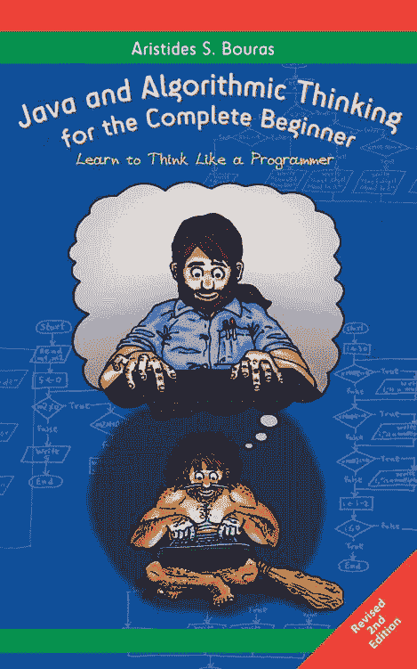

如果你将此程序输入 Eclipse，你会发现甚至没有一条红色的波浪线表示任何错误。然而，如果你运行程序并输入两个值 5 和 3，你可以亲眼看到，尽管 5 和 3 的和是 8，但 Eclipse 坚持认为它是 0，如图 9–15 所示。

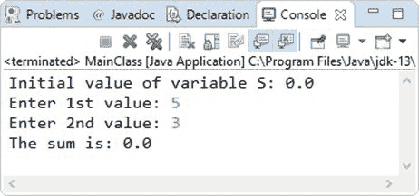

### 图 9–15 在输出窗口中查看逻辑错误的结果

到底是怎么回事？当然，对于资深程序员来说，修正这个错误是小菜一碟。但对于你这个新手来说，尽管你非常努力，也发现没有任何不对劲。那么，错误在哪里呢？

有时候眼睛会疲劳到看不到显而易见的问题。所以，让我们尝试使用一些魔法！尝试使用调试器逐步执行程序。这给了你一个观察执行流的机会，并仔细观察每一步中变量的当前值。

要打开调试器，你需要打开“Debug”（调试）视图。你可以通过从主菜单中选择“Window→Perspective→Open Perspective→Debug”来实现。现在，Eclipse 环境发生了一点变化，看起来就像图 9–16 所示。

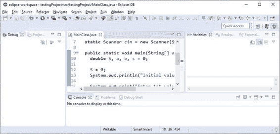

### 图 9–16 “Debug”视图

将光标置于存在`S = 0`语句的行，按下`SHIFT+CTRL+B`组合键。左侧边处会出现一个蓝色的圆点，如图 9–17 所示。

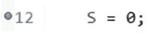

### 图 9–17 在 Eclipse 中添加断点

通过从主菜单中选择“Run→Debug”或按下`F11`键来启动调试器。通过这样做，你启用了调试器，工具栏上会启用更多的图标。


程序计数器（左边距中的蓝色箭头  图标）已停在程序的第一行，如图 9–18 所示。

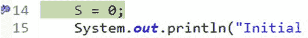

### 图 9–18 在 Eclipse 中使用调试器

 程序计数器随时向你显示哪条语句是下一个要执行的。

在此步中，`S = 0`语句尚未执行。点击“Step Over”（单步执行）  工具栏图标或按下`F6`键。现在执行语句`S = 0`，程序计数器移动到后续的 Java 语句，即下一个要执行的语句。

在“Variables”（变量）窗口中，你可以观察内存（RAM）中所有的变量以及它们在执行每一步中所包含的值，如图 9–19 所示。

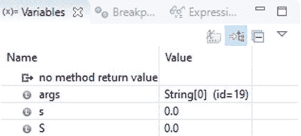

### 图 9–19 变量及其值显示在调试器的 Variables 窗口中

点击三次“Step Over”  工具栏图标。第二、第三和第四条语句被执行。你可以在“Console”（控制台）窗口中看到输出结果（见图 9–20）。

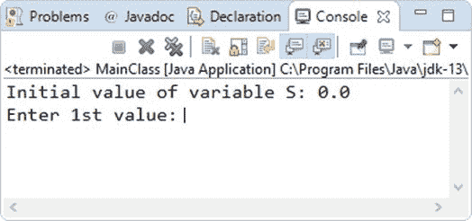

### 图 9–20 在输出窗口中查看提示

在此步中，程序等待你输入一个值。将光标放在“Console”窗口内部，输入值 5，并按下“Enter 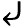”键。

程序计数器移动到第五条 Java 语句。点击两次“Step Over”  工具栏图标。此操作执行了第五和第六条 Java 语句。将光标放在“Console”窗口内部，输入值 3，并按下“Enter ”键。

程序计数器移动到第七条 Java 语句。再次点击一次“Step Over”  工具栏图标。执行语句`S = a + b`。值`8.0`被赋值给变量`S`，如图 9–21 所示。

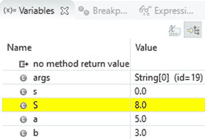

### 图 9–21 所有声明的变量都显示在 Variables 窗口中

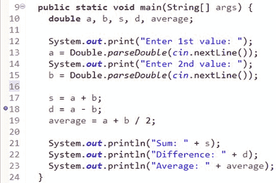

图 9–22 在程序中添加断点

当左侧边缘的对应行出现蓝色圆点  时，你就知道已经设置了断点。

确保“Debug（调试）”视图已打开，并按下`F11`启动调试器。在输出窗口被提示时，输入值`10`和`12`。你会注意到，刚在你输入第二个数字并按下“回车 ”键后，执行流就会在断点处暂停（相应的行会有绿色背景高亮）。

你可以通过从主菜单选择“Run→Debug（运行→调试）”或按下`F11`键来调试程序。

现在，你可以仔细查看变量的当前值了。变量`a`、`b`和`s`分别包含值`10.0`、`12.0`和`22`，这是预期的，所以到目前没有问题，如图 9–23 所示。

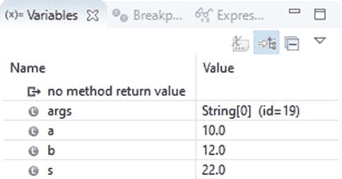

图 9–23 在 Variables 窗口查看变量的当前值

点击“Step Over（单步执行）”  工具栏图标一次。语句`d = a – b`执行，变量`a`、`b`、`s`和`d`分别包含值`10.0`、`12.0`、`22.0`和`-2.0`，符合预期，所以目前还没有问题，如图 9–24 所示。

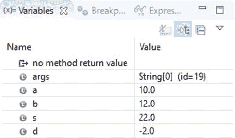

图 9–24 在 Variables 窗口查看变量的当前值

再次点击“Step Over（单步执行）”  工具栏图标。语句`average = a + b / 2`执行，变量`a`、`b`、`s`、`d`和`average`分别包含值`10.0`、`12.0`、`22`、`-2`和`16`，如图 9–25 所示。

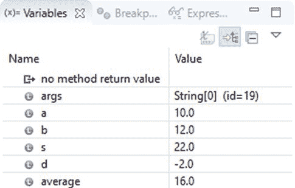

图 9–25 在 Variables 窗口查看变量的当前值

找到了！你刚刚发现了错误地给变量`average`赋值`16.0`而不是`11.0`的语句！现在困难的部分来了；你应该考虑为什么会发生这种情况！

经过整两天的思考，结果变得显而易见！你只是忘记将`a + b`包在括号内；因此，只有变量`b`被除以`2`。点击“Terminate（终止）”  工具栏图标，移除所有断点，通过将`a + b`包在括号内来修正错误，你就准备好了！重新执行程序，现在看它正确地计算并显示了平均值。

你可以像添加断点一样移除断点：在对应行号的左侧边缘双击，或者将光标放在包含断点的行上并按下`SHIFT+CTRL+B`组合键。

### 9.5 复习练习

完成以下练习。

1. 将以下 Java 程序输入 Eclipse 并逐步执行。确定为什么它没有正确地计算出`1 + 3 + 5`的和。

```java
public static void main(String[] args) {
    int SS, S1, S3, S5, S;
    SS = 0;
    S1 = 1;
    S3 = 3;
    S5 = 5;
    S = S1 + S3 + SS;
    System.out.println(S);
}
```

2. 创建一个跟踪表（trace table），以确定 Java 程序在两次不同执行过程中每一步的变量值。然后，在 Eclipse 中输入程序，逐步执行并确认结果。

两次执行的输入值分别为：(i)`5, 5`；(ii)`4, 8`。

```java
public static void main(String[] args) {
    double a, b, c, d, e;
    a = Double.parseDouble(cin.nextLine());
    b = Double.parseDouble(cin.nextLine());
    c = a + b;
    d = 5 + a / b * c + 2;
    e = c - d;
    c += d + c;
    e--;
    d += c + a / b;
    System.out.println(c + ", " + d + ", " + e);
}
```

3. 创建一个跟踪表，确定 Java 程序在三次不同执行过程中每一步的变量值。然后，在 Eclipse 中输入程序，逐步执行并确认结果。

三次执行的输入值分别为：(i)`0.50`，(ii)`3`和 (iii)`15`。

```java
public static void main(String[] args) {
    int a;
    double b, c;
    b = Double.parseDouble(cin.nextLine());
    c = 5;
    c = c * b;
    a = 10 * c / 2;
    System.out.println(a);
}
```

## “Java 入门”复习

### 字谜游戏

1. 完成以下字谜游戏。

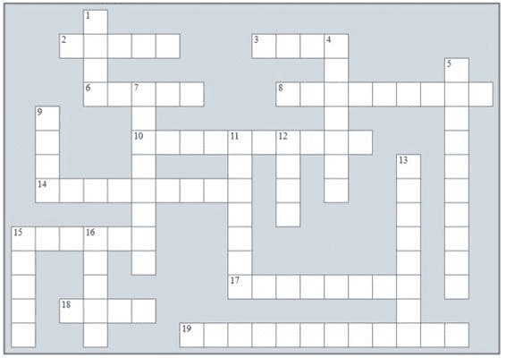

**横向**

2. 难以发现的错误。

3. 一种控制结构。

6. 流程图中的执行流。

8. 展示的方法。

10. ________ 编程模块化和结构化设计。

14. 提供解决方案的严格语句。

15. 意味着。

17. 该符号有一个入口和一个出口。

18. 逻辑错误被称为。

**竖向**

1. 用户友好的设计。

2. ________ 表是用于测试算法或计算机程序在执行期间逻辑错误的技术。

3. 包在 ________ 中的任何算术运算优先执行。

4. 流程图中的左箭头被称为。

5. 变量名中允许的唯一符号字符。

6. 代表计算机主内存（RAM）中程序可以存储值的位置。

8. 在主内存（RAM）中留出空间以存储变量内容的过程。

2. 完成以下字谜游戏。

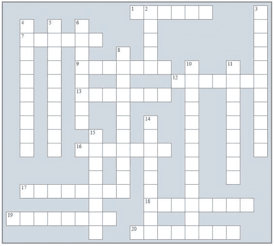

**横向**

1. 字母数字值。

7. 拼写错误的关键字是错误。

9. 不带小数部分的正负数。

12. 包含在程序中的额外信息使其更容易阅读和理解。

13. 它只能包含两个值之一。

16. 程序执行期间发生的错误。

17. 这种控制结构被称为。

18. 消耗 CPU 的算术运算。

19. 程序运行时不能改变的值。

20. ________ 的程序对初学者来说很容易用。

**竖向**

1. ________

4. 流程图中的（公式）。

5. 创建算法涉及三个主要阶段之一。

7. 语言中具有严格含义的单词。

9. 一种语言。

11. 语句。

12. 使用程序。

13. 一种控制结构。

15. 实数。

16. 算法必须满足的属性之一。

### 复习题

回答以下问题。

1. 什么是算法？

2. 给出制作一杯咖啡的算法。

3. 算法的五个属性是什么？

4. 算法可以无限执行吗？

5. 什么是计算机程序？

6. 算法涉及的三个参与方是什么？

7. 构成计算机程序的三个阶段是什么？

8. 计算机程序可以由两个阶段组成吗？

9. 什么是流程图？

10. 流程图使用的基本符号有哪些？

11. “保留字”一词什么意思？

12. 什么是结构化编程？

13. 结构化编程的三种基本控制结构是什么？

14. 使用流程图为每种控制结构举例。

15. 程序员可以在文本编辑器中编写 Java 程序吗？

16. 什么是语法错误？举出一个例子。

17. 什么是逻辑错误？举出一个例子。

18. 什么是运行时错误？举出一个例子。

19. 关键字拼写错误会导致什么类型的错误？

20. 为什么程序员应该在代码中添加注释？

21. 为什么程序员应该编写用户友好的程序？

22. 缩写 POLA 代表什么？

23. 什么是变量？

24. 流程图中左箭头左侧可以存在多少变量？

25. 变量的值存储在计算机的哪个部分？

26. 什么是常量？

27. 如何利用常量来帮助程序员？

28. 为什么程序员应该尽可能避免除法和乘法运算？

29. Java 中的四种基本变量类型是什么？

30. “声明变量”短语什么意思？

31. 如何在 Java 中声明变量？举一个例子。

32. 如何在 Java 中声明常量？举一个例子。

33. 流程图中使用哪个符号显示消息？

34. Java 中用什么特殊的字符序列来输出“换行”？

35. 流程图中使用哪个符号让用户输入数据？

36. Java 中用哪个符号作为赋值运算符？它在流程图中如何表示？

37. Java 支持哪些算术运算符？

38. 什么是取模运算符？

39. 总结算术运算符的优先级的规则。

40. Java 支持哪些复合赋值运算符？

41. Java 支持哪些字符串运算符？

42. 什么是跟踪表（trace table）？

43. 使用跟踪表有什么好处？

44. 描述交换两个变量内容（数值或字母数字）的步骤。

45. 本书提出了两种交换变量值的方法。哪种更好，为什么？

46. “调试（debugging）”是什么什么意思？

47. 描述 Eclipse IDE 如何帮助你发现语法错误。

48. 描述 Eclipse IDE 如何帮助你发现逻辑错误。

# 第 3 节：顺序控制结构

## 第 10 章：顺序控制结构导论

### 10.1 什么是顺序控制结构？

顺序控制结构是指语句的逐行执行，即语句按照它们在程序中出现的顺序顺序执行，而不跳过其中任何一个。例如，它们可以执行一系列读取或写入操作、算术运算或对变量进行赋值。

以下程序展示了顺序执行的 Java 语句示例。


```java
Class_10_1
public static void main(String[] args) {
    double num, result;
    // Prompt the user to enter value for num
    System.out.print("Enter a number: ");
    num = Double.parseDouble(cin.nextLine());
    //Calculate the square of num
    result = num * num;
    // Display the result on user's screen
    System.out.println("The square of " + num + " is " + result);
}
```

 顺序控制结构是你在 4.11 节中学学的三个基本控制结构中最简单的。另外两种结构是“选择结构”和“循环结构”。计算机编程中的所有问题都可以仅用这三个结构解决！

 在 Java 中，你可以使用双斜杠（`//`）添加注释。注释是给人类读者的。编译器和解释器会忽略它们。

#### 练习 10.1-1：计算矩形的面积

编写一个 Java 程序，提示用户输入矩形的底边和高度，然后计算并显示其面积。

#### 答案

你可能在学校里已经知道可以使用以下公式计算矩形的面积：

`Area = Base × Height`

在 4.6 节中，你学习了创建算法涉及三个三个阶段：数据输入、数据处理和结果输出。

在练习中，这三个主要阶段如下：

- **数据输入**：用户必须输入`Base`和`Height`的值
- **数据处理**：程序必须计算矩形的面积
- **结果输出**：程序必须显示上一个阶段计算出的矩形面积

该问题的解决方案所示。


```java
Class_10_1
public static void main(String[] args) {
    double num, result;
    // Prompt the user to enter value for num
    System.out.print("Enter a number: ");
    num = Double.parseDouble(cin.nextLine());
    //Calculate the square of num
    result = num * num;
    // Display the result on user's screen
    System.out.println("The square of " + num + " is " + result);
}
```

#### 练习 10.1-2：计算圆的面积

编写一个 Java 程序，计算并显示圆的面积。

#### 答案

你可以使用以下公式计算圆的面积：

`Area = π · Radius²`

`π`的值是已知的`3.14159`。因此，用户必须输入的是`Radius`。

在练习中，你在 4.6 节中学学的三个主要阶段如下：

- **数据输入**：用户必须输入`Radius`的值
- **数据处理**：程序必须计算圆的面积
- **结果输出**：程序必须显示上一个阶段计算出的面积

该问题的解决方案所示。


```java
Class_10_2
public static void main(String[] args) {
    double area, radius;
    // Prompt the user to enter value for num
    System.out.print("Enter a number: ");
    radius = Double.parseDouble(cin.nextLine());
    //Calculate the square of num
    area = 3.14159 * radius * radius;
    // Display the result on user's screen
    System.out.println("The square of " + num + " is " + result);
}
```

更好的方法是使用常量 `PI`。


```java
Class_10_2
static final double PI = 3.14159;
public static void main(String[] args) {
    double area, radius;
    // Prompt the user to enter value for num
    System.out.print("Enter a number: ");
    radius = Double.parseDouble(cin.nextLine());
    //Calculate the square of num
    area = PI * radius * radius;
    // Display the result on user's screen
    System.out.println("The square of " + num + " is " + result);
}
```

 注意常量 `PI` 是在 `main` 方法之外声明的。

#### 练习 10.1-3：计算油耗

在美国，汽车的油耗以每加仑英里（即 `MPG`）衡量。汽车的 `MPG` 可以使用以下公式计算：


编写一个 Java 程序，提示用户输入总行驶英数和消耗的加仑数。然后程序必须计算并显示汽车的 `MPG`。

#### 答案

这是一个非常简单的案例。用户输入总行驶英数和消耗的加仑数，然后程序必须计算并显示汽车的 `MPG`。


```java
Class_10_1_3
public static void main(String[] args) {
    double gallons, miles_driven, mpg;
    System.out.print("Enter miles driven: ");
    miles_driven = Double.parseDouble(cin.nextLine());
    System.out.print("Enter gallons of gas used: ");
    gallons = Double.parseDouble(cin.nextLine());
    mpg = miles_driven / gallons;
    System.out.println("Your car's MPG is: " + mpg);
}
```

#### 练习 10.1-4 汽车在哪里？计算行驶距离

汽车从静止开始，沿直直水平道路以恒定加速度运动给定的时间。编写一个 Java 程序，提示用户输入加速度和汽车行驶的时间，然后计算并显示行驶的距离。所需的公式是

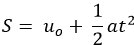

其中

- ►`S` 是汽车行驶的距离，单位为米 (m)
- ►`u[0]` 是汽车的初速度（速度），单位为米/秒 (m/sec)
- ►`t` 是汽车行驶的时间，单位为秒 (sec)
- ►`a` 是加速度，单位为米/秒² (m/sec²)

#### 解决方案

由于汽车从静止开始，初速度（速度）`u[0]` 为零。因此，公式变为

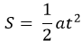

对应的 Java 程序如下：

```java
 
Class_10_1_4
public static void main(String[] args) {
    double S, a, t;
    System.out.print("Enter acceleration: ");
    a = Double.parseDouble(cin.nextLine());
    System.out.print("Enter time traveled: ");
    t = Double.parseDouble(cin.nextLine());
    S = 0.5 * a * t * t;
    System.out.println("Your car traveled " + S + " meters");
}
```

#### 练习 10.1-5 华氏度转开文

编写一个 Java 程序，将温度值从华氏度转换为等值的开文度。所需的公式是

`1.8 × Kelvin = Fahrenheit + 459.67`

#### 解决方案

给出的公式不能直接在你的程序中使用。在 Java 这样的计算机语言中，不允许写成

`1.8 * kelvin = fahrenheit + 459.67;`


在 `( )` 符号左侧的位置，必须存在一个变量。该变量实际上是 RAM 中一个可以存储数值的区域。

该程序将华氏度转换为开文度。华氏度值是已知值并由用户提供，而开文度值是 Java 程序必须计算得出的值。因此，你需要解出开文度。经过处理后，公式变为

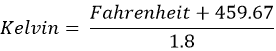

对应的 Java 程序所示此处。

```java
 
Class_10_1_5
public static void main(String[] args) {
    double fahrenheit, kelvin;
    System.out.print("Enter a temperature in Fahrenheit: ");
    fahrenheit = Double.parseDouble(cin.nextLine());
    kelvin = (fahrenheit + 459.67) / 1.8;
    System.out.println("The temperature in Kelvin is " + kelvin);
}
```

#### 练习 10.1-6 计算销售税

员工需要一个程序来输入产品的税前价格并计算其最终价格。假设增值税（`VAT`）为 `19%`。

#### 解决方案

销售税可以很容易计算。你必须将产品的税前价格乘以销售税率。注意——销售税不是最终价格，而仅仅是税额。

税后价格可以通过将初始税前价格加上你预计算出的销售税相加得到。

在该程序中，你可以使用名为 `VAT` 的常量作为销售税率。

```java
 
Class_10_1_6
static final double VAT = 0.19;
public static void main(String[] args) {
    double price_after_tax, price_before_tax, sales_tax;
    System.out.print("Enter the before-tax price: ");
    price_before_tax = Double.parseDouble(cin.nextLine());
    sales_tax = price_before_tax * VAT;
    price_after_tax = price_before_tax + sales_tax;
    System.out.println("The after-tax price is: " + price_after_tax);
}
```

 注意常量 `VAT` 是声明在 `main` 方法之外的。

#### 练习 10.1-7 计算销售折扣

编写一个 Java 程序，提示用户输入物品价格和以百分比表示的折扣（范围为 `0` 到 `100`）。该程序随后必须计算并显示新价格。

#### 解决方案

折扣金额可以很容易计算。你必须将产品的折扣前价格乘以折扣值，然后除以 `100`。由于用户输入 `0` 到 `100` 之间的值，除法是必要的。注意——结果不是最终价格，而是折扣金额。

折扣后价格可以通过从折扣前价格减去你预计算出的出的金额得到。

```java
 
Class_10_1_7
public static void main(String[] args) {
    int discount;
    double discount_amount, price_after_discount, price_before_discount;
    System.out.print("Enter the price of an item: ");
    price_before_discount = Double.parseDouble(cin.nextLine());
    System.out.print("Enter the discount (0-100): ");
    discount = Integer.parseInt(cin.nextLine());
    discount_amount = price_before_discount * discount / 100;
    price_after_discount = price_before_discount - discount_amount;
    System.out.println("The price after discount is " + price_after_discount);
}
```

#### 编写一个 Java 程序，提示用户输入物品的税前价格和以百分比表示的折扣（范围为 `0` 到 `100`）。该程序随后必须计算并显示新价格。假设销售税率为 `19%`。

#### 解决方案

此练习是前两个练习的结合！

```java
 
Class_10_1_8
static final double VAT = 0.19;
public static void main(String[] args) {
    int discount;
    double discount_amount, price_after_discount, price_before_tax, sales_tax;
    System.out.print("Enter the before-tax price: ");
    price_before_tax = Double.parseDouble(cin.nextLine());
    System.out.print("Enter the discount (0-100): ");
    discount = Integer.parseInt(cin.nextLine());
    discount_amount = price_before_tax * discount / 100;
    price_after_discount = price_before_tax - discount_amount;
    sales_tax = price_after_discount * VAT;
    price_after_tax = price_after_discount + sales_tax;
    System.out.println("The discounted after-tax price is: " + price_after_tax);
}
```

### 10.2 复习练习

完成以下练习。

1. 编写一个 Java 程序，提示用户输入底和和高，然后计算并显示三角形的面积。
2. 编写一个 Java 程序，提示用户输入三角形的两个角，然后计算并显示第三个角。

   提示：任何三角形的内角和为 `180` 度

3. 编写一个 Java 程序，让学生输入四次考试的成绩，然后计算并显示平均分。
4. 编写一个 Java 程序，提示用户输入半径值，然后计算并显示圆的周长。所需的公式是

   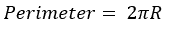

5. 编写一个 Java 程序，提示用户输入以米为单位的直径值，然后计算并显示球体的体积。所需的公式是

   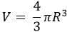

   其中 `R` 是球半径。

6. 关于上一个练习，以下哪些输出语句是正确的？你会选择哪一个来在用户的屏幕上显示球体体积？为什么？

   a. `System.out.println(V);`

   b. `System.out.println(V cubic meters);`

   c. `System.out.println(V + cubic meters);`

   d. `System.out.println("The volume of the sphere is: " V);`

   e. `System.out.println("The volume of the sphere is: " + V);`

   f. `System.out.println("The volume of the sphere is: " + V + cubic meters);`

   g. `System.out.println("The volume of the sphere is: " + V + "cubic meters");`

7. 编写一个 Java 程序，提示用户输入直径，然后计算并显示圆的半径、周长和面积。对于相同的直径，还必须显示球体的体积。
8. 编写一个 Java 程序，提示用户输入餐厅就餐费用，然后计算并显示 10% 的小费、7% 的销售税以及这三个金额的总和。
9. 一辆从静止开始的汽车沿直线水平道路以恒定加速度运动指定的秒数。编写一个 Java 程序，提示用户输入加速度（m/sec²）和行驶时间（秒），然后计算行驶的距离。所需的公式为：

   

10. 编写一个 Java 程序，提示用户输入一个华氏度温度，然后将其转换为等值的摄氏度。所需的公式为

    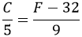

11. 身体质量指数（BMI）通常用于判断一个人的体重相对于身高超重或体重不足。计算 BMI 的公式为

    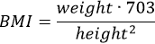

    编写一个 Java 程序，提示用户输入其体重（磅）和身高（英寸），然后计算并显示用户的 BMI。

12. 编写一个 Java 程序，提示用户输入小计和感谢费率（0 到 100 之间），然后计算小费和总额。例如，如果用户输入 30 和 10，Java 程序必须显示“Tip is $3.00 and Total is $33.00”。
13. 员工需要一个程序来输入三种产品的税前价格，然后计算每种产品的最终税后价格以及平均值。假设增值税（VAT）为 20%。
14. 员工需要一个程序来输入产品的税后价格，然后计算其税前价格。假设增值税（VAT）为 20%。
15. 编写一个 Java 程序，提示用户输入物品的初始价格和提供的百分比折扣（0 到 100 之间），然后计算并显示最终价格和节省的金额。
16. 编写一个 Java 程序，提示用户输入每月初和月底的电表读数（千瓦时）。程序必须计算并显示消耗的 kWh 数，以及在每度电 $0.06 且增值税（VAT）为 20% 的情况下必须支付的金额。
17. 编写一个 Java 程序，提示用户输入两个数字分别对应当前的月份和日期，然后计算到年底结束的天数。假设每个月有 30 天。

# 第 11 章

## 数字处理

### 11.1 引言

与每种高级编程语言一样，Java 提供了许多现成可子程序（称为方法），你可以在随时随地的地方使用它们。

 “子程序”仅仅是一组封装成单个单元的语句。每个子程序都有一个描述性的名称并执行一个特定的任务。

为了更好地理解 Java 的方法，让我们看看用于计算正数平方根的海伦迭代公式。

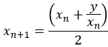

其中

► `y` 是你想要寻找平方根的数字

► `x[n]` 是 `y` 的平方根的第 n 次迭代值

嘿，不要失望！现在没有人用这种方法来计算数字的平方根了。幸运的是，Java 包含一个为此目的的方法！这个方法实际上是一个小的子程序，被命名为 `Math.sqrt`，你所做的就是通过它的名称调用它，它就会为你完成工作。`Math.sqrt` 方法可能使用了海伦迭代公式，也可能是其他古代或现代数学家的公式。事实是，你并不在乎！真正重要的是 `Math.sqrt` 给你提供了正确的结果！示例所示。

```java
x = Double.parseDouble(cin.nextLine());
y = Math.sqrt(x);
System.out.println(y);
```

尽管 Java 支持许多数学子程序（方法），但本章只涵盖了本书目的绝对需要的方法。然而，如果你需要更多信息，可以访问：

[`docs.oracle.com/javase/8/docs/api/java/lang/Math.html`](https://docs.oracle.com/javase/8/docs/api/java/lang/Math.html)


 当你需要计算平方根、正弦、余弦、绝对值等时候就会使用数学方法。

## 11.2 有用的方法（子程序）

### 绝对值

`Math.abs(number)` 此方法返回 `number` 的绝对值。

示例：

```

```

```java
int a, b;
a = -5;
b = Math.abs(a);
System.out.println(b); // 显示 5
```

### 圆周率

`Math.PI` 返回 π 的值。

```

```

注意 `Math.PI` 是一个常量，而不是方法。这就是为什么没有使用括号。

示例：

```

```

```java
System.out.println(Math.PI); // 显示 3.141592653589793
```

### 正弦

`Math.sin(number)` 此方法返回 `number` 的正弦。`number` 必须以弧度表示。你可以乘以 `Math.PI/180` 来转换为角度。

示例：

```

```

```java
double a, b;
a = Math.sin(3 * Math.PI / 2); // 3π/2 弧度
b = Math.sin(270 * Math.PI / 180); // 270 度
System.out.println(a + " " + b); // 显示 -1.0 -1.0
```

### 余弦

`Math.cos(number)` 此方法返回 `number` 的余弦。`number` 必须以弧度表示。你可以乘以 `Math.PI/180` 来转换为角度。

示例：

```

```

```java
double a, b;
a = Math.cos(2 * Math.PI); // 2π 弧度
b = Math.cos(360 * Math.PI / 180); // 360 度
System.out.println(a + " " + b); // 显示 1.0 1.0
```

### 正切

`Math.tan(number)` 此方法返回 `number` 的正切。`number` 必须以弧度表示。你可以乘以 `Math.PI/180` 来转换为角度。

示例：

```

```

```java
double a;
a = Math.tan(10 * Math.PI / 180); // 10 度
System.out.println(a); // 显示 0.17632698070846498
```

### 字符串转整数

`Integer.parseInt(value)` 此方法将整数的字符串表示转换为数值。

示例：

```
!
```

```java
String s1 = "5";
String s2 = "3";
int k;
k = Integer.parseInt(s1);
System.out.println(k); // 显示 5
System.out.println(Integer.parseInt(s2)); // 显示 3
System.out.println(s1 + s2); // 显示 53
System.out.println(Integer.parseInt(s1) + Integer.parseInt(s2)); // 显示 8
```

### 字符串转实数

`Double.parseDouble(value)` 此方法将实数的字符串表示转换为数值。


```java
Class_11_2
public static void main(String[] args) {
    String s1 = "6.5";
    String s2 = "3.4";
    double x;
    x = Double.parseDouble(s1);
    System.out.println(x); //It displays: 6.5
    System.out.println(Double.parseDouble(s2)); //It displays: 3.4
    System.out.println(s1 + s2); //It displays: 6.53.4
    System.out.println(Double.parseDouble(s1) + Double.parseDouble(s2)); //It displays: 9.9
}
```

## 整数（类型转换）

`(int)number`

这返回 `number` 的整数值。

### 示例


```java
Class_11_2h
public static void main(String[] args) {
    double a = 5.4;
    System.out.println((int)a); //It displays: 5
    System.out.println((int)34); //It displays: 34
    System.out.println((int)34.9); //It displays: 34
    System.out.println((int)-34.999); //It displays: -34
}
```

 在计算机科学中，类型转换是将一种数据类型的变量转换为另一种数据类型的方法。注意 `(int)` 并不是一个方法。它只是 Java 中将实数转换为整数的方法。还要注意，如果实数包含小数部分，该部分在转换过程中将会丢失。

## 实数（类型转换）

`(double)number`

这以实数形式返回数字。

### 示例


```java
Class_11_2i
public static void main(String[] args) {
    int a = 5;
    System.out.println((double)a); //It displays: 5.0
    System.out.println((double)34); //It displays: 34.0
    System.out.println((double)-34); //It displays: -34.0
    System.out.println(a / 2); //It displays: 2
    System.out.println((double)a / 2); //It displays: 2.5
}
```

 在计算机科学中，类型转换是将一种数据类型的变量转换为另一种数据类型的方法。注意 `(double)` 并不是一个方法。它只是 Java 中将整数转换为实数的方法。

 在 Java 中，两个整数除的结果总是整数。因此，在表达式 `a / 2` 中，由于变量 `a` 和数字 `2` 都是整数，结果始终是整数。如最后一句所示，如果你希望结果是实数类型，需要在至少一个操作数前面添加 `(double)` 转换运算符。

此外，语句

```java
System.out.println((double)a / 2);
```

等同于

```java
System.out.println(a / (double)2);
```

等同于

```java
System.out.println((double)a / (double)2);
```

当然也等同

```java
System.out.println(a / 2.0);
```

它们都输出值 `2.5`。

## 幂

`Math.pow(number, exp)`

该方法返回 `number` 的 `exp` 次幂的结果。

### 示例


```java
Class_11_2j
public static void main(String[] args) {
    double a, b, c;
    a = 2;
    b = 3;
    System.out.println(Math.pow(a, b)); //It displays: 8.0
    c = Math.pow(3, 2);
    System.out.println(c); //It displays: 9.0
}
```

 方法 `Math.pow()` 也可以计算数字的平方根。从数学上知道 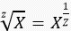。因此，你可以写 `y = Math.pow(x, 1 / 2)` 来计算 `x` 的平方根，或者你甚至写 `y = Math.pow(x, 1 / 3)` 来计算 `x` 的立方根，依此类推！

## 随机数

`Math.random()`

该方法返回范围在 `0, 1)` 内的伪随机数（实数）。

![ 注意该范围不包含 `1`。如果你想在最小和最大值之间获取一个随机整数，可以使用以下公式`minimum + (int)(Math.random() * (maximum - minimum + 1))`

### 示例


```java
Class_11_2k
public static void main(String[] args) {
    // 在 0, 1) 范围内显示一个随机双
    System.out.println(Math.random());
    // 在 2 到 10 之间显示一个随机整数
    System.out.println(2 + (int)(Math.random() * (10 - 2)));
    // 在 20 到 25 之间显示一个随机整数
    System.out.println(20 + (int)(Math.random() * 6));
}
```

![ 随机数被广泛用于游戏。例如，“敌人”可能会随机时间出现或随机方向移动。此外，随机数也用于模拟程序、统计程序、计算机加密等。

## 四舍五入

`Math.round(number)`

该方法返回 `number` 最接近的整数。

### 示例


```java
Class_11_2l
public static void main(String[] args) {
    double a = 5.9;
    System.out.println(Math.round(a)); //It displays: 6
    System.out.println(Math.round(5.4)); //It displays: 5
}
```

如果你需要指定精度的 `number` Round 入值，可以使用以下公式：

`Math.round(number * Math.pow(10, precision)) / Math.pow(10, precision)`

### 示例


```java
Class_11_2m
public static void main(String[] args) {
    double a, y;
    a = 5.312;
    y = Math.round(a * Math.pow(10, 2)) / Math.pow(10, 2); //It displays: 5.31
    a = 5.315;
    y = Math.round(a * Math.pow(10, 2)) / Math.pow(10, 2); //It displays: 5.32
    // 显示 2.345
    System.out.println(Math.round(2.3447 * 1000) / 1000);
}
```

## 平方根

`Math.sqrt(number)`

该方法返回 `number` 的平方根。

### 示例


```java
Class_11_2n
public static void main(String[] args) {
    System.out.println(Math.sqrt(9)); //It displays: 3.0
    System.out.println(Math.sqrt(2)); //It displays: 1.414213562373095
}
```

### 练习 11.2-1 计算点之间的距离

编写一个 Java 程序，提示用户输入两个点的坐标 `(x, y)`，然后它们之间的直线距离。所需的公式是

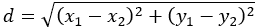

## 解答

在这个练习中，你需要使用 `Math.sqrt()` 方法，它返回数字的平方根。

为了简化处理，分别计算 `(x[1] - x[2])²` 和 `(y[1] - y[2])²` 并结果赋值给两个临时变量。

Java 程序所示：


```java
Class_11_2_1a
public static void main(String[] args) {
    double d, x1, x2, x_temp, y1, y2, y_temp;
    System.out.print("Enter coordinates for point A: ");
    x1 = Double.parseDouble(System.nextLine());
    y1 = Double.parseDouble(System.nextLine());
    System.out.print("Enter coordinates for point B: ");
    x2 = Double.parseDouble(System.nextLine());
    y2 = Double.parseDouble(System.nextLine());
    x_temp = Math.pow(x1 - x2, 2);
    y_temp = Math.pow(y1 - y2, 2);
    d = Math.sqrt(x_temp + y_temp);
    System.out.println("Distance between points: " + d);
}
```

现在让我们看另一种方法。

你应该意识到在方法调用内部执行操作实际上是可能的。这样做，操作的结果被用作方法的参数。

Java 程序所示：


```java
Class_11_2_1b
public static void main(String[] args) {
    double d, x1, x2, y1, y2;
    System.out.print("Enter coordinates for point A: ");
    x1 = Double.parseDouble(System.nextLine());
    y1 = Double.parseDouble(System.nextLine());
    System.out.print("Enter coordinates for point B: ");
    x2 = Double.parseDouble(System.nextLine());
    y2 = Double.parseDouble(System.nextLine());
    d = Math.sqrt(Math.pow(x1 - x2, 2) + Math.pow(y1 - y2, 2));
    System.out.println("Distance between points: " + d);
}
```

 注意 `Math.pow()` 方法是如何嵌套在 `Math.sqrt()` 方法中的。内部（嵌套）方法（或方法）的结果被用作外部方法的参数。这是大多数程序员喜欢遵循的编写风格，因为它有助于节省代码行。当然，如果你嵌套了太多的方法，没有人能理解你的代码。嵌套最多四层是可以接受的。

### 练习 11.2-2 汽车行驶了多远？

汽车从静止开始，以恒加速度沿直线水平道路行驶一段距离。编写一个 Java 程序，提示用户输入加速度和汽车的距离，然后计算行驶的时间。所需的公式是

- `S` 是汽车行驶的距离，单位为米 (m)
- `u[0]` 是汽车的初始速度（速率），单位为米/秒 (m/sec)
- `t` 是汽车行驶的时间，单位为秒 (sec)
- `a` 是加速度，单位为米/秒² (m/sec²)

## 解 Solution

由于汽车是从静止开始的，初始速度（速率）`u[0]` 为零。因此，公式变为


现在，如果你求解时间，最终公式变为：

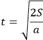

在 Java 中，你可以使用 `Math.sqrt()` 方法，它返回一个数的平方根。


```java
Class_11_2_2
public static void main(String[] args) {
    double S, a, t;
    System.out.print("Enter acceleration: ");
    a = Double.parseDouble(cin.nextLine());
    System.out.print("Enter distance traveled: ");
    S = Double.parseDouble(cin.nextLine());
    t = Math.sqrt(2 * S / a);
    System.out.println("Your car traveled for " + t + " seconds");
}
```

### 11.3 复习题：判断对错

判断下列每个陈述的对或错。

1. Java 方法是用于解决小问题的微型子程序。

2. 每一位程序员都必须使用牛顿迭代公式来计算正数的平方根。

3. `Math.abs()`方法返回项的绝对位置。

4. 语句`(int)3.59`返回结果为`3.6`。

5. `Math.PI`常数等于`3.14`。

6. 语句`Math.pow(2, 3)`返回结果为`9`。

7. `Math.random()`方法返回一个随机实数（float）。

8. 语句`y = (int)(Math.random() * 2)`有 50% 的概率为变量`y`赋值为`1`。

9. 语句`Math.round(3.59)`返回结果为`4`。

10. 为了计算 90 度的正弦，你必须写`y = Math.sin(Math.PI / 2)`。

11. 语句`y = Math.sqrt(-2)`是有效的。

12. 下面的代码片段满足确定性属性。

```java
double a, b, x;
a = Double.parseDouble(cin.nextLine());
b = Double.parseDouble(cin.nextLine());
x = a * Math.sqrt(b);
System.out.println(x);
```

### 11.4 复习题：单选择

为下列每个陈述选择正确答案。

1. 下列哪项计算了变量`a`的 2 次方幂的结果？

   a. `y = a * a;`

   b. `y = Math.pow(a, 2);`

   c. `y = a * a / a * a;`

   d. 以上都是

2. 当执行语句`y = Math.abs(+5.2)`时，变量`y`的值是多少？

   a. `-5.2`

   b. `-5`

   c. `0.2`

   d. `5.2`

   e. 以上都不是

3. 下列哪项计算 180 度的正弦？

   a. `Math.sin(180)`

   b. `Math.sin(Math.PI)`

   c. 以上都是

   d. 以上都不是

4. 当执行语句`y = int(5.0 / 2.0)`时，变量`y`的值是多少？

   a. `2.5`

   b. `3`

   c. `2`

   d. `0.5`

5. 当执行语句`y = Math.pow(Math.sqrt(4), 2)`时，变量`y`的值是多少？

   a. `4`

   b. `2`

   c. `8`

   d. `16`

6. 当执行语句`y = Math.round(5.2) / 2.0`时，变量`y`的值是多少？

   a. `2`

   b. `2.5`

   c. `2.6`

   d. 以上都不是

### 11.5 复习练习

完成以下练习。

1. 创建一个追踪表，以确定两种不同执行下 Java 程序中每一步变量的值。

两次执行的输入值分别为：(i) `9`和 (ii) `4`。

```java
public static void main(String[] args) {
    double a, b, c;
    a = Double.parseDouble(cin.nextLine());
    a += 6 / Math.sqrt(a) * 2 + 20.4;
    b = Math.round(a) % 4;
    c = b % 3;
    System.out.println(a + ", " + b + ", " + c);
}
```

2. 创建一个追踪表，以确定两种不同执行下 Java 程序中每一步变量的值。

两次执行的输入值为：(i) `-2`和 (ii) `-3`

```java
public static void main(String[] args) {
    int a, b, c;
    a = Integer.parseInt(cin.nextLine());
    b = Math.abs(a) % 4 + (int)Math.pow(a, 4);
    c = b % 5;
    System.out.println(b + ", " + c);
}
```

3. 编写一个 Java 程序，提示用户输入弧度角`θ`，然后计算并显示度数角度。已知`2π = 360°`。

4. 编写一个 Java 程序，提示用户输入直角三角形的两个直角边`A`和`B`，然后计算其斜边。从勾股定理可知...

5. 编写一个 Java 程序，提示用户输入直角三角形的角度`θ`（度数），然后计算对边的长度。

 `Class_12_1_3`

```java
public static void main(String[] args) {
    double denominator, nominator, temp1, temp2, temp3, w, x, y, z;
    System.out.print("Enter value for x: ");
    x = Double.parseDouble(cin.nextLine());
    System.out.print("Enter value for w: ");
    w = Double.parseDouble(cin.nextLine());
    System.out.print("Enter value for z: ");
    z = Double.parseDouble(cin.nextLine());
    temp1 = 3 * x * x + 5 * x + 2;
    temp2 = 7 * w - 1 / z;
    temp3 = (3 + x) / 7;
    nominator = 5 * temp1 / temp2 - z;
    denominator = 4 * temp3;
    y = nominator / denominator;
    System.out.println("The result is: " + y);
}
```

你可能会说：“好的，但我浪费了这么多变量，而且众所周知，每个变量都是主内存的一部分。我该如何用单行编写原始表达式并减少内存内存呢？”

这项工作对于高级程序员来说可能易如一碟，但对你呢？对一个新手程序员来说？

下一个方法将帮助你编写即使是最复杂的数学表达式，也不会出现任何语法或逻辑错误！规则非常简单：“在将复杂的表达式拆分为更小、更简单的表达式并将每个子结果赋值给临时变量后，从后往前开始，将每个变量替换为其赋值的表达式。但注意！当你用表达式替换变量时，你必须始终将表达式括在括号内！”

感到困惑吗？别担心！操作起来更简单。让我们尝试重写之前的 Java 程序。从后往前，将变量`nominator`和`denominator`替换为它们赋值的表达式。结果是

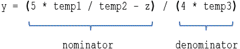

 注意额外添加的括号。

现在你必须将变量`temp1`、`temp2`和`temp3`替换为它们赋值的表达式，单行表达式就完成了！

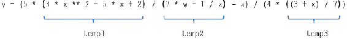

最后看起来可能很吓，但其实并没有那么，对吧？

Java 程序现在可以重写为

 `Class_12_1_3b`

```java
public static void main(String[] args) {
    double w, x, y, z;
    System.out.print("Enter value for x: ");
    x = Double.parseDouble(cin.nextLine());
    System.out.print("Enter value for w: ");
    w = Double.parseDouble(cin.nextLine());
    System.out.print("Enter value for z: ");
    z = Double.parseDouble(cin.nextLine());
    y = (5 * (3 * x * x + 5 * x + 2) / (7 * w - 1 / z) - z) / (4 * ((3 + x) / 7));
    System.out.println("The result is: " + y);
}
```

### 12.2 复习练习

完成以下练习。

1. 将第一个表格中的每个元素与第二个表格中的一个或多个元素匹配。

| 表达式 |
| :--- |
| i. `5 / Math.pow(x, 2) * y + Math.pow(x,3)` |
| ii. `5 / (Math.pow(x, 3) * y) + Math.pow(x, 2)` |

| 表达式 |
| :--- |
| a. `5 * y / Math.pow(x, 2) + Math.pow(x, 3)` |
| b. `5 * y / x * x + Math.pow(x, 3)` |
| c. `5 / (x * x * x * y) + x * x` |
| d. `5 / (x * x * x) * y + x * x` |
| e. `5 * y / (x * x) + x * x * x` |
| f. `1 / (x * x * x * y) * 5 + x * x` |
| g. `y / (x * x) * 5 + Math.pow(x, 3)` |
| h. `1 / (x * x) * 5 * y + x / 1 * x * x` |

2. 使用 Java 编写以下数学表达式，每个表达式用一行代码。

i. 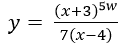

ii. 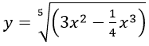

iii. 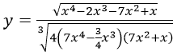

iv. 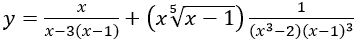

v. 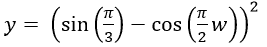

vi. 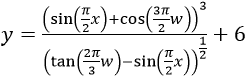

3. 写一个 Java 程序，提示用户输入`x`的值，然后计算并显示以下数学表达式的结果。

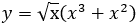

4. 写一个 Java 程序，提示用户输入`x`的值，然后计算并显示以下数学表达式的结果。

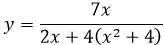

建议：尝试用一行代码编写该表达式。

5. 写一个 Java 程序，提示用户输入`x`的值，然后计算并显示以下数学表达式的结果。

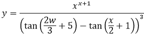

6. 写一个 Java 程序，提示用户输入`x`的值，然后计算并显示以下数学表达式的结果。

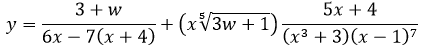

7. 写一个 Java 程序，提示用户输入`x`的值，然后计算并显示以下数学表达式的结果。

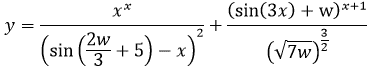

8. 写一个 Java 程序，提示用户输入三角形三边`A`、`B`和`C`的长度，然后计算并显示面积。你可以使用海伦公式，

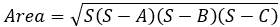 其中`S`是周长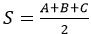

# 第 13 章 商与余数

### 13.1 引言

哪些类型的问题需要使用商和余数？没有简单的答案！但是，商和余数可以：

- 将数字拆分为单个数字
- 判断一个数是奇还是偶
- 将经过的时间（秒）转换为小时、分钟和秒
- 将金额（美元）转换为$100、$50 等
- 计算最大约数
- 判断一个数是否是回文
- 统计某个数字在数字中出现的次数

当然，这些是它们的一些用途。接下来你将看到一些使用商和余数的练习。

#### 练习 13.1-1 计算除法的商和余数

写一个 Java 程序，提示用户输入两个整数，然后计算它们的商和余数。

解决方案

`%`运算符执行整数除法并返回整数余数。由于 Java 并没有引入计算整数商的运算符，你可以使用`(int)`强制转换来实现相同的结果。解决方案所示：

images/00001.gif) `Class_12_1_3`

```java
public static void main(String[] args) {
    int number1, number2, q, r;
    System.out.print("Enter first number: ");
    number1 = Integer.parseInt(cin.nextLine());
    System.out.print("Enter second number: ");
    number2 = Integer.parseInt(cin.nextLine());
    q = (int)(number1 / number2);
    r = number1 % number2;
    System.out.println("Integer Quotient: " + q + "\nInteger Remainder: " + r);
}
```

在流程图中，为了计算整数除法的商和余数，可以使用常用的`DIV`和`MOD`运算符。示例所示：

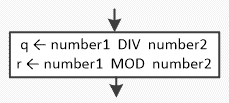

在 Java 中，两个整数除法的结果始终是整数。因此，在语句`q = (int)(number1 / number2)`中，由于变量`number1`和`number2`是整数，`(int)`强制转换是多余的。然而，为了提高可读性，保留它是个好习惯。

#### 练习 13.1-2 寻找数字之和

写一个 Java 程序，提示用户输入一个四位整数，然后计算其数字之和。

解决方案

这里你应该记住的是像这样的语句

`number = Integer.parseInt(cin.nextLine());`

将输入的四位整数赋值给单个变量`number`，而不是四个独立的变量。所以，在用户输入四位整数后，程序必须将该整数拆分为四个数字，并将每个数字赋值给单独的变量。然后就可以计算这四个变量之和并得到所需的结果。有两种方法可用。

第一种

让我们尝试用一个算术示例来理解第一种方法。以数字 6753 为例。

| 第一位 = 6 | 如果使用`/`运算符将给定数字除以 1000，并使用`(int)`类型转换运算符获取整数商`digit1 = (int)(6753 / 1000)`，就可以分离出第一位。 |
| 剩余数字 = 753 | 如果再次将给定数字除以 1000，这次使用`%`运算符获取整数余数`r = 6753 % 1000`，就可以分离剩余数字。 |
| 第二位 = 7 | 如果使用`/`运算符将剩余数字除以 100，并使用`(int)`类型转换运算符获取整数商`digit2 = (int)(753 / 100)`，就可以分离出第二位。 |
| 剩余数字 = 53 | 现在剩余数字为`r = 753 % 100` |
| 第三位 = 5 | 如果使用`/`运算符将剩余数字除以 10，并使用`(int)`类型转换运算符获取整数商`digit3 = (int)(53 / 10)`，就可以分离出第三位。 |
| 第四位 = 3 | 最后一个剩余的数字恰好是第四位，即`digit4 = 53 % 10` |

解决该算法的 Java 程序所示所示。

 `Class_13_1_2`

```java
public static void main(String[] args) {
    int digit1, digit2, digit3, digit4, number, r, total;
    System.out.print("Enter a four-digit integer: ");
    number = Integer.parseInt(cin.nextLine());
    digit1 = (int)(number / 1000);
    r = number % 1000;
    digit2 = (int)(r / 100);
    r = r % 100;
    digit3 = (int)(r / 10);
    digit4 = r % 10;
    total = digit1 + digit2 + digit3 + digit4;
    System.out.println(total);
}
```

你刚刚看到的程序的追踪表（trace table）所示。

| Step | Statement | Notes | number | digit1 | digit2 | digit3 | digit4 | r | total |
| --- | --- | --- | --- | --- | --- | --- | --- | --- | --- |
| 1 | `.print("Enter…` | 它显示：Enter a four-digit integer: | | | | | | | | |


| 2 | `number = Integer.parseInt(…` | 用户输入 6753 | 6753 | ? | ? | ? | ? | ? | ? |
| 3 | `digit1 = (int)(number / 1000)` | | 6753 | 6 | ? | ? | ? | ? | ? |
| 4 | `r = number % 1000` | | 6753 | 6 | ? | ? | ? | 753 | ? |
| 5 | `digit2 = (int)(r / 100)` | | 6753 | 6 | 7 | ? | ? | 753 | ? |
| 6 | `r = r % 100` | | 6753 | 6 | 7 | ? | ? | 53 | ? |
| 7 | `digit3 = (int)(r / 10)` | | 6753 | 6 | 7 | 5 | ? | 53 | ? |
| 8 | `digit4 = r % 10` | | 6753 | 6 | 7 | 5 | 3 | 53 | ? |
| 9 | `total = digit1 + digit2 + digit3 + digit4` | | 6753 | 6 | 7 | 5 | 3 | 53 | 21 |
| 10 | `.println(total)` | 它显示：21 | | | | | | | | |

为了进一步帮助你，还有一个通用的 Java 程序可以用于拆分任何给整数。由于你的程序长度取决于位数 `N`，你只需要编写 `N−1` 对语句语句即可。

```java
System.out.print("Enter an N-digit integer: ");
number = Integer.parseInt(cin.nextLine());
digit1 = (int)(number / 10^(N-1));
r = number % 10^(N-1);
digit2 = (int)(r / 10^(N-2));
r = r % 10^(N-2);
...
digit(N-2) = (int)(r / 100);
r = r % 100;
digit(N-1) = (int)(r / 10);
digitN = r % 10;
```

例如，如果你想拆分一个六位整数，你需要像后续程序所示编写五对语句。

 `Class_13_1_2b`

```java
public static void main(String[] args) {
    int digit1, digit2, digit3, digit4, digit5, digit6, number, r;
    System.out.print("Enter an six-digit integer: ");
    number = Integer.parseInt(cin.nextLine());
    digit1 = (int)(number / 100000);
    r = number % 100000;
    digit2 = (int)(r / 10000);
    r = r % 10000;
    digit3 = (int)(r / 1000);
    r = r % 1000;
    digit4 = (int)(r / 100);
    r = r % 100;
    digit5 = (int)(r / 10);
    digit6 = r % 10;
    System.out.print(digit1 + "  " + digit2 + "  " + digit3 + "  ");
    System.out.println(digit4 + "  " + digit5 + "  " + digit6);
}
```

#### 第二种方法

再次尝试使用运算符理解第二种方法。以 `6753` 为例。

| 第四位 = 3 | 如果使用 `%` 运算符将给定数字除以 10 获取整数余数 `digit4 = 6753 % 10`，就可以分离出第四位。 |
| 剩余数字 = 675 | 如果使用 `/` 运算符将给定数字除以 10 获取整数商 `r = (int)(6753 / 10)`，就可以分离剩余数字。 |
| 第三位 = 5 | 如果使用 `%` 运算符将剩余数字除以 10 获取整数余数 `digit3 = 675 % 10`，就可以分离出第三位。 |
| 剩余数字 = 67 | 如果使用 `/` 运算符将剩余数字除以 10 获取整数商 `r = (int)(675 / 10)` | |
| 第二位 = 7 | 如果使用 `%` 运算符将剩余数字除以 10 获取整数余数 `digit2 = 67 % 10`，就可以分离出第二位。 |
| 第一位 = 6 | 最后一个剩余的数字恰好是第一位，即 `digit1 = (int)(67 / 10)` |

该算法的 Java 程序所示。

 `Class_13_1_2c`

```java
public static void main(String[] args) {
    int digit1, digit2, digit3, digit4, number, r, total;
    System.out.print("Enter a four-digit integer: ");
    number = Integer.parseInt(cin.nextLine());
    digit4 = number % 10;
    r = (int)(number / 10);
    digit3 = r % 10;
    r = (int)(r / 10);
    digit2 = r % 10;
    digit1 = (int)(r / 10);
    total = digit1 + digit2 + digit3 + digit4;
    System.out.println(total);
}
```

为了进一步帮助你，还有一个通用的 Java 程序可以用于拆分任何给整数。这个程序使用了第二种方法。再次，由于你的程序长度取决于位数 `N`，你只需要编写 `N−1` 对语句。

```java
System.out.print("Enter a N-digit integer: ");
number = Integer.parseInt(cin.nextLine());
digit(N) = number % 10;
r = (int)(number / 10);
digit(N-1) = r % 10;
r = (int)(r / 10);
..digit3 = r % 10;
r = (int)(r / 10);
digit2 = r % 10;
digit1 = (int)(r / 10);
```

例如，如果你想拆分一个五位整数，你必须像后续程序所示使用四对语句。

 `Class_13_1_2d`

```java
public static void main(String[] args) {
    int digit1, digit2, digit3, digit4, digit5, number, r;
    System.out.print("Enter a five-digit integer: ");
    number = Integer.parseInt(cin.nextLine());
    digit5 = number % 10;
    r = (int)(number / 10);
    digit4 = r % 10;
    r = (int)(r / 10);
    digit3 = r % 10;
    r = (int)(r / 10);
    digit2 = r % 10;
    digit1 = (int)(r / 10);
    System.out.println(digit1 + "  " + digit2 + "  " + digit3 + "  " + digit4 + "  " + digit5);
}
```

#### 练习 13.1-3 显示已时间

编写一个 Java 程序，提示用户输入一个表示秒持续时间的整数，然后以“DD days HH hours MM minutes and SS seconds”的格式显示。例如，如果用户输入数字 700005，必须显示“8 days 2 hours 26 minutes and 45 seconds”。

#### 解决方案

让我们尝试使用上一个练习中学的第一种方法分析数字 700005。

你可能已经知道，分钟有 60 秒，一小时有 3600 秒（60 × 60），一天有 86400 秒（3600 × 24）。

 `Class_13_1_3a`

```java
public static void main(String[] args) {
    int days, hours, minutes, number, r, seconds;
    System.out.print("Enter a period of time in seconds: ");
    number = Integer.parseInt(cin.nextLine());
    days = (int)(number / 86400); // 60 * 60 * 24 = 86400
    r = number % 86400;
    hours = (int)(r / 3600); // 60 * 60 = 3600
    r = r % 3600;
    minutes = (int)(r / 60);
    seconds = r % 60;
    System.out.println(days + " days " + hours + " hours ");
    System.out.println(minutes + " minutes and " + seconds + " seconds");
}
```

你也可以使用上一个练习中的第二方法来解决这个练习。你只需要先除以 60，再次除以 60，最后除以 24，如下所示。

 `Class_13_1_3b`

```java
public static void main(String[] args) {
    int days, hours, minutes, number, r, seconds;
    System.out.print("Enter a period of time in seconds: ");
    number = Integer.parseInt(cin.nextLine());
    seconds = number % 60;
    r = (int)(number / 60);
    minutes = r % 60;
    r = (int)(r / 60);
    hours = r % 24;
    days = (int)(r / 24);
    System.out.println(days + " days " + hours + " hours ");
    System.out.println(minutes + " minutes and " + seconds + " seconds");
}
```

#### 练习 13.1-4 反转数字

编写一个 Java 程序，提示用户输入三位整数，然后将其反转。例如，如果用户输入数字 375，则必须显示数字 573。

#### 解决方案

为了分离出给定数字的三个数字，你可以使用第一或第二种方法。之后，这个练习中唯一的难点在于构建反转后的数字。以数字 375 为例，分离后的三个数字为：

`digit1 = 3`

`digit2 = 7`

`digit3 = 5`

你可以通过简单计算乘积之和来构建反转后的数字：

`digit3 × 100 + digit2 × 10 + digit1 × 1`

为了换一种方法，你可以使用第二种方法分割给定数字。Java 程序看起来如下。

 `Class_13_1_4`

```java
public static void main(String[] args) {
    int digit1, digit2, digit3, number, r, reversed_number;
    System.out.println("Enter a three-digit integer: ");
    number = Integer.parseInt(cin.nextLine());
    digit3 = number % 10; // 这是最右侧的数字
    r = (int)(number / 10);
    digit2 = r % 10; // 这是中间的数字
    digit1 = (int)(r / 10); // 这是最左侧的数字
    reversed_number = digit3 * 100 + digit2 * 10 + digit1;
    System.out.println(reversed_number);
}
```

### 13.2 复习练习

完成以下练习。

1. 编写一个 Java 程序，提示用户输入任意整数，然后将其最后一位数字乘以 8 并显示结果。

   提示：不需要知道确切的位数。你可以使用模 10 操作分离任何整数的最后一位数字。

2. 编写一个 Java 程序，提示用户输入一个五位整数，然后将其反转。例如，如果用户输入数字 32675，则必须显示数字 57623。

3. 编写一个 Java 程序，提示用户输入一个整数，当数字为奇数时显示 1；否则显示 0。尝试不要使用任何决策控制结构，因为你还没有学习过它们的内容！

4. 编写一个 Java 程序，提示用户输入一个整数，当数字为偶数时显示 1；否则显示 0。尝试不要使用任何决策控制结构，因为你还没有学习过它们的内容！

5. 编写一个 Java 程序，提示用户输入一个表示经过秒数的整数，然后以格式“WW week(s) DD day(s) HH hour(s) MM minute(s) and SS second(s)”显示它。例如，如果用户输入数字 2000000，必须显示消息“3 week(s) 2 day(s) 3 hour(s) 33 minute(s) and 20 second(s)”。

6. ATM 银行机内有 $20、$10、$5 和 $1 的钞票。编写一个 Java 程序，提示用户输入其想要取出的金额，然后显示应给出的钞票数量（使用整数值）。

## 14 操作字符串

### 14.1 引言

通常来说，字符串是任何通过键盘输入的字母、符号（如 `*`）或数字。字符串无处不在——从文字处理器到浏览器。许多练习都大量使用字符串。然而，本章只涵盖了必要的字符串。如果你需要更多信息，可以访问：

[`docs.oracle.com/en/javase/13/api/lang/String.html#summary`](https://docs.oracle.com/en/javase/13/api/lang/String.html#summary)

字符串方法（子程序）可以在需要时使用，例如从字符串中提取字符、移除可能存在的空格，或将其所有字符转换为大写。

方法仅仅是解决小问题的微程序。

### 14.2 字符在字符串中的位置

让我们在下面的示例中使用“Hello World”。该字符串包含 11 个字符（包括两个单词之间的空格）。每个字符的位置所示：


Java 对字符的编号假设第一个位于位置 0，第二个位于位置 1，以此此类推。空格也是一个字符。即使你看不到它，也不意味着它不存在！

### 14.3 有用的字符串方法（子程序）及更多

#### 修剪 (Trimming)

修剪是从字符串开头或结尾移除空白字符的过程。在修剪过程中移除的空白字符包括：

►普通空格

►制表符

►换行符（line feed）

►回车符（carriage return）

例如，你可以修剪用户在字符串开头或结尾误输入的空格。修剪字符串的方法是：

`subject.trim()`

该方法返回 `subject` 的副本，并移除 `subject` 字符串开头和结尾的所有空白字符。

#### 示例

 `Class_14_3a`

```java
public static void main(String[] args) {
    String a, b;
    a = " Hello";
    b = a.trim();
    System.out.println(b + " Poseidon!"); // 输出: Hello Poseidon!
    System.out.println(a + " Poseidon!"); // 输出:  Hello  Poseidon!
}
```

注意变量 `a` 的内容没有改变。如果你确实需要更改其内容，可以使用语句 `a = a.trim();`。

#### 字符串替换

`subject.replace(search, replace)`

该方法在 `subject` 中搜索，并返回它的副本，其中 `search` 字符串的所有出现处都被替换为 `replace` 字符串。

#### 示例

 `Class_14_3b`


```java
public static void main(String[] args) {
    String a, b;
    a = "I am newbie in C++. C++ rocks!";
    b = a.replace("C++", "Java");
    System.out.println(b);    //显示: I am newbie in Java. Java rocks
    System.out.println(a);    //显示: I am newbie in C++. C++ rocks
}
```


注意变量`a`的内容没有被改变。如果你确实需要修改它的内容，可以使用语句`a = a.replace("C++", "Java");`。

### 统计字符数量

#### `subject.length()`

该方法返回`subject`的长度，换句话说，就是`subject`包含的字符数（包括空格、符号、数字等）。

#### 示例

 `Class_14_3c`

```java
public static void main(String[] args) {
    String a;
    int k;
    a = "Hello Olympians!";
    System.out.println(a.length());                      //显示: 16
    k = a.length();
    System.out.println(k);                                //显示: 16
    System.out.println("I am newbie in Java".length());  //显示: 19 
}
```

### 查找字符串位置

#### `subject.indexOf(search)`

该方法找到`search`在`subject`中第一次出现的数字位置位置。

#### 示例

 `Class_14_3d`

```java
public static void main(String[] args) {
    int i;
    String a;
    a = "I am newbie in Java. Java rocks!";
    i = a.indexOf("newbie");
    System.out.println(i);                   //显示: 5
    System.out.println(a.indexOf ("Java"));  //显示: 15
    System.out.println(a.indexOf ("C++"));   //显示: -1
}
```

 第一个字符位于位置 0。

### 转换为小写

#### `subject.toLowerCase()`

该方法返回`subject`的副本，其中字符串`subject`的所有字母都被转换为小写。

#### 示例

 `Class_14_3e`

```java
public static void main(String[] args) {
    String a, b;
    a = "My NaMe is JohN";
    b = a.toLowerCase();
    System.out.println(b);    //显示: my name is john
    System.out.println(a);    //显示: My NaMe is JohN
}
```

 注意变量`a`的内容没有被改变。如果你确实需要修改它的内容，可以使用语句`a = a.toLowerCase();`。

### 转换为大写

#### `subject.toUpperCase()`

该方法返回`subject`的副本，其中字符串`subject`的所有字母都被转换为大写。

#### 示例

 `Class_14_3f`

```java
public static void main(String[] args) {
    String a, b;
    a = "My NaMe is JohN";
    b = a.toUpperCase();
    System.out.println(b);    //显示: MY NAME IS JOHN
    System.out.println(a);    //显示: My NaMe is JohN
}
```

 注意变量`a`的内容没有改变。如果你需要修改它的内容，可以使用语句`a = a.toUpperCase();`。

### 从字符串中获取单个字符

#### `subject.charAt(index)`

该方法返回`subject`中指定`index`处的字符。如前所述，索引从零开始。你可以使用`index 0`访问第一个字符，`index 1`访问第二个字符，以此此类推。最后一个字符的索引是字符串长度减 1。

#### 示例

 `Class_14_3g`

```java
public static void main(String[] args) {
    String a;
    a = "Hello World";
    System.out.println(a.charAt(0));     //显示: H (第一个字符)
    System.out.println(a.charAt(6));     //显示: W
    System.out.println(a.charAt(10));    //显示: d (最后一个字符)
}
```

 注意，“Hello”和“World”之间的空格也被视为字符。因此，字母`W`位于位置 6 而不是 5。如果尝试使用无效索引（如负数或大于字符串长度的索引），Java 会报错错误。

### 获取字符串的一部分

#### `subject.substring(beginIndex [, endIndex]`

该方法返回`subject`的一部分。具体而言，它返回从`beginIndex`开始但不包含`endIndex`的子串。`endIndex`参数是可选的。如果省略，则返回从`beginIndex`直`subject`结束的子串。

#### 示例

 `Class_14_3h`

```java
public static void main(String[] args) {
    String a;
    a = "HelloWorld";
    System.out.println(a.substring(6, 9)); //显示: Wor
    System.out.println(a.substring(7));    //显示: or
}
```

### 比较字符串

#### `subject.compareTo(string)`

当`subject`与`string`字典序相等时，该方法返回 0；如果`subject`字典序小于`string`，返回小于 0 的值；如果`subject`字典序大于`string`，返回大于 0 的值。“字典序”意味着字母“A”小于“B”，“B”小于“C”，以此此类推。

#### 示例

 `Class_14_3i`

```java
public static void main(String[] args) {
    String a = "backspace";
    String b = "backwards";
    String c = "Backspace";
    String d = "winter";
    String e = "winter";
    System.out.println(a.compareTo(b)); //显示: -4
    System.out.println(a.compareTo(c)); //显示: 3
    System.out.println(a.compareTo(d)); //显示: -21
    System.out.println(d.compareTo(e)); //显示: 0
    System.out.println(a.equals(d));    //显示: false 
    System.out.println(a.equals(c));    //显示: false
    System.out.println(d.equals(e));    //显示: true
}
```

### 将数字或字符转换为字符串

#### `String.valueOf(subject)`

该方法返回`subject`的字符串版本，换句话说，它将数字（实数或整数）或字符转换为字符串。

#### 示例

 `Class_14_3j`

```java
public static void main(String[] args) {
    String a;
    char b;
    int c, d;
    b = 'W';
    a = String.valueOf(b);
    System.out.println(a); //显示: W
    c = 12;
    d = 34;
    System.out.println(c + d); //显示: 46
    System.out.println(String.valueOf(c) + String.valueOf(d)); //显示: 1234
}
```

但在 Java 中，如果只是在序列开头一个字符串（即使是空字符串），也可以获得相同的结果，如下所示。

 `Class_14_3k`

```java
public static void main(String[] args) {
    String a;
    char b;
    int c, d;
    b = 'W';
    a = "" + b;
    System.out.println(a); //显示: W
    c = 12;
    d = 34;
    System.out.println(c + d); //显示: 46
    System.out.println("" + c + d); //显示: 1234
}
```

### 练习题 14.3-1 反向显示字符串

编写一个 Java 程序，提示用户输入任何四个字母的字符串，然后反向显示其内容。例如，如果输入的字符串是“Zeus”，程序必须显示“sueZ”。

#### 解答

假设用户的输入赋值给变量`s`。你可以使用`s.charAt(3)`访问第四个字母，使用`s.charAt(2)`访问第三个字母，以此此类推。

Java 程序如所示。连接操作符`( + )`用于重新组合最终的反转字符串。


```java
Class_14_3_1public static void main(String[] args) {
    String s, s_reversed;
    System.out.print("Enter a word with four letters: ");
    s = cin.nextLine();
    s_reversed = "" + s.charAt(3) + s.charAt(2) + s.charAt(1) + s.charAt(0);
    System.out.println(s_reversed);
}
```

在 Java 中，有时有必要通过以字符串（即使是空字符串）开始序列，来强制编译器执行连接而不是普通的加法。

### 练习 14.3-2 交换名字的顺序

编写一个 Java 程序，提示用户在一个单一字符串中输入姓和名。最后，程序必须改变这两个名字的顺序。

#### 解决方案

这个练习与你在练习 8.1-2 和 8.1-3 中学习到的不同，后者是交换两个变量的数值。在本次练习中，姓和名都输入在一个单一字符串中，因此程序必须做的第一件事是拆分字符串并将每个名字分配给不同的变量。如果你能做到这一点，就可以以不同的顺序重新连接它们。

让我们用一个例子来理解这个练习。你必须拆分的字符串以及其每个字符的位置在此所示。

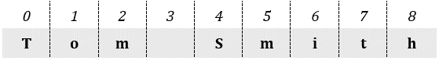

在视觉上分隔名和姓的字符是它们之间的空格字符。问题在于，这个字符并不总是位于位置`3`。某人的名字可能很短，比如“Tom”，而另人的名字可能较长，比如“Robert”。因此，你需要一种无论字符串内容如何，都能找到空格字符位置的方法。

`indexOf()`方法就是你正在寻找的！如果你用它来查找字符串“Tom Smith”中空格字符的位置，它返回值`3`。但如果你用它来查找另一个字符串（例如“Angelina Brown”）中的空格字符，它返回的是值`8`。

值`3`不仅仅是空格字符存在的位置。它还代表了单词“Tom”包含的字符数！同样适用于为字符串“Angelina Brown”返回的值`8`。它既代表了空格字符存在的位置，也代表了单词“Angelina”包含的字符数！

该算法的 Java 程序如所示。


```java
Class_14_3_2public static void main(String[] args) {
    String full_name, name1, name2;
    int space_pos;
    System.out.print("Enter your full name: ");
    full_name = cin.nextLine();
    // 找到空格字符的位置。这也是名字
    // 包含的字符数
    space_pos = full_name.indexOf("  ");
    // 从位置 0 开始获取 space_pos 个字符
    name1 = full_name.substring(0, space_pos);
    // 从位置 space_pos + 1 开始获取剩余字符
    name2 = full_name.substring(space_pos + 1);
    full_name = name2 + "  " + name1;
    System.out.println(full_name);
}
```

注意，`substring(beginIndex [, endIndex])`方法返回从`beginIndex`位置开始并在但不包含`endIndex`位置结束的子字符串。

注意，此程序不能适用于西班牙语名字，例如“Maria Teresa García Ramírez de Arroyo”。原因显而易见！

### 练习 14.3-3 创建登录 ID

编写一个 Java 程序，提示用户输入其姓氏，然后根据名字的前四个字母（小写）和一个三位随机整数创建一个登录 ID。

#### 解决方案

要创建一个随机整数，你可以使用`Math.random()`方法。由于你需要一个三位的随机整数，范围必须在 100 到 999 之间。

该算法的 Java 程序如所示。


```java
Class_14_3_3public static void main(String[] args) {
    int random_int;
    String last_name, login_ID;
    System.out.print("Enter last name: ");
    last_name = cin.nextLine();
    // 获取 100 到 999 之间的随机整数
    random_int  = 100 + (int)(Math.random() * 900);
    login_ID = last_name.substring(0, 4).toLowerCase() + random_int;
    System.out.println(login_ID);
}
```

注意，`substring()`方法返回从位置 0 开始并在但不包含位置 4 的子字符串。

注意`substring()`方法是如何链接到`toLowerCase()`方法的。第一个方法的的结果用作第二个方法的参数。这是大多数程序员喜欢的编写风格，因为可以节省大量代码。当然，你可以链用任意数量的方法，但如果你链得太多，将将无法理解你的代码。

### 练习 14.3-4 创建随机单词

编写一个 Java 程序，显示一个五个字母的随机单词。

#### 解决方案

要创建一个随机单词，你需要一个包含所有 26 个字母的字符串。然后你可以使用`Math.random()`方法在 0 到 25 之间选择一个字母。

该算法的 Java 程序如所示。


```java
Class_14_3_4public static void main(String[] args) {
    String alphabet, random_word;
    alphabet = "abcdefghijklmnopqrst";
    random_word = "" + alphabet.charAt((int)(Math.random() * 26)) +
> > > alphabet.charAt((int)(Math.random() * 26)) +
> > > alphabet.charAt((int)(Math.random() * 26)) +
> > > alphabet.charAt((int)(Math.random() * 26)) +
> > > alphabet.charAt((int)(Math.random() * 26));
    System.out.println(random_word);
}
```

注意`random()`方法是如何嵌套在`charAt()`方法内部的。内部方法的的结果作为外部方法的参数。这是大多数程序员喜欢的编写风格，因为可以节省大量代码。当然，如果你嵌套了太多方法，将无法理解。嵌套四层是可以接受的。

注意`Math.random()`方法被调用了五次，每次可能返回不同的随机数。

在 Java 中，有时有必要通过以字符串（即使是空字符串）开始序列，来强制编译器执行连接而不是普通的加法。

你还可以使用`length()`方法获取字符串`alphabet`的长度，如下所示。


```java
Class_14_3_4public static void main(String[] args) {
    String alphabet, random_word;
    alphabet = "abcdefghijklmnopqrstuvwxyz";
    random_word = "" + alphabet.charAt((int)(Math.random() * alphabet.length())) +
> > > alphabet.charAt((int)(Math.random() * alphabet.length())) +
> > > alphabet.charAt((int)(Math.random() * alphabet.length())) +
> > > alphabet.charAt((int)(Math.random() * alphabet.length())) +
> > > alphabet.charAt((int)(Math.random() * alphabet.length()));
    System.out.println(random_word);
}
```

### 练习 14.3-5 求数字之和

编写一个 Java 程序，提示用户输入一个三位整数，然后计算其数字之和。在不使用算术运算符的情况下解决这个练习。

#### 解决方案

现在你可能疑惑为什么这个练习被放在这一章中，这里的整个讨论都是关于如何操作字符串。你可能还会说你已经知道如何将一个三位整数拆分为三个数字并将每个数字分配给单独的变量，就像你在第 13 章 中通过除法（`/`）和整数取模（`%`）运算符学习的那样。所以，为什么这个练习又在这里了？

原因是 Java 是一门非常强大的语言，你可以利用它的魔法力量以完全不同的方式来解决这个练习。主要思想是将给定的整数转换为字符串类型，并将每个数字（每个字符）赋值给单独的变量。


```java
Class_14_3_5
public static void main(String[] args) {
    int number, total;
    String s_number, digit1, digit2, digit3;
    System.out.print("Enter an three-digit integer: ");
    number = Integer.parseInt(cin.nextLine());
    s_number = "" + number;  //将数字转换为字符串
    digit1 = "" + s_number.charAt(0);  //将位置 0 的字符转换为字符串
    digit2 = "" + s_number.charAt(1);  //将位置 1 的字符转换为字符串
    digit3 = "" + s_number.charAt(2);  //将位置 2 的字符转换为字符串
    total = Integer.parseInt(digit1) + Integer.parseInt(digit2) + Integer.parseInt(digit3);
    System.out.println(total);
}
```

### 14.4 复习题：判断题

对以下每个陈述选择对或错。

1. 字符串是任何你可以使用键盘输入的内容。

2. 字符串必须被括在括号中。

3. 短语“Hi there!”包含 8 个字符。

4. 在短语“Hi there!”中，字母“t” 位于位置 3。

5. 语句`y = a.charAt(1)`将变量`a`中包含的字符串的第二个字符赋值给变量`y`。

6. 语句`y = a.charAt(-1);`满足确定性属性。

7. 修剪（Trimming）是从字符串的开头或结尾移除空白字符的过程。

8. 语句`y = ("Hello         Aphrodite").trim()`将值“HelloAphrodite”赋值给变量`y`。

9. 语句`System.out.println(("Hi there!").replace("Hi", "Hello"))`显示消息“Hello there!”。

10. 语句`index = ("Hi there").indexOf("the")`将值 4 赋值给变量`index`。

11. 语句`System.out.println(("hi there!").toUpperCase())`显示消息“Hi There”。

12. 语句`System.out.println(("Hi there!").substring(0))`显示消息“Hi there!”。

13. 语句`System.out.println(a.substring(0, a.length()))`显示变量`a`的某些字母。

14. 语句`System.out.println(a.substring(a.length() - 1, a.length()));`等于语句`System.out.println(a.charAt(a.length() - 1));`。

15. 语句`System.out.println(("hello there!").toUpperCase().substring(0, 5))`显示单词“HELLO”。

16. 如果变量`a`包含一个 100 个字符的字符串，则语句`System.out.println(a.chartAt(a.length() – 1))`等于语句`System.out.println(a.chartAt(99);`。

### 14.5 复习题：单选题

为以下每个陈述选择正确答案。

1. 以下哪一个不是字符串？

   a. “Hello there!”

   b. “13”

   c. “13.5”

   d. 以上所有都是字符串。

2. 字符串“Hello Zeus!”中的空格字符位于哪个位置？

   a. 6

   b. 5

   c. 空格不是一个字符。

   d. 以上都不是

3. 语句`System.out.println(a.substring(a.length() - 1, a.length()));`显示

   a. 变量`a`的最后一个字符。

   b. 变量`a`的倒数第二个字符。

   c. 该语句无效。

4. 语句`a.trim().replace("a", "b").replace("w", "y");`等于语句：

   a. `a.replace("a", "b").replace("w", "y").trim()`

   b. `a.replace("a", "b").trim().replace("w", "y")`

   c. `a.trim().replace("w", "y").replace("a", "b")`

   d. 以上都是

5. 语句`a.replace(" ", "")`

   a. 在变量`a`的每个字母之间添加一个空格。

   b. 移除变量`a`中的所有空格字符。

   c. 将变量`a`清空。

6. 语句`("  Hello  ").replace(" ", "")`等于语句

   a. `("  Hello  ").replace("", " ")`

   b. `("  Hello  ").trim()`

   c. 以上都是

   d. 以上都不是

7. 以下代码片段：

   ```java
   a = "";
   System.out.println(a.length());
   ```

   显示

   a. 什么都没有。

   b. 1。

   c. 0。

   d. 语句无效。

   e. 以上都不是

8. 哪个值将以下代码片段赋值给`to_be_or_not_to_be = "2b Or Not 2b"; Shakespeare = to_be_or_not_to_be.indexOf("b")`？

   a. 1

   b. 2

   c. 6

   d. 以上都不是

9. 以下代码片段执行什么？

   ```java
   a = "Hi there";
   b = a.indexOf(" ") + 1;
   ```

   a. 将“Hi”赋值给变量`b`。

   b. 将空格赋值给变量`b`。

   c. 将“there”赋值给变量`b`。

   d. 以上都不是

### 14.6 复习练习

完成以下内容：

1. 编写一个程序，提示用户输入名字、中间名、姓氏和头衔（Mr., Mrs., Dr.）并显示它们。字母必须大写。

2. 编写一个程序，提示用户输入一个整数并反转它。例如，如果用户输入 375，则显示 573。使用算术运算符完成此练习。

## “序列结构”复习

### 复习字游戏

1. 完成以下填字游戏。


横向

2. `length()`方法返回字符串中的数量。

6. 任何你可以使用键盘输入的内容。

7. Java 提供了许多。

8. 这种控制结构指的是语句按行执行的方式。

向下

1. 空白字符。

3. 从字符串的开头或结尾移除空白字符的过程。

4. `Math.sin()`方法返回数字的。

5. `Math.abs()`函数返回数字的值。

### 复习题

回答以下问题：

1. 什么是序列控制结构？

2. 序列控制结构可以执行哪些操作？

3. 给整数除法的商和余数举几个例子。

4. 什么是方法？

5. “链式方法”术语是什么意思？

6. “嵌套方法”术语是什么意思？

布尔表达式是一个问题，它们应该被读为“某值是否等于/大于/小于其他某值？”，而答案只是“是”或“否”（真或假）。

决策控制结构可以评估一个布尔表达式或一组布尔表达式，然后决定执行哪块语句。

### 15.3 如何编写简单的布尔表达式

一个简单的布尔表达式的写形式为：

`Operand1 Comparison_Operator Operand2`

其中：

- `Operand1`和`Operand2`可以是值、变量或数学表达式。

- `Comparison_Operator`可以是表 15-1 所示的运算符之一。

| 比较运算符 | 描述 |
| --- | --- |
| `==` | 等于（非赋值操作符） |
| `!=` | 不等于 |
| `>` | 大于 |
| `<` | 小于 |
| `>=` | 大于等于 |
| `<=` | 小于等于 |

表 15-1 Java 中的比较运算符

以下是一些布尔表达式的示例：

- `x > y`。这个布尔表达式是对计算机的一个问题，可以读作“x 大于 y 吗？”

- `x <= y`。这个布尔表达式也是对计算机的一个问题，可以读作“x 小于等于 y 吗？”

- `x != 3 * y + 4`。这可以读作“x 不等于表达式`3 * y + 4`的结果吗？”

- `s.equals("Hello") == true`。这可以读作“s 等于单词 'Hello' 吗？”换句话说，这个问题可以读作“s 包含单词 'Hello' 吗？”在 Java 中，为了测试两个字符串在字典顺序上是否相等，你需要使用`equals()`方法。

- `x == 5`。这可以读作“x 等于 5 吗？”

新手程序员在编写 Java 程序时经常犯的一个非常常见的错误是将值赋值操作符与等号运算符混淆。他们经常在实际上想表达`x == 5`时误写成`x = 5`。

#### 练习 15.3-1 填充表格

根据变量`a`、`b`和`c`的值，在下表中填入“true”或“false”。

| a | b | c | a == 10 | b <= a | c > 3 * a - b |
| --- | --- | --- | --- | --- | --- |
| 3 | −5 | 7 | | | |
| 10 | 10 | 21 | | | |
| −4 | −2 | −9 | | | |

解法

前两个布尔表达式是显而易见的，不需要进一步的解释。

关于布尔表达式`c > 3 * a – b`，请非常小心`b`为负的情况。例如，在第一行中，`a`等于 3，`b`等于 −5。表达式`3 * a - b`的结果为`3 * 3 – (−5) = 3 * 3 + 5 = 14`。由于变量`c`的内容（第一行中）并不大于 14，因此布尔表达式`c > 3 * a – b`的结果为 false。

经过计算后，表格如下：

| a | b | c | a == 10 | b <= a | c > 3 * a - b |
| --- | --- | --- | --- | --- | --- |
| 3 | −5 | 7 | false | true | false |
| 10 | 10 | 21 | true | true | true |
| −4 | −2 | −9 | false | false | true |

### 15.4 逻辑运算符和复杂的布尔表达式

一个更复杂的布尔表达式由更简单的布尔表达式构建，可以写成：

`BE1 Logical_Operator BE2`

其中：

- `BE1`和`BE2`可以是任何布尔表达式。

- `Logical_Operator`可以是表 15-2 所示的运算符之一。

| 逻辑运算符 | 描述 |
| --- | --- |
| `&&` | 与（也称为逻辑合与） |
| `||` | 或（也称为逻辑析取） |
| `!` | 非（也称为否定或逻辑取反） |

表 15-2 Java 中的逻辑运算符

当你将简单的布尔表达式与逻辑运算符结合时，整个布尔表达式被称为“复杂布尔表达式”。例如，表达式`x == 3 && y > 5`就是一个复杂的布尔表达式。

#### 与（`&&`）运算符

当你在两个布尔表达式之间使用与运算符（`BE1 && BE2`）时，意味着只有当`BE1`和`BE2`两个布尔表达式都为真时，整个复杂布尔表达式的结果为真。

你可以将这些信息组织在所谓的真表中。真表显示了两个或多个布尔表达式之间在所有可能的值组合下的逻辑操作结果。这里显示了与（`&&`）运算符的真表。

| BE1 (布尔表达式 1) | BE2 (布尔表达式 2) | BE1 && BE2 |
| --- | --- | --- |
| false | false | false |
| false | true | false |
| true | false | false |
| true | true | true |

你可以在两个布尔表达式之间使用或运算符（`BE1 || BE2`），这意味着只有当`BE1`或`BE2`两个布尔表达式至少有一个为真时，整个复杂布尔表达式的结果为真。

你可以将这些信息组织在所谓的真表中。真表显示了两个或多个布尔表达式之间在所有可能的值组合下的逻辑操作结果。这里显示了或（`||`）运算符的真表。

| BE1 (布尔表达式 1) | BE2 (布尔表达式 2) | BE1 \|\| BE2 |
| --- | --- | --- |
| false | false | false |
| false | true | true |
| true | false | true |
| true | true | true |

#### 非（`!`）运算符

当你在布尔表达式前面使用非运算符（`!BE`），意味着当布尔表达式`BE`为假时，结果为真，反之亦然。

非运算符的真表如下表所示：

| BE (布尔表达式) | !(BE) |
| --- | --- |
| false | true |
| true | false |

例如，表达式`!(age > 5)`在变量`age`的值小于或等于 5 时为真。如果变量`age`的值为 6，则整个表达式为假。

images/00002.jpeg)逻辑运算符非（`!!`）反转布尔表达式的结果。在 Java 中，布尔表达式必须放在括号内。

### 15.5 将布尔表达式的结果赋值给变量


由于布尔表达式返回一个值（真或假），这个值可以直接赋值给变量。例如，表达式`a = x > y`将真或假赋值给变量`a`。它可以读作“如果变量`x`的内容大于变量`y`的内容，则给变量`a`赋值真；否则赋值假”。下一个示例将在屏幕上显示真。

```java
public static void main(String[] args) {
    int x, y;
    boolean a;
    x = 8;
    y = 5;
    a = x > y;
    System.out.println(a);
}
```

### 15.6 逻辑运算符的优先级是什么？

一个更复杂的布尔表达式可能由多个逻辑运算符组成，如这里的表达式所示：

`x > y || x == 5 && x <= z || !(z == 1)`

因此，一个合理的问题是“哪个执行逻辑操作？”

逻辑运算符遵循适用于大多数编程语言的优先级规则。优先级顺序是：逻辑非（`!`）首先执行，逻辑合与（`&&`）接着执行，逻辑析取（`||`）最后执行。

| 高优先级  | 低优先级 |
| --- | --- |
| `!` | 逻辑运算符 |
| `&&` | |
| `||` | |

# 表 15-3 逻辑运算符的优先级

你始终可以使用括号来改变默认的优先级。

### 15.7 算术运算符、比较运算符和逻辑运算符的优先级是什么？

在很多情况下，一个表达式可能包含不同类型的运算符，如下例所示。

```java
a * b + 2 > 21 || !(c == b / 2) && c > 13
```

在这些情况下，首先执行算术运算，接着执行比较运算，最后执行逻辑运算，如下表所示。

| 优先级较高  | 优先级较低 |
| :--- | :--- |
| 算术运算符 | `*`, `/`, `%` |
| | `+`, `−` |
| 比较运算符 | `<`, `<=`, `>`, `>=`, `==`, `!=` |
| 逻辑运算符 | `!` |
| | `&&` |
| | `||` |

表 15-4 算术运算符、比较运算符和逻辑运算符的优先级

#### 练习 15.7-1 填充真值表

根据变量`a`、`b`和`c`的值，在下表中填充“true”或“false”。

| `a` | `b` | `c` | `a > 2 || c > b && c > 2` | `!(a > 2 || c > b && c > 2)` |
| :--- | :--- | :--- | :--- | :--- |
| 1 | -5 | 7 | | |
| 10 | 10 | 3 | | |
| -4 | -2 | -9 | | |

#### 答案

要计算复杂的布尔表达式的结果，你可以使用以下图形化方法。

对于`a = 1`, `b = −5`, `c = 7`，

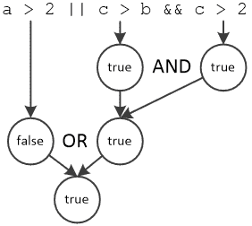

最终结果为 true。

与（`&&`）运算的优先级更高，在或（`||`）运算之前执行。

对于`a = 10`, `b = 10`, `c = 3`，

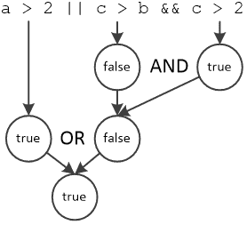

最终结果为 true。

对于`a = −4`, `b = −2`, `c = −9`，


最终结果为 false。

表格第五列的值可以很容易地计算出来，因为其列标题中的布尔表达式与第四列的表达式几乎相同。唯一的区别是表达式前面的非（`!`）运算符。因此，第五列的值只需简单地对第四列的结果取反即可得到！

最终的真值表所示。

| `a` | `b` | `c` | `a > 2 || c > b && c > 2` | `!(a > 2 || c > b && c > 2)` |
| :--- | :--- | :--- | :--- | :--- |
| 1 | -5 | 7 | true | false |
| 10 | 10 | 3 | true | false |
| -4 | -2 | -9 | false | true |

#### 练习 15.7-2 计算复杂布尔表达式的结果

当变量`a`、`b`、`c`和`d`分别包含 5、2、7 和 −3 值时，计算以下复杂布尔表达式的结果。

i. `(3 * a + b / 47 - c * b / a > 23) && (b != 2)`

ii. `(a * b - c / 2 + 21 * c / 3) || (a >= 5)`

#### 答案

不要害怕！结果可以很容易地找到。你只需要回忆与（`&&`）和或（`||`）运算符的规则即可。

i. 当两个布尔表达式都为真时，与（`&&`）运算符的结果为真。如果你仔细观察，右侧布尔表达式（`b != 2`）的结果为 false。因此，你不需要浪费时间计算左侧布尔表达式的结果。最终结果一定是 false。

ii. 当至少有一个布尔表达式为真时，或（`||`）运算符的结果为真。如果你仔细观察，右侧布尔表达式（`a >= 5`）的结果实际上是 true。因此，不必费力计算左侧布尔表达式的结果。最终结果一定是 true。

#### 练习 15.7-3 将英语句子转换为布尔表达式

一位主任要求学生根据年龄举手。他想找到以下学生：

i. 年龄在 9 岁到 12 岁之间的。

ii. 8 岁以下且 11 岁以上的。

iii. 8 岁、10 岁和 12 岁的。

iv. 年龄在 6 岁到 8 岁之间，且在 10 岁到 12 岁之间的。

v. 既不是 10 岁也不是 12 岁的。

#### 答案

为了组合所需的布尔表达式，使用了变量`age`。

i. 句子“年龄在 9 岁到 12 岁之间”可以用所示图形化表示。

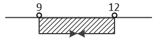

不过！编写`9 ≤ age ≤ 12`是有效的，但在代码中你应该使用`9 <= age && age <= 12`。

ii. 句子“8 岁以下且 11 岁以上”可以用所示图形化表示。

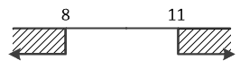

iv. 句子“年龄在 6 岁到 8 岁之间，且在 10 岁到 12 岁之间”可以用所示图形化表示。

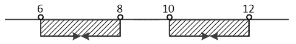

v. “既不是 10 岁也不是 12 岁”的布尔表达式可以写成：

```java
age != 10 && age != 12
```

或者写成：

```java
!(age == 10 || age == 12)
```

第二种方法稍微复杂，但并不难学。你只需要根据下表对每个运算符进行取反即可。

| 原始运算符 | 取反后的运算符 |
| --- | --- |
| `==` | `!=` |
| `!=` | `==` |
| `>` | `<=` |
| `<` | `>=` |
| `<=` | `>` |
| `>=` | `<` |
| `&&` | `||` |
| `||` | `&&` |
| `!` | `!` |


注意，非（`!`）运算符保持不变。

例如，如果原始布尔表达式是：

`x > 5 && y == 3`

那么取反后的布尔表达式变为：

`x <= 5 || y != 3`

### 练习 15.8-1 取反布尔表达式

使用两种方法对以下布尔表达式进行取反。

i. `b != 4`

ii. `a * 3 + 2 > 0`

iii. `!(a == 5 && b >= 7)`

iv. `a == true`

v. `b > 7 && !(x > 4)`

vi. `a == 4 || b != 2`

#### 答案

#### 第一种方法

i. `!(b != 4)`

ii. `!(a * 3 + 2 > 0)`

iii. `!(!(a == 5 && b >= 7))`，或者等价于`a == 5 && b >= 7`


两次取反等于肯定。也就是说，两个连续的非（`!`）运算符会相互取反。

iv. `!(a == true)`

v. `!(b > 7 && !(x > 4))`

vi. `!(a == 4 || b != 2)`

#### 第二种方法

i. `b == 4`

ii. `a * 3 + 2 <= 0`


注意，算术运算符是不“取反”的。千万不要尝试将加号（`+`）替换为减号（`–`）运算符！

iii. `!(a != 5 || b < 7)`


注意，非（`!`）运算符保持不变。

iv. `a != true`

v. `b <= 7 || !(x <= 4)`

vi. `a != 4 && b == 2`

### 15.9 复习题：判断对错

对以下每个陈述选择对或错。

1. 布尔表达式是一个始终产生两个值之一的表达式。

2. 布尔表达式包含至少一个逻辑运算符。

3. 在 Java 中，表达式`x = 5`用于测试变量`x`是否等于 5。

4. 在 Java 中，语句`a = b == c;`不是一个有效的 Java 语句。

5. 布尔表达式`b < 5`用于测试变量`b`是否小于或等于 5。

6. 与（`&&`）运算符也被称为逻辑取或运算符。

7. 或（`||`）运算符也被称为逻辑逻辑/补运算符。

8. 给定两个布尔表达式都为真，则这两个布尔表达式的逻辑取与的结果等于它们逻辑取或的结果。

9. 如果定两个布尔表达式的值不同，则这两个布尔表达式的逻辑取或的结果为真。

10. 表达式`c == 3 && d > 7`被认为是一个布尔表达式。

11. 当两个操作数（布尔表达式）都为真时，逻辑运算符或（`||`）的结果为真。

12. 当变量`x`包含除 5 以外的任何值时，布尔表达式`!(x == 5)`的结果为真。

13. 非（`!`）运算符在逻辑运算符中优先级最高。

14. 或（`||`）运算符在逻辑运算符中优先级最低。

15. 在布尔表达式`x > y || x == 5 && x <= z`中，与（`&&`）操作在或（`||`）操作之前执行。

16. 在布尔表达式`a * b + c > 21 || c == b / 2`中，程序首先测试`c`是否大于 21。

17. 当老师想找到年龄小于 8 岁且大于 11 岁的学生时，对应的布尔表达式是`age < 8 && age > 11`。

18. 布尔表达式`x < 0 && x > 100`对于任何`x`的取值始终为假。

19. 布尔表达式`x > 0 || x < 100`对于任何`x`的取值始终为真。

20. 布尔表达式`x > 5`等于`!(x < 5)`。

21. 布尔表达式`!(x > 5 && y == 5)`不等于`!(x > 5) && y == 5`。

22. 在威廉·莎士比亚的《哈姆莱特》（第三幕第一场）中，主角说：“生存还是毁灭，这是一个问题：…… ”。 如果你将其写成一个布尔表达式`to_be || !to_be`，那么这个“莎士布尔”表达式在以下代码片段下的结果为真：

```
to_be = 1 > 0;
that_is_the_question = to_be || !to_be;
```

23. 布尔表达式`!(!(x > 5))`等于`x > 5`。

### 15.10 复习题：单选题

为以下每个陈述选择正确答案。

1. 下哪个不是比较运算符？

a. `>=`

b. `=`

c. `<`

d. 以上都是。

2. 下哪个不是逻辑运算符？

a. `/`

b. `||`

c. 以上都是。

d. 以上没有不是逻辑运算符。

3. 如果`x`的值为 5，语句`y = x % 2 == 1`给`y`赋值什么值？

a. 真

b. 假

c. 以上都不是。

4. 如果`x`的值为 5，语句`y = x % 2 || (x / 2) == 2`给`y`赋值什么值？

a. 真

b. 假

c. 以上都不是。

5. 实验室温度必须在 50 到 80 度之间。哪个布尔表达式测试了该条件？

a. `t >= 50 || t <= 80`

b. `50 < t < 80`

c. `t >= 50 && t <= 80`

d. `t > 50 || t < 80`

e. 以上都不是。

6. 下哪个等于布尔表达式`t == 30 || t > 30`？

a. `t == 30 && !(t <= 30)`

b. `t == 30 && !(t < 30)`

c. `!(t != 30) || !(t < 30)`

d. `!(t != 30 && t <= 30)`

e. 以上都不是。

### 15.1 练习

1. 将第一列的每个元素与第二列的一个或多个元素匹配。

| 运算符 | 符号 |
| --- | --- |
| i. 逻辑运算符 | a. `%` |
| ii. 算术运算符 | b. `+=` |
| iii. 比较运算符 | c. `&&` |
| iv. 赋值运算符（通用） | d. `==` |
| | e. `||` |
| | f. `>=` |
| | g. `!` |
| | h. `=` |
| | i. `*=` |
| | j. `/` |

2. 根据`a`, `b`, 和`c`的值，在下表中填写“真”或“假”。

| a | b | c | a != 1 | b > a | c / 2 > a |
| --- | --- | --- | --- | --- | --- |
| 3 | -5 | 8 | | | |
| 1 | 10 | 20 | | | |
| -4 | -2 | -9 | | | |

3. 根据布尔表达式`BE1`和`BE2`的值，在下表中填写“真”或“假”。

| 布尔表达式 1 (BE1) | 布尔表达式 2 (BE2) | `BE1 || BE2` | `BE1 && BE2` | `!(BE2)` |
| --- | --- | --- | --- | --- |
| false | false | | | |
| false | true | | | |
| true | false | | | |
| true | true | | | |

4. 根据`a`, `b`, 和`c`的值，在下表中填写“真”或“假”。

| a | b | c | `a > 3 || c > b && c > 1` | `a > 3 && c > b || c > 1` |
| --- | --- | --- | --- | --- |
| 4 | -6 | 2 | | |
| -3 | 2 | -4 | | |
| 2 | 5 | 5 | | |

5. 对于`x = 4`, `y = -2`且`flag = true`，请在下表中填入相应的数值。

| 表达式 | 数值 |
| --- | --- |
| `Math.pow(x + y, 3)` | |
| `(x + y) / (Math.pow(x, 2) - 14)` | |
| `(x - 1) == y + 5` | |
| `x > 2 && y == 1` | |
| `x == 1 || y == -2 && !(flag == false)` | |
| `!(x >= 3) && (x % 2 > 1)` | |

6. 当变量`a`, `b`, `c`, 和`d`分别包含值`6`, `-3`, `4`, 和`7`时，计算每个复合布尔表达式的结果。

i. `(3 * a + b / 5 - c * b / a > 4) && (b != -3)`

ii. `(a * b - c / 2 + 21 * c / 3 != 8) || (a >= 5)`

7. 老师要求学生根据年龄举手。他想找到以下学生：

i. 小于 12 岁，但不是 8 岁的学生。

ii. 年龄在 6 到 9 岁之间，以及 11 岁的学生。

iii. 大于 7 岁，但不是 10 岁或 12 岁的学生。

iv. 6 岁、9 岁和 11 岁的学生。

v. 年龄在 6 到 12 岁之间，但不是 8 岁的学生。

vi. 既不是 7 岁也不是 10 岁的学生。

为了组合所需的布尔表达式，请使用变量`age`。

8. 不使用非（`!`）运算符，对以下布尔表达式进行取反。

i. `x == 4 && y != 3`

ii. `x + 4 <= 0`

iii. `!(x > 5) || y == 4`

iv. `x != false`

v. `!(x >= 4 || z > 4)`

vi. `x != 2 && x >= -5`

9. 如你所知，两次取反等于肯定。通过取取反（应用两种方法）写出以下布尔表达式的等价表达式。

i. `x >= 4 && y != 10`

ii. `x - 2 >= 9`

iii. `!(x >= 2) || y != 4`

iv. `x != false || y == 3`

v. `!(x >= 2 && y >= 2)`

vi. `x != -2 && x <= 2`

### 16.1 单分支决策结构

这是最简单的决策控制结构。它仅在“真”路径上包含一条语句或一个语句块。

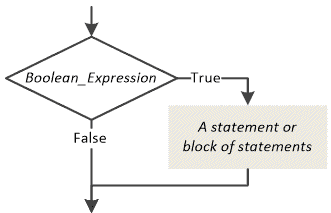

如果`Boolean_Expression`的求值为真，则执行该结构中的语句或语句块；否则，则跳过这些语句。

Java 语句的一般形式为：

```java
if (Boolean_Expression) {A statement or block of statements}
```

注意，该语句或语句块缩进了 4 个空格。


在下一个示例中，只有当用户输入的数值小于 18 时，才会显示消息“你未成年！”。当用户输入的数值大于或等于 18 时，什么都不显示。

 `Class_16_1a`

```java
public static void main(String[] args) {
    int age;
    System.out.print("Enter your age: ");
    age = Integer.parseInt(cin.nextLine());
    if (age < 18) {
        System.out.println("You are underage!");
    }
}
```

注意 `System.out.println()` 语句缩进了 2 个空格。

在下一个示例中，只有当用户输入的数值小于 18 时，才会显示消息“你未成年！”和“你还需要再等几年”。与之前一样，当用户输入的数值大于或等于 18 时，不显示任何消息。

 `Class_16_1b`

```java
public static void main(String[] args) {
    int age;
    System.out.print("Enter your age: ");
    age = Integer.parseInt(cin.nextLine());
    if (age < 18) {
        System.out.println("You are underage!");
        System.out.println("You have to wait for a few more years.");
    }
}
```

注意两个 `System.out.println()` 语句都缩进了 2 个空格。

为了节省纸张，本书每层缩进使用 2 个空格。然而，Java 官方网站建议每层缩进使用 4 个空格。

为了缩进文本光标，与其输入空格字符，你可以按一次“Tab 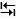”键！

为了缩进现有的语句或语句块，请选中它们并按下“Tab ”键！

为了取消语句或语句块的缩进，请选中它们并按下“Shift + Tab ”组合键！

在下一个示例中，只有当用户输入名字“Zeus”时，才会显示消息“你是众神之王！”。然而，消息“你住在奥林匹斯山”无论用户输入什么名字都会一直显示。

 `Class_16_1c`

```java
public static void main(String[] args) {
    String name;
    System.out.print("Enter the name of an Olympian: ");
    name = cin.nextLine();
    if (name.equals("Zeus") == true) {
        System.out.println("You are the King of the Gods!");
    }
    System.out.println("You live on Mount Olympus.");
}
```

注意最后一个 `System.out.println()` 语句不属于单分支决策结构的语句块。

初级程序员在编写 Java 程序时经常犯的一个非常常见的错误是将赋值运算符与“等于”运算符混淆。他们经常犯写成 `if (name.equals("Zeus") = true)` 的错误，而他们实际上想表达的是 `if (name.equals("Zeus") == true)`。

当 `if` 语句中只包含一条单一语句时，你可以省略大括号 `{ }`。因此，`if` 语句变为：

`if (Boolean_Expression) One_Single_Statement;`

或者你甚至可以将语句写在同一行，如下所示：

`if (Boolean_Expression) One_Single_Statement;`

只有当 `if` 语句中包含多条语句时，才需要大括号。如果没有大括号，Java 无法判断某语句是 `if` 语句的一部分，还是 `if` 语句之后语句的一部分。许多程序员倾向于始终使用大括号，即使 `if` 语句只包含一条单一语句。在以下两个示例中，`System.out.println(y)` 语句都不是 `if` 语句的一部分。

```java
if (x == y)x++;
System.out.println(y);
if (x == y) {x++;
System.out.println(y);
```

#### 练习 16.1-1 追踪表与单分支决策结构

设计相应的流程图并创建一个追踪表，以确定下一个 Java 程序在两种不同执行情况下，每一步中变量的值。

两次执行的输入值为 (i) 10 和 (ii) 51。

 `Class_16_1_1`

```java
public static void main(String[] args) {
    int a, y;
    a = Integer.parseInt(cin.nextLine());
    if (a * 2 > 100) {
        y = 5;
    }
    y = a * 4;
    System.out.println(a + " " + y);
}
```

解决方案

流程图所示 i. 对于输入值 10，追踪表如下：

| 步骤 | 语句 | 注释 | a | y |
| :--- | :--- | :--- | :--- | :--- |
| | | | | |
| 1 | `a = Integer.parseInt(cin.nextLine())` | 输入: 10 | 10 | |
| 2 | `y = 5` | | 10 | 5 |
| 3 | `if (a * 2 > 100)` | `10 * 2 > 100` 为假 | 10 | 5 |
| 4 | `y = a * 4` | | 10 | 40 |
| 5 | `System.out.println(a + " " + y)` | 输出: 10 40 | 10 | 40 |

ii. 对于输入值 51，追踪表如下：

| 步骤 | 语句 | 注释 | a | y |
| :--- | :--- | :--- | :--- | :--- |
| | | | | |
| 1 | `a = Integer.parseInt(cin.nextLine())` | 输入: 51 | 51 | |
| 2 | `y = 5` | | 51 | 5 |
| 3 | `if (a * 2 > 100)` | `51 * 2 > 100` 为真 | 51 | 5 |
| 4 | `y = a * 4` | | 51 | 204 |
| 5 | `System.out.println(a + " " + y)` | 输出: 51 204 | 51 | 204 |

#### 练习 16.1-2 数字的绝对值

设计相应的流程图并编写相应的 Java 程序，让用户输入一个数字，然后显示其绝对值。

解决方案

实际上有两种方法。第一种方法使用单分支结构，而第二种使用内置的 `abs()` 方法。

使用单分支结构

这种方法非常简单。如果用户输入负值，例如 -5，该值将变为 +5。正数或零则保持不变。解决方案所示所示。对应的 Java 程序如下：

 `Class_16_1_2a`

```java
public static void main(String[] args) {
    double x;
    x = Double.parseDouble(cin.nextLine());
    if (x < 0) {
        x = (-1) * x;
    }
    System.out.println(x);
}
```

使用 `abs()` 方法

在这种情况下，你只需要几行代码，不需要决策结构！

 `Class_16_1_2b`

```java
public static void main(String[] args) {
    double x;
    x = Double.parseDouble(cin.nextLine());
    System.out.println(Math.abs(x));
}
```

### 16.2 复习题：判断题

对以下每个陈述选择对或错。

1. 单分支决策结构用于执行一组语句。

2. 你使用单分支决策结构是为了让其他程序员更容易理解你的程序。

3. 单分支决策结构中的的语句可能一个都不被执行。

4. 在流程图中，决策符号代表算法的开始和结束。

5. 代码 `static final int if = 5; public static void main(String[] args) { int x; x = if + 5; System.out.println(x); }` 是语法正确的。

6. 单分支决策结构使用保留字 `else`。

7. 代码片段 `if (b != 3) {x = a / (b - 3);}` 满足确定性。

8. 下一个 Java 程序满足确定性：`public static void main(String[] args) { double a, b, x; a = Double.parseDouble(cin.nextLine()); b = Double.parseDouble(cin.nextLine()); if (b != 3) { x = a / (b - 3); } System.out.println(x); }`。

### 16.3 复习题：多选题

为以下每个陈述选择正确答案。

1. 单一分支决策结构用于以下情况：

   a. 语句一个接一个地执行。

   b. 在执行某些语句之前必须做出决策。

   c. 以上均不是。

   d. 以上都是。

2. 单一分支决策结构在以下路径上包含一个语句或语句块：

   a. 仅假路径。

   b. 每一条路径都是。

   c. 仅真路径。

3. 在以下代码片段中：

```java
if (x == 3) x = 5;
y++;
```

语句 `y++` 的执行情况是：

   a. 仅当变量 `x` 的值为 3 时。

   b. 仅当变量 `x` 的值为 5 时。

   c. 仅当变量 `x` 的值不等于 3 时。

   d. 哪种情况都会执行。

4. 在以下代码片段中：

```java
if (x % 2 == 0) y++;
```

语句 `y++` 的执行情况是：

   a. 变量 `x` 恰好被 2 整除。

   b. 变量 `x` 是一个偶数。

   c. 变量 `x` 不包含奇数。

   d. 以上都是。

   e. 以上均不是。

5. 在以下代码片段中：

```java
x = 3 * y;
if (x > y) y++;
```

语句 `y++` 是：

   a. 总是执行。

   b. 从不执行。

   c. 哪种情况都会执行。

   d. 仅当变量 `y` 包含正值时执行。

   e. 以上均不是。

### 16.4 复习

完成以下练习。

1. 识别以下 Java 程序中的语法错误：

```java
public static void main(String[] args) {
    double x, y
    x = Double.parseDouble(cin.nextLine();
    y ← -5;
    if (x * y / 2 > 20) {
        y =* 2
        x += 4 * x²;
    }
    System.out.println(x y);
}
```

2. 创建一个跟踪表，确定以下 Java 程序在两种不同执行下的每一步的变量值。然后，设计对应的流程图。

两次执行的输入值为 (i) 10，和 (ii) −10。

```java
public static void main(String[] args) {
    double x, y;
    x = Double.parseDouble(cin.nextLine());
    y = -5;
    if (x * y / 2 > 20) {
        y--;
        x -= 4;
    }
    if (x > 0) {
        y += 30;
        x = Math.pow(x, 2);
    }
    System.out.println(x + ", " + y);
}
```

3. 创建一个跟踪表，确定以下 Java 程序在两种不同执行下的每一步的变量值。然后，设计对应的流程图。

两次执行的输入值为 (i) −11，和 (ii) 11。

```java
public static void main(String[] args) {
    int x, y;
    x = Integer.parseInt(cin.nextLine());
    y = 8;
    if (Math.abs(x) > 10) {
        y += x;
        x--;
    }
    if (Math.abs(x) > 10) {
        y *= 3;
    }
    System.out.println(x + ", " + y);
}
```

4. 创建一个跟踪表，确定以下 Java 程序在两种不同执行下的每一步的变量值。然后，设计对应的流程图。

两次执行的输入值为 (i) 1, 2, 3；和 (ii) 4, 2, 1。

```java
public static void main(String[] args) {
    int x, y, z;
    x = Integer.parseInt(cin.nextLine());
    y = Integer.parseInt(cin.nextLine());
    z = Integer.parseInt(cin.nextLine());
    if (x + y > z)
        x = y + z;
    if (x > y + z)
        y = x + z;
    if (x > y - z)
        z = x - z % 2;
    System.out.println(x + ", " + y + ", " + z);
}
```

5. 编写一个 Java 程序，提示用户输入一个数字，当给定数字为正数时，显示消息“Positive”。

6. 编写一个 Java 程序，提示用户输入两个数字，当两个给定的数字均为正数时，显示消息“Positive”。

7. 编写一个 Java 程序，提示用户输入年龄，当给定年龄大于 14 岁时，显示消息“You can drive a car in Kansas (USA)”。

8. 编写一个 Java 程序，提示用户输入一个字符串，当给定字符串仅包含大写字母时，显示消息“Uppercase”。

   提示：使用 `equals()` 和 `toUpperCase()` 方法。

9. 编写一个 Java 程序，提示用户输入一个字符串，当给定字符串超过 20 个字符时，显示消息“Many characters”。

   提示：使用 `length()` 方法。

10. 编写一个 Java 程序，提示用户输入四个数字，如果其中一个是负数，则显示消息“Among the given numbers, there is a negative one!”。

11. 编写一个 Java 程序，提示用户输入两个数字。如果第一个给定的数字大于第二个，程序必须交换它们的值。最后，程序必须显示数字，且始终按升序排列。

12. 编写一个 Java 程序，提示用户输入在纽约三个不同地点测量的三个温度值，如果平均值大于 60 华氏度，则显示消息“Heat Wave”。

# 第 17 章

双分支决策结构

### 17.1 双分支决策结构

与单一分支决策结构相比，双分支决策结构在两条路径上都包含一个语句或语句块。

`if-else` 的通用形式为：

```java
if (expression)
    语句或语句块 1
else
    语句或语句块 2
```

在下一个示例中，当用户输入大于或等于 18 的值时，显示消息“You are an adult”。否则显示“You are underage!”。

```java
public static void main(String[] args) {
    int age;
    System.out.print("Enter your age: ");
    age = Integer.parseInt(cin.nextLine());
    if (age >= 18) {
        System.out.println("You are an adult!");
    } else {
        System.out.println("You are underage!");
    }
}
```

#### 练习 17.1-1 Find 输出

对于以下代码，确定三次执行的输出消息：

```java
if (x > 0)
    print("Positive");
else
    print("Negative");
```

解答：


i. 当用户输入 3 时，表达式为真。执行右路径并显示“Positive”。

ii. 当用户输入 −3 时，表达式为假。执行左路径并显示“Negative”。

iii. 你能预测用户输入 0 时会发生什么吗？双分支决策结构必须遵循某条路径，右左右！它不会跳过两个语句的执行。因此，当用户输入 0 时，表达式为假，执行左路径并显示“Negative”。

#### 练习 17.1-2 跟踪表与双分支决策结构

创建一个跟踪表，确定下一个 Java 程序在两种不同执行下的每一步的变量值。

两次执行的输入值为 (i) 5，和 (ii) 10。

```java
public static void main(String[] args) {
    double a, z, w, y;
    a = Double.parseDouble(cin.nextLine());
    z = a * 10;
    w = (z - 4) * (a - 3) / 7 + 36;
    if (z >= w && a < z) {
        y = 2 * a;
    } else {
        y = 4 * a;
    }
    System.out.println(y);
}
```

解答：

i. 对于输入值 5，跟踪表如下。

| 步骤 | 语句 | 备注 | a | z | w | y |
| --- | --- | --- | --- | --- | --- | --- |
| 1 | `a = Double.parseDouble(…)` | 用户输入值 5 | 5.0 | ? | ? | ? |
| 2 | `z = a * 10` | | 5.0 | 50.0 | ? | ? |
| 3 | `w = (z - 4) * (a - 3) / 7 + 36` | | 5.0 | 50.0 | 49.142 | ? |
| 4 | `if (z >= w && a < z)` | 此项结果为 true | | | | |
| 5 | `y = 2 * a` | | 5.0 | 50.0 | 49.142 | 10.0 |
| 6 | `.println(y)` | 显示: 10.0 | | | | |

ii. 当输入值为 10 时，跟踪表所示。

| 步骤 | 语句 | 注释 | a | z | w | y |
| --- | --- | --- | --- | --- | --- | --- |
| 1 | `a = Double.parseDouble(…)` | 用户输入值 10 | 10.0 | ? | ? | ? |
| 2 | `z = a * 10` | | 10.0 | 100.0 | ? | ? |
| 3 | `w = (z - 4) * (a - 3) / 7 + 36` | | 10.0 | 100.0 | 132.0 | ? |
| 4 | `if (z >= w && a < z)` | 此项结果为 false | | | | |
| 5 | `y = 4 * a` | | 10.0 | 100.0 | 132.0 | 40.0 |
| 6 | `.println(y)` | 显示: 40.0 | | | | |

#### 练习 17.1-3 谁最大？

设计一个流程图并编写相应的 Java 程序，让用户输入两个数字 `A` 和 `B`，然后确定并显示这两个数中较大的一个。

#### 答案

这个练习可以使用单分支或双分支决策结构来解决。所以，让我们都使用一下吧！

#### 方法一 – 使用双分支决策结构

这种方法测试数字 `B` 的值是否大于数字 `A`。如果是，则 `B` 是最大的；否则，`A` 是最大的。


对应的 Java 程序如下。


```java
Class_17_1_3
public static void main(String[] args) {
    double a, b, maximum;
    a = Double.parseDouble(cin.nextLine());
    b = Double.parseDouble(cin.nextLine());
    if (b > a) {
        maximum = b;
    } else {
        maximum = a;
    }
    System.out.println("Greatest value: " + maximum);
}
```

 注意，这个练习是尝试确定最大值，而不是该值实际上赋值给了哪个变量（变量 `A` 还是变量 `B`）。

#### 方法二 – 使用单分支决策结构

这种方法最初假设数字 `A` 可能是最大值（这就是为什么将变量 `a` 的值赋值给 `maximum` 的原因）。然而，如果证明数字 `B` 实际上大于数字 `A`，那么最大值就会更新，即变量 `maximum` 被赋值了一个新值，即变量 `b` 的值。因此，无论发生什么，最后变量 `maximum` 始终包含最大值！


在这里显示了 Java 程序。


```java
Class_17_1_3b
public static void main(String[] args) {
    double a, b, maximum;
    a = Double.parseDouble(cin.nextLine());
    b = Double.parseDouble(cin.nextLine());
    maximum = a;
    if (b > a) {
        maximum = b;
    }
    System.out.println("Greatest value: " + maximum);
}
```

#### 练习 17.1-4 寻找奇数和偶数

设计一个流程图并编写相应的 Java 程序，提示用户输入一个正整数，然后显示消息指示该数是否为偶数；否则必须显示“Odd”（奇数）。

#### 答案

接下来你可以找到各种奇数和偶数：

- ► 奇数：1, 3, 5, 7, 9, 11, …
- ► 偶数：0, 2, 4, 6, 8, 10, 12, ….

 注意，0 被视为偶数。

在这个练习中，你需要找到一种方法来判断一个数是奇数还是偶数。你需要找到所有偶数之间的共同属性，或者所有奇数之间的共同属性。实际上确实有一个！所有偶数都能被 2 整除。所以，当操作 `x MOD 2` 的结果等于 `0` 时，`x` 是偶数；否则，`x` 是奇数。

流程图所示。


对应的 Java 程序如下。


```java
Class_17_1_4
public static void main(String[] args) {
    int x;
    System.out.print("Enter a positive integer: ");
    x = Integer.parseInt(cin.nextLine());
    if (x % 2 == 0) {
        System.out.println("Even");
    } else {
        System.out.println("Odd");
    }
}
```

#### 练习 17.1-5 周薪

总工资取决于资率和每周工作小时。然而，如果有人工作超过 40 小时，他将获得加班工资。设计一个流程图并编写相应的 Java 程序，让用户输入资率和工作小时，然后计算并显示总工资。

#### 答案

这个练习可以使用双分支结构来解决。流程图所示。


对应的 Java 程序所示。

```java
Class_17_1_5
public static void main(String[] args) {
    double payrate, hours_worked, grossp;
    payrate = Double.parseDouble(cin.nextLine());
    hours_worked = Double.parseDouble(cin.nextLine());
    if (hours_worked <= 40) {
        grossp = payrate * hours_worked;
    } else {
        grossp = payrate * 40 + (hours_worked - 40) * 1.5 * payrate;
    }
    System.out.println("Gross pay: " + grossp);
}
```

### 17.2 复习题：判断题

1. 双分支结构可以执行 `else` 部分。
2. 双分支结构必须包含两个语句。
3. 双分支结构使用了 `else` 关键字。
4. `int else = 5;` 是正确的。
5. 双分支结构的表达式可以返回多个值。
6. 以下代码片段满足属性：

```java
int x, y, z;
x = Integer.parseInt(cin.nextLine());
y = Integer.parseInt(cin.nextLine());
z = Integer.parseInt(cin.nextLine());
if (x > y && x > z) {
    System.out.println(x + " is the greatest");
} else {
    System.out.println(y + " is the greatest");
}
```

### 17.3 复习题：单选题

1. 双分支结构包含：
   a. 错误路径。
   b. 路径。
   c. 正确路径。

2. 在片段中：

```java
if (x % 2 == 0) {
    x = 0;
} else {
    y++;
}
```

`y++` 执行当：
   a. 变量 `x` 被 2 整除。
   b. 变量 `x` 是偶数。
   c. 变量 `x` 是奇数。
   d. 以上都是。

3. 在以下代码片段中：

```java
if (x == 3)
    x = 5;
else
    x = 7;
y++;
```

`y++` 执行
   a. 当变量 `x` 的值为 3 时。
   b. 当变量 `x` 的值不是 3 时。
   c. 以上都是。

### 17.4 复习练习

1. 创建跟踪表确定程序每一步变量的值。然后设计相应的流程图。两次执行的输入值为 (i) 3，和 (ii) 0.5。

```java
public static void main(String[] args) {
    double a, z, y;
    a = Double.parseDouble(cin.nextLine());
    z = a * 3 - 2;
    if (z >= 1) {
        y = 6 * a;
    } else {
        z++;
        y = 6 * a + z;
    }
    System.out.println(z + ", " + y);
}
```

2. 创建跟踪表确定程序每一步变量的值。然后设计相应的流程图。

```java
public static void main(String[] args) {
    double x, y, z;
    x = 3;
    y = Math.pow(x, 3) + 9;
    z = 2 * x + y - 4;
    if (x > y) {
        y = z % x;
        z = Math.sqrt(x);
    } else {
        x = z % y;
        z = Math.sqrt(y);
    }
    System.out.println(x + ", " + y + ", " + z);
}
```

3. 根据以下流程图编写相应的 Java 程序，然后创建跟踪表确定两次执行每一步变量的值。两次执行的输入值为 (i) 10，和 (ii) 2。


4. 两支足球球队在欧洲冠军联赛中进行比赛。编写一个 Java 程序，提示用户输入两支球队的名称以及每支球队的进球数，然后显示获胜者的名称。假设用户输入的是有效值且没有平局。

5. 编写一个 Java 程序，让用户输入一个整数，然后显示一条消息指示该数字是否为 6 的倍数；否则，必须显示“NN is not a multiple of 6”（其中 `NN` 是给定的数字）。假设用户输入的是非负值。

6. 编写一个 Java 程序，让用户输入一个整数，然后显示两条可能的消息之一。其中一条消息指示该数字是否为 6 的倍数或 7 的倍数；另一个消息指示该数字既不是 6 的倍数也不是 7 的倍数。假设用户输入的是非负值。

7. 编写一个 Java 程序，让用户输入一个整数，然后显示一条消息指示该数字是否为 4 的倍数；否则，必须显示“NN is not a multiple of 4”（其中 `NN` 是给定的数字）。此外，该 Java 程序必须显示给定整数的结构，包括给定整数、商和任何余数。例如，如果给定整数是 14，则必须显示“14 = 3 x 4 + 2”。假设用户输入的是非负值。

8. 编写一个 Java 程序，让用户输入一个整数，然后显示一条消息指示该整数是否为四位数整数；否则，必须显示“NN is not a four-digit integer”（其中 `NN` 是给定的数字）。假设用户输入的是非负值。

**提示**：四位数整数在 1000 到 9999 之间。

9. 设计流程图并编写相应的 Java 程序，让用户输入两个值，然后确定并显示这两个值中较小的一个。假设用户输入两个不同的值。

10. 编写一个 Java 程序，让用户输入三个数字，然后显示一条消息指示这些数字是否可以作为三角形的三条边长；否则，必须显示“Given numbers cannot be lengths of the three sides of a triangle”。假设用户输入的是有效值。

**提示**：在任何三角形中，每边的长度都小于另外两边的长度之和。

11. 编写一个 Java 程序，让用户输入三个数字，然后显示一条消息指示这些数字是否可以作为直角三角形的三条边长；否则，必须显示“Given numbers cannot be lengths of the three sides of a right triangle”。假设用户输入的是有效值。

**提示 1**：使用勾股定理。

**提示 2**：你可以使用长度为 3、4 和 5（它们可以是直角三角形的三条边长）来测试你的程序。

12. 2004 年雅典奥运会跳远项目的运动员参加了三次不同的资格赛跳。运动员为了晋级，平均跳远距离至少达到 8 米。编写一个 Java 程序，提示用户输入三次成绩，当平均值大于或等于 8 米时，显示消息“Qualified”，否则显示“Disqualified”。假设用户输入的是有效值。

13. 总工资取决于薪率和每周工作总小时。然而，如果某人工作超过 40 小时，超过 40 小时的所有小时将获得双倍工资。设计流程图并编写相应的 Java 程序，让用户输入薪率和工作小时，然后计算并显示净工资。净工资是扣除任何费用后实际支付给员工的金额。扣除费用包括税、医疗保险、退休计划等。假设总扣除率为 30%，且用户输入的是有效值。

14. 定期保养将使你的车辆更加可靠，减少故障、不便和不必要支出的概率。通常，你需要进行两种类型的保养：

a. 每 6000 英里进行一次小保养

b. 每 12000 英里进行一次大保养

编写一个 Java 程序，提示用户输入行驶的英里，然后计算并显示距离下次保养还有多少英里，以及下次保养的类型。假设用户输入的是有效值。

15. 两辆车从静止开始沿直线水平道路以恒定加速度运动一段时间。编写一个 Java 程序，提示用户输入两辆车行驶的时间（两车相同）以及它们各自的加速度，计算并显示它们之间的距离，并根据哪辆车领先显示消息“Car A is first”或“Car B is first”。所需的公式为


假设输入的加速度值互不相同。同样假设用户输入的是有效值。

# 第 18 章

## 多分支选择结构

### 18.1 多分支选择结构

多分支选择结构用于扩展备选项的数量，如下流程图片段所示。


当执行多分支选择结构时，会评估 `Boolean_Expression_1`。如果 `Boolean_Expression_1` 的结果为 `true`，则执行其后对应的语句或语句块；然后跳过结构的其余部分。然而，如果 `Boolean_Expression_1` 的结果为 `false`，则执行流将评估 `Boolean_Expression_2`。如果它的结果为 `true`，则执行其后对应的语句或语句块。此过程一直持续，直到某个布尔表达式结果为 `true` 或没有更多表达式剩余。

当之前所有的布尔表达式都没有结果为 `true` 时，执行最后的一个语句或语句块 `N+1`。此外，这个最后的语句或语句块 `N+1` 是可选的，可以省略。它取决于算法。


```
if (Boolean_Expression_1) {A statement or block of statements 1}
else if (Boolean_Expression_2) {A statement or block of statements 2}
else if (Boolean_Expression_3) {A statement or block of statements 3}
...
else if (Boolean_Expression_N) {A statement or block of statements N}
else {A statement or block of statements N+1}
```

这里展示了一个简单的示例。


```java
class Class18_1 {
    public static void main(String[] args) {
        String name;
        System.out.print("What is your name? ");
        name = cin.nextLine();
        if (name.equals("John")) {
            System.out.println("You are my cousin!");
        } else if (name.equals("Aphrodite")) {
            System.out.println("You are my sister!");
        } else if (name.equals("Loukia")) {
            System.out.println("You are my mom!");
        } else {
            System.out.println("Sorry, I don't know you.");
        }
    }
}
```

#### 18.1-1 跟踪表与多分支选择结构

创建一个跟踪表，以确定在下一个 Java 程序的不同执行过程中，每一步变量的值。

这三次执行的输入值为 (i) 5, 8；(ii) -13, 0；以及 (iii) 1, -1。


```java
class Class18_1_1 {
    public static void main(String[] args) {
        int a, b;
        a = Integer.parseInt(cin.nextLine());
        b = Integer.parseInt(cin.nextLine());
        if (a > 3) {
            System.out.println("Message #1");
        } else if (a > 4 && b <= 10) {
            System.out.println("Message #2");
            System.out.println("Message #3");
        } else if (a * 2 == -26) {
            System.out.println("Message #4");
        }
    }
}
```

```java
System.out.println("Message #5");
b++;
} else if (b == 1) {
    System.out.println("Message #6");
} else {
    System.out.print("Message #7");
    System.out.println("Message #8");
}
System.out.println("The end!");
}
```

 注意只有在必要时才使用大括号`{ }`。

#### 解决方案

i. 对于输入值 5 和 8，追踪表所示。

| 步骤 | 语句 | Note | a | b |
| --- | --- | --- | --- | --- |
| 1 | `a = Integer.parseInt(…)` | 用户输入值 5 | 5 | ? |
| 2 | `b = Integer.parseInt(…)` | 用户输入值 8 | 5 | 8 |
| 3 | `if (a > 3)` | 结果为 true | | |
| 4 | `.println("Message #1")` | 显示: Message #1 | | |
| 5 | `.println("The end!")` | 显示: The end! | | |

 注意，尽管第二个布尔表达式`(a > 4 && b <= 10)`也可以结果为 true，但它从未被检查。

ii. 对于输入值 −13 和 0，追踪表所示。

| 步骤 | 语句 | Note | a | b |
| --- | --- | --- | --- | --- |
| 1 | `a = Integer.parseInt(…)` | 用户输入值 -13 | -13 | ? |
| 2 | `b = Integer.parseInt(…)` | 用户输入值 0 | -13 | 0 |
| 3 | `if (a > 3)` | 结果为 false | | | |
| 4 | `else if (a > 4 && b <= 10)` | 结果为 false | | | |
| 5 | `else if (a * 2 == -26)` | 结果为 true | | | |
| 6 | `.println("Message #4")` | 显示: Message #4 | | | |
| 7 | `.println("Message #5")` | 显示: Message #5 | | | |
| 8 | `b++` | | -13 | 1 |
| 9 | `.println("The end!")` | 显示: The end! | | | |

iii. 对于输入值 1 和 −1，追踪表所示。

| 步骤 | 语句 | Note | a | b |
| --- | --- | --- | --- | --- |
| 1 | `a = Integer.parseInt(…)` | 用户输入值 1 | 1 | ? |
| 2 | `b = Integer.parseInt(…)` | 用户输入值 -1 | 1 | -1 |
| 3 | `if (a > 3)` | 结果为 false | | | | |
| 4 | `else if (a > 4 && b <= 10)` | 结果为 false | | | | |
| 5 | `else if (a * 2 == -26)` | 结果为 false | | | | |
| 6 | `else if (b == 1)` | 结果为 false | | | | |
| 7 | `.println("Message #7")` | 显示: Message #7 | | | | |
| 8 | `.println("Message #8")` | 显示: Message #8 | | | | |
| 9 | `.println("The end!")` | 显示: The end! | | | | | |

### 练习 18.1-2: 统计位数

编写一个 Java 程序，提示用户输入 0 到 999 之间的整数，然后统计其总位数。最后，必须显示“你输入了一个 N 位数”的消息，其中`N`是总位数。假设用户输入的是 0 到 999 之间的有效整数。

#### 解决方案

你可能在尝试如何使用`DIV`操作来解决这个练习。你可能在考虑将给整数除以 10 并检查整数商是否为 0。如果是，则意味着该整数是一个一位数。你可以将其除以 100 或 1000 来分别检查两位数和三位数。你的想法部分正确！

以下多分支决策结构描述了你的想法。

```java
if ((int)(x / 10) == 0)
    digits = 1;
else if ((int)(x / 100) == 0)
    digits = 2;
else if ((int)(x / 1000) == 0)
    digits = 3;
```

如果给定的整数（变量`x`中）是位数，第一个布尔表达式结果为 true，其余布尔表达式从未被检查！如果给定的整数是两位，第一个布尔表达式结果为 false，第二个结果为 true，最后一个从未被检查！最后，如果给定的整数是三位数，前两个布尔表达式结果为 false，最后一个结果为 true！

所以，你现在可能疑惑问题出在哪里。如果练习的措辞是“提示用户输入一个整数并在给定整数为两位时显示一条消息”，你可能会这样做：

```java
System.out.print("Enter an integer: ");
x = Integer.parseInt(cin.nextLine());
```

**最终输出（严格遵循规则的版本）：**

```java
System.out.println("Message #5");
b++;
} else if (b == 1) {
    System.out.println("Message #6");
} else {
    System.out.print("Message #7");
    System.out.println("Message #8");
}
System.out.println("The end!");
}
```

```java
System.out.println(b);
```

2. 创建一个追踪表，以确定以下 Java 程序在三次执行过程中，每一步变量的值。

这三次执行的输入值为 (i) 5，(ii) 150，以及 (iii) −1。

```java
public static void main(String[] args) {
    double amount, discount, payment;
    amount = Double.parseDouble(cin.nextLine());
    discount = 0;
    if (amount < 20) {
        discount = 0;
    } else if (amount >= 20 && amount < 60) {
        discount = 5;
    } else if (amount >= 60 && amount < 100) {
        discount = 10;
    } else if (amount >= 100) {
        discount = 15;
    }
    payment = amount - amount * discount / 100;
    System.out.println(discount + ", " + payment);
}
```

3. 使用正确的缩进编写以下 Java 程序。

```java
public static void main(String[] args) {
    double a, y;
    a = Double.parseDouble(cin.nextLine());
    if (a < 1) {
        y = 5 + a;
        System.out.println(y);
    } else if (a < 5) {
        y = 23 / a;
        System.out.println(y);
    } else if (a < 10) {
        y = 5 * a;
        System.out.println(y);
    } else {
        System.out.println("Error!");
    }
}
```

4. 两支足球球队在欧洲足球冠军联赛中对阵。编写一个 Java 程序，提示用户输入两支球队的名称以及每支球队进球数，然后显示胜者的名称；如果两支球队进球数相等，显示“It's a tie!”。假设用户输入有效值。

5. 设计一个流程图并编写相应的 Java 程序，允许用户输入一个 −9999 到 9999 之间的整数，然后计算其总位数。最后，显示一条消息“You entered a N-digit number”，其中 N 是总位数。假设用户输入的是 −9999 到 9999 之间的有效整数。

6. 重写上一个练习题的 Java 程序以验证数据输入。当用户输入无效值时，必须显示错误消息。

7. 编写一个 Java 程序显示以下菜单：

1. 美元 (USD) 转欧元 (EUR)

2. 美元 (USD) 转英镑 (GBP)

3. 美元 (USD) 转日元 (JPY)

4. 美元 (USD) 转加元 (CAD)

然后提示用户输入选择（1、2、3 或 4）和美元金额，并计算并显示所需的数值。假设用户输入有效值。已知：

► $1 = 0.87 EUR (€)

► $1 = 0.78 GBP (£)

► $1 = ¥ 108.55 JPY

► $1 = 1.33 CAD ($)

8. 编写一个 Java 程序，提示用户输入 1 到 12 之间的月份，然后显示相应的季节。假设用户输入有效值。已知：

► 冬季包括 12、1 和 2 月

► 春季包括 3、4 和 5 月

► 夏季包括 6、7 和 8 月

► 秋季（Fall）包括 9、10 和 11 月

9. 重写上一个练习题的 Java 程序以验证数据输入。当用户输入无效值时，必须显示错误消息。

10. 编写一个 Java 程序，提示用户输入一个 1.0 到 4.9 之间的数字，然后以英文文本形式显示该数字。例如，对于数字 2.3，它必须显示“Two point three”。假设用户输入有效值。尝试不要单独检查每个实数（1.0, 1.1, 1.2, … 4.9）。找到一种更巧妙的方法！

11. 美国最流行、最常用的评分系统使用字母等级的形式进行离散评估。设计一个流程图并编写相应的 Java 程序，提示用户输入一个在 A 到 F 之间的字母，然后根据下表显示相应的百分比。

| 等级 | 百分比 |
| --- | --- |
| A | 90 - 100 |
| B | 80 - 89 |
| C | 70 - 79 |
| D | 60 - 69 |
| E / F | 0 - 59 |

假设用户输入有效值。

# 第 19 章

## case 选择结构

### 19.1 case 选择结构

case 选择结构是多分支决策结构的简化版本。它能帮助你更快速地编写代码并提高可读性，特别是对于需要复杂决策结构组合的算法。case 选择结构用于以多分支决策结构相同的方式扩展备选方案。

Java 语句的一般形式为：

```java
switch (要评估的变量或表达式) {
    case value-1:
        // 语句块 1
        break;
    case value-2:
        // 语句块 2
        break;
    case value-3:
        // 语句块 3
        break;
    ...
    case value-N:
        // 语句块 N
        break;
    default:
        // 默认语句
}
```

`default`语句是可选的，可以省略。为了避免意外结果，请记住在每个`case`结束处包含`break`。`switch`只支持某些数据类型，如`byte`、`short`、`int`或`String`。

```java
public static void main(String[] args) {
    String name;
    System.out.print("你的名字是什么?");
    name = cin.nextLine();
    switch (name) {
        case "John":
            System.out.println("你是我的兄弟!");
            break;
        case "Aphrodite":
            System.out.println("你是我的姐姐!");
            break;
        case "Loukia":
            System.out.println("你是我妈妈!");
            break;
        default:
            System.out.println("我不认识你.");
    }
}
```

#### 练习 19.1-1 周

编写一个 Java 程序，提示用户输入 1 到 5 之间的整数，然后显示相应的工作日（周一、周二、周三、周四或周五）。如果输入值无效，必须显示错误消息。

解决方案

该 Java 程序可以使用多分支决策结构或 case 选择结构来编写。让我们尝试两种！

第一方法——使用多分支决策结构

流程图如下：

（此处为流程图）


```java
public static void main(String[] args) {
    int day;
    System.out.print("输入 1 到 5 之间的整数: ");
    day = Integer.parseInt(cin.nextLine());
    if (day == 1) {
        System.out.println("周一");
    } else if (day == 2) {
        System.out.println("周二");
    } else if (day == 3) {
        System.out.println("周三");
    } else if (day == 4) {
        System.out.println("周四");
    } else if (day == 5) {
        System.out.println("周五");
    } else {
        System.out.println("无效数字");
    }
}
```

第二种方法——使用`case`选择结构

```java
public static void main(String[] args) {
    int day;
    System.out.print("输入 1 到 5 之间的整数: ");
    day = Integer.parseInt(cin.nextLine());
    switch (day) {
        case 1:
            System.out.println("周一");
            break;
        case 2:
            System.out.println("周二");
            break;
        case 3:
            System.out.println("周三");
            break;
        case 4:
            System.out.println("周四");
            break;
        case 5:
            System.out.println("周五");
            break;
        default:
            System.out.println("无效数字");
    }
}
```

### 19.2 复习题：判断对错

对下列每个陈述进行判断对错。

## `case`决策结构

1. `case`决策结构用于扩展备选项的数量。

2. `case`决策结构可以始终替代多备选项决策结构。

3. `case`决策结构可以包含程序员任意数量的备选项。

4. 在`case`决策结构中，最后一条语句或语句块`N + 1`（出现在 Java 关键字`default`之后）总是会被执行。

5. 在`case`决策结构中，当之前的没有任何`case`结果为真时，最后一条语句或语句块`N + 1`（出现在 Java 关键字`default`之后）会被执行。

6. 最后一条语句或语句块`N + 1`以及 Java 关键字`default`不能省略。

7. 在下面的 Java 程序中：

```java
switch (a) {
    case 1:  x = x + 5; break;
    case 2:  x = x - 2; break;
    case 3:  x = x - 9; break;
    default: x = x + 3; y++;
}
```

只有当变量`a`包含除`1`、`2`或`3`以外的值时，语句`y++`才会执行。

### 19.3 习习题

完成以下练习。

1. 创建一个追踪表，确定下一个 Java 程序在三次不同执行情况下，每一步中变量的值。

三次执行的输入值为 (i)`1`、(ii)`3`和 (iii)`250`。

```java
public static void main(String[] args) {
    int a, x, y;
    a = Integer.parseInt(cin.nextLine());
    x = 0;
    y = 0;
    switch (a) {
        case 1:  x = x + 5; y = y + 5; break;
        case 2:  x = x - 2; y--; break;
        case 3:  x = x - 9; y = y + 3; break;
        default: x = x + 3; y++;
    }
    System.out.println(x + ", " + y);
}
```

2. 创建一个追踪表，确定下一个 Java 程序在三次不同执行情况下，每一步中变量的值。

三次执行的输入值为 (i)`10`, `2`, `5`；(ii)`5`, `2`, `3`；(iii)`4`, `6`, `2`。

```java
public static void main(String[] args) {
    int a, x;
    double y;
    a = Integer.parseInt(cin.nextLine());
    x = Integer.parseInt(cin.nextLine());
    y = Double.parseDouble(cin.nextLine());
    switch (a) {
        case 10:
            x = x % 2;
            y = Math.pow(y, 2);
            break;
        case 3:
            x = x * 2;
            y--;
            break;
        case 5:
            x = x + 4;
            y += 7;
            break;
        default:
            x -= 3;
            y++;
    }
    System.out.println(x + ", " + y);
}
```

3. 编写一个 Java 程序，提示用户输入月份名称，然后显示对应的数字（`1`代表`January`，`2`代表`February`，依此类推）。如果输入的值无效，则必须显示错误信息。

4. 编写一个 Java 程序，显示以下菜单：

   1. 英里转换为码（Yards）

   2. 英里转换为英尺（Feet）

   3. 英里转换为英寸（Inches）

然后提示用户输入选择（`1`、`2`或`3`）和英里数。计算并显示所需的值。假设用户输入的距离值有效。但是，如果输入的选择无效，则必须显示错误信息。已知：

   - `1 mile = 1760 yards`

   - `1 mile = 5280 feet`

   - `1 mile = 63360 inches`

5. 下表显示了罗马数字：

| 数字 | 罗马数字 |
| --- | --- |
| 1 | I |
| 2 | II |
| 3 | III |
| 4 | IV |
| 5 | V |
| 6 | VI |
| 7 | VII |
| 8 | VIII |
| 9 | IX |
| 10 | X |

编写一个 Java 程序，提示用户输入一个`I`到`X`之间的罗马数字，然后显示对应的数字。但是，如果输入的选择无效，则必须显示错误信息。

6. 一家在线 CD 店根据客户每月购买的音频 CD 总数向其发放积分。积分规则如下：

   - 如果客户购买`1`张 CD，将获得`3`分。

   - 如果客户购买`2`张 CD，将获得`10`分。

   - 如果客户购买`3`张 CD，将获得`20`分。

   - 如果客户购买`4`张或更多 CD，将获得`45`分。

编写一个 Java 程序，提示用户输入其每月购买的 CD 总数，然后显示显示的积分数。假设用户输入的是有效值。

7. 编写一个 Java 程序，提示用户输入其姓名，然后显示“Good morning NN”或“Good evening NN”或“Good night NN”，其中`NN`是用户的姓名。显示的消息必须随机选择。

8. 编写一个 Java 程序，让用户输入如 "zero"、one" 或 "two" 等单词，将其转换为数字，如`0`、`1`或`2`。如果输入未知，显示 "I't know!"。

9. 波富等级（Beaufort scale）是一种联系风速与陆地或海上观测条件的经验标准。编写一个 Java 程序，提示用户输入一个数字，然后显示下表的描述。但是，如果输入的数字无效，则必须显示错误信息。

| 波富等级 | 描述 |
| --- | --- |
| 0 | 静静 (Calm) |
| 1 | 轻风 (Light air) |
| 2 | 微风 (Light breeze) |
| 3 | 和风 (Gentle breeze) |
| 4 | 中风 (Moderate breeze) |
| 5 | 爽风 (Fresh breeze) |
| 6 | 强风 (Strong breeze) |
| 7 | 大风 (Gale) |
| 8 | 大风 (Gale) |
| 9 | 强大风 (Strong gale) |
| 10 | 暴风 (Storm) |
| 11 | 烈风暴 (Violent storm) |
| 12 | 飓风级 (Hurricane force) |

# 第 20 章：嵌套决策结构

### 20.1 什么是嵌套决策结构？

嵌套决策结构是指“嵌套”（包含）在另一个决策结构中的决策结构。这意味着一个决策结构可以包含另一个决策结构。反过来，该嵌套的决策结构也可以包含另一个，以此此类推。

这里有一个嵌套决策结构的示例：

```java
if (x < 30) {
    if (x < 15) {
        y = y + 2;
    } else {
        y--;
    }
} else {
    y++;
}
```

这种嵌套深度没有实际的限制。只要不违反语法规则，你可以嵌套任意数量的决策结构。但是，出于实际考虑，当你进入三层或四层嵌套时，整个结构会变得复杂且难以理解。复杂的代码可能会导致无效的结果！尝试通过将大型嵌套决策结构拆分为多个或使用其他决策结构来保持代码尽可能简单。

显然，只要保持语法和逻辑正确，你可以在任何决策结构内部嵌套任何其他决策结构。在下一个示例中，多备选项决策结构嵌套在一个双备选项决策结构中。

```java
public void main(String[] args) {
    int x;
    System.out.print("Enter a choice: ");
    x = Integer.parseInt(cin.nextLine());
    if (x < 1 || x > 4) {
        System.out.println("Invalid choice");
    } else {
        System.out.println("Valid choice");
        switch (x) {
            case 1:
                System.out.println("1st choice selected");
                break;
            case 2:
                System.out.println("2nd choice selected");
                break;
            case 3:
                System.out.println("3rd choice selected");
                break;
            case 4:
                System.out.println("4th choice selected");
                break;
        }
    }
}
```

注意`switch`语句缺少了`default`关键字。

#### 练习 20.1-1 追踪表与嵌套决策结构

创建一个追踪表，确定下一个 Java 程序在三次不同执行情况下，每一步中变量的值。

三次执行的输入值为 (i)`13`、(ii)`18`和 (iii)`30`。

```java
public static void main(String[] args) {
    int x, y;
    x = Integer.parseInt(cin.nextLine());
    y = 10;
    if (x < 30) {
        if (x < 15) {
```

```java
        y = y + 2;
    }
else {
        y--;
    }
} else {
    y++;
}
System.out.println(y);
```

#### 解决方案

i. 对于输入值 13，追踪表所示。

| 步骤 | 语句 | 注 | x | y |
| --- | --- | --- | --- | --- |
| 1 | `x = Integer.parseInt(…)` | 用户输入值 13 | 13 | ? |
| 2 | `y = 10` | | 13 | 10 |
| 3 | `if (x < 30)` | 结果为 true | | |
| 4 | `if (x < 15)` | 结果为 true | | |
| 5 | `y = y + 2` | | 13 | 12 |
| 6 | `.println(y)` | 显示: 12 | | |

ii. 对于输入值 18，追踪表所示。

| 步骤 | 语句 | 注 | x | y |
| --- | --- | --- | --- | --- |
| 1 | `x = Integer.parseInt(…)` | 用户输入值 18 | 18 | ? |
| 2 | `y = 10` | | 18 | 10 |
| 3 | `if (x < 30)` | 结果为 true | | |
| 4 | `if (x < 15)` | 结果为 false | | |
| 5 | `y--` | | 18 | 9 |
| 6 | `.println(y)` | 显示: 9 | | |

iii. 对于输入值 30，追踪表所示。

| 步骤 | 语句 | 注 | x | y |
| --- | --- | --- | --- | --- |
| 1 | `x = Integer.parseInt(…)` | 用户输入值 30 | 30 | ? |
| 2 | `y = 10` | | 30 | 10 |
| 3 | `if (x < 30)` | 结果为 false | | |
| 4 | `y++` | | 30 | 11 |
| 5 | `.println(y)` | 显示: 11 | | |

#### 练习 20.1-2 正、负或零？

设计一个流程图并编写相应的 Java 程序，允许用户从键盘输入数字，然后根据给定值大于、小于或等于零显示“正”、“负”或“零”。

#### 解决方案

流程图所示。


该 Java 程序可以使用嵌套判断结构或多分支判断结构来编写。让我们尝试两种方法！

###### 方法一——使用嵌套判断结构


```java
Class_20_1_2a
public static void main(String[] args) {
    double a;
    a = Double.parseDouble(cin.nextLine());
    if (a > 0) {
        System.out.println("Positive");
    } else {
        if (a < 0) {
            System.out.println("Negative");
        } else {
            System.out.println("Zero");
        }
    }
}
```

###### 方法二——使用多分支判断结构


```java
Class_20_1_2b
public static void main(String[] args) {
    double a;
    a = Double.parseDouble(cin.nextLine());
    if (a > 0) {
        System.out.println("Positive");
    } else if (a < 0) {
        System.out.println("Negative");
    } else {
        System.out.println("Zero");
    }
}
```

### 20.2 你可能会犯的错误

在流程图中，初学者一个非常常见的错误是留下某些路径未连接，如下所示。


请记住，每条路径都要尝试到达结束，因此你不能留下任何未连接的路径。

另一方面，尽量避免使用如下所示的结束符号，因为这些算法难以阅读和理解。


假设你正在设计流程图的中间（见后续流程图），你想开始关闭所有的判断结构。


只需记住最后一个打开的判断结构必须第一个关闭！在这个例子中，最后一个判断结构是判断表达式`a < 30`的。这是你需要关闭的第一个，如下所示。


接下来，你需要关闭倒第二个判断结构，如下所示。


最后，你需要关闭倒数三个判断结构，如下所示。


最后一个流程图可以重新排列成此处所示。


### 20.3 复习题：对错

对以下各项选择对或错：

1. 判断结构的嵌套描述了一个判断结构的多个路径包含其他判断结构的情况。

2. 嵌套深度可以根据程序员的意愿任意延伸。

3. 当问题可以使用分支结构或嵌套判断结构解决时，后者更好是因为。

4. 可以在分支结构中嵌套多分支判断结构，反之不可。

5. 在使用嵌套判断结构设计流程图时，第一个打开的判断结构必须是关闭的。

### 20.4 复习题

完成以下操作：

1. 创建一个追踪表，确定下一个 Java 程序执行四次时每一步变量的值。四次执行的输入分别为 (i) 20, 1；(ii) 20, 3；(iii) 12, 8；以及 (iv) 50, 0。

```java
public static void main(String[] args) {
    int x, y;
    x = Integer.parseInt(cin.nextLine());
    y = Integer.parseInt(cin.nextLine());
    if ((x + y) / 2 <= 20) {
        if (y < 10) {
            x = x % 3;
            y += 2;
        } else if (y < 20) {
            x = x * 5;
            y += 2;
        } else {
            x = x - 2;
            y += 3;
        }
    } else {
        if (y < 15) {
            x = x % 4;
            y = 2;
        } else if (y < 23) {
            x = x % 2;
            y -= 2;
        } else {
            x = 2 * x + 5;
            y += 1;
        }
    }
    System.out.println(x + ", " + y);
}
```

2. 创建一个追踪表，确定下一个 Java 程序执行四次时每一步变量的值。四次执行的输入分别为 (i) 60, 25；(ii) 50, 8；(iii) 20, 15；以及 (iv) 10, 30。

```java
public static void main(String[] args) {
    int x, y;
    x = Integer.parseInt(cin.nextLine());
    y = Integer.parseInt(cin.nextLine());
    if ((x + y) / 2 <= 20) {
        if (y < 10) {
            x = x % 3;
            y += 2;
        } else if (y < 20) {
            x = x * 5;
            y += 2;
        } else {
            x = x - 2;
            y += 3;
        }
    } else {
        if (y < 15) {
            x = x % 4;
            y = 2;
        } else if (y < 23) {
            x = x % 2;
            y -= 2;
        } else {
            x = 2 * x + 5;
            y += 1;
        }
    }
    System.out.println(x + ", " + y);
}
```

3. 使用正确的缩进编写以下 Java 程序。

```java
public static void main(String[] args) {
    int a;
    a = Integer.parseInt(cin.nextLine());
    if (a > 1000) {
        System.out.println("Big Positive");
    } else {
        if (a > 0) {
            System.out.println("Positive");
        } else {
            if (a < -1000) {
                System.out.println("Big Negative");
            } else {
                if (a < 0) {
                    System.out.println("Negative");
                } else {
                    System.out.println("Zero");
                }
            }
        }
    }
}
```

4. 编写一个 Java 程序，提示用户输入三角形的三边长度，然后判断这些数字是否可以构成三角形的三边。如果长度无效，则必须显示相应的消息；否则，程序必须进一步判断该三角形是否为 a. 等边三角形提示：等边三角形的所有边都相等。b. 直角三角形提示：使用勾股定理。c. 非特殊三角形提示：在任何三角形中，每条边的长度都小于另外两边的长度和。

## 编程练习

### 5. 自动取款机（ATM）中有 10 美元、5 美元和 1 美元的钞。编写一个 Java 程序来模拟这台 ATM 的工作方式。开始，机器提示用户输入四位 PIN 码并检查 PIN 的有效性（假设“1234”为有效 PIN）。如果提供的 PIN 正确，程序必须提示用户输入其想要取的金额（整数值），最后显示 ATM 必须取出的最少钞票数量。例如，如果用户输入的金额为 36 美元，程序必须显示“3 张 10 美元钞，1 张 5 美元钞和 1 张 1 美元钞”。此外，如果用户输入了错误的 PIN，机器允许其重试两次。如果用户三次都输入错误的 PIN，则必须显示“PIN locked（PIN 已锁定）”的消息并且程序结束。假设用户输入的金额是有效的。

### 6. 编写一个 Java 程序，提示用户输入两个值，一个是温度，一个是风速。如果温度高于 75 华氏度，则认为当天天气炎热，否则为寒冷。如果风速高于 12 英英小时，则认为当天有风，否则无风。程序必须根据给定的值显示一条信息。例如，如果用户输入的温度为 60，风速为 10，程序必须显示“当天天气很寒冷且无风”。假设用户输入的是有效值。

# 第 21 章

## 关于带决策控制结构的流程图

### 21.1 引言

通过学习前面的章节，你已经熟悉了所有的决策控制结构。由于流程图是学习“算法化思维”以及帮助你更好地理解特定控制结构的理想方式，本章专门用于教你如何将 Java 程序转换为流程图，或将流程图转换为 Java 程序。

### 21.2 将 Java 程序转换为流程图

要将 Java 程序转换为相应的流程图，你需要回想所有的决策控制结构及其对应的流程图片段。它们在这里都进行了总结。

#### 单分支决策结构


#### 双分支决策结构


#### 多分支决策结构


 你也可以使用同一个流程图来表示使用`case`决策结构的 Java 代码！

#### 练习 21.2-1 设计流程图

设计一个与以下 Java 程序对应的流程图。

```java
public static void main(String[] args) {
    double x, z, w, y, a;
    x = Double.parseDouble(cin.nextLine());
    z = Math.pow(x, 3);
    w = (z - 4) * (x - 3) / 7 + 36;
    if (z >= w && x < z) {
        y = 2 * x;
        if (y > 0) { //这是一个嵌套的单分支决策结构
            y += 1;
        }
    } else {
        y = 4 * x;
        a++;
    }
    System.out.println(y);
}
```

**解答**

在这个 Java 程序中，有一个单分支决策结构嵌套在一个双分支决策结构之中。其对应的流程图如下。


 流程图表示算法的一种非常松散的方法。因此，完全允许编写`x³`甚至使用 Java 方法`Math.pow()`。随心所欲地即可；一切都是允许的，只要任何熟悉流程图的人都能清楚地理解你想表达的内容！

#### 练习 21.2-2 设计流程图

设计一个与给定的通用形式代码片段对应的流程图。

```java
if (Boolean_Expression_A) {
    A 语句或语句块 A1
    if (Boolean_Expression_B) {
        A 语句或语句块 B1
    }
    A 语句或语句块 A2
} else {
    A 语句或语句块 A3
    if (Boolean_Expression_C) {
        A 语句或语句块 C1
    } else {
        A 语句或语句块 C2
    }
}
```

**解答**

为了方便观察，初始代码片段将所有嵌套的决策控制结构都包含在矩形中再次呈现。

```java
if (Boolean_Expression_A) {
    A 语句或语句块 A1
    if (Boolean_Expression_B) {
        A 语句或语句块 B1
    }
    A 语句或语句块 A2
} else {
    A 语句或语句块 A3
    if (Boolean_Expression_C) {
        A 语句或语句块 C1
    } else {
        A 语句或语句块 C2
    }
}
```

以及通用形式的流程图片段如下。


#### 练习 21.2-3 设计流程图

设计一个与以下 Java 程序对应的流程图。

```java
public static void main(String[] args) {
    double a, y, b;
    a = Double.parseDouble(cin.nextLine());
    if (a < 0) {
        y = a * 2;
    } else if (a < 10) {
        y = a / 2;
    } else if (a < 100) {
        b = Integer.parseInt(cin.nextLine());
        y = a * b;
        if (y > 0) { //这是一个嵌套的双分支决策结构
            y--;
        } else {
            y++;
        }
    }
    System.out.println(y);
}
```

**解答**

在这个 Java 程序中，双分支决策结构嵌套在一个多分支决策结构中。流程图所示。


### 21.3 将流程图转换为 Java 程序

这种转换并不总是容易的。流程图在变成 Java 程序之前可能需要修改。一个示例如下。


你可以看到，流程中的决策结构与你学过的结构相同，例如单分支、双分支和多分支。因此你需要添加语句来修改流程图。

#### 练习 21.3-1 编写程序

编写一个与以下流程图对应的 Java 程序。


**解答**

这非常简单。你需要克服的唯一障碍是真路径和假路径并不正确。你需要使用真路径而不是假路径来包含单分支决策结构中的语句。

以下两个流程图片段是等价的。


因此，流程图可以修改并看起来像这样。


以及对应的 Java 程序所示。

```java
public static void main(String[] args) {
    double x, y;
    x = Double.parseDouble(cin.nextLine());
    y = 50;
    if (x / 2 <= 10) {
        x = x / 3;
        y = x + 4;
    }
    System.out.println(y);
}
```

#### 练习 21.3-2 编写程序

编写一个与以下流程图对应的 Java 程序。


**解答**

在这个练习中，一个双分支决策结构嵌套在一个单分支结构中。你只需要取反布尔表达式`x == 100`并交换真/假路径。Java 程序如所示。

```java
public static void main(String[] args) {
    double x, y, b;
    x = Double.parseDouble(cin.nextLine());
    y = 1;
    if (x != 100) { //这是一个单分支决策结构
        y = Double.parseDouble(cin.nextLine());
        if (x < y) { //这是一个嵌套的双分支决策结构
            x = x - 3;
            y = x + 4;
        } else {
            x = x / 3 + 5;
            y = x + 20;
        }
    }
    System.out.println(x + "  " + y);
}
```

#### 练习 21.3-3 编写程序

编写一个与以下流程图对应的 Java 程序。


**解答**

在这个流程图中，决策控制结构与你已经学习的任何决策控制结构都不匹配，例如单分支结构、双分支结构和多分支结构。因此，你必须通过添加额外的语句或删除现有语句来修改流程图，直到已决策控制结构开始出现为止！

你在本次练习中必须克服的障碍是评估`y MOD x ≠ 1`布尔表达式的决策控制结构。请注意，当执行流遵循假路径时，它会在到达算法结束处之前执行语句`a ← 20`，然后执行语句`Write a`。因此，如果你只是简单地在它的假路径内部添加一个新语句`Write a`，就可以保持执行流的完整。下面的流程图与初始的是等价的。


现在，流程图中包含了熟悉的决策控制结构；也就是说，一个双分支结构嵌套在另一个双分支结构之中。

对应的 Java 程序如下。

```java
public static void main(String[] args) {
    int x, y, a;
    x = Integer.parseInt(cin.nextLine());
    y = Integer.parseInt(cin.nextLine());
    if (x % y != 1) {
        if (y % x != 1) {
            System.out.println("Invalid");
        } else {
            a = 20;
            System.out.println(a);
        }
    } else {
        a = 10;
        System.out.println(a);
    }
}
```

然而，你有更好的方法！如果你对所有的布尔表达式进行取反，并交换它们的真/假路径，你得到一个多分支决策结构，这在 Java 中比嵌套的决策控制结构更方便。修改后的流程图所示。


对应的对应的 Java 程序如下。

```java
public static void main(String[] args) {
    int x, y, a;
    x = Integer.parseInt(cin.nextLine());
    y = Integer.parseInt(cin.nextLine());
    if (x % y == 1) {
        a = 10;
        System.out.println(a);
    } else if (y % x == 1) {
        a = 20;
        System.out.println(a);
    } else {
        System.out.println("Invalid");
    }
}
```

### 21.4 复习题


完成以下练习。

1. 设计一个与以下 Java 程序对应的流程图。

```java
public static void main(String[] args) {
    int a;
    a = Integer.parseInt(cin.nextLine());
    if (a % 10 == 0) {
        a++;
        System.out.println("Message #1");
    }
    if (a % 3 == 1) {
        a += 5;
        System.out.println("Message #2");
    }
    if (a % 3 == 2) {
        a += 10;
        System.out.println("Message #3");
    }
    System.out.println(a);
}
```

2. 设计一个与以下 Java 程序对应的流程图。

```java
public static void main(String[] args) {
    int a;
    a = Integer.parseInt(cin.nextLine());
    if (a % 10 == 0) {
        a++;
        System.out.println("Message #1");
    }
    if (a % 3 == 1) {
        a += 5;
        System.out.println("Message #2");
    } else {
        a += 7;
    }
    System.out.println(a);
}
```

3. 设计一个与以下 Java 程序对应的流程图。

```java
public static void main(String[] args) {
    double a, y, b;
    a = Double.parseDouble(cin.nextLine());
    if (a < 0) {
        y = a * 2;
        if (y > 0) {
            y += 2;
        } else if (y == 0) {
            y *= 6;
        } else {
            y /= 7;
        }
    } else if (a < 22)
        y = a / 3;
    else if (a < 32)
        y = a - 7;
    else {
        b = Double.parseDouble(cin.nextLine());
        y = a - b;
    }
    System.out.println(y);
}
```

4. 设计一个与给出的通用形式代码片段对应的流程图。

```java
if (Boolean_Expression_A) {
    if (Boolean_Expression_B) {
        A statement or block of statements B1
    } else {
        A statement or block of statements B2
    }
    A statement or block of statements A1
} else {
    A statement or block of statements A2
    if (Boolean_Expression_C) {
        A statement or block of statements C1
    } else if (Boolean_Expression_D) {
        A statement or block of statements D1
    } else {
        A statement or block of statements E1
    }
    A statement or block of statements A3
}
```

5. 设计一个与以下 Java 程序对应的流程图。

```java
public static void main(String[] args) {
    int a;
    double y, b;
    a = Integer.parseInt(cin.nextLine());
    y = 0;
    switch (a) {
        case 1:
            y = a * 2;
            break;
        case 2:
            y = a - 3;
            break;
        case 3:
            y = a + 3;
            if (y % 2 == 1)
                y += 2;
            else if (y == 0)
                y *= 6;
            else
                y /= 7;
            break;
        case 4:
            b = Double.parseDouble(cin.nextLine());
            y = a + b + 2;
            break;
    }
    System.out.println(y);
}
```

6. 写一个与以下流程图对应的 Java 程序。


7. 写一个与以下流程图对应的 Java 程序。


8. 写一个与以下流程图对应的 Java 程序。


9. 写一个与以下流程图对应的 Java 程序。


10. 写一个与以下流程图对应的 Java 程序。


11. 写一个与以下流程图对应的 Java 程序。


# 第 22 章

决策结构的技巧与技巧

## 22.1 引言

本章致力于向你介绍一些可以帮助写出“更好”代码的技巧和技巧。在你设计自己的算法或 Java 程序时，应该始终记住这些技巧。

这些技巧可以提高代码的可读性，并帮助代码更短甚至更快。当然，在某些情况下使用特定的技巧会有帮助，但在另一些情况下，相同的技巧可能会产生相反的结果。大多数情况下，代码优化取决于经验。

算法算法并不总是最佳方案。为了解决特定问题，你可能会写一个非常短但消耗大量 CPU 时间的算法。另一方面，你也可以用另一个算法解决同一个问题，尽管它看起来长，但计算速度快得多。

## 22.2 选择决策控制结构

下面的图可以帮助你根据检查变量的数量决定哪种决策结构是更好的选择。


该图推荐的是最好的，而不是唯一的。例如，当一个变量有多个情况时，使用嵌套决策结构并不是错误的。但是，建议的多分支决策结构和建议的分类结构更好，因为它们更方便。

## 22.3 精简决策控制结构

仔细观察给出的通用形式的流程图片段。


你可以看到，相同的语句或语句块位于开头，另外两个相同的语句或语句块位于两个路径的结尾。这意味着无论`Boolean_Expression`的结果如何，这些语句都会执行。因此，你可以简单地将它们移动到双分支结构之外并分别在其之前和之后，如等效结构所示。


相同的技巧适用于任何决策控制结构，只要所有路径都存在相同的语句或语句块。当然，也有无法应用该技巧的情况。

仍然感到困惑吗？接下来，你将发现一些可以帮助你更好理解的练习。

### 练习 22.3-1 “收缩”算法

使用更少的语句重新设计以下流程图。


答案

如你所示，语句`y ← a * 2`存在于双选选择结构的两种路径中。这意味着，无论布尔表达式的结果如何，该语句在两种情况下都会执行。因此，你可以简单地将该语句移动到双选选择结构的外部并紧邻其，如下。


### 练习 22.3-2 “收缩”Java 程序

使用更少的语句重写以下 Java 程序。

```java
public static void main(String[] args) {
    int a, y;
    a = Integer.parseInt(cin.nextLine());
    if (a > 0) {
        y = a * 4;
        System.out.println(y);
    } else {
        y = a * 3;
        System.out.println(y);
    }
}
```

#### 答案

如你所示，语句`System.out.println(y)`存在于双选选择结构的两种路径中。这意味着，无论布尔表达式的结果如何，该语句在两种情况下都会执行。因此，你可以简单地将该语句移动到双选选择结构的外部并紧随其后，如下所示。

```java
public static void main(String[] args) {
    int a, y;
    a = Integer.parseInt(cin.nextLine());
    if (a > 0) {
        y = a * 4;
    } else {
        y = a * 3;
    }
    System.out.println(y);
}
```

### 练习 22.3-3 “收缩”算法

使用更少的语句重新设计以下流程图，然后编写相应的 Java 程序。


#### 答案

在这种情况下，无法进行任何特殊处理。如果你尝试将`Write y`语句移动到多选选择结构的外部，那么生成的流程图绝对与初始流程图不等等。


这是因为右侧的最后一条路径，在初始流程图中，该路径并不包含`Write y`语句。

检查两个流程图，看它们是否产生相同的结果。例如，假设用户输入了一个错误的数字。在两个流程图中，执行流都会流向`Write "Wrong Number"`语句。之后，初始流程图不再执行其他语句，但相反，第二个流程图额外执行了一个`Write y`语句。

 如果一个语句或语句块并不在所有路径中都存在，你就无法将其移动到决策控制结构的外部。

你现在可能想知道是否有其他方法可以将`Write y`语句移动到多选选择结构的外部。答案是“肯定的”，但你需要稍微重新安排流程图。你需要完全移除右侧的最后一条路径，并在开头使用一个全新的决策控制结构来检查给定的数字是否错误。一种可能的解决方案所示。


对应的 Java 程序为：

```java
public static void main(String[] args) {
    double a, y;
    a = Double.parseDouble(cin.nextLine());
    if (a >= 30) {
        System.out.println("Wrong Number");
    } else {
        if (a < 10) {
            y = a * 2;
        } else if (a < 20) {
            y = a / 2;
        } else {
            y = a + 2;
        }
        System.out.println(y);
    }
}
```

## 22.4 逻辑运算符 – 使用，还是不使用：这是一个问题！

在某些情况下，你可以使用逻辑运算符代替嵌套决策结构，这可以提高可读性。看这个通用形式的流程图片段。


如你所示，只有当两个布尔表达式都为真时，语句或块`1`才会执行。语句或块`2`在其他情况下都会执行。因此，你可以使用`AND`运算符重新设计该流程图。


现在让我们来看另一个通用形式的流程图片段。


在这个流程图片段中，当`Boolean_Expression_1`或`Boolean_Expression_2`为真时，语句或块`2`执行。因此，你可以如下所示使用`OR`运算符重新设计该片段。


 显然，这些方法也可以适用于嵌套决策结构。

### 练习 22.4-1 重写代码

使用逻辑运算符重写以下 Java 程序。

```java
public static void main(String[] args) {
    String today;
    today = cin.nextLine();
    if (today.equals("February 16") == true) {
        if (today.equals("Lukia") == true) {
            System.out.println("Happy Birthday!!!");
        } else {
            System.out.println("No match!");
        }
    }
}
```

只有当两个表达式都为真时，`System.out.println("Happy Birthday!!!")`才会执行。`System.out.println("No match!")`在其他情况下执行。因此，你可以使用`&&`运算符重写程序。

```java
public static void main(String[] args) {
    String today;
    today = cin.nextLine();
    if (today.equals("February 16") == true && today.equals("Lukia") == true) {
        System.out.println("Happy Birthday!!!");
    } else {
        System.out.println("No match!");
    }
}
```

### 练习 22.4-2 重写代码

使用逻辑运算符重写以下 Java 程序。

```java
public static void main(String[] args) {
    int a, y, b;
    a = Integer.parseInt(cin.nextLine());
    y = 0;
    if (a > 10) {
        y++;
    } else if (b > 20) {
        y++;
    } else {
        y--;
    }
    System.out.println(y);
}
```

当变量`a`大于 10 或变量`b`大于 20 时，`y++`语句执行。因此，你可以使用`||`运算符重写程序。

```java
public static void main(String[] args) {
    int a, y, b;
    a = Integer.parseInt(cin.nextLine());
    b = Integer.parseInt(cin.nextLine());
    y = 0;
    if (a > 10 || b > 20) {
        y++;
    } else {
        y--;
    }
    System.out.println(y);
}
```

## 22.5 合并多个单选决策结构

很多时候，算法包含两个或多个评估相同布尔表达式的单选决策结构。例如所示。


当这种情况发生时，你可以将所有的单选决策结构合并为一个，如下。


 单选决策结构需要彼此相邻。如果它们之间存在任何语句，除非你能将该语句移动到代码的其他地方，否则你无法合并它们。

### 练习 22.5-1 合并决策控制结构

在以下 Java 程序中，合并单选决策结构。

```java
public static void main(String[] args) {
    int a;
    a = Integer.parseInt(cin.nextLine());
    if (a > 0) {
        System.out.println("Hello");
    }
    if (a > 0) {
        System.out.println("Hermes");
    }
}
```

第一个和第二个决策控制结构评估完全相同的布尔表达式，因此它们可以简单地合并为一个。Java 程序变为：


```java
public static void main(String[] args) {
    int a;
    a = Integer.parseInt(cin.nextLine());
    if (a > 0) {
        System.out.println("Hello");
        System.out.println("Hermes");
    }
}
```

#### 练习 22.5-2 合并决策控制结构

在以下 Java 程序中，尽可能多合并单选决策结构。

```java
public static void main(String[] args) {
    int a, y, b;
    a = Integer.parseInt(cin.nextLine());
    y = 0;
    if (a > 0) {
        y += a + 1;
    }
    b = Integer.parseInt(cin.nextLine());
    if (!(a <= 0)) {
        System.out.println("Hello Hera");
    }
    a++;
    if (a > 0) {
        System.out.println("Hallo Welt");
    }
    System.out.println(y);
}
```

如果你仔细观察这个 Java 程序，你会很清楚第一个和第二个决策控制结构实际上在评估完全相同的布尔表达式。`a > 0` 的取反结果是 `a <= 0`，而对 `a <= 0` 进行第二次取反（这次使用 `NOT` (`!`) 运算符）的结果是 `!(a <= 0)`。因此，`a > 0` 实际上等于 `!(a <= 0)`。


两次否定会得到一个肯定。

然而，在第一个和第二个决策控制结构之间存在语句 `b = Integer.parseInt(cin.nextLine())`，这阻止了你将它们合并为一个。幸运的是，这条语句可以移动到程序的开头，因为它并不真正影响执行的后续流程。

另一方面，在第二个和第三个决策控制结构之间存在语句 `a++`，这同样阻止了你进行合并；遗憾的是，这条语句无法移动到其他地方，因为它确实影响了执行的后续流程（第二个和第三个决策控制结构依赖于这条语句）。因此，第三个决策控制结构无法与前两个合并！

最终的 Java 程序如所示。

```java
public static void main(String[] args) {
    int a, b, y;
    a = Integer.parseInt(cin.nextLine());
    b = Integer.parseInt(cin.nextLine());
    y = 0;
    if (a > 0) {
        y += a + 1;
        System.out.println("Hello Hera");
    }
    a++;
    if (a > 0) {
        System.out.println("Hallo Welt");
    }
    System.out.println(y);
}
```

### 22.6 将两个单分支决策控制结构替换为双分支结构

请看下一个示例。

```java
if (x > 40) {//Do something}
if (x <= 40) {//Do something else}
```

第一个决策控制结构评估变量 `x` 以测试它是否大于 40，紧接着，第二个决策控制结构再次评估该变量，以测试它是否小于或等于 40！

这是初级程序员经常犯的一个非常常见的“错误”。尽管一个双分支决策结构就能完成相同的工作，他们仍然使用了两个单分支决策控制结构。

上一个示例可以仅用一个双分支决策结构进行重写，如下：

```java
if (x > 40) {//Do something}
else {//Do something else}
```

尽管这两个示例都完全正确且运行完美，但第二种方案更好。CPU 只需要评估一个布尔表达式，从而导致更快的执行速度。


两个单分支决策控制结构必须相互相邻。如果它们之间存在任何语句，你就无法“合并”它们（即将它们替换为双分支决策控制结构），除非你能够将该语句移动到代码的其他地方。

#### 练习题 22.6-1 “合并”决策控制结构

在下面的 Java 程序中，尽可能“合并”所有的单分支决策控制结构。

```java
public static void main(String[] args) {
    int a, y, b;
    a = Integer.parseInt(cin.nextLine());
    y = 0;
    if (a > 0) {
        y += a;
    }
    b = Integer.parseInt(cin.nextLine());
    if (!(a > 0)) {
        System.out.println("Hello Zeus");
    }
    if (y > 0) {
        System.out.println(y + 5);
    }
    y++;
    if (y <= 0) {
        System.out.println(y + 12);
    }
}
```

##### 解答案

第一个决策控制结构评估变量 `a` 以测试它是否大于零，紧随之后，第二个决策控制结构再次评估变量 `a` 以测试它是否不大于零。尽管它们之间存在语句 `b = Integer.parseInt(cin.nextLine())`，但这条语句可以移动到其他地方，因为它并不真正影响执行的后续流程。因此，第一个和第二个决策控制结构可以合并！

另一方面，在第三和第四个决策控制结构之间存在语句 `y++`，这阻止了你进行合并。遗憾的是，这条语句无法移动到其他地方，因为它确实影响了执行的后续流程（第三和第四个决策控制结构依赖于这条语句）。因此，第三个和第四个决策控制结构无法合并！

最终的 Java 程序变为

```java
public static void main(String[] args) {
    int a, b, y;
    a = Integer.parseInt(cin.nextLine());
    b = Integer.parseInt(cin.nextLine());
    y = 0;
    if (a > 0) {
        y += a;
    } else {
        System.out.println("Hello Zeus");
    }
    if (y > 0) {
        System.out.println(y + 5);
    }
    y++;
    if (y <= 0) {
        System.out.println(y + 12);
    }
}
```

### 22.7 将最可能为布尔表达式放在前面

多分支结构通常需要检查多个布尔表达式以以决定执行哪个语句或语句块。在下一个决策控制结构中，

```java
if (Boolean_Expression_1){A statement or block of statements 1}
else if (Boolean_Expression_2){A statement or block of statements 2}
else if (Boolean_Expression_3){A statement or block of statements 3}
```

程序首先测试 `Boolean_Expression_1` 是否为真。如果不是，测试 `Boolean_Expression_2` 是否为真。如果不是，测试 `Boolean_Expression_3`。然而，如果 `Boolean_Expression_1` 大多数为假而 `Boolean_Expression_3` 大多数为真呢？这意味着在测试 `Boolean_Expression_1` 上浪费了时间。为了让你的程序更高效，你可以将最可能为真的表达式放在开头，将最可能为假的表达式放在最后，如下：

```java
if (Boolean_Expression_3){A statement or block of statements 3}
else if (Boolean_Expression_2){A statement or block of statements 2}
else if (Boolean_Expression_1){A statement or block of statements 1}
```


尽管这种变化看起来无关紧要，但你节省的每一点时间都能让你的程序更快。

#### 练习题 22.7-1 重排布尔表达式

根据一份极机密的报告，美国人喜欢的宠物是狗，猫位第二，猪紧随，鹦鹉最后。在下面的 Java 程序中，重新排列布尔表达式，以便程序在大多数情况下运行得更快、更高效。

```java
public static void main(String[] args) {
    String kind;
    System.out.print("What is your favorite pet? ");
    kind = cin.nextLine();
    switch (kind) {
        case "Parrots":
            System.out.println("It screeches!");
            break;
        case "Guinea pig":
            System.out.println("It squeaks");
            break;
        case "Dog":
            System.out.println("It barks");
            break;
        case "Cat":
            System.out.println("It meows");
            break;
    }
}
```

##### 解答案

对于这份机密报告，你可以重新排列 Java 程序，使其在大多数情况下运行得快一点。

```java
public static void main(String[] args) {
    String kind;
    System.out.print("What is your favorite pet? ");
    kind = cin.nextLine();
    switch (kind) {
        case "Dog":
            System.out.println("It barks");
            break;
        case "Cat":
            System.out.println("It meows");
            break;
        case "Guinea pig":
            System.out.println("It squeaks");
            break;
        case "Parrots":
            System.out.println("It screeches!");
            break;
    }
}
```

### 22.8 为什么代码缩进如此重要？

当你阅读完这本书时，你可能会疑惑为什么在 Java 语句前面会出现空格字符，以及为什么这些语句没有写在段落的最左侧边缘，如下所示。

```java
public static void main(String[] args) {
    int x, y;
    System.out.print("Enter a number: ");
    x = Integer.parseInt(cin.nextLine());
    System.out.print("Enter a second number: ");
    y = Integer.parseInt(cin.nextLine());
    if (x > 5) {
        System.out.println("Variable x is greater than 5");
    } else {
        x = x + y;
        System.out.println("Hello Zeus!");
        if (x == 3) {
            System.out.println("Variable x equals to 3");
        } else {
            x = x - y;
            System.out.println("Hello Olympians!");
            if (x + y == 24) {
                System.out.println("The sum of x + y equals to 24");
            } else {
                System.out.println("Nothing of the above");
            }
        }
    }
}
```

答案显而易见的！没有缩进的代码很难阅读和理解。任何阅读这种编写代码的人都会对 `if – else` 的配对感到困惑（即一个 `else` 属于哪个 `if`）。此外，如果一个长长的 `Java` 程序是这样写的，几乎无法找到例如，一个遗漏的右括号 `}` 的位置。

代码缩进可以定义为组织源代码的方式。缩进使用空格或制表符对代码进行格式化，以提高可读性。良好的缩进非常有帮助，即使花费额外的精力，从长远来看，当你重新查看代码时它可以节省大量时间。遗憾的是，它有时会被忽视，问题会在以后出现。遵循特定的编程风格有助于你避免语法和逻辑错误。它还能帮助程序员更容易地学习和理解他人编写的代码。

代码缩进类似于作者视觉上安排书籍文本的方式。他们不是写长系列句子，而是将文本分成章节和段落。这种做法并没有改变文本的含义，但它使其更容易阅读。

所有出现在大括号 `{ }` 内部的语句都应该缩进。例如，通过对双分支决策结构内部的语句进行缩进，你可以在视觉上将它们隔离开。结果是任何人都可以一眼看出当布尔表达式求值为 `true` 时执行哪些语句，当布尔表达式求值为 `false` 时执行哪些语句。

只有人类在阅读和理解没有缩进的程序时才有困难。计算机可以执行任何 `Java` 代码，无论是否带有缩进，只要它不包含语法错误。

## 22.9 复习题：判断对错对对以下每个陈述判断对错。

1. 较小的算法总是给定问题的最佳解决方案。

2. 你可以将一个语句移动到双分支决策结构的外部并紧随其之前，只要它在决策结构的两条路径的开头都存在。

3. 你始终可以使用逻辑运算符代替嵌套的决策控制结构来提高可读性。

4. 只有当两个单分支决策结构是连续的且它们求值相同的布尔表达式时，它们才能合并成一个单分支决策结构。

5. 从双分支决策结构转换为两个单分支决策结构总是可能的。

6. 只有当两个单分支决策结构是连续的且它们求值相同的布尔表达式时，它们才能替换为一个双分支决策结构。

7. 包含决策控制结构且编写时不缩进的 `Java` 程序无法被计算机执行。

### 22.10 复习题：选择题

为以下每个陈述选择正确答案。

1. 以下两个程序：

```java
public static void main(String[] args) {
    int a;
    a = Integer.parseInt(cin.nextLine());
    if (a > 40) {
        System.out.println(a * 2);
        a++;
    } else {
        System.out.println(a * 2);
        a += 5;
    }
}
```

```java
public static void main(String[] args) {
    int a;
    a = Integer.parseInt(cin.nextLine());
    System.out.println(a * 2);
    if (a > 40) {
        a++;
    } else {
        a += 5;
    }
}
```

a. 产生相同的结果。

b. 产生的结果不同。

c. 以上都不是。

2. 以下两个程序：

```java
public static void main(String[] args) {
    int a;
    a = Integer.parseInt(cin.nextLine());
    if (a > 40) {
        System.out.println(a * 2);
    }
    if (a > 40) {
        System.out.println(a * 3);
    }
}
```

```java
public static void main(String[] args) {
    int a;
    a = Integer.parseInt(cin.nextLine());
    if (a > 40) {
        System.out.println(a * 2);
        System.out.println(a * 3);
    }
}
```

a. 结果相同，但第一个程序更快。

b. 结果相同，但第二个程序更快。

c. 结果不同。


d. 以上都不是。

3. 以下两个程序：

```java
public static void main(String[] args) {
    int a;
    a = Integer.parseInt(cin.nextLine());
    if (a > 40) {
        System.out.println(a * 2);
    } else {
        System.out.println(a * 3);
    }
}
```

```java
public static void main(String[] args) {
    int a;
    a = Integer.parseInt(cin.nextLine());
    if (a > 40) {
        System.out.println(a * 2);
    }
    if (a <= 40) {
        System.out.println(a * 3);
    }
}
```

a. 产生相同的结果，但第一个程序更快。

b. 产生相同的结果，但第二个程序更快。

c. 结果不同。

d. 以上都不是。

4. 下一个程序：

```java
public static void main(String[] args) {
    int x;
    x = Integer.parseInt(cin.nextLine());
    if (x < 0) {
        x = (-1) * x;
        System.out.println(x);
    }
}
```

无法被计算机执行是因为

a. 它没有使用代码缩进。

b. 它包含逻辑错误。

c. 以上都不是。

### 22.11 复习练习

完成以下练习。

1. 使用更少的语句重写以下 `Java` 程序。

```java
public static void main(String[] args) {
    int a, x, y;
    y = Integer.parseInt(cin.nextLine());
    if (y > 0) {
        x = Integer.parseInt(cin.nextLine());
        a = x * 4 * y;
        System.out.println(y);
        a++;
    } else {
        x = Integer.parseInt(cin.nextLine());
        a = x * 2 + 7;
        System.out.println(y);
    }
    System.out.println(a);
}
```

（注：源文本在这里杂乱了，我保留了逻辑流）。

2. 使用更少的语句重新设计以下流程图。


3. 使用更少的语句重写以下 `Java` 程序。

```java
public static void main(String[] args) {
    double a, y;
    a = Double.parseDouble(cin.nextLine());
    if (a < 1) {
        y = 5 + a;
        System.out.println(y);
    } else if (a < 5) {
        y = 2 / a;
        System.out.println(y);
    } else if (a < 10) {
        y = 5 * a;
        System.out.println(y);
    } else {
        System.out.println("Error!");
    }
}
```

4. 使用逻辑运算符重写以下 `Java` 程序。

```java
public static void main(String[] args) {
    int day, month;
    String name;
    day = Integer.parseInt(cin.nextLine());
    month = Integer.parseInt(cin.nextLine());
    name = cin.nextLine();
    if (day == 16 && month == 2 && name.equals("Loukia") == true) {
        System.out.println("Happy Birthday!!!");
    } else {
        System.out.println("No match!");
    }
}
```

5. 老师要求她的学生在不使用逻辑运算符的情况下重写以下 `Java` 程序。

```java
public static void main(String[] args) {
    double a, b, c, d;
    a = Double.parseDouble(cin.nextLine());
    b = Double.parseDouble(cin.nextLine());
    c = Double.parseDouble(cin.nextLine());
    if (a > 10 && c < 2000) {
        d = (a + b + c) / 12;
        System.out.println("The result is: " + d);
    } else {
        System.out.println("Error!");
    }
}
```

一个学生写了以下 `Java` 程序：

```java
public static void main(String[] args) {
    double a, b, c, d;
    a = Double.parseDouble(cin.nextLine());
    b = Double.parseDouble(cin.nextLine());
    c = Double.parseDouble(cin.nextLine());
    if (a > 10) {
        if (c < 2000) {
            d = (a + b + c) / 12;
            System.out.println("The result is: " + d);
        } else {
            System.out.println("Error!");
        }
    }
}
```

判断该程序在所有可能的路径上是否与老师给出的程序相同。如果不同，尝试修改它使其工作方式相同。

6. 仅使用单分支决策结构重写以下 `Java` 程序。

```java
public static void main(String[] args) {
    double a, b, c, d;
    a = Double.parseDouble(cin.nextLine());
    b = Double.parseDouble(cin.nextLine());
    c = Double.parseDouble(cin.nextLine());
    if (a > 10) {
        if (b < 2000) {
            if (c != 10) {
                d = (a + b + c) / 12;
                System.out.println("The result is: " + d);
            }
        }
    } else {
        System.out.println("Error!");
    }
}
```

7. 在以下 `Java` 程序中，将两个单分支决策结构替换为一个双分支决策结构。

```java
public static void main(String[] args) {
    int a, b, y;
    a = Integer.parseInt(cin.nextLine());
    y = 3;
    if (a > 0) {
        y = y * a;
    }
    b = Integer.parseInt(cin.nextLine());
    if (!(a <= 0)) {
        System.out.println("Hello Zeus");
    }
    System.out.println(y + "  " + b);
}
```

8. 仅使用一个双分支决策结构重写以下 `Java` 程序。

```java
public static void main(String[] args) {
    double a, b, y;
    a = Double.parseDouble(cin.nextLine());
    y = 0;
    if (a > 0) {
        y = y + 7;
    }
    b = Double.parseDouble(cin.nextLine());
    if (!(a > 0)) {
        System.out.println("Hello Zeus");
    }
    if (a <= 0) {
        System.out.println(Math.abs(a));
    }
    System.out.println(y);
}
```

9. 根据 2013 年的研究，平板电脑上最流行的操作系统是 `iOS`，`Android` 居第二，`Microsoft Windows` 最后的最后。在以下 `Java` 程序中，重新排列布尔表达式以使程序在大多数情况下运行更高效。

```java
public static void main(String[] args) {
    String os;
    System.out.print("What is your tablet's OS? ");
    os = cin.nextLine();
    if (os.equals("Windows") == true) {
        System.out.println("Microsoft");
    } else if (os.equals("iOS") == true) {
        System.out.println("Apple");
    } else if (os.equals("Android") == true) {
        System.out.println("Google");
    }
}
```

# 第 23 章

决策控制结构的更多练习

### 23.1 决策控制结构的简单练习

#### 练习 23.1-1 全为奇数或全偶数？

编写一个 `Java` 程序，提示用户输入两个整数，然后显示消息指示这两个数是否都是奇数或都是偶数；否则显示消息“Nothing special（无特殊）”。

#### 解决方案

此处是该 `Java` 程序。

 `Class_23_1_1`

```java
public static void main(String[] args) {
    int n1, n2;
    System.out.print("Enter an integer: ");
    n1 = Integer.parseInt(cin.nextLine());
    System.out.print("Enter a second integer: ");
    n2 = Integer.parseInt(cin.nextLine());
    if (n1 % 2 == 0 && n2 % 2 == 0) {
        System.out.println("Both numbers are evens");
    } else if (n1 % 2 != 0 && n2 % 2 != 0) {
        System.out.println("Both numbers are odds");
    } else {
        System.out.println("Nothing special!");
    }
}
```

#### 练习 23.1-2 是整数吗？

编写一个 `Java` 程序，提示用户输入一个数字，然后显示消息指示该数字的数据类型是整数还是实数。

#### 解决方案

众周知，当一个数字不包含小数部分时，它被视为整数。在 `Java` 中，你可以使用 `(int)` 强制转换操作符获取任何实数的整数部分。如果给定的数字等于它的整数部分，则该数字被视为整数。

例如，如果用户输入数字 7，这个数字和它的整数部分 `(int)(7)` 是相等的。

另一方面，如果用户输入数字 7.3，这个数字和它的整数部分 `(int)(7.3)` 是不相等的。

`Java` 程序如下。

 `Class_23_1_2`

```java
public static void main(String[] args) {
    double x;
    System.out.print("Enter a number: ");
    x = Double.parseDouble(cin.nextLine());
    if (x == (int)x) {
        System.out.println(x + " is integer");
    } else {
        System.out.println(x + " is real");
    }
}
```

 注意在数据输入阶段使用了 `Double.parseDouble()` 方法。这是为了允许用户输入整数或浮点数，是必要的。

#### 练习 23.1-3 验证数据输入并寻找奇偶数

设计一个流程图并编写相应的 `Java` 程序，提示用户输入一个非负整数，然后显示消息指示该数是否为偶数；否则必须显示“Odd”。此外，如果用户输入负值或浮点数，必须显示错误消息。

（此练习将让你练习数据验证）。

#### 解决方案

数据验证是限制输入、强制用户输入有效值的过程。在本次练习中，你需要提示用户输入一个非负整数，并在他们输入负值或浮点数时显示错误消息。解决此练习的通用流程图如下：


以下决策结构测试变量 `x` 是偶数还是奇数。

 在合并两个流程图后，最终的流程图看起来所示。


此处是该 `Java` 程序。

 `Class_23_1_3`

```java
public static void main(String[] args) {
    double x;
    System.out.print("Enter an integer: ");
    x = Double.parseDouble(cin.nextLine());
    if (x < 0 || x != (int)x) {
        System.out.println("Invalid Number");
    } else {
        if (x % 2 == 0) {
            System.out.println("Even");
        } else {
            System.out.println("Odd");
        }
    }
}
```

#### 练习 23.1-4 加仑转升，反之亦然

编写一个 `Java` 程序显示以下菜单：

1. 加仑转换为升

2. 升转换为加仑

程序提示用户输入选择（1 或 2）和数量。然后，它计算并显示所需的数值。已知 1 加仑 = 3.785 升。

#### 解决方案

此处是该 `Java` 程序。

 `Class_23_1_4`

```java
static double COEFFICIENT = 3.785;
public static void main(String[] args) {
    int choice;
    double quantity, result;
    System.out.println("1: Gallons to liters");
    System.out.println("2: Liters to gallons");
    System.out.print("Enter choice: ");
    choice = Integer.parseInt(cin.nextLine());
    System.out.print("Enter quantity: ");
    quantity = Double.parseDouble(cin.nextLine());
    if (choice == 1) {
        result = quantity * COEFFICIENT;
        System.out.println(quantity + " gallons = " + result + " liters");
    } else {
        result = quantity / COEFFICIENT;
        System.out.println(quantity + " liters = " + result + " gallons");
    }
}
```

#### 练习 23.1-5 加仑转升，反之亦然（带数据验证）

重写上一个 `Java` 程序以验证数据输入。当用户输入非 1 或 2 或负数量时，必须显示单独错误消息。

#### 解决方案


以下通用 Java 程序解决了此练习。它提示用户输入选择。如果选择无效，它会显示错误消息；否则，提示用户输入数量。然而，如果输入的数量也无效，也会显示另一个错误消息；否则，根据用户的选择进行数据转换。

 `Main Code`

```java
static double COEFFICIENT = 3.785;
public static void main(String[] args) {
    int choice;
    double quantity, result;
    System.out.println("1: Gallons to liters");
    System.out.println("2: Liters to gallons");
    System.out.print("Enter choice: ");
    choice = Integer.parseInt(cin.nextLine());
    if (choice != 1 && choice != 2) {
        System.out.println("Wrong choice!");
    } else {
        System.out.print("Enter quantity: ");
        quantity = Double.parseDouble(cin.nextLine());
        if (quantity < 0) {
            System.out.println("Invalid quantity!");
        } else {
            // 代码片段 1: 根据用户的选择将加仑转换为升或升转换为加仑。
        }
    }
}
```

下方所示的代码片段 1 取自之前的练习（练习 23.1-4）。它根据用户的选择将加仑转换为升，或将升转换为加仑。

 代码片段 1

```java
if (choice == 1) {
    result = quantity * COEFFICIENT;
    System.out.println(quantity + " gallons = " + result + " liters");
}else {
    result = quantity / COEFFICIENT;
    System.out.println(quantity + " liters = " + result + " gallons");
}
```

将代码片段 1 嵌入主代码后，最终的 Java 程序变为：

 `Class_23_1_5`

```java
static final double COEFFICIENT = 3.785;
public static void main(String[] args) {
    int choice;
    double quantity, result;
    System.out.println("1: Gallons to liters");
    System.out.println("2: Liters to gallons");
    System.out.print("Enter choice: ");
    choice = Integer.parseInt(cin.nextLine());
    if (choice != 1 && choice != 2) {
        System.out.println("Wrong choice!");
    }else {
        System.out.print("Enter quantity: ");
        quantity = Double.parseDouble(cin.nextLine());
        if (quantity < 0) {
            System.out.println("Invalid quantity!");
        } else {
            if (choice == 1) {
                result = quantity * COEFFICIENT;
                System.out.println(quantity + " gallons = " + result + " liters");
            } else {
                result = quantity / COEFFICIENT;
                System.out.println(quantity + " liters = " + result + " gallons");
            }
        }
    }
}
```

#### 练习 23.1-6 收费员在哪里？

在收费站口，有一个自动系统可以识别通过的车辆是否是摩托车、汽车还是卡车。编写一个 Java 程序，让用户输入车辆类型（`M` 代表摩托车，`C` 代表汽车，`T` 代表卡车），然后根据下表显示司机必须支付的相应金额。

| 车辆类型 | 支付金额 |
| --- | --- |
| 摩托车 | $1 |
| 汽车 | $2 |
| 卡车 | $4 |

即使输入的是小写字母，程序也必须能够正常运行。例如，程序对于 `M` 或 `m` 都必须正常运行。然而，如果用户输入的不是 `M`、`C` 或 `T` 字符，则必须显示错误信息。

（更多关于数据验证的练习！）

#### 答案

这个问题的解决办法非常简单。唯一的麻烦在于用户可能会输入大写字母 `M`、`C` 或 `T`，甚至是小写字母 `m`、`c` 或 `t`。程序需要同时接受这两种情况。为了处理这种情况，你可以使用 `toUpperCase()` 方法将用户的输入转换为大写。然后，你只需要测试大写的 `M`、`C` 或 `T` 字符即可。

Java 程序所示所示。

 `Class_23_1_6`

```java
public static void main(String[] args) {
    String v;
    v = cin.nextLine().toUpperCase();
    if (v.equals("M")) {       //你只需要测试大写 M
        System.out.println("You need to pay $1");
    }else if (v.equals("C")) {  //你只需要测试大写 C
        System.out.println("You need to pay $2");
    }else if (v.equals("T")) {  //你只需要测试大写 T
        System.out.println("You need to pay $4");
    }else {
        System.out.println("Invalid vehicle");
    }
}
```

 注意 Java 是如何将用户的输入转换为大写的。

 语句 `if (v.equals("M"))` 等同于语句 `if (v.equals("M") == true)`。

#### 练习 23.1-7 世界上最科学的计算器！

编写一个 Java 程序，提示用户输入一个数字、操作类型（`+`、`−`、`*`、`/`）和第二个数字。程序必须执行所需的操作并显示结果。

#### 答案

在这个练习中，你唯一需要注意的是用户可能会对除数（第二个数字）输入零。正如你从数学中所知道的，除以零是不可能的。

以下 Java 程序使用多分支决策结构来检查操作类型。

 `Class_23_1_7`

```java
public static void main(String[] args) {
    double a, b;
    String op;
    System.out.print("Enter 1st number: ");
    a = Double.parseDouble(cin.nextLine());
    System.out.print("Enter type of operation: ");
    op = cin.nextLine();  //变量 op 是字符串类型
    System.out.print("Enter 2nd number: ");
    b = Double.parseDouble(cin.nextLine());
    switch (op) {
        case "+":
            System.out.println(a + b);
        case "-":
            System.out.println(a - b);
        case "*":
            System.out.println(a * b);
        case "/":
            if (b == 0) {
                System.out.println("Division by zero");
            } else {
                System.out.println(a / b);
            }
            break;
    }
}
```

### 23.2 控制结构解决问题

#### 23.2-1 求 y 的值

设计一个流程图并编写相应的 Java 程序，根据以下公式找到并显示 y 的值（如果可能）。

 答案

在这个练习中，不允许用户输入会导致分母为零的数值。因此，程序需要考虑这些限制。流程图所示。

 以及 Java 程序所示。

```java
Class_2_1
public static void main(String[] args) {
    double quantity, result;
    quantity = Double.parseDouble(cin.nextLine());
    if (quantity == 0) {
        System.out.println("Error: zero!");
    }else {
        result = quantity / quantity;
        System.out.println(result);
    }
}
```

#### 23.2-2 求 y 的值

设计一个流程图并编写相应的 Java 程序，找到并显示 y 的值（如果可能）。

 答案

公式有两个结果。

```java
Class_2_2
public static void main(String[] args) {
    double x, y;
x = Double.parseDouble(cin.nextLine());
    if (x >= 0) {
        if (x == 3) {
            System.out.println("Error: zero!");
        } else {
            y = (7 + x) / (x - 3) + (3 - x) / x;
            System.out.println(y);
        }
    }
}
```

流程图所示。


这三条路径在接下来的流程图中表示，使用了多分支决策结构。


这里显示了 Java 程序。


```java
Class_23_2_3
public static void main(String[] args) {
    double a, b, x;
    System.out.println("Enter values for coefficients a and b: ");
    a = Double.parseDouble(cin.nextLine());
    b = Double.parseDouble(cin.nextLine());
    if (a != 0) {
        x = -b / a;
        System.out.println(x);
    } else if (b != 0) {
        System.out.println("Undefined");
    } else {
        System.out.println("Indeterminate form");
    }
}
```

#### 练习 23.2-4 求解二次方程 $ax² + bx + c = 0$

设计一个流程图并编写相应的 Java 程序，用于找到并显示二次方程 $ax² + bx + c = 0$ 的根。

#### 解法

在方程 $ax² + bx + c = 0$ 中，系数 $a$、$b$ 和 $c$ 是已知实数，$x$ 代表要找到的未知数。由于 $x$ 以二次幂的形式出现，该方程被称为二次方程或二阶方程。

方程的根是使该方程成立的 $x$ 值；即等式的左侧 $ax² + bx + c$ 等于零。

在该练习中，用户必须输入系数 $a$、$b$ 和 $c$ 的值，程序必须找到使 $ax² + bx + c$ 等于零的 $x$ 值。

根据系数 $a$ 的值，此问题可以分为两个独立的子问题。

i. 如果系数 $a$ 不等于零，则可以使用判别式 $D$ 找到方程的根。请注意，当 $D < 0$ 时，该解不会找到复数根；这超出了本书的范围。

ii. 如果系数 $a$ 等于零，则方程变为一次方程 $bx + c = 0$，其解已在上一个练习中给出。

所有必要的路径都显示在这里。


 右侧的路径（$a = 0$）是一次方程 $bx + c = 0$ 的解，在上一个练习中显示过。

使用此图，你可以设计以下流程图。


这里显示了 Java 程序。


```java
Class_23_2_4
public static void main(String[] args) {
    double a, b, c, D, x1, x2, x;
    System.out.println("Enter values for coefficients a, b and c: ");
    a = Double.parseDouble(cin.nextLine());
    b = Double.parseDouble(cin.nextLine());
    c = Double.parseDouble(cin.nextLine());
    if (a != 0) {
        D = b * b - 4 * a * c;
        if (D >= 0) {
            if (D > 0) {
                x1 = (-b + Math.sqrt(D)) / (2 * a);
                x2 = (-b - Math.sqrt(D)) / (2 * a);
                System.out.println("Roots: " + x1 + ", " + x2);
            } else {
                x = -b / (2 * a);
                System.out.println("One double root: " + x);
            }
        } else {
            System.out.println("Complex Roots");
        }
    } else {
        if (b != 0) {
            x = -c / b;
            System.out.println("Root: " + x);
        } else if (c != 0) {
            System.out.println("Undefined");
        } else {
            System.out.println("Indeterminate form");
        }
    }
}
```

### 23.3 使用决策控制结构寻找最小值和最大值

假设有一些男人，你想找到最轻的一个。假设他们每个人走过来并告诉你的体重。你必须做的是，记住第一个过来人的体重，并且对于每个新的人，你必须将他的体重与你记住的那个进行比较。如果他更重，你就忽略他的体重。然而，如果他更轻，你需要忘记之前的体重并记住新的。同样的程序继续，直到所有人都过来。

让我们请四个人按随机顺序过来。假设他们的体重按出现顺序依次是 165、170、160 和 180 磅。

| 步骤 | 你脑海中变量 `minimum` 的值！ |
| :--- | :--- |
| 第一个人走过来。他重 165 磅。将他的体重留在脑海中（想象脑中有一个名为 `minimum` 的变量）。 | `minimum = 165` |
| 第二个人走过来。他重 170 磅。他比你记住的体重重，所以忽略他的体重。 | `minimum = 165` |
| 第一个人走过来。他重 160 磅。他比你记住的体重轻，你需要忘记之前的体重并记住新的。 | `minimum = 160` |
| 第四个人走过来。他重 180 磅。他比你记住的体重重，所以忽略他的体重。 | `minimum = 160` |


当所有人都过来后，你脑中的`minimum`就包含了最轻人的体重。

使用此图，你可以设计以下流程图。


这里显示了 Java 程序。


```java
Class_23_3
public static void main(String[] args) {
    int w1, w2, w3, w4, minimum;
    System.out.println("Enter weights of four men:");
    w1 = Integer.parseInt(cin.nextLine());
    w2 = Integer.parseInt(cin.nextLine());
    w3 = Integer.parseInt(cin.nextLine());
    w4 = Integer.parseInt(cin.nextLine());
    minimum = w1;
    if (w2 < minimum) {
        minimum = w2;
    }
    if (w3 < minimum) {
        minimum = w3;
    }
    if (w4 < minimum) {
        minimum = w4;
    }
    System.out.println("The lightest weight is " + minimum);
}
```

以下是流程图和对应的 Java 程序，提示用户输入四个人的体重并找到并显示最轻人的体重。


 你可以简单地将“小于”替换为“大于”来找到最大值而不是最小值。

正如你所看到的，在许多问题中，变量的值或表达式的结果可以定义必须执行哪条语句或语句块。在接下来的练习中，你将学习如何测试一个值或表达式的结果是否属于特定的数值范围（从一系列连续的数值范围中）。

假设你想显示一条消息，表示女性在不同温度下可能穿着的衣服类型。

| 室外温度（以华度为单位） | 女士可能穿着的衣服类型 |
| --- | --- |
| 温度 < 45 | 毛衣、外套、牛仔裤、衬衫、鞋子 |
| 45 ≤ 温度 < 65 | 毛衣、牛仔裤、夹克、鞋子 |
| 65 ≤ 温度 < 75 | 七分裤、短裤、T 恤、背心、人字拖、运动鞋 |
| 75 ≤ 温度 | 短裤、T 恤、背心、短裤裙、裙、人字拖 |

一眼看上去，你可能倾向于使用单选分支决策结构。实际上这并不是错的，但如果你仔细观察，就会发现每个条件都是相互依赖的，这意味着当其中一个条件为真时，其他所有条件都不应该被评估。你需要从一组可能性中仅选择一个备选方案。

要解决这类练习，你可以使用多分支决策结构或嵌套决策控制结构。然而，前者是最佳选择。它更方便并增加了可读性，正如下面的代码片段所示。

```java
if (temperature < 45)System.out.println("Sweater, coat, jeans, shirt, shoes");else if (temperature >= 45 && temperature < 65)System.out.println("Sweater, jeans, jacket, shoes");else if (temperature >= 65 && temperature < 75)System.out.println("Capris, shorts, t-shirt, tank top, flip flops, athletic shoes");else if (temperature >= 75)System.out.println("Shorts, t-shirt, tank top, skort, skirt, flip flops");
```

然而，仔细检查发现，所有下划线的布尔表达式实际上都是需要的。例如，如果第一个布尔表达式`temperature < 45`结果为假，执行流将继续评估第二个布尔表达式。但在这一步中，由于第一个布尔表达式已经评估为假，变量`temperature`绝对大于或等于 45。因此，布尔表达式`temperature >= 45`在评估时始终为真，因此可以省略。同样的逻辑适用于所有情况；你可以省略所有下划线的布尔表达式。最终代码片段所示，已移除了所有不必要的评估。

```java
if (temperature < 45)System.out.println("Sweater, coat, jeans, shirt, shoes");else if (temperature < 65)System.out.println("Sweater, jeans, jacket, shoes");else if (temperature < 75)System.out.println("Capris, shorts, t-shirt, tank top, flip flops, athletic shoes");elseSystem.out.println("Shorts, t-shirt, tank top, skort, skirt, flip flops");
```

### 练习 23.4-1 计算折扣

客户根据其订单的总金额获得折扣。如果订单总金额小于 $30，则不提供折扣。如果总金额大于或等于 $30 且小于 $70，给予 5% 的折扣。如果总金额大于或等于 $70 且小于 $150，给予 10% 的折扣。如果总金额为 $150 或更多，客户获得 20% 的折扣。编写一个 Java 程序，提示用户输入其订单的总金额，然后计算并显示以百分比表示的折扣（例如 0%、5% 等）、以美元为单位的折扣金额以及折扣后的最终金额。假设用户输入的金额为非负值。

### 解决方案

下表总结了提供的各种折扣。

| 范围 | 折扣 |
| --- | --- |
| amount < $30 | 0% |
| $30 ≤ amount < $70 | 5% |
| $70 ≤ amount < $150 | 10% |
| $150 ≤ amount | 20% |

Java 程序如下。


```java
Class_23_4_1apublic void main(String[] args) {double amount, discount_amount, final_amount,  discount = 0;System.out.print("Enter total amount: ");amount = Double.parseDouble(cin.nextLine());if (amount < 30) {

> discount = 0;

}else if (amount >= 30 && amount < 70) {

> discount = 5;

}else if (amount >= 70 && amount < 150) {

> discount = 10;

}else if (amount >= 150) {

> discount = 20;

}discount_amount = amount * discount / 100;final_amount = amount - discount_amount;System.out.println("You got a discount of " + discount + "%");System.out.println("You saved $" + discount_amount);System.out.println("You must pay $" + final_amount);}
```

如之前所示，所有下划线的布尔表达式实际上都不是需要的。最终的 Java 程序所示，已移除了所有不必要的评估。

```java
Class_23_4_1apublic static void main(String[] args) {double amount, discount_amount, final_amount,  discount;System.out.print("Enter total amount: ");amount = Double.parseDouble(cin.nextLine());if (amount < 30) {

> discount = 0;

}else if (amount >= 30 && amount < 70) {

> discount = 5;

}else if (amount >= 70 && amount < 150) {

> discount = 10;

}else if (amount >= 150) {

> discount = 20;

}discount_amount = amount * discount / 100;final_amount = amount - discount_amount;System.out.println("You got a discount of " + discount + "%");System.out.println("You saved $" + discount_amount);System.out.println("You must pay $" + final_amount);}
```

### 练习 23.4-2 输入数据验证和计算折扣

重写之前的 Java 程序以验证输入数据。如果用户输入负值，则必须显示错误消息。

### 解决方案

以通用形式解决此问题的 Java 程序如下。

```java
MainSystem.out.print("Enter total amount: ");amount = Double.parseDouble(cin.nextLine());if (amount < 0) {System.out.println("Entered value is negative");}else {
```

`Code Fragment 1`计算以百分比表示的折扣（例如 0%、5% 等）、以美元为单位的折扣金额以及折扣后的最终金额。

```java
Code Fragment 1if (amount < 30) {

> discount = 0;

}else if (amount >= 30 && amount < 70) {

> discount = 5;

}else if (amount >= 70 && amount < 150) {

> discount = 10;

}else if (amount >= 150) {

> discount = 20;

}
```

将`Code Fragment 1`嵌入`Main Code`后，最终 Java 程序变为：

```java
Class_23_4_2apublic static void main(String[] args) {double amount, discount_amount, final_amount, discount;System.out.print("Enter total amount: ");amount = Double.parseDouble(cin.nextLine());if (amount < 0) {

> System.out.println("Entered value is negative");

}else {

> if (amount < 30) {

> > discount = 0;

> }

> else if (amount < 70) {

> > discount = 5;

> }

> else if (amount < 150) {

> > discount = 10;

> }

> else {

> > discount = 20;

> }

> discount_amount = amount * discount / 100;

> final_amount = amount - discount_amount;

> System.out.println("You got a discount of " + discount + "%");

> System.out.println("You saved $" + discount_amount);

> System.out.println("You must pay $" + final_amount);

}}
```

### 练习 23.4-3 寄包裹

在邮局，发送中型包裹的运费取决于其重量以及目的地是在国内还是国外。根据下表计算运费。

| 包裹重量（磅） | 目的地在国内（美元/磅） | 目的地国外（美元） |
| --- | --- | --- |
| 重量 | 国内内 | 境外 |
| --- | --- | --- |
| weight ≤ 1 | $0.010 | $10 |
| 1 < weight ≤ 2 | $0.013 | $20 |
| 2 < weight ≤ 4 | $0.015 | $50 |
| 4 < weight | $0.020 | $60 |

设计一个流程图并编写相应的 Java 程序，提示用户输入包裹重量和目的地（I: 国内内，O: 境外），然后计算并显示运费。

### 解决方案

以下以通用形式提供的流程图解决了这道练习题。


现在，你需要一个多分支决策结构来计算寄往国内包裹的运费，如下所示。


你还需要另一个多分支决策结构来计算寄往境外包裹的运费，如下所示。


在将所有三个流程图合并后，最终的流程图变为


相应的 Java 程序所示所示。


```java
Class_23_4_3
public static void main(String[] args) {
    double weight, cost;
    String dest;
    System.out.print("Enter weight & destination: ");
    weight = Double.parseDouble(cin.nextLine());
    dest = cin.nextLine();
    if (dest.toUpperCase().equals("I")) {
        if (weight <= 1) {
            cost = weight * 0.010;
        } else if (weight <= 2) {
            cost = weight * 0.013;
        } else if (weight <= 4) {
            cost = weight * 0.015;
        } else {
            cost = weight * 0.020;
        }
    } else {
        if (weight <= 1) {
            cost = 10;
        } else if (weight <= 2) {
            cost = 20;
        } else if (weight <= 4) {
            cost = 50;
        } else {
            cost = 60;
        }
    }
    System.out.println("Shipping cost: " + cost);
}
```

 用户可以输入小写或大写的字母`I`（代表目的地）。`toUpperCase()`方法确保了程序在这两种情况下都能正常执行。

 语句`if (dest.toUpperCase().equals("I"))`等同于语句`if (dest.toUpperCase().equals("I") == true)`。

## 练习 23.4-4 寻找 y 的值

设计一个流程图并编写相应的 Java 程序，在以下公式中找到并显示`y`的值（如果可能）：


### 解决方案

在本次练习中，分式有两个限制：

- 在分式``中，`x`的值不能为`-1`。
- 在分式``中，`x`的值不能为`+9`。

对于所有其他分式，由于`x`所在的范围，分母不可能为零。

Java 程序所示所示。


```java
Class_23_4_4_a
public static void main(String[] args) {
    double x, y;
    System.out.print("Enter a value for x: ");
    x = Double.parseDouble(cin.nextLine());
    if (x > -5 && x <= 0) {
        if (x != -1) {
            y = x / (x - 3) + (8 + x) / (x + 1);
            System.out.println(y);
        } else {
            System.out.println("Invalid value");
        }
    } else if (x > 0 && x <= 6) {
        y = 40 * x / (x - 8);
        System.out.println(y);
    } else if (x > 6 && x <= 20) {
        if (x != 9) {
            y = 3 * x / (x - 9);
            System.out.println(y);
        } else {
            System.out.println("Invalid value");
        }
    } else {
        y = Math.abs(x);
        System.out.println(y);
    }
}
```

如果你在想是否可以移除所有的`System.out.println(y)`语句并将它们在程序末写成单个语句，答案是“否”。由于存在不包含`System.out.println(y)`语句的路径，你必须在每个需要的路径中反复编写此语句。

然而，在计算机编程中你应该学习的一点是，永远不要放弃！通过稍微修改代码，在开始检查无效值，让你有机会在所有路径之外移除`System.out.println(y)`语句并将其移动到最后。修改后的 Java 程序所示。


```java
Class_23_4_4_b
public static void main(String[] args) {
    double x, y;
    System.out.print("Enter a value for x: ");
    x = Double.parseDouble(cin.nextLine());
    if (x == -1 || x == 9) {
        System.out.println("Invalid value");
    } else {
        if (x > -5 && x <= 0) {
            y = x / (x - 3) + (8 + x) / (x + 1);
        } else if (x > 0 && x <= 6) {
            y = 40 * x / (x - 8);
        } else if (x > 6 && x <= 20) {
            y = 3 * x / (x - 9);
        } else {
            y = Math.abs(x);
        }
        System.out.println(y);
    }
}
```

现在，如果你在猜测下划线的布尔表达式是否冗余，答案又是“否”。假设你移除它们并输入`-20`作为`x`。执行流到达布尔表达式`x <= 0`，其结果为真。然后计算了``而不是`x`的绝对值。

然而还有希望！接下来你可以找到一个实际上移除了冗余布尔表达式的解决方案。这里的技巧是首先检查`x`的绝对值。


```java
Class_23_4_4_c
public static void main(String[] args) {
    double x, y;
    System.out.println("Enter a value for x: ");
    x = Double.parseDouble(cin.nextLine());
    if (x == -1 || x == 9) {
        System.out.println("Invalid value");
    } else {
        if (x <= -5 || x > 20) {
            y = Math.abs(x);
        } else if (x <= 0) {
            y = x / (x - 3) + (8 + x) / (x + 1);
        } else if (x <= 6) {
            y = 40 * x / (x - 8);
        } else {
            y = 3 * x / (x - 9);
        }
        System.out.println(y);
    }
}
```

 显而易见，这个问题有很多解决方案。找到最优的取决于你。

### 练习 23.4-5 阶梯电价与用电量

电力公司根据下表（月费）向订阅者收取用电费。假设包含了传输和分配等费用。

| 千瓦时 (kWh) | 每 kWh 价格 |
| --- | --- |
| ≤ 500 | $0.10 |
| 501 ≤ kWh ≤ 2000 | $0.25 |
| 2001 ≤ kWh ≤ 4500 | $0.40 |
| 4501 ≤ kWh | $0.60 |

编写一个 Java 程序，提示用户输入 kWh，然后计算并显示总金额。请注意电价是阶梯的。

### 解决方案

阶梯电价意味着当客户消耗例如 2200 kWh 时，并不是所有的千瓦时都按 $0.40 收费。前`500`kWh 按 $0.10 收费，接下来的`1500`kWh 按 $0.25 收费，最后的`200`kWh 按 $0.40 收费。因此，客户必须支付 500 × $0.10 + 1500 × $0.25 + 200 × $0.40 = $505

相同的逻辑可以计算客户消耗例如 4800 kWh 时的总金额。前`500`kWh 按 $0.10 收费，接下来的`1500`kWh 按 $0.25 收费，下一个`2500`kWh 按 $0.40 收费，最后的`300`kWh 按 $0.60 收费。因此，客户必须支付 500 × $0.10 + 1500 × $0.25 + 2500 × $0.40 + 300 × $0.60 = $1605

以下图表可以帮助你完全理解当电价为阶梯时如何计算总金额。


Java 程序所示所示。


```java
Class_23_4_5
public static void main(String[] args) {
    int kwh;
    double t;
    System.out.print("Enter number of Kilowatt-hours consumed: ");
    kwh = Integer.parseInt(cin.nextLine());
    if (kwh <= 500) {
        t = kwh * 0.10;
    } else if (kwh <= 2000) {
        t = 500 * 0.10 + (kwh - 500) * 0.25;
    } else if (kwh <= 4500) {
        t = 500 * 0.10 + 1500 * 0.25 + (kwh - 2000) * 0.40;
    } else {
        t = 500 * 0.10 + 1500 * 0.25 + 2500 * 0.4 + (kwh - 4500) * 0.6;
    }
    System.out.println("Total amount to pay: " + t);
}
```

### 练习 23.4-6 阶进费率与短信服务

LAV 手机公司向客户收取每月`$8`的基本费用用于发送短信。额外费用根据发送的短信总数收取，如下表所示。

| 发送短信数量 | 额外费率（每条短信美元） |
| --- | --- |
| 50 条及以下 | 免费 |
| 51 - 150 条 | $0.05 |
| 151 条及以上 | $0.10 |

联邦、州和地方税会在每份账单中增加总计`10%`。

编写一个 Java 程序，提示用户输入发送的短信数量，然后计算并显示支付的总金额。

请注意，费率是阶进的。

### 解决方案

这里给出了 Java 程序。

`Class_23_4_6`

```java
public static void main(String[] args) {
    int count;
    double extra, total_without_taxes, taxes, total;
    System.out.print("Enter number of text messages sent: ");
    count = Integer.parseInt(cin.nextLine());
    if (count <= 50) {
        extra = 0;
    } else if (count <= 150) {
        extra = (count - 50) * 0.05;
    } else {
        extra = 100 * 0.05 + (count - 150) * 0.10;
    }
    total_without_taxes = 8 + extra; //Add basic rate of $8
    taxes = total_without_taxes * 10 / 100; //Calculate the total taxes
    total = total_without_taxes + taxes; //Calculate the total amount to pay
    System.out.println("Total amount to pay: " + total);
}
```

## 23.5 使用选择控制结构的通用性练习

### 练习 23.5-1 查找闰年

编写一个 Java 程序，提示用户输入一个年份，然后显示该年份是否为闰年的信息；否则必须显示消息`Not a leap year`。此外，如果用户输入的年份小于`1582`，则必须显示错误消息。

（注意这涉及数据验证！）

### 解决方案

根据`1582`年引入的格里利亚历，当满足以下条件之一时，该年份为闰年：

1. `第 1 个`条件：年份能被`4`整除，但不能被`100`整除。
2. `第 2 个`条件：年份能被`400`整除。

在下表中，某些年份不是闰年，因为两个条件都不为真。

| 年份 | 条件 | 闰年 |
| --- | --- | --- |
| 1600 | `第 2 个`条件为真。它能被 400 整除 | 是 |
| 1900 | 两个条件均为假。 | 否 |
| 1918 | 两个条件均为假。 | 否 |
| 2000 | `第 2 个`条件为真。它能被 400 整除 | 是 |
| 2002 | 两个条件均为假。 | 否 |
| 2004 | `第 1 个`条件为真。它能被 4 整除，且不能被 100 整除 | 是 |
| 2020 | `第 1 个`条件为真。它能被 4 整除，且不能被 100 整除 | 是 |

这里是 Java 程序。

`Class_23_5_1`

```java
public static void main(String[] args) {
    int y;
    System.out.print("Enter a year: ");
    y = Integer.parseInt(cin.nextLine());
    if (y < 1582) {
        System.out.println("Error! The year cannot be less than 1582");
    } else {
        if (y % 4 == 0 && y % 100 != 0 || y % 400 == 0) {
            System.out.println("Leap year!");
        } else {
            System.out.println("Not a leap year");
        }
    }
}
```

`AND ( && )`运算符的优先级高于`OR ( || )`运算符。

### 练习 23.5-2 显示月份的天数

编写一个 Java 程序，提示用户输入年份和月份，然后显示该月份有多少天。程序需要考虑闰年的情况。在闰年情况下，二月有 29 天而不是 28 天。此外，如果用户输入的年份小于`1582`，则必须显示错误消息。

### 解决方案

以下以通用形式给出的 Java 程序解决了此练习题。

`Main Code`

```java
public static void main(String[] args) {
    int m, y;
    System.out.print("Enter a year: ");
    y = Integer.parseInt(cin.nextLine());
    if (y < 1582) {
        System.out.println("Error! The year cannot be less than 1582");
    } else {
        System.out.print("Enter a month (1 – 12): ");
        m = Integer.parseInt(cin.nextLine());
        if (m == 2) {
            // Code Fragment 1: Check whether the year (in y) is a leap year and display how many days are in February.
        } else if (m == 4 || m == 6 || m == 9 || m == 11) {
            System.out.println("This month has 30 days");
        } else {
            System.out.println("This month has 31 days");
        }
    }
}
```

`Fragment 1`检查变量`y`是否为闰年并显示二月有多少天。`Code Fragment 1`

```java
if (y % 4 == 0 && y % 100 != 0 || y % 400 == 0) {
    System.out.println("This month has 29 days");
} else {
    System.out.println("This month has 28 days");
}
```

将`Code Fragment 1`嵌入`Main Code`后，最终程序变为：`Class_23_5_2`

```java
public static void main(String[] args) {
    int m, y;
    System.out.print("Enter a year: ");
    y = Integer.parseInt(cin.nextLine());
    if (y < 1582) {
        System.out.println("Error! The year cannot be less than 1582");
    } else {
        System.out.print("Enter a month (1 – 12): ");
        m = Integer.parseInt(cin.nextLine());
        if (m == 2) {
            if (y % 4 == 0 && y % 100 != 0 || y % 400 == 0) {
                System.out.println("This month has 29 days");
            } else {
                System.out.println("This month has 28 days");
            }
        } else if (m == 4 || m == 6 || m == 9 || m == 11) {
            System.out.println("This month has 30 days");
        } else {
            System.out.println("This month has 31 days");
        }
    }
}
```


下方使用`switch`结构再次解决了相同的问题。`Class_23_5_2b`

```java
public static void main(String[] args) {
    int m, y;
    System.out.print("Enter a year: ");
    y = Integer.parseInt(cin.nextLine());
    if (y < 1582) {
        System.out.println("Error! The year cannot be less than 1582");
    } else {
        System.out.print("Enter a month (1 – 12): ");
        m = Integer.parseInt(cin.nextLine());
        switch (m) {
            case 2:
                if (y % 4 == 0 && y % 100 != 0 || y % 400 == 0) {
                    System.out.println("This month has 29 days");
                } else {
                    System.out.println("This month has 28 days");
                }
                break;
            case 4:
            case 6:
            case 9:
            case 11:
                System.out.println("This month has 30 days");
                break;
            default:
                System.out.println("This month has 31 days");
        }
    }
}
```

注意`4`、`6`和`9`的写法。由于在这些`case`中没有`break`语句，它们都将到达`case 11`。

#### 练习 23.5-3 数字是回文吗？

回文是指反转数字后保持相同的数字。例如，数字`13631`就是回文。编写一个 Java 程序，让用户输入一个五位整数并测试该数字是否为回文。此外，当用户输入浮点数或任何少于或多于五位的整数时，必须显示单独错误消息。

（注意这涉及数据验证！）

#### 解决方案

为了测试用户输入的是否回文数，你需要像第 13 中学的那样，将其数字拆五个不同的变量。然后，你可以检查`第 1 个`数字是否等于`第 5 个`数字，以及`第 2 个`数字是否等于`第 4 个`数字。如果此结果为真，则该数字是回文。

为了验证数据输入，你需要检查用户是否输入了五位数字。记住所有五位数字都在`10000`到`99999`范围内。因此，你只需要将数据输入限制在这个范围内。

为了显示许多不同的错误消息，最佳实践是使用多重选择结构，它首先检查所有情况的数据输入有效性，然后尝试解决所需的问题。例如，如果你需要检查各种错误，可以进行如下操作。

最终的 Java 程序所示。

`Class_23_5_3`

```java
public static void main(String[] args) {
    int digit1, r, digit2, digit3, digit4, digit5;
    double x;
    x = Double.parseDouble(cin.nextLine());
    if (x != (int)x) {
        System.out.println("You entered a float");
    } else if (x < 10000) {
        System.out.println("You entered less than five digits");
    } else if (x > 99999) {
        System.out.println("You entered more than five digits");
    } else {
        //Split the digits of x into 5 different variables
        digit1 = (int)(x / 10000);
        r = (int)x % 10000;
        digit2 = (int)(r / 1000);
        r = r % 1000;
        digit3 = (int)(r / 100);
        r = r % 100;
        digit4 = (int)(r / 10);
        digit5 = r % 10;
        if (digit1 == digit5 && digit2 == digit4) {
            System.out.println("Palindrome");
        } else {
            System.out.println("Not Palindrome");
        }
    }
}
```

#### 练习 23.5-4 检查大小写和标点符号

编写一个 Java 程序，提示用户输入一个句子，然后检查其大小写和标点符号是否正确。程序必须判断字符串是否以大写字母开头并以标点符号结尾（仅检查句号、问号和叹号）。

#### 解法

在此练习中，你需要提取字符串的第一个和最后一个字符。正如你所知道的，可以使用`substring`表示法访问字符串的任何单个字符。你可以使用索引`0`访问第一个字符，索引`1`访问第二个字符，以此此类推。

因此，你可以使用以下 Java 语句提取字符串的第一个字符。

`first_char = sentence.charAt(0);`

另一方面，最后一个字符的索引比字符串的长度少 1。但是，这个字符串有多长呢？

你可以使用`length()`方法获取任何字符串的长度。以下代码片段提取字符串的最后一个字符。

```java
length = sentence.length();
last_char = sentence.charAt(length – 1);
```

或者你甚至可以用一条语句完成。

`last_char = sentence.charAt(sentence.length() – 1);`

Java 程序所示所示。

`Class_23_5_4`

```java
public static void main(String[] args) {
    String sentence, first_char, last_char;
    boolean sentence_is_okay;
    System.out.print("Enter a sentence: ");
    sentence = cin.nextLine();
    //获取第一个字符并将其从 char 转换为 String
    first_char = "" + sentence.charAt(0);
    //获取最后一个字符并将其从 char 转换为 String
    last_char = "" + sentence.charAt(sentence.length() - 1);
    sentence_is_okay = true;
    if (!first_char.equals(first_char.toUpperCase())) {
        sentence_is_okay = false;
    } else if (!last_char.equals(".") && !last_char.equals("?") && !last_char.equals("!")) {
        sentence_is_okay = false;
    }
    if (sentence_is_okay) {
        System.out.println("Sentence is okay!");
    }
}
```

起初，程序假设句子是正确的（`sentence_is_okay = true`）。然后，它检查大小写和标点是否正确，如果发现错误，会将`false`值赋值给变量`sentence_is_okay`。

### 23.6 复习练习

完成以下练习。

1. 编写一个 Java 程序，提示用户输入一个数值，计算并显示其平方根。当用户输入负数时，必须显示错误消息。

2. 设计一个流程图，允许用户输入整数，如果最后一位数字等于`5`，则显示“Last digit equal to 5”，否则显示“Nothing special”。此外，如果用户输入负数，必须显示错误消息。

   *提示*：你可以使用模 10 操作提取任何整数的最后一位。

3. 设计一个流程图并编写相应的 Java 程序，允许用户输入两个整数，然后显示一条消息指示至少有一个整数是奇数；否则显示“Nothing special”。此外，如果用户输入负数，必须显示错误消息。

4. 设计一个流程图并编写相应的 Java 程序，提示用户输入一个整数，然后显示一条消息指示该数是否为偶数；否则显示“Odd”。此外，当用户输入负数或浮点数时，必须显示相应的错误消息。

5. 设计一个流程图并编写相应的 Java 程序，提示用户输入一个整数，然后显示一条消息指示该数是否能被`3`和`4`整除；否则显示消息`NN is not what you are looking for!`（其中`NN`是给数字）。例如，`12`能被`3`和`4`整除。此外，当用户输入负数或浮点数时，必须显示错误消息。

6. 设计一个流程图并编写相应的 Java 程序，允许用户输入两个整数，然后显示一条消息指示它们是否都能被`3`和`4`整除；否则显示消息`X and Y are not what you are looking for!`（其中`X`和`Y`是给定的数字）。此外，当用户输入任何负数或浮点数时，必须显示相应的错误消息。

7. 编写一个 Java 程序显示以下菜单：

   1. 开尔文转华氏

   2. 华氏转开尔文

   3. 华氏转摄氏

   4. 摄氏转华氏

   然后提示用户输入选择（1 到 4）和温度值。然后计算并显示所需的值。此外，当用户输入非`1`、`2`、`3`或`4`的选择，或低于绝对零度([[16]](#part0064_split_014.html_Endnote_16)) 的温度值时，必须显示相应的错误消息。

已知


和


8. 编写一个 Java 程序，提示用户输入一个整数、操作类型（`+`、`–`、`*`、`/`、`DIV`、`POWER`）和第二个整数。程序必须执行所需的操作并显示结果。

9. 重写上一个练习的 Java 程序以验证输入。如果用户输入非`+`、`–`、`*`、`/`、`DIV`、`POWER`的内容，必须显示错误消息。

10. 设计一个流程图并编写相应的 Java 程序，根据以下公式求解`y`的值（如果可能）。


11. 设计一个流程图并编写相应的 Java 程序，根据以下公式求解`y`的值（如果可能）。


12. 编写一个 Java 程序，根据以下公式求解`y`的值（如果可能）。


13. 编写一个 Java 程序，提示用户输入三个人的名字和年龄，然后显示最年轻和最年老者的名字。

14. 编写一个 Java 程序，提示用户输入三个人的年龄，然后找到并显示中间的年龄。

15. 编写一个 Java 程序，提示用户输入三个人的名字和年龄，然后显示最年轻或最年老者的名字，取决于哪一个更接近中间的第三个年龄。

16. 当一个正整数的各位数字的立方之和等于该数字本身时，称该整数为`Armstrong number`（阿姆斯特斯特数）。数字`371`就是这样一个数，因为`3³ + 7³ + 1³ = 371`。编写一个 Java 程序，让用户输入一个三位整数，然后显示消息指示该数字是否为阿姆斯特斯特数。此外，当用户输入`float`或任何非三位数字时，必须显示相应的错误信息。

17. 编写一个 Java 程序，提示用户输入一天（`1`–`31`）、一个月（`1`–`12`）和年份，然后找到并显示距离该月底还剩多少天。该程序必须考虑闰年的情况。在闰年份，`February`有`29`天而不是`28`天。

18. 编写一个 Java 程序，让用户输入一个六字母的单词，然后显示消息指示是否每个第二个字母都是大写字母。单词“AtHeNa”就是这样一个单词，但它也可以以“aThEnA”给出。

19. 一家在线书店每本以`$10`的价格出售电子书。根据下表提供数量折扣。

| 数量 | 折扣率 |
| --- | --- |
| 3 - 5 | 10% |
| 6 - 9 | 15% |
| 10 - 13 | 20% |
| 14 - 19 | 27% |
| 20 或更多 | 30% |

编写一个 Java 程序，提示用户输入购买的电子书总数，然后显示折扣金额（如果有）以及折扣后的购买总额。假设用户输入的是有效值。

20. 在超市里，客户根据订单的税前金额获得折扣，如下表所示。

| 范围 | 折扣率 |
| --- | --- |
| amount < $50 | 0% |
| $50 ≤ amount < $100 | 1% |
| $100 ≤ amount < $200 | 2% |
| $250 ≤ amount | 3% |

编写一个 Java 程序，提示用户输入其订单的税前金额，然后计算并显示客户获得的折扣金额（如果有）。最后必须加上`19%`的`VAT`（增值税）。此外，当用户输入负值时，必须显示错误信息。

21. 身体质量指数（`BMI`）通常用于判断成年人相对于身高是否超重或体重不足。计算成年人`BMI`的公式为：


编写一个 Java 程序，提示用户输入其年龄、体重（磅）和身高（英寸），然后根据下表显示描述。

| 身体质量指数 | 描述 |
| --- | --- |
| BMI < 15 | 严重体重不足 |
| 15.0 ≤ BMI < 16.0 | 严重体重不足 |
| 16.0 ≤ BMI < 18.5 | 体重轻 |
| 18.5 ≤ BMI < 25 | 正常 |
| 25.0 ≤ BMI < 30.0 | 超重 |
| 30.0 ≤ BMI < 35.0 | 严重肥重 |
| 35.0 ≤ BMI | 极度肥重 |

当用户输入的年龄小于`18`时，必须显示消息“Invalid age”。

22. LAV 水公司根据下表对订阅者的用水量进行收费（家庭账户的月费率）。

| 耗量（立方英尺） | 每立方英尺美元 |
| --- | --- |
| consumption ≤ 10 | $3 |
| 11 ≤ consumption ≤ 20 | $5 |
| 21 ≤ consumption ≤ 35 | $7 |
| 36 ≤ consumption | $9 |

编写一个 Java 程序，提示用户输入用水总量（立方英尺），然后计算并显示总支付金额。请注意，费率是阶梯式的。联邦、州和地方税每份账单额外增加`10%`。此外，当用户输入负值时，必须显示错误信息。

23. 编写一个 Java 程序，提示用户输入其应税收入和子女人数，然后根据下表计算总税额。然而，当用户至少有一个孩子时，总税额将减少`2%`。请注意，税率是阶梯式的。

| 应税收入（美元） | 税率 |
| --- | --- |
| income ≤ 8000 | 10% |
| 8000 < income ≤ 30000 | 15% |
| 30000 < income ≤ 70000 | 25% |
| 70000 < income | 30% |

24. 贝尔福特风级是一种经验衡量标准，将风速与陆地或海洋观测状况联系起来。编写一个 Java 程序，提示用户输入风速，然后根据下表显示贝尔福特等级和描述。当风速为 3 或更小时，必须显示额外消息“It's Fishing Day!!!”。此外，当用户输入负值时，必须显示错误信息。

| 风速（每英里） | 贝尔福特等级 | 描述 |
| --- | --- | --- |
| wind speed < 1 | 0 | 静静 |
| 1 ≤ wind speed < 4 | 1 | 微风 |
| 4 ≤ wind speed < 8 | 2 | 轻风 |
| 8 ≤ wind speed < 13 | 3 | 和风 |
| 13 ≤ wind speed < 18 | 4 | 中风 |
| 18 ≤ wind speed < 25 | 5 | 强风 |
| 25 ≤ wind speed < 31 | 6 | 东北风 |
| 31 ≤ wind speed < 39 | 7 | 强风 |
| 39 ≤ wind speed < 47 | 8 | 大风 |
| 47 ≤ wind speed < 55 | 9 | 极大风 |
| 55 ≤ wind speed < 64 | 10 | 暴风 |
| 64 ≤ wind speed < 74 | 11 | 狂风 |
| 74 ≤ wind speed | 12 | 飓风 |

## “选择控制结构”复习

### 复习填字游戏

1. 完成以下填字游戏。


#### 横向

2. `&&` 运算符被称为逻辑 _________。

6. 这个数字在倒转后保持相同。

7. _______-分支决策结构在两个路径上都包含语句或语句块。

8. 结果为真或假的布尔表达式。

10. 这种布尔表达式由更简单的布尔表达式组成。

11. 这种结构嵌套在另一个结构内部。

12. 各位数字立方之和等于数字本身的正整数。

#### 竖向

1. `||` 运算符被称为逻辑 _________。

2. `!` 运算符被称为逻辑 _________。

3. `>` 是比较运算符。

4. 此表显示了两个或多个布尔表达式之间的逻辑运算在所有可能的值组合下的结果。

5. 这个数被认为是偶数。

9. 这一年能被 4 整除但不能被 100 整除，或者能被 400 整除。

### 复习题

回答以下问题。

1. 什么是布尔表达式？

2. Java 支持哪些比较运算符？

3. 哪个逻辑运算符执行逻辑与（conjunction）操作？

4. 哪个逻辑运算符执行逻辑或（disjunction）操作？

5. 逻辑运算符 `AND` (`&&`) 何时返回结果 `true`？

6. 逻辑运算符 `OR` (`||`) 何时返回结果 `true`？

7. 陈述逻辑运算符的优先级顺序。

8. 陈述算术、比较、成员和逻辑运算符的优先级顺序。

9. 什么是代码缩进？

10. 设计单分支决策结构的流程图并编写对应的 Java 语句（通用形式）。描述该决策结构的操作原理。

11. 设计双分支决策结构的流程图并编写对应的 Java 语句（通用形式）。描述该决策结构的操作原理。

12. 设计多分支决策结构的流程图并编写对应的 Java 语句（通用形式）。描述该决策结构的操作原理。

13. 编写 `case` 决策结构的 Java 语句（通用形式）。描述该决策结构的操作原理。

14. “嵌套决策结构”一术语什么意思？

15. 决策控制结构的嵌套可以有多多深？是否存在任何实际限制？

16. 创建一个显示求解线性方程所有可能路径的图。

17. 创建一个显示求解二次方程所有可能路径的图。

18. 什么年份被认为是闰年？

19. 什么是回文数？

# 第 5 节：循环控制结构

## 第 24 章：循环控制结构简介

### 24.1 什么是循环控制结构？

循环控制结构是一种允许多次执行某个语句或一组语句，直到满足特定条件所需的控制结构。

### 24.2 从顺序控制到循环控制结构

下一个示例允许用户输入四个数字，然后计算并显示它们的和。如你所见，这里还没有循环控制结构，只有你熟悉的顺序控制结构。

```java
public static void main(String[] args) {double x, y, z, w, total;x = Double.parseDouble(cin.nextLine());y = Double.parseDouble(cin.nextLine());z = Double.parseDouble(cin.nextLine());w = Double.parseDouble(cin.nextLine());total = x + y + z + w;System.out.println(total);}
```

这个程序非常短。然而，想象一个允许用户输入 1000 个数字而不是 4 个的程序！你能想象写 1000 次 `Double.parseDouble(cin.nextLine())` 语句吗？如果你只需要写一次这个语句，但“告诉”计算机执行 1000 次，不是会简单得多吗？当然是！但你需要一个循环控制结构！

让我们先尝试解决一个谜题吧！在暂不使用循环结构的情况下，尝试只用两个变量 `x` 和 `total` 来重写之前的程序。是的，你听没错！这个程序必须计算并显示四个给定数字的和，但必须只用两个变量完成！你能找到方法吗？

嗯……你现在的想法显而易见：“我用两个变量能做的唯一就是在变量 `x` 中读取一个值，然后将该值赋值给 `total`”。你的想法非常正确，这里展示了这一点。

```java
x = Double.parseDouble(cin.nextLine());
total = x;
```

这等价于：

```java
total = 0;
x = Double.parseDouble(cin.nextLine());
total = total + x;
```

现在呢？现在，你实际上可以做三件事，那就是：思考、思考，当然还有思考！

第一个数字已经存储在变量 `total` 中，所以变量 `x` 现在可以进一步使用了！因此，你可以复用变量 `x` 来读取第二个值，该值也会累加到变量 `total` 中，如下：

```java
total = 0;
x = Double.parseDouble(cin.nextLine());
total = total + x;
x = Double.parseDouble(cin.nextLine());
total = total + x;
```

语句 `total = total + x` 将 `x` 的值累加到 `total` 中，这意味着它将 `x` 的值加到 `total` 原有的任何旧值上。例如，如果变量 `total` 包含值 5，变量 `x` 包含值 3，则语句 `total = total + x` 将将值 8 赋值给变量 `total`。

由于第二个数字已经累加在变量 `total` 中，变量 `x` 可以被重用！这个过程可以一次又一次，直到四个数字都被读取并累加到变量 `total` 中。最终的 Java 程序如下。请注意，这个程序还没有使用任何循环控制结构！

```java
total = 0;
x = Double.parseDouble(cin.nextLine());
total = total + x;
x = Double.parseDouble(cin.nextLine());
total = total + x;
x = Double.parseDouble(cin.nextLine());
total = total + x;
x = Double.parseDouble(cin.nextLine());
total = total + x;
System.out.println(total);
```

这个程序和最初的程序被认为是等价。然而，它们之间的主要区别在于，后者有四对相同的语句。

当然，你可以使用这个示例来读取并找到四个以上数字的和。然而，你不能反复编写那对语句，因为很快你就会发现这有多痛苦。此外，如果你忘记写至少一对语句，最终会导致结果错误。

你在这里真正需要的是只保留这些语句中的一对，但使用循环控制结构来执行四次（或者如果你愿意，执行 1000 次）。你可以使用类似下面的代码片段。

```java
total = 0;
execute_these_statements_4_times {
    x = Double.parseDouble(cin.nextLine());
    total = total + x;
}
System.out.println(total);
```

显然，Java 中没有任何 `execute_these_statements_4_times` 语句。这仅用于演示，但很快你就会学习关于 Java 支持的所有循环控制结构的所有知识了！

### 24.3 复习题：判断题

对以下每个陈述判断对（`true`）或错（`false`）。

1. 循环控制结构是一种允许多次执行某个语句或一组语句，直到满足特定条件的结构。

2. 可以使用顺序控制结构提示用户输入 1000 个数字然后计算它们的和。

3. 下面代码片段 `total = 10; a = 0; total = total + a;` 在变量 `total` 中累加了值 10。

4. 下面 Java 程序 `public static void main(String[] args) {int a, total;a = 5;total = total + a;System.out.println(total);}` 满足确定性（definiteness）属性。

5. 下面两个代码片段被认为是等价的：`a = 5; total = a;` 和 `total = 0; a = 5; total = total + a;`。

## 第 25 章：前测试、中间和后测试循环结构

### 25.1 前测试循环结构

前测试循环结构所示如下方的流程图。


决策符号（菱形）既用于决策控制结构，也用于循环控制结构。然而，在循环控制结构中，菱形的出口之一始终有一个向上的方向。

让我们看看当执行流到达一个前测试循环结构时会发生什么。如果 `Boolean_Expression` 求值为真，则执行该结构的语句或语句块，然后执行流返回再次检查 `Boolean_Expression`。如果 `Boolean_Expression` 再次求值为真，则重复该过程。当 `Boolean_Expression` 在某处求值为假时，迭代停止，执行流退出循环。

“前测试循环结构”之所以这样命名，是因为首先求值布尔表达式，然后执行该结构的语句或语句块。

因为布尔表达式是在进入循环之前求值的，所以前测试循环可能执行从零次到多次迭代。

每当循环控制结构的语句或语句块被执行一次时，计算机科学中使用的术语是“循环正在迭代”或“循环执行了一次迭代”。

Java 语句的通用形式为：

```java
while (Boolean_Expression) {A statement or block of statements}
```

示例显示了数字 1 到 10。


```java
Class_25_1
public static void main(String[] args) {
    int i;
    i = 1;
    while (i <= 10) {
        System.out.println(i);
        i++;
    }
}
```

就像决策控制结构一样，循环控制结构内部的语句应该缩进。

当只需要一个单独语句作为 `while` 语句的一部分时，允许省略大括号 `{ }`。因此，`while` 语句变为：

```java
while (Boolean_Expression) One_Single_Statement;
```

许多程序员倾向于始终使用大括号，即使 `while` 语句仅包含一个语句。

#### 练习 25.1-1 设计流程图并计算迭代总数

为以下代码段设计相应的流程图。这段 Java 代码执行了多少次迭代？

```java
int i;
i = 4;
while (i > 0) {
    i--;
}
System.out.println("The end");
```

#### 答案

相应的流程图片段如下。


接下来，跟踪表可以帮助你观察执行流。

| 步骤 | 语句 | 注释 | i | | |
| :--- | :--- | :--- | :--- | :--- | :--- |
| 1 | `i = 4` | | 4 | | |
| 2 | `while (i > 0)` | 结果为真 | 1^(st) | 迭代 | |
| 3 | `i--` | | 3 | | |
| 4 | `while (i > 0)` | 结果为真 | 2^(nd) | 迭代 | |
| 5 | `i--` | | 2 | | |
| 6 | `while (i > 0)` | 结果为真 | 3^(rd) | 迭代 | |
| 7 | `i--` | | 1 | | |
| 8 | `while (i > 0)` | 结果为真 | 4^(th) | 迭代 | |
| 9 | `i--` | | 0 | | |
| 10 | `while (i > 0)` | 结果为假 | | | |
| 11 | `.println("The end")` | 显示：The end | | | |

从跟踪表中可以看出，迭代的总数为四次。

现在，让我们得出一些结论吧！

- 如果你想找到迭代的总数，你需要计算该结构中的语句或语句块执行的次数，而不是布尔表达式被求值的次数。
- 在预测试循环结构中，当结构中的语句或语句块执行了 N 次时，布尔表达式求值了 N+1 次。

#### 练习 25.1-2 计算迭代总数

该代码段执行了多少次迭代？

```java
int i;
i = 4;
while (i >= 0) {
    i--;
}
System.out.println("The end");
```

#### 答案

这个练习与上一个几乎相同。唯一的区别是这里的布尔表达式在 `i = 0` 时仍然为真。因此，它又多执行了一次迭代，即五次迭代。

#### 练习 25.1-3 设计流程图并计算迭代总数

该代码段执行了多少次迭代？

```java
int i;
i = 1;
while (i != 6) {
    i += 2;
}
System.out.println("The end");
```

#### 答案

让我们创建一个跟踪表来观察执行流。

| 步骤 | 语句 | 注释 | i | | |
| :--- | :--- | :--- | :--- | :--- | :--- |
| 1 | `i = 1` | | 1 | | |
| 2 | `while (i != 6)` | 结果为真 | 1^(st) | 迭代 | |
| 3 | `i += 2` | | 3 | | |
| 4 | `while (i != 6)` | 结果为真 | 2^(nd) | 迭代 | |
| 5 | `i += 2` | | 5 | | |
| 6 | `while (i != 6)` | 结果为真 | 3^(rd) | 迭代 | |
| 7 | `i += 2` | | 7 | | |
| 8 | `while (i != 6)` | 结果为真 | ... | ... | |
| 9 | … | … | | | |

从跟踪表中可以看出，由于值 6 从未被赋值给变量 `i`，这个程序将无限次迭代下去！显然，这个程序不满足有限性属性。

#### 练习 25.1-4 计算迭代总数

该代码段执行了多少次迭代？

```java
int i;
i = -10;
while (i > 0) {
    i--;
}
System.out.println("The end");
```

#### 答案

初始时，值 −10 被赋值给变量 `i`。布尔表达式直接求值为假，执行流直接跳转到 `System.out.println("The end")` 语句。因此，该程序执行了零次迭代。

#### 练习 25.1-5 计算迭代次数

使用预测试循环编写一个 Java 程序，让用户输入四个数字，然后计算并显示它们的和。

#### 答案

程序在循环内部必须做的是检查迭代次数。当完成了所需的迭代次数后，循环必须退出。

迭代的总数取决于用户必须输入的值。以下是一个通用的代码段，它按用户指定的次数进行迭代。

```java
i = 1;
while (i <= number_of_iterations) {
    i++;
}
```

变量 `i` 的名称可以是你喜欢的任何。根据你目前学的内容，最终程序变为：

```java
Class_25_1_5
public static void main(String[] args) {
    double x, total;
    int i;
    total = 0;
    i = 1;
    while (i <= 4) {
        x = Double.parseDouble(cin.nextLine());
        total += x;
    }
    System.out.println(total);
}
```

#### 练习 25.1-6 计算迭代总数

设计流程图并编写相应的 Java 程序，让用户输入整数，然后显示奇数的和。

#### 答案

程序在循环内部必须做的是检查给定数字是否为奇数，如果是，则将其累加到变量 `total` 中；偶数被忽略。流程图所示。它包含一个嵌套在预测试循环中的单分支决策结构。


相应的 Java 程序如下。

```java
Class_25_1_6
public static void main(String[] args) {
    int total, i, x;
    total = 0;
    i = 1;
    while (i <= 20) {
        x = Integer.parseInt(cin.nextLine());
        if (x % 2 != 0) {
            total += x;
        }
        i++;
    }
    System.out.println(total);
}
```

只要保持语法和逻辑正确，你可以将任何决策控制结构嵌套在任何循环控制结构中。

#### 练习 25.1-7 求 N 个数的和

编写一个 Java 程序，让用户输入 N 个数字，然后计算并显示它们的和。N 的值必须在程序开始由用户给出。

#### 答案

在这个练习中，迭代次数取决于用户必须输入的值。以下是一个通用的代码段，它根据用户提供的迭代 N 次。

```java
n = Integer.parseInt(cin.nextLine());
i = 1;
while (i <= n) {
    i++;
}
```

根据你目前学的内容，最终程序变为：


```java
Class_25_1_7
public static void main(String[] args) {
    int n, i;
    double x, total;
    total = 0;
    n = Integer.parseInt(cin.nextLine());
    i = 1;
    while (i <= n) {
        x = Double.parseDouble(cin.nextLine());
        total += x;
    }
    System.out.println(total);
}
```

## 练习 25.1-8 求未知数量数字的和

编写一个 Java 程序，允许用户重复输入整数值，直到输入值`-1`为止。当数据输入完成后，必须显示所有输入数字的总和（`-1`的值不能包含在最终总和中）。接下来，创建一个跟踪表，使用`10`、`20`、`5`和`-1`作为输入值检查检查程序运行运行正常。

### 解决方案

在本练习中，总迭代次数是未知的。如果你使用判断控制结构，你的程序将类似于下面的代码片段。

```java
total = 0;x = Integer.parseInt(cin.nextLine());if (x != -1) { //检查变量 x
    total += x; //并执行此语句
    x = Integer.parseInt(cin.nextLine()); //并执行此语句
    if (x != -1) { //检查变量 x
        total += x;
        x = Integer.parseInt(cin.nextLine()); //并执行此语句
        if (x != -1) { //检查变量 x
            total += x;
            x = Integer.parseInt(cin.nextLine()); //并执行此语句
            // ...
        }
    }
}
System.out.println(total);
```

现在让我们用循环控制结构来重写这个程序。最终程序如下所示。如果你尝试跟踪执行流，你会发现它的运行效果与上一个等效。

```java
Class_25_1_8
public static void main(String[] args) {
double total, x;
total = 0;
x = Integer.parseInt(cin.nextLine());
while (x != -1) { //检查变量 x
    total += x; //并执行此语句
    x = Integer.parseInt(cin.nextLine()); //并执行此语句
}
System.out.println(total);
}
```

现在让我们创建一个跟踪表，使用`10`、`20`、`5`和`-1`作为输入值确定此程序是否运行正常。

| 步骤 | 语句 | 备注 | x | total |
| --- | --- | --- | --- | --- |
| 1 | `total = 0` | | ? | 0 |
| 2 | `x = Integer.parseInt(…)` | | 10 | 0 |
| 3 | `while (x != -1)` | 结果为 true | | |
| 4 | `total += x` | | 10 | 10 |
| 5 | `x = Integer.parseInt(…)` | | 20 | 10 |
| 6 | `while (x != -1)` | 结果为 true | | |
| 7 | `total += x` | | 20 | 30 |
| 8 | `x = Integer.parseInt(…)` | | 5 | 30 |
| 9 | `while (x != -1)` | 结果为 true | | |
| 10 | `total += x` | | 5 | 35 |
| 11 | `x = Integer.parseInt(…)` | | -1 | 35 |
| 12 | `while (x != -1)` | 结果为 false | | |
| 13 | `.println(total)` | 显示: 35 | | |

正如你所见，最后变量`total`包含值`35`，这确实是值`10 + 20 + 5`的和。此外，最后给出的值`-1`没有参与最终总和。

如果在循环开始迭代之前已知迭代次数，则循环通常被称为“确定循环”。在本练习中，迭代次数在循环开始迭代之前是未知的，它取决于某个条件。这种循环通常被称为“不确定循环”。

## 练习 25.1-9 求 20 个数的乘积

编写一个 Java 程序，允许用户输入 20 个数，然后计算并显示它们的乘积。

### 解决方案

如果你使用顺序控制结构，它将类似于下一个代码片段。

```java
p = 1;x = Double.parseDouble(cin.nextLine());
p = p * x;x = Double.parseDouble(cin.nextLine());
p = p * x;x = Double.parseDouble(cin.nextLine());
p = p * x;……x = Double.parseDouble(cin.nextLine());
p = p * x;
```

注意变量`p`被初始化为`1`而不是`0`。为了让语句`p = p * x`正常运行，这是必要的；否则最终乘积将为零。

利用之前练习的知识，最终程序变为：

```java
Class_25_1_9
public static void main(String[] args) {
double p, x;
int i;
p = 1;
while (i < 20) {
    x = Double.parseDouble(cin.nextLine());
    p = p * x;
    i++;
}
System.out.println(p);
}
```

## 25.2 后测试结构

后测试结构在下面的流程图中。

后测试循环在执行结构的语句或语句块时，会返回到语句上方的点。`BooleanExpression`在某处求值为 false 时，循环退出。

在后测试循环中，当结构的语句或语句块执行 N 次时，`BooleanExpression`也会被求值 N 次。

`do-while`的通用形式为：

```java
do {
    statement
} while (BooleanExpression);
```

注意，当只有一个语句需要作为`do-while`语句的一部分时，允许省略大括号`{}`。因此，`do-while`语句变为`do statement; while (BooleanExpression);`。

## 练习 25.2-1 设计流程图并统计迭代总数

为以下代码设计相应的流程图。这段代码执行了多少次迭代？

```java
int i;i = 3;
do {
    i--;
} while (i > 0);
System.out.println("The end");
```

### 解决方案

相应的流程图如下。

现在，让我们创建一个跟踪表来观察执行流。

| 步骤 | 语句 | 备注 | i | |
| --- | --- | --- | --- | --- |
| 1 | `i = 3` | | 3 | |
| 2 | `i--` | | 2 | 第 1 次 |
| 3 | `while (i > 0)` | | | |
| 4 | `i--` | | 1 | 第 2 次 |
| 5 | `while (i > 0)` | | | |
| 6 | `i--` | | 0 | 第 3 次 |
| 7 | `while (i > 0)` | | | |
| 8 | `.println("The end")` | | | |

正如从跟踪表所示，总迭代次数为三次。

现在，让我们得出一些结论！

- 如果你必须找到迭代总数，你可以计算结构语句或语句块执行的次数，也可以计算`BooleanExpression`求值的次数，因为这两个数字是相。
- 在后测试循环结构中，当结构的语句或语句块执行 N 次时，`BooleanExpression`也会被求值 N 次。

## 练习 25.2-2 统计迭代总数

这段代码片段执行了多少次迭代？

```java
int i;i = 3;
do {
    i--;
} while (i >= 0);
System.out.println("The end");
```

### 解决方案

这个练习与上一个几乎相同。区别在于这里的布尔表达式`i >= 0`在`i = 0`时仍然为真。因此，它多执行了一次迭代，即四次迭代。

## 练习 25.2-3 设计流程图并统计迭代总数

为以下代码段设计相应的流程图。这段代码执行了多少次迭代？如果将后测试循环切换为测试循环结构，会发生什么？

```java
int i;i = -1;do {
    i--;
    System.out.println("Hello there!");
} while (i > 0);
System.out.println("The end");
```

### 解决方案

相应的流程图片段如下。


最初将值 $-1$ 赋值给变量`i`。在循环内部，变量`i`减 1（赋值为 $-2$）并显示消息“Hello there!”。布尔表达式`i > 0`结果为假，执行流向右进入写入操作（`"The end"`）。因此，该算法和相应的 Java 代码段执行了次迭代！

现在，在接下来的流程图中，让我们看看将后测试循环切换为测试循环结构会发生什么。


将值 $-1$ 赋值给变量`i`。布尔表达式`i > 0`结果为假，执行流直接进入写入操作（`"The end"`）。因此，该算法执行了 0 次迭代！


测试循环结构可能执行 0 次迭代，而后测试循环结构至少执行一次迭代！

## 练习题 25.2-4 统计总迭代次数

这段代码段执行了多少次迭代？

```java
int i;i = 1;do {
    i = i + 2;
} while (i != 4);
System.out.println("The end");
```

### 解决方案

让我们创建一个追踪表来观察执行流。

| 步骤 | 语句 | 注释 | i |
| --- | --- | --- | --- |
| 1 | `i = 1` | | 1 |
| 2 | `i = i + 2` | | 3 (第 1 次迭代) |
| 3 | `while (i != 4)` | 此项结果为真 | |
| 4 | `i = i + 2` | | 5 (第 2 次迭代) |
| 5 | `while (i != 4)` | 此项结果为真 | |
| 6 | `i = i + 2` | | 7 (第 3 次迭代) |
| 7 | `while (i != 4)` | 此项结果为真 | |
| 8 | … | … | ... |
| 9 | … | … | |

如从追踪表中所示，由于值 $4$ 从未被赋值给变量`i`，该程序将进行无限次迭代！显然，该程序不符合有限性属性。

## 练习题 25.2-5 寻找 N 个数字的乘积

编写一个 Java 程序，让用户输入 $N$ 个数字，然后计算并显示它们的乘积。$N$ 的值必须在程序开始时由用户给出。如果将后测试循环结构切换为测试循环结构，会发生什么？对于所有可能的 $N$ 输入值，这两个程序的操作运行方式完全相同吗？

### 解决方案

下面的两个程序都允许用户输入 $N$ 个数字，然后计算并显示它们的乘积。然而，左侧使用的是测试循环，而右侧使用的是后测试循环结构。如果你尝试执行它们并为 $N$ 输入任何大于零的值，两个程序的运行方式完全相同！


`Class_25_2_5a`

```java
public static void main(String[] args){
    int n, i;
    double p, x;
    n = Integer.parseInt(cin.nextLine());
    p = 1;
    i = 1;
    while (i <= n) {
        x = Double.parseDouble(cin.nextLine());
        p = p * x;
        i++;
    }
    System.out.println(p);
}
```


`Class_25_2_5b`

```java
public static void main(String[] args){
    int n, i;
    double p, x;
    n = Integer.parseInt(cin.nextLine());
    p = 1;
    i = 1;
    do {
        x = Double.parseDouble(cin.nextLine());
        p = p * x;
        i++;
    } while (i <= n);
    System.out.println(p);
}
```

然而，当用户为 $N$ 输入非正值时，这两个 Java 程序的运行方式不同。例如，如果输入值 $0$，左侧程序执行 0 次迭代，而右侧程序执行了 1 次迭代！


测试循环结构可能执行 0 次迭代，而后测试循环结构至少执行一次迭代！


显然，左侧程序（使用测试循环结构的程序）是解决此练习题的最佳选择。假设用户执行了程序但决定不输入任何值。他可以为 $N$ 输入值零，程序将不会询问任何其他值！

## 25.3 中测试循环结构

中测试循环结构所示如下图所示。


让我们看看执行流到达测试循环结构时会发生什么。（注：此处原文存在大量重复句子，已根据指令要求进行处理）

1. 先测试循环可能会执行零次迭代。
2. 在流程图中，先测试循环结构中菱形符号的两个出口方向都是向上的。
3. 先测试循环结构中的语句或语句块至少执行一次。
4. 当先测试循环的布尔表达式求值为`true`时，该循环停止迭代。
5. 在先测试循环结构中，当结构的语句或语句块执行了`N`次时，布尔表达式被求值`N - 1`次。
6. 后测试循环可能会执行零次迭代。
7. 当后测试循环的布尔表达式求值为`true`时，该循环停止迭代。
8. 在后测试循环结构中，当结构的语句或语句块执行了`N`次时，其布尔表达式同样被求值`N`次。
9. 你不能在后测试循环结构内部嵌套判定控制结构。
10. 在中间测试循环结构中，语句块`1`的执行次数与语句语句块`2`的执行次数相同。
11. 在以下代码段中：

    ```
    int i = 1;
    while (i <= 10)
    System.out.println("Hello");
    i++;
    ```

    单词“Hello”显示了 10 次。

12. 下一个 Java 程序：

    ```java
    public static void main(String[] args) {
        int i;
        i = 1;
        while (i != 10) {
            System.out.println("Hello");
            i += 2;
        }
    }
    ```

    不满足有限性属性。

13. 在以下代码段中：

    ```java
    int i = 1;
    do {
        System.out.println("Hello");
    } while (i >= 10);
    ```

    单词“Hello”显示了无限次。

14. 下一个 Java 程序：

    ```java
    public static void main(String[] args) {
        int i;
        do {
            System.out.println("Hello");
            i++;
        } while (i <= 10);
    }
    ```

    满足确定性属性。

15. 在以下代码段中：

    ```java
    int b;
    double a;
    b = Integer.parseInt(cin.nextLine());
    do {
        a = 1 / (b – 1);
        b++;
    } while (b <= 10);
    ```

    不满足确定性属性。

16. 在以下代码段中：

    ```java
    int i = 1;
    while (true) {
        System.out.println("Zeus");
        if (i > 10) break;
        i++;
    }
    ```

    单词“Zeus”显示了 10 次。

## 25.5 复习题：单选题

为下列每个陈述选择正确答案。

1. 在流程图中，菱形符号被用于

   a. 判定控制结构中。

   b. 循环控制结构中。

   c. 以上所有。

2. 后测试循环结构

   a. 比先测试循环结构多执行一次迭代。

   b. 执行的迭代次数与先测试循环相同。

   c. 以上都不是。

3. 在后测试循环结构中，结构的语句或语句块

   a. 在循环布尔表达式求值之前执行。

   b. 在循环布尔表达式求值之后执行。

   c. 以上都不是。

4. 在以下代码段中：

   ```java
   int i = 1;
   while (i < 10) {
       System.out.println("Hello Hermes");
       i++;
   }
   ```

   消息“Hello Hermes”显示了

   a. 10 次。

   b. 9 次。


c. 1 次。

d. 0 次。

e. 以上都不是。

5. 在以下代码段中：

```java
int i = 1;
while (i < 10)
    System.out.println("Hi!");
System.out.println("Hello Ares");
i++;
```

消息“Hello Ares”显示了

a. 10 次。

b. 11 次。

c. 1 次。

d. 以上都不是。

6. 在以下代码段中：

```java
int i = 1;
while (i < 10)
    i++;
System.out.println("Hi!");
System.out.println("Hello Aphrodite");
```

消息“Hello Aphrodite”显示了

a. 10 次。

b. 1 次。

c. 0 次。

d. 以上都不是。

7. 在以下代码段中：

```java
int i = 1;
while (i >= 10) {
    System.out.println("Hi!");
    System.out.println("Hello Apollo");
    i++;
}
```

消息“Hello Apollo”显示了

a. 10 次。

b. 1 次。

c. 0 次。

d. 以上都不是。

8. 下一个代码段：

```java
int i, n;
double s;
n = Integer.parseInt(cin.nextLine());
s = 0;
i = 1;
while (i < n) {
    a = Double.parseDouble(cin.nextLine());
    s = s + a;
    i++;
}
System.out.println(s);
```

计算并显示了

a. 变量`n`的值的和。

b. 表达式`n – 1`的值的和。

c. 变量`i`的值的和。

d. 以上都不是。

9. 在以下代码段中：

```java
int i = 1;
do {
    System.out.println("Poseidon");
    i++;
} while (i > 5);
```

消息“Poseidon”显示了

a. 5 次。

b. 1 次。

c. 0 次。

d. 以上都不是。

10. 在以下代码段中：

```java
int i = 1;
do {
    System.out.println("Athena");
    i += 5;
} while (i != 50);
```

消息“Athena”显示了

a. 至少一次。

b. 至少 10 次。

c. 无限次。

d. 以上都不是。

11. 在以下代码段中：

```java
int i = 0;
do {
    System.out.println("Apollo");
} while (i > 10);
```

消息“Apollo”显示了

a. 至少一次。

b. 无限次。

c. 以上都不是。

12. 在以下代码段中：

```java
int i = 10;
while (true) {
    i--;
    if (i > 0) break;
    System.out.println("Aphrodite");
}
```

消息“Aphrodite”显示了

a. 至少一次。

b. 无限次。

c. 十次。

d. 以上都不是。

### 25.6 习题

完成以下练习。

1. 识别以下 Java 程序中的错误。它必须显示 3, 2, 1 和 “end”。

```java
public static void main(String[] args) {
    int i;
    i = 3;
    do {
        System.out.println(i);
        i--;
    } while (i >= 0)
    System.out.println(end);
}
```

2. 创建跟踪表以确定以下代码段每一步变量的值。该 Java 程序执行了多少次迭代？

```java
int i, x;
i = 3;
x = 0;
while (i >= 0) {
    i--;
    x += i;
}
System.out.println(x);
```

3. 设计相应的流程图并创建跟踪表以确定以下 Java 程序每一步变量的值。该 Java 程序执行了多少次迭代？

```java
public static void main(String[] args) {
    int i;
    i = -5;
    while (i < 10) {
        i--;
    }
    System.out.println(i);
}
```

4. 创建跟踪表以确定以下代码段每一步变量的值。该 Java 程序执行了多少次迭代？

```java
int a, b, c, d;
a = 2;
while (a <= 10) {
    b = a + 1;
    c = b * 2;
    d = c - b + 1;
    switch (d) {
        case 4:
            System.out.println(b + ", " + c);
            break;
        case 5:
            System.out.println(c);
            break;
        case 8:
            System.out.println(a + ", " + b);
            break;
        default:
            System.out.println(a + ", " + b + ", " + d);
    }
    a += 4;
}
```

5. 创建跟踪表以确定以下代码段每一步变量的值。该 Java 代码执行了多少次迭代？

```java
int a, b, c, d, x;
a = 1;
b = 1;
c = 0;
d = 0;
while (b < 2) {
    x = a + b;
    if (x % 2 != 0) {
        c = c + 1;
    } else {
        d = d + 1;
    }
    a = b;
    b = c;
}
```

6. 填充以下代码段中的空白，使所有循环都执行四次迭代。

i. `a = 3; while (a > ) {a--;}`

ii. `a = 5; while (a < ) {a++;}`

iii. `a = 9; while (a != 10 ) {a = a + …… ;}`

iv. `a = 1; while (a != ) {a -= 2;}`

v. `a = 2; while (a < ) {a = 2 * a;}`

vi. `a = 1; while (a < ) {a = a + 1;}`

7. 创建跟踪表以确定以下代码段每一步变量的值。该 Java 代码执行了多少次迭代？

```java
int y, x;
y = 5;
x = 38;
do {
    y *= 2;
    x++;
    System.out.println(y);
} while (y < x);
```

8. 创建跟踪表以确定以下代码段每一步变量的值。该 Java 代码执行了多少次迭代？

```java
int x;
x = 1;
do {
    if (x % 2 == 0) {
        x++;
    } else {
        x += 3;
    }
    System.out.println(x);
} while (x < 12);
```

9. 创建跟踪表以确定以下代码段每一步变量的值。该 Java 代码执行了多少次迭代？

```java
double x, y;
y = 2;
x = 0;
do {
    y = Math.pow(y, 2);
    if (x < 256) {
        x = x + y;
    }
    System.out.println(x + ", " + y);
} while (y < 65535);
```

10. 创建跟踪表以确定以下代码段每一步变量的值。该 Java 代码执行了多少次迭代？

```java
int a, b, c, d, x;
a = 2;
b = 4;
c = 0;
d = 0;
do {
    x = a + b;
    if (x % 2 != 0) {
        c = c + 5;
    } else if (d % 2 == 0) {
        d = d + 5;
    } else {
        c = c + 3;
    }
}
```

```java
}a = b;b = d;} while (c < 11);
```

11. 填充以下代码段中的空白，使得所有循环恰好执行六次。

i. `int a = 5;do {a--;} while (a > …… );`

ii. `int a = 12;do {a++;} while (a < …… );`

iii. `int a = 20;do {a = a + …… ;} while (a != 23);`

iv. `int a = 100;do {a -= 20;} while (a != …… );`

v. `int a = 2;do {a = 2 * a;} while (a != …… );`

vi. `double a = 10;do {a = a + 0.25;} while (a <= …… );`

12. 填充以下代码段中的空白，使得最后显示的值为 10（或 10.0）。

i. `int x = 0;int y = 0;do {x++;y += 2;} while (x <= …… );System.out.println(y);`

ii. `int x = 1;double y = 20;do {x--;y -= 2.5;} while (x >= …… );System.out.println(y);`

iii. `int x = 3;double y = 2.5;do {x--;y *= 2;} while (x >= …… );System.out.println(y);`

iv. `int x = 30;int y = 101532;do {x -= ……;y = (int)(y / 10);} while (x >= 0);System.out.println(y);`

13. 使用预测试循环结构编写一个 Java 程序，让用户输入 N 个数字，然后计算并显示它们的和以及平均值。`N`的值必须由用户在程序开始时给出。

14. 使用预测试循环结构编写一个 Java 程序，让用户输入 N 个整数，然后计算并显示其中偶数的乘积。`N`的值必须由用户在程序开始时给出。

15. 使用预测试循环结构编写一个 Java 程序，让用户输入 100 个整数，然后计算并显示末一位数字为 0 的数字之和。例如，10、2130 和 500 就是这样的数字。

提示：你可以使用模 10 操作来提取任何整数的最后一位数字。

16. 使用预测试循环结构编写一个 Java 程序，让用户输入 20 个整数，然后计算并显示其中三位数整数的和。

提示：所有三位数整数都在 100 到 999 之间。

17. 使用预测试循环结构编写一个 Java 程序，让用户重复输入数值，直到输入 0 为止。当数据输入完成后，必须显示输入数字的乘积。（最后输入的 0 不包含在最终乘积中）。接着，创建一个跟踪表，使用 3, 2, 9 和 0 作为输入值来检查你的程序运行是否正常。

18. 某城镇的人口目前为 30000，以每年 3% 的速度增长。使用预测试循环结构编写一个 Java 程序，确定人口需要多少年才会超过 100000。

19. 使用后测试循环结构设计一个流程图并编写相应的 Java 程序，让用户输入 50 个整数，然后计算并显示奇数的和以及偶数的和。

20. 使用后测试循环结构编写一个 Java 程序，让用户输入 N 个整数，然后计算并显示负数的乘积。`N`的值必须由用户在程序开始时给出，且最终乘积必须始终显示为正值。假设用户输入的`N`大于 0。

21. 使用后测试循环结构编写一个 Java 程序，提示用户输入五个整数，然后计算并显示所有首位为 5 的三位数的乘积。例如，512、555 和 593 都是这样的数字。

提示：所有首位为 5 的三位数都在 500 到 599 之间。

22. 蜂蜂的人口目前为 50000，但由于环境原因，正以每年 10% 的速度萎缩。使用后测试循环结构编写一个 Java 程序，确定人口需要多少年才会少于 20000。

# 第 26 章

## for 语句

### 26.1 for 语句

在第 25 章 中，你可能已经注意到，`while`语句被用于创建确定和不定循环。换句话说，它既用于已知次数的迭代，也用于未知次数的迭代。由于确定循环在计算机编程中被频繁使用，几乎每种计算机语言都包含了`for`语句，它比`while`语句更易读。

```java
for (初始化; 测试条件; 更新表达式) {
    // 循环体
}
```

`for`语句的通用形式如下：

```java
for (初始化; 测试条件; 更新表达式) {
    执行语句
}
```

- **初始化**：在循环开始前执行一次。

- **测试条件**：在每次循环体执行前检查。如果条件为真，则执行循环体；如果为假，则退出循环。

- **更新表达式**：在每次循环体执行后执行。

例如，以下`for`语句将打印 1 到 5：

```java
for (int i = 1; i <= 5; i++) {
    System.out.println(i);
}
```

等价于以下`while`语句：

```java
int i = 1;
while (i <= 5) {
    System.out.println(i);
    i++;
}
```

`for`语句也可以用于嵌套循环中：

```java
for (int i = 1; i <= 3; i++) {
    for (int j = 1; j <= 3; j++) {
        System.out.println(i + ", " + j);
    }
}
```

当然，当变量`counter`递增或减少的值不为 1 时，使用复合赋值运算符会更方便。上一个示例也可以写成：


```java
public static void main(String[] args) {
    int i;
    for (i = 10; i >= 2; i -= 2) {
        System.out.println(i);
    }
}
```

接下来的示例显示了字母“H”、“e”、“l”、“l”和“o”（均不带双引号）。


```java
public static void main(String[] args) {
    int i;
    String message = "Hello";
    for (i = 0; i <= message.length() - 1; i++) {
        System.out.println(message.charAt(i));
    }
}
```

 `length()`方法返回变量`message`所包含的字符数（参见第 14.3 节）。

 `charAt()`方法返回变量`message`指定位置上的字符（参见第 14.3 节）。

### 练习题 26.1-1 创建追踪表

设计对应的流程图并创建一个追踪表，以确定当输入值为 1 时，以下代码段每个步骤中变量的值。

```java
int a, i;
a = Integer.parseInt(cin.nextLine());
for (i = -3; i <= 3; i += 2) {
    a = a * 3;
}
System.out.println(i + "  " + a);
```

#### 答案

对应的流程图片段如下。


 你应该记住，`for`循环实际上是一个预测试循环结构！

如果你使用`while`语句重写该代码片段，结果如下。

```java
int a, i;
a = Integer.parseInt(cin.nextLine());
i = -3;
while (i <= 3) {
    a = a * 3;
    i += 2;
}
System.out.println(i + "  " + a);
```

现在，为了给`for`语句创建追踪表，你有两个选择：可以使用对应的流程图，也可以使用用`while`语句编写的等效程序。

| 步骤 | 语句 | 注释 | a | i | | |
| --- | --- | --- | --- | --- | --- | --- |
| 1 | `a = Integer.parseInt(…)` | | 1 | ? | | |
| 2 | `i = -3;` | | 1 | -3 | | |
| 3 | `i <= 3` | 值结果为 true | 第 1 次 | 迭代 | | |
| 4 | `a = a * 3` | | 3 | -3 | | |
| 5 | `i += 2` | | 3 | -1 | | |
| 6 | `i <= 3` | 值结果为 true | 第 2 次 | 迭代 | | |


| 7 | `a = a * 3` | | 9 | -1 | | |
| --- | --- | --- | --- | --- | --- | --- |
| 8 | `i += 2` | | 9 | 1 | | |
| 9 | `i <= 3` | 值结果为 true | 第 3 次 | 迭代 | | |
| 10 | `a = a * 3` | | 27 | 1 | | |
| 11 | `i += 2` | | 27 | 3 | | |
| 12 | `i <= 3` | 值结果为 true | 第 4 次 | 迭代 | | |
| 13 | `a = a * 3` | | 81 | 3 | | |
| 14 | `i += 2` | | 81 | 5 | | |
| 15 | `i <= 3` | 值结果为 false | | | | |
| 16 | `.println(i + " " + a)` | 显示： 5 81 | | | | |

 注意，当计数器 `i` 的值超过 `final_value` 时，执行流退出循环。在这个示例中，当执行流最终退出循环时，计数器 `i` 并不包含最终值 3，而是包含下一个值，即值 5。

### 练习题 26.1-2 创建追踪表

创建一个追踪表，以确定当输入值为 4 时，以下代码段每个步骤中变量的值。

```java
int a, i;
a = Integer.parseInt(cin.nextLine());
for (i = 6; i >= a; i--) {
    System.out.println(i);
}
```

#### 答案

再次可以使用 `while` 语句重写程序。

```java
int a, i;
a = Integer.parseInt(cin.nextLine());
i = 6;
while (i >= a) {
    System.out.println(i);
    i--;
}
```

以下是用于确定每个步骤中变量值的追踪表。

| 步骤 | 语句 | 注释 | a | i |
| --- | --- | --- | --- | --- |
| 1 | `a = Integer.parseInt(…)` | | 4 | ? |
| 2 | `i = 6;` | | 4 | 6 |
| 3 | `i >= a` | 值结果为 true | | |
| 4 | `.println(i)` | 显示：6 | | |
| 5 | `i--` | | 4 | 5 |
| 6 | `i >= a` | 值结果为 true | | |
| 7 | `.println(i)` | 显示：5 | | |
| 8 | `i--` | | 4 | 4 |
| 9 | `i >= a` | 值结果为 true | | |
| 10 | `.println(i)` | 显示：4 | | |
| 11 | `i--` | | 4 | 3 |
| 12 | `i >= a` | 值结果为 false | | |

### 练习题 26.1-3 统计总迭代次数

统计以下代码段在两次执行中的总迭代次数。两次执行的输入值为：(i) 6 和 (ii) 5。

```java
n = Integer.parseInt(cin.nextLine());
for (i = 5; i <= n; i++) {
    System.out.println(i);
}
```

#### 答案

为了更好地理解过程，与其创建追踪表，你只需要设计其对应的流程图。


从这个流程图中可以看到：

i. 对于输入值 5，布尔表达式结果为 true，执行流进入循环。变量 `i` 增加到 6，布尔表达式结果为 false，执行流退出循环。因此，循环执行了一次迭代。

ii. 对于输入值 6，循环执行了两次迭代。

### 练习题 26.1-4 求四个数的和

编写一个 Java 程序，提示用户输入四个数，然后计算它们的和。

#### 答案

在 `练习题 5.1-5` 中，使用 `while` 语句提出的解决方案如下：

```java
public static void main(String[] args) {
    double total, x;
    int i;
    total = 0;
    i = 1;
    while (i <= 4) {
        x = Double.parseDouble(cin.nextLine());
        total = total + x;
        i++;
    }
    System.out.println(total);
}
```

现在，很容易使用 `for` 语句来重写它，并在每次输入前显示提示。


```java
public static void main(String[] args) {
    int i;
    double total, x;
    total = 0;
    for (i = 1; i <= 4; i++) {
        System.out.print("Enter a number: ");
        x = Double.parseDouble(cin.nextLine());
        total = total + x;
    }
    System.out.println(total);
}
```

 注意，当计数器 `i` 的值超过 `final_value` 时，执行流退出循环。在这个示例中，当执行流最终退出循环时，计数器 `i` 并不包含最终值 3，而是包含下一个值，即值 5。

### 练习题 26.1-5 求整数的平方根

编写一个 Java 程序，提示用户输入一个整数，然后计算它的平方根。

#### 答案

对应的解决方案如下：


```java
public static void main(String[] args) {
    int num;
    System.out.print("Enter an integer: ");
    num = Integer.parseInt(cin.nextLine());
    for (i = 0; i <= num; i++) {
        System.out.println(Math.sqrt(i));
    }
}
```

### 练习题 26.1-6 求 1 + 2 + 3 + … + 100 的和

编写一个 Java 程序计算并显示以下和：

`S = 1 + 2 + 3 + … + 100`

#### 答案

如果你使用 `while` 结构来解决这个练习，它将是：

```java
s = 0;
i = 1;
while (i <= 100) {
    s = s + i;
    i++;
}
```

让我们使用追踪表来更好地理解它。

| 步骤 | 语句 | 注释 | i | s |
| --- | --- | --- | --- | --- |
| 1 | `s = 0` | | ? | 0 |
| 2 | `i = 1;` | | 1 | 0 |
| 3 | `s = s + i` | 0 + 1 = 1 | 1 | 1 |
| 4 | `i++;` | | 2 | 1 |
| 5 | `s = s + i` | 0 + 1 + 2 = 3 | 2 | 3 |
| 6 | `i++;` | | 3 | 3 |
| 7 | `s = s + i` | 0 + 1 + 2 + 3 = 6 | 3 | 6 |
| 8 | `i++;` | | 4 | 6 |
| ... | … | | … | … |
| ... | … | | … | … |
| 199 | `s = s + i` | | 99 | 4950 |
| 200 | `i++;` | | 100 | 4950 |
| 201 | `s = s + i` | 0 + 1 + 2 + 3 + …+ 99 + 100 = 5050 | 100 | 5050 |
| 202 | `i++;` | | 101 | 5050 |

现在一切都清楚了，你同样可以使用一个变量 `i` 递增 1 的 `for` 循环来完成。


```java
public static void main(String[] args) {
    int s, i;
    s = 0;
    for (i = 1; i <= 100; i++) {
        s = s + i;
    }
    System.out.println(s);
}
```

### 练习题 26.1-7 求 2 × 4 × 6 × 8 × 10 的积

编写一个 Java 程序计算并显示以下乘积：

`P = 2 × 4 × 6 × 8 × 10`

#### 答案

如果你使用 `while` 结构来解决这个练习，它将是：

```java
p = 1;
i = 2;
while (i <= 10) {
    p = p * i;
    i += 2;
}
```

与上一个练习一样，让我们使用下面的顺序控制结构来学习这个练习。

```java
p = 1; i = 2; p = p * i; i = i + 2; p = p * i; i = i + 2; p = p * i; i = i + 2; p = p * i; i = i + 2; p = p * i; i = i + 2;
```

对应的跟踪表所示。

| 步骤 | 语句 | 注 | i | p |
| --- | --- | --- | --- | --- |
| 1 | `p = 1` | 1 | ? | 1 |
| 2 | `i = 2` | | 2 | 1 |
| 3 | `p = p * i` | 1 × 2 = 2 | 2 | 2 |
| 4 | `i = i + 2` | | 4 | 2 |
| 5 | `p = p * i` | 2 × 4 = 8 | 4 | 8 |
| 6 | `i = i + 2` | | 6 | 8 |
| 7 | `p = p * i` | 2 × 4 × 6 = 48 | 6 | 48 |
| 8 | `i = i + 2` | | 8 | 48 |
| 9 | `p = p * i` | 2 × 4 × 6 × 8 = 384 | 8 | 384 |
| 10 | `i = i + 2` | | 10 | 384 |
| 11 | `p = p * i` | 2 × 4 × 6 × 8 × 10 = 3840 | 8 | 3840 |
| 12 | `i = i + 2` | | 12 | 3840 |

现在一切都弄清楚了，你可以做同样的事情，这次使用一个 `for` 循环让变量 `i` 递增 2。


```java
public static void main(String[] args) {
    int p, i;
    p = 1;
    for (i = 2; i <= 10; i += 2) {
        p = p * i;
    }
    System.out.println(p);
}
```

#### 练习 26.1-8 求解 2² + 4² + 6² + … (2N)² 的和

编写一个 Java 程序，让用户输入整数 `N`，然后计算并显示以下求和：

`S = 2² + 4² + 6² + … (2N)²`

#### 答案

在这个练习中，变量 `i` 必须每次递增 2。但在每次迭代中，它的值在被累加到变量 `s` 之前，必须取二次方。最终的 Java 程序如下。


```java
public static void main(String[] args) {
    int N, i;
    double s;
    N = Integer.parseInt(cin.nextLine());
    s = 0;
    for (i = 2; i <= 2 * N; i += 2) {
        s = s + Math.pow(i, 2);
    }
    System.out.println(s);
}
```

#### 练习 26.1-9 求解 3³ + 6⁶ + 9⁹ + … (3N)^(3N) 的和

编写一个 Java 程序，让用户输入整数 `N`，然后计算并显示以下求和：

`S = 3³ + 6⁶ + 9⁹ + …+ (3N)^(3N)`

#### 答案

这与上一个练习几乎一样。唯一的区别是变量 `i` 在被累加到变量 `s` 之前，必须取 `i^th` 次方。使用 `for` 循环，最终的 Java 程序如下。


```java
public static void main(String[] args) {
    int N, i;
    double s;
    N = Integer.parseInt(cin.nextLine());
    s = 0;
    for (i = 3; i <= 3 * N; i += 3) {
        s = s + Math.pow(i, i);
    }
    System.out.println(s);
}
```

#### 练习 26.1-10 求解正数的平均值

编写一个 Java 程序，让用户输入 100 个数字，然后计算并显示正数的平均值。添加所有必要的检查以使程序满足确定性属性。

#### 答案

由于你知道总迭代次数，可以使用 `for` 循环。但在循环内部，必须使用选择控制结构来检查给数字是否为正数；如果是，则必须将该数字累加到变量 `s` 中。变量 `count` 用于统计给出的正数数量。当执行流退出循环时，就可以计算平均值。Java 程序如下。


```java
public static void main(String[] args) {
    int count, i;
    double s, x;
    s = 0;
    count = 0;
    for (i = 1; i <= 100; i++) {
        x = Double.parseDouble(cin.nextLine());
        if (x > 0) {
            s = s + x;
            count++;
        }
    }
    if (count > 0) {
        System.out.println(s / count);
    } else {
        System.out.println("No positive numbers entered.");
    }
}
```

```java
for (i = 5; i >= 10; i--) {System.out.println(i);}
```

#### 解决方案

此程序违反了 `for` 循环的第三条规则，该规则规定：如果 `initial_value` 小于 `final_value` 且偏移量为负，则循环执行零次迭代。

相应的流程图片段可以帮助你更好地理解实际发生了什么。


当执行流到达循环控制结构时，值 `5` 被赋值给变量 `i`。然而，布尔表达式求值为假，执行流从未进入循环体！因此，该循环执行了零次迭代。

 `for` 循环实际上是一个预测试循环结构。正如此，它可能会执行从零到多次的迭代。

 故意违反 `for` 循环的第三条规则在某些情况下是有用的。

#### 练习题 26.2-4 计算总迭代次数

以下代码片段执行了多少次迭代？

```java
for (i = 10; i <= 5; i++) {System.out.println(i);}
```

#### 解决方案

此程序违反了 `for` 循环的第四条规则，该规则规定：如果 `initial_value` 大于 `final_value` 且偏移量为正，则循环执行零次迭代。

相应的流程图片段可以帮助你更好地理解实际发生了什么。


当执行流到达循环控制结构时，值 `10` 被赋值给变量 `i`。然而，布尔表达式求值为假，执行流从未进入循环体！因此，该循环执行了零次迭代。

 故意违反 `for` 循环的第四条规则在某些情况下是有用的。

#### 练习题 26.2-5 寻找 N 个数的和

编写一个 Java 程序，提示用户输入 `N` 个数字，然后计算并显示它们的和。`N` 的值必须在程序开始时由用户给出。

#### 解决方案

解决方案在此给出。


```java
Class_26_2_5
public static void main(String[] args) {
    int n, i;
    double a, total;
    System.out.print("Enter quantity of numbers to enter: ");
    n = Integer.parseInt(cin.nextLine());
    total = 0;
    for (i = 1; i <= n; i++) {
        System.out.println("Enter number No " + i + ": ");
        a = Double.parseDouble(cin.nextLine());
        total += a;  //这相当于 total = total + a
    }
    System.out.println("Sum: " + total);
}
```


尽管它违反了`for`循环的第四条规则，但在特定的练习中，这种情况是非常用的。如果用户为变量`n`输入非正值，`for`语句将执行零次迭代。

### 26.3 复习题：判断对错

对以下每个陈述判断对错。

1. 在`for`语句中，计数器的值在每次循环结束时自动增加或递减。

2. 当迭代次数已知时，可以使用确定循环。

3. 在确定循环中，循环的语句或语句块至少执行一次。

4. 在`for-loop`中，`initial_value`不能大于`final_value`。

5. 当执行流退出`for-loop`时，计数器的值等于`final_value`。

6. 在`for-loop`中，`initial_value`、`final_value`和`offset`的值可以是整数，也可以是浮点数。

7. 在`for-loop`中，当`offset`设置为零时，循环执行无限次迭代。

8. 在`for-loop`中，计数器变量可以出现在循环内部的语句中，但其值不能被修改。

9. 在`for-loop`中，在某些情况下`offset`可以为零。

10. 在以下代码片段中：

```java
for (i = 0; i <= 10; i++) {System.out.println("Hello");}
```

单词“Hello”被显示了 10 次。

11. 以下代码片段：

```java
b = Integer.parseInt(cin.nextLine());
for (i = 0; i <= 8; i += b) {System.out.println("Hello");}
```

满足有限性属性。

12. 以下代码片段：

```java
int b, i;
double a;
b = Integer.parseInt(cin.nextLine());
for (i = 0; i <= 10; i++) {a = Math.sqrt(b) + i;b *= 2;}
```

满足确定性属性。

### 26.4 复习题：单选择

为以下每个陈述选择正确答案。

1. 使用`for`语句的确定循环：

   a. 执行次数比等效后测试循环结构（使用`while`语句）多执行一次。

   b. 执行次数比等效后测试循环结构（使用`while`语句）少执行一次。

   c. 以上都不是

2. `for-loop`可用于以下问题：

   a. 用户重复输入数字，直到输入值`-1`为止。

   b. 用户重复输入数字，直到输入的值大于`final_value`为止。

   c. 以上皆是

   d. 以上都不是

3. 在`for-loop`中，`initial_value`、`final_value`和`offset`可以是：

   a. 常数值。

   b. 变量。

   c. 表达式。

   d. 以上皆是

4. 在`for-loop`中，`initial_value`、`final_value`和`offset`是变量：

   a. 不能在循环内部改变。

   b. 不得在循环内部改变。

   c. 以上都不是

5. 在`for-loop`中，`offset`是：

   a. 大于零。

   b. 等于零。

   c. 小于零。

6. 在`for-loop`中，计数器的初始值：

   a. 必须是 0。

   b. 可以是 0。

   c. 不能为负。

7. 在`for-loop`中，计数器自动增加或递减：

   a. 在每次迭代的结束时。

   b. 在每次迭代的开始时。

   c. 不自动增加。

8. 在以下代码片段中：

```java
i = 1;
for (i = 5; i <= 5; i++) {System.out.println("Hera")}
```

消息“Hera”被显示了：

   a. 5 次。

   b. 1 次。

   c. 0 次。

9. 在以下代码片段中：

```java
i = 1;
for (i = 5; i <= 4; i++) {System.out.println("Aris")}
```

消息“Aris”被显示了：

   a. 1 次。

   b. 无限次。

   c. 0 次。

10. 在以下代码片段中：

```java
i = 1;
for (i = 5; i <= 5; i++) {System.out.println("Hello")}
```

单词“Hello”被显示了 10 次。

11. 以下代码片段：

```java
b = Integer.parseInt(cin.nextLine());
for (i = 0; i <= 8; i += b) {System.out.println("Hello");}
```

满足有限性属性。

12. 以下代码片段：

```java
int b, i;
double a;
b = Integer.parseInt(cin.nextLine());
for (i = 0; i <= 10; i++) {a = Math.sqrt(b) + i;b *= 2;}
```

满足确定性属性。

### 26.5 复习题

完成以下练习。

1. 创建追踪表，确定以下代码片段中每一步的变量值。该代码执行了多少次迭代？

```java
int a, b, j;
a = 0;
b = 0;
for (j = 0; j <= 8; j += 2) {
    if (j < 5) {
        b++;
    } else {
        a += j - 1;
    }
}
System.out.println(a + ", " + b);
```

2. 创建追踪表，确定两种不同执行情况下以下代码片段中每一步的变量值。

两次执行的输入值为：(i) 10，和 (ii) 21。

```java
int a, b, j;
a = Integer.parseInt(cin.nextLine());
b = a;
for (j = a - 5; j <= a; j += 2) {
    if (j % 2 != 0) {
        b = a + j + 5;
    } else {
        b = a - j;
    }
}
System.out.println(b);
```

3. 创建追踪表，确定输入值为 12 时，以下代码片段中每一步的变量值。

```java
int a, j, x, y;
a = Integer.parseInt(cin.nextLine());
for (j = 2; j <= a - 1; j += 3) {
    x = j * 3 + 3;
    y = j * 2 + 10;
    if (y - x > 0 || x > 30) {
        y *= 2;
    }
}
```

```
}x += 4;System.out.println(x + ", " + y);}
```

### 4. 填充以下代码片段中的空白，使得所有循环恰好执行五次。

i. `int a;for (a = 5; a <= …… ; a++) {b++;}`

ii. `double a;for (a = 0; a <= …… ; a += 0.5) {b++;}`

iii. `int a;for (a = …… ; a >= -15; a -= 2) {b++;}`

iv. `int a;for (a = -11 ; a >= -15; a = a ……) {b++;}`

### 5. 在不使用追踪表（trace table）的情况下，你能找出接下来的代码片段将显示什么吗？

```java
String word = "Zeus";
String s = "";
int i;
for (i = word.length() - 1; i >= 0; i--) {
  s = s + word.charAt(i);
}
System.out.println(s);
```

### 6. 设计一个流程图并编写相应的 Java 程序，提示用户输入 20 个数字，然后计算并显示它们的积和平均值。

### 7. 编写一个 Java 程序，计算并显示从 0 到 360° 所有数字的正弦值，步长为 0.5。已知 2π = 360°。

### 8. 编写一个 Java 程序，提示用户输入一个角度（度），然后计算并显示从 0 到该数字之间所有数字的余弦值，步长为 1。已知 2π = 360°。

### 9. 编写一个 Java 程序，计算并显示以下各项的和：

$S = 1 + 3 + 5 + \dots + 99$

### 10. 编写一个 Java 程序，让用户输入一个整数`N`，然后计算并显示以下内容的积：

$P = 2¹ × 4³ × 6⁵ × \dots × 2N^{(N−1)}$

### 11. 编写一个 Java 程序，计算并显示以下各项的和：

$S = 1 + 2 + 4 + 7 + 11 + 16 + 22 + 29 + 37 + \dots + 191$

### 12. 设计一个流程图并编写相应的 Java 程序，让老师输入学生总数以及他们的分数，然后计算并显示获得“A”（即 90 到 100 分）的学生的平均分。添加所有必要的检查，以确保程序符合确定性（definiteness）属性。

### 13. 设计一个流程图并编写相应的 Java 程序，提示用户输入 30 个四位整数，然后计算并显示首位为 5 且末位为 3 的整数之和。例如，5003、5923 和 5553 都是这样的整数。

### 14. 设计一个流程图并编写相应的 Java 程序，提示用户输入`N`个整数，然后显示其中偶数的总数。`N`的值必须在程序开始时由用户给出。此外，如果所有整数都是奇数，必须显示消息“You entered no even integers”（你没有输入偶数）。

### 15. 设计一个流程图并编写相应的 Java 程序，提示用户输入 50 个整数，然后计算并显示奇数的平均值和偶数的平均值。

### 16. 设计一个流程图并编写相应的 Java 程序，提示用户输入两个整数到变量`start`和`finish`，然后显示从`start`到`finish`的所有整数。然而，在程序开始时必须检查变量`start`是否大于变量`finish`。如果发生这种情况，程序必须交换它们的值，以确保它们的顺序始终正确。

### 17. 设计一个流程图并编写相应的 Java 程序，提示用户输入两个整数到变量`start`和`finish`，然后显示从`start`到`finish`之间所有五倍数。然而，在程序开始时必须检查变量`start`是否大于变量`finish`。如果发生这种情况，程序必须交换它们的值，以确保它们的顺序始终正确。

### 18. 编写一个 Java 程序，提示用户输入一个实数和一个整数，然后显示第一个数字的第二个数字的幂，不使用`Math.pow()`方法。

### 19. 编写一个 Java 程序，提示用户输入一条消息，然后显示其中包含的单词数。例如，如果输入的字符串是“My name is Bill Bouras”，程序必须显示“The message entered contains 5 words”。假设单词由单个空格字符分隔。

**提示：** 使用`length()`方法获取给定消息包含字符的数量。

### 20. 编写一个 Java 程序，提示用户输入一条消息，然后显示每个单词字母的平均数量。例如，如果输入的消息是“My name is Aphrodite Boura”，程序必须显示“The average number of letters in each word is 4.4”。不计数空格字符。

### 21. 编写一个 Java 程序，提示用户输入一条消息，然后统计并显示消息包含的辅音数量。

### 22. 编写一个 Java 程序，提示用户输入一条消息，然后统计并显示消息包含的元音数量、辅音数量和数字数量。

## 第 27 章

## 嵌套循环结构

### 27.1 什么是嵌套循环？

嵌套循环是在另一个内部内部循环，或者说外层循环中的内层循环。

外层循环控制内层循环完整迭代次数。这意味着外层循环的第一次迭代触发内层循环运行其完整周期。

```java
for (i = 0; i <= 2; i++) {
    for (j = 0; j <= 3; j++) {
        //内层循环
    }
}
```

内层循环和外层循环不需要是相同类型。例如，`for`语句可以嵌套（包含）`while`语句，反之亦然。

#### 练习 27.1-1 说“Hello Zeus”。统计迭代次数。

找出“Hello Zeus” 显示次数。

```java
public static void main(String[] args) {
    int i, j;
    for (i = 0; i <= 2; i++) {
        for (j = 0; j <= 3; j++) {
            System.out.println("Hello Zeus");
        }
    }
}
```

因此，消息“Hello Zeus”共显示了`3 × 4 = 12`次。

外层循环控制内层循环完整迭代的次数！

### 练习 27.1-2 创建追踪表

对于以下代码段，确定变量`a`在结束时包含的值。

```java
int a, i, j;
a = 1;
i = 5;
while (i < 7) {
    for (j = 1; j <= 3; j += 2) {
        a = a * j + i;
    }
    i++;
}
System.out.println(a);
```

#### 答案

追踪表所示。

| 步骤 | 语句 | 备注 | a | i | j |
| --- | --- | --- | --- | --- | --- |
| 1 | `a = 1` | | 1 | ? | ? |
| 2 | `i = 5` | | 1 | 5 | ? |
| 3 | `i < 7` | 结果为 true | | | |
| 4 | `j = 1` | | 1 | 5 | 1 |
| 5 | `j <= 3` | 结果为 true | | | |
| 6 | `a = a * j + i` | | 6 | 5 | 1 |
| 7 | `j = j + 2` | | 6 | 5 | 3 |
| 8 | `j <= 3` | 结果为 true | | | |
| 9 | `a = a * j + i` | | 23 | 5 | 3 |
| 10 | `j = j + 2` | | 23 | 5 | 5 |
| 11 | `j <= 3` | 结果为 false | | | |
| 12 | `i = i + 1` | | 23 | 6 | 5 |
| 13 | `i < 7` | 结果为 true | | | |
| 14 | `j = 1` | | 23 | 6 | 1 |
| 15 | `j <= 3` | 结果为 true | | | |
| 16 | `a = a * j + i` | | 29 | 6 | 1 |
| 17 | `j = j + 2` | | 29 | 6 | 3 |
| 18 | `j <= 3` | 结果为 true | | | |
| 19 | `a = a * j + i` | | 93 | 6 | 3 |
| 20 | `j = j + 2` | | 93 | 6 | 5 |
| 21 | `j <= 3` | 结果为 false | | | |
| 22 | `i = i + 1` | | 93 | 7 | 5 |
| 23 | `i < 7` | 结果为 false | | | |
| 24 | `.println(a)` | 显示: 93 | | | |

在程序结束时，变量`a`包含值`93`。

### 27.2 适用于嵌套循环的规则

除了适用于`for`-循环的四条规则外，在编写嵌套循环的程序时，你必须遵循两条额外的规则，因为它们可以避免意外的副作用。

►规则 1：内层循环必须完全在外层循环内部开始并结束，这意味着循环不能重叠。

►规则 2：外层循环和内层（嵌套）循环不能使用同一个计数变量。

#### 练习 27.2-1 违反第一规则

设计一个流程图片段，违反嵌套循环的第一规则，该规则规定：“内层循环必须完全在外层循环内部开始并结束”。

#### 答案

以下流程图片段违反了嵌套循环的第一规则。


如果你尝试遵循执行流，你可以看到它是如何流畅地执行`5 × 10 = 50`次迭代的。没有人能看出这个流程图是错误的；相反，它是完全正确的。然而，问题在于，这个流程图完全不可读。一眼看上去，没人看出这个流程图到底在做什么。此外，这种结构不符合你所学过的任何已知的循环控制结构，因此它无法直接变成 Java 程序。请尽量避免这种嵌套循环！

#### 练习 27.2-2 统计总迭代次数

找到消息“Hello”显示的次数。

```java
for (i = 1; i <= 3; i++) {
    for (i = 5; i >= 1; i--) {
        System.out.println("Hello");
    }
}
```

#### 答案

一眼看去，人们会认为“Hello”显示了`3 × 5 = 15`次。然而，仔细观察会发现事情并不总是如此。这个程序违反了嵌套循环的第二规则，该规则规定：“外层循环和内层（嵌套）循环不能使用同一个计数变量”。让我们设计相应的流程图。


如果你尝试遵循该流程图的执行，你会发现当内层循环完成所有迭代时，变量`i`包含值`0`。然后，变量`i`加 1，外层循环再次重复。这个过程会持续下去，因为变量`i`永远无法超过外层循环要求的`3`。因此，“Hello”显示了无限次。

### 27.3 复习题：判断题

对以下每一项选择对或错。

1. 嵌套循环是外层循环中的内层循环。

2. 可以在测试循环中嵌套中间循环。

3. 循环结构的最大层数是四。

4. 当两个循环嵌套时，后启动的循环必须先完成。

5. 当两个循环嵌套时，它们不能使用同一个变量。

6. 在以下代码段中：

```java
for (i = 1; i <= 3; i++) {
    for (j = 1; j <= 3; j++) {
        System.out.println("Hello");
    }
}
```

“Hello”显示了六次。

7. 在以下代码段中：

```java
for (i = 0; i <= 1; i++) {
    for (j = 1; j <= 3; j++) {
        for (k = 1; k <= 4; k += 2) {
            System.out.println("Hello");
        }
    }
}
```

“Hello”显示了十二次。

8. 在以下代码段中：

```java
for (i = 1; i <= 3; i++) {
    for (i = 3; i >= 1; i--) {
        System.out.println("Hello");
    }
}
```

“Hello”显示了无限次。

9. 在以下代码段中：

```java
for (i = 0; i <= 2; i++) {
    j = 1;
    do {
        System.out.println("Hello");
        j++;
    } while (j < 4);
}
```

“Hello”显示了九次。

10. 在以下代码段中：

```java
int s, a;
s = 0;
while (!false) {
    while (!false) {
        a = Integer.parseInt(cin.nextLine());
        if (a >= -1) break;
    }
    s += a;
}
System.out.println(s);
```

至少有一个测试循环。

### 27.4 复习题：单选择

为以下每一项选择正确答案。

1. 在以下代码段中：

```java
for (i = 1; i <= 2; i++) {
    for (j = 1; j <= 2; j++) {
        System.out.println("Hello");
    }
}
```

变量`i`和`j`的值（出现顺序）为：

a. `j = 1, i = 1, j = 2, i = 2, j = 1, i = 2`

b. `i = 1, j = 1, i = 1, j = 2, i = 2, j = 1`

c. `i = 1, j = 1, i = 2, j = 2`

d. `j = 1, i = 1, j = 2, i = 2`

2. 在以下代码段中：

```java
x = 2;
while (x > -2) {
    do {
        x--;
        System.out.println("Hello Hestia");
    } while (x < -2);
```

“Hello Hestia”显示了：

a. 4 次。

b. 无限次。

c. 0 次。

d. 以上都不是。

3. 在以下代码段中：

```java
x = 1;
while (x != 500) {
    for (i = x; i <= 3; i++) {
        System.out.println("Hello Artemis");
    }
    x++;
}
```

“Hello Artemis”显示了：

a. 无限次。

b. 1500 次。

c. 6 次。

d. 以上都不是。

4. 在以下代码段中：

```java
for (i = 1; i <= 3; i++) {
    for (j = 1; j <= i; j++) {
        System.out.print(i * j + ", ");
    }
}
System.out.print("The End!");
```

显示：

a. `1, 2, 4, 3, 6, 9, The End!`

b. `1, 2, 3, 4, 6, 9, The End!`

c. `1, 2, The End!, 4, 3, The End!, 6, 9, The End!`

d. 以上都不是。

5. 在以下代码段中：

```java
for (i = 1; i <= 10; i++) {
    for (i = 10; i >= 1; i--) {
        System.out.println("Hello Dionysus");
    }
}
```

不满足属性的：

a. 确定性。

b. 有限性。

c. 有效性。

d. 以上都不是。

### 27.5 复习练习

完成以下练习。

1. 填充以下代码段中的空格，使所有代码段恰好显示 100 次“Hello Heestus”。

i. 
```java
int a, b;
for (a = 7; a <= ……; a++) {
    for (b = 1; b <= 25; b++) {
        System.out.println("Hello Heestus");
    }
}
```

ii. 
```java
double a, b;
for (a = 0; a <= ……; a += 0.5) {
    for (b = 10; b <= 19; b++) {
        System.out.println("Hello Heestus");
    }
}
```

iii. 
```java
int a, b;
for (a = ……; a >= -15; a -= 2) {
    for (b = 10; b >= 0.5; b -= 0.5) {
        System.out.println("Hello Heestus");
    }
}
```

iv. 
```java
int a, b;
for (a = -11; a >= -15; a -= 1) {
    for (b = 100; b <= ……; b += 2) {
        System.out.println("Hello Heestus");
    }
}
```

2. 设计相应的流程图并创建追踪表，以确定下一个代码段每一步变量的值。

```java
a = 1;
for (j = 1; j <= 2; j += 0.5) {
    i = 10;
    while (i < 30) {
        a = a + j + i;
        i += 10;
    }
}
```

```java
System.out.println(a);
```

3. 创建一个追踪表，以确定以下代码片段每一步中变量的值。语句`s = s + i * j`执行了多少次？

```java
s = 0;
for (i = 1; i <= 4; i++) {
    for (j = 3; j >= i; j--) {
        s = s + i * j;
    }
}
System.out.println(s);
```

4. 创建一个追踪表，以确定三种不同执行情况下以下代码片段每一步中变量的值。这段代码执行了多少次迭代？

三次执行的输入值为：(i) NO，(ii) YES, NO；以及 (iii) YES, YES, NO。

```java
int s, y, i;
String ans;
s = 1;
y = 25;
do {
    for (i = 1; i <= 3; i++) {
        s = s + y;
        y -= 5;
    }
    ans = cin.nextLine();
} while (ans.equals("YES"));
System.out.println(s);
```

5. 编写一个 Java 程序，显示如下格式的小时分钟表格。

```
0         0
0         1
0         2
0         3
...
0         59
1         0
1         1
1         2
1         3
...
23        59
```

请注意，输出使用制表符（tabs）对齐。

6. 使用嵌套循环控制结构，编写一个 Java 程序，显示以下输出。

```
5 5 5 5 5
4 4 4 4
3 3 3
2 2
1
```

7. 使用嵌套循环控制结构，编写一个 Java 程序，显示以下输出。

```
0
0 1
0 1 2
0 1 2 3
0 1 2 3 4
0 1 2 3 4 5
```

8. 使用嵌套循环控制结构，编写一个 Java 程序，显示这个矩形。

```
* * * * * * * * * *
* * * * * * * * * *
* * * * * * * * * *
* * * * * * * * * *
```

9. 编写一个 Java 程序，提示用户输入一个 3 到 20 之间的整数`N`，然后显示一个边长为`N`的正方形。例如，如果用户为`N`输入 4，程序必须显示以下正方形。

```
* * * *
* * * *
* * * *
* * * *
```

10. 编写一个 Java 程序，提示用户输入一个 3 到 20 之间的整数`N`，然后显示一个边长为`N`的空心正方形。例如，如果用户为`N`输入 4，程序必须显示以下空心正方形。

```
* * * *
*       *
*       *
* * * *
```

11. 使用嵌套循环控制结构，编写一个 Java 程序，显示以下三角形。

```
*
* *
* * *
* * * *
* * * * *
* * * * * *
* * * * * * *
* * * *
* * *
* *
*
*
```

## 第 28 章：循环控制结构的技巧与方法

### 28.1 引言

本章旨在向你介绍一些可以帮助写出“更好”代码的实用技巧和方法。在设计自己的算法甚至自己的 Java 程序时，你应该始终记住这些技巧。

这些技巧和方法可以帮助你提高代码的可读性，帮助你在每个给定的问题中选择更好用的循环控制结构，并帮助让代码更短甚至运行更快。当然，没有单一完美的方法，因为在某些情况下使用某个特定的技巧可能有帮助，但在另一些情况下，同样的技巧可能会产生完全相反的结果。大多数时候，代码优化取决于编程经验。

 较小的算法并不总是解决问题的最佳方案。为了解决某个特定问题，你可能会编写一个短算法，但遗憾的是它会消耗大量的 CPU 时间。相反，你用另一种算法解决同一个问题，虽然算法看起来更长，但计算结果快得多。

### 28.2 选择循环控制结构

下图可以帮助你根据迭代次数，在每个给定的问题中选择哪种循环控制结构更好。


 此图推荐的是最佳选项，而非唯一选项。例如，当迭代次数已知时，使用前测试循环或后测试循环结构并不是错误的。不过，提议的`for`循环更加方便。

### 28.3 “终极”规则

在使用前测试或后测试循环结构时，经常困扰程序员脑的问题之一是：如何确定哪些语句应该写在循环控制结构的内部，哪些写在外部，以及顺序是什么。

有一个简单而强大的规则——“终极”规则！一旦你遵循它，产生逻辑错误的可能性就会降为零！

“终极”规则规定：

- 参与循环布尔表达式的变量或多个变量必须在进入循环之前初始化。

- 参与循环布尔表达式的变量的值必须在循环内部进行更新，并且位于循环控制结构的最后语句中。

例如，如果`x`是参与循环布尔表达式的变量，前测试循环结构应该是如下形式：

```java
Initialize x
while (Boolean_Expression) {
    A statement or statements
}
```

而后测试循环结构应该是如下形式：

```java
Initialize x
do {
    A statement or statements
} while (Boolean_Expression);
```

其中：

- `Initialize x`是给变量`x`分配初始值的语句。它可以是输入语句（如`cin.nextLine()`），或者是使用赋值运算符（`=`）的赋值语句。在后测试循环中，这个语句有时是多余的可以省略，因为`x`的初始化可以在循环内部完成。

- `Boolean_Expression(x)`是任何布尔表达式，从简单的到复杂的，取决于`x`。

- `Update/alter x`是改变`x`值的语句，必须位于循环的最后位置。

以下是使用“终极”规则的示例：

**示例 1**

```java
a = Integer.parseInt(cin.nextLine()); // 初始化 a
while (a > 0) { // 依赖 a 的布尔表达式
    System.out.println(a);
    a = a - 1; // 更新 a
}
```

**示例 2**

```java
a = Integer.parseInt(cin.nextLine()); // 初始化 a
b = Integer.parseInt(cin.nextLine()); // 初始化 b
while (a > b) {
    System.out.println(a + " " + b);
    a = Integer.parseInt(cin.nextLine()); // 更新 a
    b = Integer.parseInt(cin.nextLine()); // 更新 b
}
```

**示例 3**

```java
s = 0; // 初始化 s
do {
    y = Integer.parseInt(cin.nextLine());
    s = s + y; // 更新 s
} while (s < 1000); // 依赖 s 的布尔表达式
```

**示例 4**

```java
y = 0; // 初始化 y
do {
    y = Integer.parseInt(cin.nextLine()); // 更新 y
} while (y < 0); // 依赖 y 的布尔表达式
```

在这个示例中，循环外的变量初始化是多余的可以省略，因为初始化在循环内部完成，如下：

```java
do {
    y = Integer.parseInt(cin.nextLine()); // 初始化并更新 y
} while (y < 0); // 依赖 y 的布尔表达式
```

**示例 5**

```java
odd = 0; // 初始化 odd
even = 0; // 初始化 even
while (odd + even < 5) { // 依赖 odd 和 even 的布尔表达式
    x = Integer.parseInt(cin.nextLine());
    if (x % 2 == 0) {
        even++; // 更新 even
    }else {
        odd++; // 更新 odd
    }
}
```

现在，你会明白为什么应该始终遵循“终极”规则了！让我们来看下面的练习题：

编写一个代码片段，让用户重复输入数字，直到输入的正数个数达到三个。

这个作业是给一个班级的，一个学生给出了代码片段作为答案。

```java
int positives_given;
double x;
positives_given = 0;
x = Double.parseDouble(cin.nextLine());
while (positives_given != 3) {
    if (x > 0) {
        positives_given += 1;
    }
    x = Double.parseDouble(cin.nextLine());
}
System.out.println("Three Positives given!");
```

乍看程序看起来是正确的。它让用户输入一个数字，进入循环检查该数字是否为正数，然后让用户输入第二个数字，以此此类推。然而，这个程序包含一个逻辑错误——不幸的是，这是一个很难发现的错误。你能发现它吗？

如果你尝试跟踪执行流，你可以亲自确认程序运行非常顺畅——顺畅到让你怀疑这本书是否是否可靠，或者你是否必须把它扔掉！

只有当你尝试输入所有预期的三个正值时，问题才变得清晰。随后的跟踪追踪表可以帮助你确定问题所在之处。假设用户想要输入值 5、−10、−2、4 和 20。

| Step | Statement | Notes | positives_given | x |
| :--- | :--- | :--- | :--- | :--- |
| 1 | `positives_given = 0` | | 0 | ? |
| 2 | `x = Double.parseDouble(…)` | | 0 | 5.0 |
| 3 | `while (positives_given != 3)` | 结果为 true | | |
| 4 | `if (x > 0)` | 结果为 true | | |
| 5 | `positives_given += 1` | | 1 | 5.0 |
| 6 | `x = Double.parseDouble(…)` | | 1 | −10.0 |
| 7 | `while (positives_given != 3)` | 结果为 true | | |


| 8 | `if (x > 0)` | 结果为 false | | |
| 9 | `x = Double.parseDouble(…)` | | 1 | −2.0 |
| 10 | `while (positives_given != 3)` | 结果为 true | | |
| 11 | `if (x > 0)` | 结果为 false | | |
| 12 | `x = Double.parseDouble(…)` | | 1 | 4.0 |
| 13 | `while (positives_given != 3)` | 结果为 true | | |
| 14 | `if (x > 0)` | 结果为 true | | |
| 15 | `positives_given += 1` | | 2 | 4.0 |
| 16 | `x = Double.parseDouble(…)` | | 2 | 20.0 |
| 17 | `while (positives_given != 3)` | 结果为 true | | |
| 18 | `if (x > 0)` | 结果为 true | | |
| 19 | `positives_given += 1` | | 3 | 20.0 |
| 20 | `x = Double.parseDouble(…)` | | 3 | ??? |

逻辑错误就在这里！在第 20 步，尽管输入的正数总已经是三个，且你预期程序会停止，不幸的是，它仍然要求用户再输入一个数字！

 你需要的是让用户输入三个正数的 Java 程序，而不是四个！

这就是为什么你应该始终遵循书本方法！让我们看看这个程序应该怎么写。

由于`while`循环的布尔表达式取决于变量`positives_given`，因此该变量必须在循环外进行初始化。该变量必须在循环内部进行更新或修改。执行此更新或修改的语句必须是循环内的最后一条语句，如下所示代码片段（通用形式）所示。

```java
int positives_given;
double x;
positives_given = 0; // positives_given 的初始化
while (positives_given != 3) { // 这取决于 positives_given
    一条语句或语句块
    if (x > 0) {
        positives_given += 1; // positives_given 的更新/修改
    }
}
```

现在你可以添加任何必要的语句来完成程序。这里缺失的语句只有让用户输入数字的语句（这必须在循环内完成）以及显示最后消息的语句（这必须在循环完成所有迭代后完成）。因此，最终的代码片段变为：

```java
int positives_given;
double x;
positives_given = 0;
while (positives_given != 3) {
    x = Double.parseDouble(cin.nextLine());
    if (x > 0) {
        positives_given += 1;
    }
}
System.out.println("Three Positives given!");
```

### 28.4 跳出循环

循环可能会消耗过多的 CPU 时间，因此在使用它们时必须非常小心。有时，你需要在循环完成所有迭代之前跳出或结束循环，通常是在满足特定条件时。

假设有一个隐藏密码，你知道它由三个字符组成且只包含数字。

```java
found = false;
for (i = 100; i <= 999; i++) {
    if (i == hidden_password) {
        password = i;
        found = true;
    }
}
if (found) {
    System.out.println("Hidden password is: " + password);
}
```

#### 第一种方法——使用 break 语句

你可以使用`break`语句在循环完成所有迭代之前跳出循环。看下面的 Java 程序。当找到隐藏密码时，执行流立即退出（跳出）循环。

```java
found = false;
for (i = 100; i <= 999; i++) {
    if (i == hidden_password) {
        password = i;
        found = true;
        break;
    }
}
if (found) {
    System.out.println("Hidden password is: " + password);
}
```

#### 第二种方法——使用标志位

`break`语句并不是所有语言都具备；由于由于书的意图是教你“算法思维”（而不是仅 Java 支持的特殊语句），让我们来看另一种替代方案。

在下面的 Java 程序中，当找到隐藏密码时，布尔表达式`found == false`强制执行流退出循环。

```java
found = false;
i = 100;
while (i <= 999 && found == false) {
    if (i == hidden_password) {
        password = i;
        found = true;
    }
    i++;
}
if (found) {
    System.out.println("Hidden password is: " + password);
}
```

```java
s = 0;i = 1;do {count_of_numbers = 10000;s = s + i;i++;} while (i <= count_of_numbers);average = s / count_of_numbers;System.out.println(average);
```

在使用循环时（尤其是那些执行多次迭代的循环），你应该始终记住的是：避免在循环内部放置任何对循环没有作用的语句。在上一个例中，`count_of_numbers = 10000`语句就是这样的语句。遗憾的是，只要它位于循环内部，计算机就会无缘地执行 10000 次，这无疑会影响计算机的性能。

为了解决这个问题，你只需将此语句移动到循环外部，如下：

```java
count_of_numbers = 10000;s = 0;i = 1;do {s = s + i;i++;} while (i <= count_of_numbers);average = s / count_of_numbers;System.out.println(average);
```

### 练习 28.5-1 清理循环

以下代码片段计算数字 1, 2, 3, 4, … 10000 的平均值。尝试将尽可能多的语句移到循环外部，以提高程序的效率。

```java
s = 0;for (i = 1; i <= 10000; i++) {s = s + i;average = s / 10000;}System.out.println(average);
```

#### 解答

初级程序员在计算平均值时一个非常常见的错误是，将总和除以数字个数的语句（这里是`average = s / 10000`）放在循环内部。考虑一下！想象一下你想计算自己在学校的平均分。你的第一步是计算你所修所有课程成绩的总和。然后，当所有成绩都加总后，你将该总和除以你所修课程的数量。

 计算平均值是一个两的过程。

因此，在循环内部计算平均值是没有意义的。你可以将此语句移动到循环外部并紧跟循环之后，让循环仅用于累加数字，如下：

```java
s = 0;for (i = 1; i <= 10000; i++) {s = s + i;}average = s / 10000;System.out.println(average);
```

### 练习 28.5-2 清理循环

下一个公式


使用以下代码片段求解，其中`N`由用户给出。

```java
int n, i, j, denom;double s;System.out.print("Enter N: ");n = Integer.parseInt(cin.nextLine());s = 0;for (i = 1; i <= n; i++) {denom = 0;for (j = 1; j <= n; j++) {

denom += Math.pow(j, j);

}s += i / (double)denom;}System.out.println(s);
```

尝试将尽可能多的语句移到循环外部，以使代码更高效。

#### 解答

从公式可以看出，分母对于所有分数都是通用的。因此，为每个分数反复计算它是没有意义的。你可以只计算一次分母并多次使用该结果，如下：

```java
int n, i, j, denom;double s;System.out.print("Enter N: ");n = Integer.parseInt(cin.nextLine());denom = 0; for (j = 1; j <= n; j++) {denom += Math.pow(j, j);}s = 0;for (i = 1; i <= n; i++) {;}
```

### 28.6 死循环以及如何避免死循环

在使用循环时（尤其是那些执行多次迭代的循环），你应该始终记住的是：避免在循环内部放置任何对循环没有作用的语句。在上一个例中，`count_of_numbers = 10000`语句就是这样的语句。遗憾的是，只要它位于循环内部，计算机就会无缘地执行 10000 次，这无疑会影响计算机的性能。

所有的 while 循环必须包含一个语句来使其执行。不幸的是，程序员忘记在循环内部增加`i`；导致它永远无法达到 10。

 如果一个循环无法停止，它被称为死循环或无限循环。

在 Java 中，当你不小心编写并执行死循环时，应用程序会“挂起”。

 这种循环会无限迭代。

所以，始终记住在循环中包含一个语句来使其执行停止。


### 28.7 “由内向外”方法

“由内向外”是本书提出的的一种方法，帮助你从内向外进行算法思维。这种方法首先处理内部结构，然后随着程序的开发，添加更多的控制结构。

尝试编写一个 Java 程序显示如下所示：


1. 当迭代次数未知时，你可以使用固定循环。

2. 当迭代次数已知时，你不能使用后测试循环结构。

3. 根据“终极”规则，在预测试循环结构中，参与循环布尔表达式的变量初始化必须在循环内部完成。

4. 根据“终极”规则，在预测试循环结构中，更新/改变参与循环布尔表达式变量值的语句必须是循环内的最后一条语句。

5. 根据“终极”规则，在后测试循环结构中，参与循环布尔表达式的变量初始化有时可以在循环内部完成。

6. 根据“终极”规则，在后测试循环结构中，参与循环布尔表达式变量的更新/改变必须是循环内的第一条语句。

7. 在 Java 中，你可以使用`break_loop`（break）语句在循环完成所有迭代之前跳出循环。

8. 给变量赋值常量值的语句放在循环控制结构内部更好。

9. 在以下代码段中：

```
for (i = 1; i <= 30; i++) {a = "Hello";System.out.println(a);}
```

至少有一语句可以移动到`for`-循环外部。

10. 在以下代码段中：

```
s = 0;count = 1;while (count < 100) {a = Integer.parseInt(cin.nextLine());s += a;average = s / (double)count;count++;}System.out.println(average);
```

至少有一语句可以移动到`while`-循环外部。

11. 在以下代码段中：

```
s = 0;y = Integer.parseInt(cin.nextLine());while (y != -99) {s = s + y;y = Integer.parseInt(cin.nextLine());}
```

至少有一语句可以移动到`while`-循环外部。

12. 下面代码段：

```
i = 1;while (i != 100) {System.out.println("Hello there!");i += 5;}
```

满足有限性属性。

13. 当在预测试循环结构的布尔表达式中使用不等于 (`!=`) 比较运算符时，循环将始终无限迭代。

14. 在以下代码段中：

```
i = 0;do {System.out.println("Hello there!");i += 5;} while (i < 100);
```

满足有限性属性。

### 28.9 习习题：单选择

为每个陈述选择正确答案。

1. 当迭代次数未知时，你可以使用：

a. 预测试循环结构。

b. 后测试循环结构。

c. 以上所有。

2. 当迭代次数已知时，你可以使用：

a. 预测试循环结构。

b. 后测试循环结构。

c. `for`-循环。

d. 以上所有。

3. 根据“终极”规则，在预测试循环结构中，参与循环布尔表达式的变量初始化必须在：

a. 循环内部。

b. 循环外部。

c. 以上所有。

4. 根据“终极”规则，在预测试循环结构中，参与循环布尔表达式变量的更新/改变必须在：

a. 循环内部。

b. 循环外部。

c. 以上所有。

5. 根据“终极”规则，在后测试循环结构中，参与循环布尔表达式变量的更新/改变必须在：

a. 循环内部。

b. 循环外部。

c. 以上所有。

6. 在以下代码段中：

```
s = 0;for (i = 1; i <= 100; i++) {s = s + i;x = 100.0;average = s / x;}
```

可以移动到`for`-循环外部的语句数量是：

a. 0。

b. 1。

c. 2。

d. 3。

7. 当后测试循环结构的布尔表达式中使用此比较运算符时，循环将无限迭代：

a. `==`

b. `!=`

c. 取决于情况。

### 28.10 练习题

完成以下练习。

1. 下程序旨在提示用户反复输入名称，直到输入“STOP”（作为名称）为止。在最后，程序必须显示输入的名称总数，以及这些名称中有多少不是“John”。

```
count_names = 0;count_not_johns = 0;name = "";while (!name.equals("STOP")) {System.out.print("Enter a name: ");name = cin.nextLine();count_names++;if (!name.equals("John")) {

> count_not_johns++;

}}System.out.println(count_names + " names entered");System.out.println("Names other than John entered " + count_not_johns + " times");
```

然而，程序显示的结果是错误的！使用“终极规则”，尝试修改程序使其显示正确的结果。

2. 编写一个 Java 程序，提示用户输入某些文本。文本可以是单个单词，也可以是整个句子。然后，程序必须显示消息，说明给定文本是单个单词还是完整的句子。

提示：搜索空格字符！如果找到空格字符，意味着用户输入了一个句子。程序在找到至少一个空格字符后必须停止继续搜索。

3. 编写一个 Java 程序，提示用户输入一个句子。如果句子包含至少一个数字，程序将显示消息“句子包含数字”。程序在找到至少一个数字后必须停止继续搜索。

4. 修正以下代码段，使其不再无限迭代。

```
System.out.println("Printing all integers from 1 to 100");i = 1;while (i < 101) {System.out.println(i);}
```

5. 修正以下循环控制结构的布尔表达式，使其不再无限迭代。

```
System.out.println("Printing odd integers from 1 to 99");i = 1;while (i != 100)) {System.println(i);}
```

6. 以下代码段计算用户输入的 100 个数字的平均值。尝试将语句移动到循环外部。

```
s = 0;for (i = 1; i <= 100; i++) {number = Double.parseDouble(cin.nextLine());s += number;average = s / 100;}
```

7. 下面公式


使用以下代码段求解：

```
int i, j;double s;s = 0;for (i = 1; i <= 100; i++) {denom = 1;for (j = 1; j <= 100; j++) {

> denom *= j;

}s += i / (double)denom;}
```

8. 编写一个 Java 程序，显示两个整数之间的所有组合及其乘积，范围为 1 到 4。输出必须如下所示：

```
1 x 1 = 1
1 x 2 = 2
1 x 3 = 3
1 x 4 = 4
2 x 1 = 2
2 x 2 = 4
2 x 3 = 6
2 x 4 = 8
…
…
4 x 1 = 4
4 x 2 = 8
4 x 3 = 12
4 x 4 = 16
```

9. 编写一个 Java 程序，提示用户输入一个整数，然后显示从 1 到该整数的乘法表。例如，如果用户输入值 5，输出将所示。请注意输出使用了制表对齐。


# 后测试循环结构

```
do {
    一条语句或一组语句块
} while (Boolean_Expression);
```


# 中测试循环结构

```java
while (true) {
    一条语句或一组语句块 1
    if (Boolean_Expression) break;
    一条语句或一组语句块 2
}
```


# for 循环

```java
for (counter = initial_value; counter > OP1 final_value; counter = counter OP2 offset) {
    一条语句或一组语句块
}
```


接下来，你将发现许多练习，它们可以帮助你理可能仍然需要帮助理解的问题。

## 练习 29.2-1 设计流程图片段

设计与以下代码片段对应的流程图。

```java
int i = 50;
while (i > 10) {
    if (i % 2 == 1) {
        System.out.println(i);
    }
    i -= 5;
}
```

#### 解决方案

该代码片段包含一个预测试循环结构，其中嵌套了一个单分支选择结构。对应的流程图片段包含了你目前为止所学的内容。


## 练习 29.2-2 设计流程图片段

设计与以下代码片段对应的流程图。

```java
int i = 30;
do {
    if (i % 8 == 0) {
        System.out.println(i + " is a multiple of 8");
    }
    if (i % 4 == 0) {
        System.out.println(i + " is a multiple of 4");
    }
    if (i % 2 == 0) {
        System.out.println(i + " is a multiple of 2");
    }
    i -= 2;
} while (i > 0);
```

#### 解决方案

该代码片段包含一个后测试循环结构，其中嵌套了三个单分支选择结构。对应的流程图如下所示。


## 练习 29.2-3 设计流程图

设计与以下 Java 程序对应的流程图。

```java
public static void main(String[] args) {
    int hour;
    for (hour = 1; hour <= 24; hour++) {
        System.out.println("Hour is " + hour + ":00. ");
        if (hour >= 4 && hour < 12) {
            System.out.println("Good Morning");
        } else if (hour >= 12 && hour < 20) {
            System.out.println("Good Afternoon");
        } else if (hour >= 20 && hour < 24) {
            System.out.println("Good Evening");
        } else {
            System.out.println("Good Night");
        }
    }
}
```

#### 解决方案

该 Java 程序包含一个嵌套了多分支选择结构的 for 循环。对应的流程图如下所示。


## 练习 29.2-4 设计流程图片段

设计与以下代码片段对应的流程图。

```java
int a, i;
a = Integer.parseInt(cin.nextLine());
switch (a) {
    case 1:
        for (i = 1; i <= 9; i += 2) {
            System.out.println(i);
        }
        break;
    case 2:
        for (i = 9; i >= 1; i -= 2) {
            System.out.println(i);
        }
        break;
    default:
        System.out.println("Nothing to do!");
}
System.out.println("The End!");
```

#### 解决方案

该代码片段包含一个嵌套了两个 for 循环的 case 选择结构。对应的流程图片段如下所示。


 多分支选择结构和 case 选择结构可以共享同一个流程图。

## 练习 29.2-5 设计流程图

设计与以下 Java 程序对应的流程图。

```java
public static void main(String[] args) {
    int n, m, total, i, j;
    n = Integer.parseInt(cin.nextLine());
    m = Integer.parseInt(cin.nextLine());
    total = 0;
    for (i = 0; i <= n - 1; i++) {
        for (j = 0; j <= m - 1; j++) {
            total += i * j + j;
        }
    }
    System.out.println(total);
}
```

#### 解决方案

该 Java 程序包含嵌套循环控制结构；嵌套在另一个 for 循环中的 for 循环。对应的流程图如下所示。


## 练习 29.2-6 设计流程图

设计与以下代码片段对应的流程图。

```java
int i;
double n, s = 0;
for (i = 0; i <= 99; i++) {
    n = Double.parseDouble(cin.nextLine());
    while (n < 0) {
        System.out.println("Error");
    }
    s += Math.sqrt(n);
}
System.out.println(s);
```

#### 解决方案

该代码片段包含一个嵌套在 for 循环中的预测试循环结构。对应的流程图如下。

# 29.3 将流程图转换为程序

这种转换并不总是容易的。以下是将代表预测试、后测试、中测试和 for 循环结构的流程图转换为 Java 代码的示例。


## 29.3-1 编写程序

编写与以下流程对应的代码。


#### 解决方案

这是一个简单的例子。唯一的障碍是循环的表达式。你可以使用 `while` 语句或 `for` 语句。

```java
i = 1;
while (i <= 90) {
    System.out.println(i);
    i += 2;
}
```

或者，使用 `for` 语句：

## 29.3-2 编写程序

编写与以下流程对应的代码。


#### 解决方案

该流程图包含一个嵌套了双分支结构的后测试循环结构。Java 程序如下：

```java
public static void main(String[] args) {
    int i;
    do {
        if (i < 45) {
            System.out.println(i);
        } else {
            System.out.println(-i);
        }
        i++;
    } while (i < 90);
}
```

## 29.3-3 编写程序

编写与以下流程对应的代码。


#### 解决方案

哎呀！一团糟！但要注意，其中一个实际上是一个选择结构！你能发现它吗？你目前对循环结构应该很熟悉。正如你所知，在循环结构中，菱形的出口总是向上的。因此，从初始流程图中提取出的流程图片段显然就是你寻找的选择结构。


当然，它是一个双分支选择结构！现在，让我们识别其余结构。在双分支选择结构之前，有一个后测试循环结构。它的流程图片段如下所示。


最后，之前提到的双分支选择结构和后测试循环结构嵌套在下一个片段中，


它恰好是一个预测试循环结构，可以使用 Java 中的 `while` 或 `for` 语句来编写。对应的 Java 程序如下。

```java
public static void main(String[] args) {
    int i;
    double s, n;
    s = 0;
    for (i = 0; i <= 99; i++) {
        do {
            n = Double.parseDouble(cin.nextLine());
        } while (n < 0);
        if (n < 100) {
            s = s + Math.pow(n, 2);
        } else {
            s = s + Math.pow(n, 3);
        }
    }
    System.out.println(s);
}
```

终并没有那么困难，对吧？

### 练习 29.3-4 编写 Java 程序

编写一个与以下流程图对应的 Java 程序。


#### 答案

这是一个中后测试循环结构。由于 Java 中没有直接对应这种结构的语句，你可以使用 `break` 语句——或者你甚至可以将流程图转换为更熟悉的形式，如接下来的两种方法所示。

#### 第一种方法 – 使用 `break` 语句

这种方法的主要核心思想是创建一个死循环 `while (true) { ... }`，当位于两个语句或语句块之间的布尔表达式求值为 `true` 时跳出循环（参见第 25.3 节）。

根据这种方法，初始流程图可以用 Java 写如下所示。

```java
public static void main(String[] args) {
    int i;
    double S, a;
    i = 1;
    S = 0;
    while (true) {
        a = Double.parseDouble(cin.nextLine());
        i++;
        if (i >= 90) break;
        S = S + a * i;
    }
    System.out.println(S);
}
```

 请记住，尽管 `break` 语句有时很有用，但它可能导致你写出难以阅读和理解的代码，尤其是当你大量使用它时。因此，请谨慎且节制地！

#### 第二种方法 – 转换流程图

中后测试循环结构及其等价结构（使用预测试循环结构）如下。


因此，初始流程图变为


现在，很容易编写出对应的 Java 程序了。

```java
public static void main(String[] args) {
    int i;
    double S, a;
    i = 1;
    S = 0;
    a = Double.parseDouble(cin.nextLine());
    i++;
    while (i < 90) {
        S = S + a * i;
        a = Double.parseDouble (cin.nextLine());
        i++;
    }
    System.out.println(S);
}
```

### 29.4 复习题

完成以下练习题。

1. 设计一个与以下 Java 程序对应的流程图。

```java
public static void main(String[] args) {
    int i;
    i = 100;
    while (i > 0) {
        System.out.println(i);
        i -= 5;
    }
}
```

2. 设计一个与以下 Java 程序对应的流程图。

```java
public static void main(String[] args) {
    int i;
    i = -100;
    while (i <= 100) {
        System.out.println(i);
        i++;
    }
}
```

3. 设计一个与以下 Java 程序对应的流程图。

```java
public static void main(String[] args) {
    int i;
    i = Integer.parseInt(cin.nextLine());
    do {
        System.out.println(i);
        i++;
    } while (i <= 100);
}
```

4. 设计一个与以下 Java 程序对应的流程图。

```java
public static void main(String[] args) {
    int a, b, i;
    a = Integer.parseInt(cin.nextLine());
    b = Integer.parseInt(cin.nextLine());
    for (i = a; i <= b; i++) {
        System.out.println(i);
    }
}
```

5. 设计一个与以下 Java 程序对应的流程图。

```java
public static void main(String[] args) {
    int i, x;
    i = 35;
    while (i > -35) {
        if (i % 2 == 0)
            System.out.println(2 * i);
        else
            System.out.println(3 * i);
        i--;
    }
}
```

6. 设计一个与以下 Java 程序对应的流程图。

```java
public static void main(String[] args) {
    int i, x;
    i = -20;
    do {
        x = Integer.parseInt(cin.nextLine());
        if (x == 0)
            System.out.println("Zero");
        else if (x % 2 == 0)
            System.out.println(2 * i);
        else
            System.out.println(3 * i);
        i++;
    } while (i <= 20);
}
```

7. 设计一个与以下 Java 程序对应的流程图。

```java
public static void main(String[] args) {
    int a, i;
    a = Integer.parseInt(cin.nextLine());
    if (a > 0) {
        i = 0;
        while (i <= a) {
            System.out.println(i);
            i += 5;
        }
    } else {
        System.out.println("Non-Positive Entered!");
    }
}
```

8. 设计一个与以下 Java 程序对应的流程图。

```java
public static void main(String[] args) {
    int a, i;
    a = Integer.parseInt(cin.nextLine());
    if (a > 0) {
        i = 0;
        while (i <= a) {
            System.out.println(3 * i + i / 2.0);
            i++;
        }
    } else {
        i = 10;
        do {
            System.out.println(2 * i - i / 3.0);
            i -= 3;
        } while (i >= a);
    }
}
```

9. 设计一个与以下 Java 程序对应的流程图。


```java
public static void main(String[] args) {
    int a, b, i;
    a = Integer.parseInt(cin.nextLine());
    if (a > 0) {
        for (i = 0; i <= a; i++) {
            System.out.println(3 * i + i / 2.0);
        }
    } else if (a == 0) {
        b = Integer.parseInt(cin.nextLine());
        while (b > 0) {
            b = Integer.parseInt(cin.nextLine());
        }
        System.out.println(2 * a + b);
    } else {
        b = Integer.parseInt(cin.nextLine());
        while (b < 0) {
            b = Integer.parseInt(cin.nextLine());
        }
        for (i = a; i <= b; i++) {
            System.out.println(i);
        }
    }
}
```

10. 设计一个与以下 Java 程序对应的流程图。

```java
public static void main(String[] args) {
    int a, b, c, d, total, i, j;
    a = Integer.parseInt(cin.nextLine());
    b = Integer.parseInt(cin.nextLine());
    c = Integer.parseInt(cin.nextLine());
    d = Integer.parseInt(cin.nextLine());
    total = 0;
    for (i = a; i <= b - 1; i++) {
        for (j = c; j <= d - 1; j += 1) {
            total += j;
        }
    }
    System.out.println(total);
}
```

11. 设计一个与以下 Java 程序对应的流程图。

```java
public static void main(String[] args) {
    int i;
    double s;
    s = 0;
    for (i = 1; i <= 50; i++) {
        double n = Double.parseDouble(cin.nextLine());
        s += n;
    }
    System.out.println(s);
}
```

12. 设计一个与以下 Java 程序对应的流程图。

```java
public static void main(String[] args) {
    int a, b;
    do {
        a = Integer.parseInt(cin.nextLine());
        b = Integer.parseInt(cin.nextLine());
    } while (a < 0 || b < 0);
    if (a > b) {
        System.out.println(a);
    } else {
        System.out.println(b);
    }
}
```

13. 设计一个与以下 Java 程序对应的流程图。

```java
public static void main(String[] args) {
    int a, b;
    do {
        a = Integer.parseInt(cin.nextLine());
        b = Integer.parseInt(cin.nextLine());
    } while (a < 0 || b < 0);
    if (a > b) {
        System.out.println(a);
    } else {
        System.out.println(b);
    }
}
```

14. 编写与以下流程图对应的 Java 代码段。


15. 编写与以下流程图对应的 Java 程序。


16. 编写与以下流程图对应的 Java 程序。


17. 编写与以下流程图对应的 Java 程序。


## 第 30 章 循环结构的练习

### 30.1 循环结构的简单练习

#### 练习 30.1-1 根据大小进行计数

编写一个 Java 程序，提示用户输入 10 对数字，然后计数并显示第一个数字大于第二个数字的次数，以及第二个数字大于第一个数字的次数。

#### 答案

Java 程序如下所示。它使用变量`count_a`来计数第一个数字大于第二个数字的次数，使用变量`count_b`来计数第二个数字大于第一个数字的次数。


```java
Class_30_1_1
public static void main(String[] args) {
    int count_a, count_b, i, a, b;
    count_a = 0;
    count_b = 0;
    for (i = 1; i <= 10; i++) {
        System.out.print("Enter number A: ");
        a = Integer.parseInt(cin.nextLine());
        System.out.print("Enter number B: ");
        b = Integer.parseInt(cin.nextLine());
        if (a > b) {
            count_a++;
        } else if (b > a) {
            count_b++;
        }
    }
    System.out.println(count_a + "  " + count_b);
}
```

有人可能会提出的合理问题是：“为什么要使用多路控制结构？为什么不使用双二选决策结构呢？”

假设使用了如下双重备一决策结构：

```
if (a > b) {count_a++;}else {count_b++;}
```

在这个决策控制结构中，当变量`b`大于变量`a`时，变量`count_b`会递增（这是符合要求的），但当变量`b`等于变量`a`时，它也会递增（这是不符合要求的）。使用多重决策控制结构可以确保变量`count_b`仅在变量`b`大于`a`（而不是等于`a`）时才递增。

### 练习 30.1-2 根据位数计数数字

编写一个 Java 程序，提示用户输入 20 个整数，然后统计并显示一位、两位和三位整数的总数。假设用户输入的是 1 到 999 之间的值。

#### 解决方案

利用练习 18.1-2 中的知识，Java 程序如下。

 `Class_30_1_2`

```
public static void main(String[] args) {
    int count1, count2, count3, i, a;
    count1 = count2 = count3 = 0;
    for (i = 1; i <= 20; i++) {
        System.out.print("Enter a number: ");
        a = Integer.parseInt(cin.nextLine());
        if (a <= 9) {
            count1++;
        } else if (a <= 99) {
            count2++;
        } else {
            count3++;
        }
    }
    System.out.println(count1 + "  " + count2 + "  " + count3);
}
```

### 练习 30.1-3 总和中包含多少数字

编写一个 Java 程序，让用户重复输入数值，直到它们的和超过 1000。在最后，程序必须显示输入的数字总数。

#### 解决方案

在这种情况下，你不知道确切的迭代次数，因此无法使用`for`循环。让我们改用`while`循环，但为了确保程序没有逻辑错误，你应该遵循第 28.3 段中讨论的“终极”规则。根据该规则，预测试循环结构的通用形式如下：

```
Initialize total
while (total <= 1000) {
    A statement or block of statements
    Update/alter total
}
```

 由于循环的布尔表达式依赖于变量`total`，因此该变量必须在循环开始前初始化，并在循环内部进行更新（更改）。具体来说，更新/更改变量`total`的语句必须是循环的最后一条语句。

随后，Java 程序变为：

 `Class_30_1_3`

```
public static void main(String[] args) {
    int count;
    double total, x;
    count = 0;
    total = 0; // 初始化 total
    while (total <= 1000) { // 依赖于 total 的布尔表达式
        x = Double.parseDouble(cin.nextLine());
        count++;
        total += x; // 更新/更改 total
    }
    System.out.println(count);
}
```

### 练习 30.1-4 查找正整数的总数

编写一个 Java 程序，提示用户重复输入整数值，直到输入实数为止。在最后，程序必须显示输入的正整数总数。

#### 解决方案

同样，你不知道确切的迭代次数，因此无法使用`for`循环。

根据“终极”规则，预测试循环结构的通用形式如下：

```
System.out.print("Enter a number: ");
x = Double.parseDouble(cin.nextLine()); // 初始化 x
while ((int)(x) == x ) { // 依赖于 x 的布尔表达式
    A statement or block of statements
    System.out.print("Enter a number: ");
    x = Double.parseDouble(cin.nextLine()); // 更新/更改 x
}
```

最终的 Java 程序如下：

 `Class_30_1_4`

```
public static void main(String[] args) {
    double x;
    int count;
    count = 0;
    System.out.print("Enter a number: ");
    x = Double.parseDouble(cin.nextLine());
    while ((int)(x) == x) {
        if (x > 0) {
            count++;
        }
        System.out.print("Enter a number: ");
        x = Double.parseDouble(cin.nextLine());
    }
    System.out.println(count);
}
```

 注意，即使给出的数字是实数，程序也能正常运行。预测试循环结构确保执行流永远不会进入循环！

### 练习 30.1-5 按用户意愿的次数迭代

编写一个 Java 程序，提示用户输入两个数字，然后计算并显示第一个数的幂。

一个提示用户输入两个数字并计算、显示第一个数的幂的 Java 程序。

根据“终极”规则，预测试循环的通用形式如下：

```
answer = "yes";
do {
    Prompt the user to enter two numbers
    calculate and display the first number raised to the second
    Ask the user if he wishes to repeat
} while (answer.toUpperCase().equals("YES"));
```

 `Class_30_1_5`

```
public static void main(String[] args) {
    int a, b;
    double result;
    String answer;
    do {
        System.out.print("Enter two numbers: ");
        a = Integer.parseInt(cin.nextLine());
        b = Integer.parseInt(cin.nextLine());
        result = Math.pow(a, b);
        System.out.println("The result is: " + result);
        System.out.print("Would you like to repeat? ");
        answer = cin.nextLine();
    } while (answer.toUpperCase().equals("YES"));
}
```

### 练习 30.1-6 查找数字之和

编写一个 Java 程序，让用户输入一个整数，然后计算其各个数字的和。

在[3.1-2]中，你学习了当总位数已知时如何拆分整数的数字。在本练习中，允许用户输入任何值，无论大小；因此，总位数可能是未知的。为了解决这个练习，可以使用循环控制结构。然而，有两种方法可以使用可以使用。

#### 第一种方法

在这种方法中，核心思想是每次迭代都分离出一个数字。但你并不知道必须执行的总迭代次数，因为这个数字取决于给定的整数。所以，这是一个死胡同吗？当然不是！在循环内部，给定的整数可以不断“变小”，直到变为零。零的值可以停止循环结构的迭代。例如，如果给定的数字是 4753，它在第一次迭代中可以变为 475，然后是 4，最后是 0。当它变为 0 时，迭代停止。

让我们尝试通过以下流程图理解建议的解决方案。某些语句以通用形式编写。

 `digit ← Isolate last digit of variable x.` 使用所示的`MOD 10`操作写入。

`digit ← x MOD 10`

整个概念依赖于`x ← Keep all except last digit of variable.`这使得变量`x`的值归零，执行流随后退出循环。编写这条语句可以使用所示的`DIV 10`操作。

`x ← x DIV 10`

相应，Java 程序变为：

 `Class_30_1_6a`

```
public static void main(String[] args) {
    int x, s, digit;
    x = Integer.parseInt(cin.nextLine());
    s = 0;
    while (x != 0) {
        digit = x % 10;
        s = s + digit;
        x = (int)(x / 10);
    }
    System.out.println(s);
}
```


```
public static void main(String[] args) {
    int count1, count2, count3, i, a;
    count1 = count2 = count3 = 0;
    for (i = 1; i <= 20; i++) {
        System.out.print("Enter a number: ");
        a = Integer.parseInt(cin.nextLine());
        if (a <= 9) {
            count1++;
        } else if (a <= 99) {
            count2++;
        } else {
            count3++;
        }
    }
    System.out.println(count1 + "  " + count2 + "  " + count3);
}
```

### 练习 30.1-3 总和中包含多少数字

编写一个 Java 程序，让用户重复输入数值，直到它们的和超过 1000。在最后，程序必须显示输入的数字总数。

#### 解决方案

在这种情况下，你不知道确切的迭代次数，因此无法使用`for`循环。让我们改用`while`循环，但为了确保程序没有逻辑错误，你应该遵循第 28.3 段中讨论的“终极”规则。根据该规则，预测试循环结构的通用形式如下：

```
Initialize total
while (total <= 1000) {
    A statement or block of statements
    Update/alter total
}
```

 由于循环的布尔表达式依赖于变量`total`，因此该变量必须在循环开始前初始化，并在循环内部进行更新（更改）。具体来说，更新/更改变量`total`的语句必须是循环的最后一条语句。

随后，Java 程序变为：

 `Class_30_1_3`

```
public static void main(String[] args) {
    int count;
    double total, x;
    count = 0;
    total = 0; // 初始化 total
    while (total <= 1000) { // 依赖于 total 的布尔表达式
        x = Double.parseDouble(cin.nextLine());
        count++;
        total += x; // 更新/更改 total
    }
    System.out.println(count);
}
```

### 练习 30.1-4 查找正整数的总数

编写一个 Java 程序，提示用户重复输入整数值，直到输入实数为止。在最后，程序必须显示输入的正整数总数。

#### 解决方案

同样，你不知道确切的迭代次数，因此无法使用`for`循环。

根据“终极”规则，预测试循环结构的通用形式如下：

```
System.out.print("Enter a number: ");
x = Double.parseDouble(cin.nextLine()); // 初始化 x
while ((int)(x) == x ) { // 依赖于 x 的布尔表达式
    A statement or block of statements
    System.out.print("Enter a number: ");
    x = Double.parseDouble(cin.nextLine()); // 更新/更改 x
}
```

最终的 Java 程序如下：

 `Class_30_1_4`

```
public static void main(String[] args) {
    double x;
    int count;
    count = 0;
    System.out.print("Enter a number: ");
    x = Double.parseDouble(cin.nextLine());
    while ((int)(x) == x) {
        if (x > 0) {
            count++;
        }
        System.out.print("Enter a number: ");
        x = Double.parseDouble(cin.nextLine());
    }
    System.out.println(count);
}
```

 注意，即使给出的数字是实数，程序也能正常运行。预测试循环结构确保执行流永远不会进入循环！

### 练习 30.1-5 按用户意愿的次数迭代

编写一个 Java 程序，提示用户输入两个数字，然后计算并显示第一个数的幂。

一个提示用户输入两个数字并计算、显示第一个数的幂的 Java 程序。

30.1-5 按用户意愿的次数迭代（重复部分错误）

根据“终极”规则，预测试循环的通用形式如下：

```
answer = "yes";
do {
    Prompt the user to enter two numbers
    calculate and display the first number raised to the second
    Ask the user if he wishes to repeat
} while (answer.toUpperCase().equals("YES"));
```

 `Class_30_1_5`

```
public static void main(String[] args) {
    int a, b;
    double result;
    String answer;
    do {
        System.out.print("Enter two numbers: ");
        a = Integer.parseInt(cin.nextLine());
        b = Integer.parseInt(cin.nextLine());
        result = Math.pow(a, b);
        System.out.println("The result is: " + result);
        System.out.print("Would you like to repeat? ");
        answer = cin.nextLine();
    } while (answer.toUpperCase().equals("YES"));
}
```

### 练习 30.1-6 查找数字之和

编写一个 Java 程序，让用户输入一个整数，然后计算其各个数字的和。

在[3.1-2]中，你学习了当总位数已知时如何拆分整数的数字。在本练习中，允许用户输入任何值，无论大小；因此，总位数可能是未知的。为了解决这个练习，可以使用循环控制结构。然而，有两种方法可以使用。

#### 第一种方法

在这种方法中，核心思想是每次迭代都分离出一个数字。但你并不知道必须执行的总迭代次数，因为这个数字取决于给定的整数。所以，这是一个死胡同吗？当然不是！在循环内部，给定的整数可以不断“变小”和“变小”，直到变为零。零的值可以停止循环结构的迭代。例如，如果给定的数字是 4753，它在第一次迭代中可以变为 475，然后是 4，最后是 0。当它变为 0 时，迭代停止。

让我们尝试通过以下流程图理解建议的解决方案。某些语句以通用形式编写。

 `digit ← Isolate last digit of variable x.` 使用所示的`MOD 10`操作写入。

`digit ← x MOD 10`

整个概念依赖于`x ← Keep all except last digit of variable.`这使得变量`x`的值归零，执行流随后退出循环。编写这条语句可以使用所示的`DIV 10`操作。

`x ← x DIV 10`

相应，Java 程序变为：

 `Class_30_1_6a`

```
public static void main(String[] args) {
    int x, s, digit;
    x = Integer.parseInt(cin.nextLine());
    s = 0;
    while (x != 0) {
        digit = x % 10;
        s = s + digit;
        x = (int)(x / 10);
    }
    System.out.println(s);
}
```

让我们为输入值 4753 创建跟踪表，以更好地理解发生了什么。

| 步骤 | 语句 | 注释 | x | digit | s |
| --- | --- | --- | --- | --- | --- |
| 1 | `x = Integer.parseInt(…)` | 用户输入值 4753 | 4753 | ? | ? |
| 2 | `s = 0` | | 4753 | ? | 0 |
| 3 | `while (x != 0)` | 验证为真 | | | |
| 4 | `digit = x % 10` | | 4753 | 3 | 0 |
| 5 | `s = s + digit` | | 4753 | 3 | 3 |
| 6 | `x = (int)(x / 10)` | | 475 | 3 | 3 |
| 7 | `while (x != 0)` | 验证为真 | | | |
| 8 | `digit = x % 10` | | 475 | 5 | 3 |
| 9 | `s = s + digit` | | 475 | 5 | 8 |
| 10 | `x = (int)(x / 10)` | | 47 | 5 | 8 |
| 11 | `while (x != 0)` | 验证为真 | | | |
| 12 | `digit = x % 10` | | 47 | 7 | 8 |
| 13 | `s = s + digit` | | 47 | 7 | 15 |
| 14 | `x = (int)(x / 10)` | | 4 | 7 | 15 |
| 15 | `while (x != 0)` | 验证为真 | | | |
| 16 | `digit = x % 10` | | 4 | 4 | 15 |
| 17 | `s = s + digit` | | 4 | 4 | 19 |
| 18 | `x = (int)(x / 10)` | | 0 | 4 | 19 |
| 19 | `while (x != 0)` | 验证为假 | | | |
| 20 | `.println(s)` | 显示：19 | | | |


在 Java 中，两个整数相除除法结果始终是一个整数。因此，在语句`x = (int)(x / 10)`中，由于变量`x`和常量值`10`都是整数，`(int)`强制转换运算符是多余的。然而，为了提高可读性，保留它是一个良好的习惯。

#### 第二种方法

在这种方法中，核心思想是将给定的整数转换为字符串，然后使用`for`循环遍历其所有的字符（数字）。然而，在`for`循环中，你需要将每个数字从`char`类型转换回`int`类型，然后将其累加到变量`s`中。Java 程序如下。


```java
public static void main(String[] args) {
    int i, x, s;
    String x_str, digit;
    x = Integer.parseInt(cin.nextLine());
    x_str = "" + x; // 将用户的输入转换为字符串
    s = 0;
    for (i = 0; i <= x_str.length() - 1; i++) {
        digit = "" + x_str.charAt(i); // 获取“数字”的字符串形式
        s = s + Integer.parseInt(digit);
    }
    System.out.println(s);
}
```

### 30.2 嵌套循环控制结构的练习

#### 练习 30.2-1 显示所有包含给定数字的三位数整数

编写一个 Java 程序，提示用户输入一个数字（0 到 9），然后显示所有至少包含该数字的三位数整数。例如，对于给定的值 7，数值 357、771 和 700 都是这样的整数。

#### 解法

有三种不同的方法！第一种只使用一个`for`循环，第二种使用三个嵌套的`for`循环，最后一种将所有三位数整数转换为字符串。让我们分析一下它们吧！

##### 第一种方法 —— 使用 for 循环和决策控制结构

核心思想是使用一个`for`循环，变量`counter`的值从 100 到 999。在循环内部，将计数器变量拆分为各个单独数字（`digit[3]`、`digit[2]`、`digit[1]`），并使用决策控制结构检查其是否至少有一个数字等于给定的数字。Java 程序如下。


```java
public static void main(String[] args) {
    int x, i, digit3, r, digit2, digit1;
    System.out.print("Enter a digit 0 - 9: ");
    x = Integer.parseInt(cin.nextLine());
    for (i = 100; i <= 999; i++) {
        digit3 = (int)(i / 100);
        r = i % 100;
        digit2 = (int)(r / 10);
        digit1 = r % 10;
        if (digit3 == x || digit2 == x || digit1 == x) {
            System.out.println(i);
        }
    }
}
```

##### 第二种方法 —— 使用嵌套循环

核心思想是使用三个嵌套的`for`循环。在这种情况下，有三个计数变量（`digit3`、`digit2`和`digit1`），每一个都对应三位数整数的一位。Java 程序如下。


```java
public static void main(String[] args) {
    int x, digit3, digit2, digit1;
    System.out.print("Enter a digit 0 - 9: ");
    x = Integer.parseInt(cin.nextLine());
    for (digit3 = 1; digit3 <= 9; digit3++) {
        for (digit2 = 0; digit2 <= 9; digit2++) {
            for (digit1 = 0; digit1 <= 9; digit1++) {
                if (digit3 == x || digit2 == x || digit1 == x) {
                    System.out.println(digit3 * 100 + digit2 * 10 + digit1);
                }
            }
        }
    }
}
```

如果你遵循执行流程，值 100 是第一个被评估的整数（`digit3 = 1`、`digit2 = 0`、`digit1 = 0`）。然后，最内层的循环结构使`digit1`加 1，下一个评估的值是 101。一直持续到`digit1`达到值 9；执行流程退出最内层循环结构，变量`digit2`加 1，最内层循环重新开始，因此评估的值为 110、111、112……119。该过程一直持续到评估所有 999。

 注意`digit3`从 1 开始，而变量`digit2`和`digit1`从 0 开始。这是因为三位数的范围是从 100 而不是 000。

 注意`System.out.println()`语句是如何组合三位数的。

##### 第三种方法 —— 将所有三位数整数转换为字符串

使用`for`循环，变量`counter`的值从 100 到 999。在循环内部，将计数变量转换为字符串，并使用`indexOf()`方法检查指定的“数字”是否存在于字符串中。Java 程序如下。


```java
public static void main(String[] args) {
    int i, x;
    String x_str;
    System.out.print("Enter a digit 0 - 9: ");
    x = Integer.parseInt(cin.nextLine());
    x_str = "" + x; // 将用户的输入转换为字符串
    for (i = 100; i <= 999; i++) {
        if (String.valueOf(i).indexOf(x_str) != -1) { 或者也可以这样做：
            // if ("" + i).indexOf(x_str) != -1)
            System.out.println(i);
        }
    }
}
```

#### 练习 30.2-2 显示特定条件的所有实例

编写一个 Java 程序，显示所有第一位小于第二位且第二位小于第三位的三位数整数。例如，数值 357、456 和 159 就是这样的整数。

#### 解法

实际上有三种不同的方法！让我们分析一下它们！

##### 第一种方法 —— 使用 for 循环和决策控制结构

Java 程序如下。


```java
public static void main(String[] args) {
    int i, r, digit1, digit2, digit3;
    for (i = 100; i <= 999; i++) {
        digit3 = (int)(i / 100);
        r = i % 100;
        digit2 = (int)(r / 10);
        digit1 = r % 10;
        if (digit3 < digit2 && digit2 < digit1) {
            System.out.println(i);
        }
    }
}
```

##### 第二种方法 —— 使用嵌套循环控制结构和决策控制结构

Java 程序如下。


```java
public static void main(String[] args) {
    int digit1, digit2, digit3;
    for (digit3 = 1; digit3 <= 9; digit3++) {
        for (digit2 = 0; digit2 <= 9; digit2++) {
            for (digit1 = 0; digit1 <= 9; digit1++) {
                if (digit3 < digit2 && digit2 < digit1) {
                    System.out.println(digit3 * 100 + digit2 * 10 + digit1);
                }
            }
        }
    }
}
```

##### 第三种方法 —— 仅使用嵌套循环控制结构

这种方法基于一种方法。它们之间的主要区别在于，在这种情况下，变量`digit1`总是从大于`digit2`的值开始，变量`digit2`总是从大于`digit3`的值开始。这样，第一个被显示的整数是 123。

在 123 以下和 789 以上之间，没有整数可以使布尔表达式`digit3 < digit2 && digit2 < digit1`验证为真。

Java 程序如下。


```java
Class_30_2_2c
public static void main(String[] args) {
    int digit3, digit2, digit1;
    for (digit3 = 1; digit3 <= 7; digit3++) {
        for (digit2 = digit3 + 1; digit2 <= 8; digit2++) {
            for (digit1 = digit2 + 1; digit1 <= 9; digit1++) {
                System.out.println(digit3 * 100 + digit2 * 10 + digit1);
            }
        }
    }
}
```

 这种解决方案是最有效的，因为它没有使用任何决策控制结构，而且迭代次数保持在最低！

 正如你所见，一个问题可以有多种解决方案。找到最优解取决于你！

### 30.3 使用循环控制结构进行数据验证

正如你所知道的，数据验证是限制数据输入的过程，它强制用户只输入有效值。你已经遇到过使用决策控制结构的数据验证方法。让我们来看一个例子。

```java
System.out.print("Enter a non-negative number: ");
x = Double.parseDouble(cin.nextLine());
if (x < 0) {
    System.out.print("Error: Negative number entered!");
} else {
    System.out.println(Math.sqrt(x));
}
```

然而，这种方法并不是最好的，因为如果用户输入了无效数字，程序会显示错误消息并且执行流将不可避免地结束。用户必须重新执行程序以输入有效数字。

接下来，你将看到三种通用形式的方法，它们使用循环控制结构来验证数据输入。如果用户持续输入无效值，核心思想是反复提示他，直到他感到厌烦并输入有效值。当然，如果用户从一开始就输入有效值，执行流将直接继续程序的下一个部分。

你使用哪种方法取决于你是否希望显示错误消息，以及你希望为每个错误显示特定的错误消息，还是对任何类型的错误只显示一个错误消息。

#### 第一种方法——不带错误消息的数据输入验证

要在不显示任何错误消息的情况下验证数据输入，你可以使用下面的通用形式代码片段。

```java
do {
    System.out.print("Prompt message");
    input_data = cin.nextLine();
} while (input_data test 1 fails || input_data test 2 fails || …);
```

#### 第二种方法——带有一个错误消息的数据输入验证

要验证数据输入并显示错误消息（即对任何类型的输入错误显示相同的错误消息），你可以使用下面的通用形式代码片段。

```java
System.out.print("Prompt message");
input_data = cin.nextLine();
while (input_data test 1 fails || input_data test 2 fails || … ) {
    System.out.println("Error message");
    System.out.print("Prompt message");
    input_data = cin.nextLine();
}
```

#### 第三种方法——带特定错误消息的数据输入验证

要验证数据输入并显示特定的错误消息（即每种类型的输入错误显示一个），你可以使用下面的通用形式代码片段。

```java
do {
    System.out.print("Prompt message");
    input_data = cin.nextLine();
    failure = false;
    if (input_data test 1 fails) {
        System.out.println("Error message 1");
        failure = true;
    } else if (input_data test 2 fails) {
        System.out.println("Error message 2");
        failure = true;
    } else if (……)
} while (failure);
```

 `while (failure)`语句等同于`while (failure == true)`语句。

#### 练习 30.3-1 寻找奇偶数 - 无错误消息的验证

编写一个 Java 程序，提示用户输入一个非负整数，然后显示消息指示该数是否为偶数；否则必须显示“Odd（奇数）”。程序必须使用循环控制结构验证数据输入，允许用户输入非负整数。不需要显示任何错误消息。

**解**

首先，我们写一个不带数据验证的程序。

```java
public static void main(String[] args) {
    double x;
    System.out.print("Enter a non-negative integer: ");
    x = Double.parseDouble(cin.nextLine());
    if (x % 2 == 0) {
        System.out.println("Even");
    } else {
        System.out.println("Odd");
    }
}
```

要在不显示任何错误消息的情况下验证数据输入，可以使用第一种方法。你只需要将虚线矩形标记的语句替换为以下代码片段。

```java
do {
    System.out.print("Enter a non-negative integer: ");
    x = Double.parseDouble(cin.nextLine());
} while (x < 0 || (int)x != x);
```

 变量`x`被声明为`double`。这是为了允许用户输入整数或浮点数。

最终的 Java 程序变为

```java

Class_30_3_1
public static void main(String[] args) {
    double x;
    do {
        System.out.print("Enter a non-negative integer: ");
        x = Double.parseDouble(cin.nextLine());
    } while (x < 0 || (int)x != x);
    if (x % 2 == 0) {
        System.out.println("Even");
    } else {
        System.out.println("Odd");
    }
}
```

#### 练习 30.3-2 寻找奇偶数 - 带有一个错误消息的验证

编写一个 Java 程序，提示用户输入一个非负整数，然后显示消息指示该数是否为偶数；否则必须显示“Odd”。程序必须使用循环控制结构验证数据输入，并在用户输入负值或浮点数时显示错误消息。

**解**

在在上一个练习中，虚线矩形标记的语句被替换为在不显示任何错误消息的情况下验证数据输入的代码片段。这里遵循相同的方法，但替换的代码片段基于第二种方法。Java 程序如下。

```java

Class_30_3_2
public static void main(String[] args) {
    double x;
    System.out.print("Enter a non-negative integer: ");
    x = Double.parseDouble(cin.nextLine());
    while (x < 0 || (int)x != x) {
        System.out.println("Error! A negative value or a float entered.");
        System.out.print("Enter a non-negative integer: ");
        x = Double.parseDouble(cin.nextLine());
    }
    if (x % 2 == 0) {
        System.out.println("Even");
    } else {
        System.out.println("Odd");
    }
}
```

#### 练习 30.3-3 寻找奇偶数 - 带特定错误消息的验证

编写一个 Java 程序，提示用户输入一个非负整数，然后显示消息指示该数是否为偶数；否则必须显示“Odd”。程序必须使用循环控制结构验证数据输入，并在用户输入负值或浮点数时显示特定的错误消息。

**解**

这与上一个练习相同，但替换的代码片段基于第三种方法。Java 程序如下。

```java

Class_30_3_3
public static void main(String[] args) {
    double x;
    boolean failure;
    do {
        System.out.print("Enter a non-negative integer: ");
        x = Double.parseDouble(cin.nextLine());
        failure = false;
        if (x < 0) {
            System.out.println("Error! You entered a negative value");
            failure = true;
        } else if ((int)x != x) {
            System.out.println("Error! You entered a float");
            failure = true;
        }
    } while (failure);
    if (x % 2 == 0) {
        System.out.println("Even");
    } else {
        System.out.println("Odd");
    }
}
```

#### 练习 30.3-4 计算四个数的之和

编写一个 Java 程序，提示用户输入四个正数，然后计算并显示它们的和。使用循环控制结构，程序还必须对数据输入进行验证，并在用户输入非正值时显示错误信息。

#### 解决方案

这个练习已经在 练习 26.1-4 中讨论过。这里的唯一区别是，此程序必须对数据输入进行验证，并在用户输入无效值时显示错误信息。为了方便起见，这里在此在此练习中提出的解决方案。

```java
total = 0;
for (i = 1; i <= 4; i++) {
    System.out.print("Enter a number: ");
    x = Double.parseDouble(cin.nextLine());
    total += x;
}
System.out.println(total);
```

现在，将虚线形标记的语句替换为以下代码片段

```java
System.out.print("Enter a number: ");
x = Double.parseDouble(cin.nextLine());
while (x <= 0) {
    System.out.println("Please enter a positive value!");
    System.out.print("Enter a number: ");
    x = Double.parseDouble(cin.nextLine());
}
```

然后最终的 Java 程序变为


```java
Class_30_3_4
public static void main(String[] args) {
    int i;
    double total, x;
    total = 0;
    for (i = 1; i <= 4; i++) {
        System.out.print("Enter a number: ");
        x = Double.parseDouble(cin.nextLine());
        while (x <= 0) {
            System.out.println("Please enter a positive value!");
            System.out.print("Enter a number: ");
            x = Double.parseDouble(cin.nextLine());
        }
        total += x;
    }
    System.out.println(total);
}
```

 这个练习的基本目的是向你展示如何将验证数据输入的循环控制结构嵌套到其他已有的循环控制结构中。

### 30.4 使用循环控制结构解决数学问题

#### 练习 30.4-1 计算用户要求的任意数量三角形的面积

编写一个 Java 程序，提示用户输入三角形三边`A`、`B`和`C`的长度，然后计算并显示其面积。你可以使用海伦公式，


其中`S`是半周


程序必须根据用户的意愿进行迭代。在每次面积计算结束时，程序必须询问用户其是否希望计算另一个三角形的面积。如果答案是“yes”，程序必须重复；否则结束。使你的程序能够接受所有可能的答案形式，例如“yes”、“YES”、“Yes”或甚至“YeS”。

此外，使用循环控制结构，程序必须对数据输入进行验证，并在用户输入非正值时显示错误信息。

## 解决方案

根据“终极”（Ultimate）规则，后测试循环结构的形式如下，给出一般形式。

```java
answer = "yes";    // 初始化 answer（冗余）。
do {
    提示用户输入三角形三边 A, B, C 的长度，然后计算并显示其面积。
    System.out.print("Would you like to repeat? ");
    answer = cin.nextLine();      // 更新/修改 answer
} while (answer.toUpperCase().equals("YES"));
```

 `toUpperCase()`方法确保了程序对于任何给定的答案“Yes”、“yes”、“YES”甚至“YeS”或“yEs”都能正常运行！

该练习的解决方案如下。


```java
Class_30_4_1
public static void main(String[] args) {
    double a, b, c, s, area;
    String answer;
    do {
        // 提示用户输入边 A 的长度
        System.out.print("Enter side A: ");
        a = Double.parseDouble(cin.nextLine());
        while (a <= 0) {
            System.out.print("Invalid side. Enter side A: ");
            a = Double.parseDouble(cin.nextLine());
        }
        // 提示用户输入边 B 的长度
        System.out.print("Enter side B: ");
        b = Double.parseDouble(cin.nextLine());
        while (b <= 0) {
            System.out.print("Invalid side. Enter side B: ");
            b = Double.parseDouble(cin.nextLine());
        }
        // 提示用户输入边 C 的长度
        System.out.print("Enter side C: ");
        c = Double.parseDouble(cin.nextLine());
        while (c <= 0) {
            System.out.print("Invalid side. Enter side C: ");
            c = Double.parseDouble(cin.nextLine());
        }
        // 计算并显示三角形的面积
        s = (a + b + c) / 2;
        area = Math.sqrt(s * (s - a) * (s - b) * (s - c));
        System.out.println("The area is: " + area);
        System.out.println("Would you like to repeat? ");
        answer = cin.nextLine();
    } while (answer.toUpperCase().equals("YES"));
}
```

## 练习 30.4-2 寻找 x 和 y

编写一个 Java 程序，在 -20 到 +20 范围内显示所有满足公式 $3x² - 6y² = 6$ 的`x`和`y`的整数值。

## 解决方案

如果你只想显示所有`x`和`y`的组合，可以使用以下代码片段。

```java
int x, y;
for (x = -20; x <= 20; x++) {
    for (y = -20; y <= 20; y++) {
        System.out.println(x + " " + y);
    }
}
```

然而，在所有组合中，你只需要验证 $3x² - 6y² = 6$ 的那些。判断结构非常完美！最终的 Java 程序如下。


```java
Class_30_4_2
public static void main(String[] args) {
    int x, y;
    for (x = -20; x <= 20; x++) {
        for (y = -20; y <= 20; y++) {
            if (Math.pow(x, 2) - 6 * Math.pow(y, 2) == 6) {
                System.out.println(x + " " + y);
            }
        }
    }
}
```

## 练习 30.4-3 俄罗斯乘法

你可以使用“俄罗斯乘法算法”乘以两个正整数，该算法如流程所示。


编写对应的 Java 程序并轨迹表，确定输入值 5 和 13 时变量的值。

## 解决方案

在给定的流程图中，单个判断结构嵌套在一个预测试循环中。对应的 Java 程序如下。

```java

Class_30_4_3
public static void main(String[] args) {
    int m1, m2, s;
    m1 = Integer.parseInt(cin.nextLine());
    m2 = Integer.parseInt(cin.nextLine());
    s = 0;
    while (m2 != 0) {
        if (m2 % 2 != 0) {
            s += m1;
        }
        m1 *= 2;
        m2 = (int)(m2 / 2);
    }
    System.out.println(s);
}
```

对于输入值 5 和 13，轨迹表如下。

| Step | Statement | Notes | m1 | m2 | s |
| --- | --- | --- | --- | --- | --- |
| 1 | `m1 = Integer.parseInt…` | 用户输入值 5 | 5 | | |
| 2 | `m2 = Integer.parseInt…` | 用户输入值 13 | | 13 | |
| 3 | `s = 0;` | | 5 | 13 | 0 |
| 4 | `while (m2 != 0)` | 结果为真 | 5 | 13 | 0 |
| 5 | `if (m2 % 2 != 0)` | 结果为真 | 5 | 13 | 0 |
| 6 | `s += m1;` | | 5 | 13 | 5 |
| 7 | `m1 *= 2;` | | 10 | 13 | 5 |
| 8 | `m2 = (int)(m2 / 2);` | | 10 | 6 | 5 |
| 9 | `while (m2 != 0)` | 结果为真 | 10 | 6 | 5 |
| 10 | `if (m2 % 2 != 0)` | 结果为假 | 10 | 6 | 5 |
| 11 | `m1 *= 2;` | | 20 | 6 | 5 |
| 12 | `m2 = (int)(m2 / 2);` | | 20 | 3 | 5 |
| 13 | `while (m2 != 0)` | 结果为真 | 20 | 3 | 5 |
| 14 | `if (m2 % 2 != 0)` | 结果为真 | 20 | 3 | 5 |
| 15 | `s += m1;` | | 20 | 3 | 25 |
| 16 | `m1 *= 2;` | | 40 | 3 | 25 |
| 17 | `m2 = (int)(m2 / 2);` | | 40 | 1 | 25 |
| 18 | `while (m2 != 0)` | 结果为真 | 40 | 1 | 25 |
| 19 | `if (m2 % 2 != 0)` | 结果为真 | 40 | 1 | 25 |
| 20 | `s += m1;` | | 40 | 1 | 65 |
| 21 | `m1 *= 2;` | | 80 | 1 | 65 |
| 22 | `m2 = (int)(m2 / 2);` | | 80 | 0 | 65 |
| 23 | `while (m2 != 0)` | 结果为假 | 80 | 0 | 65 |
| 24 | `.println(s)` | 显示值 65，这当然是 5 × 13 的乘积结果 | 80 | 0 | 65 |

## 练习 30.4-4 寻找因数个数

编写一个 Java 程序，让用户输入一个正整数，然后显示其因数的总数。

## 解决方案

让我们看一些示例。

数值 12 的因子有 1, 2, 3, 4, 6, 12。数值 15 的因子有 1, 3, 5, 15。数值 20 的因子有 1, 2, 4, 5, 10, 20。数值 50 的因子有 1, 2, 5, 10, 25, 50。

如果变量`x`包含给定的整数，`x`的所有因子都在 1 到`x`之间。因此，你只需要一个 for 循环，其中变量`counter`的值从 1 变到`x`，在每次迭代中，使用一个简单的选择结构来检查`counter`的值是否为`x`的因子。Java 程序如下。

 `Class_30_4_4a`

```java
public static void main(String[] args) {
    int x, number_of_divisors, i;
    x = Integer.parseInt(cin.nextLine());
    number_of_divisors = 0;
    for (i = 1; i <= x; i++) {
        if (x % i == 0) {
            number_of_divisors++;
        }
    }
    System.out.println(number_of_divisors);
}
```

该程序对于输入值 20 执行了 20 次迭代。然而，如果它能执行几乎一半的迭代并达到相同的结果，不是更好吗？当然是！所以，让我们变得更高效吧！

你可能知道，对于任何给定的整数（在变量`x`中）：

- 数值 1 总是一个因子。
- 给定的整数始终是其自身的因子。
- 除了给定的整数外，在 1 到`x`范围的中间之后没有其他因子。

因此，对于任何整数显然都有 2 个因子，即数值 1 和给定的整数本身。因此，程序必须从值 2 开始检查其他可能的因子，直到 1 到`x`范围的中间位置。改进后的 Java 程序如下。

 `Class_30_4_4b`

```java
public static void main(String[] args) {
    int x, number_of_divisors, i;
    x = Integer.parseInt(cin.nextLine());
    number_of_divisors = 2;
    for (i = 2; i <= (int)(x / 2); i++) {
        if (x % i == 0) {
            number_of_divisors++;
        }
    }
    System.out.println(number_of_divisors);
}
```

这个 Java 程序执行的迭代少于上程序的一半！例如，对于输入值 20，这个 Java 程序仅执行了`(20 – 2) DIV 2 = 9`次迭代！

## 练习 30.4-5 数字是质数吗？

编写一个 Java 程序，提示用户输入一个大于 1 的整数，然后显示消息指示该数是否为质数。质数是任何大于 1 且除了 1 和自身外没有其他因子的整数。7、11 和 13 都是这样的数字。

## 解答

这个练习基于上一个。它非常简单！如果给定的整数只有两个因子（1 和其本身），那么该数就是质数。Java 程序如下。

 `Class_30_4_5a`

```java
public static void main(String[] args) {
    int x, number_of_divisors, i;
    System.out.print("Enter an integer greater than 1: ");
    x = Integer.parseInt(cin.nextLine());
    number_of_divisors = 2;
    for (i = 2; i <= (int)(x / 2); i++) {
        if (x % i == 0) {
            number_of_divisors++;
        }
    }
    if (number_of_divisors == 2) {
        System.out.println("Number " + x + " is prime");
    }
}
```

现在让我们让程序更高效。当发现第三个因子时，执行流可以跳出循环，因为这意味着给定的整数绝对不是质数。Java 程序如下。

 `Class_30_4_5b`

```java
public static void main(String[] args) {
    int x, number_of_divisors, i;
    System.out.print("Enter an integer greater than 1: ");
    x = Integer.parseInt(cin.nextLine());
    number_of_divisors = 2;
    for (i = 2; i <= (int)(x / 2); i++) {
        if (x % i == 0) {
            number_of_divisors++;
            break;
        }
    }
    if (number_of_divisors == 2) {
        System.out.println("Number " + x + " is prime");
    }
}
```

## 练习 30.4-6 找出 1 到 N 的所有质数

编写一个 Java 程序，提示用户输入一个正整数，然后显示从 1 到该整数的所有质数。使用循环结构，程序在用户输入任何小于 1 的值时必须显示错误信息。

## 解答

以下以通用形式给出的 Java 程序解决了此练习。

 `Main Code`

```java
System.out.print("Enter a positive integer: ");
N = Integer.parseInt(cin.nextLine());
while (N < 1) {
    System.out.print("Wrong number. Enter a positive integer: ");
    N = Integer.parseInt(cin.nextLine());
}
for (x = 1; x <= N; x++) {
    // Code Fragment 1: Check whether x contains a prime
}
```

下面的 Code Fragment 1 取自上一个练习（练习 30.4-5）。它检查变量`x`是否包含质数。

 `Code Fragment 1`

```java
number_of_divisors = 2;
for (i = 2; i <= (int)(x / 2); i++) {
    if (x % i == 0) {
        number_of_divisors++;
        break;
    }
}
if (number_of_divisors == 2) {
    System.out.println("Number " + x + " is prime");
}
```

将 Code Fragment 1 嵌入 Main Code 后，最终程序变为：

 `Class_30_4_6`


```java
System.out.print("Enter a positive integer: ");
N = Integer.parseInt(cin.nextLine());
while (N < 1) {
    System.out.print("Wrong number. Enter a positive integer: ");
    N = Integer.parseInt(cin.nextLine());
}
for (x = 1; x <= N; x++) {
    number_of_divisors = 2;
    for (i = 2; i <= (int)(x / 2); i++) {
        if (x % i == 0) {
            number_of_divisors++;
            break;
        }
    }
    if (number_of_divisors == 2) {
        System.out.println("Number " + x + " is prime");
    }
}
```

### 练习 30.4-7 孙顿法 (Heron's Root)

编写一个 Java 程序，提示用户输入一个非负值，然后使用孙顿法计算其平方根。


其中`y`是你想求平方根的数，`x`是平方根的第 n 次迭代。

#### 解答

你现在可能很困惑并在抓头。别被这些东西吓到！你可以通过下面的流程图理解孙顿法！


还是困惑吗？来看个例子。求 25 的平方根：

- 假设 8 为你的估计值。
- 8 × 8 的乘积是 64。由于 64 不够接近 25，你可以创建一个估计值！


- 5.56 × 5.56 的乘积约为 30.91。由于 30.91 不够接近 25，你可以创建一个估计值！


- 5.02 × 5.02 的乘积是 25.2。现在你可以说 25.2 足够接近 25。因此，你可以停止整个过程并说 25 的近似平方根是 5.02。

现在让我们看看对应的 Java 程序。


`Class_30_4_7`

```java
static final double ACCURACY = 0.00000000001;
public static void main(String[] args) {
    double y, guess;
    System.out.print("Enter a non-negative number: ");
    y = Double.parseDouble(cin.nextLine());
    while (y < 0) {
        System.out.println("Invalid value. Enter a non-negative number: ");
        y = Double.parseDouble(cin.nextLine());
    }
    guess = 1 + (Math.random() * y); // 在 1 到 y 之间产生随机第一个估计值
    while (Math.abs(guess * guess - y) > ACCURACY) { // 足够接近吗？
        guess = (guess + y / guess) / 2; // 不是，创建一个新的“估计值”！
    }
    System.out.println(guess);
}
```


注意检查“是否足够”的方式。当差值`|guess² − y|`的绝对值小于 0.000000000001（其中`y`是给定的值）时，执行流退出循环。

### 练习 30.4-8 计算 π

编写一个 Java 程序，使用下面的 Madhava–Leibniz 级数计算 π，精度为 0.00001。


#### 解答

马达瓦-莱布尼茨级数可以求解出`π`，如下：


分数越多，精度就越高！因此，为了计算这个公式，程序需要进行多次迭代，以便尽可能使用分数。但当然，它不能无限迭代下去！当`π`的当前值与上一次迭代计算的值“足够接近”时，循环必须停止迭代，这意味着它们差值的绝对值已经变得非常小。常量`ACCURACY`定义了这个差必须有多小。这里展示了该 Java 程序。


`Class_30_4_8`

```java
static final double ACCURACY = 0.00001;
public static void main(String[] args) {
    double pi, pi_previous;
    int sign, denom;
    pi = 0;
    sign = 1;        // 这是第一个分数的符号
    denom = 1;       // 这是第一个分数的分母
    do {
        pi_previous = pi;               //保留上一次的 pi
        pi += sign * 4 / (double)denom; //通过增加一个分数计算新的 pi
        sign = -sign;                   //为下一个分数准备符号
        denom += 2;                     //为下一个分数准备分母
    } while (Math.abs(pi - pi_previous) > ACCURACY);   //是否“足够接近”？
    System.out.println("Pi ~= " + pi);
}
```


注意变量`sign`在每次迭代中在值`-1`和`+1`之间切换的方式。

如果你减小常量`ACCURACY`的值，`π`的计算将越来越精确。取决于你计算机的速度，你可以相当快速地计算出`π`的前五位。然而，计算`π`的后续每个数字所需的时间将呈指数级增长。在现代计算机上使用这种方法计算 40 位`π`可能需要多年时间！

### 练习 30.4-9 用分数近似实数

编写一个 Java 程序，提示用户输入一个 0 到 100 之间的实数，然后尝试找到一个更接近它的分数 ，其中`N`是 0 到 100 之间的整数，`M`是 1 到 100 之间的整数。使用循环控制结构，程序还必须验证数据输入，允许用户只输入 0 到 100 之间的值。不需要显示任何错误信息。

#### 答案

解决方案非常简单。你只需要遍历变量`n`和`m`的所有可能组合，并检查哪一种组合更好地近似给定的实数。

要遍历变量`n`和`m`的所有可能组合，你可以使用嵌套循环控制结构，即两个嵌套在另一个内部的`for`循环，如下：

```java
for (n = 0; n <= 100; n++) {
    for (m = 1; m <= 100; m++) {
        // ...
    }
}
```


总迭代次数为`101 × 100 = 10100`。这是一个相当大的数字，但对于现代计算机来说，这是小一碟！


变量`m`代表分数的分母，分母不能为零。这就是为什么它从 1 开始而不是从 0 开始。

以下标准


可以评估近似值有多“好”。

困惑吗？让我们尝试用分数近似值 0.333，遍历`N`和`M`的所有可能组合。

- 当`N = 1`，`M = 1`时，标准等于 
- 当`N = 1`，`M = 2`时，标准等于 
- 当`N = 1`，`M = 3`时，标准等于 
- 当`N = 1`，`M = 4`时，标准等于 
- 对于 ……
- 当`N = 100`，`M = 99`时，标准等于 
- 当`N = 100`，`M = 100`时，标准等于 

显而易见，0.0003 是所有可能结果中的最小值。因此，组合`N = 1`和`M = 3`（对应于分数 1/3）被认为是值 0.333 的最佳近似值。

现在是 Java 程序：


`Class_30_4_9`

```java
public static void main(String[] args) {
    double x, y, minimum;
    int best_n, best_m, n, m;
    do {
        System.out.print("输入 0 到 100 之间的实数：");
        x = Double.parseDouble(System.nextLine());
    } while (x < 0 || x > 100);
    best_n = 1;
    best_m = 1;
    minimum = 1.0;
    for (n = 0; n <= 100; n++) {
        for (m = 1; m <= 100; m++) {
            y = Math.abs(x - (double)n / m);
            if (y < minimum) {
                minimum = y;
                best_n = n;
                best_m = m;
            }
        }
    }
    System.out.println("最佳分数是：" + best_n + "/" + best_m);
}
```

一旦执行流进入循环，用户输入第一个值，决策控制结构将验证为`true`。变量`maximum`中的值`-1`将被第一个给定的值覆盖，之后执行流将正常继续进行。


请注意，这种方法并不适用于所有情况。如果某个练习需要提示用户输入任何数字（而不只是正数），则这种方法无法适用，因为用户可能只输入负值。如果发生这种情况，初始值`-1`将永远不会被任何给定的值覆盖。只有在你知道给定值的下限时，你才能使用这种方法寻找最大值；或者只有在你知道给定值的上限时，才能使用这种方法寻找最小值。例如，如果练习要求寻找最轻的人，你可以为变量`minimum`分配初始值`+1500`，因为地球上没有人类能那么重！在此记录一下，乔·布劳尔·米诺克（Jon Brower Minnoch）是一位美国人，他在体重巅峰时期是有史以来最重的人类，体重约为 1,400 磅!!!!!

### 练习 30.5-1 验证并寻找最小值和最大值

编写一个 Java 程序，提示用户输入 10 个人的体重，然后找到最轻和最重的体重。使用循环控制结构，程序还必须验证数据输入，并在用户输入任何非正值或任何大于 1500 的值时显示错误信息。

#### 解决方案

参考上一个练习，你现在应该闭着眼睛都能完成它！

为了验证数据输入，你只需要将上一个练习中的以下两行代码：

```java
System.out.print("Enter a weight (in pounds): ");
w = Integer.parseInt(cin.nextLine());
```

替换为以下代码段：

```java
System.out.print("Enter a weight (in pounds): ");
w = Integer.parseInt(cin.nextLine());
while (w < 1 || w > 1500) {
    System.out.println("Invalid value! Enter a weight between 1 and 1500 (in pounds):");
    w = Integer.parseInt(cin.nextLine());
}
```

以下是寻找最轻和最重重的最终程序。


`Class_30_5_1`

```java
public static void main(String[] args) {
    int minimum, maximum, i, w;
    minimum = 1500;
    maximum = 0;
    for (i = 1; i <= 10; i++) {
        System.out.print("Enter a weight (in pounds): ");
        w = Integer.parseInt(cin.nextLine());
        while (w < 1 || w > 1500) {
            System.out.println("Invalid value! Enter a weight between 1 and 1500 (in pounds): ");
            w = Integer.parseInt(cin.nextLine());
        }
        if (w < minimum) {
            minimum = w;
        }
        if (w > maximum) {
            maximum = w;
        }
    }
    System.out.println(minimum + "  " + maximum);
}
```

### 练习 30.5-2 验证并寻找最热的行星

编写一个 Java 程序，提示用户重复输入太空行星的名称和平均温度，直到输入单词“STOP”（用作名称）为止。最后，程序必须显示最热行星的名称。此外，由于`-459.67°`（华氏度标）是可能的最低温度（称为绝对零度），程序还必须验证数据输入（使用循环控制结构），并在用户输入低于绝对零度的温度值时显示错误信息。

#### 解决方案

首先，让我们写一个不使用数据验证的 Java 程序。根据“终极”规则，预测试循环结构的一般形式形式如下：

```java
System.out.print("Enter the name of a planet: ");
name = cin.nextLine();     //初始化名称
while (!name.toUpperCase().equals("STOP")) {
    A statement or block of statements
    System.out.print("Enter the name of a planet: ");
    name = cin.nextLine();    //更新/更改名称
}
```

现在，让我们添加其余语句，仍然不进行数据输入验证。记住，由于值`-459.67°`是温度范围的下限，你可以使用比此小的值作为变量`maximum`的初始值。

```java
maximum = -460;
m_name = "";
System.out.print("Enter the name of a planet: ");
name = cin.nextLine();    //初始化名称
while (!name.toUpperCase().equals("STOP")) {
    System.out.print("Enter its average temperature: ");
    t = Double.parseDouble(cin.nextLine());
    if (t > maximum) {
        maximum = t;
        m_name = name;
    }
    System.out.print("Enter the name of a planet: ");
    name = cin.nextLine();    //更新/更改名称
}
if (maximum != -460) {
    System.out.println("The hottest planet is: " + m_name);
} else {
    System.out.println("Nothing Entered!");
}
```


需要`if maximum != -460`语句是因为存在用户可能从一开始就输入单词“STOP”的可能性。为了验证数据输入，你只需要替换以下两行代码：

```java
System.out.print("Enter its temperature: ");
t = Double.parseDouble(cin.nextLine());
```

替换为以下代码段：

```java
System.out.print("Enter its temperature: ");
t = Double.parseDouble(cin.nextLine());
while (t < -459.67) {
    System.out.println("Invalid value! Enter its temperature: ");
    t = Double.parseDouble(cin.nextLine());
}
```

最终程序如下：


```java
Class_30_5_2
public static void main(String[] args) {
    double maximum, t;
    String m_name, name;
    maximum = -460;
    m_name = "";
    System.out.print("Enter the name of a planet: ");
    name = cin.nextLine();
    while (!name.toUpperCase().equals("STOP")) {
        System.out.print("Enter its average temperature: ");
        t = Double.parseDouble(cin.nextLine());
        while (t < -459.67) {
            System.out.println("Invalid value! Enter its temperature: ");
            t = Double.parseDouble(cin.nextLine());
        }
        if (t > maximum) {
            maximum = t;
            m_name = name;
        }
        System.out.print("Enter the name of a planet: ");
        name = cin.nextLine();
    }
    if (maximum != -460) {
        System.out.println("The hottest planet is: " + m_name);
    } else {
        System.out.println("Nothing Entered!");
    }
}
```

#### 练习 30.5-3 “评分”

在一个教室里有 20 名学生。编写一个 Java 程序，提示老师输入学生在数学测试中获得的成绩（0–100），然后显示最高分以及获得“A”等（即 90 到 100 分）的人数。此外，程序必须验证数据输入。给定的值必须在 0 到 100 之间。

#### 解决方案

让我们先写一个不带数据验证的程序。由于学生人数已知，你可以使用`for-loop`。对于变量`maximum`的初始值，你可以使用`-1`，因为没有低于 0 的成绩。

```java
maximum = -1;
count = 0;
for (i = 1; i <= 20; i++) {
    System.out.print("Grade for student No " + i + ": ");
    grade = Integer.parseInt(cin.nextLine());
    if (grade > maximum) {
        maximum = grade;
    }
    if (grade >= 90) {
        count++;
    }
}
System.out.println(maximum + "  " + count);
```

现在，你可以处理数据验证。根据练习的描述，不需要显示任何错误信息。所以，你只需要将以下两行代码：

```java
System.out.print("Grade for student No " + i + ": ");
grade = Integer.parseInt(cin.nextLine());
```

替换为以下代码段：

```java
do {
    System.out.print("Grade for student No " + i + ": ");
    grade = Integer.parseInt(cin.nextLine());
} while (grade < 0 || grade > 100);
```

最终程序变变为：


```java
Class_30_5_3
public static void main(String[] args) {
    int maximum, count, i, grade;
    maximum = -1;
    count = 0;
    for (i = 1; i <= 20; i++) {
        do {
            System.out.print("Grade for student No " + i + ": ");
            grade = Integer.parseInt(cin.nextLine());
        } while (grade < 0 || grade > 100);
        if (grade > maximum) {
            maximum = grade;
        }
        if (grade >= 90) {
            count++;
        }
    }
    System.out.println(maximum + "  " + count);
}
```

## 练习 30.6-1 华氏度转开尔度（0 到 100）

编写一个 Java 程序，显示从 0 到 100 的所有华氏度及其对应的开尔度。使用`0.5`作为增量值。已知：

`1.8 · Kelvin = Fahrenheit + 459.67`

#### 解决方案

将公式解出得到开尔度，结果为：


你这里只需要一个`for-loop`，它使用`0.5`的偏移量将变量`fahrenheit`的值从 0 增加到 100。解决方案如下。


```java
Class_30_6_1
public static void main(String[] args) {
    double fahrenheit, kelvin;
    for (fahrenheit = 0; fahrenheit <= 100; fahrenheit += 0.5) {
        kelvin = (fahrenheit + 459.67) / 1.8;
        System.out.println("Fahrenheit: " + fahrenheit + " Kelvin: " + kelvin);
    }
}
```

## 练习 30.6-2 国际棋盘上的米粒

关于一个穷人发明国际象棋的传说。印度国王对这个新游戏非常满意，提议给那个穷人他想要的任何东西。那个贫穷但聪明的人告诉国王，他想要棋盘第一个格子放一粒米，第二个格子放两粒，第三个放四粒，以此类推，棋盘上 64 个格子的每个格子数量都翻倍。国王认为这是一个非常谦虚的要求，于是命令仆人去拿米过来。

编写一个 Java 程序，计算并显示国际棋盘上最后有多少粒米，以及多少磅米。假设一磅米大约包含 30,000 粒米。

#### 解决方案

假设国际棋盘只有 2 × 2 = 4 个格子，并且变量`grains`赋初始值 1（这是第 1 个格子的米数）。一个循环三次的`for-loop`可以在每次迭代中将变量`grains`的值翻倍，如下代码片段所示。

```java
grains = 1;
for (i = 2; i <= 4; i++) {
    grains = 2 * grains;
}
```

变量`grains`在每次迭代结束时的值如表所示。

| 迭代 | `grains`的值 |
| --- | --- |
| 第 1 次 | 2 × 1 = 2 |
| 第 2 次 | 2 × 2 = 4 |
| 第 3 次 | 2 × 4 = 8 |

在第 3 次迭代结束，变量`grains`的值为 8。这个值并不是棋盘上的米总数，而是第 4 个格子的米数。如果你需要找到棋盘上的米总数，可以把所有格子的米相加，即 1 + 2 + 4 + 8 = 15。

在现实世界中，真正的国际棋盘包含 8 × 8 = 64 个格子，因此你需要迭代 63 次。Java 程序如下。


```java
Class_30_6_2
public static void main(String[] args) {
    int i;
    double grains, total, weight;
    grains = 1;
    total = 1;
    for (i = 2; i <= 64; i++) {
        grains = 2 * grains;
        total = total + grains;
    }
    weight = total / 30000;
    System.out.println(total + "  " + weight);
}
```

如果你在好奇这些数字有多大，这里是答案：棋盘上将有 18,446,744,073,709,551,615 粒米；也就是说，614,891,469,123,651.8 磅！

## 练习 30.6-3 仅仅是民意

一家民意调查公司询问 1000 名市民他们早上是否吃早餐。编写一个 Java 程序，提示市民输入性别（M 代表男性，F 代表女性）以及他们对问题的回答（Y 代表是，N 代表否，S 代表有时），然后计算并显示回答“是”的市民人数，以及回答“否”的市民中女性的百分比。使用循环控制结构，程序还必须验证数据输入，且性别只接受 M 或 F，回答只接受 Y、N 或 S。

#### 解决方案

Java 程序如下。


```java
Class_30_6_3
static final int CITIZENS = 1000;
public static void main(String[] args) {
    int total_yes, female_no, i;
    String gender, answer;
    total_yes = 0;
    female_no = 0;
    for (i = 1; i <= CITIZENS; i++) {
        do {
            System.out.print("Enter Gender: ");
            gender = cin.nextLine();
        } while (!gender.equals("M") && !gender.equals("F"));
        do {
            System.out.print("Do you eat breakfast in the morning? ");
            answer = cin.nextLine();
        } while (!answer.equals("Y") && !answer.equals("N") && !answer.equals("S"));
        if (answer.equals("Y")) {
            total_yes++;
        }
        if (answer.equals("N") && gender.equals("F")) {
            female_no++;
        }
    }
    System.out.println(total_yes + "  " + (double)female_no / total_yes * 100);
}
```

## 练习 30.6-4 消息是回文吗？

回文是指正反读都相同的单词或句子。编写一个 Java 程序，提示用户输入一个单词或句子，然后显示该单词或句子是否为回文。以下是一些回文消息：

- Anna
- A nut for tuna
- Dennis and sinned
- Murder for red rum
- Borrow or rob?
- Are we not drawn onward, we?

#### 解决方案

你这里需要记住的是，在开始比较字母之前，单词或句子中的有些字母是大写，有些是小写。例如，句子“A nut for tuna”，虽然首尾字母相同，但它们并不相等。因此，程序必须首先将所有字母转换为小写，然后就可以开始比较了。记住，循环只需要迭代一半的字母。你能猜出为什么吗？程序开始迭代并比较第 0 位置和第 10 位置的字母。然后比较第 1 个位置和第 9 位置的字母，以此类推。最后一次迭代应该是比较第 4 和第 6 位置的字母。之后继续迭代没有意义，因为所有的字母都比较过了。解决这个问题有许多方法。下面给出了一些方案。程序中的注释可以帮助你完全理解它们的运行方式。然而，如果你对它们的运行方式仍有疑问，仍然可以使用 Eclipse 逐步执行，并观察每次步骤中变量的值。

#### 第一种方法

解决方案如下。


```java
Class_30_6_4
public static void main(String[] args) {
    int i, middle_pos, j;
    String message, message_clean, letter, left_letter, right_letter;
    boolean palindrome;
    System.out.print("Enter a message: ");
    message = cin.nextLine().toLowerCase();
    // 创建一个包含除了空格、逗号、句号和问号以外字符的新字符串
    message_clean = "";
    for (i = 0; i <= message.length() - 1; i++) {
        letter = "" + message.charAt(i);
        if (!letter.equals("  ") && !letter.equals(",") &&
            !letter.equals(".") && !letter.equals("?")) {
            message_clean += letter;
        }
    }
}
```

```java
// 这是 message_clean 的最后一个位置
message_cleanj = message_clean.length() - 1;
// 这是 message_clean 的中间位置
middle_pos = (int)(j / 2);
// 在开始时，假设句子是回文
palindrome = true;
// 这个 for 循环逐个比较字母。
for (i = 0; i <= middle_pos; i++) {
    left_letter = "" + message_clean.charAt(i);
    right_letter = "" + message_clean.charAt(j);
    // 如果至少有一对字母的验证未通过，则将变量 palindrome 设为 false
    if (!left_letter.equals(right_letter)) {
        palindrome = false;
    }
    j--;
}
// 如果变量 palindrome 仍然为 true
if (palindrome) {
    System.out.println("The message is palindrome");
}
```

#### 第二种方法

之前的方法可以运行，但假设用户输入了一个非常长且不是回文的句子。例如，第二个字母和最后一个不同。遗憾的是，在之前的方法中，尽管变量`palindrome`从第二次迭代开始就被设为 false，但最后一个`for`循环仍会迭代到句子的中间。所以，让我们尝试让这个程序变得更好。正如你所知道的，你可以使用`break`语句在循环完成所有迭代之前跳出循环。

此外，由于只有四种不同的字符需要被删除（空格、逗号、句号和问号），你只需要链调用四个`replace()`方法，就可以避免第一个循环，如下面的 Java 程序所示。


```java
class Class_30_6_4b
public static void main(String[] args) {
    int i, middle_pos, j;
    String message, message_clean, left_letter, right_letter;
    boolean palindrome;
    System.out.print("Enter a message: ");
    message = cin.nextLine().toLowerCase();
    // 创建一个新字符串，包含除空格、逗号、句号和问号以外的所有字符
    message_clean = message.replace("  ", "").replace(",", "").replace(".", "").replace("?", "");
    j = message_clean.length() - 1;
    middle_pos = (int)(j / 2);
    palindrome = true;
    for (i = 0; i <= middle_pos; i++) {
        left_letter = "" + message_clean.charAt(i);
        right_letter = "" + message_clean.charAt(j);
        if (!left_letter.equals(right_letter)) {
            palindrome = false;
            break;
        }
        j--;
    }
    if (palindrome) {
        System.out.println("The message is palindrome");
    }
}
```

 显而易见，一个问题可以有很多解决方案。找到最优解取决于你！

### 30.7 复习题：判断对错

请对以下每个陈述判断对或错。

1. 数据验证是限制数据输入的过程，强制用户只输入有效值。
2. 你可以使用`for-loop`来验证数据输入。


3. 你可以使用任何循环控制结构来验证数据输入。

4. 为了强制用户只输入正数且不显示任何错误信息，可以使用以下代码片段：

```java
do {
   System.out.print("Enter a positive number: ");
   x = Double.parseDouble(cin.nextLine());
} while (x <= 0);
```

5. 为了强制用户输入 1 到 10 之间的数字，可以使用以下代码片段：

```java
System.out.print("Enter a number between 1 and 10: ");
x = Double.parseDouble(cin.nextLine());
while (x >= 1 && x <= 10) {
    System.out.println("Wrong number");
    System.out.print("Enter a number between 1 and 10: ");
    x = Double.parseDouble(cin.nextLine());
}
```

6. 当用 Java 程序寻找给定 10 个值中的最大值时，使用的循环控制结构必须始终迭代 9 次。

7. 为了在给定的 10 个数中找到最小数，可以使用以下代码片段：

```java
minimum = 0;
for (i = 1; i <= 10; i++) {
    w = Double.parseDouble(cin.nextLine());
    if (w < minimum) {
        minimum = w;
    }
}
```

8. 为了在给定的 10 个数中找到最大的数，可以使用以下代码片段：

```java
maximum = 0;
for (i = 1; i <= 10; i++) {
    w = Double.parseDouble(cin.nextLine());
    if (w > maximum) {
        maximum = w;
    }
}
```

9. 为了在给定的 10 个正数中找到最大的数，可以使用以下代码片段：

```java
maximum = 0;
for (i = 1; i <= 10; i++) {
    w = Double.parseDouble(cin.nextLine());
    if (w > maximum) {
        maximum = w;
    }
}
```

### 30.8 复习练习

完成以下练习。

1. 设计一个流程图并编写相应的 Java 程序，提示用户重复输入负值，直到其值超过 3000。最后，程序必须显示输入的零的数量。

2. 编写一个 Java 程序，提示用户输入 1 到 20 之间的整数，然后显示所有其数字之和小于该整数的整数。例如，如果用户输入 15，由于`9 + 3 + 0 + 1 < 15`，9301 就是这样的数字。

3. 编写一个 Java 程序，显示满足以下条件的四位整数：

   - 第一位大于第二位
   - 第二位等于第三位
   - 第三位小于第四位

   例如，7559 是这样的数字。

4. 编写一个 Java 程序，提示用户输入一个整数，然后显示其数字的数量。

5. 学生写了以下代码片段，用于验证数据输入，强制用户只输入 0 和 1。识别代码中的任何错误：

```java
while (x != 1 || x != 0) {
    System.out.println("Error");
    x = Integer.parseInt(cin.nextLine());
}
```

6. 使用循环控制结构编写编写代码片段，强制用户输入有效的性别（M 表示男性，F 表示女性）。此外，它必须正确验证大写和小写字母。

7. 编写一个 Java 程序，提示用户输入一个非负数，然后计算其平方根。使用循环控制结构，程序还必须验证数据输入并在用户输入负值时显示错误信息。此外，用户最多两次重试机会。如果用户输入了三个负数，必须显示“Dude, you are dumb!”并结束程序执行。

8. 圆的面积可以使用以下公式计算：`Area = π∙Radius²`

编写一个 Java 程序，提示用户输入半径，计算并显示其面积。程序必须根据用户的需要多次迭代。每次计算面积后，程序询问用户是否想计算另一个圆的面积。如果回答是“yes”，程序重复；否则结束。让你的程序接受所有可能的格式，如“yes”、“YES”、“Yes”甚至“YeS”。

此外，使用循环控制结构，程序必须验证数据输入并在用户输入任何非正值时显示错误信息。

提示：使用`Math.PI`常量获取 π 的值。

9. 编写一个 Java 程序，显示在范围 −100 到 +100 范围内所有满足公式`5x + 3y² = 0`的`x`和`y`的整数值。

10. 编写一个 Java 程序，显示在范围 −10 到 +10 范围内所有满足以下公式的


`x`、`y`和`z`的整数值。

11. 编写一个`Java`程序，允许用户输入三个正整数，然后使用俄式乘法算法找到它们的积。

12. 重写练习 30.4-4 的`Java`程序，使用循环控制结构对数据输入进行验证。如果用户输入非正整数，必须显示错误信息。

13. 重写练习 30.4-5 的`Java`程序，使用循环控制结构对数据输入进行验证。如果用户输入的整数小于或等于`1`，必须显示错误信息。

14. 编写一个`Java`程序，提示用户输入两个正整数，然后显示这两个数之间所有的质数。使用循环控制结构，程序还对数据输入进行验证，并在用户输入小于`+2`的值时显示错误信息。

> 提示：为了让你的`Java`程序能够正确运行，无论输入的哪个整数较小，你可以在需要时交换它们的值，以确保它们始终处于正确的顺序。

15. 编写一个`Java`程序，提示用户输入两个正四位整数，然后显示这两个数之间所有的回文整数。使用循环控制结构，程序还对数据输入进行验证，并在用户输入任何非四位数字时显示错误信息。

> 提示：为了让你的`Java`程序能够正确运行，无论输入的哪个整数较小，你可以在需要时交换它们的值，以确保它们始终处于正确的顺序。

16. 编写一个`Java`程序，显示从 1 byte 到`1GByte`之间可能的 RAM 尺寸，例如 1, 2, 4, 8, 16, 32, 64, 128 等。

> 提示：`1GByte`等于`2³⁰`字节，或`1073741824`字节。

17. 编写一个`Java`程序，显示以下数字序列：

`1, 11, 23, 37, 53, 71, 91, 113, 137, … 401`

18. 编写一个`Java`程序，显示以下数字序列：

`−1, 1, −2, 2, −3, 3, −4, 4, … −100, 100`

19. 编写一个`Java`程序，显示以下数字序列：

`1, 11, 111, 1111, 11111, … 11111111`

20. 斐波那契序列（Fibonacci sequence）是如下序列中的数字：

`1, 1, 2, 3, 5, 8, 13, 21, 34, 55, …`

根据定义，前两个数是`1`和`1`，后续每个数都是前两个数的和。

编写一个`Java`程序，允许用户输入一个正整数，然后显示与该整数数量相等的`Fibonacci`数。

21. 编写一个`Java`程序，允许用户输入一个正整数，然后显示所有小于该整数的`Fibonacci`数。

22. 编写一个`Java`程序，提示用户输入一个正整数`N`，然后找到并显示公式中`y`的值：


此外，使用循环控制结构，程序对数据输入进行验证，并在用户输入小于`1`的值时显示错误信息。

23. 编写一个`Java`程序，提示用户输入一个正整数`N`，然后找到并显示公式中`y`的值：


此外，使用循环控制结构，程序对数据输入进行验证，并在用户输入非正值时显示错误信息。

24. 编写一个`Java`程序，提示用户输入一个正整数`N`，然后找到并显示公式中`y`的值：


此外，使用循环控制结构，程序对数据输入进行验证，并在用户输入非正值时显示错误信息。

25. 编写一个`Java`程序，提示用户输入一个正整数`N`，然后找到并显示公式中`y`的值：


此外，使用循环控制结构，程序对数据输入进行验证，并在用户输入非正值时显示错误信息。

26. 在数学中，非负整数`N`的阶乘（factorial）是所有小于或等于`N`的正整数的积，记作`N!`。根据定义，`0`的阶乘等于`1`。在数学中，你可以写：


例如，`5`的阶乘写做`5!`，并等于`1 × 2 × 3 × 4 × 5 = 120`。

编写一个`Java`程序，提示用户输入一个非负整数`N`，然后计算它的阶乘。

27. 编写一个`Java`程序，允许用户输入值`x`，然后使用泰勒级数计算并显示`e^x`，精度为`0.00001`。


> 提示：`x`的单位是弧度。

28. 编写一个`Java`程序，允许用户输入值`x`，然后使用泰勒级数计算并显示`sin(x)`,精度为`0.00001`。


> 提示：`x`的单位是弧度。

29. 编写一个`Java`程序，允许用户输入值`x`，然后使用泰勒级数计算并显示`cos(x)`精度为`0.00001`。


> 提示：`x`的单位是弧度。

30. 编写一个`Java`程序，提示用户输入 8 月份每天记录的温度（华氏度），然后计算并显示平均温度以及最高温度。

由于`−459.67^o`（华氏度）是可能的最低温度（被称为绝对零），使用循环控制结构，程序还对数据输入进行验证，并在用户输入低于绝对零的值时显示错误信息。

31. 科学家需要一个应用程序来根据特定时间（`HH:MM`）记录的海水位，以便提取某些有用信息。编写一个`Java`程序，让科学家反复输入水位、小时和分钟，直到输入值`9999`（用作水位值）为止。然后，程序必须显示最高和最低水位，以及记录这些水平的时刻和分钟。

32. 假设字母`A`对应数字`1`，字母`B`对应数字`2`，依此类推。编写一个`Java`程序，提示用户输入两个整数，然后显示这两个数之间所有的字母表字母。例如，如果用户输入`3`和`6`，程序必须显示`C, D, E, F`。使用循环控制结构，程序还对数据输入进行验证，并在用户输入任何负数或大于`26`的值时显示相应的错误信息。

### 33. 编写一个 Java 程序，将一个 1 到 100 之间的随机秘密整数赋值给变量，然后提示用户猜测数字。如果给出的整数小于秘密数字，必须显示消息“Your guess is smaller than my secret number. Try again.”（你的猜测比我的数字小，请重试）。如果该整数大于秘密数字，必须显示消息“Your guess is bigger than my secret number. Try again.”（你的猜测比我的数字大，请重试）。这个过程必须不断重复，直到用户最终找到秘密数字。然后，显示消息“You found it!”（你找到了！）以及用户的总尝试次数。

### 34. 扩展之前的练习/游戏，使其适用于两个玩家。尝试次数少且找到随机秘密数字的人获胜。

### 35. 电视屏幕尺寸始终指的是其对角线长度。例如，40 英角的电视屏幕对角线为 40 英寸，从上角到另一个下角。旧电视屏幕的宽高比为 4:3，这意味着屏幕高度每 3 英寸，宽度就有 4 英寸。今天，大多数电视屏幕的宽高比为 16:9，这意味着屏幕高度每 9 英寸，宽度就有 16 英寸。使用这些宽高比和勾股定理，你可以很容易地确定：

- 对于所有 4:3 的电视

  宽度 = 对角线 × 0.8

  高度 = 对角线 × 0.6

- 对于所有 16:9 的电视

  宽度 = 对角线 × 0.87

  高度 = 对角线 × 0.49

编写一个 Java 程序显示以下菜单：

1/4/3

1/16/9

9 Exit

并提示用户输入选项以及以英寸为单位的对角线尺寸。然后，Java 程序必须显示电视屏幕的宽度和高度。这个过程必须不断重复，直到用户从菜单中选择选项 3（退出）。

### 36. 编写一个 Java 程序，提示老师输入学生总数、他们的成绩和性别（M 代表男，F 代表女），然后计算并显示以下以下内容：

a. 获得“A”（90 - 100）的学生的平均分

b. 获得“B”（80 - 89）的学生的平均分

c. 获得“A”（90 - 100）的男孩的平均分

d. 成绩低于“B”的女孩总数

e. 最高和最低分

f. 全班的平均分

添加所有必要的检查以确保程序符合确定性（definiteness）属性。此外，使用循环控制结构，程序在老师输入以下任何内容时必须验证数据输入并显示错误消息：

- 学生总数的非正值
- 学生成绩的负数或大于 100 的值
- 性别非 M 或 F 的值

### 37. 编写一个 Java 程序，根据下表计算并显示客户根据订单金额获得的折扣。

| 金额 | 折扣 |
| --- | --- |
| $0 < amount < $20 | 0% |
| $20 ≤ amount < $50 | 3% |
| $50 ≤ amount < $100 | 5% |
| $100 ≤ amount | 10% |

每次折扣计算结束，程序必须询问用户是否想计算另一个金额的折扣。如果答案是“yes”，程序必须重复；否则结束。让你的程序接受所有可能的回答形式，如“yes”、“YES”、“Yes”甚至“YeS”。

此外，使用循环控制结构，当用户输入金额的任何非正值时，程序必须验证数据输入并显示错误消息。

### 38. LAV 电公司根据下表向订阅者收取用电费（家庭账户月费）。

| 千瓦小时 (kWh) | 每 kWh 费用 USD |
| --- | --- |
| 0 ≤ kWh ≤ 400 | $0.11 |
| 401 ≤ kWh ≤ 1500 | $0.22 |
| 1501 ≤ kWh ≤ 3500 | $0.25 |
| 3501 ≤ kWh | $0.50 |

编写一个 Java 程序，提示用户输入订阅者的总 kWh 消耗，然后计算并显示总金额。这个过程必须不断重复，直到输入的 kWh 值为 -1。

此外，使用循环控制结构，当用户输入`kWh`的任何负值时，程序必须验证数据输入并显示错误消息。对于值 -1 必须进行异常处理。

传输服务费、分配费用以及联邦、州和地方税会在每张账单中增加 25%。

请注意，费率是阶梯的。

## “循环控制结构”中的回顾

### 回习填字游戏

1. 完成以下填字游戏。


**横向 (Across)**

4. 这种控制结构允许多次执行一个语句块。

6. 一个无法停止迭代的循环。

8. “终极”规则规定参与循环布尔表达式的变量在进入循环之前必须是 ___________。

9. 循环内部的循环。

10. 在这种循环结构中，在循环开始迭代之前不知道迭代次数。

**竖向 (Down)**

1. 在这种循环结构中，首先评估布尔表达式，然后执行语句或语句块。

2. _____–test 循环至少执行一次迭代。

3. 在 _____ 中，在循环开始之前就知道了迭代次数。

5. 正读和反读都相同的单词或句子。

7. 任何大于 1 且除了 1 和自身外没有其他因数的整数。

### 回习题

回答以下问题：

1. 什么是循环控制结构？

2. 在流程图中，如何区分决策控制结构和循环控制结构？

3. 设计流程图并编写预测试循环（pre-test loop）的通用 Java 语句。解释这种循环结构是如何工作的。

4. 为什么预测试循环叫这个名字？它执行的最少迭代次数是多少？

5. 如果预测试循环的语句或语句块执行了 N 次，布尔表达式会被评估多少次？

6. 设计流程图并编写后测试循环（post-test loop）的通用 Java 语句。解释这种循环结构是如何工作的。

7. 为什么后测试循环叫这个名字？它执行的最少迭代次数是多少？

8. 如果后测试循环的语句或语句块执行了 N 次，布尔表达式会被评估多少次？

9. 设计流程图并编写中间循环（mid-test loop）的通用 Java 语句。解释这种循环结构是如何工作的。

10. 设计流程图并编写 for 循环的通用 Java 语句。解释这种循环结构是如何工作的。

11. 适用于 for 循环的规则。

12. 什么是嵌套循环？

13. 编写一个带有嵌套循环程序的示例并解释它们是如何执行的。

14. 适用于嵌套循环的规则。

15. 设计一个可以帮助人们选择最佳循环结构的图表。

16. 描述“终极”规则，并使用预测试循环和后测试循环给出两个通用示例。

17. 假设一个 Java 程序使用循环控制结构在电子字典中搜索给定的单词。为什么在找到给定单词时跳出循环至关重要？

18. 为什么清理你的循环至关重要？

19. 什么是死循环？

编写一个 Java 程序，提示用户输入五个学生的名字。然后按照它们输入的完全相反的顺序显示这些名字。

在接下来的代码片段中：

```
System.out.println("Enter five names:");for (i = 1; i <= 5; i++) {name = cin.nextLine();}
```


当循环最终完成迭代时，变量`name`只包含最后输入的那个名字。遗憾的是，之前的四个名字都丢失了！使用这段代码片段，无法按照它们输入的完全相反的顺序显示这些名字。

一种可能的解决方案是使用五个独立的变量，如下所示。

```
System.out.println("Enter five names:");name1 = cin.nextLine();name2 = cin.nextLine();name3 = cin.nextLine();name4 = cin.nextLine();name5 = cin.nextLine();System.out.println(name5);System.out.println(name4);System.out.println(name3);System.out.println(name2);System.out.println(name1);
```

这并不是一个完美的解决方案，但它有效！但是，如果这个练习题的描述要求用户输入 1000 个名字而不是 5 个呢？考虑一下！你有足够的耐心为每一个名字写一个类似的 Java 程序吗？当然没有！幸运的是，有数据结构！

在计算机科学中，数据结构是组织好的数据集合，以便你以最有效的方式对其进行操作。

Java 中有很多数据结构，如数组、链表、栈、队列、二叉树、堆、哈希表、哈希映射和字符串。是的，你听没错！字符串也是数据结构，因为字符串无非字母和数字字符的集合！

除了字符串（你已经学习了足够的内容）之外，数组和哈希映射是 Java 中最常用的数据结构。接下来的章节将对这两者进行分析。

## 31.2 什么是数组？

数组是一种数据结构，可以在一个公共名称下存储多个值。数组可以被看作元素的集合，其中每个元素都被分配一个唯一的数字，称为索引位置（index position），或简单称为索引（index）。数组是可变的（mutable），这意味着一旦创建数组，就可以更改元素的值，并向数组中添加或删除新元素。

计算机科学中的数组类似于数学中使用的矩阵。数学矩阵是数字或其他数学对象的集合，按行和列排列。

数组有一维数组和多维数组。多维数组可以是二维、三维、四维等等。

### 一维数组


由于索引编号从零开始，数组最后一个元素的索引比数组中元素的总数少 1 个。

你可以把数组想象成六个独立的变量——`Grades0`、`Grades1`、`Grades2`、…… `Grades5`——每个变量持有一个学生的成绩。然而，数组的优势在于，它可以在一个公共名称下持有多个值。

### 二维数组

通常情况下，多维数组对于处理多组数据非常有用。例如，假设你想存储加利福尼亚州四月四周的每日最高温度。一种方法是使用四个一维数组，每周一个。此外，每个数组将有七个元素，对应每周的每一天，如下。


然而，这种方法有点笨拙，因为你必须分别处理每个数组。更好的方法是使用一个具有四行（每周一个）和七列（每周的每一天）的二维数组，如下。


### 三维数组

下一个示例展示了一个三维数组，存储了 2013 年、2014 年和 2015 年加利福尼亚州四月四周的每日最高温度。


注意，存在四维、五维甚至百维数组。但经验表明，作为一名程序员，你生活中需要的最大数组维度可能是二维或三维。

#### 练习 31.2-1 设计数组

设计一个可以存储 8 个人年龄的数组，然后向数组添加一些典型值。

#### 答案

这是一个简单的题。你只需要设计一个具有 8 个元素的数组（索引从 0 到 7）。它可以是单行数组也可以是单列数组，如下。


但请记住，Java 中没有一行或一列的数组。这些概念可能存在于数学矩阵中（或在你的想象中！），但在 Java 中不存在。Java 中的数组是一维的——就此！如果你想在视觉上将它们想象成一行或一列，那是你的。

#### 练习 31.2-2 设计数组

设计必要的数组来存储七个人的名字和年龄，然后向数组添加一些典型值。

#### 答案

这个练习可以用两个数组来实现。让我们设计单列数组。


#### 练习 31.2-3 设计数组

设计必要的数组来存储十个人的名字和体重，然后向数组添加一些典型值。

#### 答案

这个练习可以使用一维数组存储一月、二月和三月的体重。


## 31.3 在 Java 中创建一维数组

Java 有许多方法可以创建数组并添加元素。根据具体问题，你可以选择哪种。让我们尝试使用最常见的方法创建数组。


### 方法一

要创建数组并直接为其元素赋值，可以使用以下语句，通用格式为：

```
type[] array_name = { value0, value1, value2, …… valueM };
```

其中

- `type`可以是`int`、`double`、`String`等。

- `array_name`是数组名称。

- `value0`、`value1`、`value2`、…… `valueM`是元素的值。

对于这种方法，你可以使用以下语句创建数组`ages`：

```
int[] ages = {12, 25, 9, 11};
```

索引会自动设置。12 被赋值给索引位置 0，25 被赋值给索引位置 1，以此类推。索引默认总是从零开始。

### 方法二

你可以使用以下通用格式创建指定大小的空数组：

```
type[] array_name = new type[size];
```

其中`size`可以是任何正整数，甚至可以是一个包含任何正整数的变量。

下一个语句创建了具有 4 个空元素的数组`ages`：

```
int[] ages = new int[4];
```

语句`int[] ages = new int[4]`在主内存（RAM）中留出了四个位置。

要给数组元素赋值，可以使用以下语句，通用格式为：

```
array_name[index] = value;
```

其中`index`是元素在数组中的索引位置。

下一个代码片段创建了数组`ages`（在主内存中留出四个位置），然后为其元素赋值：

```
int[] ages = new int[4];ages[0] = 12;ages[1] = 25;ages[2] = 9;ages[3] = 11;
```

数组`ages`的大小为 4。

在第 5.4 节](#part0014.html_toc_4) 中你学习了为 Java 变量赋值时必须遵循的规则。为数组赋值遵循完全相同的规则！

当然，除了使用常量值作为索引，还可以使用变量或表达式，如下所示。

```java
int k;int[] ages = new int[4];k = 0;ages[k] = 12;ages[k + 1] = 25;ages[k + 2] = 9;ages[k + 3] = 11;
```

## 31.4 如何从一维数组获取值

从数组中获取值只是指向特定元素的问题。一维数组的每个元素都可以通过索引唯一地标识。以下代码段创建了一个数组并在屏幕上显示“A+”（不带双引号）。

```java
String[] grades = {"B+", "A+", "A", "C-"};System.out.println(grades[1]);
```

当然，你不仅可以使用常量值作为索引，还可以使用变量或表达式。下面的示例创建了一个数组并在屏幕上显示“Aphrodite and Hera”（不带双引号）不带双引号）。

```java
String[] gods = {"Zeus", "Ares", "Hera", "Aphrodite", "Hermes"};k = 3;System.out.println(gods[k] + " and " + gods[k - 1]);
```

### 练习 31.4-1 创建追踪表

为下面的代码段创建追踪表。

```java
int x;int[] a = new int[4];a[3] = 9;x = 0;a[x] = a[3] + 4;a[x + 1] = a[x] * 3;x++;a[x + 2] = a[x - 1];a[2] = a[1] + 5;a[3] = a[3] + 1;
```

### 答案

不要忘记你可以像操作变量一样操作数组的每个元素。因此，当你为使用数组的 Java 程序创建追踪表，可以为每个元素设置一列，如下所示。

| 步骤 | 语句 | Notes | x | a[0] | a[1] | a[2] | a[3] |
| :--- | :--- | :--- | :--- | :--- | :--- | :--- | :--- |
| 1 | `int[] a = new int[4]` | 这创建了一个没有值的数组`a` | ? | ? | ? | ? | ? |
| 2 | `a[3] = 9` | | ? | ? | ? | ? | 9 |
| 3 | `x = 0` | | 0 | ? | ? | ? | 9 |
| 4 | `a[x] = a[3] + 4` | | 0 | 13 | ? | ? | 9 |
| 5 | `a[x + 1] = a[x] * 3` | | 0 | 13 | 39 | ? | 9 |
| 6 | `x++` | | 1 | 13 | 39 | ? | 9 |
| 7 | `a[x + 2] = a[x - 1]` | | 1 | 13 | 39 | ? | 13 |
| 8 | `a[2] = a[1] + 5` | | 1 | 13 | 39 | 44 | 13 |
| 9 | `a[3] = a[3] + 1` | | 1 | 13 | 39 | 44 | 14 |

### 练习 31.4-2 使用不存在的索引

以下 Java 程序没有满足算法的哪种属性？

```java
public static void main(String[] args) {String[] grades = {"B+", "A+", "A", "C-"};System.out.println(grades[100]);}
```

### 答案

这个 Java 程序没有满足两个属性。第一个显而易见：没有数据输入。第二个是确定性（definiteness）。你永远不能引用数组不存在的元素，在这个练习中，索引位置 100 没有元素。

## 31.5 如何修改数组元素的值

修改现有数组元素的值轻而易举。你只需要使用相应的索引并将新值赋值给该元素即可。接下来的示例展示了这一点。

```java
//创建一个数组
String[] indian_tribes = { "Navajo", "Cherokee", "Sioux" };
//修改现有元素的值
indian_tribes[1] = "Apache";
System.out.println(indian_tribes[0]);    //它显示: Navajo
System.out.println(indian_tribes[1]);    //它显示: Apache
System.out.println(indian_tribes[2]);    //它显示: Sioux
```

字符串与数组几乎相同；它包含一个字符集合。然而，主要的区别在于字符串是不可不可的（unchangeable）。你不能通过像`x_str[2] = "r"`这样的语句更改单个字符（尽管你可以更改整个字符串的值）。

“不可变”数据结构是指一旦创建创建，其元素的值无法更改的结构。

## 31.6 如何遍历一维数组

现在到了有趣的部分。程序可以使用循环结构（通常是 for 循环）遍历数组的元素。

### 第一种方法

这种方法使用索引引用每个元素。

```java
int i;
String[] gods = {"Zeus", "Ares", "Hera", "Aphrodite", "Hermes"};
for (i = 0; i < 5; i++) {
    System.out.println(gods[i]);
}
```

### 第二种方法

这种方法非常简单，但不如上一种灵活。

```java
String[] gods = {"Zeus", "Ares", "Hera", "Aphrodite", "Hermes"};
for (String grade : gods) {
    System.out.println(grade);
}
```

## 31.7 如何将用户输入的值添加到一维数组

这里没有新内容。与其从键盘读取值并将该值赋值给变量，不如你可以直接将该值赋值给特定的数组元素。下一个 Java 程序提示用户输入三个人的名字，并将它们赋值给`names`数组中索引位置为 0、1、2 和 3 的元素。

```java
public static void main(String[] args) {
    // 在主内存 (RAM) 中预留 4 个位置
    String[] names = new String[4];
    System.out.print("Enter name No 1: ");
    names[0] = cin.nextLine();
    System.out.print("Enter name No 2: ");
    names[1] = cin.nextLine();
    System.out.print("Enter name No 3: ");
    names[2] = cin.nextLine();
    System.out.print("Enter name No 4: ");
    names[3] = cin.nextLine();
}
```

使用 for 循环，此程序程序可以等价地写为：

```java
static final int ELEMENTS = 4;
public static void main(String[] args) {
    int i;
    // 在主内存 (RAM) 中预留 4 个位置
    String[] names = new String[ELEMENTS];
    for (i = 0; i <= ELEMENTS - 1; i++) {
        System.out.print("Enter name No " + (i + 1) + ": ");
        names[i] = cin.nextLine();
    }
}
```


处理数组大小的一种非常好的策略是使用常量。

### 练习 31.7-1 倒序显示单词

编写一个 Java 程序，让用户输入 20 个单词。程序然后按照给定顺序的完全相反顺序显示这些单词。

### 解决方案

数组非常适合解决这类问题。以下是一个合适的解决方案。

 `Class_31_7_1`

```java
public static void main(String[] args) {
    int i;
    String[] words = new String[20];
    for (i = 0; i <= 19; i++) {
        words[i] = cin.nextLine();
    }
    for (i = 19; i >= 0; i--) {
        System.out.println(words[i]);
    }
}
```

 由于索引编号从零开始，因此数组最后一个元素的索引比数组元素总数少 1。

 有时练习的措辞可能没有提到使用数据结构。然而，这并不意味着你不能使用它。当你认为有必要时，请随时使用数据结构（数组、哈希表等）。

### 练习 31.7-2 倒序显示正数

编写一个 Java 程序，让用户输入 100 个数字，然后按照给定顺序的完全相反顺序仅显示正数。

### 解决方案

在数次练习中，程序必须接受用户输入的所有值并将它们存储在数组中。然而，在负责显示数组元素的`for`-循环内部，必须使用一个嵌套的决策控制结构来检查并仅显示正值。解决方案如下。

 `Class_31_7_2`

```java
static final int ELEMENTS = 100;
public static void main(String[] args) {
    int i;
    double[] values = new double[ELEMENTS];
    for (i = 0; i <= ELEMENTS - 1; i++) {
        values[i] = Double.parseDouble(cin.nextLine());
    }
    for (i = ELEMENTS - 1; i >= 0; i--) {
        if (values[i] > 0) {
            System.out.println(values[i]);
        }
    }
}
```

### 练习 31.7-3 查找平均值

编写一个 Java 程序，提示用户向数组输入 20 个数字。只有当它们的平均值小于 10 时，程序才显示一条消息。

### 解决方案

要找到给定数字的平均值，程序必须先找到它们的和，然后将该和除以 20。一旦找到平均值，程序必须检查是否显示相应的消息。


 `Class_31_7_3a`

```java
static final int ELEMENTS = 20;
public static void main(String[] args) {
    int i;
    double total, average;
    double[] values = new double[ELEMENTS];
    for (i = 0; i <= ELEMENTS - 1; i++) {
        System.out.print("Enter a value: ");
        values[i] = Double.parseDouble(cin.nextLine());
    }
    // 在 total 中累加值
    total = 0;
    for (i = 0; i <= ELEMENTS - 1; i++) {
        total += values[i];
    }
    average = total / ELEMENTS;
    if (average < 10) {
        System.out.println("Average value is less than 10");
    }
}
```

如果你在想这个练习是否可以使用只用一个`for`-循环来解决，答案是“可以”。接下来是另一种替代解决方案。

 `Class_31_7_3b`

```java
static final int ELEMENTS = 20;
public static void main(String[] args) {
    int i;
    double total, average;
    total = 0;
    double[] values = new double[ELEMENTS];
    for (i = 0; i <= ELEMENTS - 1; i++) {
        System.out.print("Enter a value: ");
        values[i] = Double.parseDouble(cin.nextLine());
        total += values[i];
    }
    average = total / ELEMENTS;
    if (average < 10) {
        System.out.println("Average value is less than 10");
    }
}
```

但让我们澄清某事！尽管许多操作可以在一个`for`-循环中执行，但将每个操作放在单独的`for`-循环中执行更为简单。由于你仍然是一个新手，请采用这种风格。以后，当你成为一个大师时，你将能够将这些过程“合并”到一个循环中。

#### 练习 31.7-4 显示实数

编写一个 Java 程序，提示用户向数组输入 10 个数值。程序然后显示包含实数的元素。

#### 解决方案

在之前的练习中，你学习了如何检查一个数字是否不是整数。相应地，为了检查一个数字是否为实数，解决方案如下。

 `Class_31_7_4`

```java
public static void main(String[] args) {
    int i;
    double[] a = new double[10];
    for (i = 0; i <= 9; i++) {
        System.out.print("Enter value for " + i + ": ");
        a[i] = Double.parseDouble(cin.nextLine());
    }
    for (i = 0; i < 10; i++) {
        if (a[i] != (int)a[i]) {
            System.out.println("real found at position: " + i);
        }
    }
}
```

#### 练习 31.7-5 显示奇数索引

编写一个 Java 程序，提示用户向数组输入 8 个数值。它显示显示奇数索引（即 1, 3, 5, 7）。

#### 解决方案

以下是一个可能的解决方案。

 `Class_31_7_5a`

```java
static final int ELEMENTS = 8;
public static void main(String[] args) {
    int i;
    double[] a = new double[ELEMENTS];
    for (i = 0; i <= ELEMENTS - 1; i++) {
        System.out.print("Enter value for " + i + ": ");
        a[i] = Double.parseDouble(cin.nextLine());
    }
    // 显示奇数索引
    for (i = 0; i <= ELEMENTS - 1; i++) {
        if (i % 2 != 0) {
            System.out.print(a[i] + "  ");
        }
    }
}
```

然而，你知道必须显示奇数位置的值。因此，负责显示数组元素的`for`-循环与其从 0 开始计数并使用偏移量 +1，不如从 1 开始计数并使用偏移量 +2。这种修改减少了迭代次数。修改后的 Java 程序如下。

 `Class_31_7_5b`

```java
static final int ELEMENTS = 8;
public static void main(String[] args) {
    int i;
    double[] a = new double[ELEMENTS];
    for (i = 0; i <= ELEMENTS - 1; i++) {
        System.out.print("Enter value for " + i + ": ");
        a[i] = Double.parseDouble(cin.nextLine());
    }
    // 显示奇数索引
    for (i = 1; i <= ELEMENTS - 1; i += 2) { //从 1 开始并每次增加 2
        System.out.print(a[i] + "  ");
    }
}
```

#### 练习 31.7-6 在奇数索引位置显示偶数

编写一个 Java 程序，让用户向数组输入 100 个整数，然后显示存储在奇数索引位置上的偶值。

#### 解决方案

以下是一个可能的解决方案。

 `Class_31_7_6`

```java
static final int ELEMENTS = 100;
public static void main(String[] args) {
    int i;
    int[] values = new int[ELEMENTS];
    for (i = 0; i <= ELEMENTS - 1; i++) {
        values[i] = Integer.parseInt(cin.nextLine());
    }
    // 在奇数索引位置显示偶数
    for (i = 1; i <= ELEMENTS - 1; i += 2) {
        if (values[i] % 2 == 0) {
            System.out.println(values[i]);
        }
    }
}
```

### 31.8 什么是 HashMap?

`hashmap`和数组之间的主要区别是`hashmap`元素可以使用`key`进行唯一标识，而该键不一定是整数值。`hashmap`的每个键都与一个元素关联（或者如果你愿意的话，可以称为映射）。`hashmap`键的类型可以是字符串、整数、浮点数或元组。

下面的示例展示了一个包含家庭成员名称的`hashmap`。该`hashmap`的名称为`family`，对应的键写在每个元素上方。


`hashmap`元素的键在`hashmap`内部必须是唯一的。这意味着在`family`这个`hashmap`中，例如，你不能拥有两个名为`father`的键。

`hashmap`元素的值可以是任何类型。

### 31.9 在 Java 中创建 HashMaps

让我们尝试使用最常用的方法来创建下的`hashmap`。


#### 第一种方法

要创建一个`hashmap`并直接为其元素赋值，你可以使用下面通用形式的 Java 语句。

```java
HashMap<key_type, value_type> hashmap_name = new HashMap<>(Map.of(key0, value0, key1, value1, key2, value2, … keyM, valueM));
```

其中：

- `key_type`是键的类型。可以是`String`、`Integer`、`Double`等。
- `value_type`是元素的类型。可以是`String`、`Integer`、`Double`等。
- `hashmap_name`是`hashmap`的名称。
- `key0`、`key1`、`key2`、…… `keyM`是`hashmap`元素的键。
- `value0`、`value1`、`value2`、…… `valueM`是`hashmap`元素的值。

使用这种方法，可以使用以下语句创建`pupil` `hashmap`：

```java
HashMap<String, String> pupil = new HashMap<>(Map.of("first_name", "Ann", "last_name", "Fox", "age", "8", "class", "2nd"));
```

`Map.of()`方法在 Java 9.0 中首次引入。它支持最多 10 个键值对。

#### 第二种方法

在这种方法中，你可以使用下面通用形式的语句创建一个完全空的`hashmap`：

```java
HashMap<key_type, value_type> hashmap_name = new HashMap<>();
```

然后按照下面通用形式的 Java 语句添加一个元素（键值对）：

```java
hashmap_name.put(key, value);
```

使用这种方法，可以使用以下代码段创建`pupil` `hashmap`：

```java
HashMap<String, String> pupil = new HashMap<>();
pupil.put("first_name", "Ann");
pupil.put("last_name", "Fox");
pupil.put("age", "8");
pupil.put("class", "2nd");
```

### 31.10 如何从 HashMap 获取值

要获取特定`hashmap`元素的值，必须使用其对应的键指向该元素。下面的代码段创建了一个`hashmap`，然后在屏幕上显示“Ares is the God of War”（不带引号）。

```java
HashMap<String, String> olympians = new HashMap<>();
olympians.put("Zeus", "King of the Gods");
olympians.put("Hera", "Goddess of Marriage");
olympians.put("Ares", "God of War");
olympians.put("Poseidon", "God of the Sea");
olympians.put("Demeter", "Goddess of the Harvest");
olympians.put("Artemis", "Goddess of the Hunt");
olympians.put("Apollo", "God of Music and Medicine");
olympians.put("Aphrodite", "Goddess of Love and Beauty");
olympians.put("Hermes", "Messenger of the Gods");
olympians.put("Athena", "Goddess of Wisdom");
olympians.put("Hephaistos", "God of Fire and the Forge");
olympians.put("Dionysus", "God of the Wine");
System.out.println("Ares is the " + olympians.get("Ares"));
```

只有键可以用于访问元素。这意味着`olympians.get("Ares")`正确地返回“God of War”，但`olympians.get("God of War")`无法返回“Ares”。

#### 练习 31.10-1 在 HashMaps 中使用不存在的键

以下 Java 程序哪里出错了？

```java
HashMap<String, String> family = new HashMap<>(Map.of("Father", "John", "Mother", "Maria", "Son", "George"));
System.out.println(family.get("daughter"));
```

#### 答案

与数组类似，你永远不能引用不存在的`hashmap`元素。在这个练习中，有一个不存在的元素。images/00002.jpeg)在计算机科学中，“不存在”意味着`null`。由于`family`是一个`map`且没有`daughter`这个键，因此它会返回`null`。对于`hashmap`来说，这是合法的。`null`也是一个有效值。

### 31.11 修改 HashMap 中的值

要修改现有`hashmap`元素的值，你需要使用其对应的键指向该元素。下面是通用形式的 Java 语句，用于修改`tribes` `hashmap`的值：

```java
HashMap<Integer, String> tribes = new HashMap<>(Map.of(0, "Navajo", 1, "African", 2, "Sioux"));
tribes.put(1, "Apache");
System.out.println(tribes); // 输出：{0=Navajo, 1=African, 2=Sioux}
```

#### 练习 31.11-1 在 HashMap 中为不存在的键赋值

以下 Java 程序中有什么问题？

```java
HashMap<String, String> family = new HashMap<>(Map.of("Father", "John", "Mother", "Maria", "Son", "George"));
family.put("daughter", "Alice");
```

#### 答案

这个程序完全没有问题。images/00002.jpeg)请记住，如果`tribes`实际上是一个数组，最后一条语句肯定会抛出异常。看下面的代码：

```java
String[] indian_tribes = {"Navajo", "Cherokee", "Sioux"};
indian_tribes[3] = "Apache";
```

在这个例子中，由于`indian_tribes`是一个数组且索引 3 不存在，最后一条语句尝试修改不存在的元素，显然会产生错误！

### 31.12 如何遍历 HashMap

要遍历`hashmap`的元素可以使用`for`循环。下面是通用形式的代码片段：

```java
for (key_type key : structure_name.keySet()) {
    process structure_name.get(key);
}
```

其中`process`是任何 Java 语句或语句块，用于每次处理`structure_name` `hashmap`的一个元素。

下面的 Java 程序显示字母 A、B、C 和 D 以及它们对应的摩斯密码。

```java
HashMap<String, String> morse_code = new HashMap<>(Map.of("A", ".-", "B", "-...", "C", "-.-.", "D", "-.."));
for (String letter : morse_code.keySet()) {
    System.out.println(letter + "  " + morse_code.get(letter));
}
```

下一个例子为计算机软件公司的每位员工发放了 2000 美奖金！


```java
HashMap<String, Double> salaries = new HashMap<>(Map.of(
    "Project Manager", 83000.0,
    "Software Engineer", 81000.0,
    "Network Engineer", 64000.0,
    "Systems Administrator", 61000.0,
    "Software Developer", 70000.0
));
for (String title : salaries.keySet()) {
    salaries.put(title, salaries.get(title) + 2000);
}
```

### 31.13 复习题：判断题

请对以下每个陈述判断对或错。

1. `Arrays`（数组）是用于存储多个值的结构。

2. `Array`元素存储在内存（`RAM`）中。

3. 只有一维数组和二维数组。

4. 不存在四维数组。

5. 数组之所以被称为“多维”的，是因为它可以存储不同类型的值。

6. 每个数组元素都有一个唯一的索引。

7. `hashmap`中可以存在两个相同的键。

8. 在数组中，索引编号默认始终从零开始。

9. 数组最后一个元素的索引等于其元素的总数。

10. 可以存在两百维的数组。

11. 下述语句包含语法错误。

```
String[] student names = new String[10];
```

12. 在 Java 程序中，两个数组不能同名。

13. 下述语句在语法上是正确的。

```java
HashMap<String, String> student = new HashMap<>(Map.of("first_name": "Ann", "last_name": "Fox", "age": "8"));
```

14. 在 Java 程序中，两个数组的元素个数不能相同。

15. 你不能使用变量作为数组的索引。

16. 你可以使用数学表达式作为数组的索引。

17. 你不能使用变量作为`hashmap`的键。

18. 下述代码段不会抛错误。

```java
String a = "a";
HashMap<String, String> fruits = new HashMap<>(Map.of("o", "Orange", "a", "Apple", "w", "Watermelon"));
System.out.println(fruits.get(a));
```

19. 如果你使用变量作为数组的索引，该变量必须包含整数值。

20. 为了计算用户提供的 20 个数值之和，你必须使用数组。

21. 你可以使用语句`b[k] = cin.nextLine()`让用户向数组`b`输入一个值。

22. 下述语句创建了一个包含两个空元素的一维数组。

```java
String[] names = new String[3];
```

23. 下述代码段将值 10 赋值给索引为 7 的元素。

```java
values[5] = 7;
values[values[5]] = 10;
```

24. 下述代码段将不带双引号的“Sally”赋值给索引为 3 的元素。

```java
String[] names = new String[3];
names[2] = "John";
names[1] = "George";
names[0] = "Sally";
```

25. 下述语句将不带双引号的“Sally”赋值给索引为 2 的元素。

```java
String[] names = {"John", "George", "Sally"};
```

26. 下述代码段在屏幕上显示不带双引号的“Sally”。

```java
String[] names = new String[3];
k = 0;
names[k] = "John";
k++;
names[k] = "George";
k++;
names[k] = "Sally";
k--;
System.out.println(names[k]);
```

27. 下述代码段在语法上是正确的。

```java
String[] names = new String[3];
names[0] = "John";
names[1] = "George";
names[2] = "Sally";
System.out.println(names[]);
```

28. 下述代码段在屏幕上显示不带双引号的“Maria”。

```java
String[] names = {"John", "George", "Sally", "Maria"};
System.out.println(names[(int)Math.PI]);
```

29. 下述代码段满足确定性属性。

```java
String[] grades = {"B+", "A+", "A"};
System.out.println(grades[3]);
```

30. 下述代码段满足确定性属性。

```java
int[] v = {1, 3, 2, 9};
System.out.println(v[v[0]]]);
```

31. 下述代码段在屏幕上显示值 1。

```java
int[] v = {1, 3, 2, 0};
System.out.println(v[v[0]]]);
```

32. 下述代码段显示数组`names`的所有元素。

```java
String[] names = {"John", "George", "Sally", "Maria"};
for (i = 1; i <= 4; i++) {
    System.out.println(names[i]);
}
```

33. 下述代码段满足确定性属性。

```java
String[] names = {"John", "George", "Sally", "Maria"};
for (i = 2; i <= 4; i++) {
    System.out.println(names[i]);
}
```

34. 下述代码段允许用户向数组`b`输入 100 个值。

```java
for (i = 0; i <= 99; i++) {
    b[i] = Integer.parseInt(cin.nextLine());
}
```

35. 如果数组`b`包含 30 个元素，下述代码段将其所有元素的值翻倍。

```java
for (i = 29; i >= 0; i--) {
    b[i] = b[i] * 2;
}
```

36. 可以使用`for`循环将数组某些元素的值翻倍。

37. 如果数组`b`包含 30 个元素，下述代码段显示所有元素。

```java
for (i = 0; i < 29; i++) {
    System.out.println(b[i]);
}
```

38. 如果`b`是一个`hashmap`，下述代码段显示其所有元素。

```java
for (int id : b.keySet()) {
    System.out.println(b.get());
}
```

39. 下述代码段抛出错误。

```java
HashMap<String, String> fruits = new HashMap<>(Map.of("O", "Orange", "A", "Apple", "W", "Watermelon"));
System.out.println(fruits.get("Orange"));
```

### 31.14 复习题：单选题

为每个陈述选择正确答案。

1. 以下语句`String[] last_names = new String[4];`

a. 包含一个逻辑错误。

b. 包含一个语法错误。

c. 包含两个语法错误。

d. 包含三个语法错误。

2. 以下代码片段

```java
double x = 5;
names[x / 2] = 10;
```

a. 不满足确定性属性。

b. 不满足有限性属性。

c. 不满足有效性属性。

d. 以上都不是。

3. 如果变量`x`包含值`4`，以下语句

```java
names[x + 1] = 5;
```

a. 将值`4`赋值给索引为`5`的元素。

b. 将值`5`赋值给索引为`4`的元素。

c. 将值`5`赋值给索引为`5`的元素。

d. 以上都不是。

4. 以下语句

```java
int[] names = {5, 6, 9, 1, 1, 1};
```

a. 将值`5`赋值给索引为`1`的元素。

b. 将值`5`赋值给索引为`0`的元素。

c. 不满足确定性属性。

d. 以上都不是。

5. 以下代码片段

```java
values[0] = 1;
values[values[0]] = 2;
values[values[1]] = 3;
values[values[2]] = 4;
```

a. 将值`4`赋值给索引为`3`的元素。

b. 将值`3`赋值给索引为`2`的元素。

c. 将值`2`赋值给索引为`1`的元素。

d. 以上皆是。

e. 以上都不是。

6. 如果数组`values`包含数值，以下语句

```java
System.out.println(values[values[1] - values[1 % 2]] - values[(int)(1 / 2)]);
```

a. 不满足确定性属性。

b. 总是显示`0`。

c. 总是显示`1`。

d. 以上都不是。

7. 你可以使用`for`循环遍历一维数组，该循环使用

a. 变量`i`作为计数器。

b. 变量`j`作为计数器。

c. 变量`k`作为计数器。

d. 使用任何变量作为计数器。

8. 以下代码片段

```java
String[] names = {"George", "John", "Maria", "Sally"};
for (i = 3; i >= 1; i--) {
    System.out.println(names[i]);
}
```

a. 升序显示所有名字。

b. 升序显示部分名字。

c. 降序显示所有名字。

d. 降序显示部分名字。

e. 以上都不是。

9. 以下代码片段

```java
String[] fruits = {"apple", "orange", "onion", "watermelon"};
System.out.println(fruits[1]);
```

a. 显示`"orange"`

b. 显示`apple`

c. 显示`orange`

d. 抛出错误，因为`onion`不是一种水果！

e. 以上都不是。

10. 如果数组`b`包含`30`个元素，以下代码片段

```java
for (i = 29; i >= 1; i--) {
    b[i] = b[i] * 2;
}
```

a. 将某些元素的值翻倍。

b. 将所有元素的值翻倍。

c. 以上都不是。

11. 以下代码片段

```java
HashMap<String, String> struct = new HashMap<>(Map.of("first_name", "George", "last_name", "Miles", "age", "28"));
for (String a : struct.keySet()) {
    System.out.println(struct.get(a));
}
```

a. 显示`hashmap`元素所有的键。

b. 显示`hashmap`元素所有的值。

c. 显示`hashmap`元素所有的键值对。

d. 以上都不是。

12. 以下代码片段

```java
HashMap<String, String> struct = new HashMap<>(Map.of("first_name", "George", "last_name", "Miles", "age", "28"));
for (String x : struct.keySet()) {
    System.out.println(x);
}
```

a. 显示`hashmap`元素所有的键。

b. 显示`hashmap`元素所有的值。

c. 显示`hashmap`元素所有的键值对。

d. 以上都不是。

13. 以下代码片段

```java
HashMap<Integer, String> indian_tribes = new HashMap<>(Map.of(0, "Navajo", 1, "Cherokee", 2, "Sioux", 3, "Apache"));
for (i = 0; i <= 3; i++) {
    System.out.println(indian_tribes.get(i));
}
```

a. 显示`hashmap`元素所有的键。

b. 显示`hashmap`元素所有的值。

c. 显示`hashmap`元素所有的键值对。

d. 以上都不是。

14. 以下代码片段

```java
HashMap<String, String> tribes = new HashMap<>(Map.of("tribeA", "Navajo", "tribeB", "Cherokee", "tribeC", "Sioux"));
for (String x : tribes.keySet()) {
    System.out.println(tribes.get(x).toUpperCase());
}
```

a. 将`hashmap`所有的键转换为大写。

b. 将`hashmap`所有的值转换为大写。

c. 将`hashmap`所有的键值对转换为大写。

d. 以上都不是。

### 31.15 习题

完成以下练习。

1. 设计一个包含重量（磅）的结构，并将其值翻倍。

2. 设计一个包含名字和重量（磅）的结构。

3. 设计一个包含名字和面积（平方英尺）的结构。

4. 设计一个包含宽度、高度和深度（英寸）的结构。

5. 设计一个包含名字和深度的结构。

6. 设计一个包含名字面积（平方英尺）的结构。

7. 创建以下代码片段的追踪：

```java
int[] a = new int[3];
a[2] = 4;
x = 0;
```

8. 创建以下代码片段的追踪：

```java
int[] a = new int[5];
a[1] = 5;
x = 0;
```

9. 创建以下代码片段的追踪：

```java
int[] a = new int[4];
a[1] = Integer.parseInt(nextLine());
x = 0;
```

10. 创建以下代码片段的追踪：

```java
int[] a = new int[4];
a[1] = Integer.parseInt(nextLine());
x = 0;
if (a[3] > 5) {
    a[0] = 9;
} else {
    a[2] = 3;
}
```

11. 填写以下追踪表中的空白。在第 6 和 7 步中填写变量名；在其他情况下填写常量值、算术运算符或比较运算符。

| 步骤 | 语句 | x | y | a[0] | a[1] | a[2] |
| :--- | :--- | :--- | :--- | :--- | :--- | :--- |
| 1 | `int[] a = new int[3]` | ? | ? | ? | ? | ? |
| 2 | `x = ?` | 4 | ? | ? | ? | ? |
| 3 | `y = x - ?` | 4 | ? | ? | ? | ? |
| 4, 5 | `if (x ? y) a[0] = ? else a[0] = y;` | 4 | ? | ? | ? | ? |
| 5 | `a[1] = ? + 3` | 4 | 3 | ? | 1 | ? |
| 6 | `y = ? - 1` | 4 | 2 | 1 | ? | ? |
| 7 | `a[y] = (x + 5) ? 2` | 4 | 2 | 1 | ? | 1 |

12. 创建以下代码片段的追踪：

```java
int[] a = {17, 12, 45, 12, 12, 49};
for (i = 0; i <= 5; i++) {
    if (a[i] == 12) {
        a[i]--;
    } else {
        a[i]++;
    }
}
```

13. 创建以下代码片段的追踪：

```java
int[] a = {10, 15, 12, 23, 22, 19};
for (i = 1; i <= 4; i++) {
    a[i] = a[i + 1] + a[i - 1];
}
```

14. 尝试在不使用追踪表的情况下确定执行以下代码时显示的值。

```java
HashMap<String, String> tribes = new HashMap<>(Map.of("Indian-1", "Navajo","Indian-2", "Cherokee", "Indian-3", "Sioux", "African-1", "Zulu", "African-2", "Maasai", "African-3", "Yoruba"));
for (String x : tribes.keySet()) {
    if (x.substring(0, 6).equals("Indian")) {
        System.out.println(tribes.get(x));
    }
}
```

15. 编写一个 Java 程序，让用户在数组中输入 100 个数字，然后显示这些数字的立方次方。

16. 编写一个 Java 程序，让用户在数组中输入 80 个数字。然后，程序必须将数组中的值平方，并最终按照与输入顺序的反序显示这些值。


17. 编写一个 Java 程序，让用户在数组中输入 90 个整数，然后按照与输入顺序的反序显示出那些恰好被 5 整除的整数。

18. 编写一个 Java 级程序，让用户在数组中输入 50 个整数，然后显示其中偶数或大于 10 的整数。

19. 编写一个 Java 程序，让用户在数组中输入 30 个数字，然后计算并显示所有正数的和。

20. 编写一个 Java 程序，让用户在数组中输入 50 个整数，然后计算并显示所有两位数之和。

- **提示**：所有两位数整数都在 10 到 99 之间。

21. 编写一个 Java 程序，让用户在数组中输入 40 个数字，然后计算并显示正数的和以及负数的和。

22. 编写一个 Java 程序，让用户在数组中输入 20 个数字，然后计算并显示它们的平均值。

23. 编写一个 Java 程序，提示用户在数组中输入 50 个整数值。然后显示所有值小于 20 的元素索引。

24. 编写一个 Java 程序，提示用户在数组中输入 60 个数值。然后显示索引为偶数的元素（即索引 0, 2, 4, 6 等）。

25. 编写一个 Java 程序，提示用户在数组中输入 20 个数值。然后计算并显示偶数索引元素之和。

26. 编写 Java 代码段，创建一个包含以下 100 个元素的数组。


27. 编写 Java 代码段，创建一个包含以下 100 个元素的数组。


28. 编写一个 Java 程序，提示用户输入一个整数 `N`，然后创建并显示包含 `N` 个元素的数组。假设用户输入的整数大于 1。


29. 编写一个 Java 程序，提示用户在数组中输入 10 个数值，然后显示包含整数的元素索引。

30. 编写一个 Java 程序，提示用户在数组中输入 50 个数值，然后统计并显示负元素的总数。

31. 编写一个 Java 程序，提示用户在数组中输入 50 个单词，然后显示其中至少包含 10 个字符的单词。

- **提示**：使用 `length()` 方法。

32. 编写一个 Java 程序，让用户在数组中输入 30 个单词。先显示长度小于 5 个字符的单词，然后显示长度小于 10 个字符的单词，最后显示长度小于 20 个字符的单词。

- **提示**：尝试使用两个嵌套的 `for-loops` 来显示这些单词。

33. 编写一个 Java 程序，提示用户在数组中输入 40 个单词，然后显示其中至少包含两次字母“w”的单词。

# 第 32 章：二维数组

### 32.1 在 Java 中创建二维数组

一个可以存储三个学生四门课程成绩的数组如下：


二维数组具有行和列。在这一特定示例中，数组 `grades` 有 3 行 4 列。

实际上，Java 仅支持一维数组，但你可以使用一种技巧来克服这个问题并创建多维数组。你可以创建一个“**数组的数组**！只需将 `grades` 数组想象成一个包含三个元素的单列数组，其中每个元素都包含一个拥有四个元素的完整新数组，如下所示。


在 Java 中，二维数组是数组的数组，三维数组是数组的数组的数组，依此类推。

与一维数组一样，创建和向二维数组添加元素（以及值）有四种方法。让我们尝试使用每种方法来创建 `grades` 数组。

#### 方法一

要创建一个数组并直接为其元素赋值，可以使用以下通用形式的 Java 语句：

```java
type[][] array_name = { {value0-0, value0-1, value0-2, …, value0-M},
                        {value1-0, value1-1, value1-2, …, value1-M},
                        {value2-0, value2-1, value2-2, …, value2-M},
                        …
                        {valueN-0, valueN-1, valueN-2, …, valueN-M}
};
```

其中：

- `type` 可以是 `int`、`double`、`String` 等。

- `array_name` 是数组名称。

- `value0-0`、`value0-1`、`value0-2`……`valueN-M` 是数组的值。

对于这种方法，你可以使用以下语句创建 `grades` 数组：

```java
String[][] grades = { {"B+", "A", "C", "-"},
                     {"B", "A", "C", "A"},
                     {"B", "-", "B+" };
```

第一个值 "B+" 被赋值给索引 0 列 0，第二个值 "A" 被赋值给索引 0 列 1，依此类推。

#### 方法二

你可以使用以下通用形式的 Java 语句创建一个空元素的二维数组：

```java
type[][] array_name = new type[number_of_rows][number_columns];
```

其中 `number_of_rows` 和 `number_columns` 是任意整数。然后，你可以使用以下语句为数组元素赋值：

```java
array_name[row_index][column_index] = value;
```

其中 `row_index` 和 `column_index` 分别是行和列的位置。以下代码片段创建了 3 行 4 列的 `grades` 数组并进行了赋值：

```java
String[][] grades = new String[3][4];
grades[0][0] = "B+";
grades[0][1] = "A";
grades[0][2] = "C";
grades[0][3] = "-";
// ... 其他赋值
```

### 32.2 从二维数组获取值

二维数组由行和列组成。下面的示例显示了一个 3 行 4 列的二维数组：


二维数组的每个元素可以通过一对索引（行索引和列索引）唯一标识，如下：

```java
String[][] grades = { {"B+", "A", "C", "-"},
                     {"B", "A", "C", "A"},
                     {"B", "-", "B+" };

System.out.println(grades[1][2]); // 输出 C
System.out.println(grades[2][2]); // 输出 -
System.out.println(grades[0][0]); // 输出 B+
```

#### 练习 32.2-1 创建追踪表

为以下代码段创建追踪表：

```java
int[][] a = { {0, 0},
              {0, 0},
              {0, 0} };
a[1][0] = 9;
a[0][1] = 1;
a[0][0] = a[0][1] + 6;
int x = 2;
a[x][1] = a[0][0] + 4;
a[x][0] = a[x-1][1] - 3;
```

**解答：**

该代码片段使用了 3×2 数组，即具有 3 行 2 列的数组。追踪表如下：

| 步骤 | 语句 | 备注 | x | a |
| :--- | :--- | :--- | :--- | :--- |
| 1 | `int[][] a = { {0, 0}, {0, 0}, {0, 0} };` | 创建了全零数组 a | ? | `[[0, 0], [0, 0], [0, 0]]` |
| 2 | `a[1][0] = 9;` | | ? | `[[0, 0], [9, 0], [0, 0]]` |
| 3 | `a[0][1] = 1;` | | ? | `[[0, 1], [9, 0], [0, 0]]` |
| 4 | `a[0][0] = a[0][1] + 6;` | | ? | `[[7, 1], [9, 0], [0, 0]]` |
| 5 | `int x = 2;` | | 2 | `[[7, 1], [9, 0], [0, 0]]` |
| 6 | `a[x][1] = a[0][0] + 4;` | | 2 | `[[7, 1], [9, 11], [0, 0]]` |
| 7 | `a[x-1][1] = a[0][1] * 3;` | | 2 | `[[7, 3], [9, 11], [0, 0]]` |
| 8 | `a[x][0] = a[x-1][1] - 3;` | | 2 | `[[7, 3], [9, 11], [0, 0]]` |

### 32.3 如何遍历二维数组

由于二维数组由行和列组成，程序可以按行遍历，也可以按列遍历。

#### 按行遍历

按行遍历意味着首先处理第 0 行，紧接着处理第 1 行，然后是第 2 行，依此类推。接下来是一个 3 × 4 数组的示例。箭头显示了执行行遍历时遵循的“路径”，换句话说，它们显示了元素处理的顺序。


 3 × 4 数组是一个具有 3 行 4 列的二维数组。在 `Y × X` 表示法中，第一个数字（`Y`）始终代表总行数，第二个数字（`X`）始终代表总列数。

按行遍历时，数组元素的处理如下：

► 第 0 行的元素按以下顺序处理：`a[0][0]` → `a[0][1]` → `a[0][2]` → `a[0][3]`

► 第 1 行的元素按以下顺序处理：`a[1][0]` → `a[1][1]` → `a[1][2]` → `a[1][3]`

► 第 2 行的元素按以下顺序处理：`a[2][0]` → `a[2][1]` → `a[2][2]` → `a[2][3]`

使用 Java 语句，让我们尝试按行遍历处理一个 3 × 4 数组（3 行×4 列）的所有元素。

```java
i = 0; // 变量 i 指向第 0 行。
for (j = 0; j <= 3; j++) { // 此循环控制结构处理第 0 行的所有元素
    process a[i][j];
}
i = 1; // 变量 i 指向第 1 行。
for (j = 0; j <= 3; j++) { // 此循环控制结构处理第 1 行的所有元素
    process a[i][j];
}
i = 2; // 变量 i 指向第 2 行。
for (j = 0; j <= 3; j++) { // 此循环控制结构处理第 2 行的所有元素
    process a[i][j];
}
```

当然，可以使用下所示的嵌套循环控制结构相同的结果。

```java
for (i = 0; i <= 2; i++) {
    for (j = 0; j <= 3; j++) {
        process a[i][j];
    }
}
```

让我们来看一些例子。以下代码段允许用户为数组 `b` 输入 10 × 10 = 100 个值。

```java
for (i = 0; i <= 9; i++) {
    for (j = 0; j <= 9; j++) {
        b[i][j] = cin.nextLine();
    }
}
```

以下代码段将数组 `b` 的所有值减 1。

```java
for (i = 0; i <= 9; i++) {
    for (j = 0; j <= 9; j++) {
        b[i][j]--; // 等于 b[i][j] = b[i][j] - 1
    }
}
```

以下代码段显示数组 `b` 的所有元素。

```java
for (i = 0; i <= 9; i++) {
    for (j = 0; j <= 9; j++) {
        System.out.print(b[i][j] + "\t");
    }
    System.out.println();
}
```

 `System.out.println()` 语句用于在行之间“显示”换行符。

还有另一种方法，非常简单，但不如之前的方法灵活。如如下所示，在某些情况下它是无法使用的。以下用通用形式编写的代码段：

```java
for (type[] row : array_name) {
    for (type element : row) {
        process element;
    }
}
```

其中 `process` 是在每次迭代中处理数组一个元素的 Java 语句或块。以下 Java 程序显示数组 `b` 的所有元素，每次迭代一个。

```java
for (String[] row : b) {
    for (String element : row) {
        System.out.print(element + "\t");
    }
    System.out.println();
}
```

遗憾的是，这种方法无法修改数组的值。例如，如果你想将数组 `numbers` 所有元素翻倍，无法执行以下操作：

```java
int[][] numbers = { {5, 10, 3}, {2, 4, 6} };
for (int[] x : numbers) {
    for (int number : x) {
        number *= 2;
}
```

#### 按列遍历

按列遍历意味着首先处理第 0 列，紧接着处理第 1 列，然后是第 2 列，依此类推。接下来是一个 3 × 4 数组的示例。箭头显示了元素处理的顺序。


按列遍历时，数组元素的处理如下：

► 第 0 列的元素按以下顺序处理：`a[0][0]` → `a[1][0]` → `a[2][0]`

► 第 1 列的元素按以下顺序处理：`a[0][1]` → `a[1][1]` → `a[2][1]`

► 第 2 列的元素按以下顺序处理：`a[0][2]` → `a[1][2]` → `a[2][2]`

► 第 3 列的元素按以下顺序处理：`a[0][3]` → `a[1][3]` → `a[2][3]`

使用 Java 语句，尝试按列遍历处理 3 × 4 数组（3 行 4 列）的所有元素。

```java
j = 0; // 变量 j 指向第 0 列。
for (i = 0; i <= 2; i++) { // 此循环控制结构处理第 0 列的所有元素
    process a[i][j];
}
j = 1; // 变量 j 指向第 1 列。
for (i = 0; i <= 2; i++) { // 此循环控制结构处理第 1 列的所有元素
    process a[i][j];
}
j = 2; // 变量 j 指向第 2 列。
for (i = 0; i <= 2; i++) { // 此循环控制结构处理第 2 列的所有元素
    process a[i][j];
}
j = 3; // 变量 j 指向第 3 列。
for (i = 0; i <= 2; i++) { // 此循环控制结构处理第 3 列的所有元素
    process a[i][j];
}
```

当然，可以使用下所示的嵌套循环结构实现相同的结果。

```java
for (j = 0; j <= 3; j++) {
    for (i = 0; i <= 2; i++) {
        process a[i][j];
    }
}
```

你可以看到，这段代码与按行遍历的代码只有一个点不同：两个 for 循环的位置交换了。但要注意，不要尝试交换 `process a[i][j]` 语句中两个索引变量 `i` 和 `j` 的位置。例如以下代码段，它尝试按列遍历 3 × 4 数组（3 行 4 列），但它不满足确定。你能找到为什么吗？

```java
for (j = 0; j <= 3; j++) {
    for (i = 0; i <= 2; i++) {
        process a[j][i];
    }
}
```

问题出现在变量 `j` 等于 `3` 时。`process a[j][i]` 语句尝试处理行索引 3（这是第四行）的元素，显然它并不存在！还是困惑吗？不要！3 × 4 数组中没有行索引 3！为什么？因为行索引从 0 开始，所以只存在第 0、1、2 行！

### 32.4 如何向二维数组添加用户输入的值

与一维数组一样，与其从键盘读取一个值并赋值给变量，不如将该值直接赋值特定的数组元素。以下代码段创建一个二维数组 `names`，提示用户输入六个值，并将这些值赋值给数组的元素。


```java
public static void main(String[] args) {
    String[][] names = new String[3][2];
    System.out.print("Name for Row 0, Column 0: ");names[0][0] = cin.nextLine();
    System.out.print("Name for Row 0, Column 1: ");names[0][1] = cin.nextLine();
    System.out.print("Name for Row 1, Column 0: ");names[1][0] = cin.nextLine();
    System.out.print("Name for Row 1, Column 1: ");names[1][1] = cin.nextLine();
    System.out.print("Name for Row 2, Column 0: ");names[2][0] = cin.nextLine();
    System.out.print("Name for Row 2, Column 1: ");names[2][1] = cin.nextLine();
}
```

使用嵌套`for`循环，这段代码可以等价地写为：

```java
final static int ROWS = 3;
final static int COLUMNS = 2;
public static void main(String[] args) {
    int i, j;
    String[][] names = new String[ROWS][COLUMNS];
    for (i = 0; i <= ROWS - 1; i++) {
        for (j = 0; j <= COLUMNS - 1; j++) {
            System.out.print("Name for Row " + i + ", Column " + j + ": ");
            names[i][j] = cin.nextLine();
        }
    }
}
```

### 练习 32.4-1 仅显示实数

编写一个 Java 程序，提示用户在 5 × 7 数组中输入数值，然后显示包含实数的元素索引。

#### 解决方案

遍历行是最常用的方法，所以让我们使用它吧。解决方案如下：


```java
static final int ROWS = 5;
static final int COLUMNS = 7;
public static void main(String[] args) {
    int i, j;
    double[][] a = new double[ROWS][COLUMNS];
    for (i = 0; i <= ROWS - 1; i++) {
        for (j = 0; j <= COLUMNS - 1; j++) {
            System.out.print("Enter a value for element " + i + ", " + j + ": ");
            a[i][j] = Double.parseDouble(cin.nextLine());
        }
    }
    for (i = 0; i <= ROWS - 1; i++) {
        for (j = 0; j <= COLUMNS - 1; j++) {
            if (a[i][j] != (int)(a[i][j])) {   //检查是否为实数（浮点数）
                System.out.println("A real found at position: " + i  + ", " + j);
            }
        }
    }
}
```

### 练习 32.4-2 仅显示奇数列

编写一个 Java 程序，提示用户在 5 × 7 数组中输入数值，然后显示索引为奇数的列元素（即列索引 1、3 和 5）。

#### 解决方案

接下来是 Java 程序。


```java
static final int ROWS = 5;
static final int COLUMNS = 7;
public static void main(String[] args) {
    int i, j;
    double[][] a = new double[ROWS][COLUMNS];
    for (i = 0; i <= ROWS - 1; i++) {
        for (j = 0; j <= COLUMNS - 1; j++) {
            System.out.print("Enter a value for element " + i + ", "+ j + ": ");
            a[i][j] = Double.parseDouble(cin.nextLine());
        }
    }
    // 遍历列
    for (j = 1; j <= COLUMNS - 1; j += 2) { // 从 1 开始，每次递增 2
        for (i = 0; i <= ROWS - 1; i++) {
            System.out.print(a[i][j] + "  ");
        }
    }
}
```

 本书尝试尽可能使用变量`i`作为行索引，变量`j`作为列索引。当然，你也可以使用其他变量名，例如用于行索引的`row`、`r`或用于列索引的`column`、`c`，但大多数程序员广泛使用变量`i`和`j`。在使用它们一段时间后，你的大脑会将`i`与行、将`j`与列联系起来。因此，每个在二维数组中使用这些变量名作为索引的算法或程序都将更容易被理解。

### 32.5 变量 i 和 j 有什么故事？

许多程序员认为变量`i`的名称代表“index（索引）”，而使用`j`仅仅是因为它在`i`之后。还有人认为名称`i`代表“integer（整数）”。事实可能介于两者之间。

在计算机出现很早以前，数学家就已经使用`i`、`j`和`k`来指代数学中的整数了。后来，在最早的高级计算机语言之一`FORTRAN`中，变量`i`、`j`、`k`、`l`、`m`和`n`默认都是整数。因此，第一批程序员养成了在程序中使用变量`i`和`j`的习惯，这便成为了大多数计算机语言的惯例。

### 32.6 方矩阵

在数学中，行数和列数相同的矩阵被称为方矩阵。以下是方矩阵的一些例子。


### 练习 32.6-1 寻找主对角线元素的和

编写一个 Java 程序，让用户向 10 × 10 数组输入数值，然后计算其主对角线元素的和。

#### 解决方案

在数学中，方矩阵的主对角线是指从左上角到右下角的元素集合。以下是一些方矩阵的示例，其主对角线用深色背景突出。


 注意，主对角线元素的行索引等于它们的列索引。

你可以使用两种方法计算主对角线元素的和。让我们学习学习。

#### 方法一——遍历所有元素

在这种方法中，程序遍历行并检查行索引是否等于列索引。对于方矩阵（在这种情况下为 N × N），行和列相等，所以你可以定义常量`N`。解决方案如下：


```java
static final int N = 10;
public static void main(String[] args) {
    int i, j;
    double[][] a = new double[N][N];
    for (i = 0; i <= N - 1; i++) {
        for (j = 0; j <= N - 1; j++) {
            a[i][j] = Double.parseDouble(cin.nextLine());
        }
    }
    // 计算和
    total = 0;
    for (i = 0; i <= N - 1; i++) {
        for (j = 0; j <= N - 1; j++) {
            if (i == j) {
                total += a[i][j];
            }
        }
    }
    System.out.println("Sum = " + total);
}
```

#### 方法二——直接遍历对角线

在这种方法中，程序直接遍历主对角线。这种方法的解决方案如下：

```java
static final int N = 10;
public static void main(String[] args) {
    int i, j;
    double total;
    double[][] a = new double[N][N];
    for (i = 0; i <= N - 1; i++) {
        for (j = 0; j <= N - 1; j++) {
            a[i][j] = Double.parseDouble(cin.nextLine());
        }
    }
    // 计算和
    total = 0;
    for (i = 0; i <= N - 1; i++) {
        total += a[i][i];
    }
    System.out.println("Sum = " + total);
}
```

 这种方法比第一种更高效，因为负责计算和的循环只需要 N 次。

### 32.6-2 寻找反对角线元素的和

编写一个 Java 程序，让用户向 5 × 5 数组输入数值，然后计算其反对角线元素的和。

#### 解决方案

在数学中，矩阵的反对角线是指从右上角到左下角的元素集合。接下来，你可以看到一个 5 × 5 方矩阵的示例，其反对角线用深色背景突出。


N × N 数组的反对角线的任意元素都满足以下方程：

`i + j = N - 1`

其中变量`i`和`j`分别对应行和列索引。如果你求解`j`，方程变为：

`j = N - i - 1`

使用这个公式，你可以为任何`i`值计算对应的`j`值。例如，在之前的 5 × 5 方数组中，当`N`等于 5，且`i`为 0，`j`的值为：

`j = N - i - 1 ⟺ j = 5 – 0 – 1 ⟺ j = 4`

利用所有这些知识，让我们编写对应的 Java 程序。

```java
static final int N = 5;
public static void main(String[] args) {
    int i, j;
    double total;
    double[][] a = new double[N][N];
    for (i = 0; i <= N - 1; i++) {
        for (j = 0; j <= N - 1; j++) {
            a[i][j] = Double.parseDouble(cin.nextLine());
        }
    }
    // 计算和
    total = 0;
    for (i = 0; i <= N - 1; i++) {
        j = N - i - 1;
        total += a[i][j];
    }
    System.out.println("Sum = " + total);
}
```

 注意，负责寻找反对角线元素元素的循环直接遍历反对角线。

#### 练习 32.6-3 填充数组

编写一个 Java 程序，创建并显示以下数组。


#### 解决方案

如你所见，主对角线上的值为`-1`。你已经知道方矩阵的主对角线是行索引等于列索引的元素集合。现在，你还需要找到所有包含值`10`的元素之间的一个共同特征，以及所有包含值`20`的元素之间的另一个共同特征。而实际上，这些特征是存在的！任何包含值`10`的元素的行索引总是大于其对应的列索引，同样，任何包含值`20`的元素的行索引总是小于其对应的列索引。

因此，Java 程序如下。


```java
static final int N = 5;
public static void main(String[] args) {
    int i, j;
    int[][] a = new int[N][N];
    for (i = 0; i <= N - 1; i++) {
        for (j = 0; j <= N - 1; j++) {
            if (i == j) {
                a[i][j] = -1;
            } else if (i > j) {
                a[i][j] = 10;
            } else {
                a[i][j] = 20;
            }
        }
    }
    for (i = 0; i <= N - 1; i++) {
        for (j = 0; j <= N - 1; j++) {
            System.out.print(a[i][j] + "\t");
        }
        System.out.println();
    }
}
```


### 32.7 复习题：判断对错

对于下列每个陈述，选择对或错。

1. 二维数组的所有元素必须包含不同的值。
2. 为了引用二维数组的元素，你需要两个索引。
3. 二维数组的两个索引必须都是是变量，或者都是常量值。
4. 一个 `5 × 6` 数组是一个具有五列六行的二维数组。
5. 若要引用数组 `b` 中位于第二行第三列的元素，你将编写 `b[2][3]`。
6. 逐行遍历意味着首先处理二维数组的第一行，然后处理第二行，依此类推。
7. 你不能使用 `i` 和 `j` 以外的变量来遍历二维数组。
8. 下述 Java 语句创建了一个二维数组：`int[][] names = new int[3][7];`。
9. 下述代码段创建了一个包含四个元素的二维数组：`String[][] names = new String[2][2]; names[0][0] = "John"; names[0][1] = "George"; names[1][0] = "Sally"; names[1][1] = "Angelina";`。
10. 下述代码段为索引为 `0` 的行中的元素赋值 `10`：`values[0][0] = 7; values[0][values[0][0]] = 10;`。
11. 下述语句将名字“Sally”添加到索引为 `1` 的行的元素中：`String[][] names = { {"John", "George"}, {"Sally", "Angelina"} };`。
12. 下述代码段在屏幕上显示名字“Sally”：`String[][] names = new String[2][2]; k = 0; names[0][k] = "John"; k++; names[0][k] = "George"; names[1][k] = "Sally"; k--; names[1][k] = "Angelina"; System.out.println(names[1][1]);`。
13. 下述代码段满足确定性属性：`String[][] grades = { {"B+", "A+"}, {"A", "C-"} }; System.out.println(grades[2][2]);`。
14. 下述代码段满足确定性属性：`int[][] values = { {1, 0}, {2, 0} }; System.out.println(values[values[0][0]][values[0][1]]);`。
15. 下述代码段在屏幕上显示值 `2`：`int[][] values = { {0, 1}, {2, 0} }; System.out.println(values[values[0][1]][values[0][0]]);`。
16. 下述代码段显示了 `3 × 4` 数组的所有元素：`for (k = 0; k <= 11; k++) { i = (int)(k / 4); j = k % 4; System.out.println(names[i][j]); }`。
17. 下述代码段允许用户向数组 `b` 输入 100 个值：`for (i = 0; i <= 9; i++) { for (j = 0; j <= 9; j++) { b[i][j] = cin.nextLine(); } }`。
18. 如果数组 `b` 包含 `10 × 20` 个元素，下述代码段将其所有元素的值翻倍：`for (i = 9; i >= 0; i--) { for (j = 19; j >= 0; j--) { b[i][j] *= 2; } }`。
19. 如果数组 `b` 包含 `10 × 20` 个元素，下述代码段显示其中部分元素：`for (i = 0; i <= 8; i++) { for (j = 0; j <= 19; j++) { System.out.println(b[i][j]); } }`。
20. 下述代码段仅显示偶数索引的列：`for (j = 0; j <= 8; j += 2) { for (i = 0; i <= 9; i++) { System.out.println(b[i][j]); } }`。
21. 5 数组是一个方阵。
22. 在 `N × N` 数组的主对角线上，所有元素的行索引等于列索引。
23. 在数学中，反对角线是指从左上到右角的元素集合。
24. `N × N` 数组的反对角线的任意元素都满足方程 `i + j = N - 1`，其中 `i` 和 `j` 分别对应行列。
25. 下述代码段计算 `N × N` 数组主对角线元素的和：`total = 0; for (k = 0; k <= N - 1; k++) { total += a[k][k]; }`。
26. 下述代码段显示 `N × N` 数组反对角线的所有元素：`for (i = N - 1; i >= 0; i--) { System.out.println(a[i][i]); }`。
27. `N × N` 数组对角线下的列索引总是大于其行索引。

### 32.8 复习题：单选择

为下列每项选择正确答案。

1. 下述语句 `String last_ = String[5][4];`
   a. 包含逻辑错误。
   b. 包含语法错误。
   c. 以上都不是。
2. 下述代码段：
   ```java
   int[][] values = { {1, 0}, {2, 0} };
   System.out.println(values[0][0], values[0][1]);
   ```
   a. 包含逻辑错误。
   b. 包含语法错误。
   c. 以上都不是。
3. 下述代码段：
   ```java
   x = Integer.parseInt(cin.nextLine());
   y = Integer.parseInt(cin.nextLine());
   names[x][y] = 10;
   ```
   a. 不满足有限性。
   b. 不满足有效性。
   c. 不满足确定性。
   d. 以上都不是。
4. 如果变量 `x` 包含值 `4`，下述语句 `names[x + 1] = 5;`
   a. 给行索引 `5` 列 `4` 的元素赋值 `5`。
   b. 给行索引 `4` 列 `5` 的元素赋值 `5`。
   c. 给行索引 `5` 列 `5` 的元素赋值 `5`。
   d. 以上都不是。
5. 下述语句 `int[][] names = { {3, 5, 2} };`
   a. 给行索引 `0` 列 `1` 的元素赋值 `5`。
   b. 给行索引 `0` 列 `0` 的元素赋值 `3`。
   c. 给行索引 `0` 列 `2` 的元素赋值 `2`。
   d. 以上都是。
   e. 以上都不是。
6. 下述语句 `int[][] values = new int[1][2];`
   a. 创建了一个 `1 × 2` 数组。
   b. 创建了一个 `2 × 1` 数组。
   c. 创建了一个一维数组。
   d. 以上都不是。
7. 你可以使用使用两个嵌套循环结构来遍历二维数组：
   a. 变量 `i` 和 `j`。
   b. 变量 `k` 和 `l`。
   c. 变量 `m` 和 `n`。
   d. 任意变量。
8. 下述代码段：
   ```java
   String[][] names = {"", "Sally"}, {"George", "Maria"}};
   for (j = 0; j <= 1; j++) {
       for (i = 1; i >= 0; i--) {
           System.out.println(names[i][j]);
       }
   }
   ```
   a. 降序显示所有名字。
   b. 降序显示部分名字。
   c. 升序显示所有名字。
   d. 升序显示部分名字。
   e. 以上都不是。
9. 如果数组 `b` 包含 `30 × 40` 个元素，下述代码段：
   ```java
   for (i = 30; i >= 1; i--) {
       for (j = 40; j >= 1; j--) {
           b[i][j] *= 3;
       }
   }
   ```
   a. 将其部分元素的值乘以 3。
   b. 将其所有元素的值乘以 3。
   c. 以上都不是。
10. 如果数组 `b` 包含 `30 × 40` 个元素，下述代码段：
    ```java
    total = 0;
    for (i = 29; i >= 0; i--) {
        for (j = 39; j >= 0; j--) {
            total += b[i][j];
        }
    }
    average = total / 120;
    ```
    a. 计算所有元素之和。
    b. 计算所有元素的平均值。
    c. 以上都是。
11. 以下两个代码段计算一个 $N \times N$ 数组主对角线元素的和：
    ```java
    total = 0;
    for (i = 0; i <= N - 1; i++) {
        for (j = 0; j <= N - 1; j++) {
            if (i == j) {
                total += a[i][j];
            }
        }
    }
    ```
    ```java
    total = 0;
    for (k = 0; k <= N - 1; k++) {
        total += a[k][k];
    }
    ```
    a. 但第一个效率更高。
    b. 但第二个效率更高。
    c. 以上都不是；两个代码段的执行效果等效。

### 32.9 复习题

完成以下练习。

1. 为以下代码段创建追踪表（trace table）。
   ```java
   int[][] a = new int[2][3];
   a[0][2] = 1;
   x = 0;
   a[0][x] = 9;
   a[0][x + a[0][2]] = 4;
   a[a[0][2]][2] = 19;
   a[a[0][2]][x + 1] = 13;
   a[a[0][2]][x] = 15;
   ```
2. 为以下代码段创建追踪表。
   ```java
   int[][] a = new int[2][3];
   for (i = 0; i <= 1; i++) {
       for (j = 0; j <= 2; j++) {
           a[i][j] = (i + 1) * 5 + j;
       }
   }
   ```
3. 为以下代码段创建追踪表。
   ```java
   int[][] a = new int[3][3];
   for (j = 0; j <= 2; j++) {
       for (i = 0; i <= 2; i++) {
           a[i][j] = (i + 1) * 2 + j * 4;
       }
   }
   ```
4. 尝试在不使用追踪表的情况下，确定执行以下代码段时数组将包含的值。针对三次不同的执行情况进行。对应的输入值为：(i) 5, (ii) 9, 和 (iii) 3。
   ```java
   int[][] a = new int[2][3];
   x = Integer.parseInt(cin.nextLine());
   for (i = 0; i <= 1; i++) {
       for (j = 0; j <= 2; j++) {
           a[i][j] = (x + i) * j;
       }
   }
   ```
5. 尝试在不使用追踪表的情况下，确定执行以下代码段时数组将包含的值。针对三次不同的执行情况进行。对应的输入值为：(i) 13, (ii) 10, 和 (iii) 8。
   ```java
   int[][] a = new int[2][3];
   x = Integer.parseInt(cin.nextLine());
   for (i = 0; i <= 1; i++) {
       for (j = 0; j <= 2; j++) {
           if (j < x % 4) {
               a[i][j] = (x + i) * j;
           } else {
               a[i][j] = (x + j) * i + 3;
           }
       }
   }
   ```
6. 尝试在不使用追踪表的情况下，确定执行以下代码段时数组将包含的值。
   ```java
   double[][] a = { {18, 10, 35}, {32, 12, 19} };
   for (j = 0; j <= 2; j++) {
       for (i = 0; i <= 1; i++) {
           if (a[i][j] < 13) {
               a[i][j] /= 2;
           } else if (a[i][j] < 20) {
               a[i][j]++;
           } else {
               a[i][j] -= 4;
           }
       }
   }
   ```
7. 尝试在不使用追踪表的情况下，确定执行以下代码段时数组将包含的值。
   ```java
   int[][] a = { {11, 10}, {15, 19}, {22, 15} };
   for (j = 0; j <= 1; j++) {
       for (i = 0; i <= 2; i++) {
           if (i == 2) {
               a[i][j] += a[i - 1][j];
           } else {
               a[i][j] += a[i + 1][j];
           }
       }
   }
   ```
8. 假设数组 `a` 包含以下值。
   

   执行每个以下代码段后，屏幕上显示什么？

   i.
   ```java
   for (i = 0; i <= 2; i++) {
       for (j = 0; j <= 2; j++) {
           System.out.print(a[i][j]);
           System.out.print("  ");
       }
   }
   ```

   ii.
   ```java
   for (i = 2; i >= 0; i--) {
       for (j = 0; j <= 2; j++) {
           System.out.print(a[i][j]);
           System.out.print("  ");
       }
   }
   ```

   iii.
   ```java
   for (i = 0; i <= 2; i++) {
       for (j = 2; j >= 0; j--) {
           System.out.print(a[i][j]);
           System.out.print("  ");
       }
   }
   ```

   iv.
   ```java
   for (i = 2; i >= 0; i--) {
       for (j = 2; j >= 0; j--) {
           System.out.print(a[i][j]);
           System.out.print("  ");
       }
   }
   ```

   v.
   ```java
   for (j = 0; j <= 2; j++) {
       for (i = 0; i <= 2; i++) {
           System.out.print(a[i][j]);
           System.out.print("  ");
       }
   }
   ```

   vi.
   ```java
   for (j = 0; j <= 2; j++) {
       for (i = 2; i >= 0; i--) {
           System.out.print(a[i][j]);
           System.out.print("  ");
       }
   }
   ```

   vii.
   ```java
   for (j = 2; j >= 0; j--) {
       for (i = 0; i <= 2; i++) {
           System.out.print(a[i][j]);
           System.out.print("  ");
       }
   }
   ```

   viii.
   ```java
   for (j = 2; j >= 0; j--) {
       for (i = 2; i >= 0; i--) {
           System.out.print(a[i][j]);
           System.out.print("  ");
       }
   }
   ```


9. 编写一个 Java 程序，让用户在一个 $10 \times 15$ 的数组中输入整数值，然后显示包含奇数的索引。

10. 编写一个 Java 程序，让用户在一个 $10 \times 6$ 的数组中输入数值，然后显示偶数索引列（即列 0、2 和 4）。

11. 编写一个 Java 程序，让用户在一个 $12 \times 8$ 的数组中输入数值，然后计算并显示偶数索引和行索引元素的和。

12. 编写一个 Java 程序，让用户在一个 $8 \times 8$ 的方阵中输入数值，然后计算其主对角线和反对对角线的平均值。尝试在同一个循环结构中计算这两个平均值。

13. 编写一个 Java 程序，创建并显示以下数组。


14. 编写一个 Java 程序，创建并显示以下数组。


15. 编写一个 Java 程序，让用户在一个 $5 \times 4$ 的数组中输入数值，然后显示包含整数的行和列索引。

16. 编写一个 Java 程序，让用户在一个 $10 \times 4$ 的数组中输入数值，然后计数并显示负元素的总数。

17. 编写一个 Java 程序，让用户在一个 $3 \times 4$ 的数组中输入单词，然后用空格符显示它们。

18. 编写一个 Java 程序，让用户在一个 $20 \times 14$ 的数组中输入单词，然后显示少于五个字符的。
提示：使用 `length()` 方法。

19. 编写一个 Java 程序，让用户在一个 $20 \times 14$ 的数组中输入单词并显示少于 5 个字符的、少于 10 个字符的、最后少于 20 个字符的。假设用户只输入少 20 个字符的单词。
提示：尝试使用三个嵌套的 `for` 循环显示单词。

# 第 33 章数组的技巧

## 33.1 引言

由于数组的处理使用了你在之前的章节中学过的相同顺序、判断和循环控制结构，因此这里没有必要重复这些信息。然而，你将在本章中发现的是如何单独处理二维数组的每一行或每一列，如何解决需要使用多个数组的问题，如何从一维数组创建二维数组（反之亦然），以及 Java 支持的一些实用内置数组方法。

## 33.2 单独处理每一行

单独处理每一行意味着每一行都被分开处理，并且每一行的结果（可以是和、平均值等）可以被单独用于后续处理。

假设你有以下 $4 \times 5$ 数组。


让我们尝试单独找到每一行的和。以下四种方法中的每种都在遍历。

### 第一种——创建辅助数组

在这种方法中，程序单独处理每一行，并创建一个辅助数组，其中每个元素存储一行的和。这种方法为你提供了更大的灵活性，因为你可以在程序的后续部分可以使用新数组。辅助数组 `total` 所示所示。


现在，让我们编写相应的代码段。为了更容易理解该过程，使用了“从内向外”的方法。以下代码段计算第一行（行索引 0）的和，并将其存储在辅助数组 `total` 的位置 0 中。假设变量 `i` 包含值 0。

```java
s = 0;
for (j = 0; j <= COLUMNS - 1; j++) {
    s += b[i][j];
}
total[i] = s;
```

该代码段可以等效地写为：

```java
total[i] = 0;
for (j = 0; j <= COLUMNS - 1; j++) {
    total[i] += b[i][j];
}
```

现在，将此代码段嵌套在一个遍历所有行的 `for` 循环中，会导致结果。

```java
for (i = 0; i <= ROWS - 1; i++) {
    total[i] = 0;
    for (j = 0; j <= COLUMNS - 1; j++) {
        total[i] += b[i][j];
    }
}
```

### 第二种——直接查找并处理

- 这种方法不使用辅助数组；它只是计算并直接处理总和。代码段如下。

```java
for (i = 0; i <= ROWS - 1; i++) {
    total = 0;
    for (j = 0; j <= COLUMNS - 1; j++) {
        total += b[i][j];
    }
    process total;
}
```

`process total` 是什么意思？这取决于给定的问题。它可能只是显示总和，可能计算每一行的平均值并显示，也可能使用总和来计算更复杂的数学表达式。

例如，下面的示例计算并显示了数组 `b` 每一行的平均值。

```java
for (i = 0; i <= ROWS - 1; i++) {
    total = 0;
    for (j = 0; j <= COLUMNS - 1; j++) {
        total += b[i][j];
    }
    average = total / COLUMNS;
    System.out.println(average);
}
```

## 练习 33.2-1 寻找平均值

有 20 名学生，每位学生都收到了 10 节课的成绩。编写一个 Java 程序，提示用户输入每个学生所有课程的成绩，然后为每个学生计算并显示所有大于 89 的平均值。

### 解决方案

由于你已经学习了单独处理每一行的两种方法，让我们两种都用上吧。

### 第一种方法 – 创建辅助数组

在这种方法中，程序单独处理每一行，并创建一个辅助数组，其中每个元素存储一行的平均值。两个所需的数组如所示。


在创建数组平均值后，程序可以找到并显示所有大于 89 的平均值。Java 程序如下。


```java
Class_33_2_1
static final int STUDENTS = 20;
static final int LESSONS = 10;
public static void main(String[] args) {
    int i, j;
    int[][] grades = new int[STUDENTS][LESSONS];
    for (i = 0; i <= STUDENTS - 1; i++) {
        System.out.println("For student No. " + (i + 1) + "...");
        for (j = 0; j <= LESSONS - 1; j++) {
            System.out.print("enter grade for lesson No. " + (j + 1) + ": ");
            grades[i][j] = Integer.parseInt(cin.nextLine());
        }
    }
    // 创建数组平均值。遍历行
    double[] average = new double[STUDENTS];
    for (i = 0; i <= STUDENTS - 1; i++) {
        average[i] = 0;
        for (j = 0; j <= LESSONS - 1; j++) {
            average[i] += grades[i][j];
        }
        average[i] /= LESSONS;
    }
    // 显示所有大于 89 的平均值
    for (i = 0; i <= STUDENTS - 1; i++) {
        if (average[i] > 89) {
            System.out.println(average[i]);
        }
    }
}
```

### 第二种方法 – 直接找到并显示即可！

这种方法不使用辅助数组；它只是计算并直接显示所有大于 89 的平均值。Java 程序如下。


```java
Class_33_2_1b
static final int STUDENTS = 20;
static final int LESSONS = 10;
public static void main(String[] args) {
    int i, j;
    double average;
    int[][] grades = new int[STUDENTS][LESSONS];
    for (i = 0; i <= STUDENTS - 1; i++) {
        System.out.println("For student No. " + (i + 1) + "...");
        for (j = 0; j <= LESSONS - 1; j++) {
            System.out.print("enter grade for lesson No. " + (j + 1) + ": ");
            grades[i][j] = Integer.parseInt(cin.nextLine());
        }
    }
    // 计算每一行的平均值
    // 并直接显示大于 89 的值
    for (i = 0; i <= STUDENTS - 1; i++) {
        average = 0;
        for (j = 0; j <= LESSONS - 1; j++) {
            average += grades[i][j];
        }
        average /= LESSONS;
        if (average > 89) {
            System.out.println(average);
        }
    }
}
```

## 33.3 单独处理每一列

单独处理每一列意味着每一列都被分开处理，每一列的结果（可以是总和、平均值等）都可以被单独用于后续处理。假设你有以下 4 × 5 数组。


和之前一样，让我们尝试单独寻找每一列的和和。同样，你有两种方法可以使用。这两种方法都遍历列。

### 第一种方法 – 创建辅助数组

在这种方法中，程序单独处理每一列，并创建一个辅助数组，其中每个元素存储一列的和。这种方法为你提供了更大的灵活性，因为你可以在程序的后续后续处理中使用这个新数组。


现在，让我们编写对应的代码。为了更容易理解过程，再次使用了“从内到外”的方法。下面的代码段计算第一列（索引为 0）的和，并将其存储在辅助数组的 0 位置。该程序可以等价地写为：

```java
for (j = 0; j < COLUMNS; j++) {
    s = 0;
    for (i = 0; i < ROWS; i++) {
        s += a[i][j];
    }
    average[j] = s;
}
```

现在，将此代码段嵌套用于所有列结果如下：

### 第二种方法 – 直接找到并显示即可

这种方法不使用辅助数组；它只是计算并直接显示总和。代码段如下。

```java
for (j = 0; j < COLUMNS; j++) {
    total = 0;
    for (i = 0; i < ROWS; i++) {
        total += a[i][j];
    }
    System.out.println(total);
}
```

```java
grades[i][j] = Integer.parseInt(cin.nextLine());
}
// 计算每列的平均值
// 并直接显示大于 89 的值
for (j = 0; j <= LESSONS - 1; j++) {
    average = 0;
    for (i = 0; i <= STUDENTS - 1; i++) {
        average += grades[i][j];
    }
    average /= STUDENTS;
    if (average > 89) {
        System.out.println(average);
    }
}
```

## 33.4 如何在程序中使用多个数据结构

到为止，每个示例或练习都只使用了一个数组或一个哈希表（hashmap）。但如果一个问题要求你使用两个数组、一个数组和一个哈希表，或者一个数组两个哈希表呢？接下来你将发现一些练习，它们将向你展示如何使用各种数据结构来解决特定的问题。

### 练习 33.4-1 找出两个成绩的平均值

有 20 个学生，每人都收到了两门课程的成绩。编写一个 Java 程序，提示用户输入每个学生在所有课程中的姓名和成绩。然后计算并显示所有平均分大于 89 的学生的姓名。

### 解决方案

以下是包含一些典型值的所需数组。


如你所示，`names` 数组元素的索引位置与 `grades_lesson1` 以及 `grades_lesson2` 数组的索引位置之间是一一对应的。20 个学生中的第一个是 George，他两门课程的成绩分别是 95 和 92。名字“George”存储在 `names` 数组的索引 `0` 处，在相同的索引处，`grades_lesson1` 和 `grades_lesson2` 数组中也存储了他这两门课程的成绩。下一个学生（Anna）和她的成绩分别存储在 `names`、`grades_lesson1` 和 `grades_lesson2` 数组的索引 `1` 处，依此类推。

Java 程序如下。


```java
Class_33_4_1
static final int STUDENTS = 20;
public static void main(String[] args) {
    int i, total;
    double average;
    String[] names = new String[STUDENTS];
    int[] grades_lesson1 = new int[STUDENTS];
    int[] grades_lesson2 = new int[STUDENTS];
    for (i = 0; i <= STUDENTS - 1; i++) {
        System.out.print("Enter student name No" +(i + 1) + ": ");
        names[i] = cin.nextLine();
        System.out.print("Enter grade for lesson 1: ");
        grades_lesson1[i] = Integer.parseInt(cin.nextLine());
        System.out.print("Enter grade for lesson 2: ");
        grades_lesson2[i] = Integer.parseInt(cin.nextLine());
    }
    // 计算每个学生的平均分
    // 并显示大于 89 的学生的姓名
    for (i = 0; i <= STUDENTS - 1; i++) {
        total = grades_lesson1[i] + grades_lesson2[i];
        average = total / 3.0;
        if (average > 89) {
            System.out.println(names[i]);
        }
    }
}
```

### 练习 33.4-2 找出两个及以上成绩的平均值

有 10 个学生，每人都收到了五门课程的成绩。编写一个 Java 程序，提示用户输入每个学生的姓名和所有课程的成绩，然后计算并显示有一个以上成绩大于 89 的学生的姓名。

### 解决方案

在这个练习中，你可以采取上一个练习中采取的方法。你可以使用一个一维数组来存储学生姓名，使用五个一维数组来存储每个学生在每门课程的成绩。这并不十分方便，但可行。显然，当成绩多于两个时，这不是最合适的方法。

这里最好的方法是使用一个一维数组存储学生姓名，并使用一个二维数组存储每个学生在每门课程的成绩。

实际上有两种方法。使用哪种方法完全取决于你！如果你决定在二维数组中，行代表学生，列代表课程，那么你可以使用下面讨论的第一种方法。如果你决定行代表课程，列代表学生，那么你可以使用第二种方法。

#### 第一种方法——行代表学生，列代表课程

在这种方法下，二维数组必须有 10 行（每个学生一行）和 5 列（每门课程一列）。其他数组可以如下所示与该二维数组对应。


 辅助数组 `count` 由程序创建，包含每个学生大于 89 的成绩数量。

现在，让我们看看如何读取值并存储在 `names` 和 `grades` 数组中。一个简单的解决方案是使用一个循环控制结构读取姓名，另一个循环读取成绩。然而，让用户先输入所有姓名再输入所有成绩并不太实用。更实用的方法是提示用户输入姓名并随后输入成绩。解决方案如下：

 {
    int i, j;
    // Read names and grades
    String[] names = new String[STUDENTS];
    int[][] grades = new int[LESSONS][STUDENTS];
    // ... (省略)
}
```

（注：原文提供的代码片段此处不完整，此处根据逻辑推断）

###### 第二种方法——行代表课程，列代表学生

在这种方法下，二维数组必须有 5 行（每门课程一行）和 10 列（每个学生一列）。其他数组可以如下所示。

```java
Class_33_4_2
static final int STUDENTS = 10;
static final int LESSONS = 5;

public static void main(String[] args) {
    int i, j;
    // Read names and grades
    String[] names = new String[STUDENTS];
    int[][] grades = new int[LESSONS][STUDENTS];
    for (j = 0; j <= STUDENTS - 1; j++) {
        System.out.print("Enter student No. " + (j + 1) + ": ");
        names[j] = cin.nextLine();
        for (i = 0; i <= LESSONS - 1; i++) {
            System.out.print("Enter grade No. " + (i + 1) + " for " + names[j] + ": ");
            grades[i][j] = Integer.parseInt(cin.nextLine());
        }
    }
    // Create array count
    int[] count = new int[STUDENTS];
    for (j = 0; j <= STUDENTS - 1; j++) {
        count[j] = 0;
        for (i = 0; i <= LESSONS - 1; i++) {
            if (grades[i][j] > 89) {
                count[j]++;
            }
        }
    }
    // Displays the names of the students who have more than one grade greater than 9
    for (j = 0; j <= STUDENTS - 1; j++) {
        if (count[j] > 1) {
            System.out.println(names[j]);
        }
    }
}
```

（注：原文此处代码块存在混乱和重复，译文已根据上下文进行了逻辑对齐）

#### 练习 33.4-3 使用数组结合哈希表

有 30 个学生，每人都收到了一次测试的成绩。编写一个 Java 程序，提示用户输入每个学生的成绩（字母形式）。然后根据下表，为每个学生显示其对应的百分比成绩。

| 成绩 | 百分比 |
| --- | --- |
| A | 90 - 100 |
| B | 80 - 89 |
| C | 70 - 79 |
| D | 60 - 69 |
| E / F | 0 - 59 |

#### 解决方案

可以使用一个存储给定表格的`hashmap`。解决方案如下。


```java
static final int STUDENTS = 30;

public static void main(String[] args) {
    int i;
    String grade, grade_as_percentage;
    HashMap<String, String> grades_table = new HashMap<>(
        Map.of("A", "90-100", "B", "80-89", "C", "70-79", "D", "60-69", "E", "0-59", "F", "0-59")
    );
    String[] names = new String[STUDENTS];
    String[] grades = new String[STUDENTS];
    for (i = 0; i <= STUDENTS - 1; i++) {
        System.out.print("Enter student name No" + (i + 1) + ": ");
        names[i] = cin.nextLine();
        System.out.print("Enter his or her grade: ");
        grades[i] = cin.nextLine();
    }
    for (i = 0; i <= STUDENTS - 1; i++) {
        grade = grades[i];
        grade_as_percentage = grades_table.get(grade);
        System.out.println(names[i] + "  " + grade_as_percentage);
    }
}
```

现在，如果你完全理解了上一个`for`循环的工作原理，请看接下来的代码片段。它与上一个`for`循环等效，但执行效率更高，因为它使用的变量更少！

```java
for (i = 0; i <= STUDENTS - 1; i++) {
    System.out.println(names[i] + "  " + grades_table.get(grades[i]));
}
```

### 33.5 从二维数组创建一个一维数组

为了更容易地理解如何从二维数组创建一个一维数组，让我们来看一个例子。

编写一个程序，从现有的 3 × 4 二维数组（如下所示）创建一个包含 12 个元素的一维数组，具体要求如下：二维数组第一列的元素必须放置在一维数组的前三个位置，第二列的元素必须放置在接下来的三个位置，以此此类推。

二维 3 × 4 数组和新的一维数组如下。


接下来的 Java 程序通过遍历列来创建新的一维数组，这样会更方便。它使用了示例中给出的现有数组。


```java
static final int ROWS = 3;
static final int COLUMNS = 4;

public static void main(String[] args) {
    int i, j, k;
    int a[][] = {
        {5, 9, 3, 2},
        {11, 12, 4, 1},
        {10, 25, 22, 18}
    };
    int[] b = new int[ROWS * COLUMNS];
    k = 0; // 这是新数组的索引。
    for (j = 0; j <= COLUMNS - 1; j++) { // 遍历列
        for (i = 0; i <= ROWS - 1; i++) {
            b[k] = a[i][j];
            k++;
        }
    }
    for (k = 0; k <= b.length - 1; k++) {
        System.out.print(b[k] + "\t");
    }
}
```

 注意最后一个`for`循环中的`length`属性。它包含数组的元素个数。在这个练习中，它的值为 12。与你在第 14.3 节中学到的`length()`方法不同，`length`是一个属性。因此，你不能在末尾加上括号。你将在第 8 节中学习更多关于属性的知识。

### 33.6 从一维数组创建一个二维数组

为了更容易地理解如何从一维数组创建一个二维数组，让我们来看一个例子。

编写一个 Java 程序，从现有的包含 12 个元素的一维数组（如下所示）创建一个 3 × 4 的二维数组，具体要求如下：一维数组的前三个元素必须放置在二维数组的第一列，一维数组的下三个元素必须放置在二维数组的下一列，以此此类推。

12 个元素的一维数组和新的二维数组如下。


接下来的 Java 程序通过遍历列来创建新的二维数组，这样会更方便。它使用了示例中给出的现有数组。


```java
static final int ROWS = 3;
static final int COLUMNS = 4;

public static void main(String[] args) {
    int k, j, i;
    int[] a = {5, 11, 10, 9, 12, 25, 3, 4, 22, 2, 1, 18};
    int[][] b = new int[ROWS][COLUMNS];
    k = 0; // 这是数组的索引。
    for (j = 0; j <= COLUMNS - 1; j++) { // 遍历列
        for (i = 0; i <= ROWS - 1; i++) {
            b[i][j] = a[k];
            k++;
        }
    }
    for (i = 0; i <= ROWS - 1; i++) { // 遍历行
        for (j = 0; j <= COLUMNS - 1; j++) {
            System.out.print(b[i][j] + "\t");
        }
    }
}
```

### 33.7 练习题：判断题

对以下陈述判断对或错：

1. 遍历行意味着每一行都被处理了。

2. 以下代码片段当`total`小于 100 时显示“Okay”：

   ```java
   total = 0;
   for (i = 0; i <= ROWS - 1; i++) {
       for (j = 0; j <= COLUMNS - 1; j++) {
           total += a[i][j];
       }
   }
   if (total < 100) System.out.println("Okay");
   ```

3. 遍历列意味着每一列都被处理了。

   ```java
   total = 0;
   for (j = 0; j <= COLUMNS - 1; j++) {
       for (i = 0; i <= ROWS - 1; i++) {
           total += a[i][j];
       }
   }
   ```

4. 以下代码片段显示每一列的总和：

   ```java
   int[] total = new int[ROWS];
   for (i = 0; i <= ROWS - 1; i++) {
       total[i] = 0;
       for (j = 0; j <= COLUMNS - 1; j++) {
           total[i] += a[i][j];
       }
   }
   ```

5. 遍历列意味着每一行都被处理了。

6. 从二维数组可以创建一个一维数组。

7. 以下代码片段显示每一列的值：

   ```java
   int[] total = new int[COLUMNS];
   for (j = 0; j <= COLUMNS - 1; j++) {
       total[j] = 0;
       for (i = 0; i <= ROWS - 1; i++) {
           total[j] += a[i][j];
       }
   }
   ```

8. 以下代码片段显示每一行的值：

   ```java
   int[] total = new int[ROWS];
   for (i = 0; i <= ROWS - 1; i++) {
       total[i] = 0;
       for (j = 0; j <= COLUMNS - 1; j++) {
           total[i] += a[i][j];
       }
   }
   ```

9. 以下代码片段显示值：

   ```java
   int[] a = {10, 20, 30, 40, 50};
   for (i = 0; i <= a.length - 1; i++) {
       System.out.println(a[i]);
   }
   ```

10. 以下代码片段显示数组`b`的值：

    ```java
    int[] b = {10, 20, 30, 40, 50};
    for (i = 0; i <= b.length - 1; i++) {
        System.out.println(b[i]);
    }
    ```

11. 以下代码片段将数组`b`的值翻倍：

    ```java
    int[] b = {10, 20, 30, 40, 50};
    for (i = 0; i <= b.length - 1; i++) {
        b[i] *= 2;
    }
    ```

### 33.8 练习题：单选题

为每个陈述选择正确答案：

1. 以下代码片段：

   ```java
   int[] total = new int[ROWS];
   for (i = 0; i <= ROWS - 1; i++) {
       total[i] = 0;
       for (j = 0; j <= COLUMNS - 1; j++) {
           total[i] += a[i][j];
       }
   }
   System.out.println(total[i]);
   ```

   a. 显示每一行的总和。
   b. 显示每一列的总和。
   c. 显示所有元素的总和。
   d. 以上都不是。

2. 以下代码片段：

   ```java
   for (j = 0; j <= COLUMNS - 1; j++) {
       total = 0;
       for (i = 0; i <= ROWS - 1; i++) {
           total += a[i][j];
       }
   }
   System.out.println(total);
   ```

   a. 显示每一行的总和。
   b. 显示每一列的总和。
   c. 显示所有元素的总和。
   d. 以上都不是。

3. 以下代码片段：

   ```java
   k = 0;
   for (i = ROWS - 1; i >= 0; i--) {
       for (j = COLUMNS - 1; j >= 0; j--) {
           b[k] = a[i][j];
           k++;
       }
   }
   ```

   a. 从二维数组创建一个一维数组。
   b. 从一维数组创建一个二维数组。
   c. 以上都不是。

4. 以下代码片段：

   ```java
   k = 0;
   for (i = 0; i <= ROWS - 1; i++) {
       for (j = COLUMNS - 1; j >= 0; j--) {
           b[i][j] = a[k];
           k++;
       }
   }
   ```

   a. 从二维数组创建一个一维数组。
   b. 从一维数组创建一个二维数组。
   c. 以上都不是。

   a. 从一个二维数组创建一个一维数组。
   b. 从一个一维数组创建一个二维数组。
   c. 以上均不是。

5. 下面的两个代码片段

   ```java
   int[] a = {3, 6, 10, 2, 4, 12, 1};
   for (i = 0; i < 7; i++) {System.out.println(a[i]);}

   int[] a = {3, 6, 10, 2, 4, 12, 1};
   for (i = 0; i <= a.length - 1; i++) {System.out.println(a[i]);}
   ```

   a. 产生的结果相同，但左边的程序更快。
   b. 产生的结果相同，但右边的程序更快。
   c. 产生的结果不同。
   d. 以上均不是。

6. 下面的两个代码片段

   ```java
   int[] a = {3, 6, 10, 2, 4, 12, 1};
   for (i = 0; i < a.length; i++) {System.out.println(a[i]);}

   int[] a = {3, 6, 10, 2, 4, 12, 1};
   for (int element: a) {System.out.println(element);}
   ```


a. 产生的结果相同。
b. 产生的结果不同。
c. 以上均不是。

### 33.9 复习题

完成以下练习。

1. 有 15 个学生，每一个人都收到了他们五次测试的成绩。编写一个 Java 程序，让用户输入每个学生在所有测试中的成绩（以百分比表示）。然后，程序根据下表计算并显示每个学生的平均分，并将其转换为字母等级。

| 等级 | 百分比 |
| --- | --- |
| A | 90 - 100 |
| B | 80 - 89 |
| C | 70 - 79 |
| D | 60 - 69 |
| E / F | 0 - 59 |

2. 在地球上，自由落体体的加速度为向下的 9.81 m/s²。这个值用`g`表示。一个学生想通过实验计算该值。她允许五个不同的物体从已知的高度掉落，并测量它们到达地面所需的时间。每个物体她都做了 10 次。然后，使用公式计算出每个物体、每次掉落的`g`。但由于她的计时器不够准确，她需要一个 Java 程序，让她将所有计算出的`g`值输入到一个 5 × 10 的数组中，然后计算并显示
a. 每个物体的`g`的平均值（每次掉落）
b. 每次掉落的`g`的平均值（每个物体）
c.`g`的总平均值

3. 一支有 15 名球员的篮球队参加了 12 场比赛。编写一个 Java 程序，让用户输入每位球员在每场比赛中的得分。该程序必须显示：
a. 每个球员的得分总数
b. 每场比赛的得分总数

4. 编写一个 Java 程序，让用户输入 20 个城市在一天内的每小时测量温度，然后显示所有城市平均温度低于华氏度 10 度的小时。

5. 在一个足球比赛中，一支有 24 名球员的足球队参加了 10 场比赛。编写一个 Java 程序，让用户输入每位球员的名字以及每场比赛的进球数。该程序必须显示：
a. 每个球员的名字和平均进球数
b. 每场比赛的比赛索引号（1, 2, 3 等）和进球总数

6. 有 12 个学生，每一个人都收到了他们六门课程的成绩。编写一个 Java 程序，让用户输入学生的姓名以及他们在所有课程中的成绩，然后显示：
a. 每个学生的姓名和平均分
b. 每门课程的平均分
c. 平均分低于 60 分的学生姓名
d. 平均分高于 89 分的学生姓名，并在旁边显示信息“Bravo!”

假设用户输入的是 0 到 100 之间的值。

7. 在一场歌曲比赛中，每位艺术家都演唱一首他们选择的歌曲。有 5 位评委和 15 位艺术家，每个人的表演都会被评分。编写一个 Java 程序，提示用户输入评委的名字、艺术家的名字、每位艺术家演唱的歌曲标题以及他们从每位评委处得到的分数。该程序必须显示：
a. 每位艺术家的姓名、歌曲标题和总分
b. 每位评委的名字以及他们给出的平均分（每位艺术家）

8. 身体质量指数（BMI）通常用于判断一个人的体重相对于身高是超重还是过轻。计算 BMI 的公式为：


编写一个 Java 程序，让用户输入两个数组：体重（磅）和身高（英寸），共 30 个人，按月记录，为期一年（1 月到 12 月）。该程序必须计算并显示
a. 每个人的平均体重、平均身高以及平均 BMI
b. 每个月的平均体重和身高

9. 编写一个 Java 程序，让用户输入 1000 个消费者在每月开始和结束时的电表读数（kWh）。该程序必须计算并显示
a. 每个消费者的用电量以及需要支付的金额（假设有 19% 的增值税）

10. 编写一个 Java 程序，让用户输入美元金额，并计算相应的欧元、英镑和加元金额。下表提供了每周汇率。

11. 工资取决于时薪和总工时。然而，如果工作超过 40 小时，超出部分将按时间半倍计算。编写一个 Java 程序，让用户输入时薪以及 10 名员工的名字和他们每天（周一到周五）的工作小时数。该程序必须计算并显示
a. 加班的员工姓名
b. 每个员工的名字和平均工资（每天）
c. 每个员工的名字、加班（超过 8 小时）的日期，以及信息“Overtime!”
d. 每天的工资总额

12. 编写一个 Java 程序，从下方的二维数组创建一个包含 12 个元素的一维数组，如下：二维数组的第一行放在一维数组的前四个位置，第二行放在接下来的四个位置，最后一行放在一维数组的后四个位置。


13. 13. 编写一个 Java 程序，从下方的一维数组创建一个 3 × 3 的二维数组，如下：一维数组的前三个元素放在二维数组的最后一行，接下来的三个元素放在第二行，最后三个元素放在二维数组的第一行。


# 第 34 章

数组的更多练习

### 34.1 数组的简单练习

#### 练习 34.1-1 创建包含邻接元素平均值的数组

编写一个 Java 程序，让用户向数组中输入 100 个正数值。然后，程序必须创建一个包含 98 个元素的新数组。该新数组的每个位置都应包含给定数组中当前位置及其后续两个位置元素的平均值。

解决方案

让我们通过一个使用 10 个元素的示例来理解这个练习。


`Array new_arr`是创建的新数组。在数组`new_arr`中，位置 0 处的元素是数组`b`中当前位置及后两个位置元素的平均值；即`(5 + 10 + 9) / 3 = 8`。位置 1 处的元素是数组`b`中当前位置及后两个位置元素的平均值；即`(10 + 9 + 2) / 3 = 7`，依此类推。

该 Java 程序如下：


```java
Class_34_1_1

static final int ELEMENTS_OF_A = 100;
static final int ELEMENTS_OF_NEW = ELEMENTS_OF_A - 2;

public static void main(String[] args) {
    int i;
    double[] a = new double[ELEMENTS_OF_A];
    for (i = 0; i <= ELEMENTS_OF_A - 1; i++) {
        a[i] = Double.parseDouble(cin.nextLine());
    }
    double[] new_arr = new double[ELEMENTS_OF_NEW];
    for (i = 0; i <= ELEMENTS_OF_NEW - 1; i++) {
        new_arr[i] = (a[i] + a[i + 1] + a[i + 2]) / 3;
    }
    for (i = 0; i <= ELEMENTS_OF_NEW - 1; i++) {
        System.out.print(new_arr[i] + "\t");
    }
}
```

### 练习 34.1-2 创建包含最大值的数组

编写一个 Java 程序，允许用户向各包含 20 个元素的数组`a`和`b`中输入数值。然后，程序必须创建一个包含 20 个元素的新数组`new_arr`。该新数组的每个位置必须包含数组`a`和`b`对应位置上的最大值。

#### 答案

这里没有新内容！你需要两个`for-loops`来读取数组`a`和`b`的值，一个用于创建数组`new_arr`，另一个用于在屏幕上显示数组`new_arr`。

该 Java 程序所示：


```java
Class_34_1_2

static final int ELEMENTS = 20;

public static void main(String[] args) {
    int i;
    //Read arrays a and b
    double[] a = new double[ELEMENTS];
    for (i = 0; i <= ELEMENTS - 1; i++) {
        a[i] = Double.parseDouble(cin.nextLine());
    }
    double[] b = new double[ELEMENTS];
    for (i = 0; i <= ELEMENTS - 1; i++) {
        b[i] = Double.parseDouble(cin.nextLine());
    }
    // Create array new_arr
    double[] new_arr = new double[ELEMENTS];
    for (i = 0; i <= ELEMENTS - 1; i++) {
        if (a[i] > b[i]) {
            new_arr[i] = a[i];
        } else {
            new_arr[i] = b[i];
        }
    }
    //Display array new_arr
    for (i = 0; i <= ELEMENTS - 1; i++) {
        System.out.println(new_arr[i]);
    }
}
```

### 练习 34.1-3 合并一维数组

编写一个 Java 程序，对于两个分别包含 10 和 15 个元素的给定数组`a`和`b`，创建一个包含 25 个元素的新数组`new_arr`。这个新数组的前 10 个位置必须包含数组`a`的元素，接下来的 15 个位置必须包含数组`b`的元素。

#### 答案

正如接下来的示例所示，数组`a`的元素索引位置与数组`new_arr`的元素索引位置之间是一一对应的关系。数组`a`位置 0 处的元素存储在`new_arr`的位置 0 处，数组`a`位置 1 处的元素存储在`new_arr`的位置 1 处，依此类推。然而，数组`b`的元素索引位置与`new_arr`的索引位置之间并不是一一对应的。数组`b`位置 0 处的元素必须存储在`new_arr`的位置 10 处，数组`b`位置 1 处的元素必须存储在`new_arr`的位置 11 处，依此类推。


为了将数组`a`的值赋值给数组`new_arr`，你可以使用以下代码片段。

```java
for (i = 0; i <= a.length - 1; i++) {new_arr[i] = a[i];}
```

然而，将数组`b`的值赋值给数组`new_arr`，你的代码片段应该完全不同，如下所示。

```java
for (i = 0; i <= b.length - 1; i++) {new_arr[a.length + i] = b[i];}
```

最终的 Java 程序如下。


```java
Class_34_1_3

public static void main(String[] args) {
    int i;
    //Create arrays a and b
    int[] a = {5, 10, 9, 6, 7, 13, 12, 11, 2};
    int[] b = {-1, 25, 4, 45, 67, 87, 34, 23, 33, 55, 13, 15, -4, -2};
    //Create array new_arr
    int[] new_arr = new int[a.length + b.length];
    for (i = 0; i <= a.length - 1; i++) {
        new_arr[i] = a[i];
    }
    for (i = 0; i <= b.length - 1; i++) {
        new_arr[a.length + i] = b[i];
    }
    //Display array new_arr
    for (i = 0; i <= new_arr.length - 1; i++) {
        System.out.print(new_arr[i] + "\t");
    }
}
```

`length`属性包含数组的数量。与你在第 4.3 节中学到的`length()`方法不同，`length`是一个属性。因此，你不需要加括号。

### 练习 34.1-4 合并二维数组

编写一个 Java 程序，对于两个分别包含`3×4`和`5×4`个元素的给定数组`a`和`b`，创建一个包含`8×4`个元素的新数组`new_arr`。在这个数组中，前 3 行必须包含数组`a`的元素，接下来的 5 行必须包含数组`b`的元素。

#### 答案

使用上一个练习的知识，建议的解决方案如下。首先，随机创建两个二维数组`a`和`b`。


```java
Class_34_1_4

static final int COLUMNS = 4;

public static void main(String[] args) {
    int i, j;
    int[][] a = {{10, 11, 12, 8}, {3, 1, 5, 10}, {-1, 2, -5, -10}};
    int[][] b = {{10, 11, 16, 33}, {1, 13, 5, 55}, {-1, -2, 4, 44}, {55, 33, 77, 12}, {-10, 120, 32, 43}};
    //Create array new_arr
    int[][] new_arr = new int[a.length + b.length][COLUMNS];
    for (i = 0; i <= a.length - 1; i++) {
        for (j = 0; j <= COLUMNS - 1; j++) {
            new_arr[i][j] = a[i][j];
        }
    }
    for (i = 0; i <= b.length - 1; i++) {
        for (j = 0; j <= COLUMNS - 1; j++) {
            new_arr[a.length + i][j] = b[i][j];
        }
    }
    //Display array new_arr
    for (i = 0; i <= new_arr.length - 1; i++) {
        for (j = 0; j <= COLUMNS - 1; j++) {
            System.out.print(new_arr[i][j] + "\t");
        }
        System.out.println();
    }
}
```

### 练习 34.1-5 创建两个数组——分离正负值

编写一个 Java 程序，允许用户向一个数组输入 100 个数值，然后创建两个新数组`pos`和`neg`。数组`pos`必须包含正值，而数组`neg`必须包含负值。值 0（如果有）不应添加到最终数组`pos`或`neg`中的任何。

#### 答案

使用以下示例分析这种方法。


在这个练习中，数组`ar`的元素索引位置与数组`pos`和`neg`之间没有一一对应的关系。例如，数组`ar`位置 1 处的元素没有存储在`neg`的位置 1 处，或者数组`ar`位置 2 处的元素没有存储在`pos`的位置 2 处。因此，你不能执行以下操作：

```java
for (i = 0; i <= ELEMENTS - 1; i++) {
    if (ar[i] > 0) {
        pos[i] = ar[i];
    } else if (ar[i] < 0) {
        neg[i] = ar[i];
    }
}
```

因为会导致会导致两个数组。


你需要的是两个独立的索引变量：用于数组`pos`的`pos_index`和用于数组`neg`的`neg_index`。这些索引变量必须独立增加，并且只有在元素添加到相应的数组时增加。索引变量`pos_index`只有在元素添加到数组`pos`时才增加，而索引变量`neg_index`只有在元素添加到数组`neg`时才增加，如下面的代码片段所示。

```java
pos_index = 0;
neg_index = 0;
for (i = 0; i <= ELEMENTS - 1; i++) {
    if (ar[i] > 0) {
        pos[pos_index++] = ar[i];
    } else if (ar[i] < 0) {
        neg[neg_index++] = ar[i];
    }
}
```

注意变量`pos_index`和`neg_index`具有双重作用。当循环迭代时，每个都指向必须放置新元素的下一个位置。但当循环结束时，变量`pos_index`和`neg_index`也包含了每个对应数组中的元素总数！

下面给出了完整的解决方案。

 `Class_34_1_5`

```java
static final int ELEMENTS = 100;

public static void main(String[] args) {
    int i, pos_index, neg_index;
    double[] ar = new double[ELEMENTS];
```


注意变量`pos_index`和`neg_index`具有双重作用。当循环迭代时，每个都指向必须放置新元素的下一个位置。但当循环结束时，变量`pos_index`和`neg_index`也包含了每个对应数组中的元素总数！

下面给出了完整的解决方案。

 `Class_34_1_5`

```java
static final int ELEMENTS = 100;

public static void main(String[] args) {
    int i, pos_index, neg_index;
    double[] ar = new double[ELEMENTS];

    for (i = 0; i <= ELEMENTS - 1; i++) {
        ar[i] = Double.parseDouble(cin.nextLine());
    }

    //创建数组 pos 和 neg
    double[] pos = new double[ELEMENTS];
    double[] neg = new double[ELEMENTS];

    pos_index = 0;
    neg_index = 0;

    for (i = 0; i <= ELEMENTS - 1; i++) {
        if (ar[i] > 0) {
            pos[pos_index++] = ar[i];
        } else if (ar[i] < 0) {
            neg[neg_index++] = ar[i];
        }
    }

    for (i = 0; i <= pos_index - 1; i++) {
        System.out.print(pos[i] + "\t");
    }

    System.out.println();

    for (i = 0; i <= neg_index - 1; i++) {
        System.out.print(neg[i] + "\t");
    }
}
```

注意数组`pos`和`neg`分别包含`pos_index`和`neg_index`个元素。这就是为什么最后两个循环控制结构迭代直到变量`i`达到`pos_index – 1`和`neg_index – 1`值为止，而不是你可能误预期的达到`ELEMENTS – 1`。显然，`pos_index + neg_index`等于`ELEMENTS`。

### 练习 34.1-6 创建包含数字 5 的数组

编写一个 Java 程序，让用户向数组输入 100 个双位整数，然后创建一个新数组，仅包含包含至少一个数字 5 的整数。

#### 解决方案

这个练习需要用到以前的知识。在练习 13.1-2 中，你学习了如何使用商和余数将一个整数拆分为各个单独数字。在这里，整数有两个数字；因此，你可以使用以下代码片段来拆分变量`x`中的任何双位整数。

```java
last_digit = x % 10;
first_digit = (int)(x / 10);
```

接下来的程序使用了一个额外的变量，作为新数组的索引。当你想要使用旧数组中的值创建一个新数组，且它们的索引位置之间没有一一对应的对应关系时，这是必要的。当然，只有当向新数组中添加新元素时，该变量才必须增加 1。此外，当创建新数组的循环迭代结束时，该变量的值也与新数组中的元素总数匹配！最终的 Java 程序如下。

 `Class_34_1_6`

```java
static final int ELEMENTS = 100;

public static void main(String[] args) {
    int i, k, last_digit, first_digit;
    int[] a = new int[ELEMENTS];

    for (i = 0; i <= ELEMENTS - 1; i++) {
        a[i] = Integer.parseInt(cin.nextLine());
    }

    int[] b = new int[ELEMENTS];
    k = 0;

    for (i = 0; i <= ELEMENTS - 1; i++) {
        last_digit = a[i] % 10;
        first_digit = (int)(a[i] / 10);

        if (last_digit == 5 || first_digit == 5) {
            b[k++] = a[i];
        }
    }

    for (i = 0; i <= k - 1; i++) {
        System.out.print(b[i] + "\t");
    }
}
```

### 34.2 使用数组进行数据验证

正如你在第 30.3 节中所学过的，有三种方法可以用来验证数据输入。你的方法取决于你是否希望显示错误消息，以及你希望为每个错误显示单独的错误消息，还是对任何类型的错误只显示一条错误消息。让我们看看这三种方法如何适配并应用于数组。

#### 第一种方法 – 在不显示错误消息的情况下验证数据输入

在第 30.3 节中你学习了如何验证用户输入的单个值而不显示任何错误消息。为了方便起见，再次给出一个通用形式的代码片段。

```java
do {
    System.out.print("Enter a value: ");
} while (false);
```


### 练习 34.1-6 创建包含数字 5 的数组

编写一个 Java 程序，让用户向数组输入 100 个双位整数，然后创建一个新数组，仅包含包含至少一个数字 5 的整数。

#### 解决方案

这个练习需要用到以前的知识。在练习 13.1-2 中，你学习了如何使用商和余数将一个整数拆分为各个单独数字。在这里，整数有两个数字；因此，你可以使用以下代码片段来拆分变量`x`中的任何双位整数。

```java
last_digit = x % 10;
first_digit = (int)(x / 10);
```

接下来的程序使用了一个额外的变量，作为新数组的索引。当你想要使用旧数组中的值创建一个新数组，且它们的索引位置之间没有一一对应的对应关系时，这是必要的。当然，只有向新数组中添加新元素时，该变量才必须增加 1。此外，当创建新数组的循环迭代结束时，该变量的值也与新数组中的元素总数匹配！最终的 Java 程序如下。

 `Class_34_1_6`

```java
static final int ELEMENTS = 100;

public static void main(String[] args) {
    int i, k, last_digit, first_digit;
    int[] a = new int[ELEMENTS];

    for (i = 0; i <= ELEMENTS - 1; i++) {
        a[i] = Integer.parseInt(cin.nextLine());
    }

    int[] b = new int[ELEMENTS];
    k = 0;

    for (i = 0; i <= ELEMENTS - 1; i++) {
        last_digit = a[i] % 10;
        first_digit = (int)(a[i] / 10);

        if (last_digit == 5 || first_digit == 5) {
            b[k++] = a[i];
        }
    }

    for (i = 0; i <= k - 1; i++) {
        System.out.print(b[i] + "\t");
    }
}
```

### 34.2 使用数组进行数据验证

正如你在第 30.3 节中所学过的，有三种方法可以用来验证数据输入。你的方法取决于你是否希望显示错误消息，以及你希望为每个错误显示单独的错误消息，还是对任何类型的错误只显示一条错误消息。让我们看看这三种方法如何适配并应用于数组。

#### 第一种方法 – 在不显示错误消息的情况下验证数据输入

在第 30.3 节中，你学习了如何验证用户输入的单个值而不显示任何错误消息。为了方便起见，再次给出一个通用形式的代码片段。

```java
do {
    System.out.print("Enter a value: ");
} while (false);
```

### 练习 34.2-2 倒序显示奇数——带有单个错误消息的验证

编写一个 Java 程序，提示用户输入 20 个正数奇整数到数组中，然后按照它们输入顺序的完全相反顺序显示它们。程序还必须对数据输入进行验证，当用户输入非正数、浮点数或偶数时，显示一条错误消息。

#### 解决方案

这与你之前看到的相同，区别在于数据验证。这里使用了第二种方法，即当用户输入非正数、浮点数或偶数时，显示错误消息。接下来是 Java 程序。


```java
static final int ELEMENTS = 20;

public static void main(String[] args) {
    int i;
    double x;
    int[] odds = new int[ELEMENTS];

    for (i = 0; i <= ELEMENTS - 1; i++) {
        System.out.print("Enter an odd positive integer: ");
        x = Double.parseDouble(cin.nextLine());

        while (x <= 0 || x != (int)x || x % 2 == 0) {
            System.out.println("Invalid value!");
            System.out.print("Enter an odd positive integer: ");
            x = Double.parseDouble(cin.nextLine());
        }

        odds[i] = (int)x;
    }

    //倒序显示元素
    for (i = ELEMENTS - 1; i >= 0; i--) {
        System.out.print(odds[i] + "\t");
    }
}
```

### 练习 34.2-3 倒序显示奇数——带有独立错误消息的验证

编写一个 Java 程序，提示用户输入 20 个正数奇整数到数组中，然后按照它们输入顺序的完全相反顺序显示它们。程序还必须对数据输入进行验证，当用户输入非正数、浮点数或偶数时，显示具体的错误消息。

#### 解决方案

使用了第三种方法，即当用户输入非正数、浮点数或偶数时，显示独立的错误消息。Java 程序如下。


```java
static final int ELEMENTS = 20;

public static void main(String[] args) {
    int i;
    boolean failure;
    double x;
    int[] odds = new int[ELEMENTS];

    for (i = 0; i <= ELEMENTS - 1; i++) {
        do {
            System.out.print("Enter an odd positive integer: ");
            x = Double.parseDouble(cin.nextLine());
            failure = false;

            if (x <= 0) {
                System.out.println("Invalid value: Non-positive entered!");
                failure = true;
            } else if (x != (int)x) {
                System.out.println("Invalid value: Float entered!");
                failure = true;
            } else if (x % 2 == 0) {
                System.out.println("Invalid value: Even entered!");
                failure = true;
            }
        } while (failure);

        odds[i] = (int)x;
    }

    //倒序显示元素
    for (i = ELEMENTS - 1; i >= 0; i--) {
        System.out.print(odds[i] + "\t");
    }
}
```

### 34.3 在数组中寻找最小值和最大值

这是书中最后一次讨论这个主题了。第一次是在第 23.3 节，使用了决策控制结构；第二次是在第 30.5 节，使用了循环控制结构。因此，没有剩下的可以讨论的，除了当你想要在一个已经包含某些值的数据结构中寻找最小值或最大值时，不需要担心变量`minimum`或`maximum`的初始值，因为你可以直接将数据结构第一个元素的值赋值给它们！

#### 练习 34.3-1 哪个深度最大？

编写一个 Java 程序，让用户输入 20 个湖泊的深度，然后显示最深湖泊的深度。

#### 解决方案

在用户在数组`depths`中输入 20 个湖泊的深度后，变量`maximum`的初始值可以是数组`depths`第一个元素的值，即`depths[0]`。程序随后可以（从索引 1 开始）搜索任何大于该值的值。最终解决方案非常简单，将在将给出，无需进一步解释。


```java
static final int ELEMENTS = 20;

public static void main(String[] args) {
    int i;
    double maximum;
    double[] depths = new double[ELEMENTS];

    for (i = 0; i <= ELEMENTS - 1; i++) {
        depths[i] = Double.parseDouble(cin.nextLine());
    }

    maximum = depths[0];

    //从索引 1 开始搜索
    for (i = 1; i < ELEMENTS; i++) {
        if (depths[i] > maximum) {
            maximum = depths[i];
        }
    }
}
```

#### 练习 34.3-2 哪个湖泊最深？

编写一个 Java 程序，让用户输入 20 个湖泊的深度，然后显示最深湖泊的名字。

#### 解决方案

在用户在数组`depths`中输入 20 个湖泊的深度后，变量`maximum`的初始值可以是数组`depths`第一个元素的值，即`depths[0]`。程序随后可以（从索引 1 开始）搜索任何大于该值的值。

```java
static final int ELEMENTS = 20;

public static void main(String[] args) {
    int i;
    double maximum;
    int index;
    double[] depths = new double[ELEMENTS];

    for (i = 0; i <= ELEMENTS - 1; i++) {
        depths[i] = Double.parseDouble(cin.nextLine());
    }

    maximum = depths[0];
    index = 0;

    //从索引 1 开始搜索
    for (i = 1; i < ELEMENTS; i++) {
        if (depths[i] > maximum) {
            maximum = depths[i];
            index = i;
        }
    }

    System.out.println("The deepest lake is lake " + index + " with " + maximum);
}
```

#### 练习 34.3-3 湖湖泊、国家、面积哪个最深？

编写一个 Java 程序，让用户输入 20 个湖泊的名字、深度、国家和面积。程序必须显示最深湖泊的所有信息。

#### 解决方案

在这个练习中，你需要四个一维数组：一个存储名称，一个存储深度，一个存储国家，一个存储面积。

第一种方法——每个属性一个变量

这与之前的练习非常相似。解决方案如下所示：

```java


```java
static final int ELEMENTS = 20;

public static void main(String[] args) {

    int i;

    double maximum, m_area;

    String m_name, m_country;

    String[] names = new String[ELEMENTS];

    double[] depths = new double[ELEMENTS];

    String[] countries = new String[ELEMENTS];

    double[] areas = new double[ELEMENTS];

    for (i = 0; i <= ELEMENTS - 1; i++) {

        names[i] = cin.nextLine();

        depths[i] = Double.parseDouble(cin.nextLine());

        countries[i] = cin.nextLine();

        areas[i] = Double.parseDouble(cin.nextLine());

    }

    maximum = depths[0];

    m_name = names[0];

    m_country = countries[0];

    m_area = areas[0];

    for (i = 1; i <= ELEMENTS - 1; i++) {

        if (depths[i] > maximum) {

            maximum = depths[i];

            m_name = names[i];

            m_country = countries[i];

            m_area = areas[i];

        }

    }

    System.out.println(maximum + "  " + m_name + "  " + m_country + "  " + m_area);

}
```

## 第二种方法——一个索引所有

这种方法比第一种方法更高效，因为它使用的变量更少。与其使用所有变量（`m_name`, `m_country` 和 `m_area`），你只需要使用一个变量，即存储最大值所在索引的变量！

```java
static final int ELEMENTS = 20;

public static void main(String[] args) {

    int i;

    double maximum;

    int index;

    String[] names = new String[ELEMENTS];

    double[] depths = new double[ELEMENTS];

    String[] countries = new String[ELEMENTS];

    double[] areas = new double[ELEMENTS];

    for (i = 0; i <= ELEMENTS - 1; i++) {

        names[i] = cin.nextLine();

        depths[i] = Double.parseDouble(cin.nextLine());

        countries[i] = cin.nextLine();

        areas[i] = Double.parseDouble(cin.nextLine());

    }

    maximum = depths[0];

    index = 0;

    for (i = 1; i < ELEMENTS; i++) {

        if (depths[i] > maximum) {

            maximum = depths[i];

            index = i;

        }

    }

    System.out.println(maximum + "  " + names[index] + "  " + countries[index] + "  " + areas[index]);

}
```

困惑吗？让我们来看下一个六个湖的示例。深度以英尺为单位，平均面积以平方里为单位。


显然，最深的湖是位置 `2` 的 `Lake Baikal`（贝加湖）。然而，不像之前的方法将名称“Baikal”存储在变量 `m_name`、国家“Russia”存储在 `m_country`、面积“12248”存储在 `m_area` 中，你只需要一个变量来存储这些值实际存在的索引位置（在这种情况下，该值为 `2`）。解决方案如下所示。


```java
Class_34_3_3bstatic final int LAKES = 20;

public static void main(String[] args) {

    int i, index_of_max;

    double maximum;

    String[] names = new String[LAKES];

    double[] depths = new double[LAKES];

    String[] countries = new String[LAKES];

    double[] areas = new double[LAKES];

    for (i = 0; i <= LAKES - 1; i++) {

        names[i] = cin.nextLine();

        depths[i] = Double.parseDouble(cin.nextLine());

        countries[i] = cin.nextLine();

        areas[i] = Double.parseDouble(cin.nextLine());

    }

    // Find 最大深度以及该最大深度所在的索引

    maximum = depths[0];

    index_of_max = 0;

    for (i = 1; i <= LAKES - 1; i++) {

        if (depths[i] > maximum) {

            maximum = depths[i];

            index_of_max = i;

        }

    }

    // 使用 index_of_max 作为索引显示信息

    System.out.println(depths[index_of_max] + "  " + names[index_of_max]);

    System.out.println(countries[index_of_max] + "  " + areas[index_of_max]);

}
```

 给变量 `index_of_max` 分配初始值 `0` 是必要的，因为最大值有可能存在于位置 `0`。

### 练习 34.3-4 哪些学生获得了最高分？

编写一个 Java 程序，提示用户输入 200 名学生的姓名和成绩，然后显示所有获得相同最高分的学生姓名。使用循环控制结构，程序还必须验证数据输入，并在用户输入空姓名或任何负值或大于 100 的成绩值时显示错误信息。

#### 解决方案

在本次练习中，你对对姓名和成绩都进行验证。这里给出的一个通用形式的代码片段展示了数据输入阶段。

```java
static final int STUDENTS = 100;

public static void main(String[] args) {

    …

    for (i = 0; i <= STUDENTS - 1; i++) {

        // 提示用户输入姓名并进行验证。姓名不能为空！

        // 提示用户输入成绩并进行验证。成绩不能为负数或大于 100。

        …

    }

}
```

在数据输入阶段之后，必须使用循环控制结构搜索最大值，然后使用另一个循环控制结构搜索数组 `grades` 中所有等于该最大值的值。

解决方案如下所示。


```java
Class_34_3_4static final int STUDENTS = 100;

public static void main(String[] args) {

    int i, maximum;

    String[] names = new String[STUDENTS];

    int[] grades = new int[STUDENTS];

    for (i = 0; i <= STUDENTS - 1; i++) {

        // 提示用户输入姓名并进行验证。

        System.out.print("Enter name for student No " + (i + 1) + ": ");

        names[i] = cin.nextLine();

        while (names[i].equals("")) {

            System.out.println("Error! Name cannot be empty!");

            System.out.print("Enter name for student No " + (i + 1) + ": ");

            names[i] = cin.nextLine();

        }

        // 提示用户输入成绩并进行验证。

        System.out.print("Enter his or her grade: ");

        grades[i] = Integer.parseInt(cin.nextLine());

        while (grades[i] < 0 || grades[i] > 100) {

            System.out.println("Invalid value!");

            System.out.print("Enter his or her grade: ");

            grades[i] = Integer.parseInt(cin.nextLine());

        }

    }

    // 寻找最高分

    maximum = grades[0];

    for (i = 1; i <= STUDENTS - 1; i++) {

        if (grades[i] > maximum) {

            maximum = grades[i];

        }

    }

    // 显示所有获得最高分的学生姓名

    System.out.println("The following students have got the greatest grade:");

    for (i = 0; i <= STUDENTS - 1; i++) {

        if (grades[i] == maximum) {

            System.out.println(names[i]);

        }

    }

}
```

 注意，这个练习不使用数组无法解决。

### 练习 34.3-5 寻找二维数组的最小值

编写一个 Java 程序，让用户输入 10 个不同城市 1 月的温度（华氏度）。程序必须显示最小值及其记录位置。

#### 解决方案

在本次练习中，你需要以下数组。


解决方案很简单。每当变量 `minimum` 更新其值时，两个变量 `m_i` 和 `m_j` 分别存储 `i` 和 `j` 的值。

```java
Class_34_3_5static final int CITIES = 10;

static final int DAYS = 31;

public static void main(String[] args) {

    int i, j, minimum, m_i, m_j;

    String[] names = new String[CITIES];

    int[][] t = new int[CITIES][DAYS];

    for (i = 0; i <= CITIES - 1; i++) {

        names[i] = cin.nextLine();

        for (j = 0; j <= DAYS - 1; j++) {

            t[i][j] = Integer.parseInt(cin.nextLine());

        }

    }

    minimum = t[0][0];

    m_i = 0;

    m_j = 0;

    for (i = 0; i <= CITIES - 1; i++) {

        for (j = 0; j <= DAYS - 1; j++) {

            if (t[i][j] < minimum) {

                minimum = t[i][j];

                m_i = i;

                m_j = j;

            }

        }

    }

    System.out.println("Minimum temperature: " + minimum);

    System.out.println("City: " + names[m_i]);

    System.out.println("Day: " + (m_j + 1));

}
```

等待，如果你这样做是因为 `j` 从 1 开始，那么整个索引为 0 的列将不会被检查！

### 练习 34.3-6 寻找最冷的城市

编写一个 Java 程序，让用户输入 10 个不同城市 1 月的温度（华氏度）。程序必须显示温度最低的城市名称以及记录的日期。

### 练习 34.3-7 寻找每行的最小值和最大值

编写一个 Java 程序，让用户在一个 20 × 30 的数组中输入值，然后寻找并显示每一行的最小值和最大值。

实际上，有两种方法。第一种方法创建两个辅助的一维数组 `minimum` 和 `maximum`，然后将它们显示出来。数组 `minimum` 和 `maximum` 在每个位置将分别包含每行的最小值和最大值。另一方面，第二种方法是找到并直接显示每行的最小值和最大值。让我们研究这两种方法。

## 第一种方法 – 创建辅助数组

为了更好地理解这种方法，让我们使用“从内向外”的方法。当以下代码段完成迭代时，辅助一维数组 `minimum` 和 `maximum` 在位置 0 处分别包含数组 `b` 第一行（行索引 0）的最小值和最大值。假设变量 `i` 的值为 0。

```java
minimum[i] = b[i][0];

maximum[i] = b[i][0];

for (j = 1; j <= COLUMNS - 1; j++) {

    if (b[i][j] < minimum[i]) {

        minimum[i] = b[i][j];

    }

    if (b[i][j] > maximum[i]) {

        maximum[i] = b[i][j];

    }

}
```

 注意变量 `j` 从 1 开始。其实从列索引 0 而不是 1 开始迭代并没有错，尽管程序会执行一次无用的迭代。

现在既然一切都已清楚了，为了处理整个数组 `b`，你只需要将此代码段嵌套到一个遍历所有行的 for 循环中，如下所示。

```java
for (i = 0; i <= ROWS - 1; i++) {

    minimum[i] = b[i][0];

    maximum[i] = b[i][0];

    for (j = 1; j <= COLUMNS - 1; j++) {

        if (b[i][j] < minimum[i]) {

            minimum[i] = b[i][j];

        }

        if (b[i][j] > maximum[i]) {

            maximum[i] = b[i][j];

        }

    }

}
```

最终的 Java 程序如下。


```java
static final int ROWS = 30;

static final int COLUMNS = 20;

public static void main(String[] args) {

    int i, j;

    double[][] b = new double[ROWS][COLUMNS];

    for (i = 0; i <= ROWS - 1; i++) {

        for (j = 0; j <= COLUMNS - 1; j++) {

            b[i][j] = Double.parseDouble(cin.nextLine());

        }

    }

    double[] minimum = new double[ROWS];
```


```java
double[] maximum = new double[ROWS];

for (i = 0; i <= ROWS - 1; i++) {
    minimum[i] = b[i][0];
    maximum[i] = b[i][0];
    for (j = 1; j <= COLUMNS - 1; j++) {
        if (b[i][j] < minimum[i]) {
            minimum[i] = b[i][j];
        }
        if (b[i][j] > maximum[i]) {
            maximum[i] = b[i][j];
        }
    }
}

for (i = 0; i <= ROWS - 1; i++) {
    System.out.println(minimum[i] + "  " + maximum[i]);
}
```

## 第二种方法 – 找到并直接显示最小最大值

让我们再次使用“从内向外”的方法。下一个代码段找到并直接显示数组`b`第一行（行索引 0）的最小值和最大值。假设变量`i`的值为 0。

```java
minimum = b[i][0];
maximum = b[i][0];

for (j = 1; j <= COLUMNS - 1; j++) {
    if (b[i][j] < minimum) {
        minimum = b[i][j];
    }
    if (b[i][j] > maximum) {
        maximum = b[i][j];
    }
}

System.out.println(minimum + "  " + maximum);
```

现在既然一切都已清楚了，为了处理整个数组`b`，你只需要将此代码段嵌套到一个遍历所有行的`for`循环中，如下。

```java
for (i = 0; i <= ROWS - 1; i++) {
    minimum = b[i][0];
    maximum = b[i][0];
    for (j = 1; j <= COLUMNS - 1; j++) {
        if (b[i][j] < minimum) {
            minimum = b[i][j];
        }
        if (b[i][j] > maximum) {
            maximum = b[i][j];
        }
    }
    System.out.println(minimum + "  " + maximum);
}
```

最终的 Java 程序如下。


```java
static final int ROWS = 30;
static final int COLUMNS = 20;

public static void main(String[] args) {
    int i, j;
    double minimum, maximum;
    double[][] b = new double[ROWS][COLUMNS];

    for (i = 0; i <= ROWS - 1; i++) {
        for (j = 0; j <= COLUMNS - 1; j++) {
            b[i][j] = Double.parseDouble(cin.nextLine());
        }
    }

    for (i = 0; i <= ROWS - 1; i++) {
        minimum = b[i][0];
        maximum = b[i][0];
        for (j = 1; j <= COLUMNS - 1; j++) {
            if (b[i][j] < minimum) {
                minimum = b[i][j];
            }
            if (b[i][j] > maximum) {
                maximum = b[i][j];
            }
        }
        System.out.println(minimum + "  " + maximum);
    }
}
```

## 34.4 数组排序

排序算法是计算机科学中一个重要的课题。排序算法可以按升序或降序排列数组。有很多排序算法，每种都有其特定的优缺点。大多数排序算法通过比较元素来工作。

其中一些：

- 冒泡排序
- 改进的冒泡排序
- 选择排序
- 插入排序
- 堆排序
- 归并排序
- 快速排序

就效率而言，快速排序被认为是最快的之一。冒泡排序可能是效率最低的，但被广泛用于教学。主要思想（当要求按升序排列数组时）是重复地将数组中的最小元素移动到索引最低的位置。工作原理如下：算法遍历数组元素，比较每对相邻元素，如果它们的顺序错误，则交换它们的内容。

### 练习 34.4-1 冒泡算法 – 数值一维数组排序

编写一个 Java 程序，让用户向数组输入 20 个数值，然后使用冒泡排序算法将其按升序排序。

#### 解答

最小值是 5。根据冒泡排序算法，这个值必须逐渐“冒泡”或“上升”到位置 0，就像可乐中的气泡一样。当值 5 被移动到位置 0 后，下一个最小值是 8。现在，值 8 必须“冒泡”到位置 1。接下来是 12，它必须“冒泡”到位置 2，依此类推。这个过程重复，直到所有元素都放置在正确的位置。

但是这种“冒泡”是如何使用算法完成的？让我们更详细地查看整个过程。对于之前包含六个元素的数组`A`，必须执行五次遍历。

#### 第一次遍历

##### 第 1 次比较

初始，对索引位置 4 和 5 的元素进行比较。由于值 12 小于 49，这两个元素交换内容。

##### 第 2 次比较

对索引位置 3 和 4 的元素进行比较。由于值 12 不小于 5，不进行交换。

比较索引位置 1 和 2 处的元素。由于值 5 小于值 25，这两个元素交换了它们的内容。

##### 第 5 次比较

比较索引位置 0 和 1 处的元素。由于值 5 小于值 17，这两个元素交换了它们的内容。


第一轮已经完成，但正如你所看到的，数组尚未排序。唯一一个被放置在正确位置的值是 5。然而，由于后续还有更多轮，因此不需要值 5 参与后续的比较。在接下来的一轮中，将执行少一次的比较——即四次比较。

#### 第二轮

##### 第 1 次比较

比较索引位置 4 和 5 处的元素。由于值 49 不小于值 12，因此没有进行交换。

##### 第 2 次比较

比较索引位置 3 和 4 处的元素。由于值 12 不小于值 8，因此没有进行交换。

##### 第 3 次比较

比较索引位置 2 和 3 处的元素。由于值 8 小于值 25，这两个元素交换了它们的内容。

##### 第 4 次比较

比较索引位置 1 和 2 处的元素。由于值 8 小于值 17，这两个元素交换了它们的内容。


第二轮已经完成，值 8 已被放置在正确的位置。然而，由于后续还有更多轮，因此不需要值 8（当然还有值 5）参与后续的比较。在接下来的一轮中，将执行少一次的比较——即三次比较。

#### 第三轮

##### 第 1 次比较

比较索引位置 4 和 5 处的元素。由于值 49 不小于值 12，因此没有进行交换。

##### 第 2 次比较

比较索引位置 3 和 4 处的元素。由于值 12 小于值 25，这两个元素交换了它们的内容。

##### 第 3 次比较

比较索引位置 2 和 3 处的元素。由于值 12 小于值 17，这两个元素交换了它们的内容。


第三轮已经完成，值 12 已被放置在正确的位置。如之前所示，由于后续还有更多轮，因此不需要值 12（当然还有值 5 和 8）参与后续的比较。在接下来的一轮中，将执行少一次的比较——即两次比较。

#### 第四轮

##### 第 1 次比较

比较索引位置 4 和 5 处的元素。由于值 49 不小于值 25，因此没有进行交换。

##### 第 2 次比较

比较索引位置 3 和 4 处的元素。由于值 25 不小于值 17，因此没有进行交换。


第四轮已经完成，值 17 已被放置在正确的位置。如之前所示，由于后面还有最后一轮，因此不需要值 17（当然还有值 5、8 和 12）参与后续的比较。在接下来的最后一轮轮中，将执行少一次的比较——即一次比较。

#### 第五轮

##### 第 1 次比较

比较索引位置 4 和 5 处的元素。由于值 49 不小于值 25，因此没有进行交换。


第五轮已经完成，最后两个值（25 和 49）已就放置在正确的位置。冒泡排序算法已结束，数组已按升序排序！

现在你需要一个 Java 程序来完成上述整个过程。让我们使用“从内层到外层”的方法。下面显示仅执行第一轮的代码片段。请注意，这是内层（嵌套）循环控制结构。假设变量`m`包含值 0。

```java
for (n = ELEMENTS - 1; n >= m; n--) {
    if (a[n] < a[n - 1]) {
        temp = a[n];
        a[n] = a[n - 1];
        a[n - 1] = temp;
    }
}
```

在第一轮中，变量`m`必须包含值 0。这确保了在最后迭代中，比较的元素是位置 1 和 0 处的元素。

交换两个元素的内容使用了你已经学过的方法！请回想那两杯橙汁和柠檬汁。如果这让你没有什么记忆，你需要刷新记忆并重读对应的练习 8.1-2。

如果重新执行之前的代码片段，就可以进行第二轮。然而，变量`m`需要包含值 1。这将确保位置 0 处的元素不再被比较。同样，对于第三轮，可以重新执行之前的代码片段，但变量`m`需要包含值 2。如前所述，由于后续还有更多轮，因此不需要值 12（当然还有值 5 和 8）参与后续的比较。在接下来的一轮中，将执行少一次的比较——即两次比较。根据原因，之前的代码片段需要执行五次，每次`m`增加 1。使用冒泡排序数组`a`的代码片段如下：

```java
for (m = 1; m <= ELEMENTS - 1; m++) {
    for (n = ELEMENTS - 1; n >= m; n--) {
        if (a[n] < a[n - 1]) {
            temp = a[n];
            a[n] = a[n - 1];
            a[n - 1] = temp;
        }
    }
}
```

```java
for (i = 0; i <= ELEMENTS - 1; i++) {
    System.out.print(a[i] + "\t");
}
```

现在，让我们来看看需要修改哪些地方以便算法能够按降序排列。你还记得冒泡排序实际上是如何运作的吗？元素逐渐“浮”到索引最小的位置，就像可乐中玻璃杯里的气泡上升一样。在这次练习中，你想要让较大的元素（而不是较小的元素）“浮”到较低的索引位置。因此，你只需要简单地反转决策控制结构中的比较运算符即可！

以下是降序排序字母数字型值的代码片段。

```java
String temp_str;

for (m = 1; m <= ELEMENTS - 1; m++) {
    for (n = ELEMENTS - 1; n >= m; n--) {
        if (a[n].compareTo(a[n - 1]) > 0) {
            temp_str = a[n];
            a[n] = a[n - 1];
            a[n - 1] = temp_str;
        }
    }
}
```

### 练习 34.4-3 在保持与第二个数组关系的同时对一维数组进行排序

编写一个 Java 程序，让用户输入 20 个湖的名称及其对应的平均面积。程序必须使用冒泡排序算法按平均面积升序对它们进行排序。

#### 解决方案

在本次练习中，你需要以下两个数组。


如果你想在保持两个数组元素之间关系的情况下排序数组`areas`，你必须同样重新排列数组`names`的元素。这意味着每当`areas`数组的两个元素交换内容时，`names`数组对应的元素也必须交换内容。Java 程序如下。


```java
Class_34_4_3static final int LAKES = 20;

public static void main(String[] args) {
    int i, m, n;
    double temp;
    String temp_str;
    String[] names = new String[LAKES];
    double[] areas = new double[LAKES];

    for (i = 0; i <= LAKES - 1; i++) {
        names[i] = cin.nextLine();
        areas[i] = Double.parseDouble(cin.nextLine());
    }

    for (m = 1; m <= LAKES - 1; m++) {
        for (n = LAKES - 1; n >= m; n--) {
            if (areas[n] < areas[n - 1]) {
                temp = areas[n];
                areas[n] = areas[n - 1];
                areas[n - 1] = temp;

                temp_str = names[n];
                names[n] = names[n - 1];
                names[n - 1] = temp_str;
            }
        }
    }

    for (i = 0; i <= LAKES - 1; i++) {
        System.out.println(names[i] + "\t" + areas[i]);
    }
}
```

 注意，你不能使用变量`temp`来交换`names`数组中两个元素的内容；这是因为变量`temp`被声明为`double`，而数组`names`包含字符串。因此，你需要另一个声明为`string`的变量（`temp_str`）用于此目的。

### 练习 34.4-4 对姓和名进行排序

编写一个 Java 程序，提示用户输入 100 个人的姓和名，然后按姓的字母顺序对它们进行排序显示。此外，如果两个或多个人有相同的姓，他们的名也必须按字母顺序显示。

#### 解决方案

你已经知道如何在保持与第二个数组元素之间关系的情况下对数组进行排序。现在，你必须处理第一个数组中两个姓相等的情况。根据练习的描述，第二个数组中对应的名也必须按字母顺序排序。例如，以下数组`last_nm`包含了 100 个人的姓。它是按字母顺序排序的，并且包含了三次“Parker”这个姓。数组`first_nm`中对应的名“Andrew”、“Anna”和“Chloe”也同样是按字母顺序排序的。


为了方便起见，这里再次展示了冒泡排序算法的基本版本。请注意，该算法保留了数组`last_nm`和`first_nm`元素之间的关系。

```java
for (m = 1; m <= PEOPLE - 1; m++) {
    for (n = PEOPLE - 1; n >= m; n--) {
        if (last_nm[n].compareTo(last_nm[n - 1]) < 0) {
            temp_str = last_nm[n];
            last_nm[n] = last_nm[n - 1];
            last_nm[n - 1] = temp_str;

            temp_str = first_nm[n];
            first_nm[n] = first_nm[n - 1];
            first_nm[n - 1] = temp_str;
        }
    }
}
```

 注意变量`temp_str`用于交换`last_nm`和`first_nm`两个数组元素的内容。由于两个数组都包含字符串，这是可以的。但要解决这个练习，必须对冒泡排序算法进行调整。根据这个基本冒泡排序算法，当位置`n`的姓“小于”位置`n - 1`的姓时，算法会交换内容。然而，当位置`n`的姓等于位置`n - 1`的姓时，算法必须检查名是否顺序正确。如果不是，则必须交换。调整后的冒泡排序所示：

```java
for (m = 1; m <= PEOPLE - 1; m++) {
    for (n = PEOPLE - 1; n >= m; n--) {
        if (last_nm[n].compareTo(last_nm[n - 1]) < 0) {
```


```java
temp_str = last_nm[n];
last_nm[n] = last_nm[n - 1];
last_nm[n - 1] = temp_str;
temp_str = first_nm[n];
first_nm[n] = first_nm[n - 1];
first_nm[n - 1] = temp_str;
} else if (last_nm[n].equals(last_nm[n - 1])) {
    if (first_nm[n].compareTo(first_nm[n - 1]) < 0) {
        temp_str = first_nm[n];
        first_nm[n] = first_nm[n - 1];
        first_nm[n - 1] = temp_str;
    }
}
```


```java
Class_34_4_4 final int PEOPLE = 100;

public static void main(String[] args) {
    int i, m, n;
    String temp_str;
    String[] first_nm = new String[PEOPLE];
    String[] last_nm = new String[PEOPLE];

    for (i = 0; i <= PEOPLE - 1; i++) {
        System.out.print("First name for person " + (i + 1) + ": ");
        first_nm[i] = cin.nextLine();
        System.out.print("Last name for person " + (i + 1) + ": ");
        last_nm[i] = cin.nextLine();
    }

    for (m = 1; m <= PEOPLE - 1; m++) {
        for (n = PEOPLE - 1; n >= m; n--) {
            if (last_nm[n].compareTo(last_nm[n - 1]) < 0) {
                temp_str = last_nm[n];
                last_nm[n] = last_nm[n - 1];
                last_nm[n - 1] = temp_str;
                temp_str = first_nm[n];
                first_nm[n] = first_nm[n - 1];
                first_nm[n - 1] = temp_str;
            } else if (last_nm[n].equals(last_nm[n - 1])) {
                if (first_nm[n].compareTo(first_nm[n - 1]) < 0) {
                    temp_str = first_nm[n];
                    first_nm[n] = first_nm[n - 1];
                    first_nm[n - 1] = temp_str;
                }
            }
        }
    }

    for (i = 0; i <= PEOPLE - 1; i++) {
        System.out.println(last_nm[i] + "\t" + first_nm[i]);
    }
}
```

### 练习 34.4-5 对二维数组进行排序

编写一个代码片段，对二维数组的每一列按升序排序。假设该数组包含数值。

#### 解决方案

二维数组的示例如下：


由于该数组有七列，冒泡排序需要执行七次，每列一次。因此，整个冒泡排序算法应该嵌套在一个循环七次的循环中。

但让我们先处理正确。使用“从内层到外层”的方法，下一个代码片段仅对二维数组`a`的第一列（列索引 0）进行排序。假设变量`j`值为 0。

```java
for (m = 1; m <= ROWS - 1; m++) {
    for (n = ROWS - 1; n >= m; n--) {
        if (a[n][j] < a[n - 1][j]) {
            temp = a[n][j];
            a[n][j] = a[n - 1][j];
            a[n - 1][j] = temp;
        }
    }
}
```

现在，为了排序所有列，你可以将此代码片段嵌套在一个遍历所有列的循环中，如下：

```java
for (j = 0; j <= COLUMNS - 1; j++) {
    for (m = 1; m <= ROWS - 1; m++) {
        for (n = ROWS - 1; n >= m; n--) {
            if (a[n][j] < a[n - 1][j]) {
                temp = a[n][j];
                a[n][j] = a[n - 1][j];
                a[n - 1][j] = temp;
            }
        }
    }
}
```

### 练习 34.4-6 三个最重和最轻的体重

编写一个 Java 程序，让用户输入 20 个人的体重，然后显示三个最重和三个最轻的体重。使用改进的泡泡排序算法。

#### 解决方案

为了解决这个练习，Java 程序可以对给定的数据进行升序排序，然后显示索引位置为`27`、`28`和`29`的元素（三个最重的体重）以及索引位置为`0`、`1`和`2`的元素（三个最轻的体重）。

但是改进版的泡泡排序算法是如何工作的呢？假设你有如下一个包含六个人体重的数组。


如果你仔细观察，你可以自己确认，唯一不在正确位置的元素是索引为`3`和`4`的元素。如果你交换它们的值，数组`w`立即变为有序状态！然而，泡泡排序算法并不是这样运行的。遗憾的是，对于这个给定的六元素数组，无论哪种方式，它都会执行五轮，总共进行``次比较，其中`N`是数组元素的总数。对于更大的数组，泡泡排序算法执行的比较总数呈指数级增长！例如，对于一个包含 1000 个元素的数组，泡泡排序算法执行了 499,500 次比较！

当然，改进的泡泡排序可以通过可以通过方式克服这种情况：如果执行了完整的遍历且没有发生任何交换，则说明数组已经排序，不需要继续后续遍历。为了实现这一点，Java 程序可以使用一个标记变量来指示是否发生了任何交换。在每一轮开始时，可以给标记变量赋值`false`；当发生交换时，赋值`true`。如果在一轮结束时标记仍为`false`，则说明没有发生任何交换，因此必须停止迭代。改进的泡泡排序如接下来所示。它使用了`break`语句和一个标记变量（`swaps`）。

```java
for (m = 1; m <= ELEMENTS - 1; m++) {
    // 给变量 swaps 赋值 false
    swaps = false;
    // 执行新的一轮
    for (n = ELEMENTS - 1; n >= m; n--) {
        if (w[n] < w[n - 1]) {
            temp = w[n];
            w[n] = w[n - 1];
            w[n - 1] = temp;
            swaps = true;
        }
    }
    // 如果变量 swaps 仍然为 false，说明在一轮中
    // 没有发生交换。停止迭代！
    if (!swaps) break;
}
```

每当开始新的一轮时，必须给变量`swaps`赋值`false`。这就是为什么语句`swaps = false`必须放置在两个`for`语句之间。

语句`if (!swaps)`等于语句`if (swaps == false)`。

最终的 Java 程序如接下来所示。


```java
class Class_34_4_6 {
    static final int ELEMENTS = 20;

    public static void main(String[] args) {
        int i, m, n;
        boolean swaps;
        double temp;
        double[] w = new double[ELEMENTS];

        for (i = 0; i <= ELEMENTS - 1; i++) {
            w[i] = Double.parseDouble(cin.nextLine());
        }

        for (m = 1; m <= ELEMENTS - 1; m++) {
            swaps = false;
            for (n = ELEMENTS - 1; n >= m; n--) {
                if (w[n] < w[n - 1]) {
                    temp = w[n];
                    w[n] = w[n - 1];
                    w[n - 1] = temp;
                    swaps = true;
                }
            }
            if (!swaps) break;
        }

        System.out.println("三个最重的体重是:");
        System.out.println(w[ELEMENTS - 3] + " " + w[ELEMENTS - 2] + " " + w[ELEMENTS - 1]);
        System.out.println("三个最轻的体重是:");
        System.out.println(w[0] + " " + w[1] + " " + w[2]);
    }
}
```

### 练习 34.4-7 五位得分最高的球员

编写一个 Java 程序，提示用户输入 FIFA 世界杯 32 支国家队的名称、每支队伍 24 名球员的名字以及每个球员的进球总数。程序随后必须显示每支队伍的名称及其五位最高得分者。使用改进的泡泡排序算法。

#### 解决方案

在这个练习中，你需要以下三个数组。


为了节省纸张，使用了短数组名，但显而易见，数组`t`存储了 32 支国家队的名称，数组`p`存储了每支队伍 24 名球员的名字，而数组`g`存储了每个球员的进球总数。

由于你需要找到每个队伍的五位最高得分者，Java 程序必须对数组`g`的每一行进行降序排序，但必须注意保持与数组`p`中元素之间的关系。这意味着每当泡泡排序算法交换数组`g`中两个元素的内容时，数组`p`中对应的元素也必须被交换。排序完成后，五位最高得分者将出现在前列。

再次使用了“从内到外”的方法。以下代码段对`g`的第一行进行降序排序，同时注意保持与`p`中元素之间的关系。假设`i`包含值`0`。

```java
for (m = 1; m <= PLAYERS - 1; m++) {
    swaps = false;
    for (n = PLAYERS - 1; n >= m; n--) {
        if (g[i][n] < g[i][n - 1]) {
            temp = g[i][n];
            g[i][n] = g[i][n - 1];
            g[i][n - 1] = temp;
            // 注意：逻辑上应在此交换 p 的对应元素
        }
    }
}
```

（注：原文示例代码片段不完整，此处按逻辑保留翻译结构）

“从内到外”的方法再次使用了。以下代码段对`g`的第一行进行降序排序，同时注意保持与`p`中元素之间的关系。假设`i`包含值`0`。

```java
for (m = 1; m <= PLAYERS - 1; m++) {
    swaps = false;
    for (n = PLAYERS - 1; n >= m; n--) {
        if (g[i][n] < g[i][n - 1]) {
            temp = g[i][n];
            g[i][n] = g[i][n - 1];
            g[i][n - 1] = temp;
            // 此处应处理 p 元素的交换
        }
    }
}
```

为了排序所有行，你需要将此代码嵌套在一个遍历所有行的`for`循环中，如下所示：

```java
for (i = 0; i <= TEAMS - 1; i++) {
    swaps = false;
    for (m = 1; m <= PLAYERS - 1; m++) {
        for (n = PLAYERS - 1; n >= m; n--) {
            if (g[i][n] < g[i][n - 1]) {
                temp = g[i][n];
                g[i][n] = g[i][n - 1];
                g[i][n - 1] = temp;
                // 交换 p[i][n] 和 p[i][n-1]
            }
        }
    }
}
```

（注：原文此处逻辑较为混乱，翻译严格遵循原文文本结构）

为了排序所有行，你需要将此代码嵌套在一个遍历所有行的`for`循环中，如下所示：

```java
for (i = 0; i <= TEAMS - 1; i++) {
    swaps = false;
    for (m = 1; m <= PLAYERS - 1; m++) {
        for (n = PLAYERS - 1; n >= m; n--) {
            if (g[i][n] < g[i][n - 1]) {
                temp = g[i][n];
                g[i][n] = g[i][n - 1];
                g[i][n - 1] = temp;
                // 交换 p[i][n] 和 p[i][n-1]
            }
        }
    }
}
```

最终的 Java 程序如下。


```java
class Class_34_4_6 {
    static final int TEAMS = 32;
    static final int PLAYERS = 24;

    public static void main(String[] args) {
        int i, j, m, n;
        boolean swaps;
        int temp;
        String temp_str;
        String[] t = new String[TEAMS];
        String[][] p = new String[TEAMS][PLAYERS];
        int[][] g = new int[TEAMS][PLAYERS];

        for (i = 0; i <= TEAMS - 1; i++) {
            System.out.println("输入第 " + (i + 1) + " 支队伍的名字:");
            t[i] = cin.nextLine();
            for (j = 0; j <= PLAYERS - 1; j++) {
                System.out.println("输入第 " + (j + 1) + " 名球员的名字:");
                p[i][j] = cin.nextLine();
                System.out.println("输入第 " + (j + 1) + " 名球员的进球数:");
```


```java
                g[i][j] = Integer.parseInt(cin.nextLine());
            }
        }

        // 排序数组 g
        for (i = 0; i <= TEAMS - 1; i++) {
            swaps = false;
            for (m = 1; m <= PLAYERS - 1; m++) {
                for (n = PLAYERS - 1; n >= m; n--) {
                    if (g[i][n] > g[i][n - 1]) {
                        temp = g[i][n];
                        g[i][n] = g[i][n - 1];
                        g[i][n - 1] = temp;
                        temp_str = p[i][n];
                        p[i][n] = p[i][n - 1];
                        p[i][n - 1] = temp_str;
                    }
                }
                // 此处缺少 swaps 更新逻辑
            }
        }

        // 显示每支队伍的五位最高得分者
        for (i = 0; i <= TEAMS - 1; i++) {
            System.out.println(t[i] + " 的五位最高得分者:");
            System.out.println("-----------------------------------");
            for (j = 0; j <= 4; j++) {
                System.out.println(p[i][j] + " 获得了 " + g[i][j] + " 个球");
            }
        }
    }
}
```

（注：由于原文提供的代码片段存在逻辑断层和重复，上述译文在保持原文意图的基础上进行了结构性微调以确保可读性。）

### 练习 34.4-8 选择排序算法 – 排序一维数组

编写一个代码片段，使用选择排序算法对数组元素进行升序排序。假设数组包含数值。

#### 解决方案

选择排序算法对于大规模数据来说效率低下，正如泡泡排序算法也是如此，但它的性能通常比泡泡排序要好。它是所有排序算法中最简单的，并且在主内存（RAM）有限的计算机系统中表现良好。

该算法找到数组中最小（或最大，取决于排序顺序）的元素，并将其与位置 `0` 处的内容交换。然后对数组的剩余部分重复此过程；找到下一个最小（或最大）元素并将其放入下一个位置，直到所有元素都经过检查。

例如，让我们尝试按升序对以下数组进行排序。


最小值是位置 `4` 处的值 `4`。根据选择排序算法，该元素的内容与位置 `0` 处的内容交换。数组 `A` 变为：


数组剩余部分中的最小值是位置 `5` 处的值 `9`。该元素的内容与位置 `1` 处的内容交换。数组 `A` 变为：


数组剩余部分中的最小值是位置 `4` 处的值 `18`。该元素的内容与位置 `2` 处的内容交换。数组 `A` 变为：


按照相同的方法，下一个较值是位置 `5` 处的值 `19`。数组 `A` 变为：


最后，下一个较值是位置 `5` 处的值 `36`。数组 `A` 最终按升序排序完成！


现在，让我们编写对应的 Java 程序。“从内到外”的方法有助于帮助更好地理解整个过程。该代码片段找到最小元素，然后将其与位置 `0` 处的内容交换。请注意这是一个嵌套循环结构。假设变量 `m` 包含值 `0`。

```java
minimum = a[m];
index_of_min = m;
for (n = m; n <= ELEMENTS - 1; n++) {
    if (a[n] < minimum) {
        minimum = a[n];
        index_of_min = n;
    }
}

// 找到最小值！现在交换值。
temp = a[m];
a[m] = a[index_of_min];
a[index_of_min] = temp;
```

现在，为了对数组的所有元素重复此过程，你可以将此代码片段放在遍历所有元素的 `for` 循环中。升序排序数组的最终选择算法如下：

```java
for (m = 0; m <= ELEMENTS - 1; m++) {
    minimum = a[m];
    index_of_min = m;
    for (n = m; n <= ELEMENTS - 1; n++) {
        if (a[n] < minimum) {
            minimum = a[n];
            index_of_min = n;
        }
    }
    temp = a[m];
    a[m] = a[index_of_min];
    a[index_of_min] = temp;
}
```

 如果你想降序排序数组，只需要寻找最大值而不是最小值。

 像冒泡算法一样，在 Java 中对字母数据进行排序，只需将表达式 `a[n] < minimum` 替换为 `a[n].compareTo(minimum) < 0`。

### 34.4-9 在保持第二个数组关系的同时对一维数组

编写一个 Java 程序，提示用户输入一年中每月月底的电表读数。然后显示每个读数（降序）以及对应的月份。使用选择排序算法。

#### 答案

在这个练习中，你需要以下两个一维数组。


方法与冒泡算法相同。当选择排序算法对 `kwh` 数组元素排序时，必须保持与 `months` 数组元素的关系。这意味着每当 `kwh` 数组的两个元素交换内容时，`months` 数组对应的元素也必须交换内容。Java 程序如下：


```java
class Class_34_4_9 {
    public static void main(String[] args) {
        int i, m, index_of_max, n;
        double maximum, temp;
        String temp_str;
        String[] months = {"January", "February", "March", "April", "May", "June", "July", "August", "September", "October", "November", "December"};
        double[] kwh = new double[months.length];

        for (i = 0; i <= months.length - 1; i++) {
            System.out.print("Enter kWh for " + months[i] + ": ");
            kwh[i] = Double.parseDouble(cin.nextLine());
        }

        for (m = 0; m <= months.length - 1; m++) {
            maximum = kwh[m];
            index_of_max = m;
            for (n = m; n <= months.length - 1; n++) {
                if (kwh[n] > maximum) {
                    maximum = kwh[n];
                    index_of_max = n;
                }
            }
            // 交换 kwh 的值
            temp = kwh[m];
            kwh[m] = kwh[index_of_max];
            kwh[index_of_max] = temp;
            // 交换 months 的值
            temp_str = months[m];
            months[m] = months[index_of_max];
            months[index_of_max] = temp_str;
        }

        for (i = 0; i <= months.length - 1; i++) {
            System.out.println(months[i] + ": " + kwh[i]);
        }
    }
}
```

### 34.4-10 插入排序算法 – 一维数组排序

编写一个代码片段，使用插入排序对数组进行升序排序。

#### 答案

该算法实际执行的操作是逐个检查未排序的元素，并将每个元素插入到已排序元素中的相应位置。

插入排序对于大规模数据效率低下，但对于小数组来说性能更好，类似于选择排序和冒泡排序。插入排序类似于你洗扑牌的方式：你从空手开始，最后你的手里将持有排好的牌。过程如下：你每次从桌上取一张牌，并将其插入手中的正确位置。例如，让我们尝试对以下数组。为了更好地理解这个例子，数组的前三个元素已经是排序好的。

 位置 `3` 处的 `8` 从数组中移除，其左侧元素向右移动。

 现在位置已释放，将 `8` 插入其中。数组变为：

 位置 `4` 处的 `10` 从数组中移除，其左侧元素向右移动。数组变为：

 现在位置已释放，将 `10` 插入其中。数组变为：

 位置 `5` 处的 `18` 从数组中移除，其左侧元素向右移动。数组变为：

 现在位置已释放，将 `18` 插入其中。数组变为：

 位置 `6` 处的 `9` 从数组中移除，其左侧元素向右移动。数组变为：

 现在位置已释放，将 `9` 插入其中。这是过程的最后一步。算法结束，数组现在已经排序。


请注意，索引位置 `m` 处的元素实际上并没有从数组中删除，而是在执行向右移动时被覆盖了。这就是为什么在移动元素之前，需要将它的值保存在变量 `element` 中。

如果你想对数组进行降序排序，你只需要将 `while` 语句的布尔表达式改为 `n > 0 && a[n – 1] < element` 即可。

与之前的排序算法一样，在 Java 中排序字母数字数据，你只需将布尔表达式 `n > 0 && a[n - 1] > element` 替换为表达式 `n > 0 && a[n - 1].compareTo(element) > 0` 即可。

### 练习 34.4-11 三最慢耗时

十位赛车手在赛道上尽可能快地行驶。每辆赛车跑 20 圈，并记录每一圈相应的耗时（秒）。编写一个 Java 程序，提示用户输入每位车手的名称及其每圈的耗时。程序随后必须显示每位车手的名称以及他们最慢的三个耗时。使用插入排序算法。

#### 解决方案

在本次练习中，你需要以下两个数组。


在用户输入所有数据后，Java 程序必须对数组的每一行进行降序排序，但最后必须显示前三列。

使用“从内层到外层”的方法，下一个代码片段使用插入排序算法对二维数组 `elapsed_times` 的第一行（行索引 0）进行降序排序。假设变量 `i` 的值为 0。

```java
for (m = 1; m <= LAPS - 1; m++) {
    element = elapsed_times[i][m];
    n = m;
    while (n > 0 && elapsed_times[i][n - 1] < element) {
        elapsed_times[i][n] = elapsed_times[i][n - 1];
        n--;
    }
    elapsed_times[i][n] = element;
}
```

现在，为了对所有行进行排序，你需要将此代码片段嵌套在一个迭代所有行的 `for` 循环中，如下所示。

```java
for (i = 0; i <= CARS - 1; i++) {
    for (m = 1; m <= LAPS - 1; m++) {
        element = elapsed_times[i][m];
        n = m;
        while (n > 0 && elapsed_times[i][n - 1] < element) {
            elapsed_times[i][n] = elapsed_times[i][n - 1];
            n--;
        }
        elapsed_times[i][n] = element;
    }
}
```

现在，让我们关注给定的练习。最终的 Java 程序如下：


```java
class Class_34_4_11 {
    static final int CARS = 10;
    static final int LAPS = 20;

    public static void main(String[] args) {
        int i, j, m, n;
        double element;

        // 一次读取名称和耗时
        String[] names = new String[CARS];
        double[][] elapsed_times = new double[CARS][LAPS];

        for (i = 0; i <= CARS - 1; i++) {
            System.out.print("输入车手 No. " + (i + 1) + " 的名称: ");
            names[i] = cin.nextLine();
            for (j = 0; j <= LAPS - 1; j++) {
                System.out.print("输入第 " + (j + 1) + " 圈的耗时: ");
                elapsed_times[i][j] = Double.parseDouble(cin.nextLine());
            }
        }

        // 排序数组
        for (i = 0; i <= CARS - 1; i++) {
            for (m = 1; m <= LAPS - 1; m++) {
                element = elapsed_times[i][m];
                n = m;
                while (n > 0 && elapsed_times[i][n - 1] < element) {
                    elapsed_times[i][n] = elapsed_times[i][n - 1];
                    n--;
                }
                elapsed_times[i][n] = element;
            }
        }

        // 显示最慢三个耗时
        for (i = 0; i <= CARS - 1; i++) {
            System.out.println(names[i]);
            System.out.println("-------------------");
            for (j = 0; j < 3; j++) {
                System.out.println(elapsed_times[i][j]);
            }
        }
    }
}
```


### 34.5 数据结构中的搜索

在计算机科学中，搜索算法是在数据结构中查找特定项。在搜索数据结构时，有两种情况：

- 你想在一个可能包含相同值的数据结构中搜索给定值，你需要找到所有匹配的索引。
- 你想在一个每个值唯一的数据结构中搜索给定值，你只需要找到一个元素。

最常用的算法有：
- 线性搜索（顺序查找）
- 二分搜索

#### 练习 34.5-1 在可能包含相同值的一维数组中进行线性搜索

编写一个代码片段，在一维数组中搜索给定值。假设数组包含多个值。

**解决方案**

线性（顺序查找）算法检查数组的第一个元素，然后是第二个，直到数组结束。由于这种逐个检查的过程非常缓慢，线性搜索适用于元素较少的数组。代码如下：

```java
System.out.print("要搜索的值: ");
needle = cin.nextLine();
found = false;
for (i = 0; i <= ELEMENTS - 1; i++) {
    if (haystack[i].equals(needle)) {
        System.out.println(needle + " 在位置: " + i);
        found = true;
    }
}
if (!found) {
    System.out.println("未找到!");
}
```

#### 练习 34.5-2 显示所有名字相同的姓

编写一个 Java 程序，提示用户输入 20 个人的名字：名字在`first_names`数组中，姓在`last_names`数组中。程序随后要求用户输入一个名字，据此搜索并显示所有该名字的姓。

**解决方案**

```java
Class_34_5_2 {
    static final int PEOPLE = 20;
    public static void main(String[] args) {
        int i;
        String needle;
        boolean found;
        String[] first_names = new String[PEOPLE];
        String[] last_names = new String[PEOPLE];
        for (i = 0; i <= PEOPLE - 1; i++) {
            System.out.print("输入名字: ");
            first_names[i] = cin.nextLine();
            System.out.print("输入姓: ");
            last_names[i] = cin.nextLine();
        }
        // 获取要搜索的名字并转换为大写
        System.out.print("要搜索的名字: ");
        needle = cin.nextLine().toUpperCase();
        // 在 first_names 数组中搜索值
        found = false;
        for (i = 0; i <= PEOPLE - 1; i++) {
            if (first_names[i].toUpperCase().equals(needle)) {
                System.out.println(last_names[i]);
                found = true;
            }
        }
        if (!found) {
            System.out.println("没有找到任何人!");
        }
    }
}
```

当你想要比较两个字符串以判断它们是否相等时，不能使用相等（`==`）比较运算符。Java 为此目的引入了特殊的`equals()`方法。

由于程序处理字母数字数据，需要`toUpperCase()`方法以确保能够正确处理任何给定值。例如，如果“John”存在于`first_names`数组中，而用户想要搜索“JOHN”，`toUpperCase()`方法将确保程序能够找到所有的 John。

#### 练习 34.5-3 在包含唯一值的一维数组中进行线性搜索

编写一个代码片段，在一个一维数组中搜索给定的值。假设数组包含数值，且数组中的每个值都是唯一的。使用线性搜索算法。

**解决方案**

这种情况与之前的用例非常不同。由于数组中的每个值都是唯一的，当找到给定值时，没有必要无谓地一直迭代到数组末尾，从而浪费 CPU 时间。实际上有三种方法！让我们来分析它们吧！

##### 第一种方法——使用`break`语句

在这种方法中，当找到给定值时，使用`break`语句跳出`for`循环。解决方案如下。

```java
System.out.print("Enter a value to search: ");
needle = Double.parseDouble(cin.nextLine());
found = false;
for (i = 0; i <= ELEMENTS - 1; i++) {
    if (haystack[i] == needle) {
        System.out.println(needle + " found at position: " + i);
        found = true;
        break;
    }
}
if (!found) {
    System.out.println("Nothing found!");
}
```

或者你也可以用稍微不同的方式实现相同的操作。

```java
System.out.print("Enter a value to search: ");
needle = Double.parseDouble(cin.nextLine());
index_position = -1;
for (i = 0; i <= ELEMENTS - 1; i++) {
    if (haystack[i] == needle) {
        index_position = i;
        break;
    }
}
if (index_position == -1) {
    System.out.println("Nothing found!");
} else {
    System.out.println(needle + " found at position: " + index_position);
}
```

##### 第二种方法——使用标志位

`break`语句并不是在所有的计算机语言中都存在；由于这本书的意图是教你“算法思维”（而不仅仅是只有`Java`支持的特殊语句），让我们看看另一种方法。

在下一个代码片段中，当在数组`haystack`中找到给定值时，变量`found`将强制程序执行流立即退出循环。

```java
System.out.print("Enter a value to search: ");
needle = Double.parseDouble(cin.nextLine());
found = false;
i = 0;
while (i <= ELEMENTS - 1 && !found) {
    if (haystack[i] == needle) {
        found = true;
        index_position = i;
    }
    i++;
}
if (!found) {
    System.out.println("Nothing found!");
} else {
    System.out.println(needle + " found at position: " + index_position);
}
```

##### 第三种方法——仅使用预测试循环结构

这种方法可能是效率最高的一种。此外，它的工作方式非常易于理解，因此不需要任何解释。代码片段如下。

```java
System.out.print("Enter a value to search: ");
needle = Double.parseDouble(cin.nextLine());
i = 0;
while (i < ELEMENTS - 1 && haystack[i] != needle) {
    i++;
}
if (haystack[i] != needle) {
    System.out.println("Nothing found!");
} else {
    System.out.println(needle + " found at position: " + i);
}
```

#### 练习 34.5-4 搜索给定的社会安全号

在美国，社会安全号（`SSN`）是一个九位数的身份标识，适用于所有美国公民，以便出于社会安全之目的识别他们。编写一个`Java`程序，提示用户输入 100 个人的`SSN`以及姓和名氏。然后程序必须要求用户输入一个`SSN`，程序将搜索并显示持有该`SSN`的人的姓和名氏。

**解决方案**

在美国，不存在两个或更多人拥有相同`SSN`的可能性。因此，尽管练习的表述不是非常清楚，但存储`SSNs`的数组中的每个值都是唯一的！

根据你目前所学的所有知识，该练习的解决方案如下。


```java
static final int PEOPLE = 100;
public static void main(String[] args) {
    int i;
    String needle;
    String[] SSNs = new String[PEOPLE];
    String[] first_names = new String[PEOPLE];
    String[] last_names = new String[PEOPLE];
    for (i = 0; i <= PEOPLE - 1; i++) {
        System.out.print("Enter SSN: ");
        SSNs[i] = cin.nextLine();
        System.out.print("Enter first name: ");
        first_names[i] = cin.nextLine();
        System.out.print("Enter last name: ");
        last_names[i] = cin.nextLine();
    }
    System.out.print("Enter an SSN to search: ");
    needle = cin.nextLine();
    //在数组 SSNs 中搜索给定值
    i = 0;
    while (i < PEOPLE - 1 && !SSNs[i].equals(needle)) {
        i++;
    }
    if (!SSNs[i].equals(needle)) {
        System.out.println("Nothing found!");
    } else {
        System.out.println(first_names[i] + " " + last_names[i]);
    }
}
```

*(注：此处提供的原文后半部分存在乱码和重复，翻译时已根据逻辑进行了清理和对齐)*

注：由于原文中出现了多处如``之后的逻辑混乱和重复文本（如`haystack[i] == needle`的重复出现），上述译文基于编程语境进行了逻辑修复。

在`Java`中，如果`equals()`方法返回`false`，意味着它们不相等。如果你想比较两个字符串是否相等，不能使用`!=`运算符。

#### 练习 34.5-5 搜索包含相同值的二维数组

编写一个代码片段，在一个一维数组中搜索给定的值。假设数组包含数值。使用线性搜索算法。

**解决方案**

为了更好地理解这个练习，使用了“嵌套”方法。

```java
found = false;
for (j = 0; j < COLUMNS; j++) {
    if (haystack[i][j] == needle) {
        System.out.println("Found at column " + j);
        found = true;
    }
}
if (!found) {
    System.out.println("Nothing found in row " + i);
}
```

现在，为了搜索所有行，你需要将这段代码嵌套在一个`for`循环中：

```java
System.out.print("Enter a value to search: ");
needle = Double.parseDouble(cin.nextLine());
for (i = 0; i < ROWS; i++) {
    found = false;
    for (j = 0; j < COLUMNS; j++) {
        if (haystack[i][j] == needle) {
            System.out.println("Found at column " + j);
            found = true;
        }
    }
    if (!found) {
        System.out.println("Nothing found in row " + i);
    }
}
```

#### 练习 34.5-6 搜索胜、负和平局

十二支球队参加锦标赛，每支球队进行 20 场比赛。编写一个`Java`程序，提示用户输入球队名称以及每场比赛的字母（W 胜、L 负或 T 平）。然后程序必须提示用户输入一个字母（W, L 或 T），并显示每个球队胜、负或平局的比赛场次。

**解决方案**

在这个练习中，你需要以下数组：


利用之前练习的知识，该练习的解决方案如下。

```java
static final int TEAMS = 20;
static final int WEEKS = 12;
public static void main(String[] args) {
    int i, j;
    String needle;
    boolean found;
    String[] names = new String[TEAMS];
    String[][] results = new String[TEAMS][WEEKS];
    for (i = 0; i < TEAMS; i++) {
        System.out.print("Enter name for team No. " + (i + 1) + ": ");
        names[i] = cin.nextLine();
        for (j = 0; j < WEEKS; j++) {
            System.out.print("Enter result for week No. " + (j + 1) + " for " + names[i] + ": ");
            results[i][j] = cin.nextLine();
        }
    }
    System.out.print("Enter a result to search: ");
    needle = cin.nextLine().toUpperCase();
    for (i = 0; i < TEAMS; i++) {
        found = false;
        for (j = 0; j < WEEKS; j++) {
            if (results[i][j].equals(needle)) {
                System.out.println("Team " + names[i] + " played " + needle + " in week " + (j + 1));
                found = true;
            }
        }
        if (!found) {
            System.out.println("Team " + names[i] + " never played " + needle);
        }
    }
}
```

```java
found = false;
System.out.println("Found results for " + names[i]);
for (j = 0; j <= WEEKS - 1; j++) {
    if (results[i][j].toUpperCase().equals(needle)) {
        System.out.println("Week " + (j + 1));
        found = true;
    }
}
if (!found) {
    System.out.println("No results!");
}
}
}
```


### 练习题 34.5-7 线性搜索算法 – 在包含唯一值的二维数组中搜索

一家民意调查公司在 10 个城市进行电话调查，并询问每个城市 30 名市民是否锻炼。编写一个 Java 程序，提示用户输入每位市民的电话号码和答案（`Y` 表示是，`N` 表示否，`S` 表示有时）。程序随后必须提示用户输入一个电话号码，它将搜索并显示该电话号码对应的答案。程序还必须验证数据输入，并且仅接受 `Y`、`N` 或 `S` 作为答案。

#### 解决方案

在练习题中，你需要以下两个数组。


虽然从练习的表述并不清楚，但 `phone_num` 数组中的每个值都是唯一的！程序必须搜索给定的数字，如果找到了，则必须停止搜索。解决方案如下。


```java
Class_34_5_7 {

    static final int CITIES = 10;

    static final int CITIZENS = 30;

    public static void main(String[] args) {

        int i, j, position_i, position_j;

        boolean found;

        String needle;

        String[][] phone_num = new String[CITIES][CITIZENS];

        String[][] ans = new String[CITIES][CITIZENS];

        for (i = 0; i <= CITIES - 1; i++) {

            System.out.println("City No. " + (i + 1));

            for (j = 0; j <= CITIZENS - 1; j++) {

                System.out.print("Enter phone number of citizen No. " + (j + 1) + ": ");

                phone_num[i][j] = cin.nextLine();

                System.out.print("Enter the answer of citizen No. " + (j + 1) + ": ");

                ans[i][j] = cin.nextLine().toUpperCase();

                while (!ans[i][j].equals("Y") && !ans[i][j].equals("N") && !ans[i][j].equals("S")) {

                    System.out.print("Wrong answer. Enter a valid one: ");

                    ans[i][j] = cin.nextLine().toUpperCase();

                }

            }

        }

        System.out.print("Enter a phone number to search: ");

        needle = cin.nextLine();

        found = false;

        position_i = -1;

        position_j = -1;

        for (i = 0; i <= CITIES - 1; i++) {

            for (j = 0; j <= CITIZENS - 1; j++) {

                if (phone_num[i][j].equals(needle)) { //If it is found

                    found = true;

                    position_i = i; //Keep row index where needle was found

                    position_j = j; //Keep column index where needle was found

                    break;  //Exit the inner loop

                }

            }

            if (found)

                break;  //If it is found, exit the outer loop as well

        }

        if (!found) {

            System.out.println("Phone number not found!");

        } else {

            System.out.print("Phone number " + phone_num[position_i][position_j] + " gave '");

            switch (ans[position_i][position_j]) {

                case "Y":

                    System.out.print("Yes");

                    break;

                case "N":

                    System.out.print("No");

                    break;

                default:

                    System.out.print("Sometimes");

            }

            System.out.print("' as an answer");

        }

    }

}
```

### 练习题 34.5-8 检查值是否存在于所有列中

编写一个 Java 程序，允许用户将数值输入到 20 × 30 的数组中。在输入所有值后，程序将让用户输入一个值。最后，如果给定的值在数组的每一列中至少出现一次，则必须显示消息。

#### 解决方案

此练习题可以使用线性搜索算法和计数变量 `count` 来解决。Java 程序将遍历第一列；如果找到了给定的值，Java 程序将随后停止对第一列的搜索，并且变量 `count` 加 1。然后，程序将遍历第二列；如果再次找到了给定的值，Java 程序将随后停止对第二列的搜索，变量 `count` 再次加 1。此过程必须重复直到所有列都检查完毕。在过程结束，如果 `count` 的值等于列的总数，这意味着给定的值在数组的每一列中至少存在一次。

让我们使用“从内层到外”的方法。以下代码段在数组的第一列（列索引为 0）中搜索，如果找到了给定的值，执行流将退出 `for` 循环，变量 `count` 加 1。假设变量 `j` 包含值 0。

```java
found = false;

for (i = 0; i <= ROWS - 1; i++) {

    if (haystack[i][j] == needle) {

        found = true;

        break;

    }

}

if (found) {

    count++;

}
```

现在你可以将此代码段嵌套在一个遍历所有列的 `for` 循环中。

```java
for (j = 0; j <= COLUMNS - 1; j++) {

    found = false;

    for (i = 0; i <= ROWS - 1; i++) {

        if (haystack[i][j] == needle) {

            found = true;

            break;

        }

    }

    if (found) {

        count++;

    }

}
```

你已经准备好了，但考虑一下：如果内层循环没有在列中找到给定的值，外层循环必须停止。因此，更好的方法如下：

```java
for (j = 0; j <= COLUMNS - 1; j++) {

    found = false;

    for (i = 0; i <= ROWS - 1; i++) {

        if (haystack[i][j] == needle) {

            found = true;

            break;

        }

    }

    if (found) {

        count++;

    }

}
```

最终的 Java 程序如下：


```java
Class_34_5_8 {

    static final int ROWS = 20;

    static final int COLUMNS = 30;

    public static void main(String[] args) {

        int i, j, count;

        boolean found;

        double needle;

        double[][] haystack = new double[ROWS][COLUMNS];

        for (i = 0; i <= ROWS - 1; i++) {

            for (j = 0; j <= COLUMNS - 1; j++) {

                haystack[i][j] = Double.parseDouble(cin.nextLine());

            }

        }

        System.out.print("Enter a value to search: ");

        needle = Double.parseDouble(cin.nextLine());

        count = 0;

        for (j = 0; j <= COLUMNS - 1; j++) {

            found = false;

            for (i = 0; i <= ROWS - 1; i++) {

                if (haystack[i][j] == needle) {

                    found = true;

                    break;

                }

            }

            if (found) {

                count++;

            } else {

                break;

            }

        }

        if (count == COLUMNS) {

            System.out.println(needle + " found every column!");

        }

    }

}
```

 如果你需要在给定值在每一行中至少存在一次（而不是每一列）时显示消息，Java 程序可以像之前所示操作；只需将遍历列改为遍历行即可。

### 练习题 34.5-9 二分搜索算法 – 在排序的一维数组中搜索

编写一个代码段，在排序的一维数组中搜索给定的值。使用二分搜索算法。

#### 解决方案

二分搜索算法被认为非常快速，可以用于大规模数据。然而，它的主要缺点是数据需要经过排序。

二分搜索算法的核心思想是检查数组中间元素的值。如果它不是你寻找的“大海捞针”，而且你寻找的值实际上小于中间元素的值，那么意味着 `needle` 必须在数组的前半部分。相反，如果你寻找的值比中间元素的值大，那么 `needle` 必须在数组的后半部分。

二分搜索算法通过检查剩余部分的中间元素的值来继续进行。搜索范围缩小到 `needle` 可能存在的剩余部分，直到找到 `needle` 或剩余部分只包含一个元素。

困惑吗？让我们通过一个示例来分析二分查找算法。下面的数组包含按升序排列的数值。假设你正在寻找的“针”值是 44。


程序使用了三个变量。初始时，变量 `left` 包含值 `0`（这是第一个元素的索引），变量 `right` 包含值 `13`（这是最后一个元素的索引），而变量 `middle` 包含值 `6`（这大约是中间元素的索引）。


你正在寻找的“针”（值 `44`）大于中间的数值 `39`，因此你正在寻找的元素必须在数组的后半部分。因此，变量 `left` 更新为指向索引位置 `7`，变量 `middle` 更新为指向 `left`（新的值）和 `right` 之间的中间。


现在，你正在寻找的“针”（值 `44`）小于中间的数值 `57`，因此你正在寻找的元素必须在数组剩余部分的前半部分。因此，现在更新变量 `right` 指向索引位置 `9`，并将变量 `middle` 更新为指向 `left` 和 `right`（新的值）之间的中间。


你完成了！在索引位置 `8` 处找到了“针”，整个过程可以停止了！

 每次失败的比较都会让待检查的元素数量减半！

现在，让我们看看对应的代码片段。

```java
left = 0;

right = ELEMENTS - 1;

found = false;

while (left <= right && !found) {

    middle = (int)((left + right) / 2);  //这是一个除以 2 的操作

    if (haystack[middle] > needle) {

        right = middle - 1;

    } else if (haystack[middle] < needle) {

        left = middle + 1;

    } else {

        found = true;

        index_position = middle;

    }

}

if (!found) {

    System.out.println("Nothing found!");

} else {

    System.out.println(needle + " found at position: " + index_position);

}
```

 在示例数组上使用二分查找算法，只需三次迭代即可找到值 `44`。另一方面，对于相同的数据，线性查找算法将需要九次迭代！

 如果数组中包含多次重复的数值，二分查找算法只能找到其中一个出现。

### 练习 34.5-10 显示某个国家所有的历史事件

编写一个 Java 程序，提示用户输入 10 个国家的名称以及每个国家 20 个重要的历史事件，包括每个事件的简要描述。然后，该 Java 程序必须提示用户输入一个国家，并将搜索并显示该国家的所有事件。使用二分查找算法。假设用户按字母顺序输入国家名称。

#### 解决方案

在本次练习中，需要以下两个数组。


假设用户输入了一个要搜索的国家，二分查找算法找到了该国家，例如在 `country_names` 数组的索引位置 `2` 处。该程序可以使用此值 `2` 作为 `event_descriptions` 数组的列索引，并将将显示第 `2` 列的所有事件描述。

该 Java 程序如下。


```java
Class_34_5_10

static final int EVENTS = 20;

static final int COUNTRIES = 10;

public static void main(String[] args) {

    int j, i, left, right, middle, index_position;

    boolean found;

    String needle;

    String[] country_names = new String[COUNTRIES];

    String[][] event_descriptions = new String[EVENTS][COUNTRIES];

    for (j = 0; j <= COUNTRIES - 1; j++) {

        System.out.print("Enter Country No. " + (j + 1) + ": ");

        country_names[j] = cin.nextLine();

        for (i = 0; i <= EVENTS - 1; i++) {

            System.out.print("Enter description for event No. " + (i + 1) + ": ");

            event_descriptions[i][j] = cin.nextLine();

        }

    }
```


```java
System.out.print("Enter a country to search: ");

needle = cin.nextLine().toUpperCase();

index_position = -1;

left = 0;

right = EVENTS - 1;

found = false;

while (left <= right && !found) {

    middle = (int)((left + right) / 2);

    if (country_names[middle].compareTo(needle) > 0) {

        right = middle - 1;

    } else if (country_names[middle].compareTo(needle) < 0) {

        left = middle + 1;

    } else {

        found = true;

        index_position = middle;

    }

}

if (!found) {

    System.out.println("Nothing found!");

} else {

    System.out.println(needle + " found at position: " + index_position);

}

}
```

### 练习 34.5-11 在二维数组中搜索

编写一个 Java 程序，提示用户输入 10 个国家的名称以及每个国家 20 个重要的历史事件，包括每个事件的简要描述。然后，该 Java 程序必须提示用户输入一个国家，并将搜索并显示该国家的所有事件。使用二分查找算法。假设用户按字母顺序输入国家名称。

*(注：此部分原文由于存在大量重复和错乱，已根据上述练习意图进行了整合翻译)*

```java
}

System.out.print("请输入要搜索的年份: ");

needle = Integer.parseInt(cin.nextLine());

row_index = -1;

for (j = 0; j <= COUNTRIES - 1; j++) {

    top = 0;

    bottom = EVENTS - 1;

    found = false;

    while (top <= bottom && !found) {

        middle = (int)((top + bottom) / 2);

        if (event_years[middle][j] > needle) {

            bottom = middle - 1;

        } else if (event_years[middle][j] < needle) {

            top = middle + 1;

        } else {

            found = true;

            row_index = middle;

        }

    }

    if (!found) {

        System.out.println("国家 " + country_names[j] + " 没有找到事件");

    } else {

        System.out.println("国家: " + country_names[j]);

        System.out.println("年份: " + event_years[row_index][j]);

        System.out.println("事件: " + event_descriptions[row_index][j]);

    }

}
```

### 34.6 数组的一般练习

#### 练习 34.6-1 哪些天可能会下雪？

编写一个 Java 程序，让用户输入 1 月 31 天内每天同一小时记录的温度（华氏度）。然后，该 Java 程序必须显示可能下雪的日期（1, 2, ..., 31），即那些温度低于 36 华氏度（约 2 摄氏度）的日期。

##### 解 Solution

该练习的一维数组如下所示。


对应的 Java 程序如下。


```java
Class_34_6_1static final int DAYS = 31;

public static void main(String[] args) {

    int i;

    int[] t = new int[DAYS];

    for (i = 0; i <= DAYS - 1; i++) {

        t[i] = Integer.parseInt(cin.nextLine());

    }

    for (i = 0; i <= DAYS - 1; i++) {

        if (t[i] < 36) {

            System.out.println((i + 1) + "\t");

        }

    }

}
```

#### 练习 34.6-2 是否存在下雪的可能性？

编写一个 Java 程序，让用户输入 1 月 31 天内每天同一小时记录的温度（华氏度）。然后，该 Java 程序必须显示一条消息，指示是否存在下雪的可能性，即是否存在任何温度低于 36 华氏度（约 2 摄氏度）。

## Solution

接下来的代码片段是不正确的。你不能像在上一个练习中那样操作。

```java
for (i = 0; i <= DAYS - 1; i++) {

    if (t[i] < 36) {

        System.out.println("一月份可能会下雪!");

    }

}
```

如果 1 月份有多天温度温度低于 36 华氏度，相同的消息将被多次显示——显然你并不希望这样做！你实际上想只显示一次消息，无论 1 月份是有一天、二天甚至更多天低于 36 华氏度。

实际上，有两种方法。让我们都学习一下这两种方法。

###### 第一种方法 – 统计所有低于 36 华氏度的温度

在这种方法中，你可以使用程序中的一个变量来统计温度低于 36 华氏度的所有天。在检查完所有日期后，程序可以检查该变量的值。如果该值不为零，意味着意味着至少有一天存在下雪的可能性。


```java
Class_34_6_2static final int DAYS = 31;

public static void main(String[] args) {

    int i, count;

    int[] t = new int[DAYS];

    for (i = 0; i <= DAYS - 1; i++) {

        t[i] = Integer.parseInt(cin.nextLine());

    }

    count = 0;

    for (i = 0; i <= DAYS - 1; i++) {

        if (t[i] < 36) {

            count++;

        }

    }

    if (count != 0) {

        System.out.println("一月份可能会下雪!");

    }

}
```

###### 第二种方法 – 使用标志位（flag）

在这种方法中，你不是统计所有温度低于 36 华氏度的天，而是使用一个布尔变量（标志位）。解决方案如下。


```java
Class_34_6_2bstatic final int DAYS = 31;

public static void main(String[] args) {

    int i;

    boolean found;

    int[] t = new int[DAYS];

    for (i = 0; i <= DAYS - 1; i++) {

        t[i] = Integer.parseInt(cin.nextLine());

    }

    // ... 注意：此处原文代码逻辑不完整，仅按结构保留翻译

}

} // (注：原文提供的示例代码块存在逻辑断层或重复，此处已根据要求尽量处理)
```

*(注：由于提供的原文文本在最后几部分存在代码块截断和逻辑混乱，上述翻译严格遵循了原文的物理结构。)*

#### 练习 34.6-3 哪些天存在下雪的可能性？

编写一个 Java 程序，提示用户输入 1 月 31 天内每天同一小时记录的温度（华氏度）。该 Java 程序必须显示可能下雪的日期（1, 2, ..., 31），即那些温度低于 36 华氏度（约 2 摄氏度）的日期。

## Solution

*(注：原文文本在此处似乎中断或未提供完整 Solution 代码，翻译已根据给定内容结束。)*

为了更好地理解这种方法，让我们使用“从内层向外”的方法。以下代码片段检查数组`t`的第一行（行索引为 0）是否包含至少一个低于 36 华氏度的温度；如果是，它将显示在`names`数组中位置 0 处对应的城市名称。假设变量`i`包含值 0。

```java
found = false;

for (j = 0; j <= DAYS - 1; j++) {

    if (t[i][j] < 36) {

        found = true;

        break;

    }

}

if (found) {

    System.out.println(names[i]);

}
```

现在一切都清楚了，为了处理整个数组`t`，你只需要将这段代码片段嵌套在一个遍历所有城市的`for`循环中，如下所示。

```java
for (i = 0; i <= CITIES - 1; i++) {

    found = false;

    for (j = 0; j <= DAYS - 1; j++) {

        if (t[i][j] < 36) {

            found = true;

            break;

        }

    }

    if (found) {

        System.out.println(names[i]);

    }

}
```

最终的 Java 程序如下。


```java
Class_34_6_3b

static final int CITIES = 10;

static final int DAYS = 31;

public static void main(String[] args) {

    int i, j;

    boolean found;

    int[] names = new int[CITIES];

    int[][] t = new int[CITIES][DAYS];

    for (i = 0; i <= CITIES - 1; i++) {

        System.out.print("Enter a name for city No: " + (i + 1) + ": ");

        names[i] = Integer.parseInt(cin.nextLine());

        for (j = 0; j <= DAYS - 1; j++) {

            System.out.print("Enter a temperature for day No: " + (j + 1) + ": ");

            t[i][j] = Integer.parseInt(cin.nextLine());

        }

    }

    System.out.println("Cities in which there was a possibility of snow in January: ");

    for (i = 0; i <= CITIES - 1; i++) {

        found = false;

        for (j = 0; j <= DAYS - 1; j++) {

            if (t[i][j] < 36) {

                found = true;

                break;

            }

        }

        if (found) {

            System.out.println(names[i]);

        }

    }

}
```

### 练习 34.6-4 按学生成绩从高到低显示，并按字母顺序排序

有 10 名学生，每位学生都收到了五门课程的成绩。编写一个 Java 程序，提示老师输入每位学生的姓名以及所有课程的成绩。该程序必须计算每个学生的平均分，并按平均分从高到低的顺序显示学生姓名。此外，如果两个或多个学生的平均分相同，则他们的姓名必须按字母顺序显示。使用相应调整的冒泡排序算法。

#### 解决方案

在本次练习中，你需要以下三个数组。`names`和`grades`数组的值将由用户输入，而辅助数组`average`将由 Java 程序创建。


你已经知道如何完成这个练习中的所有操作。你知道如何创建辅助数组`average`（参见第 33.2 节），知道如何在保留与`names`数组元素关系的同时对`average`数组进行排序（参见练习 34.4-3），并且如何处理当两个平均分相等时，对应的学生姓名必须按字母排序的情况（参见练习 34.4-4）。最终的 Java 程序如下。


```java
Class_34_6_4

static final int STUDENTS = 10;

static final int LESSONS = 5;

public static void main(String[] args) {

    int i, j, m, n;

    double temp;

    String temp_str;

    // Read array names and grades

    String[] names = new String[STUDENTS];

    int[][] grades = new int[STUDENTS][LESSONS];

    for (i = 0; i <= STUDENTS - 1; i++) {

        System.out.print("Enter name for student No. " + (i + 1) + ": ");

        names[i] = cin.nextLine();

        for (j = 0; j <= LESSONS - 1; j++) {

            System.out.print("Enter grade for lesson No. " + (j + 1) + ": ");

            grades[i][j] = Integer.parseInt(cin.nextLine());

        }

    }

    // Create array averaged

    double[] average = new double[STUDENTS];

    for (i = 0; i <= STUDENTS - 1; i++) {

        // ... (省略部分逻辑)

    }
```

### 34.6 夏季奥运

有 10 名学生，每位学生都收到了五门课程的成绩。编写一个 Java 程序，提示老师输入每位学生的姓名以及所有课程的成绩。该程序必须计算每个学生的平均分，并按平均分从高到低的顺序显示学生姓名。此外，如果两个或多个学生的平均分相同，则他们的姓名必须按字母顺序显示。使用相应调整的冒泡排序算法。

#### 解决方案

在本次练习中，你需要以下三个数组。`names`和`grades`数组的值将由用户输入，而辅助数组`average`将由 Java 程序创建。


你已经知道如何完成这个练习中的所有操作。你知道如何创建辅助数组`average`（参见第 33.2 节），知道如何在保留与`names`数组元素关系的同时对`average`数组进行排序（参见练习 34.4-3），并且如何处理当两个平均分相等时，对应的学生姓名必须按字母排序的情况（参见练习 34.4-4）。最终的 Java 程序如下。


```java
Class_34_6_5

static final int ATHLETES = 20;

static final int SHOTS = 6;

public static void main(String[] args) {

    int i, j, m, n;

    double temp;

    String temp_str;

    // Read array names and grades

    String[] names = new String[ATHLETES];

    int[][] points = new int[ATHLETES][SHOTS];

    for (i = 0; i <= ATHLETES - 1; i++) {
```


```java
System.out.print("Enter name for athlete No. " + (i + 1) + ": ");

names[i] = cin.nextLine();

for (j = 0; j <= SHOTS - 1; j++) {

    System.out.print("Enter points for shot No. " + (j + 1) + ": ");

    points[i][j] = Integer.parseInt(cin.nextLine());

}

}

// Create array total

double[] total = new double[ATHLETES];

for (i = 0; i <= ATHLETES - 1; i++) {

    total[i] = 0;

    for (j = 0; j <= SHOTS - 1; j++) {

        total[i] += points[i][j];

    }

    total[i] /= SHOTS;

}

// Sort arrays names and total. Perform 3 passes

for (m = 1; m <= 3; m++) {

    for (n = ATHLETES - 1; n >= m; n--) {

        if (total[n] > total[n - 1]) {

            temp = total[n];

            total[n] = total[n - 1];

            total[n - 1] = temp;

            temp_str = names[n];

            names[n] = names[n - 1];

            names[n - 1] = temp_str;

        } else if (total[n] == total[n - 1]) {

            if (names[n].compareTo(names[n - 1]) < 0) {

                temp_str = names[n];

                names[n] = names[n - 1];

                names[n - 1] = temp_str;

            }

        }

    }

}

// Display gold, silver and bronze medal

for (i = 0; i <= 2; i++) {

    System.out.println(names[i] + "\t" + total[i]);

}

}
```

### 34.7 复习题：对/错

请判断以下陈述的对或错。

## 冒泡排序

1. 冒泡排序算法（按升序排列数组时）的主要思想是重复地将数组中最小的元素移动到低索引位置。
2. 在升序排列的数组中，第一个元素是所有最大的。
3. 使用冒泡排序算法时，交换的总数取决于给数组。
4. 使用改进的冒泡排序算法时，算法执行最大交换次数的情况是：你想对一个已经升序排序的数组进行降序排序。
5. 在冒泡排序算法中，当决策控制结构测试布尔表达式`A[n] > A[n – 1]`时，意味着数组`A`的元素正在按降序排序。
6. 在`Java`中，排序算法比较字母的方式与比较数字。
7. 如果你想对数组`A`排序但保留与数组`B`中元素的关系，你必须也重新排列数组`B`中的元素。
8. 冒泡排序算法有时性能比改进的冒泡排序算法更好。
9. 根据冒泡排序算法，在每次遍历中（最后一次除外），只有一个元素被放置在正确的位置。
10. 冒泡排序算法只能通过`for-loops`实现。
11. 快速排序算法不能用于排序二维数组的每一列。
12. 插入排序算法可以按降序或升序排序。
13. 最快的排序算法之一是改进的冒泡排序算法。
14. 对于一个包含`N`个元素的一维数组，冒泡排序算法执行次比较。
15. 对于一个包含`N`个元素的一维数组，冒泡排序算法执行次遍历。
16. 使用改进的冒泡排序算法时，如果执行了一次完整遍历且没有发生任何交换，则算法知道数组已经排序，无需进一步的遍历。
17. 使用选择排序算法时，如果你想按降序对数组排序，你需要寻找最大值。
18. 选择排序算法在主内存有限的计算机系统上表现良好。
19. 选择排序算法适用于大规模数据操作。
20. 选择排序算法是一种非常复杂的算法。
21. 插入排序算法的性能通常优于选择排序和冒泡排序。
22. 插入排序算法有时证明比快速排序算法更快。
23. 快速排序算法被认为是最好且最快的排序算法之一。
24. 排序后的数组仅包含互不相同的元素。

## 搜索算法

25. 搜索算法是一种在数据集中搜索具有特定特征项的算法。
26. 顺序搜索算法只能用于包含算术数值的数组。
27. 最常用的搜索算法之一是快速搜索算法。
28. 一种搜索算法被称为堆算法。
29. 线性搜索（或顺序搜索）算法的工作原理如下：它可以检查数组的最后一个元素是否等于给定的值，然后检查倒数第二个元素，依此类推，直到到达数组开头或找到给定的值。
30. 线性搜索算法在某些情况下可以比二分搜索算法更快地找到元素。
31. 线性搜索算法可以用于大规模数据操作。
32. 线性搜索算法不能用于已排序数组。
33. 二分搜索算法可以用于大规模数据操作。
34. 如果数组包含多个相同的值，二分搜索算法只能找到给定值的第一次出现处。
35. 使用搜索算法时，如果数组包含唯一值且找到了你寻找的元素，则没有需要继续检查。
36. 二分搜索算法的主要缺点是数据需要经过排序。
37. 二分搜索算法只能用于包含算术数值的数组。
38. 如果你寻找的元素在数组的最后一个位置，线性搜索算法将检查数组的所有元素。
39. 线性搜索算法可以用于二维数组。
40. 使用二分搜索算法时，如果你寻找的元素位于包含至少三个元素的数组的第一个位置，算法只需一次迭代就能找到它。

# 34.8 习习练习

完成以下练习题。

1. 设计一个与以下 Java 程序对应的流程图。

```java
static final int ELEMENTS = 30;

public static void main(String[] args) {

    int i, digit1, digit2;

    int[] values = new int[ELEMENTS];

    for (i = 0; i <= ELEMENTS - 1; i++) {

        System.out.print("Enter a two-digit integer: ");

        values[i] = Integer.parseInt(cin.nextLine());

    }

    for (i = 0; i <= ELEMENTS - 1; i++) {

        digit1 = (int)(values[i] / 10);

        digit2 = values[i] % 10;

        if (digit1 < digit2) {

            System.out.println(values[i]);

        }

    }

}
```

2. 设计一个与以下 Java 程序对应的流程图。

```java
static final int ELEMENTS = 20;

public static void main(String[] args) {

    int i, total, digit3, r, digit2, digit1;

    int[] values = new int[ELEMENTS];

    for (i = 0; i <= ELEMENTS - 1; i++) {

        System.out.print("Enter a three-digit integer: ");

        values[i] = Integer.parseInt(cin.nextLine());

    }

    total = 0;

    for (i = 0; i <= ELEMENTS - 1; i++) {

        digit3 = values[i] % 10;

        r = (int)(values[i] / 10);

        digit2 = r % 10;

        digit1 = (int)(r / 10);

        if (values[i] == digit3 * 100 + digit2 * 10 + digit1) {

            total += values[i];

        }

    }

    System.out.println(total);

}
```

3. 设计一个与以下 Java 程序对应的流程图。

```java
static final int ELEMENTS = 50;

public static void main(String[] args) {

    int i;

    int[] evens = new int[ELEMENTS];

    for (i = 0; i <= ELEMENTS - 1; i++) {

        do {

            evens[i] = Integer.parseInt(cin.nextLine());

        } while (evens[i] % 2 != 0);

    }

    for (i = 0; i <= ELEMENTS - 1; i++) {

        System.out.println(evens[i]);

    }

}
```

4. 设计一个与以下 Java 程序对应的流程图。

```java
static final int N = 10;

public static void main(String[] args) {

    int i, j, total, k;

    int[][] a = new int[N][N];

    for (i = 0; i <= N - 1; i++) {

        for (j = 0; j <= N - 1; j++) {

            a[i][j] = Integer.parseInt(cin.nextLine());

        }

    }

    total = 0;

    for (k = 0; k <= N - 1; k++) {

        total += a[k][k];

    }

    System.out.println("Sum = " + total);

}
```

5. 编写与流程图片段对应的 Java 程序。


6. 编写与流程图对应的 Java 程序。


7. 编写与流程图片段对应的 Java 程序。


8. 编写与流程图片段对应的 Java 程序。


9. 设计一个流程图并编写对应的 Java 程序，让用户向数组输入 50 个正整数。该算法（相应的 Java 程序）随后创建一个包含 47 个元素的新数组。在新数组中，每个位置应包含原数组当前位置及后续三个位置元素的平均值。

10. 编写一个 Java 程序，让用户向三个包含 15 个元素的数组`a`、`b`和`c`输入数值。程序随后创建一个包含 15 个元素的新数组`new_arr`。在新数组中，每个位置应包含数组`a`、`b`和`c`对应位置的最小值。

接下来，为你程序中仅创建`new_arr`的部分设计对应的流程图片段。

## 11

编写一个 Java 程序，允许用户向数组`a`、`b`和`c`输入数值，这些数组的长度分别为 10、5 和 15。程序随后必须创建一个包含 30 个元素的新数组`new_arr`。在这个新数组中，前 15 个位置必须包含数组`c`的元素，接下来的 5 个位置必须包含数组`b`的元素，最后 10 个位置必须包含数组`a`的元素。

接下来，仅针对程序中创建数组`new_arr`的部分设计对应的流程图片段。

## 12

编写一个 Java 程序，允许用户向数组`a`、`b`和`c`输入数值，这些数组的长度分别为`5 × 10`、`5 × 15`和`5 × 20`。程序接着创建一个包含`5 × 45`个元素的新数组`new_arr`。在新数组中，前 10 列必须包含数组`a`的元素，接下来的 15 列必须包含数组`b`的元素，最后 20 行必须包含数组`c`的元素。

## 13

编写一个 Java 程序，允许用户向一个数组输入 50 个数值，然后创建两个新数组`reals`和`integers`。数组`reals`必须包含给定的实数值，而数组`integers`必须包含整数值。数值`0`（如果有）不能添加到最终的任何数组（无论是`reals`还是`integers`）中。

接下来，仅针对程序中创建数组`reals`和`integers`的部分设计对应的流程图片段。

## 14

编写一个 Java 程序，允许用户向数组输入 50 个三位整数，然后创建一个新数组，其中仅包含第一位数字小于第二位且第二位数字小于第三位的整数。例如，数值`357`、`456`和`159`就是这样的整数。

## 15

一家民意调查公司要求 200 名市民每种 10 种消费产品评分。编写一个 Java 程序，提示用户输入每个产品的名称以及每个市民给的分（`A`、`B`、`C`或`D`）。程序随后计算并显示以下内容：

a. 对于每个产品，显示产品名称和给出“A”评分的市民人数

b. 对于每个市民，显示其给出的“B”响应数量

c. 哪些产品或哪些产品认为是最好的

此外，使用循环控制结构，程序必须验证数据输入，并在用户输入`A`、`B`、`C`或`D`以外的任何分数时显示错误信息。

## 16

编写一个 Java 程序，提示用户输入 20 个美国城市的名称和 20 个加拿大城市的名称，然后对于每个美国城市，显示它到每个加拿大城市的距离（单位为英里）。最后，程序必须为每个美国城市显示其最近的加拿大城市。

## 17

设计一个流程图并编写对应的 Java 程序，允许用户输入 30 座山脉名称、高度，以及每座山所属的国家。该算法（以及相应的 Java 程序）随后必须显示关于最高和最低的山的所有可用信息。

## 18

设计一个算法的流程图片段，该算法对于一个包含`N × M`个元素的给定数组`A`，找到并显示最大值以及找到该值所在的行和列。

## 19

二十六支球队参加一项足球赛。每支球队进行 15 场比赛，每周一场。编写一个 Java 程序，允许用户输入每支球队的名称以及每场比赛的字母“W”（获胜）、“L”（落败）和“T”（平局）。如果获胜得 3 分，平局得 1 分，则 Java 程序必须根据各球队获得的总分，找到并显示冠军球队的名称。假设没有两支球队的总分相等。

## 20

在地球上，自由落体物体的向下加速度为`9.81 m/s²`。该值用`g`表示。一个学生想通过实验来计算该值。她让 10 种不同的物体从已知高度落下，并测量它们到达地面所需。对于每个物体，她重复操作 20 次。她需要一个 Java 程序，允许她输入高度（物体下落的高度）以及到达地面所需的测得时间。程序随后必须计算`g`并所有计算出的值存储在一个`10 × 20`的数组中。然而，她的计时器并不十分精确，因此她需要程序找到并显示每个物体计算出的`g`的最小值和最大值，以及所有物体计算出的`g`的整体最小值和最大值。

所需的公式为


其中：

- `S` 是自由落体物体移动的距离，单位为米（m）
- `u[o]` 是自由落体物体的初速度，单位为每秒（m/sec）。但由于自由落体物体从静止开始，`u[0]` 的值必须为零。
- `t` 是自由落体物体到达地面的时间，单位为秒（sec）
- `g` 是加速度，单位为每秒平方（m/sec²）

## 21

十个测量站（每个城市一个记录了一年的每日 `CO[2]` 浓度。编写一个 Java 程序，允许用户输入每个城市的名称以及每天同一时刻记录的 `CO[2]` 浓度。该 Java 程序随后显示平均大气最清澈的城市名称。

## 22

设计一个算法的流程图片段，该算法对于一个包含 `N × M` 个元素的给定数组 `A`，找到并显示每行的最小值和最大值。

## 23

编写一个 Java 程序，允许用户向 `20 × 30` 数组输入数值，然后找到并显示每列的最小值和最大值。

## 24

二十支球队参加一项足球赛，每支球队进行 10 场比赛，每周一场。编写一个 Java 程序，提示用户输入每支球队的名称以及每场比赛的字母“W”（获胜）、“L”（落败）和“T”（平局）。如果获胜得 3 分，平局得 1 分，则 Java 程序必须根据各球队获得的总分，找到并显示金牌、银牌和铜牌球队的名称。使用改进的冒排序算法。假设没有两支球队的总分相等。

此外，使用循环控制结构，程序必须验证数据输入，并在用户输入 `W`、`L` 或 `T` 以外的任何字母时显示错误信息。

## 25

编写一个 Java 程序，提示用户输入 50 个人的姓名和身高。该程序必须按身高降序排列显示这些信息。此外，如果两个或多个人的身高相同，则他们的姓名必须按字母顺序显示。请使用经过调整的 `bubble sort`（泡泡排序）算法。

## 26

在一场歌曲比赛中，有 10 位评委，每位评委都对 12 位艺术家的表演进行评分。然而，根据比赛的规则，总分是在排除最高分和最低分后计算的。编写一个 Java 程序，提示用户输入艺术家的姓名以及从每位评委处得到的分数。程序必须显示：

a. 对于每位艺术家，显示其姓名和排除最高分及最低分后的总分。假设每位艺术家的得分中最高分和最低分是唯一的。（例如，假设第 1 号艺术家的最高分为 `98`。该艺术家不能有两个或多个 `98` 分的分数，只能有一个。）

b. 显示最终的排名情况，从得分最高的艺术家开始。然而，如果两个或多个艺术家的分数相同，则他们的姓名必须按字母顺序显示。请使用经过调整的 `bubble sort` 算法。

## 27

设计算法的流程图片段，该算法对于一个包含 `20 × 8` 个元素的数组 `A`，使用 `bubble sort` 算法对每行进行降序。假设数组包含数值。

## 28

设计算法的流程图片段，该算法对于一个包含 `5 × 10` 个元素的数组 `A`，使用 `bubble sort` 算法对每列进行升序。假设数组包含数值。

## 29

设计算法的流程图片段，该算法对于一个包含 `20 × 8` 个元素的数组 `A`，使用 `insertion sort`（插入排序）算法对每行进行降序。假设数组包含数值。

## 30

设计算法的流程图片段，该算法对于一个包含 `5 × 10` 个元素的数组 `A`，使用 `selection sort`（选择排序）算法对每列进行升序。假设数组包含数值。

## 31

在数独比赛中，10 个人每个人都尽可能快地解决八个不同的数独谜题。编写一个 Java 程序，让用户输入每位参赛者的姓名及其完成每个谜题的时间。程序必须显示：

a. 对于每位参赛者，显示其姓名和他们的三个最佳成绩。

b. 根据平均时间最低的参赛者，显示获得金牌、银牌和铜牌的参赛者姓名。假设没有两个参赛者的平均时间相同。

必要时使用 `selection sort` 算法。

## 32

五个测量站分别位于大城市的每个区域，按小时记录每日二氧化碳（`CO[2]`）水平。编写一个 Java 程序，让用户输入每个区域的名称以及两天内每小时记录的 `CO[2]` 水平（`00:00` 到 `23:00`）。该 Java 程序随后必须计算并显示：

a. 对于每个区域，显示其名称和平均 `CO[2]` 水平

b. 对于每小时，显示城市的平均 `CO[2]` 水平

c. 城市大气污染（平均）最严重的小时

d. 记录到最高 `CO[2]` 水平的小时和区域

e. 使用 `insertion sort` 算法显示大气最脏（平均）的三个区域。

## 33

设计 `linear search`（线性搜索）算法的流程图片段，该算法在包含 `N` 个元素的数组 `a` 中搜索值 `needle`，显示找到 `needle` 的位置索引。如果没有找到 `needle`，必须显示消息“Not found”。假设数组包含数值。

## 34

设计 `binary search`（二分查找）算法的流程图片段，该算法在包含 `N` 个元素的数组 `a` 中搜索值 `needle` 并显示找到 `needle` 的位置。如果没有找到 `needle`，必须显示消息“Not found”。假设数组包含数值。

## 35

十支球队参加足球赛，每支球队比赛 16 场，每周一场。编写一个 Java 程序，提示用户输入每支球队的名称、进球数以及每场比赛的失球数。胜得 3 分，平局得 1 分。该 Java 程序必须提示用户输入球队名称，然后查找并显示该球队的总分。如果未找到指定的球队名称，必须显示消息“This team does not exist”。

此外，使用循环控制结构，程序必须验证数据输入，并在用户输入任何负数进球时显示错误消息。

假设没有两支球队同名。

## 36

在一所高中，有两个班，分别有 20 和 25 名学生。编写一个 Java 程序，提示用户在两个独立的数组中输入学生姓名。程序随后按升序独立地显示每个班的姓名。之后，程序提示用户输入一个姓名，并在两个数组中搜索该指定姓名。如果找到了学生的姓名，程序必须显示消息“Student found in Class No NN”，其中 `NN` 可以是 1 或 2；否则显示消息“Student not found in either class”。假设两个数组都包含唯一的姓名。

提示：由于数组是排序的且姓名是唯一的，可以使用 `binary search` 算法。

## 37

假设有两个数组 `usernames` 和 `passwords`，包含公司 100 名员工的登录信息。编写一个代码片段，提示用户输入用户名和密码，当用户名和密码组合有效时显示消息“Login OK!”；否则显示“Login Failed!”。假设用户名是唯一的，但密码不是。此外，用户名和密码区分大小写。

## 38

假设有两个数组 `names` 和 `ssns`，包含 1000 名美国公民的姓名和社会安全号码（SSNs）。编写一个代码片段，提示用户输入一个值（可以是姓名或 SSN），然后搜索并显示所有拥有该姓名或 SSN 的人的姓名。如果没有指定的值，必须显示消息“This value does not exist”。

## 39

有 12 名学生，每个人都收六门课程的成绩。编写一个 Java 程序，让用户输入所有课程的成绩，然后显示是否至少有一个学生的平均分低于 70。此外，使用循环控制结构，程序必须验证数据输入，并在用户输入任何负值或大于 100 的值时显示错误消息。

## 40

编写一个 Java 程序，提示用户输入一个英文单词，然后根据下表使用点和划线显示对应的摩斯密码。

| 摩斯密码 | | | | |
| :--- | :--- | :--- | :--- |
| A | .- | N | -. |
| B | -... | O | --- |
| C | -.-. | P | .--. |
| D | -.. | Q | --.- |
| E | . | R | .-. |
| F | ..-. | S | ... |
| G | --. | T | - |
| H | .... | U | ..- |
| I | .. | V | ...- |
| J | .--- | W | .-- |
| K | -.- | X | -..- |
| L | .-.. | Y | -.-- |
| M | -- | Z | --.. |

1. 数据 __________ 是一组数据的集合，通过组织数据使得你可以以最有效的方式对其进行操作。
3. 顺序查找算法的另一个名称。
4. 它被认为最好且最快的排序算法之一。
5. 它的元素可以使用键（key）进行唯一标识，而不一定是整数值。
6. 在此条对角线上，元素的行索引等于它们的列索引。
7. 这种排序算法在排序非常小的数组时可以被证明非常快——甚至比快速排序算法还要快。

### 复习题

回答以下问题。

1. 变量具有哪些数组没有的局限性？
2. 什么是数据结构？
3. 数据结构中的每一项称为什么？
4. 列出 Java 支持的六种已知数据结构。
5. Java 中的数组是指什么？
6. Java 中的 hashmap 是什么？
7. 当我们说一个数组是“可变的”（mutable）时意味着什么？
8. 当语句尝试显示不存在的数组元素的值时，会发生什么？
9. 当语句尝试给不存在的 hashmap 元素赋值时，会发生什么？
10. 在一个 100 个元素的数组中，最后一个元素的索引是多少？
11. “遍历行”意味着什么？
12. “遍历列”意味着什么？
13. 什么是方阵？
14. 方阵的主对角线是什么？
15. 方阵的反对对角线是什么？
16. 编写一个通用形式的代码片段，用于验证数组的数据输入且不显示任何错误信息。
17. 编写一个通用形式的代码片段，用于验证数组的数据输入并无论错误类型如何都显示错误信息。
18. 编写一个通用形式的代码片段，用于验证数组的数据输入并为每个错误显示单独的错误信息。
19. 什么是排序算法？
20. 列出五种排序算法。
21. 哪种排序算法被认为是最无效的？
22. 排序算法可以用于寻找数组的最小值或最大值吗？
23. 为什么排序算法不是寻找数组最小值或最大值的最佳选择？
24. 编写代码片段使用冒泡排序算法对包含 N 个元素的数组 `a` 进行升序排序。假设数组包含数值。
25. 冒泡排序算法执行多少次比较？
26. 冒泡排序算法何时执行最大次数的交换？
27. 使用冒泡排序算法，编写代码片段对数组 `a` 进行升序排序，但保持与包含 N 个元素的数组 `b` 中元素的关系。假设数组包含数值。
28. 使用改进的冒泡排序算法，编写代码片段对包含 N 个元素的数组 `a` 进行升序排序。假设数组包含数值。
29. 使用选择排序算法，编写代码片段对包含 N 个元素的数组 `a` 进行升序排序。假设数组包含数值。
30. 使用插入排序算法，编写代码片段对包含 N 个元素的数组 `a` 进行升序排序。假设数组包含数值。
31. 什么是搜索算法？
32. 举出两种最常用的搜索算法。
33. 线性查找算法的优点和缺点是什么？
34. 使用线性查找算法，编写代码片段在数组 `a` 中搜索值 `needle`。假设数组包含数值。
35. 二分查找算法的优点和缺点是什么？
36. 使用二分查找算法，编写代码片段在数组 `a` 中搜索值 `needle`。假设数组包含数值并按升序排序。

# 第 7 ：子程序

## 第 35 章：子程序简介

### 35.1 什么是子程序？

在计算机科学中，子程序是一个封装成单元的语句块，用于执行特定任务。当需要执行该特定任务时，可以在程序中多次调用子程序。

在 Java 中，内置方法（built-in method）是此类子程序的一个示例。以已知的 `Math.abs()` 方法为例。它由一组语句组成，这些语句被封装在名为“abs”的单元下并执行特定任务——返回数字的绝对值。

如果你在好奇 `Math.abs()` 方法内部可能存在哪些语句，这里有一个可能的语句块。

```
if (number < 0)

return number * (-1);

else

return number;
```

通常来说，子程序分为两种：函数（functions）和过程（procedures）。函数和过程的区别在于函数会返回结果，而过程不会返回。然而，在某些计算机语言中，这种区别可能并不明显。在某些语言中，函数也可以表现像过程且不返回结果，而在另一些语言中，过程可以返回一个甚至多个结果。

根据所使用的计算机语言，“函数”和“过程”的术语可能不同。例如，在 Visual Basic 中，它们被称为“functions”和“subprocedures”，在 FORTRAN 中是“functions”和“subroutines”，而在 Java 中，首选的术语通常是“methods”（方法）和“void methods”（空方法）。

### 35.2 什么是过程化编程？

假设你被分配了一个项目来解决你地区的药物滥用问题。一种可能的方法（可能证明非常困难）是尝试自己解决这个问题！

然而，一种更好的方法是将大问题细分为较小的子问题，如预防、治疗和康复，每个子问题都可以进一步细分，所示。然后，通过各个领域专家的帮助，你可以建立一个团队来帮助解决。下面的图展示了如何进一步细分，如图 35–1 所示。


图 35–1 问题可以细分较小的问题

然后，作为该项目的负责人，你可以租一栋建筑并在其中建立三个部门：预防部门（及其所有子部门）、治疗部门（及其所有子部门）以及康复部门（及其所有子部门）。最后，你将雇佣员工来他们为你工作！

过程化编程正是执行相同的事情。它将初始问题细分为较小的子问题，每个子问题又进一步细分为更小的子问题。最后，为每个子问题编写一个小的子程序，主程序（正如主管一样）调用（雇用）其中的每一个来完成不同的部分。

过程化编程有几个优点：

- 它允许程序员在需要时重复使用相同的代码，而无需复制。
- 它相对容易实现。
- 它有助于程序员更轻松地跟踪执行流。

一个非常大的程序如果合在一起，调试和维护可能会非常困难。由于这个原因，通常将其细分为较小的子程序更容易，每个子程序执行一个定义清晰的过程。

### 35.3 什么是模块化编程？

在模块化编程中，具有共同功能的子程序被组合到独立的模块中，每个模块可以有自己的数据集。因此，程序可以由多个部分组成，每个部分（模块）可以包含一个或多个较小的部分（子程序）。

Java 内置的 Math 模块就是这样一个示例。它包含了常用功能的子程序（与数学相关），如 `abs()`、`sqrt()`、`sin()`、`cos()`、`tan()` 等许多。

如果你在之前的药物问题示例中使用模块化编程，那么你会有三个独立的建筑——一栋用于托管预防部门及其所有的子部门，另一栋用于托管治疗部门及其所有的子部门，第三栋用于托管康复部门及其所有的子部门（如图 35–2 所示）。这三栋建筑可以被认为是模块化编程中的三个不同模块，每个模块都包含常用功能的子程序。


图 35–2 常用功能的子程序可以被分组到独立的模块中。

### 35.4 复习题：判断题

对以下每个陈述选择对或错。

1. 子程序是一个被封装成单元的执行特定任务的语句块。
2. 通常情况下，子程序有两种：函数和过程（procedures）。
3. 在许多计算机语言中，函数和过程的区别在于过程返回结果，而函数不返回。
4. `Java` 只支持过程（procedures）。
5. 过程化编程将初始问题细分为更小的子问题。
6. 过程化编程的优点是需要时可以重复使用相同的代码，而无需复制它。
7. 过程化编程帮助程序员更容易地遵循执行流。
8. 模块化编程提高了程序的执行速度。
9. 在模块化编程中，常用功能的子程序被分组到独立的模块中。
10. 在模块化编程中，每个模块都可以有自己的一组数据。
11. 模块化编程使用的结构与结构化编程不同。
12. 程序可以由多个一个模块组成。

## 第 36 章

用户定义子程序

### 36.1 返回值的子程序

在许多计算机语言中，返回值的子程序被称为 `function`（函数）。`Java` 将它们称为 `methods`（方法），方法分为两类。有内置方法，如 `Math.abs()`、`Math.sqrt()`，还有用户定义方法，即你在自己的程序中实际编写和使用的方法。

返回值的 `Java` 方法的通用形式所示：

```java
static return_type name([type1 arg1, type2 arg2, type3 arg3, …]) {

    Local variables declaration section

    一条语句或语句块

    return value;

}
```

其中

- `return_type` 是方法返回的值的数据类型。
- `name` 是方法的名称。它遵循与变量名相同的规则。
- `arg1`, `arg2`, `arg3`, `…` 是参数列表（变量、数组等），用于从调用者向方法传递值。参数数量可以根据需要任意设置。
- `type1`, `type2`, `type3`, `…` 是每个参数的数据类型。每个参数都必须有一个数据类型。
- `value` 是返回给调用者的值。它可以是一个常量、变量、一个表达式，甚至是一个数据结构。它的数据类型必须与方法的 `return_type` 匹配。

 注意参数是可选的；也就是说，方法可以不包含任何参数。

方法名可以比作一个盒子（见图 36–1），其中包含一条语句或语句块。它接受参数 `arg1`、`arg2`、`arg3`、`…` 作为输入值并返回 `value` 作为输出值。


图 36–1 方法可以比作一个盒子

例如，下一个方法通过参数 `num1` 和 `num2` 接收两个数字，然后计算它们的和并返回结果。

```java
static double get_sum(double num1, double num2) {

    double result;

    result = num1 + num2;

    return result;

}
```

当然，也可以写成：

```java


```java
static double get_sum(double num1, double num2) {
    return num1 + num2;
}
```

### 36.2 如何调用方法

对方法的每次调用如下：你编写方法名，后面跟着参数列表（如果需要），可以写在将方法的返回值赋值给变量的语句中，也可以直接在表达式中。

让我们来看一些例子。以下方法接受一个参数（一个数值），并返回该值三次方幂的结果。

```java
static double cube(double num) {
    result = num * num * num;
    return result;
}
```

现在，假设你想使用以下表达式计算结果


你可以将方法`cube()`返回的值赋值给变量，如下所示

```java
x = Double.parseDouble(cin.nextLine());
cb = cube(x);        // 将返回的值赋值给变量
y = cb + 1 / x;      // 并使用该变量
System.out.println(y);
```

或者你可以直接在表达式中调用方法，

```java
x = Double.parseDouble(cin.nextLine());
y = cube(x) + 1 / x; // 直接在表达式中调用方法
System.out.println(y);
```

或者你甚至可以直接在`System.out.println()`语句中调用方法。

```java
x = Double.parseDouble(cin.nextLine());
System.out.println(cube(x) + 1 / x);
```

`name`是空方法（void method）的名字。它遵循与变量名相同的规则。`arg1`、`arg2`、`arg3`、…… 是一个参数列表（变量、数组等），用于从调用者将值传递给空方法。你可以根据需要包含任意数量的参数。`type1`、`type2`、`type3`、…… 是每个参数的数据类型。每个参数都必须有一个数据类型。


注意，参数是可选的；也就是说，空方法可以不包含任何参数。

例如，下一个空方法通过参数`num1`和`num2`接收两个数字，然后计算它们的和并显示结果。

```java
static void display_sum(double num1, double num2) {
    double result;
    result = num1 + num2;
    System.out.println(result);
}
```

### 36.4 如何调用空方法

你可以通过直接编写方法的名称来调用空方法。接下来的示例定义了空方法`display_line()`，主代码在每次需要显示水平线时调用该空方法。


Class_36_4a

```java
static void display_line() {
    System.out.println("---------------------");
}

public static void main(String[] args) {
    System.out.println("Hello there!");
    display_line();
    System.out.println("How do you do?");
    display_line();
    System.out.println("What is your name?");
    display_line();
}
```

你也可以向空方法传递（发送）值，只要空方法括号内至少存在一个参数。在接下来的示例中，空方法`display_line()`被调用了三次，但每次通过变量长度传递了不同的值，导致打印出三行长度不同的线。


Class_36_4b

```java
static void display_line(int length) {
    int i;
    for (i = 1; i <= length; i++) {
        System.out.print("-");
    }
    System.out.println();
}

public static void main(String[] args) {
    System.out.println("Hello there!");
    display_line(12);
    System.out.println("How do you do?");
    display_line(14);
    System.out.println("What is your name?");
    display_line(18);
}
```

 由于空方法`display_line()`不返回任何值，因此下一行代码是错误的。你不能将空方法赋值给变量，因为没有返回值！

```java
y = display_line(12);
```

此外，你不能在语句中调用它。下一行代码也是错误的。

```java
System.out.println( "Hello there!\n" + display_line(12) );
```

### 36.5 形式参数与实际参数

每个方法（或空方法）都包含一个称为形式参数列表的参数列表。如所述，此列表中的参数是可选的；形式参数列表可以包含零参数、一个参数或多个参数。

当调用一个子程序（方法或空方法）时，可能会向子程序传递一个参数列表。此列表被称为实际参数列表。

在接下来的示例中，变量`n1`和`n2`构成形式参数列表，而变量`x`、`y`以及表达式`x + y`和`y / 2`构成实际参数列表。


Class_36_5

```java
// 定义 multiply() 方法。
// 两个参数 n1 和 n2 是形式参数。
static double multiply(double n1, double n2) {
    double result;
    result = n1 * n2;
    return result;
}

// 主代码在此开始
public static void main(String[] args) {
    double x, y, w;
    x = Double.parseDouble(cin.nextLine());
    y = Double.parseDouble(cin.nextLine());
    // 调用 multiply() 方法。
    // 两个参数 x 和 y 是实际参数。
    w = multiply(x, y);
    System.out.println(w);
    // 调用 multiply() 方法。
    // 两个参数 x + y 和 y / 2 是实际参数。
    System.out.println(multiply(x + 2, y / 2));
}
```

 注意，形式参数与实际参数之间存在一一对应的关系。在第一次调用中，参数`x`的值传递给参数`n1`，参数`y`的值传递给参数`n2`。在第二次调用中，表达式`x + 2`的结果传递给参数`n1`，表达式`y / 2`的结果传递给参数`n2`。

### 36.6 方法是如何执行的？

当主代码调用方法时，会执行以下步骤：

1. 中断主代码语句的执行。
2. 实际参数列表中变量的值或表达式的结果传递给形式参数列表中的参数，执行流跳转到方法。
3. 执行方法中的语句。
4. 当方法执行结束时，一个值返回给主代码，执行流从调用之前的地方继续。


Class_366

```java
static double multiply(double n1, double n2) {
    double m;
    m = n1 * n2;
    if (m > 0) {
        m = 0;
    }
    return m;
}

// 主代码
public static void main(String[] args) {
    double a, b, result;
    a = Double.parseDouble(cin.nextLine());
    b = Double.parseDouble(cin.nextLine());
    // ... 调用 multiply ...
}
```

当 Java 程序启动时，首先执行的语句是`a = Double.parseDouble(cin.nextLine())`。假设用户输入 3 和 8。下面的跟踪表显示了精确的执行流、`a`和`b`如何从主代码传递到方法，以及方法如何返回结果。

| 步骤 | 主代码语句 | a | b | result |
| :--- | :--- | :--- | :--- | :--- |
| 1 | `a = Double.parseDouble(cin.nextLine())` | 3.0 | | |
| 2 | `b = Double.parseDouble(cin.nextLine())` | 3.0 | 8.0 | |
| 3 | `result = multiply(a, b)` | 3.0 | 8.0 | |

| 步骤 | multiply()语句 | val1 | val2 | m |
| :--- | :--- | :--- | :--- | :--- |
| 4 | `m = n1 * n2;` | 3.0 | 8.0 | 24.0 |
| 5 | `if (m > 0)` | 3.0 | 8.0 | 24.0 |
| 6 | `m = 0;` | 3.0 | 8.0 | 0.0 |
| 7 | `return m;` | 3.0 | 8.0 | 0.0 |
| 8 | `System.out.println(result);` | 3.0 | 8.0 | 0.0 |

#### 练习 36.6-1 基础——计算两个数字的和

执行以下操作：

i. 写一个名为`total`的子程序，通过其形式参数列表接收两个数值，然后计算并返回它们的和。ii. 使用上述子程序，编写一个 Java 程序，让用户输入两个数字并显示它们的和。接下来，创建一个跟踪表，以确定 Java 程序在每次执行期间每个变量的值。

两次执行的输入值分别为：(i) 2, 4；以及 (ii) 10, 20。

解决方案

在这个练习中，你需要编写一个方法，从调用者（即主代码）接收两个值，然后计算并返回它们的和。解决方案在此显示。

 Class_36_6_1

```java
static double total(double a, double b) {
    double s;
    s = a + b;
    return s;
}

public static void main(String[] args) {
    double num1, num2, result;
    num1 = Double.parseDouble(cin.nextLine());
    num2 = Double.parseDouble(cin.nextLine());
    result = total(num1, num2);
    System.out.println("The sum of " + num1 + " + " + num2 + " is " + result);
}
```

现在，让我们创建相应的跟踪表。由于你已经对它们变得更加熟悉了，“Notes”（备注）列已被删除了。

i. 对于输入值 2, 4，跟踪表所示。

| Step | Statement | Main Code | Method total() |
| --- | --- | --- | --- |
| | num1 | num2 | result | a | b | s | | |
| 1 | `num1 = Double.parseDouble(…)` | 2.0 | ? | ? | | | | |
| 2 | `num2 = Double.parseDouble(…)` | 2.0 | 4.0 | ? | | | | |
| 3 | `result = total(num1, num2)` | | | | 2.0 | 4.0 | ? |
| 4 | `s = a + b` | | | | 2.0 | 4.0 | 6.0 |
| 5 | `return s` | 2.0 | 4.0 | 6.0 | | | | |
| 6 | `.println("The sum of "+ …)` | 它显示: The sum of 2.0 + 4.0 is 6.0 | | |

ii. 对于输入值 10, 20，跟踪表所示。

| Step | Statement | Main Code | Method total() |
| --- | --- | --- | --- |
| | num1 | num2 | result | a | b | s | | |
| 1 | `num1 = Double.parseDouble(…)` | 10.0 | ? | ? | | | | |
| 2 | `num2 = Double.parseDouble(…)` | 10.0 | 20.0 | ? | | | | |
| 3 | `result = total(num1, num2)` | | | | 10.0 | 20.0 | ? |
| 4 | `s = a + b` | | | | 10.0 | 20.0 | 30.0 |
| 5 | `return s` | 10.0 | 20.0 | 30.0 | | | | |
| 6 | `.println("The sum of "+ …)` | 它显示: The sum of 10.0 + 20.0 is 30.0 | | |

#### 练习 36.6-2 使用更少的代码计算两个数的之和！

使用更少的代码重写上一个练习的 Java 程序。

#### 解决方案

解决方案所示。

 Class_36_6_2

```java
static double total(double a, double b) {
    return a + b;
}

public static void main(String[] args) {
    double num1, num2;
    num1 = Double.parseDouble(cin.nextLine());
    num2 = Double.parseDouble(cin.nextLine());
    System.out.println("The sum of " + num1 + " + " + num2 + " is " + total(num1, num2));
}
```

与上一个练习的解决方案不同，在此时`total()`方法中，和没有被赋值给变量`s`，而是直接计算并返回。此外，此主代码没有将返回值赋值给变量，而是直接显示它。

 用户定义方法可以像调用 Java 的内置方法一样调用。

### 36.7 void 方法是如何执行的？

当主代码调用 void 方法时，会执行以下步骤：

- ► 主代码语句的执行被中断。
- ► 存在于实际参数列表中的变量或表达式的结果被传递（赋值）给形式参数列表中的对应参数（变量），执行流跳转到编写 void 方法的地方。
- ► 执行 void 方法的语句。
- ► 当执行流到达 void 方法末尾时，执行流从调用 void 方法之前的地方继续。

在下一个 Java 程序中，void 方法`minimum()`通过其形式参数列表接受三个参数（数值）并显示最低值。

 Class_36_7

```java
static void minimum(double val1, double val2, double val3) {
    double minim;
    minim = val1;
    if (val2 < minim) {
        minim = val2;
    }
    if (val3 < minim) {
        minim = val3;
    }
    System.out.println(minim);
}

public static void main(String[] args) {
    double a, b, c;
    a = Double.parseDouble(cin.nextLine());
    b = Double.parseDouble(cin.nextLine());
    c = Double.parseDouble(cin.nextLine());
    minimum(a, b, c);
    System.out.println("The end");
}
```


当 Java 程序启动时，第一条语句是`a = Double.parseDouble(input())`（视为第一条）。假设用户输入值 9, 6, 8。

| Step | Statements of the Main Code | a | b | c |
| --- | --- | --- | --- | --- |
| 1 | `a = Double.parseDouble(…)` | 9.0 | | |
| 2 | `b = Double.parseDouble(…)` | 9.0 | 6.0 | |
| 3 | `c = Double.parseDouble(…)` | 9.0 | 6.0 | 8.0 |
| 4 | `minimum(a, b, c)` | | | |

调用 void 方法`minimum()`时，主代码语句的执行中断，变量`a`、`b`和`c`被复制（赋值）到相应的参数`val1`、`val2`和`val3`，执行流跳转到编写 void 方法的地方。然后执行 void 方法语句。

| Step | Statements of void Method `minimum()` | val1 | val2 | val3 | minim |
| --- | --- | --- | --- | --- | --- |
| 5 | `minim = val1` | 9.0 | 6.0 | 8.0 | 9.0 |
| 6 | `if (val2 < minim)` | | | | true |
| 7 | `minim = val2` | 9.0 | 6.0 | 8.0 | 6.0 |
| 8 | `if (val3 < minim)` | | | | false |
| 9 | `.println(minim)` | | | | 6.0 |

当执行流到达 void 方法末尾时，执行流从调用 void 方法之前的地方继续。

| Step | Statements of the Main Code | a | b | c |
| --- | --- | --- | --- | --- |
| 10 | `.println("The end")` | 它显示: The end | | |

 注意第 10 步，没有值从 void 方法返回到主代码。

#### 练习 36.7-1 回归基础——显示数字的数值

完成以下操作：

i. 编写一个名为`display_abs`的子程序，通过其形式参数列表接受一个数值，然后显示其绝对值。不要使用 Java 内置的`Math.abs()`方法。
ii. 使用上述子程序编写一个 Java 程序，让用户输入数字，然后显示其绝对值以及初始值。接下来创建一个跟踪表，确定 Java 程序每次执行时变量的值。

两次执行的输入值为：(i) 5 和 (ii) -5。

#### 解决方案

在此练习中，你需要编写一个 void 方法接受调用者（即主代码）的值，然后计算并显示其绝对值。解决方案所示。

 `Class_36_7_1`

```java
static void display_abs(double n) {
    if (n < 0) {
        n = (-1) * n;
    }
    System.out.println(n);
}

public static void main(String[] args) {
    double a;
    a = Double.parseDouble(cin.nextLine());
    display_abs(a); // 这显示输入数字的绝对值。
    System.out.println(a); // 这显示输入的数字。
}
```

现在，让我们创建相应的跟踪表。

i. 对于输入值 5，跟踪表所示。

| Step | Statement | Main Code | void Method `display_abs()` |
| --- | --- | --- | --- |
| | a | n | |
| 1 | `a = Double.parseDouble(…)` | 5.0 | |
| 2 | `display_abs(a)` | | 5.0 |
| 3 | `if (n < 0)` | | false | |
| 4 | `.println(n)` | | 5.0 |
| 5 | `.println(a)` | | 5.0 |

ii. 对于输入值 -5，跟踪表所示。

| Step | Statement | Main Code | void Method `display_abs()` |
| --- | --- | --- | --- |
| | a | n | |
| 1 | `a = Double.parseDouble(…)` | -5.0 | |
| 2 | `display_abs(a)` | | -5.0 |
| 3 | `if (n < 0)` | | true |
| 4 | `n = (-1) * n` | | 5.0 |
| 5 | `.println(n)` | | 5.0 |
| 6 | `.println(a)` | | -5.0 |

 注意在第 5 步，void 方法的变量`n`包含值 5.0，但当执行流在第 6 步返回主代码时，主代码的变量`a`包含值 -5.0。实际上，主代码变量`a`的值从未改变过！

### 36.8 复习题：对/错

判断以下陈述的对或错。

1. Java 中两类返回值的子程序。
2. 用于将值传递给方法的变量被称为参数（arguments）。
3. 方法`trim()`是用户自定义的方法。
4. 对用户自定义方法的每次调用方式与调用 Java 内置方法的方式相同。
5. 方法的形式参数列表中可以包含你所需要的任意数量的参数。
6. 在方法中，形式参数列表必须包含至少一个参数。
7. 在方法中，形式参数列表是可选的。
8. 方法不能返回数组。
9. 语句`return x + 1;`是一条合法的 Java 语句。
10. 形式参数可以是一个表达式。
11. 实际参数可以是一个表达式。
12. 方法的实际参数列表中可以没有参数。
13. 下一语句调用了方法`cube_root()`三次：

```
cb = cube_root(x) + cube_root(x) / 2 + cube_root(x) / 3;
```

14. 下面代码段显示的值与该语句完全相同：

```
cb = cube_root(x);
y = cb + 5;
System.out.println(y);
```

```
System.out.println(cube_root(x) + 5);
```

15. 方法必须始终包含返回语句，而 void 方法则不需要。
16. 名字`play-the-guitar`可以是一个合法的方法名。
17. 在 Java 中，你可以将你的方法放在主代码的上方，也可以放在下方。
18. 当主代码调用方法时，主代码语句的执行会被中断。
19. 通常情况下，函数可以向调用者不返回任何值。
20. 方法`indexOf()`是 Java 的内置方法。
21. 下面代码段显示值 0.5：

```java
static double divide(double a, double b) {
    return a / b;
}

public static void main(String[] args) {
    double a = 10;
    double b = 5;
    System.out.println(divide(b, a));
}
```

22. 在计算机科学中，不返回结果的子程序被称为 void 函数（空函数）。
23. 在 Java 中，你只需编写 void 方法的名称即可调用它。
24. 在主代码中进行的 void 方法调用中，实际参数列表中必须仅包含主代码的变量。
25. 在 void 方法中，所有形式参数必须有不同的名称。
26. void 方法的形式参数列表中必须始终包含至少一个参数。
27. 形式参数和实际参数之间存在一一对应的匹配关系。
28. 你可以在一个语句中调用 void 方法。
29. 当执行流到达 void 方法的末尾时，执行流将从调用该 void 方法之前的地方继续。
30. void 方法向调用者不返回任何值。
31. void 方法可以不从调用者处接收任何值。
32. 调用 void 方法的方法方式与调用普通方法的方法不同。
33. 在下面的 Java 程序中，第一个执行的语句是`System.out.println("Hello Aphrodite!")`：

```java
static void message() {
    System.out.println("Hello Aphrodite!");
}

public static void main(String[] args) {
    System.out.println("Hi there!");
    message();
}
```

### 36.9 复习练习

完成以下练习题。

1. 下面的方法包含一些错误。你能发现它们吗？

```java
static int find_max(int a int b) {
    if (a > b) {
        maximum = a;
    } else {
        maximum = b;
    }
}
```

2. 创建一个跟踪表（trace table），以确定下面 Java 程序中每一步中变量的值：

```java
static int sum_digits(int a) {
    int d1, d2;
    d1 = a % 10;
    d2 = (int)(a / 10);
    return d1 + d2;
}

public static void main(String[] args) {
    int s, i;
    s = 0;
    for (i = 25; i <= 27; i++) {
        s += sum_digits(i);
    }
    System.out.println(s);
}
```

3. 创建一个跟踪表，以确定下面 Java 程序中每一步中变量的值：

```java
static int sss(int a) {
    int k, total;
    total = 0;
    for (k = 1; k <= a; k++) {
        total += k;
    }
    return total;
}

public static void main(String[] args) {
    int i, s;
    i = 1;
    s = 0;
    while (i < 6) {
        if (i % 2 == 1) {
            s += 1;
        } else {
            s += sss(i);
        }
        i++;
    }
    System.out.println(s);
}
```

4. 创建一个跟踪表，以确定当输入 12 时，下面 Java 程序中每一步变量的值：

```java
static int custom_div(int b, int d) {
    return (b + d) / 2;
}

public static void main(String[] args) {
    int k, m, a, x;
    k = Integer.parseInt(System.in.()); // 原文此处似乎不完整，推断为输入
    m = 2;
    a = 1;
    while (a < 6) {
        if (k % m != 0) {
            x = custom_div(a, m);
        } else {
            x = custom_div(m, a);
        }
        System.out.println(m + " " + x);
        a += 2;
        m++;
    }
}
```

5. 创建一个跟踪表，以确定下面 Java 代码片段变量的值：

```java
static void display(int a) {
    if (a % 2 == 0) {
        System.out.println(a + " is even");
    } else {
        System.out.println(a + " is odd");
    }
}

public static void main(String[] args) {
    int i, x;
    x = Integer.parseInt(System.in.());
    for (i = 1; i <= 5; i++) {
        display(x);
    }
}
```

6. 创建一个跟踪表，以确定下面 Java 程序中每一步变量的值：

```java
static void division(int a, int b) {
    System.out.println(b / a);
}

public static void main(String[] args) {
    int x, y;
    x = 20;
    y = 30;
    while (x < y) {
        division(y, x);
        x += 4;
        y++;
    }
}
```

7. 创建一个跟踪表，以确定当输入 2, 3, 4 时，下面 Java 程序中每一步变量的值：

```java
static void calculate(int n) {
    int j;
    double s = 0;
    for (j = 2; j <= 2 * n; j += 2) {
        s += Math.pow(j, 2);
    }
    System.out.println(s);
}

public static void main(String[] args) {
    int i, m;
    for (i = 1; i <= 3; i++) {
        m = Integer.parseInt(System.in.());
        calculate(m);
    }
}
```


8. 编写一个接受三个参数并返回其和的方法。
9. 编写一个接受四个参数并返回其平均值的方法。
10. 编写一个接受三个参数并返回最大值的方法。
11. 编写一个接受五个参数并显示最大值的方法。
12. 编写一个名为`my_round`的方法，接受一个实数并返回保留两位小数的结果。尝试不要使用`round()`方法。
13. 完成以下操作：
    i. 编写一个名为`find_min`的方法，接受两个参数并返回最小值。
    ii. 使用上述方法，编写一个 Java 程序，提示用户输入四个数字并显示最小值。
14. 完成以下操作：
    i. 编写一个名为`Kelvin_to_Fahrenheit`的方法，接受一个开尔文温度参数并返回对应的华氏度。
    ii. 编写一个名为`Kelvin_to_Celsius`的方法，接受一个开尔文温度参数并返回对应的摄氏度。
    iii. 使用上述方法，编写一个 Java 程序，提示用户输入一个开尔文温度，然后显示其华氏度和摄氏度。
    已知`Kelvin = Celsius + 273.15`。
15. 体质指数（BMI）通常用于判断一个人的体重是否肥重或偏轻。计算 BMI 的公式为`BMI = weight / (height * height)`。
    完成以下操作：
    i. 编写一个名为`bmi`的方法，接受体重和高度两个形式参数，然后根据下表返回操作（消息）。

    | BMI | 动作 |
    | --- | --- |
    | BMI < 16 | 你必须增加体重。 |
    | 16 ≤ BMI < 18.5 | 你应该增加一些体重。 |
    | 18.5 ≤ BMI < 25 | 保持你的体重。 |
    | 25 ≤ BMI < 30 | 你应该减轻体重。 |
    | 30 ≤ BMI | 你必须减轻体重。 |

    ii. 使用上述子程序，编写一个 Java 程序，提示用户输入其体重（磅）、年龄（岁）和身高（英寸），然后显示相应的信息。使用循环控制结构，程序还必须对数据输入进行验证，并在用户输入以下内容时显示错误信息：
    a. 体重的任何负数值
    b. 年龄的任何小于 18 的值
    c. 身高的任何负数值

16. 完成以下操作：

    i. 编写一个名为`num_of_days`的子程序，它通过其形式参数列表接受一个年份和一个月份（1 – 12），然后显示该月份的天数。在处理闰年时要特别注意；即二月有 29 天而不是 28 天的年份。

    提示：当一个年份能被 4 整除但不能被 100 整除，或者能被 400 整除时，该年份为闰年。

    ii. 使用上述子程序，编写一个 Java 程序，提示用户输入一个年份，然后显示该年份每个月的天数。

17. 完成以下操作：

    i. 编写一个名为`display_menu`的子程序，显示以下菜单：
    1. 米转换为英里
    2. 英里转换为米
    3. 退出

    ii. 编写一个名为`meters_to_miles`的子程序，它通过其形式参数列表接受一个米制的值，然后显示消息“XX meters equals YY miles”，其中`XX`和`YY`必须替换为实际值。

    iii. 编写一个名为`miles_to_meters`的子程序，它通过其形式参数列表接受一个英制的值，然后显示消息“YY miles equals XX meters”，其中`XX`和`YY`必须替换为实际值。

    iv. 使用上述子程序，编写一个 Java 程序，显示之前提到的菜单，并提示用户输入选择（1、2 或 3）和距离。程序随后必须计算并显示所需的值。该过程必须根据用户的意愿重复进行。已知`1 mile = 1609.344 meters`。

18. LAV 手机公司向客户收取每月 10 美元的基础费用，并根据客户在该月内使用手机通话的总秒数收取额外费用。使用下表所示的费率。

    | 客户手机通话的秒数 | 额外费率（美元/秒） |
    | --- | --- |
    | 1 - 600 | 免费 |
    | 601 - 1200 | $0.01 |
    | 1201 及以上 | $0.02 |

    完成以下操作：

    i. 编写一个名为`amount_to_pay`的子程序，它通过其形式参数列表接受一个秒数，然后显示总金额。请注意费率是阶梯的。此外，联邦、州和地方税会为每张账单增加总计 11% 的费用。

    ii. 使用上述子程序，编写一个 Java 程序，提示用户输入其手机通话秒数，然后显示总金额。

# 第 37 章

## 子程序的技巧与技巧

### 37.1 两个子程序可以使用同名的变量吗？

每个子程序都使用自己的内存空间来存储变量的值。即使是主代码也有自己的内存空间！这意味着你可以在主代码中有一个名为`test`的变量，在子程序中有一个另一个名为`test`的变量，在另一个子程序中又有一个另一个名为`test`的变量。注意！这三个变量是三个完全不同的变量，位于不同的内存位置，并且它们可以持有完全不同的值。

如接下来的程序所示，在三个不同的内存位置上有三个名为`test`的变量，每一个都持有一个完全不同的值。下方的跟踪表可以帮助你理解发生了什么。


```java
Class_37_1

static boolean f1() {
    int test;
    test = 22;
    System.out.println(test);
    return true;
}

static void f2(int test) {
    System.out.println(test);
}

//Main code starts here
public static void main(String[] args) {
    int test;
    boolean ret;
    test = 5;
    System.out.println(test);
    ret = f1();
    f2(10);
    System.out.println(test);
}
```

跟踪表所示所示。

| 步骤 | 语句 | 注释 | 主代码 | 方法`f1()` | void 方法`f2()` |
| --- | --- | --- | --- | --- | --- |
| | | | `test` | `ret` | `test` |
| 1 | `test = 5` | | 5 | ? | |
| 2 | `.println(test)` | 显示: 5 | 5 | ? | |
| 3 | `ret = f1()` | 调用了`f1()` | | | ? |
| 4 | `test = 22` | | | | 22 |
| 5 | `.println(test)` | 显示: 22 | | | 22 |
| 6 | `return true` | 返回到主代码 | 5 | true | |
| 7 | `f2(10)` | 调用了`f2(10)` | | | |
| 8 | `.println(test)` | 显示: 10 | | | |
| 9 | `.println(test)` | 显示: 5 | 5 | | |

 注意在子程序执行期间“生存”的变量是形式参数列表。这意味着当子程序结束时，它们从主内存中移除。

### 37.2 子程序可以调用子程序吗？

在阅读这一节时，你可能认为只有主代码可以调用子程序。当然，事实并非如此！

子程序可以调用任何其他子程序，以此此类推。例如，你可以编写一个调用 void 方法的方法，或者调用你使用的语言的内置方法。下一个示例展示了这种情况。主代码调用了`display_sum()`，它转而调用了`add()`。

```java
Class_37_2

static int add(int number1, int number2) {
    int result;
    result = number1 + number2;
    return result;
}

static void display_sum(int num1, int num2) {
    System.out.println(add(num1, num2));
}

public static void main(String[] args) {
    int a, b;
    a = Integer.parseInt(cin.nextLine());
    b = Integer.parseInt(cin.nextLine());
    display_sum(a, b);
}
```

 当`add()`方法执行结束时，它返回到它的调用者，即 void 方法`display_sum()`。然后，当 void 方法`display_sum()`执行结束时，它返回到它的调用者，即主代码。注意，对于这两个子程序的编写顺序没有限制。如果将 void 方法`display_sum()`写在`add()`方法之前，结果也将完全相同。

### 37.3 按值和按引用传递参数

在 Java 中，变量是按值传递给子程序的。这意味着如果参数在子程序内部被更改，它在外部并不会发生改变。请看以下示例。

```java
Class_37_3

static void f1(int b) {
    b++;
    System.out.println(b);
}

public static void main(String[] args) {
    int a;
    a = 10;
    f1(a);
    System.out.println(a);
}
```

变量`a`的值 10 通过参数`b`传递给 void 方法`f1()`。然而，尽管变量`b`的内容在子程序内部被修改了，但当执行流返回主代码时，这一更改不会影响变量`a`的值。

在在上一个示例中，`main`代码和`void`方法使用了两个不同名的变量。然而，如果例如，`main`代码和`void`方法使用了相同名的变量，结果也将是相同的。下一个 Java 程序的运行方式完全相同，显示的结果也与之前的程序完全一致。

 `Class_37_3b`

```java
static void f1(int a) {
    a++;    //这是一个 void 方法 f1() 的变量
    System.out.println(a);     //显示为: 11
}

public static void main(String[] args) {
    int a;
    a = 10;    //这是 main 代码中的变量
    f1(a);
    System.out.println(a);    //显示为: 10
}
```

将数组作为参数传递给子程序与传递简单变量一样简单。接下来的示例将数组`a`传递给`void`方法`display()`，后者会显示该数组。

 `Class_37_3c`

```java
static final int ELEMENTS = 10;

static void display(int b[]) {
    int i;
    for (i = 0; i <= ELEMENTS - 1; i++) {
        System.out.print(b[i] + "\t");
    }
}

public static void main(String[] args) {
    int i;
    int[] a = new int[ELEMENTS];
    for (i = 0; i <= ELEMENTS - 1; i++) {
        a[i] = Integer.parseInt(cin.nextLine());
    }
    display(a);
}
```

与变量不同，Java 中的数据结构是通过引用传递的。这意味着，例如，你将一个数组传递给子程序，而该子程序更改了数组中一个或多个元素的值，这些更改也将反映在子程序外部。请看下面的示例。

 `Class_37_3d`

```java
static void f1(int[] x) {
    x[0]++;
    System.out.println(x[0]); //显示为: 6
}

public static void main(String[] args) {
    int[] y = {5, 10, 15, 20};
    System.out.println(y[0]);   //显示为: 5
    f1(y);
    System.out.println(y[0]);   //显示为: 6
}
```

将数组传递给子程序实际上传递的是数组的引用，而不是数组的拷贝件。数组`y`和参数`x`实际上是同一个数组的别名。由于数组被两个引用共享，因此在主内存（RAM）中只有一份拷贝。如果子程序更改了元素的值，此更改也将反映在主程序中。

所以，正如你可能意识到的，通过引用传递数组可以为子程序提供一种间接的方法来“返回”多个值。在接下来的示例中，方法`my_divmod()`将变量`a`除以变量`b`，并找到它们的整数商和整数余数。如果一切顺利，它返回`true`；否则，返回`false`。此外，通过数组结果，该方法还间接返回了计算出的商和计算出的余数。

 `Class_37_3e`

```java
static boolean div_mod(int a, int b, int[] results) {
    boolean return_value = true;
    if (b == 0) {
        return_value = false;
    } else {
        results[0] = (int)(a / b);
        results[1] = a % b;
    }
    return return_value;
}

public static void main(String[] args) {
    int val1, val2;
    boolean ret;
    int[] res = new int[2];
    val1 = Integer.parseInt(cin.nextLine());
    val2 = Integer.parseInt(cin.nextLine());
    ret = div_mod(val1, val2, res);
    if (ret) {
        System.out.println(res[0] + ", " + res[1]);
    } else {
        System.out.println("Sorry, wrong values entered!");
    }
}
```

关于形式参数列表中的参数的一个非常好的策略，是将所有按值传递的参数写在所有按引用传递的参数之前。

#### 练习 37.3-1 寻找逻辑错误

以下 Java 程序本应提示用户向数组输入五个整数，然后对每个元素显示其位数和该整数本身。例如，如果用户输入值 35, 13565, 113, 278955, 9999，该 Java 程序本应显示：

```
2 are the digits of 35
5 are the digits of 13565
3 are the digits of 113
6 are the digits of 278955
4 are the digits of 9999
```

不幸的是，以下 Java 程序显示为

```
2 are the digits of 0
5 are the digits of 0
3 are the digits of 0
6 are the digits of 0
4 are the digits of 0
```

你能找出原因吗？

 `Class_37_3b`

```java
static final int ELEMENTS = 5;

static int get_num_of_digits(int[] x, int index) {
    int count = 0;
    while (x[index] != 0) {
        count++;
        x[index] = (int)(x[index] / 10);
    }
    return count;
}

public static void main(String[] args) {
    int[] val = new int[ELEMENTS];
    int i;
    for (i = 0; i < ELEMENTS; i++) {
        val[i] = Integer.parseInt(cin.nextLine());
    }
    for (i = 0; i < ELEMENTS; i++) {
        System.out.print(get_num_of_digits(val, i) + " are the digits of " + val[i]);
    }
}
```


#### 解决方案

上面的`get_num_of_digits`修改数组`val`，因为它将其除以 10 直到零。为了修复这个问题，你应该向方法传递数组的拷贝，或者使用局部变量进行计算。

#### 37.4 返回数组

在接下来的示例中，Java 程序必须找到三个最小值。为了实现这一点，程序通过其形式参数`x`调用`get_array()`，后者使用插入排序算法对数组排序。当执行流返回主代码时，数组变得有序了。

 `Class_37_4a`

```java
static final int ELEMENTS = 10;

static void get_array(int x[]) {
    int m, n, element;

    for (m = 1; m < ELEMENTS; m++) {
        element = x[m];
        n = m;

        while (n > 0 && x[n - 1] > element) {
            x[n] = x[n - 1];
            n--;
        }

        x[n] = element;
    }
}

public static void main(String[] args) {
    int i;
    int t[] = {75, 73, 78, 70, 71, 74, 72, 69, 79, 77};

    get_array(t);

    System.out.println("Three lowest values are: ");
    System.out.println(t[0] + "  " + t[1] + "  " + t[2]);

    //在此步骤中，数组 t 是有序的
    for (i = 0; i < ELEMENTS; i++) {
        System.out.println(t[i]);
    }
}
```

注意，由于主代码中的数组`t`是通过引用传递给`void`方法的，当执行流返回主代码时，数组也被排序了。

然而，在许多情况下，按引用传递数组可能是完全灾难性的。假设你有以下两个数组。数组`names`包含了 10 个城市的名称，数组`t`包含了它们在某天某小时记录的相应温度。


一种可能的解决方案是编写一个方法，将数组复制到一个辅助数组，该方法返回一个只包含三个最小值的较小数组。建议的解决方案如下所示。


```java
Class_37_4b
static final int ELEMENTS = 10;

static int[] get_array(int x[]) {
    int m, n, element;
    int[] aux_x = new int[ELEMENTS];

    //Copy array x to array aux_x
    for (m = 0; m <= ELEMENTS - 1; m++) {
        aux_x[m] = x[m];
    }

    //and sort array aux_x
    for (m = 1; m <= ELEMENTS - 1; m++) {
        element = aux_x[m];
        n = m;

        while (n > 0 && aux_x[n - 1] > element) {
            aux_x[n] = aux_x[n - 1];
            n--;
        }

        aux_x[n] = element;
    }

    int[] ret_array = {aux_x[0], aux_x[1], aux_x[2]};
    return ret_array;
}

public static void main(String[] args) {
    int i;
    int t[] = {75, 73, 78, 70, 71, 74, 72, 69, 79, 77};
    int low[] = get_array(t);

    System.out.println("Three lowest values are: ");
    System.out.println(low[0] + "  " + low[1] + "  " + low[2]);

    //In this step, array t is NOT sorted
    for (i = 0; i <= ELEMENTS - 1; i++) {
        System.out.println(t[i]);
    }
}
```

注意，你不能使用像`int aux_x[] = x`这样的语句来将数组`x`的元素复制到`aux_x`。该语句只是创建了同一个数组的两个别名。这就是为什么在前面的示例中使用了`for`循环来将数组`x`的元素复制到数组`aux_x`。

### 37.5 方法重载

方法重载是一项特性，允许你拥有两个或多个相同的方法，只要它们的形式参数列表不同。这意味着只要满足以下条件，你就可以进行重载：

- 每个形式参数列表中的参数数量不同；或者
- 每个形式参数列表中参数的数据类型不同；或者
- 每个形式参数列表中参数的数据类型顺序不同。

为了更好地理解所有这些概念，让我们尝试为每个概念使用一个例子来分析它们。

#### 每个形式参数列表中的参数数量不同

在下面的示例中，有两个方法`display()`，但它们的形式参数数量不同。第一个方法通过其形式参数列表接收一个字符串，而第二个方法接收两个字符串。


```java
Class_37_5a
static void display(String first_name) {
    System.out.println("First name: " + first_name);
    System.out.println("-----------------------------");
}

static void display(String first_name, String last_name) {
    System.out.println("First name: " + first_name);
    System.out.println("Last name: " + last_name);
    System.out.println("-----------------------------");
}

public static void main(String[] args) {
    display("George", "Washington");  //这调用了第二个方法
    display("George");  //这调用了第一个方法
}
```

输出结果如下所示。


#### 每个形式参数列表中参数类型不同

在下面的示例中，有两个方法`my_abs()`，但它们的形式参数类型不同。第一个方法接收一个整数，而第二个方法通过其形式参数列表接收一个实数（一个`double`）。


```java
Class_37_5b
static int my_abs(int a) {
    if (a < 0) {
        a *= -1;
    }

    System.out.print("An integer passed: ");
    return a;
}

static double my_abs(double a) {
    if (a < 0) {
        a *= -1;
    }

    System.out.print("A real passed: ");
    return a;
}

public static void main(String[] args) {
    System.out.println(my_abs(-5));    //这调用了第一个方法
    System.out.println(my_abs(-5.5));  //这调用了第二个方法
    System.out.println(my_abs(-5.0));  //这调用了第二个方法
}
```

输出结果如下。


#### 每个形式参数列表中参数数据类型顺序不同

最后但同样，在下面的示例中，有两个方法`display_date()`，但每个形式参数列表中参数的数据类型顺序不同。第一个方法接收以字符串-整数顺序的参数，而第二个接收以整数-字符串顺序的参数。


```java
Class_37_5
static void display_date(String month, int day) {
    System.out.println("Month: " + month + " Day: " + day);
    System.out.println("-----------------------------");
}

static void display_date(int day, String month) {
    System.out.println("Month: " + month + " Day: " + day);
    System.out.println("-----------------------------");
}

public static void main(String[] args) {
    display_date("January", 15); //这调用了第一个方法
    display_date(15, "January"); //这调用了第二个方法
}
```


一种可能的解决方案是编写一个方法，将数组复制到一个辅助数组，该方法返回一个只包含三个最小值的较小数组。建议的解决方案所示。


```java
Class_37_4bstatic final int ELEMENTS = 10;

static int[] get_array(int x[]) {
    int m, n, element;
    int[] aux_x = new int[ELEMENTS];

    //Copy array x to array aux_x
    for (m = 0; m <= ELEMENTS - 1; m++) {
        aux_x[m] = x[m];
    }

    //and sort array aux_x
    for (m = 1; m <= ELEMENTS - 1; m++) {
        element = aux_x[m];
        n = m;
        while (n > 0 && aux_x[n - 1] > element) {
            aux_x[n] = aux_x[n - 1];
            n--;
        }
        aux_x[n] = element;
    }

    int[] ret_array = {aux_x[0], aux_x[1], aux_x[2]};
    return ret_array;
}

public static void main(String[] args) {
    int i;
    int t[] = {75, 73, 78, 70, 71, 74, 72, 69, 79, 77};
    int low[] = get_array(t);

    System.out.println("Three lowest values are: ");
    System.out.println(low[0] + "  " + low[1] + "  " + low[2]);

    //In this step, array t is NOT sorted
    for (i = 0; i <= ELEMENTS - 1; i++) {
        System.out.println(t[i]);
    }
}
```


注意，你不能使用像`int aux_x[] = x`这样的语句来将数组`x`的元素复制到`aux_x`。该语句只是创建了同一个数组的两个别名。这就是为什么在前面的示例中使用了`for`循环来将数组`x`的元素复制到数组`aux_x`。

## 37.5 方法重载

方法重载是一项特性，允许你拥有两个或多个相同的方法，只要它们的形式形参数列表不同。这意味着只要满足以下条件，你就可以进行重载：

- 每个形式形参数列表中的参数数量不同；或者
- 每个形式形参数列表中参数的数据类型不同；或者
- 每个形式形参数列表中参数的数据类型顺序不同。

为了更好地理解所有这些概念，让我们尝试为每个概念使用一个例子来分析它们。

### 每个形式形参数列表中的参数数量不同

在下面的示例中，有两个方法`display()`，但它们的形式形参数数量不同。第一个方法通过其形式形参数列表接收一个字符串，而第二个方法接收两个字符串。


```java
Class_37_5astatic void display(String first_name) {
    System.out.println("First name: " + first_name);
    System.out.println("-----------------------------");
}

static void display(String first_name, String last_name) {
    System.out.println("First name: " + first_name);
    System.out.println("Last name: " + last_name);
    System.out.println("-----------------------------");
}

public static void main(String[] args) {
    display("George", "Washington");  //这调用了第二个方法
    display("George");  //这调用了第一个方法
}
```

输出结果所示。


### 每个形式形参数列表中参数类型不同

在下面的示例中，有两个方法`my_abs()`，但它们的形式形参数类型不同。第一个方法接收一个整数，而第二个方法通过其形式形参数列表接收一个实数（一个`double`）。


```java
Class_37_5bstatic int my_abs(int a) {
    if (a < 0) {
        a *= -1;
    }
    System.out.print("An integer passed: ");
    return a;
}

static double my_abs(double a) {
    if (a < 0) {
        a *= -1;
    }
    System.out.print("A real passed: ");
    return a;
}

public static void main(String[] args) {
    System.out.println(my_abs(-5));    //这调用了第一个方法
    System.out.println(my_abs(-5.5));  //这调用了第二个方法
    System.out.println(my_abs(-5.0));  //这调用了第二个方法
}
```

输出结果如下。


### 每个形式形参数列表中参数数据类型顺序不同

最后但同样，在下面的示例中，有两个方法`display_date()`，但每个形式形参数列表中参数的数据类型顺序是不同的。第一个方法接收以字符串-整数顺序的参数，而第二个接收以整数-字符串顺序的参数。

如果不将大型程序划分为更小的子程序，直接编写大型程序将导致代码难以易于理解或维护。假设你有一个大型程序，并希望将其划分为更小的子程序。下面的程序是一个解释必须遵循步骤的示例。用虚线矩形标记出的部分必须转换为子程序。


```java
public static void main(String[] args) {
    int total_yes, female_no, i;
    String temp1, gender, temp2, answer;

    total_yes = 0;
    female_no = 0;

    for (i = 1; i <= 100; i++) {
        do {
            System.out.print("Enter gender for citizen No " + i + ": ");
            temp1 = cin.nextLine();
            gender = temp1.toLowerCase();
        } while (!gender.equals("male") && !gender.equals("female"));

        do {
            System.out.print("Do you go jogging in the afternoon? ");
            temp2 = cin.nextLine();
            answer = temp2.toLowerCase();
        } while (!answer.equals("yes") && !answer.equals("no") && !answer.equals("sometimes"));

        if (answer.equals("yes")) {
            total_yes++;
        }

        if (gender.equals("female") && answer.equals("no")) {
            female_no++;
        }
    }

    System.out.println("Total positive answers: " + total_yes);
    System.out.println("Women's negative answers: " + female_no);
}
```

要将此程序的部分转换为子程序，你必须：

- 对于每个虚线矩形，决定使用方法（method）还是`void`方法。这取决于子程序是否会返回结果。
- 确定每个虚线矩形中存在哪些变量以及它们在该矩形中的作用。接下来的流程图可以帮助你决定如何处理每个变量：它是必须传递给子程序和/或从子程序返回，还是必须仅仅是子程序内部的局部变量。


因此，在流程图的帮助下，让我们独立地讨论每个虚线矩形！没有用虚线矩形标记的部分将组成主代码。

### 第一部分

在第一个虚线矩形中，有三个变量：`i`、`temp1`和`gender`。然而，并不是所有的变量都必须包含在替换虚线矩形的子程序的形式参数列表中。让我们来看看为什么！

- **变量`i`**：
  - 在虚线矩形外部进行初始化/更新；因此，它必须传递给子程序
  - 在虚线矩形内部不进行更新；因此，它不应该返回给调用者
- **变量`temp1`**：
  - 在虚线矩形外部没有进行初始化/更新；因此，它不应该传递给子程序
  - 在虚线矩形内部初始化，但其值在外部未被使用；因此，它不应该返回给调用者

  根据流程图，由于变量`temp1`既不需要传递也不需要返回，该变量可以只是子程序内部的一个局部变量。
- **变量`gender`**：
  - 在虚线矩形外部没有进行初始化/更新；因此，它不应该传递给子程序
  - 在虚线矩形内部初始化，且其值在外部被使用；因此，它必须返回给调用者

因此，由于必须向主代码返回一个值，可以使用如所示的方法。

```java
static String part1(int i) {
    String gender, temp1;

    do {
        System.out.print("Enter gender for citizen No " + i + ": ");
        temp1 = cin.nextLine();
        gender = temp1.toLowerCase();
    } while (!gender.equals("male") && !gender.equals("female"));

    return gender;
}
```


方法的数据类型必须与返回的值的数据类型相匹配。

### 第二部分

在第二个虚线矩形中有两个变量`temp2`和`answer`，但它们并不都需要包含在替换虚线矩形的子程序的形式参数列表中。让我们来看看为什么！

- **变量`temp2`**：
  - 在虚线矩形外部没有进行初始化/更新；因此，它不应该传递给子程序
  - 在虚线矩形内部初始化/更新，但其值在外部未被使用；因此，它不应该返回给调用者

  根据流程图，由于变量`temp2`既不需要传递也不需要返回，该变量可以只是子程序内部的一个局部变量。
- **变量`answer`**：
  - 在虚线矩形外部没有进行初始化/更新；因此，它不应该传递给子程序
  - 在虚线矩形内部初始化，且其值在外部被使用；因此，它必须返回给调用者

因此，由于必须向主代码返回一个值，可以使用如所示的方法。

```java
static String part2() {
    String temp2, answer;

    do {
        System.out.print("Do you go jogging in the afternoon? ");
        temp2 = cin.nextLine();
        answer = temp2.toLowerCase();
    } while (!answer.equals("yes") && !answer.equals("no") && !answer.equals("sometimes"));

    return answer;
}
```

### 第三部分

在第三个虚线矩形中，有两个变量：`total_yes`和`female_no`。让我们看看该如何处理它们。

- **变量`total_yes`和`female_no`**：
  - 在虚线矩形外部更新；因此，它们必须传递给子程序
  - 在虚线矩形内部不进行更新；因此，它们不应该返回给调用者

因此，由于不需要向主代码返回任何值，可以使用如下所示的`void`方法。

```java
static void part3(int total_yes, int female_no) {
    System.out.println("Total positive answers: " + total_yes);
    System.out.println("Women's negative answers: " + female_no);
}
```


在数学中，非负整数`N`的阶乘是所有小于或等于`N`的正整数的乘积。它用`N!`表示，根据定义，`0`的阶乘等于`1`。例如，`5`的阶乘是`1 × 2 × 3 × 4 × 5 = 120`。


递归发生是因为`factorial()`方法在方法内部调用了自己。


注意，这里没有任何循环控制结构！

你现在可能觉得很困惑。在不使用循环控制结构的情况下，乘积`1 × 2 × 3 × 4 × 5`是是如何出来的？下面的图可能有助于你理解。它展示了方法`factorial(5)`在沿着系列调用回溯执行时所执行的乘法操作。


让我们看看图是如何工作的。主代码调用方法`factorial(5)`，该方法转而调用`factorial(4)`，后者又调用`factorial(3)`，以此此类推。最后一个调用（`factorial(1)`）向其调用者（`factorial(2)`）返回值`1`，随后又向其调用者（`factorial(3)`）返回值`1 × 2 = 2`，以此此类推。当方法`factorial(5)`从顶层调用返回时，你就得到了最终答案。

结论，所有递归子程序必须遵循三个重要规则：

1. 它们必须有一个基础情况（base case）。
2. 它们必须改变状态并向基础情况移动。
3. 它们必须调用自己。

其中

- 基础情况是"告诉"子程序停止递归的条件。基础情况通常是一个可以直接解决的小问题。它是对"最简单"可能问题的解决方案。在上一个示例的`factorial()`方法中，基础情况是`1`的阶乘。当调用`factorial(1)`时，布尔表达式`(value == 1)`验证为真并标记递归的结束。
- 状态的改变意味着子程序修改了它的某些数据。通常，数据会以某种方式变得越来越小。在上一个示例的`factorial()`方法中，由于基础情况是`1`的阶乘，整个概念依赖于向该基础情况移动的想法。
- 最后一条规则是显而易见的；子程序必须调用它自己。

### 练习 37.8-1 递归计算斐波纳契数列

斐波纳契数列是以下序列中的数字：

1, 1, 2, 3, 5, 8, 13, 21, 34, 55, …

根据定义，前两个数字是`1`和`1`，后续每个数字都是前两个数字之和。

编写一个 Java 程序，让用户输入一个正整数`N`，然后递归计算并最终显示斐波纳契数列的第`N^(th)`项。

### 解决方案

在下面的 Java 程序中，`fib()`方法递归地计算斐波纳契数列的第`N^(th)`项。这可能不是世界上最好的算法。然而，在这里提到它只是为了向你展示递归有时会让情况变得糟糕！


```java
Class_37_8_1

static int fib(int n) {
    int return_value;

    if (n == 0 || n == 1) {
        return_value = n;
    } else {
        return_value = fib(n - 1) + fib(n - 2);
    }

    return return_value;
}
```


```java
public static void main(String[] args) {
    int num;
    num = Integer.parseInt(cin.nextLine());
    System.out.println(fib(num));
}
```

为了解释这个方法是如何工作的，最好的办法是使用一些输入值。

### 对于输入值 3

如果用户输入值为`3`，则将进行以下递归调用。


如果你计算这些递归调用的结果，你会得到

`1 + 1 = 2`

这是正确的！斐波纳契数列的第`3^(rd)`项是`2`。

### 对于输入值 5

如果用户输入值为`5`，则将进行以下递归调用。


如果你计算这些递归调用的结果，你会得到

`((1 + 1) + 1) + (1 + 1) = 5`

这也是正确的！斐波纳契数列的第`5^(th)`项是`5`。

请注意，对于斐波纳契数列的后续项，调用次数呈指数级增长。例如，使用这种方法计算斐波纳契数列的第`50^(th)`或第`60^(th)`项可能会极其缓慢！

递归帮助你编写更具创意、更优雅的程序，但请记住它并不总是最佳选择。递归的主要缺点是程序员很难想透逻辑，因此很难调试包含递归子程序的代码。此外，递归算法的性能可能比非递归算法差，因为它可能会消耗过多的 CPU 时间或主内存。递归帮助你写出更具创意、更优雅的程序，但请记住它并不总是最佳选择。使用循环结构来解决算法。

如果你不知道 KISS 原则，它是“保持简单，别愚蠢”（Keep It Simple, Stupid！）的缩写！它指出系统如果保持简单就会运行得更好！

## 37.9 复习题：判断对错

对以下陈述判断对或错。

1. 每个子程序使用自己的内存空间来存储变量。
2. 变量在子程序执行期间一直存在。
3. 在程序执行期间存在的变量是主代码和全局变量。
4. 子程序可以调用主代码。
5. 如果按值传递参数并在子程序内部更改了值，它在外部不会发生改变。
6. 实际参数和形式参数的名字必须相同。
7. 形式参数的数量不能大于实际参数。
8. 表达式不能传递给子程序。
9. 数组是引用传递的。
10. 你可以将数组传递给`void`方法，但`void`方法不能返回数组。
11. 方法可以通过参数接收数组。
12. 一般来说，`void`函数可以调用任何函数。
13. 一般来说，函数可以调用任何`void`函数。
14. 在语句中，方法只能被调用一次。
15. `void`方法可以通过形式参数列表返回值。
16. 子程序可以被另一个子程序或主代码调用。
17. 方法重载是 Java 的一项功能，允许你有多个同名的参数。
18. 只要形式参数列表中的数量相等，就可以进行重载。
19. 方法重载是 Java 的一项功能，允许你拥有多个不同的方法，只要它们的形式参数列表完全相同。
20. 当形式参数列表中参数的数据类型顺序不同时，你无法进行重载。
21. 变量的作用域是指该变量的影响范围。
22. 如果全局变量在子程序内部被修改，该更改在外部也会反映。
23. 你可以在全局作用域内拥有两个同名的变量。
24. 递归是一种子程序调用自身的编程技术。
25. 递归算法必须有一个基础情况。
26. 使用递归解决特定问题并不总是最佳选择。

## 37.10 复习练习

完成以下练习。

### 1. 在不使用追踪表（trace table）的情况下，你能找出下一个 Java 程序的输出是什么吗？

```java
static void f1() {
    int a = 22;
}

static void f2() {
    int a = 33;
}

public static void main(String[] args) {
    int a;
    a = 5;
    f1();
    f2();
    System.out.println(a);
}
```

### 2. 在不使用追踪表的情况下，你能找出下一个 Java 程序的输出是什么吗？

```java
static int f1(int number1) {
    return 2 * number1;
}

static int f2(int number1, int number2) {
    return f1(number1) + f1(number2);
}

public static void main(String[] args) {
    int a, b;
    a = 3;
    b = 4;
    System.out.println(f2(a, b));
}
```

### 3. 在不使用追踪表的情况下，你能找出下一个 Java 程序的输出是什么吗？

```java
static int f1(int number1) {
    return 2 * number1;
}

static int f2(int number1, int number2) {
    number1 = f1(number1);
    number2 = f1(number2);
    return number1 + number2;
}

public static void main(String[] args) {
    int a, b;
    a = 2;
    b = 5;
    System.out.println(f2(a, b));
}
```

### 4. 创建一个追踪表，确定当输入值 12 时，以下 Java 程序在每一步中变量的值。

```java
static int[] arr = new int[2];

static void swap(int x, int y) {
    int temp;
    temp = arr[x];
    arr[x] = arr[y];
    arr[y] = temp;
}

public static void main(String[] args) {
    int x, k;
    k = Integer.parseInt(cin.nextLine());
    arr[1] = 1;
    arr[0] = 1;
    while (arr[0] < 8) {
        if (k % arr[1] != 0) {
            x = arr[0] % arr[1];
            swap(1, 0);
        }
        else {
            x = arr[0] + arr[1] + (int)(arr[0] - arr[1]);
        }
        System.out.println(arr[1] + "  " + arr[0] + "  " + x);
        arr[0] += 2;
        arr[1]++;
        swap(0, 1);
    }
}
```

### 5. 在不使用追踪表的情况下，你能找出下一个 Java 程序的输出是什么吗？

```java
static void display(String str) {
    str = str.replace("a", "e");
    System.out.print(str);
}

static void display() {
    System.out.print("hello");
}

public static void main(String[] args) {
    display("hello");
    display();
    display("hallo");
}
```

### 6. 在不使用追踪表的情况下，你能找出下一个 Java 程序的输出是什么吗？

```java
static int a, b;

static void f1() {
    a = a + b;
}

public static void main(String[] args) {
    a = 10;
    b = 5;
    f1();
    b--;
    System.out.println(a);
}
```

### 7. 在不使用追踪表的情况下，你能找出下一个 Java 程序的输出是什么吗？

```java
static int a, b;

static void f1() {
    a = a + b;
    f2();
}

static void f2() {
    a = a + b;
}

public static void main(String[] args) {
    a = 3;
    b = 4;
    f1();
    System.out.println(a + "  " + b);
}
```

### 8. 对于以下 Java 程序，将用虚线矩形标记的部分转换为子程序。

```java
static final int STUDENTS = 10;
static final int LESSONS = 5;

public static void main(String[] args) {
    int i, j, m, n;
    double temp;
    String temp_str;
    String[] names = new String[STUDENTS];
    int[][] grades = new int[STUDENTS][LESSONS];
    for (i = 0; i <= STUDENTS - 1; i++) {
        System.out.print("Enter name No" + (i + 1) + ": ");
        names[i] = cin.nextLine();
        for (j = 0; j <= LESSONS - 1; j++) {
            System.out.print("Enter grade for lesson No" + (j + 1) + ": ");
            grades[i][j] = Integer.parseInt(cin.nextLine());
        }
    }
    double[] average = new double[STUDENTS];
    for (i = 0; i <= STUDENTS - 1; i++) {
        average[i] = 0;
        for (j = 0; j <= LESSONS - 1; j++) {
            average[i] += grades[i][j];
        }
        average[i] /= LESSONS;
    }
    for (i = 0; i <= STUDENTS - 1; i++) {
        System.out.println("Student " + (i + 1) + " average: " + average[i]);
    }
}
```

### 9. 对于以下 Java 程序，将用虚线矩形标记的部分转换为子程序。

```java
public static void main(String[] args) {
    int i, middle_pos, j;
    String message, message_clean;
    char letter, left_letter, right_letter;
    boolean palindrome;
    System.out.print("Enter a message: ");
    message = cin.nextLine().toLowerCase();
    message_clean = "";
    for (i = 0; i <= message.length() - 1; i++) {
        letter = message.charAt(i);
        if (letter != ' ' && letter != ',' &&
            letter != "." && letter != "?")) {
            message_clean += letter;
        }
    }
    middle_pos = (int)((message_clean.length() - 1) / 2);
    j = message_clean.length() - 1;
    palindrome = true;
    for (i = 0; i <= middle_pos; i++) {
        left_letter = "" + message_clean.charAt(i);
        right_letter = "" + message_clean.charAt(j);
        if (!left_letter.equals(right_letter)) {
            palindrome = false;
            break;
        }
        j--;
    }
    if (palindrome) {
        System.out.println("The message is palindrome");
    }
}
```

### 10. 下一个 Java 程序找到四个给定值中的最大值。在不使用子程序的情况下重写该程序。

```java
static int my_max(int n, int m) {
    if (n > m) {
        m = n;
    }
    return m;
}

public static void main(String[] args) {
    int a, b, c, d, maximum;
    a = Integer.parseInt(cin.nextLine());
    b = Integer.parseInt(cin.nextLine());
    c = Integer.parseInt(cin.nextLine());
    d = Integer.parseInt(cin.nextLine());
    maximum = a;
    maximum = my_max(b, maximum);
    maximum = my_max(c, maximum);
    maximum = my_max(d, maximum);
    System.out.println(maximum);
}
```


## 11. 编写一个空方法，通过形式参数列表接受三个数字，然后返回和和平均值。

提示：使用形式参数列表中的数组来“返回”所需的值。

## 12. 编写一个名为 `my_round` 的子程序，通过形式参数列表接受一个实数（float）和一个整数，然后返回按整数指定的小位数保留小数的实数。此外，如果没有传递整数，则该子程序默认返回保留两位小数的实数。尝试不要使用 Java 的 `Math.round()` 方法。

提示：使用重载。

## 练习

### 13. 执行以下操作：

i. 编写一个名为 `get_input` 的子程序，提示用户输入答案“yes”或“no”，然后向调用者返回值 `true` 或 `false`。使该子程序能够接受所有可能的答案形式，例如“yes”、“YES”、“Yes”、“No”、“NO”、“nO”等。

ii. 编写一个名为 `find_area` 的子程序，通过其形式化参数列表接受平行四形形的底和高，然后返回其面积。

iii. 使用上述的子程序，编写一个 Java 程序，提示用户输入平行四形形的底和高，然后计算并显示其面积。该程序必须根据用户的意愿进行多次迭代。在每次计算结束时，程序必须询问用户是否想计算另一个平行四形形的面积。如果答案是“yes”，则程序必须重复。

### 14. 执行以下操作：

i. 编写一个名为 `get_arrays` 的子程序，提示用户将 100 名学生的成绩和姓名分别输入到 `grades` 和 `names` 数组中。这两个数组必须返回给调用者。

ii. 编写一个名为 `get_average` 的子程序，通过其形式化参数列表接受 `grades` 数组并返回平均分。

iii. 编写一个名为 `sort_arrays` 的子程序，通过其形式化参数列表接受 `grades` 和 `names` 数组，并使用插入排序算法对 `grades` 数组进行降序。该子程序必须保持两个数组元素之间的关系。

iv. 使用上述的子程序，编写一个 Java 程序，提示用户输入 100 名学生的成绩和姓名，然后显示所有成绩低于平均分的学生姓名，并按成绩降序排列。

### 15. 在一场歌曲比赛中，有一位艺术家由 10 位评委打分。然而，根据比赛规则，总分是在排除最高分和最低分后计算的。执行以下操作：

i. 编写一个名为 `get_array` 的子程序，提示用户将 10 位评委的分数输入数组中，然后将数组返回给调用者。假设每个分数都是唯一的。

ii. 编写一个名为 `find_min_max` 的子程序，通过其形式化参数列表接受一个数组，然后返回最大值和最小值。

iii. 使用上述的子程序，编写一个 Java 程序，提示用户输入艺术家的名字以及他在每位评委处得到的分数。程序必须显示消息“Artist NN got XX points”，其中 `NN` 和 `XX` 必须替换为实际值。

### 16. 在棋盘上，你必须在每个格子上放置小麦，第一个格子上放一粒，第二个格子上放两粒，第三个四粒，以此类推（每个后续格子的麦粒数量翻倍）。执行以下操作：

i. 编写一个名为 `woc` 的递归方法，接受格子的索引并返回该格子上的小麦数量。由于棋盘包含 8 × 8 = 64 个格子，假设索引是 1 到 64 之间的整数。

ii. 使用上述的子程序，编写一个 Java 程序，计算并显示最终棋盘上小麦的总数。

### 17. 执行以下操作：

i. 编写一个名为 `factorial` 的递归方法，通过其形式化参数列表接受一个整数，然后返回其阶乘。

ii. 使用上述方法，编写一个名为 `my_cos` 的递归方法，使用下面的泰勒级数计算并返回 `x` 的余弦。


提示：记住 `x` 是弧度，且 。

iii. 使用上述的方法 `my_cos()`，编写一个 Java 程序，计算并显示 45 度的余弦值。

## 第 38 章

关于子程序的更多练习

### 38.1 使用子程序的简单练习

#### 练习 38.1-1 设计流程图

设计与以下 Java 程序对应的流程图。

```java
static int find_sum(int n) {
    int i;
    int s = 0;
    for (i = 1; i <= n; i++) {
        s = s + i;
    }
    return s;
}

public static void main(String[] args) {
    int n;
    System.out.print("Enter a positive integer ");
    n = Integer.parseInt(cin.nextLine());
    while (n > 0) {
        System.out.println(find_sum(n));
        System.out.print("Enter a positive integer ");
        n = Integer.parseInt(cin.nextLine());
    }
}
```

##### 解 Solution

与 `find_sum()` 方法对应的流程图如下。


主代码的流程图如下。


#### 练习 38.1-2 设计流程图

设计与以下 Java 程序对应的流程图。

```java
static void display_divmod(int a, int b) {
    System.out.println((int)(a / b));
    System.out.println(a % b);
}

public static void main(String[] args) {
    int val1, val2;
    val1 = Integer.parseInt(cin.nextLine());
    val2 = Integer.parseInt(cin.nextLine());
    while (val1 > 0 && val2 > 0) {
        display_divmod(val1, val2);
        val1 = Integer.parseInt(cin.nextLine());
        val2 = Integer.parseInt(cin.nextLine());
    }
}
```

## Solution

与 `display_divmod` 方法对应的流程图如下。


主代码的流程图如下。


#### 练习 38.1-3 简单的货币转换器

执行以下操作：

i. 编写一个名为 `display_menu` 的子程序，显示以下内容：

1. 美元转换为欧元 (EUR)
2. 欧元 (EUR) 转换为美元
3. 退出 (Exit)

ii. 使用上述子程序，编写一个 Java 程序，显示菜单并提示用户输入选择（1、2 或 3）和金额。程序必须计算并显示所需的值。该过程必须根据用户的意愿重复。已知 $1 = 0.87 (€)。

## Solution

根据“最终”规则，主代码的 `while` 循环应如下，给出通用形式。

显示菜单

`choice = Integer.parseInt(cin.nextLine());` // 初始化选择

`while (choice != 3) {` // 提示用户输入金额，然后计算并显示所需值

显示菜单

`choice = Integer.parseInt(cin.nextLine());` // 更新/更改选择

解决方案如下。


```java
Class_38_1_3

static void display_menu() {
    System.out.println("1. Convert USD to Euro (EUR)");
    System.out.println("2. Convert Euro (EUR) to USD");
    System.out.println("3. Exit");
    System.out.println("-------------------------");
    System.out.print("Enter a choice: ");
}

public static void main(String[] args) {
    int choice;
    double amount;
    display_menu();
    choice = Integer.parseInt(cin.nextLine());
    while (choice != 3) {
        System.out.print("Enter an amount: ");
        amount = Double.parseDouble(cin.nextLine());
        if (choice == 1) {
            System.out.println(amount + " USD = " + amount * 0.87 + " Euro");
        } else {
            System.out.println(amount + " Euro = " + amount / 0.87 + " USD");
        }
        display_menu();
        choice = Integer.parseInt(cin.nextLine());
    }
}
```

#### 练习 38.1-4 更完整的货币转换器

执行以下操作：

i. 编写一个名为 `display_menu` 的子程序，显示以下菜单：

1. 美元转换为欧元 (EUR)
2. 美元转换为英镑 (GBP)
3. 美元转换为日元 (JPY)
4. 美元转换为加加元 (CAD)
5. 退出

ii. 编写四个分别名为 `USD_to_EU`、`USD_to_GBP`、`USD_to_JPY` 和 `USD_to_CAD` 的不同子程序，它们通过其形式参数列表接收一种货币，然后返回相应的转换后的值。

iii. 使用上述子程序，编写一个 Java 程序，显示之前提到的菜单，然后提示用户输入选择（1, 2, 3, 4 或 5）和美元金额。该程序必须显示所需的数值。该过程必须根据用户的意愿重复进行。已知条件如下：

► $1 = 0.87 EUR (€)

► $1 = 0.78 GBP (£)

► $1 = ¥ 108.55 JPY

► $1 = 1.33 CAD ($)

## Solution

此解决方案结合了返回方法和 void 方法的使用。四个转换货币的方法通过参数接收一个值，然后返回相应的值。解决方案在此所示。

 `Class_38_1_4`

```java
static void display_menu() {
    System.out.println("1. Convert USD to Euro (EUR)");
    System.out.println("2. Convert USD to British Pound Sterling (GBP)");
    System.out.println("3. Convert USD to Japanese Yen (JPY)");
    System.out.println("4. Convert USD to Canadian Dollar (CAD)");
    System.out.println("5. Exit");
    System.out.println("-------------------------");
    System.out.print("Enter a choice: ");
}

static double USD_to_EU(double value) {
    return value * 0.87;
}

static double USD_to_GBP(double value) {
    return value * 0.78;
}

static double USD_to_JPY(double value) {
    return value * 108.55;
}

static double USD_to_CAD(double value) {
    return value * 1.33;
}

public static void main(String[] args) {
    int choice;
    double amount;
    display_menu();
    choice = Integer.parseInt(cin.nextLine());
    while (choice != 5) {
        System.out.print("Enter an amount in US dollars: ");
        amount = Double.parseDouble(cin.nextLine());
        switch (choice) {
            case 1:
                System.out.println(amount + " USD = " + USD_to_EU(amount) + " Euro");
                break;
            case 2:
                System.out.println(amount + " USD = " + USD_to_GBP(amount) + " GBP");
                break;
            case 3:
                System.out.println(amount + " USD = " + USD_to_JPY(amount) + " JPY");
                break;
            case 4:
                System.out.println(amount + " USD = " + USD_to_CAD(amount) + " CAD");
                break;
        }
        display_menu();
        choice = Integer.parseInt(cin.nextLine());
    }
}
```

## Exercise 38.1-5: 求正整数的平均值

执行以下操作：

i. 编写一个名为 `test_integer` 的子程序，通过其形式参数列表接收一个数字，当传递的数字为整数时返回 `true`；否则必须返回 `false`。

ii. 使用上述子程序，编写一个 Java 程序，让用户反复输入数值，直到输入一个实数为止。最后，程序必须显示输入入的正整数的平均值。

## Solution

解决方案如下所示。

 `Class_38_1_5`

```java
static boolean test_integer(double number) {
    boolean return_value = false;
    if (number == (int)(number)) {
        return_value = true;
    }
    return return_value;
}

public static void main(String[] args) {
    int count;
    double total, x;
    total = 0;
    count = 0;
    x = Double.parseDouble(cin.nextLine()); // Initialization of x
    while (test_integer(x)) { // The Boolean Expression depends on x
        if (x > 0) {
            total += x;
            count++;
        }
        x = Double.parseDouble(cin.nextLine()); // Update/alteration of x
    }
    if (count > 0) {
        System.out.println(total / count);
    }
}
```

 语句 `while (test_integer(x))` 等于语句 `while (test_integer(x) == true)`。

 注意最后一个单分支决策结构 `if count > 0`。为了让程序满足确定性（definiteness）属性，这个结构是必要的。考虑一下！如果用户从一开始就输入实数（浮点数），变量 `count` 最终将包含零零。

 下述方法可以作为前一种方法的替代方案。它直接返回布尔表达式 `number == int(number)` 的结果（true 或 false）。

```java
static boolean test_integer(double number) {
    return number == (int)(number);
}
```


## Exercise 38.1-6: 求正奇数的之和

执行以下操作：

i. 编写一个名为`test_integer`的子程序，通过其形式参数列表接收一个数字，当传递的数字为整数时返回`true`；否则必须返回`false`。
ii. 编写一个名为`test_odd`的子程序，通过其形式参数列表接收一个数字，当数字为奇数时返回`true`；否则必须返回`false`。
iii. 编写一个名为`test_positive`的子程序，通过其形式参数列表接收一个数字，当数字为正数时返回`true`；否则必须返回`false`。
iv. 使用上述子程序，编写一个 Java 程序，让用户反复输入值，直到输入负数为止。最后，程序必须显示奇数的之和。

## Solution

此练习与上一个非常相似。每个子程序返回一个值（`true`或`false`）。解决方案如下。

 `Class_38_1_6`

```java
static boolean test_integer(double number) {
    return number == (int)(number);
}

static boolean test_odd(double number) {
    return number % 2 != 0;
}

static boolean test_positive(double number) {
    return number > 0;
}

public static void main(String[] args) {
    int total;
    double x;
    total = 0;
    x = Double.parseDouble(cin.nextLine());
    while (test_positive(x)) {
        if (test_integer(x)) {
            total += x;
        }
        x = Double.parseDouble(cin.nextLine());
    }
    System.out.println(total);
}
```

 语句`if (test_integer(x) && test_odd(x))`等于语句`if (test_integer(x) == true && test_odd(x) == true)`。

## Exercise 38.1-7: 求 y 的值

编写一个 Java 程序，在可能的情况下通过以下公式计算并显示`y`的值：


对于公式的每个部分，编写一个子程序通过其形式参数列表接收`x`，然后计算并显示结果。如果计算不可，必须显示错误消息。

## Solution

由于这两个子程序没有返回结果，它们可以写为`void`方法。解决方案在此。

 `Class_38_1_7`

```java
static void formula1(double x) {
    double y;
    if (x == 5) {
        System.out.println("Error! Division by zero");
    } else {
        y = 3 * x / (x - 5) + (7 - x) / (2 * x);
        System.out.println(y);
    }
}

static void formula2(double x) {
    double y;
    if (x == -2) {
        System.out.println("Error! Division by zero");
    } else {
        y = (45 - x) / (x + 2) + 3 * x;
        System.out.println(y);
    }
}

public static void main(String[] args) {
    double x;
    System.out.print("Enter a value for x: ");
    x = Double.parseDouble(cin.nextLine());
    if (x >= 1) {
        formula1(x);
    } else {
        formula2(x);
    }
}
```

### 38.2 通用性质子程序练习

## Exercise 38.2-1: 使用子程序验证数据输入

执行以下操作：

i. 编写一个名为`get_age`的子程序，提示用户输入年龄并返回。使用循环控制结构，该子程序还验证数据输入，并在用户输入任何非正值时显示错误消息。
ii. 编写一个名为`find_max`的子程序，通过其形式参数列表接收一个数组，并返回数组最大值的索引位置。
iii. 使用上述子程序，编写一个 Java 程序，提示用户向三个数组输入 50 个人的名字、姓氏和年龄，然后显示年龄最大者的姓名。

## Solution

由于子程序`get_age()`返回一个值，因此它可以被写为一个方法。子程序`find_max()`也是如此，因为它也返回一个值。主代码必须提示用户输入 50 个人的名、姓和年龄，并分别存数组`first_names`、`last_names`和`ages`中。然后，在方法`find_max()`的帮助下，可以找到数组`ages`中最大值的索引位置。解决方案所示。


```java
Class_38_2_1

static final int PEOPLE = 50;

static int get_age() {
    int age;
    System.out.print("Enter an age: ");
    age = Integer.parseInt(cin.nextLine());
    while (age <= 0) {
        System.out.print("Error: Invalid age\nEnter a positive number: ");
        age = Integer.parseInt(cin.nextLine());
    }
    return age;
}

static int find_max(int[] a) {
    int i, maximum, max_i;
    maximum = a[0];
    max_i = 0;
    for (i = 1; i <= PEOPLE - 1; i++) {
        if (a[i] > maximum) {
            maximum = a[i];
            max_i = i;
        }
    }
    return max_i;
}

public static void main(String[] args) {
    int i, index_of_max;
    String[] first_names = new String[PEOPLE];
    String[] last_names = new String[PEOPLE];
    int[] ages = new int[PEOPLE];
    for (i = 0; i <= PEOPLE - 1; i++) {
        System.out.print("Enter first name of person No " + (i + 1) + ": ");
        first_names[i] = cin.nextLine();
        System.out.print("Enter last name of person No " + (i + 1) + ": ");
        last_names[i] = cin.nextLine();
        ages[i] = get_age();
    }
    index_of_max = find_max(ages);
    System.out.println("The oldest person is:");
    System.out.println(first_names[index_of_max] + last_names[index_of_max]);
    System.out.println("He or she is " + ages[index_of_max] + " years old!");
}
```

#### 练习 38.2-2 使用子程序对数组

执行以下操作：

i. 编写一个名为`my_swap`的子程序，通过其形式参数列表接收数组以及两个索引。该子程序交换相应索引位置上元素的值。
ii. 使用上述子程序`my_swap()`，编写一个名为`my_sort`的子程序，通过其形式参数列表接收数组，然后使用冒泡排序对数组进行排序。它必须能够按升序或降序进行排序。为了实现这一点，请在形式参数列表中包含一个布尔变量。
iii. 编写一个名为`display_array`的子程序，通过其形式参数列表接收一个数组并显示它。
iv. 使用上述子程序`my_sort()`和`display_array()`，编写一个 Java 程序，提示用户输入 20 个人的名字，然后显示两次：一次升序排序，另一次降序排序。

#### 解决方案

如底部的 Java 程序所示，`void`方法`my_sort()`使用了改进版的冒泡排序算法。当将值`true`传递给参数`ascending`时，算法对数组`a`进行升序排序。当传递值`false`时，算法对数组`a`进行降序排序。

此外，当两个元素的内容之间需要交换时，`void`方法`my_sort()`会调用`void`方法`my_swap()`。


```java
Class_38_2_2

static final int PEOPLE = 20;

static void my_swap(String[] a, int index1, int index2) {
    String temp;
    temp = a[index1];
    a[index1] = a[index2];
    a[index2] = temp;
}

static void my_sort(String[] a, boolean ascending) {
    int m, n;
    for (m = 1; m <= PEOPLE - 1; m++) {
        for (n = PEOPLE - 1; n >= m; n--) {
            if (ascending) {
                if (a[n].compareTo(a[n - 1]) < 0) {
                    my_swap(a, n, n - 1);
                }
            } else {
                if (a[n].compareTo(a[n - 1]) > 0) {
                    my_swap(a, n, n - 1);
                }
            }
        }
    }
}

static void display_array(String[] a) {
    int i;
    for (i = 0; i <= PEOPLE - 1; i++) {
        System.out.println(a[i]);
    }
}

public static void main(String[] args) {
    int i;
    String[] names = new String[PEOPLE];
    for (i = 0; i <= PEOPLE - 1; i++) {
        System.out.print("Enter name: ");
        names[i] = cin.nextLine();
    }
    my_sort(names, true);
    display_array(names);
    my_sort(names, false);
    display_array(names);
}
```

#### 练习 38.2-3 阶梯电费

电力公司根据下表向用户收取用电费：

| 千瓦时 (kWh) | 每 kWh 费用 |
| :--- | :--- |
| ≤ 400 | $0.08 |
| 401 < kWh ≤ 1500 | $0.22 |
| 1501 < kWh ≤ 2000 | $0.35 |
| 2001 < kWh | $0.50 |

执行以下操作：

i. 编写一个名为`get_consumption`的子程序，提示用户输入 kWh。使用循环验证输入并在用户输入负值时显示错误消息。
ii. 编写一个名为`find_amount`的子程序，通过其形式参数列表接收`kWh`并返回总金额。
iii. 使用上述子程序，编写一个 Java 程序，提示用户输入用电量，然后显示总金额。在每次计算结束后，程序询问用户是否重复。让你的程序接受各种形式的“是”回答。

#### 解决方案

这里没有任何。请注意数组是通过引用传递的。这就是为什么不需要包含`return`语句。Java 程序如下：

```java
Class_38_2_3

static int get_consumption() {
    int consumption;
    System.out.print("Enter kWh: ");
    consumption = Integer.parseInt(cin.nextLine());
    while (consumption < 0) {
        System.out.println("Error: Invalid number!");
        System.out.print("Enter a non-negative number: ");
        consumption = Integer.parseInt(cin.nextLine());
    }
    return consumption;
}

static double find_amount(int kwh) {
    double amount;
    if (kwh <= 400) {
        amount = kwh * 0.08;
    } else if (kwh <= 1500) {
        amount = 400 * 0.08 + (kwh - 400) * 0.22;
    } else if (kwh <= 2000) {
        amount = 400 * 0.08 + 1100 * 0.22 + (kwh - 1500) * 0.35;
    } else {
        amount = 400 * 0.08 + 1100 * 0.22 + 500 * 0.35 + (kwh - 2000) * 0.50;
    }
    amount += 0.26 * amount;
    return amount;
}

public static void main(String[] args) {
    int kwh;
    String answer;
    do {
        kwh = get_consumption();
        System.out.println("You need to pay: " + find_amount(kwh));
        System.out.print("Would you like to repeat? ");
        answer = cin.nextLine();
    } while (answer.toUpperCase().equals("YES"));
}
```

#### 练习 38.2-4 掷、掷、掷……骰子！

执行以下操作：

i. 编写一个名为`dice`的子程序，返回一个 1 到 6 之间的随机整数。
ii. 编写一个名为`search_and_count`的子程序，通过其形式参数列表接收一个整数和一个数组，并返回该整数在数组中出现的次数。
iii. 使用上述子程序，编写一个 Java 程序，用 100 个随机整数（1 到 6 之间）填充数组，然后让用户输入一个整数。程序必须显示该整数在数组中出现了多少次。

#### 解决方案

这两个子程序都可以写为方法，因为它们都返回一个值。`dice()`方法返回一个 1 到 6 之间的随机整数，`search_and_count()`方法返回一个表示整数在数组中出现次数的数字。


```java
static final int ELEMENTS = 100;

static int dice() {
    return 1 + (int)(Math.random() * 5);
}

static int search_and_count(int x, int[] a) {
    int count = 0;
    int i;
    for (i = 0; i <= ELEMENTS - 1; i++) {
        if (a[i] == x) {
```


```java
            count++;

        }

    }

    return count;

}

public static void main(String[] args) {

    int x, i;

    int[] a = new int[ELEMENTS];

    for (i = 0; i <= ELEMENTS - 1; i++) {

        a[i] = dice();

    }

    x = Integer.parseInt(cin.nextLine());

    System.out.println("Given value exists in the array");

    System.out.println(search_and_count(x, a) + " times");

}
```

### 练习 38.2-5 每个骰子数字出现了多少次？

使用上一个练习中引用的`dice()`和`search_and_count()`方法，编写一个 Java 程序，用 100 个随机整数（1 到 6 之间）填充数组，然后显示这六个数字在数组中各出现的次数，以及哪个数字出现的频率最高。

#### 解决方案

如果你打算不使用循环控制结构来解决这个练习，代码将如下所示。

```java
// 将数组 an1 中值 1 出现的次数赋值给 n1

n1 = search_and_count(1, a);

// 将数组 an2 中值 2 出现的次数赋值给 n2

n2 = search_and_count(2, a);

...

// 将数组 an6 中值 6 出现的次数赋值给 n6

n6 = search_and_count(6, a);

// 显示这六个数字在数组 a 中各出现的次数

System.out.println(n1 + "  " + n2 + "  " + n3 + "  " + n4 + "  " + n5 + "  " + n6);

// 寻找 n1, n2,… n6 中的最大值

maximum = n1;

max_i = 1;

if (n2 > maximum) {

    maximum = n2;

    max_i = 2;

}

if (n3 > maximum) {

    maximum = n3;

    max_i = 3;

}

...

if (n6 > maximum) {

    maximum = n6;

    max_i = 6;

}

// 显示哪个数字在数组中出现频率最高

System.out.println(max_i);
```

但现在你已经读到了书的最后，当然可以做一些更有创意的事情。与其将`search_and_count()`方法的每个结果赋值给单独变量`n1`、`n2`、`n3`、`n4`、`n5`和`n6`，你可以将这些结果赋值给名为`n`的数组的位置 0、1、2、3、4 和 5，如下所示。

```java
int[] n = new int[6];

for (i = 0; i <= 5; i++) {

    n[i] = search_and_count(i + 1, a);

}
```

之后，你可以利用在第 34.3 节中学学的知识来找到数组`n`的最大值。

完整的解决方案所示。

 `Class_38_2_5`

```java
static final int ELEMENTS = 100;

static int dice() {

    return 1 + (int)(Math.random() * 5);

}

static int search_and_count(int x, int[] a) {

    int count = 0;

    int i;

    for (i = 0; i <= ELEMENTS - 1; i++) {

        if (a[i] == x) {

            count++;

        }

    }

    return count;

}

public static void main(String[] args) {

    int i, maximum, max_i;

    // 创建 1 到 6 之间的随机整数数组 a

    int[] a = new int[ELEMENTS];

    for (i = 0; i <= ELEMENTS - 1; i++) {

        a[i] = dice();

    }

    // 创建数组 n 并显示六个数字在数组 a 中各出现的次数

    int[] n = new int[6];

    for (i = 0; i <= 5; i++) {

        n[i] = search_and_count(i + 1, a);

        System.out.println("Value " + (i + 1) + " appears " + n[i] + " times");

    }

    // 找到数组 n 的最大值

    maximum = n[0];

    max_i = 0;

    for (i = 1; i <= 5; i++) {

        if (n[i] > maximum) {

            maximum = n[i];

            max_i = i;

        }

    }

    // 显示哪个数字在数组中出现频率最高

    System.out.println("Value " + (max_i + 1) + " appears in the array " + maximum + " times.");

}
```

### 38.3 复习练习

完成以下练习。

1. 为以下 Java 程序设计流程图。

```java
static int get_num_of_digits(int x) {

    int count = 0;

    while (x != 0) {

        count++;

        x = (int)(x / 10);

    }

    return count;

}

public static void main(String[] args) {

    int val;

    do {

        System.out.print("Enter a four-digit integer ");

        val = Integer.parseInt(cin.nextLine());

    } while (get_num_of_digits(val) != 4);

    System.out.println("Congratulations!");
```

2. 为以下代码设计流程图。

```java
static void my_divmod(int a, int b, int[] results) {

    results[0] = 1;

    if (b == 0) {

        results[0] = 0;

    } else {

        results[1] = (int)(a / b);

        results[2] = a % b;

    }

}

public static void main(String[] args) {

    int val1, val2;

    int[] results = new int[3];

    val1 = Integer.parseInt(cin.nextLine());

    val2 = Integer.parseInt(cin.nextLine());

    my_divmod(val1, val2, results);

    if (results[0] == 1) {

        System.out.println(results[1] + "  " + results[2]);

    } else {

        System.out.println("Sorry, wrong values!");

    }

}
```

3. 为以下 Java 程序设计流程图。

```java
static boolean test_integer(double number) {

    boolean return_value = false;

    if (number == (int)(number)) {

        return_value = true;

    }

    return return_value;

}

static boolean test_positive(double number) {

    boolean return_value = false;

    if (number > 0) {

        return_value = true;

    }

    return return_value;

}

public static void main(String[] args) {

    double total, x;

    int count;

    total = 0;

    count = 0;

    x = Double.parseDouble(cin.nextLine());

    while (test_positive(x)) {

        if (test_integer(x)) {

            total += x;

            count++;

        }

        x = Double.parseDouble(cin.nextLine());

    }

    if (count > 0) {

        System.out.println(total / count);

    }

}
```

4. 为以下 Java 程序设计流程图。

```java
static final int PEOPLE = 30;

static int get_age() {

    int x;

    do {

        x = Integer.parseInt(cin.nextLine());

    } while (x <= 0);

    return x;

}

static int find_max(int[] a) {

    int max_i = 0;

    int i;

    for (i = 1; i <= PEOPLE - 1; i++) {

        if (a[i] > a[max_i]) {

            max_i = i;

        }

    }

    return max_i;

}

public static void main(String[] args) {

    int i, index_of_max;

    String[] first_names = new String[PEOPLE];

    String[] last_names = new String[PEOPLE];

    int[] ages = new int[PEOPLE];

    for (i = 0; i <= PEOPLE - 1; i++) {

        first_names[i] = cin.nextLine();

        last_names[i] = cin.nextLine();

        ages[i] = get_age();

    }

    index_of_max = find_max(ages);

    System.out.println(first_names[index_of_max]);

    System.out.println(last_names[index_of_max]);

    System.out.println(ages[index_of_max]);

}
```

5. 为以下 Java 程序设计流程图。

```java
static final int PEOPLE = 40;

static void my_swap(String[] a, int index1, int index2) {

    String temp;

    temp = a[index1];

    a[index1] = a[index2];

    a[index2] = temp;

}

static void my_sort(String[] a) {

    int m, n;

    for (m = 1; m <= PEOPLE - 1; m++) {

        for (n = PEOPLE - 1; n >= m; n--) {

            if (a[n].compareTo(a[n - 1]) < 0) {

                my_swap(a, n, n - 1);

            }

        }

    }

}

static void display_array(String[] a, boolean ascending) {

    int i;

    if (ascending) {

        for (i = 0; i <= PEOPLE - 1; i++) {

            System.out.println(a[i]);

        }

    } else {

        for (i = PEOPLE - 1; i >= 0; i--) {

            System.out.println(a[i]);

        }

    }

}

public static void main(String[] args) {

    int i;

    String[] names = new String[PEOPLE];

    for (i = 0; i <= PEOPLE - 1; i++) {

        names[i] = cin.nextLine();

    }

    my_sort(names);

    display_array(names, true);

    display_array(names, false);

}
```


6. 为以下流程图编写 Java 程序。


7. 为以下流程图编写 Java 程序。


提示：在流程图中，参数前面的 `byref`（或 `inout`）关键字表示参数按引用传递。

8. 完成以下操作：

i. 编写一个名为 `factorial` 的子程序，通过形式参数列表接收整数并返回其阶乘。

ii. 使用上述的 `factorial()` 子程序，编写一个名为 `my_sin` 的子程序，通过形式参数列表接收一个值并返回 `x` 的正弦值，使用泰勒级数（所示），精度为 0.0000000001。


提示：记住 `x` 是弧度，且 ![images/00314.gif)。

iii. 编写一个名为 `degrees_to_rad` 的子程序，它通过形式参数列表接受一个角度角度并返回其对应的弧度。已知 `2π = 360^ο`。

iv. 使用上述子程序 `my_sin()` 和 `degrees_to_rad()`，编写一个 Java 程序，显示从 `0^o` 到 `360^o` 所有整数的正弦值。

### 9. 执行以下操作：

i. 编写一个名为 `is_leap` 的子程序，它通过形式参数列表接受一个年份，并根据该年份是否为闰年返回 `true` 或 `false`。

ii. 编写一个名为 `num_of_days` 的子程序，它接受一个月份和一个年份，并返回该月份的天数。如果该月份是二月且该年份是闰年，子程序必须返回值 `29`。

> 提示：使用上述子程序 `is_leap()`。

iii. 编写一个名为 `check_date` 的子程序，它接受一个日期、一个月份和一个年份，并根据该日期是否有效返回 `true` 或 `false`。

iv. 使用上述子程序，编写一个 Java 程序，提示用户输入一个日期（日、月、年），然后计算并显示从给定年份年初到给定日期之间经过的天数。使用循环控制结构，程序还必须验证数据输入，并在用户输入任何无效日期时显示错误信息。

### 10. 执行以下操作：

i. 编写一个名为 `display_menu` 的子程序，显示以下菜单：

1. 美元 (USD) 转换为欧元 (EUR)
2. 美元 (USD) 转换为英镑 (GBP)
3. 欧元 (EUR) 转换为美元 (USD)
4. 欧元 (EUR) 转换为英镑 (GBP)
5. 英镑 (GBP) 转换为美元 (USD)
6. 英镑 (GBP) 转换为欧元 (EUR)
7. 退出

ii. 编写两个不同的子程序，名为 `USD_to_EUR` 和 `USD_to_GBP`，它们接受一种货币并返回转换后的值。

iii. 使用上述子程序，编写一个 Java 程序，显示上述菜单，然后提示用户输入一个选项（1, 2, 3, 4, 5, 6 或 7）和一个金额。程序随后必须显示所需的值。该过程根据用户的意愿重复。已知：

- `$1 = 0.87 EUR (€)`
- `$1 = 0.76 GBP (£)`

### 11. 在电脑游戏中，玩家掷两个骰子。点数最大的玩家获得一分。掷十次后，点数最大者获胜。执行以下操作：

i. 编写一个名为 `dice` 的子程序，返回 1 到 6 之间的随机整数。

ii. 使用上述子程序，编写一个 Java 程序，提示两个玩家输入姓名，然后让他们连续掷骰子。此过程重复十次，点数最大者获胜。

i. 编写一个名为 `get_data` 的子程序，提示用户在两个数组中分别输入频道的名称以及每周每天（周一至周日）主新闻节目的观众人数。然后将这些数组返回给调用者。

ii. 编写一个名为 `get_average` 的子程序，通过其形式参数列表接受一个包含七个数值元素的一维数组，并返回前五个元素的平均值。

iii. 使用上述子程序，编写一个 Java 程序，提示用户输入每周每天的频道名称和观众人数，然后显示以下内容：

a. 周末平均观众人数比周其他时间平均人数至少高 20% 的频道名称。

b. 从每天来看观众人数持续增加的频道名称（如果有）。如果没有这样的频道，则必须显示相应的信息。

14. 一家民意调查公司询问 300 名市民在过去一年内是否住院过。执行以下操作：

i. 编写一个名为 `input_data` 的子程序，提示用户将公民的社会安全号码（SSN）和他们的答案（是、否）分别输入到 `SSNs` 和 `answers` 两个数组中。这两个数组必须返回给调用者。

ii. 编写一个名为 `sort_arrays` 的子程序，通过其形式参数列表接受 `SSNs` 和 `answers` 数组。然后使用选择排序算法对 `SSNs` 数组进行升序排序。子程序必须保留两个数组元素之间的关系。

iii. 编写一个名为 `search_array` 的子程序，通过其形式参数列表接受数组 `SSNs` 和一个 SSN，然后返回该 SSN 在数组中的索引位置。如果未找到 SSN，必须显示消息“SSN not found”并返回值 `-1`。使用二分查找算法。

iv. 编写一个名为 `count_answers` 的子程序，通过其形式参数列表接受 `answers` 数组和一个答案。然后返回该答案在数组中出现的次数。

v. 使用上述子程序，编写一个 Java 程序，提示用户输入公民的 SSN 和答案。然后必须提示用户输入一个 SSN，并显示该 SSN 对应的公民答案，以及给出相同答案的公民百分比。程序必须询问用户是否希望搜索另一个 SSN。如果答案为“是”，则重复该过程；否则结束。

15. 八支队伍参加足球锦赛，每支队伍比赛 12 场，每周一场。执行以下操作：

i. 编写一个名为 `input_data` 的子程序，提示用户在两个数组中输入每支队伍的名称以及每场比赛的“W”（胜）、“L”（输）或“T”（平）。然后将数组返回给调用者。

ii. 编写一个名为 `display_result` 的子程序，提示用户输入一个字母（`W`、`L` 或 `T`），然后对于每支队伍分别显示其胜、输或平的周数。例如，如果用户输入“L”，子程序必须搜索并显示每支队伍输掉的周数（例如第 3 周、第 14 周等）。

iii. 编写一个名为 `find_team` 的子程序，提示用户输入队伍名称并返回该队伍在数组中的索引位置。如果给定的队伍不存在，则必须返回值 `-1`。

iv. 使用上述子程序，编写一个 Java 程序，提示用户输入每支队伍的名称以及每场比赛的“W”（胜）、“L”（输）或“T”（平）。然后必须提示用户输入一个字母（`W`、`L` 或 `T`），并对于每支队伍分别显示其胜、输或平的周数。最后，程序必须提示用户输入一个队伍的名称。如果找到了给定的队伍，程序必须显示该队伍的总分，然后提示用户输入另一个队伍的名称。只要用户输入的是存在的队伍名称，此过程就会重复。如果未找到给定的队伍，必须显示消息“Team not found”并结束程序。

规定胜得 3 分，平局得 1 分。

## 在“子程序”中回顾

### 复习填字游戏

1. 解决以下填字游戏。


**横向 (Across)**

1. 每个方法都包含一个称为 ________ 的参数列表。
4. 一般来说，这种子程序返回一个结果。
7. 在这种编程中，问题被细分为更小的子问题。
10. 一个数字序列，其前两个数字是 1 和 1，之后的每个数字都是前两个数字之和。
11. 在这种编程中，具有共同功能的子程序被分组到单独的模块中。
12. 向方法传递一个值。
13. Java 中的数组是通过 __________ 传递的。

**竖向 (Down)**

2. 一种编程技术，其中子程序调用自身。
3. 被封装成单元的语句块，用于执行特定任务。
5. 一般来说，这种子程序不返回结果。
6. 当子程序被调用时，传递的参数列表被称为 _______ 参数列表。
8. 指变量的影响范围。
9. 指明系统最好工作的原则。

### 复习题

回答以下问题：

1. 什么是子程序？列举内置子程序。
2. 什么是过程化编程？
3. 过程化编程的优点有哪些？
4. 什么是模块化编程？
5. 方法的形式是什么？
6. 如何调用方法？
7. 描述调用方法时执行了哪些步骤。
8. 什么是 void 方法？
9. Java void 方法的形式是什么？
10. 如何调用 void 方法？
11. 描述调用 void 方法时执行了哪些步骤。
12. 方法和 void 方法之间有什么区别？
13. 什么是形式参数列表？
14. 什么是实际参数列表？
15. 两个子程序可以使用相同的变量名吗？
16. 子程序的变量在主内存中持续多久？
17. 主代码的变量在主内存中持续多久？
18. 子程序可以调用另一个子程序吗？如果是，请举例。
19. “按值传递参数”意味着什么
20. “按引用传递参数”意味着什么
21. 什么是可选参数？
22. 变量的“作用域”一术是指什么？
23. 当变量具有局部作用域时会什么？
24. 当变量具有全局作用域时会什么？
25. 局部变量和全局变量有什么区别？
26. 什么是递归？
27. 所有递归算法必须遵循哪三个规则？

但“OOP 关注的是对象”这句话到底意味着什么呢？让我们来看一个现实世界的例子。想象一辆汽车。你如何描述一辆特定的汽车呢？它有一些属性，如品牌、型号、颜色和车牌。此外，这辆车还可以执行一些动作，或者对其执行某些动作。例如，有人可以启动或关闭它、加速或刹车或停车。

在 OOP 中，这辆车可以是一个具有特定属性（通常称为字段）并执行特定动作（称为方法）的对象。

显然，你现在可能在问自己：“我最初该如何创建对象呢？”答案很简单！你只需要一个类。类就像一个“橡皮印章”！在图 39-1 中，有一个印章（这就是类），它有四个空字段。


图 39-1 类像一个“橡皮印章”

使用这个印章的人可以盖出很多辆汽车（这些就是对象）。例如，在图 39-2 中，一个小男孩盖出了那两辆汽车，然后给它们涂上颜色，并用特定的属性填充了每辆汽车的字段。


图 39-2 你可以使用同一个橡皮印章作为模板来盖出很多辆汽车

创建新对象（类的新实例）的过程被称为“实例化”。

类是一个模板，每个对象都是从类中创建的。每个类都应该设计为执行一项且仅执行一项任务！这就是为什么在大多数情况下，使用一个以上的类来构建整个应用程序！

在 OOP 中，橡皮印章就是类。你可以使用同一个类作为模板来创建（实例化）许多对象！

## 39.2 Java 中的类和对象

现在你已经了解了一些关于类和对象的理论知识，让我们来看看如何在 Java 中编写一个真实的类吧！下面的代码段创建了 `Car` 类。该类中有四个字段和三个方法。

```java
class Car {

    // 定义四个字段（属性）

    public String brand = "";

    public String model = "";

    public String color = "";

    public String license_plate = "";

    // 定义方法 turn_on()

    public void turn_on() {

        System.out.println("The car turns on");

    }

    // 定义方法 turn_off()

    public void turn_off() {

        System.out.println("The car turns off");

    }

    // 定义方法 accelerate()

    public void accelerate() {

        System.out.println("The car accelerates");

    }

}
```

是的，这是真的。类中的字段只是普通的变量！

`Car` 类只是一个模板。目前还没有创建对象！

对象无非是类的实例，这就是为什么很多时候它可能被称为“类实例”或“类对象”。

字段或方法前面的 `public` 关键字指定了可以使用类的实例从类外部访问该字段或方法。

创建两个对象（或者换句话创建 `Car` 类的两个实例），你需要以下两行代码。

```java
Car car1 = new Car();

Car car2 = new Car();
```

当你创建一个新对象（类的新实例）时，这个过程被称为“实例化”。

现在你已经创建（实例化）了两个对象，你可以给它们的字段赋值。要这样做，你必须使用点符号（dot notation），这意味着你必须写对象的名称，后面跟着点，然后是你想访问的字段或方法的名称。下一个代码段创建了两个对象 `car1` 和 `car2`，并给它们的字段赋值。

```java
public static void main(String[] args) {

    Car car1 = new Car();

    Car car2 = new Car();

    car1.brand = "Mazda";

    car1.model = "6";

    car1.color = "Gray";

    car1.license_plate = "AB1234";

    car2.brand = "Ford";

    car2.model = "Focus";

    car2.color = "Blue";

    car2.license_plate = "XY9876";

    System.out.println(car1.brand);  //显示为: Mazda

    System.out.println(car2.brand);  //显示为: Ford

}
```

在前面的示例中，`car1` 和 `car2` 是同一个类的两个实例。使用点符号配合 `car1` 和 `car2` 允许你一次引用一个实例。如果你对其中一个实例进行任何更改，都不会影响任何其他实例！

下一个代码段分别调用了对象 `car1` 和 `car2` 的 `turn_off()` 和 `accelerate()` 方法。

```java
car1.turn_off();

car2.accelerate();
```

类是一个可以执行的模板，而对象是可执行的实例一个类可以作为模板来实例化许多对象！

## 39.3 构造函数和 this 关键字

在 Java 中，有一个特殊的方法被称为构造函数。每当创建一个类的实例时，就会调用这个方法。来看下面的例子。

```java
class Person {

    public Person() {

        System.out.println("An object was created");

    }

}

class Main {

    public static void main(String[] args) {

        Person p1 = new Person();

        Person p2 = new Person();

    }

}
```

注意，构造方法名前没有 `void`。现在让我们谈谈 `this` 关键字。`this` 就是对象本身的引用！来看下面的例子。

```java
class Person {

    public String name;

    public int age;

    public Person() {

        System.out.println("An object was created");

    }

    public void say_info() {

        System.out.println("I am " + this.name);

        System.out.println("I am " + this.age + " years old");

    }

}

class Main {

    public static void main(String[] args) {

        Person person1 = new Person();

        person1.name = "John";

        person1.age = 14;

        person1.say_info();

    }

}
```

注意，在方法之外（但在类内部）声明字段 `name` 和 `age` 时，你只需要写字段名不需要点符号。然而，在方法内部访问字段时，必须使用点符号（例如 `this.name` 和 `this.age`）。

你现在可能在脑海中旋转的问题是：“为什么必须在 `say_info()` 方法内部将这些字段 `name` 和 `age` 分别引用为 `this.name` 和 `this.age`？真的需要在它们前面加上 `this` 关键字吗？”简单的答案是，方法内部总有可能存在同名的局部变量（`name` 和 `age`）。因此，你需要一种方法来区分这些局部变量和对象的字段。如果你感到困惑，尝试理解下面的例子。在 `MyClass` 类中有一个字段 `b`，在类的 `myMethod()` 方法中有一个局部变量 `b`。

```java
class MyClass {

    public String b;

    public void myMethod() {

        String b = " *** ";

        System.out.println(b + this.b + b);
```


```
    }

}

class Main {

    public static void main(String[] args) {

        MyClass x = new MyClass();

        x.b = "Hello!";

        x.myMethod();

    }

}
```

`this`关键字可以用于在类的方法内部引用该类的任何成员（字段或方法）。

### 39.4 向构造方法传递初始值

任何方法（包括构造方法）都可以在其形式参数列表中包含形式参数。例如，你可以使用这些参数在创建对象时向对象的构造方法传递一些初始值。下面的示例创建了四个对象，每个对象代表希腊神话中的一个泰坦。

 Project_39_4

```java
class Titan {

    public String name;

    public String gender;

    //Define the constructor

    public Titan(String n, String g) {

        this.name = n;

        this.gender = g;

    }

}

public class Class_39_4 {

    public static void main(String[] args) {

        Titan titan1 = new Titan("Cronus", "male");

        Titan titan2 = new Titan("Oceanus", "male");

        Titan titan3 = new Titan("Rhea", "female");

        Titan titan4 = new Titan("Phoebe", "female");

    }

}
```

在 Java 中，允许一个字段和一个局部变量（甚至是一个形式参数）具有相同的名称。因此，`Titan`类也可以写如下：

```java
class Titan {

    public String name;

    public String gender;

    //Define the constructor

    public Titan(String name, String gender) {

        this.name = name;     //字段和参数可以有相同的名称

        this.gender = gender;

    }

}
```

变量`name`和`gender`是用于向构造方法传递值的参数，而`this.name`和`this.gender`是用于在对象内部存储值的字段。

#### 练习 39.4-1 历史事件

完成以下操作：

i. 写一个名为`HistoryEvents`的类，包含：

a. 一个名为`day`的公共字符串字段。

b. 一个名为`events`的公共字符串数组字段。

c. 一个构造方法，通过其形式参数列表接受字段`day`的初始值。

ii. 编写一个 Java 程序，为以下历史事件创建两个`HistoryEvents`类的对象：

- 7 月 4 日
    - i. 1776 年：美国《独立宣言》
    - ii. 1810 年：法国军占领阿姆斯特丹
- 10 月 28 日
    - i. 969 年：拜占军队占领安条俄克
    - ii. 1940 年：希腊 Ohi 日

然后显示所有可用信息。

#### 解决方案

解决方案如下。

 Project_39_4_1

```java
class HistoryEvents {

    public String day;

    public String[] events = new String[2];

    //Define the constructor

    public HistoryEvents (String day) {

        this.day = day;

    }

}

public class Class_39_4_1 {

    public static void main(String[] args) {

        HistoryEvents h1 = new HistoryEvents("4th of July");

        h1.events[0] = "1776: Declaration of Independence in United States";

        h1.events[1] = "1810: French troops occupy Amsterdam";

        HistoryEvents h2 = new HistoryEvents("28th of October");

        h2.events[0] = "969: Byzantine troops occupy Antioch";

        h2.events[1] = "1940: Ohi Day in Greece";

        System.out.println(h1.day);

        System.out.println(h1.events[0]);

        System.out.println(h1.events[1]);

        System.out.println();

        System.out.println(h2.day);

        System.out.println(h2.events[0]);

        System.out.println(h2.events[1]);

    }

}
```

### 39.5 Getter 和 Setter 方法

字段是直接在类中定义的变量。然而，面向对象编程的原则规定类的数据应该是隐藏的，并且防止意外修改。想一下，某一天你可能会编写其他程序员在他们的程序中使用的类。所以，你不希望他们知道你的类内部的什么类你类的内部操作应该对外部世界隐藏。通过不暴露字段，你成功地隐藏了类的内部实现。字段应该保持对类私有，并通过 get 和 set 方法访问。

 一般来说，程序员应该只对具有私有或保护访问权限的数据使用字段。在 Java 中，你可以使用特殊的关键字`private`或`protected`分将字段（或方法）设置为私有或保护。

让我们通过一个示例来理解所有这些新内容。假设你写了以下类，将华氏度温度转换为等效摄氏度。

 Project_39_5a

```java
class FahrenheitToCelsius {

    public double temperature;

    //Define the constructor

    public FahrenheitToCelsius(double value) {

        this.temperature = value;   //字段被初始化

    }

    //This method gets the temperature

    public double getTemperature() {

        return 5.0 / 9.0 * (this.temperature - 32.0);

    }

}

public class Class_39_5a {

    public static void main(String[] args) {

        FahrenheitToCelsius x = new FahrenheitToCelsius(-68);  //创建对象 x

        System.out.println(x.getTemperature());

    }

}
```

这个类几乎是完美的，但有一个主要的缺点。它没有考虑到温度不能低于 −459.67 华氏度（−273.15 摄氏度）。这个温度被称为绝对零度。因此，一个对物理一无所知新手程序员可能会向构造方法传递一个 -500 华氏度的值，如下面的代码所示：

```java
FahrenheitToCelsius x = new FahrenheitToCelsius(-500);

System.out.println(x.getTemperature());
```

尽管程序可以完美运行并显示 −295.55 摄氏度的值，但遗憾的是，这个温度是不存在的！所以，该类的稍微不同版本可能会部分解决这个问题。

 Project_39_5b

```java
class FahrenheitToCelsius {

    public double temperature;

    //Define the constructor

    public FahrenheitToCelsius(double value) {

        this.temperature = value;

    }

    //This method gets the temperature

    public double getTemperature() {

        return 5.0 / 9.0 * (this.temperature - 32.0);

    }

    //This method sets the temperature

    public void setTemperature(double value) throws Exception {

        if (value >= -459.67) {

            this.temperature = value;

        } else {

            throw new Exception("There is no temperature below -459.67");

        }

    }

}

public class Class_39_5b {

    public static void main(String[] args) {

        FahrenheitToCelsius x = new FahrenheitToCelsius(-500); //创建对象 x

        System.out.println(x.getTemperature());

    }

}
```

 `throw`语句强制程序抛出异常（运行时错误），导致执行流停止。

这次，使用名为`setTemperature()`的方法来设置字段。这好了一些，但并不完美，因为程序员必须在每次想要更改字段值时都使用`setTemperature()`方法。问题是，字段仍然可以使用其名称直接更改，如代码片段所示：

```java
FahrenheitToCelsius x = new FahrenheitToCelsius(-50); //创建对象 x

System.out.println(x.getTemperature());

x.setTemperature(-65); //这是好的！

System.out.println(x.getTemperature());

x.temperature = -500; //遗憾的是，这仍然允许！

System.out.println(x.getTemperature());
```

如果你将字段`temperature`声明为`private`，这个问题就可以完全解决。当字段被声明为私有时，调用者（这里是对象`x`）无法直接访问字段，如下 Java 程序所示。

 Project_39_5c

```java
class FahrenheitToCelsius {

    private double temperature; //将字段声明为私有

    //Define the constructor

    public FahrenheitToCelsius(double value) throws Exception {

        this.setTemperature(value);   调用 setter

    }

    //This method gets the temperature

    public double getTemperature() {

        return 5.0 / 9.0 * (this.temperature - 32.0);

    }

    //This method sets the temperature

    public void setTemperature(double value) throws Exception {

        if (value >= -459.67) {

            this.temperature = value;

        } else {

            throw new Exception("There is no temperature below -459.67");

        }

    }

}

public class Class_39_5c {

    public static void main(String[] args) throws Exception {

        // 在处实现

    }

}
```

```java
FahrenheitToCelsius x = new FahrenheitToCelsius(-50);  //创建对象 x。构造函数被

//调用，随后它会

//调用 setter

System.out.println(x.getTemperature());  //这调用了 getter。

x.setTemperature(-65);     //这调用了 setter。

System.out.println(x.getTemperature());  //这调用了 getter。

x.temperature = -50;                //这是不允许的！

System.out.println(x.temperature);  //这也不允许的！
```

#### 练习 39.5-1 罗马数字

罗马数字如表所示。

| 数字 | 罗马数字 |
| --- | --- |
| 1 | I |
| 2 | II |
| 3 | III |
| 4 | IV |
| 5 | V |

执行以下操作：

i.编写一个名为`Romans`的类，它包含：

a. 一个名为`number`的私有整数字段。

b. 分别名为`getNumber`和`setNumber`的 getter 和 setter。它们将用于以整数格式获取和设置字段`number`的值。当`number`无法识别时，setter 必须抛出一个错误。

c. 分别名为`getRoman`和`setRoman`的 getter 和 setter。它们将用于以罗马数字格式获取和设置字段`number`的值。当罗马数字无法识别时，setter 必须抛出一个错误。

ii.使用上述类编写一个 Java 程序，显示与值 3 对应的罗马数字，以及与罗马数字值“V”对应的数字。

#### 解决方案

整数格式的`number`字段的 getter 和 setter 非常简单，因此没有什么特殊的需要解释的。然而，罗马数字格式的`number`字段的 getter 和 setter 需要一些解释。

罗马数字格式字段`number`的 getter 可以写如下：

```java
//定义 getter

public String getRoman() {

    String retValue = "";

    if (this.number == 1)

        retValue = "I";

    else if (this.number == 2)

        retValue = "II";

    else if (this.number == 3)

        retValue = "III";

    else if (this.number == 4)

        retValue = "IV";

    else if (this.number == 5)

        retValue = "V";

    return retValue;

}
```

然而，这种方法非常长，而且如果你想扩展程序以处理更多的罗马数字，它可能会变得更长。所以，既然你现在已经了解很多 hashmaps，你可以使用一种更好的方法，如下代码片段所示。

```java
//定义 getter

public String getRoman() {

    HashMap<Integer, String> number2roman = new HashMap<>(

        Map.of(1, "I", 2, "II", 3, "III", 4, "IV", 5, "V")

    );

    return number2roman.get(this.number);

}
```

相应地，setter 可以如下：

```java
//定义 setter

public void setRoman(String key) throws Exception {

    HashMap<String, Integer> roman2number = new HashMap<>(
```


```java
        Map.of("I", 1, "II", 2, "III", 3, "IV", 4, "V", 5)
    );
    if (roman2number.containsKey(key)) {
        this.number = roman2number.get(key);
    } else {
        throw new Exception("Roman numeral not recognized");
    }
}
```

 当哈希 map `roman2number` 包含指定的 `key` 时，Java 内置方法 `containsKey(key)` 返回 true。

 语句 `if (roman2number.containsKey(key))` 等于语句 `if (roman2number.containsKey(key) == true)`。

最终的 Java 程序如下：

 Project_39_5_1

```java
class Romans {
    private int number;

    //定义 getter
    public int getNumber() {
        return this.number;
    }

    //定义 setter
    public void setNumber(int value) throws Exception {
        if (value >= 1 && value <= 5) {
            this.number = value;
        } else {
            throw new Exception("Number not recognized");
        }
    }

    //定义 getter
    public String getRoman() {
        HashMap<Integer, String> number2roman = new HashMap<>(
            Map.of(1, "I", 2, "II", 3, "III", 4, "IV", 5, "V")
        );
        return number2roman.get(this.number);
    }

    //定义 setter
    public void setRoman(String key) throws Exception {
        HashMap<String, Integer> roman2number = new HashMap<>(
            Map.of("I", 1, "II", 2, "III", 3, "IV", 4, "V", 5)
        );
        if (roman2number.containsKey(key)) {
            this.number = roman2number.get(key);
        } else {
            throw new Exception("Roman numeral not recognized");
        }
    }
}

public class Class_39_5_1 {
    public static void main(String[] args) throws Exception {
        Romans x = new Romans();
        x.setNumber(3);
        System.out.println(x.getNumber());  //它显示: 3
        System.out.println(x.getRoman());   //它显示: III
        x.setRoman("V");
        System.out.println(x.getNumber());  //它显示: 5
        System.out.println(x.getRoman());   //它显示: V
    }
}
```

### 39.6 方法可以调用同一类中的另一个方法吗？

在 段落 37.2 中你学习了子程序可以调用另一个子程序。显然，对于方法来说也是如此——方法可以调用同一类的另一个方法！毕竟方法无非是子程序而已！所以，如果你想让一个方法调用同一类的另一个方法，你应该使用 `this` 关键字跟在你想要调用的方法前面，如下例所示。

 Project_39_6

```java
class JustAClass {
    public void foo1() {
        System.out.println("foo1 was called");
        this.foo2();
    }

    public void foo2() {
        System.out.println("foo2 was called");
    }
}

public class Class_39_6 {
    public static void main(String[] args) {
        JustAClass x = new JustAClass();
        x.foo1();
    }
}
```

#### 练习 39.6-1 数

执行以下操作：

i.编写一个名为 `DoingMath` 的类，它包含：
    a. 一个名为 `square` 的私有方法，它通过形式参数列表接受数字并计算平方，显示“XX 的平方是 YY”，`XX` 和 `YY` 需要替换为实际值。
    b. 一个名为 `square_root` 的私有方法，它通过形式参数列表接受数字并计算平方根，显示“XX 的平方根是 YY”，`XX` 和 `YY` 需要替换为实际值。然而，如果数字小于 0，该方法必须显示错误消息。
    c. 一个名为 `display_results` 的公共方法，它通过形式参数列表接受数字并调用方法 `square()` 和 `square_root()` 来显示结果。
ii.使用上述类编写一个 Java 程序，提示用户输入一个数字。程序然后显示该数字的平方和平方根。

解决方案

这个练习非常简单。`square()`、`square_root()` 和 `display_results()` 方法必须在形式参数列表中有一个形式参数以便接受传递的值。解决方案如下。

 Project_39_6_1

```java
class DoingMath {
    private void square(double x) {
        System.out.println("The square of " + x + " is " + (x * x));
    }

    private void square_root(double x) {
        if (x < 0) {
            System.out.println("Cannot calculate square root");
        } else {
            System.out.println("Square root of " + x + " is " + Math.sqrt(x));
        }
    }

    public void display_results(double x) {
        this.square(x);
        this.square_root(x);
    }
}

public class Class_39_6_1 {
    static Scanner cin = new Scanner(System.in);

    public static void main(String[] args) {
        double b;
        DoingMath dm = new DoingMath();
        System.out.print("Enter a number: ");
        b = Double.parseDouble(cin.nextLine());
        dm.display_results(b);
    }
}
```

### 39.7 类继承

类继承是 OOP 的核心概念之一。它允许你使用另一个类作为基类来编写类。当一个类基于另一个类时，程序员们会说“它继承了另一个类”。被继承的类被称为父类、基类或超类。执行继承的类被称为子类、派生类或子类。

子类会自动继承父类的所有方法和字段。然而，最棒的部分是你可以为子类添加额外的特征（方法或字段）。因此，当你需要几个并不完全相同但具有许多共同特征的类时，就会使用继承。要实现这一点，你可以按照以下步骤操作：首先，编写一个包含所有共同特征的父类；其次，编写从父类继承了所有共同特征的子类；最后，为每个子类添加额外的特征。毕竟，正是这些额外的特征区分了子类和其父类的区别！

假设你想编写一个程序来跟踪学校里的老师和学生。他们有一些共同的特征，例如姓名和年龄，但他们也有一些特定的特征，例如老师的工资和学生的成绩，这些特征是不共有的。你在这里可以这样做：编写一个名为 `SchoolMember` 的父类，其中包含老师和学生的所有共同特征。然后，你可以编写两个名为 `Teacher` 和 `Student` 的子类，分别用于老师和学生。这两个子类都可以继承 `SchoolMember` 类，但必须相应地在子类 `Teacher` 和 `Student` 中添加名为 `salary` 和 `grades` 的额外字段。

这里是父类 `SchoolMember` 的示例：

```java
class SchoolMember {
    public String name;
    public int age;

    //定义构造函数
    public SchoolMember(String name, int age) {
        this.name = name;
        this.age = age;
        System.out.println("A school member was initialized");
    }
}
```

如果你想让一个类继承 `SchoolMember` 类，必须按照如下方式定义：

```java
class Name extends SchoolMember {
    //为 Teacher 类定义额外的字段
    //定义构造函数
    public Teacher(String name, int age [, …]) {
        super(name, age); //调用 SchoolMember 类的构造函数
        // 语句或语句块
    }
}
```

其中 `Name` 是子类的名称。

因此，`Teacher` 类可以如下：

```java
class Teacher extends SchoolMember {
    public double salary; // 这是 Teacher 类的一个额外字段

    //定义构造函数
    public Teacher(String name, int age, double salary) {
        super(name, age); // 调用 SchoolMember 类的构造函数
        this.salary = salary;
        System.out.println("A teacher was initialized");
    }
}
```

 语句 `super(name, age)` 调用了 `SchoolMember` 类的构造函数，并初始化了 `Teacher` 类 `name` 和 `age` 字段。

同样，`Student` 类如下：

```java
class Student extends SchoolMember {
    public int[] grades = new int[3]; // 这是 Student 类的一个额外字段

    //定义构造函数
    public Student(String name, int age, int[] grades) {
        super(name, age); // 调用 SchoolMember 类的构造函数
        this.grades = grades;
        System.out.println("A student was initialized");
    }
}
```

 语句 `super(name, age)` 调用了 `SchoolMember` 类的构造函数，并初始化了 `Student`  `name` 和 `age` 字段。

完整的 Java 程序如下。请注意每个字段都包含了 getter 和 setter 方法。

 

```java
Project_39_7

class SchoolMember {
    public String name;
    public int age;

    //定义构造函数
    public SchoolMember(String name, int age) {
        this.name = name;
        this.age = age;
        System.out.println("A school member was initialized");
    }
}

class Teacher extends SchoolMember {
    public double salary; // 这是 Teacher 类的一个额外字段

    //定义构造函数
    public Teacher(String name, int age, double salary) {
        super(name, age); //调用 SchoolMember 类的构造函数
        this.salary = salary;
        System.out.println("A teacher was initialized");
    }
}

class Student extends SchoolMember {
    public int[] grades = new int[3]; // 这是 Student 类的一个额外字段

    //定义构造函数
    public Student(String name, int age, int[] grades) {
        super(name, age); // 调用 SchoolMember 类的构造函数
        this.grades = grades;
        System.out.println("A student was initialized");
    }
}

public class Class_39_7 {
    public static void main(String[] args) {
        Teacher teacher1 = new Teacher("Mr. John Scott", 43, 35000);
        Teacher teacher2 = new Teacher("Mrs. Ann Carter", 5, 32000);
        Student student1 = new Student("Mark Nelson", 14, new int[] {90, 95, 92});
        Student student2 = new Student("Mary Morgan", 13, new int[] {92, 97, 94});
        System.out.println(teacher1.name);
        System.out.println(teacher1.age);
        System.out.println(teacher1.salary);
        System.out.println(student2.name);
        System.out.println(student2.age);
        for (int grade : student2.grades) {
            System.out.println(grade);
        }
    }
}
```


 注意参数 `grades` 是如何传递给构造函数的。

### 39.8 复习题：判断题

对以下陈述判断对错。

1. 在编写大型程序时，过程化编程优于面向对象编程。
2. 面向对象编程关注对象。
3. 对象将数据和功能结合在一起。
4. 面向对象编程使得代码更容易维护。
5. 你可以在不使用类的情况下创建对象。
6. 创建类的过程被称为“安装”。
7. 在 OOP 中，你总是要创建两个相同的实例。
8. 构造方法在实例化时执行。
9. 当你创建同一个类的实例时，该类的构造方法会执行两次。
10. 字段前的 `private` 关键字表示该字段可以从外部访问。
11. 方法前的 `public` 关键字表示该方法可以从外部调用。
12. 面对象的原则规定数据应该是隐藏的，防止意外修改。
13. Getter 和 setter 方法为读取、写入或计算字段值提供了灵活机制。
14. Getter 和 setter 方法暴露了类的内部实现。
15. 类继承是 OOP 的核心概念之一。
16. 当一个类被继承时，它被称为“派生类”。
17. 父类会自动继承子类的所有方法和字段。

### 39.9 复习练习

完成以下练习。

1. 执行以下操作：
   i. 编写一个名为 `Trigonometry` 的类，包含：
      a. 一个名为 `square_area` 的公共方法，通过形式参数列表接收正方形的边长并计算并返回面积。
      b. 一个名为 `rectangle_area` 的公共方法，通过形式参数列表接收矩形的宽和高，计算并返回其面积。
      c. 一个名为 `triangle_area` 的公共方法，通过形式参数列表接收三角形的底和高，计算并返回其面积。已知：


ii. 使用上面提到的类编写一个 Java 程序，提示用户输入正方形的边长、矩形的底和高，以及三角形的底和高，然后显示它们各自面积。

2. 执行以下操作
   i. 编写一个名为 `Pet` 的类，其包含：
      a. 一个名为 `kind` 的公共字符串字段
      b. 一个名为 `legs_number` 的公共整数字段
      c. 一个名为 `start_running` 的公共 void 方法，用于显示消息“Pet is running”
      d. 一个名为 `stop_running` 的公共 void 方法，用于显示消息“Pet stopped”
   ii. 编写一个 Java 程序，创建两个 `Pet` 类的实例（例如，一只狗和一只猴子），然后调用它们类类中的一些方法。

3. 执行以下操作
   i. 在上一个练习的 `Pet` 类中：
      a. 将字段 `kind` 和 `legs_number` 修改为 `private`。
      b. 分别添加名为 `getKind` 和 `setKind` 的 getter 和 setter 方法。它们将用于获取和设置字段 `kind` 的值。当字段被设置为空值时，setter 必须抛出错误。
      c. 分别添加名为 `getLegs_number` 和 `setLegs_number` 的 getter 和 setter 方法。它们将用于获取和设置字段 `legs_number` 的值。当字段被设置为负值时，setter 必须抛出错误。
      d. 添加一个构造函数，通过其形式参数列表接受私有字段 `kind` 和 `legs_number` 的初始值。
   ii. 编写一个 Java 程序，创建一个 `Pet` 类的实例（例如，一只狗），然后调用它的两个方法。然后尝试为字段 `kind` 和 `legs_number` 设置错误值并观察会发生什么。

4. 执行以下操作
   i. 编写一个名为 `Box` 的类，其包含：
      a. 三个名为 `width`、`length` 和 `height` 的私有 float（实数）字段。
      b. 一个构造函数，通过其形式参数列表接受三个字段 `width`、`length` 和 `height` 的初始值。
      c. 一个名为 `display_volume` 的公共 void 方法，用于计算并显示尺寸为 `width`、`length` 和 `height` 的箱子的体积。已知公式：
         `volume = width × length × height`
      d. 一个名为 `display_dimensions` 的公共 void 方法，用于显示箱子的尺寸。
   ii. 使用上面提到的类编写一个 Java 程序，提示用户输入三个箱子的尺寸，然后显示它们的尺寸和体积。

5. 在上一个练习的 `Box` 类中分别添加三个 getter `getWidth`、`getLength`、`getHeight` 和三个 setter `setWidth`、`setLength`、`setWidth`。它们将用于获取和设置字段 `width`、`length` 和 `height` 的值。当相应的字段被设置为负值或零时，setter 必须抛出错误。

6. 执行以下操作
   i. 编写一个名为 `Cube` 的类，其包含：
      a. 一个名为 `edge` 的私有 float（实数）字段。
      b. 一个构造函数，通过其形式参数列表接受字段 `edge` 的初始值。
      c. 一个名为 `display_volume` 的公共 void 方法，用于计算并显示边长为 `edge` 的立方体的体积。已知公式：
         `volume = edge³`
      d. 一个名为 `display_one_surface` 的公共 void 方法，用于计算并显示边长为 `edge` 的立方体其中一个面的面积。
      e. 一个名为 `display_total_surface` 的公共 void 方法，用于计算并显示边长为 `edge` 的立方体的总表面积。已知公式：
         `total surface = 6 × edge²`
   ii. 使用上面提到的类编写一个 Java 程序，提示用户输入立方体的边长，然后显示其体积、其中一个面的面积以及它的总表面积。

7. 在上一个练习的 `Cube` 类中分别添加名为 `getEdge` 和 `setEdge` 的 getter 和 setter。它们将用于获取和设置字段 `edge` 的值。当字段被设置为负值或零时，setter 必须抛出错误。

8. 执行以下操作
   i. 编写一个名为 `Circle` 的类，其包含：
      a. 一个名为 `radius` 的私有 float（实数）字段，初始值为 −1。
      b. 分别添加名为 `getRadius` 和 `setRadius` 的 getter 和 setter。它们将用于获取和设置字段 `radius` 的值。当字段尚未设置时，getter 必须抛出错误；当字段被设置为负值或零时，setter 必须抛出错误。
      c. 一个名为 `get_diameter` 的公共方法，用于计算并返回半径为 `radius` 的圆的直径。已知公式：
         `diameter = 2 × radius`
      d. 一个名为 `get_area` 的公共方法，用于计算并返回半径为 `radius` 的圆的面积。已知公式：
         `area = 3.14 × radius²`
      e. 一个名为 `get_perimeter` 的公共方法，用于计算并返回半径为 `radius` 的圆的周长。已知公式：
         `perimeter = 2 × 3.14 × radius`
   ii. 编写一个名为 `display_menu` 的程序，显示以下菜单：
       1. 输入半径
       2. 显示半径
       3. 显示直径
       4. 显示面积
       5. 显示周长
       6. 退出
   iii. 使用上述类和程序编写一个 Java 程序，显示上述菜单并提示用户输入选项（1 到 6）。如果选择 1，程序必须提示用户输入半径；如果选择 2，程序必须显示选项 1 的半径；如果选择 3、4 或 5，程序必须相应地显示选项 1 的半径的直径、面积或周长。该过程必须根据用户的意愿重复。

9. 假设你在一家计算机软件公司工作，将创建一个文字处理器应用程序。你被分配编写一个类用于为用户提供信息。
   i. 编写一个名为 `Info` 的类，其包含：
      a. 一个名为 `user_text` 的私有字符串字段。
      b. 分别添加名为 `getUser_text` 和 `setUser_text` 的 getter 和 setter。它们将用于获取和设置字段 `user_text` 的值。当字段被设置为空值时，setter 必须抛出错误。
      c. 一个名为 `get_spaces_count` 的公共方法，返回字段 `user_text` 中的总空格数。
      d. 一个名为 `get_words_count` 的公共方法，返回 `user_text` 中的总单词数。
      e. 一个名为 `get_vowels_count` 的公共方法，返回字段 `user_text` 中的总元音字母数。
      f. 一个名为 `get_letters_count` 的公共方法，返回字段 `user_text` 中的总字符数（不包括空格）。
   ii. 使用上述类编写一个测试程序，提示用户输入文本，然后显示所有可用信息。假设用户只输入空格字符或字母（大写或小写），且单词之间由单个空格分隔。

提示：在一个包含三个单词的文本中，有两个空格，这意味着总单词数比总空格数多一个。数出总空格数，就可以轻松算出总单词数！

10. 二世界大战后的冷战期间，信息经过加密，这样即使敌人截获，没有解密密钥也无法解密。一种非常简单的加密算法是字母旋转。该算法将所有字母在字母表中“向上”移动 N 步，其中 N 是加密密钥。例如，如果密钥为 2，你可以通过将字母 A 替换为 C，将 B 替换为 D，将 C 替换为 E 等此类推来加密消息。执行以下操作：
    i. 编写名为 `EncryptDecrypt` 的类，其中包含：
       a. 一个名为 `encr_decr_key` 的 `private` 整数字段。
       b. 名为 `getEncr_decr_key` 和 `setEncr_decr_key` 的 getter 和 setter。它们将用于获取和设置字段 `encr_decr_key` 的值。当字段尚未设置时，getter 必须抛出错误；当字段未设置为 1 到 26 之间的值时，setter 必须抛出错误。
       c. 一个名为 `encrypt` 的 `public` 方法，通过其形式参数列表接受消息并返回加密后的消息。
       d. 一个名为 `decrypt` 的 `public` 方法，通过其形式参数列表接受加密消息并返回解密后的消息。
    ii. 编写名为 `display_menu` 的子程序，显示以下菜单：
        1. 输入加密/解密密钥
        2. 加密消息
        3. 解密消息
        4. 退出
    iii. 使用上述类和子程序编写一个 Java 程序，显示之前提到的菜单，然后提示用户输入选择（1 到 4）。如果选择 1，程序必须提示用户输入加密/解密密钥。如果选择 2，程序必须提示用户输入消息并显示加密后的消息。如果选择 3，程序必须提示用户输入加密消息并显示解密后的消息。该过程必须根据用户的意愿重复进行。假设用户输入的消息仅包含小写字母或空格。

## “面向对象编程”中的回顾

### 回顾填字游戏

1. 解决以下填字游戏。


#### 横向

1. 类 __________ 允许你使用另一个类作为基类来编写一个类。
4. 对象执行的操作。
6. 每当对象被创建时，此方法都会自动执行。
8. 对象的属性。
9. 对象-___________ 编程是一种关注对象的编程风格。

#### 竖向

2. 创建新对象的过程。
3. 每个对象都是从一个 ________ 创建的。
5. 在 ______ 中，你可以将数据和功能结合并将它们封装在一个被称为对象的结构内部。
7. 类的实例。

### 回顾问题

回答以下问题。

1. 什么是面向对象编程？
2. 类的构造函数是什么？
3. 何时你必须使用点符号法编写字段名？
4. `this` 关键字是什么？
5. 为什么在 OOP 中字段不应该被暴露？
6. “类继承”这一术语是什么意思？

## 作者的一些心里

我希望你真的喜欢这本书。我付出了所有可能的努力，让它对于那些可能没有编程经验的人来说也是易于理解的。

如果你喜欢这本书，请访问你购买它的网上商店，通过撰写好评并给我尽可能多的星级来表达你的感激。这样做将鼓励我继续写下去，而且，这也会帮助其他读者找到我。

记住：学习是一个无尽循环中的过程。它始于出生，并贯穿你一生！

## 脚注

* **[1]** Aristides (530 BC−468 BC) 是一位古雅典的政治家和将军。古代历史学家希罗多德称他为“雅典最伟大、最光荣的人”。他所做的一切都是如此公正，因此经常被称为“正义的阿里斯提德”。他在雅典古典时期的早期兴盛，并帮助雅典人在萨拉米战和普拉提亚战役击败了波斯人。[RETURN](#part0004.html_Link_To_Endnote_1)
* **[2]** “algorithm”一词源于“algorism”和希腊语“arithmos”。“algorism”源于 Al-Khwārizmī^([3]) 名字的拉丁化，而希腊语“arithmos”的意思是“数字”。
* **[3]** Muḥammad ibn Al-Khwārizmī (780−850) 是一位波斯数学家、天文学家和地理学家。他被认为是代数之父之一。[RETURN](#part0013.html_Link_To_Endnote_2)
* **[4]** Corrado Böhm (1923−2017) 是一位计算机科学家，尤其是他对结构化编程理论的贡献以及函数式编程语言的实现而闻名。[RETURN](#part0013.html_Link_To_Endnote_4)
* **[5]** Giuseppe Jacopini (1936−2001) 是一位计算机科学家。他最有影响贡献是关于结构化编程的定理，1966 年与 Corrado Böhm 一起发表，标题为《流程图、图灵机和只有两种形成规则的语言》。[RETURN](#part0013.html_Link_To_Endnote_5)
* **[6]** George Boole (1815–1864) 是一位英国数学家、哲学家和逻辑学家。他是广为人知的布尔逻辑奠基师。[RETURN](#part0014.html_Link_To_Endnote_6)
* **[7]** Grace Murray Hopper (1906–1992) 是一位美国计算机科学家、海军将将。她是第一个程序员之一，并开发了第一个编译器。[RETURN](#part0018.html_Link_To_Endnote_7)
* **[8]** Daniel Gabriel Fahrenheit (1686–1736) 是一位德国物理学家、工程师和玻璃吹制，以发明酒精和水银温度计以及开发以他命名的温度标准而闻名。[RETURN](#part0021.html_Link_To_Endnote_8)
* **[9]** William Thomson, 1st Baron Kelvin (1824–1907) 是一位出生于英国的英国物理学家工程师。他以发现绝对零（开尔文温度标）而闻名，因此有一个温度单位以他的命名。他发现了热力学第二定律。[RETURN](#part0021.html_Link_To_Endnote_9)
* **[10]** Anders Celsius (1701–1744) 是一位瑞典天文学家、物理学家和数学家。他在瑞典建立了乌普拉天文台，并提出了以他命名的摄氏温度标。[RETURN](#part0021.html_Link_To_Endnote_10)
* **[11]** Heron of Alexandria (c. 10–c. 70 AD) 是一位古希腊数学家、物理学家、天文学家和工程师。他被认为是古代最大的实验家。他描述了第一个记载的蒸汽涡轮机（称为“气转器”）。海伦还描述了一种迭代计算正平方根的方法。然而，今天他广为人的是“海伦公式”的证明，该公式可以通过边长计算三角形面积。[RETURN](#part0022.html_Link_To_Endnote_11)
* **[12]** Pythagoras of Samos (c. 571–c. 497 BC) 是一位著名的古希腊数学家、哲学家和天文学家。他最著名的是对重要的勾股定理的证明。他是柏拉图的影响者。他的理论在数学中仍被使用。[RETURN](#part0022.html_Link_To_Endnote_12)
* **[13]** William Shakespeare (1564–1616) 是一位英国诗人、剧作家和演员。他经常被称为英国的国宝诗人。他写了大约 40 部剧和几首长叙事诗。他的作品被认为是世界文学中最出色的代表之一。他的剧本被翻译成每种主要的活语言，并且至今仍在演出。[RETURN](#part0028.html_Link_To_Endnote_13)
* **[14]** 一个为零或正的量。[RETURN](#part0030.html_Link_To_Endnote_14)
* **[15]** 弗朗西斯·伯福特（Francis Beaufort，1774–1857）是一位爱尔兰水图学家，英国皇家海军军官。他是伯福特风级的发明者。[RETURN](#part0032.html_Link_To_Endnote_15)
* **[16]** −459.67°（华氏度）是可能的最低温度，被称为`绝对零度`。绝对零在摄氏温度标上对应 −273.15 °C，在开尔文温度标上对应 0 K。[RETURN](#part0036.html_Link_To_Endnote_16)
* **[17]** 一个为零或负的量。[RETURN](#part0040.html_Link_To_Endnote_17)
* **[18]** 桑加姆格拉马的马达哈瓦（Madhava of Sangamagrama，约 1340–约 1425 年）是一位来自印度桑加姆格拉马镇（现今里尼贾拉克库达）的印度数学家和天文学家。他创立了喀拉拉天文数学学校，是第一个使用无限级数近似各种三角函数的人。他通常被称为“数学分析之父”。[RETURN](#part0045.html_Link_To_Endnote_18)
* **[19]** 戈特弗里德·威廉·莱布尼茨（Gottfried Wilhelm von Leibniz，1646–1716）是一位德国数学家和哲学家。他在形而上学、逻辑学、哲学以及数学、物理历史领域都有重要贡献。他在 1666 年出版的作品《组合艺术》（`Dissertatio de Arte Combinatoria`）中提出了一个被认为是现代计算机理论祖先的模型。[RETURN](#part0045.html_Link_To_Endnote_19)
* **[20]** 莱昂纳多·皮萨诺·比格洛（Leonardo Pisano Bigollo，约 1170–约 1250 年），也称为斐波那契，是一位意大利数学家。在《数学之书》（`Liber Abaci`，1202 年出版）中，斐波那契使用一种特殊的数列来试图确定兔群的增长。今天，这组数列被称为斐波那契数列。他也是将阿拉伯数字系统引入欧洲的人之一；这就是我们今天使用的数字系统，基于十个数字、带有小数点和一个零的符号。在此之前，使用的是罗马数字系统，这使得数值计算非常困难。[RETURN](#part0045.html_Link_To_Endnote_20)
* **[21]** 布鲁克·泰勒（Brook Taylor，1685–1731）是一位英国数学家，以泰勒级数和对有限差理论的贡献而闻名。[RETURN](#part0045.html_Link_To_Endnote_21)
* **[22]** 塞缪尔·芬林利·布里斯·摩尔斯（Samuel Finley Breese Morse，1791–1872）是一位美国画家和发明家。摩斯对单线电报系统的发明做出了贡献，并是摩斯密码的共同开发者。[RETURN](#part0048.html_Link_To_Endnote_22)
* **[23]** 在希腊神话中，泰坦神和泰坦女神是乌拉诺斯和盖亚的孩子。他们是统治传奇黄金时代（奥林匹斯众神之前的时代）的巨神。男性泰坦神包括科修斯、俄刻俄斯、克里俄、克洛诺斯、亥珀农和伊珀图斯；女性泰坦女神包括提提斯、墨涅莫绪涅、忒弥斯、忒亚、瑞亚和菲欧贝。在一场被称为泰坦神之战的战斗中，为了决定哪一代神将统治宇宙，奥林匹斯神战胜了泰坦神！[RETURN](#part0061.html_Link_To_Endnote_23)

## 更多……

- 这是一个嵌套决策控制结构[RETURN](#part0033.html_Link_To_More_20_1_1)
- 这是一个嵌套的分支决策结构[RETURN](#part0033.html_Link_To_More_20_1_2)
- 这是一个嵌套的单分支决策结构[RETURN](#part0034.html_Link_To_More_21_2_2_1)
- 这是一个嵌套的双分支决策结构[RETURN](#part0034.html_Link_To_More_21_2_2_2)
- 这条语句不受上一个决策控制结构的影响，也不会影响下一个。[RETURN](#part0035.html_Link_To_More_22_5_2_1)
- 前一个和下一个决策控制结构受到此语句的影响[RETURN](#part0035.html_Link_To_More_22_5_2_2)
- `-5 < x ≤ 0` [RETURN](#part0036.html_Link_To_More_23_4_4_a1)
- `0 < x ≤ 6` [RETURN](#part0036.html_Link_To_More_23_4_4_a2)
- `6 < x` [RETURN](#part0036.html_Link_To_More_23_4_4)
- `6 < x` [RETURN](#part0036.html_Link_To_More_23_44)
- 这对语句执行了 4 次[RETURN](#part0040.html_Link_To_More_25_1)
- 这是程序的一部分[RETURN](#part0040.html_Link_To_More_25_1)
- 必须编写 20 次[RETURN](#part0040.html_Link_To_More_25_1)
- 循环计算分母[RETURN](#part0042.html_Link_To_More_27_1)
- 这是一个后测试[RETURN](#part0043.html_Link_To_More_28_5)
- 这是一个双分支决策结构[RETURN](#part0044.html_Link_To_More_29_3_2)
- 这是一个双分支决策结构[RETURN](#part0044.html_Link_To_More_29_3_3)
- 一个语句或块[RETURN](#part0044.html_Link_To_More_29_3_4)
- 一个语句或块[RETURN](#part0044.html_Link_To_More_29_3_4)
- 一个语句或块[RETURN](#part0044.html_Link_To_More_29_3_5)
- 输入阶段未进行验证[RETURN](#part0045.html_Link_To_More_30_3_1)
- 输入验证但没有错误消息[RETURN](#part0045.html_Link_To_More_30_3_2)
- 输入验证带有单个错误消息[RETURN](#part0045.html_Link_To_More_30_3_3)
- 输入验证，每种错误类型都有对应的错误消息[RETURN](#part0045.html_Link_To_More_30_3_4)
- 输入阶段未进行验证[RETURN](#part0045.html_Link_To_More_30_3_4)
- 输入验证带有单个错误消息[RETURN](#part0045.html_Link_To_More_30_3_4)
- 输入并验证[RETURN](#part0051.html_Link_To_More_34_2_1)
- 输入并验证[RETURN](#part0051.html_Link_To_More_34_2_2)
- 输入并验证[RETURN](#part0051.html_Link_To_More_34_2_3)
- 这是一个形式参数列表[RETURN](#part0056.html_Link_To_More_36_5_1)
- 这是一个实际参数列表[RETURN](#part0056.html_Link_To_More_36_5_2)
- 这是一个实际参数列表[RETURN](#part0056.html_Link_To_More_36_5_3)
- 默认情况下，Java 数组按引用传递[RETURN](#part0057.html_Link_To_More_37_4_1)
