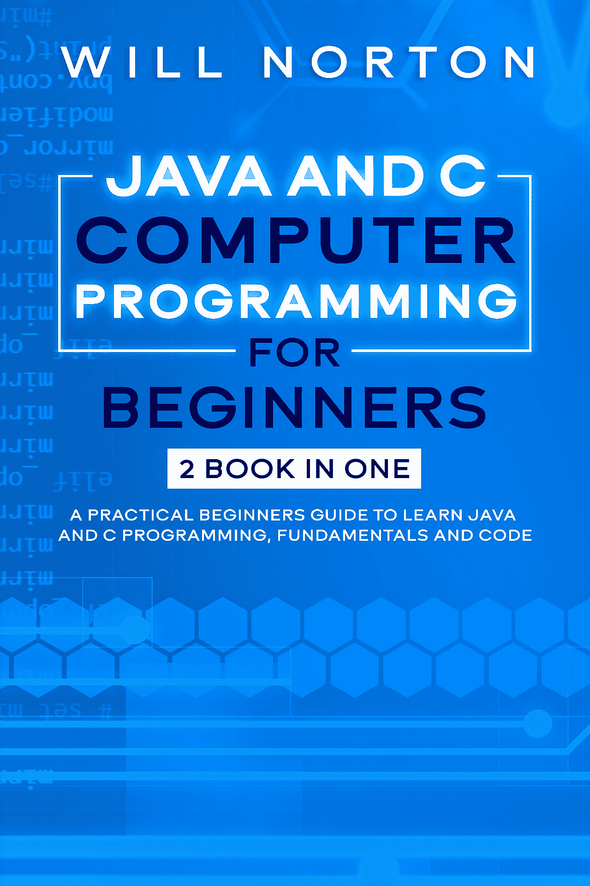
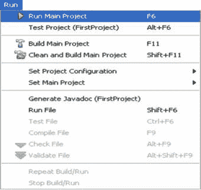
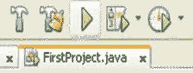
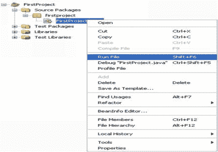

# Java 和 C 计算机编程初学者指南：二合一



## 引言

Java 的历史可以溯到 1991 年，当时程序员 Patrick Haughton、Mike Sheridan 和 James Gosling 设想了一种最适用于数字电视开发的编程语言。然而，它被认为超前时代，因此他们基于 C 和 C++ 平台重新开发了它，使其更易用、更具效益。

随着重新开发，Java 的核心原则也之诞生：

- 它必须是可移植的——或者说应该在尽可能多的平台上运行，且没有哪个平台的效果不如其他；
- 它在使用时应该是安全可靠的——而且非常好用；
- 人们与之接触的时间应该尽可能少，这意味着他们应该使用一些熟悉的单词，尽管起初看起来很复杂，但早晚他们都会意识到它是真正有效的；
- 它应该是动态的，应该在线程中工作，并在需要时可以修改，并且执行应该精确。

如你所见，这些核心原则让你感觉程序员确实为人们制作了 Java——这样他们就可以享受更多的程序，而无需购买太多的设备。1995 年，Sun Microsystems 最后发布了 Java 1.0——Java 的首次诞生，它具有惊人的安全性、免费的运行时以及跨网络的文件访问能力。多年来，Java 发布了更多版本，自 2006 年以来，Java 开始通过 GNU 通用许可许可证可用——这意味着它现在是一种免费的开源编程语言。这源于一旦某些内容变为私有且仅收费后引发的公众抗议，这显然与其核心理念背道而驰。现在开始阅读这本书，你很快就能学会更多 Java！

Java 是一种由 Sun Microsystems 构建的编程语言，后来被 Oracle 公司收购。它被设计为运行在任何支持 Java 的操作系统上。这使得该语言如此受欢迎，因为开发者只需要编写一次程序，程序就可以运行在任何操作系统上，而不需要程序员更改代码。世界上大部分的现代应用程序都是用 Java 语言制作的。大型程序的服务器端和业务逻辑都是构建在 Java 语言之上的。在本书的范围内，你将学习如何编写像上面那样的程序，学习让你能够开始编写完整应用程序的高级概念。下面提到了 Java 的一些设计目标：

（注：提供的文本随后继续写道“接下来将讨论其他设计目标”）

Java 是一种强类型语言。定义的每个变量都需要关联到一个数据类型。你不需要理解整个程序，但让我们快速看看这几行代码。

```
int i=5;
```

在这里我们定义了一个名为变量的东西，它用于存储值。`i` 存储的值取决于其数据类型。

在运行时，Java 会检查数组是否具有足够的值。如果尝试访问数组边界之外的值，将抛出一个异常。你不需要理解整个程序，但让我们快速看看以下几行代码。

```
int[] array1 = new int[2];
```

在这里我们声明了一个数组，是一组整数值。`2` 的值意味着我们只能在数组中存储两个值。

通过这段代码我们可以看到正在给数组赋值三个值。当你运行此程序时，将得到一个错误，因为程序会发现已经超出了允许的最大边界（二）。你将在运行时遇到以下错误。

```
Exception in thread "main" java.lang.ArrayIndexOutOfBoundsException: 2 at HelloWorld.main(HelloWorld.java:8)
```

接下来，Java 的语法和特征类似于 C 和 C++ 等编程语言。如果你有任何编程经验，你会发现学习 Java 是轻而易举。即使你对编程完全陌生，也可以放心，Java 设计成是一种相对容易学习的语言。大多数程序员认为学习 Java 比学习 C 或 C++ 更容易。

Java 还被设计为平台无关。正如前面提到的，Java 代码首先被编译成字节码，然后在任何带有 Java 虚拟机的机器上运行。因此通过 Java，你只需要编写一次程序，程序就可以运行在任何操作系统上，而不需要程序员更改代码。世界上大部分的现代应用程序都是用 Java 语言制作的。大多数应用程序的服务器端和业务逻辑都是构建在 Java 语言上的。在本书中，你将学习如何编写像上面的程序，还将学习让你能够开始编写完整应用程序的高级概念。下面提到了 Java 的一些设计目标：

（注：提供的文本随后继续道“接下来将讨论其他设计目标”）

Java 如此成功有很多原因，这在很大程度上归于其设计时的核心原则。

- 它在使用时应该是安全可靠的——而且非常好用；
- 人们与之接触的时间应该尽可能少，这意味着他们应该使用一些熟悉的单词，尽管起初看起来很复杂，但早晚他们都会意识到它是真正有效的；
- 它应该是动态的，应该在线程中工作，并在需要时可以修改，并且执行应该精确。

如你所见，这些核心原则让你感觉程序员确实为人们制作了 Java——这样他们就可以享受更多的程序，而无需购买太多的设备。1995 年，Sun Microsystems 最后发布了 Java 1.0——Java 的首次诞生，它具有惊人的安全性、免费的运行时以及跨网络的文件访问。多年来，Java 发布了更多版本，自 2006 年以来，Java 开始通过 GNU 通用许可证可用——这意味着它现在是一种免费的开源编程语言。这源于一旦某些内容变为私有且仅收费后引发的公众抗议，这显然与其核心理念背道而驰。现在开始阅读这本书，你很快就能学会更多 Java！

Java 是一种由 Sun Microsystems 构建的编程语言，后来被 Oracle 公司收购。它被设计为运行在任何支持 Java 的操作系统上。这正是该语言如此受欢迎的原因，因为开发者只需要编写一次程序，程序就可以运行在任何操作系统上，而不需要程序员更改代码。世界上大部分的现代应用程序都是用 Java 语言制作的。大多数应用程序的服务器端和业务逻辑都是构建在 Java 语言上的。在本书的范围内，你将学习如何编写像上面那样的程序，还将学习让你能够开始编写完整应用程序的高级概念。下面提到了 Java 的一些设计目标：

（注：提供的文本随后继续道“接下来将讨论其他设计目标”）

Java 是一种强类型语言。定义的每个变量都需要关联到一个数据类型。你不需要理解整个程序，但让我们快速看看这几行代码。

```
int i=5;
```

在这里我们定义了一个名为变量的东西，它用于存储值。`i` 存储的值取决于 `int` 或 `Integer`，是一个数字。

在运行时，Java 会检查数组是否具有足够的值。如果尝试访问数组边界之外的值，将抛出一个异常。你不需要理解整个程序，但让我们快速看看以下几行代码。

```
int[] array1 = new int[2];
```

在这里我们声明了一个数组，是一组整数值。`2` 的值意味着我们只能在数组中存储两个值。

```
array1[2] = 3;
```

通过这段代码我们可以看到正在给数组赋值三个值。当你运行此程序时，将得到一个错误，因为程序会发现已经超出了允许的最大边界（二）。你将在运行时遇到以下错误。

```
Exception in thread "main" java.lang.ArrayIndexOutOfBoundsException: 2 at HelloWorld.main(HelloWorld.java:8)
```

接下来，Java 的语法和特征类似于 C 和 C++ 等编程语言。如果你有任何编程经验，你会发现学习 Java 是轻而易举。即使你对编程完全陌生，可以放心，Java 设计成是一种相对容易学习的语言。大多数程序员认为学习 Java 比学习 C 或 C++ 更容易。

- 逻辑运算符
- 位运算运算符
- 关系运算符
- 算术运算符

与其他计算机语言一样，Java 也定义了一系列额外的运算符，以处理某些特定的场景。在学习 Java 编程语言（或者说学习任何编程语言）时，在开始之前，你必须理解五个基本概念。这五个基本概念包括：

4. 语法
5. 工具

每一个概念都将从初学者水平进行彻底解释，以确保它们能够被理解。

## 分隔符

它们不适用于高级抽象：请注意，许多程序使用了低级结构，这些结构主要用于低级抽象。这些编程语言的通常方法是它们关注机器——即如何让计算机去做某些事情，而不是这些函数如何帮助解决用户的问题。这些语言处理的是微小的细节，这已经超出了高级抽象的范围，而高级抽象是我们今天看到的常见方法。在低级抽象中，数据结构和算法是分开的，而在高级抽象中，它们被视为一个整体。

当提到 Java 中的字面量时，我们指的是以人类可读的形式出现的固定值。我们可以说数字 `200` 是一个字面量。大多数时候，字面量可以是常量。字面量在程序中非常重要。事实上，大多数 Java 程序都会使用字面量。我们在书中讨论过的一些程序使用了字面量。Java 中的字面量适用于各种原始数据类型。

当发生这种情况时，我们称之为注释。在程序的运行阶段，注释是无关紧的。这意味着你可以使用注释功能来说明或解释你正在创建的代码想要实现的目标。你可以通过输入两个斜杠然后是注释来实现这一点。

```
//在此处放置你的单行注释
```

```
// 我们将把
// 注释分成两行
```

```
/*
这条注释跨越了两行。
*/
```

如果你查看上面的注释，你会注意到它以 `/*` 开头，但以 `*/` 结尾。此外，如果你查看之前的图片（图 8），你会注意到有些注释以单个正斜杠和两个星号（`/**`）开头，但以一个星号和一个正斜杠结束；这被称为 Javadoc 注释。


回到我们之前引入的初始问题（即让计算 `add 1 + 1`），现在我们有了一组指令（即你的算法）来解决这个问题，接下来你需要做是将这些指令翻译成计算机可以理解的指令。记住，计算机不说英语或任何其他人类语言。正如之前解释过的，你需要将所有这些指令翻译成一系列二进制信号。但完成所有的翻译工作将花费你大量的时间。记住，每个字符至少由 8 位组成。之后，你需要将它们连接成实际的指令来访问计算机内存，然后进行数学运算等——简而言之，这是一片混乱。没有人想处理那些。

所以，你说一种语言，而计算机说的是另一种语言。那么，你打算如何让双方在中间点会合呢？这就是 Java 等编程语言大显身的地方。将编程语言看作是计算机和人类都能理解的中间语言——呃，可以这么说，我们稍后会澄清这背后的细节。

这里的目标是让计算机理解你的指令。在实现这一点之前，会发生两个阶段。第一步是使用编程语言编写你的算法。是的，一种你和机器之间的中间语言。但是，尽管已经是 Java 代码，计算机仍然无法完全理解你写的所有内容。这就是第 2 步（记得是 2 步？）——你的 Java 代码将由一个名为 `compiler`（编译器）的程序处理。正如之前我们在介绍 Java 平台组件时解释的那样，`compiler` 是一个将你的编程代码翻译成机器可读指令（即你的计算机可以理解的指令）的程序或应用程序。

现在在我们直接开始编写 Java 编程代码之前，你应该了解最后一点预备信息。那就是 Java 虚拟机。关于今天不同设备中提供的不同硬件和软件，有一个反复出现的问题。智能手机的硬件和软件组件的行为与你的汽车或笔记本电脑不同。为了让情况变得更复杂，不同的处理器芯片、不同的操作系统以及不同的电气元件阵列意味着编译（或翻译）你所写代码有不同的方式。你需要让机器码针对你正在编程的设备平台。

那么，什么是 Java 虚拟机或 `JVM`？它是一个设计用于在任何设备或机器上运行计算机程序的程序或应用程序。它在 1995 年发布时是一项极具革命性的程序，直到今天仍然是一项巨大的创新。它解决了之前描述的困境。将 `JVM` 想象成计算机内部的一种虚拟计算机。它实际上有两个主要功能。

第一个是在任何设备、任何操作系统或软件上运行任何程序。这被总结为“编写一次，随处运行”的原则——随着经验的增加，你会经常听到这句话以及其他的编程经验法则。另一个功能是分配内存空间——它非常擅长管理计算机内存。`JVM` 加载到计算机内存（`RAM`）中。它是独立的，这意味着它可以运行在任何支持 Java 的设备上——呃，今天几乎每个设备都支持 Java。它不会为现有的每种机器、芯片和软件组合生成代码。那是不可能的。即使你尝试这样做，也会让 Java 变成一个极其庞大的系统，因为你必须容纳所有类型的硬件、软件和操作系统。

那么，`JVM` 是如何做到的？它产生自己独特的代码格式，称为 `bytecode`。注意，与其他编程语言不同，当你的 Java 源代码被编译时，它并没有被直接翻译或转换为机器可读语言——呃，再次是因为目标不是创建一种只能在一个平台上运行的特定类型代码。由 `compiler` 产生的 Java `bytecode` 是一组机器语言的指令。`Bytecode` 将在任何安装了 `JVM` 的计算机上运行。这也这意味着 `JVM` 不仅运行 Java 代码，还可以运行其他语言编写的代码——这一切都是为了被理解。

在你的计算机上编写和运行任何 Java 程序之前，你首先需要安装它。为了安装 Java 运行环境（`JRE`）（即带有 `JVM`、Java 库以及其他文件的系统），你需要访问官方网站。

在第一行，我们有语句 `package helloworld;`。这条语句告诉编译器我们写的文件属于 `helloworld` 包。`package` 只是相关类和接口的组合。当我们在文件顶部写 `package helloworld;` 时，我们是在要求编译器包含 `helloworld` 包。属于同一个包的文件存储在同一个文件夹中。如果你导航到你的 `Projects` 文件夹，你会发现一个名为 `HelloWorld` 的文件夹。`HelloWorld` 文件夹通常位于你的 `Documents` 文件夹中。如果你找不到这个文件夹，尝试使用计算机的搜索功能。在 `HelloWorld` 文件夹中，你会找到一个 `src` 文件夹。除了我们创建的包之外，Java 还提供了许多可以在程序使用的预创建包。例如，用于输入输出的代码在 `java.io` 包中，而实现图形界面（如按钮、菜单等）的代码在 `java.awt` 包中。为了使用这些预写包，我们将稍后学习。

在 `HelloWorld` 类中，我们有 `main()` 方法，它从第 5 行开始到第 8 行结束。`main()` 方法是所有 Java 应用程序的入口。每当 Java 应用程序启动时，第一个被调用的 `main()` 方法。注意 `main()` 方法中的 `String[] args` 吗？这意味着 `main()` 方法可以接收字符串数组作为输入。在示例中，`main()` 方法包含了两行代码。

```
public static void main (String[] args) {
    // 在屏幕上打印 Hello World
    System.out.println("Hello World");
}
```

在图中，你应该注意到包名在前。此外，你应该注意分号是行的结束。分号是非常重要的，如果你漏掉了它，程序将无法编译。

```
package firstproject;

public class FirstProject {
}
```

```
public static void main (String[] args) {}
```

比其他任何都重要的是 `main` 这个词。为什么？因为每当任何 Java 程序启动时，它首先寻找名为 `main` 的方法。简单来说，方法是代码的一部分。程序执行括号内的代码作为 `main` 的一部分。如果你的代码没有 `main` 方法，你会在 Java 程序中收到错误消息。然而，由于这是程序的程序的入口，你不太可能漏掉它。代码的 `public` 部分（蓝色部分）简单意味着该方法在类之外是可见的。另一方面，`static` 意味着不需要创建新对象，而 `void` 意味着没有返回值，命令就此结束。

查看下面的图。



图 10

在 NetBeans 工具栏上，你会看到一个“绿色播放”箭头；你可以用它运行程序。



图 11



图 12

如果你对目前的代码使用上述任何程序执行方法，你应该在输出窗口中得到与下图 13 类似的结果！

图 13


当然，使用 Java 的关键原因之一是它对面向对象编程的关注。面向对象编程或 `OOP` 是一种编程语言，允许程序代码围绕数据而不是函数进行组织（被称为过程化编程）。这些“数据簇”被组织成名为 `objects`（对象）的东西，因此有了面向对象编程的称名。这些对象是由名为 `classes`（类）的东西创建的，这里的理解是指类是对象的类型。`class` 的属性是创建对象的原始数据：这些是描述符，例如它所拥有的值。第二个标准是对象的 `method`（方法）。这个 `method` 是行为。`JVM` 加载到计算机的内存（`RAM`）中。它是独立的，这意味着它可以运行在任何支持 Java 的设备上——呃，今天几乎每个设备都支持 Java。它不会为现有的每种机器、芯片和软件组合生成代码。那是不可能的。即使你尝试这样做，也会让 Java 变成一个极其庞大的系统，因为你必须容纳所有类型的硬件、软件和操作系统。

所以，`JVM` 是如何做到的？它产生自己独特的代码格式，称为 `bytecode`。注意，与其他编程语言不同，当你的 Java 源代码被编译时，它并没有被直接翻译或转换为机器可读语言——呃，再次是因为目标不是创建一种只能在一个平台上运行的特定类型代码。由 `compiler` 产生的 Java `bytecode` 是一组机器语言的指令。`Bytecode` 将在任何安装了 `JVM` 的计算机上运行。这也这意味着 `JVM` 不仅运行 Java 代码，还可以运行其他语言编写的代码——这一切都是为了被理解。


在你的计算机上编写和运行任何 Java 程序之前，你首先需要安装它。为了安装 Java 运行环境（`JRE`）（即带有`JVM`、Java 库以及其他文件的系统），你需要访问官方网站`https://www.oracle.com/javase/index.html`。如何下载`JRE`的说明也会在这些页面提供。现在，你的计算机可能会提示没有安装 Java（运行程序的系统），然后你可以通过`https://java.com/en/download/help.xml`下载它。`JRE`是你编写 Java 程序所需要的。如果你需要为 Mac OS、Linux 等其他操作系统安装 Java，由于某种原因这些链接无效，你应该去这里`https://java.com/en/download/manual.jsp`。

现在你只需要一个文本编辑器来编写第一个 Java 程序。你可以使用系统自带的任何文本编辑器（例如，如果你使用 Windows，可以使用`Notepad`）。如果你想要更多支持，可以使用`Notepad++`。然而，如果你想开发应用程序、测试你的编程代码并拥有让 Java 编程变得容易许多工具，你需要一个名为`IDE`的程序，代表集成开发环境。`IDE`是一个带有程序员所需的所有设施和工具的应用程序。

### IDE 特性

调试是`IDE`的另一个重要功能。调试指的是对 Java 源代码定位并移除编程错误。没有人期望你是完美的，但编程错误会阻止你的代码运行。`IDE`拥有调试工具帮助你快速发现错误以便你可以尽快编辑它们。

有很多`IDE`可以用于 Java 编程。我们无法列出所有，所以我们将介绍前三个`IDE`。

`NetBeans`最初于 1997 年发布，可以在 Windows、Solaris、Mac OS 和 Linux 等操作系统上运行。`NetBeans`实际上是 Java 8 的官方`IDE`。和 Java 一样，`NetBeans`是开源的这意味着它是免费下载使用的。它具有语义和语法高亮。它还允许你重构源代码（即重写代码而不引起任何编程问题）。重构是为了提高性能或将其更新到最新标准。换句话说，你正在对旧程序进行升级或更新。

`IntelliJ IDEA`最初于 2001 年 1 月发布。它在 Windows、Mac OS 和 Linux 上运行。这个`IDE`有两个不同的版本。第一个是专有的，即商业版本（即你需要付费的那个），另一个是 Apache 2 许可版本。这是给真正严肃的程序员的`IDE`——我们建议你在获得大量 Java 编程经验后使用这个集成开发环境。你可以称之为深度`IDE`。`IntelliJ IDEA`的两个独特且强大的功能包括流分析和跨语言重构。它还支持其他基于`JVM`的语言——是的，还有其他使用`JVM`的编程语言。

`Eclipse`是另一个高级集成开发环境。事实上，这一个专门用于 Java 程序的开发。呃，它也支持其他编程语言，这使其成为一个非常强大的工具。如果你已经达到了能够组合不同编程语言编写的程序的程度，那么你可能考虑获取这个`IDE`。如果你是一个学者，那是未来的事情。现在有两个版本的`Eclipse`。有一个这个`IDE`的云版本，称为`Eclipse Che`，还有一个老式的桌面版本，你可以在你的计算机上下载它。这两个版本都带有一整套工具、应用程序和插件，让编程工作变得容易得多。它甚至带有自己的自定义`compiler`。这个`IDE`加载了许多有用功能。例如，如果你想专注于为已编写的程序开发插件，`Eclipse`有一个插件环境。它拥有创建和改进插件所需工具。


### 包

在第一行，我们有语句`package helloworld;`。这条语句告诉编译器我们写的文件属于`helloworld`包。`package`只是相关类和接口的组合。当我们在文件顶部写`package helloworld;`时，我们是在要求编译器包含`helloworld`包。属于同一个包的文件存储在同一个文件夹中。如果你导航到你的`Projects`文件夹，你会发现一个名为`HelloWorld`的文件夹。`HelloWorld`文件夹通常位于你的`Documents`文件夹中。如果你找不到这个文件夹，尝试使用计算机的搜索功能。在`HelloWorld`文件夹中，你会找到一个`src`文件夹。除了我们创建的包之外，Java 还提供了许多可以在程序使用的预创建包。例如，用于输入输出的代码在`java.io`包中，而实现图形界面（如按钮、菜单等）的代码在`java.awt`包中。为了使用这些预写包，我们将稍后学习。

在`HelloWorld`类中，我们有`main()`方法，它从第 5 行开始到第 8 行结束。`main()`方法是所有 Java 应用程序的入口。每当 Java 应用程序启动时，第一个被调用的`main()`方法。注意`main()`方法中的`String[] args`吗？这意味着`main()`方法可以接收字符串数组作为输入。在示例中，`main()`方法包含了两行代码。

```java
public static void main (String[] args) {
    // 在屏幕上打印 Hello World
    System.out.println("Hello World");
}
```

在图中，你应该注意到包名在前。此外，你应该注意分号是行的结束。分号是非常重要的，如果你漏掉了它，程序将无法编译。

```java
package firstproject;

}
```

你可以在代码开头使用左括号，并使用右括号结束代码`{这是一个代码段示例}`。然而，你应该注意左括号和右括号之间的任何内容都是代码段。此外，类的左括号和右括号之间的内容实际上是一个代码段。这意味着：

```java
public static void main (String[] args) {}
```

比其他任何都重要的是`main`这个词。为什么？因为每当任何 Java 程序启动时，它首先寻找名为`main`的方法。简单来说，方法是代码的一部分。程序执行执行括号内的代码作为`main`的一部分。如果你的代码没有`main`方法，你会在 Java 程序中收到错误消息。然而，由于这是程序的程序的入口，你不太可能漏掉它。代码的`public`部分（蓝色部分）简单意味着该方法在类之外是可见的。另一方面，`static`意味着不需要创建新对象，而`void`意味着没有返回值，命令就此结束。

查看下面的图。

图 10

在 NetBeans 工具栏上，你会看到一个“绿色播放”箭头；你可以用它运行程序。

图 11

你也可以通过导航到项目窗口来运行程序。这对于确保运行正确的源代码特别有效。要这样做，你需要点击项目窗口中的 Java 源文件，然后右键点击选项。执行运行（`run`）命令。查看下面的图。

图 12

如果你对目前的代码使用上述任何程序执行方法，你应该在输出窗口中得到与下图 13 类似的结果！

图 13

在上面的图 13 中，你可以看到第一行是`run`命令。第二行是我们的代码`My Project`。如果你有不确定的并想再次运行，只需按下图 13 上可见的“绿色箭头”。


# 第 7 章：数据类型和变量

当然，使用 Java 的关键原因之一之一它对面向对象编程的关注。面向对象编程或`OOP`是一种编程语言，允许程序代码围绕数据而不是函数进行组织（被称为过程化编程）。这些“数据簇”被组织成名为`objects`（对象）的东西，因此有了面向对象编程的称名。这些对象是由名为`classes`（类）创建的，这里的理解是指类是对象的类型。`class`的属性是创建对象的原始数据：这些是描述符，例如它所拥有的值。第二个标准是对象的`method`（方法）。这个`method`是行为。`JVM`加载到计算机的内存（`RAM`）中。它是独立的，这意味着它可以运行在任何支持 Java 的设备上——呃，今天几乎每个设备都支持 Java。程序执行作为`main`的一部分。如果你的代码没有`main`方法，你会在 Java 程序中收到错误消息。然而，由于这是程序的程序的入口点，你不太可能漏掉它。代码的`public`部分（蓝色部分）简单意味着该方法在类之外是可见的。另一方面，`static`意味着不需要创建新对象，而`void`意味着没有返回值，命令就此结束。

# 运算符概述

* 逻辑运算符
* 位运算符
* 关系运算符
* 算术运算符

与其他计算机语言一样，Java 有一组预定义的额外运算符，用于处理某些特定场景。在学习 Java 编程语言（或任何编程语言）时，在开始之前，你必须理解五个基本概念。这五个基本概念包括：

1. 变量
2. 数据结构
3. 控制结构
4. 语法

每个概念都将在初学者水平进行彻底解释，以确保它们被理解。

## 分隔符

## 字面量

当提到 Java 中的字面量时，指的是以人类可读的形式出现的固定值。我们可以说数字`200`是一个字面量。大多数情况下，字面可以是常量。字面量在程序中很重要。事实上，大多数 Java 程序都使用了字面量。我们在书中已经讨论过的某些程序也使用了字面量。

Java 中的字面量涵盖各种原始数据类型。每个字面量的显示方式由其类型决定。正如之前提到的，我们将字符常量括在单引号中，例如`'c'`和`'%'`。我们在整数中定义字面量时，不涉及小数部分。例如，`12`和`-30`是整数字面量。浮点字面量应该包含小数点和小数部分。`12.389`是一个浮点字面量。Java 进一步允许对浮点字面量使用科学计数法。整数字面量包含`int`值，任何人可以使用`short`、`byte`和`char`变量对其进行初始化。

## 注释

当发生这种情况时，我们称之为注释。在程序的运行阶段，注释是无关紧的。这意味着你可以使用注释功能来说明或解释你创建的代码想要实现的目标。你可以通过输入两个斜杠然后跟上注释来实现。这里是一个示例：

```java
//在此处放置你的单行注释
```

你可以通过执行以下任一种操作拥有多行注释：

```java
//我们将把
// 注释分成两行
/*

此注释跨越了两行。*/
```

如果你查看上面的注释，你会发现它以`/*`开头，但以`*/`结尾。此外，如果你查看之前的图像（图 8），你会注意到有些注释以单个正斜杠和两个星号（`/**`）开头，但以一个星号和一个正斜杠结束；这被称为 Javadoc 注释。

另一方面，变量是一个包含特定数据类型及其已赋值或接收到的值的“对象”。它之所以被称为变量，是因为其中的值可以根据其在代码中的用处、程序员如何声明其值、甚至程序用户选择如何与其交互而发生变化。简而言之，变量是数据类型的存储单元。访问变量允许程序员方便地标记和调用手头的存储值。

Java 要求程序员使用声明语句，即使用用于声明变量并通过指定特定数据类型和名称来定义它们的代码行。Java 处理变量有种特殊方式，即将变量定义为包含特定类型和值信息的容器，这不像像`python`等语言只需要声明变量且变量可以动态更改其类型；Java 变量是静态的，一旦声明后就会保留其类型。

```java
boolean completed = true;

string hello = "Hello World!";
```

声明中的语法在之前的示例可见，变量类型在前，然后是变量名，最后是值。同样注意，声明语句可以在一行中由多个声明组成，如下例：

```java
int number = 20, boolean completed = true, string hello = "Hello World!";
```

Java 变量可以在开始时不赋任何值；在这些情况下，Java 选择为这些变量声明一个特定的默认值，例如：

```java
byte a;
short num;
boolean answer;
```

将分别产生值 0、0 和 false。更完整的默认值列表如下：`byte`、`short`、`int`和`long`数据类型都将产生默认值 0，而`float`和`double`数据类型将具有默认值 0.0，`char`数据类型将产生`'\u0000'`值，`string`或任何其他对象将具有`null`默认值，所有`Booleans`将以`false`默认值开始。

在 Java 中，变量在声明时是静态的，这意味着程序员必须定义变量将包含的数据类型。为了说明，如果我们想使用变量`num`来存储一个数字，我们必须先声明变量：`int num`，然后才能赋值，例如`num = 10`。上述过程通常被称为并指称为“赋值语句”，其中值被分配给程序员声明的变量。然而，Java（实际上是是大多数编程语言）工作方式的一个显著特点是，在赋值语句中（如我们的示例`num = 10`所示），存储的实际值是等号右侧的值，即值 10，而`num`仅仅是调用该存储值的“标记”。这就是为什么许多 Java 程序员倾向于使用“获取（getting）”一个值的术语，而不是“赋值（assigning）”，尽管在大多数情况下，它们可以互换使用，且在某些少数情况之外，功能也基本相同。但请注意，一旦值被分配给变量，就需要执行函数来使该变量内部的数据更改其数据类型。

## 变量命名

创建变量是一项简单的任务，特别是考虑到 Java 程序员往往根据数据类型或变量将要存储的内容来创建和命名它们。然而，在命名这些变量时有几条规则，否则 Java 将无法识别并导致错误信息。关于变量名的主要限制是它不应以特殊字符（如下划线）或数字开头。但是变量名可以由字母、数字甚至下划线等字符组成，只要下划线不在开头即可。不能使用其他字符，例如`#`甚至空格，因为这些特殊字符在 Java 中有不同的用途，因此在变量名中不会被识别。

- 变量名应该是描述性的，因为在较长的代码中，很难想起`x`是做什么的。使用像`count`或`output`这样的变量名比使用通用的`x`或`y`更容易记忆，并有助于避免混淆。

- 除了描述性之外，如果变量名保持较短，变量也将更容易使用。虽然像`banking_information_account_records`这样的变量名非常有描述性，但在程序中需要反复输入它会非常疲惫，而且较长的变量名增加拼写错误的概率，这将导致代码错误，产生运行时错误或代码未按预期运行，或者运行了但在过程中引入了错误。

- 同样注意，Java 变量一直采用全小写字母，虽然对大小写没有限制，但保持小写可以简化问题，因为漏掉大写可能会导致变量无法被识别，因为 Java 将大写字母读取为完全不同的小写字符。

## 方法命名规范

我们将回顾命名规范，因为你将使用成员方法。Java 编程中的方法执行操作，它们还接收调用者提供的任何参数，并向调用者返回操作结果。以下是声明方法的语法：

```java
[访问修饰符] 返回类型 方法([参数]) {

    // 方法体

}
```

```java
public double computeArea() {
    return radius * Math.PI;
}
```

我们将介绍一些与面向对象编程相关的额外细节。正如前面所述，构造函数看起来像方法，你完全可以视为 Java 中的特殊方法。然而，构造函数在许多方面仍然与方法不同。使用`new`关键字或运算符来创建构造函数的实例并进行初始化。以下是使用`Employee`类初始化它的示例：

```java
Employee rate2 = new Employee(0);
```

构造函数返回`void`——这意味着它没有返回类型。你不能在构造函数的体内部放置返回语句，因为会被编译器标记为错误。调用构造函数的唯一方法是通过使用`new`语句。我们已经给了你几种调用构造函数的方法。最后的区别是构造函数不能被继承。回到上面的示例——第一行包含`Employee()`的被称为默认构造。你可以看到，它没有参数。默认构造的作用是将成员变量初始化为特定值。在上面的示例中，成员变量`rate1`被初始化为默认状态。

构造函数也可以重载吗？是的，可以。构造函数的行为类似于方法，这意味着你可以像重载方法一样重载构造函数。以下是重载构造函数的示例，我们使用`Employee`类并使用不同的参数进行重载：

```java
Employee()

Employee(int r)

Employee(int r, String b)
```

## 如何初始化变量

有些表达式不产生结果，而是影响另一个变量。一个示例是根据操作变量值的表达式：没有输出新值，也没有对新值的真实“赋值”，而是所谓的副作用导致了变量值的改变。在我们之前的示例程序中，例如打印 "Hello World" 的程序，我们将原始值引入了`print`函数，这被称为“硬编码（hard coding）”输出。然而，此时我们应该尝试结合学到的变量知识。变量的操作方式与原始值相同，因为它们只是引用计算机之前存储的值，因此程序员可以使用变量名代替值。为了演示这一点，让我们记住之前的 "Hello World" 程序：

```java
print("Hello World");

input("\n\nPlease the return key to close this window.");
```

现在，不再对 "Hello World" 字符串进行编码，我们可以简单地将其声明为一个变量并让程序输出该变量。最终看起来应该是：

```java
String string = "Hello World";

print(string);

input("\n\nPlease the return key to close this window.");
```

这应该产生与之前程序相同的结果，看起来类似于：

```
Hello World
请按回车键关闭此窗口。
```

## 代码修改的变量

```java
int num = 9;

byte count = 0;

while (counter < 10) {

    print(num + " * ");
```


```
print(num * counter + "\n");

counter = counter + 1;

}
```


```
9 * 0 = 0
9 * 1 = 9
9 * 2 = 18
9 * 3 = 27
9 * 4 = 36
9 * 5 = 45
9 * 6 = 54
9 * 8 = 72
9 * 9 = 81
```

- `-` 代表减法
- `*` 代表乘法
- `/` 代表除法
- `%` 代表取模
- `++` 代表自增
- `--` 代表自减

诸如 `+`、`-`、`*` 和 `/` 等运算符的功能与其他大多数语言完全相同。我们已经看到 JavaScript 具有处理数字的能力。因此，它也有处理与数字数据类型配合使用的运算符。让我们详细查看每个运算符。

## 算术运算符

这些是用于处理数字的运算符。下文展示了常用的运算符，随后是它们如何应用的示例。运行此程序，输出如下：

```
JavaScript 程序
第一个值是 5
加法运算符 = 15
减法运算符 = 5
乘法运算符 = 50
除法运算符 = 5
加 1 运算符 = 6
减 1 运算符 = 5
模运算符 = 5
```

## 赋值运算符

这些是用于根据操作数的值确定条件值的运算符。JavaScript 中可能的关系运算符所示。如果条件求值为为真（true），则返回值 1，否则返回值 0。运行此程序，输出如下：

```
JavaScript 程序
第一个值是 5
第二个值是 10
数字是否相等 = false
数字是否不等 = true
x 是否大于 y = false
x 是否大于等于 y = false
x 是否小于等于 y = true
```

## 逻辑运算符

这些是根据操作数的值确定条件值的运算符，其中操作数是布尔值。JavaScript 中可能的逻辑运算符所示。运行此程序，输出如下：

```
JavaScript 程序
第二个值是 true
第三个值是 false
x AND y = true
y AND z = false
z AND x = false
z AND z = false
```

```
JavaScript 程序
第一个值是 true
第二个值是 true
第三个值是 false
x OR y = true
z OR x = true
z OR z = false
```

下表显示了基于操作数值的 NOT（逻辑非）运算符。

## 赋值运算符

```
JavaScript 程序
第一个值是 5
第二个值是 6
i+j 的值是 11
i+=j 的值是 11
i*=j 的值是 30
i/=j 的值是 5
i%=j 的值是 5
```

## 位运算符

这些是用于对操作数进行位操作的运算符。运行此程序，输出如下：

```
第一个值是 5
第二个值是 6
x AND y 的值是 4
x OR y 的值是 7
NOT x 的值是 -6
x XOR y 的值是 3
符号右移的值是 2
零右移的值是 2
```

# 第 8 章：Java 数据结构与算法


为了更清楚这一点，假设有一个类叫做“Human”（人类）。这个“类”将拥有身高、体重、性别、种族等属性。“human”类还可以拥有“跑步”、“行走”、“说话”等方法。这些理论组件构成了“human”类，它是对象的蓝图。既然类已经定义好了，程序员如果愿意，可以使用“human”类作为蓝图创建一个对象。他们可以调用类 `Human` 并“填充”它的属性，赋予它特定的身高、体重、性别和种族。

此外，对象已经内置了这些函数，如“跑步”、“行走”和“说话”，因此在从“Human”类创建对象（例如命名为“Mike”的对象）时，它已经包含了跑步、行走和说话的功能，不需要程序员再次编写这些特定函数，因为它们在创建的对象中是“固有”的。简而言之，这就是面向对象编程的意义：一种编程方式，允许程序员利用预定义的类，以便更方便地描述它们，并使用它们的内部或内置函数来操作它们。

假设读者不是编程的新手，并且已经通过 C 或或其他过程化倾向较强的语言接触过编程世界，那么下一个逻辑问题将是：为什么要用面向对象编程呢？嗯，它的主要优势之一是从长远来看，它节省了时间。在简单的算法和程序中，过程化编程通常快得多且更直接；程序员不需要构建和定义一个类，并根据该类创建对象，他们只需要声明必要的变量并编写函数，然后创建算法来解决他们需要代码处理的问题。

然而，当涉及到更复杂的程序、需要更复杂的解决方案时，这就是面向对象编程开始大放异彩、也是它开始展现实力的地方。在许多程序中，会有许多“对象”或数据簇必须组合在一起，并且程序员将以某种方式处理它们。这正是“类”要解决的问题。他们不需要为每个数据簇声明一组新变量，只需利用预制的“类”并创建一个新的“对象”。让我们看看这在实践中是如何运作的。如果一个程序员用过程化的方式编写象棋游戏，那么他们必须手动描述每个棋子：所有的 16 个兵、四个马、四个车、两个皇后和两个国王。此外，他们还必须编写允许每个棋子按自己的方式移动的函数。然而，如果程序员使用面向对象编程，而不需要编写兵、四个马、四个车、两个皇后、两个国王，他们只需要编写六个类：每个类描述棋板上的一个棋子。程序员现在可以简单地在每个类中包含移动函数，并用属性描述位置：它是皇的兵还是黑皇的兵，这些都可以通过“兵”类的“属性”部分插入。而不是编写 30 个簇。

# 第 9 章：数组

数组是元素的序列；每个元素必须与一个或多个位置相关。Java 完全支持数组。

### 一维数组

一维数组是所有数组中最简单的。在这一类数组中，元素与一个索引相关，可以使用三种不同的技术来创建一维数组：

- 仅使用初始化器
- 仅使用 `new` 关键字
- 同时使用初始化器和 `new` 关键字

## 比较与逻辑运算符

- `<` - 小于
- `>=` - 大于等于
- `<=` - 小于等于

这里还有四个你可以使用的运算符：

- `||` - 或（OR）
- `==` - 等于
- `!` - 非（NOT）

第一个，即两个 & 符号，用于同时测试两个或多个条件。我们正在检查用户的年龄是否大于 18 岁且小于 40 岁——记住，我们检查的是名为 `user` 的变量。第一个条件是“大于 18”，第二个条件是“小于 40”。在这两个条件之间，我们使用了与逻辑运算符，因此整行代码的意思是：如果 `user` 大于 18 且 `user` 小于 40。现在运行程序并再次测试；在运行之前，你应该已经能猜出将打印什么了。`user` 变量的值为 21，因此 `else if` 大括号之间的消息将显示在输出窗口中。

### 嵌套 IF 语句

### 布尔值

与其使用 `int`、`double` 或 `string`，你只需要输入 `boolean`（小写 b），并在变量名之后分配一个 `TRUE` 或 `FALSE` 值。注意，我们使用单个等号作为赋值运算符。如果你想查看一个变量是否“等于”某个值，你需要使用双等号。这次，我们在名为 `user` 的变量前面使用了非（NOT）运算符。非运算符通过使用感叹号 `!` 表示（仅此一个），它将置于在你尝试测试的变量之前。该运算符测试否定情况，意味着它测试的是实际值的反方向值。

### Switch 语句

另一种控制程序流的方法是使用 `switch` 语句。它为你提供了测试变量范围值的选项，并可以用来替代复杂的长 IF … ELSE 语句。以 `switch` 单词开始，然后跟一组括号。你正在检查的变量放在 switch 括号之间，后面紧跟着一组大括号。`switch` 语句的其余部分放在大括号之间。

假设读者不是编程的完全新手，并且已经通过 C 或或其他重过程逻辑的语言进入了编程世界，那么下一个逻辑问题将是：为什么要使用面向对象的编程呢？嗯，它的主要优势之一是从长远来看，它可以节省时间。

### 如何用 Java 构建小型游戏

在简单的算法和程序中，过程式编程通常要快得多且更直观；不需要构造和定义一个 `class` 并根据该 `class` 创建一个 `object`，程序员真正需要做的只是声明必要的变量并编写函数，然后创建算法来解决代码需要处理的问题。

然而，当涉及到更复杂的程序、需要更复杂的解决方案时，面向对象的编程就开始大放异彩，并展现它的实力。在许多程序中，会有许多“对象”或数据簇必须被组合在一起，程序员将以特定的方式处理它们。这正是“类”要解决的问题。他们不需要为每个数据簇声明一组新变量，只需直接调用预先定义的“类”并创建一个新的“对象”。让我们看看这在实践中是如何运作的。

每个棋子都有不同的移动方法，取决于它们是什么种棋子。如果程序员用过程式的方法来编写象棋游戏，那么他们必须手动描述每一个棋子：16 个兵、4 个主教、4 个马、4 个车、两个皇后两个国王。此外，他们必须编写允许每个棋子以其独立方式移动的函数。然而，如果程序员利用面向对象编程，就不需要编写 16 个兵、4 个主教、4 个马、4 个车、两个皇后两个国王，他们只需要编写六个类：每个类描述棋盘上的一个棋子。

程序员现在可以简单地将移动函数包含在每个类中，并用属性描述它们的位置：它们是白王兵还是黑后兵，这些都可以通过“兵”类的“属性”部分插入。程序员不需要写 32 组代码，只需要写 6 组。现在这变得简单得多、短得多，而且更加优雅。

# 第 15 章：面向对象编程


我们现在不会处理面向对象编程的所有复杂编码。我们只需要处理核心的概念：类和对象。为了理解这些，我们必须首先讨论类。这将让我们之前说的某些内容——例如对象包装器——更有意义。

### 什么是类？

类的实用性在于，有时你需要的比代码自动提供的更复杂的结构。

你已经熟悉前两个了——`public` 和 `private`。当变量被声明为 `public` 时，它可以在你正在编写的程序的任何地方使用。相比之下，当它是 `private` 时，它在实例化它的类体之外的任何地方都无法被看到或访问。

让我们其他两个访问控制修饰符。

列表中的下一个是 `protected` —— 当你想要创建库（libs）时它非常有用。当一个变量是 `protected` 时，意味着它只能在实例化该 Java 构造的包内被可见——注意，这也包含了所有的子类。

另一方面，`default` 访问控制修饰符在未指定另外三个修饰符时由使用。在这种模式下，变量可以在程序员实例化它的包或类中被访问。然而，请注意，该变量仅在类的主体内可访问，在它的子类中不可用。

关于你在方法内部创建的变量，还有另一个重要点需要记住——它只能指定一个关键字：`final`。你将不允许在方法体内创建 `default`、`protected`、`public` 甚至 `private` 变量。这基本上就是信息在代码中隐藏的方式，如果你观察的话，它有助于数据抽象和封装。

## 封装？信息隐藏？它们之间有什么区别？

乍一看，封装与数据或信息隐藏似乎是相同的，但这两个术语之间确实存在细微的。现在，Nat Pryce 和 Steve Freeman 对这两个术语做出了非常准确的区分，尽管你可能读到其他作者交替使用这些术语。

我们在这里使用 Freeman 和 Pryce 的描述来区分 Java 编程中这两个概念的差异。让我们从信息隐藏开始，因为我们是从那里结束的。

### 信息隐藏

你已经可以判断“信息隐藏”的意思了。它仅仅意味着信息被隐藏了。程序执行的实际功能和过程被隐藏了。

但是，目的是什么？为什么要向程序员隐藏内部运行机制？忽略低层细节是为了让你（程序员）能够关注更重要的事情。这也是 Java 中数据被抽象的原因。你可以创建类、对象以及程序的其他元素；你甚至可以将对象从一个程序导入到另一个程序，而无需担心该对象是如何运作的细节。

这就像开车。你只需要知道当你把钥匙插入锁孔并启动汽车时，它就会启动。你不需要担心是什么让它启动的，下面的电线是如何连接的，汽油去哪里，引擎如何燃烧汽油等等。你只需要启动汽车并安全驾驶。

### 封装

另一方面，封装允许用户控制对象对类的其他部分影响的变化量。“封装”（encapsulate）一词的意思是将一切封闭在一个单一单元中。这意味着，由于 Java 编程系统的设计，一个独立单元之间将不会有预期的依赖。记住，Java 编程环境中的对象旨在是独立的，而且没有全局变量可以引用。

### 抽象

另一方面，高级编程语言具有更高层次的抽象，这意味着代码在计算机可以使用它之前，会通过一个名为 `compiler`（编译器）的程序，它充当计算机的翻译器。这种抽象程度通常到了编程语言已经具有类似于英语（一种全球语言）的语法的程度。

`compiler` 承担了高级语言和机器之间翻译器的角色。这允许程序员以一种更自然的方式编写他们的程序，因为它允许编码者使用更“自然”的语言，而高级语言允许某些功能自动化，使编码者的生活变得简单得多。然而，这里的权衡是代码必须通过 `compiler`，这会导致程序运行和执行的时间更长，而且与低级语言相比，计算机通常会使用更多内存。这些高级语言中包含了更广为人知的语言，如 `Python`、`C++` 以及我们今天的话题 `Java`。

# 第 16 章：Java 面试题

### Java 编程语言

- 什么是 `WORA` 原则？它有什么好处？
- Java 应用如何在多个平台上运行？
- `JRE` 和 `JDK` 的区别是什么？
- 过程化编程和面向对象编程的区别是什么？

### 面向对象编程（第一部分）

- `class`（类）和 `object`（对象）的区别是什么？
- 当 `object` 第一次实例化时会发生什么？
- 原始类型和 `object` 的区别是什么？
- 自动装箱（autoboxing）和拆箱（unboxing）的区别是什么？
- `String` 和普通对象有什么区别？
- `StringBuilder` 和 `StringBuffer` 的区别是什么？
- `enums`（枚举）在包 `default`？
- `static`？
- 方法方法的作用？
- 什么是递归方法？
- 什么是 `final` 关键字的作用？
- 为什么 `static` 方法不能访问非静态字段？
- 什么是 `synchronize` 关键字对代码块的保证？
- 内置并发数据结构有哪些？
- 什么是执行器框架（executor framework）？
- 什么是 `ThreadLocal` 变量？
- 什么是原子变量？

### 内存管理

- `JVM` 如何划分 `heap`（堆）？
- 垃圾收集的标准算法是什么？
- 什么是内存泄漏？如何识别它们？
- 引用的四种类型是什么？
- 为什么 `finalize()` 方法不可？

### Java 数据库连接

- 什么是 `JDBC`？
- 获取 `Connection` 对象的两种方法是什么？
- 什么是 `ResultSet`？
- 什么是 SQL 注入攻击？如何防止？
- 对象关系映射的优缺点是什么？
- 什么是 `Hibernate`？
- 什么是 servlet 容器？
- 什么是 Web 应用？
- 什么是 `WAR` 文件？
- 什么是 `web.xml` 文件？
- `Servlet` 和 `HttpServlet` 的区别是什么？
- 什么是 servlet 过滤器？
- 什么是模型-视图-控制器模式？

### Web 服务

- 什么是面向服务的架构？
- `SOAP` Web 服务和 `REST` Web 服务的区别是什么？
- `JAX-WS` 和 `JAX-RS` 的区别是什么？
- 哪些框架有助于 Java Web 服务的发展？

### 算法

- 什么是二分查找？它的性能如何？
- 什么是插入排序？它的性能如何？
- 什么是合并排序？它的性能如何？
- 什么是快速排序？它的性能如何？
- 什么是 timsort？它的性能如何？

### Java 集合框架

- `ArrayList` 和 `LinkedList` 的区别是什么？
- `HashMap` 如何工作？
- 如果键的 `hashCode()` 或 `equals()` 方法错误会发生什么？
- `stack`（栈）和 `queue`（队列）的区别是什么？
- `HashSet`、`LinkedHashSet` 和 `TreeSet` 的区别是什么？
- 快速失败（fail-fast）迭代器和安全失败（fail-safe）迭代器的区别是什么？

### Streams

- 什么是 `Stream API` 以及为什么它用？
- 为什么中间操作的顺序很重要？
- 并行流（parallel streams）和顺序流的区别是什么？

### Java 时间

- Java 时间的尺度是什么？
- `Instant`、`OffsetDateTime` 和 `ZonedDateTime` 的区别是什么？
- `Period` 和 `Duration` 的区别是什么？

### 重要接口

- 什么是 `Autocable` 接口？
- 什么是 `Comparator` 接口？
- 什么是 `Iterable` 接口？
- 什么是 `Runnable` 接口？
- 什么是 `Callable` 接口？
- 什么是 `Serializable` 接口？

### 创建型模式

- 什么是 `builder` 模式？它有什么用？
- 什么是 `factory` 模式？它有什么用？
- 什么是 `abstract factory` 模式？它有什么用？
- 什么是 `singleton` 模式？它有什么用？

### 结构型模式

- 什么是 `adapter` 模式？它有什么用？
- 什么是 `composite` 模式？它有什么用？
- 什么是 `facade` 模式？它有什么用？
- 什么是 `flyweight` 模式？它有什么用？

### 行为型模式

- 什么是 `command` 模式？它有什么用？
- 什么是 `strategy` 模式？它有什么用？
- 什么是 `visitor` 模式？它有什么用？
- 什么是 `null object` 模式？它有什么用？

### 反射

- 什么是 `Class` 对象？
- 什么是 `Field` 对象？
- 什么是 `Method` 对象？
- 反射的优缺点是什么？
- 什么是控制反转（inversion of control）？
- 服务定位（service locator）和注入的区别是什么？
- 构造器注入和 setter 注入的区别是什么？
- `Spring` 容器的不同方式有哪些？
- 核心关注点（core concern）和交叉关注点（cross-cutting concern）的区别是什么？
- 什么是面向切面编程？
- 什么是接口代理？
- 运行时织入（runtime weaving）和二进制织入（binary weaving）的区别是什么？
- 什么是 `AspectJ` 库？

### 单元测试

- 什么是测试驱动开发（test-driven development）？它有什么好处？
- 什么是单元测试？
- 什么是 `JUnit`？
- 什么是 mock 对象？

### 编程题

- 如何写一个计算某个数的阶乘的方法？
- 如何判断字符串是否是回文？
- 给一行，如何验证括号是否平衡？
- 给出一个从 100 中缺失的无序列表，如何确定缺失的数字？

### 个人问题

- 能介绍一下你自己和你的经验吗？
- 能介绍一下你做过的任何副作用项目吗？
- 能介绍一次你解决特别挑战问题的经历吗？
- 能介绍一次你与同事解决意见的经历吗？
- 你为什么想在我们公司工作？
- 你为什么要离开现在的工作？
- 你最大的缺点是什么？最大的优点是什么？

# 第 17 章：Java 语言和术语

### 绝对文件名

绝对文件名是具有从文件系统顶部或根目录提供的完整路径的文件，例如 `c:\Java\bin\javac.exe`。

### 抽象

抽象是对复杂情况的简单表示。基本上，抽象隐藏了代码或程序的运行，只显示其功能。OOP 设计围绕在建模现实对象时寻找一个抽象级别。太高会导致捕获的细节不足；太低则可能导致程序变得复杂且难以理解。

### 抽象方法

抽象方法是头部包含关键字 `abstract` 的方法。抽象方法没有方法体。在接口内部设计的任何方法都被认为是抽象的，没有例外。抽象方法的体定义在抽象类的子类中，或者如果类实现了该接口，则定义在该类中。

### 抽象窗口工具包

`AWT`（Abstract Windowing Toolkit）包含一组类，旨在让创建带有 GUI（图形用户界面）的应用程序变得简单。你会在 `java.awt` 包组中找到它们，包含的类有按钮、窗口、帧、文本区域等。

### 访问方法

访问方法专门设计用于提供类私有属性访问的方法。根据 Java 约定，访问方法以 `get` 加上属性名作为前缀。例如，为了访问名为 `speed` 的属性，访问方法为 `getSpeed()`。当属性被设置为 `private` 时，除非使用修改器方法（mutator method），否则外部类无法修改该值。我们可以使用访问方法对私有属性值提供特定访问，并阻止其他类中的对象访问私有属性——为了实现这一点，需要使用正确的可见性。

### Actor

见 `client`。

### 实际参数

这是从方法外部传递到内部的参数值。当方法被调用时，值（实际参数）将被复制到形式参数中。

### 实际参数

见 `actual argument`。

### 地址空间

这是程序运行的内存区域。

### Agent

见 `server`。

### 聚合

聚合是一种 OOP 概念，其中一个对象至少有一个从属对象组成其状态。当该对象不再存在或被毁时，从属对象也是。聚合被称为 HAS-A 关系，继承是 IS-A 关系。

### 别名

别名是对对象的多个引用。

### 匿名数组

匿名数组是没有标识符的数组。例如：`int[] rainfall = new int[]{10, 8, 9, 5, 3, 2, 0};`

### 数组

数组是固定大小的对象，可以持有声明类型的项目。例如，`int` 数组将持有 `int` 项。

### 数组初始化

数组初始化用于初始化数组。例如：

```java
```


```java
int[] pair = {4, 2};
```

```java
int[] pair;
pair = new int[2];
pair[0] = 4;
pair[1] = 2;
```

### 汇编器

汇编器用于将汇编语言编写的程序转换为指定指令集的二进制形式。

### 汇编语言

### 赋值

赋值运算符是等号（`=`），用于将表达式的值存储到变量；例如，`variable = expression`。在赋值之前必须评估运算符的右侧。赋值本身可以用于表达式。这个示例赋值语句将零存入两个变量中——`x = y = 0`。

### 赋值语句

### 属性

属性是实例变量的特定用途。类实例中的属性值定义了该特定实例当前的状态。类定义可以通过要求给定属性或属性不取特定值来对有效实例施加约束。例如，如果属性持有类的考试结果，它不应该有负值。属性可以使用修改器方法和访问方法进行操作。

### 基础情况

### 基础类型

基础类型指示数组中的项类型，即数组的定义类型。例如：

```java
int[] numbers;
```

`numbers`的基础类型为`int`。如果基础情况是类类型，它将指示数组可以存储对象的最低上类型。例如：

```java
Ship[] berths;
```

`berths`中可以存储的所有都是`Ship`类的实例。如果数组的基础类型是`Object`，它可能被用来描述任何类。

### API

见`application programming interface`。

### 追加模式

追加模式是文件写入的一种模式，当文件打开时保留内容且新内容被添加。

### Applet

`Applet`是小型`Java`程序，基于`Applet`类。它们被用于提供页面上的活动内容，它们具有许多限制。

### 匿名类

匿名类是没有类名的类。例如：

```java
button.addActionListener(new ActionListener(){
    public void actionPerformed(ActionEvent e){
        System.exit(0);
    }
});
```

### 匿名对象

（此处内容重复或缺失，根据原文逻辑已处理）

# 第一章：什么是 C 语言？

本书是对 C 语言的全面介绍，并配有深入示例。人们经常误认为，由于`Java`和`Python`等现代编程语言的出现，C 语言已经失去了流行。然而，许多初学者并不理解，`C`仍然被广泛用于开发编译器和操作系统。C 语言中使用的许多高级编程概念仍被认为是更好地理解编程的途径。本章详细介绍了 C 语言的各种重要特性。我们建议你使用自己喜欢的操作系统来实验书中介绍的程序。让我们开始吧！

在讨论编程语言的特定组件、原理和哲学之前，讨论其历史是必要的。在 20 世纪 70 年代，编程行业还很小，有效的编程语言也很少，丹尼斯·里奇（Denis Ritchie）在贝尔实验室发明了`C`语言。他开发`C`语言是为了开发贝尔实验室正尝试构建的`UNIX`操作系统。`UNIX`系统的几乎所有组件都是使用`C`语言大量编写的。许多图形化用户功能也是在`C`语言的帮助下实现的。幸运的是，`UNIX`在技术领域变得非常流行，并为`C`带来了所需的普及度。随着`C`语言的最初成功，丹尼斯·里奇和贝尔实验室开始在不同的操作系统中发行`C`语言。过去配备`C`语言的著名操作系统之一是`IBM PC`。许多计算机相关行业在开发`C`编程应用程序时开始实现自己的代码。因此，在很短时间内，`C`演变为最流行的中间级语言之一。即使在发明 50 年后的今天，`C`仍然被认为是世界上见过的最重要的中间级语言之一。它仍然被广泛用于开发系统编程应用程序以及处理机器人和电动汽车等硬件设备的人智能应用程序。

## 为什么它如此特别？

## C 语言的特性

尽管`C`处理的是底层硬件资源，但它通常被认为是一种中间级语言，因为它整合了各种高级编程语言的能力，如整洁的语法和组织结构。`C`语言也广为人知，是因为它被用作哈佛、斯坦福、普林斯顿等许多大学的入门级教学资源。在`C`语言开发的初始阶段，由于许多公司创建了可以添加到语言中的不同库和功能，程序员很难为该语言开发系统性的更新。由于由于原因，国际标准组织（`ISO`）开始为`C`编程语言宣布单个库函数。建议所有程序员使用相应的格式以获得更好的结果。你可以从官方 C 语言网站获取最新的指南。

1. **可移植性**：`C`语言被认为具有极的可移植性，可以在任何操作系统上运行。此前，它被设计为运行在`MS-DOS`系统上。但随着 Windows、Mac 和 Linux 操作系统的爆发，`C`扩展了它支持不同操作系统的能力。许多第三方软件开发者也开发了数十编译器来有效运行`C`语言程序。
2. **轻量级**：`C`语言通常被认为比今天占据主流行业的其他高级编程语言更轻量。即使是`C`语言的继承者`C++`，实现的代码行也比`C`多。`C`轻量化特性的原因源于其有效的语法原则。许多现代编程语言如`Java`、`Scala`被强制使用复杂的模板代码语法来在各种平台上运行应用程序。相反，`C`使用简单且严格的语法，使该语言成为一个轻量级的编程实体。
3. **函数式编程**：`C`与其他高级语言之间最重要的区别在于它支持函数式编程。它使用过程以重复的模式完成任务。其他高级语言使用面向对象的范式来实现软件中的不同功能。函数式编程通常被认为在开发系统级应用时是有效的。然而，通过最新的更新，我们也可以在`C`语言中实现面向对象的范式。在经过彻底检查后，我们对`C`语言提供的面向对象编程功能并不完全满意。如果你热于用面向对象的范式开发应用程序，建议你学习`Python`或`Java`。如果你习惯简单、有效的范式，那么我们建议你尝试`C`提供的过程化编程。
4. **可扩展性**：`C`语言的重要特性之一是它可以根据我们需要相应扩展以利用我们的目的。许多空间通信设施如`NASA`）使用此功能来开发它们的库，这些库可与它们的硬件机器和火箭进行交互。在默认库中添加自己的函数的优势在开发类似于`Windows`或`Mac`的操作系统时非常有用。
6. **巨大的函数库**：`C`提供大量的函数。这些函数服务于一个目的并可以用于开发高级应用程序。我们将在后面的章节中详细讨论不同的函数和字符串操作。除了这些特性，`C`语言也是开源资源且是免费使用的。通过这些，我们完成了对`C`语言的简要介绍。本章作为专家对`C`语言的介绍。

# C 语言的历史（继续）

在讨论编程语言的特定组件、原理和哲学之前，讨论其历史是必要的。在 20 世纪 70 年代，编程行业还很小，有效的编程语言也很少，丹尼斯·里奇在贝尔实验室发明了`C`语言。他开发`C`语言是为了开发贝尔实验室正尝试构建的`UNIX`操作系统。`UNIX`系统的几乎所有组件都是使用`C`语言大量编写的。许多图形化用户功能也是在`C`语言的帮助下实现的。幸运的是，`UNIX`在技术领域变得非常流行，并为`C`带来了所需的普及度。随着`C`语言的最初成功，丹尼斯·里奇和贝尔实验室开始在不同的操作系统中发行`C`语言。过去配备`C`语言的著名操作系统之一是`IBM PC`。许多计算机相关行业在开发`C`编程应用程序时开始实现自己的代码。因此，在很短时间内，`C`演变为最流行的中间级语言之一。即使在发明 50 年后的今天，`C`仍然被认为是世界上见过的最重要的中间级语言之一。它仍然被广泛用于开发系统编程应用程序以及处理机器人和电动汽车等硬件设备的人智能应用程序。

# 第二章：为什么 C 语言很重要？

首先，要理解`C`语言被认为不适合开发现代 Web 和移动应用程序。有诸如`Java`、`Php`等现代编程语言可以实现这一目的。`C`语言编程专门用于真实世界的系统应用，在这些应用中我们需要在底层与硬件交互。现代编程语言对于此类实现的库非常少，且程序结构实际上非常糟糕，导致它们几乎无法与硬件的低层组件进行有效交互。而`C`由于其遵循的语法结构和程序流程流，可以非常有效地与硬件组件进行交互。这就是为什么`C`仍然被认为是创建新操作系统和编译器的最佳选择。

## 为什么它如此特别？

1. **它们很快**：`C`的重要优势是它可以直接处理硬件资源。许多其他编程语言提供了丰富的功能，但它们无法比拟`C`提供的处理速度。
2. **它是可移植的**：可移植性是`C`成功的主要原因之一。过去，汇编语言使得可移植性成为遥远的问题，并迫使程序员为不同设备创建多个版本的代码。然而，`C`开始提供高级定制，帮助我们通过支持性编译器在任何平台上运行程序。
3. **模块化**：`C`语言允许你以模块化实体的形式存储代码片段。这些就像用户创建的函数，可以在需要时导入。这些与`Java`中的包相关。模块化是可扩展的，可以解决程序员面临的许多问题。
4. **静态类型语言**：编程圈内关于静态和动态语言哪种更有效有很多争论。动态和静态类型语言的区别在于，编译期间，静态类型语言显示错误快得多。`C`是一种静态类型语言，由于这一特性，它的运行速度更快。然而，我们并不否认动态类型语言在编译过程中更好的功能。
5. **学习资源**：`C`语言除了拥有许多优势外，还可以帮助你深入理解编程。许多现代编程语言是动态的，不会为你提供学习和适应开辟了技术革命之路的编程哲学的方法。然而，`C`提供了大量重要信息，可以帮助你理解计算机的工作过程。这是`C`被广泛用作顶尖大学各种研究生课程主要编程语言的唯一原因。

如前所述，`C`是一种系统级语言，可以广泛用于开发系统级应用程序。以下是其中一些：

1. **开发编译器**：许多编译器技术构建在`C`之上。编译器是运行软件或应用程序必不可少的组件。此外，编译器在编译程序之前需要理解硬件架构。
2. **创建操作系统**：操作系统是作为用户和计算机之间的简单界面。类似于`Windows`或`Mac`的操作系统都是使用`C`语言编写的。

# 第三章：什么是程序？

为了深入理解`C`编程，学习默认过程是重要的。就像其他技术进步一样，编程语言也遵循严格遵守的系统使其工作。在本章中，我们将帮助你理解基础过程。

编译器是一个计算组件，它词法分析你编写的代码并进行分析以提供结果。编译器是运行所创建程序的本质组件。编译器还将帮助你理解所执行的语法错误。

## 编程是什么？

## 算法与程序的区别

算法和程序紧密相连。当程序员尝试解决问题时，他首先找到逻辑且可证明的方法来完成它。他监控输入输出并创建分步程序。从理论基础上这是算法。然而，计算机无法理解人类语言。它们使用二进制系统来理解指令。这就是我们需要以计算机理解的方式表示算法的原因。这个过程在技术上被称为编程。编程使用一组程序让计算机理解需要做什么。

当编程概念引入时，科学和计算社区震惊了。他们开始开发许多指令集并使用它们开发程序。然而，几个项目后，程序员和科学家意识到需要特定的平台来创建程序。如前所述，这些是可用的基础语言。编程语言如`ABC`、`Pascal`被开发并开始使用。

# 第四章：编程过程是什么？

## 什么是编译器？

编译器是一个计算组件，它词法分析你编写的代码并进行分析以提供结果。编译器是运行所创建程序的必不可少。编译器还将帮助你理解所执行的语法错误。

1. 始终记住文件名对于帮助编译器理解它们是否正在处理正确的文件是必要的。`C++`编译器无法理解`C`编程代码，反亦然。编译器是复杂的软件程序，只对其旨在工作的编程语言工作。例如，你不能使用`Eclipse`创建 iOS 应用程序。对于`C`程序，记住文件应该由`.C`文件格式组成。你可以使用`vi`编辑器或`sublime`编辑器来创建程序文件。
2. 编译过程使用一组指令启动或启用。命令行工具使用某些语法命令来启动编译过程，而集成开发环境如`NetBeans`使用图形用户界面启动编译过程。以下是命令行的格式：

```
```

当在命令行中输入这种格式时，编译过程将启动，如果没有错误将显示结果。

## 编程过程

## 程序编译过程

编译是一个复杂的过程，涉及不同的阶段。

- **第二阶段：转换为汇编语言**：在这个阶段，所有处理的代码将被分析并转换为汇编语言。
- **第三阶段：链接对象代码**：在上一个阶段，我们生成的对象代码可以被计算机理解。
- **第四阶段：加载程序**：在最后阶段，我们需要做的是可以帮助我们运行程序的。

# 第五章：编写你的第一个 C 程序

```c
#include<stdio.h>

// 这里，你应该输入主函数

main () {

    // 输入你的程序

}
```

## 递归函数

```c
#include <stdio.h>
main () {
    long int variable;
    for (variable=0; variable<11; variable++) { // 我们只显示数字
        long int factorial(int variable) {
            if (variable == 0 ) return 0;
        }
        printf("%d", factorial(variable));
    }
}
```

## 变量

```c
#include<math.h>
// 主函数
    int variable1 = 23;
    int variable2 = 45;
    int variable3 = variable1+variable2;
    printf("first number as %d\n",variable1)
    printf("second number as %d\n",variable2)
}
```

```c
#include<math.h>

// 主函数

main() {

    int variable2 = 78;

    int variable3 = variable1+variable2;

    printf("first number as %d\n",variable1)

    printf("second number as %d\n",variable2)

    printf("third number as %d\n",variable3)

}
```

（注：由于原文存在大量重复内容，此处已按原文结构进行翻译）

# 第六章：函数

`C`是一种过程化语言，使用函数来完成任务。与现代编程语言如`Java`使用类和对象来创建实例不同，函数通常被确定为可重用的代码。在本章中，我们将详细描述函数。

## 什么是函数？

函数通常用于重复数学操作或一组表达式。在 C 语言中，这些是函数。

## 为什么使用函数？

想象用静态代码来完成相同任务，这是不可行的且浪费大量时间。通过函数，我们可以将代码分成许多模块并轻松检查它们。

## 函数的优势

1. **容易**：当函数存在时，代码很容易维护和调试。
2. **模块化**：模块是语言中的重要部分。

## 函数的类型：

- **用户自定义函数**：这些是由程序员创建的函数。

## 如何定义函数？

首先，记住函数有唯一的名称，保留关键字不能作为函数名。以下是格式：

```
datatype name (Enter parameters here)

{

// 这里输入函数逻辑

}
```

`C`是理解如`Python`、`C++`和`C#`等不同编程语言的学习途径。这些著名编程语言的许多编译器、解释器和 IDE 是使用`C`开发的。学习`C`可以帮助你理解其他高级语言的程序语法结构。

# 第七章：数组

## 数组是必要的吗？

数组是有序元素的集合。

就像其他组件一样，数组需要使用预定义格式来定义。以下是格式：

```
Arrayname = subscript[]
```

## 如何使用数组作为计数器？

语句和运算符用于增加数据。

```c
#include <stdio.h>
void () {
    int sample[10];
    for ( i=0; i<10; i++){
        scanf ("%d", &sample[i]);
    }
}
```

## 初始化数组

数组可以手动或自动更新多个值。以下是格式：

```c
int sample[5] = {3,4,5,7,8}
```

## 另一种初始化方式：

你可以使用循环来初始化。例如：

```c
int sample[5] = {3,4,5,7,8}
```

## 多维数组

多维数组是特殊的编程组件，可以创建高级数据和矩阵操作。以下是格式：

```
```

# 第八章：结构

在编程语言中，结构被用来分组。

## 为什么需要分组？

结构被用来组织。

## 什么是结构？

在语言开发的初始阶段，结构用于存储值。

## 如何定义结构？

结构持有不同类型的变量。以下是格式：

```c
struct {
    int number;
    char sex;
    int houseno;
};
```

## 如何在主函数中使用结构变量？

```c
main(){
    struct sample entity1,entity2;
}
```

## 如何访问这些结构实体？

你只需要使用点符号`.`来访问主函数中的结构成员。以下是格式：

```c
entity1.name;
```

# 第九章：操作

## 为什么操作是必要的？

手动更改字符串是繁琐且耗时的。

首先，要对字符串数据实现操作，我们需要导入：

```c
#include <string.h>
```

## 拼接两个字符串

```c
#include<string.h>

    string sample1 = "This is great";

    string sample2 = "This is awful";

    string result = strcat(sample1,sample2);

    printf("Here is the result %s",result);

}
```

## 比较两个字符串


```c
#include<string.h>
    string sample1 = "Hello America";
    string sample2 = "Hello Newyork";
    string result = strcmp(sample1,sample2);
    printf("Here is the result %d",result);
}
```

## 拷贝字符串

```c
#include<string.h>

    string sample1 = " ";

    string sample2 = "This is copied";

    string result = strcpy(sample1,sample2);

    printf("Here is the result %s",result);

}
```

## 转大写

```c
#include<string.h>
    string sample1 = "This is not easy";
    string result = struprcase(sample1);
    printf("Here is the result %s",result);
}
```

## 查找字符串长度

```c
#include<string.h>
main(){
    string result = strlen(sample1);
    printf("Here is the result %d",result);
}
```

```c
#include<string.h>
main(){
    string sample1 = "This is great!";
    printf("Here is the result %s",result);
```

## 字符串错误

```c
main(){
    string sample1 = "Hello America";
    string result = strerr(sample1/0);
    printf("Here is the result %d",result);
```

# 第十章：常量

在程序语言中，变量被用来存储值。这些值通常被称为常量。

## 什么是常量？

常量是固定的值。

## 如何定义常量？

除了使用普通等值符号外，你还可以创建常量值。以下是格式：

```c
#define Area=25
```

或者另一种方式：

```c
const data type {value}
```

## 整数常量

整数是种常用方式来定义数字。以下是示例：

- `778` // 十进制
- `664` // 八进制
- `0xdef` // 十进制

## 浮点数常量

浮点数是高级的。以下是示例：

- `3.2434` // 浮点
- `-445.35` // 负

## 字符常量

字符通常是单个字母。以下是示例：

- `\n` // 换行
- `\t` // 制表符

## 字符串常量

```
"This is a new world."
```

数组是有序的项。

## 数组是必要的吗？

## 如何定义数组？

就像其他组件一样，数组需要使用预定义格式。以下是示例：

```
int sample[]
```

## 如何使用数组作为计数器？

```c
#include <stdio.h>
void () {
    int sample[10];
        scanf ("%d", &sample[i]);
        printf("%d", sample[i]);
    }
}
```

## 数组管理内存？

数组使用栈原理。以下是示例：

```
```

# 第十二章：时间函数

时间和日期函数用于显示时间。

## 时间和日期函数：

### Clock 函数

```c
#include <time.h>
main(){
    result = clock(example);
}
```

### difftime

```c
#include <time.h>
main() {
    double result;
    result = difftime(difference1,difference2);
```

### time 函数

```c
main() {
    time_t result;
    result = time(exacttime);
}
```

### asctime

```c
#include <time.h>
main() {
    result = asctime(format);
}
```

### ctime

```c
#include <time.h>
main() {
    float change;
    result = ctime(change);
```

### Local time

```c
#include <time.h>
main() {
    result = local(time);
}
```

### gmtime

```c
#include <time.h>
main() {
    float default;
    result = gm(default);
```

### mktime

```c
main() {
    float calendar;
    result = mktime(calendar);
}
```

# 第十三章：变量

变量被用来存储值。

## 什么是变量？

变量是内存位置。

## 如何赋值变量？

首先，记住创建变量需要定义类型。

## 为什么数据类型是必要的？

数据类型用于区分。

## 变量的类型：

- `int`: 整数
- `float`: 浮点数
- `double`: 双精度
- `char`: 字符
- `string`: 字符串

## 创建变量的规则

- 不区分大小写。
- 保留关键字不能使用。

## 变量的示例：

- `int x = 3;`
- `float y = 5;`
- `char z = 'A';`

# 第十四章：指针

指针被用来指向内存位置。

## 什么是指针？

指针指向变量位置。

## 如何声明指针？

首先，你需要创建一个可以使用的变量。以下是格式：

```
int *sample;
```

以下是示例：

```c
int sample = 34;
```

## 如何在函数中使用指针？

```c
void functionname(data_pointer)
```

以下是示例：

```c
void main(){int *data_point;}
```

## 如何在数组中使用指针？

```c
int variable[] = data_pointer
&varaible[] = *data_pointer
```

# 第十五章：双指针

双指针是指针的指针。

## 什么是双指针？

双指针是存储地址值的高级方法。

## 声明双指针

```
string **ptr;
```

## 理解双指针

```c
#include <stdio.h>
int main(){
    string value = "Gold";
    int *create;
    create = &value;
    double = &create;
}
```

这是一个创建程序的逐步步骤说明。

## 如何创建程序？

步骤 2：打开 IDE 并创建一个新的`.C`文件。

步骤 3：输入代码。

```c
#include<stdio.h>
    int sample = 6;
    if( sample / 2 ) printf("This is an even number");
    else printf("This is an odd number");
}
```

# 第十七章：C 语言中的常见错误

在编程语言中，结构经常使用交叉引用来解决问题。

## 什么是错误？

错误是一个错误。

## 错误的类型：

- **语法错误**：像语法一样。
- **逻辑错误**：程序运行但给出错误结果。
