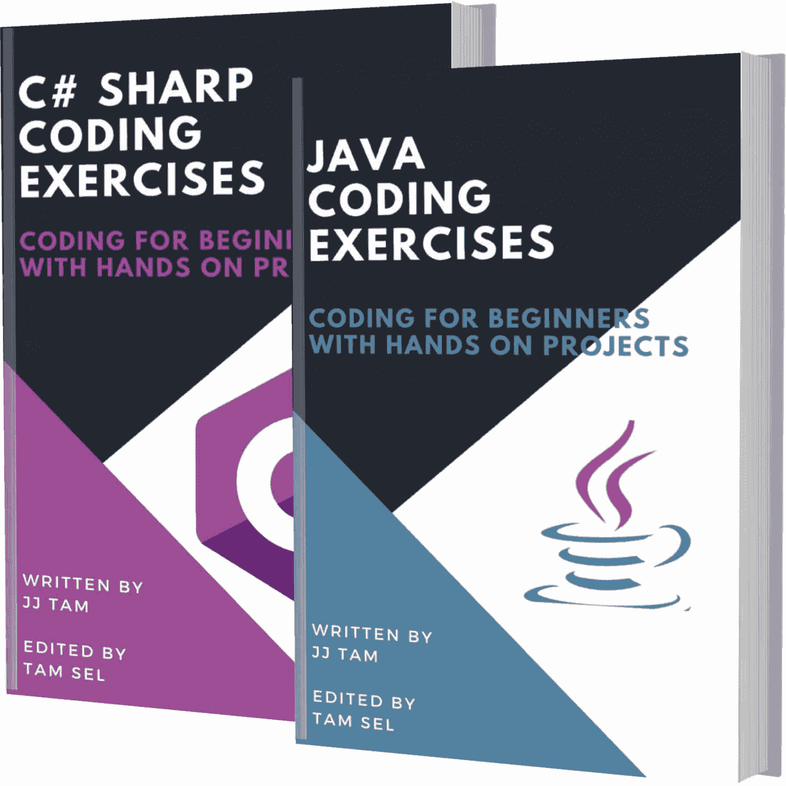
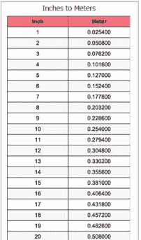
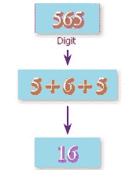
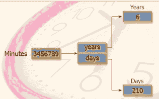
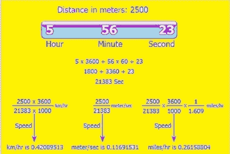

# JAVA 与 C# 编码练习



## JAVA 编程练习

- 打印 hello
- 打印和
- 两个数相除
- 打印结果
- 打印乘法表
- 寻找面积
- 交换两个变量
- 打印一个脸
- 华氏度转摄氏度
- 英制转米
- 加所有数字
- 打印年和天数
- 计算（BMI）
- 计算米/秒的速度
- 两个指定的整数相除
- 两个指定的整数相
- 打印和
- 找出三个数中的最大值
- 显示乘法表
- 显示图案
- 打印金字塔形的图案
- 显示数字菱形结构

## C# 编程练习

- 打印 hello 和你的名字
- 打印指定操作的结果
- 交换两个数字的程序
- 打印乘法的输出
- 加、减、乘、除
- 打印四个数的平均值
- 转换温度的程序
- 计算总和
- 计算和
- 用于检查的 C# 程序
- 检查两个给定整数的 C# 程序
- 检查一个给定正数的 C# 程序
- 检查给定字符串是否以 'C#' 开头
- 检查最大数的 C# 程序
- 检查哪个数字最接近 100 的程序
- 转换最后 3 个字符的程序
- 创建新字符串的程序
- 执行操作
- 计算周长
- C# 条件语句
- 检查数字是否为奇偶数的 C 程序
- 检查数字是正数还是负数
- 接收人员高度的 C# 程序
- 找出三个数中的最大值
- 计算利润和亏损

# JAVA 编程练习

## 分行打印 hello 和你的名字

```java
import java.util.Scanner;

public class Main {
    public static void main(String[] args) {
        Scanner input = new Scanner(System.in);
        System.out.print("Input first name: ");
        String fname = input.next();
        System.out.print("Input last name: ");
        String lname = input.next();
        System.out.println("Hello " + fname + " " + lname);
    }
}
```

**OUTPUT:**

```
Input first name: JJ
Input last name: TAM
Hello JJ TAM
```

## 打印两个数的和

```java
import java.util.Scanner;

public class Main {
    public static void main(String[] args) {
        Scanner input = new Scanner(System.in);
        System.out.print("Input first number: ");
        int num1 = input.nextInt();
        System.out.print("Input second number: ");
        int num2 = input.nextInt();
        int sum = num1 + num2;
        System.out.println("Sum: " + sum);
    }
}
```

**OUTPUT:**

```
Input first number: 55
Input second number: 45
Sum: 100
```

## 两个数相除并打印到屏幕上

```java
import java.util.Scanner;

public class Main {
    public static void main(String[] args) {
        Scanner input = new Scanner(System.in);
        System.out.print("Input first number: ");
        int a = input.nextInt();
        System.out.print("Input second number: ");
        int b = input.nextInt();
        int d = (a/b);
        System.out.println("The division of a and b is:" + d);
    }
}
```

**OUTPUT:**

```
Input first number: 100
Input second number: 25
The division of a and b is:4
```

## 打印指定操作的结果

```java
public class Main {
    public static void main(String[] args) {
        int w = -5 + 8 * 6;
        int x = (55 + 9) % 9;
        int y = 20 + (-3 * 5 / 8);
        int z = 5 + 15 / 3 * 2 - 8 % 3;
        System.out.print(w + "\n" + x + "\n" + y + "\n" + z);
    }
}
```

## 打印乘法表

```java
import java.util.Scanner;

public class Main {
    public static void main(String[] args) {
        Scanner in = new Scanner(System.in);
        System.out.println("Input the Number: ");
        int n = in .nextInt();
        for (int i = 1; i <= 10; i++) {
            System.out.println(n + "*" + i + " = " + (n * i));
        }
    }
}
```

**OUTPUT:**

```
Input the Number: 15
15*1 = 15
15*2 = 30
15*3 = 45
15*4 = 60
15*5 = 75
15*6 = 90
15*7 = 105
15*8 = 120
15*9 = 135
15*10 = 150
```

## 寻找圆的面积和周长

```java
import java.util.Scanner;

public class Main {
    public static void main(String[] args) {
        Scanner io = new Scanner(System.in);
        System.out.println("Input the radius of the circle: ");
        double radius = io.nextDouble();
        System.out.println("Perimeter is " + (2 * radius * Math.PI));
        System.out.println("Area is " + (Math.PI * radius * radius));
    }
}
```

**OUTPUT:**

```
Input the radius of the circle: 10
Perimeter is = 62.83185307179586
Area is = 314.1592653589793
```

## 交换两个变量

```java
import java.util.Scanner;

public class Main {
    public static void main(String[] args) {
        int x, y, z;
        Scanner in = new Scanner(System.in);
        System.out.println("Input first number: ");
        x = in.nextInt();
        System.out.println("Input second number: ");
        y = in.nextInt();
        z = x;
        x = y;
        y = z;
        System.out.println("Swapped values are:" + x + " and " + y);
    }
}
```

**OUTPUT:**

```
Input first number: 25
Input second number: 50
Swapped values are:50 and 25
```

## 打印一个脸

```java
public class Main {
    public static void main(String[] args) {
        String[] arra = new String[5];
        arra[0] = " +\"\"\"+ ";
        arra[1] = "[| o o |]";
        arra[2] = " |� ^  |";
        arra[3] = " | '-' |";
        arra[4] = " +-----+";
        for (int i = 0; i < 5; i++) {
            System.out.println(arra[i]);
        }
    }
}
```

**OUTPUT:**

```
+"""""+
[| o o |]
|  ^  |
| '-' |
+-----+
```

## 华氏度转摄氏度

```java
double fahrenheit = input.nextDouble();
double celsius =(( 5 *(fahrenheit - 32.0)) / 9.0);
System.out.println(fahrenheit + " degree Fahrenheit is equal to " + celsius + " in Celsius");
}
}
```

### 输出

输入华氏度：96

96.0 度华氏度等于 35.55555555555556 摄氏度

## 英寸到米



### JAVA 代码

```java
import java.util.Scanner;
public class Main {
    public static void main(String[] Strings) {
        Scanner input = new Scanner(System.in);
        System.out.print("Input a value for inch: ");
        double inch = input.nextDouble();
        double meters = inch * 0.0254;
        System.out.println(inch + " inch is " + meters + " meters");
    }
}
```

### 输出

输入英寸的值：5

5.0 英寸等于 0.127 米

## 求所有数字之和



### JAVA 代码

```java
import java.util.Scanner;
public class Main {
    public static void main(String[] Strings) {
        Scanner input = new Scanner(System.in);
        System.out.print("Input an integer between 0 and 1000: ");
        int num = input.nextInt();
        int firstDigit = num % 10;
        int remainingNumber = num / 10;
        int SecondDigit = remainingNumber % 10;
        remainingNumber = remainingNumber / 10;
        int thirdDigit = remainingNumber % 10;
        remainingNumber = remainingNumber / 10;
        int fourthDigit = remainingNumber % 10;
        int sum = thirdDigit + SecondDigit + firstDigit + fourthDigit;
        System.out.println("The sum of all digits in " + num + " is " + sum);
    }
}
```

### 输出

输入一个 0 到 1000 之间的整数：750

750 的所有数字之和为 12

## 打印年份和天数

### 从分钟转换



### JAVA 代码

```java
import java.util.Scanner;
public class Main {
    public static void main(String[] Strings) {
        double minutesInYear = 60 * 24 * 365;
        Scanner input = new Scanner(System.in);
        System.out.print("Input the number of minutes: ");
        double min = input.nextDouble();
        long years = (long) (min / minutesInYear);
        int days = (int) (min / 60 / 24) % 365;
        System.out.println((int) min + " minutes is approximately " + years + " years and " + days + " days");
    }
}
```

### 输出

输入分钟数：123456

123456 分钟大约等于 0 年 85 天

## 计算 (BMI)

### 身体质量指数

### JAVA 代码

```java
import java.util.Scanner;
public class Main {
    public static void main(String[] Strings) {
        Scanner input = new Scanner(System.in);
        System.out.print("Input weight in pounds: ");
        double weight = input.nextDouble();
        System.out.print("Input height in inches: ");
        double inches = input.nextDouble();
        double BMI = weight * 0.4535927 / (inches * 0.0254 * 0.0254);
        System.out.print("Body Mass Index is " + BMI+"\n");
    }
}
```

### 输出

输入体重（磅）：450

输入身高（英寸）：72

身体质量指数为 61.030345478814

## 计算每秒米、每千公里和每英里的速度



### JAVA 代码


```java
import java.util.Scanner;
public class Main {
    public static void main(String[] args) {
        Scanner scanner = new Scanner(System.in);
        float timeSeconds;
        float mps, kph, mph;
        System.out.print("Input distance in meters: ");
        float distance = scanner.nextFloat();
        System.out.print("Input hour: ");
        float hr = scanner.nextFloat();
        System.out.print("Input minutes: ");
        float min = scanner.nextFloat();
        System.out.print("Input seconds: ");
        float sec = scanner.nextFloat();
        timeSeconds = (hr*3600) + (min*60) + sec;
        mps = distance / timeSeconds;
        kph = ( distance/1000.0f ) / ( timeSeconds/3600.0f );
        mph = kph / 1.609f;
        System.out.println("Your speed in meters/second is "+mps);
        System.out.println("Your speed in km/h is "+kph);
        System.out.println("Your speed in miles/h is "+mph);
    }
```

### 输出

输入距离（米）：3000

输入小时：5

输入分钟：29

你的每秒米速度为 15

你的每小时公里速度为 54

你的每英里速度为 32

### 使用减法运算符除两个整数

### JAVA 代码

```java
import java.util.Scanner;
public class Main {
    public static float divide_using_subtraction(int dividend, int divisor) {
        if (divisor == 0) {
            return 0;
        }
        int result = 0;
        boolean negative_result = (dividend < 0) ^ (divisor < 0);
        boolean positive_num = !negative_result;
        n1 = Math.abs(dividend);
        for (int i = 0; i < n1; i++) {
            if (positive_num && divisor > 0)
                result -= divisor;
            else
                result += divisor;
        }
        return negative_result ? -(float)result : (float)result;
    }
    public static void main(String[] args) {
        Scanner in = new Scanner(System.in);
        System.out.print("Input the dividend: ");
        int dividend = in.nextInt();
        System.out.print("Input the divisor: ");
        int divisor = in.nextInt();
        System.out.println("\nResult: " + divide_using_subtraction(dividend,divisor));
    }
}
```

*(注：原文提供的代码逻辑似乎存在多处错误（如变量未定义、循环逻辑混乱等），在翻译时保持了其结构，仅对描述性文本进行了翻译。)*

### 找出三个数中的最大值

### Java 条件语句

### 输出

输入第一个整数: 50

输入第二个整数: 30

两个整数之和: 80

两个整数之差: 20

两个整数的乘积: 1500

两个整数的平均值: 40.00

两个整数的距离: 20

最大整数: 50

最小整数: 30


### JAVA 代码

```java
import java.util.Scanner;
public class Main {
  public static void main(String[] args) {
    Scanner in = new Scanner(System.in);
    System.out.print("Input the 1st number: ");
    int num1 = in.nextInt();
    System.out.print("Input the 2nd number: ");
    int num2 = in.nextInt();
    System.out.print("Input the 3rd number: ");
    int num3 = in.nextInt();
    if (num1 > num2)
      if (num1 > num3)
        System.out.println("The greatest: " + num1);
    if (num2 > num1)
      if (num2 > num3)
        System.out.println("The greatest: " + num2);
    if (num3 > num1)
      if (num3 > num2)
        System.out.println("The greatest: " + num3);
  }
}
```

### 输出

输入第一个数字: 25

输入第二个数字: 58

输入第三个数字: 98

最大值: 98

### 显示给定整数的乘法表

### JAVA 代码

```java
import java.util.Scanner;
public class Main {
  public static void main(String[] args)
  {
    int j,n;
    System.out.print("Input the number(Table to be calculated): ");
    System.out.print("Input number of terms : ");
    Scanner in = new Scanner(System.in);
    n = in.nextInt();
    System.out.println ("\n");
    for(j=0;j<=n;j++)
      System.out.println(n+" X "+j+" = " +n*j);
  }
}
```

### 输出

输入数字（要计算的表）: 输入项数 : 7

7 X 0 = 0

7 X 1 = 7

7 X 2 = 14

7 X 3 = 21

7 X 4 = 28

7 X 5 = 35

7 X 6 = 42

7 X 7 = 49

### 显示类似数字的直角三角形模式


### JAVA 代码

```java
import java.util.Scanner;
public class Main {
  public static void main(String[] args)
  {
    int i,j,n;
    System.out.print("Input number of rows : ");
    Scanner in = new Scanner(System.in);
    n = in.nextInt();
    for(i=1;i<=n;i++)
    {
      for(j=1;j<=i;j++)
        System.out.print(j);
      System.out.println("");
    }
  }
}
```

### 输出

输入行数 : 9

1

12

123

1234

12345

123456

1234567

12345678

123456789

### 打印类似金字塔的模式


### JAVA 代码

```java
import java.util.Scanner;
public class Main {
  public static void main(String[] args)
  {
    int i,j,n,s,x;
    System.out.print ("Input number of rows : ");
    Scanner in = new Scanner(System.in);
    n = in.nextInt();
    s=n+4-1;
    for(i=1;i<=n;i++)
    {
      for(x=s;x!=0;x--)
      {
        System.out.print(" ");
      }
      for(j=1;j<=i;j++)
      {
        System.out.print(i+" ");
      }
      System.out.println();
      s--;
    }
  }
}
```

### 输出

输入行数 : 7

      1

      2 2

      3 3 3

      4 4 4 4

      5 5 5 5 5

      6 6 6 6 6 6

      7 7 7 7 7 7

### 显示数字结构


### JAVA 代码

```java
import java.util.Scanner;
public class Main {
  public static void main(String args[])
  {
    Scanner in = new Scanner(System.in);
    System.out.print("Input the number: ");
    int n = in.nextInt();
    int count = 1;
    int no_of_spaces = 1;
    int start = 0;
    for (int i = 1; i < (n * 2); i++)
    {
      for (int spc = n - no_of_spaces; spc > 0; spc--)
      {
        System.out.print(" ");
      }
      if (i < n)
      {
        start = i;
        no_of_spaces++;
      }
      else
      {
        start = n * 2 - i;
        no_of_spaces--;
      }
      for (int j = 0; j < count; j++)
      {
        System.out.print(start);
        if (j < count / 2)
        {
          start--;
        }
        else
        {
          start++;
        }
      }
      if (i < n)
      {
        count = count + 2;
      }
      else
      {
        count = count - 2;
      }
      System.out.println();
    }
  }
}
```

### 输出

输入数字: 7

      1

    22

    333

    4444

    55555

    66666

    7777777

    6666666

    555555

    4444

    333

    22

      1

```csharp
Console.Write("Input the second number to multiply: ");
num2 = Convert.ToInt32(Console.ReadLine());
Console.Write("Input the third number to multiply: ");
num3 = Convert.ToInt32(Console.ReadLine());
int result = num1 * num2 * num3;
Console.WriteLine("Output: {0} x {1} x {2} = {3}", num1, num2, num3, result);
```

### 输出:

输入第一个乘法数字: 2

输入第二个乘法数字: 8

输入第三个乘法数字: 5

Output: 2 x 8 x 5 = 80

### 对用户输入的两个数字进行加、减、乘、除

### C# 代码

```csharp
using System;
public class Exercise7
{
    public static void Main()
    {
        Console.Write("Enter a number: ");
        int num1= Convert.ToInt32(Console.ReadLine());
        Console.Write("Enter another number: ");
        int num2= Convert.ToInt32(Console.ReadLine());
        Console.WriteLine("{0} + {1} = {2}", num1, num2, num1+num2);
        Console.WriteLine("{0} - {1} = {2}", num1, num2, num1-num2);
        Console.WriteLine("{0} x {1} = {2}", num1, num2, num1*num2);
        Console.WriteLine("{0} / {1} = {2}", num1, num2, num1/num2);
        Console.WriteLine("{0} mod {1} = {2}", num1, num2, num1%num2);
    }
}
```

### 输出:

输入一个数字: 10

输入另一个数字: 2

10 + 2 = 12

10 - 2 = 8

10 x 2 = 20

10 / 2 = 5

10 mod 2 = 0

### 打印四个数字的平均值

### C# 代码

```csharp
using System;
using System.IO;
public class Exercise9
{
  public static void Main()
  {
    double number1,number2,number3,number4;
    Console.Write("Enter the First number: ");
    number1 = Convert.ToDouble(Console.ReadLine());
    Console.Write("Enter the Second number: ");
    number2 = Convert.ToDouble(Console.ReadLine());
    Console.Write("Enter the third number: ");
    number3 = Convert.ToDouble(Console.ReadLine());
    Console.Write("Enter the fourth number: ");
    number4 = Convert.ToDouble(Console.ReadLine());
    double result = (number1 + number2 + number3 + number4) / 4;
    Console.WriteLine("The average of {0}, {1}, {2}, {3} is: {4}", number1, number2, number3, number4, result);
  }
}
```

### 输出:

输入第一个数字: 7

输入第二个数字: 17

输入第三个数字: 17

输入第四个数字: 51

17, 17, 517, 51 的平均值是: 150.5

### 将温度从摄氏度转换为开文度和华氏度的程序

`kelvin = celsius + 273`

`fahrenheit = celsius x 18 / 10 + 32`

### C# 代码


```csharp
using System;
public class Exercise14
{
  public static void Main( )
  {
    Console.Write("Enter the amount of celsius: ");
    int celsius = Convert.ToInt32(Console.ReadLine());
    Console.WriteLine("Kelvin = {0}", celsius + 273);
    Console.WriteLine("Fahrenheit = {0}", celsius * 18 / 10 + 32);
  }
}
```

### 输出:

输入摄氏度: 40

Kelvin = 313

Fahrenheit = 104

# 计算两个整数之和，如果两个值相等，则返回它们和的倍倍

### C# 代码

```csharp
using System;
using System.Collections.Generic;
public class Exercise19 {
  static void Main(string[] args)
  {
    Console.WriteLine(SumTriple(2,2));
    Console.WriteLine(SumTriple(2,0));
    Console.WriteLine(SumTriple(-5,2));
  }
  public static int SumTriple(int a, int b)
  {
    return a == b ? (a + b)*3 : a + b;
  }
}
```

### 输出:

12

2

-3

### 计算整数数组所有元素之和

### C# 代码

```csharp
using System;
using System.Collections.Generic;
using System.Linq;
using System.Text;
using System.Threading.Tasks;
public class Exercise47
{ 
  public static void Main()
  {
    int[] nums = {1, 2, 2, 3, 3, 4, 5, 6, 5, 7, 7, 7, 8, 8, 1};
    Console.WriteLine("\nArray1: [{0}]", string.Join(", ", nums));
    var sum = 0;
    for (var i = 0; i < nums.Length; i++)
    {
      sum += nums[i];
    }
    Console.WriteLine("Sum: "+ sum);
  }
}
```

### 输出:

Array1: [1, 2, 2, 3, 3, 4, 5, 6, 5, 7, 7, 7, 8, 8, 1]

Sum: 69

### 检查数组是否包含奇数的程序

### C# 代码

```csharp
using System;
using System.Collections.Generic;
public class Exercise53
{
  public static void Main()
  {
    int[] nums = {2, 4, 7, 6};
    Console.WriteLine("\nArray: [{0}]", string.Join(", ", nums));
    Console.WriteLine("Check if array contains an odd number? "+CheckOdd(nums));
  }
  public static bool CheckOdd(int[] nums)
  {
    foreach (var n in nums)
    {
      if (n % 2 != 0)
        return true;
    }
    return false;
  }
}
```

### 输出:

Array: [2, 4, 7, 6]

检查数组是否包含奇数? True

### 检查两个给定的整数，如果其中一个为 30 或它们的和为 30，则返回真

### C# 代码

```csharp
using System;
namespace exercises
{
  class Program
    {
      static void Main(string[] args)
      {
        Console.WriteLine(test(30, 0));
        Console.WriteLine(test(25, 5));
        Console.WriteLine(test(20, 30));
        Console.WriteLine(test(20, 25));
        Console.ReadLine();
      }
      public static bool test(int x, int y)
      {
        return x == 30 || y == 30 || (x + y == 30);
      }
  }
}
```

### 输出:

True

True

True

False

### C# Sharp 程序，检查给定的正数是否为 3 的倍数或 7 的倍数

### C# 代码

```csharp
using System;
namespace exercises
{
    class Program
    {
        static void Main(string[] args)
        {
            Console.WriteLine(test(3));
            Console.WriteLine(test(14));
            Console.WriteLine(test(12));
            Console.WriteLine(test(37));
            Console.ReadLine();
        }
        public static bool test(int n)
        {
            return n % 3 == 0 || n % 7 == 0;
        }
    }
}
```

输出:

```
True
True
True
False
```

### 检查给定字符串是否以 'C#' 开头

### C# 代码

```csharp
using System;
namespace exercises
{
    class Program
    {
        static void Main(string[] args)
        {
            Console.WriteLine(test("C# Sharp"));
            Console.WriteLine(test("C#"));
            Console.WriteLine(test("C++"));
            Console.ReadLine();
        }
        public static bool test(string str)
        {
            return (str.Length < 3 && str.Equals("C#")) || (str.StartsWith("C#") && str[2] == ' ');
        }
    }
}
```

输出:

```
True
True
False
```

### C# 程序：在三个给定整数中找出最大的数

### C# 代码

```csharp
using System;
namespace exercises
{
    class Program
    {
        static void Main(string[] args)
        {
            Console.WriteLine(test(1,2,3));
            Console.WriteLine(test(1,3,2));
            Console.WriteLine(test(1,1,1));
            Console.WriteLine(test(1,2,2));
            Console.ReadLine();
        }
        public static int test(int x, int y, int z)
        {
            var max = Math.Max(x, Math.Max(y, z));
            return max;
        }
    }
}
```

输出:

```
3
3
1
2
```

### 程序：在两个给定整数中检查哪个数字最接近值 100

### 如果两个数字相等，则返回 0。

### C# 代码

```csharp
using System;
namespace exercises
{
    class Program
    {
        static void Main(string[] args)
        {
            Console.WriteLine(test(78, 95));
            Console.WriteLine(test(95, 95));
            Console.WriteLine(test(99, 70));
            Console.ReadLine();
        }
        public static int test(int x, int y)
        {
            const int n = 100;
            var val = Math.Abs(x - n);
            var val2 = Math.Abs(y - n);
            return val == val2 ? 0 : (val < val2 ? x : y);
        }
    }
}
```

输出:

```
95
0
99
```

### 程序：将给定字符串的最后 3 个字符转换为大写

如果字符串长度小于 3，则将所有字符转换为大写。

### C# 代码

```csharp
using System;
namespace exercises
{
    class Program
    {
        static void Main(string[] args)
        {
            Console.WriteLine(test("Python"));
            Console.WriteLine(test("Javascript"));
            Console.WriteLine(test("js"));
            Console.WriteLine(test("PHP"));
            Console.ReadLine();
        }
        public static string test(string str)
        {
            return str.Length < 3 ? str.ToUpper() : str.Remove(str.Length - 3) + str.Substring(str.Length - 3).ToUpper();
        }
    }
}
```

输出:

```
PytHON
JavascrIPT
JS
PHP
```

### 程序：从给定字符串提取索引为 0,1, 4,5, 8,9 ... 的字符创建一个新字符串。

### C# 代码

```csharp
using System;
using System.Linq;
namespace exercises
{
    class Program
    {
        static void Main(string[] args)
        {
            Console.WriteLine(test("Python"));
            Console.WriteLine(test("JavaScript"));
            Console.WriteLine(test("HTML"));
            Console.ReadLine();
        }
        public static string test(string str1)
        {
            var result = string.Empty;
            for (var i = 0; i < str1.Length; i += 4)
            {
                var c = i + 2;
                var n = 0;
                n += c > str1.Length ? 1 : 2;
                result += str1.Substring(i, n);
            }
            return result;
        }
    }
}
```

输出:

```
Pyon
Japt
HT
```

### 对 +, *, / 执行运算并显示结果

### C# 代码

```csharp
using System;
public class Exercise
{
    public static void Main()
    {
        int x, y;
        char operation;
        Console.Write("Input number: ");
        x = Convert.ToInt32(Console.ReadLine());
        Console.Write("Input operation: ");
        operation = Convert.ToChar(Console.ReadLine());
        Console.Write("Input second number: ");
        y = Convert.ToInt32(Console.ReadLine());
        if (operation=='+')
            Console.WriteLine("{0} + {1} = {2}", x, y);
        else if (operation=='-')
            Console.WriteLine("{0} - {1} = {2}", x, y);
        else if ((operation=='x') || (operation=='*'))
            Console.WriteLine("{0} * {1} = {2}", x, y);
        else if (operation=='/')
            Console.WriteLine("{0} / {1} = {2}", x, y);
        else
            Console.WriteLine("Wrong Character");
    }
}
```

输出:

```
Input number: 4
Input operation: *
Input second number: 4
4 * 4 = 16
```

### 计算圆的周长

### C# 代码

```csharp
using System;
public class Exercise5
{
    public static void Main()
    {
        double r, per_cir;
        double PI = 3.1;
        Console.WriteLine("Input the radius of the circle : ");
        r = Convert.ToDouble(Console.ReadLine());
        per_cir = 2 * PI * r;
        Console.WriteLine("Perimeter of Circle : {0}", per_cir);
    }
}
```

输出:

```
Input the radius of the circle : 25
Perimeter of Circle : 155
```

##### 10 是一个偶数。

### 数字是正数还是负数

### C# 代码


```csharp
using System;

public class Exercise3
{
    public static void Main()
    {
        int num;
        Console.Write("\n\n");
        Console.Write("Check whether a number is positive or negative:\n");
        Console.Write("----------------------------------------------");
        Console.Write("\n\n");
        Console.Write("Input an integer : ");
        num= Convert.ToInt32(Console.ReadLine());
        if (num >= 0)
            Console.WriteLine("{0} is a positive number.\n",num);
        else
            Console.WriteLine("{0} is a negative number. \n", num);
    }
}
```

输出：

```
Check whether a number is positive or negative:
----------------------------------------------
Input an integer : -10
-10 is a negative number.
```

## C# 程序：接收人体身高（厘米）并根据身高进行分类

### C# 代码

```csharp
using System;

public class Exercise7
{
    public static void Main()
    {
        float PerHeight;
        Console.Write("\n\n");
        Console.Write("Accept the height of a person in centimeter and categorize them:\n");
        Console.Write("----------------------------------------------------------------");
        Console.Write("\n\n");
        Console.Write("Input the height of the person (in centimetres):");
        PerHeight = Convert.ToInt32(Console.ReadLine());
        if (PerHeight < 150.0)
            Console.Write("The person is Dwarf. \n\n");
        else if ((PerHeight >= 150.0) && (PerHeight <= 165.0))
            Console.Write("The person is  average heighted. \n\n");
        else if ((PerHeight >= 165.0) && (PerHeight <= 195.0))
            Console.Write("The person is taller. \n\n");
        else
            Console.Write("Abnormal height.\n\n");
    }
}
```

### 输出

```
Accept the height of a person in centimeter and categorize them:
----------------------------------------------------------------
Input the height of the person (in centimetres):190
The person is taller.
```

## 找出三个数中的最大值

### C# 代码

```csharp
using System;

public class Exercise8
{
    public static void Main()
    {
        int num1, num2, num3;
        Console.Write("\n\n");
        Console.Write("Find the largest of numbers:\n");
        Console.Write("--------------------");
        Console.Write("\n\n");
        Console.Write("Input the 1st number :");
        num1 = Convert.ToInt32(Console.ReadLine());
        Console.Write("Input the 2nd number :");
        num2 = Convert.ToInt32(Console.ReadLine());
        Console.Write("Input the 3rd  number :");
        num3 = Convert.ToInt32(Console.ReadLine());
        if (num1 > num2)
        {
            if (num1 > num3)
            {
                Console.Write("The 1st Number is greatest among three. \n");
            }
            else
            {
                Console.Write("The 3rd Number is greatest among three. \n");
            }
        }
        else if (num2 > num3)
            Console.Write("The 2nd Number is greatest among three \n");
        else
            Console.Write("The 3rd Number is greatest among three \n");
    }
}
```

输出：

```
Find the largest of numbers:
--------------------
Input the 1st number :20
Input the 2nd number :25
Input the 3rd  number :15
The 2nd Number is greatest among three.
```

## 计算盈损

### C# 代码

```csharp
using System;

public class Exercise17
{
    public static void Main()
    {
        int cprice, price, plamt;
        Console.Write("\n\n");
        Console.Write("Calculate profit and loss:\n");
        Console.Write("------------");
        Console.Write("\n\n");
        Console.Write("Input Cost Price: ");
        cprice = Convert.ToInt32(Console.ReadLine());
        Console.Write("Input Selling Price: ");
        price = Convert.ToInt32(Console.ReadLine());
        if (price > cprice)
        {
            plamt = price - cprice;
            Console.Write("\nYou can booked profit amount : {0}\n", plamt);
        }
        else if (cprice > price)
        {
            plamt = cprice - price;
            Console.Write("\nYou got a loss of amount : {0}\n", plamt);
        }
        else
        {
            Console.Write("\nYou are running in no profit loss condition.\n");
        }
    }
}
```

输出：

```
Calculate profit and loss:
------------
Input Cost Price: 1000
Input Selling Price: 1200
You can booked your profit amount : 200
```
