# JAVA 编程基础

初学者分步指南

JAKE BOND

## JAVA 与 PYTHON 编程基础

### 初学者分步指南

JAKE BOND

[JAVA](JAVA)

[JAVA 的特性](FEATURES OF JAVA)

[JAVA HELLO WORLD](JAVA HELLO WORLD)

[JRE (JAVA 运行时环境)](JRE (JAVA RUNTIME ENVIRONMENT))

[JAVA 虚拟机 (JVM)](JAVA VIRTUAL MACHINE (JVM))

[JAVA 中的内存区域](MEMORY AREAS IN JAVA)

[JAVA 基本数据类型](JAVA PRIMITIVE DATA TYPES)

[JAVA 变量](JAVA VARIABLE)

[JAVA 循环](JAVA LOOPS)

[JAVA DO WHILE 循环](JAVA DO WHILE LOOP)

[JAVA WHILE 循环](JAVA WHILE LOOP)

[JAVA FOR 循环](JAVA FOR LOOP)

[JAVA 增强 FOR 循环 (FOR-EACH 循环)](JAVA ENHANCED FOR LOOP (FOR-EACH LOOP))

[面向对象编程 (OOPS)](OBJECT ORIENTED PROGRAMMING (OOPS))

[JAVA 中的对象和类](OBJECTS AND CLASSES IN JAVA)

[JAVA 构造函数及示例](CONSTRUCTOR IN JAVA WITH EXAMPLE)

[JAVA 静态关键字](JAVA STATIC KEYWORD)

[JAVA 继承及示例](JAVA INHERITANCE WITH EXAMPLE)

[JAVA 中的抽象类](ABSTRACT CLASSES IN JAVA)

[JAVA 中的接口](INTERFACE IN JAVA)

[PYTHON 教程](PYTHON TUTORIAL)

[PYTHON 的特性](FEATURES OF PYTHON)

[PYTHON 设置指南与安装](PYTHON SETUP GUIDE AND INSTALLATION)

[PYTHON 关键字](PYTHON KEYWORDS)

[PYTHON 运算符](PYTHON OPERATORS)

[PYTHON 注释](PYTHON COMMENTS)

[PYTHON IF 语句](PYTHON IF STATEMENT)

[PYTHON ELIF](PYTHON ELIF)

[PYTHON FOR 循环](PYTHON FOR LOOP)

[PYTHON WHILE 循环](PYTHON WHILE LOOP)

[PYTHON 列表](PYTHON LIST)

PYTHON 元组方法

PYTHON 字典

PYTHON 函数

PYTHON 文件处理

## JAVA

Java 是一种平台无关、面向对象、健壮且稳定的编程语言。借助 Java 编程，我们可以创建终端、窗口、网络、业务和移动应用程序。

Java 编程语言由 James Gosling 于 1995 年创建，他被誉为“Java 之父”。1996 年 1 月 23 日，Java 的第一个版本发布。

Java 分为三个版本：Java SE（Java 标准版）、Java EE（Java 企业版）和 Java ME（Java 微型版）。

### Java Hello World 示例

```
class HelloWorldJava
{
    public static void main(String[] args)
    {
        System.out.println("Hello World!");
    }
}
```

#### 输出

Hello World!

### Java 的特性

Java 编程语言在创建时就考虑了可移植性、稳定性和简洁性。尽管如此，Java 仍具有一系列特性，使其成为一种通用的编程语言。

以下是 Java 最基本的特性列表。

面向对象：在 Java 编程语言中，一切都是对象。

我们将应用程序构建为包含数据和操作的不同类型对象的集合，这被称为面向对象编程。

以下是面向对象编程的基本原则：

- 对象
- 类
- 继承
- 多态
- 抽象
- 封装

- **简单：** 由于其语法简洁易懂，该语言易于学习。与 C++ 相比，它还省略了一些复杂的方法（例如显式指针、运算符重载等）。

- **平台无关：** 其他编程语言（如 C 和 C++）被编译为特定于平台的代码，而 Java 则不是。另一方面，Java 是一种平台无关的语言，保证是“一次编写，到处运行”的语言。

Java 是一个基于软件的平台，适用于各种操作系统，由两部分组成：

- 运行时环境
- API（应用程序编程接口）

Java 程序可以在多种平台上运行，包括 Windows、Linux 和 Mac OS X。编译器编译代码并将其转换为与平台无关的字节码。这些字节码是可移植的，意味着它们可以在多种平台上使用。因此，Java 是一种 WORA（一次编写，到处运行）的编程语言。

- **安全：** Java 是最稳定的编程语言，因为它提供了一个几乎不需要与操作系统交互的运行时环境。由于其可定制的基于“沙箱”的安全模型，Java 程序可以安全运行，不会对系统或用户构成风险。

内置了加密、认证和授权、公钥基础设施以及许多其他安全功能。

- **健壮：** Java 具有出色的内存管理和错误处理能力。它主要通过关注编译时和运行时错误检查来消除容易出错的情况。自动垃圾回收是 Java 的一项功能，它允许你摆脱应用程序中不再需要的工件并释放内存。

- **架构中立：** 由于 Java 语言没有依赖于实现的方面，因此它是架构中立的，允许编译后的代码在配备 JRE 的各种处理器上运行。

- **可移植：** 由于没有实现依赖性，编译后的代码可以在各种处理器上运行。这强调了其可移植性。

- **多线程：** 借助此功能，Java 应用程序可以同时执行多个任务。线程是同时运行的不同程序。多线程的好处是共享公共内存区域，这意味着不会浪费内存。

- **解释型：** Java 字节码被即时转换为本机机器指令，不会保存在任何地方。

- **高性能：** 可以通过使用 JIT（即时编译器）来提高程序的性能。

- **分布式：** Java 提供了构建分布式应用程序的能力。RMI 和 EJB 用于创建分布式应用程序。它允许我们通过从任何连接到互联网的计算机调用方法来访问文件。

- **动态：** 它是一种动态语言，因为它允许动态类加载，这意味着类文件在运行时加载。Java 具有自动内存管理功能，使其能够动态化。

### Java Hello World

在任何文本编辑器或集成开发环境（IDE）（Eclipse、Netbeans 等）中编写软件，并将其保存为`.java`文件。

要编译文件，请在命令提示符或 Linux 终端中键入`javac filename.java`，或在任何 IDE 中单击工具栏上的播放按钮。

在终端/命令提示符中键入`java filename`以运行你的程序。

```
public class MyClass //class
{
    //this is the main method
    public static void main(String[] args)
    {
        //displaying Hello World
        System.out.println("Hello World");
    }
}
```

在 Java 中运行的每一行代码都必须写在类内部。在我们的示例中，我们将类命名为`MyClass`并在其中编写了代码。

上述程序中的关键方法是入口点或起点。

以下是`main`方法中使用的关键字概述：

- `public` - 任何人都可以访问此方法
- `static` - 无需创建包含`main`方法的类的实例，该方法即可运行。
- `void` - 方法不返回任何值。
- `main` -`main`是方法的名称。
- `String[]` - 该方法接受一个参数：一个`String`类型的元素数组。

关键方法的主体写在花括号中：

`System.out.println()`

- `println`方法在输出窗口中显示一行文本。
- `println`方法通过`System`类和`out`流进行访问。

注意：Java 中的每个语句都必须以分号结尾。但是，过程或类声明后不能使用分号。

**注释：** 在程序中，有两种编写注释的方式。它可以是单行或多行语句。

**单行注释：** 任何行开头的双斜杠（`//`）定义它。

**多行注释：** 在段落的两端，一个斜杠和一个星号（`/* comment */`）来标识它。

#### JRE（Java运行时环境）

JRE是一个可以安装在任何操作系统上的软件套件，允许你运行Java程序。

它与应用程序创建过程关系不大。它包含在Java开发工具包（JDK）中。

它是一个包含Java类库、工具和独立JVM的软件包。

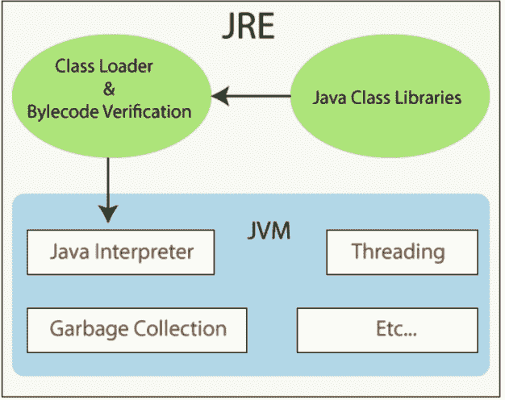

JRE是移动设备上运行Java程序最流行的环境。

源代码被编译，然后转换成Java字节码。

如果我们想在任何操作系统上运行这个字节码，我们只需要为该操作系统准备一个JRE，这可以在Oracle网站上免费获取。

JRE获取类、验证内存访问，并检索生成程序所需的系统资源。

Java运行时环境是位于操作系统之上的一层，包括：

- 它包含部署中包含的Java Web Start和Java插件等技术。
- JRE包括用户界面工具包，如Java 2D、AWT（抽象窗口工具包）、Swing、Image I/O、打印服务、声音等。
- 它包括集成库，如JDBC和JNDI（Java命名和目录接口）、IDL（接口定义语言）、RMI（远程方法调用）等。
- 它包括`lang`、`util`、`zip`、Java归档（JAR）、`instrument`、`reflection`、Collections、并发工具、管理、版本控制、日志记录和首选项API等。
- 输入/输出（I/O）、扩展机制、Beans、JMX（Java管理扩展）、Java本机接口和JAX-WS（用于XML处理的Java）是其他基础库的示例。

#### JRE的工作原理

我们编写的所有源代码都必须以`.java`扩展名保存。

接下来，我们在命令提示符中使用`javac`命令来编译我们的软件（在任何IDE中都不需要）。它将代码转换为字节码，这是与平台无关的。

当我们编译软件时，它会生成一个`.class`文件，其中包含对应java文件的字节码。

而该字节码可以在任何安装了JRE的设备上运行。流程概述如下。

- 类加载器：它动态加载JVM（Java虚拟机）中程序执行所需的各种类。JVM启动后使用以下三个类加载器：
    - 引导类加载器
    - 扩展类加载器
    - 系统类加载器

- 字节码验证器：它在执行期间检查字节码，以确保它不会给解释器带来任何问题。只有当代码通过字节码验证器的检查（检查格式和非法代码）时，才会被解释。

- 解释器：当类被加载并且代码被测试后，它逐行读取汇编代码并执行以下两个功能：
    - 它负责执行字节码。
    - 对内置硬件进行必要的调用。

#### Java虚拟机（JVM）

Java虚拟机（JVM）是执行Java字节码的虚拟运行时环境。

JVM不知道我们在代码中使用的关键字。因此，它被翻译成字节码。

它管理Java程序的执行，并提供包括自动异常处理和垃圾收集在内的功能。

任何Java文件在编译时都会转换成一个`.class`文件，其中包含字节码。当我们运行`.class`文件时，它会深入执行一系列措施。整个过程定义了JVM。

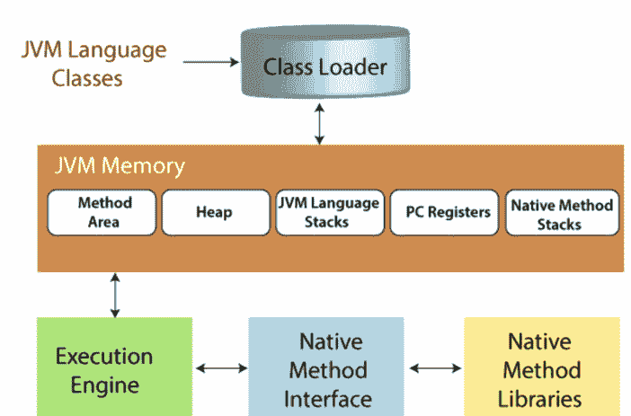

##### 类加载器

处理三个活动：

- 加载：它读取`.class`文件并将其转换为二进制数据，保存在方法区。对于每个`.class`文件，它将加载类的完全限定名、其直接父类、构造函数、变量和方法信息保存在方法区。加载`.class`文件后，JVM在堆内存中创建一个`Class`对象。

- 链接：它确定`.class`文件格式是否正确以及是否由有效的编译器创建。如果检查失败，它会抛出一个运行时异常。JVM为类变量分配内存，并将内存值设置为默认值。

- 初始化：JVM为代码的所有静态变量赋值。它在类层次结构中使用自顶向下的方法，值从上到下或从父到子分配。

在Java中，有三个内置的类加载器：

1. 引导类加载器：这是扩展类加载器的超类，它加载`rt.jar`文件，该文件包含Java标准版包（如`java.lang`、`java.net`和`java.util`等）的所有类文件。

2. 扩展类加载器：这是引导类加载器的子类加载器和父类加载器，它从`$JAVA_HOME/jre/lib/ext`目录或`java.ext.dirs`系统属性定义的任何其他目录加载jar文件。

3. 系统/应用程序类加载器：这是扩展类加载器的子类加载器。它使用与`java.class.path`关联的环境变量从应用程序类路径加载类。

##### JVM内存

JVM的内存区域分为以下部分：

- 方法区包含所有类级别的信息，如类名、直接父类名、变量（包括静态变量）和方法详情等。

- 堆区：在运行时，堆区是一个共享资源，存储所有对象信息。

- 栈区：在创建线程的同时，会为每个线程生成一个私有的JVM栈。它保留局部变量并存储帧，同时参与过程调用和返回。线程终止后，其运行时栈将丢失。

##### 执行引擎

执行引擎逐行读取字节码并执行`.class`文件。它包括以下内容：

- 一个虚拟处理器。
- 一个逐行执行字节码的字节码解释器。
- 一个即时（JIT）编译器，它编译字节码并将其转换为本机代码。

##### Java本机接口（JNI）

JNI与本机方法库通信，并使其执行所需的库可访问。它还与用其他语言（如C/C++）编写的库交互。

##### 本机方法库

执行引擎需要的一系列用其他语言（如C/C++）编写的库。

##### Java中的内存区域

让我们看看Java是如何进行内存管理的。我们将讨论工件是如何销毁的、垃圾收集器如何运行以及JVM负责什么（Java虚拟机）。

程序员必须了解内存管理的工作原理，才能构建高性能程序，使其不会崩溃，或者即使崩溃，也知道如何调试和从崩溃中恢复。

内存管理在任何编码语言中内存区域的分配和释放中都至关重要，因为它需要特别关注。

在Java中，内存分配由JVM和垃圾收集器控制。

###### Java内存区域的结构

当我们运行代码时，JVM会指定多个运行时数据区域。一些数据区域在JVM启动时创建，在JVM不存在时销毁；在线程初始化期间创建的数据区域在线程不存在时销毁。

###### 堆

堆表示内存的运行时存储字段，实际对象存储在其中。它在虚拟机首次启动时形成。

类的任何实例都会被分配一定量的内存。堆的大小由系统配置决定。

当使用`new`关键字时，对象被分配一个堆内存字段，但对象的引用保存在栈上。

###### 方法区

- 方法区存储类结构、方法数据和构造函数字段数据，以及类的特殊方法。
- 当JVM启动时，它创建方法区。
- 虽然方法区在逻辑上是堆的一部分，但它可能被垃圾回收，也可能不被垃圾回收。
- 方法区的大小可以根据计算的需要进行设置或扩展，如果方法区使用过度，也可以收缩。

###### JVM栈

每个线程都有自己的栈，它在线程创建的同时生成。

每个栈被划分为帧，这些帧是独立的部分。这些帧用于存储数据和部分结果，以及执行动态链接、过程返回值和异常分派。

每个栈的帧分为三个部分：

- 局部变量存储区
- 操作数栈
- 帧数据

所有局部变量将存储在局部变量存储区，变量上的任何操作将被处理并存储在操作数栈中，如果在方法执行期间发生任何异常，将存储在帧数据中。

栈的大小可以是静态的，也可以是动态的。可以在栈构建过程中的任何时间进行选择。

###### 本机方法栈

本机方法栈是用Java以外的语言编写的栈。当线程形成时，这些内存区域通常被分配给它们。这个内存区域的大小可以是设置的，也可以是动态的。

###### 程序计数器（PC）寄存器

它保存当前正在运行的Java虚拟机指令的地址。

Java中的每个线程都有自己的PC寄存器。

一些本机库包含在Java框架中。程序计数器如果应用程序中的方法不是原生方法（即用Java编写），则包含当前正在执行的JVM指令的地址；如果是原生方法，则PC寄存器的值未知。

##### 垃圾收集器的工作原理

此方法被JVM用于动态分配和释放内存。垃圾收集器分三个阶段运行。

**标记** - 识别哪些对象未被使用。

**普通删除** - 堆中已知不再使用的项目已被清除。

**删除与压缩** - 当堆中的未使用项目被删除时，内存会立即被分配；这些内存分配会聚集在一起，以便将来更容易进行内存分配。

压缩允许我们将内存组合在一起，从而分配更多新的内存。

### Java基本数据类型

在编程语言中，基本数据类型是最基本的数据类型。它们是语言内置的。基本类型的名称相当描述性地说明了它们可以存储的值。Java中指定了以下八种基本数据类型：

`char`, `byte`, `short`, `int`, `long`, `float`, `double`, `boolean`

**boolean:** - 布尔变量的两个可能值是真或假。它用于只有两种可能结果的情况。

```
Ex: boolean married = true;
```

**double:** - 要存储十进制数，我们可以使用`double`基本数据类型。`double`比`float`占用更多空间。

```
double total = 120.1762;
```

**float:** - 使用`float`基本数据类型存储十进制数。虽然`float`比`double`占用的空间少，但它只能存储较小范围的值。`float`的精度低于`double`。

```
Ex: float average = 10.124F;
```


### 基本数据类型

`long`：`long`基本数据类型用于存储大整数，范围从-9,223,372,036,854,775,808到9,223,372,036,854,775,807

```
Ex: long e = 1515l;
```

`int`：`int`数据形式表示一个32位有符号二进制补码整数。如果存在内存问题，整数通常用作整数值的默认数据形式。

```
Ex: int d = 123;
```

`short`：`short`数据形式是一个16位有符号二进制补码整数。与`byte`数据类型一样，`short`数据类型也可用于节省内存。`short`的大小是整数的两倍。

```
Ex: short C = 11111;
```

`byte`：`byte`是一个8位有符号二进制补码整数数据形式。由于`byte`比整数小四倍，它用于在大型数组中节省空间，通常代替整数。

```
Ex: byte b = 127;
```

`char`：`char`数据类型表示一个16位Unicode字符。可以使用`char`数据形式存储任何字符。

```
Ex: char a = 's';
```

基本数据类型，如布尔、数字和字符数据类型，对于分类很有用。

只有两种可能值的数据使用布尔数据形式存储。真/假、是/否或其他组合可用于表示该值。布尔只能存储真和假这两个值。

整数或十进制数用于存储数值。整数可以存储在`byte`、`short`、`int`和`long`格式中。`byte`、`short`、`int`和`long`数据类型分别使用8、16、32和64位。十进制数使用`float`和`double`变量存储。`float`使用32位存储其值，`double`使用64位。

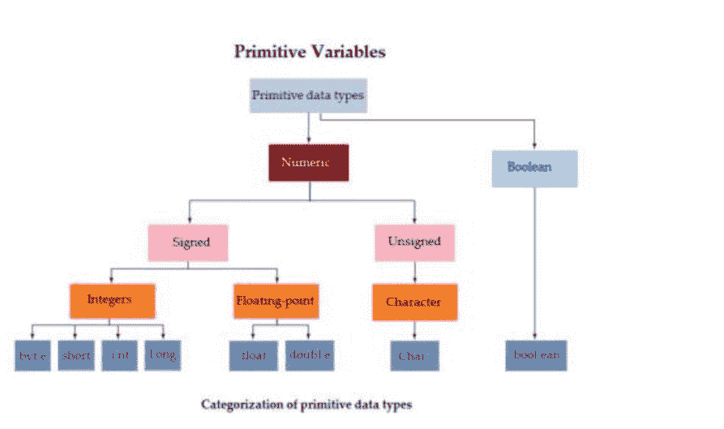

### Java变量

在程序中，变量是基本的存储单元。在Java中，我们使用标识符、类型和可选的初始化器来定义变量。

Java中的变量必须先声明才能使用。Java中的变量可以用在变量声明时为真的任何表达式动态初始化。

#### 声明

```
int x = 15;
int y = Math.sqrt(a * a + b * b); // 这里变量y将动态获取值
// 取决于a、b的值。
```

#### 作用域

作用域由花括号的开始和结束定义。作用域决定了我们软件的其他部分可以访问哪些项目。它还决定了这些项目将持续多长时间。

当进入变量的作用域时，它被建立；当退出时，它被销毁。

这意味着在方法内声明的变量在方法外不会保留其值。同样，当退出一个块时，在其中声明的变量会失去其值。

因此，变量的生命周期包含在其定义中。

以下是变量的可用作用域：

- 局部变量（也称为方法局部变量）
- 方法参数（也称为方法实参）
- 实例变量（也称为属性、字段和非静态变量）
- 类变量（也称为静态变量）

#### 局部变量

局部变量在过程、构造函数或块内指定。访问修饰符不能应用于局部变量。

局部变量仅在声明的过程、块或构造函数的作用域内可见。

在第一次使用局部变量之前，应该对其进行分配。

局部变量的作用域由其在系统中的声明位置决定。

这些花括号限制了在循环、`if – else`、`switch`语句或代码块（用标记）内指定的局部变量的作用域。

在每个这些构造之外声明的局部变量可以在过程内访问。

#### 方法参数

方法参数是在方法签名中接受值的变量。

它们只能通过标识它们的系统访问。

#### 实例变量

实例变量在类的所有方法之外声明。类中指定的所有实例（或非静态）方法都可以访问它。

#### 类变量

`static`关键字用于描述类变量。类变量与整个类相关联，而不是与类中的单个对象相关联。类变量是所有对象共享的变量。类变量不会在对象中重复。要访问类变量，我们甚至不需要一个实体。可以使用描述它的类的名称来访问它：

*比较局部变量在不同作用域中的使用。*

- 局部变量在方法内定义，通常用于存储计算的中间结果。
- 方法参数用于将值传递给方法。这些值可以被操作，也可以分配给实例变量。
- 实例变量用于存储对象的状态。这些是需要被多个方法访问的值。
- 类变量用于存储应由类的所有对象共享的值。

### Java循环

#### Java Do While循环

`do-while`循环用于在循环结束时评估退出条件。由于条件表达式位于循环底部，`do-while`循环仍然至少执行一次循环体。

**示例：**

```
public class Myclass {
    public static void main(String[] args) {
        int num = 9;
        boolean divisibleBy7 = false;
        do {
            System.out.println(num);
            if (num % 7 == 0)
                divisibleBy7 = true;
            num--;
        } while (divisibleBy7 == false);
    }
}
```

**输出**

```
9
8
7
```

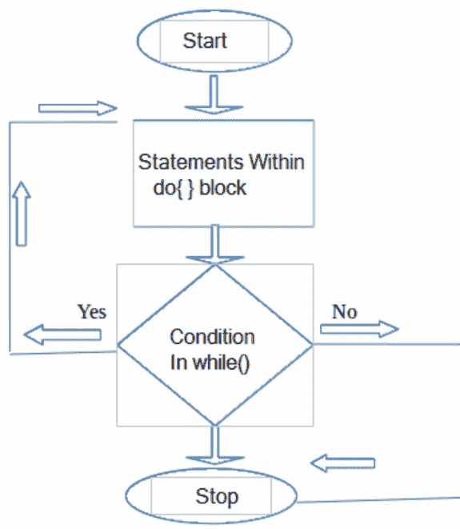

`do while`循环中的控制流

#### Java While循环

`while`循环用于只要其条件评估为真就连续执行一系列语句。在开始执行语句之前，此循环会测试条件。

**示例：**

```
public class Myclass {
    public static void main(String[] args) {
        int num = 9;
        boolean divisibleBy7 = false;
        while (!divisibleBy7) {
            System.out.println(num);
            if (num % 7 == 0)
                divisibleBy7 = true;
            --num;
        }
    }
}
```

**输出**

```
9
8
7
```

由于`while`循环在循环顶部测试条件表达式，如果条件一开始就不正确，循环体甚至不会执行一次。

### Java For 循环

`for`循环是一种编程结构，它会按预定次数执行一系列语句。其结构如下：

```
for (initialization; condition; update) {
    statements;
}
```

`for`循环区分三种类型的语句，它们由分号（`;`）分隔：

- 初始化语句
- 终止条件
- 更新子句（可执行语句）

示例：

```
public class Myclass {
    public static void main(String[] args) {
        int tableOf = 25;
        for (int ctr = 1; ctr <= 5; ctr++) {
            System.out.println(tableOf * ctr);
        }
    }
}
```

输出

```
25
50
75
100
125
```

上面的代码将运行五次。它从变量`ctr`的值为1开始运行，直到其值小于或等于5为止。（`ctr++`）`ctr`的值每次增加一。

当`ctr`的值为1、2、3、4和5时，代码会运行。由于`6 <= 5`的结果为`false`，`for`循环现在完成执行，不再执行语句集合。

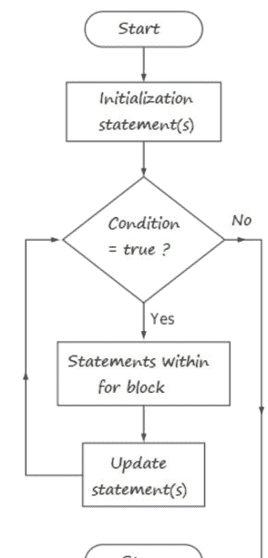

`for`循环的工作方式如下。

**步骤 1：初始化**。它通过设置循环控制变量的值来控制循环，该变量用作计数器。初始化表达式只运行一次。

**步骤 2：条件。** 我猜这是一个布尔表达式。循环控制变量与预设值进行比较。如果此表达式为`true`，则执行循环体。如果结果为`false`，则循环停止。

**步骤 3：迭代。** 此表达式通常递增或递减循环控制变量。每次循环时，循环都会迭代，首先计算条件表达式，然后执行循环体，最后执行迭代表达式。循环持续进行，直到控制表达式为`false`。

更新子句在`for`循环体的语句完成后运行。初始化部分可以描述多个初始化语句，该部分只运行一次。更新子句中可以指定多个语句。然而，`for`循环只能有一个终止条件。

### Java 增强型 For 循环（For-each 循环）

`for-each`循环，也称为增强型`for`循环，比常规`for`循环有几个优点。`for-each`循环用于按顺序从头到尾遍历一组项目。

`for`循环的`for-each`变体采用以下通用形式：

```
for(type count_var : collection) statement-block
```

`type`定义了变量`count_var`的类型。

它从头到尾迭代，一次从序列中接收一个元素。

在循环的每次迭代中，都会检索数组中的下一个元素并将其存储在`count_var`中。

循环重复进行，直到收集完集合的所有元素。由于迭代变量从集合接收值，因此其形式必须与集合中存储的元素相同（或兼容）。

因此，在遍历数组时，`type`必须与数组的元素类型一致。

使用增强型`for`循环，我们可以轻松地遍历嵌套数组。

示例：

```
import java.util.ArrayList;
public class Myclass {
    public static void main(String[] args) {
        ArrayList<String> myList = new ArrayList<String>();
        myList.add("Java");
        myList.add("Loop");
        myList.add("for-each");
        for (String val : myList) {
            System.out.println(val);
        }
    }
}
```

输出

```
Java
Loop
for-each
```

需要考虑的一点是，如果我们尝试在增强型`for`循环中修改循环变量会发生什么。

如果我们遍历的是对象或基本类型，答案就在于此。如果我们在遍历基本类型值的数组，那么对循环变量的操作永远不会改变正在迭代的数组的值，因为在增强型`for`循环中，基本类型值是按值传递给循环变量的。

当我们遍历对象集合时，数组的值是通过引用传递给循环变量的。因此，如果通过调用循环变量的方法来改变其值，新值将反映在循环变量的值中。

#### 增强型 for 循环的局限性

- 无法从其列表中删除或擦除元素：由于我们无法调用`remove`过程，增强型`for`循环隐藏了用于遍历数组元素的迭代器。我们不能用它来删除或擦除当前集合的值。
- 不能在同一个循环中遍历多个列表数组。
- 不能使用增强型`for`循环来创建数组或修改其组件。

### 面向对象编程（OOP）

自时间伊始，我们就在不断变化。当发现某些对社会不可接受的事物时，评估的需求就会出现，目的是改进现有结构。编程语言也是如此。我们也希望编程语言有所进步。在探讨是什么导致了OOP的诞生之前，让我们先看看为什么首先需要这样一个系统。

从十九世纪第一种编程语言的引入开始，我们就根据先前语言的需求和局限性不断演进。

然后，需要一种标准化的、高效的高级语言来潜在地替代汇编代码。因此，C语言应运而生，它是一种面向过程的编程语言（POP）。

### 面向过程的编程语言（POP）

POP中的指令写在主函数下，每一行定义了机器应执行的命令。

随着代码规模的增长，软件被划分为多个用户定义的函数。在POP中，数据被置于次要地位。

POP的代码是为特定目的而创建的，不能以任何其他方式使用。

C编程语言震撼了计算界；似乎发现了一种完美的语言，它准备充分且足以开发系统代码。

任何完美的事物都有缺点，C也不例外。中小型代码易于控制和操作，但大型代码则更为复杂。

#### 面向过程的编程语言的缺点（POP）

这种编程方法的一些缺点如下：

由于每个函数都可以访问全局变量，因此必须对函数描述进行调整，以便仅在必要时操作数据值。

这种编程方法不适合解决现实世界的问题。

向现有代码添加新功能是一项艰巨的任务。

有必要开发一种编程框架，使我们能够监控和解决上述问题。

重点主要放在数据上。

编写完成后，它可以被重用于其他目的。

无需重写整个代码，可以根据需要向当前代码添加新的方法和变量。

因此，面向对象的编程框架得以发展。

### 面向对象编程

面向对象编程（OOP）是一种标准化程序的方法。

方法和数据存储在单独的内存区域中。

这种编程方法基于"对象"，而对象不过是现实世界的实体。

使用继承、多态和数据抽象等原则，这种编程方法有助于组织复杂的程序。

简单来说，在OOP中，解决方案是首先构建一个包含大量方法和变量的类，然后使用该类来评估属性的状态。

因此，类不过是决定对象状态的蓝图，而对象是现实世界中的实际实体。

让我们来看看OOP的概念

### Java中的对象与类

面向对象编程的基本原理是类和构件。它基于现实世界的对象。Java中的对象既是物理实体也是逻辑实体，而类仅仅是逻辑实体。

**Java中的对象**

具有状态和行为的现实世界实体被称为对象。对象也可以是真实的或逻辑的。这是类的情况。以下是一些对象的例子：

桌子、风扇、椅子、汽车、火车等。

对象可以描述为：

- 现实世界的实体
- 类的实例
- 有形的或无形的
- 具有状态和特征的实体

对象可以是有形的，也可以是无形的。无形实体的一个例子是银行系统。对象是在物理世界中可以找到的实体。

每个实体都有一些特征，例如名称、过程和其他细节。对象的特征包括：

- 状态
- 行为
- 标识

状态：它包括对象的属性和含义。它是对象属性的表示。

行为：它包括对象的方法。它是对象对另一个对象响应的表示。它反映了对象的功能，例如存款等。

标识：标识是一个独一无二的标识符。JVM在内部使用它来确定对象的唯一性。

#### 对象示例

对象：汽车

标识：

对象名称：汽车

#### 属性

- 品牌
- 型号
- 颜色
- 速度

#### 行为

- 运行
- 速度

#### 对象声明

由于对象被称为类的实例，因此当在类中生成对象时，该类被称为被实例化。类的所有实例共享类的属性和特性，但这些属性（状态）的值是不同的。一个类中可以有任意数量的实例。

示例：

```java
public class Car
{
    String brand;
    String model; //instance variable
    int speed;
    public Car(String brand, String model, int speed)
    {
        this.brand=brand;
        this.model=model;
        this.speed=speed;
    }
    public String getBrand()
    {
        return brand;
    }
    public String getModel()
    {
        return model;
    }
    public int getSpeed()
    {
        return speed;
    }
    public String method()
    {
        return("my cars brand is" +this.getBrand()+"\n my model is "
        +this.getModel()
        + "my speed is " +this.getSpeed());
    }
    public static void main(String[] args)
    {
        Car c1=new Car(" toyota", "camery" ,250);
        System.out.println(c1.method());
    }
}
```

#### 输出

```
my cars brand is Toyota
my model is camery my speed is 250
```

#### 创建类对象的方法

- 使用`new`关键字
- 使用`Class.forName(String className)`方法
- 使用`clone()`方法
- 反序列化

##### 使用new关键字

这是Java中最基本且最常用的创建对象的方法。

`Demo obj= new Demo()`

##### 使用Class.forName(String className)方法

在`java.lang`包中，有一个预定义的类叫做`Class`。函数`forName()`是Java `Class`方法。此过程返回与参数中给定名称的类或接口关联的类对象，该对象作为`String`返回。

`Demo obj=(Demo)Class.forName("pack1.Demo").newInstance();`

考虑`pack1`包中存在的类`Demo`。

##### 使用clone()方法

`Object`类包含`clone()`函数。此方法返回一个已复制的对象类。

`Demo obj=(Demo)obj.clone();`

#### Java中的类

类是用户指定的构件的蓝图。它包含一组属性和方法，这些属性和方法被同一类型的所有对象共享。

要创建一个类，我们使用关键字`class`。

语法：

```java
class ClassName
{
    Methods
    Fields
    ......
    ......
}
```

一个Java类包含：

- 方法
- 字段
- 构造方法
- 代码块
- 嵌套类和接口

#### Java中的方法

Java中的方法是一段执行特定任务的代码。当它接收到消息时就会启动。方法可以在课程的任何地方使用。方法类似于函数，可用于解决问题。

##### 优点

方法的主要优点是，我们只需定义一次代码，就可以多次重用它。


方法还提供了代码优化的好处。通过识别方法，我们可以减少程序中的代码行数。

### 创建方法

方法应在类内部进行描述。应使用过程名称，后跟括号来评估它`()`。`System.out.println`是Java中的预定义方法之一`()`。下面是设计过程的一个示例。

```java
public class Demo{
    static void method1() {
        // code to be executed
    }
}
```

### 调用方法

要调用一个方法，请键入方法名称，后跟括号`()`和分号`';'`。我在下面的程序中指定了`method1`来打印`"in method 1"`。当我调用`method1()`时，我得到以下输出：`"in method 1。"`

```java
public class Demo{
    static void method1() {
        System.out.println("in method 1");
    }
    public static void main(String[] args) {
        method1();
    }
}
```

#### 输出

```
In method 1
```

### 字段

类字段可以包含许多内容，如变量、常量和其他数据类型。

一个类包含以下任何变量：

- 局部变量
- 类变量
- 实例变量

### 局部变量

局部变量在方法、构造方法和代码块内部指定。在代码块内部创建这些变量，然后在方法完成时丢弃它们。

### 类变量

`static`关键字用于在任何方法外部描述类变量。

### 实例变量

类的实例变量在任何方法外部指定。当类被创建时，这些变量也会被创建。在程序中的任何地方都可以访问实例变量。

### 构造方法

构造方法是类最重要的子主题之一。任何类都必须至少有一个构造方法。如果我们没有明确指定它，Java编译器将自动生成一个构造方法。

当创建一个新对象时，会调用一个构造方法。它设置各个部分。它的名称与类名相同。在一个类中，可以形成多个构造方法。

看下面的例子：

```java
public class Student
{
    public Student()
    {
```

## Java 中的代码块

一个或多个用花括号括起来的语句构成一个代码块。代码块通常用于将多个语句组合在一起，以便根据需求使用。

下面是一个简单代码块的示例。

```
{ //block start
    int a = 50;
    a++;
} //block end
```

## Java 对象和类的示例

### 示例 1

```
class Shop{
//fields
float mrp; //instance variable
String name;
//main method
public static void main(String args[]){
    Shop s1=new Shop(); //creating an object of Shop
    //Printing values
    System.out.println(s1.mrp); //accessing member variable
    System.out.println(s1.name);
}
}
```

#### 输出

```
0.0

null
```

## Java 中的构造函数及示例

### Java 构造函数

构造函数用于初始化一个实体。它是一个代码块，用于设置新生成的实体。

它由一组在创建对象时执行的语句组成。虽然程序员不一定要为类编写构造函数，但为了程序效率和保护，我们通常会这样做。

如果未指定类的构造函数，编译器会将成员变量设置为它们的默认值。

以下是编写 Java 构造函数的一些说明：

- 构造函数应与类同名。
- 构造函数不应返回任何值（甚至不能是`void`）。
- 应避免使用`abstract`、`final`、`static`和`synchronize`构造函数。
- 可以在构造函数声明中使用访问修饰符来管理构造函数的访问权限。

### 示例

```
public class Demo{
//This is the constructor
Demo()
{
}
..
}
```

构造函数构建完成后，就会产生它如何工作的问题。答案是，当使用`new`关键字生成对象时，会调用构造函数来初始化该对象。

```
Demo obj= new Demo()
```

在这种情况下，`new`关键字创建了`Demo`类的一个对象，并调用构造函数对其进行初始化。

### 示例

```
public class Hello {
    String name;
//Constructor
Hello(){
this.name = "Java Constructor.";
    }
public static void main(String[] args) {
        Hello obj = new Hello();
System.out.println(obj.name);
    }
}
```

#### 输出

```
Java Constructor.
```

## 构造函数的类型

构造函数分为三类。

- 默认构造函数
- 带参构造函数
- 无参构造函数

## 默认构造函数

默认情况下，Java 使用构造函数来初始化类的对象。如果你在 Java 程序中没有编写任何构造函数，Java 编译器会添加一个默认构造函数。

默认构造函数根据对象的类型为其赋予默认值。

请参阅下图，了解默认构造函数的工作原理。

如图所示，有一个用户创建的`.java`文件。Java 编译器编译代码，将其转换为`.class`文件，并为提供的类创建一个构造函数。

## 带参构造函数

带参构造函数是接受参数或实参的构造函数。属性初始化通过这些参数完成。

### 示例

```
public class ExDemo{
int x;
public ExDemo(int y) {
x = y;
}
public static void main(String[] args) {
ExDemo Obj = new ExDemo(5);
System.out.println(Obj.x);
}
}
```

#### 输出

```
5
```

## 无参构造函数

“无参构造函数”是指没有参数或实参的构造函数。无参构造函数的签名与默认构造函数相同；然而，与默认构造函数不同的是，其主体可以包含任何代码。

如果你编写了一个带参数或不带参数的构造函数，编译器就不会生成默认构造函数。

### 示例

```
class ExDemo1
{
public ExDemo1()
    {
System.out.println("In No-arg constructor");
    }
public static void main(String args[]) {
    new ExDemo1();
    }
}
```

#### 输出

```
In No-arg constructor
```

## 构造函数重载

构造函数可以像方法一样进行重载。构造函数重载是一种 Java 技术，它允许一个类拥有任意数量的构造函数，只要每个构造函数具有不同的参数列表即可。编译器使用参数的数量和类型来区分构造函数。

请看下面的示例。

### 示例

```
class Student
    {
int Roll_no;
        String SName;
double Marks;
Student(int R, String N, double M) //Constructor 1
{
Roll_no = R;
SName = N;
Marks = M;
}
Student(String N, double M, int R) //Constructor 2
{
Roll_no = R;
SName = N;
Marks = M;
}
void Display()
{
System.out.print("\n\t" + Roll_no+"\t" + SName+"\t" + Marks);
}
public static void main(String[] args)
{
Student S1 = new Student(1,"akash mishra",85.57); // Statement 2
Student S2 = new Student(2,"vaibhav Saxena",87.65); // Statement 1
System.out.print("\n\tRoll_no\tSName\tMarks\n");
S1.Display();
S2.Display();
}
}
```

#### 输出

| Roll_no | SName | Marks |
|---|---|---|
| 1 | akash mishra | 85.57 |
| 2 | vaibhav Saxena | 87.65 |

## 构造函数链

构造函数链是在当前对象的上下文中从一个构造函数调用另一个构造函数的方法。你可以使用各种构造函数来传递参数。你可以将所有的初始化操作集中在一个地方管理。使用构造函数链有两种方式。

- 在同一类中
- 从基类

可以使用同一类构造函数的`this()`关键字在同一类中链接构造函数。

可以使用`super()`关键字（它调用基类的构造函数）来链接来自基类的构造函数。

### 使用 this() 在同一类中进行构造函数链

- 对于构造函数链，`this()`应始终是构造函数中的第一个声明。
- 对于构造函数链，构造函数可以是任何顺序；它们不必按特定顺序排列。
- 至少应有一个构造函数不使用`this()`关键字。

```
class ExDemo2
{
    ExDemo2()
    {
        this(11);
        System.out.println(" Default constructor");
    }
    ExDemo2(int x)
    {
        this(10, 12);
        System.out.println(x);
    }
    ExDemo2(int x, int y)
    {
        System.out.println(x * y);
    }
    public static void main(String args[])
    {
        new ExDemo2();
    }
}
```

#### 输出

```
120

11

Default constructor
```

## Java static 关键字

`static`关键字在 Java 中用于操作内存。它适用于变量、方法、代码块和嵌套类。它用于在多个类之间共享变量或方法。类的主要方法通常被标记为`static`。

要使成员成为静态的，请在声明它之前使用`static`关键字。静态成员可以在不引用任何对象的情况下访问，并且可以在其类的任何成员创建之前访问。静态方法不能像非静态方法那样被调用。

以下成员在 Java 中可以是静态的：

- 方法（类方法）
- 变量（类变量）
- 代码块
- 嵌套类

请看下面的示例，以理解`static`关键字的概念。

```
public class Demo{
static void method1()
{
System.out.println("This is method1");
}
public static void main(String[] args)
{
method1();
}
}
```

#### 输出

```
This is method1
```

## Java 静态方法

静态方法是不与类的实例变量交互的方法。使用`static`关键字来声明静态过程。由于 JVM 在创建对象之前首先执行静态方法，因此静态方法不操作实例变量。

`main()`方法是静态方法最常见的例子。静态方法是类的一部分；它不是类对象的一部分。静态数据成员可以被静态方法访问。它有可能改变静态数据成员的含义。它可以在类的对象创建之前被访问。

### 示例

我们将通过这个示例学习如何使用`static`关键字。这是一个简单的计算示例。

```
class Calc{
    static int cube(int a){
        return a*a*a;
    }
    public static void main(String args[]){
        int result=Calc.cube(7);
        System.out.println(result);
    }
}
```

#### 输出

```
343
```

静态方法有一些局限性。

以下是静态方法的局限性：

- 这些方法只能直接调用其他静态方法。
- 这些方法只能直接访问静态数据。
- 这些方法不能引用`this`或`super`。

静态方法的限制如下例所示。

```java
public class Demo1
{
    static int x=20; // static variable
    int y=40;     //instance variable
    static void method1()   // static method
    {
        x=40;
        System.out.println("This is method1");
        y=20;   // here it cannot make reference of a static variable
        method2();  //cannot make static reference to the non static method
        System.out.println(super.a); // cannot use super
    }
    void method2()
    {
        System.out.println("This is method2");
    }
    public static void main(String[] args)
    {
    }
}
```

## 为什么Java的main()方法是静态的？

Java程序需要它，因为JVM在创建任何对象之前就会调用`main()`方法。因此，调用静态方法不需要对象。如果`main()`是一个非静态方法，JVM会先构造一个对象，然后再调用`main()`。这可能导致不确定性，并造成内存分配过多。

## Java静态变量

静态变量是指被声明为`static`的变量。静态变量指的是所有对象共享的属性，例如员工的公司名称或学生的学院名称。它只在类加载时在类区域获得一次内存。

- 静态变量只能在类级别生成。
- 静态变量和代码块按照程序中指定的顺序执行。
- 为了满足特定条件，会使用静态变量。
- 在一个类中，静态变量只分配一次内存。
- 静态变量在程序中节省内存。

### 语法

```java
public static variableName;
```

### 示例

```java
public class CompanyData
{
    int id;
    String name;
    static String Comp_name="AAA pvt.ltd";
    public static void main(String args[])
    {
        CompanyData c1=new CompanyData();
        c1.id=100;
        c1.name=" akash shakya ";
        System.out.print(c1.id);
        System.out.print(c1.name);
        System.out.println(CompanyData.Comp_name);
        CompanyData c2=new CompanyData();
        c2.id=200;
        c2.name=" Amritanshu shekhar ";
        System.out.print(c2.id);
        System.out.print(c2.name);
        System.out.print(CompanyData.Comp_name);
    }
}
```

#### 输出

```
100 akash shakya AAA pvt.ltd
200 Amritanshu shekhar AAA pvt.ltd
```

## Java静态代码块

静态变量由静态代码块初始化。当类加载到内存中时，该代码块会运行。一个类中可以有多个静态代码块，它们都按照在程序中编写的顺序执行。它在主程序之前由JVM执行。

在JDK 1.6之前，可以在不使用`main()`的情况下运行Java程序，但之后的版本不支持此功能。

### 示例

```java
class Demo2
{
    static {
        System.out.println(" This is static block ");
    }
    public static void main(String args[])
    {
        System.out.println("This is main function");
    }
}
```

#### 输出

```
This is static block
This is main function
```

## Java继承示例

Java中的继承是一个子对象继承其父对象所有属性和行为的过程。

它促进了代码重用，并在不同类之间建立了联系。

它是面向对象编程系统的一个必要组成部分。

在现实生活中，儿子继承父亲的遗产，就像Java中的继承一样。

Java基于父子关系的前提。

Java继承表示了一种父子关系，也称为IS-A关系。

Java中有两种类。

- 父类 / 超类 / 基类
- 子类 / 派生类


# Java 继承与抽象类

父类从其子类继承属性，而子类从其父类继承属性。

Java 中的`extends`关键字用于继承一个类的属性和方法。

请看下面的示例。

```java
class Teacher{
    String prof = "Teacher";
    String col_n = "IIT K";
    void does(){
        System.out.println("Teaching");
    }
}
public class CSTeacher extends Teacher{
    String sub = "Java";
    public static void main(String args[]){
        CSTeacher z = new CSTeacher();
        System.out.println(z.col_n);
        System.out.println(z.prof);
        System.out.println(z.sub);
        z.does();
    }
}
```

### 示例

```
IIT K
Teacher
Java
Teaching
```

在上面的示例中，子类`CSTeacher`持有父类`Teacher`的特征和过程，例如职位、学院名称和`void`方法。

`extends`关键字意味着你在新类中使用现有类的属性。

#### 继承的优点

- 继承通过允许运行时多态性来帮助方法重载。
- 继承使代码重用更容易。
- 继承减少了 Java 程序中的代码行数。
- 通过在多个子类之间共享标准代码，继承减少了重复代码的数量。
- 继承使数据隐藏更容易。基类可以将任何数据保持为私有，这样派生类就无法更改它。

#### 继承的缺点

继承的主要缺点是两个类（基类和派生类）紧密耦合，无法单独使用。

继承的另一个缺点是它增加了程序的时间和精力，因为它需要经历所有重载类的阶段。

### Java 中的继承形式

以下是 Java 支持的各种继承形式。

- 单继承
- 多级继承
- 层次继承

#### 单继承

在单继承中，一个类只继承另一个类。

类`A`是父类，类`B`是子类，类`B`继承类`A`的属性和行为。这种操作称为单继承。

### 示例

```java
public class A
{
    public void print1()
    {
        System.out.println("Class A method");
    }
}
class B extends A
{
    public void print2()
    {
        System.out.println("Class B method");
    }
    public static void main(String[] args)
    {
        B d = new B();
        d.print1();
        d.print2();
        d.print1();
    }
}
```

#### 输出

```
Class A method
Class B method
Class A method
```

#### 多级继承

在多级继承中，一个子类继承一个父类，同时这个子类又是另一个类的父类。在图中，类`A`是类`B`的父类，类`B`也是类`C`的父类。这种操作称为多级继承。

一个类不能直接继承祖父类。

```java
public class A
{
    public void print1()
    {
        System.out.println("Class A method");
    }
}
class B extends A
{
    public void print2()
    {
        System.out.println("Class B method");
    }
}
class C extends B
{
    public void print3()
    {
        System.out.println("Class C method");
    }
    public static void main(String[] args)
    {
        C d = new C();
        d.print1();
        d.print2();
        d.print3();
    }
}
```

#### 输出

```
Class A method
Class B method
Class C method
```

#### 层次继承

在层次继承中，一个单一的基类代表多个子类。

多个子类可以继承父类的属性。

##### Java 层次继承

### 示例

```java
class A
{
    public void print1()
    {
        System.out.println("Class A method");
    }
}
class B extends A
{
    public void print2()
    {
        System.out.println("Class B Method");
    }
}
class C extends A
{
    public void print3()
    {
        System.out.println("Class C method");
    }
}
public class Main
{
    public static void main(String[] args)
    {
        C d = new C();
        d.print1();
        B b = new B();
        b.print2();
        d.print3();
    }
}
```

#### 输出

```
Class A method
Class B Method
Class C method
```

### Java 中的抽象类

在 Java 中，要将一个类声明为抽象类，请使用`abstract`关键字。抽象类就是这样创建的，这种方法被称为抽象。

抽象类是通用类（或对象类型），用作构建遵循编程语言支持的协议或操作集合的特定对象的基础。

关于抽象类，有几个关键点需要记住。

- 抽象类是同时包含抽象方法和具体方法的类。
- 换句话说，抽象类不能被实例化。不能创建抽象类的对象。
- 抽象类是至少有一个抽象方法，可能还有一些标准方法的类。
- 抽象类中允许有静态方法和构造函数。
- 抽象类可以有`final`方法，这禁止子类更改方法体。
- 使用 Java 抽象类，我们可以实现从 0% 到 100% 的抽象级别。

类是面向对象编程语言中可以基于先前指定的类的工件、属性（特性）和行为（方法）。Java 中抽象类的基本实现源于继承。当这个理论推广到大量的继承时，就形成了类的层次结构。抽象类位于层次结构的顶部，用于实现必须在子类中重写的方法。这个过程消除了运行时错误的可能性。

#### 抽象类的声明

```java
abstract class Demo
{
    abstract method1();
    void method2();
}
```

### 抽象类的规则

在创建抽象类之前，请记住以下几点。我们可以将它们视为指导原则。

- 我们必须从另一个类继承抽象类才能使用它。
- 要使用抽象类，你必须首先构建一个扩展它的类。
- 从父抽象类派生的类必须包含父类的所有方法。
- 抽象类的对象无法被创建。
- 如果子类不包含父类的任何方法，则将其声明为抽象类。

### 为什么我们需要抽象类？

假设你有一个包含`info()`方法及其子类的`Student`类，以及`name`、`id`等属性。由于每个名字都有唯一的`id`，例如 'a' 的`id`是 111，'b' 的`id`是 222，在父类中实现此方法是没有意义的，因为每个子类都会重写该方法以提供实现信息。

当我们知道所有学生类都可以绕过这个过程时，在父类中强制执行它就没有意义了。因此，将此方法设为抽象是一个可行的选择。我们通过将其设为抽象来强制所有子类遵循此方法。

### 抽象方法

只包含方法描述的方法称为抽象方法。

抽象方法没有实现或方法体。

它只指定方法的签名。`abstract void method(double X, double Y);`

如果一个类包含至少一个抽象方法，则应将其称为抽象类。

声明字段 / 声明非抽象方法`abstract void method(); public abstract class Demo;`

当抽象类被子类化时，子类可以遵循父类的所有抽象方法。

但是，如果子类可能不包含实现，则必须将其声明为抽象类。

#### 示例 1

```java
abstract class Food{
    abstract void eat();
}
//in abstraction, implementation is unknown by end user
class Pizza extends Food{
    void eat(){System.out.println("Pizza is fantastic");}
}
class Burger extends Food{
    void eat(){System.out.println("Burger is delicious");}
}
//In abstraction, method is called by programmer or user
class TestAbstraction{
    public static void main(String args[]){
        Food obj=new Burger();//In Abstraction, object is provided through method
        obj.eat();
    }
}
```

#### 输出

```
Burger is delicious
```

在这个例子中，`Food`是抽象类，`Pizza`和`Burger`类提供了它的实现。

大部分实现信息对我们（以及最终用户）是隐藏的，工厂方法返回一个实现类的对象。

#### 示例 2

一个 Java 程序中可以包含抽象类、抽象函数、方法体（非抽象方法）、数据成员、构造函数，甚至`main()`方法。

请看下面的例子。

```java
abstract class Pc{
    Pc(){System.out.println("PC repaired successfully");}
    abstract void performance();
    void changeOS(){
        System.out.println("Win 10 installation is successful");
    }
}
//Creating a Child class which inherits Abstract class
class Hp extends Pc{
    void performance(){System.out.println("performance is Superb..");}
}
//Creating a Test class which calls abstract and non-abstract methods
class TestAbstraction1{
    public static void main(String args[]){
        Pc obj = new Hp();
        obj.performance();
        obj.changeOS();
    }
}
```

#### 输出

```
PC repaired successfully
Performance is Superb..
Win 10 installation is successful
```

### Java 中的接口

Java 中的接口类似于一个只包含静态常量和抽象方法的类。它用于实现多态，从而可以实现多继承。接口类的方法都是隐式`public`和`abstract`的。

一个 Java 类可以实现多个接口（多接口）。可以通过在类名后添加关键字`implements`，然后是接口名来在类中使用接口。

以下是接口的一些主要特性。

- 接口方法的方法体由类提供。
- 默认情况下，接口方法是抽象和公共的。
- 接口中从不包含构造函数。
- 嵌套接口是在接口内部声明的接口。

#### 声明

```java
interface <interface name>
{
    //constants declaration
    //methods declaration
    //default
}
```

#### 接口在 Java 中的使用

接口在 Java 中用于多种原因，包括：

- 实现完全抽象；以及
- 实现多继承。
- 使抽象生效。
- 隐藏不必要的数据，只显示最重要的事实。
- 确保安全性。
- 目的是实现松耦合。

要使用多个接口，请使用逗号来分隔每个接口（`,`）。不能使用接口创建对象。

请看下面的例子。

#### 示例 1

```java
interface First
{
    public void method1();
}
interface Second
{
    public void method2();
}
class TestDemo implements First, Second
{
    public void method1()
    {
        System.out.println("Text 1");
    }
    public void method2()
    {
        System.out.println("Text 2");
    }
}
class MyClass
{
    public static void main(String[] args)
    {
        TestDemo obj=new TestDemo();
        obj.method1();
        obj.method2();
    }
}
```

#### 输出

```
Text 1
Text 2
```

### 现实世界的例子

#### 示例 2

在这个例子中，`Vehicle`接口只有一个方法。`Car`和`Bike`是实现它的类。在 Java 中，接口由某人指定，但由不同的实现提供者实现。

它也被其他人使用。

在此过程中，方法的实现方面对接口的用户是隐藏的。

```java
interface Vehicle{
    void run();
}
//Implementation by second user
class Car implements Vehicle{
    public void run(){System.out.println("Car is running");}
}
class Bike implements Vehicle{
    public void run(){System.out.println("Bike is running");}
}
//Using interface by third user
class TestInterface{
    public static void main(String args[]){
        Vehicle obj=new Bike();//object is provided by method
        obj.run();
    }
}
```

#### 输出

```
Bike is running
```

### 在 Java 中，你可以基于接口实现多继承。

当一个接口扩展多个接口或一个类实现多个接口时，就会发生多继承。

### 示例

```java
interface Printable{
    void printMsg();
}
interface Showable{
    void showMsg();
}
class TestInterface2 implements Printable,Showable{
    public void printMsg(){System.out.println("Get to the Safe zone");}
    public void showMsg(){System.out.println("Message Displayed");}
    public static void main(String args[]){
        TestInterface2 obj = new TestInterface2();
        obj.printMsg();
        obj.showMsg();
    }
}
```

#### 输出

```
Get to the Safe zone
Message Displayed
```

### 静态方法 - 接口

接口支持静态方法。它们可以在用户界面中使用。

请看下面的例子。


```java
interface Vehicle{
    void run();
    static int cube(int x){return x*x*x;}
}
class Car implements Vehicle{
    public void run(){System.out.println("Car is running");}
}
class Bike implements Vehicle{
    public void run(){System.out.println("Bike is running");}
}
class TestInterface{
    public static void main(String args[]){
        Vehicle obj=new Bike();
        obj.run();
        System.out.println(Vehicle.cube(7));
    }
}
```

#### 输出

```
Bike is running
343
```

## PYTHON 编程基础

### 初学者分步指南

JAKE BOND

### Python 教程

Python 教程是一种常用的编程语言，它使初学者和专家都能快速掌握 Python 编程的基础知识。

Python 是一种高级、简单、解释型、通用和动态的编程语言。它鼓励使用面向对象的编程技术。它易于上手，其优雅的语法使程序员能够用比 C、C++ 或 Java 等其他语言更少的代码行来表达概念。

它拥有出色的数据结构，使其成为跨多种平台进行脚本编写和应用程序创建的独特语言。

#### Python 简史

荷兰国家数学与计算机科学研究所的创始人之一 Guido van Rossum 于 1980 年代末开始开发 Python。第一个版本于 1991 年 2 月 20 日发布。

Python 编程语言借鉴了 ABC 编程语言的思想。ABC 是一种通用编程语言，其最显著的成就是影响了 Python 的创建。

ABC 编程语言是 Python 编程语言的前身。ABC 可以处理异常并与 Amoeba 操作系统通信。

> **关于选择名称的事实：** *Guido van Rossum 是 BBC 标志性电视节目《蒙提·派森的飞行马戏团》的忠实粉丝，因此该名称的灵感来源于此。Python 是他为自己的发明想出的名字，因为他想要一个简短、有趣且有点神秘的名字。*

- Python 1.0 版本于 1994 年发布，它包含了`map`、`filter`和`reduce`等新功能。
- 2000 年 10 月，Python 2.0 发布，带来了列表推导式和垃圾回收系统等新功能。

### Python 的用法

Python 是一种编程语言，被许多程序员用于各种领域。它通常用于以比其他编程语言更直接的方式执行任何复杂任务。

安装 Python 时，它会创建许多强大的库，其中包含各种函数。

互联网上有几个库可以更轻松地完成复杂任务。

正是由于这些标准库，Python 成为了一种强大的编程语言。Python 在以下领域被广泛使用：

- Web 开发，
- 软件开发，
- 机器学习，
- 基于图形用户界面的应用程序，
- 网络编程，
- 游戏开发，
- 数学
- 人工智能
- 数据科学

### 为什么选择 Python？

以下是 Python 现在成为最常用编程语言的一些原因：

Python 提供了丰富的库：

Python 拥有大量的标准库，涵盖了机器学习、代数、Web 服务器软件、操作系统接口和协议等主题。

**Python 是开源语言：**

Python 可以从其官方网站 (www.python.org) 免费下载。任何人都可以从其官方网站下载 Python。

以下是 Python 如今成为最受欢迎语言的一些原因：

**易于使用：**

Python 是一种简单易学易用的语言。它是一种易于理解的语言。与其他语言相比，它只需要几行代码就能表达。

例如，如果你想在 Java 中打印 “Hello world”，代码将如下所示：

```
public class HelloWorld {
    public static void main(String[] args){
        // Prints "Hello, World" to the terminal window.
        System.out.println("Hello World");
    }
}
```

在 Python 中，你只需一句话就能完成。

```
print("Hello World")
```

两种代码产生相同的结果，但 Python 只需要一行。

**框架和库**

Python 有许多用于不同类型生产的框架。以下是一些常见的框架：

- 服务器端 Web 开发：Django 是最常见的 Python Web 开发平台。还包括 Flask、Pyramid、CherryPy 和其他建模工具。
- Tk、PyGTK、PyQt、PyJs 和其他基于图形用户界面的应用程序
- TensorFlow、PyTorch、Scikit-learn、Matplotlib 和其他机器学习框架
- 数学：Numpy、Pandas 等。

### 面向对象方法

Python 支持面向对象编程方法。面向对象编程中的 OOPs 原则侧重于创建可重用代码，并通过创建对象来解决编程问题。DRY（不要重复自己）是这些理念的另一个名称。

Python 中的 OOPs 定义如下：

- **类**
- **对象**
- **继承**
- **多态**
- **封装**

这些主题将在 Python OOPs 教程中介绍。

### 可扩展性

Python 是可扩展的，允许你使用 C 和 C++ 库，以及结合 JAVA 和 .NET 模块。

### 可移植性

Python 是一种可以在任何地方使用的语言。如果我们有一个用于 Windows 的 Python 程序，并想在 Mac、Unix 或 Linux 等其他平台上运行它，我们不必修改代码；我们可以在任何平台上运行它。在本教程中，我们介绍了 Python 的基本介绍。Python 是一种非常常见的语言，可以说它是未来的语言。

### Python 的特点

Python 是一种常见的编程语言，高效且易于学习。其数据结构有效，其优雅的语法使其成为一种用户友好的语言。

以下是 Python 最重要的一些特点：

1. **Python 很简单**

   a) **易于编码**

   与 Java 和 C++ 等其他编程语言相比，Python 使编码变得轻而易举。

   Python 语法不需要很长时间就能学习；任何人都可以在几个小时或几天内学会它，使其成为一种对程序员友好的语言。

   如果你有很强的逻辑能力，即使你不知道如何编码，你也可以轻松学习这门语言。

   b) **易于阅读**

   Python 代码有点类似于英语，因为它是一种高级编程语言。不使用花括号；而是使用缩进来描述代码块，代码易于阅读。

2. **高级语言**

   Python 是一种具有高度抽象的编程语言。它更关注编程逻辑，而不是内存寻址和寄存器使用等关键硬件组件。

   其代码是自包含的，不需要任何关于系统架构的先验知识。我们也不必担心内存管理。

3. **解释型**

   在 C 或 C++ 等编程语言中，执行代码有两个步骤：首先编译它，然后运行它，而 Python 不需要编译。

   在内部，源代码被转换为字节码，这是一种快速的格式。

Python 是一种解释型语言，这意味着它逐行并完整地执行代码。因此，调试代码要简单得多。

由于解释器，它比 JAVA 稍慢，但这不是什么大问题，因为它比其他语言更好。

Python 比编译语言具有更大的灵活性。它自动为你管理内存。

4. **面向对象**

Python 是一种面向对象的编程语言，支持对象、类、封装、继承等概念。

它是面向对象的，并集成了数据和函数。在 OOPs 中，现实世界的实体由对象定义，类是对象的蓝图。

它也适用于过程式语言。

函数是过程式语言编程的核心，这使得代码可重用。

面向对象编程是最自然和实用的方法。

OOPs 的原则允许你将程序分解成更小的问题，你可以一次解决一个问题。

5. **动态类型**

Python 是一种动态类型语言，这意味着在声明变量时，数据类型不委托。

值的类型是在运行时确定的，而不是预先确定的。

当我们用值声明一个变量时，该值被保存在内存中，并将变量附加到内存容器。

例如，我们可以将字符串值`x="Hello world"`分配给一个字符串变量。

动态内存分配的优点是它可以防止内存浪费。

由于当我们使用静态内存分配时，所有内存分配都无法使用，因此会丢失大量内存。

6. **大型标准库**

安装 Python 时，系统会提示你输入密码。

它附带了一个大型库，你可以使用它，而不必编写代码中的每个变量。

有一个用于正则表达式、线程、数据库、图像处理、单元测试 Web 浏览器、CGI 等的库。

Python 库是函数和方法的集合。

它帮助你执行各种任务，而无需编写代码。

7. **可扩展**

Python 是可扩展的，这意味着你可以用 Python 以外的语言（如 Java、C 和 C++）编写 Python 代码。因此，Python 是一种可扩展的语言。

它不会以任何方式扩展 Python（语法、构造等），但它允许你与用其他语言编写的库进行交互。（主要是 C 或 C++，但你可以使用 C 作为桥梁来调用具有 C 接口的其他语言。）

8. **可移植**

Python 是平台无关的，这意味着它可以在任何设备上运行。Python 代码可以在各种平台上运行，包括 Mac、Linux 和 Windows。

假设你在 Windows 计算机上编写了代码。

如果你想在 Linux 上运行它，现在不需要对其进行任何改进。没有必要为每个平台编写不同的代码。

9. **免费和开源**

Python 可在其官方网站 ([www.python.org](http://www.python.org)) 上免费获取。

任何人都可以下载和安装它。

你还可以获得 Python IDE（集成开发环境），如 Pycharm、Jupiter、Visual Studio 等。

Python 也是一种开源语言，这确保了其源代码是自由访问且无限制。

任何人都可以下载它、使用它，并基于它构建新的模块或功能，然后与Python社区分享。

### 10. GUI编程

GUI是“图形用户界面”的缩写。

使用Python的Tkinter或PyQt，我们可以构建简单的桌面程序。

### 11. 表达力强

Python是一种允许你表达自我的语言。

这意味着一行Python代码可能比用其他编程语言编写的一行代码更具表现力。

使用更具表现力的语言的主要好处是，你编写的代码行数越少，就越容易完成项目。

它也更容易调试和保持代码更新。

### Python设置指南与安装

Python是一种常用的高级编程语言。Python的第一个版本于1991年发布。自那时起，Python的受欢迎程度不断增长。它被广泛认为是目前最用户友好且适应性最强的服务器端编程语言之一。

在开始使用Python之前，必须安装Python解释器。与某些Linux发行版不同，Windows并未将Python作为标准功能。然而，在Windows服务器或本地机器上安装Python是一个简单的过程。有几种常用的方法可以实现：

- Python可在www.python.org免费获取，该网站由Python软件基金会运营。在大多数情况下，这涉及为你的操作系统安装并运行合适的安装程序。
- 安装Homebrew（macOS的包管理器）是安装Python最快的方法。
- Linux自带一个包管理器，可用于安装Python。
- 可以为移动操作系统（如Android和iOS）下载具有Python编程环境的应用程序。
- 许多网站提供Python编程环境。这些网站允许你练习编码，而无需安装Python。

### 在Windows上安装Python

你必须首先选择一个Python版本。如果你想学习最新版本的Python，必须安装Python 3.7。此版本可以与2.7并行安装，但它在工业界已不再使用。

在Windows上安装Python只需几个步骤。以下是具体步骤：

#### 步骤-1 设置下载

1. 打开浏览器并访问www.python.org，这是Python的官方网站。它将带你到网站的主页。

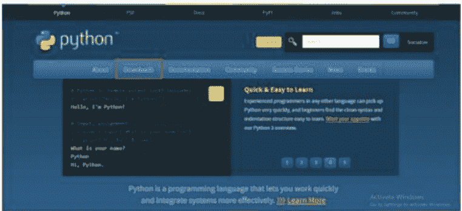

- 转到“下载”部分，从下拉菜单中选择Windows。查找你喜欢的Python版本。Python 3已更新至3.7.4版本，而Python 2已更新至2.7.16版本。请参考以下插图：

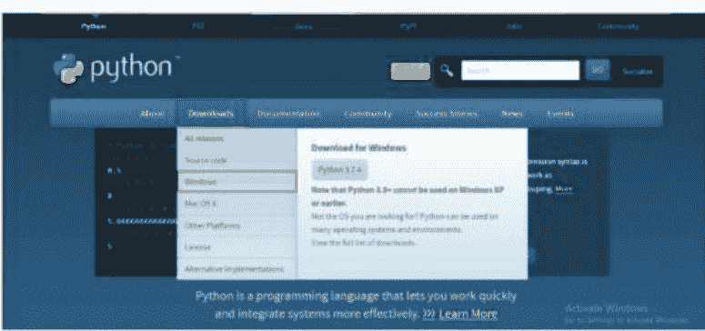

#### 步骤-2 选择安装程序：

要为64位操作系统下载Python，请选择“Windows x86-64可执行安装程序”或“Windows x86可执行安装程序”。

请注意，你可以安装32位或64位版本的Windows。在大多数情况下，任一安装程序都可以在64位机器上运行。根据操作系统，32位版本使用更少的内存，但64位版本对于需要密集计算的应用程序效果更好。

如果你不确定选择哪个版本，请选择64位。但是，如果你做出了“错误”的决定并选择升级到不同版本的Python，你可以轻松卸载Python并重新安装另一个安装程序。

#### 步骤-3 运行安装程序

下载完成后运行安装程序。

1. 勾选“Add Python 3.7 to Path”复选框，并为所有用户安装启动器。“Add Python to Path”复选框在旧版本的Python中不可用。
2. 选择“立即安装”选项，这是推荐的安装方法。

请注意，这些功能在旧版本的Python中可能不可用。但是，在所有较新的Python版本中，Pip和IDLE是推荐的安装选项（集成开发和学习环境）。

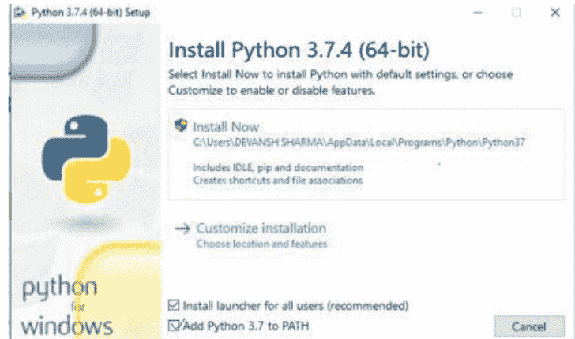

- 下一个对话框显示“安装成功”。你可以通过选择“Disable path length limit”来允许Python使用长路径名。

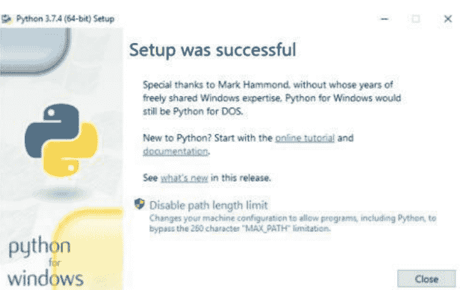

#### 步骤-4 检查Python是否已加载。

1. 转到计算机上安装Python的目录。在我们的框架中，它是`C:UsersUsernameAppDataLocalProgramsPythonPython37`。我们已经安装了最新版本的Python。
2. 双击`python.exe`（Python可执行文件）文件。
3. 你也可以使用命令提示符通过输入`python — version`来验证它。它将向你显示Python版本。如果Python成功启用，将出现以下输出。

#### 步骤-5 检查Pip是否已安装。

Pip是Python软件包的强大包管理系统。如果你安装的是旧版本的Python，Pip可能未预装。

a) 对于大多数Python包，推荐使用Pip，尤其是在虚拟环境中工作时。

b) 要查看Pip是否已成功安装

I) 在开始菜单中输入`cmd`。

II) 启动命令提示符程序。

III) 在终端中，输入`pip — version`。如果Pip已成功安装，将显示以下输出。

但是，如果pip尚未安装，你将得到以下输出：

> “pip不是内部或外部命令，也不是可执行的批处理文件。”

#### 步骤-6 设置环境变量

如果你没有选择“Add Python to PATH”复选框，或者你的Python安装程序版本不包含它，请按照以下步骤操作：

使用开始菜单，选择+R。

1. 打开命令提示符并输入`sysdm.cpl`。将出现“系统属性”窗口。
2. 转到“高级”选项卡，从下拉菜单中选择“环境变量”。

如果你没有选择“Add Python to PATH”复选框，或者你的Python安装程序版本不包含它，请按照以下步骤操作：

使用开始菜单，选择+R。

1. 打开命令提示符并输入`sysdm.cpl`。将出现“系统属性”窗口。
2. 转到“高级”选项卡，从下拉菜单中选择“环境变量”。

- 在“系统变量”下找到并选择Path变量，然后按“编辑”。
- 转到“变量值”字段并选择它。在`python.exe`文件的路径前添加一个分号（`;`）。

### Python关键字

关键字是为编译器保留的词，具有特定含义。它们不允许用作变量。关键字是语法的一部分，例如：

```
return (a+b)
```

这里使用了关键字`return`，而变量`a`和`b`是变量。以下是所有Python关键字的列表：

- `and`-`else`-`lambda`
- `or`-`except`-`None`
- `assert`-`finally`-`nonlocal`
- `break`-`try`-`pass`
- `continue`-`raise`-`global`
- `class`-`from`-`return`
- `def`-`import`-`False`
- `del`-`in`-`True`
- `if`-`is`-`for`
- `elif`-`not`-`while`
- `with`-`yield`-

### 一些Python关键字的描述

#### if

Python中的`if`语句是最基本的条件语句。它用于确定是否执行某个语句块。

```
a = 20

if (a>15):
    print("I am bigger than 15")
```

**输出**

```
I am bigger than 15
```

#### else

如果有`if`语句，也有`else`语句。如果`if`语句的条件为假，则执行`else`块。以下示例说明了这一点：

```
a = 20
b = 30

if (a> b):
    print('a is greater than b')
else:
    print('b is greater than a')
```

**输出**

```
b is greater than a
```

#### elif

`elif`是`else-if`的缩写。它用于验证多个条件，这意味着如果前一个条件不正确，则检查下一个条件。考虑以下场景：


```
a=10
b=10

if (a>b):
    print('a is smaller than b')
elif (a == b):
    print(' a is equal to b')
else:
    print('a is greater than b')
```

**输出**

`a is equal to b`

#### True

布尔值`true`由关键字`true`定义。如果给定的语句为真，解释器返回`true`。考虑以下场景：

```
print(1==1)
```

**输出**

`True`

#### False

布尔值`false`由关键字`False`表示。如果给定的语句为假，解释器返回`false`。例如：

```
print(1>1)
```

**输出**

`False`

#### assert

`assert`关键字用作调试方法。它有助于代码的高效流动。它使我们更容易定位错误。

断言本质上是程序员已知且通常希望正确的假设。因此，它们被编码为：如果参数失败，代码将不再执行。

```python
a = 10
b = 0
print('a is dividing by Zero')
assert b != 0
print(a / b)
```

**输出：**

```
a is dividing by Zero
```

**运行时异常：**

```
Traceback (most recent call last):
  File "/home/40545678b342ce3b70beb1224bed345f.py", line 4, in
    assert b != 0, "Divide by 0 error"
AssertionError: Divide by 0 error
```

Python 中的逻辑运算符是 `and`、`or` 和 `not`。在 `and` 运算符中，如果所有操作数都有效，则条件为真。例如：

```python
a = 100
if (a > 90) and (a < 101):
    print('Both conditions are true. a is ', a)
```

**输出：**

```
Both conditions are true. a is 100
```

### Python 运算符

作用于一个或多个操作数的符号称为运算符。操作数是执行操作的值或向量。考虑示例 `6+9`。操作数是 `6` 和 `9`，运算符是 `+`。Python 有多种运算符，如下所列：

- 算术运算符
- 赋值运算符
- 比较运算符
- 逻辑运算符
- 成员运算符
- 位运算符
- 身份运算符

#### 算术运算符

使用 Python 算术运算符执行基本的数学运算。以下是算术运算符列表。假设 `x` 和 `y` 是两个变量，值分别为 `30` 和 `10`，以下是运算结果：

| 运算符 | 描述 | 示例 |
| :--- | :--- | :--- |
| `+` (加法) | 用于将两个操作数相加。 | `x + y = 40` |
| `–` (减法) | 用于将两个操作数相减。如果第一个操作数小于第二个操作数，则返回负值。 | `x – y = 20` 或 `y – x = -20` |
| `*` (乘法) | 用于将运算符两侧的值相乘。 | `x * y = 300` |
| `/` (除法) | 将第一个操作数除以第二个操作数并返回商。 | `x/y = 3.0` |
| `//` (整除) | 用于除法并返回商的整数值。 | `x//y=3` 或 `x=30 y=7` 则 `x//y=4` |
| `%` (取模) | 返回除法后的余数。 | `x%y = 0` |
| `**` (幂) | 用于计算第一个操作数的幂。 | `x = 5, y = 2` 则 `x ** 2 = 25` |

#### 赋值运算符

使用赋值运算符将右侧操作数的值赋给左侧操作数。以下是赋值运算符列表。如果我们设定 `x = 20` 和 `y = 10`，将得到以下结果：

| 运算符 | 描述 | 示例 |
| :--- | :--- | :--- |
| `=` | 将右侧表达式的值赋给左侧操作数。 | `x = 20` |
| `+=` | 用于将两侧的值相加，并将表达式赋给左侧。结果赋给右侧操作数。 | `x+=y` 等于 `x=x + y` 因此 `x = 30` |
| `-=` | 用于将两侧的值相减，并将表达式赋给左侧。结果赋给右侧操作数。 | `x-=y` 等于 `x=x - y` 因此 `x = 10` |
| `*=` | 将操作数相乘，并修改赋给右侧操作数的值。 | `x*=y` 等于 `x = x*y` 因此 `x = 200` |
| `/=` | 将操作数相除，并修改赋给右侧操作数的值。 | `x/=y` 等于 `x = x/y` 因此 `x = 2.0` |
| `%=` | 计算两侧值的模。并将结果赋给左侧表达式。 | `x%=y` 等于 `x = x% y` 因此 `x = 0` |
| `**=` | 对运算符执行指数（幂）计算，并将值赋给左侧操作数。 | `x=20,y=2 x**=2` 等于 `x=x**y` 因此 `x=400` |
| `//=` | 对运算符执行整除，并将值赋给左侧操作数。 | `x//=y` 等于 `x = x//y` 因此 `x = 2` |

#### 比较运算符

Python 有多种比较运算符，通常用于比较两个操作数的值。当这些值被比较时，结果是布尔值 `true` 或 `false`。运算符列于下表中。已分配 `x=10` 和 `y=15`。

| 运算符 | 描述 | 示例 |
| :--- | :--- | :--- |
| `==` | 如果两个操作数的值相等，则返回 `true`。 | `x==y` 为 `False` |
| `!=` | 如果两个操作数的值不相等，则返回 `false`。 | `x!=y` 为 `True` |
| `<=` | 如果左侧操作数小于或等于右侧操作数，则评估为 `True`。 | `x<=y` 为 `True` |
| `>=` | 如果左侧操作数大于或等于右侧操作数，则评估为 `True`。 | `x>=y` 为 `False` |
| `<>` | 此运算符类似于 `!=`（不等于）。 | `x<>y` 为 `True` |
| `>` | 如果左侧操作数大于右侧操作数，则评估为 `True`。 | `x>y` 为 `False` |
| `<` | 如果右侧操作数大于左侧操作数，则评估为 `True`。 | `x<y` 为 `True` |

#### 逻辑运算符

在条件语句中，使用三个逻辑运算符：`and`、`or` 和 `not`。

| 运算符 | 描述 | 示例 |
| :--- | :--- | :--- |
| `and` | 如果两个表达式都为真，则条件变为真。 | `True and False = False` |
| `or` | 如果任一表达式为真，则条件变为真。 | `True or False = True` |
| `not` | 如果表达式 `x` 为真，则 `not(x)` 将为假，反之亦然。 | `not(True) = False` |

#### 成员运算符

成员运算符用于确定给定元素是否属于序列，如字符串、列表或元组。在下表中，有两个成员运算符：

| 运算符 | 描述 | 示例 |
| :--- | :--- | :--- |
| `in` | 如果左侧的元素存在于给定的右侧序列中，则评估为 `true`。 | `3 in [1,3,4] = True` |
| `not in` | 如果左侧的元素存在于给定的右侧序列中，则评估为 `false`。 | `3 not in [1,3,5] = False` |

#### 位运算符

位运算符对操作数执行逐位二进制运算。考虑以下场景：变量 `a` 被赋值为 `5`，变量 `b` 被赋值为 `6`。

```
a = 5
b = 6
binary (a) = 0101
binary (b) = 0110
Hence a&b = 0100 is equivalent to 4
a|b = 0111
```

| 运算符 | 描述 | 示例 |
| :--- | :--- | :--- |
| `~` (按位取反) | 此运算符将数字转换为二进制数并返回其一的补码或翻转位。`~x` 等价于 `-x-1`。 | `a=~5` 评估为 `-6` |
| `&` (按位与) | 如果相同位置的两个位都是 `1`，则结果为 `1`，否则结果为 `0`。 | `a=0101, b=0110 a&b = 0100` |
| `\|` (按位或) | 如果相同位置的两个位都是 `0`，则结果为 `1`，否则结果为 `0`。 | `a=0101, b=0110 a\|b = 0111` |
| `^` (按位异或) | 如果两个位不同，则结果为 `1`，否则结果为 `0`。 | `a= 0101, b=0110 a^b=0011` |
| `<<` (左移) | 左侧操作数的值按右侧操作数给出的位数向左移动。 | `a<<2 = 0010100` |
| `>>` (右移) | 左侧操作数的值按右侧操作数给出的位数向右移动。 | `a>>2 = 0001` |

#### 身份运算符

身份运算符用于比较两个对象的内存位置。

| 运算符 | 描述 | 示例 |
| :--- | :--- | :--- |
| `is` | 如果两个运算符引用同一个对象，则评估为 `true`。 | `a = 5, b=5 a is b = True` |
| `is not` | 如果两个运算符引用同一个对象，则评估为 `false`。 | `a = [1,2,3], b =[1,2,3] a is not b = True` |

#### 运算符优先级

了解运算符的优先级很重要。

| 运算符优先级（递减顺序） | 描述 |
| :--- | :--- |
| `**` | 幂运算具有最高优先级 |
| `~ + -` | 按位取反、一元加和减 |
| `* / % //` | 乘、除、取模和整除 |
| `+ -` | 加法和减法 |
| `>> <<` | 右移和左移位运算 |
| `&` | 按位“与” |
| `^` | 按位“异或” |
| `\|` | 按位“或” |
| `<= < > >=` | 比较运算符 |
| `<> == !=` | 相等运算符 |
| `= %= /= //= -= += *= **=` | 赋值运算符 |
| `is is not` | 身份运算符 |
| `in not in` | 成员运算符 |
| `not or and` | 逻辑运算符 |

### Python 注释

在任何编程语言中，注释都是必需的。它使我们的程序更具可读性，并且 Python 解释器会忽略被注释的代码。

在 Python 代码中，有两种使用注释的方式。在代码中练习使用注释是一个好主意，这能使代码更容易理解。没有注释的代码可能会令人困惑。如果我们想说明一段代码语句而不执行它，可以通过注释来实现。虽然注释不是代码的一部分，但它提高了可读性。

#### 单行注释

在行首使用 `#`（井号）字符来创建单行注释。在行尾，注释立即终止。例如：

#### 示例 1

```python
#This is a single-line comment in Python
print("Welcome to tutorialandexample")
```

#### 输出

`Welcome to tutorialandexample`

#### 多行注释

在三引号内部，可以创建多行语句。例如：

```python
print("Welcome to tutorialexample")
"""This is the example of
    multiline comment
    using the triple quotes.
    Use in your code"""
```

### Python if 语句

任何编程语言都必须具备决策能力。决策的能力在于条件测试。Python 中有许多决策语句，包括：

- If 语句
- If-else 语句
- elif 语句

**if 语句**

`if` 条件语句是最直接的。它用于检查是否存在某个条件。如果条件有效，将执行一个代码块（`if` 语句块）。

**语法：**

```python
if expression:
    statement
```

**if 语句流程图：** `if` 语句的流程图如下

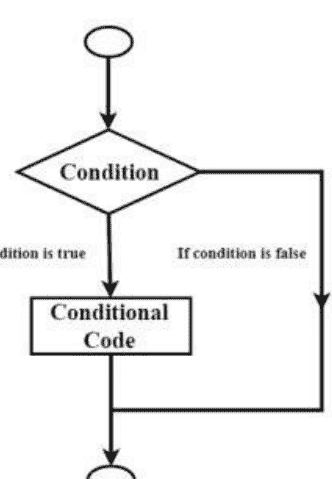

在上面的流程图中，首先检查条件是否有效，然后执行条件代码（`if` 语句）。如果条件不正确，将运行 `if` 断言之后的第一组代码。

在 Python 编程语言中，任何非零和非空值都被假定为 `TRUE`。如果为零，则假定值为 `FALSE`。

### Python 中的缩进

代码块使用缩进来声明。块中的所有语句都应该缩进到同一级别。块级 Python 代码中不允许使用花括号和圆括号。Python 的缩进使编程变得快速而简单。

**示例：** 以下是 `if` 语句的一个示例。

1.  **编写一个程序来检查数字是否为偶数**

```python
n = int(input("Enter the number:"))
if(n%2==0):
    print("The number is even")
else:
    print("The number is odd")
```

**输出**

```
Enter the number: 10
The number is even
```

2.  **创建一个程序来检查乘客的行李重量。**

```python
weight = float(input("How many Kilograms(kg) does your luggage?: "))
if (weight <30):
    print("You have charged ₹ 300 for heavy luggage .")
print("Thank you for your business.")
```

**输出**

```
How many Kilograms does your suitcase weigh?: 35
There is a 250 charge for heavy luggage.
Thank you for your business
```

3.  **创建一个程序，打印三个数字中的最大值。**

```python
a = int(input("Enter the First number:"))
b = int(input("Enter the Second number:"))
c = int(input("Enter the Third number:"))
if(a>b) and (a>c):
    print(a, 'is largest number' )
if(b>a) and (b>c):
    print(b, 'is largest number')
if (c>a) and (c>b):
    print(c, "c is largest");
```

**输出**

```
Enter the First number: 100
Enter the Second number: 145
Enter the Third number: 200
200 is largest
```

4.  **编写一个程序来确定给定的数字是正数还是负数。**

```python
num = 3
if num >0:
    print(num, "is a positive number.")
print("This is always printed.")
num = -1
if num >0:
    print(num, "is a positive number.")
print("This is also always printed.")
```

**输出**

```
3 is a positive number.
This is always printed.
This is also always printed.
```

### Python elif

**Python elif**

`elif` 语句用于验证多个条件，并根据哪个条件有效来执行特定的语句块。

**语法**

```python
if expression1:
    statement
elif expression2:
    statement
elif expression3:
    statement
else:
    statement
```

`Elif` 语句，如 `else`，可以是可选的。如果 `if` 表达式求值为 `true`，则打印表达式 `1` 的声明；否则，控制权转移到 `elif` 表达式；如果 `elif` 条件求值为 `false`，则控制权转移到下一个 `elif`。它将遍历所有 `elif` 表达式，直到找到一个为真的表达式。Python 与其他编程语言不同，没有 `switch` 或 `case` 语句。

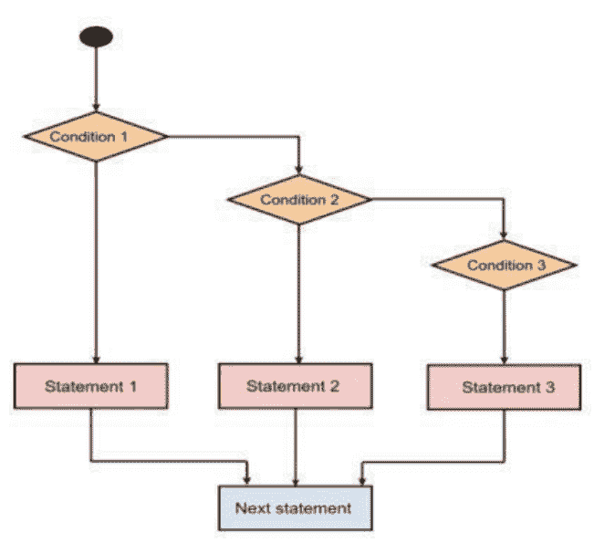

在上面的流程图中，Python 逐一测试每个表达式（即条件），如果找到一个为真的条件，则执行该表达式下的语句块。如果找到一个为假的条件，则执行 `else` 条件下的语句块。

在下面的例子中，我们使用了 `if`、一系列 `elif` 和 `else` 来确定变量的类型。

1.  **创建一个程序来检查学生的成绩。**

```python
marks = int(input("Enter the marks "))
if marks >85 and marks <= 100:
    print("Congrats ! you scored grade A ")
elif marks >60 and marks <= 85:
    print("You scored grade B + ")
elif marks >40 and marks <= 60:
    print("You scored grade B ")
elif marks >30 and marks <= 40:
    print("You scored grade C ")
else:
    print("You are fail ")
```

**输出**

```
Enter the marks 60
You scored grade B
```

2.  **编写一个程序来确定是早晨、中午还是晚上。**


```python
time= int(input("Enter the time"))
if time >= 6 and time <12:
    print("Good Morning")
elif time == 12:
    print("Good Noon")
elif time >12 and time <= 17:
    print("Good Afternoon")
elif time >17 and time <= 20:
    print("Good Evening")
elif (time >20 and time <=24) or (time >= 0 and time <=6):
    print("Good Night")
else:
    print("Invalid time!")
```

**输出**

Enter the time12

Good Noon

3. **创建一个基本的计算器程序。**

```python
a=int(input("Enter the first number"))
b=int(input("Enter the second number"))
print("1. Add")
print("2. Sub")
print("3. Mul")
print("4. Div")
choice=input("Enter your choice")
if(choice=='1'):
    print("The addition is:",a+b)
elif(choice=='2'):
    print("The subtracion is:",a-b)
elif(choice=='3'):
    print("The multiplication is:",a*b)
elif(choice=='4'):
    print("The divide is:",a/b)
else:
    print("Enter the valid choice")
```

**输出**

Enter the first number:30

Enter the second number:20

1. Add

2. Sub

3. Mul

4. Div

Enter your choice:3

The multiplication is: 600

4. **创建一个程序来确定三角形的类型。**

```python
a=int(input("Enter the first angle:"))
b=int(input("Enter the second angle:"))
c=int(input("Enter the third angle:"))
if a<b+c or b<a+c or c<a+b:
    print("The triangle does not exist")
elif a==b and a==c:
    #An equilateral triangle has three angles of 60°, and three equal sides.
    print("Equilateral triangle")
elif a==b or b==c or c==a:
    # An isosceles triangle has two angles that are equal, and two equal sides.
    print("Isosceles triangle")
else:
    # An obtuse triangle has one and only one obtuse angle.
    print("Obtuse triangle")
```

**输出**

Enter the first angle: 60

Enter the second angle:60

Enter the third angle:45

Isosceles triangle

### Python for 循环

在 Python 中，`for` 循环根据给定的序列重复执行一个代码块指定的次数。Python 的 `for` 循环与任何其他编程语言（如 C 或 Pascal）都不同。它遍历 Python 数据结构，如列表、字典和元组。

#### 语法

```python
for iterating_var in sequence:
    statements
```

首先对序列中的表达式列表进行求值。然后将迭代变量 `iterating_var` 赋值给序列中的第一个项目。之后，执行语句块。语句块会一直执行，直到整个序列终止；列表中的每个项目都会被分配给 `iterating_var`。

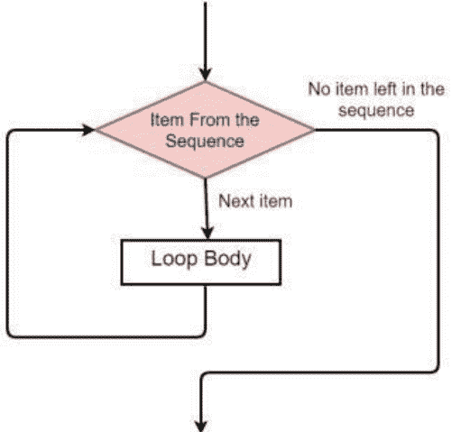

#### 流程图

在上面的流程图中遍历 `for` 循环的序列。它使用链中的第一个元素执行语句块。然后继续下一个。序列中的项目，直到序列中没有剩余项目。

### for 循环示例

1. 创建一个程序，打印数字列表中两个数字的平方。

```
list = [1,2,3,4,5]
for e in list:
    print(e**2)
```

输出

1

4

9

16

25

2. 编写一个程序，从字符串中生成一个字符。

```
str = 'Python'
for e in str:
    print(e)
```

输出

P

y

t

h

o

n

3. 编写一个程序，计算给定列表中项目的总数。

```
list = [25,42,32,12,33]
sum = 0
for e in list:
    sum = sum+e
print("The sum is:",sum)
```

输出

The sum is: 144

### 通过序列索引进行迭代

我们可以通过使用元素的索引来迭代序列。让我们从理解 `range` 函数开始。

### range() 函数：

要迭代给定的数字序列，请使用 `range()` 函数。

在大多数情况下，需要三个参数（`stop` 和 `step` 是可选的）。

Python 让我们能够自由定义满足需求的 `range` 函数。

考虑以下场景：

- `range(n)` – 生成从 `start` 到 `n-1` 的数字。`range(5)` 将生成 0,1,2,3,4。

- `range(start, stop)` – 生成从 `start` 到 `stop-1` 的一组数字。`range(1,10)` 将生成 0,1,2,3,4,5,6,7,8,9。

- `range(start, stop, step)` – 我们可以生成具有给定步长差值的数字。`range(3,20,3)` 将生成 3,6,9,12,15,18。

### 使用 range() 的 for 循环示例

编写一个程序，计算前 n 个自然数的和。

```
n=int(input('Enter the number'))
# Define a variable to stored number for specific range
sum=0
for i in range(1,n+1):
#As we know range(n) will generate n-1 that's why we assign n+1
#it will generate n+1-1 or n numbers
    sum=sum+i
# Sum of numbers stored in sum variable
print(sum)
```

### 编写一个程序来判断给定的数字是否为质数。

```
n = 12
# If given number n is greater than 1
if n>1:
# Iterate from 2 to n // 2
    for i in range(2, n // 2):
# If n is divisible by any number between 2 and n // 2, it is not prime
        if (n % i) == 0:
            print(n,"is not a prime number")
            break
    else:
        print(n, "is a prime number")
else:
    print(n, "is not a prime number")
```

### Python 嵌套 for 循环

术语“嵌套 `for` 循环”指的是嵌套在另一个 `for` 循环内部的 `for` 循环。在模式编程中，最好使用嵌套 `for` 循环。例如：

1. 创建一个程序，打印三角形的星号。

```
n = int(input("Enter the number of lines"))
# Take input for number of lines
for i in range(n):
    #first for loop is using for print number of lines
    for j in range(i):
        #second for lop is using for print star(*)
        print("*",end="")
    print()
```

2. 创建一个程序，在给定范围内找出质数。

```
start = int(input("Enter the start range"))
stop = int(input("Enter the stop range"))
for n in range(start,stop+1):
    # If given number n is greater than 1
    if n>1:
        # Iterate from 2 to n // 2
        for i in range(2,n//2):
            # If n is divisible by any number between 2 and n //2, it is not prime
            if(n%i==0):
                break
        else:
            print(n)
    else:
        print("the number is not greater than 1")
```

### 在 for 循环中使用 else 语句

`else` 子句是 Python 中 `for` 循环的一个可选部分。只有当循环完成所有迭代后，`else` 语句才会运行。考虑以下场景：

```
for i in range(6):
    print(i)
else:
    print("Iteration is completed")
```

### Python while 循环

循环在 Python 和任何其他编程语言中都至关重要，因为它们允许你重复运行一段代码。

通常你需要重复使用一段代码，但你不想每次都写相同的代码行，所以你会想使用循环。

循环语句用于重复执行多个代码或语句，直到循环中陈述的条件被错误评估。

在 Python 中，主要有两种循环语句：

1. `while` 循环

2. `for` 循环

本主题将解释 `while` 循环。

**while 循环：**

`while` 循环用于持续执行一个语句，直到循环的条件变为 false。当我们事先不知道会有多少次迭代时，就会使用它。

**语法：**

```
while expression:
    statement
```

**流程图**

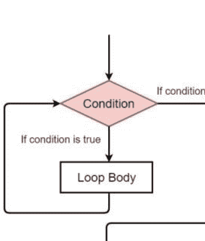

在上面的 `while` 循环流程图中，首先验证提供的条件；如果条件评估为错误，则循环终止，控制权转移到程序中循环之后的下一个语句。

如果条件有效，则执行循环的语句集合，然后将控制权转移回循环的开头以进行下一次迭代。

### while 循环示例：

以下是一些 `while` 循环的示例：

我们在循环中使用递增操作来增加给定变量的值。

由于 `while` 循环必须有递增或递减操作，这是一个关键阶段。否则，循环将永远重复自身。

1. **创建一个程序，打印某个数字的乘法表。**

```
num=int(input("Enter the number"))
#define a variable for user input
i=0
while i<10:
    #while loop will iterate as long as the value of i is less than 10
    i = i + 1
    # Increment operation in i
    c=num*i
    # Multiply resultant stored in another variable c
    print(num,'*',i,'=',c)
```

输出

Enter the number 12

12 * 1 = 12

12 * 2 = 24

12 * 3 = 36

12 * 4 = 48

12 * 5 = 60

12 * 6 = 72

12 * 7 = 84

12 * 8 = 96

12 * 9 = 108

12 * 10 = 120

2. **编写一个程序，多次打印短语 "hello world"。**

```
num =1
#there is a variable num in which we store an integer 1.
while num<=5:
# we print the hello world fives times until condition evaluates false
    print("Hello world")
    num=num+1
#we print out "Hello world" and increase the value of number with one.
```

输出

Hello world

Hello world

Hello world

Hello world

Hello world

3. **编写一个程序，计算指定序列中有多少个偶数或奇数。**

```
number = 1
count_odd=0
count_even=0
while number<10:
    number=number+1
    if number%2==0:
        count_even=count_even+1
    else:
        count_odd=count_odd+1
print('The count of even number:',count_even)
print('The count of odd number:',count_odd)
```

输出

The count of even number: 5

The count of odd number: 4

### 无限 while 循环

如果 `while` 循环中给定的条件永远不会变为 false，循环将变成无限循环，永远不会自行结束。`while` 循环中的任何非零值通常表示 true 状态。考虑以下场景：

```
num=0
while num<5:
    print("hello")
```

### while 循环中的 else 语句

Python 允许你在 `while` 循环中使用 `else` 表达式。

如果给定的条件变为 false，`else` 断言将被执行。

使用 `while` 循环时，`else` 语句是可选的。

例如：

```
num = 1
while num <6:
    print(num)
    num = num+1
else:
    print("Loop is finished")
```

输出

1

2

3

4

5

Loop is finished

### Python 列表

列表是 Python 中最灵活和可变的数据结构之一。它可以存储各种数据类型和异构数据。

在方括号内，列表包含逗号分隔的值（项目）。

在 Python 中，创建列表就像这样简单：

```
list1 = ['Abhay','Arjun','Himanshu','Anubhav']
list2 = [1,2,3,4,5,6]
list3 = ['Himanshu',20, 54.6,'Abhay', 'a', 'b']
```

#### 列表中的索引和切片

##### 列表中的索引：

可以使用 `[]` 运算符对列表进行索引。

`list =[ 'P', 'Y' , 'T' , 'H' , 'O' ,N']`

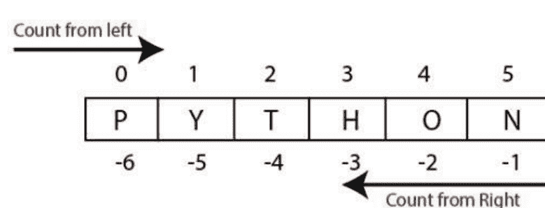

可以使用列表的索引位置来查看列表的值。索引从 0 到 n-1。

第 0 个索引用于存储第一个元素，第一个索引用于存储第二个元素，以此类推。

最右侧的索引位置是 -1，最左侧的索引位置是 -2，以此类推。例如：

```
list[0]=P          list[-6]=P

list[1]=Y          list[-5]=Y

list[2]=T          list[-4]=T

list[3]=H          list[-3]=H

list[4]=O          list[-2]=O

list[5]=N          list[-1]=N
```

### 列表切片

Python 有一个特性，允许你获取列表的子列表。当我们只需要列表中的一小部分数据时，切片就派上用场了。

语法是：

`list_variable[start: end: step]`

- **start** 指的是列表元素的起始位置。

- **stop** 指的是我们应该**停止**的元素的索引，就在切片结束之前。

- **step** 允许你在 **start:stop** 范围内获取每个第 n 个元素。

让我们通过下面的例子来理解这个概念：

示例-1：


```
list = [10,20,30,40,50,60,70,80,90]
print(list[2:6])
```

#### 输出

`[30, 40, 50, 60]`

由于`start`等于 2，切片从上面示例中的第二个位置开始。索引 2 的值为 30。

`stop`的值表示列表的最后部分，即 60。因此，它会在`stop`索引之前停止。

使用`step`可以在`start:stop`范围内获取每个第 n 个元素。

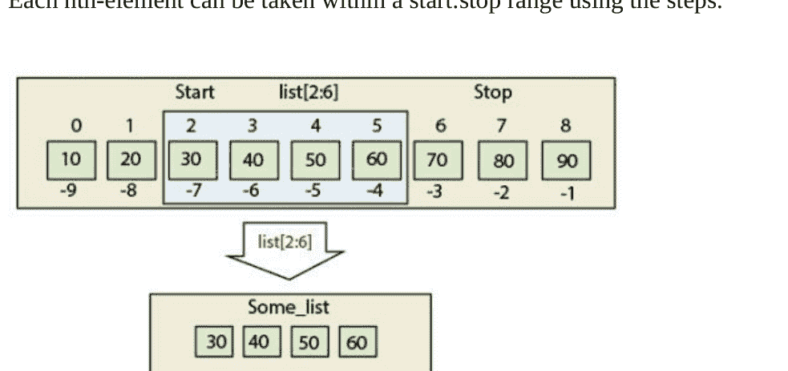

我们可以省略`start`索引，它将从 0 开始返回。例如：

```
list = [10,20,30,40,50,60,70,80,90]
print(list[:4])
```

#### 输出

`[10, 20, 30, 40]`

所以，`list[:4]`与`list[0:4]`相同。这是获取前 n 个元素的快捷方式。

我们也可以省略`stop`索引。它将返回指定列表的最后 n 个元素。例如：

```
list = [10,20,30,40,50,60,70,80,90]
print(list[4:])
```

#### 输出

`[50, 60, 70, 80, 90]`

在上面的例子中，我们省略了`stop`索引，这意味着它从列表的开头取元素直到末尾。

### 示例-2：

```
list = [10,20,30,40,50,60,70,80,90]
print(list[::])
```

*#默认步长为1。无需指定*

```
print(list[::2])
```

*# 这里步长为2*

```
print(list[1::3])
print(list[2:7:2])
```

#### 输出

`[10, 20, 30, 40, 50, 60, 70, 80, 90]`

`[10, 30, 50, 70, 90]`

`[20, 50, 80]`

`[30, 50, 70]`

在上面的程序中，我们可以省略`start`和`stop`参数，只使用`move`参数。我们可以通过提供`move`来跳过一些元素。

### 使用负索引访问列表元素

```
list = [10,20,30,40,50,60,70,80,90]
print(list[-3:])
```

*#索引位置从后往前计数。start是-3，它将进行到列表的最后一个索引*

```
print(list[1:-1])
print(list[-5:-2])
```

*# 这里步长为2*

```
print(list[-3:])
print(list[1:-3:2])
print(list[:7:-2])
print(list[::-1])
```

*# 步长为-1。它将反转整个列表*

#### 输出

```
[70, 80, 90]
[20, 30, 40, 50, 60, 70, 80]
[50, 60, 70]
[70, 80, 90]
[20, 40, 60]
[90]
[90, 80, 70, 60, 50, 40, 30, 20, 10]
```

### 列表的修改（更新）

列表是可变的，这意味着我们可以使用切片和赋值运算符来更改列表的元素。

要向列表添加值，请使用列表的`append()`函数。

```
list = [10,21,30,45,50,63,78,80,90]
list[0]=1
print(list)
list[1:4]=[2,3,4]
print(list)
list[2]= 'Himanshu'
print(list)
list[3:5]='abc'
print(list)
```

#### 输出

```
[1,21, 30, 45, 50, 63, 78, 80, 90]
[1, 2, 3, 4, 50, 63, 78, 80, 90]
[1, 2, 'Himanshu', 4, 50, 63, 78, 80, 90]
[1, 2, 'Himanshu', 'a', 'b', 'c', 63, 78, 80, 90]
```

### 列表的删除

`del`关键字用于删除列表特性。当我们确切知道需要删除哪个方面时，我们使用它。也可以使用`remove()`或`pop()`方法删除元素。

例如：

```
list = [10,21,30,45,50,63,78,80,90]
del list[0]
print(list)
del list[1:4]
print(list)
del list[::2]
print(list)
```

#### 输出

```
[21,30, 45, 50, 63, 78, 80, 90]
[21, 63, 78, 80, 90]
[63, 80]
```

### 列表的基本操作

- **重复**

重复运算符（`*`）用于重复列表元素。

```
list1 =[1,2,3,4,5]
print(list1*2)
```

#### 输出

`[1, 2, 3, 4,5, 1, 2, 3, 4, 5]`

- **连接**

使用连接运算符（`+`）连接两个或多个列表。

```
list1 =[1,2,3,4,5]
list2 =[6,7,8,9,10]
print(list1+list2)
```

#### 输出

`[1,2, 3, 4, 5, 6, 7, 8, 9, 10]`

- **迭代**

可以使用`for`循环迭代列表

```
list1 =[1,2,3,4]
for i in list1:
    print(i)
```

#### 输出

`1`

`2`

`3`

`4`

- **成员关系**

如果对象存在于列表中，则返回`true`；否则，返回`false`。

```
list1 =[1,2,3,4]
print(3 in list1)
```

#### 输出

`True`

### 列表的内置函数

| 序号 | 函数 | 描述 |
|---|---|---|
| 1. | `len(list)` | 用于计算列表的长度 |
| 2. | `cmp(list1, list2)` | 比较两个列表的元素。 |
| 3. | `max(list)` | 返回列表中的最大元素。 |
| 4. | `min(list)` | 返回列表中的最小元素。 |
| 5. | `list(seq)` | 将任何序列更改为列表。 |

### Python 元组方法

元组由两个内置的 Python 方法处理。这两个方法如下：

| 方法 | 描述 |
|---|---|
| `count()` | Python 中的`tuple.count()`方法返回指定值在元组中出现的次数。 |
| `index()` | Python 中的`tuple.index()`方法返回指定元素在元组中的最小索引。 |

#### 示例 1

```
# 解释元组方法的 Python 程序

# 初始化元组值
tupleVal = (1, 2, 3,4,5, 7, 8, 7, 5, 5, 6, 4, 4)
print("Tuple:",tupleVal)

# 计算给定元组中 4 出现的次数
occurrences = tupleVal.count(4)

# 打印返回的值
print("The item '4' occured",occurrences,"times")
```

#### 输出

`Tuple: (1, 2, 3, 4, 5, 7, 8, 7, 5, 5, 6, 4, 4)`

`The item '4' occured 3 times`

#### 示例 2

```
# 解释元组方法的 Python 程序
# 初始化元组值
tupleVal = ("e","i","o","u","a","a")
print("Tuple:",tupleVal)
# tuple.index() 方法
# 查找指定值的第一次出现并返回其索引
Index = tupleVal.index("a")
# 打印返回的值
print("The index value of 'a' is",Index)
```

#### 输出

`Tuple: ('e', 'i', 'o', 'u', 'a', 'a')`

`The index value of 'a' is 4`

### Python 字典

Python 字典是一个可变的数据列表，包含键值对，没有特定的顺序。它同时跟踪键和值，允许通过键访问其代表的值。

Python 字典是一组字典项，可以使用其键快速检索。

在字典内部，键必须是唯一的。字典的值可以是任何数据类型，但键必须是不可变的数据类型，如数字、字符串或元组。

#### 创建字典

在花括号内，Python 字典以键值对的形式存储数据，键和值用冒号（`:`）分隔。例如：

```
student={'name':'Himanshu','age':11,'class':'Fifth','Roll_no':17}
print(type(student))
print(student)
```

#### 输出

```
<class 'dict'>
{'name': 'Himanshu', 'age': 11, 'class': 'Fifth','Roll_no':17}
```

空字典用空花括号`{}`声明。

```
student={}
print(type(student))
```

#### 字典操作

#### 从字典中访问值

索引运算符`[]`用于从字典中访问值，键在方括号内使用。Python 中的`get()`方法也可用于访问值。例如。

```
student={'name':'Himanshu','age':11,'class':'Fifth','Roll_no':17}
#使用键访问元素
print(student['name'])
print(student['age'])
print(student['Roll_no'])
#使用 get() 访问值
print(student.get('class'))
```

#### 输出

`Himanshu`

`11`

`17`

`Fifth`

如果我们尝试访问指定字典中不存在的值，我们会得到一个错误。

```
student = {'name':'Himanshu','age':11,'class':'Fifth','Roll_no':17}
print(student['subject'])
```

#### 输出

```
line 2, in <module>
    print(student['subject'])
KeyError: 'subject'
```

#### 字典的修改（更新）

可以通过引入新的键值对来更新字典。由于字典是可变的数据形式，可以使用特殊键修改或删除其内容。例如：

```
student = {'Name':'Himanshu','Age':11,'Class':'Fifth','Roll_no':17}
```

### 字典中的删除操作

通过使用`del`关键字，你可以移除字典中的一个元素。我们可以选择删除单个元素或清空整个字典。

```python
student = {'Name':'Himanshu','Age':11,'Class':'Fifth','Roll_no':17}
del student['Class'] #deleting the Class key
print(student)
print(student['Class'])
```

**输出**

```
{'Name': 'Himanshu', 'Age': 11, 'Roll_no': 17}
line 9, in <module>
    print(student['Class'])
KeyError: 'Class'
```

要清空字典的所有元素，Python 提供了`clear()`方法。它返回一个空字典。

```python
student = {'Name':'Himanshu','Age':11,'Class':'Fifth','Roll_no':17}
student.clear() #deleting all the element of the dictionary
print("The empty string is:",student)
```

**输出**

```
The empty string is: {}
```

### 字典键的特性

使用字典键时，有几点需要注意。

1.  字典中不允许有重复的键，这意味着我们不能为同一个键赋予不同的值。如果我们为同一个键声明了多个值，那么只有最后一个赋值会被存储。请看下面的示例。

```python
student = {'Name':'Himanshu','Age':11,'Class':'Fifth','Roll_no':17,'Name':'Dev'}
# We assign Name key with multiple time then it will consider the last assigned value
print("Last assign name is:",student['Name'])
```

**输出**

```
Last assign name is: Dev
```

我们可以使用数字、字符串或元组作为字典的键，因为它们必须是不可变的。但是，像列表`['key']`这样的可变类型是不允许的。例如：

```python
student = {['Name']:'Himanshu','Age':11,'Class':'Fifth'}
print(student)
```

**输出**

```
line 2, in <module>
    student = {['Name']:'Himanshu','Age':11,'Class':'Fifth'}
TypeError: unhashable type: 'list'
```

### 内置字典函数

| 序号 | 函数 | 描述 |
| :--- | :--- | :--- |
| 1. | `len(dict)` | 用于计算字典的长度 |
| 2. | `cmp(dict1, dict2)` | 比较两个字典的元素 |
| 3. | `str(dict)` | 将字典转换为可打印的字符串表示形式 |
| 4. | `type(variable)` | 用于打印传入变量的类型 |

### Python 函数

Python 函数是一个可重用、组织良好的代码块，用于执行特定任务。函数是将大型程序分解为可管理部分的好方法。它还允许我们的代码被重用。这个特性可以用来重用一个代码块。

Python 比其他编程语言更通用，因为所有函数都被视为对象。

Python 中有两种类型的函数：

- **内置函数** – 这些函数包含在 Python 的库和包中。

- **用户自定义函数** – 这些函数由用户根据自己的需求定义。在本教程中，我们将学习用户自定义函数。

### 创建函数

创建用户自定义函数的基本步骤如下：

- 要定义一个函数，使用`def`关键字，后跟函数名。

- 参数应写在函数的圆括号内，语句应以冒号结尾。

- 在函数体内，编写要执行的程序语句。

- `return`语句不是必需的，但它必须出现在函数的末尾。

语法如下：

```python
def function_name(argument list):
    The function body
    ....................
    ....................
    return
```

参数列表中可以有零个或多个参数。参数也被称为形参。函数体包含缩进的语句。当函数被调用时，函数体就会被执行。参数可以是可选的，也可以是必需的。

### 调用函数

函数必须在声明后，通过函数名后跟圆括号和相关参数来调用。

注意：函数必须在调用前定义；否则，可能会发生错误。

请看以下场景：

#### 示例-1

```python
def hello():
    print('Hello')
hello()
```

**输出**

```
Hello
```

#### 示例-2

```python
def sum(a,b):
    # define a function sum with two argument
    c=a+b
    return c

#returning the value to calling function

z=sum(10,20)
print("The sum is:",z)
```

**输出**

```
The sum is: 30
```

### 参数传递

向函数传递参数可以通过以下两种方式之一完成。

- **按值调用**

这种技术在 C、C++ 和 Java 中使用，但在 Python 中不使用。

在按值调用中，实参的值被复制到函数的形参中，并且两种类型的参数存储在不同的内存位置。

因此，我们对形参所做的任何更改都不会反映在调用函数的实参中。

- **按引用调用**

在 Python 中，函数是按引用调用的，这意味着在函数内部所做的任何更改都会反映在实参中。

请看以下示例：

#### 示例 1

```python
def mul(m,n):
    c=m*n
    return c
a=int(input("Enter the number:"))
b=int(input("Enter the number:"))
z=mul(a,b)
print("The multiply is:",z)
```

**输出**

```
Enter the number: 60
Enter the number: 50
The multiply is: 3000
```

上述程序中指定的函数是`mul(m,n)`，其中`m`和`n`是形参，调用函数是`mul(a,b)`，其中`a`和`b`是实参。

#### 示例-2

创建一个程序，接收一个列表并返回一个具有唯一元素的列表。


```python
def dup_list(list):
    list1=[]
    for i in list:
        if i not in list1:
            list1.append(i)
    return list1
list = [1,1,2,1,3,3,4,4,5,6,5,7]
print('The duplicate list is:',list)
z=dup_list(list)

print('The unique list is:',z)
```

**输出**

```
The duplicate list is: [1, 1, 2, 1, 3, 3, 4, 4, 5, 6, 5, 7]
The unique list is: [1, 2, 3, 4, 5, 6, 7]
```

### 参数类型

有几种不同类型的参数，如下所述。

1. 必需参数
2. 默认参数
3. 关键字参数
4. 可变长度参数

#### 必需参数

必需参数是在调用函数时必须传递的参数，并且必须与函数调用和函数定义中的位置完全匹配。如果在函数调用中未提供参数或参数位置被更改，Python 解释器将显示错误。

**示例 1**

```python
def sqr_list(list):
    emp_list= []
    for i in list:
        emp_list.append(i**2)
    print(emp_list)

sqr_list([1,2,3,4,5,6,7,8,9,10])
```

**输出**

```
[1, 4, 9, 16, 25, 36, 49, 64, 81, 100]
```

**示例-2**

```python
def sum(a,b):
    c=a+b
    return c
print(sum(20)) #There is only one argument is passed.
```

**输出**

```
line 4, in <module>
    print(sum(20))
TypeError: sum() missing 1 required positional argument: 'b'
```

#### 默认参数

默认参数是在函数定义时就被赋予了值的参数。如果在调用函数时未定义该参数，它将被设置为定义中指定的值。

例如

**示例 1**

```python
def student(name,age=21):
    print('My name is:',name)
    print('My age is',age)
student('Dev') #Here argument age is not passed default value is provided in definition
student('Himanshu',25) # The value of age is overwritten
```

**输出**

```
My name is: Dev
My age is 21
My name is: Himanshu
My age is 25
```

#### 关键字参数

关键字参数的优点是我们可以按任何顺序传递它们，因此传递的顺序无关紧要。任何语句都被视为关键字。它将匹配函数定义和调用中的参数名称。

**示例-1**

```python
def employee(id,name,age):
    print('员工编号:',id,'\n员工姓名:',name,'\n员工年龄:',age)

employee(age=30,id=1,name='Sushant')
```

**输出**

```
员工编号: 1
员工姓名: Sushant
员工年龄: 30
```

在上面的程序中，我们在函数调用时以不同的顺序传递了参数。参数的名称必须与函数定义中的名称匹配；否则，将会出现错误。

- 关键字参数和必需参数可以一起传递。例如：

```python
def employee(name,amount,message):
    print(message,name,'金额已存入',amount)

employee('Robert',message='Hello',amount=20000)
```

**输出**

```
Hello Robert 金额已存入 20000
```

在上面的程序中，必需参数在前，后面跟着两个关键字参数。

需要注意的是，必需参数不能出现在关键字参数之后；否则，将会显示错误。

#### 可变长度参数

当我们不确定可以传递给函数的参数数量时，就会使用可变长度参数。

在一个函数中，有两种类型的可变长度参数：

- `*args`（非关键字参数）
- `**kwargs`（关键字参数）

### 变量的作用域

变量的作用域由其声明的位置决定。变量有两种作用域。

#### 全局变量

由于全局变量是在函数外部指定的，因此可以在软件中的任何位置访问它们。

#### 局部变量

由于局部变量是在函数内部指定的，因此只能在函数内部访问它们。

请看以下示例：

**示例-1 全局变量**

```python
sum = 0

# 在函数外部定义的变量
def add(a,b):
    sum = a+b # 在函数内部访问的变量 sum
    print(sum)
add(54,65)
print('函数外部 sum 的值:',sum)
```

**输出**

```
The sum is: 119
函数外部 sum 的值: 0
```

**示例 - 2 局部变量**

```python
def mul(a,b):
    c = a*b # 变量 c 在函数内部定义
    print('乘积是:',c)
mul(20,30)
print(c) # 变量 c 是一个函数特定的变量，无法在函数外部访问。
```

**输出**

```
乘积是: 600
line 6, in <module>
NameError: name 'c' is not defined
```

### Python 文件处理

#### 什么是文件？

文件是包含一组数据的单个单元。它用于在非易失性存储器（如硬盘驱动器）中存储数据。

RAM（随机存取存储器）是一种易失性存储器，大多数计算机程序都在其中运行。当程序终止时，所有数据都会丢失，因此我们必须将其保存到永久存储或本地文件中。

因此，在 Python 中，文件处理可以按以下顺序完成：

- 打开文件
- 读取或写入（执行操作）
- 关闭文件

#### 打开文件

Python 中的内置函数`open()`用于打开文件。此函数将返回一个文件对象。为了返回文件对象，`open()`函数与两个参数结合使用。第一个参数接受文件名，第二个参数接受文件模式。

语法如下：

`fs = open(filename, access mode)`

`filename` - 此参数包含我们要打开的文件的名称。

`access_mode` – 此参数指定文件的打开模式，例如读取、写入、追加等。此参数不是必需的；如果未给出，文件将默认以`r`读取模式打开。

请看以下示例：

```python
fs = open('newfile.txt','w')
if fs:
    print('文件打开成功')
```

**输出**

```
文件打开成功
```

#### 关闭文件

完成文件处理后，我们必须正确关闭文件。为了关闭文件，Python 提供了`close()`过程。

`close()`函数释放之前绑定到文件的资源。虽然 Python 有一个垃圾回收器，但使用`close()`来正确关闭文件是一个好习惯。

```python
fs = open('myfile.txt','w')
# 执行文件操作
fs.close()
```

#### 如何写入文件

`write()`是一个 Python 函数，允许你写入文件。它必须以写入模式（`w`或`a`）打开。请看以下示例：

```python
# 以写入模式打开文件 myfile.txt。如果不存在这样的文件，则创建一个。
fs = open('myfile.txt','w')
# 将内容写入文件
fs.write("我们正在将这行写入文件")
fs.write("Python 是最流行的编程语言")
# 关闭已打开的文件
fs.close()
```

**myfile.txt**

```
我们正在将这行写入文件。Python 是最流行的编程语言。
```

#### 如何读取文件

`read()`是一个 Python 函数，用于读取文件的内容。`read()`方法从文件中读取一个字符串并返回它。以下是语法：

`Fileobj.read(count)`

`count`语句接受一个正数，并计算字符串中的字符数。例如：

```python
fs = open('myfile.txt','r')
z=fs.read(10)
y = type(z)
print(z)
```

Python 中的`readline()`函数逐行读取文件。它读取文件直到遇到换行符。

```python
fs = open('myfile.txt','r+')
z = fs.readline()
print(z)
```
